# 跨平台 Perl 第2版

由 Internet Archive 于 2012 年数字化

http://archive.org/details/crossplatformper00fost

---

Sheldon BACHUS

---

# INTRODUCTION

当我最初开始学习 Perl 时，我实际上认为 Perl 是一个邪恶的阴谋。它的语法倾向于晦涩难懂，而且简直难以掌握。你会发现大量奇怪的语法，比如无处不在的`$_`，它在证明外星人绑架理论方面比其他任何东西都更有说服力。Perl 是一种非常灵活的语言，允许用多种方式完成任何工作。在 Perl 社区中，这被认为是一件好事。关键在于找到一种成功的方式来完成你的工作。

而这正是我写这本书的原因。我写*跨平台 Perl* 的目标是让你免于经历我所遇到的同样问题。让我们面对现实：Perl 很难。因此，在接下来的章节中，你将看到对 Perl 的简单、直接的介绍。这本书远远超出了 Perl 的基础知识，解决了你完成工作所需解决的棘手问题。我会告诉你 Perl 真正邪恶的地方，以及你如何绕过它。我还提供了许多方便的 Perl 例程，你可以反复重用，不仅作为学习的示例，而且用于你的实际工作。而且，我会尝试为 Perl 的混乱局面带来一些光明。我的一些同事告诉我，学习 Perl 很容易——他们已经学了很多次了。如果你避开令人困惑的结构，Perl 就不必那么难。如果你曾经被 Perl 吓倒过，这本书就是为你准备的。

这本书面向广泛的想要学习 Perl 的读者，包括：

- 系统管理员
- 需要跨多个平台运行的批处理或脚本文件的任何人
- 想要添加交互式表单或自动化网页维护的网页设计者
- 想要自动化任务的 Windows NT 或 UNIX 高级用户
- 为 UNIX 和 Windows NT 开发的程序员

# 引言

你不需要任何先前的编程经验就能有效使用 Perl。如果你以前编程过，你会发现 Perl 遵循了 C 编程语言的许多约定。

Perl 代表实用提取和报告语言。（其他人称之为病态折衷垃圾列表器。）最初为系统管理任务设计，Perl 已经扩展到成千上万的用户和几乎同样多的用途。一些主要用途包括为网页创建通用网关接口（CGI）脚本、自动化系统管理任务、生成报告，以及促进跨平台开发，例如 UNIX 和 Windows NT 的编译脚本。Perl 是免费的，并且可用于许多平台。Perl 是快速自动化任务的绝佳工具，尤其是其强大的文本处理能力。

由 Larry Wall 创建，Perl 源于**sed**、**awk** 和其他 UNIX 工具的问题。特别是 UNIX 系统管理员试图获取其系统状态的报告。生成这些报告需要大量数据，但通常数据格式非常晦涩。因此，Perl 结合了**awk**的报告创建功能与**sed**的编辑和数据操作功能，并加入了大量其他内容。使 Perl 特别强大的是，你可以用 Perl 做更多的事情——而且比使用标准 UNIX shell 或 MS-DOS 提示符更容易。

Perl 是一种脚本语言，这意味着你不必编译和链接 Perl 程序。相反，你告诉 Perl 解释器执行你的脚本。这使得 Perl 在开发较小管理任务的快速解决方案方面非常受欢迎。由于 Perl 脚本存储在文本文件中，你可以使用任何文本编辑器创建脚本，包括**记事本**、**写字板**、**Word**、**vi** 或**emacs**。此外，一个名为**Perl/Tk**的 Perl 包允许你使用**Tk**工具包创建图形界面，该工具包最初来自另一种名为 Tcl 的脚本语言。使用**Perl/Tk**，你可以基于流行的**Tk**工具包为你的脚本创建用户友好的前端。

# 使用 Perl 进行跨平台开发

与本书不同，大多数 Perl 书籍假设你在 UNIX 上运行，在某些情况下，甚至是特定版本的 UNIX。我不同意。这本书名为*跨平台 Perl*是有原因的。在我的工作中，我必须处理

## 简介

许多计算机系统拥有多种架构。你很可能会面临类似的挑战。即便目前没有，将来也很可能遇到，除非计算机行业不再以如此快的速度发生变化。虽然我很想拒绝在那些我认为不够出色的架构上工作，但这并不现实。且不说我*认为所有*现有的计算机架构都不够出色，采取这种策略恐怕我也不会被雇用太久。因此，我一直在寻找能够在多个平台上运行并能帮助我完成工作的计算机工具。Perl 就是这样一种工具，它能在很大程度上实现许多系统任务的自动化。

因为 Perl 可以在包括 Windows NT 和 UNIX 在内的多个平台上运行，所以它有潜力消除——或至少隐藏——你会遇到的许多平台差异。但是，如果你以 UNIX 或 Windows 为中心的视角来编写脚本，就不会获得任何收益。因此，使用 Perl 的最佳方式是专注于在两个系统上都能正常运行的内容，只在必要时深入了解特定系统的细节。

因为 Perl 是一种脚本语言，这并不容易。你在 Perl 中要做的很多事情是启动系统程序，而这些程序在 UNIX 和 Windows NT 之间差异很大，如第 6 章所示。凡是存在平台差异的地方，你都会看到以下两种符号之一。

Windows 图标标识 Windows NT 特有的内容。

UNIX 图标标识 UNIX 特有的内容。

但在本书的绝大多数内容中，你不会看到任何符号。这是因为绝大多数 Perl 代码在两个系统上都能正常运行。

除了 Windows 和 UNIX 的提示之外，还有几种图标可以提醒你注意重要事项。

C 图标标识专门针对 C 和 C++ 程序员的技巧。虽然有效使用 Perl 不需要任何编程背景，但许多 Perl 脚本编写者来自编程领域。

Perl 的语法与 C 非常接近，但在重要方面有所不同。不要被 Perl 与 C 的相似性所迷惑。这个图标标识了 C 程序员会注意到重要语法差异的地方。

Note 图标表示需要特别注意的内容。

Warning 图标警告你那些可能对你的 Perl 脚本编写生涯有害的操作，这些操作可能导致脚本运行异常，甚至可能破坏数据。

CD-ROM 图标指的是随附本书的 CD-ROM 上的内容。

## 何时使用 Perl

目前有大量脚本语言和编程语言。从 Java 到 Visual Basic 到 Tcl 到 C++ 到 Ada 甚至 Object COBOL，各种语言都在争夺我们的关注和使用。面对如此多的语言，你必须决定有时间学习多少种，以及何时使用特定的工具。

我的理念很简单：使用最适合你的工具。FORTRAN 77 也许确实更适合你手头的任务。在评估 Perl 时，你应该考虑以下因素：

- Perl 具有强大的文本处理、搜索、排序和操作能力。它非常适合处理文本文件中的数据。
- Perl 提供了非常有用的报表生成结构。
- Perl 可以与大多数系统服务交互，尤其是在 UNIX 上。Perl 包含用于 DBM 文件访问、网络连接以及访问 UNIX 密码文件的命令。
- Perl 脚本可以在 Windows 和 UNIX 上运行，允许你为多个平台编写一个脚本。
- Perl 提供的许多模块为网页访问以及与 Oracle 和 Informix 数据库等主要应用程序的连接提供了广泛支持。

Perl 的主要缺点是其晦涩的语法。Perl 允许你使用许多快捷方式，节省你的时间，但几乎会生成不可读的脚本。使用 Perl 时，你不必编写不可读的脚本，因此我建议尽量避免使用大多数 Perl 快捷方式。

一如既往，使用最适合你的工具。如果你更喜欢用 C++ 或 Java 编写所有内容，那就用吧。如果你更喜欢 Bourne shell 脚本，那就用吧。

## Perl 版本

在撰写本文时，Perl 的当前版本是 Perl 5。在 UNIX 上，版本号为 5.002，但在 Windows 上仍为 5.001。Perl 4（上一个主要版本）和 Perl 5 之间存在很大差异。本书涵盖 Perl 5（包含在随附的 CD-ROM 上），但大多数内容也应适用于 Perl 4。

Perl 5 的次版本之间存在令人惊讶的差异，例如 Perl 5.000、Perl 5.001 和 Perl 5.002。你可能拥有 Perl 5，但看似细微的版本之间的差异实际上可能是很大的。因此，所有示例都是在 Perl 5.002 和 Perl 5.001 下测试的。除非另有说明，此处的所有内容都适用于 Perl 5.001。

## 获取 Perl

你可以从随附的 CD-ROM 或通过互联网获取 Perl。但是，在花时间获取和安装 Perl 之前，最好先检查一下是否已经安装了 Perl。要检查，请在 UNIX shell 或 Windows MS-DOS 提示符下尝试以下命令：

```
perl -v
```

如果 Perl 已安装，你应该会从 Perl 解释器收到一条消息，告诉你安装了哪个版本的 Perl。为了最有效地使用本书，你需要 Perl 5 或更高版本。

如果出现错误消息，很可能你尚未安装 Perl。在这种情况下，你需要从随附本书的 CD-ROM 安装 Perl。

## 从 CD-ROM 安装 Perl

随附本书的 CD-ROM 包含最新（截至撰写本文时）版本的 Perl，以及许多便捷的 Perl 脚本和软件包，包括**Perl/Tk**。

在 UNIX 和 Windows 上安装 Perl 的方法不同。

**在 Windows NT 和 Windows 95 上安装 Perl：** 在 Windows NT 或 Windows 95 上，Perl 以预编译的二进制格式提供。从 CD-ROM 的**win**目录复制所有文件，或使用 PKZip for Windows、WinZip 或其他 ZIP 归档程序从 Windows 的 ZIP 归档中提取文件，选择你喜欢的方式。但是，你必须使用支持 Perl **ZIP**文件中长文件名和目录的现代 ZIP 程序。

这些文件应复制到硬盘上名为`\perl`的目录中。你可以将 Perl 放在其他位置，但它实际上需要放在`\perl`中。

一旦放到硬盘上，请按照`INSTALL.TXT`文件中的说明操作，然后运行`INSTALL.BAT`批处理文件。

Perl 是一个命令行引擎，因此你需要从 MS-DOS 命令提示符运行 Perl。

**在 UNIX 上安装 Perl：** 要在 UNIX 上安装 Perl，你需要编译用 C 语言编写的 Perl 源代码。为此，你的系统上必须有 C 编译器。C 编译器曾经是 UNIX 系统的标准配置；然而，许多 UNIX 供应商现在在这方面有所缩减。

如果是这种情况，你可以从互联网上的`ftp://prep.ai.mit.edu`获取免费的 C 编译器 GNU C 编译器。

确保拥有 C 编译器后，在 CD-ROM 的**perl**目录中查找 Perl 源代码。将文件复制到硬盘上的某个目录（你可以选择目录）。现在你可以开始为你的系统配置 Perl。

因为 Perl 允许你执行许多系统级任务，所以它需要了解你的系统的大量信息。幸运的是，一个名为**Configure**的脚本可以自行判断大多数系统依赖项。

切换到你复制 Perl 源代码的目录，即 Perl 的顶层目录。配置任务是构建一个名为`config.sh`的文件。因此，如果你看到一个名为`config.sh`的文件，删除它或将其复制为不同的名称。

接下来，运行**Configure**脚本。这是一个 Bourne shell 脚本，使用普通的`sh`命令运行：

```
sh Configure
```

此脚本将问你很多问题，从你的平台开始。通常，它的猜测很准确，例如在 Linux 系统上猜测平台为*linux*。

你还需要指定安装目录。默认值为`/usr/bin`。我通常不喜欢将`perl`等命令放在系统目录中，但这已经是 Perl 的惯例，已有相当长的时间了。你可以使用不同的安装目录，但你会发现，在安装 Perl 时，`make`脚本希望将 Perl 安装在`/usr/bin/perl`，这是许多 Perl 脚本期望找到`perl`命令的默认位置。（`make`命令用作主控系统，用于选择编译哪些 Perl 源文件以及如何链接最终的应用程序。）


对于`Configure`提出的其余问题，你可以接受默认值。如果你不知道答案，可以尝试找出答案，或者直接接受默认值。如果出了任何问题，你随时可以重新配置 Perl。通常，如果你接受`Configure`脚本自行确定的答案，整个过程会进行得相当快。

为你的系统配置 Perl 后，你需要运行`make`来编译所有源代码（C 语言），然后在你的系统上创建 Perl。使用`make`命令：

```
make
```

## 简介

构建 Perl 之后，你应该对其进行测试，看看一切是否正常。要测试 Perl，请运行以下命令：

```
make test
```

如果出现任何问题，你需要排查原因。你可能需要再次运行`sh Configure`来更改一些选项。

如果一切正常，下一步就是安装 Perl：

```
make install
```

此命令会将 Perl 安装到你在配置中指定的位置。你需要对安装 Perl 的目录具有写入权限，例如`/usr/local/bin`或`/usr/bin`。

**更新到新版本：** 在计算机技术日新月异的世界中，Fluid dripsrichin caging seekldots 制作像本书附带的光盘这样的东西总是存在风险。无论如何，迟早会有新版本出现。当这种情况发生时，不用担心，你总是可以从`http://www.perl.com/perl/info/software.html`获取 Perl 的任何后续版本，该网址是万维网上 Perl 主页的一部分。此外，我的 Perl 网页维护了本书涵盖的 Perl 和 Perl 包的最新版本，例如`perl/Tk`。请参阅`http://ourworld.compuserve.com/homepages/efjohnson/perl.htm`上的 Perl 页面获取链接。

至此，你应该准备好从第 1 章开始学习 Perl 了。

### 学习 Perl

《跨平台 Perl》包含两个主要部分：学习 Perl 和高级 Perl。本书的第一部分专注于学习 Perl，涵盖 Perl 语言的基础知识以及如何使用 Perl 执行常见任务，例如处理文件、创建报告和启动应用程序。

第二部分在第一部分的基础上构建，涵盖了 Perl 在许多高级任务中的使用，例如为网页创建 CGI 脚本、促进跨平台软件开发、处理客户端-服务器应用程序以及创建图形界面。

Perl 的内容远非任何一本书所能涵盖。该语言不断发展，每天都有新模块出现。我试图做的是专注于 Perl 中最重要和最有用的结构，尤其是在多个平台上都能使用的结构。一旦你掌握了本书中的内容，大量的在线 Perl 参考资料将帮助你继续深入学习。此外，附录 A 包含了我发现在使用 Perl 时最有用的书籍和在线材料的详尽列表。

# 联系作者

与我联系的最佳方式是通过我在互联网上的网页，网址是`http://ourworld.compuserve.com/homepages/efjohnson`，在那里你还可以找到更多关于 Perl 的信息以及指向最新 versions 的有用 Perl 模块的链接。

他们说鱼的生活从来没有什么乐趣。有一天，他们说鱼王国里有大麻烦了。鱼王和他的大臣们非常担心，于是在宫殿里召开了一个大型会议。王国里所有的鱼都被邀请了。在会议上，鱼王说："我亲爱的鱼们，海里有一条大鲨鱼，每天都吃鱼。我们必须做点什么！"

一条老鱼说："我有个主意。我们为什么不建一堵墙把鲨鱼挡在外面呢？"其他鱼都认为这是个好主意。于是他们开始建墙。他们非常努力地工作。他们用石头和泥。几天后，墙建好了。鱼儿们非常高兴，他们认为这堵墙会保护他们的安全。

但鲨鱼并不愚蠢。他看到墙就笑了。他说："一堵墙拦不住我。我可以直接游过去！"他就是这么做的。他游过墙，吃了更多的鱼。鱼儿们非常难过。他们不知道该怎么办。

就在这时，一条小鱼有了一个主意。他说："我们为什么不问问鲨鱼想要什么？也许我们可以做个交易。"其他鱼都认为这是个疯狂的主意，但他们别无选择。于是他们派小鱼去和鲨鱼谈。

小鱼游到鲨鱼面前说："鲨鱼先生，你为什么吃我们？我们不是很好吃。"鲨鱼笑着说："我吃你们是因为我饿了。但如果你给我点别的东西吃，我就不再吃你们了。"小鱼想了一会儿说："好吧，我们会给你很多小鱼吃。但你必须保证不再吃我们。"鲨鱼同意了，从那时起，鱼王国就安全了。

## 第一部分

### 学习 Perl

本节介绍 Perl 语言以及如何用 Perl 创建脚本。

第一章简要介绍 Perl 并提供了几个简短的 Perl 脚本。然后，从第二章开始，你将全面了解 Perl 语言的基础知识。

由于绝大多数计算机任务都围绕文件展开，因此处理文件有专门的章节。第三章还介绍了 Windows NT 和 UNIX 之间文件命名方式的差异，这一点由于 Perl 使用反斜杠字符`\`作为特殊字符的惯例而变得更加困难。

Perl 最强大但也最奇特的方面之一在于正则表达式，这将在第四章中介绍。你将使用正则表达式从文本行中提取信息并替换新内容。例如，正则表达式对于拆分和重新格式化数据以创建报告或查询数据库然后将结果显示在网页上非常有用。

掌握正则表达式后，下一步就是使用你分解成各个部分的数据，然后以新的方式组合这些数据来生成报告。你可以使用报告来汇总系统资源使用情况、从其他来源（如数据库）提取数据，以及简单地格式化你所拥有的信息以使其更有用。第五章展示了如何完成这一切以及更多内容。

在任何脚本语言中，启动其他应用程序是一项常见任务。你可能需要一个 Perl 脚本来启动备份或启动 C 编译器。第六章介绍了 Perl 启动应用程序和控制进程的能力，并重点说明了 UNIX 和 Windows NT 版本的 Perl 在这方面的差异。

第七章完善了 Perl 基础知识的讨论，深入探讨了 Perl 中的包概念。包将一组 Perl 例程（有些用 C 编写，有些用 Perl 编写）组合成一个单元，可以加载到你的 Perl 脚本中。包用于数据库访问、系统管理以及编写 CGI Web 脚本。

### 第一章

#### 从 Perl 开始

本章涵盖：

- 开始用 Perl 编程
- 第一个 Perl 脚本
- 运行 Perl 脚本
- 从用户获取输入
- 用于控制流程的 If 语句
- 将 Perl 脚本制作成可执行命令
- 从 Windows 资源管理器或程序管理器启动 Perl 脚本

Perl，即实用提取和报告语言，是一种极其强大且复杂的语言，这反映在 Perl 的官方口号中：条条大路通罗马。这意味着学习 Perl 时有大量的内容需要掌握。幸运的是，在 Perl 中，你不必了解太多就可以开始编写命令。其他编程语言，如 C 和 Java，要求你提供更多的程序信息。你需要将变量声明为特定类型并设置以特定方式调用的函数，但 Perl 并非如此。你不需要在 Perl 中预先声明变量。直接开始编写命令即可。Perl 主要通过你放入变量中的数据来区分大多数变量，例如文本或数字。

在本章中，我们将创建几个 Perl 程序，逐步介绍语法，以便你逐渐掌握 Perl 的精髓。

### 第一个 Perl 脚本

最简单的 Perl 脚本就是无处不在的 Hello World 脚本，如下所示：

```
#
#### hello.pl
#
# Hello World in Perl.
print "Hello World.\n";
```

使用任何文本编辑器输入此程序，然后将其保存为`hello.pl`。所有 Perl 程序都是传递给 Perl 命令的文本文件。我对所有 Perl 脚本使用`.pl`扩展名。虽然你当然可以使用任何扩展名，但`.pl`仍然是 Perl 社区中最常见的扩展名。

如果你使用的是 CD-ROM 中的脚本，建议使用`Write`或`Wordpad`编辑器，而不是`Notepad`。`Notepad`对 UNIX 风格的换行符处理得不太好，而`Write`和`Wordpad`都能处理不同的行尾字符。

基本问题是 UNIX 使用换行符来结束每一行，而 Windows 需要回车符和换行符两者。使用`Write`或`Wordpad`，你不会注意到这种差异。

### 运行 Perl 程序

要从 shell 或 MS-DOS 提示符运行此程序，请使用以下命令：

```
perl hello.pl
```

运行此命令时，你应该会看到以下极具创意的输出：

```
Hello World.
```

# 第1章 从Perl开始

如果你收到一条错误信息，提示 Perl 命令未找到，那么要么是你尚未安装 Perl，要么是 Perl 命令不在你的命令路径中。命令路径列出了系统查找命令的目录。在 UNIX 和 Windows 系统上，你都需要扩展`PATH`环境变量。有关安装 Perl 的更多信息，请参阅引言部分。

Perl 是一种基于文本的语言。无论何时运行 Perl 脚本，你都需要在一个 MS-DOS 窗口中进行，如图 1.1 所示。Perl 所做的大部分工作本质上都是基于文本的，这当然与图形化的 Windows 环境相悖。有关使用`Perl/Tk`创建图形界面的更多信息，请参阅第 12 章。

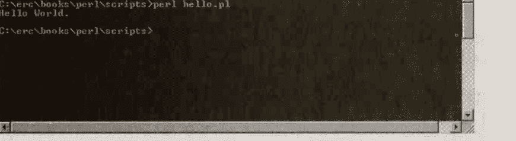

图 1.1 在 MS-DOS 提示符窗口中运行 Perl。

## 深入理解第一个程序

为了让你更好地理解 Perl，我将逐步讲解`hello.pl` Perl 脚本中的每一条语句。

任何以`#`开头的行都表示注释。这种注释对程序执行没有影响。因为 Perl 脚本会先编译成字节码格式然后执行，所以解析注释对程序执行的影响不像对 Bourne shell 脚本或 MS-DOS 批处理文件那样大。

你也可以将`#`放在一行的中间，如下所示：

```
print "Wow.\n";   # This is a comment in a line.
```

从`#`到行末的所有内容都是注释。

> 虽然注释似乎只是为了给你自己看，但我再怎么强调注释的必要性也不为过。注释不仅告诉你 Perl 脚本的预期用途，也告诉其他使用脚本的人脚本的用途。如果你现在写了一个脚本，几个月后再回来看，你会很庆幸当时给脚本的棘手部分添加了注释。

此外，如果脚本中出现问题，注释可以帮助你弄清楚问题区域原本应该做什么，并追踪问题根源。

说教到此为止。Perl 语句以分号`;`结尾。你添加的每条命令都需要在末尾加上分号。

> 你不一定非得坚持一行一条命令。有些命令会跨越多行，有时你也可能想在一行上放置多条命令。Perl 在这方面非常灵活。只要记住，每条命令都以分号结束即可。

### Print 命令

虽然看似非常简单，但`print`命令是 Perl 中最重要的命令之一。稍加思考你就会意识到，通过`print`命令，你可以：

- 告诉用户你的 Perl 脚本正在做什么。这对于长时间运行的脚本非常重要。用户常常没有耐心，并担心脚本或系统运行不正常。
- 向用户询问信息。
- 通过打印仅供你查看的额外信息来帮助追踪问题。
- 生成输出，以便存储在文件中或用于其他目的，例如为网页创建信息的公共网关接口（CGI）脚本。

`print`命令打印出你提供的文本。C 语言程序员会认出特殊序列`\n`，它表示换行。

反斜杠来自 C 语言，是一种转义形式。反斜杠帮助我们解决了区分那些对 Perl 有特殊意义的字符和我们想要打印出来的字符（例如行尾标记（换行）或制表符）的问题。表 1.1 列出了 Perl 中使用的其他反斜杠转义序列。

表 1.1 Perl 中的反斜杠转义序列。

| Perl | 用法 |
| :--- | :--- |
| `\\` | 允许使用反斜杠。 |
| `\"` | 双引号。 |
| `\a` | 响铃。 |
| `\b` | 退格。 |
| `\cN` | 任何控制字符（例如，`\cC`表示`Control-C`）。 |
| `\e` | 转义字符（字符 27）。 |
| `\E` | 结束`\L`或`\U`序列。 |
| `\f` | 换页。 |
| `\l` | 将下一个字符变为小写。 |
| `\L` | 将后续字符变为小写，直到`\E`。 |
| `\n` | 换行。 |
| `\r` | 回车。 |
| `\t` | 制表符。 |
| `\u` | 将下一个字符变为大写。 |
| `\U` | 将后续字符变为大写，直到`\E`。 |
| `\0NN` | 任何八进制数值。 |
| `\xNN` | 任何十六进制数值。 |

## 在 Perl 脚本中获取输入

UNIX 使用正斜杠`/`分隔目录名，而 Windows 使用反斜杠`\`来完成同样的工作。但是，如你所见，反斜杠在 Perl（以及许多其他编程语言）中具有特殊含义。因此，你经常需要使用两个反斜杠的构造`\\`来输入你想要表示的真实反斜杠。

我们的第一个 Perl 脚本`hello.pl`仅仅为用户显示输出。在此基础上，我们的下一个 Perl 脚本将更深入地探讨用户交互，并向用户提出一个问题。

你编写的许多 Perl 脚本都需要从用户那里获取输入——无论通过何种方式。最简单的方法之一是使用`print`命令打印出一个问题，然后从键盘读取答案。（第 12 章将深入探讨使用`Perl/Tk`构建更高级的图形用户界面。）

下一个脚本`asklang.pl`询问用户最喜欢的脚本语言是什么（我们都知道答案，对吧？）。输入以下脚本并将其保存为`asklang.pl`：

```
#
# asklang.pl
#
# Perl script that asks a question and
# gets user response.
#
# Note the extra space to print out.
print "What is your favorite scripting language? ";

$lang = <STDIN>;

chomp($lang);

if ( $lang eq "Perl" ) {
    print "Congratulations, you chose Perl!\n";
```


```
} else {
    print "Well, use $lang if you feel ";
    print "it's the right tool for the job\n";
}
```

运行此脚本时，你会被问到以下问题：

```
What is your favorite scripting language?
```

根据你的回答，你会得到不同的结果，例如：

```
C:\perl> perl asklang.pl
What is your favorite scripting language? Perl
Congratulations, you chose Perl!

C:\perl> perl asklang.pl
What is your favorite scripting language? APL
Well, use APL if you feel it's the right tool for the job
```

如果你没有正确回答问题，它会输出一个讽刺性的回应（这当然是用户界面设计的一个真正进步）。

从第一个`print`命令开始，你会注意到这个`print`语句没有`\n`来表示行尾。这确保了用户的响应会出现在与问题相同的行上。

下一行`$lang = <STDIN>;`引入了 Perl 的变量。

## Perl 变量

与几乎所有计算机语言一样，Perl 允许你将数据存储在变量中。在`asklang.pl`脚本中，`$lang`表示 lang 是一个变量。前导美元符号`$`表示这是一个标量变量，用于保存单个值。

Perl 中的标量包括单个数字或字符串。另一类 Perl 变量——数组变量，允许存储一组数字或文本字符串。例如，文件中的一行文本通常被视为一个标量值，而文件中的所有文本行则被视为一个数组。

要设置变量，请使用`=`运算符，如下所示：

```
# Setting scalar variables.
$var = "Text";
$number_var = 44.5;
# var1.pl
```

你将在第 2 章中看到更多关于 Perl 变量的内容。

## 标准输入

`asklang.pl`脚本从`STDIN`获取用户输入。这个概念来自 UNIX，在 UNIX 中，所有程序都有三个打开的文件：`STDIN`（输入）、`STDOUT`（输出）和`STDERR`（错误输出）。在 UNIX 终端（或终端窗口）中，`STDIN`通常来自你的键盘。在键盘上输入的数据会像来自`STDIN`的文件 ID 一样被发送到应用程序。（UNIX 将几乎所有东西都视为文件。）类似地，`STDOUT`和`STDERR`的文件 ID 与终端的显示相关联。通过`STDOUT`或`STDERR`输出的数据会发送到终端。

> 错误消息被发送到`STDERR`，而正常输出则发送到`STDOUT`。这允许你将命令的输出重定向到文件，同时仍然能在屏幕上看到错误消息。

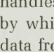

使用 Perl 时，你的程序可以使用`open`命令（参见第 3 章）打开文件（你会经常这样做），或者你可以使用预定义的文件句柄，包括`STDIN`、`STDOUT`和`STDERR`。文件句柄是你的 Perl 脚本访问文件的方式。尖括号`<`和`>`用于从放置在尖括号之间的文件句柄读取数据，例如`<STDIN>`。例如，以下命令从文件（此处为`STDIN`，即键盘）读取一行文本，并将该行文本放入标量变量`lang`中：

```
$lang = <STDIN>;
```

## 使用 If 控制脚本的流程

与几乎所有编程或脚本语言一样，Perl 提供了`if`语句。`if`语句检查某个条件是否为真。如果是，则执行下一个语句或代码块。

从`asklang.pl`脚本中，以下是`if`语句的一个示例：

```
if ( $lang eq "perl" ) {
    print "Congratulations, you chose perl!\n";
}
```

花括号在 Perl 中表示一个代码块，用于将多条语句组合在一起。

> 与 C 语言不同，代码块中必须使用花括号。

你可以扩展`if`语句，使其包含一个`else`代码块。如果条件不是*真*，则执行该代码块。


在`asklang.pl`脚本中，如果你认为 Perl 不是你最喜爱的脚本语言，`else`条件会输出一条中立的`message`（我不想引发语言之争），如下所示：

```perl
if ( $lang eq "Perl" ) {
    print "Congratulations, you chose Perl!\n";
} else {
    print "Well, use $的销量如果你感觉 ";
    print "it's the right tool for the job\n";
}
```

你还可以使用`elsif`检查另一个条件是否为真，如下所示：

```perl
if ( $lang eq "Perl" ) {
    print "Congratulations, you chose Perl!\n";
} elsif ( $lang eq "Tcl" ) {
    print "Tcl is great, too.\n";
} else {
    print "Well, use $lang if you feel ";
    print "it's the right tool for the job\n";
}
```


那是`elsif`，不是`elseif`。这是 Perl 语言的又一个怪癖。

总之，`if`语法如下：

```perl
if (condition) {
  # ...
}
```

```perl
if (condition) {
  # ...
} else {
  # ...
}
```

```perl
if (condition) {
  # ...
} elsif (condition) {
} else {
  # ...
}
```

## If 表达式

`if`语句会计算一个表达式。如果该表达式为真，则执行`if`部分。否则，执行`else`部分或任何`elsif`部分。此处的表达式是`( $lang eq "Perl" )`。如你所料，这会检查`lang`变量中保存的值是否等于字符串`"Perl"`。`eq`运算符执行字符串相等性检查，如果两个字符串相等则返回`1`（真），如果不相等则返回`0`（假）。

Perl 有许多可用于`if`语句的字符串比较运算符，如表 1.2 所示。这些运算符似乎来自 FORTRAN 语言。

### 表 1.2 字符串比较

| Perl | 用法 |
|---|---|
| `eq` | 等于。 |
| `ge` | 大于或等于。 |
| `gt` | 大于。 |
| `le` | 小于或等于。 |
| `lt` | 小于。 |
| `ne` | 不等于。 |
| `cmp` | 如果小于则返回 `-1`，如果等于则返回 `0`，如果大于则返回 `1`。 |

所有字符串比较都是根据字符的数值进行的。例如，大写 A 的 ASCII 值为 65，这使其小于 ASCII 值为 66 的大写 B。

除了字符串比较之外，Perl 还支持使用表 1.3 中所示的运算符进行数值比较。

### 表 1.3 数值比较

| Perl | 用法 |
|---|---|
| `==` | 等于。 |
| `!=` | 不等于。 |
| `<` | 小于。 |
| `<=` | 小于或等于。 |
| `>` | 大于。 |
| `>=` | 大于或等于。 |
| `<=>` | 如果小于则返回 `-1`，如果等于则返回 `0`，如果大于则返回 `1`。 |

C 语言程序员应该能立刻认出这些数值运算符中的大部分。

## Perl 如何运行程序

当 Perl 首次尝试运行脚本时，它会解析整个脚本，将你的命令编译成内部格式，然后从此内部格式执行脚本。因此，脚本中的大多数错误，尤其是语法错误，会在脚本开始运行之前就被报告。这与大多数 UNIX shell 或 MS-DOS 提示符等其他脚本语言非常不同，后者是逐行解析的，并且只在实际执行命令时才报告错误。这通常有助于你提前发现脚本中的错误，但有时错误仍会在此解析阶段未被检测到。

## Perl 脚本的问题

为了展示 Perl 如何检测问题，我们可以在 Perl 脚本中故意制造一个错误。我们在无意中犯的错误可能已经足够多了，不必再故意添加错误，但这个示例应该能帮助你排查 Perl 脚本中不可避免的问题。

最常见的问题之一是在 Perl 命令末尾忘记加分号。为了展示这一点，让我们以之前使用的`asklang.pl`脚本为例，移除`chomp`命令后的分号，如以下`problem1.pl`脚本所示：

```perl
#
# problem1.pl
#
# 提出一个问题并获取用户响应的 perl 脚本。
#
# 此脚本包含一个错误。
# 你的任务是找出这个错误。
#
# 注意打印输出的额外空格。
print "What is your favorite scripting language? ";

$lang = <STDIN>;

# 注意下面缺少的分号。
chomp($lang)

if ( $lang eq "Perl" ) {
    print "Congratulations, you chose Perl!\n";
} else {
    print "Well, use $lang if you feel ";
    print "it's the right tool for the job\n";
}
```

当你运行此脚本时，你会看到以下错误：

```text
syntax error at problem1.pl line 20, near "}"
Execution of problem1.pl aborted due to compilation errors.
```

学习 Perl 时一个非常常见的问题是忘记在每条命令末尾添加分号。如果你这样做，Perl 很可能会报告错误。难点在于，Perl 只在问题真正发生的行*之后*才检测到错误。因此，当 Perl 报告语法错误时，给出的行号通常只是一个参考。错误很可能发生在列出的行之前的某一行。

在`problem1.pl`脚本中，真正的错误是`chomp`命令末尾没有分号。然而，报告的错误似乎出现在`if-else`语句的末尾。

## 了解更多关于 Perl 命令的信息

排查 Perl 脚本中问题的最佳方法之一是查看在线文档。Perl 附带了大量的在线文档。用 UNIX 的术语来说，这些信息以在线手册页的形式存储，可通过 UNIX 的`man`或`xman`命令访问，如图 1.2 所示。

# 第一章 初识 Perl

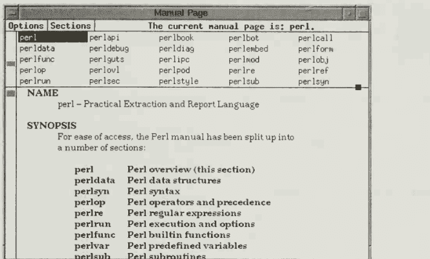

图 1.2 使用`xman`查阅 Perl 文档。

在 Windows NT 上，你需要使用 Web 浏览器，例如 Internet Explorer 或 Navigator，因为 Perl 文档在 Win32 版本的 Perl 中以 HTML（超文本标记语言）文件的形式出现。图 1.3 展示了一个示例。

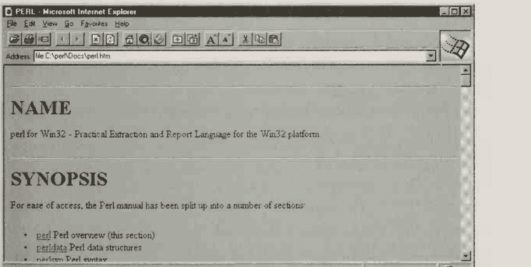

图 1.3 在 Windows 上浏览 Perl 网页。

这些网页在 CD-ROM 的`doc`目录中提供，可用于 UNIX 和 Windows（或任何其他你需要的平台）。


表 1.4 列出了可用的信息主题。

### 表 1.4 Perl 在线参考信息

| `man`主题 | 涵盖内容 |
|---|---|
| `oleauto` | Windows 上的 Perl OLE 自动化（见第 7 章） |
| `perl` | Perl 主要概述 |
| `perlap i` | Perl C 应用程序编程接口和粘合例程 |
| `perlbook` | 部分 Perl 书籍列表（见附录 A） |
| `perlbot` | 面向对象的技巧和示例 |
| `perlcall` | 从 C 调用的约定 |
| `perldata` | 数据结构 |
| `perldebug` | 调试 |
| `perldiag` | 诊断消息 |
| `perlembed` | 如何将 Perl 嵌入你的 C 或 C++ 应用程序 |
| `perlform` | 格式（见第 5 章） |
| `perlfunc` | 内置函数 |
| `perlguts` | 为扩展开发者提供的内部函数 |
| `perlipc` | 进程间通信 |
| `perlmod` | 模块 |
| `perlobj` | 对象 |
| `perlop` | 运算符和优先级 |
| `perlovl` | 重载语义 |
| `perlpod` | 纯旧文档 |
| `perlre` | 正则表达式 |
| `perlref` | 引用和嵌套数据结构 |
| `perlrun` | 执行和选项 |
| `perlsub` | 子程序 |
| `perlsec` | 安全性 |
| `perlstyle` | 风格指南 |
| `perlsyn` | 语法 |
| `perltrap` | 针对粗心者的陷阱 |
| `perlvar` | 预定义变量 |
| `win32` | Perl 的 Win32 问题概述 |
| `win32ext` | Perl 的杂项 Win32 扩展 |

## 将脚本转换为命令

在 Windows 和 UNIX 上，你都可以将 Perl 脚本转换为可从 UNIX`whats`命令行或 Windows 资源管理器执行的命令。不幸的是，UNIX 和 Windows 上的方法有所不同。


**制作可执行脚本：** 在 UNIX 上，几乎所有脚本语言（包括 Perl）都使用`#`字符来标记注释的开始。（某些脚本语言要求`#`在第一列。）在大多数 UNIX shell 脚本中，你通常会在第一行看到一个奇怪的注释：

```sh
#!/bin/sh
```

这个注释告诉命令 shell 你实际运行的环境，通常是`csh`或`ksh`，用哪个程序来执行脚本（在本例中是`/bin/sh`）。这是一种便捷的方式，用于请求以设计该脚本时所针对的解释器来运行 shell 脚本。例如，我使用 C shell（`csh`）进行日常工作，但几乎所有 UNIX shell 脚本都是用 Bourne shell（`sh`）语言编写的。这个初始注释告诉我的`csh`用`sh`来运行该脚本（而不是运行另一个`csh`）。

这只是一个约定，但大多数 UNIX 命令 shell（如`sh`、`csh`和`ksh`）都遵循这一约定。由于这一约定被广泛遵循，你可以利用它让 shell（通常是`csh`或`ksh`）运行 Perl。这样你就可以直接输入 Perl 脚本的名称，如`hello.pl`，让它执行，而无需输入`perl hello.pl`。

要做到这一点，需要形成一个注释，指明你的 Perl 命令的位置，通常是：

```sh
#!/usr/bin/perl
```

你需要将这一行添加到你的 Perl 脚本中，作为文件的第一行。如果你将 Perl 安装在其他位置，则需要更改此注释。一旦放置了起始注释（并且它必须是脚本的第一行），下一步就是让你的 Perl 脚本成为可执行文件。在 UNIX 中，可执行文件是指你可以将其文件名作为命令输入的文件。为此，使用`chmod`命令：

```sh
chmod +x hello.pl
```

你现在应该能够从 UNIX 命令行执行你的脚本：

```sh
hello.pl
```

如果你遇到任何问题，你的命令 shell 可能不支持这一约定。如果是这样，你可能会遇到许多错误，因为 Perl 命令与大多数 UNIX shell 命令不兼容（有些兼容，如果将 Perl 脚本作为 Bourne shell 脚本执行，可能会导致有趣的结果）。

这个特殊的首行注释有一个主要问题：某些系统，尤其是惠普的 HP-UXelson，只允许路径中有 32 个字符。因此，像`/usr5/local /perl/src/perl5.002/bin`这样的长路径将无法工作。

**双击启动 Perl 脚本：** 在 Windows 上，你可以使用**资源管理器**将 Perl 与你的脚本关联起来。最简单的方法是为你的 Perl 脚本遵循一致的命名约定。Windows 最喜欢你使用一致的后缀，例如`*.pl`，来命名所有 Perl 脚本。

在**资源管理器**中，选择一个 Perl 脚本文件，例如`hello.pl`。然后，从文件菜单中选择**打开方式**。如果 Perl 出现在应用程序列表中，选择它。否则，**其他**按钮将允许你浏览硬盘并找到 Perl 可执行文件（`perl.exe`）。找到 Perl 后，选择它并确保设置了始终使用 Perl 打开该文件的标志。

图 1.4 显示了选择 Perl 的窗口。

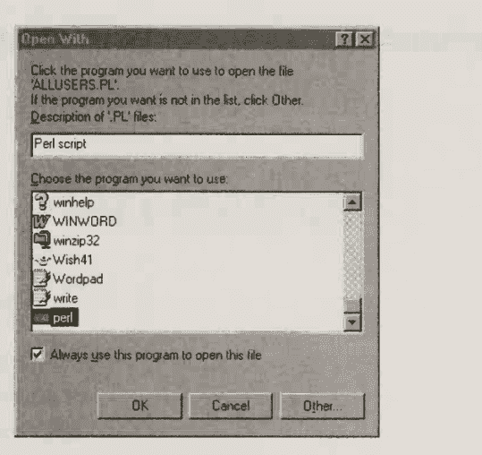

图 1.4 将 Perl 与 Perl 脚本关联。

在较旧的**程序管理器**中，你可以创建一个程序图标来启动 Perl 和你的脚本。

## 小结

Perl 脚本是包含 Perl 命令的文本文件，其中最简单的是`print`命令，它允许你向用户输出数据。

`print`命令向用户输出数据。你可以通过从`<STDIN>`读取输入到变量中来获取用户的响应。

Perl 用前导`$`表示变量，例如`$var`。`if`语句允许你控制 Perl 脚本的流程。你将在第 2 章中看到许多其他语句，例如`while`和`for`。

通过本章，你现在已经成为了一名多才多艺的 Perl 爱好者。在第 2 章中，我们将涵盖更多关于变量、标量和数组数据的内容，并充实 Perl 的基础知识。

## 本章介绍的 Perl 命令

- `chomp`
- `chop`
- `if`
- `print`

# 第二章

## Perl 基础

本章涵盖：

- 控制脚本
- 数学运算
- 文本操作
- 变量和数组
- 标量变量
- 关联数组
- 内置变量
- 访问命令行参数
- 子程序

## 你需要了解的 Perl

Perl 的语法看起来任意复杂、缩写且晦涩。即便如此，学习一些简单的基础知识就能让你快速上手，并利用 Perl 的大部分功能。

在本章中，我们将学习 Perl 语言的基础知识，扩展第一章中对 Perl 的介绍。

## 控制 Perl 脚本

除第一章介绍的`if`语句外，Perl 还提供了许多其他命令来控制脚本的流程。`while`命令在条件为真时循环：

```perl
while (condition) {
    # ...
}
```

例如：

```perl
# while 语句示例。
$i = 0;
while ($i < 10) {
    print "Iteration $i.\n";
    $i++;
}
# while1.pl
```

> **警告：** 务必确保你的`while`循环最终会终止。你需要自己想出办法。最常见的方法是每次循环迭代时递增或递减变量，如前所示。

你可以用`until`语句来反转测试：

```perl
until (condition) {
    # ...
}
```

使用`until`时，你需要确保测试设置正确，如下所示：

```perl
# until 语句示例。
$i = 0;
```

```perl
#
# Note reversed test.
#
until ($i >= 10) {
    print "Iteration $i.\n";
    $i++;
}
# until.pl
```

这种`until`的用法与 C 甚至 Pascal 的做法不同。

`unless`语句是`if`的反面，除非条件为真，否则执行一个代码块。

```perl
unless (condition) {
    # ...
}
```

或者：

```perl
unless (condition) {
    # ...
} else {
    # ...
}
```

你可以使用`for`循环来循环指定次数，如下所示：

```perl
for (initialization; expression; continue) {
    # ...
}
```

*initialization*部分首先执行，通常将循环变量初始化为零或 1。*expression*在每次循环迭代时进行检查。如果为真，`for`再次迭代。*continue*在循环结束时执行，就在`expression`再次求值之前。`continue`部分通常递增控制循环的变量。

这个`for`循环直接来自 C。要让一个循环迭代 10 次，你可以遵循 C 语言的习惯：

```perl
# Example of the for statement.
for ($i = 0; $i < 10; $i++) {
    print "Iteration $i.\n";
}
# for1.pl
```

请注意，与`while`和`until`语句不同，使用`for`时你不需要递增控制循环的变量，本例中是`$i`。`for`语句在循环顶部有专门的部分用于此操作。

与`for`类似，`foreach`语句让你可以遍历列表或数组中的每个元素：

```perl
foreach variable (list) {
    # ...
}
```

每次循环时，`foreach`将列表中的一个元素放入标量变量，重复直到列表中的所有元素都已处理完毕。例如：

```perl
# Example of foreach.
@languages = ("Perl", "Tcl", "Java", "Oberon", "python");

foreach $lang (@languages) {
    if ($lang eq "Perl") {
        print "The most wonderful language is $lang.\n";
    } else {
        print "$lang has some neat ideas.\n";
    }
}
# foreach.pl
```

运行此脚本时，你将看到以下输出：

```text
The most wonderful language is Perl.

Tcl has some neat ideas.
```


Java has some neat ideas.

Oberon has some neat ideas.

Python has some neat ideas.

你也可以将`..`运算符与`foreach`一起使用，它从最小值到最大值进行遍历，如下所示：

```perl
# Example of foreach from a min to a max.
foreach $i (5..10) {
    print "$i\n";
}
# foreach2.pl
```

有关`foreach`的更多示例，请参阅本章后面关于数组的部分。

## 继续

Perl还允许使用一种特殊的`continue`块。在循环中，`continue`块在条件再次求值之前执行，如下所示：

```perl
while (condition) {
    # ...
} continue {
    # ..
}
```

例如，下面的`while`循环与`while1.pl`示例等价：

```perl
# Example of while with continue.
$i = 0;
while ($i < 10) {
    print "Iteration $i.\n";

} continue {

    $i++;
}
# while2.pl
```

通常，你在`continue`块中递增变量。你也可以在主块内部递增变量，如前面`while1.pl`示例所示。`continue`块的存在原因是Perl额外的流程控制语句。

## 额外流程控制

表2.1列出了一些额外的流程控制命令。

### 表2.1 额外的Perl流程控制命令

| 命令 | 用法 |
| :--- | :--- |
| `goto label` | 跳转到指定的`label`。 |
| `last` | 跳出当前最内层循环。 |
| `last label` | 在`label`处跳出当前循环。 |
| `next` | 开始循环的下一次迭代。 |
| `next label` | 在`label`处开始循环的下一次迭代。 |
| `redo` | 重新启动循环，不重新评估条件。 |
| `redo label` | 重新启动`label`循环，不重新评估条件。 |

> **Goto被认为有害：**早在1966年，一位名叫Edsger Dijkstra的计算机科学家因一封抨击`goto`命令使用的信件而成名。由于`goto`允许控制流跳转到任何地方，这使得任何类型的程序，包括Perl脚本，都难以调试和维护。幸运的是，Perl让你能够重新审视这一古老的争论并证明它是错误的。

你可以在大多数循环和流程控制语句的开头插入标签，如表2.2所示。

### 表2.2 Perl流程控制简介

| 命令 |
| :--- |
| `if (condition) { } elsif (condition) { } else { }` |
| `unless (condition) { } else { }` |
| `label: while (condition) { } continue { }` |
| `label: until (condition) { } continue { }` |
| `label: for (initialization; expression; continue) { }` |
| `label: foreach variable (list) { }` |
| `label: { } continue { }` |
| `do { } while condition;` |
| `do { } until condition;` |
| `do { }` |

表2.2中命令的大多数部分，如`continue`块，都是可选的。

> 令人惊讶的是，Perl没有`switch`语句；Perl拥有其他可以想象到的一切。原因是你可以自由地以任何多种方式实现`switch`，如Perl在线文档所示。（这是一个引子，吸引你去查看全面的Perl在线信息。）

## 后置修饰符

在另一个奇怪的转折中，你可以通过反转`if`语句的语法来在条件为真时执行简单的Perl语句：

```perl
statement; if condition;
```

你也可以对`unless`、`while`和`until`这样做：

```perl
statement; unless condition;
statement; while condition;
statement; until condition;
```

使用这种结构，除非满足条件，否则Perl不会执行语句，遵循前面已经展示过的每个`if`、`unless`、`while`和`until`的规则。

你也可以在语句中使用逻辑运算符，尽管这会导致Perl命令看起来很奇怪，如下所示：

```perl
# Test of open and die.
$filename = "nofile";

open(TMP, $filename)
    or die "Can't open \"$filename\"";
# opendie.pl
```

`or`部分允许在主部分失败时执行语句，在本例中是`open`命令无法打开文件时。`or`部分经常使用Perl的另一种`or`语法`||`。`die`命令退出Perl脚本，并向`STDERR`打印错误消息。

Perl不需要换行符`\n`来结束传递给`die`命令的消息，因为`die`会在你的消息后追加额外信息以及一个换行符。如果你在消息中放置换行符，`die`将不会打印额外信息。

有关打开文件的更多内容，请参阅第3章。

流程控制构成了Perl的基础之一。你还需要了解数学和文本操作。

## 数学

与大多数计算机语言一样，Perl提供了一些数学运算符，其中主要的列在表2.3中。

### 表2.3 数学运算符

| 运算符 | 结果 |
| :--- | :--- |
| `$var + value` | `$var`和`value`相加。 |
| `$var - value` | `$var`减去`value`。 |
| `$var * value` | `$var`乘以`value`。 |
| `$var / value` | `$var`除以`value`。 |
| `$var % value` | `$var`除以`value`，只使用余数。 |
| `$var ** value` | 返回`$var`的`value`次方。 |

Perl还提供了一些赋值运算符，C程序员会非常熟悉这些运算符。表2.4列出了这些赋值运算符。

### 表2.4 赋值运算符

| 运算符 | 结果 |
| :--- | :--- |
| `$var = value` | `$var`设置为`value`。 |
| `$var += value` | `$var`增加`value`。 |
| `$var -= value` | `$var`减少`value`。 |
| `$var++` | 求值后`$var`增加一。 |
| `++$var` | 求值前`$var`增加一。 |
| `$var--` | 求值后`$var`减少一。 |
| `--$var` | 求值前`$var`减少一。 |

尽管Perl是一种解释型语言，但它的数学运算往往非常高效，因为Perl脚本在执行之前会被编译为内部字节码。这意味着数学运算往往比严格解释型语言执行得快得多，在严格解释型语言中，每条语句在执行期间都是逐条解析的。

即便如此，如果你打算进行大量计算，Perl可能不是合适的工具。另一种计算机语言，如C++或FORTRAN，会更加合适。

# 第2章 Perl基础

## 浮点数

Perl中的所有数学运算都是在双精度浮点数值上执行的（通常为64位）。即使您使用如下简单语句，Perl仍然会将该值设为浮点数，而不是使用整数：

```perl
$i = 1;
```

对于这种简单值，整数运算效率更高。如果您想使用整数运算，可以在代码块中（代码块从起始花括号`{`到结束花括号`}`）放置以下语句：

```perl
use integer;
```

例如：

```perl
#
# use integer 示例。
#
do {
    # 仅在代码块内使用整数运算。
    use integer;
    for ($i = 0; $i < 10; $i++) {
        print "$i\n";
    }
}
```

# useint.pl

您可以在内部代码块中嵌套这些命令，如前面的`do`代码块所示。这会强制使用整数运算直到代码块结束。如果您想在代码块内禁用整数运算，可以使用以下语句：

```perl
no integer;
```

`no integer`命令会关闭整数运算，直到代码块结束。

# 十六进制和八进制数

与C语言一样，Perl允许您以十六进制或八进制格式表示数字。以0开头的整数是八进制数。以`0x`（或`0X`）开头的整数是十六进制数。与C一样，Perl使用字母A到F来表示（十进制的）10到15。例如：

```perl
# 十六进制和八进制数
$hex = 0xFF;
$octal = 010;

print "0xFF = $hex, 010 = $octal.\n";

# hex.pl
```

## 数学函数

Perl提供了许多数学函数，例如`abs`用于求绝对值，`cos`用于求余弦。有关这些命令的完整列表，请参阅`perlfunc`在线文档。

## 文本操作

除了数学运算外，Perl还提供了非常强大的文本操作功能。这很大程度上源于Perl在UNIX系统管理中的背景，因为对管理员来说很重要的数据通常都存储在文本文件中。通常，文本文件中的每一行是一条信息记录。系统密码文件（`/etc/passwd`或其变体）为每个用户包含一行文本。每行被划分为多个字段（用户名、真实姓名、账户主目录等）。Perl非常擅长处理这种格式的数据文件。

## 单引号与双引号的区别

Perl使用单引号或双引号来标识文本字符串的起始和结束。这告诉Perl您的Perl命令在哪里结束，字符串从哪里开始。

您可以使用单引号或双引号。Perl区分由单引号或双引号包围的字符串，`'`或`"`。差异很微妙。

### 单引号

单引号字符串，例如`'hello world'`，其适用范围远小于Perl的双引号字符串，如`"hello world"`。原因是Perl对单引号字符串中的内容解释较少。在单引号字符串中：

- `\n`是两个字符，一个反斜杠和`n`。
- `\'`（用于嵌入的单引号）和`\\`（用于嵌入的反斜杠）是仅有的允许的转义序列。

文本中可以包含真正的换行符，如下所示：

```perl
'line 1
line 2'
```

- 变量值不会被替换，所以`'$var'`仅仅是一个美元符号和字母`var`。

### 双引号

双引号字符串比单引号字符串提供了更多功能；例如：

- 您可以使用完整的转义序列，例如`\t`表示制表符，`\n`表示换行符，如表2.5所示。
- 您可以替换变量的值，例如`$var`。
- 您还可以在字符串中嵌入换行符，这与单引号字符串相同：

```perl
"line 1
line 2"
```

**表2.5** Perl中的转义序列。

| Perl | 用途 |
| :--- | :--- |
| `\\` | 允许使用反斜杠。 |
| `\"` | 双引号。 |
| `\a` | 响铃。 |
| `\b` | 退格。 |
| `\cN` | 任意控制字符（例如，`\cC`表示Control-C）。 |
| `\e` | 转义字符（字符27）。 |
| `\E` | 结束`\L`或`\U`序列。 |
| `\f` | 换页。 |
| `\l` | 使下一个字符小写。 |
| `\L` | 使后续字符小写，直到`\E`。 |
| `\n` | 换行。 |
| `\r` | 回车。 |
| `\t` | 制表符。 |
| `\u` | 使下一个字符大写。 |
| `\U` | 使后续字符大写，直到`\E`。 |
| `\0NN` | 任意八进制数值。 |
| `\xNN` | 任意十六进制数值。 |

因此，当您创建Perl脚本时，使用您想要的引号并了解`'`和`"`之间的区别非常重要。我尽可能坚持使用双引号，以避免混淆。

### 引号的问题

如果您的数据中已经有引号，您可以使用特殊的`q`运算符之一来创建包含引号的字符串。

单个`q`创建单引号字符串：

```perl
$var = q('Single-quoted string.');
print "$var\n";
```

这并不十分有趣，除非您可以更改定界符：

```perl
$var = q~String with "double" and 'single' quotes~;
print "$var\n";
# q.pl
```

> 前面的示例使用波浪号字符`~`作为单引号字符的替代。这允许您的输入数据包含单引号或双引号。

`qq`运算符对双引号字符串执行相同操作：

```perl
# Q 运算符示例（参见《星际迷航》）。
# 双引号
$var = qq("Double-quoted string.");
print "$var\n";

$var = qq~String with "double" and 'single' quotes~;
print "$var\n";
# qq.pl
```

## 字符串函数

Perl提供了大量的字符串函数。

`length`函数返回字符串中的字符数：

```perl
$str_length = length($string);
```

例如：

```perl
# 确定字符串长度。
$string = "This is a string";
$str_length = length($string);

print "The length of \"$string\" is $str_length.\n";
# length.pl
```

`chr`函数返回给定数值对应的字符，使用US ASCII：

```perl
$letter = chr($value);
```

例如：

```perl
# 将数值转换为字符。
$letter = chr(69);

print "Letter is $letter.\n";
# chr.pl
```

### 小写和大写

您可以使用`uc`函数将字符串从小写转换为大写：

```perl
$lower = "all lowercase";
$upper = uc($lower);
print "$upper\n";
```

您可以反向操作，使用`lc`函数将字符串转换为全小写：

```perl
$upper = "ALL UPPERCASE";
$lower = lc($upper);
print "$lower\n";
```

如果您使用多个平台，尤其是Windows和UNIX，您经常需要将文件名从大写转换为小写，或反之。

> UNIX、Windows 95和Windows NT中大小写敏感，但Windows 3.1中不敏感。

### 在字符串中搜索

`index`函数返回子字符串在字符串中首次出现的位置：

```perl
$start = index($string, $look_for);
```

例如：

```perl
# 使用 index 查找子字符串。

$look_for = "then";
$start = index("First A, then B", $look_for);

print "$look_for starts at $start\n";
# index.pl
```

变量`$start`获取字符串`"then"`所在的字符位置。

如果您打算搜索字符串中的多次出现，可以使用可选的起始位置：

```perl
$start = index($string, $look_for, $start_position);
```

您可以使用`rindex`从字符串末尾开始搜索：

```perl
$start = rindex($string, $look_for);
$start = rindex($string, $look_for, $start_position);
```

您经常将`index`和`rindex`与`substr`一起使用，`substr`从字符串中返回子字符串。使用`index`或`rindex`找到您想要的数据的起始位置，然后使用`substr`提取它。`substr`函数的参数如下：

```perl
$new_string = substr($string, $offset, $length);
```

`substr`函数返回一个新字符串，从`$string`中的`$offset`开始，长度为`$length`个字符。如果省略`$length`，`substr`返回从`$offset`到字符串末尾的子字符串。

以下示例从字符串`"Give me liberty..."`中提取单词`liberty`，如后面的`substr1.pl`脚本所示：

```perl
# 提取子字符串。

$string = "Give me liberty...";

$new_string = substr($string, 8, 7);

print "Substring is \"$new_string\".\n";

# substr1.pl
```

你也可以使用`substr`反向提取子串。如果偏移量为负数，`substr`会从字符串末尾开始计数。在下面的示例中，从字符串末尾提取了单词`Three`：

```perl
# 提取子串。

$string = "One Two Three";

$new_string = substr($string, -5);

print "Sub-string is \"$new_string\".\n";

# substr2.pl
```

Perl还提供了许多其他字符串和文本函数。更多内容请参阅`perlfunc`的在线文档。此外，第3章涵盖了Perl对文件的操作和处理从文件读入的文本。第4章介绍了使用搜索模式和正则表达式来解析从文件读入的数据。

## 字符串操作符

你可以使用Perl的字符串操作符来组合字符串，如表2.6所示。

**表2.6** 字符串操作符。

| 操作符 | 结果 |
| :--- | :--- |
| `$s1 . $s2` | 返回`$s2`连接到`$s1`末尾的结果。 |


| `$s1 x $value` | 返回 `$s1` 重复 `$value` 次的结果。 |
|---|---|
| `$s1 .= $s2` | 将 `$s2` 追加到 `$s1` 末尾。 |

你可以使用以下示例来尝试 x 次重复模式：

```perl
#
# 将字符串重复 x 次。
#
$s1 = "Value";
$s1 = $s1 x 10;

print "$s1\n";

# repeat.pl
```

## 变量和数组

Perl 变量允许你存储文本、数字或两者的列表。Perl 试图隐藏任何形式的限制，例如字符串变量可以容纳你系统虚拟内存所能容纳的任意多文本。与其他所有 Perl 变量一样，字符串变量会根据需要自动增长。

Perl 的变量分为三大类：标量、数组和关联数组。Perl 根据变量名的第一个字符 `$`、`@` 或 `%` 来区分变量类型，如表 2.7 所示。

**表 2.7** 如何区分 Perl 中的变量。

| 语法 | 含义 |
|---|---|
| `NAME` | 文件句柄或目录句柄，参见第 3 章。 |
| `$NAME` | 一个标量变量。 |
| `@NAME` | 一个按位置编号索引的数组。 |
| `%NAME` | 一个按字符串索引的关联数组。 |
| `&NAME` | 调用子程序 `NAME`。 |
| | 所有名为 `NAME` 的东西。 |

### 标量变量

标量变量保存单个值，可以是文本字符串或数字。你可以将同一个变量设置为保存文本或数字数据，并且可以通过将字符串变量设置为数字来切换，反之亦然。

## 数组

除了标量变量，Perl 还支持列表和数组。列表就是一组有序的标量值——文本、数字或两者的组合。

数组是一个命名的列表。当你使用数组变量时，你使用的是 `@` 字符，而不是 `$`，如下所示：

```perl
# 数组示例。
@array = (1,2,3,'red');
print "@array\n";

# array1.pl
```

运行此脚本时，你会看到以下输出：

```text
1 2 3 red
```

你可以在 Perl 列表和数组中自由混合搭配数字和文本。

`(1,2,3, 'red')` 展示了 Perl 将数据放入列表的语法。随后的命令将一个数组变量 `@array` 设置为该列表的值，即列表中的所有元素。

空列表表示为括号内没有任何内容：

```perl
() # 空列表。
```

数组的每个元素都只是一个标量值，你可以使用 Perl 标量的语法 `$` 加上数组索引来访问它。例如：

```perl
# 访问
print "$array[1]\n";

# 赋值。
$array[2] = 'maroon';
```

与 C 和 C++ 类似，Perl 的数组索引从 0 开始计数。因此，1 代表数组的第二个元素。

> **注意**
>
> 1. 引用数组元素时始终使用 `$`。
> 2. 引用整个数组时使用 `@`。

# 第 2 章 Perl 基础

Perl 将 `@array` 和 `$array` 视为完全不同的值，彼此之间没有关系。更令人困惑的是，`$array[value]` 指的是 `@array` 的一个元素，而不是 `$array`。因此，我尽量避免在标量上下文和数组上下文中使用相同的名称。

你可以在列表和数组中放置标量变量，如下面的示例所示：

```perl
# 第二个数组示例。
$element = "Ouch";
@array = ($element, 1, 2, 3, 4);
print "@array\n";

# array2.pl
```

你还可以使用一种奇特的语法将列表中的元素设置为等于另一个列表中的相应元素。这导致了一些看起来奇怪但非常有用的 Perl 命令。例如：

```perl
# 第三个数组示例。
($one, $two, $three) = (1..3);
print "$one $two $three\n";

($array[0], $array[1], $array[2]) = (1,2,3,'red');
print "@array\n";

# array3.pl
```

要确定数组中的元素数量，请使用 `$#array` 语法，如下所示：

```perl
# 数组长度。

@array = (1,2,3,4,5,6,7,8,9);

print "@array\n";

$number = $#array + 1;
print "Number elements: $number.\n";

# arraylen.pl
```

> `$#array` 的值是最后一个元素。由于元素从 0 到 `$#array`，总数是 `$#array` 加 1。

### 切片操作

你可以使用以下语法从数组中“切片”出一部分，形成一个子数组：

```perl
# 对数组进行切片。
@array = (1,2,3,'red');

# 获取数组的一部分。
@array[0,1,2] = ('green', 'blue', 'orange');
print "@array\n";
```

```text
# slice.pl
```

### 拼接操作

`splice` 命令允许你对数组进行“拼接”。也就是说，`splice` 允许你用新元素替换数组中的现有元素。基本语法如下：

```perl
splice(@array, $offset, $length, $replace1, $replace2, ...);
```

`splice` 函数从 `@array` 中的 `$offset` 位置开始移除 `$length` 个元素。（如果省略 `$length`，则 `splice` 会从 `$offset` 开始移除所有元素直到末尾。）如果你提供了替换值，这些值将从 `$offset` 位置开始插入，替换被移除的元素。

# 第 2 章 Perl 基础

你不需要替换与你移除的元素数量相同的元素。

大多数参数都是可选的。

由于 `splice` 的用法可能比较晦涩，几个例子可能会有所帮助。

```perl
# splice 在数组上的用法。

@array = (1,2,3,4,5,6,7,8,9);

print "@array\n";

# 从位置 7 开始移除元素。

$offset = 7;
splice(@array, $offset);
print "@array\n";

# 仅移除第一个元素并保存它。
$offset = 0;  # 第一个元素
$length = 1;
($first) = splice(@array, $offset, $length);
print "@array\n";
print "First element: $first\n";

# 替换第二个和第三个元素。
$offset = 1;
$length = 2; # 两个元素。
splice(@array, $offset, $length, 99, 98, 97, 96);
print "@array\n";

# splice.pl
```

运行此脚本时，你会看到 `@array` 的以下变化：

```text
1 2 3 4 5 6 7 8 9
1 2 3 4 5 6 7
2 3 4 5 6 7
First element: 1
2 99 98 97 96 5 6 7
```

`Splice` 会返回它移除的元素。如果你愿意，可以将这些数据存储在变量中，如 `splice.pl` 脚本所示。

### 其他数组命令

`reverse` 命令反转列表中元素的顺序，返回新列表。例如：

```perl
# 反转数组中的元素。
@array = (1,2,3,'red');
print "Before: @array\n";

@array = reverse(@array);
print "After: @array\n";

# reverse.pl
```

`sort` 命令对数组进行排序：

```perl
# 对数组中的元素进行排序。

@array = ('red', 'green', 'blue', 'orange', 'maroon');
print "Before: @array\n";

@sorted = sort(@array);
print "After: @sorted\n";

# sort.pl
```

`sort` 还有更多功能，包括传递你自己的子程序来进行排序。有关此命令的更多信息，请参阅在线文档。

# 第 2 章 Perl 基础

## 关联数组

Perl 中最有趣的发展之一就是关联数组。我们已经介绍过的常规数组允许你通过从零开始的索引号访问元素。而关联数组则允许你通过键名访问元素。也就是说，关联数组保存一组键/值对。

*键名* 可以是任何任意的标量值，例如 `"HOME"`、`"USERNAME"` 或任何你想要使用的值。

关联数组对于存储项目属性非常有用，尤其是当你事先不知道一个项目会有多少属性时。例如，如果用户可以自定义应用程序，可能需要存储的属性包括前景色、背景色、字体名称、起始目录和系统文件目录路径。用户可以自定义其中任意、所有或没有这些属性。这类任务非常适合使用关联数组。

Perl 使用百分号 `%` 来表示一个变量是关联数组。因此，`%assoc` 代表一个名为 `assoc` 的关联数组变量。

要访问关联数组中的单个值，你需要使用不同的语法。关联数组中的任何值都可以通过其键名使用以下语法访问：

```perl
%assoc{keyname}
```

例如：

```perl
# 关联数组。
$assoc{"Name"} = "Grover Cleveland";
$assoc{23} = 365;
$assoc{123.45} = "Hello world";

$key = 123.45;
print "Element 123.45: $assoc{$key}\n";
$key = "Name";
print "Element Name: $assoc{$key}\n";

# assoc1.pl
```

正如你所见，任何标量值都可以作为键名使用。

与数组一样，`%array`、`$array` 和 `@array` 指的是不同的变量，所以要注意区分。

关联数组本身没有特定的值，因此尝试打印关联数组不会有什么帮助。此外，Perl 会以它想要的任意顺序存储关联数组（大概是一种能让 Perl 最高效访问数组元素的顺序）。那么，如果你有一个关联数组，但不知道数组中的所有内容，该如何提取值呢？为此，Perl 提供了 `keys` 运算符。

`keys` 运算符返回关联数组中所有键名的列表。然后你可以遍历这个列表来提取所有的键名，如下所示：

```perl
# Associative array keys.

$assoc{"Name"} = "Grover Cleveland";
$assoc{"Address"} = "1600 Penn.";
$assoc{"City"} = "Washington";

@key_names = keys(%assoc);

print "Key names are: @key_names\n\n";

# Now, access each Element from the list.

foreach $key (@key_names) {
    print "$key holds $assoc{$key}\n";
}

# keys.pl
```

当你运行 `keys.pl` 脚本时，键的顺序可能不是你输入值的顺序。

与 `keys` 运算符类似，`values` 运算符允许你提取关联数组的所有值，其顺序与 `keys` 返回键名的顺序相同，如下所示：

```perl
# Associative array values.

$assoc{"Name"} = "Grover Cleveland";
$assoc{"Address"} = "1600 Penn.";
$assoc{"City"} = "Washington";

@values = values(%assoc);

print "Values are: @values\n\n";

# values.pl
```

由于关联数组中的所有值都以键/值对的形式存储，你可以使用 `each` 运算符从数组中逐个元素地提取键/值对。例如：

```perl
# Associative array access with each.

$assoc{"Name"} = "Grover Cleveland";
$assoc{"Address"} = "1600 Penn.";
$assoc{"City"} = "Washington";

# Access each element with each.

while ( ($key,$value) = each(%assoc) ) {
    print "Key: $key \t Value: $value\n";
}

# each.pl
```

在 `each.pl` 脚本中，`each` 运算符返回的列表被分解为单独的标量变量 `$key` 和 `$value`。如果你愿意，也可以直接将 `each` 返回的列表作为一个列表来使用。

# 第 2 章 Perl 基础

除了 `each` 之外，你还可以将整个关联数组赋值给一个普通数组，以获取所有键/值对的列表，如下所示：

```perl
# Associative array to normal array.

$assoc{"Name"} = "Grover Cleveland";
$assoc{"Address"} = "1600 Penn.";
$assoc{"City"} = "Washington";

@array = %assoc;

print "As array: @array\n";

# assoc2.pl
```

`delete` 运算符从关联数组中删除键/值对。要使用 `delete`，你需要指定要删除的值。例如：

```perl
# Deleting associative array elements.

$assoc{"Name"} = "Grover Cleveland";
$assoc{"Address"} = "1600 Penn.";
$assoc{"City"} = "Washington";

# Print keys before.
@key_names = keys(%assoc);

print "Key names are: @key_names\n\n";

delete $assoc{"Address"};

# Print keys after.
@key_names = keys(%assoc);

print "Key names now: @key_names\n\n";

# delete.pl
```

# 第 2 章 Perl 基础

要判断给定的键名是否存在于关联数组中，可以使用 `exists` 运算符：

```perl
if ( exists($assoc{$key}) ) {
    # ...
}
```

## 环境关联数组

最有用的关联数组之一是 `%ENV`，它保存着系统中的环境变量。这些变量在 UNIX 和 Windows 上都受支持，提供了许多由用户（或为用户）设置的与计算机环境相关的值。例如，在 UNIX 上，`SHELL` 环境变量保存着用户期望使用的命令行 shell 程序，如 C shell 的 `/bin/csh`。

使用 `keys` 运算符，你可以轻松访问 `%ENV` 关联数组并查看系统上有哪些可用的环境变量。输入以下脚本并在你的系统上试一试：

```perl
# Access environment variables.

@key_names = keys(%ENV);

print "Key names are: @key_names\n\n";

# Now, access each element from the list.

foreach $key (@key_names) {
    print "$key=$ENV{$key}\n";
}

# env.pl
```

在 Linux 系统上，你会看到大量输出，包括以下内容（已编辑以节省篇幅）：

```text
HOSTTYPEgoto=i486-linux
LOGNAME=erc
OSTYPE=linux
WINDOWID=29360141
SHLVL=1
OPENWINHOME=/usr/openwin
MANPATH=/usr/local/man:/usr/man/preformat:/usr/man:/usr/X11/man:/usr/openwin/man
LESSOPEN=|lesspipe.sh %s
HOME=/home/erc
PWD=/home/erc/perl/book/scripts
DISPLAY=:0.0
LESS=-MM
SHELL=/bin/csh
TERM=xterm
MACHTYPE=i386
HOST=yonsen
ignoreeof=10
HOSTNAME=yonsen.yonsen.org
USER=erc
```

在 Windows 95 系统上，你会看到类似以下的内容：

```text
WINBOOTDIR=C:\WINDOWS
TMP=C:\WINDOWS\TEMP
PROMPT=$p$g
TEMP=C:\DOS
SOUND=C:\MOZART
COMSPEC=C:\WINDOWS\COMMAND.COM
CMDLINE=perl env.pl
BLASTER=A220 I5 D1 T4
PATH=C:\WINDOWS;C:\WINDOWS\COMMAND;C:\DOS;C:\PERL\BIN;
WINDIR=C:\WINDOWS
```

在 Windows NT 上，你会看到更多有用的值：

```text
USERNAME=erc
PROMPT=$P$G
```

# 第 2 章 Perl 基础


```text
PROCESSOR_IDENTIFIER=x86 Family 5 Model 2 Stepping 11, GenuineIntel
PROCESSOR_ARCHITECTURE=x86
OS=Windows_NT
HOME=C:/users/default
ComSpec=C:\WINNT35.0\system32\cmd.exe
windir=C:\WINNT35.0
Path=.;C:\perl\bin;c:\mksnt\mksnt;C:\WINNT35.0\system32;C:\WINNT35.0;c:\l
ocal\bin;c:\msvc20\bin
temp=C:\temp
PROCESSOR_LEVEL=5
Os2LibPath=C:\WINNT35.0\system32\os2\dll;
HOMEDRIVE=c:
ROOTDIR=c:/mksnt
include=c:\msvc20\include;c:\msvc20\include\gl;%include%
CPU=i386
SystemRoot=C:\WINNT35.0
PROCESSOR_REVISION=020b
TMPDIR=C:/temp
COMPUTERNAME=YONSEN
tmp=C:\temp
HOMEPATH=\users\johnsone
LIB=c:\msvc20\lib
SystemDrive=C:
```

注意，Windows NT 和 UNIX 系统往往具有相似的环境变量，例如 `HOME`。NT 有一个 `USERNAME` 环境变量，而 UNIX 则倾向于使用 `USER`。

## 内置变量

Perl 提供了大量的内置变量，大多数具有非常奇怪的语法，例如 `$_`，这是默认的输入和模式匹配变量。像 `$_` 这样的变量存在的原因是为了让你能够编写极简的 Perl 脚本，比如下面的 `minimal.pl` 脚本：

```perl
#
# minimal.pl
# One of the most minimal scripts
# in perl, using $_ to effect.
#
# This script prints out all
# files listed on the command line.
#
while (<>) {    # From <ARGV>
    print;  # Prints $_
}
```

`minimal.pl` 脚本依次打开每个文件，因为 `<>` 是 `<ARGV>` 的简写，而 `<ARGV>` 又是将每个命令行参数视为文件名的简写。当文件打开后，它会读取文件的内容。

默认情况下，`print` 打印隐藏变量 `$_` 的值。你几乎总是想避免使用 `$_`，而是直接指定要打印的数据，因为使用隐藏变量往往会使你的 Perl 脚本更难理解。前面的脚本展示了 Perl 在 awk 和系统管理社区中的根源。你可以编写非常小巧的极简 Perl 脚本来完成很多事情；然而，除非你是 Perl 专家，否则很难弄清楚脚本要做什么，正如 `minimal.pl` 所说明的那样。

下面是该极简脚本的一个扩展版本：

```perl
#
# minimal2.pl
# A Slightly longer minimalist perl script.
#
# This script prints out all
# files listed on the command line.
#
while (<ARGV>) {
    print $_;
}
```

前面的脚本清楚地指出了数据的来源，但仍然没有显示文件是如何被打开和读取的。有关文件的更多信息，请参阅第 3 章。

## 命令行参数

前面的极简 Perl 脚本引入了 `ARGV` 的概念，这对 C 程序员来说应该很熟悉。Perl 中的 `ARGV` 代表命令行参数，即你在命令行中放置的额外值。你可以以不同的方式使用 `ARGV`。

`<ARGV>` 代表打开命令行上按名称列出的每个文件。`@ARGV` 是一个 Perl 数组，包含每个命令行参数作为一个单独的数组元素。

以下代码展示了如何逐个提取每个命令行参数。如果你愿意，可以使用数组 `$ARGV[元素]` 语法，也可以使用 `shift`：

```perl
# Lists command-line arguments.

# Get first argument.
$arg = shift(@ARGV);

# Loop while there is an argument.
while ($arg) {
    print "$arg\n";
    
    # Get next argument.
    $arg = shift(@ARGV);
}
# listargs.pl
```

`shift` 运算符提取数组的第一个元素，并在此过程中缩短数组。

`shift` 的反操作是 `unshift`，它将数据添加到数组的开头。`unshift` 命令将数据前置到数组上：

```perl
$num_elements = unshift(array, $prepend_data);
```

例如：

```perl
$prepend_data = "PREPENDED";
$num_elements = unshift(@ARGV, $prepend_data);
```

你可以使用以下示例，通过你的命令行参数来尝试这个方法：

```perl
# 使用 unshift 操作 ARGV。
$prepend_data = "PREPENDED";
$num_elements = unshift(@ARGV, $prepend_data);

# 显示参数。
foreach $i (0 .. $#ARGV) {
    print "$ARGV[$i]\n";
}

# unshift.pl
```

`unshift.pl` 脚本使用了不同的方法来遍历命令行参数列表。在 Perl 中，通常有不止一种方法可以完成任务。变量 `$#ARGV` 包含 `@ARGV` 中的元素数量。

要测试此脚本，你需要将一些命令行参数传递给 `unshift.pl` 脚本。例如：

```bash
perl unshift.pl u*
```

你将看到类似以下的输出：

```text
PREPENDED
unshift.pl
untill.pl
upper.pl
```

注意单词 `PREPENDED` 是如何通过 `unshift` 命令被前置到 `ARGV` 上的。

既然你已经了解了 `@ARGV` 和 `%ENV`，表 2.8 列出了一些 Perl 中的特殊全局变量。

## 表 2.8 一些特殊的 Perl 全局变量

| 变量 | 用法 |
|---|---|
| `$_` | 默认的输入和模式搜索变量。 |
| `$0` | 包含正在执行的 Perl 脚本的名称。 |
| `@ARGV` | 包含所有命令行参数的数组。 |
| `$#ARGV` | `@ARGV` 中最后一个元素的索引。 |
| `%ENV` | 包含所有环境变量的关联数组。 |

## 子程序

到目前为止，所有 Perl 脚本都是从顶部到底部执行的。对于用于说明要点的简单脚本，这种方法效果很好。但是，当你需要编写复杂的 Perl 脚本时，你可能会想要广泛使用子程序。

*子程序*是 Perl 代码的一个命名部分，你可以调用它来执行特殊命令。通常，你会使用子程序作为一种更好地组织 Perl 脚本的方式。此外，子程序非常适合开发一组可以与其他 Perl 脚本共享的 Perl 代码。（你可以将这些子程序收集到 Perl 包中。有关此主题的更多信息，请参见第 7 章。）

你可以使用 `sub` 语句来定义子程序：

```perl
# 第一个子程序。
sub my_subroutine {
    print "In a subroutine.\n";
}
```

```perl
# 调用子程序
print "Before subroutine.\n";
&my_subroutine;
print "After subroutine.\n";

# sub1.pl
```

`sub` 语句定义了一个从 `{` 到 `}` 的代码块，这就是你的子程序。每个子程序都需要一个名称，由你指定（在前面的 `sub1.pl` 示例中为 `my_subroutine`）。

在 `sub` 代码块中定义的 Perl 命令不会立即执行。相反，你需要使用 `&subroutine_name` 语法在你想要的地方调用或执行子程序。你可以根据需要多次调用子程序。

## 从子程序返回数据

子程序返回最后一个表达式的求值结果。因此，要返回一个特定的值，你可以将该值放在一个独立的语句中。只要这是子程序中执行的最后一个语句，返回的就是该值。或者，你可以使用 `return` 语句。我倾向于使用 `return`，因为它能更清晰地表明从子程序返回的值。

例如，以下脚本从子程序返回一个标量值：

```perl
# 从子程序返回数据。
$value = &two;
print "Two is $value.\n";

#
# 你可以在主 Perl 语句的上方、
# 下方或之间定义子程序。
#

sub two {
    return 2;
}

# sub2.pl
```

很可能你的脚本不会这么简单。

## 访问子程序中的变量

在你的子程序中，你可以访问任何全局变量的值，而到目前为止使用的所有变量都是全局变量。这意味着子程序可以使用 Perl 脚本其他部分设置的数据，如下面的 `sub3.pl` 脚本所示：

```perl
# 在子程序中访问全局变量。
$a = 1;
$b = 4;

$value = &add;

print "$a plus $b is $value.\n";

sub add {
    return ($a + $b);
}

# sub3.pl
```

`add` 子程序将 `$a` 和 `$b` 的值相加，其结果取决于你放入 `$a` 和 `$b` 的任何数据。

> **警告** 在子程序中访问全局变量时，你必须小心确保在调用子程序之前已正确设置其值。

## 子程序中的局部变量

因为我们到目前为止使用的所有变量都是全局变量，所以使用子程序会引入一个新问题——无意中覆盖变量。如果你的子程序使用变量，你可能会意外地将这些变量命名为与 Perl 脚本中使用的其他变量相同。因此，值将不是你所期望的。这类问题往往也很难追踪。

为了帮助解决这个问题，Perl 允许你在子程序内创建*局部变量*。这些局部变量可以与任何全局变量同名，但由于它们是局部的，所以你不会覆盖全局变量。

要使变量成为局部变量，请使用 `my` 命令（如 `my $variable`），如下所示：

```perl
# 子程序中的局部变量。
$a = 1;
$b = 4;

# sum 是全局变量。
$sum = 10;

$value = &add;

print "$a plus $b is $value.\n";
print "Global sum remains $sum.\n";

sub add {
    # 这个 sum 是局部变量。
    my($sum) = $a + $b;

    print "Local sum=$sum.\n";
    return $sum;
}

# sub4.pl
```

在 `sub4.pl` 脚本中，变量 `$sum` 既用作全局变量，也用作局部变量。`add` 子程序内的 `$sum` 与之前在全局上下文中使用的 `$sum` 不是同一个。使用 `my` 可以保护你的子程序免受意外副作用的影响。

> 较旧版本的 Perl 只支持 `local` 命令而不是 `my`。对于大多数用法，你可以互换使用 `local` 或 `my`；然而，使用 `my` 可以使你的程序稍微更高效。此外，如果你编写模块（参见第 7 章），你将需要使用 `my` 而不是 `local`。

有一个情况需要你使用 `local` 而不是 `my`，这在下面的 `sub8.pl` 脚本中有所介绍。

## 向子程序传递参数

大多数计算机语言都允许你向子程序传递参数，Perl 也是如此，尽管它的方式让人联想到计算机历史上的远古时代。Perl 不是在子程序内直接指定参数，而是将所有参数放入一个名为 `@_` 的数组中。

你可以直接使用 `@_` 语法访问此数组，也可以访问单个参数，例如 `$_[0]` 表示第一个参数，`$_[1]` 表示第二个，依此类推。在大多数情况下，你会希望将子程序参数放入局部变量中。

在接下来的示例脚本 `sub5.pl` 中，我们扩展了 `add` 子程序，使其更加通用，方法是向 `add` 传递参数。通过使用参数，我们不必设置全局变量 `$a` 和 `$b`，因此也无需额外担心子程序如何工作。相反，我们只需将两个参数传递给 `add`，如下所示：

```perl
# 向子程序传递参数。
$value = &add(5, 6);
print "Value from add=$value.\n";

$value = &add(25, 1);
print "Value from add=$value.\n";

#
# 此子程序将传递给它的两个参数相加。
# 它比之前的那些更通用，
# 之前的子程序依赖于全局变量 $a 和 $b 的值。
#
sub add {
    my($a, $b) = @_;
    
    my($sum) = $a + $b;
    
    return $sum;
}

# sub5.pl
```

`sub5.pl` 脚本将参数数组 `@_` 用作一个数组。你也可以访问数组的各个元素，如下所示：

```perl
# 向子程序传递参数。
$value = &add(5, 6);
print "Value from add=$value.\n";

$value = &add(25, 1);
print "Value from add=$value.\n";

#
# 此子程序将传递给它的两个参数相加。
# 它比之前的那些更通用，
# 之前的子程序依赖于全局变量 $a 和 $b 的值。
#
sub add {
    my($a) = $_[0];  # 第一个参数。
    my($b) = $_[1];  # 第二个参数。

    my($sum) = $a + $b;

    return $sum;
}

# sub6.pl
```

`sub5.pl` 和 `sub6.pl` 的结果应该相同。

使用 Perl 5，如果你为参数列表使用了括号，那么在调用子程序时可以省略前面的 `&` 符号。例如，代替：

```perl
$value = &add(5, 6);
```

你可以省略 `&`，如下所示：

```perl
$value = add(5, 6);
```

如果子程序在其使用之前已经声明，你也可以省略 `&`。

## 更改子程序参数的值

到目前为止，子程序接收数据并返回数据。除此之外，你经常想要更改输入参数的值。

对于标量值，你可以设置 `@_` 数组中的新值，例如：

```perl
# 在子程序中修改参数。
$one   = 1;
$two   = 2;
$three = 3;

print "Before: $one, $two, $three.\n";
&increment($one, $two, $three);

print "After: $one, $two, $three.\n";
#
# Subroutine: increments each
# parameter passed to it.
#
sub increment {

    # Increment each parameter.
    for ($i = 0; $i <= $#_; $i++) {
        $_[$i] += 1;
    }
}

# sub7.pl
```

此方法仅适用于标量值。

在 `sub7.pl` 脚本中，`increment` 子程序可以处理任意数量的传入参数，通过使用 `$#_` 变量依次递增每个参数，该变量表示数组 `@_` 中最后一个元素的索引。（你很快就会习惯在 Perl 中输入这些标点符号。）

如果你想传入一个数组，然后让子程序修改全局数组，你需要使用特殊的 `*` 语法。`*name` 结构引用所有 *name* 的实例，例如 `$name`、`@name` 和 `%name`。你可以用它来为子程序中的局部变量起别名，指向传入的数组。

> 使用此方法时，你必须使用 `local`，而不是 `my`，来在子程序中声明局部变量。

在下面的示例中，`@array` 被传递给子程序 `mod_array`。在 `mod_array` 内部，局部变量 `local_array` 被起别名为全局 `@array`。（实际上，`*` 使得 `@local_array` 被别名为 `@array`，以及 `$local_array` 被别名为 `$array`，还有 `%local_array` 被别名为 `%array`，如果后两者存在的话。在本例中，只有 `@array` 被用于所有别名。）

`sub8.pl` 脚本如下：

```perl
# Passing an array and modifying it.

@array = (1,2,3,4,5,6,7,8,9);

print "Before: @array.\n";

&mod_array( *array );

print "After: @array.\n";

sub mod_array {

    # Alias local_array to passed in array.
    local(*local_array) = @_;

    @local_array = reverse(@local_array);
}

# sub8.pl
```

正如 Perl 的创造者 Larry Wall 所说，很难记住“那些奇怪的符号”。表 2.9 列出了 Larry 对 `$`、`@` 和所有其他奇怪符号的定义。

| 符号 | 可理解为 |
|---|---|
| `$` | the（那个） |
| `@` | those（那些） |
| `%` | relationship（关联） |
| `&` | do（执行） |
| `*` | any sort of（任何类型的） |

## 小结


Perl 提供了完整的标准命令集来控制脚本流程，从 `if` 到 `while` 到 `for` 再到 `foreach`。此外，Perl 还提供了一组巧妙的控制语句，例如 `unless`。Perl 非常灵活自由。

除了控制语句，Perl 还提供了大量函数，例如 `substr`，你可以调用它们来转换数据和执行各种任务。`Perfunc` 的在线文档以 Perl 风格详细列出了这些函数。

Perl 中的数组变量使用前缀 `@`，而不是标量值的前缀 `$`。数组本质上就是一个命名值的列表。

关联数组允许你将值与键名一起放入数组中。然后通过键名来访问。关联数组变量使用前缀 `%`，而不是 `@` 或 `$`。

子程序允许你共享代码并将工作模块化。不幸的是，Perl 使用一种奇特的方法来传递参数给子程序，这增加了 Perl 脚本的复杂性。

以上就是大量 Perl 内容。你现在已接触了 Perl 所需的主要语法，应该准备好开始编写与系统交互的 Perl 脚本了。其中最常用的方式之一就是读写文件，这是第 3 章的主题。

## 本章介绍的 Perl 命令

- `chr`
- `continue`
- `delete`
- `do`
- `each`
- `exists`
- `for`
- `foreach`
- `goto`
- `index`
- `keys`
- `last`
- `lc`
- `length`
- `local`
- `my`
- `next`
- `q`
- `qq`
- `redo`
- `return`
- `reverse`
- `rindex`
- `shift`
- `sort`
- `splice`
- `sub`
- `substr`
- `uc`
- `unless`
- `unshift`
- `until`
- `values`
- `while`

# 第 3 章

## 文件操作

本章涵盖：

- 打开文件
- 从文件读取数据
- 关闭文件
- Windows 和 UNIX 文件命名约定
- 使用 `die` 响应错误
- 读取目录中的文件名
- 在目录中操作文件
- 获取文件信息
- 复制文件

## 文件

如果你在使用 Perl，很可能也需要处理文件。这些文件可能包含从数据库提取的数据、需要编译的源代码、系统功能报告，或用于生成网页的信息。本章通过介绍 Perl 的文件和目录访问命令来满足这一基本需求。

最基本的需求是打开文件、读取内容和写入结果。

## 打开文件与文件句柄

在能够对文件内容做很多事之前，你需要用 `open` 命令打开文件，该命令在第 1 章简要介绍过：

```perl
open(filehandle, name);
```

*file handle（文件句柄）* 是你提供的任意名称，例如 `INPUT` 或 `OUTPUT`。按照惯例，文件句柄使用大写名称。文件句柄本质上就是一个“句柄”或引用已打开文件的方式。

表 3.1 列出了与文件名配合使用的特殊代码，它们决定了文件将以读取还是写入模式打开。

**表 3.1 文件打开代码**

| 文件名 | 含义 |
| --- | --- |
| `<filename` | 打开文件用于输入。 |
| `+<filename` | 打开文件用于输入和输出。 |
| `+>filename` | 打开文件用于输入和输出，截断现有数据。 |
| `filename` | 打开文件用于输入。 |
| `>filename` | 打开文件用于输出，截断现有数据。 |
| `>>filename` | 打开文件用于输出，追加到现有数据末尾。 |

Windows 和 UNIX 使用不同的文件命名约定。UNIX 用正斜杠 `/` 分隔目录名，Windows 则用反斜杠 `\`。更令人困惑的是，反斜杠在 Perl 中是转义字符，因此你需要提供两个反斜杠，即 `\\`，才能向 Perl 表示 Windows 的目录分隔符。

此外，MS-DOS 或 FAT 文件系统对文件名有严格限制。文件名不区分大小写。文件名的基本部分最多只能有八个字符。允许使用扩展名，句点后最多三个字符。这是文件名中唯一允许的句点字符。Windows NT 文件系统，即 NTFS，允许使用更长的名称。

Windows 95 使用 FAT 文件系统，但通过在文件头中编码更长的名称来规避文件名长度的限制。在 Windows 95（和 NT 4.0）下，你可以使用包含空格的文件名，这对有着 UNIX 根源的 Perl 来说将难以处理。

当你用完文件后，调用 `close`：

```perl
close(filehandle);
```

## 否则，就 Die！

如果 `open` 无法打开文件，你的 Perl 脚本就会陷入困境。最常见的处理方式是使用 Perl 的 `or die` 语法来调用 `die`，它会打印一条消息并退出脚本。例如：

```perl
open(INPUT, $input) or
    die "Can't open $input.";
```

如果你在传递给 `die` 的消息中放入换行符，那么 `die` 只会在退出前打印你的消息。如果你省略换行符，`die` 会打印额外的信息，包括问题发生的文件和行号。由于这些额外信息非常有用，我通常会在调用 `die` 时省略换行符。

你可以使用 Perl 的 `or` 语法，在无法打开文件时引发致命错误。

例如，要将一个文件的内容复制到另一个文件中（假设两个文件都是文本文件且源文件已存在），可以使用以下代码：

```perl
#
# copy1.pl
#
# Build up file names from
# command-line arguments.
#
# Usage:
#
#    copy1.pl infile outfile
#
$input = $ARGV[0];
$output = ">" . $ARGV[1];

open(INPUT, $input) or die "Can't open $input.";
open(OUTPUT, $output)
    or die "Can't open $output.";

# Use shorthand for reading file.
while (<INPUT>) {
    print OUTPUT $_;
}

close (INPUT);
close (OUTPUT);

# copy1.pl
```

这个 Perl 脚本将 `$ARGV[0]`（第一个命令行参数）作为输入文件名，并将文件复制到 `$ARGV[1]`（第二个命令行参数），即输出文件名。

MS-DOS（Windows 的前身）支持二进制和文本文件访问的概念。在文本模式下，尾随的回车/换行符通常会被转换为单个换行符。目的是帮助映射各种操作系统之间的文本文件格式。（Windows 在文本每行末尾使用回车-换行，UNIX 只使用换行，而 Macintosh 只使用回车。）

这给二进制文件带来了问题。任何 13-10 序列都会被映射为 10，这很可能损坏你的数据。如果你有二进制文件，那么你需要使用 `binmode` 命令：

```perl
binmode(filehandle);
```

`binmode` 命令将文件设置为二进制模式访问，不映射回车符。

# 读取文件

除了读取文件的简写方法外，Perl 还提供了许多从文件读取数据的函数。你可以使用第 1 章中 `asklang.pl` 脚本中介绍的方法：

```perl
$lang = <STDIN>;
```

此命令从文件句柄 `STDIN` 中读取一行。你可以使用任何为输入而打开的文件句柄来替代 `STDIN`。

除了此方法之外，`read` 函数从文件中读取一定数量的字节：

```perl
$bytes_read = read(filehandle, $var, $length, $offset);
```

`read` 函数读取 `$length` 个字节（或尝试读取），并将数据放入 `$var` 中。如果你提供了可选的 `$offset`，则读取操作将从文件中的该位置开始。`read` 函数返回实际读取的字节数，这可以提醒你注意错误，尤其是当结果 < 0 时。

```perl
#
# read.pl
#
# Use read command to read data from a file
# and copy file to output file.
#
# Usage:
#    read.pl infile outfile
#
$input = $ARGV[0];
$output = ">" . $ARGV[1];

open(INPUT, $input) ||
    die "Can't open $input.";
open(OUTPUT, $output) ||
    die "Can't open $output.";
```

```perl
# You can experiment with different buffer sizes.
$length = 1024;

$bytes_read = read(INPUT, $var, $length);

while ($bytes_read > 0) {
    print OUTPUT $var;

    # Read next block of data.
    $bytes_read = read(INPUT, $var, $length);
}

close (INPUT);
close (OUTPUT);

# read.pl
```

与前面的 `copy1.pl` 脚本类似，此 Perl 脚本将 `$ARGV[0]`（第一个命令行参数）作为输入文件名，并将文件复制到 `$ARGV[1]`（第二个命令行参数），即输出文件的名称。

此函数使用 `read` 和 1024 字节的缓冲区大小（`$length`），而不是使用简写的 `<INPUT>` 方法逐行读取文件。

与 `read` 类似，`getc` 函数从文件中读取一个字符：

```perl
$char = getc(filehandle);
```

`getc` 命令效率不高。你应该改用 `read`。

`eof` 函数在文件位于末尾时返回 true。EOF 是 end-of-file（文件末尾）的缩写。

```perl
if (eof(filehandle) ) {

    # Handle end-of-file condition...
}
```

通常，`read` 和 `getc` 被设置为从文件开头顺序读取到末尾。如果你需要访问文件中的特定位置，可以使用 `seek`。

```perl
seek(filehandle, $position, $whence);
```

`seek` 将文件位置移动到你提供的值。`$whence` 指定从哪里开始，如表 3.2 所列。

## 表 3.2 seek 的 whence 位置

| 值 | 含义 | UNIX |
| --- | --- | --- |
| 0 | 将位置设置为距文件开头 `$position` 字节处。 | `SEEK_SET` |
| 1 | 将位置设置为当前位置加上 `$position`。 | `SEEK_CUR` |
| 2 | 将位置设置为文件末尾加上 `$position`。 | `SEEK_END` |

> 表 3.2 中的 UNIX 值指的是 UNIX/Posix C 函数 `fseek()`。

> 如果你将 `$whence` 使用值 2，通常会将 `$position` 设置为负值，以便从文件末尾向后移动。在大多数系统上，移动到超过文件末尾的位置会产生错误。

与 `seek` 配合使用的是 `tell` 函数，它返回你在文件中的字节偏移位置：

```perl
$position = tell(filehandle);
```

`tell` 返回的值是文件指针位置，即文件指针距开头的字节数。

## 写入文件

第 1 章介绍的 `print` 函数允许你将数据写入文件。

还有一个名为 `write` 的函数，但它并不是 `read` 的反向操作。相反，Perl 使用 `write` 来打印格式化的报告数据，如第 5 章所述。

`print` 写入文件的形式为：

```perl
print filehandle data_to_print;
```

## 目录

除了访问单个文件外，你还需要操作目录、列出目录内容以及修改目录中的文件。

## 读取目录内容

目录最常见的需求是列出其内容。使用 Perl 实现此目的，你需要打开目录、读取元素，然后关闭目录。

要打开目录，使用 `opendir` 命令：

```perl
$status = opendir(dirhandle, $name);
```

要读取目录项（通常是文件名），使用 `readdir`：

```perl
$entry = readdir(dirhandle);
```

`$entry` 变量随后将保存从目录中读取的文件名。

在标量上下文中，`readdir` 返回下一个条目。在数组上下文中，它返回目录的所有内容，这通常更高效。

如果出于某种原因在处理目录时走得太远，需要从头重新开始列出，可以使用 `rewinddir` 将目录句柄回退到开头：

```perl
rewinddir(dirhandle);
```

最后，当处理完目录后，你需要使用 `closedir` 关闭它：

```perl
closedir(dirhandle);
```

将这些组合在一起，你可以使用以下 Perl 代码读取目录中的所有条目：

```perl
#
# Reads contents of a directory
# in scalar context (item by item).
#
# Usage:
#   readdir1.pl directory_name
#
$name = $ARGV[0];

opendir(DIR, $name) || die "Can't open $name";

$entry = readdir(DIR);

while (length($entry) > 0) {

    print "$entry\n";

    $entry = readdir(DIR);
}
```

```perl
closedir(DIR);
```

```perl
# readdir1.pl
```

`readdir1.pl` 脚本打开第一个命令行参数指定的目录。

使用数组与 `readdir` 配合，而不是标量变量，你的代码会略有不同：

```perl
#
# Reads contents of a directory
# in array context.
#
# Usage:
#   readdir2.pl directory_name
#
$name = $ARGV[0];

opendir(DIR, $name) || die "Can't open $name";

@entries = readdir(DIR);

closedir(DIR);

# Sort results.
@sorted = sort(@entries);

foreach $entry (@sorted) {
    print "$entry\n";
}

# readdir2.pl
```

由于 `readdir` 在数组上下文中返回整个列表，你可以轻松地使用 `sort` 对列表进行排序。

要创建目录，使用 `mkdir`：

```perl
mkdir($directory_name, $mode);
```

`$mode` 是一组数字表示的 UNIX 读、写和执行权限，它会被你的默认 umask 值屏蔽。表 3.3 列出了 `$mode` 使用的 UNIX 权限值。

| 值 | 含义 |
| --- | --- |
| 0400 | 文件所有者具有读取权限。 |
| 0200 | 所有者具有写入权限。 |
| 0100 | 所有者具有执行权限。 |
| 0040 | 同一组中的所有用户具有读取权限。 |
| 0020 | 组用户具有写入权限。 |
| 0010 | 组用户具有执行权限。 |
| 0004 | 所有用户具有读取权限。 |
| 0002 | 所有用户具有写入权限。 |
| 0001 | 所有用户具有执行权限。 |

你将所有权限相加。例如，0666 表示所有用户都可以读写。

> 虽然你可能认为这证明了 Perl 被附身了，但这些值实际上来自 UNIX。有关涵盖文件权限以及 `chmod`、`mkdir` 和 `umask` 命令的 UNIX 书籍列表，请参阅附录 A。

然后从 0777（所有用户可以做所有操作）中减去 umask 值。例如，umask 为 0007 时，你的默认保护掩码将是 0770（由 0777 减去 0007 确定）。

要删除目录，使用 `rmdir`：

```perl
rmdir($directory_name);
```

要切换到不同的工作目录，使用 `chdir`：

```perl
chdir($directory_name);
```

## 使用 Glob

读取目录内容的一种更简单的方法通常是切换到该目录，然后使用 `glob`：

```perl
@list = glob(expression);
```

表达式需要是 shell 风格的通配符，例如 `*.pl` 表示所有以 `.pl` 结尾的文件名。如果你使用 `glob`，通常需要先使用 `chdir` 切换到该目录，如前所述。

```perl
#
# Uses glob to read all .pl
# files in current directory.
#

@list = glob("*.pl");

print ".pl files: @list\n";

# glob.pl
```

## 获取文件信息

`stat` 函数获取关于文件的大量信息：

```perl
($dev, $inode, $mode, $nlink,
 $uid, $gid, $rdev, $size, $atime,
 $mtime, $ctime, $blksize, $blocks) = stat(file);
```

文件可以是引用你已打开文件的文件句柄，也可以是文件名。

返回的值如表 3.4 所列。

## 表 3.4 stat 返回的数据

| 值 | 包含内容 |
| --- | --- |
| `$dev` | 文件系统的设备号。 |
| `$inode` | inode 编号。 |

## 第 3 章 处理文件

`$mode` 文件模式（类型和权限）。

`$nlink` 文件的硬链接数。

`$uid` 文件所有者的数字用户 ID。

`$gid` 文件所有者的数字组 ID。

`$rdev` 设备标识符（仅适用于设备文件）。


`$size` 文件总大小，以字节为单位。

`$atime` 最后访问时间。

`$mtime` 最后修改时间。

`$ctime` inode 变更时间。

`$blksize` 文件系统 I/O 的首选块大小。

`$blocks` 实际分配的块数。

除了 `stat`，还有一个类似的函数叫 `lstat`，它提供符号链接的信息。

如果表 3.4 中的信息看起来过于详细，那么你可能永远用不上 `stat`。不过，你可能会想使用更便捷的文件测试。

以下脚本从命令行获取一个目录名，然后对目录中的每个条目运行 `stat`：

```perl
#
# 列出目录中的文件；然后
# 使用 stat 获取文件信息。
#
# 用法：
# stat.pl directory_name
#
$name = $ARGV[0];

opendir(DIR, $name) ||
    die "Can't open $name";

@entries = readdir(DIR);

closedir(DIR);

# 排序结果。
@sorted = sort(@entries);

foreach $entry (@sorted) {
    # 测试每个文件。
    print "\n\nFile $entry\n";

    ($dev, $inode, $mode, $nlink,
     $uid, $gid, $rdev, $size, $atime,
     $mtime, $ctime, $blksize, $blocks) = stat($entry);

    print "Device number      : $dev\n";
    print "Inode number       : $inode\n";
    print "File mode          : $mode\n";
    print "Number hard links  : $nlink\n";
    print "Owner ID           : $uid\n";
    print "Owner Group ID     : $gid\n";
    print "Device ID          : $rdev\n";
    print "Total size         : $size\n";
    print "Last access time   : $atime\n";
    print "Last modify time   : $mtime\n";
    print "Last inode time    : $ctime\n";
    print "Block size         : $blksize\n";
    print "Number blocks      : $blocks\n";
}

# stat.pl
```

> 如果你没有读取文件的权限，`lstat` 和 `stat` 将不返回任何内容。

> 由于 `stat` 和 `lstat` 来自 UNIX，在 Windows 上可能会有问题，特别是 Windows 95。通常，在顶级目录上运行 `stat` 会遇到问题。

## 测试文件

与 UNIX shell 脚本非常相似，你可以测试文件（或潜在的文件）以查看它们是否存在、是否可写等等。

表 3.5 中的每个命令都接受一个文件名（作为字符串）或一个文件句柄。

### 表 3.5 文件测试命令

| 命令 | 返回值 |
| --- | --- |
| `-r filehandle` | 如果可读则为真。 |
| `-w filehandle` | 如果可写则为真。 |
| `-x filehandle` | 如果可执行则为真。 |
| `-z filehandle` | 如果文件存在且大小为零则为真。 |
| `-s filehandle` | 如果文件存在且大小非零则返回大小。 |
| `-e filehandle` | 如果文件存在则为真。 |
| `-f filehandle` | 如果文件是普通文件则为真。 |
| `-d filehandle` | 如果文件是目录则为真。 |
| `-l filehandle` | 如果文件是符号链接则为真。 |
| `-S filehandle` | 如果文件是套接字（大写 `S`）则为真。 |
| `-p filehandle` | 如果文件是命名管道（FIFO）则为真。 |

虽然比调用 `stat` 更方便，但这些测试的语法看起来很奇怪，除非你习惯于 UNIX shell 脚本。要测试一个命名文件是否可读，你会使用类似下面的代码：

```perl
if (-r $filename) {
    # 可读...
}
```

例如，要读取目录中的所有条目并打印文件数据，可以使用以下脚本：

```perl
#
# 列出目录中的文件；然后
# 测试文件数据。
#
# 用法：
#   filetest.pl directory_name
#
$name = $ARGV[0];

opendir(DIR, $name) || die "Can't open $name";

@entries = readdir(DIR);

closedir(DIR);

# 排序结果。
@sorted = sort(@entries);

foreach $entry (@sorted) {
    # 测试每个文件。
    print "$entry  ";

    if (-r $entry) {
        print "r";
    } else {
        print "-";
    }

    if (-w $entry) {
        print "w";
    } else {
        print "-";
    }

    if (-x $entry) {
        print "x";
    } else {
        print "-";
    }

    $size = -s $entry;
    print " $size bytes, ";

    if (-d $entry) {
        print "directory ";
    } elsif (-f $entry) {
        print "normal file ";
    } elsif (-l $entry) {
        print "symbolic link ";
    } elsif (-p $entry) {
        print "FIFO pipe ";
    } else {
        print "Unknown file type.\n";
    }

    print "\n"; # 结束行。
}

# filetest.pl
```

这些测试在 Windows 上许多都有问题。

除了表 3.5 中所示的测试之外，还有更多测试，但它们往往比较晦涩。更多信息请参阅在线文档。

## 在目录中操作文件

`chmod` 命令允许你修改文件的读、写和执行权限。例如，在 UNIX 中，只有标记了执行权限的文件才能被执行。

`chmod` 命令接受以下参数：

```perl
chmod($mode, $filename);
```

你可以传递多个文件名。`$mode` 是一个基于 UNIX 文件权限的数字值，通常以八进制表示法指定。要将文件标记为只读，可以使用以下命令：

```perl
chmod(0444, $filename);
```

有关 `$mode` 权限值的列表，请参见表 3.3；有关更深入解释 `chmod` 的 UNIX 书籍信息，请参见附录 A。

`chown` 命令允许你更改文件所有权，但仅在 UNIX 上可用，使用从 UNIX 密码文件 `/etc/passwd` 中提取的用户和组 ID。有关此命令的更多信息，请参阅在线文档。

要截断文件中的数据，可以使用 `truncate` 命令：

```perl
truncate($file, $new_size)
```

`$file` 可以是文件名或文件句柄。`$new_size` 通常为 0，以消除文件中的所有数据。

你可以使用 `rename` 命令重命名文件：

```perl
$status = rename($oldname, $newname);
```

聪明的用户会注意到，你可以使用 `rename` 将文件移动到新位置。但要注意，`rename` 不能跨文件系统边界工作。

要删除文件，使用 `unlink`：

```perl
unlink(filename);
```

要一次删除多个文件，请向 `unlink` 传递一个名称列表：

```perl
unlink(filename1, filename2, filename3, ...);
```

尽管名为 `unlink`，但它与符号链接或 `link` 或 `symlink` 命令无关。术语 `unlink` 只是历史上的 UNIX 用法而已。

## 符号链接

大多数 UNIX 系统支持链接，即真正存在于其他地方但看起来像存在于此处的文件或目录。你可以在其链接位置访问文件或目录，但实际数据位于别处。

符号链接通常与目录一起使用，其中一个已知位置（例如 `/usr/bin/X11`，大多数 X Window 程序驻留的位置）可能链接到磁盘上的不同区域。符号链接通常允许你按照挑剔的软件期望的方式设置文件系统，但可以将大目录在系统之间共享或放置在有更多可用空间的磁盘上。

在 Perl 中，`link` 命令允许你将现有文件或目录链接到新名称，通常是一个新位置：

```perl
link($oldname, $newname)
```

`$oldname` 必须存在。如果 `$newname` 存在，你将覆盖它。

同样，Perl 的 `symlink` 命令创建符号链接：

```perl
symlink($oldname, $newname)
```

一个非常常见的错误是将 `$oldname`（存在的文件）与 `$newname`（链接的名称）混淆。如果你混淆了这些，你很可能会破坏 `$oldname`。使用 `link` 或 `symlink` 时要小心。

有些系统根本不支持 `link` 和 `symlink`。Perl 已被移植到几乎所有类型的 UNIX、MS-DOS 和 Windows，以及许多其他操作系统。这些系统中许多提供有限（如果有的话）的支持 Perl 固有的 UNIX 概念。大多数 UNIX 系统应该提供这种支持，但是，如果你的系统不支持 `link` 和 `symlink`，Perl 将产生致命错误。要避免这个致命错误，请尝试使用 `perlfund` 在线文档中的这个代码片段：

```perl
$symlink_exists = (eval 'symlink("","");', $@ eq '');
```

然后，在调用 `symlink` 之前，验证 `$symlink_exists` 是否为真。

因为符号链接看起来像一个位置的文件，但实际上是链接到另一个位置的文件，你可以使用 `readlink` 命令读取链接并返回链接指向的真实文件名：

```perl
$true_file = readlink($file);
```

正如你所料，`readlink` 并非在所有系统上都受支持。

## 包

除了 Perl 本身支持的函数外，你还可以将一组函数打包成一个 Perl 包，也称为模块。

第 7 章将深入介绍包和模块。不过，目前有几个包可以极大地帮助处理文件和目录。因此，下一节将介绍几个在处理文件和目录时你会发现有效的包。

关于包需要知道的第一件——也是最重要的事情是，你必须告诉 Perl 你打算使用哪些包，使用 `use` 命令：

```perl
use packagename;
```

例如：

```perl
use File::Copy;
```

在使用 `use` 命令之后，你就可以使用该包中的子程序了。

## 复制文件

借助前面介绍的 Perl 命令，你已经有了足够的手段将文件复制到另一个文件。`File::Copy` 模块为你简化了这一过程。

该模块中的 `copy` 函数接收两个文件名（或文件句柄），并将输入文件复制到输出文件：

```perl
use File::Copy;

$status = copy(inputfile, outputfile);
```

返回的 `$status` 成功时为 1（真），失败时为 0（假）。

```perl
#
# 从命令行参数构建文件名。
#
# 用法：
#     copy2.pl infile outfile
#
$input = $ARGV[0];
$output = ">" . $ARGV[1];

use File::Copy;

copy($input, $output) ||
    die "无法将 $input 复制到 $output。";

# copy2.pl
```

`File::Copy` 是 Perl 的标准包，但在 Windows 上可能没有安装。

## 从路径中提取文件名

`File::Basename` 包提供了从完整文件路径中提取目录、基本名称和后缀（或扩展名）的例程。例如，你可以使用 `fileparse` 函数将完整文件路径（如 `/home/erc/perl/examples/copy1.pl`）转换为其组成部分：`/home/erc/perl/examples/`、`copy1` 和 `.pl`。

为此，在 `File::Basename` 包中调用 `fileparse`：

```perl
use File::Basename;

($basename, $directory_path, $suffix) =
    fileparse($fullname, @suffixlist);
```

`$fullname` 是完整的目录路径。`@suffixlist` 是一个正则表达式列表，用于与文件名匹配以提取后缀。例如，要提取使用 `.pl` 扩展名的文本文件，将 `@suffixlist` 设置为以下内容：

```perl
@suffixlist = "\.pl";
```

反斜杠对句点进行了转义。你可以通过以下示例脚本看到它的实际效果：

```perl
#
# 从完整路径中提取基本文件名。
#
use File::Basename;

# 设置示例名称。
$fullname = "/usr/local/lib/perl5/validate.pl";
```

# 第 3 章 文件操作

```perl
# 查找以 .pl 结尾的文件（Perl）。
@suffixlist = "\.pl";

($basename, $directory_path, $suffix) =
    fileparse($fullname, @suffixlist);

print "For $fullname\n";
print "base: $basename\n";
print "path: $directory_path\n";
print "ext.: $suffix\n";

# basename.pl
```

当你运行此脚本时，使用其示例完整路径名 `/usr/local/lib/perl5/validate.pl`，你将看到以下输出：

```text
For /usr/local/lib/perl5/validate.pl
base: validate
path: /usr/local/lib/perl5/
ext.: .pl
```


如前所述（alas，你必须始终注意这一点），MS-DOS 和 UNIX 使用不同的目录分隔符。要让 `fileparse` 在 Windows 上工作，你还需要告诉 `File::Basename` 文件系统类型：

```perl
use File::Basename;

fileparse_set_fstype("MSDOS");
```

这告诉 `fileparse` 对 Windows 文件名称使用反斜杠。其他支持的类型有 `"VMS"` 和 `"MacOS"`。UNIX 是默认类型。

我们可以修改 `basename.pl` 脚本，将类型设置为 `"MSDOS"` 并使用 Windows 风格的文件名称，如下所示：

```perl
#
# 从完整路径中提取基本文件名。
#

# 由于约定使用 Windows 约定。

#

use File::Basename;

fileparse_set_fstype("MSDOS");

# 设置示例名称。

$fullname = "C:\usr\local\lib\Perl5\validate.pl";

# 查找以 .pl 结尾的文件（Perl）。

@suffixlist = ".pl";

($basename, $directory_path, $suffix) =
    fileparse($fullname, @suffixlist);

print "For $fullname\n";

print "base: $basename\n";

print "path: $directory_path\n";

print "ext.: $suffix\n";

# basename.pl
```

在 Windows 或 UNIX 上运行此脚本后，你将看到以下结果，因为 `fileparse_set_fstype("MSDOS")` 命令告诉 `fileparse` 如何操作：

```text
For C:\usr\local\lib\Perl5\validate.pl
base: validate
path: C:\usr\local\lib\Perl5\
ext.: .pl
```

有关检测操作系统差异的更多内容，请参阅第 8 章。

## 检测当前目录

`Cwd` 包包含返回当前工作目录名称的例程：

```perl
#
# 获取当前目录。
#

use Cwd;

$dir = getcwd;

print "当前目录是：$dir\n";

# cwd.pl
```


`Cwd` 包包含不止一个执行此任务的例程。根据文档所述，在这些例程中，`cwd` 是最安全且可移植性最强的，但它在 Hewlett-Packard 系统上无法正常工作。因此，这里我改用了 `getcwd`。

## 小结

为了在 Perl 中完成许多事情，你需要访问文件和目录，而 Perl 提供了相应的命令来实现。`open` 打开文件进行读取或写入（或两者兼具）。`read` 从文件中读取数据，而 `print`（不是 `write`）将数据写入文件。完成后务必关闭文件。

对于目录，使用 `opendir` 打开目录，使用 `readdir` 读取目录，使用 `closedir` 关闭目录。

Perl 附带了一些方便的包，包括用于复制文件的 `File::Copy`、用于从完整目录路径中解析文件名的 `File::Basename`，以及用于获取当前工作目录的 `Cwd`。

## 本章介绍的 Perl 命令

- `binmode`
- `chdir`
- `chmod`
- `close`
- `closedir`
- `copy`（在 `File::Copy` 包中）
- `cwd`（在 `Cwd` 包中）
- `die`
- `eof`
- `fileparse`（在 `File::Basename` 包中）
- `fileparse_set_fstype`（在 `File::Basename` 包中）
- `getc`
- `getcwd`（在 `Cwd` 包中）
- `glob`
- `link`
- `mkdir`
- `open`
- `opendir`
- `read`
- `readdir`
- `readlink`
- `rename`
- `rewinddir`
- `rmdir`
- `seek`
- `stat`
- `symlink`
- `tell`
- `truncate`
- `unlink`
- `use`

# 第 3 章 文件操作

# 第 4 章 转换数据：模式匹配与替换

本章涵盖：

- 在文本中搜索数据
- Perl 的正则表达式
- 替换数据
- 使用 `tr` 转换字符
- 去除输入数据的首尾空格

## 在文本中搜索数据

本章介绍如何搜索和转换数据。

首先，你需要找到想要的数据。为此，Perl 使用一种称为正则表达式的东西。

## 正则表达式

Perl 的正则表达式显露了它的 UNIX 根源，与 UNIX 应用程序（如 `sed` 和 `vi`）中的表达式非常相似。不过，Perl 扩展了这一集合，并提供了许多额外的功能。

正则表达式是一种构造，它以一般方式（如任何字母数字字符）或特定方式（如精确匹配文本 `"OPEN"`）定义要查找的内容。定义查找内容的方式涉及相当复杂且晦涩的字母和标点序列，其中所有标点都具有特殊含义。

正则表达式的基本格式是：

```
/pattern/
```

借助此构造，Perl 将文本字符串与模式进行比较，并根据是否匹配返回 1（真）或 0（假）。在几乎所有情况下，你将 `/pattern/` 与标量文本变量一起使用，如下所示：

```
if ($string =~ /a/) {
    # 如果找到了 'a'...
}
```

上述代码将 `$string` 中的值与模式 `/a/` 进行比较。如果匹配，表达式解析为真；如果不匹配，表达式解析为假。如果省略变量，则将隐藏默认变量 `$_` 中的值与模式进行比较：

```
# 与 $_ 中的值进行比较
if (/a/) {
    # 如果找到了 'a'...
}
```

你也可以进行反向比较，即检查模式是否不匹配，使用以下语法：

```
if ($string !~ /a/) {
    # 如果没找到 'a'...
}
```

你可以使用表 4.1 中的模式构建复杂的正则表达式。

## 表 4.1 正则表达式模式

| 模式 | 解释 |
|---|---|
| `/a/` | 查找 a 的任何实例。 |
| `/a+/` | 匹配一个或多个 a 的实例。 |
| `/a*/` | 匹配零个或多个 a 的实例。 |
| `/a?/` | 匹配零个或一个 a 的实例。 |
| `/a\|b/` | 匹配 a 或 b。 |

Perl 的大部分正则表达式语法来自 UNIX 程序 `egrep`。

你也可以在模式中放置变量。在这种情况下，`/$a/` 表示与 `$a` 的值进行匹配，该值在模式编译时被放入模式中。

你可以使用方括号 `[` 和 `]` 来界定字符范围。例如，`[aA]` 表示 a 或 A。`[a-z]` 匹配任何小写字符，而 `[0-9]` 匹配任何数字。你可以将括号与其他模式结合使用，如表 4.2 所示。

## 表 4.2 为正则表达式添加括号

| 模式 | 解释 |
|---|---|
| `/[aA]/` | 匹配 a 或 A。 |
| `/[aA]+/` | 匹配一个或多个 a 或 A 的实例。 |
| `/[aA]*/` | 匹配零个或多个 a 或 A 的实例。 |
| `/[aA]?/` | 匹配零个或一个 a 或 A 的实例。 |
| `/[^aA]/` | 反向匹配，如果未找到 a 或 A 的任何实例，则结果为真。 |
| `/[aB]\|[bB]/` | 匹配一个 a 或 A 或 b 或 B 的实例；在这种情况下是冗余的，因为它与 `/[aAbB]/` 相同。 |

使用方括号范围，有许多常用的模式，例如 `[0-9]` 表示任意数字，`[_0-9a-zA-Z]` 表示变量名中允许的字符。为了节省输入，Perl 为这些常见模式提供了快捷方式；它们列在表 4.3 中。

## 表 4.3 仅在指定位置查找

| 模式 | 解释 |
|---|---|
| `/\d/` | 任意数字。 |
| `/\D/` | 除数字外的任意字符。 |
| `/\w/` | 任意单词字符，即 `[_0-9a-zA-Z]`。 |
| `/\W/` | 除单词字符外的任意字符。 |
| `/\s/` | 任意空白字符（制表符、回车符、空格或换行符）。 |
| `/\S/` | 除空白字符外的任意字符。 |
| `/./` | 除换行符外的任意字符。 |

`\w` 模式匹配单个字符，而非整个单词。要匹配一个单词，请尝试 `\w+`。


> *空白字符*的概念源自 UNIX，在那里它被定义为文档中的任何空白空间。用 Perl 的术语来说，空白字符是空格、制表符、回车符、换页符或换行符。

你可以通过组合更简单的形式来构建非常复杂的模式。例如，要匹配一个以 a 开头、包含若干字符并以 a 结尾的模式，你可以使用 `/a.*a/`。将其分解为基本元素：首先是 a，然后是任意数量的任意字符（换行符除外），即 `.*`，最后是 a。`*` 允许匹配零个或多个前面的元素，因此 `.*` 模式匹配任意数量的任意字符（换行符除外）。

**贪婪搜索：** Perl 的正则表达式被认为是*贪婪的*。这意味着每个模式都会尝试匹配尽可能多的内容。因此，模式 `/a.*a/` 会匹配 a 之间尽可能多的字符。所以，如果你的文本字符串是 *anaconda*，`/a.*a/` 将匹配整个字符串，因为它有一个 a，后面跟着许多字符直到最后一个 a。由于贪婪规则（尽可能多地匹配符合模式的内容），这个模式不会匹配 *anaconda* 中的 *ana* 部分。

你可以在指定位置搜索模式，例如字符串的开头或结尾，如表 4.4 所示。

### 表 4.4 仅在指定位置搜索

| 模式 | 解释 |
|---|---|
| `/^a/` | 仅在字符串开头匹配 a。 |
| `/a$/` | 仅在字符串结尾匹配 a。 |
| `/a\b/` | 仅在单词边界匹配 a。 |
| `/a\B/` | 仅在单词内部匹配 a。 |

Perl 使用美元符号 `$` 表示标量变量，这很容易与 `/a$/` 模式混淆。`/\$a/` 意味着匹配变量 `$a` 的值，而 `/a$/` 匹配字符串结尾的 a。更复杂的是，`/\$a$/` 匹配字符串结尾的变量 a 的值。

`^` 字符在方括号内和不在方括号内时的行为不同。这意味着 `/^a/` 和 `/[^a]/` 非常不同。`/^a/` 在字符串开头寻找 a。`/[^a]/` 意味着如果 a 出现在搜索字符串的任何位置，测试都将失败。

### 表 4.5 模式中的多次出现

| 模式 | 解释 |
|---|---|
| `/a{1,4}/` | 匹配 1、2、3 或 4 个 a。 |
| `/a{2}/` | 匹配 2 个 a。 |
| `/a{0,2}/` | 匹配 1 或 2 个 a。 |

这提供了很多变化。你可以使用这些相对简单的构造来创建日益复杂的模式。例如，在大多数编程或脚本语言中，变量名必须以字母开头，后面可以跟任意数量的字母、数字或下划线（`_`）字符。你可以使用以下模式来匹配：

```
/^[a-zA-Z]+[_0-9a-zA-Z]*$/
```

此模式确保字符串开头有一个或多个字母字符，后面直到字符串结尾是零个或多个数字、字母字符或下划线。`^` 和 `$` 对于此模式的工作至关重要，否则像 2ab3 这样的模式也会匹配。匹配实际上是从 ab3 开始的。`^` 和 `$` 确保检查整个单词（整个字符串）。

注意：Perl 中的变量名不受这些任意规则的限制。这只是一个常见的测试。

这些模式会变得极其复杂。为了帮助管理复杂性，你可以使用括号来控制模式求值的顺序。

## 更改分隔符

在 UNIX 系统上，你经常需要在包含正斜杠的数据中搜索模式，例如在文件名中搜索模式。

使用 `m` 命令，你可以指定不同的分隔符。`m` 命令的工作方式与普通模式完全相同，只是你指定了分隔符。例如，要在匹配文件名时使用 `|` 作为分隔符，你可以使用以下模式：

```
m|/usr/local/|
```

此模式匹配字符串开头的 `/usr/local/`。

为了帮助理解 Perl 模式，下面的 `pattern.pl` 脚本测试了许多组合：

```perl
#
# Perl 中的模式匹配。
#
# 用法：
#   Perl pattern.pl patt
#
# 其中 patt 是你要
# 测试的模式。
#

foreach $patt (@ARGV) {
    print "Checking \"$patt\"\n";

    # 检查 a。
    if ($patt =~ /a/) {
        print "\tFound an a:\"$patt\".\n";
    }

    # 检查没有 a。
    if ($patt !~ /a/) {
        print "\tNO a:\"$patt\".\n";
    }

    # 检查 a 或 b。
    if ($patt =~ /a|b/) {
        print "\tFound an a or b:\"$patt\".\n";
    }

    # 检查数字。
    if ($patt == /\d/) {
        print "\tFound a digit:\"$patt\".\n";
    }

    # 检查非数字。
    if ($patt == /\D/) {
        print "\tFound non-digit: \"$patt\".\n";
    }

    # 检查空白字符。
    if ($patt == /\s/) {
        print "\tFound white space:\"$patt\".\n";
    }

    # 检查开头。
    if ($patt == /^perl/) {
        print "\tFound perl at start: \"$patt\".\n";
    }

    # 检查结尾。
    if ($patt == /perl$/) {
        print "\tFound perl at end: \"$patt\".\n";
    }

    # 检查开头和结尾。
    if ($patt == /^perl$/) {
        print "\tFound only perl: \"$patt\".\n";
    }

    # 在模式中包含一个变量。
    $a = "perl";

    if ($patt == /$a$/) {
        print "\tFound $a at end of \"$patt\".\n";
    }

    # 检查 4-8 个 a。
    if ($patt =~ /a{4,8}/) {
        print "\tFound 4-8 a's:\"$patt\".\n";
    }

    # 检查开头是字母字符，
    # 其余是字母数字。
    if ($patt =~ /^[a-zA-Z]+[_0-9a-zA-Z]*$/) {
        print "\tLeading alpha, alphanumeric:\"$patt\".\n";
    }

    # 使用不同的分隔符。
    if ($patt =~ m|/usr/local/|) {
        print "\tFound /usr/local/:\"$patt\".\n";
    }
}

# pattern.pl
```

当你运行此脚本时，需要在命令行上传递一些模式。


> 要传递包含空格的模式，请在命令行上使用双引号，例如 `"a b"`。

要测试此脚本并验证搜索模式是否按你预期的方式工作，请尝试以下命令：

```bash
perl pattern.pl perl /usr/local/bin/ "a b" lab3
```

你应该看到类似以下的输出：

```text
Checking "perl"

        NO a:"perl".

        Found non-digit: "perl".

        Found perl at start: "perl".

        Found perl at end: "perl".

Found only perl: "perl".

Found perl at end of "perl".

Leading alpha, alphanumeric:"perl".

Checking "/usr/local/bin/"

    Found an a:"/usr/local/bin/".

    Found an a or b:"/usr/local/bin/".

    Found non-digit: "/usr/local/bin/".

    Found /usr/local/:"/usr/local/bin/".

Checking "a b"

    Found an a:"a b".

    Found an a or b:"a b".

    Found non-digit: "a b".

    Found white space:"a b".

Checking "lab3"

    Found an a:"lab3".

    Found an a or b:"lab3".

    Found a digit:"lab3".

    Found non-digit: "lab3".
```

## 模式匹配选项

你可以在模式末尾（即最后一个 `/` 之后）添加表 4.6 中的字母作为选项。

### 表 4.6 搜索模式选项

| 选项 | 用法 |
|---|---|
| `/pattern/g` | 全局匹配，即查找所有出现的地方。 |
| `/pattern/i` | 进行不区分大小写的模式匹配。 |
| `/pattern/m` | 将字符串视为多行处理。 |
| `/pattern/o` | 只编译模式一次；用于模式中的变量。 |
| `/pattern/s` | 将字符串视为单行处理。 |

## 在替换中使用模式

`s` 操作符将与模式匹配的数据替换为替换数据。模式遵循前面列出的准则。要使用 `s` 操作符，请使用以下语法：

```
$variable =~ s/pattern/substitution/;
```

`s` 操作符返回进行的替换次数，如果没有发生替换则返回 0。例如，如果我得到一次大幅晋升并想更改我的网页主页，我可以使用以下替换：

```perl
#
# 替换职位名称。
#

$p = "Eric Johnson, Software Engineer";

$p =~ s/Software Engineer/Grand High Pooh Bah/;

print "New title: $p.\n";

# position.pl
```

现在，如果能让我雇主同意就好了。

替换的一个常见用途是清理输入数据。例如，在处理文件中的数据之前，你可能需要清除所有前导和尾随的空白字符。为此，你可以参考以下脚本：

```perl
#
# 剥离输入文件中所有行的
# 前导和尾随空白字符，
# 并将转换后的行打印到标准输出。
#
# 用法：
# perl stripsp.pl 文件名 文件名 ...
#

foreach $i (0 .. $#ARGV) {
    open(INPUT, $ARGV[$i])
        || die "Can't open $ARGV[$i].";

    # 将每一行读入 $_。
    while (<INPUT>) {
        # 将读入的行放入字符串。
        $string = $_;

        # 移除尾随空白。
        &remove_trailing($string);

        # 移除前导空白。
        &remove_leading($string);

        # 将字符串打印到标准输出。
```


`print "$string\n";`

`close(INPUT);`

## 用于剥离字符串前导空白的子程序

用法：

`&remove_leading($string);`

```perl
sub remove_leading {
    local($string) = $_[0];
    $string =~ s/^\s*//;
    # 将输出放回原始字符串。
    $_[0] = $string;
}
```

## 移除字符串尾随空白的子程序

用法：

`&remove_trailing($string);`

```perl
sub remove_trailing {
    local($string) = $_[0];
    $string =~ s/\s*$//;
    # 将输出放回原始字符串。
    $_[0] = $string;
}
```

## `stripsp.pl`

`stripsp.pl`脚本读取文件并打印出每一行，去除所有前导和尾随空白字符。很可能你不会只想打印出这样的数据，你会希望使用`remove_leading`和`remove_trailing`子程序来帮助预处理数据，使其更易于解析。

## 控制分隔符

使用替换时，你可以通过在`s`之后直接放置新的分隔符字符来指定`/`以外的分隔符。例如，要将大量使用`/`字符的UNIX文件路径`/usr/bin`转换为`/usr/local/bin`，你可以使用以下替换：

```perl
#
# 更改替换分隔符。
#
$path = "/usr/bin";
$path =~ s|/usr/bin|/usr/local/bin|;
print "New path: $path.\n";
# path.pl
```

## 使用替换提取数据

`s`操作符支持多个变量，包括`$&`（包含匹配的字符串）、`` $` ``（反引号字符，包含匹配字符串之前的所有内容）以及`$'`（包含匹配字符串之后的所有内容）。

`s`操作符还支持多个选项，如表4.7所示。

**表4.7 `s`操作符的选项。**

| 选项 | 含义 |
| --- | --- |
| `s/pattern/substitution/g` | 替换所有模式匹配项（全局）。 |
| `s/pattern/substitution/i` | 匹配时忽略大小写。 |
| `s/pattern/substitution/e` | 将替换作为表达式进行求值。 |
| `s/pattern/substitution/o` | 只编译一次表达式（用于变量值等）。 |
| `s/pattern/substitution/m` | 将字符串视为多行处理。 |
| `s/pattern/substitution/s` | 将字符串视为单行处理。 |

## 使用`tr`转换数据

与到目前为止描述的模式匹配类似，`tr`命令转换文本数据，通常将一种类型的字符替换为另一种类型。

`tr`命令的语法如下所示：

```perl
tr/search/substitution/;
```

然而，与`s`操作符不同，`tr`逐个字符地替换数据，将每个搜索字符转换为相应的替换字符。以下命令不是搜索`abc`模式：

```perl
tr/abc/123/;
```

相反，它将每个出现的`a`替换为`1`，`b`替换为`2`，`c`替换为`3`。显然，这与`s`操作符不同。

与前面的命令一样，如果你省略`=~`或`!~`操作符，那么`tr`会修改`$_`中持有的值，`$_`是大多数命令的默认变量。在正常使用中，你会使用`=~`操作符来转换标量值，例如：

```perl
$newname =~ tr/[A-Z]/[a-z]/;
```

`tr`不支持所有正则表达式模式字符，如`*`、`+`和`?`，因为它查找单个字符来替换为其他字符。`tr`返回它转换的字符数。

你可以将一些晦涩的选项放在`tr`命令之后来修改`tr`的工作方式，如表4.8所示。

## 表4.8 `tr`选项。

| 选项 | 用法 |
|---|---|
| `tr/search/substitution/c` | 补集搜索，即替换搜索模式中不包含的所有内容。 |
| `tr/search/substitution/d` | 删除所有找到但未被替换的字符。 |
| `tr/search/substitution/s` | 压缩重复的替换字符。 |

例如，使用`/s`压缩选项，多个空格将被转换为单个空格。有关这些选项的更多信息，请参阅在线Perl参考资料。

> 如果你熟悉**sed**，`tr`命令的作用类似于**sed y**命令。在Perl中，你可以用`y`代替`tr`；两者执行相同的功能。

## 使用`tr`转换文件名

`tr`的一个非常方便的用途是将所有小写文件名转换为大写，反之亦然。如果你网络连接UNIX和PC系统，你经常会发现，当来回复制文件时，根据用于复制的程序，文件名往往会全部映射为大写或小写。有时，你需要进入并清理文件名，将它们全部更改为大写或小写字母。

为此，`tr`是完美的。我们可以编写一个非常简单的脚本，将命令行上传递的所有文件名转换为大写或小写。

这两个任务实际上是相同的。从转换为小写开始，我们可以使用以下脚本：

```perl
#
# 将传入的所有文件名转换为小写。
#
foreach $filename (@ARGV) {
    $newname = $filename;
    # 将大写转换为小写。
    $newname =~ tr/[A-Z]/[a-z]/;
    #
    # 仅当名称不同且 $newname 不存在时才重命名。
    #
    if ($newname ne $filename) {
        #
        # 如果新名称已存在，
        # 则不要覆盖此文件。
        #
        if ( -e $newname ) {
            print "ERROR: Won't clobber existing $newname.\n";
        } else {
            print "Renaming $filename to $newname.\n";
            rename($filename, $newname);
        }
    }
}
# tolower.pl
```

此脚本遍历每个命令行参数，假设每个参数命名一个文件。`tr`命令将名称转换为小写：

```perl
$newname =~ tr/[A-Z]/[a-z]/;
```

# 第4章 转换数据：模式匹配与替换

脚本随后调用第3章介绍的`rename`函数，将旧文件名`$filename`重命名为`$newname`。如果新文件名已存在，则会出现问题：`rename`会覆盖现有文件。为避免此情况，应检查新文件名是否已存在：

```perl
if ( -e $newname ) {
    # 打印错误消息。
}
```

Windows FAT文件系统在读取文件时不区分大小写。因此，若使用FAT文件系统，前述测试很可能失败。

另一个潜在问题是文件名可能已全为小写。这就是为什么`tolower.pl`脚本要验证新旧文件名是否不同：

```perl
if ($newname ne $filename) {
    # 文件名不同，可以重命名。
}
```

例如，要将文件名**A**和**B**转换为小写，可使用以下命令：

```bash
perl tolower.pl A B
```

假设当前目录下存在名为**A**和**B**的文件，执行后将产生如下输出：

```
Renaming A to a.
Renaming B to b.
```

若当前目录已存在名为**a**的文件，脚本将显示类似以下错误信息：

```
ERROR: Won't clobber existing a.
```

要将所有文件名转换为大写，只需修改`tr`命令；脚本其余部分保持不变，如`toupper.pl`脚本所示：

```perl
#
# 将传入的所有文件名转换为
# 大写。
#
foreach $filename (@ARGV) {
    $newname = $filename;
    # 小写转大写。
    $newname =~ tr/[a-z]/[A-Z]/;
    #
    # 仅当文件名不同且
    # $newname不存在时才重命名。
    #
    if ($newname ne $filename) {
        #
        # 如果新文件名已存在，
        # 则不覆盖该文件。
        #
        if ( -e $newname ) {
            print "ERROR: Won't clobber existing $newname.\n";
        } else {
            print "Renaming $filename to $newname.\n";
            rename($filename, $newname);
        }
    }
}
# toupper.pl
```

## 总结

Perl正则表达式提供了在文本数据中搜索特定元素的强大工具。正则表达式是一种定义搜索模式的结构，其基本格式为`/模式/`。

`m`命令允许将默认分隔符`/`更改为其他字符。

`s`命令使用正则表达式替换匹配模式的数据。

更简单的`tr`命令用于转换字符，例如将字符从大写转为小写。

## 本章介绍的Perl命令

- `m`
- `s`
- `tr`
- `y`

---

# 第5章 格式化报告

本章涵盖：

- 报告格式
- 页眉
- 分页控制
- `printf`和`sprintf`函数
- 获取时间和日期
- 数据库与Perl
- DBM数据库

## 报告

在大多数办公室尚未普及激光打印机的年代，将报告格式化为固定宽度的字符不仅重要，更是一门艺术。如今，随着设备现代化，这类报告已很少使用破折号或等号行作为分隔符。即便如此，你会发现Perl仍是格式化数据输出的强大引擎。本章将介绍Perl格式化功能，并说明`write`并非`read`的反义操作。

本章开始深入Perl核心——它最初是为帮助UNIX系统管理员创建系统状态报告而设计的。其不常完美工作的部分在于：现代激光打印机和网页很少使用Perl默认的固定宽度字体。

报告的核心理念始于这样的前提：你拥有数据，且很可能是大量数据。这些数据可能并非直接可用的格式，因此你需要打印出（到文件或纸张）经过格式化的数据，使其真正可用。

在Perl中，首先要定义格式（format）。

## 格式

格式定义了写入文件的数据的呈现方式，规定数据的排列位置和数字位数。此外，格式还定义了周围的说明文本，以期让报告更易理解。

使用`format`命令定义格式：

```perl
format NAME =
格式数据
```

格式以单独一行的英文句点结束，这一点容易被遗忘。

格式数据成对出现：每对中的第一行描述数据的外观；第二行列出保存数据的Perl全局变量。

例如：

```perl
format NAMES=
Last name: @<<<<<<<<<<<<<<<<<<<<
$lastname
First name: @<<<<<<<<<<
$firstname
```

上述名为`NAMES`的格式显示两个数据字段，数据分别来自变量`$lastname`和`$firstname`。特殊的`@<<<<<<<<<<<`符号定义左对齐字段，`<`字符数量决定字段的字符宽度。包含变量`$lastname`和`$firstname`的行不会被打印，只有格式定义行会被输出。详情请参阅`format1.pl`脚本的输出示例。

> Perl格式化功能假设输出将使用固定宽度字体。

## 使用格式

`format`命令定义报告的外观。通常格式描述每条记录的显示方式，更多增强功能将在后文介绍。

定义格式后，使用`write`命令输出数据。`write`命令类似于BASIC中的`PRINT USING`语句，接受一个参数——数据要写入的文件句柄：

```perl
write 文件句柄;
```

> 若使用Perl的`select`函数将特定文件句柄设为`write`的默认输出目标，可省略*文件句柄*参数。详见"选择文件句柄"章节。

要将格式与`write`配合使用，需将格式名称设为与打开输出文件时使用的Perl文件句柄同名。打开文件后，重复以下流程：

1. 用当前记录的数据填充变量（本例中为`$lastname`和`$firstname`）
2. 调用`write`命令

对每条数据记录重复此过程。例如，以下代码使用前面示例的简单格式：

```perl
#
# Perl格式化功能示例。
# 用法：
#   Perl format1.pl 报告文件名
# 设置格式。
format NAMES=
Last name:  @<<<<<<<<<<<<<<<<<<<
$lastname
First name: @<<<<<<<<<<<<
$firstname
.
# 打开文件。
open(NAMES, ">$ARGV[0]" )
  or die "Can't open $ARGV[0]";
# 输出第一条记录。
$lastname  = "Cleveland";
$firstname = "Grover";
write NAMES;
# 输出下一条记录。
$lastname  = "Fillmore";
$firstname = "Millard";
write NAMES;
# 关闭文件。
close(NAMES);
# format1.pl
```

运行脚本后，将向命令行指定的文件输出以下数据：

```
Last name:  Cleveland
First name: Grover
Last name:  Fillmore
First name: Millard
```

每次调用`write`输出三行：姓氏、名字和用于分隔记录的空行。注意记录间的空行与格式定义中的空行相对应。

对于大多数应用而言，以上便是Perl报告功能的全部要点。当然，还有更多可选功能。

## 定义格式

前述格式中的`@<<<<<<<<<<<`定义了左对齐字段。使用表5.1所示语法还可定义右对齐或居中字段。

**表5.1 格式字段类型**

| 格式 | 含义 |
| :--- | :--- |
| `@<<<<<` | 左对齐字段 |
| `@>>>>>` | 右对齐字段 |
| `@\|\|\|\|\|` | 居中字段 |
| `@####.##` | 带指定小数位的数字字段，右对齐 |

各种情况下，特殊字符的数量决定了报告中该字段的字符宽度。

Perl还支持多行字段。更多信息请参阅`perlform`在线文档。

## 第5章 格式化报告

如果同一行上有多个数据字段，可以用逗号分隔各变量，如下所示：

```perl
format WORKORDER=
Ship: @<<<<<<<<<<<<<<<<<<<  Priority: @>>>>>>>>
$ship, $priority
Description: @<<<<<<<<<<<<<<<<<<<<<<<<<<<<<<<
$description
Access:     @<<<<<<<<<<<<<<<<<<<<<<<<<<<<<<<
$access
Deck: @<<   Stardate: @########.#
$deck, $stardate
.
```

我们可以在一个面向星际迷航工程师的示例工单应用程序中使用此格式，如下所示：

```perl
#
# Perl format 示例。
# 用法：
#   Perl format2.pl reportfile
#
# 设置格式。
format WORKORDER=
Ship: @<<<<<<<<<<<<<<<<<<<  Priority: @>>>>>>>>
$ship, $priority
Description: @<<<<<<<<<<<<<<<<<<<<<<<<<<<<<<<
$description
Access:     @<<<<<<<<<<<<<<<<<<<<<<<<<<<<<<<
$access
Deck: @<<   Stardate: @########.#
$deck, $stardate
.
# 打开文件。
open(WORKORDER, ">$ARGV[0]")
or die "Can't open $ARGV[0]";
# 输出记录。
$description = "Reconfigure phase inducer";
$ship       = "Voyager";
$priority   = "Urgent";
$access     = "Via Jefferies Tube";
$deck       = 17;
$stardate   = 95201.4;
write WORKORDER;
# 输出记录。
$description = "Recalibrate sensor array";
$ship       = "Voyager";
$priority   = "Urgent";
$access     = "Via Jefferies Tube";
$deck       = 12;
$stardate   = 95203.5;
write WORKORDER;
# 输出记录。
$description = "Remodulate tachyon beam emitter";
```


```perl
$ship       = "Voyager";
$priority   = "Urgent";
$access     = "Via Jefferies Tube";
$deck       = 10;
$stardate   = 95212.0;

write WORKORDER;

# 关闭文件。
close(WORKORDER);

# format2.pl
```

运行此脚本后，输出数据如下所示：

```text
Ship: Voyager             Priority:  Urgent

Description: Reconfigure phase inducer

Access:       Via Jefferies Tube

Deck: 17      Stardate:     95201.4

Ship: Voyager             Priority:  Urgent

Description: Recalibrate sensor array

Access:       Via Jefferies Tube

Deck: 12      Stardate:     95203.5

Ship: Voyager             Priority:  Urgent

Description: Remodulate tachyon beam emitter

Access:       Via Jefferies Tube

Deck: 10      Stardate:     95212.0
```

大多数报告在每页顶部会显示精美的页眉。页眉可以包含页码、列标题等信息。在 Perl 中，你可以定义一个特殊格式来在每页顶部打印这些内容。

### 页眉

页眉格式的名称必须与文件句柄的名称相同，只是在文件句柄名称后附加一个 `_TOP`。例如，下面是 `WORKORDER` 文件句柄的页眉格式：

```perl
format WORKORDER_TOP =
Starfleet Work Orders
.
```

你最常需要放入格式中的元素之一就是页码。Perl 将其存储在 `$%` 变量中。

要在页眉格式中添加页码，只需将 `$%` 视为普通变量并添加到格式中，如下所示：

```perl
# 页眉格式，显示页码。
format WORKORDER_TOP =
Starfleet Work Orders, page @<<<
$%
.
```

你可以在页眉格式中放置任意多的数据，但如果使用过多行数，报告内容将没有足够的空间。

一旦设置好这样的格式，它就会在每个输出页的顶部打印。


Perl 目前还不支持页脚，即在每页底部打印的数据。

### 控制分页

Perl 还通过特殊变量提供了一些分页控制功能。

`$=` 变量保存每页允许的行数。当行号超过此值时，`write` 会输出新页面。`$=` 的默认值为 60，这可能适合也可能不适合你的打印机。

`$-` 变量在每页每输出一行时递减。当 `$-` 减到 0 时，`write` 会输出新页面。你可以利用这一点，将 `$-` 设为 0 来强制在下次调用 `write` 时输出新页面。


根据 Perl 文档，只需将 `$-` 设为 0 就足够了。下一次 `write` 应该会跳转到新页面。但问题是这并不起作用。只有在你设置了页眉格式（例如 `FILEHANDLE_TOP`）的情况下，设置 `$-` 才会生效。如果你设置了页眉格式，就可以将 `$-` 设为 0 来强制下一次 `write` 输出新页面。


不要对同一个文件句柄混用 `print` 和 `write` 调用。使用 `write` 时，`$-` 变量会自动更新，但使用 `print` 时则不会。此外，混用 `print` 和 `write` 函数可能导致 `write` 在输出文件中丢失位置，所以请不要这样做。

当 `write` 输出新页面时，它会打印 `$^L` 变量中的数据，该数据用于换页。`$^L` 默认为换页字符，在 UNIX 中通常表示为 `^L`（因此变量名为 `$^L`）。

### 选择文件句柄

每个文件句柄都有自己独立的分页变量版本。你需要通过 `select` 函数来区分它们。

`select` 函数将某个文件句柄标记为默认句柄。在未指定文件句柄的情况下，任何 `print` 或 `write` 语句都会输出到当前选定的文件。Perl 启动时，默认选定的文件句柄是 `STDOUT`。

因此，如果你想修改 `$-`、`$=` 或其他任何与打印相关的变量，首先需要对目标文件句柄调用 `select`。选择文件句柄的语法如下：

```perl
select(FILEHANDLE);
```

> 此 `select` 将某个文件句柄设为默认句柄。它与 TCP/IP 网络套接字以及 C 语言的 `select()` 函数调用无关。

表 5.2 列出了与页面和格式相关的变量。

**表 5.2 分页变量**

| 变量 | 用法 |
| :--- | :--- |
| `$=` | 每页的行数；默认值为 60。 |
| `$-` | 当前页面剩余的行数。 |
| `$%` | 当前页码。 |
| `$~` | 格式的名称，默认与文件句柄同名。 |
| `$^` | 页眉格式的名称，默认为文件句柄名称加 `_TOP`。 |
| `$^L` | 用于换页输出的字符串，默认为换页字符。 |

要测试强制输出页面的功能，我们需要做三件事。首先，设置页眉格式以使分页正常工作。其次，对文件句柄调用 `select`。第三，将 `$-` 设为 0，这样下一次调用 `write` 就会输出新页面。

要测试以上所有内容，你可以修改前面的 `format2.pl` 脚本，强制每个星际迷航工单出现在单独的页面上，如 `format3.pl` 所示：

```perl
#
# Perl format 示例，
# 包含 _TOP 页眉格式。
#
# 用法：
#   perl format3.pl reportfile

# 设置格式。
format WORKORDER =
Ship: @<<<<<<<<<<<<<<<<<<  Priority: @>>>>>>>>
$ship, $priority

Description: @<<<<<<<<<<<<<<<<<<<<<<<<<<<<<<<
$description

Access:    @<<<<<<<<<<<<<<<<<<<<<<<<<<<<<<<<<<
$access

Deck: @<<   Stardate: @########.#
$deck, $stardate
.
```

```perl
# 页眉格式，显示页码。
format WORKORDER_TOP =
Starfleet Work Orders, page @<<<
$%
.
```

```perl
# 打开文件。
open(WORKORDER, ">$ARGV[0]")
    or die "Can't open $ARGV[0]";

# 将文件句柄设为默认。
select(WORKORDER);

$description = "Reconfigure phase inducer";
$ship        = "Voyager";
$priority    = "Urgent";
$access      = "Via Jefferies Tube";
$deck        = 17;
$stardate    = 95201.4;

write WORKORDER;

# 输出页面。
$- = 0;

$description = "Recalibrate sensor array";
$ship        = "Voyager";
$priority    = "Urgent";
$access      = "Via Jefferies Tube";
$deck        = 12;
$stardate    = 95203.5;

write WORKORDER;

# 输出页面。
$- = 0;

$description = "Remodulate tachyon beam emitter";
$ship        = "Voyager";
$priority    = "Urgent";
$access      = "Via Jefferies Tube";
$deck        = 10;
$stardate    = 95212.0;

write WORKORDER;

# 关闭文件。
close(WORKORDER);

# format3.pl
```

## 第 5 章 格式化报告

> 一旦你选定了一个文件句柄，就可以将 `$~` 设置为任意格式的名称。这样你就不必将格式命名成与文件句柄相同的名字。你还可以将 `$^` 设置为用于处理页顶条件的格式名称。

## 其他控制数据输出的手段

除了 `print` 和 `write` 之外，还有另外两个命令可以让你格式化数据以便输出——`printf` 和 `sprintf`。`sprintf` 返回一个格式化后的字符串，而 `printf` 则格式化字符串并将其打印到指定的文件句柄：

```perl
sprintf(format_string, data...);

printf FILEHANDLE (format_string, data...);
```

与 `print` 类似，如果你省略文件句柄，`printf` 会输出到默认的——即当前选中的——文件句柄。

> 是的，这些函数的行为几乎与 C 语言中的 `sprintf()` 和 `printf()` 相同。

`sprintf` 和 `printf` 的工作方式是查看格式字符串，并将数据插入其中。数据按顺序出现在 `sprintf` 或 `printf` 的剩余参数部分。然后数据被插入到格式字符串中，生成完整的输出。

例如，`%s` 格式字符串指定用一个字符串来替换 `%s`。该字符串必须作为参数出现在格式字符串之后。

> 如果你创建了一个格式错误的格式字符串，或者遗漏了必要的参数，`sprintf` 和 `printf` 可能会导致你的脚本——以及 Perl 解释器——崩溃。

要使用 `%s` 打印单个文本字符串，你可以使用以下命令：

```perl
printf("%s\n", "This is a string");
```

这将打印出：

```text
This is a string
```

在这个简单的例子中，实在没有理由不使用更简单的 `print` 函数，如下所示：

```perl
print "This is a string\n";
```

但 `printf`（和 `sprintf`）提供了更多的功能。你可以插入多个值：

```perl
printf("%s's %s is named %s.\n",
       "Eric", "cat", "Halloween");
```

执行上述命令后，你会看到：

```text
Eric's cat is named Halloween.
```

你还可以插入其他值，包括整数、带小数位控制的浮点数，以及单个字符。表 5.3 列出了更常见的 `printf` 和 `sprintf` 格式选项（更多详情请参见在线文档）。

**表 5.3 `sprintf` 和 `printf` 的格式选项**

| 选项 | 含义 |
| :--- | :--- |
| `%c` | 插入单个字符。 |
| `%d` | 插入整数值。 |
| `%e` | 以科学记数法格式插入浮点值。 |
| `%f` | 插入浮点值。 |
| `%g` | 以科学记数法格式插入浮点值。 |
| `%i` | 插入带符号的整数值。 |
| `%o` | 以八进制（基数为 8）格式插入整数。 |
| `%s` | 插入字符串值。 |
| `%u` | 插入无符号整数值。 |
| `%x` | 插入整数并以十六进制（基数为 16）格式显示。（`%X` 强制十六进制数字显示为大写。） |

你还可以控制用于格式化字符串的字符数量。例如，`%3d` 指定整数应以三位数字显示。格式字符串 `%.2f` 指定带有两位小数的浮点数。

示例脚本 `printf.pl` 展示了其中许多选项：

```perl
#
# Using printf.
#

# Strings.
printf("%s\n", "This is a string");

printf("%s's %s is named %s.\n",
       "Eric", "cat", "Halloween");

# Integers.
$x = 123;
$y = 1234;
$z = 1;

printf("Notice how z is expanded.\n");
printf("\t x=%3d y=%4d z=%5d\n", $x, $y, $z);

# Floating-point.
$f = 123.45;
printf("f=%.2f, f=%.5f, f=%3.2f, f=%1.2f\n",
       $f, $f, $f, $f);

# Hexadecimal.
$wid = 255;
printf("Window ID=%x\n", $wid);
```

当你运行 `printf.pl` 脚本时，你会看到以下输出：

```text
This is a string

Eric's cat is named Halloween.

Notice how z is expanded.

    x=123 y=1234 z=   1

f=123.45, f=123.45000, f=123.45, f=123.45

Window ID=ff
```

`sprintf` 函数的工作方式与 `printf` 非常相似。`printf` 打印其数据，而 `sprintf` 返回它格式化的字符串，然后你可以将其放入变量中。这意味着 `printf` 实际上等同于：

```perl
print FILEHANDLE sprintf(format_string, data...);
```

下面的脚本展示了 `sprintf` 的实际应用：

```perl
#
# Using sprintf.
#

$str = sprintf("%s's %s is named %s.\n",
               "Eric", "cat", "Halloween");

print "$str";
```

## 在报告中加入日期

Perl 提供了许多获取当前日期和时间的函数。这些函数遵循 C 语言惯例。

`time` 函数返回一个基于某个纪元起止秒数的大整数值。（在 UNIX 上，纪元始于 1970 年 1 月 1 日。在 Windows 上，纪元始于 1980 年 1 月 1 日。这意味着你通常不想直接使用 `time` 返回的值。）

`time` 返回的值本身并不是很有用。要从 `time` 值中提取一些有用的信息，可以调用 `gmtime` 获取格林威治标准时间，或调用 `localtime` 获取本地时间。大多数人（除非你住在格林威治时区）使用本地时间。本地时间还应考虑夏令时等因素。（由于所有这些都基于你的系统时钟，因此将系统设置为正确的时间会有所帮助。）

在 Perl 中，`localtime` 将一个时间值转换为包含九个元素的数组：

```perl
($sec, $min, $hour, $dom, $mon,
 $year, $wday, $yday, $isdst) =
    localtime($time);
```

`gmtime` 的作用类似，但返回格林威治时间：

```perl
($sec, $min, $hour, $dom, $mon,
 $year, $wday, $yday, $isdst) =
    gmtime($time);
```

表 5.4 列出了两个函数返回的值。

| 值 | 内容 |
| :--- | :--- |
| `$sec` | 分钟后的秒数，从 0 到 59。 |
| `$min` | 小时后的分钟数，从 0 到 59。 |
| `$hour` | 一天中的小时，从 0 到 23。 |
| `$dom` | 一个月中的第几天，从 1 到 31。 |
| `$mon` | 一年中的第几个月，从 0 到 11。 |
| `$year` | 自 1900 年以来的年数。 |
| `$wday` | 自星期日以来的天数，从 0 到 6。 |
| `$yday` | 自 1 月 1 日以来的天数，从 0 到 365。 |
| `$isdst` | 夏令时；如果生效则 > 0，如果不生效则为 0，如果 Perl 无法判断则 < 0。 |

注意，许多值都是从零开始计数的，因此在打印之前你可能需要调整这些值。或者，你可以使用该值作为索引访问 Perl 数组，并打印出更常见的月份、星期几等名称。例如：

```perl
@months = ("January", "February",
           "March", "April", "May",
           "June", "July", "August",
           "September", "October",
           "November", "December");

@week = ("Sunday", "Monday", "Tuesday",
         "Wednesday", "Thursday",
         "Friday", "Saturday");

$year += 1900;

printf("Date is: %s, %d-%s-%d\n",
       $week[$wday], $dom, $months[$mon],
       $year);
```

因此，要提取当前日期，你可以使用以下 Perl 脚本：

```perl
#
# Using time and localtime.
#

$t = time();

($sec, $min, $hour, $dom, $mon,
 $year, $wday, $yday, $isdst) =
    localtime($t);
```


## 将数据转换为普通值

```perl
$hour++;  # from 0..23

$year += 1900;
```

## 提供英文等价项

```perl
@months = ("January", "February",

           "March", "April", "May",

           "June", "July", "August",

           "September", "October",

           "November", "December");

@week = ("Sunday", "Monday", "Tuesday",

         "Wednesday", "Thursday",

         "Friday", "Saturday");
```

## 打印数据

```perl
printf ("Time is: %2.2d:%2.2d:%2.2d\n",

    $hour, $min, $sec);

printf("Date is: %s, %d-%s-%d\n",

    $week[$wday], $dom, $months[$mon],

    $year);

printf("%d days since 1 January\n",

    $yday);

if ($isdst) {

    print "Is daylight savings time.\n";

} else {

    print "No daylight savings time.\n";

}
```

当你运行这个脚本时，你会看到类似下面的输出（假设你生活在过去）：

```text
Time is: 10:56:03

Date is: Friday, 3-May-1996

123 days since 1 January

Is daylight savings time.
```

如果不是将`localtime`的值赋给数组，而是赋给一个标量变量，你会得到一个典型的 UNIX 风格时间，如下所示：

```perl
#
# Placing time in a scalar,
# rather than an array.
#

$t = time();

$now = localtime($t);

print "Time is: $now\n";
```

这个脚本的输出如下所示：

```text
Time is: Fri May  3 10:56:03 1996
```

所以，有了`time`和`localtime`函数，你就可以将当前日期和时间放入报告中，方法是将数据设置到格式中使用的变量里。

## 数据库与 Perl

当你有数据需要报告时，Perl 的报告最有用。而生成报告的最大数据来源之一便是数据库。

### DBM 数据库

Perl 强大的文本处理能力使其成为从数据库中提取数据、格式化数据，然后使用`write`命令显示报告的理想选择。

特殊的 Perl 模块（本章稍后会出现）提供了与流行数据库系统（如 Oracle 和 Sybase）的接口。此外，Perl 还提供了与 UNIX DBM 数据库交互的例程。

大多数 UNIX 系统都提供一种简单的数据库系统，称为 DBM，即 data base management（数据库管理）的缩写。DBM 也常被称为`ndbm`（new DBM，新 DBM）或`gdbm`（GNU DBM）。DBM 数据库管理以键/值对形式存储的数据。你可以通过其键访问任何值。看起来很熟悉？这与 Perl 的关联数组惊人地相似。

当前版本的 Win32 版 Perl 不支持`dbmopen`和`dbmclose`函数。这些函数不会报错，但数据根本不会写入 DBM 数据库。在 Windows 上的最佳选择是将 Perl 连接到数据库，例如 Borland dBASE。Perl 特别擅长处理 ASCII 分隔的 dBASE 文件等。

虽然不适合重量级使用，但你可以使用 DBM 数据库使 Perl 关联数组持久化。也就是说，你可以使用 DBM 将数据存储到磁盘，以便在程序的另一运行中或从任何其他程序中读取该数组。

`dbmopen`将 DBM 数据库（包括两个文件）与 Perl 关联数组关联起来——一个数据文件和一个索引文件。`dbmopen`的语法如下：

```perl
dbmopen(%assoc, $database, $mode) or

  die "Can't open \"$database\"";
```

`$mode`包含用于创建 DBM 文件的文件权限（参见第 2 章中`mkdir`一节），如果该文件不存在的话。如果你想确保文件已经存在，可以为模式传递特殊的 Perl 值`undef`。

## 第 5 章 格式化报告

`dbmopen`将`$database`扩展为两个文件名——`$database.dir`和`$database.pag`——这是 DBM 库使用的传统文件。因此，你提供文件名的第一部分，`dbmopen`提供后缀。

调用`dbmopen`后，存储在关联数组中的所有数据都将写入 DBM 数据库的磁盘。这为你的数据保留了脚本的未来运行。调用`dbmopen`之前关联数组中的所有数据现在都已丢失。

你在关联数组中存储数据的方式与以往相同，形式为`$assoc{$key} = $value`。

当你完成对 DBM 数据库的使用后，调用`dbmclose`将其关闭。

```perl
dbmclose(%assoc)
```

你将关联数组传递给`dbmclose`，而不是数据库文件名。

在`dbmopen`和`dbmclose`调用之间，你放入关联数组中的所有数据都将写入 DBM 数据库的磁盘。

有时，系统 DBM 数据库中的键数可能会增长到巨大的数量。如果是这样，你可能不想使用`keys`函数将键的条目列表复制到 Perl 数组中。相反，更好的做法是使用`each`函数遍历数据库，每次提取一个键/值对。更多信息请参见第 2 章中关联数组一节。

例如，要创建 DBM 数据库，你可以使用以下脚本作为指导：

```perl
#
# 将数据写入 DBM 文件。
# 此脚本从目录中生成
# 可执行程序列表
# 并将其存储在 DBM
# 数据库中。
#
# 用法：
#   Perl dbmwrite.pl 目录 数据库

$directory = $ARGV[0];

$database = $ARGV[1];

# 读取目录。

opendir(DIR, $directory) ||

    die "Can't open \"$directory\":";

@entries = readdir(DIR);

closedir(DIR);

# 排序结果。

@sorted = sort(@entries);

print "Read $directory.\n";

# 建立 DBM 关联。

$mode = 0666;

dbmopen(%execs, $database, $mode) or

die "Can't open \"$database\"";

# 处理条目。

foreach $entry (@sorted) {

    print "$entry\n";

    # 如果文件可执行，则存储它。

    $fullname = $directory . "/" . $entry;

    # 如果是 . 或 .. 则不存储。

    if ( ( -x $fullname ) && ( $entry !~ /^\./ ) ) {

        $execs{$entry} = $fullname;

        print "Storing $entry-$fullname\n";

    }

}
```

```perl
# 关闭数据库。

dbmclose(%execs);

# dbmwrite.pl
```

`dbmwrite.pl`脚本在你的硬盘上为目录编制索引，并将所有可执行程序存储在 DBM 数据库中。程序名称是键，值是项目的完整路径。

你可以在 UNIX 上使用以下参数运行此脚本：

```bash
perl dbmwrite.pl /usr/bin/X11 x11bin
```

这将从`/usr/bin/X11`目录（X Window 程序存储的位置）的内容创建一个名为`x11bin`的 DBM 数据库。如果目录中的文件被标记为可执行（`-x $fullname`测试）且文件名不以 "." 开头（`$entry !~ /^\./`测试），则该文件名将被存储在 DBM 数据库中。注意使用`\.`来匹配实际的 "." 而不是任何非换行符（有关正则表达式模式的详细信息，请参见第 4 章）。

如果`dbmwrite.pl`脚本成功完成，你应该会在当前目录中看到两个新文件——`x11bin.dir`和`x11bin.pag`，即 DBM 数据库。

## 使用 DBM 数据库

创建 DBM 数据库后，我们可以使用`dbmopen`和`dbmclose`再次提取数据。下面的`dbmread.pl`脚本从给定的 DBM 数据库中读取数据，并格式化输出报告。这次，输出数据被写入`STDOUT`，即屏幕上的默认输出。

`dbmread.pl`脚本再次调用`dbmopen`将关联数组绑定到 DBM 数据库。然后，`dbmread.pl`使用`each`从数据库中提取每个键/值对。`write`命令使用`STDOUT`和`STDOUT_TOP`格式打印数据。

## `dbmread.pl`脚本如下：

```perl
#
# 读取 DBM 文件，打印条目。
#
# 用法：
#   perl dbmread.pl 数据库
# STDOUT 的打印格式。

format STDOUT=

@<<<<<<<<<<<< @<<<<<<<<<<<<<<<<<<<<<<<<<<<<<<<

$key, $value

.

format STDOUT_TOP=

Program      File Name        page @<<<

$%

.

$database  = $ARGV[0];

  # 建立 DBM 关联。

$mode = 0666;

dbmopen(%execs, $database, undef) or

  die "Can't open \"$database\"";

  # 处理条目。

while ( ($key,$value) = each(%execs) ) {

     write;

}

 # 关闭数据库。

dbmclose(%execs);

# dbmread.pl
```

## 第 5 章 格式化报告

`dbmread.pl`脚本需要 DBM 数据库的名称，与提供给`dbmwrite.pl`的名称相同。数据的格式化显示如下面的简略列表所示：

| 程序 | 文件名 |
|---|---|
| xclipboard | /usr/bin/X11/xclipboard |
| xsm | /usr/bin/X11/xsm |
| xroach | /usr/bin/X11/xroach |
| xv | /usr/bin/X11/xv |
| xcalc | /usr/bin/X11/xcalc |
| XF86_S3 | /usr/bin/X11/XF86_S3 |
| xprop | /usr/bin/X11/xprop |
| imake | /usr/bin/X11/imake |
| xdpyinfo | /usr/bin/X11/xdpyinfo |
| ghostview | /usr/bin/X11/ghostview |
| fvwm95-2 | /usr/bin/X11/fvwm95-2 |
| xman | /usr/bin/X11/xman |
| xedit | /usr/bin/X11/xedit |
| bitmap | /usr/bin/X11/bitmap |
| xmahjongg | /usr/bin/X11/xmahjongg |
| tkdesk | /usr/bin/X11/tkdesk |

第 1 页

注意，虽然数据在写入 DBM 数据库之前已排序，但数据并未按排序顺序存储。

许多版本的 DBM 限制你可以放入任何条目的数据大小，通常键或值不得超过 1K 字节。较新版本的 DBM，如 gdbm，不受这些限制。无论如何，DBM 数据库不适用于大型数据库，如医院患者记录数据库。

Sendmail、Usenet 新闻（用于历史文件）和其他 UNIX 软件经常使用 DBM 数据库。Perl 可以访问这些数据库，但有时你会在每个条目的末尾发现一个尾随的 NULL 字符（字符 0）（这是 C 编程语言的遗产）。如果你发现数据格式如此，你可以对从数据库读取的所有值使用`chop`来删除尾随的 NULL。你必须记住，对在数据库中写入的每个数据值，在其末尾追加一个 NULL 字符，即 Perl 中的`"\0"`。

## 使用 AnyDBM_File

Perl 5 用更通用的`tie`和`untie`取代了`dbmopen`和`dbmclose`。问题在于如何让`tie`按你期望的方式工作。因此，许多人仍然使用 Perl 的`dbmopen`和`dbmclose`函数。

`tie`函数将一个关联数组与某个包（例如一个 DBM 包）绑定。这与`dbmopen`的行为非常相似。`untie`函数则移除`tie`建立的连接，因此其行为与`dbmclose`非常相似。

`tie`函数接受以下参数：

```perl
tie(%assoc, classname, list);
```

`classname`来自你要使用的包。`list`包含`classname`所需的任何进一步选项。例如，对于 DBM 文件，你需要传递数据库名称，然后是 DBM 选项；有关这些选项的详细信息，请参阅你的`gdbm`、`ndbm`或 DBM 在线手册页。

`untie`则移除连接：

```perl
untie(%assoc);
```


在使用 `tie` 和 `untie` 处理 DBM 数据库时，遇到的第一个问题是针对每种 DBM 实现（如 `NDBM_File`、`GDBM_File` 和 `DB_File`）存在不同的包，其中 `DB_File` 的差异尤为显著。而且，几乎每个操作系统都带有不同的底层 DBM 库。例如，Linux 系统通常带有 `gdbm`，而大多数商业 UNIX 系统则带有 DBM 或 `ndbm`。

为了应对这个问题，Perl 5 提供了一个名为 `AnyDBM_File` 的包。你可以使用这个包来连接你的系统所支持的任何类型的 DBM。然而，你仍然需要处理传递给 `tie` 的参数差异。

使用 `tie` 的另一个问题是你需要做大量的工作才能让 Perl 的 `tie` 机制正常工作。更多关于此主题的信息，请参阅 `perltie` 在线文档。

## 将其他数据库连接到 Perl

DBM 数据库非常适合存储键/值对的哈希列表。对于严肃的数据库应用，你可能会使用真正的数据库，例如像 Oracle、Informix 和 Sybase 这样的关系数据库，或者像 `Versant` 或 `Objectify` 这样的对象数据库。

有许多免费可用的包可以帮助连接所有流行的数据库。例如，DBI 模块提供了一个通用的数据库接口。其子模块可以连接到 Oracle、Informix 和 Sybase 数据库。对于 Windows，ODBC（开放数据库连接）模块可以将 Perl 连接到任何符合 ODBC 标准的数据库。

Perl 结合用于连接 Oracle 数据库的数据库模块以及用于网页的 Perl CGI 脚本，构成了一个强大的组合。它们共同可以创建将数据库报告作为网页的 Perl 脚本，从而极大地简化了你的工作以及用户与你数据库交互的过程。关于 Perl 和网页的更多信息，请参见第 9 章。

## 总结

格式定义了写入文件的数据将如何呈现。格式定义了数据将放置的位置以及将使用多少位数字。

除了 `print` 和 `write` 之外，还有两个其他命令允许你格式化输出数据——`printf` 和 `sprintf`。`sprintf` 返回一个格式化的字符串，而 `printf` 格式化一个字符串并打印它。

`dbmopen` 将一个 DBM 数据库文件与一个 Perl 关联数组关联起来。你像往常一样将数据存储在关联数组中，形式为 `$assoc{$key} = $value`。当你完成对 DBM 数据库的操作后，调用 `dbmclose` 来关闭它。

## 本章介绍的 Perl 命令

- `dbmclose`
- `dbmopen`
- `format`
- `gmtime`
- `localtime`
- `tie`
- `time`
- `untie`
- `write`

## 宪法

我们美利坚合众国人民，为建立更完善的联邦，树立正义，保障国内安宁，提供共同防务，促进公共福利，并使我们自己和我们后代得享自由的幸福，特为美利坚合众国制定本宪法。

## 第一条

### 第一款

本宪法所规定的立法权，全属合众国国会，国会由一个参议院和一个众议院组成。

### 第二款

- 众议院应由各州人民每两年选举一次之议员组成，各州的选举人应具有该州州议会中人数最多之一院的选举人所具有的资格。
- 凡年龄未满二十五岁，或取得合众国公民资格未满七年，或于某州当选时并非该州居民者，不得担任众议员。

## 第六章

## 启动应用程序

本章涵盖：

- `fork` 和 `exec` 进程模型
- `system` 调用
- 等待子进程退出
- 在 Windows 上创建进程
- 作为 DOS 批处理文件的 Perl 脚本
- 检测脚本是在 Windows 还是 UNIX 上运行
- 终止进程
- 在进程之间管道传输数据
- 休眠和使用闹钟唤醒

## 启动外部程序

在大多数脚本语言中，包括 DOS 批处理文件和 UNIX shell 脚本，脚本的很大一部分涉及启动外部程序。Perl 作为一种脚本语言，提供了丰富的函数，允许你执行和控制其他进程。这些函数中的绝大多数都基于 UNIX 进程模型，如果你比 UNIX 更熟悉 Windows，理解这一点很重要。

在 UNIX 中，进程执行的基本方式是克隆。为了启动另一个进程，进程必须克隆自身。用 UNIX 术语来说，这称为分叉，源于 `fork` 系统调用。进行分叉的进程称为父进程，克隆的进程称为子进程。

但是，在你认为 UNIX 太过于“家庭化”之前，请注意所有子进程都必须终结。`fork` 是 UNIX 上启动新进程的主要手段。

当然，操作系统不仅仅是同一进程的克隆。你需要能够运行其他程序。（在 UNIX 中，进程是正在内存中执行的程序。程序是磁盘上的可执行文件。将程序从磁盘加载到内存并运行它，就使其成为一个进程。）

为了运行其他程序，UNIX 提供了 `exec` 系统调用。`exec` 允许一个进程用不同的程序覆盖自身并执行那个程序。一旦你调用了 `exec`，原始进程就消失了，被新程序取代。

通过结合使用 `fork` 和 `exec`，你可以运行几乎任何程序。原始进程分叉，创建一个克隆。然后克隆自愿“自杀”，调用 `exec` 来启动另一个应用程序。原始进程保持不变；克隆执行了另一个程序。新进程被视为子进程。原始进程是父进程。因此，UNIX 进程呈现出层级结构。

这就是 UNIX 系统启动的方式。一个名为 `init` 的原始进程启动。`init` 进程分叉，然后克隆执行其他应用程序，从而启动现代 UNIX 系统上并发运行的所有程序。

基于 UNIX 模型，Perl 提供了一个 `exec` 命令。`exec` 命令执行一个系统程序并且永不返回：

```perl
exec arguments
```

你以数组的形式将命令行参数传递给 `exec`。如果只有一个参数，一个简单的标量值就足够了。

为了演示 `exec`，`exec.pl` 脚本使用 `-ls` 命令行参数运行一个名为 `xterm` 的程序：

```perl
#
# 使用 exec。
#

exec("xterm", "-ls");

# exec.pl
```

```perl
exec("/usr/bin/X11/xterm", "-ls");
```

如果你在 UNIX 系统上运行这个脚本，你应该会看到一个新的 `xterm` 窗口出现。如果没有任何反应，可能发生了错误。一个可能的错误是系统找不到名为 `xterm` 的程序来运行。在这种情况下，你可能需要该命令的完整路径。

当然，可执行的程序在 UNIX 和 Windows 之间有所不同。在 Windows 上，一个更可能出现的程序是 `PBRUSH.EXE`，即图像编辑程序，如下所示：

```perl
#
# 使用 exec。
#
```

```perl
exec("pbrush", "CAT.BMP");
```

```perl
# execwin.pl
```

要使此脚本工作，你必须有一个名为 `CAT.BMP` 的文件。如果没有，你将看到一个 Windows 错误对话框，指出找不到该文件。

> 如果你想在执行程序后继续你的 Perl 脚本，请调用 `system` 而不是 `exec`。

> 如果你的进程需求很简单，启动子进程的更好方法是 `system`。

`system` 命令执行一个命令并等待该命令完成。在大多数情况下，这就是你想要的。

```perl
$return_value = system(command);
```

`$return_value` 将包含一个整数。你必须将此值除以 256 才能得到实际的返回值。按照惯例，返回值为 0 表示成功。

例如，要启动 `df`（UNIX 磁盘空闲空间）命令，你可以使用以下脚本：

```perl
# 使用 system。

$return_value = system("df");

print "System returned $return_value\n";
```

调用 `df` 会将数据输出到 `df` 的 STDOUT 文件句柄。之后，`system` 将控制权返回给你的 Perl 脚本，脚本随后调用 `print` 来显示 `system` 的返回值。例如：

```text
% perl sys.pl
```

```text
Filesystem    1024-blocks      Used Available Capacity Mounted on

/dev/sda1       1003894    237904    714126      25%   /

System returned 0
```

在 Windows 上，你需要运行一个 Windows 程序，比如 `NOTEPAD.EXE`：

```perl
# 使用 system。

$return_value = system("NOTEPAD");

print "System returned $return_value\n";
```

在 UNIX 上，`system` 在底层确实创建了一个克隆。首先，你的进程通过 `fork` 调用被克隆。然后，克隆进程调用 `exec` 来启动子进程。与此同时，父进程——也就是你的原始进程——调用 `wait` 进行阻塞等待，直到子进程完成（终止）。

除了 `system`，你还可以使用反引号字符 `` ` `` 来捕获程序的输出。例如：

```perl
# 使用反引号来
# 捕获程序输出。

$dir = `pwd`;

print "Directory: $dir\n";
```

当你运行此代码时，你会看到类似下面的输出：

```text
Directory: /home/erc/perl/book/scripts
```

同样，你必须确保运行的是系统上可用并且确实会输出数据的程序。`pwd` 程序不是 Windows 的一部分。在 Windows 上，不带目录名键入 `cd` 会返回当前目录：

```perl
# 使用反引号来
# 捕获程序输出。

$dir = `cd`;

print "Directory: $dir\n";
```

如你所见，UNIX 和 Windows 在进程模型和可用程序方面存在许多差异。

## 在 UNIX 上启动程序

基本的 UNIX 进程命令是 `fork`。使用 `fork`，你会得到当前进程的一个克隆。

```perl
$pid = fork;
```

> `fork` 在 Windows 上不起作用。

棘手的是，在调用 `fork` 之后，父进程和子进程都会继续执行，并且都是从你的 Perl 脚本中调用 `fork` 的那个位置（紧接在 `fork` 调用之后）开始。通常，你不希望两个进程做同样的事情，所以你需要能够区分它们。区分进程的唯一方法是检查 `fork` 返回的值。对于父进程，`fork` 返回子（克隆）进程的进程 ID。而在子进程中，`fork` 返回 0。

所以，如果 `fork` 返回 0，你就知道当前进程是子进程而不是父进程。（如果发生错误，`fork` 会返回一个特殊的未定义值，称为 `undef`。）例如：

```perl
$pid = fork;

if ($pid == 0) {

    # 我们在子进程中。

} elsif (undef $pid) {

    # 未定义：表示出错。

} else {

    # 父进程。

}
```

请记住，父进程和子进程都在同一个地方执行相同的脚本。通常，其中一方应该发生分叉。子进程最终应该退出或执行另一个进程（`exec`）。

当你调用 `fork` 时，父进程和子进程拥有相同的打开文件句柄。如果两个进程都向同一个文件句柄打印数据，这可能会成为一个问题，因为父进程和子进程的数据可能会混在一起。对于网络套接字链接（例如 UNIX 上进程到 X 服务器的连接），问题可能更大。如果两个进程都写入套接字，你很可能会遇到严重的问题。

## 等待戈多

除非父进程调用 `wait`（或 `waitpid`）来等待子进程完成（终止），否则你的 UNIX 系统将开始出现所谓的僵尸进程。僵尸进程通常不会造成太大损害，但它们会扰乱系统的进程表，有时还会占用 CPU 和其他系统资源。即便如此，僵尸进程也不是好事。因此，正确地 `fork` 新进程并等待其完成的方法是让父进程调用 `wait` 或 `waitpid` 来捕获子进程的终止。这个过程称为回收。（UNIX 充满了这样暴力的术语。）

`wait` 命令会等待直到一个子进程死亡，返回该子进程的 ID（可能不止一个）。如果没有子进程，`wait` 返回 -1。因此，你可以使用以下代码片段作为指导来 `fork` 一个进程：

```perl
# 带有回收的 fork。

$pid = fork;

if ($pid == 0) {

    # 我们在子进程中。

    # 做一些事情...

    print "In child.\n";

    exit(0);  # 终止子进程。

} elsif (undef $pid) {

    # 未定义：表示出错。

} else {

    # 父进程。

    # 做一些事情...

    # 回收子进程。

    $id = wait();

    # 在子进程死亡后做一些事情。

    print "Child is dead.\n";

}
```

`waitpid` 命令则更为高级。`waitpid` 等待一个特定的子进程完成，如果找到该进程则返回 1，出错则返回 -1。要调用 `waitpid`，你需要子进程的进程 ID 和一个等待标志（wait flag）。这个等待标志是系统相关的，在某些 UNIX 版本上，它可能允许你控制 `waitpid` 的工作方式。如果你传递一个标志 0，那么 `waitpid` 的行为就类似于 `wait`。使用这个，你可以用以下代码片段来 `fork` 一个子进程并使用 `waitpid` 进行回收：

```perl
# 带有回收的 fork。

$pid = fork;

if ($pid == 0) {

    # 我们在子进程中。

    # 做一些事情...

    print "In child.\n";

    exit(0); # 终止子进程。

} elsif (undef $pid) {

    # 未定义：表示出错。

} else {

    # 父进程。

    # 做一些事情...

    sleep(5); # 等待

    # 回收子进程。

    $status = waitpid($pid, 0);

    # 在子进程死亡后做一些事情。

    print "Child is dead with $status.\n";

}
```

在像这样的简单例子中，子进程可能在父进程调用 `waitpid` 之前就已经死亡了。因此，返回 -1 可能并不意味着结果不好。此外，并非所有 UNIX 系统都支持 `waitpid`，所以使用 `wait` 更安全，并且可以在更多系统上工作。

POSIX 模块提供了一个略有不同的 `waitpid` 版本，并定义了许多进程等待标志，包括 `WNOHANG` 用于非阻塞等待。即便如此，你的 UNIX 版本可能也不支持这个。请查阅 C 函数 `waitpid()` 或 `wait4()` 的在线手册页，以查看你的系统支持什么。

## 在 Windows 上启动程序

Windows 的进程模型与 UNIX 的大不相同。而且，在 Windows 上，你应该使用 Win32 模块来启动 Windows 应用程序。

`Win32::Process` 模块包含许多用于处理 Windows 进程的例程。`Create` 例程允许你创建（启动）一个进程。基本格式如下：

```perl
use Win32::Process;

Create($ProcessObj,
    $ApplicationName,
    $CommandLine,
    $InheritHandles,
    $CreateOptions,
    $CurrentDir);
```

`Create` 的参数通常很复杂。`Create` 返回 `$ProcessObj` 值，它将保存一个代表所启动进程的 Perl 对象。第 7 章将描述 Perl 对象。不过目前，你可以将 `$ProcessObj->` 语法视为你正在为特定进程（你的脚本启动的进程）执行一个子程序。

`$ApplicationName` 是可执行程序的完整路径，例如 `"C:\\WINDOWS\\NOTEPAD.EXE"` 或 `"C:\\PERL\\BIN\\PERL.EXE"`。注意使用双反斜杠在字符串中插入一个真正的反斜杠字符。

> Windows 95 倾向于将默认的 Windows 应用程序（如 `Notepad`）安装在 `\WINDOWS` 目录下。然而，在 Windows NT 上，这个目录通常有不同的名称，例如 `\WINNT35`。

`$CommandLine` 包含程序看到的命令行，例如 `"perl asklang.pl"` 或 `"NOTEPAD"`。

`$InheritHandles` 标志控制进程是否继承句柄。对于大多数用法，值为 0（不继承）会起作用。有关此标志的更多信息，请参阅 Win32 的在线文档。

同样，请参阅文档以了解 `$CreateOptions` 的众多创建选项。两个最重要的选项包括用于启动 Windows 应用程序的 `DETACHED_PROCESS` 和用于启动控制台应用程序的 `CREATE_NEW_CONSOLE`。Perl 是一个控制台应用程序，而 `Notepad` 和其他 Windows 程序是分离的进程。

`$CurrentDir` 保存所启动进程的当前目录。使用 `"."` 会将 Perl 脚本的当前目录作为启动应用程序的当前目录传递。

综合以上内容，你可以使用以下脚本启动像 `Notepad` 这样的 Windows 应用程序：

```perl
# 从 Win32 模块启动一个 Windows 进程。

# 更多信息请参阅在线文档。

use Win32;

use Win32::Process;
```

## 第 6 章 启动应用程序

```perl
#Create the process object.

Win32::Process::Create($ProcessObj,


```perl
"C:\\WINDOWS\\NOTEPAD.EXE",

"NOTEPAD",

0, # Don't inherit.

DETACHED_PROCESS,

".") ||  # current dir.

die &print_error;

# Wait for the process to end. No timeout.

$ProcessObj->Wait(INFINITE) ||

warn &print_error;

$ProcessObj->GetExitCode($ExitCode) ||

warn &print_error;

print "Notepad exited with $ExitCode\n";

sub print_error {

    print Win32::FormatMessage( Win32::GetLastError() );

}

# winapp.pl
```

这个示例中出现了一些新的结构。Win32 模块（与 `Win32::Process` 模块不同）包含了 `FormatMessage` 和 `GetLastError` 两个例程，分别用于格式化错误消息和返回最后一个错误代码。请注意，应用程序成功完成也会生成一个代码。

`warn` 命令的作用类似于 Perl 的 `die` 命令，只不过 `warn` 仅打印一条消息。`Win32::Process::Create` 的在线文档在示例中使用 `die` 命令代替了 `warn`，但这种用法是不正确的。所有对 `Wait` 的调用都会产生一个错误代码——即使成功也有代码——因此，除非你使用 `warn` 而不是 `die`，否则脚本总是在 `$ProcessObj->Wait` 命令处中断（die）。

`$ProcessObj->Wait` 命令等待给定的进程，即脚本中创建的进程。`INFINITE` 标志指定等待直到子进程结束。

`$ProcessObj->GetExitCode` 从启动的进程中检索退出代码。当你运行上述脚本时，你应该会看到一个熟悉的记事本（Notepad）文本编辑器出现在窗口中，如图 6.1 所示。

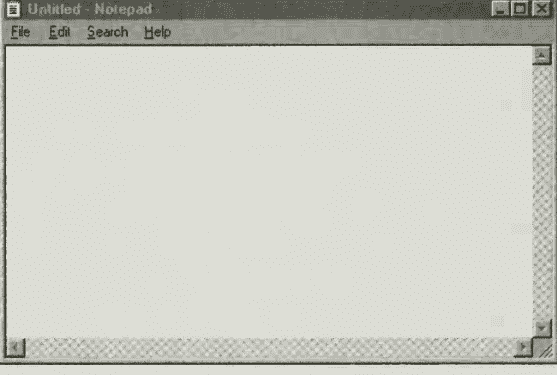

图 6.1 从 Perl 启动的记事本应用程序。

除了 Windows 应用程序，你还可以启动基于文本的应用程序，在 Windows 术语中称为控制台（Console）应用程序。以下脚本使用第 1 章中的 `asklang.pl` 脚本来启动我们最喜欢的控制台应用程序——Perl：

```perl
#
# Launch a Console process from Win32 module.
# See online docs for more on this subject.
#

use Win32;
use Win32::Process;

#create the process object.

Win32::Process::Create($ProcessObj,

    "C:\\PERL\\BIN\\PERL.EXE",

    "perl asklang.pl",

    0, # Don't inherit.

    CREATE_NEW_CONSOLE,

    ".") ||  # current dir.

    die &print_error;

#Wait for the process to end. No timeout.

$ProcessObj->Wait(INFINITE) ||

    warn &print_error;

$ProcessObj->GetExitCode($ExitCode) ||

    warn &print_error;

print "Perl exited with $ExitCode\n";

sub print_error {

    print Win32::FormatMessage( Win32::GetLastError() );

}

# winperl.pl
```

当你运行这个脚本时，会弹出一个新的 MS-DOS 提示符窗口，并且 `asklang.pl` 脚本会询问你最喜欢的脚本语言。

> 控制台应用程序在程序结束时立即关闭。此时，控制台窗口也会随之消失，导致很难看到脚本打印的数据。你可能希望添加几条命令，让脚本等待用户按下 `Enter` 键后再退出。例如：
>
> ```perl
> print "Press Enter to quit.\n";
> $enter = <STDIN>;
> ```

### 将 Perl 脚本作为批处理文件启动

在 UNIX 上，你可以使用第一行的 `#!/usr/bin/perl` 语法将 Perl 脚本转换为可执行命令。这意味着你不需要输入 `perl file.pl`，而可以直接输入 `file.pl`。然而，Windows 并不具备像 UNIX 那样指定 shell 的能力。不过，有一个非常有用的实用工具叫做 `pl2bat.bat`（一个 DOS 批处理文件），它可以将 Perl 脚本转换为 DOS 批处理文件。这个脚本同时利用了 Perl 和 DOS 的语法。

在 DOS 中，任何以 REM 开头的行都表示备注或注释，与 Perl 的 `#` 非常相似。你可以在 REM 前面加上 `@` 字符，该语句依然有效。因此，`@REM = 'message'` 在 DOS 中是注释，而在 Perl 中是一个赋值语句。

在 Perl 中，你可以创建多行文本字符串。将这个特性与 `@REM` 结合，你就得到了以下代码，它同时包含有效的 DOS 和 Perl 语法：

```text
@rem = '

@echo off

perl -S %0.bat %1 %2 %3 %4 %5 %6 %7 %8 %9

goto endofperl

@rem ';
```

在 DOS 中，前面的命令会调用 Perl，并将当前文件及所有命令行参数传递过去。在 Perl 中，前面的命令只是将 `@rem` 数组设置为一个很长的文本字符串。因此，我们得到了一段既能由 DOS 执行也能由 Perl 执行的脚本，结果不同，但都不会报错。

利用这个巧妙的构思，我们可以使用 `pl2bat.bat` 将 Perl 脚本转换为 DOS 批处理文件。以第 1 章中的 `hello.pl` 脚本为例，以下命令可将 `hello.pl` 创建为 `hello.bat`：

```text
pl2bat hello.pl
```

原始的 `hello.pl` 脚本如下所示：

```perl
#
#### hello.pl
#

# Hello World in perl.

print "Hello World.\n";
```

随后 `pl2bat.bat` 脚本将该 Perl 脚本转换为以下批处理文件：

```text
@rem = '-*-Perl-*-';

@rem = '

@echo off

perl -S %0.bat %1 %2 %3 %4 %5 %6 %7 %8 %9

goto endofperl

@rem ';

#
#### hello.pl
#

# Hello World in perl.

print "Hello World.\n";

__END__

:endofperl
```

`__END__` 语句会导致 Perl 停止处理。


这种技术在 Windows 95 上不起作用。你需要 Windows NT 才能运行由 `pl2bat.bat` 创建的批处理文件。

### 检测脚本运行在 Windows 还是 UNIX 上

Perl 没有提供一种简单的方法来在脚本内部确定脚本是在哪个操作系统上执行的。不幸的是，在某些时候（例如启动外部程序时），了解此信息非常重要。这使得编写跨平台脚本变得困难。

讽刺的是，当 Perl 解释器被编译时，它必须知道这个信息。`Config` 模块是确定你的系统运行在 Windows 还是 UNIX（或 OS/2、Macintosh 等）的最佳方法之一。

当你安装 Perl 并运行 `Configure` 脚本时，`Config` 模块会被设置。它包含一个大型关联数组 `%Config`，其中存储了所有的配置信息，其中大部分信息仅在你编写新模块时才有用（详情请参阅第 7 章）。

`%Config` 关联数组中的 `osname` 变量包含操作系统的名称，例如 `"linux"` 或 `"MSWin32"`。你可以利用它来猜测你的脚本在哪个操作系统下运行。之所以说是“猜测”，是因为虽然你可以通过 `osname` 始终以 `"Windows"` 或 `"MSWin"` 开头来识别 Windows，但你无法保证 UNIX 或类 UNIX 操作系统的名称。一种常见的猜测方法是：如果名称以 `"ux"`、`"ix"`、`"UX"` 或 `"IX"` 结尾，那么它很可能是 UNIX 的某种变体。

因此，我们可以使用以下脚本来猜测脚本运行在 UNIX 还是 Windows 下：

```perl
#
# Uses Config module to
# detect O.S.
#

use Config;

$os = &check_os;

print "Your O.S. is: $os\n";

#
# Uses Config module to guess O.S.
# The Config module does have the O.S.
# name, but no direct reference to UNIX,
# so you have to guess.
#

sub check_os {

    # Get O.S. name first.

    $osname = $Config{'osname'};
    $os     = "Unknown";

    # If its Windows, then it's not UNIX.

    if ( $osname =~ /^Windows/ ) {

        $os = "Windows";

    } elsif ( $osname =~ /^MSWin/ ) {

        $os = "Windows";

    #
    # Anything ending in "ux"
    # "ix", "UX" or "IX", is UNIX.

    } elsif ( $osname =~ /ux$/ ) {

        $os = "UNIX";

    } elsif ( $osname =~ /ix$/ ) {

        $os = "UNIX";

    } elsif ( $osname =~ /UX$/ ) {

        $os = "UNIX";

    } elsif ( $osname =~ /IX$/ ) {

        $os = "UNIX";

    } else {

        # If not Windows, guess UNIX.
        # This ignores the Mac and OS/2,
        # though.

        $os = "UNIX";
    }

    return $os;
}

# config.pl
```

当然，这个脚本忽略了 OS/2、Macintosh 和 AmigaOS 等其他操作系统。

如果你的系统没有 `Config` 模块，你仍然可以通过检查磁盘上的文件或环境变量来对操作系统做出合理的猜测。Perl 解释器的可执行文件名可能会提供一些线索。例如，如果路径包含冒号或反斜杠，你就知道它不是 UNIX。例如，`$^X` 的值为 `C:\PERL\BIN\PERL.EXE` 显然表明你运行在 Windows 上。即使是 `"PERL.EXE"` 也是一个很好的线索。Perl 解释器的当前可执行文件名存储在 `$^X` 变量中，因此你可以将其与 `"PERL.EXE"` 进行比对：

```perl
if ($^X =~ /PERL.EXE$/) {

    $os = "Windows";
}
```

另一种可能的方法是检查环境变量。

## 检查环境变量

许多环境变量仅在 UNIX 上使用，而另一些则仅在 Windows 上使用。您可以通过 `%ENV` 关联数组（在第 2 章中描述）来对此进行测试。例如，如果存在 `PROMPT`、`USERNAME` 或 `HOMEDRIVE`，则很可能表明操作系统是 Windows。事实上，事实上，任何包含 `DRIVE` 字样的变量很可能都属于 Windows，因为 Windows 文件系统非常依赖磁盘驱动器盘符。

同样，`USER`、`MANPATH` 和 `TERM` 则很可能出现在 UNIX 上。表 6.1 列出了一些常见的环境变量，以及您可能在 UNIX 还是 Windows 上找到它们。

### 表 6.1 常见环境变量

| 变量 | 可能出现于 |
|---|---|
| `CMDLINE` | Windows。 |
| `HOMEDRIVE` | Windows。 |
| `LD_LIBRARY_PATH` | UNIX。 |
| `MANPATH` | UNIX。 |
| `OPENWINHOME` | UNIX。 |
| `OS` | Windows NT（如果等于 `"Windows_NT"`）。 |
| `OSTYPE` | Linux (UNIX)（如果等于 `"linux"`）。 |
| `PROMPT` | Windows。 |
| `SHELL` | UNIX，但有时也出现在 Windows。 |
| `TERM` | UNIX。 |
| `USER` | UNIX。 |
| `USERNAME` | Windows NT。 |
| `WINDIR` | Windows。 |

由于您可以设置任何想要的环境变量，因此不能完全依赖这些测试。为了在一个操作系统上提供一个更接近另一个操作系统的工作环境，用户可能会在 Windows 上设置 UNIX 风格的环境变量，或在 UNIX 上设置 Windows 风格的环境变量。

其他测试包括检查名为 `/dev/null` 或 `/etc/utmp` 的文件是否存在，这两者在 UNIX 上很常见，但在 Windows 上则没有。

没有绝对确定的方法，但您的脚本可以进行合理的推测。以下 `os.pl` 脚本包含一个备用的 `check_os` 子程序，您可以使用它来检查脚本运行在哪个操作系统下。

```perl
#
# Various tests of which operating
# system this script runs under.
#

# NO TEST IS GUARANTEED!

$os = &check_os();

print "Perl executable is $^X\n";
print "Likely O.S. is $os.\n";

#
# Subroutine you can call to check the O.S.
# Returns "Windows" for generic Windows
# of any kind, "Windows_NT" if NT, or "UNIX".
#

# Two values are kept: $os if the test
# is very likely or $likely, if the test
# is not so sure.

sub check_os {

    $os = "Unknown"; # Don't know yet.

    $likely_windows = "Unknown";
    $likely_unix    = "Unknown";

    # Check likely Windows ENV vars.

    if ($ENV{"PROMPT"} ne "" ) {

        $likely_windows = "Windows";
    }
```

## 第 6 章 启动应用程序

```perl
} elsif ($ENV{"WINDIR"} ne "" ) {

    $os = "Windows";

} elsif ($ENV{"HOMEDRIVE"} ne "" ) {

    $os = "Windows";

} elsif ($ENV{"CMDLINE"} ne "" ) {

    $likely_windows = "Windows";

} elsif ($ENV{"USERNAME"} ne "" ) {

    $likely_windows = "Windows";

} elsif ($ENV{"OS"} eq "Windows_NT" ) {

    $os = "Windows_NT";
}

# Check likely Windows ENV vars.

if ($ENV{"USER"} ne "" ) {

    $likely_unix = "UNIX";

} elsif ($ENV{"OSTYPE"} eq "linux" ) {

    $os = "UNIX";

} elsif ($ENV{"USER"} ne "" ) {

    $likely_unix = "UNIX";

} elsif ($ENV{"MANPATH"} ne "" ) {

    $likely_unix = "UNIX";

} elsif ($ENV{"TERM"} ne "" ) {

    $likely_unix = "UNIX";

} elsif ($ENV{"SHELL"} ne "" ) {

    $likely_unix = "UNIX";

} elsif ($ENV{"OPENWINHOME"} ne "" ) {

    $os = "UNIX";

} elsif ($ENV{"LD_LIBRARY_PATH"} ne "" ) {
```


```perl
$os = "UNIX";

}

# Check if Perl executable is likely Windows.

if ($^X =~ /PERL.EXE$/) {

    $os = "Windows";

}

# Now resolve the differences.

if ($os ne "Unknown") {

    return $os;

}

if ($likely_unix ne "Unknown") {

    if ($likely_windows eq "Unknown") {

        return "UNIX";

    } else {

        # Likely both, pick Windows then.

        return "Windows";

    }

} else {

    # Not likely UNIX, so pick Windows.

    return "Windows";

}

}
```

```text
# os.pl
```

## 进程控制

最简单的进程控制命令是`exit`，它会退出当前的 Perl 脚本。您可以向`exit`传递一个值，该值将被返回给父进程：

```perl
exit;

exit(value);
```

在 UNIX 用法中，任何非零值都代表错误。如果进程执行成功，则返回 0。

要终止一个进程，您需要它的进程 ID。然后您可以调用`kill`来将其终止：

```perl
kill(signal, process_id);
```

在大多数情况下，发送信号 9 就足以终止出错的程序：

```perl
kill(9, $process_id);
```

在 UNIX 中，`kill`实际上只是向另一个进程发送一条消息——一个信号——仅此而已。`kill`本身并不直接杀死进程。但是，如果目标进程没有为您通过`kill`发送的信号安装信号处理器，那么目标进程就会“自杀”。因此，在大多数情况下，`kill`是导致另一个进程崩溃的“冒烟枪”（关键证据），尽管`kill`仍然具有“合理的否认空间”——因为它并不是直接负责执行杀除操作的。

## 管道

*管道 (pipe)* 是一个 UNIX 概念，其核心思想是将一个程序的输出引导至另一个程序的输入。由于 UNIX 中的大多数事物都可以被视为文件，因此通常发送到 STDOUT 的一个程序的输出，可以用作另一个程序（通常是 STDIN）的输入。因此，`pipe`命令连接了两个文件句柄：

```perl
pipe(readhandle, writehandle);
```

所有写入`writehandle`文件的输出都会被发送到`readhandle`。这种情况看起来可能很奇怪，但您可以使用它在进程之间进行通信。一个进程写入`writehandle`，另一个进程从`readhandle`读取。读取的数据与写入的数据完全相同。

一个问题是，如果管道是在一个进程内部调用的，那么两个进程如何获得正确的文件句柄。这就是`fork`发挥作用的地方。在调用`fork`之前调用`pipe`。这样，子进程和父进程都可以访问这两个文件句柄。

但是，由于混合访问文件句柄是一个非常糟糕的主意，父进程和子进程 each 都会调用`close`来关闭那个不被使用的文件句柄。每个进程仅使用一个文件句柄，从而使通信变为单向。（有关双向通信的多种方法，请参阅第 11 章。）

您可以使用以下脚本尝试实际操作：

```perl
#
# Using pipe and fork on UNIX.
#

pipe(FROM_CHILD, TO_PARENT);

$pid = fork;

if ($pid == 0) {

    # We're in the child process.

    # Close file handle we won't use.

    close(FROM_CHILD);

    # Send data to parent.

    print TO_PARENT "Hello, parent\n";

    exit(0);  # Terminate child.

} elsif (undef $pid) {

    # Not defined: means an error.

} else {

    # Parent process.

    # Close file handle we won't use.

    close(TO_PARENT);

    # Get data from child.

    $data = <FROM_CHILD>;

    print "From child: $data\n";

    # Reap child.

    $id = wait();

    # Do something after child dies.

    print "Child is dead.\n";

}

# pipe.pl
```

您还可以使用`open`命令打开管道。如果您将管道字符`|`作为文件名的第一个字符，Perl 将将其解释为尝试打开到该程序的管道。所有写入该文件句柄的数据都会被发送到`open`调用中所使用的命令行。

例如，要使用 UNIX 的`mail`命令发送电子邮件，可以使用以下脚本：

```perl
#
# Using a pipe to send mail.
#

open (MAIL, "| mail erc");

print MAIL ("System build has finished\n");

close(MAIL);

# mail.pl
```

## 闹钟与休眠

`sleep`命令使您的进程休眠若干秒：

```perl
sleep $seconds
```

为什么您会想这么做？嗯，您可能在等待其他事情完成，尽管`wait`和`waitpid`可能是处理此任务更好的选择。`sleep`的一个常见用途是用于每小时、每分钟或其他间隔执行一次任务的脚本。您可以调用`sleep`设置所需的时间间隔。在经过所需秒数后（至少是这么多秒，但不要依赖精确的时间，因为如果系统繁忙，您的进程可能会“睡过头”），您的进程将唤醒并继续执行。

如果您没有向`sleep`传递值，您的进程将永久休眠。在常规实践中，只有在您之前已经设置了闹钟以便稍后唤醒进程时，才会使用这种形式的`sleep`。

## 使用 eval 控制命令行

`eval`命令允许你求值——或执行——一小段 Perl 代码，就好像它本身就是一个小型 Perl 程序；例如，

```perl
eval("print \"Hello World\n!\";");
```

警报是一个 UNIX 概念。你的进程向操作系统请求在一定时间后向你的进程发送一个警报信号（SIGALRM）。当警报触发时，你的进程会在警报信号处理例程中被唤醒。

要尝试这个，`alarm.pl`脚本创建了一个 5 秒的警报：

```perl
#
# Use of alarm and signal
# handlers.
#

# Set up alarm handler.

$SIG{ALRM} = \&wakeup;

# Set alarm clock.

alarm(5);

sleep;  # Forever.

sub wakeup {

    print "Wake up!\n";

    exit(0);

}

# alarm.pl
```

警报以不准确而闻名。

## 总结

Perl 最初构建在 UNIX 之上，提供了多种启动和控制进程的方式。`exec`命令会用另一个程序覆盖你的进程。`system`命令执行一个外部程序然后返回。`fork`命令克隆你的 Perl 脚本，父进程和子进程（克隆）会在同一位置执行相同的脚本。`fork`仅在 UNIX 上工作。

如果你关心跨平台脚本，`eval`和`system`在 Windows 和 UNIX 上都能工作。大多数其他方法只在其中一个上工作。

`eval`命令将其参数作为一个微型 Perl 脚本进行求值。

## 本章介绍的 Perl 命令

- `eval`
- `exit`
- `fork`
- `pipe`
- `system`
- `wait`
- `waitpid`
- `Win32::Process::Create`

# 第 7 章 Perl 包和模块

本章涵盖：

- 包
- 模块
- 扩展
- 常见模块和扩展
- 用于普通变量名的 English 模块
- 在 Windows 上使用 OLE 自动化
- Perl 的面向对象语法

## 包

一个*包*为收集一组相关的 Perl 子例程提供了便捷的方式。你可以使用包来帮助组织你的 Perl 脚本，并使在不同应用程序中重用子例程变得更加容易。此外，许多人已经编写了 Perl 包，因此你可以使用包来重用他人开发的脚本，从而节省你自己从头开始编写一切的时间。本章简要介绍了包和模块，然后展示如何使用一些更常见的 Perl 模块。在模块中处理子例程和数据的语法与基本 Perl 的语法不同，你需要知道如何使用模块来处理 Perl 中的高级主题，例如为网页创建 CGI 脚本。

Perl 的包还提供了一种防止全局变量和子例程名称相互冲突的方法。包提供其自己的受保护命名空间，因此一个包中名为`$line`的变量与另一个包中的`$line`变量保持不同。

访问包内变量的 Perl 语法是`$package::variable`。你使用类似的语法调用包中的子例程，例如第 6 章介绍的`Win32::GetLastError()`。你可以将包嵌套在包内以创建相关子例程的层次结构，例如第 6 章提到的`Win32::Process::Create`。事实上，Perl 中的一切都存在于一个包中。到目前为止开发的所有脚本都被认为是 Perl 为你自动创建的名为`main`的包的一部分。

## 模块

Perl 的*模块*只是遵循更严格准则并旨在被重用的包。大多数模块安装在 Perl 库目录中，例如`C:\PERL\LIB`或`/usr/lib/perl5`。模块 Perl 脚本存储在以`.pm`结尾的文件中。对于嵌套在其他模块中的模块，例如`File::Basename`，你会看到一个名为`File`的子目录，子目录内有一个名为`Basename.pm`的文件。

已经介绍过的`use`命令允许你使用一个模块。你也可以使用`require`命令，它与`use`非常相似。使用`require`，你必须始终使用`ModuleName::subroutine`语法。`use`命令允许你假装模块中的子例程和变量是你当前脚本的一部分，因此你不需要`ModuleName::`部分，可以直接使用子例程和变量名。`use`命令还会预加载模块并执行模块的`BEGIN`部分——参见标题为“包内部”的部分。

## 扩展

*扩展*是需要额外 C 代码来提供其功能的增强型包。例如，用于 Windows 的 ODBC 包实际上是一个扩展，因为它添加了用 C 编写的额外函数，Perl 包会调用这些函数。在支持动态加载的系统上，Perl 可以在运行时以动态库或共享库的形式加载 C 代码。

## 常见包、模块和扩展

Perl 社区对于包、模块和扩展的精确定义和用法仍然相当宽松，因此如果一个被称为另一个，不要惊讶。最终，这并不重要，因为各种优秀的人已经努力为你的 Perl 脚本提供了额外的代码，无论这些代码集合被称为什么，这都是相当好的。

在常见模块中，你会找到表 7.1 中列出的那些。

**表 7.1** Perl 5 标准模块。

| 模块 | 用途 |
|---|---|
| `AnyDBM_File` | DBM 访问的框架。 |
| `AutoLoader` | 仅在需要时加载函数。 |
| `AutoSplit` | 为自动加载拆分包。 |
| `Benchmark` | 用于计时代码执行。 |
| `Carp` | 警告错误。 |
| `Config` | 访问 Perl 的配置。 |
| `Cwd` | 获取工作目录。 |
| `DB_File` | 访问 Berkeley UNIX DB 数据库。 |
| `Devel::SelfStubber` | 为自加载模块生成桩代码。 |
| `diagnostics` | Perl 产生增强的诊断信息。 |
| `DynaLoader` | 将 C 函数动态加载到 Perl 中以实现扩展。 |
| `English` | 为奇怪的变量提供英文名称，例如`$\`。 |
| `Env` | 访问环境变量。 |
| `Exporter` | 控制模块的导入和导出。 |
| `ExtUtils::Liblist` | 确定库。 |
| `ExtUtils::MakeMaker` | 为扩展创建 Makefile。 |
| `ExtUtils::Manifest` | 为扩展写出 MANIFEST 文件。 |
| `ExtUtils::Mkbootstrap` | DynaLoader 的引导。 |
| `Fcntl` | 来自 fcntl.h 的定义。 |
| `File::Basename` | 解析文件名。 |
| `File::CheckTree` | 检查目录树。 |
| `File::Find` | 查找目录树中的条目。 |
| `FileHandle` | 面向对象的文件例程。 |
| `File::Path` | 处理目录。 |
| `Getopt::Long` | 用于命令行参数处理。 |
| `Getopt::Std` | 用于命令行参数处理。 |
| `I18N::Collate` | 用于多种语言的字符串比较。 |
| `integer` | 使用整数数值，而不是浮点数。 |
| `IPC::Open2` | 为读写打开。 |
| `IPC::Open3` | 为读、写和处理错误打开。 |
| `Net::Ping` | 检查网络上的另一个主机。 |
| `NT` | Windows NT 特定的扩展。 |
| `OLE` | 用于 OLE 自动化的 Windows 扩展。 |
| `POSIX` | Perl 的类 UNIX 函数。 |
| `SelfLoader` | 按需加载函数。 |
| `Safe` | 用于在安全环境中评估 Perl 命令。 |
| `Socket` | 用于网络。 |
| `strict` | 限制不安全的构造。 |
| `subs` | 允许预声明子例程名称。 |
| `Test::Harness` | 运行标准 Perl 测试。 |
| `Text::Abbrev` | 用于文本缩写。 |
| `Win32` | 一组 Windows 扩展。 |

# 第 7 章 Perl 包与模块

这些模块中有许多是旨在帮助模块编写者的，例如`ExtUtils::Manifest`和`Exporter`。其他模块，如`Env`和`FileHandle`，则替代并增强了 Perl 中已有的函数。

您系统上支持的模块存储在 Perl 库目录中。要找到该目录或这些目录，请打印出`@INC`数组：

```perl
print "@INC\n";
```

这将打印出 Perl 库目录的位置，例如`/usr/lib/perl5`或`C:\PERL\LIB`。Perl 的模块位于`@INC`中命名的目录中，文件名以`.pm`结尾。要列出所有这些文件，请尝试以下脚本：

```perl
#
# Uses glob to find all installed Perl
# modules.
#

# Copy INC, because we plan to modify list.

@dir_list = @INC;

$i = 0;

while ($i <= $#dir_list) {

    $dir = $dir_list[$i];

    &check_dir($dir);

    $i++;

}

sub check_dir {

    my($dir) = $_[0];

    my(@list);

    my($new_dir);

    my($filename);

    if ($dir eq ".") {

        return;

    }

    chdir( $dir );

    @list = glob("\*");

    foreach $filename (@list) {

        if ($filename =~ /pm$/ ) {

            print "$dir/$filename\n";

        }

        # Check if is directory.

        if ( -d $filename ) {

            $new_dir = $dir . "/" . $filename;

            # Append directory name onto dir list.

            $pos = $#dir_list + 1;

            $dir_list[$pos] = $new_dir;

        }

    }

}

# module.pl
```

除了使用`module.pl`脚本之外，您还可以使用 UNIX `find`命令来查找 Perl 库目录中的所有模块文件：

```shell
find `perl -e 'print "@INC"'` -name '*.pm' -print
```


如果您使用`module.pl`或`find`，您将看到类似以下的列表：

```
/usr/lib/perl5/AnyDBM_File.pm
/usr/lib/perl5/AutoLoader.pm
/usr/lib/perl5/AutoSplit.pm
/usr/lib/perl5/Benchmark.pm
/usr/lib/perl5/Carp.pm
/usr/lib/perl5/Cwd.pm
/usr/lib/perl5/English.pm
```

本书其余章节将介绍一些有用的 Perl 模块。不过，有两个模块值得注意，包括`English`模块和`OLE`自动化模块。

## English 模块

Perl 似乎特别容易有一些奇怪的变量名，如`$^X`和`$'`。为了帮助您处理这个问题，Perl 提供了`English`模块，它将这些名称奇特的变量转换为更易理解的名称。如果您在脚本中放置`use English;`命令，就可以使用更长的变量名。表 7.2 列出了标点变量及其对应的长名称。您会注意到，几乎所有的标点符号都已被充分利用。

表 7.2 Perl 中的一些特殊全局变量。

| 变量 | English | 用途 |
| :--- | :--- | :--- |
| `$^A` | `$ACCUMULATOR` | 格式数据写入累加器的当前值。 |
| `$_` | `$ARG` | 默认输入和模式搜索变量。 |
| `$^T` | `$BASETIME` | 脚本开始运行的时间格式。 |
| `$?` | `$CHILD_ERROR` | 上次管道关闭或系统函数返回的状态。 |
| `$^D` | `$DEBUGGING` | Perl 调试标志的当前值。 |
| `$)` | `$EFFECTIVE_GROUP_ID` | Perl 进程的有效组 ID。`setgid`可能会改变此值。 |
| `$>` | `$EFFECTIVE_USER_ID` | 进程的有效用户 ID。 |
| `$^X` | `$EXECUTABLE_NAME` | Perl 二进制文件的名称，例如`PERL.EXE`或`perl`。 |
| `$!` | `$ERRNO` | 如果是数字上下文，保存数学函数的`errno`结果；如果是字符串上下文，保存错误消息。 |
| `$@` | `$EVAL_ERROR` | 上次`eval`调用的错误消息。 |
| `$^L` | `$FORMAT_FORMFEED` | 从`write`输出以推进到下一页。 |
| `$:` | `$FORMAT_LINE_BREAK_CHARACTERS` | 在格式的续行字段中允许用于断行的字符。 |
| `$-` | `$FORMAT_LINES_LEFT` | 当前页剩余的行数。 |
| `$=` | `$FORMAT_LINES_PER_PAGE` | 页面可用的总行数。 |
| `$~` | `$FORMAT_NAME` | 当前格式的名称。 |
| `$%` | `$FORMAT_PAGE_NUMBER` | 当前格式中的页码。 |
| `$^` | `$FORMAT_TOP_NAME` | 页首格式的名称。 |
| `$.` | `$INPUT_LINE_NUMBER` | 上次读取的文件句柄中的行号。 |
| `$/` | `$INPUT_RECORD_SEPARATOR` | 输入文本行的结束符，在 UNIX 上为换行符，在 Windows 上为回车符和换行符。 |
| `$+` | `$LAST_PAREN_MATCH` | 上次搜索匹配到的最后一个括号。 |
| `$"` | `$LIST_SEPARATOR` | 数组元素的输出字段分隔符；默认为空格。 |
| `$&` | `$MATCH` | 上次匹配到的字符串。 |
| `$#` | `$OFMT` | 使用`print`打印数字时的输出格式（不使用第 5 章中描述的`format`命令）。通常为`%.20g`。 |
| `$\|` | `$OUTPUT_AUTOFLUSH` | 如果非零，则在每次`write`或`print`时强制刷新。 |
| `$,` | `$OUTPUT_FIELD_SEPARATOR` | 输出字段分隔符。 |
| `$\` | `$OUTPUT_RECORD_SEPARATOR` | 输出记录分隔符，相当于输出时的`$/`。 |
| `$]` | `$PERL_VERSION` | `perl -v`打印的字符串；版本号。 |
| `$'` | `$POSTMATCH` | 上次匹配后的字符串。 |
| `$\`` | `$PREMATCH` | 上次匹配前的字符串。 |
| `$$` | `$PROCESS_ID` | 此脚本的进程 ID。 |
| `$0` | `$PROGRAM_NAME` | 当前 Perl 脚本的名称。 |
| `$(` | `$REAL_GROUP_ID` | Perl 进程的组 ID。 |
| `$<` | `$REAL_USER_ID` | 实际用户 ID。 |
| `$^F` | `$SYSTEM_FD_MAX` | 最大系统文件描述符。 |
| `$^W` | `$WARNING` | 如果警告已开启（由`perl -w`设置）则为真；否则为假。 |

全局变量甚至比表 7.2 中列出的还要多。有关更多信息，请参阅`perlvar`的在线文档。不用担心：您很可能不需要修改这些变量中的绝大多数。

## OLE 自动化

对象链接与嵌入（OLE）为 Windows 应用程序之间的通信和控制提供了一种强大的方式。例如，Perl 脚本可以调用支持 OLE 的应用程序，如 Microsoft 的 Excel 或 Word，将数据放入应用程序中，并让应用程序将数据保存到文件或打印出来。这为 Perl 充当常用 Windows 软件上执行一组操作的主控制器提供了一种非常便捷的方式。

一旦您开始研究它，您会发现 OLE 是一个令人生畏的主题。您需要了解大量的内容。Perl 通过 OLE 模块隐藏了许多复杂的细节。

OLE 模块允许您创建代表 Windows 应用程序的 OLE 对象。您可以向这些对象发送 OLE 消息，并要求应用程序执行各种任务。

要使用 OLE 模块，您需要执行`use`命令：

```
use OLE;
```

要做很多事情，您还需要从现有应用程序（如 Microsoft Excel）中创建一个 OLE 对象。该 OLE 对象在您的 Perl 脚本中代表 Windows 应用程序。事实上，在 Perl 中创建 OLE 对象将启动该应用程序。例如，要启动 Microsoft Excel，您可以使用以下代码：

```
$app = CreateObject OLE "Excel.Application" ||
    die "Unable to open Excel.";
```

返回值赋给`$app`，`$app`现在包含一个 Perl OLE 对象。您使用此对象通过 OLE 与 Excel 中由`$app`代表的应用程序进行交互。

一旦您创建了 OLE 对象，就可以开始向它发送消息。发送给 Perl 对象的消息由 OLE 模块中的子程序转发给应用程序。这些消息允许您控制应用程序，在本例中是 Excel。

主要问题是发现要发送什么消息。最佳信息来源之一是 Visual Basic，因为将 Visual Basic 转换为 Perl 相对容易。有关此类转换的示例，请查看您安装 Perl for Win32 的主目录下的`eg`子目录，例如`\PERL`。

本书无法涵盖 OLE 的复杂性（有关有助于学习 OLE 的书籍列表，请参阅附录 A）。但是，您可以使用以下控制 Excel 的示例脚本作为编写您自己的 OLE 自动化脚本的指南：

## 第7章 Perl包与模块

```perl
#
# 使用OLE控制MS Excel。
#
use OLE;

# 创建Excel实例。
$app = CreateObject OLE "Excel.Application" ||
    die "Unable to open Excel.";

# 使应用程序可见。
$app->{'Visible'} = 1;

# 创建新的工作簿。
$app->Workbooks->Add();

# 在"区域"中设置值。
$app->Range("A1")->{'Value'} = "Developer";
$app->Range("B1")->{'Value'} = "Bugs";
$app->Range("B2")->{'Value'} = "Assigned";
$app->Range("C2")->{'Value'} = "Fixed";
$app->Range("A3")->{'Value'} = "Eric J.";
$app->Range("B3")->{'Value'} = 10;
$app->Range("C3")->{'Value'} = 10;

# 让Excel保持运行状态。使用 $app->Quit() 退出。
# msexcel.pl
```

几乎每个人都将Excel作为示例，因为它是一个常见的应用程序，且对OLE的支持非常好。前面的脚本创建了一个OLE对象来启动Excel。命令`$app->{'Visible'} = 1;`使用Perl的面向对象语法，将一个值（1）设置到从应用对象引用的一个隐藏关联数组中。这使得Excel会显示在屏幕上。

`Workbooks->Add()`子程序添加了一个新的工作簿（Excel中的基本文档类型）。`Range`子程序引用了一段值范围（在前面的用法中，是一个值的范围）。你可以通过调用`Quit`子程序来退出Excel。

当你运行这个脚本时，你会看到一个类似图7.1中的小型电子表格。

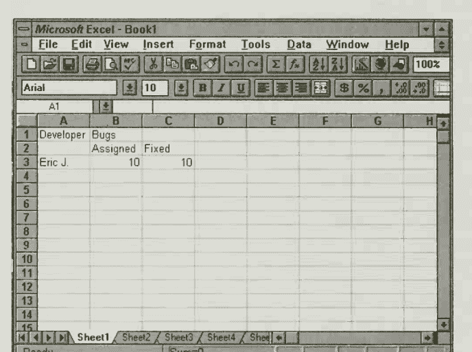
图7.1 从Perl创建Excel电子表格。

有关从Perl使用OLE自动化的更多信息，请参阅`oleauto`在线文档。

### 包的内部

包内部有两个特殊的子程序。`BEGIN`子程序在包被使用时会尽快执行。`END`子程序则尽可能晚地执行，通常在脚本退出时。你可以拥有多个`BEGIN`或`END`子程序；它们会按顺序执行。

### 子程序原型

`use ModuleName`命令会显式执行该模块中的`BEGIN`语句。

`BEGIN`和`END`的目的是允许为包提供初始化和清理代码。这使得包可以为你设置好一切，以便于使用。

Perl 5.002还提供了所谓的*子程序原型*。通过原型，你可以指定子程序期望的参数。不幸的是，当前版本只允许使用奇怪的标点符号来定义原型。未来版本的Perl应该会添加完全命名的原型，届时你将提供传递给子程序的所有参数的名称。目前，除非你在编写模块，否则最好避免使用这些子程序原型。

截至本文写作时，Perl for Win32仍停留在Perl 5.001版本，而非5.002。


### 引用与对象

在Perl中，*引用*是一个指向或引用其他东西的标量变量。这在设置Perl关联数组以保存待调用的子程序等方面非常有用。引用通常故意隐藏数据，这样你就不必担心"幕后"的混乱细节。第6章中使用的Win32模块使用了引用来隐藏关于Win32进程的实现细节，这些细节通常是你不想处理的。

引用是相当高级的主题，因此本节仅介绍它们，并请参阅`perlref`在线文档以获取更多信息。引用在模块中被广泛使用，因此你至少需要了解基础知识。

要设置引用，你需要在引用对象的名称前使用反斜杠字符。例如，要建立一个从一个标量变量到另一个标量变量的引用，你可以使用以下语法：

```perl
$reference = \$referred_to;
```

同样的语法适用于数组和关联数组，如下所示：

```perl
$arrayref = \@ARGV;
$assocref = \%ENV;
```

你也可以设置一个指向子程序的引用：

```perl
$subref = \&subroutine;
```

此类引用的目的是允许一个变量指定要执行的子程序。

要访问引用，你需要记住引用是一个标量变量。因此，要访问被引用的数组，使用`@`来指定数组，并使用以`$`开头的标量变量。以下是此语法的示例：

```perl
#
# 使用引用。
#
$var = "Hello";
$reference = \$var;
$arrayref = \@ARGV;
$assocref = \%ENV;
$subref = \&sub1;

print "Scalar reference = $$reference\n";
@sorted = sort( @$arrayref );
print "Array reference = @sorted\n";
while ( ($key, $value) = each( %$assocref ) ) {
    print "Assoc. ref $key=$value\n";
}
print "Call a subroutine via references.\n";
&$subref(10);

sub sub1 {
    my($param) = $_[0];
    print "In a subroutine with $param.\n";
}
# ref.pl
```

### 面向对象的脚本

像Java和C++这样的面向对象语言席卷了整个计算行业。Perl也通过使用引用，支持了原始的面向对象（对象和方法——作用于对象的子程序）版本。

当你看到`->`操作符（借鉴自C++）时，你知道正在对一个对象（引用变量）调用一个方法（子程序）。例如，在第6章关于Win32进程创建的部分，`Win32::Process::Create`子程序将一个对象（实际上是数据的引用）存储在`$ProcessObj`变量中。后来，`winapp.pl`脚本在`$ProcessObj`变量上调用了`GetExitCode`方法，使用类似以下的代码：

```perl
$ProcessObj->GetExitCode($ExitCode);
```

在底层，`->`语法更像传统的Perl，类似于以下内容：

```perl
&GetExitCode($ProcessObj, $ExitCode);
```

同样借鉴自C++的还有`new`函数的概念，它充当对象的"构造函数"。`new`只是包中的一个子程序，它创建一个新对象并返回对该对象的引用给你的代码。

实际上不止如此，但这是理解Perl对象最简单的方式。有关这个复杂主题的更多信息，请参阅`perlobj`在线文档。

要使用提供对象的包（如第6章中的Win32包或第12章中的Perl/Tk），你只需遵循给出的示例即可。

### 总结

- 包提供了一种便捷的方式来收集一组相关的Perl子程序。你可以使用包来帮助组织你的Perl脚本，并使在不同应用程序中重用子程序变得更容易。
- Perl模块只是一个遵循更严格准则并被设计为可重用的包。大多数模块会被安装到Perl库目录中，例如`C:\PERL\LIB`或`/usr/lib/perl5`。
- 扩展是增强的包，需要额外的C代码来提供其功能。
- 引用是Perl中指向或引用其他东西的标量变量。要设置引用，你需要在引用对象的名称前使用反斜杠字符。

### 本章介绍的Perl命令

`OLE::CreateObject`

## 第二部分：高级Perl

本部分建立在目前介绍的基础之上，将Perl的使用扩展到更实际的领域。在接下来的章节中，你将应用前七章介绍的基本Perl技能，并将Perl添加到你的实际问题解决工具箱中。

- **第8章** 介绍将Perl用于系统管理任务。虽然很难确切地说系统管理员必须做什么——因为他们的工作不断变化——但本章侧重于像用户管理这样的常见任务。
- **第9章** 讨论使用Perl创建动态网页的热门话题。Perl非常适合与数据库交互以及处理网页中的数据录入表单。能够看到你的作品出现在网页上也非常有趣。
- **第10章** 提供了许多处理跨平台软件开发的思路。由于Perl可以在Windows和UNIX系统上运行，你可以使用Perl来帮助自动化你的软件构建任务。
- **第11章** 处理使用Perl解决客户端-服务器问题。令人惊讶的是，Perl在核心语言中内置了大量的网络命令。你可以在Perl中创建网络守护进程，并促进客户端-服务器数据交换。
- **第12章** 以精彩的方式结束本书，向你展示如何使用`Perl/Tk`扩展为你的Perl脚本创建图形界面。

## 进阶部分

仅仅奔跑是不够的，你无法凭此获胜，我厌倦了失败。仅仅获胜也是不够的，你无法凭此奔跑，我厌倦了失败。

你不必获胜，你无法凭此获胜，我厌倦了失败。仅仅奔跑是不够的，你无法凭此奔跑，我厌倦了失败。

仅仅奔跑是不够的，你无法凭此奔跑，我厌倦了失败。你不必奔跑，你无法凭此获胜，我厌倦了失败。

仅仅奔跑是不够的，你无法凭此获胜，我厌倦了失败。你不必获胜，你无法凭此奔跑，我厌倦了失败。

仅仅奔跑是不够的，你无法凭此奔跑，我厌倦了失败。仅仅获胜也是不够的，你无法凭此奔跑，我厌倦了失败。

你不必奔跑，你无法凭此获胜，我厌倦了失败。仅仅获胜也是不够的，你无法凭此奔跑，我厌倦了失败。

仅仅获胜也是不够的，你无法凭此奔跑，我厌倦了失败。你不必获胜，你无法凭此奔跑，我厌倦了失败。

## 第 8 章 用于系统管理的 Perl

本章涵盖以下内容：

- 用户操作及提取用户名
- UNIX 密码文件数据
- 主机名
- Windows 系统信息
- Windows 注册表

### 用户操作

管理员的工作永远做不完，尤其是那些被称为用户的麻烦家伙。Perl 提供了大量辅助管理员的工具。Perl 可以帮助：

- 解析复杂的管理文件，从而自动将用户添加到组等。
- 报告系统状态。
- 开启和关闭系统服务。

你会发现系统管理是 Perl 在操作系统之间差异最大的领域。这不是 Perl 的错；实际上是操作系统本身不同，迫使 Perl 也变得不同。即便如此，凭借其启动和控制进程、操作文件和解析文本的能力，Perl 非常适合许多系统管理任务。本章为系统管理员提供了特别感兴趣的 Perl 命令和模块的概述。

### 登录名

大多数用户都有一个登录名，而且根据登录名访问和操作用户记录是非常常见的。`getlogin`函数返回用户的登录名：

```
#
```


# Gets user login name.

`$username = getlogin();`
`print "User name: $username\n";`

# getlogin.pl

`getlogin` 应该在 UNIX 和 Windows 上都能工作。许多其他与用户相关的函数则不行。

在 Windows 上，还有 `Win32::LoginName` 函数：

```
#
# Gets user login name on Windows.
#
use Win32;
$username = Win32::LoginName();
print "User name: $username\n";
# winlogin.pl
```

### UNIX 密码文件数据

在 UNIX 上，`/etc/passwd` 文件传统上存储了每个允许进入系统的用户信息。在现代，这些信息可能存储在影子密码文件中（例如，由系统隐藏在其他地方），或者通过 NIS（网络信息系统，以前称为 Yellow Pages）或其他网络方案分布在网络上。

对于所有这些情况，`getpwnam` 函数检索给定用户名的密码条目，返回一个用户数据列表。返回的值来自 UNIX `/etc/passwd` 文件中条目的传统定义，列在表 8.1 中。

表 8.1 由 `getpwnam` 返回的值

| 值 | 包含内容 |
| --- | --- |
| `$name` | 用户名。 |
| `$passwd` | 加密密码。 |
| `$uid` | 用户 ID。 |
| `$gid` | 组 ID。 |
| `$quota` | 允许的磁盘配额，通常用于其他目的。 |
| `$comment` | 通常未使用。 |
| `$gcos` | 通常包含完整的用户名。 |
| `$dir` | 用户的主目录。 |
| `$shell` | 作为用户登录 shell 启动的程序。 |

> Perl 的 `getpwnam` 函数使用 UNIX 系统调用 `getpwnam()`，这在大多数系统上应该能够处理所有不同的可能位置。因此，将所有对 `/etc/passwd` 的引用视为用户账户信息所有可能位置的通用标识符。

`getpwnam` 和 `getpwent` 在 Windows 上都不工作。

你可以使用以下示例来调用 `getpwnam`：

```
($name, $passwd, $uid,
$gid, $quota, $comment,
$gcos, $dir, $shell) = getpwnam($username);
```

例如，要显示多个用户的所有 `/etc/passwd` 字段（通过命令行传递），你可以使用以下脚本：

```
#
# UNIX call to getpwnam.
#
foreach $username (@ARGV) {
    ($name, $passwd, $uid,
     $gid, $quota, $comment,
     $gcos, $dir, $shell) = getpwnam($username);
    print "name    = $name\n";
    print "passwd  = $passwd\n";
    print "uid     = $uid\n";
    print "gid     = $gid\n";
    print "quota   = $quota\n";
    print "comment = $comment\n";
    print "gcos    = $gcos\n";
    print "dir     = $dir\n";
    print "shell   = $shell\n\n";
}
# getpwnam.pl
```

当你运行此脚本时，在命令行中传入你想要信息的用户名，如下所示：

```
perl getpwnam.pl erc kevin
```

你会看到类似以下的输出：

```
name    = erc
passwd  = XHsThaB8/mmMA5ERgJuf
uid     = 501
gid     = 100
quota   =
comment =
gcos    = Eric F. Johnson
dir     = /home/erc
shell   = /bin/csh
name    = kevin
passwd  = HkTsi/3pGMZ1k
uid     = 502
gid     = 100
quota   =
comment =
gcos    = Kevin Reichard
dir     = /home/kevin
shell   = /bin/bash
```

除了 `getpwnam`，你还可以调用 `getpwuid`，它从 UNIX 用户 ID 而不是用户名获取用户信息。`getpwuid` 返回相同的数据。

如果你事先不知道用户名或 UID，你可以使用 `getpwent`（get password entry 的缩写）来遍历整个用户列表。

`getpwent` 返回 `/etc/passwd` 中每个用户的条目，与表 8.1 中显示的相同数据列表。你可以使用以下脚本打印出 UNIX 系统上的所有用户：

```
#
# Print info on all users
# of a UNIX system.
#
while (($name, $passwd, $uid,
     $gid, $quota, $comment,
     $gcos, $dir, $shell) = getpwent ) {
    print "name    = $name\n";
    print "passwd  = $passwd\n";
    print "uid     = $uid\n";
    print "gid     = $gid\n";
    print "quota   = $quota\n";
    print "comment = $comment\n";
    print "gcos    = $gcos\n";
    print "dir     = $dir\n";
    print "shell   = $shell\n\n";
}
# allusers.pl
```

如果你运行此脚本，你会看到很多奇怪的用户，比如 ftp、guest、uucp、games、man、operator、postmaster、bin、daemon、adm、lp、sync、halt、mail、news，以及我最喜欢的 nobody。这些都是管理账户。

Perl 还提供了许多其他 UNIX 函数来访问用户和组 ID。有关更多信息，请参阅 `perlfunc` 的在线文档。

### 主机名

获取系统网络或主机名的标准方式是通过 `Sys::Hostname` 模块：

```
#
# Get system host name.
#
use Sys::Hostname;
$host = hostname;
print "Network host name is: $host\n";
# hostname.pl
```

`hostname` 子程序尝试多种不同的方式来获取系统的主机名，这些方法在 Windows 上都不起作用。对于 Windows，请尝试 `Win32::NodeName` 和 `Win32::DomainName`，后面会说明。

### Windows 系统信息

许多源自 UNIX 的 Perl 函数在 Windows 上根本无法使用。幸运的是，`Win32` 模块提供了大量 Windows 特定的函数来帮助你。

以下脚本调用 `Win32` 模块中的多个子程序来提取有关系统的信息：

```
#
# Get information on a
# Windows system.
#
use Win32;
#
# Networking info.
#
$node   = Win32::NodeName;
$domain = Win32::DomainName;
#
# File system.
#
$fstype = Win32::FsType;
$cwd    = Win32::GetCwd;
#
# Operating System.
#
@os = Win32::GetOSVersion;
$isnt = Win32::IsWinNT;
$is95 = Win32::IsWin95;
# Perl
$perlvers = Win32::PerlVersion;
# Print info.
print "Node=$node, Domain=$domain\n";
print "File System=$fstype\n";
print "Current directory=$cwd\n";
print "Windows version $os[1].$os[2] Build $os[3]\n";
if ($isnt) {
    print "Running Windows NT\n";
}
if ($is95) {
    print "Running Windows 95\n";
}
print "Perl version=$perlvers\n";
# wininfo.pl
```

当你运行此脚本时，你会看到类似以下的值：

```
Node=YONSEN, Domain=<YONSEN>
File System=FAT
Current directory=C:\erc\beks\perl\testing
Windows version 4.0 Build 67109814
Running Windows 95
Perl version=Build 106
```

## Windows 注册表

你也可以通过 `Win32::Registry` 模块访问 Windows 注册表。*注册表*是 Windows 中应用程序用来注册自身信息的位置。Windows 应用程序将持久状态信息存储在注册表中。在 Windows 95 和 NT 中，注册表取代了以前存储在 .INI 文件中的状态信息。

虽然注册表本身超出了本书的范围（参见附录 A 获取 Windows 书籍列表），但 `Win32::Registry` 模块中最有用的两个子程序是 `Open` 和 `GetKeys`。

`Open` 子程序打开注册表中的一个键，并创建一个允许你访问该键的 Perl 对象。Windows 注册表中的键是分层存储的，因此你可能需要对顶层键（例如 `"SOFTWARE"`）调用 `Open`，然后沿名称树向下，依次打开每个键，直到找到你真正感兴趣的键。

为了帮助你入门，并且因为你必须对某个 Perl 对象调用 `Open`，`Win32::Registry` 模块预定义了若干可用于遍历注册表的对象。这些预定义对象包括：

- `$HKEY_LOCAL_MACHINE`
- `$HKEY_USERS`
- `$HKEY_CURRENT_USER`
- `$HKEY_CLASSES_ROOT`

这些子程序的在线文档大多是不正确的。要找到正确的用法，你需要检查 Perl 模块，该模块存储在你的顶级 Perl 目录（例如 `C:\perl\lib\Win32`）下的 `lib\Win32` 目录中的 `Registry.pm` 文件里。

`Open` 子程序从一个 Perl 对象调用，需要两个参数：要打开的键的名称和一个用于保存为该键创建的对象的 Perl 变量。例如：

```
use Win32::Registry;
$HKEY_LOCAL_MACHINE->Open("SOFTWARE",
    $hkey) or
    die "Can't open registry";
```

前面的示例打开了当前（本地）机器上名为 "SOFTWARE" 的顶级键。如果它成功完成，那么你可以使用 `$hkey` 变量作为 Perl 对象的引用，并对其调用 `Open`。例如：

```
$hkey->Open("Microsoft",
    $mkey) or
    die "Can't open registry";
```

这就是你在注册表层次结构中向下遍历键列表的方法。当然，第一个问题是找到键的名称。一旦你在注册表中打开了一个键，你就可以调用 `GetKeys` 来获取该对象下的所有键。例如：

```
$HKEY_LOCAL_MACHINE->Open("SOFTWARE",
    $hkey) or
    die "Can't open registry";
$hkey->GetKeys($key_list);
```

存储在 `$key_list` 中的值是对 Perl 数组的引用（参见第 7 章）。因此，要访问数组元素，你需要使用 `@$key_list` 语法，如下所示：

```
foreach $key (@$key_list) {
    print "$key\n";
}
```

由于一个必要的起始任务是查找系统注册表中的键，以下脚本提取本地计算机上注册表中 "SOFTWARE" 通用类别下所有项的键名：

```
#
# 访问 Windows 注册表。
#
use Win32::Registry;
#
# 必须从预定义键（如本机）打开第一个键。
# 更多信息请参阅 Registry.pm。
#
$HKEY_LOCAL_MACHINE->Open("SOFTWARE",
    $hkey) or
    die "Can't open registry";
$hkey->GetKeys($key_list);
print "SOFTWARE keys\n";
foreach $key (@$key_list) {
    print "$key\n";
    &extract_keys($hkey, $key, 0);
}
# 打印空格进行缩进。
sub print_spaces {
    my($spaces) = $_[0];
    for ($i = 0; $i < $spaces; $i++) {
        print " ";
    }
}
#
# 提取注册表中某个项的子键。
#
sub extract_keys {
    my($hkey)   = $_[0];
    my($name)   = $_[1];
    my($spaces) = $_[2];
    my($newkey);
    my($key_list);
    my($key);
    $hkey->Open($name, $newkey);
    $newkey->GetKeys($key_list);
    # 打印键并提取子键
    &print_spaces($tabs);
    foreach $key (@$key_list) {
        if ($key ne "") {
            &print_spaces($spaces);
            print " $key\n";
            &extract_keys($newkey, $key, $spaces+2);
        }
    }
}
```

> `registry.pl` 脚本中的 `extract_keys` 子程序展示了子程序调用自身的第一个例子。这称为递归。你需要小心递归，以免子程序无限递归下去；必须有某种终止条件，否则 Perl 将生成运行时异常。

运行 `registry.pl` 脚本时，你会看到系统注册表中许多有趣的条目，例如：

- Internet Explorer
  - Styles
  - Document Caching
  - Image Caching
  - Main
  - PageSetup
  - SecurityProtocols
- Resource Kit
  - PERL5
- Shared Tools Location

```
New User Settings
  Word
    7.0
      Options
      Proofing Tools
        Hyphenate
          1033
            Normal
          2057
            Normal
          3081
            Normal
      Help
        Files
      Text Converters
        Import
          SPLUS
          MSPAB
```


```

Win32 模块支持许多用于网络的子程序（在第 11 章介绍），以及一些仅适用于 Windows NT 的子程序。关于 Win32 模块的更多信息，请参阅 `win32mod` 在线文档。关于 Windows 注册表的更多信息，请参阅附录 A 中提到的 *Programming Windows 95*。

## 其他管理任务

由于相当多的系统管理员，尤其是 UNIX 管理员，广泛使用 Perl，你会发现有许多可用的模块可以帮助完成许多任务。例如，`Quota` 模块可以帮助管理用户磁盘配额。还有大量其他模块可用。

请在 CD-ROM 的 `doc` 目录中查找 `modlist.htm` 文件。该文件包含许多 Perl 模块的列表以及如何获取它们的信息。其中许多模块位于 CD-ROM 上。用于辅助管理员的模块位于 `contrib/admin` 目录中。

## 总结

虽然所有 Perl 对系统管理员都很有帮助，但本章重点介绍了一些对管理员特别有用的特定函数和子程序。

其中，`getlogin` 函数用于获取用户的登录名。

在 UNIX 上，你可以使用 `getpwent`、`getpwnam` 和 `getpwuid` 函数从 `/etc/passwd` 文件中提取信息，该文件保存了用户账户信息。

Win32 模块包含大量用于获取 Windows 信息的子程序，包括 `Win32::FsType`、`Win32::NodeName` 和 `Win32::GetOSVersion`。

你可以使用 `Win32::Registry` 模块来提取和修改 Windows 注册表中的信息。

## 本章介绍的 Perl 命令

- `getlogin`
- `getpwent`
- `getpwnam`
- `getpwuid`
- `Win32::DomainName`
- `Win32::FsType`
- `Win32::GetCwd`
- `Win32::GetOSVersion`
- `Win32::IsWin95`
- `Win32::IsWinNT`
- `Win32::NodeName`
- `Win32::PerlVersion`
- `Win32::Registry::GetKeys`
- `Win32::Registry::Open`

## 用于网页的 Perl

本章涵盖：

- 通用网关接口（CGI）
- 使用 Perl 创建 CGI 脚本
- 使用 Perl 创建动态网页
- 创建网页表单并使用 Perl 处理数据
- 创建自维护的网页

## 网页如何工作

即使你一直生活在洞穴中，你也可能没有错过互联网现象。本章简要介绍了万维网，并介绍了如何使用 Perl 创建动态网页。

互联网上最流行的部分仍然是万维网。通过 Web，你在系统上运行一个称为浏览器的客户端程序。

浏览器，例如 Netscape `Navigator` 或 Microsoft `Internet Explorer`，向 Web 服务器发送请求。服务器返回一个响应，即一个 Web 文档。然后浏览器为你显示这个文档。

浏览器确定将请求发送到哪个服务器的方式是基于统一资源定位符（URL），它相当于 Web 文档的电子邮件地址。URL 标识了请求的类型，例如 `http`（Web）、`ftp`、`news` 或 `mailto`；服务器的网络名称；以及请求的数据的名称。在大多数情况下，请求的信息是一个文件或至少是一个字节流。

*通用网关接口*（简称 CGI）是万维网与其他数据源（如数据库或在线目录）之间的网关。

## 通用网关接口

通用网关接口的核心思想是，你可以将网页的概念扩展为一个程序，而该程序的输出恰好是一个网页。随后，Web 浏览器会显示该程序的输出，并将其作为 HTML 文件来处理。相当多的这类 CGI 程序是 Perl 脚本，在一般用法中被称为 CGI 脚本。

## CGI URL

CGI 脚本通过 URL（统一资源定位符，用于标识每个网页）来执行。要让 CGI 脚本执行，URL 必须遵循 Web 服务器（以及你的站点管理员）所建立的命名规范。例如，有些站点要求 CGI 脚本放在特定的目录中，该目录通常命名为 `cgi-bin`。其他站点则要求 CGI 脚本的文件扩展名为 `.cgi`。例如，以下 `hello1.cgi` 脚本的 URL 可能是：

```
http://www.efjohnson.fun/~erc/cgi-bin/hello1.cgi
```


上面的主机名并不是一个真实的系统。

所有规则都取决于你的 Web 服务器的配置方式。你可以通过咨询你的站点管理员来了解更多相关信息。

## CGI 脚本的工作原理

CGI 脚本的内部结构与任何其他 Perl 脚本相同。Web 服务器使用 Perl 解释器来执行此脚本。

> **注意** CGI 脚本运行在服务器机器上。Java 小程序从服务器下载并在浏览器机器上运行。这使得 CGI 脚本非常适合查询数据库或在线目录，或者与存储在服务器上的大型数据集进行交互。Java 小程序则更适合主要在网络用户端运行的任务。

CGI 脚本从 Web 服务器获取数据的方式有两种：Web 服务器可能会填充大量环境变量（Perl 中的 `%ENV`），或者通过命令行传递数据，或者两者兼而有之。这需要你的脚本来处理这些数据，从所使用的任何来源中提取数据。

然后，CGI 脚本将输出的 HTML 数据发送到 `STDOUT`。Web 服务器会截获这些数据（可能使用管道，如第 6 章所述），并将你的脚本打印到 `STDOUT` 的数据传递给 `Web` 浏览器。

## 超文本标记语言

超文本标记语言（HTML）是 Web 的*通用语言*。Web 浏览器将 HTML 文档中的标签解释为格式化或链接（超文本）信息。因此，如果你正在创建交互式 Web 文档，你的 CGI 脚本必须使用正确的 HTML 标签输出其数据，否则用户将看不到格式良好的文档——或者根本看不到任何文档。（除了 HTML 之外还有其他类型的输出，但绝大多数 CGI 脚本输出的是 HTML 格化的数据。）

## 使用 Perl 编写 CGI 脚本

Perl 非常适合编写 CGI 脚本，主要是因为它的文本处理能力。由于 HTML 是基于文本的格式，并且任何 CGI 脚本的输出都是发送到 `STDOUT` 的 HTML 文件，Perl 是格式化 HTML 和将数据填入文本流的最佳选择之一。

通常，Perl CGI 脚本使用特殊的 UNIX 注释来标识 `perl` 作为执行脚本的程序，例如以下内容：

```
#!/usr/bin/perl
```

当然，这仅适用于 UNIX 系统。你可能还需要使用特殊的后缀，如 `.cgi`，以便 Web 服务器接受你的脚本。

## 从脚本创建网页

要从脚本创建网页，你必须自己输出所有 HTML 标签。如果你曾经用文本编辑器创建过 HTML 文件，那么你对此任务已经驾轻就熟了。此外，你必须在 HTML 之前加上 MIME Content-type 标识符，如下所示：

```
Content-type: text/html
```

> Content-type 行之后必须跟一个空行。

例如，要从 CGI 脚本创建一个简单的网页，你可以使用以下内容：

```perl
#!/usr/bin/perl

#
# CGI script that outputs a Web page.
#

#
# Note blank line after content type
# is essential.
#

print "Content-type: text/html\n\n";

# HTML header section.
print "<html>\n";

print "<head>\n";

print "<title>Hello From Perl</title>\n";

print "</head>\n";
```

```perl
# HTML body

print "<body>\n";

# Heading

print "<h1>Yow</h1>\n";

print "Hello, world.\n";

print "<p>\n";     # Paragraph

# End HTML page.

print "</body>\n";

print "</html>\n";

# hello1.cgi
```

此脚本创建的网页如图 9.1 所示。

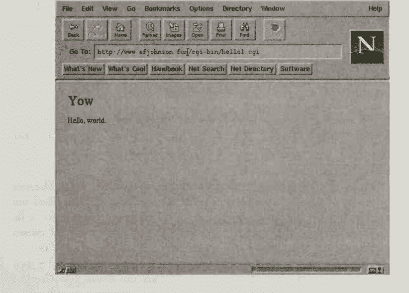

图 9.1 由脚本生成的简单网页。

## 从 Web 浏览器启动 Perl 脚本

如果你遵循了 Web 服务器的正确规范，当你尝试通过 URL 调用此文件时，`hello1.cgi` 脚本将会被执行。

## 安全性和 CGI 脚本

出于安全方面的考虑（这些顾虑是合理的），有些站点根本不允许来自终端用户的 CGI 脚本。其他站点则要求所有 CGI 脚本都放在一个特殊目录中。你需要与系统管理员协商解决这些问题。

## 使用 CGI 模块

虽然有许多与 CGI 相关的 Perl 模块可以帮助你创建 CGI 脚本，但 `CGI.pm` 模块提供了对 CGI 脚本和表单最简单的入门介绍之一。`CGI.pm` 是 Perl 5 的新模块，它取代了在 Perl 4 中常用的 `un-cgi.pl` 和 `cgi-lib.pl`。


请在 `contrib/www` 目录中查找 `CGI.pm` 模块以及其他与 CGI 和 Web 相关的模块。

为了展示 CGI 模块的工作方式，我们可以重新审视前面 `hello1.cgi` 脚本中创建的简单网页。该脚本使用 Perl `print` 命令手动构建网页，输出网页所需的每一段 HTML。

使用 CGI 模块，你可以利用内置子程序来输出 HTML 中较为繁琐的大部分内容。你仍然需要对网页的大量内容调用 `print`，但你可以通过使用 CGI 模块中方便的 `header`、`start_html` 和 `end_html` 子程序来避免处理标题区域等内容。

以下 `hello2.cgi` 脚本使用更便捷的 CGI 模块提供了一个 hello world 网页：

## 第 9 章 用于网页的 Perl

```perl
#!/usr/bin/perl

#
# CGI script using CGI.pm module.
#

use CGI;

$page = new CGI;

# Print page header.

print $page->header;

print $page->start_html(

    -title=>'Hello from perl',

    -BGCOLOR=>'white');

# HTML body

# Heading

print "<h1>Hello</h1>\n";

print "Hello, from perl and the CGI module.";

print "<p>\n"; # Paragraph

# End HTML page.

print $page->end_html;

# hello2.cgi
```

上面 `hello2.cgi` 脚本中的 `-title=>'Hello from perl'` 语法是向子程序指定参数的另一种新形式。`=>` 实际上只是代替了逗号。你可以使用 `=>` 语法来命名要设置的参数及其值。例如，以下对子程序的调用是等价的：

```perl
$page->start_html('Hello from perl',

    'white');

$page->start_html(-title=>'Hello from perl',

    -BGCOLOR=>'white');
```

## 第 9 章 用于网页的 Perl

新语法只是让你可以命名参数。你也可以省略参数名称，使用 `=>` 代替逗号。

由 `hello2.cgi` 脚本创建的网页如图 9.2 所示。

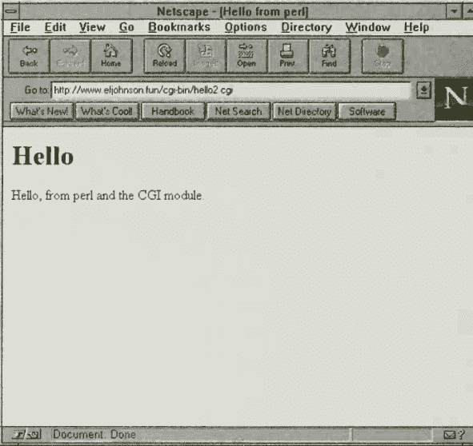

**图 9.2** 第二个 hello 网页。

虽然 `CGI.pm` 脚本是为 UNIX 编写的，但它也可以在 Windows 上工作，但你需要做一些修改。首先，在 `CGI.pm` 文件中，修改声明以下内容的行：

```perl
$OS='UNIX';
```

将其更改为：

```perl
$OS='WINDOWS';
```

此外，要让 CGI 脚本正常工作，你需要根据你的 Web 服务器软件将它们放在特定的位置。有关更多信息，请参阅你的服务器文档。`CGI.pm` 应该适用于 EMWACS、IIS、Purveyor 和 WebSite。

## 测试脚本

CGI 模块的另一个优点是，你可以在将脚本连接到 Web 服务器之前，从命令行对其进行测试。只需运行你的脚本即可。CGI 模块会请求任何输入，你可以通过输入 Control-D（UNIX 的文件结束标记）来结束输入。你需要提供的输入是输入字段的名称及其值（参见后面关于数据输入表单的部分）。然后，你会看到 `hello2.cgi` 脚本输出 HTML，如下所示：

```
(offline mode: enter name=value pairs on standard input)

Content-type: text/html

<HTML><HEAD><TITLE>Hello from perl</TITLE>

</HEAD><BODY BGCOLOR="white"><h1>Hello</h1>

Hello, from perl and the CGI module.<p>
```

这种离线模式有助于你测试脚本。

虽然你可以使用 Perl 自动创建网页，但更有趣的用途是当你添加用户交互并让用户在数据输入表单中填写值时。

## 网页中的数据输入表单

大多数 Web 浏览器都支持某种形式的数据输入。用户填写数据，然后按下“提交”按钮将数据发送到程序——一个 CGI 脚本。然后，CGI 脚本从浏览器中提取数据，处理数据（例如在数据库中查找记录），并输出一个 HTML 网页作为结果。

我们已经介绍了如何使用 Perl 创建网页。下一步是制作一个填空式表单，然后处理该表单。

## Web 表单

所有 HTML 都基于标签的概念，HTML 表单也是如此。要创建数据输入表单，你需要使用 `<FORM>` 标签，如下面的 `form1.htm` Web 文档所示：

## 第 9 章 用于网页的 Perl

```html
<html>

<head>

	<title>Form #1</title>

</head>

<body>

<FORM METHOD="POST"

	ACTION="http://www.efjohnson.fun/~erc/cgi-bin/form1.cgi">

<H2>Customer Order Tracking</H2>

Enter order number:

<INPUT NAME="orderno">

<p>

<INPUT TYPE="submit" VALUE="Look up">

</FORM>

</body>

</html>
```

> 参见附录 A 获取 HTML 参考文献列表。如果这些 HTML 内容让你感到困惑，目前就按原样使用所提供的网页即可。你可以稍后查找更多关于 HTML 的信息。你会发现这些知识对你的职业生涯非常有帮助。

`<FORM>` 标签指定了向脚本发送数据的方法，使用的是 POST 方法（默认）。`ACTION` 部分指定了用于处理表单的 CGI 脚本的 URL。你需要使用 `<FORM>` 标签将所有数据输入标签括起来。（你可以在一个页面上使用多个 `<FORM>` 标签，但这种用法超出了本书的范围。参见附录 A 列出的 HTML 书籍以获取更多信息。）

`<INPUT>` 标签构成了最简单的数据输入字段。默认情况下，`<INPUT>` 标签创建一个文本输入区域。你必须提供一个名称（本例中为 *orderno*）。你将在 Perl 脚本中使用该名称来查找用户在数据输入字段中输入的值。你还可以使用 `<INPUT>` 标签来创建 **Submit** 按钮。用户在输入所有数据后按下此按钮，以将数据提交到 Web 服务器。

数据会被发送到 `<FORM>` 标签中列出的 `ACTION` URL。Web 表单遵循这样的模型：用户输入数据，只有当数据输入完成时，Web 服务器才会将数据发送到你的 CGI 脚本。**Submit** 按钮正是这样做的。

当你在 Web 浏览器中显示此页面时，你会看到类似图 9.3 的内容。

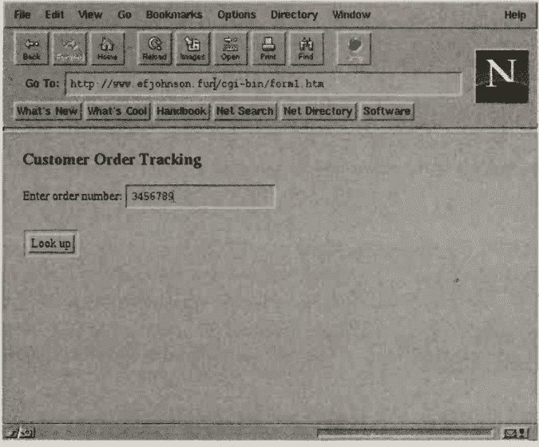

## 处理表单的 Perl 脚本

处理此表单的 Perl 脚本如下：

```perl
#!/usr/bin/perl

#
# CGI script using CGI.pm module.
#

use CGI;

$form = new CGI;

#
# Extract value of order number.

# The name must match the name in

# the Web page for this INPUT field.

#

$orderno = $form->param('orderno');

# Print form header.

print $form->header;

print $form->start_html(

    -title=>'Customer Order Tracking',

    -BGCOLOR=>'white');

# HTML body

# Heading

print "<h1>Your Order Number</h1>\n";

print "Your order number was: $orderno.\n";

print "<p>\n"; # Paragraph

# End HTML form.

print $form->end_html;
```


## form1.cgi

如你所见，`form1.cgi`脚本创建了一个新的HTML网页并打印页面信息，就像之前的`hello2.cgi`脚本一样。在此脚本中，`param`子程序用于查询命名数据输入字段的值，这是新内容。

你必须使用Web表单中数据输入项的名称，本例中为`orderno`。`param`子程序检索用户在该字段中输入的值并返回数据，该数据被放入`$orderno`变量中。（你可以使用任何你想要的变量名。）

`form1.cgi`脚本输出的Web页面如图9.4所示。

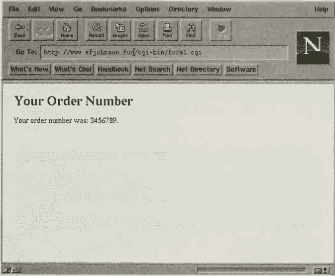

图9.4 Web表单的输出。

## 更多数据输入选项

除了默认的`<INPUT>`文本输入字段外，你还可以使用`<INPUT>`标签创建许多其他数据输入控件。对于`<INPUT>`标签，你可以使用表9.1中列出的任何类型。

### 表9.1 `<INPUT>`标签的类型

| 类型 | 用途 |
|------|------|
| `"text"` | 文本输入字段，默认值。 |
| `"password"` | 输入时显示为掩码的文本输入字段。 |
| `"checkbox"` | 开关复选框。 |
| `"radio"` | 开关复选框，其中相同名称的单选按钮只能选择一个处于开启状态。 |
| `"submit"` | 用于向Web服务器发送数据的特殊按钮。 |
| `"reset"` | 用于将表单重置为原始值的特殊按钮。 |

你可以在网页中使用这些扩展类型，如图9.5所示。

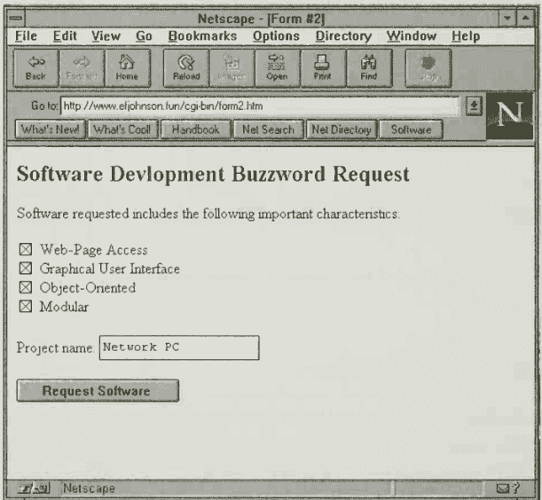

图9.5 添加更多输入类型。

图9.5中页面的HTML如下：

```html
<html>
<head>
<title>Form #2</title>
</head>
<body>
<FORM METHOD="POST"
 ACTION="http://www.efjohnson.fun/~erc/cgi-bin/form2.cgi">
<H2>Software Development Buzzword Request</H2>

Software requested includes the following important
characteristics:

<p>

<INPUT NAME="web" TYPE="checkbox" VALUE="yes">
Web-Page Access

<br>

<INPUT NAME="gui" TYPE="checkbox" VALUE="yes">
Graphical User Interface

<br>

<INPUT NAME="oop" TYPE="checkbox" VALUE="yes">
Object-Oriented

<br>

<INPUT NAME="mod" TYPE="checkbox" VALUE="yes">
Modular

<p>

Project name:
<INPUT NAME="projectname">

<p>

<INPUT TYPE="submit" VALUE="Request Software">
</FORM>
</body>
</html>
```

当用户提交新软件开发请求时，`form2.cgi`脚本会响应一个Web页面，如图9.6所示。

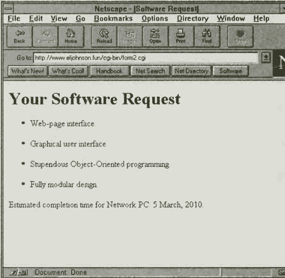

**图9.6** 你将看到你请求的软件。

处理这些数据的脚本如下：

```perl
#!/usr/bin/perl
#
# CGI script for form2.htm.
#
use CGI;

$form = new CGI;

#
# Extract value of buzzwords.
#

$web = $form->param('web');
$gui = $form->param('gui');
$oop = $form->param('oop');
$mod = $form->param('mod');
$proj = $form->param('projectname');

# Print form header.

print $form->header;

print $form->start_html(
    -title=>'Software Request',
    -BGCOLOR=>'white');

# HTML body
# Heading

print "<h1>Your Software Request</h1>\n";
print "<UL>\n";

if ($web eq "yes") {
    print "<LI>Web-page interface.<p>\n";
}

if ($gui eq "yes") {
    print "<LI>Graphical user interface.<p>\n";
}

if ($oop eq "yes") {
    print "<LI>Stupendous Object-Oriented programming.<p>\n";
}

if ($mod eq "yes") {
    print "<LI>Fully modular design.<p>\n";
}

print "</UL>\n";
print "Estimated completion time for $proj: 5 March, 2010.";

print "<p>\n";  # Paragraph

# End HTML form.

print $form->end_html;

# form2.cgi
```

## 滚动列表和选项菜单

除了`<SELECT>`标签外，你还可以使用`<SELECT>`标签来显示滚动列表或选项菜单。对于`<SELECT>`，你必须使用`<SELECT>...</SELECT>`格式。在标签之间，你放置`<OPTION>`标签，用于指定用户可以选择的选项的显示数据。

`<SELECT>`标签必须有一个名称。你还可以指定一个大小，用于控制显示。如果大小为2或更大，选项将以滚动列表形式显示。如果大小为1（或未指定），则显示选项菜单。

图9.7显示了这两种控件。

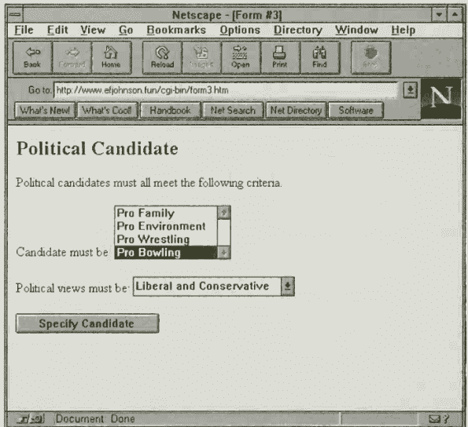

图9.7 在表单中使用`<SELECT>`标签。

此表单的HTML文件如下：

```html
<html>
<head>
<title>Form #3</title>
</head>
<body>
<FORM METHOD="POST"
 ACTION="http://www.efjohnson.fun/erc/cgi-bin/form3.cgi">

<H2>Political Candidate</H2>

Political candidates must all meet
the following criteria:

<p>

Candidate must be:

<SELECT NAME="pro" SIZE=4>
<OPTION>Pro Family
<OPTION>Pro Environment
<OPTION>Pro Wrestling
<OPTION>Pro Bowling
</SELECT>

<p>

Political views must be:

<SELECT NAME="wing" SIZE=1>
<OPTION>Liberal and Conservative
<OPTION>Conservative and Liberal
</SELECT>

<p>

<INPUT TYPE="submit" VALUE="Specify Candidate">

<p>

</FORM>
</body>
</html>
```

在你的CGI脚本中，每个`<SELECT>`标签的值将是所选`<OPTION>`的文本。如果在滚动列表中没有选择任何内容，你的脚本将什么也收不到。

处理此表单的脚本如下：

```perl
#!/usr/bin/perl
#
# CGI script for form3.htm.
#
use CGI;

$form = new CGI;

#
# Extract value of buzzwords.
#

$favor = $form->param('pro');
$wing = $form->param('wing');

# Print form header.

print $form->header;

print $form->start_html(
    -title=>'Political Candidate',
    -BGCOLOR=>'white');

# HTML body
# Heading

print "<h1>Your Candidate</h1>\n";

if ($favor eq "") {
    print "Is in favor of: nothing<p>\n";
} else {
    print "Is in favor of: $favor<p>\n";
}

print "and leans to the $wing views.<p>\n";

# End HTML form.

print $form->end_html;

# form3.cgi
```

## 输入更多文本

`<TEXTAREA>`标签提供了多行文本输入的功能。除此之外，它的作用与`<INPUT>`标签非常相似。表9.2列出了`<TEXTAREA>`标签的属性。

### 表9.2 `<TEXTAREA>`标签的属性

| 属性 | 控制内容 |
|-----------|----------|
| `NAME` | （必填）在Perl脚本中用于提取数据的名称。 |
| `ROWS` | 可见的文本行数。 |
| `COLS` | 可见的文本列数。 |

对于列数，用户的字体大小和浏览器窗口大小决定了用户能看到多少内容。虽然你无法控制这个大小，但我发现60列的值在大多数浏览器上效果良好。

## 添加重置按钮

将`<INPUT>`标签的`TYPE`属性设置为`"reset"`可以创建一个按钮，用于将所有表单字段重置为原始值。你可以使用以下HTML在网页中创建这样的按钮：

```html
<INPUT TYPE="reset" VALUE="Reset Form">
```

我们可以把这些组合起来，创建一个用于输入多行文本的表单，如图9.8所示。

### 第9章 用于网页的Perl

图9.8 输入多行文本。

此网页的HTML源代码如下：

```html
<html>
<head>
<title>TEXTAREA</title>
</head>
<body>
<FORM METHOD="POST"
  ACTION="http://www.efjohnson.fun/erc/cgi-bin/textarea.cgi">

<H2>Political Requests</H2>

How would you solve all the world's problems?

Please enter your suggestion below.

<p>

<TEXTAREA NAME="suggestion" ROWS=12 COLS=60>
Default data goes here.
</TEXTAREA>

<p>

<INPUT TYPE="submit" VALUE="Submit">
<INPUT TYPE="reset" VALUE="Reset Form">

</FORM>
</body>
</html>
```

处理此表单的Perl CGI脚本会创建一个新网页，如图9.9所示。

图9.9 回应用户的建议。

### 第9章 用于网页的Perl

创建此页面的脚本如下：

```perl
#!/usr/bin/perl
#
# CGI script for textarea.htm.
#
use CGI;

$form = new CGI;

#
# Extract value of buzzwords.
#

@suggest = $form->param('suggestion');

# Print form header.

print $form->header;

print $form->start_html(
    -title=>'Thanks',
    -BGCOLOR=>'white');

# HTML body
# Heading

print "<h1>Thanks For Your Suggestion</h1>\n";
print "<hr>";    # Horizontal rule
print "@suggest\n";
print "<p>\n";   # Paragraph
print "<hr>";    # Horizontal rule
print "Thank you!";
print "<p>\n";   # Paragraph

# End HTML form.

print $form->end_html;

# textarea.cgi
```

## 通过命令行传递数据

许多在线数据库允许你直接从超文本链接输入查询，而不是强制你填写表单。其工作原理是链接将查询数据编码到URL中。例如，以下URL实际上是调用一个CGI脚本，并将查询信息作为命令行参数传递：

```text
http://www.efjohnson.fun/cgi-bin/cmdline.cgi?p1+p2+p3+p4
```

Web服务器会将问号`?`之后的所有数据解码为命令行参数。加号字符`+`用于替代URL中的空格。

在前面的例子中，CGI脚本`cmdline.cgi`被调用时，`@ARGV`中包含以下参数：

```text
p1 p2 p3 p4
```

你可以利用这一点，使用如下脚本：

```perl
#!/usr/bin/perl
#
# CGI script for form3.htm.
#
use CGI;

$form = new CGI;

print $form->header;

print $form->start_html(
    -title=>'8-Ball',
    -BGCOLOR=>'white');

print "<h1>Your Answer</h1>\n";
print "Your query was: @ARGV<p>\n";

print "Sorry, ask again later.<p>\n";

# End HTML form.

print $form->end_html;

# cmdline.cgi
```

### 第9章 用于网页的Perl

该HTML文件不使用表单，而是只显示一个超文本链接，如下所示：

```html
<html>
<head>
<title>Command-Line CGI</title>
</head>
<body>
<H2>Online Query System</H2>

Ask the
<A HREF="http://www.efjohnson.fun/erc/cgi-bin/cmdline.cgi?p1+p2+p3+p4">
Internet Eight-Ball</A> to answer your questions.

</body>
</html>
```


这类 CGI 脚本通常被称为`<ISINDEX>`查询。

## 自动维护的网页

任何创建过网页的人都会证实，网页的维护是一件令人头疼的事情。几乎就在你完成页面的同时，新的数据到来或旧的数据过时，你需要更新页面。突然间，你一度有用的网页就因为过时而陷入了废弃状态。Perl 可以帮助创建这种难以实现的自动维护网页。当然，Perl 不能做所有事情，但它肯定可以帮助维护你的 Web 信息。

维护网页的一个问题是对材料进行索引。我的大多数网页都包含多个主题，例如 GroupWise 电子邮件或 ClearCase 配置管理软件的故障排除技巧，或者在 Windows 上运行 Tcl 脚本的常见问题。这些信息表现为大量相关主题，为此我必须维护目录并更新所有链接。主要问题是缺乏时间。手动将新主题添加到文档中并插入新的目录信息需要时间。

因此，由于 Perl 提供了强大的文本处理能力，一种减轻负担的方法是自动生成网页。如果你将每个主题存储为单独的文件，那么你可以使用 Perl 从所有主题创建 HTML 页面。Perl 还可以从用于生成文件的所有主题列表中，生成页面顶部的目录部分。CGI 模块可以帮助输出 HTML 结构。

另一个主要问题是数据更新。网页的用户经常通过电子邮件提交新的技巧。问题在于如何将新技巧插入到网页中。Perl 和 CGI 模块也可以在这方面提供帮助。在你的网页末尾，你可以创建一个数据输入表单，允许任何用户自动添加新主题，从而创建自动维护的网页。用户填写表单，这会创建新主题，而 Perl 自动从所有主题创建新页面。

当然，这并不像听起来那么容易。首先，你可能希望检查所有输入，特别是如果你的页面可以从互联网访问的话。这部分我就留给你了。（记住，用户可能会在他们提供的主题中添加 HTML 标签，而使用现代浏览器，HTML 标签可以控制小程序的下载或其他程序的执行。）

接下来的部分描述了你如何自动化维护网页的许多任务。前面的部分讨论理论，后面的部分展示实现理论的 HTML 页面和 CGI 脚本。你选择自动化的程度取决于你自己，但你会发现你可以将维护网页的许多痛苦自动化掉。即使你不打算创建自动维护的页面，以下部分也广泛使用了用于 CGI 和 HTML 的 Perl，提供了如何使用 Perl 构建网页的示例。

## 从主要部分构建网页

如果每个主题都存储在单独的文件中，你可以使用 Perl 的文件命令读取每个文件并连接这些文件，添加少量 HTML 标签使页面看起来更美观，例如在每个部分标题周围添加 HTML 标题标签。当然，我们希望文件的排序比仅仅连接文件更好一些，还有一个自动生成的目录。为此，你可以利用这样一个事实：你可以在 Perl 变量中存储大量数据，将文本不断添加到标量变量中。

## 在每个部分中添加主题

一种对我很有效的组织方式是将网页划分为主要部分和主题。一个主要部分可以是一个一般主题，比如打印问题。该部分中的一个主题可以是关于使用惠普激光打印机的技巧。我通常发现这种层次结构对技术文档很有效。

为了管理部分和部分中主题的概念，你可以使用 Perl 的关联数组。一个数组`@sections`保存每个部分的名称。

第二个数组保存每个部分中各个主题的文本。这个数组`%topics`是一个关联数组。此关联数组中的键是主题名称，前面加上部分名称以使其唯一（例如，这样多个部分都可以有一个名为“常见问题”的主题）。`%topics`关联数组中的值是主题的实际文本，可以有很多行，全部塞入一个标量值中。这只是实现此方案的一种方式；我相信你可以想出无数种其他方法。

各部分可以通过 HTML 线条分隔，使用`<HR>`标签（水平线——或称为线）。这很容易用`print`命令生成。

## 从主题生成目录

一旦你有一组主题，你肯定希望看到目录，特别是对于大型文档。在 HTML 中，你可以让目录中的每个条目链接到主题的开头，使用 HTML 中的本地跳转。

使用 HTML 定义列表，配合`<DL>`标签，你可以将每个章节名用`<DT>`标记，章节下的每个主题用`<DD>`标记。这将输出如图 9.10 所示的目录。

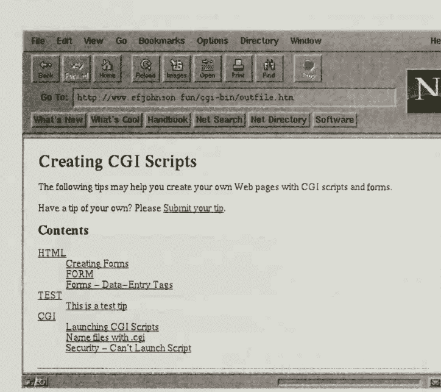

## 允许用户添加主题

要允许用户添加新主题，你只需要一个数据录入表单。处理该表单的 Perl CGI 脚本需要将数据保存到磁盘上的文件中。另一个脚本，即下面的`regen.pl`脚本，会从所有文件（包括新文件）重新生成网页。将脚本分开的原因是出于安全性考虑。

允许用户创建磁盘文件时必须非常小心。因此，用户不会立即看到新主题。相反，你必须自己手动运行`regen.pl`脚本来重新生成网页。这样做是为了强制你检查新主题的内容。因为这些主题将出现在网页上，而网页可以执行脚本和 Java 小程序，所以你必须非常谨慎。虽然这降低了自动化程度，但安全第一，防患未然。

## 响应用户输入

每当用户提供任何信息时，你都应该提供某种形式的反馈，尤其是用户出于好意为你的页面提供信息时。图 9.11 展示了一种反馈页面类型。

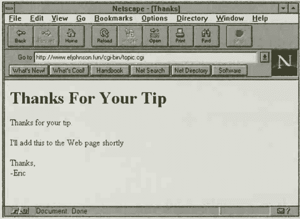

图 9.11 感谢页面

此页面的 HTML 如下：

```html
<html>
<head>
<title>Thanks</title>
</head>
<body>
<H2>Thanks</H2>
Thanks for your tip.
<p>
I'll add this to the Web page shortly.
<p>
Thanks,
<br>
-Eric
<p>
</body>
</html>
```

你可以将此感谢页面保存在单独的文件中，并在运行时加载，或使用 Perl 命令输出该页面。

## 处理错误输入

每当用户可以输入值时，总有可能出现错误输入。如果发生这种情况，你的 CGI 脚本需要能够显示描述问题的 HTML 页面。处理错误的一种方法是向用户宣布一个晦涩难懂的错误消息。（“未发现键盘；按 F1 继续”和“发现牛顿前退化”一直是我最喜欢的错误消息。）

为了构建更健壮的系统，你可能希望静默修复错误。例如，如果用户尝试为已存在的主题输入数据，为什么不直接用新文本扩展该主题呢？（或者，直接忽略主题名称相同的事实，添加一个重复使用相同主题名称的新主题。）如果找不到该章节，则创建一个新章节。这样就几乎没有错误了。

## 创建新主题

当用户输入新主题时，文件会保存到磁盘；脚本会选择一个唯一的文件名。文件存储后，就该重新生成网页了。但是，出于安全考虑，页面不会立即更新。你需要自己运行`regen.pl`脚本来重新生成包含新主题的网页。为了将所有这些整合在一起，处理用户输入新主题的 CGI 脚本如下：

```perl
#!/usr/bin/perl
#
# CGI script for topic.htm.
#
use CGI;

$form = new CGI;

#
# Extract the data.
#
$section = $form->param('section');
$topic = $form->param('topic');
$user = $form->param('user');
@suggest = $form->param('suggestion');

#
# Now, save the data to disk. To do so,
# choose a unique file name.
#
$filename = &Get_filename();

open(OUTPUT, ">$filename") or
die "Can't open $filename";

print OUTPUT "$section\n";
print OUTPUT "$topic\n";
print OUTPUT "$user\n";
print OUTPUT "@suggest\n";

close(OUTPUT);

# Print response.
print $form->header;

print $form->start_html(
    -title=>'Thanks',
    -BGCOLOR=>'white');

# HTML body

# Heading
print "<h1>Thanks For Your Tip</h1>\n";

print "Thanks for your tip.<p>\n";
print "I'll add this to the Web page shortly.<p>\n";
print "Thanks,<br>\n";
print "-Eric<p>\n";

# End HTML form.
print $form->end_html;

#
# Uses a brute-force method to determine a
# unique file name.
#
sub Get_filename {
    my($ found) = 0;
    my($ filename);
    my($ letter) = 65;  # "A"
    my($ i) = 0;

    #
    # Search for a file name.
    #
    while ( ! $ found ) {

        $ filename = chr($ letter) . $ i . ".top";

        #
        # Check if file exists.
        #
        if ( -e $ filename ) {
            $ i++;

            if ($ i > 9999) {
                $ i = 0;
                $letter++;
            }

            #
            # Sanity check.
            # If we have too many files,
            # overwrite last.
            #
            if ($letter > 92) {
                return $filename;
            }
        } else {
            $found = 1;    # Done.
        }
    }

    return $filename;
}

# topic.cgi
```

`topic.cgi`脚本从`topic.htm`网页表单中提取章节标题、主题标题、用户名和建议。然后，脚本在磁盘上找到一个唯一的文件（使用一个可以轻易改进的方法），将数据存储到该文件中。选择的文件名将包括`A0.top`、`A1.top`、`A999.top`、`B0.top`等。`.top`扩展名没有其他含义，只是 topic 的缩写。

整个思路是将每个主题存储在单独的文件中。然后，下面的`regen.pl`脚本将所有单独的主题合并到一个 HTML 文件中供用户查看。

## 生成感谢列表

由于用户如此友好地为你的网页提供信息，你不妨在页面末尾用一个特殊的感谢部分公开感谢他们。如果表单中有让用户输入姓名的部分，这很容易生成。当然，有些用户可能希望将此字段留空。

## 整合所有内容：自动维护的网页

将所有这些单独的主题整合在一起，你会得到一个如图 9.12 所示的数据录入表单。

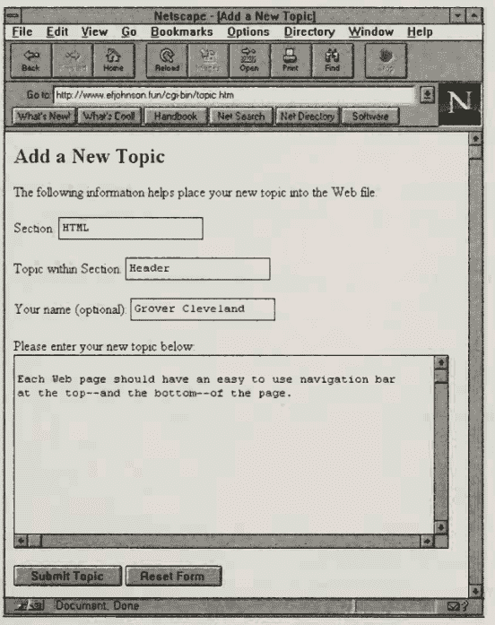

图 9.12 自动维护的网页

此表单的 HTML 如下：

```html
<html>
<head>
<title>Add a New Topic</title>
</head>

<body>

<FORM METHOD="POST"
 ACTION="http://www.efjohnson.fun/~erc/cgi-bin/topic.cgi">

<H2>Add a New Topic</H2>

The following information helps place your new topic
into the Web file:
<p>
Section:
<INPUT NAME="section">
<p>
Topic within Section:
<INPUT NAME="topic">
<p>
Your name (optional):
<INPUT NAME="user">
<p>

Please enter your new topic below:
<TEXTAREA NAME="suggestion" ROWS=12 COLS=60>

</TEXTAREA>
<p>

<INPUT TYPE="submit" VALUE="Submit Topic">
<INPUT TYPE="reset" VALUE="Reset Form">

</FORM>
</body>
</html>
```

此表单是一个单独的页面。你也可以轻松地将表单放入由`regen.pl`脚本创建的主网页中。处理你可能想要在网页中放置的任何额外数据的一种方法是页眉和页脚的概念。页眉和页脚都是简单的 HTML 文档（或者更可能是部分 HTML 文档）。页眉包含在任何自动生成的 HTML 数据之前。页脚添加到文档末尾。

在这种情况下，页眉和页脚都包含指向前面所示`topic.htm`表单的链接。`footer.htm`如下：

```html
Have a tip of your own? Please
<A HREF="topic.htm">Submit your tip</A>.
<p>
</body>
</html>
```

页眉和页脚的存在都是为了让你能够在网页中放置任何你想要的 HTML 元素。例如，你可能想要一个公司徽标或导航栏。

此简单页面使用的页眉如下：

```html
<html>
<head>
<title>Creating CGI Scripts</title>
</head>
<body BGCOLOR='white'>
<H1>Creating CGI Scripts</H1>
The following tips may help you create
your own Web pages with CGI scripts
and forms.
<p>
```

Have a tip of your own? Please

```html
<A HREF="topic.htm">Submit your tip</A>.
```

页眉和页脚都链接到允许用户添加新主题的`topic.htm`页面。如果你愿意，也可以直接将该页面放在页脚中。

页面的其余部分从页眉文件、页脚文件和所有主题文件自动生成。

## 重新生成网页

一个大型 Perl 脚本`regen.pl`重新生成整个网页。为此，它需要从多个来源整合数据，包括：

- 前面所示的页眉 HTML 文件，让你能够为所有网页放置一致的页眉和导航链接。
- 页眉 HTML 文件，同样用于导航链接。
- 你或用户创建的所有主题文件。
- 指向更新表单的链接，如图 9.12 所示。

输出网页遵循类似的格式：

1. 页眉文件的内容。
2. 目录，从所有主题名称生成。
3. 主题本身。
4. 感谢部分，列出所有贡献者的姓名。
5. 表单创建的日期。
6. 页脚文件的内容。

`regen.pl`脚本的工作是将所有这些整合在一起并创建输出网页。由于此脚本在稍后时间运行，它不需要遵循 CGI 脚本的惯例；此脚本不是由 Web 服务器执行的。

相反，你需要从命令行调用`regen.pl`，并提供所有必要的文件。这个脚本看起来有点复杂，但实际上仅使用了前面章节中介绍的 Perl 基础结构。事实上，我相信你可以想出更高效的方法来执行其中某些任务。

`regen.pl`脚本如下：


```perl
#
# Creates a Web page from a series of topics.
#
# Usage:
#   perl regen.pl outfile.htm header.htm footer.htm *.top
#

# Open all files for error-checking.

if ($#ARGV < 3) {
    print "ERROR: Usage is:\n";
    print "perl regen.pl outfile.htm ";
    print "header.htm footer.htm \*.top\n";

    exit;
}

open (OUTFILE, ">$ARGV[0]" ) or
  die "Can't open output file $ARGV[0]";

open (HEADER, $ARGV[1] ) or
  die "Can't open header file $ARGV[1]";

open (FOOTER, $ARGV[2] ) or
  die "Can't open footer file $ARGV[2]";

# Make outfile the default output.
select(OUTFILE);

# Process all topic files.
$i = 3;
while ( $i <= $#ARGV ) {

print STDERR "Reading file \"$ARGV[$i]\"\n";

&Read_topic_file( $ARGV[$i] );

$i++;
}

#
# Now that all the data are read in,
# generate the output.
#

# Process header.
&Header;

#
# Generate a table of contents from all topics.
#
&Generate_contents;

# Process sections and topic output.
&Output_sections;

#
# Output a thank-you list.
#
&Thank_you;

#
# Output a date-stamp.
#
&Date_stamp;

#
# Process footer; this file should contain
# the data-entry form as well as any stylistic
# conventions for your site.
#
&Footer;

# Close all files
close(HEADER);
close(FOOTER);
close(OUTFILE);

#
# Reads in a topic file.
#
# Usage:
#   &Read_topic_file("filename");
#
sub Read_topic_file {

    my($filename) = $_[0];
    my($sectionname);
    my($topicname);
    my($username);
    my($fullname);
    my($data);

    open (TOPIC, $filename) or
        die "Can't open topic file $filename";

    # Topic and section name are first two lines.
    $sectionname = <TOPIC>;
    chomp($sectionname);

    $topicname = <TOPIC>;
    chomp($topicname);

    # Third line is user name or blank.
    $username = <TOPIC>;
    chomp($username);
    &Add_username($username);

    # Add data to topic list.
    $fullname = $sectionname . "/" . $topicname;

    # Read in rest of file.
    $topics{$fullname} = "";

    $data = <TOPIC>;

    while ($data) {
        chomp($data);
        if ($data eq "") {
            # Add paragraph markers.
            $topics{$fullname} = $topics{$fullname} . "<p>\n";
        } else {
            $topics{$fullname} = $topics{$fullname} . $data . "\n";
        }
        $data = <TOPIC>;
    }

    close($filename);

    # Add section, if new.
    &Add_section($sectionname);
}

#
# Adds a section to the list of
# sections, if new.
#
# Usage:
#    &Add_section("sectionname");
#
sub Add_section {
    my($sectionname) = $_[0];
    my($element);
    my(@section_list) = @sections;

    #
    # Check if section name is
    # already present. See
    # if you can find more
    # efficient ways to check.
    #
    foreach $element (@section_list) {

        if ($element eq $sectionname) {
            return;
        }
    }

    # If no match, add item to list.
    unshift(@sections, $sectionname);
}

#
# Adds user name to list; may be blank.
#
# Usage:
#   &Add_username($username);
#
sub Add_username {
    my($user) = $_[0];
    my($element);
    my(@user_list) = @userlist;

    #
    # Check if user name is
    # already present. See
    # if you can find more
    # efficient ways to check.
    #
    foreach $element (@user_list) {

        if ($element eq $user) {
            return;
        }

        # If no match, add item to list.
        unshift(@userlist, $user);
    }
}

#
# Reads in header file and outputs it.
# Assumes:
#    a) Header file handle HEADER is opened.
#    b) Header file has valid HTML.
#
# Usage:
#    &Header;
#
sub Header {
    my(@data) = <HEADER>;

    print "@data\n";
}

#
# Reads in footer file and outputs it.
# Assumes:
#    a) Footer file handle FOOTER is opened.
#    b) Footer file has valid HTML.
#
# Usage:
#    &Footer;
#
sub Footer {
    my(@data) = <FOOTER>;

    print "@data\n";
}

#
# Generates a table of contents
# as a <DL> list.
#
sub Generate_contents {

    my($sect);
    my($shortname);
    my($topicname);
    my(@sorted);
    my(@topic_list);

    print "<H2>Contents</H2>\n";

    # Use a definition list for Contents.
    print "<DL>\n";
    foreach $sect (@sections) {
        # For each section, a DT tag.
        print "<DT><A HREF=\"\#$sect\">$sect</A>\n";

        # For each topic in a section,
        # a DD tag. All topic names start
        # with the section name.
        @topic_list = keys(%topics);

        @sorted = sort(@topic_list);

        foreach $topicname (@sorted) {

            if ($topicname =~ /^$sect/) {
                $shortname =
                    &Get_topic_name($topicname);

                print "<DD><A HREF=\"\#$topicname\">";
                print "$shortname</A>\n";
            }
        }
    }

    print "</DL><p>\n";
}

#
# Outputs all the sections.
#
sub Output_sections {
    my($sect);

    foreach $sect (@sections) {
        # Separate sections with a line.
        print "<p><hr><p>\n";

        # Anchor hypertext link.
        print "<H2><A NAME=\"$sect\">$sect</A></H2>\n";

        # Output topics.
        &Output_topics($sect);
    }
}

#
# Outputs all the topics of a section.
#
# Usage:
#    &Output_topics("sectionname");
#
sub Output_topics {
    my($sectionname) = $_[0];

    my(@topic_list);
    my(@sorted);
    my($topicname);
    my($shortname);

    # All topic names start with
    # the section name.
    @topic_list = keys(%topics);

    @sorted = sort(@topic_list);

    foreach $topicname (@sorted) {

        # Check if topic is part of section
        if ($topicname =~ /^$sectionname/ ) {

            $shortname =
                &Get_topic_name($topicname);

            # Print topic header and
            # hypertext anchor.
            print "<b><A NAME=\"$topicname\">";
            print "$shortname</A></b><p>\n";

            # Print topic data.
            print "$topics{$topicname}<p>\n";
        }
    }

    #
    # Returns topic name from the
    # Section:Topic passed in.
    #
    # Usage:
    #   &Get_topic_name($fullname);
    #
    sub Get_topic_name {
        my($topicname) = $_[0];
        my($pos);
        my($shortname);

        $pos = index($topicname, "/") + 1;

        $shortname = substr($topicname, $pos);

        return $shortname;
    }
}

#
# Outputs thank-yous.
#
sub Thank_you {

    my($user);

    if (@userlist) {
        print "<p><hr><p>\n";
        print "<b>Thanks to the following:</b><p>\n";
    }

    foreach $user (@userlist) {
        print "$user<br>\n";
    }

    print "<p>\n";
}

#
# Outputs a date-stamp.
#
sub Date_stamp {

    $t = time();

    ($sec, $min, $hour, $dom, $mon,
     $year, $wday, $yday, $isdst) =
      localtime($t);

    $year += 1900;

    # Provide English equivalents.
    @months = ("January", "February",
               "March", "April", "May",
               "June", "July", "August",
               "September", "October",
               "November", "December");

    print "Output on $dom $months[$mon], $year.\n";
    print "<p><hr><p>\n";
}
# regen.pl
```

要执行此脚本，你需要传递输出文件名、页眉文件、页脚文件以及所有主题文件的名称：

```
perl regen.pl outfile.htm header.htm footer.htm *.top
```

利用 Perl 处理网页还可以做很多更多事情。请查阅 CD-ROM 上的 `libwww`、`HTTPD` 和 `CGI` 模块，以获取更多巧妙的创意以及实现这些功能的 Perl 子程序。


## 总结

通用网关接口（CGI）的核心思想是，你可以将网页的概念扩展为一个恰好以网页作为输出的程序。Web 浏览器随后显示该程序的输出，并将该输出视为 HTML 文件。绝大多数此类 CGI 程序都是 Perl 脚本。

超文本标记语言（HTML）是 Web 的 *通用语言*。Web 浏览器将 HTML 文档中的标签解释为格式化或链接 (超文本) 信息。因此，如果你在创建交互式 Web 文档，你的 CGI 脚本必须使用正确的 HTML 标签来输出数据。

虽然有很多与 CGI 相关的 Perl 模块可以帮助你创建 CGI 脚本，但 `CGI.pm` 模块提供了最简单的 CGI 脚本和表单入门指南之一。

所有 HTML 都是基于标签的概念，HTML 表单也是如此。要创建数据输入表单，你需要使用 `<FORM>` 标签。`<INPUT>` 标签构成最简单的数据输入字段。`<SELECT>` 标签显示一个滚动列表或选项菜单。而 `<TEXTAREA>` 标签则提供多行文本输入。

在第 10 章中，你将看到如何将 Perl 用于跨平台应用程序开发。

## 本章介绍的 Perl 命令

- `CGI::end_html`

- `CGI::header`

- `CGI::param`

- `CGI::start_html`

# 第 10 章

## 用于跨平台开发的 Perl

本章涵盖的内容包括：

- 在 Perl 的帮助下构建你的软件

- 在构建任务完成时发送电子邮件

- 在代码更改时自动重新构建

- 软件环境中的 Perl

- 自动化测试

- 扫描包含文件

- 使用 Perl 生成文档

- 使用 Perl 生成代码

### 自动化软件开发流程


许多软件开发任务都可以实现自动化。每个使用`make`的人都知道这一点。Perl 非常适合这个场景，因为它运行在许多平台上，并且没有在不同版本的`make`（尤其是 Windows 上的`nmake`）中会出现的那种特有问题。

由于每个站点倾向于使用不同的软件开发流程，且使用的计算机语言多种多样，因此本章的大部分内容必然是理论性的。即便如此，你会对 Perl 能在多少个领域提供帮助感到惊讶。Perl 在自动化软件开发中最有效的领域包括：源代码的检入（check in）和检出（check out）、测试脚本以及在需要时启动构建。主要领域分为两大类：在 Perl 的帮助下构建软件，以及在软件开发环境中使用 Perl。

## 在 Perl 的帮助下构建你的软件

如果你从事任何大型应用程序或应用程序套件的开发，你很可能有一套脚本来帮助自动化构建和维护该软件的一些平凡任务。此外，这些脚本还可以为软件开发流程提供某种统一性，例如确保所有检入主目录的软件都附带测试脚本。

你可能已经使用这些脚本一段时间了。我们中的许多人在多个平台上工作，用脚本隐藏平台差异是非常有效的。此外，Perl 处理复杂任务的能力远强于 Bourne shell 或 DOS 批处理文件，这使得你的脚本更容易更改和更新。

请参考以下章节，寻找 Perl 在你的环境中发挥最佳作用的灵感。

## 在任务完成时发送电子邮件

如果你开发大型应用程序，典型的编译和链接构建过程可能需要很长时间才能完成。对于 Dimen7186 来说，我已经习惯了彻夜构建。当我早晨到达时，我希望收到一条状态消息，告知我构建是否完成。一种方法是给你发送一封电子邮件。一条简短的消息可以描述失败的原因，或者在一切顺利时为你加油。

第 6 章介绍了如何使用管道调用 UNIX `mail` 程序来启动邮件可执行文件。一种更优雅的方法是使用`Mail::Send`模块。

`Mail::Send`模块位于`contrib/mail`目录中。

要使用该模块发送电子邮件，你首先需要使用如下命令创建一个新的邮件对象：

```perl
$msg = new Mail::Send(
    Subject=>'Build completed',
    To=>'erc');
```

`Subject=>`指定电子邮件的主题行，而`To=>`参数包含接收者的电子邮件地址。

一旦你有了新的邮件对象（在本例中为`$msg`），你就可以创建一个邮件句柄（类似于文件句柄），并使用熟悉的 Perl `print`命令来打印你的邮件内容。完成后，你需要关闭邮件句柄。

发送简单消息的代码如下：

```perl
#
# Test of Mail::Send
# to send an email
# message when a
# software build completes.
#
use Mail::Send;

# Create header.

$msg = new Mail::Send(
    Subject=>'Build completed',
    To=>'erc@yonsen.com');

$msg->cc('dev_staff@yonsen.com');

# Create message.
$mail_handle = $msg->open;

print $mail_handle "The software build";
print $mail_handle " has completed successfully.\n";
print $mail_handle "Oh, joy!\n";

# Send message.
$mail_handle->close;

# mailbld.pl
```

`Mail::Send`模块假设你使用的是 UNIX 系统，并尝试使用`sendmail`命令来实际投递邮件。

## 在代码更改时自动重新构建

如果你习惯于 C 或 C++ 开发，通常会有许多源文件（C 或 C++）和某种形式的`Makefile`。`Makefile`包含一组规则，描述如何编译应用程序以及哪些源文件依赖于哪些其他文件。`make`已被使用了多年，是一个非常方便的工具，主要是因为当源文件更改时，`make`仅重新编译必要的模块。这非常有帮助，因为编译通常需要很长时间，你必须等待。问题是你必须手动启动`make`，通常是在更改某些源文件之后。

在典型的多窗口环境中，你会并在一个或多个窗口中编辑，然后在另一个窗口中启动`make`。如果你使用的是集成环境（如 Microsoft Visual Studio），你会启动环境来重新构建应用程序。然而，Perl 可以代替你手动重启`make`（或你使用的任何工具）。利用第 3 章中描述的 Perl 函数，你可以编写一个 Perl 脚本来检查目录中的文件。如果任何文件的修改时间晚于上一次执行`make`（或你的构建命令）的时间，那么就该再次运行该命令了。

第 3 章中描述的`stat`函数可以提供文件的修改时间。`glob`函数可以获取给定目录中所有文件的列表。不过，你可能只对某些类型的文件感兴趣，例如所有以`.c`结尾的文件。`glob`函数在扫描这些文件名方面表现出色。（有关这些函数的更多信息，请参阅第 3 章。）

利用这些 Perl 函数，Perl 脚本可以监控所有 C 文件，并在任何文件更改时启动`make`命令。为了避免占用过多系统资源，你可以调用`sleep`函数（见第 6 章），在每次扫描目录之间等待（例如）5 秒。实现此类监控脚本的一种方法如下：

```perl
#
# Checks a directory. If modified,
# that is, if a file inside the
# directory changed, then launches
# a build script.
#
# Usage:
# perl scandir.pl .ext "command" sleep
#
# Where "command" is the command to
# run when a file changes.
#
# For example:
#
# perl scandir.pl .c make 5
#
```

```perl
$extension = $ARGV[0];
$command   = $ARGV[1];

if ($#ARGV > 1) {
    $sleep_time = $ARGV[2];
} else {
    $sleep_time = 5;  # Default 5 seconds.
}

$last_time = 0;
```

```perl
# Loop forever.
while (1) {

    #
    # Check directory.
    #
    $last_changed = &check_directory( $extension );

    #
    # If any files have changed,
    # launch command.
    #
    if ( ($last_changed != $last_time)
      && ($last_time != 0) ) {

        $status = `$command`;

    }

    # Store modification time for next
    # iteration.
    $last_time = $last_changed;

    #
    # Sleep for a while.
    # Adjust this to a higher value
    # for a longer delay between
    # checks.
    #
    sleep $sleep_time;

}

#
# Checks a directory and returns
# latest modified time.
#
# Parameter 0 is the file-name extension.
```

## 第 10 章 用于跨平台开发的 Perl

```perl
# 例如，.cxx。
#
sub check_directory {
    my($extension) = $_[0];
    my(@list);
    my($name);
    my($last_time) = 0;

    # 获取匹配的文件名。
    @list = glob("*$extension");

    foreach $name (@list) {

        ($dev, $inode, $mode, $nlink,
         $uid, $gid, $rdev, $size, $atime,
         $mtime, $ctime, $blksize, $blocks) = stat($name);

        if ($mtime > $last_time) {
            $last_time = $mtime;
        }
    }

    return $last_time;
}

# scandir.pl
```

`scandir.pl`脚本接受一个文件名扩展名（例如`.cxx`、`.c`或`.pl`）、一个要执行的命令（例如`make`或`nmake`）以及一个可选的秒数，用于在两次目录扫描之间休眠（默认为 5 秒）。

PC 时钟非常容易出现严重不准的情况。我的一些早期的`scandir.pl`脚本测试就是被 PC 时钟“打败”的，因为根据 PC 时钟显示，我的一些文件是在遥远的未来日期被修改的。如果在 Windows 上使用`scandir.pl`遇到问题，请检查`DIR`命令报告的、您关心的文件的日期以及当前的时钟设置。

如果自上次命令执行以来有任何文件被修改，`scandir.pl`会使用反引号方法`` `$command` ``来启动您的命令。这种方法在 Windows 和 UNIX 上都有效。然而，这种进程执行方式存在一些缺点。您可能希望使用第 6 章中展示的`system`函数或其他技术。例如，在使用`scandir.pl`时，您可以让它监视当前目录下的所有`.c`文件，并在其中任何一个文件发生更改时，使用以下命令简单地执行`make`：

```bash
perl scandir.pl .c make
```

调用`make`相当简单。如果您在网络环境中工作，那么您知道通过网络链接编译代码往往是一个非常缓慢的过程。您可能希望在本地机器上编辑文件，然后当文件发生更改时，将其复制到网络上的远程机器并在那里进行编译。或者，您可能希望在本地编译，然后将新更改的文件复制回文件通常所在的网络主机。在这种情况下，`scandir.pl`执行的命令变得越来越复杂，这使得`scandir.pl`变得更加有用。

`scandir.pl`脚本只是 Perl 可以帮助您构建环境的一个例子。

## 在软件环境中使用 Perl

如果您正在开发软件，我希望您使用某种形式的版本控制软件，以便在出现问题时能够重新创建旧版本的文件。对我来说，很多事情*已经*出了问题，所以我总是尝试使用此类工具。大多数站点使用免费软件工具，如 RCS（修订控制系统）、SCCS（源代码控制系统）或商业工具，如 PVCS 或 ClearCase。

所有这些工具使用不同的命令来签入和签出文件，以及提取文件的不同版本。您可以使用 Perl 将这些经常被遗忘的命令隐藏在简单的名称后面，如`check_in`或`check_out`。

在 Windows 上，您应该使用`pl2bat.bat`批处理文件将 Perl 脚本转换为 DOS 批处理文件，这样您只需键入文件名即可执行脚本。

## 自动化测试

Perl 还可以帮助进行自动化测试，包括启动执行测试的命令和解析测试结果。大多数代码测试会产生大量的文本输出，这些输出必须以某种方式与期望的结果进行比较，以查看测试是否通过。如果您的测试输出文本文件，Perl 就成为在文本中搜索问题的绝佳工具。

## 扫描包含文件

C 和 C++ 代码使用大量的包含文件，它们的作用与 Perl 的`use`和`require`语句非常相似。通常，C 或 C++ 代码包含的文件又会包含其他文件，而这些文件又包含其他文件，依此类推。如果您需要弄清楚哪些文件依赖于哪些其他文件，您需要跟踪这个包含文件树。

为此，`C::Scan`模块就派上了用场。

此模块不是标准 Perl 的一部分，因此您需要安装它。请查看 CD-ROM 上的`contrib/softdev`目录。

`C::Scan`模块允许您扫描 C 代码文件（此模块不理解 C++）以获取所有包含的文件，以及这些文件包含的所有文件，依此类推。为此，您需要提供两样东西：要检查的 C 文件的名称，以及在代码中设置或传递给编译器的任何宏定义。最常见的宏定义是告诉`C::Scan`关于包含文件的非标准位置。例如，在惠普系统上，X Window 包含文件位于`/usr/include/X11R5`，这是一个非标准位置。

要开始使用`C::Scan`模块，您需要从`use`语句开始：

```perl
use C::Scan;
```

然后设置要扫描的文件及其包含的文件：

```perl
$c = new C::Scan 'filename' => 'filename.c';
```

要获取 C 文件所依赖的文件列表：

```perl
@inclist = @{$c->get('includes') };
```

此语句完成后，列表`@inclist`包含所有包含文件。您可以使用以下代码进行测试：

```perl
#
# 使用 C::Scan 模块
# 生成包含文件列表。
#
# 用法：
#
# perl cscan.pl filename "-I/includedirs"
#
use C::Scan;

$filename = $ARGV[0];
$incdirs  = $ARGV[1];

$c = new C::Scan 'filename' => $filename;

if ( $#ARGV >= 1) {
    $c->set('Defines' => $incdirs);
}

#
# 获取包含的文件列表。
#
@inclist = @{$c->get('includes') };
```

```perl
@sorted = sort( @inclist );

foreach $incfile (@sorted) {

    print "$incfile\n";
}

# cscan.pl
```

## 使用 Perl 生成文档

文档编写的一个大问题是，当代码更新时，文档会过时。这个软件工程中的经典问题需要纪律，但往往只是引发了更多的相互指责。解决此问题的一种方法是使用 Perl 或其他工具从代码生成文档，通常是从代码中特殊格式的注释生成。

许多公司规定，无论使用何种编程语言，每个函数都应以特殊格式的头注释块开始。此注释块描述函数和所使用的任何算法。在大多数情况下，您应该为这些注释块遵循特定的格式（否则您会遇到老板的麻烦）。

如果您的站点使用类似的东西，您可以利用 Perl 的字符串处理能力来提取函数文档，从而创建一种更简便的方式来查找源代码库中关于函数的信息。例如，您可能想创建一个交叉引用，甚至一个超文本链接的 HTML Web 文档。

这里的理论是，在所有文档来源中，代码——以及代码中的注释——比任何其他东西都更有可能是正确的。外部文档通常会随着代码的更改而过时。当然，代码中的注释也可能过时，但此类差异更容易发现和纠正。此外，直接从代码（而非注释）提取的任何文档都保证是正确的，因为它是实际的代码。例如，通过提取类定义和成员函数签名，您可以在文档化 C++ 库方面取得很大进展。

## 使用 Perl 生成代码

您可以广泛使用 Perl 来帮助从代码生成文档。关键是找到触发器——格式化的注释——用于开始将特定注释与特定函数关联起来。一旦您捕获了这些信息，其余部分就相当直接了。因为您的站点无疑使用不同的编码标准，所以您需要自己开发这部分。

前几章展示的一些技巧可能会有所帮助。请重新查看第 9 章关于网页的内容。HTML 格式已经无处不在，几乎所有平台都有浏览器可用。使用 HTML 提供了一种简便的方法来创建带有超文本链接的格式化文档。例如，您可以将函数参数中使用的每个类或结构链接到该类或结构的定义。此外，第 9 章中的`regen.pl`脚本使用 Perl 关联数组为所有主题创建目录。您可以使用相同的技术为函数或类定义生成目录。这非常方便，因为 Perl 的数组可以无限增长（实际界限是系统虚拟内存的限制，但这是一个相当大的界限）。因此，您可以直接将数据放入数组以供以后使用。

如果您可以使用 Perl 从 C 或 C++ 代码生成文档，那么为什么不能使用 Perl 生成代码呢？您可以，尽管这并不容易。C++ 类的一个常见苦差事是，为您创建的每个新 C++ 类填写大量样板成员函数。例如，您的站点可能要求每个 C++ 类提供一个输出调试信息的`Debug()`成员函数、一个打印类中数据的`Print()`成员函数（或`ostream <<`运算符），以及将类数据写入磁盘的`ToFile()`和`FromFile()`成员函数。所有这些函数都可能是虚拟的，并且都共享相同的函数签名。

如果您面临类似的情况，您可以使用 Perl 为新类生成 C++ 头文件的开头部分。Perl 脚本填充了对所有类都相同的部分样板；然后您只需填写新材料（当然，还有样板函数的函数体）。

您可以构建一个脚本来创建 C++ 类头文件的样板部分。以`genclass.pl`脚本作为指导：

## 第 10 章 用于跨平台开发的 Perl

```perl
#
# Use of Perl to generate part of
# a C++ class definition. You'll
# need to modify this for your
# site.
#
# Usage:
# perl genclass.pl classname \
#     "parent(s)" "purpose" > outfile
#
```


```perl
if ($#ARGV < 2) {

    print "Error: Usage is:\n";
    print "perl genclass.pl classname ";
    print "\"parent(s)\" \"purpose\"\n";

    exit;
}
```

```perl
$classname = $ARGV[0];
$parents   = $ARGV[1];
$purpose   = $ARGV[2];
```

```perl
#
# This implementation of ToFile
# and FromFile requires stdio.h.
#
print "#include <stdio.h>\n\n";
```

```perl
#
# Beginning comment block.
# Fill in as needed.
#
print "//\n";
print "// CLASS\n";
print "//\t $classname\n";
```

```perl
print "//\n";
print "// DESCRIPTION\n";
print "//\t $purpose\n";
print "//\n";

# Class definition.
print "class $classname : public $parents\n";
print "{\n";
print "public:\n";
print "\n";

# Constructors.
print "\n";
    # Default constructor.
print "\t $classname();\n";
print "\n";

    # Copy constructor.
print "\t $classname($classname& copy);\n";
print "\n";

# Destructor.
print "\t virtual ~$classname();\n";
print "\n";

# Common functions. Add yours here.
print "\t // Prints contents of class.\n";
print "\t virtual Print();\n";
print "\n";
print "\t // Displays debugging info.\n";
print "\t virtual Debug();\n";
print "\n";
print "\t // Saves data to file.\n";
print "\t virtual ToFile(FILE* fp);\n";
print "\n";
print "\t // Reads data from file.\n";
print "\t virtual FromFile(FILE* fp);\n";
print "\n";
```

```perl
# Rest of class body.
print "protected:\n";
print "\n";
print "private:\n";
print "\n";

print "}; \t // $classname\n";
print "\n";
print "\n";

# genclass.pl
```

您需要修改`genclass.pl`以更好地适应您所在站点的 C++ 类。

使用`genclass.pl`非常简单。例如，假设您想创建一个名为`DisplayObject`的类，该类派生自名为`BaseObject`的 C++ 类。您可以使用以下命令行来调用`genclass.pl`脚本：

```bash
perl genclass.pl DisplayObject BaseObject \
    "Base class for display objects" > dispobj.h
```

这将创建一个名为`dispobj.h`的 C++ 头文件，内容如下：

```cpp
#include <stdio.h>

//
// CLASS
//     DisplayObject
//
// DESCRIPTION
//     Base class for display objects
//
class DisplayObject : public BaseObject
{
public:

    DisplayObject();
```

```cpp
DisplayObject(DisplayObject& copy);

virtual ~DisplayObject();

// Prints contents of class.
virtual Print();

// Displays debugging info.
virtual Debug();

// Saves data to file.
virtual ToFile(FILE* fp);

// Reads data from file.
virtual FromFile(FILE* fp);

protected:

private:

};    // DisplayObject
```

如果您的类继承自多个基类，只需将类名作为一个参数传递即可，例如`"Base1, Base2"`。

使用像`genclass.pl`这样的脚本可以减少创建新 C++ 类时的大量乏味工作。

## 总结

本章介绍了一些可以使用 Perl 来辅助软件开发的领域。其中大多数领域是以您可以在站点中使用的想法形式出现，而不是可以直接放入应用程序中的代码。在这些实用领域中包括`Mail::Send`模块，您可以使用它在系统构建完成时发送电子邮件。

如果您使用多窗口担负

# 第 11 章 用于客户端-服务器的 Perl

`FILEHANDLE`的作用就像我们到目前为止使用的 Perl 文件句柄一样。`$domain`指定协议族，基本上用于告知你是想要一个 Internet 套接字`PF_INET`，还是一个 UNIX 域套接字`PF_UNIX`（后者仅用于单机通信）。其他可能的值包括：`PF_802`、`PF_APPLETALK`、`PF_CCITT`、`PF_CHAOS`、`PF_DATAKIT`、`PF_DECnet`、`PF_DLI`、`PF_ECMA`、`PF_GOSIP`、`PF_HYLINK`、`PF_IMPLINK`、`PF_INET`、`PF_LAT`、`PF_MAX`、`PF_NBS`、`PF_NIT`、`PF_NS`、`PF_OSI`、`PF_OSINET`、`PF_PUP`、`PF_SNA`、`PF_UNIX`、`PF_UNSPEC`以及`PF_X25`。

`$type`决定了要创建哪种类型的套接字。你可以使用以下其中之一：`SOCK_DGRAM`、`SOCK_RAW`、`SOCK_RDM`、`SOCK_SEQPACKET`或`SOCK_STREAM`。其中最有用的是用于 UDP 数据报的`SOCK_DGRAM`和用于 TCP 应用中那种基于流的套接字的`SOCK_STREAM`。

这些值定义在 Socket 模块中。

在撰写本文时，Windows 版本的 Perl 还不支持 Socket 模块。如果你在 Windows 上运行，可以将变量`$PF_INET`设置为 2，将`$SOCK_STREAM`设置为 1，如下所示：

```perl
$PF_INET = 2;
$SOCK_STREAM = 1;
```

然后，在你的脚本中，需要将所有对`PF_INET`的使用更改为`$PF_INET`，将`SOCK_STREAM`更改为`$SOCK_STREAM`。

`$protocol`保存你想要使用的协议编号。获取此编号的最佳方法是调用`getprotobyname`：

```perl
$proto = getprotobyname("udp");
$proto = getprotobyname("tcp");
```

最常见的套接字类型使用 TCP。你可以使用以下代码创建此类套接字：

```perl
use Socket;

$proto = getprotobyname("tcp");

socket(SOCKET, PF_INET, SOCK_STREAM, $proto);
```

## 使用 Socket 模块

Socket 模块（Perl 5.002 标准配备）处理了许多设置基于套接字通信的琐碎工作。它包含了`PF_INET`、`SOCK_STREAM`等数值的定义。如果你不使用 Socket 模块，就需要自己查找这些值的数值。（请查看`/usr/include/sys/socket.h`或`/usr/include/sys/socket.h`所包含的某些文件。）

## 构建服务器

使用`socket`函数创建套接字后，下一步是将套接字绑定（bind）到特定的网络地址和端口号。其语法为：

```perl
bind(SOCKET, $address);
```

你需要使用地址类型（始终是常量`PF_INET`）、Internet 地址和端口号来打包`$address`。

> Internet 地址是你想要通信的主机地址。对于服务器应用程序，如果你想允许如此开放的连接，可以使用常量`INADDR_ANY`来代表任何机器上的任何客户端。这很有用，因为服务器进程并不总是能预先知道哪些进程将会连接。
>
> 你可以使用`0,0,0,0`代替`INADDR_ANY`。

## Internet 地址

主机在 Internet 上的地址由四个字节组成，例如`192.68.41.118`。这个组合数字标识了网络上的一台机器，无论是在 Internet 上还是在本地网络上。

> 注意：尽管目前的工作旨在扩展 Internet 地址中使用的字节数，但现在我们只有四个字节。

你可以使用 Socket 模块的`sockaddr_in`子程序来构建用于`bind`的`$address`值，形式如下：

```perl
sockaddr_in($port, $internet_address);
```

`$port`是要使用的端口号。你需要选择一个开放端口。`$internet_address`是打包后的 AF_INET 常量和 Internet 地址。

你可以从`inet_aton`子程序获取给定主机名的 Internet 地址：

```perl
$iaddr = inet_aton($hostname);
```

你需要将`$hostname`设置为要连接的机器名称。

将这些结合起来，服务器应用程序将如下调用`bind`：

```perl
bind(SOCKET, sockaddr_in($port, INADDR_ANY) );
```

**WINDOWS** 在没有 Socket 模块的情况下，你需要做更多工作来生成 Windows 上`bind`所使用的地址值。

以下代码可在 Windows 上运行，用于服务器进程调用`bind`：

```perl
$PF_INET = 2;

# 使用任意端口号。
$port = 2345;

# 用于打包 Internet 地址的模式。
$pattern = 'S n C4 x8';

# 使用 0.0.0.0 创建一个地址。
$this_addr = pack($pattern,$PF_INET, $port, 0,0,0,0);
```

```perl
# 将套接字绑定到端口号。
bind(SOCKET, $this_addr)
    || die "Can't bind: $!";
```

上述代码引入了一个新函数`pack`，你可以用它将数据打包成二进制模式。这对于生成`bind`所需的数据是必要的。（在使用了 Socket 模块的情况下，`sockaddr_in`子程序会为你调用`pack`。）请查阅在线文档以了解更多关于`pack`的信息。

## 检查开放端口

服务器应用程序需要使用一个开放的端口号。（客户端应用程序则期望服务器进程已经设置好了端口号。）要查找开放的端口号，你可以使用`getservbyport`函数，如下所示：

```perl
$port = 2345;
while (getservbyport($port, "tcp") ) {
    $port++;
}
```

这里作为起点的端口号 2345 是纯粹随机的。

请记住，客户端和服务器都需要知道端口号。这可能会削弱检查开放端口号的意义。

在创建套接字并将其绑定到端口号后，下一步是在套接字上监听传入的连接。实现方法是调用`listen`函数：

```perl
listen(SOCKET, $queue);
```

`$queue`是可以排队等待服务的进程数量。对于我们的简单需求，值设为 1 就足够了。

一旦脚本设置好在套接字上监听，下一步就是使用`accept`函数接受传入的连接：

```perl
accept(CLIENT, SERVER);
```

`SERVER`是通过调用`socket`创建的套接字的文件句柄。`CLIENT`套接字是一个新创建的文件句柄，代表与子进程的连接。`accept`函数从已经设置好的`SERVER`套接字创建`CLIENT`套接字。这样分离的原因是为了允许服务器在`SERVER`套接字上继续监听其他客户端连接，同时使用`CLIENT`套接字与该客户端进行读写。一个服务器可以通过为每个传入的客户端连接调用`accept`来服务多个客户端，每次连接都会生成一个新套接字。

调用`accept`后，你可以使用`print`将数据通过套接字发送给客户端。你可以使用 Perl 的文件读取命令从套接字读取数据，例如第 3 章中描述的`$data = <CLIENT>`。

当进程使用完`CLIENT`文件句柄后，记得关闭它，就像处理任何文件句柄一样。

将所有这些结合起来，你可以参考以下脚本创建一个非常简单的服务器进程：

```perl
#
# 一个 Perl TCP 服务器示例。
# 使用 Socket 模块。
#
use Socket;

# 使用任意端口号。
$port = 2345;

# 协议是 TCP。
$proto = getprotobyname("tcp");

# 创建套接字。
socket(SERVER, PF_INET, SOCK_STREAM, $proto)
    || die "Can't create socket: $!";

# 将套接字绑定到端口号。
bind(SERVER, sockaddr_in($port, INADDR_ANY) )
    || die "Can't bind: $!";
```

```perl
# 监听传入连接。
listen(SERVER,1)
    || die "Can't listen: $!";

print "Server listening on port $port\n";

#
# 永远循环，向每个
# 连接的客户端发送一条消息。
#
for ( ; $paddr = accept(CLIENT,SERVER); close(CLIENT) ) {

    # 向客户端发送消息。
    print CLIENT "Hello from server.\n";

}
```

### `server.pl`

上述脚本只需向任何连接的客户端发送一条消息（Hello from server.）。整个连接逻辑由`for`循环处理，该循环调用`accept`，然后在循环重新开始时关闭`CLIENT`文件句柄。

> **注意**：基于此模型的典型服务器会 fork 一个新进程来处理每个客户端连接。该子进程在连接终止前一直存在，然后子进程退出。这就是 UNIX 处理大多数网络命令（如 FTP 文件传输）的方式。

**WINDOWS** 由于 Windows 尚不支持 Socket 模块，你需要为 Windows 编写特殊的代码。以下脚本`winserv.pl`在 Windows 上的功能与`server.pl`相同（同时也适用于 UNIX）：

```perl
#
# 一个 Perl TCP 服务器示例。
# 不使用 Socket 模块。
#
```

# 第 11 章 用于客户端-服务器的 Perl

```perl
$PF_INET = 2;
$SOCK_STREAM = 1;

# Use an arbitrary port number.
$port = 2345;

# Pattern used to pack Internet address.
$pattern = 'S n C4 x8';

# Create an address using 0.0.0.0.
$this_addr = pack($pattern,$PF_INET, $port, 0,0,0,0);

# The protocol is TCP.
$proto = getprotobyname("tcp");

# Create socket.
socket(SERVER, $PF_INET, $SOCK_STREAM, $proto)
  || die "Can't create socket: $!";

# Bind socket to port number.
bind(SERVER, $this_addr)
  || die "Can't bind: $!";

# Listen for incoming connections.
listen(SERVER,1)
  || die "Can't listen: $!";

print "Server listening on port $port\n";

#
# Loop forever, sending a message
# to each client that connects.
#
for ( ; $paddr = accept(CLIENT,SERVER); close(CLIENT) ) {

    # Send message to client.
    print CLIENT "Hello from server.\n";
}
```

```perl
# winserv.pl
```

## 构建客户端

客户端不调用`bind`、`listen`和`accept`，而是调用`connect`来连接到服务器。

在 Windows 上，客户端确实需要调用`bind`。你还需要调用`connect`。

`connect`的调用采用以下参数：

```perl
connect(SOCKET, $internet_address);
```


`$internet_address` 的值同样由服务器的 Internet 地址和要连接的端口号构建。同样，你可以使用`inet_aton`子程序将主机名转换为 Internet 地址，并使用`sockaddr_in`将端口号与 Internet 地址结合起来，如下所示：

```
if ($#ARGV > 0) {
    $host = $ARGV[0];
} else {
    $host = "localhost";
}

# Generate network address of server.
$iaddr = inet_aton($host);
$paddr = sockaddr_in($port, $iaddr);

# Connect to server.
connect(SOCKET, $paddr)
    || die "Can't connect: $!";
```

上述代码假设连接是在本地机器上，除非你传递一个包含要连接的主机名的命令行参数。将这一切结合起来，你可以参考以下代码创建一个仅打印来自服务器消息的客户端：

```
#
# Sample TCP client.
#
use Socket;

# Use an arbitrary port number.
$port = 2345;

# The protocol is TCP.
$proto = getprotobyname("tcp");

# Create socket.
socket(SOCKET, PF_INET, SOCK_STREAM, $proto)
    || die "Can't create socket: $!";

#
# The host name to connect to should
# be passed on the command line. If
# not, use "localhost", shorthand for
# the current machine.
#
if ($#ARGV > 0) {
    $host = $ARGV[0];
} else {
    $host = "localhost";
}

# Generate network address of server.
$iaddr = inet_aton($host);
$paddr = sockaddr_in($port, $iaddr);

# Connect to server.
connect(SOCKET, $paddr)
    || die "Can't connect: $!";

# Print all data coming from the server.
while ($data = <SOCKET>) {
    print $data;
}

close (SOCKET);

# client.pl
```

请注意客户端如何使用`$data = <SOCKET>`命令从 socket 读取数据。

同样，如果没有 Socket 模块，你需要编写更复杂的代码。以下是适用于 Windows 的`client.pl`等效代码（这在 UNIX 上同样有效）：

```
#
# Sample TCP client,
# without the Socket module.
#
$PF_INET = 2;
$SOCK_STREAM = 1;

# Use an arbitrary port number.
$port = 2345;

# Pattern used to pack Internet address.
$pattern = 'S n C4 x8';

#
# Create an address using 0.0.0.0 for here.
# Note: port number is 0, too.
#
$this_addr = pack($pattern,$PF_INET, 0, 0,0,0,0);

#
# Generate network address of server.
# Perl for Win32 fails to generate network
# address of server, so you must insert
# the IP address or pass it via a command-
# line parameter.
#

$serv_addr = pack($pattern, $PF_INET, $port,
                  192,68,41,118);

# The protocol is TCP.
$proto = getprotobyname("tcp");

# Create socket.
socket(SOCKET, $PF_INET, $SOCK_STREAM, $proto)
    || die "Can't create socket: $!";

# Bind socket to port.
bind(SOCKET, $this_addr)
    || die "Can't bind: $!";

# Connect to server.
connect(SOCKET, $serv_addr)
    || die "Can't connect: $!";

# Print all data coming from the server.
while ($data = <SOCKET>) {
    print $data;
}

close (SOCKET);

# wincli.pl
```

请注意，调用`bind`是必要的。同时注意生成的两个 Internet 地址：

```
$this_addr = pack($pattern,$PF_INET, 0, 0,0,0,0);

$serv_addr = pack($pattern, $PF_INET, $port,
    192,68,41,118);
```

`$this_addr`变量仅用于`bind`调用，并使用本地机器地址。`$serv_addr`变量指定服务器，包括服务器的 Internet 地址和端口号。Internet 地址 192, 68, 41, 118（此处指定为四个不同的数字）是指服务器的实际 Internet 地址。你需要插入你自己的服务器地址或通过命令行参数传递这些值。

要测试客户端和服务器，你需要在一个窗口（或在另一台机器）中运行一个脚本，在另一个窗口运行另一个脚本。在服务器端，你会看到如下输出：

```
perl server.pl
Server listening on port 2345
```

在客户端，`client.pl`脚本会打印出来自服务器的问候消息：

```
perl client.pl yonsen
Hello from server.
```

请参阅本章介绍的任何 Perl 函数的在线文档以及`perlipc`主题，以了解更多关于 Perl 网络编程的内容。此外，大多数这些 Perl 网络函数在现有的同名 C 函数之上提供了一个轻量级的 Perl 层。任何优秀的网络编程书籍（示例见附录 A）都能更详细地解释 TCP/IP socket。

## 用于网络编程的 Perl 模块

除了作为 Perl 5 标准部分的 Socket 模块外，还有许多免费的网络模块，其中大多数致力于特定的协议，例如简单邮件传输协议（SMTP）或更常见的文件传输协议。

`Net-FTP`模块支持文件传输协议，为最常用的 FTP 命令提供了子程序。

> 遗憾的是，该模块目前还不能在 Windows 上运行。

例如，以下命令允许你通过 FTP 获取文件：

```
#
# Example FTP client.
#
require Net::FTP;

# Connect to a host.
$ftp = Net::FTP->new("ftp.bigserver.com");

# Login.
$ftp->login("anonymous","erc@bigfuncorp.com");

# Change to desired directory.
$ftp->cwd("/pub");

# Change to binary transfer mode.
$ftp->binary;

# Get a file.
$ftp->get("filename.tgz");

# We're done.
$ftp->quit;

# ftp.pl
```

上述命令连接到 Internet 上的某个 FTP 服务器，例如`ftp.bigserver.com`。

所有机器名、文件名和用户名均已更改以保护隐私。

如果你习惯于使用`ftp`程序，那么你会发现`Net-FTP`模块中的子程序与用户与`ftp`程序的交互直接对应。

该脚本使用用户名 `"anonymous"` 登录，这在公共 FTP 文件服务器中非常常见。密码通常是你的电子邮件地址（同样，示例中不是真实的地址）。许多公共 FTP 服务器将面向公众的数据保存在名为`pub`（public 的缩写）的目录中。

二进制传输模式允许我们获取二进制文件（而非文本文件），这正是`get`子程序实际执行的操作。

有关更多信息，请参阅`ftp`的手册页或`Net-FTP`模块的文档。

`Net-FTP`模块不是标准 Perl 5 的一部分。你可以在 CD-ROM 的`contrib/internet`目录下找到它。

## 总结

由于你的客户端-服务器需求可能与你的应用程序高度相关，我无法准确预测。因此，本章以一种你应该能够应用于几乎任何网络应用程序的方式，概述了 Perl 的网络命令。

Perl 使用 UNIX sockets 和 Internet 协议来实现其网络功能。

要创建网络 socket，请调用`socket`命令。在 Perl 中，socket 是一个文件句柄，你可以使用文件相关函数（如`print`）将数据写入该文件句柄。

## 第 11 章 Perl 在客户端-服务器中的应用

服务器应用程序需要调用`bind`将套接字绑定到一个端口号（和一个互联网地址）。`listen`函数允许服务器在指定端口号上监听传入的连接，而`accept`函数为传入的连接创建一个新的套接字文件句柄。

在客户端，`connect`函数将套接字连接到给定互联网地址和端口号的服务器。

Perl 5 的`Socket`模块提供了许多便捷的子程序，用于处理互联网特殊的寻址方案。

下一章我们将深入探讨 Perl/Tk 扩展的图形界面，以此结束对 Perl 的讨论。

### 本章介绍的 Perl 命令和模块

- `accept`
- `connect`
- `getprotobyname`
- `getservbyport`
- `inet_aton`
- `listen`
- `Net::FTP`
- `pack`
- `sockaddr_in`
- `socket`

## 第 12 章 使用 Perl 和 Tk 实现图形界面

本章涵盖：

- Tk 工具包
- 安装 Perl/Tk
- 创建 Perl/Tk 脚本
- 更改控件属性
- 在窗口中放置控件
- Tk 菜单
- 带滚动条的文本控件
- 文件对话框
- 将事件绑定到 Perl 子程序

### 为你的 Perl 脚本添加图形界面

本章介绍 Perl/Tk 扩展，它将 Tk 工具包（来自 Tcl）与 Perl 融合在一起，使你能够从 Perl 脚本创建图形应用程序。

如果你曾使用 Motif、Win32 或其他大型 API 编写过图形应用程序，那么 Perl/Tk 提供的相对小巧、简单的 API 一定会让你印象深刻。

遗憾的是，Perl/Tk 扩展目前还不能在 Windows 上运行。不过，Tcl 和 Tk 已经被移植到了 Windows 和 Macintosh 平台，因此 Perl/Tk 支持 Windows 只是时间问题。

本章简要概述了 Perl 最优秀的附加模块之一——Perl/Tk。Tk（读作 *tee-kay*）是一个图形工具包，最初是为配合另一种名为 Tcl（读作 *tickle*）的脚本语言而编写的。（关于 Tcl 的更多信息，请参阅附录 A。）作为一种图形工具包，Tk 提供了创建图形控件的能力。控件是一种界面元素，如菜单、滚动条或文本输入框。

然后，你的脚本执行 Tk 模块中的 Perl 子程序，这些子程序创建定义你界面的控件。例如，你的界面可能需要在主窗口顶部放置一个菜单栏，以及一些文本输入框以便用户输入数据。

创建完所有控件后，你需要调用`Tk::MainLoop`子程序，它负责处理所有控件的输入事件。`Tk::MainLoop`子程序会无限循环，等待用户输入。当有输入时，`Tk::MainLoop`会将输入分派到相应的控件。例如，如果用户在 Radiobutton 控件上点击鼠标按钮，该 Radiobutton 控件就会接收到输入。使用像`Tk::MainLoop`这样的事件循环被称为事件驱动编程。

### 事件驱动脚本

Perl/Tk 脚本被认为是事件驱动的，因为在创建所有控件之后，你的脚本基本上就进入了休眠状态。当用户与控件交互时——移动鼠标、输入文字等，脚本才会被唤醒。

适应事件驱动模型可能需要一些时间。主要的概念是，要执行任何操作，你需要在脚本创建的各个控件中设置回调。

### 使用回调执行 Perl 代码

用户界面的全部意义在于让你的 Perl 脚本以友好、易于学习的方式实现交互。易于学习的部分确实需要你自己去摸索；但对于所有使用 Perl/Tk 的人来说，交互部分是相同的。

例如，当用户在按钮控件上点击鼠标按钮时，用户期望发生某些动作。这可能是将文件保存到磁盘、发起与另一台机器的网络连接，或者将所有文档转换为 HTML 格式。具体执行什么动作取决于你。你需要通过 Perl 回调来指定动作。

回调就是一个在特定事件发生时被调用的 Perl 子程序。你需要指定调用哪个子程序、该子程序的参数，以及在什么情况下调用该子程序——例如，当按钮被点击时，或者当用户在文本控件中按下`Return`键时。

你将在名为“使用 Perl/Tk 进行脚本编程”的部分了解回调的工作原理。

### Tk 控件

Perl/Tk 提供了多种不同类型的控件，如表 12.1 所示。你可以创建任意数量的各种控件。

**表 12.1 Tk 控件**

| 控件 | 用途/描述 |
| --- | --- |
| `Axis` | 带坐标轴显示的 Canvas 控件。 |
| `Button` | 点击时调用子程序。 |
| `Canvas` | 绘图区域。 |
| `Checkbutton` | 开关切换按钮。 |
| `ColorEditor` | 颜色选择对话框。 |
| `Dial` | `Scale` 的一种形式。 |
| `Dialog` | 用于用户交互的子窗口。 |
| `Entry` | 单行文本输入。 |
| `FileSelect` | 文件选择对话框。 |
| `Frame` | 对控件进行分组，可提供 3D 斜面效果。 |
| `Ghostscript` | PostScript 查看控件。 |
| `HList` | 分层列表控件。 |
| `Label` | 静态文本消息。 |
| `Listbox` | 显示可选择的项目列表。 |
| `Menubutton` | 位于菜单栏上，显示下拉菜单。 |
| `Menu` | 下拉菜单。 |
| `Message` | 多行静态文本标签。 |
| `Radiobutton` | 开关切换按钮；同一时间只能有一个处于选中状态。 |
| `Scale` | 用于在最小值和最大值之间模拟输入数值。 |
| `Scrollbar` | 允许列表框或文本控件进行滚动。 |
| `Table` | 按行列布局控件。 |
| `Text` | 多行文本编辑控件。 |
| `Toplevel` | 用于对话框的顶层窗口。 |
| `WaitBox` | 请求用户等待直到操作完成的对话框。 |

### 安装 Perl/Tk

Perl/Tk 不属于标准 Perl 发行版的一部分，因此你的系统上很可能没有安装 Perl/Tk。

Perl/Tk 位于 CD-ROM 的`contrib/gui/tk`目录中。

Perl/Tk 需要 Perl 5.002 或更高版本，因此如果你仍在使用 Perl 5.001，则需要升级。（Perl 5.002 也包含在本书附带的 CD-ROM 中。）

请参阅`Perl/Tk`目录中的`INSTALL`文件，了解如何编译、链接和安装此 Perl 扩展的完整说明。

> 默认安装使用 Perl 的动态加载功能。如果遇到问题，你可能需要静态编译和链接 Perl/Tk。如果这样做，你需要使用一个不同的 Perl 解释器，名为`tkperl`，来运行你的 Perl/Tk 脚本。如果你的系统确实支持 Perl 的动态加载，你可以使用传统的 Perl 解释器`perl`。例如，在 Linux 上，我不得不为静态链接编译 Perl/Tk，因此必须使用`tkperl`解释器。

### 使用 Perl/Tk 进行脚本编程

Perl/Tk 遵循第 7 章介绍的较新的面向对象风格。大多数子程序遵循`$widget->subroutine`的模式，对给定的控件调用相应的子程序。

为了了解 Perl/Tk 创建图形界面的能力，我们可以从一个简单的按钮脚本开始，如下所示：

```perl
#
# A first Perl/Tk interface.
#
use Tk;

# Create main window.
my $main = new MainWindow;

# Create a push button to exit script.
$button = $main->Button(-text => "Exit",
    -command => sub{exit} );

# Make widget visible.
$button->pack;

# Let perl/Tk handle window events.
MainLoop;

# tk1.pl
```

此脚本创建了一个带有一个按钮的小窗口，如图 12.1 所示。

图 12.1 运行中的`tk1.pl`脚本。


`tk1.pl`脚本中的第一条语句是引入 Tk 模块。如果这行不通，说明你没有正确安装 Perl/Tk 扩展。下一条命令创建一个主窗口控件，即应用程序的顶层窗口。在主窗口内部，脚本使用`$main->Button`子程序创建了一个 Button 控件。按钮被点击时执行的命令是（匿名的）子程序，该子程序仅调用`exit`函数。因此，当你点击`Exit`按钮时，脚本就会结束。

`pack`子程序将控件放置在其父控件内的屏幕上，并使其可见。`pack`支持许多选项，将在后面名为“添加更多控件”的部分中讨论。最后，`MainLoop`子程序会无限循环，处理和分派窗口系统事件。

在接下来的章节中，我将更深入地探讨`tk1.pl`脚本中展示的每个概念。

### 主窗口

在`tk1.pl`脚本的开头，其中一条最早的命令创建了一个新的 MainWindow。所有 Perl/Tk 脚本都需要一个主窗口，它是所有控件的顶层容器，这些控件出现在——你猜对了——主窗口中。

所有 Tk 控件都是以层次结构创建的。位于层次结构顶端的是主窗口。在主窗口内部，你可以放置脚本界面所需的任何控件。在某些情况下，你会将控件嵌套在控件内部。例如，在主窗口内部，你可能会放置一个菜单栏。在菜单栏内部，你会放置菜单按钮和菜单。在菜单内部，你通常还需要创建子菜单。使用 Perl/Tk，你可以将控件层层嵌套，嵌套深度不限。

### 创建控件

创建控件的标准方式是在你想要放置新控件的父控件上调用一个方法。例如，在`tk1.pl`脚本中，以下子例程通过调用主窗口控件的`Button`子例程，在主窗口控件`$main`内部创建了一个 Button 控件，如下所示：

```perl
$button = $main->Button(-text => "Exit",
    -command => sub{exit} );
```

请记住，`$main->Button()`语法实际上等同于调用`&Button( $main )`。

要创建任何类型的控件，你需要在父控件上调用一个子例程。子例程的名称与控件的类型相同，如表12.1所示。

在创建每个控件时，你需要指定多个命名参数来控制控件的选项。在 Button 示例中，`-text`选项（显示的文本）被设置为`"Exit"`，`-command`选项（回调——点击时执行的操作）被设置为一个匿名（未命名）子例程，该子例程只是简单地调用`exit`函数来退出应用程序。

你可以为每个控件设置大量选项。Perl/Tk 扩展附带的在线文档列出了每种控件类型允许的选项。这些选项控制控件的属性，如颜色和字体，以及在特定条件下的操作，例如前面显示的`-command`回调。

你可以在创建控件时通过将参数传递给创建控件的子例程（即之前调用的`Button`子例程）来设置控件的属性。

如果在创建时未更改控件的属性，你可以稍后再修改它们。

### 更改控件属性

创建后更改控件属性的主要方式是通过`configure`子例程，所有控件都支持该子例程。例如：

```perl
$widget->configure(-foreground => "black");
```

这个子例程将控件的前景色设置为黑色。在 UNIX 系统上，文件`/usr/lib/X11/rgb.txt`列出了系统上可用的颜色名称。（还有一些其他的颜色命名选项；有关 X Window 系统的书籍列表，请参见附录 A。）你可以使用此文件中的任何颜色名称。如果你设置了类似`redorange`这样的颜色名称并看到错误，那么你选择的颜色不在 X 颜色文件中。一些更常见的选项列在表12.2中。

### 表12.2 Tk配置选项

| 选项 | 用途 |
| --- | --- |
| `-activebackground` | 当控件处于活动状态且鼠标位于控件内并可以执行操作时，设置背景色。 |
| `-activeborderwidth` | 当控件处于活动状态时，设置边框宽度。 |
| `-activeforeground` | 当控件处于活动状态时，设置前景色。 |
| `-anchor` | 指定在控件内放置位图或文本的位置；可选项为 n、ne、e、se、s、sw、w、nw 或 center。 |
| `-background` | 设置正常背景色。 |
| `-bg` | 设置正常背景色。 |
| `-bitmap` | 设置位图为 error、gray50、gray25、hourglass、info、questhead、question 或 warning。 |
| `-borderwidth` | 设置控件边框宽度。 |
| `-bd` | 设置控件边框宽度。 |
| `-cursor` | 设置光标形状，可选形状列表请参见`/usr/include/X11/cursorfont.h`。 |
| `-disabledforeground` | 设置控件被禁用（不响应输入）时使用的前景色。 |
| `-exportselection` | 设置为 true 以允许在应用程序之间进行复制和粘贴。 |
| `-font` | 设置字体。使用`xlsfonts`列出可用字体。 |
| `-foreground` | 设置正常前景色。 |
| `-fg` | 设置正常前景色。 |
| `-highlightbackground` | 设置高亮背景色。 |
| `-highlightcolor` | 设置高亮矩形的颜色。 |
| `-highlightthickness` | 设置高亮矩形的厚度。 |
| `-image` | 设置控件以显示图像。 |
| `-insertbackground` | 设置插入光标的背景色。 |
| `-insertborderwidth` | 设置插入光标周围边框的宽度。 |
| `-insertwidth` | 设置插入光标的宽度。 |
| `-jump` | 如果为 true，滚动控件会跳转而不是平滑移动。 |
| `-justify` | 设置为 left、center 或 right；控制控件内文本行的对齐方式。 |
| `-orient` | 对于滚动条，设置为 horizontal 或 vertical。 |
| `-padx` | 水平方向增加额外空间（以像素为单位）。 |
| `-pady` | 垂直方向增加额外空间（以像素为单位）。 |
| `-relief` | 控制控件周围的 3D 边框，可选项为 raised、sunken、flat（无浮雕效果）、ridge 或 groove。 |
| `-selectbackground` | 选定项目的背景色。 |
| `-selectborderwidth` | 控制选定项目边框的宽度。 |
| `-selectforeground` | 选定项目的前景色。 |
| `-text` | 控制要显示的文本。 |
| `-underline` | 指定要下划线的字符索引，用于菜单选项。 |

有很多选项。通常，如果你跳过一个选项，Perl/Tk 会将其设置为一个良好的默认值。控件通常会从其父控件继承颜色等值。某些选项仅适用于特定控件。更多信息请参见在线文档。

许多这些选项控制活动状态下的属性。在 Perl/Tk 中，如果鼠标在窗口内且控件可以执行某些操作，则该控件处于活动状态。对于到目前为止使用的 Button 控件，控件可以执行操作（当你在控件内点击鼠标按钮时），因此当你将鼠标移入控件时，控件会变色——变为活动状态。你可以通过将`$Tk::strictMotif`设置为 1 来关闭许多这些活动属性，这告诉 Perl/Tk 使用更严格的 Motif 界面准则。（例如，这些 Motif 准则不允许活动颜色。）

你可以在下面的示例脚本中看到`configure`子例程：

```perl
#
# 在 perl/Tk 界面中更改属性。
#
use Tk;

$Tk::strictMotif = 1;

# 创建主窗口。
my $main = new MainWindow;

# 创建一个用于退出脚本的按钮。
$button1 = $main->Button(-text => "Exit",
    -command => \&exit_button,
    -foreground => "orangered" );

# 使控件可见。
$button1->pack;

# 更改一些属性。
$button1->configure(-background => "white" );

# 创建第二个按钮。
$button2 = $main->Button(-text => "Push Me",
    -command => \&change_color,
    -foreground => "black",
    -background => "steelblue");

# 使控件可见。
$button2->pack;

# 让 Perl/Tk 处理窗口事件。
MainLoop;

# 处理按钮点击的子例程。
sub exit_button {
    print "You pushed the button!\n";
    exit;
}

# 更改按钮上的一些属性。
sub change_color {
    $button1->configure(-background => "red",
        -foreground => "white");
    $button2->configure(-background => "maroon",
        -foreground => "white",
        -font => "-*-times-bold-r-normal-20-140-*");
}

# tkcolor.pl
```

`tkcolor.pl`脚本做了很多事情。首先，它将`$Tk::strictMotif`变量设置为 1，禁用 Tk 中一些不符合 Motif 的扩展，例如活动控件颜色。

然后，此脚本创建两个 Button 控件。每个控件使用单独的回调子例程。注意如何使用`\&subroutine_name`语法指定子例程。你将经常在 Tk 控件中使用此语法。

`change_color`回调子例程调用两个按钮控件的`configure`子例程，更改颜色并使用新字体。这应该能让你了解`configure`可以做什么。

当你启动该脚本时，你将看到如图12.2所示的窗口。


如果你点击`"Push Me"`按钮，你将看到不同的颜色和一种新字体，如图12.3所示。

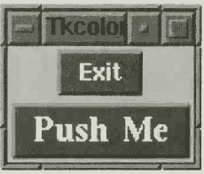

### 使控件出现并控制控件布局

`pack`子例程放置控件并使其可见。使用特殊的`pack`选项，你可以高度控制控件出现的位置以及如何调整其大小。

一些可用的`pack`选项列在表12.3中。

### 表12.3 pack选项

| 选项 | 用途 |
| --- | --- |
| `-after=>$widget` | 将此部件放在`$widget`之后。 |
| `-before=>$widget` | 将此部件放在`$widget`之前。 |
| `-expand=>1` | 允许部件扩展以填充未使用的空间。 |
| `-expand=>0` | 关闭扩展以填充未使用的空间。 |
| `-fill=>x` | 水平填充部件。 |
| `-fill=>y` | 垂直填充部件。 |
| `-fill=>both` | 水平和垂直两个方向填充部件。 |
| `-side=>bottom` | 从底部打包部件。 |
| `-side=>left` | 从左侧打包部件。 |
| `-side=>right` | 从右侧打包部件。 |
| `-side=>top` | 从顶部打包部件。 |

习惯`pack`算法的工作原理需要一些时间。下面的脚本尝试从不同方向打包，可以帮助理解：

```perl
#
# 测试pack选项。
#
# 用法
#  Perl tkpack.pl side
#
#  其中side可以是left、
#  right、top或bottom之一。
#
use Tk;

$side = $ARGV[0];

$Tk::strictMotif = 1;

# 创建主窗口。
my $main = new MainWindow;

# 创建一个退出脚本的按钮。
$button1 = $main->Button(-text => "Button 1",
    -command => \&exit_button);

# 从右侧打包部件。
$button1->pack(-side=>$side);

# 创建第二个按钮。
$button2 = $main->Button(-text => "Button 2",
    -command => \&exit_button);

# 使部件可见。
$button2->pack(-side=>$side);

# 创建第三个按钮。
$button3 = $main->Button(-text => "Button 3",
    -command => \&exit_button);

# 使部件可见。
$button3->pack(-side=>$side);

# 让Perl/Tk处理窗口事件。
MainLoop;

# 处理按钮点击的子程序。
sub exit_button {
    print "You pushed the button!\n";
    exit;
}

# tkpack.pl
```

要运行`tkpack.pl`脚本，你需要传入一个打包方向，即 left、right、top 或 bottom 之一。为了解其工作方式，以下四个图展示了四种选项。

图12.4展示了默认的打包方式。

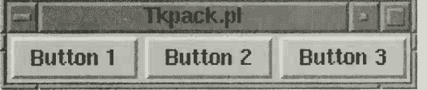

**图12.4** Perl pack.pl left。

请注意从右侧打包时部件是如何反转的，如图12.5所示。


**图12.5** Perl pack.pl right。

对于垂直打包，从顶部开始，如图12.6所示。

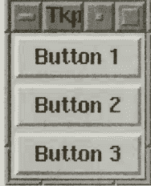

**图12.6** Perl pack.pl top。

要反向垂直打包，从底部开始，如图12.7所示。

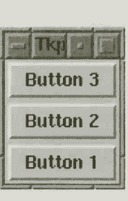

**图12.7** Perl pack.pl bottom。

这只是`pack`的冰山一角。当你添加更多部件时，打包算法的大部分特性才会显现出来。

### 添加更多部件

一些更常见的部件包括 Label、Frame、Radiobutton 和 Checkbutton 部件，如`tkmore.pl`所示：

```perl
#
# 添加更多Tk部件。
#
use Tk;

# 初始化界面变量。
$quality = "letter";
$both_sides = "single";

# 创建主窗口。
my $main = new MainWindow;

# 创建一个标签部件。
$label = $main->Label(-text => "Print Options");

$label->pack;

# 创建一个容纳单选按钮的框架。
$frame = $main->Frame(-relief=>"groove",
-borderwidth=>2);

# 在框架内创建部件。
# 注意$frame是父部件。

# 每个单选按钮共享同一个变量。
$radio1 = $frame->Radiobutton(-text=>"Draft",
                              -variable=>\$quality,
                              -value=>"draft");

$radio1->pack(-side=>"top");

$radio2 = $frame->Radiobutton(-text=>"Letter",
                              -variable=>\$quality,
                              -value=>"letter");

$radio2->pack(-side=>"top");

# 每个复选按钮有自己的变量。
$check1 = $frame->Checkbutton(-text=>"Both Sides",
                             -variable=>\$both_sides,
                             -onvalue=>"both",
                             -offvalue=>"single");
$check1->pack(-side=>"top");

# 记得也要打包框架。
$frame->pack();

# 创建一个退出脚本的按钮。
$button = $main->Button(-text => "Exit",
                        -command => \&exit_button);

$button->pack;

# 让Perl/Tk处理窗口事件。
MainLoop;

# 处理按钮点击的子程序。
sub exit_button {
    # 打印变量值。
    if ( $both_sides eq "both") {
        print "Print both sides.\n";
    } else {
        print "Print single-sided.\n";
    }

    print "Print quality = $quality.\n";

    exit;
}

# tkmore.pl
```

Label 部件仅显示静态文本消息，这对解释界面和提示用户很有用。


`Frame`部件允许你对部件进行分组，要么是为了自然的分组（对用户可见），要么是为了使用`pack`子程序。`pack`子程序最擅长打包单行或单列的部件。一旦你涉及更复杂的布局，通常最好开始创建`Frame`部件，然后在`Frame`内部打包部件。

与`MainWindow`类似，`Frame`部件可以容纳其他部件（请参阅标题为“Main Window”的章节，了解更多关于这种部件层级结构的信息）。为了获得最佳视觉效果，我通常使用2像素的边框宽度和`groove`的浮雕（3D效果）。你可以尝试其他浮雕选项——`raised`、`sunken`、`flat`和`ridge`——来选择你喜欢的效果。

> 由于`Frame`部件仍然是一个部件，你需要打包它。忘记这样做是一个常见问题。如果你忘记打包`Frame`部件，你将看不到`Frame`内的任何部件。

`Radiobutton`部件允许你从一组选项中进行选择。在同一时刻，只有**一个**`Radiobutton`部件（在给定的父部件内）可以处于开启状态。如果你打开另一个`Radiobutton`部件，所有其他`Radiobutton`部件都会变为关闭状态。

`-value`选项指定当`Radiobutton`部件开启时要放入变量的值。

要获取`Radiobutton`部件的状态，你可以使用与该`Radiobutton`关联的变量。

> 同一父部件内的所有`Radiobutton`部件应该共享同一个变量。你不必这样做，但如果你不为每组`Radiobutton`部件坚持使用一个变量，会使脚本更加混乱。

与`Radiobutton`部件不同，`Checkbutton`部件应该每个都有自己的变量。这是因为每个`Checkbutton`部件独立于所有其他`Checkbutton`部件。因此，`Checkbutton`部件不使用`-value`选项，而是支持`-onvalue`（当部件处于开启状态时）和`-offvalue`（当部件处于关闭状态时）。

当你运行`tkmore.pl`脚本时，你会看到类似图12.8所示的窗口。

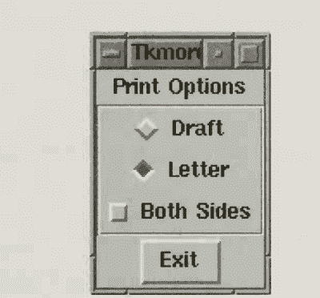

**图12.8** 使用`tkmore.pl`脚本添加更多部件。

## 菜单和菜单栏

除了`Radiobutton`、`Checkbutton`、`Frame`和`Label`部件外，大多数应用程序还需要菜单和菜单按钮。

> ⚠ 警告：`Menu`和`Menubutton`部件的在线文档似乎不正确。你可以使用此处展示的语法来创建可用的菜单，然后将在线文档的说明调整为`tkmenu.pl`脚本中展示的语法。

`Menubutton`部件位于菜单栏上（实际上是一个`Frame`部件），并控制下拉菜单。你需要将每个菜单按钮与相应的菜单关联起来。菜单按钮负责根据需要显示和隐藏菜单。

创建菜单按钮很容易。你可以使用如下命令：

```perl
$filebutton = $menubar->Menubutton(-text=>"File",
    -underline => 0);  # File中的F
```

`-underline`选项告诉Tk在文本“File”中下划第一个字符（位置0）。对于菜单，Tk会自动设置**Alt-F**的键盘快捷键。（这遵循了Motif和Windows用户界面风格指南。）

一旦有了菜单按钮，下一步就是创建作为菜单按钮子部件的菜单，如下所示：

```perl
$filemenu = $filebutton->Menu();
```

然后，你需要将菜单按钮与菜单关联起来。以下代码实现了这一点：

```perl
$filebutton->configure(-menu=>$filemenu);
```

这是简单的部分。困难的部分是添加菜单选项。菜单选项是通过菜单上的特殊子程序为每种可能的菜单类型创建的：`cascade`、`checkbutton`、`command`、`radiobutton`和`separator`。

`command`类型的菜单选项充当普通菜单选项，在选择时执行子程序（“命令”）。`cascade`用于子菜单，`separator`在菜单选项之间创建线条。

例如，要创建随处可见的**Exit**菜单选项，你可以使用如下Perl命令：

```perl
$filemenu->command(-label => "Exit",
    -command => \&exit_choice,
    -underline => 1); # "x" in Exit
```

此命令创建一个菜单选项，选中时会执行`exit_choice`子程序。可以推测，`exit_choice`子程序会退出应用程序。显示的文本为Exit，其中字母x会带有下划线。Tk会自动将x设置为键盘快捷键，遵循Motif和Windows的用户界面风格。（因此，结合File菜单按钮，Alt-F-x即可退出程序。）

> 不要对菜单选项或菜单进行`pack`操作。

> 在菜单选项中，文本由`-label`选项设置，而非更常见的`-text`选项。

你可以在`tkmenu.pl`中看到一些菜单的实际应用：

```perl
#
# Pull-down menus in Perl/Tk.
#
use Tk;

# Create main window.
my $main = new MainWindow;

# A menu bar is really a Frame.
$menubar = $main->Frame(-relief=>"raised",
    -borderwidth=>2);

# Menu buttons appear on the menu bar.
$filebutton = $menubar->Menubutton(-text=>"File",
    -underline => 0); # F in File
```

```perl
# Menus are children of menu buttons.
$filemenu = $filebutton->Menu();

# Associate menu button with menu.
$filebutton->configure(-menu=>$filemenu);

# Create menu choices.
$filemenu->command(-command => \&open_choice,
    -label => "Open...",
    -underline => 0); # O in Open

$filemenu->separator;

$filemenu->command(-label => "Exit",
    -command => \&exit_choice,
    -underline => 1); # "x" in Exit

# Help menu.
$helpbutton = $menubar->Menubutton(-text=>"Help",
    -underline => 0); # H in Help

$helpmenu = $helpbutton->Menu();

$helpmenu->command(-command => \&about_choice,
    -label => "About TkMenu...",
    -underline => 0); # A in About

$helpbutton->configure(-menu=>$helpmenu);

# Pack most menu buttons from the left.
$filebutton->pack(-side=>"left");

# Help menu should appear on the right.
$helpbutton->pack(-side=>"right");

$menubar->pack(-side=>"top", -fill=>"x");

# Create a label widget for the main area.
```

```perl
$label = $main->Label(-text => "Main Area");
```

```perl
# Set to expand, with padding.
$label->pack(-side=>"top", -expand=>1,
    -padx=>100, -pady=>100);
```

```perl
# Create a status area.
$status = $main->Label(-text=>"Status area",
   Themes-relief=>"sunken",
    -borderwidth=>2,
    -anchor=>"w");
```

```perl
$status->pack(-side=>"top", -fill=>"x");
```

```perl
# Let Perl/Tk handle window events.
MainLoop;
```

```perl
# Subroutine to handle button click.
sub exit_choice {

    print "You chose the Exit choice!\n";
    exit;
}
```

```perl
sub open_choice {
    # Fill in status area.
    $status->configure(-text=>"Open file.");

    print "Open file\n";
}
```

```perl
sub about_choice {
    # Fill in status area.
    $status->configure(-text=>"About program.");

    print "About tkmenu.pl\n";
}
```

```perl
# tkmenu.pl
```

运行此脚本时，你会看到类似图12.9所示的菜单栏和主窗口。

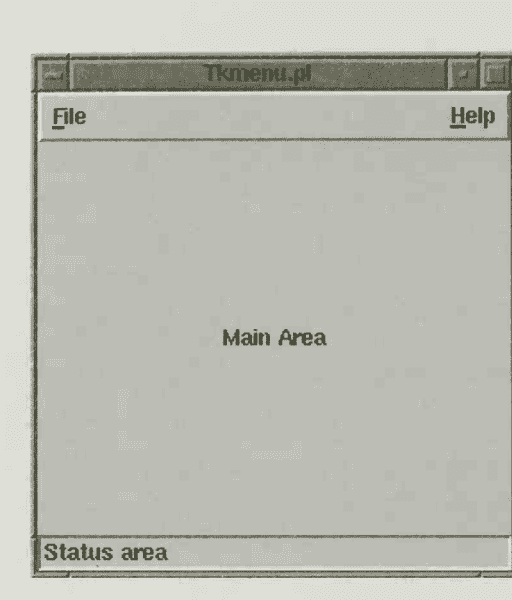

## 管理状态区域

大多数现代应用程序都会提供某种形式的状态区域，向用户提示程序正在执行的操作。在`tkmenu.pl`脚本中，一个`Label`小部件显示在主窗口底部，充当状态区域。任何时候，你都可以使用如下命令在状态区域中放置消息：

```perl
$status->configure(-text=>"Open file.");
```

（这里假设你使用`$status`变量来表示状态区域。）

你可以通过将文本设置为空字符串来清空状态区域，如下所示：

```perl
$status->configure(-text=>"");
```

在状态区域中放置消息，让用户了解正在发生的情况，这是一个好主意。


Perl/Tk自带的Perl脚本展示了多种创建菜单、菜单选项和菜单按钮的方法。正如Perl的典型特点，完成一项任务往往有多种方式。

## 创建带滚动的文本小部件

`Text`小部件提供了一个多行文本编辑区域。要创建`Text`小部件，可以使用`Text`子程序。要为`Text`小部件添加滚动条，可以使用`Scrollbar`子程序创建`Scrollbar`小部件。然后需要将`Text`小部件与`Scrollbar`小部件关联，同时将`Scrollbar`小部件与`Text`小部件关联。更简便的方法是调用`Scrolled`子程序，它会自动处理所有关联，如下所示：

```perl
$text = $main->Scrolled('Text',
    -relief => "sunken",
    -borderwidth => 2,
    -setgrid => "true");
```

上述命令创建一个边框为2像素、具有“凹陷”3D视觉效果的`Text`小部件。`-setgrid`选项告诉主窗口仅按当前字体大小的单位进行缩放。

要让`Text`小部件扩展以填充主窗口中的可用空间，可以使用如下命令对`Text`小部件进行`pack`操作：

```perl
$text->pack(-side=>"top",
    -expand => 1,
    -fill => 'both');
```

现在你应该能够在`Text`小部件中输入文本了。滚动条会按需出现和消失。（如果你不喜欢这种行为，需要分别创建`Text`和`Scrollbar`小部件。更多信息请参阅在线文档。）

## 从小部件中检索文本

要从`Text`小部件中检索数据，可以调用`get`子程序：

```perl
$text->get(start, end);
```

`get`子程序接受两个参数，分别指示从何处开始获取文本以及在何处结束。每个参数都必须采用文本索引的形式。文本索引有很多复杂的选项（更多信息请参阅在线文档），但最简单的形式是行号.列号。例如，1.0是一个从第1行（开头）和第0列（也是开头）开始的文本索引。

> 是的，行号从1开始计数，列号从0开始。这是从Tcl语言继承下来的传统。

一个名为`end`的快捷索引始终表示文本的末尾。

因此，要检索`Text`小部件中的所有文本（最常见的检索操作），请使用如下命令：

```perl
$text->get("1.0", end);
```

要将其打印出来，只需使用`print`函数：

```perl
print $text->get("1.0", end);
```

## 向小部件中插入文本

要插入文本，请使用`insert`子程序：

```perl
$text->insert(start, "text");
```

> Perl支持由双引号或单引号包围的多行文本，因此你可以一次插入大量文本，如下所示：

```perl
$text->insert("1.0", # Line 1, column 0.
"This is an example of the Perl/Tk
Text widget. You can edit text in place;
configure subroutines for cut, copy, and paste;
and generally work with large amounts of text.
In addition, you can embed widgets anywhere in the
text, for example to view image files. You can
also tag areas of text, changing the fonts, color,
and other visual effects for the tagged areas. You can
bind events to tagged areas, which provides the building blocks for creating Hypertext windows.");
```

在线文档描述了更多向文本小部件中插入文本的方法。

要从文本小部件中删除文本，可以使用以下命令：

```perl
$text->delete("1.0", end);
```

上述命令通过删除从索引1.0（开头）到文本索引`end`的文本，来删除`Text`小部件中的所有文本。

要测试`Text`小部件，你可以使用以下脚本（改编自`tkmenu.pl`脚本）：

```perl
#
# Add a scrolled Text widget.
#
use Tk;

# Create main window.
my $main = new MainWindow;

# A menu bar is really a Frame.
$menubar = $main->Frame(-relief=>"raised",
```

```perl
-borderwidth=>2);
```

```perl
# Menu buttons appear on the menu bar.
$filebutton = $menubar->Menubutton(-text=>"File",
    -underline => 0);  # F in File
```

```perl
# Menus are children of menu buttons.
$filemenu = $filebutton->Menu();
```

```perl
# Associate menu button with menu.
$filebutton->configure(-menu=>$filemenu);
```

```perl
# Create menu choices.
$filemenu->command(-command => \&open_choice,
    -label => "Open...",
    -underline => 0); # O in Open
```

```perl
$filemenu->command(-command => \&dump_choice,
    -label => "Dump",
    -underline => 0); # D in Dump
```

```perl
$filemenu->separator;
```

```perl
$filemenu->command(-label => "Exit",
    -command => \&exit_choice,
    -underline => 1);  # "x" in Exit
```

```perl
# Pack most menu buttons from the left.
$filebutton->pack(-side=>"left");
```

```perl
$menubar->pack(-side=>"top", -fill=>"x");
```

```perl
# Create a scrolled Text widget.
$text = $main->Scrolled('Text',
    -relief => "sunken",
    -borderwidth => 2,
    -setgrid => "true");
```

```perl
# Place some text in the Text widget.
$text->insert("1.0",   # Line 1, column 0.
```

## 第12章 使用Perl和Tk构建图形界面


```perl
"This is an example of the Perl/Tk
Text widget. You can edit text in place;
configure subroutines for cut, copy, and paste;
and generally work with large amounts of text.
In addition, you can embed widgets anywhere in the
text, for example to view image files. You can
also tag areas of text, changing the fonts, color,
and other visual effects for the tagged areas. You can
bind events to tagged areas, which provides the building
blocks for creating Hypertext windows.");
```

```perl
# Set to expand.
$text->pack(-side=>"top",
    -expand => 1,
    -fill => 'both');
```

```perl
# Create a status area.
$status = $main->Label(-text=>"Status area",
    -relief=>sunken,
    -borderwidth=>2,
    -anchor=>"w");
```

```perl
$status->pack(-side=>"top", -fill=>"x");
```

```perl
# Let Perl/Tk handle window events.
MainLoop;
```

```perl
# Subroutine to handle button click.
sub exit_choice {

    print "You chose the Exit choice!\n";
    exit;
}
```

```perl
sub open_choice {
    # Fill in status area.
    $status->configure(-text=>"Open file.");

    print "Open file\n";
}
```

```perl
#
# Prints out contents of
# Text widget to screen.
#
sub dump_choice {

    # Place message in status area.
    $status->configure(-text=>"Dumping text...");

    print $text->get("1.0", end);
}

# tktext.pl
```

`tktext.pl`脚本新增了一个菜单选项`Dump`，用于将文本控件的内容打印或转储到屏幕。运行该脚本时，你会看到一个如图12.10所示的窗口。

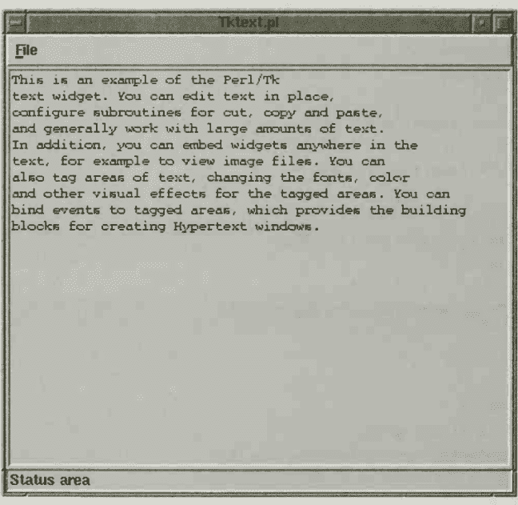

图12.10 Tk文本控件。

文本控件一直是Tk中最复杂的控件之一。到目前为止，我们只把文本控件看作多行文本编辑区域；然而，文本控件提供的功能远不止于此。你可以添加标签来控制文本区域的视觉效果，还可以将任何Tk控件嵌入到文本控件中的任何位置。当你为标签区域添加处理事件的能力时，例如在鼠标点击时执行Perl子程序，你就拥有了创建超文本系统（如网页浏览器）的基本框架。有关标签和嵌入控件的更多内容，请参阅文本控件的在线文档。有关基于Web的功能的更多内容，请参阅`HTML`目录，其中包括一个名为`tkweb`的演示Web浏览器。

文本控件还支持剪切、复制和粘贴操作。有关更多信息，请参阅关于选择和剪贴板的在线文档。

## 打开文件

Perl/Tk自带了一个内置的文件对话框，你可以用它来让用户选择文件。（如果你愿意，也可以构建自己的文件对话框。）

使用内置的文件对话框可以非常方便地加载文件和将文件保存到不同的目录。要使用文件对话框，首先必须创建一个：

```perl
use Tk;
use Tk::FileDialog;

# ...

$file_dialog = $main->FileDialog(-Title =>"Open");
```

`FileDialog`子程序创建了一个文件对话框，在本例中，标题为`Open`。

创建文件对话框并不会使其可见。要使文件对话框可见，需要使用`Show`子程序：

```perl
$filename = $file_dialog->Show();
```

`Show`子程序返回用户选择的文件名，如果用户未选择任何内容或取消了操作，则返回空字符串。

你可以使用文件对话框通过类似下面的子程序将文本文件加载到文本控件中：

```perl
sub open_choice {
    # Fill in status area.
    $status->configure(-text=>"Open file.");

    # Show file dialog and wait for file name.
    $filename = $file_dialog->Show();

    if ($filename ne "" ) {

        open (FILE, $filename);

        # Clear Text widget.
        $text->delete("1.0", end);

        while ($txt = <FILE>) {
            $text->insert(end, $txt);
        }

        close(FILE);
    }
}
```

你可以将这个子程序用于文件菜单上的打开菜单选项。为了演示这一点，请尝试以下脚本，这是对`tktext.pl`脚本的一个扩展：

```perl
#
# Scrolled text and file dialog.
#
use Tk;
use Tk::FileDialog;

# Create main window.
my $main = new MainWindow;

# A menu bar is really a frame.
$menubar = $main->Frame(-relief=>"raised",
    -borderwidth=>2);

# Menu buttons appear on the menu bar.
$filebutton = $menubar->Menubutton(-text=>"File",
    -underline => 0);  # F in File

# Menus are children of menu buttons.
$filemenu = $filebutton->Menu();

# Associate menu button with menu.
$filebutton->configure(-menu=>$filemenu);

# Create menu choices.
$filemenu->command(-command => \&open_choice,
    -label => "Open...",
    -underline => 0); # O in Open

$filemenu->command(-command => \&dump_choice,
    -label => "Dump",
    -underline => 0); # D in Dump

$filemenu->separator;

$filemenu->command(-label => "Exit",
    -command => \&exit_choice,
    -underline => 1);  # "x" in Exit

# Pack most menu buttons from the left.
$filebutton->pack(-side=>"left");

$menubar->pack(-side=>"top", -fill=>"x");

# Create a scrolled Text widget.
$text = $main->Scrolled('Text',
    -relief => "sunken",
    -borderwidth => 2,
    -setgrid => "true");

# Set to expand.
$text->pack(-side=>"top",
    -expand => 1,
    -fill => 'both');

# Create a status area.
$status = $main->Label(-text=>"Status area",
    -relief=>sunken,
    -borderwidth=>2,
    -anchor=>"W");

$status->pack(-side=>"top", -fill=>"x");

#
# Create file dialog.
# It will get shown later.
#
$file_dialog = $main->FileDialog(-Title =>"Open");

# Let Perl/Tk handle window events.
MainLoop;

# Subroutine to handle button click.
sub exit_choice {

    print "You chose the Exit choice!\n";
    exit;
}

sub open_choice {
    # Fill in status area.
    $status->configure(-text=>"Open file.");

    # Show file dialog and wait for file name.
    $filename = $file_dialog->Show();

    if ($filename ne "" ) {
        open (FILE, $filename);

        # Clear Text widget.
        $text->delete("1.0", end);

        while ($txt = <FILE>) {
            $text->insert(end, $txt);
        }

        close(FILE);
    }
}

#
# Prints out contents of
# Text widget to screen.
#
sub dump_choice {

    # Place message in status area.
    $status->configure(-text=>"Dumping text...");

    print $text->get("1.0", end);
}

# tkfile.pl
```

`tkfile.pl`脚本呈现了与`tktext.pl`脚本相同的文本控件。但现在，你可以使用文件菜单上的打开选项来加载文件进行编辑。正如你所见，我们正在逐步创建一个文本编辑Perl脚本。

文件对话框看起来如图12.11所示的窗口。

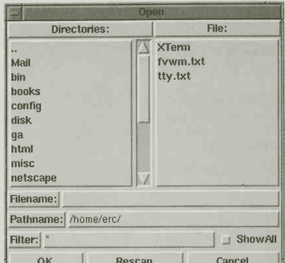

图12.11 Tk文件对话框。

## 单行文本输入

除了多行文本控件之外，Tk还提供了单行输入控件（`Entry` widget）。大多数应用程序使用输入控件来输入姓名和地址等数据。

要创建一个输入控件，请使用`Entry`子程序：

```perl
$entry = $main->Entry();
```

输入控件的难点在于设置当用户输入数据并按下回车键时的某些操作。

输入控件不支持`-command`选项，因此你需要将回车键或其他事件绑定到回调函数上。

要将事件绑定到控件，你需要调用`bind`子程序：

```perl
$widget->bind(event, action);
```

你需要以`bind`子程序能够理解的方式编码所需的事件。通常，这种形式是`<Event>`，其中`Event`可以是`Return`（表示回车键）、`Delete`（表示删除键）等。你最常需要绑定到控件的事件是`<Return>`。（在线文档展示了如何查找完整的事件列表。）

`<Return>`语法看起来很像Perl中用于从名为`Return`的文件句柄读取的语法。不要混淆。

`action`部分可以是对子程序的引用，形式为`\&subroutine`。（还有其他多种形式可供选择。有关此主题的更多内容，请参阅`perlref`的在线文档。）

因此，要在我们的输入控件中绑定回车键，可以使用以下命令：

```perl
$entry->bind("<Return>", \&handle_return );
```

上述命令将回车键绑定到`handle_return`子程序。

在这个`handle_return`子程序内部，我们可能需要从输入控件中检索文本。你可以使用`get`子程序来完成：

```perl
$txt = $entry->get();
```

综合起来，你可以使用以下脚本创建输入控件并检索输入其中的文本：

```perl
#
# Using the Entry widget.
#
use Tk;

# Informational comment: Create main window.
#
```

# 第12章 使用Perl和Tk创建图形界面

```
my $main = new MainWindow;

$label =
    $main->Label(-text=>"Enter user name:");

$label->pack(-side=>"left");

# Create an Entry widget.
$entry = $main->Entry();

# Bind return key to a subroutine.
$entry->bind("<Return>", \&handle_return );

$entry->pack(-side=>"left");

# Let Perl/Tk handle window events.
MainLoop;

# Subroutine to handle Return key.
sub handle_return {

    $txt = $entry->get();

    print "You entered $txt\n";
    exit;
}

# tkentry.pl
```

运行此脚本时，你会看到一个如图12.12所示的窗口。


## 图12.12 Tk输入框（Entry）控件

## 更多Perl/Tk相关信息

本章仅触及了Perl/Tk功能的皮毛。在CD-ROM的`contrib/gui/tk`目录下，你会看到大量的Perl模块（查找以`*.pm*`结尾的文件），它们有着有趣的名称。浏览这些代码和演示脚本。

由于Perl/Tk扩展仍在开发中，在线文档充其量是零散的，最坏的情况下可能完全错误。当你浏览这些目录时，会看到许多示例和演示脚本，它们将指导你学习这个出色的扩展。在`contrib/gui/tk`子目录中，你会找到`UserGuide.pod`。该文件包含一些很好的入门材料。

Perl/Tk的大部分内容构建于原始的Tcl/Tk之上。事实上，大多数文档只是将Tcl文档转换为Perl语法。此外，甚至还有一个示例Perl脚本`tcl2perl`，用于将Tcl语法转换为Perl。由于与Tcl/Tk的这种密切关系，你可以通过阅读*《Graphical Applications with Tcl and Tk》*等书籍来研究这种联系。更多信息请参阅附录A。

Perl/Tk的常见问题列表发布在以下网址：

```
http://w4.lns.cornell.edu/~pvhp/ptk/ptkFAQ.html
```

你还可以在以下位置找到概述和一组在线文档：

```
http://w4.lns.cornell.edu/~pvhp/ptk/doc/overview.htm
```

## 小结

Perl/Tk扩展将Tcl著名的Tk工具包与Perl结合起来，使你能够从Perl脚本创建图形界面。这类事件驱动脚本需要一种略有不同的编码风格，其中回调子程序在适当的时候由Tk调用。

Perl/Tk提供了许多常用控件，如用于菜单的`Menu`和用于按钮的`Button`。每种控件类型都有单独创建子程序。

要创建下拉菜单，你需要两个控件：一个菜单按钮（位于菜单栏上，负责拉下菜单）和菜单本身。

你可以通过调用`configure`子程序来更改控件的属性，例如其文本、使用的字体和颜色。

要使控件显示出来，你需要调用`pack`子程序。

要让Tk接管事件处理，请调用`MainLoop`子程序。

## 本章介绍的Perl命令

- `bind`

- `Button`

- `Checkbutton`

- `command`

- `configure`

- `delete`

- `Entry`

- `FileDialog`

- `Frame`

- `get`

- `insert`

- `Parcel`

- `MainLoop`

- `Menu`

- `Menubutton`

- `pack`

- `Radiobutton`

- `Scrolled`

- `separator`

- `Show`

- `Text`

# 附录A

## 更多信息

## 继续学习

Perl是一种非常大且复杂的语言。因此，本书必然无法涵盖该语言的所有部分。不过，到现在你应该已经彻底熟悉Perl的基础知识，以便能够从Perl参考手册中学习任何新特性。

查找Perl信息的首要位置是Perl自带的在线文档。那是大量信息和示例的来源。此外，它涵盖了你已经安装的Perl版本。

## 互联网上的信息


除了在线文档之外，互联网上充斥着 Perl 信息。我试图将我的 Perl 网页作为一个良好的起点：

`http://ourworld.compuserve.com/homepages/efjohnson/perl.htm`

它链接到世界各地的主要 Perl 网站。Perl 的主页位于：

`http://www.perl.com`

Win32 版 Perl 的主页位于：

`http://www.perl.hip.com`

## Usenet 新闻组

除了前面的网页之外，你会发现以下 Usenet 新闻组包含大量关于 Perl 的信息：

- `comp.lang.perl.misc`
- `comp.lang.perl.announce`
- `comp.lang.perl.tk`

主要的新闻组是 `comp.lang.perl.misc`。Usenet 新闻上几乎所有的 Perl 讨论都在这个组中进行。

## 获取 Perl 更新

综合 Perl 存档网络（CPAN）提供一组链接的 FTP 服务器，你可以从中下载 Perl 源代码、模块和其他信息。请尝试访问 CPAN 主页：

`http://www.perl.com/CPAN`

该页面将让你选择一个离你较近的 CPAN 存档站点。

## 书籍

随着 Perl 普及度的提高，大量 Perl 书籍应运而生。这些书中的许多都涉及专门的问题，如用于网页的 CGI 脚本编写。

### 其他 Perl 书籍

我发现这些 Perl 书籍很有帮助：

- *Perl 5 Desktop Reference*，Johan Vromans，O'Reilly，1996。迄今为止最小的 Perl 书，这本微型文本提供了 Perl 的快速参考指南。非常有用。
- *Programming Perl*，Larry Wall and Randal Schwartz，O'Reilly，1991。内容密集且令人生畏，这本书包含了 Perl 创造者 Larry Wall 大量有用的信息。如果你能超越其呈现方式，你会发现这是一本非常有用的书。本书大部分材料来自在线 Perl 参考资料，但末尾有一大节提供了大量有趣的 Perl 脚本，你可以用作想法和示例。本书涵盖 Perl 4。
- *Learning Perl*，Randal Schwartz，O'Reilly，1993。本书提供了 Perl 4 的入门介绍。
- *Teach Yourself Perl in 21 Days*，David Till，SAMS，1995。同样涵盖 Perl 4，这本大部头几乎涵盖了 Perl 4 中的每个特性。
- *Software Engineering with Perl*，Carl Dichter and Mark Pease，Prentice Hall，1995。第 10 章关于使用 Perl 进行软件开发任务的讨论仅仅触及了你可以使用 Perl 辅助软件开发的皮毛。这本书将给你更多其他想法。

### Web、HTML 和 CGI 书籍

随着人们对互联网兴趣的爆炸式增长，你会发现许多关于 Web 和 CGI 脚本编写的书籍。一些最好的书籍包括以下几种。

- *Introduction to CGI/Perl: Getting Started With Web Scripts*，Steven E. Brenner and Edwin Aoki，M&T Books，1996。这本薄书很好地介绍了网页、CGI 脚本以及 Perl 如何融入其中。
- *Foundations of World Wide Web Programming with HTML and CGI*，Ed Tittel，Mark Gaither，Sebastian Hassinger，and Mik Erwin，IDG Books，1995。这本巨著为所有 HTML 相关内容提供了良好的背景知识。

### UNIX 书籍

Perl 创建于 UNIX，并遵循许多与 UNIX 相同的假设。如果你有使用 UNIX 的经验，这个约定很好，但对 Perl 移植到 Windows 和 Macintosh 系统来说就比较困难了。如果 `chmod` 和文件权限的概念对你来说是新东西，那么你应该查看一本 UNIX 入门书籍，例如 *Teach Yourself Unix*，third edition，Kevin Reichard and Eric F. Johnson，MIS: Press，1995。

其他有用的书籍包括：

- *UNIX System Administrator's Guide to X*，Eric F. Johnson and Kevin Reichard，M&T Books，1994。X Window 系统非常擅长在 UNIX（和其他）平台上提供通用的图形窗口系统，但很难弄清楚如何配置你的环境。这本书向你展示了配置 X 的来龙去脉，这是使用 Perl 的绝佳机会。
- *UNIX Network Programming*，W. Richard Stevens，Prentice Hall，1990。迄今为止最好的网络应用程序编程书籍，这本书提供了大量用于网络任务的 C 源代码示例。由于 Perl 的大多数网络功能直接来自 UNIX 上的 C 系统调用，本书可以提供大量必要的背景材料。

### Windows 书籍

获取对象链接与嵌入（OLE）自动化信息的最佳来源之一是 Visual Basic 自带的文档和示例。其他好的来源包括以下几种：

- *Inside OLE 2*，Kraig Brockschmidt，Microsoft Press，1994。这本书涵盖的 OLE 内容可能比你想要知道的多得多。而且，就在你弄明白的时候，你会发现这项技术现在被称为 ActiveX 的一部分。
- Win32 参考手册。如果你进行大量 Windows 编程，请获取微软开发者网络（MSDN）。
- *Programming Windows 95*，Charles Petzold，Microsoft Press，1996。Petzold 经典 Windows 编程书籍的更新版，如果你在 Windows 上编程，这本书必不可少。

## 关于 Tk 的更多信息

第 12 章介绍了 Perl/Tk 扩展。Tk 最初是为另一种名为 Tcl 的脚本语言创建的图形工具包。要了解更多关于 Tk 的信息，请参阅 Eric F. Johnson 所著的 *Graphical Applications with Tcl and Tk*（M&T Books，1996）。书中的示例全部使用 Tcl 而非 Perl 编写，但将这些概念转换为 Perl/Tk 语法并不困难。

## 其他信息来源

我发现 *Perl Journal* 是一本非常实用的刊物。您可以通过以下地址联系出版商：

Perl Journal

P.O. Box 54

Boston, MA, 02101

在网上，请尝试访问该统一资源定位符（URL）：

```text
http://work.media.mit.edu/the_perl_journal
```

# 索引

- `#!/usr/bin/perl` 29-30, 165
- 用于输入的 `< >` 运算符，19
- `.` 运算符，49
- `$.`，输入行号，186
- `$/`，输入记录分隔符，186
- `$_`，默认输入变量，62
- `$@`，上次 `eval` 错误，186
- `$?`，子进程状态，185
- `$+`，上次匹配的括号，186
- `$"`，列表分隔符，186
- `$)`，有效组 ID，185
- `$(`，实际组 ID，187
- `$>`，有效用户 ID，186
- `$<`，实际用户 ID，187
- `$$`，进程 ID，187
- `$!`，错误号，186
- `$&`、`$`` 和 `$'`，116
- `$=`，每页行数，132
- `$-`，每页剩余行数，132
- `$%`，当前页码，132-133
- `$~`，格式名称，132
- `$^`，页顶格式名称，132
- `$#`，输出格式，187
- `$|`，如果应刷新输出则为真，187
- `$,`，输出字段分隔符，187
- `$\`，输出记录分隔符，187
- `$]`，Perl 版本，187
- `$^L`，换行符，132
- `$0`，Perl 脚本名称，66
- `@_`，子程序参数，70-72
- `-d` 文件测试，90-93, 184
- `-e` 文件测试，90-93
- `-f` 文件测试，90-93
- `-l` 文件测试，90-93
- `-p` 文件测试，90-93
- `-r` 文件测试，90-93
- `-S` 文件测试，90-93
- `-s` 文件测试，90-93
- `-w` 文件测试，90-93
- `-x` 文件测试，90-93
- `-z` 文件测试，90-93
- `-r` 文件测试，90-93

## A

- `$^A`，写入累加器，185
- `accept` 命令，网络，286, 288
- ActiveX，*参阅* OLE
- `alarm` 命令，177
- `AnyDBM_File` 模块，149
- `$ARGV`，64
- `<ARGV>`，63
- 数组（arrays）36, 51
  - 数组赋值，51-52
  - 数组长度，52
  - 其他数组命令，55
  - `$#array`，52
  - 数组切片，53
  - 关联数组（associative arrays），56
    - 检查元素是否存在，60
    - 转换为普通数组，59
    - 删除元素，59
    - 键（keys），57
    - 值（values），58

## B

- 反斜杠，`\`，17-18, 78
- 反斜杠转义，44-45
- 反引号字符，`` ` ``，156-157
- `bind` 命令，网络，288
- `binmode` 命令，80

## C

### C 和 C++

- 扫描 C 程序以查找包含文件，269-271
- 使用 Perl 生成 C++ 头文件，272-276
- `C::Scan` 模块，269-271

### CGI，通用网关接口，Web

- Content-type，214
- 通过脚本创建 Web 页面，214-215
- HTML，213
- 在命令行传递数据，235
- URL，212
- *另参阅* HTML、URL

### CGI 模块

- 创建 Web 页面，216-218
- 在 Windows 上，218
- 处理 Web 表单，221-234
- `chdir` 命令，87, 184
- `chmod`，Unix 命令，30
- `chmod` Perl 命令，93-94
- `chomp`，21
- `chop`，21
- `chr` 命令，46
- `close` 命令，79
- `closedir` 命令，85
- `cmp`（比较），24
- 命令行参数，64-66
- 注释，`#`，15-16
- `connect` 命令，网络，289
- `Config` 模块，167-169
- `%Config` 关联数组，167
- `continue` 命令，37-38
- `Cwd` 包，100-101
- `Cwd::getcwd`，101

## D

- `$^D`，调试标志的值，185
- 日期，*参阅* 时间和日期
- DBM 数据库，143-148
  - 打印报告，146-148
  - 使用关联数组，144
- `dbmclose` 命令，144
- `dbmopen` 命令，143
- 调试，25-26
- `delete` 命令，59
- `die` 命令，40, 79
- 目录
  - 更改当前目录，87
  - 使用 `mkdir` 创建，86-87
  - 检测当前目录，100
  - 通配符（glob），88
  - 列出匹配模式的文件，88
  - 读取内容，84
  - 删除，87
  - 打开，84
- `do` 命令，39
- 文档，在线，26-29
- DOS 批处理文件
  - 将 Perl 脚本转换为批处理文件，166-167
  - 使用 `pl2bat`，166

## E

- `each` 运算符，58
- `egrep` UNIX 命令，105
- 环境变量，60-62
  - 检查，170-173
  - `%ENV`（环境数组），60-62
- `eof` 命令，82-83
- `eq`（等于），22, 24
- `eval` 命令，178
- `exec` 命令，154-155
- `exists` 运算符，60
- `exit` 命令，159, 173
- Perl 扩展，180-181

## F

- `$^F`，最大文件描述符，187
- 文件
  - 二进制模式（DOS），80
  - 更改文件模式，93-94
  - 复制，97
  - 删除文件，84, 94-95
  - 检测何时更改，265-267
  - 文件结束（end-of-file），82
  - 从完整路径中提取部分名称，98
  - 文件句柄，78
  - 获取相关信息，88-90
  - 打印到文件，80
  - 打开文件，78
  - 权限和 `umask`，87
  - 随机访问，83
  - 从文件读取，81-83
  - 重命名，94
  - 符号链接，95-96
  - 测试文件，91-93
  - 截断，94
  - 大小写名称转换，118-122
  - 写入文件，84
- `File::Basename` 模块，98-100
  - 处理 DOS 文件路径，99
- `File::Copy` 模块，97-98
- `find`，UNIX 命令，184
- `for` 命令，35-36
- `foreach` 命令，36-37
- `fork` 命令，154, 157-159
- 格式和报告，124-130
  - 定义格式，127
  - 页眉，130-131
  - 分页，131, 133-143
  - 选择文件句柄，132
  - 使用格式，125
  - 输出格式化数据，125
- `format` 命令，124
- FTP，文件传输协议，294

## G

- `ge`（大于或等于），24
- `getc` 命令，82
- `getlogin` 命令，198
- `getpwent` 函数，199, 201
- `getpwnam` 函数，199-201
- `getpwuid` 函数，201
- `getprotobyname` 命令，网络，288
- `getservbyport` 命令，网络，285
- `glob` 命令，88, 184, 267
- `gmtime` 命令，139
- `goto` 命令，38
- `gt`（大于），24
- GUI，图形用户界面，*参阅* Tk 模块

## H

- HTML，超文本标记语言，213
  - `<FORM>` 标签，220
  - 表单，219-234
  - `<INPUT>` 标签，220, 223-225
  - `<OPTION>` 标签，229-230
  - `<SELECT>` 标签，228
  - `<TEXTAREA>` 标签，231
  - 重置按钮，231-232
  - 自维护 Web 页面，236-259
  - 提交按钮，224-226

## I

- `if`，22-23
- `if` 表达式，23-24
- 结尾修饰符，39-40
- `@INC`，Perl 库目录，183-184
- 包含文件，*参阅* `C::Scan` 模块
- `index` 命令，47-48
- 输入
  - 从键盘读取输入，19
- IP，网际协议，280
- 互联网地址，283-284
  - *另参阅* Socket 模块

## K

- `keys` 运算符，57
- `kill` 命令，173-174

## L

- `last` 命令，38
- `lc` 命令，小写，47
- `le`（小于或等于），24
- `length` 命令，46
- `link` 命令，95
- `listen` 命令，网络，285, 286, 288
- `local` 命令，70
- `localtime` 命令，139
- `lstat` 命令，89
- `lt`（小于），24

## M

- `m` 运算符，109
- `mail`，UNIX 命令，262
- `Mail::Send` 模块，262-264
- `make`，UNIX 命令，8
- Makefiles，264
- 数学
  - 浮点数，42
  - 十六进制数，42-43
  - 八进制数，42-43
  - 运算符，41
- `mkdir` 命令，86-87
- 模块，97, 180
  - `English` 模块，185
  - 标准 Perl 模块，181-182
- `my` 命令，70

## N

- `ne`（不等于），24
- NFS，网络文件系统，280
- `Net::FTP` 模块，294-295
- 网络
  - FTP，文件传输协议，294
  - `accept` 命令，286, 288
  - `bind` 命令，288
  - `connect` 命令，289
  - `getprotobyname` 命令，288
  - `getservbyport` 命令，285
  - `listen` 命令，285, 286, 288
  - `socket` 命令，288


- `TCP`，传输控制协议，280
- `UDP`，用户数据报协议，280
- *另参阅* Socket 模块，`TCP`，`UDP`，`FTP`，`NFS`

- `next` 命令，38

## O

- `ODBC`，开放数据库连接，150
- `OLE`，对象链接与嵌入，187-190
- `OLE` 模块，188
  - `CreateObject` 子程序，188
  - 与 Excel 配合使用，189-190
- 在线文档，26-29
- `open` 命令，40，78
  - `open` 或 `die`，40
- `opendir` 命令，84
- 操作系统，检测，167-173

## P

- `pack` 命令，284，288，292，293
- 用于用户界面的 `pack` 子程序，*参阅* Tk 模块
- Perl 例程包，96-97，179
  - `BEGIN` 和 `END` 子程序，190-191
- 密码文件，`/etc/passwd`，UNIX，199
- 模式（*参阅* 正则表达式）
- Perl
  - 在线文档，26-29
  - 安装 Perl，6-8
  - `perl` 命令，14
  - Perl 库目录，183
  - 实用提取与报告语言（practical extraction and report language），2
  - 运行 Perl 脚本，14，29-31
  - 万恶之源，1
  - 标准模块，181-182
  - Perl 更新，338
  - 何时使用 Perl，4
- 管道
  - 管道命令，174-175
  - 使用 `open` 命令创建管道，176
- `pl2bat`（*参阅* DOS 批处理文件）
- `print`，14，16-17
  - 打印到文件，84
- `printf` 命令，135-138
- 进程，153
  - 控制，173-174
  - `exec` 命令，154
  - `fork` 命令，154，175
  - 管道，174-176
  - 信号，177
  - `%SIG` 关联数组，177

## 索引

- `system` 命令，155
- 等待子进程结束，159-161
- Windows，162-165

### Q

- `q` 命令，45
- `qq` 命令，46

### R

- `read` 命令，81-82
- `readdir` 命令，84-86
- `readlink` 命令，96
- `redo` 命令，38
- 引用（references），191-193
- 注册表（Registry），参见 Windows Registry
- 正则表达式（regular expressions），103-111
  - 更改分隔符，108-109，116
  - 复杂表达式，106
  - 从替换中提取数据，116
  - 贪婪搜索，107
  - 选项，112-113
  - 模式，104-105
  - 文本替换，113
  - 使用 `tr` 转换数据，117-118
- `rename` 命令，94
- 报告（reports）（参见 formats and reports）
- `return` 命令，68
- `reverse` 命令，55
- `rewinddir` 命令，85
- `rindex` 命令，48
- `rmdir` 命令，87

### S

- `s` 运算符，113-114，116
- `$&`、`$`` 和 `$'`，116
- 搜索数据（参见 regular expressions）
- `seek` 命令，83
- 用于格式的 `select` 命令，132
- `shift` 命令，64
- 信号（signals），`SIGALARM`，177
- `sleep` 命令，176-177，266
- 网络中的 `socket` 命令，288
- Socket 模块
  - 接受传入连接，285-286
  - 将 socket 绑定到地址，283-284，286
  - 连接到服务器，289
  - 创建 socket，282
  - `getprotobyname` 命令，282，286
  - `inet_aton` 命令，284
  - 监听传入连接，285
  - `sockaddr_in` 命令，284
  - `socket` 命令，281-282，286
  - Windows 上的 `socket` 命令，282
- *另请参阅* networking，TCP
- `sort` 命令，55
- `splice` 命令，53-55
- `sprintf` 命令，135-138
- `stat` 命令，88-90，267
- `STDIN`、`STDOUT`、`STDERR`，20-21
- 字符串函数（string functions）
  - 双引号字符串，44-45
  - `index` 命令，47-48
  - 字符串长度，46
  - 字符串运算符，49
  - `rindex` 命令，48
  - 字符串比较，24
  - 字符串搜索，47-48
    - *另请参阅* regular expressions
  - 单引号字符串，43-44
  - 子字符串，48-49
  - 文本替换，113
- `sub` 命令，66
- 子程序（subroutines），66
  - `@_`，70-72
  - 访问变量，68
  - 数组参数，74
  - 更改参数，72-74
  - 局部（`local` 和 `my`）变量，69-70
  - 面向对象调用，`->`，193-194
  - 传递参数，70-72
  - 原型，191
  - 递归，208
  - 返回数据，67-68
- `substr` 命令，48-49
- `symlink` 命令，95-96
- `Sys::Hostname` 模块，202-203
- `system` 命令，155-156
  - 在 UNIX 上，156
  - 在 Windows 上，156
- `tell` 命令，83
- 文本字符串（*参见* string functions）
- 那些奇怪的符号，75
- `tie` 命令，149
- 时间和日期，139-142
  - `gmtime` 命令，139
  - `localtime` 命令，139
  - `time` 命令，140-142
- `time` 命令，140-142
- 用于用户界面的 Tk 模块
  - Button 控件及子程序，301，302，303
  - 回调函数，298-299
  - 更改控件属性，304-305
  - Checkbutton 控件及子程序，312，315
  - `configure` 子程序，304，306
  - `configure` 选项，304-305
  - 控制控件布局，308-309
  - 创建控件，303
  - Entry 控件及子程序（单行文本），332-334
  - Entry 控件，绑定事件，333
  - 事件驱动编程，298
  - Frame 控件及子程序，312，314
  - 安装 Perl/Tk，300
  - Label 控件及子程序，312，314
  - MainLoop 命令，298
  - MainWindow 控件，301，302-303
  - Menu（菜单），316-320
  - Menubutton，316
  - 菜单选项，317，318

### T

- `$^T`，脚本启动时间，185
- `TCP`，传输控制协议（Transmission Control Protocol），280
  - TCP 客户端脚本，290-291
  - Windows TCP 客户端脚本，291-292
  - TCP 服务器脚本，286-287
  - Windows TCP 服务器脚本，287-289
  - *另请参阅* Socket module
- 菜单分隔符，318
- `pack` 子程序，301，302，306-307
- `pack` 选项，309-312
- Radiobutton 控件及子程序，313，314
- Scrolled 子程序，321
- 状态区域，320-321
- `strictMotif`，306
- Text，滚动文本控件，321
- Text 控件，删除文本，323
- Text 控件，插入文本，322-323
- Text 控件，读取文本文件，328
- Text 控件，获取文本，322
- 控件（widgets），299-300
- `Tk::FileDialog` 模块，327-328，332
- `tr` 命令，转换数据，117-122
- `truncate` 命令，94

### U

- `uc` 命令，转大写，47
- `UDP`，用户数据报协议（user datagram protocol），280
- `umask`，97
- `unless` 命令，35
- `unlink` 命令（删除），94-95
- `unshift` 命令，64-66
- `untie` 命令，149
- `until` 命令，34-35
- `URL`，统一资源定位符（universal resource locator），211
  - CGI URL，212
  - 另请参阅 HTML
- `use` 命令，42，96
  - `no integer`，42
  - `use integer`，42
- Usenet 新闻组，338
- 用户界面，参见 Tk module

### V

- `values` 运算符，58
- 变量（variables）
  - `$_`，62
  - 数组，36，51
  - 内置变量，62-63
  - 标量，19-20，50

### W

- `$^W`，警告开启时为真，187
- `wait` 命令，159
- `waitpid` 命令，160-161
- Web 表单，参见 HTML 和 CGI
- `while` 命令，34
- 空白字符，106
  - 去除前导和尾随空格，114-115
- Win32 模块
  - `DomainName` 函数，203
  - `FormatMessage` 子程序，163
  - `FsType` 函数，203
  - `GetCwd` 函数，203
  - `GetLastError` 子程序，163
  - `GetOSVersion` 函数，203
  - `IsWin95` 函数，203
  - `IsWinNT` 函数，203
  - `LoginName` 函数，198
  - `NodeName` 函数，203
  - `PerlVersion` 函数，203
- Win32::Process 模块
  - 控制台进程，162
  - `Create` 子程序，161，164
  - 分离进程，162
  - `GetExitCode` 子程序，163-164
  - `Wait` 子程序，163
- Win32::Registry 模块
  - `GetKeys` 子程序，206-208
  - `$HKEY_LOCAL_MACHINE`、`$HKEY_USERS`、`$HKEY_CURRENT_USER` 和 `$HKEY_CLASSES_ROOT`，205
  - `Open` 子程序，205-208
- Windows
  - 从资源管理器启动 Perl 脚本，30-31
- Windows 注册表，205-208
  - *另请参阅* Win32::Registry module
- `write` 命令，125

### X

- `$^X`，Perl 可执行文件，169，186
- `x` 运算符，49-50

## 如何使用 CD-ROM

随书附带的 CD-ROM 使用了标准 ISO-9660 格式的 *Rock Ridge 扩展*。这种做法允许比旧式的 DOS 八字符文件名和三字符扩展名限制更长的文件名。由于许多 Perl 模块使用了较长的文件和目录名，因此这一选择是必要的。如果您看到类似 `INTEGER-;1` 的文件名，则说明您的系统不支持 CD 的 Rock Ridge 扩展文件名。所有文件仍然可用；不过，在将文件复制到硬盘时，您需要修正文件名。

您将在 CD-ROM 上找到以下主要子目录：

- `book` 包含本书的示例；
- `contrib` 包含 Perl 免费软件，主要以 Perl 模块的形式存在；
- `doc` 是 HTML（Web）格式的 Perl 文档；
- `perl` 是 Perl 的源代码；
- `win` 提供 Perl 的 Windows 二进制文件；
- `win_src` 是 Windows 版本 Perl 的源代码。

`contrib` 目录被分为几个主要的 Perl 免费软件类别，包括以下内容：

- `admin`，用于系统管理模块；
- `database`，用于将 Perl 连接到 Oracle 和 Informix 等数据库的模块；
- `gui`，用于用户界面模块，如 Perl/Tk；
- `internet`，用于 Internet 和 TCP/IP 相关模块；
- `mail`，用于处理电子邮件；
- `math`，用于数学和统计模块；
- `perldev`，用于辅助通用 Perl 脚本的有用模块；
- `softdev`，用于 `C::Scan` 等模块，软件开发人员（主要是 C 和 C++ 开发人员）会发现这些模块很有帮助；
- `system`，用于操作系统相关模块；
- `text`，用于文本和文件处理模块；
- `www`，用于万维网（World Wide Web）相关模块。


## 跨平台 Perl（CROSS-PLATFORM Perl）

对于在 UNIX 和 Windows NT 上进行开发的程序员来说，跨平台 Perl 是必不可少的。它也非常适合系统管理员和网页设计者。由于 Perl 可以在多个平台上运行，因此它是自动化程序的理想脚本语言。本书将教您如何在 UNIX 和 Windows NT 中自动化任务。其中一些程序可能是：构建软件、源代码签入和签出、从 C 源代码中提取文档或处理 Web 查询。如果您曾经被 Perl 吓到，那么这本书就是为您准备的。通过简单且实用的介绍，Johnson 将向您展示如何在不迷失在语法中的情况下充分利用 Perl。

- 使用 Perl 在 UNIX 或 Windows NT 中自动化日常任务
- 用简单的方法学习 Perl——而不会陷入语法的泥潭
- 创建交互式网页
- 允许用户通过公司的内网在线访问数据
- 开发客户端-服务器和网络应用程序
- 使用 Perl/Tk 为您的 Perl 脚本提供友好的前端界面
- 使用 Perl 强大的文本处理能力从文件中提取和处理数据
- 使用 Perl 处理软件配置和构建任务

Perl 非常适合涉及处理文本、从文件中提取数据、创建交互式网页以及启动进程的任务。使用 Perl 完成这些任务的速度比 C、C++、shell 脚本或批处理文件等其他语言快得多。而且 Perl 的源代码是免费的，并且适用于许多平台，包括 Windows NT 和 UNIX。Johnson 从基础知识开始，快速引导至 Perl 在系统管理、创建交互式 Web 表单、自动化跨平台软件开发、开发客户端-服务器应用程序以及访问 Windows 注册表等领域的实际应用。

资深软件开发人员 Eric F. Johnson 每天都要处理跨平台问题，他在多种操作系统和环境下为一家计算机辅助制造公司开发软件。他是一名 UNIX 专家，合著了多本畅销的 UNIX 书籍，包括《UNIX in Plain English》和现已出到第三版的《Teach Yourself...UNIX》。他还是《UNIX Review》的 Crossthoughts 专栏作家之一。

## 您将在 CD-ROM 上找到：

- Perl 5 的完整源代码
- 适用于 Windows 95 和 Windows NT 的 Perl 二进制版本
- Perl 示例脚本和 Web 文档
- HTML（Web）格式的 Perl 在线文档，方便访问
- 用于使用 Perl 创建图形应用程序的 Perl/Tk
- `CGI.pm`，用于创建交互式 Web 表单最简单的 Perl 模块
- Perl 对常见数据库的连接：Oracle、Informix 和 ODBC 支持
- 为系统管理员和软件开发人员提供的 Perl 工具
- 大量且丰富的 Perl 免费软件

| 级别 | 中级 | UNIX/Windows NT | 编程 |
|---|---|---|---|

M&T Books, A Division of MIS:Press, Inc. A Subsidiary of Henry Holt and Company, Inc. 115 West 18th Street New York, New York 10011 `http://www.mandt.com`

美国 $34.95 加拿大 $47.00 ISBN 1-55851-483-X

封面设计：Gary Szecszina
