# 移动代理与 JavaScript 代理机器：众包与模拟

## 引言

智能体（Agent）通常指代那些受雇于他人或公司、以佣金方式运作、并基本自主完成订单的人类。智能体的特征在于其社交互动能力和社会结构。自主性通常基于规划、认知和知识。

智能体也可以是人工实体。它们可用于建模和模拟自然系统，以及实现具有卓越特性的现代软件。因此，基于智能体的建模一方面涉及社会科学和自然科学，另一方面也涉及计算机科学。

相比之下，智能体技术在过去几十年中不断发展，用于在不可靠且有时未知的环境中实现或支持智能系统。

智能体技术主要受以下领域驱动：

- 符号人工智能
- 机器学习
- 控制理论
- 分布式计算范式

智能体技术用于掌握广泛领域中复杂的动态问题。智能行为是智能体的基本特征 [MUE96]，尽管“智能”一词的定义并不精确，导致误解和歧义。

通过将系统分解为简单的交互单元（即微观层面建模），智能体可用于建模和实现复杂系统，这与使用单一大型公式描述系统行为的宏观层面建模形成对比。智能体可以是一种模型，也可以是一种计算范式。

本书将介绍基于智能体的计算和基于智能体的模拟，使用基于 JavaScript 的开源软件框架 `JAM`，可从 [GitHub](https://github.com/bsLab/jam) 下载。`JAM` 是一种“虚拟机中的虚拟机”概念。只需具备基本的编程技能（JavaScript）以及一个 Web 浏览器或带有 `node.js` 的命令终端，即可开始探索移动智能体的世界。众包是移动智能体的主要应用之一，本书将结合工作示例进行详细讨论。

## 软件范式

有五种主要的软件范式，反映了历史变迁：

1. 机器编程
2. 过程式编程
3. 函数式编程
4. 面向对象编程
5. 基于智能体的目标导向与角色导向编程

编程范式的历史发展如图 1-1 所示。现代 IT 系统开发面临多种挑战：

- 泛在性 → 1. 不受地点限制 2. 环境计算
- 普适性 → 计算机科学渗透到各种事物和设备中
- 设备与程序的网络化
- 程序的分布与并行化
- 智能与学习
- 自主性 → 无需中央权威和控制
- 鲁棒性 → 1. 世界在变化 2. 世界行为不安全
- 适应性 → 世界已经改变
- 任务与层级结构的委派
- 人机界面

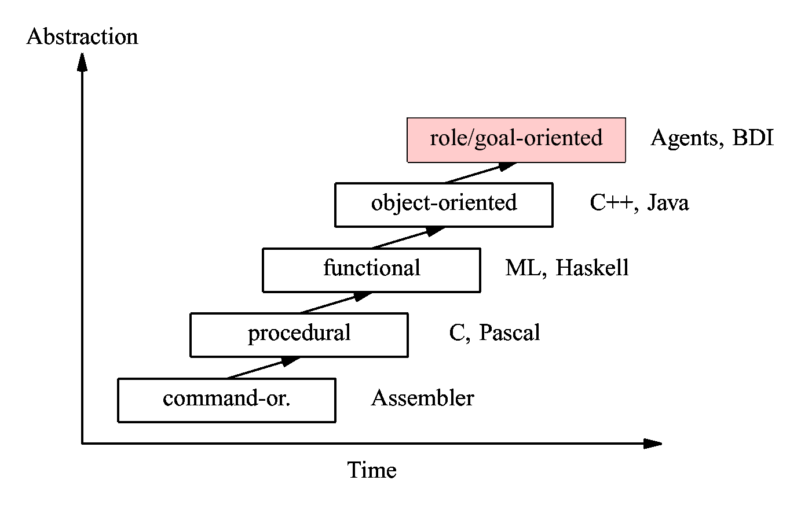

图 1-1. 编程范式的历史发展

## 智能体

### 自主性

智能体是在特定环境（世界）中交互的自主系统。环境可以包含数据以及智能体可操作的物理实体。智能体通过传感器观察世界，从而获得一定程度的关于世界的知识。这些知识可用于规划决策和执行动作。智能体与其环境进行通信，并对环境产生影响。智能体本身也始终是环境的一部分。智能体的基本特征在于其能力和特性，将在[智能体能力]一节中讨论。对于智能体，存在不同的理解和模型，这主要与使用智能体进行不同目的的不同科学社区相关。这些学科范围从社会科学到计算机科学，并受到经济、商业和生产领域的影响。

在计算机科学中，智能体概念用于实现从传统且仍广泛使用的客户端-服务器架构向执行数据处理和通信的分布式智能体系统的范式转变，如图 1-2 所示。

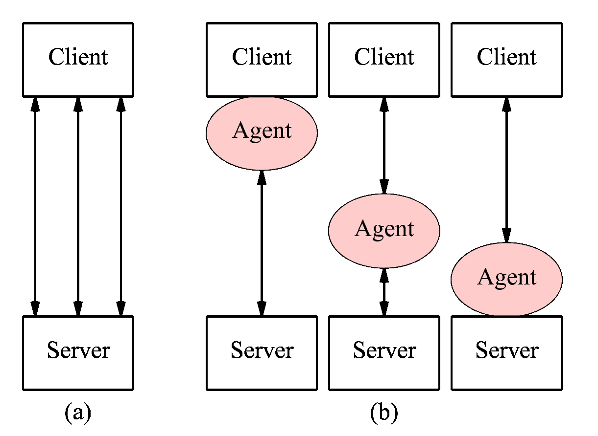

图 1-2. 从客户端-服务器通信架构 (a) 向基于分布式智能体且由智能体控制的通信 (b) 的转变

除了通用的智能体概念外，移动智能体由两个概念定义：移动性和代理性 [CAO12]。移动智能体可以降低通信成本，并通过适应性和复制提高鲁棒性。

### 度量标准

智能体可按以下度量标准分类：

1. 物理智能体
   1. 硬件智能体
   2. 软件智能体
   3. 社会智能体
2. 计算智能体
   1. 界面智能体（人机与机机）
   2. 数据处理智能体
3. 移动智能体
   1. 物理智能体
   2. 计算智能体

在本书中，两种不同的智能体类别被结合使用：

#### 物理行为智能体

代表物理实体，即个体化的人工人类、动物、车辆或更一般的机器。该智能体类别分为硬件智能体（即机器人或机器）和代表物理实体的软件智能体。软件智能体的一个子集是社会智能体，用于建模社会系统的行为和交互。模拟中的智能体也被视为物理智能体，因为它们代表物理实体。

#### 计算智能体

代表执行计算任务的软件和进程，例如用于分布式数据处理和数字通信，或实现聊天机器人。计算智能体需要智能体处理平台（APP）来执行。

#### 移动智能体

可被视为物理智能体和计算智能体的超集。物理智能体的移动性是指硬件或软件智能体空间移动的能力（或社会实体的迁移）。计算智能体的移动性（由计算进程代表）是指智能体处理平台之间进程快照的传输。

在上述基本智能体分类中，根据智能体对环境的影响和交互方式，基于智能体的方法可按其部署和使用分为五个领域：

1. 基于智能体的建模（ABM）
2. 基于智能体的模拟（ABS）
3. 基于智能体的建模与模拟（ABMS）
4. 基于智能体的计算（ABC）
5. 基于智能体的模拟与计算（ABX）

本书讨论了智能体的不同建模和部署领域，并最终使用 JavaScript 智能体机器（JavaScript Agent Machine）展示了所有四个层面（ABX）的融合。

### 模型

智能体（无论其分类如何）通过两种基本机制与环境交互：

1. 感知：执行环境感知并解释传感器值；
2. 动作：执行对环境的修改。

最简单的智能体行为模型和架构如图 1-3 所示，由智能体与环境之间的循环数据流组成。

智能体拥有一组用于感知的传感器 `S=( s[1,] s[2,] .. , s[n] )` 和一组用于修改环境的执行器 `A=( a[1] , .. , a[m] )`。

智能体行为的基本黑箱模型是一个函数 `Ag`，它将传感器输入向量 `S` 映射到执行器输出向量 `A`：

| 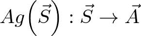 | (1-1) |

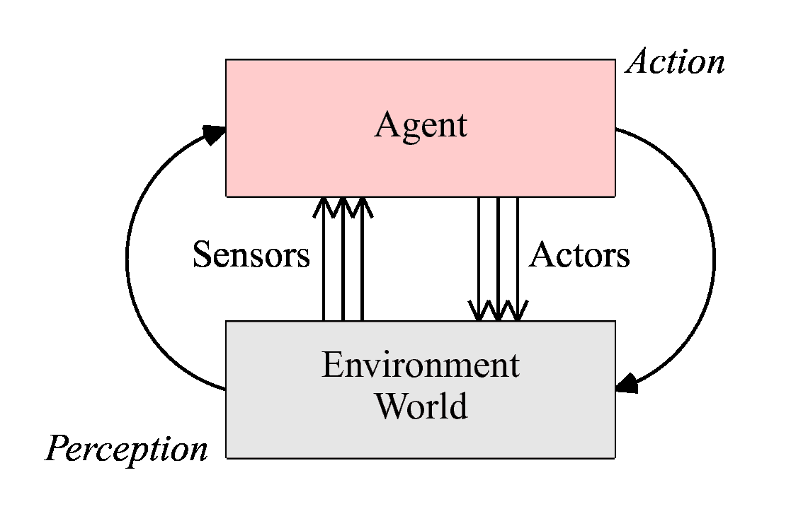

图 1-3. 简单反应式智能体行为模型与架构

传感器可分为：

1. 物理传感器——内在和外在的，测量不同的物理属性：
   - 温度（环境、身体、远程、设备、组件）
   - 运动（加速度、旋转、平移）
   - 位置（全局、局部、绝对、相对）
   - 光（强度、颜色、波长、光谱）
   - 辐射（电磁、核）
   - 压力（空气、负载）
   - 湿度、水分
2. 数据驱动的逻辑传感器，从以下来源提供数据：
   - 网页内容
   - 数据库
   - 网络
   - 社交媒体
   - 文本和图形
3. 虚拟传感器（由物理传感器和逻辑传感器聚合而成）

执行器可分为：

1. 改变物理世界的执行器
2. 逻辑执行器（数据）修改数字世界

## 建模概念

系统建模基本上有两种不同的方法：

1. 自上而下建模；
2. 自下而上建模。

自上而下模型从全局系统级别的规范开始，将系统模型划分为直接源自系统级别规范并与之耦合的较小模块。系统级别的行为是预先已知且可验证的。模块的行为直接源自系统级别。与自上而下建模相反，自下而上模型从一组简单的交互单元开始，最终由这些单元组成一个系统。系统级别是单元及其行为交互的结果，并非预先已知和指定。基于智能体的建模属于自下而上类别。

## 智能体的能力

智能体提供了一系列区别于传统软件的特性和能力：

- 自主性
- 自*能力：
  - 自组织
  - 自协调
  - 自适应性
  - 自优化
  - 自学习
  - 自感知
- 分而治之，使得能够用类似于元胞自动机的简单实体组合复杂系统
- 弹性和鲁棒性
- 行为的学习和适应性
- 规划与认知
- 知识表示、归纳与演绎
- 符号推理
- 社交能力，例如：
  - 协调
  - 合作
  - 协商
- 多智能体系统中的涌现行为，即只有系统的整体行为是相关的，而非单个智能体的行为（及故障）
- 智能体之间以及智能体与执行平台之间的松散耦合（API）

智能体类似于元胞自动机，后者通过连接简单的基本单元来建模复杂系统。元胞自动机（通常仅实现简单的输入输出函数）与智能体的主要区别在于它们的交互距离：元胞自动机中交互距离短（仅限于邻域），而在基于智能体的系统中交互距离是任意的。

### 涌现

涌现特性的观察是指由一组松散耦合的简单实体或智能体组成的系统的全局或集体行为。涌现是自组织、自适应性和自协调的结果。一方面，如果系统被分解为各个独立部分（孤立运行），或者系统中相当一部分个体被移除，涌现行为就会消失。另一方面，移除或故障一小部分个体并不会显著影响全局系统的涌现特性 [DAM13]。

系统的涌现行为既不能直接在单个实体层面建模，也不能通过全局函数在系统层面建模。这种涌现行为通常是观察到的。尽管涌现行为由智能体的个体行为决定，但多智能体系统旨在逆向工程涌现现象。典型的例子包括蚁群、经济和交易以及免疫系统。

涌现行为的一个例子是隔离，即个体长期移动形成空间集群，例如城镇区域。谢林模型是一个著名的基于非常简单行为和交互的聚类模型。迫田模型则不太为人所知，但可以在个体层面进行参数化。图 1-4 展示了一些全局可见的隔离效应的模拟结果。迫田模型基于个体局部效用（满意度）函数，该函数计算在特定环境条件下（邻域中的其他智能体）留在当前位置或前往其他位置的效用 [BOS19C]。

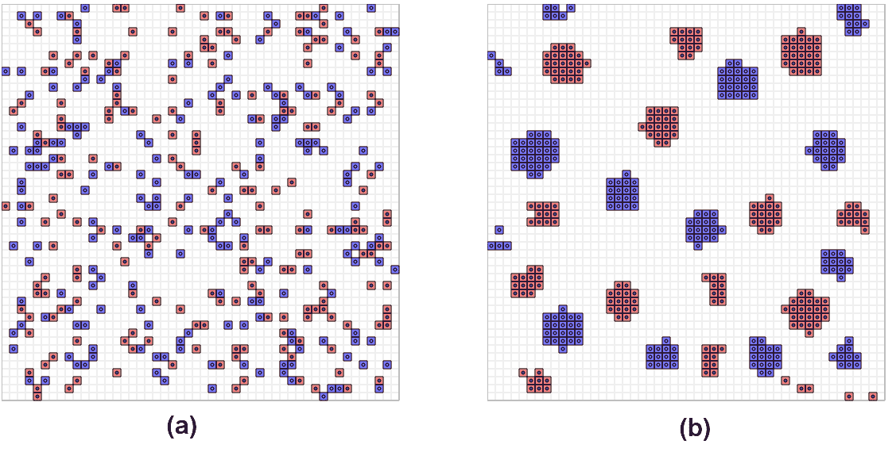

图 1-4. (a) 模拟世界，包含 200/200 个随机分布的人工迫田行为智能体，类别为 a/b（蓝色/红色方块）；(b) 基于移动性的社会组织模拟世界，经过 200 个模拟步骤后形成强隔离的同质集群 [BOS19C]

## JavaScript

智能体处理平台以及智能体的编程均使用纯 JavaScript。JavaScript，最初名为 ECMAScript，是一种部分函数式且面向对象的命令式编程语言，具有单一控制流（严格单线程，无抢占）和自动内存管理。JavaScript 程序由多态变量和函数组成。JavaScript 是动态类型的，即数据类型和函数接口在运行时求值。基本上只有六种定义的核心数据类型：

1. 数字（通常为双精度浮点数）
2. 字符串（不可变）
3. 布尔值
4. 对象
5. 函数
6. 未定义

数组和结构体都是对象。数组是多排序的，即数组的不同元素可以是不同的数据类型。数组通常通过 `push` 操作增量创建。数组元素通过方括号运算符访问。结构体元素（对象属性）通过点运算符访问，需提供属性名作为标识符。或者，也可以通过方括号运算符选择属性，只需将属性名作为字符串提供。纯数据对象（记录）和数组可以即时创建：

```javascript
var a = []
for(var i=0;i<10;i++) a.push(i);
a[1]=a[2]-1;
var img = {
  x:1,
  y:-1
}
var absimg=Math.pow(img.x,2)+Math.pow(img.y,2)
var struct1 = { x:1, y:2 }
struct1.x=struct1.y
struct["y"]++;
var array1 = [1,2,3,'A','B']
array1[0]=array[1]+1
function foo () { .. }
var foo2 = foo
var foo3 = function () { .. }
var foo4 = () => { }
```

对象类最初通过向对象构造函数添加原型函数来支持：

```javascript
function cls() { this.data = ε; .. }
cls.prototype.method = function () { this.data= ε }
var obj = new cls()
obj.method(..)
```

每个原型函数可以通过使用 `this` 变量访问实例化的对象。从同一构造函数实例化的所有对象共享同一组原型函数。

变量可以持有任何值，但初始值为 `undefined`。

> 任何值都可以随时赋值给变量，包括命名函数和匿名函数。函数可以随时再次序列化为文本，这是对象（智能体）快照和检查点的重要特性。所有非循环且没有原型绑定的对象都可以序列化为 JSON 格式的文本。

标识符（即变量和函数）只有两种作用域：全局作用域和函数体作用域。同一作用域中的所有变量定义会被合并，函数定义按出现顺序覆盖：

```javascript
var top=1
function foo (localparam) {
  var local=2
}
var top=2 // 覆盖第 1 行
```

函数也是对象。每个函数至少提供 `prototype` 属性，该属性引用一组动态函数，并且可以通过用户定义的属性进行扩展，例如静态函数或数据值：

```javascript
function foo () {}
foo.name = 'foo'
foo.info = function () { return foo.name }
```

数据和函数的文本序列化与反序列化是 JavaScript 的主要特性，对于通过进程快照支持移动代理至关重要。

# 众包

在本章开头，应先介绍一些将在全书中使用的简短术语：

### 传感器

将一种物理量转换为另一种物理量（通常是模拟、电或数字量）的物理转换器。物理量的示例包括温度、光强度、声波和机械应变。

### 虚拟传感器

具有输入和输出接口的函数，用于进一步处理和融合传感器信号。聚合变量（例如平均值）可以通过虚拟传感器计算。

### 众源

创造附加值：提供数据以及提供工作绩效的信息源；商品收集。

### 感知

获取和收集传感器数据 `X`={`x`[1],..,`x`[i]} 的过程，通常沿纵向时间轴周期性或基于事件进行，即 `x`=`x`(`t`)。

### 知觉

对感官信息的感知和解释。

### 调查

除了提供传感器数据 `X`={`x`[1],..,`x`[i]}（必要时为被动数据）外，还可能主动参与数据收集，例如用于模型测试或模型校准，如社交网络模型。

| 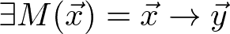 | (2-1) |

### 数据挖掘

从数据（变量 `X`=`x`[1],..,`x`[i]）中推导信息，通常没有精确的（统计）模型和变量相关性，即：

| 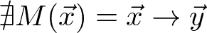 | (2-2) |

### 众包（CSO）

由未直接组织（社交连接）的较大群体提供工作绩效。这可能包括主动参与调查，这仅属于感知（即 `CSE` ⊂ `CSO`）。

### 群智感知（CSE）

由未直接组织（社交连接）的较大群体提供的感官信息被收集和记录。

### 移动群智感知（MCS）

使用移动设备和移动用户的 CWS → 空间变化和传感器数据的位置上下文很重要，必须作为额外的传感器信息加以考虑，例如使用 GPS 设备进行定位，包含纬度、经度和高度信息，或至少基于互联网地址。

## 概述

众包的重要性和历史首先需要回答一个问题：通常什么被视为众包，但从技术上讲并非如此 [BRA13]：

- 开源软件开发
- “基于公地的对等生产”：一种社会经济生产方法，众多人员合作参与一个项目
- “品牌参与”在消费者与品牌之间形成情感或理性纽带。它包括品牌管理的各个方面。
- 19 世纪《牛津英语词典》的编纂是众包的早期例子？也许吧。

> 众包起源于经济学、商业、生产、营销等领域，旨在增加产品的附加值。

众包和群智感知的主要目标是增加价值，即 [LEB13]：

- 降低成本
- 创新
- 真实性

但社会学和“政治科学”也日益认识到众包的好处！众包越来越多地被用于自愿创建地理知识数据库和地图！众包和群智感知这两个术语尚未统一定义。需要区分：传感器（感知）和执行器（行动）。因此，应采用以下分类：

### 众包

首先，众包可以理解为利用人力资源实现集体目标，即执行器。此外，还包括在用户直接参与或不参与的情况下收集用户数据（传感器），或由用户以自组织方式提供服务。用户不一定知晓其数据被收集。

### 群智感知

在用户参与或不参与的情况下收集用户数据。用户可能知晓其数据被收集并主动参与。群智感知可被视为众包的一个子类。

本书介绍的主要概念基于对感官信息的自动感知，该感知由移动代理系统实现。这些代理可以通过通用执行平台在各种计算机和移动设备上运行。这些平台应构建一个虚拟网络，允许代理“访问”不同的设备，包括智能手机。代理应通过不同的接口以不同方式与人和机器交互：

- 人-代理-机器接口
- 机器-代理-机器接口
- 代理-代理接口

代理将基于分治和自组织原则，在松散耦合且相互交互的多代理系统组中执行任务，如图 2-1 所示。

分布式众包软件框架的基本组件是本书介绍的 JavaScript 代理机器（JavaScript Agent Machine）`JAM`。`JAM` 本质上是一个代理处理平台库，可以嵌入任何用 JavaScript 编程的主机应用程序中。一些专用的预构建应用程序包括命令行 `JAM` shell（`jamsh`）、移动 `JAM` 应用（用于 Web 浏览器或智能手机应用程序）以及 `JAM` Web 实验室。

除了感知之外，分布式计算也可以用相同的框架实现。分布式计算可以利用已分布（传感器）数据，体现本地数据处理的概念，或者需要显式数据分布，这将在后续章节中讨论。


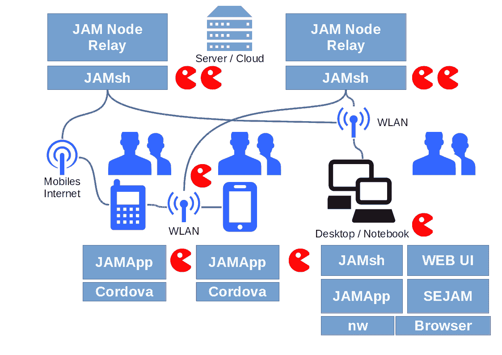

图 2-1. 本书用于移动众包和群智感知的原理架构

## 基础知识

可以区分不同类型的众包系统 [BAR14]：

- 集体知识管理（例如维基百科）
- 集体创造力 → 艺术与摄影
- 协作在线游戏
- 协作投票 → 评分系统
- 社交网络
- 利用群智感知和众包优化流程（在生产系统等中）
- 面向服务的架构（`SOA`）在众包中的应用：
  - 基于软件的服务
  - 人员服务

众包的流程可以由单个任务组成，这些任务要么由相应的 Web 服务处理，要么分配给负责人。在此场景中，任务可以外包给大众。为此，需要准备一个支持请求，其中包含要由大众处理的各种任务以及额外的元数据，例如时间限制和任务复杂度。

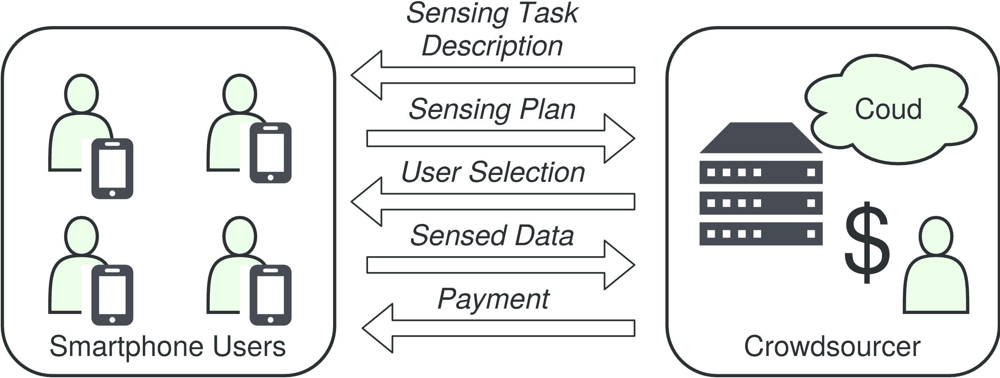

图 2-2. 众包或群智感知系统的一般架构

**众包系统模型**。众包或感知系统通常用于商业应用，由以下实体组成，执行不同的任务（见图 2-2）。

1. 众包发起者（数据收集者），以任务为导向，使用数据挖掘接收、聚合和分析数据 → 由一个或多个传感器处理服务器组成。
2. 大众，由许多用户（数据提供者）组成的群体，其感官和个人数据通常通过移动设备（如智能手机）收集。
3. 两者通过云环境连接。

用户与众包者实例之间存在连接和定向流。在调查场景中，众包者会为协商参与制定调查计划，从而形成带有商品流的双向顺序协议。

**调查中的双向连接与流：**

1. 用户获得调查任务的描述和任务；
2. 用户必须完成调查计划（直接有意识地完成，或通过激励间接完成）；
3. 众包者（调查者）选择用户（或通过公开招标程序赢得用户）；
4. 用户在特定时间 `t` 内提供感知数据 → 收集服务；
5. 用户获得奖励，即直接报酬或金钱收益——或出于自身利益自愿参与。

> 必须有一种调查策略，能够在调查中实现高效率！

### 练习 2-1. 奖励与激励

1. 在群智感知应用中，还有哪些非金钱奖励？
2. 收益是否已经是获取信息或相对于他人的优势？
3. 群智感知应用应给予哪些激励？是否存在依赖目标群体的因素？

### 用户中心模型

在该模型中，众包者（调查者）宣布一组任务 `Γ = {τ[1], τ[2], .., τ[m]}` 供用户选择。对于调查者而言，每个 `τ[j] ∈ Γ` 都有一个任务价值 `v[j] > 0`。

每个用户 `i` 根据自身偏好，选择任务子集 `Γ[i] ⊂ Γ`（基于其偏好）。相应地，用户 `i` 也有相关成本 `c[i]`，这些成本是私有的，只有用户自己知道。

拍卖开始：用户 `i` 随后向众包者提交一个订单-出价对 `(Γ[i], b[i])`，其中 `b[i]` 是出价，也是用户愿意出售其服务的最低价格。当收到所有用户的订单包后，持有者选择用户子集 `S` 作为获胜者，并确定每个获胜用户 `i` 的支付金额 `p[i]`。

用户 `i` 的收益为：

| 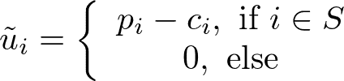 | (2-3) |
| --- | --- |

众包者的收益则为：

| 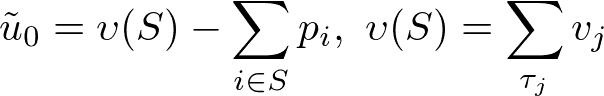 | (2-4) |
| --- | --- |

对于用户中心模型，可以设计一种激励机制，该机制应满足以下四个特征：

- **计算效率**：拍卖结果可以在多项式时间内计算得出。
- **个体理性**：每个参与用户在提交真实估值时，其收益非负。
- **盈利性**：获胜者带来的价值应至少等于支付给他们的金额总和。
- **真实性**：任何投标者都不能通过提交偏离实际估值（即成本）的报价来提高自身收益。

### 众包者中心模型

以调查者为中心的奖励模型可以理解为一种*斯塔克尔伯格博弈*。在第一阶段，调查者宣布奖励。在第二阶段（非合作阶段），用户将策略性地规划其调查时间，以最大化自身效用。需要回答三个问题才能找到最优调查策略：

- 问题 1：对于给定的奖励 `R`，博弈中是否存在一组稳定策略，使得任何用户都无法通过单方面改变当前策略而获益？
- 问题 2：如果问题 1 的答案是肯定的，那么稳定策略是否唯一？如果唯一，用户能否确信自己会从同一组稳定策略中选择策略？
- 问题 3：众包者如何选择 `R` 的值以最大化其效用？

在该模型中，只有一个采集任务。众包者宣布总奖励 `R ≥ 0`，并激励 `n` 个用户参与群智感知，而每个用户根据奖励决定自己的参与程度。用户 `i` 的采集计划由 `t[i] ≥ 0` 表示，即他愿意提供感知采集服务或参与调查的时间长度。

如果用户设置 `t[i] = 0`，则表示用户 `i` 不参与群智感知。用户 `i` 的采集成本为 `κ[i] * t[i]`，其中 `κ[i] ∈ Θ` 是单位成本，`Θ = {θ[1], θ[2], .., θ[l]}` 为单位成本集合。

我们假设调查者知道 `Θ` 以及具有单位成本 `θ[j]` 的用户的概率分布。这可以通过分析历史数据来学习。设 `n[j]` 表示具有单位成本 `θ[j]` 的用户数量，即 `n = Σ n[j]`。假设用户 `i` 获得的奖励与 `t[i]` 成正比。那么用户 `i` 的收益 `u^_[0]` 为奖励减去成本：

| 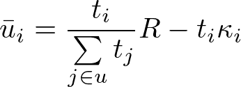 | (2-5) |
| --- | --- |

因此，所有具有相同单位成本的用户会选择相同的采集计划！这是真的吗？调查者的效用 `u^_[0]` 则由评估函数 `g`（取决于用户的实际感知时间 `t^~[1]`）减去总奖励 `R` 给出：

| 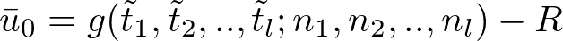 | (2-6) |
| --- | --- |

简化与确定：具有相同单位成本的用户将提供相同的调查时间！因此，在该模型中，众包者的目标是确定 `R` 的最优值，以最大化 `u^_[0]`。每个用户 `i` 独立决定其采集时间 `t[i]`，以最大化指定的 `R` 值。由于没有理性用户愿意为负效用提供调查服务，因此如果对于所有 `i ≠ j` 有 `R ≤ κ[i] Σ t[j]`，则用户 `i` 将设置 `t[i] = 0`。

### 奖励

在前一节中，金钱奖励是通过协商引入的。存在一个必须满足的效用函数，而调查时间起着关键作用。用户（数据提供者）和调查者（数据收集者）都有各自的效用函数，且可能相互对立！

奖励在数据收集中应实现三个目标：

1. 大量参与者 → 创造激励；
2. 广泛覆盖（及代表性）；
3. 数据质量（覆盖调查目标）。

因此，基本上有三类奖励：

1. 通过**金钱奖励**激励参与 → 宏观与微观支付 `M`；
2. 通过**游戏**激励参与；
3. 通过**改善社交关系**激励参与；
4. 通过**解锁机制**激励参与 → CAPTCHA 原理。

> 奖励就是动力！

存在两种类型的动机：

- **内在动机**：乐趣、挑战、学习；
- **外在动机**：金钱目标、社会压力、名声。

对于众包和群智感知而言，内在动机可能比外在动机更重要。两种类型都共享个体用户对效用函数（用户自身）的个体优化。

## 分布式计算作为众包

利用网络设备，即通过互联网连接的计算机，可以在远程计算机上实现两种基本操作：

1. 感知；
2. 计算。

尽管感知也涉及计算，但日常使用的通用计算机（如笔记本电脑或智能手机）的计算能力可用于创建大型虚拟计算机器。如果用户在浏览器中打开一个网页，`JavaScript` 最初用于提供网页上的动态内容，例如更新的新闻标题。但如今，大量网页完全通过计算动态构建，并且通过编程方式发起大量通信请求。现代 `JavaScript` 引擎提供了足够的性能，可以在浏览器中执行机器学习（`ML`）。

因此，再次考虑参与式和机会式众包，例如，网页可以用作短时计算容器。本文介绍的移动代理框架可用于在 Web 中分发计算。

计算能力的机会式众包比感知任务更加关键和困难。感知任务通常时间短且大多不基于状态。这意味着，如果用户重新加载网页，传感器可以再次访问，采样数据可以无损失地传输到数据接收端。但像机器学习这样的长时间计算不能以这种方式中断——所有已获得的计算结果都会丢失。因此，分布式计算需要某种快照机制来保存中间计算结果，以便在同一台或另一台计算机上再次运行时使用。

## 移动群智感知

移动群智感知是一种能够大规模、低成本捕获物理世界的技术。通过移动群智感知，投身于日常生活的普通人成为“传感器”。智能手机或智能手表等移动设备配备了多种传感器，可用于收集环境、交通、健康和安全方面的数据。众包和群智感知技术使得以人为本的感知能够创建全面、集体的感知。结合静态传感器网络和物联网设备，移动群智感知可以使普适感知的愿景成为现实。

移动群智感知的基础主要由三个组成部分构成：

1. 配备传感器的移动设备（智能手机）；
2. 移动设备的应用程序；
3. 标准化的软件接口。

以服务器为中心的系统由严格划分的组件组成：

- 传感器源：作为扩展空间区域传感器的智能手机，将传感器数据发送到服务器；
- 传感器接收端：收集数据的服务器。但服务器也利用聚合数据为用户提供服务。

> 移动群智感知：人们既是感知数据的消费者，也是生产者！

在道路交通和运输领域，通常有交通部门可以根据智能手机提供的位置和速度数据，收集国家或城市内交通行为的精细分辨率和大规模数据。同样的信息可用于提供个性化的交通分流，以避免交通拥堵，或引导驾驶员找到空闲停车位。还可以收集道路质量数据，帮助市政部门快速修复道路。

类似地，人们在暴风雪期间或之后拍摄的照片（即摄像头传感器数据）可以自动分析，以优先清理道路。

> 地理信息系统在移动群智感知中扮演重要角色，因为它将空间和地理信息与其他传感器结合，创造新的上下文！

移动群智感知模型将每个携带移动设备的人视为潜在的传感器节点，并形成一个由全体人口使用的大型传感器网络。群智感知大致可分为两大类：

- 参与式手动输入：需要参与者手动主动干预进行特定输入。
- 机会式自动采样：在参与者的智能手机后台进行检测。

在参与式感知中，每次调查都直接涉及参与者执行某些操作，例如拍摄地点或事件的照片。因此，在此过程中，参与者通过决定接受和完成哪些调查任务，对何时、何地以及记录什么拥有最大的控制权。在参与式捕获中，捕获可以自动执行，但参与者可以控制捕获执行的时间、发布策略等。

在机会式捕获中，实际捕获自动执行，参与者不参与捕获活动。智能手机（采集软件）做出适当决策，并启动采集数据的获取和传输。这种传感器模型将工作负载从参与者转移到中央传感器检测系统（或移动设备的自主自组织网络），以确定何时、何地以及在参与者的哪些智能手机上执行自动采样，以满足调查要求。

系统在制定记录任务规划决策时，会考虑参与者的社会因素。这些因素包括：

- 当前位置；
- 可能的下一位置；
- 当前活动；
- 常规日常模式，以及必要时；
- 健康状况。

这种检测方式被称为以人为中心的识别。参与式手动调查的示例包括：

- 照片和视频新闻（公民报道）；
- 道路交通登记；
- 社交网络中的数据共享。

机会式自动调查的示例包括：

- 行为与社会行为评估；
- 交通与道路记录；
- 利用 `GPS` 和建筑地图进行室内定位。

## 传感器

移动和固定设备中有众多可用的传感器。表 2-1 列出了一些最常用的传感器。

| 运动/位置传感器 | 环境传感器 | 无线电 | 其他硬件 |
| --- | --- | --- | --- |
| 加速度计、磁力计、陀螺仪、接近传感器、计步器 | 环境光传感器、气压计、温度传感器、空气湿度传感器、辐射传感器 | `GPS`、蓝牙、`Wi-Fi`、蜂窝网络 | 麦克风、摄像头、闪光灯、触摸传感器、指纹传感器 |

表 2-1. 常见传感器分类

### 加速度计

加速度计记录三个相互垂直的轴 `x`、`y`、`z` 上的加速度。如果智能手机水平放置在桌面上，其中一个轴指向重力矢量（`g`）。加速度计在测量身体活动方面起着重要作用。通常，它们用于检测智能手机的方向，如今广泛应用于各种游戏和活动检测应用程序。

### 陀螺仪

陀螺仪通过角动量测量智能手机的方向。它可以测量沿某一轴的角度变化率，通常能够可靠地检测短时和突然的方向变化。智能手机通常结合使用加速度计和陀螺仪，以相互校准，并可靠地检测方向变化、运动状态等。

### GPS

这是最常用的智能手机传感器之一。它利用卫星及其地面站作为参考，计算智能手机的位置。输出通常是一个（纬度、经度和海拔三元组），以及速度和方向等其他信息。`GPS` 可以在智能手机上关闭，且并非始终可用。

### 光传感器

光传感器通常是光电二极管，通过电流测量光强度。光传感器用于在不同光照条件下控制屏幕亮度，或在用户将手机贴近耳朵时锁定触摸屏。

光传感器还可以与其他传感器配对，用于智能服务，例如通过结合声音和手机位置检测（例如在口袋中、桌上或手中）以及加速度计，实现更好的定位。

### 外部传感器

除了智能手机内部传感器外，检测还可以通过外部传感器进行，例如健康领域用于监测患者的随身传感器、用于监测日常运动或骑行路线的自行车传感器，以及车辆中的传感器。

这些外部传感器通常通过各种无线技术（尤其是与许多外部传感器设备兼容的蓝牙）进行访问。随着传感器应用数量和复杂性的增加，这些外部传感器在未来将变得更加重要。

智能手机具备 `GPS`、蓝牙、`WLAN` 和 `GSM`（移动无线电）功能，这些通常用于定位和通信。

这些通信设备与其他传感器相结合，可以提升对用户的移动检测能力，并为用户的定位数据做出重要贡献。特别是，`GPS` 定位几乎总是与所有采集数据一同标记，以使数据更具意义和上下文关联性。

#### GSM

全球移动无线电网络，由通常位于室外区域的基站组成（例外情况：如火车内的无线电网络中继器）。覆盖范围约 100-2000 米。

#### Wi-Fi

本地固定无线电网络，由可位于室内和室外的基站（`WLAN` 接入点）组成。覆盖范围约 10-100 米。

#### 蓝牙

蓝牙用于通过 `ISM` 频段（2400-2480 MHz）的无线电传输，在两个设备之间短距离交换数据。

因此，蓝牙可以检测并连接到其环境中的其他支持蓝牙的对等设备。由于新的蓝牙低功耗（`LE`）技术，智能手机可以更高效地捕获邻近数据。这一特性已被广泛用于研究，以估计和记录实时社交状况，例如估计人口密度、计算群体形成以及推导社交背景和联系。覆盖范围约 1-10 米。

## 调查

调查是感知世界，尤其是感知人群的强大工具。一项调查分为几个任务：

1. 起草调查 `S`（`Survey`）始于定义目标设定。
2. 目标通常是回答一个或多个更高层次的问题（`Q`），以检验假设（`H`）。

| 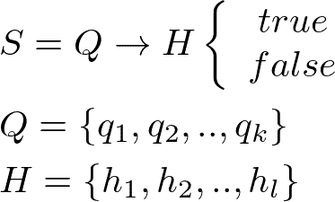 | (2-7) |
| --- | --- |

问题示例如下：

- 人们在街上感到安全吗？
- 该国的就业状况是否发生了变化？
- 疫情期间人们是否更多且不同地使用互联网？

3. 调查的设计进一步分为以下步骤 [K]：

因此，调查设计必须从根本上考虑要研究的群体的精确定义（目标群体）。进一步考虑需要测量什么（变量 `X`）以及需要估计什么（群体特征）：样本从哪里选择（抽样框）以及如何选择样本（样本设计和样本量）。

4. 仔细规划调查非常重要，需考虑上述步骤！

必须选择目标群体：

> 调查目标受众的定义是调查设计阶段的首要步骤之一。目标群体是要研究的实体群体，也是调查结果所涉及的群体。目标受众的元素通常是个人、家庭或公司。因此，群体不一定由人组成。

在移动群智感知中，目标群体并非总能精确定义！目标群体由数量构成：

| 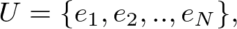 | (2-8) |
| --- | --- |

其中 `N` 代表群体规模，`e` 代表单个实体。

有两种变量需要区分：目标变量和辅助变量。

### 目标变量

这些变量衡量目标群体中元素的特征。来自目标群体的每位参与者参与调查，以回答一个或多个目标变量 `y`：

| 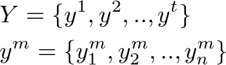 | (2-9) |
| --- | --- |

示例：`q[i]`="收入是多少？" → `y[1]`=参与者 1 的答案，`y[2]`=参与者 2 的答案，以此类推。

### 辅助变量

辅助变量通常衡量元素的背景属性。针对人群的调查辅助变量示例包括性别、年龄、婚姻状况和地区。

此类辅助变量有助于提高估计的准确性。它们还在纠正无应答的负面影响中发挥作用。此外，它们为更详细地分析调查结果提供了机会：

| 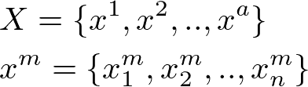 | (2-10) |
| --- | --- |

存在不同的群体参数。群体参数是一个数值指标，其值仅取决于目标变量 `y` 的值 `y[1]`、`y[2]`、...、`y[N]`。

群体总和定义为：

| 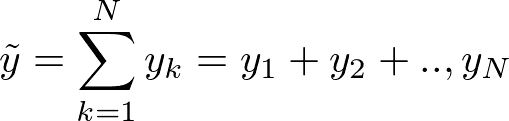 | (2-11) |
| --- | --- |

群体均值表示为：

| 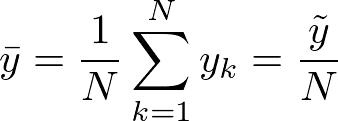 | (2-12) |
| --- | --- |

最后，群体方差表示为：

| 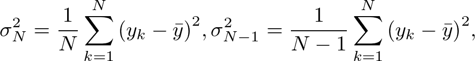 | (2-13) |
| --- | --- |

调查窗口与调查中的覆盖不足和覆盖过度有关，如图 2-3 所示。

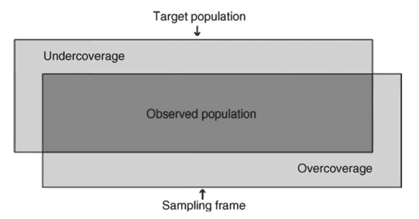

图 2-3. 调查中的覆盖不足和覆盖过度问题通过抽样框来解决 [Bethlehem, 2009]。


抽样框是目标群体`U`中所有元素的列表。对于列表中的每个项目，必须有如何联系该项目的相关信息，即元数据集合。联系信息可以包括个人姓名和地址、电话号码以及电子邮件地址。此类列表可以以纸质形式（俱乐部成员的名片目录、电话簿）或数字形式（包含所有公司注册信息的数据库）存在。如果此类列表不可用，在移动群智感知中有时会使用详细的地理信息和地图（基于GPS、互联网地址）。

调查窗口的示例可以在人口登记处的登记册（或实体人口列表）中找到，也可以在数字社交网络和讨论论坛的成员列表中找到。

当目标群体包含在抽样框中没有对应项的元素时，就会出现覆盖不足。此类元素永远无法被选入样本。覆盖不足的一个例子是，从人口登记册中选择样本的调查。非法移民是群体的一部分，但他们永远不会出现在抽样框中。另一个例子是通过互联网选择受访者的在线调查。在这种情况下，存在覆盖不足，因为有些人没有互联网接入。

覆盖不足可能带来严重后果：如果抽样框外的元素与抽样框内的元素存在系统性差异，则群体参数的估计可能会严重失真。一个复杂因素是，通常很难确定是否存在覆盖不足。

覆盖过度是指抽样框中包含不属于目标群体的元素。如果此类元素最终进入样本，并且其数据被用于分析，则群体参数的估计可能会受到影响（被篡改）。在字段中检测覆盖过度应该相对容易。这应该能从问题的回答中清楚地看出。

干扰变量和干扰因素与样本框中的单位与目标总体中的单位不一致时可能产生的问题有关。一个典型情况是，一个由地址组成，另一个由人员组成。调查中进一步的干扰变量可能是目标总体与结果窗口之间的差异，例如由于不同的检测参数。一个例子是，调查中家庭应以等概率被选中，而样本框由人员组成！如果样本是从人口登记册中选取的，就可能出现这种情况。此时，大家庭比小家庭被选中的概率更大，因为大家庭在样本框中有更多成员。实际上，选择家庭的概率与家庭规模成正比。

代表性调查引发了一系列问题：它们真的存在吗？媒体是否具有平衡的代表性？谁或什么代表？国家机构作为人口的代表？当然不是！

根据克鲁斯卡尔和莫斯特勒的说法，适用以下标准列表：

1. **一般数据认可**。这不过是一种没有证据的笼统保证，声称数据是可靠的。媒体通常使用这种“代表性”含义，而不解释其确切含义。

2. **缺乏选择性影响**。在选择时，无论有意还是无意，都不应偏向某些元素或元素组。

3. **总体的微缩模型**。样本可以被视为总体的缩比模型。样本具有与总体相同的特征。样本比例在所有方面都与总体比例相似。

4. **典型或理想案例**。样本由对总体而言“典型”的元素组成。这些是“代表性元素”。（平均人的概念——`平均值`）

5. 记录总体的**异质性**。总体中存在的**变异**也必须在样本中遇到。因此，样本还应包含**非典型元素**。

6. **术语的含义**。术语的语义、误解和歧义是相关问题。

7. **统计学**。使用了特殊的抽样方法。必须使用一种概率抽样形式，使总体中的每个元素具有相等的选择概率。

8. **良好的估计**。总体的所有特征和变异性都必须在样本中再次找到，以便能够计算出总体参数的可靠估计。

9. **质量**。对于特定目的足够好。任何样本，只要能证明被认为非常罕见或不存在的现象以一定频率发生，就足够了。

随机化可用于在调查中实现尽可能最佳的统计分布。这意味着从登记册中随机选择参与者。但是：人类是糟糕的随机化者！随机化器是一个理论概念。完美的随机化器并不存在。然而，有些设备接近随机化器。而数字（合成）随机数生成器就到此为止了！数字（程序化/数学）随机数生成器总是生成相同的从`N`个数中取`M`个数的序列，并且会重复！

合成（伪）随机生成器根据前一个值计算下一个“随机值”，并且有一个（内部）初始化（`seed`）：

| 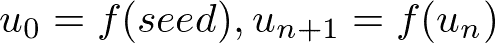 | (2-14) |

伪随机序列的起点由`seed`值决定。相同的`seed`值会产生相同的序列！一个简单的伪随机生成器，从正弦函数的曲线中采样：

```
[](#cb5-1)var start value = 1; var STEP = 10000;
[](#cb5-2)function random2 () {
[](#cb5-3)  var x = Math.sin(seed++) * STEP;
[](#cb5-4)  return x - Math.floor (x);
[](#cb5-5)}
```

## 模拟

除了在分布式环境中收集和处理真实世界数据以推导系统聚合变量之外，模拟也是测试模型和推导聚合变量的另一种常见方法。通常，模拟是一个由众多简单交互实体组成的沙盒，使用合成世界数据和（非常）简化的行为模型。使用JAM进行MCS的主要目标是提供用于模拟的真实世界传感器数据，并将人纳入模拟循环中（人在环模拟方法）。

## 问题

众感知数据的可靠性是一个重大挑战。订阅者传输的收集数据并不总是可靠的，因为他们可能在没有执行实际任务的情况下传输错误数据以获取补偿（就像在调查中只给出玩笑答案一样），这主要是由匿名的互联网世界驱动的。因此，验证收集的数据非常重要。此外，移动设备传感器：A.) 不可靠，B.) 不准确！

奖励是另一个挑战。对于组织（例如地方或州政府机构或研究社区）或个人来说，为任何改善公共服务、支持知识发现或便利我们日常生活的收集任务提供经济补偿并不总是经济的。

因此，有必要找到廉价的解决方案来激励参与者进行感知调查。

必须考虑能源需求和电池续航时间。在移动应用程序的开发和实施中，能耗是开发者面临的一个基本约束条件。

因此，主要目标是最大限度地减少移动设备的能耗，控制传感器的动作，并在必要时暂停它们。

必须考虑安全性和隐私。数据保护通常是移动数据收集的主要障碍。如果感知应用程序使用第三方感知服务，那么隐私对智能手机用户来说是一个重要问题，因为很难信任传感器数据上传到的服务器所有者。

此外，这些服务器也可能受到黑客攻击。然而，只要捕获的数据保留在用户的移动设备上，用户就会感到安全。但是，如果不将传感器数据发送到感知服务，应用程序开发者可能无法检测到复杂的用户活动。此外，即使可以在手机上实现，这也可能导致高能耗或响应缓慢。因此，应用程序开发者需要权衡应用程序对用户的功能和隐私。

# 平台与智能体

在介绍了智能体和众包方法之后，应详细讨论技术实现方面。基于分布式智能体的计算（ABC）相比使用中央服务的传统数据处理具有一些优势。问题的去中心化解决，例如能源管理 [HAR05]，可以比集中式解决更高效，并且可以减少通信以及可选的计算复杂度。满足需求的主要方法是使用本地数据进行本地处理，并对缩减和预处理后的信息进行全局融合。基于智能体的系统最重要的特点是其对部分故障具有更强的恢复能力和鲁棒性。智能体分类法涉及三个领域：语言、工具和算法，以及平台，如图3-1所示。详细讨论可参见 [BAD11]。

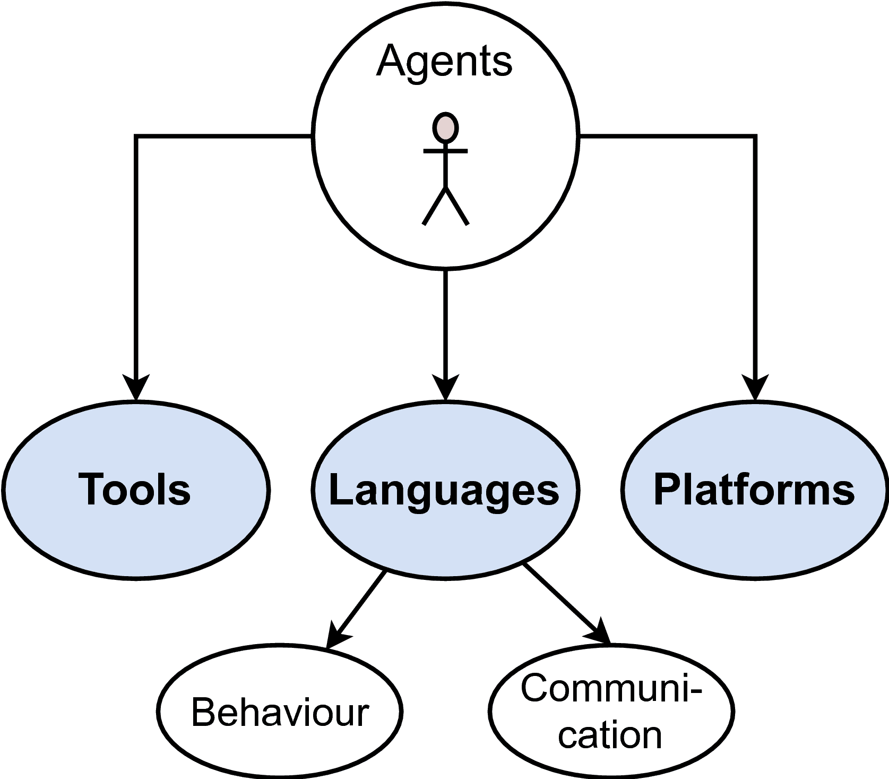图 3-1. 智能体分类法

## 编程

为了简化在由互联网连接并部署在强异构环境（包括物联网和移动网络）中的普适和泛在应用里多智能体系统的开发与部署，需要一个统一、可移植且可嵌入的智能体处理平台。为了实现可扩展性和高性能，智能体平台架构必须与智能体编程模型紧密协同设计。本书基于过去10年间的多篇科学出版物[10-28]。所有这些出版物都涉及多智能体系统的部署，并使用了一个可编程的统一智能体处理平台。最初，可编程智能体采用FPGA逻辑以硬件方式实现[BOS13A;BOS14A]；随后，引入了一种带有扩展智能体专用指令集的FORTH栈处理器的软硬件实现（AgentFORTH）[BOS15A;BOS15B]。最后，Web和云部署成为焦点，发明了JavaScript智能体机器（JAM）。所有这些不同的平台都基于相同的元级语言AAPL（基于活动的智能体编程语言）[BOS18A]。我们过去工作中使用的所有智能体编程语言都是AAPL的方言或子集。本技术报告的目的是提供关于JAM以及由JAM处理的AgentJS编程语言的详细而严谨的描述，并附带大量背景信息和设计模式。JAM广泛应用于各种场景，包括分布式机器学习[BOS17A]、结合仿真的分布式超材料（机器人）控制[BOS19A]、移动群智感知与社会数据挖掘及聊天机器人[BOS18C;BOS19B;BOS21A]、分布式能源管理[BOS18B]以及分布式交通控制[BOS20A]。JAM既用于物理系统，也用于仿真（JAM本身就是仿真器）。

关于智能体建模、智能体编程、智能体处理架构以及智能体交互，存在多种设计选择。这些设计选择取决于智能体的部署方式、应用领域，以及最重要的——智能体所处的物理和数字环境。智能体行为模型可以从较低抽象层次到较高抽象层次，具有不同的表达能力。较低层次更接近传统的数据处理架构以及过程式或面向对象编程，而较高抽象层次则侧重于知识表示、认知表示、本体论，通常使用声明式编程模型和语言。信念-愿望-意图（BDI）架构是一种广为人知且广泛使用的智能体行为模型。尽管如此，传统的命令式和过程式/面向对象语言（如Java）仍被用于编写智能体程序。

## 虚拟机

智能体通常需要一个虚拟机（VM）作为智能体处理平台（APP）。一方面，APP必须将智能体彼此隔离；另一方面，APP必须提供足够的智能体通信和交互能力。APP必须满足一组核心特性：

1. 与宿主平台的独立性和可移植性；

2. 隔离的代码（容器）处理，并可选择支持多线程；

3. 代码处理与底层API的松散耦合（缓解模块化软件中常见的硬API匹配问题）；

4. 高性能和低内存需求；

5. 互联网和Web浏览器部署；

6. 支持物联网和嵌入式系统。

Java是一种广泛使用的编程语言和虚拟机。流行的智能体框架（例如Jade [BEL05]）依赖于Java。但Java仅满足需求1、2以及部分满足需求6。Web部署基本上只能通过“原生”Web编程语言JavaScript来实现。JavaScript（最初称为ECMAScript）满足需求1、3、4a、5、6以及部分满足需求2。

### 练习 3-1. 虚拟机

1. 自动内存管理和垃圾回收有什么好处？

2. 自动内存管理的缺点是什么？

3. 基于栈的虚拟机是否优于基于寄存器和基于RAM的虚拟机？

## 移动与Web部署

如今，人机交互的主要部分通过Web浏览器进行。Web浏览器越来越多地用于计算和通信，例如文本处理、机器学习和视频会议。从实践角度来看，智能体应直接使用JavaScript（JS）实现，这是一种备受推崇且广泛使用的编程语言。JS执行平台适用于非常广泛的设备和操作系统，例如Intel x86/x64、Arm32、Linux、Windows、Solaris、macOS、FreeBSD、Android、IOS等。此外，直接在JS中实现移动智能体将受益于现有的高性能JS虚拟机，例如Google的Chrome V8或Mozilla的SpiderMonkey引擎，它们支持即时原生代码编译（JIT）。简而言之，JS是一种非常简单但高度动态的语言，涵盖了过程式、面向对象和函数式概念。

## 智能体处理与JavaScript

即使使用基于JIT的虚拟机，在任何执行时刻都保留了完整的代码到文本和文本到代码的转换，包括函数和数据。这使得运行时代码变形成为可能，这是基于AAPL的智能体的一个先决条件，用于存储智能体进程的当前状态（例如，在迁移之前），并通过智能体自身对活动转换图（ATG）进行重新组合来修改智能体的行为。与Java和常见的基于Java的智能体框架（例如JADE）相比，JS与底层执行平台的耦合松散且依赖度低。这是相对于Java或C编程语言的显著优势，后者必须在代码执行前进行编译，并且对API和库的不匹配非常敏感。JS将函数视为一等值，从而能够像使用内置代码求值函数修改任何其他数据一样，动态地重新配置代码。

智能体可以被视为一个位于环境和世界中的计算单元，它执行计算（基本上对环境隐藏），并与环境交互以交换基本数据。普通计算机专门用于计算任务，与其他机器的交互被封装在计算中，传统上通过消息来执行。智能体行为可以是反应式的或主动式的，并且具有与其他智能体通信、协作和协商的社会能力。主动性与目标导向行为密切相关，包括估计和意图能力。

智能体记录关于环境状态`e∈E`和历史`h:e[0] → e[1] → e[2]...`的信息。设`I=S×D`为智能体的所有内部状态的集合，由与控制状态相关的活动状态集`S`和内部数据`D`组成。智能体的决策过程基于这些信息。存在一个感知函数`see`，将环境状态映射到感知；一个`next`函数，将内部状态和感知`p ∈ Per`映射到内部状态（状态转移）；以及动作选择函数`action`，将内部状态映射到动作`act ∈ Act`。

智能体的动作会修改环境，而环境又被智能体所感知。因此，智能体是环境的一部分。学习型智能体可以通过考虑其动作对环境的影响来提高解决给定任务的能力。在执行一个动作后，智能体会以奖励的形式获得反馈：`r(t)=r(e[t], a[t])`。存在策略`π: E→A`，将环境状态映射到动作。学习的目标是找到最优策略`π^☆`，它是`p`的一个子集。

JavaScript代理机器（JAM）适用于在强异构且移动的环境中进行部署。JAM可用于分布式计算，也可用于统一方法论和统一代理编程模型下的仿真，最终实现与仿真耦合的移动群体感知。

在接下来的章节中，将介绍代理模型、代理自适应性、代理交互以及编程语言AgentJS的基础知识。在介绍背景之后，将描述JAM本身及其架构。扩展部分专门用于描述AgentJS编程语言。JAM基于模块化库的概念。重点介绍了一些使用JAM核心库的应用程序，并附有示例。此外，还讨论了性能指标和性能评估。基于JAM的仿真环境SEJAM通过一个扩展的示例项目进行了介绍。最后，介绍了与仿真耦合的移动群体感知用例。讨论了方法论和技术上的设计选择与问题。

JAM的新颖之处在于其简单统一的设计，提供了高度的可移植性和广泛的应用领域。使用广泛流行的JavaScript编程语言，使得初学者和非专家也能编写多代理系统（MAS）。MAS还可以用于互联网和Web领域，这是最流行的人机界面。所有编程示例都可以使用JAM或Web JAM实验室进行测试，这些资源可在GitHub [JAM22]（发行版和源代码）上获取。只需要一个Web浏览器和node.js核心二进制文件 [NOD22]。

# 代理模型

代理行为模型可以划分为以下任务，这些任务必须通过代理编程语言模型提供合适的语句、类型和结构来体现：

- 计算：主要任务和基本操作是从输入数据和存储数据（历史记录）计算输出数据。原则上，函数式和过程式（或面向对象）编程模型都适用，但只有过程式编程模型能一致地处理包含计算数据和存储的历史记录。

- 通信：作为主要操作的通信服务于两个典型的目标元组：（数据交换与同步）、（与环境及其他代理的交互）。如果环境也由代理处理，则后一个目标元组可以简化为仅代理交互。代理之间的通信可以通过点对点或组通信范式将单个代理连接成多代理系统。

- 移动性：代理的移动性显著增强了感知和交互环境。移动代理可以从一个计算环境迁移到另一个计算环境，最终在那里继续处理。代理的状态（由控制状态和数据状态组成）必须在迁移时得以保留。

- 重配置：传统计算系统具有在设计时指定的固定行为和操作集。在运行时对系统进行行为重配置意义上的自适应，可以显著提高所执行任务的可靠性和效率。

- 复制：这些方法用于创建新代理，可以从模板创建，也可以通过分叉子代理创建，子代理继承父代理的行为和状态，最终并行执行。复制是构成分布式计算和反应系统的主要代理行为之一。

- 代理与对象：现代数据处理通常使用面向对象编程范式进行建模。但代理与对象之间存在显著差异。对象是封装了某些状态的计算单元，能够执行操作（通过应用方法）并进行通信，通常通过消息传递。对象与面向对象编程相关，与代理相比，它们不具有（或较少具有）自主性，并且通常不可移动。常见的对象模型与主动行为和社交行为毫无共同之处。但代理可以在对象模型之上实现，通过作用于对象的方法来实现。行为引擎的修改基本上不受对象编程模型的支持。代理自行决策，而对象则需要外部计算单元（如操作系统或用户）来进行决策过程。尽管面向对象编程可以通过并行和并发处理（多线程）进行扩展，但多代理系统本质上是多线程的。

练习 4-1. 代理

1. 你知道有哪些广泛使用的代理代码利用了代码变形和自适应吗？几乎所有使用计算机的人都接触过这些代理，但大多没有意识到它们的存在。

2. 与由主程序启动的扁平列表创建的代理相比，复制（例如树状代理家族）有什么好处？

3. 携带数据的移动代码与非移动代码和移动数据相比有什么好处？

4. 移动代码的缺点是什么（也请回想问题1）？

## 活动-转换图

代理模型大致可分为反应式和慎思式代理行为模型。代理的行为定义了：

* 一组关于世界的传感器和信念（其数据集），基本存储在代理的主体变量中；

* 一组它将响应的事件（信号、元组、传感器变化）；

* 一组它可能希望实现的目标，基本通过活动集来实现；

* 一组计划，描述它如何处理可能由激活活动产生的目标或事件。

基于活动的代理的行为由代理状态表征，该状态通过活动而改变。活动执行感知、规划动作和执行动作，从而修改代理的控制状态和数据状态。活动与活动之间的转换由活动-转换图（ATG）表示。转换启动活动通常依赖于代理数据（主体变量）的评估，这些数据代表代理的数据状态，如图4-1所示。

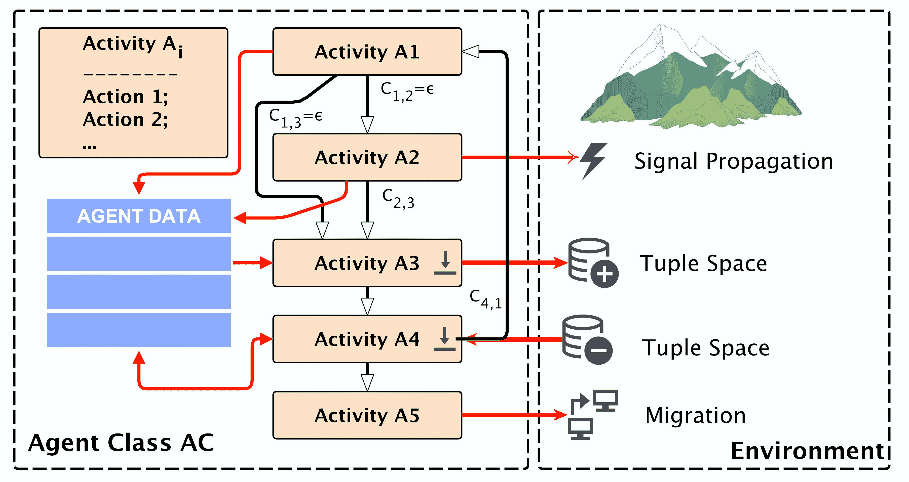图 4-1. 由活动-转换图给出的代理行为，与环境的交互通过在活动中执行的动作进行

代理的行为通过循环有向活动-转换图（ATG）进行建模。活动集`A`中的活动`a`是该图的一个活动（功能）节点，它执行动作，即基本计算、通信、迁移和代理控制。转换是节点之间的有向活动（功能）边。转换集`T`中的转换`t`可以是有条件的，并取决于代理状态的评估。代理状态主要包含在私有主体变量集以及由`next`活动指针表示的控制状态中。

代理由类构造函数`AC[i]`创建，该构造函数定义了活动集`A`、转换`T`、主体变量`V`、过程`P`和信号处理程序`H`：


| 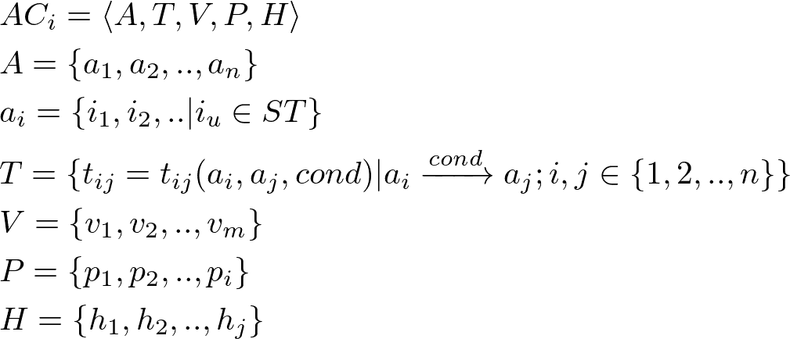 | (4-1) |

活动 `a[i]` 由语句集 `ST` 中的顺序语句 `{st[j]}` 组成。语句集对于不同的代理可以不同，并且可以依赖于环境设置和约束，例如代理的特权级别。

智能体可能因等待事件（包括时间事件）而被挂起。由于并非所有编程语言和处理环境都支持流程控制阻塞，因此只有转换执行和激活可以被阻塞。这意味着，一个活动内部可能只有一个阻塞操作，例如休眠或等待通信数据（参见元组空间通信，第 4-4-1 节）。

## 动态活动转换图

上一节介绍的 `ATG` 通过智能体主体变量（数据状态）提供了动态控制状态和状态转换。但 `ATG` 本身是静态的。智能体的一个核心特征是它们能够适应自身行为，虽然这可以通过条件表达式和语句实现，但智能体行为的修改需要 `ATG` 的修改。因此，可以通过改变功能活动集和转换集（建模控制流）来改变智能体的行为。智能体的适应性通过 `ATG` 的自重构实现，即添加、更改或删除活动和转换，从而产生动态 `ATG`（`DATG`）。

应用于 `DATG` 的基本操作是缩减（`R`）、重构（`S`）和扩展（`X`）：

| 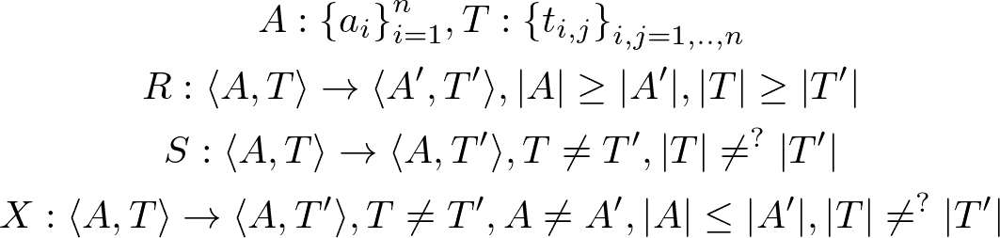 | (4-2) |

基本转换原理如图 4-2 所示。代码修改（代码变形）的底层机制取决于具体的编程语言和处理智能体平台的虚拟机。JavaScript 支持直接的代码文本和文本代码转换，并提供一级代码变形。除了运行时的智能体适应性外，`ATG` 子类化还可用于创建行为简化、最终代码大小减小的子智能体，从而提高智能体的效率。

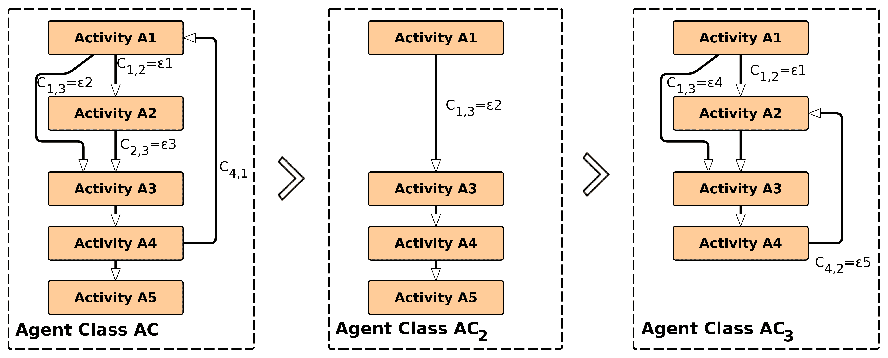

图 4-2. 动态 ATG，包含活动和/或转换的修改

## 多智能体系统的组成

一个多智能体系统（`MAS`）由多个智能体组成，这些智能体在行为（`ATG`）、控制与数据状态（主体变量）以及环境上下文（例如空间位置）上有所不同。每个智能体处理平台都提供一个智能体类（`ATG`）字典。智能体可以在运行时从类模板（构造函数）创建。此外，智能体可以复制自身，通常带有修改后的数据状态（父子智能体组）。复制的子智能体从父智能体继承 `ATG`（代码）和当前数据状态（主体变量）。这种复制支持分治方法，这对于用简单单元组成复杂系统是必需的。

`JAM` 支持由平台或运行中的智能体创建智能体，运行中的智能体复制子智能体，以及仅继承父 `ATG` 子集（子类化）及其主体变量集的子智能体的复制。

一个多类 `MAS` 的简单示例应展示使用通用和专用智能体的组合。假设存在一个由简单传感器组成的二维传感器网络。每个传感器节点在空间位置（`x`，`y`）处提供一个传感器 `s(x,y)`。节点连接到它们的直接冯·诺依曼邻域，如图 4-3 所示。通常，传感器值在空间有界区域内是相关的。以下 `MAS` 的目标是找到呈现显著传感器刺激的扩展相关区域的闭合边界，这些刺激可以与邻域区分开来。单个偶发的、与周围邻域不相关的传感器活动应与扩展相关区域区分开来，通过标记区域边界附近的节点，这是要检测的特征（边缘检测器）。本示例中提出的方法应实现两个目标 [BOS16B]：

1. 定位相关的传感器刺激区域；
2. 将传感器值发送到网络边缘的计算节点。

`MAS` 由四个智能体类组成：

1. 节点智能体（负责传感器和事件处理）；
2. 探索智能体（负责探索节点邻域，使用分治策略寻找相关的传感器刺激簇）；
3. 事件智能体（通知传感器事件并传递传感器值）；
4. 计算智能体（处理传感器数据）。

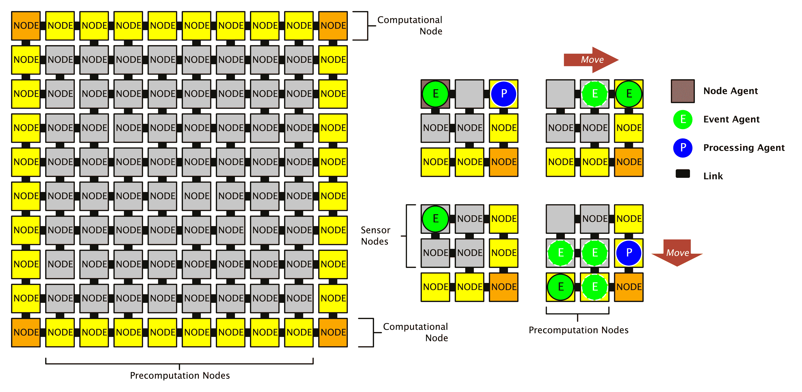

图 4-3. 具有二维网格拓扑的传感器网络的逻辑视图（左）以及不同移动和固定智能体种群的示例（右）：事件传递、探索、节点和计算处理智能体。传感器网络可能包含相邻节点之间缺失或断开的链接 [BOS16B]

传感器事件分布智能体的行为和空间交互如图 4-4 所示。如果检测到传感器刺激事件，受刺激节点会发送事件智能体。事件智能体沿着节点连接向网络外部迁移（先沿一个方向，然后沿垂直方向），最终到达一个计算节点。在行进路径上，事件智能体还会收集所访问节点的传感器值。如果在所需方向上没有直接连接到下一个邻居，则使用回溯和随机行走的组合搜索替代路径。

空间特征检测由移动探索智能体执行，它支持三种主要的不同行为：探索、扩散和繁殖。扩散行为用于进入一个区域，主要受智能体生命周期的限制，并根据本地传感器 `s` 检测特征，例如机械变形增加的区域（更准确地说，是此类区域的边缘）。检测到特征后，会触发繁殖行为，使智能体停留在当前节点，设置特征标记，并在邻域中派出更多探索智能体。探索智能体标记坐标为（`i`，`j`）的特定节点的局部刺激 `H(i,j)` 由下式给出：

|  | (4-3) |

如图 4-5 所示，探索智能体复制子智能体，这些子智能体迁移到邻居节点，收集本地传感器值，评估边界条件（产生二进制 `h` 值），并将它们分成更多的探索子智能体，直到达到探索边界。探索智能体将返回其根节点并传递累积的特征值 `h`。

在智能体当前位置（`i`，`j`）计算 `H` 需要该位置周围方形区域（感兴趣区域，ROI）`R` 内的传感器值。如果传感器值 `s(i+u, j+v)`（其中 `i`，`j` ∈ {`-R`, ..., `R`}）与当前位置值 `s` 相似（差值小于参数），则 `H` 增加 1。

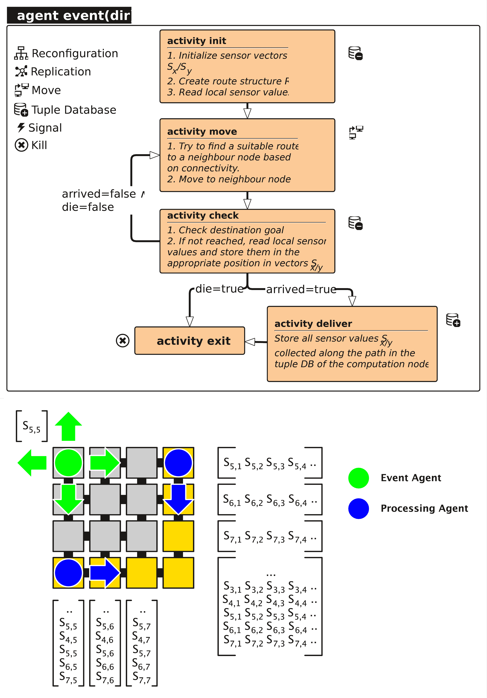

图 4-4. （上）事件代理的 ATG 行为模型 （下）带有事件代理（绿色）和预处理代理（蓝色）的传感器数据分布：检测到传感器值显著变化的传感器节点会创建事件代理，这些代理被发送到网络边界（预计算节点）的四个方向

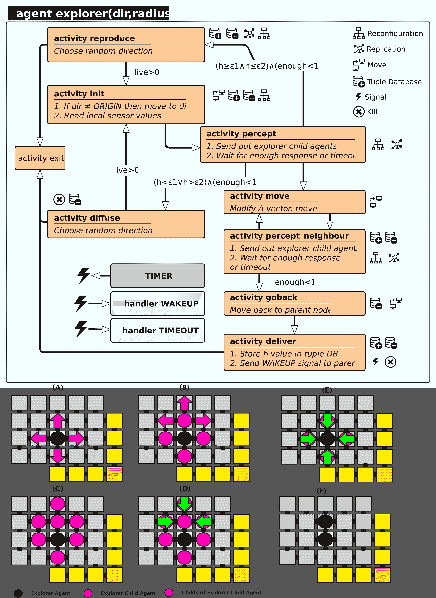

图 4-5. （上）从感知活动分支出的探索者代理和子代理类的 ATG 行为模型 （下）通过使用探索者代理对受刺激传感器簇进行特征标记，这些探索者代理利用分叉的子代理调查其当前位置的邻域。成功检测到特征后，探索者代理会被复制，否则它们会扩散到邻域以寻找特征

## 代理的交互

代理是计算过程，与底层处理平台松散耦合，对编程接口的依赖性较低。因此，代理之间也是弱耦合的。满足弱耦合范式的通信方法包括生成式元组空间 [GEL85] 和基于事件的信号，如图 4-6 所示。

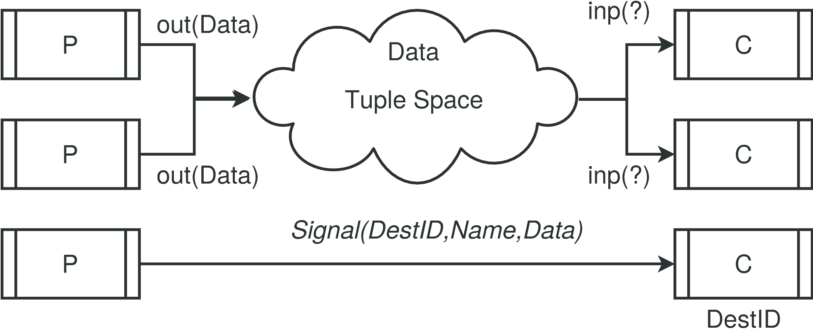

图 4-6. 使用元组空间的数据驱动代理通信和使用寻址信号的代理驱动通信

### 元组空间

元组空间本质上是一个支持生产者和消费者操作的数据库。生产者进程可以通过元组请求插入新数据。元组是单个数据元素的临时集合，类似于数组。与数组不同，元组的类型签名可以是异构的，即每个元素可以是任何数据类型，例如标量值（如数字或布尔值），或聚合值（如数组或记录结构）。元组 `t` 由元素数量（元数）和元组的类型签名指定：

| 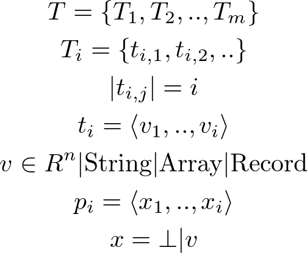 | (4-4) |

消费者进程可以通过模式（`p`）提取元组（通过移除或获取副本）。模式是一个由实际值和形式值组成的元组。该模式应用于空间中的所有元组以找到匹配结果。形式参数匹配所有数据值。

元组空间通信是匿名且生成式的。生产者和消费者进程互不知晓，并且元组的生命周期可能比生产者进程更长。元组空间通信有很多优点，但也有缺点。主要缺点是元组最初没有生命周期限制，导致元组空间随时间增长和溢出。为了避免元组空间泛滥，也可以为元组分配生命周期。可以由生产者进程显式分配，也可以（或）由元组空间服务分配。找到合适的生命周期至关重要，因为生命周期太短会错过生产者-消费者通信（如果消费者来得太晚），而生命周期太长仍会导致元组空间溢出。因此，元组空间通信无法保证，代理行为必须考虑这一点。

除了产生操作 `out` 之外，还有两个不同的消费操作 `rd` 和 `inp`。输入操作从空间中原子性地移除恰好一个匹配的元组，而读取操作仅返回元组的副本。消费者操作是同步的，因此可能会阻塞请求进程的控制流（控制流阻塞，直到另一个进程插入匹配的元组或发生超时）。

### 信号

信号是由信号标识符（数字或字符串名称）组成的简单消息，可以在代理之间交换。必须知道目标代理（与元组空间通信不同）。与具有特定目标的单播信号不同，多播信号可以发送给一组代理（预先定义），广播信号可以发送给所有可达的代理。广播通常限于给定通信范围内的代理（同一节点），并限于特定的代理类。

## 练习 4-2：通信

1. 如果有两个或更多代理通过元组空间交换数据，是否可能发生竞态条件？
2. 使用元组进行匿名和生成式代理通信的主要困难是什么？
3. 元组空间与时间逻辑有何关系？
4. 有一组代理（例如，*N* = 4）。一个代理是主控和数据源。其他 *N* - 1 个代理是工作节点和数据消费者。它们应使用输入数据的子集处理由工作节点分配的任务，并将它们映射到输出数据。从主控代理到工作代理的输入数据传输、同步以及从工作代理到主控代理的数据传输应通过元组空间执行。用伪代码编写一个实现主-工作系统的主控和工作程序。

## 软件实现

`DATG` 方法可以用多种编程语言和计算机系统实现，最初使用修改和高级版本的 FORTH 编程语言实现，并在并行栈处理器系统上执行 [BOS15A]。最初的工作侧重于低资源嵌入式系统。为了能够在 Web、物联网和云互联网环境中部署，这一成功的低资源实现的后续版本基于从定制的基于栈的语言向广泛使用的 JavaScript 语言（使用 AgentJS 方言）的过渡，下一节将讨论。

## AgentJS

从编程语言的角度来看，AgentJS 是纯 JavaScript，完全符合 ES2015 标准。但存在略微不同的操作语义和一些限制。AgentJS 描述代理对象和代理构造函数。与通用的 JS 类和对象不同，没有自由变量，并且允许引用更高作用域。编译过程将消除所有自由和超出作用域的引用，并将 `this` 变量绑定到创建的代理对象。符合 AgentJS 的代理构造函数的基本模板如定义 4-1 所示。

```javascript
function acf(p1?,p2?,..) {
┌
│  this.$bodyvar = ε
└
┌  this.act = {
│    $act : () => {}
└  }
┌  this.trans = {
│    $act : string | function : () → string
└  }
┌  this.on? = {
│    $signal : (arg,from) => {}
└  }
┌
│  this.next = string
└
}

function acf(p) : parameter:* → agent object

type agent: { $var:*,
              act : {function},
              trans : {function},
              on?: {function},
              next:string|object }
```

定义 4-1. 代理类构造函数的基本结构

构造函数定义了主体变量（必须初始化，至少使用 `null` 对象）、包含所有活动函数（或使用箭头函数的 lambda 表达式）的活动对象、属性名称等于先前定义活动的转换对象（指定转换的出向活动）、一个可选信号处理对象，以及最后的控制状态变量 `next`，该变量必须指向一个有效的起始活动。转换部分的条目要么是提供固定下一个活动（名称字符串或名称标识符）的静态规则，要么是可以返回不同下一个活动的动态转换评估函数。根据智能体构造函数的来源，下一个活动可以是字符串或标识符（在智能体上下文中，所有活动都可以通过与包含名称字符串的变量相关的标识符访问），如下代码所示：

```javascript
this.trans = {
  // 无条件转换
  start : 'percept',  // 字符串
  percept : () =>  {
    // 条件转换
    return this.destination?move:goback;
  },
  move : deliver, // 标识符
}
```

注意，如果当前没有后续活动，转换规则不应返回 `undefined` 或 `null` 对象，否则会导致控制流阻塞。相反，活动流控制应通过使用 `sleep` 和 `wakeup` 语句对来实现。

智能体构造函数描述了可参数化的智能体对象，包含私有主体变量、活动函数、转换函数以及可选的事件处理函数。必需的 `next` 属性指向下一个要执行的活动，并且必须初始设置为起始活动（`next` 可视为智能体程序计数器）。`next` 属性也用于在分叉或迁移时保留智能体的控制状态。`trans` 部分中的转换属性由起始活动名称（必须在 `act` 部分中定义）和目标活动（也必须在 `act` 部分中定义）组成。转换可以是无条件的（仅可能有一个静态目标活动）或有条件的（可能有多个目标活动）。条件转换需要一个解析函数来返回目标活动的名称。如果智能体构造函数是从字符串文本编译而来，活动名称可以作为标识符提供，否则必须作为字符串处理。

智能体活动、转换和处理函数总是在智能体对象上下文中调用（`this` 变量始终指向智能体对象）。所有函数都可以根据智能体的当前权限级别使用完整的可操作 AIOS 函数集。阻塞操作不能链式调用、嵌套或在循环内调用。一个活动函数中只允许一个阻塞操作。阻塞仅抑制智能体的活动转换。

智能体对象通过一组个体参数 `{p[i]}` 从智能体构造函数实例化。由于没有自由变量，构造函数参数必须直接赋值给主体变量。一个简单的 hello world 智能体的智能体构造函数示例如例 4-1 所示。所有主体变量必须通过从函数参数赋值静态或动态值来初始化，最初未定义的变量需要赋值为 `null` 对象。

```javascript
function hello(config) {
  this.message = config.message;
  this.time = 0;
  this.delay = config.delay;
  this.data = null;
  this.act = {
    start : () => {
      log('Hello world!');
      this.time=time();
      sleep(this.delay);
    },
    talk : () => {
      log(this.message);
      log('I sleep '+(time()-this.time)+' ms');
      this.time=time();
      sleep(random(10,100));
    },
    end : () => {
      log('I am terminating...')
      kill()
    }
  }
  this.trans = {
    start : talk,
    talk  : () => {
      return random(0,100)<50?"end":"talk"
    },
  }
  this.next = "start"
}
```

例 4-1. 一个 AgentJS 构造函数示例（定义智能体类 "hello"）

## 练习 4-3：智能体编程

1. 列举反应式和基于事件的智能体的基本特征。
2. 比较信号消息传递和元组空间：它们之间的区别、优势以及可能的问题（缺陷）是什么？
3. `ATG` 由执行动作的活动组成。传统软件由函数和类（对象）组成。程序中函数的目的是什么？智能体活动的目的是什么？智能体的活动应该实现什么？活动应该如何划分和命名？


4. 假设一个简单的加热器控制智能体。该智能体采样温度传感器`t`（定期或临时），并使用比例控制方法（P 控制器）迭代修改加热功率`p`，目标是在给定温度`t[0]`下最小化误差`err` = `t` - `t[0]`。描述一个实现反应式控制循环的最小 ATG。有定时器和传感器变化（增量）事件可用。

# JavaScript 智能体机器

JavaScript 智能体机器（JAM）是本文所涉及的多智能体系统框架的核心部分。除了引言中讨论的平台特性外，从软件设计角度来看，智能体进程平台必须满足以下约束：

1. 可移植性，且对硬件和操作系统的依赖性低；
2. 能够在低资源平台上部署；
3. 可嵌入任何软件应用程序，包括网页；
4. 在智能体数量和计算智能体复杂性方面具有可扩展性。

JAM 完全用 JavaScript 编写，立即满足第一和第三项约束。第二和第四项约束的满足取决于底层的 JavaScript 虚拟机（JVM）。但即使是 node.js JVM 也可以部署在嵌入式系统和移动设备（如智能手机）上（通常需要至少 1000 MIPS 的 CPU 性能和 50 MB 的主内存才能满足响应性和可扩展性）。

## 智能体世界：虚拟节点和物理节点

JAM 为智能体处理提供了物理平台。一个物理 JAM 节点包括以下组件和功能：

* 智能体进程调度器；
* 元组空间数据库；
* 保护与安全；
* 智能体管理与修改；
* 通信，包括信号和智能体移动性。

除了物理节点，还有一个虚拟化层提供由物理节点处理的所有虚拟节点。每个 JAM 实例至少有一个虚拟节点，智能体与虚拟节点关联。虚拟节点概念用于模拟，稍后讨论。AMP 通信端口（和链路）始终附加到虚拟节点。这使得在物理节点世界内可以构建具有虚拟电路链路的虚拟网络，如图 5-1 所示。所有虚拟节点都有各自的元组空间和进程表，但共享相同的智能体进程调度器和 AIOS。因此，虚拟世界不会通过并行化提供加速，这与 JAM 集群不同，JAM 集群可以通过`jamsh`程序轻松创建。在 JAM 集群中，每个 JAM 节点由其自己的 VM 实例处理。

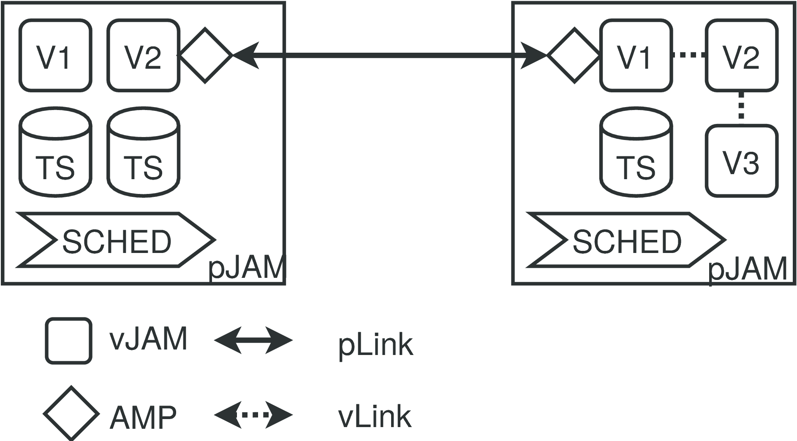图 5-1. 虚拟节点与物理节点

## 智能体通信

智能体是松散耦合的进程，通常通过消息传递进行交互。在 JAM 中，智能体使用元组空间和信号进行智能体间通信，某些情况下也用于智能体与平台之间的通信。元组空间提供无连接、匿名、非寻址且具有生成性的通信，而信号则提供基于消息的、带地址的智能体间通信。元组空间通信不需要智能体彼此知晓，这与信号相反。在 JAM 中，智能体通过一个节点唯一的随机生成标识符字符串（通常由八个字符组成）来标识。

如果智能体由同一物理或虚拟节点处理（本地元组空间作用域），它们可以交换数据元组。每个 JAM 虚拟节点（每个物理节点至少有一个虚拟节点）提供一个元组空间，用于存储元数从 1 到 10 的元组（元组元素的上限可由宿主应用程序扩展）。每个单一元组元数独立处理，因为元组只能通过具有相同元素数量（元数）的模式来访问。节点元组空间也可由宿主应用程序（嵌入 JAM 或独立 JAM shell）访问。宿主应用程序可以提供元组消费者处理程序，当新元组插入时，元组空间 API 会调用这些处理程序。读取请求可以传递给生产者处理程序，后者可根据请求创建新元组。

信号最初用于在同一（虚拟）节点上处理的智能体之间。但信号也可以传播到远程节点（或物理节点的其他虚拟节点），当且仅当发送方和接收方智能体之间存在迁移轨迹时。这意味着，如果两个智能体曾在同一节点上处理过，它们可以远程交换信号。这对于父子组始终成立。如果智能体在迁移时离开某个节点，当前节点会在临时缓存表中记录该智能体 ID 以及带有出站网络链路的目标节点。每次信号沿此路径传播时，缓存表都会更新。如果某些轨迹长时间未被使用，垃圾回收器会将其清理。

远程链接节点的元组空间可以通过使用特殊的元组请求信号来访问，这些信号主要用于元组复制或转发。

## 智能体输入输出系统（AIOS）

AIOS 是 JAM 平台或宿主应用程序与智能体进程之间的核心桥梁，如图 5-2 所示。AIOS 提供了一个高级智能体调度器，用于调度物理节点上的所有智能体。它也用于 SEJAM 模拟器。该调度器执行信号和定时器处理、激活智能体、调用活动和转换函数，并执行错误处理，如第 5-4 节所述。

AIOS 提供一组操作和函数，智能体可根据其特权级别（AgentJS API）进行访问。每个特权级别使用自己的操作集。例如，零级智能体无法访问元组空间，也无法迁移。三级智能体是固定的，因此其操作集中也没有`moveto`函数。

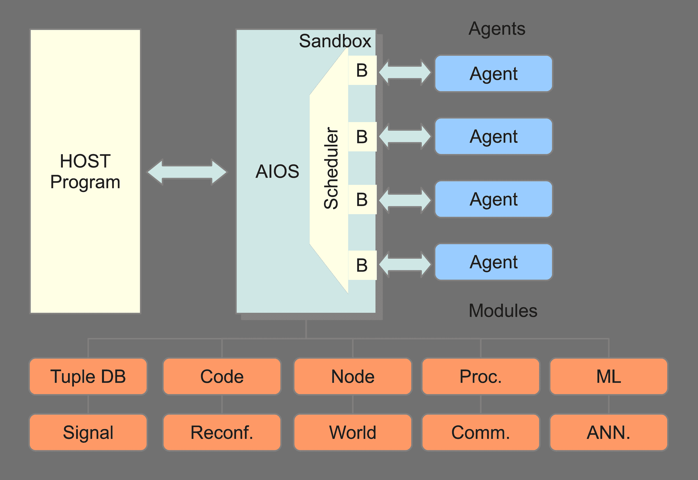图 5-2. 基本 AIOS 架构，为智能体、宿主平台和模块 API 提供桥梁

操作集可以形式化定义如下：

| 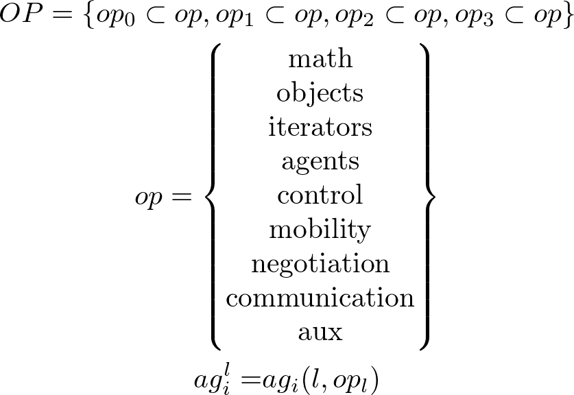 | (5-1) |

辅助集提供对辅助模块的访问，例如机器学习或数据库访问（SQL）。宿主应用程序可以通过附加函数和对象来扩展每个 AIOS 操作级集。例如，模拟器 SEJAM 会通过模拟特定操作来扩展智能体操作集。

### 使用 JSON+和 JSOB 表示法的代码与数据序列化

文本表示被用作序列化数据和代码的交换格式，这是在分布式强异构平台和网络环境中进行数据和代码处理的先决条件，这些环境混合了大端和小端机器、不同的数据字长以及数据编码。尽管基于字节码的交换格式被广泛使用，但它们要求发送方和接收方之间的编码严格一致。在任何时候，JS 对象都可以在运行时转换为 JSON 格式的文本。最初，JSON 仅用于以文本表示形式便携地交换 JS 数据对象，比 XML 更紧凑且更易于解释。但 JSON 仅限于数据元素。对深层对象（记录或数组）的引用总是被解析和展开。因此，JSON 无法表示递归数据结构。尽管 JS 将函数视为一等值，但传统 JSON 无法表示和编码函数。为此，引入了 JSON+格式，它支持函数编码以及特殊数据对象，如紧凑类型数组和缓冲区。

JAM/AgentJS 智能体本质上是一个 JS 对象，包含数据（值、数据对象、数组）和函数，这些函数代表智能体的活动和 ATG 的转换。这需要一个支持函数的扩展 JSON 文本格式化器和解析器，该功能已在 JAM 中引入。整个智能体进程可以在任何时候转换为文本表示（JSON+），保留其当前的控制和数据状态，可以在不同的网络和智能体平台节点之间交换，并最终转换回 JS 代码。

文本编码的函数和二进制缓冲区使用 base64 编码和标签前缀（例如，函数代码使用`_PxEnUf_`）。唯一存在的限制是对象内部的循环（自）引用，这仍然无法处理，但并非真正的限制。

传输文本而非二进制代码会导致智能体迁移时通信成本显著增加，但文本可以被压缩，从而大幅减小体积（实验表明，LZ 压缩可将 JSON+文本大小减少约 5-6 倍，从而降低通信成本）。嵌入式设备可以利用硬件压缩模块，例如基于 FPGA 的协处理器，在不增加 CPU 开销的情况下最大化通信效率。

除了 JSON+格式外，还支持自定义的 JavaScript 对象（JSOB）格式。JSOB 也是 JS 对象的文本表示，但不编码函数，且更加紧凑，如例 5-1 所示。

```
ag = {
  x:1, y:2, z:[10,20,30],
  act : {
    main : () => { this.x++ },
    end  : () => { kill() }
  },
  trans : {
    main : end,
  }
  next : main
}
───── JSON+.serialize(ag) ─────
{"x":1,"y":2,"z":[10,20,30],"act":
{"main":"_PxEnUf_ZnVuY3Rpb24gKCkgeyB0aGlzLngrKyB9",
"end":"_PxEnUf_ZnVuY3Rpb24gKCkgeyBraWxsKCkgfQ=="},
"trans":{"main":"end"},"next":"main"}
───── JSOB.serialize(ag) ─────
{'x':1,'y':2,'z':[10,20,30],'act':
{'main':()=>{ this.x++ },'end':
()=>{ kill() }},'trans':
{'main':"end"},'next':"main"}
```

例 5-1. 使用 JSON+或 JSOB 格式的智能体对象序列化示例

### AIOS 沙箱环境

代理处理平台的稳定性和鲁棒性是设计中的一大挑战。代理可以被视为自主或半自主的进程和执行单元。但这种自主性要求严格受限且安全的平台环境，用于执行来自任意来源的代理进程，并且代理进程之间必须严格隔离。至少必须排除意外推理。一个代理平台必须能够执行成百上千个不同的代理进程。尽管某些 JS 虚拟机（例如 Web Worker 进程）提供了扩展模块，允许在独立的主机进程（或线程）中执行 JS 程序，但这些粗粒度的方法不可移植，并且会带来显著的时间和内存空间开销。这与线程的启动时间以及每个线程会创建一个新的虚拟机实例（且进程间通信受限）有关，正如 AIOS 所要求的那样。

不幸的是，JS 的作用域上下文层次结构非常有限且粗粒度，基本上局限于函数闭包和 `this` 对象（相比之下，Lua 支持在自由定义且受限的作用域中执行函数），并且所有导入的模块和求值的代码共享一个全局空间。这一限制最初阻碍了在单个 JS 虚拟机实例中安全且无干扰地执行多个代理进程。为了满足推理约束，可以使用 JS 的 `with (mask) {code}` 语句，通过 `mask` 对象参数提供的覆盖命名空间来执行代码。通常，这用于将绑定变量映射到有限代码作用域中的自由变量，此处 `mask` 被扩展为所有赋值为 null 的全局变量名和覆盖全局引用作用域的函数名属性。

将代理对象及其函数处理封装在 `with` 语句内部，只能屏蔽全局可见的对象和函数，但无法屏蔽代码求值时可见的自由变量和函数。换句话说，从代理类构造函数实例化每个代理都需要在屏蔽上下文中进行完整的代码文本序列化和反序列化，如果对每个代理都应用此操作，将导致高昂的计算成本。更合适的方法是将沙箱限制应用于代理构造函数本身（一次性），即代理由一个在屏蔽环境中创建的构造函数生成，该环境通过 null 引用屏蔽所有不需要的全局变量和自由变量，并通过代码文本序列化构造函数，且不产生任何副作用。使用 `with` 语句的第一种实现选择如算法 5-1 所示。

```
[](#cb10-1) 1: mask    = ∀ $key ∈ global { $key:null }
[](#cb10-2) 2: context = ∀ $key ∈ Core { $key:global($key) } ∪ 
[](#cb10-3) 3:           ∀ $key ∈ AIOS(level) { $key:AIOS($key) } 
[](#cb10-4) 4: maskAndContext = mask ∪ context
[](#cb10-5) 5: type sandBox1: object×string → constructor function
[](#cb10-6) 6: function sandBox1(maskAndContext, acf) {
[](#cb10-7) 7:   var F
[](#cb10-8) 8:   eval('with(maskAndContext) { "use strict"; F='
[](#cb10-9) 9:               + acf + ' }');
[](#cb10-10)10:   return F
[](#cb10-11)11: }
[](#cb10-12)12: type sandBox2: object×object×string → 
[](#cb10-13)13:                constructor function
[](#cb10-14)14: function sandBox2 (mask, context, acf) {
[](#cb10-15)15:   var _mask = keys(mask).join(',');
[](#cb10-16)16:   var F = 
[](#cb10-17)17:      new Function(_mask,
[](#cb10-18)18:                   '"use strict"; with(this) { f=('+
[](#cb10-19)19:                   acf+').bind(this)} return f')
[](#cb10-20)20:                  .bind(context);
[](#cb10-21)21:   return F();
[](#cb10-22)22: }
[](#cb10-23)23: var acbound1 = sandBox1(context,acf),
[](#cb10-24)24:     acbound2 = sandBox2(mask,context,acf);
[](#cb10-25)25: var ag1 = new acbound1(parameters),
[](#cb10-26)26:     ag2 = new acbound2(parameters);
```

算法 5-1. 代理构造函数沙箱限制的前两种实现选择使用了 `with` 作用域语句，该语句由通用的 `eval` 语句或 `Function` 构造函数编译。在应用沙箱之前，必须将代理构造函数 `acf` 序列化为文本，以移除任何自由绑定。

`with` 语句的使用已被弃用，并且可能导致执行的代理代码性能显著下降（每次变量或函数访问都需要遍历一个很长的掩码表）。另一种方法是将无上下文约束的代理类构造函数转换为受限作用域的沙箱构造函数，该方法使用 `Function` 构造函数配合一些表达式技巧，并将代理命名空间拆分为屏蔽的全局环境（`mask`）和 AIOS 对象 `context`，如算法 5-2 所示。这种方法避免了使用 `with` 语句。相反，屏蔽的变量属性作为函数参数传递给作用域受限的代理构造函数求值，而所需的上下文变量则通过绑定过程传递。

对于每个 AIOS 特权级别和每个代理类 `ac`，都有一个沙箱受限的代理构造函数。

```
[](#cb11-1) 1: mask    = ∀ $key ∈ global { $key:null }
[](#cb11-2) 2: context = ∀ $key ∈ AIOS(level) { $key:AIOS($key) } ∪ 
[](#cb11-3) 3:           ∀ $key ∈ Core { $key:global($key) }
[](#cb11-4) 4: type sandBox3: object×object×string → 
[](#cb11-5) 5:                constructor function
[](#cb11-6) 6: function sandBox3 (mask, context, acf) {
[](#cb11-7) 7:  var pars = keys(context).concat(keys(mask)),
[](#cb11-8) 8:      args = pars.map(function (key) { 
[](#cb11-9) 9:         return context[key] });
[](#cb11-10)10:  pars.push('return '+acf);
[](#cb11-11)11:  var foo = new (
[](#cb11-12)12:    Function.prototype.bind.apply(
[](#cb11-13)13:      Function,
[](#cb11-14)14:      pars
[](#cb11-15)15:    ));
[](#cb11-16)16:  return foo.apply(this,args);
[](#cb11-17)17: }
```

算法 5-2. 代理构造函数沙箱应用的第三种实现选择仅使用 `Function` 构造函数语句。掩码通过函数参数数组传递。

屏蔽方法无法限制代理进程及其函数的命名空间作用域（作用域是链式的，更高层的作用域如全局作用域仍然可见），但可以用于覆盖更高层的作用域和全局名称限定符，并使对自由变量和函数的引用失效，而不会影响其他代理进程或 JAM 模块。然而，仍然存在一个主要漏洞，即由可扩展对象（例如 `Array` 对象）引入的漏洞。

最后，代理进程的执行是一个函数的执行，该函数具有严格受限的操作名称空间，并且没有绑定到外部变量和自由变量及函数。核心对象如`Array`和`String`被替换为不可扩展的代理版本。代理的迁移通过对象到文本的序列化和文本到对象的反序列化来执行。为了确保迁移后得到一个沙箱限制的代理对象（不涉及构造函数），JSON+的解析和求值总是在`with`语句内执行，并带有一个掩码环境，该环境仅提供一组选定的 AIOS 对象和函数，具体取决于代理权限角色，这在第 5-6 节中讨论。新代理的创建（通过分叉或迁移操作）将始终首先将代理对象字符串化，最后求值得到一个沙箱限制的代理对象，该对象不包含任何自由和全局对象引用，可由 AIOS 代理调度器执行，而不会对平台和其他代理造成任何干扰。这种方法至少能保护代理执行和 JAM 免受因使用常见 JS 编码风格而导致的意外故障。完全入侵防护的能力取决于 JS VM 环境本身。

尽管 JS 支持通过异步函数（使用`async`关键字定义）和`await`语句操作符进行控制流调度，但必须阻止其使用，因为它可以创建超出 AIOS 控制的后台函数（以及使用内置`setTimeout`或`setInterval`函数的内部后台处理）。AIOS 拒绝使用异步函数或`await`语句操作符的代码，并且定时器控制函数被屏蔽。唯一允许的调度点是在活动函数或调度块函数的元素结束时。

### 匿名函数和 Lambda 表达式


ATG 由匿名函数组成。自 ES6 标准以来，JS 也支持 lambda 表达式，形式为箭头函数。箭头函数在编程中更加方便，尤其是初学者更喜欢它们而不是匿名函数。但与其他编程语言不同，在 JS 中匿名（无名）函数和箭头函数并不相同。JS 函数固有地支持`this`变量，即每个函数都有自己的`this`对象变量。箭头函数没有自己的`this`对象，而是引用创建（编译）时周围上下文的当前`this`对象。这对 AgentJS 来说是一个首要障碍，因为所有第一级和第二级函数都引用代理的`this`（self）对象。这是通过在函数调用时将代理自引用动态绑定到相应的代理函数来实现的。箭头函数无法做到这一点（它们忽略任何`bind`或`call`对`this`的映射）。所有箭头函数必须在创建时绑定到代理自对象引用。如果代理对象是从构造函数实例化的，所有箭头函数会自动通过`this`变量引用代理对象。但在文本序列化和反序列化之后（例如在进程迁移时），这就成了先有鸡还是先有蛋的问题。通常，`eval`函数用于从文本编译函数（或使用`Function`构造函数）。但是当创建箭头函数时，正在构建中的代理对象本身尚不可用！相反，必须使用一个最初为空的代理对象作为`this`引用，该引用可以被箭头函数绑定，最终从由`eval`函数应用创建的临时代理对象中获取内容，如算法 5-3 所示。

```
[](#cb12-1) 1: function toCode(source,mask) {
[](#cb12-2) 2:   // 箭头函数没有 this 变量
[](#cb12-3) 3:   // 它们绑定到当前上下文中的 this！
[](#cb12-4) 4:   // 需要一个包装函数和一个临时的
[](#cb12-5) 5:   // this 对象
[](#cb12-6) 6:   var self={},temp;
[](#cb12-7) 7:   function evalCode() {
[](#cb12-8) 8:     var code;
[](#cb12-9) 9:     try {
[](#cb12-10)10:       // 在私有上下文中执行脚本
[](#cb12-11)11:       with (mask) {
[](#cb12-12)12:         eval('"use strict"; code = '+source);
[](#cb12-13)13:       }
[](#cb12-14)14:     } catch (e) { console.log(e) };
[](#cb12-15)15:     return code;
[](#cb12-16)16:   }
[](#cb12-17)17:   // 将 evalCode 绑定到空的 self == this 对象
[](#cb12-18)18:   temp = evalCode.call(self);
[](#cb12-19)19:   // 箭头函数现在绑定到 self，
[](#cb12-20)20:   // 用 temp 代理对象更新 self
[](#cb12-21)21:   // 第一级属性
[](#cb12-22)22:   self=Object.assign(self,temp);
[](#cb12-23)23:   return self; 
[](#cb12-24)24: }
```

算法 5-3. 从 JSOB 或扩展的 JSON+ 格式中安全反序列化箭头函数代理，使用掩码上下文

## 代理调度与检查点

JS 具有严格的单线程执行模型，只有一个主线程，即使使用异步回调，这些回调也仅在主线程（或循环）终止时执行，即离开控制路径。这是在一个 JS JAM 平台实例内执行多个代理进程的第二个硬性限制。JAM 要求在任何时候对代理进行严格控制。代理可以在 JAM 节点之间迁移，例如通过互联网连接的节点。任何代理都不能危害 JAM 节点或影响其他代理的处理，包括无限运行时。在现代 JavaScript VM 中，调度可以很容易地通过使用带有 promise 的异步函数并使用`await`语句执行来实现。但这种有吸引力且易于使用的控制使得能够以时间复用执行模型调度代理。这种方法违反了 JAM 对代理进程完全控制的要求。一个例子可以说明这一点，即创建一个僵尸进程。假设一个代理想要在活动函数内休眠一段特定时间，并带有控制路径调度，如示例 5-2 所示。相反，AIOS 休眠函数用于将代理处理推送到等待队列，在那里它最终由 AIOS 调度器唤醒，执行到下一个活动的转换。但这种模拟的代理进程控制将每个活动内的阻塞操作数量限制为一个（并且阻塞仅在活动函数返回后发生）。在循环中调用阻塞操作需要微调度块和循环转换。

如果代理等待后台定时器兑现 promise，AIOS 调度器可以执行另一个代理。但如果在任何情况下，休眠的代理被终止，例如通过显式的 kill 操作或由于资源违规，休眠的代理进程仍然存在（无法恢复休眠的后台进程），从而创建一个可以继续执行的僵尸进程。因此，任何 promise 构造和异步函数都必须被沙箱限制上下文屏蔽。

```
[](#cb13-1) 1: $act : async () => {
[](#cb13-2) 2:   ...
[](#cb13-3) 3: ×  await asleep(tmo);
[](#cb13-4) 4:   ...
[](#cb13-5) 5: }
[](#cb13-6) 6: async function asleep(tmo) {
[](#cb13-7) 7:   return new Promise((resolve,reject) => {
[](#cb13-8) 8:      setTimeout(resolve,tmo);
[](#cb13-9) 9:   }
[](#cb13-10)10: }
[](#cb13-11)11: $act : () => {
[](#cb13-12)12:   ...
[](#cb13-13)13:   sleep(tmo) 
[](#cb13-14)14:   // 调度器执行：
[](#cb13-15)15:   //   now: → agent.blocked → 
[](#cb13-16)16:   //          agent.timeout = now+tmo  → ...
[](#cb13-17)17:   //   now+tmo: → !agent.blocked → next(trans)
[](#cb13-18)18: }
```

示例 5-2. 使用 promise 异步函数进行的不应采用的代理调度方式

智能体进程在活动级别进行调度，一个非终止的智能体进程活动会阻塞整个平台（JS 处理是严格单线程且只有一个控制流）。当前的 JS 执行平台，包括 Web 浏览器程序中的虚拟机，没有提供可靠的看门狗机制来处理非终止的 JS 函数或循环。虽然某些浏览器可以检测超时，但它们只能终止整个 JS 程序，而无法终止单个函数调用。为了确保 JAM 和 JAM 调度器的执行稳定性，并实现时间片划分，如果虚拟机没有内置看门狗支持，则必须在执行前向智能体代码中注入检查点。此步骤在代码解析阶段执行，方法是在智能体代码中包含的每个函数体开头注入对检查点函数`CP()`的调用，并在循环条件表达式中注入`CP`调用。虽然这种代码注入会显著降低智能体代码的执行性能，但在 JS 平台能够支持细粒度检查点和带时间片的线程调度之前，这是必要的。在代码到文本的转换（例如，在迁移请求之前）中，所有`CP`调用都会被移除。

使用 node.js VM 平台，可以添加在隔离容器中监视运行时的原生代码模块执行函数，从而实现对智能体处理（活动、转换和信号处理函数调用）的超时检测。如果智能体的调度时间片已到，被调用的函数将抛出一个异常（`SCHEDULE`），由 AIOS 智能体调度器处理。看门狗模块会被自动检测。如果没有原生看门狗支持，则使用软件检查点注入作为替代。

AIOS 提供了一个主调度循环。该循环遍历逻辑世界中的所有逻辑节点，并顺序执行所有就绪智能体进程的一个活动。如果某个活动执行达到硬时间片限制，则会引发`SCHEDULE`异常，该异常可由可选的智能体异常处理器处理（但不能延长时间片）。这种智能体异常处理仅用于向智能体提供信息，但为智能体提供了修改其行为的机会。所有消耗的活动和转换执行时间都会被累积，如果智能体进程达到软运行时间限制，则会引发`EOL`异常。该异常可由可选的智能体异常处理器处理，该处理器可以尝试根据权限级别和可用能力（仅限 2 级智能体）协商更高的 CPU 限制。任何就绪的智能体调度块和信号处理器都会在活动执行之前被调度。调度循环基于事件时间迭代执行，即下一次调度器运行会在根据待处理事件（例如，休眠的智能体）和就绪智能体计算出的时间之后执行。

在活动执行之后，下一个活动由调度器计算，该调度器调用智能体转换部分中相应的转换函数。

与支持活动中多个阻塞语句（例如，IO/元组空间访问）的 AAPL 模型不同，JS 无法处理任何类型的进程阻塞（没有进程和阻塞概念）。因此，在 AIOS 调度器处理的 AgentJS 活动函数中可以使用调度块。阻塞的 AgentJS 函数返回一个值，使用常见的回调函数来处理函数结果，例如，`inp(pat, function(tup) {..})`。

调度块由一组函数（微活动）组成，即`B(block) = B([function().., function()..,...])`，AIOS 调度器逐个执行这些函数。每个函数可以在其主体末尾包含一个阻塞语句。每个函数内部的`this`对象始终引用智能体对象。为了简化迭代，有一个调度循环构造器`L(init, cond, next, block, finalize)`和一个对象迭代器构造器`I(obj, next, block, finalize)`，例如用于数组迭代。

智能体执行被封装在由 AIOS 处理的进程容器中。智能体进程容器可以在等待内部系统相关的 IO 事件时被阻塞，或者在等待智能体相关的 AIOS 事件（由智能体引起，例如元组的可用性）时被挂起。这两种情况都会停止智能体进程的执行，直到事件发生。

基本的智能体调度算法如算法 8.1 所示，它包含一个有序的调度处理类型选择，即将智能体处理划分为智能体活动、转换、信号和调度块。在一次调度器遍历中，只选择一种处理类型，以保证不同智能体之间的调度公平性。一个世界（一个 JAM 实例）中的所有虚拟（逻辑）节点共用一个调度器。进程优先级用于交替处理一个智能体的活动和信号，防止在存在大量待处理信号时，由于链式信号处理而导致活动和转换处理延迟。

```
∀ node ∈ world.nodes @do
 ∀ process ∈ node.processes @do
  @Determine what to do with prioritized conditions:
    Order of operation selection:
    0\. Process (internal) block scheduling [block]
    1\. Resource exception handling
    2\. Signal handling 6-4-2
       - Signals handled if process priority<HIGH 
       - Signal handling increase process priority 
         temporarily to allow low-latency activity
         and transition function scheduling!
    3\. Transition execution
    4\. Agent schedule block execution [schedule]
    5\. Next activity execution
       - Lowers process priority
  @if process.blocked or process.dead or 
   process.suspended and process.block=[] and 
   process.signals=[] or
   process.agent.next=none and process.signals=[] and
   process.schedule=[]
    @then @do nothing
  @elseif not process.blocked and process.block≠[]
    @then @execute next block function 
  @elseif agent resources check failed 
    @then @raise EOL exception
  @elseif process.priority < HIGH and process.signals≠[]
    then @handle next signal, increase process.priority
  @elseif not process.suspended and process.transition
    @then @get next transition or 
          @execute next transition handler function
  @elseif not process.suspended and process.schedule≠[]
    @then @execute next agent schedule block function
  @elseif not process.suspended
    @then @execute next agent activity and 
      @compute next transition, 
      @decrease process.priority
```

算法 5-4. JAM 智能体调度算法

## 调度块

如果一个活动或循环语句中有多个阻塞操作，或者存在计算量大的代码部分，则必须使用调度块。调度块将计算工作划分为微函数的序列或循环。每个微函数可以调用一个阻塞操作。虽然调度块可以由嵌套块组成，但所有块都会被展平为一个线性列表。

调度块迭代器的代码模板如定义 5-1 所示。每个迭代器提供一个函数列表，这些函数顺序执行或在循环中重复调用。`B`构造器是一个待调度的微函数线性列表。`L`迭代器支持条件循环迭代器。首先调用`init`函数，在每次迭代循环之前，调用`cond`函数返回循环条件（true：执行循环体），然后执行主循环体函数。如果循环终止，则调用可选的`finalize`函数。

```
[](#cb15-1) 1: B(
[ 2:   function,
[](#cb15-3) 3:   function,
[](#cb15-4) 4:   ..
[](#cb15-5) 5: ])
[](#cb15-6) 6: L(
[](#cb15-7) 7:   init:function,
[](#cb15-8) 8:   cond:function()->boolean,
[](#cb15-9) 9:   next:function(),
[](#cb15-10)10:   block:function [],
[](#cb15-11)11:   finalize?:function
[](#cb15-12)12: )
[](#cb15-13)13: I(
[](#cb15-14)14:   data:{}|[],
[](#cb15-15)15:   next:function (element),
[](#cb15-16)16:   block: function [],
[](#cb15-17)17:   finalize?:function
[](#cb15-18)18: )
```

### 定义 5-1. 可在智能体活动函数内部使用的 AgentJS 调度块构造函数模板。`B`：线性块，`L`：循环，`I`：迭代器。

### 练习 5-1. 调度块

1. 创建两个智能体（可以通过不同的行为子树合并到一个智能体类中）：一个数据生产者智能体和一个数据消费者智能体。生产者智能体发送由单个元组组成的消息。

2. 生产者智能体插入一个包含 10 个元组的数组，每个元组为 `["TEST",time()]`。每次使用 `out` 操作注入后，智能体休眠一秒钟（使用 `sleep`）。在数组头部添加一个消息长度元组（`["LENGTH",10]`）。使用 `I` 块迭代器。

3. 消费者智能体应使用 `inp` 操作消费元组。首先它等待长度元组（消息开头）。然后它应使用 `L` 迭代器读取消息元组。

## 智能体角色

安全性是分布式系统中的另一大挑战，尤其是在移动智能体进程方面。每个智能体平台节点（即一个物理 VM，其上运行多个 JAM VM，且这些 VM 位于同一网络节点上）可以接收来自可信节点网络内部的智能体，或来自 VM 未知的不可信网络的智能体。通常，VM 除了用于接收和传播智能体代码的一部分网络连接外，对其他网络节点一无所知。为了至少区分可信与不可信智能体，引入了不同的智能体特权级别，提供不同的 AIOS API 集合。

### 特权级别

出于安全原因，并为了限制拒绝服务攻击、入侵、智能体伪装、间谍活动或其他滥用行为，智能体具有不同的访问级别（角色）。特权级别与 AIOS 提供的特定操作函数集相关。

共有四个级别，对应不同的智能体角色：

* * *

0

访客（不可信，不可移动）

1

普通（可能可信，可移动）

2

特权（可信，可移动）

3

系统（可信，本地，不可移动）

* * *

特权级别 0 是最低级别，仅授予智能体计算能力和一些元组空间 IO 语句。最低级别不允许智能体复制、迁移或创建新智能体。级别 0 的智能体必须通过使用安全能力来协商其特权级别或权限，该能力授予特定权限或级别提升。

级别 1 的智能体可以访问常见的 AIOS API 操作和能力，包括智能体复制、创建、终止、发送信号和代码变形。级别 2 的智能体还能够协商（设置）其在当前平台上的所需资源，即 CPU 时间和内存限制。


级别为`n`的智能体只能创建级别不超过`n`的智能体。最高级别（3）拥有扩展的 AIOS 操作集，具备主机平台设备访问能力。级别 3 的智能体不能迁移到其他节点，它们是完全静止的。智能体可以协商资源（例如 CPU 时间）以及通过定义允许升级的能力密钥来安全提升级别。系统级别不可协商。

级别 2 的智能体最初只能在 JAM 内部创建。它们可以派生级别 2 的智能体，但迁移后，目标节点决定特权级别，并可能降低它，例如，认为智能体来源不可信。迁移后的智能体可以通过协商获得更高的特权级别，这需要具有适当权限的有效平台能力。迁移后，特权丢失，必须在新平台上使用能力重新协商。JAM 平台决定安全级别。能力是节点特定的。一组节点可以共享一个公共密钥（由服务器端口标识）。能力由服务器端口、权限字段和一个加密保护字段组成，该保护字段使用仅服务器（节点）知道的随机端口和权限字段生成。

其他约束参数可以在 AIOS 级别协商：

*   调度时间（一次活动执行的最大时间片，默认 200 毫秒）
*   运行时间（累计智能体执行时间，默认 5 秒）
*   生存时间（智能体在被终止前可在节点上存在的总时间，默认无限制）
*   元组空间访问限制（访问操作次数）
*   内存限制（实际上很模糊，无法在 JS 中精确测量和监控，通常包括私有数据在内的整个智能体代码大小，通常限制为 50 kB 的序列化代码）

资源约束由 JAM 监控。由于 JAM 由通用 JS VM 执行，因此在活动执行期间无法控制智能体的内存消耗（JS 编程范式本质上无法做到，自动内存管理完全对编程层隐藏）。虽然可以通过代理监控绑定（`body`）变量，但自由变量超出了任何资源控制的范围。只有通过 AIOS 访问的分配才能由 JAM 控制，例如元组空间访问。

## 基于能力的安全性

能力是启用特定智能体 API 功能（如迁移）的密钥。能力由服务端口、权限位字段和一个加密保护字段组成，该保护字段使用仅服务器（节点）知道的随机端口和权限字段生成。权限位字段启用特定权限，例如协商更高特权级别的权限。能力由相应服务（例如平台本身）通过使用私有端口和单向函数对安全端口中的权限位字段进行编码来创建，如图 5-3 所示。主要问题在于智能体迁移时能力的秘密处理（需要安全通道）以及将正确的能力传递给智能体。通常需要一个代理服务器，基于经典授权和认证，将能力分发并传递给智能体。

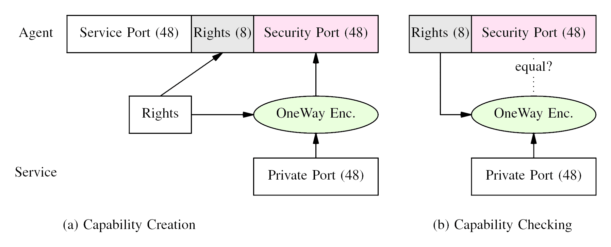图 5-3. （顶部）能力格式 (a) 通过编码私有安全端口和新的权限字段创建能力 (b) 通过编码请求的权限字段和私有安全端口，并将其与提供的安全端口进行比较来验证能力（基于 [MUL90]）。

能力能够对智能体可执行的操作进行细粒度控制，并允许松散耦合的自组织系统，例如参与聊天。在自组织系统中，智能体的身份并非主要关注点。相反，它们能够执行的操作才是主要关注点。

能力可以用人类可读的文本格式表示，类似于 IPv6 地址，并基于 Amoeba 能力格式和概念 [MUL90]：

```
SS:SS:SS:SS:SS:SS[PP:PP:PP:PP:PP:PP]
```

`SS`和`PP`数字是十六进制数，`OBJ`和`RIGHTS`是十进制数。服务端口`SS:`定义了能力的目标服务，例如资源协商服务或通信通道服务（AMP）。保护端口`PP:`用于验证能力最敏感的权利字段。通常，权利以加权二进制码编码，支持权利组合，例如 CPU 资源协商和 AIOS 级别升级。AIOS 使用的典型权利位如定义 5-2 所示。能力最终是一个二进制对象，但可以以上述文本表示形式使用和传输。

```
[](#cb17-1)enum Rights = {
[](#cb17-2)  HOST_INFO       : 0x01, HOST_READ       : 0x02,
[](#cb17-3)  HOST_WRITE      : 0x04, HOST_EXEC       : 0x08,
[](#cb17-4)  PSR_READ        : 0x01, PSR_WRITE       : 0x02,
[](#cb17-5)  PSR_CREATE      : 0x04, PSR_DELETE      : 0x08,
[](#cb17-6)  PSR_EXEC        : 0x10, PSR_KILL        : 0x20,
[](#cb17-7)  PSR_ALL         : 0xff,
[](#cb17-8)  NEG_SCHED       : 0x08, NEG_CPU         : 0x10,
[](#cb17-9)  NEG_RES         : 0x20, NEG_LIFE        : 0x40,
[](#cb17-10)  NEG_LEVEL       : 0x80,
[](#cb17-11)  PRV_ALL_RIGHTS  : 0xff
[](#cb17-12)}
```

定义 5-2. AIOS 权利位，用于保护敏感代理操作（如与代理平台协商）；`HOST`：平台，`PSR`：进程控制，`NEG`：协商

对于服务保护和权利管理，服务提供者（例如 JAM）将创建一个随机服务端口和一个随机安全端口。或者，服务端口可以是固定的、从文件读取的，或由人类可读字符串创建，如定义 5-3 所示。通常，能力由 JAM shell 应用程序创建和管理，但任何 JAM 节点（包括 Web 浏览器版本）都可以通过提供无限制代理 API 的全局对象`Aios.aios`创建和分发能力。

```
[](#cb18-1) 1: // Shell 或代理 API
[](#cb18-2) 2: // 1. 创建随机安全端口和服务端口
[](#cb18-3) 3: var secret  = Port.unique(),
[](#cb18-4) 4:     service = Port.unique();
[](#cb18-5) 5: // 2. 将它们组合成一个全权利能力
[](#cb18-6) 6: var supercap = Capability(service,
[](#cb18-7) 7:                           Private(0,0xff,secret));
[](#cb18-8) 8: log(Capability.toString())
[](#cb18-9) 9: // 3. 限制能力
[](#cb18-10)10: var restrcap = Capability(service,
[](#cb18-11)11:   Private.restrict(supercap.cap_priv,0x20,secret));
[](#cb18-12)12: var service2 = Port.ofString("12:34:56:78:90:12");
[](#cb18-13)13: // 4. 检查客户端私有部分的有效性
[](#cb18-14)14: //    以及权利
[](#cb18-15)15: var cap = restrcap;
[](#cb18-16)16: if (Private.rights_check(cap.cap_priv,0x20,secret)) {
[](#cb18-17)17:   // 授予服务
[](#cb18-18)18: }
```

定义 5-3. 服务提供者能力操作（JAM shell 或代理的代码 API，JAM 库需要`.Aios.Sec`前缀）

### 协商

代理可以通过使用提供相应权利以执行操作的`negotiate`函数来协商特定的资源约束或提升权限级别，如定义 5-4 所示。协商通过使用安全端口和能力来执行。必须将具有特定权利的能力传递给协商函数。

```
[](#cb19-1) 1: ┌ // Shell 或服务器代理：
[](#cb19-2) 2: │ // 1. 必须创建一个服务端口和一个私有随机端口
[](#cb19-3) 3: │ // （随机创建）
[](#cb19-4) 4: │ var port = Port.unique()
[](#cb19-5) 5: │ var rand = Port.unique();
[](#cb19-6) 6: │ // 2. 必须在 JAM 平台上注册 port:rand 密钥
[](#cb19-7) 7: │ // 
[](#cb19-8) 8: │ var security = {}
[](#cb19-9) 9: │ security[Port.toString(port)]=Port.toString(rand);
[](#cb19-10)10: │ // 3. 创建一个具有某些权利的受限能力
[](#cb19-11)11: │ var cap  = Capability(
[](#cb19-12)12: │  port,
[](#cb19-13)13: │  Private.encode(0,Rights.NEG_LIFE,rand))
[](#cb19-14)14: │ // Shell：
[](#cb19-15)15: │ // 4. 将能力传递给新的客户端代理
[](#cb19-16)16: └ create('foo',{cap:cap});
[](#cb19-17)17: ┌ // 客户端代理：
[](#cb19-18)18: │ // 5. 在 foo 代理活动中使用此能力执行协商
[](#cb19-19)19: │ // 
[](#cb19-20)20: └ var success=negotiate('LIFE',10000,this.cap);
```

定义 5-4. 使用能力进行资源和权限协商的基本原则（JAM 节点和代理必须使用相同的公共服务和秘密随机安全端口）

练习 5-2. 安全性——如果你是 JS 专家

1.  阅读了前面的章节后，你认为 JAM 在抵御拒绝服务攻击和入侵方面安全吗？
2.  所提出的方法真的能将代理隔离吗？找出 JAM 中的后门和安全漏洞！通过使用无法掩盖的后门和隐藏引用，进行一些编程实验来破坏 JAM 平台和其他代理。
3.  能力保护是最先进的吗？可能的问题和缺陷是什么？也请阅读以下关于 JAM 网络连接的章节。

## 代理进程移动与迁移

代理的移动需要传输相应代理进程的相关状态及其程序代码。代理进程状态由控制状态和数据状态组成。

代理的控制状态存储在保留的代理主体变量`next`中，该变量指向下一个要执行的活动。此外，如果代理活动处理调度块（参见第 5-5 节），则存在隐藏的控制状态。AgentJS 代理的数据状态仅由主体变量组成。代理进程上下文之外的变量没有引用（自由变量引用无法序列化）。

迁移需要代理进程的快照，在本例中即代理本身，包括代码到文本转换的序列化、将文本代码传输到另一个逻辑或物理节点，以及绑定到新的沙盒受限环境的文本到代码转换的反序列化，如图 5-4 所示。

代理对象最终被传递给新节点调度器，并可以继续执行下一个活动或下一个调度块入口。中等复杂度代理（就数据和控件空间而言）的文本代码大小合理较低，约为 10 kB。简化代理通常为 1 kB。通过使用 LZ 压缩可以显著减小。这种方法的一个缺点是快照中存在待处理的调度块。它们也必须完全保存在迁移的快照中，并在新节点上转换回代码。待处理的调度块包含函数代码，因此可能显著增加快照大小。因此，迁移（使用`moveto`操作）请求不应嵌入到调度块中。

代理迁移始终通过代理管理端口（AMP）进行，并在发送节点和接收节点之间建立协商的虚拟链路连接，这将在下一节讨论。

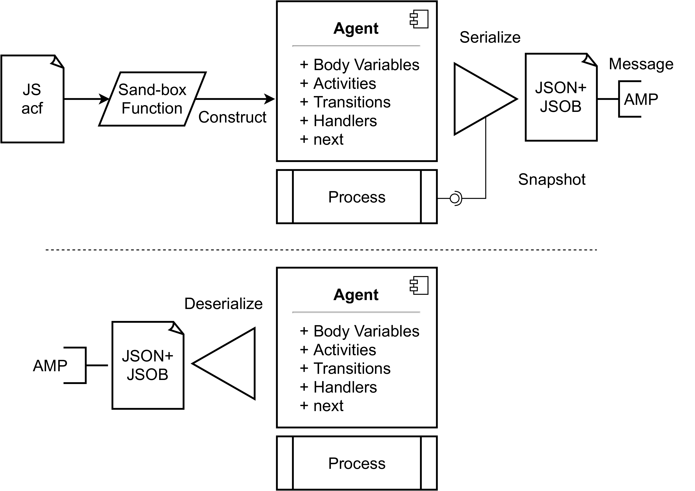图 5-4. 代理进程创建与进程迁移工作流程

## JAM 平台连接性

### JAM 网络

代理可以迁移到另一个 JAM 平台。JAM 代理通过传输包含整个数据和控制状态（包括指定代理行为的程序）的代理进程快照来实现移动性。通信是代理交互的核心部分。除了本质上限于本地节点级别的元组空间通信外，信号消息可以寻址到远程平台上的代理，这需要统一但松散耦合的平台连接性。

JAM 提供了广泛的连接选项，如图 5-5 所示，可在多种主机平台上使用。相邻节点之间通过点对点（P2P）连接，例如使用网格网络中的串行链路；广域网连接（即互联网）则通过通用 HTTP、TCP 或 UDP 协议，借助下一节讨论的 AMP 和/或可选地使用分布式组织系统层（DOS）及代理服务器来实现。

### 代理管理端口（AMP）

利用 P2P 连接，JAM 节点通过*代理管理端口*（AMP）进行通信。AMP 提供 JAM 节点之间的消息传递，用于代理迁移、信号和元组迁移、统计数据收集以及代理控制。AMP 消息可通过任何类似流的链路传输。此外，外部监控程序（调试器）可通过 AMP 连接到 JAM 节点。AMP 独立于任何特定的数据通信协议，因此支持广泛的通信技术，不限于 IP 通信，如图 5-5 所示。

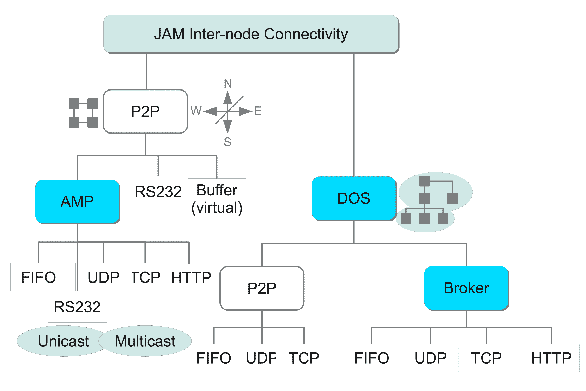图 5-5. JAM 通信与节点连接（P2P：点对点，AMP：代理管理端口，DOS：分布式组织层）

在互联网上，通常使用基于 IP 的协议，通过 UDP、TCP 或 HTTP 协议在 JAM 节点之间传递 AMP 消息。一个常见问题是带有网络地址转换（NAT）的私有或虚拟网络。为了在 NAT 网络之间建立 UDP 通信，可以使用一个提供 UDP 打洞技术的外部公共会合代理。在这种情况下，JAM 节点以其节点名称在代理上注册，其他 JAM 节点可以通过节点名称连接到（IP 隐藏的）JAM 节点。代理支持域服务（将节点划分为域或组，例如基于 GPS 数据）。

JAM 节点可以通过代理监控协议（AMP）松散连接，从而创建一个分布式平台网络。AMP 用于连接 JAM 节点，例如通过互联网，使用封装 AMP 消息的通用 HTTP 通信。

| 消息类型 | 描述 |
| --- | --- |
| `ACK` | 确认回复 |
| `LINK` | 单向链路协商请求（成对，可通过能力保护） |
| `PING` | 节点之间的保活消息，用于估计连接状态 |
| `PONG` | 对`PING`消息的回复 |
| `UNLINK` | 关闭先前协商的链路 |
| `RPCHEAD` | RPC 消息的头部（支持无连接协议） |
| `RPCDATA` | RPC 消息的数据块（支持无连接协议，提供数据分片和排序） |
| `RPCHEADDATA` | RPC 消息的头部和数据（仅由基于连接的协议支持） |
| `SCAN` | 外部服务的扫描请求 |
| `INFO` | 外部服务的信息请求 |

表 5-1. AMP 消息类型

AMP 消息类型集如表 5-1 所示。平台`A`可以通过启动链路协商阶段与平台`B`建立连接，该阶段可由安全能力保护。发起节点发送一条`LINK`消息，该消息将由`ACK`消息确认，如果请求被授权，则再由`B`向`A`发送另一条`LINK`消息。为了测试链路状态，使用`PING`和`PONG`消息（由两个链路伙伴使用）。如果链路已建立（可能不可靠且随时可能消失），则可以使用`RPCHEAD`和`RPCDATA`消息执行远程过程调用（RPC）。两个节点之间的通信链路可以是单向的（定向的，例如`A` → `B`）。在这种情况下，要么由两个节点`A`和`B`独立建立两条单向链路，要么直接使用通信而不进行确认。这种操作状态仍然符合多代理模型，不依赖任何可靠的平台能力（包括通信）。尽管在 RPC 消息传递之前已建立节点之间的连接链路，但该链路并不依赖底层连接和基于状态的通信通道（例如 TCP 连接的情况）。UDP 从未建立持久通信通道，HTTP 也不需要保持活动的 TCP 连接。相比之下，WebSocket 传输层始终依赖连接状态，因此不太适合创建 JAM 网络。

RPC 消息封装了代理进程快照迁移、远程信号消息传递和远程元组空间请求。每个 AMP 通信端口也可以是通信端点或路由器。

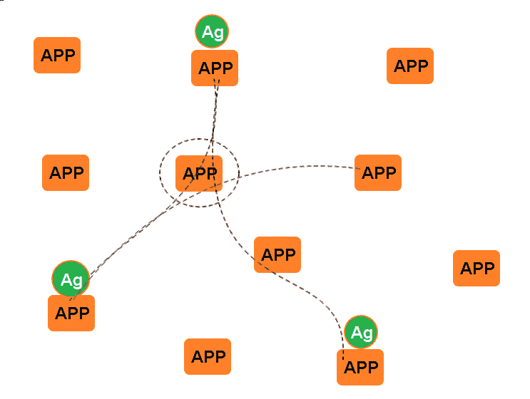图 5-6. 代理迁移轨迹与交叉点（APP：JAM 节点）。信号只能沿迁移路径传递。在两个节点之间的子路径上，必须存在一条已协商的 AMP 链路。

AMP 支持组合和连接已分布的代理平台网络。信号消息可以转发到不同远程节点上的代理，但信号消息传播仅限于代理迁移路径（轨迹），如图 5-6 所示。

在常见的基于 IP 的计算机网络中，通过 AMP 的物理通道链路可以使用不同的底层数据和消息协议，以下总结中进行了对比：

来自代理`A`的信号只能传递给代理`B`，前提是它们在过去的某个时刻曾加入过同一个节点（在父子组中总是如此）。位于两个不同节点上的代理知道这两个不同的节点。远程通信不可靠，即发送信号或迁移代理可能导致完全丢失。

#### UDP

用户数据报协议（UDP）非常适合 AMP 链路，因为它不需要基于状态和会话的连接。但 UDP 通信首先需要公开且可见的计算机节点。使用 UDP 打洞技术（由 AMP 支持）可以克服私有/虚拟网络背后的 NAT 限制。但对称 NAT 通常仍然阻止双向通信。如果两个节点都位于（对称）NAT 之后，则无法建立 AMP 链路。UDP 链路是完全对称的，即两个端点都提供服务。

#### HTTP(S)

超文本传输协议（及其安全版本）在 Web 中广泛使用。除了 WebSocket（通过 HTTP 升级），该协议是 JAM Web 应用程序中唯一可用的协议。HTTP 通信是非对称的，即有一个专用服务节点和一个或多个客户端节点建立基于 TCP 的通信会话。只有 HTTP 服务端口必须在网络（内网或外网）中可见，客户端可以隐藏在 NAT 之后。对于每次 AMP 消息传输，都会执行一个新的 HTTP 请求（`GET`/`POST`）。底层协议层将决定是重用 TCP 连接，还是为每个请求重新连接到服务。AMP 默认设置协议`keepAlive`选项。安全版本需要证书。如果客户端是 Web 浏览器，则证书必须有效，并且需要 DNS 验证的域名。

#### TCP


传输控制协议（TCP）是基于状态和会话的，不太适合临时 AMP 链路。AMP TCP 后端支持三种不同模式：（A）为每条消息打开并在传输后关闭的对称临时单向 TCP 连接对；（B）带有消息流的对称永久单向 TCP 连接对；（C）从“客户端”到“服务器”的单个双向永久 TCP 连接，即每个套接字对应一个 AMP 处理程序 ⇒ 适用于 NAT 后的客户端。

AMP 端口可以支持单播或多播。多播端口支持来自远程节点端口的多个链路，以及指向该端口的多个链路。IP 端口通常是多播端口。此外，AMP 端口可以是单向或双向的。AMP 端口的创建以及 JAM 节点之间链路的建立将在第 7-2 节中详细描述。

下图 5-7 展示了不同 IP 协议部署及其使用场景下的数据流。

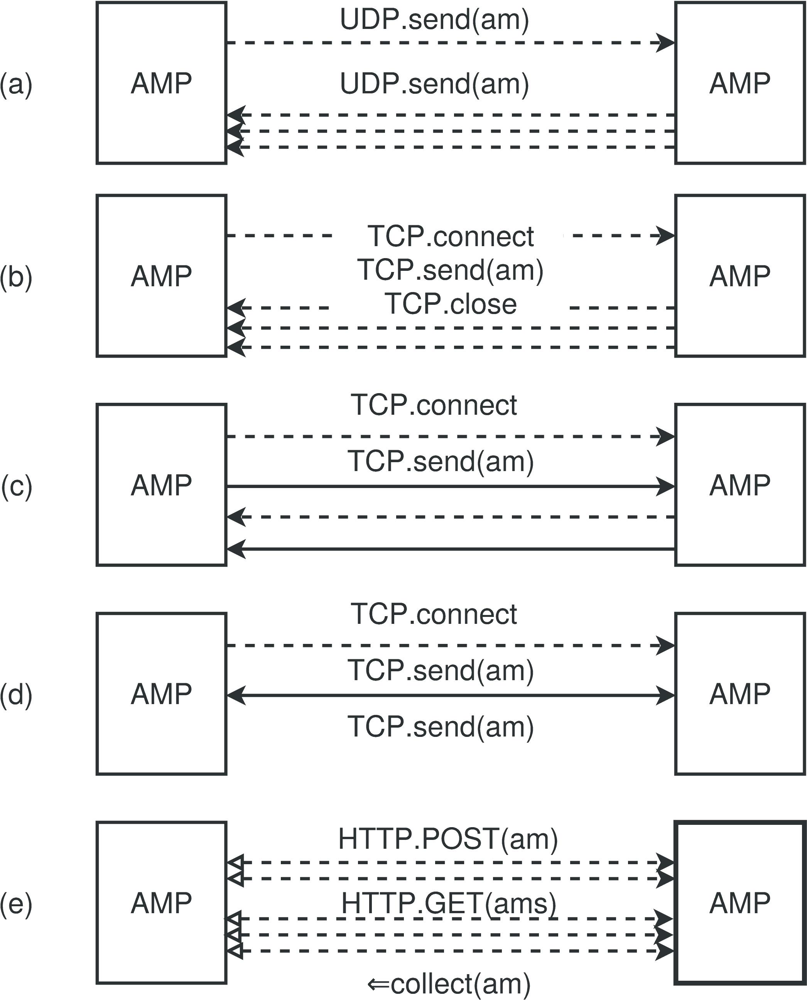图 5-7\. 不同 IP 协议和使用场景下的 AMP 控制与数据流 (a) 无连接 UDP (b) 临时 TCP（模拟 UDP）(c) 一对永久 TCP 会话 (d) 单个永久 TCP 会话 (e) 临时 HTTP(S)

最核心且最合适的协议是无连接 UDP。所有 AMP 消息被分片并封装在 UDP 数据包中，接收端进行乱序重组。基于连接的协议（如 TCP 和基于 TCP 的 HTTP）则模拟数据报消息传递，即为每条 AMP 消息打开一个新连接。较大的消息无需显式分片。HTTP 采用客户端-服务器模式，即只有专用的服务器节点提供 HTTP 端口，且只有客户端可以发起连接。

TCP 协议有两种变体：基于永久会话的一对 TCP 连接，以及由客户端（通常位于 NAT 虚拟网络之后）发起的单个 TCP 会话。HTTP 可以通过提供`keepAlive`选项在特定时间内保持永久连接。HTTP POST 请求用于将消息转发到目标节点，GET 请求用于从目标节点收集消息。

## 软件架构与工作流程

软件架构由以下部分组成：

1.  AIOS；
2.  模块（用于处理节点、进程、通信等）；
3.  主机平台 API 封装与实用函数库；
4.  应用程序（Shell、Web 实验室、模拟器）。

图 5-8 展示了基本软件架构及其组件。此外，还简要描述了基本操作流程，从智能体构造函数从源代码编译开始，到智能体进程创建与调度，以及 JAM 世界管理。

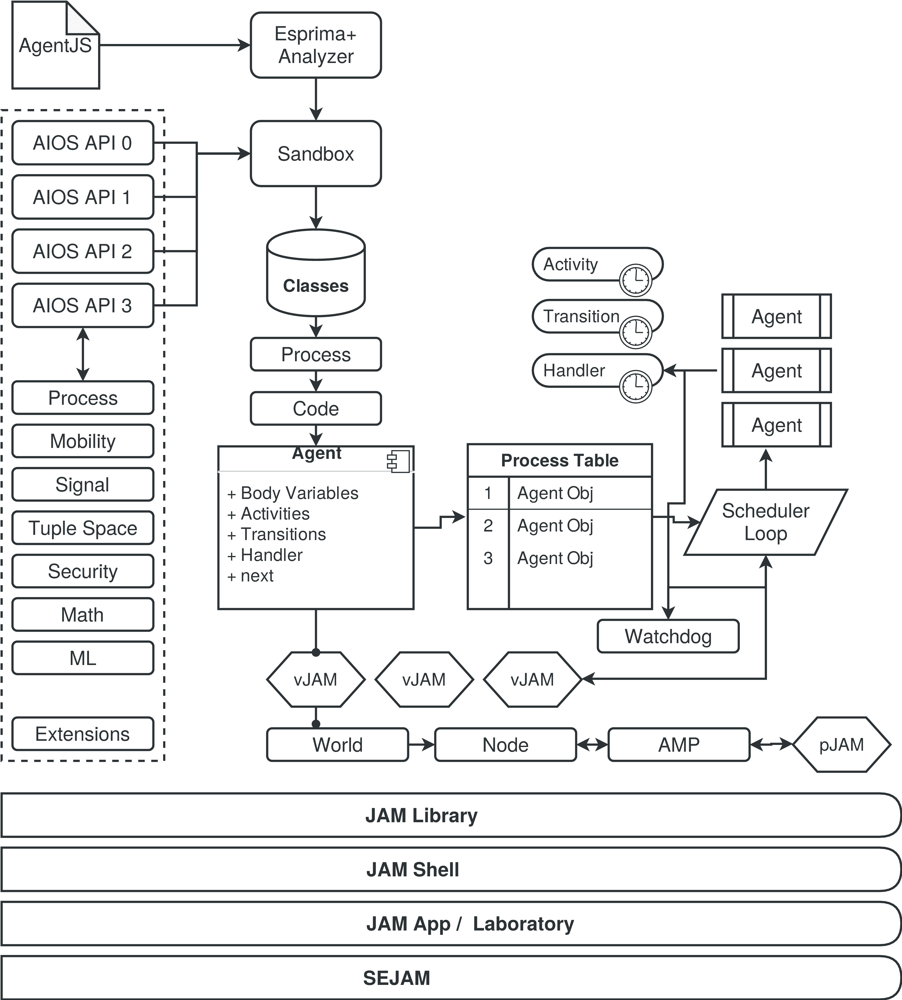图 5-8\. JAM 组件与软件架构及基本操作流程

# AgentJS API

AgentJS 支持所有 ES 2015 兼容的 JS 函数和语句。由于沙箱限制的容器封装，某些 JS 运算符无法按预期工作，例如`for(a in b)`操作已损坏。取而代之的是，AgentJS 提供了多态迭代器操作，将在下一节介绍。不支持带有原型函数绑定的对象（无法高效序列化）。AgentJS 中的对象必须是纯过程式的，即智能体或 AIOS 必须提供独立的函数来处理对象（即数据记录）。

AgentJS 编程语句可分为五个核心组及扩展：

1.  计算语句，包含扩展的数组和对象（记录）操作；
2.  智能体控制与环境操作，例如节点信息和资源协商；
3.  智能体管理，包括智能体的创建、修改和控制；
4.  智能体通信，即使用元组空间和信号进行同步通信；
5.  智能体移动性，即节点到节点的进程快照迁移；
6.  机器学习（扩展）提供高度可移植（移动、纯过程式）的模型和广泛的算法。

AgentJS API 由 AIOS API 提供，包含一组函数，具体取决于智能体的权限级别（在创建或迁移后分配）。

## 计算

计算可以在活动、转换和信号处理程序中执行。这主要修改通过`this`对象访问的智能体数据（智能体主体变量）。智能体自引用在所有 AIOS 函数中可用，这些函数传递给 AIOS 函数的回调函数（至少在调用上下文的第一层）。请注意，AgentJS 仅支持绑定记录数据对象，不支持解耦的原型函数绑定。计算语句总结于表 6-1。

| 操作 | 描述 |
| --- | --- |
| `abs`, `add`, `angle`, `delta`, `distance`, `div`, `equal`, `max`, `min`, `neg`, `random`, `sum`, `zero` | 扩展数学函数 |
| `array`, `concat`, `contains`, `copy`, `empty`, `filter`, `flatten`, `head`, `isin`, `iter`, `keys`, `last`, `map`, `matrix`, `pluck`, `reduce`, `reverse`, `sort`, `tail`, `without`, `Vector` | 数组与对象函数 |
| `int`, `object`, `string` | 类型转换 |

表 6-1\. 智能体计算语句

迭代器函数`concat`、`flatten`和`iter`也可应用于数组和记录数据结构。函数`angle`、`contains`、`copy`、`delta`、`isin`、`neg`和`zero`也是如此。多态和混合数据类型操作的示例见例 6-1。

```
var a = [1,2,3,4],
    ones = array(16,1 /*init*/);
var amin = min(a), amax = max(a),
    arnd = random(a),
    vrnd = random(0,1,0.01 /*frac*/);
var v = Vector(1,1); /*{x,y}*/
if (zero(v)) v.x=v.y=1;
var b = [5,6,7,8]
var c = concat(a,b);
var d1 = { a:1, b:2 },
    d2 = { c:0 },
    d3 = concat(d1,d2),
    ds = 0;
iter(d3, (e) => { ds += e })
if (sum(d3)!=ds) log('not equal, but must be');
if (isin(d3,2) && isin(a,2)) log('common element 2');
if (contains(a,[3,5]) log('contains 3 or 5');
var d = [a,b],
    col1 = pluck(d,1); // [2,6]
```

例 6-1\. 智能体函数中计算语句的示例

## 智能体环境

智能体位于其环境中，提供交互和感知（数据）。环境主要由主机平台、我们周围的世界（包括其他智能体）以及智能体自身组成。智能体可以请求多个传感器来获取其平台信息、平台位置、进程组关系及其状态，总结于表 6-2。最后，智能体具有一个权限级别，用于限制对 JAM 平台的访问。`privilege`操作返回智能体当前的权限级别（范围 [0,3]），可以通过`negotiate`操作进行协商更改，通常需要具有足够权限的有效能力密钥来与平台协商资源。

| 操作 | 描述 |
| --- | --- |
| `info (cls)` | 通用传感器，提供节点、位置、当前智能体处理约束和限制。可通过`cls`='node'请求节点信息。返回对象`{ id:string, position:{}, location:{ip:string ,gps:{} ,geo:{}}, type:string}` |
| `me` | 返回当前智能体标识符 |
| `myClass` | 返回智能体类（基本上是智能体构造函数名称） |
| `myNode` | 返回当前 APP 节点名称（标识符） |
| `myParent` | 如果这是分叉的子智能体，则返回智能体父级（标识符） |
| `myPosition` | 返回当前 APP 节点位置（如果可用） |
| `negotiate(what,val,cap)` | 更改平台权限和限制 |
| `privilege` | 返回当前智能体权限级别（0-3） |
| `time` | 当前节点时间，已根据世界时间延迟进行调整（时钟校准并支持节点处理暂停，例如在模拟模式下） |

表 6-2\. 环境感知语句

以下参数（表 6-3）可由代理协商（假设能力参数赋予了相应权限）。JAM 无法控制内存限制，因为在 JS 层面无法获取特定对象的内存使用信息，不过可以计算一个假设采用类 C 内存分配的归一化内存分配因子。但 JAM 无法感知代理函数内部的数据分配（由 VM 垃圾回收控制），并且需要在每次函数调用后检查数据状态，这会显著降低 JAM 性能。只有元组空间访问、代理创建和信令可由 JAM 控制。

| 参数 | 权限 | 描述 |
| --- | --- | --- |
| `LIFETIME` | `NEG_LIFE` | 更改代理生命周期（总累积时间） |
| `SCHEDULE` | `NEG_SCHED` | 更改最大代理调度时间 |
| `CPU` | `NEG_CPU` | 更改最大 CPU 时间（所有调度时间之和） |
| `TS` | `NEG_RES` | 更改最大元组请求数 |
| `AGENT` | `NEG_RES` | 更改可创建的最大代理数 |
| `LEVEL` | `NEG_LEVEL` | 更改 AIOS 操作权限级别 |

表 6-3. 可协商的平台和资源参数及所需权限

以下示例 6-2 展示了环境信息和控制操作的一些例子。

```
me()
─────────
jireluci

myNode() 
────────
xazorodi

privilege() 
────────
1

info('node')
────────────
{ id: 'xazorodi',
  position: { x: 0, y: 0 },
  location: 
   { ip: '31.16.196.110',
     gps: { lat: 53.0515, lon: 8.8896 },
     geo: 
      { city: 'Bremen',
        country: 'Germany',
        countryCode: 'DE',
        region: 'HB',
        zip: '28309' } },
  type: 'shell' }

myPosition()
────────────
{ ip: '31.16.196.110',
  gps: { lat: 53.0515, lon: 8.8896 },
  geo: 
   { city: 'Bremen',
     country: 'Germany',
     countryCode: 'DE',
     region: 'HB',
     zip: '28309' } }
```

示例 6-2. 代理环境信息函数的输出示例

关于使用能力进行协商的内容已在第 5-6 节中结合 shell 和代理代码进行了介绍和讨论。

## 代理管理

代理可以由平台和宿主应用程序通过构造函数创建，也可以由代理通过构造函数或复制（父代理创建子代理）创建。构造函数必须在相对于代理初始权限级别的受限上下文中重新编译。为了加速代理创建，代理构造函数可以预先编译（并分析）并添加到 JAM 平台字典中。代理类构造函数的编译只能由平台（在应用章节 [JAM 用户与程序员指南] 中讨论）完成，而不能由代理自身完成。代理创建新代理需要节点字典中存储的预编译构造函数。

### 创建代理

在平台或代理自身创建代理之前，构造函数必须被编译（分析）并存储在平台类库字典中。代理分叉可以在没有安装代理构造函数的情况下进行。分叉操作会创建父代理的精确子副本，并可选地修改一组主体变量。

| 操作 | 描述 |
| --- | --- |
| `create(class,parameter,level)` | 从类构造函数（或已编译代理类的字符串名称）创建代理，并可选地设置参数。AIOS 级别参数可选，且不能高于父进程的级别 |
| `fork (parameter)` | 复制调用代理，代码和数据状态相同，但（可选地）参数设置不同（直接修改分叉代理的主体变量） |

表 6-4. 代理的创建

在以下示例 6-3 中，一个代理由 JAM 平台（使用`jamsh`）以编程方式创建。首先，定义代理构造函数，最终编译并添加到 JAM 平台。代理从活动`init`开始，并将其标识符保存在主体变量`master`中。直接转换到`replicate`活动会分叉一个子代理，并带有修改后的主体变量集（`message`）。新创建代理的标识符存储在父代理的`child`变量中。子代理将通过`migrate`活动移动到另一个节点。如果设置了该变量，父代理将在处理完`wait`活动后休眠。子代理（仍具有空的`child`变量）将打印从父代理收到的消息并永久休眠。父代理被唤醒后，将杀死其子代理。杀死信号从父代理转发到子节点。

```
function ag (options) {
  this.child=null;
  this.master=null;
  this.message=null;
  this.act = {
    init : () =>) {
      this.master=me(); 
    }, 
    replicate : () => {
      this.child=fork({message:'I am John.'});
    },
    migrate : () => {
      var nodes = link(DIR.IP('%'));
      if (nodes.length) moveto(DIR.NODE(random(nodes)));
    },
    killing : () => {
      kill(this.child);
    },
    wait : () => {
      if (this.child) {
        sleep(1000);
      } else {
        log(this.message);
        sleep();
      }
    },
    end : () => {
      kill();
    }
  }

  this.trans = {
    init      : replicate,
    replicate : () => { return this.child?wait:migrate },
    migrate   : wait,
    killing   : end,
    wait      : () => { return this.child?killing:wait },
  }

  this.next=init;

}
// Add agent class
compile(ag,{verbose:false});
// Create level 2 agent
create('ag',{ },2);
```

示例 6-3. 通过实例化构造函数或分叉（克隆）创建代理的示例。该代码由`jamsh`程序处理。

> 与代理迁移不同，分叉子代理会丢弃父代理的排队调度块。

### 练习 6-1. 代理树

1. 假设一个由连接的 JAM 节点组成的二维网格网络。每个节点提供一个传感器，可通过`v=inp(["SENSOR",_])`语句访问。代理可以使用`moveto`和`link`函数，通过`DIR.NORTH`、`DIR.WEST`等方向迁移到相邻节点。网络中的任意节点将创建一个代理。该代理应采样网络中所有传感器，并计算所有传感器值的平均值。根代理应通过分叉创建两个子代理。子代理应沿相反方向移动到相邻节点，例如，一个向西，另一个向东（如果可能）。

2.  当一个子代理到达邻居节点并采样本地传感器值后，它应再创建三个子代理，一个沿之前的前进方向移动，另外两个沿与前进方向正交的相反方向移动。

3.  每个正交移动的代理应创建另一个子代理，该子代理沿当前方向移动到邻居节点，直到到达网络边界。

4.  仅当给定方向上存在邻居节点时，才创建子代理。如果代理无法创建新代理，则返回其根节点，并通过信号将邻居节点的采样传感器值发送给其父代理。

5.  如果代理通过信号处理程序收到所有子代理的回复（这些回复累积了传感器值），它也将返回其根位置，并传递所有采样传感器值（由自身及其子代理收集）的总和。

6.  根代理（编号 1）将累积其所有子代理传递的传感器总和，并计算平均值。

7.  使用`AgentJS`创建一个实现分治方法的代理类。

8.  使用`JAM` shell 通过创建虚拟`JAM`网络（参见第 7-2-5 节）来测试多代理系统。

### 代理的修改

代理可以通过添加或删除活动和转换来修改其行为`ATG`，如表 6-5 所示。此外，活动和转换可以被修改（替换）。转换可以临时修改，以创建具有不同控制流的子代理。代理被分叉后，可以恢复原始转换。活动更新或添加需要唯一的活动名称和一个函数。转换规则更新或添加需要起始活动，以及一个常量结束活动名称或一个解析函数，该函数可以返回任何现有活动（如果没有活动转换导致代理阻塞，则返回`null`）。一些示例见示例 6-4。

转换可以更新（使用`update`方法替换旧转换规则）或使用`add`函数扩展额外的转换选择函数。详情参见示例 6-4。如果转换函数引用了自由变量（来自当前活动或处理程序函数），则可以通过额外的数据参数对转换函数进行参数化，如示例`"EXTEND"`信号处理程序所示。例如，另一个代理可以发送一个带有`{act:string, fun:string}`对象参数的信号，该对象包含新的活动名称和函数实现。

| 操作 | 描述 |
| --- | --- |
| `trans{.add .delete .update} (start,end?,data?)` | 修改转换 |
| `act{.add .delete .update} (name,function?)` | 修改活动 |

表 6-5. 代理的修改


```
function adapter() {
  this.v=0;
  this.act : {
    init : () => {
      // 无条件转换
      trans.add('more','wait');
    },
    replicate: () => {
      trans.update(replicate,migrate);
      this.child=fork({dir:DIR.EAST,MAXHOP:1});
      trans.update(replicate,wait);
    },
    percept : () => {
      trans.update('explore',function () {
        if (this.enoughinput<1) return 'goback';
        else return 'wait';
      }); 
    },
    explore : () => {},
    goback: () => {},
    migrate : () => {},
    wait : () => {},
  }
  this.trans : {
    replicate : wait,
    choices : () => {
      return wait;
    },
  }
  this.on : {
    // 来自其他代理的信号
    // data={act:string,fun:string}
    "EXTEND" : (data,from) => {
      data=JSON.parse(data); // JSON==JSON+
      act.add('choices-'+data.act,
              data.fun);
      // 扩展 choices 转换规则；
      // 需要将数据传递给条件规则函数
      trans.add('choices',(act) => {
        if (this.choice=='choices-'+act)
          return 'choices-'+act;
      },data.act);
    }
  }
}
```

示例 6-4. 代码变形操作的示例用法

`ATG` 修改可用于通过临时删除不必要的活动和转换来复制较低功能的代理。原始活动、转换和处理程序函数可以保存在临时变量中。它们可以直接通过代理的`this`对象访问，或者在活动和转换的情况下通过相应`delete`操作的返回值获取。这在示例 6-5 的简单代理代码中展示。父（根）代理的活动轨迹是运行`a1` → `a2` → `a3`，而分叉的子代理将执行运行`a1` → `a3`。

```
function foo (options) {
  this.child=null;
  this.act = {
    a1: () => {
      // var a2=this.act.a2
      var a2 = act.delete('a2');
      trans.update('a1','a3');
      this.child=fork({});
      act.add('a2',a2)
      trans.update('a1','a2');
    },
    a2: () => {},
    a3: () => {kill()} 
  }
  this.trans = {
    a1:a2,
    a2:a3,
  }
  this.next = a1
} 
```

示例 6-5. 使用临时代理行为修改创建子类代理

仅为了子代理分叉而修改父`ATG`并不方便，且容易出错。如果子代理只应继承活动、转换、主体变量和事件处理程序的子集，则可以使用`create`操作执行简化的即席子类组合，如定义 6-1 所述。只需提供应继承（可选修改）的部分。主体变量、活动和可选信号处理程序的集合必须完整（即仅继承指定的部分）。转换会自动继承（基于新的活动集）。转换条目仅包含修改后的转换规则。尽管`create`操作创建独立于创建代理的独立代理，但在此情况下会设置新创建的子代理的父引用。

```
var child = create({
  x : this.x,
  y : /*任何其他值*/,
  act : {
    a1 : a1,
    a2 : () => { /*修改后的活动*/ },
    ..
  }, // 或
  act : [a1,a2,..],
  trans : {
    a1: () => { /*修改后的转换*/ }
  }
  on : {
    SIG : this.on.SIG,
    ..
  }
},level?:number);
```

定义 6-1. 使用父对象和新代码或数据分叉子类代理

以下示例代理展示了一个最小化的子类化方案（可由 JAM shell 执行）。主代理创建一个仅包含一个活动和两条转换规则（一条显式定义，一条从父类继承）的最小化子代理。主代理根据输入`data`执行`compA`或`compB`活动。派生的子代理始终执行`compA`活动。

* * *

```
[](#cb26-1)function master(xy) {
[](#cb26-2)  this.data=xy; this.z=0; this.child=null;
[](#cb26-3)  this.act = {
[](#cb26-4)    start : () => {
[](#cb26-5)      this.child = create({
[](#cb26-6)        z:0,
[](#cb26-7)        data:{
[](#cb26-8)          x:random(1,50),
[](#cb26-9)          y:random(1,50)
[](#cb26-10)        },
[](#cb26-11)        act : [compA,end],
[](#cb26-12)        trans : {
[](#cb26-13)          start:compA
[](#cb26-14)        }
[](#cb26-15)      })
[](#cb26-16)    },
[](#cb26-17)    compA: () => {
[](#cb26-18)      this.z=this.data.x+this.data.y;
[](#cb26-19)    },
[](#cb26-20)    compB: () => {
[](#cb26-21)      this.z=this.data.x*this.data.y;
[](#cb26-22)    },
[](#cb26-23)    end : () => {
[](#cb26-24)      log(this.z);
[](#cb26-25)      kill()
[](#cb26-26)    }
[](#cb26-27)  }
[](#cb26-28)  this.trans = {
[](#cb26-29)    start:() => {
[](#cb26-30)      return this.data.x<10 && 
[](#cb26-31)             this.data.y<10?compB:compA
[](#cb26-32)    },
[](#cb26-33)    compA:end,
[](#cb26-34)    compB:end
[](#cb26-35)  }
[](#cb26-36)  this.on = {
[](#cb26-37)    SIG1: () => {
[](#cb26-38)      log('got SIG1')
[](#cb26-39)    }
[](#cb26-40)  }
[](#cb26-41)  this.next=start
[](#cb26-42)}
[](#cb26-43)compile(master)
[](#cb26-44)create('master',{x:5,y:7})
[](#cb26-45)start()
```

* * *

### 代理的控制

代理的控制主要基于事件，并包括代理的终止。注意，`kill`操作执行的终止仅需要代理标识符名称，该名称不应公开可见。代理控制流可以通过等待时间事件或通过代理自身的信号处理程序或另一个代理（在同一节点上）执行的显式唤醒来显式阻塞，如表 6-6 所示。注意，阻塞操作不会阻塞 JS 控制流。相反，后续的活动转换会被阻塞。

事件通常由`this.on`部分中定义的信号处理程序处理。事件可以从其他代理（外部事件）或平台（内部事件）发送。可以通过`timer.add`操作创建并启动定时器，在指定时间过后（一次性或周期性）向代理发送信号。平台事件例如`END`、`KILL`和`ERROR`。

| 操作 | 描述 |
| --- | --- |
| `kill(aid)` | 向代理发送`kill`信号（无参数时终止调用代理自身） |
| `sleep(tmo?)` | 挂起代理执行，直到发生唤醒事件（显式唤醒或通过毫秒超时）。挂起的代理仍可接收信号。 |
| `wakeup(aid?)` | 唤醒一个代理，通常从信号处理程序中调用（停止与继续控制）。如果未提供代理标识符，则唤醒当前代理（如果已挂起）。 |
| `timer.add(tmo,sig,arg,repeat)` | 向代理进程添加一个定时器。经过`tmo`毫秒后，将触发信号`sig`，并附带可选参数`arg`。代理必须为此信号定义信号处理程序（`on`部分）。如果参数`repeat`为 true，则定时器会周期性触发。 |
| `timer.delete(sig)` | 从代理进程中移除一个定时器。 |

表 6-6. 代理的控制

以下示例 6-6 展示了`sleep`操作与`wakeup`的配合使用。在`init`活动中启动了一个后台定时器，该定时器在 100 毫秒后触发信号`WATCHDOG`。`delay`活动休眠 1000 毫秒，并会挂起代理的处理（即任何进一步的活动转换），直到休眠时间结束。`await`活动调用不带参数的`sleep`操作，无限期地挂起到下一个活动的转换，等待唤醒事件。如果`WATCHDOG`信号处理了定时器生成的信号，代理将被唤醒。`process`活动最终删除定时器（如果仍然存在，否则操作无效）。任何其他代理都可以唤醒休眠中的代理，例如通过发送由代理处理的信号（`SIGUSER`）。

```
this.act : {
  init : function () {
    timer.add(100,'WATCHDOG');
  },
  delay : function () {
    sleep(1000)
  },
  await : function () {
    sleep();
  },
  process : function () {
    timer.delete('WATCHDOG');
  }
}
this.trans : {
  init:delay,
  delay:await,
  await:process
}
this.on : {
  'SIGUSER': function () {
    wakeup()
  },
  'WATCHDOG' : function (arg) {
    wakeup();
  }
}
```

示例 6-6. 使用 sleep 和 wake-up 操作的代理控制

## 代理通信

代理之间可以通过无定向元组空间和定向信号消息进行通信，如图 6-1 所示。元组只能由同一节点处理的代理交换。如果源节点和目标节点之间存在代理迁移路径，则信号可以发送到同一节点或不同节点上处理的代理。远程信号传播也可用于访问远程元组空间，基本上是在不同节点之间复制或传输元组。2/3 级代理也可以访问远程元组空间 API。

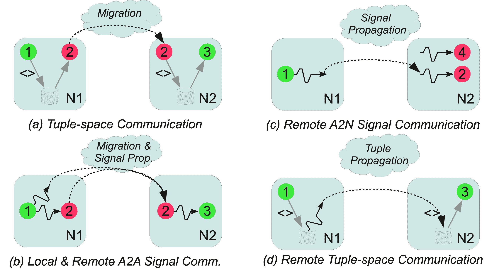图 6-1. 基本的代理间通信方法

两种通信方法在编程上都很容易使用，只需要简单的语句：

```
[](#cb28-1)| 代理 A |        | 代理 B |
[](#cb28-2)
[](#cb28-3)send(B,'S',1)      on.S = (arg,from) => {..}
[](#cb28-4)out(['V',2])       inp(['V',_],(t) )> { .. })
[](#cb28-5)sleep()            wakeup(B) // 同一 JAM
```

以下两个小节描述了使用元组空间的匿名生成式通信和使用信号消息的寻址通信的编程方法。

### 生成式元组空间通信

元组是一个绑定多个值的数据容器。形式上，元组元素不能像数组那样直接访问。但 AgentJS 使用数组实现元组。与数组不同，元组是多类型的，即每个元素可以有不同的数据类型。JS 中的数组也是多类型的，并且可以动态创建（作为元组）。元组由其元数（arity）和类型签名（所有元素的类型）来表征。

元组存储在元组空间中，元组空间本质上是一个非索引数据库，即元组不能直接在数据库中访问。相反，使用模式来访问匹配元组的子集。

元组空间主要有两种基本操作：

`out(t)`

一个新的元组`t`被存储（写入）到元组空间数据库中。该元组与其源代理完全解耦（没有关于源的信息）。元组存在有限的时间。可以有多个相同的元组（多个副本）。

`inp(p)`

根据元组模式`p`从元组空间数据库中移除一个元组。输入操作是同步的，如果没有匹配的元组，调用代理进程将被阻塞（挂起），直到数据库中存储了匹配的元组（由另一个代理或宿主应用程序）。输入操作是原子的。最多移除一个元组。

除了输入操作外，还有一种读取操作，它不会移除匹配的元组，而是返回一个副本。基本的元组空间 API 如表 6-7 所示。阻塞操作需要一个回调处理函数，当找到匹配的元组或发生超时时会调用该函数。元组是一个由实际值（数字、字符串、数据记录、数据数组）或由空值表示的形式参数组成的数组。形式参数仅用于模式中。

| 操作 | 描述 |
| --- | --- |
| `alt(p [],function)`, `alt.try(tmo,[[]],function)` | 扫描多个模式。第一个匹配某个模式的元组会从元组空间中移除，并传递给处理函数。 |
| `exists(p)` 或 `test(p)` | 检查元组是否存在 |
| `inp(p,cb)`, `inp.try(tmo,[],cb)` | 基于模式匹配从数据库中移除一个元组。带 try 的版本会等待有限时间以获取匹配元组（如果没有元组，则立即返回空值）。 |
| `mark(p,tmo)` | 在数据库中存储一个具有定义超时时间的临时元组 |
| `out(t)` | 在数据库中存储一个元组 |
| `rd(p,cb)`, `rd.try(tmo,[],cb)` | 基于模式匹配读取一个元组（副本）。带 try 的版本会等待有限时间以获取匹配元组（如果没有元组，则立即返回空值）。 |
| `rm(p,all)` | 移除一个或所有匹配给定模式的元组。 |
| `ts(p,callbackOrTimeout)` | 通过原子测试并设置操作（原地修改）更新一个元组。如果第二个参数是函数，则元组会被返回的元组替换。如果是数字，则元组的生存时间被设置或延长该时间值。 |

表 6-7. 本地元组空间操作（p：模式，t：元组）

`alt`操作允许监听多个元组模式。第一个匹配某个模式的元组会激活处理函数。所有元组请求共用一个元组处理函数。`alt`操作的行为类似于`inp`操作，会移除匹配的元组（原子操作）。测试操作可用于基于模式测试元组是否存在。如果确实存在匹配的元组，测试操作返回 true。测试操作之后，可以执行读取或输入操作。由于同一物理节点上的代理是顺序调度的，因此在测试和输入之间违反原子性不会导致一致性问题。如果代理拥有适当的权限（特权级别），并且其节点与远程节点之间存在链接，则可以访问远程元组空间，如表 6-8 所示。

| 操作 | 描述 |
| --- | --- |
| `collect(to,p)` | 将所有匹配的元组从源 TS 迁移到远程目标 TS。 |
| `copyto(to,p)` | 将所有匹配的元组从源 TS 复制到远程目标 TS。 |
| `store(to,t)` | 将元组*t*存储到节点*to*（节点标识符）上。 |

表 6-8. 远程元组空间操作需要在源节点和目标节点之间存在链接。

元组空间操作的示例如下代码所示，见例 6-7。这些操作应在代理活动中使用。带有回调函数的阻塞操作不得在转换和信号处理函数中使用。带有超时的操作可能返回空值，回调函数必须检查有效的元组。


```
alt.try(500,
[  ['SENSOR',null],
  ['TIME',null],
  ['NODE',100,null]
],(t) => {
  if (!t) return log('timeout');
  switch (t[0]) {
    case 'SENSOR': .. break;
    case 'TIME': .. break;
    case 'NODE': .. break;
  }
})
out(['SENSOR','temp',5000])
mark(['IAMHERE',myid(),mynode()],1000 /*ms*/)
rd(['SENSOR',null],(t) => {
  this.sensor=t[1];
})
rd.try(500,['SENSOR',null],(t) => {
  if (t) this.sensor=t[1];
})
t=rd.try(0,['SENSOR',null]);
inp(['SENSOR',null],(tl) => {
  /* tl 是所有匹配元组的数组 */
},true)
if (test(['SENSOR',100])) { .. }
ts(['SENSOR',100], (t) => {
  /* 更新空间中的元组 */
  t[1]++;
  return t
})
```

例 6-7\. 代理元组操作示例

### 信号

与生成式匿名元组通信不同，信号消息总是发送到已知地址（通常是代理标识符）的目标。信号是在两个代理 *A* 和 *B* 之间发送的轻量级消息。代理可以位于不同节点上，但在过去的某个时间，它们必须由同一个节点（交叉点节点）处理。代理通常通过一阶父子树连接（例如，*B* 是 *A* 的子代，通过分叉或从构造函数冷实例化创建）。如果代理迁移到另一个节点，路径会在一段时间内被记住（具有节点特定的超时）。如果本地没有目标代理，信号消息的传递依赖于迁移表，消息会被转发到下一个节点，直到无法解析更多路径元素或达到最大跳数。父子代理之间的信号示例如例 6-8 所示。脚本代码必须由 JAM shell 程序执行。

| 操作 | 描述 |
| --- | --- |
| `send(to,sig,arg)` | 向代理 *to* 发送类型为 *sig* 的信号消息，附带可选参数 *arg*。 |
| `broadcast(ac,range,sig,arg)` | 向给定跳数范围内类 *ac* 的代理发送类型为 *sig* 的信号消息，附带可选参数 *arg*。 |
| `on."SIGNAL" : function (arg,from)` | 信号只能由安装的代理信号处理程序（在 *on* 部分）接收。信号名称是处理程序名称属性。 |

表 6-9\. 信号操作

在下面的例 6-8 中，展示了一个简单的父子代理对之间的乒乓信号消息示例。创建了两个代理，将第一个代理的标识符名称传递给第二个代理，从而能够发送寻址信号。

```
function ac(config) {
  this.parent = config.parent;
  this.act = {
    init: () => {
      log('START',this.parent);
      if (this.parent) 
        send(this.parent,'PING',random(0,100));
    },
    wait : () => { sleep(5000) },
    end : () => { log('END'); kill() }
  }
  this.trans = {
    init : wait,
    wait : end,
  }
  this.on = {
    'PING' : (arg,from) => {
      log('PING',arg,from);
      send(from,'PONG',random(0,100));
    },
    'PONG' : (arg,from) => {
      log('PONG',arg,from);
    }, 
  }
  this.next = 'init';
}
compile(ac,0,true);
var ag1 = create('ac',{});
var ag2 = create('ac',{parent:ag1});
start()
```

例 6-8\. 一个简单的父子代理对之间的乒乓信号消息示例。

## 代理移动性

一个代理可以从其当前节点迁移到另一个（远程）节点。此操作需要在源节点和目标节点之间建立一条虚拟链路。可以使用`link`操作测试节点链路。`link`操作也可用于获取所有当前链路。在 IP 网络中，`link(DIR.IP("%"))`调用返回节点标识符名称，而`link(DIR.IP("*"))`返回当前链接节点的 URL 地址。这些操作总结在表 6-10 中。这些操作所使用的指定目标节点的不同方向总结在定义 6-2 中。一些方向标志是无参数的静态值，另一些则是返回参数化方向的函数。常用的`DIR.IP()`方向需要一个模式或 URL 参数。如果已知目标节点名称，可以使用`DIR.NODE(name)`方向函数来测试链路或迁移到该节点。主机程序或三级代理可以将其 JAM 节点连接到远程节点，通常使用基于 IP 的 AMP 链路和`DIR.IP(proto://host:port)`目标方向。

| 操作 | 描述 |
| --- | --- |
| `moveto(dir)` | 将此代理发送到由`dir`指定的新目标节点。 |
| `link(dir)` | 测试到某个节点的链路，或返回当前链路信息。 |
| `dir` ∈ `DIR` | 链路目标方向对象 |

表 6-10\. 代理移动操作；链路方向定义如下。

```
type DIR = {
  NORTH, SOUTH,
  WEST,  EAST,
  LEFT,  RIGHT,
  UP,    DOWN,
  ORIGIN,
  NW, NE, SW, SE,
  BACKWARD,
  FORWARD,
  OPPOSITE,
  // Assuming:  z-> x     N
  //            |        W+E  U(+z)/D(-z)
  //            v y       S
  DELTA: function (addr) → {tag:"DIR.DELTA",delta:addr},
  // Only for link? operation
  RANGE: function (r) → {tag:"DIR.RANGE",radius:r}, 
  // Address a node (identifier name) directly
  NODE: function (node) → {tag:"DIR.NODE",node:node},
  // Patterns: %:Node names; *:URLs
  IP:function (addr) → {tag:"DIR.IP",ip:addr},
  // Path can contain filters, 
  // e.g. range /distance[0-5], /distance[5], .. 
  // or a pattern for a set of destinations, e.g., /node*
  // or a hopping array [dest1,dest2,..]
  // type of path = string | string array
  PATH:function (path) → {tag:"DIR.PATH",path:path},
  CAP:function (cap) → {tag:"DIR.CAP",cap:cap}
}
```

定义 6-2\. 由`connect`、`move-to`和`link`操作使用的可能链路和目标方向。第一组仅用于网状网络（主要是在模拟器之类的虚拟节点网络中）。

一个简单的移动代理如示例 6-9 所示。当前 IP 链接节点的标识符名称由`link(DIR.IP('%'))`函数调用返回。随机选择一个节点，代理在活动`move`中迁移到新节点，并在活动`back`中返回其根节点。

```
function ag() {
  this.goto=null;
  this.root=null;
  this.act = {
    check: () => {
      this.root=myNode();
      var links=link(DIR.IP('%'));
      if (links && links.length) 
        this.goto=random(links);
      else sleep(500);
    },
    move: () => {
      moveto(DIR.NODE(this.goto))
    },
    back: () => {
      moveto(DIR.NODE(this.root)) 
    },
    end: () => {
      log('Terminating');
      kill();
    },
  }
  this.trans = { 
    check:() => { 
     return this.goto?'move':'check' },
    move:'back',
    back:'end' }
  this.next = 'check';
}
```

示例 6-9\. 一个访问邻居节点并返回其根节点的代理。

## 机器学习

代理与机器学习模型的融合创造了学习代理。JAM 的 ML 模块部分提供了广泛的机器学习算法，包括强化学习。ML 模块提供这些算法。算法使用的大多数（但并非全部）模型是纯非循环数据对象，并且是可移动的，即模型可以由迁移的代理携带，并在另一个节点上进一步处理。

一个代理（至少具有权限级别 1）可以通过`ml`根对象访问 ML 模块。ML 模块的类型签名如定义 6-3 所示。ML 模块由数据分析函数（`stats`对象）和一组通用 ML 操作组成，主要包括：`learn`（从数据立即创建 ML 模型，例如决策树的情况）、`train`（对已创建的模型进行训练，例如 ANN）和`predict`（将训练好的模型应用于新数据）。某些模型可以通过`update`操作进行更新（例如强化学习器）。通用操作涵盖了大量的 ML 算法，可以通过`ml.ML`条目进行选择。


```
type ml = { action: [Function: action],
  classify: [Function: classify],
  compact: [Function: compact],
  depth: [Function: depth],
  evaluate: [Function: evaluate],
  info: [Function: info],
  learn: [Function: learn],
  learner: [Function: learn],
  noise: [Function: noise],
  preprocess: [Function: preprocess],
  print: [Function: print],
  similarity: [Function: similarity],
  stats: 
   { analyze: [Function: analyze],
     entropy: [Function: entropy],
     entropyN: [Function: entropyN],
     entropyEps: [Function: entropyEps],
     entropyTEps: [Function: entropyTEps],
     entropyT: [Function: entropyT],
     features: [Function: features],
     gainEps: [Function: gainEps],
     maxGainEps: [Function: maxGainEps],
     mostCommon: [Function: mostCommon],
     partition: [Function: partition],
     partitionEps: [Function: partitionEps],
     partitionUniqueEps: [Function: partitionUniqueEps],
     splitEps: [Function: splitEps],
     unique: [Function: unique],
     uniqueEps: [Function: uniqueEps],
     utils: 
      { best: [Function: best],
        bestNormalize: [Function: bestNormalize],
        column: [Function: pluck],
        log2: [Function: log2],
        prob: [Function: prob],
        relax: [Function: relax],
        select: [Function: select],
        selectEps: [Function: selectEps],
        sort: [Function: sort],
        stat: [Object],
        without: [Function: without],
        wrap: [Function: wrap] } },
  test: [Function: test],
  update: [Function: update],
  // supported model/algorithm types
  ML: 
   { ANN: 'ann',         C45: 'c45',
     CNN: 'cnn',         ICE: 'ice',
     DTI: 'dti',         ID3: 'id3',
     KMN: 'kmeans',      KNN: 'knn',
     KNN2: 'knn2',       MLP: 'mlp',
     RF: 'rf',           RL: 'rl',
     SLP: 'slp',         SVM: 'svm',
     TXT: 'txt',         EUCL: 'euclidean',
     PEAR: 'pearson',    DPAgent: 'DPAgent',
     TDAgent: 'TDAgent', DQNAgent: 'DQNAgent' },
  predict: [Function: classify],
  train: [Function: learn],
  best: [Function: best] }
```

定义 6-3. AgentJS 机器学习模块的类型签名

接下来的子章节将介绍一些选定的模型和算法。

### 决策树

存在不同的决策树学习器（参见定义 6-4 和 6-5），主要是`C45`、`ID3`，以及基于区间算术的置信区间决策树模型`DTI`。为了处理带有噪声区间`[x-εx+ε]`的输入变量，使用了区间算术。具有重叠区间的值被视为相等，并且不会贡献信息增益。噪声（变量方差或标准差）值必须由用户提供。可以为所有输入变量提供一个值，或者为每个输入变量提供一个值（ε值数组）。

```
xy=[{a:..,b:,..,..,y:..},{...},...]
model = ml.learn({
 algorithm:ml.ML.C45, // ID3
 data:xy,
 target:'y',
 features:['a','b',..]
})
result = ml.classify(model,xy[0]) 
```

定义 6-4. C45/ID3 模板（输入变量可以是数字、字符串或布尔值；输出变量始终是字符串）

```
x=[[...],[...],..]
y=['a','b',..]
model = ml.learn({
  algorithm:ml.ML.DTI,
  x:x, 
  y:y,
  eps:number // or [e1,e2,...]
});
```

定义 6-5. 基本 DTI 模板（输入变量只能是数字，输出变量始终是字符串类型）

### 多层感知器

MLP 模型（参见定义 6-6）是一个具有隐藏层的全连接神经网络。该模型是可移植的（移动的），可以由移动代理携带。模型可以在创建时一次性使用`ml.learner`函数进行训练，或者使用`ml.train`函数迭代训练。MLP 模型的训练可能耗时，应分成多次活动运行（否则活动处理可能被调度器终止）。训练函数返回当前的*损失*值和训练运行所消耗的时间。更多信息请参见[STA09]。

```
x=[[...],[...],..]
xo=[{...},{...},..]
y=['a','b',..]
model = ml.learner({
        x:x, // alternative: xo,
        y:y,
        features:['x1','x2',...],
        labels:['a','b',...],
        hidden_layers : [4,4,5],
        algorithm:ml.ML.MLP,
        normalize:true,
        bipolar:true,
        verbose:1
      });
result = ml.train(model,{
  epochs:1000,
}) // -> { time, epochs, loss }
result = ml.classify(model,x[0]) 
```

定义 6-6. 基本 MLP 模板

### 支持向量机

支持向量机（SVM）是一种二元分类器，尽管它也可以用于回归问题。多标签分类是通过一组*n*个二元分类器为*n*个不同的目标变量类别建立的。SVM 模型也是可移植的，可以由移动代理携带或由子代理继承。SVM 可以使用不同的核函数，例如多项式核或"rbf"。算法及其参数的详细信息请参见[`github.com/karpathy/svmjs`](https://github.com/karpathy/svmjs)。创建训练模型的基本 SVM 模板如定义 6-7 所示。输入数据不需要归一化。

```
x=[[number,...],[...],..]
y=[number ∈ {-1,1},..]
// Binary SVM
var model = ml.learn({
    algorithm : ml.ML.SVM,
    x : x,
    y : y,

    C : number, 
    // default : 1.0. C in SVM.
    tol : number, 
    // default : 1e-4. Higher tolerance --> 
    //                 Higher precision
    max_passes : number, 
    // default : 20. Higher max_passes -->
    //               Higher precision
    alpha_tol : number, 
    // default : 1e-5. Higher alpha_tolerance --> 
    //                 Higher precision

    //kernel : { type: "polynomial", c: 1, d: 5}
    kernel : { type: "rbf", sigma:0.5 }
});
result = ml.classify(model,x[0])
// Multiclass SVM
x=[[number,...],[...],..]
y=['A','B',..]
var model = ml.learn({
    algorithm : ml.ML.SVM,
    x : x,
    y : y,
    labels:['A','B',..],

    threshold:boolean, 
    // false:no threshold function on output; 
    // highest value of svms is winner
    ..
}
// classify returns {value:string,prob:number}[] arrays
var winner = ml.stats.utils.best(
  ml.classify(model,x[0])
)
```

定义 6-7. 基本 SVM 模板

### 强化学习器

强化学习（RL）与智能体的自适应行为概念密切相关。RL 训练器需要一个包含辅助函数的环境。状态和奖励均为数值。更多信息可参见 [KAP15]。动作本身对 RL 不可见，被视为符号。模型是可移植的（纯数据），可由移动智能体携带。一个基本的 RL 模板如定义 6-8 所示。它由一个包含若干预定义函数的环境和一个重复执行 `action`、`nextState`、`reward` 和 `update` 序列的更新循环组成。

```
actions = ['a','b',..]
env = {
  // 返回当前状态下允许的动作
  allowedActions : (state) => { 
  },
  // 状态转移函数
  nextState : (state,action) => {
    return state
  },
  getNumStates : () => { return number},
  getMaxNumActions : () => { return number},
  // 计算状态转移和动作的奖励
  reward : (state,action,nextstate) => {
    return number
  },
}
model = ml.learn({
  algorithm   : ml.ML.RL,
  kind        : ml.ML.TDAgent,
  actions     : actions,
  // 规格参数
  // 函数学习率
  alpha       : 0.1, 
  // 平滑策略更新的学习率
  beta        : 0.2, 
  // epsilon-greedy 策略的初始 epsilon，0, 1)
  epsilon     : 0.2, 
  // 折扣因子，0, 1)
  gamma       : 0.5, 
  // 资格迹衰减，0,1)。0 = 无资格迹
  lambda      : 0, 
  // 每次迭代的规划步数。0 = 无规划
  planN       : 5, 
  replacing_traces : true,
  smooth_policy_update : false,
  update : 'qlearn',  // 'qlearn' 或 'sarsa'
  environment : env
})
while () {
  action = ml.action(model,state);
  next = env.nextState(state,action);
  reward = env.reward(next)
  ml.update(model,reward)
  state = next
}
```

定义 6-8. 基本 RL 模板

# 面向用户和程序员的 JAM

核心 JAM 模块完全用 JavaScript 编写，可嵌入任何至少支持 ECMAscript 2015 标准的应用程序中。为简化编程和智能体部署，核心模块被封装在一个提供统一 API 的库中。除了用于开发自定义应用的核心库外，还有预构建的应用程序：

1.  JAM 命令行界面（命令行和 Web 浏览器版本）；

2.  移动 JAM 应用（Cordova 和 Web 浏览器版本）；

3.  JAM Web 实验室（Web 浏览器）；

4.  SEJAM（node-webkit 和 Web 浏览器版本）。

以下章节介绍该库及程序的使用和编程方法。JAM 命令行界面 `jamsh` 是主要的编程和部署平台。JAM 库有适用于命令行应用（使用 node.js）和 Web 浏览器的版本，两者 API 几乎相同。

## JAM 库

JAM 的库版本包含一个完整的智能体处理虚拟机，以 AIOS 为核心组件，可将 JAM 嵌入任何宿主应用程序，包括 Web HTML 页面。通过公共 API 创建和控制 JAM 节点实例。每个实例是一个对象，提供一组 API 方法用于控制 JAM 实例并将该实例连接到其他节点。jamlib 有两个略有不同的版本，分别针对：

1.  支持 node.js [NOD22]、jerryscript [JER22] 和 quickjs [QUI22] 的服务端和终端版本；

2.  适用于支持 JS 处理的任何浏览器以及基于 Cordova 的智能手机应用的客户端版本。

通过调用 `Jam` 构造函数创建 JAM 对象实例，如定义 7-1 中的代码模板所示。JAM 库对象方法（由 `Jam` 构造函数实例化）的选录见表 7-1 和 7-2。


```js
var JAM = require('jamlib.js');
// 浏览器：<script src="jamlib.browser.js">
// 创建一个包含一个初始虚拟节点的虚拟世界的 JAM 实例
// 该虚拟世界包含一个初始虚拟节点
var jam    = JAM.Jam({}), // 浏览器：JAMLIB.
    DIR    = jam.DIR;
jam.init();
jam.locate(); // 启动多阶段地理定位
// 启动 JAM 调度器循环
jam.start();
// 定义一个智能体构造函数
function foo(p) { 
  this.x=p; 
  this.act={..}; 
  this.trans={..}; 
  .. }
// 编译智能体构造函数
jam.compileClass(foo,{verbose:1});
// 从类构造函数实例化智能体
// 并指定 AIOS 级别
var a1 = jam.createAgent('foo',[args],1);
var a2 = jam.createAgent('foo',[args],1);
// 创建 AMP HTTP 端口（通信端点）
jam.createPort(DIR.IP('http://localhost:*'))
// 连接到外部节点
jam.connectTo(DIR.IP('http://ag-0.de:30002?secure=12:..'))
```

定义 7-1. 使用 JAM 库进行 JAM 节点实例化和智能体创建

`compileClass` 函数为每个权限级别创建并安装沙箱受限的智能体构造函数，每个级别具有不同的可操作 AIOS 函数集。`createAgent` 函数从已沙箱受限的智能体类构造函数中实例化一个智能体，并指定特定的参数集和 AIOS 级别（此处为 1）。

AIOS 可通过 `extend` 方法轻松扩展，例如添加自然语言处理或逻辑求解器 API。

| 方法 | 参数 | 描述 |
| --- | --- | --- |
| `addClass` | `name`, `constructor`, `env` | 创建沙箱构造函数，并将智能体类添加到 JAM 世界。 |
| `addNode` | `nodeDesc`: `{x,y,id?}` | 向世界添加一个新节点。假设：二维网格网络，坐标为 (x,y)。根节点位置为 `{x=0,y=0}`。 |
| `analyze` | `ac`, `options` | 分析文本或对象形式的智能体类模板。 |
| `compileClass` | `name`, `constructor`, `options` | 分析并编译智能体类构造函数，并将其添加到世界类库中。 |
| `connectNodes` | `nodes`: `{x,y} []` | 连接逻辑节点（虚拟链路）。 |
| `connected` | `dir`, `nodeid`? | 检查链路的连接状态。 |
| `createAgent`, `createAgentOn` | (`nodeid`), `ac`, `args`, `level`, `className`, `parent`? | 从类 `ac` 创建并启动一个智能体，并传入参数。 |
| `createPort` | `dir`, `options`, `nodeid` | 创建一个物理通信端口。 |
| `disconnect` | `dir`, `nodeid` | 断开远程端点。 |
| `extend` | `level`, `name`, `funcOrObj`, `argn` | 扩展 AIOS 智能体 API。 |
| `info` | `kind`, `id` | 获取关于节点、智能体和宿主平台的信息。 |
| `kill` | `id`, `nodeid` | 杀死指定 id 的智能体（"*"：杀死当前节点或指定节点上的所有智能体）。 |
| `locate` | `nodeid`, `callback`, `options` | 尝试定位此节点（基于网络连接）并获取地理空间位置。 |
| `inp`, `mark`, `out`, `rd`, `ts` | - | 对当前节点执行元组空间操作。 |
| `saveSnapshot`, `saveSnapshotOn` | `agentid`, `nodeid`, .. | 获取当前在给定节点上执行的智能体进程快照（以字符串形式返回或保存到文件）。 |
| `setCurrentNode` | `nodeid` | 设置当前 v-JAM 节点。 |
| `signal` | `to`, `sig`, `arg`, `broadcast` | 向特定代理发送信号或广播。 |

表 7-1. JAM 库操作方法选择

| Method | Parameter | Description |
| --- | --- | --- |
| `init` | `callback` | 创建并初始化节点/世界，添加可选的 TS 提供者/消费者，创建物理网络连接。 |
| `schedule` | - | 强制立即运行调度器，如同通常由 jam 服务循环执行的那样，如果存在外部代理管理（例如通过发送信号）则需要。 |
| `start0`, `start`, `stop` | `callback` | 启动或停止 JAM（0：无调度器循环，用于单步执行）。 |
| `step` | `steps`, `callback` | 步进调度器循环。 |

表 7-2. JAM 库控制方法

JAM 运行时支持两种调度模式：自由运行和单步执行。在自由运行模式下，调度器根据待处理事件和就绪代理（具有待处理转换）确定下一次调度循环执行时间。在单步模式下，仅处理固定次数的调度循环运行。此功能用于调试和模拟。调度器只能根据源自代理的事件（例如通过调用 `sleep` 操作）计算下一次循环执行时间。外部引入的事件需要强制调度器运行（通过使用 `schedule` 操作）。

以下示例 7-1 展示了 JAM 库在 HTML 页面中的嵌入。JAM 库的浏览器版本可通过全局 `JAMLIB` 对象访问。

```html
<html>
<head>
<script src="jamlib.browser.js"></srcipt>
</head>
<body>
<script>
/* Object { Aios: Object, 
            Comp: Object, Esprima: Object, 
            Io: Object, Jam: function, 
            Json: Object, 
            environment: Object, 
            options: Object }
*/
var jam    = JAMLIB.Jam({}),
    DIR    = jam.DIR;
jam.Aios.Mobi.options.debug.move=1;
jam.init();
jam.locate(); // Start multi-stage geolocation
// Start the JAM scheduler loop
jam.start();
jam.extend([1,2,3],'DOM',function (cmd,tag,content) {
  switch (cmd) {
    case 'agent': return navigator.userAgent;
    case 'get': return document.getElementById(tag);
  }
},[2,3])
if (document.URL.indexOf('https')==0) {
  jam.createPort(DIR.IP('https://localhost:*'))
  jam.connectTo(DIR.IP('https://ag-0.de:30001?secure=12:..'))
} else {
  jam.createPort(DIR.IP('http://localhost:*'))
  jam.connectTo(DIR.IP('http://ag-0.de:30002?secure=12:..'))
}
function foo(opts) {
...
}
jam.compileClass(foo,{verbose:1});
var foody = jam.createAgent('foo',{},2);
</body>
</html>
```

示例 7-1. JAM 库（浏览器版本）在 HTML 网页中的基本用法

## 练习 7-1. 带有 JAM 的网页

1. 通过执行一个创建 HTTP 端口并启动 JAM 的脚本，在你的计算机（或网络上的任何其他计算机）上启动一个 `jamsh` 实例：`port(DIR.IP('http://localhost:4567')); start()`。同时阅读下一节。
2. 使用上述示例代码模板。将 `connectTo` URL 替换为你的 Jamsh 实例的端口号。创建一个在页面打开时创建的简单通知代理。该通知代理应采样浏览器导航器代理字符串（通过 `DOM("agent")` 调用），最终迁移到 shell 节点。代理应打印（记录）采样的传感器值。
3. 使用一个收集器代理扩展 shell 脚本，该代理等待包含导航器代理字符串的元组消息（例如 `inp(["BROAGENT",_],..)`）。每个通知代理通过元组空间传递其采样的传感器值（例如 `out(["BROAGENT",v]`）。收集器代理应报告每个新传递的传感器样本，最终创建样本的统计数据（特定操作系统、浏览器软件等的出现百分比）。

通常，嵌入式 JAM 节点通过 AMP 连接到外部公共 JAM 节点。注意，仅支持 HTTP 和 HTTPS 协议，远程节点必须通过相应端口支持这些协议。此外，如果网页通过 HTTP 加载，则 AMP 也必须使用 HTTP，否则使用 HTTPS（相对于页面来源的混合 HTTP/HTTPS 请求通常会被浏览器拒绝），如示例 7-1 中的第 27-33 行所示。

注意，网页安装了一个睡眠 hack（`HackTimer.js` [TRU22] 嵌入在 `jamlib.browser.js` 文件中）。如果页面不可见（例如通过切换浏览器标签或仅隐藏浏览器窗口），浏览器程序会对网页和定时器进行节流和延迟。这适用于桌面和移动设备。这会导致 JAM 逻辑关闭，从而引发大量超时问题。HackTimer 将关键定时器移至 WebWorker 上下文，该上下文通常不会被浏览器节流。或者，JAM VM 可以在 WebWorker 中执行，这需要一些额外的 WebWorker 逻辑。

网页上的 JAM 实例仅在网页打开时存活。关闭页面后，JAM 状态丢失，包括其所有代理。克服此限制的一种潜在解决方案是将 JAM 迁移到 Service Worker。Service Worker 独立于根网页执行。通常，关闭网页后，Service Worker 最多可以运行 30 秒，直到被停止。当再次打开同一网页（相同 URL）时，Service Worker 会重新启动。要创建 JAM 的快照，必须序列化所有代理（类似于迁移的进程快照）。节点快照至少需要序列化元组空间内容和代理类构造函数字典。序列化的代码和数据可以永久（或临时）存储在 Web 浏览器的 Web 存储中。

## JAM Shell

JAM Shell（`jamsh`）是 JAM 的命令行 API，主要为 JAM 库提供 REPL 和脚本包装器。它为底层代理机器提供了典型的基于脚本的编程接口，简化了代理的创建和控制、组合 JAM 网络以及连接 JAM 节点等。JAM 脚本可以直接从文件加载和处理，和/或通过在 REPL shell 中键入命令来执行。代理类构造函数可以从文件加载、从函数编译或从任何文本表示解释。还有一个简化且受限的 JAM Shell Web 版本，基本上由于连接性（仅 HTTP）和缺少看门狗保护而受到限制。

### Shell 命令

Shell 命令，无论是通过 shell 命令行提供还是在脚本文件中执行，都总结在表 7-3 中。大多数函数和过程直接与 AIOS 和 `jamlib` API 相关。

| Command(s) | Description |
| --- | --- |
| `add(x,y)` | 添加一个新的逻辑（虚拟）节点。 |
| `agent(id,proc?)` | 返回代理对象（或进程）。 |
| `agents()` | 获取当前节点的所有代理（ID 列表）。 |
| `args` | 脚本参数。 |
| `ask(question,choices)` | 提问并读取答案。仅在脚本模式下可用。 |
| `array`, `assign`, `contains`, `concat`, `copy`, `empty`, `filter`, `last`, `merge`, `neg`, `object`, `pluck`, `random`, `select`, `without` | 数组、矩阵、对象和数学函数。 |
| `Capability`, `Port`, `Private` | 创建安全能力对象、端口和私有字段。 |
| `clock(milli), time()` | 返回系统时间（使用 `clock` 函数时格式为毫秒或 hh:mm:ss）。 |
| `cluster(desc)` | 创建工作进程集群。 |
| `config(options)`, `configs` | 配置 JAM。选项：print、printAgent、TSTMO 等，并返回 JAM AIOS 的配置。 |
| `connect({x,y},{x,y})`, `connect(to)`, `disconnect({x,y},{x,y})`, `disconnect(to)`, `connected(to)` | 连接两个逻辑节点（DIR.NORTH...），连接到物理节点，断开连接，并检查与指定目标的连接。 |
| `compile(f,options)`, `open(file)` | 编译代理类构造函数；打开并编译代理类文件。 |
| `create(ac, args, level,node)`, `kill(id)` | 从类 @ac 创建代理，给定参数 @args 和 @level，可选地在 @node 上创建（返回代理 id）；杀死代理。 |
| `extend(level,name,argn)` | 为一个或多个特权级别扩展 AIOS。 |
| `http`, `https` | HTTP 和 HTTPS 客户端与服务器对象，支持 get、GET（JSON）、put、PUT（JSON）以及服务器操作。 |
| `info(what,id)` | 返回节点信息对象（'node'、'version'、'host'）。 |
| `inp(p,all)`, `mark(t,tmo)`, `out(t)`, `provider(cb)`, `rd(p,all)`, `rm(p,all)`, `test(p)` | 从元组空间中读取并移除（一个或多个）元组（非阻塞）；存储一个带超时的元组；在当前节点 TS 中存储元组；安装元组提供者和消费者处理程序；从 TS 中读取元组；移除元组；测试元组是否存在。 |
| `later(tmo,cb)` | 延迟执行一个函数。如果函数返回真值，则启动下一个定时器。 |
| `node(id)`, `nodes`, `name`, `world` | 获取或设置当前虚拟节点；返回所有虚拟节点 id；返回当前节点名称；返回当前世界对象。 |
| `on(ev,handler)` | 安装事件处理程序。事件："agent+"、"agent-"、"signal+"、"signal"、"link+"、"link-"、"exit"。 |
| `port(dir, options:{proto,secure}, node)` | 创建新的物理通信端口。 |
| `setlog(flag,val)` | 启用或禁用日志功能。 |
| `signal(t,sig,arg)` | 向指定代理发送信号。 |
| `sleep(milli)` | 将整个 shell 挂起若干秒。 |
| `start()`, `stop()` | 启动和停止 JAM 调度器（及其他服务）。 |
| `uniqid(options)` | 返回一个随机名称。 |
| `utime()` | 以纳秒为单位返回高分辨率系统时间。 |

表 7-3. 常用 JAM shell 命令

部分 shell 命令也可供代理使用，例如元组空间操作或 ML 模块 `ml`。但不存在阻塞操作（`ask` 除外）。所有异步操作都需要回调函数。

### 端口与链接

两个（物理）节点之间的链接需要使用 `port` 操作建立通信端口。通常使用 IP 网络来建立 JAM 节点链接。至少一个节点需要静态 IP 端口。链接通过 `connect` 操作建立，如定义 7-2 所示。


// 节点 A
```
var sport = Port.ofString('12:34:56:78')
port(DIR.IP('http://localhost:4567'))
// 使用安全端口，两种替代格式
port(DIR.IP('http://localhost:5567?secure=12:..'))
port(DIR.IP('http://localhost:6567'),{secure:sport})
// 节点 B
port(DIR.IP('http://localhost:*'))
connect(DIR.IP('http://localhost:4567'));
// 使用安全端口
connect(DIR.IP('http://localhost:5567?secure=12:..'));
```

**定义 7-2.** IP 端口的创建与节点间链接的建立。端口可通过能力端口或任意字符串密钥进行保护

此外，使用 HTTP 进行 AMP 通信时，也可使用 UDP 和 TCP。协议可通过方向 IP URL 直接设置，例如 `port(DIR.IP('udp://localhost:4567'))`。请注意，Web 浏览器仅支持 HTTP 通信。JAM shell 只需创建公开可见的 IP 端口，即可充当代理中继节点。任何具有互联网连接的 JAM 节点均可通过 AMP 的 `connect` 操作连接到该节点。JAM 节点也可通过（3 级）代理使用 `connectTo` 操作进行连接。

端口可通过一组参数进行配置，以改变内部数据流和控制，如定义 7-3 所示。AMP 端口可以是单播或多播。多播端口支持来自远程节点端口的多个链接，以及指向该端口的多个链接。IP 端口通常是多播端口。此外，AMP 端口可以是单向或双向的。

```
 1: port(DIR.IP('udp://...'),{
 2:   secure?:string,
 3:   oneway?:boolean,       // 默认值:false
 4:   multicast?:boolean,    // 默认值:true
 5:   snd?:{address,port},   // 固定目标地址
 6:   verbose?:number
 7: })
 8: port(DIR.IP('tcp://...'),{
 9:   // 链接的默认设置：一对
10:   // 单向临时 TCP 会话
11:   keepAlive?:boolean,    // true:永久 TCP 会话
12:   sharedSocket?:boolean, // 隐含 keepAlive
13:   multicast?:boolean,    // 默认值:true,
14:                          // 对于 NORTH 等为 false
15:   oneway?:boolean,       // 默认值:false
16:   secure?:string,
17:   snd?:{address,port},   // 固定目标地址
18:   verbose?:number
19: })
20: port(DIR.IP('http://...'),{
21:   keepAlive?:boolean,    // true:永久 TCP 会话
22:   secure?:string,
23:   verbose?:number
24: })
25: port(DIR.IP('https://...'),{
26:   keepAlive?:boolean,    // true:永久 TCP 会话
27:   pem: {
28:     key:string,
29:     cert:string,
30:   },
31:   secure?:string,
32:   verbose?:number
33: })
```

**定义 7-3.** 不同协议的端口配置

### 代理类

代理构造函数可以从嵌入式函数定义、从源文件加载的函数定义或包含代码的文本字符串编译而来，如示例 7-2 所示。

```
function ac (p) { 
  this.v=ε; 
  this.act={..}; 
  this.trans={..}; 
  this.on={..}; 
  this.next='..' }
compile(ac,{verbose:true});
// 或者从文件读取 acf
// myclass.js 包含: function myclass(p) {..}
open('myclass.js',true);
```

**示例 7-2.** 编译代理构造函数

`compile(ac, name?, options?)` 函数将沙箱受限的构造函数编译到内部库中，适用于所有 AIOS 特权级别。构造函数也可以通过 `open(file,verbose?)` 函数直接从文件加载。一个代理类只能包含一个命名的构造函数。`compile` 函数使用修改后的 Esprima JS 分析器，该分析器反映了特定的 AgentJS 特性，并应用于代理构造函数。通过设置选项属性 `verbose` 可以显示分析结果。

`compile` 函数（JAM shell API）或 JAM 库中的 `compileClass` 函数会将每个新编译的代理构造函数添加到一个字典中，该字典可由 JAM 实例的所有虚拟节点访问。使用 `open` 语句时也是如此。字典中包含的所有代理类均可立即用于创建代理。

### 物理集群

JAM shell 可用于轻松创建由虚拟或物理 JAM 节点组成的世界，这些节点通过虚拟电路链接或 IP-AMP 链接连接。物理 JAM 节点被分组为集群，并可从根 JAM shell 实例创建。

每个 JAM 节点都是一个世界容器，包含至少一个拥有自身进程表和元组空间数据库的虚拟节点。可以向 JAM 世界添加额外的虚拟节点。同一世界中的虚拟节点可以通过具有二维网格网络结构的虚拟通道链接进行连接。通信（代理迁移和信号传播）通过北、南、西、东四个通信端口支持。虚拟节点网络主要用于仿真（参见第 [SEJAM] 节）和网络虚拟化。`jamsh` 程序直接支持虚拟 JAM 网络，如定义 7-4 所示。每个节点由其二维世界中的逻辑位置 (`x`, `y`) 标识。初始根节点位于位置 (0,0)。通常，世界名称和根名称相同（但初始时世界名称始终为大写字母）。

```
// 创建虚拟 2x2 节点网络
var node2 = add({x:1,y:0}),
    node3 = add({x:1,y:1}),
    node4 = add({x:0,y:1});
// 单向链接！
connect({x:0,y:0},{x:1,y:0})
connect({x:1,y:0},{x:1,y:1})
connect({x:1,y:1},{x:1,y:0})
connect({x:1,y:0},{x:0,y:0})
function foo() {
  this.act = {
    foo : () => {
      // 在虚拟网络中迁移
      var dirs = [DIR.NORTH,DIR.SOUTH,
                  DIR.EAST,DIR.WEST],
          goto=null;
      iter(dirs, (dir) => {
        if (!this.goto && link(dir)) 
          this.goto=dir;
      })
      if (goto) moveto(goto); 
    }
  }
}
```

**定义 7-4.** 在 JAM shell 中由同一物理节点处理的虚拟节点网络的创建

与虚拟节点网络不同，物理集群由独立的 JAM 节点实例组成，这些实例通过基于 IP 的通信通道（使用 AMP）连接。JAM shell 直接支持创建 JAM 集群，如定义 7-5 所示。同样，节点以二维网格形式排列。集群创建一组 IP-AMP 端口。有外部端口和内部端口。内部端口用于通过定向链接（即使用北、南、西、东端口）直接连接节点。外部（非定向）端口支持来自外部的连接，例如通过 Web 浏览器使用 HTTP。请注意，执行 shell 脚本的根 JAM 节点不是集群中的第一个节点！因此，根节点必须通过外部端口连接到其中一个集群节点。

物理集群由 JAM shell 通过使用 `cluster` 操作创建，该操作定义了网格网络（行和列）、AMP IP 端口和协议、每个链接类（p2p、multi）的 AMP IP 端口的基础端口、用于检查集群节点状态的轮询间隔，以及每个集群工作节点要执行的初始 shell 命令（`todo`），如定义 7-5 所示。节点间连接以二维网格形式排列。集群内的代理迁移使用定向链接 `DIR.NORTH`、`DIR.EAST` 等，具体取决于节点位置。

代理可以通过使用 `moveto` 操作在集群节点之间迁移，该操作使用相对于代理节点邻域的笛卡尔方向，例如 `DIR.NORTH`。每个集群节点创建公共 IP 端口（从 IP 端口号 `port0` 开始，例如 11001）和私有定向链接（北、南、西、东），从 IP 端口 `port1` 开始，例如 10001。

```
// 创建物理 2x2 节点集群网络
var workers = cluster({
  connect:true,
  rows:2,
  cols:2,
  port0:11001, // 第一个内部 IP 端口
  port1:10001, // 第一个外部 IP 端口
  portn:100,   // 增量
  proto:['http','udp'],
  poll:number, // 工作节点轮询间隔（毫秒）
  todo:'config({log:{node:true}});start()',
  verbose:0,
});
workers.start()
// 连接到第一个集群节点
var p1=port(DIR.IP('udp://localhost:12000'));
later(500,() => {
  connect(DIR.IP('udp://localhost:10002'))
});
function foo () {
  this.act = {
    tofirst : () => {
      // 找到第一个 IP 连接的集群节点
      var connected=link(DIR.IP('%')),
          goto=null;
      if (connected && connected.length) 
        goto=DIR.NODE(connected[0]);
      if (goto) moveto(goto);
    },
    // 在集群内部迁移
    // EAST -> SOUTH -> WEST -> NORTH -> ..
    toright : () =>  {
      moveto(DIR.EAST)
    }
}
// 创建一个从此节点迁移到第一个集群节点的代理
create(...)
```

**定义 7-5.** 使用 JAM shell 创建物理 JAM 集群网络的操作模板

集群由初始 JAM shell 实例创建和控制（该实例不属于集群网络）。可以在该控制器实例上创建代理。如果控制器实例与集群节点的某个公共端口有链接，则代理可以迁移到该集群节点。如下例 7-3 所示。

```
function circulator(maxhop) {
  this.maxhop=maxhop;
  this.hops=0;
  this.last=null;
  this.goto=null;
  this.act = {
    start: () => { log('Start on '+myNode()); 
                       sleep(1000); },
    move : () => {
      var next;
      // 查找集群节点之间的定向链接
      if (link(DIR.EAST)) next=DIR.EAST;
      else if (link(DIR.SOUTH)) next=DIR.SOUTH;
      else if (link(DIR.WEST)) next=DIR.WEST;
      else if (link(DIR.NORTH)) next=DIR.NORTH;
      // 仍在控制器节点上？
      else if (link(DIR.IP('%'))) 
        next = DIR.NODE(link(DIR.IP('%'))[0]); 
      log(next)
      this.goto=next;
      if (next) moveto(next);
    },
    hello : () => { this.hops++; 
                    log('I am on '+myNode()) },
    end   : () => { log('END'); kill() },
  }
  this.trans = {
    start : move,
    move  : () => { return this.goto?hello:end },
    hello : () => { return this.hops<this.maxhop?
                           move:end } 
  }
  this.next='start';
} 
compile(circulator,{verbose:false});
later(1000, () => {
  // 连接到节点 (0,0)，不要使用 http!!!!
  port(DIR.IP('udp://localhost:10000'));
  // 0,0 节点，udp 端口
  connect(DIR.IP('udp://localhost:10002')); 
})
later(1500, () => {
  // 在此处启动代理；它将迁移到集群节点 (0,0)
  create('circulator',4);
})
```

**示例 7-3.** 通过扩展定义 7-5 中的代码，使用 JAM shell 注入代理。创建了一个简单的循环代理，并在 JAM shell 控制实例上启动（该实例启动并控制集群，但不属于集群网络）。

### 虚拟世界

通过 JAM shell 仅需少量操作即可构建虚拟世界，如定义 7-6 所示。尽管使用虚拟世界无法获得速度提升（与集群相比），但虚拟世界允许在容器世界中测试智能体的移动性。

```
// 1. 创建新节点（根节点已存在）
var nodes = [{x:1,y:0},{x:1,y:1},{x:0,y:1}].map(add);
// 2. 用虚拟电路链路连接节点
{x1:0,y1:0,x2:1,y2:0},
[ {x1:1,y1:0,x2:1,y2:1},
 {x1:1,y1:1,x2:0,y2:1},
 {x1:0,y1:1,x2:0,y2:0}].map((link) => {
 connect({x:link.x1,y:link.y1},{x:link.x2,y:link.y2})
});
```

**定义 7-6.** 通过 JAM shell 创建链接的虚拟 JAM 节点世界。创建该世界的主 JAM 实例是虚拟网络的一部分（根节点位于逻辑位置 0,0）。

最后，示例 7-4 展示了一个简单的循环智能体示例，该示例与基于 IP 的集群示例略有不同。智能体必须防止沿相反方向返回，这里通过应用 `DIR.OPPOSITE` 函数检查当前迁移方向（存储在 `this.goto` 中，第 12 行）的相反方向来实现。


```javascript
function circulator(maxhop) {
  this.maxhop = maxhop;
  this.hops = 0;
  this.last = null;
  this.goto = null;
  this.act = {
    start: () => {
      log('在 ' + myNode() + ' 上启动');
      sleep(1000);
    },
    move: () => {
      var next,
        back = this.goto ? DIR.opposite(this.goto) : '';
      if (link(DIR.EAST) && DIR.EAST != back) next = DIR.EAST;
      else if (link(DIR.SOUTH) && DIR.SOUTH != back) next = DIR.SOUTH;
      else if (link(DIR.WEST) && DIR.WEST != back) next = DIR.WEST;
      else if (link(DIR.NORTH) && DIR.NORTH != back) next = DIR.NORTH;
      log(next);
      this.goto = next;
      if (next) moveto(next);
    },
    hello: () => {
      this.hops++;
      log('我在 ' + myNode() + ' 上');
    },
    end: () => {
      log('结束');
      kill();
    },
  };
  this.trans = {
    start: move,
    move: () => {
      return this.goto ? hello : end;
    },
    hello: () => {
      return this.hops < this.maxhop ? move : end;
    },
  };
  this.next = 'start';
}
compile(circulator, { verbose: false });
create('circulator', 4);
```

示例 7-4. 在根 JAM shell 实例上创建并启动一个简单的循环智能体。

### AIOS 扩展

AgentJS AIOS，即针对四个特权级别的智能体的 AgentJS API，可以轻松扩展。宿主应用程序可以通过 AIOS 扩展函数直接控制智能体，如定义 7-7 所示。支持向扩展函数传递任意数量的参数。每个拥有包含扩展函数的 AIOS 的智能体都可以在活动、转换规则函数和信号处理函数中调用该扩展函数。存在同步计算函数，以及具有智能体进程控制的异步函数。

通过使用`extend`函数，并提供 AIOS 级别、AIOS 中的新函数名称，以及可选地提供预期参数数量（仅用于智能体编译器检查代码），可以将简单的计算函数添加到 AgentJS AIOS 中，适用于所有或特定级别。添加到 AIOS 的新函数可以提供智能体回调支持。回调函数不会在智能体对象上下文中调用（默认情况），即`this`对象不指向智能体对象。

此外，扩展函数不得启动带有回调的异步函数调用（如`setInterval`），这些回调可能在调用扩展函数的智能体活动之外被调用。需要额外的逻辑。通过全局变量`Aios.current.process`，可以在扩展函数中直接控制智能体进程。该进程对象支持`suspend`、`wakeup`和`kill`方法。异步扩展函数也可以向调用它的智能体进程发送信号。信号可以添加到进程对象的`signals`列表属性中，并通过为该节点（通过进程的`node`属性）发出调度事件来实现。

在异步扩展函数的任何流程外处理中，必须首先通过检查进程对象的`kill`和`dead`属性来检查智能体的状态。

```javascript
extend : function (level:number|number[],
                   name:string,
                   function,
                   argn?:number|number[])

// 1. 新的纯计算和同步扩展函数
function computation(data,callback) {
  // callback 没有智能体对象上下文
  callback(ε(data)); 
  return ε(data)
}
// 1b. 在其智能体上下文中调用回调函数
function computation(data,callback) {
  var pro = Aios.current.process;
  // callback 在当前智能体对象上下文中执行
  pro.callback(callback,ε(data));
  return ε(data)
}
// 2. 带智能体控制（挂起/唤醒）的异步扩展函数
function control(callback) {
  // 保存调用智能体的进程
  var pro = Aios.current.process;
  // 挂起智能体
  pro.suspend(0);
  // 异步函数，其回调在此函数外部调用
  asynchronous(() => {
    // 重要：继续前检查智能体状态！
    if (pro.kill || pro.dead) return;
    // 唤醒智能体进程
    pro.callback(callback,arg);
    pro.wakeup();
  });
}
// 3. 带智能体控制（信号）的异步扩展函数。
//    智能体必须提供信号处理程序，即：
//    this.on = { 'SIGNAL': function () {..} }
function signal(sig,arg,..) {
  var pro = Aios.current.process;
  asynchronous(() => {
    // 首先检查智能体状态！
    if (pro.kill || pro.dead) return;
    pro.signals.push([sig,arg]);
    // 为此节点触发调度事件
    Aios.emit('schedule',pro.node);
  });
}
// 添加到 AIOS 级别 1
extend(1,'computation',foo,2);
// 添加到所有 AIOS 级别
extend([0,1,2,3],'computation',foo,[1,2]);
// 现在所有智能体都可以使用 computation 函数
extend([2,3],'control',control,1);
// 现在所有 2 级和 3 级智能体都可以使用 control 函数
extend([1,2,3],'signal',signal,2);
```

定义 7-7. JAM shell AIOS 扩展 API 和编程模板

## JAM Web 实验室

JAM Web 实验室是一个自包含的 HTML-JS 应用程序，用于 Web 浏览器，使用浏览器版本的 JAM shell，提供与终端命令行版本基本相同的 API。JAM 实验室提供 shell、编辑器、监视器和报告窗口（见图 7-1）。单个智能体可以通过基于树的智能体浏览器进行调试或终止。代码文本可以通过在本地计算机上运行的小型辅助服务`wex`加载并保存到本地文件系统，或者通过 Web 浏览器文件对话框进行。浏览器（例如编辑器 shell）与`wex`之间的通信通过 JSON HTTP RPC 请求进行。除了本地文件系统服务外，`wex`还提供 shell 和代理服务。

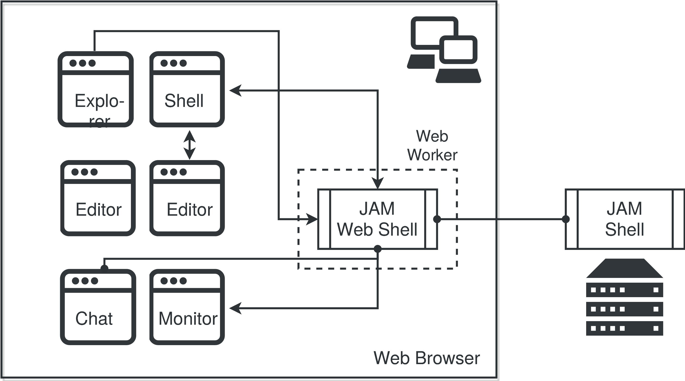图 7-1. Web 浏览器 JAM 实验室的软件架构以及提供本地文件系统访问的 wex 服务

JAM 实例可以在隔离的 Web Worker 进程中处理，从而防止 GUI 阻塞。此外，可以通过 GUI 启动和控制多个物理 JAM 实例。初始 shell 在顶层 JS 实例中创建，但可以通过点击顶部按钮栏上的“加号”按钮创建额外的 WebWorker shell。每个 shell 窗口提供对底层 JAM shell 的直接访问。可以打开智能体代码编辑器。智能体编辑器用于创建一个智能体类构造函数。编辑器窗口提供编译构造函数（信息显示在 shell 窗口中）以及从该类构造函数创建智能体的按钮。智能体参数和权限级别可以在编辑器设置菜单中设置。智能体输出最初也显示在 shell 控制台中。通过打开监视器窗口（从 shell 按钮栏），使用`log`语句的智能体消息将被重定向到此窗口。

所有创建的 JAM shell 都可以连接到外部 JAM 节点。链接信息在主设置菜单中输入。AMP 链接的连接和断开也可以通过主按钮栏（链接和取消链接按钮）进行控制。请注意，初始创建的 shell 未激活用于智能体处理（调度循环初始禁用）。必须首先使用主按钮（播放和停止按钮）来完成此操作。按钮及其操作在图 7-2 中说明。

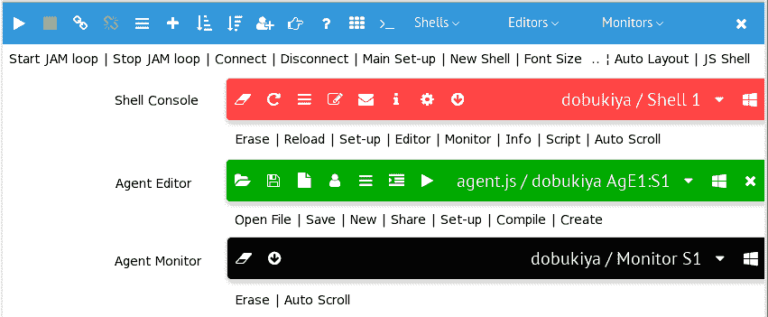图 7-2. JAM Web 实验室窗口和按钮

使用 JAM 进行智能体处理的性能取决于所提供的 JS VM。SpiderMonkey 和 Google 的 V8 引擎都能提供足够的性能。浏览器中的 V8 性能与嵌入在 node.js 中的 V8 引擎相当，如性能评估章节中的表 8-1 所示。

每个编辑器窗口都连接到一个 JAM shell，每个编辑器中的代码定义一个智能体类（其名称派生自构造函数名称）。每个编辑器窗口可以创建无限数量的智能体。每次更改后，必须重新编译智能体类构造函数。

一个简单的“hello world”智能体只需要几行代码：

```javascript
function hello (options) {
  this.world=options.world;
  this.child=null;
  this.act = {
    a1: () => {
      log('Hello '+this.world); 
      send(me(),'SIGUSR1') 
    },
    a2: () => {
      this.child=fork({
        world:reverse(this.world)
      }) 
    },
    a3: () => {
      log('End '+this.world);
      kill()
    } 
  }
  this.trans = {
    a1:a2,
    a2:a3
  }
  this.on = {
    SIGUSR1 : () => { log('GOT SIGNAL') }
  }
  this.next = a1
} 
```

该智能体由三个活动组成，具有无条件转换链，直到达到结束状态。在启动智能体之前，您必须在编辑器设置中输入以下智能体参数：

```json
{
  world : 'Joe'
}
```

第一个活动`a1`将使用`world`变量，并向自身发送自定义信号`SIGUSR1`（信号处理程序应输出`GOT SIGNAL`）。第二个活动`a2`派生一个子智能体，其 world 字符串反转。最后一个活动最终终止智能体。请注意，如果智能体未显式终止，它将持续存在，直到达到平台给定的生命周期配额，最终由平台终止该智能体。

智能体运行的控制台输出应类似于：

```
17:25:33:59 [qiqaqika@17:25:33:59] Hello Joe
17:25:33:60 [qiqaqika@17:25:33:60] GOT SIGNAL
17:25:33:60 [sirenuke@17:25:33:60] End eoJ
17:25:33:60 [qiqaqika@17:25:33:60] End Joe
```

在 shell 窗口设置中，你可以设置不同的日志选项，例如时间或代理标识符字段，这些字段会添加到每行日志输出中。

### 练习 7-2. Web 代理（2）

1.  在你的计算机上启动一个 JAM shell。创建一个 HTTP AMP 端口服务。启动调度器循环：`port(DIR.IP('http://localhost:4567')); start()`。将 JAM 实验室（必须从本地文件系统或通过 HTTP 加载！）连接到这个 JAM shell。

2.  创建一个代理，该代理会派生一个子代理。子代理应迁移到 JAM shell 节点。两个代理应定期相互发送 PING 信号。如果某个代理（父代理或子代理）不再收到 PING 消息，它应终止。

## JAM 移动应用

有一个移动应用版本，提供完整的 JAM 实例，并带有专用 GUI。该 GUI 基于页面（见图 7-3），包含配置和网络设置、网络管理（连接 JAM 节点）、代理管理、显示所有可用传感器的实时信息页面，以及一个聊天对话页面。有纯 HTML-CSS-JS 版本和 Cordova 框架版本。

基本 HTML 版本可在移动设备和台式电脑的任何 Web 浏览器中使用。在移动设备上，基本 HTML 版本可访问设备传感器。设备的位置可以通过 GPS 感应（如果可用）和/或通过外部 IP-GEO 数据库解析的公共 IP 地址以及使用 Mozilla 位置服务（可选）来请求。

JAM 应用可以进行配置。它可以连接到一个或多个远程 JAM 节点，使用 HTTP 或 HTTPS。链接可以在设置部分进行配置。请注意，仅当 JAM 应用是从本地文件系统加载，或通过相同协议从远程 Web 服务器加载时，才支持 HTTP 或 HTTPS。如果从本地文件系统加载，浏览器设置可能会限制 HTTPS。有时可能需要调整浏览器设置。

根代理可以从 Web 服务器加载，也可以嵌入到移动应用中（单个自包含 HTML 文件或多文件归档）。其他代理可以从 Web 服务器加载并启动。有一个 JAM 日志页面，收集所有代理和 JAM 消息。聊天对话可以通过扩展的 AIOS API 由代理直接访问（需具有足够权限）。代理可以通过元组空间访问设备传感器。传感器信息页面列出了所有可用的传感器及其名称，这些名称用作传感器元组的第一个关键元素（由提供者函数提供）。

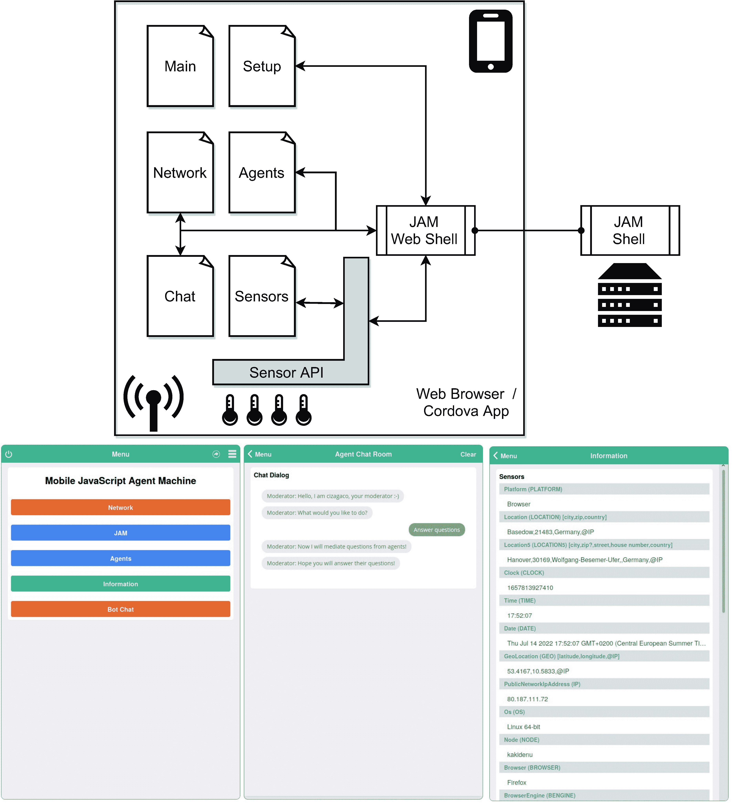图 7-3. （上）Web 浏览器 / Cordova JAM 应用的软件架构 （下）一些示例页面

移动应用用于移动群智感知（MCS）应用以及教育。Web 浏览器版本目前支持以下传感器（代理可通过元组空间访问）：

1.  浏览器信息（`BENGINE`、`OS`、`BVERSION`、`JSVERSION`）

2.  时间（`CLOCK`、`TIME`、`DATE`）

3.  公共 IP 地址（`IP`）

4.  基于公共 IP 地址和附加服务的地理空间位置（`GEO`、`LOCATION`、`LOCATION5`），可选使用 GPS（`GEO5`、`LOCATION5`）

5.  根据额外的浏览器安全设置（配置以及是否需要通过 HTTPS 加载网页）：

    *   加速度（`ACCEL`、`ACCELH`、`ACCELA0`）

    *   方向（`ORIENT`）

    *   光线（`LIGHT`）

Cordova（Android）版本始终提供对内部传感器（加速度、陀螺仪、光线等）的访问。

### 练习 7-3. Web 代理（2）

1.  在你的计算机上启动一个 JAM shell。创建一个 HTTP AMP 端口服务。启动调度器循环：`port(DIR.IP('http://localhost:4567')); start()`。将 JAM 实验室和 JAM 应用（必须从本地文件系统或通过 HTTP 加载！）连接到这个 JAM shell。

2.  创建一个代理，该代理会派生一个子代理。子代理应迁移到 JAM shell 节点。从这个中继节点，它应搜索未知节点，即 JAM 应用节点。如果找到新节点，它应迁移到该节点并收集一些传感器值。代理最终应返回其根节点（Web 浏览器中的实验室），最后打印（记录）采样的传感器数据。

# 性能


JAM 通常由现代 JS 虚拟机（如 `node.js/V8` 或 `SpiderMonkey`）处理。这些 JS 虚拟机可以实现约 20-50% 的原生代码性能，主要通过应用即时（JIT）原生代码编译已编译的字节码（最常见的 JS 虚拟机中间格式）来实现。尽管 JAM 代理是用 JavaScript 编写的，并由底层 JS 虚拟机（虚拟机架构中的伪虚拟机）处理，但在代理处理方面几乎没有性能下降。计算成本最高的任务是代理的创建和迁移，两者都需要完整的代码到文本序列化和文本到代码的反序列化。幸运的是，代理创建（非派生）仅需对可重用的代理构造函数应用一次此过程。

## JavaScript 虚拟机

JAM 性能本质上受限于底层 JS 虚拟机的性能。表 8-1 显示了使用标准化 dhrystone 基准测试的不同 JS 虚拟机和主机平台的结果。dhrystone 基准测试使用了典型真实世界软件的平均操作组合，即对象创建和销毁、数组和字符串操作以及函数调用。比较了不同的 JS 虚拟机，尽管 JAM 基本上仅能在 `node.js` 和 `jx`（一个基于 `jx-core` 项目、针对 JAM 优化的多线程 `node.js` 衍生版，特别是原生代理进程看门狗支持）上开箱即用。请注意，测量的性能（除了原生代码基线）取决于虚拟机设置，如垃圾回收器（GC）运行时设置。GC 会中断主 JS 控制流，从而降低基准测试性能。但 GC 干扰发生在任何应用程序中，这是计算性能和平均内存需求的核心部分。

| JS 虚拟机 | 主机 | dhrystones/秒 | 内存 |
| --- | --- | --- | --- |
| C/原生 | x86 i5-4310U, 2GHz, 8GB | 23000k | - |
| quickjs-2019 | x86 i5-4310U, 2GHz, 8GB | 142k | 2MB |
| quickjs-2019 | Raspberry Pi Zero, Arm, 1GHz, 1GB | 9k | 1MB |
| jerryscript-2017 | x86 i5-4310U, 2GHz, 8GB | 32k | 1MB |
| node.js-8 | x86 i5-4310U, 2GHz, 8GB | 6800k | 28MB |
| node.js-8 | Raspberry Pi Zero, Arm, 1GHz, 1GB | 220k | 28MB |
| node.js-10 | x86 i5-4310U, 2GHz, 8GB | 8000k | 30MB |
| jx (node.js-0.10.4) | x86 i5-4310U, 2GHz, 8GB | 7000k | 18MB |
| V8 (Chromium 90) | x86 i5-4310U, 2GHz, 8GB | 7450k | - |
| SpiderMonkey (Gecko FF 78) | x86 i5-4310U, 2GHz, 8GB | 5330k | - |

表 8-1. 使用标准化 dhrystone 基准测试 [WEI84] 对不同 JS 虚拟机和主机平台的比较

请注意，`node.js` 和 `V8` 核心引擎针对 x86 处理器架构进行了优化，因此在 Arm 处理器架构上性能不佳。除了计算能力外，内存需求（虚拟机本身和 JAM 所需的基本内存）是部署（小型）嵌入式系统（如 Raspberry Pi Zero）的另一个重要参数。虚拟机性能比基准测试程序的原生（C）代码性能慢约 4 倍。带有原生代码 JIT 编译的 `V8` 核心引擎的 `Node.js` 性能优于低资源纯字节码的 `quickjs` 引擎。但 `SpiderMonkey` 提供了与 `V8` 相似的结果！

## 代理类编译与代理创建

该实验使用 `jamsh` 程序进行，以评估编译代理类构造函数以及通过它们创建代理所需的时间，使用以下代码：

```javascript
function foo(p) { .. }
N=1000;
t0=time()
for (var i = 0;i<N;i++)
  compile(foo,{verbose:false});
t1=time()
print((t1-t0)/N,'ms/compile')
N=100
t0=time()
for (var i = 0;i<N;i++) 
  create('foo',{..});
t1=time()
print((t1-t0)/N,'ms/create')
var aid = create('foo',{..}),
    agobj = agent(aid);
print(Aios.Code.size(agobj))
```

结果如表 8-2 所示。编译时间基本可以忽略，因为每个节点只需编译一次代理类构造函数。与典型的平均代理创建速率（约 1/s-10/s）相比，代理的创建速度足够快（至少在现代计算机硬件上）。

| 操作 | 参数 | 时间 / 辅助信息 |
| --- | --- | --- |
| compile | function | 0.8 ms |
| create | { string[16], number } | 0.09 ms |
| size | agent | 序列化代码：365 字节 |

表 8-2. JAM (`jamsh`) 性能：代理沙箱限制下的转换与创建（主机：x86 i5-4310U, 2GHz, 8GB, jx/node.js 0.10.40）

## 迁移

首先，创建了一个 2 × 2 的虚拟 JAM 节点网格网络。实验使用 `jamsh` 和以下测试代码进行：

```javascript
function foo(p) {
  ..
  this.act = {
    start : ..
    percept : () => {
      this.goto=null; 
      var dirs = [DIR.NORTH,DIR.SOUTH,..]
      iter(dirs, () => {
        if (!this.goto && link(dir))
          this.goto=dir;
      })
    },
    move : () => {
      this.hops--;
      moveto(this.goto)
    },
    end : ..
  }
  this.trans = {
    start:percept,
    percept : () => this.goto && this.hops?move:end,
    move : percept
  }
}
var node2 = add({x:1,y:0}),
    node3 = add({x:1,y:1}),
    node4 = add({x:0,y:1});
// 单向链接！
connect({x:0,y:0},{x:1,y:0})
connect({x:1,y:0},{x:1,y:1})
connect({x:1,y:1},{x:1,y:0})
connect({x:1,y:0},{x:0,y:0})

compile(foo,{verbose:false});
var N=1000
create('foo',{data:'..',hops:N});
start()
```

第二个实验使用物理 2 × 2 节点网格集群，采用定向 UDP 链接和以下代码：

```javascript
function foo(p) {
  ..
  this.act = {
    start : () => {
      // 转到集群节点 (0,0)
      var connected=link(DIR.IP('%'))
      if (connected && connected.length) 
        this.goto=DIR.NODE(connected[0]); 
    },
    percept : () => {
      this.goto=null; 
      // 沿环移动
      var dirs = [DIR.EAST,DIR.SOUTH,DIR.WEST,DIR.NORTH];
      var next = dirs[this.index];
      if (link(next)) {
        this.goto=next;
        this.index=(this.index+1)%4;
      }
    },
    move : () => {
      this.hops--;
      moveto(this.goto)
    },
    end : ..
  }
  this.trans = {
    start   : () => this.goto?'move':'percept',
    percept : () => this.goto && this.hops?'move':'end',
    move    : 'percept'
  }
}
var workers = cluster({
  connect:true,
  rows:2,
  cols:2,
  port0:11001,
  port1:10001,
  portn:100,
  proto:['http','udp'],
  poll:2000,
  todo:'start()',
  verbose:0,
});
workers.start()
// 连接到集群节点 (0,0)
var p1=port(DIR.IP('udp://localhost:12000'));
later(500,() => {
  connect(DIR.IP('udp://localhost:10002'))
});
compile(foo,{verbose:false});
var N=1000
later(3000,() => {
  create('foo',{data:..,hops:N});
})
```

| 操作 | 参数 | 时间 / 辅助信息 |
| --- | --- | --- |
| moveto | 虚拟链接¹ | 0.5 ms / 跳 |
| moveto | 物理 UDP 链接² | 6.0 ms / 跳 |
| size | agent¹ | 序列化代码：730 字节 |
| size | agent² | 序列化代码：946 字节 |

表 8-3. JAM (`jamsh`) 性能：代理迁移（主机：x86 i5-4310U, 2GHz, 8GB, jx/node.js 0.10.40）

表 8-3 中的结果包含了代理进程迁移的平均时间。迁移包括代理数据和代码的序列化、序列化代码传输到下一个节点，以及最终在新节点上的反序列化和进程创建。虚拟节点之间的迁移速度与代理创建速度相当，而物理节点之间的代理迁移速度则慢 10 倍，即 AMP 和通信网络的开销显著。

## 通信

通信在通过分叉创建的父代理和子代理之间进行。子代理迁移到另一个节点（虚拟或物理）。注意，通信实验中的代理使用带有信号处理程序和活动阻塞的乒乓流，即代理调度包含在通信时间中。

第一个信号实验使用以下代码框架，在两个不同节点（虚拟或物理）上运行两个代理：

```javascript
function foo(p) {
  ..
  this.act = {
    start : () => {
      this.child=fork({parent:me(),goto:DIR.EAST});
    },
    move : () => {
      moveto(this.goto);
    },
    ping : () => {
      this.count--;
      if (this.parent) send(this.parent,'PING',time());
      else send(this.child,'PING',time());
    },
    pong : () => { sleep() },
    wait : () => { sleep() }, 
    end  : () => {  kill() },
  }
  this.trans = {
    start : () => { return this.goto?'move':'wait' },
    wait : () => { this.count--; 
                   this.time=time(); return ping },
    move : ping,
    ping : pong,
    pong : () => { return this.count?'ping':'end' },
  }
  this.on = {
    PING : (arg,from) => {
      send(from,'PONG',time())
      if (this.child && this.count==this.N) wakeup()
    },
    PONG : (arg,from) => {
      wakeup()
    },
  }
  ...
```

第二个代理是从第一个代理分叉出来的。元组空间通信只能在同一个 JAM 节点上的代理之间执行。测试设置中同样使用两个代理。结果如表 8-4 所示。信号发送速度与元组空间通信速度相当。远程信号传播也受到通信开销的影响，大约慢 30 倍。

| 操作 | 参数 | 时间 / 辅助信息 |
| --- | --- | --- |
| send | 信号，虚拟节点 | 0.1 ms |
| send | 信号，物理节点 | 3.5 ms |
| out,inp | 单个节点 | 0.03 ms |

表 8-4. JAM (`jamsh`) 性能：使用信号和元组的代理通信时间，包括代理调度时间（主机：x86 i5-4310U, 2GHz, 8GB, jx/node.js 0.10.40）

# 使用 SEJAM 进行仿真

基于智能体的模拟通常用于模拟现实世界的一个子集，其中实体具有简化的行为和交互模型。该模拟旨在计算全局层面的聚合变量，以及由交互实体产生的涌现行为。图形化模拟通常会在二维或三维图形世界中为智能体分配视觉形状和位置。

一个实体（此处由智能体表示）由其行为模型 `m[beh]` 定义，该模型通常通过参数集 `p` 进行调整，即 `mbeh`。不同的参数设置会导致不同的行为。例如，一个参数可以决定智能体在模拟世界中的初始位置，另一个参数可以定义移动速度、方向等。参数会影响智能体的决策，即影响智能体的运行（智能体状态的序列）。

选择合适的参数设置是一个挑战。大多数现实世界环境和实体交互的模拟（在时间和空间尺度上）都不准确，原因在于参数集不当、行为过于简化，以及模拟中的实体数量远少于现实情况。

将模拟与现实世界实时（或至少基于快照）耦合可以显著改善模拟结果。MCS 可用于推导模拟智能体的合适参数设置，从而从现实世界实体（人类、机器、车辆等）创建数字孪生。

数字孪生源自预定义的智能体行为 `m[beh]` 和参数集 `p`，该参数集来自现实世界传感器数据 `s`，这些数据通过采样过程 `S` 收集，在特定时间（或时间范围）`t` 和特定空间位置（或区域）`x`、`y` 处提供现实世界状态 `e` 的一个子集，例如来自调查：

| 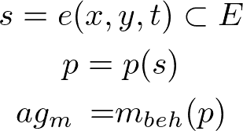 | (9-1) |

SEJAM 模拟器是一个基于 JAM 平台的二维图形世界，将在后续章节中介绍。SEJAM 使用 JAM 这一事实使得移动智能体能够在模拟和现实世界的 JAM 节点（例如智能手机等移动平台）之间迁移。

## 概念与架构

JAM 模拟环境（SEJAM）是 JAM 平台之上的图形扩展，支持使用与基于智能体计算（ABC）相同的 AgentJS 编程语言进行基于智能体的模拟（ABS）。此外，ABS 和 ABC 可以结合使用，将 SEJAM 与外部 JAM 节点连接起来。模拟中的智能体可以在“虚拟”世界和现实世界之间无缝迁移。SEJAM 的基本架构和概念如图 9-1 所示。将 ABS 与 ABC 结合的一个典型示例是使用来自真实环境的移动群智感知数据进行模拟，例如 [BOS18C] 中所述。

二维模拟世界中的图形形状与虚拟 JAM 实例耦合，作为 JAM 虚拟节点世界的一部分。一个视觉形状通常分配给一个智能体，例如代表人类或机器数字孪生的智能体。但一个虚拟节点可以处理无限数量的智能体。

模拟中使用的智能体基本上分为两个不同的子类：

1.  ABS 细胞是代表物理实体（人类、机器、动物和资源）的物理智能体。
2.  计算智能体，在模拟和现实世界中作为 ABC 细胞用于分布式计算。

这两个智能体子类都由同一个 JAM 实例处理。但物理智能体绑定到其虚拟节点，不能迁移。此外，它们可以访问类似 NetLogo 的模拟编程接口，例如支持 `ask` 运算符来探索模拟世界中空间邻域内的智能体 [BAN15]。

一个物理智能体由一个 v-JAM 节点和一个始终绑定到该节点的本体智能体组成。物理智能体可以执行任何计算，并与其他 v-JAM 节点通信。它们可以创建能够迁移到其他物理智能体的 v-JAM 节点或外部节点的计算智能体。例如，一个物理节点可以定义一个多播端口（仅在模拟中使用），其视觉形状为具有特定半径的圆形。如果两个物理节点具有重叠的通信圆，则 AIOS `link(DIR.PATH('%'))` 函数将返回邻居节点的节点名称。物理智能体可以创建一个计算智能体，然后该计算智能体能够迁移到邻居节点。

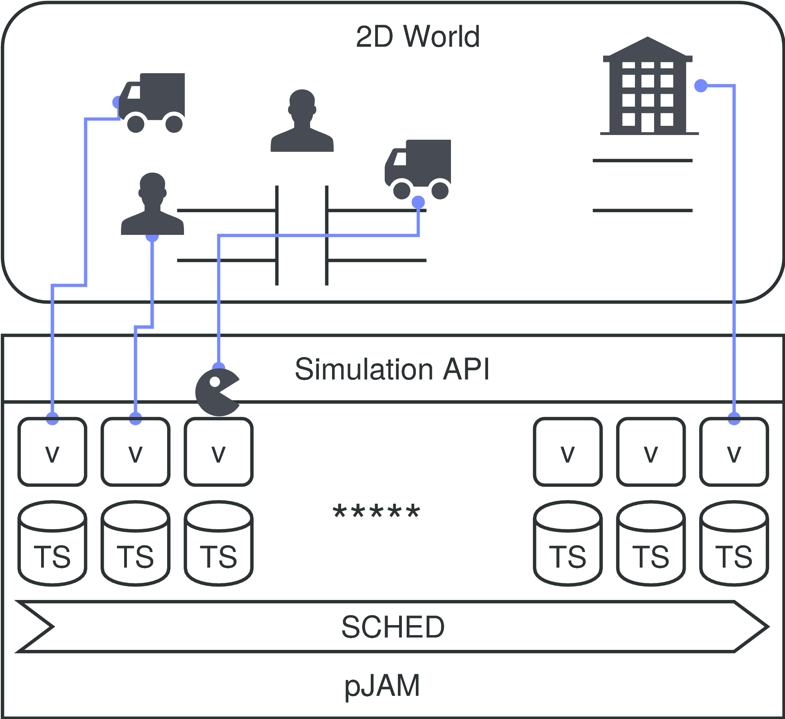图 9-1. SEJAM 概念与架构：基于 JAM 节点实例的图形模拟世界

## 模拟模型与 API

SEJAM 通过添加与模拟世界和模型相关的额外函数来扩展 JAM 的 AIOS。SEJAM 根据包含世界和智能体描述的模拟模型创建模拟世界。

### 模拟世界


模拟模型通常是一个 JS（类 JSON）文件，包含模型对象和智能体类构造函数及其视觉描述符。或者，为了可读性，智能体类构造函数可以从包含（命名）智能体类构造函数的单独文件中加载，如定义 9-1 所示。智能体类的示例见第 9-4 章。除了通用的二维图形世界外，还可以使用不同的预定义世界架构：

1. 网格（`mesh-grid`）由二维或三维的 `v-JAM` 节点连接网格组成，具有邻域连接性（仅限计算智能体），主要用于研究分布式数据处理和通信系统（见定义 9-2）。网络 `v-JAM` 节点通过冯·诺依曼邻域节点连接，提供 `DIR.NORTH`、`DIR.SOUTH`、`DIR.WEST` 和 `DIR.EAST` 方向通信链路。

2. 补丁网格（`patch-grid`）世界由二维笛卡尔补丁地图组成，支持物理智能体（即一个耦合的 `v-JAM` 容器，包含一个智能体和一个视觉形状）。一个补丁可以容纳一个或多个智能体。智能体可以与其容器一起自由移动到不同的补丁位置。提供了类似 `NetLogo` 的 API，可供物理智能体和世界智能体使用（见定义 9-1）。

### 定义 9-1. 支持补丁网格架构的 SEJAM2 仿真模型基本模板

```
[](#cb57-1) 1: {
[](#cb57-2) 2:   name:string,
[](#cb57-3) 3:   // 智能体类的定义
[](#cb57-4) 4:   agents : {
[](#cb57-5) 5:     classname: {
[](#cb57-6) 6:       behaviour : (..) => { .. } |
[](#cb57-7) 7:                   open(filename.js),
[](#cb57-8) 8:       visual : { shape, width, height, fill, .. }
[](#cb57-9) 9:     ..
[](#cb57-10)10:   },
[](#cb57-11)11:   // 二维仿真世界中的一些被动资源
[](#cb57-12)12:   resources : { 
[](#cb57-13)13:     classname : (id,x,y,w,h) => {
[](#cb57-14)14:       return { id, class, visual }
[](#cb57-15)15:     },
[](#cb57-16)16:     .. 
[](#cb57-17)17:   },
[](#cb57-18)18:   // 动态节点构造函数，主要用于物理
[](#cb57-19)19:   // 智能体节点和世界节点
[](#cb57-20)20:   nodes : {
[](#cb57-21)21:     classname : (x,y) => {
[](#cb57-22)22:       return { id, x, y, visual, ports }
[](#cb57-23)23:     },
[](#cb57-24)24:     ..
[](#cb57-25)25:   },
[](#cb57-26)26:   // 世界的定义
[](#cb57-27)27:   world : {
[](#cb57-28)28:     init : {
[](#cb57-29)29:       // 创建特定智能体
[](#cb57-30)30:       agents : {
[](#cb57-31)31:         classname : (nodeid) => { 
[](#cb57-32)32:           return { level, args } 
[](#cb57-33)33:         },
[](#cb57-34)34:       }
[](#cb57-35)35:     },
[](#cb57-36)36:     // 创建特殊节点
[](#cb57-37)37:     map : () => {
[](#cb57-38)38:       return 
[39:          // 图形位置 
[](#cb57-40)40:         model.nodes.world(52,52), 
[](#cb57-41)41:       ]
[](#cb57-42)42:     },
[](#cb57-43)43:     // 资源
[](#cb57-44)44:     resources : (model) => {
[](#cb57-45)45:       // 使用 model.resources.classname 函数
[](#cb57-46)46:       return {} []
[](#cb57-47)47:     }, 
[](#cb57-48)48:     // 如果存在 NetLogo 补丁网格世界
[](#cb57-49)49:     patchgrid : {
[](#cb57-50)50:       rows, cols, width, height, floating?
[](#cb57-51)51:     },
[](#cb57-52)52:   },
[](#cb57-53)53:   // 仿真参数
[](#cb57-54)54:   parameter? : { .. },
[](#cb57-55)55: }
```

补丁网格世界与 `NetLogo` API 结合使用，物理智能体和世界智能体均可调用该 API。补丁网格是一个离散化的二维世界，由大小相等的补丁组成。大多数操作使用逻辑路径坐标，而非图形像素坐标（其他情况下使用）。世界和视觉形状可以通过地理空间坐标引用，使用 `gps:{latitude, longitude, height}` 值（例如在视觉节点描述符中），而非逻辑或像素坐标。需要提供地理坐标映射函数。

仿真通常使用一个中心世界智能体（智能体类 `"world"`）来全局集中控制仿真。世界智能体拥有对 `JAM` 和 `SEJAM` API 的完全访问权限，包括数据库和文件系统访问。

智能体仿真世界可以与多体物理仿真器（`CANNON`，详见 [BOS19A]）耦合。

### 定义 9-2. 定义通信网络的网格世界架构，采用冯·诺依曼邻域连接，由处理计算智能体的 v-JAM 节点组成

```
[](#cb58-1) 1: { 
[](#cb58-2) 2:   ..
[](#cb58-3) 3:   world : {
[](#cb58-4) 4:     init: {
[](#cb58-5) 5:       agents: {
[](#cb58-6) 6:         node:function (nodeId,position) {
[](#cb58-7) 7:           // 在每个节点上创建一个节点智能体，
[](#cb58-8) 8:           // 返回相应的智能体参数！
[](#cb58-9) 9:           // 如果不应在相应节点上创建智能体，
[](#cb58-10)10:           // 则必须返回 undefined！
[](#cb58-11)11:           if (nodeId!='world')
[](#cb58-12)12:             return {level:2,args:
[13:               {x:position.x,y:position.y,z:position.z,
[](#cb58-14)14:                model:model,
[](#cb58-15)15:                verbose:0,
[](#cb58-16)16:               }]}
[](#cb58-17)17:         },
[](#cb58-18)18:         world: function(nodeId) {
[](#cb58-19)19:           if (nodeId=='world') return 
[](#cb58-20)20:             {level:3,args:[{model:model}]};
[](#cb58-21)21:         }
[](#cb58-22)22:       }
[](#cb58-23)23:     },
[](#cb58-24)24:     meshgrid : {
[](#cb58-25)25:       // y 轴
[](#cb58-26)26:       rows:8,
[](#cb58-27)27:       // x 轴
[](#cb58-28)28:       cols:5,
[](#cb58-29)29:       // z 轴
[](#cb58-30)30:       levels:3,
[](#cb58-31)31: 
[](#cb58-32)32:       matrix:[[0,0],[250,0], [500,0]],
[](#cb58-33)33: 
[](#cb58-34)34:       node: {
[](#cb58-35)35:         // 节点资源视觉对象
[](#cb58-36)36:         visual : {
[](#cb58-37)37:           shape:'rect',
[](#cb58-38)38:           width:30,
[](#cb58-39)39:           height:30,
[](#cb58-40)40:           fill: {
[](#cb58-41)41:             color:'green',
[](#cb58-42)42:             opacity: 0.5
[](#cb58-43)43:           }
[](#cb58-44)44:         },
[](#cb58-45)45:         filter: function (pos) {
[](#cb58-46)46:           // 节点过滤器，用于创建不规则网络
[](#cb58-47)47:           return 
[](#cb58-48)48:         },
[](#cb58-49)49:       },
[](#cb58-50)50:       // 链路端口连接器
[](#cb58-51)51:       port: {
[](#cb58-52)52:         type:'unicast',
[](#cb58-53)53:         place: function (node) { return 
[54:           {x:-15,y:0,id:'WEST',,
[](#cb58-55)55:           {x:15,y:0,id:'EAST'},
[](#cb58-56)56:           {x:0,y:-15,id:'NORTH'},
[](#cb58-57)57:           {x:0,y:15,id:'SOUTH'},
[](#cb58-58)58:           {x:-15,y:-15,id:'UP'},
[](#cb58-59)59:           {x:15,y:15,id:'DOWN'}
[](#cb58-60)60:         ]},
[](#cb58-61)61:         visual: {
[](#cb58-62)62:           shape:'rect',
[](#cb58-63)63:           fill: {
[](#cb58-64)64:             color:'black',
[](#cb58-65)65:             opacity: 0.5
[](#cb58-66)66:           },
[](#cb58-67)67:           width: 5,
[](#cb58-68)68:           height: 5
[](#cb58-69)69:         } 
[](#cb58-70)70:       },
[](#cb58-71)71:       // 节点之间的连接
[](#cb58-72)72:       // （带有虚拟端口连接器）
[](#cb58-73)73:       link : {
[](#cb58-74)74:         // 链路资源视觉对象
[](#cb58-75)75:         connect: function (node1,node2,port1,port2) {
[](#cb58-76)76:           return true},
[](#cb58-77)77:         type:'unicast',   // unicast multicast
[](#cb58-78)78:         visual: {
[](#cb58-79)79:           shape:'rect',
[](#cb58-80)80:           fill: {
[](#cb58-81)81:             color:'#888',
[](#cb58-82)82:             opacity: 0.5
[](#cb58-83)83:           },
[](#cb58-84)84:           width: 2
[](#cb58-85)85:         }
[](#cb58-86)86:       }
[](#cb58-87)87:     } 
[](#cb58-88)88:   }
[](#cb58-89)89: }
```

仅支持计算智能体的网格通信网络与支持物理（及计算）智能体的补丁网格世界之间的区别如图 9-2 所示。

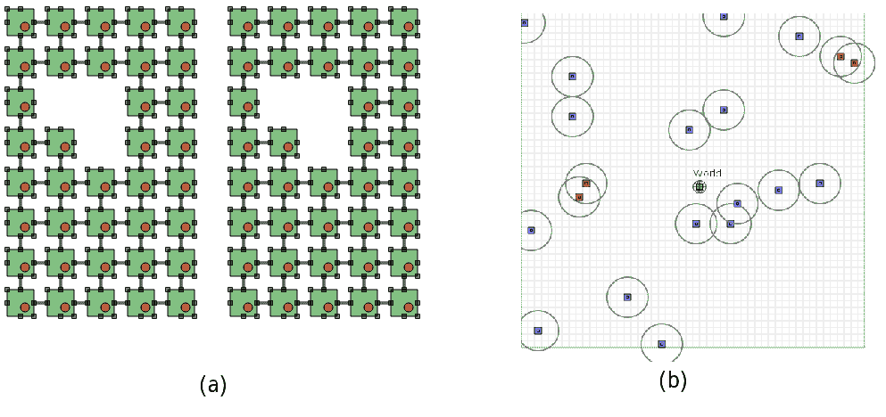图 9-2. 网格世界 (a) 与补丁网格世界 (b) 的区别

### NetLogo API

SEJAM 为物理智能体提供了类似 `NetLogo` 的 API。`NetLogo` 是一个广泛使用的基于智能体的仿真环境，用于研究复杂动态系统。`NetLogo` 仿真的详细信息可参见 [WIL15]。该 API 总结于表 9-1，可通过 `net` 模块扩展访问。如果提供了箭头函数，则无法使用 `this` 智能体自引用。相反，额外的回调函数参数提供了智能体对象的自引用。存在不同的仿真对象类：智能体、资源和补丁，可通过 `net.ask` 函数处理。

| 操作 | 参数 | 描述 |
| --- | --- | --- |
| `net.create` | `agent-agentclass`, `number`, `callback(self,index)?` | 创建一组智能体。每个创建的智能体可通过回调函数配置，该函数使用指向智能体对象的 `self` 参数。 |
| `net.setxy` | `[x, y]` | 设置智能体的补丁位置。 |
| `net.ask` | `agent` 或 `agent-agentclass`, `[x, y]`, `callback(self)?` | 返回网格位置 (`x`,`y`) 上的所有智能体，并可选择通过回调函数遍历所有智能体对象。 |
| `net.ask` | `agent` 或 `agent-agentclass`, `radius:number` 或 `*`, `callback(self)?` | 返回当前智能体位置周围给定半径内的所有智能体，或返回所有智能体。 |
| `net.ask` | `resource` 或 `resource-class`, .. | 返回所有匹配的资源 |
| `net.ask` | `patch`, .. | 返回所有匹配的补丁 |
| `net.ask` | `objclass` 或 `objclass-class`, `{x,y,w,h}` 或 `{x0,y0,x1,y1}`, `callback(self)?` | 返回给定边界框内指定对象类的所有对象。 |
| `net.set` | `color` 或 `shape`, `value` | 设置视觉形状的颜色或形状（`circle`、`rect`、`triangle`） |

表 9-1. SEJAM 类 NetLogo 物理智能体 API

## 软件

`sejam2` 仿真环境有两个几乎相同的版本：

1. 一个 `node-webkit` 版本，具有对操作系统服务和网络功能的完全访问权限；

2. 一个 Web 浏览器版本，对操作系统服务的访问权限有限。

最初的 `sejam` 模拟器是一个终端和命令行实现，使用 `ncurses` 进行文本化的二维世界可视化。

## 示例

一个简单仿真模型的完整示例见第 9-4 章。该仿真模型包括：

1. 提供 `NetLogo` API 的补丁网格世界（代码见第 13-1 节）；

2. 计算世界智能体（代码见第 13-2 节）；

3. 在仿真世界中随机移动并根据群体邻域感知改变其节点颜色的物理智能体（代码见第 13-3 节）。

用例章节 [Mobile Crowd Sensing with JAM] 将详细阐述一个更复杂的示例，该示例使用额外的计算智能体提供仿真与真实世界的耦合（代码见第 13-4 节和第 13-5 节）。

下图 9-3 展示了执行上述仿真模型的 SEJAM2 仿真程序的快照。放大视图显示了仿真的二维图形世界。物理智能体移动节点（主体）周围的圆圈是一个无线电链路，由在物理智能体的 `vJAM` 节点上处理的计算智能体使用。如果有两个节点的圆圈重叠，则 `vJAM` 平台通过虚拟链路耦合。计算智能体可以在这些连接的 `vJAM` 节点之间迁移。

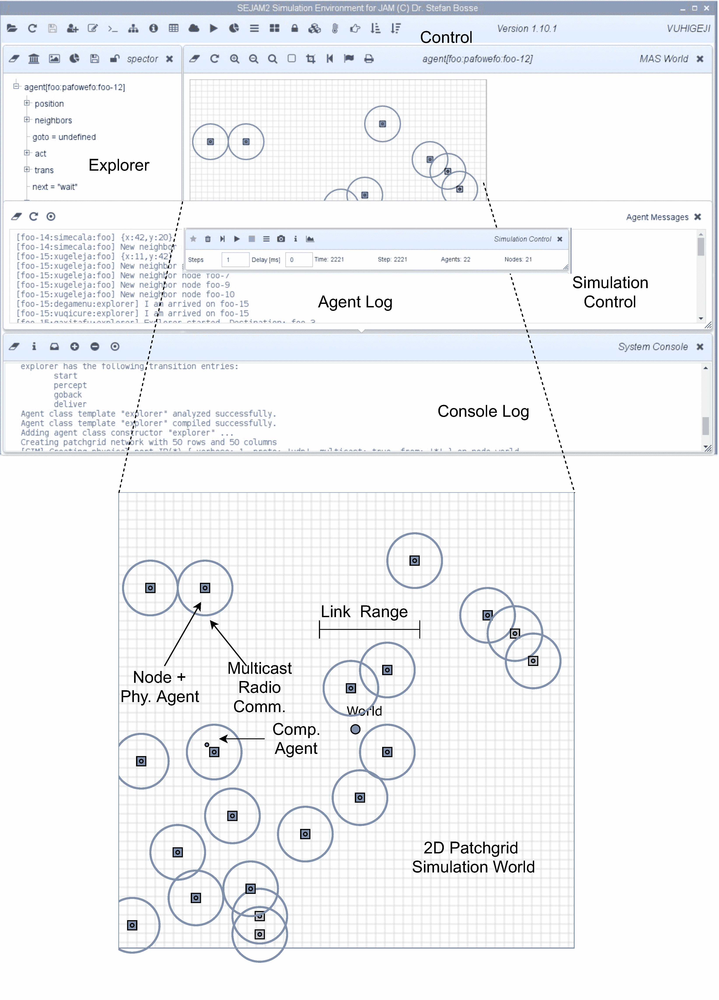图 9-3. SEJAM2 GUI 窗口（node-webkit 版本）及示例世界

练习 9-1. 随机游走智能体的仿真


1. 在 Web 浏览器中打开`sekam2web.html`文件，可选地在计算机上启动`wex`文件服务（使用`node.js`，即`node wex`）。

2. 从第 13-1 节加载仿真模型。从单独的文件中加载了三个智能体类（需要`wex`）：`world`（见第 13-2 节）、`foo`（物理随机游走智能体，见第 13-3 节）和`explorer`（在物理智能体节点之间迁移的计算智能体，见第 13-4 节）。仿真模型文件和智能体模型文件必须位于同一文件夹中。

3. 如果仿真模型成功加载，创建一个仿真世界（仿真控制面板：☆）。

4. 启动仿真（仿真控制面板中的播放按钮）并观察智能体的移动以及探索智能体的创建。打开智能体日志窗口并评估智能体消息。

5. 何时创建新的探索智能体？

6. 探索智能体的目标是什么？

7. 什么决定了迁移路径？请举例说明。

8. 停止仿真。选择一个物理智能体，然后选择其节点，最后选择一个计算探索智能体（如果存在）。在左侧检查器窗口中检查每个智能体。

9. 检查器窗口中显示了什么？继续仿真并观察智能体的位置`body`变量（检查器中的智能体根对象必须关闭并重新打开以刷新）。

下一章将介绍模拟器与真实世界的耦合。只需对`MAS`进行微小更改，即可实现带有数字孪生的增强仿真。

# 增强仿真简介

增强仿真意味着真实世界与虚拟世界的融合，通过使用之前介绍的移动`JAM`智能体创建“增强虚拟性”。其核心特性是物理（仿真）智能体与计算智能体的智能体二元性，由统一的智能体编程模型提供。

## 社会技术系统的仿真

如果我们考虑社会技术系统，会出现丰富的接口。它们以以下交互为特征：

* 人与人（由人类发起）
* 人与机器（由人类发起）
* 机器与人（由机器发起，例如聊天机器人）
* 机器与机器（由机器发起）

社会群体行为的仿真需要简化交互和个体行为。通常，仿真在模型方差有限的沙盒世界中以少于 1000 个实体（人类、机器等）进行。基于智能体的建模（`ABM`）是一种适合仿真的行为模型，`JAM`也提供了该模型。

## 增强虚拟性

仿真世界是虚拟的，通常是封闭的，依赖于模拟器程序生成的人工感官信息或使用离线收集的数据（→传统实地研究，见图 10-1）。为了使仿真更具通用性并适用于真实世界的部署和理解，需要一种提供增强虚拟性的新仿真范式。

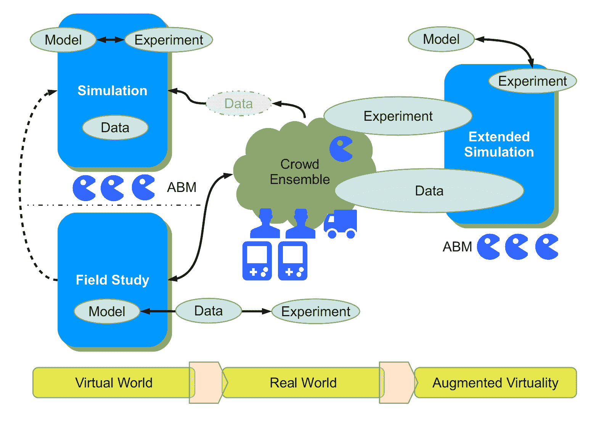图 10-1. 从实地研究和孤立仿真到结合真实与虚拟世界的扩展仿真的过渡

> 将群体感知和社会数据挖掘集成到仿真世界中，是创建与真实世界观察一致的逼真仿真和仿真输出的核心关键方法！

这意味着，仿真世界通过以下方式与真实世界环境、人类、机器以及其他虚拟世界进行实时交互：

* **智能体**，可以代表人工人类、机器人、机器等；
* **智能体**，可用于分布式移动计算 → 来自群体感知的真实世界传感器数据和数字孪生。

多个虚拟世界可以通过增强虚拟性方法连接。每个虚拟世界可以被视为一个世界和一个模型部分，例如，将一个国家划分为陆地单元（城镇），或将生活世界划分为家庭、户外和工作区域。多个虚拟世界可以独立并行仿真，并显著加速（详见 [BOS21B]）。这导致了一种混合架构，通过移动智能体和`JAM`网络实现虚拟世界与物理世界的融合，如图 10-2 所示。

图 10-2. 多个仿真世界与真实世界

下一章 [使用 JAM 的移动群智感知] 将介绍一个简单的仿真示例，并附有第 9-4 章的源代码。

## 挑战

增强仿真方法面临诸多挑战，主要是时间和空间尺度问题。

### 时间

现实世界与虚拟世界中不同的时间尺度导致以下几个问题：

* 分布式计算的仿真比实际分布式计算慢得多；
* 仿真在时间尺度上是离散的（逐步处理）；
* 实体及其行为模型在虚拟世界和现实世界中的交互（反应性）不同。

存在短期与长期的问题：

* 仿真通常运行在较短的时间段内（一个具有明确起点和终点的窗口）。
* 具有人机交互的现实世界环境在长期执行中没有明确的起点或终点。

仿真可以依赖基于大数据的预分析。但大数据包含来自不同来源的强不相关变量，因此信息强度较低。

### 空间

现实世界与虚拟世界具有不同的空间尺度，基本上有三种不同的空间模型，如图 10-3 所示：

1. 现实世界与虚拟世界覆盖不重叠的区域；
2. 现实世界与虚拟世界覆盖重叠的区域；
3. 现实世界区域映射到虚拟世界。

图 10-3. 现实与虚拟（仿真）空间区域及其相关性

### 调查与人机回环

除了收集环境传感器数据（部分公开可用，例如人群和交通流量、温度分布、天气和新闻）之外，还可以利用人们提供的信息来调整和校准模型参数。可以使用微观或完整调查来获取仿真中智能体行为模型的特定信息，最终创建人类的数字孪生。数字孪生概念不仅限于人类。可以从设备和机器创建数字孪生，但需要不同的参数估计方法和测量技术。

利用数字孪生概念，仿真世界可以通过更多变化和时间校准的智能体行为得到丰富。人类（以及现实世界）被纳入仿真循环中。一方面，人们为仿真提供输入。另一方面，仿真结果也可以传回给用户（输出）。仿真模型和智能体模型可以通过`MCS`定期更新，如图 10-4 所示。

图 10-4. 人类和真实传感器作为仿真世界的持续输入

# 使用 JAM 的移动群智感知

一个在自组织移动群智感知（`MCS`）框架中部署移动代理的扩展用例，旨在展示`JAM`架构及其软件的适用性和可扩展性。`JAM`凭借其统一且通用的代理平台，支持：

* 用于在微观层面采样环境和用户数据的移动群智感知（`ABC`）；
* 仿真（`ABS`）与现实世界交互（人机回环）的紧密耦合；
* 通过软件代理增量收集数据，使仿真与现实世界数据同步；
* 仿真快照和分支能够预测未来世界的演化（系统聚合变量，例如感染率）。

使用移动代理的数据收集过程可以独立于仿真实验，用于通过专为非技术最终用户定制的`JAM`应用（浏览器版本）的专用版本来收集调查数据，如下一节所述。

## 调查

独立的移动群智感知框架部署以下节点：

1. 根节点，使用`JAM` Web 浏览器实验室、基于`JAM`库（Web 版本）构建的专用 Web 应用程序，或通过命令行使用`JAM` shell 来规划和主导调查并分析数据。
2. 具有公共互联网连接和数据库访问权限的固定`JAM` shell 中继节点；
3. 嵌入了`JAM`和聊天对话框的移动应用（Web 浏览器和 Android 应用版本）。

调查通常是一个静态或动态的问题树。一个典型的调查包含大约 10-20 个问题。调查可以作为对话片段表提供，并带有调查对话描述符。描述符是一个功能数据对象，描述对话条目（消息、问题）的类型以及可能的答案，例如选择列表或数值区间。问题可以通过提供条件解析函数而不是静态内容来实现动态化。最后，对话条目可以通过条件函数激活。条件基于其他对话片段的答案和传感器数据，例如地理空间位置或时间。

一个典型的对话片段描述符如定义 11-1 所示。片段可以通过一个返回布尔值的`cond`函数（`false`则丢弃该片段）可选地激活。对话表数组中的所有对话片段都有一个唯一的标签字符串，用于创建一个将标签名称与其条目关联的映射表。对话映射表被传递给对话片段中的所有条件函数。对话表可以轻松由移动代理携带。问题的答案存储在对话片段条目中，在调查时使用，例如用于条件激活片段。`next`函数可用于分支到下一个条目（返回标签名称），否则处理表数组中的下一个索引条目。

```
type survey = {
  author : string,
  date   : string,
  dialogue : dialogSnippet [],
  stamp? : string | string [],
  user?  : string | string [],
  node?  : string | string []
}
type dialogSnippet = 
{
  tag : string | number,
  message : string | 
            function (dialogMap) → string 
} |
{
  tag : string | number,
  question : string | 
             function (dialogMap) → string,
  choices? : string [],
  range?   : number [],
  type : 'text'|'number',
  answer? : string|number,
  cond? : function (dialogueMap) → boolean,
  next? : function (dialogueMap) → string
}
type dialogMap = { $tag : dialogSnippet }
```

定义 11-1. 典型对话片段描述符和完整调查的类型签名

对话处理器的逻辑相当简单，其算法草图如算法 11-1 所示。对话处理器通常由客户端调查代理执行。一个调查可以由移动调查代理针对不同用户和/或在不同节点上重复进行。答案可以存储在片段条目中（使用数组），或者返回并发送给收集已完成调查的远程数据库代理。对话片段的每个函数可以通过`this`变量访问其当前条目。对话处理器在函数调用时绑定该条目。

```
function process (survey) {
  var map = {}, current=survey.dialog[0], 
      index = 0;
  for (var i in survey.dialog) {
    map[survey.dialogue[i].tag]=survey.dialog[i];
    map[survey.dialogue[i].index=i;
  }
  while (current) {
    if (!current.cond || 
        current.cond.call(current,map)) {
      if (current.message) {
        Message  (typeof current.message=='function'?
                  current.message.call(current,map)
                  :current.message);
      } else if (current.question) {
        Question (typeof current.question=='function'?
                  current.question.call(current,map)
                  :current.question,
                  current);
      }
    }
    if (current.next) {
      current=maptypeof current.next=='function'?
                  current.next.call(current,map)
                  :current.next];
      index = current.index;
    } else {
      index++;
      current=survey.dialog[index];
    } 
  }
}
```

### 算法 11-1. 对话处理器逻辑

原则上，只需要一个调查代理类，通过行为子类化和复制（基于分治分布）来实现。根调查代理获取调查描述，并派生一个子代理，该子代理从根节点迁移到一个可公开访问的中继节点。该代理充当本地收集器实例，停留在中继节点上，等待来自（移动或桌面）`JAM`节点的新连接，这些节点可能提供由聊天管理员代理控制的所需聊天对话环境。如果发现新节点，则派生一个新的子代理迁移到该节点。该节点要么是具有聊天环境的节点，调查代理在此处理调查，要么终止，要么返回中继节点。等待的收集器代理会识别超时。如果在超时之前完成了调查，则回复要么由移动代理带回中继节点，要么通过信号发送回（收集器代理是移动调查代理的父代理，因此由其标识符名称可知）。

如果收集器代理在特定时间内完成了调查服务，或者收到了足够的回复，它将要么带着收集到的调查数据库返回根节点，要么通过信号将数据库发送给根代理（该代理是此代理的父代理）。

整个分布式三阶段调查处理过程如图 11-1 所示。

图 11-1. 使用一个超级调查代理类的分布式三阶段调查处理。红色和绿色代理提供了蓝色超级代理类的子类行为。

## 地理定位

移动群智感知中的一个重要传感器是地理位置（通常以极坐标形式给出，包含经度（`lon`）和纬度（`lat`））。除了物理地理位置外，位置上下文（如街道名称和城市等位置描述）也值得关注。移动设备（如智能手机）的当前地理位置通常通过无线电波和`GPS`直接获取。

通过互联网设备地址直接推导位置比较困难，因为通常只能确定互联网服务提供商（`ISP`）的位置。但通过集体信息的群智感知以及与使用数据（如带有位置参考的频繁页面浏览、`DNS`使用等）的融合，可以对公开可见的`IP`地址进行更精确的定位。

`JAM`使用多步骤过程来确定其宿主平台的位置：

1. 使用公共`IP`地址和互联网服务提供商（`ISP`）数据库（精度在 10-500 公里之间），并使用`ISP`数据库服务器`http:\ip-api.com`（注意：Web 浏览器中的广告拦截器会阻止访问此数据库服务）。此地理定位不使用跟踪和追踪数据（非群智感知），但在移动蜂窝网络上可能非常不准确！
2. 使用公共`IP`地址和 Mozilla 的定位服务`https:\location.services.mozilla.com`（精度约 10 公里，移动蜂窝网络除外）。该服务使用其自身的群智感知数据（集体平均值数据，可能非个性化）来确定用户位置（纬度和经度），并使用[`api.opencagedata.com`](https://api.opencagedata.com)来确定地点上下文（地点、国家）。
3. 如果`GPS`可用且可用，以及 Web 浏览器中的`HTML5 GeoLocation`服务（设备的`GPS`也通过此服务使用），则可以执行精确的地理空间定位（室外精度约 1 米）。室内通常无法正常工作！

解析后的节点位置可以通过`info('node')`操作并使用返回对象的`location`字段访问。所有感知和解析的位置服务都由`location`字段提供：`geo`（使用`IP`地址）、`geo5`（使用`GPS`）、`gps`和`gps5`。

## 基于 MCS 的调查

基于`MCS`的调查是一种经典的参与式调查，与下一节讨论的增强模拟中使用的微调查形成对比。

调查是预先设计的。调查参与者使用智能手机上 Web 浏览器的定制`JAM`应用（隐藏`JAM`的技术细节，并从聊天对话页面开始）。Web 浏览器版本具有参与门槛低、用户效用高的优点，因为无需安装任何软件。

调查代理是通用的，在创建时获取调查内容。调查代理在调查者节点（例如`JAM`实验室或 shell）上启动。

因此，根节点从定义调查开始。例如，这里是一个关于学生年龄和食物偏好的简单调查：


```javascript
survey = {
  author: 'Student',
  date: Date.now(),
  dialog: [
    {
      sensors: ['LOCATION', 'LOCATION5', 'GEO', 'GEO5', 'TIME']
    },
    {
      message: 'Food Survey'
    },
    {
      tag: 'QA',
      question: 'How old are you?',
      range: [1, 99],
      step: 1
    },
    {
      tag: 'QF',
      question: 'What foods do you eat?',
      choices: ['Vegetarian', 'Vegan', 'Meat', 'Fish'],
      cond: function (dialog) {
        return dialog.QA.answer >= 18;
      }
    },
    {
      tag: 'QL',
      question: 'Name your favorite dish:'
    },
    {
      message: 'Thank you!'
    }
  ]
};
```

除了对话之外，还会采样传感器数据，例如用户的当前位置或环境光强度。平台提供统一的 API，供代理（通常通过元组空间）访问传感器。

基本的调查代理行为如算法 11-2 所示。它包括网络探索和通过聊天对话进行的调查处理。

```text
1:  保存根节点 ID（root）
2:  当前节点为 node
3:  创建对话处理器映射：dialogMap
4:  所有答案存储在 sensors={$nodeid:{..}} 中
5:  如果存在 goto，则
6:    moveto(goto)
7:  结束
8:  如果当前在根节点上，则
9:    waitfor relay := link(..) ≠ ∅
10:   fork({goto:relay})
11: 如果当前在转发节点上（node≠root），则
12:   保存转发节点 ID（relay）
13:   while time < surveytime do
14:     获取所有链接节点
15:     ∀ node' ∈ linked ∧ node' ∉ visited do
16:       将 node' 加入 visited
17:       fork({goto:node'})
18:     done
19:     sleep
20:   done
21: 如果当前在聊天节点上（node≠root≠relay∧∃chat），则
22:   保存聊天节点 ID（chat）
23:   获取聊天会话令牌
24:   index := 1, next := dialog[1]
25:   while next do
26:     if next.cond ∧ next.cond(dialogMap) = false then
27:       next = Next(dialogMap,index,next)
28:       continue
29:     end
30:     if next.message then
31:       if next.message is function then
32:         text = next.message(dialogMap)
33:       else
34:         text = next.message
35:       end
36:       Message(text)
37:     else if next.sensor(s) then
38:       ∀ sensor ∈ next.sensors do
39:         sensors[node]2-5 := Sample(sensor)
40:       done
41:     else if next.question then
42:       if next.question is function then
43:         text = next.question(dialogMap)
44:       else
45:         text = next.question
46:       end
47:       Question(text,options)
48:       answer = Answer(question)
49:       sensors[node][next.tag] = answer
50:     end
51:     next = Next(dialogMap,index,next)
52:   done
53:   返回转发节点：moveto(relay)
54: end
55: if node≠root≠relay∧ then
56:   返回转发节点：moveto(relay)
57: end
```

算法 11-2. 基础调查探索者代理行为

## 网络爬取

MCS 中的另一项重要任务是网络爬取和网页抓取（详见 [ENG22]）。网页抓取从网页中收集数据（页面内容即为传感器），假设网页包含相关且可能动态变化的数据，例如每日更新的统计数据。但在 MCS 中，用户交互甚至用户单纯访问页面都可以被利用。在第 7-1 节和第 9-4 章第 13-8 节中，移动代理被用于收集用户数据及其与网页的交互。打开网页会创建一个 JAM 实例和一个数据收集代理，该代理会派生一个子代理，子代理迁移到外部转发 JAM 节点。父子代理对构成一个临时且松散耦合的数据连接。子代理将收集到的数据存储在元组空间中，由另一个交付代理消费并交付到数据汇聚节点（调查者）。这是一个四代理路径原则，如图 11-2 所示。

数据源端和数据汇聚端完全独立，仅通过节点元组空间交换数据，如算法 11-3 所示。子代理和父代理通过信号消息进行通信。父代理会定期向子代理发送 ping 消息。如果子代理未收到新的 ping 消息，它将终止（父代理丢失）。这种方法可以感知用户数据，如地理位置和浏览器信息，以及基于用户交互或用户偏好的动态网页内容（网页抓取），如第 9-4 章第 13-8 节所示。JAM AIOS 可以扩展一个 DOM 访问包装函数，使代理能够直接访问 DOM 内容（包括修改页面内容）。请注意，网页抓取通常操作在不受调查者控制的网页上，而与此处介绍的方法不同，该方法将 JAM 代码注入到页面中（即一种反向网络爬取）。


图 11-2. 两个父子代理对的会合，用于将网页（数据源）收集的信息传递给调查者（数据汇聚端）。

```text
1:  (a) 数据源
2:  ───────────────
3:
4:  waitfor relay := link(..) ≠ ∅
5:  fork({goto:relay})
6:  if goto then
7:    moveto(goto)
8:  end
9:  if parent then
10:   while not timeout do
11:     send(child,'PING')
12:     sleep
13:   done
14:   kill()
15: end
16: if child then
17:   while alive do
18:     Collect data
19:     send(parent,'DATA',data)
20:     sleep
21:   done
22:   kill()
23: end
24: on 'PING' do
25:   Update alive
26: done
27: on 'DATA' do
28:   mark(data)
29: done
30:
31: (b) 数据汇聚端
32: ─────────────
33:
34: waitfor relay := link(..) ≠ ∅
35: fork({goto:relay})
36: if goto then
37:   moveto(goto)
38: end
39: if parent then
40:   while not timeout do
41:     send(child,'PING')
42:     sleep
43:   done
44:   kill()
45: end
46: if child then
47:   while alive do
48:     inp(data)
49:     send(parent,'DATA',data)
50:     sleep
51:   done
52:   kill()
53: end
54: on 'PING' do
55:   Update alive
56: done
57: on 'DATA' do
58:   Store new data record in data base
59: done
```

算法 11-3. 两个父子代理对执行会合以将网页（数据源）收集的信息传递给调查者（数据汇聚端）的基本代理行为

## 增强仿真

基本概念依赖于结合 MCS、建模和仿真的长期纵向数据挖掘 [BOS21C]。系统架构原理如图 11-3 所示。此外，详细信息可在 [BOS17B] 和 [BOS18C] 中找到，其中 MCS 被集成到使用 SEJAM 的基于代理的仿真中。

移动群智感知与仿真框架部署了以下节点：

1. 包含 SEJAM 实例的根节点；
2. 具有公共互联网端口并可访问数据库服务的固定 JAM 转发节点；
3. 嵌入在网页中的 Web 浏览器 JAM 节点；
4. 嵌入 JAM 和聊天对话的移动应用（Web 浏览器和 Android 应用版本）。

物理仿真代理的行为模型 `beh` 通过参数集 `p` 进行参数化，即 `beh = beh(p)`。参数集可以是静态的，具有先验值（或根据先前数据分析计算得出），也可以是动态的，其值来自用户微观调查和/或由移动调查代理执行的传感器数据 `X` 收集，最终创建数字孪生。目标是从传感器输入 `X` 推导出全局聚合变量 `Y`。`Y` 可以通过仿真运行测量，或通过使用 ML 方法的数据驱动机器学习模型 `M(X)` 进行预测。如果输入数据 `X` 由仿真产生，则预测模型是代理模型。


图 11-3. 用于纵向数据挖掘、复杂系统建模和仿真的统一代理方法

## 用于增强仿真的多代理系统

增强仿真的多代理系统包括：

1. 一个世界代理，控制仿真并管理 SQL 数据库中的数据；
2. 由世界代理创建的计算型调查探索者代理；
3. 一组静态的物理代理，基于先验模型参数集模拟简单的社交和网络行为；
4. 一组动态的物理数字孪生代理，其模型参数设置基于微观调查，并由世界代理通过探索者代理反馈创建。

调查代理在模拟世界中启动，然后迁移到一个公共的中继 JAM 节点。使用移动 JAM 应用的移动设备（智能手机）连接到同一个中继节点（自组网）。探索者代理会在中继上停留特定时间，并监视新的连接。如果有新连接，则会派生一个子代理并发送到远程节点。子探索者代理尝试寻找一个聊天代理。如果找到聊天代理，则将微调查委托给聊天代理。探索者代理等待特定时间以获取响应（由用户通过聊天代理传播）。与聊天代理的通信通过元组空间进行。

该多智能体系统（MAS）的简化版本在第 9-4 章以及第 13-1、13-2、13-3 和 13-5 节中展示。

# 总结

JavaScript 智能体机器（JAM）是一个通用且高度可移植的智能体处理平台，采用先进的虚拟机架构。JAM 完全用 JavaScript（JS）编写，可以在任何 JS 虚拟机引擎上执行，例如作为 Web 浏览器一部分的 `node.js` 或 `SpiderMonkey`。智能体使用 AgentJS（JS 的子集）编程，并在底层 JS 虚拟机直接提供的屏蔽和受限环境中执行。智能体代码执行的性能仅受 JS 虚拟机限制。尽管智能体由 JS 虚拟机直接执行，但 JAM 会监控智能体处理过程并加以限制，例如处理时间。原生代码虚拟机模块（主要是看门狗模块）可以进一步提高整体性能。

智能体的行为由活动以及基于智能体主体变量的活动间转换组成。JAM 智能体是移动进程，可以在不同 JAM 节点之间迁移其进程快照（包括代码），无论节点互连方式如何。JAM 支持不同级别的虚拟化，包括智能体通信。JAM 可以部署在基于 Web 和互联网的环境中，例如物联网。JAM 同时支持基于智能体的仿真（ABS）和基于智能体的计算（ABC），并集成在 SEJAM 模拟器中。

主要应用领域包括互联网和 Web 上的通用分布式计算、仿真、分布式传感器网络中的传感器处理以及移动群智感知。智能体管理端口（AMP）协议通过多种通信协议实现 JAM 节点之间的松散耦合连接。

# 示例

本章展示了一个简化版的 MCS-MAS，它将 ABS 与 ABC 相结合，执行移动群智感知（MCS），从而根据调查结果在模拟世界中创建数字孪生。尽管打印的源代码不太方便，但智能体代码非常紧凑，值得研究 AgentJS API 及其用法。支持对话流程的扩展版调查智能体可以独立使用，仅执行 MCS。最后，通过一个简单的网页演示了网络爬取。

## SEJAM2 仿真模型

一个简单的 SEJAM2 仿真模型如示例 13-1 所示。该模型由三种不同的智能体模型（一个控制仿真的世界智能体、一个物理仿真智能体和一个计算智能体）组成，定义在第 3-42 行的 `agents` 部分。每个智能体类都与一个代码行为和一个视觉形状相关联。智能体代码通过 `open` 函数从单独的文件加载，并赋值给 `behaviour` 属性。视觉属性赋值给 `visual` 属性。基本的视觉形状包括矩形、圆形（椭圆）和三角形。可以指定颜色和线条属性。

智能体需要 v-JAM 节点来执行，通常与视觉形状和仿真世界中的位置相关联，定义在第 47-107 行的 `nodes` 部分。最后，仿真世界（此处为预定义的补丁网格）定义在第 116-146 行，包括初始化和映射函数。`map` 函数返回一个节点描述符结构列表。`init` 对象主要用于创建初始静态智能体集合（此处仅包含世界智能体）。`init.agents` 字段中的每个条目指定一个智能体类名，该类名必须在 `agents` 部分中定义。通常，智能体在仿真时由世界智能体动态创建。资源（例如街道或交通标志）可以通过 `resources` 函数创建（此处未使用）。

世界节点创建一个物理 AMP 通信端点（仅在 node-webkit 版本的 SEJAM 中可能），定义在第 48-52 行和第 71-73 行。它用于将仿真世界（更具体地说是自动创建的世界节点）与外部 JAM 节点连接起来。该链接使智能体能够在仿真节点和现实世界节点之间迁移。计算智能体的示例见第 13-5 节。

来自 `foo` 智能体类的智能体创建虚拟无线无线电通信端口，可用于连接相邻节点（第 90-103 行的 `port` 条目）。重叠的无线电圆圈建立虚拟自组网连接，并允许节点链接（由模拟器程序自动完成）。通信半径由视觉形状半径给出。

可选的用户定义参数部分定义在第 108-116 行（模拟器不解释）。所有初始化和映射函数都可以直接访问模型对象。

补丁网格世界本身定义在第 135-145 行，主要定义网格和补丁大小。`floating` 参数通常设置为 `true`。


```javascript
{
  name: 'Random Walk Simulation',
  agents: {
    world: {
      behaviour: open('world.js'),
      visual: {
        shape: 'circle',
        width: 10,
        height: 10,
        fill: {
          color: 'green',
          opacity: 0.0
        }
      }
    },
    foo: {
      behaviour: open('agent.js'),
      visual: {
        shape: 'circle',
        width: 4,
        height: 4,
        fill: {
          color: 'blue',
          opacity: 0.0
        }
      },
      type: 'physical'
    },
    explorer: {
      behaviour: open('explorer.js'),
      visual: {
        shape: 'circle',
        width: 4,
        height: 4,
        x: -8,
        y: -8,
        fill: {
          color: 'green',
          opacity: 0.0
        }
      }
    }
  },
  resources: {},
  nodes: {
    world: function (x, y) {
      var phy = {
        type: 'physical',
        ip: '*',
        to: model.parameter.ip + ':' + model.parameter.ipport,
        proto: model.parameter.proto
      };
      return {
        id: 'world',
        x: x, // patch position
        y: y,
        visual: {
          shape: 'icon',
          icon: 'world',
          label: {
            text: 'World',
            fontSize: 14
          },
          width: 20,
          height: 20,
          fill: {
            color: 'black',
            opacity: 0.5
          }
        },
        ports: {
          phy: phy
        }
      };
    },
    foo: function (x, y, id) {
      return {
        id: id,
        x: x, // patch position
        y: y,
        visual: {
          shape: 'rect',
          width: 10,
          height: 10,
          fill: {
            color: 'yellow',
            opacity: 0.5
          }
        },
        port: {
          type: 'multicast',
          status: function (nodes) {
            // Filter out nodes, e.g., beacons only?
            return nodes;
          },
          visual: {
            shape: 'circle',
            radius: 30,
            line: {
              color: 'grey'
            }
          }
        }
      };
    }
  },
  parameter: {
    ip: 'ag-0.de',
    ipport: 10002,
    proto: 'udp',
    phy: true,
    speed: 0.2,
    randomness: 0.1
  },
  world: {
    init: {
      agents: {
        world: function (nodeId) {
          if (nodeId == 'world') {
            return {
              level: 3,
              args: {
                verbose: 1
              }
            };
          }
        }
      }
    },
    // special nodes
    map: function () {
      return [
        model.nodes.world(25, 25) // patchgrid position
      ];
    },
    // resources
    resources: function () {
      return [];
    },
    patchgrid: {
      rows: 50,
      cols: 50,
      // geometrical width and height of patch in pixels
      width: 10,
      height: 10,
      // physical agents are containers
      // <logical v-node, behavioural agent>
      floating: true
    }
  }
}
```

示例 13-1. 一个 SEJAM2 模拟模型的示例

## 模拟世界代理

模拟的世界代理（始终为第 3 级）负责控制模拟。它创建一组初始代理，监控模拟聚合变量，并加载和保存数据。世界代理创建一个探索调查代理，该代理迁移到外部中继 JAM 节点。使用 JAM 应用的移动设备（智能手机）也连接到该中继。调查代理收集一些用户数据，并将结果返回给世界代理，世界代理据此创建数字孪生代理（具有从调查中导出的参数集的随机游走代理）。

当前的模拟模型（如上一节所定义）可以通过通用的 `simu` 模块以及调用 `model` 函数（第 7 行）来访问。`percept` 活动首先检查是否有已连接的外部 JAM 节点。其次，它请求所有属于 `foo` 类的代理（节点），并计算所有节点的平均（质心）位置。第三，它测试调查代理传递的调查回复元组是否存在。如果找到调查答案，则根据调查结果中的代理参数创建一个新的数字孪生代理。最后，创建一个新的调查探索代理实例。


```javascript
function world(p) {
  this.modelSim = null;
  this.survey = null;
  this.act = {
    start: () => {
      log('World is started.');
      this.modelSim = simu.model();
      sleep(500)
    },
    wait: () => {
      sleep(500)
    },
    percept: () => {
      var nodes = link(DIR.IP('%'));
      log('Connected? ' + nodes);
      var avgpos, n = 0;
      net.ask('agents-foo', '*', (agent, node) => {
        if (!avgpos) avgpos = copy(agent.pos);
        else {
          avgpos.x += agent.pos.x;
          avgpos.y += agent.pos.y;
        }
        agent.speed = this.modelSim.parameter.speed;
        agent.randomness = this.modelSim.parameter.randomness;
        n++
      })
      avgpos.x /= n;
      avgpos.y /= n;
      log('Center of mass: ', avgpos, n);
      // return from survey agent?
      if (test(['SURVEY', 'What kind of person are you?', _, _])) {
        var t = inp(['SURVEY', 'What kind of person are you?', _, _]);
        if (t[2]) {
          var answer = t[2][4],
              from = t[2][1];
          var s = 0.1, r = 0.1;
          switch (answer) {
            case 'quiet': s = 0.05; r = 0.05; break;
            case 'restless': s = 0.1; r = 0.2; break;
            case 'prudent': s = 0.2; r = 0.05; break;
            case 'risky': s = 0.5; r = 0.2; break;
          }
          // create digital twin based on parameter set
          net.create('agents-foo', 1, (agent, index) => {
            while (true) {
              var x = random(0, 49), y = random(0, 49);
              if (net.ask('agents-foo', [x, y]).length == 0) {
                net.setxy(x, y)
                break
              }
              agent.speed = s;
              agent.randomness = r;
              net.set('shape', 'triangle');
          })
        }
        // start new survey agent
        this.survey = create('survey', {}, 1);
      }
    },
    init: () => {
      // NetLogo API
      net.create('agents-foo', 20, (agent) => {
        while (true) {
          var x = random(0, 49), y = random(0, 49);
          if (net.ask('agents-foo', [x, y]).length == 0) {
            net.setxy(x, y)
            break
          }
        }
      })
      // create survey agent
      this.survey = create('survey', {}, 1);
    }
  }
  this.trans = {
    start: init,
    init: wait,
    wait: percept,
    percept: wait,
  }
  this.next = 'start';
}
```

### 示例 13-2. SEJAM2 世界智能体示例（`world.js`）

## 物理随机游走智能体

物理模拟智能体在模拟世界中执行随机游走。速度和随机性参数决定了行走行为。如果智能体在邻域内发现另一个智能体，它会将颜色变为红色，否则变为蓝色。这一操作在活动 `percept` 中完成。`move` 活动在目标位置没有其他智能体且位置在世界边界框内时，设置智能体的新位置。行走方向在活动 `percept` 中会不时随机改变（第 26-32 行）。

除了随机游走行为外，还会创建计算探索者智能体，它们可以迁移到相邻节点（第 35-46 行）。

```javascript
function foo(p) {
  this.position = null;
  this.neighbors = [];
  this.goto = null;
  this.speed = p.speed || 0.1;
  this.randomness = p.randomness || 0.1;
  this.act = {
    start: () => {
      this.position = simu.position();
      log('Agent is started  @ ' +
          this.position.x + ',' + this.position.y)
    },
    wait: () => {
      sleep(200) // simulation steps
    },
    percept: () => {
      // NetLogo API
      var self = this, crowd = 0;
      this.position = simu.position();
      net.ask('agents-foo', 2, (agent, node) => {
        if (agent.agent == self.id) return;
        var dist = Math.max(1, distance(node.position,
                                       self.position));
        crowd += (1 / dist);
      })
      if (crowd > 0.1) net.set('color', 'red');
      else net.set('color', 'blue');
      if (random(0, 1, 0.1) < this.randomness) {
        var dx = random([-1, 0, 1]),
            dy = random([-1, 0, 1]);
        this.goto = {
          x: dx,
          y: dy
        };
      }
      // Virtual wireless communication:
      // simulated ad-hoc v-JAM connectivity..
      var neighbors = link(DIR.PATH('*'));
      // Some new nodes?
      iter(neighbors, (node) => {
        if (!contains(this.neighbors, node)) {
          log('New neighbor node ' + node);
          this.neighbors.push(node);
          create('explorer', {
            goto: node,
            root: myNode(),
          }, 1); /* only level 1-2 agents are mobile! */
        }
      })
    },
    move: () => {
      // NetLogo API
      if (random(0, 1, 0.1) > this.speed) return;
      var dx = this.goto.x,
          dy = this.goto.y;
      if (this.position.x + dx < 0 ||
          this.position.x + dx > 49) dx = 0;
      if (this.position.y + dy < 0 ||
          this.position.y + dy > 49) dy = 0;
      // check new place occupancy
      var x = this.position.x + dx,
          y = this.position.y + dy;
      if (net.ask('agents-foo', [x, y]).length == 0)
        net.setxy(x, y);
    },
  }
  this.trans = {
    start: wait,
    wait: percept,
    percept: () => { return this.goto ? move : wait },
    move: wait,
  }
  this.next = 'start';
}
```

### 示例 13-3. 具有随机游走行为的简单物理模拟智能体示例（`agent.js`）

## 计算探索者智能体

以下简单的计算探索者智能体示例仅用于演示该智能体在模拟世界中不同 v-JAM 节点之间的迁移（使用仅在模拟中可用的虚拟 `PATH` 链接）。目标节点的标识符名称通过构造函数参数传递。节点之间的链接由模拟器程序动态创建（参见模拟模型）。探索者智能体由前面介绍的物理随机游走智能体创建。

探索者代理迁移到目标节点（活动`start`），在活动`percept`中感知目标节点的当前时钟及其位置，在活动`goback`中返回其根节点，最后在活动`deliver`中传递传感器结果。

```javascript
function explorer(p) {
  this.goto = p.goto;
  this.root = p.root;
  this.sensor = null;
  this.act = {
    start: () => {
      log('Explorer started. Destination: ' + this.goto);
      if (link(DIR.PATH(this.goto))) {
        log('Going to ' + this.goto);
        moveto(DIR.PATH(this.goto));
      } else {
        log('No path to ' + this.goto);
        this.goto = null
      };
    },
    percept: () => {
      log('I am arrived on ' + myNode());
      this.sensor = { time: clock(), pos: info('node').position };
      this.goto = null;
    },
    goback: () => {
      if (link(DIR.PATH(this.root))) {
        this.goto = this.root;
        log('Going to ' + this.goto);
        moveto(DIR.PATH(this.goto));
      } else sleep(50);
    },
    deliver: () => {
      log('I am back on ' + myNode() + ' with sensor ' + this.sensor);
    },
    end: () => {
      log('Terminating.');
      kill()
    }
  }
  this.trans = {
    start: () => { return this.goto ? percept : end },
    percept: goback,
    goback: () => { return this.goto ? deliver : goback },
    deliver: end,
  }
  this.next = 'start'
}
```

示例 13-4. 一个简单的计算型探索者代理示例（`explorer.js`）

## 计算型微调查代理


以下更复杂的调查探索者代理具有通过外部中继 JAM 节点（公共服务器）进行路径旅行的特点。探索者代理尝试寻找带有聊天代理的移动节点（通过检测是否存在`CHAT`元组来判断）。如果探索者代理停留在带有聊天代理的移动节点上（假设有真人用户可回答问题），代理将通过本地元组空间向聊天代理提交消息和问题。调查也会在有限时间内等待答案，答案同样通过元组空间提供。在此版本中，调查代理仅访问一个移动节点。它可以轻松扩展为访问所有连接到中继节点的多个移动节点。聊天主持人代理的代码见第 13-7 节。

聊天代理（可直接访问移动应用聊天对话）处理通过元组空间接收到的客户端请求。基本上有三种不同的请求：无需回答的消息；从选项中选择的问题`{choices: [A,B,C,..], mutual?}`；以及带有问题的数字和文本输入`{type: 'text' | 'number', default?, value?: number | string}`。

代理的活动轨迹从`search`活动开始。`search`活动搜索外部连接的节点。如果`relay`主体变量未设置，它将选择第一个找到的节点并迁移到该节点（假设它是一个中继节点）。如果代理已经在中继节点上，它会选择另一个节点（不是根起始节点）进行迁移。如果没有找到更多节点，它将启动`goback`活动。

如果代理通过在`percept`活动中测试`CHAT`元组找到了带有聊天代理的节点，它将打开一个聊天会话，并在`sessionOpen`活动中请求一个限时的会话令牌。如果成功，`ask`活动将提出其问题，并等待聊天代理的响应或超时。提问后，它在`sessionClose`活动中关闭会话，并通过`goback`活动迁移回中继节点。当中继节点到达其目的地后，它返回其根节点。最后，通过在本地元组空间中插入一个`SURVEY`元组，在`deliver`活动中传递调查结果。

```javascript
function survey (options) {
  this.root=null;  // 起始节点
  this.relay=null; // 中继节点
  this.visited=[]; // 所有已访问节点
  this.chat=null;  // 当前聊天节点
  this.answer=null;
  this.token=null; // 聊天会话令牌
  this.timeout=10000;
  this.goback=false; // 是否返回根节点？

  this.act = {
    init: () => {
      this.root=myNode()
    },
    percept: () => {
      if (test(['CHAT',_])) {
        // 找到聊天代理和聊天应用
        this.chat=myNode()
      }
    },
    search: () => {
      var connected=link(DIR.IP('%'))
      if (connected.length==1 && !this.relay) {
        // 从根节点到中继节点
        this.relay=connected[0];
        moveto(DIR.NODE(this.relay))
      } else if (myNode() == this.relay) {
        // 从中继节点到用户设备
        connected=filter(connected, (node) => {
          return (node != this.root) &&
                 !contains(this.visited,node)
        })
        var next=random(connected);
        if (next) {
          moveto(DIR.NODE(next))
        } else {
          this.goback=true;
        }
      } else if (connected.length) {
        // 从用户返回中继节点
        this.visited.push(myNode())
        // 返回中继节点
        moveto(DIR.NODE(connected[0]))
      } else sleep(500);
    },
    sessionOpen :  () => {
      // 获取会话令牌
      mark(['CHAT-SESSION',me(),60000],this.timeout);
      this.token=null;
      inp.try(this.timeout,['CHAT-TOKEN',me(),_], (reply) => {
        if (reply) this.token=reply[2];
        else rm(['CHAT-SESSION',me(),60000]);
      });
    },
    sessionClose : () => {
      mark(['CHAT-SESSION',me(),0],this.timeout);
    },
    ask : () => {
      // 微型调查
      out('CHAT-MESSAGE',me(),this.token,
          '来自星球 '+this.root+' 的医生的问候')
      out('CHAT-QUESTION',me(),this.token,
          '你是什么样的人？',{
          choices:'安静',
                   '好动',
                   '谨慎',
                   '冒险'],mutual:true})
      // 等待回答或超时
      inp.try(30000,'CHAT-ANSWER',me(),
              this.token,'你是什么样的人？',_,
              (t) => {
                this.answer=t;
              })
    },
    goback: () => {
      var next;
      if (myNode() == this.relay) {
        if (link(DIR.NODE(this.root))) next=this.root
      } else if (myNode() == this.chat) {
        if (link(DIR.NODE(this.relay))) next=this.relay
      }
      if (next) moveto(DIR.NODE(next));
       else kill()
    },
    deliver : () => {
      // 交付调查结果
      out('SURVEY','你是什么样的人？',
          this.answer,this.chat)
    },
    end : () => {
      kill()
    }
  }
  this.trans = {
    init : search,
    search : () => { return this.goback?goback:percept},
    percept : () => { return this.chat?sessionOpen:search },
    sessionOpen : () => { return this.token?ask:goback },
    ask : sessionClose,
    sessionClose : goback,
    goback : () => { return myNode()!=this.root?goback:deliver },
    deliver : end
  }
  this.next = init
}
```

示例 13-5. 一个功能完备的计算探索与调查代理（`survey.js`）的示例，该代理在移动平台上执行 MCS，并与带有用户界面的聊天代理相遇。假设节点起源以及 JAM 应用都连接到一个外部中继节点。

## 通用调查代理

这个通用调查代理用于执行分布式参与式调查，其中使用了第 11-1 节介绍的对话片段数据库。该代理采用分治策略，通过中继节点到达多个移动用户平台。在下面的代码示例 13-6 中，仅展示了相关的活动`arrived`和`ask`。`ask`活动提供了与聊天代理和聊天对话的接口。支持不同的问题格式（选项列表、数字选择、自由文本）。最后，该活动通过元组空间从平台传感器收集数值。实际的传感器值由平台元组空间提供者函数交付。

```javascript
this.token=null;
// sensors collect sensor data and survey answers
// {$nodeid:{$answertag:*,$sensor:*}
this.sensors={};
this.index=0;
this.dialog=options.dialog;
this.dialogMap=null;
this.dialogNext=null;
this.act = {
 ..
 arrived : () => {
  this.node = myNode();
  this.index = 0;
  this.dialogNext=this.dialog[0];
  this.sensors[this.node]={}
 },
 ask: () => {
  var self=this, next=this.dialogNext;
  if (next.message) {
   var msg=typeof next.message == 'function'?
           next.message(this.dialogMap):
           next.message;
   mark(['CHAT-MESSAGE',me(),this.token,msg],this.timeout);
  } else if (next.question) {
   var msg=typeof next.question == 'function'?
           next.message(this.dialogMap):
           next.message;
   if (next.choices)
    mark(['CHAT-QUESTION',me(),this.token,
          msg,{choices:next.choices}],this.timeout);
   else
    mark(['CHAT-QUESTION',me(),this.token,
          msg,{
           type:next.range?'number':'text',
           range:next.range,
           value:next.value,
         }],this.timeout)
    inp.try(this.timeout,[
     'CHAT-ANSWER',
     me(),
     this.token,
     next.question,_],
     (reply) => {
      next.answer =
      this.sensors[this.node][next.tag] =
       reply && reply[4] &&
       (next.range?Number(reply[4]):reply[4]));
      if (!reply || reply[4]==undefined) { /*stop*/
       if (!this.survey.dialog[this.survey.dialog.length-1]
           .question)
        this.index=this.survey.dialog.length-1;
       else
        this.index=-1;
      }
     })
  } else if (next.sensors) {
   iter(next.sensors, (sensor) => {
    // sensors if available are provided via
    // tuple space provider function
    // serviced by the host platform
    var sample = inp.try(0,['SENSOR',sensor,_]);
    if (sample) this.sensors[this.node]2-5=sample;
   })
  }
 }
```

示例 13-6．一个基于分治策略执行分布式调查的通用调查代理示例

## 聊天主持人代理

聊天主持人代理只能在 JAM 应用（Cordova 或 Web 浏览器版本 `jamapp.html`）中使用。希望通过聊天主持人与用户交流的调查代理必须发起一个会话（可选地使用访问密钥）以获取会话令牌。会话令牌仅在特定时间间隔内有效。通过应用访问扩展 AIOS API（`message`、`question`、`notify`、`beep`）的聊天主持人代理的基本代码如示例 13-7 所示，JAM 应用聊天对话框如图 13-1 所示。

客户端和主持人代理完全通过元组空间进行通信，彼此互不知晓。聊天代理和用户代理完全通过元组空间使用四种元组模式进行通信：

```javascript
// 从请求代理到聊天主持人：
['CHAT-MESSAGE',from,token,message]
['CHAT-NOTIFY',from,token,message]
['CHAT-QUESTION',from,token,question,action]
['CHAT-SESSION',from,time]
// 从主持人到请求代理
['CHAT-ANSWER',from,token,question,answer]
```

聊天代理在活动`process`中等待新的会话请求。如果会话打开，它会等待来自当前客户端代理的问题和消息。所有通信均通过元组空间匿名进行。来自用户的回答也通过元组空间回复。


图 13-1\. JAM 应用聊天对话框由聊天主持人代理控制（页面视图）

初始化活动`init`存储一个元组`['CHAT', this.idn]`（第 26 行）以向聊天用户代理发布其服务。主持人代理是一个长期运行的代理，必须协商扩展的运行时间和生命周期（第 24-25 行）。`talk`活动与（应用的）用户取得联系，询问他是否参与聊天。只有当用户同意参与时，主持人代理才会处理聊天代理的请求。`process`活动通过使用`alt.try`操作进行元组交换来处理来自聊天代理的请求。在聊天代理成功协商会话后，主持人将处理问题和消息令牌。由于平台对元组生命周期有限制，`refresh`活动会定期刷新服务发布元组。最后，`dodialog`活动将问题和消息令牌传递给应用的聊天 API，并等待用户的响应。

```javascript
function chat(options) {
 // remember delay time
 this.remember     = 2000;
 // on or off
 this.state        = 'off';
 this.busy         = false;
 // Current survey session? -> {from:string,stamp:number}
 this.session      = null;
 this.token        = 1001;
 this.sessionTime  = 60000;
 // last chat dialog action
 this.last         = 0;
 // Default question-response timeout
 this.timeout      = 40000;
 // pending dialog requests
 this.dialogs      = [];
 this.idn          = 0;

 this.act = {
  // Initialize the moderator agent
  init :  () => {
   var t;
   this.busy   = false;
   negotiate('CPU',10000000);
   negotiate('LIFE',1000000);
   this.idn=random(1000000); out(['CHAT',this.idn]);
  },

  // Get feedback from user: chilling to chatting?
  talk: () => {
   message('Moderator','Hello, I am '+me()+', 
           your moderator :-)');
   // Blocking operation (with timeout)
   this.state=null;
   this.busy=true;
   question('Moderator','What would you like to do?',[
      {text:'Chilling',value:'off'},
      {text:'Answer questions', value:'on'} 
    ], (res) => {
     this.state=res;
     if (this.verbose) log('[CHAT] Got answer '+res+'.')
     if (res=='on') {
      notify('Now I will mediate questions from agents!');
      message('Moderator',
              'Now I will mediate questions from agents!');
      message('Moderator',
              'Hope you will answer their questions!'); 
     }
     this.busy=false;
    });
  },

  process: () => {
   alt.try(500,[
     ['CHAT-MESSAGE',_,_,_],
     ['CHAT-NOTIFY',_,_,_],
     ['CHAT-QUESTION',_,_,_,_],
     ['CHAT-SESSION',_,_],
   ], (t) => {
    if (this.session && this.session.stop<time()) 
      this.session=null;
    if (t) switch (t[0]) {
     case 'CHAT-MESSAGE':
      if (!this.session || 
          this.session.from!=t[1] ||
          this.session.token!=t[2]) return log(t);

      this.dialogs.push({
       message: t[3],
       from:    t[1] 
      }); 
      break;

     case 'CHAT-NOTIFY':
      if (!this.session || 
          this.session.from!=t[1] ||
          this.session.token!=t[2]) return log(t);

      notify(t[3]);
      beep();
      break;

     case 'CHAT-QUESTION': 
      if (!this.session || 
          this.session.from!=t[1] ||
          this.session.token!=t[2]) return log(t);

      this.dialogs.push({
       question: t[3],
       from:     t[1],
       options:  t[4]
      }); 
      break;

    case 'CHAT-SESSION': 
     if (!this.session && t[2]>0) {
      this.session = {
       token :  this.token++,
       from  : t[1],
       stamp : time(),
       start : time(),
       stop  : time()+Math.min(this.sessionTime,t[2])
      };
      mark(['CHAT-TOKEN',this.session.from,
                         this.session.token],1000);
     } else if (this.session && t[2]==0 && 
                this.session.from==t[1]) {
      this.session=null; 
     }
     break;
    }
   });
  },

  refresh : () => {
   // refresh our chat tuple
   if (!ts(['CHAT',this.idn],600000)) {
    out(['CHAT',this.idn]);
   } 
  },
  // process a doalog snippet
  dodialog: () => {
   var action;
   if (this.busy) return;
   var d=this.dialogs.shift();
   if (d.message) {
    this.busy=true;
    message(d.from,d.message);
    this.busy=false;
   } else if (d.question) {
    this.busy=true;
    if (d.options.choices && d.options.mutual) 
      action = d.options.choices;
     else if (d.options.choices && !d.options.mutual) {
      action = {
       placeholder : 'Select',
       multipleselect : true,
       value : '',
       button : {
        icon: 'check',
        label: 'OK'
       },
       options:d.options.choices
      };
     } else {
      action = {
       size:         14,
       value:        d.options.value||'', 
       sub_type:     d.options.type || 'text',
       placeholder:  d.options.default||'' 
      };
     }
     question(d.from,d.question,action, (res) => {
       mark(['CHAT-ANSWER',
             d.from,
             this.session.token,
             d.question,
             res],10000);
       this.busy=false;
      },min(this.timeout,d.options.timeout||
                         this.timeout));
     }
  },


  remember: () => {
   this.busy=false; 
   sleep(this.remember) 
  },

  end: () => {
   kill()
  }
 }

 this.trans = {
  init:talk,
  talk: () => { 
   return this.state=='on'?refresh:remember 
  },
  process: () => { 
   if (this.dialogs.length) return dodialog;
   else return refresh 
  },
  refresh : process,
  remember: talk,
  dodialog: refresh,
 }

 this.next=init
}
```

示例 13-7. 一个聊天主持人代理（`chat.js`）的示例，该代理在使用移动 JAM 应用的平台上为 MCS 提供服务。

## 带有 JAM 的网页

示例 13-8 中展示的网页提供了一个吸引眼球的元素（动画 GIF 图像），其中包含一个怪异的漫画场景。用户应尽可能长时间地访问该页面，以保持实验在线。在底层会创建一个 JAM 节点，并在其上创建一个数据传递代理。该 JAM 节点通过 AMP 连接到一个外部公共中继节点。请注意，仅支持 HTTP 和 HTTPS 协议，中继节点必须通过相应的端口支持这些协议。此外，如果网页是通过 HTTP 加载的，那么 AMP 也必须使用 HTTP 协议，否则应使用 HTTPS（浏览器通常会拒绝混合的 HTTP/HTTPS 请求）。

传递代理会派生一个子代理，该子代理迁移到中继节点。父子代理之间通过信号进行通信。父代理最初会发送用户数据（位置信息、浏览器代理等）。网页上的一个文本字段应被用来回答一个虚假问题。用户的文本输入也会通过信号发送给子代理。子代理将接收到的数据元组存储在中继节点的元组空间中。父代理会定期发送 PING 消息。如果子代理没有收到 PING 消息，它就会终止。

该网页与一个数据收集代理（参见示例 13-9）配合使用，该代理也会派生一个子代理并迁移到中继节点。收集代理会消费由传递代理存储的数据元组。同样，这里也使用了一对父子代理，通过信号传输数据。

请注意，该网页安装了一个睡眠破解（`HackTimer.js`嵌入在`jamlib.browser.js`文件中）。如果网页不可见，浏览器程序会对其进行节流。这会导致 JAM 逻辑关闭，从而引发大量超时问题。`HackTimer`将关键定时器移至`WebWorker`上下文中，该上下文通常不会被节流。或者，JAM 虚拟机可以在`WebWorker`中执行，这需要一些额外的 WebWorker 逻辑。

该网页在第 3 行包含了 JAM 库。HTML 正文中的一个脚本标签（第 11-164 行）是实例化 JAM 节点和收集代理的核心逻辑，该代理也被嵌入其中。创建 JAM 实例后，必须对其进行初始化，并启动 JAM 调度器循环。为了获取地理位置信息，会调用`locate`方法。该方法利用外部服务（如 Mozilla）执行多阶段基于 IP 和基于 GPS（如果可用）的地理空间定位。收集代理启动后，此脚本即完成，JAM 及其代理将在“后台”运行。


```html
<html>
<head>
<script src="jamlib.browser.js"></script>
</head>
<body>

<p>
Tell daddy what's wrong here and win a prize ..
</p>
<textarea id="tellhim">???</textarea>
<script>
/* Object { Aios: Object, 
            Comp: Object, Esprima: Object, 
            Io: Object, Jam: function, 
            Json: Object, 
            environment: Object, 
            options: Object }
*/
var jam    = JAMLIB.Jam({}),
    DIR    = jam.DIR;
jam.init();
// Start multi-stage geolocation
jam.locate((loc,err) => {
  // location is resolved
  // inject tuple and schedule
  // wake-up sleeping foo agent
  jam.out(['LOCATION',loc]);
  jam.schedule();
}, {verbose:1}); 
// Start the JAM scheduler loop
jam.start();
jam.extend([1,2,3],'DOM', (cmd,tag,content) => {
  switch (cmd) {
    case 'agent': return navigator.userAgent;
    case 'get': return document.getElementById(tag);
  }
},[2,3])
if (document.URL.indexOf('https')==0) {
  jam.createPort(DIR.IP('https://localhost:*'))
  jam.connectTo(DIR.IP('https://ag-0.de:30001'+
                       '?secure=12:..'))
} else {
  jam.createPort(DIR.IP('http://localhost:*'))
  jam.connectTo(DIR.IP('http://ag-0.de:30002'+
                       '?secure=12:..'))
}
function foo(opts) {
  this.data=[];
  this.root=null;
  this.relay=null;
  this.goto=opts.goto||'';
  this.state=0;
  this.child=null;
  this.last=null;
  this.lastTime=0;
  this.location=null;
  this.alive=0;
  this.act = {
    start : () => {
      if (this.goto)
        moveto(DIR.NODE(this.goto));
      else
        this.root=myNode();
      if (!this.state) this.state=1;
      // wait for location resolved
      if (!this.goto) 
        rd.try(30000,["LOCATION",_],
          (t) => {
           log(t)
           if (t) this.location=t[1];
        })
    },
    spy : () => {
      if (!this.relay) {
        var nodes = link(DIR.IP('%'));
        if (nodes.length) this.relay=nodes[0];
      }
      if (this.relay && this.state==1)  {
        this.state=2;
        var data = copy(info('node')),
            agent = DOM('agent');
        data.agent = agent;
        data.stamp = time();
        this.data.push(data);
        this.child=fork({goto:this.relay})
        this.alive=time()
      }
      if (this.relay && this.state==2 && 
          (time()-this.alive)>10000)  {
        // Lost child agent, not responding
        var nodes = link(DIR.IP('%'));
        if (nodes.length) this.relay=nodes[0];
        else this.relay=null;
        if (this.relay) {
          // Creating new agent
          this.child=fork({goto:this.relay,data:[]})
          this.alive=time()
        }
      }
      var tellhim = DOM('get','tellhim');
      if (tellhim.value != this.last && 
          tellhim.value.length > 5) {
        this.last=tellhim.value;
        this.lastTime=time()
      } else if (this.last && this.lastTime && 
                 (time()-this.lastTime) > 10000 && 
                 this.child) {
        var data = {
          id:this.root,
          stamp:time(),
          answer:this.last
        }
        // send child agent a message
        send(this.child,'DATA',[data])
        this.lastTime=0
      }
      if (this.child) 
        send(this.child,'PING');
      sleep(1000)
    },
    go : () => {
      log('Go to '+this.goto);
      moveto(DIR.NODE(this.goto));
    },
    deliver : () => {
      // Deliver new data
      mark('WEBSPY',
            this.data],
            12*60*60*1000);
      timer.add(1000,
                'CHECKPOINT',
                null,
                true);
      sleep()
    }
  }
  this.trans = {
    start : spy,
    spy : () => { return this.goto?go:spy },
    go : deliver
  }
  this.on = {
    'DATA': (arg,from) => {
      // Got DATA
      log(arg)
      mark(['WEBSPY',arg],12*60*60*1000);
    },
    PING : () => {
      this.alive=time();
    },
    CHECKPOINT : () => {
      // Check child state
      send(myParent(),'PING');
      if ((time()-this.alive)>10000) {
        log('Terminate. No parent!');
        kill()
      }
    }
  }
  this.next='start';
}
jam.compileClass(foo,{verbose:1});
var foody = jam.createAgent('foo',{},2);
</script>
</body>
</html>
```

示例 13-8. 一个嵌入了 JAM 和“间谍”代理的网页，该代理将用户信息转发到中继 JAM 节点。

在下面的示例 13-9 中，介绍了一个数据收集器代理。它实现了一种改进的代理对，彼此交换存活消息（ping 和 pong 原理）。整个代理类由父活动和子活动组成。如果子代理在给定的时间间隔内没有收到来自父代理的 ping 消息，它将终止，假设父代理已终止。子代理定期向父代理发送 pong 消息，以表明它仍然存活（活动`collectData`中的第 46 行）。如果父代理最近没有收到来自其子代理的 pong 消息，它将创建一个新的子代理。基于内部参数设置，JAM 节点决定一个代理可以在节点上存在（并运行）多长时间。达到时间限制后，代理将被终止（垃圾回收）。代理可以协商更长的生命周期，但对于这里介绍的动态方法来说，这不是必需的。嵌入在网页中的交付代理也可以应用这种方法。

启动一个定时器，向代理发送通知信号（活动`waitForData`中的第 50 行）。每次收到通知信号时，父代理都会向子代理发送一个 ping 信号（直接在信号处理程序中，第 81 行）。如果它没有收到来自子代理的 ping 消息，它将创建一个新的子代理（第 82-91 行）。


```
[](#cb73-1) 1: // JAM shell script
[](#cb73-2) 2: // Data collector
[](#cb73-3) 3: // Connect to relay server on ag-0.de
[](#cb73-4) 4: port(DIR.IP('http://localhost:*'),{verbose:0})
[](#cb73-5) 5: connect(DIR.IP('http://ag-0.de:30002?secure=12:..'));
[](#cb73-6) 6: extend([1,2,3],'inspect',function (o) {
[](#cb73-7) 7:   return inspect(o,_,16)
[](#cb73-8) 8: },[1])
[](#cb73-9) 9: verbose(3)
[](#cb73-10)10: function collector () {
[](#cb73-11)11:   this.data = [];
[](#cb73-12)12:   this.collectTime = 1*60*60*1000;
[](#cb73-13)13:   this.alive = 0;
[](#cb73-14)14:   this.relay=null;
[](#cb73-15)15:   this.root=null;
[](#cb73-16)16:   this.child=null;
[](#cb73-17)17:   this.goto='';
[](#cb73-18)18:   this.act = {
[](#cb73-19)19:     start : () => {
[](#cb73-20)20:       log('Start')
[](#cb73-21)21:       this.root=myNode()
[](#cb73-22)22:     },
[](#cb73-23)23:     waitconnect : () => {
[](#cb73-24)24:       var nodes = link(DIR.IP('%'))
[](#cb73-25)25:       // first node must be the relay
[](#cb73-26)26:       if (nodes.length) {
[](#cb73-27)27:         this.relay=nodes[0];
[](#cb73-28)28:         this.alive=time();
[](#cb73-29)29:         log('Forking child agent..')
[](#cb73-30)30:         this.child=fork({goto:this.relay});
[](#cb73-31)31:       } else sleep(1000); 
[](#cb73-32)32:     },
[](#cb73-33)33:     goto : () => {
[](#cb73-34)34:       log('Go to '+this.relay);
[](#cb73-35)35:       moveto(DIR.NODE(this.relay));
[](#cb73-36)36:     },
[](#cb73-37)37:     arrived : () => {
[](#cb73-38)38:       // Arrived on destination
[](#cb73-39)39:       this.alive = time();
[](#cb73-40)40:     },
[](#cb73-41)41:     collectData : () => {
[](#cb73-42)42:       // Collecting new data
[](#cb73-43)43:       var data = inp.try(0,['WEBSPY',_],true);
[](#cb73-44)44:       if (data) send(myParent(),'DATA',data);
[](#cb73-45)45:       send(myParent(),'PING');
[](#cb73-46)46:       sleep(1000)
[](#cb73-47)47:     },
[](#cb73-48)48:     waitForData : () => {
[](#cb73-49)49:       timer.add(1000,'NOTIFY',0,true);
[](#cb73-50)50:       sleep(this.collectTime);
[](#cb73-51)51:     },
[](#cb73-52)52:     end : () => {
[](#cb73-53)53:       log('Terminate.')
[](#cb73-54)54:       kill()
[](#cb73-55)55:     }
[](#cb73-56)56:   }
[](#cb73-57)57:   this.trans = {
[](#cb73-58)58:     start : waitconnect,
[](#cb73-59)59:     waitconnect : () => {
[](#cb73-60)60:       if (this.goto) return goto;
[](#cb73-61)61:       return this.relay?waitForData:waitconnect
[](#cb73-62)62:     },
[](#cb73-63)63:     goto:arrived,
[](#cb73-64)64:     arrived : collectData,
[](#cb73-65)65:     collectData : () => {
[](#cb73-66)66:       return time()-this.alive < 10000?
[](#cb73-67)67:              collectData:end
[](#cb73-68)68:     },
[](#cb73-69)69:     waitForData : end
[](#cb73-70)70:   }
[](#cb73-71)71:   this.on = {
[](#cb73-72)72:     'DATA': (data,from) => {
[](#cb73-73)73:       iter(data,(rec) => { log(inspect(rec[1]))})
[](#cb73-74)74:       this.data.push(data)
[](#cb73-75)75:     },
[](#cb73-76)76:     'PING': () => {
[](#cb73-77)77:       this.alive=time();
[](#cb73-78)78:     },
[](#cb73-79)79:     'NOTIFY': () => {
[](#cb73-80)80:       send(this.child,'PING');
[](#cb73-81)81:       if ((time()-this.alive)>10000) {
[](#cb73-82)82:         var nodes = link(DIR.IP('%'));
[](#cb73-83)83:         this.relay=nodes[0];
[](#cb73-84)84:         if (this.relay) {
[](#cb73-85)85:           // Starting new child agent, 
[](#cb73-86)86:           // old not responding..')
[](#cb73-87)87:           this.child=fork({goto:this.relay,
[](#cb73-88)88:                            next:'goto'});
[](#cb73-89)89:         } else log('No connection to relay.');
[](#cb73-90)90:       }
[](#cb73-91)91:     }
[](#cb73-92)92:   }
[](#cb73-93)93:   this.next = 'start'
[](#cb73-94)94: }
[](#cb73-95)95: compile(collector,{verbose:true})
[](#cb73-96)96: var master = create('collector',{},1);
[](#cb73-97)97: start()
```

### 示例 13-9

由 JAM shell 创建的数据收集器代理。

# 参考文献

| 参考文献 | 描述 |
|---|---|
| [ALV18] | O. Alvear, C. T. Calafate, J.-C. Cano, 和 P. Manzoni, *智慧城市中的众包感知：概述、平台与环境感知问题*, Sensors, 卷 18, 编号 460, 2018. |
| [BAD11] | C. Bădică, Z. Budimac, H.-D. Burkhard, 和 M. Ivanović, *软件代理：语言、工具、平台*, 形式语言、建模与应用进展, 卷 8, 编号 2, 2011. |
| [BAN15] | A. Banos, C. Lang, N. Marilleau, *基于代理的 NetLogo 空间模拟*, 第 1 卷 I. Elsevier Ltd, 2015. |
| [BAR14] | A. R. Bar 和 M. Maheswaran, *众包系统中的机密性与完整性*. Springer Cham Heidelberg NewYork Dordrecht London, 2014 |
| [BEL05] | Bellifemine, F., Bergenti, F., Caire, G., 和 Poggi, A. *JADE——一个 Java 代理开发框架*, 载于《多代理编程》(第 125-147 页), 2005 Springer, Boston, MA |
| [BOS13A] | S. Bosse, *智能微芯片网络：用于设计智能鲁棒传感器网络的片上代理合成框架*, Proceedings of the SPIE 2013, Microtechnologie Conference, Session EMT 102 VLSI Circuits and Systems, 2013 年 4 月 24-26 日, Alpexpo/Grenoble, France, SPIE, 2013, DOI:10.1117/12.2017224. |
| [BOS14A] | S. Bosse, *基于分布式代理计算的材料嵌入式传感器网络系统与片上代理架构*, IEEE Sensors Journal, 特刊 MIS, 2014, DOI: 10.1109/JSEN.2014.2301938. |
| [BOS14B] | S. Bosse, Armin Lechleiter, *利用材料嵌入式传感器网络和自组织多代理系统进行结构健康与载荷监测*, Procedia Technology, Proceeding of the SysInt 2014 Conference, 2014 年 7 月 2-4 日, Bremen, Germany, 2014, DOI:10.1016/j.protcy.2014.09.039. |
| [BOS15A] | S. Bosse, *基于代码代理平台和移动多代理系统的材料集成分布式传感器处理的设计与模拟*, Sensors (MDPI), 15 (2), 第 4513-4549 页, 2015, DOI:10.3390/s150204513 |
| [BOS15B] | S. Bosse, *面向大规模应用的统一分布式计算框架：从物联网到传感器云，结合移动多代理系统与虚拟机*, Annals of Computer Science and Information Systems 第 6 卷, 2015 年联邦计算机科学与信息系统会议 (FEDCSIS) 立场论文, Lodz, Poland, 2015 年 9 月 13-16 日, 6, 2015, DOI:10.15439/2015F252. |

# 索引

- [BOS16A] S. Bosse, *用于物联网和云的移动多智能体系统：使用 JavaScript Agent Machine 平台和机器学习即服务*，IEEE 第四届未来物联网与云国际会议，2016 年 8 月 22-24 日，奥地利维也纳，2016，DOI:10.1109/FiCloud.2016.43
- [BOS16B] S. Bosse, A. Lechleiter, *一种基于自组织多智能体系统和材料嵌入式传感器网络中逆数值方法的结构监测混合方法*，Mechatronics, (2016), DOI:10.1016/j.mechatronics.2015.08.005
- [BOS17A] S. Bosse, *基于 JavaScript 智能体的增量分布式学习用于地震与灾害监测*，国际分布式系统与技术杂志 (IJDST), (2017), IGI-Global, 第 8 卷, 第 4 期, DOI: 10.4018/IJDST.2017100103
- [BOS17B] S. Bosse, E. Pournaras, *一种用于分布式人群感知和社交挖掘的普适多智能体移动平台*，FiCloud 2017: 第五届未来物联网与云国际会议，2017 年 8 月 21 日-23 日，捷克共和国布拉格
- [BOS17C] S. Bosse, D. Lehmhus, *迈向大规模材料集成计算：自适应材料与智能体*，IEEE 第二届自系统基础与应用国际研讨会 (FASW), DOI: 10.1109/FAS-W.2017.123, 2017 年 9 月 18-22 日，亚利桑那大学，图森，亚利桑那州
- [BOS18A] S. Bosse, *统一分布式传感器与环境信息处理的多智能体系统：模型、平台与技术方面*，ISBN 9783746752228 (精装), ISBN 9783746759470 (平装), epubli, 2018
- [BOS18B] S. Bosse, *基于多智能体系统的分散式自供电网络中的智能微尺度能量管理与能量分配*，FedCSIS 会议，第六届智能能源网络与多智能体系统国际研讨会，2018 年 9 月 9-12 日，波兰波兹南，2018
- [BOS18C] S. Bosse, U. Engel, *增强虚拟现实：结合人群感知与社交数据挖掘，利用移动智能体进行大规模仿真以构建未来智慧城市*。论文集，第 4 卷，ECSA-5 第五届国际电子传感器与应用会议，2018 年 11 月 15-30 日，DOI 10.3390/ecsa-5-05762
- [BOS19A] S. Bosse, D. Lehmhus, *利用移动多智能体系统在自适应机器人材料中实现材料集成集群计算*，Cluster Computing, doi 10.1007/s10586-018-02894-x, 第 22 卷, 第 3 期, 第 1017-1037 页, 2019 ISSN 1386-7857
- [BOS19B] S. Bosse, U. Engel, *面向智慧城市的移动智能体、聊天机器人与人群感知的实时人在环仿真*，Sensors (MDPI), 2019, doi: 10.3390/s19204356
- [BOS19C] S. Bosse, U. Engel, *结合人群感知与社交数据挖掘，利用移动智能体进行基于智能体的仿真以迈向增强虚拟*，社会仿真会议论文集，2019 年 9 月 24-27 日，德国美因茨
- [BOS20A] S. Bosse, *基于强化学习与智能体建模的微观层面自组织城市交通控制*，SAI IntelliSys 会议论文集，2020 年 9 月 3-4 日，荷兰阿姆斯特丹，2020
- [BOS21A] S. Bosse, *利用移动智能体的分布式无服务器聊天机器人网络：一种用于社交网络与数据分析的分布式数据库模型*，第 13 届智能体与人工智能国际会议 (ICAART)，线上，全球，2021 年 2 月 4-6 日
- [BOS21B] S. Bosse, *基于松散耦合虚拟机的并行分布式智能体仿真大规模社会技术系统*，SIMULTECH 2021 会议论文集，国际仿真与建模方法、技术与应用会议，2021 年 7 月 7-9 日，线上
- [BOS21C] S. Bosse, *利用移动人群感知与移动智能体在高度动态系统中进行长期纵向数据收集与分析*，第九届欧洲方法论大会 EAM 2021，2021 年 7 月 21-23 日，西班牙瓦伦西亚
- [BRA13] D. C. Brabham, *众包*。MIT Press, 2013
- [CAO12] J. Cao 和 S. K. Das 编, *网络与分布式计算中的移动智能体*。John Wiley & Sons, 2012.
- [DAM13] K. H. van Dam, I. Lukszo 和 N. Zofia 编, *社会技术系统的智能体建模*，Springer Berlin, 2013.
- [ENG22] S. Bosse, L. Dahlhaus, U. Engel, *网络数据挖掘：使用 R 从网页收集文本数据*，载于：计算社会科学手册；第 2 卷：数据科学、统计建模与机器学习方法，U. Engel 等编，2022，Routledge ISBN 9781032111391 DOI
- [GEL85] D. Gelernter, *Linda 中的生成式通信*，ACM 编程语言与系统交易 (TOPLAS), 第 7 卷, 第 1 期, 第 80-112 页, 1985.


- [HAR05] G. M. P. O’Hare, D. Marsh, A. Ruzzelli 和 R. Tynan，*用于无线传感器网络电源管理的智能体*，载于：并行处理，2005. ICPP 2005 研讨会。国际会议研讨会，2005。

- [JAM22] S. Bosse，*JavaScript Agent Machine (JAM)*，软件仓库，访问于 2022 年 7 月 20 日，`https://github.com/bsLab/jam`。

- [JER22] Jerryscript，`https://jerryscript.net` 和 `https://github.com/jerryscript-project/jerryscript`，在线，访问于 2022 年 7 月 20 日。

- [KAP15] A. Karpathy，*JavaScript 中的强化学习智能体*，`https://github.com/karpathy/reinforcejs`，访问于 2022 年 1 月 1 日。

- [LEB13] J.-F. Lebraty 和 K. Lobre-Lebraty，*众包——更进一步*。John Wiley & Sons, Inc., 2013。

- [MUE96] Jörg P. Müller，*智能体的设计——一种分层方法*，LNAI 1177。Springer Berlin, 1996。

- [MUL90] S. J. Mullender 和 G. van Rossum，*Amoeba：面向 1990 年代的分布式操作系统*，IEEE Computer，第 23 卷，第 5 期，第 44–53 页，1990。

- [NOD22] `Node.js`，`https://nodejs.org`，在线，访问于 2022 年 7 月 20 日。

- [QUI22] F. Bellard，`QuickJs`，`https://bellard.org/quickjs` 和 `https://github.com/bellard/quickjs`，在线，访问于 2022 年 7 月 20 日。

- [STA09] A. Avati，*CS229：机器学习，简化 SMO 算法*，斯坦福大学，2009，`http://cs229.stanford.edu/materials/smo.pdf`。

- [TRU22] R. Tushov，`https://github.com/turuslan/HackTimer`，访问于 2022 年 7 月 1 日。

- [UHR09] A. M. Uhrmacher 和 D. Weyns 编，*多智能体系统：仿真与应用*，CRC Press, 2009。

- [WEI84] Weicker, R.P.，*Dhrystone：一种合成系统编程基准*。ACM 通讯，27(10)，第 1013–1030 页，1984。

- [WIL15] U. Wilensky, W. Rand，*基于智能体建模导论：使用 NetLogo 建模自然、社会和工程复杂系统*。MIT Press, 2015。
