# CSS、DHTML 和 JavaScript


## 目录

## 创建锚点与链接

- 8.21) String 对象的 `anchor()` 方法 794
- 8.22) String 对象的 `link()` 方法 795

### String 对象的装饰方法

- 8.23) 概述 797
- 8.24) String 对象的 `toLowerCase()` 方法 797
- 8.25) String 对象的 `toUpperCase()` 方法 798
- 8.26) String 对象的 `fontcolor()` 方法 798
- 8.27) String 对象的 `fontsize()` 方法 798

## 第 9 章 JavaScript 正则表达式 (RegExps)

### JavaScript RegExp 对象

- 9.1) 正则表达式对象概述 803

#### 预定义 RegExp 对象

- 9.2) 预定义 RegExp 核心对象 804
- 9.3) 预定义 RegExp 核心对象的 `input` 属性 805
- 9.4) 预定义 RegExp 核心对象的 `multiline` 属性 806
- 9.5) 预定义 RegExp 核心对象的属性摘要 807

### 个体 RegExp 对象

- 9.6) 使用字面量表示法创建的 RegExp 对象 808
- 9.7) 使用构造函数创建的 RegExp 对象 809
- 9.8) 正则表达式中的模式 810
- 9.9) 正则表达式模式中的字面量字符 810
- 9.10) 正则表达式模式中的特殊字符 811
- 9.11) 正则表达式模式中的括号 812
- 9.11.1) 带括号的子字符串 812
- 9.12) 探索正则表达式 813
- 9.13) 正则表达式所有特殊字符表 814
- 9.14) 个体 RegExp 对象的方法摘要 819
- 9.15) 与个体 RegExp 对象配合使用的字符串方法摘要 819
- 9.16) 个体 RegExp 对象的属性摘要 820
- 9.17) 个体 RegExp 对象的 `test()` 方法 821
- 9.17.1) 何时使用 `test()` 或 `exec()` 821
- 9.18) 个体 RegExp 对象的 `exec()` 方法 825
- 9.19) 个体 RegExp 对象的 `compile()` 方法 830
- 9.20) 个体 RegExp 对象的 `lastIndex` 属性 832
- 9.21) 使用正则表达式验证电话号码的示例 838
- 9.22) `exec()` 与 `match()` 方法的区别 840
- 9.23) 使用正则表达式验证姓名和地址的示例 843
- 9.24) 一个完整的正则表达式示例 845
- 9.25) 创建搜索引擎的示例 847

# 第三部分 JavaScript 1.3

## 第 10 章 新特性与变更
853

#### JavaScript 1.3 的新特性与 JavaScript 1.2 的变更 855

- 10.1) 特性概述 — 855
- 10.2) JavaScript 1.3 与 ECMA-262 兼容性 — 855
- 10.3) JavaScript 1.3 与 Unicode — 856
- 10.3.1) Unicode 字符转义序列 — 857

#### 对象的变更 858

- 10.4) Array 对象的变更 — 858
- 10.5) Array 构造函数的变更 — 858
- 10.6) Array 对象 `length` 属性的变更 — 859
- 10.7) Array 对象的新 `toSource()` 方法 — 859
- 10.8) Array 对象 `toString()` 方法的变更 — 860
- 10.9) Array 对象 `push()` 方法的变更 — 861
- 10.10) Array 对象 `splice()` 方法的变更 — 861
- 10.11) Date 对象的变更 — 862
- 10.12) Date 构造函数的变更 — 862
- 10.13) Date 对象的新方法 — 863
- 10.14) Date 对象既有方法的变更 — 875
- 10.15) Function 对象的变更 — 880
- 10.16) Function 对象的 `apply()` 方法 — 880
- 10.17) Function 对象的 `call()` 方法 — 886
- 10.18) String 对象的变更 — 888

#### 新方法 892

- 10.19) 多个对象通用的 `toSource()` 方法 — 892

#### 新的顶层属性 894

- 10.20) `Infinity` 属性 — 894
- 10.21) `NaN` 属性 — 894
- 10.22) `undefined` 属性 — 895

#### 新的顶层函数 895

- 10.23) `isFinite()` 函数 — 895

#### 顶层函数的变更 896

- 10.24) `eval()` 函数 — 896

#### 新操作符 896

- 10.25) `===` 操作符 — 896
- 10.26) `!==` 操作符 — 897

#### 操作符的变更 897

- 10.27) `==` 操作符 — 897
- 10.28) `!=` 操作符 — 897

#### 条件测试行为的变更 898

- 10.29) 赋值行为 — 898
- 10.30) 对象的 `null` 和 `undefined` 值 — 898

#### 使用 JavaScript 控制台调试代码 898

# 第四部分 资源

- 附录 A HTML 入门 901
- 附录 B 颜色名称与数值 1029
- 附录 C 引用示例文件 1039
- 附录 D 语言缩写 1049
- 附录 E 图表 1053
- 附录 F 索引 1099

## 前言

本书旨在引导读者开发能够利用 Netscape Navigator 4.0+ 浏览器中级联样式表 (CSS) 语法和 JavaScript 语法的新特性以及样式表和图层 (Layers) 能力的网站。此外，它涵盖了 JavaScript 1.2 的所有新能力，包括图层对象和用于捕捉事件并利用它们动态改变文档外观和内容的先进事件处理机制。书中还有一章专门介绍 JavaScript 1.3 的新功能以及相对于 1.2 版本的变更。

如果你是一个完全的初学者，请查阅第四部分中的附录 A，它将向你介绍使用 HTML 元素设计网页的所有基础知识，包括图像、区域映射 (Area Maps)、表格、框架、表单，以及用于 VRML、QTVR、QD3D 和音频文件等高级内容的嵌入对象。附录 A 包含了 HTML 元素入门的精简版，但在 CD-ROM 中有更完整的 HTML 和 PDF 格式版本。这两个在线版本还提供了约 100 个额外的示例，这些示例通过独立文件与文档链接。如果你已经深入研究网站设计，附录 A 可以作为你需要快速回忆知识点时的参考。

第一部分涵盖样式和图层。它从级联样式表 (CSS) 语法以及用于定义元素样式的属性介绍开始。第二章演示了如何对图层（即内容块）进行定位，并介绍了与图层相关的其他属性。第三章转向使用 JavaScript 语法创建的样式表，重点是通过实际示例演示如何使用 JavaScript 操作图层。

JavaScript 中的图层对象是新引入的，它具有许多属性和方法，能够方便地通过程序或用户输入动态地操作图层。许多其他 JavaScript 对象中能增强此过程的方法和属性，在书中的理论讲解和示例清单（书中以及 CD-ROM 的独立文件中）中均有涵盖。一般来说，如果你在浏览器中运行示例，你可以更快地消化这些概念。

第二部分涵盖了 JavaScript 1.2 极其丰富的各种新特性以及对之前对象功能的变更。其中有新的语句需要考虑，并且许多需要构造函数的对象现在可以使用字面量表示法创建。String 对象、Array 对象和 Event 对象通过大量的新属性和方法得到了极大的增强。此外，还引入了新的 RegExp 对象，它使用正则表达式在文本搜索中进行模式匹配，开启了全新的可能性。

此外，第二部分还涵盖了使用 JavaScript 的许多核心工具，如基础和高级对象理论、语句和操作符、函数、方法、表达式、变量和属性。

第三部分涵盖了 JavaScript 1.3 的新特性和细微变更。1.2 版本是一次重大升级，而 1.3 版本则不然。然而，1.3 版本一个非常实用的特性是 JavaScript 控制台，你可以用它在 Navigator/Communicator 中调试代码。

本书中的大多数示例需要你使用 Navigator 4.0 版本的浏览器，并确保在首选项对话框中启用了 JavaScript。本书遵循标准约定，使用等宽字体（Courier 或 Geneva）来显示 HTML 和 JavaScript 代码，除非它出现在普通段落的上下文中。在这种情况下，代码将以**粗体**显示。通常 HTML 代码以全大写显示，而 JavaScript 则采用全小写或驼峰式 (interCap) 命名。

第四部分中的附录 E 由一组图表组成，其中包含大量浓缩的信息，可用作语法参考。这些图表都在 CD-ROM 中一个名为以下名称的文件中：

```
Charts.pdf
```

建议你在学习本书期间打印出整个文件，更重要的是在编写自己的代码时使用它。

总而言之，本书通过理论和示例深入涵盖了 CSS 样式表和 JavaScript 样式表，以及 JavaScript 1.2 和 1.3 版本的所有新特性。它同时作为这些主题的语法参考。最重要的是，在学习理论之后，本书演示了如何有效地将 JavaScript 与 DHTML 结合，以创建创新且先进的网站。最后，本书极大地依赖示例作为学习机制；书中包含 400 多个可运行的示例，CD-ROM 中则有更多。

祝你学习愉快！！

Gilorien

## 关于作者

Gilorien 是一位活跃在 2D 和 3D 领域的自由艺术家，同时也是一位 3D 动画师、音乐家以及高级网站设计师和顾问。他的公司 DreamPlay Studios 为各种项目提供内容和咨询，目前正在制作一部完全在 3D 数字领域创作的长篇动画电影。他的艺术静态图像以及两张 CD 中的音乐片段可以在以下网址查看/聆听并购买：

http://www.erols.com/gilorien 联系方式：gilorien@erols.com


## 关于 HTML 语法

本书中语法（你的 HTML 代码）的布局方式是先列出元素名称，在这种情况下是 BODY。接着是一组属性名称及其对应的可选值，它们构成了前面提到的 NAME="value" 对。当你看到值之间有垂直线 (|) 时，这意味着你可以从多种值类型中进行选择。字符 (|) 仅表示“或”。对于第一个属性名称 TEXT，你可以选择使用十六进制颜色或颜色名称。

引号之间的值占位符名称（如 colorName）仅具有描述性，旨在尝试解释你应该用什么样的值来替换它；除非该占位符全部大写，这表示它是一个可以直接使用的关键字。这里有一个例外是 "URL"（如果你想追求前沿，也可以用 "URI"）。

大多数属性是可选的，用于根据你的喜好修改元素。如果某个属性是元素运行所必需的，我会告知你。

## 关于 JavaScript 语法

本书中 JavaScript 代码语法的显示方式与前面提到的 HTML 语法类似，但有以下补充：当使用方括号 [] 时，在大多数情况下，它们表示所包含的内容是可选参数。唯一的例外是它们被用于通过字面量表示法创建数组时。

花括号用于在函数和其他类型的特殊语句（如 if()）中包裹语句块。它们还用于通过字面量表示法创建对象。

驼峰式命名（InterCap）的单词，例如 statementsIfTrue，通常表示这是一个你应该用自己的规范来替换的参数。但是，不要将其与同样使用驼峰式拼写的关键字、属性、方法或函数名等混淆。

有关字符和符号的更多信息，请参阅第 9 章和第 10 章关于 JavaScript 特殊字符的内容。

## 关于章节标题的大写

本书中章节标题名称的大写方案有些不orthodox（非正统）。为了让读者尽可能轻松地识别主题或寻找所需内容，我实施了以下通用规则：

- 1. 在任何情况下，每个章节标题的第一个单词首字母都要大写。
- 2. 所有其他普通单词均使用小写字母，这是该方案最不典型的地方。这样做的原因是能够快速识别代码词。
- 3. 所有 CSS、JSS、HTML 和 JavaScript 的关键字、属性、属性、对象等，在作为实际代码使用时，其大写方式与该特定单词的规范一致。如果在标题中使用了像 **layers[i]** 数组这样的 JavaScript 对象，那么单词 **layers** 之后通常会跟着 [i]，这立即表明它是一个数组。

同样，CSS 属性通常这样标识：{ **font-size:** }

- 4. 通常情况下，如果有下划线单词，则表示它们是待讨论主题的主要焦点。对单词加下划线还标志着这绝对是一个代码词，这对于像关键字 **all** 这样的小写代码词尤其有用。如果你好奇为什么我不像在普通段落中那样将它们加粗，答案很简单：整个标题已经加粗了。
- 5. 某些单词（如 Element），虽然在技术上本身不是代码词，但足够重要，值得始终将其首字母大写。实际的 HTML 元素始终用全大写字母编写，并且通常被尖括号 (<> ) 包围，例如：<SCRIPT>。
- 6. 最后，有一些单词是根据似乎已被采用或发起的惯例来大写的。例如，Netscape 开始对 CONTEXTUAL SELECTION CRITERIA 使用全大写，我也延续了这个传统。
- 7. 关于 Layer 一词的大写：Layer 和 LAYER 仅用于强调，在大多数情况下应被视为可互换；虽然我在 <LAYER> 元素的使用中使用了 LAYER，但这仍然是一个惯例选择，因为 HTML 不区分大小写。当 LAYER 用于涉及 CSS 语法的课题时，它极有可能指的是一个命名层（NAMED LAYER），但并非总是如此。有时这样使用只是为了在周围文本中引起注意。当使用 Layer 时，它通常指的是通用用法。

在两种情况下，单词 "Layer" 的拼写是区分大小写的。第一种是你访问 **layers[i]** 数组时，第二种是你使用 **Layer()** 构造函数和关键字 **new** 创建新层时，如下所示：

```
myContainer = new Layer(500);
```

请参阅第 199 页关于 **layers[i]** 数组的内容，以及第 240-241 页关于 **new Layer()** 的内容。

## DHTML 和 JavaScript

## 关于 CD-ROM

本书中 400 多个示例在 CD-ROM 的 DHTML-JS_BOOK-Main_Files 文件夹中都有相关的 BBEdit HTML 示例文件。每个文件都以单词 "Sample" 开头，旨在 Netscape Navigator/Communicator 浏览器上运行。你也可以在任何文本编辑器中检查源代码以便复制/粘贴或修改。如果你使用 Macintosh，你可能想从 Bare Bones Software 获取 BBEdit 文本编辑器，它是专门为 HTML 和其他类型代码而设计的。

Netscape 在网上的主页是：
`http://home.netscape.com/`

Netscape 在网上的 "DevEdge" (Developer Edge) 是：
`http://developer.netscape.com/index_home.html?cp=hom07cnde`

Netscape 在网上的 "DevEdge - Library" 是：
`http://developer.netscape.com/docs/manuals/index.html`

Bare Bones Software 在网上的主页是：
`http://www.bbedit.com/`

该 CD-ROM 还包含大量关于各种主题的技术性补充信息，包括 HTML 4.0 白皮书、Netscape 最终的 HTML 4.0 指南、JavaScript 1.2 和 1.3 参考手册及指南。

有关 CD-ROM 内容的更多信息，请参阅书末索引之后的最后两页。

## 致谢

感谢 Prentice Hall PTR 部门的许多人员，感谢他们的建议和贡献，使这本书能够成为最好的样子。PTR 部门中特别要提到的是：Greg Doench, Nicholas Radhuber, Mary Traecy, 和 Kathy Finch。特别感谢我的父母，感谢他们的支持与耐心。本书献给各地所有致力于创造与探索的实践者。

# 第一部分：动态 HTML

## 第一章：样式表

### 内容

- 样式表介绍
  - 1.1) 样式表概述
  - 1.2) 样式的黄金法则
  - 1.3) 层叠样式表 (CSS) 与 JavaScript 样式表 (JSS)
- 层叠样式表 (CSS)
  - 1.4) CSS 语法属性表
  - 1.5) CSS 与 JavaScript 语法属性对比表
  - 1.6) CSS 层属性与 <LAYER> 属性表
  - 1.7) JavaScript 层对象属性表
  - 1.8) 通用 { font-family: } 名称表
  - 1.9) HTML 元素样式表
- <STYLE> 元素
  - 1.10) 处理样式中的注释
  - 1.11) <STYLE> 元素样式
- 层叠样式表属性
  - 1.12) { font-size: } 属性
  - 1.13) { font-family: } 属性
  - 1.14) { font-weight: } 属性
  - 1.15) { font-style: } 属性
  - 1.16) { line-height: } 属性
  - 1.17) { text-decoration: } 属性
  - 1.18) { text-transform: } 属性
  - 1.19) { text-align: } 属性
  - 1.20) { text-indent: } 属性
  - 1.21) 外边距概述
  - 1.22) { margin: } 属性
  - 1.23) { margin-top: } 属性
  - 1.24) { margin-right: } 属性
  - 1.25) { margin-bottom: } 属性
  - 1.26) { margin-left: } 属性
  - 1.27) 内边距概述
  - 1.28) { padding: } 属性
  - 1.29) { padding-top: } 属性
  - 1.30) { padding-right: } 属性
  - 1.31) { padding-bottom: } 属性


## 第一章 — 样式表

- 1.32) { padding-left: } 属性 35
- 1.33) 颜色概览 37
- 1.34) { color: } 属性 38
- 8
- 1.35) { background-color: } 属性 40
- 1.36) { background-image: } 属性 42
 2
- 1.37) 设置边框概览 46
- 1.38) { border-style: } 属性 46
- 1.39) { border-color: } 属性 48
- 1.40) 边框宽度 52
- 1.41) { border-width: } 属性 52
- 1.42) { border-top-width: } 属性 53
- 1.43) { border-right-width: } 属性 53
- 1.44) { border-bottom-width: } 属性 53
- 1.45) { border-left-width: } 属性 53
- 1.46) { width: } 属性 59
- 1.47) 水平对齐、浮动与清除 62
- 1.48) { float: } 属性 62
- 1.49) { clear: } 属性 64
- 1.50) { white-space: } 属性 66
- 1.51) { list-style-type: } 属性 68

### 在 <STYLE> 元素中使用样式

- 1.52) 带有样式类（CLASS of STYLE）的 <STYLE> 元素 72
- 1.53) 为你的样式类命名 74
- 1.54) 定义一个不绑定到元素的样式类 75
- 1.55) 关键字 all 75
- 1.56) 将同一个类绑定到多个元素 78
- 1.57) 带边框链接的替代方案示例 81
- 1.58) 带有 ID 定义以实现类异常（CLASS Exceptions）的 <STYLE> 元素 83
- 1.59) 样式与表格 85
- 1.60) 带有上下文选择标准（CONTEXTUAL SELECTION CRITERIA）的 <STYLE> 元素 93
- 1.61) 上下文样式（CONTEXTUAL STYLEs）的继承问题 98
- 1.62) 使用样式类和命名个体样式进行上下文选择 99

### 更多样式用法

- 1.63) STYLE 属性 104
- 1.64) <SPAN> 元素 105
- 1.65) 带有 STYLE 属性的 <SPAN> 元素 106
- 1.66) 带有 CLASS 属性的 <SPAN> 元素 110
- 1.67) 带有 ID 属性以实现类异常的 <SPAN> 元素 112
- 1.68) 使用 <LINK> 元素加载外部样式表 114
- 1.69) <LINK> 元素 114
- 1.70) 在一个文档中使用多个外部样式表 121
- 1.71) 外部样式表的优先级问题 121
- 1.72) 在一个文档中使用多个 <STYLE> 元素 123

# 第一部分 — 动态 HTML

### 样式表简介

#### 样式表概览

层叠样式表 (CSS) 和 JavaScript 样式表与脚本协同工作，共同构成了动态 HTML 的动态性。它允许你精确地格式化、美化和定位文档中的内容，而不是听凭每个浏览器渲染选择的随意安排。你还可以创建能够自动变化或响应用户交互的文档，并在其中包含内联动画。“内联”是这里的关键词，因为这意味着更快的下载速度，无需加载插件，从而避免了兼容性问题或因用户系统中缺少插件而导致的不便（试想如果用户下载了 75 个插件后，依然没有你的内容所需的那个插件）。这也意味着你可以拥有一个不仅能产生动画，而且能在页面上移动的图像，而不是被限制在一个固定的矩形空间内。

你可以通过选择影响颜色、大小、字体、粗细和文本标记其他方面的样式来美化内容，并且可以为文本创建页边距和边框。然后，你可以将内容精确地放置在你希望它出现的位置，而不是使用旧的内联流方法。现在可以创建透明和不透明的内容块，你可以实时地更改、移动、调整大小、使其出现或消失，或者响应用户输入。如果愿意，你甚至可以让每个用户自定义网站在他们设备上的显示方式。

如果你有一个想要用于整个网站或某个部分的特定样式，通过仅创建一次样式表并将其保存为独立文件，然后用一行代码多次调用，绝对可以节省时间。当你希望该样式应用于特定页面时，只需使用 LINK 链接到该样式表即可。

样式表的文本布局范式直接移植自桌面出版领域，像 QuarkXpress 这样的程序早年就拥有样式表。如果你熟悉那个领域，那么你已经掌握了理解 HTML 中层叠样式表的一半知识。Quark 中使用的样式表与 Navigator 中使用的样式表之间有两个主要区别。首先，在 Quark 中你是在 WYSIWYG（所见即所得）环境下工作，只需在对话窗口中通过单选按钮、文本框和弹出菜单进行选择，Quark 就会为你完成所有 PostScript 编码。而在使用层叠样式表的 HTML 中，你需要亲自编写代码，但你对内容所做的操作是一样的，并且会得到非常相似的结果。事实上，让 HTML 页面表现得更像出版领域的文档正是其目的之一。另一个区别——这个区别远远超出了桌面出版的范畴——是层叠样式表的动态性和交互性。

## 第一章 — 样式表

#### 使用 <STYLE> 元素的 TYPE 属性

当你使用 <STYLE> 元素时，必须通过 TYPE 属性声明它是哪种类型的样式表，要么是 `TYPE="text/CSS"`，要么是 `TYPE="text/JavaScript"`。

为了清晰和简洁，**CSS 语法**（层叠样式表语法）是指声明为以下形式的语法：

`TYPE="text/CSS"`

当使用 **JavaScript 语法**这一术语时，是指声明为以下形式的语法：

`TYPE="text/JavaScript"`

#### 创建样式

你可以通过几种方式为内容创建样式：使用 <STYLE> 元素、STYLE 属性、CLASS 属性、结合 CLASS 属性的 ID 属性，或者 <SPAN> 元素。

一旦你熟悉了这些新术语以及它们如何协同工作，特别是意识到存在 STYLE 元素和 STYLE 属性这两者，事情就变得简单了。

以下是与使用样式相关的新**元素**（标签）：

- <STYLE> 指定样式、层（Layer）或流内层（inflow Layer）
- <SPAN> 为 BODY 元素中的一段内容提供实时样式
- <LINK> 从另一个文档加载样式表
- <LAYER> 指定一个层
- <ILAYER> 指定一个流内层或偏移流内层

以下是你将在熟悉的所有旧元素中使用的、与创建样式相关的新**属性**：

- STYLE：为 BODY 元素中一次仅一个元素提供实时样式
- CLASS：为 BODY 元素中一次仅一个元素提供实时样式，该样式指向在 HEAD 元素中创建的命名样式类（NAMED CLASS）
- ID：为 BODY 元素中一次仅一个元素提供实时命名个体样式，作为由 CLASS 属性指定的样式类之例外（EXCEPTION）

# 第一部分 — 动态 HTML

#### 样式的黄金法则

这是一个参考列表，列出了在你的神经突触将其刻入记忆之前，需要随时查阅的特性和通用参数。

| 法则 | 范围 |
|---|---|
| 元素名称始终不区分大小写。 | HTML |
| 属性名称始终不区分大小写。 | HTML |
| 属性值通常不区分大小写。 | HTML |
| CLASS 名称区分大小写。 | HTML / CSS Style |
| ID 名称区分大小写。 | HTML / CSS Style |
| 样式属性名称始终区分大小写。 | CSS / JavaScript Style |
| 样式属性值通常区分大小写。 | CSS / JavaScript Style |
| JavaScript **classes** 名称始终区分大小写。 | JavaScript Style |
| JavaScript **ids** 名称始终区分大小写。 | JavaScript Style |
| **Layer** 对象属性始终区分大小写。 | JavaScript |
| **Layer** 对象方法名称始终区分大小写。 | JavaScript |

STYLE 既被用作元素，也被用作其他元素的属性。

每个 HTML 元素只能应用一个样式类（CLASS of STYLE）。

有几种方法可以将样式应用于文档内容，它们分别是：

- 作为元素的 STYLE
- 作为大多数元素属性的 STYLE
- 作为大多数元素属性的 CLASS
- 作为 CLASS 属性例外属性的 ID
- 带有上下文选择标准（CONTEXTUAL SELECTION CRITERIA）的 STYLE
- 带有 STYLE 属性的 SPAN 元素
- 带有 CLASS 属性的 SPAN 元素
- 带有 CLASS 属性和 CLASS 例外属性 ID 的 SPAN 元素

这样思考可能会很有帮助：

**作为元素的 STYLE** 是层叠样式表或 JavaScript 样式表，你在这里为整个文档设置所有的全局样式属性，它始终位于 HEAD 元素中。

**作为属性的 STYLE** 是一种在 BODY 开始和结束标签之间的单个元素上，实时添加具有特定属性的样式的方法。


# 第 1 章 — 样式表

将 CLASS 作为属性，是一种通过将样式类（CLASS of STYLE）的名称引用到位于 BODY 起始标签和结束标签之间的单个元素，从而实现即时添加样式的方法。

将 ID 作为属性，是一种通过引用一个命名个体样式（NAMED INDIVIDUAL STYLE）来即时添加样式的方法，该个体样式用于创建对某个样式类（CLASS of STYLE）的例外处理。

带有上下文选择标准（CONTEXTUAL SELECTION CRITERIA）的 STYLE 则创建了一种仅在指定元素按照样式定义的方式嵌套在其他元素中时才适用的样式。

这些不同的可能性在适用范围上有所不同，或者换句话说，它们的全局性程度不同。

在层叠样式表属性的 Value 中永远不要使用双引号。以下是正确写法：

```
H2 { color: red; }
```

双引号规则的唯一例外是，当你指定一个由多个单词组成且由空格分隔的 **font-family** Value 名称时，例如：

```
H2 { font-family:"Brush Script"; }
```

如果元素和属性名称使用小写字母，HTML 文档通常加载速度更快，因为浏览器软件使用的压缩算法在存储出现频率较高的数据模式时比存储罕见模式效率更高。在一般情况下，小写字母出现得比大写字母更频繁。

请记住，层叠样式表语法是一种脚本语言，它拥有独立于 HTML 和 JavaScript 的规则，但旨在与 HTML 和 JavaScript 交互。请预料到它在语法上会有细微差别，并拥有新的功能和术语。使用 JavaScript 语法的样式表也是如此。

为了区分 HTML 语法和样式表语法，并遵循传统：当使用 *Attribute*（属性）一词时，是指 HTML 元素的属性；当使用 *Property*（属性/特性）一词时，是指样式表语法的属性。只需记住，在泛指意义上，它们实现的功能相同，但指向不同类型的代码。*Property* 同时也指 JavaScript 对象的属性。

所有示例在 CD-ROM 中都有相应的 HTML 样本文件，以便您在浏览器中查看结果。它们位于名为以下名称的文件夹中：

```
DHTML-JS_BOOK-Main_Files
```

样本文件的名称总是列在示例编号的右侧以及源代码的上方。这些样本文件已在 Navigator 4.0 版本中通过测试，但不保证在其他浏览器中能正常工作。

# 第一部分 — 动态 HTML

### 层叠样式表与 JavaScript 样式表

第 1 章重点讨论使用层叠样式表 (CSS) 语法创建样式表的基础。然后在第 2 章中，我们将解释如何将通过样式表或 LAYER 元素创建的层（Layers）在浏览器窗口中进行定位。第 3 章涵盖 JavaScript 样式表以及使用 JavaScript 动态操纵层。

当使用 `<STYLE>` 元素时，必须使用 TYPE 属性声明它是哪种类型的样式表，要么是：**TYPE="text/CSS"**，要么是 **TYPE="text/JavaScript"**。在本书中，以下术语：

**CSS syntax**（层叠样式表语法）是指声明为：

```
TYPE="text/CSS"
```

的语法；而当使用 **JavaScript syntax**（JavaScript 语法）一词时，是指声明为：

```
TYPE="text/JavaScript"
```

的语法。

#### 层叠样式表

要创建层叠样式表，您可以使用 CSS 语法定义样式的参数：首先指定您想要分配样式的 HTML 元素，然后在大括号 `{}` 内部，列出属性名称（ATTRIBUTE NAME）和值（VALUE）的一组或多组配对。您使用冒号将每个名称和值分开，像这样：**NAME:VALUE**。然后，您使用分号将每个 **NAME:VALUE;** 配对分开，即使只有一组配对也是如此，例如：

```
{ NAME:VALUE; }
{ NAME:VALUE; NAME:VALUE; NAME:VALUE; }
```

这里有三个真实的 **NAME:VALUE;** 配对示例：

```
{ color:red; }
{ text-align:left; float:right; }
{ background-color:purple; margin:10pt; border-style:ridge; }
```

将这些结合起来，这是一个简单的样式，它使所有 H2 元素标题以 14 磅大小且颜色为水蓝色（aqua）的字体显示：

```
H2 { font-size:14pt; color:aqua; }
```

以下是使用 STYLE 标签的完整语法，这些标签始终位于 HEAD 元素中：

```
<HEAD>

<STYLE TYPE="text/CSS">

H2 { font-size: 14pt; color: aqua; }

</STYLE>

</HEAD>
```

还有一件事：虽然这不是强制要求的，但大多数人会将 CSS 样式定义参数放在注释标签 (`<!-- ... -->`) 内部，这样它们就会对不识别样式表或 STYLE 标签的浏览器隐藏。但是，请小心不要将 STYLE 标签本身放在注释标签内部，否则即使是像 Navigator 这样支持样式的浏览器也会忽略它们。以下是最后一个示例正确放置在注释标签中的样子：

```
<HEAD>

<STYLE TYPE="text/CSS">

<!--

H2 { font-size: 14pt; color: aqua; }

-->

</STYLE>

</HEAD>
```

> **特别注意：**
> 正确编写语法至关重要。请特别注意冒号和分号的位置，确保它们处于正确的位置。这是浏览器区分普通文本和 CSS NAME: VALUE 语法的方式。
> 不要像在常规 HTML 属性中那样将 VALUE 选项放在双引号中。样式表属性名称是区分大小写的。

到目前为止，我们创建了一个样式表，但还没有将其真正应用于文档 BODY 中的任何元素。这是最简单的一部分，因为它就像您习惯的普通 HTML 一样工作。最后一次扩展上面的示例，当您将样式表中为 H2 定义的样式应用于文档 BODY 部分的实际 H2 标题时，它看起来像这样。

#### 示例 1-1: Sample201.html

```
<!DOCTYPE HTML PUBLIC "-//W3C//DTD HTML 3.2//EN">
<HTML>
<HEAD> <TITLE>       Sample 201 - CSS Example 1-1 </TITLE>

<STYLE TYPE="text/CSS">
<!--
     H2 { font-size: 14pt; color: aqua; }
-->

</STYLE>
</HEAD>

<BODY>
<P>
Style Sheet Use:

<H2>This is a level-two heading that is aqua and sized at 14 points.</H2>

Notice that this text which is not inside the H2 tags is rendered with the default
colors of the BODY Tag.

</BODY>
</HTML>
```

我包含了以下图表，因为当您试图在脑海中组织所有这些理论时，将实际应用中的选项触手可及，对于改善您对整体结构的记忆非常有用。只需浏览一遍以感受有哪些可能性，然后在需要快速回忆时将其作为参考。如果您想要所有这些图表的打印件，请打印 CD-ROM 中 `PDF-Files` 文件夹下的 `Charts.pdf`。其他图表以 HTML 格式存储在 `Charts` 文件夹中。

#### CSS 语法属性表

这里列出了所有用于在层叠样式表语法中格式化内容的属性名称和值。如果最初解析图表感到困难，请查看第 13 页顶部的说明注释。

| 属性名称 CSS 语法 | 所有可能类别 | 所有可能值 |
|---|---|---|
| font-size | absolute-size, relative-size, length \| percentage | xx-small, x-small, small, medium, large, x-large, xx-large, larger, smaller, 10pt, 12pt, 14pt, 20pt, 24pt,..., 20%, 25%, 50%, 80%, 120%, 150%, 200%,... |
| font-family | any system font | Helvetica, Times, Geneva, Courier,... |
| font-weight | keyword \| number | normal, bold, bolder, lighter \| 100-900 |
| font-style | keyword | normal, italic |
| line-height | number, length \| percentage, keyword | multiplied by a number or decimal, em, ex, px, pt, pc, in, mm, cm, normal, 1%-1000%, ...n% |
| text-decoration | keyword | none, underline, line-through, blink |
| text-transform | keyword | capitalize, uppercase, lowercase, none |
| text-align | keyword | left, right, center, justify |
| text-indent | length \| percentage | em, ex, px, pt, pc, in, mm, cm, 1%-1000%, ...n% |
| margin | length \| percentage, keyword | em, ex, px, pt, pc, in, mm, cm, auto (适用于所有 5 个 margin 属性), 1%-1000%, ...n% |
| margin (示例) | | { margin: 24pt 30pt 30pt 17pt; } 顺序为：上 右 下 左，为每个外边距设置不同的值 |
| margin-top | length \| percentage | em, ex, px, pt, pc, in, mm, cm, 1%-1000%, ...n% |
| margin-right | length \| percentage | em, ex, px, pt, pc, in, mm, cm, 1%-1000%, ...n% |
| margin-bottom | length \| percentage | em, ex, px, pt, pc, in, mm, cm, 1%-1000%, ...n% |
| margin-left | length \| percentage | em, ex, px, pt, pc, in, mm, cm, 1%-1000%, ...n% |
| padding | length \| percentage | em, ex, px, pt, pc, in, mm, cm, 1%-1000%, ...n% |
| padding (示例) | | { padding: 25px 20px 45px 35px; } 为每个内边距设置不同的值 |
| padding-top | length \| percentage | em, ex, px, pt, pc, in, mm, cm, 1%-1000%, ...n% |
| padding-right | length \| percentage | em, ex, px, pt, pc, in, mm, cm, 1%-1000%, ...n% |
| padding-bottom | length \| percentage | em, ex, px, pt, pc, in, mm, cm, 1%-1000%, ...n% |
| padding-left | length \| percentage | em, ex, px, pt, pc, in, mm, cm, 1%-1000%, ...n% |
| color | colorvalue | none, name, #$$$$$$, rgb(0-255,0-255,0-255), rgb(?,%,?%) |
| background-color | colorvalue | none, name, #$$$$$$, rgb(0-255,0-255,0-255), rgb(?,%,?%) |
| 16 种颜色名称为 | | aqua, black, blue, fuchsia, gray, green, lime, maroon, navy, olive, purple, red, silver, teal, white, yellow |
| background-image | imageurl | url( ) { background-image: url(JPEG-Images/ExampleImage.jpeg); } |
| border-style | keyword | none, solid, double, inset, outset, groove, ridge |
| border-color | colorvalue | none, name, #$$$$$$, rgb(0-255,0-255,0-255), rgb(?,%,?%) |
| border-width | length \| percentage | em, ex, px, pt, pc, in, mm, cm, 1%-1000%, ...n% |
| border-width | same | { border-width: 20px 30px 40px 50px; } 为每个宽度设置不同的值 |
| border-top-width | length \| percentage | em, ex, px, pt, pc, in, mm, cm, 1%-1000%, ...n% |
| border-right-width | length \| percentage | em, ex, px, pt, pc, in, mm, cm, 1%-1000%, ...n% |
| border-bottom-width | length \| percentage | em, ex, px, pt, pc, in, mm, cm, 1%-1000%, ...n% |
| border-left-width | length \| percentage | em, ex, px, pt, pc, in, mm, cm, 1%-1000%, ...n% |
| width | length \| percentage, keyword | em, ex, px, pt, pc, in, mm, cm, auto, 1%-1000%, ...n% |
| float | keyword | left, right, center, none |
| clear | keyword | none, left, right, both |
| display | keyword | block, inline, list-item |
| list-style-type | keyword | disc, circle, square, decimal, lower-roman, upper-roman, lower-alpha, upper-alpha, none |
| white-space | keyword | normal, pre, { white-space: pre; } { white-space: normal; } |


## 12 第一部分 — 动态 HTML

#### CSS 与 JavaScript 语法属性对比表

| 属性名称 CSS 语法 | 属性名称 JavaScript 语法 | 简单 CSS 语法示例 |
|---|---|---|
| font-size | fontSize | { font-size: 14pt; } |
| font-family | fontFamily | { font-family: Helvetica, Times, Geneva, Courier; } |
| font-weight | fontWeight | { font-weight: bold; } |
| font-style | fontStyle | { font-style: italic; } |
| line-height | lineHeight | { line-height: 22pt; } |
| text-decoration | textDecoration | { text-decoration: underline; } |
| text-transform | textTransform | { text-transform: uppercase; } |
| text-align | textAlign | { text-align: right; } |
| text-indent | textIndent | { text-indent: 40px; } |
| margin | margins() | { margin: 75px; } 将所有 4 个外边距设置为相同值 |
| margin | margins() | { margin: 24pt 30pt 30pt 17pt; } 将每个外边距设置为不同的值。顺序是：上 右 下 左 |
| margin-top | marginTop | { margin-top: 40mm; } |
| margin-right | marginRight | { margin-right: 4cm; } |
| margin-bottom | marginBottom | { margin-bottom: 12pc; } |
| margin-left | marginLeft | { margin-left: 1in; } |
| padding | paddings() | { padding: 25px; } |
| padding | paddings() | { padding: 25pt 20px 45pt 35px; } |
| padding-top | paddingTop | { padding-top:.5in; } |
| padding-right | paddingRight | { padding-right: 25pt; } |
| padding-bottom | paddingBottom | { padding-bottom: 15pt; } |
| padding-left | paddingLeft | { padding-left: 5pt; } |
| color | color | { color: blue; } { color:#0000ff; } |
| color | color | { color: rgb(0%, 0%, 100%); } { color: rgb(0,20, 255); } |
| background-color | backgroundColor | { background-color: maroon; } 选项与 color 相同 |
| background-image | backgroundImage | { background-image: url(JPEG-Images/ExampleImage.jpeg); } |
| border-style | borderStyle | { border-style: groove; } |
| border-color | borderColor | { border-color:#335a77; } |
| border-color | borderColor | { border-color: rgb(20%, 50%, 70%); } |
| border-color | borderColor | { border-color: rgb(255, 20, 150); } |
| border-width | borderWidths() | { border-width: 20px; } |
| border-width | borderWidths() | { border-width: 20px 30px 40px 50px; } |
| border-top-width | borderTopWidth | { border-top-width: 20px; } |
| border-right-width | borderRightWidth | { border-right-width: 30px; } |
| border-bottom-width | borderBottomWidth | { border-bottom-width: 40px; } |
| border-left-width | borderLeftWidth | { border-left-width: 50px; } |
| width | width | { width: 50%; } { width: 500px; } { width: 7in; } |
| float | align | { float: left; } { float: right; } { float: center; } |
| clear | clear | { clear: left; } { clear: right; } { clear: both; } |
| display | display | { display: block; } { display: list-item; } |
| list-style-type | listStyleType | { list-style-type: square; } { list-style-type: upper-roman; } |
| white-space | whiteSpace | { white-space: pre; } { white-space: normal; } |

| 绝对单位 | 相对单位 |
|---|---|
| pt -- 点 (points) | em -- 元素的字体高度 |
| px -- 像素 (pixels) | ex -- 元素字体高度的一半 |
| mm -- 毫米 (millimeters) | px -- 像素，相对于渲染表面 |
| pc -- 派卡 (picas) | |
| in -- 英寸 (inches) | |
| cm -- 厘米 (centimeters) | |

## 第 1 章 — 样式表

请注意，在第 11 页和第 195 页的图表中，对于任何符合以下情景的属性：

| 可能的类别 | 可能的值 | | |
|---|---|---|---|
| 长度 \| 百分比 | em, ex, px, pt, pc, in, mm, cm | \| | 1%-1000%, ...n% |

这意味着如果你使用 *长度* 类型的值，那么它应该是一个由以下测量单位之一作为后缀的**数字**：em, ex, px, pt, pc, in, mm, cm，例如："200px"。

如果你使用 *百分比* 类型的值，那么它应该是一个后面跟着百分号 (%) 的**数字**，例如："75%"。

#### CSS 层属性与 `<LAYER>` 属性对比表

请注意，**前面的**两个图表不包含用于定位内容的属性。这些属性列在下方层模型（Layers model）的图表中。

另请注意，在 CSS 语法中，没有与 **PAGEX**、**PAGEY**、**ABOVE** 和 **BELOW** 的 LAYER 属性或五个事件处理器相对应的属性。

| 属性名称 CSS 语法 | 属性名称 `<LAYER>` 语法 | 简单 CSS 语法示例 | 简单 `<LAYER>` 语法示例 |
|---|---|---|---|
| position | | { position: absolute; } | `<LAYER></LAYER>` |
| position | | { position: relative; } | `<ILAYER></ILAYER>` |
| ID | ID | { position: absolute; } | ID="myLayerName" |
| left | LEFT | { left: 40px; } | LEFT=40 |
| top | TOP | { top: 20px; } | TOP=20 |
| | PAGEX | | PAGEX=72 |
| | PAGEY | | PAGEY=144 |
| width | WIDTH | { width: 550px; } | WIDTH=550 |
| height | HEIGHT | { height: 400px; } | HEIGHT=400 |
| clip | CLIP | { clip: rect('10, 20, 30, 40'); } | CLIP="10, 20, 30, 40" |
| z-index | Z-INDEX | { z-index: 3; } | Z-INDEX=3 |
| | ABOVE | | ABOVE="myLayerName5" |
| | BELOW | | BELOW="myLayerName7" |
| visibility | VISIBILITY | { visibility: show; } | VISIBILITY="SHOW" |
| background-color | BGCOLOR | { background-color: purple; } | BGCOLOR="#0000ff" |
| layer-background-color | | { layer-background-color: blue; } | |
| background-image | BACKGROUND | { background-image:url('image1.jpg'); } | BACKGROUND="image3.jpg" |
| layer-background-image | | { layer-background-image:url('image2.jpg'); } | |
| include-source | SRC | { include-source: url('myPage.html'); } | SRC="myPage.html" |
| | onMouseOver | | onMouseOver="JSCode" |
| | onMouseOut | | onMouseOut="JSCode" |
| | onFocus | | onFocus="JSCode" |
| | onBlur | | onBlur="JSCode" |
| | onLoad | | onLoad="JSCode" |

#### JavaScript 层对象属性表

| 层对象属性名称 JavaScript 语法 | 简单 JavaScript 语法示例（假设有一个名为 **myLayer1** 的层） | 只读或读写 |
|---|---|---|
| document | document.write(document.myLayer1.document); | 只读 |
| name | myVar=document.name; | 只读 |
| left | document.myLayer1.left=20; | 读写 |
| top | document.myLayer1.top=30; | 读写 |
| pageX | document.myLayer1.pageX=10; | 读写 |
| pageY | document.myLayer1.pageY=15; | 读写 |
| zIndex | document.myLayer1.zIndex=7; | 读写 |
| visibility | document.myLayer1.visibility="hide"; | 读写 |
| clip.top | document.myLayer1.clip.top=50; | 读写 |
| clip.left | document.myLayer1.clip.left=-200; | 读写 |
| clip.right | document.myLayer1.clip.right=700; | 读写 |
| clip.bottom | document.myLayer1.clip.bottom=500; | 读写 |
| clip.width | document.myLayer1.clip.width=640; | 读写 |
| clip.height | document.myLayer1.clip.height=480; | 读写 |
| background.src | document.myLayer1.background.src="myImage.jpeg"; | 读写 |
| bgColor | document.myLayer1.bgColor = "#ff0000"; document.myLayer1.bgColor = "green"; document.myLayer1.bgColor = null; | 读写 |
| siblingAbove | document.myLayer1.siblingAbove; | 只读 |
| siblingBelow | document.myLayer1.siblingBelow; | 只读 |
| above | document.myLayer1.above; | 只读 |
| below | document.myLayer1.below; | 只读 |
| parentLayer | document.myLayer1.parentLayer; | 只读 |
| src | document.myLayer1.src="myFile.html"; | 读写 |

#### 通用 { font-family: } 名称表

这些是 **font-family** 属性的 *通用* 名称值，随后是浏览器可能从用户系统字体中选择的每个名称的示例：

| 通用 font-family 名称 | 示例 |
|---|---|
| **serif** | Times |
| **sans-serif** | Helvetica |
| **cursive** | Zapf-Chancery |
| **fantasy** | Western |
| **monospace** | Courier |

#### HTML 元素样式表

这是一个所有可使用 STYLE 属性或 CLASS 属性或 ID 属性的元素列表，包括 HTML 4.0 中的元素：

- A
- ACRONYM
- ADDRESS
- B
- BIG
- BLOCKQUOTE
- BODY
- BR
- BUTTON
- CAPTION
- CENTER
- CITE
- CODE
- COL
- COLGROUP
- DD
- DEL
- DFN
- DIR
- DIV
- DL
- DT
- EM
- FIELDSET
- FORM
- H1
- H2
- H3
- H4
- H5
- H6
- HR
- I
- IMG
- INPUT
- INS
- ISINDEX
- KBD
- LABEL
- LEGEND
- LI
- LINK
- MAP
- MENU
- OBJECT
- OL
- OPTION
- P
- PRE
- Q
- S
- SAMP
- SELECT
- SMALL
- SPAN
- STRIKE
- STRONG
- SUB
- SUP
- TABLE
- TBODY
- TD
- TEXTAREA
- TFOOT
- TH
- THEAD
- TR
- TT
- U
- UL
- VAR
- XMP

你也可以将它们用于以下元素，但在撰写本文时，它们仅在 Navigator 4.0+ 中有效，但当你阅读本文时，所有其他主流浏览器很可能也能识别它们。如果你使用前沿代码，你应该创建并行代码包含在像 `<NOLAYER>` 和 `<NOSCRIPT>` 这样的元素中，以及包含替代内容的附加页面，以涵盖所有跨浏览器兼容性问题。请注意，Internet Explorer 不支持具有 JavaScript 语法的样式表。

- ILAYER
- LAYER

> 特别注意：
默认情况下，LAYER 是透明的，也就是说，除了实际内容（如文本或图像）所在的区域外，位于其下方的其他 LAYER 将会显示出来。


### `<STYLE>` 元素

`<STYLE>` 元素用于声明和定义样式表。它始终放在文档的头部，位于 `<HEAD>` 元素的起始标签和结束标签之间。它只有一个必需属性，名为 TYPE，其默认值为 "text/CSS"，用于指定采用层叠样式表语法（Cascading Style Sheet Syntax）的样式表。你也可以将其声明为 TYPE="text/JavaScript"，以使用 JavaScript 语法创建样式表。

有一些关键词可以让工作变得更加轻松。关键词 all 用于同时为所有可能的 HTML 元素定义相同的样式。你可以在 STYLE 元素内为任意数量的元素定义样式，这正是"样式表"（Style Sheet）一词的由来。每个属性在第 1 章和第 2 章中分别进行介绍。

## 语法：

```
<STYLE
TYPE="text/CSS" | "text/JavaScript"
SRC="URL">

[ Element { PropertyName: Value; } ]
[ Element.className { PropertyName: Value; } ]
[ #IDname { PropertyName: Value; } ]
[ Element Element ... { PropertyName: Value; } ]

...
</STYLE>
```

## 属性定义：

- TYPE="text/CSS" 指定采用层叠样式表语法的样式表。
- TYPE="text/JavaScript" 指定采用 JavaScript 语法的样式表。
- SRC="URL" 指定要加载的外部样式表的 URL。参见第 116-123 页。

## 参数定义：

- Element 指定要应用样式的 HTML 元素。

- PropertyName 指定 CSS 属性名，后跟冒号和值，该值是该属性的具体参数，并以分号结尾；它们共同组成一个 Name:Value; 对，用大括号括起来，即定义一个样式。如果使用多个 Name:Value; 对来定义样式，则它们都要用大括号括起来，作为该元素的完整样式定义。

- className 指定一种样式类别（CLASS of STYLE），可通过大多数 HTML 元素的 CLASS 属性来访问。

- **IDname** 指定一个命名样式例外（named Style Exception），它通过前面的井号（#）来标识，可以通过 ID 属性调用并应用到元素上。

- **Element Element ...** 这是一种特殊的样式应用方式，称为**上下文应用**（CONTEXTUAL APPLICATION），也可以说通过指定**上下文选择条件**（CONTEXTUAL SELECTION CRITERIA）来实现。当定义中出现顺序排列的元素，换句话说，一个元素后面跟着另一个元素，像这样：

```
DIV BLOCKQUOTE
```

那么你定义的样式将只适用于包含在 DIV 元素内的 BLOCKQUOTE 元素。以下小示例演示了这一点，它定义了一个样式，仅为 DIV 元素内的 BLOCKQUOTE 元素创建 20 像素宽的边框，并将文字设置为蓝色。（参见 CD-ROM 中的 Sample202.html。）

```
DIV BLOCKQUOTE { color: blue; border-width: 20px; }
```

下一个示例定义了三个样式。首先为所有 PARAGRAPH 元素创建一个样式，使其文字为绿色，字号为 20 点。接下来，一个样式为所有 BLOCKQUOTE 元素创建粗体红色文字，另一个样式为所有同时位于 DIV 元素内的 BLOCKQUOTE 元素创建 10 像素宽的紫色边框，并将文字设置为蓝色。

```
P { color: green; font-size: 20pt; }
BLOCKQUOTE { color: red; font-weight: bold; }
DIV BLOCKQUOTE { color: blue; border-width: 10px; border-color: purple; }
```

以下是完整的代码：

#### 示例 1-3：Sample203.html

```
<!DOCTYPE HTML PUBLIC "-//W3C//DTD HTML 3.2//EN">
<HTML>
<HEAD><TITLE> Sample 203 - CSS Example 1-3</TITLE>

<STYLE TYPE="text/CSS">

<!--

    P { color: green; font-size: 20pt; }
    BLOCKQUOTE { color: red; font-weight: bold; }
    DIV BLOCKQUOTE { color: blue; border-width: 10px; border-color: purple; }

-->

</STYLE>
</HEAD>

<BODY>
<P>
Style Sheet Use for Contextual Selection Criteria: <BR><BR>
Notice how the P Element has green text sized at 20 point.
</P>

<BLOCKQUOTE>
There are two Blockquotes in this example. This is the first one and as this Style
demonstrates, it has bold and red text for all BLOCKQUOTE Elements.
</BLOCKQUOTE>

<DIV><BLOCKQUOTE>
This Style creates a purple border that is 10 pixels thick and overrides the red
text setting above but does not change the Bold parameter which applies to all
BLOCKQUOTE Elements, even CONTEXTUAL ones. The result is that the text is Bold and
Blue for all BLOCKQUOTE Elements inside of DIV Elements like this one.
</BLOCKQUOTE>
</DIV>

</BODY>
</HTML>
```

上下文选择条件（CONTEXTUAL SELECTION CRITERIA）的概念将在本章后面从第 93 页开始更详细地进行介绍。

## 特别说明：

在样式表中添加注释与在 HTML 代码中添加注释有所不同。首先，它们不是元素，不能放在自己的标签内。语法也不同：对于 CSS 语法，你这样添加注释：

```
/*  This is a comment.  It can be on
      as many lines as you need.    */
```

对于 JavaScript 语法，你有两种选择，可以这样添加注释：

```
/*  This is a comment.  It can be on
      as many lines as you need.    */
//  This is a comment that can only be on one line
```

以防你忘记，这里是一个 HTML 注释元素：

```
<!--  This is a comment.  -->
```

# 第 1 章 — 样式表

示例 1-3 Sample203.html

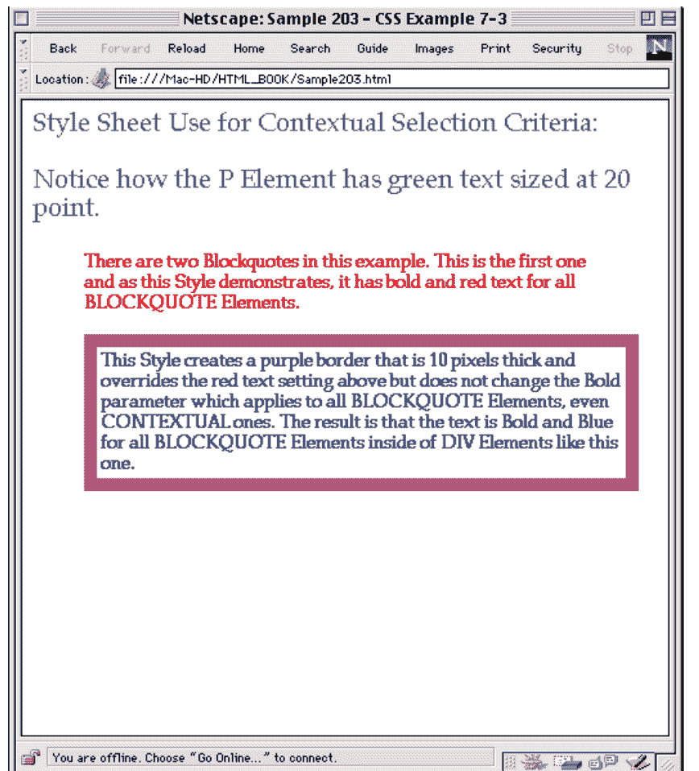

上下文选择条件的样式表应用：

注意 P 元素的文字为绿色，字号为 20 点。

> 本示例中有两个 Blockquote。这是第一个，正如该样式所展示的那样，所有 BLOCKQUOTE 元素都具有粗体红色文字。

> 该样式创建了一个 10 像素宽的紫色边框，覆盖了上述红色文字设置，但不会改变适用于所有 BLOCKQUOTE 元素的粗体参数，即使是上下文应用（CONTEXTUAL）也不例外。结果是，对于所有位于 DIV 元素内的 BLOCKQUOTE 元素，文字均为粗体和蓝色，就像这个一样。

有多种方式可以将 CSS 样式应用到你的文档中：

- `<STYLE>` 元素样式
- 带样式类别（CLASS of STYLE）的 `<STYLE>` 元素
- 带类别例外（CLASS Exceptions）ID 定义的 `<STYLE>` 元素
- 带上下文选择条件（CONTEXTUAL SELECTION CRITERIA）的 `<STYLE>` 元素
- STYLE 属性
- 带 CLASS 属性的 `<SPAN>` 元素
- 带 CLASS 例外 ID 属性的 `<SPAN>` 元素
- `<LINK>` 元素，用于加载包含外部样式表的其他文档
- `<LINK>` 元素，用于加载多个外部样式表
- 一个文档中的多个 `<STYLE>` 元素

现在我们将通过大量示例详细探讨每一种可能性。参考第 11-15 页的属性速查表以及本章后面更深入的属性解释可能会有所帮助。属性的功能才是真正的创意所在。为此，我们先从外观格式化属性开始，然后在第 2 章继续介绍定位属性。

### `<STYLE>` 元素样式

第一个基本示例已在示例 1-1 中演示过，这样你就知道这并不是一个全新的主题。事实上，它只是对上一节"`<STYLE>` 元素"中基本语法的扩展。

在下面的示例中，我们为三个不同的元素创建单独的样式：BODY、H2 和 DIV。

这是 BODY 元素的样式：

```
BODY  { margin: 50px 20px 25px 72px;
        font-family: Helvetica, Times, Geneva;
        font-size: 12pt;
        font-style: plain;
        background-color: yellow;
}
```

你应该立即注意到，你可以用单个属性声明所有四个边距，而且它们**不是**用逗号分隔的。

边距的顺序是：上-右-下-左，因此：

- 上边距为 50 像素宽，
- 右边距为 20 像素宽，
- 下边距为 25 像素宽，
- 左边距为 72 像素宽。

接下来，通过直接包含你想要使用的字体名称来声明字体。之所以提供多个字体名称，是因为如果第一种字体不在用户的系统中，Navigator 会检查并查看列出的第二种字体是否可用，依此类推。列出几种外观与你的首选非常相似的字体将增加视觉匹配的机会。如果列出的字体都不可用，那么 Navigator 将使用用户偏好设置中指定的默认字体。

只有一种方法可以确保你指定的字体就是真正使用的那一种：使用**可下载字体**（DOWNLOADABLE Fonts）。一些比较安全的选择是 Helvetica、Courier 和 Times。有五个通用的 **font-family** 属性值**名称**，它们会从用户的系统字体中选择相近的字体，即 **serif**、**sans-serif**、**cursive**、**fantasy** 和 **monospace** 系列。参见第 13 页底部的图表，查看每个类别中具体字体的示例。

接下来，使用 **font-size** 属性将字体大小指定为 12 点，然后 **font-style** 属性指定为普通体（plain）。最后，使用 **background-color** 属性将整个文档的背景颜色设置为黄色。

接下来，为 H1 元素指定的样式采用 Moonlight 字体，粗体，紫色，字号为 24 点，文字居中对齐。

DIV 元素采用 14 点的 Clarendon 字体（如果可用），粗体，绿色，仅首行缩进 72 像素，相当于制表符的效果。

#### 示例 1-4：Sample204.html

```
<!DOCTYPE HTML PUBLIC "-//W3C//DTD HTML 3.2//EN">
<HTML><HEAD> <TITLE> Sample 204 - CSS Example 1-4 </TITLE>

<STYLE TYPE="text/CSS">
<!--
      /*     The margin order is:  top right bottom left     */

BODY { margin: 50px 20px 25px 72px;
       font-family: Helvetica, Times, Geneva;
       font-size: 12pt;
       font-style: plain;
       background-color: yellow;
      }

H1  { font-family: Moonlight, Clarendon, Palatino, Helvetica;
      font-size: 24pt;
      text-align: center;
      font-style: bold;
      color:#8800cc;            /*    real purple    */
     }
DIV { font-family: Clarendon, Palatino, Helvetica;
      font-size: 14pt;
      font-style: bold;
      color: green;
      text-indent: 72px;
     }
-->
</STYLE>
```


## 第一部分 —— 动态 HTML

### 示例 1-4
**Sample204.html**

**这是示例 204**

DIV 元素的样式为 Clarendon 字体，粗体，绿色，字号为 14 磅。如你所见，上文居中对齐的 H1 元素采用 Moonlight 字体，后备字体为 Clarendon、Palatino 和 Helvetica。字号为 24 磅，粗体，紫色。BODY 元素的首选字体为 Helvetica，字号为 12 磅，普通字重，背景色为黄色。

另外请注意，DIV 元素样式中的 text-indent 属性设置为 72 像素，这使得每次出现 DIV 元素时，文本的首行缩进 1 英寸。我们终于拥有简便的制表符了。

最后这段文字位于 H1 和 DIV 元素之外，因此受 BODY 元素控制。请注意 BODY 元素中设置的边距。如果你调整窗口大小，可以看到底部边距的效果。

## 第 1 章 —— 样式表

```html
</STYLE>
</HEAD>

<BODY>

<H1>This is Sample 204</H1>

<DIV>
The Style for the Division Element is Clarendon Font that is bold, green and sized
at 14 pt. As you can see above the center aligned H1 Element is in Moonlight Font
with Clarendon, Palatino and Helvetica as the backup fonts. The size is 24 pt in
bold purple. The BODY Element has Helvetica as the first font choice and is in 12
pt plain with a yellow background color.
</DIV><BR><BR><HR>

<DIV>Also notice the text-indent Property in the Style for the DIV Element is set
to 72 pixels which makes the first line of text be indented by 1 inch each time a
DIV Element occurs. We finally have easy Tabs.
</DIV><BR><BR><HR>

This last paragraph is outside of both the H1 and DIV Elements so it is covered by
the BODY Element. Notice the margins set in the BODY Element. If you resize the
window you can see the bottom margin.

</BODY>
</HTML>
```

### 层叠样式表属性

#### { font-size: } 属性

**font-size** 属性用于以四种方式之一指定文本大小：**绝对值**、**相对值**、**长度值** 或 **百分比**。这四种类别各有其独特的应用优势，具体语法详见下文。就个人而言，我认为使用 **长度** 的点值最为简便。默认大小为 **绝对值** 的 **medium**。如果你使用 12、14、18 或 24 等标准字号，或者使用 **相对值** 或 **百分比**，输出结果会更加一致，尤其是在打印时。

**CSS 语法：**

```css
{ font-size: absolute|relative|length|percentage; }
```

- **absolute**：使用以下七个关键字选项之一作为固定大小：`xx-small, x-small, small, medium, large, x-large, xx-large`
- **relative**：使用以下两个关键字之一创建相对父元素字体大小更大或更小的尺寸。`larger, smaller`
- **length**：数字后跟计量单位缩写。CSS 语法认可的计量单位有：
  - **px**：像素
  - **in**：英寸
  - **cm**：厘米
  - **mm**：毫米
  - **pt**：磅
  - **pc**：派卡
  - **em**：字体高度
  - **en**：字体高度的一半
- **percentage**：数字后跟百分号，创建相对父元素字体大小的百分比尺寸。

以下是四种类别的用法示例：

- **absolute**：`{ font-size: xx-large; }`
- **relative**：`{ font-size: smaller; }`
- **length**：`{ font-size: 24pt; }`
- **percentage**：`{ font-size: 150%; }`

#### { font-family: } 属性

**font-family** 属性用于按名称指定任何字体，就像你系统文件夹/字体文件夹中包含的字体名称一样。你只需指定一个字体名称，但列出几个类似的备选字体总是好的做法，因为除非使用可下载字体，否则字体必须包含在用户的系统中，Navigator 才能使用它。更多信息请参阅 CD-ROM 上的动态 HTML 指南。

还有五种通用的安全 **font-family** 名称，它们不是特定的字体，而是取决于系统，但在外观上提供了更多选择。它们是：**sans-serif**、**serif**、**cursive**、**fantasy** 和 **monospace**。如果你不希望依赖用户的偏好选择（即默认值），可将它们作为列表中的最后一个字体作为备用字体。当你列出多个字体时，用逗号和空格分隔，如下所示：

```css
{ font-family: Helvetica, Times, TimesRoman, serif; }
```

如果你想列出的字体名称由两个或更多单词组成，中间有空格，那么你需要将整个 *字体名称* 用单引号或双引号括起来，如下所示：

```css
{ font-family: "Brush Script"; }
```

**CSS 语法：**

```css
{ font-family: fontName; }
{ font-family: fontName1, fontName2, fontNameN; }
```

#### { font-weight: } 属性

**font-weight** 属性用于指定文本的加粗或粗细程度。你可以使用 **bold** 或 **lighter** 等关键字名称，或者使用 100 到 900 之间的整数（以 100 为增量），数字越大，文本越粗。

```css
{ font-weight:bolder; }
{ font-weight:lighter; }
{ font-weight:500; }
```

**CSS 语法：**

```css
{ font-weight: normal|bold|bolder|lighter|
             100|200|300|400|500|600|700|800|900; }
```

#### { font-style: } 属性

**font-style** 属性用于为文本添加斜体效果或恢复正常样式，如下所示：

```css
{ font-style:italic; }
{ font-style:normal; }
```

**CSS 语法：**

```css
{ font-style: normal|italic; }
```

示例 1-5 重点介绍刚刚讲解的四种字体属性。

**示例 1-5：Sample205.html**

```html
<!DOCTYPE HTML PUBLIC "-//W3C//DTD HTML 3.2//EN">
<HTML>
<HEAD>
<TITLE>        Sample 205 - CSS Example 1-5        </TITLE>

<STYLE TYPE="text/CSS">

<!--

H1     { color: olive;
         font-family: Palatino, Moonlight, Clarendon, Helvetica;
         font-size: 30pt;
         font-style: italic;
         font-weight: lighter;
       }
DIV    { color: silver;
         background-color: black;
         font-family: Clarendon, Helvetica;
         font-size: 24pt;
         font-weight: bolder;
       }
-->

</STYLE>
</HEAD>

<BODY>

<H1>This is Sample 205</H1>

<DIV>
       This example focuses on demonstrating font Property characteristics.
</DIV>                                                          <BR><HR>

<DIV>


<H1>    Sky Sphere     </H1>                                   <BR><HR>
       Check out the Image in the Division.
</DIV>                                                          <BR><HR>

<H1>    Do you see the inheritance of the black background color from the DIV Style
to the H1 Element that's inside the DIV Tags which is not applied to this H1.
</H1>

</BODY>

</HTML>
```

#### { line-height: } 属性

**line-height** 属性的使用方式与页面排版程序中的行距相同：用于设置相邻文本行基线之间的垂直距离。此属性只能用于块级元素。其值可以是关键字 **normal**、**数字**、**长度值** 或 **百分比**。默认值是关键字 **normal**，即当前所用字体的正常值。你不能在此属性的以下任何值类型中使用负数。

**number** 当你指定不带计量单位的 **数字** 值时，相当于将当前字体大小乘以该 **数字**，并将乘积作为 **line-height** 属性的值返回。此 **数字** 值可以是小数，可以小于一，但不能为负数。这种值类型与 **百分比** 值的唯一区别在于子元素继承值的方式。使用不带单位的 **数字** 值时，子元素将继承实际的 **数字** 值，而非相乘后的计算值。使用 **百分比** 值时，子元素将继承相乘后的值。

**length** 使用 **length** 类型值意味着它是一个度量值。即数字后跟计量单位，如表示磅的 **pt** 或表示像素的 **px**。有关所有可用计量单位的更多信息，请参阅第 11、12 和 14 页的计量单位图表。

**percentage** 使用 **percentage** 类型值意味着你提供的值将乘以当前字体的字体大小，所得的值作为 **line-height** 值返回。**百分比** 值始终后跟百分号 (%)。

**小示例：**

以下是使用 **line-height** 属性的一些小示例：

```css
{ line-height: normal; }
{ line-height: 1.5; }
{ line-height: 24pt; }
{ line-height: .25in; }
{ line-height: 150%; }
```

**CSS 语法：**

```css
{ line-height: normal|number|length|percentage; }
```


## 第一部分 — 动态 HTML

#### { text-decoration: } 属性

**text-decoration** 属性用于使用以下值之一来修饰文本：**underline**（下划线）、**line-through**（删除线）、**blink**（闪烁），或者使用默认值 **none**（无），示例如下：

**小型示例：** `{ text-decoration: underline; }`

#### CSS 语法：
```
{ text-decoration: none|underline|line-through|blink; }
```

#### { text-transform: } 属性

**text-transform** 属性用于通过以下四种方式之一更改文本，后附示例。默认值为 **none**。

- **capitalize** 使每个单词的首字母大写
- **uppercase** 使所有文本大写
- **lowercase** 使所有文本小写
- **none** 使文本恢复正常，这意味着如果存在继承值，该值将被忽略。

**小型示例：** `{ text-transform: uppercase; }`

#### CSS 语法：
```
{ text-transform: capitalize|uppercase|lowercase|none; }
```

#### { text-align: } 属性

**text-align** 属性用于使用 **left**（左）、**right**（右）关键字水平对齐文本，或者可以使用 **center** 使文本居中，或使用 **justify** 使文本两端对齐。默认值为 **left**。这是一个小型示例：

**小型示例：** `{ text-align: right; }`

#### CSS 语法：
```
{ text-align: left|right|center|justify; }
```

## 第 1 章 — 样式表

#### { text-indent: } 属性

**text-indent** 属性用于仅缩进元素内的第一行文本。它可以用 **length**（长度）类型的值（一个数字后跟一个测量单位）或 **percentage**（百分比）类型的值（一个数字后跟一个百分比符号 %）来指定。当值被指定为百分比时，它是父元素宽度的百分比。默认值为 0。它仅适用于块级元素，且该值可继承。有关所有可用单位类型的更多信息，请参阅第 11、12 和 14 页关于测量单位的图表。

```
{ text-indent: 40px; }  { text-indent: 200%; }
```

#### CSS 语法：
```
{ text-indent: length|percentage; }
```

本示例重点演示 **text-decoration**、**text-transform**、**text-align**、**text-indent** 和 **line-height** 属性。

#### 示例 1-6: Sample206.html

```
<!DOCTYPE HTML PUBLIC "-//W3C//DTD HTML 3.2//EN">
<HTML> <HEAD>     <TITLE>   Sample 206 - CSS Example 1-6  </TITLE>

<STYLE TYPE="text/CSS">
<!--
H1 { text-align: center;
     line-height: 50pt;
     text-decoration: line-through;
     text-transform: uppercase;
     text-indent: 40px;
     color: red;
     font-family: Clarendon, Palatino, Helvetica;
     font-size: 24pt;
   }

DIV { text-align: right;
     line-height: 32pt;
     text-decoration: underline;
     text-transform: capitalize;
     text-indent: 100px;
     color: blue;
     font-family: Palatino, Clarendon, Helvetica;
     font-size: 14pt;
   }
-->
</STYLE>
</HEAD>

<BODY>

<H1>this is sample 206</H1>

<DIV> This example focuses on demonstrating text-decoration, text-transform,
text-align, text-indent and line-height.
</DIV>
            <BR><HR>

<DIV> Notice that the line-height parameter causes the space between the lines to
be greater than normal leading in the DIV tags. The DIV Elements are text-aligned
to the right, blue, underlined and the first letter of each word is capitalized.
</DIV>
            <BR><HR>

<DIV> Also Notice that the text in the H1 Element is all in uppercase letters even
though when it was typed in they were all in lowercase letters.
</DIV>

</BODY>
</HTML>
```

### 外边距 (Margins)

#### 外边距概述

这是关于设置样式外边距的五个属性的概述。在概述之后，将分别介绍每个具体的边距类型属性。这组边距类型属性的行为可能与你乍一看时所想的不同。它们在元素的外部添加不可见空间，从而在相邻元素之间创建距离。使用 `margin` 属性时，你可以将所有四个方向的边距设置为相同的值，也可以分别为它们设置不同的值。不要使用负外边距，否则可能会产生异常结果。

你也可以通过使用 **margin-top**、**margin-right**、**margin-bottom** 和 **margin-left** 属性来单独设置每个方向的边距。如果你不需要在某些侧边设置边距，通常会使用这些属性，因为你不必全部设置，只需挑选你需要的即可。

通过使用以下五个属性，有六种不同的方式可以为特定样式设置外边距的厚度：

- **margin** 一次性设置所有边距
- **margin-top** 设置上边距
- **margin-right** 设置右边距
- **margin-bottom** 设置下边距
- **margin-left** 设置左边距

## 第 1 章 — 样式表

#### { margin: } 属性

**margin** 属性用于全局设置外边距的厚度。你可以通过指定一个值来将它们全部一次性设置为相同的值，如下所示：

```
{ margin: 20px; }
```

或者当你需要不同尺寸的边距时，可以通过声明四个不同的值（每个值之间用空格分隔）来一次性设置所有边距，如下所示：

```
{ margin: 72px 35px 20px 50px; }
```

这意味着：

- 上边距厚度为 72 像素
- 右边距厚度为 35 像素
- 下边距厚度为 20 像素
- 左边距厚度为 50 像素。

边距的顺序始终相同，如前面的代码片段所示，顺序是：上-右-下-左；

你可以将这个顺序想象成从顶部开始顺时针旋转。请注意，边距列表中没有逗号。可能的值类型有 **length**（长度）、**percentage**（百分比）以及关键字 **auto**。请注意，如果你将 **margin** 属性分配给一个没有内容的元素，那么该元素的边距将被忽略，除非它随后被动态地更改为包含内容，此时边距才会生效。

#### CSS 语法：
```
{ margin: length|percentage|auto; }
```

#### 参数定义：

**percentage** 是任何带有百分比符号后缀的正数，例如：
```
1%-1000%, ...n%
```

**length** 是一个带有以下测量单位之一后缀的数字：
```
em, ex, px, pt, pc, in, mm, cm
```
更多信息请参阅第 11、12 和 14 页的图表。

## 第一部分 — 动态 HTML

#### { margin-top: } 属性

**margin-top** 属性用于设置上边距的厚度，如下所示：

```
{ margin-top: 50px; }       { margin-top: 20%; }
```

#### CSS 语法：
```
{ margin-top: length|percentage; }
```

#### { margin-right: } 属性

**margin-right** 属性用于设置右边距的厚度，如下所示：

```
{ margin-right: 20px; }       { margin-right: 25%; }
```

#### CSS 语法：
```
{ margin-right: length|percentage; }
```

#### { margin-bottom: } 属性

**margin-bottom** 属性用于设置下边距的厚度。

```
{ margin-bottom: .5in; }       { margin-bottom: 50%; }
```

#### CSS 语法：
```
{ margin-bottom: length|percentage; }
```

#### { margin-left: } 属性

**margin-left** 属性用于设置左边距的厚度，如下所示：

```
{ margin-left: 24pt; }       { margin-left: 40%; }
```

#### CSS 语法：
```
{ margin-left: length|percentage; }
```

以下示例演示了使各个边距具有不同尺寸或完全省略边距的能力。这可以通过为 **margin-top**、**margin-right**、**margin-bottom** 或 **margin-left** 属性设置唯一的 **length** 值，或者在 STYLE 中使用这四个属性中的任何一个时省略其中一个或多个属性来实现。

#### 示例 1-7: Sample207.html

```
<!DOCTYPE HTML PUBLIC "-//W3C//DTD HTML 3.2//EN">
<HTML><HEAD><TITLE>   Sample 207 - CSS Example 1-7          Margins       </TITLE>

<STYLE TYPE="text/CSS">

<!--
H1      { margin: 10px;
          text-transform: capitalize; color: red;
          border-style: ridge; border-width: 20px; border-color: purple; }

H2      { margin: 10px 30px 50px 70px;
          text-transform: capitalize; color: red;
          border-style: ridge; border-width: 20px; border-color: blue; }

H3      { margin-top: 35px;
          text-transform: capitalize; color: red;
          border-style: ridge; border-width: 20px; border-color: aqua; }

H4      { margin-right: 177px;
          text-transform: capitalize; color: red;
          border-style: ridge; border-width: 20px; border-color: green; }

H5      { margin-bottom: 2in;
          text-transform: capitalize; color: red;
          border-style: ridge; border-width: 20px; border-color: yellow; }

H6      { margin-left: 100px;
          text-transform: capitalize; color: red;
          border-style: ridge; border-width: 20px; border-color: fuchsia; }

P       { margin-left: 55px; margin-top: 1in; font-size: 17pt;
          border-style: ridge; border-width: 20px; border-color: red; }
-->
</STYLE>
</HEAD>

<BODY>
        <H1>   This is Sample 207    </H1>

<P>Notice that the P Element is set to a left margin of 55 pixels and a top margin
of 1 inch.</P>

<H1>  H1- This is a margin at 10 pixels on all four sides                  </H1>
<H2>  H2- This is a margin at 10 30 50 70 pixels for top right bottom left </H2>
<H3>  H3- This is a top margin of 35 pixels                                </H3>
<H4>  H4- This is a right margin of 177 pixels                             </H4>
<H5>  H5- This is a bottom margin of 2 inches                              </H5>
<H6>  H6- This is a left margin of 100 pixels                              </H6>

</BODY>
</HTML>
```


### Padding（内边距）

当你想要在元素（Element）的边缘或周长与元素内部的内容之间创建空间时，可以使用五个内边距属性（Padding Properties）之一。这与 TABLE 元素中的 CELLPADDING 属性具有相同效果。可以将任何元素视为由一个具有外部、边缘和内部的矩形块组成。为了让你的文本、图像或其他内容在距离边缘一定的内部距离处开始和结束，你可以添加内边距空间，就像一个仅适用于该特定元素的内部页边距。回顾上一节，外边距（Margin）属性是在元素的**外部**添加空间，从而在不同元素**之间**创建距离。而内边距（Padding）属性是在元素的**内部**添加空间，从而在元素边缘与元素内容之间创建空间。

使用 **padding** 属性时，你可以将所有四个方向的内边距设置为相同的值，也可以分别设置不同的值。你还可以通过使用 **padding-top**、**padding-right**、**padding-bottom** 和 **padding-left** 属性单独设置每一个内边距。通过以下五个属性（随后将分别详细介绍），共有六种不同的方式可以为特定样式设置内边距的厚度：

- **padding** 一次性设置所有内边距
- **padding-top** 设置顶部内边距
- **padding-right** 设置右侧内边距
- **padding-bottom** 设置底部内边距
- **padding-left** 设置左侧内边距

#### The { padding: } 属性

**padding** 属性用于全局设置内边距的厚度。你可以通过像这样指定一个值来一次性将它们全部设置为相同的值：

```
{ padding: 20px; }
```

当你需要不同尺寸的内边距时，可以通过声明四个由空格分隔的不同值来一次性全部设置，注意没有逗号，且顺序是**上-右-下-左**：

```
{ padding: 72px 80px 22px 50px; }
```

因此：

| 属性 | 关系 | 值 |
| :--- | :--- | :--- |
| 顶部内边距 (top padding) | 是 | 72 像素厚 |
| 右侧内边距 (right padding) | 是 | 80 像素厚 |
| 底部内边距 (bottom padding) | 是 | 22 像素厚 |
| 左侧内边距 (left padding) | 是 | 50 像素厚 |

#### CSS 语法：

```
{ padding: length|percentage; }
```

length（长度）是一个带有以下单位之一后缀的数字：em, ex, px, pt, pc, in, mm, cm
percentage（百分比）是任何带有百分号后缀的正数，例如：1%-1000%, ...n%

#### The { padding-top: } 属性

padding-top 属性用于设置顶部内边距的厚度，如下所示：

```
{ padding-top: 50px; }
```

```
{ padding-top: 20%; }
```

#### CSS 语法：

```
{ padding-top: length|percentage; }
```

#### The { padding-right: } 属性

padding-right 属性用于设置右侧内边距的厚度。

```
{ padding-right: 20px; }
```

```
{ padding-right: 25%; }
```

#### CSS 语法：

```
{ padding-right: length|percentage; }
```

#### The { padding-bottom: } 属性

padding-bottom 属性用于设置底部内边距的厚度。

```
{ padding-bottom: .5in; }
```

```
{ padding-bottom: 50%; }
```

#### CSS 语法：

```
{ padding-bottom: length|percentage; }
```

#### The { padding-left: } 属性

padding-left 属性用于设置左侧内边距的厚度。

```
{ padding-left: 24pt; }
```

```
{ padding-left: 40%; }
```

#### CSS 语法：

```
{ padding-left: length|percentage; }
```

这是一个演示单个内边距可以具有不同尺寸或完全省略的示例。这是通过为 **padding-top**、**padding-right**、**padding-bottom** 或 **padding-left** 属性设置唯一的 **length** 值，或者在样式（STYLE）中使用这四个属性中的任何一个时省略其中一个或多个属性来实现的。

#### 示例 1-8: Sample208.html

```
<!DOCTYPE HTML PUBLIC "-//W3C//DTD HTML 3.2//EN">
<HTML><HEAD><TITLE>     Sample 208 - CSS Example 1-8  Paddings        </TITLE>
<STYLE TYPE="text/CSS">
<!--
H1     { padding: 10px;
         text-transform: capitalize; color: red;
         border-style: ridge; border-width: 20px; border-color: purple; }

H2     { padding: 10px 30px 50px 70px;
         text-transform: capitalize; color: red;
         border-style: ridge; border-width: 20px; border-color: blue; }
H3     { padding-top: 35px;
         text-transform: capitalize; color: red;
         border-style: ridge; border-width: 20px; border-color: aqua; }

H4     { padding-right: 177px;
         text-transform: capitalize; color: red;
         border-style: ridge; border-width: 20px; border-color: green; }

H5     { padding-bottom: 2in;
         text-transform: capitalize; color: red;
         border-style: ridge; border-width: 20px; border-color: yellow; }

H6     { padding-left: 100px;
         text-transform: capitalize; color: red;
         border-style: ridge; border-width: 20px; border-color: fuchsia; }

P      { padding-left: 55px; padding-top: 1in; font-size: 17pt;
         border-style: ridge; border-width: 20px; border-color: red; }
-->
</STYLE>
</HEAD>
<BODY>          <H1>    This is Sample 208    </H1>
<P>Notice that the P Element is set to a left padding of 55 pixels and a top padding of 1 inch.</P>

<H1>H1- This is a padding at 10 pixels on all four sides                   </H1>
<H2>H2- This is a padding at 10 30 50 70 pixels for top right bottom left  </H2>
<H3>H3- This is a top padding of 35 pixels                                 </H3>
<H4>H4- This is a right padding of 177 pixels                              </H4>
<H5>H5- This is a bottom padding of 2 inches                               </H5>
<H6>H6- This is a left padding of 100 pixels                                </H6>
</BODY>
</HTML>
```

### Color（颜色）

在 CSS 语法中，有三个属性允许你直接操纵样式中的颜色。它们的工作方式完全相同，但作用于文档的不同方面。**color** 属性控制前景色，即所应用元素的文本颜色。**background-color** 属性控制所应用元素的背景颜色，最后是 **border-color** 属性，它将边框的颜色从继承自 BODY 元素前景色默认颜色进行更改。

在 CSS 语法中，指定颜色的方式比 HTML 更多。你可以使用公认的颜色名称，包括所有 JavaScript 颜色名称（见附录 B）、十六进制三元组，还可以使用 **rgb( )** 函数来表示。

**rgb( )** 函数接收三个参数：**redArg**、**greenArg** 和 **blueArg**，分别代表总颜色的红、绿、蓝值。它们由逗号分隔，可以是 0 到 255 之间的数字，也可以是 0% 到 100% 之间的百分比。如果使用百分比，每个参数的数字后面必须跟百分号 (%)。

#### CSS 语法：

```
rgb(redArg, greenArg, blueArg)
rgb(redArg%, greenArg%, blueArg%)
```

在 0-255 测量方案中使用的数字，从最低的（表示无色）到 255（表示全色），因此：

```
rgb( 255, 0, 0 )         means:  full red, no green, no blue     =      red
rgb( 255, 0, 255 )       means:  full red, no green, full blue    =      plum
rgb( 0, 0, 255 )         means:  no red, no green, full blue      =      blue
rgb( 0, 255, 255 )       means:  no red, full green, full blue    =      aqua
rgb( 0, 255, 0 )         means:  no red, full green, no blue      =      lime
rgb( 255, 255, 0 )       means:  full red, full green, no blue    =      yellow
rgb( 255, 255, 255 )     means:  full red, full green, full blue  =      white
rgb( 0, 0, 0 )           means:  no red, no green, no blue        =      black
```

```
rgb( 100%, 0%, 0% )         means:  full red, no green, no blue     =      red
rgb( 100%, 0%, 100% )       means:  full red, no green, full blue    =      plum
rgb( 0%, 0%, 100% )         means:  no red, no green, full blue      =      blue
rgb( 0%, 100%, 100% )       means:  no red, full green, full blue    =      aqua
rgb( 0%, 100%, 0% )         means:  no red, full green, no blue      =      lime
rgb( 100%, 100%, 0% )       means:  full red, full green, no blue    =      yellow
rgb( 100%, 100%, 100%)      means:  full red, full green, full blue  =      white
rgb( 0%, 0%, 0% )           means:  no red, no green, no blue        =      black
```


#### { color: } 属性

**color** 属性非常简单；它允许您选择元素的前景色，从而改变文本的颜色。以下是表达前景色的四种方式：

```
{ color: silver; }            { color:#e35a77; }
{ color: rgb(5, 220, 250); } { color: rgb(38%, 43%, 69%); }
```

### CSS 语法：

```
{ color: colorname|#$$$$$$|rgb(0-255,0-255,0-255)|
                            rgb(0-100%,0-100%,0-100%); }
```

本示例重点介绍如何使用 **color** 属性指定前景色。

### 示例 1-9：Sample209.html

```html
<!DOCTYPE HTML PUBLIC "-//W3C//DTD HTML 3.2//EN">
<HTML>
<HEAD>
<TITLE> Sample 209 - CSS Example 1-9  The color Property    </TITLE>

<STYLE TYPE="text/css">
<!--
H1       { color: blue;
          border-style: ridge; border-width: 20px; border-color: purple; }

H2       { color: rgb(155,0,255);
          border-style: ridge; border-width: 20px; border-color: blue; }

H3       { color: rgb(0,57,155);
          border-style: ridge; border-width: 20px; border-color: aqua; }

H4       { color: rgb(0%,50%,0%);
          border-style: ridge; border-width: 20px; border-color: green; }

H5       { color: rgb(90%,0%,5%);
          border-style: ridge; border-width: 20px; border-color: yellow; }

H6       { color:#7705dd;
          border-style: ridge; border-width: 20px; border-color: fuchsia; }

P        { color:#ef4499;
         font-size: 17pt;
         border-style: ridge; border-width: 20px; border-color: red; }
-->
</STYLE>
</HEAD>

<BODY>

<H1>This is Sample 209</H1>

<P>Notice that the all the different heading types have unique foreground colors
which controls the text color.</P>

<H1>         This is a H1 Heading            </H1>
<H2>         This is a H2 Heading            </H2>
<H3>         This is a H3 Heading            </H3>
<H4>         This is a H4 Heading            </H4>
<H5>         This is a H5 Heading            </H5>
<H6>         This is a H6 Heading            </H6>

</BODY>
</HTML>
```

**示例 1-9 Sample209.html**
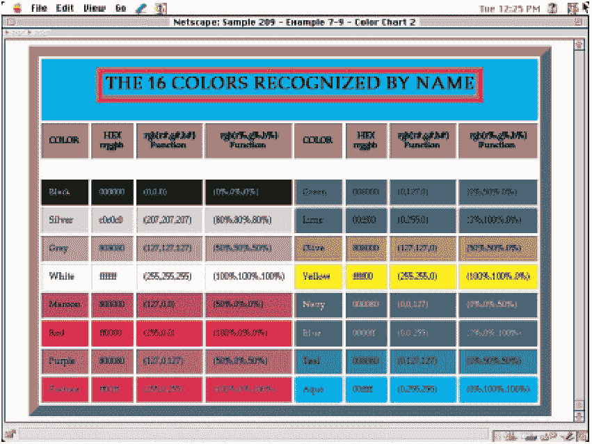

#### { background-color: } 属性

**background-color** 属性允许您选择每个元素的背景颜色。您可以使用公认的颜色名称（color Name）、十六进制三元组（Hexadecimal triplet），或者使用 **rgb()** 函数。**rgb()** 函数允许您使用普通数字或百分比来指定 rgb 三元组，这对于艺术家、图形设计师、Photoshop 用户和其他图像编辑爱好者来说可能更为熟悉。以下是使用 **background-color** 属性为元素样式指定背景颜色的四个示例：

```
{ background-color: olive; }
{ background-color:#aaca77; }
{ background-color: rgb(155, 120, 50); }
{ background-color: rgb(50%, 0%, 90%); }
```

### CSS 语法：

```
{ background-color: colorname|#$$$$$$|rgb(0-255,0-255,0-255)|
                                      rgb(0-100%,0-100%,0-100%); }
```

示例 1-10 重点介绍 **background-color** 属性。

### 示例 1-10：Sample210.html

```html
<!DOCTYPE HTML PUBLIC "-//W3C//DTD HTML 3.2//EN">
<HTML>
<HEAD>

<TITLE>Sample 210 - CSS Example 1-10 The background-color Property </TITLE>

<STYLE TYPE="text/CSS">

<!--

H1     { background-color: blue;
       border-style: ridge; border-width: 20px; border-color: purple; }

H2     { background-color: rgb(155,0,255);
       border-style: ridge; border-width: 20px; border-color: blue; }

H3     { background-color: rgb(0,57,155);
         border-style: ridge; border-width: 20px; border-color: aqua; }

H4     { background-color: rgb(0%,50%,0%);
         border-style: ridge; border-width: 20px; border-color: green; }

H5     { background-color: rgb(90%,0%,5%);
         border-style: ridge; border-width: 20px; border-color: yellow; }

H6     { background-color:#7705dd;
         border-style: ridge; border-width: 20px; border-color: fuchsia; }

P      { background-color:#ef4499;
         font-size: 17pt;
         border-style: ridge; border-width: 20px; border-color: red; }

-->

</STYLE>

</HEAD>

<BODY TEXT="#eeeeee" BGCOLOR="#000000">

<H1>This is Sample 210</H1>

<P>This example is exactly the same as Sample 208 except that the colors used are
for the background instead of the foreground. Because no foreground color is
specified, all of the Heading Elements inherit it from the BODY Element since they
are contained within it.</P>

<H1>          This is a H1 Heading           </H1>
<H2>          This is a H2 Heading           </H2>
<H3>          This is a H3 Heading           </H3>
<H4>          This is a H4 Heading           </H4>
<H5>          This is a H5 Heading           </H5>
<H6>          This is a H6 Heading           </H6>

</BODY>

</HTML>
```

请查阅附录 B 第 1033-1037 页的颜色图表，其中包含所有 JavaScript 颜色名称及其对应的十六进制、rgb 数字和百分比值的详细列表。这些信息也包含在 CD-ROM 的一个名为 [AppendixB-ChartOnly.html](AppendixB-ChartOnly.html) 的文件中，该文件位于 [HTML BOOK-Online](HTML BOOK-Online) 文件夹下，而该文件夹又在 [DHTML-JS BOOK-Main Files](DHTML-JS BOOK-Main Files) 文件夹中。它在 JavaScript 脚本中使用了数组（Arrays）、**for()** 循环和 **document.write()** 来输出数据，并在文本背后渲染实际的颜色。如果您对可见光谱中颜色的工作原理感兴趣，附录 B 中还有一篇关于加色理论的论述。在第 340-350 页还有一个使用 JavaScript 的颜色转换计算器，可将颜色在多种格式之间进行转换。

#### { background-image: } 属性

**background-image** 属性允许您选择一张图像显示在元素的内容后面。您可以为每个创建了样式的元素指定不同的图像。该背景图像将根据需要多次铺贴（tiled），以填满分配给该元素的空间。以下是如何在样式中编写背景图像的代码示例，请注意 (JPEG-FILES) 是包含实际图像的文件夹，且图像文件的相对 **urlName** 为 (ExampleImage.jpeg)：

```
{ background-image: url(JPEG-FILES/ExampleImage.jpeg); }
```

在语法中请注意，**url** 中的字母 "l" 与 (**urlName**) 中的左括号 "(" 之间不能有任何空格，且 **urlName** 不用引号括起来。

### CSS 语法：

```
{ background-image: url(urlName); }
```

本示例重点介绍 **background-image** 属性。

### 示例 1-11：Sample211.html

```html
<!DOCTYPE HTML PUBLIC "-//W3C//DTD HTML 3.2//EN">
<HTML>
<HEAD>
<TITLE> Sample 211 - CSS Example 1-11   Background Images  </TITLE>

<STYLE TYPE="text/CSS">

<!--

BODY   { font-size: 36pt; }

H1     { background-image: url(./JPEG-FILES/icon-BG-asteroids.jpg);
         border-style: ridge; border-width: 20px; border-color: purple; padding: 30px;
         background-color: white;}

H2     { background-image: url(./JPEG-FILES/Icon-Clouds.jpg);
         border-style: ridge; border-width: 20px; border-color: blue; padding: 72px; }

H3     { background-image: url(./JPEG-FILES/icon-BG-stars.jpg);
         border-style: ridge; border-width: 20px; border-color: aqua; padding: 144px; }

H4     { background-image: url(./JPEG-FILES/icon-FieldStone-Purple.jpeg);
         border-style: ridge; border-width: 20px; border-color: green; padding: 100px; }

H5     { background-image: url(./JPEG-FILES/icon-Paint-Palette.jpg);
         border-style: ridge; border-width: 20px; border-color: yellow; padding: 144px; }

H6     { background-image: url(./dreamplay-website/JPEG-FILES/J2-JERRY_GARCIA-2-RS.jpg);
         border-style: ridge; border-width: 20px; border-color: fuchsia; padding: 50px;
         color: white;}

P      { background-color:#ccccff;
         font-size: 17pt;
         border-style: ridge; border-width: 20px; border-color: red; }

-->

</STYLE>

</HEAD>

<BODY TEXT="#0000ff" BGCOLOR="#000000">

<H1>   This is Sample 211   </H1>

<P>    Make sure that there are no blank spaces between the last letter of (url)
and the first parentheses containing the urlName. This is correct: url(urlName) and
this is wrong: url (urlName).                                      <BR><BR>
Also notice that the image tiles or repeats to fill up the available or assigned
space.</P>

<H1>          This is a H1 Heading              </H1>
<H2>          This is a H2 Heading              </H2>
<H3>          This is a H3 Heading              </H3>
<H4>          This is a H4 Heading              </H4>
<H5>          This is a H5 Heading              </H5>
<H6>          This is a H6 Heading              </H6>

</BODY>
</HTML>
```

示例 1-12 使用了许多到目前为止讨论过的属性。请查看它并确保其中所有内容都熟悉。需要注意的一些细节是：BODY 元素被分配了 **margin** 属性，这导致包含在 BODY 中的每个元素周围也具有 20 像素的边距（Margin）。

由于 CITE 元素也被分配了 **margin** 属性，因此效果是累积的；也就是说，所有 CITE 元素将拥有来自 BODY 元素的 20 像素边距加上其自身的 10 像素边距。

如果您在浏览器中查看示例，您会发现，与 CITE 元素相邻的元素之间的距离比那些在样式定义中没有显式 **margin** 属性的元素距离更远。另外请记住，H1 和 PRE 元素是块级（BLOCK LEVEL）元素，具有内置的换行，而 CITE 和 XMP 元素则没有。


#### 示例 1-12：Sample212.html

```html
<!DOCTYPE HTML PUBLIC "-//W3C//DTD HTML 3.2//EN">
<HTML>
<HEAD>
<TITLE>Sample 212 - CSS Example 1-12  Compilation </TITLE>

<STYLE TYPE="text/CSS">

<!--

BODY    { margin: 20px; background-color:#7777cc;}

H3      { font-family: Clarendon, Moonlight, Palatino, Helvetica;
          font-size: 30pt;
          text-align: center;
          font-style: bold;
          color: blue;
          border-width:.25in;
          border-style: groove;
          border-color:#335a77;
          margin: 20px;
          background-color:#755f11;        /*    metallic gold */
}
PRE     { font-family: Brush Script,Geneva, Palatino, Helvetica;
          font-size: 19pt;
          font-style: plain;
          color: black;
          text-indent: 45px;
          line-height: 30pt;
          border-width:.25in;
          border-style: inset;
          border-color: blue;
          background-color: aqua;
          margin: 15px;
}
CITE    { font-family: Bellevue, New York, Geneva, Times;
          font-size: 25pt;
          font-style: italic;
          text-align: center;
          color: red;
          line-height: 45pt;
          border-width: 10mm;
          border-style: outset;
          border-color: lime;
          background-color: yellow;
          margin: 10px;
          margin: 20px;
}
XMP     { font-family: Helvetica, Times, New York, Geneva;
          font-size: 18pt;
          font-style: bold;
          text-align: center;
          color: maroon;
          border-width: 10mm;
          border-style: ridge;
          border-color: purple;
          background-color: gray;
          margin: 40px;
          white-space: pre;
}

-->

</STYLE>

</HEAD>

<BODY>

<H3>  This is Sample 212    </H3>

<CITE> There are a lot of Properties in this example.                           </CITE>
<PRE>  The Site still has their website. You should email them to let the powers
that be know that they should reinstate the show. Bring back Dev.          </PRE>

<XMP>
This example has a lot of
borders in it but the
next example is the one with
all border style possibilities.

If you don't
explicitly code in the
white-space Property to "pre" then even
with an XMP Tag or a PRE Tag the
white-space will collapse because in
Style Sheet syntax white-space is
collapsed by default.

Below are all the
Properties used in the
Style for the XMP Element.


     { font-family: Helvetica, Times, New York, Geneva;
      font-size: 18pt;
      font-style: bold;
      text-align: center;
      color: maroon;
      border-width: 10mm;
      border-style: ridge;
      border-color: purple;
      background-color: gray;
      margin: 40px;
      white-space: pre;
     }
</XMP>

</BODY>
</HTML>
```

### 设置边框

#### { border-style: } 属性

通过使用 **border-style** 属性，你可以选择用二维或三维凸起边框来包围内容，从而突出显示你的内容。**solid** 和 **double** 样式是二维的，而 **inset**、**outset**、**groove** 和 **ridge** 样式都是三维阴影效果。如果你想要尝试图形创新，还可以选择创建少于四条边的边框。尝试将内容嵌套在所有元素都带有边框的元素中，以获得非常有趣的视觉效果。

默认值为 **none**，如果在创建动态变化的样式时，也可以通过 JavaScript 来选择该值。记得在样式定义中包含 **border-width** 属性值，否则它将是不可见的，因为默认值为零。有关设置边框宽度的更多信息，请参阅第 52-58 页。

这是一个三维 **border-style** 的示例：

```css
{ border-style: groove }
```

### CSS 语法：

```css
{ border-style: none|solid|double|inset|outset|groove|ridge; }
```

本示例涵盖了 **border-style** 属性除 **none** 之外的所有值。

## 示例 1-13：Sample213.html

```html
<!DOCTYPE HTML PUBLIC "-//W3C//DTD HTML 3.2//EN">
<HTML><HEAD>
<TITLE> Sample 213 - CSS Example 1-13         Border Styles  </TITLE>

<STYLE TYPE="text/CSS">
<!--

BODY    { margin: 10px; font-size: 30pt;
          border-style: ridge; border-width: 10px;
          font-family: Clarendon, Moonlight, Palatino, Helvetica;
        }
H1      { border-style: solid;
          border-width: 20px;
          border-color:#ff0000;
          margin: 10px;
          background-color:#755f11;           /*      metallic gold  */
        }
H2      { border-style: double;
         border-width: 20px;
         border-color: blue;
         margin: 10px;
         background-color:#755f11;        /*    metallic gold  */
       }
H3       { border-style: inset;
         border-width: 20px;
         border-color: green;
         margin: 10px;
         background-color:#755f11;        /*    metallic gold  */
       }
H4       { border-style: outset;
         border-width: 20px;
         border-color: aqua;
         margin: 10px;
         background-color:#755f11;        /*    metallic gold  */
       }
H5       { border-style: groove;
         border-width: 20px;
         border-color: purple;
         margin: 10px;
         background-color:#755f11;        /*    metallic gold  */
       }
H6       { border-style: ridge;
         border-width: 20px;
         border-color: maroon;
         margin: 10px;
         background-color:#755f11;        /*    metallic gold  */
       }
P       { font-size: 14pt;
         border-style: none;
         border-width: 20px;
         border-color: maroon;
         margin: 10px;
         background-color:#755f11;        /*    metallic gold  */
       }

-->
</STYLE>
</HEAD>
<BODY>
```

请注意，P 元素的 border-style 被设置为 NONE，它包含了此段落。同时请注意，字体大小在 BODY 样式中进行了全局设置，因此它适用于 BODY 标签内包含的所有元素，甚至包括通常应具有不同大小的以下标题元素。BODY 元素甚至还有边框，并且位于边距内部。

```html
     <H1>   This is a solid border       </H1>
     <H2>   This is a double border      </H2>
     <H3>   This is an inset border      </H3>
     <H4>   This is an outset border     </H4>
     <H5>   This is a groove border      </H5>
     <H6>   This is a ridge border       </H6>
</BODY>
</HTML>
```

#### { border-color: } 属性

**border-color** 属性非常直观；它让你选择包围元素的边框颜色。在 CSS 语法中，你有比纯 HTML 更多的方式来指定颜色。使用已识别的颜色名称和传统的十六进制三元组仍然可用，但现在你也可以将其表示为使用常规数字或百分比的 **rgb( )** 函数三元组。有关颜色的更多信息，请参阅第 37 页或附录 B。

以下是表示 **border-color** 的四种方式：

- `{ border-color: purple; }`
- `{ border-color:#335a77; }`
- `{ border-color: rgb(255, 20, 150); }`
- `{ border-color: rgb(20%, 50%, 70%); }`

### CSS 语法：

```css
{ border-color: colorname|#$$$$$$|rgb(0-255,0-255,0-255) |
                     rgb(0-100%,0-100%,0-100%); }
```

本示例专注于 **border-color** 的示例。在本示例末尾有嵌套的元素，每个元素都有 **border-style**，使其看起来像是嵌套边框，这在使用标准属性代码的情况下通常无法实现。

### 示例 1-14：Sample214.html

```html
<!DOCTYPE HTML PUBLIC "-//W3C//DTD HTML 3.2//EN">
<HTML>
<HEAD>
<TITLE> Sample 214 - CSS Example 1-14        border-color Properties</TITLE>

<STYLE TYPE="text/CSS">

<!--                               /* Remember these are CSS comments */

H1    { border-style: solid;
        border-width: 20px;
        border-color: blue;
        padding: 10px;
        background-color: rgb(255, 100, 0);   /*            orange        */
      }
H2    { border-style: double;
        border-width: 20px;
        border-color: rgb(55, 200, 50);      /*         medium green     */
        padding: 10px;
        background-color:#755f11;              /*         metallic gold    */
      }
```


## 第一章 — 样式表

```css
H3     { border-style: inset;
         border-width: 20px;
         border-color: rgb(50%, 0%, 98%);	      /*    紫色      */
         padding: 10px;
         background-color: rgb(15%, 0%, 98%);	      /*    深蓝色  */
       }
H4     { border-style: outset;
         border-width: 20px;
         border-color: rgb(15, 200, 150);	      /*    水绿色     */
         padding: 10px;
         background-color: rgb(100%, 0%, 0%);	      /*    红色             */
       }
H5     { border-style: groove;
         border-width: 20px;
         border-color: rgb(50%, 100%, 20%);	      /*    酸橙绿      */
         padding: 10px;
         background-color:#955f31;	              /*    红金属金  */
       }
H6     { border-style: ridge;
         border-width: 20px;
         border-color: rgb(155, 0, 250);	      /*    梅子色            */
         padding: 10px;
         background-color:#457e71;	              /*    金属水色   */
       }
P      { font-size: 14pt;
         border-style: groove;
         border-width: 20px;
         border-color:#255fa1;	                      /*    钢蓝色      */
         padding: 10px;
         background-color:#959f51;	              /*    金属绿色  */
       }
-->
</STYLE></HEAD>

<BODY>
<P>   本示例中的大部分设置与上一个示例相同，以便让您专注于边框颜色。请注意，以下标题元素这次以其正常大小呈现，因为没有需要继承的覆盖属性。</P>

<H1><H2><H3>   这是一个实线边框H1内的双线边框H2内的内嵌边框H3    </H3></H2></H1>

<H5><H4>      这是一个凹槽边框内的外凸边框     </H4></H5>

<H4><H5><H6>  这是一个外凸边框H4内的凹槽边框H5内的凸脊边框H6    </H6></H5></H4>

正下方是一个空的H6标题。非常有趣。激发了什么图形方面的见解吗？
<H6></H6>

</BODY></HTML>
```

示例1-15展示了嵌套元素，每个元素都具有**border-style**属性，从而创建了一个嵌套的彩虹多边框。

### 示例1-15：Sample215.html

```html
<!DOCTYPE HTML PUBLIC "-//W3C//DTD HTML 3.2//EN">
<HTML><HEAD><TITLE>    示例215 - CSS 示例1-15       嵌套边框    </TITLE>

<STYLE TYPE="text/CSS">
<!--
                                          /*  请记住这些是CSS注释  */
H1      { border-style: solid;
          border-width: 20px;
          border-color: rgb(155, 0, 255);
          background-color: blue;              /*      橙色        */
        }
H2      { border-style: double;
          border-width: 20px;
          border-color: blue;                  /*      中绿色  */
          background-color: rgb(0%, 100%, 100%);  /*   金属金  */
        }
H3      { border-style: inset;
          border-width: 20px;
          border-color: rgb(0%, 100%, 100%);     /*      紫色        */
          background-color: rgb(0, 255, 0)   ;  /*      深蓝色     */
        }
H4      { border-style: outset;
          border-width: 20px;
          border-color: rgb(0, 255, 0);          /*      水绿色   */
          background-color: rgb(100%, 100%, 0%); /*      红色           */
        }
H5      { border-style: groove;
          border-width: 20px;
          border-color: rgb(100%, 100%, 0%);     /*      酸橙绿    */
          background-color: rgb(255, 0, 0);      /*      红金属金 */
        }
H6      { border-style: ridge;
          border-width: 20px;
          border-color: rgb(255, 0, 0);          /*      梅子色          */
          background-color: red;                 /*      金属水色 */
          font-size: 24pt;
        }
-->
</STYLE>
</HEAD>

<BODY>
<H1><H2><H3><H4><H5><H6>彩虹之地</H6></H5></H4></H3></H2></H1>
</BODY>
</HTML>
```

示例1-16展示了两个嵌套元素的实例，每个实例都具有**border-style**属性，从而创建了一个嵌套的彩虹多边框，它从BODY元素继承了白色背景，而不是显式地指定它们。

### 示例1-16：Sample216.html

```html
<!DOCTYPE HTML PUBLIC "-//W3C//DTD HTML 3.2//EN">
<HTML>
<HEAD>
<TITLE>示例216 - CSS 示例1-16 嵌套彩虹边框</TITLE>

<STYLE TYPE="text/CSS">

<!--
                                       /*  请记住这些是CSS注释  */

H1     { border-style: solid;
         border-width: 20px;
         border-color: rgb(255, 0, 255);           /*     梅子色        */
       }
H2     { border-style: double;
         border-width: 20px;
         border-color: blue;                       /*     中绿色  */
       }
H3     { border-style: inset;
         border-width: 20px;
         border-color: rgb(0%, 100%, 100%);        /*     紫色      */
       }
H4     { border-style: outset;
         border-width: 20px;
         border-color: rgb(0, 255, 0);             /*     水绿色  */
       }
H5     { border-style: groove;
         border-width: 20px;
         border-color: rgb(100%, 100%, 0%);        /*     酸橙绿  */
       }
H6     { border-style: ridge;
         border-width: 20px;
         border-color: rgb(255, 0, 0);             /*     红色         */
         font-size: 24pt;
       }
-->

</STYLE>
</HEAD>

<BODY>

<H1><H2><H3><H4><H5><H6>彩虹之地</H6></H5></H4></H3></H2></H1>

<H6><H5><H4><H3><H2><H1>彩虹之地</H1></H2></H3></H4></H5></H6>

</BODY>
</HTML>
```

#### 边框宽度

当您使用**border-style**属性通过**solid（实线）、double（双线）、inset（内嵌）、outset（外凸）、groove（凹槽）或ridge（凸脊）**样式来增强内容的图形边框时，还必须指定以下列出的五个边框宽度属性之一。这样做的原因是，边框的默认厚度为零，直到您为其指定宽度。您可以将所有边框设置为相同的厚度，也可以让边框的每一侧具有独特的宽度。您甚至可以有一个三侧边框，其中每一侧都有不同的宽度。有六种不同的方法来设置边框的厚度（即宽度），通过使用以下五个属性中的任何一个：

- border-width
- border-top-width
- border-right-width
- border-bottom-width
- border-left-width

#### { border-width: } 属性

**border-width** 属性用于全局设置边框的厚度。您可以通过指定一个值来一次性设置它们：

```css
{ border-width: 20px; }
```

或者，您可以通过声明四个不同的值（每个值之间用空格分隔）来一次性设置它们：

```css
{ border-width: 10px 20px 30px 40px; }
```

在这种情况下，边框的顺序是**上-右-下-左**；可以想象为从顶部开始的顺时针顺序。

### CSS 语法：

```css
{ border-width: length|percentage; }
```

**length** 是一个数字，后缀为以下度量单位之一：

`em, ex, px, pt, pc, in, mm, cm`

有关度量单位的更多信息，请参见第11-12、14页的图表。

**percentage** 是任何正数，后缀为百分号，例如：1%-100%, ...n%

#### { border-top-width: } 属性

**border-top-width** 属性用于设置边框顶部的厚度，如下所示：

```css
{ border-top-width: 20px; }
```

### CSS 语法：

```css
{ border-top-width: length|percentage; }
```

#### { border-right-width: } 属性

**border-right-width** 属性用于设置边框右侧的厚度，如下所示：

```css
{ border-right-width: 20px; }
```

### CSS 语法：

```css
{ border-right-width: length|percentage; }
```

#### { border-bottom-width: } 属性

**border-bottom-width** 属性用于设置边框底部的厚度，如下所示：

```css
{ border-bottom-width: 20px; }
```

### CSS 语法：

```css
{ border-bottom-width: length|percentage; }
```

#### { border-left-width: } 属性

**border-left-width** 属性用于设置边框左侧的厚度，如下所示：

```css
{ border-left-width: 20px; }
```

### CSS 语法：

```css
{ border-left-width: length|percentage; }
```


## 第一部分 — 动态 HTML

这是一个演示如何让整个边框的各个边具有不同尺寸或完全省略的示例。这可以通过为以下属性设置唯一的 *length*（长度）值，或者在 STYLE 中使用这四个属性中的任何一个时省略其中一个或多个属性来实现：

- **border-top-width**: *length*;
- **border-right-width**: *length*;
- **border-bottom-width**: *length*;
- **border-left-width**: *length*;

它还演示了 **border-width** 属性。

#### 示例 1-17: Sample217.html

```html
<!DOCTYPE HTML PUBLIC "-//W3C//DTD HTML 3.2//EN">
<HTML>
<HEAD><TITLE>  Sample 217 - CSS Example 1-17</TITLE>

<STYLE TYPE="text/CSS">
<!--

BODY    { margin: 10px; font-size: 30pt; background-color:#aaccbb;
          border-style: ridge; border-width: 10px;
          font-family: Bellevue, Clarendon, Moonlight, Helvetica;
}

H1      { border-style: solid;
          border-top-width: 5px;
          border-right-width: 10px;
          border-bottom-width: 20px;
          border-left-width: 25px;
          border-color:#ff0000;
          margin: 10px;
          background-color:#665599;        /*    metallic purple     */
}
H2      { border-style: double;
          border-top-width: 20px;
          border-right-width: 20px;
          border-bottom-width: 20px;
          border-color: blue;
          margin: 10px;
          background-color:#665599;        /*    metallic purple     */
}
H3      { border-style: inset;
          border-top-width: 20px;
          border-right-width: 20px;
          border-color: green;
          margin: 10px;
          background-color:#665599;        /*    metallic purple     */
}
H4	{ border-style: outset;
		border-right-width: 20px;
		border-left-width: 25px;
		border-color: aqua;
		margin: 10px;
		background-color:#665599;	/*	metallic purple	*/
	}
H5	{ border-style: groove;
		border-top-width: 20px;
		border-bottom-width: 20px;
		border-color: purple;
		margin: 10px;
		background-color:#665599;	/*	metallic purple	*/
	}
H6	{ border-style: ridge;
		border-left-width: 20px;
		border-right-width: 20px;
		border-bottom-width: 20px;
		border-color: maroon;
		margin: 10px;
		background-color:#665599;	/*	metallic purple	*/
	}
P	{ font-size: 18pt;
		border-style: none;
		border-width: 20px;
		border-color: maroon;
		margin: 10px;
		background-color:#665599;	/*	metallic purple	*/
	}

-->

</STYLE>
</HEAD>

<BODY>
```

这个示例演示了如何让边框的各边具有不同尺寸或被省略。Netscape 在处理某些样式且某些边被使用时，似乎还没能完全精准地解决边框匹配的计算问题，至少在 Mac 平台上是这样。如果标题中的文本大小不是全部 30pt，请尝试按住 Shift 键并点击浏览器的刷新按钮。

```html
<H1>	This is a solid border	</H1>
<H2>	This is a double border	</H2>
<H3>	This is an inset border	</H3>
<H4>	This is an outset border	</H4>
<H5>	This is a groove border	</H5>
<H6>	This is a ridge border	</H6>

</BODY>
</HTML>
```

## 第一部分 — 动态 HTML

这个示例展示了一个包含 16 种通用认可颜色名称的图表。在 CD-ROM 中，Sample43.html 中有一个展示这些颜色的颜色表。本例是该示例的一个变体，它将边框样式应用于 TABLE 元素内部的 HEADING（标题）元素，并包含了每种颜色的 **rgb()** 函数值。在查看代码时，请注意每个 TABLE ROW（表格行）有 8 个 CELLS（单元格），但在文本编辑器中，每个 CELL 的代码都单独占用一行。在插入 FONT 元素的个别实例之处，它们提供了单元格背景色与文本颜色之间的对比。

#### 示例 1-18: Sample218.html

```html
<!DOCTYPE HTML PUBLIC "-//W3C//DTD HTML 3.2//EN">
<HTML>

<HEAD>
<TITLE> Sample 218 - Example 1-18 - Color Chart 2  </TITLE>

<STYLE TYPE="text/CSS">

<!--

H1     { border-style: ridge;
       border-width: 10px;
       font-size: 24pt;
       border-color: rgb(255, 0, 0);
       float: center;
     }

H2     { border-style: groove;
       border-width: 15px;
       border-color: rgb(55, 0, 255);
       color: rgb(255, 255, 255);
       background-color: rgb(175, 175, 25);
       padding: 15px;
       font-size: 30pt;
       float: center;
       font-family: Brush Script, Moonlight, Clarendon;
     }

-->

</STYLE>

</HEAD>

<BODY BGCOLOR="#ffffff" TEXT="#000000">

<H2>CSS COLOR CHART</H2>

<TABLE BORDER="15" CELLSPACING="4" CELLPADDING="10"
       BGCOLOR="#00ffff" BORDERCOLOR="#7700ff" ALIGN="CENTER">
<TR>
<TH COLSPAN="8">
<FONT SIZE="6">        <H1>THE 16 COLORS RECOGNIZED BY NAME</H1>  </FONT></TH>
</TR>

<TR WIDTH="140" BGCOLOR="#755f11">
<TH> COLOR </TH>
<TH> HEX<BR>rrggbb </TH>
<TH> rgb(r#,g#,b#)<BR>Function </TH>
<TH> rgb(r%,g%,b%)<BR>Function </TH>
<TH> COLOR </TH>
<TH> HEX<BR>rrggbb </TH>
<TH> rgb(r#,g#,b#)<BR>Function </TH>
<TH> rgb(r%,g%,b%)<BR>Function </TH>
</TR>

<TR>
<TH></TH>    <!--  This creates the White Bar under the Table Headings  -->
</TR>

<TR WIDTH="140">
<TD BGCOLOR="#000000"><FONT COLOR="#ffffff">Black</FONT></TD>
<TD BGCOLOR="#000000"><FONT COLOR="#ffffff">000000</FONT></TD>
<TD BGCOLOR="#000000"><FONT COLOR="#ffffff">(0,0,0)</FONT></TD>
<TD BGCOLOR="#000000"><FONT COLOR="#ffffff">(0%,0%,0%)</FONT></TD>
<TD BGCOLOR="#008000">Green</TD>
<TD BGCOLOR="#008000">008000</TD>
<TD BGCOLOR="#008000">(0,127,0)</TD>
<TD BGCOLOR="#008000">(0%,50%,0%)</TD>
</TR>

<TR WIDTH="140">
<TD BGCOLOR="#c0c0c0">Silver</TD>
<TD BGCOLOR="#c0c0c0">c0c0c0</TD>
<TD BGCOLOR="#c0c0c0">(207,207,207)</TD>
<TD BGCOLOR="#c0c0c0">(80%,80%,80%)</TD>
<TD BGCOLOR="#00ff00">Lime</TD>
<TD BGCOLOR="#00ff00">00ff00</TD>
<TD BGCOLOR="#00ff00">(0,255,0)</TD>
<TD BGCOLOR="#00ff00">(0%,100%,0%)</TD>
</TR>

<TR WIDTH="140">
<TD BGCOLOR="#808080">Gray</TD>
<TD BGCOLOR="#808080">808080</TD>
<TD BGCOLOR="#808080">(127,127,127)</TD>
<TD BGCOLOR="#808080">(50%,50%,50%)</TD>
<TD BGCOLOR="#808000">Olive</TD>
<TD BGCOLOR="#808000">808000</TD>
<TD BGCOLOR="#808000">(127,127,0)</TD>
<TD BGCOLOR="#808000">(50%,50%,0%)</TD>
</TR>

<TR WIDTH="140">
<TD BGCOLOR="#ffffff">White</TD>
<TD BGCOLOR="#ffffff">ffffff</TD>
<TD BGCOLOR="#ffffff">(255,255,255)</TD>
<TD BGCOLOR="#ffffff">(100%,100%,100%)</TD>
<TD BGCOLOR="#ffff00">Yellow</TD>
<TD BGCOLOR="#ffff00">ffff00</TD>
<TD BGCOLOR="#ffff00">(255,255,0)</TD>
<TD BGCOLOR="#ffff00">(100%,100%,0%)</TD>
</TR>

<TR WIDTH="140">
<TD BGCOLOR="#800000">Maroon</TD>
<TD BGCOLOR="#800000">800000</TD>
<TD BGCOLOR="#800000">(127,0,0)</TD>
<TD BGCOLOR="#800000">(50%,0%,0%)</TD>
<TD BGCOLOR="#000080"><FONT COLOR="#ffffff">Navy</FONT></TD>
<TD BGCOLOR="#000080"><FONT COLOR="#ffffff">000080</FONT></TD>
<TD BGCOLOR="#000080"><FONT COLOR="#ffffff">(0,0,127)</FONT></TD>
<TD BGCOLOR="#000080"><FONT COLOR="#ffffff">(0%,0%,50%)</FONT></TD>
</TR>

<TR WIDTH="140">
<TD BGCOLOR="#ff0000">Red</TD>
<TD BGCOLOR="#ff0000">ff0000</TD>
<TD BGCOLOR="#ff0000">(255,0,0)</TD>
<TD BGCOLOR="#ff0000">(100%,0%,0%)</TD>
<TD BGCOLOR="#0000ff"><FONT COLOR="#ffffff">Blue</FONT></TD>
<TD BGCOLOR="#0000ff"><FONT COLOR="#ffffff">0000ff</FONT></TD>
<TD BGCOLOR="#0000ff"><FONT COLOR="#ffffff">(0,0,255)</FONT></TD>
<TD BGCOLOR="#0000ff"><FONT COLOR="#ffffff">(0%,0%,100%)</FONT></TD>
</TR>

<TR WIDTH="140">
<TD BGCOLOR="#800080">Purple</TD>
<TD BGCOLOR="#800080">800080</TD>
<TD BGCOLOR="#800080">(127,0,127)</TD>
<TD BGCOLOR="#800080">(50%,0%,50%)</TD>
<TD BGCOLOR="#008080">Teal</TD>
<TD BGCOLOR="#008080">008080</TD>
<TD BGCOLOR="#008080">(0,127,127)</TD>
<TD BGCOLOR="#008080">(0%,50%,50%)</TD>
</TR>

<TR WIDTH="140">
<TD BGCOLOR="#ff00ff">Fuchsia</TD>
<TD BGCOLOR="#ff00ff">ff00ff</TD>
<TD BGCOLOR="#ff00ff">(255,0,255)</TD>
<TD BGCOLOR="#ff00ff">(100%,0%,100%)</TD>
<TD BGCOLOR="#00ffff">Aqua</TD>
<TD BGCOLOR="#00ffff">00ffff</TD>
<TD BGCOLOR="#00ffff">(0,255,255)</TD>
<TD BGCOLOR="#00ffff">(0%,100%,100%)</TD>
</TR>
</TABLE>

</BODY>
</HTML>
```


# 第一章 — 样式表

### { width: } 属性

**width** 属性用于指定元素的水平尺寸。它可以表示为*长度*，可用窗口空间的*百分比*，或者使用关键字 **auto**（这是默认值）。如果你设置了像素等绝对值，且与 **margin** 属性中设置的值发生冲突，则外边距（Margins）将优先获得其分配的值，剩余部分则交给 **width** 属性。以下是一些即时的 **width** 示例：

```
{ width: 500px; }
{ width: 7in; }
{ width: 100%; }
{ width: auto; }
```

## CSS 语法：

```
{ width: length|percentage|auto; }
```

示例 1-19 重点介绍几个元素的基本 **width** 属性参数。接下来的示例将重点讨论与 **width** 和 **margin** 属性相关的冲突及优先级问题。

#### 示例 1-19: Sample219.html

```html
<!DOCTYPE HTML PUBLIC "-//W3C//DTD HTML 3.2//EN">
<HTML>
<HEAD>
<TITLE>Sample 219 - CSS Example 1-19 Widths</TITLE>

<STYLE TYPE="text/css">

<!--

H1	{ width: 300px;
	  text-transform: capitalize; color: red;
	  border-style: ridge; border-width: 20px; border-color: purple; }
H2	{ width: 5in; margin: 10px 30px 50px 70px;
	  text-transform: capitalize; color: red;
	  border-style: ridge; border-width: 20px; border-color: blue; }

H3	{ width: 100%; margin-top: 35px;
	  text-transform: capitalize; color: red;
	  border-style: ridge; border-width: 20px; border-color: aqua; }

H4	{ width: 50mm; margin-right: 177px;
	  text-transform: capitalize; color: red;
	  border-style: ridge; border-width: 20px; border-color: green; }

H5	{ width: 10cm; margin-bottom: 2in;
	  text-transform: capitalize; color: red;
	  border-style: ridge; border-width: 20px; border-color: yellow; }

H6	{ width: 50%; margin-left: 100px;
	  text-transform: capitalize; color: red;
	  border-style: ridge; border-width: 20px; border-color: fuchsia; }

P	{ width: auto; margin-left: 55px; margin-top: 1in; font-size: 17pt;
	  border-style: ridge; border-width: 20px; border-color: red; }

-->

</STYLE>
</HEAD>
<BODY>

<H1>this is sample 219</H1>

<P>     This Example is similar to Example 207. It adds different WIDTH sizes to the
various Heading Elements. Notice that the P Element is set to a left margin of 55
pixels and a top margin of 1 inch. It has its WIDTH set to AUTO.
</P>

<H1>   This is a H1 Heading with margins at 10 pixels on all four sides with a
WIDTH set to 300 pixels.
</H1>

<H2>   This is a margin at (10 30 50 70) pixels for (top right bottom left) and a
WIDTH set to 5 inches.
</H2>

<H3>   This is a top margin of 35 pixels with a WIDTH set to 100 percent of the
window. If you resize the window the border will change width.
</H3>

<H4>   This is a right margin of 177 pixels with a WIDTH set to 50 millimeters.
</H4>

<H5>   This is a bottom margin of 2 inches with a WIDTH set to 10 centimeters.
</H5>

<H6>   This is a left margin of 100 pixels with a WIDTH set to 50 percent of the
window.
</H6>

</BODY>
</HTML>
```

示例 1-20 探讨了当 **width** 属性的设置与 **margin** 属性交互时可能产生的一些冲突，这些冲突可能会根据用户调整窗口大小的方式而有所不同。运行该示例时，请尝试调整窗口大小，观察其如何影响显示效果。

#### 示例 1-20: Sample220.html

```html
<!DOCTYPE HTML PUBLIC "-//W3C//DTD HTML 3.2//EN">
<HTML>
<HEAD>
<TITLE>Sample 220 - CSS Example 1-20 Widths and Margins</TITLE>
<STYLE TYPE="text/css">
<!--
H1	{ width: 300px; margin-left: 250px; margin-right: 250px;
	  text-transform: capitalize; color: red;
	  border-style: ridge; border-width: 20px; border-color: purple; }

H2	{ width: 5in; margin: 10px 200px 50px 200px;
	  text-transform: capitalize; color: red;
	  border-style: ridge; border-width: 20px; border-color: blue; }

H3	{ width: 100%; margin-right: 435px;
	  text-transform: capitalize; color: red;
	  border-style: ridge; border-width: 20px; border-color: aqua; }

H4	{ width: 400mm; margin-right: 177px;
	  text-transform: capitalize; color: red;
	  border-style: ridge; border-width: 20px; border-color: green; }

H5	{ width: 100cm; margin-left: 4in; margin-right: 144px;
	  text-transform: capitalize; color: red;
	  border-style: ridge; border-width: 20px; border-color: yellow; }

H6	{ width: 50%; margin-left: 400px;
	  text-transform: capitalize; color: red;
	  border-style: ridge; border-width: 20px; border-color: fuchsia; }

P	{ width: auto; margin-left: 355px; margin-top: 1in; font-size: 17pt;
	  border-style: ridge; border-width: 20px; border-color: red; }
-->
</STYLE>
</HEAD>
<BODY>

<H1>this is sample 220</H1>

<P>   This Example is similar to Example 219. It shows some of the creative uses
and undesirable consequences of conflicts between WIDTH sizes and MARGINS when
applied to the various Heading Elements. Notice that the P Element is set to a left
margin of 355 pixels and a top margin of 1 inch. It has its WIDTH set to AUTO which
can avoid conflict difficulties.
</P>

<H1>  This is a H1 Heading with margins set at 250 pixels for the left and right
sides with a WIDTH set to 300 pixels.
</H1>

<H2>  This is a margin Property set at (10 200 50 200) pixels for (top right
bottom left) margins and a WIDTH set to 5 inches.
</H2>

<H3>  This is a top margin of 435 pixels with a WIDTH set to 100 percent of the
window. If you resize the window the border will change width.
</H3>

<H4>  This is a right margin of 177 pixels with a WIDTH set to 400 millimeters.
</H4>

<H5>  This is a left margin of 4 inches and a right margin of 144 pixels with a
WIDTH set to 100 centimeters.
</H5>

<H6>  This is a left margin of 400 pixels with a WIDTH set to 50 percent of the
window.
</H6>

</BODY>
</HTML>
```

### 水平对齐、浮动与清除

元素的水平对齐（Horizontal Alignment）、元素浮动（Floating）以及清除浮动元素（Clearing a Floating Element）都是相互关联的。目前的语法规则并不复杂，但可能不如预期那样直观。以下是规则概述；每项属性将在后续章节中详细介绍。

你使用 `float` 属性来对齐元素。如果你将其对齐为 `left` 或 `right`，那么它同时也会“浮动”。如果你将其对齐为 `center` 或 `none`，则它不浮动，而是会排斥其他元素。如果你为一个与 `float` 元素相邻的元素分配 `clear` 属性，那么该 `clear` 元素将排斥 `float` 元素，这就像是在说 `clear` 的优先级高于 `float`。第 64 页有一张图表，可以更轻松地理解这一影响。

如果你指定一个 `clear` 元素与一个属性为 `none` 或 `center` 的“非浮动对齐”元素相邻，该 `clear` 元素同样会排斥另一个元素。

#### { float: } 属性

`float` 属性用于指定元素的水平对齐方式。它可以由以下四个关键字中的任何一个表示：`left`、`right`、`center` 或 `none`。默认值为 `none`。

如果你指定其值为 `left` 或 `right`，则元素会浮动，这意味着文本将环绕在该元素周围，而不是紧随其下。向左浮动的元素将与页面的左边缘或左页边距（如果存在）对齐，文本在其右侧流动。

如果元素向右浮动，则它将与页面的右边缘或右页边距（如果存在）对齐，文本在其左侧流动。

千万不要给浮动元素分配 `Margin`（外边距），因为这会禁用文字环绕效果或产生诡异的结果。对此的解决办法是，如果你希望浮动元素具有外边距，只需将其放入另一个元素（如 `<P>` 或 `<DIV>`）中，并为该父元素分配具有外边距的样式。

当你指定 `float` 属性的值为 `center` 或 `none` 时，它将仅对元素应用对齐方式，这种情况被称为“取消浮动（defloated）”；也就是说，侧边不会有文本流动，文本将始终从该元素下方开始。

以下是所有 `float` 可能性的示例：

```
{ float: left; }   { float: right; }
{ float: center; } { float: none; }
```

### CSS 语法：

```
{ float: left | right | center | none; }
```


# 第一章 — 样式表

这里需要说明的是，供将来参考，当我们讨论 JavaScript 语法时，CSS 语法属性 **float** 与 JavaScript 语法属性 **align** 是相同的。之所以对同一属性使用不同的单词，是因为在 JavaScript 中 **float** 一词已经是一个具有不同功能的关键字。

本示例展示了使用 **float** 属性来对齐和/或浮动元素的多种方式。

## 示例 1-21：Sample221.html

#### { clear: } 属性

**clear** 属性用于强制与浮动元素相邻的元素从浮动元素下方的新一行开始。其工作方式取决于两个因素：一个元素中 **clear** 属性的值，以及与其相邻的另一个元素中 **float** 属性的值。

在下表中，假设你在文档中有两个相邻的元素，其中一个指定了 **clear** 属性，另一个指定了 **float** 属性。它们的交互行为列在右栏中。

当一个清除元素接受浮动元素时，意味着它允许流动或将其文本环绕在该浮动元素周围。如果一个清除元素拒绝浮动元素，则会导致具有 **clear** 属性的元素从浮动元素下方的新一行开始。

| 元素 1 | | 元素 2 | 交互方式： |
|---|---|---|---|
| clear=none | 和 | float=left | 清除元素接受两种浮动 |
| clear=none | 和 | float=right | 清除元素接受两种浮动 |
| clear=left | 和 | float=left | 清除元素接受右侧浮动，拒绝左侧浮动 |
| clear=left | 和 | float=right | 清除元素接受左侧浮动，拒绝右侧浮动 |
| clear=right | 和 | float=left | 清除元素接受左侧浮动，拒绝右侧浮动 |
| clear=right | 和 | float=right | 清除元素接受右侧浮动，拒绝左侧浮动 |
| clear=both | 和 | float=left | 清除元素拒绝两种浮动 |
| clear=both | 和 | float=right | 清除元素拒绝两种浮动 |

以下是四种 **clear** 属性值的可能性：

```
{ clear: none; }     { clear: both; }
{ clear: left; }      { clear: right; }
```

## CSS 语法：

```
{ clear: none|left|right|both; }
```

示例 1-22 重点介绍 **clear** 属性如何与 **float** 属性交互。

# 第一章 — 样式表

## 示例 1-22：Sample222.html

```
<!DOCTYPE HTML PUBLIC "-//W3C//DTD HTML 3.2//EN">
<HTML>
<HEAD><TITLE>  Sample 222 - CSS Example 1-22 Clear, Float & Align</TITLE>

<STYLE TYPE="text/CSS">
<!--

H1      { float: right; color: red;
          border-style: ridge; border-width: 20px; border-color: purple; }

H2      { float: left; color: aqua;
          border-style: ridge; border-width: 20px; border-color: blue; }
H3      { float: right; color: blue;
          border-style: ridge; border-width: 20px; border-color: aqua; }

H4      { float: left; color: lime;
          border-style: ridge; border-width: 20px; border-color: green; }

P       { font-size: 17pt; clear: left; color: red; }

DIV     { font-size: 22pt; clear: right; color: blue; }

-->

</STYLE>

</HEAD>

<BODY>

<P>    This Example demonstrates how to Clear a floated Element.        </P>

<H1>   This is a H1 Heading floated right.                              </H1>

<DIV>  This Example demonstrates how to Clear a floated Element.        </DIV>

<H2>   This is a H2 Heading floated left.                               </H2>

<P>    This Example demonstrates how to Clear a floated Element.        </P>

<H3>   This is a H3 Heading floated right.                              </H3>

<DIV>  This Example demonstrates how to Clear a floated Element.        </DIV>

<H4>   This is a H4 Heading floated left.                               </H4>

<P>    This Example demonstrates how to Clear a floated Element.        </P>

</BODY>
</HTML>
```

#### { white-space: } 属性

**white-space** 属性用于指定单词之间的水平和垂直空白是折叠为单个字符空格，还是按原样保留。值 **pre** 会保留空白，值 **normal** 会折叠空白，这是默认行为。由于 99% 的元素默认值为 normal，因此只有在需要保留空白时才会使用此属性。

需要注意的是，使用 **pre** 值是一种非常不精确且不可靠的方式来格式化表格内容，尽管它很快。如果外观比速度更重要，那么请对表格类数据（如图表）使用 TABLE。**white-space** 属性用于块级元素。它对于快速使段落按照你最初输入的方式渲染非常有用，保留缩进和换行不变。

以下是使用 **white-space** 属性的两个小示例：

```
{ white-space : normal; }
{ white-space : pre; }
```

## CSS 语法：

```
{ white-space: normal|pre; }
```

本示例重点介绍样式中空白的处理方式。值得关注的是一些可能的注意事项以及不太明显的交互可能性所产生的结果。运行 [Sample223.html](Sample223.html) 文件查看结果，并查看示例中的注释以获取更多信息。

## 示例 1-23：Sample223.html

```
<!DOCTYPE HTML PUBLIC "-//W3C//DTD HTML 3.2//EN">
<HTML>
<HEAD>
<TITLE>       Sample 223 - CSS Example 1-23   White Space   </TITLE>

<STYLE TYPE="text/CSS">

<!--
BLOCKQUOTE   { white-space: normal; font-size: 14pt; color: purple; }

P            { white-space: pre; font-size: 10pt; color: red; font-family: Courier; }

DIV          { white-space: pre; font-size: 20pt; color: blue; }

PRE          { white-space: pre; font-size: 22pt; color: green; }

-->

</STYLE>

</HEAD>

<BODY>

<BLOCKQUOTE>    This is a blockquote with
                white space set to normal
                which is the default.
</BLOCKQUOTE>

<P>    This is a Paragraph with white space set to pre. It is boring with
a small chart of Property Values.

| | | |
|---|---|---|
| margin-top | length \| percentage | em, ex, px, pt, pc, in, mm, cm \| % |
| margin-right | length \| percentage | em, ex, px, pt, pc, in, mm, cm \| % |
| margin-bottom | length \| percentage | em, ex, px, pt, pc, in, mm, cm \| % |
| margin-left | length \| percentage | em, ex, px, pt, pc, in, mm, cm \| % |

</P>

<DIV>                        If you set the white-space Property to
<B>pre</B> for the <B>Paragraph</B> Element it will automatically render
the text in a <B>variable-width</B> font.  If you want it to be in a
<B>fixed-width</B> font like <B>Courier</B> you have to specify that with the
font-family Property.  The same thing is true for the
Division Element.  If you specify the <B>pre</B> Property for the
<B>PRE</B> Element the opposite is true.  It's a good idea to write and
test the pre text with the same font family and size that
it will be rendered at so you will know that the tabs will
match up.  <I><B>Tables are an infinitely more reliable way to display
tabular data.</B></I>
</DIV>

<PRE>
1       2       3       4       5
6       7       8       9       10
11      12      13      14      15
16      17      18      19      20
</PRE>

</BODY>
</HTML>
```

#### { list-style-type: } 属性

list-style-type 属性用于设置 `<LI>` 列表项元素使用的项目符号或编号序列类型。你可能从之前的 HTML 知识中记得，或者如果你查看了附录 A，列表可以包含各种数据类型，从文本和段落到图像甚至其他嵌套列表。它们用于枚举和缩进列表内容，或用图形项目符号来修饰它们。如果你想更花哨，可以尝试使用符号字体或装饰字体，看看效果如何。使用样式，你可以更改列表项的标记或视觉特征，例如字体颜色或字体名称，让它们真正脱颖而出。

以下是选择列表项目符号或编号序列的九种可能性：

| 值 | 描述 | 示例 |
|---|---|---|
| disc | 实心圆形项目符号。Navigator 的默认值 | |
| square | 带边框颜色的空心方形项目符号 | |
| circle | 带边框颜色的空心圆形项目符号 | |
| decimal | 阿拉伯数字将按如下方式垂直编号： | 1, 2, 3, 4, 5... |
| upper-alpha | 大写字母将按如下方式垂直编号： | A, B, C, D, E... |
| lower-alpha | 小写字母将按如下方式垂直编号： | a, b, c, d, e... |
| upper-roman | 大写罗马数字垂直编号： | I, II, III, IV, V... |
| lower-roman | 小写罗马数字垂直编号： | i, ii, iii, iv, v... |
| none | 无前置项目符号或编号序列 | |

## CSS 语法：

```
{ list-style-type: disc|square|circle|decimal|upper-roman|lower-roman|upper-alpha|lower-alpha|none; }
```

在以下三个示例 1-24、1-24B 和 1-24C 中，展示了 list-style-type 属性的各种实现方式。示例 1-24 重点介绍在无序列表中使用 disc 项目符号。示例 1-24B 重点介绍在有序列表中使用 upper-roman 编号序列。示例 1-23C 演示了在嵌套于有序列表第一个列表项中的无序列表内使用 square 项目符号样式，而该有序列表的 list-style-type 属性值为 lower-alpha 序列。

你还可以查看示例 1-41，了解在使用上下文选择标准的样式中使用 list-style-type 属性的高级演示。


## 第 1 章 — 样式表

### 示例 1-24: Sample224.html

```html
<!DOCTYPE HTML PUBLIC "-//W3C//DTD HTML 3.2//EN">
<HTML>
<HEAD>
<TITLE>       Sample 224 - CSS  Example 1-24    Lists  </TITLE>

<STYLE TYPE="text/CSS">

<!--

LI     { list-style-type: disc; color: red; }

H1     { float: center; }

UL     { float: center; font-size: 24pt; color: green; text-transform: capitalize;}

P      { color: purple; float: center; font-size: 14pt; }

-->

</STYLE>

</HEAD>

<BODY>

<H1>This is Sample 224</H1>

<P>The following Unordered List is floated Center.</P>

<UL>
       <LI>   item 1
       <LI>   item 2
       <LI>   item 3
       <LI>   item 4
       <LI>   item 5
</UL>

</BODY>
</HTML>
```

示例 1-24B 展示了两个包含 `<LI>` 元素的有序列表，并且在其样式中指定了 **list-style-type** 属性。

### 示例 1-24B: Sample224B.html

```html
<!DOCTYPE HTML PUBLIC "-//W3C//DTD HTML 3.2//EN">
<HTML>
<HEAD><TITLE>  Sample 224B - CSS Example 1-24B Lists</TITLE>
<STYLE TYPE="text/CSS">
<!--
H1     { float: center; color: red; }
OL     { list-style-type: upper-roman; color: purple; font-size: 14pt; }
H2     { color: olive; font-size: 24pt; background-color: aqua;}
-->
</STYLE>
</HEAD>
<BODY>
<H1>This is Sample 224B</H1>
<OL>
     <LI>   item 1
     <LI>   item 2
     <LI>   item 3
     <LI>   item 4
     <LI>   item 5
</OL>
<H2>   Gads, is this possible?
     <OL>
     <LI>   item 1 nested in H2
     <LI>   item 2 nested in H2
     <LI>   item 3 nested in H2
     <LI>   item 4 nested in H2
     <LI>   item 5 nested in H2
     </OL>
</H2>
</BODY>
</HTML>
```

示例 1-24C 展示了在其样式中指定了 list-style-type 属性的嵌套 `<LI>` 元素。

### 示例 1-24C: Sample224C.html

```html
<!DOCTYPE HTML PUBLIC "-//W3C//DTD HTML 3.2//EN">
<HTML>
<HEAD>
<TITLE>       Sample 224C - CSS Example 1-24C    Nested Lists  </TITLE>

<STYLE TYPE="text/CSS">

<!--

H1     { float:center; color:red; }

OL     { list-style-type:lower-alpha; color:green; font-size:24pt; }

UL     { list-style-type:square; color:blue; font-size:17pt; }

-->

</STYLE>

</HEAD>

<BODY>

<H1>This is Sample 224C</H1>

<OL>
      <LI>item 1 has a nested list
                <UL>
                   <LI>   item Alpha nested in LI
                   <LI>   item Beta nested in LI
                   <LI>   item Gamma nested in LI
                   <LI>   item Delta nested in LI
                   <LI>   item Epsilon nested in LI
                </UL>
        <LI>   item 2
        <LI>   item 3
        <LI>   item 4
        <LI>   item 5
        <LI>   item 6
        <LI>   item 7
</OL>

</BODY>
</HTML>
```

### 在 `<STYLE>` 元素中使用样式

#### 具有样式类的 `<STYLE>` 元素

到目前为止，所有的理论和示例都是将样式应用于一个元素，该样式将应用于文档中该元素的所有实例；也就是说，每次使用该元素时，都会附加该样式。

通过在头部样式表（STYLE SHEET）定义中定义一个命名的样式，你就创建了一个“样式类”（CLASS of STYLE），可以用来在每次使用特定元素类型时，为相同的元素类型应用不同的样式。

其工作原理如下：

首先，定义一个命名的样式类，将其命名为 `bigRed`，并使用点号（.）表示法将其附加到 H3 元素，如下所示：

```css
H3.bigRed  { font-size: 30pt; color: red; }
```

从左到右的顺序是：（元素）(.)（类名）({定义}）。

接下来，为了证明你可以为相同的元素类型（在本例中是 H3）应用不同的命名样式类，我们定义另一个命名样式类，将其命名为 `bigBlue` 并附加到 H3 元素，如下所示：

```css
H3.bigBlue  { font-size: 48pt; color: blue; }
```

现在你有了两个不同的命名样式类，它们都可以应用于 H3 元素，但不能同时应用。请记住，每次使用元素只能应用一种样式。

然后进入文档的 BODY 部分，创建两个 H3 标题元素。

```html
<H3 CLASS="bigRed">This is Heading H3 with CLASS bigRed.  </H3>
```

```html
<H3 CLASS="bigBlue">This is Heading H3 with CLASS bigBlue. </H3>
```

这就是全部操作。第一个应用了 `bigRed` 类的 H3 标题将具有红色文本和 30 磅的字体大小。第二个应用了 `bigBlue` 类的 H3 标题将具有 48 磅的字体大小和蓝色文本。

使用类样式（CLASS Styles）时，你定义样式的方式与任何其他样式相同，但你为其命名，以便可以通过元素的属性在行内引用。重要的是要记住，在本例中，你还通过使用点号表示法将其附加到 H3 元素，因此只有该元素可以使用该类；但这并不是必须的（参见示例 227）。

请注意，在编写像接下来的示例中具有黄色文本的第一个 H3 样式时，除非在 Body 部分中或通过复杂的 JavaScript 明确调用样式类或其他类型的样式来覆盖它，否则这种常规样式默认将自动应用于文档中的所有 H3 元素。

现在让我们将所有这些理论，以及一个应用于所有 H3 元素的第三种样式，放入一个示例中，该示例在 H3 元素的三次不同使用中应用了三种不同的样式：

### 示例 1-25: Sample225.html

```html
<!DOCTYPE HTML PUBLIC "-//W3C//DTD HTML 3.2//EN">
<HTML>
<HEAD>
<TITLE>Sample 225 - Example 1-25 CLASS of STYLE</TITLE>

<STYLE TYPE="text/CSS">

<!--

H3                  { font-size: 14pt; color: yellow; }
H3.bigRed           { font-size: 30pt; color: red; }
H3.bigBlue          { font-size: 48pt; color: blue; }

-->

</STYLE>

</HEAD>

<BODY BGCOLOR="black">

<H3>This is a regular H3 Heading with STYLE.</H3><HR>

<H3 CLASS="bigRed">This is Heading H3 with CLASS bigRed.</H3><HR>

<H3 CLASS="bigBlue">This is Heading H3 with CLASS bigBlue.</H3>

</BODY>
</HTML>
```

#### 为你的样式类命名

这是一个使用命名类样式（CLASS STYLES）的类似示例。你可以使用字母数字字符为类命名，但请注意，名称始终是区分大小写的，且名称中的第一个字符必须是字母或下划线（_）字符，不能是数字。第一个字符之后，你可以在名称中使用数字。你可以使用大写字母、小写字母或两者的组合。只需确保你在 BODY 部分引用该名称时，其拼写方式与在 HEAD 部分声明时完全一致。

### 示例 1-26: Sample226.html

```html
<!DOCTYPE HTML PUBLIC "-//W3C//DTD HTML 3.2//EN">
<HTML>
<HEAD>
<TITLE> Sample 226 - Example 1-26 CLASS of STYLE</TITLE>

<STYLE TYPE="text/CSS">
<!--

H1.redHeading        { font-size: 40pt; color: red; }

H1.blueHeading       { font-size: 30pt; color: blue; }

DIV                  { font-size: 14pt; color: red; }

DIV.purpleBorder     { font-size: 19pt; width: 300px; color: purple;
                       border-style: ridge; border-width: 20px; border-color: purple; }

DIV.blueBorder       { font-size: 24pt; width: 7in; color: blue;
                       border-style: ridge; border-width: 20px; border-color: blue; }
-->
</STYLE>
</HEAD>

<BODY>

<H1 CLASS="redHeading">This is Sample 226</H1>

<H1 CLASS="blueHeading">This has CLASS="blueHeading".</H1>

<DIV>This Example is similar to Example 225.</DIV><BR><BR>

<DIV CLASS="purpleBorder">This is a Division with CLASS="purpleBorder".</DIV>

<DIV CLASS="blueBorder">This is a Division with CLASS="blueBorder".</DIV>

</BODY>
</HTML>
```

#### 定义不附加到元素的样式类

你可以通过两种方式将同一个类附加到多个元素。第一种方式是定义一个不附加到任何元素的命名样式类，使其具有更广泛的可用性；然后只需将类的名称放在点号（.）右侧，并省略左侧的元素，如下所示：

```css
`.unAttached1 { color: blue; font-size: 22pt; }`
```

然后你可以通过名称将该样式分配给任何元素的 CLASS 属性，如下所示：

```html
`<H1 CLASS="unAttached1"> The text to render </H1>`
```

请参阅第 78 页的示例 1-29。

#### 关键字 all

现在我们引入关键字 `all`，它用于一次性定义所有元素的样式。这里有一个示例：

```css
`all.myCoolStyle { color: purple; background-color: black; }`
```

这定义了一个样式类，之后可以通过 CLASS 属性被整个文档中的所有元素调用（即分配）。通常，你会使用 `all` 关键字来定义你希望在文档中许多元素中频繁使用的某些属性，然后使用针对特定元素的独立命名样式类来微调文档，如下所示：

```css
`all.GLOBAL { color:black; font-size:14pt; margin:2em; }`
```

这一点很重要：仅仅因为你使用了关键字 `all`，并不意味着你不需要在文档 BODY 部分的元素中使用 CLASS 属性来应用该样式。

请记住，命名类样式就像常规样式一样，会从其父元素继承样式属性。

为了确保没有混淆，我再次强调：

-   **样式类（CLASS of STYLE）**是指在文档头部（Header）部分的样式表定义中声明的命名样式。
-   **类属性（CLASS Attribute）**是指在文档主体（Body）部分中，通过名称将该样式类分配给元素的方式。


## 示例 1-27: Sample227.html

```html
<!DOCTYPE HTML PUBLIC "-//W3C//DTD HTML 3.2//EN">
<HTML>
<HEAD>
<TITLE> Sample 227 - Example 1-27 CLASS of STYLE</TITLE>

<STYLE TYPE="text/CSS">

<!--

all1.GLOBAL { color: black; background-color: white; margin: 2em;
              font-size: 14pt; font-family: Palatino, Clarendon, serif;
              text-indent: 40px; line-height: 200% ; }

H1.greenSpeak { color: green; background-color: lime; padding: 15px;
               font-size: 24pt; font-family: Clarendon, serif ; }

H1.aquaSpeak { color: aqua; background-color: blue; padding: 20px;
               font-size: 24pt; font-family: Blackoak, serif ; }

A.fancyLink { color: red; background-color: yellow; padding: 40px;
              font-size: 28pt;
              font-family: Moonlight, Clarendon, serif; line-height: 125% ; }

-->

</STYLE>

</HEAD>

<BODY>

<H1 CLASS="greenSpeak">This is Sample 227<BR> and has CLASS greenSpeak</H1>

<H1 CLASS="aquaSpeak">This has CLASS aquaSpeak.</H1>

<A CLASS="fancyLink" HREF="Sample226.html">This takes you to the last Sample 226</A>

<P CLASS="GLOBAL">CHECK the Link and GLOBAL settings.</P>

</BODY>

</HTML>
```

如果您想为整个文档设置默认属性，请为 `BODY` 元素定义一个样式（STYLE），因为 `BODY` 元素包含的所有元素都将继承这些样式属性。这在接下来的示例 1-28 中有所演示。

## 第一章 — 样式表

## 示例 1-28: Sample228.html

```html
<!DOCTYPE HTML PUBLIC "-//W3C//DTD HTML 3.2//EN">
<HTML>
<HEAD>
<TITLE> Sample 228 - Example 1-28 CLASS of STYLE</TITLE>

<STYLE TYPE="text/CSS">

<!--

BODY           { color: aqua; background-color: gray; margin: 2em; font-size: 14pt;
                 font-family: Palatino, Clarendon, serif; text-indent: 40px;
                 line-height: 125%; }

H1.greenSpeak  { color: green; background-color: lime; font-size: 24pt;
                 font-family: Clarendon, serif; line-height: 125%; }

H1.aquaSpeak   { color: aqua; background-color: blue; font-size: 24pt;
                 font-family: Blackoak, serif; line-height: 150%; }

-->

</STYLE>

</HEAD>

<BODY>

<P>
This example shows STYLE inheritance from the parent BODY Element to the child
Elements it contains. Notice that only the first two H1 Headings have a CLASS Style
applied to them and all the other Elements inherit the STYLE from the BODY Element.
Also notice the amount of space between the lines of text in this paragraph and
that it's 125% bigger than the size of the font. Regarding the text-indent
Property, you should remember that by definition only the first line of the first
Element will be indented which in this case is this paragraph because it's the
first item to occur in the BODY Element.
</P>

<H1 CLASS="greenSpeak"> This is Sample 228<BR> and has CLASS greenSpeak </H1>

<H1 CLASS="aquaSpeak"> This has CLASS aquaSpeak. </H1>

<H1> This Heading has STYLE inherited from the BODY Element. </H1>

<A HREF="Sample227.html">This takes you to the last Sample 227 and also has STYLE
inherited from the BODY Element.</A>

</BODY>

</HTML>
```

### 将同一个类（CLASS）应用于多个元素

您可以将同一个类应用于多个元素。当您想这样做时，可以定义一个具名样式类而不将其绑定到某个具体元素，这样它就具有更广泛的适用性：只需将类的名称放在点号(.)右侧，并省略左侧的元素名称，如下所示：

```css
.unAttached1 { color: blue; font-size: 22pt; }

or like this: .meUnAttached2 { color: purple; font-size: 44pt; }
```

这与之前示例中使用关键字 **all** 在点号(.)前缀时的效果完全相同，您可以自行选择。

本示例演示了如何创建可应用于任何元素的样式类，方法是在类定义中用点号(.)作为类名前缀，而不是用元素名称作为前缀（后者会将其仅分配给该元素）。请查看示例中 `<P>` 标签内的文本以获取更多提示。

## 示例 1-29: Sample229.html

```html
<!DOCTYPE HTML PUBLIC "-//W3C//DTD HTML 3.2//EN">
<HTML>
<HEAD>
<TITLE> Sample 229 - Example 1-29 CLASS of STYLE </TITLE>
<STYLE TYPE="text/CSS">
<!--
.navySpeak { color: navy; background-color: aqua; font-size: 15pt;
font-family: Blackoak, serif; line-height: 150% }
.tealSpeak { color: teal; background-color: blue; font-size: 22pt;
font-family: Clarendon, serif; line-height: 125% }
.graySpeak { color: gray; background-color: yellow; font-size: 17pt;
font-family: Helvetica, serif; line-height: 125% }
.redSpeak { color: red; background-color: silver; font-size: 30pt;
font-family:"Brush Script", serif; line-height: 125% }
-->
</STYLE>
</HEAD>

<BODY>

<H1 CLASS="redSpeak">This is Sample 229 with CLASS redSpeak</H1>

<P CLASS="graySpeak">This example shows how to define CLASSES of STYLE that can be used by any Element simply by not assigning them to a specific Element. Notice that in the code the four CLASSES are each preceded by a dot (.) which is what makes them applicable to any Element. Remember that in previous examples the same thing was accomplished by preceding the dot with the keyword (all). They are functionally equivalent.</P>

<P>Notice in the CLASS redSpeak that the font-family name of Brush Script is enclosed in quote marks because this is a special case where the font name is composed of two words instead of one.</P>

<P>It is also recommended that you use one of the generic font-family <B>families</B> like (<B>serif</B>) as the last resort font choice to enhance accurate display of your document.</P>

<H1 CLASS="tealSpeak">This has CLASS tealSpeak.</H1>

<H1 CLASS="navySpeak">This has CLASS navySpeak.</H1>

<A CLASS="redSpeak" HREF="Sample228.html">
This takes you to the last Sample 228 and also has CLASS redSpeak.</A>

</BODY>
</HTML>
```

## 重新探讨关键字 all

让我们再次回顾一下关键字 **all**，并看看另一种实际应用的实用方法。正如前面提到的，它用于使一个样式类对所有元素可用。您可以在一个样式定义中使用多次关键字 **all**，以定义多个可分配给文档中所有元素的样式类。为此，只需使用点号表示法定义一个类并在其前加上 **all**，然后为您需要的每个类重复此操作，如下所示：

```css
all.firstClass { border-width-left: 10px; border-style: double; }

all.deuxClass  { border-width-right: 30px; border-style: groove; }

all.thirdClass { border-width-bottom: 40px; border-style: ridge; }
```

示例 1-30 演示了关键字 **all** 的多种用法。

## 80 第一部分 — 动态 HTML

## 示例 1-30: Sample230.html

```html
<!DOCTYPE HTML PUBLIC "-//W3C//DTD HTML 3.2//EN">
<HTML>
<HEAD><TITLE>  Sample 230 - Example 1-30 CLASS of STYLE</TITLE>

<STYLE TYPE="text/css">

<!--

all.classOne	{ border-bottom-width: 30px; border-left-width: 40px;
				border-style: groove;
				color: teal; background-color: blue; font-size: 15pt;
				font-family: Clarendon, serif; line-height: 125%; }

all.classDeux	{ border-width: 20px; border-style: double;
				border-color: rgb(50%, 10%, 100%);
				background-color: rgb(100%, 90%, 15%); }

all.class3		{ border-width: 25px; border-style: ridge;
				border-color: rgb(250, 120, 100);
				background-color: rgb(100, 90, 15); }

all.class4		{ color: rgb(20, 10, 250); font-size: 32pt;
				margin: 20px; background-color: rgb(200, 0, 15); }

.graySpeak		{ color: gray; background-color: yellow; font-size: 17pt;
				font-family: Times, serif; line-height: 125%; }

-->

</STYLE>
</HEAD>

<BODY>

<H1 CLASS="classOne">This is Sample 230 with CLASS classOne</H1>

<DIV CLASS="graySpeak">This example shows how to define CLASSES of STYLE that can be used by any Element simply by using the keyword <B>(all)</B> or by not assigning them to a specific Element like with CLASS graySpeak. It also demonstrates that you can repeat the use of the keyword <B>(all)</B> to define more than one CLASS of STYLE that will be available for <B>(all)</B> Elements.</DIV>

<P CLASS="classDeux">This is a Paragraph Element with CLASS classDeux.</P>

<BLOCKQUOTE CLASS="class3">This BLOCKQUOTE has CLASS class3 assigned to it. It is still recommended that you use one of the generic font-family <B>families</B> like (<B>serif</B>) as the last resort font choice to enhance accurate display of your document.</BLOCKQUOTE>

<H2 CLASS="graySpeak">This has CLASS graySpeak in a H2 Heading.</H2>

<CENTER CLASS="classDeux">This has CLASS classDeux assigned to the CENTER Element.
</CENTER>
</BODY>
</HTML>
```


## 第 1 章 — 样式表

```html
<A CLASS="class4" HREF="Sample229.html">
    This Link does work and takes you to the last Sample 229 and also has CLASS class4.</A>

<A CLASS="classOne" HREF="Sample229.html">
    This Link <BLINK>doesn't</BLINK> work because there is a bug with Navigator so if you want your fancy links to work don't put them inside of a CLASS that has a border as part of the Style if you use the keyword <B>all</B> .</A>

<BR><BR><BR>

<TABLE BORDER="5" CELLPADDING="5" CELLSPACING="5" WIDTH="200">

<TR>
<TH CLASS="graySpeak">WOW</TH>
</TR>

<TR>
<TH CLASS="graySpeak">You can even assign a CLASS to a TH Element.</TH>
</TR>

</TABLE>

</BODY>
</HTML>
```

### 带边框链接的规避方案示例

需要注意的是，根据 CSS 语法官方规定，如果你为 `<A>` 元素定义了包含边框的样式（无论是通过 STYLE 还是 CLASS），你将无法直接创建漂亮的链接。如果这样做，文本虽然会渲染出边框和其他属性，但链接将失效（无法点击）。

不过，这里有一个规避方案。定义一个包含边框的样式或样式类，然后将该样式应用于像 `H1` 这样的元素，并将链接（`<A>` 元素）嵌套在该带有边框的父级 `H1` 元素内部，这样你就可以实现带边框的链接。

示例 1-31 展示了这种规避方案。它还演示了当你尝试直接将样式附加到 `<A>` 元素时，链接将失效的情况。关于该示例的更多信息请参阅其源代码。请注意，其中一个边框只有两条边，这是特意这样设计的。

**示例 1-31: Sample231.html**

```html
<!DOCTYPE HTML PUBLIC "-//W3C//DTD HTML 3.2//EN">
<HTML><HEAD>
<TITLE>	Sample 231 - Example 1-31 Bordered Links	</TITLE>
<STYLE TYPE="text/CSS">
<!--
H1.CLASSONE	{ border-bottom-width: 30px; border-left-width: 40px;
			border-style: groove; border-color: rgb(100%, 0%, 50%);
			color: teal; background-color: blue; font-size: 15pt;
			font-family: Clarendon, serif; line-height: 125%; }
.CLASSDEUX	{ border-width: 20px; border-style: double;
			border-color: rgb(50%, 10%, 100%);
			background-color: rgb(100%, 90%, 15%); }
.GRAYTALK	{ color: aqua; background-color: gray; font-size: 17pt;
			font-family: Times, serif; line-height: 125%;
			text-indent: 40px; }
A.LINK2		{ color: yellow; }
-->
</STYLE>
</HEAD>
<BODY>
<H1 CLASS="CLASSONE">
<A HREF="Sample229.html">
This Link does work. Notice it's nested inside of a H1 Element.	</A>
				</H1>	<BR><BR><BR>
<H1 CLASS="CLASSONE">
<A CLASS="LINK2" HREF="Sample230.html">
This Link does work. Notice it's nested inside of a H1 Element.	</A>
				</H1>	<BR><BR><BR>
<A CLASS="CLASSDEUX" HREF="Sample230.html">
This Link <BLINK>doesn't</BLINK> work because there is a bug with Navigator so if
you want your fancy links to work don't put them inside of a CLASS that has a
border. Instead NEST it inside another Element with a border.	</A>
<P CLASS="GRAYTALK">
Notice that the first link has the regular link color from the preferences. If you
want to change that then you have to change the foreground color with a style and
apply it directly to the A Element like in the second link. The third link is to
show you the pitfall to avoid.							</P>
<P CLASS="GRAYTALK">
Just a reminder if you think that the borders in around the top two H1 Headings
aren't working properly, look at the code and you will notice that only the left
and bottom border widths have been specified on purpose for a change of pace.</P>
</BODY>
</HTML>
```

### 带有 ID 定义的 `<STYLE>` 元素用于 CLASS 异常处理

这非常酷且具有很强的实用价值。假设你定义了一个样式类（CLASS of STYLE）并希望将其用于许多元素，但在某些特定情况下，你希望对该类的某一项或几项属性进行修改。为此，你可以创建一个“命名个体样式”（NAMED INDIVIDUAL STYLE），大多数元素可以通过 ID 属性来引用它。

创建命名个体样式的方法与创建样式类相同，唯一的区别是在其名称前加上一个井号 (#)，如下所示：

```css
#REDEXCEPTION    { color: red; }
```

现在，为了让它成为一个“异常”处理，必须先有一个包含通用参数的样式类供其遵循。因此，你可以先创建一个样式类，然后再创建一个命名个体样式，如下所示：

```css
all.GREENTEXT    { color: green; background-color: black;
                  font-size: 20pt; }

#REDEXCEPTION    { color: red; }
```

然后，你可以在如下示例中调用这些样式。

在这个例子中，你应该注意到首先使用了关键字 **all** 来指定所有元素都可以使用 **GREENTEXT** 类。然后，如果你查看 `H1` 和 `DIV` 元素，你会发现它们都调用了 **GREENTEXT** 类，但 `DIV` 元素的 ID 属性被设置为调用 **REDEXCEPTION** 样式来修改 **GREENTEXT** 类，从而使文本颜色变为红色而非绿色。

**示例 1-32: Sample232.html**

```html
<!DOCTYPE HTML PUBLIC "-//W3C//DTD HTML 3.2//EN">
<HTML><HEAD>
<TITLE> Sample 232 - Example 1-32 Named Individual Style </TITLE>

<STYLE TYPE="text/CSS">
<!--
    all.GREENTEXT { color: green; background-color: black; font-size: 20pt; }

    #REDEXCEPTION { color: red; }
-->
</STYLE>
</HEAD>
<BODY>
<H1 CLASS="GREENTEXT">        This is Sample 232 with CLASS GREENTEXT</H1>
<DIV CLASS="GREENTEXT" ID="REDEXCEPTION">

This DIVISION has a CLASS GREENTEXT Style and a Named Individual Style of
RED. You should notice that the background color stays black and the font
size is still 20 points just like in the GREENTEXT CLASS and the only difference is
the red text color which is specified in the RED Style.   </DIV>

</BODY>
</HTML>
```

这个示例扩展了命名个体样式（NAMED INDIVIDUAL STYLE）的异常处理，增加了一些关于背景图像和文本对比度注意事项的选项。请查看当 `P` 元素嵌套在 `DIV` 元素中，且两者在样式中都具有背景图像时的效果。

**示例 1-33: Sample233.html**

```html
<!DOCTYPE HTML PUBLIC "-//W3C//DTD HTML 3.2//EN">
<HTML><HEAD>
<TITLE>  Sample 233 - Example 1-33 Named Individual Style  </TITLE>

<STYLE TYPE="text/CSS">
<!--

all.RAINBOW    { color: black; font-size: 15pt; text-indent: 45px;
                 padding: 30px; float: center;  text-align: center;
                 background-image: url(./JPEG-FILES/ICON-HorizontalRainbow1.jpg); }

#WHITETEXT     { color: white; }

#RAINBOW2      { color: white;
                  background-image: url(./JPEG-FILES/ICON-HorizontalRainbow4.jpg); }

P.GENERAL      { color: lime; background-color: white; font-size: 14pt;
                 margin-right: 2px;
                 padding: 20px; float: center; text-align: center;
                 background-image: url(./JPEG-FILES/icon-BG-stars.jpg); }

-->
</STYLE>
</HEAD>

<BODY>

<H1 CLASS="RAINBOW">This is Sample 233 with CLASS RAINBOW</H1>

<DIV CLASS="RAINBOW" ID="WHITETEXT">
This DIVISION has a CLASS RAINBOW Style and a Named Individual Style of WHITETEXT.
You should notice that the only difference is the text color which is specified in
the WHITETEXT Style.</DIV>

<DIV CLASS="RAINBOW" ID="RAINBOW2">
<P CLASS="GENERAL">
This example shows some of the ways to use NAMED INDIVIDUAL STYLES. You should
notice that the text is difficult to read in some of the examples and you might
want to avoid this effect.
</P></DIV>

<BLOCKQUOTE CLASS="RAINBOW" ID="RAINBOW2">
This BLOCKQUOTE has a CLASS RAINBOW Style and a Named Individual Style of RAINBOW2.
You should notice that the only differences are the text color and the background
image which is specified in the RAINBOW2 Style.</BLOCKQUOTE>

</BODY>
</HTML>
```

### 样式与表格

这是一个表格示例，其中使用了附加到 `TH` 和 `TD` 元素的常规样式，一个可用于所有元素的名为 **GENERAL** 的样式类，以及两个名为 **LARGERTEXT** 和 **RAINBOW2** 的命名个体样式。

它们的主要目的是展示如何在表格单元格内使用多张背景图像来实现有趣的视觉效果，并演示 ID 异常处理。

**示例 1-34: Sample234.html**

```html
<!DOCTYPE HTML PUBLIC "-//W3C//DTD HTML 3.2//EN">
<HTML><HEAD>
<TITLE>Sample 234 - Example 1-34 Named Individual Style</TITLE>

<STYLE TYPE="text/CSS">
<!--

          TH                  { color: yellow; font-size: 44pt; background-color: blue; }

          TD                  { color: white; font-size: 34pt;
                                background-image: url(./JPEG-FILES/ICON-HorizontalRainbow4.jpg); }

          #LARGERTEXT         { font-size: 40pt; }

          #RAINBOW2           { color: white;
                                background-image: url(./JPEG-FILES/ICON-HorizontalRainbow2.jpg); }

          .GENERAL            { color: lime; font-size: 34pt;
                                padding: 5px; float: center; text-align: center;
                                background-image: url(./JPEG-FILES/icon-BG-stars.jpg); }

-->
</STYLE>
</HEAD>
```


## 86 第一部分 — 动态 HTML

```
<BODY BGCOLOR="GRAY">

<H1 CLASS="GENERAL">This is Sample 234</H1>

<TABLE BORDER="15" CELLPADDING="5" CELLSPACING="5" WIDTH="500">

<TR>
<TH> 1 </TH> <TH> 2 </TH> <TH> 3 </TH> <TH> 4 </TH> <TH> 5 </TH>
</TR>

<TR>
<TD> 6 </TD> <TD> 7 </TD> <TD> 8 </TD> <TD> 9 </TD> <TD> 10 </TD>
</TR>

</TABLE>

<TABLE BORDER="15" CELLPADDING="5" CELLSPACING="5" WIDTH="500"
       BORDERCOLOR="RED">

<TR>
<TH>
     <BLOCKQUOTE CLASS="GENERAL" ID="RAINBOW2">
          Sing me.
     </BLOCKQUOTE>
</TH>

<TH> 2 </TH>
</TR>

<TR>
<TD>
     <DIV CLASS="GENERAL" ID="LARGERTEXT">
          Sing Me Again
     </DIV>
</TD>

<TD> 4 </TD>

</TR>

</TABLE>
</BODY>
</HTML>
```

当你自己尝试使用 TABLE 时，请注意 Style Properties Navigator 对其允许应用的属性确实存在限制。例如，你**不能**直接将带有 **background-image** 属性的 STYLE 或 CLASS 应用于 TR 或 TH 元素，但你*可以*将其应用于 TD。如果你像上一个示例那样采取“曲线救国”的方法，将带有 **background-image** 属性的 CLASS 放在 BLOCKQUOTE 中，然后再将 BLOCKQUOTE 放在 TH 元素内部，就可以绕过这个限制。如果你回到浏览器查看上一个示例，你会发现显示 "Sing Me." 的其实是单元格（CELL）。

在使用 STYLE 处理 TABLE 时，以下是一些其他限制和应避免的情况：

-   TH 元素可以拥有自己的 STYLE、CLASS 或 ID，只要 STYLE 定义中**没有 background-image** 属性。参见示例 1-35。

-   TD 元素可以拥有自己的 STYLE、CLASS 或 ID，其 STYLE 定义中**可以包含** **background-image** 属性。参见示例 1-35 和 1-36。

-   TR 元素**不能**拥有自己的 STYLE、CLASS 或 ID。参见示例 1-37。

-   如果你在样式表定义中为所有 TD 元素分配了一个 STYLE，然后又为某个特定的 TD 应用了一个 CLASS，那么该 TD 将继承原始 STYLE 以及由 CLASS 引起的所有更改。参见示例 1-38。

本示例演示了只要 STYLE 定义中**没有 background-image** 属性，TH 元素就可以拥有自己的 STYLE、CLASS 或 ID。它展示了当你尝试在 TH 中放入 **background-image** 属性时会得到空白单元格，以及在 TD 单元格中成功实现的情况。该 TABLE 有 3 行，前两行包含 TH 单元格，最后一行全部为 TD 单元格。接下来的三个示例都非常相似，因此你可以重点关注继承的细微差别以及需要避免的注意事项。

---

## 示例 1-35: Sample235.html

```
<!DOCTYPE HTML PUBLIC "-//W3C//DTD HTML 3.2//EN">
<HTML>
<HEAD><TITLE>  Sample 235 - Example 1-35 Table Style Caveats 1   </TITLE>

<STYLE TYPE="text/CSS">
<!--

TH            { color: red; font-size: 44pt; background-color: black; }

all.BLUETEXT  { color: blue; font-size: 34pt; background-color: aqua; }

all.GENERAL   { color: lime; font-size: 34pt;
                padding: 5px; float: center; text-align: center;
                background-image: url(./JPEG-FILES/icon-BG-stars.jpg); }

all.RAINBOW1  { color: white; font-size: 74pt;
                background-image: url(./JPEG-FILES/ICON-HorizontalRainbow1.jpg); }

#YELLOWTEXT   { color: yellow; font-size: 64pt; background-color: blue; }

#RAINBOW4     { color: black; font-size: 44pt;
                background-image: url(./JPEG-FILES/ICON-HorizontalRainbow4.jpg); }

P             { color: white; font-size: 14pt; text-indent: 45px;}
```

## 88 第一部分 — 动态 HTML

```
<!--
</STYLE>
</HEAD>

<BODY BGCOLOR="GRAY">

<H1 CLASS="GENERAL">This is Sample 235</H1>

<TABLE BORDER="15" CELLPADDING="5" CELLSPACING="5" WIDTH="500">

<TR>
<TH>                                                    1       </TH>
<TH>                                                    2       </TH>
<TH CLASS="BLUETEXT">                                   3       </TH>
<TH>                                                    4       </TH>
<TH CLASS="BLUETEXT" ID="YELLOWTEXT">                   5       </TH>
</TR>

<TR>
<TH CLASS="GENERAL">                                    6       </TH>
<TH CLASS="RAINBOW1">                                   7       </TH>
<TH CLASS="RAINBOW1" ID="YELLOWTEXT">                  8       </TH>
<TH CLASS="RAINBOW1" ID="RAINBOW4">                     9       </TH>
<TH CLASS="GENERAL" ID="YELLOWTEXT">                   10       </TH>
</TR>

<TR>
<TD CLASS="GENERAL">                                   11       </TD>
<TD CLASS="RAINBOW1">                                  12       </TD>
<TD CLASS="RAINBOW1" ID="YELLOWTEXT">                 13       </TD>
<TD CLASS="RAINBOW1" ID="RAINBOW4">                    14       </TD>
<TD CLASS="GENERAL" ID="YELLOWTEXT">                    15       </TD>
</TR>

</TABLE>
```

第一行显示，单元格 1、2 和 4 正确实现了分配给 TH 元素的 STYLE。单元格 3 中的 CLASS BLUETEXT 和单元格 5 中的 ID YELLOWTEXT 也能正常工作。

第二行显示，TH 单元格**未能**正确实现 CLASS 或 ID 属性，因为它们的样式定义中包含背景图像。

第三行具有与第二行完全相同的 CLASS 和 ID，但这些是 TD 单元格，能够有效地处理背景图像。如果你研究代码，可以看到继承关系和异常情况。

```
</BODY>
</HTML>
```

## 第一章 — 样式表

本示例主要关注 TD 元素，它们可以拥有自己的 STYLE、CLASS 或 ID，且 STYLE 定义中可以包含 **background-image** 属性。它还演示了 ID 样式在继承 CLASS 属性时的异常操作方式。希望你正在 Navigator 中查看与书本示例代码配套的 SAMPLE HTML 文件。视觉效果确实胜过千言万语。示例代码中的 `<P>` 元素中包含许多关于该示例的细节。

如果你是从书本中间开始阅读而不知道相关情况：书中的所有示例在 CD-ROM 上都有相应的 HTML 示例文件，以便你在浏览器中查看结果。它们位于名为 `DHTML-JS_BOOK-Main_Files` 的文件夹中。示例文件的名称始终列在示例编号的右侧，如下面的 Sample236.html。

## 示例 1-36: Sample236.html

```
<!DOCTYPE HTML PUBLIC "-//W3C//DTD HTML 3.2//EN">
<HTML>
<HEAD><TITLE> Sample 236 - Example 1-36 Table Style Caveats 2</TITLE>
<STYLE TYPE="text/CSS">
<!--

TD          { color: red; font-size: 44pt; background-color: black; }
all.BLUETEXT  { color: blue; font-size: 34pt; background-color: aqua; }

all.GENERAL { color: lime; font-size: 34pt;
              padding: 5px; float: center; text-align: center;
              background-image: url(./JPEG-FILES/icon-BG-stars.jpg); }

all.RAINBOW1 { color: white; font-size: 74pt;
               background-image: url(./JPEG-FILES/ICON-HorizontalRainbow1.jpg); }

#YELLOWTEXT  { color: yellow; font-size: 64pt; background-color: blue; }

#RAINBOW4    { color: black; font-size: 44pt;
               background-image: url(./JPEG-FILES/ICON-HorizontalRainbow4.jpg); }

P            { color: black; font-size: 14pt; text-indent: 45px;}

#GREENTEXT   { color: green; }

#FUCHSIATEXT { color: fuchsia; }

-->
</STYLE></HEAD>

<BODY BGCOLOR="GRAY">

<H1 CLASS="GENERAL">This is Sample 236</H1>
```

## 90 第一部分 — 动态 HTML

```
<TABLE BORDER="15" CELLPADDING="5" CELLSPACING="5" WIDTH="500">

<TR>
<TD>                                                                                                              1           </TD>
<TD CLASS="BLUETEXT">                                                                        2           </TD>
<TD CLASS="BLUETEXT" ID="YELLOWTEXT">                                     3           </TD>
<TD CLASS="BLUETEXT" ID="GREENTEXT">                                      4           </TD>
<TD CLASS="BLUETEXT" ID="RAINBOW4">                                       5           </TD>
</TR>

<TR>
<TD CLASS="GENERAL">                                                                        6           </TD>
<TD CLASS="GENERAL" ID="YELLOWTEXT">                                     7           </TD>
<TD CLASS="RAINBOW1" ID="GREENTEXT">                                      8           </TD>
<TD CLASS="RAINBOW1" ID="RAINBOW4">                                       9           </TD>
<TD CLASS="RAINBOW1" ID="FUCHSIATEXT">                                10          </TD>
</TR>

</TABLE>
```

第一个单元格获得了所有 TD 单元格关联的 STYLE，也就是代码中的第一个样式。其他 9 个单元格都关联了覆盖性的 CLASS 和 ID。单元格 2 到 5 具有 CLASS BLUETEXT，使它们呈现水蓝色背景上的 34 磅蓝色文本，但单元格 3 覆盖了 CLASS BLUETEXT，因为它具有 ID YELLOWTEXT，将文本更改为蓝色背景上的 64 磅黄色。单元格 4 具有 ID GREENTEXT，仅将文本颜色更改为绿色，而 CLASS BLUETEXT 的其余部分保持不变。单元格 5 具有 ID RAINBOW4，将文本更改为 44 磅黑色并添加了背景图像。

在第二行中，单元格 6 具有 CLASS GENERAL。单元格 7 通过 ID YELLOWTEXT 覆盖了 CLASS GENERAL 的部分内容，使文本变为 64 磅黄色。请注意，蓝色的背景颜色没有显示，因为 CLASS GENERAL 的背景图像具有优先权。在单元格 8 中，ID GREENTEXT 仅将文本颜色更改为绿色，并保持 CLASS RAINBOW1 的所有其他属性不变。在单元格 9 中，ID RAINBOW4 的背景图像覆盖了 CLASS RAINBOW1 的背景图像，文本更改为 44 磅黑色。在单元格 10 中，ID FUCHSIATEXT 仅将文本颜色从白色覆盖为品红色，因此实现了 CLASS RAINBOW1 的其余部分。

```
</BODY>
</HTML>
```

> 示例 1-37 重点在于，从实际操作来看，你无法为表格行（TR）元素分配 CLASS 或 STYLE。它展示了当你这样做时会发生什么：CLASS 的背景颜色会被实现，但其他任何内容都不会。如果你处于只需要背景颜色的情况，那么可以这样做，但使用 TH 或 TD 元素会更有用。


## 第 1 章 — 样式表 (Style Sheets)

### 示例 1-37: Sample237.html

```html
<!DOCTYPE HTML PUBLIC "-//W3C//DTD HTML 3.2//EN">
<HTML>
<HEAD>
<TITLE> Sample 237 - Example 1-37 Table Style Caveats 3</TITLE>

<STYLE TYPE="text/CSS">

<!--

all.OLIVETEXT         { color: olive; font-size: 24pt; background-color: white; }

all.REDTEXT           { color: red; font-size: 54pt; background-color: black; }

all.BLUETEXT          { color: blue; font-size: 74pt; background-color: aqua; }

P                     { color: black; font-size: 14pt; text-indent: 45px;}
-->

</STYLE>

</HEAD>

<BODY BGCOLOR="GRAY">

<H1 CLASS="REDTEXT">This is Sample 237</H1>

<TABLE BORDER="15" CELLPADDING="5" CELLSPACING="5" WIDTH="500">

<TR CLASS="OLIVETEXT">
<TH>                   1           </TH>
<TH>                   2           </TH>
<TH CLASS="REDTEXT">   3           </TH>
<TH>                   4           </TH>
<TH CLASS="BLUETEXT">  5           </TH>
</TR>

</TABLE>

<P>     Notice that TH Cells with 1,2 and 4 inherit the background color of white
from the OLIVETEXT CLASS but not the text color or font size. Realistically this
severely limits the usefulness of a CLASS for a TR.
</P>

<P>     However the CLASSes in the TH Cells of 3 and 5 work just fine. Remember that
if you want to use a background image in a TH you have to nest it inside another
Element like a BLOCKQUOTE or CITE Element. Use an Element that you won't need for
anything else. The TD Element does not have this limitation so you can include a
background image Property directly in its CLASS.
</P>

</BODY>
</HTML>
```

## 第一部分 — 动态 HTML (Dynamic HTML)

本示例在样式表定义中为所有 `TH` 元素分配了一种样式，为所有 `TD` 元素分配了另一种样式，然后为单个 `TH` 和 `TD` 单元格应用一个类（CLASS），从而使这些单元格继承原始样式以及类所带来的任何更改。这与 ID 的工作方式类似，但它利用子级 `TH` 和 `TD` 单元格从父级 `TABLE` 元素继承的特性来完成任务。

### 示例 1-38: Sample238.html

```html
<!DOCTYPE HTML PUBLIC "-//W3C//DTD HTML 3.2//EN">
<HTML>
<HEAD>
<TITLE> Sample 238 - Example 1-38 Tricksie Table Style Inheritance</TITLE>

<STYLE TYPE="text/CSS">

<!--

TH                      { color: red; }

TD              { color: blue; font-size: 20pt; text-decoration: line-through;
                                font-style: italic; font-family: Helvetica;
                                background-color: lime; }

all.FONT54              { font-size: 54pt; }

all.AQUABACK            { background-color: aqua; }

all.TEXTINDENT45        { text-indent: 45px; }

all.TTRANSUP            { text-transform: uppercase; }

P                       { color: black; font-size: 14pt; text-indent: 45px;}
-->

</STYLE>

</HEAD>

<BODY BGCOLOR="SILVER">

<H1 CLASS="FONT54">This is Sample 238</H1>

<TABLE BORDER="15" CELLPADDING="5" CELLSPACING="5" WIDTH="600">

<TR>
<TH>                            1                   </TH>
<TH CLASS="FONT54">            2                   </TH>
<TH CLASS="AQUABACK">          3                   </TH>
<TH CLASS="TEXTINDENT45">      indented 4           </TH>
<TH CLASS="TTRANSUP">          uppercase 5          </TH>
</TR>

<TR>
<TD>                      6              </TD>
<TD CLASS="FONT54">       7              </TD>
<TD CLASS="AQUABACK">     8              </TD>
<TD CLASS="TEXTINDENT45"> indented 9      </TD>
<TD CLASS="TTRANSUP">    uppercase 10    </TD>
</TR>

</TABLE>
```

在第一行中，`TH` 单元格在样式定义中被直接应用了统一的样式，如单元格 1 所示。然后，第一行中剩余的每个单元格都分配了一个不同的样式类（CLASS），对其进行了微调，但所有 `TH` 单元格依然保留了原始的红色文本颜色。

在第二行中，`TD` 单元格被应用了一个包含许多属性的统一样式，只有当样式类（CLASS）中具有显式覆盖全局设置的属性时，这些属性才会改变。例如，单元格 7 的字体大小被更改为 54 点，但来自 `TD` 样式的其余属性依然保持不变。

```
</BODY>
</HTML>
```

#### 带有上下文选择标准 (CONTEXTUAL SELECTION CRITERIA) 的 `<STYLE>` 元素

好吧，这看起来可能有点复杂，解释起来也稍微有些技巧，但一旦你看到演示，就会发现它非常简单。这是一种非常强大的技术，你将在需要精确的创意控制时经常用到它。在本节书的开头已经定义了这个概念，为了温习，我在这里重复一遍：这是一种特殊的样式应用方式，称为**上下文应用 (CONTEXTUAL APPLICATION)**，或者你可以说它通过指定**上下文选择标准 (CONTEXTUAL SELECTION CRITERIA)** 来实现。当你在样式定义中使用顺序元素，或者换句话说，一个元素紧跟另一个元素时，该样式仅在元素以该顺序出现在文档的 `BODY` 中时才会被应用；也就是说，元素必须被精确地嵌套。

当你希望在某个元素仅处于另一个或多个元素内部时才对其应用样式，这被称为具有**上下文选择标准**的样式，因为该样式只有在元素嵌套在另一个元素的上下文中时才会生效。标准方面是指嵌套元素的实际顺序，你在样式定义中指定这一顺序。

假设你想创建一个具有紫色文本的 `STRONG` 元素，但仅当它在 `CENTER` 元素内部时才显示紫色，而在 `CENTER` 元素外部时显示红色。首先，你为 `STRONG` 元素定义一个每次出现都生效的样式，如下所示：

```
STRONG  { color: red; }
```

然后，你定义一个仅在 `STRONG` 元素出现在 `CENTER` 元素内部时才应用的样式，如下所示：

```
CENTER STRONG { color: purple; }
```

这样做能生效的原因是，**上下文样式 (CONTEXTUAL Style)** 总是优先于普通样式，因此紫色覆盖了红色。请记得用空格或制表符分隔元素，而不要使用逗号。

让我们将此整合到一个示例中：

### 示例 1-39: Sample239.html

```html
<!DOCTYPE HTML PUBLIC "-//W3C//DTD HTML 3.2//EN">
<HTML>
<HEAD>
<TITLE>Sample 239 - CSS Example 1-39 Contextual Selection Criteria</TITLE>
<STYLE TYPE="text/CSS">
<!--
STRONG { color: red; }
CENTER STRONG { color: purple; }
-->
</STYLE>
</HEAD>
<BODY>
<H1>This is Sample 239</H1>
<STRONG>
    This is an Element with Strong Emphasis. It's red and bold.
</STRONG><BR><BR>
<CENTER>
<STRONG>
    This is an Element with Strong Emphasis that's contained within a Center Element therefore it's purple and centered and bold.
</STRONG>
</CENTER>
</BODY>
</HTML>
```

示例 1-40 专注于嵌套在一个或多个其他元素内部的元素。示例 1-41 展示了具有上下文样式的嵌套列表元素，并在示例代码后的第 97 页有深入解释。

### 示例 1-40: Sample240.html

```html
<!DOCTYPE HTML PUBLIC "-//W3C//DTD HTML 3.2//EN">
<HTML>
<HEAD>
<TITLE> Sample 240 - CSS Example 1-40 Contextual Selection Criteria </TITLE>

<STYLE TYPE="text/CSS">

<!--

H4            { color: green; font-size: 40pt; }

DIV H4        { color: navy; font-size: 30pt; }

CITE DIV H4   { color: fuchsia; font-size: 24pt;
                font-family:"Brush Script", cursive; }

-->

</STYLE>

</HEAD>

<BODY>

<H4>
This is Sample 240.                    <BR><BR>
It's green and has 40 point text.
</H4>

<DIV><H4>
This is an H4 Element nested inside a Division Element that is 30 point navy.
</H4></DIV>
                              <BR><BR>

<CITE><DIV><H4>

    This is an H4 Element nested inside a Division Element which is then inside
    of a Citation Element therefore it is fuchsia, sized at 24 point and is in the
    Brush Script font-family.

</H4></DIV></CITE>

</BODY>
</HTML>
```

### 示例 1-41: Sample241.html

```html
<!DOCTYPE HTML PUBLIC "-//W3C//DTD HTML 3.2//EN">
<HTML><HEAD>
<TITLE>Sample 241 - CSS Example 1-41 Advanced Lists & Contextual Selection</TITLE>

<STYLE TYPE="text/CSS">
<!--
H1			{ float: center; color: red; }

B			{ color: blue; font-size: 17pt; }

DIV			{ color: purple; font-size: 17pt; }

PRE			{ color: green; font-size: 17pt; }

B UL LI			{ list-style-type: disc; color: red; }

DIV UL LI		{ list-style-type: circle; color: blue; }

PRE UL LI		{ list-style-type: square; color: navy; }
-->
</STYLE>
</HEAD>

<BODY>
<H1>This is Sample 241</H1>
<B>	<UL>
			<LI>	item 1
			<LI>	item 2
			<LI>	item 3
			<LI>	item 4
			<LI>	item 5
		</UL>
</B>
<DIV>  <UL>
			<LI>	item A
			<LI>	item B
			<LI>	item C
			<LI>	item D
			<LI>	item E
		</UL>
</DIV>
<PRE>  <UL>
			<LI>	item i
			<LI>	item ii
			<LI>	item iii
			<LI>	item iv
			<LI>	item v
		</UL>
</PRE>
</BODY>
</HTML>
```


## 第一章 — 样式表

之前的示例 1-41 侧重于创建几个列表，每个列表都有自己的项目符号类型，并且项目符号颜色与列表内的文本颜色不同。首先，你为将要包含列表的三个元素分配样式。然后，你使用**上下文选择条件**，为同时位于 `UL` 元素和像本例中 `DIV` 这样的父元素内的 `LI` 元素分配样式。

对于包含在 `DIV` 元素内的 `LI` 元素，**list-style-type** 属性被设置为 **circle** 值，这样当 `UL` 元素和 `LI` 元素位于 `B` 和 `PRE` 等其他父元素内时，它们将具有不同的值。

示例 1-42 的解释如下方代码所示。

## 示例 1-42: Sample242.html

```
<!DOCTYPE HTML PUBLIC "-//W3C//DTD HTML 3.2//EN">
<HTML>
<HEAD>
<TITLE>Sample 242 - CSS Example 1-42 Contextual Selection Criteria</TITLE>

<STYLE TYPE="text/CSS">
<!--

CITE           { color: red; font-size: 20pt; background-color: yellow; }

DIV            { color: navy; font-size: 30pt; background-color: aqua;
                 text-decoration: line-through; font-family: Helvetica; }

H4             { color: green; font-size: 40pt; }

CITE DIV H4    { color: fuchsia; font-size: 24pt; font-family: cursive;
                 text-decoration: none; }
-->
</STYLE>
</HEAD>
<BODY>
<H4>           This is Sample 242.            </H4>
<CITE> This is the CITE part.
<DIV>  This is the DIVISION part.
<H4>
      This is an H4 Element nested inside a Division Element which is then inside
      of a Citation Element therefore it is fuchsia, sized at 24 point and is in a
      generic cursive font-family. Notice how it inherits the aqua background-color from
      the DIV Element but the text-decoration Property of line-through has been
      overridden and set to none.
</H4>
</DIV>
</CITE>

</BODY>
</HTML>
```

#### 上下文样式的继承问题

示例 1-42 演示了当你创建嵌套元素并对其应用**上下文样式**，但嵌套元素在另一个元素开始之前没有用结束标签终止时会发生什么。

如果你查看文档 `BODY` 中的元素，你会看到句子 "This is the CITE part." 之后没有立即跟一个 `CITE` 结束标签；因此，分配给 `CITE` 元素的样式的属性将继续应用于 `DIV` 和 `H4` 元素，除非它们被分别分配给 `DIV` 和 `H4` 元素的属性显式覆盖。这演示了一个元素嵌套在另一个元素内部时属性的**继承**。

#### 兄弟、祖先及其他关系

在我们继续之前，这里有一些你需要知道的术语。

- **祖先**是一个包含一个或多个元素的元素。
- **父元素**是一个包含一个或多个元素的元素（与祖先相同）。
- **后代**是被另一个元素包含的元素。
- **子元素**是被另一个元素包含的元素（与后代相同）。
- **兄弟元素**是包含在同一父元素中的另一个子元素。

#### 嵌套与继承

子元素、兄弟元素和后代元素可以深度嵌套，属性值的**继承**仍然会传递下去。

### 上下文选择器

当你引用一个具有**上下文选择器**的样式时，这与说它具有**上下文选择条件**是同一回事。这不是一个新概念，只是一个不同的术语，以便在接下来的示例中更容易讨论。

就像之前展示具有**上下文选择条件**的样式的最近一个小示例一样，这是一个包含**上下文选择器**的样式示例，仅适用于嵌套在 `H4` 元素内的 `CITE` 元素：

```
H4 CITE { color: green; font-size: 40pt; }
```

## 第一章 — 样式表

#### 使用样式类和命名独立样式进行上下文选择

现在，**上下文选择器**可以被分配，以便除了迄今为止演示的常规分配样式外，它们还包含**样式类**和**命名独立样式**。

## 迷你示例：

这里是四个快速迷你示例，后面附有解释：

```
all.BLUETEXT  CITE  { color:blue; text-transform:capitalize; }
.redText      PRE   { color:red; font-weight:bold; font-size:20pt; }
DIV.greenText  H2   { font-size:14pt;}
#PurpleBack    H5   { color:aqua; }
```

## 迷你示例解释：

在第一个迷你示例中，对于所有地址被赋予 **BLUETEXT** 类的 `CITE` 元素，文本将是蓝色的，并且首字母大写。请参见示例 1-43。

在第二个中，所有地址被赋予 **redText** 类的 `PRE` 元素将具有加粗的 20 点红色文本。请参见示例 1-44。

在第三个中，所有 `H2` 元素将具有 14 点大小的文本，这些元素包含在一个地址被赋予 **greenText** 类的 `DIV` 元素作为祖先的元素内。如果类 **greenText** 实际上指定文本为绿色，如示例 1-45 所示，那么 `H2` 元素确实会有绿色文本，但不是绿色的鸡蛋和火腿，即使 Smeagol 闻到它。

在第四个中，所有 `H5` 元素将具有浅蓝色文本，这些元素是任何地址被赋予 ID **PurpleBack** 的元素的后代。请参见示例 1-46。

接下来的四个示例将取这四个迷你示例中的每一个，并完整地演示它。示例将按迷你示例的相同顺序进行。

示例 1-43 侧重于 **all.BLUETEXT CITE** 的上下文选择器，它使用了为在不同元素上下文中使用的 `CITE` 元素创建的样式的几个实例。

## **100** 第一部分 — 动态 HTML

## **示例 1-43:** Sample243.html

```
<!DOCTYPE HTML PUBLIC "-//W3C//DTD HTML 3.2//EN">
<HTML><HEAD>
<TITLE>Sample 243 - CSS Example 1-43 Contextual Selection Criteria</TITLE>

<STYLE TYPE="text/CSS">
<!--

CITE                  { color: red; font-size: 20pt; background-color: yellow; }

.BLUETEXT            { color: blue; }

all.BLUETEXT CITE    { color: blue; text-transform: capitalize; }

H4                    { color: green; font-size: 40pt; }

H5                    { font-family: Moonlight, Helvetica; }
-->
</STYLE>
</HEAD>

<BODY>

<H4>           This is Sample 243.                </H4>

<CITE> This is a regular CITE.     </CITE>          <BR><BR>

<DIV CLASS="BLUETEXT"> This is the DIVISION part with blue text.
<CITE>
     This is a CITE Element nested inside a Division Element which has
  capitalized blue text because it overrides the color red, but retains the rest of
the 20 point text and yellow background Properties of the simple Selector CITE
Style.
</CITE>
</DIV>                                          <BR><BR>

<H5><CITE>
      This is a CITE inside of a H5 Heading. Notice that the font is either
  Moonlight if it was available or Helvetica because it was inherited and not
  overridden by the CITE Element.
</CITE></H5>

</BODY>
</HTML>
```

示例 1-44 扩展了第 99 页上下文选择器部分中的第二个迷你示例。有关更多信息，请参见示例代码中的注释。

## 第一章 — 样式表

## 示例 1-44: Sample244.html

```
<!DOCTYPE HTML PUBLIC "-//W3C//DTD HTML 3.2//EN">
<HTML>
<HEAD>
<TITLE>Sample 244 - CSS Example 1-44 Contextual Selection Criteria</TITLE>

<STYLE TYPE="text/CSS">

<!--

PRE                  { font-family: Courier, monospace; white-space: normal; }

.redText             { color: red; }

.redText      PRE    { color: red; font-weight: bold; font-size: 20pt; }

.BLUECAPS            { color: blue; text-transform: capitalize; }

.BLUECAPS    PRE    { color: blue; font-size: 24pt; }

H4                   { color: green; font-size: 30pt; }

-->

</STYLE>
</HEAD>

<BODY>

<H4>   This is Sample 244.       </H4>                   <HR>

<PRE>  This is a regular PRE.      </PRE>        <BR><BR>   <HR>

<DIV CLASS="redText"> This is the DIVISION part with red text.
<PRE>
       This is a PRE Element nested inside a Division Element with a CLASS of
  'redText' so the CONTEXTUAL STYLE gives it a bold size of 20 point red text. It
  also is specified to have white-space set to normal, that is collapsed.
</PRE>
</DIV>                                      <BR><BR>       <HR>

<H4 CLASS="BLUECAPS">This is the H4 part with 30 point blue capitalization.
<PRE>
    This is a PRE inside of a H5 Heading. Notice that the text is not
  capitalized because capitalization was not inherited by the PRE Element but the
  text is sized at 24 points. Also notice that the text color is not green or 40
  points because the H4 simple Selector is not used because the CLASS BLUECAPS is
  addressed.
</PRE>
</H4>                                                 <HR>

</BODY>
</HTML>
```


102 第一部分 — 动态 HTML

示例 1-45 聚焦于第 99 页的迷你示例 3。字号 14 仅应用于嵌套在同时应用了 **greenText** 样式类的 DIV 元素内的 H2 标题。

## 示例 1-45：Sample245.html

```html
<!DOCTYPE HTML PUBLIC "-//W3C//DTD HTML 3.2//EN">
<HTML>
<HEAD>
<TITLE>Sample 245 - CSS Example 1-45 Contextual Selection Criteria</TITLE>

<STYLE TYPE="text/CSS">
<!--

.greenText { color: green; }

DIV.greenText H2 { font-size: 20pt; }

H4 { color: blue; font-size: 30pt; }

-->
</STYLE>
</HEAD>

<BODY>

<H4> This is Sample 245. </H4> <HR>

<H2> This is a regular H2. </H2> <BR><BR> <HR>

<DIV CLASS="greenText">
 This is the DIVISION part with green text from CLASS 'greenText'.
<H2>
 This is a H2 Element nested inside a Division Element with a CLASS of 'greenText' so the CONTEXTUAL STYLE gives it a size of 20 point with inherited green text.
</H2>
</DIV>

</BODY>
</HTML>
```

示例 1-46 聚焦于第 99 页的迷你示例 4，并指出了 Navigator 中元素继承某些属性能力的不足。它展示了两种使用上下文选择的方式，包括对样式类和命名独立样式的长写引用。请参阅示例中的注释和说明，并注意你可以同时使用简写和长写引用方式。

## 示例 1-46：Sample246.html

```html
<!DOCTYPE HTML PUBLIC "-//W3C//DTD HTML 3.2//EN">
<HTML>
<HEAD>
<TITLE>Sample 246 - CSS Example 1-46 Contextual Selection Criteria</TITLE>

<STYLE TYPE="text/CSS">

<!--

DIV.indent100         { text-indent: 100px; font-size: 20pt; font-style: italic; }

#PurpleBack           { background-color: purple; }

#PurpleBack   H5     { color: aqua; }

       /*   Technically you would only have to write the following Style:
            DIV.indent100.#PurpleBack     H2           like this:
            #PurpleBack   H2
            but the long hand version shows the actual sequence better.
       */

DIV.indent100.#PurpleBack   H2    { color: yellow; }

H4                         { color: blue; font-size: 30pt; }

-->
</STYLE>
</HEAD>
<BODY>

<H4>        This is Sample 246.                        </H4>  <HR>

<H5>   This is a regular H5. </H5>                        <BR><BR><HR>

<DIV CLASS="indent100" ID="PurpleBack">
     This is the DIVISION part with 20 point indented text of 100 pixels from
CLASS 'indent100' and a purple background color from ID 'PurpleBack'.

<H5>  This is a H5 Element nested inside a Division Element with a CLASS of
'indent100' and an ID of 'PurpleBack' so the CONTEXTUAL STYLE gives it aqua text
on a purple background and it inherits text that has a size of 20 points.  <BR>

The reason that the text-indent Property and font-style Properties are not
inherited is because Navigator is not sophisticated enough yet.               </H5>

<H2>   This is a H2 Test Heading that has this                      <BR>
       "DIV.indent100.#PurpleBack   H2     { color: yellow; }"         <BR>
       CONTEXTUAL STYLE applied.                                       </H2>
</DIV>

</BODY>
</HTML>
```

### 更多样式用法

#### STYLE 属性

STYLE 属性用于以即时方式直接将样式应用到文档正文中的元素上。它主要用于你需要只使用一两次的样式。为了避免任何混淆，STYLE 属性的工作方式与其他元素属性相同，只是它不是在引号内指定一个值，而是在双引号内指定一个或多个属性 名称: 值; 对。第 15 页有样式属性可以使用的所有元素的完整列表。以下是一些迷你示例：

```html
<FORM STYLE="float:center; font-size:14pt;">
<CITE STYLE="color:olive; font-size:12pt;">
<H1 STYLE="border-style:ridge; color:yellow; border-width:25px;">
<TD STYLE="background-color:blue; color:white; font-size:15pt;">
<DIV STYLE="text-indent:50px; font-size:13pt;">
<BODY STYLE="margin:20px; font-size:14pt;">
<A STYLE="color:red; font-weight:bold;">
```

### 语法：

```html
<ELEMENT STYLE="PropertyNAME: VALUE; PropertyNAME: VALUE; ...">
***
</ELEMENT>
```

本示例演示了在不同元素中使用 STYLE 属性的多种方式。请注意，页面的 HEAD 中根本没有使用 STYLE 元素。STYLE 属性在局部元素级别上实现样式。

## 示例 1-47：Sample247.html

```html
<!DOCTYPE HTML PUBLIC "-//W3C//DTD HTML 3.2//EN">
<HTML><HEAD>
<TITLE>Sample 247 - CSS Example 1-47 Style as Attribute</TITLE>
</HEAD>

<BODY STYLE="margin: 20px; font-size: 19pt;
border-style: ridge; border-width: 25px;
border-color: aqua; color: purple;">

<P>
Just a regular paragraph. Notice that there is no STYLE Element Style Sheet in the Header. Also notice that this paragraph did not inherit the font-size of 19 pt or the text color of purple from the BODY Element.
</P>

<CITE STYLE="color: olive; font-size: 22pt;">
The Citation
</CITE>

<H1 STYLE="border-style: ridge; color: blue; border-width: 25px;"> <BR>
The H1.
</H1>

<DIV STYLE="text-indent: 50px; font-size: 29pt;">
The Division.
</DIV>

<A STYLE="color: red; font-weight: bold;" HREF="Sample248.html">
The Link to the next Sample 248.
</A>

</BODY>
</HTML>
```

#### `<SPAN>` 元素

`<SPAN>` 元素的样式应用方式与我们目前使用的所有技术都不同，其目的也不同——它用于为内容块本身创建样式，而不是为控制内容块的元素创建样式。当你使用 SPAN 元素时，样式只会应用于其开始标签和结束标签之间的内容。SPAN 元素同时需要开始标签和结束标签。

你可以仅将 STYLE 属性与 SPAN 元素配合使用，也可以包含可能带有或不带有 ID 例外的样式类。在 SPAN 元素中使用 STYLE 属性是应用样式的快捷方式，但从长远来看，仅适用于不太经常需要的样式。

使用 SPAN 元素的常用技术之一是通过更改特定单词或短语的颜色、大小或字体来突出显示它，或创建首字下沉效果以开始段落，这在示例 1-51 中有演示。

显然，你必须使用以下语法中列出的三种属性之一，SPAN 元素才能生效。

### 语法：

```html
<SPAN
    STYLE="PropertyName: Value; PropertyName: Value;..."
    CLASS="className"
    CLASS="className" ID="idName"
>
    ***
</SPAN>
```

### 带 STYLE 属性的 `<SPAN>` 元素

现在我们将通过使用 SPAN 元素的 STYLE、CLASS 和 ID 属性来探索一些技术。如前面语法中所述，当你将 STYLE 属性与 SPAN 元素配合使用时，你需要以名称: 值对的形式指定特定的 CSS 语法属性，各对之间用分号分隔，然后将它们放在双引号内，就像任何其他属性值一样。开始标签和结束标签都是必需的。

以下是 `<SPAN>` 元素与 STYLE 属性配合使用的快速迷你示例。

```html
<SPAN STYLE="color:blue;"> This text will be blue. </SPAN>
```

另一个：

```html
<SPAN STYLE="background-color: red; font-size: 24pt;">
This text will be on a red background and sized at 24 point.
</SPAN>
```

你应该注意，列出的所有属性组都包含在一组双引号内，而不是将每个属性放在各自的双引号中（这是一种常见错误）。同时，最好检查并确保你已为属性值包含计量单位，例如：

```css
font-size:24pt;
```

很容易忘记包含它们，因为在常规 HTML 属性语法中它们不是必需的。如果你在浏览器中测试代码时绞尽脑汁也找不出问题所在，首先检查这一点，然后检查冒号和分号是否都在且位置正确。有时候就是这些小捣蛋鬼破坏了整个操作。


## 第1章 — 样式表

本示例演示了如何使用带有 STYLE 属性的 SPAN 元素来更改文本的颜色和大小，同时更改背景颜色，并在标题周围创建边框。

### 示例 1-48：Sample248.html

```
<!DOCTYPE HTML PUBLIC "-//W3C//DTD HTML 3.2//EN">
<HTML>
<HEAD>
<TITLE>Sample 248 - CSS Example 1-48 SPAN Element with STYLE</TITLE>
</HEAD>

<BODY STYLE="margin: 10px; border-color: lime;
             border-style: groove; border-width: 20px;">

<P>
Just a regular paragraph. Notice that there is no STYLE Element Style Sheet in the Header. Also notice that

<SPAN STYLE="color:red; background-color:yellow; font-size:24pt;">
this part of the paragraph has the SPAN Element with the STYLE Attribute applied to it but
</SPAN>

this part does not.
</P>                                          <BR>

<H1>
The H1 without SPAN.                        <BR>
<SPAN STYLE="border-style: ridge; color: blue; border-width: 25px;">
The H1 with SPAN.
</SPAN>
</H1>                                         <BR>

<A HREF="Sample249.html">
<SPAN STYLE="color: purple; font-weight: bold;
  font-size:28pt; background-color:aqua;">
The Link to the next Sample 249 and it is SPAN enhanced.
</SPAN>
</A>

</BODY>
</HTML>
```

本示例展示了如何使用带有 STYLE 属性的 SPAN 元素来创建首字下沉（Initial DropCaps）和首字放大（WordCaps）。

### 示例 1-49：Sample249.html

```
<!DOCTYPE HTML PUBLIC "-//W3C//DTD HTML 3.2//EN">
<HTML>
<HEAD>
<TITLE>Sample 249 - CSS Example 1-49 SPAN Element with STYLE</TITLE>
</HEAD>

<BODY STYLE="border-color: red; margin:0px;
                border-style: double; border-width: 20px;">

<P STYLE="font-size: 20pt; color: blue;">

<SPAN STYLE="color: red; background-color: yellow; font-size: 70pt;">
T
</SPAN>
he first letter has the SPAN Element specified to create an initial-drop-cap that
is often used in the publishing world to start an article but has been a pain to
create up till now.
</P>              <BR>

<H1>
<SPAN STYLE="border-style: double; color: blue; border-width: 10px;
             font-size: 150pt; background-color: red; float: left;">
W
</SPAN>

<SPAN STYLE="font-size: 24pt; background-color: red; color: white;">
oah maaaan, that's a big double-u.
</SPAN>
</H1>             <BR>

<SPAN STYLE="color: yellow; font-size: 88pt;
             background-color: lime; float: left;">
W
</SPAN>

<SPAN STYLE="font-size: 24pt; background-color: blue; color: white;">
ow another big double-u man.
</SPAN>

<BR CLEAR="ALL"><BR>

<A HREF="Sample250.html">
<SPAN STYLE="color: navy; font-size: 22pt; background-color: silver;">
The Link to the next Sample 250 and it is SPAN enhanced.
</SPAN>
</A>

</BODY>
</HTML>
```

## 第1章 — 样式表

本示例展示了如何使用带有 STYLE 属性的 SPAN 元素来更改艺术作品标题的文本颜色和大小。它还通过使用 BODY 元素的 STYLE 属性为文档的 BODY 设置默认样式，从而在整个查看区域周围添加边框。

### 示例 1-50：Sample250.html

```
<!DOCTYPE HTML PUBLIC "-//W3C//DTD HTML 3.2//EN">
<HTML>
<HEAD>
<TITLE>Sample 250 - CSS Example 1-50 SPAN Element with STYLE</TITLE>
</HEAD>

<BODY STYLE="border-color: rgb(55%,10%,100%); background-color:#bbbbee;
border-style: outset; border-width: 15px;">

<P STYLE="font-size: 20pt; color: blue;">

<SPAN STYLE="color: rgb(50%,0%,100%); font-size: 30pt;">


SpaceDome
</SPAN>
<BR>
This is a Sci-Fi painting by Gilorien set on a far distant world of the
imagination.
<HR>

<!-- ********************************************* -->

<SPAN STYLE="color: rgb(50%,0%,100%); font-size: 30pt;">


<SPACER TYPE="VERTICAL" SIZE="100">

Sedona Winter Sphere<BR><BR>
</SPAN>
This is a Surreal painting by Gilorien inspired by Sedona Arizona.
</P>
<BR>

<!-- ********************************************* -->

<A HREF="Sample251.html">
<SPAN STYLE="text-transform: uppercase; color: rgb(255,0,0)">
go to the next sample.
</SPAN>
</A>

</BODY>
</HTML>
```

# 第 I 部分 — 动态 HTML

## 使用 CLASS 属性的 \<SPAN\> 元素

使用 CLASS 属性来引用 STYLE 类的 \<SPAN\> 元素与前面的示例不同之处在于，您显然需要在 STYLE 元素中创建一个样式表，以便拥有一个 STYLE 类。您首先在 Header 中的 STYLE 元素中创建并命名一个 STYLE 类，然后在元素的 CLASS 属性中引用它，从而为文档 Body 中的内容部分创建即时样式。请记住，SPAN 元素需要开始标签和结束标签。

以下是使用带有 STYLE 类的 SPAN 元素的一些小型示例：

```
<SPAN   CLASS="NameMe42">      42              </SPAN>
<SPAN   CLASS="blueText">       Blues           </SPAN>
<SPAN   CLASS="DropCap88">       M               </SPAN>
```

假设您已创建以下 STYLE 类：

```
.NameMe42     { font-size: 42pt; background-color: yellow; color: navy; }
.blueText     { color: rgb(0, 0, 255); }
.DropCap88    { font-size: 88pt; line-height: 50%; color: rgb(255, 0, 0); }
```

本示例重点介绍了前面 DropCap 示例的变体，但这次它在 SPAN 元素中引用 STYLE 类，而不是使用 STYLE 属性来实现相同的效果。它还使用 rgb() 函数来设置一些颜色，并且 SPAN 元素中还有几个其他 STYLE 类的用途。

### 示例 1-51：Sample251.html

```
<!DOCTYPE HTML PUBLIC "-//W3C//DTD HTML 3.2//EN">
<HTML>
<HEAD>
<TITLE>Sample 251 - CSS Example 1-51 SPAN Element with CLASS of STYLE</TITLE>

<STYLE TYPE="text/CSS">

<!--

BODY          { border-color: rgb(15%,0%,80%); background-color:#eeaadd;
                border-style: outset; border-width: 15px; margin: 0px;
                padding: 0px; width: 555px; }
```

## 第1章 — 样式表

```
H1              { float:center; color:red; background-color: black;
                 font-size: 42pt; }

P               { color:purple; font-size:17pt; margin: 0px; padding: 0px;
                 font-family: Clarendon, sans-serif; }

all.NameMe42    { font-size: 42pt; background-color: yellow;
                 float: center; color: navy; }

all.blueText    { color: rgb(0, 0, 255); font-size: 44pt; }

all.DropCap88   { font-size: 88pt; float: left;  padding: 0px;
                 color: rgb(255, 0, 0); }

-->

</STYLE>
</HEAD>

<BODY>

<H1>Sample 251</H1>                                      <BR><BR><HR>

<!--    ********  The bold text is what is rendered  ********   -->

<SPAN    CLASS="DropCap88">        W</SPAN>                <BR><BR><BR><BR>

<P>hat is the secret of life, the universe and everything according to

<SPAN    CLASS="blueText">         Deep Thought   </SPAN>

in the hitch-hiker's guide to the galaxy?</P>

<SPAN    CLASS="NameMe42">         42                  </SPAN> <BR><HR>

<!--           *******************************************   -->

<P>Play me some</P>
<SPAN    CLASS="blueText">         Blues.              </SPAN> <BR><BR>

<!--           *******************************************   -->

<A HREF="Sample252.html">
<SPAN STYLE="font-style: italic; font-size: 24pt; color: rgb(255,0,250)">
go to the next sample.
</SPAN>

</BODY>
</HTML>
```

## 使用 ID 属性处理 CLASS 例外的 \<SPAN\> 元素

这与上一节的工作方式完全相同，只是您添加 ID 属性来为应用于内容的 STYLE 类的继承属性创建例外。

您会发现，如果将 SPAN 元素嵌套在其他元素内部，如 Division、Paragraph、Preformatted 或 Heading 元素，您将始终获得更可预测的一致结果。这似乎是 Navigator 的编码方式所致，尽管当您阅读本文时，这些不一致性可能已被消除。请自行实验，看看会发生什么。

如果您发现任何可以重复出现的怪异现象，请将导致该现象的参数通过电子邮件发送给我，我将把它包含在每隔几个月才发布一次的在线后续更新的剧集中。

以下是一个小型示例：

```
<SPAN CLASS="redText" ID="Larger"> Bigger Red </SPAN>
```

基于以下 STYLE 类：

```
all.redText { color: red; font-size: 12pt; }
```

基于以下 ID 例外样式：

```
#Larger { font-size: 39pt; }
```

上述 SPAN 用法将创建红色的 "Bigger Red" 文本，字号为 39pt，使用 ID 例外来覆盖 STYLE 类中设置的 12pt 文本。

本示例重点介绍了上述小型示例的简单实现。

### 示例 1-52：Sample252.html

```
<!DOCTYPE HTML PUBLIC "-//W3C//DTD HTML 3.2//EN">
<html>
<HEAD>

<TITLE>
Sample 252 - CSS Example 1-52 SPAN with ID Exception to CLASS of STYLE
</TITLE>
```


## 第 1 章 — 样式表

```
<STYLE TYPE="text/CSS">

<!--

BODY		{ border-color: rgb(75%,0%,40%); background-color:#cceeff;
		border-style: inset; border-width: 10px; margin: 0px;
		padding: 0px; width: 555px; }

H1		{ float:center; color:lime; background-color: gray;
		font-size: 42pt; }

P		{ color:purple; font-size:17pt; margin: 0px; padding: 0px;
		font-family: Clarendon, sans-serif; }

all.blueText	{ color: rgb(0, 0, 255); font-size: 20pt; }

all.redText	{ color: red; font-size: 12pt; }

#Larger		{ font-size: 39pt; }

-->

</STYLE>
```

```
</HEAD>

<BODY>

<H1>Sample 252</H1>							<BR><BR>		<HR>

<!--**********************************************************-->

<P><SPAN CLASS="blueText">

*Hint** You will always have more consistent results if you enclose SPAN
Elements inside of other Elements like the Division, Paragraph, Preformatted or
Heading Elements. 											</SPAN> </P><HR>

<P><SPAN CLASS="redText">			This is CLASS redText. 					</SPAN> </P>

<P><SPAN CLASS="redText" Id="Larger">Big Red 							</SPAN> </P>

<P><SPAN CLASS="redText">				 had the larger size. 					</SPAN> </P>

<!--**********************************************************-->

<A HREF="Sample253.html">
<SPAN STYLE="font-style: italic; font-size: 24pt; color: rgb(255,0,250)*>
go to the next sample.
</SPAN>
</A>

</BODY>

</HTML>
```

### 使用 `<LINK>` 元素的外部样式表

使用外部样式表具有一些显著优势，因为您可以在多个文档中反复使用同一份样式表，而无需重新编写所有代码。如果您有一个包含许多页面的大型网站，且这些页面使用完全相同的样式表，那么即使需要进行微小的行内更改，这种方法也能为您节省大量时间。如果您提前规划，可以创建一份或多份主外部样式表，在全局范围内设置所有默认值，使其适用于每个页面或网站某个部分的每个页面，然后仅针对需要特定样式的某些页面进行微小的添加或例外处理。

有效管理大型网站的一种典型方法是在外部样式表中设置全局默认值，然后使用行内 `SPAN` 和 `ID` 作为这些默认值的例外。在这种场景下，唯一的一点不便之处是，如果您确实需要修改外部样式表，样式定义不在您的手边；但话又说回来，它们能离你多远呢？你损失的那几秒钟将由你节省下来的数小时时间来充分补偿。

这种操作模式的另一个绝佳优势是，您可以直接修改外部样式表，而无需更改包含内容的文档。请注意“文档”一词使用的是复数形式。如果您的网站有 1000 个页面（其实规模并不大），请想象一下，对一个外部样式表进行三次修改，与对 1000 个内容文档进行修改，在时间成本上的巨大差异。对于 1000 个页面，即使每次修正只需 5 分钟，总计也将耗时 83 小时 20 分钟。

显然，反之亦然，如果您有大量仅适用于少数页面的不同样式表，那么追踪这些外部样式表就不值得投入精力。只需评估您的需求，了解您的选项并做出明智的选择即可。

#### `<LINK>` 元素

`<LINK>` 元素用于访问包含在另一个文档中的外部样式表。`REL` 和 `TYPE` 属性是必需的。`TITLE` 属性（是指 `LINK` 元素的 `TITLE` 属性，而非 `TITLE` 元素）是可选的，仅在您想要声明一个默认样式表时使用，该样式表随后可由用户选择激活或停用。您在文档的 `HEAD` 部分使用 `LINK` 元素，但不要将其放在 `STYLE` 元素内部；您甚至不需要声明 `STYLE` 元素，但如果您想创建额外的样式表，也是允许声明的。单个文档中允许包含多个样式表，我们将在下一节中讨论。您只需使用开始标签，结束标签并非禁止使用。

这是指定 `<LINK>` 元素的典型方式：

```
<LINK REL="STYLESHEET" TYPE="text/CSS" HREF="globalStyles1.html">
```

这是实现 `<LINK>` 元素的典型方式：

```
<HEAD>
<TITLE> My Home Page 2 </TITLE>
<LINK REL="STYLESHEET" TYPE="text/CSS" HREF="globalStyles1.html">
</HEAD>
```

请注意，`HEAD` 元素内没有出现 `<STYLE>` 元素。` <STYLE>` 元素之所以不需要，是因为通常由它向浏览器传递的信息（例如 `TYPE="text/CSS"` 以及它是一个样式表这一事实）全部包含在 `LINK` 元素的属性中。

## 语法：

```
<LINK
REL="STYLESHEET" | "ALTERNATE ST(dyL) SHEET"
TYPE="text/CSS" | "text/javascript"
TITLE="name"
HREF="URL">
```

## 属性定义：

`REL="STYLESHEET" | "ALTERNATE STYLESHEET"` 持久、默认或备选

此属性用于声明样式表的关系，无论是持久性的、默认样式表还是备选样式表。如果您将 `REL` 指定为：

`STYLESHEET`，那么它被认为是：

- **持久的 (Persistent)**，无论用户为显示选择哪种样式表（假设您提供了选项），它都将应用于文档。

- **默认 (Default)** 状态是另一种可能性，但仅在您同时包含 `TITLE` 属性时才会发生。如果存在 `TITLE` 属性，则此外部样式表成为文档加载时使用的初始样式表，但用户可以将其更改为 `ALTERNATE STYLESHEET`。

`ALTERNATE STYLESHEET` 指定此样式表可作为用户的选项，用于替代默认样式表。要使此属性生效，必须同时存在 `TITLE` 属性。

`TYPE="text/CSS" | "text/JavaScript"` 的工作方式与在 `STYLE` 元素中完全一样。如果您创建的是级联样式表，请指定 `"text/CSS"`。如果您使用 JavaScript 语法创建样式表，请指定 `"text/JavaScript"`。

`TITLE="name"` 为您的外部样式表指定一个名称。当 `REL` 属性设置为 `STYLESHEET` 时，它使其成为默认样式表。当 `REL` 属性设置为 `ALTERNATE STYLESHEET` 时，它成为默认样式表的可选替代方案之一，您可以使用 JavaScript 代码对其进行动态操作，或者允许用户从中选择。

`HREF="URL"` 指定要加载的外部样式表的 URL。

本示例将演示如何使用 `LINK` 元素创建持久性外部样式表。它由两部分组成：包含用于加载和应用外部样式表的 `LINK` 的文档 (`Sample253.html`) 和外部样式表本身 (`Sample253-External-CSS-1.html`)。

不建议为外部样式表使用常规的 HTML 结构（即样式表定义被包裹在注释标签和 `STYLE` 元素内部），但如果您想给自己增加额外的工作量，这样做也是可能的。本书中所有的外部样式表示例将仅包含样式表定义，而不含多余的 HTML。

示例 1-53 的第一部分包含指向外部样式表的 `LINK`。

## 示例 1-53 第 1 部分：Sample253.html

```
<!DOCTYPE HTML PUBLIC "-//W3C//DTD HTML 3.2//EN">
<HTML>
<HEAD>
<TITLE>Sample 253 – CSS Example 1-53 LINK STYLE SHEET        </TITLE>

<LINK REL="STYLESHEET" TYPE="text/CSS"
       HREF="Sample253-External-CSS-1.html">

</HEAD>

<BODY>

<P>This is a Test of the External Style Sheet Implementation System.</P>

<P>If this is blue 24 point text inside of a magenta border and on a very pale blue background then it was successful.</P>

</BODY>
</HTML>
```

此文件包含应用于前一个文件的外部样式表。

## 示例 1-53 第 2 部分：Sample253-External-CSS-1.html

```
BODY { border-color: rgb(75%,0%,40%); background-color:#cceeff; 
 border-style: inset; border-width: 10px; margin: 0px; 
 padding: 0px; width: 555px; }

P { font-size: 24pt; color: blue; }
```

本示例重点简单演示如何链接到一个用 CSS 语法编写的外部样式表，该样式表被加载并以持久关系应用于名为 `Sample254.html` 的文档中；也就是说，它将始终被应用。

## 示例 1-54 第 1 部分：Sample254.html

```
<!DOCTYPE HTML PUBLIC "-//W3C//DTD HTML 3.2//EN">
<HTML>
<HEAD>
<TITLE>Sample 254 - CSS Example 1-54 LINK STYLE SHEET </TITLE>

<LINK REL="STYLESHEET" TYPE="text/CSS"
      HREF="Sample254-External-CSS-2.html">

</HEAD>

<BODY>

<P>This is the second Test of the External Style Sheet Implementation System.</P>

<P>If this paragraph is 24 point red text inside of a blue border and on a very
pale green background then it was successful. The following division should be in
14 point black text.</P>

<DIV ALIGN=JUSTIFY>
Nothing fancy here but the alignment is Set to Justify.
</DIV>

</BODY>
</HTML>
```


这是示例 1-54 的外部样式表，它通过常规的元素赋值演示了针对 BODY、P 和 DIV 元素的简单样式。

## 示例 1-54 第 2 部分：Sample254-External-CSS-2.html

```css
BODY   { border-color: rgb(0%,0%,100%); background-color:#ccffcc;
         border-style: inset; border-width: 10px; margin: 0px;
         padding: 0px; width: 555px; }

P      { font-size: 24pt; color: red; }

DIV    { font-size: 14pt; color: black; }
```

本示例向您展示了指定样式的典型用法，这些样式可以用作元素的全局默认属性集，可以保存在外部样式表中，然后加载到多个文档中。

## 示例 1-55 第 1 部分：Sample255.html

```html
<!DOCTYPE HTML PUBLIC "-//W3C//DTD HTML 3.2//EN">
<HTML>
<HEAD>
<TITLE>Sample 255 - CSS Example 1-55 LINK STYLE SHEET</TITLE>

<LINK REL="STYLESHEET" TYPE="text/CSS" HREF="Sample255-External-CSS-3.html">

</HEAD>

<BODY>

Here I am just hovering in the Body without another Element.

<P>Hey I got a paragraph to hang out with.</P>
<DIV> That's cool but I'm in a division. Holy mergatroids Batman, this sounds
positively mathematically compartmentalized.</DIV>

<H1>No Prob, I got the major domo Heading 1.</H1>

<H2>Yeah, well I'd rather be blue than big.</H2>

<H3>I may be smaller but my ego isn't in need of surgery.</H3>

</BODY>
</HTML>
```

## 第一章 — 样式表

这是示例的外部样式表部分，它展示了一组假设的全局属性，人们可以用它来定义大多数核心元素，随后可以根据具体需求对其进行增强。

在对其稍加修饰后，您可能会发现将其作为文档模板非常有用。大多数全局参数的设置是为了呈现一个标准的 HTML 2.0 文档的外观。显然，最后五个被赋值的元素样式是非典型的。（是的，在样式定义中，可以为同一个元素分配多个样式。）

## 示例 1-55 第 2 部分：Sample255-External-CSS-3.html

```css
BODY  {
    margin: 5px;
    font-family: serif;
    line-height: 1.1;
    background: white;
    color: black;
    font-size: 14pt;
}

H1, H2, H3, H4, H5, H6, P, UL, OL, DIR, MENU,
DIV, DT, DD, ADDRESS, BLOCKQUOTE, PRE, BR, HR    { display: block }

B, STRONG, I, EM, CITE, VAR, TT,
CODE, KBD, SAMP, IMG, SPAN                        { display: inline }

LI                                                  { display: list-item }

H5, H6                                             { margin-top: 1em }
H1                                                 { text-align: center }
H1, H2, H4, H6                                     { font-weight: bold }
H3, H5                                             { font-style: italic }
H1                                                 { font-size: xx-large }
H2                                                 { font-size: x-large }
H3                                                 { font-size: large }

B, STRONG                                          { font-weight: bolder }
I, CITE, EM, VAR, ADDRESS, BLOCKQUOTE              { font-style: italic }
PRE, TT, CODE, KBD, SAMP                           { font-family: monospace }
PRE                                                { white-space: pre }

ADDRESS                                            { margin-left: 3em }
BLOCKQUOTE                                         { margin-left: 3em; margin-right: 3em }

UL, DIR                                            { list-style: disc }
OL                                                 { list-style: decimal }

MENU { margin: 0 }
LI { margin-left: 3em }

DT { margin-bottom: 0 }
DD { margin-top: 0; margin-left: 3em }

P { text-indent: 40px; color: purple;
    font-size: 14pt; line-height: 1.2em;
    font-family: Palatino, "New York", Times, serif; }

DIV { text-indent: 40px; color: navy;
      font-size: 14pt; line-height: 1.2em;
      font-family: Helvetica, Times, "New York", Palatino, serif; }

H1 { color: red; font-size: 30pt; background-color: black;
     border-style: ridge; border-color: #ff5555; border-width: 20px;
     font-family: BlackOak, Moonlight, Clarendon, Cloister, fantasy; }

H2 { color: blue; font-size: 35pt;
     border-style: groove; border-color: aqua; border-width: 20px;
     font-family: Moonlight, BlackOak, Clarendon, Cloister, fantasy; }

H3 { color: green; font-size: 25pt;
     border-style: double; border-color: lime; border-width: 20px;
     font-family: Clarendon, Moonlight, BlackOak, Cloister, fantasy; }
```

#### 在一个文档中使用多个外部样式表

您可以通过为每个样式表使用一个 `LINK` 元素，从而在一个文档中加载多个外部样式表。您可能希望这样做的一个原因是：您的网站有几个不同的外部样式表，每个样式表都用于特定的格式化目的（过去为其他单个文档创建），而现在您想将它们整合到一个新文档的不同位置。这是一个微型示例：

```html
<LINK REL="STYLESHEET" TYPE="text/CSS" HREF="Sample256-External-CSS-4.html">
<LINK REL="STYLESHEET" TYPE="text/CSS" HREF="Sample256-External-CSS-5.html">
<LINK REL="STYLESHEET" TYPE="text/CSS" HREF="Sample256-External-CSS-6.html">
```

#### 外部样式表的优先级问题

外部样式表加载得越晚，在覆盖其所赋值元素的样式属性方面就具有越高的优先级。换句话说，代码序列中最后一个外部样式表将覆盖之前所有的样式表。在本地定义（即在相关文档中定义）的样式，在面对所有外部样式表的冲突样式时，具有绝对的优先级。请务必意识到，在处理大型复杂网站并尝试调试代码时，在脑中追踪这些优先级可能会很棘手。

本示例使用了三个不同的 `LINK` 元素来加载三个不同的外部样式表，然后全部应用于文档 Sample256.html，这是一个旨在让您理解该概念的非常简单的示例。通常情况下，它们要复杂得多。提醒注意，`LINK` 元素位于 `HEAD` 元素中，而不是在 `STYLE` 元素内部。

## 示例 1-56 第 1 部分：Sample256.html

```html
<!DOCTYPE HTML PUBLIC "-//W3C//DTD HTML 3.2//EN">
<HTML>
<HEAD>
<TITLE>Sample 256 - CSS Example 1-56 LINK Multiple STYLE SHEETs </TITLE>

<LINK REL="STYLESHEET" TYPE="text/CSS" HREF="Sample256-External-CSS-4.html">

<LINK REL="STYLESHEET" TYPE="text/CSS" HREF="Sample256-External-CSS-5.html">

<LINK REL="STYLESHEET" TYPE="text/CSS" HREF="Sample256-External-CSS-6.html">

<STYLE TYPE="text/CSS">
<!--
H4 { color: silver; font-size: 50pt;
    border-style: solid; border-color: navy; border-width: 20px;
    font-family: Clarendon, Moonlight, BlackOak, Cloister, fantasy; }
-->
</STYLE>
</HEAD>
<BODY>
<P>Hey can somebody get me out of this paragraph?</P>
<DIV> I thought you liked being in that paragraph.</DIV>
<H1>So passion didn't compensate your intellectual predilections.</H1>
<H2>Grass always greener eh?</H2>
<H3>Wait, that's my line.</H3>
<H4>THE H4 TEST.</H4>
If the preceding bordered H4 Heading is Navy with 50 point silver text then you
know that the Properties in the local document have overridden the Properties from
the External-CSS-6 Style Sheet.
</BODY>
</HTML>
```

这是示例 1-56 第 1 部分中使用的第一个外部样式表。第 2 部分由第 1 部分中包含的第一个 `LINK` 元素加载。

## 示例 1-56 第 2 部分：Sample256-External-CSS-4.html

```css
P { text-indent: 40px; color: purple;
    font-size: 14pt; line-height: 1.2em;
    font-family: Palatino, "New York", Times, serif; }

DIV { text-indent: 40px; color: navy;
      font-size: 17pt; line-height: 1.2em;
      font-family: Helvetica, Times, "New York", Palatino, serif; }
```

这是示例 1-56 第 1 部分中使用的第二个外部样式表。第 3 部分由第 1 部分中包含的第二个 `LINK` 元素加载。

## 示例 1-56 第 3 部分：Sample256-External-CSS-5.html

```css
H1 { color: red; font-size: 25pt; background-color: black;
    border-style: ridge; border-color: #FF5555; border-width: 20px;
    font-family: BlackOak, Moonlight, Clarendon, Cloister, fantasy; }

H2 { color: blue; font-size: 35pt;
    border-style: groove; border-color: aqua; border-width: 20px;
    font-family: Moonlight, BlackOak, Clarendon, Cloister, fantasy; }
```

这是示例 1-56 第 1 部分中使用的第三个外部样式表。第 4 部分由第 1 部分中包含的第一个（应为第三个）`LINK` 元素加载。

## 示例 1-56 第 4 部分：Sample256-External-CSS-6.html

```css
H3 { color: green; font-size: 25pt;
    border-style: double; border-color: lime; border-width: 20px;
    font-family: Clarendon, Moonlight, BlackOak, Cloister, fantasy; }

H4 { color: purple; font-size: 20pt;
    border-style: inset; border-color: olive; border-width: 20px;
    font-family: Clarendon, Moonlight, BlackOak, Cloister, fantasy; }
```

## 在一个文档中使用多个 \<STYLE> 元素

您可以在文档的 `HEAD` 中拥有多个 `STYLE` 元素。其预期用途是通过使用 `SRC` 属性来加载外部样式表，这样通过多个 `STYLE` 元素，您可以在一个文档中拥有多个样式表。然而，在撰写本文时，这对于外部 CSS 样式表不起作用，但对于外部 JavaScript 样式表有效。

您也可以在一个文档中拥有多个不使用 `SRC` 属性的 `STYLE` 元素，其内容可以是 CSS 语法或 JavaScript 语法。如果您想快速地将一组样式从一个文档复制到另一个文档，这种做法具有一定的实用价值。


这只是一个简单的示例，旨在向您展示在一个文档中可以使用多个 STYLE 元素。它还证明了 **SRC** 属性适用于加载外部 JavaScript 样式表，但不适用于外部 CSS 样式表。如果它适用于 CSS 样式表，那么 H2 标题将会显示为蓝色。

### 示例 1-57：Sample257.html

```html
<!DOCTYPE HTML PUBLIC "-//W3C//DTD HTML 3.2//EN">
<HTML>
<HEAD>
<TITLE>Sample 257 - CSS Example 1-57 Multiple STYLE Elements       </TITLE>

<STYLE TYPE="text/JavaScript" SRC="Sample257-External-JSSS.html"></STYLE>

<STYLE TYPE="text/CSS" SRC="Sample256-External-CSS-5.html"></STYLE>

<STYLE TYPE="text/CSS">
<!--
        H3      { color: red; font-size: 55pt; }
-->
</STYLE>

<STYLE TYPE="text/CSS">
<!--
        H4      { color: purple; font-size: 25pt; }
-->
</STYLE>

</HEAD>

<BODY>

<H5>THE H5 TEST.</H5>

<H2>THE H2 TEST.</H2>

<H3>THE H3 TEST.</H3>

<H4>THE H4 TEST.</H4>

</BODY>
</HTML>
```

#### 总结与展望

至此，关于使用 CSS 语法创建样式表的讨论就结束了。现在您已经掌握了为文档创建自定义样式表所需的所有信息，并且在 CD-ROM 中拥有大量可以提取代码的示例。您可以随意复用任何示例中的代码段。

关于浏览器和样式表的最后一点注意事项：Navigator 和 Internet Explorer 在根据官方样式表规范渲染样式表时的响应有所不同。对于编码者来说，遗憾的是，它们的解释在各自的逻辑上都是正确的。因此，至少在目前，如果您想在文档中包含样式表并实现跨平台流动性，您将不得不研究 Explorer 固有的差异，并创建并行代码以适应它们。

第 2 章涉及内容块的定位，这些内容块被称为层（Layers），是通过在样式定义中分配一个名为 **position** 属性的新属性（其值为 **absolute** 或 **relative**）来创建的。还有许多其他关于层的新属性需要学习和使用，那么让我们开始吧。

## 第一部分
### 动态 HTML

## 第 2 章
### 层与样式

## 目录

使用样式创建层 ……………………………………………………………………… 129
- 2.1) 概述 …………………………………………………………………………… 129

使用 CSS 语法创建层 ……………………………………………………………… 130
- 2.2) 使用 STYLE 属性创建 LAYER …………………………………………… 130
- 2.3) 使用 STYLE 类创建 LAYER …………………………………………… 131
- 2.4) { position: } 属性 ……………………………………………… 132
- 2.5) { left: } 属性 …………………………………………………… 132
- 2.6) { top: } 属性 …………………………………………………… 133
- 2.7) 命名层样式（使用 ID 属性创建 LAYER） ……………………… 135
- 2.8) { width: } 属性 ………………………………………………… 136
- 2.9) { height: } 属性 ………………………………………………… 137
- 2.10) { clip: } 属性 ………………………………………………… 139
- 2.11) { clip: } 属性的有 Bug 版本 ………………… 139
- 2.12) { clip: } 属性的无 Bug 版本 …………… 142
- 2.13) { z-index: } 属性 …………………………………………… 146
- 2.14) { visibility: } 属性 ………………………………………… 149
- 2.15) { layer-background-color: } 属性 …………………… 151
- 2.16) { layer-background-image: } 属性 ………………… 152
- 2.17) { include-source: } 属性 ………………………………… 158
- 2.18) CSS 层属性与 <LAYER> 属性对照表 ……… 161

使用 <LAYER> 元素创建层 ………………………………………… 162
- 2.19) <LAYER> 元素 ………………………………………………… 162
- 2.20) <ILAYER> 元素 ………………………………………………… 173
- 2.21) <NOLAYER> 元素 ……………………………………………… 176

### 使用样式创建层

#### 概述

#### 创建层

有多种方法可以创建 LAYER（层）：

- 通过 STYLE 属性使用具有 **position** 属性的 <STYLE> 元素
- 通过 CLASS 属性使用具有 **position** 属性的 <STYLE> 元素
- 通过 ID 属性使用具有 **position** 属性的 <STYLE> 元素
- <LAYER> 元素
- <ILAYER> 元素
- <SPAN> 元素
- **document** 对象的 JavaScript **tags** 属性
- **document** 对象的 JavaScript **classes** 属性
- **document** 对象的 JavaScript **ids** 属性

#### 基本要求

将样式转换为层的唯一要求是在样式定义中包含 **position** 属性，然后为其分配 **absolute** 或 **relative** 的值。这可以针对一个 STYLE 类或 STYLE 类的一个命名异常来完成。此外，**position** 属性也可以用于 STYLE 属性或 SPAN 元素中。

您不需要在 LAYER 或 ILAYER 元素中使用 **position** 属性，因为根据定义它们本身就是层，这是由于浏览器在内部代码中设置了 **position** 属性的结果。

本章涵盖定位内容的创建，即通过上述方法创建层。第 3 章将介绍层的 JavaScript 相关内容。

#### 使用 CSS 语法创建层

### 使用 STYLE 属性创建 LAYER

STYLE 属性可用于在大多数 HTML 元素中创建 LAYER。您只需使用 **position** 属性来指定该元素在文档布局中是 **absolute**（绝对定位）还是 **relative**（相对定位）。相对定位的 LAYER 将遵循文档中元素的自然流向。绝对定位的 LAYER 将完全根据您使用 **left** 和 **top** 属性指定的整数坐标进行放置。

**left** 属性指定 LAYER 开始的 x 坐标，从窗口的左上角（如果是嵌套的，则从包含它的 LAYER 的左上角）向右测量。**top** 属性指定 LAYER 开始的 y 坐标，从窗口的左上角（如果是嵌套的，则从包含它的 LAYER 的左上角）向下测量。

请记住，您是在元素属性中使用 CSS 语法，因此不需要使用花括号，但您需要将所有“属性名:值;”对组成的一组整体放在一对双引号 (" ") 中，位于等号 (=) 的右侧，而等号在 STYLE 属性名的右侧，属性名又在元素名的右侧，如下所示：

```html
<DIV STYLE="position:absolute; left:50; top:100; color:red;">
```

在第 1 章中详细说明的所有属性在指定创建 LAYER 的 STYLE 属性中同样可以使用。当您使用 CSS 语法并在元素内部使用 **position** 属性创建 LAYER 时，还可以使用以下附加属性：

| 属性名称 | { 属性名称及可能的值; } |
| :--- | :--- |
| **position** | { position:absolute \| relative; } |
| **left** | { left:integerLength \| integer1%-100%; } |
| **top** | { top:integerLength \| integer1%-100%; } |
| **width** | { width:integerLength \| integer1%-100%; } |
| **height** | { height:integerLength \| integer1%-100%; } |
| **clip** | { clip:rect('Y1,X2,Y2,X1'); } |
| **z-index** | { z-index:integer; } |
| **visibility** | { visibility:show \| hide \| inherit; } |
| **layer-background-color** | { layer-background-color:colorValue; } |
| **layer-background-image** | { layer-background-image:url('imageURL'); } |
| **include-source** | { include-source:url('documentURL'); } |

### 使用 STYLE 类创建 LAYER

这是一个入门示例，旨在向您展示如何通过在 DIV 元素中使用 STYLE 属性来创建 LAYER。它被定义为一个 **absolute**（绝对定位）层，位于坐标 ("50,100") 处，这意味着它将从窗口左边距向右 50 像素，从顶边距向下 100 像素处开始。它具有红色文本，**font-size** 为 25 磅。请注意，此样式应用于文档的 BODY 部分。

**示例 2-0：Sample300.html**

```html
<!DOCTYPE HTML PUBLIC "-//W3C//DTD HTML 3.2//EN">
<HTML><HEAD>
<TITLE>Sample 300 - CSS Example 2-0 STYLE as Layer  </TITLE>
</HEAD>

<BODY>

<DIV STYLE="position:absolute; left:50px; top:100px; color:red; font-size:25pt;">

The DIVision test.

</DIV>

</BODY>
</HTML>
```

只需定义一个正常的 STYLE 类并像这样添加 **position** 属性即可：

```html
<HEAD>
<STYLE TYPE="text/CSS">

DIV.RedText    { position:relative; color:red; }

</STYLE>

</HEAD>

<BODY>
<DIV CLASS="RedText">
     This text will be red in an inflow Layer because the position is relative.
</DIV>
</BODY>
```


### { position: } 属性

**position** 属性是让元素真正变成一个“层”（LAYER）的关键。它是浏览器用来将该元素与普通元素区分开的标志。通过将其值设置为 **absolute**，你是在告知浏览器，该元素应当被定位在特定位置，而不是使用 **relative** 设定（后者会使“层”遵循文档顺序的自然流）。

当你指定值为 **absolute** 时，必须同时使用 **left** 和 **top** 属性来定义该“层”的原点位置。（从技术上讲，你不一定要指定它们，但如果不指定，结果将与 **relative** “层”相同，因为浏览器不知道将该“层”放置在何处，会直接将其放入文档流中。）

当你指定值为 **relative** 时，**left** 和 **top** 属性用于指定该“层”左上角相对于其在文档中正常流入位置的偏移距离。

### 微示例：

```css
{ position:absolute; }          { position:relative; }
```

### CSS 语法：

```css
{ position:absolute | relative; }
```

### { left: } 属性

**left** 属性表示“层左上角开始的水平坐标。该“层”将从该点开始向右下方渲染。你必须在选择的数字右侧加上测量单位缩写，且该数字必须是正整数、负整数或零。

默认的测量方案类型是像素，缩写为 (px)。回顾基础几何学中二维平面的 (x,y) 坐标点，你可以将 **left** 属性视为 x 坐标，而随后的 **top** 属性视为 y 坐标。使用百分比会导致结果的可控性较低，但在某些情况下会更受欢迎。

### 微示例：

```css
{ left:40px; }     { left:2in; }     { left:25mm; }
```

### CSS 语法：

```css
{ left:integerLength | integer1%-100%; }
```

### { top: } 属性

**top** 属性表示层左上角开始的垂直坐标。该“层”将从该点开始向右下方渲染。你必须在选择的数字右侧加上测量单位缩写，且该数字必须是正整数、负整数或零。

默认的测量方案类型是像素，用 **px** 关键字表示，且必须包含测量单位。可以将 **top** 属性视为用于定位“层”的 (x,y) 坐标对中的 y 坐标。

**微示例：**

```css
{ top:20px; }
```

### CSS 语法：

```css
{ top:integerLength | integer1%-100%; }
```

本示例演示了如何使用 **position**、**left** 和 **top** 属性，通过为 DIV 和 P 元素使用 STYLE 属性来创建两个不同的定位“层”。它们都具有边框和其他区分属性，并使用 **left** 和 **top** 属性指定的坐标放置在精确位置。

**示例 2-1: Sample301.html**

```html
<!DOCTYPE HTML PUBLIC "-//W3C//DTD HTML 3.2//EN">
<HTML>
<HEAD>
<TITLE>Sample 301 - CSS Example 2-1 STYLE Attribute as Layer          </TITLE>
</HEAD>

<BODY>

<DIV STYLE="position:absolute; left:25px; top:100px;
                    color:red; font-size:22pt; background-color:blue;
                    border-width:25px;  border-style:ridge; border-color:aqua;">

The Division Test.

</DIV>

<P STYLE="position:absolute; left:150px; top:300px;
    color:blue; font-size:44pt; background-color:lime;
    border-width:25px; border-style:double; border-color:purple;">

The Paragraph test.

</P>

</BODY>
</HTML>
```

本示例通过将 **position** 属性值指定为 **relative**，演示了几个流入“层”。

**示例 2-2: Sample302.html**

```html
<!DOCTYPE HTML PUBLIC "-//W3C//DTD HTML 3.2//EN">
<HTML>
<HEAD>
<TITLE>Sample 302 — CSS Example 2-2 Relatively Positioned LAYERS </TITLE>
</HEAD>

<BODY>

<P STYLE="position:relative;
    color:blue; font-size:25pt; background-color:yellow;">

Another Paragraph Test. Notice how both of these Elements follow the natural flow of the document and in the case of the H1 Heading below the left and top Properties cause it to be offset by 144 pixels down and to the right of where it would naturally be, but that is a relative movement of distance to a new location and not an exact specification of coordinate position.

</P>

<H2 STYLE="position:relative;
    color:purple; font-size:44pt; background-color:teal;
    font-family:Moonlight, fantasy;">

This is Sample 302.

</H2>

<H1 STYLE="position:relative; left:144px; top:144px;
    color:aqua; font-size:35pt; background-color:navy;">

Another H1 Heading Test.

</H1>

</BODY>
</HTML>
```

### 命名层样式：使用 ID 属性创建“层”

另一种创建“层”的方法是简单地使用命名个体样式（NAMED INDIVIDUAL STYLE），并包含指定为 **relative** 或 **absolute** 的 **position** 属性，从而创建一个“命名层”（NAMED LAYER）。这发生在文档头部的 CSS 语法样式定义中。首先，在井号 (#) 符号右侧为你的“层”命名，然后使用与创建普通样式相同的语法指定该“层”将具有哪些属性，如下所示：

```css
#FirstLayer   { position:relative; color:blue; font-size:50pt; }

#SecondLayer  { position:absolute; left:20px; top:200px;
                color:red; font-size:20pt; }
```

然后，你在文档正文的元素中使用 ID 属性来引用该“层”，这样该“层”将被插入，且其属性将应用于该元素的内容，如下所示：

```html
<DIV ID="FirstLayer"> This is another test. </DIV>

<DIV ID="SecondLayer"> And yet another test. </DIV>
```

### 特别注意：

重要的是要记住，命名层的引用方式与命名个体样式不同。对于命名层，你完全不需要使用 CLASS 属性。你只需使用 ID 属性来引用或将命名层插入到元素中。

从技术上讲，即使你在实现命名个体样式时，也不必使用元素的 CLASS 属性；但在那种情况下，你是在绕过命名个体样式的初衷，使其仅被用作普通样式类，而不是作为样式类的“例外”。虽然这违背了其设计目的，但并没有什么错误。

请注意，“Layer”和“LAYER”两种不同的写法仅用于强调目的，在所有情况下都应被视为可互换。唯一对“Layer”拼写至关重要的时刻是在 JavaScript 代码中使用 `layers[i]` 数组时。

示例 2-3 创建了两个命名层，然后在 DIV 元素中通过各自的 ID 属性引用它们。

**示例 2-3: Sample303.html**

```html
<!DOCTYPE HTML PUBLIC "-//W3C//DTD HTML 3.2//EN">
<HTML>
<HEAD>
<TITLE>       Sample 303 - CSS Example 2-3 NAMED LAYERS  </TITLE>

<STYLE TYPE="text/CSS">
<!--
#FirstLayer   { position:relative; color:blue; font-size:50pt; }

#SecondLayer  { position:absolute; left:20px; top:200px; color:red;
                font-size:20pt; }
-->
</STYLE>

</HEAD>
<BODY>

<DIV ID="FirstLayer"> This is another test. </DIV>

<DIV ID="SecondLayer"> And yet another test. </DIV>

</BODY>
</HTML>
```

### { width: } 属性

**width** 属性用于指定“层”的水平宽度。你可以使用数字后接单位（如英寸或像素）来指定，使用 **auto** 关键字，或者使用百分比（后接百分号 %）。

该属性的默认值是浏览器窗口中可分配给该“层”的所有可用空间的 100%，如果它是一个嵌套层，内容将换行至直接包含它的那个“层”的右边缘。

### 微示例：

```css
{ width:555px; }      { width:70%; }
```

### CSS 语法：

```css
{ width:integerLength | integer1%-100% | auto; }
```

### { height: } 属性

**height** 属性用于指定图层的垂直高度。你可以使用 **auto** 关键字，或者使用一个数字后跟一个长度单位（如英寸或像素）来指定，也可以作为图层高度的百分比，后跟一个百分号（%）来指定。如果未指定高度，则图层将默认扩展到显示其所有内容所需的最小高度。如果你指定的高度不足以正确显示内容，图层将自动扩展以适应内容。此属性主要用作其包含的嵌套图层的参考，这些嵌套图层将其 **height** 值表示为百分比。此外，它还指定了初始裁剪矩形**高度**，即 JavaScript 中 **Layer** 对象的 **clip.height** 属性，以备将来参考。

### 迷你示例：

```
{ height:700px; }          { height:13in; }          { height:50%; }
```

### CSS 语法：

```
{ height:integerLength | integer1%-100% | auto; }
```

### 特别注意：

如果你在创建一个图层时，使用了同时具有边框属性的元素的 STYLE 属性，那么在使用 **width** 或 **height** 属性时，可能会遇到浏览器渲染不稳定的情况。如果你确实在这种上下文中使用了其中一个属性，你的一些其他属性可能会被忽略。再次说明，当你阅读到这里时，这个问题可能已经修复了，所以请自行测试。你可以进入光盘上名为 `AlternateSamples-NotInBook` 的文件夹，加载名为 `Sample304-Test.html`（该文件未包含在书中）的文件，来查看一些不稳定的行为。

在使用命名图层时，**width** 和 **height** 属性工作正常，如下例 2-4 所示。

## 示例 2-4: Sample304.html

```html
<!DOCTYPE HTML PUBLIC "-//W3C//DTD HTML 3.2//EN">
<HTML>
<HEAD>

<TITLE>Sample 304 - CSS Example 2-4 Width and Height in NAMED LAYERS </TITLE>

<STYLE TYPE="text/CSS">

<!--

#ThirdLayer    { position:relative; color:blue; font-size:50pt;
                 width:500px; height:200px;
                 border-style:ridge; border-width:20px; border-color:purple;}

#FourthLayer   { position:absolute; left:70px; top:277px; color:red;
                 width:350px; height:144px; font-size:20pt;
                 border-style:inset; border-width:30px; border-color:blue; }
-->

</STYLE>

</HEAD>

<BODY>

<P ID="ThirdLayer">    This is another test. </P>

<H2 ID="FourthLayer"> And yet another test. </H2>

<P>
Notice that the LAYER Named 'FourthLayer' that is addressed in the H2 heading is
positioned absolutely so that it is 70 pixels to the right of the left margin and
277 pixels down from the top margin and is by its very nature out of the flow of
the rest of the Elements. That's why even though this paragraph is coded in the
HTML document after the H2 Element it shows up in the browser Window before the H2
Element. Obviously this paragraph has the normal inherited attributes from the Body
Element since no Named LAYER was addressed to it.
</P>

</BODY>

</HTML>
```

当你以**绝对**方式**定位**你的图层时要小心，因为很容易让它们与其他图层重叠，特别是如果你创建了一些相对定位的图层。如果你将前一个 Sample304.html 中的 **top** 属性值更改为 100 像素，就可以看到重叠的演示。

### { clip: } 属性

在开始介绍此属性之前，请注意，在撰写本文时，要么 Netscape 的文档有误，要么 Navigator 4.0 程序存在错误，因此你需要理解针对同一个属性给出两个不同解释的无奈之举。在解释此属性当前的工作方式（即存在错误的版本）之后，我将添加一个章节来解释它应该如何工作，以防他们决定修复问题。这样，你将获得正确理论和应用的指南，无需为了迁就错误而扭曲概念，同时你也将获得如何在有错误情况下使其工作的指南。

### 存在错误的 { clip: } 属性版本

clip 属性允许你选择图层的哪部分可见，哪部分不可见。你通过定义一个裁剪矩形函数来实现，该函数首先用一个 (x1,y1) 坐标点指定左上角，然后用一个 (x2,y2) 坐标指定右下角。这四个数字作为一个组放在`单引号`内，然后放在一组括号中，每个数字之间用逗号分隔。这个矩形内部的空间将是图层的可见部分。如果你选择不使用`单引号`列出它们，请确保数字之间没有一个空白空格。如果 clip 属性在任何时候都没有嵌套在`双引号`内，你可以使用`双引号`来包围这些数字。

它看起来像这样：

```
clip:rect ('30,400,275,20');
```

- 其中：30 是顶部坐标
- 400 是右侧坐标
- 275 是底部坐标
- 20 是左侧坐标

你也可以选择在集合中只使用两个坐标，这会使 **left** 和 **top** 属性的默认值都为零。奇怪的是，这个双坐标版本工作正常，没有任何异常。它的顺序是右侧坐标在前，底部坐标在后，看起来像这样：

```
clip:rect(400,275);
```

这等同于：

```
clip:rect(0,400,275,0);
```

在很多情况下，你可能希望图层的开头部分可见，但隐藏另一部分以便稍后显示。这些裁剪坐标始终以像素为单位，因此不允许在数字后放置单位缩写。

你为 **clip** 属性指定的数字是从包含它们的图层的边缘开始测量的，而不是从浏览器窗口的边缘开始测量的。即使你处理的是像 BODY 元素这样的顶层容器，这也总是正确的，但在那种情况下，浏览器窗口就是容器。

如果你选择不明确指定 **clip** 属性的默认值，则有两种情况。

**情况 1：** 基于图层中包含的内容以及它与你指定的 WIDTH 和 HEIGHT 值的交互方式。

| 坐标 | 值 |
|---|---|
| 顶部坐标 | 接收 WIDTH 顶部坐标 |
| 右侧坐标 | 接收 HEIGHT 右侧坐标 |
| 底部坐标 | 接收 HEIGHT 底部坐标 |
| 左侧坐标 | 接收 WIDTH 左侧坐标 |

**情况 2：** **仅**基于图层中包含的内容，因为你**没有**为 WIDTH 和 HEIGHT 属性指定任何值。

| 坐标 | 值 |
|---|---|
| 顶部坐标 | 默认为 0 |
| 右侧坐标 | 接收换行距离坐标 |
| 底部坐标 | 接收计算显示图层所有内容所需的垂直空间时计算出的坐标。 |
| 左侧坐标 | 默认为 0 |

> **旁注：**
> 对于那些还不熟悉 JavaScript 的人来说，在函数中使用双引号会导致这些数字被视为由数字字面量组成的文本字符串，而不是数学实体，如果你稍后需要将它们用于需要它们为实数的函数，则需要进行转换。在大多数 JavaScript 的后期版本中，这种转换会自动在内部处理。

此属性的真正威力在于，当你使用 JavaScript 动态操作页面时，能够使页面的部分内容出现或消失、缩小或放大，或在页面上移动。有关动态更改图层裁剪区域的示例，请参见第 3 章第 250-263 页。

请记住，本节解释的是 **clip** 属性当前存在错误时的工作方式，并且 clip 集合的顺序是**顶部、右侧、底部、左侧**。

### CSS 语法：

```
{ clip:rect("topY1, rightX2, bottomY2, leftX1"); }
```


# 第2章 — 层与样式 141

本示例着重说明**剪裁（clip）**属性当前的工作方式，这种方式是不正确且有缺陷的，它导致剪裁集的**顺序**为**上、右、下、左**。

# 示例2-5：Sample305.html

```
<!DOCTYPE HTML PUBLIC "-//W3C//DTD HTML 3.2//EN">
<HTML><HEAD>
<TITLE>Sample 305 - CSS Example 2-5 Clipping in NAMED LAYERs      </TITLE>

<STYLE TYPE="text/CSS">

<!--

#FifthLayer    { position:absolute; left:10px; top:100px;
                  color:blue; font-size:20pt;
                  border-style:ridge; border-width:20px; border-color:purple; }

#SixthLayer    { position:absolute; left:10px; top:300px;
                  color:red; font-size:20pt;
                  border-style:ridge; border-width:20px; border-color:purple;
                  clip:rect('0,150,125,0'); }
                                          /*  the order is top, right, bottom, left  */
-->

</STYLE>
</HEAD>

<BODY>
<DIV ID="FifthLayer">
This is what I           <BR>
look like without        <BR>
a clipping rectangle.
</DIV>

<DIV ID="SixthLayer">
This is what I           <BR>
look like with           <BR>
a clipping rectangle.
</DIV>

<P>Notice that the LAYER Named 'FifthLayer' is exactly the same as the LAYER Named
'SixthLayer' except for the color of the text and the CLIP Property in 'SixthLayer'
which causes the right third of that Element to be invisible. Pay strict attention
to the coordinate order in the clip set which is <B>top, right, bottom, left</B>.
This is very <B>counterintuitive</B> but you've got to deal with it.</P>

</BODY>
</HTML>
```

## { clip: } 属性的未修复版本

**剪裁（clip）**属性让你选择层的哪一部分可见，哪一部分不可见。通过定义一个剪裁矩形函数来实现，该函数首先用 (x1,y1) 坐标点指定左上角，然后用 (x2,y2) 坐标点指定右下角。这四个数字作为一组放在*单引号*内，然后放在一组括号中，每个数字用逗号分隔。该矩形内部的空间将是层的可见部分。如果你选择不带*单引号*列出它们，请确保数字之间没有一个空格。如果**剪裁（clip）**属性在任何地方都没有嵌套在*双引号*内，你可以使用*双引号*来括起数字。

其格式如下所示：

```
clip:rect('20,30,400,275');
```

其中：&nbsp;&nbsp;&nbsp;&nbsp;&nbsp;&nbsp;&


### { z-index: } 属性

**z-index** 属性使用正整数来指定图层（LAYER）在堆叠顺序或 z 轴顺序中的位置。一个 **z-index** 设置为 1 的图层将位于所有后续图层的下方，因此可以得出结论：**z-index** 越大，该图层在 z 轴堆叠中的位置就越高。其作用是确定图层的优先顺序，从而在图层重叠甚至占据完全相同空间时，控制图层内容的可见性。

当你设置图层占据同一空间时，通常会将除一个之外的所有图层初始设置为隐藏，然后使用 JavaScript 来操纵它们，或允许用户动态地改变页面的呈现方式。

通常情况下，图层按照它们在代码中出现的顺序进行堆叠，因此代码序列中的第一个图层位于 z 轴堆叠的底部，接下来的图层是 z 轴堆叠中的下一个，依此类推。通过使用 **z-index** 属性，你可以更改该 z 轴顺序以适应你的创作需求。

请注意，这不会影响嵌套图层与其父图层之间的堆叠顺序，而仅影响父图层内部的子图层。

### 微型示例：

```
{ z-index:5; }
```

## CSS 语法：

```
{ z-index:integer; }
```

本示例通过创建三个具有不同颜色边框且具有绝对坐标（导致它们相互重叠）的 Division 元素来演示 **z-index**。请查看示例文件，观察堆叠顺序是如何受 **z-index** 影响的，导致第一个编写的元素具有优先权，因为它的 **z-index** 整数值最大，而不是按照自然顺序（自然顺序会产生相反的效果）。这是一个非常简单的示例，仅用于详细说明该概念。

# 第 2 章 — 图层与样式

## 示例 2-8: Sample308.html

```
<!DOCTYPE HTML PUBLIC "-//W3C//DTD HTML 3.2//EN">
<HTML>
<HEAD>
<TITLE>Sample 308 - CSS Example 2-8  z-index </TITLE>

<STYLE TYPE="text/CSS">

<!--

#SeventhLayer  { position:absolute; left:10px; top:100px;
                 z-index:3; color:blue; font-size:20pt; padding:40px;
                 border-style:ridge; border-width:20px; border-color:aqua; }

#EighthLayer  { position:absolute; left:100px; top:258px;
                 z-index:2; color:red; font-size:20pt; padding:40px;
                 border-style:ridge; border-width:20px; border-color:yellow; }

#NinthLayer  { position:absolute; left:280px; top:75px;
                 z-index:1; color:green; font-size:20pt; padding:40px;
                 border-style:ridge; border-width:20px; border-color:lime; }

-->

</STYLE>

</HEAD>

<BODY>

<DIV ID="SeventhLayer">     This is the               <BR>
                            SeventhLayer Test         <BR>
                            with z-index equals 3.    <BR>
                            It rules!                             </DIV>

<DIV ID="EighthLayer">      This is the               <BR>
                            EighthLayer Test          <BR>
                            with z-index equals 2.                </DIV>

<DIV ID="NinthLayer">       This is the               <BR>
                            NinthLayer Test           <BR>
                            with z-index equals 1.                </DIV>

<P>    Notice that the Layer Named 'NinthLayer' has z-index of one and it is at the
bottom of the stack while the Layer Named 'SeventhLayer' has z-index of three and it
is at the top of the stack and therefore isn't obscured by either of the other
layers.
</P>

</BODY>
</HTML>
```

## 示例 2-8
### Sample308.html

请注意，名为 'NinthLayer' 的图层 z-index 为 1，位于堆叠的底部，而名为 'SeventhLayer' 的图层 z-index 为 3，位于堆叠的顶部，因此不会被其他任何图层遮挡。

这是 SeventhLayer 测试，z-index 等于 3。它最强！

这是 NinthLayer 测试，z-index 等于 1。

这是 EighthLayer 测试，z-index 等于 2。

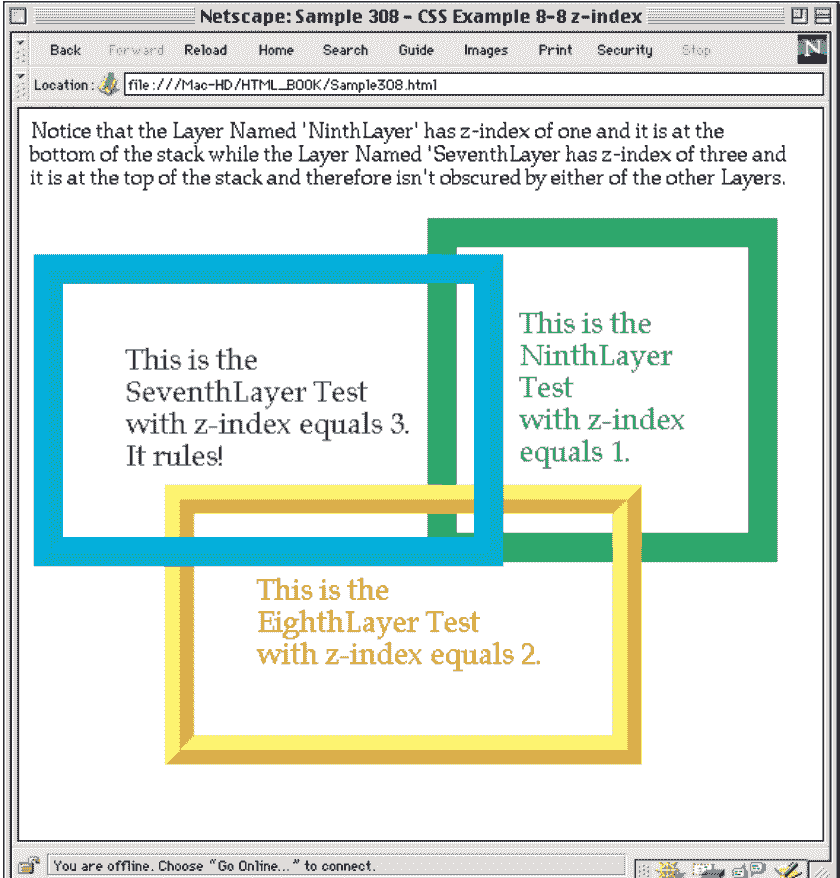

### { visibility: } 属性

**visibility** 属性与 **z-index** 属性密切相关，且经常配合使用，因为它决定了页面加载到浏览器窗口时，图层最初是可见的还是隐藏的。它有三个可能的值：**show**、**hide** 或 **inherit**。值 **show** 使图层可见，值 **hide** 使图层不可见，但它仍然占据其在窗口中通常所占的空间，并且仍然可用于 JavaScript 操作。

指定值为 **inherit** 会使图层具有与其父图层相同的值。如果图层没有父图层，则该图层被称为顶级图层，它将继承 **show** 值，因为文档的 Body 始终可见。图层的默认值是与父图层相同的值。

即使图层被设置为 **show** 值，它仍然可能被另一个指定了相同定位坐标或仅仅是与其重叠且/或具有更高 **z-index** 值的图层所遮挡。

### 微型示例：

```
{ visibility:show; }

{ visibility:hide; }

{ visibility:inherit; }
```

## CSS 语法：

```
{ visibility:show | hide | inherit; }
```

接下来的这个简单示例仅展示上一个示例中的那三个相同图层，并为每个图层添加 **visibility** 属性，以演示其三个可能的值：**show**、**hide** 和 **inherit**。

## 示例 2-9: Sample309.html

```
<!DOCTYPE HTML PUBLIC "-//W3C//DTD HTML 3.2//EN">
<HTML>
<HEAD>
<TITLE>Sample 309 - CSS Example 2-9  visibility  </TITLE>

<STYLE TYPE="text/CSS">

<!--

#SeventhLayer  { position:absolute; left:10px; top:100px;
                 z-index:3; color:blue; font-size:20pt; padding:40px;
                 border-style:ridge; border-width:20px; border-color:aqua;
                 visibility:show; }

#EighthLayer  { position:absolute; left:100px; top:258px;
                 z-index:2; color:red; font-size:20pt; padding:40px;
                 border-style:ridge; border-width:20px; border-color:yellow;
                 visibility:inherit; }

#NinthLayer  { position:absolute; left:280px; top:75px;
                z-index:1; color:green; font-size:20pt; padding:40px;
                border-style:ridge; border-width:20px; border-color:lime;
                visibility:hide; }

-->

</STYLE>
</HEAD>

<BODY>

<DIV ID="SeventhLayer">
This is the <BR>     SeventhLayer Test <BR>       with z-index equals 3.  <BR>
It rules!                                            </DIV>

<DIV ID="EighthLayer">
This is the <BR>     EighthLayer Test <BR>       with z-index equals 2.  </DIV>

<DIV ID="NinthLayer">
This is the <BR>     NinthLayer Test <BR>       with z-index equals 1.  </DIV>

<P>This is exactly the same as Example 307 except that the LAYER Named
'EighthLayer' is designated with the 'inherit' Value and since its parent Layer is
visible it inherits a Value of 'show'. The LAYER Named 'NinthLayer' is designated
as being initially hidden and guess what, you can't see it.

<A HREF="Sample415.html">     Example 3-15  </A>
uses a JavaScript SCRIPT Element to cause these same Layers to disappear and appear
by moving the mouse over them and out from over them. </P>

</BODY>
</HTML>
```

### { layer-background-color: } 属性

`layer-background-color` 属性与第 1 章中介绍的 `background-color` 属性不同。正如你可能从之前的许多示例中记得的那样，当你选择一个普通的 `background color`（背景颜色）时，例如对于 H1 标题元素，只有紧跟在文本后面的空间会获得背景颜色，而分配给该元素的其余空间则具有与 BODY 元素的 BGCOLOR 相同的颜色。

`layer-background-color` 属性的作用是将元素中除 `background color` 空间之外的其他可用空间全部指定为相同的颜色。另一种解释方法是，它指定的是整个图层的 `background color`，而不仅仅是图层的内容，因为内容通常不会填满分配给图层的整个空间。

你可以像选择任何其他属性一样选择颜色，可以使用公认的颜色名称、十六进制三元组或使用 `rgb()` 函数。如果你因为跳读而需要更多信息，请参阅第 1 章第 37 页关于 COLOR（颜色）的章节，或参阅第 1030 页开始的附录 B 中“颜色理论”部分。

这不是一个经 W3C 批准的属性。此外，它在图层（LAYER）元素中没有相应的属性。

### 微型示例：

```
{ layer-background-color:blue; }
{ layer-background-color:#0000ff; }
{ layer-background-color:rgb( 5, 220, 170); }
{ layer-background-color:rgb(45%, 2%, 58%); }
```

## CSS 语法：

```
{ layer-background-color:colorname | #$$$$$$ |
  rgb(0-255,0-255,0-255)  | rgb(0-100%,0-100%,0-100%); }
```

示例 2-10 演示了 `layer-background-color` 属性。

## 示例 2-10: Sample310.html

```
<!DOCTYPE HTML PUBLIC "-//W3C//DTD HTML 3.2//EN">
<html>
<head>
<TITLE>Sample 310 — CSS Example 2-10 layer-background-color </TITLE>
```


```html
<STYLE TYPE="text/CSS">

<!--

#LBCLayer	{ position:absolute; left:20px; top:10px;
	layer-background-color:rgb(45%, 2%, 58%);
	color:aqua;font-size:25pt; padding:40px;
	border-style:ridge; border-width:20px; border-color:blue; }

-->

</STYLE>

</HEAD>

<BODY>

<DIV ID="LBCLayer">
This is the LBCLayer Test. <BR>
Notice that the burgundy color completely covers the area inside of the border
instead of just covering the text area.
</DIV>

</BODY>
</HTML>
```

### { layer-background-image: } 属性

**layer-background-image** 属性指定了整个图层（LAYER）的平铺背景图像。这与常规的 **background-image** 属性略有不同，后者仅在图层的内容区域平铺选定图像，通常无法填满分配给图层的整个空间。

这并非 W3C 批准的属性。此外，在 LAYER 元素中也没有对应的属性（Attribute）。

### 微示例：

```
{ layer-background-image:url('JPEG-FILES/icon-BG-stars.jpg'); }

{ layer-background-image:
url('http://www.erols.com/gilorien/JPEG-FILES/icon-BG-stars.jpg'); }
```

### CSS 语法：

```
{ layer-background-image:url('fullURL' | 'directory/fileName'); }
```

## 示例 2-10 Sample310.html

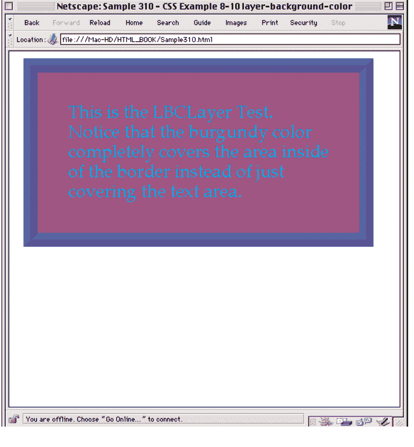

本示例展示了 **layer-background-image** 属性与 **background-image** 属性之间的区别。

## 示例 2-11: Sample311.html

```
<!DOCTYPE HTML PUBLIC "-//W3C//DTD HTML 3.2//EN">
<HTML>
<HEAD>
<TITLE>Sample 311 - CSS Example 2-11 layer-background-image </TITLE>

<STYLE TYPE="text/CSS">

<!--

#LBGImage     { position:absolute; left:20px; top:10px;
                 layer-background-image:url('JPEG-FILES/icon-BG-asteroids.jpg');
                 color:aqua; font-size:25pt;
                 border-style:groove; border-width:20px; border-color:green; }

#RegBGImage   { position:absolute; left:20px; top:200px;
                 background-image:url('JPEG-FILES/icon-BG-asteroids.jpg');
                 color:aqua; font-size:25pt;
                 border-style:groove; border-width:20px; border-color:green; }

-->

</STYLE>

</HEAD>

<BODY>

<DIV ID="LBGImage">
This is the LBGImage Test. <BR>
Notice that the tiled image icon completely covers the area inside of the border
instead of just covering the text area.
</DIV>

<P ID="RegBGImage">
This is the RegBGImage Test. <BR>
Notice that the tiled image icon does not completely cover the area inside of the
border.  Instead it just covers the text area.
</P>

</BODY>

</HTML>
```

## 示例 2-11 Sample311.html

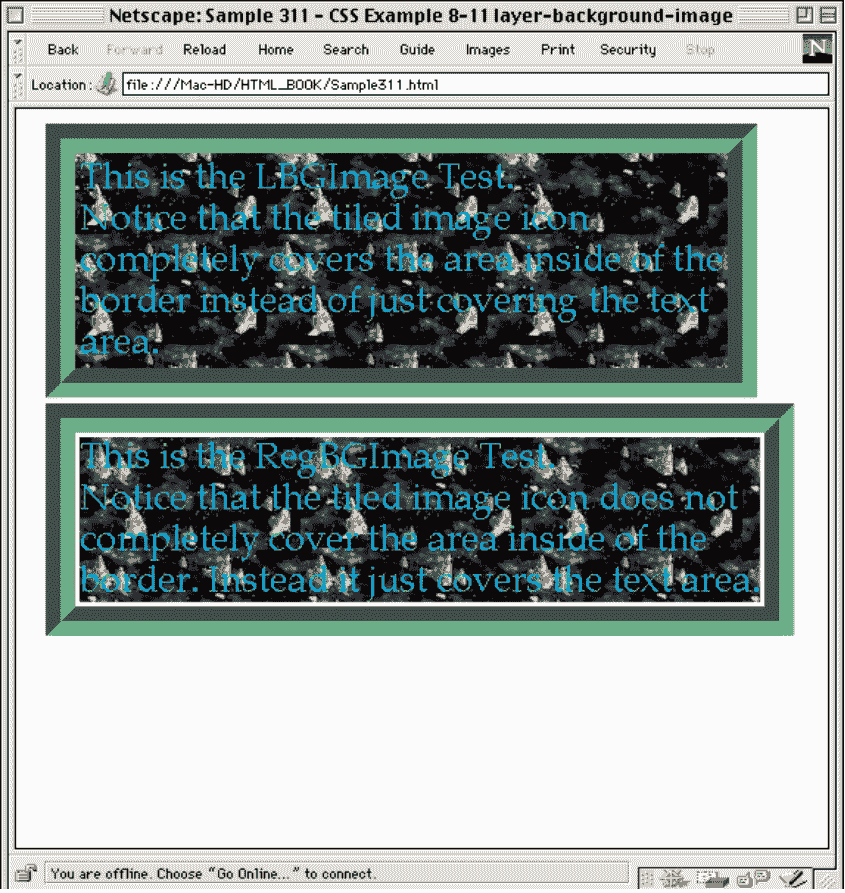

这是 LBGImage 测试。
请注意，平铺的图像图标完全覆盖了边框内部的区域，而不仅仅是覆盖文本区域。

这是 RegBGImage 测试。
请注意，平铺的图像图标并没有完全覆盖边框内部的区域。相反，它仅覆盖了文本区域。

本示例展示了如何结合使用 **layer-background-image** 属性和 **background-color** 属性，使文本拥有背景颜色，且在颜色和文本之后还有一个平铺图像。它同时证明了仅使用常规的 **background-image** 属性无法实现此效果，因为后者会隐藏<u>背景颜色</u>。

## 示例 2-12: Sample312.html

```
<!DOCTYPE HTML PUBLIC "-//W3C//DTD HTML 3.2//EN">
<HTML>
<HEAD>
<TITLE>Sample 312 - CSS Example 2-12 layer-background-image </TITLE>

<STYLE TYPE="text/CSS">

<!--

#LBGImage5	{ position:absolute; left:20px; top:10px;
		layer-background-image:url('JPEG-FILES/icon-CoarseTurf.jpeg');
		color:red; font-size:25pt; padding:20px;
		background-color:yellow; }

#BGImage11	{ position:absolute; left:20px; top:250px;
		background-image:url('Sample-ETOC/icon-Ceiling-Tile.jpeg');
		color:red; font-size:25pt; padding:20px;
		background-color:blue; }

-->

</STYLE>

</HEAD>

<BODY>

<DIV ID="LBGImage5">
This is the LBGImage5 Test.	<BR>
Notice that the tiled image completely covers the area of the DIV Element and the
background-color covers the text area.
</DIV>

<DIV ID="BGImage11">
This is the BGImage11 Test.	<BR>
Notice that the tiled image for the background-image does not allow the
background-color show through for the text area like the layer-background-image
does.
</DIV>

</BODY>
</HTML>
```

## 示例 2-12 Sample312.html

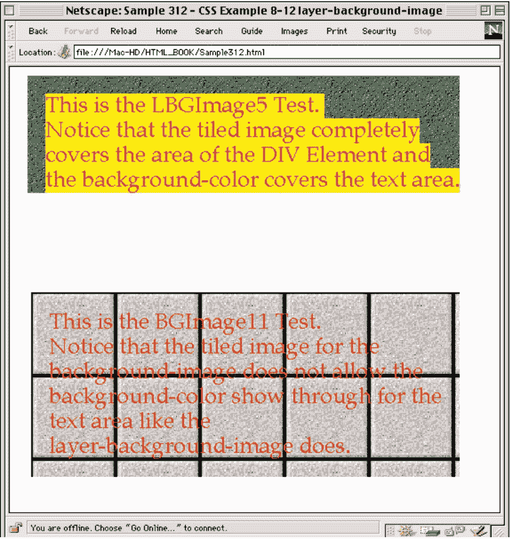

### { include-source: } 属性

**include-source** 属性与其他属性截然不同，因为它允许你从外部文档中将 HTML 格式的内容加载到图层（LAYER）中。对于任何有效的图层，可以通过首先指定 **position** 属性且值为 **absolute** 或 **relative** 来实现。然后，在图层定义中，使用 **include-source** 属性指定一个指向外部文件的链接，该文件只能包含**常规 HTML** 或 **JavaScript**，这些内容将被加载到该图层中。

但请记住，你还必须通过想要加载外部内容的元素的 CLASS 或 ID 属性来指定该图层定义。随后，图层的样式属性将应用于外部文件中的所有 HTML 元素，并在当前文档中渲染。这并非 W3C 批准的属性。它确实有一个对应的图层属性，即 **SRC**。

以下是如何使用 **include-source** 属性创建命名图层（NAMED LAYER）的方法：

```
#RedBack   { position:absolute; left:100px; top:300px;
           background-color:red;
           include-source:url("Sample313-External.html");}
```

然后，你必须像这样将该命名图层应用于文档主体中的某个元素：

```
<DIV ID="RedBack"></DIV>
```

这创建了一个具有样式类（CLASS OF STYLE）且带有 **include-source** 属性的图层，随后该属性被应用于带有 CLASS 属性的 DIV 元素：

```
.myYellow  { position: relative; background-color: yellow;
           include-source:url("Sample313-External.html");}
```

```
<DIV CLASS="myYellow"></DIV>
```

### CSS 语法：

```
{ include-source:url("documentURL"); }
```

### 特别注意：

请务必注意，如果你想要获得可预测且准确的结果，请不要在作为 **External** 文件被 **include-source** 属性加载的任何文件中包含任何 CSS 语法。在这些外部文件中仅使用常规 HTML 代码或 JavaScript。

本示例结合之前的微示例演示了刚刚介绍的 **include-source** 属性，其中 **Redback** 命名图层和 **myYellow** 样式类图层都将外部文件加载到了 DIV 元素中。

## 示例 2-13: Sample313.html

```
<!DOCTYPE HTML PUBLIC "-//W3C//DTD HTML 3.2//EN">
<HTML>
<HEAD>
<TITLE>Sample 313 - CSS Example 2-13 include-source Property     </TITLE>

<STYLE TYPE="text/CSS">

<!--

#RedBack       { position: absolute; left: 100px; top: 300px;
                background-color: red;
                include-source:url("Sample313-External.html"); }

all.myYellow  { position: absolute; left: 100px; top: 400px;
                background-color: yellow;
                include-source:url("Sample313-External.html"); }

-->

</STYLE>

</HEAD>

<BODY>

<P STYLE="position:absolute; left:20px; top:25px; color:blue; font-size:14pt;">
Notice that both of the DIV Elements below this blue paragraph have content that is imported from the 'Sample313-External.html' file. The first DIV Element has a background color of red that is applied to it with the NAMED LAYER named RedBack which is summoned with the ID Attribute of the DIV Element.

The second uses the CLASS of STYLE named 'myYellow' and has a yellow background.

Be EXTREMELY careful with the External Files that you load in and make sure that there is only regular HTML in them and absolutely no CSS Syntax in them or you will get unpredictable and/or seriously weird results.
</P>

<DIV ID="RedBack"></DIV>

<DIV CLASS="myYellow"></DIV>

</BODY>
</HTML>
```


## 示例 2-14 第一部分：Sample314.html

本示例重点演示为什么你不应该在具有通过 `include-source` 属性指定【命名层（NAMED LAYER）】的元素内放置任何文本内容。你分配给该元素的所有文本（或者如果你为该元素定义了属性，那么属性也会被忽略，但在本示例中我没有这么做）都将被忽略。【命名层】仍将正常工作，以便显示外部内容。请注意，DIV 标签内的文本在浏览器窗口中完全没有显示。

```html
<!DOCTYPE HTML PUBLIC "-//W3C//DTD HTML 3.2//EN">
<HTML>
<HEAD>
<TITLE>Sample 314 - CSS Example 2-14 include-source Property Caveat </TITLE>
<STYLE TYPE="text/CSS">
<!--
#RedBack { position:absolute; left:100px; top:200px;
background-color:red;
include-source:url('Sample314A.html'); }
-->
</STYLE>
</HEAD>
<BODY>
<DIV Id="RedBack"> This is the ignored text. </DIV>
<P>这就是为什么在具有附加 "include-source url" 的【命名层】元素内部放置文本不是一个好主意的原因。所有文本或属性都会被忽略，你甚至可能会得到比这更奇怪的结果。</P>
</BODY>
</HTML>
```

## 示例 2-14 第二部分：Sample314A.html

```html
<!DOCTYPE HTML PUBLIC "-//W3C//DTD HTML 3.2//EN">
<HTML>
<HEAD>
<TITLE> Sample 314A - CSS Example 2-14 include-source </TITLE>
</HEAD>
<BODY>
<H3>This is a H3 Heading.</H3>
<H4>This is a H4 Heading.</H4>
</BODY>
</HTML>
```

## CSS 层属性与 \<LAYER\> 属性对照表

本表重复自第 1 章第 13 页，它采用了通过绝对定位样式（Positioned Style）创建层的 CSS 语法属性，并将其与通过 \<LAYER\> 元素创建层的属性进行对比。你会注意到，每种创建层的方式都具有某些对方不具备的独特能力。

| 属性名称 CSS 语法 | 属性名称 \<LAYER\> 语法 | 简单 CSS 语法示例 | 简单 \<LAYER\> 语法示例 |
| :--- | :--- | :--- | :--- |
| position | ID | [ position: absolute; ] [ position: relative; ] | \<LAYER ID="myLayerName"\> |
| | LEFT | [ left: 40px; ] | LEFT="40" |
| #myLayerName | TOP | [ top: 20px; ] | TOP="20" |
| left | PAGEX | | PAGEX="72" |
| top | PAGEY | | PAGEY="144" |
| | WIDTH | [ width: 550px; ] | WIDTH="550" |
| width | HEIGHT | [ height: 400px; ] | HEIGHT="400" |
| height | CLIP | [ clip: rect(10, 20, 30, 40); ] | CLIP="10, 20, 30, 40" |
| clip | Z-INDEX | [ z-index: 3; ] | Z-INDEX="3" |
| z-index | | | |
| | ABOVE | | ABOVE="myLayerName5" |
| | BELOW | | BELOW="myLayerName7" |
| visibility | VISIBILITY | [ visibility: show; ] | VISIBILITY="SHOW" |
| background-color | BGCOLOR | [ background-color: purple; ] | BGCOLOR="#0000ff" |
| background-color-color | | [ layer-background-color: blue; ] | |
| background-image | BACKGROUND | [ background-image:url("image1.jpg"); ] | BACKGROUND="image3.jpg" |
| layer-background-image | | [ layer-background-image:url("image2.jpg"); ] | |
| include-source | SRC | [ include-source: url(myPage.html); ] | SRC="myPage.html" |
| | OnMouseOver | | OnMouseOver |
| | OnMouseOut | | OnMouseOut |
| | OnFocus | | OnFocus |
| | OnBlur | | OnBlur |
| | OnLoad | | OnLoad |

### 特别注意：

默认情况下，层（LAYER）是透明的，也就是说位于其下方的其他层将会透过显示，除非在实际内容（如文本或图像）所在的位置，这些内容会导致底层的层被遮挡。

第一部分 — 动态 HTML

## 使用 \<LAYER\> 元素创建层

### \<LAYER\> 元素

\<LAYER\> 元素是在文档的 Body 部分创建层的直接方式。开始标签和结束标签都是必需的。在功能上，它等同于使用 STYLE 元素或另一个元素的 STYLE 属性来创建层，尽管它提供了几个额外的属性，并且与平行的属性名称相比，其属性名称的语法有所不同。

你可能在前面的图表或下面的语法部分中注意到，LAYER 元素没有对应的 POSITION 属性。这是因为 **absolute**（绝对定位）的值已内置在 LAYER 元素中，而 **relative**（相对定位）的值已内置在 ILAYER 元素中，因此无需指定。

请记住，在使用 LAYER 元素时，你回到了常规 HTML 中，所有测量单位均为像素，但你不需要在整数后面加上单位缩写，并且需要将字符串值包含在单引号或双引号内。

一个必须在脑海中牢记的最重要概念是：LAYER 元素主要用于通过 LEFT 和 TOP 属性精确地**定位**一个独立的内容块。然后，你有几种增强内容的选项：

- 1) 在 LAYER 元素中使用额外的属性。
- 2) 使用 ID 或 CLASS 属性来指定你在页眉中使用 CSS 语法创建的【命名层】。与选项 1 相比，此选项将为你提供无限更多的控制力和创意可能性。
- 3) 使用 STYLE 属性进行内联样式定义。
- 4) 使用 SPAN 元素进行即时样式定义。
- 5) 使用以上所有选项。这将给你带来最大的灵活性。

以下属性是 LAYER 元素特有的，在 CSS 语法中没有对应的属性：

`PAGEX, PAGEY, ABOVE, BELOW, OnMouseOver, OnMouseOut, OnFocus, OnBlur, OnLoad`

关于 \<LAYER\> 元素理论的这部分内容与之前涵盖【命名层】和作为层的 STYLE 属性的部分非常相似。虽然为了完整性有必要重复这些信息，但你可能希望快速浏览，找出与前几节不同的方面，然后将其作为参考，这是它的主要用途。次要用途是为你提供一种比较 CSS 语法和 HTML LAYER 元素语法的方法。

### 语法：

```html
<LAYER
ID="layerName"
LEFT=integerPixels
TOP=integerPixels
PAGEX=integerPixels
PAGEY=integerPixels
WIDTH=integerPixels | "integer%"
HEIGHT=integerPixels | "integer%"
CLIP="TopInteger,RightInteger,BottomInteger,LeftInteger"
Z-INDEX= positiveInteger
ABOVE="layerName"
BELOW="layerName"
VISIBILITY="SHOW" | "HIDE" | "INHERIT"
BGCOLOR="colorName" | "#$$$$$$"
BACKGROUND="imageURL"
SRC="contentURL"
onMouseOver="function()" | "inlineJavaScript"
onMouseOut="function()" | "inlineJavaScript"
onFocus="function()" | "inlineJavaScript"
onBlur="function()" | "inlineJavaScript"
onLoad="function()" | "inlineJavaScript">
***
</LAYER>
```

### 属性定义：

**ID="layerName"**

为你的 LAYER 创建一个名称，并且/或者指定要被寻址和插入的【命名样式】。**layerName** 的值必须以字母字符开头，而不能是以字母数字字符开头。**layerName** 的其余部分可以包含数字。请记住，你的 **layerNames** 总是区分大小写的。你可以通过名称引用一个 LAYER，并使用 JavaScript 等脚本语言对其进行操作。

```html
<LAYER ID="FirstLayer"> This is another test.  </LAYER>
<LAYER ID="SecondLayer">And yet another test.   </LAYER>
```

**LEFT=integerPixels**

指示 LAYER 的左上角在包含层（containing LAYER）中或在浏览器窗口中（如果它是顶层 LAYER）开始渲染的水平坐标。随后 LAYER 将向右下方渲染。它始终以像素为单位，且必须指定为一个正整数、负整数或零，无需带 (px) 单位。这是一个可选属性，如果未使用，则默认为文档的自然流向。

```html
<LAYER LEFT=40>           ...           </LAYER>
```

**TOP=integerPixels**

指示 LAYER 的左上角在包含层（containing LAYER）中或在浏览器窗口中（如果它是顶层 LAYER）开始渲染的垂直坐标。随后 LAYER 将向右下方渲染。它始终以像素为单位，且必须指定为一个正整数、负整数或零，无需带 (px) 单位。这是一个可选属性，如果未使用，则默认为文档的自然流向。

```html
<LAYER TOP=20>         ...    </LAYER>
```

**PAGEX=integerPixels**

其工作方式与 LEFT 属性完全相同，不同之处在于，无论在任何情况下，此 LAYER 左上角的水平起始点都是外部浏览器窗口，而不是包含层。

```html
<LAYER PAGEX=55>         ...    </LAYER>
```

**PAGEY=integerPixels**

其工作方式与 TOP 属性完全相同，不同之处在于，无论在任何情况下，此 LAYER 左上角的垂直起始点都是外部浏览器窗口，而不是包含层。

```html
<LAYER PAGEY=522>         ...    </LAYER>
```

**WIDTH=integerPixels | "integer%"**

为 LAYER 指定水平宽度。你可以使用正整数表示像素，或者使用百分比（后跟百分比符号 `%`）。对于像素，请勿使用单位后缀。该属性的默认值是浏览器窗口中可分配给 LAYER 的最大可用空间的 100%；如果它是嵌套层，内容将换行至直接包含它的 LAYER 的右边缘。如果你在 LAYER 中包含了一个无法换行的项目（如图像），并且指定的 WIDTH 太小而无法包含该项目，那么 LAYER 将自动扩展，直到足够宽以包含该项目。这里有两个微型示例：

```html
<LAYER WIDTH=777>...</LAYER>    <LAYER WIDTH="50%">...</LAYER>
```

**HEIGHT=integerPixels | "integer%"**

为 LAYER 指定垂直高度。你可以使用正整数表示像素，或者使用百分比（后跟百分比符号 `%`）。如果没有指定高度，默认情况下 LAYER 将扩展到显示其中所有内容所需的最小高度。如果你指定的高度不足以正确显示内容，则 LAYER 将自动扩展以适应内容。该属性主要旨在作为其包含的嵌套层的参考，嵌套层将其高度值表示为百分比。它还指定了与 JavaScript 配合使用的层对象剪裁区域的初始高度值。

```html
<LAYER HEIGHT=400>...</LAYER>    <LAYER HEIGHT="75%">...</LAYER>
```


## 第 2 章 — 图层与样式

**`CLIP="TopInteger,RightInteger,BottomInteger,LeftInteger"`**

用于选择图层（LAYER）的哪一部分在初始状态下可见。你可以通过指定一个剪切矩形（Clipping Rectangle）来实现，首先用 (x1,y1) 坐标点指定左上角，然后用 (x2,y2) 坐标点指定右下角。这四个数字 each 之间用逗号分隔，并可选地将其作为一组放在引号之间，使其被视为一个字符串。如果你省略引号，请确保数字或逗号之间没有空格。该矩形内部的空间将成为图层的可见部分。坐标列表的顺序是从左到右：首先是顶部坐标，然后是右侧坐标，接着是底部坐标，奇怪的是，最后一个是左侧坐标。当你读到这里时，这个顺序可能已经发生了变化，因此如果你在让图层显示时遇到任何问题，请尝试将左侧坐标放在列表的开头（Netscape 的文档中是这样建议的，但目前该文档有误）。这些坐标必须是正整数、负整数或零，并且始终代表像素。你不需要在坐标后添加 (px) 测量单位。CLIP 属性是一个可选属性，默认值为图层完全可见。

```
<LAYER CLIP="10, 200, 300, 40">   ...   </LAYER>
```

其中：
10 是顶部坐标
200 是右侧坐标
300 是底部坐标
40 是左侧坐标

你也可以为 CLIP 属性使用一个仅包含两个数字的数值集，从而仅指定右侧坐标和底部坐标。在这种情况下，顶部和左侧坐标默认值均为零，如下所示：

```
<LAYER CLIP="200, 300">   ...   </LAYER>
```

这等同于：

```
<LAYER CLIP="0, 200, 300, 0">   ...   </LAYER>
```

## Z-INDEX=positiveInteger

使用正整数来指定图层在堆叠顺序中的位置。Z-INDEX 设置为 1 的图层将位于所有后续图层的下方，因此 Z-INDEX 越大，该图层在 z-轴堆栈中的位置就越高。其作用是确定图层的优先顺序，从而在图层重叠甚至占据完全相同空间时控制其内容的可见性。当你设置不同的图层占据相同空间时，通常将其中一个的值设为 SHOW，其余的设为 HIDE，然后使用 JavaScript 来操控它们，或允许用户动态更改页面。

通常，图层按照其在代码中出现的顺序进行堆叠，因此代码序列中的第一个图层处于 z-轴堆栈的底部，下一个编码的图层是堆栈中的下一个，以此类推。通过使用 Z-INDEX 属性，你可以更改该 z-轴顺序以满足你的创作需求。

## 第一部分 — 动态 HTML

**Z-INDEX** 属性不影响嵌套图层与其父图层之间的堆叠顺序，而仅影响父图层内部的同级图层。此外，每个图层只能使用一个 **Z-INDEX** 属性。这是一个微型示例：

```
<LAYER Z-INDEX=5>        ...       </LAYER>
```

## ABOVE="layerName"

指定该图层在堆叠顺序中将高于由 **layerName** 指定的图层。重要的是，**layerName** 图层必须是一个已经存在的图层；否则，将创建一个新图层，这可能会在你的 JavaScript 脚本中引起问题，或在 HTML 页面中产生意外的布局结果。此属性没有对应的 CSS 语法属性。这是一个微型示例：

```
<LAYER ABOVE="myLayer">       ...       </LAYER>
```

## BELOW="layerName"

指定该图层在堆叠顺序中将低于由 **layerName** 指定的图层。重要的是，**layerName** 图层必须是一个已经存在的图层；否则，将创建一个新图层，这可能会在你的 JavaScript 脚本中引起问题，或在 HTML 页面中产生意外的布局结果。此属性没有对应的 CSS 语法属性。这是一个微型示例：

```
<LAYER BELOW="yourLayer">      ...       </LAYER>
```

## VISIBILITY="SHOW" | "HIDE" | "INHERIT"

决定页面加载到浏览器窗口时，图层初始状态是可见还是隐藏。值 SHOW 使图层可见。值 HIDE 使图层不可见，但它仍然占据其在窗口中通常所占的空间。即使对于处于流中（inflow）的图层也是如此；也就是说，它被定义为本质上的绝对定位，但没有选择 LEFT 或 TOP 值。请注意，即使图层的值为 HIDE，它仍然可以被 JavaScript 操作，但在分配 SHOW 值之前无法接收事件。如果你希望图层隐藏但仍能接收事件（例如来自键盘的事件），请使用负整数通过 **LEFT** 或 **TOP** 属性将图层放置在屏幕之外。

指定值为 INHERIT 会使图层具有与其父图层相同的值。如果图层没有父图层，则称其为顶层图层，它将继承 SHOW 值，因为文档的 Body 始终可见。图层的默认值是与其父图层相同的值。

即使图层被设置为 SHOW，它仍可能被另一个指定了相同定位坐标或与其重叠且/或具有更高 Z-INDEX 值的图层所遮挡。以下是微型示例：

```
<LAYER VISIBILITY="SHOW">       ...  </LAYER>
<LAYER VISIBILITY="HIDE">       ...  </LAYER>
<LAYER VISIBILITY="INHERIT">    ...  </LAYER>
```

## 第 2 章 — 图层与样式

## BGCOLOR="colorName" | "#$$$$$$"

又来了！同样，使用公认的颜色名称，或者使用前面带有井号 (#) 并放在双引号之间的可靠的红-绿-蓝十六进制三元组。

```
<LAYER BGCOLOR="blue">      ...  </LAYER>
<LAYER BGCOLOR="#22aaff">     ...  </LAYER>
```

## BACKGROUND="imageURL"

指定一张图像通过图像文件的 URL 访问，并作为图层的背景进行平铺（重复）。如果你想追求华丽效果，还可以使用 GIF89a 动画或其他媒体类型。如果你这样做，你可能想为图层内容的样式指定一个 **padding** 属性。

```
<LAYER BACKGROUND="JPEG-FILES/icon-BG-stars.jpg">     ...
</LAYER>

<LAYER
BACKGROUND="http://www.erols.com/gilorien/JPEG-FILES/
         icon-BG-stars.jpg">  ...
</LAYER>
```

## SRC="contentURL"

指定一个仅包含 HTML 内容或包含 HTML 内容和 JavaScript 的外部文档，该文档将被加载并放置在此图层中。来自外部文件的任何放置在 LAYER 元素内的图层将被视为包含图层（即加载内容的具有 SRC 属性的图层）的子图层。此属性对应的 CSS 语法属性是 **include-source** 属性。

如果你想动态更改图层的内容，或者将其用于为 NOLAYER 元素提供替代内容，这将非常有用。

```
<LAYER SRC="Sample310.html"> ... </LAYER>

<LAYER SRC="http://www.dreamplay.com/Sample311.html"> ... </LAYER>
```

## onMouseOver="function()" | "inlineJavaScript"

当用户将鼠标光标置于文档中该图层所占据的空间之上时，执行此函数或内联 JavaScript 代码。请参阅处理“图层 JavaScript”的第 3 章或处理“JavaScript 事件和事件处理器”的第 6 章。

## onMouseOut="function()" | "inlineJavaScript"

当用户将鼠标光标移出文档中该图层所占据的空间时，执行此函数或内联 JavaScript 代码。请参阅处理“图层 JavaScript”的第 3 章或处理“JavaScript 事件和事件处理器”的第 6 章。


### onFocus="function( )" | "inlineJavaScript"

当文档中的此 LAYER 获得键盘焦点时，执行此函数或内联 JavaScript 代码。参见第3章“Layers 的 JavaScript”或第6章“JavaScript 事件与事件处理程序”。

### onBlur="function( )" | "inlineJavaScript"

当文档中的此 LAYER 失去焦点时，执行此函数或内联 JavaScript 代码。参见第3章“Layers 的 JavaScript”或第6章“JavaScript 事件与事件处理程序”。

### onLoad="function( )" | "inlineJavaScript"

当此 LAYER 完全加载到浏览器窗口后，执行此函数或内联 JavaScript 代码。参见第3章“Layers 的 JavaScript”或第6章“JavaScript 事件与事件处理程序”。

以下示例展示了三个使用 LAYER 标签的 Layer。有关更多信息，请参见 LAYER 标签之间的文本。

### 示例 2-15：Sample315.html

```html
<!DOCTYPE HTML PUBLIC "-//W3C//DTD HTML 3.2//EN">
<HTML><HEAD>
<TITLE>Sample 315 - Example 2-15 LAYER Element </TITLE> </HEAD>
<BODY>

<LAYER LEFT=72 TOP=30> 
      This is a simple Layer. It is inherently absolute and placed at 72 pixels to
the right of the left margin of the Body Element and 30 pixels down from the top
margin of the Body Element which contains it.
</LAYER>

<LAYER LEFT=50 TOP=144 BGCOLOR="red" WIDTH=400>
      This Layer is 50 pixels from the left margin and 144 pixels from the top
margin of the Body Element and has a background color of red.
</LAYER>

<LAYER LEFT=10 TOP=244 BGCOLOR="aqua" WIDTH=400>

<FONT SIZE="5" COLOR="blue"> 
      This layer is 10 pixels from the left margin and 244 pixels from the top
margin of the Body Element and has a background color of aqua. The text is blue and
sized at 5, but it was specified with the FONT Element and not with CSS Syntax.
</FONT>
</LAYER>

</BODY>
</HTML>
```

## CHAPTER 2 — Layers and Styles

此示例演示了 LEFT 和 TOP 属性在其 Layer 嵌套在另一个 Layer 内部时的行为。它们不再是相对于页面的绝对定位坐标，而是相对于父 Layer。在第三个 Layer 中，省略了 LEFT 和 TOP 属性，取而代之的是使用 PAGEX 和 PAGEY 属性。有关更多详细信息，请参见示例中包含在 Layer 内的文本。

### 示例 2-16：Sample316.html

```html
<!DOCTYPE HTML PUBLIC "-//W3C//DTD HTML 3.2//EN">
<HTML>
<HEAD>
<TITLE>     Sample 316 - Example 2-16      LAYER Element  </TITLE>
</HEAD>

<BODY>

<LAYER LEFT=72 TOP=30>

      All three of these Layers have x-coordinates of 72 pixels but the second and
third Layers are both nested inside the first Layer which causes the second Layer
to be 72 pixels to the right of the margin of the first Layer, not just to the
right of the Body Element.           <BR><BR>
      Just to add a little spice to the mix the third Layer is using the PAGEX and
PAGEY Attributes so by definition its coordinates are not applied to the first
Layer but are applied to the margin of the Body Element which causes it to be 72
pixels to the right of the margin of the Body Element and 244 pixels down from the
top of the margin of the Body Element.

<LAYER LEFT=72 TOP=150 BGCOLOR="yellow" WIDTH=400>
      This Layer is 72 pixels from the left margin of the first Layer so it is 144
pixels from the Body Element margin. It 150 pixels from the top margin of the first
Layer which makes it 180 pixels from the top margin of the Body Element and has a
background color of yellow. If it is overlapping the first Layer then resize your
browser window so it is wider.
</LAYER>

<LAYER PAGEX=72 PAGEY=300 BGCOLOR="lime" WIDTH=330>
<FONT SIZE="5" COLOR="blue">
      This Layer is 72 pixels from the left margin and 300 pixels from the top
margin of the Body Element and has a background color of lime. The text is blue and
sized at 5, but it was specified with the FONT Element and not with CSS Syntax.
</FONT>
</LAYER>

              <!-- Closes the top parent Layer-->
</LAYER>

</BODY>
</HTML>
```

Example 2-16 Sample316.html
(Image: img/fa445ddda5fcdd34d18c81476c58e0b2_189_0.png)

## CHAPTER 2 — Layers and Styles

此示例演示了 LAYER 元素和使用 CSS 语法创建的 NAMED LAYER，并展示了可以在单个 LAYER 元素中使用属性并从 NAMED LAYER 继承属性。

### 示例 2-17：Sample317.html

```html
<!DOCTYPE HTML PUBLIC "-//W3C//DTD HTML 3.2//EN">
<HTML>
<HEAD>
<TITLE>Sample 317 - Example 2-17 LAYER Element </TITLE>
<STYLE TYPE="text/CSS">
<!--
#LeBodi       { padding:20px; font-size:15pt; }
#LBCLayer     { position:absolute; left:30px; top:170px;
                layer-background-color:rgb(45%, 2%, 58%);
                color:aqua; font-size:20pt; padding:20px;
                border-style:ridge; border-width:20px; border-color:blue; }
#LBCLayer2    { position:absolute; left:25px; top:300px;
                layer-background-color:rgb(75%, 72%, 8%);
                color:blue; font-size:25pt; padding:10px;
                border-style:double; border-width:20px; border-color:lime; }
-->
</STYLE>
</HEAD>
<BODY TEXT="white" BGCOLOR="black">
<LAYER ID="LeBodi" LEFT="45" TOP="40" BGCOLOR="#7700ff" WIDTH="500">
    All of these Layers are specified with the LAYER Element and each address a
    NAMED LAYER from the Style Definition. Notice that this Layer also makes use of
    LAYER Attributes in addition to the padding Property and font-size Property that it
    inherits from the 'LeBodi' NAMED LAYER. <BR><BR>
</LAYER>
<LAYER ID="LBCLayer">
This is the LBCLayer Test. It has a blue border.
</LAYER>
<LAYER ID="LBCLayer2">
This is the LBCLayer2 Test. It has a lime border.
</LAYER>
</BODY>
</HTML>
```

Example 2-17 Sample317.html
(Image: img/fa445ddda5fcdd34d18c81476c58e0b2_191_0.png)

#### `<ILAYER>` 元素

`<ILAYER>` 元素是一个内联流入式 Layer，而 LAYER 元素则被视为非内联的。

`<ILAYER>` 元素具有与 `<LAYER>` 元素相同的所有属性，它们的定义完全相同且工作方式也完全一致，但 **LEFT** 和 **TOP** 属性除外。LEFT 和 TOP 属性指定的是相对于文档自然流的偏移距离，而不是绝对位置。有关这两个属性的更多信息，请参见 ILAYER 元素的语法说明之后的内容。由于其他 ILAYER 属性的定义与其 LAYER 元素对应部分完全相同，因此在此不再重复，有关更多信息请参见前面关于 LAYER 元素的部分。

### 语法：

```html
<ILAYER
ID="layerName"
LEFT=integerPixels
TOP=integerPixels
PAGEX=integerPixels
PAGEY=integerPixels
WIDTH=integerPixels | "integer%"
HEIGHT=integerPixels | "integer%"
CLIP="TopInteger,RightInteger,BottomInteger,LeftInteger"
Z-INDEX= positiveInteger
ABOVE="layerName"
BELOW="layerName"
VISIBILITY="SHOW" | "HIDE" | "INHERIT"
BGCOLOR="colorName" | "#$$$$$$"
BACKGROUND="imageURL"
SRC="contentURL"
OnMouseOver="function()" | "inlineJavaScript"
OnMouseOut="function()" | "inlineJavaScript"
OnFocus="function()" | "inlineJavaScript"
OnBlur="function()" | "inlineJavaScript"
OnLoad="function()" | "inlineJavaScript">

***

</ILAYER>
```

## 属性定义：

**LEFT=integerPixels** 表示从 Layer 在文档中正常流动位置的上角开始测量的水平偏移距离。这就是 ILAYER 的上角在包含它的 Layer 中或浏览器窗口中（如果是顶层 Layer）开始渲染的位置。

然后 ILAYER 会向下并向右渲染。始终以像素为单位，必须为正整数、负整数或零，不带 (px) 单位。这是可选属性，如果未使用则默认为文档的自然流。

```html
<ILAYER LEFT=40>
...
  Layer Content  ...
</ILAYER>
```

**TOP=integerPixels** 表示从 Layer 在文档中正常流动位置的上角开始测量的垂直偏移距离。这就是 ILAYER 的上角在包含它的 Layer 中或浏览器窗口中（如果是顶层 Layer）开始渲染的位置。

然后 ILAYER 会向下并向右渲染。始终以像素为单位，必须为正整数、负整数或零，不带 (px) 单位。这是可选属性，如果未使用则默认为文档的自然流。

```html
<ILAYER TOP=20>
...
  Layer Content  ...
</ILAYER>
```

示例 2-18 简单演示了两个内联 ILAYER 元素。按出现顺序，第一个 ILAYER 是紫色的，第二个是红色的。它们都指定了 500 像素的 WIDTH，每个都包含少量明显的说明性文本。

此示例的要点是提供 ILAYER 元素的最简单实现，供你在今后演示更复杂的示例时作为参考进行比较。


## 第2章 — 图层与样式

### 示例 2-18：Sample318.html

```html
<!DOCTYPE HTML PUBLIC "-//W3C//DTD HTML 3.2//EN">
<HTML>
<HEAD>
<TITLE>     Sample 318 - Example 2-18    ILAYER Element </TITLE>
<BASEFONT SIZE="5">
</HEAD>

<BODY TEXT="white" BGCOLOR="black">

<ILAYER BGCOLOR="#7700ff" WIDTH=500>
This is the first ILAYER Layer. Without the BR Tags they would stack vertically
snug.
</ILAYER>         <BR><BR>

<ILAYER BGCOLOR="red"  WIDTH=500 HEIGHT=200>
This is the second ILAYER Layer.
</ILAYER>

</BODY>
</HTML>
```

此示例演示了如何将**命名样式**应用于 ILAYER 元素。请注意第三个 ILAYER 具有 LEFT 和 TOP 属性，这些属性将其内流位置按指定的像素数进行偏移。

### 示例 2-19：Sample319.html

```html
<!DOCTYPE HTML PUBLIC "-//W3C//DTD HTML 3.2//EN">
<HTML>
<HEAD>
<TITLE>Sample 319 - Example 2-19    ILAYER Element </TITLE>

<STYLE TYPE="text/CSS">

<!--

#LeBodi      { font-size: 15pt; }

#LBCILAYER   { layer-background-color: rgb(45%, 2%, 58%);
               color: aqua; font-size: 20pt;
               border-style:ridge; border-width:20px; border-color:blue; }

#LBCILAYER2  { layer-background-color: rgb(75%, 72%, 8%);
               color: blue; font-size: 25pt;
               border-style:double; border-width:20px; border-color:lime; }

-->
</STYLE>
</HEAD>
<BODY TEXT="white" BGCOLOR="black">
<ILAYER ID="LeBodi" BGCOLOR="#7700ff" WIDTH=500>
    All of these ILAYERs are specified with the ILAYER Element and each address
    a NAMED ILAYER from the Style Definition. Notice that this ILAYER also makes use of
    ILAYER Attributes. <BR><BR>
</ILAYER>
<ILAYER ID="LBCILAYER">
    This is the LBCILAYER Test. It has a blue border.
</ILAYER>
<ILAYER ID="LBCILAYER2" LEFT=45 TOP=40>
    This is the LBCILAYER2 Test. It has a lime border.
</ILAYER>
</BODY>
</HTML>
```

#### `<NOLAYER>` 元素

`<NOLAYER>` 元素用于向 precatorio 不支持图层的浏览器用户提供信息或选项。您可以将 NOLAYER 元素放在 LAYER 元素或 ILAYER 元素内部，或者放在使用 CSS 语法或 JavaScript 语法创建的图层内。

### 语法：

```html
<NOLAYER> *** </NOLAYER>
```

示例 2-20 包含对 NOLAYER 元素的简单演示，该元素包含在 ILAYER 元素内部。

### 示例 2-20：Sample320.html

```html
<!DOCTYPE HTML PUBLIC "-//W3C//DTD HTML 3.2//EN">
<HTML>
<HEAD>
<TITLE>Sample 320 - Example 2-20     NOLAYER Element     </TITLE>
</HEAD>

<BODY TEXT="white" BGCOLOR="black">

<ILAYER>
               <NOLAYER>

<H2>
       Hey Now!!! If you are reading this you are using a LAYER-Challenged-Browser.
For optimal viewing proceed immediately to

<A HREF="http://www.Netscape.com">Netscape's website</A>

 and download version 4.0 or later, of Navigator.
</H2>

<H2>
       Otherwise

<A HREF="myAlternatePage.html">

Enter the Non-Layers Version of the our website.</A>

</H2>

             </NOLAYER>

This is the LAYER Test.

</ILAYER>

</BODY>
</HTML>
```

## 第3章：图层与 JavaScript

## 目录

#### JavaScript 图层入门
- 3.1) 概述 182
- 3.2) 适用于 JavaScript 语法的样式表注释 182

### 新的 JavaScript 属性
- 3.3) 新的 document 对象属性 183
- 3.4) tags 属性 183
- 3.5) classes 属性 185
- 3.6) ids 属性 187

### JavaScript 样式表
- 3.7) JavaScript 样式表 189
- 3.8) 使用 with() 语句 189
- 3.9) JavaScript 关键字 all 190
- 3.10) contextual() 方法 191
- 3.11) JavaScript 样式表属性与示例图表 194
- 3.12) JavaScript 样式表属性与所有值图表 195

### JavaScript 与图层
- 3.13) JSS position 属性 196
- 3.14) HTML `<SCRIPT>` 元素 196
- 3.15) 用于隐藏 `<SCRIPT>` 元素内容的注释标签 197
- 3.16) JavaScript 关键字 var 198
- 3.17) JavaScript Layer 对象 199
- 3.18) JavaScript layers[i] 数组 199
- 3.19) 两种 document 对象 200

#### Layer 对象的属性
- 3.20) Layer 对象的属性 — 图表 203
- 3.21) Layer 对象的 document 属性 204
- 3.22) 调用 Layer 对象上的方法 204
- 3.23) Layer 对象的 name 属性 205
- 3.24) Layer 对象的 left 属性 205
- 3.25) Layer 对象的 top 属性 206
- 3.26) Layer 对象的 pageX 属性 207
- 3.27) Layer 对象的 pageY 属性 207
- 3.28) Layer 对象的 visibility 属性 208
- 3.29) Layer 对象的 zIndex 属性 209
- 3.30) Layer 对象的 siblingAbove 属性 209
- 3.31) Layer 对象的 siblingBelow 属性 210
- 3.32) Layer 对象的 above 属性 210
- 3.33) Layer 对象的 below 属性 210
- 3.34) Layer 对象的 parentLayer 属性 211
- 3.35) Layer 对象与裁剪矩形 211
- 3.36) 裁剪属性的默认值 212
- 3.37) Layer 对象的 clip.top 属性 212
- 3.38) Layer 对象的 clip.left 属性 212
- 3.39) Layer 对象的 clip.bottom 属性 213
- 3.40) Layer 对象的 clip.right 属性 213
- 3.41) Layer 对象的 clip.width 属性 213
- 3.42) Layer 对象的 clip.height 属性 214
- 3.43) Layer 对象的 bgColor 属性 214
- 3.44) Layer 对象的 background 属性 215
- 3.45) Layer 对象的 src 属性 215

### Layer 对象的方法
- 3.46) moveBy(dx, dy) 方法 217
- 3.47) moveTo(x, y) 方法 217
- 3.48) moveToAbsolute(x, y) 方法 218
- 3.49) resizeBy(dwidth, dheight) 方法 218
- 3.50) resizeTo(width, height) 方法 219
- 3.51) moveAbove(layerName) 方法 220
- 3.52) moveBelow(layerName) 方法 221
- 3.53) load("sourceURL", newPixelWidth) 方法 221

#### 将 JavaScript 与图层结合使用
- 3.54) JavaScript write() 方法 230
- 3.55) 使用 write() 与 close() 方法 230
- 3.56) 使用 moveAbove() 方法 232
- 3.57) 显示与隐藏图层及写入图层内容 236
- 3.58) 使用 new 运算符实时创建新图层 240
- 3.59) 使用 tags 属性样式动态创建新图层 241
- 3.60) 图层内的本地化 JavaScript `<SCRIPT>` 246
- 3.61) 动画裁剪矩形以显示图像 250
- 3.62) JavaScript setTimeout() 方法 250
- 3.63) JavaScript clearTimeout() 方法 250
- 3.64) 动画裁剪矩形与弹出图像 251
- 3.65) 一些 JavaScript 技巧 264
- 3.66) 动画控制图层与图像的离屏和入屏 264
- 3.67) JavaScript setInterval() 方法 284
- 3.68) JavaScript clearInterval() 方法 284
- 3.69) 重复循环背景色的三个示例 285
- 3.70) 井字棋游戏示例 296
- 3.71) JavaScript Date 对象 307
- 3.72) 使用四种 Date 构造函数创建 Date 对象 308
- 3.73) 创建计时器并显示当前时间 308
- 3.74) 在框架集中创建计时器并显示当前时间 310
- 3.75) JavaScript 条件运算符 ?: 316
- 3.76) JavaScript Math 对象 321
- 3.77) Math 对象属性汇总 322
- 3.78) Math 对象方法汇总 322
- 3.79) 随机加载不同的背景图像到图层 323
- 3.80) 在准计算器中使用 Math 方法 325
- 3.81) Math.max(x,y)、Math.min(x,y) 和 Math.pow(x,y) 方法 334
- 3.82) JavaScript toString() 方法 336
- 3.83) JavaScript parseFloat() 函数 337
- 3.84) JavaScript parseInt() 函数 337
- 3.85) JavaScript isNaN() 函数 338
- 3.86) JavaScript charAt() 方法 338
- 3.87) JavaScript split() 方法 338
- 3.88) JavaScript slice() 方法 339
- 3.89) String 对象的 length 属性 339
- 3.90) 一个很酷的颜色转换计算器 340
- 3.91) 边框动画与音乐的综合示例 351


### 介绍 JavaScript 层

#### 概述

本章主要关注使用 JavaScript 语法创建的层，以及将 JavaScript 与 **Layer** 对象结合使用。它首先定义了你需要了解的 **document** 对象的新 JavaScript 属性，以便使用 JavaScript 语法实现样式。用于 JavaScript 语法样式的属性仅在第 194-195 页的两个图表中介绍，因为相关信息已在第 1 章关于 CSS 的部分中涵盖。你需要意识到的主要区别是属性名称不同。然后介绍了 **Layer** 对象的属性和方法。接着，描述了一些额外的 JavaScript 方法并在示例中使用，其中重点强调了 **window** 对象的 **setTimeout()** 方法来使层产生动画效果。

JavaScript 可用于动态修改 HTML 元素的样式以及使用任何可能的定义方式创建的层。无论你是使用 LAYER 元素、STYLE 类、样式属性还是其他任何方式定义层，只要它是一个定位的内容块，都没有关系。

**Layer** 对象的属性和方法为创造性地操作你的层提供了一套强大的工具。结合其他 JavaScript 属性和方法使用，你现在拥有了前所未有的控制水平来显示和动态更改页面中的内容。

### 用于 JavaScript 语法的样式表注释

当你想在使用 JavaScript 语法的 STYLE 元素中包含注释时，单行注释需在前面加上两个正斜杠（//）。对于多行注释，在第一行前加上一个正斜杠后跟一个星号（/*），在最后一行后跟一个星号后跟一个正斜杠（*/）。

#### JavaScript 语法：

```
//    单行注释
/*    多行注释  */
```

### 新的 JavaScript 属性

### 新的 document 对象属性

你需要了解的、用于将 JavaScript 语法与样式和层一起使用的 **document** 对象的新属性是：

- tags 属性
- classes 属性
- ids 属性

### tags 属性

#### JavaScript 语法：

```
tags.elementName.propertyName="propertyValue";
```

#### 参数定义：

**tags** 属性用于在使用 JavaScript 语法在 `<STYLE>` 元素内创建样式表时为 HTML 元素定义样式。它是 JavaScript **document** 对象的一个属性，当你通过在 `<STYLE>` 元素中使用 `TYPE="text/JavaScript"` 属性声明要用 JavaScript 语法编写样式表时，该对象会自动创建。

当你使用点表示法的 **tags** 属性时，它表示由后缀 **elementName** 参数指定的 HTML 元素，将通过指定属性名称 **propertyName** 及其值 **propertyValue** 来分配一个样式，如下所示：

```
document.tags.DIV.fontSize="22pt";
```

**tags** 属性指定对于此 **document**，所有 **DIV** 元素的 **fontSize** 属性将被设置为将所有文本设置为 22 点。以下是它在 `<STYLE>` 元素内的样子：

```
<STYLE TYPE="text/JavaScript">

document.tags.DIV.fontSize="22pt";

</STYLE>
```

现在，为了简化，当你使用 **tags** 属性时，它只能应用于 **document** 对象，所以 Netscape 的好心人已经在 Navigator 中巧妙地编码，这样你就不必每次使用 **tags** 属性时都输入 **document**，因为系统假定它已存在。这意味着以下两个迷你示例是等效的：

```
document.tags.DIV.fontSize="22pt";

tags.DIV.fontSize="22pt";
```

确保你记得在每个赋值后包含分号。

#### 特别注意：

> **不要**将使用 **JavaScript 语法** 的样式表放在 HTML 注释（`<!-- ... -->`）标签内，否则你会收到错误消息。

使用 `<NOSCRIPT> ... </NOSCRIPT>` 标签来为你的页面提供替代内容。

好的，让我们在一个简单的例子中把所有这些放在一起。

#### 示例 3-0：Sample400.html

```
<!DOCTYPE HTML PUBLIC "-//W3C//DTD HTML 3.2//EN">
<HTML>
<HEAD>
<TITLE>Sample 400 - Example 3-0    tags 属性        </TITLE>

<STYLE TYPE="text/JavaScript">

        tags.DIV.fontSize="22pt";

</STYLE>

</HEAD>

<BODY>

<DIV>Live Long and Prosper.</DIV>

</BODY>
</HTML>
```

### classes 属性

#### JavaScript 语法：

```
classes.className.elementName.propertyName="propertyValue";
```

#### 参数定义：

classes 属性用于定义要应用于元素的样式类，如前面第 72 页第 1 章所讨论。以下是点表示法中的语法顺序，以及一些迷你示例来向你展示如何使用 JavaScript 语法实现。

classes 属性在前，然后是样式类的名称紧随其后。接着是元素名称，然后是属性名称，之后是等号（=）和属性值。属性值对于字符串值要用双引号（" "）括起来，对于数值或变量则不加双引号。最后部分是分号（;），如下所示：

```
classes.BlueBlocker.BLOCKQUOTE.color="blue";
```

其中：

- classes: 是 document 对象属性
- BlueBlocker: 是样式类的名称
- BLOCKQUOTE: 是 HTML 元素名称
- color: 是样式属性名称
- blue: 是样式属性值

它定义了一个名为 BlueBlocker 的样式类，该类应用于所有 BLOCKQUOTE 元素，导致文本颜色变为蓝色。

以下是一些更多迷你示例：

#### 迷你示例：

```
classes.Chunky.H5.fontWeight="bold";
classes.Slanted.DIV.fontStyle="italic";
classes.WhyHelv.PRE.fontFamily="Helvetica";
```

好的，让我们在一个简单的例子中把所有这些放在一起。

#### 示例 3-1：Sample401.html

```
<!DOCTYPE HTML PUBLIC "-//W3C//DTD HTML 3.2//EN">
<HTML>
<HEAD>
<TITLE>       Sample 401 - Example 3-1  classes 属性  </TITLE>

<STYLE TYPE="text/JavaScript">

        classes.BlueBlocker.BLOCKQUOTE.color="blue";

        classes.Chunky.H5.fontWeight="bold";

        classes.Slanted.DIV.fontStyle="italic";

        classes.WhyHelv.PRE.fontFamily="Helvetica";

</STYLE>

</HEAD>

<BODY>

<BLOCKQUOTE CLASS="BlueBlocker">

The BLOCKQUOTE test.

</BLOCKQUOTE>

<H5 CLASS="Chunky">

The H5 test.

</H5>

<DIV CLASS="Slanted">

The DIV test.

</DIV>

<PRE CLASS="WhyHelv">
The
PRE
test.</PRE>

</BODY>

</HTML>
```

### ids 属性

#### JavaScript 语法：

```
ids.namedStyleName.propertyName="propertyValue";
```

#### 参数定义：

**ids** 属性用于创建一个单独的命名样式，作为样式类的例外情况使用。你这样定义它：

```
ids.PurplishText.color="#7700ff";
```

其中 **PurplishText** 是 **namedStyleName** 参数，它可以是任何名称，只要它以大写或小写字母或下划线（_）字符开头，后跟任何字母数字字符序列。在此示例中，**propertyName** 参数是 **color**，这是 JavaScript 语法中的一个有效样式表属性。

然后你使用 **namedStyleName** 参数作为 ID 属性的值。它通常与元素的 CLASS 属性一起使用，如下所示：

```
<BLOCKQUOTE CLASS="BlueBlocker" ID="PurplishText">
```

其中我们使用了上一个示例中的 "**BlueBlocker**" 样式类：

```
classes.BlueBlocker.BLOCKQUOTE.color="blue";
```

#### 分配其他属性

当你想为特定的样式类或命名的单独样式分配另一个属性时，只需对同一个 **namedStyleName** 参数重复该过程并添加额外的属性。

为了准备下一个示例，我们为 "**BlueBlocker**" 样式类定义了第二个属性，使其字号为 48 点，如下所示：

```
classes.BlueBlocker.BLOCKQUOTE.fontSize="48pt";
```

把所有这些放在一起，我们得到下面的示例 3-2：


## 第一部分 — 动态 HTML

### 示例 3-2：Sample402.html

```html
<!DOCTYPE HTML PUBLIC "-//W3C//DTD HTML 3.2//EN">
<HTML>
<HEAD>
<TITLE> Sample 402 - Example 3-2 ids Property </TITLE>

<STYLE TYPE="text/JavaScript">

        classes.BlueBlocker.BLOCKQUOTE.color="blue";

        .BlueBlocker.BLOCKQUOTE.fontSize="48pt";

        ids.PurplishText.color="#7700ff";

</STYLE>

</HEAD>

<BODY>

<BLOCKQUOTE CLASS="BlueBlocker" ID="PurplishText">
Another Purple Example.
</BLOCKQUOTE>

</BODY>
</HTML>
```

### 动态更改属性

你还可以在 SCRIPT 元素内使用 **ids** 属性动态更改属性，如下所示：

```javascript
<SCRIPT LANGUAGE="JavaScript1.2">
    document.ids.PurplishText.fontsize="14pt";
</SCRIPT>
```

### 特别提示：

JavaScript **ids** 名称区分大小写。

此外，需要特别指出的是，**ids** 属性在 JavaScript 语法中的用法，与 CSS 语法中在名称前加井号（#）来表示命名个体样式或命名层的用法等价，此处供参考和对比。

### JavaScript 样式表

本节的理论部分有些是复习内容，但所使用的语法将是新的。到目前为止我们使用的大多数 **CSS 样式表属性**都将使用 **JavaScript 样式表语法**进行演示。

当使用术语 **JavaScript 语法**时，它指的是声明为以下形式的 `<STYLE>` 语法：

```html
TYPE="text/JavaScript"
```

通常情况下，当你用 JavaScript 定义样式时，必须为每个要分配给元素的属性使用完整的声明语句，这可能会变得非常单调，如下所示：

```javascript
tags.DIV.fontSize="25pt";
tags.DIV.color="aqua";
tags.DIV.textIndent="72px";
tags.DIV.lineHeight="40pt";
tags.DIV.backgroundColor="blue";
```

#### 使用 with() 语句

另一种方法是，你可以使用关键字 **with**，并通过 `with()` 语句一次性定义所有属性，其语法如下：

**JavaScript 语法：**

```javascript
with (tags.elementName) {
    propertyName1="propertyValue1";
    propertyName2="propertyValue2";
    propertyNameN="propertyValueN";
}
```

因此，重写前面的样式属性声明，我们得到：

```javascript
with (tags.DIV) {
    fontSize="25pt";
    color="aqua";
    textIndent="72px";
    lineHeight="40pt";
    backgroundColor="blue";
}
```

将所有内容整合在一起，我们有下面这个简单的示例，它使用 **with()** 语句的 **tags.DIV** 参数为所有 DIV 元素创建一个样式。

### 示例 3-3：Sample403.html

```html
<!DOCTYPE HTML PUBLIC "-//W3C//DTD HTML 3.2//EN">
<HTML>
<HEAD>
<TITLE>   Sample 403 - Example 3-3  the with() Statement  </TITLE>

<STYLE TYPE="text/JavaScript">
	with (tags.DIV) {
		fontSize="25pt";
		color="aqua";
		textIndent="72px";
		lineHeight="40pt";
		backgroundColor="blue";
	}
</STYLE>

</HEAD>

<BODY>
	<DIV>  Another Division Example.   </DIV>
	<DIV>  Make sure that you remember to enclose the Properties inside of
curly braces and that each Property is suffixed with a semicolon.  </DIV>

</BODY>
</HTML>
```

### JavaScript 关键字 **all**

关键字 **all** 也可以在 JavaScript 中使用，以指定所有元素都可以应用某个样式类，如下所示：

```javascript
classes.UpperRed.all.fontSize="30pt";
classes.UpperRed.all.color="red";
classes.UpperRed.all.textTransform="capitalize";
classes.UpperRed.all.textDecoration="underline";
```

这在下面的示例中进行了演示：

## 第三章 — 层与 JavaScript

### 示例 3-4：Sample404.html

```html
<!DOCTYPE HTML PUBLIC "-//W3C//DTD HTML 3.2//EN">
<HTML>
<HEAD>
<TITLE>           Sample 404 - Example 3-4 Keyword all </TITLE>

<STYLE TYPE="text/JavaScript">

         classes.UpperRed.all.fontSize="30pt";
         classes.UpperRed.all.color="red";
         classes.UpperRed.all.textTransform="capitalize";
         classes.UpperRed.all.textDecoration="underline";

</STYLE>
</HEAD>
<BODY>
      <P CLASS="UpperRed">
This Paragraph has Properties assigned with the keyword 'all' in conjunction with
the CLASS of STYLE Named 'UpperRed'.       </P>

</BODY>
</HTML>
```

#### contextual() 方法

正如你在第一章中所记得的，我们介绍了上下文选择条件的概念，即样式仅在元素处于嵌套上下文时才应用。要使用 JavaScript 语法实现这一点，你可以使用预定义的 **contextual()** 方法，该方法可以在括号内的逗号分隔列表中查找 **tags**、**classes**、**ids** 或它们的组合。使用点符号来分配属性 **PropName** 和适用于该上下文中元素的样式 **Value**。以下语法涵盖了一些可能的组合，但并非全部。

**JavaScript 语法：**

```javascript
contextual(tags.Element1, ..., tags.ElementN).PropName=Value;
contextual(classes.className.Element1, ..., tags.ElementN).PropName=Value;
contextual(ids.IDName, ..., tags.ElementN).PropName=Value;
contextual(classes.className.Element1, ..., classes.className.Element1).PropName=Value;
contextual(tags.Element1, ..., ids.IDName).PropName=Value;
```

示例 3-5 演示了 **contextual()** 方法的各种用法。

## 第一部分 — 动态 HTML

### 示例 3-5：Sample405.html

```html
<!DOCTYPE HTML PUBLIC "-//W3C//DTD HTML 3.2//EN">
<HTML>
<HEAD>
<TITLE>Sample 405 - Example 3-5   contextual() Method   </TITLE>

<STYLE TYPE="text/JavaScript">
    classes.UpperRed.all.fontSize="14pt";
    classes.UpperRed.all.color="red";
    classes.UpperRed.all.textTransform="capitalize";
    classes.GetLarge.all.fontSize="24pt";
    tags.P.backgroundColor="yellow";
    ids.GetBigger.fontSize="40pt";
    contextual(classes.UpperRed.P, tags.H1).color="blue";
    contextual(tags.P, tags.H2).color="green";
    contextual(ids.GetBigger, tags.H3).color="cyan";
    contextual(classes.UpperRed.P, classes.GetLarge.CITE, tags.H4).color="purple";
    contextual(classes.UpperRed.P, classes.OliveText.H1).color="olive";
    contextual(tags.DIV, ids.GoLime).color="lime";
</STYLE>
</HEAD>
<BODY>
<P CLASS="UpperRed">
    This Paragraph has Style Properties assigned to it with the CLASS of STYLE
    Named 'UpperRed' which is defined so that the keyword 'all' allows it to be
    addressed by any Element.
    <H1> This is the blue Heading.</H1> </P>

<P>Hello.     <H2> This is the green Heading.</H2></P>

<P ID="GetBigger"> Hello Again. <H3> This is the cyan Heading.</H3> </P>

<P CLASS="UpperRed"> The P Element
<CITE CLASS="GetLarge"> The CITE Element.
    <H4>This is the purple Heading.</H4> </CITE>     </P>

<P CLASS="UpperRed"> Another P Element.
    <H1 CLASS="OliveText">This is the olive Heading.</H1>  </P>

<DIV>
<BLOCKQUOTE ID="GoLime"> This is the Lime Blockquote Element.</BLOCKQUOTE> </DIV>

</BODY>
</HTML>
```

## 第三章 — 层与 JavaScript

### JavaScript 样式表层属性

下表列出了与使用 JavaScript 样式表语法在 STYLE 元素中创建的层相关的所有属性。首先列出属性名称，然后是所有可能的可用值，之后演示每个属性的示例。

| JSS 层语法属性 | 所有可能的值 | 简单示例 |
|---|---|---|
| position= | "absolute" \| "relative" | tags.DIV.position="absolute" |
| left= | "integer em, ex, px, pt, pc, in, mm, cm" \| "integer%" | tags.DIV.left="25px" |
| top= | "integer em, ex, px, pt, pc, in, mm, cm" \| "integer%" | tags.DIV.top="50px" |
| width= | "integer em, ex, px, pt, pc, in, mm, cm" \| "integer%" | tags.DIV.width="500px" |
| zIndex= | 整数 | tags.DIV.zIndex=2 |
| visibility= | "show" \| "hide" \| "inherit" | tags.DIV.visibility="show" |
| clip= | "rect(topInteger,rightInteger,bottomInteger,leftInteger)" | tags.DIV.clip="rect(0,500,300,0)" |

### JavaScript 样式表属性与示例图表

第 194 页的图表列出了用于使用 JavaScript 语法创建样式的所有 JavaScript 属性。大多数随属性名称附带的简单示例使用 DIV 元素作为分配了样式的元素。显然，图表中还可以使用许多其他元素，但如果使用相同的元素名称，会使图表更易于快速查阅，因此我选择了这种方式。

### JavaScript 样式表属性与所有值图表

第二张图表在第 195 页，左侧列出了相同的 JavaScript 属性名称，右侧是相应的所有可能的属性值列表。我没有重写用于 JavaScript 语法创建样式的所有属性理论，因为它们与 CSS 语法中使用的属性几乎相同，而是将这些图表包含在内，然后继续展示使用 JavaScript 语法的示例。有些部分有一些额外的理论，用于说明实现或功能上的细微差异，这些内容在各自的章节中进行了介绍。

这两张图表也可以从 CD-ROM 上的以下文件打印：

**PDF-Files** 文件夹中的 **Charts.pdf**。

有关用于创建样式或层的 JavaScript 语法的特定属性的更多信息，请返回查看第一章中有关该属性的 CSS 版本的信息，或参阅 CD-ROM 上的动态 HTML 指南，或访问 Netscape 网站上的 DevEdge（即开发者边缘部门），网址为：

http://developer.netscape.com/library/documentation/index.html


## 第一部分 — 动态 HTML

| 属性名 JavaScript 语法 | 简单 JavaScript 语法示例 | 备注 |
| --- | --- | --- |
| fontSize | tags.DIV.fontSize="14pt"; | |
| fontFamily | tags.DIV.fontFamily="Helvetica, Times, Geneva, Courier"; | |
| fontWeight | tags.DIV.fontWeight="bold"; | |
| fontStyle | tags.DIV.fontStyle="italic"; | |
| lineHeight | tags.DIV.lineHeight="22pt"; | |
| textDecoration | tags.DIV.textDecoration="underline"; | |
| textTransform | tags.DIV.textTransform="uppercase"; | |
| textAlign | tags.DIV.textAlign="right"; | |
| textIndent | tags.DIV.textIndent="40px"; | |
| margins() | tags.DIV.margins("75px"); | 将所有4个边距设置为相同值 |
| margins() | tags.DIV.margins("24pt", "30pt", "30pt", "17pt"); | 为每个边距设置不同的值。顺序为：上、右、下、左 |
| marginTop | tags.DIV.marginTop="40mm"; | |
| marginRight | tags.DIV.marginRight="4cm"; | |
| marginBottom | tags.DIV.marginBottom="12pc"; | |
| marginLeft | tags.DIV.marginLeft="1in"; | |
| paddings() | tags.DIV.paddings("25px"); | |
| paddings() | tags.DIV.paddings("25px", "20px", "45px", "35px"); | |
| paddingTop | tags.DIV.paddingTop="2in"; | |
| paddingRight | tags.DIV.paddingRight="25pt"; | |
| paddingBottom | tags.DIV.paddingBottom="15pt"; | |
| paddingLeft | tags.DIV.paddingLeft="5pt"; | |
| color | tags.DIV.color="blue"; | tags.DIV.color="#0000ff"; |
| color | tags.DIV.color="rgb(0%, 0%, 100%)"; | tags.DIV.color="rgb(0,20, 255)"; |
| backgroundColor | tags.DIV.backgroundColor="maroon"; | |
| backgroundImage | tags.DIV.backgroundImage="JPEGImages/ExampleImage.jpeg"; | |
| borderStyle | tags.DIV.borderStyle="groove"; | |
| borderColor | tags.DIV.borderColor="#335a77"; | |
| borderColor | tags.DIV.borderColor="rgb(20%, 50%, 70%)"; | |
| borderColor | tags.DIV.borderColor="rgb(255, 20, 150)"; | |
| borderWidths() | tags.DIV.borderWidths("20px"); | |
| borderWidths() | tags.DIV.borderWidths("20px", "30px", "40px", "50px"); | |
| borderTopWidth | tags.DIV.borderTopWidth="20px"; | |
| borderRightWidth | tags.DIV.borderRightWidth="30px"; | |
| borderBottomWidth | tags.DIV.borderBottomWidth="40px"; | |
| borderLeftWidth | tags.DIV.borderLeftWidth="50px"; | |
| width | tags.DIV.width="50%"; | tags.DIV.width="500px"; |
| align | tags.DIV.align="left"; | tags.DIV.align="right"; |
| align | tags.DIV.align="center"; | tags.DIV.align="none"; |
| clear | tags.DIV.clear="left"; | tags.DIV.clear="right"; |
| clear | tags.DIV.clear="both"; | tags.DIV.clear="none"; |
| display | tags.DIV.display="block"; | tags.LI.display="listitem"; |
| listStyleType | tags.LI.listStyleType="upperroman"; | tags.LI.listStyleType="square"; |
| whiteSpace | tags.DIV.whiteSpace="normal"; | tags.PRE.whiteSpace="pre"; |

## 第三章 — 图层与 JavaScript

| 属性名 JavaScript 语法 | 所有可能的类别 | 所有可能的值 |
|---|---|---|
| fontSize | 绝对大小、相对大小、长度、百分比 | 10pt, 12pt, 14pt, 20pt, 24pt,... 20%, 25%, 50%, 80%, 120%, 150%, 200%,... |
| fontFamily | 任何系统字体 | Helvetica, Times, Geneva, Courier,... , （或任何可用的系统字体） |
| fontWeight | 关键字、数字 | normal, bold, bolder, lighter / 100-900 |
| fontStyle | 关键字 | normal, italic |
| lineHeight | 数字、长度、百分比、关键字 | 乘以一个数字或小数 em, ex, px, pt, pc, in, mm, cm / 1%-1000%, ...n% normal |
| textDecoration | 关键字 | none, underline, line-through, blink |
| textTransform | 关键字 | capitalize, uppercase, lowercase, none |
| textAlign | 关键字 | left, right, center, justify |
| textIndent | 长度、百分比 | em, ex, px, pt, pc, in, mm, cm / 1%-1000%, ...n% |
| margins() | 长度、百分比、关键字 | em, ex, px, pt, pc, in, mm, cm / 1%-1000%, ...n% auto（适用于所有5个边距属性） |
| margins() (示例) | margins("24pt", "30pt", "30pt", "17pt"); | 为每个边距设置不同的值。顺序为：上、右、下、左 |
| marginTop | 长度、百分比 | em, ex, px, pt, pc, in, mm, cm / 1%-1000%, ...n% |
| marginRight | 长度、百分比 | em, ex, px, pt, pc, in, mm, cm / 1%-1000%, ...n% |
| marginBottom | 长度、百分比 | em, ex, px, pt, pc, in, mm, cm / 1%-1000%, ...n% |
| marginLeft | 长度、百分比 | em, ex, px, pt, pc, in, mm, cm / 1%-1000%, ...n% |
| paddings() | 长度、百分比 | em, ex, px, pt, pc, in, mm, cm / 1%-1000%, ...n% |
| paddings() (示例) | paddings("24px", "30px", "35px", "17px"); | 为每个内边距设置不同的值 |
| paddingTop | 长度、百分比 | em, ex, px, pt, pc, in, mm, cm / 1%-1000%, ...n% |
| paddingRight | 长度、百分比 | em, ex, px, pt, pc, in, mm, cm / 1%-1000%, ...n% |
| paddingBottom | 长度、百分比 | em, ex, px, pt, pc, in, mm, cm / 1%-1000%, ...n% |
| paddingLeft | 长度、百分比 | em, ex, px, pt, pc, in, mm, cm / 1%-1000%, ...n% |
| color | 颜色值 | none, name, #$$$$$$, rgb(0-255,0-255,0-255), rgb(?,%,?%) |
| backgroundColor | 颜色值 | none, name, #$$$$$$, rgb(0-255,0-255,0-255), rgb(?,%,?%) （16种颜色名称为：水绿色、黑色、蓝色、紫红色、灰色、绿色、酸橙色、栗色、海军蓝、橄榄色、紫色、红色、银色、青绿色、白色、黄色） |
| backgroundImage | 图片URL | "url"; |
| backgroundImage (示例) | backgroundImage="JPEG-Images/ExampleImage.jpeg"; | |
| borderStyle | 关键字 | none, solid, double, inset, outset, groove, ridge |
| borderColor | 颜色值 | none, name, #$$$$$$, rgb(0-255,0-255,0-255), rgb(?,%,?%) |
| borderWidths() | 长度、百分比 | em, ex, px, pt, pc, in, mm, cm / 1%-1000%, ...n% |
| borderWidths() 相同 | borderWidths("20px", "30px", "40px", "50px"); | |
| borderTopWidth | 长度、百分比 | em, ex, px, pt, pc, in, mm, cm / 1%-1000%, ...n% |
| borderRightWidth | 长度、百分比 | em, ex, px, pt, pc, in, mm, cm / 1%-1000%, ...n% |
| borderBottomWidth | 长度、百分比 | em, ex, px, pt, pc, in, mm, cm / 1%-1000%, ...n% |
| borderLeftWidth | 长度、百分比 | em, ex, px, pt, pc, in, mm, cm / 1%-1000%, ...n% |
| width | 长度、百分比、关键字 | em, ex, px, pt, pc, in, mm, cm / 1%-1000%, ...n% auto |
| align | 关键字 | left, right, center, none |
| clear | 关键字 | none, left, right, both |
| display | 关键字 | block, inline, list-item |
| listStyleType | 关键字 | disc, circle, square, decimal, lower-roman, upper-roman, lower-alpha, upper-alpha, none |
| whiteSpace | 关键字 | normal, pre |

### JavaScript 与图层

### JSS 的 position 属性

要使用 JavaScript 样式表语法创建图层，只需在样式定义中包含 **position** 属性。以下是使用 **ids** 属性实现的一种方式：

```
<STYLE type="text/JavaScript">
    ids.testLayer.position="absolute";
    ids.testLayer.left="200px";
    ids.testLayer.top="100px";
    ids.testLayer.width="400px";
</STYLE>
```

然后通过 ID 属性将名为 **testLayer** 的图层分配给一个元素，如下所示：

```
<DIV ID="testLayer">  My new Layer is here.  </DIV>
```

#### HTML `<SCRIPT>` 元素

`<SCRIPT>` 元素用于放置你的 JavaScript 或其他脚本语言。它需要开始标签和结束标签。你可以将此元素放在文档的 Body 或 Head 中，但通常首选放在 Head 中，因为你希望 JavaScript 在用户有机会对其进行任何操作之前完全加载，以避免因缺少内容而产生错误。关于此点的例外情况，请参见第246页的本地化图层脚本。如果你需要在代码中引用 HTML 元素，则将脚本放在 Body 中，因为编译器必须在脚本中使用该元素之前先读取它。

请注意，尽管在 HTML 4.0 中 TYPE 属性是必需的，但大多数浏览器对其支持不佳，它们继续支持已弃用的 LANGUAGE 属性，因为它能够指定版本号，而 TYPE 不能。本书中的所有示例（第10章中的除外）都忽略了 TYPE 属性。

#### 语法：

```
<SCRIPT
TYPE="text/JavaScript"|"text/otherMediaType"
LANGUAGE="JavaScript[versionNumber]"|"otherLanguageName"
SRC="URL">
***
</SCRIPT>
```


## 第三章 — 层与 JavaScript

## 属性定义：

**TYPE="text/JavaScript" | "text/otherMediaType"** 指定媒体类型。

**LANGUAGE="JavaScript[versionNumber]" | "otherLanguageName"** 标识将包含在此元素中的编程语言。默认值为 JavaScript。如果您的网站经过定制设计，具有能够识别不同版本 JavaScript 的功能和限制的替代版本，那么您可以指定文档要用于哪个版本的 JavaScript。如果未指示版本号，Navigator 将将其视为针对最早版本的 JavaScript 编写。

JavaScript1.3 适用于 Navigator 4.0.6+          JavaScript1.2 适用于 Navigator 4.0-4.5
JavaScript1.1 适用于 Navigator 3.0          JavaScript1.0 适用于 Navigator 2.0

**SRC="URL"** 指定一个外部文件，该文件包含要加载并执行的 JavaScript 或其他脚本语言。您应该在此 JavaScript 文件末尾添加后缀 (js)，以向浏览器表明这是一个 JavaScript 文件，如下所示：`MyExternalJavaScript.js`

## 用于隐藏 <SCRIPT> 元素内容的注释标签

如果您想对无法解释 JavaScript 脚本的浏览器隐藏 <SCRIPT> 元素的内容，那么请将起始标签和结束标签之间的文本用 HTML 注释标签括起来，注意由于注释语法的复杂性，您必须在多行注释的最后一行前面加上两个正斜杠 (//)，如下面的迷你示例所示。

还要注意 DIV 结束标签 (<\\/DIV>) 中反斜杠 (\\) 字符位于正斜杠 (/) 字符之前的原因。当在 **document.write()** 方法内部使用 HTML 结束标签时，如果它们位于 HTML 注释标签内部，则必须对其正斜杠字符进行转义。这样做的原因是，从技术上讲，尖括号后跟正斜杠 (</) 的第一个出现位置，后面跟任何字母，都被视为 SCRIPT 元素的结束标签。如果您的脚本运行不稳定，应首先检查这一点。有关注释标签的更多数据，请参见第 918 页。

```
<SCRIPT LANGUAGE="JavaScript1.2">
<!--BEGIN HIDING FROM NON-JAVASCRIPT SAVVY BROWSERS

    document.write("<DIV>Good Morning All.<\/DIV>");

//END HIDING FROM NON-JAVASCRIPT SAVVY BROWSERS-->
</SCRIPT>
```

这只是最简单的示例，表明您可以在主体元素或头部元素中使用 SCRIPT 元素。

## 示例 3-6：Sample406.html

```
<!DOCTYPE HTML PUBLIC "-//W3C//DTD HTML 3.2//EN">
<HTML>
<HEAD>
<TITLE>Sample 406 - Example 3-6     Script </TITLE>

<SCRIPT LANGUAGE="JavaScript1.2"><!--BEGIN HIDING

                    document.write("<DIV>Good Morning All.<\/DIV>");
                    document.close();
//END HIDING-->
</SCRIPT>

</HEAD>

<BODY>

<SCRIPT LANGUAGE="JavaScript1.2"><!--BEGIN HIDING

                    document.write("<DIV>Smile and live longer.<\/DIV>");
                    document.close();
//END HIDING-->
</SCRIPT>

</BODY>
</HTML>
```

## JavaScript var 关键字

当您在函数内部定义变量时，必须使用 **var** 关键字。在函数外部定义变量只需为其赋值，但无论如何，使用 **var** 关键字仍然是良好的做法。

以下表达式定义变量：

```
var myString      = "Hellow World";
var Showcase1     = document.Showcase1;
var myNumber      = 2;
var myBoolean     = true;
var MyText        = document.Showcase1.document.form1.MyText;
var getText       = document.Showcase1.document.form1.MyText.value;
```

#### JavaScript Layer 对象

对于您在 HTML 文档中创建的每个 Layer，都会在 Navigator 的 JavaScript 编译器中自动创建一个相应的 JavaScript Layer 对象。每一个都是可操作的。如果您是新手，请不要误以为这是某种可以随意显式出现在浏览器窗口中的并行 LAYER。它是一个编程实体，具有与之关联的属性、方法、事件和事件处理程序。再加上创建自己函数的能力，您可以动态地修改和转换文档。还有更多内容，但我们先不要超前太多。

当您将 HTML 文件加载到浏览器中时，JavaScript 会自动创建一个顶层 document 对象。对于每个 document 对象，都有一个固有的数组 layers[i] 数组，其中包含该文档中所有顶层 LAYER 的从零开始的整数索引列表，这称为 document 对象的 layers[i] 数组属性。

接下来，layers[i] 数组中的每个 Layer 都有自己相应的 document 对象，其背后有自己的场景，以及一个属性，该属性具有其所有顶层 LAYER 的 layers[i] 数组，依此类推，适用于所有嵌套的 LAYER。

document 对象还有许多其他属性和数组，用于跟踪幕后发生的情况。现在，我们将专注于如何从 JavaScript 内部访问 LAYER，一旦我们知道如何到达它，我们就可以用各种有趣和创造性的方式修改它。

如果您使用 ID 属性为 LAYER 元素命名，则可以使用以下语法通过该 layerName 参数引用该 LAYER：

```
document.layerName;
```

因此，对于用 ID="DreamLayer1" 命名的 LAYER，我们将有以下访问该 LAYER 元素的 JavaScript Layer 对象的表达式：

```
document.DreamLayer1;
```

## JavaScript layers[i] 数组

您也可以使用 layers 数组引用同一个 LAYER，其语法如下：

```
document.layers["layerName"];
```

对于名为 "DreamLayer1" 的 LAYER，示例如下：

```
document.layers["DreamLayer1"];
```

确保使用双引号将 LAYER 的名称括起来，然后将其放入方括号内。方括号表示您正在访问 **layers**[i] 数组中的单个 Layer。

### **layers**[i] 数组索引号

引用 LAYER 的第三种方式是通过其 **layers**[i] 数组 **index** 号访问它，语法如下：

```
document.layers[index];
```

如果特定 LAYER 的索引为 5，那么表达方式如下：

```
document.layers[5];
```

您可以将 LAYER 的 **index** 号想象成与您之前学过的 **z-index** 相似但不相同。最底部的 LAYER 数组 **index** 为 0（零），下一个或第二个 LAYER 的索引为 1，每个后续 LAYER 的 **index** 号按从后到前的顺序递增。显然，使用这种编号方案，整数在 0 之后必须为正数。
由于可以有嵌套的 LAYER，因此可以在同一文档中有多个具有相同 **z-index** 号的 LAYER，因为您可以自己指定 **z-index** 号。您永远不可能在同一文档中有两个具有相同 **layers**[i] 数组 **index** 号的 LAYER。
当您开始处理大型复杂文档时，如果发现需要通过 **index** 使用 **layers**[i] 数组访问它们，在创建 LAYER 时跟踪并记下它们的 **index** 号会很有用。LAYER 的 **index** 号基于其在 HTML 中的出现顺序。HTML 代码中的第一个 LAYER 的 **index** 为 0（即零），依此类推。
通过 **index** 号访问 LAYER 通常用于内部有 **for()** 语句的函数中，其中 **var i** 遍历 **layers**[i] 数组。如果要操作单个 LAYER，通常通过名称引用它比通过 **index** 引用更容易。

## 两种类型的 document 对象

现在回到实际的 **Layer** 对象。**Layer** 对象有许多可用于修改它的属性，就像元素有许多属性一样。访问这些属性的方式是使用点符号，语法如下：

```
document.layerName.propertyName;
```


 # 第 3 章 — 图层（Layers）与 JavaScript

或者像这样处理嵌套图层：

```
document.layerName.document.layerName2.propertyName;
```

或者像这样为嵌套图层中的属性赋值：

```
document.layerName.document.layerName2.propertyName="Value";
```

其中 **layerName** 是顶层 **document** 对象中的一个 **Layer** 对象，而 **layerName2** 是嵌套在 **layerName** 内部的 **Layer** 对象。接着，**propertyName** 是你想要使用的属性名称，例如 `bgColor`、`visibility` 或 `left`，而 **Value** 是你想要赋予该属性的值，例如 "blue"、300 或 "show"。请记住，有一个 **document** 对象是 **window** 对象的属性，而另一个 **document** 对象则是 **Layer** 对象的**属性**。请记住，字符串值需要用引号括起来，但数字或变量<u不</u>需要用引号括起来。

当你在表达式中拥有多个 **layerName** 时（如上述第一个嵌套图层语法示例），你应从左向右阅读为：“包含 **layerName2** 的 **layerName**，而你正<u>访问</u>其 **propertyName** 的值。”

观察上述第二个嵌套图层表达式，从左向右阅读为：“包含 **layerName2** 的 **layerName**，而你正<u>将</u>值<u>赋给</u> **layerName2** 的 **propertyName**。”

## 微示例：

以下是一些微示例，旨在帮助理清这些概念。下面的表达式中，**layerName** 为 **DreamLayer1**，**propertyName** 为 `bgColor`，它会返回 **DreamLayer1** 图层的 **bgColor** 属性的**值**，以便你在随后的代码中使用该颜色值。

```
document.DreamLayer1.bgColor;
```

下一个微示例的 **layerName** 为 **DreamLayer1**，其属性为 **visibility**，并被赋予了 "show" 这个值。这样设置后，名为 **DreamLayer1** 的图层将会可见。

```
document.DreamLayer1.visibility  =  "show";
```

现在我们将这些内容整合到一个简单的示例中。该示例有两个图层，其 ID 属性分别命名为 "DreamLayer1" 和 "Dream2"。随后通过一个 SCRIPT 元素对它们进行修改，将 **DreamLayer1** 置于距离文档页边距**顶部** 72 像素的位置，并设置背景色为青色（aqua）。**Dream2** 图层距离**顶部**页边距 288 像素，且具有酸橙色（lime）背景。

**第一部分 — 动态 HTML**

## 示例 3-7: Sample407.html

```
<!DOCTYPE HTML PUBLIC "-//W3C//DTD HTML 3.2//EN">
<HTML>
<HEAD>
<TITLE>Sample 407 - Example 3-7       Script          </TITLE>
</HEAD>

<BODY>

<LAYER ID="DreamLayer1">

<P>     This is a Layer named 'DreamLayer1'.           </P>

<P>     It's important to note that if you put the following JavaScript that is
contained in the SCRIPT Element before the 'DreamLayer1' LAYER then you will get an
error message because the compiler in the browser will not have read the name of
the LAYER with the ID Attribute so it won't know what the layerObject 'DreamLayer1'
within the Script is and the compiler will tell you that it has no Properties.
</P>

</LAYER>


<LAYER ID="Dream2">

<DIV ALIGN=LEFT>
Notice that the Values for top, bgColor and visibility are all specified with the
SCRIPT Element using JavaScript and not within the LAYER Element. The reason that I
didn't include an expression with a visibility Property for the 'Dream2' LAYER was
to demonstrate that the default Value for that Property is 'show', so for simple
uses it isn't needed.
</DIV>

</LAYER>

<SCRIPT LANGUAGE="JavaScript1.2"><!--BEGIN HIDING

                   document.DreamLayer1.top = 72;

                   document.DreamLayer1.bgColor = "aqua";

                   document.DreamLayer1.visibility  = "show";

                   document.Dream2.top = 288;

                   document.Dream2.bgColor = "lime";

//END HIDING-->
</SCRIPT>

</BODY>
</HTML>
```

## Layer 对象的属性

### Layer 对象属性对照表

下表列出了所有 JavaScript Layer 对象的属性。在微示例中，假设 L1 是一个 ID="L1" 的图层，L2 是一个 ID="L2" 的图层，且 L2 是嵌套在图层 L1 内部的图层：

| 属性 | 微示例 | 可修改 |
| --- | --- | --- |
| document | document.L1.document.form1.text1.value= "any Text"; | 否 |
| name | document.L1; | 否 |
| left | document.L1.document.L2.left=200; | 是 |
| top | document.L1.document.L2.top=300; | 是 |
| pageX | document.L1.pageX=100; | 是 |
| pageY | document.L1.pageX=150; | 是 |
| visibility | document.L1.visibility="hide"; | 是 |
| zIndex | document.L1.document.L2.zIndex=5; | 是 |
| siblingAbove | document.L1.document.L2.siblingAbove; | 否 |
| siblingBelow | document.L1.document.L2.siblingBelow; | 否 |
| above | document.L1.above; | 否 |
| below | document.L1.below; | 否 |
| parentLayer | document.L2.parentLayer; | 否 |
| clip.top | document.L1.clip.top=50; | 是 |
| clip.left | document.L1.clip.left=30; | 是 |
| clip.bottom | document.L1.clip.bottom=450; | 是 |
| clip.right | document.L1.clip.right=690; | 是 |
| clip.width | document.L1.clip.width=555; | 是 |
| clip.height | document.L1.clip.right=444; | 是 |
| bgColor | document.L1.bgColor="blue"; | 是 |
| background.src | document.L1.background.src="myImage.jpg"; | 是 |
| src | document.L1.src="AnotherPage.html"; | 是 |

#### 特别注意：

JavaScript Layer 对象的属性名称区分大小写。

## Layer 对象的 document 属性

每个 **Layer** 对象的 **document** 属性本身也是一个对象，用于访问包含在图层内的元素，例如**图像（images）、嵌入对象（embeds）、链接（links）、锚点（anchors）、表单（forms）**、嵌套**图层（layers）**以及 JavaScript 属性和值。例如，假设你在名为 'MyLayer1' 的图层中有一个名为 'MyImage1' 的图像。如果你想通过图像对象的 **src** 属性来更改该图像，可以使用以下代码：

```
document.MyLayer1.document.MyImage1.src = "nextImage.jpg"
```

下一个微示例**不是**关于 **Layer** 对象的 **document** 属性的例子，但它被放在这里是为了说明一个常见的编程错误：混淆了窗口（Window）的 **document** 对象更改与图层（Layer）的 **document** 对象更改。如果你想更改图层的背景颜色，应使用以下代码：

```
document.MyLayer1.bgColor = "purple";
```

好了，你可能已经注意到前两个微示例中的第一个出现了第二个 **document**。关于如何引用 **document** 的规则如下，理解其中的区别至关重要：

如果你修改的是图层**内部**的东西，也就是说修改图层内部的内容，那么你需要在代码中使用第二个 **document** 引用。

如果你修改的是图层**本身**（无论是给图层属性赋新值还是调用方法），则不需要第二个 **document** 引用，因为你访问的不是 **Layer** 的 **document** 对象，而仅仅是 **window** 对象的顶层 **document** 对象中的 **Layer** 对象。记住，**window** 对象被默认存在，因此你不需要每次都显式地引用它。

## 在 Layer 对象上调用方法

你可以在 **Layer** 对象上调用方法，以动态地实现对图层或其内容的更改，或者增强图层在 LAYER 标签中定义的属性之外的功能。所有 **Layer** 对象方法的详细说明从第 216 页开始。以下是一个微示例，它通过**顶层 document** 对象引用名为 **MyLayer1** 的图层，并将 **MyLayer1** 移动到新位置：其 **x** 坐标距离窗口左边缘 300 像素，**y** 坐标距离窗口顶部 400 像素。

```
document.MyLayer1.moveTo(300,400);
```


## 第 3 章 — 图层与 JavaScript

### 特别注意：

有两个图层对象属性（Layer Object Properties）的名称与其对应的样式表属性（Style Sheet Property）不同，在调试代码时应当留意。它们分别是：

| 图层对象属性 | JavaScript 样式表属性 |
|---|---|
| bgcolor | backgroundColor |
| background | backgroundImage |

### 图层对象的 name 属性

图层对象的 `name` 属性用于标识您想要操作的图层。您可以通过图层元素中的 ID 或 NAME 属性来指定名称，或者在通过样式表语法创建图层时指定。以下表达式将一个名为 `L1` 的图层其 `visibility` 属性设置为 "hide"（隐藏）：

```
document.L1.visibility = "hide";
```

### 图层对象的 left 属性

图层对象的 `left` 属性指定图层左边缘的水平位置。它旨在与嵌套图层配合使用，但如果您将其用于非嵌套图层，其结果与使用 `pageX` 属性相同。该属性可以接受正值和负值，但必须是整数。当您指定正值时，Navigator 会将图层的左边缘向右移动该数值；当您指定负值时，Navigator 会将图层的左边缘向左移动该数值。默认测量单位是像素，且不需要添加 'px' 后缀。该值也可以指定为百分比，此时需要添加 '%' 符号。百分比不能为负数。负值会将左边缘置于父图层之外，但如果图层的宽度延伸到了父图层内部，您仍然可以看到图层的一部分。若要完全隐藏图层，请在计算时考虑图层的宽度。如果图层是嵌套的且具有绝对定位（Absolute Position），则它相对于父图层左边缘水平偏移指定的数值。如果图层是嵌套的且其 `position` 属性设置为相对定位（relative），则它相对于该图层在父图层中的自然流（natural flow）水平偏移指定的数值。

#### 微示例：

在以下三个微示例中，第一个示例包含一个名为 **L2** 的嵌套图层，它相对于名为 **L1** 的父图层边缘向右偏移 100 像素。第二个示例中，名为 **L2** 的嵌套图层相对于名为 **L1** 的父图层向左偏移 320 像素，导致其 320 像素的宽度被隐藏。第三个示例中，名为 **L2** 的嵌套图层相对于父图层左边缘向右偏移父图层宽度的 50%，使其起始于父图层中间，但并非居中对齐。

```
document.L1.document.L2.left = 100;
document.L1.document.L2.left = -320;
document.L1.document.L2.left = "50%";
```

### 图层对象的 top 属性

**图层**对象的 **top** 属性指定图层上边缘的垂直位置。它旨在与嵌套图层配合使用，但如果您将其用于非嵌套图层，其结果与使用 **pageY** 属性相同。

该属性可以接受正值和负值，但必须是整数。当您指定正值时，Navigator 会将图层的上边缘向下移动该数值。当您指定负值时，Navigator 会将图层的上边缘向上移动该数值。默认测量单位为像素，且不需要添加 'px' 后缀。该值也可以指定为百分比，此时需要添加 '%' 符号。百分比不能为负数。

负值会将上边缘置于父图层之外，但如果图层的高度延伸到了父图层内部，您仍然可以看到图层的一部分。如果您想完全隐藏图层，请在计算时考虑图层的高度。

如果图层是嵌套的且具有绝对定位，则它相对于父图层上边缘垂直偏移指定的数值。如果图层是嵌套的且具有**相对定位**，则它相对于该图层在父图层中的自然流垂直偏移指定的数值。

#### 微示例：

在以下三个微示例中，第一个示例包含一个名为 **L2** 的嵌套图层，它相对于名为 **L1** 的父图层边缘向下偏移 400 像素。第二个示例中，名为 **L2** 的嵌套图层相对于名为 **L1** 的父图层向上偏移 320 像素，导致其 320 像素的宽度（此处应指高度）被隐藏。第三个示例中，名为 **L2** 的嵌套图层相对于父图层上边缘向下偏移父图层高度的 25%。

```
document.L1.document.L2.top = 400;
document.L1.document.L2.top = -320;
document.L1.document.L2.top = "25%";
```

### 图层对象的 pageX 属性

**图层**对象的 **pageX** 属性指定图层相对于 **window** 对象坐标系的水平位置。如果图层具有绝对定位，它相对于窗口左边缘水平偏移指定的数值。如果图层具有相对定位，则它相对于图层在文档中的自然流水平偏移指定的数值。

该属性可以接受正值和负值，但必须是整数。当您指定正值时，Navigator 会将图层的左边缘移至窗口左边缘的右侧相应数值处。当您指定负值时，Navigator 会将图层的左边缘移至窗口左边缘的左侧相应数值处。

负值会将左边缘置于窗口可见区域之外，但如果图层的宽度延伸到了窗口内，您仍然可以看到该图层。如果您想完全隐藏图层，请在计算时考虑图层的宽度。

默认测量单位是像素，且不需要添加 'px' 后缀。该值也可以指定为百分比，此时需要添加 '%' 符号。请注意，由于 '%' 符号在 JavaScript 中也是取模运算符，因此包含 '%' 的百分比值必须用引号括起来。不能使用负百分比。目前，使用百分比时存在一个 Bug，因此在修复之前请坚持使用像素。

#### 微示例：

将名为 **L1** 的图层置于窗口左边缘右侧 300 像素处：

```
document.L1.pageX = 300;
```

将名为 **L1** 的图层置于窗口左边缘左侧 400 像素处：

```
document.L1.pageX = -400;
```

将 **L1** 图层置于窗口左边缘右侧窗口宽度的 75% 处：

```
document.L1.pageX = "75%";
```

### 图层对象的 pageY 属性

**图层**对象的 **pageY** 属性指定图层相对于 **window** 对象坐标系的垂直位置。

如果图层具有绝对定位，它相对于窗口上边缘垂直偏移指定的数值。如果图层具有相对定位，则它相对于图层在文档中的自然流垂直偏移指定的数值。

该属性可以接受正值和负值，但必须是整数。当您指定正值时，Navigator 会将图层的上边缘从窗口上边缘向下移动该数值。当您指定负值时，Navigator 会将图层的上边缘从窗口上边缘向上移动该数值。

负值会将上边缘置于窗口可见区域之外，但如果图层的高度延伸到了窗口内，您仍然可以看到该图层。如果您想完全隐藏图层，请在计算时考虑图层的高度。

默认测量单位是像素，且不需要添加 'px' 后缀。该值也可以指定为百分比，此时需要添加 '%' 符号。不能使用负百分比。

#### 微示例：

将名为 **L1** 的图层置于窗口上边缘下方 111 像素处：

```
document.L1.pageY = 111;
```

将名为 **L1** 的图层置于窗口上边缘上方 250 像素处：

```
document.L1.pageY = -250;
```

将 **L1** 图层置于窗口上边缘下方窗口高度的 15% 处：

```
document.L1.pageY = "15%";
```

### 图层对象的 visibility 属性

**图层**对象的 **visibility** 属性决定图层在窗口或父图层中可见或不可见。将 **visibility** 的值设置为 **"show"** 使图层可见，设置为 **"hide"** 使其不可见。第三种选择是将值设置为 **"inherit"**，这将使图层继承其父图层的 **visibility** 值。

如果图层中包含表单元素，即使图层不可见，表单元素仍然可见。为了完全隐藏此类元素，您必须使用 **pageX** 和/或 **pageY** 属性将图层移出屏幕。在嵌套图层的情况下，请使用 **left** 和 **top** 属性将图层移出视野。

如果图层被设置为 **"hide"**，则它无法捕获事件，尽管它在文档布局中仍然占用空间。

#### 微示例：

```
document.L1.visibility = "show";
document.L1.visibility = "hide";
document.L1.visibility = "inherit";
```


## Layer 对象的 zIndex 属性

**Layer** 对象的 **zIndex** 属性允许您更改一个 Layer 相对于其父 Layer 内部同级 Layer 的堆叠顺序。对于顶级 Layer，它是相对于 Window 中所有顶级 Layer 的 z 轴顺序。该值必须是一个正整数。所有 **zIndex** 低于某个特定 Layer 的同级 Layer 都将堆叠在该 Layer 之下，从而被遮挡。对于顶级 Layer 同样适用。请注意，JavaScript **Layer** 对象的 **zIndex** 属性的拼写与 CSS 样式语法中的 **z-index** 属性不同。

请记住，Layer 默认是透明的，且尺寸可以不同，因此仅使用 **zIndex** 属性可能无法完全遮挡一个 Layer。设置背景颜色并确保您的 Layer 尺寸完全一致，或者使用 **visibility** 属性，可以解决许多编程中的诡异问题。

### 微型示例：

这是一个必要的微型示例，将 **zIndex** 属性设置为 5，使名为 **L1** 的 Layer 位于所有 **zIndex** 值为 1 到 4（含）的 Layer 之上，并位于所有 **zIndex** 值高于 5 的 Layer 之下。

```javascript
document.L1.zIndex = 5;
```

## Layer 对象的 siblingAbove 属性

**Layer** 对象的 **siblingAbove** 属性将 **返回** 在同一父 Layer 内的所有 Layer 的 z 轴顺序中，紧接在指定 Layer 之上的那个 **Layer** 对象。如果父 Layer 中没有 **siblingAbove**，该表达式将 **返回 null**，这意味着该 Layer 是父 Layer 中最顶层的 Layer。

### 微型示例：

观察以下微型示例，名为 **L2** 的 Layer 包含在名为 **L1** 的父 Layer 中。为了方便讨论，假设还有另一个名为 **L3** 的 Layer，它是包含在 **L1** 中 z 轴顺序中紧接其上的 Layer。该表达式将 **返回** Layer **L3**，因为它是位于 Layer **L2** 之上的同级 Layer。

```javascript
document.L1.document.L2.siblingAbove;
```

## 第一部分 — 动态 HTML

## Layer 对象的 siblingBelow 属性

**Layer** 对象的 **siblingBelow** 属性将 **返回** 在同一父 Layer 内的所有 Layer 的 z 轴顺序中，紧接在指定 Layer 之下的那个 **Layer** 对象。如果父 Layer 中没有 **siblingBelow**，该表达式将 **返回** **null**，这意味着该 Layer 是父 Layer 中最底层的 Layer。

### 微型示例：

观察以下微型示例，名为 **L2** 的 Layer 包含在名为 **L1** 的父 Layer 中。为了方便讨论，假设还有另一个名为 **MyLayerA** 的 Layer，它是包含在 **L1** 中 z 轴顺序中紧接其下的 Layer。该表达式将 **返回** Layer **MyLayerA**，因为它是位于 Layer **L2** 之下的同级 Layer。

```javascript
document.L1.document.L2.siblingBelow;    //returns MyLayerA
```

## Layer 对象的 above 属性

**Layer** 对象的 **above** 属性将 **返回** 在 **document** 对象中所有 Layer 的 z 轴顺序中，紧接在指定 Layer 之上的那个 **Layer** 对象。如果该 Layer 是最顶层 Layer，则 **above** 属性将 **返回** 包含它的 **window** 对象。

### 微型示例：

```javascript
document.L1.above;
```

## Layer 对象的 below 属性

**Layer** 对象的 **below** 属性将 **返回** 在 **document** 对象中所有 Layer 的 z 轴顺序中，紧接在指定 Layer 之下的那个 **Layer** 对象。如果该 Layer 是最底层 Layer，则 **below** 属性将 **返回** **null**。

### 微型示例：

```javascript
document.L1.below;
```

## Layer 对象的 parentLayer 属性

**Layer** 对象的 **parentLayer** 属性将 **返回** 指定嵌套 Layer 的容器 **Layer** 对象。如果该 Layer 没有嵌套在另一个 Layer 中，则 **parentLayer** 属性将 **返回** 包含该 Layer 的 **window** 对象。

```javascript
document.L1.parentLayer;
```

#### Layer 对象与裁剪矩形 (Clipping Rectangles)

接下来的六个属性用于操作 Layer 的裁剪矩形，它决定了 Layer 的哪个区域可见，哪个区域隐藏。只有在裁剪矩形内部的 Layer 部分才会显示。可以将此矩形视为叠加在实际 Layer 之上的不透明矩形，让您在无需重新布局 HTML 的情况下控制可视图区域。一个显而易见的基本用途是最初隐藏 Layer 的一部分，以便稍后通过脚本揭晓内容。您还可以将裁剪矩形设置得比 Layer 的实际尺寸更大。

裁剪值必须是负整数、正整数或零。这些值是 **Layer** 对象坐标系内置属性的一部分，您可以通过 **Boolean** 语句对其进行访问和测试。

### 微型示例：

在以下微型示例中，裁剪属性被赋值，然后使用 **write()** 方法将 **DreamLayer1** **Layer** 对象写入屏幕：

```html
<HTML>
<HEAD>
<TITLE>Sample 407A - Example 3-7A Clipping Rectangle </TITLE>
</HEAD>
<BODY>

<LAYER ID="DreamLayer1" LEFT=100 TOP=150 WIDTH=500 HEIGHT=400>

</LAYER>

<SCRIPT LANGUAGE="JavaScript1.2"><!--BEGIN HIDING

	document.DreamLayer1.clip.top = 20;
	document.DreamLayer1.clip.left = 30;
	document.DreamLayer1.clip.bottom = 420;
	document.DreamLayer1.clip.right = 530;
	document.DreamLayer1.clip.width = 500;
	document.DreamLayer1.clip.height = 400;

	document.write(document.DreamLayer1);

//END HIDING-->
</SCRIPT>
</BODY>
</HTML>
```

之前的微型示例在浏览器中产生以下输出：

```
{clip:{top:20, left:30, bottom:420, right:530, width:500, height:400}, document:}
```

它是通过使用包含该 Layer 的属性名称及其当前值的 **频数直方图** 来实现的。

## 裁剪属性的默认值

默认值为：

- clip.top 为 0
- clip.left 为 0
- clip.bottom 为 Layer 的高度 (Height)
- clip.right 为 Layer 的宽度 (Width)

## Layer 对象的 clip.top 属性

Layer 对象的 clip.top 属性可以通过从 Layer 裁剪矩形的顶边减去或增加像素，来修改以显示或隐藏 Layer 的一部分。

### 微型示例：

```javascript
document.L1.clip.top = 25;
//隐藏从 0 到 25 像素的顶边
```

## Layer 对象的 clip.left 属性

Layer 对象的 clip.left 属性可以通过从 Layer 裁剪矩形的左边减去或增加像素，来修改以显示或隐藏 Layer 的一部分。

### 微型示例：

```javascript
document.L1.clip.left = 72;
//隐藏从 0 到 72 像素的左边
```

## Layer 对象的 clip.bottom 属性

**Layer** 对象的 **clip.bottom** 属性可以通过从 Layer 裁剪矩形的底边减去或增加像素，来修改以显示或隐藏 Layer 的一部分。

### 微型示例：

```javascript
//隐藏从 300 到 clip.height 的底边
document.L1.clip.bottom = 300;
```

## Layer 对象的 clip.right 属性

**Layer** 对象的 **clip.right** 属性可以通过从 Layer 裁剪矩形的右边减去或增加像素，来修改以显示或隐藏 Layer 的一部分。

### 微型示例：

```javascript
//隐藏从 400 到 clip.width 的右边
document.L1.clip.right = 400;
```

## Layer 对象的 clip.width 属性

**Layer** 对象的 **clip.width** 属性是裁剪矩形的像素宽度。修改它会导致 **clip.right** 属性随之改变，但对 **clip.left** 属性没有影响。

### 微型示例：

```javascript
document.L1.clip.width = 640;
```

**clip.right** 属性通过以下公式进行更改，这可以在 [Sample407A.html](Sample407A.html) 中观察到：

```
clip.right = clip.left + clip.width
```


## Layer 对象的 clip.height 属性

**Layer** 对象的 **clip.height** 属性是裁剪矩形（Clipping Rectangle）的高度（像素）。修改此属性会导致 **clip.bottom** 属性随之改变，但对 **clip.top** 属性没有影响。

### 微示例：

```javascript
document.L1.clip.height = 480;
```

**clip.bottom** 属性按照以下公式进行更改，这可以在 [Sample407A.html](Sample407A.html) 中观察到：

```javascript
clip.bottom = clip.top + clip.height
```

## Layer 对象的 bgColor 属性

**Layer** 对象的 **bgColor** 属性指定图层的背景颜色，它是 CSS 样式表语法属性 **backgroundColor** 在 JavaScript 中的等效实现。您可以使用 **bgColor** 属性在无需重新加载文档的情况下更改图层的背景颜色。

其值可以是 "**null**"（使图层透明）、一个被识别的颜色名称或一个 RGB 十六进制颜色。您还可以使用一个 **变量**，该变量包含基于用户操作（如 MOUSEOVER 或 CLICK 事件）或表单元素输入的预定义颜色，或者使用基于时间或随机数的动态演变脚本。

### 微示例：

```javascript
document.L1.bgColor = "cyan";  //颜色名称 cyan
document.L1.bgColor = "#8800ff";  //真实紫色
document.L1.bgColor = "null";  //创建透明图层
document.L1.bgColor = MyColor;  //动态颜色变量
```

## Layer 对象的 background 属性

**Layer** 对象的 **background** 属性指定图层的平铺背景图像，它是 JavaScript 样式表语法属性 **backgroundImage** 的 JavaScript 等效实现。您必须使用点号表示法附加 **src** 属性才能访问图像，因此您的语法始终为：

### JavaScript 语法：

```javascript
background.src = "imageURL";
```

### 参数定义：

其中 **imageURL** 是图像的实际 URL，如果您想删除背景图像则为 "**null**"，或者是一个带有预定义图像 URL 的 **var**（变量）。请记住，变量不需要放在引号内。

### 微示例：

```javascript
document.L1.background.src = "./JPEG-FILES/icon-Sun.jpg";
document.L1.background.src = "null";
document.L1.background.src = myBackgroundImageVariable;
```

## Layer 对象的 src 属性

**Layer** 对象的 **src** 属性用于指定包含图层内容的外部文档的源。其值为该文档的 URL，可以是相对 URL 或绝对 URL。其语法如下：

### JavaScript 语法：

```javascript
document.layerName.src = "URL";
```

### 微示例：

```javascript
document.L1.src = "Sample406.html";
document.L1.src = "http://www.dreamplay.com/Sample406.html";
```

### Layer 对象的方法

所有适用于 **Layer** 对象的 JavaScript 方法都可以用于通过 LAYER 元素、JavaScript 样式表语法或 CSS 样式表语法创建的图层，且方法名称完全相同。

目前，共有八个方法可专门用于调用 **Layer** 对象以对其进行访问或修改。它们是：

| 方法 | 微示例 |
| --- | --- |
| moveBy(dx, dy) | document.L1.moveBy(30, -40) |
| moveTo(x, y) | document.L1.moveTo(20, 90) |
| moveToAbsolute(x, y) | document.L1.moveToAbsolute(420, 340) |
| resizeBy(dwidth, dheight) | document.L1.resizeBy(-20, 30) |
| resizeTo(width, height) | document.L1.resizeTo(550, 350) |
| moveAbove(layerName) | document.L1.moveAbove(MyLayer5) |
| moveBelow(layerName) | document.L1.moveBelow(MyLayer3) |
| load("sourceURL", newPixelWidth) | document.L1.load("Sample400.html", 500) |

在 **Layer** 对象上调用方法的 JavaScript 语法为：

### JavaScript 语法：

```javascript
layerObjectName.methodName(arguments)
```

### 参数定义：

| 参数 | 描述 |
| --- | --- |
| layerObjectName | 图层的名称或评估结果为 **Layer** 对象的表达式 |
| methodName | 方法的名称 |
| arguments | 以逗号分隔的方法参数列表 |

### 特别注意：

JavaScript **Layer** 对象的方法名称区分大小写。

## moveBy(dx, dy) 方法

**moveBy(dx, dy)** 方法将图层移动指定的像素数，该数值必须是正整数、负整数或 0。您也可以使用变量或评估结果为像素的表达式来指定 **dx** 或 **dy**。图层的定位方式是采取一组 (x, y) 坐标，将图层的左上角放置在这些坐标处，然后从该点向右下方绘制图层。当您调用 **moveBy()** 方法时，您提供一组 **(dx, dy)** 坐标，这些坐标将添加到当前坐标中。显然，如果您提供一个负数，则图层将向相反方向移动。使用情况如下：

| 数值 | 坐标 | 效果 |
| --- | --- | --- |
| 正数 | **dx** 像素 | 将图层向右移动 |
| 负数 | **dx** 像素 | 将图层向左移动 |
| 0 | **dx** 像素 | 不移动图层 |
| 正数 | **dy** 像素 | 将图层向下移动 |
| 负数 | **dy** 像素 | 将图层向上移动 |
| 0 | **dy** 像素 | 不移动图层 |

### 微示例：

```javascript
document.L1.moveBy(0, 20);        //将图层 L1 向下移动 20 像素
document.L1.moveBy(0, -30);       //将图层 L1 向上移动 30 像素
document.L1.moveBy(40, 0);        //将图层 L1 向右移动 40 像素
document.L1.moveBy(-50, 0);       //将图层 L1 向左移动 50 像素
document.L1.moveBy(-70, 80);      //将图层 L1 向左移动 70 像素且向下移动 80 像素
```

### 微示例：

```javascript
document.L1.moveBy(document.L1.clip.width, 0);    //如果 **document.L1.clip.width**（裁剪矩形的宽度）评估为 400 像素，则图层 L1 向右移动 400 像素
```

## moveTo(x, y) 方法

**moveTo(x, y)** 方法将具有绝对定位（Absolute Position）的图层重新定位到父图层坐标系的指定坐标处；如果该图层是未嵌套的顶层图层，则定位到文档坐标系。对于具有相对定位（Relative Position）的图层，它将使图层相对于其自然流（natural flow）坐标偏移指定量。

通过调用 **moveTo(x, y)** 方法，您可以同时重置 **Layer** 对象的 **top** 和 **left** 属性。

负数会将绝对定位图层的原点坐标置于可见区域之外，但仍然可以通过 JavaScript 代码进行引用；同样，较大的正数也会根据用户显示器的屏幕大小将图层移出视野。坐标必须是正整数、负整数或 0。它们也可以是变量或评估结果为正整数、负整数或 0 的表达式。

### 微示例：

前两个微示例将图层 **L1** 移动到相对于 **window** 对象的坐标处。第三个和第四个微示例将图层 **L2** 移动到相对于图层 **L1** 的坐标处。

```javascript
document.L1.moveTo(0, 20)
document.L1.moveTo(0, -30)
document.L1.document.L2.moveTo(200, 100)
document.L1.document.L2.moveTo(-500, -200)
```

## moveToAbsolute(x, y) 方法

**moveToAbsolute(x, y)** 方法与 **moveTo()** 方法相同，不同之处在于您是基于 **window** 对象的坐标系而不是父图层的坐标系来移动图层。这等同于同时设置 **Layer** 对象的 **pageX** 和 **pageY** 属性。即使图层被移出父图层的可见区域，子图层仍然被包含在父图层中。坐标必须是正整数、负整数或 0。它们也可以是变量或评估结果为正整数、负整数或 0 的表达式。

### 微示例：

在以下微示例中，有一个名为 **L2** 的图层嵌套在图层 **L1** 内部。**L2** 图层被移动到新的 **pageX**, **pageY** 坐标 (10, 20)。

```javascript
document.L1.document.L2.moveToAbsolute(10, 20)
```

## resizeBy(dwidth, dheight) 方法

**resizeBy(dwidth, dheight)** 方法通过指定的 **dwidth** 和 **dheight** 像素参数，在 **Layer** 对象的 **width** 和 **height** 属性上增加（正整数）或减少（负整数）。

```javascript
(50, 30)           (图层宽度, 图层高度)
(100, 200)    + (dwidth, dheight)
(150, 230)    = (新图层宽度, 新图层高度)
```


## 第3章 — 层与 JavaScript

但是，由于它不会自动刷新 HTML，结果就是，实际上得到一个内容或多或少可见的Layer，这取决于你使用正整数还是负整数。这相当于同时向 Layer 对象的 clip.width 属性添加 dwidth，以及向 clip.height 属性添加 dheight。

即使你使用 document.open()、document.write() 和 document.close() 方法让 Navigator 重新布局你的 HTML 页面内容，你的 Layer 的宽度和高度仍然会以原始的宽度和高度值进行视觉渲染。但是，裁剪矩形（Clipping Rectangle）将反映新的 clip.width 和 clip.height 值，因此在添加或减去 dwidth 和 dheight 参数后，你将能够看到该 Layer 的指定区域。

此方法特别适用于以较小的增量（比如每次几个像素）使 Layer 的部分或全部可见或不可见，但要快速重复该过程（每 10 到 100 毫秒是一个有效的范围），从而实现 Layer 随时间溶解或显示的动画效果。

### 小型示例：

```javascript
document.L1.resizeBy(50, 0);
document.L1.resizeBy(0, -70);
document.L1.resizeBy(-50, 100);
```

## resizeTo(width, height) 方法

**resizeTo(width, height)** 方法将 Layer 对象的 width 和 height 属性更改为以像素为单位的指定 width 和 height 参数，这些参数应为正整数或零，因为 Layer 不能占据负空间。

但是，由于它不会自动刷新 HTML，实际上你得到的是一个内容或多或少可见的 Layer，这取决于 Layer 的新边缘。这相当于同时将 Layer 对象的 clip.width 属性更改为 width 参数，将 clip.height 属性更改为 height 参数。

此方法对于快速使 Layer 内容的部分或全部可见或不可见非常有用，特别是当你需要保持 Layer 的 visibility 属性设置为 "show" 以便 Layer 可以接收事件时。使用 resizeTo(0, 0) 方法将 Layer 的裁剪矩形设置为 (0, 0) 可以使 Layer 的内容隐藏，但 Layer 仍然可以接收事件，无论是编程方式还是用户触发。

### 小型示例：

请注意，在以下小型示例中，clip.width 属性也设置为 500 像素，clip.height 属性也设置为 400 像素。

```javascript
document.L1.resizeTo(500, 400);
```

## moveAbove(layerName) 方法

**moveAbove(layerName)** 方法更改调用该方法的 Layer 的 z 顺序，使其位于 **layerName** 参数中指定的 Layer 之上。提供的 **layerName** 参数的值必须是有效的 **Layer** 对象。请记住，这对水平或垂直位置坐标没有影响。

在 **moveAbove(layerName)** 方法被计算后，两个 Layer 将共享同一个父 Layer，其中 **layerName** 参数中指定的 Layer 的父 Layer 将成为两个 Layer 的父 Layer。我们来澄清一下。

### 小型示例：

假设你有以下 Layer 场景，其中：

// **L1** 是 **L2** 和 **L3** 的父 Layer

```html
<LAYER ID=L1>
<LAYER ID=L2>    </LAYER>
<LAYER ID=L3>    </LAYER></LAYER>
```

// **L4** 是 **L5** 和 **L6** 的父 Layer

```html
<LAYER ID=L4>
<LAYER ID=L5>    </LAYER>
<LAYER ID=L6>    </LAYER></LAYER>
```

然后，如果你使用以下代码将 **L2** 移动到 **L5** 之上：

```javascript
document.L1.document.L2.moveAbove(document.L4.document.L5);
```

那么 **L4** 将成为 Layer **L5**、**L2**、**L6** 的父 Layer。

请参阅 [Sample411.html](Sample411.html)，这是示例 3-11。

### 小型示例：

一个简单的场景是将 Layer **L1** 移动到 Layer **L4** 之上，如下所示：

```javascript
document.L1.moveAbove(document.L4);
```

## moveBelow(layerName) 方法

**moveBelow(layerName)** 方法更改调用该方法的 Layer 的 z 顺序，使其位于 **layerName** 参数中指定的 Layer 之下。提供的 **layerName** 参数的值必须是有效的 **Layer** 对象。请记住，这对水平或垂直位置坐标没有影响。

在 **moveBelow(layerName)** 方法被计算后，两个 Layer 将共享同一个父 Layer，其中 **layerName** 参数中指定的 Layer 的父 Layer 将成为两个 Layer 的父 Layer。

### 小型示例：

```javascript
document.L5.moveBelow(document.L2);
```

## load("sourceURL", newPixelWidth) 方法

**load("sourceURL", newPixelWidth)** 方法通过加载由 URL 字符串 **"sourceURL"** 指定的外部文件来更改 Layer 的内容。它还使用第二个参数 **newPixelWidth** 更改 Layer 的宽度，该参数是必需的，必须以像素为单位指定。请记住，你的 **"sourceURL"** 必须用引号括起来，但 **newPixelWidth** 值不能用引号括起来。

### 小型示例：

```javascript
document.L1.load("./Sample406.html", 555);
```

### 小型示例：

如果你在表单元素中有一个按钮，当点击按钮时要执行 JavaScript 代码，它可能看起来像这样，其中调用了一个先前在其他地方定义的 **getIt1()** 函数：

```html
<INPUT TYPE="button" VALUE="Load External Layer"
    onClick='getIt1(); return false;'>
```

关于 FORM 或 INPUT 元素的快速语法，请参见附录 A，从第 1004 页开始。关于 FORM 或 INPUT 元素的详细信息和示例，请参见 [HTML_BOOK-Online 文件夹](HTML_BOOK-Online_Folder)中的 [CH6.html](CH6.html)，或 CD-ROM 上 [Docs_for_Book 文件夹](Docs_for_Book_Folder)中的任何 HTML 规范。关于事件处理器的更多信息，请参见第 6 章，从第 524 页开始。

此示例演示如何使用 **moveTo()** 方法将 LAYER 从文档中的一个位置移动到另一个位置，然后再移回去。首先创建两个 LAYER，然后将调用 SCRIPT 元素中函数的按钮添加到 FORM 元素，最后使用 SCRIPT 元素定义使用 **moveTo()** 方法移动 LAYER 的简单函数。

## 示例 3-8：Sample408.html

```html
<!DOCTYPE HTML PUBLIC "-//W3C//DTD HTML 3.2//EN">
<HTML><HEAD>
<TITLE>Sample 408 - Example 3-8       Move Layers with Buttons            </TITLE>

<STYLE TYPE="text/JavaScript">

        with(tags.BODY) {
                color="aqua";
                fontFamily="Palatino, cursive";
                fontSize="24pt";
                textAlign="center";
        }

</STYLE>

</HEAD>
<BODY>
<LAYER ID="DreamLayer1" LEFT=30 TOP=350 BGCOLOR="fuchsia">
        <P>
        This is a Layer named DreamLayer1.
        </P>
</LAYER>
<!--  ***********************************************************************************************  -->

<LAYER ID="DreamLayer2" LEFT=72 TOP=288 BGCOLOR="navy">
        <P>
        This is a Layer named DreamLayer2.
        </P>
</LAYER>
<!--  ***********************************************************************************************  -->

<LAYER ID="DreamLayer3" LEFT=10 TOP=15 BGCOLOR="blue">
        <P>
        This is Sample 408.
        </P>
        <FORM NAME="form2">
                <INPUT TYPE=button VALUE="Move Me"
                        onClick='GoThere1();return false;'>

                <INPUT TYPE=button VALUE="Move Me Again"
                        onClick='GoThere2();return false;'>

                <INPUT TYPE=button VALUE="No, Move Me Instead!"
                        onClick='GoThere3();return false;'>

                <INPUT TYPE=button VALUE="Put Me Back!"
                        onClick='GoBack4();return false;'>

        </FORM>

</LAYER>

<!--  ******************************************************  -->

<SCRIPT LANGUAGE="JavaScript1.2"><!--BEGIN HIDING

function GoThere1() {
    document.DreamLayer1.moveTo(50, 150);
}

function GoThere2() {
    document.DreamLayer1.moveTo(175, 222);
}

function GoThere3() {
    document.DreamLayer2.moveTo(200, 440);
}

function GoBack4() {
    document.DreamLayer1.moveTo(30, 350);
    document.DreamLayer2.moveTo(72, 288);
}

//END HIDING-->
</SCRIPT>

</BODY>

</HTML>
```

以下示例 3-9 演示如何使用 **resizeTo()** 方法将 LAYER 从一种大小更改为另一种大小，然后再恢复。首先创建两个 LAYER，然后将调用 SCRIPT 元素中函数的按钮添加到 FORM 元素，最后使用 SCRIPT 元素定义调整 LAYER 大小以显示隐藏内容的函数。请注意，在代码后面的四张屏幕截图中，显示的是点击箭头光标所在位置的特定按钮的结果。


224 第一部分 — 动态HTML

## 示例 3-9：Sample409.html

```html
<!DOCTYPE HTML PUBLIC "-//W3C//DTD HTML 3.2//EN">
<HTML>
<HEAD>
<TITLE>Sample 409 - Example 3-9     Resize Layers with Buttons</TITLE>

<STYLE TYPE="text/JavaScript">

        with(tags.BODY) {
              color="lime";
              fontFamily="Palatino, cursive";
              fontSize="24pt";
              textAlign="center";
        }

</STYLE>

</HEAD>
<!--  ***********************************************************  -->

<BODY>

<LAYER ID="DreamLayer1" LEFT=10 TOP=150 BGCOLOR="green">

       <P>This is a Layer named DreamLayer1.</P><BR><BR>
       <P>I'm the part that you don't see until later.</P>

</LAYER>

<!--  ***********************************************************  -->

<LAYER ID="DreamLayer2" LEFT=10 TOP=350 BGCOLOR="olive">

       <P>   This is a Layer named DreamLayer2.   </P>

</LAYER>

<!--  ***********************************************************  -->

<LAYER ID="DreamLayer3" LEFT=10 TOP=15 BGCOLOR="teal">

       <P>
       This is Sample 409.
       </P>

       <FORM NAME="form2">

             <INPUT TYPE=button VALUE="Resize Me"

                    onClick='GoThere1();return false;'>

             <INPUT TYPE=button VALUE="Resize Me Again"

                    onClick='GoThere2();return false;'>

             <INPUT TYPE=button VALUE="No, Resize Me Instead!"

                    onClick='GoThere3();return false;'>

             <INPUT TYPE=button VALUE="Put Me Back!"

                    onClick='GoBack4();return false;'>

       </FORM>

</LAYER>

<!-- ***************************************************** -->

<SCRIPT LANGUAGE="JavaScript1.2"><!--BEGIN HIDING

    document.DreamLayer1.resizeTo(72, 72);

    document.DreamLayer2.resizeTo(72, 72);

//END HIDING-->
</SCRIPT>

<!-- ***************************************************** -->

<SCRIPT LANGUAGE="JavaScript1.2"><!--BEGIN HIDING

function GoThere1() {

    document.DreamLayer1.resizeTo(500, 100);
}

function GoThere2() {

    document.DreamLayer1.resizeTo(500, 170);
}

function GoThere3() {

    document.DreamLayer2.resizeTo(500, 100);
}

function GoBack4() {

    document.DreamLayer1.resizeTo(72, 72);

    document.DreamLayer2.resizeTo(72, 72);
}

//END HIDING-->
</SCRIPT>

</BODY>
</HTML>
```

226 第一部分 — 动态HTML

示例 3-9 Sample409.html

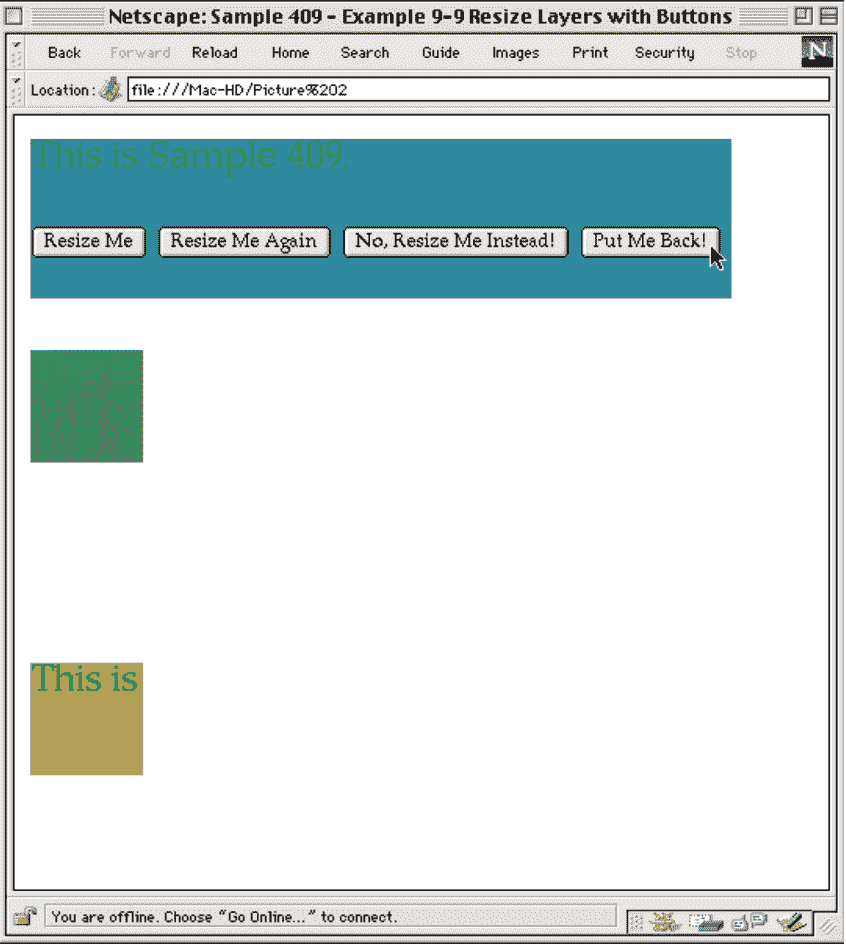

227

## 示例 3-9 Sample409.html

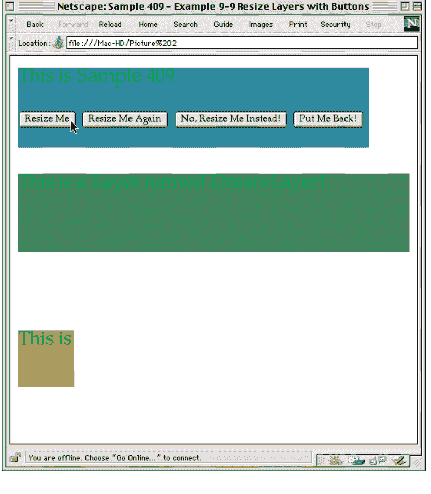

## 示例 3-9 Sample409.html

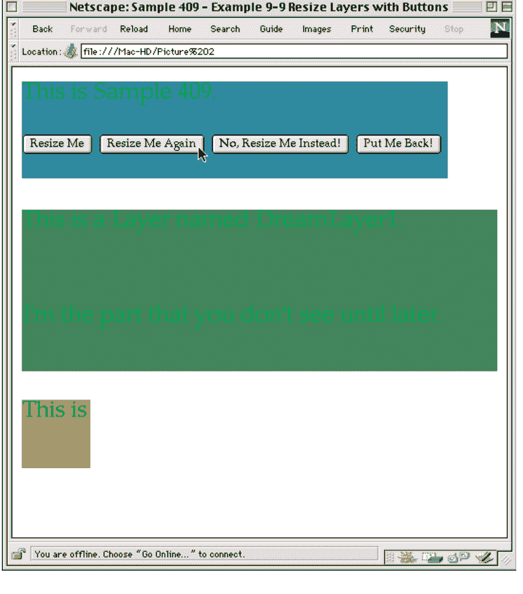

## 在Layer中使用JavaScript

### JavaScript write() 方法

这是简略版本。其余内容请参阅JavaScript指南。当你希望在SCRIPT元素中使用JavaScript在Layer中插入内容时，可以使用**write()**方法，其语法如下：

学科网(www.zxxk.com)-学海泛舟系列资料 上学科网，下精品资料！

学科网(www.zxxk.com)-学海泛舟系列资料 上学科网，下精品资料！

学科网(www.zxxk.com)-学海泛舟系列资料 上学科网，下精品资料！

学科网(www.zxxk.com)-学海泛舟系列资料 上学科网，下精品资料！

学科网(www.zxxk.com)-学海泛舟系列资料 上学科网，下精品资料！

学科网(www.zxxk.com)-学海泛舟系列资料 上学科网，下精品资料！


## 示例 3-11

### Sample411.html

## 第 3 章 — 图层与 JavaScript

这是图层 L1

这是图层 L3

这是图层 L4

这是图层 L5

这是图层 L2。它被移动到图层 L5 的上方，并被重新定位，使图层 L4 成为其父图层。

这是图层 L6

#### 显示与隐藏图层及写入图层内容

示例 3-12 演示了 **write()** 和 **close()** 方法，以及 **visibility** 属性的 "show" 和 "hide" 值，用于向图层写入内容并使其显示或消失。

## 示例 3-12：Sample412.html

```
<!DOCTYPE HTML PUBLIC "-//W3C//DTD HTML 3.2//EN">
<HTML>
<HEAD>
<TITLE>Sample 412 - Example 3-12     write() Method and visibility Property</TITLE>

<STYLE TYPE="text/JavaScript">

      with(tags.BODY) {
           color="purple";
           fontFamily="Moonlight, cursive";
           fontSize="34pt";
           textAlign="center";
      }

      with(tags.H1) {
          color="navy";
          fontFamily="Helvetica, serif";
          fontSize="34pt";
          textAlign="center";
          backgroundColor="red";
          borderWidths("25px");
          borderStyle="double";
          borderColor="fuchsia";
      }

      with(tags.H2) {
          textAlign="left";
          borderWidths("30px");
          borderStyle="outset";
          borderColor="green";
      }

      with(tags.H3) {
          color="lime";
          fontFamily="Palatino, sans-serif";
          fontSize="20pt";
          textAlign="right";
          backgroundColor="gray";
          borderWidths("15px");
          borderStyle="inset";
          borderColor="blue";
      }

classes.Navy30.all.fontSize="30pt";
classes.Navy30.all.color="navy";

classes.Global.all.fontSize="20pt";
classes.Global.all.fontFamily="Moonlight, Clarendon, serif";
classes.Global.all.width="100%";
classes.Global.all.backgroundColor="blue";
classes.Global.all.borderWidths("20px");
classes.Global.all.borderStyle="groove";
classes.Global.all.textAlign="center";
classes.Global.all.align="center";
classes.Global.all.borderColor="purple";
classes.Global.all.color="yellow";

</STYLE>
</HEAD>

<!-- ***************************************************************** -->

<BODY>

<LAYER CLASS="Global" ID="layer2" LEFT=20 TOP=20>

    <FORM NAME="form1">

        中央

        <INPUT TYPE=button VALUE="Site 1"
        onClick='changeSite1(); return false;'>

        <INPUT TYPE=button VALUE="Site 2"
        onClick='changeSite2(); return false;'>

        <INPUT TYPE=button VALUE="Site 3"
        onClick='changeSite3(); return false;'>

        <INPUT TYPE=button VALUE="Site 4"
        onClick='changeSite4(); return false;'>

        <INPUT TYPE=button VALUE="Site 5"
        onClick='changeSite5(); return false;'>

        命令

    </FORM>

</LAYER>

<!-- ************************************************************************************ -->

<LAYER CLASS="Navy30" ID="layer1" LEFT=20 TOP=135 VISIBILITY="SHOW">

<P> 选择一个站点，任意一个站点来更改视图。 </P>

</LAYER>

<!-- ************************************************************************************ -->

<LAYER ID="layer3" LEFT=20 TOP=135 VISIBILITY="HIDE"> </LAYER>

<LAYER ID="layer4" LEFT=20 TOP=135 VISIBILITY="HIDE"> </LAYER>

<LAYER ID="layer5" LEFT=20 TOP=135 VISIBILITY="HIDE"> </LAYER>

<!-- ************************************************************************************ -->

<SCRIPT LANGUAGE="JavaScript1.2"><!--BEGIN HIDING

function changeSite1() {

    document.layer1.document.write("<H1><P>新站点 1。<BR>

                        你应该注意到，不仅必须显示该图层，还必须隐藏所有
                        其他图层，以免它们碍事。当然，这只有在它们
                        占据相同空间时才成立。<\/P><\/H1>");

    document.layer1.visibility = 'show';
    document.layer3.visibility = 'hide';
    document.layer4.visibility = 'hide';
    document.layer5.visibility = 'hide';

    document.layer1.document.close();
}

/*-----------------------------------------------*/

function changeSite2() {

    document.layer3.document.write("<H2><P>别忘了你的大括号或
                                    分号。<\/P><\/H2>");

    document.layer1.visibility = 'hide';
    document.layer3.visibility = 'show';
    document.layer4.visibility = 'hide';
    document.layer5.visibility = 'hide';

    document.layer3.document.close();
}

/*-----------------------------------------------*/

function changeSite3() {

    document.layer4.document.write("<H3><P>沃隆人总是问，<BR>
        你是谁？？？<\/P><\/H3>");

    document.layer1.visibility = 'hide';
    document.layer3.visibility = 'hide';
    document.layer4.visibility = 'show';
    document.layer5.visibility = 'hide';

    document.layer4.document.close();
}

/*-----------------------------------------------*/

function changeSite4() {

    document.layer5.document.write("<H3><P>暗影人总是问，<BR>
        你想要什么？？？<\/P><\/H3>");

    document.layer1.visibility = 'hide';
    document.layer3.visibility = 'hide';
    document.layer4.visibility = 'hide';
    document.layer5.visibility = 'show';

    document.layer5.document.close();
}

/*-----------------------------------------------*/

function changeSite5() {

    document.layer5.document.write("<H1><P>新站点 5。<BR>
        想象各种可能性。<\/P><\/H1>");

    document.layer1.visibility = 'hide';
    document.layer3.visibility = 'hide';
    document.layer4.visibility = 'hide';
    document.layer5.visibility = 'show';

    document.layer5.document.close();
}

/*----------------------------------------------------------------------*/

//END HIDING-->
</SCRIPT>

</BODY>

</HTML>
```

240 第 I 部分 — 动态 HTML

## 用于实时创建新图层的 new 运算符

当你想要动态创建图层时，也就是说，在页面加载到浏览器之后，你可以使用 **new** 运算符和 **Layer()** 构造函数来实现，其语法如下：

**JavaScript 语法：**

```
LayerName = new Layer (pixelsWidth, ["optionalParentLayerName"]);
```

**参数定义：**

**LayerName** 是你的图层名称，**pixelsWidth** 参数是图层渲染的像素宽度，第二个参数（"可选"）**"optionalParentLayerName"** 是包含新图层的父图层名称。如果你未指定父图层，则新图层将默认成为顶层图层。请记住，**new Layer** 必须完全按照所示拼写，L 要大写。如果使用小写 'l'，将会出错。例如：

```
Blue1 = new Layer (400);
```

这将创建一个名为 **Blue1** 的新图层，其宽度为 400 像素，并且由于未指定父图层，**Blue1** 图层将成为顶层图层。

以下是三种向新图层中放置内容的方法：

- 使用图层的 **document** 对象的 **write()** 方法。参见示例 3-13。
- 使用 **src** 属性加载带有内容的外部文档。参见示例 3-14。
- 使用 **load()** 方法加载带有内容的外部文档。参见示例 3-14。

**特别注意：**

- 你必须等到你的文档完全加载到浏览器之后，才能动态创建新图层。
- 你必须等到你的文档完全加载到浏览器窗口之后，才能打开新图层的 **document** 对象并使用 **write()** 方法。
- 在使用 **write()** 方法之后，你必须使用 **close()** 关闭 **document** 对象。
- 在使用 **write()** 方法时，你一次只能打开一个 **document** 对象。


## 使用 tags 属性样式动态创建新图层

以下示例展示了当用户点击表单元素中的按钮时，如何创建一个**新的**图层。只有少数**图层**对象的属性可以直接应用于图层，这里指定了其中几个属性。

它还展示了如何通过 JavaScript 使用 **tags** 属性来更改该图层中使用的元素的属性，在此案例中，这些属性会立即应用到名为 **Blue1** 的新图层上。这就是如何绕过并非所有样式属性都作为**图层**对象属性可用的限制，当你希望让用户实时定义自己的样式时，这一点将更为重要。

此示例中需要注意的最重要特征之一是，**visibility** 属性必须设置为 **show**，才能使你的**新**图层 **Blue1** 在文档中可见，因为编译器不会自动使其可见。

## 示例 3-13：Sample413.html

```
<!DOCTYPE HTML PUBLIC "-//W3C//DTD HTML 3.2//EN"
<HTML>
<HEAD>
<TITLE>Sample 413 - Example 3-13     The new Operator to create new Layers</TITLE>

<STYLE TYPE="text/JavaScript">

      with(tags.BODY) {
             color="purple";
             fontFamily="Moonlight, cursive";
             fontSize="34pt";
             textAlign="center";
      }

      with(tags.H1) {
             color="navy";
             fontFamily="Helvetica, serif";
             fontSize="34pt";
             textAlign="center";
             backgroundColor="red";
             borderWidths("25px");
             borderStyle="double";
             borderColor="fuchsia";
      }

      classes.Navy17.all.fontSize="17pt";
      classes.Navy17.all.color="navy";
```

```
classes.Global.all.fontSize="20pt";
classes.Global.all.fontFamily="Moonlight, Clarendon, serif";
classes.Global.all.width="100%";
classes.Global.all.backgroundColor="blue";
classes.Global.all.borderWidths("20px";
classes.Global.all.borderStyle="groove";
classes.Global.all.textAlign="center";
classes.Global.all.align="center";
classes.Global.all.borderColor="purple";
classes.Global.all.color="yellow";
```

```
</STYLE>

</HEAD>
<!-- ************************************************** -->
<BODY>
```

```
<LAYER CLASS="Global" ID="layer2" LEFT=20 TOP=20>

    <FORM NAME="form1">

        Central

        <INPUT TYPE=button VALUE="Make new Layer"
        onClick='newlayer1(); return false;'>

        <INPUT TYPE=button VALUE="Change new Layer"
        onClick='changelayer1(); return false;'>

        Command

    </FORM>

</LAYER>
```

```
<!-- ************************************************** -->
```

```
<LAYER CLASS="Navy17" ID="layer1" LEFT=20 TOP=135 VISIBILITY="SHOW">

<P>Click <B>'Make new Layer'</B> first or you will get an error.<P>

</LAYER>
```

```
<!-- ************************************************** -->

<SCRIPT LANGUAGE="JavaScript1.2"><!--BEGIN HIDING

function newlayer1() {

    document.Blue1 = new Layer(200);
    document.Blue1.left = 20;
    document.Blue1.top = 275;
    document.Blue1.visibility = "show";
    document.Blue1.document.write("<H1>Hi! What's New?<\/H1>");
    document.Blue1.document.close();
}
```

## 第三章 —— 图层与 JavaScript

```
/*------------------------------------------------------------------*/

function changelayer1() {

	document.Blue1.left = 250;
	document.Blue1.top = 175;
	document.Blue1.bgColor = "blue";

	document.tags.H1.fontSize = "50pt";
	document.tags.H1.fontFamily = "Times, Palatino, serif";
	document.tags.H1.color = "yellow";
	document.tags.H1.backgroundColor = "aqua";
	document.tags.H1.borderColor = "lime";
	document.tags.H1.borderStyle = "groove";

	document.Blue1.document.write("<H1>ok so i'm changed.<\/H1>");
	document.Blue1.document.close();

}

//END HIDING-->
</SCRIPT>

</BODY>
</HTML>
```

示例 3-14 包含三个部分。第 1 部分包含核心代码段，第 2 和第 3 部分是用户点击文档中的按钮时加载到文档中的外部文件。第 1 部分演示了通过使用 **new** 操作符、设置图层的 **left** 和 **top** 属性，然后通过第一个名为 **getIt1()** 的函数使用 **src** 属性以及通过第二个名为 **getIt2()** 的函数使用 **load()** 方法，从外部文件加载内容来动态创建图层的直接方法。其结构与上一个示例相似，但没有那么多修饰。

## 示例 3-14 第 1 部分：Sample414.html

```
<!DOCTYPE HTML PUBLIC "-//W3C//DTD HTML 3.2//EN">
<HTML>
<HEAD>
<TITLE>Sample 414 - Example 3-14 new Operator to create layers on-the-fly</TITLE>

<STYLE TYPE="text/JavaScript">

	with(tags.BODY) {
		color="purple";
		fontFamily="Moonlight, cursive";
		fontSize="22pt";
		textAlign="center";
	}

</STYLE>
</HEAD>
```

```
<!-- ********************************************************** -->
<BODY>

<LAYER ID="layer2" LEFT=20 TOP=20>

	<FORM NAME="form1">

		Central Command

		<INPUT TYPE=button VALUE="Load External Layer"

		onClick='getIt1(); return false;'>

		<-alert1>


## 第3章 — 层与JavaScript

```
<BODY>
<DIV ID="SeventhLayer">       This is the                  <BR>
                               SeventhLayer Test            <BR>
                               with z-index equals 3.       <BR>
                               It rules!
```

```
<SCRIPT LANGUAGE="JavaScript1.2"><!--BEGIN HIDING

        function onMouseOver() { seeNoSee("hide"); }
        function onMouseOut() { seeNoSee("show"); }

        function seeNoSee (WhereAmI) {
              visibility=WhereAmI;
              return false;
        }

//END HIDING-->
</SCRIPT>
</DIV>
```

```
<DIV ID="EighthLayer">        This is the                  <BR>
                               EighthLayer Test             <BR>
                               with z-index equals 2.
```

```
<SCRIPT LANGUAGE="JavaScript1.2"><!--BEGIN HIDING

        function onMouseOver() { seeNoSee("hide"); }
        function onMouseOut() { seeNoSee("show"); }

        function seeNoSee (WhereAmI) {
              visibility=WhereAmI;
              return false;
        }

//END HIDING-->
</SCRIPT>
</DIV>
```

```
<DIV ID="NinthLayer">         This is the                  <BR>
                               NinthLayer Test              <BR>
                               with z-index equals 1.
```

```
<SCRIPT LANGUAGE="JavaScript1.2"><!--BEGIN HIDING

        function onMouseOver() { seeNoSee("hide"); }
        function onMouseOut() { seeNoSee("show"); }

        function seeNoSee (WhereAmI) {

              visibility=WhereAmI;
              return false;
        }

//END HIDING-->
</SCRIPT>

</DIV>
```

## 248 第一部分 — 动态HTML

这与示例307完全相同，唯一的区别在于每个层中都有一个局部脚本，使得该层在鼠标悬停时隐藏，在鼠标移出时重新显示。效果有些不稳定，所以请保持鼠标平稳。如果鼠标位于两个或更多层重叠的区域，那么具有较高z-index的层将捕获鼠标事件并消失。

```
</BODY>
</HTML>
```

示例3-16演示了层元素中的局部脚本，展示了具有不同值的相同函数可以独立应用于各个层。层对象属性clip.right和clip.bottom用于使层的一部分在鼠标悬停时消失，然后在鼠标移出层的指定区域时重新显示。

## 示例3-16：Sample416.html

```
<!DOCTYPE HTML PUBLIC "-//W3C//DTD HTML 3.2//EN">
<HTML>
<HEAD>
<TITLE>Sample 416 - Example 3-16     Local Scripts & clip Properties</TITLE>

<STYLE TYPE="text/JavaScript">

    with(tags.BODY) {
        color="purple";
        fontFamily="Moonlight, cursive";
        fontSize="22pt";
        textAlign="center";
    }

    classes.Blue22.all.fontSize="22pt";
    classes.Blue22.all.color="blue";
    classes.Blue22.all.width="500px";
    classes.Blue22.all.backgroundColor="aqua";
    classes.Blue22.all.borderWidths("20px");
    classes.Blue22.all.borderStyle="groove";

</STYLE>

</HEAD>

<BODY>
```

## 第3章 — 层与JavaScript

```
<!-- *************************************************************** -->

<LAYER CLASS="Blue22" ID="layer1" LEFT=20 TOP=35 VISIBILITY="SHOW">

 <P>Move the mouse over me and I will shrink.           </P>
 <P>Move the mouse away from                            </P>
 <P>me and I will grow back.                            </P>


<SCRIPT LANGUAGE="JavaScript1.2"><!--BEGIN HIDING

        function onMouseOver() { seeNoSee(370, 130); }

        function onMouseOut() { seeNoSee(500, 200); }

        function seeNoSee (ShrinkingLeft, ShrinkingUp) {

                clip.right=ShrinkingLeft;
                clip.bottom=ShrinkingUp;

          return false;
         }

//END HIDING-->
</SCRIPT>

</LAYER>

<!-- *************************************************************** -->

<LAYER CLASS="Blue22" ID="layer2" LEFT=20 TOP=222 VISIBILITY="SHOW">

 <P>Move the mouse over me and I will shrink.           </P>
 <P>Move the mouse away from                            </P>
 <P>me and I will grow back.                            </P>

<SCRIPT LANGUAGE="JavaScript1.2"><!--BEGIN HIDING

        function onMouseOver() { seeNoSee(211, 100); }

        function onMouseOut() { seeNoSee(500, 200); }

        function seeNoSee (ShrinkingLeft, ShrinkingUp) {

                clip.right=ShrinkingLeft;
                clip.bottom=ShrinkingUp;
          return false;
         }

//END HIDING-->
</SCRIPT>

</LAYER>

</BODY>
</HTML>
```

## 通过动画裁剪矩形来显示图像

## JavaScript setTimeout() 方法

**setTimeout()** 方法有两种不同的语法结构。一种用于在指定的**毫秒**数后对一个*表达式*求值。另一种用于在指定的**毫秒**数后调用一个*函数*。**setTimeout()** 方法本身不会像**setInterval()** 方法那样重复执行。要使其重复，你必须将包含**setTimeout()** 方法的同一函数显式地作为**functionName**参数进行调用，这通常在条件语句（如**if ()**）中完成，示例3-17至3-22对此进行了演示。**anyExpression** 或 **functionName** 参数必须放在引号内，否则会被立即求值。在指定函数时，该函数的以逗号分隔的 **arg** 参数是可选的，因此即使你的函数没有任何参数，也可以使用 **setTimeout()**。

### JavaScript 语法：

```
setTimeout("anyExpression", milliseconds);
setTimeout("functionName()", milliseconds[, arg1, ..., argN]);
```

如果你计划将 **setTimeout()** 方法与 **clearTimeout()** 方法配合使用，则必须将其赋值给一个 **timeoutID**，如下所示：

```
timeoutID=setTimeout("functionName()", millisecs);
```

或如下所示：

```
timeoutID=setTimeout("functionName()", millisecs, arg1, ...,argN);
```

这样你就可以使用 **clearTimeout()** 方法来引用它，如下所示：

```
clearTimeout(timeoutID);
```

## JavaScript clearTimeout() 方法

**clearTimeout()** 方法用于取消之前发起的、已赋值给 **timeoutID** 的 **setTimeout()** 方法调用。

### 语法：

```
clearTimeout(timeoutID);
```

## 动画裁剪矩形与弹出图像

在下面的示例3-17中，通过点击三个按钮之一，可以逐步显示、隐藏或弹出图像。它使用了 **setTimeout()** 方法、**resizeBy()** 方法和 **resizeTo()** 方法。

**RevealImage()** 此函数使用条件 if () 语句来测试 **layer1的clip.right** 属性是否小于700。如果是，则调整 **layer1** 的大小，使其宽度增加5像素、高度增加4像素。然后 **setTimeout()** 方法通过再次调用 **RevealImage()** 函数来重新触发该过程，并且每20毫秒持续执行一次，直到 **layer1的clip.right** 属性大于或等于700像素宽。需要特别注意的是，重复调用之所以能持续，是因为 **setTimeout()** 方法显式地调用了 **RevealImage()** 函数，这导致函数在该点中断并重新开始循环。这与 **setInterval()** 方法（见第284页）形成对比，后者具有 **setTimeout()** 方法所不具备的内在重复调用能力。

**HideImage()** 此函数只是通过使用 **resizeTo()** 方法将 **layer1** 重置为其原始裁剪**宽度**和**高度**，此时只有左上角的一小部分可见。

**PopImage()** 此函数通过使用 **resizeTo()** 方法，瞬间改变裁剪矩形的**宽度**和**高度**，使整个层可见。

## 示例3-17：Sample417.html

```
<!DOCTYPE HTML PUBLIC "-//W3C//DTD HTML 3.2//EN">
<HTML>
<HEAD>
<TITLE>Sample 417 - Example 3-17     SetTimeout Method to Reveal Image</TITLE>

<STYLE TYPE="text/JavaScript">

      classes.Blue22.all.fontSize="22pt";
      classes.Blue22.all.color="blue";
      classes.Blue22.all.width="100%";
      classes.Blue22.all.backgroundColor="aqua";
      classes.Blue22.all.borderWidth("20px");
      classes.Blue22.all.borderStyle="groove";

</STYLE>

</HEAD>

<BODY>
```


 # 252 第一部分 — 动态 HTML

```
<!-- ******************************************************* -->
<LAYER CLASS="Blue22" ID="layer2" LEFT=50 TOP=10 VISIBILITY="SHOW">
<FORM NAME="form1">
    Central Command
    <INPUT TYPE=button VALUE="Reveal Image"
           onClick='RevealImage(); return false;'>
    <INPUT TYPE=button VALUE="Hide Image"
           onClick='HideImage(); return false;'>
    <INPUT TYPE=button VALUE="Pop Image"
           onClick='PopImage(); return false;'>
</FORM>
</LAYER>

<!-- ******************************************************* -->
<LAYER CLASS="Blue22" ID="layer1" LEFT=20 TOP=130 CLIP="0,0,100,50"
       VISIBILITY="SHOW">
Wow!<BR><BR>
<CENTER>

</CENTER>
</LAYER>

<!-- ******************************************************* -->
<SCRIPT LANGUAGE="JavaScript1.2"><!--BEGIN HIDING

    function RevealImage() {

        var layer1 = document.layer1;

        if (layer1.clip.right < 700) {
            layer1.resizeBy(5,4);
            setTimeout('RevealImage()', 20);
        }

        return false;
    }
/*--------------------------------------------------------*/
        function HideImage() {

                var layer1 = document.layer1;

                if (layer1.clip.right > 100)  {
                        layer1.resizeTo(100,50);
                }

           return false;
        }

/*-------------------------------------------------------------------*/
        function PopImage() {

                var layer1 = document.layer1;

                if (layer1.clip.right < 700)  {
                        layer1.resizeTo(700,500);
                }

           return false;
        }

//END HIDING-->
</SCRIPT>

</BODY>
</HTML>
```

在示例 3-18 中，使用了 **setTimeout()** 方法来像上一个示例那样揭露图像，并且增加了使用 **visibility** 属性的功能，用以隐藏和显示其他已经预加载到页面中、但在 LAYER 元素内的 **VISIBILITY 属性** 初始值被设置为 **"HIDE"** 的图像。

## 示例 3-18: Sample418.html

```
<!DOCTYPE HTML PUBLIC "-//W3C//DTD HTML 3.2//EN">
<HTML>
<HEAD>
<TITLE>Sample 418 - Example 3-18     SetTimeout Method to Reveal Image</TITLE>

<STYLE TYPE="text/JavaScript">

        classes.Blue22.all.fontSize="14pt";
        classes.Blue22.all.color="blue";
        classes.Blue22.all.width="100%";
        classes.Blue22.all.backgroundColor="aqua";
        classes.Blue22.all.borderWidths("20px");
        classes.Blue22.all.borderStyle="groove";
</STYLE>
</HEAD>
```

# 254 第一部分 — 动态 HTML

```
<BODY>
<!--  ************************************************************  -->

<LAYER CLASS="Blue22" ID="layer2" LEFT=20 TOP=10 VISIBILITY="SHOW">

<FORM NAME="form1">
	    Central Command
	    <INPUT TYPE=button VALUE="Reveal Image"
	    onClick='RevealImage(); return false;'>
	    <INPUT TYPE=button VALUE="Hide Image"
	    onClick='HideImage(); return false;'>	    <BR>
	    <INPUT TYPE=button VALUE="Pop Image 1"
	    onClick='PopImage(); return false;'>
	    <INPUT TYPE=button VALUE="Pop Image 2"
	    onClick='PopImage2(); return false;'>
	    <INPUT TYPE=button VALUE="Pop Image 3"
	    onClick='PopImage3(); return false;'>
	    <INPUT TYPE=button VALUE="Pop Image 4"
	    onClick='PopImage4(); return false;'>

	</FORM>

</LAYER>
```

```
<!--  ************************************************************  -->

<LAYER CLASS="Blue22" ID="layer1" LEFT=20 TOP=130
CLIP="0,0,100,50" VISIBILITY="SHOW">

Wow!

<CENTER>
  
</CENTER>

</LAYER>
```

```
<!--  ************************************************************  -->

<LAYER CLASS="Blue22" ID="layer3" LEFT=20 TOP=130 VISIBILITY="HIDE">

Wow!

<CENTER>
  
</CENTER>

</LAYER>
```

```
<!--  ************************************************************  -->
```

```
<!-- ************************************************************ -->

<LAYER CLASS="Blue22" ID="layer4" LEFT=20 TOP=130 VISIBILITY="HIDE">

Wow!

<CENTER>
 
</CENTER>

</LAYER>
<!-- ************************************************************ -->
```

```
<LAYER CLASS="Blue22" ID="layer5" LEFT=20 TOP=130 VISIBILITY="HIDE">

Wow!

<CENTER>
 
</CENTER>

</LAYER>
<!-- ************************************************************ -->
```

```
<SCRIPT LANGUAGE="JavaScript1.2"><!--BEGIN HIDING

function PopImage2() {

      document.layer1.visibility = 'hide';
      document.layer4.visibility = 'hide';
      document.layer5.visibility = 'hide';
      document.layer3.visibility = 'show';
}

/*----------------------------------------------------------------*/

function PopImage3() {

      document.layer1.visibility = 'hide';
      document.layer3.visibility = 'hide';
      document.layer5.visibility = 'hide';
      document.layer4.visibility = 'show';
}

/*----------------------------------------------------------------*/

function PopImage4() {

      document.layer1.visibility = 'hide';
      document.layer3.visibility = 'hide';
      document.layer4.visibility = 'hide';
      document.layer5.visibility = 'show';
}

//END HIDING-->
</SCRIPT>
<!-- ************************************************************ -->
```

# 256

# 第一部分 — 动态 HTML

```
<SCRIPT LANGUAGE="JavaScript1.2"><!--BEGIN HIDING

	function RevealImage () {

		document.layer1.visibility = 'show';

		var layer1 = document.layer1;

		if (layer1.clip.right < 700) {
			layer1.resizeBy(5,4);
			setTimeout('RevealImage()', 20);

			document.layer3.visibility = 'hide';
			document.layer4.visibility = 'hide';
			document.layer5.visibility = 'hide';
			document.layer1.visibility = 'show';
		}
	return false;
	}
/*------------------------------------------------------------*/
	function HideImage () {

		var layer1 = document.layer1;

		if (layer1.clip.right > 100) {
			layer1.resizeTo(100,50);

			document.layer3.visibility = 'hide';
			document.layer4.visibility = 'hide';
			document.layer5.visibility = 'hide';
			document.layer1.visibility = 'show';
		}
	return false;
	}
/*------------------------------------------------------------*/
	function PopImage () {

		document.layer1.visibility = 'show';

		var layer1 = document.layer1;
		layer1.clip.right=0;  //resets to zero to avoid button conflicts

		if (layer1.clip.right < 700) {
			layer1.resizeTo(700,500);

			document.layer3.visibility = 'hide';
			document.layer4.visibility = 'hide';
			document.layer5.visibility = 'hide';
			document.layer1Compiling .visibility = 'show';
		}
	return false;
	}
//END HIDING-->
</SCRIPT>
</BODY>
</HTML>
```

示例 3-19 使用 **setTimeout()** 方法，只要名为 **layer1** 的包含层的 left 属性小于 500 像素，就通过移动该层来移动图像。当点击 **VALUE="Move Image"** 的按钮时，会调用 **MoveImage()** 函数，该函数实现了 **setTimeout()** 方法。

## 示例 3-19: Sample419.html

```
<!DOCTYPE HTML PUBLIC "-//W3C//DTD HTML 3.2//EN">
<HTML>
<HEAD>
<TITLE>Sample 419 - Example 3-19     SetTimeout Method to Animate Image</TITLE>

<STYLE TYPE="text/Java yanıt">

      classes.Blue22.all.fontSize="22pt";
      classes.Blue22.all.color="blue";
      classes.Blue22.all.width="100%";
      classes.Blue22.all.backgroundColor="lime";
      classes.Blue22.all.borderWidths("20px");
      classes.Blue22.all.borderStyle="groove";
      classes.Blue22.all.borderColor="green";

</STYLE>

</HEAD>

<BODY>

<!--  ************************************************************  -->

<LAYER CLASS="Blue22" ID="layer2" LEFT=50 TOP=10 VISIBILITY="SHOW">

      <FORM NAME="form1">

            Central Command

            <INPUT TYPE=button VALUE="Move Image"

            onClick='MoveImage(); return false;'>

            <INPUT TYPE=button VALUE="Return Image"

            onClick='ReturnImage(); return false;'>

      </FORM>

</LAYER>

<!--  ************************************************************  -->
```


 # 258 第一部分 — 动态 HTML

```
<LAYER ID="layer1" LEFT=20 TOP=130 VISIBILITY="SHOW">

        

</LAYER>

<!--  *************************************************************  -->

<SCRIPT LANGUAGE="JavaScript1.2"><!--BEGIN HIDING

    function MoveImage (layer1) {

            var layer1 = document.layer1;

            if (layer1.left < 500)  {
                    layer1.moveBy(5,1);
                    setTimeout('MoveImage()', 20);
            }

    return false;
    }

/*--------------------------------------------------------------*/
    function ReturnImage (layer1) {

            var layer1 = document.layer1;

            if (layer1.left > 20)  {
                    layer1.moveTo(20,130);
            }

    return false;
    }

//END HIDING-->
</SCRIPT>

</BODY>
</HTML>
```

在示例 3-20 中，一个包含图像的图层以顺时针矩形路径重复进行动画演示，而另一个图层则进行水平动画演示。每次动画在点击按钮时触发。

**MoveUpperImage()** 该函数测试 UpperLayer 的 **left** 和 **top** 属性坐标值，如果条件成立，则使用 **moveBy()** 方法将其移动指定的像素。

**MoveLowerImage()** 该函数测试 LowerLayer 的 **left** 属性坐标值，如果条件成立，则使用 **moveBy()** 方法将其移动指定的像素。

**ChaseLowerImage()** 该函数使用 **moveTo()** 方法重新定位 **LowerLayer**。

# 第三章 — 图层与 JavaScript 259

示例 3-20：Sample420.html

```
<!DOCTYPE HTML PUBLIC "-//W3C//DTD HTML 3.2//EN">
<HTML>
<HEAD>
<TITLE>Sample 420 - Example 3-20     SetTimeout Method to Animate Image</TITLE>

<STYLE TYPE="text/JavaScript">
    classes.Blue22.all.fontSize="14pt";
    classes.Blue22.all.color="blue";
    classes.Blue22.all.width="100%";
    classes.Blue22.all.backgroundColor="lime";
    classes.Blue22.all.borderWidths("20px");
    classes.Blue22.all.borderStyle="groove";
    classes.Blue22.all.borderColor="green";
</STYLE>
</HEAD>
<BODY>
<!-- ******************************************** -->
<LAYER CLASS="Blue22" ID="layer1" LEFT=50 TOP=10 VISIBILITY="SHOW">
    <FORM NAME%、NAME="form1">
        Central Command
        <INPUT TYPE=button VALUE="Move Upper Image"
            onClick='MoveUpperImage(); return false;'>
        <INPUT TYPE=button VALUE="Move Lower Image"
            onClick='MoveLowerImage(); return false;'>
        <INPUT TYPE=button VALUE="Chase Lower Image"
            onClick='ChaseLowerImage(); return false;'>
    </FORM>
</LAYER>
<!-- ******************************************** -->
<LAYER ID="UpperLayer" LEFT=20 TOP=130 VISIBILITY="SHOW">
    
</LAYER>
<!-- ******************************************** -->
<LAYER ID="LowerLayer" LEFT=20 TOP=300 VISIBILITY="SHOW">
    
</LAYER>
```

# 260 第一部分 — 动态 HTML

```
<!-- ******************************************************************* -->
<SCRIPT LANGUAGE="JavaScript1.2"><!--BEGIN HIDING

function MoveUpperImage() {

        var UpperLayer = document.UpperLayer;

        if (UpperLayer.left < 500  &&  UpperLayer.top == 130)  {
            UpperLayer.moveBy(5,0);          //moves to the right
        }
        if (UpperLayer.left == 500  &&  UpperLayer.top < 300)  {
            UpperLayer.moveBy(0,5);          //moves down
        }
        if (UpperLayer.left > 20  &&  UpperLayer.top == 300)  {
            UpperLayer.moveBy(-5,0);         //moves to the left
        }
        if (UpperLayer.left == 20  &&  UpperLayer.top > 130)  {
            UpperLayer.moveBy(0,-5);         //moves up
        }

        setTimeout('MoveUpperImage()', 20);
}
/*------------------------------------*/
function MoveLowerImage() {

        var LowerLayer = document.LowerLayer;

        if (LowerLayer.left < 500)  {
                LowerLayer.moveBy(5,0);
        }
        else {
                LowerLayer.left = 20;
        }

        setTimeout('MoveLowerImage()', 20);
}
/*------------------------------------*/
function ChaseLowerImage() {

        var LowerLayer = document.LowerLayer;

        if (LowerLayer.left > 20)  {

//moves the lower image to the vertical position of the upper image

                LowerLayer.moveTo(20,130);
        }
return false;
}

//END HIDING-->
</SCRIPT>

</BODY>
</HTML>
```

# 第三章 — 图层与 JavaScript

示例 3-21 有四个图层，每个图层内部都包含一张图像。带有太阳图像的图层是静止的，而带有地球旋转 Gif89a 动画和彗星静态图像的图层分别通过重复调用 **MoveEarth()** 函数和 **MoveComet()** 函数来实现动画。其中两个图层 each 都有地球旋转的图像。**EarthLayer** 图层在页面的上半部分可见，而 **SecondEarthLayer** 图层在页面的下半部分可见。

**MoveEarth()** 该函数基本上将页面分为四个区域的网格，并使用条件 **if ()** 语句来测试 **EarthLayer** 和 **SecondEarthLayer** 图层的位置坐标，并使用 **moveBy()** 方法相应地移动它们，同时使用 **visibility** 属性来隐藏或显示它们。随后，**setTimeout()** 方法会持续重新调用 **MoveEarth()** 函数，因为其中一个 if () 语句中的条件始终为真。这导致地球图像永久移动。

**MoveComet()** 该函数使名为 **CometLayer** 的图层（带有彗星图像）从右上角向左下角对角线移动。到达某一点后，图像将重置到原始起点，动画重复进行。

# 示例 3-21：Sample421.html

```
<!DOCTYPE HTML PUBLIC "-//W3C//DTD HTML 3.2//EN">
<HTML><HEAD>
<TITLE>Sample 421 - Example 3-21          Sun Earth Animation</TITLE>

<STYLE TYPE="text/JavaScript">

        classes.Blue22.all.fontSize="14pt";
        classes.Blue22.all.color="navy";
        classes.Blue22.all.width="100%";
        classes.Blue22.all.backgroundColor="yellow";

</STYLE>
</HEAD>

<BODY BGCOLOR="black">
<!--  ******************************************************************************************  -->

<LAYER CLASS="Blue22" ID="layer1" LEFT=10 TOP=10 VISIBILITY="SHOW" Z-INDEX=1>

<FORM NAME="form1">
                C&amp;C
                <INPUT TYPE=button VALUE="Start Gravity" 
                onClick='MoveEarth(); MoveComet(); return false;'>

        </FORM>

</LAYER>
```

# 第一部分 — 动态 HTML

```
<!-- ********************************************************************************* -->

<LAYER ID="EarthLayer" LEFT=599 TOP=170 VISIBILITY="SHOW" Z-INDEX=3>

	

</LAYER>

<!-- ********************************************************************************* -->

<LAYER ID="SecondEarthLayer" LEFT=30 TOP=195 VISIBILITY=HIDE Z-INDEX=6>

	

</LAYER>

<!-- ********************************************************************************* -->

<LAYER ID="SunLayer" LEFT=300 TOP=170 VISIBILITY="SHOW" Z-INDEX=4>

	

</LAYER>

<!-- ********************************************************************************* -->

<LAYER ID="CometLayer" LEFT=1000 TOP=100 VISIBILITY="SHOW" Z-INDEX=5>

	

</LAYER>

<!-- ********************************************************************************* -->

<SCRIPT LANGUAGE="JavaScript1.2"><!--BEGIN HIDING

function MoveEarth() {

	var EarthLayer = document.EarthLayer;
	var SecondEarthLayer = document.SecondEarthLayer;

	if (EarthLayer.left > 320  &&  EarthLayer.top > 0)  {
		EarthLayer.moveBy(-5,-3);
	} 

	else   if (EarthLayer.left <= 320  &&  EarthLayer.top >= 0 )  {
		EarthLayer.moveBy(-5,3);
	}

	if (EarthLayer.left > 20  &&  EarthLayer.left <= 30) {
		EarthLayer.visibility='hide';
		SecondEarthLayer.left = 30;
		SecondEarthLayer.top = 170;
		SecondEarthLayer.visibility='show';
	}
```


## 第 3 章 — 图层与 JavaScript

```javascript
//lower-left grid

if (SecondEarthLayer.left <= 320 && SecondEarthLayer.top >= 169) {
    SecondEarthLayer.moveBy(5,3);
}

//lower-right grid

else if (SecondEarthLayer.left > 320 && SecondEarthLayer.top >= 169 ) {
    SecondEarthLayer.moveBy(5,-3);
}

if (SecondEarthLayer.left > 598 && SecondEarthLayer.left <= 610 &&
    SecondEarthLayer.top >= 169) {
    SecondEarthLayer.visibility='hide';
    EarthLayer.left = 599;
    EarthLayer.top = 170;
    EarthLayer.visibility='show';
}

setTimeout('MoveEarth()', 20);
}

/*--------------------------------------------------------------------*/

function MoveComet() {

    var CometLayer = document.CometLayer;

    if (CometLayer.left > -200 ) {
        CometLayer.moveBy(-7,3);
    }

    else {                            //resets the comet to starting point
        CometLayer.left = 600 ;
        CometLayer.top = 100 ;
    }

setTimeout('MoveComet()', 20);
}

//END HIDING-->
</SCRIPT>

</BODY>
</HTML>
```

## 一些 JavaScript 技巧

这里有一些来自一线开发的小贴士。浏览器（Navigator）会根据最初设置的背景颜色对字体进行抗锯齿处理，因此，如果你想在之后更改背景颜色，请在选择时考虑深浅色因素，以免在字体周围出现不美观的抗锯齿颜色带。另外，建议使用 JavaScript 属性来声明任何背景颜色；如果可能的话，请尽量设置好你的元素，避免频繁地覆盖背景颜色，这样你将获得更好且更可预测的结果。你越少使用图层元素属性（Layer Element Attributes）声明，而越多地使用 JavaScript 属性声明，就越少地感到头疼。

如果你在编写页边距极小或零页边距的页面，你可能会发现文本没有精确居中，这是因为你的文本编辑器中存在制表符（tabs）和回车符（returns）。是的，我知道这不应该发生，但事实确实如此，所以如果这种微小的偏差至关重要，请在文本编辑器中折叠所有空白字符，这样应该就能平衡。

或者，如果你不想在文本编辑器中折叠空白字符，可以使用方便的不换行空格代码 `&nbsp;` 来精确地居中或平衡文本的页边距。如果你还不熟悉这个，它是一个 HTML 实体，且其中的和分号都是代码的一部分。这个不换行空格会强制浏览器插入一个不会折叠的空格，无论你连续放置多少个。

设置全局变量的主要原因之一是，查看变量比查看每个表达式的一长串点符号表示法（dot notation）更容易阅读和调试代码。你还会发现，当你创建非常长且复杂的页面时，全局变量声明实际上能为你节省时间和空间。

如果你在预加载大尺寸图像，请留意你的目标受众并记得压缩图像。显然，如果你是为使用 T1 线路的客户构建网站，或者你的访客期望看到大量高质量图形，那么这并不是问题。

## 在屏幕内外动画控制图层和图像

在示例 3-22 中，屏幕被分为三个在视觉上相互融合的区域。左侧有一个细长的垂直区域，顶部有一个细长的水平区域，其余部分被视为主查看区域。名为 **layerA** 的图层位于左侧，它是主控制面板。它控制位于顶部区域的两个图层 **Group1** 和 **Group2**，使它们在视野中移入或移出。在这两个图层中，有控制页面内容的按钮，这些内容是包含在图层中的艺术图像，可以以预览尺寸和大尺寸在视野中移入或移出。

名为 **Group1** 的图层最初在窗口顶部可见，可以通过名为 **layerA** 的左侧图层中的 **BGroup1** 按钮将其召回视野。名为 **Group2** 的图层最初位于坐标 (120,-110) 的屏幕外，且 **visibility** 属性设置为 hide。可以通过点击 **BGroup2** 按钮将其带入视野，该按钮在条件语句 **if ()** 中通过 **moveBy()** 方法和 **setTimeout()** 方法使其滑动进入，并使用 **moveTo()** 方法重新定位图层 **Group1**。

对于以下所有函数描述，脚本中都有多个适用的函数，唯一的区别是名称中的数字。例如，存在 **ShowHideGroup10** 函数和 **ShowHideGroup20** 函数，下方的描述适用于这两个函数，它们之间只有细微差别。

- **ShowHideGroup10** — 用于更改名为 **Group1** 和 **Group2** 的图层的 **visibility**、**zIndex** 以及 (x,y) 坐标的函数。这些图层包含主按钮组，用于操纵包含图像的 **Showcase**、**ShowcaseSmall** 和 **ShowcaseLarge** 系列图层。

- **MoveGroup10** — 使用 **moveBy()** 方法和 **setTimeout()** 方法将 **Group1** 图层从其屏幕外坐标动画化至视野中的函数。

接下来的三个函数都是通过点击名为 **BPreview1** 的按钮实现的，重点在于第一个小型预览图像。

- **HideShowLarge10** — 控制所有图层的 **visibility** 属性并为主要父图层设置定位坐标的函数。

- **HideShowSmall10** — 进一步细化用户所选图层中包含的兄弟图层的 **visibility** 属性和 **zIndex** 属性的函数，使得包含小图像的兄弟图层可见，而包含大图像的兄弟图层隐藏。

- **MoveShowcase10** — 在条件语句 **if ()** 中使用 **setTimeout()** 方法与 **moveBy()** 方法，将父图层 **Showcase1** 动画化至可查看位置的函数。

接下来的三个函数都是通过点击名为 **BLargeView1** 的按钮实现的，重点在于第一个大型艺术图像。

- **JumpLargeView10** — 将父图层 **Showcase1** 提升至突出位置，并更改兄弟图层的 **visibility** 和 **zIndex** 属性，使得名为 **Showcase1Large** 的大图层叠加在最顶层的函数。它还使用 **moveTo()** 方法将 **Showcase1** 重新定位到可查看坐标 (120,100)。

- **HideShowLarge10** — 控制所有图层的 **visibility** 属性并为主要父图层设置定位坐标的函数。请注意，这与上面在与 **BPreview1** 按钮相关的函数组中定义的函数相同，但在这种情况下，它是在点击 **BLargeView1** 按钮时被调用的。

- **LargeView10** — 在条件语句 **if ()** 中使用 **setTimeout()** 方法与 **moveBy()** 方法，逐渐揭晓图层 **Showcase1Large** 中包含的大图像的函数。

### 示例 3-22 Sample422.html

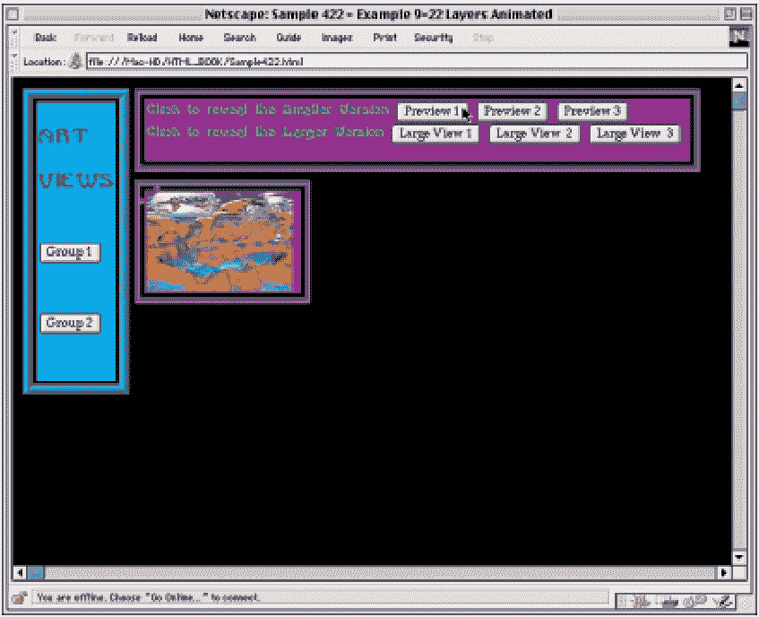

### 示例 3-22 Sample422.html (续)

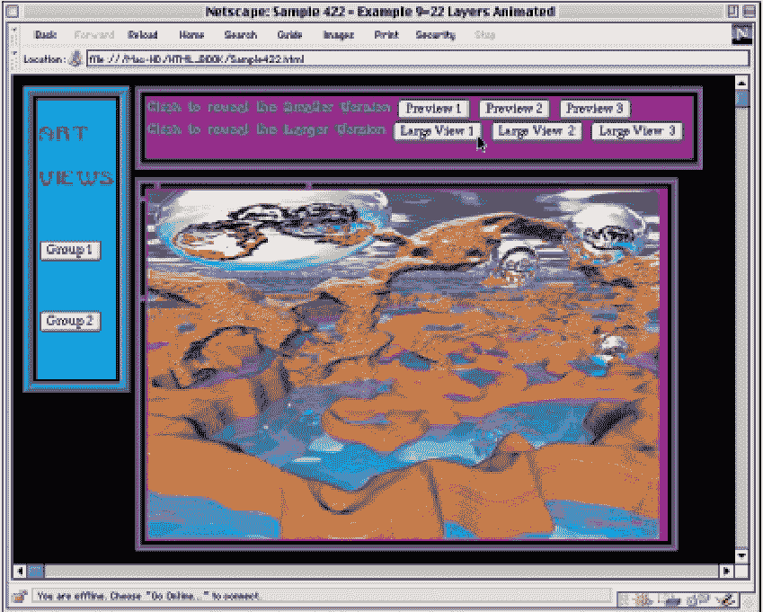

### 示例 3-22: Sample422.html

```html
<!DOCTYPE HTML PUBLIC "-//W3C//DTD HTML 3.2//EN">
<HTML>
<HEAD>
<TITLE>Sample 422 - Example 3-22 Layers Animated</TITLE>

<STYLE TYPE="text/JavaScript">

	classes.Blue22.all.fontSize="22pt";
	classes.Blue22.all.color="navy";
	classes.Blue22.all.backgroundColor="aqua";
	classes.Blue22.all.borderWidths("10px");
	classes.Blue22.all.borderStyle="ridge";
	classes.Blue22.all.borderColor="#0077ff";

	with(tags.LAYER) {
		color="lime";
		fontFamily="Moonlight, Helvetica, serif";
		fontSize="14pt";
		borderWidths("7px");
		borderStyle="groove";
		borderColor="#3300ff";
		backgroundColor="#8800ff";
		paddings("2px");
	}

</STYLE>

</HEAD>

<BODY BGCOLOR="black" TEXT="aqua">

<!-- ************************************************************** -->

<LAYER CLASS="Blue22" ID="layerA" LEFT=10 TOP=10 Z-INDEX=20 WIDTH=100 HEIGHT=500>

<FORM NAME="formA">

	ART
	VIEWS

	<INPUT TYPE=button NAME="BGroup1" VALUE="Group 1"

		onClick='ShowHideGroup1(); MoveGroup1(); return false;'>

	<INPUT TYPE=button NAME="BGroup2" VALUE="Group 2"

		onClick='ShowHideGroup2(); MoveGroup2(); return false;'>

</FORM>

</LAYER>

<!-- ***********************************************
```


## 第 3 章 — 图层与 JavaScript

```html
<LAYER ID="Group1" LEFT=120 TOP=10 Z-INDEX=10 WIDTH=600 HEIGHT=72>

<FORM NAME="form1">
```

点击以显示较小版本

```html
<INPUT TYPE=button NAME="BPreview1" VALUE="Preview 1"
onClick=' HideShowHideLarge1(); ShowHideSmall1(); MoveShowcase1(); return false;'>

<INPUT TYPE=button NAME="BPreview2" VALUE="Preview 2"
onClick='ShowHideLarge2(); ShowHideSmall2(); MoveShowcase2(); return false;'>

<INPUT TYPE=button NAME="BPreview3" VALUE="Preview 3"
onClick='ShowHideLarge3(); ShowHideSmall3(); MoveShowcase3(); return false;'><BR>

<!--  ******************************************  -->
```

点击以显示较大版本

```html
<INPUT TYPE=button NAME="BLargeView1" VALUE="Large View 1"
onClick='JumpLargeView1(); HideShowLarge1(); LargeView1(); return false;'>

<INPUT TYPE=button NAME="BLargeView2" VALUE="Large View 2"
onClick='JumpLargeView2(); HideShowLarge2(); LargeView2(); return false;'>

<INPUT TYPE=button NAME="BLargeView3" VALUE="Large View 3"
onClick='JumpLargeView3(); HideShowLarge3(); LargeView3(); return false;'>

</FORM>

</LAYER>
```

```html
<!--  *****************************************************  -->

<LAYER ID="Group2" LEFT=120 TOP=-110 VISIBILITY="HIDE" Z-INDEX=9 WIDTH=600 HEIGHT=72>

<FORM NAME="form2">
```

点击以显示较小版本

```html
<INPUT TYPE=button NAME="BPreview4" VALUE="Preview 4"
onClick='HideShowLarge4(); HideShowSmall4(); MoveShowcase4(); return false;'>

<INPUT TYPE=button NAME="BPreview5" VALUE="Preview 5"
onClick='HideShowLarge5(); HideShowSmall5(); MoveShowcase5(); return false;'>

<INPUT TYPE=button NAME="BPreview6" VALUE="Preview 6"
onClick='HideShowLarge6(); HideShowSmall6(); MoveShowcase6(); return false;'><BR>

<!-- *************************************************** -->
```

点击以显示较大版本

```html
<INPUT TYPE=button NAME="BLargeView4" VALUE="Large View 4"
onClick='JumpLargeView4(); HideShowLarge4(); LargeView4(); return false;'>

<INPUT TYPE=button NAME="BLargeView5" VALUE="Large View 5"
onClick='JumpLargeView5(); HideShowLarge5(); LargeView5(); return false;'>

<INPUT TYPE=button NAME="BLargeView6" VALUE="Large View 6"
onClick='JumpLargeView6(); HideShowLarge6(); LargeView6(); return false;'>

</FORM>

</LAYER>

<!-- *************************************************** -->

<LAYER ID="Showcase1" LEFT=120 TOP=700 VISIBILITY="HIDE" Z-INDEX=19 WIDTH=700 HEIGHT=600>

<LAYER ID="Showcase1Small" Z-INDEX=2>


</LAYER>

<LAYER ID="Showcase1Large" Z-INDEX=1 CLIP="0,0,0,0" WIDTH=600>


</LAYER>
</LAYER>

<!-- *************************************************** -->

<LAYER ID="Showcase2" LEFT=120 TOP=700 VISIBILITY="HIDE" Z-INDEX=18 WIDTH=700 HEIGHT=600>

<LAYER ID="Showcase2Small" Z-INDEX=2>


</LAYER>

<LAYER ID="Showcase2Large" Z-INDEX=1 CLIP="0,0,0,0" WIDTH=600>


</LAYER>
</LAYER>

<!--  ***********************************************************  -->

<LAYER ID="Showcase3" LEFT=1200 TOP=100 VISIBILITY="HIDE" Z-INDEX=17 WIDTH=700 HEIGHT=600>

<LAYER ID="Showcase3Small" Z-INDEX=2>


</LAYER>

<LAYER ID="Showcase3Large" Z-INDEX=1 CLIP="0,0,0,0" WIDTH=600>


</LAYER>
</LAYER>

<!--  ***********************************************************  -->

<LAYER ID="Showcase4" LEFT=120 TOP=700 VISIBILITY="HIDE" Z-INDEX=16 WIDTH=700 HEIGHT=600>

<LAYER ID="Showcase4Small" Z-INDEX=2>


</LAYER>

<LAYER ID="Showcase4Large" Z-INDEX=1 CLIP="0,0,0,0" WIDTH=600>


</LAYER>
</LAYER>

<!--  ***********************************************************  -->

<LAYER ID="Showcase5" LEFT=120 TOP=700 VISIBILITY="HIDE" Z-INDEX=15 WIDTH=700 HEIGHT=600>

<LAYER ID="Showcase5Small" Z-INDEX=2>


</LAYER>

<LAYER ID="Showcase5Large" Z-INDEX=1 CLIP="0,0,0,0" WIDTH=600>


</LAYER>
</LAYER>

<!-- *********************************************************** -->

<LAYER ID="Showcase6" LEFT=120 TOP=700 VISIBILITY="HIDE" Z-INDEX=14 WIDTH=700 HEIGHT=600>

<LAYER ID="Showcase6Small" Z-INDEX=2>


</LAYER>

<LAYER ID="Showcase6Large" Z-INDEX=1 CLIP="0,0,0,0" WIDTH=600>


</LAYER>
</LAYER>

<!-- *********************************************************** -->

<!-- ****** 以下 4 个函数控制顶层图层 ********** -->

<SCRIPT LANGUAGE="JavaScript1.2"><!--BEGIN HIDING

var Showcase1 = document.Showcase1;
var Showcase2 = document.Showcase2;
var Showcase3 = document.Showcase3;
var Showcase4 = document.Showcase4;
var Showcase5 = document.Showcase5;
var Showcase6 = document.Showcase6;

var Showcase1Small = document.Showcase1.document.Showcase1Small;
var Showcase2Small = document.Showcase2.document.Showcase2Small;
var Showcase3Small = document.Showcase3.document.Showcase3Small;
var Showcase4Small = document.Showcase4.document.Showcase4Small;
var Showcase5Small = document.Showcase5.document.Showcase5Small;
var Showcase6Small = document.Showcase6.document.Showcase6Small;

var Showcase1Large = document.Showcase1.document.Showcase1Large;
var Showcase2Large = document.Showcase2.document.Showcase2Large;
var Showcase3Large = document.Showcase3.document.Showcase3Large;
var Showcase4Large = document.Showcase4.document.Showcase4Large;
var Showcase5Large = document.Showcase5.document.Showcase5Large;
var Showcase6Large = document.Showcase6.document.Showcase6Large;

var Group2 = document.Group2;
var Group1 = document.Group1;

/*-------------------------------------------------------------------*/

function ShowHideGroup1() {
    Group2.zIndex=9;      Group2.visibility='hide';    Group2.moveTo(120,-110);
    Group1.zIndex=10;     Group1.visibility='show';
    return false;
}

/*---------------------------------------------------*/

function MoveGroup1() {
    if (document.Group1.top < 10) {
        document.Group1.moveBy(0,20);
        setTimeout('MoveGroup1()', 20);
    }
    return false;
}

/*---------------------------------------------------*/

function ShowHideGroup2() {
    Group2.zIndex=10;     Group2.visibility='show';
    Group1.zIndex=8;      Group1.visibility='hide';     Group1.moveTo(120,-110);
    return false;
}

/*---------------------------------------------------*/

function MoveGroup2(Group2) {
    if (document.Group2.top < 10) {
        document.Group2.moveBy(0,20);
        setTimeout('MoveGroup2()', 20);
    }
    return false;
}

/*---------------------------------------------------*/
/*---------------------------------------------------*/
/*   接下来的 18 个函数控制小图和大图   */

function HideShowSmall1() {
    Showcase1.visibility='show';
    Showcase1Small.visibility='show';
    Showcase1Small.zIndex=2;
    Showcase1Large.visibility='hide';
    Showcase1Large.zIndex=1;
}

/*---------------------------------------------------*/

function HideShowLarge1() {
    Showcase2.moveTo(120, 700);
    Showcase3.moveTo(1200, 100);  // 这里的设置是正确的
    Showcase4.moveTo(120, 700);
    Showcase5.moveTo(120, 700);
    Showcase6.moveTo(120, 700);
}
```


## 第一部分 — 动态 HTML

```javascript
Showcase1.visibility='show';
Showcase2.visibility='hide';
Showcase3.visibility='hide';
Showcase4.visibility='hide';
Showcase5.visibility='hide';
Showcase6.visibility='hide';

Showcase1Small.visibility='show';
Showcase2Small.visibility='hide';
Showcase3Small.visibility='hide';
Showcase4Small.visibility='hide';
Showcase5Small.visibility='hide';
Showcase6Small.visibility='hide';

Showcase1Large.visibility='show';
Showcase2Large.visibility='hide';
Showcase3Large.visibility='hide';
Showcase4Large.visibility='hide';
Showcase5Large.visibility='hide';
Showcase6Large.visibility='hide';

return false;
}
```

```javascript
/*---------------------------------------*/

function MoveShowcase1() {
    if (document.Showcase1.top > 100) {
        document.Showcase1.moveBy(0, -20);
        setTimeout('MoveShowcase1()', 20);
    }
}

return false;
}
```

```javascript
/*---------------------------------------*/

function HideShowSmall2() {
    Showcase2.visibility='show';
    Showcase2Small.visibility='show';
    Showcase2Small.zIndex=2;
    Showcase2Large.visibility='hide';
    Showcase2Large.zIndex=1;
}
```

```javascript
/*---------------------------------------*/

function HideShowLarge2() {
    Showcase1.moveTo(120, 700);
    Showcase3.moveTo(1200, 100); //这是正确的
    Showcase4.moveTo(120, 700);
    Showcase5.moveTo(120, 700);
    Showcase6.moveTo(120, 700);
}
```

## 第 3 章 — 图层与 JavaScript

```javascript
Showcase1.visibility='hide';
Showcase2.visibility='show';
Showcase3.visibility='hide';
Showcase4.visibility='hide';
Showcase5.visibility='hide';
Showcase6.visibility='hide';

Showcase1Small.visibility='hide';
Showcase2Small.visibility='show';
Showcase3Small.visibility='hide';
Showcase4Small.visibility='hide';
Showcase5Small.visibility='hide';
Showcase6Small.visibility='hide';

Showcase1Large.visibility='hide';
Showcase2Large.visibility='show';
Showcase3Large.visibility='hide';
Showcase4Large.visibility='hide';
Showcase5Large.visibility='hide';
Showcase6Large.visibility='hide';

return false;
}
```

```javascript
/*-------------------------------------------*/

function MoveShowcase2() {
    if (document.Showcase2.top > 100) {
        document.Showcase2.moveBy(0,-20);
        setTimeout('MoveShowcase2()', 20);
    }
    return false;
}
```

```javascript
/*-------------------------------------------*/

function HideShowSmall3() {
    Showcase3.visibility='show';
    Showcase3Small.visibility='show';
    Showcase3Small.zIndex=2;
    Showcase3Large.visibility='hide';
    Showcase3Large.zIndex=1;
}
```

```javascript
/*-----------------------------------------------------------------------------------*/

function HideShowLarge3() {
    Showcase1.moveTo(120,700);
    Showcase2.moveTo(120,700);
    Showcase4.moveTo(120,700);
    Showcase5.moveTo(120,700);
    Showcase6.moveTo(120,700);
```

```javascript
Showcase1.visibility='hide';
Showcase2.visibility='hide';
Showcase3.visibility='show';
Showcase4.visibility='hide';
Showcase5.visibility='hide';
Showcase6.visibility='hide';

Showcase1Small.visibility='hide';
Showcase2Small.visibility='hide';
Showcase3Small.visibility='show';
Showcase4Small.visibility='hide';
Showcase5Small.visibility='hide';
Showcase6Small.visibility='hide';

Showcase1Large.visibility='hide';
Showcase2Large.visibility='hide';
Showcase3Large.visibility='show';
Showcase4Large.visibility='hide';
Showcase5Large.visibility='hide';
Showcase6Large.visibility='hide';

return false;
}
```

```javascript
/*--------------------------------------*/

function MoveShowcase3() {
    if (document.Showcase3.left > 120)  {
        document.Showcase3.moveBy(-40,0);
        setTimeout('MoveShowcase3()', 20);
    }
    return false;
}
```

```javascript
/*--------------------------------------*/

function HideShowSmall4() {
    Showcase4.visibility='show';
    Showcase4Small.visibility='show';
    Showcase4Small.zIndex=2;
    Showcase4Large.visibility='hide';
    Showcase4Large.zIndex=1;
}
```

```javascript
/*--------------------------------------*/

function HideShowLarge4() {
    Showcase1.moveTo(120,700);
    Showcase2.moveTo(120,700);
    Showcase3.moveTo(1200,100);  //这是正确的
    Showcase5.moveTo(120,700);
    Showcase6.moveTo(120,700);
```

## 第 3 章 — 图层与 JavaScript

```javascript
Showcase1.visibility='hide';
Showcase2.visibility='hide';
Showcase3.visibility='hide';
Showcase4.visibility='show';
Showcase5.visibility='hide';
Showcase6.visibility='hide';

Showcase1Small.visibility='hide';
Showcase2Small.visibility='hide';
Showcase3Small.visibility='hide';
Showcase4Small.visibility='show';
Showcase5Small.visibility='hide';
Showcase6Small.visibility='hide';

Showcase1Large.visibility='hide';
Showcase2Large.visibility='hide';
Showcase3Large.visibility='hide';
Showcase4Large.visibility='show';
Showcase5Large.visibility='hide';
Showcase6Large.visibility='hide';

return false;
}

/*-----------------------------------------*/

function MoveShowcase4() {
    if (document.Showcase4.top > 100) {
        document.Showcase4.moveBy(0,-20);
        setTimeout('MoveShowcase4()', 20);
    }
}
return false;
}

/*-----------------------------------------*/

function HideShowSmall5() {
    Showcase5.visibility='show';
    Showcase5Small.visibility='show';
    Showcase5Small.zIndex=2;
    Showcase5Large.visibility='hide';
    Showcase5Large.zIndex=1;
}

/*-----------------------------------------*/

function HideShowLarge5() {
    Showcase1.moveTo(120,700);
    Showcase2.moveTo(120,700);
    Showcase3.moveTo(1200,100);   //这是正确的
    Showcase4.moveTo(120,700);
    Showcase6.moveTo(120,700);
```

## 第一部分 — 动态 HTML

```javascript
Showcase1.visibility='hide';
Showcase2.visibility='hide';
Showcase3.visibility='hide';
Showcase4.visibility='hide';
Showcase5.visibility='show';
Showcase6.visibility='hide';

Showcase1Small.visibility='hide';
Showcase2Small.visibility='hide';
Showcase3Small.visibility='hide';
Showcase4Small.visibility='hide';
Showcase5Small.visibility='show';
Showcase6Small.visibility='hide';

Showcase1Large.visibility='hide';
Showcase2Large.visibility='hide';
Showcase3Large.visibility='hide';
Showcase4Large.visibility='hide';
Showcase5Large.visibility='show';
Showcase6Large.visibility='hide';

return false;
}
```

```javascript
/*-----------------------------------------*/

function MoveShowcase5() {
    if (document.Showcase5.top > 100) {
        document.Showcase5.moveBy(0,-20);
        setTimeout('MoveShowcase5()', 20);
    }
}

return false;
}
```

```javascript
/*-----------------------------------------*/

function HideShowSmall6() {
    Showcase6.visibility='show';
    Showcase6Small.visibility='show';
    Showcase6Small.zIndex=2;
    Showcase6Large.visibility='hide';
    Showcase6Large.zIndex=1;
}
```

```javascript
/*-----------------------------------------*/

function HideShowLarge6() {
    Showcase1.moveTo(120,700);
    Showcase2.moveTo(120,700);
    Showcase3.moveTo(1200,100);   //这是正确的
    Showcase4.moveTo(120,700);
    Showcase5.moveTo(120,700);
```

## 第 3 章 — 图层与 JavaScript

```javascript
Showcase1.visibility='hide';
Showcase2.visibility='hide';
Showcase3.visibility='hide';
Showcase4.visibility='hide';
Showcase5.visibility='hide';
Showcase6.visibility='show';

Showcase1Small.visibility='hide';
Showcase2Small.visibility='hide';
Showcase3Small.visibility='hide';
Showcase4Small.visibility='hide';
Showcase5Small.visibility='hide';
Showcase6Small.visibility='show';

Showcase1Large.visibility='hide';
Showcase2Large.visibility='hide';
Showcase3Large.visibility='hide';
Showcase4Large.visibility='hide';
Showcase5Large.visibility='hide';
Showcase6Large.visibility='show';

return false;
}

/*-------------------------------------*/

function MoveShowcase6() {
    if (document.Showcase6.top > 100) {
        document.Showcase6.moveBy(0,-20);
        setTimeout('MoveShowcase6()', 20);
    }
    return false;
}

/*----------------------------------------------------------------------*/
/*----------------------------------------------------------------------*/
/*   以下 12 个函数控制包含大图的主图层   */

function JumpLargeView1() {
    Showcase1.visibility='show';
    Showcase1Small.visibility='hide';
    Showcase1Small.zIndex=1;
    Showcase1Large.visibility='show';
    Showcase1Large.zIndex=2;

    //如果未先点击组，则将包含图层向上移动
    //这是正确的，它从页面左侧进入

    if (Showcase1.top > 100) {
        Showcase1.moveTo(120,100);
    }
    return false;
}
```


## 第一部分 — 动态 HTML

```javascript
/*----------------------------------------*/

function LargeView1() {
    //reveals image by resizing the clipping rectangle
    if (Showcase1Large.clip.right < 1000) {
        Showcase1Large.resizeBy(7,0);
    }
    if (Showcase1Large.clip.top < 800) {
        Showcase1Large.resizeBy(0,5);
    }
    setTimeout('LargeView1()', 20);
    return false;
}
```

```javascript
/*--------------------------------------------------------------------*/

function JumpLargeView2() {
    Showcase2.visibility='show';
    Showcase2Large.visibility='show';
    Showcase2Small.zIndex=1;
    Showcase2Large.zIndex=2;
    Showcase2Small.visibility='hide';

    if (Showcase2.top > 100) {
        Showcase2.moveTo(120,100);
    }
    return false;
}
```

```javascript
/*----------------------------------------*/

function LargeView2() {
    if (Showcase2Large.clip.right < 1000) {
        Showcase2Large.resizeBy(7,0);
    }
    if (Showcase2Large.clip.top < 800) {
        Showcase2Large.resizeBy(0,5);
    }
    setTimeout('LargeView2()', 20);
    return false;
}
```

```javascript
/*--------------------------------------------------------------------*/
```

## 第三章 — 图层与 JavaScript

```javascript
function JumpLargeView3() {
    Showcase3.visibility='show';
    Showcase3Large.visibility='show';
    Showcase3Small.zIndex=1;
    Showcase3Large.zIndex=2;
    Showcase3Small.visibility='hide';
    //this is correct, it's coming from right
    if (Showcase3.left > 120) {
        Showcase3.moveTo(120,100);
    }
    return false;
}
```

```javascript
function LargeView3() {
    if (Showcase3Large.clip.right < 1000) {
        Showcase3Large.resizeBy(7,0);
    }
    if (Showcase3Large.clip.top < 800) {
        Showcase3Large.resizeBy(0,5);
    }
    setTimeout('LargeView3()', 20);
    return false;
}
```

```javascript
function JumpLargeView4() {
    Showcase4.visibility='show';
    Showcase4Large.visibility='show';
    Showcase4Small.zIndex=1;
    Showcase4Large.zIndex=2;
    Showcase4Small.visibility='hide';
    if (Showcase4.top > 100) {
        Showcase4.moveTo(120,100);
    }
    return false;
}
```

```javascript
/*----------------------------------------------*/

function LargeView4() {
    if (Showcase4Large.clip.right < 1000) {
        Showcase4Large.resizeBy(7,0);
    }
    if (Showcase4Large.clip.top < 800) {
        Showcase4Large.resizeBy(0,5);
    }
    setTimeout('LargeView4()', 20);
    return false;
}

/*----------------------------------------------*/

function JumpLargeView5() {
    Showcase5.visibility='show';
    Showcase5Large.visibility='show';
    Showcase5Small.zIndex=1;
    Showcase5Large.zIndex=2;
    Showcase5Small.visibility='hide';
    if (Showcase5.top > 100) {
        Showcase5.moveTo(120,100);
    }
    return false;
}

/*----------------------------------------------*/

function LargeView5() {
    if (Showcase5Large.clip.right < 1000) {
        Showcase5Large.resizeBy(7,0);
    }
    if (Showcase5Large.clip.top < 800) {
        Showcase5Large.resizeBy(0,5);
    }
    setTimeout('LargeView5()', 20);
    return false;
}

/*----------------------------------------------*/
```

```javascript
/*----------------------------------------------------------------------------*/

function JumpLargeView6() {
    Showcase6.visibility='show';
    Showcase6Large.visibility='show';
    Showcase6Small.zIndex=2;
    Showcase6Large.zIndex=2;
    Showcase6Small.visibility='hide';

    if (Showcase6.top > 100) {
        Showcase6.moveTo(120,100);
    }
    return false;
}

/*----------------------------------------------------------------------------*/

function LargeView6() {
    if (Showcase6Large.clip.right < 1000) {
        Showcase6Large.resizeBy(7,0);
    }
    if (Showcase6Large.clip.top < 800) {
        Showcase6Large.resizeBy(0,5);
    }
    setTimeout('LargeView6()', 20);
    return false;
}

/*----------------------------------------------------------------------------*/

//END HIDING-->
</SCRIPT>
</body>
</html>
```

## JavaScript setInterval() 方法

**setInterval()** 方法有两种不同的语法结构。一种用于在指定的毫秒数过后持续计算某个表达式，另一种用于在指定的毫秒数过后持续调用某个函数。

在下面的语法中，**anyExpression** 参数指定你想要计算的表达式。在替代语法中，**functionName** 参数指定你想要调用的函数名称。你的函数所需的任何可选参数都在 **milliseconds** 参数之后以逗号分隔的列表形式指定。你的表达式或函数必须放在引号内，否则会立即被计算。**functionName** 后面的括号是必需的。

**setInterval()** 激活后，它会持续触发，直到你调用 **clearInterval()** 方法，或者用户退出窗口或框架、使用 **window.close()** 方法将其销毁，或者使用以下三个方法将其清除：

```javascript
document.open(); document.write(); document.close();
```

### JavaScript 语法：

```javascript
setInterval("anyExpression", milliseconds);
setInterval("functionName()", milliseconds[, arg1, ..., argN]);
```

## JavaScript clearInterval() 方法

**clearInterval()** 方法用于取消先前已启动并已分配给 **intervalID** 的 **setInterval()** 方法调用。例如，如果你有一个在其他地方创建的名为 **myFunction()** 的函数，那么你将 **setInterval()** 方法分配给 **myTesterIntervalID**，之后它就可以作为 **clearInterval()** 方法的参数来调用，如下列两行代码所示：

### 迷你示例：

```javascript
myTesterIntervalID = setInterval("myFunction()", 200);
clearInterval(myTesterIntervalID);
```

### JavaScript 语法：

```javascript
clearInterval(intervalID);
```

## 三个反复循环背景颜色的示例

示例 3-23 使用 setInterval() 方法反复调用 changeColor() 函数，该函数使用条件 if () 语句设置图层 L1 和 L2 的 bgColor 图层对象属性的循环变化。setInterval() 方法放在 timeColor() 函数内部，该函数由 BODY 元素的 onLoad 事件处理程序调用，以便在文档完全加载后立即启动。

示例 3-23：Sample423.html

```html
<!DOCTYPE HTML PUBLIC "-//W3C//DTD HTML 3.2//EN">
<HTML><HEAD>
<TITLE>Sample 423 - Example 3-23 setInterval Method to cycle bgColors</TITLE>
</HEAD>

<BODY onLoad="timeColor();">

<LAYER ID="L1" LEFT=0 TOP=0 WIDTH=40 HEIGHT=400> </LAYER>

<LAYER ID="L2" LEFT=40 TOP=0 WIDTH=400 HEIGHT=40> </LAYER>
<!--  *************************************************  -->

<SCRIPT LANGUAGE="JavaScript1.2"><!--BEGIN HIDING

var i=1;

function changeColor() {
    if (i<9999) {
        document.L1.bgColor = '#ff' + i;
        document.L2.bgColor = '#' + i + 'aa';
        i+=25;
        //resets i to repeat the cycle
        if (i>=9973) i=1;
    }
}
/*-------------------------------------*/

function timeColor() {
    setInterval('changeColor()', 100);
}
/*-------------------------------------*/
//END HIDING-->
</SCRIPT>
</BODY>
</HTML>
```

示例 3-24 和 3-25 产生完全相同的结果，但使用了不同的编码技术。示例 3-24 使用 **setInterval()** 和 **clearInterval()** 方法，而示例 3-25 使用 **setTimeout()** 和 **clearTimeout()** 方法来为顺序图层设置动画背景颜色。这两个示例将有助于阐明使用这四个方法时需要注意的差异和技巧。

创建一个名为 **colorArray** 的新数组，其中包含 13 种不同的已识别颜色名称，这些颜色按相同顺序重复，总共 26 个数组项。这是因为 **changeColor()** 函数中使用条件 **if ()** 语句来循环遍历数组中的颜色，并将其分配给八个 **图层对象** 的 **bgColor** 属性。

**setInterval()** 方法放在 **timeColor()** 函数内部，然后将其分配给 BODY 元素的 **onLoad** 事件处理程序以启动循环。值为"GO"的按钮的 **onClick** 事件处理程序重新启动循环。值为"STOP"的按钮通过将变量 **booleanTest** 更改为 false 来停止循环，这会触发 **timeColor()** 函数内部的 **clearInterval()** 方法。

### 示例 3-24：Sample424.html

```html
<!DOCTYPE HTML PUBLIC "-//W3C//DTD HTML 3.2//EN">
<HTML>
<HEAD>
<TITLE>Sample 424 - Example9-24 setInterval and clearInterval Methods</TITLE>
</HEAD>

<BODY onLoad="timeColor();">

<LAYER ID="L8" LEFT=20 TOP=200 WIDTH=100 HEIGHT=100>

<FORM NAME="form1">

<INPUT TYPE="button" NAME="b1" VALUE="STOP" onClick="booleanTest=false;">

<INPUT TYPE="button" NAME="b2" VALUE="GO" onClick="booleanTest=true; timeColor();">

</FORM>

</LAYER>

<!--  ********************************************* -->

<LAYER ID="L1" LEFT=0 TOP=0 WIDTH=40 HEIGHT=40> </LAYER>

<LAYER ID="L2" LEFT=40 TOP=0 WIDTH=40 HEIGHT=40> </LAYER>

<LAYER ID="L3" LEFT=80 TOP=0 WIDTH=40 HEIGHT=40> </LAYER>

<LAYER ID="L4" LEFT=120 TOP=0 WIDTH=40 HEIGHT=40> </LAYER>

<LAYER ID="L5" LEFT=160 TOP=0 WIDTH=40 HEIGHT=40> </LAYER>
```


 ## 第3章 — 图层与JavaScript

```
<LAYER ID="L6" LEFT=200 TOP=0 WIDTH=40 HEIGHT=40> </LAYER>

<LAYER ID="L7" LEFT=240 TOP=0 WIDTH=40 HEIGHT=40> </LAYER>

<LAYER ID="L8" LEFT=280 TOP=0 WIDTH=40 HEIGHT=40> </LAYER>

<!-- ************************************************************ -->

<SCRIPT LANGUAGE="JavaScript1.2"><!--BEGIN HIDING

	var booleanTest=true;
	var i=13;

	colorArray = new Array ('blue','red','yellow','lime','cyan','olive',
	'green','steelblue','purple','maroon','orange','navy','black',
				'blue','red','yellow','lime','cyan','olive',
	'green','steelblue','purple','maroon','orange','navy','black');

/*----------------------------------------------------------------*/

function changeColor() {

	if (booleanTest == true) {

		if (i<27) {

		document.L1.bgColor = colorArray[i-1];
		document.L2.bgColor = colorArray[i-2];
		document.L3.bgColor = colorArray[i-3];
		document.L4.bgColor = colorArray[i-4];
		document.L5.bgColor = colorArray[i-5];
		document.L6.bgColor = colorArray[i-6];
		document.L7.bgColor = colorArray[i-7];
		document.L8.bgColor = colorArray[i-8];

		i++;

			if (i==26) i=13;
		}
	}
	else clearInterval(myInterval);
}

/*----------------------------------------------------------------*/

function timeColor() {

	myInterval = setInterval('changeColor()', 500);
}

/*----------------------------------------------------------------*/
//END HIDING-->
</SCRIPT>

</BODY>
</HTML>
```

# 第一部分 — 动态HTML

示例3-25与上个示例的主要区别在于，本例中使用了**setTimeout()**方法而非**setInterval()**方法，并且它包含在**colorChange()**函数内部，而不是与它作为参数调用的函数位于同一函数中。**colorChange()**函数再次通过BODY元素的**onLoad**事件处理程序调用，并且在"STOP"按钮停止循环后，可以通过"GO"按钮再次调用。更多信息请参阅第286页。

# 示例3-25：Sample425.html

```
<!DOCTYPE HTML PUBLIC "-//W3C//DTD HTML 3.2//EN">
<HTML>
<HEAD>
<TITLE>Sample 425 - Example 3-25      clearTimeout and setTimeout Methods</TITLE>
</HEAD>

<BODY onLoad="changeColor();">

<LAYER ID="L8" LEFT=20 TOP=200 WIDTH=100 HEIGHT=100>

<FORM NAME="form1">

<INPUT TYPE="button" NAME="b1" VALUE="STOP" onClick="booleanTest=false;">

<INPUT TYPE="button" NAME="b2" VALUE="GO" onClick="booleanTest=true;
changeColor();">

</FORM>

</LAYER>

<!--  ***************************************************************** -->

<LAYER ID="L1" LEFT=0 TOP=0 WIDTH=40 HEIGHT=40> </LAYER>

<LAYER ID="L2" LEFT=40 TOP=0 WIDTH=40 HEIGHT=40> </LAYER>

<LAYER ID="L3" LEFT=80 TOP=0 WIDTH=40 HEIGHT=40> </LAYER>

<LAYER ID="L4" LEFT=120 TOP=0 WIDTH=40 HEIGHT=40> </LAYER>

<LAYER ID="L5" LEFT=160 TOP=0 WIDTH=40 HEIGHT=40> </LAYER>

<LAYER ID="L6" LEFT=200 TOP=0 WIDTH=40 HEIGHT=40> </LAYER>

<LAYER ID="L7" LEFT=240 TOP=0 WIDTH=40 HEIGHT=40> </LAYER>

<LAYER ID="L8" LEFT=280 TOP=0 WIDTH=40 HEIGHT=40> </LAYER>

<!--  ***************************************************************** -->
```

## 第3章 — 图层与JavaScript

```
<SCRIPT LANGUAGE="JavaScript1.2"><!--BEGIN HIDING

    var booleanTest=true;
    var i=13;
    myTimeout = setTimeout('changeColor()', 500);

    colorArray = new Array ('blue','red','yellow','lime','cyan','olive',
    'green','steelblue','purple','maroon','orange','navy','black',
                                'blue','red','yellow','lime','cyan','olive',
    'green','steelblue','purple','maroon','orange','navy','black');

/*-------------------------------------------------------------*/

function changeColor() {

        if (booleanTest == true)  {

                if (i<27) {

            document.L1.bgColor = colorArray[i-1];
            document.L2.bgColor = colorArray[i-2];
            document.L3.bgColor = colorArray[i-3];
            document.L4.bgColor = colorArray[i-4];
            document.L5.bgColor = colorArray[i-5];
            document.L6.bgColor = colorArray[i-6];
            document.L7.bgColor = colorArray[i-7];
            document.L8.bgColor = colorArray[i-8];

            i++;

                    if (i==26) i=13;
        }
        setTimeout('changeColor()', 500);
    }
    else clearTimeout(myTimeout);
}

//END HIDING-->
</SCRIPT>

</BODY>
</HTML>
```

下面的示例3-26演示了如何使用**src**属性和**load()**方法为图层加载内容，以加载包含图像和附带JavaScript样式类的外部文件。请注意，包含最后三张大图像的图层具有不同的宽度，这些宽度由**load()**方法的第二个参数指定，并且始终以像素为单位。

## 290 第一部分 — 动态HTML

## 示例3-26 第1部分：Sample426.html

```
<!DOCTYPE HTML PUBLIC "-//W3C//DTD HTML 3.2//EN">
<HTML>
<HEAD>
<TITLE>Sample 426 - Example 3-26 Layers Loading External Files</TITLE>

<STYLE TYPE="text/JavaScript">

       classes.Lime30.all.color="lime";
       classes.Lime30.all.fontFamily="Moonlight, Helvetica, serif";
       classes.Lime30.all.fontSize="22pt";
       classes.Lime30.all.borderWidths("15px");
       classes.Lime30.all.borderStyle="groove";
       classes.Lime30.all.borderColor="#3300ff";
       classes.Lime30.all.backgroundColor="#8800ff";
       classes.Lime30.all.paddings("2px");

</STYLE>

</HEAD>

<BODY BGCOLOR="black">

<!-- *************************************************************** -->
<!-- 顶部带有按钮的图层，用于加载外部文件 -->

<LAYER CLASS="Lime30" ID="Group1" LEFT=5 TOP=5 WIDTH=700 HEIGHT=72>

<FORM NAME="form1">

           展示艺术作品

           <INPUT TYPE=button NAME="BPreview1" VALUE="预览"

           onClick='LoadPreviews(); return false;'>

<!-- ******************************************* -->

           <INPUT TYPE=button NAME="BLargeView1" VALUE="艺术 1"

           onClick='LoadArt1(); return false;'>

           <INPUT TYPE=button NAME="BLargeView2" VALUE="艺术  2"

           onClick='LoadArt2(); return false;'>

           <INPUT TYPE=button NAME="BLargeView2" VALUE="艺术  3"

           onClick='LoadArt3(); return false;'>

           <INPUT TYPE=button NAME="BLargeView4" VALUE="艺术  4"

           onClick='LoadArt4(); return false;'>
```

## 第3章 — 图层与JavaScript 291

```
<INPUT TYPE=button NAME="BLargeView5" VALUE="艺术 5"
onClick='LoadArt5(); return false;'>

<INPUT TYPE=button NAME="BLargeView6" VALUE="艺术 6"
onClick='LoadArt6(); return false;'>

</FORM>

</LAYER>
<!-- ************************************************* -->
<!-- 包含外部文件中图像的容器图层 -->

<LAYER ID="Showcase1" LEFT=5 TOP=100 WIDTH=700 HEIGHT=600
SRC="Sample426ExternalGroup.html">

</LAYER>
<!-- ************************************************* -->

<SCRIPT LANGUAGE="JavaScript1.2"><!--BEGIN HIDING

/*-----------------------------------------------*/
/* 以下7个函数加载包含图像的外部文件 */

function LoadPreviews() {

    document.Showcase1.src = ('Sample426ExternalGroup.html') ;
}
/*-----------------------------------------------*/

function LoadArt1() {

    document.Showcase1.src = ('Sample426External1.html') ;
}
/*-----------------------------------------------*/

function LoadArt2() {

    document.Showcase1.src = ('Sample426External2.html') ;
}
/*-----------------------------------------------*/

function LoadArt3() {

    document.Showcase1.src = ('Sample426External3.html') ;
}
/*-----------------------------------------------*/

function LoadArt4() {

    document.Showcase1.load('Sample426External4.html', 600) ;
}
/*-----------------------------------------------*/

function LoadArt5() {

    document.Showcase1.load('Sample426External5.html', 600) ;
}
```

## 292 第一部分 — 动态HTML

```
/*----------------------------------------*/
function LoadArt6() {
    document.Showcase1.load('Sample426External6.html', 750) ;
}
/*----------------------------------------*/
//END HIDING-->
</SCRIPT>
</BODY>
</HTML>
```

这是包含六幅艺术小图预览的外部文件。

## 示例3-26 第2部分：Sample426ExternalGroup.html

```
<!DOCTYPE HTML PUBLIC "-//W3C//DTD HTML 3.2//EN">
<HTML>
<HEAD>
<TITLE>
Sample 426 External Group - Example 3-26 Part 2 Layers in External Files</TITLE>
<STYLE TYPE="text/JavaScript">
    classes.Royalblue30.all.fontSize="30pt";
    classes.Royalblue30.all.color="darkblue";
    classes.Royalblue30.all.borderTopWidth="20px";
    classes.Royalblue30.all.borderRightWidth="20px";
    classes.Royalblue30.all.borderBottomWidth="20px";
    classes.Royalblue30.all.borderLeftWidth="20px";
    classes.Royalblue30.all.borderStyle="groove";
    classes.Royalblue30.all.borderColor="slateblue";
    classes.Royalblue30.all.fontFamily="Moonlight, Helvetica, serif";
    classes.Royalblue30.all.backgroundColor="royalblue";
    classes.Royalblue30.all.paddingTop="10px";
    classes.Royalblue30.all.paddingRight="10px";
    classes.Royalblue30.all.paddingBottom="10px";
    classes.Royalblue30.all.paddingLeft="10px";
</STYLE>
</HEAD>
<BODY>
<LAYER CLASS="Royalblue30">
艺术预览 <BR><BR>


```


 ## 第 3 章 — 图层与 JavaScript

```
<BR><BR>


</LAYER>

</BODY>
</HTML>
```

这是六个包含大型艺术图像的外部文件之一。其余的大图 each 都在各自的外部文件中，这些文件在 CD-ROM 上，但没有出现在书中，因为它们非常相似。唯一的区别显然是源图像的 URL。

## 示例 3-26 第 3 部分：Sample426External1.html

```
<!DOCTYPE HTML PUBLIC "-//W3C//DTD HTML 3.2//EN">
<HTML>
<HEAD>
<TITLE>Sample 426 External 1 - Example 3-26A    Layers in External Files</TITLE>

<STYLE TYPE="text/JavaScript">
    classes.Aqua30.all.fontSize="30pt";
    classes.Aqua30.all.color="#0033aa";
    classes.Aqua30.all.borderWidths("15px");
    classes.Aqua30.all.borderStyle="ridge";
    classes.Aqua30.all.borderColor="#0077ff";
    classes.Aqua30.all.fontFamily="Moonlight, Helvetica, serif";
    classes.Aqua30.all.width="100%";
    classes.Aqua30.all.backgroundColor="aqua";
</STYLE>
</HEAD>

<BODY>

<LAYER CLASS="Aqua30">


Desert Arches

</LAYER>

</BODY>
</HTML>
```

## 示例 3-26 Sample426.html

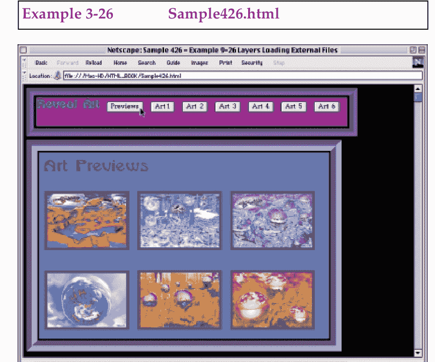

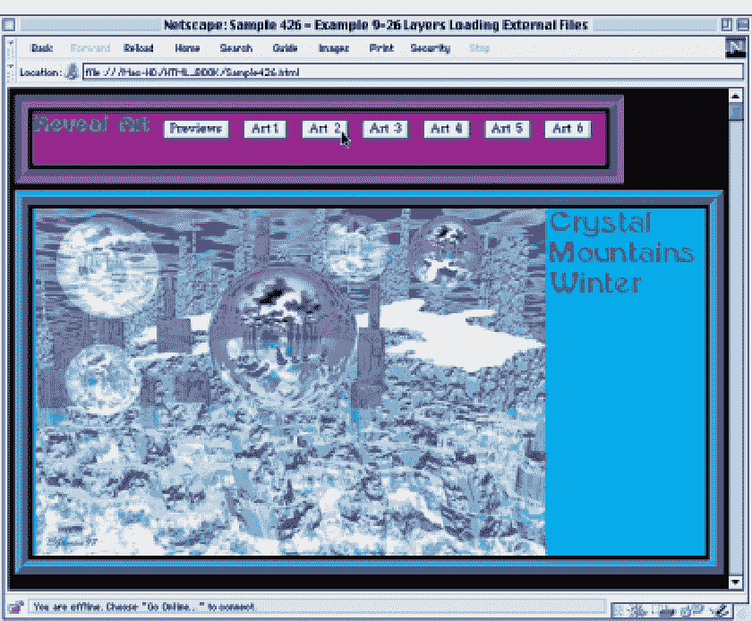

## 第一部分 — 动态 HTML

## 一个井字棋（Tic Tac Toe）游戏示例

这是一个经典的井字棋游戏，但加入了一些新花样。包含 X 和 O 的图层最初是隐藏的，当点击名为 **Control** 的左侧图层中的按钮时，它们会以动画形式显示出来。

**revealChoice1X()** 到 **revealChoice9X()** 以及 **revealChoice1O()** 到 **revealChoice9O()** 函数用于控制图层的 **visibility**（可见性）属性和位置坐标。

**AnimateChoice1X()** 到 **AnimateChoice9X()** 以及 **AnimateChoice1O()** 到 **AnimateChoice9O()** 函数通过 **moveBy()** 和 **setTimeout()** 方法控制图层的动画。

九个 BGCOLOR 属性设置为黑色的图层用于遮盖其所在容器图层的黄色，从而使传统的棋盘线显现出来。这个游戏还有另一个版本，采用了完全不同的编程方案，允许通过键盘进行游戏。该版本的代码位于第 6 章第 580-585 页，可以在 Sample714-TTT-Keys.html 文件中查看。

## 示例 3-27：Sample427-TTT.html

```
<!DOCTYPE HTML PUBLIC "-//W3C//DTD HTML 3.2//EN">
<HTML><HEAD>
<TITLE>Sample 427-TTT - Example 3-27      Tic Tac Toe Animated</TITLE>      </HEAD>

          <!--    Note that this example uses CSS Syntax for local Styles on-the-fly     -->

<BODY STYLE='color:white; background-color:black; font-family:Palatino, Moonlight, serif;'>

          <!--    The CONTROL  layer                                                  -->

<LAYER ID="Control" LEFT=5 TOP=5 WIDTH=120 HEIGHT=470 BGCOLOR="LIME">
<FORM NAME="form1">

<SPAN STYLE="font-size:22pt; text-align:center; font-family:Moonlight, cursive;">
<BR><BR>Pick an  <BR>                  X or O  <BR>                                </SPAN>  <HR>

<SPAN STYLE="float:center;">

<INPUT TYPE="button" NAME="ChooseX1" VALUE="X1"
onClick='revealChoice1X(); AnimateChoice1X(); return false;'>

<INPUT TYPE="button" NAME="ChooseO1" VALUE="O1"
onClick='revealChoice1O(); AnimateChoice1O(); return false;'>         <BR>

<INPUT TYPE="button" NAME="ChooseX2" VALUE="X2"
onClick='revealChoice2X(); AnimateChoice2X(); return false;'>

<INPUT TYPE="button" NAME="ChooseO2" VALUE="O2"
onClick='revealChoice2O(); AnimateChoice2O(); return false;'>         <BR>

<INPUT TYPE="button" NAME="ChooseX3" VALUE="X3"
onClick='revealChoice3X(); AnimateChoice3X(); return false;'>

<INPUT TYPE="button" NAME="ChooseO3" VALUE="O3"
onClick='revealChoice3O(); AnimateChoice3O(); return false;'>         <BR><BR>                <HR>
```

```
<INPUT TYPE="button" NAME="ChooseX4" VALUE="X4"
onClick='revealChoice4X(); AnimateChoice4X(); return false;'>

<INPUT TYPE="button" NAME="ChooseO4" VALUE="O4"
onClick='revealChoice4O(); AnimateChoice4O(); return false;'>      <BR>

<INPUT TYPE="button" NAME="ChooseX5" VALUE="X5"
onClick='revealChoice5X(); AnimateChoice5X(); return false;'>

<INPUT TYPE="button" NAME="ChooseO5" VALUE="O5"
onClick='revealChoice5O(); AnimateChoice5O(); return false;'>      <BR>

<INPUT TYPE="button" NAME="ChooseX6" VALUE="X6"
onClick='revealChoice6X(); AnimateChoice6X(); return false;'>

<INPUT TYPE="button" NAME="ChooseO6" VALUE="O6"
onClick='revealChoice6O(); AnimateChoice6O(); return false;'>      <BR><BR>         <HR>

<INPUT TYPE="button" NAME="ChooseX7" VALUE="X7"
onClick='revealChoice7X(); AnimateChoice7X(); return false;'>

<INPUT TYPE="button" NAME="ChooseO7" VALUE="O7"
onClick='revealChoice7O(); AnimateChoice7O(); return false;'>      <BR>

<INPUT TYPE="button" NAME="ChooseX8" VALUE="X8"
onClick='revealChoice8X(); AnimateChoice8X(); return false;'>

<INPUT TYPE="button" NAME="ChooseO8" VALUE="O8"
onClick='revealChoice8O(); AnimateChoice8O(); return false;'>      <BR>

<INPUT TYPE="button" NAME="ChooseX9" VALUE="X9"
onClick='revealChoice9X(); AnimateChoice9X(); return false;'>

<INPUT TYPE="button" NAME="ChooseO9" VALUE="O9"
onClick='revealChoice9O(); AnimateChoice9O(); return false;'>      <BR><BR>         <HR>

<INPUT TYPE="button" NAME="StartOver" VALUE="New Game" onClick='StartGame(); return false;'>

</SPAN>
</FORM>
</LAYER>

<!--          The containing layer                   -->

<LAYER ID="MainBoard" LEFT=150 TOP=5 WIDTH=470 HEIGHT=470 BGCOLOR="YELLOW">

<!--      The 9 Layers that black out the main Grid to reveal only the Grid Bars     -->

<LAYER LEFT=0 TOP=0 WIDTH=150 HEIGHT=150 BGCOLOR="black"></LAYER>

<LAYER LEFT=160 TOP=0 WIDTH=150 HEIGHT=150 BGCOLOR="black"></LAYER>

<LAYER LEFT=320 TOP=0 WIDTH=150 HEIGHT=150 BGCOLOR="black"></LAYER>

<LAYER LEFT=0 TOP=160 WIDTH=150 HEIGHT=150 BGCOLOR="black"></LAYER>

<LAYER LEFT=160 TOP=160 WIDTH=150 HEIGHT=150 BGCOLOR="black"></LAYER>

<LAYER LEFT=320 TOP=160 WIDTH=150 HEIGHT=150 BGCOLOR="black"></LAYER>

<LAYER LEFT=0 TOP=320 WIDTH=150 HEIGHT=150 BGCOLOR="black"></LAYER>

<LAYER LEFT=160 TOP=320 WIDTH=150 HEIGHT=150 BGCOLOR="black"></LAYER>

<LAYER LEFT=320 TOP=320 WIDTH=150 HEIGHT=150 BGCOLOR="black"></LAYER>
<!-- *************************************************** -->

<!-- ********************************************************** -->

<!-- The 18 Layers that make up the grid with X and O letters -->

<LAYER ID="Grid1X" LEFT=0 TOP=0 WIDTH=150 HEIGHT=150 BGCOLOR="blue" VISIBILITY="hide">
<SPAN STYLE="color:white; font-size:115pt; text-align:center;">X</SPAN>
</LAYER>

<LAYER ID="Grid1O" LEFT=0 TOP=0 WIDTH=150 HEIGHT=150 BGCOLOR="red" VISIBILITY="hide">
<SPAN STYLE="color:navy; font-size:115pt; text-align:center;">O</SPAN>
</LAYER>

<!-- ********************************************************** -->

<LAYER ID="Grid2X" LEFT=160 TOP=0 WIDTH=150 HEIGHT=150 BGCOLOR="blue" VISIBILITY="hide">
<SPAN STYLE="color:white; font-size:115pt; text-align:center;">X</SPAN>
</LAYER>

<LAYER ID="Grid2O" LEFT=160 TOP=0 WIDTH=150 HEIGHT=150 BGCOLOR="red" VISIBILITY="hide">
<SPAN STYLE="color:navy; font-size:115pt; text-align:center;">O</SPAN>
</LAYER>

<!-- ********************************************************** -->

<LAYER ID="Grid3X" LEFT=320 TOP=0 WIDTH=150 HEIGHT=150 BGCOLOR="blue" VISIBILITY="hide">
<SPAN STYLE="color:white; font-size:115pt; text-align:center;">X</SPAN>
</LAYER>

<LAYER ID="Grid3O" LEFT=320 TOP=0 WIDTH=150 HEIGHT=150 BGCOLOR="red" VISIBILITY="hide">
<SPAN STYLE="color:navy; font-size:115pt; text-align:center;">O</SPAN>
</LAYER>

<!-- ********************************************************** -->

<LAYER ID="Grid4X" LEFT=0 TOP=160 WIDTH=150 HEIGHT=150 BGCOLOR="blue" VISIBILITY="hide">
<SPAN STYLE="color:white; font-size:115pt; text-align:center;">X</SPAN>
</LAYER>

<LAYER ID="Grid4O" LEFT=0 TOP=160 WIDTH=150 HEIGHT=150 BGCOLOR="red" VISIBILITY="hide">
<SPAN STYLE="color:navy; font-size:115pt; text-align:center;">O</SPAN>
</LAYER>

<!-- ********************************************************** -->

<LAYER ID="Grid5X" LEFT=160 TOP=160 WIDTH=150 HEIGHT=150 BGCOLOR="blue" VISIBILITY="hide">
<SPAN STYLE="color:white; font-size:115pt; text-align:center;">X</SPAN>
</LAYER>

<LAYER ID="Grid5O" LEFT=160 TOP=160 WIDTH=150 HEIGHT=150 BGCOLOR="red" VISIBILITY="hide">
<SPAN STYLE="color:navy; font-size:115pt; text-align:center;">O</SPAN>
</LAYER>

<!-- ********************************************************** -->

<LAYER ID="Grid6X" LEFT=320 TOP=160 WIDTH=150 HEIGHT=150 BGCOLOR="blue" VISIBILITY="hide">
<SPAN STYLE="color:white; font-size:115pt; text-align:center;">X</SPAN>
</LAYER>

<!-- ********************************************************** -->
<!-- ********************************************************** -->

<LAYER ID="Grid6O" LEFT=320 TOP=160 WIDTH=150 HEIGHT=150 BGCOLOR="red" VISIBILITY="hide">
<SPAN STYLE="color:navy; font-size:115pt; text-align:center;">O</SPAN>
</LAYER>
```


 ```
# 第 3 章 — 图层与 JavaScript 299

```
<!-- ******************************************************************************** -->

<LAYER ID="Grid7X" LEFT=0 TOP=320 WIDTH=150 HEIGHT=150 BGCOLOR="blue" VISIBILITY="hide">
<SPAN STYLE="color:white; font-size:115pt; text-align:center;">X</SPAN>
</LAYER>

<LAYER ID="Grid7O" LEFT=0 TOP=320 WIDTH=150 HEIGHT=150 BGCOLOR="red" VISIBILITY="hide">
<SPAN STYLE="color:navy; font-size:115pt; text-align:center;">O</SPAN>
</LAYER>

<!-- ******************************************************************************** -->

<LAYER ID="Grid8X" LEFT=160 TOP=320 WIDTH=150 HEIGHT=150 BGCOLOR="blue" VISIBILITY="hide">
<SPAN STYLE="color:white; font-size:115pt; text-align:center;">X</SPAN>
</LAYER>

<LAYER ID="Grid8O" LEFT=160 TOP=320 WIDTH=150 HEIGHT=150 BGCOLOR="red" VISIBILITY="hide">
<SPAN STYLE="color:navy; font-size:115pt; text-align:center;">O</SPAN>
</LAYER>

<!-- ******************************************************************************** -->

<LAYER ID="Grid9X" LEFT=320 TOP=320 WIDTH=150 HEIGHT=150 BGCOLOR="blue" VISIBILITY="hide">
<SPAN STYLE="color:white; font-size:115pt; text-align:center;">X</SPAN>
</LAYER>

<LAYER ID="Grid9O" LEFT=320 TOP=320 WIDTH=150 HEIGHT=150 BGCOLOR="red" VISIBILITY="hide">
<SPAN STYLE="color:navy; font-size:115pt; text-align:center;">O</SPAN>
</LAYER>
<!-- ******************************************************************************** -->
</LAYER>

<!-- ******************************************************************************** -->
<!-- ******************************************************************************** -->
<SCRIPT LANGUAGE="JavaScript1.2"><!--BEGIN HIDING

/*----------------------------------------------*/
/*------  本节处理用于显示 X 和 O 字母的函数  ------*/

var Grid1X = document.MainBoard.document.Grid1X;
var Grid1O = document.MainBoard.document.Grid1O;

var Grid2X = document.MainBoard.document.Grid2X;
var Grid2O = document.MainBoard.document.Grid2O;

var Grid3X = document.MainBoard.document.Grid3X;
var Grid3O = document.MainBoard.document.Grid3O;

var Grid4X = document.MainBoard.document.Grid4X;
var Grid4O = document.MainBoard.document.Grid4O;

var Grid5X = document.MainBoard.document.Grid5X;
var Grid5O = document.MainBoard.document.Grid5O;

var Grid6X = document.MainBoard.document.Grid6X;
var Grid6O = document.MainBoard.document.Grid6O;

var Grid7X = document.MainBoard.document.Grid7X;
var Grid7O = document.MainBoard.document.Grid7O;

var Grid8X = document.MainBoard.document.Grid8X;
var Grid8O = document.MainBoard.document.Grid8O;

var Grid9X = document.MainBoard.document.Grid9X;
var Grid9O = document.MainBoard.document.Grid9O;

/*----------------------------------------------*/
```

# 300

# 第一部分 — 动态 HTML

```
/*------------------------------------------------*/
function revealChoice1X () {

			Grid1X.visibility="show";
			Grid1O.visibility="hide";
			Grid1X.moveTo(-160,0);

}

function AnimateChoice1X() {

			if (Grid1X.left < 0)  {

						Grid1X.moveBy(20,0);
						setTimeout('AnimateChoice1X()', 20);
			}
return false;
}

/*----------------------------------------*/
function revealChoice1O () {

			Grid1O.visibility="show";
			Grid1X.visibility="hide";
			Grid1O.moveTo(-160,0);

}

function AnimateChoice1O() {

			if (Grid1O.left < 0)  {

						Grid1O.moveBy(20,0);
						setTimeout('AnimateChoice1O()', 20);
			}
return false;
}

/*------------------------------------------------*/
function revealChoice2X () {

			Grid2X.visibility="show";
			Grid2O.visibility="hide";
			Grid2X.moveTo(160,-160);

}

function AnimateChoice2X() {

			if (Grid2X.top < 0)  {

						Grid2X.moveBy(0,20);
						setTimeout('AnimateChoice2X()', 20);
			}
return false;
}

/*----------------------------------------*/
function revealChoice2O () {

			Grid2O.visibility="show";
			Grid2X.visibility="hide";
			Grid2O.moveTo(160,-160);

}

function AnimateChoice2O() {

        if (Grid2O.top < 0) {

                Grid2O.moveBy(0,20);
                setTimeout('AnimateChoice2O()', 20);
        }
return false;
}

/*-------------------------------------------------------*/

function revealChoice3X () {

        Grid3X.visibility="show";
        Grid3O.visibility="hide";
        Grid3X.moveTo(320,-160);
}

function AnimateChoice3X() {

        if (Grid3X.top < 0) {

                Grid3X.moveBy(0,20);
                setTimeout('AnimateChoice3X()', 20);
        }
return false;
}

/*-----------------------------------------------*/

function revealChoice3O () {

        Grid3O.visibility="show";
        Grid3X.visibility="hide";
        Grid3O.moveTo(320,-160);
}

function AnimateChoice3O() {

        if (Grid3O.top < 0) {

                Grid3O.moveBy(0,20);
                setTimeout('AnimateChoice3O()', 20);
        }
return false;
}

/*-------------------------------------------------------*/

function revealChoice4X () {

        Grid4X.visibility="show";
        Grid4O.visibility="hide";
        Grid4X.moveTo(-160,160);
}

function AnimateChoice4X() {

        if (Grid4X.left < 0) {

                Grid4X.moveBy(20,0);
                setTimeout('AnimateChoice4X()', 20);
        }
return false;
}
/*---------------------------------------------*/

/*----------------------------------------*/

function revealChoice4O () {

        Grid4O.visibility="show";
        Grid4X.visibility="hide";
        Grid4O.moveTo(-160,160);
}

function AnimateChoice4O() {

        if (Grid4O.left < 0)  {

                Grid4O.moveBy(20,0);
                setTimeout('AnimateChoice4O()', 20);
        }
return false;
}

/*----------------------------------------*/

function revealChoice5X () {

        Grid5X.visibility="show";
        Grid5O.visibility="hide";
        Grid5X.moveTo(-160,160);
}

function AnimateChoice5X() {

        if (Grid5X.left < 160)  {

                Grid5X.moveBy(20,0);
                setTimeout('AnimateChoice5X()', 20);
        }
return false;
}

/*----------------------------------------*/

function revealChoice5O () {

        Grid5O.visibility="show";
        Grid5X.visibility="hide";
        Grid5O.moveTo(-160,160);
}

function AnimateChoice5O() {

        if (Grid5O.left < 160)  {

                Grid5O.moveBy(20,0);
                setTimeout('AnimateChoice5O()', 20);
        }
return false;
}

/*----------------------------------------*/

function revealChoice6X () {

        Grid6X.visibility="show";
        Grid6O.visibility="hide";
        Grid6X.moveTo(480,160);
}

function AnimateChoice6X() {

			if (Grid6X.left > 320) {

				Grid6X.moveBy(-20,0);
				setTimeout('AnimateChoice6X()', 20);
			}

return false;
}

/*--------------------------------------*/

function revealChoice6O () {

			Grid6O.visibility="show";
			Grid6X.visibility="hide";
			Grid6O.moveTo(480,160);

}

function AnimateChoice6O() {

			if (Grid6O.left > 320) {

				Grid6O.moveBy(-20,0);
				setTimeout('AnimateChoice6O()', 20);
			}

return false;
}

/*---------------------------------------------------------*/

function revealChoice7X () {

			Grid7X.visibility="show";
			Grid7O.visibility="hide";
			Grid7X.moveTo(-160,320);

}

function AnimateChoice7X() {

			if (Grid7X.left < 0) {

				Grid7X.moveBy(20,0);
				setTimeout('AnimateChoice7X()', 20);
			}

return false;
}

/*--------------------------------------*/

 tempted revealChoice7O () {

			Grid7O.visibility="show";
			Grid7X.visibility="hide";
			Grid7O.moveTo(-160,320);

}

function AnimateChoice7O() {

			if (Grid7O.left < 0) {

				Grid7O.moveBy(20,0);
				setTimeout('AnimateChoice7O()', 20);
			}

return false;
}

/*------------------------------------------------*/

function revealChoice8X () {

	Grid8X.visibility="show";
	Grid8O.visibility="hide";
	Grid8X.moveTo(160,480);

}

function AnimateChoice8X() {

	if (Grid8X.top > 320) {

		Grid8X.moveBy(0,-20);
		setTimeout('AnimateChoice8X()', 20);
	}

return false;
}

/*--------------------------------------*/

function revealChoice8O () {

	Grid8O.visibility="show";
	Grid8X.visibility="hide";
	Grid8O.moveTo(160,480);

}

function AnimateChoice8O() {

	if (Grid8O.top > 320) {

		Grid8O.moveBy(0,-20);
		setTimeout('AnimateChoice8O()', 20);
	}

return false;
}

/*------------------------------------------------*/

function revealChoice9X () {

		Grid9X.visibility="show";
		Grid9O.visibility="hide";
		Grid9X.moveTo(480,320);

}

function AnimateChoice9X() {

		if (Grid9X.left > 320) {

				Grid9X.moveBy(-20,0);
				setTimeout('AnimateChoice9X()', 20);
		}

return false;
}

/*--------------------------------------*/

function revealChoice9O () {

				Grid9O.visibility="show";
				Grid9X.visibility="hide";
				Grid9O.moveTo(480,320);

}
```


## 第三章 — 图层与 JavaScript

```javascript
function AnimateChoice90() {
        if (Grid90.left > 320) {
                Grid90.moveBy(-20,0);
                setTimeout('AnimateChoice90()', 20);
        }
        return false;
}

/*-----------------------------------------------*/

function StartGame() {
        Grid1X.visibility="hide"; Grid1O.visibility="hide";
        Grid2X.visibility="hide"; Grid2O.visibility="hide";
        Grid3X.visibility="hide"; Grid3O.visibility="hide";
        Grid4X.visibility="hide"; Grid4O.visibility="hide";
        Grid5X.visibility="hide"; Grid5O.visibility="hide";
        Grid6X.visibility="hide"; Grid6O.visibility="hide";
        Grid7X.visibility="hide"; Grid7O.visibility="hide";
        Grid8X.visibility="hide"; Grid8O.visibility="hide";
        Grid9X.visibility="hide"; Grid9O.visibility="hide";
}

//END HIDING-->
</SCRIPT>

</BODY>

</HTML>
```

**306** 第一部分 — 动态 HTML

示例 3-27 Sample427.html

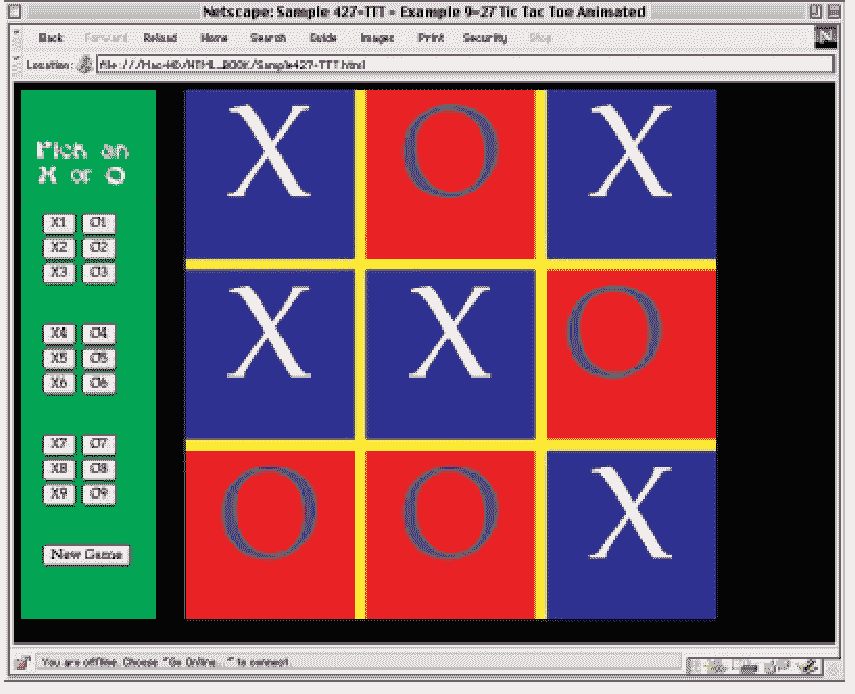

### JavaScript 的 Date 对象

**Date** 对象提供了一组用于处理日期和时间的方法。JavaScript 在内部将 **Date** 对象存储为自 1970 年 1 月 1 日午夜以来所经过的毫秒数。因此，当你想要操作 **Date** 数据时，必须动一动数学脑筋才能获得有用的输出。JavaScript 1.2 不允许 1970 年 1 月 1 日之前的日期，但 1.3 版本允许。

下面列出了 JavaScript 1.2 中可用的 **Date** 对象的属性和方法。注意，在第十章第 863 页开始，JavaScript 1.3 中为 **Date** 对象提供了额外的方法。另请参见第 862-879 页。

### Date 属性

| 属性 | 说明 |
| :--- | :--- |
| **prototype** | 允许你在创建 **Date** 对象的新实例时添加和分配自己的属性和方法。 |

### Date 方法

| 方法 | 说明/返回值 |
| :--- | :--- |
| **getDate()** | 返回指定 **Date** 对象的月份中的日期。 |
| **getDay()** | 返回指定 **Date** 对象的星期几。 |
| **getHours()** | 返回指定 **Date** 对象的小时数。 |
| **getMinutes()** | 返回指定 **Date** 对象的分钟数。 |
| **getMonth()** | 返回指定 **Date** 对象的月份。 |
| **getSeconds()** | 返回指定 **Date** 对象的秒数。 |
| **getTime()** | 返回与指定 **Date** 对象的时间对应的数值。 |
| **getTimezoneOffset()** | 返回指定 **Date** 对象在当前地理区域的时区偏移量（以分钟为单位）。 |
| **getYear()** | 返回指定 **Date** 对象的年份。 |
| **parse()** | 返回自 1970 年 1 月 1 日 00:00:00（本地时间）以来，**Date** 对象字符串所对应的毫秒数。 |
| **setDate(integer)** | 设置指定 **Date** 对象的月份中的日期。 |
| **setHours(integer)** | 设置指定 **Date** 对象的小时数。 |
| **setMinutes(integer)** | 设置指定 **Date** 对象的分钟数。 |
| **setMonth(integer)** | 设置指定 **Date** 对象的月份。 |
| **setSeconds(integer)** | 设置指定 **Date** 对象的秒数。 |
| **setTime(integer)** | 设置 **Date** 对象的值。 |
| **setYear(integer)** | 设置指定 **Date** 对象的年份。 |
| **toGMTString()** | 使用互联网 GMT 惯例将 **Date** 对象转换为字符串。 |
| **toLocaleString()** | 使用当前地理区域的惯例将 **Date** 对象转换为字符串。 |
| **UTC()** | 返回自 1970 年 1 月 1 日 00:00:00（世界协调时间 GMT）以来，**Date** 对象的毫秒数。 |

## 使用四种 Date 构造函数创建 Date 对象

有四种不同的 **Date 构造函数**可用于创建 **Date** 对象的实例，如下所列。如果不提供参数，则使用默认版本，以 GMT 格式显示当前日期和时间。第二个 **Date 构造函数**接受 **String** 作为参数，格式为语法中所列的格式，或者由静态 **parse()** 方法识别的格式。第三和第四个 **Date 构造函数**接受 **整数** 作为参数。**hours**、**minutes** 和 **seconds** 参数是可选的，如果省略则默认为零。

### Date 构造函数语法：

```javascript
new Date()                                              //默认版本
new Date("month day, year [hours:minutes:seconds]")       //字符串值
new Date(year, month, day)                                //整数值
new Date(year, month, day[, hours, minutes, seconds])     //整数值
```

## 创建计时器并显示当前时间

示例 3-28 是一个简单的示例，它创建了一个显示当前日期和时间以及用户在该站点停留时间的显示界面。

**initializeTime()** 函数使用 **new** 运算符和 **Date()** 构造函数构造 **Date** 对象的新实例，并使用 **toLocaleString()** 方法将其从自 1970 年 1 月 1 日以来经过的毫秒数转换为适用于任何特定地理区域的通用可用格式。然后通过调用 **output()** 函数将其赋值给名为 **TextTime** 的文本字段的 **value** 属性。接着通过使用 **setTimeout()** 方法重复此过程，使其每秒更新一次时间，该方法每 1000 毫秒（即每秒）调用一次 **initializeTime()** 函数。

最后，**BeenHereXT()** 函数构造一个名为 **later** 的 **Date** 对象新实例，它始终是当前时间，因为 **setTimeout()** 方法会导致每次调用 **BeenHereXT()** 函数时（每秒一次）都会构造一个新的 **Date** 对象。

还有第三个 **Date** 对象实例，名为 **startTime**，它在文档加载时构造且保持不变。通过用 **later** 减去 **startTime**，可以得到用户在该站点停留的经过时间，该值被赋值给名为 **Visited** 的文本字段的 **value** 属性。将该数值除以 60000 可将其从毫秒转换为分钟（60 秒 × 1000 毫秒 = 1 分钟）。

**setTimeout()** 方法通过将 **milliseconds** 参数设置为 60000，每分钟更新一次在站点停留的经过时间。它调用 **BeenHereXT()** 函数，该函数又调用 **visitedUs()** 函数，后者用 **TimeHere** 变量更新 **Visited** 文本字段的值。

注意，**Date** 对象默认以 24 小时制军事格式显示时间，其中下午 2 点显示为 14，本示例中的时间即以此方式显示。要转换为更熟悉的格式，需要使用一些创造性的编码，如示例 3-30 所示。

## 第三章 — 图层与 JavaScript

示例 3-28：Sample428.html

```html
<!DOCTYPE HTML PUBLIC "-//W3C//DTD HTML 3.2//EN">
<HTML>
<HEAD>
<TITLE>Sample 428 - Example 3-28 Time Counter</TITLE>

<STYLE TYPE="text/JavaScript">
        tags.BODY.backgroundColor="black";

        classes.Patrol.all.fontSize="24pt";
        classes.Patrol.all.fontFamily="Moonlight, fantasy";
        classes.Patrol.all.color="blue";
        classes.Patrol.all.backgroundColor="#8800ff";
</STYLE>
</HEAD>
<!--  ****************************************************  -->
<BODY>
<DIV ALIGN=LEFT CLASS="Patrol">

<FORM NAME="formA">            Hi              <BR>    the Time is:    <BR>
<INPUT TYPE="text" SIZE="22" NAME="TextTime" VALUE="">                      <BR>

        You've been       <BR>       here for:                <BR>

<INPUT TYPE="text" SIZE="22" NAME="Visited" VALUE="">                       <BR>

             Minutes
</FORM>
</DIV>
<!--  ****************************************************  -->

<SCRIPT LANGUAGE="JavaScript1.2"><!--BEGIN HIDING

      startTime = new Date();

function output(t) {
      document.formA.TextTime.value=t;
}
/*------------------------------------------*/
function visitedUs(t2) {
      document.formA.Visited.value=t2;
}
/*------------------------------------------*/
function initializeTime()  {
      var today = new Date();
      var todayDateTime = today.toLocaleString();
      output (todayDateTime);

      setTimeout('initializeTime()', 1000);
}
```


```javascript
/*---------------------------------------*/

function BeenHereXT() {

    var later = new Date();
    var TimeHere = Math.round( (later - startTime) / 60000 );

    visitedUs( TimeHere );

    setTimeout('BeenHereXT()', 60000);
}
/*---------------------------------------*/

initializeTime();
BeenHereXT();

//END HIDING-->
</SCRIPT>
</BODY>
</HTML>
```

## 在框架集（Frameset）中创建时间计数器并显示当前时间

示例 3-29 在前一个示例的基础上进行了扩展，通过使用 **write()** 方法，具体为 **parent.display.document.write()**，将 HTML 内容、JavaScript 样式语法和 JavaScript 动态地写入到当前 FRAMESET 包含的 Frame 的外部文档中。在上一句话中，**parent** 调用的是 **display** 的容器 FRAMESET，而 **display** 是包含你想要执行 **write()** 操作的 **document** 的 FRAME 名称。URL 为 <u>Sample429A.html</u> 的外部文档只是一个空白文档，用作 FRAME 的 SRC 属性的占位符（该属性不能省略）。其所有内容均由 <u>Sample429.html</u> 中的 JavaScript 代码动态生成。**outputTime(t)** 和 **initializeTime()** 函数是本示例的核心。

**outputTime(t)** 该函数使用 **parent.display.document.write()** 方法来创建 HTML 代码和 JavaScript 样式，然后在被 **initializeTime()** 函数调用时，接收参数 **t** 并将其渲染到名为 **display** 的 FRAME 所包含的文档中。

**initializeTime()** 该函数与在前一个示例中的用法有三个主要区别。首先，它包含一个条件语句 **if ()**，根据任何复选框元素是开启还是关闭，来减慢或加快 **setTimeout()** 方法的刷新率。其次，它包含 HTML FONT 元素，将 “Been Here” 文本的颜色改为 “红色”。第三，包含文本字符串的两个变量 **todayDateTime** 和 **TimeHere** 是使用 **outputTime(t)** 函数提供的样式进行渲染的，而不是传递给文本字段的 Value 参数。该函数作为 BODY 元素中所含 SCRIPT 元素的唯一项目被调用。

## 使用 write() 方法时的编程技巧

如果你是 JavaScript 新手，在设计自己的页面时有几点需要注意。首先，当你使用 **document.write()** 方法时，必须确保引号内的代码在文本编辑器中全部处于同一行，否则你可能会遇到某种难以理解的错误。

如果你有很长的代码需要写入，要么将其拆分为较小的块；如果这不是首选方案，至少要确保你的文本编辑器没有开启“软换行”（soft-wrapping），因为这会导致问题（在大多数其他情况下不会有问题）。如果你使用的是 BBEdit，请进入编辑菜单中的窗口选项（Window Options），取消勾选 “Soft Wrap Text” 复选框。如果你没用 BBEdit，那你就是在浪费大量的时间。

你还需要使用单引号或双引号来包裹括号内的字符串，并在字符串内部的属性值（Attribute Values）和/或属性值（Property Values）中使用相反类型的引号。

关于在 **write()** 方法中经常被忽视但至关重要的反斜杠 (\\) 字符的用法，请参阅第 197 页。

## 示例 3-29 第一部分：Sample429.html

```html
<!DOCTYPE HTML PUBLIC "-//W3C//DTD HTML 3.2//EN">
<HTML>
<HEAD>
<TITLE>Sample 429 - Example 3-29  Time Counter    </TITLE>

<STYLE TYPE="text/JavaScript">

     classes.Mainbody.BODY.margins("0px");
     classes.Mainbody.BODY.paddings("0px");
     classes.Mainbody.BODY.backgroundColor="black";
     classes.Mainbody.BODY.color="white";

     classes.SteelBlu.all.margins("0px");
     classes.SteelBlu.all.backgroundColor="steelblue";
     classes.SteelBlu.all.color="navy";
     classes.SteelBlu.all.width="700";
     classes.SteelBlu.all.fontSize="22pt";
     classes.SteelBlu.all.fontFamily="Clarendon, Helvetica, serif";
     classes.SteelBlu.all.paddings("7px");
     classes.SteelBlu.all.borderTopWidth="10px";
     classes.SteelBlu.all.borderRightWidth="30px";
     classes.SteelBlu.all.borderBottomWidth="10px";
     classes.SteelBlu.all.borderLeftWidth="30px";
     classes.SteelBlu.all.borderStyle="inset";
     classes.SteelBlu.all.borderColor="#5555ff";
     classes.SteelBlu.all.lineHeight="28pt";

     classes.RedBox.P.backgroundColor="red";
     classes.RedBox.P.fontSize="17pt";

</STYLE>
```

```javascript
<!-- ************************************************** -->

<SCRIPT LANGUAGE="JavaScript1.2"><!--BEGIN HIDING

function outputTime(t){

//Note that you don't have to use the document.open() Method because the
//write() Method does an implicit open for the MIME type for HTML and text.

parent.display.document.write("<HTML><HEAD><TITLE>")
parent.display.document.write("<CLOCK DISPLAY>")
parent.display.document.write("<\/TITLE>")

parent.display.document.write("<STYLE TYPE='text/JavaScript'>")

parent.display.document.write("classes.Mainbody.BODY.margins('0px');")
parent.display.document.write("classes.Mainbody.BODY.paddings('0px');")
parent.display.document.write("classes.Mainbody.BODY.backgroundColor='black';")
parent.display.document.write("classes.Mainbody.BODY.color='white';")

parent.display.document.write("classes.SteelBlu.all.margins('0px');")
parent.display.document.write("classes.SteelBlu.all.backgroundColor='darkblue';")
parent.display.document.write("classes.SteelBlu.all.color='cyan';")
parent.display.document.write("classes.SteelBlu.all.width='700';")
parent.display.document.write("classes.SteelBlu.all.fontSize='24pt';")
parent.display.document.write("classes.SteelBlu.all.fontFamily='Moonlight, Clarendon, Helvetica, serif';")

parent.display.document.write("classes.SteelBlu.all.paddings('7px');")
parent.display.document.write("classes.SteelBlu.all.borderTopWidth='15px';")
parent.display.document.write("classes.SteelBlu.all.borderRightWidth='40px';")
parent.display.document.write("classes.SteelBlu.all.borderBottomWidth='15px';")
parent.display.document.write("classes.SteelBlu.all.borderLeftWidth='40px';")
parent.display.document.write("classes.SteelBlu.all.borderStyle='groove';")
parent.display.document.write("classes.SteelBlu.all.borderColor='#8800ff';")
parent.display.document.write("classes.SteelBlu.all.lineHeight='24pt';")

parent.display.document.write("<\/STYLE>")
parent.display.document.write("<\/HEAD>")
parent.display.document.write("<BODY CLASS='Mainbody'>")

parent.display.document.write("<LAYER CLASS='SteelBlu' ID='Readout' LEFT=10 TOP='0' HEIGHT=100>")

parent.display.document.write("<CENTER>")

        parent.display.document.write(t)

parent.display.document.write("<\/CENTER>")
parent.display.document.write("<\/LAYER>")
parent.display.document.write("<\/BODY>")
parent.display.document.write("<\/HTML>")

        parent.display.document.close();
}

/*----------------------------------------------*/
/*----------------------------------------------*/

startTime = new Date();
var booleanTest = true;

/*-----------------------------------------------------------*/

function initializeTime()  {

	var today = new Date();
	var todayDateTime = today.toLocaleString();
	later = new Date();
	TimeHere = Math.round( (later - startTime) / 60000 );

	if (booleanTest == true) {

	outputTime(todayDateTime +
			" <FONT COLOR='RED'>&nbsp;&nbsp; Been Here </FONT> " +
			TimeHere + " Minutes");

	setTimeout('initializeTime()', 1000);
	}

	else {
	outputTime(todayDateTime +
					" <FONT COLOR='RED'>&nbsp;&nbsp; Been Here </FONT> " +
					TimeHere + " Minutes");

		setTimeout('initializeTime()', 60000);
	}
}

/*--------------------------------------------------*/

function slowItDownMon() {

	booleanTest = false;
	}
/*--------------------------------------------------*/

function speedItUpMon() {

	booleanTest = true;
	}

//END HIDING-->
</SCRIPT>

</HEAD>
<!-- *********************************************************** -->
<BODY CLASS="Mainbody">

<SCRIPT LANGUAGE="JavaScript1.2"><!--BEGIN HIDING

	initializeTime();

//END HIDING-->
</SCRIPT>
<!-- *********************************************************** -->
```


 ```
<FORM NAME="form3">

<P CLASS="RedBox">Click Me to Slow Time Down.<INPUT TYPE="checkbox" NAME="Slowdown" onClick="slowItDownMon()"></P>

<P CLASS="RedBox">Click Me to Speed it back Up. Depending on where the setTimeout was in its cycle, it could take up to 59 seconds to kick back in.<INPUT TYPE="checkbox" NAME="SpeedUp" onClick="speedItUpMon()"></P>

<DIV ALIGN=CENTER CLASS="SteelBlu">
	If you find this as annoying as I did after the initial coolness then click on the check box to reduce the refresh rate of the clock from seconds to minutes. I started it out to refresh in seconds so that you wouldn't have to wait on the results.
</DIV>

</FORM>
</BODY>
</HTML>
```

这只是示例 3-29 的 FRAMESET 代码。当然，这是你需要在浏览器中运行的文件，以使示例能够工作。

## 示例 3-29 第二部分：Sample429Frameset.html

```
<!DOCTYPE HTML PUBLIC "-//W3C//DTD HTML 3.2//EN">
<HTML>
<HEAD> <TITLE>Frame for Sample 429</TITLE> </HEAD>

<FRAMESET ROWS="150,*">

	<FRAME MARGINHEIGHT=0 SCROLLING="no" NAME="display" SRC="Sample429A.html">

	<FRAME SCROLLING="auto" NAME="main" SRC="Sample429.html">

</FRAMESET>

</HTML>
```

## JavaScript 条件运算符 ?:

**条件**运算符 `?:` 本质上是条件 **if** () 语句的简写形式。下面是其语法及工作原理。

## JavaScript 语法：

```
((booleanCondition) ? expression1 : expression2)
```

## 参数定义：

**booleanCondition** 是一个求值为 true 或 false 的表达式
**expression1** 和 **expression2** 是值为任意类型的表达式。

如果 **booleanCondition** 求值为 **true**，则运算符返回 **expression1** 的值；如果求值为 **false**，则返回 **expression2** 的值。

## 迷你示例：

例如，假设你用 **Date()** 构造函数定义一个变量，再用 **getHours()** 方法提取当前小时数定义另一个变量。现在，由于 Navigator 内部采用 0 到 23 的方式分配小时数（类似于军用时间），因此你需要将原始小时数转换为更传统的模式。所以你测试变量 **todaysHours**，如果它大于 12，就减去 12，否则保持不变。

然后再次测试它，以确定是将 PM 还是 AM 赋值给 **beforeAfterNoon** 变量。最后，使用 **write()** 方法来显示带有后缀的小时数。

```
var today           = new Date();

var todaysHours     = today.getHours();

todaysHours = ((todaysHours > 12)  ?  todaysHours - 12  :  todaysHours);

var beforeAfterNoon  = ((todaysHours >= 12)  ?  " PM"  :  " AM");

document.write(todaysHours  +  beforeAfterNoon);
```

## 浏览器输出：

如果时间是 22 点，那么输出将如下所示：

10 PM

仅作比较，上面这段代码如果你改用 if () 语句来写，会是这样的：

```
todaysHours = ((todaysHours > 12) ? todaysHours - 12 : todaysHours);

if (todaysHours > 12) todaysHours = todaysHours - 12;
else todaysHours;
```

本示例与示例 3-29 非常相似，只是这里多次使用了 **比较运算符 ?:** 来修改 **Date** 对象的原始参数，并且使用了相当多的 **Date** 对象方法来提取有用的数据片段，然后以一种更美观且更易阅读的方式显示它们。

**showTime** 变量被赋值的方式也与以往不同，即它被反复追加额外数据，这有助于在文本编辑器中将代码保持在一行内，而且这样读起来更容易。

## 示例 3-30：Sample430.html

```
<!DOCTYPE HTML PUBLIC "-//W3C//DTD HTML 3.2//EN">
<HTML>
<HEAD>
<TITLE>Sample 430 - Example 3-30   Advanced Display 2 Time Counter </TITLE>

<STYLE TYPE="text/JavaScript">

    classes.Mainbody.BODY.margins("0px");
    classes.Mainbody.BODY.paddings("0px");
    classes.Mainbody.BODY.backgroundColor="black";
    classes.Mainbody.BODY.color="white";

    classes.SteelBlu.all.margins("0px");
    classes.SteelBlu.all.backgroundColor="steelblue";
    classes.SteelBlu.all.color="navy";
    classes.SteelBlu.all.width="700";
    classes.SteelBlu.all.fontSize="22pt";
    classes.SteelBlu.all.fontFamily="Clarendon, Helvetica, serif";
    classes.SteelBlu.all.paddings("7px");
    classes.SteelBlu.all.borderTopWidth="10px";
    classes.SteelBlu.all.borderRightWidth="30px";
    classes.SteelBlu.all.borderBottomWidth="10px";
    classes.SteelBlu.all.borderLeftWidth="30px";
    classes.SteelBlu.all.borderStyle="inset";
    classes.SteelBlu.all.borderColor="#5555ff";
    classes.SteelBlu.all.lineHeight="28pt";

    classes.RedBox.P.backgroundColor="red";
    classes.RedBox.P.fontSize="17pt";

</STYLE>
```

```
<!-- ******************************************************* -->

<SCRIPT LANGUAGE="JavaScript1.2"><!--BEGIN HIDING


function outputTime(t) {

    // Now you have to use the document.open() Method because the
// write() Method does an implicit open for the MIME type for HTML and text.

    parent.display.document.write("<HTML><HEAD><TITLE>");
    parent.display.document.write("<CLOCK DISPLAY>");
    parent.display.document.write("</TITLE></HEAD>");

    parent.display.document.write("<STYLE TYPE="text/JavaScript">");

    parent.display.document.write("Classes.Mainbody.BODY.margins('0px');");
    parent.display.document.write("Classes.Mainbody.BODY.paddings('0px');");
    parent.display.document.write("Classes.Mainbody.BODY.backgroundColor='black';");
    parent.display.document.write("Classes.Mainbody.BODY.color='white';");

    parent.display.document.write("Classes.SteelBlu.all.margins('0px');");
    parent.display.document.write("Classes.SteelBlu.all.backgroundColor='darkblue!';");
    parent.display.document.write("Classes.SteelBlu.all.color='cyan';");
    parent.display.document.write("Classes.SteelBlu.all.width='70%';");
    parent.display.document.write("Classes.SteelBlu.all.fontSize='24pt';");
    parent.display.document.write("Classes.SteelBlu.all.fontFamily='Moonlight,
    Karondo, Helvetica, veranda, Palatino, 
    Georgia, Baskerville, serif';");
    parent.display.document.write("Classes.SteelBlu.all.paddings('7px');");
    parent.display.document.write("Classes.SteelBlu.all.borderTopWidth='15px';");
    parent.display.document.write("Classes.SteelBlu.all.borderRightWidth='40px';");
    parent.display.document.write("Classes.SteelBlu.all.borderBottomWidth='15px';");
    parent.display.document.write("Classes.SteelBlu.all.borderLeftWidth='40px';");
    parent.display.document.write("Classes.SteelBlu.all.borderStyle='groove';");
    parent.display.document.write("Classes.SteelBlu.all.borderColor='#88DDff';");
    parent.display.document.write("Classes.SteelBlu.all.lineHeight='24pt';");

    parent.display.document.write("</STYLE>");
    parent.display.document.write("</HEAD>");
    parent.display.document.write("<BODY CLASS="Mainbody">");

    parent.display.document.write("<LAYER CLASS="SteelBlu" LEFT='10'
TOP='0' HEIGHT='100' WIDTH='100'>");
    parent.display.document.write("<CENTER>");

    parent.display.document.write(t);

    parent.display.document.write("</CENTER>");
    parent.display.document.write("</LAYER>");
    parent.display.document.write("</body>");
    parent.display.document.write("</html>");

    }
    parent.display.document.close();

/*
/*                                                                */
```

```
startTime = new Date();
var booleanTest = true;

/*-----------------------------------------------*/
/*-----------------------------------------------*/
//The getMonth() Method returns a zero to eleven numbering scheme for months
//such that January = 0, February = 1, ..., December = 11,
//so you have to increment the month by 1 if you need January to be 1 instead of 0
//which is used for the todayMonth variable, below.

function initializeTime() {

    var today             = new Date();
    var todayMonth        = today.getMonth() + 1;
    var todayDay          = today.getDate();
    var todayYear         = today.getYear();
    var todaysHours       = today.getHours();
    var todaysMinutes     = today.getMinutes();
    var todaysSeconds     = today.getSeconds();
    var later             = new Date();
    var TimeHere          = Math.round((later - startTime) / 60000);

    todaysHours = ((todaysHours > 12) ? todaysHours - 12 : todaysHours);

    var showTime = "The Date is ***** <FONT COLOR='RED'>"+ todayMonth +"/"
    showTime += todayDay +"/"
    showTime += todayYear + "<\/FONT><BR>"
    showTime += "The Time is ***** <FONT COLOR='RED'>" + todaysHours
    showTime += ((todaysMinutes > 9) ? ":" : ":0")
    showTime += todaysMinutes
    showTime += ((todaysSeconds > 9) ? " :" : " :0")
    showTime += todaysSeconds
    showTime += ((todaysHours >= 12) ? " PM" : " AM") + "<\/FONT><BR>"
    showTime += "You have been here ***** <FONT COLOR='RED'>"
    showTime += TimeHere + " Minutes.<\/FONT>"

    if (booleanTest == true) {

        outputTime(showTime);

        setTimeout('initializeTime()', 1000);
    }

    else {
        outputTime(showTime);

        setTimeout('initializeTime()', 60000);
    }
}

/*-----------------------------------------------*/

function slowItDownMon() {

    booleanTest = false;
}
/*-----------------------------------------------*/
```


 ## 320 第一部分 —— 动态 HTML

```
/*------------------------------------------------------------------------*/

function speedItUpMon() {

    booleanTest = true;
}

//END HIDING-->
</SCRIPT>

</HEAD>

<!-- ********************************************************************* -->

<BODY CLASS="Mainbody">

<SCRIPT LANGUAGE="JavaScript1.2">!--BEGIN HIDING

    initializeTime();

//END HIDING-->
</SCRIPT>

<!-- ********************************************************************* -->

<FORM NAME="form3">

<P CLASS="RedBox">

点击我放慢时间。<INPUT TYPE="checkbox" NAME="Slowdown"
onClick="slowItDownMon()">

</P>

<P CLASS="RedBox">

点击我加快速度。取决于 setTimeout 在其周期中的位置，
可能需要长达 59 秒才能重新启动。<INPUT TYPE="checkbox"
NAME="SpeedUp" onClick="speedItUpMon()">

</P>

<DIV ALIGN=CENTER CLASS="SteelBlu">

如果您发现这和我一样烦人，在最初的新鲜感过后，那就点击
复选框将时钟的刷新率从每秒刷新减少到每分钟刷新。我
一开始将其设置为每秒刷新，这样您就不必等待
结果。

</DIV>

</FORM>

</BODY>
</HTML>
```

### JavaScript Math 对象

**Math** 对象是一个核心对象，这意味着它是一个顶级的预定义 JavaScript 对象，您可以自动访问它，而无需使用构造函数创建它或调用方法。它具有用于处理数学常量（如 PI 和 2 的平方根）的内置属性，以及用于处理计算实体（如数字的余弦或绝对值）的方法。

**Math** 对象的所有属性和方法都是静态的，这意味着它们是*只读*的，您无法更改它们。**Math** 对象常量始终全部使用大写字母书写，因此您也可以这样编写：

```
Math.PI
```

当您想以 **x** 为参数调用余弦函数时，您可以这样编写：

```
Math.cos(x)
```

## 将 **with()** 语句与 Math 对象一起使用

您可以使用 **with()** 语句自动将 **Math** 应用于您的常量和方法，从而省去一些重复输入的麻烦。例如：

```
with (Math) {

    a = PI * r * r;
    y = tan(theta);
    x = r * cos(theta);
    z = abs(beta);
}
```

在功能上等价于：

```
a = Math.PI * r * r;
y = Math.tan(theta);
x = r * Math.cos(theta);
z = Math.abs(beta);
```

## 特别提示：

请注意，JavaScript 足够智能，可以识别与 **Math** 对象相关的关键字名称，如 **PI** 和 **cos**，因此 cloned它不会将 **Math** 应用于非 Math 变量。

## Math 对象属性概要

| Math 属性 | 说明 | 近似值 |
| --- | --- | --- |
| E | 欧拉常数 | 2.718281828459045091 |
| LN10 | 10 的自然对数 | 2.302585092994045901 |
| LN2 | 2 的自然对数 | 0.6931471805599452862 |
| LOG10E | 以 10 为底 E 的对数 | 0.4342944819032518167 |
| LOG2E | 以 2 为底 E 的对数 | 1.442695040888963387 |
| PI | 圆周长与直径之比 | 3.141592653589793116 |
| SQRT1_2 | 1/2 的平方根 | 0.7071067811865475727 |
| SQRT2 | 2 的平方根 | 1.414213562373095145 |

## Math 对象方法概要

| Math 方法 | 说明 |
| --- | --- |
| abs(x) | 返回 x 的绝对值。 |
| acos(x) | 返回 x 的反余弦值（以弧度为单位）。 |
| asin(x) | 返回 x 的反正弦值（以弧度为单位）。 |
| atan(x) | 返回 x 的反正切值（以弧度为单位）。 |
| atan2(y,x) | 返回其参数商的反正切，即 y/x。这是另一种说法，即它返回极坐标 (y,x) 的角度。 |
| ceil(x) | 返回大于或等于 x 的最小整数。 |
| cos(x) | 返回 x 的余弦值。 |
| exp(x) | 返回 e^x，其中 x 是参数，e 是欧拉常数，即自然对数的底数。 |
| floor(x) | 返回小于或等于 x 的最大整数。 |
| log(x) | 返回 x 的自然对数（以 E 为底）。 |
| max(x,y) | 返回两个数字 x 和 y 中较大的一个。 |
| min(x,y) | 返回两个数字 x 和 y 中较小的一个。 |
| pow(x,y) | 返回 x^y，传统上是底数的指数次幂，即 base^exponent。 |
| random() | 返回 0 到 1 之间的伪随机数。 |
| round(x) | 返回将 x 四舍五入到最接近的整数的值，以 .50 为分界点。 |
| sin(x) | 返回 x 的正弦值。 |
| sqrt(x) | 返回 x 的平方根。 |
| tan(x) | 返回 x 的正切值。 |

第 3 章 —— 图层与 JavaScript 323

## 随机加载不同的背景图像到图层中

本示例演示了 **Math.** 方法和 **setTimeout()** 方法，用于生成随机数，使图层 **L1** 的背景图像和图层 **L2** 的背景颜色定期自动更改。出于演示目的，时间设置得相对较快，但对于许多实际应用，您可能需要使用更长的延迟时间。

由于 **Math.random()** 方法始终返回 0 到 1 之间的数字，您必须将其乘以一个有效的数字，在函数 **randomActs1()** 的情况下是 7，因为数组 **a1** 中有 7 个元素。由于您将此随机数用作数组的**索引**以调用特定的数组元素，因此必须使用 **Math.round()** 方法将浮点数转换为整数。

最后，函数 **randomActs1()** 和 **randomActs2()** 都通过 BODY 元素的 **onLoad** 事件处理程序调用，以便它们在文档完全加载时启动。有关数组的更多信息，请参阅第 7 章。

示例 3-31：Sample431.html

```
<!DOCTYPE HTML PUBLIC "-//W3C//DTD HTML 3.2//EN">
<HTML>
<HEAD>
<TITLE>示例 431 - 示例 3-31  随机背景       </TITLE>

<STYLE TYPE="text/JavaScript">
    classes.Mainbody.BODY.margins("0px");
    classes.Mainbody.BODY.paddings("0px");
    classes.Mainbody.BODY.backgroundColor="black";

    tags.LAYER.color="yellow";
    tags.LAYER.fontSize="22pt";

</STYLE>

</HEAD>
<!--   ************************************************************   -->
<BODY CLASS="Mainbody" onLoad="randomActs1(); randomActs2();">

<LAYER ID="L1" LEFT=10 TOP=10 WIDTH=200 HEIGHT=200>
目前 setTimeout() 方法设置为每 5 秒随机更新此图层的背景图像。</LAYER>

<LAYER ID="L2" LEFT=220 TOP=10 WIDTH=200 HEIGHT=200>
目前 setTimeout() 方法设置为每 3 秒随机更新此图层的背景颜色。</LAYER>

<!--   ************************************************************   -->
```

## 示例 3-31 Sample431.html

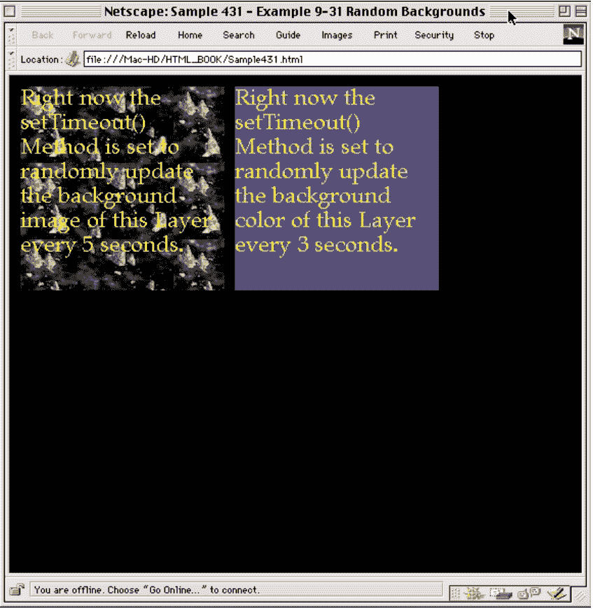

为避免任何混淆，示例 3-31 的其余代码在下一页。

第 3 章 —— 图层与 JavaScript

325

```
<SCRIPT LANGUAGE="JavaScript1.2"><!--BEGIN HIDING

var L1 = document.L1;
var L2 = document.L2;

a1 = new Array("./JPEG-FILES/icon-BG-asteroids.jpg",
              "./JPEG-FILES/icon-Sun.jpg",
              "./JPEG-FILES/ICON-HorizontalRainbow4.jpg",
              "./JPEG-FILES/icon-BG-stars.jpg",
              "./JPEG-FILES/icon-CoarseTurf.jpeg",
              "./JPEG-FILES/icon-FieldStone-Purple.jpeg",
              "./JPEG-FILES/ICON-HorizontalRainbow2.jpg");

a2 = new Array("blue", "red", "purple", "green", "navy", "olive", "gold", "black");

/*--- ... ---*/

function randomActs1()  {

        L1.background.src = a1[Math.round(Math.random() * 7)];

        setTimeout('randomActs1()', 5000);
}
/*--- ... ---*/

function randomActs2()  {

        L2.bgColor = a2[Math.round(Math.random() * 8)];

        setTimeout('randomActs2()', 3000);
}
/*--- ... ---*/

//END HIDING-->
</SCRIPT>

</BODY>
</HTML>
```

## 在类计算器中使用 Math 方法

在下面的示例 [Sample432.html](Sample432.html) 中，所有接受单个参数的 Math 方法都在一个表格中演示，通过使用 **document.write()** 方法创建 HTML 和 JavaScript 代码，在用户生成输出时更新显示，从而在不同的框架中显示数字。我们首先使用关键字 **new** 构造一个名为 **numArray** 的数组，并将其长度设置为 1，然后在函数 **initiateParam()** 中我们将 **numArray [0]** 元素的值设置为数字字符串 "0"。使用字符串代替数字的原因是为了提供一种简单的方式，将使用表格中的按钮添加到数组的附加值连接起来。


# 第一部分 — 动态 HTML

接下来，创建了函数 **getNum(num)**，该函数将函数 **appendNum(num1,num2)** 的**返回**值赋给 **numArray[0]**，然后调用函数 **output(numerals)** 将结果渲染到名为 **display** 的框架中。这是 **output(numerals)** 函数中实际显示数组内容的关键代码行：

`parent.display.document.write(numerals.toString())`

**showConstant(theConstant)** 函数仅接受用户在点击带有 **Math** 常量的按钮时提供的 **theConstant** 参数，并将其显示在 **display** 框架中。接着，为每个 **Math** 对象方法创建了一个函数，当用户点击按钮时调用该函数。然后，**resetOutput()** 函数在用户点击“清除”按钮时将显示重置回起始点。最后，在文档加载时，在 SCRIPT 元素中调用了 **initiateParam()** 函数。本示例还有第三部分，名为 Sample432A.html，该文件最初加载到顶部框架中，作为计算器的初始显示界面。

## 示例 3-32 第一部分：Sample432.html

```
<!DOCTYPE HTML PUBLIC "-//W3C//DTD HTML 3.2//EN">
<HTML>
<HEAD>
<TITLE>Sample 432 - Example 3-32  JavaScript Math Methods</TITLE>

<STYLE TYPE="text/JavaScript">

       classes.Mainbody.BODY.margins("0px");
       classes.Mainbody.BODY.paddings("0px");
       classes.Mainbody.BODY.backgroundColor="black";
       classes.Mainbody.BODY.color="white";

</STYLE>

<!--  ***************************************************************  -->

<SCRIPT LANGUAGE="JavaScript1.2"><!--BEGIN HIDING

numArray = new Array(1);

/*------------------------------------------------------*/
function initiateParam(){

       numArray[0] = "0";

}

/*------------------------------------------------------*/

function getNum(num) {

       numArray[0] = appendNum(numArray[0], num);
       output(numArray[0]);

}
```

```
/*-------------------------------------------*/

function appendNum(num1,num2){

    if (num1 == "0") return ""+num2;

    var numerals="";
    numerals += num1;
    numerals += num2;
    return numerals;
}
/*-------------------------------------------*/
/*-------------------------------------------*/

function output(numerals){

parent.display.document.write("<HTML>")
parent.display.document.write("<HEAD><TITLE>Calculator Readout<\/TITLE>")
parent.display.document.write("<STYLE TYPE='text/JavaScript'>")

parent.display.document.write("classes.Mainbody.BODY.margins('0px');")
parent.display.document.write("classes.Mainbody.BODY.paddings('0px');")
parent.display.document.write("classes.Mainbody.BODY.backgroundColor='black';")
parent.display.document.write("classes.Mainbody.BODY.color='white';")

parent.display.document.write("classes.SteelBlu.all.margins('0px');")
parent.display.document.write("classes.SteelBlu.all.backgroundColor='steelblue';")
parent.display.document.write("classes.SteelBlu.all.color='lime';")
parent.display.document.write("classes.SteelBlu.all.width='100%';")
parent.display.document.write("classes.SteelBlu.all.fontSize='40pt';")
parent.display.document.write("classes.SteelBlu.all.fontFamily='Moonlight, Clarendon, Helvetica, serif';")
parent.display.document.write("classes.SteelBlu.all.paddings('7px');")
parent.display.document.write("classes.SteelBlu.all.borderTopWidth='10px';")
parent.display.document.write("classes.SteelBlu.all.borderRightWidth='50px';")
parent.display.document.write("classes.SteelBlu.all.borderBottomWidth='10px';")
parent.display.document.write("classes.SteelBlu.all.borderLeftWidth='50px';")
parent.display.document.write("classes.SteelBlu.all.borderStyle='ridge';")
parent.display.document.write("classes.SteelBlu.all.borderColor='#5555ff';")
parent.display.document.write("classes.SteelBlu.all.lineHeight='40pt';")

parent.display.document.write("<\/STYLE>")
parent.display.document.write("<\/HEAD>")
parent.display.document.write("<BODY CLASS='Mainbody'>")

parent.display.document.write("<LAYER CLASS='SteelBlu' ID='Readout' LEFT=10 TOP=-25 HEIGHT=100>")

parent.display.document.write("<CENTER>")

    parent.display.document.write(numerals.toString())

parent.display.document.write("<\/CENTER>")
parent.display.document.write("<\/LAYER>")
parent.display.document.write("<\/BODY>")
parent.display.document.write("<\/HTML>")

    parent.display.document.close();
}
```

```
function showConstant(theConstant){

	numArray[0] = theConstant;
	output(numArray[0]);
}
/*---------------------------------------------------------------*/

function calcSin() {

	numArray[0] = Math.sin(numArray[0]);
	output(numArray[0]);
}
/*-------------------------------------------------------*/

function calcCos() {

	numArray[0] = Math.cos(numArray[0]);
	output(numArray[0]);
}
/*-------------------------------------------------------*/

function calcTan() {

	numArray[0] = Math.tan(numArray[0]);
	output(numArray[0]);
}
/*-------------------------------------------------------*/

function calcAsin() {

	numArray[0] = Math.asin(numArray[0]);
	output(numArray[0]);
}
/*-------------------------------------------------------*/

function calcAcos() {

	numArray[0] = Math.acos(numArray[0]);
	output(numArray[0]);
}
/*-------------------------------------------------------*/

function calcAtan() {

	numArray[0] = Math.atan(numArray[0]);
	output(numArray[0]);
}
/*-------------------------------------------------------*/

function calcLog() {

	numArray[0] = Math.log(numArray[0]);
	output(numArray[0]);
}
/*-------------------------------------------------------*/
```

```
/*---------------------------------------------------------------------------*/

function calcExp() {

    numArray[0] = Math.exp(numArray[0]);
    output(numArray[0]);

}
/*---------------------------------------------------------------------------*/
```

```
function calcSqrt() {

    numArray[0] = Math.sqrt(numArray[0]);
    output(numArray[0]);

}
/*---------------------------------------------------------------------------*/
```

```
function calcAbs() {

    numArray[0] = Math.abs(numArray[0]);
    output(numArray[0]);

}
/*---------------------------------------------------------------------------*/
```

```
function calcRound() {

    numArray[0] = Math.round(numArray[0]);
    output(numArray[0]);

}
/*---------------------------------------------------------------------------*/
```

```
function calcRandom() {

    numArray[0] = Math.random(numArray[0]);
    output(numArray[0]);

}
/*---------------------------------------------------------------------------*/
```

```
function calcCeil() {

    numArray[0] = Math.ceil(numArray[0]);
    output(numArray[0]);

}
/*---------------------------------------------------------------------------*/
```

```
function calcFloor() {

    numArray[0] = Math.floor(numArray[0]);
    output(numArray[0]);

}
/*---------------------------------------------------------------------------*/
```

```
function calcRandom100() {

    numArray[0] = Math.round(Math.random(numArray[0]) * 100);
    output(numArray[0]);

}
/*---------------------------------------------------------------------------*/
```

```
function calcPercent() {
    numArray[0] =(parseFloat(numArray[0])) / 100;
    output(numArray[0]);
}
/*-----------------------------------------------*/

function resetOutput() {
    initiateParam();
    output(numArray[0]);
}

//END HIDING-->
</SCRIPT>
</HEAD>

<!--  **************************************************  -->
<BODY CLASS="Mainbody">

<SCRIPT LANGUAGE="JavaScript1.2"><!--BEGIN HIDING
    initiateParam();

//END HIDING-->
</SCRIPT>
<!--  **************************************************  -->

<LAYER ID="MainLayer" LEFT=10 TOP=10>

<FORM NAME="FormB">

<TABLE BORDER=10 CELLPADDING=0 CELLSPACING=5 WIDTH="100%" HEIGHT=300 BGCOLOR="yellow" BORDERCOLOR="red">

<TR>
<TH><INPUT TYPE="button" NAME="One" VALUE="1" onClick="getNum(1);"></TH>

<TH><INPUT TYPE="button" NAME="Two" VALUE="2" onClick="getNum(2);"></TH>

<TH><INPUT TYPE="button" NAME="Three" VALUE="3" onClick="getNum(3);"></TH>

<TH BGCOLOR="purple"><INPUT TYPE="button" NAME="thePi" VALUE="pi" onClick="showConstant(Math.PI);"></TH>

<TH BGCOLOR="purple"><INPUT TYPE="button" NAME="theE" VALUE="e" onClick="showConstant(Math.E);"></TH>

<TH BGCOLOR="cyan"><INPUT TYPE="button" NAME="sin" VALUE="sin" onClick="calcSin();"></TH>

<TH BGCOLOR="cyan"><INPUT TYPE="button" NAME="cos" VALUE="cos" onClick="calcCos();"></TH>

<TH BGCOLOR="cyan"><INPUT TYPE="button" NAME="tan" VALUE="tan Bossier City


## 第三章 — 图层与 JavaScript

```html
<!--  ************************************************************  -->
<TR>
<TH><INPUT TYPE="button" NAME="Four" VALUE="4" onClick="getNum(4);"></TH>
<TH><INPUT TYPE="button" NAME="Five" VALUE="5" onClick="getNum(5);"></TH>
<TH><INPUT TYPE="button" NAME="S0" VALUE="6" onClick="getNum(6);"></TH>
<TH BGCOLOR="purple"><INPUT TYPE="button" NAME="theLog2" VALUE="log2"
       onClick="showConstant(Math.LN2);"></TH>
<TH BGCOLOR="purple"><INPUT TYPE="button" NAME="theLog10" VALUE="log10"
       onClick="showConstant(Math.LN10);"></TH>
<TH BGCOLOR="cyan"><INPUT TYPE="button" NAME="theAsin" VALUE="asin"
       onClick="calcAsin();"></TH>
<TH BGCOLOR="cyan"><INPUT TYPE="button" NAME="theAcos" VALUE="acos"
       onClick="calcAcos();"></TH>
<TH BGCOLOR="cyan"><INPUT TYPE="button" NAME="theAtan" VALUE="atan"
       onClick="calcAtan();"></TH>
</TR>

<!--  ************************************************************  -->
<TR>
<TH><INPUT TYPE="button" NAME="Seven" VALUE="7" onClick="getNum(7);"></TH>
<TH><INPUT TYPE="button" NAME="Eight" VALUE="8" onClick="getNum(8);"></TH>
<TH><INPUT TYPE="button" NAME="Nine" VALUE="9" onClick="getNum(9);"></TH>
<TH BGCOLOR="purple"><INPUT TYPE="button" NAME="theLog2e" VALUE="log2e"
       onClick="showConstant(Math.LOG2E);"></TH>
<TH BGCOLOR="purple"><INPUT TYPE="button" NAME="theLog10e" VALUE="log10e"
       onClick="showConstant(Math.LOG10E);"></TH>
<TH BGCOLOR="#7700ff"><INPUT TYPE="button" NAME="theLog" VALUE="log"
       onClick="calcLog();"></TH>
<TH BGCOLOR="#7700ff"><INPUT TYPE="button" NAME="theExp" VALUE="exp"
       onClick="calcExp();"></TH>
<TH BGCOLOR="#7700ff"><INPUT TYPE="button" NAME="theSqrt" VALUE="sqrt"
       onClick="calcSqrt();"></TH>
</TR>

<!--  ************************************************************  -->
<TR>
<TH><INPUT TYPE="button" NAME="Zero" VALUE="0" onClick="getNum(0);"></TH>
<TH COLSPAN="2" BGCOLOR="navy"><INPUT TYPE="button" NAME="Equals" VALUE="+"
       onClick="getNum('+');"></TH>
<TH BGCOLOR="purple"><INPUT TYPE="button" NAME="theSqrt1_2" VALUE="sqrt1/2"
    onClick="showConstant(Math.SQRT1_2);"></TH>
<TH BGCOLOR="purple"><INPUT TYPE="button" NAME="theSqrt2" VALUE="sqrt2"
    onClick="showConstant(Math.SQRT2);"></TH>
<TH BGCOLOR="lime"><INPUT TYPE="button" NAME="theAbs" VALUE="abs"
    onClick="calcAbs();"></TH>
<TH BGCOLOR="lime"><INPUT TYPE="button" NAME="theRound" VALUE="round"
    onClick="calcRound();"></TH>
<TH BGCOLOR="lime"><INPUT TYPE="button" NAME="theRandom" VALUE="random"
    onClick="calcRandom();"></TH>
</TR>
<!-- ******************************************* -->

<TR>
<TH COLSPAN="5" BGCOLOR="blue"><INPUT TYPE="button" NAME="ClearAll" VALUE="Clear"
    onClick="resetOutput();"></TH>
<TH BGCOLOR="steelblue"><INPUT TYPE="button" NAME="theCeil" VALUE="ceil"
    onClick="calcCeil();"></TH>
<TH BGCOLOR="steelblue"><INPUT TYPE="button" NAME="theFloor" VALUE="floor"
    onClick="calcFloor();"></TH>
<TH BGCOLOR="lime">Rounded<BR>
<INPUT TYPE="button" NAME="MyRandom100" VALUE="random*100"
    onClick="calcRandom100();"></TH>
</TR>
<!-- ******************************************* -->
</TABLE>
</FORM>
</LAYER>
</BODY>
</HTML>
```

### 示例 3-32 第二部分：Sample432Frameset.html

```html
<!DOCTYPE HTML PUBLIC "-//W3C//DTD HTML 3.2//EN">
<HTML>
<HEAD> <TITLE>Sample 432 的框架</TITLE> </HEAD>

<FRAMESET ROWS="100,*">

    <FRAME MARGINHEIGHT="0" SCROLLING="no" NAME="display" SRC="Sample432A.html">

    <FRAME SCROLLING="auto" NAME="main" SRC="Sample432.html">

</FRAMESET>

</HTML>
```

### 示例 3-32
#### Sample432Frameset.html

**读数显示**

| | | | | | | | |
|---|---|---|---|---|---|---|---|
| 1 | 2 | 3 | pi | e | sin | cos | tan |
| 4 | 5 | 6 | log2 | log10 | asin | acos | atan |
| 7 | 8 | 9 | log2e | log10e | log | exp | sqrt |
| 0 | . | sqrt1/2 | sqrt2 | abs | round | random | |
| Clear | ceil | floor | Rounded | random*100 | | | |

## Math.max(x,y)、Math.min(x,y) 和 Mathadar Math.pow(x,y) 方法

这是一个简单的示例，演示 **Math.max(x,y)、Math.min(x,y) 和 Math.pow(x,y)** 的数学方法。用户在文本框中输入的数字字符串首先被分别赋值给 x 和 y，然后通过 `parseFloat()` 方法转换为浮点数。接着，根据点击的按钮调用上述数学方法之一进行计算。

### 示例 3-33：Sample433.html

```html
<!DOCTYPE HTML PUBLIC "-//W3C//DTD HTML 3.2//EN">
<HTML>
<HEAD>
<TITLE>示例 433 —— 示例 3-33 —— Math max、min、pow 方法</TITLE>

<STYLE TYPE="text/JavaScript">

  classes.Mainbody.BODY.margins("0px");
  classes.Mainbody.BODY.paddings("0px");
  classes.Mainbody.BODY.backgroundColor="black";
  tags.LAYER.color="yellow";
  tags.LAYER.fontSize="22pt";

</STYLE>
</HEAD>
<BODY CLASS="Mainbody">

<LAYER ID="L1" LEFT=10 TOP=10 WIDTH=500>

max(x,y)    <B>=返回两个数 x 和 y 中较大的那个。<BR><BR>
min(x,y)    <B>=返回两个数 x 和 y 中较小的那个。<BR><BR>
pow(x,y)    <B>=返回 x 的 y 次幂，即 x<sup>y</sup><BR><BR>

<HR>
<FORM NAME="form1">
 输入 x 值    <INPUT TYPE="text" NAME="text1" SIZE=25 VALUE=""><BR>
 输入 y 值    <INPUT TYPE="text" NAME="text2" SIZE=25 VALUE=""><BR>
 结果为： <INPUT TYPE="text" NAME="text3" SIZE=25 VALUE=""><BR>

 <INPUT TYPE="button" NAME="b1" Value="max(x,y)" onClick="doMax();">
 <INPUT TYPE="button" NAME="b2" Value="min(x,y)" onClick="doMin();">
 <INPUT TYPE="button" NAME="b3" Value="pow(x,y)" onClick="doPow();">
 <INPUT TYPE="button" NAME="b4" Value="Clear All" onClick="clearAll();">

</FORM>
<HR>

</LAYER>
<!-- ******************************************************************* -->

<SCRIPT LANGUAGE="JavaScript1.2"><!--BEGIN HIDING

function doMax()  {

      var x = document.L1.document.form1.text1.value;
      var y = document.L1.document.form1.text2.value;
      x = parseFloat(x);
      y = parseFloat(y);
      document.L1.document.form1.text3.value = Math.max(x,y);
}

/*--------------------------------------------------------*/

function doMin()  {

      var x = document.L1.document.form1.text1.value;
      var y = document.L1.document.form1.text2.value;
      x = parseFloat(x);
      y = parseFloat(y);
      document.L1.document.form1.text3.value = Math.min(x,y);
}

/*--------------------------------------------------------*/

function doPow()  {

      var x = document.L1.document.form1.text1.value;
      var y = document.L1.document.form1.text2.value;
  x = parseFloat(x);
  y = parseFloat(y);
  document.L1.document.form1.text3.value = Math.pow(x,y);
}

/*--------------------------------------------------------*/

function clearAll()  {

      document.L1.document.form1.text1.value = "";
      document.L1.document.form1.text2.value = "";
      document.L1.document.form1.text3.value = "";
}

/*--------------------------------------------------------*/

//END HIDING-->
</SCRIPT>

</BODY>
</HTML>
```

以下主题将进行简要介绍，因为它们与 Sample434.html 中的下一个示例相关。如需更完整的信息，请参阅第 8 章关于字符串对象的内容，或 CD-ROM 上的 JavaScript 参考手册。

| 函数 | 说明 | 参考 |
| :--- | :--- | :--- |
| toString() | 所有对象的核心方法 | 参见 JavaScript 参考手册 |
| parseFloat() | 核心函数 | 参见 JavaScript 参考手册 |
| parseInt() | 核心函数 | 参见 JavaScript 参考手册 |
| isNaN() | 核心函数 | 参见 JavaScript 参考手册 |
| charAt() | 字符串对象的方法 | 参见第 759 页 |
| split() | 字符串对象的方法 | 参见第 782 页 |
| slice() | 字符串对象的方法 | 参见第 788 页 |
| length | 字符串对象的属性 | 参见第 750 页 |

## JavaScript 的 toString() 方法

toString() 方法用于将一个对象转换为其文本等价形式。对于数字对象，可以使用 radix 参数指定 2 到 16 之间的基数，将值转换为你所选择的数字系统。radix 参数的默认值为 10。

在 Sample434.html 中，它用于将数组元素 numArray[0] 转换为字符串，以便在浏览器中显示，代码如下：

```javascript
parent.display document.write(numerals.toString())
```

其中 numerals 是传递给 output(numerals) 函数的参数。它还被用于 rgbArray[1] 的元素 rgbArray[0]、rgbArray[1] 和 rgbArray[2]，将数值转换为 16 进制颜色值。以下代码展示了如何将一个数组元素转换为 16 进制数来替换原始元素。

```javascript
rgbArray[0] = (rgbArray[0]).toString(16)
```

- 如果原始值为 14，则转换为 16 进制后的值为 e。
- 如果原始值为 45，则转换为 16 进制后的值为 2d。
- 如果原始值为 255，则转换为 16 进制后的值为 ff。

### JavaScript 语法：

```javascript
objectName.toString()
numberObjectName.toString(radix)
```


## 第 3 章 — 层次与 JavaScript

### JavaScript 的 parseFloat() 函数

`parseFloat()` 函数接收 `myString` 字符串参数，并将其转换为**浮点数**（即带小数点的数字）。如果字符串中包含除数字 0-9、小数点、正负号或指数以外的任何字符，它将返回该字符之前的所有字符，并省略该字符及其后续所有字符。如果字符串中的第一个字符就是非法字符，则返回 'NaN'。例如，如果 `numArray[0]` 的值是数值字符串 "255"，那么：

- `parseFloat(numArray[0])` 返回浮点数 255
- `parseFloat("142.47@39")` 返回浮点数 142.47
- `parseFloat("-77.25m, g")` 返回浮点数 -77.25
- `parseFloat("ff7725")` 返回 NaN

**JavaScript 语法：**

```javascript
parseFloat("myString")
```

### JavaScript 的 parseInt() 函数

`parseInt()` 函数接收 `myString` 字符串参数，并根据**radix**（基数）参数将其转换为**整数**，基数参数是一个指定所使用数字系统进制的整数。基数 2 表示二进制，基数 16 表示十六进制，基数 10 表示日常使用的十进制。对于**大于 10 的基数**，字母表中的字母用于替代大于 9 的数字；例如，在十六进制中，使用字母 A-F 表示数字 10-15。从左到右读取字符串时，如果字符串中包含任何不属于指定**基数**的字符，则该字符及其右侧的所有字符（包括第一个非法字符）都会被省略。这自然就产生了一个结果：所有有效值都会被截断为整数，因为小数点也属于非法字符。

如果**基数**被省略或设置为 '零'，则默认值为 10，除非字符串中的第一个字符是 '0'，此时基数转换为 8；或者如果前两个字符是 '0x'，则**基数**为 16。如果 `numArray[0] = "ff"`，那么：

- `parseInt(numArray[0], 16)` 返回十六进制的整数 255
- `parseInt("FF", 16)` 返回十六进制的整数 255
- `parseInt("42.57", 10)` 返回十进制的整数 42

**JavaScript 语法：**

```javascript
parseInt("myString", radix)
```

### JavaScript 的 isNaN() 函数

'NaN' 是 'Not a Number'（非数字）的缩写，这正是 **isNaN()** 函数所检测的内容。如果 **testValue** 是 'NaN'，则 **isNaN()** 返回 **true**。如果 **testValue** 是数字，则返回 **false**。例如，如果以下代码中变量 `a1 == NaN`，则会调用 **alert**：

```javascript
if (isNaN(a1)) alert('You forgot the green value');
```

**JavaScript 语法：**

```javascript
isNaN(testValue)
```

### JavaScript 的 charAt() 方法

**charAt()** 方法返回 **myString 字符串**对象中指定**索引**位置的字符，其中**索引**是一个从 0 到 **myString.length - 1** 的整数。对于任何字符串，字符都是从左到右建立索引的，因此第一个字符的**索引**为 0，第二个字符的**索引**为 1，最后一个字符的**索引**为 **myString.length - 1**。如果你指定的**索引**大于字符串的**长度**，则返回空字符串。

如果 **getChar** 是一个值为 "fe43a8" 的字符串变量，那么：

```javascript
getChar.charAt(0) // returns the character f
getChar.charAt(2) // returns the character 4
```

**JavaScript 语法：**

```javascript
myString.charAt(index)
```

### JavaScript 的 split() 方法

**split()** 方法是 **String** 对象的方法，它在提供的 **String** 对象中搜索 **separator**（分隔符）参数，并返回一个 **Array**（数组），其中数组的每个元素都是字符串片段，由分隔符出现之前的部分构成，分隔符本身则从子字符串中省略。分隔符可以是任何字符，通常是逗号、冒号、分号、加号或空白字符，也可以是 **RegExp**（正则表达式）。有关与 **RegExp** 对象配合使用的更多信息，请参见第 9 章。

**optionalLimitInteger**（可选限制整数）参数对 JavaScript 执行分割的次数加以限制，以避免产生多余的空数组元素。例如，如果你有一个名为 `myStr="blue,red,yellow"` 的字符串变量，那么：

```javascript
myStr.split(",") // returns an Array with three Elements where:
element[0]="blue"  element[1]="red"  element[2]="yellow"
```

**JavaScript 语法：**

```javascript
myString.split("separator", optionalLimitInteger)
```

### JavaScript 的 slice() 方法

**slice()** 方法用于提取 **String** 对象的子串，并将其作为新的 **String** 对象返回。**startSliceIndexInteger** 参数指定开始切片的位置索引整数，其中 0 表示从第一个字符开始从左到右读取字符串；1 表示第二个字符，依此类推。**endSliceIndexInteger** 指定切片结束位置之后的第一个字符的索引整数，这意味着你要切片到**但不包括** **endSliceIndexInteger** 所指的位置。如果 **endSliceIndexInteger** 指定为负整数，则其位置从最后一个字符开始反向计算。例如，如果 `myString = "123ABC"`：

```javascript
myString.slice(0, -1) // extracts all characters in the String except the last one
myString.slice(0,  4) // would extract characters "123AB" into the new String
myString.slice(2,  5) // would extract characters "3AB" into the new String
myString.slice(1,  6) // would extract characters "23ABC" into the new String
```

**JavaScript 语法：**

```javascript
myString.slice(startSliceIndexInteger, endSliceIndexInteger)
```

### String 对象的 length 属性

**String** 对象的 **length** 属性返回一个整数，指定 **String** 对象中的字符数量，计数时也包括空格。例如，在函数 **Full1()** 中，有一个名为 **getChar** 的变量，其值可能为 "abcdef"，那么在这种情况下，**getChar.length** 的值就是 6。

**JavaScript 语法：**

```javascript
myString.length
```

### 一个非常酷炫的颜色转换计算器

Sample434.html 非常实用，因为它可以将颜色从多种格式转换为另一种格式。下表展示了所有可能的转换。

| 从 | 到 | 转换为 | 格式 | 转换结果 |
| :--- | :--- | :--- | :--- | :--- |
| 十六进制 | 到 | RGB 0-255 | 格式 | 单一颜色 |
| 十六进制 | 到 | RGB 0-100% | 格式 | 单一颜色 |
| RGB 0-255 | 到 | 十六进制 | 格式 | 单一颜色 |
| RGB 0-100% | 到 | 十六进制 | 格式 | 单一颜色 |
| RGB 0-100% | 到 | RGB 0-255 | 格式 | 单一颜色 |
| RGB 0-255 | 到 | RGB 0-100% | 格式 | 单一颜色 |
| 十六进制 | 到 | RGB 0-255 | 格式 | 完整 RGB 三元色 |
| RGB 0-255 | 到 | 十六进制 | 格式 | 完整十六进制三元色 |

它还能在浏览器的第二个框架中实时显示颜色，以便你可以查看并验证结果。它首先构造两个名为 **numArray** 和 **rgbArray** 的数组，用于保存用户通过输入按钮选择的颜色值。**initiateParam()** 函数将两个数组中的所有元素都设置为空字符串。

颜色值字符通过 **getNum(num)** 和 **appendNum(num1,num2)** 函数收集到 **numArray** 中，然后调用 **output(numerals)** 函数将这些字符渲染到名为 **display** 的框架中，并更新其背景色。

更新背景色时，会进行两项检测：第一项是判断颜色字符是否用于完整的 RGB 到十六进制转换，这种情况下字符串中需要包含逗号。如果字符串变量 **getColor** 上的 **charAt()** 方法返回 true，则背景色的更新基本停止，并使用黑色。颜色最终会在稍后通过 **Full()** 函数更新。第二项是 **getColor.length** 属性检测 **String** 对象中的字符数量，以便为 **bgColor** 值添加适当数量的零，从而确保每次用户选择字符时背景色都能正确更新。

**TurnHexToRGB255()** 该函数使用基数为 16 的 **parseInt()** 方法，将 **numArray[0]** 元素中的十六进制颜色字符字符串转换为范围为 0 到 255 的 RGB 颜色。它一次只能转换一种颜色；也就是说，它可以转换红色、绿色或蓝色值中的任意一个，但不能同时转换三个。然后调用 **output(numArray[0])** 函数将结果渲染到屏幕上。

**TurnHexToRGB100()** 该函数使用基数为 16 的 **parseInt()** 方法，将 **numArray[0]** 元素中的十六进制颜色字符字符串转换为范围为 0 到 255 的 RGB 颜色，然后使用 **Math.round()** 方法对该数字除以 255 再乘以 100 的结果进行截断取整，这是将值转换为百分比所需的计算。


 TurnRGB255toHex()

该函数使用 **parseInt()** 方法首先将 **numArray[0]** 中包含的颜色字符串转换为 10 进制数字，以便你可以使用 **radix**（基数）为 16 的 **toString(16)** 方法将 RGB 255 颜色转换为十六进制颜色。由于 JavaScript 拒绝渲染小数点左侧的零，你必须强制将它们作为数字字符串包含在转换后的颜色中。为了处理 1 到 15 之间的颜色转换，你需要为最终输出插入一个字符串零。为了处理纯黑色的转换，你必须为最终输出插入两个字符串零。是的，我知道，没有人会用这个来把黑色 RGB 转换为黑色十六进制，但为了完整性，它被包含在这里。该函数的其余部分仅用于测试字符数据的错误。

## TurnRGB100toHex()

该函数与上一个函数基本相同，但增加了 **Math.round()** 方法。它将 RGB 颜色的百分比转换为十六进制颜色。

## TurnRGB255to100()

该函数将单个 RGB 颜色分量（红、绿或蓝）从 0 到 255 的格式转换为百分比。

## TurnRGB100to255()

该函数将单个颜色百分比转换为 0 到 255 格式的单个 RGB 颜色。

## Full1()

该函数将整个十六进制颜色三元组转换为所有三个 RGB 分量，并用逗号和空格将每个分量隔开。它使用 **String** 对象的 **length** 属性来测试 **numArray[0]** 元素中包含的字符串的字符数，从而可以使用 **charAt()** 方法提取正确数量的字符，并将红、绿、蓝每个颜色分量分配给 **rgbArray[]** 中的相应元素。这允许你单独显示它们并用逗号和空格分隔。通过使用第二个数组，你还可以显示原始的十六进制颜色以便进行比较。

## Full3()

这个函数并不像看起来那么复杂；事实上，实际的转换与 **TurnRGB255toHex()** 函数一样简单。需要所有这些 **if()...else** 语句是因为在显示转换后的颜色并更新背景颜色时，小数点左侧缺少零。让我们详细说明一下。

用户应当输入三个由逗号分隔的颜色分量；分别对应红、绿、蓝的值。你获取这些原始数据，并使用 **split(',')** 方法，将 **comma**（逗号）作为 **separator**（分隔符）参数，将该字符串拆分到 **rgbArray[]** 中，其中每个数组元素包含一个颜色分量。然后，你对每个元素使用 **parseInt(rgbArray[0], 10)** 方法解析字符串，以便可以使用 **toString(16)** 方法将颜色转换为十六进制格式。困难就在这里，因为如果：

```
    rgbArray[0] = 5      then   rgbArray[0].toString(16) = "5"   not   "05"
```

而为了计算正确的十六进制三元组并显示正确的背景颜色，你需要的是 "05"。

为了更清晰地说明，如果：

`rgbArray[0] = 2` `rgbArray[1] = 7` `rgbArray[2] = 15`

那么你的新十六进制颜色将是：

"27f" **而不是** "02070f"

而后者才是你想要的。当任何分量为零时，情况会变得更加复杂。这就是为什么你要使用变量 **a0**、**a1** 和 **a2** 对零进行所有测试，以便知道何时以及在输出中手动编码多少个零。1 到 15 的数字需要手动编码一个零，而值为零的颜色分量需要手动编码两个零。在浏览器中查看此示例时请注意，当用户输入逗号时，只有在点击值为 **Full3** 的按钮时，背景颜色才会更新。

## clearLastEntry()

该函数使用 **slice(0, -1)** 方法提取 **numArray[0]** 元素中字符串的所有字符，除了最后一个字符。然后它调用 **output(numArray[0])** 函数来显示结果。当用户点击值为 "Clear Entry" 的按钮时，该功能将被执行。

## resetOutput()

该函数仅将两个数组中的所有数组元素重新初始化为空字符串并显示结果。

最后，在文档加载时，会在一个单独的 SCRIPT 元素中调用 **initiateParam()** 函数。其余的代码仅用于设置表格、按钮和按钮元素事件处理程序的 HTML。

## 示例 3-34 第 1 部分：Sample434.html

```
<!DOCTYPE HTML PUBLIC "-//W3C//DTD HTML 3.2//EN">
<HTML>
<HEAD>
<TITLE>Sample 434 - Example 3-34    Multiple Color Conversion Calculator</TITLE>

<STYLE TYPE="text/JavaScript">

     classes.Mainbody.BODY.margins("0px");
     classes.Mainbody.BODY.paddings("0px");
     classes.Mainbody.BODY.backgroundColor="black";
     classes.Mainbody.BODY.color="white";

</STYLE>

<!--  ************************************************************  -->

<SCRIPT LANGUAGE="JavaScript1.2"><!--BEGIN HIDING

numArray = new Array(3);

rgbArray = new Array arbitrator

/*--------------------------------------------------*/
```

## 第 3 章 — 图层与 JavaScript

```
function initiateParam() {
				numArray[0] = "";
				numArray[1] = "";
				numArray[2] = "";
				rgbArray[0] = "";
				rgbArray[1] = "";
				rgbArray[2] = "";
}
/*--------------------------------------------------*/
function getNum(num) {
				numArray[0] = appendNum(numArray[0],num);
				output(numArray[0]);
}
/*--------------------------------------------------*/
function appendNum(num1,num2){
				var numerals="";
				numerals+=num1;
				numerals+=num2;
				return numerals;
}
/*--------------------------------------------------*/
/*--------------------------------------------------*/
```

```
function output(numerals){

parent.display.document.write("<HTML>")
parent.display.document.write("<HEAD><TITLE>Calculator Readout<\/TITLE>")
parent.display.document.write("<STYLE TYPE='text/JavaScript'>")

parent.display.document.write("classes.Mainbody.BODY.margins('0px');")
parent.display.document.write("classes.Mainbody.BODY.paddings('0px');")
parent.display.document.write("classes.Mainbody.BODY.backgroundColor='black';" )
parent.display.document.write("classes.Mainbody.BODY.color='white';" )

parent.display.document.write("classes.SteelBlu.all.margins('0px');")
parent.display.document.write("classes.期的版本.context.write("classes.SteelBlu.all.backgroundColor='steelblue';" )
```

```
parent.display.document.write("classes.SteelBlu.all.color='lime';" )
parent.display.document.write("classes.SteelBlu.all.width='100%';" )
parent.display.document.write("classes.SteelBlu.all.fontSize='40pt';" )
parent.display.document.write("classes.SteelBlu.all.fontFamily='Moonlight, Clarendon, Helvetic
```


 # 第一部分 — 动态 HTML

// 允许在每次字符输入时持续更新颜色。

```
else if (getColor.length == 6)
    { parent.display.document.bgColor='#'+ getColor;}
else if (getColor.length == 5)
    { parent.display.document.bgColor='#'+ getColor + '0';}
else if (getColor.length == 4)
    { parent.display.document.bgColor='#'+ getColor + '00';}
else if (getColor.length == 3)
    { parent.display.document.bgColor='#'+ getColor + '000';}
else if (getColor.length == 2)
    { parent.display.document.bgColor='#'+ getColor + '0000';}
else if (getColor.length == 1)
    { parent.display.document.bgColor='#'+ getColor + '00000';}
```

```
parent.display.document.write("</CENTER>")
parent.display.document.write("</LAYER>")
parent.display.document.write("</BODY>")
parent.display.document.write("</HTML>")
    parent.display.document.close();
}
```

```
/*----------------------------------------------------------*/

function TurnHexToRGB255() {

    numArray[0] = parseInt(numArray[0] , 16);

    output(numArray[0]);
}
/*----------------------------------------------------------*/

function TurnHexToRGB100() {

    numArray[0] = parseInt(numArray[0] , 16);
    numArray[0] = Math.round((numArray[0] / 255) * 100);

    output(numArray[0]);
}
/*----------------------------------------------------------*/

function TurnRGB255toHex() {

    if (numArray[0] >255) {
    alert("While the following conversion will be accurate, if you want a "+
    "useable color you must pick a number from 0 to 255");
    }
else if (isNaN(numArray[0])) {
    alert("YO! The sign said from 0 to 255. You chose:  " + numArray[0]);
    }
else if (numArray[0] == '0'  ||  numArray[0] == '00'  ||  numArray[0] == '000'){
    output('00');
    }
else if (numArray[0] < 16  &&  numArray[0] > 0){
    numArray[0] = parseInt(numArray[0] , 10);
    numArray[0] =  (numArray[0]).toString(16);
    output('0' + numArray[0]);
    }
else {
    numArray[0] = parseInt(numArray[0] , 10);
    numArray[0] =  (numArray[0]).toString(16);
    output(numArray[0]);
    }
}

/*----------------------------------------------------------*/

function TurnRGB100toHex() {

    if (numArray[0] >100  ||  isNaN(numArray[0]) == true) {
    alert("YO! The sign said from 0 to 100. You chose:  " + numArray[0]);
    }
else if (numArray[0] == '0'  ||  numArray[0] == '00'  ||  numArray[0] == '000'){
    output('00');
    }
```

## 第 3 章 — 图层与 JavaScript

```
else {
    numArray[0] = parseFloat(numArray[0]);
    numArray[0] = Math.round((numArray[0] * 255) / 100);
    if (numArray[0] < 16 && numArray[0] > 0){
        numArray[0] = (numArray[0]).toString(16);
        output('0' + numArray[0]);
    }
    else {
        numArray[0] = (numArray[0]).toString(16);
        output(numArray[0]);
    }
}
/*--------------------------------------------------*/
function TurnRGB255to100() {
    if (numArray[0] >255 || isNaN(numArray[0]) == true) {
        alert ("YO! The sign said from 0 to 100. You chose: " + numArray[0]);
    }
    else {
        numArray[0] = parseFloat(numArray[0]);
        numArray[0] = Math.round((numArray[0] / 255) * 100);
        output(numArray[0]);
    }
}
/*--------------------------------------------------*/
function TurnRGB100to255() {
    if (numArray[0] >100 || isNaN(numArray[0]) == true) {
        alert ("YO! The sign said from 0 to 100. You chose: " + numArray[0]);
    }
    else {
        numArray[0] = parseFloat(numArray[0]);
        numArray[0] = Math.round((numArray[0] * 255) / 100);
        output(numArray[0]);
    }
}
/*--------------------------------------------------*/
/*--------------------------------------------------*/
function Full() {
    var getChar = numArray[0].toString();
    if (getChar.length == 6) {
        rgbArray[0] = getChar.charAt(0) + getChar.charAt(1);
        rgbArray[1] = getChar.charAt(2) + getChar.charAt(3);
        rgbArray[2] = getChar.charAt(4) + getChar.charAt(5);
        rgbArray[0] = parseInt(rgbArray[0], 16);
        rgbArray[1] = parseInt(rgbArray[1], 16);
        rgbArray[2] = parseInt(rgbArray[2], 16);
        output(numArray[0] + ' = ' + rgbArray[0] + ', ' + rgbArray[1] + ', ' + rgbArray[2]);
    }
    else if (getChar.length == 5) {
        rgbArray[0] = getChar.charAt(0) + getChar.charAt(1);
        rgbArray[1] = getChar.charAt(2) + getChar.charAt(3);
        rgbArray[2] = getChar.charAt(4);
        rgbArray[0] = parseInt(rgbArray[0], 16);
        rgbArray[1] = parseInt(rgbArray[1], 16);
        rgbArray[2] = parseInt(rgbArray[2], 16);
        output(numArray[0] + ' = ' + rgbArray[0] + ', ' + rgbArray[1] + ', ' + rgbArray[2]);
    }
    else if (getChar.length == 4) {
        rgbArray[0] = getChar.charAt(0) + getChar.charAt(1);
        rgbArray[1] = getChar.charAt(2) + getChar.charAt(3);
        rgbArray[0] = parseInt(rgbArray[0], 16);
        rgbArray[1] = parseInt(rgbArray[1], 16);
        output(numArray[0] + ' = ' + rgbArray[0] + ', ' + rgbArray[1] + ', 0');
    }
}
```

# 第一部分 — 动态 HTML

```
else if (getChar.length == 3) {
            rgbArray[0] = getChar.charAt(0) + getChar.charAt(1);
            rgbArray[1] = getChar.charAt(2);
            rgbArray[0] = parseInt(rgbArray[0] , 16);
            rgbArray[1] = parseInt(rgbArray[1] , 16);
            output(numArray[0] + ' = ' + rgbArray[0] + ', ' + rgbArray[1] + ', 0');
       }
else if (getChar.length == 2) {
            rgbArray[0] = getChar.charAt(0) + getChar.charAt(1);
            rgbArray[0] = parseInt(rgbArray[0] , 16);
            output(numArray[0] + ' = ' + rgbArray[0] + ', 0' + ', 0');
       }
            else {
            rgbArray[0] = getChar.charAt(0);
            rgbArray[0] = parseInt(rgbArray[0] , 16);
            output(numArray[0] + ' = ' + rgbArray[0] + ', 0' + ', 0');
       }
}
/*------------------------------------------------*/

function Full3()  {

       var getRGB = numArray[0].toString();

       rgbArray = getRGB.split(',');

       var a0 = parseInt(rgbArray[0] , 10);
       var a1 = parseInt(rgbArray[1] , 10);
       var a2 = parseInt(rgbArray[2] , 10);

       rgbArray[0] = parseInt(rgbArray[0] , 10);
       rgbArray[0] =  (rgbArray[0]).toString(16);
       rgbArray[1] = parseInt(rgbArray[1] , 10);
       rgbArray[1] =  (rgbArray[1]).toString(16);
       rgbArray[2] = parseInt(rgbArray[2] , 10);
       rgbArray[2] =  (rgbArray[2]).toString(16);

/*---------------------------------------------------------------*/

       if (isNaN(a1)) {rgbArray[1] = '00'; alert('You forgot the green value');}
       if (isNaN(a2)) {rgbArray[2] = '00'; alert('You forgot the blue value');}

/*---------------------------------------------------------------*/

       if ( (a0 == 0 || a0 == 00 || a0 == 000)  &&  (a1 == 0 || a1 == 00 || a1 == 000)  &&
            (a2 == 0 || a2 == 00 || a2 == 000) )  {

            output(numArray[0] + ' = ' + '000000');
            parent.display.document.bgColor='#000000';

       }

/*---------------------------------------------------------------*/

else if ((a0 == 0 || a0 == 00 || a0 == 000) && (a1 == 0 || a1 == 00 || a1 == 000) && (a2 < 16 && a2 > 0))  {

            output(numArray[0] + ' = '    + '0000' + '0' + rgbArray[2]);
            parent.display.document.bgColor='#0000' + '0' + rgbArray[2];
       }

else if ((a0 == 0 || a0 == 00 || a0 == 000) && (a2 == 0 || a2 == 00 || a2 == 000) && (a1 < 16 && a1 > 0))  {

            output(numArray[0] + ' = '    + '00' + '0' + rgbArray[1] + '00');
            parent.display.document.bgColor='#00' + '0' + rgbArray[1] + '00';
       }
else if ((a1 == 0 || a1 == 00 || a1 == 000) && (a2 == 0 || a2 == 00 || a2 == 000) && (a0 < 16 && a0 > 0))  {

            output(numArray[0] + ' = '    + '0' + rgbArray[0] + '0000');
            parent.display.document.bgColor='#0' + rgbArray[0] + '0000';
       }

/*------------------------------------------------*/

else if ((a0 == 0 || a0 == 00 || a0 == 000)  &&  (a1 < 16 && a1 > 0)  &&  (a2 < 16 && a2 > 0))  {

            output(numArray[0] + ' = '    + '00' + '0' + rgbArray[1] + '0' + rgbArray[2]);
            parent.display.document.bgColor='#00' + '0' + rgbArray[1] + '0' + rgbArray[2];
       }
```


## 第 3 章 — 图层与 JavaScript

```javascript
else if ((a1 == 0 || a1 == 00 || a1 == 000)  && (a0 < 16 && a0 > 0)  &&  (a2 < 16 && a2 > 0))  {

       output (numArray[0] + ' = '    + '0' + rgbArray[0] + '00' + '0' + rgbArray[2]);
        parent.display.document.bgColor='#0' + rgbArray[0] + '00' + '0' + rgbArray[2];
       }
else if ((a2 == 0 || a2 == 00 || a2 == 000)  &&  (a0 < 16 && a0> 0)  &&  (a1 < 16 && a1 > 0))  {

       output (numArray[0] + ' = '   + '0' + rgbArray[0] + '0' + rgbArray[1] + '00');
        parent.display.document.bgColor='#0' + rgbArray[0] + '0' + rgbArray[1] + '00';
       }

/*----------------------------------------------------------*/

else if ((a0 == 0 || a0 == 00 || a0 == 000)  && a1 < 16  && a1 > 0)  {

       output (numArray[0] + ' = '   + '00' + '0' + rgbArray[1] + rgbArray[2]);
       parent.display.document.bgColor='#00' + '0' + rgbArray[1] + rgbArray[2];
       }
else if ((a0 == 0 || a0 == 00 || a0 == 000)  &&  a2 < 16 && a2 > 0)  {

       output (numArray[0] + ' = '   + '00' + rgbArray[1] + '0' + rgbArray[2]);
        parent.display.document.bgColor='#00' + rgbArray[1] + '0' + rgbArray[2];
       }
else if ((a1 == 0 || a1 == 00 || a1 == 000)  && a0 < 16 && a0 > 0)  {

       output (numArray[0] + ' = '  + '0' + rgbArray[0] + '00' + rgbArray[2]);
         parent.display.document.bgColor='#0' + rgbArray[0] + '00' + rgbArray[2];
       }
/*------------------------------------------------*/

else if ((a1 == 0 || a1 == 00 || a1 == 000)  &&  a2 < 16 && a2 > 0)  {

       output (numArray[0] + ' = '         + rgbArray[0] + '00' + '0' + rgbArray[2]);
        parent.display.document.bgColor='#' + rgbArray[0] + '00' + '0' + rgbArray[2];
       }
else if ((a2 == 0 || a2 == 00 || a2 == 000)  &&  a0 < 16 && a0 > 0)  {

       output (numArray[0] + ' = '   + '0' + rgbArray[0] + rgbArray[1] + '00');
        parent.display.document.bgColor='#0' + rgbArray[0] + rgbArray[1] + '00';
       }
else if ((a2 == 0 || a2 == 00 || a2 == 000)  && a1 < 16 && a1 > 0)  {

       output (numArray[0] + ' = '       + rgbArray[0] + '0' + rgbArray[1] + '00');
        parent.display.document.bgColor='#' + rgbArray[0] + '0' + rgbArray[1] + '00' ;
        }

/*--------------------------------------------------------*/

else if (a0 < 16 && a0 > 0  &&  a1 < 16 && a1 > 0)  {

       output (numArray[0] + ' = '   + '0' + rgbArray[0] + '0' + rgbArray[1] + rgbArray[2]);
       parent.display.document.bgColor='#0' + rgbArray[0] + '0' + rgbArray[1] + rgbArray[2];
       }
else if (a0 < 16 && a0 > 0  &&  a2 < 16 && a2 > 0)  {

       output (numArray[0] + ' = '   + '0' + rgbArray[0] + rgbArray[1] + '0' + rgbArray[2]);
        parent.display.document.bgColor='#0' + rgbArray[0] + rgbArray[1] + '0' + rgbArray[2];
       }
else if (a1 < 16 && a1 > 0  &&  a2 < 16 && a2 > 0)  {

       output (numArray[0] + ' = '        + rgbArray[0] + '0' + rgbArray[1] + '0' + rgbArray[2]);
        parent.display.document.bgColor='#' + rgbArray[0] + '0' + rgbArray[1] + '0' + rgbArray[2];
       }

/*------------------------------------------*/

else if ((a0 == 0 || a0 == 00 || a0 == 000)  &&  (a1 == 0 || a1 == 00 || a1 == 000))  {

       output (numArray[0] + ' = '   + '0000' + rgbArray[2]);
        parent.display.document.bgColor='#0000' + rgbArray[2];
       }

else if ((a0 == 0 || a0 == 00 || a0 == 000)  &&  (a2 == 0 || a2 == 00 || a2 == 000))  {

       output (numArray[0] + ' = '   + '00'+ rgbArray[1] + '00');
       parent.display.document.bgColor='#00'+ rgbArray[1] + '00';
       }

else if ((a1 == 0 || a1 == 00 || a1 == 000) && (a2 == 0 || a2 == 00 || a2 == 000)) {
    output(numArray[0] + ' = ' + rgbArray[0] + '0000');
    parent.display.document.bgColor='#' + rgbArray[0] + '0000';
}
/*----------------------------------------------------------------------*/

else if (a0 == 0 || a0 == 00 || a0 == 000) {
    output(numArray[0] + ' = ' + '00' + rgbArray[1] + rgbArray[2]);
    parent.display.document.bgColor='#00' + rgbArray[1] + rgbArray[2];
}
else if (a1 == 0 || a1 == 00 || a1 == 000) {
    output(numArray[0] + ' = ' + rgbArray[0] + '00' + rgbArray[2]);
    parent.display.document.bgColor='#' + rgbArray[0] + '00' + rgbArray[2];
}
else if (a2 == 0 || a2 == 00 || a2 == 000) {
    output(numArray[0] + ' = ' + rgbArray[0] + rgbArray[1] + '00');
    parent.display.document.bgColor='#' + rgbArray[0] + rgbArray[1] + '00';
}
/*----------------------------------------------------------------------*/

else if (a0 < 16 && a0 > 0) {
    output(numArray[0] + ' = ' + '0' + rgbArray[0] + rgbArray[1] + rgbArray[2]);
    parent.display.document.bgColor='#0' + rgbArray[0] + rgbArray[1] + rgbArray[2];
}
else if (a1 < 16 && a1 > 0) {
    output(numArray[0] + ' = ' + rgbArray[0] + '0' + rgbArray[1] + rgbArray[2]);
    parent.display.document.bgColor='#' + rgbArray[0] + '0' + rgbArray[1] + rgbArray[2];
}
else if (a2 < 16 && a2 > 0) {
    output(numArray[0] + ' = ' + rgbArray[0] + rgbArray[1] + '0' + rgbArray[2]);
    parent.display.document.bgColor='#' + rgbArray[0] + rgbArray[1] + '0' + rgbArray[2];
}
/*----------------------------------------------------------------------*/

else {
    output(numArray[0] + ' = ' + rgbArray[0] + rgbArray[1] + rgbArray[2]);
    parent.display.document.bgColor='#' + rgbArray[0] + rgbArray[1] + rgbArray[2];
}
}
/*----------------------------------------------------------------------*/
/*----------------------------------------------------------------------*/

function clearLastEntry() {
    numArray[0] = numArray[0].toString();
    numArray[0] = numArray[0].slice(0,-1);
    output(numArray[0]);
}

function resetOutput() {
    initiateParam();
    output(numArray[0]);
}

//END HIDING-->
</SCRIPT>

</HEAD>
<!-- ************************************************************************* -->
<BODY CLASS="Mainbody">

<SCRIPT LANGUAGE="JavaScript1.2"><!--BEGIN HIDING

initiateParam();

//END HIDING-->
</SCRIPT>
<!-- ************************************************************************* -->

<LAYER ID="MainLayer" LEFT="10" TOP="10">

<FORM NAME="FormB">

<TABLE BORDER="10" CELLPADDING="0" CELLSPACING="5" WIDTH="100%" HEIGHT="300" BGCOLOR="yellow" BORDERCOLOR="red">

<TR>
<TH WIDTH="50"><INPUT TYPE="button" NAME="One" VALUE="1" onClick="getNum(1);"></TH>
<TH WIDTH="50"><INPUT TYPE="button" NAME="Two" VALUE="2" onClick="getNum(2);"></TH>
<TH WIDTH="50"><INPUT TYPE="button" NAME="Three" VALUE="3" onClick="getNum(3);"></TH>
<TH WIDTH="50" BGCOLOR="purple"><INPUT TYPE="button" NAME="letterA" VALUE="a" onClick="getNum('a');"></TH>
<TH WIDTH="50" BGCOLOR="purple"><INPUT TYPE="button" NAME="letterD" VALUE="d" onClick="getNum('d');"></TH>
<TH BGCOLOR="#7700ff">
<INPUT TYPE="button" NAME="HexRGB255" VALUE="十六进制 转 ~~ RGB 0-255" onClick="TurnHexToRGB255();">
</TH>
<TH BGCOLOR="lime"><INPUT TYPE="button" NAME="FullHexRGB255" VALUE="完整 1" onClick="Full1();"></TH>
</TR>

<TR>
<TH><INPUT TYPE="button" NAME="Four" VALUE="4" onClick="getNum(4);"></TH>
<TH><INPUT TYPE="button" NAME="Five" VALUE="5" onClick="getNum(5);"></TH>
<TH><INPUT TYPE="button" NAME="Six" VALUE="6" onClick="getNum(6);"></TH>
<TH BGCOLOR="purple"><INPUT TYPE="button" NAME="letterB" VALUE="b" onClick="getNum('b');"></TH>
<TH BGCOLOR="purple"><INPUT TYPE="button" NAME="letterE" VALUE="e" onClick="getNum('e');"></TH>
<TH BGCOLOR="#7700ff">
<INPUT TYPE="button" NAME="HexRGB100" VALUE="十六进制 转 ~~ RGB 0-100%" onClick="TurnHexToRGB100();"></TH>
</TR>

<TR>
<TH><INPUT TYPE="button" NAME="Seven" VALUE="7" onClick="getNum(7);"></TH>
<TH><INPUT TYPE="button" NAME="Eight" VALUE="8" onClick="getNum(8);"></TH>
<TH><INPUT TYPE="button" NAME="Nine" VALUE="9" onClick="getNum(9);"></TH>
<TH BGCOLOR="purple"><INPUT TYPE="button" NAME="letterC" VALUE="c" onClick="getNum('c');"></TH>
<TH BGCOLOR="purple"><INPUT TYPE="button" NAME="letterF" VALUE="f" onClick="getNum('f');"></TH>
<TH BGCOLOR="#7700ff">
<INPUT TYPE="button" NAME="RGB255Hex" VALUE="RGB 0-255 转 ~~ 十六进制" onClick="TurnRGB255toHex();"></TH>
<TH BGCOLOR="lime"><INPUT TYPE="button" NAME="FullRGB255Hex" VALUE="完整 3" onClick="Full3();"></TH>
</TR>

<TR>
<TH><INPUT TYPE="button" NAME="Zero" VALUE="0" onClick="getNum(0);"></TH>
<TH><INPUT TYPE="button" NAME="Comma" VALUE="," onClick="getNum(',');"></TH>
<TH COLSPAN="2" BGCOLOR="blue">
<INPUT TYPE="button" NAME="ClearEntry" VALUE="清除输入" onClick="clearLastEntry();"></TH>
<TH BGCOLOR="red"><INPUT TYPE="button" NAME="ClearAll" VALUE="清除全部" onClick="resetOutput();"></TH>
<TH BGCOLOR="#7700ff">
<INPUT TYPE="button" NAME="RGB100Hex" VALUE="RGB 0-100% 转 ~~ 十六进制" onClick="TurnRGB100toHex();"></TH>
</TR>

<TR>
<TH COLSPAN="5" BGCOLOR="#7700ff">
<FONT SIZE="4" COLOR="white">
这些转换适用于单一颜色：
仅限 R、G 或 B 之一……而非 RGB 组合。
</FONT></TH>
<TH BGCOLOR="#7700ff">
<INPUT TYPE="button" NAME="RGB255to100" VALUE="RGB 0-255 转 ~~ RGB 0-100%" onClick="TurnRGB255to100();"></TH>
</TR>

<TR>
<TH COLSPAN="5" BGCOLOR="lime">
按钮
<FONT SIZE="4" COLOR="white"> 完整 1 </FONT> 和
<FONT SIZE="4" COLOR="white"> 完整 3 </FONT> 是全量转换。
这些转换适用于如下单值形式：8822ff
rgb 转 十六进制：用逗号分隔颜色，如：42,127,255
</TH>
<TH BGCOLOR="#7700ff">
<INPUT TYPE="button" NAME="RGB100to255" VALUE="RGB 0-100% 转 ~~ RGB 0-255" onClick="TurnRGB100to255();"></TH>
</TR>

</TABLE>
</FORM>
</LAYER>
</BODY>

</HTML>
```


示例 3-34 Sample434Frameset.html

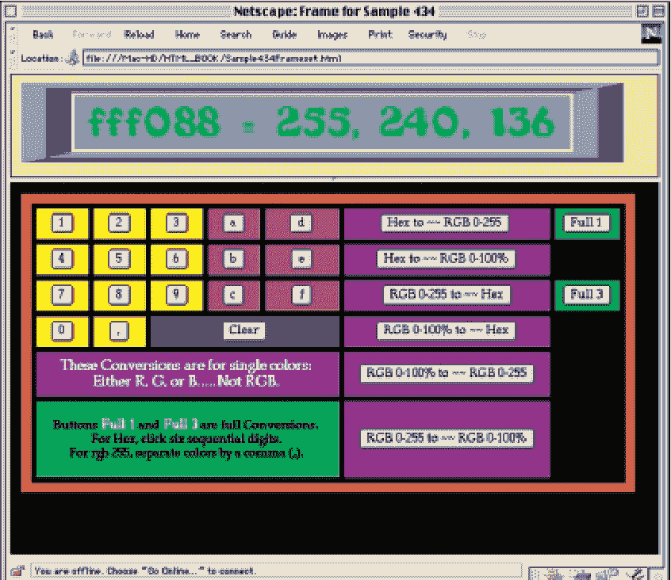

示例 3-34 的 Frameset 代码在下一页。

所有被认可的 JavaScript 颜色名称及其对应的 HEX、rgb 和 rgb 数值均在附录 B 第 1033 页开始的图表中。同样的信息也包含在 CD-ROM 的示例文件中：[Sample1100-AllColorValues.html](Sample1100-AllColorValues.html)。

如果您只想查看所有实际显示的颜色以及每个颜色的名称，请查看 [Sample1100-AllColorNames.html](Sample1100-AllColorNames.html)。

## 示例 3-34 第二部分：Sample434Frameset.html

```html
<!DOCTYPE HTML PUBLIC "-//W3C//DTD HTML 3.2//EN">
<HTML>
<HEAD> <TITLE>Frame for Sample 434</TITLE> </HEAD>

<FRAMESET ROWS="140,*">

        <FRAME MARGINHEIGHT=0 SCROLLING="no" NAME="display" SRC="Sample434A.html">

        <FRAME SCROLLING="auto" NAME="main" SRC="Sample434.html">

</FRAMESET>

</HTML>
```

## 一个包含边框动画和音乐的综合示例

示例 3-35 的主要目的是将目前涵盖的一些主题整合到页面中，这种页面是你实际在 Web 上可能会看到的，唯一的区别是音频文件的大小为 60 MB。在真实的网站中，你会使用链接，并且很可能会提供一段音频试听以及购买选项，但由于这是在 CD-ROM 上，我包含了整首由我自己作词、表演、混音和录制的歌曲。希望您喜欢。

本示例具有自动更新的日期、时间和在该网站的停留时长，这些信息显示在窗口的状态栏中。它还嵌入了歌曲《Journeys of Illumination》的音频文件。页面边缘有彩虹条动画形成移动边框，页面的四个角有旋转的地球仪。

两个按钮控制一个图层（Layer），该图层会使一个包含歌曲各乐章名称的文本横幅产生动画效果。另外两个按钮控制包含 CD 图像和 CD 曲目列表的两个图层的动画。鼠标悬停（MouseOver）和移出（MouseOut）事件也可以显示和隐藏这两个图层。

音频文件设置为自动播放，且通过将宽度（width）和高度（height）属性分别设置为 144 和 60（所需的最小值），使得 Navigator 音频控件可见。屏幕截图在第 361 页。

## 示例 3-35 第一部分：Sample435.html

```html
<!DOCTYPE HTML PUBLIC "-//W3C//DTD HTML 3.2//EN">
<HTML>
<HEAD>
<TITLE>Sample 435 - Example 3-35  Border Animation and Music        </TITLE>

<STYLE TYPE="text/JavaScript">

classes.Mainbody.BODY.margins("0px");
classes.Mainbody.BODY.paddings("0px");
classes.Mainbody.BODY.backgroundColor="black";
classes.Mainbody.BODY.color="white";

classes.SteelBlu.all.margins("0px");
classes.SteelBlu.all.backgroundColor="steelblue";
classes.SteelBlu.all.color="navy";
classes.SteelBlu.all.fontSize="22pt";
classes.SteelBlu.all.fontFamily="Clarendon, Helvetica, fantasy";
classes.SteelBlu.all.paddings("15px");
classes.SteelBlu.all.borderTopWidth="10px";
classes.SteelBlu.all.borderRightWidth="30px";
classes.SteelBlu.all.borderBottomWidth="10px";
classes.SteelBlu.all.borderLeftWidth="30px";
classes.SteelBlu.all.borderStyle="inset";
classes.SteelBlu.all.borderColor="#5555ff";
classes.SteelBlu.all.lineHeight="28pt";

classes.RedBox.all.backgroundColor="yellow";
classes.RedBox.all.fontSize="22pt";
classes.RedBox.all.color="red";

ids.L3.fontSize="20pt";
ids.L3.fontFamily="Moonlight, 'Brush Script', Cloister, cursive";
ids.L3.color="#8800ff";
ids.L3.backgroundColor="cyan";

classes.PurpleBox.all.width="420px";
classes.PurpleBox.all.borderWidths("15px");
classes.PurpleBox.all.borderColor="#8800ff";
classes.PurpleBox.all.fontSize="17pt";
classes.PurpleBox.all.borderStyle="groove";
classes.PurpleBox.all.fontFamily="'Brush Script', fantasy";
classes.PurpleBox.all.paddings("3px");
classes.PurpleBox.all.color="yellow";
classes.PurpleBox.all.backgroundColor="mediumblue";

tags.H1.fontSize="23pt";
tags.H1.color="red";

tags.H4.fontSize="14pt";
tags.H4.color="#007700";
tags.H4.backgroundColor="#00ff44";
tags.H4.fontFamily="Palatino, Times, Helvetica, serif";

classes.LimeIt.all.color="lime";
classes.LimeIt.all.fontSize="14pt";

classes.Turqy.all.color="turquoise";
</STYLE>

<!-- *************************************************** -->

<SCRIPT LANGUAGE="JavaScript1.2"><!--BEGIN HIDING

	startTime = new Date();

/*------------------------------------------------*/
//The getMonth() Method returns a zero to eleven numbering scheme for months
//such that January = 0, February = 1, ..., December = 11,
//so you have to increment the month by 1 if you need January to be 1 instead of 0
//which is used for the todayMonth variable, below.

function initializeTime()  {

	var today		= new Date();
	var todayMonth		= today.getMonth() +1;
	var todayDay		= today.getDate();
	var todayYear		= today.getYear();
	var todaysHours		= today.getHours();
	var todaysMinutes	= today.getMinutes();
	var todaysSeconds	= today.getSeconds();
	var later		= new Date();
	var TimeHere		= Math.round((later - startTime) / 60000);

	todaysHours = ((todaysHours > 12)  ?  todaysHours - 12  :  todaysHours);

	var showTime= "The Date is:  "+ todayMonth +"/"
	showTime += todayDay +"/"
	showTime += todayYear
	showTime += " *****  The Time is:   " + todaysHours
	showTime += ((todaysMinutes > 9)  ?  " :"  :  " :0")
	showTime += todaysMinutes
	showTime += ((todaysSeconds > 9)  ?  " :"  :  " :0")
	showTime += todaysSeconds
	showTime += ((todaysHours >= 12)  ?  " PM"  :  " AM")
	showTime += " ***** You have been here "
	showTime += TimeHere + " Minutes."

	window.status = showTime;

	setTimeout('initializeTime()', 1000);
}
/*------------------------------------------------*/
//END HIDING-->
</SCRIPT>
</HEAD>
<!--  ***************************************************************  -->
<BODY CLASS="Mainbody" onLoad="initializeTime();"
BACKGROUND="JPEG-FILES/icon-BG-asteroids.jpg">

<LAYER CLASS="SteelBlu" ID="L1" LEFT=0 TOP=-10 WIDTH="100%">

<LAYER CLASS="RedBox" ID="L2" LEFT=55 TOP=28>
<NOBR>HI!
<FONT COLOR="#7700ee">Journeys of Illumination</FONT>
has 5 movements. It starts with
<FONT COLOR="#7700ee">Fanfare of Twilight</FONT>
which blends into
<FONT COLOR="#7700ee">Dance of Awakening</FONT>.
<FONT COLOR="#7700ee">Thought-Travel Meandering in a Time-Free Space-Like
Domain</FONT>
is the third movement which melds into
<FONT COLOR="#7700ee">Dimensional Freefall</FONT>
and the song concludes with
<FONT COLOR="#7700ee">Wanderjahr Ever Onward</FONT>.</NOBR>
</LAYER>

<LAYER CLASS="RedBox" ID="L3" LEFT=0 TOP=80 WIDTH=340>
<FORM NAME="form3">Click to:
<INPUT TYPE="button" NAME="b1" VALUE="Move Banner" onClick="StartBanner();">
<INPUT TYPE="button" NAME="b2" VALUE="Stop Banner" onClick="StopBanner();"><BR><BR>
<EMBED SRC="./Sample-ETOC/Journeys-Of-Illumination.aiff" AUTOSTART="true" WIDTH=144
HEIGHT=60>
<INPUT TYPE="button" NAME="b7" VALUE="Slide Album" onClick="showAlbumText();
slideAlbum();">
<INPUT TYPE="button" NAME="b8" VALUE="Slide Back" onClick="slideAlbumBack();
slideAlbumText(); hideAlbumText();"><BR><BR>

The song that is playing is called <BR>
<FONT COLOR="#2200cc">Journeys of Illumination</FONT> <BR>
which is the title track of the album and was composed, played and recorded in
Sedona, Arizona in 1992.<BR><BR>
<H4>The Date, Time and Length of Stay at this site are down here in the status
bar.</H4>
</FORM></LAYER>

<!-- *********************************** -->
<LAYER CLASS="PurpleBox" ID="L4Text" LEFT=350 TOP=80 VISIBILITY="hide" WIDTH=370
onMouseOut="bringAlbumBack();">
<H1>Journeys of Illumination</H1>
Journeys of Illumination <SPAN CLASS="LimeIt">Song Time 11:02</SPAN><BR>
<SPAN CLASS="Turqy">
Fanfare of Twilight<BR>
Dance of Awakening<BR>
Thought-Travel Meandering in a Time-Free Space-Like Domain<BR>
Dimensional Freefall<BR>
Wanderjahr Ever Onward<BR></SPAN>
Sagacity in Solitude<BR>
Musing Spirals<BR>
Furthur<BR><BR>
</LAYER>

<LAYER CLASS="PurpleBox" ID="L4" LEFT=350 TOP=80 WIDTH=350
onMouseOver="revealAlbumText();">

</LAYER>
<!-- *********************************** -->

</LAYER>

<!-- This layer is necessary to have the border on top of the scrolling banner -->

<LAYER CLASS="SteelBlu" ID="L7" LEFT=0 TOP=-10 WIDTH="100%">
</LAYER>

<!-- *********************************************************** -->
```


## 第 3 章 — 图层与 JavaScript

```javascript
<SCRIPT LANGUAGE="JavaScript1.2"><!--BEGIN HIDING

	var booleanTest = true;

function Scrolll1Banner() {

	if (booleanTest == true) {

		if (document.L1.document.L2.left > -
document.L2.clip.width)
				document.L1.document.L2.moveBy(-10,0);
		else document.L1.document.L2.moveTo(document.L7.clip.width, 28);

		setTimeout('Scrolll1Banner()', 100);
	}
	else document.L1.document.L2.moveTo(document.L1.document.L2.left, 28);
}

function StopBanner() {
	booleanTest = false;
}

function StartBanner() {
	booleanTest = true;
	Scrolll1Banner();
}

/*-----------------------------------------------------------------*/
/*-----------------------------------------------------------------*/

function revealAlbumText() {

	document.L1.document.L4.moveTo(1000,80);
	document.L1.document.L4Text.visibility="show";
	document.L1.document.L4Text.moveTo(350,80);
}

function bringAlbumBack() {

	document.L1.document.L4.visibility="show";
	document.L1.document.L4Text.visibility="hide";
	document.L1.document.L4.moveTo(350,80);
}
/*-----------------------------------------------------------------*/

function showAlbumText() {

	document.L1.document.L4Text.visibility="show";
	document.L1.document.L4Text.moveTo(350,80);
}

function slideAlbum() {

		if (document.L1.document.L4.top < 600) {
		document.L1.document.L4.moveBy(0,20);
		setTimeout('slideAlbum()', 100);
		}
}
/*-----------------------------------------------------------------*/

function slideAlbumBack()  {

	if (document.L1.document.L4.top > 80) {
	document.L1.document.L4.moveBy(0,-20);
	setTimeout('slideAlbumBack()', 100);
	}
}

function slideAlbumText()  {

	if (document.L1.document.L4Text.top < 600) {
	document.L1.document.L4Text.moveBy(0,20);
	setTimeout('slideAlbumText()', 100);
	}
}

function hideAlbumText()  {

	if (document.L1.document.L4Text.top >= 600) {
	document.L1.document.L4Text.moveTo(350,80);
	document.L1.document.L4Text.visibility="hide";
	}
}
/*--------------------------------------------------------------------*/
//END HIDING-->
</SCRIPT>
</BODY>
</HTML>
```

本部分示例中包含一个旋转的地球，主框架集（Frameset）将其加载了四次，使其出现在页面的四个角上。

### 示例 3-35 第 2 部分：Sample435-1.html

```html
<!DOCTYPE HTML PUBLIC "-//W3C//DTD HTML 3.2//EN">
<HTML><HEAD>  <TITLE> Sample 435-1 - Example 3-35-1   globe in corners     </TITLE>

<STYLE TYPE="text/JavaScript">

	classes.Mainbody.BODY.margins("0px");
	classes.Mainbody.BODY.paddings("0px");
	tags.LAYER.width="100%";
</STYLE>
</HEAD>
<BODY CLASS="Mainbody">

<LAYER ID="L1" LEFT=0 TOP=0>

</LAYER>

</BODY></HTML>
```

### 示例 3-35 第 3 部分：Sample435-2.html

```html
<!DOCTYPE HTML PUBLIC "-//W3C//DTD HTML 3.2//EN">
<HTML>
<HEAD>
<TITLE>Sample 435-2 - Example 3-35-2 top rainbow </TITLE>

<STYLE TYPE="text/JavaScript">

    classes.MainBody.BODY.margins("0px");
    classes.MainBody.BODY.paddings("0px");
    classes.MainBody.BODY.backgroundImage="/JPEG-FILES/icon-BG-stars.jpg";

</STYLE>

<SCRIPT LANGUAGE="JavaScript1.2"><!--BEGIN HIDING

function MoveIt2() {

    if (document.L2.left < document.L2.clip.width) document.L2.moveBy(20,0);
    else document.L2.moveTo(-504,0);
    setTimeout("MoveIt2()", 10);

}

//END HIDING-->
</SCRIPT>

</HEAD>

<BODY CLASS="Mainbody">

<LAYER ID="L2" LEFT=0 TOP=0 WIDTH="100%">


</LAYER>

</BODY>
</HTML>
```

本部分示例在左侧中间框架中包含一个从底部向顶部移动的动画彩虹。

### 示例 3-35 第 4 部分：Sample435-4.html

```html
<!DOCTYPE HTML PUBLIC "-//W3C//DTD HTML 3.2//EN">
<HTML><HEAD>  <TITLE>Sample 435-4 - Example 3-35-4   left rainbow </TITLE>

<STYLE TYPE="text/JavaScript">

      classes.Mainbody.BODY.margins("0px");
      classes.Mainbody.BODY.paddings("0px");
      classes.Mainbody.BODY.backgroundImage="./JPEG-FILES/icon-BG-stars.jpg";

</STYLE>

<SCRIPT LANGUAGE="JavaScript1.2"><!--BEGIN HIDING

function MoveIt4 () {

      if (document.L4.top > -504) document.L4.moveBy(0,-20);
      else document.L4.moveTo(0, document.L4.clip.height);
      setTimeout('MoveIt4()', 10);
}
//END HIDING-->
</SCRIPT>
</HEAD>

<BODY CLASS="Mainbody">

<LAYER ID="L4" LEFT=0 TOP=0 WIDTH="100%">

</LAYER>

</BODY></HTML>
```

本部分示例在右侧中间框架中包含一个从顶部向底部移动的动画彩虹。

### 示例 3-35 第 5 部分：Sample435-7.html

```html
<!DOCTYPE HTML PUBLIC "-//W3C//DTD HTML 3.2//EN">
<HTML><HEAD><TITLE>Sample 435-7 - Example 3-35-7   right rainbow   </TITLE>

<STYLE TYPE="text/JavaScript">

      classes.Mainbody.BODY.margins("0px");
      classes.Mainbody.BODY.paddings("0px");
      classes.Mainbody.BODY.backgroundImage="./JPEG-FILES/icon-BG-stars.jpg";

</STYLE>

<SCRIPT LANGUAGE="JavaScript1.2">
<!--BEGIN HIDING

function MoveIt7() {

    if (document.L7.top < document.L7.clip.height) document.L7.moveBy(0,20);
    else document.L7.moveTo(0, -504);
    setTimeout('MoveIt7()', 10);
}

<!--END HIDING-->
</SCRIPT>
</HEAD>

<BODY CLASS="Mainbody">

<LAYER ID="L7" LEFT=0 TOP=0 WIDTH="100%">

</LAYER>

</BODY>
</HTML>
```

本部分示例在底部中间框架中包含一个从右向左移动的动画彩虹。

### 示例 3-35 第 6 部分：Sample435-9.html

```html
<!DOCTYPE HTML PUBLIC "-//W3C//DTD HTML 3.2//EN">
<html>
<HEAD>
<TITLE>Sample 435-9 — Example 3-35-9 bottom rainbow </TITLE>

<STYLE TYPE="text/JavaScript">

    classes.Mainbody.BODY.margins("0px");
    classes.Mainbody.BODY.paddings("0px");
    classes.Mainbody.BODY.backgroundImage="/JPEG-FILES/icon-BG-stars.jpg";

</STYLE>

<SCRIPT LANGUAGE="JavaScript1.2">
<!--BEGIN HIDING

function MoveIt9() {

    if (document.L9.left > -504) document.L9.moveBy(-20,0);
    else document.L9.moveTo(document.L9.clip.width, 0);
    setTimeout('MoveIt9()', 10);
}

<!--END HIDING-->
</SCRIPT>
</HEAD>

<BODY CLASS="Mainbody">
<LAYER ID="L9" LEFT=0 TOP=0 WIDTH="100%">

</LAYER>
</BODY>
</HTML>
```

本部分示例中包含主框架集。

### 示例 3-35 第 7 部分：Sample435-Frameset.html

```html
<!DOCTYPE HTML PUBLIC "-//W3C//DTD HTML 3.2//EN">
<HTML><HEAD>
<TITLE>Frameset for Sample 435 </TITLE> </HEAD>
<FRAMESET ROWS="24,*,24" BORDER="0">
<FRAMESET COLS="24,*,24">
<FRAME SCROLLING="no" NAME="F1" SRC="Sample435-1.html">
<FRAME SCROLLING="no" NAME="F2" SRC="Sample435-2.html">
<FRAME SCROLLING="no" NAME="F3" SRC="Sample435-1.html">
</FRAMESET>
<FRAMESET COLS="24,*,24">
<FRAME SCROLLING="no" NAME="F4" SRC="Sample435-4.html">
<FRAME SCROLLING="no" NAME="F5" SRC="Sample435.html">
<FRAME SCROLLING="no" NAME="F7" SRC="Sample435-7.html">
</FRAMESET>
<FRAMESET COLS="24,*,24">
<FRAME SCROLLING="no" NAME="F8" SRC="Sample435-1.html">
<FRAME SCROLLING="no" NAME="F9" SRC="Sample435-9.html">
<FRAME SCROLLING="no" NAME="F10" SRC="Sample435-1.html">
</FRAMESET>
</FRAMESET>
</HTML>
```

由于关于图层（Layers）和事件（Events）的信息相当冗长且复杂，我决定将其放在第 6 章中，以避免冗余并希望简化学习过程。如果你对 JavaScript 对象、函数、语句、运算符和表达式的知识很有信心，或者你现在就想学习事件，那么请直接跳转到第 6 章，在那里我们将讨论与图层以及 JavaScript 事件对象模型相关的事件。

示例 3-35 Sample435Frameset.html

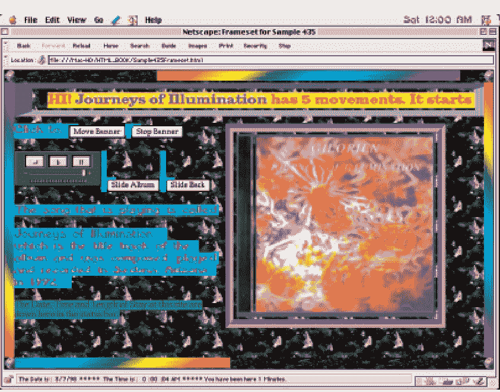


第二部分
JavaScript 1.2

## 第4章 对象与函数

## 目录

- JavaScript 对象 366
    - 4.1) JavaScript 对象层次结构 366
    - 4.2) 使用 JavaScript 对象 367
    - 4.3) 对象属性与方法 367
- JavaScript 函数 371
    - 4.4) 使用 Function 语句定义函数 371
    - 4.5) 通过属性赋值调用函数 372
    - 4.6) 通过名称调用函数 373
    - 4.7) 在函数内部调用函数 375
    - 4.8) 通过属性赋值调用函数 376
    - 4.9) JavaScript 核心函数对象 378
    - 4.10) 函数的 `arguments[i]` 数组属性 380
    - 4.11) 在函数内嵌套函数 384
- 总结图表 386
    - 4.12) 预定义的 JavaScript 对象 386
    - 4.13) 作为对象属性的预定义 JavaScript 数组 387
    - 4.14) 预定义的 JavaScript 核心对象 388
    - 4.15) 预定义的 JavaScript 核心函数 388
- JavaScript 核心对象 389
    - 4.16) JavaScript 核心对象概述 389
    - 4.17) 使用其 `Constructor` 函数创建对象 390
    - 4.18) 为对象创建方法 392

### 第4章 — 对象与函数

| 索引 | 内容 | 页码 |
|---|---|---|
| 4.19) | 作为对象定义中的属性的对象 | 396 |
| 4.20) | 使用 `prototype` 属性向对象类型添加方法 | 399 |
| 4.21) | 在对象定义后向其添加属性 | 402 |
| 4.22) | 使用 `prototype` 属性向对象类型添加属性 | 402 |
| 4.23) | 对象属性的索引 | 404 |
| 4.24) | 使用字面量表示法创建对象 | 307 |
| 4.25) | 删除对象 | 411 |
| 4.26) | 核心对象的 `watch()` 方法 | 411 |
| 4.27) | 核心对象的 `unwatch()` 方法 | 415 |

### 预定义的 JavaScript 对象

| 索引 | 内容 | 页码 |
|---|---|---|
| 4.28) | JavaScript `window` 对象 | 416 |
| 4.29) | `window` 对象的 `open()` 方法 | 422 |
| 4.30) | `window` 对象的 `close()` 方法 | 427 |
| 4.31) | `window` 对象的 `scrollBy()` 方法 | 430 |
| 4.32) | JavaScript `document` 对象 | 432 |
| 4.33) | `document` 对象的 `cookie` 属性 | 436 |
| 4.34) | JavaScript `screen` 对象 | 445 |
| 4.35) | JavaScript `Location` 对象 | 447 |
| 4.36) | JavaScript `History` 对象 | 452 |
| 4.37) | JavaScript `navigator` 对象 | 456 |
| 4.38) | 动态创建框架 | 457 |
| 4.39) | JavaScript `Number` 核心对象 | 460 |
| 4.40) | JavaScript `select` 对象 | 462 |
| 4.41) | JavaScript `options[]` 数组 | 464 |
| 4.42) | JavaScript `option` 对象 | 465 |

### 新的 JavaScript 核心函数

| 索引 | 内容 | 页码 |
|---|---|---|
| 4.43) | JavaScript `Number` 核心函数 | 467 |
| 4.44) | JavaScript `String` 核心函数 | 468 |

### JavaScript 对象

### JavaScript 对象层次结构

### 使用 JavaScript 对象

可将本章视为 JavaScript 对象的概述。其作用是概述对象运作的总体框架，以及它们如何相互关联并与 JavaScript 的其他方面互动。本章不会详细描述所有对象的每一个细节。相关信息请参见 CD-ROM 上的 JavaScript 参考手册。本章将阐明对象的基本参数，并展示一些对象更有趣和实用的功能。

每次在 Navigator 中加载页面时，JavaScript 编译器都会根据您编写的 HTML 创建特定对象。这个最小对象集包括 **navigator**、**window**、**document**、**location** 和 **history** 对象。显然，根据您编写的页面内容，编译器可能还会生成其他对象。所有这些对象都存在于一个对象层次结构中，可以通过点表示法调用对象来访问。上一页的图表演示了这种结构。

#### 对象属性与方法

所有这些对象都具有与其各自对象相关的特定属性和方法，这些属性和方法可以被访问和操作。对象的属性基本上是一个预定义的变量，您可以使用如下的简单点表示法语法为其赋值：

```
objectName.propertyName = value
```

例如，如果您想将 **document** 对象的背景颜色更改为蓝色，您可以访问 **bgColor** 属性并将字符串 "blue" 赋给它，如下所示：

```
document.bgColor = "blue"
```

对象的方法是已经由 Netscape 分配给对象的预定义函数。您可以使用相同的点表示法在对象上调用方法，如下所示：

```
objectName.methodName()
```

**window** 对象是页面中所有其他对象的父对象，这意味着它位于所有页面内容层次结构的顶部，包括那些具有 FRAMESET 和 FRAME 的页面。这意味着所有其他对象都是它的后代或子对象。一些子对象（如 **document** 对象）对于层次结构中更靠下的其他对象来说，也是父对象或容器对象。所有子对象都被认为是其各自父对象的属性，因此可以使用 JavaScript 引用和操作它们。

假设您想在脚本中的某个时刻将焦点给到窗口。您可以通过引用 **window** 对象并调用 **focus()** 方法来做到这一点，如下所示：

```
window.focus();
```

现在，既然已经演示了这一点，因为 **window** 对象始终是父对象，Netscape 允许您在涉及其他对象的表达式中省略它，因为总是假定它的存在。这将为您节省一些打字时间。

**document** 对象是层次结构中的下一个主要父单元。它是大多数其他 JavaScript 对象的祖先。它不包含 **navigator**、**frame**、**location**、**history** 或 **mimeType** 对象。

假设您有一个名为 **myImage1** 的 **image** 对象，并且您想通过将其设置为不同的 URL 来更改 **src** 属性。要访问 **image** 对象，您可以按名称调用它或使用 **images[i]** 数组，但您也必须通过层次结构来获取它。这里是另一种思考方式。将图像视为具有一个名称和一个在页面中的特殊位置，该位置由其层次结构名称指定，就像家族树一样。这个名称由其所有祖先（向上追溯到 **document** 对象，实际上是 **window** 对象，但请记住您可以省略它）组成。因此，对于 **document** 中名为 **myImage1** 的 **image**，您将这样更改其 **src** 属性：

```
document.myImage1.src = "nextImage2.jpg"
```

如果这是 **document** 中的第一张图像，您可以使用 **images[i]** 数组来引用它，如下所示：

```
document.images[0].src = "nextImage2.jpg"
```

或者通过其在 **images[i]** 数组中的名称，如下所示：

```
document.images["myImage1"].src = "nextImage2.jpg"
```

### 更改文本对象的值

假设您有一个名为 **myForm1** 的 **form** 对象，其中包含一个名为 **myText1** 的 INPUT TYPE="text" 对象。要更改该 **text** 对象中显示的文本字符串，您将设置 **text** 对象的 **value** 属性，如下所示：

```
document.myForm1.myText1.value = "the new text string";
```

### 在 form 对象中引用对象

这里稍微有些棘手。如果您有一个对象（如 **link**）位于 **form** 对象中，而这个对象不一定必须在 **form** 对象中，那么当您引用 **link** 对象时，仍然必须引用 **form** 对象。例如，如果您想更改文档中第三个 **link** 的 **target** 属性，而它恰好位于名为 **myForm1** 的 **form** 中，您将使用索引 2 访问 **links[i]** 数组中的第三个元素，并使用以下代码：


## 第四章 — 对象与函数

```javascript
document.myForm1.links[2].target = "mainView";
```

如果这个**链接**没有包含在**表单**对象内部，你应该这样编写代码：

```javascript
document.links[2].target = "mainView";
```

### 引用 Layer 对象

当你引用**Layer**对象时，情况会变得更加复杂，因为每个**Layer**对象内部都有自己版本的**document**对象，其中包含的数据类型与其外部的大兄弟相同，但其参数仅适用于其直接的父级**Layer**。当你引用**Layer**对象时，你必须始终引用其父级**document**对象。当你想要引用**Layer**对象的属性时，你不需要引用**Layer**内部的**document**对象。当你想要引用包含在**Layer**对象内部的对象时，你必须始终引用该**Layer**对象的内部**document**对象。以下是这三种可能性的演示。

假设你有一个名为**myLayer1**的**Layer**，你应该这样引用它：

```javascript
document.myLayer1
```

现在假设你想要使用其**bgColor**属性来更改该**Layer**的背景颜色，你应该这样编写代码：

```javascript
document.myLayer1.bgColor = "blue";
```

现在假设你想要更改名为**myLayer1**的**Layer**内部的名为**myForm1**的**表单**对象中的名为**myText1**的**text**对象的文本字符串。你必须这样访问**myLayer1**对象的**document**对象：

```javascript
document.myLayer1.document.myForm1.myText1.value = "Hey Now.";
```

### 引用 select 对象

最后一个例子。假设你有一个名为**getColor**的**select**对象，你想要将当前选中的颜色选项赋值给你定义为**bcolorSel**的变量。现在，如果该**select**对象包含在名为**form1**的**表单**中，而该**表单**位于名为**L2**的**Layer**的**document**对象内部，你需要使用**select**对象的**selectedIndex**属性作为**options[index]**数组的**index**，而该数组本身也有很长的引用链。以下是如何在一行代码中引用这些对象：

```javascript
var bcolorSel = document.L2.document.form1.getColor.options[document.L2.document.form1.getColor.selectedIndex].value;
```

你可以看到将其分解成更小的块，并将这些块赋值给不同的变量，然后适当地替换这些变量的好处，如下所示：

```javascript
var L2 = document.L2;
var getColor = L2.document.form1.getColor;
var sel = getColor.selectedIndex;
var bcolorSel = getColor.options[sel].value;
```

你可以在[Sample724.html](Sample724.html)中看到与此非常相似的代码实现，该示例在第6章的示例6-24中进行了说明，位于第650-656页。

有关**select**对象的更多信息，请参阅本章后面的第462-465页。

### 图表及其他即将涉及的主题

在第386-388页，有四张图表，分别列出了Netscape为你创建的所有预定义JavaScript对象、预定义JavaScript数组、预定义JavaScript核心对象以及预定义JavaScript核心函数，供你在脚本中使用。JavaScript 1.2中新增的对象以及某些更重要或较为冷门的对象在本书中有所涉及。详细讲解和检查JavaScript中所有可用的对象超出了本书的范围，事实上这将需要单独的一整本书。本章将向你展示如何使用现有对象、它们是如何由JavaScript运行时引擎创建的，以及如何使用它们的属性和方法来操作内容。有关本书未涵盖的JavaScript对象的更多详细信息，请参阅CD-ROM上的JavaScript参考。

除了JavaScript的预定义对象之外，你还可以创建自己的对象并为其定义属性和方法。这个过程在汇总图表之后有详细说明。

你还可以创建自己的函数，这是有效利用JavaScript的基本工具之一。在下一节中，将介绍定义函数的过程，然后是调用函数的三种方式，即你可以执行函数中包含的语句的方式。

其他主题包括核心JavaScript**Function**对象、**arguments[i]**数组，以及在一个函数内部嵌套另一个函数的能力，使得外部函数的参数可用于内部函数（但反之则不行）。这是Navigator 4.0的新功能。

在本章的最后，为Navigator 4介绍了**Number**和**String**的两个新函数。

### JavaScript 函数

#### 概述

基本上，函数是一个整合了JavaScript语句序列以完成某项任务的过程。要将函数集成到你的文档中，你必须首先在一个SCRIPT中定义它，通常包含在HEAD元素中。然后你必须调用该函数。调用函数可以通过多种方式完成，包括从另一个函数内部调用函数的能力。在许多情况下，函数被调用作为HTML元素的事件处理程序的值，这称为属性赋值。调用函数的最简单方式是使用其名称作为语句。你可以使用**return**语句通过函数返回值。

通常最好在文档的HEAD中定义你的函数，以便在BODY中的任何HTML元素加载之前先加载这些函数。这可以防止由于文档某一部分的脚本尝试与尚未加载的另一部分脚本交互而产生的许多JavaScript运行时错误。这通常发生在用户尝试在页面完全加载之前单击按钮对象，而该按钮需要尚未加载的代码才能工作时。由于该所需代码尚未加载，因此会出现运行时错误。HEAD脚本也有例外情况。有关方法与函数区别的信息，请参阅第367、392-401页。

#### 使用 Function 语句定义函数

定义函数首先使用**function**关键字，后面跟着函数名称，然后是用括号括起来的、以逗号分隔的参数列表。你可以定义不接受任何参数的函数，但仍然必须包含括号。接下来是用分号分隔并包含在花括号{}中的一系列语句。例如，以下函数**setColor()**不接受任何参数，并在被调用时将背景颜色设置为紫色：

```javascript
function setColor() {
    document.bgColor = "purple";
}
```

语法：

```javascript
function functionName(argument1, argument2, ..., argumentN) {
    statement1;
    statement2;
    statementN;
}
```

### 通过属性赋值调用函数

定义函数只是让函数执行其语句的第一步。接下来，你必须在SCRIPT中调用函数，或者将其赋值给HTML元素的事件处理程序，如以下场景所示：

为了开始这个场景的过程，你可以通过向之前定义的**setColor()**函数添加**color**参数来使其更有用，如下所示：

```javascript
function setColor(color) {
    document.bgColor = color;
}
```

这样，当**setColor()**函数被调用时，背景将更改为当时提供的**color**参数，该参数每次调用函数时都可能不同。例如，假设你定义了三个按钮对象，每个按钮对象都将其各自的**onClick**事件处理程序分配给**setColor()**函数，如下所示：

```html
<INPUT TYPE="button" VALUE="Blue it" onClick="setColor('blue');">
<INPUT TYPE="button" VALUE="Lime it" onClick="setColor('lime');">
<INPUT TYPE="button" VALUE="Red it" onClick="setColor('red');">
```

然后，如果用户点击第一个按钮，**setColor()**函数将使用字符串'**blue**'作为**color**参数来将背景颜色更改为蓝色。如果用户点击第二个按钮，**onClick**事件处理程序使用相同的**setColor()**函数，但提供不同的字符串值作为**color**参数，从而将背景颜色更改为lime。对于以'**red**'作为**color**参数的按钮也是如此。

### 函数中的语句

函数中的语句几乎可以是任何类型的JavaScript表达式，并且可以包括（但不限于）：变量、字面量、数组、字符串、数字、关键字、对象、正则表达式、运算符以及任何特殊的JavaScript语句，如**if()...else**和**for()**，这些将在第5章中介绍。如前所述，你甚至可以在函数内部嵌套函数，或者在函数内部调用自身，这称为*递归*函数。后一种可能性在使用**setTimeout()**和**setInterval()**方法、创建执行JavaScript动画的脚本以及使用**Date**对象显示或使用日期和时间数据时非常有用。有关示例和详细信息，请参阅第3章。

### 函数中的参数

函数中的参数是作为占位符的变量，用于传递给函数的值，可以是字符串、数字、日期，甚至其他完整的对象。


## 第 4 章 — 对象与函数

### 通过名称调用函数

通过名称调用函数有几种不同的场景。我们将首先讨论的是当你想要更改页面的 HTML 布局时。在这种情况下，你必须通过名称调用函数，即在文档的 BODY 中，在被引用的 HTML 加载到文档之后，将函数名称包含在一个 SCRIPT 标签中。请注意，当你使用函数来初始化文档布局（例如使用 `write()` 方法）时，情况并非如此；只有当你想要更改页面中的某些内容时才需要这样做。

例如：在文档的 HEAD 中定义之前相同的 `setColor()` 函数，然后在文档的 BODY 中通过一个单独的脚本以名称形式调用它来执行。请注意，调用时需包含括号。

#### 示例 4-0: Sample500.html

```html
<!DOCTYPE HTML PUBLIC "-//W3C//DTD HTML 3.2//EN">
<HTML>
<HEAD>
<TITLE>Sample 500 - Example 4-0 Define and Call a Function  </TITLE>

<SCRIPT LANGUAGE="JavaScript1.2"><!--BEGIN HIDING

    function setColor() {
        document.bgColor = "purple";
    }

//END HIDING-->
</SCRIPT>

</HEAD>

<BODY>

<SCRIPT LANGUAGE="JavaScript1.2"><!--BEGIN HIDING

    setColor();

//END HIDING-->
</SCRIPT>

<H2>        The call to the setColor() Function in the second Script actually
changes the background color. Without the explicit call, the Function is only
defined in the HEAD but not executed.
</H2>

</BODY>

</HTML>
```

在示例 4-1 中，**setText()** 函数在文档的 HEAD 中被定义并调用。实际上你可以在文档的 BODY 中调用该函数，但通常认为将尽可能多的脚本包含在 HEAD 中是良好的实践，以避免运行时错误。之所以可以在 HEAD 中调用 `setText()` 函数，是因为它是在参与页面的布局，而不是在 HTML 渲染完成后更改页面。

这是你在调试代码时需要注意的区分点之一。

#### 示例 4-1: Sample501.html

```html
<!DOCTYPE HTML PUBLIC "-//W3C//DTD HTML 3.2//EN">
<HTML>
<HEAD>
<BASEFONT SIZE="7">

<TITLE>Sample 501 - Example 4-1 Define and Call a Function  </TITLE>

<SCRIPT LANGUAGE="JavaScript1.2"><!--BEGIN HIDING

    function setText() {

        document.write("Hello out there.");
    }

    setText();

//END HIDING-->
</SCRIPT>

</HEAD>

<BODY>

<H2>
    <FONT COLOR="#FF0000">

Notice that in this case the Function is called in the HEAD of the document because it <U>isn't changing</U> the layout, it is <U>contributing to the initial layout</U>.

    </FONT>
</H2>

</BODY>
</HTML>
```

### 在函数内部调用函数

本示例演示了如何在另一个函数内部调用一个函数。由于 `setText()` 和 `setDiffText()` 函数都使用了对 JavaScript 对象的引用，而这些对象是由 JavaScript 解释器在 BODY 中创建这些元素的 HTML 加载后才创建的，因此脚本被放置在 BODY 中相关 HTML 的之后。`setText()` 函数首先被定义，然后它在 `setDiffText()` 函数中被调用。这两个函数都被分配给了两个链接的事件处理器，因此文本框中的文本将根据光标移入或移出哪个链接而改变。

#### 示例 4-2: Sample502.html

```html
<!DOCTYPE HTML PUBLIC "-//W3C//DTD HTML 3.2//EN">
<HTML>         <HEAD>         <BASEFONT SIZE="5">
<TITLE>Sample 502 - Example 4-2 Call a Function within a Function</TITLE>  </HEAD>
<BODY BGCOLOR="lime">

<A HREF="Sample502.html" onMouseOver="setText('blue');"
onMouseOut="setDiffText();">
     Test Link Number 1.   </A>   <BR><BR>

<A HREF="Sample502.html" onMouseOver="setText('yellow');"
onMouseOut="setDiffText();">
     Test Link Number 2.   </A>   <BR><BR>

<FORM NAME="form1">   <INPUT TYPE="text" NAME="text1" SIZE=50>    </FORM>

Two Test Links to Change Text in the Text box by moving the mouse over a link and
away from the link.

<SCRIPT LANGUAGE="JavaScript1.2"><!--BEGIN HIDING

function setText(getText) {
      document.form1.text1.value = getText;
}

function setDiffText() {

      var t = document.form1.text1.value;

      if (t == 'blue')     { document.form1.text1.value = 'red'; }

      else { setText('purple'); }

}

//END HIDING-->
</SCRIPT>
</BODY></HTML>
```

### 通过属性赋值调用函数

通过属性赋值调用函数与属性赋值（Attribute Assignment）类似，但有几个显著的区别。下面是一个简单的微型示例及其随后的解释。

```javascript
<SCRIPT LANGUAGE="JavaScript1.2"><!--BEGIN HIDING

    function setColor() {
        document.bgColor = "purple";
    }

    document.onmouseup=setColor;

//END HIDING-->
</SCRIPT>
```

你应当立即注意到，定义的 **setColor()** 函数在通过属性赋值被分配给 **document** 对象的 **onmouseup** 事件处理器时，名称后面没有带括号。这意味着在定义函数时括号内的任何参数，都会由 JavaScript 解释器在内部随函数一起自动传递。在某些情况下，特别是处理 **Event** 对象时，这是一个优势。事实上，这种无需手动编写 **event** 关键字参数的能力，是处理事件和事件处理时使用它的主要原因。

另一方面，如果你在函数中有一个参数想要在脚本的不同时间点手动更改，这可能会成为一个明显的劣势，至少在你必须使用与习惯不同的算法方案来编写函数这一点上。例如，如果你稍微修改 **setColor()** 函数，使其接受一个名为 **color** 的参数，如下所示：

```javascript
    function setColor(color) {
        document.bgColor = color;
    }
```

这正是许多作者在计划将其用于如下属性赋值时通常定义函数的方式：

```html
<INPUT TYPE="button" VALUE="Do it" onClick="setColor('blue');">
```

你可能立刻就能发现尝试为此函数使用属性赋值时会出现的问题，因为没有办法将 'blue' 字符串附加到 **color** 参数上。为了解决这个问题，你需要提前规划并以不同的方式定义函数，以适应替代语法的要求。示例 4-3 演示了一种解决方案。

这里有一种不同的定义函数的方法：分配一个事件参数 **e** 而不是 **color** 参数，然后设置 **if()** 语句，根据事件参数的值来更改背景颜色。核心 **String** 对象的 `fromCharCode()` 方法被用于从 **Event** 对象 **e** 的 `which` 属性中提取字符串值，然后将其赋值给 **theKey** 变量。

随后，**theKey** 变量在 **if()** 语句中与字符串字面量进行布尔测试，当测试为真时执行背景颜色更改。最后，**setColor()** 函数被分配给 **document** 对象的 **onkeypress** 事件处理器。如果你决定在浏览器中运行此脚本，请确保在按下 1、2 或 3 键时，主浏览器窗口处于焦点状态，而不是位置 URL 栏。

在第 6 章“事件”中，有大量此类编码场景的额外示例。

#### 示例 4-3: Sample503.html

```html
<!DOCTYPE HTML PUBLIC "-//W3C//DTD HTML 3.2//EN">
<HTML>
<HEAD>
<BASEFONT SIZE="5">
<TITLE>Sample 503 - Example 4-3 Function Call by Property Assignment</TITLE>

<SCRIPT LANGUAGE="JavaScript1.2"><!--BEGIN HIDING

//Press either the 1, 2 or 3 Key to change the background color.

function setColor(e) {

    theKey = String.fromCharCode(e.which);

    if (theKey == "1") { document.bgColor = "purple"; }
    if (theKey == "2") { document.bgColor = "red"; }
    if (theKey == "3") { document.bgColor = "blue"; }
}

document.onkeypress=setColor;

//END HIDING-->
</SCRIPT>

</HEAD>

<BODY BGCOLOR="lime" onLoad="window.focus();">

Press either the 1, 2 or 3 Key to change the background color.

</BODY>
</HTML>
```


### JavaScript 核心 Function 对象

### JavaScript 语法：

```javascript
functionObjectName = new Function(["arg1", "arg2", ..., "argN"], "functionBody")
```

### 参数定义：

- **functionObjectName**
此参数可为以下三种情况之一：
1) 变量名。
2) 已有对象的属性。
3) 对象后跟事件处理程序名称，必须全部使用小写字符指定，如 **document.onclick**。在这种情况下，不允许有任何参数。

- **arg1, arg2, ..., argN**
参数是可选参数，必须是字符串，供函数用作形式参数名称。

- **functionBody**
这是一个字符串，包含要执行的 JavaScript 代码语句。这与使用 Function 语句定义的函数中花括号内包含的语句相同。

## Function 对象的起源差异

使用 **Function 构造函数**创建的 **Function** 对象与使用 **Function 语句**声明的 **Function** 相似，但有两个非常重要的区别需要注意。首先，当 **Function 对象**被赋值给变量时，该变量被认为包含对使用 **Function 构造函数**创建的 **Function** 的引用，它可以被编程方式更改为包含不同的值，而已声明的 **Function** 是静态的，也就是说，一旦声明，它将始终是那个确切的 **Function**。

其次，**Function 对象**在每次调用时都会被求值，这不如已声明的 **Function** 高效，因为已声明的 **Function** 只编译一次。

以下是用于创建 **Function 对象**及其并行的已声明 **Function** 的代码示例，以供比较：

### Function 对象
```javascript
myFunction = new Function("document.write('Tennis Rocks');")
```

### 已声明的 Function 语句
```javascript
function myFunction() {
    document.write('Tennis Rocks');
}
```

### Function 对象
```javascript
setColor = new Function("color", "document.bgColor=color;")
```

### 已声明的 Function
```javascript
function setColor(color) {
	document.bgColor=color;
}
```

此示例演示了核心 **Function** 对象的两种实现。第一个名为 **setFGColor** 的 **Function** 对象使用 **color** 参数，该参数被赋值给 **document** 对象的 **fgColor** 属性。当在下一行调用它时，它使用 'red' 字符串作为 **color** 参数。第二个 **Function** 对象被赋值给 **document** 对象的 **onclick** 事件处理程序，以便在点击时将 **document** 的背景颜色更改为 lime。

### 示例 4-4：Sample504.html
```html
<!DOCTYPE HTML PUBLIC "-//W3C//DTD HTML 3.2//EN">
<HTML>
<HEAD>
<BASEFONT SIZE="5">
<TITLE>Sample 504 - Example 4-4     Function Object</TITLE>

<SCRIPT LANGUAGE="JavaScript1.2"><!--BEGIN HIDING

	setFGColor = new Function("color", "document.fgColor=color;")
	
	setFGColor('red');
	
	document.onclick = new Function("document.bgColor='lime';")
	
//END HIDING-->
</SCRIPT>

</HEAD>

<BODY>

Click in the window to change the background color.

</BODY>
</HTML>
```

## Function 属性

| 属性 | 描述 |
| :--- | :--- |
| **arguments[i]** | 一个数组，包含传递给函数的所有参数以及函数的局部变量。 |
| **arity** | 指定函数期望的参数数量。 |
| **caller** | 返回调用当前正在执行的嵌套函数的外部函数的名称。**caller** 属性仅在函数体内已知。如果在函数体外部访问，则值为 **null**。 |
| **prototype** | 允许你为 **Function** 对象创建自己的属性。 |

## Function 方法

| 方法 | 描述 |
| :--- | :--- |
| **toString()** | 返回一个字符串，包含指定函数的内部代码。 |

## 函数的 arguments[i] 数组属性

**JavaScript 语法：**
```javascript
arguments[i]
arguments.argName
arguments.varName
```

**内部嵌套函数的 JavaScript 语法：**
```javascript
functionName.arguments[i]
functionName.arguments.argName
functionName.arguments.varName
```

**arguments[i]** 数组是函数的一个属性，其中 **i** 是从 0 到 **n** 的从零开始的 **索引** 整数，其中 **n=arguments.length-1**，每个数组元素包含一个函数参数。在语法中，**functionName** 参数是包含这些参数的函数的名称，只有当你从**内部嵌套**函数访问**外部**函数的属性时才需要。**argName** 是任何参数的名称，**varName** 是你访问的任何局部变量的名称。

只能在函数声明时从函数体内访问 **arguments[i]** 数组。如果你尝试在函数声明外部访问 **arguments[i]** 数组，将会发生 JavaScript 运行时错误。

在引用函数和 **Function** 对象时，你必须始终通过名称引用它们，即使在函数体内也是如此，因为 **this** 关键字并不指代当前正在执行的函数。

如果你调用一个函数并传递的参数多于其在函数语句声明中正式声明可接受的参数数量，你可以使用参数数组来处理额外的参数，通过访问数组的每个元素。

例如，在以下脚本中，**tester()** 函数只声明了一个参数，即 **color**。然后它在 **for()** 语句中使用参数数组，在调用时将其传递给它的每个参数写入屏幕。

### 示例 4-5：Sample505.html
```html
<!DOCTYPE HTML PUBLIC "-//W3C//DTD HTML 3.2//EN">
<HTML>
<HEAD>
<BASEFONT SIZE="5">
<TITLE>Sample 505 - Example 4-5     arguments Array</TITLE>

<SCRIPT LANGUAGE="JavaScript1.2"><!--BEGIN HIDING

function tester(color) {

	for (var i=0; i<tester.arguments.length; i++) {

		document.write(arguments[i] + "<BR>");
	}
}

tester("blue", "red", "green", "yellow");

//END HIDING-->
</SCRIPT>

</HEAD>

<BODY>
</BODY>
</HTML>
```

此脚本在浏览器中产生以下输出：

blue
red
green
yellow

## arguments[i] 数组属性

| 属性 | 描述 |
|----------|-------------|
| length | 函数中参数的数量。 |
| argName1, argName2, ..., argNameN | 函数中的每个参数都是参数数组的一个属性。注意，此功能仅在 Navigator 4.0 中可用。在 JavaScript 1.3 和 Navigator 4.5 中，它不仅被弃用，支持也完全移除且不可用。 |
| varName1, varName2, ..., varNameN | 函数中的每个局部变量都是参数数组的一个属性。注意，此功能仅在 Navigator 4.0 中可用。在 JavaScript 1.3 和 Navigator 4.5 中，它不仅被弃用，支持也完全移除且不可用。 |
| caller | 外部函数的参数数组。如果没有外部函数，则值为 undefined。在 JavaScript 1.3 中已被弃用。 |
| callee | 对包含参数数组的函数的引用。 |

## 在函数内嵌套函数

从适用于 Navigator 4.0 的 JavaScript 1.2 开始，你现在可以在使用 **Function** 语句**声明**时将一个函数嵌套在另一个函数内。注意，这与仅仅从函数内部**调用**一个函数不同，后者已经可以实现一段时间了。嵌套函数意味着**外部**函数的参数和变量可供**内部嵌套**函数使用。但是，反之则不成立；也就是说，**内部嵌套**函数的参数和变量不供**外部**函数使用。**内部**函数在**外部**函数外部是未知的，不能被独立调用。以下比较了**嵌套**函数和**被调用**函数。

**嵌套函数**
```javascript
function outerTest1() {

    function innerTest2() {
        statements2
    }

    statements1
}
```

**从函数内部调用的函数**
```javascript
function myTest1() {
    statements1
}

function myTest2() {
    statements2
    myTest1()
}
```


## 第4章 — 对象与函数

示例4-6演示了如何让外部函数 **getColor()** 中的变量 x 能够被内部嵌套函数 **setBGColor()** 使用。每个局部变量都是 **arguments** 数组的一个属性，因此要访问变量 x，需要使用点号表示法，先使用变量所在的函数名，然后是 **arguments** 数组。

当你运行 Sample506.html 时，只需输入颜色名称并点击按钮即可更改文档的背景颜色。仅在 CD-ROM 上提供的 Sample506-Extra.html 使用了类似的代码，但*没有*使用*嵌套*函数。请比较其中的差异。注意，由于不支持，此示例在 Navigator 4.0 中有效，但在 4.5+ 版本中无效。

### 示例 4-6：Sample506.html

```html
<!DOCTYPE HTML PUBLIC "-//W3C//DTD HTML 3.2//EN">
<HTML><HEAD>
<TITLE>Sample 506 - Example 4-6      Nesting Functions</TITLE>
</HEAD>

<BODY>
<FORM NAME="form1">

<INPUT TYPE="text" NAME="text1" SIZE=30> <BR> Type in a Color Name

<INPUT TYPE="button" NAME="b1" VALUE="Do it" onClick="getColor();">
</FORM>

<SCRIPT LANGUAGE="JavaScript1.2"><!--BEGIN HIDING

//Remember that each local variable is a Property of the arguments Array.
//In this case the variable x is the called Property from the outer Function
//and assigned to the variable named color in the inner Function.
//This example works in Navigator 4.0, but not 4.5.

function getColor() {

	var x = document.form1.text1.value;

			function setBGColor() {

				var color = getColor.arguments.x;

				document.bgColor = color;
			}

		setBGColor();
}

//END HIDING-->
</SCRIPT>
</BODY>
</HTML>
```

### arguments[i] 数组属性演示

此示例通过在一个名为 **outerTest()** 的**外部**函数中使用一个名为 **innerTest()** 的内部嵌套函数，演示了 **arguments[i]** 数组的所有属性。

**outerTest()** 函数声明了两个参数 **arg1** 和 **arg2**，以及一个名为 **myVar2** 的字符串变量。通过访问函数的 **arguments[i]** 数组属性的 **callee** 属性的相应属性，将参数和变量写入屏幕。

然后，声明了 **innerTest()** 函数，它有两个参数 **arg3** 和 **arg4**，以及一个名为 **myVar** 的字符串变量。接着，使用 **write()** 方法在屏幕上显示 **length** 属性，然后是 **arguments[i]** 数组的两个元素。

接下来，通过将其名称作为 **arguments[i]** 数组的属性来访问，显示了 **innerTest()** 函数的两个参数 **arg3** 和 **arg4**，以及字符串变量 **myVar**。然后，使用 **caller** 属性访问外部函数 **outerTest()** 的 **arguments[i]** 数组，以显示其参数和变量。最后，使用 **callee** 属性显示 **innerTest()** 函数的相同参数和变量。

然后，从 **outerTest()** 函数内部调用 **innerTest()** 函数，以便将所有 **write()** 方法的内容写入屏幕。最后，直接调用 **outerTest()** 函数以执行它。此示例在 Navigator 4.0 中运行良好，但在 4.5+ 版本中仅得到部分支持。

**示例 4-7：Sample507.html**

```javascript
<!DOCTYPE HTML PUBLIC "-//W3C//DTD HTML 3.2//EN">
<HTML><HEAD>
<TITLE>Sample 507 - Example 4-7     arguments Array Properties</TITLE>

<SCRIPT LANGUAGE="JavaScript1.2"><!--BEGIN HIDING

function outerTest(arg1, arg2) {

     var myVar2 = "A test Variable for the outer Function";

     document.write(arguments.callee.arg1 + "<BR>");
     document.write(arguments.callee.arg2 + "<BR>");
     document.write(arguments.callee.myVar2 + "<P>");

     function innerTest(arg3, arg4) {

          var myVar = "A test Variable for the inner Function";

          document.write(arguments.length + "<P>");

          document.write(arguments[0] + "<BR>");
          document.write(arguments[1] + "<P>");

          document.write(arguments.arg3 + "<BR>");
          document.write(arguments.arg4 + "<BR>");
          document.write(arguments.myVar + "<P>");
          document.write(arguments.caller.arg1 + "<BR>");
          document.write(arguments.caller.arg2 + "<BR>");
          document.write(arguments.caller.myVar2 + "<P>");

          document.write(arguments.callee.arg3 + "<BR>");
          document.write(arguments.callee.arg4 + "<BR>");
          document.write(arguments.callee.myVar + "<P>");
     }

     innerTest("third", "fourth");
}

/*------------------------------------------------------------*/

outerTest("first", "second");

//END HIDING-->
</SCRIPT>
</HEAD>
<BODY>
</BODY>
</HTML>
```

其在浏览器中的输出如下：

first
second
A test Variable for the outer Function

2

third
fourth

third
fourth
A test Variable for the inner Function

first
second
A test Variable for the outer Function

third
fourth
A test Variable for the inner Function

有关数组的更多信息，请参阅第7章。

## 总结图表

### 预定义的 JavaScript 对象

以下是按字母顺序排列的所有预定义 JavaScript 对象列表：

- anchor
- applet
- area
- Array（参见第7章）
- Boolean
- button
- checkbox
- Date（参见第3章，第307页）
- document（参见第4章，第432页）
- Event（参见第6章）
- fileupload
- form
- frame
- Function（参见第4章，第371-385页，以及第5章，第505页）
- hidden
- History（参见第4章，第452页）
- image
- Layer（参见第3章，第199页）JavaScript 1.2中的新增对象
- link
- Location（参见第4章，第447页）
- Math（参见第3章，第321页）
- mimetype
- navigator（参见第4章，第455页）
- Number（参见第4章，第460页）
- Object（参见第4章，第389页）
- option（参见第4章，第465页）
- password
- Plugin
- radio
- RegExp（参见第9章）
- reset
- screen（参见第4章，第444页）JavaScript 1.2中的新增对象
- select（参见第4章，第462页）
- String（参见第8章）
- submit
- text
- textarea
- window（参见第4章，第416页）

### 作为对象属性的预定义 JavaScript 数组

某些 JavaScript 对象的属性实际上是对象数组，它们由 JavaScript 编译器在页面加载时定义，并基于您提供的内容。下表指定了其各自对象的数组属性，其中 **i** 是从零开始的整数**索引**。这些数组也是核心对象。

**预定义的 JavaScript 数组**

| 对象 | 属性 | 描述 |
|---|---|---|
| document | anchors[i] | 一个反映文档中 `<A>` 标签（在源码中具有 NAME 属性）的数组，按源码顺序排列。 |
| document | applets[i] | 一个反映文档中 `<APPLET>` 标签的数组，按源码顺序排列。 |
| document | embeds[i] | 一个反映文档中 `<EMBED>` 标签的数组，按源码顺序排列。 |
| document | forms[i] | 一个反映文档中 `<FORM>` 标签的数组，按源码顺序排列。 |
| document | images[i] | 一个反映文档中 `` 标签的数组，按源码顺序排列。（这不包括使用 Image() 构造函数创建的图像。） |
| document | layers[i] | 一个反映文档中 `<LAYER>` 标签或样式表层的数组，按源码顺序排列。 |
| document | links[i] | 一个反映文档中 `<A HREF="...">` 标签、`<AREA HREF="...">` 标签以及使用 link() 方法创建的 Link 对象的数组，按源码顺序排列。 |
| Function | arguments[i] | 一个反映函数参数的数组。 |
| form | elements[i] | 一个反映表单元素的数组，按源码顺序排列。 |
| select | options[i] | 一个反映 Select 对象中 `<OPTION>` 标签的数组，按源码顺序排列。 |
| window | frames[i] | 一个反映包含 `<FRAMESET>` 标签的窗口中所有 `<FRAME>` 标签的数组，按源码顺序排列。 |
| window | history[i] | 一个反映窗口 URL 历史记录条目的数组。 |
| navigator | mimeTypes[i] | 一个反映客户端支持的所有 MIME 类型的数组，包括内部、辅助应用程序或插件。 |
| navigator | plugins[i] | 一个反映客户端安装的所有插件的数组，按源码顺序排列。 |


 ## 预定义的 JavaScript 核心对象

某些 JavaScript 对象被称为"顶层"核心对象，因为它们内置于语言本身。它们是：

### 预定义的核心对象

| 对象 | 参考 |
|---|---|
| **Array** | 参见第 7 章 |
| **Boolean** | 参见 JavaScript 参考手册 |
| **Date** | 参见第 3 章 |
| **Function** | 参见第 4 章 |
| **Math** | 参见第 3 章 |
| **Number** | 参见第 4 章 |
| **RegExp** | 参见第 9 章 |
| **String** | 参见第 8 章 |

## 预定义的 JavaScript 核心函数

某些 JavaScript 函数被称为"顶层"核心函数，因为它们内置于语言本身。它们是：

### 预定义的核心函数

| 函数 | 参考 | 页码 |
|---|---|---|
| **escape()** | 参见第 4 章， | 第 439 页 |
| **unescape()** | 参见第 4 章， | 第 439、442-443 页 |
| **eval()** | | |
| **isNaN()** | 参见第 3 章， | 第 338 页 |
| **Number()** | 参见第 4 章， | 第 467 页 |
| **parseFloat()** | 参见第 3 章， | 第 337 页 |
| **parseInt()** | 参见第 3 章， | 第 337 页 |
| **String()** | 参见第 4 章， | 第 468 页 |
| **taint()** | | |
| **untaint()** | | |

## JavaScript 核心对象

/对象概述

你可以创建自己的 JavaScript **对象**，然后在对象上调用 JavaScript 属性和方法。你还可以为自己创建的对象定义自己的属性和方法，这些属性和方法可以像 JavaScript 预定义的属性和方法一样在你创建的对象上调用。奇怪的是，JavaScript 对象与 HTML OBJECT 元素完全不同，所以务必不要将它们混淆。

要创建自己的对象，你可以使用 `Object()` 构造函数或使用字面量表示法，这两种方法都将在以下章节中介绍。

对象没有参数。

### 对象属性

| 属性 | 描述 |
| :--- | :--- |
| constructor | 指定用于创建特定对象的函数。 |
| prototype | 允许你为对象创建自己的属性。 |

### 对象方法

| 方法 | 描述 |
| :--- | :--- |
| watch(propertyName, handlerFunction) | 向对象的属性添加一个**观察点**，每当该属性接收值时，都会调用一个**处理函数**。 |
| unwatch(propertyName) | 从对象的属性中移除一个**观察点**。 |
| toString() | 返回一个包含指定对象内部代码的字符串。 |
| valueOf() | 返回指定对象的原始值。 |
| eval() | 计算包含任何 JavaScript 表达式的字符串。在 Navigator 2.0 和 4.0 中，**eval** 是一个顶层函数。在 Navigator 3.0 中，**eval** 是每个对象的方法。 |

## 使用其构造函数创建对象

### JavaScript 语法：第 1 部分

```
function objectName(arg1, arg2, ..., argN) {
    propertyName1=value1;
    propertyName2=value2;
    propertyNameN=valueN;
    [methodName1=mValue1;
    methodName2=mValue2;
    methodNameN=mValueN];
}
```

### JavaScript 语法：第 2 部分

```
objectInstance = new objectName();
```

要使用构造函数创建新的 JavaScript 对象，需要遵循两个步骤的序列。首先，你必须定义一个包含对象名称以及可选的任何属性的函数。其次，你必须使用关键字 **new** 创建对象的实例。例如：

```
<SCRIPT LANGUAGE="JavaScript1.2"><!--BEGIN HIDING

function myObject() {
    this.color = "blue";
    this.size = 42;
    this.time = "now";
}

testObject = new myObject();
document.write(testObject);

//END HIDING-->
</SCRIPT>
```

这将在浏览器中产生以下输出：

```
{color:"blue', size:42, time:'now"}
```

## 第 4 章 — 对象与函数 391

以下脚本通过定义一个具有五个参数的函数来创建一个对象，并将传递给函数的参数值分配给这五个属性。注意使用关键字 ****this** 来避免在创建属性时声明变量。然后使用关键字 **new** 创建 **myArtObject** 对象的实例，并将其命名为 **art1**。最后，将 **art1** 写入屏幕，并将其每个属性写入屏幕，主要是向你展示你可以像访问预定义对象的属性一样访问自己创建的对象属性。

```
<SCRIPT LANGUAGE="JavaScript1.2'><!--BEGIN HIDING

function myArtObject(title, author, width, height, year) {

    this.title = title;
    this.author = author;
    this.width = width;
   都有可能
    this.height = height;
    this.year = year;
}

art1 = new myArtObject('Pinnacles', 'Gilorien', 24, 36, 1996);

document.write(art1             + '<P>');

document.write(art1.title       + '<BR>');
document.write(art1.author      + '<BR>');
document.write(art1.width       + '<BR>');
document.write(art1.height      + '<BR>');
document.write(art1.year        + '<BR>');

//END HIDING-->
</SCRIPT>
```

该脚本在浏览器中产生以下输出：

```
{title:'Pinnacles', author:'Gilorien',width:24, height:36, year:1996}

Pinnacles
Gilorien
24
36
1996
```

## 为对象创建方法

### JavaScript 语法：第 1 部分

```
function functionName(arg1, arg2, ..., argN) {
    statements1;
    statements2;
    statementsN;
}
```

### JavaScript 语法：第 2 部分

```
objectName.methodName = functionName; //将函数分配给方法
```

### JavaScript 语法：第 3 部分

```
objectName.methodName([parameters]); //调用方法
```

### 步骤

方法只是与特定对象相关联的函数。创建方法的原因是，当你预计会频繁地为特定对象使用某个函数时，花时间将其转换为方法会更加高效。

要为对象创建并使用方法，需要遵循三个步骤的序列。首先，使用标准函数语法定义一个函数。其次，使用 **objectName** 将 **functionName** 分配给对象实例的 **methodName**。注意，你可以为方法名称和函数名称使用相同的名称。

第三部分是你实际在对象实例上调用方法，就像调用任何其他方法一样。

你还可以将方法作为对象定义的一部分分配给对象。此步骤将在接下来三个示例中的第三个中演示。

示例 4-8 将演示为对象创建方法并在对象上调用该方法所需的所有步骤。它首先定义函数 **artMethod1**，该函数将用作上个迷你示例中 **myArtObject** 对象的方法，该对象在此示例中重新定义。

接下来，用其相关参数实例化名为 **art1** 的 **myArtObject** 实例。然后，将名为 **artMethod1** 的函数分配给 **art1** 对象的方法，方法名称与函数名称相同。

最后，在 **art1** 对象上调用 **artMethod1** 方法，这将导致将对象的属性显示写入屏幕。查看代码注释。

## 第 4 章 — 对象与函数

### 示例 4-8：Sample508.html

```
<!DOCTYPE HTML PUBLIC '-//W3C//DTD HTML 3.2//EN'>
<HTML><HEAD>
<BASEFONT SIZE='5'>
<TITLE>Sample 508 - Example 4-8    对象的方法创建</TITLE>

<SCRIPT LANGUAGE='JavaScript1.2'><!--BEGIN HIDING
                                      //定义方法的函数
function artMethod1(obj) {

      this.obj = obj;

      document.write(obj.title + '<BR>');
      document.write(obj.author + '<BR>');
      document.write(obj.width + 'inches x ' + obj.height + 'inches' + '<BR>');
      document.write(obj.year);
}
/*--------------------------------------------------------------------------*/
                                     //定义对象的函数
function myArtObject(title, author, width, height, year) {

      this.title = title;
      this.author = author;
      this.width = width;
      this.height = height;
      this.year = year;
}
/*--------------------------------------------------------------------------*/
                                       //创建对象的实例

      art1 = new myArtObject('Pinnacles', 'Gilorien', 24, 36, 1996);

      art1.artMethod1 = artMethod1;    //将方法分配给对象

      art1.artMethod1(art1);              //在对象上调用方法

//END HIDING-->
</SCRIPT>

</HEAD>
<BODY>
</BODY>
</HTML>
```

上例在浏览器中产生以下输出：

**Pinnacles**
**Gilorien**
**24inches x 36inches**
**1996**


此示例与前一个示例完全相同，不同之处在于它使用关键字 **this** 将 **art1** 对象的参数传递给 **artMethod2()** 方法，而不是使用 **obj** 参数将整个对象传递给该方法。浏览器的输出结果相同。示例 4-8 中的注释与示例 4-9 相关。

## 示例 4-9：Sample509.html

```
<!DOCTYPE HTML PUBLIC "-//W3C//DTD HTML 3.2//EN">
<HTML>
<HEAD>
<BASEFONT SIZE="5">
<TITLE>Sample 509 - Example 4-9      Method Creation for Object</TITLE>

<SCRIPT LANGUAGE="JavaScript1.2"><!--BEGIN HIDING

function artMethod2() {

    document.write(this.title + "<BR>");
    document.write(this.author + "<BR>");
    document.write(this.width + " inches x " + this.height + "inches" + "<BR>");
    document.write(this.year);
}
/*------------------------------------------*/

function myArtObject(title, author, width, height, year) {

    this.title = title;
    this.author = author;
    this.width = width;
    this.height = height;
    this.year = year;
}
/*------------------------------------------*/

    art1 = new myArtObject("Pinnacles", "Gilorien", 24, 36, 1996);

    art1.artMethod2 = artMethod2;

    art1.artMethod2();

//END HIDING-->
</SCRIPT>
</HEAD>

<BODY>
</BODY>
</HTML>
```

此示例演示了将方法作为对象定义的一部分来包含。它与示例 4-9 完全相同，不同之处在于函数 `artMethod2()` 通过在赋值语句中使用 `this` 关键字，作为 `myArtObject` 对象定义中的方法被包含在内。浏览器的输出与示例 4-8 相同。在 CD-ROM 上的文件 Sample510-Extra.html 中还有另一个此过程的示例。

## 示例 4-10：Sample510.html

```
<!DOCTYPE HTML PUBLIC "-//W3C//DTD HTML 3.2//EN">
<HTML>
<HEAD>
<BASEFONT SIZE="5">
<TITLE>Sample 510 - Example 4-10      Method in Object Definition</TITLE>

<SCRIPT LANGUAGE="JavaScript1.2"><!--BEGIN HIDING

function artMethod2() {

    document.write(this.title + "<BR>");
    document.write(this.author + "<BR>");
    document.write(this.width + "inches x " + this.height + "inches" + "<BR>");
    document.write(this.year);
}
/*--------------------------------------------------------------------------------*/

function myArtObject(title, author, width, height, year) {

    this.title = title;
    this.author = author;
    this.width = width;
    this.height = height;
    this.year = year;
    this.artMethod2 = artMethod2;        //includes the Method here
}
/*--------------------------------------------------------------------------------*/

    art1 = new myArtObject("Pinnacles", "Gilorien", 24, 36, 1996);

    art1.artMethod2();                  //invokes the Method on an Object Instance

//END HIDING-->
</SCRIPT>

</HEAD>

<BODY>
</BODY>
</HTML>
```

## 在对象定义中将对象作为属性

要在另一个对象的对象定义中将一个对象作为属性包含，只需定义要包含的对象，然后创建该对象的实例并为其分配一个名称。然后，你可以在其定义中将命名的实例对象作为另一个对象的属性包含。

以下示例演示了上述概念，这也意味着你可以将一个对象的实例作为另一个对象的参数传递。它扩展了前几个示例中使用的相同代码。新增的部分是第二个对象定义，它使用对象函数构造器创建，命名为 `includedObject0`。它接受三个参数，并使用 `this` 关键字定义三个属性，这三个属性被设置为三个参数的值。

接下来，有两个 `includedObject0` 对象的实例，分别命名为 `myIO1` 和 `myIO2`。然后，在定义 `myArtObject0` 对象时，有一个额外的参数名为 `createdBy`，它使用 `this` 关键字赋值给 `createdBy` 属性，如下所示：

```
this.createdBy = createdBy;
```

然后，当 `myArtObject0` 对象的两个实例分别以 `art1` 和 `art2` 的名称进行实例化时，如下所示：

```
art1 = new myArtObject("Pinnacles", "Gilorien", 24, 36, 1996, myIO1);
art2 = new myArtObject("Chakra Fractal Space", "Gilorien", 17, 11, 1995, myIO2);
```

`includedObject0` 的 `myIO1` 和 `myIO2` 实例现在分别是 `art1` 和 `art2` 对象的一部分。

在 `artMethod20` 方法定义中，在之前示例使用的方法基础上新增了以下三行代码：

```
document.write(this.createdBy.artProgram + " ");
document.write(this.createdBy.version + "<BR>");
document.write(this.createdBy.platform + "<P>");
```

这演示了从 `artMethod20` 方法内部访问 `includedObject0` 对象各个属性所需的点表示法。

作为替代方案（本示例未演示），你可以使用以下六行代码从 **artMethod2()** 方法外部显示 **includedObject()** 对象的各个属性，如下所示：

```
document.write(art1.createdBy.artProgram);
document.write(art1.createdBy.version);
document.write(art1.createdBy.platform);
document.write(art2.createdBy.artProgram);
document.write(art2.createdBy.version);
document.write(art2.createdBy.platform);
```

请注意，以上代码中：

| art1 和 art2 | 是 **myArtObject()** 的实例。 |
| **createdBy** | 是 **art1** 和 **art2** 对象的属性，它本身也是一个对象。 |
| **artProgram** | 是 **createdBy** 对象属性的属性。 |
| **version** | 是 **createdBy** 对象属性的属性。 |
| **platform** | 是 **createdBy** 对象属性的属性。 |

## 示例 4-11：Sample511.html

```
<!DOCTYPE HTML PUBLIC "-//W3C//DTD HTML 3.2//EN">
<HTML>
<HEAD>
<BASEFONT SIZE="3">
<TITLE>Sample 511 - Example 4-11    Include an Object in Object Definition</TITLE>

<SCRIPT LANGUAGE="JavaScript1.2"><!--BEGIN HIDING

function artMethod2() {

    document.write(this.title + "<BR>");
    document.write(this.author + "<BR>");
    document.write(this.width + "inches x " + this.height + "inches" + "<BR>");
    document.write(this.year + "<P>");

    document.write(this.createdBy.artProgram + " ");
    document.write(this.createdBy.version + "<BR>");
    document.write(this.createdBy.platform + "<P>");
}
/*-------------------------------------------------------------------------------*/

function includedObject(artProgram, version, platform) {

    this.artProgram = artProgram;
    this.version = version;
    this.platform = platform;
}

myIO1 = new includedObject("Bryce", 3.0, "Macintosh");
myIO2 = new includedObject("Photoshop", 4.0, "Macintosh");

/*------------------------------------------------------------------------*/

function myArtObject(title, author, width, height, year, createdBy) {

	this.title = title;
	this.author = author;
	this.width = width;
	this.height = height;
	this.year = year;
	this.artMethod2 = artMethod2;	//includes the Method here
	this.createdBy = createdBy;		//includes the Object Property here
}
/*------------------------------------------------------------------------*/
									//Creates Object Instances

art1 = new myArtObject("Pinnacles", "Gilorien", 24, 36, 1996, myIO1);
art2 = new myArtObject("Chakra Fractal Space", "Gilorien", 17, 11, 1995, myIO2);

	art1.artMethod2();		//invokes the Method on an Object Instance
	art2.artMethod2();			//invokes the Method on an Object Instance

//END HIDING-->
</SCRIPT>

</HEAD>

<BODY>
</BODY>
</HTML>
```

前面的示例在浏览器中产生以下输出：

Pinnacles
Gilorien
24inches x 36inches
1996

Bryce 3
Macintosh

Chakra Fractal Space
Gilorien
17inches x 11inches
1995

Photoshop 4
Macintosh

## 使用 prototype 属性为对象类型添加方法

### JavaScript 语法：

```
objectName.prototype.methodName;
objectName.prototype.methodName = functionName;
```

在上一节中，演示了在对象定义中为对象添加方法的过程。在本节中，介绍了在对象定义创建之后为对象类型添加方法的过程。这意味着该对象类型的所有实例都可以调用该特定的添加方法，包括在使用 **prototype** 属性创建该方法**之前**就已经创建的该对象的实例。

需要注意的是，**prototype** 属性可用于为你创建的对象以及预定义的 JavaScript 对象（如 **document** 对象或 **Layer** 对象等）创建方法和属性。你也可以使用 **prototype** 属性为对象添加新属性。这将在下一节中介绍。事实上，每个可以通过构造器函数创建的对象都可以使用 **prototype** 属性为其类创建方法和属性。

使用核心对象的 **prototype** 属性为对象添加方法的过程，首先使用构造器函数定义一个方法。然后，在你想要分配新方法的由 **objectName** 指定的对象上调用 **prototype** 属性，同时通常将由 **functionName** 定义的方法赋值给 **methodName**，如下所示：

```
objectName.prototype.methodName = functionName;
```

因此，对于在前面示例中定义的 **myArtObject** 对象，你可以使用函数构造器定义以下方法，该方法将是上述语法中的 **functionName** 参数，如下所示：

```
function addMethod() {
    if (this.title == "Pinnacles")
        document.bgColor="magenta";
}
```

然后使用 **prototype** 属性将其添加到 **myArtObject**，如下所示：

```
myArtObject.prototype.myAddMethod = addMethod;
```


本示例演示了如何使用 **prototype** 属性向对象类型添加方法。

**示例 4-12: Sample512.html**

```html
<!DOCTYPE HTML PUBLIC "-//W3C//DTD HTML 3.2//EN">
<HTML><HEAD>
<TITLE>Sample 512 - Example 4-12       add Method to Object with prototype</TITLE>

<SCRIPT LANGUAGE="JavaScript1.2"><!--BEGIN HIDING

function artMethod2() {

        document.write(this.title + "<BR>");
        document.write(this.author + "<P>");
}
/*--- -------------------------------------------------------------------*/

function addMethod() {
        if (this.title == "Pinnacles")        document.bgColor="magenta";
        if (this.title == "Sedona Winter")    document.bgColor="steelblue";
}
/*--- -------------------------------------------------------------------*/

function myArtObject(title, author) {

        this.title = title;
        this.author = author;
        this.artMethod2 = artMethod2;
}
/*--- -------------------------------------------------------------------*/
                                                //在此处添加方法
        myArtObject.prototype.myAddMethod = addMethod;

        art1 = new myArtObject("Pinnacles", "Gilorien");
        art2 = new myArtObject("Sedona Winter", "Gilorien");

        art1.artMethod2();
        art2.artMethod2();

//END HIDING-->
</SCRIPT>
</HEAD>
<BODY>
<FORM NAME="form1">

<INPUT TYPE="button" NAME="b1" VALUE="Test 1" onClick="art1.myAddMethod();">
<INPUT TYPE="button" NAME="b2" VALUE="Test 2" onClick="art2.myAddMethod();">

</FORM>
</BODY>
</HTML>
```

## 第 4 章 — 对象与函数

本示例演示了如何使用 **prototype** 属性向 **Number** 对象（一个预定义的 JavaScript 对象）添加方法。首先，定义一个将被用作添加方法的 **addNum()** 函数，然后将该方法命名为 **changeIt()** 并通过 **prototype** 属性将其添加到 **Number** 对象中。最后，在 **doIt()** 函数内部调用 **changeIt()** 方法。请注意用于调用该方法的点号表示法。此脚本将文本框中的数字添加到之前的总数中，并将计算出的总数返回到文本框中。

### 示例 4-13: Sample513.html

```html
<!DOCTYPE HTML PUBLIC "-//W3C//DTD HTML 3.2//EN">
<HTML><HEAD>
<TITLE>Sample 513 - Example 4-13        add a Method to Number Object</TITLE>
</HEAD>

<BODY onLoad="document.form1.t1.focus();">

<FORM NAME="form1">
<INPUT TYPE="text" NAME="t1" VALUE="" SIZE=40>
<INPUT TYPE="button" NAME="b2" VALUE="Add a Number" onClick="doIt();">
</FORM>

<SCRIPT LANGUAGE="JavaScript1.2"><!--BEGIN HIDING

var myNum = new Number(0);

function addNum(n) {

        myNum+=n;
        return myNum;
}
/*_____________________________________________________________________*/

Number.prototype.changeIt = addNum;

function doIt() {

        var nextNum =0;
                                            //将字符串转换为数字
        nextNum = myNum.changeIt(parseInt(document.form1.t1.value));

        document.form1.t1.value = nextNum;
        document.form1.t1.select();
}

//END HIDING-->
</SCRIPT>
</BODY>
</HTML>
```

## 在对象实例定义后为其添加属性

要在**对象类型**定义之后向单个**对象实例**添加**属性**，您只需使用简单的点号表示法通过名称分配**属性**，并可选地使用以下语法为其赋予值。请注意，这不会将该**属性**添加到对象类型中。

### JavaScript 语法：

```javascript
myObjectInstance.myNewProperty;
myObjectInstance.myNewProperty = value;
```

例如，假设您有一个名为 **myBook** 的对象，并想为其添加一个名为 **chapter** 的属性，您可以使用以下两行代码中的任何一行来实现：

```javascript
myBook.chapter;
myBook.chapter = 5;
```

## 使用 prototype 属性向对象类型添加属性

### JavaScript 语法：

```javascript
objectName.prototype.propertyName;
objectName.prototype.propertyName = value;
```

要在对象已经定义之后向对象类型添加属性，您必须使用其函数构造程序的 **prototype** 属性。这是一个相对简单的过程，在以下示例中有所展示。然而，这种情况中一个不太直观的方面是，当您创建对象的新实例时，您不能传递一个基于新属性的参数。您必须在创建对象新实例后，手动为每个对象的该属性分配值。

本示例使用 **prototype** 属性向通过 **myBook()** 函数构造程序创建的对象类型添加两个属性：**chapter** 和 **pages**。这里有两个名为 **ch7** 和 **ch10** 的 **myBook** 对象实例。然后使用 **write()** 方法显示 **ch7** 的属性值，随后显示实际的 **ch7** 和 **ch10** 对象。

### 示例 4-14: Sample514.html

```html
<!DOCTYPE HTML PUBLIC "-//W3C//DTD HTML 3.2//EN">
<html>
<head>
<title>Sample 514 - Example 4-14 add a Property to an Object</title>

<script language="JavaScript 1.2"><!--BEGIN HIDING

function myBook(title, author) {

    this.title = title;
    this.author = author;

}

/*

    ch7 = new myBook("Dynamic HTML", "Glorien");

    myBook.prototype.chapter;
    myBook.prototype.pages;

    ch7.chapter = 7;
    ch7.pages = 124;

    document.write(ch7.title + "<br>");
    document.write(ch7.author + "<br>");
    document.write(ch7.chapter + "<br>");
    document.write(ch7.pages + "<p>");

    ch10 = new myBook("New JavaScript", "Gil");

    ch10.chapter = 10;
    ch10.pages = 55;

    document.write(ch7 + "<p>");
    document.write(ch10 + "<p>");

//END HIDING-->
</script>

</head>
<body>
</body>
</html>
```

上述示例在浏览器中产生以下输出：

```
Dynamic HTML
Gilorien
7
124

{title:"Dynamic HTML", author:"Gilorien", chapter:7, pages:124}

{title:"New JavaScript", author:"Gil", chapter:10, pages:55}
```

## 对对象属性进行索引

当您为创建的对象定义属性时，可以通过名称或基于零的**索引**（index）数字来定义这些属性。例如，在之前的示例中，**myBook** 对象的 **ch7** 实例的 **pages** 属性可以通过以下三种方式中的任何一种来定义：

```javascript
ch7.pages = 7;         //通过名称定义
ch7["pages"] = 7;       //通过名称定义
ch7[3] = 7;             //通过索引数字定义
```

重要的是要记住，当您引用一个属性时，必须以其定义时相同的方式来引用，即通过名称或**索引**数字。如果您通过名称`定义`，则必须通过名称`引用`。如果您通过**索引**数字`定义`，则必须通过**索引**数字`引用`。上述两种通过名称引用的方式被认为是等价的，因此可以互换。

同样重要的一点是，上述场景不适用于由 HTML 反射而来的对象（例如 JavaScript 解释器加载页面时的 **layers[i]** 数组或 **images[i]** 数组）。这些数组的元素始终可以通过名称`或`索引数字来引用。例如，如果您有一个名为 **myLayer3** 的图层，且它是文档中的第三个图层，您可以通过以下三种方式中的任何一种来引用它：

```javascript
document.myLayer3;
document.layers["myLayer3"];
document.layers[2];
```

如果您忘记了，这些数组实际上是其他对象的属性。例如，**layers[i]** 数组是 **document** 对象的属性，而 **arguments[i]** 数组是 **Function** 对象的属性。

示例 4-15 演示了为对象实例定义属性的几种方式以及引用它们的正确方法。请注意，在本示例中（与前一示例类似），没有使用 **prototype** 属性。在 **myBook** 对象定义之后创建的属性是针对名为 **ch7** 和 **ch8** 的 **myBook** 对象单个实例的。正因为如此，**chapter** 属性必须为每个 **myBook** 对象实例分别定义。

对于 **ch7**，该对象的第四个属性被命名为 **pages**。对于 **ch8**，第四个属性没有命名，而是像这样通过索引 **3** 来定义：

```javascript
ch8[3]=111;
```

您应该在浏览器输出中注意到 JavaScript 内部是如何对 **ch7** 和 **ch8** 实例对象进行编码的，这解释了为什么您必须以定义属性时相同的方式来引用对象属性。具体来说，以下代码：

```javascript
document.write(ch7 + "<P>");
```

在浏览器中产生此输出：

```
{title:"Dynamic HTML", author:"Gilorien", chapter:7, pages:124}
```

而这段代码：

```javascript
document.write(ch8 + "<P>");
```

在浏览器中产生此输出：

```
{title:"Layers", author:"Gilorien", chapter:8, 3:111}
```

请注意粗体文本：**ch7** 中使用了 **pages** 名称，而 **ch8** 中使用了**索引**数字 **3**。

示例 4-15 与示例 4-14 非常相似。总而言之，它首先使用函数构造程序定义一个名为 **myBook** 的对象，然后创建两个该对象的实例并命名为 **ch7** 和 **ch8**。接着将 **ch7** 和 **ch8** 的单个属性写入屏幕，最后将两个完整的对象实例也写入屏幕。


## 示例 4-15: Sample515.html

```html
<!DOCTYPE HTML PUBLIC "-//W3C//DTD HTML 3.2//EN">
<HTML>
<HEAD>
<TITLE>Sample 515 - Example 4-15     indexing Object Properties</TITLE>

<SCRIPT LANGUAGE="JavaScript1.2"><!--BEGIN HIDING

		function myBook(title, author) {

				this.title = title;
				this.author = author;
		}

/*-------------------------------------------------------------*/

		ch7 = new myBook("Dynamic HTML", "Gilorien");

		ch7.chapter = 7;
		ch7.pages = 124;

		document.write(ch7.title + "<BR>");
		document.write(ch7.author + "<BR>");
		document.write(ch7.chapter + "<BR>");
		document.write(ch7.pages + "<P>");

		document.write(ch7 + "<P>");
/*-------------------------------------------------------------*/

		ch8 = new myBook("Layers", "Gilorien");

		ch8["chapter"] = 8;        //this is the third Property of the Object
		ch8[3] = 111;              //this is the fourth Property of the Object

		document.write(ch8.title + "<BR>");
		document.write(ch8.author + "<BR>");
		document.write(ch8.chapter + "<BR>");
		document.write(ch8[3] + "<P>");

		document.write(ch8 + "<P>");

//END HIDING-->
</SCRIPT>
</HEAD>

<BODY>
</BODY>
</HTML>
```

上述示例在浏览器中产生以下输出：

Dynamic HTML
Gilorien
7
124

```
{title:"Dynamic HTML", author:"Gilorien", chapter:7, pages:124}
```

Layers
Gilorien
8
111

```
{title:"Layers", author:"Gilorien", chapter:8, 3:111}
```

## 使用字面量表示法创建对象

### JavaScript 语法：

```javascript
objectName = {property1:value1, property2:value2, ..., propertyN:valueN}
```

### 参数定义：

在 JavaScript 1.2 中，您还可以使用字面量表示法（Literal Notation）来创建新对象。它采用了与前一个示例中对象写入屏幕时相同的语法。它以 **objectName** 参数开始，即对象的名称。然后将对象字面量赋值给 **objectName**。整个对象字面量包含在花括号 `{}` 中。它由一个由逗号分隔的 **property:value**（属性:值）对列表组成。每个 **property** 与其 **value** 之间用冒号分隔。

对于每个 **property1** 到 **propertyN** 参数，您可以为该属性选择一个标识符。它可以是一个名称、一个数字或一个字符串字面量。**value1** 到 **valueN** 参数可以是字符串、数字、变量、您创建的另一个对象，或任何有效的 JavaScript 表达式。

尽管语法使用冒号分隔 **property** 和 **value** 对，但其行为就像使用等号 (=) 一样将 **value** 赋值给 **property**。这是一个使用字面量表示法创建对象的简单示例：

```javascript
myObject = {color:"blue", size:42, year:1999}
```

为了方便比较，本示例重写了之前的示例，使得对象 ch7 和 ch8 使用字面量表示法定义。浏览器的输出与之前示例完全相同。请注意，使用字面量表示法要简单得多。

## 示例 4-16: Sample516.html

```html
<!DOCTYPE HTML PUBLIC "-//W3C//DTD HTML 3.2//EN">
<HTML>
<HEAD>
<TITLE>Sample 516 - Example 4-16     Creating Objects with Literal notation</TITLE>

<SCRIPT LANGUAGE="JavaScript1.2"><!--BEGIN HIDING

ch7 = {title:"Dynamic HTML", author:"Gilorien", chapter:7, pages:124}

/*----------------------------------------------------------------------*/

	document.write(ch7.title + "<BR>");
	document.write(ch7.author + "<BR>");
	document.write(ch7.chapter + "<BR>");
	document.write(ch7.pages + "<P>");

	document.write(ch7 + "<P>");

/*----------------------------------------------------------------------*/

ch8 = {title:"Layers", author:"Gilorien", chapter:8, 3:111}

	document.write(ch8.title + "<BR>");
	document.write(ch8.author + "<BR>");
	document.write(ch8.chapter + "<BR>");
	document.write(ch8[3] + "<P>");

	document.write(ch8 + "<P>");

//END HIDING-->
</SCRIPT>
</HEAD>

<BODY>
</BODY>
</HTML>
```

本示例演示了使用字面量表示法创建的对象，其中一个属性本身又是另一个对象。**myCycle** 对象定义了四个属性：**motorcycle**、**model**、**year** 和 **owner**。**owner** 属性是一个对象，它具有三个属性：**firstName**、**lastName** 和 **location**。您应该注意用于访问 **owner** 对象属性的语法。

## 示例 4-17: Sample517.html

```html
<!DOCTYPE HTML PUBLIC "-//W3C//DTD HTML 3.2//EN">
<HTML>
<HEAD>
<TITLE>Sample 517 - Example 4-17     Creating Objects with Literal notation</TITLE>

<SCRIPT LANGUAGE="JavaScript1.2"><!--BEGIN HIDING

myCycle = {motorcycle:"Yamaha", model:"YZ-250", year:1997, owner:{firstName:"John",
lastName:"Anderson", location:"Los Angeles"}}

document.write (myCycle.motorcycle + " ");
document.write(myCycle.model + "--");
document.write (myCycle.year + "<BR>");
document.write (myCycle.owner.firstName + " ");
document.write (myCycle.owner.lastName + "<BR>");
document.write (myCycle.owner.location + "<BR>");

//END HIDING-->
</SCRIPT>
</HEAD>

<BODY>
</BODY>
</HTML>
```

上述示例在浏览器中产生以下输出：

Yamaha YZ-250--1997
John Anderson
Los Angeles

本示例演示了使用字面量表示法创建的对象，其中有一个名为 **test1** 的属性，其值为表达式 x+y。**test2** 属性的值为变量 z。由于表达式计算结果为 13，因此将 **myObj** 的属性和 **myObj** 对象本身写入屏幕的语句被执行。

## 示例 4-18: Sample518.html

```html
<!DOCTYPE HTML PUBLIC "-//W3C//DTD HTML 3.2//EN">
<HTML>
<HEAD>
<TITLE>Sample 518 - Example 4-18       Creating Objects with Literal notation</TITLE>

<SCRIPT LANGUAGE="JavaScript1.2"><!--BEGIN HIDING

var x=5;
var y=8;
var z=13;

myObj = {test1:x+y, test2:z}

if (myObj.test1 == 13) {

    document.write(myObj.test1 + "<BR>");
    document.write(myObj.test2 + "<BR>");
    document.write(myObj);
}

//END HIDING-->
</SCRIPT>
</HEAD>

<BODY>
</BODY>
</HTML>
```

上述示例在浏览器中产生以下输出：

```
13
13
{test1:13, test2:13}
```

## 删除对象

要从脚本中删除一个对象，只需将其对象引用设置为 **null**，如下所示：

`myObject = null;`

这将作为赋值表达式的一部分立即删除该对象。需要注意的是，之后不应对被删除的对象进行任何引用；也就是说，将对象引用设置为 **null** 必须是对该对象的最后一次引用。

在大型、复杂的脚本中，删除对象非常有用，因为当内存资源紧张且大多数用户的下载速度仍然极慢时，它可以释放系统资源。

## Core 对象的 `watch()` 方法

### JavaScript 语法：

```javascript
objectName.watch(propertyName, handlerFunction)
```

### 参数定义：

**watch()** 方法为 **objectName** 所指定对象的 **propertyName** 指定属性添加一个**监视点（watchpoint）**，每当该属性接收到一个值时，都会调用 **handlerFunction** 指定的函数。这是 Navigator 4.0 的一个新方法。

这有点复杂。如果您熟悉 **sort()** 方法（该方法将内置函数作为方法的一部分），那么您在理解上会更有优势。

### 使用 `handlerFunction` 参数

**handlerFunction** 采用特定的格式，但有很大的空间根据您自己的目的进行自定义设计。请注意，在语法中，**handlerFunction** 没有被命名。**handlerFunction** 的语法为：

### JavaScript 语法：

```javascript
function (id, oldvalue, newvalue) {
    return somevalue;
}
```

### 参数定义：

其中：

- **id**: 是 **propertyName** 指定的属性名称。
- **oldvalue**: 最初是赋值给属性的初始值，随后在每次给属性赋新值时，它是该属性的前一个值。
- **newvalue**: 接收赋值给属性的第一个新值，随后接收赋值给属性的每个新值。每当给属性赋一个新值时，当前的 **newvalue** 就会被发送到 **oldvalue** 参数中，以便 **newvalue** 参数可以接收赋给属性的下一个新值。在这种典型场景下，假设 **return** 语句中的 **somevalue** 参数被设置为 **newvalue**。
- **somevalue**: 通常设置为 **newvalue**，但您也可以将其设置为 **oldvalue** 或以任何您想要的方式修改 **somevalue**。

在其最简单的格式中，**handlerFunction** 仅将 **newvalue** 值返回给使用字面量表示法创建的对象 `o` 中的属性 `p`，如下所示：

```javascript
o = {p:1}
o.watch("p", function (id, oldvalue, newvalue) {return newvalue ;})
o.p = 2;
document.write(o.p);
```

这将在浏览器中显示：**2**。

只需对 **return** 语句进行轻微修改，浏览器的输出将是 77，如下所示：

```javascript
o = {p:1}
o.watch("p", function (id, oldvalue, newvalue) {return newvalue + 75 ;})
o.p = 2;
document.write(o.p);
```

即使您删除了被分配监视的属性，**监视点** 依然有效。如果您稍后在脚本中重新创建该属性，**监视点** 仍将像该属性一直存在一样地工作。要移除**监视点**，您必须使用 **unwatch()** 方法。

要删除一个属性，请使用 **delete** 语句，如下所示：

```javascript
delete o.p;
```


## 第 4 章 — 对象与函数

要移除一个**监听点（watchpoint）**，请像这样使用 **unwatch()** 方法：

`o.unwatch("p");`

本示例演示了 **watch()** 方法的一个简单用法：首先使用字面量表示法定义一个名为 **o** 的对象，该对象具有一个名为 **p** 的属性，其值为 1。随后调用 **watch()** 方法，使得每次为 **p** 属性赋值时，都会调用三个 **write()** 方法，并且 **newvalue** 参数被作为 **p** 属性的值返回。

### 示例 4-19：Sample519.html

```html
<!DOCTYPE HTML PUBLIC "-//W3C//DTD HTML 3.2//EN">
<HTML><HEAD>
<TITLE>Sample 519 - Example 4-19    watch Method  </TITLE>

<SCRIPT LANGUAGE="JavaScript1.2"><!--BEGIN HIDING

o = {p:1}
o.watch("p",
    function (id, oldvalue, newvalue) {
        document.write("For the Object o with Property " + id)
        document.write(", the old Value was: " + oldvalue)
        document.write(" and the new Value is: " + newvalue + "<P>")
        return newvalue;
    })

o.p = 2;
o.p = 3;
o.p = 4;

//END HIDING-->
</SCRIPT>
</HEAD>
<BODY>
</BODY>
</HTML>
```

上述示例在浏览器中产生以下输出：

---
For the Object o with Property p, the old Value was: 1 and the new Value is: 2

For the Object o with Property p, the old Value was: 2 and the new Value is: 3

For the Object o with Property p, the old Value was: 3 and the new Value is: 4
---

本示例再次演示了 **watch()** 方法的简单用法：首先使用字面量表示法定义一个名为 **o** 的对象，该对象具有一个名为 **p** 的属性，其值为 1。随后调用 **watch()** 方法，使得每次为 **p** 属性赋值时，都会使用 **if()** 语句对 **newvalue** 参数进行测试：如果其值等于 7，则为其增加 500，否则增加 100；在这两种情况下，该值都被作为 p 属性的值返回。

### 示例 4-20：Sample520.html

```html
<!DOCTYPE HTML PUBLIC "-//W3C//DTD HTML 3.2//EN">
<HTML>
<HEAD>
<TITLE>Sample 520 - Example 4-20     watch Method</TITLE>

<SCRIPT LANGUAGE="JavaScript1.2"><!--BEGIN HIDING

o = {p:1}

o.watch("p",
   function (id, oldvalue, newvalue) {

        if (newvalue == 7) {
              document.write("<B>" + "Found the value of 7" + "<\/B><P>");
              return newvalue + 500;
        }
        else {
              document.write("o." + id + " had old Value of " + oldvalue);
              document.write(", now has " + newvalue + "<BR>");
              return newvalue + 100;
        }
   })

o.p = 2;
o.p = 3;
o.p = 4;
o.p = 5;
o.p = 6;
o.p = 7;
o.p = 8;

//END HIDING-->
</SCRIPT>
</HEAD>

<BODY>
</BODY>
</HTML>
```

上述示例在浏览器中产生以下输出：

```
o.p had old Value of 1, now has 2
o.p had old Value of 102, now has 3
o.p had old Value of 103, now has 4
o.p had old Value of 104, now has 5
o.p had old Value of 105, now has 6
**Found the value of 7**

o.p had old Value of 507, now has 8
```

## 核心对象的 unwatch() 方法

**JavaScript 语法：**

```javascript
objectName.unwatch("propertyName")
```

**参数定义：**

**unwatch()** 方法从由 **objectName** 指定的对象中，移除由 **propertyName** 指定的属性上的**监听点（watchpoint）**。

**微示例：**

例如，要移除对象 **o** 的属性 **p** 的**监听点**，可以使用以下代码：

```javascript
o.unwatch("p");
```

### 展望

本节关于自定义对象的讨论到此结束。下一节将介绍 JavaScript 语言内置的一些预定义对象。首先涵盖的预定义对象是 **window** 对象。在 JavaScript1.2 中，为了增强功能，提供了新的属性和方法。

## 预定义 JavaScript 对象

### JavaScript window 对象

**window** 对象涵盖的内容非常广泛。它是 JavaScript 对象层级结构中的顶层对象。具体而言，它是每个 **document**、**location** 和 **history** 对象的顶层对象。JavaScript 运行时引擎会为每个 BODY 或 FRAMESET 标签创建一个顶层 **window** 对象。此外，对于每个非顶层窗口的 FRAME 标签，也会创建一个 **window** 对象。对于由 FRAME 标签创建的窗口，FRAMESET 窗口是其顶层窗口。最后，对于每个使用 **window.open()** 方法创建的窗口（详见 422-426 页），也会创建一个 **window** 对象。

#### 关于框架（Frames）

从技术上讲，FRAME 是一个**window** 对象，其行为与普通窗口略有不同。并没有单独的 Frame 对象，但有一个 **frames[i]** 数组，它是 **window** 对象的一个属性。由 FRAME 标签创建的 **window** 对象的具体功能差异如下：

- 1) 顶层窗口的 **parent** 和 **top** 属性指向同一个窗口。对于框架窗口，**parent** 属性指向其父级 Frameset 窗口。对于框架窗口，**top** 属性指向最顶层的窗口。
- 2) 对于框架窗口，设置 **defaultStatus** 或 **status** 属性仅在光标位于该框架上方时，才在状态栏中显示文本消息。
- 3) 对于框架窗口，**onfocus** 和 **onblur** 事件处理程序只能通过属性赋值来设置，且必须全部使用小写字母。不能在框架的 HTML 标签中设置这些事件处理程序。
- 4) 对于框架窗口，**close()** 方法不可用。
- 5) 对于同时包含 SRC 和 NAME 属性的框架，可以通过以下三种方式从兄弟框架引用该框架：

```javascript
parent.frameName
parent.frames[i]
parent.frames["frameName"]
```

例如，如果你有一个名为 `myFrame3` 的框架，它是 Frameset 中的第三个框架，你可以从该 Frameset 中的另一个框架这样引用它：

```javascript
parent.myFrame3
parent.frames[2]
parent.frames["myFrame3"]
```

如果你想更改名为 `myFrame3` 的框架的背景颜色，可以在兄弟框架中这样操作：

```javascript
parent.myFrame3.document.bgColor = "blue";
```

**特别注意：**

需要注意的是，虽然你可以使用 **open()** 方法创建 **window** 对象，但不能在 JavaScript 内部将框架或框架集作为 **window** 对象创建。它们只能通过 HTML 创建。你可以通过使用 **document** 对象的 **write()** 方法将 HTML 直接写入页面来绕过此限制，在这种环境下你可以创建 FRAMESET 和 FRAME 元素。关于框架创建的详情，请参阅本章后文的 456 页和示例 4-34。关于 **write()** 方法的详情，请参阅 230-232 页及 434 页。

以下是 **window** 对象的事件处理程序。定义和示例请参阅第 6 章“事件”。

#### Window 事件处理程序

- onBlur
- onDragDrop
- onError
- onFocus
- onLoad
- onMove
- onResize
- onUnload

**window** 对象的属性和方法如下：

#### Window 属性

| 属性 | 描述 |
| :--- | :--- |
| closed | 布尔值。如果你打开的窗口现在已关闭，则值为 true。一旦关闭窗口，除非使用 `open()` 方法重新打开，否则不应再引用它。 |
| defaultStatus | 一个可设置属性，指定当没有由 `status` 属性指定的优先级消息（例如在 `onMouseOver` 事件发生时）需要显示时，在窗口底部的状态栏中显示的默认消息。 |
| document | 访问 `document` 对象的属性和方法，以便向浏览器渲染输出。请参阅下一节关于 `document` 对象的讨论。 |
| frames | 一个数组，按源码顺序反映窗口中的所有框架。你可以通过框架的 Name 属性或索引号访问框架。对于 Frameset 中名为 `myFrame3` 的第三个框架：`parent.frames["myFrame3"]` 等同于 `parent.frames[2]`，也等同于 `parent.myFrame3`。其 `length` 属性反映窗口中框架的数量。每个数组元素的 `name` 属性反映该框架的名称。 |
| history | 一个数组，按源码顺序反映用户访问过的窗口 URL 条目历史记录。访问 `History` 对象。见示例 4-33。 |
| innerHeight | 以像素为单位，指定窗口中预留用于插入内容的垂直尺寸。 |
| innerWidth | 以像素为单位，指定窗口中预留用于插入内容的水平尺寸。 |
| length | 只读值，反映窗口中框架的数量。`window.length` 等同于 `parent.frames.length`。 |
| location | 反映窗口关联的 `Location` 对象中包含的当前窗口 URL 信息。在引用 `Location` 对象时，必须使用 `window.location` 而不仅仅是 `location`。 |
| locationbar | 代表窗口的地址栏，此处显示当前文档的 URL。它有一个 `visible` 属性，可设置为 `"false"` 以隐藏地址栏，或 `"true"` 以显示它。** |
| menubar | 代表窗口的菜单栏，此处存放“文件”、“编辑”、“窗口”和“跳转”等下拉菜单。它有一个 `visible` 属性，可设置为 `"false"` 以隐藏菜单栏，或 `"true"` 以显示它。** |
| name | 唯一标识符，即用于引用窗口的名称。这是 Navigator 3.0 的可读/写属性。 |

** 使用此属性出于安全目的需要获得 `UniversalBrowserWrite` 权限。更多信息请参阅《JavaScript 指南》中的 JavaScript 安全章节或《JavaScript 参考》中的 `window` 对象章节。


## 第四章 — 对象与函数

| 属性 | 描述 |
|----------|-------------|
| opener | 指定在使用 **open()** 方法打开新窗口时调用文档的窗口名称。Navigator 允许同时打开多达 100 个窗口。为了释放系统资源，如果不再使用调用窗口，请务必设置 **opener** 属性为 **null**。 |
| outerHeight | 以像素为单位，指定窗口总外边沿的垂直尺寸，包括状态栏、滚动条、菜单栏和工具栏，这些被称为窗口的 "chrome" 元素。 |
| outerWidth | 以像素为单位，指定窗口总外边沿的水平尺寸，包括状态栏、滚动条、菜单栏和工具栏，这些被称为窗口的 "chrome" 元素。 |
| pageXOffset | 指定页面当前位置与文档左上角原点 (0,0) 之间的水平偏移距离。一个可以为正数、负数或零的整数，以像素为单位。 |
| pageYOffset | 指定页面当前位置与文档左上角原点 (0,0) 之间的垂直偏移距离。一个可以为正数、负数或零的整数，以像素为单位。 |
| parent | 包含当前框架的框架集窗口的通用同义词。这允许你在一个框架内操作另一个框架的内容。对于多层嵌套的框架集，每个嵌套层级使用额外的 **parent**，例如：**parent.parent.frameName** 表示一层嵌套。 |
| personalbar | 表示窗口的个人工具栏，用户可以方便地访问书签。它有一个 **visible** 属性，可以设置为 "false" 以隐藏个人工具栏，"true" 以显示它。** |
| scrollbars | 表示窗口的滚动条，以便用户可以水平或垂直滚动页面。它有一个 **visible** 属性，可以设置为 "**false**" 以隐藏滚动条，"**true**" 以显示它们。** |
| self | 指代当前窗口。此属性与下面的 **window** 属性相同，但名称更为直观。 |
| status | 一个可设置的属性，指定要在窗口底部状态栏中显示的优先消息。这是一个临时消息，当发生如 onMouseOut 等事件时，会临时覆盖 **defaultstatus** 消息。 |
| statusbar | 指浏览器窗口底部的状态栏，默认状态消息和状态消息在此处显示，其他图标也位于此处。 |
| toolbar | 表示窗口的工具栏，后退、前进、主页等按钮位于此处。它有一个 **visible** 属性，可以设置为 "**false**" 以隐藏工具栏，"**true**" 以显示它。** |
| top | 指代最顶层的窗口，即页面中所有其他子窗口或框架的祖先。 |
| window | 指代当前窗口。 |

** 使用此属性需要获得 **UniversalBrowserWrite** 权限以确保安全。更多信息请参阅 JavaScript 指南中的 JavaScript 安全部分，或 JavaScript 参考中的 **window** 对象部分。

### Window 方法

| 方法 | 描述 |
|---|---|
| **alert("message")** | 在带有确定按钮的警告对话框中向用户指定 **message** 字符串，此时不需要用户决策或反馈。要自定义设计您自己的警告对话框，请使用 **open()** 方法。 |
| **back()** | 加载顶层窗口的上一个 URL。要加载当前窗口或框架的上一个 URL，请使用 **history.back()**。 |
| **blur()** | 从指定窗口或框架移除焦点。 |
| **captureEvents(Event.EVENTNAME [\| Event.EVENTNAME])** | 使窗口捕获所有指定类型的事件。请注意，EVENTNAME 如 KEYPRESS 或 CLICK 始终全部大写，并且始终前面带有 **Event.**，如果使用多个事件则用 (\|) 分隔。详见第六章关于事件的内容。 |
| **clearInterval(intervalID)** | 取消由 **intervalID** 指定的、通过 **setInterval()** 方法设置的延时。详见第 284、286-287 页。 |
| **clearTimeout(timeoutID)** | 取消由 **timeoutID** 指定的、通过 **setTimeout()** 方法设置的延时。详见第 250、288-289 页。 |
| **close()** | 关闭由 **windowReference** 指定的窗口，如下所示：**myWindow.close()**。如果未指定 **windowReference**，则关闭当前窗口。详见第 427 页。 |
| **confirm("message")** | 在带有确定和取消按钮的确认对话框中向用户指定 **message** 字符串，此时需要用户做出决策。 |
| **disableExternalCapture()** | 允许您禁用由 **enableExternalCapture()** 方法设置的外部事件捕获。 |
| **enableExternalCapture()** | 允许您在包含从不同服务器位置加载的页面的框架中捕获事件。 |
| **find(["searchString"][, casesensitive][, backward])** | 如果在指定窗口或框架的内容中找到指定的 **searchString**，则返回 true。**backward** 参数是一个布尔值，如果包含它，则向页面开头执行搜索，同时也要求包含 **casesensitive** 布尔值。详见 CD-ROM 中的 JavaScript 参考。 |
| **focus()** | 为指定窗口或框架设置焦点。对于框架，这通常通过视觉提示来表示，如在大多数平台上显示青色边框。 |
| **forward()** | 模拟用户点击浏览器导航栏中的前进按钮，这与加载历史列表中的下一个 URL 相同。要加载当前窗口或框架的上一个 URL，请使用 **history.forward()**。 |
| **handleEvent(eventArg)** | 调用指定 **eventArg** 的事件处理程序。此方法始终与 **routeEvent()** 方法配合使用。详见第六章第 668-677 页关于事件的完整细节。 |
| **home()** | 加载用户在浏览器首选项中指定的主页 URL。 |
| **moveBy(x, y)** | 按指定的水平 **x** 和垂直 **y** 像素数移动窗口，可以是正整数、负整数或零。 |
| **moveTo(x, y)** | 将窗口的左上角移动到指定的水平 **x** 和垂直 **y** 屏幕坐标，其中 (x, y) 如果为正数则向下和向右测量，如果为负数则向上和向左测量，原点 (0, 0) 在屏幕左上角。要将窗口的任何部分移出屏幕，需要在签名脚本中获得 **UniversalBrowserWrite** 权限。 |
| **open("URL", "windowName", "windowFeatures")** | 打开一个新的浏览器窗口。详见第 422-428 页。 |
| **print()** | 打印当前具有焦点的窗口或框架的内容。 |
| **prompt("message", [defaultInput])** | 在带有输入字段的提示对话框中向用户指定 **message** 字符串以供用户输入。确定和取消按钮分别允许或禁止数据被整合到脚本中，尽管脚本最终控制数据的用途。 |
| **releaseEvents(Event.EVENTNAME \| Event.EVENTNAME)** | 释放由 **captureEvents()** 方法设置为捕获的指定事件类型，使其在事件层次结构中继续传递。详见第六章关于事件的完整细节。 |
| **resizeBy(x, y)** | 按指定的水平 **x** 和垂直 **y** 像素数调整窗口右下角的大小，可以是正整数、负整数或零。 |
| **resizeTo(x, y)** | 按指定的水平 **x** 和垂直 **y** 像素数调整整个窗口的大小，这些数字代表外宽度和外高度尺寸。 |
| **routeEvent(eventArg)** | 使通过 **captureEvents()** 方法捕获的事件沿正常事件层次结构传递到其原始目标，除非另一个对象在途中捕获它。详见第六章关于事件的完整细节。 |
| **scroll(x, y)** | 已弃用，推荐使用 **scrollBy()** 和 **scrollTo()**，它们具有更大的灵活性且命名更直观。 |
| **scrollBy(x, y)** | 按指定的水平 **x** 和垂直 **y** 正数、负数或零像素滚动窗口的可见区域。 |
| **scrollTo(x, y)** | 滚动窗口的可见区域，使指定的 (x, y) 坐标成为窗口的当前左上角。 |


## 第二部分 — JavaScript 1.2

**setInterval('expression', milliseconds)**
**setInterval('functionName()', milliseconds, [arg1, arg2, ..., argN])**

**setInterval()** 方法有两种语法格式。它可以在指定的毫秒数过去后**重复**计算一个**表达式**或调用由 **functionName()** 指定的函数。

详见第 284、286-287 页的详细信息和示例。

**setTimeout('expression', milliseconds)**
**setTimeout('functionName()', milliseconds, [arg1, arg2, ..., argN])**

**setTimeout()** 方法有两种语法格式。它可以在指定的毫秒数过去后**一次性**计算一个**表达式**或调用由 **functionName()** 指定的函数。

详见第 250、288-289 页的详细信息和示例。

**stop()**

停止当前正在下载的 URL。

## window 对象的 open() 方法

你可以使用 **open()** 方法来创建一个新的浏览器窗口。有大量功能可供你包含以自定义设计窗口，从完整的正常外观的 Navigator 窗口到简单的准警报对话框。你可以在 **open()** 方法中包含一个 URL 以加载到窗口中，或者你可以打开窗口，然后使用 **document** 对象的 **write()** 方法向窗口添加内容，就像其他任何页面一样。你甚至可以从刚刚打开的窗口中打开另一个窗口，并重复此过程，最多可同时打开 100 个窗口。

由于 JavaScript 中静态对象的作用域特性，在事件处理程序中使用此方法时，你必须指定 **window.open()** 或 **windowName.open()**。如果不这样做，即如果你只指定 **open()** 而不带 **window** 对象，JavaScript 会将其解释为 **document.open()**。

### JavaScript 语法：

```javascript
window.open("URL", "windowName", ["windowFeatures"]);
windowVarName=window.open("URL", "windowName", ["windowFeatures"]);
```

### 参数定义：

**URL**

一个字符串，指定要加载到新窗口中的 URL。如果你不想加载现有文档，例如当你想创建自定义设计的警报或提示窗口时，则指定一个空字符串，即两个相邻的双引号，如下所示："".

**windowName**

你可以在脚本中引用的窗口名称。

**windowFeatures**

一个字符串，包含以逗号分隔的功能列表，用于自定义设计你的窗口。**windowFeatures** 字符串中不要有任何空格。窗口打开后，你无法使用 JavaScript 更改任何功能。所有可能的功能如下所列。

对于只需要设置为 yes 或 no 的功能，你可以用 1 代替 yes，用 0 代替 no。对于这些功能，你也可以只包含功能名称，它将被视为布尔值 true，从而启用该功能。

如果你创建一个窗口，并且 **windowName** 参数未指定已存在的窗口，且 **windowFeatures** 参数被省略，则所有具有 **yes/no** 值选项的功能默认设置为 **yes**。

Nav4-- 表示该功能是 Navigator 4.0 新增的。
* 表示该功能是安全的，必须在签名脚本中设置。

- **alwaysLowered**：Nav4--* 如果为 yes 或 1，新窗口将浮动在其他窗口下方，无论活动与否。在 Macintosh 平台上，它浮动在所有浏览器窗口下方，但不一定浮动在其他应用程序的窗口下方。在 Windows 95 平台上，它浮动在所有其他窗口下方。
- **alwaysRaised**：Nav4--* 如果为 yes 或 1，新窗口将浮动在其他窗口上方，无论活动与否。在 Macintosh 平台上，它浮动在所有浏览器窗口上方，但不一定浮动在其他应用程序的窗口上方。在 Windows 95 平台上，它浮动在所有其他窗口上方。
- **dependent**：Nav4-- 如果为 yes 或 1，新窗口是当前窗口的兄弟窗口，当父窗口关闭时它也会关闭。
- **directories**：如果为 yes 或 1，将创建包含 What's Cool 和 Yellow Pages 等按钮的标准目录栏。在 Navigator 4.0 中，在某些平台上，目录按钮已被弃用，取而代之的是将这些数据放在书签菜单下的 Guides 文件夹中。
- **hotkeys**：Nav4-- 如果为 no 或 0，大多数热键（即新窗口的命令键）将被禁用。它也将没有菜单栏。但是，**security** 和 **quit** 热键始终启用。
- **innerHeight**：Nav4-- 以像素为单位指定窗口内容可视区域的高度。
- **innerWidth**：Nav4-- 以像素为单位指定窗口内容可视区域的宽度。
- **location**：如果为 yes 或 1，为窗口创建位置栏，显示当前 URL 并可直接接收用户输入的 URL，通过 Return 或 Enter 键激活。
- **menubar**：如果为 yes 或 1，创建屏幕顶部的菜单。
- **outerHeight**：Nav4-- 以像素为单位指定窗口外边缘的垂直高度。
- **outerWidth**：Nav4-- 以像素为单位指定窗口外边缘的水平宽度。
- **resizable**：如果为 yes 或 1，用户可以通过拖动窗口右下角来调整窗口大小。
- **screenX**：Nav4-- 以像素为单位指定窗口距离用户屏幕左边缘的位置。要将窗口的任何部分置于屏幕外，请在签名脚本中设置此功能。
- **screenY**：Nav4-- 以像素为单位指定窗口距离用户屏幕顶边缘的位置。要将窗口的任何部分置于屏幕外，请在签名脚本中设置此功能。
- **scrollbars**：如果为 yes 或 1，如果文档内容增长到超过窗口可视区域可以容纳的大小，水平滚动条和垂直滚动条将出现。
- **status**：如果为 yes 或 1，创建窗口底部的状态栏，优先消息在此处显示。
- **titlebar**：Nav4--* 如果为 yes 或 1，为窗口创建标题栏。
- **toolbar**：如果为 yes 或 1，为窗口创建工具栏。
- **z-lock**：Nav4--* 如果为 yes 或 1，新窗口创建时始终位于其他窗口后面。

### 迷你示例：

这是一个简单的迷你示例，它在 **b1** 按钮的 **onClick** 事件处理程序中调用 **myWindow()** 函数，打开一个加载了相对 URL "Sample1.html" 文件的新窗口。注意 **windowFeatures** 参数中的各个功能之间没有空格。

```html
<SCRIPT LANGUAGE="JavaScript1.2"><!--BEGIN HIDING

function myWindow() {

     myMsg=open("Sample1.html", "myWin",
          "screenX=100,screenY=120,resizable=yes,outerwidth=400,outerheight=300");
}

//END HIDING-->
</SCRIPT>

<FORM NAME="form1">
点击打开一个加载了第1章的 Sample1.html 的新窗口。

<INPUT TYPE="button" NAME="b1" VALUE="Open Me Up" onClick="myWindow();">

</FORM>
```

此示例演示了 **window** 对象的 **open()** 方法，在点击名为 **b1** 的按钮调用 **myWindow()** 函数时打开一个名为 **myMsg** 的窗口。然后对 **myMsg** 调用 **document** 对象的 **write()** 和 **close()** 方法来显示消息。确保在你的脚本中记住使用 **close()** 方法，否则数据流将不会关闭，**write()** 方法的内容也不会显示。

### 示例 4-21：Sample521.html

```html
<!DOCTYPE HTML PUBLIC "-//W3C//DTD HTML 3.2//EN">
<HTML>
<HEAD>
<TITLE>示例 521 - 示例 4-21 window 对象的 open 方法</TITLE>

<SCRIPT LANGUAGE="JavaScript1.2"><!--BEGIN HIDING

function myWindow() {

    myMsg=open("", "myWin", "resizable=yes,innerwidth=300,innerheight=200");

    myMsg.document.write("<HTML><HEAD><TITLE>My Window Message\/</TITLE></HEAD>");
    myMsg.document.write("<BODY> My first Window Message. </BODY></HTML>");

    myMsg.document.close();
}

//END HIDING-->
</SCRIPT>

</HEAD>

<BODY>

<FORM NAME="form1">

点击打开窗口。

<INPUT TYPE="button" NAME="b1" VALUE="Open Me Up" onClick="myWindow();">

</FORM>

</BODY>
</HTML>
```


本示例重点介绍**window**对象的**opener**属性。当点击**b1**按钮时，会打开**myMsg**窗口，该窗口包含另一个名为**b2**的按钮。该按钮使用**myMsg**窗口的**opener**属性来更改原始文档的背景色，该原始文档即**opener**窗口。请注意，这里使用了反斜杠（\）字符来转义双引号，从而为"red"提供字面上的双引号。

## 示例 4-22: Sample522.html

```
<!DOCTYPE HTML PUBLIC "-//W3C//DTD HTML 3.2//EN">
<HTML>
<HEAD>
<TITLE>Sample 522 - Example 4-22 	 opener Property of window Object</TITLE>

<SCRIPT LANGUAGE="JavaScript1.2"><!--BEGIN HIDING

function myWindow() {

		myMsg=open("", "myWin", "resizable=yes,innerwidth=300,innerheight=200");

		myMsg.document.write("<HTML><HEAD><TITLE>My Window<\/TITLE><\/HEAD>");
		myMsg.document.write("<BODY>");
		myMsg.document.write("<FORM NAME='form2'>");
		myMsg.document.write("<INPUT TYPE='button' NAME='b2' VALUE='Red It'
						onClick='window.opener.document.bgColor=\"red\";'>");
		myMsg.document.write("<\/FORM>");
		myMsg.document.write("<\/BODY><\/HTML>");

		myMsg.document.close();
}

//END HIDING-->
</SCRIPT>

</HEAD>

<BODY>

<FORM NAME="form1">

Click to open the Message Window.
<INPUT TYPE='button' NAME='b1' VALUE='Open Me Up' onClick='myWindow();'>

</FORM>

</BODY>
</HTML>
```

## window对象的 close() 方法

### JavaScript语法：

```
close();
window.close();
windowName.close();
```

### 参数定义：

`close()`方法用于关闭由`windowName`指定的窗口。如果未提供`windowName`引用，则关闭当前窗口。当`close()`方法在事件处理程序`外部`使用时，其功能等同于`window.close()`，即关闭当前窗口。

在事件处理程序`内部`使用时，必须使用`window.close()`或`windowName.close()`，因为仅使用`close()`会将窗口引用解析为`document.close()`，这是由于JavaScript中静态对象的作用域规则所致。

如果没有`UniversalBrowserWrite`权限，您只能关闭通过JavaScript的`open()`方法打开的窗口。您仍然可以在代码中使用`close()`方法关闭其他窗口而不会出错，但JavaScript会自动生成一个`确认`对话框，让用户选择是否关闭窗口。这是一项安全特性。

此规则的例外情况是：当一个窗口的`History`数组属性中只有一个条目，且该文档是当前文档时，您可以关闭窗口而不会生成`确认`对话框。这样您就可以创建一个能够打开一个或多个窗口，然后自行关闭以释放系统内存和资源的文档。

有关`UniversalBrowserWrite`权限、签名脚本和JavaScript安全性的更多信息，请参阅CD-ROM上JavaScript指南的第1章。

以下示例演示了两种使用`close()`方法关闭点击`b1`按钮时打开的`myMsg`窗口的方式。点击`b2`按钮或`b3`按钮都将关闭窗口，但请注意每种情况下使用的代码不同。

## 428 第二部分 — JavaScript 1.2

## 示例 4-23: Sample523.html

```
<!DOCTYPE HTML PUBLIC "-//W3C//DTD HTML 3.2//EN">
<HTML>
<HEAD>
<TITLE>Sample 523 - Example 4-23       close Method of window Object</TITLE>

<SCRIPT LANGUAGE="JavaScript1.2"><!--BEGIN HIDING

function myWindow() {

        myMsg=open("", "myWin", "resizable=yes,innerwidth=300,innerheight=200");

        myMsg.document.write("<HTML><HEAD><TITLE>My Window<\/TITLE><\/HEAD>");
        myMsg.document.write("<BODY>");
        myMsg.document.write("<FORM NAME='form2'>");
        myMsg.document.write("<INPUT TYPE='button' NAME='b3' VALUE='Close Me Now'
                                onClick='window.close();'>");
        myMsg.document.write("<\/FORM>");
        myMsg.document.write("<\/BODY><\/HTML>");

        myMsg.document.close();
}

//END HIDING-->
</SCRIPT>

</HEAD>

<BODY>

<FORM NAME="form1">

Click to open or close the Window.

<INPUT TYPE='button' NAME='b1' VALUE='Open Me Up' onClick='myWindow();'>

<INPUT TYPE='button' NAME='b2' VALUE='Close it' onClick='myMsg.close();'>

</FORM>

</BODY>
</HTML>
```

# 第4章 — 对象与函数

本示例演示了**window**对象的**resizeBy()**、**resizeTo()**、**moveBy()**和**moveTo()**方法。它还演示了如何在**onClick**事件处理程序中使用**status**属性。在**onMouseOver**事件处理程序中使用**status**属性时，还必须包含`return true`语句才能使其正常工作。

## 示例 4-24: Sample524.html

```
<!DOCTYPE HTML PUBLIC "-//W3C//DTD HTML 3.2//EN">
<HTML>
<HEAD>
<TITLE>Sample 524 - Example 4-24				some window Methods</TITLE>
</HEAD>

<BODY>
<FORM>

<INPUT TYPE='button' VALUE='Wider'			onClick='resizeBy(100,0);'>
<INPUT TYPE='button' VALUE='Taller'			onClick='resizeBy(0,100);'>
<INPUT TYPE='button' VALUE='Thinner'			onClick='resizeBy(-100,0);'>
<INPUT TYPE='button' VALUE='Shorter'			onClick='resizeBy(0,-100);'>				<BR>

<INPUT TYPE='button' VALUE='400x300'			onClick='resizeTo(400,300);'>
<INPUT TYPE='button' VALUE='640x480'			onClick='resizeTo(640,480);'>
<INPUT TYPE='button' VALUE='832x624'			onClick='resizeTo(832,624);'>				<BR>

<INPUT TYPE='button' VALUE='Go Right'			onClick='moveBy(50,0);'>
<INPUT TYPE='button' VALUE='Go Left'			onClick='moveBy(-50,0);'>
<INPUT TYPE='button' VALUE='Go Down'			onClick='moveBy(0,50);'>
<INPUT TYPE='button' VALUE='Go Up'			onClick='moveBy(0,-50);'>					<BR>

<INPUT TYPE='button' VALUE='Down Right'			onClick='moveBy(50,50);'>
<INPUT TYPE='button' VALUE='Down Left'			onClick='moveBy(-50,50);'>
<INPUT TYPE='button' VALUE='Up Right'			onClick='moveBy(50,-50);'>
<INPUT TYPE='button' VALUE='Up Left'			onClick='moveBy(-50,-50);'>				<BR>

<INPUT TYPE='button' VALUE='Move To 0,0'			onClick='moveTo(0,0);'>
<INPUT TYPE='button' VALUE='Move To 200,100'		onClick='moveTo(200,100);'>				<P>

<INPUT TYPE='button' VALUE='Status Bar Message'
			onClick='window.status="Hi There"'>				<BR>

<A HREF="Sample525.html" onMouseOver="status='Notice that (return true) must be
included in the Event Handler.'; return true;">
			Next Sample- Note Status Message.			</A>

</FORM>

</BODY>
</HTML>
```

## window对象的 scrollBy() 方法

### JavaScript语法：

```
self.scrollBy(x,y);
window.scrollBy(x,y);
windowName.scrollBy(x,y);
```

### 参数定义：

scrollBy()方法按指定像素数滚动窗口的内容。x参数控制水平方向滚动。正x值向左滚动，负x值向右滚动。y参数控制垂直方向滚动。正y值将页面从下方向上滚动，就像按住页面底部的滚动箭头一样。负y值从上向下滚动。

其工作原理是：当Navigator将文档加载到浏览器窗口时，文档的最左上角坐标为(x,y) = (0,0)。对于从正常左上角位置开始的简单文档，pageXOffset和pageYOffset的值将是0和0。因此，如果将这两个属性视为坐标，那么可以说scrollBy()方法通过将其(x,y)参数添加到(pageXOffset, pageYOffset)坐标，为文档创建了新坐标。

如果您在通过open()方法打开的窗口引用上使用scrollBy()方法，必须确保scrollbars的windowFeatures参数设置为"YES"，并且scrollbars的visibility属性必须设置为"true"。scrollbars的visibility属性默认为"true"，因此您不必过于担心，尤其是在需要UniversalBrowserWrite权限才能更改它的情况下。您只需要在开始处理安全问题需求时意识到这一点。

示例4-25重点介绍了scrollBy()方法，它与setInterval()方法结合使用，通过自动从上向下滚动来动画化窗口内容。通常，当scrollBy()方法单独使用时，它会按指定像素数滚动窗口一次。通过使用setInterval()方法，您可以重复调用scrollDown()函数，直到pageYOffset属性小于1000。有两个按钮使用clearInterval()方法来停止滚动过程，另外两个按钮则从当前位置重新开始滚动。您可以使用这种技术通过open()方法创建一个花哨的消息窗口。

更多示例请参见第487页、第622-624页和第626页。


## 第 4 章 — 对象与函数

### 示例 4-25：Sample525.html

```html
<!DOCTYPE HTML PUBLIC "-//W3C//DTD HTML 3.2//EN">
<HTML>
<HEAD>
<TITLE>Sample 525 - Example 4-25 scrollBy and setInterval Methods</TITLE>
<SCRIPT LANGUAGE="JavaScript1.2"><!--BEGIN HIDING

    function scrollDown() {
        if (window.pageYOffset < 1100) {
            window.scrollBy(0,2);
        }
    }

//END HIDING-->
</SCRIPT>
</HEAD>
<BODY onLoad="t = setInterval('scrollDown()', 50);">
<H1>This is Sample 525</H1>
<ILAYER TOP=50 WIDTH=300 HEIGHT=300 BGCOLOR="red">
<H1>    This page scrolls by itself but you can still use the scrollbars to move the page.     </H1>   </ILAYER>
<ILAYER WIDTH=300 HEIGHT=300 BGCOLOR="cyan">
<H1>            This speed is designed so that even slow readers could read the text and it has start and stop buttons for perusal if you include thought provoking content in your page.  </H1>   </ILAYER>
<FORM>  <INPUT TYPE='button' VALUE='Stop Scroll' onClick='clearInterval(t);'>
<INPUT TYPE='button' VALUE='Continue Scroll' onClick="t=setInterval('scrollDown()', 50);">                      </FORM>
<ILAYER WIDTH=200 HEIGHT=300 BGCOLOR="yellow">
<H1>You might want to put the buttons in a different Frame so that you would only need one set of them and so the user doesn't have to chase them, even though the speed is slow enough that this isn't a problem.</H1> </ILAYER>
<FORM>  <INPUT TYPE='button' VALUE='Stop Scroll' onClick='clearInterval(t);'>
<INPUT TYPE='button' VALUE='Continue Scroll' onClick="t=setInterval('scrollDown()', 50);">
<INPUT TYPE='button' VALUE='Go to Top' onClick="scrollTo(0,0);">      </FORM>
<LAYER LEFT=10 TOP=1050>     <H1>     THE END        </H1>                </LAYER>
</BODY>
</HTML>
```

## JavaScript 的 document 对象

### JavaScript 语法：

```javascript
document.propertyName;
document.methodName;
```

**document** 对象是 JavaScript 中最基本的对象之一。虽然它是 **window** 对象的派生对象，但你无需在 **document** 对象前面加上 **window** 对象，因为 JavaScript 默认 **window** 对象已经存在。

每个 HTML 页面只有一个主要的 **document** 对象，它由 JavaScript 运行时引擎从页面的 BODY 元素创建。正如 BODY 元素包含页面的主要内容一样，**document** 对象也包含一些属性，这些属性引用从该内容创建的对象，例如 **forms[i]** 数组和 **layers[i]** 数组，它们可以被操作。

还有一些更直接的属性，例如 **bgColor** 属性，可以通过 **document.bgColor="blue"** 进行设置。这是在文档初次加载后修改文档的少数几种方法之一，无需重新加载即可显示更改。你也可以更改文本框或文本区域元素的 **value** 属性，而无需重新加载页面。更改显示文本的颜色则无法实现这种操作，但你可以按顺序使用 **open()**、**write()** 和 **close()** 方法来实现对 **fgColor** 属性的更改。

当你使用 **open()** 方法时，页面中的所有先前 HTML 会被清除。然后你使用 **write()** 方法创建要在页面中显示的内容，再使用 **close()** 方法将 **write()** 方法的内容实际显示到屏幕上。从技术上讲，当你在 **write()** 方法中创建文本或生成 HTML 或 JavaScript 时，并不一定要使用 **open()** 方法，因为对于这类内容，**write()** 方法默认会隐式执行 **open()** 方法。

很多时候，你希望从作为文档原始加载一部分的脚本中向页面写入内容。在这种情况下，你只需要使用 **write()** 方法，因为你无需重新加载页面。请务必注意字符串中引号、双引号和转义引号的使用。

随着 Navigator 4 中 **Layers** 的加入，也加入了次级 **document** 对象。每个 Layer 都有自己的 **document** 对象，其行为与通过 BODY 标签创建的 **document** 对象完全相同，只是它仅适用于其特定的 **Layer**，并且还有额外的属性和方法可供使用。参见第 2 章和第 3 章关于 **Layers** 的内容。

## Document 属性

| 属性 | 说明 |
|---|---|
| **alinkColor** | 包含 ALINK 属性值的字符串。 |
| **anchors[i]** | 按文档源代码顺序反映每个锚点的数组。 |
| **applets[i]** | 按文档源代码顺序反映每个小程序的数组。 |
| **bgColor** | 包含 BGCOLOR 属性值的字符串。 |
| **cookie** | Cookie。详见第 436–443 页。 |
| **domain** | 指定提供当前文档的服务器的域名。 |
| **embeds[i]** | 按文档源代码顺序反映每个嵌入对象的数组。 |
| **fgColor** | 包含 TEXT 属性值的字符串。 |
| **formName** | 对于文档中每个命名的表单，都有一个 **formName** 属性，由该表单的 NAME 属性值指定。例如，对于 `<FORM NAME="myForm1">`，**formName** 属性设置为 **myForm1**。对于文档中的第二个表单，同样也有一个 **formName** 属性，因此对于 `<FORM NAME="theForm2">`，**formName** 属性为 **theForm2**。 |
| **forms[i]** | 按文档源代码顺序反映每个表单的数组。 |
| **images[i]** | 按文档源代码顺序反映每个图像的数组。 |
| **lastModified** | 包含文档最后修改日期的字符串。 |
| **layers[i]** | 按文档源代码顺序反映每个图层的数组。 |
| **linkColor** | 包含 LINK 属性值的字符串。 |
| **links[i]** | 按文档源代码顺序反映每个链接的数组。 |
| **plugins[i]** | 按文档源代码顺序反映每个插件的数组。 |
| **referrer** | 包含引用文档的 URL 的字符串。 |
| **title** | 包含 TITLE 标签之间内容的字符串。 |
| **URL** | 包含文档完整 URL 的字符串。 |
| **vlinkColor** | 包含 VLINK 属性值的字符串。 |

以下以三个星号（***）开头的方法是 Navigator 4.0 新增的，详情和示例可参见第 6 章关于 **Event** 对象的内容。

## Document 方法

| 方法 | 说明 |
| --- | --- |
| **captureEvents()** *** | 捕获 **document** 对象指定类型的所有事件。 |
| **close()** | 关闭数据流，并强制显示 **write()** 或 **writeln()** 方法的内容。 |
| **getSelection()** | 返回包含当前所选文本（由用户高亮显示或由脚本选择）的字符串。Navigator 4.0 新增。 |
| **handleEvent()** *** | 调用指定事件的事件处理器。 |
| **open()** | 打开数据流以收集 **write()** 或 **writeln()** 方法的内容。 |
| **releaseEvents()** *** | 释放之前通过 **document** 对象的 **captureEvents()** 方法设置为捕获的指定事件类型，使其能够自然地在事件层级中传递。 |
| **routeEvent()** *** | 将捕获的事件通过正常的事件层级转发，除非它被另一个对象捕获。与 **handleEvent()** 配合使用。 |
| **write()** | 将 HTML 表达式（包括动态 HTML 和普通文本）渲染到指定窗口或框架的 **document** 对象。它还会在新创建的 HTML 上下文中执行 JavaScript 代码。此外，你可以在页面中的一个或多个 SCRIPT 元素中包含 JavaScript。请记住，HTML 和普通文本字符串必须用引号或双引号括起来，而可执行的 JavaScript 表达式和变量则不需要。这是一个非常有用的方法。 |
| **writeln()** | 与 **write()** 方法相同，但会自动附加一个换行（回车）字符。 |


## 第四章 — 对象与函数

本示例演示了使用 **write()** 方法在屏幕上显示内容的多种方式，以及如何在简单场景中使用 **fgColor** 属性来更改文本颜色。在复杂页面中，你需要在 **write()** 方法中包含页面正常运行所需的所有常规HTML标签。

### 示例 4-26：Sample526.html

```html
<!DOCTYPE HTML PUBLIC "-//W3C//DTD HTML 3.2//EN">
<HTML>
<HEAD>
<TITLE> Sample 526 - Example 4-26 write Method </TITLE>

<SCRIPT LANGUAGE="JavaScript1.2"><!--BEGIN HIDING

document.fgColor="green";
document.write("<H1>This is Sample 526<\/H1>");

function blueText() {
    document.write("<SCRIPT>");
    document.write(document.fgColor='blue');
    document.write("<\/SCRIPT>");
    document.write("<H1>");
    document.write("Now I'm Blue.");
    document.write("<\/H1>");
    document.close();
}

function redText() {
    document.write("<BODY TEXT='red'>");
    document.write("<H1>");
    document.write("Now I'm Red.");
    document.write("<\/H1>");
    document.write("<\/BODY>");
    document.close();
}

//END HIDING-->
</SCRIPT>
</HEAD>

<BODY>
<FORM>

<INPUT TYPE='button' VALUE='Blue It Now' onClick='blueText();'>
<INPUT TYPE='button' VALUE='Red It Now' onClick='redText();'>

</FORM>

</BODY>
</HTML>
```

## document 对象的 cookie 属性

**Cookie** 是一种在客户端从连接中存储和检索小块持久化数据的方式，该数据可跨多个浏览器会话使用。持久化数据意味着用户断开万维网连接后，数据依然可用，可在下次或多次会话中重复使用，前提是尚未超过Cookie的有效期。

Cookie最初引入时，通常用于存储需要用户名和密码的网站的凭据，作为对用户的便利，这样用户每次登录网站时就不必重新提交信息。作者们还为其创造了许多其他用途，例如存储用户对文本大小、颜色等的偏好设置。在电子商务网站上，它们可以用来存储用户选择购买的商品，就像你可能见过的购物车比喻一样。

在Macintosh平台上，Cookie存储在用户磁盘上一个名为 **MagicCookie** 的文件中，位于System:Preferences:Netscape文件夹内。在Windows和Unix平台上，它们存储在Navigator目录下一个名为 **cookies.txt** 的文件中。

Cookie的语法与大多数传统JavaScript有所不同，为了突出这一点，我为它使用了不同的语法标题。要为document创建一个 **cookie** 属性，你需要通过一个简单的赋值语句为其分配一个字符串，格式如下。分配给 **cookie** 属性的整个字符串必须用引号括起来。同时请注意，用于分隔Cookie参数的分号是必需的。

### Cookie语法：

```javascript
document.cookie = "cookieName=cookieValue
                  [; EXPIRES=GMTDateString]
                  [; PATH=pathName]
                  [; DOMAIN=domainName]
                  [; SECURE]"
```

### 参数定义：

- **cookieName=cookieValue**：你使用 **cookieName** 参数为Cookie分配一个名称，使用 **cookieValue** 参数为其分配一个值。它们可以是除分号、逗号或任何空白字符之外的任意字符序列。
- **PATH=pathName**：一个可选参数，用于指定路径名。
- **DOMAIN=domainName**：一个可选参数，用于指定域名。
- **SECURE**：一个可选参数，如果包含，则指定该Cookie将仅通过安全服务器发送。
- **EXPIRES=GMTDateString**：为Cookie设置过期时间和日期。这是一个可选参数，如果省略，则Cookie将在当前会话结束时过期。为GMTDateString值指定的字符串格式为：

`Weekday, DD-Mon-YY HH:MM:SS GMT`

其中：

- **Weekday**：星期几，例如Monday。
- **DD**：月份中的日期，用两个整数表示，例如05或22。
- **Mon**：月份名称的两个字母缩写。
- **YY**：年份的最后两位数字，用两个整数表示，例如99。
- **HH**：军用时间制的小时，从0到23。
- **MM**：分钟，例如04或33，其中小于10时需要补零。
- **SS**：秒，其中小于10时需要补零。

请注意，逗号、破折号、冒号和空格是语法的必要组成部分。

## 使用Cookie

Navigator可以存储和检索总共最多300个Cookie，每个域或服务器最多可以有20个Cookie。每个Cookie的最大大小为4KB。一旦达到Cookie的最大数量，下一个创建的Cookie将导致最早创建的Cookie被删除，以便存储新Cookie。

创建一个Cookie非常简单。使用和操作Cookie数据则极其困难。这里有一个创建Cookie的简单示例：

```javascript
document.cookie="myCookie1=Eat_A_Cookie";
```

如果你想将Cookie输出到屏幕上，像这样：

```javascript
document.write(document.cookie);
```

它将在浏览器中产生以下输出：

```
myCookie1=Eat_A_Cookie
```

## 处理Cookie数据

在你的脚本中使用Cookie需要对Cookie字符串中包含的文本进行一些创造性的操作。例如，如果你为 **document.cookie** 分配了多个值，它将包含一个单独的字符串，其中包含这些值中的每一个，并用分号分隔。稍后访问其中一个Cookie值的一种方法是使用 **String** 对象的 `split(";")` 方法，并使用分号字符作为分隔符参数，这将返回一个字符串数组。然后，根据需要访问各个数组元素，这将在下面的示例中演示。

此示例创建三个Cookie，然后将document对象的cookie属性分配给一个名为cookieString的变量。然后，它使用split()方法创建一个Cookie字符串数组，并将其赋给cookieArray变量。最后，将整个cookie属性渲染到屏幕，并将每个数组元素渲染到屏幕，以便你可以看到结果。

### 示例 4-27：Sample527.html

```html
<!DOCTYPE HTML PUBLIC "-//W3C//DTD HTML 3.2//EN">
<HTML>
<HEAD>
<TITLE>Sample 527 - Example 4-27 cookie </TITLE>

<SCRIPT LANGUAGE="JavaScript1.2"><!--BEGIN HIDING

document.cookie="myCookie1=Eat_A_Cookie";
document.cookie="myCookie2=Eat_Another_Cookie";
document.cookie="myCookie3=Throw_A_Cookie";

cookieString = document.cookie;

cookieArray = cookieString.split(";");

document.write(document.cookie + "<P>");

document.write(cookieArray[0] + "<BR>");
document.write(cookieArray[1] + "<BR>");
document.write(cookieArray[2] + "<BR>");

//END HIDING-->
</SCRIPT>
</HEAD>

<BODY>
Make sure that your browser can accept Cookies or this won't work.
</BODY>
</HTML>
```

上一个示例产生以下输出：

`myCookie1=Eat_A_Cookie; myCookie2=Eat_Another_Cookie; myCookie3=Throw_A_Cookie`

`myCookie1=Eat_A_Cookie`
`myCookie2=Eat_Another_Cookie`
`myCookie3=Throw_A_Cookie`

## Cookie数据的进一步处理

为了使放入cookie的数据易于管理，你必须对其进行处理以消除空格，因为浏览器有个讨厌的习惯，会将空格转换为（%20）。记住第一章中关于不要在文件名中使用空格的警告；同样的原理也适用于此。你还必须消除任何分号和逗号，因为它们在 **cookieName** 或 **cookieValue** 中是不允许使用的。你可以使用 **escape()** 和 **unescape()** 函数来完成此操作，或者创建你自己的函数。

根据脚本的需要，你可能需要将 **cookieValue** 中的数据转换为更合适的格式。由于 **document.cookie** 属性是一个可能包含多个Cookie的字符串，每个Cookie之间用分号分隔，作为从这个 **document.cookie** 字符串中提取单个Cookie的过程的一部分，你可能需要去除这些分号。

此外，还需要额外的处理才能从 **cookieName=cookieValue** 对中提取出 **cookieValue**。你可以使用 **split()** 方法，它也会同时从 **cookieName=cookieValue** 对中提取出等号（=）。

还有其他方法可以执行这些过程，我们将在后面的其他示例中探讨。接下来的示例演示了一种执行上述过程的方法。

示例4-28能够获取用户在名为 **t1** 的文本框中输入的文本，并将其存储在一个 **cookieName** 为 **testCookie** 的Cookie中。经过一些文本转换过程后，脚本将在名为 **ta1** 的文本区域中显示 **testCookie** Cookie、**cookieValue** 以及一个修改后的 **cookieValue**，以验证脚本的结果。所有这些过程都在用户点击按钮时执行。

三个函数 **encodeCookieValue()**、**updateCookie()** 和 **processCookie()** 完成了所有主要处理。当按钮被点击时，它将 **t1** 的 **value** 属性中包含的文本作为 **encodeCookieValue()** 函数的参数传递，并将其赋给字符串变量 **str1**。然后，正则表达式 **re1** 在 **replace()** 方法中用于在 **str1** 中执行全局搜索，查找任何分号或逗号，并将其替换为空字符串（""）。接着，正则表达式 **re2** 用于搜索任何空格，并将其替换为下划线（_）字符。此函数的结果是，原始文本字符串被处理并返回在 **str3** 变量中，然后在 **updateCookie()** 函数中赋给 **cookieString1** 变量。

然后，**updateCookie()** 函数使用以下代码创建一个 **cookieName** 为 **testCookie** 且 **cookieValue** 为 **cookieString1** 的Cookie：

```javascript
document.cookie = "testCookie="+cookieString1;
```

接着调用 **processCookie()** 函数。请注意，对于你自己的脚本，你可能只需要此函数的一部分，但具体需要哪一部分取决于你想要完成的任务，因此存在多样性。此函数使用 **split()** 方法从 **cookieString2** 中提取分号，并返回一个字符串数组，赋给 **cookieArray1**。此数组中的每个元素现在都包含一个Cookie。


为了利用**testCookie**中包含的**cookieValue**，你首先必须定位该Cookie，方法是设置一个**for()**循环，然后使用RegExp对象的**test()**方法测试正则表达式**re3**中包含的字符串字面量**testCookie**。如果找到匹配项，则条件求值为**true**，处理过程将继续针对该特定数组元素进行。**split("=")**方法用于提取等号，并返回一个数组，其中前两个元素分别是**testCookie**的**cookieName**和**cookieValue**。

此时，你可以直接将这些值输出到屏幕，在某些情况下，这就是你需要做的全部，例如，如果你知道从用户或你的脚本提供的原始文本中没有空格。在这种情况下，需要进行少量额外处理，将每个下划线字符替换为空格，以便文本字符串看起来正常。这通过**re4**正则表达式和**replace()**方法来完成。

最后，数据在**ta1**文本区域中显示到屏幕上，显示数据在处理过程不同阶段的情况，以便你可以进行比较，并验证脚本是否按预期工作。

## 示例 4-28：Sample528.html

```html
<!DOCTYPE HTML PUBLIC "-//W3C//DTD HTML 3.2//EN">
<HTML>
<HEAD>

<TITLE>Sample 528 - Example 4-28      cookie maneuvering   </TITLE>

<BASEFONT SIZE="4">
</HEAD>

<BODY>

<FORM NAME="form1">

Type in some text and click the button to create a cookie.         <BR>

<INPUT TYPE='text' NAME='t1' SIZE=50>                    <BR><BR>

The results are displayed in the Textarea.                <BR>
The testCookie is first.                                  <BR>
The cookie Value is next.                                 <BR>
The altered cookie Value is last.                         <BR>

<TEXTAREA NAME="ta1" ROWS=7 COLS=50></TEXTAREA>                    <BR><BR>

<INPUT TYPE='button' VALUE='Update the Cookie named testCookie'
onClick='updateCookie(this.form.t1.value);'>

</FORM>

<SCRIPT LANGUAGE="JavaScript1.2"><!--BEGIN HIDING

function encodeCookieValue(s) {

        var str1 = s;
        var re1 = /;+|,+/g;
        var re2 = /\s+/g;
        var str2 = str1.replace(re1, "");
        var str3 = str2.replace(re2, "_");
        return str3;
}

function updateCookie(s) {

        var cookieString1 = encodeCookieValue(s);

        document.cookie = "testCookie="+cookieString1;

        processCookie();
}

function processCookie() {

        var re3 = /testCookie/;
        var cookieString2 = document.cookie;

        cookieArray1 = cookieString2.split(";");

        for (i=0; i<cookieArray1.length; i++) {

                if (re3.test(cookieArray1[i])) {

                        cookieArray2 = cookieArray1[i].split("=");

                        var re4 = /_/g;
                        var str4 = cookieArray2[1].replace(re4, " ");

                        var     showStr = cookieArray1[i] + "\r";
                                showStr += cookieArray2[1] + "\r" + str4;

                        document.form1.ta1.value = showStr;
                }
        }
}

//END HIDING-->
</SCRIPT>

</BODY>
</HTML>
```

**示例 4-30 Sample530.html**

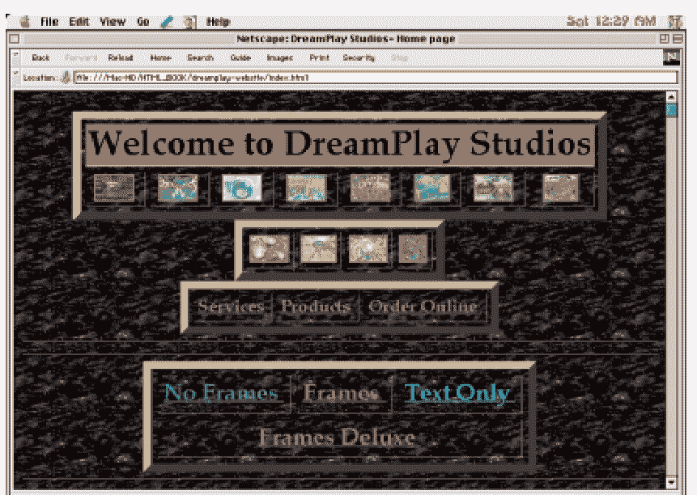

示例4-29和上一个示例之间的两个主要区别在于，**updateCookie()**函数中有额外的代码用于为Cookie设置过期日期，该日期被赋给**EXPIRES**参数。**myTime**变量使你可以轻松地输入要添加到当前时间的自己的时间量，然后用作过期日期。对于**myMonth**变量，情况同样如此。

另一个区别是使用**escape()**和**unescape()**全局函数在**encodeCookieValue()**函数中对**cookieValue**进行编码，然后在**processCookie()**函数中对**cookieValue**进行解码。使用这些全局函数的优点是，它们需要更少的输入，更加精简，并且以独特的方式对它们能处理的每个字符进行编码。缺点是，它们不能处理所有可能的字符，如果你需要以独特的方式进一步处理数据，则更难以跟踪。不过，对于大多数用途来说，它们工作得很好。

## 示例 4-29：Sample529.html

```html
<!DOCTYPE HTML PUBLIC "-//W3C//DTD HTML 3.2//EN">
<HTML>
<HEAD>
<TITLE>Sample 529 - Example 4-29     cookie EXPIRES   </TITLE>
<BASEFONT SIZE="4">
</HEAD>

<BODY>

<H2>This Cookie has an Expiration Date.</H2>

<FORM NAME="form1">
First and Last Name.                       <BR>
<INPUT TYPE='text' NAME='t1' SIZE=70>      <BR><BR>

The results are displayed in the Textarea.   <BR>
The testCookie is first and shows escaped characters.  <BR>
The cookie Value is next which is now unescaped.  <BR>

<TEXTAREA NAME="ta1" ROWS=7 COLS=70></TEXTAREA>    <BR><BR>

<INPUT TYPE='button' VALUE='Update the Cookie named testCookie'
onClick='updateCookie(this.form.t1.value);'>

</FORM>

<SCRIPT LANGUAGE="JavaScript1.2"><!--BEGIN HIDING

function encodeCookieValue(s) {

	return escape(s);
}

function updateCookie(s) {

    var cookieString1 = encodeCookieValue(s);
    var now = new Date();
    var expDate = new Date();
    // Fill in your own time numbers here.
    // day hr min sec millisec

    myTime = now.getTime() + (1 * 24 * 60 * 60 * 1000);

    //Add your month here.
    //Put 0 or delete + 2 if you don't want
    //that much time added.

    myMonth = now.getMonth() + 2;
    expDate.setTime(myTime);
    expDate.setMonth(myMonth);
    expDate.toGMTString();

    document.cookie = "testCookie=" + cookieString1 + ";EXPIRES=" + expDate;

    processCookie();

}

function processCookie() {

    var re3 = /testCookie/;
    var cookieString2 = document.cookie;

    cookieArray = cookieString2.split(";");

    for (i=0; i<cookieArray1.length; i++) {
        if (re3.test(cookieArray1[i])) {

            cookieArray2 = cookieArray1[i].split("=");

            var showStr = cookieArray1[i] + "\r";
                showStr += unescape(cookieArray2[1]) + "\r";

            document.form1.ta1.value = showStr;
        }
    }
}

//END HIDING-->
</SCRIPT>
</BODY>
</HTML>
```

有关Cookie语法的更详细信息，请参阅JavaScript指南附录C中的Netscape Cookie文档。你也可以查看：

- Cookie规范；RFC 2109，位于：http://www.ietf.org/rfc/rfc2109.txt
- 有关Cookie的更多信息位于：http://www.cookiecentral.com
- 公共域Cookie脚本位于：http://www.hidaho.com/cookies/cookies.html

## JavaScript screen 对象

screen对象由JavaScript运行时引擎自动创建，它包含只读属性，用于传达有关用户显示监视器屏幕的信息。如果你想根据每个用户监视器的功能和限制来自定义设计文档，这会很有用。例如，如果监视器只有14英寸的显示空间，你可能选择不实现基于框架的站点，或者选择替代的基于框架的配置以适应有限的屏幕空间。如果用户拥有20英寸的监视器，你可以实现一个更宽松的站点版本，以利用额外的空间。

### Screen 属性

| 属性 | 描述 |
| :--- | :--- |
| **availHeight** | 以像素为单位指定显示屏的高度，该高度减去了分配给操作系统中任何永久性或半永久性图形用户界面（GUI）特性的空间。 |
| **availWidth** | 以像素为单位指定显示屏的宽度，该宽度减去了分配给操作系统中任何永久性或半永久性图形用户界面（GUI）特性的空间。 |
| **colorDepth** | 如果正在使用调色板，则指定其位深度。如果未使用调色板，则screen.pixelDepth提供该值。 |
| **height** | 以像素为单位指定显示屏的高度。 |
| **pixelDepth** | 以每像素位数指定显示屏的分辨率。 |
| **width** | 以像素为单位指定显示屏的宽度。 |

### Screen 方法

screen对象没有方法。


 ## 示例 4-30：Sample530.html

示例 4-30 演示了如何使用 **availWidth** 和 **availHeight** 属性，根据用户显示器的可用屏幕大小以及用户当前是否使用 **toolbar** 和/或 **locationbar**，将窗口调整为所需大小。**width** 属性还用于确定要使用 **location** 属性加载哪个文档。

```
<!DOCTYPE HTML PUBLIC "-//W3C//DTD HTML 3.2//EN">
<HTML>
<HEAD>

<TITLE>Sample 530 - Example 4-30   screen Object</TITLE>

<BASEFONT SIZE="4">

<SCRIPT LANGUAGE="JavaScript1.2"><!--BEGIN HIDING

var aw = window.screen.availWidth;
var ah = window.screen.availHeight;

window.moveTo(0, 0);

	if (window.toolbar && window.locationbar)

		{ window.resizeTo(aw - 30, ah - 120); }

	else if (window.locationbar)

		{ window.resizeTo(aw - 30, ah - 100); }

		if (window.screen.width >= 832)

			{ window.location.href = "./dreamplay-website/index.html" }

		else if (window.screen.width < 832)

			{ window.location.href = "./dreamplay-website/welcome2.html" }


//END HIDING-->
</SCRIPT>

</HEAD>

<BODY>
</BODY>
</HTML>
```

## JavaScript Location 对象

### JavaScript 语法：

```
location.propertyName;
window.location.propertyName;
windowName.location.propertyName;
```

### 使用 Location 对象

`Location` 对象包含加载到给定 `window` 对象中的完整 URL。URL 由不同的组件组成，可以通过 `Location` 对象的属性单独访问。通常，您使用 `href` 属性来设置位置，即加载新文档，因为使用 `host` 或 `hostname` 等其他属性来实现此目的可能会产生错误。

要访问 `Location` 对象的属性或方法，您需要通过 `window` 对象的 `location` 属性来访问，就像这样：`window.location.hash`。例如，如果您想使用 `href` 属性将文档加载到当前窗口中：

```
window.location.href = "http://www.dreamplay.com/welcome.html";
```

您应该注意，由于默认使用当前窗口，以下代码行在功能上与上一行代码等效：

```
location.href = "http://www.dreamplay.com/welcome.html";
```

但是，如果您想在创建的 `window` 对象上调用 `Location` 对象的属性，则必须像这样通过名称引用 `window` 对象：

```
myWindow.location.href = "http://www.dreamplay.com/welcome.html";
```

### 特别说明：

需要注意的是，`Location` 对象不是 `document` 对象的属性。尽管目前 `document` 对象有一个 `location` 属性，但您不应该使用它，因为它已被弃用，转而使用 `URL` 属性，并且将在未来的版本中完全淘汰，届时将不向后兼容。

替代方案是使用 `document.URL` 属性，它是 `document.location` 属性的同义词。

# 第二部分 — JavaScript 1.2

## 第 4 章 — 对象与函数

## Location 属性

| 属性 | 说明 |
|----------|-------------|
| hash | 一个字符串，指定 URL 的锚点名称部分，包括哈希 (#) 符号。设置 **hash** 属性会使页面跳转到该锚点而不重新加载文档，但如果找不到该锚点，您将收到错误；因此，更安全的方法是使用 **href** 属性，它仅在找不到锚点时产生一个警告窗口。**hash** 属性仅适用于 HTTP 类型的 URL。 |
| host | 一个字符串，指定网络主机，由服务器名称、子域名和域名组成。这是 **hostname** 属性的子字符串。 |
| hostname | 一个字符串，指定 URL 的 host:port 部分，包括冒号。 |
| href | 一个字符串，指定完整的 URL。 |
| pathname | 一个字符串，指定 URL 的路径名部分。 |
| port | 一个字符串，指定 URL 的端口部分，即服务器使用的通信端口。 |
| protocol | 一个字符串，指定 URL 的协议部分，即 URL 的开头，包括冒号。 |
| search | 一个字符串，指定搜索查询，以问号开头，后跟由与号 (&) 分隔的 **variable=value** 对。例如：<br><br>`?x=2&y=5&z=7`<br><br>**search** 属性仅适用于 HTTP 类型的 URL。 |

## Location 方法

| 方法 | 说明 |
|--------|-------------|
| reload([forceGet]) | 将当前文档重新加载到窗口中。与 **history(0)** 相同。如果将可选的 **forceGet** 布尔值设置为 **true**，则强制服务器无条件重新加载页面。否则，用户偏好设置决定页面是从缓存重新加载还是从服务器重新加载。 |
| replace("URL") | 加载指定的 URL 以替代当前文档。 |

# 第二部分 — JavaScript 1.2

此示例通过将每个属性的值写入名为 **myWin** 的窗口的屏幕，来演示 **Location** 对象的属性。像这样在打开窗口后为其分配 URL，只是为了演示 Location 属性。

## 示例 4-31：Sample531.html

```
<!DOCTYPE HTML PUBLIC "-//W3C//DTD HTML 3.2//EN">
<HTML>
<HEAD>
<TITLE>Sample 531 - Example 4-31  Location Object Properties</TITLE>

<SCRIPT LANGUAGE="JavaScript1.2"><!--BEGIN HIDING

myWin = window.open("", "myWin");

myWin.location.href =
             "http://www.dreamplay.com/Examples/Sample1.html#anchor1?x=5&z=8%22;";

document.write("href= " + myWin.location.href + "<BR>");
document.write("protocol= " + myWin.location.protocol + "<BR>");
document.write("port= " + myWin.location.port + "<BR>");
document.write("host= " + myWin.location.host + "<BR>");
document.write("hostname= " + myWin.location.hostname + "<BR>");
document.write("pathname= " + myWin.location.pathname + "<BR>");
document.write("hash= " + myWin.location.hash + "<BR>");
document.write("search= " + myWin.location.search + "<BR>");

//END HIDING-->
</SCRIPT>

</HEAD>
<BODY>
</BODY>
</HTML>
```

上一个示例在浏览器中产生以下输出：

```
href= http://www.dreamplay.com/Examples/Sample1.html#anchor1?x=5&z=8%22;
protocol= http:
port=
host= www.dreamplay.com
hostname= www.dreamplay.com
pathname= /Examples/Sample1.html
hash= #anchor1
search= ?x=5&z=8%22;
```

此示例演示了 **Location** 对象的 `reload()` 和 `replace()` 方法。它还演示了链接中的 **javascript 协议**，代码如下：

```
<A HREF="javascript:window.location.replace(me2);"> Replace with Sample 525 </A>
```

您应该注意，当使用 `replace()` 入口方法时，**history[]** 数组中的 URL 条目也会被替换，这可以通过检查"Go"菜单来验证。

**mailto 协议** 在 Navigator 4.0 中新增了 **body** 字段，让您可以在邮件正文中包含默认消息。请注意，每个字段由与号 (&) 分隔，但电子邮件地址与所有字段之间由问号分隔。

## 示例 4-32：Sample532.html

```
<!DOCTYPE HTML PUBLIC "-//W3C//DTD HTML 3.2//EN">
<HTML>
<HEAD>
  <TITLE>Sample 532 - Example 4-32 replace and reload Methods </TITLE>
  <BASEFONT SIZE="4">

  <SCRIPT LANGUAGE="JavaScript1.2"><!--BEGIN HIDING

    me1 = "Sample524.html";
    me2 = "Sample525.html";

  //END HIDING-->
  </SCRIPT>
</HEAD>

<BODY>
  <FORM NAME="form1">

    <INPUT TYPE="button" VALUE="Replace it" onClick="window.location.replace(me1);">

    <INPUT TYPE="button" VALUE="Reload it" onClick="window.location.reload(true);">

    <A HREF="javascript:window.location.replace(me2);"> Replace with Sample 525 </A>

    <P>
      <A HREF="mailto:gorilons@erols.com?subject=Just Saying Hi&body=This is where you
put the starter message if any. If you want to include a linebreak %0A in this
message you need to use Hex Encoding %0A which in this case was a 'PercentSign
followed by 0A'."> Send feedback to us. </A>

  </FORM>

</BODY>
</HTML>
```


 ## JavaScript History 对象

## JavaScript 语法：

```
window.history;
windowName.history;
```

**History** 对象是一个数组，反映了用户在一次会话中访问过的 URL。它通过 **window** 对象的 **history** 属性进行访问。您可以通过数组中元素的 **index**（索引）号来引用特定的 URL。

## History 属性

| 属性 | 描述 |
|----------|-------------|
| current | 指定 **history**[i] 数组中的当前 URL。 |
| length | 反映 **history**[i] 数组中 URL 条目的数量。 |
| next | 指定 **history**[i] 数组中的下一个 URL。 |
| previous | 指定 **history**[i] 数组中的上一个 URL。 |

## History 方法

| 方法 | 描述 |
|--------|-------------|
| back() | 从 **history**[i] 数组中加载上一个 URL。 |
| forward() | 从 **history**[i] 数组中加载下一个 URL。 |
| go("location") | 从 **history**[i] 数组中加载一个 URL，其中 **location** 是一个指定完整或部分 URL 的字符串。 |
| go(integer) | 从 **history** 数组中加载一个 URL，其中 **integer** 是零或正/负整数，指定在 **history**[i] 数组中的相对位置。如果为零，则重新加载当前页面。如果为正数，则加载相对于当前 URL 位置偏移 **integer** 个位置的 URL。如果为负数，则偏移方向相反。 |

## History 属性的 JavaScript 语法

```
window.history.propertyName;
windowName.history.propertyName;
```

## History 方法的 JavaScript 语法：

```
window.history.methodName;
windowName.history.methodName;
```

示例 4-33 展示了 **History** 对象的 `back()` 和 `forward()` 方法如何通过 **window** 对象的 **history** 属性被调用。它还演示了 **window** 对象的 **parent** 属性。由于这两个方法用于控制加载到兄弟框架（Frame）中的 URL，因此在本示例中，您必须使用 **window** 对象的 **parent** 属性，然后指定您想要加载 URL 的框架名称，在本例中为 **Upper**。

```
parent.Upper.history.back();
parent.Upper.history.forward();
```

该示例的主要代码在名为 `Sample533.html` 的文件中。要查看此示例，请加载名为 `Sample533frameset.html` 的文件。

### 示例 4-33 第 1 部分：Sample533.html

```
<!DOCTYPE HTML PUBLIC "-//W3C//DTD HTML 3.2//EN">
<HTML>
<HEAD>
<TITLE> Sample 533 - Example 4-33 back and forward Methods of history</TITLE>
</HEAD>

<BODY>

<FORM>
Back
<INPUT TYPE="button" VALUE="&lt;&lt;Upper"
onClick="parent.Upper.history.back();">

Forward
<INPUT TYPE="button" VALUE="Upper&gt;&gt;"
onClick="parent.Upper.history.forward();">

Back
<INPUT TYPE="button" VALUE="&lt;&lt;Lower"
onClick="parent.Lower.history.back();">
```

Forward
<INPUT TYPE="button" VALUE="Lower&gt;&gt;"
onClick="parent.Lower.history.forward();">

</FORM>

These Links load in the Upper Frame.

<A HREF="Sample1.html" TARGET="Upper">      Sample 1    </A>
<A HREF="Sample2.html" TARGET="Upper">      Sample 2    </A>
<A HREF="Sample3.html" TARGET="Upper">      Sample 3    </A>  <P>

These Links load in the Lower Frame.

<A HREF="Sample4.html" TARGET="Lower">      Sample 4    </A>
<A HREF="Sample5.html" TARGET="Lower">      Sample 5    </A>
<A HREF="Sample6.html" TARGET="Lower">      Sample 6    </A>

</BODY>
</HTML>
```

### 示例 4-33 第 2 部分：Sample533Frameset.html

```
<!DOCTYPE HTML PUBLIC "-//W3C//DTD HTML 3.2//EN">
<HTML>
<HEAD>
<TITLE>Frameset for Sample 533</TITLE>
</HEAD>

<FRAMESET COLS="100,*">

      <FRAME SCROLLING="no" NAME="Left" SRC="Sample533.html">

      <FRAMESET ROWS="50%,50%">

            <FRAME SCROLLING="auto" NAME="Upper" SRC="Sample7.html">

            <FRAME SCROLLING="auto" NAME="Lower" SRC="Sample8.html">

      </FRAMESET>

</FRAMESET>

</HTML>
```

CD-ROM 中还有其他在框架上下文中使用这些方法的示例。请加载 [Sample-ETOC](Sample-ETOC) 文件夹中的 [welcomeETOC3Bkgd.html](welcomeETOC3Bkgd.html) 文件。它被用于该框架集以及该站点的深层页面中；如果您点击“Mats”链接，然后点击“Crescent Mats”或“Bainbridge Mats”，您可以看到在最初不存在于主页的框架中使用这些方法的示例。在建立自己的版本时，请记得记录好框架的名称。

## JavaScript navigator 对象

## navigator 属性的 JavaScript 语法：

```
navigator.propertyName;
```

## navigator 方法的 JavaScript 语法：

```
navigator.methodName;
```

`navigator` 对象包含关于客户端当前使用的浏览器的数据，并具有可以访问这些数据的属性。此外，它有两个属性：`mimeTypes[i]` 数组和 `plugins[i]` 数组，分别包含当前支持的 MIME 类型和当前配置的插件信息。

所有这些属性都是只读的。`navigator` 对象仅由 JavaScript 引擎在运行时创建，它不是 `window` 对象的后代。

## Navigator 属性

| 属性 | 描述 |
| :--- | :--- |
| **appCodeName** | 指定浏览器的代码名称。 |
| **appName** | 指定浏览器的名称。 |
| **appVersion** | 指定 Navigator 的版本号。 |
| **language** | 指定显示内容的语言翻译，例如 English。 |
| **mimeTypes[i]** | 反映用户支持的每种 MIME 类型的数组。 |
| **platform** | 指定 Navigator 编译的目标机器类型（而非操作系统）。可能的值包括：Mac68k, MacPPC, Win16, Win32。 |
| **plugins[i]** | 反映用户当前配置的每个插件的数组。 |
| **userAgent** | 指定 User Agent 请求头。 |

## Navigator 方法

| 方法 | 描述 |
| --- | --- |
| javaEnabled() | 如果启用了 Java，则返回 true；否则返回 false。 |
| plugins.refresh(false) | 如果提供 false，则使新安装的插件可用。 |
| plugins.refresh(true) | 如果提供 true，则刷新新安装的插件，并重新加载所有包含 EMBED 元素的打开文档。 |
| preference("prefName") | 返回 prefName 首选项的值。 |
| preference("prefName", setValue) | 使用 setValue 参数设置 prefName 首选项的值并返回该值。这必须在签名脚本（Signed Script）中设置。 |

## 动态创建框架

本示例演示了如何使用 **navigator** 对象的 **appName** 和 **appVersion** 属性来确定要加载到页面中的框架集（Frameset）。您可以使用这些属性返回的值来判断客户端使用的浏览器是否能解析框架，以及是否可以实现 Navigator 4.0 的 **window** 对象方法和属性。它使用 **document.write()** 方法，根据之前从用户浏览器和显示器收集的数据动态创建这些框架。

**screen** 对象的 **width** 属性用于确定用户显示器的大小，并相应地渲染框架集。如果用户在首选项中禁用了 JavaScript，则会生成标准的 HTML 框架集渲染。最后，作为最后的预防措施，标准的 HTML 框架集和 NOFRAMES 元素被包裹在一个 NOSCRIPT 元素内部。这个过程非常直接，应该能为您自己的页面提供一些灵感。

CD-ROM 上有一个名为 [Sample534-NavBUGGED.html](Sample534-NavBUGGED.html) 的并行文件。它具有一些在 Navigator 4.0 版本中可以运行的微小附加功能，但出于某种未知原因，它在 Navigator 4.5 版本中会出现 bug。等 Navigator 5.0 发布时请检查它是否能正常工作。[Sample534.html](Sample534.html) 中的所有代码都是非常稳定的。


## 第 4 章 -- 对象与函数

### 示例 4-34: Sample534.html

```html
<!DOCTYPE HTML PUBLIC "-//W3C//DTD HTML 3.2//EN">
<HTML>
<HEAD>
<TITLE>Sample 534 - Example 4-34     navigator Object plus </TITLE>
<BASEFONT SIZE="4">

<SCRIPT LANGUAGE="JavaScript1.2"><!--BEGIN HIDING

var leftP = "../dreamplay-website/DP-toc1.html";
var viewP = "../dreamplay-website/welcome2.html";
var upperP = "../dreamplay-website/BANNER1.html";
var leftP2 = "../dreamplay-website/DP-toc2.html";
var aw = window.screen.availWidth;
var ah = window.screen.availHeight;

var brN = navigator.appName;
var ie = "Microsoft Internet Explorer";
var brV = parseFloat(navigator.appVersion);

if (brN == "Netscape"  &&  brV >= 4.0) {

    window.moveTo(0, 0);

    if (window.toolbar  &&  window.locationbar)
        { window.resizeTo(aw - 30, ah - 120); }

    else if (window.locationbar)
        { window.resizeTo(aw - 30, ah - 100); }

    if (window.screen.width >= 832) {

        document.writeln('<FRAMESET COLS="200,*">')
        document.writeln('    <FRAME NAME="toc-icons" SRC="' + leftP + '" ')
        document.writeln('        SCROLLING=AUTO MARGINHEIGHT=3 MARGINWIDTH=3>')

        document.writeln('    <FRAMESET ROWS="80,*">')
        document.writeln('        <FRAME NAME="banner" SRC="' + upperP + '" ')
        document.writeln('            SCROLLING=AUTO MARGINHEIGHT=5 MARGINWIDTH=5>')

        document.writeln('        <FRAME NAME="view" SRC="' + viewP + '" ')
        document.writeln('            SCROLLING=AUTO MARGINHEIGHT=10 MARGINWIDTH=10>')
        document.writeln('    </FRAMESET>')
        document.writeln('</FRAMESET>')
    }
    else {

        document.writeln('<FRAMESET COLS="150,*">')
        document.writeln('    <FRAME NAME="toc-icons" SRC="' + leftP2 + '" ')
        document.writeln('        SCROLLING=AUTO MARGINHEIGHT=1 MARGINWIDTH=1>')

        document.writeln('    <FRAME NAME="view" SRC="' + viewP + '" ')
        document.writeln('        SCROLLING=AUTO MARGINHEIGHT=5 MARGINWIDTH=5>')
        document.writeln('</FRAMESET>')
    }
}

// *****************************************************

else if ((brN == "Netscape" || brN == ie) && brV >= 2.0) {

    document.writeln('<FRAMESET COLS="150,*">')
    document.writeln(' <FRAME NAME="toc-icons" SRC="' + leftP2 + '" ')
    document.writeln(' SCROLLING=AUTO MARGINHEIGHT=1 MARGINWIDTH=1>')

    document.writeln(' <FRAME NAME="view" SRC="' + viewP + '" ')
    document.writeln(' SCROLLING=AUTO MARGINHEIGHT=5 MARGINWIDTH=5>')
    document.writeln('</FRAMESET>')
}

else if ((brN == "Netscape" || brN == ie) && brV < 2.0) {

    document.write('If you do not have access to a browser that ')
    document.write('supports frames, you can view the ')
    document.write('non-frames version of the page by opening')
    document.write('<A HREF="../dreamplay-website/welcome2.html">')
    document.write('the alternate homepage.</A>.')
}

// END HIDING-->
</SCRIPT>
</HEAD>

<!-- ***************************************************** -->

<!-- IF THE USER HAS JAVASCRIPT DISABLED, DISPLAY DEFAULT FRAMESET -->

<NOSCRIPT>

<FRAMESET COLS="150,*">

    <FRAME NAME="toc-icons" SRC="../dreamplay-website/DP-toc1.html"
           SCROLLING=AUTO MARGINHEIGHT=1 MARGINWIDTH=1>

    <FRAME NAME="view" SRC="../dreamplay-website/welcome2.html"
           SCROLLING=AUTO MARGINHEIGHT=3 MARGINWIDTH=3>

    <NOFRAMES>

To view this page, your browser must support frames.

<A HREF="http://home.netscape.com/comprod/mirror/index.html">Download</A>
Netscape Navigator 2.0 or later for frames support.

If you do not have access to a browser that supports frames,
you can view the non-frames version of the page by opening
<A HREF="../dreamplay-website/welcome2.html">the alternate homepage.</A>.

    </NOFRAMES>

</FRAMESET>
</NOSCRIPT>
</HTML>
```

### JavaScript Number 核心对象

### JavaScript 语法：

```javascript
new Number(value);
numberName = new Number(value);
```

要创建一个 **Number** 对象，请使用关键字 **new** 以及 Number 构造函数，其中 **value** 是该对象的数值。这是一个用途有限的对象，主要在需要使用该对象提供的特殊数学属性时才使用。

### Number 属性

| 属性 | 描述 |
| --- | --- |
| **MAX_VALUE** | 值为 JavaScript 能表示的最大数，约为 1.79E+308。它是 Number 的一个只读静态属性，始终以 **Number.MAX_VALUE** 的形式调用，而不是作为你创建的 Number 对象的属性。更大的数值将溢出为 Infinity。 |
| **MIN_VALUE** | 值为 JavaScript 能表示的趋近于零的最小数，约为 2.22E-308。请注意，这并不是最小的负数。它是 Number 的一个只读静态属性，始终以 **Number.MIN_VALUE** 的形式调用。更小的数值将溢出为零。 |
| **NaN** | 值为 NaN，代表 Not-a-Number（非数字），这是一个不加引号的字面量。它不等于任何数字，甚至不等于它自身。你不能将 NaN 作为条件语句中的测试参数，但可以使用全局函数 **isNaN(value)** 来测试某个值是数字还是 NaN。 |
| **NEGATIVE_INFINITY** | 值为 "-Infinity"，代表并表现为数学上的负无穷大。在溢出时返回。它是 Number 的一个只读静态属性，始终以 **Number.NEGATIVE_INFINITY** 的形式调用。 |
| **POSITIVE_INFINITY** | 值为 "Infinity"，代表并表现为数学上的正无穷大。在溢出时返回。它是 Number 的一个只读静态属性，始终以 **Number.POSITIVE_INFINITY** 的形式调用。 |
| **prototype** | 允许你为 **Number** 对象创建自定义属性。 |

### Number 方法

| 方法 | 描述 |
| --- | --- |
| toString([radix]) | 将 **Number** 对象转换为字符串并返回该字符串。可选参数 **radix** 指定一个 2 到 16 之间的数字，作为转换的基数。如果未指定，默认值为 10。该方法不能用于数值字面量。 |

此示例演示了 **Number** 对象的一些属性。

### 示例 4-35: Sample535.html

```html
<!DOCTYPE HTML PUBLIC "-//W3C//DTD HTML 3.2//EN">
<HTML>
<HEAD>
<TITLE>Sample 535 - Example 4-35     Number Object  </TITLE>

<SCRIPT LANGUAGE="JavaScript1.2"><!--BEGIN HIDING

myNumber1 = new Number(55);
myNumber2 = Number.MAX_VALUE * 10;
myNumber3 = Number.MIN_VALUE / 100000000000000;
myNumber4 = Number.MIN_VALUE / 10000000000000000;
myNumber5 = Number.MAX_VALUE;
myNumber6 = Number.MIN_VALUE

	document.write("myNumber1 = " + myNumber1 + "<BR>");
	document.write("myNumber2 = " + myNumber2 + "<BR>");
	document.write("myNumber3 = " + myNumber3 + "<BR>");
	document.write("myNumber4 = " + myNumber4 + "<BR>");
	document.write("myNumber5 = " + myNumber5 + "<BR>");
	document.write("myNumber6 = " + myNumber6 + "<BR>");

//END HIDING-->
</SCRIPT>
</HEAD>

<BODY>
<P>
Note that on the Macintosh platform you can create numbers that are smaller than
<B>Number.MIN_VALUE</B> as it approaches zero.  The values for <B>myNumber3</B> and
<B>myNumber4</B> demonstrates this.  Theoretically any number larger than 1 that
divides Number.MIN_VALUE should cause the result to overflow to zero, but look at
how large a number it actually takes to cause the overflow.(10000000000000000)
</P>
</BODY>
</HTML>
```

## JavaScript select 对象

### JavaScript 语法：

```javascript
document.formName.selectName;
document.formName.elements[index];
```

**select** 对象是一个可由用户选择的选项列表。根据配置，它可以是一个可滚动的列表或一个弹出菜单。有关 SELECT 元素及其属性定义的更多信息，请参阅 CD-ROM 上的 HTML 4.0 指南，或仅参阅第 1011 页附录 A 的语法。示例请参阅索引。

**select** 对象是 **form** 对象的属性，而 **options[i]** 数组是 **select** 对象的属性。不能使用 JavaScript 创建 **select** 对象。你必须使用 HTML 语法来创建 **select** 对象以及任何可选的事件处理程序。随后，JavaScript 解释器会自动创建 **select** 对象，并将其与该 SELECT 元素相关联。你可以使用 **document.write()** 方法直接在 JavaScript 脚本中创建 SELECT 元素。

当 JavaScript 解释器从 HTML 代码创建 **select** 对象时，它还会创建 **options[i]** 数组作为 **select** 对象的属性。**options[i]** 数组的每个元素都包含一个反映 HTML OPTION 元素的 **option** 对象。它们按源代码顺序加载到数组中。然后，你可以通过 **options[i]** 数组中的 **index** 编号来访问单个 **option** 对象。

**option** 对象本身是 *只读* 属性，这意味着你不能通过为其分配不同的值来更改 **option**。然而，你可以更改 **option** 的 **text** 属性的值，这将导致浏览器中显示新的文本字符串。下一节将详细介绍 **options[i]** 数组。有关 **Array** 对象的更多信息，请参阅第 7 章。

由于 **select** 和 **option** 对象在对象层级结构中处于非常底层的位置，使用代码访问它们（即引用它们及其属性和方法）可能会非常麻烦。因此，通常建议为这些对象及其属性的不同方面设置变量，以提高代码的可读性。示例请参阅第 501 页和 650-657 页。

### Select 事件处理程序

- onBlur
- onChange
- onFocus


## Select 属性的 JavaScript 语法：

```
document.formName.selectName.propertyName;
document.formName.elements[index].propertyName;
```

### Select 属性

| 属性 | 描述 |
|----------|-------------|
| form | 一个只读属性，反映包含当前 **select** 对象的 **form** 对象。 |
| length | 反映 **options[i]** 数组中 **option** 对象元素的数量。 |
| name | 反映 **select** 对象的 NAME 属性。 |
| options[i] | 一个数组，每个数组元素反映一个 **option** 对象。 |
| selectedIndex | 一个整数，指定当前选中的 **option** 对象的从零开始的索引。如果选择了多个 **option** 对象，则反映列表中的第一个。你可以设置此属性，从而使不同的 **option** 对象被选中。 |
| type | 如果对象是 **select** 对象，则 **type** 的值为 "**select-one**"。如果对象是 **select** 对象且 HTML SELECT 元素中包含布尔值 MULTIPLE 属性，则 **type** 的值为 "**select-multiple**"。这是一个只读属性。 |

## Select 方法的 JavaScript 语法：

```
document.formName.selectName.methodName(parameters)
document.formName.elements[index].methodName(parameters)
```

### Select 方法

| 方法 | 描述 |
|--------|-------------|
| blur() | 移除 **select** 对象的焦点。 |
| focus() | 将焦点交给 **select** 对象。 |
| handleEvent() | 调用指定事件的事件处理器。 |

464 第二部分 — JavaScript 1.2

## JavaScript options[i] 数组

### JavaScript 语法：

```
document.formName.selectName.optionName;
document.formName.selectName.options[index1];
document.formName.elements[index2].options[index1]
```

**options[i]** 数组是 **select** 对象的一个属性。它由 JavaScript 解释器根据 HTML 自动创建，使得每个 HTML OPTION 元素成为 **options[i]** 数组中一个独立数组元素中的 **option** 对象。

## 删除一个 option 对象

要从 **select** 对象中删除一个 **option** 对象，请使用以下语法：

### JavaScript 语法：

```
document.formName.selectName.options[index1] = null;
```

## 删除多个 option 对象

要从 **select** 对象的 **options** 数组末尾删除多个 **option** 对象，请使用以下语法，通过指定一个**整数**来截断数组：

### JavaScript 语法：

```
document.formName.selectName.options.length = integer;
```

### options[i] 数组属性的 JavaScript 语法：

```
document.formName.selectName.optionName.propertyName;
document.formName.selectName.options[index1].propertyName;
document.formName.elements[index2].options[index1].propertyName;
```

## options[i] 数组属性

| 属性 | 描述 |
| :--- | :--- |
| **length** | 反映数组中选项的数量。 |
| **selectedIndex** | 反映当前选定选项的从零开始的索引号。 |

## 第 4 章 — 对象与函数

### options[i] 数组元素属性

| 属性 | 描述 |
| :--- | :--- |
| `defaultSelected` | 反映 `option` 是否具有 SELECTED 属性。如果具有，则值为 `true`，否则为 `false`。 |
| `index` | 反映 `option` 的从零开始的 `index` 编号。 |
| `selected` | 反映 `option` 当前是否被选中。这是一个布尔属性，如果 `option` 被选中则为 `true`，否则为 `false`。 |
| `text` | 反映 `option` 的 VALUE 属性中包含的文本字符串。 |
| `value` | 反映 `option` 当前的 VALUE 属性，如果提交表单，该值将作为 VALUE=value 对返回给服务器。 |

## JavaScript option 对象

`option` 对象通过 `Option()` 构造函数创建。

要创建一个新的 `option` 对象，请使用以下语法：

### JavaScript 语法：

```
new Option(text, value, defaultSelected, selected);
optionName = new Option(text, value, defaultSelected, selected);
```

### 参数定义：

| 参数 | 描述 |
| :--- | :--- |
| `text` | 指定要显示的文本字符串的参数，该字符串与 HTML 代码中 OPTION 元素的起始标签和结束标签之间出现的文本相同。 |
| `value` | 指定 VALUE 属性值的参数。 |
| `defaultSelected` | 可选参数，指定 `option` 是否初始被选中。 |
| `selected`selected` | 可选参数，指定 `option` 当前是否被选中。 |
| `optionName` | 分配给 `option` 对象的变量名。 |

466 **第二部分 — JavaScript 1.2**

## 将 option 对象添加到 select 对象中

要将 **option** 对象添加到 **select** 对象中，请使用以下语法：

### JavaScript 语法：

```
document.formName.selectName.options[indexN] = optionName;
```

### option 对象属性

| 属性 | 描述 |
| --- | --- |
| defaultSelected | 指定 **option** 的初始选择状态，如果被选中则值为 **true**，否则为 **false**。 |
| index | 指定 **option** 的从零开始的 **index** 编号。 |
| prototype | 允许你为 **option** 对象创建新属性。 |
| selected | 指定 **option** 的当前选择状态。这是一个布尔属性，如果 **option** 被选中则值为 **true**，否则为 **false**。 |
| text | 为 **option** 指定一个在 **select** 对象中显示的文本字符串。 |
| value | 指定 **option** 当前的 VALUE 属性，如果提交表单，该值将作为 Value=value 对返回给服务器。 |

以下是使用了 **select** 对象的示例文件列表。如果你想将示例与书中的代码进行交叉参考，请参阅第 1039 页起的附录 C，查看示例的页码。

| 示例文件名，行号 | 示例用法 |
| --- | --- |
| Sample71-SimpleForm.html, line 63: | `<SELECT NAME="UPSshippingoptions" SIZE=1>` |
| Sample71-OrderForm.html, line 147: | `<SELECT NAME="creditcardtype" SIZE=1>` |
| Sample73.html, line 15: | `<SELECT NAME="select2" SIZE=3 MULTIPLE>` |
| Sample724.html, line 23: | `<SELECT NAME="getBackColor" SIZE="1" onChange="changeEverything(); return false;">` |

### 新的 JavaScript 核心函数

针对 Navigator 4.0 的 JavaScript 1.2 有两个新的核心函数。它们是 **Number** 函数和 **String** 函数。你也可以将这些函数视为全局函数，它们不与任何特定对象相关联，而是 JavaScript 语言本身的一部分。请确保不要将它们与对应的 Number 对象和 **String** 对象混淆。

### JavaScript Number 核心函数

#### JavaScript 语法：

```
Number(x);
```

**Number** 函数是一个核心函数，它将 **x** 参数（可以是任何对象）转换为数字。如果 **x** 对象是一个无法转换为有效数字的字符串，则返回 **NaN**。例如，以下脚本：

#### 微型示例：

```
<SCRIPT LANGUAGE="JavaScript1.2">

today = new Date();
dateConversion = Number(today);

myMinutes = today.getMinutes();
minutesConversion = Number(myMinutes);

document.write("dateConversion in milliseconds = " + dateConversion + "<BR>");
document.write("minutesConversion = " + minutesConversion + "<BR>");

</SCRIPT>
```

在 1998 年 2 月 16 日凌晨 3:22，浏览器中的输出如下：

```
dateConversion in milliseconds = 887617357173
minutesConversion = 22
```

## JavaScript String 核心函数

### JavaScript 语法：

```
String(x);
```

String 函数是一个核心函数，它将 x 参数（可以是任何对象）转换为字符串。

本示例显示了几个转换为字符串的对象的输出结果。

### 示例 4-36: Sample536.html

```html
<!DOCTYPE HTML PUBLIC "-//W3C//DTD HTML 3.2//EN">
<HTML>
<HEAD>
<TITLE>Sample 536 - Example 4-36 String Function </TITLE>
</HEAD>

<BODY>
<H2>Sample 536</H2>

<LAYER ID="L1" LEFT="20" TOP="370" HEIGHT=400 WIDTH=400 BGCOLOR="cyan">
Test Layer </LAYER>

<SCRIPT LANGUAGE="JavaScript1.2"><!-- BEGIN HIDING

today = new Date();
todayString = String(today);

dateConversion = Number(today);
dateString = String(dateConversion);

myWindow = String(window);
myLayer = String(document.L1);

document.write("dateConversion = " + dateConversion + "<BR>");
document.write("todayString = " + todayString + "<BR>");
document.write("dateString = " + dateString + "<P>");
document.write("myWindow = " + myWindow + "<P>");
document.write("myLayer = " + myLayer + "<P>");

//END HIDING-->
</SCRIPT>

</BODY>
</HTML>
```


之前的示例产生了以下浏览器输出：

## 示例 536

```
dateConversion = 887619422650
todayString = Mon Feb 16 03:57:02 1998
dateString = 887619422650

myWindow = [length:undefined, frames:undefined, parent:undefined, top:undefined,
self:undefined, name:undefined, status:undefined, defaultStatus:undefined,
opener:undefined, closed:undefined, innerWidth:undefined, innerHeight:undefined,
outerWidth:undefined, outerHeight:undefined, screenX:undefined, screenY:undefined,
pageXOffset:undefined, pageYOffset:undefined, secure:undefined, frameRate:undefined,
offscreenBuffering:undefined, document: document, history:,
location:file:///Mac-HD/HTML_BOOK/Sample536.html, crypto:{},
menubar:[visible:undefined], toolbar:[visible:undefined], locationbar:[visible:undefined],
personalbar:[visible:undefined], statusBar:[visible:undefined],
scrollbars:[visible:undefined], today:Mon Feb 16 03:57:02 1998,
todayString:"Mon Feb 16 03:57:02 1998",
dateConversion:887619422650, dateString:"887619422650"]

myLayer = [clip:[left:undefined, top:undefined, right:undefined, bottom:undefined,
height:undefined, width:undefined], document:]
```

## 第二部分

## JavaScript 1.2

# 第 5 章

## 语句与运算符

# 第 5 章
## 语句与运算符

## 目录

- **JavaScript 语句** 473
  
  - 5.1) 什么是 JavaScript 语句 473  
  - 5.2) 语句的分类 473  
  - 5.3) 所有 JavaScript 语句对照表 474  
- **条件语句** 475  
  - 5.4) JavaScript `if ()` 语句 475  
  - 5.5) JavaScript `if ()...else` 语句 477  
  - 5.6) 嵌套 `if ()` 语句 478  
  - 5.7) 嵌套 `if ()...else` 语句 479  
  - 5.8) `() ?:` 条件运算符语句 480  
  - 5.9) `switch ()` 语句 481  
- **循环语句** 484  
  - 5.10) `for ()` 语句 484  
  - 5.11) `while ()` 语句 486  
  - 5.12) `do while ()` 语句 488  
  - 5.13) 标签 ` : ` 语句 490  
  - 5.14) `break` 语句 491  
  - 5.15) `continue` 语句 494  
- **对象操作语句** 498  
  - 5.16) `for...in` 语句 498  
  - 5.17) `with ()` 语句 500  
  - 5.18) `<STYLE>` 元素中的 `with ()` 语句 502  
  - 5.19) `var` 语句 503  
  - 5.20) `function` 语句 505  
  - 5.21) `return` 语句 506  
  - 5.22) `export` 语句 506  
  - 5.23) `import` 语句 507  
  - 5.24) `delete` 语句 508  
- **注释语句** 508  
  - 5.25) 单行和多行注释语句 508  
- **JavaScript 运算符** 509  
  - 5.26) 什么是 JavaScript 运算符？ 509  
  - 5.27) 运算符的分类 510  
  - 5.28) 特殊运算符 510  
  - 5.29) 关键字 `new` 运算符 510  
  - 5.30) 关键字 `this` 运算符 510  
  - 5.31) 关键字 `typeof` 运算符 512  
  - 5.32) 关键字 `void` 运算符 514  
  - 5.33) `( , )` 逗号运算符 514  
  - 5.34) 比较运算符 515  
  - 5.35) 算术运算符 515  
  - 5.36) 字符串运算符 516  
  - 5.37) 逻辑运算符 516  
  - 5.38) 赋值运算符 517  
  - 5.39) 位运算符 517  
- **JavaScript 表达式** 518

### JavaScript 语句

### 什么是 JavaScript 语句？

JavaScript 语句是“幕后的动作”，交互性和强大的脚本潜力就潜伏在你的想象力边缘。你研究得越深，就会发现越多并非显而易见的语句固有能力。语句的主要用途之一是让你能够编写脚本：如果某个条件为真则执行一个动作，如果该条件为假则执行另一个动作。循环语句允许你在条件为真时重复执行相同的动作。在许多情况下，该动作会迭代遍历数组中的所有元素。

### JavaScript 语句的分类

JavaScript 语句可以按以下方式分类：

| 条件语句 | 循环语句 | 对象操作语句 | 注释语句 |
| :--- | :--- | :--- | :--- |
| `if`<br>`if...else`<br>`switch`<br>`? :` | `for`<br>`while`<br>`do while`<br>`labeled break`<br>`continue` | `for...in`<br>`with`<br>`var`<br>`function`<br>`return`<br>`export`<br>`import`<br>`delete` | `//单行注释`<br>`/*多行 ... 注释*/` |

以下三种语句没有正式名称，因此通常不被这样列出，但它们仍然是语句。

| 语句 | 简明定义 | 微示例 |
| :--- | :--- | :--- |
| 属性访问 | 访问对象的属性 | `myArray[1].length` |
| 方法调用 | 调用对象上的方法 | `window.open()` |
| 赋值 | 将表达式的值赋给变量 | `a = b + c` |

### 所有 JavaScript 语句对照表

| 语句 | 简明定义 |
|-----------|------------------|
| break | 终止包含它的当前 **while** 或 **for** 循环，并将程序控制权转移到终止循环紧随其后的语句。 |
| comment | 由作者编写的解释性注释，被 JavaScript 解释器忽略。 |
| continue | 在 **while** 循环中停止语句块并跳回条件判断。在 **for** 循环中停止语句块并跳回更新表达式。 |
| delete | 销毁对象的属性或数组中的元素。 |
| do...while | 只要测试条件为真，就执行前面的语句块；由于条件在后，该块至少会被执行一次。 |
| export | 将签名脚本中的函数、对象和属性提供给其他签名或非签名脚本。 |
| for | 循环语句，根据其三个可选表达式（位于圆括号内并由分号分隔）的参数来执行一个语句块。 |
| for...in | 对象操作语句，使用指定变量为对象的每个属性执行一个语句块。 |
| function | 定义由逗号分隔、圆括号包裹的参数以及由花括号包裹的命名语句块的语句，调用时作为整体执行。参数可以是字符串、数字或对象。参见第 371-385, 505 页。 |
| if | 如果指定条件为真或表达式求值为真，则执行一次语句块。如果为假，则不执行任何操作。 |
| if...else | 如果指定条件为真或表达式求值为真，则执行一次语句块。如果条件为假，则执行另一个替代语句块。 |
| ? : | 条件运算符语句。**if ()...else** 的简写。 |
| import | 脚本用于从之前已导出这些内容的签名脚本中导入函数、对象和属性的语句。 |
| labeled | 一个命名语句，其名称与语句块由冒号分隔。**break** 或 **continue** 语句使用此名称作为程序继续执行语句的跳转点。 |
| return | 指定由函数调用返回值的语句。 |
| switch | 条件语句，根据求值的表达式是否与 case 标签的值匹配来执行替代语句。 |
| var | 声明变量的语句，可选地为其赋值。 |
| while | 循环语句，只要判定表达式求值为真，就执行一个语句块。 |
| with | 确定一个默认对象，以便将语句块应用于该对象的语句。 |

## 第 5 章 — 语句与运算符 475

## 条件语句

### JavaScript if () 语句

JavaScript 语法：

```
if (condition) {
    statementsIfTrue;
}
```

### 参数定义：

好吧，从技术上讲，并没有单独的 `if ()` 语句，因为严格来说，所有这些都是 `if ()...else` 语句，只是省略了可选的 `else` 部分。为了教学方便，这样开始会更容易，而且在实际使用中 `else` 经常被省略。

如果圆括号内的条件求值为真，`if ()` 语句将执行语法中由 `statementsIfTrue` 指定并包含在花括号内的语句块。条件可以是一个表达式，如 `(x >= 5)` 或 `(booleanTest)`。

你甚至可以像这样测试页面中是否存在某个对象：

```
(myLayer1)
```

在这种情况下，只要文档中存在名为 `myLayer1` 的图层（Layer），语句就会执行。

你还可以像这样测试多个条件：

```
if (x >= 0 && x <= 77)
```

或者像这样：

```
if (myLayer.top > 0 || myLayer.clip.right < myLayer.width)
```

如果条件求值为假，则语句块不执行，程序控制权返回到 `if ()` 语句之后的语句。如果你只有一个语句需要执行，可以省略花括号。如果你想在同一行编写多个语句，需要用分号分隔它们。在其他情况下，分号分隔语句是可选的。只需选择一种方式并坚持使用，以便于调试代码。


## 第二部分 — JavaScript 1.2

这是一个简单的示例：如果变量 x 小于或等于 4，则会导致条件评估为 true，从而执行 `if ()` 语句中更改文档背景颜色的语句。由于只有一个可执行语句，`if()` 语句的大括号是可选的，在本例中被省略了。如果大括号能帮助你阅读代码，你可以使用它们。但请记住，对于函数声明，大括号始终是必需的。

```javascript
function changeColor() {
    if (x <= 4)
        document.bgColor = 'purple';
}
```

这是一个简单的示例：如果布尔变量 **booleanTest** 评估为 true**，则执行 `if ()` 语句中的语句块：

```javascript
function changeColor() {
    if (booleanTest) {
        document.myLayer1.clip.width = 500;
        document.myLayer1.clip.height = 400;
        document.myLayer1.visibility = 'show';
        document.myLayer2.visibility = 'hide';
    }
}
```

在这里，必须使 **clip.right** 属性小于 800 且名为 **layer1** 的层的 **clip.bottom** 属性小于 400，**condition**（条件）才会评估为 true。

```javascript
function LargeView3() {
    if (layer1.clip.right < 800 && layer1.clip.bottom < 400) {
        document.layer1.moveTo(20, 10);
        document.layer1.resizeBy(8, 4);
        document.layer1.moveAbove(document.layer2);
    }
}
```

你还可以通过使用**逻辑非**运算符 ! 来测试一个为 false 的**condition**，如下所示：

### JavaScript 语法：

```javascript
if (! condition) {
    statementsIfFalse;
}
```

## 第 5 章 — 语句与运算符

### JavaScript if ()...else 语句

**if ()...else** 语句用于测试一个**condition**（条件），如果该**condition**是一个评估为 true 的**Expression**（表达式），那么包含在大括号内的 **statementsIfTrue** 语句块将被执行。如果 **condition** 评估为 false，那么紧跟在 **else** 后的 **statementsIfFalse** 语句块将被执行。这两个语句块中的任何一个都可以包含进一步嵌套的 **if ()...else** 语句，这种可能性将在接下来的章节中介绍。你将在自己的代码中大量使用 **if ()...else** 语句。

### JavaScript 语法：

```javascript
if (condition) {
    statementsIfTrue;
}
else {
    statementsIfFalse;
}
```

### 微型示例：

在这个微型示例中，如果 **myBoolean** 变量为 true，则更改名为 **myLayer1** 的层。如果 **myBoolean** 变量为 false，则更改另一个名为 **myOtherLayer2** 的层。显然，还会有其他 JavaScript 代码在后台运行以更改 **myBoolean** 变量的值，从而使 **changeColor()** 函数具有实际意义。

```javascript
function changeColor() {
    if (myBoolean)  {
        document.myLayer1.bgColor = 'purple';
        document.myLayer1.visibility = 'show';
    }
    else  {
        document.myOtherLayer2.bgColor = 'green';
        document.myOtherLayer2.visibility = 'show';
    }
}
```

### 嵌套 if () 语句

### JavaScript 语法：

```javascript
if (condition) {
    statementsIfTrue;

    if (condition2) {
        statementsIfTrue2;
    }
}
```

### 参数定义：

有时，在一个 `if ()` 语句中有效地测试两个 **conditions** 既不直观，也不方便，甚至是不可能的，因此实际的解决方案是将一个 `if ()` 嵌套在另一个之内。这使得程序首先测试第一个 **condition**，如果该 **Expression** 评估为 true，则继续执行相应的语句，在本例中，这些语句包含第二个 `if ()` 语句，该语句将继续测试第二个 **condition2**。如果第二个 **condition2** 同样为 true，则执行 **statementsIfTrue2** 语句块。如果两个 **conditions** 中的任何一个评估为 false，脚本将跳出 `if ()` 并继续执行紧跟在 `if ()` 之后的下一位置。

在这种情况下，第二个 `if ()` 语句充当了当第一个 **condition** 评估为 true 时要执行的语句块。你也可以在第二个 `if ()` 语句之前或之后放置其他要执行的语句，就像在接下来的嵌套 `if ()...else` 语句部分的第二个示例中那样。

### 微型示例：

在本例中，如果两个布尔变量都为 true，则使用 **document.write**() 方法写入文本字符串。

```javascript
if (badHairDayBoolean)  {
    if (seriousHangoverBoolean)  {
        document.write("Reality Bytes, Stay in Bed Today");
    }
}
```

通常，使用 (&&) 来编写此类代码被认为更好的编程风格，但在测试按键事件（Key Events）和修饰键（Modifiers Keys）时，有时很难这样做：

```javascript
if (badHairDayBoolean  &&  seriousHangoverBoolean)
    { document.write("Reality Bytes, Stay in Bed Today"); }
```

### 嵌套 if ()...else 语句

### JavaScript 语法：

```javascript
if (condition) {
    statementsIfTrue;

    if (condition2) {
        statementsIfTrue2;
    }
    else {
        statementsIfFalse2;
    }
} else {
    statementsIfFalse;
}
```

### 参数定义：

当你处理嵌套的 `if ()` 或 `if ()...else` 语句时，重要的是要知道它们可以是任何组合的嵌套或多次嵌套的 `if ()` 或 `if ()...else` 语句，最多可以有 255 个。如果你在一个 `if ()...else` 语句内部嵌套了另一个 `if ()...else` 语句，其运作流程如下。

如果第一个 `condition` 评估为 true，则执行接下来的语句块。如果这些语句之一是 `if ()...else` 语句，那么将测试其 `condition2`，如果评估为 true，则执行 `statementsIfTrue2` 语句块，否则执行 `statementsIfFalse2` 语句块。

如果第一个 `condition` 评估为 false，则脚本跳转到 `else` 并执行 `statementsIfFalse` 语句块。

本书使用 `if ()` 作为 `if ()...else` 语句的简写，这是传统做法，也可以节省作者的打字量。

### 微型示例：

在以下示例中，如果布尔变量 `myBoolean1` 为 true，则 `document` 的背景颜色改为黄色。如果 `myBoolean1` 为 false，则背景颜色改为红色。

如果布尔变量 `myBoolean1` 为 true 且 `x 大于或等于 5`，则 `myLayer1` 的背景颜色改为橄榄色。如果布尔变量 `myBoolean1` 为 true 且 `x 小于 5`，则 `myLayer1` 的背景颜色改为黑色。

```javascript
if (myBoolean1) {
    document.bgColor = 'yellow';

    if (x >= 5) {
        document.myLayer1.bgColor = 'olive';
    }
    else {
        document.myLayer1.bgColor = 'black';
    }
} else {
    document.bgColor = 'red';
}
```

### () ? : 条件运算符语句

### JavaScript 语法：

```javascript
evaluatedResult = (condition) ? expression1 : expression2
```

### 参数定义：

这被非正式地称为“条件运算符语句”，基本上是 `if ()` 语句的简写版本。如果条件为 true，则返回 expression1 并赋值给 evaluatedResult 变量。如果条件为 false，则返回 expression2 并赋值给 evaluatedResult 变量。条件可以是一个评估为 true 或 false 的表达式。expression1 和 expression2 可以是任何类型的值，包括但不限于：字符串、变量、数字和对象。

两个表达式由冒号分隔。条件可以选择性地放在括号内，但建议使用括号。

### 微型示例：

在以下微型示例中，如果 wonTheLottery 为 true，则将文本字符串 "congratulations" 赋值给 myString 变量。如果 wonTheLottery 为 false，则将文本字符串 'condolences' 赋值给 myString 变量。

```javascript
myString = (wonTheLottery) ? "congratulations" : "condolences";
```


## switch() 语句

### JavaScript 语法：

```
switch (expression) {
    case label1 :
        statements;
        [break;]
    case label2 :
        statements;
        [break;]
    ...
    [default :
    statements;]
}
```

### 参数说明：

`switch()` 语句在 Navigator 4 中是新增的，非常酷。它的语法与 Java 完全相同。其最佳用途之一是测试 ASCII 键值，在第 6 章中有大量示例，如 588 页的 6-15、623 页的 6-20、628 页的 6-21、632 页的 6-22 和 648 页的 6-23，这些示例展示了该技术的各种实用形态。以下是其工作原理。

首先，在下面的语法中，关键字 `switch`、`case`、`break` 和 `default` 不需要作者替换，而是完全按照所示的样子编写。其余术语则是占位符，由你填入代码。`Labels` 与 `statements` 之间用冒号分隔。`break` 和 `default` 语句是可选的。`Break` 语句和 `statements` 各自之间用分号分隔，而非冒号。

你从名称 `switch` 开始，然后是放在括号内的 `expression`。接着在大括号内有以下内容：对于每个 `case`，以 `label1` 开头，它与括号内的 `expression` 进行匹配。如果二者相等，则执行该 case 的 `statements`。该 `case` 的 `statements` 紧跟在 `case label1` 后面的冒号之后。如果存在可选的 `break` 语句，程序会跳转到 `switch ()` 语句的末尾。如果没有 `break` 语句，那么 `switch ()` 语句中其余的 `statements` 将会继续执行。

如果 `label1` 与 `expression` 不匹配，那么 `switch ()` 将测试 `label2` 是否与 `expression` 匹配。如果匹配，则执行与 `label2` 关联的 `statements`，并在存在 `break` 时跳出。此过程持续进行，直到所有 `case labels` 都被测试完毕。

如果所有 `case labels` 都不与 `expression` 匹配，则调用可选的 `default` 语句，并执行与其关联的 `statements`。

## 第二部分 — JavaScript 1.2

在以下示例中，假定变量 **myColor** 经过某些其他 JavaScript 处理后会变为不同的颜色。**switch()** 语句使用 **myColor** 作为表达式，与 **case labels** 进行匹配。如果 **myColor** 为 'blue'，则执行语句 **document.layer1.bgColor = 'blue';**，将 layer1 的背景色改为蓝色，并由于 **break** 语句而退出 **switch()** 语句。
如果 **myColor** 不等于 'blue'，则 **switch()** 继续测试，直到找到匹配项或到达 **default** 语句，并将 layer1 的背景色改为白色。

请确保你理解，语句中的 'blue'：

`document.layer1.bgColor = 'blue';`

与作为表达式的变量 **myColor** 和 **case label** 'blue' 之间的测试匹配没有任何关系。

```
var myColor;

function changeColor() {
    switch (myColor) {
        case 'blue' :
            document.layer1.bgColor = 'blue';
            break;
        case 'red' :
            document.layer1.bgColor = 'red';
            break;
        case 'purple' :
            document.layer1.bgColor = 'purple';
            break;
        case 'green' :
            document.layer1.bgColor = 'green';
            break;
        default :
            document.layer1.bgColor = 'white';
    }
}
```

## 第 5 章 — 语句与运算符

### 参数说明：

当你希望当两个 case labels 中的任意一个与 **expression** 匹配时执行相同的 **statements** 块，可使用以下语法。两个 case labels 用冒号分隔。如果你想拥有超过两个 case，则可以按需添加，每个之间用冒号分隔。

### JavaScript 语法：

```
switch (expression) {
    case label1 : case label2 :
        statements;
        [break;]
    case label3 : case label4 :
        statements;
        [break;]
    ...
    [default :
    statements;]
}
```

### 小型示例：

两个 case，例如，**case '188' : case '48' :**，覆盖了按下关联数字键时的两个可能的 ASCII 值。这是为了兼容拥有扩展键盘的用户。**表达式 e.which.toString()** 求值结果为数字字符串。完整版本请参见 [Sample721.html]，有关按键事件的更多信息请参见第 6 章。

```
function scrollLayers(e) {
    switch (e.which.toString()) {
        //press the ALT + 0 keys
        case '188' : case '48' :
            document.Layer2.moveTo(150,250);
            break;
        //press the ALT + 1 keys
        case '193' : case '49' :
            document.Layer2.moveBy(-30,30);
            break;
        //press the ALT + 2 keys
        case '170' : case '50' :
            document.Layer2.moveBy(0,30);
            break;
        default : return false;
    }
}
```

## 循环语句

### for() 语句

#### JavaScript 语法：

```
for ([initialExpression]; [condition]; [updateExpression]) {
    statements;
}
```

#### 参数说明：

**for()** 语句需要一些时间适应，但一旦掌握，你会发现它非常强大，可以为你节省大量输入和时间。括号内的三个可选表达式中，前两个后面跟有分号。如果不明显说明一下，**condition** 本身也是一个表达式。它们后面跟着一个语句块，用大括号括起来，这些语句基于这些表达式执行。

作者使用 **for()** 语句最频繁的方式是使用 **initialExpression** 来声明和初始化变量，如下所示：

```
var i=0;
```

然后声明 **condition** 表达式，它告诉 **大龄恋人 ** 语句在什么情况下允许继续循环。以下是一个典型的实现：

```
i<4;
```

最后，**updateExpression** 用于递增 **initialExpression** 中声明的变量，如下所示：

```
i++
```

如果你对自己的运算符术语不太熟悉：

```
i++
```

在这种情况下意味着将变量 **i** 增加 1。

将所有内容组合起来并添加一个要执行的语句，我们得到：

```
for (var i=0; i<4; i++) {
    document.write('The number iterated is ' + i + '<BR>');
}
```

这将在浏览器中产生以下输出：

```
The number iterated is 0
The number iterated is 1
The number iterated is 2
The number iterated is 3
```

前面的 `for` 语句可以像这样理解：对于变量 `i`，起始值为零，只要 `i` 小于 4，就执行 `document.write()` 语句。每次迭代后，将 `i` 的值增加一，并从 `condition` 开始重复循环，这样如果 `i` 仍然小于四，则循环继续。
一旦 `condition` 求值为 false，循环终止，控制权返回到 `for` 语句末尾的程序处。

### 编程技巧

许多作者在 `for` 语句中声明变量 `i` 的原因是这样的：`var i=0;` 这样变量只在包含 `for` 循环的函数内部已知，相同的变量可以在其他函数中复用，在那里它将有单独的值，并且两个实例互不影响。
当你需要在同一函数中使用多个 `for` 语句时，一个选项是在函数的第一个 `for` 语句中使用变量 `i`，在第二个 `for` 语句中使用变量 `j`，在第三个中使用变量 `k`。这在处理多级数组时有助于跟踪调试和调试工作。`i`、`j` 和/或 `k` 变量可用于通过数组 `index` 编号访问和操作数组元素。有关数组的更多信息，请参见第 7 章。
如果你想最大化内存分配效率，可以在同一函数中的多个连续 `for` 循环中复用相同的变量 `i`。

### 小型示例：

此示例仅声明一个名为 `myArray` 的数组，并使用 `for` 语句将每个数组元素写在其自己的行上。

```
function writeClients() {

    var myArray = new Array('Name', 'Address', 'City', 'State');

    for (var i=0; i<myArray.length; i++) {
        document.write(myArray[i] + '<BR>');
    }
}
```


 ## while() 语句

## JavaScript 语法：

```
while (condition) {
    statements;
}
```

## 参数定义：

**while()** 语句创建了一个循环，只要 **condition** 参数**中的表达式评估为 true，循环就会继续。在确定 **condition** 为 true 之后，循环将执行 **statements** 语句块，然后再次检查 **condition** 是否仍然为 true，并重复该循环。当 **condition** 评估为 **false** 时，循环终止，脚本将从 **while()** 语句之后的位置继续执行。

在许多情况下，您会使用此语句并在 **statements** 可执行块中提供自己的递增语句。至关重要的一点是，您必须在 **statements** 中提供某种机制，使循环最终变为 **false**，否则您将陷入死循环。

## 微型示例：

在以下示例中，**i** 被初始化为 0，**x** 被初始化为 5。只要 **i** 小于 4，循环就会将 **i** 增加 1，然后将 **x** 和 **i** 相加，并将结果赋值给 **x**。

第一次循环后，x = 6 且 i = 1
第二次循环后，x = 8 且 i = 2
第三次循环后，x = 11 且 i = 3
第四次循环后，x = 15 且 i = 4

在第五次循环时，由于循环开始时 **i** = 4，这导致 **condition** 评估为 **false**，循环终止，**x** 的最终值保持在 15。

```
i = 0;
x = 5;

while (i < 4) {
    i++;
    x += i;           //this means         x = x + i;
}
```

## 微型示例：

只要 **booleanTest** 变量为 true，本示例将继续将 **x** 的值增加 1。当 **x** 等于 7 时，将导致 **booleanTest** 变为 **false**，从而使 **condition** 变为 **false** 并停止循环。

```
function myWhileTest()  {

booleanTest = true;
x = 0;

     while (booleanTest)  {

          x = x + 1;

          if (x == 7)  {
                booleanTest = false;
          }
     }
}
```

## 微型示例：

本示例演示了当 ALT 和 CONTROL **modifiers** 修饰键与 5 键同时按下时，窗口向下滚动 50 像素。

请注意，ALT_MASK + CONTROL_MASK 的 ASCII 值为 3，这正是 **e.modifiers** 表达式所测试的值。

```
document.captureEvents(Event.KEYPRESS)
document.onkeypress=scrollWindow;

function scrollWindow(e)  {

     while (e.modifiers == 3  &&  e.which == 5)  {

          window.scrollBy(0, 50);
     }
}
```

## do while( ) 语句

## JavaScript 语法：

```
do {
    statements;
} while (condition)
```

## 参数定义：

**do while( )** 语句与 **while()** 语句非常相似。主要区别在于 **statements** 保证至少执行一次，因为它们在第一次测试 **condition** 之前运行。在 **statements** 第一次执行后，会对 **condition** 进行评估。如果评估为 **true**，则再次执行 **statements**。该循环将一直持续，直到 **condition** 评估为 **false**，此时循环终止，控制权返回到 **do while()** 语句结束后的脚本位置。同样，重要的是您必须在 **statements** 中提供某种机制，使循环最终变为 **false**，否则您将陷入死循环。

## 微型示例：

让我们采用之前的示例并使用 **do while()** 重新编写。结果是相同的，唯一的区别是 **booleanTest** 是在 **statements** 执行之后才进行评估的。

```
function myDoWhileTest() {

    booleanTest = true;
    x = 0;

    do {

        x = x + 1;

        if (x == 7) {
            booleanTest = false;
        }
    } while (booleanTest)
}
```

## 微型示例：

这是一个更简单的示例，它证明了尽管 **while()** 条件指定 x 必须小于零，并且在第一次评估时即为 **false**，但 **statements** 仍然被执行了一次。变量 x 被初始化为 1，然后增加 2，并在屏幕上写出值为 3。因为 3 不等于 1，所以循环立即终止。

```
x = 1;

do {
    x = x + 2;
    document.write(x);
}
while (x == 1)
```

## 微型示例：

本示例演示了 **doItNow()** 函数内部的一个 **do while()** 语句，它包含一个故障安全警告对话框，以弥补错误的编码，旨在为未来的脚本打下基础。以下是浏览器的输出结果及对应的代码。

z=10
z=15
z=20
z=25

```
function doItNow() {

    x = 0;
    y = 10;
    z = 0;

    do {
        z = x + y;
        document.write("z=" + z + "<BR>");
        x+=2;
        y+=3;
        if (x >= 50 || y >= 50) {
            alert("Logic Malfunction! Reevaluate.");
            break;
        }
    }
    while (x <= 10 && y <= 20)
}
```

## 标签语句 (The labeled Statement)

## JavaScript 语法：

```
label : {
       statements;
}
```

## 参数定义：

**labeled** 语句不是一个循环语句，但它在循环语句中与 **break** 或 **continue** 语句结合使用。可以将 **labeled** 语句视为分配给一个标识符 **label** 的 **statements** 块，但不同于使用等号进行赋值，其语法要求在 **label** 和由花括号包围的 **statements** 块之间使用冒号。

当您使用 **break** 语句跳出 **labeled** 循环时，可以选择包含 **labeled** 语句的 **label** 标识符。这将导致程序跳出由 **label** 指定的 **labeled** 语句。当您在一个循环语句中拥有 **多个 labeled** 语句时，这变得非常有用，因为您可以告诉循环您想要跳出哪个 **labeled** 语句，而不仅仅是跳出整个循环。

当您在 **labeled** 循环语句内部使用 **continue** 语句时，现在可以选择包含 **labeled** 语句的 **label** 标识符。这将导致程序终止当前 **labeled** 语句的执行，并从指定的 **labeled** 语句处继续。这让您可以精确地选择希望在哪里重新开始，而不仅仅是在循环的开头继续。

请记住，为了在 **break** 或 **continue** 语句中使用 **label**，包含 **break** 或 **continue** 语句的语句本身必须首先是一个 **labeled** 语句。是的，这听起来像循环论证，但当你查看示例并思考时，它是合理的。

在接下来的 **break** 和 **continue** 语句章节中，有几个使用 **labeled** 语句的示例。

## break 语句

## JavaScript 语法：

```
break;
break label;
```

## 参数定义：

break 语句不是一个循环语句，但它可以用于 for() 循环或 while() 循环内部，以终止该循环的执行，并将程序控制权返回到循环后的语句。如果 break 语句在 labeled 语句内部使用，则可以使用可选的 label 来指定您想要跳出的特定 labeled 语句。

可以将 break 语句作为 if() 语句的可执行语句的一部分，但前提是该 if() 语句必须包含在 for() 或 while() 等循环语句中，或者包含在 labeled 语句中。关于 break 语句的其他用途，请参阅 switch() 语句章节。

## 微型示例：

本示例将 x 递增 1 直到 x == 5，然后将 100 加到 x 上，随后跳出 while() 循环。

```
x = 0;

while (x <= 10) {

    if (x == 5) {
        x = x + 100;
        break;
    }
    else x = x + 1;
}
```

## 微型示例：

由于以下 if() 语句包含一个 break 语句，且该 if() 未在循环语句内部使用，因此它将在运行时产生错误。

```
if (x=3) {
    document.write(x + 5);
    break;
}
```


## 第二部分 — JavaScript 1.2

本示例仅演示了两个**带标签的**语句（labeled Statements）的使用，它们的**标签参数**分别为 `myLabeled1` 和 `myLabeled2`。同时还演示了 `break` 语句的使用，它利用 `label` 参数选项跳转到特定的**带标签的**语句。请查看示例后的输出以分析其逻辑。

### 示例 5-0: Sample600.html

```html
<!DOCTYPE HTML PUBLIC "-//W3C//DTD HTML 3.2//EN">
<HTML>
<HEAD>
<TITLE>Sample 600 - Example 5-0        break and labeled Statements     </TITLE>

<SCRIPT LANGUAGE="JavaScript1.2"><!--BEGIN HIDING

x=0;

myLabeled1 :
    while (x < 7) {
        document.write(x + "<BR>");

        myLabeled2 :
            if (x == 5) {
                document.write("<B>"+ (x + 5000) +"</B>");
                break myLabeled1;
            }
            else {
                document.write(x + 10 + "<BR>");
                break myLabeled2;
            }
        x++;
    }

//END HIDING-->
</SCRIPT>

</HEAD>

<BODY>
</BODY>
</HTML>
```

上述示例产生以下输出：

```
0
10
1
11
2
12
3
13
4
14
5
5005
```

### 微型示例：

如果你将上述示例中的 **while()** 循环改为 **for()** 循环，结果将完全相同，如下所示：

```html
<SCRIPT LANGUAGE="JavaScript1.2"><!--BEGIN HIDING

myLabeled1 :
    for (x=0; x<7; x++) {
        document.write(x + "<BR>");

        myLabeled2 :
            if (x == 5) {
                document.write("<b>"+ (x + 5000) +"</b>");
                break myLabeled1;
            }
            else {
                document.write(x + 10 + "<BR>");
                break myLabeled2;
            }
    }

//END HIDING-->
</SCRIPT>
```

## continue 语句

### JavaScript 语法：

```javascript
continue;
continue label;
```

### 参数定义：

**continue** 语句可用在 **for()** 循环或 **while()** 循环内部，用于终止循环内**语句**块的执行，然后开始执行循环的下一次迭代。不要将其与 **break** 语句混淆，后者会完全跳出循环。使用 **continue** 语句时，并未退出循环，而只是退出了循环内部的**语句**块。

当在 **for()** 循环中使用时，**continue** 语句将程序控制权跳回至 **updateExpression**（更新表达式）。当在 **while()** 循环中使用时，**continue** 语句将程序控制权跳回至 **condition**（条件判断）。

如果 **continue** 语句在**带标签的**语句内部使用，则可以跳出该**带标签的**语句，并使用可选的 **label** 来指定要跳转到的特定**带标签的**语句。

你可以将 **continue** 语句作为 **if()** 语句的可执行**语句**的一部分，但前提是该 **if()** 语句必须包含在像 **for()** 或 **while()** 这样的循环语句中，或者包含在**带标签的**语句中。

### 微型示例：

此示例仅在 **myArray** 元素等于 5 时才将其写入：

```javascript
myArray = [2, 7, 13, 11, 5];

for (var i = 0; i < myArray.length; i++) {
    if (myArray[i] == 5) {
        document.write(myArray[i] + "<BR>");
        continue;
    }
}
```

示例 5-1 是对之前示例 5-0 的轻微变体。它只是将 **break** 语句替换为 **continue** 语句以进行对比。请对比输出结果的差异，并分析这两个示例中**语句**执行逻辑的不同。

### 示例 5-1: Sample601.html

```html
<!DOCTYPE HTML PUBLIC "-//W3C//DTD HTML 3.2//EN">
<HTML>
<HEAD>
<TITLE>Sample 601 - Example 5-1  continue Statement</TITLE>

<SCRIPT LANGUAGE="JavaScript1.2"><!--BEGIN HIDING

	for (x=0; x<7; x++) {
		document.write(x + "<BR>");
		
		if (x == 5) {
			document.write("<B>"+ (x + 5000) +"<\/B><BR>");
			continue;
		}
		else {
			document.write(x + 10 + "<BR>");
			continue;
		}
	}

//END HIDING-->
</SCRIPT>

</HEAD>

<BODY>
</BODY>
</HTML>
```

上述示例产生以下输出：

```
0
10
1
11
2
12
3
13
4
14
5
5005
6
16
```

### 微型示例：

此示例使用 **break** 语句在 **x** 等于 7 时终止 **while()** 循环；否则，**continue** 语句使 **while()** 循环再次循环。

```javascript
x = 0;

while (x <= 10) {

    x = x + 1;
    if (x == 7) {
        x = x + 10;
        document.write("x=" + x + "<BR>");
        break;
    }
    else {
        document.write("x=" + x + "<BR>");
        continue;
    }
}
```

上述示例产生以下输出：

```
x=1
x=2
x=3
x=4
x=5
x=6
x=17
```

本示例演示了包含 **while()** 语句的**带标签的**语句，其中 **while()** 语句包含带有 **label** 的 **continue** 语句。第一个 continue 语句跳转到 **myLabeled1** 语句，第二个 continue 语句跳转到 **myLabeled2** 语句。请查看代码后的输出，以便于追踪脚本的执行顺序。

## 第 5 章 — 语句与运算符

### 示例 5-2: Sample602.html

```html
<!DOCTYPE HTML PUBLIC "-//W3C//DTD HTML 3.2//EN">
<HTML><HEAD>
<TITLE>Sample 602 - Example 5-2    continue and labeled Statement </TITLE>

<SCRIPT LANGUAGE="JavaScript1.2"><!--BEGIN HIDING

x=0;
y=0;

myLabeled1 :
        while (x < 10) {
                document.write("x=" + x + "<BR>");

                myLabeled2 :
                        while (y < 8) {
                                if (y == 5) {
                                        document.write("y=" + (y + 10) + "<BR>");
                                        y++;
                                        continue myLabeled1;
                                }
                                else {
                                        document.write("y=" + (y + 100) + "<BR>");
                                        y++;
                                        continue myLabeled2;
                                }
                        }
                x+=3;
        }

//END HIDING-->
</SCRIPT>
</HEAD><BODY></BODY></HTML>
```

上述示例产生以下输出：

```
x=0
y=100
y=101
y=102
y=103
y=104
y=15
x=0
y=106
y=107
x=3
x=6
x=9
```

## 对象操作语句

### for...in 语句

#### JavaScript 语法：

```javascript
for (var variable in object) {
    statements;
}
```

#### 参数定义：

在进入高级脚本编写之前，该语句的实际应用价值较为有限。for...in 语句在技术上是一个循环语句，但它具有特殊用途，即专门操作对象的属性。指定的 **variable** 参数将遍历指定 **object** 参数的所有属性。然后，对于 **object** 的每个唯一属性，都会执行 **statements** 代码块。

可以将指定的 **object** 想象成一个自动化的数组，该 **object** 的每个属性将依次由 **variable** 参数代表。

此外，每个属性的 **Value**（值）可以表示为一个数组元素，其中 **variable** 参数可以通过将该 **variable** 替换为其数组元素的 **index**（索引）整数来单独遍历数组元素。通过查看示例，这一点会变得更加清晰。

请注意，**object** 参数是对对象本身的引用，而不是对象的字符串名称。这意味着不要将 **object** 参数放在引号中。

#### 微型示例：

首先使用字面量表示法创建一个名为 **myObj** 的对象，它分别具有三个名为 **title**、**author** 和 **pages** 的属性。然后使用 for...in 语句将每个属性 `i` 写入屏幕，接着将每个属性值 **myObj[i]** 写入屏幕。

```html
<SCRIPT LANGUAGE="JavaScript1.2"><!--BEGIN HIDING

myObj = {title:"My Book", author:"Gilorien", pages:1100}

for (var i in myObj) {
    document.write("Prop Name = <B>" + i + "<\/B> has Value= ");
    document.write("<B>" + myObj[i] + "<\/B><BR>");
}

//END HIDING-->
</SCRIPT>
```


## 第 5 章 — 语句与运算符

之前的脚本产生以下输出：

Property Name = **title** with Value= **My Book**
Property Name = **author** with Value= **Gilorien**
Property Name = **pages** with Value= 1100

### 微示例：

在接下来的脚本中，对之前的脚本进行了轻微修改，以输出 **document** 对象的属性（Properties）和值（Values）：

```javascript
<SCRIPT LANGUAGE="JavaScript1.2"><!--BEGIN HIDING

for (var i in document) {

     document.write("Prop Name = <B>" + i + "<\/B> has Value= ");
     document.write("<B>" + document[i] + "<\/B><BR>");
}

//END HIDING-->
</SCRIPT>
```

这在浏览器中产生以下输出：

Prop Name = **forms** has Value= {length:undefined}
Prop Name = **links** has Value= {length:undefined}
Prop Name = **anchors** has Value= {length:undefined}
Prop Name = **applets** has Value= {length:undefined}
Prop Name = **embeds** has Value= {length:undefined}
Prop Name = **images** has Value= {length:undefined}
Prop Name = **title** has Value= Sample 604 - Example 5-4 for...in Statement
Prop Name = **URL** has Value= file:///Mac-HD/HTML_BOOK/Sample604.html
Prop Name = **referrer** has Value= 
Prop Name = **lastModified** has Value= Jan 13 14:12:23 1928
Prop Name = **cookie** has Value= testCookie=Gil_Lorien
Prop Name = **domain** has Value= 
Prop Name = **bgColor** has Value= #ffffff
Prop Name = **fgColor** has Value= #000000
Prop Name = **linkColor** has Value= #0000ff
Prop Name = **vlinkColor** has Value= #9323fd
Prop Name = **alinkColor** has Value= #ff0000
Prop Name = **width** has Value= 519
Prop Name = **height** has Value= 296

## with( ) 语句

**with( )** 语句非常实用，在编写代码时可以为你节省大量的输入工作。它用于一次性指定你的脚本在随后的**语句（statements）**中引用的对象，这样你就不必在块中的每个语句中重复指定完整的对象引用。**object** 参数指定了该**语句**块的默认对象。它可以是浏览器通过运行时引擎自动创建的任何有效对象，也可以是作者创建的任何对象。

基本上，你应该将 **with()** 语句视为一种简写方式，用于对**语句**块中引用的属性进行对象引用编码。

请注意，**object** 参数是对对象本身的引用，而不是对象的字符串名称。这意味着不要将 **object** 参数 enclosed 在引号中。

### JavaScript 语法：

```javascript
with (object) {
    statements;
}
```

### 微示例：

本示例使用 **with()** 语句，将 **document** 对象作为默认对象，为 **bgColor** 和 **fgColor** 属性赋值。如果不使用 **with()** 语句，则必须这样写：

```javascript
document.bgColor = "blue";
document.fgColor = "white";
```

然后使用 **with()** 语句重写：

```javascript
with (document) {
    bgColor = "blue";
    fgColor = "white";
}
```

### 微示例：

本示例使用 **with()** 语句，其中 **document.form1** 是默认对象。它用于在名为 **form1** 的 **form** 对象中，向名为 **select1** 的 **select** 对象添加三个 **option** 对象。

```html
<FORM NAME="form1">
<SELECT NAME="select1" >
<OPTION VALUE="purple" SELECTED>    Choose Purple
<OPTION VALUE="orange">              Choose Orange
<OPTION VALUE="yellow">              Choose Yellow
<OPTION VALUE="green">               Choose Green
</SELECT>
</FORM>

<SCRIPT LANGUAGE="JavaScript1.2"><!--BEGIN HIDING
    option5 = new Option("Choose Blue", "blue");
    option6 = new Option("Choose Red", "red");
    option7 = new Option("Choose Lime", "lime");

    with (document.form1) {
        select1[4] = option5;
        select1[5] = option6;
        select1[6] = option7;
    }
//END HIDING-->
</SCRIPT>
```

### 微示例：

如果上述名为 **form1** 的表单位于名为 **main** 的框架（Frame）中，你可以使用 **with()** 语句中的 **parent.main.document.form1** 默认对象，从而在同一框架集（Frameset）中包含的不同文档内向选择对象添加选项。

```javascript
with (parent.main.document.form1) {
    select1[4] = option5;
    select1[5] = option6;
    select1[6] = option7;
}
```

## \<STYLE> 元素中的 with() 语句

### JavaScript 语法：

```javascript
with (tags.elementName) {

    stylePropertyName1 = stylePropertyValue1;
    stylePropertyName2 = stylePropertyValue2;
    ...
    stylePropertyNameN = stylePropertyValueN;
}
```

### 参数定义：

正如在之前的样式章节中提到的，你可以使用 **with()** 语句，其中 **tags** 对象是默认对象，并且你使用 **elementName** 指定想要为其分配样式属性的特定 HTML 元素名称。在这种情况下，语句块全部是由 **stylePropertyName1 = stylePropertyValue1** 组成的赋值对。请记住，这只能在 \<STYLE> 元素内部完成，且 TYPE 属性必须设置为 'text/JavaScript'。

### 微示例：

这是一个快速提醒示例，这样你就不必翻页查找：

```html
<STYLE TYPE="text/JavaScript">

    with (tags.H2) {

        fontSize="42pt";

        color="blue";

        borderStyle="groove";

        borderWidths="25px";

        borderColor="aqua";
    }

</STYLE>
```

## var 语句

### JavaScript 语法：

```javascript
var identifier;
var identifier = expression;
identifier = expression;
```

### 参数定义：

基本上，变量（Variable）是脚本中用于存储值的命名持有者，就像饼干盒是盛放饼干的容器，且盒子外面写着“盐味饼干”这个名称一样。

`var` 关键字用于声明变量。如果在函数内部使用，则必须使用 `var` 关键字。如果在函数外部使用，则它是可选的，且被称为全局变量（global Variable）。在函数内部声明的变量被称为局部变量（local），在函数外部无法被识别。如果你选择在函数外部不使用 `var` 关键字，那么在声明它时必须为其分配一个表达式。请注意，`expression` 参数可以是一个简单的值。

你几乎可以将任何内容赋值给变量，包括但不限于：字符串（Strings）、数字（Numbers）、布尔值（Booleans）、对象（Objects）和数值字面量（Numeric Literals）。

`identifier` 是变量的名称。它必须以大写字母、小写字母或下划线（_）字符开头。之后，后续字符也可以是数字。请记住，JavaScript 与 HTML 不同，它是区分大小写的，因此当你引用一个变量时，引用的拼写必须与声明时完全一致，否则会产生错误。

## 数据类型转换

另外，JavaScript 是一种弱类型语言，你可以用一种类型的值（如字符串）定义变量，然后在脚本的后面将同一个变量赋值为一个数字而不会产生错误。这意味着在声明变量时不需要声明数据类型。（事实上，即使你想声明，也无法声明数据类型。）JavaScript 在内部自动进行数据类型转换。请注意，这与 Java 不同，Java 是一种强类型语言。

## 变量的外部引用

你可以通过正常的对象层级引用，指定包含该变量的框架（Frame）或窗口（Window）的名称，从而通过名称引用另一个框架或窗口中的变量。例如，如果你在名为 `myFrame1` 的框架中有一个名为 `myVar1` 的变量，并想从同一框架集中的另一个框架为其分配一个新值，你可以使用以下代码：

```javascript
parent.myFrame1.myVar1 = "whatever value";
```

### 微示例：

这里有几个声明变量的示例：

```javascript
var myColor = "blue";
var myNumber = 42;
var x;
var myOtherNumber = x + 55;
var myNumericString = "7777";
myAlbum = "Wake of the Flood";
```

此示例演示了全局变量。

### 示例 5-3: Sample603.html

```html
<!DOCTYPE HTML PUBLIC "-//W3C//DTD HTML 3.2//EN">
<HTML>
<HEAD>
<TITLE>Sample 603 - Example 5-3 Global Variables </TITLE>
<BASEFONT SIZE="7">
</HEAD>
<BODY TEXT="#ffffff">

<LAYER ID="layer1" LEFT="10" TOP="200" WIDTH="300" BGCOLOR="magenta">
Test Layer 1 </LAYER>

<LAYER ID="layer2" LEFT="10" TOP="300" WIDTH="450" BGCOLOR="navy">
Test Layer 2 </LAYER>

<FORM NAME="form1">
<INPUT TYPE="button" VALUE="Hide L1" onClick="hideLayers(L1);">
<INPUT TYPE="button" VALUE="Hide L2" onClick="hideLayers(L2);">

<INPUT TYPE="button" VALUE="Show L1" onClick="showLayers(L1);">
<INPUT TYPE="button" VALUE="Show L2" onClick="showLayers(L2);">
</FORM>

<SCRIPT LANGUAGE="JavaScript1.2"><!--BEGIN HIDING

 var L1 = document.layer1;
 var L2 = document.layer2;

function hideLayers(h) { h.visibility = "hide"; }

function showLayers(s) { s.visibility = "show"; }

//END HIDING-->
</SCRIPT>
</BODY>
</HTML>
```


## function 语句

### JavaScript 语法：

```javascript
function functionName([argument1, argument2, ..., argumentN]) {
    statements;
}
```

### 参数定义：

**function** 语句在第4章已有所介绍，但为了完整性，这里也将对其进行回顾，并补充更多信息。请回忆第4章的内容，声明函数的方式不止使用 **function** 语句这一种，而这里介绍的正是这种方式。**return** 语句在第4章只是简单提及，因此这里将在其与 **function** 语句配合使用时进行详细讲解。

**argument1** 到 **argumentN** 这些**参数**是可选的，它们作为占位符，在函数被调用时用于向函数的**语句**块传递数据值。你必须使用 **functionName** 参数来为函数命名。

### 小示例：

以下函数**返回** z，在这个例子中 z 的值是 1024，因为传递给函数的两个参数是 24 和 1000。当 **write()** 方法调用 **calculate(24,1000)** 函数时，它将 24 和 1000 这两个数值分别作为参数 **a** 和 **b** 传递进去。然后，**a** 和 **b** 分别被赋值给变量 **x** 和 **y**。变量 **z** 被声明为 **x** + **y** 的和。最后，变量 **z** 作为 **calculate(24,1000)** 函数的最终结果被返回。

请确保你理解，是 **write()** 方法（而非 **calculate()** 函数）实际将数字 1024 渲染到屏幕上。**calculate()** 函数只是**返回** 1024。

```javascript
function calculate(a,b) {
    var x = a;
    var y = b;
    var z = x + y;
    return z;
}

document.write(calculate(24,1000));
```

## return 语句

### JavaScript 语法：

```javascript
return expression;
```

### 参数定义：

**return** 语句用于指定函数要返回的值。**expression** 参数可以是任何有效的表达式。

### 小示例：

以下是一些可以在 **return** 语句中使用的有效表达式示例：

```javascript
return x + y;
return true;
return false;
return myArray[1];
return myStringVariable;
return 0;
return 5;
return "Have a Good One";
```

## export 语句

### JavaScript 语法：

```javascript
export name1, name2, ..., nameN;
export *;
```

### 参数定义：

**export** 语句用于已签名脚本内部，以导出对象、属性和函数，使其可在其他外部已签名或未签名脚本中使用。**name1** 到 **nameN** 参数是一个逗号分隔的列表，包含你想要导出的对象、属性或函数的名称。你也可以选择使用星号 (*) 代替单独的名称，这将导出整个脚本中的所有对象、属性和函数。

为了使接收脚本能够利用导出的数据，它必须使用 **import** 语句。**import** 语句将在下一节介绍。

有关已签名脚本的更多信息，请参见 CD-ROM 上 JavaScript 参考手册中的 JavaScript 安全性章节。

## import 语句

### JavaScript 语法：

```javascript
import objectName.name1, objectName.name2, ..., objectName.nameN;
import objectName.*;
```

### 参数定义：

**import** 语句用于在脚本中引入那些已通过外部已签名脚本的 **export** 语句导出的对象、属性和函数。在语法中，**objectName** 参数是将被分配导入的对象、属性和函数的对象名称，这些导入项由 **name1** 到 **nameN** 参数单独指定。或者，你也可以通过使用星号 (*) 代替 **nameN** 参数，一次性将已导出脚本中的所有对象、属性和函数分配给一个对象。

要使用 **import** 语句，你首先必须将包含 **export** 语句的整个脚本加载到层、帧或窗口中。只有这样，你才能使用 **import** 语句导入先前导出的对象、属性或函数。

有关已签名脚本的更多信息，请参见 CD-ROM 上 JavaScript 参考手册中的 JavaScript 安全性章节。

### 小示例：

例如，如果你使用了 **export** 语句导出以下函数和属性：

```javascript
export myFunction1, myFunction2, myProperty1;
```

那么在一个接收脚本中，对于名为 **myObject1** 和另一个名为 **myObject2** 的对象，你可以按以下方式使用 **import** 语句：

```javascript
import myObject1.myFunction1, myObject1.myProperty1;
import myObject2.myFunction2;
```

或者，如果你想将所有导出的项分配给 **myObject3**，可以这样做：

```javascript
import myObject3.*;
```

## delete 语句

### JavaScript 语法：

```javascript
delete objectName.propertyName;
delete objectName[index];
delete arrayName[index];
```

### 参数定义：

**delete** 语句从技术上讲是一个删除运算符，在 Navigator 4 中是新增的。它用于删除对象的属性或数组的元素。它不能用于删除对象本身或变量。要删除一个对象，你只需将其对象引用设置为 **null**。参见第 411 页第 4 章关于对象的内容。

**objectName** 参数是你想要删除其由 **propertyName** 指定的属性的对象名称。**arrayName** 参数是你想要删除其由 **index** 参数指定的元素的数组名称，**index** 是数组的零基整数**索引**。

还有一种第四种语法形式可以使用，但它只能在 **with()** 语句的上下文中使用，如下所示：

### JavaScript 语法：

```javascript
with(objectName) { delete propertyName; }
```

## 注释语句

### 单行与多行注释语句

### JavaScript 语法：

```javascript
//put your single line comment here
/*put your multiple line comment here*/
```

注释语句是作者在脚本中使用的说明性注释，用于界定特定代码行或代码段的用途，或概述整个脚本。这些注释会被浏览器忽略。注释语句有两种类型。必须限制在单行内的注释，其前面是两个连续的正斜杠 (//)。多行注释前面是一个正斜杠和一个星号，像这样：(/*)，后面跟着一个星号和一个正斜杠，像这样：(*/)。这与 Java 注释完全相同。

### JavaScript 运算符

### 什么是 JavaScript 运算符？

运算符最基本的定义是，它是一个对被称为操作数的一个或多个接收者执行的操作。通常它们是像 (+, -, *, /) 这样的符号字符，但也有一些特殊的文本运算符被创建为 JavaScript 语言中的关键字，比如 **new** 和 **this**。在 JavaScript 中，有一元和二元运算符，还有一个三元运算符 (?:)，本章前面已经介绍过。

二元运算符必须有两个操作数才能工作，像这样：

```
operand1    Operator    operand2
```

例如：

```javascript
a + b
2 * 5
```

一元运算符只需要一个操作数就能工作。在这种情况下，运算符可以放在操作数之前或之后，像这样：

```
operand    Operator
```

或者像这样：

```
Operator    operand
```

例如：

```javascript
i++
--j
-22
```

不要因为有两个加号而困惑。这只是表示你向操作数加 1 的一种简写方式。

JavaScript 运算符分为几个类别，列在下表中，并在本节中进一步说明：

### JavaScript 运算符类别

- 特殊运算符
- 比较运算符
- 算术运算符
- 字符串运算符
- 逻辑运算符
- 赋值运算符
- 按位运算符

## 特殊运算符

### 关键字 new 运算符

你可以使用关键字 **new** 作为运算符，通过每个对象唯一的构造函数来创建对象，或者你也可以创建自己的 **object** 对象。以下是所有预定义的 **objectType** 对象类型列表：

```
Array, Boolean, Date, Function, Image, Number,
Object, Option, RegExp, String
```

### 小示例：

以下是一些使用 **new** 运算符创建不同类型对象的示例。

```javascript
myDate = new Date();
myString = new String("My text goes here");
myArray = new Array(1, 2, 3, 4, 5);
```

### JavaScript 语法：

```javascript
objectName = new objectType ( [param1] [,param2] ...[,paramN] )
```


 ## this 关键字语句

**this** 关键字用于引用当前对象，或引用当前对象的可选指定属性。通常，**this** 关键字用于在方法调用中引用调用该方法的对象。

## JavaScript 语法：

```
this.object
this.object[.propertyName]
```

本示例演示了如何使用 **this** 关键字来引用名为 **form1** 的当前 **form** 对象。该语句进一步指定，在该 **form** 中的 **t1** 文本框的 **value** 将作为参数传递给 **doIt()** 函数，随后该函数将把 **document** 的背景颜色更改为该值。

## 示例 5-4: Sample604.html

```
<!DOCTYPE HTML PUBLIC "-//W3C//DTD HTML 3.2//EN">
<HTML>
<HEAD>
<TITLE>Sample 604 - Example 5-4   this Statement    </TITLE>
</HEAD>
<BODY>
<FORM NAME="form1">

Type in a valid color.                                <BR>

<INPUT TYPE='text' NAME='t1' SIZE=40>                 <BR><BR>

<INPUT TYPE='button' VALUE='Change background color now.'
onClick='doIt(this.form.t1.value);'>

</FORM>

<SCRIPT LANGUAGE="JavaScript1.2"><!--BEGIN HIDING

    function doIt(c) {

            document.bgColor = c;
    }

//END HIDING-->
</SCRIPT>
</BODY>
</HTML>
```

## `typeof` 关键字运算符

## JavaScript 语法：

```
typeof operand;
typeof (operand);
```

## 参数定义：

你可以使用 `typeof` 运算符来返回一个字符串，该字符串代表未经评估的 `operand` 参数的 JavaScript 类类型。未经评估意味着在此上下文中，`operand` 参数不会被 JavaScript 运行时引擎评估，而仅用于由 `typeof` 运算符指定其类类型。

`operand` 参数可以是布尔值、数字、字符串、函数、变量、数组或任何有效的 JavaScript 对象。大多数关键字也可以使用。括号是可选的，但为了可读性，建议使用。

## 微示例：

以下是 `typeof` 对各种操作数返回的字符串示例：

| typeof | operand | 返回的字符串 |
| :--- | :--- | :--- |
| typeof | true | boolean |
| typeof | false | boolean |
| typeof | null | object |
| typeof | this | object |
| typeof | 777 | number |
| typeof | "test message" | string |
| typeof | "555" | string |
| typeof | document.form1.text1.value | string |
| typeof | document.bgColor | string |
| typeof | window.width | number |
| typeof | window | object |
| typeof | document | object |
| typeof | Date | function |
| typeof | Function | function |
| typeof | Array | function |
| typeof | Number | function |
| typeof | window.moveTo | function |
| typeof | moveTo | function |

## 通用 typeof 返回规则

对于方法、函数和预定义对象，**typeof** 返回 **function**。

对于对象实例，**typeof** 返回 **object**。

对于属性，**typeof** 返回该属性中特定值的类型。

对于变量，**typeof** 返回该变量中所包含的特定数据类型的类型，当然，这可能会有所变化。

## 微示例：

对于以下变量：

```
var myArray = [1,2,3,4,5];
var myString ="Hi there.";
var myNumber = 5;
var booleanTest = true;
var myDate = new Date();
var to2 = typeof (myString);
```

**typeof** 返回以下字符串：

| typeof | var operand | 返回的字符串 |
|--------|-------------|-----------------|
| typeof | myArray | object |
| typeof | myString | string |
| typeof | myNumber | number |
| typeof | booleanTest | boolean |
| typeof | myDate | object |
| typeof | to2 | string |

514 第二部分 — JavaScript 1.2

## void 关键字运算符

你可以使用 **void** 运算符来评估一个表达式而不返回任何值。这主要用于当你想要利用链接的事件处理器，而不让链接实际跳转到新页面时。在这种情况下，当 **void** 关键字被用作 HREF 属性的值时，你可以包含一个像 0 这样的表达式，它对链接不会产生任何影响。例如：

**微示例：**

```
<A HREF="javascript:void(0)"
onMouseOver="window.status='Put Message Here'; return true;">
Mouse me for status info.</A>
```

请注意，JavaScript 的 **void** 并不具备与 Java **void** 相同的功能，且用法也不同。

**JavaScript 语法：**

```
javascript:void (expression);
javascript:void expression;
```

## ( , ) 逗号运算符

逗号运算符 ( , ) 仅由逗号字符 ( , ) 指定，而不是由单词 "comma" 或与之结合指定。它会评估两个操作数并返回第二个操作数的值。其主要用途是在 **for()** 语句中，当你想要在同一个语句中递增两个不同的变量时。例如：

**微示例：**

```
for(var i=0, j=0; j<5; i++, j++) {

document.write(i + j);
}
```

请注意，你也可以使用逗号字符 ( , ) 通过单个 **var** 关键字来声明多个变量，如下所示：

```
var myNum1=5, myNum2=42, myNum3=77;
```

## 比较运算符

比较运算符比较两个*操作数*，并根据比较结果返回布尔值 *true* 或 *false*。*操作数*可以是数字、字符串，或评估结果为数字或字符串的表达式。因为它们返回布尔值，因此经常在 `if()` 语句中作为*条件*的一部分使用。

| 运算符 | 描述 |
|---|---|
| == | 等于：如果操作数相等，则返回 true。 |
| != | 不等于：如果操作数不相等，则返回 true。 |
| > | 大于：如果左操作数大于右操作数，则返回 true。 |
| >= | 大于或等于：如果左操作数大于或等于右操作数，则返回 true。 |
| < | 小于：如果左操作数小于右操作数，则返回 true。 |
| <= | 小于或等于：如果左操作数小于或等于右操作数，则返回 true。 |

## 算术运算符

算术运算符在对两个*操作数*执行特定操作后返回一个单一值。在这种情况下，*操作数*可以是数字或变量。

| 运算符 | 描述 |
|---|---|
| + | 加法：常规加法 |
| - | 减法：常规减法 |
| - | 一元否定：使正数变为负数，反之亦然。注意在对负数进行否定时，必须将负操作数括在括号内，否则 JavaScript 将执行递减 (--) 操作。 |
| * | 乘法：常规乘法 |
| / | 除法：常规除法 |

## 第二部分 — JavaScript `JavaScript 1.2`

| 运算符 | 名称 | 描述 |
| :--- | :--- | :--- |
| `%` | 取模 | 返回两个操作数除法运算的余数，其中第一个操作数被第二个操作数除。 |
| `++` | 自增 | 一个为其操作数加 1 的一元运算符。<br>当像这样用在操作数之前时：`++x`<br>它在加 1 **之前**返回操作数的值。<br>当像这样用在操作数之后时：`x++`<br>它在加 1 **之后**返回操作数的值。 |
| `--` | 自减 | 一个为其操作数减 1 的一元运算符。<br>当像这样用在操作数之前时：`--x`<br>它在减 1 **之前**返回操作数的值。<br>当像这样用在操作数之后时：`x--`<br>它在减 1 **之后**返回操作数的值。 |

## 字符串运算符

字符串运算符接收两个字符串操作数，将它们连接在一起并返回该连接后的字符串。例如，如果：

```
myString1 = "Hello" 且 myString2 = "there"

那么：myString1 + myString2 = "Hello there"
```

| 运算符 | 名称 | 描述 |
| :--- | :--- | :--- |
| `+` | 字符串拼接 | 将两个 `String` 对象相加。 |
| `+=` | 拼接并赋值 | 将两个 `String` 对象相加，并将新的拼接后的 `String` 对象赋值给第一个操作数。这只是 `x = x + y` 的简写版本。 |

## 逻辑运算符

逻辑运算符根据评估的两个布尔操作数返回 true 或 false 的布尔值。

| 运算符 | 名称 | 描述 |
| :--- | :--- | :--- |
| `&&` | 逻辑与 (AND) | 如果两个逻辑操作数均为 true，则返回 true。如果任一逻辑操作数为 false，则返回 false。 |
| `\|\|` | 逻辑或 (OR) | 如果任一逻辑表达式为 true，则返回 true。如果两者均为 false，则返回 false。 |
| `!` | 逻辑非 (NOT) | 如果其单一操作数为 false，则返回 true。如果其单一操作数为 true，则返回 false。 |


 ## 赋值运算符

最基本的赋值运算符是等号（=）。等号右侧的操作数被赋给等号左侧的操作数。其余的赋值运算符都遵循这一范式，它们是标准运算的简写形式。

- `=` 第一个操作数被赋值为第二个操作数的值。
- `+=` 第一个和第二个操作数相加，并将结果赋给第一个操作数。
- `-=` 第二个操作数从第一个操作数中减去，并将结果赋给第一个操作数。
- `*=` 两个数相乘，并将结果赋给第一个操作数。
- `/=` 第一个操作数除以第二个操作数，并将结果赋给第一个操作数。
- `%=` 计算两个数的模，并将结果赋给第一个操作数。
- `&=` 执行按位与运算，并将结果赋给第一个操作数。
- `^=` 执行按位异或运算，并将结果赋给第一个操作数。
- `|=` 执行按位或运算，并将结果赋给第一个操作数。
- `<<=` 执行左移运算，并将结果赋给第一个操作数。
- `>>=` 执行符号传播右移运算，并将结果赋给第一个操作数。
- `>>>=` 执行零填充右移运算，并将结果赋给第一个操作数。

## 位运算符

位运算符对由位（即零和一）组成的操作数进行运算。然而，它们返回标准的 JavaScript 数字。你可能很长时间内都不会用到这些运算符，甚至可能永远不会用到。

| 运算符 | 名称 | 描述 |
| --- | --- | --- |
| `&` | （按位与） | 如果两个操作数的对应位都是1，则在该位位置返回1。 |
| `^` | （按位异或） | 如果两个操作数的对应位中只有一个为1，则在该位位置返回1。 |
| `\|` | （按位或） | 如果任一操作数的对应位为1，则在该位返回1。 |
| `~` | （按位非） | 反转其操作数的位。（位翻转器） |
| `<<` | （左移） | 第二个操作数使用二进制表示将第一个操作数向左移动指定的位数，即从右侧移入零。 |
| `>>` | （符号传播右移） | 第二个操作数使用二进制表示将第一个操作数向右移动指定的位数，即丢弃移出的位。 |
| `>>>` | （零填充右移） | 第二个操作数使用二进制表示将第一个操作数向右移动指定的位数，即丢弃移出的位并从左侧移入零。 |

## JavaScript 表达式

表达式是任何由变量、字面量、运算符甚至其他表达式组成的序列，最终求值为单个值。它们可以具有字符串、数字、数字字符串或布尔值。你甚至可以拥有一个被赋值为数组元素的变量。此外，你可以拥有一个值为 **null** 的变量，这与没有赋值的变量不同，后者应为 **undefined**。

请注意，如果你有一个 **undefined** 的变量，并且在脚本过程中你不小心将其当作包含数字的变量来使用，将会产生运行时错误。在复杂的脚本中，你应该设置代码以应对错误产生。

尚未赋值的数组元素将求值为 **false**，而不是 **undefined**。

## 小示例：

以下是一些表达式的示例：

```
x = 5

x = y + 2

myVariable == false

22 + 55

myStr = myStr2 + myStr3

myString = "hi' + "there"

e.which == 7
```

## 第二部分

## JavaScript 1.2

&nbsp;

## 第6章

## JavaScript 事件

## 第二部分 — JavaScript 1.2

## 第6章
JavaScript 事件

## 目录

### 事件对象与处理器

- 6.1) JavaScript 事件模型 524
- 6.2) JavaScript 事件对象与事件处理器 525
- 6.3) 事件属性汇总表 526
- 6.4) 修饰键与 ASCII 值表 527
- 6.5) 事件对象的结构 527
- 6.6) 使用点符号按名称指定事件 528
- 6.7) 每个事件对象可用的事件属性 529
- 6.8) 定义事件处理器 530
- 6.9) 通过属性赋值定义事件处理器 530
- 6.10) 在条件语句中检测修饰键 530
- 6.11) 通过属性赋值定义事件处理器 532
- 6.12) JavaScript 事件关键字 532
- 6.13) 在条件语句中检测多个修饰键 534
- 6.14) 检测鼠标事件过程中按下的修饰键 535
- 6.15) Layer 对象的 load() 方法与键盘事件 536
- 6.16) String 对象的 fromCharCode() 方法与键盘事件 538
- 6.17) 使用修饰键与普通键组合触发事件 540
- 6.18) 确定按下键的 ASCII 值 541

### 捕获与释放事件

- 6.19) JavaScript captureEvents() 方法 543
- 6.20) 在嵌套层中捕获事件 543
- 6.21) JavaScript releaseEvents() 方法 544
- 6.22) 在 Layer 上使用 type 属性和 captureEvents() 方法 544

## 第6章 — JavaScript 事件

## 使用键盘事件滚动、调整大小和移动窗口

### 事件路由与处理

1. 6.23) 使用鼠标拖动图像
2. 6.24) 事件对象 target 属性的 name 属性
3. 6.25) 为 window 对象捕获事件以拖动图像
4. 6.26) 使用本地化脚本拖动图像
   - 6.26.1) 国际象棋游戏示例
5. 6.27) 捕获和使用 KEYPRESS 与 KEYUP 事件
   - 6.27.1) 从键盘下井字棋
6. 6.28) 使用 JavaScript switch() 语句与 KEYDOWN、KEYPRESS 和 KEYUP 事件
7. 6.29) 使用 switch() 语句移动层
8. 6.30) 动画层和图像
9. 6.31) 自动动画层并通过点击图像触发动画
10. 6.32) 使用 e.target.name 属性动画层
11. 6.33) 在框架集环境中动画层
12. 6.34) 使用 JavaScript 控制外部框架文档
13. 6.35) JavaScript 的 linkColor、alinkColor 和 vlinkColor 属性
14. 6.36) 使用键盘事件隐藏和显示层

1. 6.37) JavaScript scrollBy() 方法
2. 6.38) JavaScript scrollTo() 方法
3. 6.39) 使用多种方法控制窗口
4. 6.40) 事件对象 which 属性的 ASCII 值
5. 6.41) 使用键盘事件打开新窗口
6. 6.42) 创建用户可自定义的文档
7. 6.43) 在层上拖动以调整其大小

1. 6.44) JavaScript routeEvent(e) 函数
2. 6.45) 使用 JavaScript routeEvent(e) 函数
3. 6.46) JavaScript handleEvent(e) 方法
4. 6.47) 使用 JavaScript handleEvent(e) 方法
5. 6.48) 在嵌套和非嵌套层中处理和路由事件

### 事件对象与处理器

#### JavaScript 事件模型

如果你完全不熟悉事件模型，你可能需要参考 Netscape 的 JavaScript 1.2 指南或 JavaScript 1.2 参考手册，这些都可以从其网站免费下载。Netscape 始终会提供最新版本，但如果需要快速获取，随附的 CD-ROM 上有 JavaScript 指南的 1.2 和 1.3 版本、JavaScript 1.2 和 1.3 参考手册以及 DHTML 指南。

这是对事件模型的概述，对一些更有趣和更有用的功能进行了更详细的解释，特别是 1.2 版本中的新功能。这不是 JavaScript 的完整参考手册。

#### 概述

所有事件，如 CLICK 或 KEYPRESS，在 JavaScript 中都是 **Event** 对象，因此它们具有与之关联的属性，提供有关该事件的信息。**Event** 对象没有相关的方法，但其他对象（如 **document** 对象）有 **方法** 如 `captureEvent(s)` 可用于操作事件。还有事件处理器如 `onClick` 和 `onKeyPress`，它们基本上指定了事件发生时将执行的一个或多个动作。

除了样式上的装饰外，JavaScript 本质上是事件驱动的，也就是说，你使用事件和事件处理器来操作你的文档。事件发生在用户点击链接或表单元素中的按钮时，或当用户将鼠标移入或移出图像或链接时。借助新的 `captureEvent(s)` 方法，你实际上可以在 **Layer** 或 **Frame** 中捕获事件，在事件到达包含窗口或其预期目标之前，并为其编写脚本动作。

本章为理解事件和事件处理器的工作原理奠定了基础。它包括对事件对象的详细解释，以及大量实用示例和示例文件，向你展示如何在你的代码中实现事件。还有一些示例涉及一些幕后信息的繁琐工作，这些信息对于有效使用事件是必需的，但在其他地方不容易获得。

你可以创建允许用户拖动和重新定位 **Layer** 的代码，从而使页面可以完全自定义设计，或在玩游戏（如国际象棋）时操作页面内容。（本章有一个可运行的国际象棋程序。）你可以编写脚本，让用户使用击键来执行菜单命令，就像在普通程序中一样。几乎有无限的可能性，让我们开始吧。

最后一点注意：第526页事件属性表中列出的属性是所有事件所有可能属性的完整列表。并非所有这些属性对每个事件都可用。请查看第529页的后续表格，了解与特定事件关联和可用的属性。


## 第6章 — JavaScript 事件

### JavaScript 事件对象与事件处理程序

以下是 JavaScript **事件**对象和**事件**处理程序的列表。请记住，JavaScript 区分大小写；如果你编写的代码专门用于 1.2 版本之前的 JavaScript 版本，那么**事件**对象和**事件**处理程序都必须全部小写。Netscape 声称，自 JavaScript 1.2 起，你可以使用下面所示的更熟悉的驼峰命名法来编写**事件**处理程序，但我发现对于通过**属性赋值**分配的事件，这样做有缺陷且不可靠。对于通过**属性赋值**分配的事件，这样仍然没问题。有关事件**属性赋值**和**属性赋值**的信息，请参见第 530-533 页。请注意，**dblclick** 事件在 Macintosh 平台上未实现。

| 事件对象 | 事件处理程序 | 事件内置的对象（未捕获）： |
|---|---|---|
| abort | onAbort | 图像 |
| blur | onBlur | 窗口（\<BODY>）、层、表单元素 |
| change | onChange | 文本字段、文本区域、选择列表 |
| click | onClick | 所有类型的按钮、文档、链接、复选框 |
| dblclick | onDblClick | 文档、区域、链接 |
| dragdrop | onDragDrop | 窗口 |
| error | onError | 图像、窗口 |
| focus | onFocus | 窗口（\<BODY>）、层、表单元素 |
| keydown | onKeyDown | 文档、图像、链接、文本区域 |
| keypress | onKeyPress | 文档、图像、链接、文本区域 |
| keyup | onKeyUp | 文档、图像、链接、文本区域 |
| load | onLoad | 窗口（\<BODY>）、图像、层 |
| mousedown | onMouseDown | 文档、按钮、链接 |
| mousemove | onMouseMove | 默认无 |
| mouseout | onMouseOut | 区域、链接、层 |
| mouseover | onMouseOver | 区域、链接、层 |
| mouseup | onMouseUp | 文档、按钮、链接 |
| move | onMove | 窗口 |
| reset | onReset | 表单 |
| resize | onResize | 窗口 |
| select | onSelect | 文本字段、文本区域 |
| submit | onSubmit | 表单 |
| unload | onUnload | 窗口（\<BODY>） |

### JavaScript 语法：

```
event.propertyName
```

### 事件属性摘要图表

### 事件属性：

| 属性 | 描述 |
|----------|-------------|
| type | 返回一个字符串，表示事件的类型，例如 "click"、"mousedown" 或 "keypress"。 |
| target | 返回一个引用，表示事件最初发送到的对象。对于名为 "b1" 的按钮，(event.target.name == "b1") 在该按钮被点击时会返回 true。请注意，你通过其 name 属性来访问 target 属性。 |
| layerX | 返回一个数字，指定光标在事件发生所在的层内的水平 x 坐标（以像素为单位），除非发生 resize 事件。在这种情况下，它传递对象的宽度（当与 resize 事件一起传递时）。 |
| layerY | 返回一个数字，指定光标在事件发生所在的层内的垂直 y 坐标（以像素为单位），除非发生 resize 事件。在这种情况下，它传递对象的高度（当与 resize 事件一起传递时）。 |
| width | 与 layerX 相同，但为 resize 事件提供更直观的语法。 |
| height | 与 layerY 相同，但为 resize 事件提供更直观的语法。 |
| x | 与 layerX 相同。 |
| y | 与 layerY 相同。 |
| pageX | 返回一个数字，指定光标相对于页面的水平 x 坐标（以像素为单位）。 |
| pageY | 返回一个数字，指定光标相对于页面的垂直 y 坐标（以像素为单位）。 |
| screenX | 返回一个数字，指定光标相对于屏幕的水平 x 坐标（以像素为单位）。 |
| screenY | 返回一个数字，指定光标相对于屏幕的垂直 y 坐标（以像素为单位）。 |
| data | 返回一个字符串数组，包含所有拖放到窗口中的对象的 URL，并在 dragdrop 事件中传递它们。 |
| which | 返回一个整数，指定按下的键的 ASCII 值或按下的鼠标按钮的 ASCII 值。 |
| modifiers | 返回一个整数，指定与鼠标或键事件关联时按下的修饰键的 ASCII 值。修饰键常量值为：ALT_MASK、CONTROL_MASK、SHIFT_MASK 和 META_MASK。当它们单独使用或各种组合使用时，其关联的 ASCII 整数值列于下表中。 |

### 修饰键与 ASCII 值图表

此图表显示了当鼠标或按键事件发生时返回给 **modifiers** 属性的 ASCII 值。如果没有使用修饰键，则 modifiers=0。

| 修饰键和/或组合 | ASCII 值 |
| --- | --- |
| ALT_MASK（Apple 选项键） | = 1 |
| CONTROL_MASK | = 2 |
| ALT_MASK + CONTROL_MASK | = 3 |
| SHIFT_MASK | = 4 |
| ALT_MASK + SHIFT_MASK | = 5 |
| CONTROL_MASK + SHIFT_MASK | = 6 |
| ALT_MASK + CONTROL_MASK + SHIFT_MASK | = 7 |
| META_MASK（Apple 命令键） | = 8 |
| META_MASK + ALT_MASK | = 9 |
| META_MASK + CONTROL_MASK | | = 10 |
| META_MASK + ALT_MASK + CONTROL_MASK | = 11 |
| META_MASK + SHIFT_MASK | = 12 |
| META_MASK + SHIFT_MASK + ALT_MASK | = 13 |
| META_MASK + SHIFT_MASK + CONTROL_MASK | = 14 |
| META_MASK + SHIFT_MASK + CONTROL_MASK + ALT_MASK | = 15 |
| 如果事件未使用任何修饰键，则 **modifiers** | = 0 |

### 事件对象的结构

这是由 Navigator 中 JavaScript 解释器生成的典型 **mouseup 事件**对象的样子，展示了其属性和值：

```
{type:"mouseup", x:385, y:235, width:undefined, height:undefined,
layerX:385, layerY:235, which:1, modifiers:0, data:undefined,
pageX:395, pageY:245, screenX:494, screenY:323, target:}
```

这是按下修饰键 META 和 CONTROL 并按下 "t" 键产生事件 **e** 时的典型 **keyup** 事件：

```
{type:"keyup", x:329, y:116, width:undefined, height:undefined,
layerX:329, layerY:116, which:20, modifiers:10, data:undefined,
pageX:329, pageY:116, screenX:428, screenY:194, target:}
```

其中 **e.which** = 20，因为 20 是 "t" 的 ASCII 整数值。

而 **e.modifiers** = 10，因为 10 是 META+CONTROL 的 ASCII 整数值。

了解事件的组织方式，使得在你想基于事件来设置代码选项时，更容易理解如何在语句中测试条件。

例如，你可以使用事件的 **modifiers** 属性来测试 ALT 键是否被按下，并在条件为真时执行如下代码：

```
if (e.modifiers == Event.ALT_MASK)
    alert ("The Alt key was down for the event.");
```

这假设你使用 "**e**" 作为函数中的事件参数，以便将事件传递给该函数。例如：

```
function myEventTester(e) {
    if (e.modifiers == Event.CONTROL_MASK)
        alert ("The CONTROL key was pressed.");
}
```

以下是测试 ALT 键是否被按下的另外两种方法，第一种使用按位与 "&" 运算符，第二种使用更熟悉的相等比较 "==" 运算符：

```
if (e.modifiers & Event.ALT_MASK)

if (e.modifiers == 1)
```

如果你还记得之前关于修饰键的图表，当按下 ALT 键时，返回给 **modifiers** 属性的 ASCII 值是 **1**。

### 使用点表示法按名称指定事件

你通过点表示法指定事件，即在表达式中引用一个**事件常量**来调用事件。**事件常量**始终全部大写键入，*不是*驼峰命名，并且必须在前面加上单词 **Event**，如下所示：

```
Event.MOUSEDOWN
Event.MOUSEUP
Event.MOUSEMOVE
Event.KEYPRESS
```

例如，当为名为 **myLayer** 的层捕获事件（有关 **captureEvents()** 方法的信息，请参见第 543 页及以后）时，你需要指定想要捕获的一个或多个事件（每个事件用竖线符 (`|`) 分隔），如下所示：

```
document.myLayer.document.captureEvents(Event.CLICK)
document.myLayer.document.captureEvents(Event.KEYUP|Event.KEYDOWN)
```


## 每个事件对象的可用事件属性

下表列出了每个事件对象的可用事件属性。同样，`dblclick` 事件在 Macintosh 上未实现。

| 事件对象 | 可用事件属性 |
| :--- | :--- |
| abort | type, target |
| blur | type, target |
| change | type, target |
| click | type, target, which, modifiers <br> 注意：当点击链接、图层、文档或窗口时，以下六个属性表示鼠标光标位置，但如果点击按钮，则不使用它们： <br> layerX, layerY, pageX, pageY, screenX, screenY |
| dblclick | type, target, which, modifiers, <br> layerX, layerY, pageX, pageY, screenX, screenY |
| dragdrop | type, target, data |
| error | type, target |
| focus | type, target |
| keydown | type, target, which, modifiers, <br> layerX, layerY, pageX, pageY, screenX, screenY |
| keypress | type, target, which, modifiers, <br> layerX, layerY, pageX, pageY, screenX, screenY |
| keyup | type, target, which, modifiers, <br> layerX, layerY, pageX, pageY, screenX, screenY |
| load | type, target |
| mousedown | type, target, which, modifiers, <br> layerX, layerY, pageX, pageY, screenX, screenY |
| mousemove | type, target, layerX, layerY, pageX, pageY, screenX, screenY |
| mouseout | type, target, layerX, layerY, pageX, pageY, screenX, screenY |
| mouseover | type, target, layerX, layerY, pageX, pageY, screenX, screenY |
| mouseup | type, target, which, modifiers, <br> layerX, layerY, pageX, pageY, screenX, screenY |
| move | type, target, screenX, screenY |
| reset | type, target |
| resize | type, target, width, height |
| select | type, target |
| submit | type, target |
| unload | type, target |

#### 定义事件处理程序

你可以通过属性赋值或 HTML 元素属性的方式来定义你的事件处理程序。后者更常被作者使用，因为它具有增加的灵活性。这两种技术之间有一个主要的区别必须记住：当你将一个函数作为 JavaScript 属性赋值给一个事件处理程序时，`event` 参数会被自动包含。而当你在 HTML 标签中将事件处理程序作为属性添加时，函数的 `event` 参数必须由你使用 `event` 关键字手动提供。属性赋值在示例 6-0 中演示，属性赋值在示例 6-1 中演示。

### 特别注意：

我发现，在使用属性赋值方式时，对事件处理程序使用驼峰式拼写（interCap）可能会在你的程序中导致小错误，因此目前请坚持使用全小写拼写，就像这样：`onmousedown`，直到 Netscape 修复它。

### 通过属性赋值定义事件处理程序

当你通过属性赋值将函数赋值给一个事件处理程序时，这是一个非常直接的过程。只需写出事件处理程序的名称，并将其设置为要分配给它的函数，确保不包含通常出现的圆括号。省略圆括号的原因是提供了对函数的引用给事件处理程序，因为事件处理程序不能接受参数。例如，示例 6-0 中的函数 `keyTest(e)` 就是这样赋值给 `document` 对象的 `onmousedown` 事件处理程序的：

```javascript
document.onmousedown = keyTest;
```

### 在条件语句中测试修饰键

在下面的示例 6-0 中，函数 `keyTest(e)` 用于在按下每个修饰键并配合 `mousedown` 事件时触发具有不同消息的警报窗口。函数 `keyTest2(e)` 用于触发包含 `keydown` 事件的 `type`、`which`、`layerX`、`layerY` 和 `modifiers` 属性信息的警报窗口。这两个函数最初在文档的 `<HEAD>` 部分的 `<SCRIPT>` 中定义，然后在文档的 `<BODY>` 部分的另一个 `<SCRIPT>` 中赋值给各自的事件属性。

示例 6-0：Sample700.html

```html
<!DOCTYPE HTML PUBLIC "-//W3C//DTD HTML 3.2//EN">
<HTML>
<HEAD>
<TITLE>Sample 700 - Example 6-0      Key Events, Modifier Keys and Alerts </TITLE>

<SCRIPT LANGUAGE="JavaScript1.2"><!--BEGIN HIDING

function keyTest(e) {

    if (e.modifiers == Event.ALT_MASK)
        alert ("The Alt key was down for the event which is the option key to Macs.");

    else if (e.modifiers == Event.CONTROL_MASK)
        alert ("The Control key was down for the event.");

    else if (e.modifiers == Event.SHIFT_MASK)
        alert ("The Shift key was down for the event.");

    else if (e.modifiers == Event.META_MASK)
        alert ("The Meta key was down for the event which is the Command key to Macs.");

    else
        alert ("There was no modifiers key held down for the event.");

    return true;
}

/*---------------------------------------------*/
/*---------------------------------------------*/

function keyTest2(e) {

    if (e.modifiers == Event.ALT_MASK  &&  e.which) {
        alert ("Your Document got an Event of type:  " + e.type);
        alert ("Your Document also had the key pressed with the value of:  " + e.which)
        alert ("The modifiers Key used was:  " + e.modifiers);
    }
    else {
        alert ("Your Document got an Event of type:  " + e.type);
        alert ("The modifiers Key used was:  " + e.modifiers);
        alert ("The x position of the Mouse was:  " + e.layerX);
        alert ("The y position of the Mouse was:  " + e.layerY);
    }
    return true;
}

/*---------------------------------------------*/

//END HIDING-->
</SCRIPT>

</HEAD>

<BODY BGCOLOR="BLACK" TEXT="WHITE">

<LAYER ID="TestLayer" LEFT="10" TOP="10" WIDTH="400" BGCOLOR="red">
<SPAN STYLE="color:black; font-size:22pt;">
      This is a simple example which shows you how to test for and use the
Modifier Keys to control what happens when onMouseDown and onKeyDown Events occur.
Try clicking the mouse

<SPAN STYLE="color:white;">   outside      </SPAN>

of the Layer with the red background or pressing a key on the keyboard with or
without the Alt, Control, Shift or Command keys to see what happens.

</SPAN>
</LAYER>

<!--  ***************************************************************  -->

<SCRIPT LANGUAGE="JavaScript1.2"><!--BEGIN HIDING

          document.onmousedown = keyTest;
          document.onkeydown = keyTest2;

//END HIDING-->
</SCRIPT>

</BODY>
</HTML>
```

## 通过属性赋值定义事件处理程序

### JavaScript 的 `event` 关键字

当你将一个带有 `event` 参数的函数赋值给一个 HTML 元素的属性时，你必须手动使用 **`event`** 关键字作为参数提供 **Event** 对象。这样做的原因是 **Event** 对象的 **引用** 不会由 JavaScript 编译器自动传递，所以你必须明确地提供它。

这在下面的例子中进行了演示，其中函数 **`buttonTest1(e)`** 测试 `ALT` 和 `SHIFT` 修饰键，如果当按钮 **`b1`** 被点击时这两个键中的任何一个被按下，文档的背景颜色就会改变为不同的颜色。

示例 6-1：Sample701.html

```html
<!DOCTYPE HTML PUBLIC "-//W3C//DTD HTML 3.2//EN">
<HTML>
<HEAD>
<TITLE>Sample 701 - Example 6-1 Key Events </TITLE>

<SCRIPT LANGUAGE="JavaScript1.2"><!--BEGIN HIDING

function buttonTest1(e) {

        if (e.modifiers == Event.ALT_MASK)
            document.bgColor = "blue";

        if (e.modifiers == Event.SHIFT_MASK)
            document.bgColor = "#7700ff";

    return true;
}
/*------- ... -------*/
//END HIDING-->
</SCRIPT>
</HEAD>

<BODY BGCOLOR="BLACK" TEXT="WHITE">

<LAYER ID="TestLayer" LEFT="10" TOP="10" WIDTH="400" BGCOLOR="steelblue">
<SPAN STYLE="color:black; font-size:22pt;">

    Hold down the Option/Alt Key and click the button to change the background color to

<SPAN STYLE="color:blue;">   blue   </SPAN>.<BR><BR>

    Hold down the Shift Key and click the button to change the background color to real

<SPAN STYLE="color:#7700ff;"> purple </SPAN>.</SPAN>

<!--It's important to note that the event argument is supplied in
        buttonTest1(event)
        for the onClick Event Handler and has to be spelled in all lowercase!!!-->
<HR>
<FORM NAME="form1">

<INPUT TYPE="button" NAME="B1" VALUE="Change the Background Color" onClick="buttonTest1(event);">

</FORM>
<HR>
</LAYER>

</BODY>
</HTML>
```


## 在条件语句中测试多个修饰键

本示例在前一个示例的基础上进行了扩展，通过测试**多个**修饰键的按下情况来更改图层的背景色。它使用名为**b1**的按钮的**onMouseDown**事件处理程序中的**event**关键字，将**事件对象**传递给函数**buttonTest2(e)**进行处理。

### 示例 6-2：Sample702.html

```html
<!DOCTYPE HTML PUBLIC "-//W3C//DTD HTML 3.2//EN">
<HTML><HEAD>
<TITLE>Sample 702 - Example 6-2 KeyPress Events </TITLE></HEAD>

<BODY BGCOLOR="BLACK" TEXT="WHITE">

<HR>
<FORM NAME="form1">

<INPUT TYPE="button" NAME="b1" VALUE="Change the Layer Background Color"
onMouseDown="buttonTest2(event);">
</FORM> <HR>

<LAYER ID="TestLayer" LEFT="10" TOP="150" WIDTH="550" BGCOLOR="cyan">
<SPAN STYLE="color:black; font-size:15pt; text-align:right;">

Press one of the following modifiers keys and click the button to change the
background color of the TestLayer Layer.<BR><BR>

ALT_MASK                          =       1       red background       <BR>
META_MASK + SHIFT_MASK            =      12       yellow background    <BR>
META_MASK + SHIFT_MASK + ALT_MASK =      13       lime background      <BR>
META_MASK + SHIFT_MASK + CONTROL_MASK =  14       blue background     <BR></SPAN>

</LAYER>
<!--  *******************************************************************  -->

<SCRIPT LANGUAGE="JavaScript1.2"><!--BEGIN HIDING

function buttonTest2(e) {

       if (e.modifiers == Event.ALT_MASK) {document.TestLayer.bgColor= 'red';}
       if (e.modifiers == 12) {document.TestLayer.bgColor= 'yellow';}
       if (e.modifiers == 13) {document.TestLayer.bgColor= 'lime';}
       if (e.modifiers == 14) {document.TestLayer.bgColor= 'blue';}

 return true;
}
//END HIDING-->
</SCRIPT>
</BODY>
</HTML>
```

## 在鼠标事件期间测试按下的修饰键

本示例使用属性赋值方式将 keyTest(e) 函数分配给 document 对象的 onmousedown 事件处理程序。keyTest(e) 函数测试 modifiers 属性值，并根据 mousedown 事件发生时按下的修饰键来更改名为 TestLayer 的图层的背景色。

### 示例 6-3：Sample703.html

```html
<!DOCTYPE HTML PUBLIC "-//W3C//DTD HTML 3.2//EN">
<HTML><HEAD>
<TITLE>Sample 703 - Example 6-3 Key Events with MouseDown changes bgColor </TITLE>
</HEAD>
<BODY BGCOLOR="BLACK" TEXT="white">

<LAYER ID="TestLayer" LEFT="10" TOP="70" WIDTH="400" BGCOLOR="LIME">

<SPAN STYLE="color:black; font-size:22pt;">
     This is a simple example which shows you how to use the Modifier Keys to
control the background color of this Layer.  Click the mouse somewhere
<SPAN STYLE="color:white;">   outside      </SPAN>
of the Layer and then click the mouse while any of the Alt, Shift, Control or
Command keys are pressed or just click the mouse to get results.         </SPAN>
</LAYER>
<!--  *******************************************************************  -->
<SCRIPT LANGUAGE="JavaScript1.2"><!--BEGIN HIDING

function keyTest (e) {
       if (e.modifiers == Event.ALT_MASK)
              document.TestLayer.bgColor="blue";

 else if (e.modifiers == Event.META_MASK)
              document.TestLayer.bgColor="gray";

 else if (e.modifiers == Event.SHIFT_MASK)
              document.TestLayer.bgColor="purple";

 else if (e.modifiers == Event.CONTROL_MASK)
              document.TestLayer.bgColor="red";

 else  document.TestLayer.bgColor="olive";

 return true;
}
/*-------------------------------------------------------------------------*/
              document.onmousedown = keyTest;
/*-------------------------------------------------------------------------*/
//END HIDING-->
</SCRIPT>
</BODY></HTML>
```

## Layer 对象的 load() 方法与按键事件

在本示例中，**keyTest(e)** 函数通过 **e.modifiers** 测试是否按下了任何修饰键，并据此执行相应的代码。它通过属性赋值方式分配给了 **document** 对象的 **onclick** 事件处理程序。**keyTest2(e)** 函数测试 CONTROL 键和 'z' 键是否同时被按下，如果为真则执行代码。该函数分配给了 **document** 对象的 **onkeypress** 事件处理程序。请注意，当 'z' 键在按下 CONTROL 键的同时被按下时，其 ASCII 值为 26。要回顾 **load()** 方法，请参见第 221 页。

### 示例 6-4：Sample704.html

```html
<!DOCTYPE HTML PUBLIC "-//W3C//DTD HTML 3.2//EN">
<HTML><HEAD>
<TITLE>Sample 704 - Example 6-4   Key Events change bgColor </TITLE></HEAD>

<BODY BGCOLOR="BLACK" TEXT="white">

<LAYER ID="TestLayer" LEFT="10" TOP="10" WIDTH="400" BGCOLOR="LIME">
<SPAN STYLE="color:black; font-size:17pt; padding-top:30px; padding-right:30px;
padding-bottom:50px; padding-left:50px;">

     This is a simple example which shows you how to use the Modifier Keys to
control the background color of this Layer.  Click the mouse somewhere

<SPAN STYLE="color:white;">   outside       </SPAN>

of the Layer to see what happens and then click with any of the modifier keys
(except for the Control Key) pressed to get different results.

</SPAN>
</LAYER>
<!--  ***************************************************************  -->

<LAYER ID="TestLayer2" LEFT="10" TOP="200" WIDTH="500" HEIGHT="200"
BGCOLOR="green">
<SPAN STYLE="font-size:30pt;">Hey, I want another job.</SPAN>
</LAYER>
<!--  ***************************************************************  -->

<LAYER ID="TestLayer3" LEFT="10" TOP="200" WIDTH="500" HEIGHT="200" BGCOLOR="aqua">
<SPAN STYLE="font-size:30pt;">The reason that the CONTROL Key wasn't used in the
keyTest function is because of a bug in Navigator which causes the JavaScript to be
ignored if the CONTROL Key is used in conjunction with the onClick Event.</SPAN>
</LAYER>
<!--  ***************************************************************  -->

<LAYER ID="TestLayer4" LEFT="10" TOP="200" WIDTH="500" HEIGHT="200"
BGCOLOR="steelblue">
<SPAN STYLE="font-size:30pt;">Just to show you that the CONTROL Key isn't useless,
click on the CONTROL Key and the 'z' Key to change the background color of
TestLayer3 to red.</SPAN>
</LAYER>

<!--  ************************************************************  -->

<SCRIPT LANGUAGE="JavaScript1.2"><!--BEGIN HIDING

function keyTest(e) {

	if (e.modifiers == Event.ALT_MASK) {
		document.TestLayer.load('Sample406.html', 500);
	}
else if (e.modifiers == Event.META_MASK) {
		document.TestLayer.load('Sample400.html', 500);
		document.TestLayer3.zIndex="4";
		document.TestLayer4.zIndex="3";
		document.TestLayer2.zIndex="5";
		document.TestLayer2.bgColor="blue";
	}
else if (e.modifiers == Event.SHIFT_MASK) {
		document.TestLayer2.zIndex="3";
		document.TestLayer4.zIndex="4";
		document.TestLayer3.zIndex="5";
		document.TestLayer3.bgColor="purple";
	}
	else {
		document.TestLayer2.zIndex="4";
		document.TestLayer3.zIndex="3";
		document.TestLayer4.zIndex="5";
		document.TestLayer4.bgColor="olive";
	}
 return true;
}
/*-----------------------------------------------------------------*/

function keyTest2(e) {

	if (e.modifiers == Event.CONTROL_MASK  &&  e.which == 26) {
		document.TestLayer2.zIndex="3";
		document.TestLayer4.zIndex="4";
		document.TestLayer3.zIndex="5";
		document.TestLayer3.bgColor="red";
	}
}
/*-----------------------------------------------------------------*/

	document.onclick = keyTest;
	document.onkeypress = keyTest2;

//END HIDING-->
</SCRIPT>

</BODY>
</HTML>
```

## String 对象的 fromCharCode() 方法与按键事件

你可以使用本示例来确定在按下 ALT 键的同时按下任何其他键时的 ASCII 值。它还使用了 String 对象的 fromCharCode() 方法来提取按键对应的实际字母、数字或符号。警报消息会向你显示两个值以便进行比较。有关 fromCharCode() 方法的更多信息，请参见第 8 章关于 String 对象的第 763-765 页。

函数 keyTest2(e) 在 SCRIPT 末尾通过属性赋值方式分配给了 document 对象的 onkeydown 事件处理程序。在 BODY 标签的 onLoad 事件处理程序中调用了 window 对象的 focus() 方法，这样你无需在函数首次工作前点击窗口。

### 示例 6-5：Sample705.html

```html
<!DOCTYPE HTML PUBLIC "-//W3C//DTD HTML 3.2//EN">
<HTML><HEAD> <TITLE> Sample 705 - Example 6-5     get ALT Key numbers </TITLE>
</HEAD>
<BODY BGCOLOR="BLACK" onLoad="window.focus();">

<LAYER ID="TestLayer" LEFT="10" TOP="10" WIDTH="400" BGCOLOR="red">
<SPAN STYLE="font-size:22pt;">
      Press the Alt or Option Key along with any other regular key to get an alert
with the key that was pressed and the ASCII number that represents it which you can
use in other functions.       </SPAN>
</LAYER>
<!--  ************************************************************  -->

<SCRIPT LANGUAGE="JavaScript1.2"><!--BEGIN HIDING

function keyTest2(e) {
      if (e.modifiers == Event.ALT_MASK) {

//Make sure the alert String is all on one line in your text editor

            if (e.which) {
                  alert ("Your Document also had the: " +
                  String.fromCharCode(e.which) + "\r\r" +
                  "key pressed with the ASCII Value of: " + e.which)
            }
      }
 return true;
}
/*----------------------------------------------------------------------------*/
            document.onkeydown = keyTest2;
/*----------------------------------------------------------------------------*/
//END HIDING-->
</SCRIPT>
</BODY></HTML>
```


 ## 第 6 章 — JavaScript 事件

本示例实现了与上一个示例相同的功能，不同之处在于它测试的是 CONTROL 键而非 ALT 键。

## 示例 6-6: Sample706.html

```
<!DOCTYPE HTML PUBLIC "-//W3C//DTD HTML 3.2//EN">
<HTML>
<HEAD>
<TITLE> Sample 706 - Example 6-6 get CONTROL Key numbers </TITLE>
</HEAD>

<BODY BGCOLOR="black" onLoad="window.focus();">

<LAYER ID="TestLayer" LEFT="10" TOP="10" WIDTH="400" BGCOLOR="purple">

<SPAN STYLE="color:white; font-size:22pt;">

Press the Control Key along with any other regular key to get an alert with
the key that was pressed and the ASCII number that represents it which you can use
in other functions.

</SPAN>
</LAYER>

<!-- ************************************************************** -->

<SCRIPT LANGUAGE="JavaScript1.2"><!--BEGIN HIDING

function keyTest2(e) {

		if (e.modifiers == Event.CONTROL_MASK && e.which) {

				alert ("Key pressed: " + String.fromCharCode(e.which) + "\r\r" +
					"ASCII Value: " + e.which)
	}

return true;
}

/*---------------------- ---------------------------------------------*/

			document.onkeyup = keyTest2;

/*---------------------- ---------------------------------------------*/

//END HIDING-->
</SCRIPT>

</BODY>
</HTML>
```

## 540 第二部分 — JavaScript 1.2

## 使用修饰键与普通键组合触发事件

本示例演示了当 CONTROL 键和 ALT 键与另一个普通键同时按下时如何执行代码。你必须在 `if ()` 语句中测试 CONTROL + ALT 的 ASCII 值，该值等于 3。反斜杠 `\` 键加上 `r` 键 (`\r`) 只是回车符的简写。

## 示例 6-7: Sample707.html

```
<!DOCTYPE HTML PUBLIC "-//W3C//DTD HTML 3.2//EN">
<HTML><HEAD>
<TITLE> Sample 707 - Example 6-7   get ALT + CONTROL Key numbers </TITLE> </HEAD>

<BODY BGCOLOR="BLACK" TEXT="WHITE" onLoad="window.focus();">

<LAYER ID="TestLayer" LEFT="10" TOP="10" WIDTH="400" BGCOLOR="olive">
<SPAN STYLE="font-size:22pt;">

    Press the ALT and CONTROL Keys along with any other regular key to get an
    alert with the Key that was pressed and the ASCII Value that represents that Key
    and the ASCII Value of the MODIFIERS Keys.

</SPAN>
</LAYER>

<!--  *************************************************************************  -->

<SCRIPT LANGUAGE="JavaScript1.2"><!--BEGIN HIDING

function keyTest2(e) {

//e.modifiers Tests for Event.ALT_MASK  &&  Event.CONTROL_MASK == 3
        if (e.modifiers == 3) {
                if (e.which) {
                        alert ("Key Pressed = " + String.fromCharCode(e.which) +
                               "\r\r" + "e.which = " + e.which +
                               "\r\r" + "e.modifiers = " + e.modifiers)
                }
        }
        return true;
}

/*-----------------------*/
                document.onkeydown = keyTest2;
/*-----------------------*/

//END HIDING-->
</SCRIPT>
</BODY>
</HTML>
```

## 确定所按按键的 ASCII 值

本示例演示了如何通过测试所按按键的 ASCII 值，来检测在同时按下 ALT 或 CONTROL 键时所按下的特定按键。随后执行 JavaScript 代码，根据按下的按键将各种外部文档加载到名为 **TestLayer** 的图层中。更多详情请参阅示例中的说明。

## 示例 6-8: Sample708.html

```
<!DOCTYPE HTML PUBLIC "-//W3C//DTD HTML 3.2//EN">
<HTML>
<HEAD>
<TITLE>Sample 708 - Example 6-8 MODIFIERS and Key Events to load documents</TITLE>
</HEAD>

<BODY BGCOLOR="BLACK" TEXT="white">

<LAYER ID="TestLayer" LEFT="10" TOP="10" BGCOLOR="cyan"></LAYER>
<LAYER ID="staticLayer" LEFT="10" TOP="200" WIDTH="500" BGCOLOR="lime">

<SPAN STYLE="color:black; font-size:17pt; padding-top:20px; padding-right:20px;
padding-bottom:20px; padding-left:20px;">

       This is a simple example which shows you how to use the ALT or CONTROL
Modifier Keys to load in an external document.  Press the ALT key or CONTROL key
and either the z, x, c, or v key to load a document into the Layer named TestLayer.

<P><HR> <SPAN STYLE="color:blue;">
Ignore the text in the documents that are loaded in because they are from previous
Examples.
</SPAN><HR>    </P>

</SPAN>
</LAYER>

<!--  ***************************************************************  --

<SCRIPT LANGUAGE="JavaScript1.2"><!--BEGIN HIDING

function keyTest2(e) {

       //    189 is the ASCII Event number for the ALT or OPTION key + z key
       //    197 is the ASCII Event number for the ALT or OPTION key + x key
       //    141 is the ASCII Event number for the ALT or OPTION key + c key
       //    195 is the ASCII Event number for the ALT or OPTION key + v key

       //     26 is the ASCII Event number for the CONTROL key + z key
       //     24 is the ASCII Event number for the CONTROL key + x key
       //      3 is the ASCII Event number for the CONTROL key + c key
       //     22 is the ASCII Event number for the CONTROL key + v key
/*------------------------------------------------------------------*/
```

## 542 第二部分 — JavaScript 1.2

```
/*--------------------------------------------------*/

     if (e.modifiers == Event.ALT_MASK && e.which == 189)
          document.TestLayer.load('Sample400.html', 500);

     if (e.modifiers == Event.ALT_MASK && e.which == 197)
          document.TestLayer.load('Sample401.html', 500);

     if (e.modifiers == Event.ALT_MASK && e.which == 141)
          document.TestLayer.load('Sample402.html', 500);

     if (e.modifiers == Event.ALT_MASK && e.which == 195)
          document.TestLayer.load('Sample404.html', 500);

/*--------------------------------------------------*/

     if (e.modifiers == Event.CONTROL_MASK && e.which == 26)
          document.TestLayer.load('Sample400.html', 300);

     if (e.modifiers == Event.CONTROL_MASK && e.which == 24)
          document.TestLayer.load('Sample401.html', 300);

     if (e.modifiers == Event.CONTROL_MASK && e.which == 3)
          document.TestLayer.load('Sample402.html', 300);

     if (e.modifiers == Event.CONTROL_MASK && e.which == 22)
          document.TestLayer.load('Sample404.html', 300);
}

/*------------------------------------------------------------------------*/

          document.onkeydown = keyTest2;

/*------------------------------------------------------------------------*/

//END HIDING-->
</SCRIPT>

</BODY>
</HTML>
```

诚然，最后这八个示例相当枯燥，但它们奠定了基础的核心信息，这些信息将在你之后更复杂的工作中被频繁用到。

接下来的章节将教你如何捕获（capture）和释放（release）事件，以便你可以操纵它们以及你的图层，从而实现以前在 JavaScript 中无法实现的效果。你将能够使用鼠标拖动图像和图层，并通过键盘或按钮点击来控制它们。现在，无需借助 Java 就能实现一个国际象棋游戏，其棋子可以在游戏盘上实时定位而无需刷新页面。国际象棋游戏从第 556 页开始。

### 捕获与释放事件

## JavaScript captureEvents() 方法

**captureEvents()** 方法适用于 **window**、**document** 和 **Layer** 对象，允许你在事件到达其预期目标之前将其捕获。其结果是你可以使用 JavaScript 来弥补某些你想要操纵的 JavaScript 事件处理器或 HTML 属性事件处理器的缺失。例如，LAYER 没有 **onClick** 事件处理器，因此为了让 LAYER 对 **click** 事件做出响应，你可以使用 **captureEvents()** 方法在 **click** 事件到达其自然目标之前将其捕获。例如，如果你有一个名为 **L1** 的图层：

```
document.L1.captureEvents(Event.CLICK)
```

这将导致所有 **click** 事件都被路由到图层 **L1** 进行处理，直到像这样调用 **releaseEvents()**：

```
document.L1.releaseEvents(Event.CLICK)
```

要一次捕获多个事件，请使用竖线 ('|') 字符分隔每个事件（记住事件常量全部使用大写字母）：

```
window.captureEvents(Event.MOUSEDOWN | Event.MOUSEUP)
```

## JavaScript 语法：

```
window.captureEvents(Event.eventName | Event.eventName)
document.captureEvents(Event.eventName | Event.eventName)
document.layerName.captureEvents(Event.eventName | Event.eventName)
document.layerName.document.layerName2.captureEvents(
    Event.eventName | Event.eventName)
```

## 在嵌套图层中捕获事件

要为名为 **L1** 的图层内部名为 **L2** 的嵌套图层捕获所有 **click** 事件，可以使用以下代码：

```
document.L1.document.L2.captureEvents(Event.CLICK)
```


 ## The JavaScript releaseEvents() 方法

releaseEvents() 方法适用于 window、document 和 Layer 对象，允许你关闭 captureEvents() 方法，使事件能够按照层次结构自然传递。在许多情况下，你会希望创建一个函数，在函数开头调用 captureEvents()，用很酷的代码处理事件，然后在函数结尾调用 releaseEvents()。

例如，如果你想释放之前为名为 myLayer 的 Layer 捕获的 keydown 和 keyup 事件，你可以使用以下代码：

```
document.myLayer.releaseEvents(Event.KEYDOWN | Event.KEYUP)
```

## JavaScript 语法：

```
window.releaseEvents(Event.eventName | Event.eventName)
document.releaseEvents(Event.eventName | Event.eventName)
document.layerName.releaseEvents(Event.eventName | Event.eventName)
document.layerName.document.layerName2.releaseEvents(
                        Event.eventName| Event.eventName)
```

## 在 Layer 上使用 type 属性和 captureEvents() 方法

在下面的示例中，captureEvents() 方法用于捕获名为 L1 的 Layer 的所有 mousedown 事件，代码如下：

```
document.L1.captureEvents(Event.MOUSEDOWN);
```

接着，通过以下代码为 L1 的 onmousedown 事件处理器分配函数 getL1Events(e)：

```
document.L1.onmousedown = getL1Events;
```

函数 getL1Events(e) 通过将事件对象与 type 属性进行比较来测试它，如果是 mousedown 事件且没有按下修饰键，则调用 changeL1() 函数，该函数将 L1 的背景色改为蓝色，裁剪宽度改为 400。如果按下了 ALT 键，则调用 changeL1Back() 函数，该函数将 L1 的背景色改回紫色，裁剪宽度改回 200。

## 示例 6-9 Sample709.html

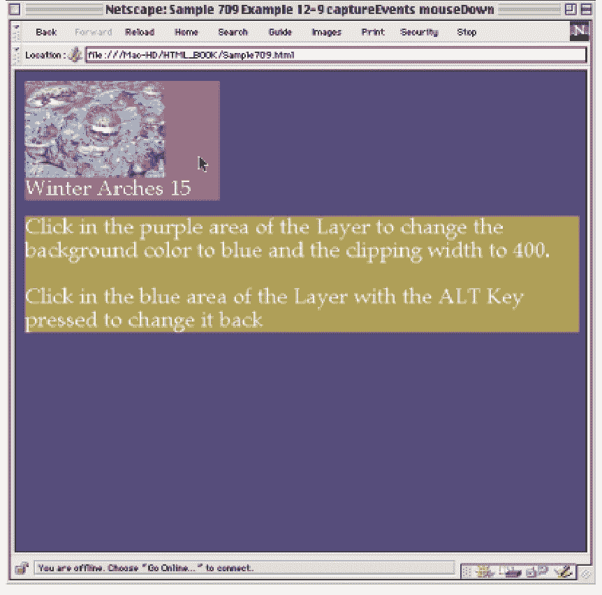

## 示例 6-9：Sample709.html

```
<!DOCTYPE HTML PUBLIC "-//W3C//DTD HTML 3.2//EN">
<HTML><HEAD><TITLE> Sample 709   Example 6-9 captureEvents mouseDown</TITLE>

<STYLE TYPE="text/JavaScript">

	classes.Mainbody.BODY.margins("0px");
	classes.Mainbody.BODY.paddings("0px");
	classes.Mainbody.BODY.backgroundColor="navy";
	classes.Mainbody.BODY.color="white";
	classes.Mainbody.BODY.fontSize="22pt";

</STYLE>
</HEAD>

<BODY CLASS="Mainbody">

<LAYER ID="L1" LEFT="10" TOP="10" WIDTH="200" BGCOLOR="purple">
<BR>
Winter Arches 15</LAYER>

<LAYER ID="L2" LEFT="10" TOP="150" WIDTH="570" BGCOLOR="olive">
Click in the purple area of the Layer to change the background color to blue and
the clipping width to 400.<BR><BR>
Click in the blue area of the Layer with the ALT Key pressed to change it back
</LAYER>
<!-- **************************************************************  -->

<SCRIPT LANGUAGE="JavaScript1.2"><!--BEGIN HIDING

document.L1.captureEvents(Event.MOUSEDOWN);
document.L1.onmousedown = getL1Events;

/*---------------------------------------------------------------*/

function getL1Events(e)  {
	if (e.type == 'mousedown' &&  e.modifiers == 0)  {	//make sure no modifiers key pressed
		changeL1();
		return false;
	}
	else if (e.type == 'mousedown' &&  e.modifiers == 1)  {	//test for ALT Key
		changeL1Back();
		return false;
	}
}
/*---------------------------------------------------------------*/

function changeL1()  {

	document.L1.bgColor = 'blue';
	document.L1.clip.width = 400;
}
/*---------------------------------------------------------------*/
```

```
function changeL1Back() {
    document.L1.bgColor = 'purple';
    document.L1.clip.width = 200;
}
/*----------------------------------------------------------------------*/
//END HIDING-->
</SCRIPT>
</BODY>
</HTML>
```

## 用鼠标拖动图像

本示例展示了如何用鼠标拖动图像，并将其重新定位到浏览器窗口中的不同位置。你可以通过设置代码，使用 **captureEvents()** 和 **releaseEvents()** 方法拖动包含图像的 Layer 来实现这一点。

首先，使用 **ids** 属性创建一个名为 **division** 的样式，该样式被分配给具有 **ID** 属性的 DIV 元素，由于它具有 **position** 属性且设置为 **absolute**，因此它成为一个 Layer。

接着，创建一些全局变量，使代码更易读，并减少打字量。然后，设置 **division** Layer 捕获所有 **mousedown** 和 **mouseup** 事件。**division.onmousedown** 事件处理器被分配 **begindrag(e)** 函数，**division.onmouseup** 事件处理器被分配 **enddrag(e)** 函数。

**begindrag(e)** 函数开始这个过程，首先测试鼠标左键是否按下，如果是，则使用 **captureEvents()** 方法捕获 **division** Layer 中发生的所有 **mousemove** 事件。接着，通过属性赋值将 **division** Layer 的 **onmousemove** 事件处理器设置为 **drag(e)** 函数。注意属性赋值中不允许使用括号和 **e** 参数。

**drag(e)** 函数首先测试确保 **mousemove** 事件正在被捕获，如果是，则使用 **moveBy()** 方法按指定像素移动 **division** Layer。如果你还记得，**moveBy(x,y)** 方法接受两个参数：x 和 y 方向上的像素数。

通过将 **e.pageX - previousX** 表达式赋值给 **x** 参数，你取事件的当前 **pageX** 属性，减去已赋值给变量 **previousX** 的事件之前的 **pageX** 属性，然后按该像素数在水平 **x** 方向上移动 **division** Layer。同样的场景在垂直方向上使用赋值给 **y** 参数的 **e.pageY - previousY** 表达式实现。

最后，当释放鼠标按钮时，调用 **enddrag(e)** 函数，使用 **releaseEvents()** 方法从 **division** Layer 释放 **mousemove** 事件。**onmousemove** 事件处理器被设置为 **null** 关键字，以防止在此函数完成操作后调用任何无关的函数。

注意，在上述三个函数的末尾，它们 **return false**，以停止该点的事件处理。

## 示例 6-10：Sample710.html

```
<!DOCTYPE HTML PUBLIC "-//W3C//DTD HTML 3.2//EN">
<HTML><HEAD>
<TITLE>Sample 710 - Example 6-10    Drag an Image </TITLE>

<STYLE type="text/JavaScript">

        ids.division.position="absolute";
        ids.division.left="200";
        ids.division.top="200";
        ids.division.width="200";
        ids.division.height="150";
        ids.division.borderWidths("15px");
        ids.division.borderColor="#7700ff";
        ids.division.borderStyle="groove";

</STYLE>

</HEAD>

<BODY BGCOLOR="BLACK" TEXT="white">

<DIV ID="division"> <CENTER>

</CENTER></DIV>

<!--  ************************************************************  -->

<SCRIPT LANGUAGE="JavaScript1.2"><!--BEGIN HIDING

var division = document.division;

        division.captureEvents(Event.MOUSEUP|Event.MOUSEDOWN);
        division.onmousedown = begindrag;
        division.onmouseup = enddrag;

var previousX;
var previousY;
var booleanDrag;

/*-------------------------------------------------------------------------*/

function begindrag(e) {
                        //e.which tests for the left mouse button being pressed
        if (e.which == 1) {
                division.captureEvents(Event.MOUSEMOVE);
                division.onmousemove = drag;
                previousX = e.pageX;
                previousY = e.pageY;
                booleanDrag = true;
                return false;
        }
}
/*-------------------------------------------------------------------------*/
```


## 第六章 — JavaScript 事件

```javascript
function drag(e) {
    //tests to make sure that mousemoves are being captured
    if (booleanDrag) {
        division.moveBy(e.pageX - previousX, e.pageY - previousY);
        previousX = e.pageX;
        previousY = e.pageY;
        return false;
    }
}
/*--------------------------------------------------------------------*/

function enddrag(e) {
    if (e.which == 1) {
        division.releaseEvents(Event.MOUSEMOVE);
        division.onmousemove = null;
        booleanDrag = false;
        return false;
    }
}

//END_HIDING-->
</SCRIPT>

</BODY>
</HTML>
```

## 事件对象的 target 属性的 name 属性

你可以通过 **Event** 对象的 **target** 属性的 **name** 属性来测试事件参数的目标对象的名称，示例如下：

```javascript
if (e.target.name == "myImage") execute this JavaScript code
```

其中：**e** 是传递给函数的事件参数
而：**"myImage"** 是像下面这样的 `` 元素的唯一 NAME 属性：

```html

```

### JavaScript 语法：

```javascript
eventArg.target.name
```

下一个示例与前一个示例稍有不同。它主要出于两个原因：一是向你展示如何在 **if ()** 语句中测试 **Event** 对象的 **target** 属性的 **name** 属性；二是展示使用 **onmousemove** 事件处理程序捕获 **mousemove** 事件以处理多个 **Layer** 对象时固有的局限性。这种局限性是 Layer 具有 **z-Index** 属性的直接结果，当拖动一个具有较低 **z-Index** 的 Layer 的鼠标移动到具有较高 **z-Index** 的 Layer 的空间时，它会阻止事件到达预期的目标。（在示例 3-12 中有一个巧妙的方法来规避这个局限性。）

通过将 [Sample711.html](Sample711.html) 加载到你的浏览器中，然后尝试将顶部图像拖动到另外两个图像上方的任何一个之上，可以很容易地阐明这一点。当鼠标在其空间内时，它无法移动顶部图像，因为顶部图像的 **z-Index** 最低。

这是检测鼠标左键是否按住以及作为事件 **target** 的图像 **name** 的代码行：

```javascript
if (e.which == 1  &&  e.target.name == "myImage")
```

在这种情况下，通过要求事件的 **target** 是一个图像，你可以防止当鼠标在 Layer 边框或背景上按下时，包含该图像的 Layer 被拖动。只有当鼠标在图像占据的空间上按下时，它才能被拖动。当然，这对所有三个图像都有效，因为已经为所有这三个 **target** 情况准备了可执行代码。

### 示例 6-11: Sample711.html

```html
<!DOCTYPE HTML PUBLIC "-//W3C//DTD HTML 3.2//EN">
<HTML>
<HEAD>
<TITLE>Sample 711 - 示例 6-11 拖动三个图像中的任意一个 </TITLE>

<STYLE type="text/JavaScript">

    tags.DIV.position="absolute";
    tags.DIV.left="10";
    tags.DIV.top="50";
    tags.DIV.width="174";
    tags.DIV.height="135";
    tags.DIV.borderWidths("15px");
    tags.DIV.borderColor="#7700ff";
    tags.DIV.borderStyle="groove";

    ids.division2.left="10";
    ids.division2.top="200";

    ids.division3.left="250";
    ids.division3.top="200";

</STYLE>
</HEAD>

<BODY BGCOLOR="BLACK" TEXT="white">

<DIV ID="division">
</DIV>

<DIV ID="division2">
</DIV>

<DIV ID="division3">
</DIV>

<!-- ******************************************************* -->

<SCRIPT LANGUAGE="JavaScript1.2"><!--BEGIN HIDING

/*----------------------------------------------------------------*/
var division = document.division

division.captureEvents(Event.MOUSEDOWN|Event.MOUSEUP);
division.onmousedown=begindrag;
division.onmouseup=enddrag;

var division2 = document.division2

division2.captureEvents(Event.MOUSEDOWN|Event.MOUSEUP);
division2.onmousedown=begindrag;
division2.onmouseup=enddrag;

var division3 = document.division3

division3.captureEvents(Event.MOUSEDOWN|Event.MOUSEUP);
division3.onmousedown=begindrag;
division3.onmouseup=enddrag;

var previousX;
var previousY;
var booleanDrag;

/*----------------------------------------------------------------*/

function begindrag(e) {

	if (e.which == 1 && e.target.name == "myImage") {
		division.captureEvents(Event.MOUSEMOVE);
		division.onmousemove=drag;
		previousX=e.pageX;
		previousY=e.pageY;
		booleanDrag=true;
		return false;
	}
    else if (e.which == 1 && e.target.name == "myImage2") {
        division2.captureEvents(Event.MOUSEMOVE);
        division2.onmousemove=drag;
        previousX=e.pageX;
        previousY=e.pageY;
        booleanDrag=true;
        return false;
    }
    else if (e.which == 1 && e.target.name == "myImage3") {
        division3.captureEvents(Event.MOUSEMOVE);
        division3.onmousemove=drag;
        previousX=e.pageX;
        previousY=e.pageY;
        booleanDrag=true;
        return false;
    }
}
/* ----------------------------------------------------------------------- */

function drag(e) {
    if (booleanDrag) {
        if (e.which == 1 && e.target.name == "myImage") {
            division.moveBy(e.pageX-previousX, e.pageY-previousY);
            previousX = e.pageX;
            previousY = e.pageY;
            return false;
        }
        else if (e.which == 1 && e.target.name == "myImage2") {
            division2.moveBy(e.pageX-previousX, e.pageY-previousY);
            previousX = e.pageX;
            previousY = e.pageY;
            return false;
        }
        else if (e.which == 1 && e.target.name == "myImage3") {
            division3.moveBy(e.pageX-previousX, e.pageY-previousY);
            previousX = e.pageX;
            previousY = e.pageY;
            return false;
        }
    }
}
/* ----------------------------------------------------------------------- */

function enddrag(e) {
    if (e.which == 1 && e.target.name == "myImage") {
        division.releaseEvents(Event.MOUSEMOVE);
        division.onmousemove=null;
        booleanDrag=false;
        return false;
    }
    else if (e.which == 1 && e.target.name == "myImage2") {
        division2.releaseEvents(Event.MOUSEMOVE);
        division2.onmousemove=null;
        booleanDrag=false;
        return false;
    }
}
```

## 为 window 对象捕获事件以拖动图像

此示例与前一个示例的唯一区别在于，在 **begindrag(e)** 和 **enddrag(e)** 函数中，你为 **window** 对象而不是三个 **Layer** 对象捕获 **mousemove** 事件。这是前一个示例中的一行代码，其中 **division** 是一个 Layer 的名称：

```javascript
division.captureEvents(Event.MOUSEMOVE);
```

已被以下代码行替换：

```javascript
window.captureEvents(Event.MOUSEMOVE);
```

这样做的结果是能够在窗口中不间断地拖动具有较低 **z-Index** 的 Layer，*即使*它位于具有**较高 z-Index** 值的 Layer 后面也是如此。

### 示例 6-12: Sample712.html

```html
<!DOCTYPE HTML PUBLIC "-//W3C//DTD HTML 3.2//EN">
<HTML><HEAD>
<TITLE>Sample 712 - 示例 6-12 拖动三个图像中的任意一个 </TITLE>

<STYLE type="text/JavaScript">
	tags.DIV.position="absolute";
	tags.DIV.left="10";
	tags.DIV.top="50";
	tags.DIV.width="174";
	tags.DIV.height="135";
	tags.DIV.borderWidths("15px");
	tags.DIV.borderColor="#7700ff";
	tags.DIV.borderStyle="groove";

	ids.division2.left="10";
	ids.division2.top="200";

	ids.division3.left="250";
	ids.division3.top="200";
</STYLE>
</HEAD>

<BODY BGCOLOR="BLACK" TEXT="white">

<DIV ID="division">
</DIV>

<DIV ID="division2">
</DIV>

<DIV ID="division3">
</DIV>

<!-- ********************************************************************** -->

<SCRIPT LANGUAGE="JavaScript1.2"><!--BEGIN HIDING

/* -------------------------------------------------------------------------- */

 var division = document.division

 division.captureEvents(Event.MOUSEDOWN|Event.MOUSEUP);
division.onmousedown=beginDrag;
division.onmouseup=endDrag;

var division2 = document.division2

 division2.captureEvents(Event.MOUSEDOWN|Event.MOUSEUP);
division2.onmousedown=beginDrag;
division2.onmouseup=endDrag;

var division3 = document.division3

 division3.captureEvents(Event.MOUSEDOWN|Event.MOUSEUP);
division3.onmousedown=beginDrag;
division3.onmouseup=endDrag;

var previousX;
var previousY;
var booleanDrag;

/* -------------------------------------------------------------------------- */

//这是此示例与示例 6-11 的不同之处。
//不是为 'Layer' 捕获 MOUSEMOVE 事件。
//而是为 'window' 捕获它。
//你在下面的 enddrag() 函数中做同样的事情。
```


 # 第六章 — JavaScript 事件

```
/*--------------------------------------------------------------------------------*/

function begindrag(e) {

        if (e.which == 1  &&  e.target.name == "my LIMIT ") {
                window.captureEvents(Event.MOUSEMOVE);
                window.onmousemove=drag;
                previousX=e.pageX;
                previousY=e.pageY;
                booleanDrag=true;
                return false;
        }
        else if (e.which == 1  &&  e.target.name == "my LIMIT ") {
                window.captureEvents(Event.MOUSEMOVE);
                window.onmousemove=drag;
                previousX=e.pageX;
                previousY=e.pageY;
                booleanDrag=true;
                return false;
        }
        else if (e.which == 1  &&  e.target.name == "my LIMIT ") {
                window.captureEvents(Event.MOUSEMOVE);
                window.onmousemove=drag;
                previousX=e.pageX;
                previousY=e.pageY;
                booleanDrag=true;
                return false;
        }
}

/*--------------------------------------------------------------------------------*/

function drag(e) {

        if (booleanDrag) {

                if (e.which == 1  &&  e.target.name == "my LIMIT ") {
                        division.moveBy(e.pageX-previousX, e.pageY-previousY);
                        previousX = e.pageX;
                        previousY = e.pageY;
                        return false;
                }
                else if (e.which == 1  &&  e.target.name == "my LIMIT ") {
                        division2.moveBy(e.pageX-previousX, e.pageY-previousY);
                        previousX = e.pageX;
                        previousY = e.pageY;
                        return false;
                }
                else if (e.which == 1  &&  e.target.name == "my LIMIT ") {
                        division3.moveBy(e.pageX-previousX, e.pageY-previousY);
                        previousX = e.pageX;
                        previousY = e.pageY;
                        return false;
                }
        }
}

/*--------------------------------------------------------------------------------*/
```

```
function enddrag(e) {

    if (e.which == 1  &&  e.target.name == "my LIMIT ") {
        window.releaseEvents(Event.MOUSEMOVE);
        window.onmousemove=null
        booleanDrag=false;
        return false;
    }
    else if (e.which == 1  &&  e.target.name == "my LIMIT ") {
        window.releaseEvents(Event.MOUSEMOVE);
        window.onmousemove=null
        booleanDrag=false;
        return false;
    }
    else if (e.which == 1  &&  e.target.name == "my LIMIT ") {
        window.releaseEvents(Event.MOUSEMOVE);
        window.onmousemove=null
        booleanDrag=false;
        return false;
    }
}

//END HIDING-->
</SCRIPT>
</BODY>
</HTML>
```

## 使用局部化脚本拖动图像

## 国际象棋示例

你可能在示例 6-11 中注意到，如果拖动过程中鼠标不在图像或 Layer 上方（因为拖动层默认被另一个 Layer 遮挡在**zIndex**后面），拖动会停止，原因是**e.target.name == "my LIMIT "**这段代码。解决此问题的一种方法是，在为 Layer 分配代码时使用**局部化脚本（Localized Scripts）**。你可能还记得第三章中提到过，这是一种包含在 Layer 起始标签和结束标签之间的脚本，仅适用于特定的 Layer。

下一个示例是一个 JavaScript 国际象棋游戏，演示了如何使用**局部化脚本**拖动包含棋子的 Layer。这个示例很长，但很多代码是重复的，它使用了与上一个示例相同的代码结构，但在**局部化脚本**中重复了 32 次，每个棋子对应一次。

文件 [Sample713-Chess.html](Sample713-Chess.html) 中的代码更易读，因此你可能希望将其打印出来参考，而不是看书中的代码。还有一个包含小型棋子图像的国际象棋游戏版本，位于名为 [Sample774-Chess-LIMIT .html](Sample774-Chess-LIMIT .html) 的文件中，该文件不在书中，但在 CD-ROM 的 [DHTML-JS_BOOK-Main_Files](DHTML-JS_BOOK-Main_Files) 文件夹中。

# 第六章 — JavaScript 事件

## 示例 6-13：Sample713-Chess.html

```
<!DOCTYPE HTML PUBLIC "-//W3C//DTD HTML 3.2//EN">
<HTML><HEAD>
<TITLE>Sample 713-Chess - Example 6-13     Drag Chess </TITLE>

<STYLE type = "text/JavaScript">

            classes.theControl.all.fontFamily = "Moonlight, cursive";
            classes.theControl.all.fontFamily = "Moonlight, cursive";
            classes.theControl.all.textAlign = "center";
            classes.theControl.all.align = "center";
            classes.Largefont.all.fontFamily = "Courier";
            classes.Largefont.all.fontSize = "44pt";
            classes.Largefont.all.color = "black";
            classes.Largefont.all.textAlign = "center";
            classes.Largefont.all.lineHeight = "12pt";
            classes.Whitefont.all.fontFamily = "Courier";
            classes.Whitefont.all.fontSize = "44pt";
            classes.Whitefont.all.color = "white";
            classes.Whitefont.all.textAlign = "center";
            classes.Whitefont.all.lineHeight = "12pt";

</STYLE>
</HEAD>
<BODY BGCOLOR="BLACK" TEXT="white">
<!--  ***************    The CONTROL layer      *************  -->
<LAYER CLASS="theControl" ID="Control" LEFT="5" TOP="5" WIDTH="100" HEIGHT="100"
BGCOLOR="steelblue">
<FORM NAME="form1">                CHESS   <BR>
<INPUT TYPE="button" NAME="StartOver" LIMIT ="New Game"
onClick='StartGame(); return false;'>
</FORM></LAYER>
<!--  ************************************************************  -->
<!--  Notice that Showcase2 through Showcase34 are nested inside ShowcaseA  -->
<LAYER ID="ShowcaseA" LEFT="120" TOP="5" WIDTH="700">
<!--  ************************************************************  -->

<TABLE BORDER="5" CELLSPACING="2" BORDERCOLOR="#8800ff">
<TR BGCOLOR="red">
<TH WIDTH="50" HEIGHT="50">                      Q-r8       </TH>
<TH WIDTH="50" HEIGHT="50" BGCOLOR="black">       Q- LIMIT        </TH>
<TH WIDTH="50" HEIGHT="50">                      Q-b8       </TH>
<TH WIDTH="50" HEIGHT="50" BGCOLOR="black">       Q8         </TH>
<TH WIDTH="50" HEIGHT="50">                      K8         </TH>
<TH WIDTH="50" HEIGHT="50" BGCOLOR="black">       K-b8       </TH>
<TH WIDTH="50" HEIGHT="50">                      K- LIMIT        </TH>
<TH WIDTH="50" HEIGHT="50" BGCOLOR="black">       K-r8       </TH>
</TR>
<TR BGCOLOR="red">
<TH WIDTH="50" HEIGHT="50" BGCOLOR="black">       Q-r7       </TH>
<TH WIDTH="50" HEIGHT="50">                      Q- LIMIT        </TH>
<TH WIDTH="50" HEIGHT="50" BGCOLOR="black">       Q-b7       </TH>
<TH WIDTH="50" HEIGHT="50">                      Q7         </TH>
<TH WIDTH="50" HEIGHT="50">                      K7         </TH>
<TH WIDTH="50" HEIGHT="50" BGCOLOR="black">       K-b7       </TH>
<TH WIDTH="50" HEIGHT="50">                      K- LIMIT        </TH>
<TH WIDTH="50" HEIGHT="50" BGCOLOR="black">       K-r7       </TH>
</TR>
<TR BGCOLOR="red">
<TH WIDTH="50" HEIGHT="50">                      Q-r6       </TH>
<TH WIDTH="50" HEIGHT="50" BGCOLOR="black">       Q- LIMIT        </TH>
<TH WIDTH="50" HEIGHT="50">                      Q-b6       </TH>
<TH WIDTH="50" HEIGHT="50" BGCOLOR="black">       Q6         </TH>
<TH WIDTH="50" HEIGHT="50" BGCOLOR="black">       K6         </TH>
<TH WIDTH="50" HEIGHT="50">                      K-b6       </TH>
<TH WIDTH="50" HEIGHT="50" BGCOLOR="black">       K- LIMIT        </TH>
<TH WIDTH="50" HEIGHT="50">                      K-r6       </TH>
</TR>
<TR BGCOLOR="red">
<TH WIDTH="50" HEIGHT="50" BGCOLOR="black">       Q-r5       </TH>
<TH WIDTH="50" HEIGHT="50">                      Q- LIMIT        </TH>
<TH WIDTH="50" HEIGHT="50" BGCOLOR="black">       Q-b5       </TH>
<TH WIDTH="50" HEIGHT="50">                      Q5         </TH>
<TH WIDTH="50" HEIGHT="50">                      K5         </TH>
<TH WIDTH="50" HEIGHT="50" BGCOLOR="black">       K-b5       </TH>
<TH WIDTH="50" HEIGHT="50">                      K- LIMIT        </TH>
<TH WIDTH="50" HEIGHT="50" BGCOLOR="black">       K-r5       </TH>
</TR>
```


## 第6章 — JavaScript 事件

```html
<TH WIDTH="50" HEIGHT="50">		K-b7		</TH>
<TH WIDTH="50" HEIGHT="50" BGCOLOR="black">	K-n7		</TH>
<TH WIDTH="50" HEIGHT="50">		K-r7		</TH>
</TR>
<TR BGCOLOR="red">
<TH WIDTH="50" HEIGHT="50">		Q-r6		</TH>
<TH WIDTH="50" HEIGHT="50" BGCOLOR="black">	Q-n6		</TH>
<TH WIDTH="50" HEIGHT="50" BGCOLOR="black">	Q-b6		</TH>
<TH WIDTH="50" HEIGHT="50">		Q6		</TH>
<TH WIDTH="50" HEIGHT="50">		K6		</TH>
<TH WIDTH="50" HEIGHT="50" BGCOLOR="black">	K-b6		</TH>
<TH WIDTH="50" HEIGHT="50">		K-n6		</TH>
<TH WIDTH="50" HEIGHT="50" BGCOLOR="black">	K-r6		</TH>
</TR>
<TR BGCOLOR="red">
<TH WIDTH="50" HEIGHT="50">		Q-r5		</TH>
<TH WIDTH="50" HEIGHT="50" BGCOLOR="black">	Q-n5		</TH>
<TH WIDTH="50" HEIGHT="50" BGCOLOR="black">	Q-b5		</TH>
<TH WIDTH="50" HEIGHT="50">		Q5		</TH>
<TH WIDTH="50" HEIGHT="50">		K5		</TH>
<TH WIDTH="50" HEIGHT="50">		K-b5		</TH>
<TH WIDTH="50" HEIGHT="50" BGCOLOR="black">	K-n5		</TH>
<TH WIDTH="50" HEIGHT="50">		K-r5		</TH>
</TR>
<TR BGCOLOR="red">
<TH WIDTH="50" HEIGHT="50">		Q-r4		</TH>
<TH WIDTH="50" HEIGHT="50" BGCOLOR="black">	Q-n4		</TH>
<TH WIDTH="50" HEIGHT="50">		Q-b4		</TH>
<TH WIDTH="50" HEIGHT="50" BGCOLOR="black">	Q4		</TH>
<TH WIDTH="50" HEIGHT="50">		K4		</TH>
<TH WIDTH="50" HEIGHT="50" BGCOLOR="black">	K-b4		</TH>
<TH WIDTH="50" HEIGHT="50">		K-n4		</TH>
<TH WIDTH="50" HEIGHT="50" BGCOLOR="black">	K-r4		</TH>
</TR>
<TR BGCOLOR="red">
<TH WIDTH="50" HEIGHT="50" BGCOLOR="black">	Q-r3		</TH>
<TH WIDTH="50" HEIGHT="50">		Q-n3		</TH>
<TH WIDTH="50" HEIGHT="50" BGCOLOR="black">	Q-b3		</TH>
<TH WIDTH="50" HEIGHT="50">		Q3		</TH>
<TH WIDTH="50" HEIGHT="50" BGCOLOR="black">	K3		</TH>
<TH WIDTH="50" HEIGHT="50">		K-b3		</TH>
<TH WIDTH="50" HEIGHT="50" BGCOLOR="black">	K-n3		</TH>
<TH WIDTH="50" HEIGHT="50">		K-r3		</TH>
</TR>
<TR BGCOLOR="red">
<TH WIDTH="50" HEIGHT="50">		Q-r2		</TH>
<TH WIDTH="50" HEIGHT="50" BGCOLOR="black">	Q-n2		</TH>
<TH WIDTH="50" HEIGHT="50">		Q-b2		</TH>
<TH WIDTH="50" HEIGHT="50" BGCOLOR="black">	Q2		</TH>
<TH WIDTH="50" HEIGHT="50">		K2		</TH>
<TH WIDTH="50" HEIGHT="50" BGCOLOR="black">	K-b2		</TH>
<TH WIDTH="50" HEIGHT="50">		K-n2		</TH>
<TH WIDTH="50" HEIGHT="50" BGCOLOR="black">	K-r2		</TH>
</TR>
<TR BGCOLOR="red">
<TH WIDTH="50" HEIGHT="50">		Q-r1		</TH>
<TH WIDTH="50" HEIGHT="50" BGCOLOR="black">	Q-n1		</TH>
<TH WIDTH="50" HEIGHT="50">		Q-b1		</TH>
<TH WIDTH="50" HEIGHT="50" BGCOLOR="black">	Q1		</TH>
<TH WIDTH="50" HEIGHT="50">		K1		</TH>
<TH WIDTH="50" HEIGHT="50" BGCOLOR="black">	K-b1		</TH>
<TH WIDTH="50" HEIGHT="50">		K-n1		</TH>
<TH WIDTH="50" HEIGHT="50" BGCOLOR="black">	K-r1		</TH>
</TR>
</TABLE>
```

### 第二部分 — JavaScript 1.2

```html
<!-- ************************************************************************ -->

<LAYER CLASS="Largefont" ID="Showcase2" LEFT="13" TOP="10" WIDTH="40" HEIGHT="40">R

<SCRIPT LANGUAGE="JavaScript1.2"><!--BEGIN HIDING

Showcase2.bgColor = 'white';
Showcase2.captureEvents(Event.MOUSEDOWN|Event.MOUSEUP);
Showcase2.onmousedown = beginDrag;
Showcase2.onmouseup = endDrag;

var previousX;
var previousY;
var booleanDrag;

function beginDrag(e) {
    if (e.which == 1) {
        window.captureEvents(Event.MOUSEMOVE);
        window.onmousemove = drag;
        previousX = e.pageX;
        previousY = e.pageY;
        booleanDrag = true;
        return false;
    }
}

function drag(e) {
    if (booleanDrag) {
        moveBy(e.pageX - previousX, e.pageY - previousY);
        previousX = e.pageX;
        previousY = e.pageY;
        return false;
    }
}

function endDrag(e) {
    if (e.which == 1) {
        window.releaseEvents(Event.MOUSEMOVE);
        window.onmousemove = null;
        booleanDrag = false;
        return false;
    }
}

//END HIDING-->
</SCRIPT>
```

```html
<!-- ************************************************************************ -->

<LAYER CLASS="Largefont" ID="Showcase3" LEFT="10" TOP="70" WIDTH="40" HEIGHT="40">N

<SCRIPT LANGUAGE="JavaScript1.2"><!--BEGIN HIDING

Showcase3.bgColor = 'white';
Showcase3.captureEvents(Event.MOUSEDOWN|Event.MOUSEUP);
Showcase3.onmousedown = beginDrag;
Showcase3.onmouseup = endDrag;

var previousX, previousY, booleanDrag;

function beginDrag(e) {
  if (e.which == 1) {
    	window.captureEvents(Event.MOUSEMOVE);	window.onmousemove = drag;
    	previousX = e.pageX;						previousY = e.pageY;
    	booleanDrag = true;							return false;
  }
}	/*------------------------------------------------*/
function drag(e) {
  if (booleanDrag) {
    	moveBy(e.pageX - previousX, e.pageY - previousY);
    	previousX = e.pageX;						previousY = e.pageY;
    	return false;
  }
}	/*------------------------------------------------*/
function endDrag(e) {
  if (e.which == 1) {
    	window.releaseEvents(Event.MOUSEMOVE);	window.onmousemove = null;
    	booleanDrag = false;							return false;
  }
}	/*---------------------------------------------------------------------------*/
//END HIDING-->
</SCRIPT>
</LAYER>
<!--  *******************************  -->
<LAYER CLASS="Largefont" ID="Showcase4" LEFT="125" TOP="10" WIDTH="40" HEIGHT="40">B
<SCRIPT LANGUAGE="JavaScript1.2"><!--BEGIN HIDING
 Showcase4.bgColor = 'white';
 Showcase4.captureEvents(Event.MOUSEDOWN|Event.MOUSEUP);
 Showcase4.onmousedown = beginDrag;
 Showcase4.onmouseup = endDrag;
 var previousX, previousY, booleanDrag;
/*------------------------------------------------*/
function beginDrag(e) {
  if (e.which == 1) {
    	window.captureEvents(Event.MOUSEMOVE);	window.onmousemove = drag;
    	previousX = e.pageX;						previousY = e.pageY;
    	booleanDrag = true;							return false;
  }
}	/*------------------------------------------------*/
function drag(e) {
  if (booleanDrag) {
    	moveBy(e.pageX - previousX, e.pageY - previousY);
    	previousX = e.pageX;						previousY = e.pageY;
    	return false;
  }
}	/*------------------------------------------------*/
function endDrag(e) {
  if (e.which == 1) {
    	window.releaseEvents(Event.MOUSEMOVE);	window.onmousemove = null;
    	booleanDrag = false;							return false;
  }
}	/*---------------------------------------------------------------------------*/
//END HIDING-->
</SCRIPT>
</LAYER>
```

### 第二部分 — JavaScript 1.2

```html
<!-- **************************************************************************************** -->
<LAYER CLASS="Largefont" ID="Showcase5" LEFT="182" TOP="10" WIDTH="40" HEIGHT="40">Q
<SCRIPT LANGUAGE="JavaScript1.2"><!--BEGIN HIDING
 Showcase5.bgColor = 'white';
 Showcase5.captureEvents(Event.MOUSEDOWN|Event.MOUSEUP);
 Showcase5.onmousedown = beginDrag;
 Showcase5.onmouseup = endDrag;
 var previousX, previousY, booleanDrag;
/*----------------------------------------------*/
function beginDrag(e) {
    if (e.which == 1) {
        window.captureEvents(Event.MOUSEMOVE);     window.onmousemove = drag;
        previousX = e.pageX;                              previousY = e.pageY;
        booleanDrag = true;                                return false;
    }
}          /*----------------------------------------------*/
function drag(e) {
    if (booleanDrag) {
        moveBy(e.pageX - previousX, e.pageY - previousY);
        previousX = e.pageX;                              previousY = e.pageY;
        return false;
    }
}          /*----------------------------------------------*/
function endDrag(e) {
    if (e.which == 1) {
        window.releaseEvents(Event.MOUSEMOVE);     window.onmousemove = null;
        booleanDrag = false;                                  return false;
    }
}          /*----------------------------------------------*/
//END HIDING-->
</SCRIPT>
</LAYER>
<!-- ************************************** -->
<LAYER CLASS="Largefont" ID="Showcase6" LEFT="237" TOP="10" WIDTH="40" HEIGHT="40">K
<SCRIPT LANGUAGE="JavaScript1.2"><!--BEGIN HIDING
 Showcase6.bgColor = 'white';
 Showcase6.captureEvents(Event.MOUSEDOWN|Event.MOUSEUP);
 Showcase6.onmousedown = beginDrag;
 Showcase6.onmouseup = endDrag;
 var previousX, previousY, booleanDrag;
/*----------------------------------------------*/
function beginDrag(e) {
    if (e.which == 1) {
        window.captureEvents(Event.MOUSEMOVE);     window.onmousemove = drag;
        previousX = e.pageX;                              previousY = e.pageY;
        booleanDrag = true;                                return false;
    }
}          /*----------------------------------------------*/
function drag(e) {
    if (booleanDrag) {
        moveBy(e.pageX - previousX, e.pageY - previousY);
        previousX = e.pageX;                              previousY = e.pageY;
        return false;
    }
}          /*----------------------------------------------*/
```


## 第 6 章 — JavaScript 事件

```javascript
function endDrag(e) {
    if (e.which == 1) {
        window.releaseEvents(Event.MOUSEMOVE);
        window.onmousemove = null;
        booleanDrag = false;
        return false;
    }
}
/*----------------------------------------------------*/
//END HIDING-->
</SCRIPT>
</LAYER>
<!--  ***********************************************   -->
<LAYER CLASS="Largefont" ID="Showcase7" LEFT="294" TOP="10" WIDTH="40" HEIGHT="40">B
<SCRIPT LANGUAGE="JavaScript1.2"><!--BEGIN HIDING
Showcase7.bgColor = 'white';
Showcase7.captureEvents(Event.MOUSEDOWN|Event.MOUSEUP);
Showcase7.onmousedown = beginDrag;
Showcase7.onmouseup = endDrag;
var previousX, previousY, booleanDrag;
/*---------------------------------------------*/
function beginDrag(e) {
    if (e.which == 1) {
        window.captureEvents(Event.MOUSEMOVE);
        window.onmousemove = drag;
        previousX = e.pageX;
        previousY = e.pageY;
        booleanDrag = true;
        return false;
    }
}
/*---------------------------------------------*/
function drag(e) {
    if (booleanDrag) {
        moveBy(e.pageX - previousX, e.pageY - previousY);
        previousX = e.pageX;
        previousY = e.pageY;
        return false;
    }
}
/*---------------------------------------------*/
function endDrag(e) {
    if (e.which == 1) {
        window.releaseEvents(Event.MOUSEMOVE);
        window.onmousemove = null;
        booleanDrag = false;
        return false;
    }
}
/*----------------------------------------------------*/
//END HIDING-->
</SCRIPT>
</LAYER>
<!--  ***********************************************   -->
<LAYER CLASS="Largefont" ID="Showcase8" LEFT="350" TOP="10" WIDTH="40" HEIGHT="40">N
<SCRIPT LANGUAGE="JavaScript1.2"><!--BEGIN HIDING
Showcase8.bgColor = 'white';
Showcase8.captureEvents(Event.MOUSEDOWN|Event.MOUSEUP);
Showcase8.onmousedown = beginDrag;
Showcase8.onmouseup = endDrag;
var previousX, previousY, booleanDrag;
/*---------------------------------------------*/
function beginDrag(e) {
    if (e.which == 1) {
        window.captureEvents(Event.MOUSEMOVE);
        window.onmousemove = drag;
        previousX = e.pageX;
        previousY = e.pageY;
        booleanDrag = true;
        return false;
    }
}
/*---------------------------------------------*/
function drag(e) {
    if (booleanDrag) {
        moveBy(e.pageX - previousX, e.pageY - previousY);
        previousX = e.pageX;
        previousY = e.pageY;
        return false;
    }
}
function endDrag(e) {
    if (e.which == 1) {
        window.releaseEvents(Event.MOUSEMOVE);
        window.onmousemove = null;
        booleanDrag = false;
        return false;
    }
}
//END HIDING-->
</SCRIPT>
</LAYER>
```

```html
<LAYER CLASS="Largefont" ID="Showcase9" LEFT="406" TOP="10" WIDTH="40" HEIGHT="40">R
<SCRIPT LANGUAGE="JavaScript1.2">
<!-- BEGIN HIDING
Showcase9.bgColor = 'white';
Showcase9.captureEvents(Event.MOUSEDOWN|Event.MOUSEUP);
Showcase9.onmousedown = beginDrag;
Showcase9.onmouseup = endDrag;
var previousX, previousY, booleanDrag;

function beginDrag(e) {
    if (e.which == 1) {
        window.captureEvents(Event.MOUSEMOVE);
        window.onmousemove = drag;
        previousX = e.pageX;
        previousY = e.pageY;
        booleanDrag = true;
        return false;
    }
}

function drag(e) {
    if (booleanDrag) {
        moveBy(e.pageX - previousX, e.pageY - previousY);
        previousX = e.pageX;
        previousY = e.pageY;
        return false;
    }
}

function endDrag(e) {
    if (e.which == 1) {
        window.releaseEvents(Event.MOUSEMOVE);
        window.onmousemove = null;
        booleanDrag = false;
        return false;
    }
}
//END HIDING-->
</SCRIPT>
</LAYER>
```

## 第 6 章 — JavaScript 事件

```html
<!-- ************************************************************************ -->
<LAYER CLASS="Largefont" ID="Showcase10" LEFT="13" TOP="65" WIDTH="40" HEIGHT="40">P
<SCRIPT LANGUAGE="JavaScript1.2">
<!-- BEGIN HIDING
Showcase10.bgColor = 'white';
Showcase10.captureEvents(Event.MOUSEDOWN|Event.MOUSEUP);
Showcase10.onmousedown = beginDrag;
Showcase10.onmouseup = endDrag;
Showcase10.onmousemove = moveDrag;
var previousX, previousY, booleanDrag;

// ***************************************************************************

function beginDrag(e) {
    if (e.which == 1) {
        window.captureEvents(Event.MOUSEMOVE);
        previousX = e.pageX;
        booleanDrag = true;
        window.onmousemove = drag;
        previousY = e.pageY;
        return false;
    }
}

/* ------------------------------------------------------------------------- */

function drag(e) {
    if (booleanDrag) {
        moveBy(e.pageX - previousX, e.pageY - previousY);
        previousX = e.pageX;
        previousY = e.pageY;
        return false;
    }
}

/* ------------------------------------------------------------------------- */

function endDrag(e) {
    if (e.which == 1) {
        window.releaseEvents(Event.MOUSEMOVE);
        booleanDrag = false;
        window.onmousemove = null;
        return false;
    }
}

// ***************************************************************************
//END HIDING-->
</SCRIPT>
</LAYER>
<!-- ************************************************************************ -->
<LAYER CLASS="Largefont" ID="Showcase11" LEFT="70" TOP="65" WIDTH="40" HEIGHT="40">P
<SCRIPT LANGUAGE="JavaScript1.2">
<!-- BEGIN HIDING
Showcase11.bgColor = 'white';
Showcase11.captureEvents(Event.MOUSEDOWN|Event.MOUSEUP);
Showcase11.onmousedown = beginDrag;
Showcase11.onmouseup = endDrag;
var previousX, previousY, booleanDrag;

// ***************************************************************************

function beginDrag(e) {
    if (e.which == 1) {
        window.captureEvents(Event.MOUSEMOVE);
        previousX = e.pageX;
        booleanDrag = true;
        window.onmousemove = drag;
        previousY = e.pageY;
        return false;
    }
}

/* ------------------------------------------------------------------------- */

function drag(e) {
    if (booleanDrag) {
        moveBy(e.pageX - previousX, e.pageY - previousY);
        previousX = e.pageX;
        previousY = e.pageY;
        return false;
    }
}

/* ------------------------------------------------------------------------- */

function endDrag(e) {
    if (e.which == 1) {
        window.releaseEvents(Event.MOUSEMOVE);
        window.onmousemove = null;
        booleanDrag = false;
        return false;
    }
}
/*------------------------------------------------------------------------------*/
//END HIDING-->
</SCRIPT>
</LAYER>
<!--  *************************************  -->
<LAYER CLASS="Largefont" ID="Showcase12" LEFT="125" TOP="65" WIDTH="40" HEIGHT="40">P
<SCRIPT LANGUAGE="JavaScript1.2"><!--BEGIN HIDING
 Showcase12.bgColor = 'white';
 Showcase12.captureEvents(Event.MOUSEDOWN|Event.MOUSEUP);
 Showcase12.onmousedown = beginDrag;
 Showcase12.onmouseup = endDrag;
  var previousX, previousY, booleanDrag;
/*------------------------------------------------------------------------------*/
function beginDrag(e) {
    if (e.which == 1) {
        window.captureEvents(Event.MOUSEMOVE);
        window.onmousemove = drag;
        previousX = e.pageX;
        previousY = e.pageY;
        booleanDrag = true;
        return false;
    }
}
/*------------------------------------------------------------------------------*/
function drag(e) {
    if (booleanDrag) {
        moveBy(e.pageX - previousX, e.pageY - previousY);
        previousX = e.pageX;
        previousY = e.pageY;
        return false;
    }
}
/*------------------------------------------------------------------------------*/
function endDrag(e) {
    if (e.which == 1) {
        window.releaseEvents(Event.MOUSEMOVE);
        window.onmousemove = null;
        booleanDrag = false;
        return false;
    }
}
/*------------------------------------------------------------------------------*/
//END HIDING-->
</SCRIPT>
</LAYER>
<!--  *************************************  -->
<LAYER CLASS="Largefont" ID="Showcase13" LEFT="182" TOP="65" WIDTH="40" HEIGHT="40">P
<SCRIPT LANGUAGE="JavaScript1.2"><!--BEGIN HIDING
 Showcase13.bgColor = 'white';
 Showcase13.captureEvents(Event.MOUSEDOWN|Event.MOUSEUP);
 Showcase13.onmousedown = beginDrag;
 Showcase13.onmouseup = endDrag;
  var previousX, previousY, booleanDrag;
/*------------------------------------------------------------------------------*/
function beginDrag(e) {
    if (e.which == 1) {
        window.captureEvents(Event.MOUSEMOVE);
        window.onmousemove = drag;
        previousX = e.pageX;
        previousY = e.pageY;
        booleanDrag = true;
        return false;
    }
}
/*------------------------------------------------------------------------------*/
```


## 第 6 章 — JavaScript 事件

567

```javascript
function drag(e) {
  if (booleanDrag) {
    moveBy(e.pageX - previousX, e.pageY - previousY);
    previousX = e.pageX;
    previousY = e.pageY;
    return false;
  }
}

function endDrag(e) {
  if (e.which == 1) {
    window.releaseEvents(Event.MOUSEMOVE);
    window.onmousemove = null;
    booleanDrag = false;
    return false;
  }
}
//END HIDING-->
</SCRIPT>
</LAYER>
```

```html
<!--***************************************************-->
<LAYER CLASS="Largefont" ID="Showcase14" LEFT="237" TOP="65" WIDTH="40" HEIGHT="40">P
<SCRIPT LANGUAGE="JavaScript 1.2">
<!--BEGIN HIDING
Showcase14.bgColor = 'white';
Showcase14.captureEvents(Event.MOUSEMOVE|Event.MOUSEDOWN|Event.MOUSEUP);
Showcase14.onmousedown = beginDrag;
Showcase14.onmouseup = endDrag;
var previousX, previousY, booleanDrag;

function beginDrag(e) {
  if (e.which == 1) {
    window.captureEvents(Event.MOUSEMOVE);
    window.onmousemove = drag;
    previousX = e.pageX;
    previousY = e.pageY;
    booleanDrag = true;
    return false;
  }
}

function drag(e) {
  if (booleanDrag) {
    moveBy(e.pageX - previousX, e.pageY - previousY);
    previousX = e.pageX;
    previousY = e.pageY;
    return false;
  }
}

function endDrag(e) {
  if (e.which == 1) {
    window.releaseEvents(Event.MOUSEMOVE);
    window.onmousemove = null;
    booleanDrag = false;
    return false;
  }
}
//END HIDING-->
</SCRIPT>
</LAYER>
```

# 568 第二部分 — JavaScript 1.2

```html
<!-- ******************************************************************************************* -->
<LAYER CLASS="Largefont" ID="Showcase15" LEFT="294" TOP="65" WIDTH="40" HEIGHT="40">P
<SCRIPT LANGUAGE="JavaScript 1.2"><!-- BEGIN HIDING
Showcase15.bgColor = 'white';
Showcase15.captureEvents(Event.MOUSEDOWN|Event.MOUSEUP);
Showcase15.onmousedown = beginDrag;
Showcase15.onmouseup = endDrag;
var previousX, previousY, booleanDrag;
/******************************************************************************************/
function beginDrag(e) {
    if (e.which == 1) {
        window.captureEvents(Event.MOUSEMOVE);
        previousX = e.pageX;
        booleanDrag = true;
        window.onmousemove = drag;
        previousY = e.pageY;
        return false;
    }
}
/******************************************************************************************/
function drag(e) {
    if (booleanDrag) {
        moveBy(e.pageX - previousX, e.pageY - previousY);
        previousX = e.pageX;
        return false;
        previousY = e.pageY;
    }
}
/******************************************************************************************/
function endDrag(e) {
    if (e.which == 1) {
        window.releaseEvents(Event.MOUSEMOVE);
        booleanDrag = false;
        window.onmousemove = null;
        return false;
    }
}
/******************************************************************************************/
//END HIDING-->
</SCRIPT>
</LAYER>
<!-- ******************************************************************************************* -->
<LAYER CLASS="Largefont" ID="Showcase16" LEFT="350" TOP="65" WIDTH="40" HEIGHT="40">P
<SCRIPT LANGUAGE="JavaScript 1.2"><!-- BEGIN HIDING
Showcase16.bgColor = 'white';
Showcase16.captureEvents(Event.MOUSEDOWN|Event.MOUSEUP);
Showcase16.onmousedown = beginDrag;
Showcase16.onmouseup = endDrag;
var previousX, previousY, booleanDrag;
/******************************************************************************************/
function beginDrag(e) {
    if (e.which == 1) {
        window.captureEvents(Event.MOUSEMOVE);
        previousX = e.pageX;
        booleanDrag = true;
        window.onmousemove = drag;
        previousY = e.pageY;
        return false;
    }
}
/******************************************************************************************/
function drag(e) {
    if (booleanDrag) {
        moveBy(e.pageX - previousX, e.pageY - previousY);
        previousX = e.pageX;
        return false;
        previousY = e.pageY;
    }
}
/******************************************************************************************/
```

## 第 6 章 — JavaScript 事件

569

```javascript
function endDrag(e) {
    if (e.which == 1) {
        window.releaseEvents(Event.MOUSEMOVE);
        window.onmousemove = null;
        booleanDrag = false;
        return false;
    }
}

/* --------------------------------------------------------------------------- */
// END HIDING -->
</SCRIPT>
</LAYER>
```

```html
<!-- *************************************************************************** -->
<LAYER CLASS="Largefont" ID="Showcase17" LEFT="406" TOP="65" WIDTH="40" HEIGHT="40">*P
<SCRIPT LANGUAGE="JavaScript1.2"><!-- BEGIN HIDING
Showcase1.bgColor = 'white';
Showcase1.captureEvents(Event.MOUSEOVER|Event.MOUSEUP);
Showcase1.captureEvents(Event.MOUSEDOWN|Event.MOUSEUP);
Showcase1.onmousedown = beginDrag;
Showcase1.onmouseup = endDrag;
var previousX, previousY, booleanDrag;

/* --------------------------------------------------------------------------- */
```

```javascript
function beginDrag(e) {
    if (e.which == 1) {
        window.captureEvents(Event.MOUSEMOVE);
        window.onmousemove = drag;
        previousX = e.pageX;
        previousY = e.pageY;
        booleanDrag = true;
        return false;
    }
}

/* --------------------------------------------------------------------------- */
```

```javascript
function drag(e) {
    if (booleanDrag) {
        moveBy(e.pageX - previousX, e.pageY - previousY);
        previousX = e.pageX;
        previousY = e.pageY;
        return false;
    }
}

/* --------------------------------------------------------------------------- */
```

```javascript
function endDrag(e) {
    if (e.which == 1) {
        window.releaseEvents(Event.MOUSEMOVE);
        window.onmousemove = null;
        booleanDrag = false;
        return false;
    }
}

/* --------------------------------------------------------------------------- */
// END HIDING -->
</SCRIPT>
</LAYER>
```

```html
<!-- *************************************************************************** -->
<LAYER CLASS="Whitefont" ID="Showcase18" LEFT="13" TOP="390" WIDTH="40" HEIGHT="40">R
<SCRIPT LANGUAGE="JavaScript1.2"><!-- BEGIN HIDING
Showcase18.bgColor = 'black';
Showcase18.captureEvents(Event.MOUSEDOWN|Event.MOUSEUP);
Showcase18.onmousedown = beginDrag;
Showcase18.onmouseup = endDrag;
var previousX, previousY, booleanDrag;

/* --------------------------------------------------------------------------- */
```

```javascript
function beginDrag(e) {
    if (e.which == 1) {
        window.captureEvents(Event.MOUSEMOVE);
        window.onmousemove = drag;
        previousX = e.pageX;
        previousY = e.pageY;
        booleanDrag = true;
        return false;
    }
}

/* --------------------------------------------------------------------------- */
```

# 570 第二部分 — JavaScript 1.2

```javascript
function drag() {
    if (booleanDrag) {
        moveBy(e.pageX - previousX, e.pageY - previousY);
        previousX = e.pageX;
        previousY = e.pageY;
        return false;
    }
}

/*----------------------------------------------------------------------*/

function endDrag() {
    if (e.which == 1) {
        window.releaseEvents(Event.MOUSEMOVE);
        window.onmousemove = null;
        booleanDrag = false;
        return false;
    }
}

/*----------------------------------------------------------------------*/

//END HIDING-->
</SCRIPT>
</LAYER>
<!-- ********************************************************************* -->
<LAYER CLASS="WhiteFont" ID="Showcase19" LEFT="70" TOP="390" WIDTH="40" HEIGHT="40">N
<SCRIPT LANGUAGE="JavaScript 1.2">
<!--BEGIN HIDING
Showcase19.bgColor = 'black';
Showcase19.captureEvents(Event.MOUSEDOWN|Event.MOUSEUP);
Showcase19.onmousedown = beginDrag;
Showcase19.onmouseup = endDrag;
var previousX, previousY, booleanDrag;

/*----------------------------------------------------------------------*/

function beginDrag() {
    if (e.which == 1) {
        window.captureEvents(Event.MOUSEMOVE);
        window.onmousemove = drag;
        previousX = e.pageX;
        previousY = e.pageY;
        booleanDrag = true;
        return false;
    }
}

/*----------------------------------------------------------------------*/

function drag() {
    if (booleanDrag) {
        moveBy(e.pageX - previousX, e.pageY - previousY);
        previousX = e.pageX;
        previousY = e.pageY;
        return false;
    }
}

/*----------------------------------------------------------------------*/

function endDrag() {
    if (e.which == 1) {
        window.releaseEvents(Event.MOUSEMOVE);
        window.onmousemove = null;
        booleanDrag = false;
        return false;
    }
}

/*----------------------------------------------------------------------*/

//END HIDING-->
</SCRIPT>
</LAYER>
<!--                                                                   -->
```


## 第 6 章 — JavaScript 事件

```html
<LAYER CLASS="Whitefont" ID="Showcase20" LEFT="125" TOP="390" WIDTH="40" HEIGHT="40">B
<SCRIPT LANGUAGE="JavaScript1.2"><!--BEGIN HIDING
Showcase20.bgColor = 'black';
Showcase20.captureEvents(Event.MOUSEDOWN|Event.MOUSEUP);
Showcase20.onmousedown = beginDrag;
Showcase20.onmouseup = endDrag;
var previousX, previousY, booleanDrag;

/*----------------------------------------------------------------------*/
function beginDrag(e) {
    if (e.which == 1) {
        window.captureEvents(Event.MOUSEMOVE);
        previousX = e.pageX;
        booleanDrag = true;
        window.onmousemove = drag;
        previousY = e.pageY;
        return false;
    }
}

/*----------------------------------------------------------------------*/
function drag(e) {
    if (booleanDrag) {
        moveBy(e.pageX - previousX, e.pageY - previousY);
        previousX = e.pageX;
        return false;
        previousY = e.pageY;
    }
}

/*----------------------------------------------------------------------*/
function endDrag(e) {
    if (e.which == 1) {
        window.releaseEvents(Event.MOUSEMOVE);
        booleanDrag = false;
        window.onmousemove = null;
        return false;
    }
}

/*----------------------------------------------------------------------*/
//END HIDING-->
</SCRIPT>
</LAYER>
```

```html
<LAYER CLASS="Whitefont" ID="Showcase21" LEFT="182" TOP="390" WIDTH="40" HEIGHT="40">Q
<SCRIPT LANGUAGE="JavaScript1.2"><!--BEGIN HIDING
Showcase21.bgColor = 'black';
Showcase21.captureEvents(Event.MOUSEDOWN|Event.MOUSEUP);
Showcase21.onmousedown = beginDrag;
Showcase21.onmouseup = endDrag;
var previousX, previousY, booleanDrag;

/*----------------------------------------------------------------------*/
function beginDrag(e) {
    if (e.which == 1) {
        window.captureEvents(Event.MOUSEMOVE);
        previousX = e.pageX;
        booleanDrag = true;
        window.onmousemove = drag;
        previousY = e.pageY;
        return false;
    }
}

/*----------------------------------------------------------------------*/
function drag(e) {
    if (booleanDrag) {
        moveBy(e.pageX - previousX, e.pageY - previousY);
        previousX = e.pageX;
        return false;
        previousY = e.pageY;
    }
}

/*----------------------------------------------------------------------*/
function endDrag(e) {
    if (e.which == 1) {
        window.releaseEvents(Event.MOUSEMOVE);
        window.onmousemove = null;
        booleanDrag = false;
        return false;
    }
}
/*----------------------------------------------------------------------*/
//END HIDING-->
</SCRIPT>
</LAYER>
```

# 572 第二部分 — JavaScript 1.2

```html
<!-- ********************************* -->
<LAYER CLASS="Whitefont" ID="Showcase22" LEFT="237" TOP="390" WIDTH="40" HEIGHT="40">K
<SCRIPT LANGUAGE="JavaScript1.2"><!--BEGIN HIDING
Showcase22.bgColor = 'black';
Showcase22.captureEvents(Event.MOUSEDOWN|Event.MOUSEUP);
Showcase22.onmousedown = beginDrag;
Showcase22.onmouseup = endDrag;
var previousX, previousY, booleanDrag;
/*----------------------------------------------------------------------*/
function beginDrag(e) {
    if (e.which == 1) {
        window.captureEvents(Event.MOUSEMOVE);     window.onmousemove = drag;
        previousX = e.pageX;                       previousY = e.pageY;
        booleanDrag = true;                        return false;
    }
}       /*----------------------------------------------------------------------*/
function drag(e) {
    if (booleanDrag) {
        moveBy(e.pageX - previousX, e.pageY - previousY);
        previousX = e.pageX;                       previousY = e.pageY;
        return false;
    }
}       /*----------------------------------------------------------------------*/
function endDrag(e) {
    if (e.which == 1) {
        window.releaseEvents(Event.MOUSEMOVE);     window.onmousemove = null;
        booleanDrag = false;                        return false;
    }
}       /*----------------------------------------------------------------------*/
//END HIDING-->
</SCRIPT>
</LAYER>
<!-- ********************************* -->
<LAYER CLASS="Whitefont" ID="Showcase23" LEFT="294" TOP="390" WIDTH="40" HEIGHT="40">B
<SCRIPT LANGUAGE="JavaScript1.2"><!--BEGIN HIDING
Showcase23.bgColor = 'black';
Showcase23.captureEvents(Event.MOUSEDOWN|Event.MOUSEUP);
Showcase23.onmousedown = beginDrag;
Showcase23.onmouseup = endDrag;
var previousX, previousY, booleanDrag;
/*----------------------------------------------------------------------*/
function beginDrag(e) {
    if (e.which == 1) {
        window.captureEvents(Event.MOUSEMOVE);     window.onmousemove = drag;
        previousX = e.pageX;                       previousY = e.pageY;
        booleanDrag = true;                        return false;
    }
}       /*----------------------------------------------------------------------*/
function drag(e) {
    if (booleanDrag) {
        moveBy(e.pageX - previousX, e.pageY - previousY);
        previousX = e.pageX;                        previousY = e.pageY;
        return false;
    }
}       /*------------------------------------------------*/
function endDrag(e) {
    if (e.which == 1) {
        window.releaseEvents(Event.MOUSEMOVE);    window.onmousemove = null;
        booleanDrag = false;                        return false;
    }
}       /*--------------------------------------------------------------------*/
//END HIDING-->
</SCRIPT>
</LAYER>
<!--  ******************************  -->
```

## 第 6 章 — JavaScript 事件

```html
<LAYER CLASS="Whitefont" ID="Showcase24" LEFT="350" TOP="390" WIDTH="40" HEIGHT="40">N
<SCRIPT LANGUAGE="JavaScript1.2"><!--BEGIN HIDING
Showcase24.bgColor = 'black';
Showcase24.captureEvents(Event.MOUSEDOWN|Event.MOUSEUP);
Showcase24.onmousedown = beginDrag;
Showcase24.onmouseup = endDrag;
var previousX, previousY, booleanDrag;
/*------------------------------------------------*/
function beginDrag(e) {
    if (e.which == 1) {
        window.captureEvents(Event.MOUSEMOVE);    window.onmousemove = drag;
        previousX = e.pageX;                        previousY = e.pageY;
        booleanDrag = true;                           return false;
    }
}       /*------------------------------------------------*/
function drag(e) {
    if (booleanDrag) {
        moveBy(e.pageX - previousX, e.pageY - previousY);
        previousX = e.pageX;                        previousY = e.pageY;
        return false;
    }
}       /*------------------------------------------------*/
function endDrag(e) {
    if (e.which == 1) {
        window.releaseEvents(Event.MOUSEMOVE);    window.onmousemove = null;
        booleanDrag = false;                        return false;
    }
}       /*--------------------------------------------------------------------*/
//END HIDING-->
</SCRIPT>
</LAYER>
```

# 574 第二部分 — JavaScript 1.2

```html
<!-- ***************************************************************************** -->
<LAYER CLASS="Whitefont" ID="Showcase25" LEFT="406" TOP="390" WIDTH="40" HEIGHT="40">R
<SCRIPT LANGUAGE="JavaScript1.2"><!-- BEGIN HIDING
Showcase25.bgColor = 'black';
Showcase25.captureEvents(Event.MOUSEDOWN|Event.MOUSEUP);
Showcase25.onmousedown = beginDrag;
Showcase25.onmouseup = endDrag;
var previousX, previousY, booleanDrag;

/* --------------------------------------------------------------------------- */
function beginDrag(e) {
    if (e.which == 1) {
        window.captureEvents(Event.MOUSEMOVE);
        previousX = e.pageX;
        booleanDrag = true;
        window.onmousemove = drag;
        previousY = e.pageY;
        return false;
    }
}
/* --------------------------------------------------------------------------- */
function drag(e) {
    if (booleanDrag) {
        moveBy(e.pageX - previousX, e.pageY - previousY);
        previousX = e.pageX;
        return false;
        previousY = e.pageY;
    }
}
/* --------------------------------------------------------------------------- */
function endDrag(e) {
    if (e.which == 1) {
        window.releaseEvents(Event.MOUSEMOVE);
        booleanDrag = false;
        window.onmousemove = null;
        return false;
    }
}
/* --------------------------------------------------------------------------- */
//END HIDING-->
</SCRIPT>
</LAYER>
<!-- ***************************************************************************** -->
<LAYER CLASS="Whitefont" ID="Showcase26" LEFT="13" TOP="335" WIDTH="40" HEIGHT="40">P
<SCRIPT LANGUAGE="JavaScript1.2"><!-- BEGIN HIDING
Showcase26.bgColor = 'black';
Showcase26.captureEvents(Event.MOUSEDOWN|Event.MOUSEUP);
Showcase26.onmousedown = beginDrag;
Showcase26.onmouseup = endDrag;
var previousX, previousY, booleanDrag;

/* --------------------------------------------------------------------------- */
function beginDrag(e) {
    if (e.which == 1) {
        window.captureEvents(Event.MOUSEMOVE);
        previousX = e.pageX;
        booleanDrag = true;
        window.onmousemove = drag;
        previousY = e.pageY;
        return false;
    }
}
/* --------------------------------------------------------------------------- */
function drag(e) {
    if (booleanDrag) {
        moveBy(e.pageX - previousX, e.pageY - previousY);
        previousX = e.pageX;
        return false;
        previousY = e.pageY;
    }
}
/* --------------------------------------------------------------------------- */
```


## 第六章 —— JavaScript 事件

```javascript
function endDrag(e) {
  if (e.which == 1) {
    window.releaseEvents(Event.MOUSEMOVE);	window.onmousemove = null;
    booleanDrag = false;				return false;
  }
}	/*----------------------------------------------------------------*/
//END HIDING-->
</SCRIPT>
</LAYER>
<!-- *********************************************  -->
<LAYER CLASS="Whitefont" ID="Showcase27" LEFT="70" TOP="335" WIDTH="40" HEIGHT="40">P
<SCRIPT LANGUAGE="JavaScript1.2"><!--BEGIN HIDING
  Showcase27.bgColor = 'black';
  Showcase27.captureEvents(Event.MOUSEDOWN|Event.MOUSEUP);
  Showcase27.onmousedown = beginDrag;
  Showcase27.onmouseup = endDrag;
  var previousX, previousY, booleanDrag;
/*------------------------------------------------*/
function beginDrag(e) {
  if (e.which == 1) {
    window.captureEvents(Event.MOUSEMOVE);	window.onmousemove = drag;
    previousX = e.pageX;				previousY = e.pageY;
    booleanDrag = true;				return false;
  }
}	/*------------------------------------------------*/
function drag(e) {
  if (booleanDrag) {
    moveBy(e.pageX - previousX, e.pageY - previousY);
    previousX = e.pageX;				previousY = e.pageY;
    return false;
  }
}	/*------------------------------------------------*/
function endDrag(e) {
  if (e.which == 1) {
    window.releaseEvents(Event.MOUSEMOVE);	window.onmousemove = null;
    booleanDrag = false;				return false;
  }
}	/*----------------------------------------------------------------*/
//END HIDING-->
</SCRIPT>
</LAYER>
<!--  ******************************  -->
<LAYER CLASS="Whitefont" ID="Showcase28" LEFT="125" TOP="335" WIDTH="40" HEIGHT="40">P
<SCRIPT LANGUAGE="JavaScript1.2"><!--BEGIN HIDING
  Showcase28.bgColor = 'black';
  Showcase28.captureEvents(Event.MOUSEDOWN|Event.MOUSEUP);
  Showcase28.onmousedown = beginDrag;
  Showcase28.onmouseup = endDrag;
  var previousX, previousY, booleanDrag;
/*------------------------------------------------*/
function beginDrag(e) {
  if (e.which == 1) {
    window.captureEvents(Event.MOUSEMOVE);	window.onmousemove = drag;
    previousX = e.pageX;				previousY = e.pageY;
    booleanDrag = true;				return false;
  }
}	/*------------------------------------------------*/
function drag(e) {
    if (booleanDrag) {
        moveBy(e.pageX - previousX, e.pageY - previousY);
        previousX = e.pageX;                           previousY = e.pageY;
        return false;
    }
}       /*------------------------------------------------------------*/
function endDrag(e) {
    if (e.which == 1) {
        window.releaseEvents(Event.MOUSEMOVE);     window.onmousemove = null;
        booleanDrag = false;                        return false;
    }
}       /*------------------------------------------------------------*/
//END HIDING-->
</SCRIPT>
</LAYER>
<!--  **********************************************************  -->
<LAYER CLASS="Whitefont" ID="Showcase29" LEFT="182" TOP="335" WIDTH="40" HEIGHT="40">P
<SCRIPT LANGUAGE="JavaScript1.2"><!--BEGIN HIDING
    Showcase29.bgColor = 'black';
    Showcase29.captureEvents(Event.MOUSEDOWN|Event.MOUSEUP);
    Showcase29.onmousedown = beginDrag;
    Showcase29.onmouseup = endDrag;
    var previousX, previousY, booleanDrag;
/*--------------------------------------------*/
function beginDrag(e) {
    if (e.which == 1) {
        window.captureEvents(Event.MOUSEMOVE);     window.onmousemove = drag;
        previousX = e.pageX;                       previousY = e.pageY;
        booleanDrag = true;                        return false;
    }
}       /*------------------------------------------------------------*/
function drag(e) {
    if (booleanDrag) {
        moveBy(e.pageX - previousX, e.pageY - previousY);
        previousX = e.pageX;                       previousY = e.pageY;
        return false;
    }
}       /*------------------------------------------------------------*/
function endDrag(e) {
    if (e.which == 1) {
        window.releaseEvents(Event.MOUSEMOVE);     window.onmousemove = null;
        booleanDrag = false;                       return false;
    }
}       /*------------------------------------------------------------*/
//END HIDING-->
</SCRIPT>
</LAYER>
<!--  ****************************  -->
<LAYER CLASS="Whitefont" ID="Showcase30" LEFT="237" TOP="335" WIDTH="40" HEIGHT="40">P
<SCRIPT LANGUAGE="JavaScript1.2"><!--BEGIN HIDING
  Showcase30.bgColor = 'black';
  Showcase30.captureEvents(Event.MOUSEDOWN|Event.MOUSEUP);
  Showcase30.onmousedown = beginDrag;
  Showcase30.onmouseup = endDrag;
  var previousX, previousY, booleanDrag;
/*---------------------------------------------*/
function beginDrag(e) {
  if (e.which == 1) {
        window.captureEvents(Event.MOUSEMOVE);	window.onmousemove = drag;
        previousX = e.pageX;			previousY = e.pageY;
        booleanDrag = true;				return false;
  }
}	/*---------------------------------------------*/
function drag(e) {
  if (booleanDrag) {
        moveBy(e.pageX - previousX, e.pageY - previousY);
        previousX = e.pageX;				previousY = e.pageY;
        return false;
  }
}	/*---------------------------------------------*/
function endDrag(e) {
  if (e.which == 1) {
        window.releaseEvents(Event.MOUSEMOVE);	window.onmousemove = null;
        booleanDrag = false;				return false;
  }
}	/*-----------------------------------------------------------------------*/
//END HIDING-->
</SCRIPT>
</LAYER>
<!--  *******************************************************  -->
<LAYER CLASS="Whitefont" ID="Showcase31" LEFT="294" TOP="335" WIDTH="40" HEIGHT="40">P
<SCRIPT LANGUAGE="JavaScript1.2"><!--BEGIN HIDING
  Showcase31.bgColor = 'black';
  Showcase31.captureEvents(Event.MOUSEDOWN|Event.MOUSEUP);
  Showcase31.onmousedown = beginDrag;
  Showcase31.onmouseup = endDrag;
  var previousX, previousY, booleanDrag;
/*---------------------------------------------*/
function beginDrag(e) {
  if (e.which == 1) {
        window.captureEvents(Event.MOUSEMOVE);	window.onmousemove = drag;
        previousX = e.pageX;				previousY = e.pageY;
        booleanDrag = true;				return false;
  }
}	/*---------------------------------------------*/
function drag(e) {
  if (booleanDrag) {
        moveBy(e.pageX - previousX, e.pageY - previousY);
        previousX = e.pageX;				previousY = e.pageY;
        return false;
  }
}	/*---------------------------------------------*/
function endDrag(e) {
  if (e.which == 1) {
        window.releaseEvents(Event.MOUSEMOVE);	window.onmousemove = null;
        booleanDrag = false;				return false;
  }
}	/*-----------------------------------------------------------------------*/
//END HIDING-->
</SCRIPT>
</LAYER>
<!-- ************************** -->
<LAYER CLASS="Whitefont" ID="Showcase32" LEFT="350" TOP="335" WIDTH="40" HEIGHT="40">P
<SCRIPT LANGUAGE="JavaScript1.2"><!--BEGIN HIDING
  Showcase32.bgColor = 'black';
  Showcase32.captureEvents(Event.MOUSEDOWN|Event.MOUSEUP);
  Showcase32.onmousedown = beginDrag;
  Showcase32.onmouseup = endDrag;
  var previousX, previousY, booleanDrag;
/*------------------------------------------------*/
function beginDrag(e) {
  if (e.which == 1) {
        window.captureEvents(Event.MOUSEMOVE);	window.onmousemove = drag;
        previousX = e.pageX;				previousY = e.pageY;
        booleanDrag = true;				return false;
  }
}	名句警句*/function drag(e) {
  if (booleanDrag) {
        moveBy(e.pageX - previousX, e.pageY - previousY);
        previousX = e.pageX;				previousY = e.pageY;
        return false;
  }
}	/*------------------------------------------------*/
function endDrag(e) {
  if (e.which == 1) {
        window.releaseEvents(Event.MOUSEMOVE);	window.onmousemove = null;
        booleanDrag = false;				return false;
  }
}	/*--------------------------------------------------------------------*/
//END HIDING-->
</SCRIPT>
</LAYER>
<!-- ********************************************************** -->
<LAYER CLASS="Whitefont" ID="Showcase33" LEFT="406" TOP="335" WIDTH="40" HEIGHT="40">P
<SCRIPT LANGUAGE="JavaScript1.2"><!--BEGIN HIDING
  Showcase33.bgColor = 'black';
  Showcase33.captureEvents(Event.MOUSEDOWN|Event.MOUSEUP);
  Showcase33.onmousedown = beginDrag;
  Showcase33.onmouseup = endDrag;
  var previousX, previousY, booleanDrag;
/*------------------------------------------------*/
function beginDrag(e) {
  if (e.which == 1) {
        window.captureEvents(Event.MOUSEMOVE);	window.onmousemove = drag;
        previousX = e.pageX;				previousY = e.pageY;
        booleanDrag = true;				return false;
  }
}	/*------------------------------------------------*/
function drag(e) {
  if (booleanDrag) {
        moveBy(e.pageX - previousX, e.pageY - previousY);
        previousX = e.pageX;				previousY = e.pageY;
        return false;
  }
}	/*------------------------------------------------*/
function endDrag(e) {
  if (e.which == 1) {
        window.releaseEvents(Event.MOUSEMOVE);	window.onmousemove = null;
        booleanDrag = false;				return false;
  }
}	/*--------------------------------------------------------------------*/
//END HIDING-->
</SCRIPT>
</LAYER>
<!-- ************************** -->
</LAYER>
```


## 第六章 — JavaScript 事件

```javascript
<!-- ****************************************************** -->
<SCRIPT LANGUAGE="JavaScript1.2"><!--BEGIN HIDING
/*--------------------------------------------------------------------------*/
/*-----------    This section deals with the New Game Button    ----------*/
function StartGame() {
	document.ShowcaseA.document.Showcase2.moveTo (13, 10);
	document.ShowcaseA.document.Showcase3.moveTo (70, 10);
	document.ShowcaseA.document.Showcase4.moveTo (125, 10);
	document.ShowcaseA.document.Showcase5.moveTo (182, 10);
	document.ShowcaseA.document.Showcase6.moveTo (237, 10);
	document.ShowcaseA.document.Showcase7.moveTo (294, 10);
	document.ShowcaseA.document.Showcase8.moveTo (350, 10);
	document.ShowcaseA.document.Showcase9.moveTo (406, 10);
	document.ShowcaseA.document.Showcase10.moveTo (13, 65);
	document.ShowcaseA.document.Showcase11.moveTo (70, 65);
	document.ShowcaseA.document.Showcase12.moveTo (125, 65);
	document.ShowcaseA.document.Showcase13.moveTo (182, 65);
	document.ShowcaseA.document.Showcase14.moveTo (237, 65);
	document.ShowcaseA.document.Showcase15.moveTo (294, 65);
	document.ShowcaseA.document.Showcase16.moveTo (350, 65);
	document.ShowcaseA.document.Showcase17.moveTo (406, 65);
	document.ShowcaseA.document.Showcase18.moveTo (13, 390);
	document.ShowcaseA.document.Showcase19.moveTo (70, 390);
	document.ShowcaseA.document.Showcase20.moveTo (125, 390);
	document.ShowcaseA.document.Showcase21.moveTo (182, 390);
	document.ShowcaseA.document.Showcase22.moveTo (237, 390);
	document.ShowcaseA.document.Showcase23.moveTo (294, 390);
	document.ShowcaseA.document.Showcase24.moveTo (350, 390);
	document.ShowcaseA.document.Showcase25.moveTo (406, 390);
	document.ShowcaseA.document.Showcase26.moveTo (13, 335);
	document.ShowcaseA.document.Showcase27.moveTo (70, 335);
	document.ShowcaseA.document.Showcase28.moveTo (125, 335);
	document.ShowcaseA.document.Showcase29.moveTo (182, 335);
	document.ShowcaseA.document.Showcase30.moveTo (237, 335);
	document.ShowcaseA.document.Showcase31.moveTo (294, 335);
	document.ShowcaseA.document.Showcase32.moveTo (350, 335);
	document.ShowcaseA.document.Showcase33.moveTo (406, 335);
}
//END HIDING-->
</SCRIPT>
</BODY>
</HTML>
```

## 捕获并使用 KEYPRESS 和 KEYUP 事件

### 通过键盘玩井字棋

从现在开始，本书中的事件名称将全部使用**大写字母**书写，以便更容易识别。请记住，它们实际使用的是小写语法，而且为了获得最佳效果，您的事件处理器也应使用小写语法。

本示例重点介绍 **KEYPRESS** 和 **KEYUP** 事件，包含通过键盘玩井字棋游戏的代码。它使用 `document` 对象上的 `captureEvents()` 方法，如下所示：

```javascript
document.captureEvents(Event.KEYPRESS);
document.captureEvents(Event.KEYUP);
```

并将 `keyJump()` 函数分配给 **KEYPRESS** 事件，将 `keyNewGame()` 函数分配给 **KEYUP** 事件，如下所示：

```javascript
document.onkeypress = keyJump;
document.onkeyup = keyNewGame;
```

`keyJump()` 函数通过 `modifiers` 属性测试是否按下了 **ALT** 键或 **CONTROL** 键，并通过 `which` 属性测试按下了数字 1 到 9 中的哪个键（如果有的话），从而控制各层中 X 和 O 图像的显示。在以下代码中，如果按下了 **CONTROL** 键且按下了数字 1 键（当同时按下 **CONTROL** 键时，"1" 键的 ASCII 值为 49），则 Showcase2 图层将被移动到坐标 (10,10)，并且它在 z-index 堆叠顺序中被提升到 Showcase3 之上，使其成为可见图层。

```javascript
if (e.modifiers == Event.CONTROL_MASK && e.which == 49)
{ Showcase2.moveTo(10,10); Showcase2.moveAbove(Showcase3); }
```

同样的原理适用于接下来的两行代码，只不过您要测试的是 **ALT** 键，而且必须为 "1" 键测试两个 ASCII 值中的任意一个，因为扩展键盘上有两个不同的 "1" 键，每个键都有唯一的 ASCII 值。与 **ALT** 键配合使用时，"1" 键的 ASCII 值为 193，而键盘最右侧数字小键盘上的 "1" 键的值为 49。

```javascript
if (e.modifiers == Event.ALT_MASK && (e.which == 193 || e.which == 49))
{ Showcase3.moveTo(10,10); Showcase3.moveAbove(Showcase2); }
```

此过程对所有包含 X 和 O 图像的图层重复进行。最后，`keyNewGame()` 函数用于当按下 **CONTROL** 键和 **"n"** 键时，将所有图层重置回原始坐标，以开始新游戏。

### 示例 6-14：Sample714-TTT-Keys.html

```html
<!DOCTYPE HTML PUBLIC "-//W3C//DTD HTML 3.2//EN">
<HTML><HEAD>
<TITLE>Sample 714 - Example 6-14     Control and Alt Key Tic Tac Toe </TITLE>

<STYLE type = "text/JavaScript">

        classes.theControl.all.fontSize = "16pt";
        classes.theControl.all.fontFamily = "Moonlight, cursive";
        classes.theControl.all.textAlign = "center";
        classes.theControl.all.align = "center";
        classes.theControl.all.color = "blue";
        classes.theControl.all.backgroundColor = "lime";

</STYLE>

</HEAD>

<BODY BGCOLOR="BLACK" TEXT="blue">

<!--  **************  The CONTROL layer        ***************  -->

<LAYER CLASS="theControl" ID="Control" LEFT="0" TOP="0" WIDTH="100"> <BR>
<FORM NAME="form1">

CONTROL Key plus 1-9 <BR>pops an X                      <BR><BR><HR>
ALT <BR>Key plus 1-9 <BR>pops an O                     <BR><HR>
CONTROL Key plus 'n' <BR>starts a New Game                      <BR><HR>

<INPUT TYPE="button" NAME="StartOver" VALUE="New Game"
onClick='StartGame(); return false;'>

</FORM>
</LAYER>

<!--  *******************************************************  -->
<!--  Notice that Showcase2 through Showcase11 are nested inside ShowcaseA    -->

<LAYER ID="ShowcaseA" LEFT="100" TOP="5" WIDTH="700" HEIGHT="470" BGCOLOR="yellow">

<!--  The 9 Layers that black out the main Grid to reveal only the Grid Bars   -->

<LAYER LEFT="0" TOP="0" WIDTH="150" HEIGHT="150" BGCOLOR="black"> </LAYER>

<LAYER LEFT="160" TOP="0" WIDTH="150" HEIGHT="150" BGCOLOR="black"> </LAYER>

<LAYER LEFT="320" TOP="0" WIDTH="150" HEIGHT="150" BGCOLOR="black"> </LAYER>

<LAYER LEFT="0" TOP="160" WIDTH="150" HEIGHT="150" BGCOLOR="black"> </LAYER>

<LAYER LEFT="160" TOP="160" WIDTH="150" HEIGHT="150" BGCOLOR="black"> </LAYER>

<LAYER LEFT="320" TOP="160" WIDTH="150" HEIGHT="150" BGCOLOR="black"> </LAYER>

<LAYER LEFT="0" TOP="320" WIDTH="150" HEIGHT="150" BGCOLOR="black"> </LAYER>

<LAYER LEFT="160" TOP="320" WIDTH="150" HEIGHT="150" BGCOLOR="black"> </LAYER>

<LAYER LEFT="320" TOP="320" WIDTH="150" HEIGHT="150" BGCOLOR="black"> </LAYER>

<LAYER LEFT="470" TOP="0" WIDTH="230" HEIGHT="470" BGCOLOR="black"> </LAYER>

<!-- ********************************************************************* -->
<!-- ********************************************************************* -->

<LAYER ID="Showcase2" LEFT="480" TOP="10" WIDTH="130" HEIGHT="130">

</LAYER>

<LAYER ID="Showcase3" LEFT="480" TOP="10" WIDTH="130" HEIGHT="130">

</LAYER>

<LAYER ID="Showcase4" LEFT="480" TOP="10" WIDTH="130" HEIGHT="130">

</LAYER>

<LAYER ID="Showcase5" LEFT="480" TOP="10" WIDTH="130" HEIGHT="130">

</LAYER>

<LAYER ID="Showcase6" LEFT="480" TOP="10" WIDTH="130" HEIGHT="130">

</LAYER>

<LAYER ID="Showcase7" LEFT="480" TOP="10" WIDTH="130" HEIGHT="130">

</LAYER>

<LAYER ID="Showcase8" LEFT="480" TOP="10" WIDTH="130" HEIGHT="130">

</LAYER>

<LAYER ID="Showcase9" LEFT="480" TOP="10" WIDTH="130" HEIGHT="130">

</LAYER>

<LAYER ID="Showcase10" LEFT="480" TOP="10" WIDTH="130" HEIGHT="130">

</LAYER>

<LAYER ID="Showcase11" LEFT="480" TOP="310" WIDTH="130" HEIGHT="130">

</LAYER>

<LAYER ID="Showcase12" LEFT="480" TOP="10" WIDTH="130" HEIGHT="130">

</LAYER>

<LAYER ID="Showcase13" LEFT="480" TOP="310" WIDTH="130" HEIGHT="130">

</LAYER>
```


 ## 第 6 章 — JavaScript 事件

```
<LAYER ID="Showcase14" LEFT="480" TOP="10" WIDTH="130" HEIGHT="130">

</LAYER>

<LAYER ID="Showcase15" LEFT="480" TOP="310" WIDTH="130" HEIGHT="130">

</LAYER>

<LAYER ID="Showcase16" LEFT="480" TOP="10" WIDTH="130" HEIGHT="130">

</LAYER>

<LAYER ID="Showcase17" LEFT="480" TOP="310" WIDTH="130" HEIGHT="130">

</LAYER>

<LAYER ID="Showcase18" LEFT="480" TOP="10" WIDTH="130" HEIGHT="130">

</LAYER>

<LAYER ID="Showcase19" LEFT="480" TOP="310" WIDTH="130" HEIGHT="130">

</LAYER>
```

```
</LAYER">
<!-- ******************************************************************* -->

<SCRIPT LANGUAGE="JavaScript1.2"><!--BEGIN HIDDEN

var Showcase2 = document.ShowcaseA.document.Showcase2
var Showcase3 = document.ShowcaseA.document.Showcase3
var Showcase4 = document.ShowcaseA.document.Showcase4
var Showcase5 = document.ShowcaseA.document.Showcase5
var Showcase6 = document.ShowcaseA.document.Showcase6
var Showcase7 = document.ShowcaseA.document.Showcase7
var Showcase8 = document.ShowcaseA.document.Showcase8
var Showcase9 = document.ShowcaseA.document.Showcase9
var Showcase10 = document.ShowcaseA.document.Showcase10
var Showcase11 = document.ShowcaseA.document.Showcase11
var Showcase12 = document.ShowcaseA.document.Showcase12
var Showcase13 = document.ShowcaseA.document.Showcase13
var Showcase14 = document.ShowcaseA.document.Showcase14
var Showcase15 = document.ShowcaseA.document.Showcase15
var Showcase16 = document.ShowcaseA.document.Showcase16
var Showcase17 = document.ShowcaseA.document.Showcase17
var Showcase18 = document.ShowcaseA.document.Showcase18
var Showcase19 = document.ShowcaseA.document.Showcase19

/*-------------------------------------------------------------------*/

// 接下来的两条语句是新手作者容易忘记但至关重要的。
// 如果你不捕获事件，那么你的 keyNewGame() 和 StartGame() 函数将无法工作。

document.captureEvents(Event.KEYPRESS);
document.captureEvents(Event.KEYUP);
/*-------------------------------------------------------------------*/
```

```
/*---------------------------------------------------*/
      document.onkeypress = keyJump;
      document.onkeyup = keyNewGame;
/*---------------------------------------------------*/

function keyJump(e) {

if (e.modifiers == Event.CONTROL_MASK && e.which == 49)
{ Showcase2.moveTo(10,10); Showcase2.moveAbove(Showcase3); }   //网格 1

                                     //测试扩展键盘上的数字键
Keyboards

if (e.modifiers == Event.ALT_MASK && (e.which == 193 || e.which == 49))
{ Showcase3.moveTo(10,10); Showcase3.moveAbove(Showcase2); }

if (e.modifiers == Event.CONTROL_MASK && e.which == 50)
{ Showcase4.moveTo(170,10); Showcase4.moveAbove(Showcase5); }   //网格 2

if (e.modifiers == Event.ALT_MASK && (e.which == 170 || e.which == 50))
{ Showcase5.moveTo(170,10); Showcase5.moveAbove(Showcase4); }

if (e.modifiers == Event.CONTROL_MASK && e.which == 51)
{ Showcase6.moveTo(330,10); Showcase6.moveAbove(Showcase7); }   //网格 3

if (e.modifiers == Event.ALT_MASK && (e.which == 163 || e.which == 51))
{ Showcase7.moveTo(330,10); Showcase7.moveAbove(Showcase6); }

if (e.modifiers == Event.CONTROL_MASK && e.which == 52)
{ Showcase8.moveTo(10,170); Showcase8.moveAbove(Showcase9); }   //网格 4

if (e.modifiers == Event.ALT_MASK && (e.which == 162 || e.which == 52))
{ Showcase9.moveTo(10,170); Showcase9.moveAbove(Showcase8); }

if (e.modifiers == Event.CONTROL_MASK && e.which == 53)
{ Showcase10.moveTo(170,170); Showcase10.moveAbove(Showcase11); } //网格 5

if (e.modifiers == Event.ALT_MASK && (e.which == 176 || e.which == 53))
{ Showcase11.moveTo(170,170); Showcase11.moveAbove(Showcase10); }

/*---------------------------------------------------*/

if (e.modifiers == Event.CONTROL_MASK && e.which == 54)
{ Showcase12.moveTo(330,170); Showcase12.moveAbove(Showcase13); } //网格 6

if (e.modifiers == Event.ALT_MASK && (e.which == 164 || e.which == 54))
{ Showcase13.moveTo(330,170); Showcase13.moveAbove(Showcase12); }

if (e.modifiers == Event.CONTROL_MASK && e.which == 55)
{ Showcase14.moveTo(10,330); Showcase14.moveAbove(Showcase15); } //网格 7

if (e.modifiers == Event.ALT_MASK && (e.which == 166 || e.which == 55))
{ Showcase15.moveTo(10,330); Showcase15.moveAbove(Showcase14); }

if (e.modifiers == Event.CONTROL_MASK && e.which == 56)
{ Showcase16.moveTo(170,330); Showcase16.moveAbove(Showcase17); } //网格 8

if (e.modifiers == Event.ALT_MASK && (e.which == 165 || e.which == 56))
{ Showcase17.moveTo(170,330); Showcase17.moveAbove(Showcase16); }

if (e.modifiers == Event.CONTROL_MASK && e.which == 57)
{ Showcase18.moveTo(330,330); Showcase18.moveAbove(Showcase19); }	//网格 9

if (e.modifiers == Event.ALT_MASK && (e.which == 187 || e.which == 57))
{ Showcase19.moveTo(330,330); Showcase19.moveAbove(Showcase18); }
}
```

```
/*------------------------------------------------------------------------*/

function keyNewGame(e) {

	// 按下 CONTROL 键的同时按下字母 'n' 的字符代码是 14

		if (e.modifiers == Event.CONTROL_MASK && e.which == 14 )
		{
			StartGame();
		}

}
```

```
/*------------------------------------------------------------------------*/

					本节处理“新游戏”按钮

/*------------------------------------------------------------------------*/
```

```
function StartGame() {

	document.ShowcaseA.document.Showcase2.moveTo (480, 10);
	document.ShowcaseA.document.Showcase3.moveTo (480, 310);
	document.ShowcaseA.document.Showcase4.moveTo (480, 10);
	document.ShowcaseA.document.Showcase5.moveTo (480, 310);
	document.ShowcaseA.document.Showcase6.moveTo (480, 10);
	document.ShowcaseA.document.Showcase7.moveTo (480, 310);
	document.ShowcaseA.document.Showcase8.moveTo (480, 10);
	document.ShowcaseA.document.Showcase的长度;


## 第 6 章 — JavaScript 事件

示例 6-15 Sample715.html

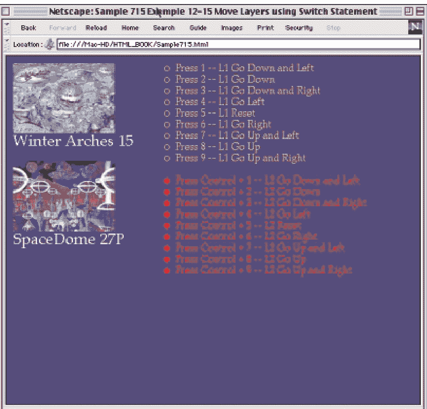

### 使用 switch() 语句移动图层

本示例通过定义 **moveALayer(e)** 函数来演示上述概念，用于测试 CONTROL 键和 1-9 键的 **modifiers**（修饰键）以及 KEYPRESS（按键）事件。根据按下哪个键，代码将使用 **moveBy()** 和 **moveTo()** 方法来移动名为 L1 和 L2 的图层。请参阅示例代码中的解释，以了解按键如何控制图层的移动方向。示例 6-15 的屏幕截图在上一页。

### 示例 6-15: Sample715.html

```html
<!DOCTYPE HTML PUBLIC "-//W3C//DTD HTML 3.2//EN">
<HTML>
<HEAD>
<TITLE> Sample 715   Example 6-15 Move Layers using Switch Statement</TITLE>

<STYLE TYPE="text/JavaScript">

      classes.Mainbody.BODY.margins("0px");
      classes.Mainbody.BODY.paddings("0px");
      classes.Mainbody.BODY.backgroundColor="navy";
      classes.Mainbody.BODY.color="white";
      classes.Mainbody.BODY.fontSize="22pt";

      ids.L3.fontSize="14pt";
      ids.L3.color="yellow";
      ids.L3.fontSize="14pt";

      tags.DIR.color="red";

</STYLE>

<!--  ***********************************************************  -->

<SCRIPT LANGUAGE="JavaScript1.2"><!--BEGIN HIDING

function moveALayer(e)  {

      var whichKey   = String.fromCharCode(e.which);
      var L1         = document.L1;
      var L2         = document.L2;

//The moveBy numbers make sense if you use the number pad on the right side of the
keyboard.
/*------------------------------------------------------------------------*/
  if (e.modifiers == Event.CONTROL_MASK)  {

	  switch (whichKey)  {
	  case '1' : L2.moveBy(-20,20);	break;  //press the CONTROL + 1 keys
	  case '2' : L2.moveBy(0,20);	break;  //press the CONTROL + 2 keys
	  case '3' : L2.moveBy(20,20);	break;  //press the CONTROL + 3 keys
	  case '4' : L2.moveBy(-20,0);	break;  //press the CONTROL + 4 keys
	  case '5' : L2.moveTo(10,150);	break;  //press the CONTROL + 5 keys
	  case '6' : L2.moveBy(20,0);	break;  //press the CONTROL + 6 keys
	  case '7' : L2.moveBy(-20,-20);	break;  //press the CONTROL + 7 keys
	  case '8' : L2.moveBy(0,-20);	break;  //press the CONTROL + 8 keys
	  case '9' : L2.moveBy(20,-20);	break;  //press the CONTROL + 9 keys
	  }
  }
  else  {
	  switch (whichKey)  {
	  case '1' : L1.moveBy(-20,20);	break;  //press the 1 key
	  case '2' : L1.moveBy(0,20);	break;  //press the 2 key
	  case '3' : L1.moveBy(20,20);	break;  //press the 3 key
	  case '4' : L1.moveBy(-20,0);	break;  //press the 4 key
	  case '5' : L1.moveTo(10,10);	break;  //press the 5 key
	  case '6' : L1.moveBy(20,0);	break;  //press the 6 key
	  case '7' : L1.moveBy(-20,-20);	break;  //press the 7 key
	  case '8' : L1.moveBy(0,-20);	break;  //press the 8 key
	  case '9' : L1.moveBy(20,-20);	break;  //press the 9 key
	  default : return false;
	  }

  }
}
/*------------------------------------------------------------------------*/

	document.captureEvents(Event.KEYPRESS);
	document.onkeypress = moveALayer;

/*------------------------------------------------------------------------*/
//END HIDING-->
</SCRIPT>

</HEAD>

<BODY CLASS="Mainbody">

<LAYER ID="L1" LEFT="10" TOP="10">

<BR>
Winter Arches 15

			</LAYER>

<LAYER ID="L2" LEFT="10" TOP="150">

<BR>
SpaceDome 27P

			</LAYER>

<!-- This just contains directions on how to use the Keys -->

<LAYER ID="L3" LEFT="200" TOP="10">
<UL TYPE=circle>
    <LI>Press  1 -- L1 Go Down and Left
    <LI>Press  2 -- L1 Go Down
    <LI>Press  3 -- L1 Go Down and Right
    <LI>Press  4 -- L1 Go Left
    <LI>Press  5 -- L1 Reset
    <LI>Press  6 -- L1 Go Right
    <LI>Press  7 -- L1 Go Up and Left
    <LI>Press  8 -- L1 Go Up
    <LI>Press  9 -- L1 Go Up and Right
</UL>
<DIR>
    <LI>Press Control +  1 -- L2 Go Down and Left
    <LI>Press Control +  2 -- L2 Go Down
    <LI>Press Control +  3 -- L2 Go Down and Right
    <LI>Press Control +  4 -- L2 Go Left
    <LI>Press Control +  5 -- L2 Reset
    <LI>Press Control +  6 -- L2 Go Right
    <LI>Press Control +  7 -- L2 Go Up and Left
    <LI>Press Control +  8 -- L2 Go Up
    <LI>Press Control +  9 -- L2 Go Up and Right
</DIR>

</LAYER>

</BODY>
</HTML>
```

## 图层和图像的动画效果

通过将一些富有创意的 JavaScript 与 **captureEvents()** 方法结合使用，您可以使图层中的图像产生动画效果，从而构建一个虽依赖用户选择但仍有预设脚本的演示。您可以让图层向任何方向移出屏幕。在图层向顶部或左侧消失的情况下，必须使用负数。

书中包含几个可运行的示例，您可以根据自己的需求轻松进行改编。其中一个示例包含了额外的控制图层，这些图层最初位于屏幕外，只能通过点击兄弟框架（Frame）中的图像来访问。

### 自动动画以及通过点击图像触发动画

示例 6-16 是一系列示例中的第一个，它使用鼠标点击以及七个函数中的多种方法，使包含艺术图像（由作者创作）的图层产生动画并将其揭晓。

运行该脚本时，您应该能看到以下效果：当您点击屏幕左上角的图像图标时，一个带有边框的小预览图将开始在屏幕底部从右向左滑动。然后，它将开始垂直向上升，直到停止并开始像被蚕食一样逐渐消失。当它完全消失时，艺术作品的大图开始显现，就像被揭开了一层无形的面纱。最后，如果您再次点击图标，大图将从视野中擦除，整个过程将从头开始。

JavaScript 首先定义三个布尔变量。接着定义四个变量，每个变量都被分配一个图层。然后，当 Control 图层调用 **captureEvents** 方法时，MOUSEDOWN 和 MOUSEUP 事件都会被捕获。随后，**booleanTest1(e)** 函数被应用于 onmousedown 事件处理器，而 **hideLargeClippedImage()** 函数被应用于 onclick 事件处理器。

```javascript
Control.captureEvents(Event.MOUSEDOWN | Event.MOUSEUP);
Control.onmousedown = booleanTest1;
Control.onclick = hideLargeClippedImage;
```

**booleanTest1(e)** 该函数捕获 Control 图层的 CLICK 事件，如果鼠标被按下且事件的 **target**（目标）是名为 myImage1 的图像，那么 **imageBoolean** = true 且 **imageBoolean3** = false；图层 L1 的 **visibility**（可见性）属性被设置为 'show'，并且通过 **moveTo(main.clip.width, main.clip.height-120)** 方法将其移动到几乎超出屏幕的右下角。之所以将 **moveTo()** 方法的 y 参数设置为比主图层的剪切高度少 120 像素，是为了让它在从浏览器窗口底部右侧水平向左滑动进入视野时可见。最后，它调用 **revealSmallImage()** 函数。

**revealSmallImage()** 该函数测试 L1 图层的 **clip.right** 和 **clip.top** 属性，由于它们将始终小于或等于零，因此在调用时总会将 L1 的尺寸调整为宽 180 像素、高 120 像素。

**hideLargeClippedImage()** 每当 L1 图层捕获到 CLICK 事件时，就会调用此函数。如果 **imageBoolean3** == false，并且剪切顶部（top）或右侧（right）属性任一大于零，它将通过 (-20, -12) 缩减剪切矩形。随后 **setTimeout()** 方法调用其容器函数（即 **hideLargeClippedImage()**），该过程不断重复直到图像被隐藏。当剪切矩形达到 (0,0) 时，**imageBoolean** 被设置为 'true'，并调用 **timeWasterLeft()** 函数。


## 592 第二部分 — JavaScript 1.2

**timeWasterLeft()** 当 **setTimeout()** 方法重复调用 **timeWasterLeft()** 函数时，该函数将图层 L1 向窗口的**左侧**滑动，直到其 **left** 属性小于或等于零。然后，它会调用 **timeWasterTop()** 函数。

**timeWasterTop()** 该函数通过 **setTimeout()** 方法不断调用 **timeWasterTop()** 函数，将图层 **L1** 从 **main** 图层的大约左下角向上滑动，直到其 **top** 属性大于零。当图层到达最终的左上角目的地时，将调用 **clipSmallImage()** 函数。

**clipSmallImage()** 该函数通过测试 **clip.right** 和 **clip.top** 属性的值，并结合使用 **resizeBy()** 方法和 **setTimeout()** 方法，逐步减小裁剪矩形的大小，直到小图像消失。一旦小图像被隐藏，包含艺术品大图的 **LLi1** 图层的 **visibility** 属性将被设置为 **'show'**。此时，图层 **LLi1** 仍然不可见，因为其裁剪矩形之前已被 **hideLargeClippedImage()** 函数设置为 (0,0)。这就是为什么此时需要调用 **revealLargeClippedImage()** 函数。

**revealLargeClippedImage()** 该函数通过测试图层 **LLi1** 的 **clip.right** 和 **clip.top** 属性来显示其中包含的大型艺术图像。只要这些属性仍然隐藏了图层的任何部分，它们就会通过 **setTimeout()** 方法进行扩展，并调用其容器函数 **revealLargeClippedImage()**。

## 示例 6-16：Sample716.html

```html
<!DOCTYPE HTML PUBLIC "-//W3C//DTD HTML 3.2//EN">
<HTML>
<HEAD>
<TITLE>Sample 716 - Example 6-16    Click an Image to start sequence </TITLE>

<STYLE type = "text/JavaScript">

      classes.Largefont.all.fontSize = "120pt";

      classes.theControl.all.fontSize = "22pt";
      classes.theControl.all.fontFamily = "Moonlight, cursive";
      classes.theControl.all.borderWidths("7px");
      classes.theControl.all.borderColor="#7700ff";
      classes.theControl.all.borderStyle="groove";

</STYLE>
</HEAD>

<BODY BGCOLOR="BLACK" TEXT="white">
<!-- *************************************************************** -->

<LAYER CLASS="theControl" ID="Control" LEFT="5" TOP="5" WIDTH="100" HEIGHT="100">

</LAYER>
```

## 第 6 章 — JavaScript 事件

```html
<!-- **************************************************** -->

<LAYER ID="main" LEFT="110" TOP="5" WIDTH="540" HEIGHT="380">

<LAYER CLASS="theControl" ID="L1" LEFT="5" TOP="5" VISIBILITY="hide">
</LAYER>

<LAYER CLASS="theControl" ID="LL1" LEFT="5" TOP="5" CLIP="0,0">
</LAYER>

</LAYER>

<!-- ******************************************************************** -->

<SCRIPT LANGUAGE="JavaScript1.2"><!--BEGIN HIDING

var imageBoolean;
var imageBoolean2;
var imageBoolean3;
var Control = document.Control; //Layer ID=Control
var main = document.main; //Layer ID=main
var L1 = document.main.document.L1; //Layer ID=L1
var LL11 = document.main.document.LL11; //Layer ID=LL11

Control.captureEvents(Event.MOUSEDOWN | Event.MOUSEUP);
Control.onmousedown = booleanTest1;
Control.onclick = hideLargeClippedImage;

/************************************************************************/

function booleanTest1(e) {

    Control.captureEvents(Event.CLICK);

    if (e.which == 1 && e.target.name == "myImage1") {

        imageBoolean = true;
        imageBoolean3 = false;

        L1.visibility = 'show';
        L1.moveTo(main.clip.width, main.clip.height-120);
        revealSmallImage();
    }
}

/************************************************************************/

function revealSmallImage() {
    if (L1.clip.right <= 0 || L1.clip.top <= 0) {
        L1.resizeTo(180,120);
    }
}

/************************************************************************/
```

## 594 第二部分 — JavaScript 1.2

```javascript
function hideLargeClippedImage() {
    if (imageBoolean3 == false) {
        if (LLi1.clip.right > 0 || LLi1.clip.top > 0) {
            LLi1.resizeBy(-20, -12);
            setTimeout('hideLargeClippedImage()', 20);
        }
        else if (LLi1.clip.right <= 0 || LLi1.clip.top <= 0) {
            imageBoolean = true;
            timeWaterLeft();
        }
    }
}
/*----------------------------------------------------------------*/
```

```javascript
function timeWaterLeft() {
    if (imageBoolean == true) {
        if (LL.left > 0) {
            LL.moveBy(-20, 0);
            setTimeout('timeWaterLeft()', 20);
        }
        else if (LL.left <= 0) {
            timeWaterTop();
        }
    }
}
/*----------------------------------------------------------------*/
```

```javascript
function timeWaterTop() {
    if (imageBoolean == true) {
        if (LL.top > 0) {
            LL.moveBy(0, -20);
            setTimeout('timeWaterTop()', 20);
        }
        else if (LL.top <= 0) {
            imageBoolean2 = true;
            clipSmallImage();
        }
    }
}
/*----------------------------------------------------------------*/
```

```javascript
function clipSmallImage() {
    if (imageBoolean2 == true) {
        if (LL.clip.right > 0 || LL.clip.top > 0) {
            LL.resizeBy(-10, -6);
            setTimeout('clipSmallImage()', 20);
        }
        else if (LL.clip.right <= 0 && LL.clip.top <= 0) {
            imageBoolean2 = false;
            imageBoolean3 = true;
        }
    }
}
```

```javascript
LLi1.visibility = 'show';
revealLargeClippedImage();
```

```javascript
}
}
```

```javascript
}
/*----------------------------------------------------------------*/
```

```javascript
function revealLargeClippedImage() {
    if (imageBoolean3 == true) {
        if (LLi1.right < main.clip.width ||
           LLi1.clip.top < main.clip.height) {
            LLi1.resizeBy(20,12);
            setTimeout('revealLargeClippedImage()', 20);
        }
    }
}
```

```javascript
//END HIDING-->
</SCRIPT>
</BODY>
</HTML>
```

## 使用 e.target.name 属性为图层创建动画

本示例在之前的示例基础上进行了扩展，提供了四张图像供选择，并使用 `CLICK Event` 对象的 `target` 属性的 `name` 属性来根据点击的图像决定执行哪段代码，如下所示：

```javascript
if (e.which == 1 && e.target.name == "MyImage1")
```

主要函数与上一个示例几乎完全相同，不同之处在于你需要根据点击的图像来更改图层的 `visibility` 属性，并且 `boolean Test(e)` 函数决定调用哪个 `revealSmallImage()` 函数。这六个函数各有四个版本，详细解释请参阅第 591 页和 592 页的示例 6-16：

- `revealSmallImage()`
- `hideLargeClippedImage()`
- `timeWaterLeft()`
- `timeWaterTop()`
- `clipSmallImage()`
- `revealLargeClippedImage()`

## 第二部分 — JavaScript 1.2

## 示例 6-17：Sample717.html

```html
<!DOCTYPE HTML PUBLIC "-//W3C//DTD HTML 3.2//EN">
<HTML>
<HEAD>
<TITLE>Sample 717 - Example 6-17 Click to Reveal Images </TITLE>

<STYLE type = "text/javascript">
	classes.Largefont.all.fontSize = "120pt";
	classes.theControl.all.fontSize = "22pt";
	classes.theControl.all.fontFamily = "Moonlight, cursive";
	classes.theControl.all.borderWidths("7px");
	classes.theControl.all.borderColor="#7700ff";
	classes.theControl.all.borderStyle="groove";
</STYLE>

</HEAD>

<BODY BGCOLOR="BLACK" TEXT="white">

<!--  *********************************************************************************** -->

<LAYER CLASS="theControl" ID="Control" LEFT="5" TOP="5" WIDTH="100" HEIGHT="500">


</LAYER>


<LAYER ID="main" LEFT="110" TOP="5" WIDTH="540" HEIGHT="380">

<LAYER CLASS="theControl" ID="L1" LEFT="5" TOP="5" VISIBILITY="hide">

</LAYER>

<LAYER CLASS="theControl" ID="LLi1" LEFT="5" TOP="5" CLIP="0,0)">

</LAYER>

<LAYER CLASS="theControl" ID="L2" LEFT="5" TOP="5" VISIBILITY="hide">

</LAYER>

<LAYER CLASS="theControl" ID="LLi2" LEFT="5" TOP="5" CLIP="0,0)">

</LAYER>
```


 # 第 6 章 — JavaScript 事件

```
<LAYER CLASS="theControl" ID="L3" LEFT="5" TOP="5" VISIBILITY="hide">

</LAYER>

<LAYER CLASS="theControl" ID="LL3" LEFT="5" TOP="5" CLIP="0,0">

</LAYER>

<LAYER CLASS="theControl" ID="L4" LEFT="5" TOP="5" VISIBILITY="hide">

</LAYER>

<LAYER CLASS="theControl" ID="LL4" LEFT="5" TOP="5" CLIP="0,0">

</LAYER>

</LAYER>
```

```
<!-- ******************************************************************** -->

<SCRIPT LANGUAGE="JavaScript1.2"><!--BEGIN HIDING

var imageBoolean;
var imageBoolean2;
var imageBoolean3;

var Control = document.Control;
var main = document.main;
var L1 = document.main.document.L1;
var LL1 = document.main.document.LL1;
var L2 = document.main.document.L2;
var LL2 = document.main.document.LL2;
var L3 = document.main.document.L3;
var LL3 = document.main.document.LL3;
var L4 = document.main.document.L4;
var LL4 = document.main.document.LL4;

Control.captureEvents(Event.MOUSEDOWN | Event.MOUSEUP);
Control.onmousedown = booleanTest1;
```

```
/*

function booleanTest1() {

    Control.captureEvents(Event.CLICK);

    if (e.which == 1 && e.target.name == "MyImage1") {

        imageBoolean3 = false;
        L1.visibility = 'show';
        L2.visibility = 'hide';
        L3.visibility = 'hide';
        L4.visibility = 'hide';
        L1.moveTo(main.clip.width, main.clip.height-120);
        revealSmallImage();
    }
}
```

```
if (e.which == 1 && e.target.name == "myImage2") {

        imageBoolean3 = false;
        L1.visibility = 'hide';
        L2.visibility = 'show';
        L3.visibility = 'hide';
        L4.visibility = 'hide';
        L2.moveTo(main.clip.width, main.clip.height-120);
        revealSmallImage2();
    }
    if (e.which == 1 && e.target.name == "myImage3") {

        imageBoolean3 = false;
        L1.visibility = 'hide';
        L2.visibility = 'hide';
        L3.visibility = 'show';
        L4.visibility = 'hide';
        L3.moveTo(main.clip.width, main.clip.height-120);
        revealSmallImage3();
    }
    if (e.which == 1 && e.target.name == "myImage4") {

        imageBoolean3 = false;
        L1.visibility = 'hide';
        L2.visibility = 'hide';
        L3.visibility = 'hide';
        L4.visibility = 'show';
        L4.moveTo(main.clip.width, main.clip.height-120);
        revealSmallImage4();
    }
}

/*--------------------------------------------------------*/

function revealSmallImage() {

    hideLargeClippedImage();

    if (L1.clip.right <= 0 || L1.clip.top <= 0) {
        L1.resizeTo(180,120);
    }
}

function hideLargeClippedImage() {

    if (imageBoolean3 == false) {

        LL1.visibility = 'hide';
        LL3.visibility = 'hide';
        LL4.visibility = 'hide';
        LL1.resizeTo(0,0);
        LL1.visibility = 'hide';
        imageBoolean = true;
        timeWasterLeft();
    }
}
```

```
function timeWasterLeft() {
    if (imageBoolean == true) {
        if (L1.left > 0) {
            L1.moveBy(-20,0);
            setTimeout('timeWasterLeft()', 20);
        }
        else if (L1.left <= 0) {
            timeWasterTop();
        }
    }
}
```

```
function timeWasterTop() {
    if (imageBoolean == true) {
        if (L1.top > 0) {
            L1.moveBy(0,-20);
            setTimeout('timeWasterTop()', 20);
        }
        else if (L1.top <= 0) {
            imageBoolean2 = true;
            clipSmallImage();
        }
    }
}
```

```
function clipSmallImage() {
    if (imageBoolean2 == true) {
        if (L1.clip.right > 0 || L1.clip.top > 0) {
            L1.resizeBy(-10,-6);
            setTimeout('clipSmallImage()', 20);
        }
        else if (L1.clip.right <= 0 && L1.clip.top <= 0) {
            imageBoolean2 = false;
            imageBoolean3 = true;
            L1.visibility = 'show';
            revealLargeClippedImage();
        }
    }
}
```

```
function revealLargeClippedImage() {
    if (imageBoolean3 == true) {
        if (LL1.clip.right < main.clip.width
        || LL1.clip.top < main.clip.height) {
            LL1.resizeBy(20,12);
            setTimeout('revealLargeClippedImage()', 20);
        }
    }
}
```

# 600 第二部分 — JavaScript 1.2

```
/*---------------------------------------------------------------------------------*/

function revealSmallImage2() {

    hideLargeClippedImage2();

    if (L2.clip.right <= 0 || L2.clip.top <= 0) {
        L2.resizeTo(180,120);
    }

}

function hideLargeClippedImage2() {

    if (imageBoolean3 == false) {

        LL1.visibility = 'hide';
        LL3.visibility = 'hide';
        LL4.visibility = 'hide';
        LL2.resizeTo(0,0);
        LL2.visibility = 'hide';
        imageBoolean = true;
        timeWasterLeft2();

    }

}

function timeWasterLeft2() {

    if (imageBoolean == true) {

        if (L2.left > 0) {
            L2.moveBy(-20,0);
            setTimeout('timeWasterLeft2()', 20);
        }
        else if (L2.left <= 0) {
            timeWasterTop2();
        }

    }

}

function timeWasterTop2() {

    if (imageBoolean == true) {

        if (L2.top > 0) {
            L2.moveBy(0,-20);
            setTimeout('timeWasterTop2()', 20);
        }
        else if (L2.top <= 0) {
            imageBoolean2 = true;
            clipSmallImage2();
        }

    }
}
```

# 601

```
function clipSmallImage2() {
    if (imageBoolean2 == true) {
        if (L2.clip.right > 0 || L2.clip.top > 0) {
            L2.resizeBy(-10,-6);
            setTimeout('clipSmallImage2()', 20);
        }
        else if (L2.clip.right <= 0 && L2.clip.top <= 0) {
            imageBoolean2 = false;
            imageBoolean3 = true;
            LL2.visibility = 'show';
            revealLargeClippedImage2();
        }
    }
}
```

```
function revealLargeClippedImage2() {
    if (imageBoolean3 == true) {
        if (LL2.clip.right < main.clip.width || LL2.clip.top < main.clip.height) {
            LL2.resizeBy(20,12);
            setTimeout('revealLargeClippedImage2()', 20);
        }
    }
}
```

```
/*-------------------------------------------------------------------*/

function revealSmallImage3() {
    hideLargeClippedImage3();
    if (L3.clip.right <= 0 || L3.clip.top <= 0) {
        L3.resizeTo(180,120);
    }
}
```

```
function hideLargeClippedImage3() {
    if (imageBoolean3 == false) {
        LL1.visibility = 'hide';
        LL2.visibility = 'hide';
        LL4.visibility = 'hide';
        LL3.resizeTo(0,0);
        LL3.visibility = 'hide';
        imageBoolean = true;
        timeWasterLeft3();
    }
}
```

# 602 第二部分 — JavaScript 1.2

```
function timeWasterLeft3() {
    if (imageBoolean == true) {
    if (L3.left > 0) {
        L3.moveBy(-20,0);
        setTimeout('timeWasterLeft3()', 20);
    }
    else if (L3.left <= 0) {
        timeWasterTop3();
    }
}
}
```

```
function timeWasterTop3() {
    if (imageBoolean == true) {
        if (L3.top > 0) {
            L3.moveBy(0,-20);
            setTimeout('timeWasterTop3()', 20);
        }
        else if (L3.top <= 0) {
            imageBoolean2 = true;
            clipSmallImage3();
        }
    }
}
```

```
function clipSmallImage3() {
    if (imageBoolean2 == true) {
        if (L3.clip.right > 0 || L3.clip.top > 0) {
            L3.resizeBy(-10,-6);
            setTimeout('clipSmallImage3()', 20);
        }
        else if (L3.clip.right <= 0 && L3.clip.top <= 0) {
            imageBoolean2 = false;
            imageBoolean3 = true;
            LL3.visibility = 'show';
            revealLargeClippedImage3();
        }
    }
}
```

```
function revealLargeClippedImage3() {
    if (imageBoolean3 == true) {
        if (LL3.clip.right < main.clip.width ||
            LL3.clip.top < main.clip.height) {
            LL3.resizeBy(20,12);
            setTimeout('revealLargeClippedImage3()', 20);
        }
    }
}
```


```javascript
/*----------------------------------------*/

function revealSmallImage4() {

    hideLargeClippedImage4();

    if (L4.clip.right <= 0 || L4.clip.top <= 0) {
        L4.resizeTo(180,120);
    }
}

function hideLargeClippedImage4() {

    if (imageBoolean3 == false) {

        LLi1.visibility = 'hide';
        LLi2.visibility = 'hide';
        LLi3.visibility = 'hide';
        LLi4.resizeTo(0,0);
        LLi4.visibility = 'hide';
        imageBoolean = true;
        timeWasterLeft4();
    }
}

function timeWasterLeft4() {

    if (imageBoolean == true) {

        if (L4.left > 0) {
            L4.moveBy(-20,0);
            setTimeout('timeWasterLeft4()', 20);
        }
        else if (L4.left <= 0) {
            timeWasterTop4();
        }
    }
}

function timeWasterTop4() {

    if (imageBoolean == true) {

        if (L4.top > 0) {
            L4.moveBy(0,-20);
            setTimeout('timeWasterTop4()', 20);
        }
        else if (L4.top <= 0) {
            imageBoolean2 = true;
            clipSmallImage4();
        }
    }
}
```

```javascript
function clipSmallImage4()  {

    if (imageBoolean2 == true)  {

        if (L4.clip.right > 0  ||  L4.clip.top > 0)  {
            L4.resizeBy(-10,-6);
            setTimeout('clipSmallImage4()', 20);
        }
        else if (L4.clip.right <= 0  &&  L4.clip.top <= 0)  {
            imageBoolean2 = false;
            imageBoolean3 = true;
            LLi4.visibility = 'show';
            revealLargeClippedImage4();
        }
    }
}
function revealLargeClippedImage4()  {

    if (imageBoolean3 == true)  {

        if (LLi4.clip.right < main.clip.width  ||
            LLi4.clip.top < main.clip.height)  {
            LLi4.resizeBy(20,12);
            setTimeout('revealLargeClippedImage4()', 20);
        }
    }
}

//END HIDING-->
</SCRIPT>
</BODY>
</HTML>
```

## 在 Frameset 环境中为图层创建动画

示例 6-18 实现了与前一个示例相同的功能，但它是在 FRAMESET 环境中完成的。[Sample718Frameset.html](Sample718Frameset.html) 包含一个将窗口分为两个 FRAME 的 FRAMESET，左侧 FRAME 名为 **display**，加载 [Sample718.html](Sample718.html) 文档；右侧 FRAME 名为 **view**，加载 [Sample718A.html](Sample718A.html) 文档。**display** FRAME 拥有 ID 为 **Control** 的图层，用于捕获 CLICK、MOUSEDOWN 和 MOUSEUP 事件，并根据点击的图像图标来处理这些事件。同样，**booleanTest1(e)** 函数被分配给 **Control** 图层的 **onmousedown** 事件处理程序，但这一次它使用 **view** FRAME 的 **location** 属性，根据 **e.target.name** 条件（用户点击的图像）来加载外部文档，代码如下：

```javascript
if (e.which == 1  &&  e.target.name == "myImage1")  {

    view.location.href = 'Sample718A.html';
    ...
}
```

需要注意的是，**view** 此前已被定义为：

```javascript
var view = parent.view;
```

否则，之前的代码必须写成：

```javascript
parent.view.location.href = 'Sample718A.html';
```

可以加载到 **view** FRAME 中的四个外部文件 each 都有自己的动画 SCRIPT，就像前一个示例一样。详情请参阅从第 591 页开始的示例 6-16 和从第 595 页开始的示例 6-17。

## 示例 6-18 第一部分：Sample718.html

```html
<!DOCTYPE HTML PUBLIC "-//W3C//DTD HTML 3.2//EN">
<HTML>
<HEAD>
<TITLE>Sample 718 - Example 6-18    Click to Reveal Images </TITLE>

<STYLE type = "text/JavaScript">

      classes.theControl.all.fontSize = "22pt";
      classes.theControl.all.fontFamily = "Moonlight, cursive";
      classes.theControl.all.borderWidths("7px");
      classes.theControl.all.borderColor="#22ffff";
      classes.theControl.all.borderStyle="groove";

</STYLE>
</HEAD>

<BODY BGCOLOR="BLACK" TEXT="white"
BACKGROUND="JPEG-FILES/ICON-HorizontalRainbow4.jpg">

<LAYER CLASS="theControl" ID="Control" LEFT="5" TOP="5" WIDTH="100" HEIGHT="500">


</LAYER>

<SCRIPT LANGUAGE="JavaScript1.2"><!--BEGIN HIDING

var imageBoolean;
var imageBoolean2;
var imageBoolean3;
var Control   = document.Control;
var view      = parent.view;

Control.captureEvents(Event.MOUSEDOWN | Event.MOUSEUP);
Control.onmousedown = booleanTest1;

function booleanTest1(e) {

    Control.captureEvents(Event.CLICK);

    if (e.which == 1 && e.target.name == "myImage1") {

        view.location.href = 'Sample718A.html';
    }

    if (e.which == 1 && e.target.name == "myImage2") {

        view.location.href = 'Sample718B.html';
    }

    if (e.which == 1 && e.target.name == "myImage3") {

        view.location.href = 'Sample718C.html';
    }

    if (e.which == 1 && e.target.name == "myImage4") {

        view.location.href = 'Sample718D.html';
    }
}

//END HIDING-->
</SCRIPT>

</BODY>
</HTML>
```

这是加载到 **view** Frame 的四个外部文档之一。另外三个是 [Sample718B.html](Sample718B.html)、[Sample718C.html](Sample718C.html) 和 [Sample718D.html](Sample718D.html)，它们包含在 CD-ROM 中，但未在书中列出，因为它们几乎完全相同。在这个版本的动画序列中，大图像不会被“蚕食”，从而节省了一些时间。因此，**hideLargeClippedImage()** 函数已被省略。在对该函数的省略进行少量代码补偿后，动画序列的其余函数与之前的示例 6-17 完全相同。

```html
<!DOCTYPE HTML PUBLIC "-//W3C//DTD HTML 3.2//EN">
<HTML>
<HEAD>
<TITLE>Sample 718A - Example 6-18A    Click to Reveal Images </TITLE>

<STYLE type = "text/JavaScript">
classes.theControl.all.fontSize = "22pt";
classes.theControl.all.fontFamily = "Moonlight, cursive";
classes.theControl.all.borderWidths("7px");
classes.theControl.all.borderColor="#7700ff";
classes.theControl.all.borderStyle="groove";
</STYLE>
</HEAD>
<BODY BGCOLOR="BLACK" TEXT="white" onload="revealSmallImage();"
BACKGROUND="JPEG-FILES/Icon-Bg-asteroids.jpg">

<LAYER ID="main" LEFT="5" TOP="5" WIDTH="540" HEIGHT="380">

<LAYER CLASS="theControl" ID="L1" LEFT="5" TOP="5" VISIBILITY="hide">

</LAYER>

<LAYER CLASS="theControl" ID="L11" LEFT="5" TOP="5" CLIP="0,0">

</LAYER>

</LAYER>

<SCRIPT LANGUAGE="JavaScript 1.2"><!--BEGIN HIDING

var imageBoolean;
var imageBoolean2;
var imageBoolean3;
var main = document.main;
var L1 = document.main.document.L1;
var L11 = document.main.document.L11;

function revealSmallImage() {
    L1.moveTo(main.clip.width, main.clip.height-120);
    L1.visibility = 'show';

    if (L1.clip.right <= 0 || L1.clip.top <= 0) {
        L1.resizeTo(180,120);
    }
    imageBoolean = true;
    timeWaterLeft();
}

function timeWaterLeft() {
    if (imageBoolean == true) {
        if (L1.left > 0) {
            L1.moveBy(-20,0);
            setTimeout('timeWaterLeft()', 20);
        }
        else if (L1.left <= 0) {
            timeWaterStop();
        }
    }
}

function timeWasterTop() {
    if (imageBoolean == true) {
        if (L11.top > 0) {
            L11.moveBy(0,-20);
            setTimeout('timeWasterTop()', 20);
        }
        else if (L11.top <= 0) {
            imageBoolean2 = true;
            clipSmallImage();
        }
    }
}

function clipSmallImage() {
    if (imageBoolean2 == true) {
        if (L11.clip.right > 0 || L11.clip.top > 0) {
            L11.resizeBy(-10,-6);
            setTimeout('clipSmallImage()', 20);
        }
        else if (L11.clip.right <= 0 && L11.clip.top <= 0) {
            imageBoolean2 = false;
            imageBoolean3 = true;
            L11.visibility = 'show';
            revealLargeClippedImage();
        }
    }
}

function revealLargeClippedImage() {
    if (imageBoolean3 == true) {
        if (L11.clip.right < main.clip.width ||
            L11.clip.top < main.clip.height) {
            L11.resizeBy(20,12);
            setTimeout('revealLargeClippedImage()', 20);
        }
    }
}

//END HIDING-->
</SCRIPT>

</BODY>
</HTML>
```


这是示例 6-18 的框架集。

## 示例 6-18 第 3 部分：Sample718Frameset.html

```
<!DOCTYPE HTML PUBLIC "-//W3C//DTD HTML 3.2//EN">
<HTML>
<HEAD>

<TITLE>Frameset for Sample 718</TITLE>

</HEAD>

<FRAMESET COLS="120,*">

      <FRAME SCROLLING="no" NAME="display" SRC="Sample718.html">

      <FRAME SCROLLING="auto" NAME="view" SRC="Sample718A.html">

</FRAMESET>

</HTML>
```

## 使用 JavaScript 控制外部框架文档

当你想要从一个包含在同一 FRAMESET 中的框架（FRAME）去操作另一个框架中包含的文档内容时，你必须通过其 **name** 属性和其容器 FRAMESET 的 **parent** 关键字来引用外部框架，如下所示：

```
parent.view.document.bgColor = "blue";
```

其中 **view** 是你想要更改的框架的名称，**bgColor** 属性将被更改为蓝色。

现在假设你有一个名为 **view** 的框架，其中包含一个名为 **main** 的层（Layer）。以下是如何在与 **view** 框架同一 FRAMESET 中的名为 **display** 的框架所包含的代码中，将 **visibility** 属性更改为 '**show**'：

```
parent.view.document.main.visibility = 'show';
```

现在假设你有一个名为 view 的框架和一个名为 main 的层，其中包含一个嵌套的名为 L2 的层。以下是如何从外部框架使用 moveTo() 方法将层 L2 移动到新的坐标 (240,20)：

```
parent.view.document.main.document.L2.moveTo(240,20);
```

最后，假设你有一个名为 view 的框架和一个名为 main 的层，其中包含一个名为 form1 的表单（FORM）元素，该表单包含一个名为 text1 的文本输入（TEXT INPUT）元素。要更改显示在 text1 中的文本字符串，你需要更改其 value 属性。要从外部框架执行此操作，请使用以下代码：

```
parent.view.document.main.document.form1.text1.value = "Hi there.";
```

## JavaScript 的 linkColor、alinkColor 和 vlinkColor 属性

你可以使用 linkColor、alinkColor 和 vlinkColor 属性来更改链接、活动链接和已访问链接的颜色，只需通过以下语法中的 color 参数分配新颜色即可。这在第 619 页示例 6-19 的 HEAD 元素中的一个小脚本中有演示。

## JavaScript 语法：

```
document.linkColor = color;
document.alinkColor = color;
document.vlinkColor = color;
```

## 使用按键事件来隐藏和显示层

这是本系列中最后一个处理通过层捕获事件来动画化其他层图像的示例。它使用与上一个示例相同的 FRAMESET 环境，并增加了在显示框架（display FRAME）中通过文档对象捕获 KEYPRESS 事件时隐藏和显示层的附加功能。

本示例的一个显著特点是每个图像图标都包含在其自己独立的层中，因此你需要为每个层捕获 MOUSEDOWN、MOUSEUP 和 CLICK 事件。还有四个函数处理加载外部文档：每个包含图标的层都有一个 onmousedown 事件处理程序。它们本质上与上一个示例中的布尔 Test1(e) 函数平行。

它们是：

- **loadItUp1(e)**
- **loadItUp2(e)**
- **loadItUp3(e)**
- **loadItUp4(e)**

以下十一个函数处理 KEYPRESS 事件，并最显著地演示了如何深入外部框架并根据用户从键盘的输入用 JavaScript 代码操作其内容，如上面部分所述。

**keyJump(e)** 由于有四个不同的文档可以加载到 **display** 框架中，此函数通过使用 **if** () 条件语句来测试加载了哪个文档，这些条件语句仅在特定层存在时才会执行，因为该层对每个文档来说都是唯一的。例如：

```
if (parent.view.document.main.document.LLi1)
```

测试名为 **LLi1** 的层是否存在于 **view** 框架中名为 **main** 的层中。这防止了因错误的文档加载到框架中而尝试操作不存在的层所导致的 JavaScript 错误。这样想：如果包含 **LLi2** 层的文档加载到了框架中，而代码尝试访问框架中文档所不存在的 **LLi1** 层，你会得到一个错误。使用上述 **if** () 条件可以防止这种情况发生，因为它拒绝执行任何与未加载到 **view** 框架中的层相关的代码。

在测试该条件后，如果返回 **true**，则继续测试 CONTROL 键与 1、2、3 或 4 键的组合是否被按下。（编程提示：如果你不喜欢测试数值，可以使用 **String.fromCharCode(x)** 方法。就我个人而言，我喜欢使用数字，因为更容易阅读代码和跟踪值，但这只是个人偏好。找到最适合你思维习惯的方式。）

因此，如果 **LLi1** 层在 **view** 框架中且 **e.which** == 49（即 **1** 键），则：将层 **LLi1** 的 **visibility** 属性设置为 '**show**'。

如果 **e.which** == 50（即 **2** 键），则调用 **previewImageA()** 函数。

如果 **e.which** == 51（即 **3** 键），则调用 **previewAllImages()** 函数。

如果 **e.which** == 52（即 **4** 键），则调用 **hideAllPreviewImages()** 函数。

对于其他三个可能加载到 **view** 框架中的文档，此过程会重复进行。

**previewAllImages()** 此函数将包含小预览图像的四个层的 **visibility** 属性设置为 '**show**'，调整它们的大小并将它们重新定位到网格中。

**hideAllPreviewImages()** 此函数只是隐藏所有的小预览图像。

**previewImageA()、previewImageB()、previewImageC()、previewImageD()**

这四个函数使用 **visibility** 属性以及 **moveTo()** 和 **resizeTo()** 方法来显示所需的预览图像，基于按下的键或任意层的 **L1**、**L2**、**L3** 或 **L4** **onMouseOver** 属性事件处理程序。

## 第 II 部分 — JavaScript 1.2

**hidePreviewImageA()、hidePreviewImageB()、hidePreviewImageC()、hidePreviewImageD()**

这四个函数根据按下的键或任意层的 L1、L2、L3 或 L4 **onMouseOut** 属性事件处理程序，将其相应层的 **visibility** 属性更改为 "hide"。

此示例还包含一个帮助文档，点击链接时会在新的浏览器窗口中打开。其 URL 为 <u>Sample719HELP.html</u>，位于 CD-ROM 上。

## 示例 6-19 第 1 部分：Sample719.html

```
<!DOCTYPE HTML PUBLIC "-//W3C//DTD HTML 3.2//EN">
<HTML>
<HEAD>
<TITLE>Sample 719 - Example 6-19         Click to Reveal Images </TITLE>

<STYLE type = "text/JavaScript">
    classes.theControl.all.fontSize = "22pt";
    classes.theControl.all.fontFamily = "Moonlight, cursive";
    classes.theControl.all.borderWidths("7px");
    classes.theControl.all.borderColor = "#00ff00";
    classes.theControl.all.borderStyle = "groove";
    classes.theControl.all.width = "120px";

    ids.LayerA.borderColor = "cyan";
    ids.LayerB.borderColor = "#00ccff";
    ids.LayerC.borderColor = "#0088ff";
    ids.LayerD.borderColor = "#0022ff";

    ids.LayerA.width = "90px";
    ids.LayerB.width = "90px";
    ids.LayerC.width = "90px";
    ids.LayerD.width = "90px";

    ids.LayerH.width = "100px";
    ids.LayerH.borderColor = "yellow";
    ids.LayerH.backgroundColor = "yellow";
    ids.LayerH.paddings("4px");
</STYLE>

<SCRIPT LANGUAGE="JavaScript1.2"><!--BEGIN HIDING
    document.linkColor = "lime";
    document.alinkColor = "darkblue";
    document.vlinkColor = "red";
//END HIDING-->
</SCRIPT>
</HEAD>
```

## 第 6 章 — JavaScript 事件

<!--The left frame must have focus for KeyPress Events to work.-->
<BODY BGCOLOR="BLACK" TEXT="white" onLoad="window.focus();" BACKGROUND="JPEG-FILES/ICON-HorizontalRainbow4.jpg">
<LAYER CLASS="theControl" ID="LayerA" LEFT="15" TOP="15" onMouseOver="previewImageA();" onMouseOut="hidePreviewImageA();">
</LAYER>
<LAYER CLASS="theControl" ID="LayerB" LEFT="15" TOP="90" onMouseOver="previewImageB();" onMouseOut="hidePreviewImageB();">
</LAYER>
<LAYER CLASS="theControl" ID="LayerC" LEFT="15" TOP="165" onMouseOver="previewImageC();" onMouseOut="hidePreviewImageC();">
</LAYER>
<LAYER CLASS="theControl" ID="LayerD" LEFT="15" TOP="240" onMouseOver="previewImageD();" onMouseOut="hidePreviewImageD();">
</LAYER>
<LAYER CLASS="theControl" ID="LayerH" LEFT="15" TOP="325">
<A HREF="./Sample719HELP.html" TARGET="_blank"> HELP!! </A> </LAYER>

```
<SCRIPT LANGUAGE="JavaScript1.2"><!--BEGIN HIDING

var LayerA = document.LayerA;
var LayerB = document.LayerB;
var LayerC = document.LayerC;
var LayerD = document.LayerD;

var view = parent.view;

LayerA.captureOptions(Event.MOUSEDOWN | Event.MOUSEUP);
LayerA.onmousedown = loadItUp1;

LayerB.captureOptions(Event.MOUSEDOWN | Event.MOUSEUP);
LayerB.onmousedown = loadItUp2;

LayerC.captureOptions(Event.MOUSEDOWN | Event.MOUSEUP);
LayerC.onmousedown = loadItUp3;

LayerD.captureOptions(Event.MOUSEDOWN | Event.MOUSEUP);
LayerD.onmousedown = loadItUp4;

document.captureOptions(Event.KEYPRESS);     //-------THIS IS CRITICAL CODE
document.onkeypress = keyJump;          //-------THIS IS CRITICAL CODE

/*--------------------------------------*/
```


## 第二部分 — JavaScript 1.2

```javascript
function loadItUp1() {
    LayerA.captureEvents(Event.CLICK);
    if (e.which == 1 && e.target.name == "myImage1") {
        view.location.href = 'Sample719A.html';
    }
}

function loadItUp2() {
    LayerB.captureEvents(Event.CLICK);
    if (e.which == 1 && e.target.name == "myImage2") {
        view.location.location.href = 'Sample719B.html';
    }
}

function loadItUp3() {
    LayerC.captureEvents(Event.CLICK);
    if (e.which == 1 && e.target.name == "myImage3") {
        view.location.href = 'Sample719C.html';
    }
}

function loadItUp4() {
    LayerD.captureEvents(Event.CLICK);
    if (e.which == 1 && e.target.name == "myImage4") {
        view.location.href = 'Sample719D.html';
    }
}

/*-------------------------------------------------------------------------------------------*/

function keyJump() {
    if (parent.view.document.main.document.LL1) {
        if (e.modifiers == Event.CONTROL_MASK && e.which == 49) {
            parent.view.document.main.document.LL1.visibility = 'show';
        }
        else if (e.modifiers == Event.CONTROL_MASK && e.which == 50) {
            previewImageA();
        }
        else if (e.modifiers == Event.CONTROL_MASK && e.which == 51) {
            parent.view.document.main.document.LL1.visibility = 'hide';
            previewAllImages();
        }
        else if (e.modifiers == Event.CONTROL_MASK && e.which == 52) {
            hideAllPreviewImages();
        }
    }
    if (parent.view.document.main.document.LL2) {
        if (e.modifiers == Event.CONTROL_MASK && e.which == 49) {
            parent.view.document.main.document.LL2.visibility = 'show';
        }
        else if (e.modifiers == Event.CONTROL_MASK && e.which == 50) {
            previewImageB();
        }
        else if (e.modifiers == Event.CONTROL_MASK && e.which == 51) {
            parent.view.document.main.document.LL2.visibility = 'hide';
            previewAllImages();
        }
        else if (e.modifiers == Event.CONTROL_MASK && e.which == 52) {
            hideAllPreviewImages();
        }
    }
    if (parent.view.document.main.document.LL3) {
        if (e.modifiers == Event.CONTROL_MASK && e.which == 49) {
            parent.view.document.main.document.LL3.visibility = 'show';
        }
        else if (e.modifiers == Event.CONTROL_MASK && e.which == 50) {
            previewImageC();
        }
        else if (e.modifiers == Event.CONTROL_MASK && e.which == 51) {
            parent.view.document.main.document.LL3.visibility = 'hide';
            previewAllImages();
        }
        else if (e.modifiers == Event.CONTROL_MASK && e.which == 52) {
            hideAllPreviewImages();
        }
    }
    if (parent.view.document.main.document.LL4) {
        if (e.modifiers == Event.CONTROL_MASK && e.which == 49) {
            parent.view.document.main.document.LL4.visibility = 'show';
        }
        else if (e.modifiers == Event.CONTROL_MASK && e.which == 50) {
            previewImageD();
        }
        else if (e.modifiers == Event.CONTROL_MASK && e.which == 51) {
            parent.view.document.main.document.LL4.visibility = 'hide';
            previewAllImages();
        }
        else if (e.modifiers == Event.CONTROL_MASK && e.which == 52) {
            hideAllPreviewImages();
        }
    }
}
/*----------------------------------------------------------------*/

function previewAllImages() {
    parent.view.document.main.document.L2.visibility = 'show';
    parent.view.document.main.document.L3.visibility = 'show';
    parent.view.document.main.document.L4.visibility = 'show';
    parent.view.document.main.document.L1.visibility = 'show';

    parent.view.document.main.document.L1.resizeTo(180,120);
    parent.view.document.main.document.L1.moveTo(20,20);

    parent.view.document.main.document.L2.resizeTo(180,120);
    parent.view.document.main.document.L2.moveTo(240,20);

    parent.view.document.main.document.L3.resizeTo(180,120);
    parent.view.document.main.document.L3.moveTo(20,240);

    parent.view.document.main.document.L4.resizeTo(180,120);
    parent.view.document.main.document.L4.moveTo(240,240);
}

function hideAllPreviewImages() {
    parent.view.document.main.document.L1.visibility = 'hide';
    parent.view.document.main.document.L2.visibility = 'hide';
    parent.view.document.main.document.L3.visibility = 'hide';
    parent.view.document.main.document.L4.visibility = 'hide';
}

/*------------------------------------------------------------*/

function previewImageA() {
    if (parent.view.document.main.document.LL1) {
        parent.view.document.main.document.LL1.visibility = 'hide';
        parent.view.document.main.document.L2.visibility = 'hide';
        parent.view.document.main.document.L3.visibility = 'hide';
        parent.view.document.main.document.L4.visibility = 'hide';
        parent.view.document.main.document.L1.visibility = 'show';
        parent.view.document.main.document.L1.resizeTo(180,120);
        parent.view.document.main.document.L1.moveTo(100,100);
    }
}

function hidePreviewImageA() {
    parent.view.document.main.document.L1.visibility = 'hide';
}
/*------------------------------------------------------------*/

function previewImageB() {
    if (parent.view.document.main.document.LL2) {
        parent.view.document.main.document.LL2.visibility = 'hide';
        parent.view.document.main.document.L1.visibility = 'hide';
        parent.view.document.main.document.L3.visibility = 'hide';
        parent.view.document.main.document.L4.visibility = 'hide';
        parent.view.document.main.document.L2.visibility = 'show';
        parent.view.document.main.document.L2.resizeTo(180,120);
        parent.view.document.main.document.L2.moveTo(100,100);
    }
}

function hidePreviewImageB() {
    parent.view.document.main.document.L2.visibility = 'hide';
}
/*------------------------------------------------------------*/

function previewImageC() {
    if (parent.view.document.main.document.LL3) {
        parent.view.document.main.document.LL3.visibility = 'hide';
        parent.view.document.main.document.L1.visibility = 'hide';
        parent.view.document.main.document.L2.visibility = 'hide';
        parent.view.document.main.document.L4.visibility = 'hide';
        parent.view.document.main.document.L3.visibility = 'show';
        parent.view.document.main.document.L3.resizeTo(180,120);
        parent.view.document.main.document.L3.moveTo(100,100);
    }
}

function hidePreviewImageC() {
    parent.view.document.main.document.L3.visibility = 'hide';
}
/*---------------------------------------------*/

function previewImageD() {
    if (parent.view.document.main.document.LL4) {
        parent.view.document.main.document.LL4.visibility = 'hide';
        parent.view.document.main.document.L1.visibility = 'hide';
        parent.view.document.main.document.L2.visibility = 'hide';
        parent.view.document.main.document.L3.visibility = 'hide';
        parent.view.document.main.document.L4.visibility = 'show';
        parent.view.document.main.document.L4.resizeTo(180,120);
        parent.view.document.main.document.L4.moveTo(100,100);
    }
}

function hidePreviewImageD() {
    parent.view.document.main.document.L4.visibility = 'hide';
}

//END HIDING-->
</SCRIPT>

</BODY>
</HTML>
```

## 第 6 章 — JavaScript 事件

这是可以加载到**显示框架（display FRAME）**中的四个外部文档之一。**revealSmallImage()** 函数在 BODY 元素中被分配给 **onLoad** 事件处理器作为属性，这样动画序列会在页面完全加载（包括图片）后立即开始。

本文档与前面示例中使用的 Sample719A.html 之间的唯一真正区别是，四个小的预览图像都在所有四个外部文档中被预加载，并且初始状态为隐藏。因此，在动画序列过程中，四个预览中的三个需要被隐藏，这一点在 **hideLargeClippedImage()** 函数中得到了处理。该函数还会隐藏大的艺术图像。


## 示例 6-19 第 2 部分：Sample719A.html

```html
<!DOCTYPE HTML PUBLIC "-//W3C//DTD HTML 3.2//EN">
<HTML><HEAD>
<TITLE>Sample 719A - Example 6-19A   Click to Reveal Images </TITLE>
<STYLE type = "text/JavaScript">

      classes.theControl.all.fontSize = "22pt";
      classes.theControl.all.fontFamily = "Moonlight, cursive";
      classes.theControl.all.borderWidths("7px");
      classes.theControl.all.borderColor="#7700ff";
      classes.theControl.all.borderStyle="groove";
</STYLE>
</HEAD>
     <!--onLoad="revealSmallImage();"  Starts the animation sequence.-->

<BODY BGCOLOR="BLACK" TEXT="white" onLoad="revealSmallImage();"
BACKGROUND="JPEG-FILES/icon-BG-asteroids.jpg">

<LAYER ID="main" LEFT="5" TOP="5" WIDTH="540" HEIGHT="380">

<LAYER CLASS="theControl" ID="L1" LEFT="5" TOP="5" VISIBILITY="hide">
</LAYER>

<LAYER CLASS="theControl" ID="L2" LEFT="5" TOP="5" VISIBILITY="hide">
</LAYER>

<LAYER CLASS="theControl" ID="L3" LEFT="5" TOP="5" VISIBILITY="hide">
</LAYER>

<LAYER CLASS="theControl" ID="L4" LEFT="5" TOP="5" VISIBILITY="hide">
</LAYER>

<LAYER CLASS="theControl" ID="LLi1" LEFT="5" TOP="5" CLIP="0,0">
</LAYER>

</LAYER>

<SCRIPT LANGUAGE="JavaScript1.2"><!--BEGIN HIDING

var imageBoolean;
var imageBoolean2;
var imageBoolean3;
var main = document.main;
var L1 = document.main.document.L1;
var L2 = document.main.document.L2;
var L3 = document.main.document.L3;
var L4 = document.main.document.L4;
var LLi1 = document.main.document.LLi1;

/*------------------------------------------------------------------------*/

function revealSmallImage() {

    imageBoolean3 = false;
    hideLargeClippedImage();

    LLi1.moveTo(main.clip.width, main.clip.height-120);
    LLi1.visibility = 'show';

    if (LLi1.clip.right <= 0 || LLi1.clip.top <= 0) {
        LLi1.resizeTo(180,120);
    }
}

function hideLargeClippedImage() {

    if (imageBoolean3 == false) {

        L2.visibility = 'hide';
        L3.visibility = 'hide';
        L4.visibility = 'hide';
        LLi1.resizeTo(0,0);
        LLi1.visibility = 'hide';
        imageBoolean = true;
        timeWasterLeft();
    }
}

function timeWasterLeft() {

    if (imageBoolean == true) {

        if (LLi1.left > 0) {
            LLi1.moveBy(-20,0);
            setTimeout('timeWasterLeft()', 20);
        }
        else if (LLi1.left <= 0) {
            timeWasterTop();
        }
    }
}

function timeWasterTop() {

    if (imageBoolean == true) {

        if (LLi1.top > 0) {
            LLi1.moveBy(0,-20);
            setTimeout('timeWasterTop()', 20);
        }
        else if (LLi1.top <= 0) {
            imageBoolean2 = true;
            clipSmallImage();
        }
    }
}

function clipSmallImage() {

	if (imageBoolean2 == true) {

		if (LLi1.clip.right > 0 || LLi1.clip.top > 0) {
			LLi1.resizeBy(-10,-6);
			setTimeout('clipSmallImage()', 20);
		}
		else if (LLi1.clip.right <= 0 && LLi1.clip.top <= 0) {
			imageBoolean2 = false;
			imageBoolean3 = true;
			LLi1.visibility = 'show';
			revealLargeClippedImage();
		}
	}
}

function revealLargeClippedImage() {

	if (imageBoolean3 == true) {

		if (LLi1.clip.right < main.clip.width || LLi1.clip.top < main.clip.height) {
			LLi1.resizeBy(20,12);
			setTimeout('revealLargeClippedImage()', 20);
		}
	}
}

//END HIDING-->
</SCRIPT>
</BODY>
</HTML>
```

这是该示例的 Frameset 部分。

## 示例 6-19 第 3 部分：Sample719Frameset.html

```html
<!DOCTYPE HTML PUBLIC "-//W3C//DTD HTML 3.2//EN">
<HTML>
<HEAD> <TITLE>Frameset for Sample 719</TITLE> </HEAD>

<FRAMESET COLS="130,*">

	<FRAME SCROLLING="no" NAME="display" SRC="Sample719.html">

	<FRAME SCROLLING="auto" NAME="view" SRC="Sample719A.html">

</FRAMESET>

</HTML>
```

## 使用按键事件控制窗口的滚动、调整大小和移动

### JavaScript scrollBy() 方法

`window` 对象的 `scrollBy()` 方法可用于通过指定像素数在水平和垂直方向上滚动窗口内容。它接受 `horizontalPixels`（水平像素）和 `verticalPixels`（垂直像素）两个参数，这两个参数可以是正整数、负整数或零。正的 `horizontalPixels` 向右滚动，负的向左滚动；正的 `verticalPixels` 向下滚动，负的向上滚动。关键字 `self` 指代当前窗口。例如：

```javascript
window.scrollBy(100,0);
self.scrollBy(0,-50);
myNewWindow.scrollBy(125,125);
```

**JavaScript 语法：**

```javascript
windowReference.scrollBy(horizontalPixels, verticalPixels)
```

### JavaScript scrollTo() 方法

`scrollTo()` 方法可用于将窗口水平和垂直滚动到新的 (x,y) 坐标，使该坐标成为可见区域的左上角。它接受 `x-Coordinate`（x 坐标）和 `y-Coordinate`（y 坐标）两个参数，可以是正整数、负整数或零。由于您可以将图层（Layer）定位在屏幕之外，因此有时您可能需要滚动窗口的视图区域以便看到它们，这时就需要用到负整数。例如：

```javascript
window.scrollTo(0,700);
self.scrollTo(-400,-550);
```

**JavaScript 语法：**

```javascript
windowReference.scrollTo(x-Coordinate, y-Coordinate)
```

### 使用多种方法控制窗口

示例 6-20 实现了多种功能。它通过使用 `captureEvents()` 方法捕获 KEYDOWN（按下键）事件，并在 `scrollLayers(e)` 函数中使用 `switch()` 语句执行代码，从而演示了 `window` 对象的 `scrollBy()`、`scrollTo()`、`moveBy()`、`moveTo()`、`resizeBy()` 和 `resizeTo()` 方法。`switch()` 语句将 `e.which` 表达式作为其 `label` 参数，并在同时按下 CONTROL + ALT 修饰键以及 0-9 键中的任意一个时执行代码。该函数还定义了两个名为 `availSW` 和 `availSH` 的变量，用于演示 `screen` 对象的两个属性 `availWidth` 和 `availHeight`，如下所示：

```javascript
var availSW = ((screen.availWidth) -20);
var availSH = ((screen.availHeight) -100);
```

这些变量被用于由关键字 `self` 引用 `window` 对象的 `resizeTo(availSW, availSH)` 方法。`scrollLayers(e)` 函数通过**属性赋值**被分配给 `document` 对象的 `onkeydown` 事件处理器。

`showKey(e)` 函数被分配给 `document` 对象的 `onkeyup` 事件处理器，它首先将所有文本框设置为 `null` 字符串。然后它定义了一些变量来获取 `Event` 对象的大部分属性，以及另一个使用 `String.fromCharCode()` 方法从 `e.which` 值中提取字符串的变量。随后这些变量被赋值给相应文本框的 `value` 属性，以便每次发生事件时，事件的属性值都能在浏览器窗口中显示。

本示例中的 TABLE 仅包含一套在浏览器中渲染该脚本时的测试指令。

有关 `window` 对象的 `moveBy()`、`moveTo()`、`resizeBy()` 和 `resizeTo()` 方法以及 `screen` 对象的 `availWidth` 和 `availHeight` 属性的更多信息，请参阅第 4 章“对象”。

## 示例 6-20：Sample720.html

```html
<!DOCTYPE HTML PUBLIC "-//W3C//DTD HTML 3.2//EN">
<HTML><HEAD>
<TITLE> Sample 720    Example 6-20  Modifier Keys to Scroll, Move and Resize the Window</TITLE>

<STYLE TYPE="text/JavaScript">

    classes.Mainbody.BODY.margins("0px");
    classes.Mainbody.BODY.paddings("0px");
    classes.Mainbody.BODY.backgroundColor="darkcyan";
    classes.Mainbody.BODY.color="white";
    classes.Mainbody.BODY.fontSize="17pt";
```


```javascript
tags.TD.fontSize="12pt";
ids.L2.paddings("7px");
ids.L3.paddings("7px");

</STYLE>
<!-- ******************************************************************* -->

<SCRIPT LANGUAGE="JavaScript1.2"><!--BEGIN HIDING

function scrollLayers(e) {

    var L2           = document.L2;
    var L3           = document.L3;

            //SCREEN is a new object in Navigator 4
            //-20 and -100 Takes into account the browser space
            //around the Window if no pictures are used in button bar

    var availSW      = ((screen.availWidth) -20);
    var availSH      = ((screen.availHeight) -100);

if (e.modifiers == 3) {                   //ALT_MASK + CONTROL_MASK = 3

        switch (e.which) {

case 48 : window.scrollBy(0,50);          break; //press the ALT + CONTROL + 0 keys
case 49 : window.scrollBy(0,-50);         break; //press the ALT + CONTROL + 1 keys

case 50 : self.scrollTo(0,500);           break; //press the ALT + CONTROL + 2 keys
case 51 : self.scrollTo(0,0);             break; //press the ALT + CONTROL + 3 keys

case 52 : window.moveBy(20,0);            break; //press the ALT + CONTROL + 4 keys
case 53 : window.moveBy(-20,0);           break; //press the ALT + CONTROL + 5 keys

case 54 : self.moveTo(0,0);              break; //press the ALT + CONTROL + 6 keys

case 55 : self.resizeBy(-64,-48);         break; //press the ALT + CONTROL + 7 keys

case 56 : self.resizeTo(700,500);         break; //press the ALT + CONTROL + 8 keys
case 57 : self.resizeTo(availSW,availSH); break;   //press ALT + CONTROL + 9 keys
default : return false;
      }
  }
}
/*--------------------------------------------------------------------*/

function showKey(e) {

     document.form1.T1.value  = "";
     document.form1.T2.value  = "";
     document.form1.T3.value  = "";
     document.form1.T4.value  = "";
     document.form1.T5.value  = "";
     document.form1.T7.value  = "";
     document.form1.T8.value  = "";
     document.form1.T9.value  = "";
     document.form1.T10.value = "";
     document.form1.T11.value = "";

var whichKey2          = String.fromCharCode(e.which);
var whichKey3          = e.which;
var modifiersKey       = e.modifiers;
var eventType          = e.type;
var eventLayerX        = e.layerX;
var eventLayerY        = e.layerY;
var eventPageX         = e.pageX;
var eventPageY         = e.pageY;
var eventScreenX       = e.screenX;
var eventScreenY       = e.screenY;

document.form1.T1.value  = whichKey2;
document.form1.T2.value  = whichKey3;
document.form1.T3.value  = modifiersKey;
document.form1.T4.value  = eventType;
document.form1.T5.value  = eventLayerX;
document.form1.T7.value  = eventLayerY;
document.form1.T8.value  = eventPageX;
document.form1.T9.value  = eventPageY;
document.form1.T10.value = eventScreenX;
document.form1.T11.value = eventScreenY;
}
/*------------------------------------------------------------------------*/

document.captureEvents(Event.KEYDOWN | Event.KEYUP);
document.onkeydown = scrollLayers;
document.onkeyup = showKey;

//END HIDING-->
</SCRIPT>

<!--  *********************************************************************** -->

</HEAD>

<BODY CLASS="Mainbody" onLoad="window.focus();">

<FORM NAME="form1">

<INPUT TYPE="text" NAME="T1" SIZE="15">       String.fromCharCode(e.which)  <BR>
<INPUT TYPE="text" NAME="T2" SIZE="15">       e.which                       <BR>
<INPUT TYPE="text" NAME="T3" SIZE="15">       e.modifiers                   <BR>
<INPUT TYPE="text" NAME="T4" SIZE="15">       e.type                        <BR>

<INPUT TYPE="text" NAME="T5" SIZE="15">       e.layerX                      <BR>
<INPUT TYPE="text" NAME="T7" SIZE="15">       e.layerY                      <BR>
<INPUT TYPE="text" NAME="T8" SIZE="15">       e.pageX                       <BR>
<INPUT TYPE="text" NAME="T9" SIZE="15">       e.pageY                       <BR>
<INPUT TYPE="text" NAME="T10" SIZE="15">      e.screenX                     <BR>
<INPUT TYPE="text" NAME="T11" SIZE="15">     e.screenY                     <BR><BR>

</FORM>

<LAYER ID="L2" LEFT="250" TOP="120" WIDTH="450" BGCOLOR="navy">

这将向您展示事件对象（Event Object）的内部工作原理。

</LAYER>

<LAYER ID="L3" LEFT="10" TOP="220" WIDTH="460" BGCOLOR="lime">

<TABLE BGCOLOR="yellow">

<TR><TH COLSPAN="2">同时按下 ALT 和 CONTROL 键以及数字 0-9。</TH></TR>

<TR>
<TD>   case 48 : self.scrollBy(0,50)           </TD>
<TD>   按下 ALT + CONTROL + 0 键          </TD></TR>
<TR>
<TD>   case 49 : self.scrollBy(0,-50)          </TD>
<TD>   按下 ALT + CONTROL + 1 键          </TD></TR>

<TR>
<TD>   case 50 : self.scrollTo(0,500)          </TD>
<TD>   按下 ALT + CONTROL + 2 键          </TD></TR>
<TR>
<TD>   case 51 : self.scrollTo(0,0)            </TD>
<TD>   按下 ALT + CONTROL + 3 键          </TD></TR>

<TR>
<TD>   case 52 : window.moveBy(20,0)           </TD>
<TD>   按下 ALT + CONTROL + 4 键          </TD></TR>
<TR>
<TD>   case 53 : window.moveBy(-20,0)          </TD>
<TD>   按下 ALT + CONTROL + 5 键          </TD></TR>

<TR>
<TD>   case 54 : self.moveTo(0,0)              </TD>
<TD>   按下 ALT + CONTROL + 6 键          </TD></TR>
<TR>
<TD>   case 55 : self.resizeBy(-64,-48)        </TD>
<TD>   按下 ALT + CONTROL + 7 键          </TD></TR>

<TR>
<TD>   case 56 : self.resizeTo(700,500)        </TD>
<TD>   按下 ALT + CONTROL + 8 键          </TD></TR>
<TR>
<TD>   case 57 : self.resizeTo(availSW,availSH) </TD>
<TD>   按下 ALT + CONTROL + 9 键          </TD></TR>

</TABLE>
</LAYER>

<LAYER ID="L4" LEFT="50" TOP="700" WIDTH="450" BGCOLOR="#8800ff">

     是的，scrollTo() 方法起作用了。         <BR>

     点击 ALT + CONTROL + 3 返回顶部。

</LAYER>

</BODY>
</HTML>
```

## 第 6 章 — JavaScript 事件

### 示例 6-20 Sample720.html

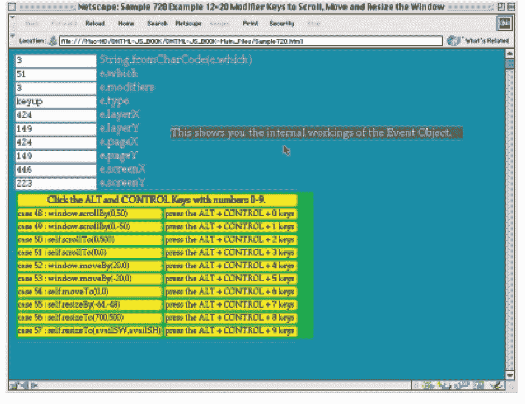

## 事件对象 which 属性的 ASCII 值

示例 6-21 和 6-22 主要是为了让您拥有可重用的代码，并作为键盘上大多数键**常量**在与**modifiers**键常量配合使用时的所有**ASCII 值**的参考。它们被设置在 **switch()** 语句中，因此您可以复制并粘贴代码块，然后替换为您自己的 JavaScript 语句。在本例中，重新定位图层（Layer）的能力是次要的，且相对无关。

示例 6-21 涵盖了 ALT、CONTROL 和 SHIFT 键的单独使用，随后示例 6-22（从第 632 页开始）涵盖了 **modifiers** 键的所有可能组合（例如 ALT + CONTROL）以及 META 键的单独使用。

这些内容相当长，且枯燥且重复，但您会发现它们作为参考非常方便，如果您从 CD-ROM 中复制粘贴，将为您节省大量的输入工作。

### 示例 6-21: Sample721.html

```javascript
<!DOCTYPE HTML PUBLIC "-//W3C//DTD HTML 3.2//EN">
<HTML>
<HEAD>
<TITLE> Sample 721   Example 6-21 Move Layers using Hot Keys</TITLE>

<STYLE TYPE="text/JavaScript">

classes.Mainbody.BODY.margins("0px");
classes.Mainbody.BODY.paddings("0px");
classes.Mainbody.BODY.backgroundColor="navy";
classes.Mainbody.BODY.color="white";
classes.Mainbody.BODY.fontSize="17pt";

</STYLE>

<!--  ******************************************************  -->

<SCRIPT LANGUAGE="JavaScript1.2"><!--BEGIN HIDING

var whichKey;

function scrollLayers(e) {

  whichKey    = String.fromCharCode(e.which);
  var L1      = document.L1;
  var L2      = document.L2;
  var L3      = document.L3;

//The moveBy numbers make sense if you use the number pad on the right side of the keyboard.

  if (e.modifiers == Event.CONTROL_MASK) {

switch (whichKey) {
case '0' : L1.moveTo(250,250);            break;   //press the CONTROL + 0 keys
case '1' : L1.moveBy(-20,20);             break;   //press the CONTROL + 1 keys
case '2' : L1.moveBy(0,20);               break;   //press the CONTROL + 2 keys
case '3' : L1.moveBy(20,20);              break;   //press the CONTROL + 3 keys
case '4' : L1.moveBy(-20,0);              break;   //press the CONTROL + 4 keys
case '5' : L1.moveTo(10,350);             break;   //press the CONTROL + 5 keys
case '6' : L1.moveBy(20,0);               break;   //press the CONTROL + 6 keys
case '7' : L1.moveBy(-20,-20);            break;   //press the CONTROL + 7 keys
case '8' : L1.moveBy(0,-20);              break;   //press the CONTROL + 8 keys
case '9' : L1.moveBy(20,-20);             break;   //press the CONTROL + 9 keys
}

switch (e.which.toString()) {
case '1' : L1.moveBy(-20,20);             break;   //press the CONTROL + a keys
case '2' : L1.moveBy(0,20);               break;   //press the CONTROL + b keys
case '3' : L1.moveBy(20,20);              break;   //press the CONTROL + c keys
case '4' : L1.moveBy(-20,0);              break;   //press the CONTROL + d keys
case '5' : L1.moveBy(-20,0);              break;   //press the CONTROL + e keys
case '6' : L1.moveBy(20,0);               break;   //press the CONTROL + f keys
case '7' : L1.moveBy(-20,-20);            break;   //press the CONTROL + g keys
case '8' : L1.moveBy(0,-20);              break;   //press the CONTROL + h keys
case '9' : L1.moveBy(20,-20);             break;   //press the CONTROL + i keys
case '10' : L1.moveBy(-20,20);            break;   //press the CONTROL + j keys
case '11' : L1.moveBy(0,20);              break;   //press the CONTROL + k keys
case '12' : L1.moveBy(0,20);              break;   //press the CONTROL + l keys
case '13' : L1.moveBy(20,20);             break;   //press the CONTROL + m keys
case '14' : L1.moveBy(-20,0);             break;   //press the CONTROL + n keys
case '15' : L1.moveBy(-20,0);             break;   //press the CONTROL + o keys
case '16' : L1.moveBy(20,0);              break;   //press the CONTROL + p keys
case '17' : L1.moveBy(-20,-20);           break;   //press the CONTROL + q keys
case '18' : L1.moveBy(0,-20);             break;   //press the CONTROL + r keys
case '19' : L1.moveBy(20,-20);            break;   //press the CONTROL + s keys
case '20' : L1.moveBy(-20,20);            break;   //press the CONTROL + t keys
case '21' : L1.moveBy(0,20);              break;   //press the CONTROL + u keys
case '22' : L1.moveBy(20,20);             break;   //press the CONTROL + v keys
case '23' : L1.moveBy(-20,0);             break;   //press the CONTROL + w keys
case '24' : L1.moveBy(-20,0);             break;   //press the CONTROL + x keys
case '25' : L1.moveBy(20,0);              break;   //press the CONTROL + y keys
case '26' : L1.moveBy(-20,-20);           break;   //press the CONTROL + z keys
}

}
else if (e.modifiers == Event.ALT_MASK) {
        //The two cases cover the numbers in the row above QWERTY letters
        //and the calulator pad numbers on the far right of extended keyboards.

switch (e.which.toString()) {
case '188' : case '48' : L2.moveTo(150,250);      break;   //press the ALT + 0 keys
case '193' : case '49' : L2.moveBy(-30,30);       break;   //press the ALT + 1 keys
case '170' : case '50' : L2.moveBy(0,30);         break;   //press the ALT + 2 keys
case '163' : case '51' : L2.moveBy(30,30);        break;   //press the ALT + 3 keys
case '162' : case '52' : L2.moveBy(-30,0);        break;   //press the ALT + 4 keys
case '176' : case '53' : L2.moveTo(50,350);       break;   //press the ALT + 5 keys
case '164' : case '54' : L2.moveBy(30,0);         break;   //press the ALT + 6 keys
case '166' : case '55' : L2.moveBy(-30,-30);      break;   //press the ALT + 7 keys
case '165' : case '56' : L2.moveBy(0,-30);        break;   //press the ALT + 8 keys
case '187' : case '57' : L2.moveBy(30,-30);       break;   //press the ALT + 9 keys

case '140' : L2.moveBy(30,30);              break;   //press the ALT + a keys
case '186' : L2.moveBy(30,30);              break;   //press the ALT + b keys
case '141' : L2.moveBy(30,30);              break;   //press the ALT + c keys
case '182' : L2.moveBy(30,30);              break;   //press the ALT + d keys
case '171' : L2.moveBy(30,30);              break;   //press the ALT + e keys
case '196' : L2.moveBy(-30,-30);            break;   //press the ALT + f keys
case '169' : L2.moveBy(-30,-30);            break;   //press the ALT + g keys
case '250' : L2.moveBy(-30,-30);            break;   //press the ALT + h keys
```


## 第二部分 — JavaScript 1.2

```javascript
case '246' : L2.moveBy(-30,-30);             break;  //press the ALT + i keys
case '198' : L2.moveBy(-30,-30);             break;  //press the ALT + j keys
case '251' : L2.moveBy(30,30);               break;  //press the ALT + k keys
case '194' : L2.moveBy(30,30);               break;  //press the ALT + l keys
case '181' : L2.moveBy(30,30);               break;  //press the ALT + m keys
case '247' : L2.moveBy(30,30);               break;  //press the ALT + n keys
case '191' : L2.moveBy(30,30);               break;  //press the ALT + o keys
case '185' : L2.moveBy(-30,-30);             break;  //press the ALT + p keys
case '207' : L2.moveBy(-30,-30);             break;  //press the ALT + q keys
case '168' : L2.moveBy(-30,-30);             break;  //press the ALT + r keys
case '167' : L2.moveBy(-30,-30);             break;  //press the ALT + s keys
case '160' : L2.moveBy(-30,-30);             break;  //press the ALT + t keys
case '172' : L2.moveBy(30,30);               break;  //press the ALT + u keys
case '195' : L2.moveBy(30,30);               break;  //press the ALT + v keys
case '183' : L2.moveBy(30,30);               break;  //press the ALT + w keys
case '197' : L2.moveBy(30,30);               break;  //press the ALT + x keys
case '180' : L2.moveBy(30,30);               break;  //press the ALT + y keys
case '189' : L2.moveBy(30,30);               break;  //press the ALT + z keys
      }
    }
    else if (e.modifiers == Event.SHIFT_MASK) {

            //这两种情况分别覆盖了QWERTY字母上方一行中的数字
            //以及扩展键盘最右侧的计算器数字键。

    switch (e.which.toString()) {
        case '33' : case '48' : L3.moveTo(150,250);        break;  //press the SHIFT + 0 keys
        case '64' : case '49' : L3.moveBy(-50,50);         break;  //press the SHIFT + 1 keys
        case '35' : case '50' : L3.moveBy(0,50);           break;  //press the SHIFT + 2 keys
        case '36' : case '51' : L3.moveBy(50,50);          break;  //press the SHIFT + 3 keys
        case '37' : case '52' : L3.moveBy(-50,0);          break;  //press the SHIFT + 4 keys
        case '94' : case '53' : L3.moveTo(50,350);         break;  //press the SHIFT + 5 keys
        case '38' : case '54' : L3.moveBy(50,0);           break;  //press the SHIFT + 6 keys
        case '42' : case '55' : L3.moveBy(-50,-50);        break;  //press the SHIFT + 7 keys
        case '40' : case '56' : L3.moveBy(0,-50);          break;  //press the SHIFT + 8 keys
        case '41' : case '57' : L3.moveBy(50,-50);         break;  //press the SHIFT + 9 keys

        case '65' : L3.moveBy(50,50);                      break;  //press the SHIFT + a keys
        case '66' : L3.moveBy(50,50);                      break;  //press the SHIFT + b keys
        case '67' : L3.moveBy(50,50);                      break;  //press the SHIFT + c keys
        case '68' : L3.moveBy(50,50);                      break;  //press the SHIFT + d keys
        case '69' : L3.moveBy(50,50);                      break;  //press the SHIFT + e keys
        case '70' : L3.moveBy(-50,-50);                    break;  //press the SHIFT + f keys
        case '71' : L3.moveBy(-50,-50);                    break;  //press the SHIFT + g keys
        case '72' : L3.moveBy(-50,-50);                    break;  //press the SHIFT + h keys
        case '73' : L3.moveBy(-50,-50);                    break;  //press the SHIFT + i keys
        case '74' : L3.moveBy(-50,-50);                    break;  //press the SHIFT + j keys
        case '75' : L3.moveBy(50,50);                      break;  //press the SHIFT + k keys
        case '76' : L3.moveBy(50,50);                      break;  //press the SHIFT + l keys
        case '77' : L3.moveBy(50,50);                      break;  //press the SHIFT + m keys
        case '78' : L3.moveBy(50,50);                      break;  //press the SHIFT + n keys
        case '79' : L3.moveBy(50,50);                      break;  //press the SHIFT + o keys
        case '80' : L3.moveBy(-50,-50);                    break;  //press the SHIFT + p keys
        case '81' : L3.moveBy(-50,-50);                    break;  //press the SHIFT + q keys
        case '82' : L3.moveBy(-50,-50);                    break;  //press the SHIFT + r keys
        case '83' : L3.moveBy(-50,-50);                    break;  //press the SHIFT + s keys
        case '84' : L3.moveBy(-50,-50);                    break;  //press the SHIFT + t keys
        case '85' : L3.moveBy(50,50);                      break;  //press the SHIFT + u keys
        case '86' : L3.moveBy(50,50);                      break;  //press the SHIFT + v keys
        case '87' : L3.moveBy(50,50);                      break;  //press the SHIFT + w keys
        case '88' : L3.moveBy(50,50);                      break;  //press the SHIFT + x keys
        case '89' : L3.moveBy(50,50);                      break;  //press the SHIFT + y keys
        case '90' : L3.moveBy(50,50);                      break;  //press the SHIFT + z keys
      }
    }
  }
```

## 第六章 — JavaScript 事件

```javascript
else {
	switch (whichKey) {
		case '0': LL.moveTo(10,100); break; //press the 0 key
		case '1': LL.moveBy(-20,20); break; //press the 1 key
		case '2': LL.moveBy(0,20); break; //press the 2 key
		case '3': LL.moveBy(20,20); break; //press the 3 key
		case '4': LL.moveBy(-20,0); break; //press the 4 key
		case '5': LL.moveBy(150,100); break; //press the 5 key
		case '6': LL.moveBy(20,0); break; //press the 6 key
		case '7': LL.moveBy(-20,-20); break; //press the 7 key
		case '8': LL.moveBy(0,-20); break; //press the 8 key
		case '9': LL.moveBy(20,-20); break; //press the 9 key

		case 'q': case 'Q': break; //press the q key
		case 'w': case 'W': LL.moveBy(20,20); break; //press the w key
		case 'e': case 'E': LL.moveBy(0,20); break; //press the e key
		case 'r': case 'R': LL.moveBy(-20,-20); break; //press the r key
		case 't': case 'T': LL.moveBy(-20,-20); break; //press the t key
		case 'y': case 'Y': LL.moveBy(-20,-20); break; //press the y key
		default : return false;
	}
}

function showKey(e) {
	document.form1.T1.value = "";
	document.form1.T2.value = "";

	var T1 = document.form1.T1;
	whichKey2 = String.fromCharCode(e.which);
	whichKey3 = e.which.toString();

	document.form1.T1.value = whichKey2;
	document.form1.T2.value = whichKey3;
}

document.captureEvents(Event.KEYPRESS | Event.KEYUP);
document.onkeypress = scrolllayers;
document.onkeyup = showKey;
```

```html
<!--END HIDING-->
</SCRIPT>
<!--
</HEAD>

<!--window.focus() 方法使自动焦点从地址栏转移到窗口，
这样你就无需点击窗口来使按键生效。-->

<BODY CLASS="Mainbody" onload="window.focus();">

<FORM NAME="form1">
String.fromCharCode(e.which) "SPACES TYPE="Horizontal" SIZE="70"* e.which.toString()<BR>
<INPUT TYPE="text" NAME="T1" SIZE="30">* >
<INPUT TYPE="text" NAME="T2" SIZE="30">* >
</FORM><HR>

<LAYER ID="L1" TOP="10" LEFT="10" WIDTH="300" BGCOLOR="black">
使用 CONTROL 键加上字母 A-Z 或数字 0-9 来移动此图层。<BR>
尝试仅使用数字小键盘或键盘上的数字键，而不使用修饰键。

主要目的是向你展示在函数中应测试什么，以及 Switch 语句的实用价值。
</LAYER>

<LAYER ID="L2" LEFT="410" TOP="300" WIDTH="300" BGCOLOR="red">
使用 ALT 键加上字母 A-Z 或数字 0-9 来移动此图层。<BR>
请注意，在扩展键盘上，数字小键盘的数字在文本框显示中与键盘上的常规数字具有不同的值。
</LAYER>

<LAYER ID="L3" LEFT="410" TOP="50" WIDTH="300" BGCOLOR="blue">
使用 SHIFT 键加上字母 A-Z 或数字 0-9 来移动此图层。<BR>
注意 <B>fromCharCode</B> 方法返回实际的键值，而 <B>toString</B> 方法返回与该事件关联的 ASCII 值。
</LAYER>

</BODY>
</HTML>
```

示例 6-22 涵盖了当你需要在脚本执行某些操作之前，使用 **if()** 和 **switch()** 语句来测试**多个修饰键**被按下的情况。如需更多信息，请参见第 628 页的示例 6-21 前言，以及第 646 页示例代码中的图层文本提示。

## 示例 6-22: Sample722.html

```html
<!DOCTYPE HTML PUBLIC "-//W3C//DTD HTML 3.2//EN">
<HTML>
<HEAD>
<TITLE> Sample 722 - 示例 6-22 使用多个修饰键移动图层</TITLE>

<STYLE TYPE="text/JavaScript">

classes.Mainbody.BODY.margins("0px");
classes.Mainbody.BODY.paddings("0px");
classes.Mainbody.BODY.backgroundColor="darkcyan";
classes.Mainbody.BODY.color="white";
classes.Mainbody.BODY.fontSize="17pt";

ids.L3.fontSize="14pt";

</STYLE>
<!-- ******************************************************************* -->
```

```javascript
<SCRIPT LANGUAGE="JavaScript1.2"><!--BEGIN HIDING

function scrollLayers(e) {
	var L1	= document.L1;
	var L2	= document.L2;
	var L3	= document.L3;
```


## 第 6 章 — JavaScript 事件

```javascript
if (e.modifiers == 3) {         //ALT_MASK + CONTROL_MASK = 3

        switch (e.which.toString()) {

            case '48' : L1.moveTo(410,220);  break;  //按下 ALT + CONTROL + 0 键
            case '49' : L1.moveBy(-90,90);   break;  //按下 ALT + CONTROL + 1 键
            case '50' : L1.moveBy(0,90);     break;  //按下 ALT + CONTROL + 2 键
            case '51' : L1.moveBy(90,90);    break;  //按下 ALT + CONTROL + 3 键
            case '52' : L1.moveBy(-90,0);    break;  //按下 ALT + CONTROL + 4 键
            case '53' : L1.moveTo(410,50);   break;  //按下 ALT + CONTROL + 5 键
            case '54' : L1.moveBy(90,0);     break;  //按下 ALT + CONTROL + 6 键
            case '55' : L1.moveBy(-90,-90);  break;  //按下 ALT + CONTROL + 7 键
            case '56' : L1.moveBy(0,-90);    break;  //按下 ALT + CONTROL + 8 键
            case '57' : L1.moveBy(90,-90);   break;  //按下 ALT + CONTROL + 9 键

            case '1' : L1.moveBy(90,90);     break;  //按下 ALT + CONTROL + a 键
            case '2' : L1.moveBy(90,90);     break;  //按下 ALT + CONTROL + b 键
            case '3' : L1.moveBy(90,90);     break;  //按下 ALT + CONTROL + c 键
            case '4' : L1.moveBy(90,90);     break;  //按下 ALT + CONTROL + d 键
            case '5' : L1.moveBy(90,90);     break;  //按下 ALT + CONTROL + e 键
            case '6' : L1.moveBy(-90,-90);   break;  //按下 ALT + CONTROL + f 键
            case '7' : L1.moveBy(-90,-90);   break;  //按下 ALT + CONTROL + g 键
            case '8' : L1.moveBy(-90,-90);   break;  //按下 ALT + CONTROL + h 键
            case '9' : L1.moveBy(-90,-90);   break;  //按下 ALT + CONTROL + i 键
            case '10' : L1.moveBy(-90,-90);  break;  //按下 ALT + CONTROL + j 键
            case '11' : L1.moveBy(90,90);    break;  //按下 ALT + CONTROL + k 键
            case '12' : L1.moveBy(90,90);    break;  //按下 ALT + CONTROL + l 键
            case '13' : L1.moveBy(90,90);    break;  //按下 ALT + CONTROL + m 键
            case '14' : L1.moveBy(90,90);    break;  //按下 ALT + CONTROL + n 键
            case '15' : L1.moveBy(90,90);    break;  //按下 ALT + CONTROL + o 键
            case '16' : L1.moveBy(-90,-90);  break;  //按下 ALT + CONTROL + p 键
            case '17' : L1.moveBy(-90,-90);  break;  //按下 ALT + CONTROL + q 键
            case '18' : L1.moveBy(-90,-90);  break;  //按下 ALT + CONTROL + r 键
            case '19' : L1.moveBy(-90,-90);  break;  //按下 ALT + CONTROL + s 键
            case '20' : L1.moveBy(-90,-90);  break;  //按下 ALT + CONTROL + t 键
            case '21' : L1.moveBy(90,90);    break;  //按下 ALT + CONTROL + u 键
            case '22' : L1.moveBy(90,90);    break;  //按下 ALT + CONTROL + v 键
            case '23' : L1.moveBy(90,90);    break;  //按下 ALT + CONTROL + w 键
            case '24' : L1.moveBy(90,90);    break;  //按下 ALT + CONTROL + x 键
            case '25' : L1.moveBy(90,90);    break;  //按下 ALT + CONTROL + y 键
            case '26' : L1.moveBy(90,90);    break;  //按下 ALT + CONTROL + z 键
        }
    }
else if (e.modifiers == 5) { 		//ALT_MASK + SHIFT_MASK = 5

		//以下两种情况涵盖了 QWERTY 字母键上方那一行的数字键
		//以及扩展键盘最右侧的数字小键盘。

		switch(e.which.toString()) {

		case '226': case '48': L2.moveTo(150,250);break; 	//按下 ALT + SHIFT + 0 键
		case '218': case '49': L2.moveBy(-30,30); break; 	//按下 ALT + SHIFT + 1 键
		case '219': case '50': L2.moveBy(0,30); break; 		//按下 ALT + SHIFT + 2 键
		case '220': case '51': L2.moveBy(30,30); break; 		//按下 ALT + SHIFT + 3 键
		case '221': case '52': L2.moveBy(30,0); break; 		//按下 ALT + SHIFT + 4 键
		case '222': case '53': L2.moveTo(50,350); break; 	//按下 ALT + SHIFT + 5 键
		case '223': case '54': L2.moveBy(30,30); break; 		//按下 ALT + SHIFT + 6 键
		case '224': case '55': L2.moveBy(-30,30); break; 	//按下 ALT + SHIFT + 7 键
		case '161': case '56': L2.moveBy(0,-30); break; 		//按下 ALT + SHIFT + 8 键
		case '225': case '57': L2.moveBy(30,-30); break; 	//按下 ALT + SHIFT + 9 键

		case '129': L2.moveBy(30,30); 			break; 	//按下 ALT + SHIFT + a 键
		case '145': L2.moveBy(30,30); 			break; 	//按下 ALT + SHIFT + b 键
		case '130': L2.moveBy(30,30); 			break; 	//按下 ALT + SHIFT + c 键
		case '135': L2.moveBy(30,30); 			break; 	//按下 ALT + SHIFT + d 键
		case '171': L2.moveBy(30,30); 			break; 	//按下 ALT + SHIFT + e 键
		case '230': L2.moveBy(-30,30); 			break; 	//按下 ALT + SHIFT + f 键
		case '231': L2.moveBy(-30,30); 			break; 	//按下 ALT + SHIFT + g 键
		case '238': L2.moveBy(-30,30); 			break; 	//按下 ALT + SHIFT + h 键
		case '246': L2.moveBy(-30,30); 			break; 	//按下 ALT + SHIFT + i 键
		case '239': L2.moveBy(-30,30); 			break; 	//按下 ALT + SHIFT + j 键
		case '240': L2.moveBy(30,30); 			break; 	//按下 ALT + SHIFT + k 键
		case '241': L2.moveBy(30,30); 			break; 	//按下 ALT + SHIFT + l 键
		case '229': L2.moveBy(30,30); 			break; 	//按下 ALT + SHIFT + m 键
		case '247': L2.moveBy(30,30); 			break; 	//按下 ALT + SHIFT + n 键
		case '175': L2.moveBy(30,30); 			break; 	//按下 ALT + SHIFT + o 键
		case '184': L2.moveBy(-30,30); 			break; 	//按下 ALT + SHIFT + p 键
		case '206': L2.moveBy(-30,30); 			break; 	//按下 ALT + SHIFT + q 键
		case '228': L2.moveBy(-30,30); 			break; 	//按下 ALT + SHIFT + r 键
		case '234': L2.moveBy(-30,30); 			break; 	//按下 ALT + SHIFT + s 键
		case '255': L2.moveBy(-30,30); 			break; 	//按下 ALT + SHIFT + t 键
		case '172': L2.moveBy(30,30); 			break; 	//按下 ALT + SHIFT + u 键
		case '215': L2.moveBy(30,30); 			break; 	//按下 ALT + SHIFT + v 键
		case '227': L2.moveBy(30,30); 			break; 	//按下 ALT + SHIFT + w 键
		case '254': L2.moveBy(30,30); 			break; 	//按下 ALT + SHIFT + x 键
		case '231': L2.moveBy(30,30); 			break; 	//按下 ALT + SHIFT + y 键
		case '252': L2.moveBy(30,30); 			break; 	//按下 ALT + SHIFT + z 键
		}
	}
else if (e.modifiers == 6) { //CONTROL_MASK + SHIFT_MASK = 6

	switch (e.which.toString()) {

		case '48': L3.moveTo(410,220); break; //按下 SHIFT + CONTROL + 0 键
		case '49': L3.moveBy(90,-90); break; //按下 SHIFT + CONTROL + 1 键
		case '50': L3.moveBy(0,0); break; //按下 SHIFT + CONTROL + 2 键
		case '51': L3.moveBy(90,90); break; //按下 SHIFT + CONTROL + 3 键
		case '52': L3.moveBy(-90,0); break; //按下 SHIFT + CONTROL + 4 键
		case '53': L3.moveTo(410,330); break; //按下 SHIFT + CONTROL + 5 键
		case '54': L3.moveBy(90,0); break; //按下 SHIFT + CONTROL + 6 键
		case '55': L3.moveBy(-90,-90); break; //按下 SHIFT + CONTROL + 7 键
		case '56': L3.moveBy(0,-90); break; //按下 SHIFT + CONTROL + 8 键
		case '57': L3.moveBy(90,-90); break; //按下 SHIFT + CONTROL + 9 键

		case '1': L3.moveBy(90,90); break; //按下 SHIFT + CONTROL + a 键
		case '2': L3.moveBy(90,90); break; //按下 SHIFT + CONTROL + b 键
		case '3': L3.moveBy(90,90); break; //按下 SHIFT + CONTROL + c 键
		case '4': L3.moveBy(90,90); break; //按下 SHIFT + CONTROL + d 键
		case '5': L3.moveBy(90,90); break; //按下 SHIFT + CONTROL + e 键
		case '6': L3.moveBy(-90,-90); break; //按下 SHIFT + CONTROL + f 键
		case '7': L3.moveBy(-90,-90); break; //按下 SHIFT + CONTROL + g 键
		case '8': L3.moveBy(-90,90); break; //按下 SHIFT + CONTROL + h 键
		case '9': L3.moveBy(-90,90); break; //按下 SHIFT + CONTROL + i 键
		case '10': L3.moveBy(-90,-90); break; //按下 SHIFT + CONTROL + j 键
		case '11': L3.moveBy(90,90); break; //按下 SHIFT + CONTROL + k 键
		case '12': L3.moveBy(90,90); break; //按下 SHIFT + CONTROL + l 键
		case '13': L3.moveBy(90,90); break; //按下 SHIFT + CONTROL + m 键
		case '14': L3.moveBy(90,90); break; //按下 SHIFT + CONTROL + n 键
		case '15': L3.moveBy(90,90); break; //按下 SHIFT + CONTROL + o 键
		case '16': L3.moveBy(-90,-90); break; //按下 SHIFT + CONTROL + p 键
		case '17': L3.moveBy(-90,90); break; //按下 SHIFT + CONTROL + q 键
		case '18': L3.moveBy(-90,-90); break; //按下 SHIFT + CONTROL + r 键
		case '19': L3.moveBy(-90,-90); break; //按下 SHIFT + CONTROL + s 键
		case '20': L3.moveBy(-90,-90); break; //按下 SHIFT + CONTROL + t 键
		case '21': L3.moveBy(90,90); break; //按下 SHIFT + CONTROL + u 键
		case '22': L3.moveBy(90,90); break; //按下 SHIFT + CONTROL + v 键
		case '23': L3.moveBy(90,90); break; //按下 SHIFT + CONTROL + w 键
		case '24': L3.moveBy(90,90); break; //按下 SHIFT + CONTROL + x 键
		case '25': L3.moveBy(90,90); break; //按下 SHIFT + CONTROL + y 键
		case '26': L3.moveBy(90,90); break; //按下 SHIFT + CONTROL + z 键
	}
}
```

// 表示同时按下 ALT + CONTROL + SHIFT 键的数字是 7。
// 因此，测试事件 e.modifiers 是否等于 7，就是这些键的简写。


## 第二部分 — JavaScript 1.2

```javascript
else if (e.modifiers == 7) { //ALT_MASK + CONTROL_MASK + SHIFT_MASK = 7
{
    switch (e.which.toString()) {
        case '48' : L1.moveTo(410,220);   break;  //按下 ALT + CONTROL + SHIFT + 0 键
        case '49' : L1.moveBy(-90,90);    break;  //按下 ALT + CONTROL + SHIFT + 1 键
        case '50' : L1.moveBy(0,90);      break;  //按下 ALT + CONTROL + SHIFT + 2 键
        case '51' : L1.moveBy(90,90);     break;  //按下 ALT + CONTROL + SHIFT + 3 键
        case '52' : L1.moveBy(-90,0);     break;  //按下 ALT + CONTROL + SHIFT + 4 键
        case '53' : L1.moveTo(410,50);    break;  //按下 ALT + CONTROL + SHIFT + 5 键
        case '54' : L1.moveBy(90,0);      break;  //按下 ALT + CONTROL + SHIFT + 6 键
        case '55' : L1.moveBy(-90,-90);   break;  //按下 ALT + CONTROL + SHIFT + 7 键
        case '56' : L1.moveBy(0,-90);     break;  //按下 ALT + CONTROL + SHIFT + 8 键
        case '57' : L1.moveBy(90,-90);    break;  //按下 ALT + CONTROL + SHIFT + 9 键

        case '1' : L1.moveBy(90,90);      break;  //按下 ALT + CONTROL + SHIFT + a 键
        case '2' : L1.moveBy(90,90);      break;  //按下 ALT + CONTROL + SHIFT + b 键
        case '3' : L1.moveBy(90,90);      break;  //按下 ALT + CONTROL + SHIFT + c 键
        case '4' : L1.moveBy(90,90);      break;  //按下 ALT + CONTROL + SHIFT + d 键
        case '5' : L1.moveBy(90,90);      break;  //按下 ALT + CONTROL + SHIFT + e 键
        case '6' : L1.moveBy(-90,-90);    break;  //按下 ALT + CONTROL + SHIFT + f 键
        case '7' : L1.moveBy(-90,-90);    break;  //按下 ALT + CONTROL + SHIFT + g 键
        case '8' : L1.moveBy(-90,-90);    break;  //按下 ALT + CONTROL + SHIFT + h 键
        case '9' : L1.moveBy(-90,-90);    break;  //按下 ALT + CONTROL + SHIFT + i 键
        case '10' : L1.moveBy(-90,-90);   break;  //按下 ALT + CONTROL + SHIFT + j 键
        case '11' : L1.moveBy(90,90);     break;  //按下 ALT + CONTROL + SHIFT + k 键
        case '12' : L1.moveBy(90,90);     break;  //按下 ALT + CONTROL + SHIFT + l 键
        case '13' : L1.moveBy(90,90);     break;  //按下 ALT + CONTROL + SHIFT + m 键
        case '14' : L1.moveBy(90,90);     break;  //按下 ALT + CONTROL + SHIFT + n 键
        case '15' : L1.moveBy(90,90);     break;  //按下 ALT + CONTROL + SHIFT + o 键
        case '16' : L1.moveBy(-90,-90);   break;  //按下 ALT + CONTROL + SHIFT + p 键
        case '17' : L1.moveBy(-90,-90);   break;  //按下 ALT + CONTROL + SHIFT + q 键
        case '18' : L1.moveBy(-90,-90);   break;  //按下 ALT + CONTROL + SHIFT + r 键
        case '19' : L1.moveBy(-90,-90);   break;  //按下 ALT + CONTROL + SHIFT + s 键
        case '20' : L1.moveBy(-90,-90);   break;  //按下 ALT + CONTROL + SHIFT + t 键
        case '21' : L1.moveBy(90,90);     break;  //按下 ALT + CONTROL + SHIFT + u 键
        case '22' : L1.moveBy(90,90);     break;  //按下 ALT + CONTROL + SHIFT + v 键
        case '23' : L1.moveBy(90,90);     break;  //按下 ALT + CONTROL + SHIFT + w 键
        case '24' : L1.moveBy(90,90);     break;  //按下 ALT + CONTROL + SHIFT + x 键
        case '25' : L1.moveBy(90,90);     break;  //按下 ALT + CONTROL + SHIFT + y 键
        case '26' : L1.moveBy(90,90);     break;  //按下 ALT + CONTROL + SHIFT + z 键
    }
}
```

请注意，Navigator 中大多数常规的命令键已经分配了代码，这些代码难以或无法覆盖，因此你的 JavaScript 代码将被忽略。然而，如果你创建自己的不带标题栏的窗口对象，并将 `HOTKEYS` 属性设置为 `true`，那么使用 `META_MASK` 将会非常方便，因为这将关闭除“退出”和“安全”之外的所有原生热键。

```javascript
else if (e.modifiers == 8) {    //META_MASK = 8  即 Apple Command 键

    switch (e.which.toString()) {
        case '48' : L2.moveTo(410,220);    break;    //按下 META + 0 键
        case '49' : L2.moveBy(-90,90);     break;    //按下 META + 1 键
        case '50' : L2.moveBy(0,90);       break;    //按下 META + 2 键
        case '51' : L2.moveBy(90,90);      break;    //按下 META + 3 键
        case '52' : L2.moveBy(-90,0);      break;    //按下 META + 4 键
        case '53' : L2.moveTo(410,50);     break;    //按下 META + 5 键
        case '54' : L2.moveBy(90,0);       break;    //按下 META + 6 键
        case '55' : L2.moveBy(-90,-90);    break;    //按下 META + 7 键
        case '56' : L2.moveBy(0,-90);      break;    //按下 META + 8 键
        case '57' : L2.moveBy(90,-90);     break;    //按下 META + 9 键

        case '97' : L2.moveBy(90,90);      break;    //按下 META + a 键
        case '98' : L2.moveBy(90,90);      break;    //按下 META + b 键
        case '99' : L2.moveBy(90,90);      break;    //按下 META + c 键
        case '100' : L2.moveBy(90,90);     break;    //按下 META + d 键
        case '101' : L2.moveBy(90,90);     break;    //按下 META + e 键
        case '102' : L2.moveBy(-90,-90);   break;    //按下 META + f 键
        case '103' : L2.moveBy(-90,-90);   break;    //按下 META + g 键
        case '104' : L2.moveBy(-90,-90);   break;    //按下 META + h 键
        case '105' : L2.moveBy(-90,-90);   break;    //按下 META + i 键
        case '106' : L2.moveBy(-90,-90);   break;    //按下 META + j 键
        case '107' : L2.moveBy(90,90);     break;    //按下 META + k 键
        case '108' : L2.moveBy(90,90);     break;    //按下 META + l 键
        case '109' : L2.moveBy(90,90);     break;    //按下 META + m 键
        case '110' : L2.moveBy(90,90);     break;    //按下 META + n 键
        case '111' : L2.moveBy(90,90);     break;    //按下 META + o 键
        case '112' : L2.moveBy(-90,-90);   break;    //按下 META + p 键
        case '113' : L2.moveBy(-90,-90);   break;    //按下 META + q 键
        case '114' : L2.moveBy(-90,-90);   break;    //按下 META + r 键
        case '115' : L2.moveBy(-90,-90);   break;    //按下 META + s 键
        case '116' : L2.moveBy(-90,-90);   break;    //按下 META + t 键
        case '117' : L2.moveBy(90,90);     break;    //按下 META + u 键
        case '118' : L2.moveBy(90,90);     break;    //按下 META + v 键
        case '119' : L2.moveBy(90,90);     break;    //按下 META + w 键
        case '120' : L2.moveBy(90,90);     break;    //按下 META + x 键
        case '121' : L2.moveBy(90,90);     break;    //按下 META + y 键
        case '122' : L2.moveBy(90,90);     break;    //按下 META + z 键
    }
}
```

```javascript
else if (e.modifiers == 9) {    //META_MASK + ALT_MASK = 9

    // 这两种情况涵盖了 QWERTY 字母上方的一行数字
    // 以及扩展键盘最右侧的计算器数字小键盘。

    switch (e.which.toString()) {
        case '188': case '48': L3.moveTo(150,250); break;    //按下 META + ALT + 0 键
        case '193': case '49': L3.moveBy(-30,30); break;    //按下 META + ALT + 1 键
        case '170': case '50': L3.moveBy(0,30); break;       //按下 META + ALT + 2 键
        case '163': case '51': L3.moveBy(30,30); break;      //按下 META + ALT + 3 键
        case '162': case '52': L3.moveBy(-30,0); break;     //按下 META + ALT + 4 键
        case '176': case '54': L3.moveTo(50,350); break;     //按下 META + ALT + 5 键
        case '164': case '54': L3.moveBy(30,0); break;      //按下 META + ALT + 6 键
        case '166': case '55': L3.moveBy(-30,30); break;     //按下 META + ALT + 7 键
        case '185': case '56': L3.moveBy(0,-30); break;      //按下 META + ALT + 8 键
        case '187': case '57': L3.moveBy(30,-30); break;     //按下 META + ALT + 9 键

        case '140': L3.moveBy(30,30);     break;    //按下 META + ALT + a 键
        case '186': L3.moveBy(30,30);     break;    //按下 META + ALT + b 键
        case '141': L3.moveBy(30,30);     break;    //按下 META + ALT + c 键
        case '182': L3.moveBy(30,30);     break;    //按下 META + ALT + d 键
        case '171': L3.moveBy(30,30);     break;    //按下 META + ALT + e 键
        case '190': L3.moveBy(-30,30);    break;    //按下 META + ALT + f 键
        case '169': L3.moveBy(-30,30);    break;    //按下 META + ALT + g 键
        case '250': L3.moveBy(-30,30);    break;    //按下 META + ALT + h 键
        case '246': L3.moveBy(-30,30);    break;    //按下 META + ALT + i 键
        case '198': L3.moveBy(-30,30);    break;    //按下 META + ALT + j 键
        case '251': L3.moveBy(-30,30);    break;    //按下 META + ALT + k 键
        case '194': L3.moveBy(-30,30);    break;    //按下 META + ALT + l 键
        case '181': L3.moveBy(30,30);     break;    //按下 META + ALT + m 键
        case '247': L3.moveBy(30,30);     break;    //按下 META + ALT + n 键
        case '191': L3.moveBy(30,30);     break;    //按下 META + ALT + o 键
        case '185': L3.moveBy(-30,30);    break;    //按下 META + ALT + p 键
        case '207': L3.moveBy(-30,30);    break;    //按下 META + ALT + q 键
        case '168': L3.moveBy(-30,30);    break;    //按下 META + ALT + r 键
        case '167': L3.moveBy(-30,30);    break;    //按下 META + ALT + s 键
        case '160': L3.moveBy(-30,30);    break;    //按下 META + ALT + t 键
        case '172': L3.moveBy(30,30);     break;    //按下 META + ALT + u 键
        case '193': L3.moveBy(30,30);     break;    //按下 META + ALT + v 键
        case '183': L3.moveBy(30,30);     break;    //按下 META + ALT + w 键
        case '197': L3.moveBy(30,30);     break;    //按下 META + ALT + x 键
        case '180': L3.moveBy(30,30);     break;    //按下 META + ALT + y 键
        case '189': L3.moveBy(30,30);     break;    //按下 META + ALT + z 键
    }
}
```


## 第 6 章 — JavaScript 事件

```javascript
else if (e.modifiers == 10) { //META_MASK + CONTROL_MASK = 10

    switch (e.which.toString()) {

        case '48' : L1.moveTo(410,220);  break;  //press the META + CONTROL + 0 keys
        case '49' : L1.moveBy(-90,90);   break;  //press the META + CONTROL + 1 keys
        case '50' : L1.moveBy(0,90);     break;  //press the META + CONTROL + 2 keys
        case '51' : L1.moveBy(90,90);    break;  //press the META + CONTROL + 3 keys
        case '52' : L1.moveBy(-90,0);    break;  //press the META + CONTROL + 4 keys
        case '53' : L1.moveTo(410,50);   break;  //press the META + CONTROL + 5 keys
        case '54' : L1.moveBy(90,0);     break;  //press the META + CONTROL + 6 keys
        case '55' : L1.moveBy(-90,-90);  break;  //press the META + CONTROL + 7 keys
        case '56' : L1.moveBy(0,-90);    break;  //press the META + CONTROL + 8 keys
        case '57' : L1.moveBy(90,-90);   break;  //press the META + CONTROL + 9 keys

        case '1' : L1.moveBy(90,90);     break;  //press the META + CONTROL + a keys
        case '2' : L1.moveBy(90,90);     break;  //press the META + CONTROL + b keys
        case '3' : L1.moveBy(90,90);     break;  //press the META + CONTROL + c keys
        case '4' : L1.moveBy(90,90);     break;  //press the META + CONTROL + d keys
        case '5' : L1.moveBy(90,90);     break;  //press the META + CONTROL + e keys
        case '6' : L1.moveBy(-90,-90);   break;  //press the META + CONTROL + f keys
        case '7' : L1.moveBy(-90,-90);   break;  //press the META + CONTROL + g keys
        case '8' : L1.moveBy(-90,-90);   break;  //press the META + CONTROL + h keys
        case '9' : L1.moveBy(-90,-90);   break;  //press the META + CONTROL + i keys
        case '10' : L1.moveBy(-90,-90);  break;  //press the META + CONTROL + j keys
        case '11' : L1.moveBy(90,90);    break;  //press the META + CONTROL + k keys
        case '12' : L1.moveBy(90,90);    break;  //press the META + CONTROL + l keys
        case '13' : L1.moveBy(90,90);    break;  //press the META + CONTROL + m keys
        case '14' : L1.moveBy(90,90);    break;  //press the META + CONTROL + n keys
        case '15' : L1.moveBy(90,90);    break;  //press the META + CONTROL + o keys
        case '16' : L1.moveBy(-90,-90);  break;  //press the META + CONTROL + p keys
        case '17' : L1.moveBy(-90,-90);  break;  //press the META + CONTROL + q keys
        case '18' : L1.moveBy(-90,-90);  break;  //press the META + CONTROL + r keys
        case '19' : L1.moveBy(-90,-90);  break;  //press the META + CONTROL + s keys
        case '20' : L1.moveBy(-90,-90);  break;  //press the META + CONTROL + t keys
        case '21' : L1.moveBy(90,90);    break;  //press the META + CONTROL + u keys
        case '22' : L1.moveBy(90,90);    break;  //press the META + CONTROL + v keys
        case '23' : L1.moveBy(90,90);    break;  //press the META + CONTROL + w keys
        case '24' : L1.moveBy(90,90);    break;  //press the META + CONTROL + x keys
        case '25' : L1.moveBy(90,90);    break;  //press the META + CONTROL + y keys
        case '26' : L1.moveBy(90,90);    break;  //press the META + CONTROL + z keys
    }
}
```

```javascript
else if (e.modifiers == 11) {

    //META_MASK + ALT_MASK + CONTROL_MASK = 11

    switch (e.which.toString()) {

        case '48': Lz.moveTo(410,220); break; //press the META + ALT + CONTROL + 0 keys
        case '49': Lz.moveBy(-90,90); break; //press the META + ALT + CONTROL + 1 keys
        case '50': Lz.moveBy(-90,90); break; //press the META + ALT + CONTROL + 2 keys
        case '51': Lz.moveBy(90,90); break; //press the META + ALT + CONTROL + 3 keys
        case '52': Lz.moveBy(-90,0); break; //press the META + ALT + CONTROL + 4 keys
        case '53': Lz.moveTo(410,0); break; //press the META + ALT + CONTROL + 5 keys
        case '54': Lz.moveBy(0,90); break; //press the META + ALT + CONTROL + 6 keys
        case '55': Lz.moveBy(-90,-90); break; //press the META + ALT + CONTROL + 7 keys
        case '56': Lz.moveBy(0,-90); break; //press the META + ALT + CONTROL + 8 keys
        case '57': Lz.moveBy(90,-90); break; //press the META + ALT + CONTROL + 9 keys

        case '1': Lz.moveBy(90,90); break; //press the META + ALT + CONTROL + a keys
        case '2': Lz.moveBy(90,90); break; //press the META + ALT + CONTROL + b keys
        case '3': Lz.moveBy(90,90); break; //press the META + ALT + CONTROL + c keys
        case '4': Lz.moveBy(90,90); break; //press the META + ALT + CONTROL + d keys
        case '5': Lz.moveBy(90,90); break; //press the META + ALT + CONTROL + e keys
        case '6': Lz.moveBy(-90,-90); break; //press the META + ALT + CONTROL + f keys
        case '7': Lz.moveBy(-90,-90); break; //press the META + ALT + CONTROL + g keys
        case '8': Lz.moveBy(-90,90); break; //press the META + ALT + CONTROL + h keys
        case '9': Lz.moveBy(-90,90); break; //press the META + ALT + CONTROL + i keys
        case '10': Lz.moveBy(-90,-90); break; //press the META + ALT + CONTROL + j keys
        case '11': Lz.moveBy(90,90); break; //press the META + ALT + CONTROL + k keys
        case '12': Lz.moveBy(90,90); break; //press the META + ALT + CONTROL + l keys
        case '13': Lz.moveBy(90,90); break; //press the METABloom + ALT + CONTROL + m keys
        case '14': Lz.moveBy(90,90); break; //press the META + ALT + CONTROL + n keys
        case '15': Lz.moveBy(90,90); break; //press the META + ALT + CONTROL + o keys
        case '16': Lz.moveBy(-90,-90); break; //press the META + ALT + CONTROL + p keys
        case '17': Lz.moveBy(-90,-90); break; //press the META + ALT + CONTROL + q keys
        case '18': Lz.moveBy(-90,-90); break; //press the META + ALT + CONTROL + s keys
        case '19': Lz.moveBy(-90,-90); break; //press the META + ALT + CONTROL + r keys
        case '20': Lz.moveBy(-90,-90); break; //press the META + ALT + CONTROL + t keys
        case '21': Lz.moveBy(90,90); break; //press the META + ALT + CONTROL + u keys
        case '22': Lz.moveBy(90,90); break; //press the META + ALT + CONTROL + v keys
        case '23': Lz.moveBy(90,90); break; //press the META + ALT + CONTROL + w keys
        case '24': Lz.moveBy(90,90); break; //press the META + ALT + CONTROL + x keys
        case '25': Lz.moveBy(90,90); break; //press the META + ALT + CONTROL + y keys
        case '26': Lz.moveBy(90,90); break; //press the META + ALT + CONTROL + z keys

    }
}
```

```javascript
else if (e.modifiers == 12) { //META_MASK + SHIFT_MASK = 12

    switch (e.which.toString()) {

        case '48' : L3.moveTo(410,220); break; //press the META + SHIFT + 0 keys
        case '49' : L3.moveBy(-90,90); break; //press the META + SHIFT + 1 keys
        case '50' : L3.moveBy(0,90); break; //press the META + SHIFT + 2 keys
        case '51' : L3.moveBy(90,90); break; //press the META + SHIFT + 3 keys
        case '52' : L3.moveBy(-90,0); break; //press the META + SHIFT + 4 keys
        case '53' : L3.moveTo(410,50); break; //press the META + SHIFT + 5 keys
        case '54' : L3.moveBy(90,0); break; //press the META + SHIFT + 6 keys
        case '55' : L3.moveBy(-90,-90); break; //press the META + SHIFT + 7 keys
        case '56' : L3.moveBy(0,-90); break; //press the META + SHIFT + 8 keys
        case '57' : L3.moveBy(90,-90); break; //press the META + SHIFT + 9 keys

        case '97' : L3.moveBy(90,90); break; //press the META + SHIFT + a keys
        case '98' : L3.moveBy(90,90); break; //press the META + SHIFT + b keys
        case '99' : L3.moveBy(90,90); break; //press the META + SHIFT + c keys
        case '100' : L3.moveBy(90,90); break; //press the META + SHIFT + d keys
        case '101' : L3.moveBy(90,90); break; //press the META + SHIFT + e keys
        case '102' : L3.moveBy(-90,-90); break; //press the META + SHIFT + f keys
        case '103' : L3.moveBy(-90,-90); break; //press the META + SHIFT + g keys
        case '104' : L3.moveBy(-90,-90); break; //press the META + SHIFT + h keys
        case '105' : L3.moveBy(-90,-90); break; //press the META + SHIFT + i keys
        case '106' : L3.moveBy(-90,-90); break; //press the META + SHIFT + j keys
        case '107' : L3.moveBy(90,90); break; //press the META + SHIFT + k keys
        case '108' : L3.moveBy(90,90); break; //press the META + SHIFT + l keys
        case '109' : L3.moveBy(90,90); break; //press the META + SHIFT + m keys
        case '110' : L3.moveBy(90,90); break; //press the META + SHIFT + n keys
        case '111' : L3.moveBy(90,90); break; //press the META + SHIFT + o keys
        case '112' : L3.moveBy(-90,-90); break; //press the META + SHIFT + p keys
        case '113' : L3.moveBy(-90,-90); break; //press the META + SHIFT + q keys
        case '114' : L3.moveBy(-90,-90); break; //press the META + SHIFT + r keys
        case '115' : L3.moveBy(-90,-90); break; //press the META + SHIFT + s keys
        case '116' : L3.moveBy(-90,-90); break; //press the META + SHIFT + t keys
        case '117' : L3.moveBy(90,90); break; //press the META + SHIFT + u keys
        case '118' : L3.moveBy(90,90); break; //press the META + SHIFT + v keys
        case '119' : L3.moveBy(90,90); break; //press the META + SHIFT + w keys
        case '120' : L3.moveBy(90,90); break; //press the META + SHIFT + x keys
        case '121' : L3.moveBy(90,90); break; //press the META + SHIFT + y keys
        case '122' : L3.moveBy(90,90); break; //press the META + SHIFT + z keys
    }
}
```


## 第 6 章 — JavaScript 事件

```javascript
else if (e.modifiers == 13) {

    //META_META_MASK + SHIFT_MASK + ALT_MASK = 13

    //这两个案例涵盖了 QWERTY 字母行上方的数字行
    
    //以及扩展键盘最右侧的计算器数字小键盘。

    switch(e.which.toString()) {

        case '226': case '48': L1.moveTo(150,250);break;    //按下 META + SHIFT + ALT + 0 键
        case '218': case '49': L1.moveBy(-30,30); break;    //按下 META + SHIFT + ALT + 1 键
        case '219': case '50': L1.moveBy(-30,30); break;    //按下 META + SHIFT + ALT + 2 键
        case '220': case '51': L1.moveBy(30,30);break;    //按下 META + SHIFT + ALT + 3 键
        case '2221': case '52': L1.moveTo(-30,30); break;    //按下 META + SHIFT + ALT + 4 键
        case '222': case '53': L1.moveTo(50,30);break;    //按下 META + SHIFT + ALT + 5 键
        case '223': case '54': L1.moveBy(30,30); break; break;    //按下 META + SHIFT + ALT + 6 键
        case '224': case '55': L1.moveBy(-30,30); break;    //按下 META + SHIFT + ALT + 7 键
        case '161': case '56': L1.moveBy(0,30);break;    //按下 META + SHIFT + ALT + 8 键
        case '225': case '57': L1.moveBy(30,30); break;    //按下 META + SHIFT + ALT + 9 键

        case '129': L1.moveBy(30,30); break;    //按下 META + SHIFT + ALT + a 键
        case '245': L1.moveBy(30,30); break;    //按下 META + SHIFT + ALT + b 键
        case '130': L1.moveBy(30,30); break;    //按下 META + SHIFT + ALT + c 键
        case '135': L1.moveBy(30,30); break;    //按下 META + SHIFT + ALT + d 键
        case '171': L1.moveBy(30,30); break;    //按下 META + SHIFT + ALT + e 键
        case '236': L1.moveBy(-30,30); break;    //按下 META + SHIFT + ALT + f 键
        case '235': L1.moveBy(-30,30); break;    //按下 META + SHIFT + ALT + g 键
        case '138': L1.moveBy(-30,30); break;    //按下 META + SHIFT + ALT + h 键
        case '239': L1.moveBy(-30,30); break;    //按下 META + SHIFT + ALT + i 键
        case '246': L1.moveBy(-30,30); break;    //按下 META + SHIFT + ALT + j 键
        case '239': L1.moveBy(-30,30); break;    //按下 META + SHIFT + ALT + k 键
        case '240': L1.moveBy(30,30); break;    //按下 META + SHIFT + ALT + l 键
        case '241': L1.moveBy(30,30); break;    //按下 META + SHIFT + ALT + l 键
        case '229': L1.moveBy(30,30); break;    //按下 META + SHIFT + ALT + m 键
        case '247': L1.moveBy(30,30); break;    //按下 META + SHIFT + ALT + n 键
        case '175': L1.moveBy(30,30); break;    //按下 META + SHIFT + ALT + o 键
        case '184': L1.moveBy(-30,30); break;    //按下 META + SHIFT + ALT + p 键
        case '206': L1.moveBy(-30,30); break;    //按下 META + SHIFT + ALT + q 键
        case '228': L1.moveBy(-30,30); break;    //按下 META + SHIFT + ALT + r 键
        case '234': L1.moveBy(-30,30); break;    //按下 META + SHIFT + ALT + s 键
        case '255': L1.moveBy(-30,30); break;    //按下 META + SHIFT + ALT + t 键
        case '172': L1.moveBy(30,30); break;    //按下 META + SHIFT + ALT + u 键
        case '215': L1.moveBy(-30,30); break;    //按下 META + SHIFT + ALT + v 键
        case '227': L1.moveBy(30,30); break;    //按下 META + SHIFT + ALT + w 键
        case '254': L1.moveBy(30,30); break;    //按下 META + SHIFT + ALT + x 键
        case '231': L1.moveBy(30,30); break;    //按下 META + SHIFT + ALT + y 键
        case '252': L1.moveBy(30,30); break;    //按下 META + SHIFT + ALT + z 键
    }
}

else if (e.modifiers == 14) {
    //META_MASK + SHIFT_MASK + CONTROL_MASK = 14

    switch (e.which.toString()) {

        case '48': L2.moveTo(410,220); break; //按下 META + SHIFT + CONTROL + 0 键
        case '49': L2.moveBy(-90,90); break; //按下 META + SHIFT + CONTROL + 1 键
        case '50': L2.moveBy(0,90); break; //按下 META + SHIFT + CONTROL + 2 键
        case '51': L2.moveBy(90,90); break; //按下 META + SHIFT + CONTROL + 3 键
        case '52': L2.moveBy(-90,0); break; //按下 META + SHIFT + CONTROL + 4 键
        case '53': L2.moveTo(410,220); break; //按下 META + SHIFT + CONTROL + 5 键
        case '54': L2.moveBy(90,0); break; //按下 META + SHIFT + CONTROL + 6 键
        case '55': L2.moveBy(-90,0); break; //按下 META + SHIFT + CONTROL + 7 键
        case '56': L2.moveBy(-90,0); break; //按下 META + SHIFT + CONTROL + 8 键
        case '57': L2.moveBy(-90,90); break; //按下 META + SHIFT + CONTROL + 9 键

        case '1': L2.moveBy(0,90); break; //按下 META + SHIFT + CONTROL + a 键
        case '2': L2.moveBy(90,90); break; //按下 META + SHIFT + CONTROL + b 键
        case '3': L2.moveBy(90,90); break; //按下 META + SHIFT + CONTROL + c 键
        case '4': L2.moveBy(90,90); break; //按下 META + SHIFT + CONTROL + d 键
        case '5': L2.moveBy(90,90); break; //按下 META + SHIFT + CONTROL + e 键
        case '6': L2.moveBy(-90,-90); break; //按下 META + SHIFT + CONTROL + f 键
        case '7': L2.moveBy(-90,-90); break; //按下 META + SHIFT + CONTROL + g 键
        case '8': L2.moveBy(-90,-90); break; //按下 META + SHIFT + CONTROL + h 键
        case '9': L2.moveBy(-90,90); break; //按下 META + SHIFT + CONTROL + i 键
        case '10': L2.moveBy(-90,-90); break; //按下 META + SHIFT + CONTROL + j 键
        case '11': L2.moveBy(90,90); break; //按下 META + SHIFT + CONTROL + k 键
        case '12': L2.moveBy(90,90); break; //按下 META + SHIFT + CONTROL + l 键
        case '13': L2.moveBy(90,90); break; //按下 META + SHIFT + CONTROL + m 键
        case '14': L2.moveBy(90,90); break; //按下 META + SHIFT + CONTROL + n 键
        case '15': L2.moveBy(90,90); break; //按下 META + SHIFT + CONTROL + o 键
        case '16': L2.moveBy(-90,-90); break; //按下 META + SHIFT + CONTROL + p 键
        case '17': L2.moveBy(-90,-90); break; //按下 META + SHIFT + CONTROL + q 键
        case '18': L2.moveBy(-90,-90); break; //按下 META + SHIFT + CONTROL + r 键
        case '19': L2.moveBy(-90,-90); break; //按下 META + SHIFT + CONTROL + s 键
        case '20': L2.moveBy(-90,-90); break; //按下 META + SHIFT + CONTROL + t 键
        case '21': L2.moveBy(90,90); break; //按下 META + SHIFT + CONTROL + u 键
        case '22': L2.moveBy(90,90); break; //按下 META + SHIFT + CONTROL + v 键
        case '23': L2.moveBy(90,90); break; //按下 META + SHIFT + CONTROL + w 键
        case '24': L2.moveBy(90,90); break; //按下 META + SHIFT + CONTROL + x 键
        case '25': L2.moveBy(90,90); break; //按下 META + SHIFT + CONTROL + y 键
        case '26': L2.moveBy(90,90); break; //按下 META + SHIFT + CONTROL + z 键
    }
}

//META_MASK + SHIFT_MASK + CONTROL_MASK + ALT_MASK = 15

else if (e.modifiers == 15) {

    switch (e.which.toString()) {

        case '48': L3.moveTo(410,220); break; //按下 META + SHIFT + CONTROL + ALT + 0 键
        case '49': L3.moveTo(-80,90); break; //按下 META + SHIFT + CONTROL + ALT + 1 键
        case '50': L3.moveTo(0,90); break; //按下 META + SHIFT + CONTROL + ALT + 2 键
        case '51': L3.moveTo(90,90); break; //按下 META + SHIFT + CONTROL + ALT + 3 键
        case '52': L3.moveTo(-90,0); break; //按下 META + SHIFT + CONTROL + ALT + 4 键
        case '53': L3.moveTo(410,50); break; //按下 META + SHIFT + CONTROL + ALT + 5 键
        case '54': L3.moveTo(90,0); break; //按下 META + SHIFT + CONTROL + ALT + 6 键
        case '55': L3.moveTo(-90,0); break; //按下 META + SHIFT + CONTROL + ALT + 7 键
        case '56': L3.moveTo(0,-90); break; //按下 META + SHIFT + CONTROL + ALT + 8 键
        case '57': L3.moveTo(90,-90); break; //按下 META + SHIFT + CONTROL + ALT + 9 键

        case '1': L3.moveTo(90,90); break; //按下 META + SHIFT + CONTROL + ALT + a 键
        case '2': L3.moveTo(90,90); break; //按下 META + SHIFT + CONTROL + ALT + b 键
        case '3': L3.moveTo(90,90); break; //按下 META + SHIFT + CONTROL + ALT + c 键
        case '4': L3.moveTo(90,90); break; //按下 META + SHIFT + CONTROL + ALT + d 键
        case '5': L3.moveTo(90,90); break; //按下 META + SHIFT + CONTROL + ALT + e 键
        case '6': L3.moveTo(-90,-90); break; //按下 META + SHIFT + CONTROL + ALT + f 键
        case '7': L3.moveTo(-90,-90); break; //按下 META + SHIFT + CONTROL + ALT + g 键
        case '8': L3.moveTo(-90,90); break; //按下 META + SHIFT + CONTROL + ALT + h 键
        case '9': L3.moveTo(-90,90); break; //按下 META + SHIFT + CONTROL + ALT + i 键
        case '10': L3.moveTo(-90,-90); break; //按下 META + SHIFT + CONTROL + ALT + j 键
        case '11': L3.moveTo(90,90); break; //按下 META + SHIFT + CONTROL + ALT + k 键
        case '12': L3.moveTo(90,90); break; //按下 META + SHIFT + CONTROL + ALT + l 键
        case '13': L3.moveTo(90,90); break; //按下 META + SHIFT + CONTROL + ALT + m 键
        case '14': L3.moveTo(90,90); break; //按下 META + SHIFT + CONTROL + ALT + n 键
        case '15': L3.moveTo(90,90); break; //按下 META + SHIFT + CONTROL + ALT + o 键
        case '16': L3.moveTo(-90,-90); break; //按下 META + SHIFT + CONTROL + ALT + p 键
        case '17': L3.moveTo(-90,90); break; //按下 META + SHIFT + CONTROL + ALT + q 键
        case '18': L3.moveTo(-90,-90); break; //按下 META + SHIFT + CONTROL + ALT + r 键
        case '19': L3.moveTo(-90,-90); break; //按下 META + SHIFT + CONTROL + ALT + s 键
        case '20': L3.moveTo(-90,90); break; //按下 META + SHIFT + CONTROL + ALT + t 键
        case '21': L3.moveTo(90,90); break; //按下 META + SHIFT + CONTROL + ALT + u 键
        case '22': L3.moveTo(90,90); break; //按下 META + SHIFT + CONTROL + ALT + v 键
        case '23': L3.moveTo(90,90); break; //按下 META + SHIFT + CONTROL + ALT + w 键
        case '24': L3.moveTo(90,90); break; //按下 META + SHIFT + CONTROL + ALT + x 键
        case '25': L3.moveTo(90,90); break; //按下 META + SHIFT + CONTROL + ALT + y 键
        case '26': L3.moveTo(90,90); break; //按下 META + SHIFT + CONTROL + ALT + z 键
        default: return false;
    }
}
```


## 第 6 章 — JavaScript 事件

```
/*------------------------------------------------------------*/

function showKey(e) {

        document.form1.T1.value = "";
        document.form1.T2.value = "";
        document.form1.T3.value = "";

//I left in the toString() Method so it wouldn't be confusing but for readout purposes you don't need it.
//It is necessary in the above Switch Statements because you have to compare it to a STRING in the
CASE LABEL.

        var whichKey2    = String.fromCharCode(e.which);
        var whichKey3    = e.which.toString();
        var modifiersKey  = e.modifiers.toString();

        document.form1.T1.value = whichKey2;
        document.form1.T2.value = whichKey3;
        document.form1.T3.value = modifiersKey;
}

document.captureEvents(Event.KEYPRESS | Event.KEYUP);
document.onkeypress = scrollLayers;
document.onkeyup = showKey;

//END HIDING-->
</SCRIPT>

</HEAD>
```

<!--The window.focus() Method takes the automatic focus from the location bar and puts it in the window so you don't have to click in it first to get the keys to work.-->

```
<BODY CLASS="Mainbody" onLoad="window.focus();">

<FORM NAME="form1">

String.fromCharCode(e.which)      <SPACER TYPE="horizontal" SIZE="75">  e.which
<SPACER TYPE="horizontal" SIZE="145">e.modifiers<BR>

<INPUT TYPE="text" NAME="T1" SIZE="33">
<INPUT TYPE="text" NAME="T2" SIZE="30">
<INPUT TYPE="text" NAME="T3" SIZE="30">

</FORM>
```

# 646 第二部分 — JavaScript 1.2

```
<Layer ID="L1" LEFT="550" TOP="50" WIDTH="144" BGCOLOR="magenta">
<FONT COLOR="navy">

```

请注意，`<b>`<code>fromCharCode</code>`</b>` 方法返回实际的按键值，而 `<b>`<code>toString</code>`</b>` 方法返回与事件关联的 HTML 编号。

```
</FONT><BR><BR>
```

将 META、SHIFT、ALT 和 CONTROL 键与字母 A-Z 和数字 0-9 组合使用。请注意，对于扩展键盘上的数字键盘，某些修饰键组合会在文本字段显示中产生与键盘常规数字不同的值。

```
</LAYER>
```

```
<Layer ID="L2" LEFT="10" TOP="370" WIDTH="450" BGCOLOR="navy">

```

Switch 语句对于测试与修饰键关联的 HTML 编号特别有用，以确定是否应实现 JavaScript 代码，如本例所示。你可以从本示例和之前的示例中提取代码片段，以节省大量输入和测试的时间。为了避免麻烦，不要使用 META 键，因为它即使在不应该时也会访问 Navigator 命令代码。

```
</LAYER>
```

```
<Layer ID="L3" LEFT="10" TOP="50" WIDTH="520" BGCOLOR="green">

```

以下是修饰键单独或组合使用时对应的数字编号。<BR><BR>

```
<UL TYPE="DISC">

```

- 1 = ALT_MASK
- 2 = CONTROL_MASK
- 3 = ALT_MASK + CONTROL_MASK
- 4 = SHIFT_MASK
- 5 = ALT_MASK + SHIFT_MASK
- 6 = CONTROL_MASK + SHIFT_MASK
- 7 = ALT_MASK + CONTROL_MASK + SHIFT_MASK
- 8 = META_MASK
- 9 = META_MASK + ALT_MASK
- 10 = META_MASK + CONTROL_MASK
- 11 = META_MASK + ALT_MASK + CONTROL_MASK
- 12 = META_MASK + SHIFT_MASK
- 13 = META_MASK + SHIFT_MASK + ALT_MASK
- 14 = META_MASK + SHIFT_MASK + CONTROL_MASK
- 15 = META_MASK + SHIFT_MASK + CONTROL_MASK + ALT_MASK

```
</UL>
</LAYER>
```

```
</BODY>
</HTML>
```

## 第 6 章 — JavaScript 事件

# 647

## 示例 6-22 Sample722.html

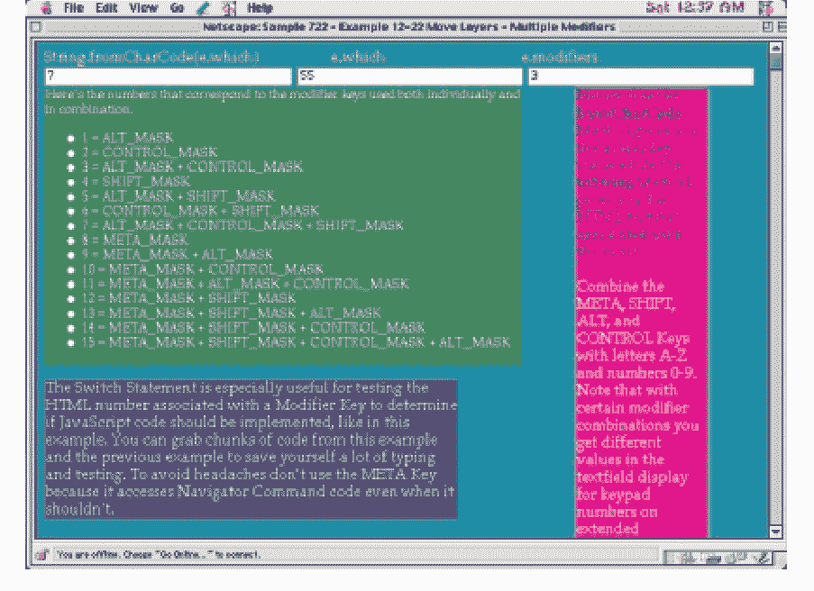

# 第二部分 — JavaScript 1.2

## 使用按键事件打开新窗口

本示例定义了一个名为 **openSesame(e)** 的函数，该函数使用 **switch()** 语句在按下 ALT + CONTROL + 1 键时，通过 **open()** 方法创建并打开一个新的 **window** 对象。请记住，你的逗号分隔的 **windowfeatures** 列表中每个特性之间不能有任何空格。有关 **open()** 方法的更多信息（从第 422 页开始），请参见第 4 章 JavaScript 对象中关于 **window** 对象的部分（从第 416 页开始）。

KEYPRESS 事件通过 **captureEvents()** 方法为 **document** 对象捕获，并且 **openSesame(e)** 函数被分配给 **document** 对象的 **onkeypress** 事件处理器。

**window.focus()** 方法被分配给 BODY 元素的 **onLoad** 事件处理器，以便在文档完全加载后立即将焦点赋予 **window**。

## 示例 6-23：Sample723.html

```
<!DOCTYPE HTML PUBLIC "-//W3C//DTD HTML 3.2//EN">
<HTML>
<HEAD>
<TITLE> Sample 723   示例 6-23  创建新窗口    </TITLE>
```

```
<STYLE TYPE="text/JavaScript">

      classes.Mainbody.BODY.margins("0px");

      classes.Mainbody.BODY.paddings("0px");

      classes.Mainbody.BODY.backgroundColor="lightsteelblue";

      classes.Mainbody.BODY.color="white";

      classes.Mainbody.BODY.fontSize="17pt";

      ids.L1.paddings("7px");
```

```
</STYLE>
```

```
<!--  ***********************************************************  -->
```

```
<SCRIPT LANGUAGE="JavaScript1.2"><!--BEGIN HIDING

/*----------------------------------------------------------------*/
```

## 第 6 章 — JavaScript 事件

```
function openSesame(e) {
    var L1 = document.L1;
    var W1;

    if (e.modifiers == 3) {  //ALT_MASK + CONTROL_MASK = 3
        switch (e.which.toString()) {
            case '49' :  //按下 ALT + CONTROL + 1 键
                W1 = window.open('Sample406.html', 'testWindow', 'menubar=no,scrollbars=no,hotkeys=no,status=no,innerWidth=400,innerHeight=200,screenX=20,screenY=100,resizable=no');
                break;
            default : return false;
        }
    }
}

/*---...---*/

document.captureEvents(Event.KEYPRESS);
document.onkeypress = openSesame;

/*---...---*/

//END HIDING-->
</SCRIPT>

</HEAD>

<BODY CLASS="Mainbody" onLoad="window.focus();">

<LAYER ID="L1" LEFT="100" TOP="5" WIDTH="270" BGCOLOR="red">
    尝试点击 ALT + CONTROL + 1 打开一个新窗口。
</LAYER>

</BODY>

</HTML>
```

# 第二部分 — JavaScript 1.2

## 创建用户可定制的文档

示例 6-24 涉及允许用户选择样式表属性参数以实时创建自定义网页的函数。为此，你需要大量使用 document.write() 方法。基本上，你为用户提供一些 SELECT 菜单元素，以便他们可以选择背景颜色、文本颜色、图层背景颜色、字体、字体大小、边框粗细和边框颜色。当用户做出选择时，名为 display 的主视图框架中的文档会通过 changeEverything() 函数进行更新，该函数被分配给所有 SELECT 元素的 onChange 事件处理器。

本示例包含四个部分。FRAMESET 将窗口划分为三个框架。名为 display 的左侧框架包含用于用户偏好设置的所有 SELECT 元素。名为 input 的顶部框架包含用于用户文本输入的 TEXTFIELD，名为 main 的底部框架是偏好设置和文本输入渲染显示的区域。

**changeEverything()** 该函数通过向 display 框架写入内容来实现更改，首先定义所有将包含来自 SELECT 元素用户选择的变量。例如，变量 getBackColor 被赋予名为 getBackColor 的 SELECT 元素，该元素位于名为 form1 的 FORM 元素中，而 form1 又位于名为 L2 的图层中。然后，sel 变量被赋予 getBackColor SELECT 元素的 selectedIndex 属性的整数值。随后，它被用作 options[index] 数组的索引，以获取当前选择的值并将其分配给 bcolorSel 变量。

```
var getBackColor = L2.document.form1.getBackColor;
var sel = getBackColor.selectedIndex;
var bcolorSel = getBackColor.options[sel].value;
```

以这种相对迂回的方式编码是为了更容易理解发生了什么。它本可以像下面这样用一条语句编码：

```
var bcolorSel=document.L2.document.form1.getBackColor.options[document.L2.document.form1.getBackColor.selectedIndex].value;
```

这句代码的可读性和可理解性要差得多。

在函数的后面部分，包含用户为背景颜色选择的颜色的变量 **bcolorSel** 通过以下代码行实现：

```
parent.main.document.bgColor = bcolorSel;
```


该部分访问名为 main 的 FRAME，并使用 bgColor 属性来实现新的背景颜色。前景色采用完全相同的处理过程。其余的用户选项也遵循此流程，但在变量设置方式上有一个微小的区别。基本上，前两行代码被合并为了一行，因此总共只有两行，如下所示：

```
var sel3 = L2.document.form1.fontSelection.selectedIndex;
var c3 = L2.document.form1.fontSelection.options[sel3].value;
```

函数的其余部分仅使用 `document.write()` 方法来为文档创建 HTML 并实现用户偏好设置。示例中包含一些注释部分，您可以查看这些部分以获得进一步的说明。

## 示例 6-24 的另一个版本

有一个名为 Sample724B-hasLayerBGColor.html 的并行文件，它具有一些次要的额外功能。用户可以在以下两种实现方式之间进行选择：

```
parent.main.document.L1.bgColor = c4;
```

这实际上会导致图层（Layer）的背景颜色行为类似于 CSS 属性 `layer-background-color`；或者选择另一种方式：

```
parent.main.document.ids.L1.backgroundColor = c4;
```

这使其表现为正常行为。这是在 `whichTypeBG()` 函数中通过名为 chbx1 的复选框实现的。

如果您想运行该版本，请确保加载名为 Sample724-B-Frameset.html 的文件，而不是 Sample724Frameset.html。附加功能说明如下：

**whichTypeBG()** 该函数仅根据名为 chbx1 的 CHECKBOX 元素是否被选中来更改布尔变量。如果 `booleanTest` 为 false，则 `changeEverything()` 函数为图层 L1 实现 `backgroundColor` 选择，如下所示：

```
parent.main.document.ids.L1.backgroundColor = c4;
```

如果 `booleanTest` 为 true，则：

```
parent.main.document.L1.bgColor = c4;
```

**showPoem()** 该函数仅让用户决定是否在用户文本的同时显示一首短诗。设置这首诗是为了在您想要测试脚本（SCRIPT）时，不必在文本区域（TEXTAREA）中不断输入文本来获取结果。

## 第二部分 — JavaScript 1.2

## 示例 6-24 第一部分：Sample724.html

```
<!DOCTYPE HTML PUBLIC "-//W3C//DTD HTML 3.2//EN">
<HTML>
<HEAD>
<TITLE> Sample 724   Example 6-24 User Customizable Sites</TITLE>

<STYLE TYPE="text/JavaScript">

    classes.Mainbody.BODY.margins("0px");
    classes.Mainbody.BODY.paddings("0px");
    classes.Mainbody.BODY.backgroundColor="purple";
    classes.Mainbody.BODY.color="white";
    classes.Mainbody.BODY.fontSize="12pt";

</STYLE>
</HEAD>

<BODY CLASS="Mainbody">

<LAYER ID="L2" LEFT="10" TOP="10">

<FORM NAME="form1">

Pick a new <BR>        Background Color       <BR>

<SELECT NAME="getBackColor" SIZE="1" onChange="changeEverything(); return false;">

<OPTION VALUE="cornsilk" SELECTED>    cornsilk        </OPTION>
<OPTION VALUE="bisque">       bisque          </OPTION>
<OPTION VALUE="black">        black           </OPTION>
<OPTION VALUE="blue">         blue            </OPTION>
<OPTION VALUE="blueviolet">   blueviolet      </OPTION>
<OPTION VALUE="coral">        coral           </OPTION>
<OPTION VALUE="cornflowerblue">  cornflowerblue     </OPTION>
<OPTION VALUE="crimson">      crimson         </OPTION>
<OPTION VALUE="cyan">         cyan            </OPTION>
<OPTION VALUE="darkblue">     darkblue        </OPTION>
<OPTION VALUE="darkcyan">     darkcyan        </OPTION>
<OPTION VALUE="darkgoldenrod">  darkgoldenrod      </OPTION>
<OPTION VALUE="darkgreen">    darkgreen       </OPTION>
<OPTION VALUE="darkkhaki">    darkkhaki       </OPTION>
<OPTION VALUE="darkmagenta">  darkmagenta     </OPTION>
<OPTION VALUE="darkturquoise">  darkturquoise      </OPTION>
<OPTION VALUE="darkviolet">   darkviolet      </OPTION>
<OPTION VALUE="goldenrod">    goldenrod       </OPTION>
<OPTION VALUE="gray">         gray            </OPTION>
<OPTION VALUE="green">        green           </OPTION>
<OPTION VALUE="indianred">    indianred       </OPTION>
</SELECT>

<!--  ****************************************************  -->
<BR><HR>

Pick a new <BR>        Foreground Color<BR>

<SELECT NAME="getForeColor" SIZE="1" onChange="changeEverything(); return false;">

<OPTION VALUE="lightseagreen" SELECTED>lightseagreen</OPTION>
<OPTION VALUE="lightskyblue"> lightskyblue</OPTION>
<OPTION VALUE="lightslategray"> lightslategray</OPTION>
<OPTION VALUE="lightblue"> lightblue</OPTION>
<OPTION VALUE="mediumblue"> mediumblue</OPTION>
<OPTION VALUE="mediumorchid"> mediumorchid</OPTION>
<OPTION VALUE="mediumpurple"> mediumpurple</OPTION>
<OPTION VALUE="mediumseagreen"> mediumseagreen</OPTION>
<OPTION VALUE="mediumslateblue"> mediumslateblue</OPTION>
<OPTION VALUE="mediumspringgreen"> mediumspringgreen</OPTION>
<OPTION VALUE="mediumturquoise"> mediumturquoise</OPTION>
<OPTION VALUE="mediumvioletred"> mediumvioletred</OPTION>
<OPTION VALUE="midnightblue"> midnightblue</OPTION>
<OPTION VALUE="plum"> plum</OPTION>
<OPTION VALUE="powderblue"> powderblue</OPTION>
<OPTION VALUE="purple"> purple</OPTION>
<OPTION VALUE="red"> red</OPTION>
<OPTION VALUE="rosybrown"> rosybrown</OPTION>
<OPTION VALUE="royalblue"> royalblue</OPTION>
<OPTION VALUE="steelblue"> steelblue</OPTION>
<OPTION VALUE="tan"> tan</OPTION>
<OPTION VALUE="teal"> teal</OPTION>
<OPTION VALUE="thistle"> thistle</OPTION>
<OPTION VALUE="tomato"> tomato</OPTION>
</SELECT>

<!-- ******************************************************************** -->
<HR>
Pick a new <BR> Font <BR><HR>

<SELECT NAME="fontSelection" SIZE="1" onChange="changeEverything(); return false;">

<OPTION VALUE="Helvetica" SELECTED> Font Helvetica</OPTION>
<OPTION VALUE="Helvetica"> Helvetica</OPTION>
<OPTION VALUE="Times"> Times</OPTION>
<OPTION VALUE="Western"> Western</OPTION>
<OPTION VALUE="Courier"> Courier</OPTION>
<OPTION VALUE="Palatino"> Palatino</OPTION>
<OPTION VALUE="Moonlight"> Moonlight</OPTION>
<OPTION VALUE="Clarendon"> Clarendon</OPTION>
<OPTION VALUE="cursive"> cursive generic</OPTION>
<OPTION VALUE="fantasy"> fantasy generic</OPTION>
<OPTION VALUE="serif"> serif generic</OPTION>
</SELECT>

<!-- ******************************************************************** -->
<HR>
Pick a new <BR> Layer Background Color Background Color <BR><HR>

<SELECT NAME="getLayerBackgroundColor" SIZE="1" onChange="changeEverything(); return false;">

<OPTION VALUE="navajowhite" SELECTED> navajowhite</OPTION>
<OPTION VALUE="bisque"> bisque</OPTION>
<OPTION VALUE="black"> black</OPTION>
<OPTION VALUE="blue"> blue</OPTION>
<OPTION VALUE="blueviolet"> blueviolet</OPTION>
<OPTION VALUE="coral"> coral</OPTION>
<OPTION VALUE="cornflowerblue"> cornflowerblue</OPTION>
<OPTION VALUE="cornsilk"> cornsilk</OPTION>
<OPTION VALUE="crimson"> crimson</OPTION>
<OPTION VALUE="cyan"> cyan</OPTION>
<OPTION VALUE="darkblue"> darkblue</OPTION>
<OPTION VALUE="midnightblue"> midnightblue</OPTION>
<OPTION VALUE="mintcream"> mintcream</OPTION>
<OPTION VALUE="mistyrose"> mistyrose</OPTION>
<OPTION VALUE="moccasin"> moccasin</OPTION>
<OPTION VALUE="navy"> navy</OPTION>
<OPTION VALUE="powderblue"> powderblue</OPTION>
<OPTION VALUE="purple"> purple</OPTION>
<OPTION VALUE="red"> red</OPTION>
</SELECT>
<BR>

<!-- *********************************** -->
<HR>
Pick a new <BR> Font Size <BR>
<SELECT NAME="getFontSize" SIZE="1" onChange="changeEverything(); return false;">
<OPTION VALUE="22" SELECTED> Font Size </OPTION>
<OPTION VALUE="12"> 12 </OPTION>
<OPTION VALUE="14"> 14 </OPTION>
<OPTION VALUE="18"> 18 </OPTION>
<OPTION VALUE="20"> 20 </OPTION>
<OPTION VALUE="22"> 22 </OPTION>
<OPTION VALUE="24"> 24 </OPTION>
<OPTION VALUE="26"> 26 </OPTION>
<OPTION VALUE="28"> 28 </OPTION>
<OPTION VALUE="30"> 30 </OPTION>
<OPTION VALUE="32"> 32 </OPTION>
<OPTION VALUE="34"> 34 </OPTION>
<OPTION VALUE="40"> 40 </OPTION>
<OPTION VALUE="48"> 48 </OPTION>
<OPTION VALUE="55"> 55 </OPTION>
<OPTION VALUE="60"> 60 </OPTION>
<OPTION VALUE="77"> 77 </OPTION>
<OPTION VALUE="111"> 111 </OPTION>
</SELECT>

<!-- *********************************** -->
<HR>
Pick a new <BR> Border Color <BR>
<SELECT NAME="getBorderColor" SIZE="1" onChange="changeEverything(); return false;">
<OPTION VALUE="blueviolet" SELECTED> blueviolet </OPTION>
<OPTION VALUE="lightseagreen"> lightseagreen </OPTION>
<OPTION VALUE="lightskyblue"> lightskyblue </OPTION>
<OPTION VALUE="lightslategray"> lightslategray </OPTION>
<OPTION VALUE="lightsteelblue"> lightsteelblue </OPTION>
<OPTION VALUE="lightyellow"> lightyellow </OPTION>
<OPTION VALUE="limegreen"> limegreen </OPTION>
<OPTION VALUE="linen"> linen </OPTION>
<OPTION VALUE="magenta"> magenta </OPTION>
<OPTION VALUE="mediumaquamarine"> mediumaquamarine </OPTION>
<OPTION VALUE="purple"> purple </OPTION>
</SELECT>
```


```xml
<OPTION  VALUE="red">
<OPTION  VALUE="seagreen">
<OPTION  VALUE="seashell">
<OPTION  VALUE="sienna">
<OPTION  VALUE="silver">
<OPTION  VALUE="skyblue">
<OPTION  VALUE="slateblue">
<OPTION  VALUE="slategray">
<OPTION  VALUE="snow">
<OPTION  VALUE="springgreen">
<OPTION  VALUE="steelblue">
<OPTION  VALUE="tan">
<OPTION  VALUE="teal">
<OPTION  VALUE="thistle">
</SELECT>
```

```xml
<!--  *********************************************************  -->
<HR>
Pick a new <BR>      Border Width           <BR>
```

```xml
<SELECT NAME="getBorderWidths" SIZE="1" onChange="changeEverything(); return false;">
```

```xml
<OPTION  VALUE="22" SELECTED>    Border Widths         </OPTION>
<OPTION  VALUE="2">                      2                       </OPTION>
<OPTION  VALUE="5">                      5                       </OPTION>
<OPTION  VALUE="7">                      7                       </OPTION>
<OPTION  VALUE="10">                     10                      </OPTION>
<OPTION  VALUE="12">                     12                      </OPTION>
<OPTION  VALUE="14">                     14                      </OPTION>
<OPTION  VALUE="20">                     20                      </OPTION>
<OPTION  VALUE="22">                     22                      </OPTION>
<OPTION  VALUE="25">                     25                      </OPTION>
<OPTION  VALUE="26">                     26                      </OPTION>
<OPTION  VALUE="28">                     28                      </OPTION>
<OPTION  VALUE="30">                     30                      </OPTION>
<OPTION  VALUE="32">                     32                      </OPTION>
<OPTION  VALUE="35">                     35                      </OPTION>
<OPTION  VALUE="40">                     40                      </OPTION>
<OPTION  VALUE="50">                     50                      </OPTION>
<OPTION  VALUE="55">                     55                      </OPTION>
</SELECT>
```

```xml
</FORM>

</LAYER>

<!--  *********************************************************  -->

<SCRIPT LANGUAGE="JavaScript1.2"><!--BEGIN HIDING
```

```javascript
        if (booleanTest == false) { booleanTest = true; }
        else if (booleanTest == true) { booleanTest = false; }
}
```

```javascript
/*-----------------------------------------------------------------------*/
```

## 第二部分 — JavaScript 1.2

```javascript
/*------------------------------------------------------------------------------*/

function changeEverything() {

    var L2 = document.L2;

    var getBackColor = L2.document.form1.getBackColor;
    var sel = getBackColor.selectedIndex;
    var bColorSel = getBackColor.options[sel].value;

    var getForeColor = L2.document.form1.getForeColor;
    var sel2 = getForeColor.selectedIndex;
    var fColorSel = getForeColor.options[sel2].value;

    var sel3 = L2.document.form1.fontSelection.selectedIndex;
    var c3 = L2.document.form1.fontSelection.options[sel3].value;

    var sel14 = L2.document.form1.getLayerBackColor.selectedIndex;
    var c4 = L2.document.form1.getLayerBackColor.options[sel14].value;

    var sel5 = L2.document.form1.getFontSize.selectedIndex;
    var c5 = L2.document.form1.getFontSize.options[sel5].value;

    var sel7 = L2.document.form1.getBorderColor.selectedIndex;
    var c7 = L2.document.form1.getBorderColor.options[sel7].value;

    var sel8 = L2.document.form1.getBorderWidths.selectedIndex;
    var c8 = L2.document.form1.getBorderWidths.options[sel8].value;

    var cl1 = parent.input.document.form3.textAreaL.value;


    parent.main.document.open();
    parent.main.document.write('<HTML><HEAD><TITLE> Test Layer </TITLE>');

    parent.main.document.write('<STYLE TYPE="text/JavaScript">');


    parent.main.document.write('<style>body,fontSize = "10pt";');
    parent.main.document.write('<ids.L1.width="100%";');
    parent.main.document.write('<ids.L1.paddingRight="20px";');
    parent.main.document.write('<ids.L1.paddingLeft="20px";');
    parent.main.document.write('<ids.L1.borderWidths("30px");');
    parent.main.document.write('<ids.L1.borderStyle="groove";');

    parent.main.document.write('</STYLE>');


    parent.main.document.write('</HEAD>');
    parent.main.document.write('</BODY>');

/*------------------------------------------------------------------------------*/

//Notice that there are no Write Methods
//in the next lines of code with Variables that change Properties

/*------------------------------------------------------------------------------*/
```

## 第 6 章 — JavaScript 事件

```javascript
//This is the line that implements the background color change

parent.main.document.bgColor = bcolorSel;

/*-----------------------------------------------------------------------------------*/
```

```javascript
//This is the line that implements the foreground color change

parent.main.document.fgColor = fcolorSel;

/*-----------------------------------------------------------------------------------*/
```

```javascript
//This is the line that implements the font family change

parent.main.document.ids.L1.fontFamily = c3;

/*-----------------------------------------------------------------------------------*/
```

```javascript
//This is the line that implements the LAYER Background Color change

parent.main.document.ids.L1.backgroundColor = c4;

/*-----------------------------------------------------------------------------------*/
```

```javascript
//This is the line that implements the Font Size change

parent.main.document.ids.L1.fontSize = c5;

/*-----------------------------------------------------------------------------------*/
```

```javascript
//This is the line that implements the Border Color change

parent.main.document.ids.L1.borderColor = c7;

/*-----------------------------------------------------------------------------------*/
```

```javascript
//This is the line that implements the Border Widths change

parent.main.document.ids.L1.borderWidths(c8);

/*-----------------------------------------------------------------------------------*/
```

```javascript
parent.main.document.write('<LAYER Id="L1" LEFT="0" TOP="0">');

parent.main.document.writeln('<BR>' + c11 + '<BR><BR>');

parent.main.document.write('</LAYER>');

/*-----------------------------------------------------------------------------------*/
```

```javascript
parent.main.document.write('</body></html>');
parent.main.document.close();
}
/*-----------------------------------------------------------------------------------*/
//END HIDING-->
</SCRIPT>
```

```xml
</body>
</html>
```

这只是用于名为 **input** 的顶部框架（FRAME）的文档代码。它包含一个名为 **textArea1** 的文本区域（TEXTAREA）用于用户输入。

### 示例 6-24 第 2 部分：Sample724A.html

```xml
<!DOCTYPE HTML PUBLIC "-//W3C//DTD HTML 3.2//EN">
<HTML>
<HEAD>
<TITLE>            Sample 724A    Example 6-24A    </TITLE>
</HEAD>

<BODY>

<FORM NAME="form3">

<TEXTAREA NAME="textArea1" ROWS=8 COLS=55 WRAP="hard">

Put your poem or text here and then choose from the pop-up selection menus in the left frame to render the results.

</TEXTAREA>

</FORM>

</BODY>
</HTML>
```

该文档最初被加载到名为 **main** 的框架（FRAME）中，基本上作为一个*占位*文档，随后会被用户的选择所覆盖。

### 示例 6-24 第 3 部分：Sample724Right.html

```xml
<!DOCTYPE HTML PUBLIC "-//W3C//DTD HTML 3.2//EN">
<HTML>
<HEAD>
<TITLE>            Sample 724Right    Example 6-24Right    </TITLE>
</HEAD>

<BODY>

<H1>                Children speak the ancient rhyme...    </H1>

</BODY>
</HTML>
```

## 第 6 章 — JavaScript 事件

这是示例 6-24 的框架集（FRAMESET）。

### 示例 6-24 第 4 部分：Sample724Frameset.html

```xml
<HTML>
<HEAD>
<TITLE>      Frameset for Sample 724      </TITLE>
</HEAD>
<FRAMESET COLS="220,*">
    <FRAME MARGINHEIGHT=0 SCROLLING="no" NAME="display" SRC="Sample724.html">
    <FRAMESET ROWS="100,*">
        <FRAME MARGINHEIGHT="0" SCROLLING="auto" NAME="input" SRC="Sample724A.html">
        <FRAME SCROLLING="auto" NAME="main" SRC="Sample724Right.html">
    </FRAMESET>
</FRAMESET>
</HTML>
```


# 示例 6-24：Sample724Frameset.html

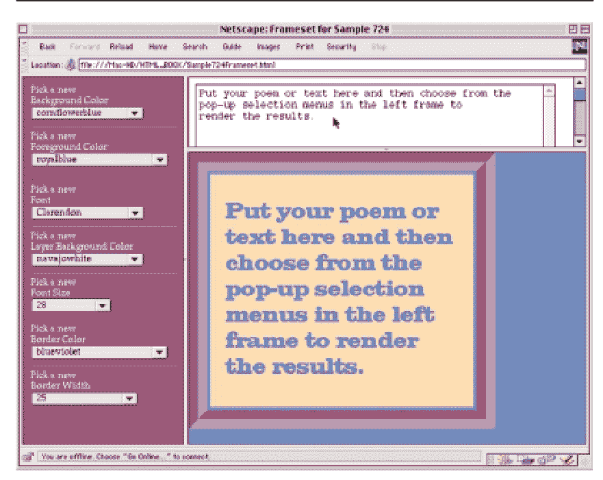

# 拖动 Layer 调整其大小

在 Netscape 的 Dynamic HTML Guide 中，有一个示例在理论上是正确的，但存在一些编码错误导致其行为不稳定。我已经修复了这些异常，并以重新加工的形式呈现在 Sample725.html 中。

基本结构与本章前面处理通过拖动来重新定位 Layer 的示例类似。在本例中，pageX 坐标不是由 mousemove 事件持续更新然后传入 moveBy() 方法中进行修改，而是将 pageX 坐标传入 changeWidth() 函数，在该函数中赋值给 layerWidth 变量，并用 delta 参数进行处理，以便在通过 Layer 对象的 load() 方法重新加载到文档中时改变 Layer 的宽度。

请记住，load() 方法接受 URL 参数，并有可选的第二个参数，用于在加载时为 URL 分配新的宽度，本例中正是使用了这一特性。加载的外部文件的 URL 是 Sample725A.html，该文件不在本书中。注意，它最初是通过 SRC 属性加载到名为 Showcase1 的 Layer 中的。如果你想比较两种不同类型的示例，请查看第 548 页的示例 6-10。

# 示例 6-25：Sample725.html

```
<!DOCTYPE HTML PUBLIC "-//W3C//DTD HTML 3.2//EN">
<HTML>
<HEAD>
<TITLE>Sample 725 - Example 6-25    Drag Mouse to Resize a Layer</TITLE>
</HEAD>

<BODY BGCOLOR="black" TEXT="white">

    <!-- The containing layer that loads the external file -->

<LAYER ID="Showcase1" LEFT="5" TOP="100" BGCOLOR="blue" SRC="Sample725A.html">
</LAYER>

<!-- ***************************************************** -->

<SCRIPT LANGUAGE="JavaScript1.2"><!--BEGIN HIDING

/*-----------------------------------------------------------*/
var layerWidth = 800;
var oldX;
var Showcase1 = document.Showcase1;

Showcase1.captureEvents(Event.MOUSEDOWN|Event.MOUSEUP);

Showcase1.onmousedown=begindrag;
Showcase1.onmouseup=enddrag;
Showcase1.onLoad=resetcapture;
/*------------------------------------------*/

function resetcapture() {
  Showcase1.captureEvents(Event.MOUSEDOWN|Event.MOUSEUP|Event.MOUSEMOVE);
}

/*------------------------------------------*/

function begindrag(e) {

         Showcase1.captureEvents(Event.MOUSEMOVE);
         Showcase1.onmousemove=drag;
         oldX=e.pageX;
  return false;
}

/*------------------------------------------*/

function drag(e) {
         changeWidth(Showcase1, e.pageX - oldX);
         oldX = e.pageX;
  return false;
}

/*------------------------------------------*/

function changeWidth(thelayer, delta) {

         layerWidth = layerWidth + delta;
         if (delta != 0)
         Showcase1.load('Sample725A.html', layerWidth);
}

/*------------------------------------------*/

function enddrag(e) {
         Showcase1.onmousemove=0;
         Showcase1.releaseEvents(Event.MOUSEMOVE);
  return false;
}

//END HIDING-->
</SCRIPT>

</BODY>
</HTML>
```

### 事件路由与处理

### JavaScript routeEvent(e) 函数

首先回顾一下，以下方法可用于 **window**、**document** 和 Layer 对象：

```
window.captureEvents(e)
window.releaseEvents(e)
document.captureEvents(e)
document.releaseEvents(e)
layerObject.captureEvents(e)
layerObject.releaseEvents(e)
```

**routeEvent()** 函数用于调用事件层级中下一个事件处理器。例如，如果你在页面中使用 **captureEvents()** 方法为 **window**、**document** 和名为 L1 的 Layer 捕获 *onClick* 事件处理器，那么当 CLICK 事件发生时，将首先由 **window** 对象捕获。如果分配给 **window.onclick** 的 JavaScript 代码中恰当地使用了 **routeEvent(e)**，那么它会将事件 e 路由到 **document** 对象的 *onClick* 事件处理器进行进一步处理，依此类推直至 Layer 对象。

一旦事件被所有使用 **captureEvents()** 方法强制将事件纳入其作用域的对象处理后，JavaScript 会查找事件原始目标（如链接或按钮）的事件处理器，并完成处理。

这种层级推进可能看起来有点反向，确实如此，但 JavaScript 与 HTML 一样，是从上到下设计的，因此同级对象从其父对象继承，事件处理遵循这一范式。使用这些方法时要小心，不要无意中路由事件导致形成事件反馈循环，这可能会使系统完全崩溃。

### 使用 JavaScript routeEvent(e) 函数

本示例演示了 **routeEvent(e)** 函数的使用。按钮 **B1** 位于 Layer **L1** 内部，按钮 **B2** 位于 Layer **L2** 内部。两个按钮都有自己的 *onClick* 事件处理器代码作为 HTML 属性。**document** 对象被设置为捕获 CLICK 事件，Layer **L1** 被设置为捕获 CLICK 事件。**myClicker(e)** 函数被分配给 **document** 对象的 **onclick** 事件处理器，**myLayerClicker(e)** 函数被分配给 Layer **L1** 的 **onclick** 事件处理器。

**myClicker(e)** — 该函数旨在引导你了解事件推进的开始，首先在任何 CLICK 事件发生时显示一个提示框。在此页面中，document 对象具有最高优先级，因为 window 未设置为捕获事件。

然后，如果你在文档背景中点击，第二个提示框将激活。如果点击的是按钮 B1，事件将通过 routeEvent(e) 路由到 Layer L1 进行处理。

如果点击的是按钮 B2，事件将通过 routeEvent(e) 直接路由到按钮 B2 的 onClick 事件处理器，因为 B2 位于 Layer L2 内部，因此它不会从 Layer L1 继承事件。注意，Layer L2 未设置为捕获事件。

```
function myClicker(e) {

    alert ("This event was captured by the document first and may be routed to... ");

    //Prevents an Event Feedback Loop
    if (e.target == document) {
        alert ("The 'if' Statement prevents an Event Feedback Loop if you click in the document.");
        return;
    }

    routeEvent(e);
}
```

**myLayerClicker(e)** — 该函数通过提示框向用户显示它已被激活，并将 Layer L2 的背景颜色改变。然后它将事件路由到其下一个可能的目的地（如果有的话）。如果点击的是按钮 B1，则 routeEvent(e) 将事件路由到该按钮的 onClick 事件处理器进行处理。在本示例中，这是该函数中唯一实现 routeEvent(e) 的时机。

```
function myLayerClicker(e) {

    alert ("This event was captured second, by Layer L1; it turns Layer L2 to cyan and may be routed to... ");
    document.L2.bgColor = 'cyan';
    routeEvent(e);
}
```

# 示例 6-26：Sample726.html

```
<!DOCTYPE HTML PUBLIC "-//W3C//DTD HTML 3.2//EN">
<HTML>
<HEAD>
<TITLE>          Sample 726   Example 6-26  routeEvent() Function          </TITLE>

<SCRIPT LANGUAGE="JavaScript1.2"> <!--BEGIN HIDING

function myClicker(e) {

alert ("This event was captured by the document first and may be routed to... ");
                                //Prevents an Event Feedback Loop

        if (e.target == document)  {

                alert ("The 'if' Statement prevents an Event Feedback Loop if you
click in the document.");
                return;
        }

routeEvent(e);
}


document.captureEvents(Event.CLICK);
document.onclick=myClicker;


//END HIDING-->
</SCRIPT>

</HEAD>

<BODY>
<LAYER ID="L1" LEFT="25" TOP="10">

<FORM NAME="form1">

<INPUT TYPE="button" NAME="B1" VALUE="Button 1"
onClick="alert('me. I am Button 1, at your service.'); return false;">     <BR>

</FORM>
</LAYER>

<LAYER ID="L2" LEFT="25" TOP="70" BGCOLOR="#8888ff">
<H3>Here's the sequence of Events:</H3>

<B>Button 1:</B> The document captures the Event first and routes it to Layer L1
and then routes it to Button B1<BR><BR>

<B>Button 2:</B> The document captures the Event first and routes it to Button B2.

<BR><BR>
```


# 666 第二部分 — JavaScript 1.2

**此层 L2：** 文档首先捕获该事件，随后事件处理结束。

**文档：** 文档首先捕获该事件，随后事件处理结束。

***

需要注意的是，在构建自己的文档时，不要将事件路由成一个反馈循环（死循环）。如果 Layer L1 足够大，以至于你可以点击它的背景而不仅仅是按钮，那么就会产生一个事件反馈循环。接下来的两个示例将向你展示如何防止反馈循环。如果你创建了这类循环并不得不多次强制退出 Navigator 浏览器，你可能会损坏 Finder 的首选项文件，届时你将不得不将其删除。

```
<FORM NAME="form2">

<INPUT TYPE="button" NAME="B2" VALUE="Button 2"
onClick="alert('me. I am Button 2, at your service.'); return false;">

</FORM>

</LAYER>
```

```
<SCRIPT LANGUAGE="JavaScript1.2"> <!--BEGIN HIDING

function myLayerClicker(e) {

    alert ("This event was captured second, by Layer L1; it turns Layer L2 to cyan and may be routed to... ");

    document.L2.bgColor = 'cyan';
    routeEvent(e);
}

/*----------------------------------------------------------------------*/

    document.L1.captureEvents(Event.CLICK);

    document.L1.onclick=myLayerClicker;

/*----------------------------------------------------------------------*/

//END HIDING-->
</SCRIPT>
```

```
</body>
</html>
```

## 第 6 章 — JavaScript 事件

# 示例 6-26 Sample726.html

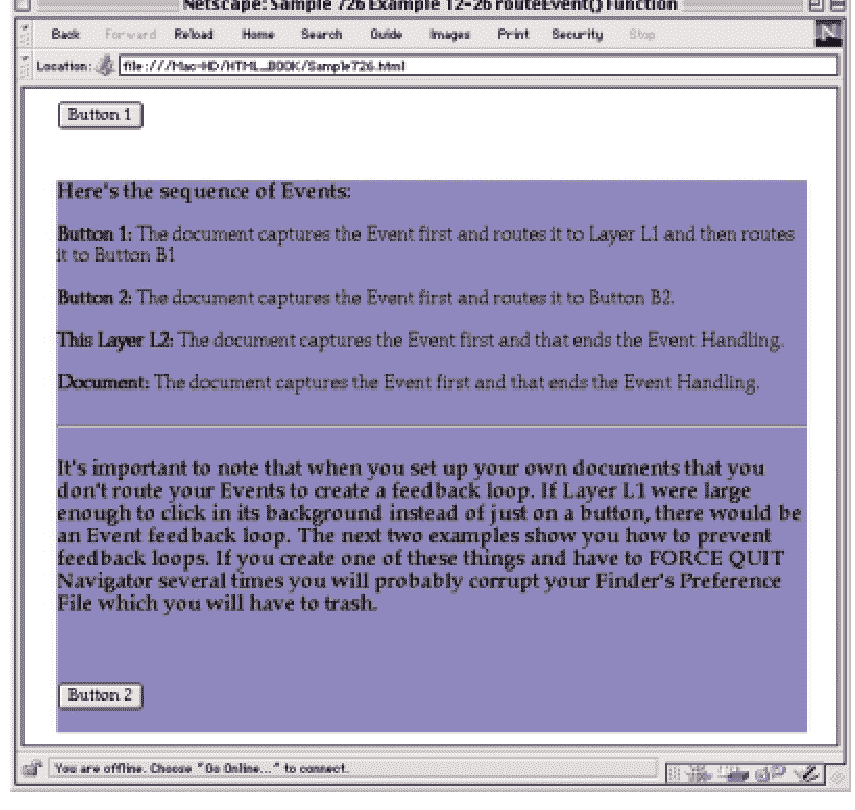

# JavaScript `handleEvent(e)` 方法

`handleEvent(e)` 方法被事件接收者用于通过显式调用特定事件的事件处理程序，来绕过事件捕获层级。可以将事件想象成在自然捕获链中传输。当它遇到 `handleEvent(e)` 方法时，它会脱离当前的流，跳转到通过 `handleEvent()` 方法调用它的对象，并在此处继续被处理。例如，假设你在名为 `form1` 的表单中定义了一个名为 `B2` 的按钮，如下所示：

```
<INPUT TYPE="button" NAME="B2" VALUE="Button 2"
onClick="alert('I am Button 2, at your service!')">
```

然后你可以使用条件语句 `if ()` 来测试该按钮是否被点击，如果为真，则调用 `handleEvent(e)` 立即触发其 `onClick` 事件处理程序来弹出 `alert`，如下所示：

```
if (e.target.name == "B2") {
    e.target.handleEvent(e);
}
```

由于条件语句 `if ()` 要求目标必须始终是按钮 `B2`，因此你可以像上述代码中展示的那样，使用简写方式在事件的 `target` 属性上调用 `handleEvent(e)`。你也可以使用更熟悉的方式编写，如下所示：

```
if (e.target.name == "B2") {
    document.form1.B2.handleEvent(e);
}
```

或者如下所示：

```
if (e.target.name == "B2") {
    document.form1.elements["B2"].handleEvent(e);
}
```

当你开始处理多层嵌套的元素时，你就能体会到这种简写编码方式的优势。

# 使用 JavaScript handleEvent(e) 方法

示例 6-27 展示了 `handleEvent(e)` 方法和 `routeEvent(e)` 函数。它的结构与前一个示例类似，但更为复杂。它由两个名为 limeLayer1 和 L2 的层开始。在 limeLayer1 内部创建了三个按钮，分别名为 B1、B2 和 B3。document 对象和 limeLayer1 层都使用了 `captureEvents()` 来捕获 CLICK 事件。

`myClicker(e)` 函数被分配给 document 对象的 `onClick` 事件处理程序，而 `myLayerClicker(e)` 函数被分配给 limeLayer1 的 `onClick` 事件处理程序。`buttonColors(event)` 函数被分配给 B2 和 B3 按钮的 `onClick` 事件处理属性。请注意，当函数在属性中被调用时，必须显式传递 `event` 关键字参数。

`myClicker(e)`：该函数在之前示例的基础上增加了功能，当事件的目标是按钮 B2 时，会对 Target 属性调用 `handleEvent()` 方法。它以 `routeEvent(e)` 结尾，该函数将事件转发给 limeLayer1 的 `onClick` 事件处理程序。

`myLayerClicker(e)`：该函数相对于之前示例也进行了一些额外处理。如果点击了按钮 B3，则调用 `handleEvent(e)` 将事件直接转发给 B3；否则，事件由 limeLayer1 处理，弹出 alert 并将 L2 的背景颜色改为青色。由于此函数中没有调用 `routeEvent(e)`，因此事件处理到此结束。

`buttonColors(event)`：该函数根据点击的是按钮 B2 还是 B3 来更改 L2 层的背景颜色。

# 示例 6-27：Sample727.html

```
<!DOCTYPE HTML PUBLIC "-//W3C//DTD HTML 3.2//EN">
<html>
<HEAD>
<TITLE> Sample 727 Example 6-27 routeEvent and handleEvent Method</TITLE>

<SCRIPT LANGUAGE="JavaScript1.2"> <!--BEGIN HIDING

function myClicker(e) {

 if (e.target == document) {
 alert("The document captures CLICK Events first in the hierarchy.
 The 'return false' in this 'if' ends the Event Handling.");}
 return false;
 }

alert ("This event was captured by the document first and may be routed to...");

if (e.target.name == "B2") {
    e.target.handleEvent(e);
    return false;
}

routeEvent(e);
return false;
}

document.captureEvents(Event.CLICK);
document.onclick=myClicker;

//END HIDING-->
</SCRIPT>

</HEAD>

<BODY>
<LAYER ID="limeLayer1" LEFT="25" TOP="10" BGCOLOR="lime" WIDTH="500">
<FORM NAME="form1">

<INPUT TYPE="button" NAME="B1" VALUE="Button 1">

<INPUT TYPE="button" NAME="B2" VALUE="Button 2"
onClick="alert('me. I am Button 2, at your service.'); buttonColors(event); return false;">

<INPUT TYPE="button" NAME="B3" VALUE="Button 3"
onClick="alert('me. I am Button 3, at your service.'); buttonColors(event); return false;">

</FORM>
</LAYER>

<LAYER ID="L2" LEFT="25" TOP="120" BGCOLOR="#8888ff">
Here's the sequence of Events:

**Button 1:** The document captures the Event first and routes it to limeLayer1 where the Event ends so that in this scenario Button B1 never gets the Event because limeLayer1 does not route Events and there is no handleEvent for Button B1.

**Button 2:** The document captures the Event first and Button 2 handles the Event directly with handleEvent.

**Button 3:** The document captures the Event first and routes it to limeLayer1 and then Button 3 handles the Event directly with handleEvent.

**This Layer L2:** The document captures the Event first and that ends the Event Handling.

**Document:** The document captures the Event first and that ends the Event Handling.

***

Notice that **'limeLayer1'** is capturing Click Events, not Layer L2 which is this Layer.

It's important to note that when you set up your own documents that you don't route your Events to create a feedback loop.
</LAYER>

```
<SCRIPT LANGUAGE="JavaScript1.2"> <!--BEGIN HIDING

function myLayerClicker(e) {

	if (e.target.name == "B3") {
		alert ("This event was captured second, by the Layer limeLayer1. It changes Layer L2 to cyan and then uses e.target.handleEvent to send the event directly to...");
		document.L2.bgColor = 'cyan';
		document.limeLayer1.document.form1.B3.handleEvent(e);
		return false;
	}
	else {
		alert ("This event was captured second, by the Layer limeLayer1. It changes Layer L2 to cyan and is not routed.");
		document.L2.bgColor = 'cyan';
		return false;
	}
return false;
}

/*----------------------------------------------------------------------*/

function buttonColors(e)  {
	if (e.target.name == 'B2')  { document.L2.bgColor='orange'; }
	if (e.target.name == 'B3')  { document.L2.bgColor='yellow'; }
}

/*----------------------------------------------------------------------*/

	document.limeLayer1.captureEvents(Event.CLICK);
	document.limeLayer1.onclick=myLayerClicker;

/*----------------------------------------------------------------------*/

//END HIDING-->
</SCRIPT>

</BODY>
</HTML>
```


# 示例 6-27 Sample727.html

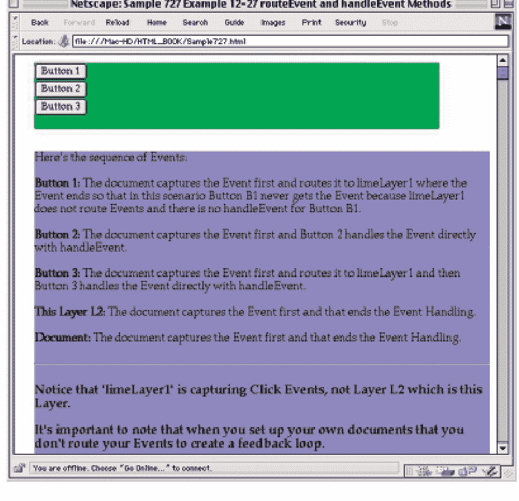

## 第 6 章 — JavaScript 事件

## 在嵌套和非嵌套层中处理和路由事件

这个示例与前一个示例非常相似。不同之处在于 **window** 对象也被设置为捕获事件，且按钮 **B1** 位于 **document** 对象中而非 **limeLayer1** 中。此外还有一个名为 **B4** 的附加按钮，它位于 **L2** 层内部。

**myWindowClicker(e)** 该函数被分配给 **window** 对象的 **onclick** 事件处理器。由于它处于事件层级的最顶端，所有事件首先都会到达这里，从而触发 **alert** 消息，随后事件被路由到层级中接下来的 **document** 对象的 **onclick** 事件处理器。

**myClicker(e)** 和 **myLayerClicker(e)** 函数与前一个示例中使用的函数等效，详细解释请参阅第 669 页起的内容。

你应该注意当位于 **L2** 层内部的 **B4** 按钮被点击时的事件序列。事件首先被发送到 **window**，其次发送到 **document** 对象，但 _没有_ 从 **document** 对象转发到 **limeLayer1** 层。从 **document** 对象开始，事件被路由到 **B3** 按钮。这种进展并不完全符合直觉，因此在编写自己的脚本时请留意这一点。

# 示例 6-28：Sample728.html

```
<!DOCTYPE HTML PUBLIC "-//W3C//DTD HTML 3.2//EN">
<HTML>
<HEAD>
<TITLE> Sample 728    Example 6-28  Handling Events in Nested Layers</TITLE>

<SCRIPT LANGUAGE="JavaScript1.2"> <!--BEGIN HIDING

function myWindowClicker(e) {

alert ("This event was captured by the window first and may be routed to... ");

routeEvent(e);
return false;
}

/*---------------------------------------*/

window.captureEvents(Event.CLICK);
window.onclick=myWindowClicker;

/*---------------------------------------*/
```

# 第二部分 — JavaScript 1.2

```
function myClicker(e) {
    if (e.target == document) {
        alert ("The document captures CLICK Events second in the hierarchy.
        The 'return false' in this 'if' ends the Event Handling.");
        return false;
    }
    alert ("This event was captured by the document second and may be routed to...");
    if (e.target.name == "B2") {
        e.target.handleEvent(e);
        return false;
    }
}
```

```
routeEvent(e);
return false;
}
```

```
/*----------------------------------------------------------------------*/

document.captureEvents(Event.CLICK);
document.onclick=myClicker;

//END HIDING-->
</SCRIPT>

</HEAD>

<BODY>

<FORM NAME="form1">

<INPUT TYPE="Button" NAME="B1" VALUE="Button 1"
onclick="alert('me. I am Button 1, at your service.'); buttonColors(event);
return false);">
<BR>
</FORM>

<!-- ********************************************************************* -->

<LAYER ID="limeLayer1" LEFT="25" TOP="50" BGCOLOR="lime" WIDTH="500">
<FORM NAME="form2">

<INPUT TYPE="button" NAME="B2" VALUE="Button 2"
onclick="alert('me. I am Button 2, at your service.'); buttonColors(event);
return false);"
<BR>

<INPUT TYPE="button" NAME="B3" VALUE="Button 3"
onClick="alert('me. I am Button 3, at your service.'); buttonColors(event);
return false);"
<BR>
</FORM>

</LAYER>

<!-- ********************************************************************* -->
```

# 第 6 章 — JavaScript 事件 675

```
<!-- ******************************************** -->
<LAYER ID="L2" LEFT="25" TOP="120" BGCOLOR="#8888ff">
<FORM NAME="form3">
<INPUT TYPE="button" NAME="B4" VALUE="Button 4"
onClick="alert('me. I am Button 4, at your service.'); buttonColors(event); return false);">
<BR>
</FORM>
<!-- ******************************************** -->
```

**以下是事件序列：** <br><br>

**按钮 1：** window 首先捕获事件并将其路由，使得 document 第二捕获该事件，最后到达按钮 B1，触发其 alert 并将第 2 层颜色设为洋红色（magenta）。

**按钮 2：** window 首先捕获事件并将其路由，使得 document 第二捕获该事件，并使用 handleEvent 将其发送给按钮 B2。

**按钮 3：** window 首先捕获事件并将其路由，使得 document 第二捕获该事件，然后路由到 limeLayer1，后者使用 handleEvent 将其发送给按钮 B3。

**按钮 4：** window 首先捕获事件并将其路由，使得 document 第二捕获该事件，然后路由到按钮 B4。

**limeLayer1 层：** window 首先捕获事件并将其路由，使得 document 第二捕获该事件，然后路由到 limeLayer1，处理后结束。

**L2 层：** window 首先捕获事件并将其路由，使得 document 第二捕获该事件，随后结束事件处理。

**Document：** window 首先捕获事件并将其路由，使得 document 第二捕获该事件，随后结束事件处理。

**请注意，是 'limeLayer1' 正在捕获点击事件，而不是当前的 L2 层。**

**重要提示：在设置自己的文档时，请不要将事件路由成创建反馈循环的状态。**

```
</LAYER>
<!-- ******************************************** -->
```

# 676 第二部分 — JavaScript 1.2

```
<!-- ********************************************************** -->

<SCRIPT LANGUAGE="JavaScript1.2"> <!--BEGIN HIDING

function myLayerClicker(e) {

	if (e.target.name == "B3") {
		alert ("This event was captured third, by the Layer limeLayer1. It
			changes Layer L2 to cyan and then uses e.target.handleEvent
			to send the event directly to...");
		document.L2.bgColor = 'cyan';
		e.target.handleEvent (e);
		return false;
	}
	else {
		alert ("This event was captured third, by the Layer limeLayer1. It
			changes Layer L2 to cyan and is not routed.");
		document.L2.bgColor = 'cyan';
		return false;
	}
return false;
}

/*----------------------------------------------------------------*/

function buttonColors(e) {
	if (e.target.name == 'B1') { document.L2.bgColor='magenta'; }
	if (e.target.name == 'B2') { document.L2.bgColor='orange'; }
	if (e.target.name == 'B3') { document.L2.bgColor='yellow'; }
	if (e.target.name == 'B4') { document.L2.bgColor='pink'; }
}

/*----------------------------------------------------------------*/

	document.limeLayer1.captureEvents (Event.CLICK);
	document.limeLayer1.onclick=myLayerClicker;

/*----------------------------------------------------------------*/

//END HIDING-->
</SCRIPT>

</BODY>
</HTML>
```

# 第 6 章 — JavaScript 事件 677

示例 6-28 Sample728.html

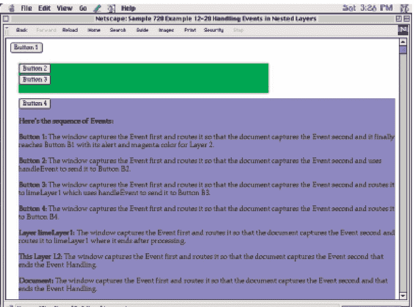

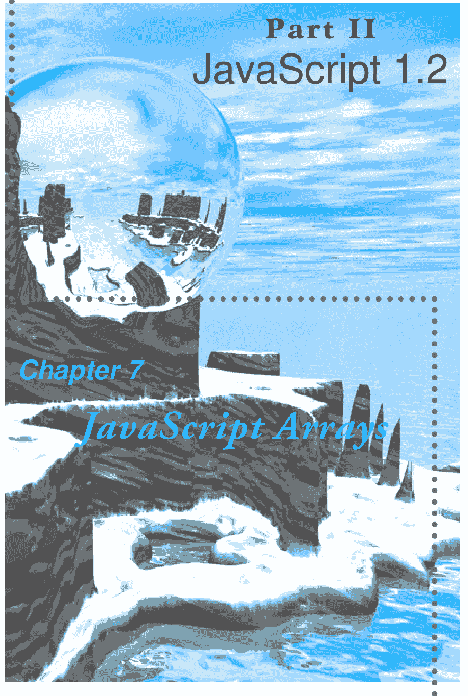

# 第二部分
JavaScript 1.2

# 第 7 章

# JavaScript 数组

## 目录

- ### JavaScript 数组对象
  - 7.1) JavaScript 数组对象
  - 7.2) 使用 Array 对象构造函数创建数组
  - 7.3) 创建密集数组 (dense Array)
  - 7.4) 使用字面量表示法创建数组
  - 7.5) 创建二维数组
  - 7.6) 创建三维数组
  - 7.7) 数组属性摘要
  - 7.8) 数组方法摘要
  - 7.9) 使用所有数组方法的综合示例

- ### 数组对象方法
  - 7.10) 数组对象的 concat() 方法
  - 7.11) 数组对象的 join() 方法
  - 7.12) 数组对象的 pop() 方法
  - 7.13) 数组对象的 push() 方法
  - 7.14) 数组对象的 shift() 方法
  - 7.15) 数组对象的 unshift() 方法
  - 7.16) 数组对象的 slice() 方法
  - 7.17) 数组对象的 splice() 方法
  - 7.18) 数组对象的 toString() 方法
  - 7.19) 数组元素的 toString() 方法
  - 7.20) reverse() 方法
  - 7.21) sort() 方法
  - 7.22) compareFunction 函数

- ### 处理返回的数组
  - 7.23) 处理返回的数组与正则表达式
  - 7.24) String 对象的 match() 方法返回的数组
  - 7.25) 使用 "g" 标志的 match() 方法返回的数组
  - 7.26) RegExp 对象的 exec() 方法返回的数组
  - 7.27) 数组对象的 index 属性
  - 7.28) String 对象的 split() 方法返回的数组
  - 7.29) 数组对象的 input 属性
  - 7.30) 使用数组动态填充 `<TABLE>` 元素数据
  - 7.31) 使用数组的示例文件对照表


## 第 7 章 — JavaScript 数组

### JavaScript 数组对象

### JavaScript 数组对象

### JavaScript 语法：

```
arrayObjectName = new Array(arrayLength);
arrayObjectName = new Array(element0, element1, ..., elementN);
arrayObjectName = [element0, element1, ..., elementN];
```

**数组**对象是 JavaScript 的预定义核心对象之一。通常，数组在创建时会被赋值给一个**数组对象名称**。数组由一组有序的值组成，每个值称为一个元素。数组的每个元素都有一个唯一的**索引**编号，用于引用该特定元素。**索引**编号从零开始，始终为整数，并沿正方向递增。因此，数组中的第一个元素的**索引**为零，第二个元素的**索引**为 1，以此类推。数组中的元素数量没有限制。如果你熟悉 Java，那么值得注意的是 JavaScript 数组更类似于 Java 的 Vector 而非 Java 数组，因为 JavaScript 数组的**长度**是灵活的，取决于使用情况。数组元素的值可以是任何类型。

数组可以通过**数组对象构造函数**或**字面量**表示法来创建。使用**字面量**表示法是 Navigator 4 和 JavaScript 1.2 中新增的功能。

## 使用数组对象构造函数创建数组

要使用**数组对象构造函数**创建数组，首先需要为数组选择一个名称。然后，使用关键字 **new**，你可以通过选择要初始化的元素数量来定义数组的**长度**，或者通过逗号分隔的实际元素列表来创建一个**稠密**数组。这是一个初始化了五个元素的普通数组示例，即**长度**为 5：

```
myArray1 = new Array(5);
```

然后，你可以选择使用元素的**索引**编号为每个元素赋值，如下所示：

```
myArray1[0] = "blue";
myArray1[1] = "red";
myArray1[2] = "purple";
myArray1[3] = "lime";
myArray1[4] = "yellow";
```

这五个元素中的第一个应读作：名为 **myArray1** 的数组中**索引**为 0 的数组元素，其值为文本字符串 "blue"。现在假设你想将元素 0 的值更改为文本字符串 "gold"；代码如下：

```
myArray1[0] = "gold";
```

你也可以在**数组对象**语法中通过指定元素的值来引用数组元素，如下所示：

```
myArray1["blue"]
```

因此这行代码：

```
myArray1[0] = "gold";
```

等价于：

```
myArray1["blue"] = "gold";
```

你*不能*在层次结构中像这样引用你创建的[数组](#)：

**document.myArray1[0]**。

然而，你不应该将此与作为其他对象属性的内置核心对象数组混淆。例如，**forms[i]** 数组是 **document** 对象的属性，始终在对象层次结构中这样引用：**document.forms[i]**。有关对象数组的更多信息，请参见第 4 章。

你也可以创建一个**长度**为零的数组，这基本上初始化了一个没有元素的数组，你可以在脚本中稍后用值填充它。示例如下：

```
anotherArray = new Array();
```

每次你为数组初始化一个新元素时，JavaScript 会自动扩展数组的**长度**。即使数组在创建时**长度**是固定的，也是如此。

## 第 7 章 — JavaScript 数组

以下是通过数组构造函数创建的**长度**为 0 的数组示例，随后通过在**索引** 7 处初始化一个元素，将其扩展为包含八个元素、**长度**为 8 的数组。然后又在**索引** 222 处初始化另一个元素，使其**长度**变为 223，即拥有 223 个元素。以这种方式扩展数组**长度**时，所有未显式赋值的元素的值为 **undefined**。

```
musicArray = new Array();                     //length=0
musicArray[7] = "Close to the Edge";          //length=8
musicArray[222] = "Yessongs";                 //length=223
```

## 创建稠密数组

你可以用一行代码创建一个与前面 **myArray1** 相同的**稠密**数组，如下所示，注意逗号是必需的，但空格是可选的：

```
myArray1 = new Array("blue", "red", "purple", "lime", "yellow");
```

## 将数组元素渲染到屏幕上

如果你想在浏览器中显示特定的数组元素，可以使用 **document.write()** 方法，通过其**索引**编号引用元素，如下所示：

```
document.write(myArray1[0]);
```

将输出以下内容：

```
blue
```

## 将数组渲染到屏幕上

如果你在 **document.write()** 方法中仅使用数组名称作为参数，你将得到一个由括号包裹的长文本字符串，该字符串由数组的每个元素组成，如下所示：

```
document.write(myArray1);
```

将输出以下内容，注意 JavaScript 不存储元素之间的可选空格，但会存储逗号分隔符：

```
["blue","red","purple","lime","yellow"]
```

如果你想查看演示，可以查看 [Sample805.html](Sample805.html)。

当数组的元素数量相对较少时，直接在**稠密**数组中声明它们是比较高效的做法。如果你需要跟踪各个元素的**索引**位置，那么你可能需要单独声明每个元素。

## 在数组元素中使用 for() 语句

如果你想逐个输出数组的每个元素并创建一些额外的标记，可以像这样设置一个 **for** () 语句：

```
for (var i=0;  i < myArray1.length;  i++) {

    document.write(myArray1[i] + "<BR>");
}
```

这将取出数组的每个元素，并在浏览器中单独渲染一行，输出如下：

- blue
- red
- purple
- lime
- yellow

> 以上概念在示例 7-0 中进行了规范说明，可以在 [Sample800.html](Sample800.html) 中查看。

## 第 7 章 — JavaScript 数组

## 示例 7-0：Sample800.html

```
<!DOCTYPE HTML PUBLIC "-//W3C//DTD HTML 3.2//EN">
<HTML>
<HEAD>
<TITLE> Sample 800 Example 7-0 Array Element display</TITLE>

<SCRIPT LANGUAGE="JavaScript1.2"><!--BEGIN HIDING

myArray1 = new Array("blue", "red", "purple", "lime", "yellow");

    for (var i=0;  i < myArray1.length;  i++) {
        
        document.write(myArray1[i] + "<BR>");
    }

//END HIDING-->
</SCRIPT>

</HEAD>

<BODY>
</BODY>
</HTML>
```

## 使用字面量表示法创建数组

当你使用字面量表示法创建数组时，你为数组命名并将名称赋值为一个用方括号括起来的逗号分隔值列表，这些值即成为数组的元素。数组的长度等于所列值的数量。然而，在首次创建数组时，你实际上不必指定所有元素。如果你连续输入两个逗号，JavaScript 会在该索引位置创建一个空白占位元素。

以下是使用字面量表示法创建数组的方法，数组名为 a2，指定了五个元素：

```
a2 = ["green", "gray", "black", "white", "olive"];
```

### JavaScript 语法：

```
arrayObjectName = [element0, element1, ..., elementN];
```

这仅演示了如何使用**字面量**表示法创建数组，并通过使用 **for** () 语句循环遍历元素以及手动通过索引引用每个元素并使用 **document.write()** 来在浏览器中两次输出元素。这只是让你比较这两种技术。

## 示例 7-1：Sample801.html

```
<!DOCTYPE HTML PUBLIC "-//W3C//DTD HTML 3.2//EN">
<HTML>
<HEAD>
<TITLE> Sample 801    Example 7-1 Literal Array Creation</TITLE>

<SCRIPT LANGUAGE="JavaScript1.2"> <!--BEGIN HIDING

a2 = ["green", "gray", "black", "white", "olive"];

    for (var i=0;  i < a2.length;  i++) {

        document.write(a2[i] + "<BR>");
    }

/* ------------------------------------------------------------------- */

document.write("<P> This outputs the same Literal Array a2 as above but by a
different technique.<P>");

document.write(a2[0] + "<BR>");

document.write(a2[1] + "<BR>");

document.write(a2[2] + "<BR>");

document.write(a2[3] + "<BR>");

document.write(a2[4] + "<BR>");

//END HIDING-->
</SCRIPT>

</HEAD>

<BODY>
</BODY>
</HTML>
```


## 第 7 章 — JavaScript 数组

以下是如何在数组中编写空白元素，以便在**索引 2**、**索引 5** 和**索引 7** 处留出空白元素。请记住，**索引**数字从零开始。

```javascript
a2 = ["green", "gray",,"black", "white",,"olive",,];
```

| 索引提示 | 0 | 1 | 2 | 3 | 4 | 5 | 6 | 7 |
| :--- | :--- | :--- | :--- | :--- | :--- | :--- | :--- | :--- |
| 值 | "green" | "gray" | (空白) | "black" | "white" | (空白) | "olive" | (空白) |

（这部分不属于代码。）

空白元素的值为 **undefined**。

### 特别注意：

当你在顶级脚本中使用**字面量**（Literal）表示法创建数组时，每当包含**数组字面量**的表达式被求值，JavaScript 都会解析该**数组**对象。如果**数组字面量**被用于函数内部，则每次调用该函数时它都会被重新创建。

## 创建二维数组

一个数组可以在同一个数组中包含具有不同值**类型**（types）的元素，这与大多数其他脚本语言或编程语言截然不同。例如，一个数组可能有一个元素是文本字符串，另一个元素是变量，第三个元素是数字。数组元素还可以包含对象、布尔字面量，甚至其他数组。将一个数组作为另一个数组的元素，就是创建类多维数组的过程。

要创建二维数组，只需定义两个数组，并将其中一个数组指定为另一个数组的元素。要访问嵌套数组的元素，你需要使用第二组**索引**下标，如下例所示：

```javascript
myArray1 = new Array("alpha", "beta", "gamma");
myArray2 = new Array("eeny", "meeny", "miney", myArray1);
```

其中 **myArray2** 的元素为：

```javascript
myArray2[0] = "eeny";
myArray2[1] = "meeny";
myArray2[2] = "miney";
myArray2[3] = myArray1;
```

而 **myArray1** 的元素通过 **myArray2** 访问为：

```javascript
myArray2[3][0] = "alpha";
myArray2[3][1] = "beta";
myArray2[3][2] = "gamma";
```

### 创建二维数组的示例

这里有一个示例，它在另一个 **for ()** 循环内部使用嵌套的 **for ()** 循环来创建二维数组。你首先定义一个名为 **a1** 且 **length** 为 2 的数组，然后使用 **for ()** 循环将一个 **length** 为 5 的新数组分配给 **数组 a1 的每个元素**。接着，你使用第二个 **for ()** 循环为第二维数组的每个元素分配一个值。

该值由 `(i + ", " + j)` 组成，这样变量 **i** 和 **j** 的值就被逗号隔开，成为每个元素的单个条目。接下来，使用 **document.write()** 方法将第一个数组 **a1** 渲染到屏幕上，但请记住，现在的第一个数组 **a1** 是一个数组的数组，其每个元素都是一个数组。

接下来的 **document.write()** 方法用于输出构成数组第二维的一系列嵌套数组元素。它们通过第二组下标来访问。请记住，嵌套的数组元素本身不再是数组，因此不会以数组语法出现。

**document.write()** 方法中的文本字符串是为了帮助你在浏览器查看输出并尝试理清逻辑时，能够跟踪嵌套数组和第二维元素。

### 示例 7-2: Sample802.html

```html
<!DOCTYPE HTML PUBLIC "-//W3C//DTD HTML 3.2//EN">
<HTML>
<HEAD>
<TITLE> Sample 802 Example 7-2 Nested Arrays</TITLE>

<SCRIPT LANGUAGE="JavaScript1.2"> <!--BEGIN HIDING

a1 = new Array(2);

for (var i=0; i<2; i++) {
    //creates a new Array in each Element of Array a1
    a1[i] = new Array(5);

    for (var j=0; j<5; j++)  {
        //assigns a value to each Element of the second dimension Array
        a1[i][j] = i + ", " +j;

        //displays the values for the first dimension Array of Arrays
        document.write(a1[i] + "&nbsp;&nbsp;&nbsp; First Dimension Array <BR>")

        //displays the values for the second dimension Array Elements
        document.write(a1[i][j] + "&nbsp;&nbsp;&nbsp; Second Dimension Array Element <BR><BR>")
    }
}
//END HIDING-->
</SCRIPT>
</HEAD>
<BODY>
</BODY>
</HTML>
```

## 创建三维数组

### 示例 7-3 前言

示例 7-3 首先定义了四个数组，每个数组都有四个文本字符串作为元素。然后有一个名为 `myArray5` 的第五个数组，它将之前定义的数组分别作为自己的每个元素，使其成为一个二维数组。接下来，有一个名为 `myArray6` 的第六个数组，它的第一个元素是二维数组 `myArray5`，这反过来导致 `myArray6` 成为一个三维数组。`myArray6` 的其他三个元素只是数字。

示例的其余部分只是将数组输出到浏览器，以便你可以看到它们的样式，并更容易地观察哪些元素索引号起到了什么作用。

当你写入元素 `myArray6[0]` 时，你会得到如下输出，因为这个特定元素是 `myArray5`，而 `myArray5` 是 `myArray6` 内部的一个二维数组。

```
["alpha", "beta", "gamma", "delta"], ["blue", "red", "gold", "silver"], ["one", "two", "three", "four"], ["www", "xxx", "yyy", "zzz"]
```

当你写入元素 `myArray6[0][0]` 时，你会得到如下输出，因为这个特定元素是数组 `a1`。

```
["alpha", "beta", "gamma", "delta"]
```

当你写入元素 `myArray6[0][0][0]` 时，你会得到如下输出：

```
alpha
```

起初这可能看起来违背直觉，因为必须使用三个下标才能索引到看似是 `myArray6` 的第一个元素，但 alpha 并不是 `myArray6` 的第一个元素。它是数组 `a1` 的第一个元素，而 `a1` 是 `myArray5` 的第一个元素，`myArray5` 又是 `myArray6` 的第一个元素。现在你可以看到这个递进关系了。

### 示例 7-4 前言

示例 7-4 与示例 7-3 类似。主要区别在于 `myArray100` 是一个完整的三维数组，其中每个元素都是一个数组，而这些数组中的每个元素又是另一个数组。

```javascript
myArray100 = new Array(myArray10, myArray11, myArray12);
myArray10 = new Array(a1, a2, a3);
myArray11 = new Array(a4, a5, a6);
myArray12 = new Array(a7, a8, a9);
```

### 示例 7-3: Sample803.html

```html
<!DOCTYPE HTML PUBLIC "-//W3C//DTD HTML 3.2//EN">
<HTML>
<HEAD>
<TITLE> Sample 803 Example 7-3 three-dimensional Array</TITLE>
<SCRIPT LANGUAGE="JavaScript 1.2"> <!--BEGIN HIDING

//These four Arrays are all text Strings
a1 = new Array("alpha", "beta", "gamma", "delta");
a2 = new Array("blue", "red", "gold", "silver");
a3 = new Array("one", "two", "three", "four");
a4 = new Array("www", "xxx", "yyy", "zzz");

//myArray5 is composed of the 4 previously Defined Arrays
myArray5 = new Array(a1, a2, a3, a4);

//myArray6 is composed of myArray5 and numbers
myArray6 = new Array(myArray5, 2, 3, 4);

for (var i=0; i<4; i++) {
    document.write(a1[i] + "<P>");        //outputs Array a1
}

for (var i=0; i<4; i++) {
    document.write(myArray5[i] + "<P>");        //outputs Array myArray5
}

for (var i=0; i<4; i++) {
    document.write("<B>R<B>P>" + myArray6[i]);        //outputs Array myArray6
}

document.write("<HR><P>" + "The next line is ELEMENT<B>myArray6 [0] [0] [0]</B>");
document.write("<P>" + myArray6[0][0][0]);

document.write("<HR><P>" + "The next line is ELEMENT<B> myArray6 [0] [0]</B>");
document.write("<P>" + myArray6[0][0]);

document.write("<P>" + myArray6[0]);

//END HIDING-->
</SCRIPT>
</HEAD>
<BODY>
</BODY>
</HTML>
```

### 示例 7-4: Sample804.html

```html
<!DOCTYPE HTML PUBLIC "-//W3C//DTD HTML 3.2//EN">
<HTML>
<HEAD>
  <TITLE> Sample 804 Example 7-4 three-dimensional Array </TITLE>

<SCRIPT LANGUAGE="JavaScript1.2"> <!--BEGIN HIDING

      //These nine Arrays all have Strings in their Elements
a1 = new Array(
```

## 数组属性汇总

| 属性 | 描述 |
| :--- | :--- |
| **index** | 对于由正则表达式匹配创建的数组，该属性是匹配项在字符串中从零开始的整数索引。 |
| **input** | 对于由正则表达式匹配创建的数组，该属性代表与正则表达式匹配的原始字符串。 |
| **length** | 一个表示数组中元素精确数量的整数。可以对其赋值以截断元素，但不能用它来扩展元素数量。 |
| **prototype** | 用于在脚本中为所有 **Array** 对象创建自定义属性。 |

## 数组方法汇总

| 方法 | 描述 |
| :--- | :--- |
| **concat()** | 合并两个数组并返回一个新的“单层”数组。 |
| **join()** | 将数组的所有元素转换为一个字符串，每个元素之间用逗号或自定义分隔符隔开。 |
| **pop()** | 删除并返回数组的最后一个元素，同时改变其 **length**。 |
| **push()** | 在数组末尾添加一个或多个元素，返回最后一个添加的元素，并改变数组的 **length**。 |
| **reverse()** | 反转数组中元素的物理顺序。 |
| **shift()** | 提取数组的第一个元素并返回该元素。 |
| **slice()** | 提取数组的可选部分并返回一个新数组。 |
| **splice()** | 可选地从数组中添加、删除或同时添加和删除元素。 |
| **sort()** | 按字母顺序或根据你的自定义函数对数组元素进行排序。 |
| **toString()** | 返回一个代表调用该方法的 **Array** 对象或元素的字符串。 |
| **unshift()** | 在数组第一个元素之前添加一个或多个元素，并返回数组的新 **length**。不返回第一个元素。 |


## 一个使用所有数组方法的综合示例

本示例是对 **Array** 对象所有方法的快速介绍。在本示例之后，将对这些方法进行进一步的详细探讨和定义。基本上，这里定义了两个数组，并用恰好是颜色的字符串填充。然后，在这些数组上调用 **Array** 对象的各种方法，并将结果显示在浏览器中。

**示例 7-5: Sample805.html**

```html
<!DOCTYPE HTML PUBLIC "-//W3C//DTD HTML 3.2//EN">
<HTML><HEAD>
    <TITLE> Sample 805   Example 7-5 Array Methods</TITLE>

<STYLE TYPE="text/JavaScript">

classes.Mainbody.BODY.margins("0px");
classes.Mainbody.BODY.paddings("0px");
classes.Mainbody.BODY.backgroundColor="navy";
classes.Mainbody.BODY.color="white";
classes.Mainbody.BODY.fontSize="14pt";

tags.P.color="yellow";
tags.H3.color="red";
tags.B.color="lime";

</STYLE>
<!-- **************************************************** -->

<SCRIPT LANGUAGE="JavaScript1.2"> <!--BEGIN HIDING

a1 = new Array("blue", "red", "purple", "lime", "yellow");

a2 = ["green", "gray", "black", "white", "olive"];

          //-----Note that a2 is an Array created with literal notation.
//END HIDING-->
</SCRIPT>
</HEAD>
<BODY CLASS="Mainbody">
<!-- **************************************************** -->

<SCRIPT LANGUAGE="JavaScript1.2"> <!--BEGIN HIDING

var str = "";

str += '<P>Array a1 has these Elements: <B>' + a1 + '</B></P>';
str += 'Array a2 has these Elements: <B>' + a2 + '</B><BR>';
str += '<P>Array a1 concat a2: <B>' + a1.concat(a2) + '</B></P>';

str += '<P>Array a1 with the Join Method: <b>' + a1.join(',') + '</b></P>';

str += 'Array a2 with the Join Method: <b>' + a2.join(',') + '</b><BR><BR>';

str += '<P>Array a1 Lexicographically Sorted is: <b>' + a1.sort() + '</b><BR>';
str += ' Array a1 Lex. Sorted and Joined is: <b>' + a1.join(',') + '</b><BR><BR>';

str += ' Array a1 Sorted and Reversed is: <b>' + a1.reverse() + '</b><BR>';
str += ' Array a1 Sorted, Reversed and Joined is: <b>' + a1.join(',') + '</b></P>';

str += ' Array a2 with the Push Method: <b>' + a2.push('cyan', 'maroon') + '</b><BR>';
str += ' Array a2 after the Push Method: <b>' + a2 + '</b><BR><BR>';

str += '<H3>-----Note that the Unshift Method </b>';
str += ' returns the number of Elements in the Array</H3>';

str += ' Array a2 with the Unshift Method: <b>' + a2.unshift('navy', 'violet') + '</b><BR>';
str += '</b><BR>';

str += ' Array a2 after the Unshift Method: <b>' + a2 + '</b><BR><BR>';

str += ' Array a2 with the Pop Method: <b>' + a2.pop() + '</b><BR>';
str += ' Array a2 after the Pop Method: <b>' + a2 + '</b><BR><BR>';

str += ' Array a2 with the Shift Method: <b>' + a2.shift() + '</b><BR>';
str += ' Array a2 after the Shift Method: <b>' + a2 + '</b><BR><BR>';

str += ' Array a2 the Slice Method: <b>' + a2.slice(2,5) + '</b><BR><BR>';

str += '<H3>-----Notice that the Slice Method does not alter </b>';
str += ' the Array but returns a new Array</H3>';

str += ' Array a2 after the Slice Method: <b>' + a2 + '</b><BR><BR>';

str += ' Array a2 with the Splice Method: <b>' + a2.splice(3,2, 'gold','darkblue') + '</b><BR>';

str += '<H3>-----Note that the colors gold and darkblue are </b>';
str += ' added in place of black and white</H3>';

str += ' Array a2 after the Splice Method: <b>' + a2 + '</b><BR><BR>';

str += ' Array a2 with the Splice Method: <b>' + a2.splice(1,4) + '</b><BR><BR>';

str += '<H3>-----Note that since no new colors are specified, </b>';
str += ' Elements are simply removed</H3>';

str += ' Array a2 after the Splice Method: <b>' + a2 + '</b><BR>';

document.write(str);

//END HIDING-->
</SCRIPT>
</body>
</html>
```

### Array 对象方法

### Array 对象的 concat() 方法

**JavaScript 语法：**

```javascript
arrayObjectName1.concat(arrayObjectName2);
```

**参数定义：**

**concat()** 方法返回一个新数组，该数组由 **arrayObjectName1** 的元素和随后 **arrayObjectName2** 的元素组成。请注意，这个新数组是对两个数组原始元素的“浅拷贝”（one-level-deep copy），不会以任何方式改变原始数组。

新合并数组的第一个元素等于 **arrayObjectName1** 数组的第一个元素，第二个元素等于 **arrayObjectName1** 数组的第二个元素，依此类推。例如，如果你有两个名为 **a1** 和 **a2** 的数组，如下所示：

```javascript
a1 = new Array(1,2,3);
a2 = new Array(4,5,6);

myNewArray = a1.concat(a2);
```

则结果等同于：

```javascript
myNewArray = [1,2,3,4,5,6];
```

JavaScript 将原数组中的元素复制到新数组中的方式取决于元素的数值类型。当元素是一个对象时，JavaScript 复制的是该对象的引用而非对象本身，因此原数组和新数组仍然指向同一个对象。如果该被引用对象以任何方式被修改，这些更改将同时反映在原数组和新数组中。

当 JavaScript 使用 **concat()** 方法将字符串和数字复制到新数组时，复制的是实际的字符串和数字，而不是引用。请注意，这不适用于 **String** 对象和 **Number** 对象，后者涵盖在上一段所述的对象行为中。在一个数组中对字符串或数字进行的任何更改都不会影响另一个数组。

如果你向新数组或旧数组中添加一个元素，另一个数组<u>不会</u>拥有该添加的元素，且完全不受影响。

本示例首先通过在数组构造函数中指定元素来定义两个**密集（dense）**数组，分别命名为 **a1** 和 **a2**。然后，数组 **a1** 调用 **concat()** 方法，将数组 **a2** 作为参数，并将新数组赋值给 **a3**。随后将这三个数组全部写入浏览器，以便查看结果。

**示例 7-6: Sample806.html**

```html
<!DOCTYPE HTML PUBLIC "-//W3C//DTD HTML 3.2//EN">
<HTML><HEAD> <TITLE> Sample 806 Example 7-6 concat Method</TITLE>

<SCRIPT LANGUAGE="JavaScript1.2"> <!--BEGIN HIDING

a1 = new Array("one", "two", "three", "four");

a2 = new Array(1, 2, 3, 4);

a3 = a1.concat(a2);

/*-------------------------------------------------------------*/

document.write("<H3>The next line is Array a1<\/H3>");
document.write("<P>" + a1 + "<HR>");

document.write("<H3>The next line is Array a2<\/H3>");
document.write("<P>" + a2 + "<HR>");

document.write("<H3>The next line is Array a3 = a1.concat(a2)<\/H3>");
document.write("<P>" + a3 + "<HR>");

/*-------------------------------------------------------------*/
//END HIDING-->
</SCRIPT>
</HEAD>
<BODY> </BODY></HTML>
```

上述示例产生以下输出：

```
The next line is Array a1
["one", "two", "three", "four"]

The next line is Array a2
[1, 2, 3, 4]

The next line is Array a3 = a1.concat(a2)
["one", "two", "three", "four", 1, 2, 3, 4]
```

本示例首先通过在数组构造函数中指定元素来定义两个**密集（dense）**数组，分别命名为 **a1** 和 **a2**。然后，数组 **a1** 调用 concat() 方法，将数组 **a2** 作为参数，并将新数组赋值给 **a3**。随后将这三个数组全部写入浏览器，以便查看结果。接着，向 **a2** 添加一个新元素。然后将数组 **a2** 和 **a3** 都写入浏览器，你可以看到 **a2** 显示了其数组中添加元素的更改，但 **a3** 不受影响。

**示例 7-7: Sample807.html**

```html
<!DOCTYPE HTML PUBLIC "-//W3C//DTD HTML 3.2//EN">
<html>
<HEAD>
<TITLE> Sample 807 Example 7-7 concat Method add Element</TITLE>

<SCRIPT LANGUAGE="JavaScript1.2"> <!--BEGIN HIDING

a1 = new Array("alpha", "beta", "gamma", "delta");

a2 = new Array("blue", "red", "gold", "silver");

a3 = a1.concat(a2);

document.write("<P>" + a1);

document.write("<P>" + a2);

document.write("<P>" + a3);

//Adds a new Element to a2

a2[4] = "PLATINUM";

//Notice a2 is changed but a3 is not changed

document.write("<P>" + a2);

document.write("<P>" + a3);

//END HIDING-->
</SCRIPT>
</HEAD>

<BODY>
</BODY>
</html>
```


## 第七章 — JavaScript 数组

前面的示例产生如下输出：

["alpha", "beta", "gamma", "delta"]

["blue", "red", "gold", "silver"]

["alpha", "beta", "gamma", "delta", "blue", "red", "gold", "silver"]

["blue", "red", "gold", "silver", "PLATINUM"]

["alpha", "beta", "gamma", "delta", "blue", "red", "gold", "silver"]

让我们通过一个示例来探讨这部分原理，其中数组 **a1** 调用 **concat()** 方法，并将数组 **a2** 作为参数，然后将新数组赋值给 **a3**。这三个数组都会被输出到浏览器中。接着，使用 **length** 属性将 **a2** 的 **长度** 从 4 改为 2，这实际上会删除 **a2** 的最后两个元素。然后再次将 **a2** 和 **a3** 输出到浏览器，以展示 **a2** 确实发生了改变，而 **a3** 不受影响。注意，如果再次对 **a1** 和 **a2** 使用 **concat()**，那么这些更改就会在 **a3** 中体现。

### 示例 7-8：Sample808.html

```
<!DOCTYPE HTML PUBLIC "-//W3C//DTD HTML 3.2//EN">
<HTML>
<HEAD>
<TITLE> Sample 808 Example 7-8 concat Method delete Element</TITLE>

<SCRIPT LANGUAGE="JavaScript1.2"> <!--BEGIN HIDING

a1 = new Array("alpha", "beta", "gamma", "delta");
a2 = new Array("blue", "red", "gold", "silver");

a3 = a1.concat(a2);

document.write("<P>" + a1);
document.write("<P>" + a2);
document.write("<P>" + a3);

        //changes length from 4 to 2 thus deleting 2 Elements

a2.length = 2;

        //Notice a2 is changed but a3 is not changed

document.write("<P>" + a2);
document.write("<P>" + a3);

//END HIDING-->
</SCRIPT>

</HEAD>

<BODY>

</BODY>
</HTML>
```

前面的示例产生如下输出：

["alpha", "beta", "gamma", "delta"]

["blue", "red", "gold", "silver"]

["alpha", "beta", "gamma", "delta", "blue", "red", "gold", "silver"]

["blue", "red"]

["alpha", "beta", "gamma", "delta", "blue", "red", "gold", "silver"]

本示例涉及 **Array** 对象的 **concat()** 方法，其中使用 **字面量** 表示法创建的对象作为数组元素的值。正如前面理论所述，由于 JavaScript 复制的是被连接对象的引用，因此对这些对象的任何更改都会反映在原始数组和新连接的数组中。

我们首先使用 **字面量** 表示法创建三种不同类型的对象，通过赋值命名，然后定义其属性和值，如下所示：

```
stringObject1 = {theString:"my second string object"};
numberObject1 = {theNumber:8};
computerObject = {make:"Mac", model:8100, ram:264, harddrive:"internal 4Gig"};
```

接着，使用数组构造函数创建两个 **密集** 数组，并将数组 **a1** 和 **a2** 的连接结果赋值给 **a3**，如下所示：

```
a1 = new Array("one", "two");

a2 = new Array(stringObject1, numberObject1, computerObject);

a3 = a1.concat(a2);
```

接下来，使用 `document.write()` 方法将三个数组都输出到屏幕上，以便后续对比。然后对对象的属性进行一些更改，如下所示：

```
stringObject1.theString = "MY CHANGED SECOND STRING OBJECT";
numberObject1.theNumber = 777;
computerObject.model = 9600;
computerObject.ram = 512;
computerObject.harddrive = "external 9Gig";
```

最后，再次将数组 `a2` 和 `a3` 输出到屏幕上，以展示对象的更改确实反映在了原始数组 `a2` 和新数组 `a3`（即 `a1.concat(a2)`）中。

### 示例 7-9：Sample809.html

```
<!DOCTYPE HTML PUBLIC "-//W3C//DTD HTML 3.2//EN">
<HTML>
<HEAD>
<TITLE> Sample 809 Example 7-9 concat Method with Objects</TITLE>

<SCRIPT LANGUAGE="JavaScript1.2"><!--BEGIN HIDING

//Create three Objects with Literal notation.

stringObject1 = {theString:"my second string object"};

numberObject1 = {theNumber:8};

computerObject = {make:"Mac", model:8100, ram:264, harddrive:"internal 4Gig"};

/*....................................................................................*/

a1 = new Array("one", "two");

a2 = new Array(stringObject1, numberObject1, computerObject);

a3 = a1.concat(a2);

/*....................................................................................*/

document.write("<H3>The next line is Array a1<\/H3>");
document.write("<P>" + a1);

document.write("<H3>The next line is Array a2<\/H3>");
document.write("<P>" + a2);

document.write("<H3> The next line is Array a3 = a1.concat(a2)<\/H3>");
document.write("<P>" + a3 + "<HR>");

/*---------------------------------------------------------------------------

    //Notice when a2 Objects are changed then a3 Objects reflect the change


stringObject1.theString = "MY CHANGED SECOND STRING OBJECT";

numberObject1.theNumber = 777;

computerObject.model = 9600;

computerObject.ram = 512;

computerObject.harddrive = "external 9Gig";

---------------------------------------------------------------------------

document.write("*<H3>The next line is Array a2 after the <i>OBJECT</i>
changes<\/H3>");

document.write("*<P>" + a2);

---------------------------------------------------------------------------

document.write("*<P><H3><FONT COLOR='red'>Notice when a2 * +
    "Objects are changed * +
    "then a3 Objects reflect the change.<\/FONT> <\/H3>");

---------------------------------------------------------------------------

document.write("*<H3>The next line is Array a3 after the changes<\/H3>");

document.write("*<P>" + a3);

//END HIDING-->
</SCRIPT>

</HEAD>

<BODY>

</BODY>

</HTML>
```

前面的示例产生如下输出：

The next line is Array a1

["one", "two"]

The next line is Array a2

[{theString:"my second string object"}, {theNumber:8}, {make:"Mac", model:8100, ram:264, harddrive:"internal 4Gig"}]

The next line is Array a3 = a1.concat(a2)

["one", "two", {theString:"my second string object"}, {theNumber:8}, {make:"Mac", model:8100, ram:264, harddrive:"internal 4Gig"}]

The next line is Array a2 after the OBJECT changes

[{theString:"MY CHANGED SECOND STRING OBJECT"}, {theNumber:777}, {make:"Mac", model:9600, ram:512, harddrive:"external 9Gig"}]

The next line is Array a3 after the changes

["one", "two", {theString:"MY CHANGED SECOND STRING OBJECT"}, {theNumber:777}, {make:"Mac", model:9600, ram:512, harddrive:"external 9Gig"}]

### Array 对象的 join() 方法

#### JavaScript 语法：

```
arrayObjectName.join();
arrayObjectName.join("separatorString");
```

#### 参数说明：

**join()** 方法返回一个由数组每个元素组成的单一文本字符串。可选的 **separatorString** 用于在文本字符串中分隔每个元素。如果没有提供 **separatorString**，JavaScript 默认会用逗号分隔每个元素。注意，Navigator 4 中存在一个 bug，导致在没有提供 **separatorString** 时输出的是一个 **数组字面量**。如有必要，JavaScript 会将 **separatorString** 参数转换为字符串。注意原始数组不受影响。

本示例仅演示 **Array** 对象的 **join()** 方法，并对如何使用 **separatorString** 参数做了一些变化。没有什么特别的，只是创建一个 **密集数组**，并多次使用 **join()** 方法，搭配各种 **separatorString**，这些字符串被放在 **write()** 方法内部，以便你可以在浏览器中看到结果。

### 示例 7-10：Sample810.html

```
<!DOCTYPE HTML PUBLIC "-//W3C//DTD HTML 3.2//EN">
<HTML>
<HEAD>
        <TITLE> Sample 810   Example 7-10 join Method</TITLE>

<SCRIPT LANGUAGE="JavaScript1.2"> <!--BEGIN HIDING

a1 = new Array("one","two","three","four","five");

var fuzzyl = "<FONT COLOR='purple'>";
var fuzzy2 = "<\/FONT>";
var fuzzy3 = " _____ ";

document.write("<H3>" + a1.join() + "...NOTE THE BUG<\/H3>");
document.write("<H3>" + a1.join(' + ') + "<\/H3>");
document.write("<H3>" + a1.join(' ***** ') + "<\/H3>");
document.write("<H3>" + a1.join(fuzzyl + ' plus ' + fuzzy2) + "<\/H3>");
document.write("<H3>" + a1.join(fuzzy3) + "<\/H3>");

//END HIDING-->
</SCRIPT>

</HEAD>
<BODY>
</BODY>
</HTML>
```

前面的示例产生如下输出：

["one", "two", "three", "four", "five"]...NOTE THE BUG

one + two + three + four + five

one ***** two ***** three ***** four ***** five

one plus two plus three plus four plus five

one _____ two _____ three _____ four _____ five


## 第 7 章 — JavaScript 数组

### Array 对象的 pop() 方法

**JavaScript 语法：**

```javascript
arrayObjectName.pop();
```

**pop()** 方法用于取出，也就是说，移除数组中的最后一个元素并将其返回。这还会产生一个额外的影响，即改变数组的 **length**（长度），不出所料，长度会比之前少 1。

如果你的目的仅仅是移除一个元素，那么只需通过数组名称调用该数组的 **pop()** 方法，如下所示：

```javascript
myArray.pop();
```

如果你想利用返回的元素，可以将调用 **pop()** 方法的结果赋值给一个变量，如下所示：

```javascript
myPopped = myArray.pop();
```

这个简单的示例通过创建一个名为 **a1** 的 **dense**（密集）数组，将其内容和 **length** 写入屏幕来演示 **pop()** 方法。接着对 **a1** 执行 **pop()** 方法，并将返回的元素赋值给变量 **myPopped**。然后将 **myPopped** 写入屏幕，并再次将 **a1** 写入屏幕以显示最后一个元素已被移除。最后，再次将数组的 **length** 写入屏幕，以显示 **length** 比执行 **pop()** 之前少 1。

#### 示例 7-11：Sample811.html

```html
<!DOCTYPE HTML PUBLIC "-//W3C//DTD HTML 3.2//EN">
<HTML>
<HEAD>

<TITLE> Sample 811 Example 7-11 pop Method</TITLE>

<SCRIPT LANGUAGE="JavaScript1.2"> <!--BEGIN HIDING

a1 = new Array("one","two","three","four","five");

document.write("Before pop <H3>" + a1 + "</H3>");

document.write("<H3>The length is: " + a1.length + "</H3>");

myPopped = a1.pop();

document.write("popped<H3>" + myPopped + "</H3>");

document.write("After pop <H3>" + a1 + "</H3>");

document.write("<H3>The length is: " + a1.length + "</H3>");

//END HIDING-->
</SCRIPT>
</HEAD>
<BODY>

</BODY>
</HTML>
```

上述示例产生以下输出：

Before pop
`["one", "two", "three", "four", "five"]`
The length is: 5

popped
`five`

After pop
`["one", "two", "three", "four"]`
The length is: 4

### Array 对象的 push() 方法

**JavaScript 语法：**

```javascript
arrayObjectName.push(element1, element2, ..., elementN);
```

#### 参数定义：

push() 方法将你想要的任意数量的元素添加到数组的末尾，并返回最后添加的元素。这会根据添加元素的数量改变数组的长度。按照惯例，每个元素必须用逗号分隔，但为了可读性，逗号后的空格是可选的。

本示例使用字面量表示法创建数组 a1，然后将其内容和长度写入屏幕。接着向 a1 添加三个字符串元素，并将返回的最后一个添加元素赋值给变量 myPushed。随后将变量 myPushed 写入屏幕，再次将 a1 写入屏幕以显示 push() 方法的结果。

#### 示例 7-12：Sample812.html

```html
<!DOCTYPE HTML PUBLIC "-//W3C//DTD HTML 3.2//EN">
<HTML>
<HEAD>

<TITLE> Sample 812   Example 7-12 push Method</TITLE>

<SCRIPT LANGUAGE="JavaScript1.2"> <!--BEGIN HIDING

a1 = ["one","two","three","four","five"];

document.write("Before push<H3>" + a1 + "<\/H3>");

document.write("<H3>The length is: " + a1.length + "<\/H3>");

myPushed = a1.push("SIX", "SEVEN", "EIGHT");

document.write("myPushed<H3>" + myPushed + "<\/H3>");

document.write("After push<H3>" + a1 + "<\/H3>");
document.write("<H3>The length is: " + a1.length + "<\/H3>");

//END HIDING-->
</SCRIPT>

</HEAD>

<BODY>

</BODY>
</HTML>
```

上述示例产生以下输出：

Before push
`["one", "two", "three", "four", "five"]`
**The length is: 5**

myPushed
**EIGHT**

After push
`["one", "two", "three", "four", "five", "SIX", "SEVEN", "EIGHT"]`
**The length is: 8**

### Array 对象的 shift() 方法

**JavaScript 语法：**

```javascript
arrayObjectName.shift();
```

**shift()** 方法用于移除数组的第一个元素并返回该元素。该元素等同于 **arrayObjectName[0]**。此方法还将数组的 **length** 改变为比调用方法前少 1。

这个简单的示例通过使用字面量表示法创建一个名为 **a1** 的数组，然后将其内容和 **length** 写入屏幕来演示 **shift()** 方法。接着对 **a1** 执行 **shift()** 方法，并将返回的元素赋值给变量 **myShifted**。然后将 **myShifted** 写入屏幕，再次将 **a1** 写入屏幕以显示第一个元素已被移除。最后，再次将数组的 **length** 写入屏幕，以显示 **length** 比执行 **shift()** 之前少 1。

#### 示例 7-13：Sample813.html

```html
<!DOCTYPE HTML PUBLIC "-//W3C//DTD HTML 3.2//EN">
<HTML>
<HEAD>
<TITLE> Sample 813   Example 7-13 shift Method</TITLE>

<SCRIPT LANGUAGE="JavaScript1.2"> <!--BEGIN HIDING

a1 = ["one","two","three","four","five"];

document.write("Before shift:<H3>" + a1 + "<\/H3>");
document.write("<H3>The length is: " + a1.length + "<\/H3>");

myShifted = a1.shift();

document.write("myShifted value is:<H3>" + myShifted + "<\/H3>");

document.write("After shift:<H3>" + a1 + "<\/H3>");
document.write("<H3>The length is: " + a1.length + "<\/H3>");

//END HIDING-->
</SCRIPT>
```

上述示例产生以下输出：

Before shift:
`["one", "two", "three", "four", "five"]`
**The length is: 5**

myShifted value is:
`one`

After shift:
`["two", "three", "four", "five"]`
**The length is: 4**

### Array 对象的 unshift() 方法

**JavaScript 语法：**

```javascript
arrayObjectName.unshift(element1, element2, ..., elementN);
```

#### 参数定义：

**unshift()** 方法用于在由 **arrayObjectName** 指定的数组的第一个元素之前添加任意数量的元素。此方法返回数组的新 **length**，而不是一个元素。**elementN** 参数是要添加到数组前端的元素。

这个简单的示例通过使用字面量表示法创建一个名为 **a1** 的数组，然后将其内容和 **length** 写入屏幕来演示 **unshift()** 方法。接着对 **a1** 执行 **unshift()** 方法，添加三个元素，并将返回的 **length** 赋值给变量 **myReturnedLength**。然后将 **myReturnedLength** 写入屏幕，再次将 **a1** 写入屏幕以显示三个添加的元素现在已在数组中且位于数组的开头。最后，再次将数组的 **length** 写入屏幕，以显示 **length** 反映了调用 **unshift()** 方法后的当前元素数量。

#### 示例 7-14：Sample814.html

```html
<!DOCTYPE HTML PUBLIC "-//W3C//DTD HTML 3.2//EN">
<HTML>
<HEAD>
<TITLE> Sample 814 Example 7-14 unshift Method</TITLE>

<SCRIPT LANGUAGE="JavaScript1.2"> <!--BEGIN HIDING

a1 = ["one","two","three","four","five"];

document.write("Before unshift:<H3>" + a1 + "<\/H3>");
document.write("<H3>The length is: " + a1.length + "<\/H3>");

myReturnedLength = a1.unshift("minusTwo", "minusOne", "zero");

document.write("myReturnedLength value is:<H3>" + myReturnedLength + "<\/H3>");

document.write("After unshift:<H3>" + a1 + "<\/H3>");
document.write("<H3>The length is: " + a1.length + "<\/H3>");

//END HIDING-->
</SCRIPT>

</HEAD>

<BODY>

</BODY>
</HTML>
```

上述示例产生以下输出：

Before unshift:
`["one", "two", "three", "four", "five"]`
**The length is: 5**

myReturnedLength value is:
`8`

After unshift:
`["minusTwo", "minusOne", "zero", "one", "two", "three", "four", "five"]`
**The length is: 8**

### Array 对象的 slice() 方法

**JavaScript 语法：**

```javascript
arrayObjectName.slice(startIndex, [endIndex]);
```

#### 参数定义：

**slice()** 方法用于从数组中提取一组连续的元素，并返回由这些元素组成的新数组。**startIndex** 参数是一个整数，用作开始切片的零基索引。例如，如果 **startIndex** 为 0，则 **slice()** 从第一个元素开始，并且第一个元素被包含在 **slice()** 中。如果 **startIndex** 为 4，则 **slice()** 从第五个元素开始，以此类推。

**endIndex** 参数是一个可选的零基索引，可以是正整数或负整数，用于结束 **slice()**。请注意！！**slice()** 方法提取至 **endIndex** 指定的元素为止，但 *不包括* 该元素。例如，如果你使用 **myArray1.slice(0, 4)**，这将提取第一、第二、第三和第四个元素，但不包括第五个。如果你使用 **myArray1.slice(2, 5)**，这将提取第三、第四和第五个元素，即 **myArray[2]**、**myArray[3]** 和 **myArray[4]** 元素。

如果 **endIndex** 被用作 *负* 整数，则 JavaScript 从数组末尾开始计数并向后推算。例如，如果 **endIndex** 为 -1，则 **slice()** 将提取至倒数第二个元素为止（包含在内）。因此，如果你有以下数组：

```javascript
a1 = ["one","two","three","four","five"];
```

那么对于：

```javascript
a1.slice(1, -1)
```

返回的数组将包含元素 "two"、"three" 和 "four"。

如果你使用：

```javascript
a1.slice(0, -2)
```

返回的数组将包含元素 "one"、"two" 和 "three"。

如果省略 **endIndex**，则 **slice()** 将从 **startIndex** 一直提取到数组末尾，*包括* 最后一个元素。


## 第二部分 — JavaScript 1.2

JavaScript 根据元素值的不同类型，采用不同方式将原数组中的元素复制到新数组中。当对象作为原数组中的元素时，JavaScript 复制的是该对象的引用而非对象本身，因此原数组和新数组仍然引用同一个对象。如果该被引用的对象以任何方式被修改，那么这些更改会同时反映在原数组和新数组中。

当 JavaScript 使用 **slice()** 方法将字符串和数字复制到新数组时，复制的是实际的字符串和数字，而不是引用。请注意，这不适用于 **String** 对象和 **Number** 对象，它们适用的是上一段中关于对象的行为。对一个数组中的字符串或数字所做的任何更改，不会影响另一个数组。

如果你向新数组或旧数组添加元素，那么另一个数组*不会*拥有该添加的元素，并且完全不受影响。

请注意，**String** 对象也有一个 **slice()** 方法，它从字符串中提取字符并返回一个新的字符串。请参阅第 8 章关于 **String** 对象方法的内容，从第 788 页开始。

本示例演示了 **slice()** 方法的四种不同用法，用于提取名为 **a1** 的数组中不同的元素，该数组使用 **字面量** 表示法创建。每次调用 **slice()** 方法后，将返回的数组输出到屏幕以检查结果。

### 示例 7-15：Sample815.html

```html
<!DOCTYPE HTML PUBLIC "-//W3C//DTD HTML 3.2//EN">
<HTML>
<HEAD>

<TITLE> 示例 815   示例 7-15 slice 方法</TITLE>

<SCRIPT LANGUAGE="JavaScript1.2"> <!--BEGIN HIDING

a1 = ["one","two","three","four","five","six","seven"];

document.write("Before slice:<H3>" + a1 + "<\/H3>");

mySlice = a1.slice(0, 2);

document.write("mySlice Array after slice(0, 2):<H3>" + mySlice + "<\/H3>");

mySlice = a1.slice(1, -1);

document.write("mySlice Array after slice(1, -1):<H3>" + mySlice + "</H3>");

mySlice = a1.slice(0, -3);

document.write("mySlice Array after slice(0, -3SUPER]:" + mySlice + "</H3>");

mySlice = a1.slice(3);

document.write("mySlice Array after slice(3):<H3>" + mySlice + "</H3>");

//END HIDING-->
</SCRIPT>

</HEAD>

<BODY>

</BODY>

</HTML>
```

上面的示例产生以下输出：

Before slice:
["one", "two", "three", "four", "five", "six", "seven"]

mySlice Array after slice(0, 2):
["one", "two"]

mySlice Array after slice(1, -1):
["two", "three", "four", "five", "six"]

mySlice Array after slice(0, -3):
["one", "two", "three", "four"]

mySlice Array after slice(3):
["four", "five", "six", "seven"]

## Array 对象的 splice() 方法

### JavaScript 语法：
```javascript
arrayObjectName.splice(startIndex, removeQty[, addElt1,..., addEltN])
```

### 参数说明：
**splice()** 方法用于同时从数组中移除元素并添加新元素。这可能会改变数组的 **length**。

- **startIndex** 参数是一个**从 0 开始**的**索引**，指定你要开始移除元素的位置。这也是指定的新元素开始插入的位置。
- **removeQty** 参数是你想从数组中移除的元素数量。它必须是正整数或零。如果指定为零，那么你应该至少添加一个元素，否则可能会出现错误。如果 **removeQty** 设置为一，则返回该元素。如果 **removeQty** 大于一，则返回包含所有被移除元素的数组。
- **addElt1**, ..., **addEltN** 参数是你想添加到数组中的新元素的逗号分隔列表。这是可选的。如果你选择不添加任何元素，那么 **splice()** 将简单地移除指定的元素。

本示例演示了在名为 **a1** 的数组上对 **splice()** 方法的几种实现。与前面许多示例不同，**a1** 会随着脚本的推进而不断改变，因此当你查看输出时，请注意前一次 **splice()** 方法调用对数组所做的更改。基本上，数组是使用 **字面量** 表示法创建并填充的，然后执行 **splice()** 方法并将返回的数组输出到屏幕，每次 **splice()** 之后也将 **a1** 输出到屏幕。

注意哪些元素被移除了，以及新元素被插入到哪里。另外，请注意如果 **removeQty** 参数没有移除任何元素，那么返回值是 **undefined**。

### 示例 7-16：Sample816.html

```html
<!DOCTYPE HTML PUBLIC "-//W3C//DTD HTML 3.2//EN">
<HTML>
<HEAD>

<TITLE> 示例 816   示例 7-16     splice 方法</TITLE>

<SCRIPT LANGUAGE="JavaScript1.2"> <!--BEGIN HIDING

a1 = ["one","two","three","four","five"];

document.write("Before splice:<H3>" + a1 + "<\/H3>");

/*------------------------------------------------------------*/

mySplice = a1.splice(0, 2, 'six','seven');

document.write("mySplice Array after splice(0,2,'six','seven'):<H3>" + mySplice +
               "<\/H3>");

document.write("Array a1 after splice(0,2,'six','seven'):<H3>" + a1 + "<\/H3>");

/*------------------------------------------------------------*/

mySplice = a1.splice(4, 1, 'eight','nine');

document.write("mySplice returns one Element after splice(4,1,'eight','nine'):" +
               "<H3>" + mySplice + "<\/H3>");

document.write("Array a1 after splice(4,1,'eight','nine'):<H3>" + a1 + "<\/H3>");

/*------------------------------------------------------------*/

mySplice = a1.splice(3, 0, 'ten','eleven');

document.write("mySplice is undefined if zero Elements are removed " +
               "like splice (3,0,'ten','eleven'):<H3>" + mySplice + "<\/H3>");

document.write("Array a1 after splice(3,0,'ten','eleven'):<H3>" + a1 + "<\/H3>");

//END HIDING-->
</SCRIPT>

</HEAD>

<BODY>

</BODY>
</HTML>
```

上面的示例产生以下输出：

Before splice:
`["one", "two", "three", "four", "five"]`

mySplice Array after splice(0,2,'six','seven'):
`["one", "two"]`

Array a1 after splice(0,2,'six','seven'):
`["six", "seven", "three", "four", "five"]`

mySplice returns one Element after splice(4,1,'eight','nine'):
`five`

Array a1 after splice(4,1,'eight','nine'):
`["six", "seven", "three", "four", "eight", "nine"]`

mySplice is undefined if Zero Elements are removed like splice (3,0,'ten','eleven'):
`undefined`

Array a1 after splice(3,0,'ten','eleven'):
`["six", "seven", "three", "ten", "eleven", "four", "eight", "nine"]`

## Array 对象的 toString() 方法

### JavaScript 语法：
```javascript
arrayObjectName.toString();
```

### 参数说明：
目前在 Navigator 4 中，将 toString() 方法与 Array 对象一起使用时存在一个 bug，因此不要使用它。请改用 join() 方法。理论上，它应该将数组中的所有元素连接成一个 String 对象，每个元素之间用逗号分隔。对于数组 a1 = ["one", "two", "three"]，toString() 方法应该生成以下字符串：

one,two,three

它现在实际生成的是：
["one","two","three"]

这个问题已在 JavaScript1.3 中修复。请参阅第 10 章第 860 页。另请参阅第 859 页关于新的 toSource() 方法的内容。

## Array 元素的 toString() 方法

### JavaScript 语法：
```javascript
arrayObjectName[index].toString([optionalRadix]);
(arrayObject[index]).toString([optionalRadix]);
arrayObjectName[elementValue].toString([optionalRadix]);
(arrayObjectName[elementValue]).toString([optionalRadix]);
```

### 参数说明：
toString() 方法对数组的单个元素完全可以正常工作。此方法用于将数组元素中包含的任何类型的值转换为其文本等价形式，即文本字符串。对于 Number 对象，你可以使用 optionalRadix 参数指定 2 到 16 之间的基数，以将值转换为所选进制的数字系统。如果未指定进制，则 optionalRadix 参数的默认值是 10。调用元素周围的括号，如 (arrayObjectName[index])，是可选的，如语法的多种格式所示。


 720

第二部分 — JavaScript 1.2

## 示例 7-17：Sample817.html

```
<!DOCTYPE HTML PUBLIC "-//W3C//DTD HTML 3.2//EN">
<HTML>
<HEAD>
<TITLE> Sample 817  Example 7-17   toString Method of Array Element  </TITLE>

<SCRIPT LANGUAGE="JavaScript1.2"> <!--BEGIN HIDING


a1 = ["one","two","three","four","five"];

a2 = [1,2,3,4,5,14,22,55,222,255,333];


/*------------------------------------------------------------*/

document.write("Array a1:<H3>" + a1 + "<\/H3>");
document.write("Array a2:<H3>" + a2 + "<\/H3>");

/*------------------------------------------------------------*/

var str1 = a1.toString();
var str2 = a2.toString();

var str3 = a2[5].toString();
var str4 = a2[5].toString(16);
var str5 = a2[9].toString(16);

/*------------------------------------------------------------*/

document.write("<H3>" + str1 + ".... THIS IS A BUG DEMO<\/H3>");

document.write("<H3>" + str2 + ".... THIS IS A BUG DEMO<\/H3>");

document.write("<H3>" + str3 + "<\/H3>");

document.write("<H3>" + str4 + "<\/H3>");

document.write("<H3>" + str5 + "<\/H3>");


//END HIDING-->
</SCRIPT>

</HEAD>

<BODY>

</BODY>
</HTML>
```

721

上一个示例演示了在数组上调用 `toString()` 方法，旨在指出其中的 bug。它还对单个数组元素调用了 `toString()` 方法并将输出写入屏幕。它先使用了默认的 `radix`（基数）10，然后使用 `radix` 16 以 16 进制数学方式输出同一个元素，以便您进行比较。请注意，字母 "e" 是 14 的 16 进制等价值。

上一个示例产生以下输出：

```
Array a1:

["one", "two", "three", "four", "five"]

Array a2:

[1, 2, 3, 4, 5, 14, 22, 55, 222, 255, 333]

["one", "two", "three", "four", "five"].... THIS IS A BUG DEMO

[1, 2, 3, 4, 5, 14, 22, 55, 222, 255, 333].... THIS IS A BUG DEMO

14

e

ff
```

有关在数组元素中使用 `toString()` 方法的更多示例，请参阅：

```
Sample434.html, line 272: var getRGB = numArray[0].toString();
Sample434.html, line 458: numArray[0] = numArray[0].toString();
```

这些分别位于第 346 页和 348 页的示例 3-34 中。示例 3-34 的前言始于第 342 页。

## Array 对象的 reverse() 方法

### JavaScript 语法：

```
arrayObjectName.reverse();
```

#### 参数定义：

**reverse()** 方法用于转置数组中所有元素的顺序，也就是说，最后一个元素变成第一个，第一个元素变成最后一个，依此类推。它并不对元素进行排序，而只是反转它们的**索引**顺序。例如，在数组 **a1** 中：

```
a1 = new Array("one","two","three","four","five");

a1.reverse();
```

将使元素的顺序变为：

```
a1[0]      的值为      "five"
a1[1]      的值为      "four"
a1[2]      的值为      "three"
a1[3]      的值为      "two"
a1[4]      的值为      "one"
```

## Array 对象的 sort() 方法

### JavaScript 语法：

```
arrayObjectName.sort([compareFunction]);
```

#### 参数定义：

**sort()** 方法基本上是对数组中的元素进行字母顺序排序。**排序**如何实现取决于可选的 **compareFunction**（比较函数）参数。如果没有提供 **compareFunction**，JavaScript 将按字典顺序（lexicographically）对元素进行**排序**。这意味着数字 700 在**排序**后会出现在数字 8 之前。否则，它将遵循字母的常规字母顺序排序。

例如，假设您有以下数组 **a1**：

```
a1 = ["one","two","three","four",8,700,5,"five","six","seven"];
```

那么：**a1.sort()** 将产生以下输出：

```
[5, 700, 8, "five", "four", "one", "seven", "six", "three", "two"]
```

这种类型的排序是基于 ASCII 校对序列的，其中数字是根据其字符串值而非数值进行排序的，因为 JavaScript 在排序之前会将数组元素转换为字符串。另一方面，**数值排序**（numeric sort）会让 700 按照您的预期排在 8 之后。

## compareFunction 函数

当您提供 **compareFunction** 参数以增加 **sort()** 方法的灵活性时，它必须有两个参数，通常为 **a** 和 **b**，以便根据 **a** 和 **b** 的比较结果返回一个值。从这里开始，有多种处理方式。例如，以下函数可以处理具有字符串、数字字符串和数值的元素：

```
function compareSort(a, b) {

    if (a > b)  { return 1; }
    if (a == b) { return 0; }
    if (a < b)  { return -1; }
}
```

上述函数 **compareSort(a, b)** 的效果是使**排序**变为“数值型”而非“字典型”词典排序，从而使数字能够正常**排序**。当您在 **sort()** 方法中使用 **compareFunction** 参数时，必须去掉括号，且不需要手动提供 **(a, b)** 参数。基本上，JavaScript 内部会为您处理，因此您将像这样使用上述 **compareSort(a, b)** 函数调用 **sort()**：

```
myArray1.sort(compareSort)
```

示例 7-18 通过在数组 **myArray1** 的 **sort()** 方法中使用 **compareSort(a, b)** 函数来实现**数值排序**。然后它将排序后的数组写入屏幕。接着，使用 **for()** 循环将数组中每个排序后的元素写入屏幕。请注意，**数值排序**将 700 排在 8 之后。

722

## 示例 7-18: Sample818.html

```
<!DOCTYPE HTML PUBLIC "-//W3C//DTD HTML 3.2//EN">
<HTML><HEAD>
<TITLE> Sample 818 Example 7-18 sort Method of Array Object</TITLE>

<SCRIPT LANGUAGE="JavaScript1.2" > <!--BEGIN HIDING

myArray = new Array("one","two","three","four", 8, 700, 5, "five","six","seven");

function compareSort (a,b)
{
	if (a > b) { return 1; }
	if (a == b) { return 0; }
	if (a < b) { return -1; }
}

document.write (myArray + "<P>");

document.write (myArray.sort (compareSort) + "<P>");

	for (var i=0; i<myArray.length; i++) {


		document.write (myArray[i] + "<BR>");

	}

</SCRIPT>
</HEAD>
<BODY>
</BODY>
</HTML>
```

上一个示例产生以下输出：

```
["one", "two", "three", "four", "four", 8, 700, 5, "five", "six", "seven"]

[5, 8, 700, "five", "four", "one", "seven", "six", "three", "two"]

5
8
700
five
four
one
seven
six
three
two
```

## 对数值进行排序

您可以创建另一个不同的函数作为 **compareFunction** 参数，专门设计用于处理 **Number**（数值）类型，以便在比较时始终返回最小的数字，如下所示：

```
function compareNumbers(a, b) {

    return a - b;

}
```

示例 7-19 将 **compareNumbers(a, b)** 函数作为数组 **myArray1** 的 **sort()** 方法的参数。原始数组、排序后的数组以及每个排序后的元素都将输出到屏幕上，以验证结果。

## 示例 7-19: Sample819.html

```
<!DOCTYPE HTML PUBLIC "-//W3C//DTD HTML 3.2//EN">
<HTML>
<HEAD>
<TITLE> Sample 819  Example 7-19 more sort Method</TITLE>

<SCRIPT LANGUAGE="JavaScript1.2"> <!--BEGIN HIDING

myArray1 = new Array(4000,30,33,2,8,700,5,-33,0,10);

     function compareNumbers(a,b) {

          return a - b;

     }

document.write(myArray1 + "<P>");

document.write(myArray1.sort(compareNumbers) + "<P>");

     for (var i=0; i<myArray1.length; i++) {

          document.write(myArray1[i] + "<BR>");

     }

//END HIDING-->
</SCRIPT>
</HEAD>

<BODY>
</BODY>
</HTML>
```

上一个示例产生以下输出：

```
[4000, 30, 33, 2, 8, 700, 5, -33, 0, 10]

[-33, 0, 2, 5, 8, 10, 30, 33, 700, 4000]

-33
0
2
5
8
10
30
33
700
4000
```

## 执行反向数值排序

您可以使用以下函数执行反向数值排序，这样在比较时始终返回较大的数字：

```
function reverseCompareNumbers(a, b) {

    return b - a;

}
```

如果数组 `myArray1 = new Array(4000,30,33,2,8,700,5,-33,0,10)`;

那么 `myArray1.sort(reverseCompareNumbers)` 的输出将为：

```
[4000, 700, 33, 30, 10, 8, 5, 2, 0, -33]
```

如果您想使用 `sort()` 方法将所有奇数放在所有偶数之上，而`不需要`将它们按数值顺序排列，您可以使用 `compareEvenOdd(a, b)` 的 `compareFunction` 来实现，如下一个示例所示：

```
function compareEvenOdd(a, b) {

    if (a%2 == 0 && b%2 != 0) { return 1; }
    if (a == b) { return 0; }
    if (a%2 != 0 && b%2 == 0) { return -1; }

}
```


## 第7章 — JavaScript数组

### 示例 7-20: Sample820.html

```html
<!DOCTYPE HTML PUBLIC -//W3C//DTD HTML 3.2//EN>
<HTML><HEAD>
<TITLE> Sample 820 Example 7-20 sort odd and even Method</TITLE>

<SCRIPT LANGUAGE="JavaScript1.2"> <!--BEGIN HIDING

myArray1 = new Array(4000,30,33,2,8,701,5,-33,0,111);

document.write(myArray1 + "<P>");

function compareEvenOdd(a,b) {

    if (a%2 == 0 && b%2 != 0) { return 1; }
    if (a == b) { return 0; }
    if (a%2 != 0 && b%2 == 0) { return -1; }
}

document.write(myArray1.sort(compareEvenOdd) + "<P>");

    for (var i=0; i<myArray1.length; i++) {

        document.write(myArray1[i] + "<BR>");
    }

//END HIDING-->
</SCRIPT>
</HEAD>
<BODY>
</BODY>
</HTML>
```

上一个示例产生以下输出：

[4000, 30, 33, 2, 8, 701, 5, -33, 0, 111]

[5, 33, 701, -33, 111, 2, 30, 0, 8, 4000]

5
33
701
-33
111
2
30
0
8
4000

## 按字符串长度排序

此示例根据数组中字符串的**长度**进行排序，即按每个字符串中的字符数量排序。字符串中的字符越少，它就越接近**索引**为 [0] 的元素，即在数组中的位置越靠前。

### 示例 7-21: Sample821.html

```html
<!DOCTYPE HTML PUBLIC -//W3C//DTD HTML 3.2//EN>
<HTML>
<HEAD>
<TITLE> Sample 821 Example 7-21 sort by length</TITLE>

<SCRIPT LANGUAGE="JavaScript1.2"> <!--BEGIN HIDING

myArray1 = new Array('fffffffff','aaa','a','bbbbb','c','ccccccc','dd','eee',
                     'eeee','gg');

function compareLengths(a,b) {

    if (a.length > b.length)           { return 1; }
    if (a.length == b.length)          { return 0; }
    if (a.length < b.length)           { return -1; }
}

document.write(myArray1 + "<P>");

myLengthArray = myArray1.sort(compareLengths);

document.write(myLengthArray + "<P>");

//END HIDING-->
</SCRIPT>

</HEAD>

<BODY>
</BODY>
</HTML>
```

上一个示例产生以下输出：

```
["fffffffff", "aaa", "a", "bbbbb", "c", "ccccccc", "dd", "eee", "eeee", "gg"]

["c", "a", "dd", "gg", "eee", "aaa", "eeee", "bbbbb", "ccccccc", "fffffffff"]
```

## 使用返回的数组

### 使用返回的数组和正则表达式

有三个方法可以在字符串中匹配正则表达式模式后返回一个数组。一个是 `exec()` 方法，它是单个正则表达式对象的方法。另外两个是字符串对象的 `match()` 和 `split()` 方法。这个返回的数组包含基于匹配结果的元素和属性，但它们会根据实际调用的方法而有所不同。

对于一个名为 `myArray` 的返回数组，其 `index` 和 `input` 属性以及从 `myArray[0]` 和 `myArray[1]` 到 `myArray[n]` 的元素将在以下章节中详细说明。有关返回数组的更多背景信息，请参见第14章和第15章。

在以下章节中，假设 `myString` 是一个字符串变量，`myRE` 是正则表达式的名称。同时假设 `myArray` 是作为所讨论的方法调用结果返回的数组名称。

### 字符串对象 match() 方法的返回数组

**JavaScript 语法：**

```javascript
myArray = anyString.match(regularExpression);
```

对于通过在字符串对象上调用 `match()` 方法而返回的名为 `myArray` 的数组，索引为零 [0] 的数组元素反映了调用字符串 `myString` 中第一个也是唯一匹配的子字符串，即：

`myArray[0]` = `myString` 中第一个也是唯一匹配的子字符串

此外，任何被记住的带括号的子字符串匹配都反映在数组中索引为 [1] 到 [n] 的元素中，使得：

- `myArray[1]` = `myString` 中第一个带括号的子字符串匹配
- `myArray[2]` = `myString` 中第二个带括号的子字符串匹配
- `myArray[n]` = `myString` 中最后一个带括号的子字符串匹配

最后，`myArray` 的 `input` 和 `index` 属性如下：

- `myArray.input` = 原始字符串 `myString`
- `myArray.index` = `myString` 中第一个匹配子字符串的基于零的字符索引

示例 7-22 演示了来自 **match()** 方法的返回数组，该数组被赋值给 **myArray**。然后，其数组元素与 **input** 和 **index** 属性的值一起写入屏幕。浏览器输出紧随代码之后。

### 示例 7-22: Sample822.html

```html
<!DOCTYPE HTML PUBLIC -//W3C//DTD HTML 3.2//EN>
<HTML>
<HEAD>
<TITLE> Sample 822 Example 7-22 returned Array of match Method</TITLE>

<SCRIPT LANGUAGE="JavaScript1.2"> <!--BEGIN HIDING

    myString = "aaA+B+cc";

    myRE = /(A) (+) (B)/;

    myArray = myString.match(myRE);

    document.write("myArray = " + myArray +  "<P>");

    document.write("myArray[0] = " + myArray[0] +  "<BR>");
    document.write("myArray[1] = " + myArray[1] +  "<BR>");
    document.write("myArray[2] = " + myArray[2] +  "<BR>");
    document.write("myArray[3] = " + myArray[3] +  "<P>");

    document.write("myArray.input = " + myArray.input +  "<BR>");
    document.write("myArray.index = " + myArray.index +  "<BR>");

//END HIDING-->
</SCRIPT>
</HEAD>
<BODY>
</BODY>
</HTML>
```

上一个示例产生以下输出：

| 属性/元素 | 值 |
| :--- | :--- |
| myArray | ["A+B", "A", "+", "B"] |
| myArray[0] | A+B |
| myArray[1] | A |
| myArray[2] | + |
| myArray[3] | B |
| myArray.input | aaA+B+cc |
| myArray.index | 2 |

### 带有 "g" 标志的 match() 方法的返回数组

**JavaScript 语法：**

```javascript
myArray = anyString.match(/regularExpression/g);
```

**参数定义：**

对于通过在 **String** 对象上调用 **match()** 方法而返回的名为 **myArray** 的数组，该方法在整个 **anyString** 上执行全局搜索，并由名为 **myRE** 的正则表达式中的 **'g'** 标志参数指定，适用以下条件：

```
myArray[0] = myString 中第一个匹配的子字符串
myArray[1] = myString 中第二个匹配的子字符串
myArray[2] = myString 中第三个匹配的子字符串
myArray[n] = myString 中最后一个匹配的子字符串
```

此外，带括号的子字符串匹配不会反映在数组中。

最后，**myArray** 的 **input** 和 **index** 属性都是 **undefined**。

```
myArray.input = undefined
myArray.index = undefined
```

以下示例 7-23 与上一个示例略有不同。**myString** 中包含的字符串是：

`"aaA+B++ccB+B+ee+A+B"`

正则表达式 **myRE** 通过 **"g"** 标志执行全局搜索。

与上一个在返回数组 **myArray** 中包含带括号子字符串匹配的示例不同，此示例不包含它们，但它确实包含了在全局搜索中找到的所有三个匹配项。

示例的结果显示在代码之后。

### 示例 7-23: Sample823.html

```html
<!DOCTYPE HTML PUBLIC -//W3C//DTD HTML 3.2//EN>
<HTML>
<HEAD>
<TITLE> Sample 823 Example 7-23 returned Array of match Method with g</TITLE>

<SCRIPT LANGUAGE="JavaScript1.2"> <!--BEGIN HIDING

    myString = "aaA+BccA+B+eeeA+B";

    myRE = /(A) (B)/g;

    myArray = myString.match(myRE);

    document.write("myArray = " + myArray +  "<P>");

    document.write("myArray[0] = " + myArray[0] +  "<BR>");
    document.write("myArray[1] = " + myArray[1] +  "<BR>");
    document.write("myArray[2] = " + myArray[2] +  "<P>");

    document.write("myArray.input = " + myArray.input +  "<BR>");
    document.write("myArray.index = " + myArray.index +  "<BR>");

//END HIDING-->
</SCRIPT>

</HEAD>

<BODY>
</BODY>
</HTML>
```

上一个示例产生以下输出，注意每行中等号及其后续文本的垂直对齐是作者为了便于阅读而设计的：

```
myArray     =     ["A+B", "A+B", "A+B"]

myArray[0]  =     A+B
myArray[1]  =     A+B
myArray[2]  =     A+B

myArray.input =  undefined
myArray.index =  undefined
```


# RegExp 对象的 exec() 方法返回的数组

## JavaScript 语法：

```
myArray = regExpName.exec([myString]);
```

## 参数定义：

以下信息在 exec() 方法使用 “g” 标志进行全局搜索时，以及不使用 “g” 标志执行常规搜索时均成立。这与 String 对象的 match() 方法不同，后者的返回数组元素取决于是否使用了 “g” 标志。

对于在名为 myRE 的单个 RegExp 对象上调用 exec() 方法所返回的数组，索引为零的元素反映了字符串参数 myString 中第一个且唯一的匹配子字符串。

对于索引从 [1] 到 [n] 的数组元素，它们反映了正则表达式中指定的、并在字符串参数中找到且被记录以供后续使用的任何括号捕获子字符串匹配项。

上述段落汇总在以下图表中：

```
myArray[0] = myString 中第一个且唯一的匹配子字符串
```

此外，任何被记录的括号捕获子字符串匹配项都反映在索引从 [1] 到 [n] 的数组元素中，具体如下：

```
myArray[1] = myString 中的第一个括号捕获子字符串匹配项
myArray[2] = myString 中的第二个括号捕获子字符串匹配项
myArray[n] = myString 中的最后一个括号捕获子字符串匹配项
```

最后，myArray 的 input 和 index 属性如下：

```
myArray.input = 原始字符串 myString
myArray.index = myString 中第一个匹配子字符串的从零开始的字符索引
```

上述信息在以下示例中得到了演示，该示例与前两个示例仅有细微不同。在本例中，有两个正则表达式，唯一的区别是一个执行全局搜索，而另一个则不执行。两次调用 exec() 方法所产生的数组及其元素都显示在浏览器中，这样您可以看到无论是否使用 “g” 标志，结果完全相同。

## 示例 7-24: Sample824.html

```
<!DOCTYPE HTML PUBLIC -//W3C//DTD HTML 3.2//EN>
<HTML>
<HEAD>
<TITLE> Sample 824   Example 7-24 returned Array of exec Method</TITLE>

<SCRIPT LANGUAGE="JavaScript1.2"> <!--BEGIN HIDING

        myString = "aaA+BccA+B+eeeA+B";

        myRE = /(A)(+)(B)/;

        myArray = myRE.exec(myString);

        document.write("myArray = " + myArray +  "<P>");

        document.write("myArray[0] = " + myArray[0] +  "<BR>");
        document.write("myArray[1] = " + myArray[1] +  "<BR>");
        document.write("myArray[2] = " + myArray[2] +  "<BR>");
        document.write("myArray[3] = " + myArray[3] +  "<P>");

        document.write("myArray.input = " + myArray.input +  "<BR>");
        document.write("myArray.index = " + myArray.index +  "<P>");

/*-----------------------------------------------*/

document.write("<B>This section deals with the global search.\</B><P>");

        myRE2 = /(A)(+)(B)/g;

        my2Array = myRE2.exec(myString);

        document.write("my2Array = " + my2Array +  "<P>");

        document.write("my2Array[0] = " + my2Array[0] +  "<BR>");
        document.write("my2Array[1] = " + my2Array[1] +  "<BR>");
        document.write("my2Array[2] = " + my2Array[2] +  "<BR>");
        document.write("my2Array[3] = " + my2Array[3] +  "<P>");

        document.write("my2Array.input = " + my2Array.input +  "<BR>");
        document.write("my2Array.index = " + my2Array.index +  "<BR>");

//END HIDING-->
</SCRIPT>

</HEAD>

<BODY>
</BODY>
</HTML>
```

之前的示例产生以下输出：

```
myArray = ["A+B", "A", "+", "B"]

myArray[0] = A+B
myArray[1] = A
myArray[2] = +
myArray[3] = B

myArray.input = aaA+BccA+B+eeeA+B
myArray.index = 2
```

本节处理全局搜索。

```
my2Array = ["A+B", "A", "+", "B"]

my2Array[0] = A+B
my2Array[1] = A
my2Array[2] = +
my2Array[3] = B

my2Array.input = aaA+BccA+B+eeeA+B
my2Array.index = 2
```

## Array 对象的 index 属性

**index** 属性表示被搜索字符串中与正则表达式 *pattern*（模式）相匹配处的从零开始的字符 **index**（索引）。例如，在以下名为 `myString` 的字符串和名为 `myRegExp` 的正则表达式中：

```
myString = "All the world's a Stage";
myRegExp = /world/;
myArray = myRegExp.exec(myString);
```

那么对于由 **myRegExp** 中 *pattern* 匹配而产生的 **返回数组 myArray**，**myArray.index** 将等于 8，因为当您从左到右计算 **myString** 中的字符时（第一个字符的 **index** 为 0，第二个为 1，依此类推），“world” 的第一个字符位于字符 **index** 8 处。

# String 对象的 split() 方法返回的数组

## JavaScript 语法：

```
myArray = myString.split([{separator}, [{limit}]);
```

## 参数定义：

对于在 String 对象上调用 split() 方法而返回的名为 myArray 的数组，它与之前 match() 和 exec() 方法返回的数组完全不同。如果正则表达式中没有括号捕获子表达式，那么索引从 [0] 到 [n] 的数组元素反映了被调用字符串 myString 中由正则表达式分隔符参数分离开的子字符串，如下所示：

```
myArray[0] = 从 myString 中提取的第一个子字符串
myArray[1] = 从 myString 中提取的第二个子字符串
myArray[2] = 从 myString 中提取的第三个子字符串
myArray[n] = 从 myString 中提取的最后一个子字符串
```

此外，任何被记录的括号捕获子表达式分隔符都反映在索引从 [0] 到 [n] 的数组元素中，它们与分割出的子字符串交替出现，顺序与从左到右读取原始 myString 时出现的顺序相同。

```
myArray[0] = 提取的第一个子字符串或被记录的分隔符
myArray[1] = 提取的第二个子字符串或被记录的分隔符
myArray[2] = 提取的第三个子字符串或被记录的分隔符
myArray[n] = 提取的最后一个子字符串或被记录的分隔符
```

最后，myArray 的 input 和 index 属性均为 undefined。

```
myArray.input = undefined
myArray.index = undefined
```

以下示例演示了 split() 方法在两种场景下的应用。第一种场景使用没有记录分隔符的正则表达式作为分隔符参数，第二种场景的正则表达式具有由 (%) 指定的被记录分隔符字符 “%”。

名为 myRE 的正则表达式在 “+” 字符后跟一个空格字符处进行分割。名为 myRE2 的正则表达式在被记录的 “%” 字符后跟一个空格字符处进行分割。

split() 方法在字符串变量 str 和 str2 上被调用，然后将生成的数组 splitArray 和 split2Array 及其元素渲染到屏幕上。

## 第 7 章 — JavaScript 数组

## 示例 7-25: Sample825.html

```
<!DOCTYPE HTML PUBLIC -//W3C//DTD HTML 3.2//EN>
<HTML><HEAD>
<TITLE> Sample 825  Example 7-25 returned Array of split Method</TITLE>

<SCRIPT LANGUAGE="JavaScript1.2"> <!--BEGIN HIDING

str = "1 + 2 + 3 + 4 + 5"

       //myRE splits on "+" followed by a space.

myRE = /+\s/;

splitArray = str.split(myRE);

document.write("<B>" + splitArray + "<\/B><P>");

document.write(splitArray[0] + "<BR>");
document.write(splitArray[1] + "<BR>");
document.write(splitArray[2] + "<BR>");
document.write(splitArray[3] + "<BR>");
document.write(splitArray[4] + "<P>");
/*---------------------------------------------------------------*/

str2 = "1% 2% 3% 4%"

//myRE2 splits on "%" followed by a space and "%" is remembered
//and therefore each occurrence is in an Array Element.
//Note that myRE2 does not match the "%" after "4" because there is no space.

myRE2 = /(%)\s/;

split2Array = str2.split(myRE2);

document.write("<B>" + split2Array + "<\/B><P>");

document.write(split2Array[0] + "<BR>");
document.write(split2Array[1] + "<BR>");
document.write(split2Array[2] + "<BR>");
document.write(split2Array[3] + "<BR>");
document.write(split2Array[4] + "<BR>");
document.write(split2Array[5] + "<BR>");
document.write(split2Array[6] + "<P>");

document.write(split2Array.index + "<BR>");
document.write(split2Array.input + "<BR>");

//END HIDING-->
</SCRIPT>
</HEAD>
<BODY>
</BODY>
</HTML>
```


前面的示例在浏览器中产生以下结果。请注意，在名为 `split2Array` 的第二个数组中，`index [6]` 处的最后一个元素是 "4%"；正则表达式 `myRE2` 不匹配 "4" 后面 "%" 之后的 "%"，因为在 "%" 字符之后 `没有空格` 字符。这意味着 "4%" 字符串是一个分割字符串，`而不是` 被记住的分隔符。

```
["1", "2", "3", "4", "5"]
```

```
1
2
3
4
5
```

```
["1", "%", "2", "%", "3", "%", "4%"]
```

```
1
%
2
%
3
%
4%
```

```
undefined
undefined
```

有关数组及其与字符串和正则表达式交互的更多信息，请参阅第 8 章 `String 对象` 和第 9 章 `RegExp 对象`。

## 数组对象的 input 属性

当你使用正则表达式的 **exec()** 方法或 **String** 对象的 **match()** 方法时，如果在被搜索的字符串中找到了与正则表达式中包含的 **pattern** 匹配的内容，则会返回一个包含最后匹配的数组，并设置或更新某些属性。其中一个属性是 **input** 属性，它表示与正则表达式匹配的原始字符串。

### 小示例：

例如，假设你将字符串变量 **myString** 设置为：

```
myString = "All the world's a Stage";
```

并且你使用 **字面量** 表示法创建了一个名为 **myRegExp** 的正则表达式：

```
myRegExp = /world/;
```

然后在 **myRegExp** 上使用 **exec()** 方法会返回一个赋值给 **myArray** 的数组：

```
myArray = myRegExp.exec(myString);
```

这样：

```
document.write(myArray);
```

输出到浏览器：

```
["world"]
```

并且：

```
document.write(myArray.input);
```

输出到浏览器：

```
"All the world's a Stage"
```

## 使用数组动态填充 \<table> 元素数据

下一个示例使用包含两个 FRAME 的 FRAMESET。加载到名为 display 的顶部 FRAME 中的文档包含所有相关代码。加载到名为 main 的 FRAME 中的页面只是一个占位符，因为该 FRAME 的所有相关代码都是通过 makeTable() 函数动态创建的，该函数被分配给名为 B1 的按钮的 onClick 事件处理器。

这个示例做了几件事。它演示了如何使用 JavaScript 动态创建 TABLE 元素，其中 TABLE 的行数基于用户输入。TABLE 单元格的数据存储在两个数组中。一个数组包含由 JavaScript 颜色名称组成的元素，另一个数组包含十六进制颜色值。数据被安排在两个数组中，以便一个数组中索引号为某个值的元素所持有的颜色名称，与另一个数组中完全相同索引号处包含的十六进制等价值相对应。例如，在两个数组 Array1 和 Array2 中：

```
Array1[0] = "aqua";
Array2[0] = "#00ffff";
```

脚本从 makeTable() 函数开始，该函数为名为 L2 的 Layer、名为 Text6 的文本框以及一个名为 NumRows 的整数变量定义变量，NumRows 使用 parseInt() 方法将 Text6 的 value 属性中用户输入的数字字符串转换为 10 进制整数。NumRows 的值用于确定将要创建的 TABLE 的行数。

接下来，两个名为 Array1 和 Array2 的密集数组通过使用数组构造函数在开始时定义所有元素来创建。

然后打开 main FRAME 的 document 对象，编写基本的 HTML 来启动页面，其后是样式表代码。接下来，编写启动 TABLE 元素的代码。脚本的核心是 for() 语句，嵌套在 if() 语句内部，该 if() 语句仅在用户选择的行数大于 0 且小于 16 时才工作。在创建没有行的 TABLE 之前测试用户输入是无关的，而且由于你的数组中只有 15 行的数据，你不希望 TABLE 中的任何行显示 "undefined"。

for() 语句循环遍历 var j 从 0 到 NumRows，对于每个 var j，在 TABLE 中创建一行，该行有两个 TD 单元格。每个 TD 单元格包含一个 \<ILAYER>。左边 \<ILAYER> 中来自 Array1 的数组元素，右边 \<ILAYER> 中来自 Array2 的数组元素。

如果用户选择了 1 到 15 以外的任何字符，则弹出一个警告窗口提示选择 1 到 15 之间的数字。此示例的 FRAMESET 包含在 Sample826Frameset.html 中，有用的代码包含在 Sample826.html 中。

## 第 7 章 — JavaScript 数组

示例 7-26 第 1 部分：Sample826.html

```html
<!DOCTYPE HTML PUBLIC "-//W3C//DTD HTML 3.2//EN">
<HTML>
<HEAD>
<TITLE> Sample 826   Example 7-26 Creating a Color Table</TITLE>

<STYLE TYPE="text/JavaScript">

        classes.Mainbody.BODY.margins("0px");
        classes.Mainbody.BODY.paddings("0px");
        classes.Mainbody.BODY.backgroundColor="purple";
        classes.Mainbody.BODY.color="white";
        classes.Mainbody.BODY.fontSize="20pt";

</STYLE>

<SCRIPT LANGUAGE="JavaScript1.2"><!--BEGIN HIDING

function makeTable()  {

        var L2 = document.L2

        var Text6 = L2.document.form1.Text6;
        var NumRows = parseInt(Text6.value);

        var Array1 = new Array("aqua", "blue", "green", "yellow", "red", "purple",
"orange",duce", "maroon", "black", "white", "plum", "darkgreen", "mediumblue",
"lightblue", "steelblue");

        var Array2 = new Array("00ffff", "0000ff", "008000", "ffff00", "ff0000",
"800080", "ffa500", "800000", "000000", "ffffff", "dda0dd", "006400", "0000cd",
"add8e6", "4682b4");

/*----------------------------------------------------------------------*/

        parent.main.document.open();
        parent.main.document.write('<HTML><HEAD><TITLE> Test Table <\/TITLE>');
        parent.main.document.write('<STYLE TYPE="text/JavaScript">');

        parent.main.document.write('tags.BODY.fontSize = "6pt";');
        parent.main.document.write('tags.LAYER.borderWidths("20px");');
        parent.main.document.write('tags.LAYER.borderStyle = "groove";');
        parent.main.document.write('tags.LAYER.borderColor = "lime";');

        parent.main.document.write('tags.ILAYER.borderWidths("10px");');
        parent.main.document.write('tags.ILAYER.borderStyle = "ridge";');
        parent.main.document.write('tags.ILAYER.borderColor = "#8800ff";');
        parent.main.document.write('tags.ILAYER.width="200px";');
        parent.main.document.write('tags.ILAYER.fontSize = "20pt";');

        parent.main.document.write('ids.L1.width="450px";');
        parent.main.document.write('ids.L1.margins("0px");');

        parent.main.document.write('<\/STYLE>');
        parent.main.document.write('</HEAD>');
        parent.main.document.write('<BODY BGCOLOR="mediumblue" TEXT="black">');

        parent.main.document.write('<LAYER ID="L1" LEFT="20" TOP="20" BGCOLOR="red">');
        parent.main.document.write('<TABLE BORDER="20" WIDTH="420">');

        if (NumRows > 0 && NumRows < 16) {
            for (var j=0; j<NumRows; j++) {
                parent.main.document.write('<TR>');
                parent.main.document.write('<TD>');
                parent.main.document.write('<ILAYER BGCOLOR="yellow">');
                parent.main.document.write(Array1[j]);
                parent.main.document.write('</ILAYER>');
                parent.main.document.write('</TD>');
                parent.main.documentTzitatge write('<TD>');
                parent.main.document.write('<ILAYER BGCOLOR="orange">');
                parent.main.document.write(Array2[j]);
                parent.main.document.write('</ILAYER>');
                parent.main.document.write('</TD>');
                parent.main.document.write('</TR>');
            }
        }
        else { alert("Pick a number from 1 to 15") }

        parent.main.document.write('</TABLE>');
        parent.main.document.write('</LAYER>');
        parent.main.document.write('</BODY></HTML>');
        parent.main.document.close();
}
//END HIDING-->
</SCRIPT>
</HEAD>
<BODY CLASS="Mainbody">

<LAYER ID="L2" LEFT="20" TOP="20">
    <FORM NAME="form1">
        <INPUT TYPE="button" NAME="B1" VALUE="Create Table" onClick="makeTable();">
        <INPUT TYPE="text" NAME="Text6" VALUE="" SIZE="2">
        How many Rows of Color Information do you want? <BR>
        Pick a number from 1 to 15 and click the button to render the Table.
    </FORM>
</LAYER>
</BODY>
</HTML>
```


# 示例 7-26 Sample826Frameset.html

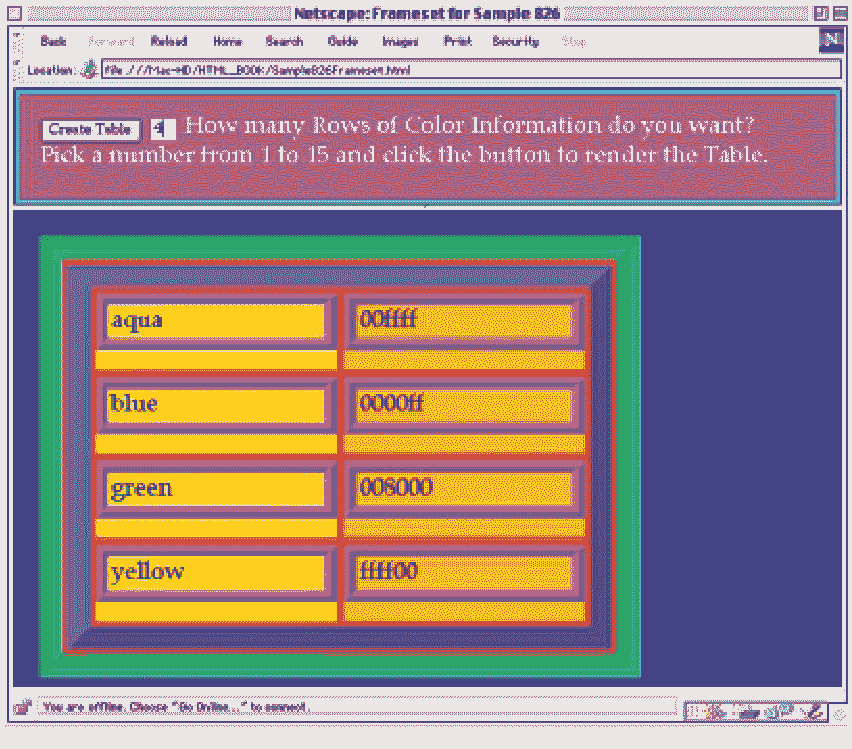

这是示例 7-26 的框架集。

# 示例 7-26 第 2 部分：Sample826-Frameset.html

```html
<!DOCTYPE HTML PUBLIC "-//W3C//DTD HTML 3.2//EN">
<HTML>
<HEAD>
        <TITLE>Frameset for Sample 826</TITLE>
</HEAD>

<FRAMESET ROWS="100,*">

        <FRAME SCROLLING="auto" NAME="display" SRC="Sample826.html">

        <FRAME SCROLLING="auto" NAME="main" SRC="Sample826Main.html">

</FRAMESET>

</HTML>
```

这是 Sample826Main.html 的代码，它在 Sample826-Frameset.html 文件中仅用作占位文件，该文件包含示例 7-26 中使用的框架集。请注意，此占位文件实际上是必需的，因为 FRAME 元素的 SRC 属性是必需的。

# 示例 7-26 第 3 部分：Sample826Main.html

```html
<!DOCTYPE HTML PUBLIC "-//W3C//DTD HTML 3.2//EN">
<HTML>
<HEAD>
        <TITLE>  Sample 826Main   Example 13-26Main  </TITLE>
</HEAD>

<BODY>

</BODY>
</HTML>
```

# 使用数组的示例文件图表

以下是书中除第 7 章之外其他使用数组的示例。你可以通过查阅附录 C 中的图表（第 1039-1048 页）来找到示例代码所在的页码，该图表包含了书中所有示例和示例的页码参考。

如果你在 BBEdit 等文本编辑器中打开 CD-ROM 中的示例，可以通过下面列出的行号轻松找到数组的使用位置。

| 示例文件，行号 | 数组用法 |
| :--- | :--- |
| Sample424.html, 第 46 行： | colorArray = new Array |
| Sample425.html, 第 57 行： | document.L1.bgColor = colorArray[i-1]; |
| Sample431.html, 第 34 行： | a1 = new Array("./JPEG-FILES/icon-BG-asteroids.jpg", ... |
| Sample432.html, 第 31 行： | numArray[0] = appendNum(numArray[0], num); |
| Sample432.html, 第 173 行： | numArray[0] = Math.round(numArray[0]); |
| Sample434.html, 第 20 行： | rgbArray = new Array(3); |
| Sample434.html, 第 226 行： | rgbArray[0] = getchar.charAt(0) + getchar.charAt(1); |
| Sample434.html, 第 229 行： | rgbArray[0] = parseInt(rgbArray[0], 16); |
| Sample434.html, 第 289 行： | if (isNaN(a1)) [rgbArray[1] = '00'; |
| Sample434.html, 第 335 行： | "#" + rgbArray[0] + '0' + rgbArray[1] + '00'; |
| Sample456.html, 第 59 行： | if (array[j] == "") alert("You forgot to fill in a field."); |
| Sample456.html, 第 62 行： | parent.main.document.write(Array2[j]); |
| Sample912.html, 第 8 行： | gotItArray = str.match(myRegExp); |
| Sample912.html, 第 10 行： | document.write(gotItArray); |
| Sample1004.html, 第 17 行： | var myArray = myRE1.exec(); |
| Sample1005.html, 第 11 行： | myArray = myRE.exec(myStr); |
| Sample1006.html, 第 18 行： | var myArray = myRE1.exec(str); |
| Sample1007.html, 第 14 行： | myMatchArray = str1.match(myRE1); |
| Sample1008.html, 第 14 行： | myExecArray = myRE1.exec(str1); |
| Sample1011.html, 第 26 行： | var myArray = myRE1.exec(str); |

# 第二部分

## JavaScript 1.2


## 第 8 章

## JavaScript 字符串

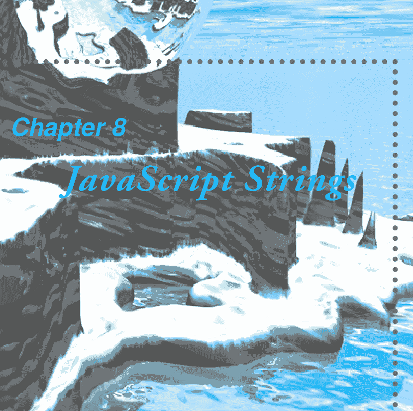

# 第 8 章

## JavaScript 字符串

## 目录

- **JavaScript 字符串对象** 749
  - 8.1) JavaScript 字符串对象 749
  - 8.2) 字符串对象属性汇总 750
  - 8.3) 字符串对象方法汇总 750
  - 8.4) 使用字符串对象构造函数 752
  - 8.5) 使用字面量表示法创建字符串对象 752
  - 8.6) 字符串中的 JavaScript 特殊字符 753
  - 8.7) 字符串对象字符数组 754

- **字符串对象操作方法** 755
  - 8.8) 字符串对象的 concat() 方法 755
  - 8.9) 字符串对象的 charAt() 方法 759
  - 8.10) 字符串对象的 charCodeAt() 方法 761
  - 8.11) 字符串对象的 fromCharCode() 静态方法 763
  - 8.12) 字符串对象的 indexOf() 方法 766
  - 8.13) 字符串对象的 lastIndexOf() 方法 769

- **与正则表达式配合使用的字符串对象方法** 770
  - 8.14) 字符串对象的 search() 方法 771
  - 8.15) 字符串对象的 match() 方法 774
  - 8.16) 字符串对象的 replace() 方法 778
  - 8.17) 字符串对象的 split() 方法 782

- **更多字符串对象方法** 788
  - 8.18) 字符串对象的 slice() 方法 788
  - 8.19) 字符串对象的 substring() 方法 790
  - 8.20) 字符串对象的 substr() 方法 792

- **创建锚点和链接** 794
  - 8.21) 字符串对象的 anchor() 方法 794
  - 8.22) 字符串对象的 link() 方法 795

- **字符串对象的装饰方法** 797
  - 8.23) 概述 797
  - 8.24) 字符串对象的 toLowerCase() 方法 797
  - 8.25) 字符串对象的 toUpperCase() 方法 798
  - 8.26) 字符串对象的 fontcolor() 方法 798
  - 8.27) 字符串对象的 fontsize() 方法 798

### JavaScript 字符串对象

### JavaScript 字符串对象

简单来说，`String` 对象由文本组成。有两种方式可以创建 `String` 对象。你可以使用 `String` 对象构造函数，也可以使用字面量表示法。此外，你还可以定义一个字符串并将其赋值给变量。使用字面量表示法创建的字符串也被视为 `String` 对象。

每个 `String` 对象都有两个属性：`length` 属性和 `prototype` 属性。`length` 属性指定字符串中的字符数，且不可更改，因此它是只读的。`prototype` 属性用于为 `String` 对象创建新属性，你可以根据自有需求进行定义。

`String` 对象显然由字符组成。这些字符在 JavaScript 中存储于字符数组中，你可以通过其 `index` 编号调用字符数组的元素来访问它们。字符在数组中的排列方式是：当从左到右读取字符串时，它们会从顶到底出现在数组中；也就是说，索引为 `0` 的元素将是字符串中的第一个字符。需要注意的是，此字符计数包含空白字符，因此字符串 "Hey Now" 将有七个字符，而不是六个。

你可以使用多种方法来处理 `String` 对象。`String` 对象的方法分为两大类：与 HTML 属性平行的文本装饰，以及涉及高级 JavaScript 幕后操作的文本操作。这些操作方法在结束时都会返回一个字符串或字符串数组。`anchor` 和 `link` 方法不属于上述任一类。

装饰方法有：

```
big, blink, bold, fixed, fontcolor, fontsize, italics,
small, strike, sub, sup, toLowerCase, toUpperCase
```

操作方法有：

```
charAt, charCodeAt, concat, fromCharCode, indexOf,
lastIndexOf, match, replace, search, slice, split, substr, substring
```

以下方法在 Navigator 4.0 中实现或更改：

```
charCodeAt, concat, fromCharCode, replace,
search, slice, split, substr, substring
```

## 字符串对象属性汇总

| 属性 | 说明 |
| :--- | :--- |
| length | 反映字符串中的字符数。此为只读。 |
| prototype | 允许你为字符串对象创建自己的属性。 |

## 字符串对象方法汇总

| 方法 | 说明 |
| :--- | :--- |
| anchor() | 与 `<A>` 标签平行，创建用作超文本目标的锚点。 |
| big() | 与 `<BIG>` 标签平行，显示更大的字符串。 |
| blink() | 与 `<BLINK>` 标签平行，显示闪烁的字符串。 |
| bold() | 与 `<B>` 标签平行，显示粗体字符串。 |
| charAt() | 返回一个字符串，包含调用字符串中指定索引处的字符。 |
| charCodeAt() | 返回一个数字，指定调用字符串中指示索引处字符的 ISO-Latin-1 编码集值。 |
| concat() | 返回一个字符串，是两个指定字符串的组合。 |
| fixed() | 与 `<TT>` 标签平行，显示等宽字符串。 |
| fontcolor() | 与 `<FONT COLOR="color">` 标签平行，更改指定字符串的颜色。 |
| fontsize() | 与 `<FONT SIZE=size>` 标签平行，更改指定字符串的大小。 |
| fromCharCode() | 将一个或多个 ISO-Latin-1 编码集值转换为 ASCII 字符，并将其作为字符串返回。 |
| indexOf() | 返回一个数字字符串，它是调用字符串中首次出现的指定模式的索引号。 |


## 第8章 — JavaScript 字符串

| 方法 | 说明 |
| --- | --- |
| **italics()** | 相当于 `<I>` 标签，用于显示斜体字符串。 |
| **lastIndexOf()** | 返回一个数值型字符串，表示在调用字符串中**最后一次**出现的指定模式的**索引**位置。 |
| **link()** | 相当于 `<A>` 标签，将字符串转换为指向指定 URL 的超文本链接。 |
| **match()** | 将正则表达式模式与调用字符串进行匹配，并返回包含匹配结果的字符串数组。 |
| **replace()** | 将正则表达式模式与调用字符串进行匹配，并将匹配的子字符串替换为新的子字符串。 |
| **search()** | 将正则表达式模式与调用字符串进行匹配，并返回匹配在调用字符串中的**索引**位置。 |
| **slice()** | 返回由调用字符串的一部分组成的新字符串。 |
| **small()** | 相当于 `<SMALL>` 标签，用于显示较小的字符串。 |
| **split()** | 基于分隔符（可以是字符串或正则表达式）将调用字符串拆分，返回子字符串数组。 |
| **strike()** | 相当于 `<STRIKE>` 标签，用于显示带删除线的字符串。 |
| **sub()** | 相当于 `<SUB>` 标签，用于显示下标字符串。 |
| **substr()** | 返回由起始**索引**和一个可选数量值指定的字符所组成的字符串，该数量值指定要从调用字符串中提取的字符个数。 |
| **substring()** | 返回由起始**索引**和可选的结束**索引**指定的字符所组成的字符串，该结束索引指定要从调用字符串中提取的字符。 |
| **sup()** | 相当于 `<SUP>` 标签，用于显示上标字符串。 |
| **toLowerCase()** | 将调用字符串转换为小写字符并返回。 |
| **toUpperCase()** | 将调用字符串转换为大写字符并返回。 |

第9章将详细介绍**RegExp**对象，以及它们如何与**String**对象和**Array**对象交互。目前，本章仅使用**RegExp**对象的基础方面。

### 使用 String 对象构造函数

要使用**String**对象构造函数创建一个字符串，需使用关键字**new**和**String**对象构造函数，其中参数**anyString**是**String**对象的值，如下所示：

#### 迷你示例：

```
new String("anyString");
```

 SUA 通常你会将其赋值给一个变量，如下所示：

```
myString = new String("Let's Play");
```

这样，变量**myString**的值为"Let's Play"，**length**为10。

### 使用字面量表示法创建 String 对象

**String**对象可以通过**字面量**表示法来创建，只需将文本放在双引号或单引号内即可。使用哪种引号并不重要，但必须保持一致：如果开始用双引号包裹字符串，那么也必须用双引号结束字符串。概念上很简单，但在处理包含大量两种引号的复杂语句时，我们都曾不得不回头修改，因为要在脑中跟踪所有引号是很棘手的。

甚至可以在**String**对象中包含数字。如果**String**对象完全由数字字符组成，则称为数字字符串。如果字符串包含字母和数字的组合，则称为混合数字字符串。

#### 迷你示例：

以下是几个**String**对象的示例：

```
"Mountains on the Moon"
'DreamPlay Studios'
'blue'
"555"
"451 Ocean Boulevard"
```

### JavaScript 字符串中的特殊字符

在 JavaScript 中，当某些字符前面带有反斜杠时，它们具有特殊含义。它们是：

| 字符 | 定义 |
| :--- | :--- |
| \b | 退格 |
| \f | 换页 |
| \n | 换行 |
| \r | 回车 |
| \t | 制表符 |
| \\ | 反斜杠字符 |

一个典型的用途是在创建警告窗口时，想要增强要显示的文本。警告窗口不会响应在文本编辑器中从键盘输入的 HTML 标签、回车、制表符等。因此，如果你想要格式化警告，就必须使用这些特殊字符标识。

#### 迷你示例：

例如，如果你有以下警告：

```
alert("Close to the Edge," +
      " Down by the River.")
```

它在浏览器警告窗口中会显示为：

```
Close to the Edge, Down by the River.
```

但如果你有以下警告：

```
alert("Close to the Edge, \rDown by the River.")
```

它在浏览器警告窗口中会显示为：

```
Close to the Edge,
Down by the River.
```

### String 对象的字符数组

每个**String**对象都有一个关联的字符数组，包含字符串中的所有字符，因此字符串的每个字符都被分配给数组的一个元素。这意味着字符数组中的每个元素恰好包含一个字符。**String**对象从左到右读取，最左边的字符是字符数组的第一个元素。字符串中的下一个字符是字符数组的下一个元素，依此类推。文本字符串中的空白也算作一个字符。

#### 迷你示例：

例如，如果你有以下字符串：

```
myString = new String("DreamPlay Studios");
```

它的**length**为17；也就是说，字符数组中有17个字符和17个元素，因为两个单词之间的空白算作一个字符。字符数组中的元素等于以下图表：

```
myString[0] = "D";
myString[1] = "r";
myString[2] = "e";
myString[3] = "a";
myString[4] = "m";
myString[5] = "P";
myString[6] = "l";
myString[7] = "a";
myString[8] = "y";
myString[9] = " ";
myString[10] = "S";
myString[11] = "t";
myString[12] = "u";
myString[13] = "d";
myString[14] = "i";
myString[15] = "o";
myString[16] = "s";
```

#### 特别说明：

需要注意的是，这些字符数组元素是<u>只读的</u>，这意味着你可以测试或显示它们，但不能更改它们。

### String 对象的操作方法

#### String 对象的 concat() 方法

**JavaScript 语法：**

```
stringName1.concat(stringName2);
("stringLiteral1").concat("stringLiteral2");
```

**参数说明：**

`concat()` 方法返回一个新的 `String` 对象，它合并了 `stringName1` 和 `stringName2` 的文本。对其中一个 `String` 对象的任何更改都不会影响另一个 `String` 对象。之所以有两种语法版本，是为了提醒你：如果使用实际文本（由 `stringLiteral1` 和 `stringLiteral2` 表示）而不是文本变量，则需要用引号或双引号将其括起来。忘记给文本加引号是编码中最常见的低级"失误"之一。

例如，如果你有字符串 "Carpe Diem means: " 和另一个字符串 "Seize the Day."，那么要将这两个字符串连接起来，你可以这样编写代码：

```
("Carpe Diem means: ").concat("Seize the Day.")
```

这将产生以下字符串：

Carpe Diem means: Seize the Day.

如果你有以下两个赋值给字符串变量的字符串：

```
var str1 = "Tales from "
var str2 = "Topographic Oceans"
```

那么，要使用 `concat()` 方法连接这两个字符串，可以这样编写代码：

```
str1.concat(str2)
```

这将返回以下字符串：

Tales from Topographic Oceans

#### 第二部分 — JavaScript 1.2

示例 8-0 创建了一个名为 **concatIt()** 的函数，并定义了两个字符串变量 **myString1** 和 **myString2**，每个变量都被赋予了一个字符串字面量。接着，它使用 **concat()** 方法将这两个字符串连接起来，并将结果赋值给名为 **text1** 的文本框的 **value** 属性。最后，**concatIt()** 函数被赋值给名为 **B1** 的按钮的 **onClick** 事件处理程序，从而实现连接并在屏幕上显示。

**示例 8-0：Sample900.html**

```
<!DOCTYPE HTML PUBLIC -//W3C//DTD HTML 3.2//EN>
<HTML> <HEAD> <TITLE> Sample 900    Example 8-0 concat Method </TITLE>

<SCRIPT LANGUAGE="JavaScript1.2"> <!--BEGIN HIDING

        function concatIt() {

                var myString1 = "Have a ";
                var myString2 = "great day.";

                document.form1.text1.value = "";

                document.form1.text1.value = myString1.concat(myString2);
        }

//END HIDING-->
</SCRIPT>
</HEAD>
<BODY>
<FORM NAME="form1">

<INPUT TYPE="button" NAME="B1" VALUE="concat the Strings" onClick="concatIt();">

<INPUT TYPE="text" NAME="text1" SIZE="30" VALUE="Greetings">

</FORM>
</BODY>
</HTML>
```

示例 8-1 在名为 **concatIt()** 的函数中演示了 **concat()** 方法，首先创建了三个名为 **myString1**、**myString2** 和 **myString3** 的字符串变量。前两个字符串变量分别被赋予了一个名为 **text1** 和 **text2** 的文本元素的 **value** 属性。接着，**myString3** 被赋予将 **myString1** 与 **myString2** 连接后得到的字符串，然后该结果又被赋值给 **text3** 的 **value** 属性。

最后，**concatIt()** 函数被赋值给按钮 **B1** 的 **onClick** 事件处理程序，这样当点击该按钮时，会从前面两个文本框中收集文本，将它们连接起来并显示在第三个文本框中。**focus()** 方法只是将光标放入第一个文本框以开始下一次输入会话。**null** 字符串的作用是防止字符串累积。这样，每次连接都从空白字符串开始。


## 第 8 章 — JavaScript 字符串

### 示例 8-1：Sample901.html

```html
<!DOCTYPE HTML PUBLIC -//W3C//DTD HTML 3.2//EN>
<HTML>
<HEAD>
<TITLE> Sample 901 示例 8-1 concat 方法</TITLE>

<SCRIPT LANGUAGE="JavaScript1.2"> <!--BEGIN HIDING

function concatIt() {

var myString1 = document.form1.text1.value;
var myString2 = document.form1.text2.value;
var myString3 = myString1.concat(myString2);

document.form1.text1.value = "";
document.form1.text2.value = "";
document.form1.text3.value = myString3;
document.form1.text1.focus();
}

//END HIDING-->
</SCRIPT>

</HEAD>

<BODY>

<FORM NAME="form1">

第一个文本字符串...
<INPUT TYPE="text" NAME="text1" SIZE="30" VALUE="Hey "> <BR>

第二个文本字符串...
<INPUT TYPE="text" NAME="text2" SIZE="30" VALUE="Now"> <BR>

<INPUT TYPE="button" NAME="B1" VALUE="concat the Strings" onClick="concatIt();">

<BR>

<INPUT TYPE="text" NAME="text3" SIZE="30" VALUE="">

</FORM>

</BODY>
</HTML>
```

示例 8-2 非常简单地演示了对一个字符串所做的更改不会影响与之连接的另一个字符串，也不会影响结果连接后的字符串。

### 示例 8-2：Sample902.html

```html
<!DOCTYPE HTML PUBLIC -//W3C//DTD HTML 3.2//EN>
<HTML>
<HEAD>
<TITLE>       Sample 902  示例 8-2   concat 方法      </TITLE>

<SCRIPT LANGUAGE="JavaScript1.2"> <!--BEGIN HIDING

      var myString1 = "Hello, ";

      var myString2 = "My Name is ";

      var myString3 = myString1.concat(myString2);

      document.write(myString3 +  "<P>");

// 注意，对 myString1 的更改不会改变 myString2 或 myString3。

      myString1 = "Greetings ";

      document.write(myString1 +  "<P>");

      document.write(myString2 +  "<P>");

      document.write(myString3 +  "<P>");

// 注意，如果你再次连接这两个字符串，
// 对 myString1 的更改确实会改变 myString3。

      myString3 = myString1.concat(myString2);

      document.write(myString3 +  "<P>");


//END HIDING-->
</SCRIPT>

</HEAD>

<BODY>

</BODY>
</HTML>
```

## 字符串对象的 charAt() 方法

### JavaScript 语法：

```javascript
stringName.charAt(index);
("stringLiteral").charAt(index);
```

### 参数说明：

每个 **String** 对象都有一个与之关联的固有字符数组。**charAt()** 方法访问这个字符数组，并返回由 **index** 参数指定的数组元素中驻留的字符。当 JavaScript 内部创建字符数组时，它从左到右对字符串进行索引，然后将每个字符分配给它自己的元素，从字符数组的垂直顶部到底部开始。注意，从技术上讲，它们是从下到上开始的，因为数组的底部从 **索引 0** 开始，但由于我们在文本编辑器中是从页面顶部到底部编写代码的，这有些违反直觉。

第一个字符的 **索引** 是 0（零），第二个字符的 **索引** 是 1，依此类推。最后一个字符的 **索引** 将是 **length - 1**。例如，名为 **starString** 的字符串，其最后一个字符的 **索引** 为 **starString.length - 1**。这可以在 **for()** 循环中用作条件测试，如果你想用 **charAt()** 方法显示字符串中的所有字符，像这样：

```javascript
for( var i=0; i<starString.length-1; i++) {
    document.write(starString.charAt(i) + "<BR>");
}
```

如果 **starString** 的值为 "STAR"，那么前面的 **for()** 循环将输出：

S
T
A
R

以下代码：

```javascript
myString = new String("DreamPlay Studios");

document.write(myString.charAt(0) + "<BR>");
document.write(myString.charAt(1) + "<BR>");
document.write(myString.charAt(2) + "<BR>");
document.write(myString.charAt(3) + "<BR>");
document.write(myString.charAt(4) + "<BR>");
```

将在浏览器中显示如下：

D
r
e
a
m

### 超出边界的索引属性行为

如果你向 **charAt()** 方法提供的 **索引** 大于字符串中字符数量减一，JavaScript 将返回一个空字符串。记住 **索引** 编号从 0 开始，所以如果你有一个包含 13 个字符的字符串，**索引范围** 将从 0 到 12。

此示例使用 **charAt()** 方法来测试 **索引** 0 处字符的值，并在用户点击两个按钮之一时更改文档的背景颜色，该按钮向函数 **changeIt()** 提供 **color** 参数。

### 示例 8-3：Sample903.html

```html
<!DOCTYPE HTML PUBLIC -//W3C//DTD HTML 3.2//EN>
<HTML>
<HEAD>
<TITLE> Sample 903  示例 8-3 charAt 方法</TITLE>

<SCRIPT LANGUAGE="JavaScript1.2"> <!--BEGIN HIDING

     function changeIt(color) {

            var myString = color;
            if (myString.charAt(0) == 'b') document.bgColor='blue';
            if (myString.charAt(0) == 'r') document.bgColor='red';
     }

//END HIDING-->
</SCRIPT>
</HEAD>
<BODY>
<FORM NAME="form1">

<INPUT TYPE="button" NAME="B1" VALUE="blue" onClick="changeIt('blue');">
<INPUT TYPE="button" NAME="B2" VALUE="red" onClick="changeIt('red');">

</FORM>

</BODY>
</HTML>
```

## 字符串对象的 charCodeAt() 方法

### JavaScript 语法：

```javascript
stringName.charCodeAt([index]);
("stringLiteral").charCodeAt([index]);
```

### 参数说明：

charCodeAt() 方法返回一个数字，该数字表示指定索引参数处字符的 ISO-Latin-1 编码集值。索引参数是可选的，如果未指定，默认值为 0（零）。索引的可接受值为从 0 到 stringName.length - 1 的整数，即字符串中字符数量减一。

ISO-Latin-1 编码集数字范围为 0-255，其中数字 0-127 与 ASCII 字符集相同。要获取 ISO-Latin-1 和 ASCII 编码集值的完整列表，你可以尝试访问 "Best Business Solutions" (BBS) 的网站，网址为 http://www.bbsinc.com。图表位于 http://www.bbsinc.com/symbol.html 或 CD-ROM 中 "Docs_for_Book" 文件夹下 "html-Character-Codes" 文件夹中名为 ISO-Latin-1-Char-Entities.html 的文件。

此示例定义了一个名为 str 的字符串变量，并将其赋值为 "abcde"，然后在 write() 方法中使用 charCodeAt() 方法显示 str 中每个字符的 ISO-Latin-1 编码集值。接下来，对字符串字面量 "ABCDE" 重复相同的技术。

### 示例 8-4：Sample904.html

```html
<!DOCTYPE HTML PUBLIC -//W3C//DTD HTML 3.2//EN>
<HTML>
<HEAD>
<TITLE> Sample 904  示例 8-4 charCodeAt 方法</TITLE>

<SCRIPT LANGUAGE="JavaScript1.2"> <!--BEGIN HIDING

str = "abcde";

document.write(str.charCodeAt(0) + " 是 'a' 对应的数字<P>");

document.write(str.charCodeAt(1) + " 是 'b' 对应的数字<P>");

document.write(str.charCodeAt(2) + " 是 'c' 对应的数字<P>");

document.write(str.charCodeAt(3) + " 是 'd' 对应的数字<P>");

document.write(str.charCodeAt(4) + " 是 'e' 对应的数字");

document.write(("ABCDE").charCodeAt(0) + " 是 'A' 对应的数字<P>");
document.write(("ABCDE").charCodeAt(1) + " 是 'B' 对应的数字<P>");
document.write(("ABCDE").charCodeAt(2) + " 是 'C' 对应的数字<P>");
document.write(("ABCDE").charCodeAt(3) + " 是 'D' 对应的数字<P>");
document.write(("ABCDE").charCodeAt(4) + " 是 'E' 对应的数字<P>");

//END HIDING-->
</SCRIPT>

</HEAD>

<BODY>
</BODY>
</HTML>
```

前面的示例产生以下输出：

- 65 是 'A' 对应的数字
- 66 是 'B' 对应的数字
- 67 是 'C' 对应的数字
- 68 是 'D' 对应的数字
- 69 是 'E' 对应的数字
- 97 是 'a' 对应的数字
- 98 是 'b' 对应的数字
- 99 是 'c' 对应的数字
- 100 是 'd' 对应的数字
- 101 是 'e' 对应的数字

## 字符串的 fromCharCode() 静态方法

### JavaScript 语法：

```javascript
String.fromCharCode(num1, num2, ..., numN);
String.fromCharCode(expression);
```

### 参数说明：

fromCharCode() 方法是 String 的静态方法，而不是你创建的 String 对象的方法。因此，它始终编码为以 "String" 开头，而不是以字符串变量或字符串字面量开头。此方法始终返回字符串，而不是字符串对象。num1 到 numN 参数是表示 ISO-Latin-1 编码集值的整数，范围为 0-255。例如，以下代码将返回字母 "d"。

```javascript
String.fromCharCode(100);
```

此示例仅演示使用 fromCharCode() 方法对几个数字参数提取字符串的返回值，然后将它们显示到屏幕上。

### 示例 8-5：Sample905.html

```html
<!DOCTYPE HTML PUBLIC -//W3C//DTD HTML 3.2//EN>
<HTML><HEAD>
<TITLE> Sample 905  示例 8-5 fromCharCode 方法</TITLE>

<SCRIPT LANGUAGE="JavaScript1.2"> <!--BEGIN HIDING

document.write(String.fromCharCode(65) + " 是 '65' 对应的字符<P>");
document.write(String.fromCharCode(66) + " 是 '66' 对应的字符<P>");
document.write(String.fromCharCode(67) + " 是 '67' 对应的字符<P>");
document.write(String.fromCharCode(68) + " 是 '68' 对应的字符<P>");
document.write(String.fromCharCode(69) + " 是 '69' 对应的字符<P>");
document.write(String.fromCharCode(97) + " 是 '97' 对应的字符<P>");
document.write(String.fromCharCode(98) + " 是 '98' 对应的字符<P>");
document.write(String.fromCharCode(99) + " 是 '99' 对应的字符<P>");
document.write(String.fromCharCode(100)+ " 是 '100' 对应的字符<P>");
document.write(String.fromCharCode(101)+ " 是 '101' 对应的字符");

//END HIDING-->
</SCRIPT>
</HEAD>
<BODY>
</BODY>
</HTML>
```


## 第二部分 — JavaScript 1.2

之前的示例产生以下输出：

- A 是 '65' 对应的字符
- B 是 '66' 对应的字符
- C 是 '67' 对应的字符
- D 是 '68' 对应的字符
- E 是 '69' 对应的字符
- a 是 '97' 对应的字符
- b 是 '98' 对应的字符
- c 是 '99' 对应的字符
- d 是 '100' 对应的字符
- e 是 '101' 对应的字符

### 测试 ISO-Latin-1 字符集值

当你使用一个求值为 ISO-Latin-1 字符集值的表达式，并在 **if()** 语句或 **switch()** 语句中对其进行测试，以根据测试条件的结果执行代码时，**fromCharCode()** 方法变得非常有用。以下示例演示了这一点。

示例 8-6 以两种不同的方式使用 **String.fromCharCode(e.which)** 方法，最终目的是更改文档的背景颜色。首先，让我们解释该方法本身是如何工作的。首先，定义了 **keyTest2(e)** 函数，它接收一个参数 **e**，在 KEYPRESS 事件发生时，该参数将获取 **Event** 对象。然后，调用 **Event** 对象 **e** 的 **which** 属性，并将其作为 **String.fromCharCode()** 方法的参数，如下所示：

```
String.fromCharCode(e.which)
```

其作用如下：**e.which** 提取按下按键的原始 ASCII 数字值并将其传递给 **fromCharCode()**，后者随后将该 ASCII 数字转换为代表实际按键字符的字符串。
然后，在 **if()** 语句的条件中对该字符进行测试，因此如果按下某个按键且其字符值与 **if()** 等值参数之一匹配，则执行相应的 **bgColor** 属性更改。
为了向你展示实现该测试的几种方式，前五次使用 **String.fromCharCode(e.which)** 时采用了显式代码。另一种方式是将 **String.fromCharCode(e.which)** 赋值给变量 **testKey**，然后在 **if()** 语句中使用 **testKey**。
最后，**keyTest2()** 函数被赋值给 **document** 对象的 **onkeypress** 事件处理器，且 **String.fromCharCode(e.which)** 被赋值给名为 **text1** 的文本框的 **value** 属性，以便在每次按键后在浏览器中显示，用于验证结果。

## 第 8 章 — JavaScript 字符串 765

### 示例 8-6: Sample906.html

```
<!DOCTYPE HTML PUBLIC -//W3C//DTD HTML 3.2//EN>
<HTML>
<HEAD>
<TITLE> Sample 906   Example 8-6 fromCharCode Method</TITLE>

<SCRIPT LANGUAGE="JavaScript1.2"><!--BEGIN HIDING

function keyTest2(e) {

    var testKey = String.fromCharCode(e.which);
    document.form1.text1.value = testKey;

    if (String.fromCharCode(e.which) == "a") { document.bgColor = 'red'; }
    if (String.fromCharCode(e.which) == "b") { document.bgColor = 'blue'; }
    if (String.fromCharCode(e.which) == "c") { document.bgColor = 'purple'; }
    if (String.fromCharCode(e.which) == "d") { document.bgColor = 'cyan'; }
    if (String.fromCharCode(e.which) == "e") { document.bgColor = 'lime'; }

    if (testKey == "A") { document.bgColor = 'yellow'; }
    if (testKey == "B") { document.bgColor = 'steelblue'; }
    if (testKey == "C") { document.bgColor = 'gold'; }
    if (testKey == "D") { document.bgColor = 'olive'; }
    if (testKey == "E") { document.bgColor = 'green'; }
}

/*--------------------------------------------------------------------------*/

    document.onkeypress = keyTest2;

/*--------------------------------------------------------------------------*/

//END HIDING-->
</SCRIPT>

</HEAD>

<BODY onLoad="window.focus();">
                                <FONT POINT-SIZE="17">
        Press any of the: a, b, c, d, e, A, B, C, D, E          <BR><BR>
        Keys to change the background color of the document.     <BR>
<P>    Notice that:
<P>    testKey = String.fromCharCode(e.which)                   <BR><BR>
        is displayed in the text box.                           </FONT>
<FORM NAME="form1">

<INPUT TYPE="text" NAME="text1" SIZE="30" VALUE=""><BR>

</FORM>

</BODY>
</HTML>
```

有关 **fromCharCode()** 方法的更多示例，请参阅以下示例文档。你可以在附录 C 第 1039-1048 页的图表中找到示例代码所在的页码。

| 示例文件，行号 | fromCharCode() 方法用法 |
|---|---|
| Sample705.html, Line 26: | String.fromCharCode(e.which) |
| Sample706.html, Line 23: | alert ("Key pressed: " + String.fromCharCode(e.which) ) |
| Sample707.html, Line 28: | alert ("Key Pressed = " + String.fromCharCode(e.which) ) |
| Sample715.html, Line 26: | var whichKey = String.fromCharCode(e.which); |
| Sample720.html, Line 72: | var whichKey2 = String.fromCharCode(e.which); |
| Sample721.html, Line 22: | whichKey = String.fromCharCode(e.which); |
| Sample722.html, Line 580: | var whichKey2 = String.fromCharCode(e.which); |

接下来的两个方法，**indexOf()** 方法和 **lastIndexOf()** 方法，用于提取关于 **String** 对象字符内容的详细信息，即你正在寻找的字符串特定部分的位置。顾名思义，它会返回找到的匹配项的**索引**（index）数字。

## String 对象的 indexOf() 方法

### JavaScript 语法：

```
anyString.indexOf("searchString", [fromIndex]);
```

### 参数定义：

**indexOf()** 方法返回在由 **anyString** 指定的字符串中，由 **searchString** 指定的搜索参数第一次出现的位置**索引**。**anyString** 中的每个字符从左到右进行索引，数字从 0（零）开始，到 **anyString.length - 1** 结束。（即读取为 **length** 减 1。）

当你提供 **searchString** 时，**indexOf()** 方法将在调用字符串 **anyString** 中寻找与该字符串完全一致（区分大小写）的匹配项。如果找到匹配项，它将返回匹配项首个字符的**索引**数字。如果没有找到匹配项，该方法将返回 -1（负一）。如果 **anyString** 包含空字符串 ("") 或 null 字符串，则 **indexOf()** 返回空字符串。

如果提供了可选的 **fromIndex** 参数，则该方法将从该**索引**整数开始搜索，并忽略之前的任何字符。可接受的值为 0 到 **anyString.length - 1**。默认值为 0（零）。**fromIndex** 参数可以为你节省一些处理时间，但请确保不要不小心遗漏了相关数据。

## 第 8 章 — JavaScript 字符串 767

这里有一个示例，演示了 **indexOf()** 方法：首先定义字符串变量 **str1**，然后将其作为调用字符串来搜索多个 **searchString** 参数。返回的**索引**整数随后通过 **write()** 方法显示。请注意，在第二次使用 **indexOf()** 时，返回值是 **-1**，因为<u>区分大小写</u>的搜索无法匹配 'red'。

### 示例 8-7: Sample907.html

```
<!DOCTYPE HTML PUBLIC -//W3C//DTD HTML 3.2//EN>
<HTML>
<HEAD>
    <TITLE> Sample 907   Example 8-7 indexOf Method     </TITLE>

<SCRIPT LANGUAGE="JavaScript1.2"><!--BEGIN HIDING

    str1 = "The Colors to search for are Lime, Green, Red and Purple";

    document.write(str1.indexOf('Red', 11) + "<BR>");

    document.write(str1.indexOf('red') + "<BR>");

    document.write(str1.indexOf('Purple', 10) + "<BR>");

    document.write(str1.indexOf('Lime') + "<BR>");

//END HIDING-->
</SCRIPT>

</HEAD>

<BODY>
</BODY>
</HTML>
```

之前的示例产生以下输出：

```
42
-1
50
29
```

本示例使用 **changeColor()** 函数，通过从文本框元素获取用户提供的文本，并测试其是否匹配 **indexOf()** 方法的任何 **searchString** 参数，从而更改文档的背景颜色。例如，如果用户输入 "red"，则该字符串会被 **indexOf()** 方法匹配，因为它返回的**索引**为 0，这在 **if()** 语句中等同于 (==) 0。因为 **if()** 的结果为 **true**，所以执行下一条语句，背景颜色变为红色。对于 "green" 和 "purple" 同样适用，但如果用户输入了一个未测试的颜色，则不会发生任何事情。

### 示例 8-8: Sample908.html

```
<!DOCTYPE HTML PUBLIC -//W3C//DTD HTML 3.2//EN>
<HTML>
<HEAD>
<TITLE> Sample 908 Example 8-8 indexOf Method</TITLE>

<SCRIPT LANGUAGE="JavaScript1.2"><!--BEGIN HIDING

function changeColor() {
    str2 = document.form1.text1.value;
    if ( str2.indexOf('red') == 0 ) document.bgColor = "red";
    if ( str2.indexOf('green') == 0 ) document.bgColor = "green";
    if ( str2.indexOf('purple') == 0 ) document.bgColor = "purple";
    document.form1.text1.value = "";
    document.form1.text1.focus();
}
//END HIDING-->
</SCRIPT>
</HEAD>

<BODY onLoad="document.form1.text1.focus();"> <FONT POINT-SIZE="17">
Type in the color red, green or purple in all lowercase letters and click
the button or hit the Tab Key.
</FONT>

<FORM NAME="form1">
<INPUT TYPE="button" NAME="b1" VALUE="Do it Now" onClick="changeColor();"><BR>
<INPUT TYPE="text" NAME="text1" SIZE="30" VALUE=""onBlur="changeColor();"><BR>
</FORM>
</BODY>
</HTML>
```


## 第 8 章 — JavaScript 字符串

### String 对象的 lastIndexOf() 方法

**JavaScript 语法：**

```javascript
anyString.lastIndexOf("searchString", [fromIndex]);
```

**参数定义：**

**lastIndexOf()** 方法的工作方式与 **indexOf()** 方法完全相同，不同之处在于它返回的是在调用字符串 **anyString** 中，由 **searchString** 指定的搜索参数**最后一次**出现时的**索引**（index）。目前该方法在使用了可选的 **fromIndex** 参数时存在一个 Bug，会导致该方法从右向左而非从左向右进行搜索，因此请不要使用该参数。

**微例：**

此示例演示了该方法中的 Bug。

```javascript
str1 = "AAACCC";

document.write(str1.lastIndexOf('C', 0) + "<BR>");
document.write(str1.lastIndexOf('C', 1) + "<BR>");
document.write(str1.lastIndexOf('C', 2) + "<BR>");
document.write(str1.lastIndexOf('C', 3) + "<BR>");
document.write(str1.lastIndexOf('C', 4) + "<BR>");
document.write(str1.lastIndexOf('C', 5) + "<BR>");
```

在浏览器中会产生以下输出：

-1
-1
-1
3
4
5

而浏览器中正确的输出应该是：

5
5
5
5
5
5

此示例演示了在调用字符串变量 `str1` 上使用 `lastIndexOf()` 方法，并将结果显示在屏幕上。

**示例 8-9: Sample909.html**

```html
<!DOCTYPE HTML PUBLIC "-//W3C//DTD HTML 3.2//EN">
<HTML>
<HEAD>
	<TITLE> Sample 909 Example 8-9 lastIndexOf Method</TITLE>

	<SCRIPT LANGUAGE="JavaScript1.2">
		<!--BEGIN HIDING

			str1 = "AAABBBCCCDDD";

			document.write(str1.lastIndexOf('A') + "<BR>");
			document.write(str1.lastIndexOf('a') + "<BR>");
			document.write(str1.lastIndexOf('B') + "<BR>");
			document.write(str1.lastIndexOf('C') + "<BR>");
			document.write(str1.lastIndexOf('D') + "<BR>");

		<!--END HIDING-->
	</SCRIPT>

	</HEAD>

<BODY>
</BODY>
</HTML>
```

这将导致输出如下：

- 2
- -1
- 5
- 8
- 11

### 与正则表达式配合使用的 String 对象方法

`search()`、`match()`、`replace()` 和 `split()` 方法用于处理字符串与 `RegExp` 对象之间的交互。

### String 对象的 search() 方法

**JavaScript 语法：**

```javascript
anyString.search(regularExpression);
```

**参数定义：**

search() 方法返回在调用字符串 anyString 中找到的与 regularExpression 参数匹配的第一个出现位置的索引号。regularExpression 参数可以是正则表达式字面量、变量名或字符串字面量。如果未找到匹配项，则该方法返回 -1。基本上，这是 indexOf() 方法的一个高级版本，除了字符串字面量之外，它还增加了使用正则表达式作为搜索参数的能力。

当你只需要最少的信息时，通常会使用此方法。例如在条件语句中使用，你只需要知道搜索是否找到了匹配项，这在 if() 或 switch() 语句中将产生 Boolean 类型的 true 或 false。

如果你需要返回一个包含匹配结果的数组，请使用 match() 方法，这将在下一节中介绍。

**微例：**

考虑对以下字符串变量 str1 使用 write() 方法：

```javascript
str1 = "AAABBBCCCDDD";

document.write(str1.search('A') + "<BR>");
document.write(str1.search('B') + "<BR>");
document.write(str1.search('C') + "<BR>");
document.write(str1.search('D') + "<BR>");
document.write(str1.search('a') + "<BR>");
```

这将产生以下结果：

```
0
3
6
9
-1
```

此示例使用 **search()** 方法来匹配用户输入的字符串。根据浏览器页面的指示，输入应该是五种指定颜色之一。如果找到匹配项，**document** 的背景颜色将更改为该颜色字符串。

**示例 8-10: Sample910.html**

```html
<!DOCTYPE HTML PUBLIC -//W3C//DTD HTML 3.2//EN>
<HTML>
<HEAD>
	<TITLE> Sample 910 Example 8-10 search Method </TITLE>
	
	<SCRIPT LANGUAGE="JavaScript1.2"><!--BEGIN HIDING
	
	function changeColor() {
		
		str2 = document.form1.text1.value;
		
		if (str2.search('aqua') != -1) document.bgColor = "aqua";
		if (str2.search('azure') != -1) document.bgColor = "azure";
		if (str2.search('beige') != -1) document.bgColor = "beige";
		if (str2.search('bisque') != -1) document.bgColor = "bisque";
		if (str2.search('red') != -1) document.bgColor = "red";
		
		document.form1.text1.value = "";
		document.form1.text1.focus();
	}
	
	//END HIDING-->
	</SCRIPT>
	
</HEAD>

<BODY onLoad="document.form1.text1.focus();"> <FONT POINT-SIZE="17">
	
	Type in the color aqua, azure, beige, bisque or red in all lowercase letters
	and hit the Tab Key.
	
</FONT>

<FORM NAME="form1">

<INPUT TYPE="text" NAME="text1" SIZE="30" VALUE="" onBlur="changeColor();"><BR>

</FORM>

</BODY>
</HTML>
```

此示例在两个 **if()** 语句中使用 **search()** 方法和一些简单的正则表达式来更改文档的背景颜色。正则对象 **re1** 使用字面量表示法创建，意味着搜索 "red" 或 "aqua" 或 "green" 的模式，并使用 **i 标志**来忽略大小写。因此，如果用户输入 "red" 或 "Red" 或 "AAAQua" 或 "gGgreEnNN"，匹配结果仍将为 true。

第一个 **if()** 语句测试这三个颜色字符串中是否*有任何一个*匹配，如果为 true，则第二个 **if()** 将测试具体的颜色。有关正则表达式的更多信息，请参阅第 9 章。

**示例 8-11: Sample911.html**

```html
<!DOCTYPE HTML PUBLIC -//W3C//DTD HTML 3.2//EN>
<HTML><HEAD> <TITLE> Sample 911   Example 8-11 search Method</TITLE>

<SCRIPT LANGUAGE="JavaScript1.2"><!--BEGIN HIDING

function changeColor() {

        str = document.form1.text1.value;
        re1 = /red|aqua|green/i;
        re2 = /red/i;
        re3 = /aqua/i;
        re4 = /green/i;

        if (str.search(re1) != -1)  {

                if (str.search(re2) != -1)             document.bgColor = "red";

                else if (str.search(re3) != -1)        document.bgColor = "aqua";

                else if (str.search(re4) != -1)        document.bgColor = "green";
        }
        document.form1.text1.value = "";
        document.form1.text1.focus();
}

//END HIDING-->
</SCRIPT>
</HEAD>
<BODY onLoad="document.form1.text1.focus();">   <FONT POINT-SIZE="17">
     Type in the color red, aqua or green in any combination of uppercase and lowercase letters and hit the Tab Key.        </FONT>

<FORM NAME="form1">
<INPUT TYPE="text" NAME="text1" SIZE="30" VALUE="" onBlur="changeColor();"> <BR>

</FORM>
</BODY>
</HTML>
```

### String 对象的 match() 方法

**JavaScript 语法：**

```javascript
anyString.match(regularExpression);
```

**参数定义：**

match() 方法用于将 regularExpression 参数与被调用的 anyString 进行匹配。可以将 match() 方法视为 search() 方法的高级版本，因为根据你如何设置 regularExpression，它返回的是一个包含字符串匹配项或多个匹配项及其它有用信息的数组，而不是一个索引整数。如果未找到匹配项，该方法返回 "null"（不含引号）。

可以将 RegExp 对象看作是在调用字符串中查找的复杂搜索模式。你可以定义一个极其简单的 RegExp 字面量表示法，使用字符串字面量作为模式并将其赋值给一个变量，如下所示（注意 red 没有被引号包围）：

```javascript
myRegExp = /red/ ;
```

然后可以使用 match() 方法在字符串变量 str 中搜索文本字符串 red，就像下面的示例一样。该示例将 ["red"] 作为名为 gotItArray 的返回数组中的唯一元素显示在屏幕上：

**示例 8-12: Sample912.html**

```html
<!DOCTYPE HTML PUBLIC --//W3C//DTD HTML 3.2//EN>
<HTML>
<HEAD>
<TITLE> Sample 912 Example 8-12 match Method</TITLE>

<SCRIPT LANGUAGE="JavaScript1.2">
<!--BEGIN HIDING

  str = "The red fox went into the red house";
  myRegExp = /red/;
  gotItArray = str.match(myRegExp);

  document.write(gotItArray);

<!--END HIDING-->
</SCRIPT>

</HEAD>
<BODY>
</BODY>
</HTML>
```


## 第8章 — JavaScript字符串

示例8-13探讨了在正则表达式对象中具有特殊含义的两个标志参数：`i` 和 `g`。`i` 标志表示忽略大小写，指定了搜索时不区分大小写。`g` 标志表示全局搜索，这会导致搜索找到所有出现的特定匹配项，而不仅仅是第一个。当在 `match()` 方法的正则表达式中使用 `g` 标志时，返回的数组为匹配字符串的每次出现包含一个单独的元素。

通过以下方式创建的正则表达式：

```
re = /red|green|blue/gi
```

意味着如果在调用字符串中找到了 red、green 或 blue，无论大小写如何组合，那么对于每次出现，匹配的字符串都会被赋值给返回数组中的一个元素。`red|green|blue` 模式符合 `x|y` 特殊字符序列表示法，意思是“搜索 x 或 y”，并且可以根据需要包含任意多的“或”（`|`）选项。有关使用正则表达式进行全局搜索的更多信息，请参阅第9章第808页。

## 示例 8-13：Sample913.html

```
<!DOCTYPE HTML PUBLIC "-//W3C//DTD HTML 3.2//EN">
<HTML><HEAD> <TITLE> Sample 913 Example 8-13 match Method</TITLE>

<SCRIPT LANGUAGE="JavaScript1.2"><!--BEGIN HIDING

function changeColor() {

    str = document.form1.ta1.value;
    re = /red|green|blue/gi;
    gotit = str.match(re);

    if (str.match(re) != null) {
        document.form1.ta1.value = gotit;
    } else document.form1.ta1.value = "Try Again";

}

//END HIDING-->
</SCRIPT>
</HEAD>
<BODY> <FONT POINT-SIZE="17">
    在下方文本区域中输入字符串 red、green 或 blue，可以使用小写和/或大写字母，然后点击文本区域外部。</FONT>

<FORM NAME="form1">
<TEXTAREA NAME="ta1" ROWS=12 COLS=80 NAME="ta1" onBlur="changeColor();">
rrrRed green BLUE bluEeeeeee </TEXTAREA>
</FORM>
</BODY>
</HTML>
```

## 迷你示例：

对于使用字面量创建并赋值给变量 **re** 的 **RegExp**：

```
re = /\w* \d+/gi;
```

**RegExp** 特殊字符的含义是：

| 字符 | 含义 |
| --- | --- |
| \w | 匹配 [A-Z a-z 0-9] |
| * | 表示“零次或多次” |
| \d | 匹配数字 0-9 |
| + | 表示“一次或多次” |
| \w* | 匹配 [A-Z a-z 0-9] 零次或多次 |
| \d+ | 匹配数字 0-9 一次或多次 |

上述正则表达式 **re** 在以下示例中被函数 **foundIt()** 使用，用于测试用户输入文本并返回匹配数组。其设置方式与前一个示例类似，但使用了不同的正则表达式**模式**。这个**模式**尝试匹配*零次或多次*数量的字母数字字符，后跟一个空格，然后是*一次或多次*数字。

## 示例 8-14：Sample914.html

```
<!DOCTYPE HTML PUBLIC "-//W3C//DTD HTML 3.2//EN">
<HTML>
<HEAD>
	<TITLE> Sample 914	Example 8-14 match Method</TITLE>

<SCRIPT LANGUAGE="JavaScript1.2"><!--BEGIN HIDING

function foundIt() {

	//仅供参考：
	//注意	\w	匹配 [A-Z a-z 0-9]
	//注意	*	表示“零次或多次”
	//注意	\d	匹配数字 0-9
	//注意	+	表示“一次或多次”

	str = document.form1.ta1.value;

	//	\w*		匹配 [A-Z a-z 0-9] 零次或多次
	//	\d+		匹配数字 0-9 一次或多次
	//	g		表示全局搜索
	//	i		表示忽略大小写

re = /\w* \d+/gi;

gotIt = str.match(re);

if (str.match(re) != null)  {
    document.form1.ta1.value = gotIt;
}
else document.form1.ta1.value = "Try Again";

document.form1.ta1.focus();
document.form1.ta1.select();
}

//END HIDING-->
</SCRIPT>

</HEAD>

<BODY>  <FONT POINT-SIZE="17">

    这个正则表达式模式识别多个出现的任意数字和字符组合，后跟一个空格，然后是1个或多个数字。点击文本区域外部以查看数组结果。</FONT>

<FORM NAME="form1">

<TEXTAREA NAME="ta1" ROWS=12 COLS=80 NAME="ta1" onBlur="foundIt();">
Sample1
</TEXTAREA>

</FORM>

<SCRIPT LANGUAGE="JavaScript1.2"><!--BEGIN HIDING

document.form1.ta1.focus();
document.form1.ta1.select();

//END HIDING-->
</SCRIPT>

</BODY>
</HTML>
```

第9章（第833、840、845和847页）中有更多使用 **match()** 方法的示例。这些示例的关联示例文件是：

- [Sample1007.html](Sample1007.html)
- [Sample1012.html](Sample1012.html)
- [Sample1014.html](Sample1014.html)
- [Sample1015-SearchEngine1.html](Sample1015-SearchEngine1.html)

## String对象的replace()方法

JavaScript语法：

```
anyString.replace(regularExpression, "newSubString");
```

参数定义：

**replace()** 方法同时完成两件事。首先，它用于在 **regularExpression** 参数和调用字符串 **anyString** 之间查找匹配。然后，**newSubString** 参数中的子字符串被用来替换 **anyString** 中匹配的子字符串。然而，应该注意的是，**replace()** 方法不会以任何方式改变原始调用字符串 **anyString**。它所做的是返回一个由 **anyString** 组成并带有匹配替换的新字符串。

**regularExpression** 参数可以是字面量或变量名。全局 **标志g** 可用于执行全局搜索，忽略大小写 **标志i** 可用于执行不区分大小写的搜索。它们可以单独使用或组合使用为 **gi**。

**newSubString** 参数可以是字面量、变量名，或以下在第807页定义的任何 **RegExp** 属性。注意，当在 **replace()** 方法的 **newSubString** 参数中使用 **$1** 到 **$9** 时，它们*不是*以 **RegExp** 为前缀的，并且必须放在引号内。这仅在使用 **replace()** 方法时成立。

| 属性 | 描述 |
| --- | --- |
| **$1, $2, ..., $9** | 不以 **RegExp** 为前缀，必须放在引号内 |
| **lastMatch, $&** | 以 **RegExp** 为前缀，在引号外使用字符串加法 + |
| **lastParen, $+** | 以 **RegExp** 为前缀，在引号外使用字符串加法 + |
| **leftContext, $`** | 以 **RegExp** 为前缀，在引号外使用字符串加法 + |
| **rightContext, $'** | 以 **RegExp** 为前缀，在引号外使用字符串加法 + |

以下脚本使用 **replace()** 方法返回一个新字符串，该字符串被赋值给 **replaceIt**，其中字符串变量 **str** 中的子字符串 "Friday" 后跟一个<u>空格</u>，然后是*一个或多个*<u>单词</u>字符，最后是一个<u>句点</u>的部分被替换为 "Monday, boo!"。

```
<SCRIPT LANGUAGE="JavaScript1.2">

    str = "The day of the week is Friday, yeah.";
    re = /Friday,\s\w+./;
    replaceIt = str.replace(re, "Monday, boo!");

    document.write(replaceIt);

</SCRIPT>
```

输出为：The day of the week is Monday, boo!

## 迷你示例：

以下脚本使用 `replace()` 方法返回一个新字符串，该字符串被赋值给 `replaceIt`，其中字符串变量 `str` 中每次出现的子字符串 "Rock climbing" 都被替换为 "Music"。如果没有同时使用 **gi标志**，第二次出现的 "rock climbing" 就不会被替换。

```
<SCRIPT LANGUAGE="JavaScript1.2">

str = "Rock climbing is fun and rock climbing is challenging.";
re = /Rock climbing/gi;
replaceIt = str.replace(re, "Music");

document.write(replaceIt);

</SCRIPT>
```

输出为：Music is fun and Music is challenging.

## 迷你示例：

以下脚本使用 `replace()` 方法返回一个新字符串，该字符串被赋值给 `replaceIt`，其中字符串变量 `str` 中正则表达式 `re` 的每个匹配项都被替换为 "minus"。如果没有 **g标志**，则只有第一个匹配项会被替换。

正则表达式 `re` 匹配 "+" 号、单词 "plus" 或 "*" 号中的任意一个。注意，因为 "+" 号通常是一个特殊字符，所以你必须使用反斜杠 "\" 字符对其进行转义，以便将其视为真正的 "+" 号，而不是表示“匹配前一个字符一次或多次”。你同样必须转义 "*" 字符。这个正则表达式的形式是：

```
x|y|z
```

表示匹配 x、y 或 z 中的任意一个

```
<SCRIPT LANGUAGE="JavaScript1.2"><!--BEGIN HIDING

str = "One + Two + Three plus Four * Five.";
re = /\+|plus|\*/g;
replaceIt = str.replace(re, "minus");

document.write(replaceIt);

//END HIDING-->
</SCRIPT>
```

输出为：One minus Two minus Three minus Four minus Five.

下面的示例使用 **replace()** 方法返回一个新的字符串，该字符串被赋值给 **replaceIt**，其中子字符串 "Sunday, January $1, 19$2" 替代了字符串变量 **str** 中正则表达式 **re** 的匹配项。正则表达式 **re** 匹配一个或多个数字，后跟一个连字符，后跟一个或多个被记住的数字，后跟一个连字符，后跟一个或多个被记住的数字。

**newSubString** 参数使用第一个被记住的带括号子字符串匹配（由 $1 指定）和第二个被记住的带括号子字符串匹配（由 $2 指定），来放回日期中的日和年份的最后两位数字，因此在这个示例中 $1 = 11 且 $2 = 98。

**示例 8-15：Sample915.html**

```html
<!DOCTYPE HTML PUBLIC -//W3C//DTD HTML 3.2//EN>
<HTML>
<HEAD>
    <TITLE> Sample 915    Example 8-15 replace Method</TITLE>

<SCRIPT LANGUAGE="JavaScript1.2"><!--BEGIN HIDING

    str = "The date is 1-11-98.";

    re = /\d+-(\d+)-(\d+)/;

    replaceIt = str.replace(re, "Sunday, January $1, 19$2");

    document.write(replaceIt);

//END HIDING-->
</SCRIPT>

</HEAD>

<BODY>
</BODY>
</HTML>
```

在上面的示例中，调用 **replace()** 方法后，字符串 **replaceIt** 等于：

The date is Sunday, January 11, 1998.

## 第 8 章 — JavaScript 字符串

下面的示例使用 replace() 方法返回一个新的字符串，该字符串被赋值给 replaceIt，其中复合的 newSubString 参数：

```javascript
"$2 $1 " + RegExp.lastParen + "/$3"
```

替代了字符串变量 str 中正则表达式 re 的匹配项。正则表达式 re 匹配一个或多个被记住的单词字符，后跟一个空格，后跟一个或多个被记住的单词字符，后跟一个或多个被记住的数字，后跟一个正斜杠，后跟一个或多个被记住的数字。

newSubString 参数使用由 $1、$2 和 $3 指定的被记住的带括号子字符串匹配，以及核心 RegExp 对象的 lastParen 属性。请注意，lastParen 属性等于 500，它没有括在括号内，而是通过字符串加法运算符添加到字符串中。还要注意，lastParen 前面加了 RegExp。

执行 replace() 方法后，replaceIt 字符串的值为：

The Apple Macintosh 9600/500 rules.

### 示例 8-16：Sample916.html

```html
<!DOCTYPE HTML PUBLIC "-//W3C//DTD HTML 3.2//EN>
<HTML>
<HEAD>
	<TITLE> Sample 916 Example 8-16 replace Method </TITLE>

<SCRIPT LANGUAGE="JavaScript1.2"><!--BEGIN HIDING

	str = "The Macintosh Apple 500/9600 rules.";

	re = /(\w+)(\w+)(\d+)\/(\d+)/;

	replaceIt = str.replace(re, "$2 $1 " + RegExp.lastParen + "/" + "$3");

	document.write(replaceIt);

//END HIDING-->
</SCRIPT>

</HEAD>
<BODY>
</BODY>
</HTML>
```

## String 对象的 split() 方法

### JavaScript 语法：

```javascript
anyString.split([separator], [limit]);
```

### 参数说明：

split() 方法用于将调用字符串 **anyString** 拆分为子字符串，并返回一个数组，其中数组的每个元素都是这些子字符串之一。如果提供了可选的 **separator** 参数，则将其用作拆分 **anyString** 的断点；也就是说，每次找到 separator 时，其前面的字符被收集到一个子字符串中并放入数组元素中。

**separator** 被提取出来，不会作为放入数组的子字符串的一部分。原始字符串 **anyString** 不会被修改，因此其 **separator** 部分也保持不变。如果省略 **separator** 参数，则返回的数组只包含一个元素，即整个 **anyString**。

在 Navigator 4.0 中，**separator** 参数也可以是正则表达式。如果在正则表达式中包含任何括号，它们将导致数组中的子匹配。可以这样理解：正则表达式中的括号使正则表达式记住一个子匹配，即仅与整个正则表达式所包含代码的一部分相关的匹配。（这就像花一个正则表达式的钱得到两个或更多正则表达式一样。）这个子匹配也会像其余完整匹配一样输出到自己的数组元素中。如果指定：

```javascript
<SCRIPT LANGUAGE="JavaScript1.2">
```

那么：

```javascript
anyString.split(" ")
```

将对任何 1 个或多个空白字符序列进行拆分，包括空格、制表符、回车符和换行符。如果不指定 "JavaScript1.2"，则它只会在*单个*空格字符处拆分。

可选的 **limit** 参数也是 Navigator 4.0 新增的功能，它允许你指定一个正整数，对可以发生的拆分次数设置上限。这样做可以避免返回的数组中出现空的、因此为"**undefined**"的数组元素。

### 迷你示例：

考虑以下字符串变量 `str` 和在 `str` 上调用 `split()` 方法时返回的数组 `splitArray` 的迷你示例，其中以 "&" 符号字符作为 separator 参数。

`write()` 方法在调用 `split()` 方法后显示 `splitArray`，你应该会看到所有 "&" 字符都从 `str` 中被提取出来。然后输出 `splitArray` 的每个元素，以便更容易看清发生了什么。

```html
<SCRIPT LANGUAGE="JavaScript1.2">

  str = "The Characters 1 & 2 & E & 3";

  splitArray = str.split("&");

  document.write("<b>" + splitArray + "</b><P>");

  document.write(splitArray[0] + "<BR>");

  document.write(splitArray[1] + "<BR>");

  document.write(splitArray[2] + "<BR>");

  document.write(splitArray[3] + "<BR>");

</SCRIPT>
```

这在浏览器中产生以下输出：

["The Characters 1 ", " 2 ", " E ", " 3 "]

The Characters 1
2
E
3

### 迷你示例：

考虑以下字符串变量 **str** 和在 **str** 上调用 **split()** 方法时返回的数组 **splitArray** 的迷你示例。使用字面量表示法创建的正则表达式作为 **separator** 参数。它的意思是搜索字符 "red"，后跟一个**空格**，后跟一个或多个**单词**字符。因此 **split()** 方法将从 **str** 中提取 "red rabbit" 和 "red fox"，并返回包含三个元素的 **splitArray**。

```html
<SCRIPT LANGUAGE="JavaScript1.2"><!--BEGIN HIDING

str = "The red rabbit ran rapidly from the rabid red fox.";

splitArray = str.split(/red\s\w+/);

document.write("<B>" + splitArray + "<\/B><P>");

document.write(splitArray[0] + "<BR>");
document.write(splitArray[1] + "<BR>");
document.write(splitArray[2]);

//END HIDING-->
</SCRIPT>
```

这在浏览器中产生以下输出。请注意，句末的**句点**字符有自己的数组元素。

```
["The "," ran rapidly from the rabid ","."]
```

The
ran rapidly from the rabid
.

## 第 8 章 — JavaScript 字符串

示例 8-17 演示了两次 split() 方法，分别在两个不同的字符串和两个不同的正则表达式上。两个返回的数组及其各自的元素都输出到屏幕上，并在此描述后显示在书中。由以下正则表达式指定：

`/\s&\s\D/`

在空格后跟 "&" 再后跟空格再后跟任何非数字字符处拆分。由以下正则表达式指定：

`/blue\s\w+/`

在 "blue" 后跟空格再后跟一个或多个单词字符处拆分。

### 示例 8-17：Sample917.html

```html
<!DOCTYPE HTML PUBLIC -//W3C//DTD HTML 3.2//EN>
<HTML>
<HEAD> <TITLE> Sample 917 Example 8-17 split Method</TITLE>

<SCRIPT LANGUAGE="JavaScript1.2"><!--BEGIN HIDING

str = "The Characters 1 & 2 & A & 3 & 4 & B & 5 & 6 & E & 7";
str2 = "The blue bird ate the blue fish flying in blue sky above blue water";

splitArray2 = str.split(/\s&\s\D/);

splitArray3 = str2.split(/blue\s\w+/);

document.write("<B>" + splitArray2 + "<\/B><P>");

document.write(splitArray2[0] + "<BR>");
document.write(splitArray2[1] + "<BR>");
document.write(splitArray2[2] + "<BR>");
document.write(splitArray2[3] + "<P>");

document.write("<B>" + splitArray3 + "<\/B><P>");

document.write(splitArray3[0] + "<BR>");
document.write(splitArray3[1] + "<BR>");
document.write(splitArray3[2] + "<BR>");
document.write(splitArray3[3]);

//END HIDING-->
</SCRIPT>
</HEAD>
<BODY> </BODY>
</HTML>
```

上述示例产生以下输出：

```
```
["The Characters 1 & 2", " & 3 & 4", " & 5 & 6", " & 7"]
```

The Characters 1 & 2
& 3 & 4
& 5 & 6
& 7

```
["The ", " ate the ", " flying in ", " above "]
```

The
ate the
flying in
above

示例 8-18 演示了 `split()` 方法，其中一个带括号的“记住的子表达式”（Remembered SubExpression）是作为 `separator` 参数使用的正则表达式的一部分。由以下内容指定的正则表达式：

```
/ (\d) \sand/
```

会在任何被记住的 `digit`（数字）、后跟一个 `space`（空格）、再后跟 "and" 的位置进行拆分。

- `\d` 匹配一个数字，即 0 到 9 的数字
- `(\d)` 记住该数字
- `\s` 匹配一个空格字符
- `and` 匹配普通字符 "and"

因此，`returned Array`（返回数组）`splitArray` 将为每个`remembered digit`（记住的数字）拥有一个单独的元素。请注意，出现但不是完整`Regular Expression`（正则表达式）一部分的`digits`（数字）*不会*被记住。在这种情况下，即 "3" 和 "7"，它们是最后一个子字符串的一部分。

同样地，在`separator`（分隔符）字符被提取后，结果数组 `splitArray` 将被渲染到屏幕上，并且数组的每个元素也会被渲染到屏幕上。

## 第 8 章 — JavaScript 字符串

示例 8-18: Sample918.html

```html
<!DOCTYPE HTML PUBLIC -//W3C//DTD HTML 3.2//EN>
<HTML>
<HEAD>
<TITLE> Sample 918   Example 8-18 split Method remembered substrings</TITLE>

<SCRIPT LANGUAGE="JavaScript1.2"><!--BEGIN HIDING

str = "The Characters 1 and blue plus 2 and green plus 3 minus 7."

splitArray = str.split(/(\d)\sand/);

document.write("<B>" + splitArray + "<\/B><P>");

document.write(splitArray[0] + "<BR>");
document.write(splitArray[1] + "<BR>");
document.write(splitArray[2] + "<BR>");
document.write(splitArray[3] + "<BR>");
document.write(splitArray[4] + "<BR>");

//END HIDING-->
</SCRIPT>

</HEAD>

<BODY>
</BODY>
</HTML>
```

上述示例产生以下输出，请注意 3 和 7 *没有* 被记住。

```
["The Characters ","1"," blue plus ","2"," green plus 3 minus 7."]
```

- The Characters
- 1
- blue plus
- 2
- green plus 3 minus 7.

## 更多字符串对象方法

### 字符串对象的 slice() 方法

#### JavaScript 语法：

```javascript
anyString.slice( startSlice, endSlice);
```

#### 参数定义：

slice() 方法用于从字符串中提取一组连续的字符，并返回由这些字符组成的新字符串。startSlice 参数是一个整数，作为开始截取的从零开始的索引。例如，如果 startSlice 为 0，则 slice() 从第一个字符开始，且第一个字符包含在 slice() 中。如果 startSlice 为 4，则 slice() 从第五个字符开始，依此类推。您应该注意，空格也被视为一个字符。

endSlice 参数是一个可选的从零开始的索引，可以是正整数或负整数，用于结束 slice()。请注意！！slice() 方法提取到 endSlice 指定的字符为止，但不包括该字符。例如，如果您使用 myString.slice(0, 4)，这将提取第一、第二、第三和第四个字符，但不包括第五个。如果您使用 myString1.slice(2, 5)，这将提取第三、第四和第五个字符。

如果 endSlice 被用作负整数，则 JavaScript 从字符串末尾开始计数并向后计算。例如，如果 endSlice 为 -1，则 slice() 将提取到倒数第二个字符为止（包含该字符）。因此，如果您有以下字符串：

```javascript
strl = "one two three four five";
```

那么对于：

```javascript
strl.slice(1, -1)
```

返回的字符串将是：

```
ne two three four fiv
```

如果您使用：

```javascript
strl.slice(0, -2)
```

返回的字符串将是：

```
one two three four fi
```

如果省略 endSlice，则 slice() 将从 startSlice 一直提取到字符串末尾，包括最后一个字符。

## 第 8 章 — JavaScript 字符串

本示例演示了 slice() 方法的几种实现。

### 示例 8-19: Sample919.html

```html
<!DOCTYPE HTML PUBLIC -//W3C//DTD HTML 3.2//EN>
<HTML><HEAD>    <TITLE> Sample 919   Example 8-19 slice Method</TITLE>

<SCRIPT LANGUAGE="JavaScript1.2"><!--BEGIN HIDING

          str1 = "one two three four five";

          str2 = str1.slice(0, 2);
          str3 = str1.slice(0);
          str4 = str1.slice(4);
          str5 = str1.slice(8, 13);

          str6 = str1.slice(3, -1);
          str7 = str1.slice(3, -2);
          str8 = str1.slice(3, -3);
          str9 = str1.slice(3, -4);

          document.write(str2 + "<BR>");
          document.write(str3 + "<BR>");
          document.write(str4 + "<BR>");
          document.write(str5 + "<P>");

          document.write(str6 + "<BR>");
          document.write(str7 + "<BR>");
          document.write(str8 + "<BR>");
          document.write(str9 + "<BR>");

//END HIDING-->
</SCRIPT>
</HEAD>
<BODY>  </BODY>
</HTML>
```

上述示例产生以下输出：

on
one two three four five
two three four five
three

two three four fiv
two three four fi
two three four f
two three four

### 字符串对象的 substring() 方法

#### JavaScript 语法：

```javascript
anyString.substring(indexA, [indexB]);
```

#### 参数定义：

**substring()** 方法与 **slice()** 方法有两个主要区别。首先，在 **substring()** 中不能为 **indexA** 和 **indexB** 参数使用负数；但 JavaScript 在处理它们作为变量时具有更大的灵活性，即在脚本运行期间，其中一个可能在任何时间点大于另一个。

**substring()** 方法提取调用字符串 **anyString** 的一部分，并返回一个新字符串，而不会以任何方式改变原字符串。提取由 **indexA** 和可选的 **indexB** 参数指定。通常，提取从 **indexA** 开始，在字符串字符从左向右读取时，提取到但不包括 **indexB**。提醒一下，在以下定义中，**length** 属性是字符串中字符的数量，包括空格。

- **indexA**：是一个介于 0 和 **anyString.length** 减 1 之间的正整数。
- **indexB**：是一个介于 0 和 **anyString.length** 减 1 之间的正整数。

#### indexA 和 indexB 的交互表

**indexA** 和 **indexB** 各种值的具体交互情况如下：

| 条件 | 结果 |
| :--- | :--- |
| 如果 **indexA < 0** | JavaScript 将 **indexA** 解释为 0。 |
| 如果 **indexA == indexB** | **substring()** 返回一个空字符串。 |
| 如果 **indexB > anyString.length - 1** | JavaScript 将 **indexB** 解释为 **indexB == anyString.length - 1**。 |
| 如果省略 **indexB** | **substring()** 从 **indexA** 提取到 **anyString** 的末尾。 |
| 在 `<SCRIPT LANGUAGE="JavaScript1.2">` 中，如果 **indexA > indexB** | JavaScript 会产生一个 “out-of-memory”（内存不足）运行时错误。 |
| 在没有 `<SCRIPT LANGUAGE="JavaScript1.2">` 时，如果 **indexA > indexB** | **substring()** 返回一个从 **indexB** 开始并到 **indexA - 1** 结束的字符串。 |

## 第 8 章 — JavaScript 字符串

本示例演示了 **substring()** 方法的几种实现。

### 示例 8-20: Sample920.html

```html
<!DOCTYPE HTML PUBLIC -//W3C//DTD HTML 3.2//EN>
<HTML>
<HEAD>
<TITLE> Sample 920  Example 8-20 substring Method</TITLE>

<SCRIPT LANGUAGE="JavaScript1.2"><!--BEGIN HIDING

      str1 = "one two three four five";

      str2 = str1.substring(0, 2);
      str3 = str1.substring(0);
      str4 = str1.substring(4);
      str5 = str1.substring(8, 13);
      str6 = str1.substring(-5, 15);
      str7 = str1.substring(3, 3);
      str8 = str1.substring(3, 55);

      document.write(str2 + "<BR>");
      document.write(str3 + "<BR>");
      document.write(str4 + "<BR>");
      document.write(str5 + "<BR>");
      document.write(str6 + "<BR>");
      document.write(str7 + ".....Note that str7 is an empty string.<BR>");
      document.write(str8 + "<BR>");

//END HIDING-->
</SCRIPT>

</HEAD>

<BODY>
</BODY>
</HTML>
```

上述示例产生以下输出：

on
one two three four five
two three four five
three
one two three f
.....Note that str7 is an empty string.
two three four five


## String 对象的 substr() 方法

### JavaScript 语法：

```
anyString.substr(startIndex, [characterQuantity]);
```

### 参数定义：

**substr()** 方法从调用字符串 **anyString** 中提取一部分字符，并返回一个新的字符串，且不会以任何方式改变原始字符串。提取操作由 **startIndex** 参数指定，并可选择性地由 **characterQuantity** 参数限定。字符串中的字符从左到右进行索引，因此第一个字符的 **index** 为 0（零），第二个字符的 **index** 为 1，依此类推，直到最后一个字符，其 **index** 等于字符串中字符数量减一，等价于表达式 **anyString.length - 1**。**length** 属性指定字符串中的字符数量，包括空白字符。

**substr()** 方法从 **startIndex** 参数指定的 **index** 数字处开始提取，并提取 **characterQuantity** 参数中指定的确切字符数量。如果未指定 **characterQuantity** 参数，则提取会继续到 **anyString** 的末尾。

- **startIndex** 为正整数、负整数或零。
- **characterQuantity** 为正整数、负整数或零。

### startIndex 和 characterQuantity 的交互表

| 条件 | 描述 |
| :--- | :--- |
| 如果 **startIndex >= anyString.length** | **substr()** 返回无字符。 |
| 如果 **characterQuantity <= 0** | **substr()** 返回无字符。 |
| 如果 **characterQuantity 被省略** | **substr()** 从 **startIndex** 提取字符到 **anyString** 的末尾。 |
| 如果 **startIndex < 0** | **substr()** 使用 **startIndex** 从 **anyString** 的末尾而不是开头开始计数 **index**。 |
| 如果 **(startIndex < 0 && Math.abs(startIndex) > anyString.length)** | **substr()** 使用 0 作为 **startIndex**。 |

如果 **startIndex** = -20 且字符串中只有 15 个字符，那么如果你从末尾倒数，会在用完 **index** 数字之前先用完字符串字符，而 JavaScript 无法处理这种负字符实体类型。

## 第 8 章 — JavaScript 字符串

本示例展示了 **substr()** 方法的几种实现方式。

### 示例 8-21：Sample921.html

```
<!DOCTYPE HTML PUBLIC -//W3C//DTD HTML 3.2//EN>
<HTML><HEAD><TITLE> Sample 921   Example 8-21 substr Method</TITLE>

<SCRIPT LANGUAGE="JavaScript1.2"><!--BEGIN HIDING

      str1 = "one two three four five";

      str2 = str1.substr(0);
      str3 = str1.substr(4, 15);
      str4 = str1.substr(-5);
      str5 = str1.substr(-19, 13);

      str6 = str1.substr(3, 55);
      str7 = str1.substr(-8, 7);
      str8 = str1.substr(5, 0);
      str9 = str1.substr(5, -7);
      str10 = str1.substr(35);

      document.write(str2 + "<BR>");
      document.write(str3 + "<BR>");
      document.write(str4 + "<BR>");
      document.write(str5 + "<P>");

      document.write(str6 + "<BR>");
      document.write(str7 + "<BR>");
      document.write(str8 + ".....Note that str8 is an empty string.<BR>");
      document.write(str9 + ".....Note that str9 is an empty string.<BR>");
      document.write(str10 + ".....Note that str10 is an empty string.<BR>");

//END HIDING-->
</SCRIPT>
</HEAD><BODY>  </BODY></HTML>
```

上述示例产生以下输出：

one two three four five
two three four
five
two three fou

two three four five
our fiv
.....Note that str8 is an empty string.
.....Note that str9 is an empty string.
.....Note that str10 is an empty string.

## 创建锚点和链接

### String 对象的 anchor() 方法

**JavaScript 语法：**

`displayString.anchor(anchorName);`

**参数定义：**

**anchor()** 方法允许你在脚本中创建 HTML 锚点，然后可以使用 **write()** 或 **writeln()** 方法将其渲染到屏幕上。**anchorName** 参数指定可以在脚本中引用的锚点名称，相当于 `<A>` 标签中的 NAME 属性值，如下所示：

```
<A NAME="anchorName">
```

你使用 **displayString** 参数来指定锚点渲染时要显示的文本，就像出现在开始和结束 `<A>` 标签之间的文本一样。例如：

```
var myString1 = "I'm the usually hidden anchor.";
var myTopAnchor = "pageTopAnchor";

document.write(myString1.anchor(myTopAnchor));
```

这等价于以下 HTML：

```
<A NAME="pageTopAnchor">I'm the usually hidden anchor.</A>
```

### 创建隐藏锚点

如果你想创建一个隐藏锚点，则将 **null** 字符串赋值给字符串变量，如下所示：

```
var myString1 = "";
```

### anchors[i] 数组中的锚点

使用 **anchor()** 方法创建的任何锚点都会自动分配到 **document** 对象的 **anchors[i]** 数组中，对于上述名为 **pageTopAnchor** 的锚点，如果它是 **document** 中的第一个锚点，可以这样访问：

```
document.anchors[0];
```

请参见第 796 页的 Sample922.html，在 **link()** 方法部分之后，它在脚本中同时使用了 **anchor()** 和 **link()** 方法。

## 第 8 章 — JavaScript 字符串

### String 对象的 link() 方法

**JavaScript 语法：**

```
displayString.link(href);
```

**参数定义：**

**link()** 方法允许你在脚本中创建 HTML 链接，然后可以使用 **write()** 或 **writeln()** 方法将其渲染到屏幕上。**href** 参数指定要链接到的文档的绝对或相对 URL，相当于 `<A>` 标签中的 HREF 属性值，如下所示：

```
<A HREF="URL">
```

你使用 **displayString** 参数来指定链接渲染时要显示的文本，就像出现在开始和结束 `<A>` 标签之间的文本一样。例如：

```
var myString2 = "Go to Gilorien's Home page.";

var myLink2 = "http://www.erols.com/gilorien";

document.write(myString2.link(myLink1));
```

会在浏览器中产生以下输出：

[Go to Gilorien's Home page.](http://www.erols.com/gilorien)

这等价于以下 HTML：

```
<A HREF="http://www.erols.com/gilorien">
Go to Gilorien's Home page.         </A>
```

### links[i] 数组中的链接

使用 **link()** 方法创建的任何链接都会自动分配到 **document** 对象的 **links[i]** 数组中，对于上述链接，如果它是 **document** 中的第一个链接，可以这样显示到屏幕上：

```
document.write(document.links[0]);
```

本示例使用 **String** 对象的 **anchor()** 和 **link()** 方法为 **document** 创建锚点，然后创建一个链接到前一个锚点的链接。请注意变量 **myTopLink** 的值，它使用字符串加法有效地将井号（#）添加到 **myTopAnchor** 变量前面。然后 **myTopLink** 变量在随后的 **link()** 方法中用作 **href** 参数。

在浏览器中运行此示例时，SPACER 元素会使使用 **link()** 方法创建的链接位于页面下方并超出视图。向下滚动到该链接并点击它，将返回页面顶部锚点所在的位置。

### 示例 8-22：Sample922.html

```
<!DOCTYPE HTML PUBLIC -//W3C//DTD HTML 3.2//EN>
<HTML>
<HEAD>
<TITLE> Sample 922    Example 8-22    anchor and link Methods    </TITLE>

<SCRIPT LANGUAGE="JavaScript1.2"><!--BEGIN HIDING

    var myString1 = "I'm the usually hidden anchor.";

    var myTopAnchor = "pageTopAnchor";

    var myString2 = "Go to the Top of the Page";

    var myTopLink = "#"+myTopAnchor;


    document.write(myString1.anchor(myTopAnchor) + '<BR><BR>');

    document.write("Scroll down to the link and click it.");

    document.write("<SPACER TYPE='vertical' SIZE=800>");

    document.write(myString2.link(myTopLink));

//END HIDING-->
</SCRIPT>

</HEAD>

<BODY>

</BODY>
</HTML>
```


## 第 8 章 — JavaScript 字符串

### String 对象的装饰方法

#### 概述

以下是 String 对象所有装饰方法的列表：

big(), blink(), bold(), fixed(), fontcolor("color"), fontsize(size), italics(), small(), strike(), sub(), sup(), toLowerCase(), 以及 toUpperCase()

所有以下 String 对象的装饰方法都会获取 `anyString` 参数中包含的字符串，并对其进行修改，以反映某种特定的增强特性。下面的语法表显示了对应的 HTML 元素。使用 `document` 对象的 `write()` 方法或 `writeln()` 方法将文本显示在屏幕上。请参阅 Sample923.html 以获取每种装饰方法的示例。

JavaScript 语法：

HTML 等效语法：

| JavaScript 语法 | HTML 等效语法 | anyString | HTML 结束标签 |
| --- | --- | --- | --- |
| anyString.big(); | \<BIG> | anyString | \</BIG> |
| anyString.blink(); | \<BLINK> | anyString | \</BLINK> |
| anyString.bold(); | \<B> | anyString | \</B> |
| anyString.fixed(); | \<TT> | anyString | \</TT> |
| anyString.italics(); | \<I> | anyString | \</I> |
| anyString.small(); | \<SMALL> | anyString | \</SMALL> |
| anyString.strike(); | \<STRIKE> | anyString | \</STRIKE> |
| anyString.sub(); | \<SUB> | anyString | \</SUB> |
| anyString.sup(); | \<SUP> | anyString | \</SUP> |

#### String 对象的 toLowerCase() 方法

**JavaScript 语法：**

```javascript
anyString.toLowerCase();
```

**参数定义：**

toLowerCase() 方法将 `anyString` 参数中包含的文本字符串转换为全部小写字符。

#### String 对象的 toUpperCase() 方法

**JavaScript 语法：**

```javascript
anyString.toUpperCase();
```

**参数定义：**

**toUpperCase()** 方法将 **anyString** 参数中包含的文本字符串转换为全部大写字符。

#### String 对象的 fontcolor() 方法

**JavaScript 语法：**

```javascript
anyString.fontcolor("color");
```

**参数定义：**

**fontcolor()** 方法将 **anyString** 参数中包含的文本字符串更改为 **color** 参数中包含的颜色，该参数可以是 JavaScript 认可的颜色名称或十六进制三元组。如果您使用十六进制三元组，必须将其（包括井号 #）包含在单引号或双引号中。

#### String 对象的 fontsize() 方法

**JavaScript 语法：**

```javascript
anyString.fontsize(size);
```

**参数定义：**

**fontsize()** 方法将 **anyString** 参数中包含的文本字符串的大小更改为 **size** 参数指定的大小。**size** 参数可以是 1 到 7 之间的整数，或者是范围从 "-7" 到 "+7" 的字符串字面量（即负 7 到正 7，且必须带引号）。

当 **size** 作为 *整数* 使用时，它将 **anyString** 的大小更改为 7 种预定义大小之一。当 **size** 指定为 *字符串字面量* 时，它会相对于 BASEFONT 元素中设置的大小来更改尺寸。BASEFONT 的默认值为 3。

## 第 8 章 — JavaScript 字符串（续）

本示例演示了 String 对象的所有装饰方法。

### 示例 8-23: Sample923.html

```html
<!DOCTYPE HTML PUBLIC "-//W3C//DTD HTML 3.2//EN">
<HTML>
<HEAD>
<TITLE> Sample 923 Example 8-23 decorative string methods </TITLE>

<BASEFONT SIZE="5">

<SCRIPT LANGUAGE="JavaScript1.2"><!--BEGIN HIDING

var str1 = "My test string.";

document.write(str1.big() + '<BR>');
document.write(str1.blink() + '<BR>');
document.write(str1.bold() + '<BR>');
document.write(str1.fixed() + '<BR>');
document.write(str1.italics() + '<BR>');
document.write(str1.small() + '<BR>');

document.write(str1 + str1.sub() + '<BR>');
document.write(str1 + str1.sup() + '<BR>');

document.write(str1.toLowerCase() + '<BR>');
document.write(str1.toUpperCase() + '<BR>');

document.write(str1.fontcolor('red') + '<BR>');
document.write(str1.fontcolor('#2244ff') + '<BR>');

document.write(str1.fontsize('-2') + '<BR>');
document.write(str1.fontsize('+2') + '<BR>');
document.write(str1.fontsize(6) + '<BR>');

//END HIDING-->
</SCRIPT>

</HEAD>

<BODY>

</BODY>
</HTML>
```

***

## 第二部分：JavaScript 1.2

## 第 9 章：JavaScript 正则表达式 (RegExps)

## 目录

- **JavaScript RegExp 对象** 803
  - 9.1) 正则表达式对象概述 803
- **预定义 RegExp 对象** 804
  - 9.2) 预定义 RegExp 核心对象 804
  - 9.3) 预定义 RegExp 核心对象的 input 属性 805
  - 9.4) 预定义 RegExp 核心对象的 multiline 属性 806
  - 9.5) 预定义 RegExp 核心对象的属性摘要 807
- **个体 RegExp 对象** 808
  - 9.6) 使用字面量表示法创建的 RegExp 对象 808
  - 9.7) 使用其构造函数创建的 RegExp 对象 809
  - 9.8) 正则表达式中的模式 (Patterns) 810
  - 9.9) 正则表达式模式中的字面量字符 810
  - 9.10) 正则表达式模式中的特殊字符 811
  - 9.11) 正则表达式模式中的圆括号 812
    - 9.11.1) 带括号的子字符串 812
  - 9.12) 探索正则表达式 813
  - 9.13) 正则表达式所有特殊字符表 814
  - 9.14) 个体 RegExp 对象的方法摘要 819
  - 9.15) 与个体 RegExp 对象配合使用的字符串方法摘要 819
  - 9.16) 个体 RegExp 对象的属性摘要 820
  - 9.17) 个体 RegExp 对象的 test() 方法 821
    - 9.17.1) 何时使用 test() 或 exec() 821
  - 9.18) 个体 RegExp 对象的 exec() 方法 825
  - 9.19) 个体 RegExp 对象的 compile() 方法 830
  - 9.20) 个体 RegExp 对象的 lastIndex 属性 832
  - 9.21) 使用正则表达式验证电话号码的示例 838
  - 9.22) exec() 与 match() 方法的区别 840
  - 9.23) 使用正则表达式验证姓名和地址的示例 843
  - 9.24) 一个完整的正则表达式示例 845
  - 9.25) 创建搜索引擎示例 847

## 第 9 章 — JavaScript 正则表达式

### JavaScript RegExp 对象

#### 正则表达式对象概述

正则表达式在 JavaScript 1.2 和 Navigator 4.0 中被引入。Netscape 根据 Perl 编程语言中正则表达式的规则和语法结构对 **RegExp** 对象进行了建模。

正则表达式基本上用于在字符串或 **String** 对象中搜索指定的文本，然后根据搜索结果操纵该文本和脚本。这是您编程工具箱中一个极其强大的工具。您可以创建自己的 **RegExp** 对象，它拥有允许您使用正则表达式与 **String** 对象交互的方法和属性。**String** 对象中也有专门为与正则表达式配合工作而设计的方法和属性。

#### 预定义 RegExp 对象与个体 RegExp 对象的区别

此外，还有一个预定义的 **RegExp** 核心对象，每当您使用一个个体 **RegExp** 对象时，其属性都会随之更新。需要注意的是，除了两个属性外，这些预定义 **RegExp** 核心对象的属性大多是静态的，这意味着虽然它们在编译时会更新，但您不能自行修改它们，它们是只读的。请参阅第 807 页的图表了解只读或读写状态。

理解个体 **RegExp** 对象与预定义 **RegExp** 核心对象之间的区别至关重要。一种思考方式是：预定义 **RegExp** 核心对象是一个主对象，它反映了在脚本运行过程中的任意给定时间所使用的某个特定个体 **RegExp** 对象的信息。随着脚本的运行，预定义 **RegExp** 核心对象将更新其属性，以反映当前正在评估的个体 **RegExp** 对象的参数。由于 JavaScript 线程执行的内部结构，即使在一个文档中拥有多个正则表达式，您仍然可以确保每个正则表达式在更新时其属性值的完整性。

**个体 RegExp** 对象拥有自己的属性，这些属性与预定义 **RegExp** 核心对象的属性截然不同。个体 **RegExp** 对象拥有方法，而预定义 **RegExp** 核心对象没有方法。

个体正则表达式对象可以通过 **RegExp** 构造函数或字面量表示法创建。本章中的大多数示例将使用字面量表示法创建正则表达式。我交替使用 **RegExp** 和“正则表达式”这两个术语，但在大多数情况下，“正则表达式”是指您创建的一个个体正则表达式。


 ## 预定义 RegExp 对象

## 预定义 RegExp 核心对象

### JavaScript 语法：

```
RegExp.propertyName
```

#### 概述

浏览器窗口中的每个独立脚本都被分配了一个自己的**预定义 RegExp** 核心对象，这样当你在一个文档中拥有多个脚本时，**预定义 RegExp** 核心对象属性中所包含值的完整性得以维持，也就是说，它们不会被另一个脚本覆盖。之所以能实现这一点，是因为每个脚本都在 JavaScript 内部的独立线程中执行。

**预定义 RegExp** 核心对象与你创建的**独立 RegExp** 对象协同工作，用于在脚本中操作字符串数据。

## 设置属性

**预定义 RegExp** 核心对象的所有属性都是在**独立 RegExp** 对象的 **exec()** 和 **test()** 方法执行期间，以及 **String** 对象的 **match()** 和 **replace()** 方法执行期间设置的。**input** 和 **multiline** 属性可以在调用方法之前预先设置。

## 访问属性

**预定义 RegExp** 核心对象的属性始终按如下方式访问：

```
RegExp.input
RegExp.multiline
RegExp.$2
RegExp.leftContext
RegExp.$+
```

## 关于方法

**预定义 RegExp** 核心对象没有方法；但是，**独立**正则表达式拥有方法。

接下来将介绍 **input** 和 **multiline** 属性，**预定义 RegExp** 核心对象的其余属性将在随后的属性摘要中介绍。

## 预定义 RegExp 核心对象的 input 属性

### JavaScript 语法：

```
RegExp.input
RegExp.$_
```

**input** 属性（其备用短名称为 **$_**）是预定义 **RegExp** 核心对象的一个可读/写属性，始终按如下方式访问：

```
RegExp.input
```

或者按如下方式：

```
RegExp.$_
```

它反映了独立正则表达式中的**模式（pattern）**尝试匹配的字符串。如果 **exec()** 或 **test()** 方法没有提供明确的字符串参数进行匹配，那么只要 **input** 属性已被预设了值，其属性值就会被自动调用作为默认值。这种情况通常发生在脚本提供该值时。

### 当浏览器提供 input 属性值时

浏览器本身也可以为 **input** 属性提供值。这种情况发生在四种场景中，全部取决于 **exec()** 或 **test()** 方法中未明确提供字符串参数。它们分别是：

1. 当文本框的事件处理程序被调用时，**input** 属性的值被设置为该文本框的 **value** 属性（即 `<INPUT TYPE="text">` 元素中包含的文本）。

2. 当 TEXTAREA 元素的事件处理程序被调用时，**input** 属性的值被设置为该 TEXTAREA 中当前包含的文本。布尔属性 **multiline** 也会被自动设置为 **"true"**。

3. 当 SELECT 元素的事件处理程序被调用时，**input** 属性的值被设置为该 SELECT 当前选中项中包含的文本。

4. 当类似 `<A HREF="url">` 的链接对象的事件处理程序被调用时，**input** 属性的值被设置为 `<A>` 元素的开始标签和结束标签之间包含的文本 `</A>`。

需要注意的是，在上述所有四种情况下，**input** 属性的值在事件处理程序完成执行后会被清除。

## 预定义 RegExp 核心对象的 multiline 属性

### JavaScript 语法：

```
RegExp.multiline
RegExp.$*
```

**multiline** 属性（其备用短名称为 **$***）是预定义 RegExp 核心对象的一个可读/写属性，始终按如下方式访问：

```
RegExp.multiline
```

或者按如下方式：

```
RegExp.$*
```

这是一个布尔属性。如果设置为 **"true"**，则指定在脚本中的多行文本或 TEXTAREA 元素包含的文本中进行搜索。如果设置为 **"false"**，则搜索执行到第一行文本的末尾就停止，不再继续。

该属性可以由脚本预设，也可以由浏览器设置。当 TEXTAREA 元素的事件处理程序被调用时，浏览器会将 **multiline** 属性设置为 **"true"**。这是必然发生的，如果你想在 TEXTAREA 元素包含的文本上执行单行搜索，唯一的解决方法是使用 TEXTAREA 元素的 **select()** 方法选择文本，将其赋值给一个变量，然后对该变量执行搜索。

### 特别注意：

请注意，在事件处理程序结束后，**multiline** 的值会恢复到之前的状态。如果在事件发生前被预设为 **"false"**，那么在事件结束后它将被重置为 **"false"**。

## 第 9 章 — JavaScript 正则表达式

## 预定义 RegExp 核心对象的属性摘要

以下属性中有六个是重复的；也就是说，同一个属性有两个不同的名称，指向完全相同的值。一个是拼写完整的长形式版本，另一个是简写形式的、“类 Perl”的名称（与 Perl 编程语言平行）。请务必记住，这些是<u>预定义</u> **RegExp** 核心对象的属性，即使它们携带关于<u>独立</u>正则表达式的信息，但它们*并不*可用作<u>独立</u>正则表达式的属性。你通过在属性前加上 **RegExp** 来访问这些属性，例如：`RegExp.input`

| 属性 | 状态 | 描述 |
|---|---|---|
| `$_` | 可读/写 | 与 **input** 相同。 |
| `$*` | 可读/写 | 与 **multiline** 相同。 |
| `$&` | 只读 | 与 **lastMatch** 相同。 |
| `$+` | 只读 | 与 **lastParen** 相同。 |
| `$\`` | 只读 | 与 **leftContext** 相同。 |
| `$'` | 只读 | 与 **rightContext** 相同。 |

| 属性 | 状态 | 描述 |
|---|---|---|
| **input** | 可读/写 | 包含 **RegExp** 尝试匹配的字符串。 |
| **multiline** | 可读/写 | 布尔属性，若为 true 则指定跨多行文本搜索，若为 false 则指定单行文本搜索。 |
| **lastMatch** | 只读 | 包含最后一次匹配到的字符的字符串。 |
| **lastParen** | 只读 | 包含最后一次括号子字符串匹配结果的字符串。 |
| **leftContext** | 只读 | 包含最近一次匹配之前的子字符串。 |
| **rightContext** | 只读 | 包含最近一次匹配之后的下一个子字符串。 |

| 属性 | 状态 | 描述 |
|---|---|---|
| **`$1, $2, $3, $4, $5, $6, $7, $8, $9`** | 只读 | 最后九个括号子字符串匹配结果（如果有）。要访问额外的匹配项，请使用 **exec()** 方法<u>返回的数组</u>的索引元素。**`$9`** 是最后一个匹配项。如果匹配次数少于十次，**`$1`** 将持有第一个匹配项。括号子字符串匹配的可能数量是无限的，但<u>预定义</u> **RegExp** 核心对象只能保存最后九个以便快速访问。 |

**808 第二部分 — JavaScript 1.2**

#### 独立 RegExp 对象

### 使用字面量表示法创建的 RegExp 对象

#### JavaScript 语法：

```
regExpName = /pattern/[flags]
```

#### 参数定义：

使用字面量表示法创建的 **RegExp** 对象，其语法使用 **pattern** 参数来定义要在 **String** 对象中搜索的**文本模式**。这个**模式**可以是字面量字符，如 "abcde" 或 "purple" 或 "The Secret is 42"。**模式**还可以包含特殊字符，例如：

- ? 表示匹配前一个字符零次或一次。
- \r 表示匹配回车符。

特殊字符的完整列表及其定义见第 814-818 页。

使用<u>字面量表示法</u>创建 **RegExp** 对象时，绝对不要将 **pattern** 和 **flags** 参数中的字符用引号括起来。使用<u>构造函数</u>时则相反。

可选的 **flags** 参数可以是三个字符标识值之一：**i**、**g** 或 **gi**，它们是给 **RegExp** 对象的特殊指令。

- **i** 表示<u>忽略大小写</u>，使**模式**搜索不区分大小写。
- **g** 表示<u>全局</u>，使**模式**搜索在字符串中查找所有出现的**模式**，而不是在第一次匹配后停止。
- **gi** 表示同时<u>全局</u>且<u>忽略大小写</u>。请勿使用 **ig**。

**regExpName** 参数仅仅是正则表达式的名称，以便你可以在表达式中引用或调用它。

当你使用字面量表示法创建 **RegExp** 对象时，JavaScript 在求值时仅编译一次该正则表达式。因此，当你明确知道正则表达式是什么且它不会改变时，应该使用字面量表示法。就处理时间而言，这是两种可能性中更高效的一种。例如，如果你在 **for()** 循环中使用 **RegExp**，正则表达式在循环每次迭代时都不会被重新编译。


 ## 通过构造函数创建的 RegExp 对象

## JavaScript 语法：

```
regExpName = new RegExp("pattern", ["flags"])
```

## 参数定义：

通过构造函数创建的 **RegExp** 对象的参数与通过字面量表示法创建的对象相同。然而，在编译方式和语法写法上存在一些重要差异。首先，使用构造函数时，包围 "**pattern**" 和 **"flags"** 参数的单引号或双引号是*必需的*，它们向 **RegExp** 构造函数表明这些是字符串。

其次，在 **pattern** 参数中使用的特殊字符必须遵守所有正常的[字符串转义规则](#)。如果你还记得，当你希望某个字符在其通常具有特殊含义时被按照<u>字面意义</u>解释时，你需要在其前面添加反斜杠 "\" 字符。即使对于反斜杠字符本身也是如此。

例如，注意加粗显示的 **pattern**：

| 通过字面量表示法创建的 RegExp | 等价于 | 通过构造函数创建的 RegExp |
|---|---|---|
| `re = /\d*/` | | `re = new RegExp("\\d*")` |
| `re = /abc\de/` | | `re = new RegExp("abc\\de")` |
| `re = /"abc\de"/` | | `re = new RegExp("\"abc\\de\"")` |

注意上面的第三个小示例，你在 **pattern** 的开头 和结尾搜索<u>字面意义</u>的双引号，使用构造函数时必须对它们进行<u>转义</u>。

## 运行时编译问题

**RegExp** 对象的构造函数在运行时编译正则表达式。因此，如果你不知道 **pattern** 会是什么，因为它是用户提供的，或者你知道 **pattern** 会因为脚本的可变特性而发生变化，那么请使用构造函数来创建你的正则表达式。一旦 **pattern** 在脚本中设置完成，你可以使用 **compile()** 方法对其进行编译以便高效重用。当你使用 **compile()** 方法强制编译时，它可以防止构造函数在每次被调用时自动编译正则表达式。如果你在迭代次数很多的 **for()** 循环中使用正则表达式，这将节省大量处理时间。有关工作示例和更多信息，请参阅本章后面关于 **compile()** 方法的部分，在第 830 页。

## 正则表达式中的模式

*pattern* 基本上是你想在字符串中搜索匹配内容时要查找的文本。你要查找的文本称为原始字符串的子字符串。当你定义用于通过字面量表示法创建的 RegExp 对象的 *pattern* 时，你总是在 *pattern* 的开头和结尾用正斜杠 (/) 包围它。在通过字面量表示法创建的正则表达式中，永远不要使用引号。操作方法如下：

```
`/pattern/`
```

## 正则表达式中模式的字面字符

*pattern* 可以包含如下所示的字面字符：

```
/blue/
/12345/
/Arwen/
```

这些是你想要查找与调用字符串中的字符直接匹配的子字符串时使用的简单 *pattern*。例如：

| Pattern | Match | String |
| :--- | :--- | :--- |
| `/blue/` | 匹配 `'blue'` | 在 "The blue bird" 中 |
| `/12345/` | 匹配 `'12345'` | 在 "numbers are 012345678" 中 |
| `/Arwen/` | 匹配 `'Arwen'` | 在 "The Lady Arwen" 中 |

注意以下情况：

```
`/blue/` 在 "Blue Fish" 中不匹配任何内容
```

因为小写的 'b' 不能匹配大写的 'B'。

```
`/12345/` 在 "numbers are 01234 5" 中不匹配任何内容
```

因为 4 和 5 之间有两个空白字符。

```
`/blue bird/` 在 "The bluebird flew." 中不匹配任何内容
```

因为 'blue' 和 'bird' 之间没有空格字符。

## 正则表达式中模式的特殊字符

当你尝试匹配无法直接通过字面字符匹配或那样做会很繁琐的子字符串时，你可以创建包含特殊字符的更复杂的 **pattern**。某些特殊字符通过在其前面添加反斜杠 "\" 字符来指定，如下所示：

```
/\r/
/\d/
```

此 **pattern** 匹配回车符。
此 **pattern** 匹配任何数字。

例如：

/\d/ 匹配 "The number is 42." 中的 '4'

通常，**pattern** 只会找到字符串中的第一个匹配项，因为字符串是从左到右读取的。如果全局 **g 标志** 与正则表达式一起使用，那么 **pattern** 将会找到它尝试匹配的子字符串的所有出现。例如，如果在前面的示例中使用 **g 标志**，**pattern** 将会同时匹配 '4' 和 '2'，如下所示：

/\d/g 匹配 "The number is 42." 中的 '4' 和 '2'

其他特殊字符包括方括号 "[ ]" 或花括号 "{ }" 或其他用于特定搜索 **pattern** 的各种字符。你也可以在 **pattern** 中组合使用字面字符和特殊字符。

```
/[^abc]/
/\s{3}/
```

否定 **pattern** 匹配除 'abc' 之外的任何内容。
此 **pattern** 匹配恰好三个连续的 'a'。

例如：

/\s{3}/ 匹配 "baba waaawa" 中的 'aaa'

所有特殊字符都在第 814-818 页列出和定义，并附有多个示例。

## 正则表达式中模式的括号

在模式的某一部分周围使用括号会使该部分模式被记住，以便稍后调用。所有带括号的子字符串匹配都会被存储，前九个可以通过脚本通过预定义 RegExp 对象的 RegExp.$1, $1, ... RegExp.$9 属性访问。你可以在使用 exec() 方法时通过访问返回数组的各个元素来访问所有带括号的子字符串。

## 带括号的子字符串

让我们探索一下带括号的子字符串。假设你有以下通过字面量表示法创建的正则表达式，由于 g 标志执行全局搜索，它匹配字母 L 出现两次，后跟一个空白字符，再后跟 0 到 9 之间的任何数字的模式。此外，带括号的子字符串 (\d) 对 0 到 9 之间数字的任何匹配都会被记住。

```
//LL\s(\d)/g
```

然后像这样将其赋值给 myRE 变量：

```
myRE = /LL\s(\d)/g
```

接下来，假设你有以下字符串变量 myStr：

```
myStr = "ALL 5 LLAMAS GO TO HALL 4."
```

然后，如果你像这样使用 exec() 方法在字符串变量 myStr 中搜索正则表达式 myRE 的模式：

```
myRE.exec(myStr)
```

那么第一个带括号的子字符串匹配将是：5
第二个带括号的子字符串匹配将是：4

这些可以通过 RegExp.$1 和 RegExp.$2 属性访问，因此：

RegExp.$1 属性的值为：5
RegExp.$2 属性的值为：4

## 探索正则表达式

### 小示例：

考虑以下非常简单的正则表达式，它使用 "purple" 作为 **pattern** 在另一段文本字符串中搜索：

```
myRE = /purple/
```

如果你有这样的字符串：

```
"The sky is purple on planet Neon"
```

然后像这样使用 **exec()** 方法在该字符串中搜索 "purple" **pattern**：

```
myRE.exec("The sky is purple on planet Neon")
```

将返回一个由一个元素组成的数组，该元素为字符串 "purple"。

### 小示例：

考虑以下情况，**pattern** L{2} 表示在字符 L 连续出现恰好两次时找到匹配：

```
myString = "STELLA BLUE."
```

```
myRegExp = /L{2}/
```

```
myResults = myRegExp.exec(myString)
```

将匹配 STELLA 中的 "LL"，但不匹配 BLUE 中的 "L"，因此 **myResults** 将是一个包含单个元素 "LL" 的数组。

### 小示例：

假设你有一个布尔变量 **booleanCheck**。你可以为其分配一个使用 **test()** 方法的表达式，以确定 **myRE** 正则表达式中包含的 **pattern** "purple" 是否在字符串中匹配。在以下代码中，**test()** 方法求值为 true：

```
myRE = /purple/
```

```
booleanCheck = myRE.test("The sky is purple on planet Neon")
```


## 正则表达式所有特殊字符一览表

接下来几页列出了正则表达式中所有可用的特殊字符。左侧列出特殊字符，右侧给出描述，并提供若干迷你示例。

| 特殊字符 | 描述 |
| :--- | :--- |
| `\` | 该字符具有双重用途。如果它后面的字符通常*不是*特殊字符，则会将其转换为*是*特殊字符，*不再*按字面意义解释。<br><br>例如：<br>`/d/` 通常匹配字符 'd'<br>`/\d/` 匹配 0 到 9 之间的任何数字<br>因为反斜杠字符 `\` 在 'd' 之前<br>---或者反过来---<br>如果它后面的字符通常是特殊字符，则会将其转换为*不是*特殊字符，*应按字面意义解释*。<br><br>例如：<br>`+` 通常表示匹配前面的字符出现一次或多次。<br>`/A+/` 通常表示匹配字符 'A' 出现一次或多次。<br>`/\A+/` 匹配字面字符 'A+'，如："I got an A+ on my report." |

| 特殊字符 | 描述 |
| :--- | :--- |
| `^` | 匹配输入的开头或新行。<br>例如：`/^A/`<br>匹配："An apple for the teacher." 中的 'A'<br>不匹配："I got an A on my report." 中的 'A' |

| 特殊字符 | 描述 |
| :--- | :--- |
| `$` | 匹配输入的结尾或行尾。<br>例如：`/a$/`<br>匹配："On the sea" 中的 'a'<br>不匹配："Sailing on water" 中的 'a' |

| 特殊字符 | 描述 |
| :--- | :--- |
| `*` | 匹配前面的字符零次或多次。<br>例如：`/he*/`<br>匹配："heeeey there" 中的 'heeee'<br>匹配："those musicians" 中的 'h'<br>不匹配："See bears be free" 中的任何内容（提示：没有 "h"） |

## 第 9 章 — JavaScript 正则表达式

**+**

匹配前面的字符一次或多次。等同于 {1,}。

例如：`/o+/`

匹配："Turn on the light" 中的 'o'

匹配："Varoooom" 中的 'oooo'

不匹配："An Orange" 中的 'O'

**?**

匹配前面的字符零次或一次。

例如：`/su?/`

匹配："submarine" 中的 'su'

匹配："song" 中的 's'

匹配："Black Holes suuuuuck" 中的 'su'

**.**

（句点）匹配除换行符以外的任何单个字符。

例如：`/.m/`

匹配："Go home Trevor." 中的 'om'

匹配："A dog named Toby." 中的 'am'

不匹配："^meager delineation." 中的 '^m'

**(x)**

匹配 'x'（可以是任意字符序列）并记住该匹配。

例如：`/(her)/`

匹配并记住："red herring" 中的 'her'

匹配的子字符串可以从返回的数组元素 **[1]** 到 **[n]** 引用，或者从预定义正则表达式对象的属性 **$1** 到 **$9** 引用。

**x | y**

匹配 'x' 或 'y'，其中 'x' 和 'y' 可以是任意字符序列。

更多选项只需用竖线字符 "|" 分隔每个选项即可。

例如：`/blue|black/`

匹配："I had blueberry pie." 中的 'blue'

匹配："I had blackberry cobbler." 中的 'black'

不匹配："Caution, Black ice ahead." 中的 'Black'

**{n}**

匹配前面的字符恰好出现 'n' 次，其中 'n' 为正整数。

例如：`/yu{3}/`

匹配："Pineapple on pizza is yuuucky." 中的 'yuuu'

匹配："yuuuuuuuuum." 中的 'yuuu'

不匹配："To yum or not to yuum." 中的 'yu' 或 'yuu'

## 第二部分 — JavaScript 1.2

**[n,]**

匹配前面的字符至少出现 'n' 次，其中 'n' 为正整数。

例如：`/u{3,}/`

匹配：`"Pineapple on pizza is yuucky."` 中的 `'uuu'`

匹配：`"yuuuuuuuuuum."` 中的 `'uuuuuuu'`

不匹配：`"To yum or not to yum."` 中的 `'u'` 或 `'uu'`

**[n,m]**

匹配前面的字符至少出现 'n' 次且不超过 'm' 次，其中 'n' 和 'm' 为正整数。

例如：`/u{2,4}/`

匹配：`"yuucky."` 中的 `'uu'`

匹配：`"yuuum."` 中的 `'uuu'`

匹配：`"yuuuum."` 中的 `'uuuu'`

不匹配：`"To yum or not to yuuuuum."` 中的 `'u'` 或 `'uuuuu'`

**[xyz]**

匹配方括号字符集中的任意单个字符。要指定字符范围，请在起始和结束字符之间使用连字符。

例如：`/[abcdefg]` 等同于：`/[a-g]/`

匹配：`"prose"` 中的 `'e'`

匹配：`"goo"` 中的 `'g'`

**[^xyz]**

排除型字符集。匹配 '^' 字符之后方括号中未指定的任何字符。要指定字符范围，请在 '^' 之后、起始和结束字符之间使用连字符。

例如：`/[^abcdefg]` 等同于：`/[^a-g]/`

匹配：`"bear"` 中的 `'r'`

匹配：`"bye"` 中的 `'y'`

**[\b]**

匹配退格字符（不要与 \b 混淆）。

**\b**

匹配单词边界，如制表符或空格（不要与 [\b] 混淆）。注意，空格等会在返回的数组中从字符串中被删除。

例如：`\bg`

匹配：`"elliptical galaxy"` 中的 `'g'`

不匹配：`"the shaggy dog"` 中的 `'g'`

例如：`\g\b`

匹配：`"the dog barked"` 中的 `'g'`

不匹配：`"the shaggy pup"` 中的 `'g'`

**\B**

匹配非单词边界。

例如：`\Bg`

匹配：`"Shagrat was an Ork"` 中的 `'g'`

例如：`\g\B\w`

匹配：`"the shaggy pup"` 中的 `gg`

| 模式 | 描述 |
|---|---|
| `\cX` | 匹配控制字符，其中 X 是控制字符。例如：`/\cE/` 匹配字符串中的 Control 键 + 'E' 或 'e' 键。参见示例 9-6。 |
| `\d` | 匹配数字字符。等同于 [0-9]。例如：`/\d/` 或 `/[0-9]/` 匹配："Babylon 5" 中的 '5' |
| `\D` | 匹配任何非数字字符。等同于 [^0-9]。例如：`/\D/` 或 `/[^0-9]/` 匹配："Babylon 5" 中的 'B' |
| `\f` | 匹配换页符。 |
| `\n` | 匹配换行符。 |
| `\r` | 匹配回车符。 |
| `\s` | 匹配任何单个空白字符，如空格、制表符、垂直制表符、回车符、换页符和换行符。等同于 `[ \f\n\r\t\v]`。例如：`/\s\w+/` 匹配："The name of the place is" 中的 'name' |
| `\S` | 匹配任何非空白字符的单个字符。等同于 `[^ \f\n\r\t\v]`。例如：`/\S/` 匹配："The name of the place is" 中的 'T'，匹配："rock" 中的 'r' |
| `\t` | 匹配制表符。 |
| `\v` | 匹配垂直制表符。 |
| `\w` | 匹配任何字母数字字符和下划线字符 '_'。等同于 `[A-Za-z0-9_]`。例如：`/\w/` 或 `/[A-Za-z0-9_]/` 匹配："blue" 中的 'b'，匹配："#2300fe" 中的 '2'，匹配："_top" 中的 '_' |
| `\W` | 匹配任何非字母数字字符，下划线除外。等同于 `[^A-Za-z0-9_]`。例如：`/\W/` 或 `/[^A-Za-z0-9_]/` 匹配："#8800ff" 中的 '#' |

## 第二部分 — JavaScript 1.2

**\n**

其中 'n' 为正整数。当你用圆括号将正则表达式的一个子部分括起来时，该子部分会被记住并可作为子字符串引用。正则表达式的括号子部分从左到右从 1 开始计数。因此，'n' 是第 n 个括号子部分，用于回溯引用上次记住的子字符串。

（简单来说，如果你想匹配在字符串中已知会重复出现的文本，可以使用 '\n' 来查找它，而无需在正则表达式中显式重复该语法。）

例如：`/(red)\1/` 匹配："The colors blue red red green." 中的 'red red '

例如：`/(3\+)4\2/` 匹配："1+2+3+4+5+6+7" 中的 '3+4+'

例如：`/eagle(\sand\s)hawk\1/` 匹配："eagle and hawk and emu" 中的 'eagle and hawk and '

请注意，如果括号子部分的数量少于 'n' 中指定的数量，则 'n' 将被解释为八进制转义值，定义如下。

参见第 835-836 页的 Sample1009.html 获取该特殊字符的实际示例。

**\ooctal**

匹配 'ooctal'，其中 'ooctal' 是任意八进制转义值。允许你将 ASCII 码值直接包含在正则表达式中。

**\xhex**

匹配 'xhex'，其中 'xhex' 是任意十六进制转义值。允许你将 ASCII 码值直接包含在正则表达式中。

**\dec**

匹配 'dec'，其中 'dec' 是任意十进制转义值。允许你将 ASCII 码值直接包含在正则表达式中。


 ## 个体 RegExp 对象的方法摘要

您创建的个体 RegExp 对象的方法包括：

| 方法 | 描述 |
| :--- | :--- |
| test() | 用于在正则表达式与指定的字符串之间搜索匹配项。如果找到匹配项则返回 `true`，否则返回 `false`。 |
| exec() | 用于在正则表达式与指定的字符串之间搜索匹配项。如果找到匹配项，该方法将返回一个子字符串数组，并更新个体正则表达式和预定义 RegExp 对象的属性。如果未找到匹配项，则返回 `null`。 |
| compile() | 出于效率考虑，用于强制编译使用 RegExp 构造函数创建的正则表达式，以便在执行过程中不需要持续重新编译。也用于在执行过程中更改正则表达式。 |

## 与个体 RegExp 对象配合使用的字符串方法摘要

您可以使用以下 String 对象的方法与个体 RegExp 对象进行交互和操作：

| 方法 | 描述 |
| :--- | :--- |
| search() | 将正则表达式 *模式* 与调用字符串进行匹配，并返回匹配项在调用字符串中的 *索引*。 |
| match() | 将正则表达式 *模式* 与调用字符串进行匹配，并返回一个反映匹配结果的字符串数组。 |
| replace() | 将正则表达式 *模式* 与调用字符串进行匹配，并将匹配的子字符串替换为新的子字符串。 |
| split() | 根据 *分隔符*（可以是字符串或正则表达式）拆分调用字符串，并返回由此产生的子字符串数组。 |

有关这些字符串方法的更多信息和示例，请参阅第 770-787 页关于 String 对象的第 8 章，以及随后的第 9 章。

## 个体 RegExp 对象的属性摘要

您创建的个体 RegExp 对象的属性包括：

| 属性 | 描述 |
| :--- | :--- |
| global | 一个只读布尔属性。如果在正则表达式中使用了 g 标志，其值为 'true'，否则为 'false'。g 标志指定正则表达式必须在字符串中找到所有可能的匹配项。如果没有 g 标志，正则表达式在第一次匹配后就会停止。<br><br> 注意，该属性不能被显式更改，但可能会因为调用 compile() 方法而发生更改。 |
| ignoreCase | 一个只读布尔属性。如果在正则表达式中使用了 i 标志，其值为 'true'，否则为 'false'。i 标志指定正则表达式应忽略大小写，因此在字符串中搜索匹配项时是不区分大小写的。<br><br> 注意，该属性不能被显式更改，但可能会因为调用 compile() 方法而发生更改。 |
| lastIndex | 一个可读/写的整数属性，仅在设置 g 标志以指定全局搜索时适用且生效。它指示正则表达式应开始下一次搜索的索引位置。<br><br> 更多信息请参阅第 832 页。 |
| source | 一个只读属性，包含正则表达式的模式参数。请注意，这不包括两侧的斜杠 '/' 或后缀的 i 或 g 标志。<br><br> 注意，该属性不能被显式更改，但可能会因为调用 compile() 方法而发生更改。<br><br> 示例请参阅第 828 页。 |

## 个体 RegExp 对象的 test() 方法

### JavaScript 语法：

```
regExpName.test(anyString);
```

### 参数定义：

个体 **RegExp** 对象的 **test()** 方法在字符串 **anyString** 中搜索与 **regExpName** 正则表达式中包含的 **pattern** 相匹配的内容。如果找到匹配项，则该方法返回 **true**。此外，**regExpName** 的属性和 **Predefined RegExp** 核心对象的属性将被设置；如果之前已设置，则予以更新。如果未找到匹配项，则该方法返回 **false**。**regExpName** 可以是一个变量名或一个 **RegExp** 字面量。

**anyString** 参数是可选的。如果未指定，则 **test()** 方法将使用 **RegExp.input** 的值作为默认参数值。

### 何时使用 test() 或 exec()

**test()** 方法主要用于您仅需要知道是否找到了匹配项的情况。因此，您通常将其嵌入在 **if()** 或 **switch()** 语句中，并根据 **test()** 的布尔返回值来执行相关语句。此方法在功能上与 **String** 对象的 **search()** 方法相似。

由于 **test()** 方法的执行速度比 **exec()** 方法快，因此在不需要 **exec()** 方法提供的额外属性数据时，它是首选方案。

示例 9-0 展示了 **test()** 方法：首先定义一个字符串变量 **str1**，然后定义一个名为 **myRE1** 的正则表达式并将其设置为 /crypt/。接下来，它定义一个名为 **booleanTest** 的布尔变量，并为其分配以下表达式，该表达式使用 **test()** 方法来确定正则表达式中包含的 **pattern** 是否在字符串 **str1** 中被找到。

```
booleanTest = myRE1.test(str1);
```

由于 **pattern** 匹配成功，**document.write()** 方法将在屏幕上输出值 "true"。

## 822 第二部分 — JavaScript 1.2

### 示例 9-0: Sample1000.html

```
<!DOCTYPE HTML PUBLIC -//W3C//DTD HTML 3.2//EN>
<HTML>
<HEAD>
<TITLE>       Sample 1000    Example 9-0 test Method </TITLE>
<BASEFONT SIZE="5">

<SCRIPT LANGUAGE="JavaScript1.2"> <!--BEGIN HIDING

        str1 = "cryptical envelopment";

        myRE1 = /crypt/;

        booleanTest = myRE1.test(str1);

        document.write(booleanTest);

//END HIDING-->
</SCRIPT>

</HEAD>

<BODY>
</BODY>
</HTML>
```

示例 9-1 展示了 **test()** 方法：首先定义一个字符串变量 **str1**，然后定义一个名为 **myRE1** 的正则表达式并将其设置为 /galaxy/。接下来，它定义一个名为 **booleanTest** 的布尔变量，并为其分配以下表达式，该表达式使用 **test()** 方法来确定正则表达式中包含的 **pattern** 是否在字符串 **str1** 中被找到。

```
booleanTest = myRE1.test(str1);
```

然后 **booleanTest** 被用作 **if()** 语句中的 **condition**，由于其计算结果为 **true**，文档的背景颜色被更改为蓝色，并且相应的文本被写入屏幕。

## 第 9 章 — JavaScript 正则表达式

823

### 示例 9-1: Sample1001.html

```
<!DOCTYPE HTML PUBLIC -//W3C//DTD HTML 3.2//EN>
<HTML>
<HEAD>
<TITLE>       Sample 1001   Example 9-1    test Method       </TITLE>

<BASEFONT SIZE="5">
</HEAD>

<BODY TEXT='white'>

<SCRIPT LANGUAGE="JavaScript1.2"> <!--BEGIN HIDING

        str1 = "elliptical galaxy";

        myRE1 = /galaxy/;

        booleanTest = myRE1.test(str1);

        if (booleanTest) {

                document.bgColor = "blue";
                document.write("Since true, the document is blue.");
        }

//END HIDING-->
</SCRIPT>

</BODY>
</HTML>
```

示例 9-2 将 **tester()** 函数分配给名为 **b1** 的按钮的 **onClick** 事件处理器。**tester()** 函数首先将名为 **text1** 的文本字段的值属性分配给字符串变量 **str1**。接下来，定义一个尝试匹配一个或多个数字的正则表达式并将其分配给变量 **myRE1**。然后，**booleanTest** 变量被分配一个调用 **myRE1** 的 **test()** 方法的表达式，并将 **str1** 作为字符串参数，如下所示：

var booleanTest = myRE1.test(str1);

**booleanTest** 变量被用作 **if()** 语句中的 **condition**，因此如果 **myRE1** 中的 **pattern** 在 **str1** 中匹配成功，则通过在 **write()** 方法中使用 **RegExp** 核心对象的 **lastMatch** 属性，将匹配的子字符串显示在 **text1** 中。如果没有匹配成功，则在 **text1** 中显示 "Try again" 消息。


## 示例 9-2: Sample1002.html

```html
<!DOCTYPE HTML PUBLIC -//W3C//DTD HTML 3.2//EN>
<HTML>
<HEAD>
<TITLE> Sample 1002 Example 9-2 test Method </TITLE>

<BASEFONT SIZE="5">

<SCRIPT LANGUAGE="JavaScript1.2"> <!--BEGIN HIDING

function tester() {

        var str1 = document.form1.text1.value;
                                        //matches 匹配 1 个或多个数字
var myRE1 = /\d+/;

var booleanTest = myRE1.test(str1);

if (booleanTest) {

document.form1.text1.value = "Congrats, you matched: " +
                                                RegExp.lastMatch;
}

else document.form1.text1.value = "Try again";

document.form1.text1.focus();
document.form1.text1.select();
}

//END HIDING-->
</SCRIPT>

</HEAD>

<BODY onLoad="document.form1.text1.focus();">

Type numbers to match \d+ and click the button.

<FORM NAME="form1">

<INPUT TYPE="text" NAME="text1" SIZE="40" VALUE="">                       <BR>

<INPUT TYPE="button" NAME="b1" VALUE="Test it now" onClick="tester();">

</FORM>

</BODY>
</HTML>
```

## 单个 RegExp 对象的 exec() 方法

### JavaScript 语法：

```javascript
regExpName.exec([anyString]);
regExpName.([anyString]); // 快捷版本
```

### 参数定义：

**单个** **RegExp** 对象的 **exec()** 方法在字符串 **anyString** 中搜索与 **regExpName** 正则表达式中所包含的 **pattern**（模式）相匹配的内容。如果找到匹配项，该方法将返回一个子字符串数组，其中数组中的每个元素都是一个单独的子字符串；如果有任何括号捕获的子字符串匹配项，它们也会被返回。此外，**regExpName** 的属性和预定义 RegExp 核心对象的属性将被设置（如果之前已设置则更新）。**exec()** 方法在每次调用时都会更新这些属性。事实上，**String** 对象的 **test()** 方法以及 **match()** 和 **replace()** 方法都会更新这些属性。

如果仅找到一个匹配项，则返回一个仅包含一个元素的数组。

如果没有找到匹配项，则该方法返回 "null"。**regExpName** 可以是一个变量名或一个字面量。

**anyString** 参数是可选的。如果未指定，**exec()** 方法将使用 **RegExp.input** 的值作为默认参数值。

**exec()** 方法比 **test()** 方法更灵活，但它需要更多的处理时间。然而，除非你开始编写涉及大量数值计算的严肃程序，否则额外的处理时间是可以忽略不计的。

**i 标志** 会导致返回在数组元素 [0] 中的匹配字符串发生变化，使其仅反映 **pattern** 的小写字符。然而，被记住的括号子字符串会准确地反映大小写字符。

当 **g 标志** 与 **exec()** 方法一起使用时，返回数组的元素 [0] 反映最后一次匹配的子字符串，且不包括任何其他匹配的子字符串，除了被记住在元素 [1] 到 [n] 中的括号子字符串。

**String** 对象的 **match()** 方法在对全局搜索使用 **g 标志** 时，不会在数组中返回被记住的括号子字符串，但它会返回搜索中找到的所有匹配项。在使用 **match()** 方法时，你仍然可以通过使用 **RegExp.$1** 到 **RegExp.$9** 属性来访问最后九个被记住的括号子字符串匹配项。请参阅第 840 页的示例 9-12。

本示例演示了对三个字符串变量使用四个不同正则表达式的 `exec()` 方法。在字符串上调用 `exec()` 方法的结果将写入屏幕，然后在 **document** 的 BODY 中，文本将显示字符串的哪个部分与 **pattern** 相匹配。

## 示例 9-3: Sample1003.html

```html
<!DOCTYPE HTML PUBLIC "-//W3C//DTD HTML 3.2//EN">
<HTML>
<HEAD>
<TITLE> Sample 1003 Example 9-3 exec Method</TITLE>

<SCRIPT LANGUAGE="JavaScript1.2"> <!--BEGIN HIDING

	str1 = "elliptical galaxy";
	str2 = "the dog barked";
	str3 = "the shaggy pup";

	myRE1 = /\bg/;
	myRE2 = /\qb/;

	myRE3 = /\w\Bg/;
	myRE4 = /\g\B\w/;

	document.write(myRE1.exec(str1) + "<P>");
	document.write(myRE2.exec(str2) + "<P>");
	document.write(myRE3.exec(str3) + "<P>");
	document.write(myRE4.exec(str3) + "<P>");

</SCRIPT>

</HEAD>

<BODY>

	For instance: /\bg/ <BR>
	matches: ' g ' in "elliptical galaxy" <P>

	For instance: /\qb/ <BR>
	matches: ' g ' in "the dog barked" <P>

	For instance: /\w\Bg/ <BR>
	matches: 'ag' in "the shaggy pup" <P>

	For instance: /\g\B\w/ <BR>
	matches: 'gg' in "the shaggy pup" <BR>

</BODY>
</HTML>
```

此示例证明，当为 **input** 属性设置了值且在 **exec()** 方法中未指定字符串时，默认将 **input** 属性值用作字符串参数。如果用户从文本框 **text1** 输入的内容匹配一个或多个数字，则 **lastMatch** 属性显示匹配项；否则，显示 "Try again"。

## 示例 9-4: Sample1004.html

```html
<!DOCTYPE HTML PUBLIC -//W3C//DTD HTML 3.2//EN>
<HTML>
<HEAD>
<TITLE> Sample 1004   Example 9-4 exec Method and input Property</TITLE>
<BASEFONT SIZE="5">

<SCRIPT LANGUAGE="JavaScript1.2"> <!--BEGIN HIDING

function tester() {

    RegExp.input = document.form1.text1.value;

                                //匹配 1 个或多个数字
    var myRE1 = /\d+/;
                                //由于未提供字符串，因此使用 RegExp.input
    var myArray = myRE1.exec();

    if (myArray != null) {

        document.form1.text1.value = "Congrats, you matched: " +
                                    RegExp.lastMatch;
    }

    else document.form1.text1.value = "Try again";

    document.form1.text1.focus();
    document.form1.text1.select();
}

//END HIDING-->
</SCRIPT>
</HEAD>

<BODY onLoad="document.form1.text1.focus();">
    Type numbers to match \d+ and click the button.

<FORM NAME="form1">
<INPUT TYPE="text" NAME="text1" SIZE="40" VALUE=""><BR>
<INPUT TYPE="button" NAME="b1" VALUE="Test it now" onClick="tester();">

</FORM>
</BODY>
</HTML>
```

此示例使用 **exec()** 方法来搜索包含 'aa' 且紧跟两个 'b' 以及一个或多个 'c' 的 **pattern**。
本示例随后的输出显示了在脚本中执行正则表达式时，与其相关的属性和对象的值。

## 示例 9-5: Sample1005.html

```html
<!DOCTYPE HTML PUBLIC -//W3C//DTD HTML 3.2//EN>
<HTML><HEAD>
<TITLE> Sample 1005  Example 9-5 exec Method</TITLE>
<BASEFONT SIZE="5">

<SCRIPT LANGUAGE="JavaScript1.2"> <!--BEGIN HIDING

myStr = "Sizzle your aabbccc's today";

myRE  = /(aa)(b{2})(c+)/;

myArray = myRE.exec(myStr);

document.write("myArray              = " + myArray          + "<P>");

document.write("myArray.index = " + myArray.index + "<BR>");
document.write("myArray.input = " + myArray.input + "<BR>");

document.write("myArray[0]    = " + myArray[0] + "<BR>");
document.write("myArray[1]    = " + myArray[1] + "<BR>");
document.write("myArray[2]    = " + myArray[2] + "<BR>");
document.write("myArray[3]    = " + myArray[3] + "<P>");

document.write("myRE.global           = " + myRE.global           + "<BR>");
document.write("myRE.ignoreCase       = " + myRE.ignoreCase       + "<BR>");
document.write("myRE.lastIndex        = " + myRE.lastIndex        + "<BR>");
document.write("myRE.source           = " + myRE.source           + "<P>");

document.write("RegExp.lastMatch      = " + RegExp.lastMatch      + "<BR>");
document.write("RegExp.lastParen      = " + RegExp.lastParen      + "<BR>");
document.write("RegExp.leftContext     = " + RegExp.leftContext     + "<BR>");
document.write("RegExp.rightContext    = " + RegExp.rightContext    + "<BR>");

document.write("RegExp.$1 = "          + RegExp.$1              + "<BR>");
document.write("RegExp.$2 = "          + RegExp.$2              + "<BR>");
document.write("RegExp.$3 = "          + RegExp.$3              + "<BR>");

//END HIDING-->
</SCRIPT>
</HEAD>
<BODY>
</BODY>
</HTML>
```

之前的示例在浏览器中产生了以下数据。为了使其更像图表且更易于阅读，书中对其进行了展开和制表增强。

```
myArray = ["aabbccc", "aa", "bb", "ccc"]

myArray.index = 7
myArray.input = Sizzle aabbccc's today

myArray[0] = aabbccc
myArray[1] = aa
myArray[2] = bb
myArray[3] = ccc

myRE.global = false
myRE.ignoreCase = false
myRE.lastIndex = 0
myRE.source = (aa)(b{2})(c+)

RegExp.lastMatch = aabbccc
RegExp.lastParen = ccc
RegExp.leftContext = Sizzle
RegExp.rightContext = 's today
RegExp.$1 = aa
RegExp.$2 = bb
RegExp.$3 = ccc
```

## 个体 RegExp 对象的 compile() 方法

**JavaScript 语法：**

```
regExpName.compile("pattern", ["flags"]);
```

**参数定义：**

**compile()** 方法用于编译由 **RegExp** 构造函数创建的正则表达式。它强制执行*仅此一次*的编译，从而使正则表达式不会在脚本每次调用构造函数时都被重新编译（这是构造函数的默认行为）。请注意在语法中，当在 **compile()** 方法中使用时，**pattern** 和可选的 **flags** 参数*必须*用引号括起来。

在脚本中，当正则表达式的 **pattern** 已经从某种来源接收到，并且你知道它将被再次使用且在随后的脚本中不会发生更改时，请使用 **compile()** 方法。如果 **pattern** 在随后的脚本中会发生更改，你可以在其重置后随时再次对其进行 **compile**。

**flags** 参数可以采取以下三个参数之一：

- "g" 执行全局搜索。
- "i" 忽略大小写，从而执行不区分大小写的搜索。
- "gi" 执行全局不区分大小写的搜索。（使用 "ig" 是错误的。）

当调用此方法时，个体 RegExp 对象的 **global**、**ignoreCase** 和 **source** 属性的值将被更新。

示例 9.6 在示例 9.5 的基础上进行了少量扩展，仅旨在展示使用 **compile()** 方法的基本机制。它并不是一个能有效增强脚本的实际应用案例。

基本上，它允许用户在名为 **text1** 的文本框中输入一个字符串，并在另一个名为 **reText** 的文本框中输入一个正则表达式。这些值分别被提供给字符串变量 **str** 和 **reStr**。

然后创建一个新的正则表达式并赋值给 **myRE1**，该表达式使用 **reStr** 的值作为正则表达式的 **pattern**。随后在 **myRE1** 上调用 **compile()** 方法来编译正则表达式中的 **pattern**。

接着在 **myRE1** 上调用 **exec()** 方法，将 **str** 中的值作为字符串参数，返回的数组被赋值给 **myArray**。最后，在 **if()** 语句中，如果找到匹配项，**myArray** 的值将不等于 **null**，并且 **RegExp.lastMatch** 将在文本框 **text1** 中显示该匹配项；否则，显示 "Try again"。

## 第 9 章 — JavaScript 正则表达式

### 示例 9-6: Sample1006.html

```html
<!DOCTYPE HTML PUBLIC -//W3C//DTD HTML 3.2//EN>
<HTML>
<HEAD>
	<TITLE> Sample 1006   Example 9-6 compile Method</TITLE>
<BASEFONT SIZE="5">

<SCRIPT LANGUAGE="JavaScript1.2"> <!--BEGIN HIDING

function tester() {

	var str = document.form1.text1.value;
	var reStr = document.form1.reText.value;

	var myRE1 = new RegExp(reStr);

	myRE1.compile(reStr);

	var myArray = myRE1.exec(str);

	if (myArray != null) {

		document.form1.text1.value = "Congrats, you matched: " +
								 RegExp.lastMatch;
	}

	else document.form1.text1.value = "Try again";

	document.form1.text1.focus();
	document.form1.text1.select();
}

//END HIDING-->
</SCRIPT>
</HEAD>
<BODY onLoad="document.form1.text1.focus();">
```

```html
<FORM NAME="form1">

Type in a Text String.
<INPUT TYPE="text" NAME="text1" SIZE="40" VALUE=""> <BR>

Type in your Regular Expression.
<INPUT TYPE="text" NAME="reText" SIZE="40" VALUE=""><BR>

<INPUT TYPE="button" NAME="b1" VALUE="Test it now" onClick="tester();">   <BR><BR>

Click the button to see if your Regular Expression finds a match in your Text
String.
</FORM>

</BODY>
</HTML>
```

## 个体 RegExp 对象的 lastIndex 属性

**JavaScript 语法：**

```
regExpName.lastIndex;
```

**lastIndex** 属性是个体正则表达式对象的读/写属性。只有在指定了 **g 标志** 以执行全局搜索时，它才会被设置，因此才具有相关性。

### 读写问题

作为读属性（即，如果你读取其自然出现的值），它表示紧跟在最近一次匹配之后的字符**索引**。

作为写属性（即，你在脚本中选择设置它的值），你决定了正则表达式应该开始下一次搜索的字符**索引**。

### 读取条件表

作为读属性，对于任何名为 **re** 的正则表达式和任何名为 **str** 的字符串，以下条件适用于 **lastIndex** 属性：

**如果：** `re.lastIndex > str.length`

**那么：**
- `re.exec()` 返回 null
- `re.test()` 返回 false
- `re.lastIndex = 0`

**如果：** `re.lastIndex == str.length`

**并且**

**如果：** `re` 匹配空字符串

**那么：** `re` 从 `re.lastIndex` 开始匹配 `re.input`

**如果：** `re.lastIndex == str.length`

**并且**

**如果：** `re` 不匹配空字符串

**那么：** `re` 不匹配 `re.input` 且 `re.lastIndex` 重置为 0

**如果：** 以上情况均不成立

**并且**

**如果：** `re.lastIndex` 未被显式设置

**那么：** `re.lastIndex` 设置为最近一次匹配后的字符**索引**

示例 9-7 使用了特殊字符 `\D`（匹配任何非数字字符）以及 `{n,m}`（其中 n 和 m 均为正整数，表示前面的字符必须出现至少 n 次但至多 m 次）。

因此，在名为 str1 的字符串中，任何非数字字符后接至少两个且至多四个 'c' 的序列都将匹配名为 myRE1 的正则表达式，该表达式还被设置为使用 g 标志执行全局搜索。

在 str1 上调用字符串对象的 `match()` 方法，结果数组被赋值给 myMatchArray 变量，然后通过 `write()` 方法作为数组字面量写入屏幕。

示例 9-7 在浏览器中为 myMatchArray 产生以下输出：

```
["Acc", "Bccc", "Dcccc", "Ecccc"]
```

### 示例 9-7: Sample1007.html

```html
<!DOCTYPE HTML PUBLIC "-//W3C//DTD HTML 3.2//EN">
<html>
<head>
<title> Sample 1007 Example 9-7 \D and {n,m} Special Characters</title>

<script language="JavaScript 1.2"> <!--BEGIN HIDING

str1 = "aAccaBcccDccccEcccc";

// \D matches any non-digit Character
// c{2,4} matches c when it occurs at least 2 and at most 4 times

myRE1 = /\Dc{2,4}/g;

myMatchArray = str1.match(myRE1);

document.write(myMatchArray);

//END HIDING-->
</script>

</head>
<body>
</body>
</html>
```

本示例演示了特殊字符 `\d`（匹配任何数字字符）和特殊字符 `{n,}`（匹配前一个字符至少 n 次出现）。在 **myRE1** 正则表达式字面量中，**n=3**，因此前面的字符 "c" 必须至少出现三次。请注意，它实际上匹配了名为 **str1** 字符串中的全部五个 'c'，而不仅仅是最低限度的三次。

结果数组 **myExecArray** 包含一个元素：

["7ccccc"]

### 示例 9-8: Sample1008.html

```html
<!DOCTYPE HTML PUBLIC -//W3C//DTD HTML 3.2//EN>
<HTML>
<HEAD>
<TITLE> Sample 1008     Example 9-8       {n,} Special Character         </TITLE>

<SCRIPT LANGUAGE="JavaScript1.2"> <!--BEGIN HIDING

    str1 = "a1ca2cc7ccccc";

//      \d                  matches any digit Character
//      c{3,}              matches c when it occurs at least 3 times

    myRE1 = /\dc{3,}/;

    myExecArray = myRE1.exec(str1);

    document.write(myExecArray);

//END HIDING-->
</SCRIPT>

</HEAD>

<BODY>
    Note that it matches all five occurrences of c instead of just the required
    minimum of three.

</BODY>
</HTML>
```


 # 第 9 章 — JavaScript 正则表达式 835

这个示例演示了特殊字符 `\n`，其中 **n** 是一个正整数，用于指定在被搜索字符串中查找的已记忆子字符串（SubString）匹配项。

对于 **myRE1**，搜索的**模式（pattern）**是 "red " 后面紧跟着 "red " 的记忆子字符串。

对于 **myRE2**，搜索的**模式**是 "3" 后面跟着 "+"，接着是 "4"，然后是 "+" 的第二个记忆子字符串。

对于 **myRE3**，搜索的**模式**是 "eagle" 后面跟着一个空格，接着是 "and"，然后是一个空格，接着是一个空格的第一个记忆子字符串，最后是 "and"。关于此示例的更多数据（包括输出结果）在下一页。

## 示例 9-9: Sample1009.html

```
<!DOCTYPE HTML PUBLIC -//W3C//DTD HTML 3.2//EN>
<HTML>
<HEAD>
    <TITLE> Sample 1009   Example 9-9  Special Character \n </TITLE>

<SCRIPT LANGUAGE="JavaScript1.2"> <!--BEGIN HIDING


str1 = "The colors blue red red green.";
str2 = "1+2+3+4+5+6+7";
str3 = "eagle and hawk and emu";

myRE1 = /(red )\1/;
myRE2 = /(3)(+)4\2/;
myRE3 = /eagle(\sand)\shawk\1/;

document.write(myRE1.exec(str1) +  "<P>");
document.write(myRE2.exec(str2) +  "<P>");
document.write(myRE3.exec(str3) +  "<P>");


//END HIDING-->
</SCRIPT>
</HEAD>

<BODY>
    For instance:   /(red )\1/                     <BR>
    matches:        'red red '                      <P>

    For instance:   /(3)(+)4\2/                    <BR>
    matches:        '3+4+'                          <P>

    For instance:   /eagle(\sand)\shawk\1/        <BR>
    matches:        'eagle and hawk and '

</BODY>
</HTML>
```

`exec()` 方法由 `myRE1` 正则表达式调用，并在 `str1` 字符串中搜索匹配项。请注意，结果数组没有赋值给变量，而是通过 `write()` 方法直接写入屏幕。该过程对另外两个字符串和正则表达式重复执行。三次搜索返回的三个数组（包含各自的匹配项和记忆子字符串）如下：

| 此表达式 | 返回 | 此数组 |
| :--- | :--- | :--- |
| `myRE1.exec(str1)` | 返回 | `["red red ", "red "]` |
| `myRE2.exec(str2)` | 返回 | `["3+4+", "3", "+"]` |
| `myRE3.exec(str3)` | 返回 | `["eagle and hawk and", " and"]` |

示例 9-9 在浏览器中产生以下输出。请查看下方输出中的注释，以获取有关搜索中找到的匹配项的更多信息。

```
["red red ", "red "]

["3+4+", "3", "+"]

["eagle and hawk and", " and"]

For instance: /(red )\1/
matches: 'red red '

For instance: /(3)(+)\4\2/
matches: '3+4+'

For instance: /eagle(\sand)\shawk\1/
matches: 'eagle and hawk '
```

# 第 9 章 — JavaScript 正则表达式

示例 9-10 演示了特殊字符 `\cX`，其中 **X** 是一个控制字符。在本例中，**X** 等于控制字符 "R"。请查看示例 BODY 中的注释以获取有关匹配项的更多信息。

使用三个字符串参数 **str1**、**str2** 和 **str3** 调用 **exec()** 方法后得到的结果数组如下：

```
myRE1.exec(str1) = ["\022"]
myRE1.exec(str2) = ["\022"]
myRE1.exec(str3) = ["\022"]
```

## 示例 9-10: Sample1010.html

```
<!DOCTYPE HTML PUBLIC -//W3C//DTD HTML 3.2//EN>
<HTML>
<HEAD>
    <TITLE> Sample 1010 Example 9-10 matching Control Characters</TITLE>

<SCRIPT LANGUAGE="JavaScript1.2"> <!--BEGIN HIDING
    str1 = " galaxy";
    str2 = " galaxy";
    str3 = " galaxy";

    myRE1 = /\cR/;

    document.write(myRE1.exec(str1) + "<P>");
    document.write(myRE1.exec(str2) + "<P>");
    document.write(myRE1.exec(str3));
//END HIDING-->
</SCRIPT>
</HEAD>

<BODY>
    For instance: \cR                                                  <P>
matches:    'control + r'        in:.....    " galaxy"    <P>
matches:    'control + shift + R'    in:.....    " galaxy"    <P>
matches:    'control + CapsLock + R'    in:.....    " galaxy"    <P>
</BODY>
</HTML>
```

## 使用正则表达式验证电话号码的示例

此示例使用了通过字面量表示法创建并赋值给 **myRE1** 的正则表达式，具体为：

`myRE1 = /\(?(\d{3})\)?([-\/\.]*)(\d{3})([-\/\.]*)(\d{4})/`

上述**模式**中交替出现的普通文本和粗体文本是为了方便你在查看下方示例代码的注释时，能够轻松地看到**模式**的各个部分及其具体解释。

函数 **tester()** 用于验证用户输入到**文本框 text1** 中的电话号码。

如果匹配到了**模式**，且分隔符（连字符、点或正斜杠）均不存在，则一个 **confirm** 对话框会显示**模式**中记忆的数字，并用连字符分隔每个数字。如果用户确认数字正确，则将其显示在 **text1** 中。如果 **confirm** 为 false，则在 **text1** 中显示消息 "Try again"。

如果用户使用连字符、点或正斜杠分隔了数字，则这些字符会被记忆，并与记忆的数字一起在 **confirm** 对话框中显示。如果用户确认准确无误，则所有五个记忆子字符串将显示在 **text1** 中，否则在 **text1** 中显示 "Try again"。

记忆的子字符串通过 **RegExp.$1** 到 **RegExp.$5** 属性访问。

## 示例 9-11: Sample1011.html

```
<!DOCTYPE HTML PUBLIC -//W3C//DTD HTML 3.2//EN>
<HTML><HEAD>
<TITLE> Sample 1011   Example 9-11 match and verify phone number</TITLE>
<BASEFONT SIZE="5">

<SCRIPT LANGUAGE="JavaScript1.2"> <!--BEGIN HIDING

function tester() {

	var str = document.form1.text1.value;

//     In the Regular Expression myRE1, the following sections of the pattern mean:

//      \(?            MEANS                  Zero or one parentheses
//      (\d{3})        MEANS  REMEMBER        3 sequential digits
//      \)?            MEANS                  Zero or one parentheses
//      ([-\/\.]*)      MEANS  REMEMBER        a dash or forward slash or period
//      (\d{3})        MEANS  REMEMBER        3 sequential digits
//      ([-\/\.]*)      MEANS  REMEMBER        a dash or forward slash or period
//      (\d{4})        MEANS  REMEMBER        4 sequential digits
```

```
var myRE1 = /\(?(\d{3})\)?([-\/\.]*)(\d{3})([-\/\.]*)(\d{4})/;

var myArray = myRE1.exec(str);

if (myArray != null) {

	if (RegExp.$2 == "" || RegExp.$4 == "") {

		if (confirm("Is your Phone Number: " +
			RegExp.$1 + "-" + RegExp.$3 + "-" + RegExp.$5)) {

			document.form1.text1.value = RegExp.$1 + "-"
			+ RegExp.$3 + "-" + RegExp.$5;
		}
		else document.form1.text1.value = "Try again.";
	}

	else { if (confirm("Is your Phone Number: " +
			RegExp.$1 + RegExp.$2 + RegExp.$3 +
			RegExp.$4 + RegExp.$5))  {

			document.form1.text1.value = RegExp.$1 + RegExp.$2 +
			RegExp.$3 + RegExp.$4 + RegExp.$5;
		}
		else document.form1.text1.value = "Try again.";
	}
}

else alert("Try again.");

document.form1.text1.focus();
document.form1.text1.select();
}
```

```
//END HIDING-->
</SCRIPT>

</HEAD>

<BODY onLoad="document.form1.text1.focus();">

<FORM NAME="form1">

Type in your Phone Number.

<INPUT TYPE="text" NAME="text1" SIZE="40" VALUE=""> <BR>

<INPUT TYPE="button" NAME="b1" VALUE="Test it now" onClick="tester();">   

Click the button to verify the phone number.

</FORM>

</BODY>
</HTML>
```

# 840 第二部分 — JavaScript 1.2

## exec() 与 match() 方法的区别

示例 9-12 演示了在指定 **g 标志**进行全局搜索时，正则表达式的 **exec()** 方法与 **String** 对象的 **match()** 方法在**返回数组**元素所包含的数据方面的区别。

当 **exec()** 方法配合 **g 标志**使用时，**返回数组**的元素 [0] 反映的是最后一次匹配的子字符串，除了在元素 [1] 到 [n] 中记忆的括号子字符串外，不包含任何其他匹配的子字符串。

当 **match()** 方法配合 **g 标志**进行全局搜索时，其返回的数组中不会包含记忆的括号子字符串，但它会返回搜索中找到的所有匹配项。在使用 **match()** 方法时，你仍然可以通过 **RegExp.$1** 到 **RegExp.$9** 属性访问最后九个被记忆的括号子字符串匹配项。

首先通过名为 **myRE1** 的正则表达式来讲解 **match()** 方法，该表达式有四个不同的括号子字符串需要记忆。执行 **match()** 方法时，返回的数组被赋值给 **myMatchArray**。然后，**myMatchArray**、该数组的所有元素以及通过核心 **RegExp** 对象的 **$1, $2, $3,** 和 **$4** 属性获取的相应括号子字符串都被写入屏幕。

接下来，通过名为 **myRE2** 的正则表达式讲解 **exec()** 方法，该表达式有十二个不同的括号子字符串需要记忆。执行 **exec()** 方法时，返回的数组被赋值给 **myExecArray**。然后，**myExecArray**、该数组的所有元素以及所有九个括号子字符串匹配项都被写入屏幕。

请注意这两个**返回数组**输出内容的差异。

**示例 9-12: Sample1012.html**

```
<!DOCTYPE HTML PUBLIC -//W3C//DTD HTML 3.2//EN>
<HTML>
<HEAD>
<TITLE> Sample 1012   Example 9-12   exec vs. match Array Elements  </TITLE>

<SCRIPT LANGUAGE="JavaScript1.2"> <!--BEGIN HIDING

    strA = "A+B+A+B+A+B+A+B+A+B+A+4";

    myRE1 = /(A) (+) (B) (+)/g;

    myMatchArray = strA.match(myRE1);

    document.write(myMatchArray +   "<P>");
```


## 第9章 —— JavaScript 正则表达式

```javascript
document.write(myMatchArray[0] + "<BR>");
document.write(myMatchArray[1] + "<BR>");
document.write(myMatchArray[2] + "<BR>");
document.write(myMatchArray[3] + "<BR>");
document.write(myMatchArray[4] + "<P>");

document.write(RegExp.$1 + "<BR>");
document.write(RegExp.$2 + "<BR>");
document.write(RegExp.$3 + "<BR>");
document.write(RegExp.$4 + "<P>");
```

```javascript
/*------------------------------------------------*/

str2 = "1+2+1+2+1+2+1+2+1+2+4444+1+2+1+2+1+2+1+2+1+2+";

myRE2 = /(1) (+) (2) (+) (1) (+) (2) (+) (1) (+) (2) (+)/g;

myExecArray = myRE2.exec(str2);
```

```javascript
document.write(myExecArray + "<P>");
document.write(myExecArray[0] + "<BR>");
document.write(myExecArray[1] + "<BR>");
document.write(myExecArray[2] + "<BR>");
document.write(myExecArray[3] + "<BR>");
document.write(myExecArray[4] + "<BR>");
document.write(myExecArray[5] + "<BR>");
document.write(myExecArray[6] + "<BR>");
document.write(myExecArray[7] + "<BR>");
document.write(myExecArray[8] + "<BR>");
document.write(myExecArray[9] + "<BR>");
document.write(myExecArray[10] + "<BR>");
document.write(myExecArray[11] + "<BR>");
document.write(myExecArray[12] + "<P>");
```

```javascript
document.write(RegExp.$1 + "<BR>");
document.write(RegExp.$2 + "<BR>");
document.write(RegExp.$3 + "<BR>");
document.write(RegExp.$4 + "<BR>");
document.write(RegExp.$5 + "<BR>");
document.write(RegExp.$6 + "<BR>");
document.write(RegExp.$7 + "<BR>");
document.write(RegExp.$8 + "<BR>");
document.write(RegExp.$9 + "<BR>");
```

```html
//END HIDING-->
</SCRIPT>

</HEAD>

<BODY>

</BODY>
</HTML>
```

前面的示例产生如下输出：

["A+B+", "A+B+", "A+B+", "A+B+", "A+B+"]

A+B+
A+B+
A+B+
A+B+
A+B+

A
+
B
+

["1+2+1+2+1+2+", "1", "+", "2", "+", "1", "+", "2", "+", "1", "+", "2", "+"]

1+2+1+2+1+2+
1
+
2
+
1
+
2
+
1
+
2
+

1
+
2
+
1
+
2
+
1

### 使用正则表达式验证姓名和地址的示例

示例 9-13 使用 **myRE1、myRE2、myRE3、myRE4** 和 **myRE5** 正则表达式，分别验证用户在五个相应文本框中输入的姓名、地址、城市、州和邮政编码。这些正则表达式涵盖了一些可能的情况，但并未试图涵盖所有地址变体。

**tester()** 函数包含所有重要代码，并赋值给按钮 **b1** 的 **onClick** 事件处理程序。每个文本框的值都被赋给其对应的字符串变量。然后设计了五个正则表达式，用于测试文本框中用户预期的输入文本。

**if()** 语句检查这五个正则表达式是否都找到了匹配，如果为真，则要求用户 **confirm** 数据是否准确。如果是，则将匹配到的用户输入显示回文本框中。如果不是，则**弹窗**提示用户重试。在实际应用中，当地址确认后，用户通常会被推进到**表单**流程序列的下一页，通常是一笔购买，但还有许多可能的变体供你使用。

### 示例 9-13：Sample1013.html

```html
<!DOCTYPE HTML PUBLIC -//W3C//DTD HTML 3.2//EN>
<HTML>
<HEAD>
<TITLE> Sample 1013   Example 9-13 match and verify name, address</TITLE>

<BASEFONT SIZE="5">

<SCRIPT LANGUAGE="JavaScript1.2"> <!--BEGIN HIDING

function tester() {

    var str1 = document.form1.text1.value;
    var str2 = document.form1.text2.value;
    var str3 = document.form1.text3.value;
    var str4 = document.form1.text4.value;
    var str5 = document.form1.text5.value;

    myRE1 = /\D+\s\D+/;
    myRE2 = /\d+\s\w+\s\w+|\d+\s\w+\s\w+\s\w+\s\w+|\w+\s\w+/;
    myRE3 = /\D+|\D+\s\D+|\D+\s\D+\s\D+/;
    myRE4 = /\D+|\D+\s\D+/;
    myRE5 = /\d{5}|\d{5}-\d{4}/;

    myArray1 = myRE1.exec(str1);
    myArray2 = myRE2.exec(str2);
    myArray3 = myRE3.exec(str3);
    myArray4 = myRE4.exec(str4);
    myArray5 = myRE5.exec(str5);

    if (myArray1 != null && myArray2 != null && myArray3 != null &&
        myArray4 != null && myArray5 != null) {

        if (confirm("Is this address correct? " + "\r" + "\r" +
            myArray1[0] + "\r" + myArray2[0] + "\r" + myArray3[0] + "\r" +
            ", " + " " + myArray4[0] + " " + " " + myArray5[0])) {

            document.form1.text1.value = myArray1[0];
            document.form1.text2.value = myArray2[0];
            document.form1.text3.value = myArray3[0];
            document.form1.text4.value = myArray4[0];
            document.form1.text5.value = myArray5[0];
        }
        else alert("Try again.");

    }
    else alert("Try again. Format anomaly found.");

    document.form1.text1.focus();
    document.form1.text1.select();
}

//END HIDING-->
</SCRIPT>

</HEAD>

<BODY onLoad="document.form1.text1.focus();">

<FORM NAME="form1">

Name
<INPUT TYPE="text" NAME="text1" SIZE="40" VALUE=""> <BR>

Address
<INPUT TYPE="text" NAME="text2" SIZE="40" VALUE=""> <BR>

City
<INPUT TYPE="text" NAME="text3" SIZE="40" VALUE=""> <BR>

State
<INPUT TYPE="text" NAME="text4" SIZE="40" VALUE=""> <BR>

Zip Code
<INPUT TYPE="text" NAME="text5" SIZE="40" VALUE=""> <BR>

<INPUT TYPE="button" NAME="b1" VALUE="Test it now" onClick="tester();"> <BR><BR>

Click the button to verify the Address.

</FORM>

</BODY>
</HTML>
```

### 完整的正则表达式示例

示例 9-14 演示了如何使用正则表达式执行简单搜索，以查找用户输入的章节编号相匹配的内容，然后显示与该章节关联的示例文件链接。这基本上是示例 9-15 的先导介绍，后者创建了一个完全包含在客户端 JavaScript 中的搜索引擎。

它首先使用 Array 构造函数定义一个名为 **a1** 的数组，并使用适当的 URL 字符串定义数组的所有元素。**searchFor()** 函数包含主要代码，首先将名为 **text1** 的文本框中的字符串赋给一个名为 **str** 的字符串变量。正则表达式 **re** 搜索一个或多个数字并记住匹配项。

只要 **match()** 方法不返回 **null**，脚本就会使用 **String** 对象的 **link()** 方法创建适当的链接。它通过打开名为 **main** 的框架中的 **document** 对象，并根据 **RegExp.$1** 属性的值和 **for()** 循环中 **i** 变量的值来写入链接。

此示例的核心代码包含在 Sample1014.html 文件中，此示例的 FRAMESET 位于 Sample1014Frameset.html 文件中。尽管 Sample1014Main.html 只是一个占位文件，但它是必需的。

### 示例 9-14：Sample1014.html

```html
<!DOCTYPE HTML PUBLIC -//W3C//DTD HTML 3.2//EN>
<HTML> <HEAD>  <TITLE> Sample 1014   Example 9-14 Simple Search </TITLE>

<SCRIPT LANGUAGE="JavaScript1.2"><!--BEGIN HIDING

a1      = new Array();
a1[0] = "Sample0.html";
a1[1] = "Sample1.html";
a1[2] = "Sample2.html";
a1[3] = "Sample3.html";
a1[4] = "Sample4.html";
a1[5] = "Sample200.html";
a1[6] = "Sample201.html";
a1[7] = "Sample202.html";
a1[8] = "Sample203.html";
a1[9] = "Sample204.html";
a1[10] = "Sample300.html";
a1[11] = "Sample301.html";
a1[12] = "Sample302.html";
a1[13] = "Sample303.html";
a1[14] = "Sample304.html";
a1[15] = "Sample400.html";
a1[16] = "Sample401.html";
a1[17] = "Sample402.html";
a1[18] = "Sample403.html";
a1[19] = "Sample404.html";

/*------------------------------------*/

function searchFor() {
    str = document.form1.text1.value;
    re = /(\d+)/;
    gotIt = str.match(re);

    if (str.match(re) != null) {
        parent.main.document.open();
        parent.main.document.write("<HTML><HEAD>");
        parent.main.document.write("<TITLE>TEST</TITLE></HEAD>");
        parent.main.document.write("<BODY>");

        for (i=0; i<a1.length; i++) {
            if (RegExp.$1 == "1"  &&  i>=0  &&  i<5)
                parent.main.document.write((a1[i]).link(a1[i]) + "<BR>");

            else if (RegExp.$1 == "2"  &&  i>=5  &&  i<10)
                parent.main.document.write((a1[i]).link(a1[i]) + "<BR>");

            else if (RegExp.$1 == "3"  &&  i>=10  &&  i<15)
                parent.main.document.write((a1[i]).link(a1[i]) + "<BR>");

            else if (RegExp.$1 == "4"  &&  i>=15  &&  i<20)
                parent.main.document.write((a1[i]).link(a1[i]) + "<BR>");
        }

        parent.main.document.write("</BODY></HTML>");
        parent.main.document.close();
    }
    else alert("No such Sample exists. Try again.");
}

//END HIDING-->
</SCRIPT>
</HEAD>
<BODY>
<FORM NAME="form1">

Type in a Chapter number from 1 to 4:

<INPUT TYPE="text" NAME="text1" SIZE="7" VALUE="">

<INPUT TYPE="button" NAME="B1" VALUE="Get Sample Links" onClick="searchFor();"><BR>

</FORM>
</BODY>
</HTML>
```


## 第九章 — JavaScript 正则表达式

### 创建搜索引擎示例

示例 9-15 演示了如何创建一个完全基于客户端 JavaScript 的搜索引擎；也就是说，不涉及服务器端 JavaScript，也不通过服务器与 CGI 脚本进行数据交换。要运行该脚本，请加载包含 FRAMESET 的 Sample1015Frameset.html，而相关代码位于 Sample1015-SearchEngine1.html 中。

该脚本首先定义了一个名为 **a** 的数组，其中包含链接的描述，以及一个名为 **a2** 的数组，其中包含链接的 URL。接下来，使用 **descriptionsYN()** 函数来抑制链接描述的渲染，其依据是名为 **ckbx1** 的复选框是否被选中，通过改变布尔变量 **noDescriptions** 的值来实现。如果 **noDescriptions** 为 false，则 **searchFor()** 函数将数组 **a** 的元素赋值给数组 **b**，以便渲染描述。否则，**b** 的元素被赋值为空字符串 ""。

**searchFor()** 函数接收用户提供的搜索关键词，该词来自名为 **text1** 的文本框，并将其赋给字符串变量 **str**。然后使用正则表达式 **re** 通过 **match()** 方法在 **str** 中测试匹配。如果找到匹配，则 **gotIt** 数组将不等于 **null**，**if()** 语句继续执行，打开 **main** FRAME 中包含的 **document**，并使用 **write()** 方法向其写入内容。

**for()** 循环遍历数组 **a2** 中所有包含链接 URL 的元素，然后一系列的 **if()...else** 语句将 **gotIt** 的 **Element [0]** 中的匹配结果与映射到 URL 的各个字符串进行比较。当比较结果相等且变量 **i** 在适当范围内时，通过使用 **String** 对象的 **link()** 方法将链接写入屏幕。

例如：如果 **gotIt[0]** 等于 "layer" 且变量 **i** 大于等于 8 且小于 10，则会写入一个链接，其中 **a2[i]** 处的元素既是链接的字符串也是 URL：

```javascript
else if ((gotIt[0] == "layer") && (i>=8 && i<10))

parent.main.document.write((a2[i]).link(a2[i]) + "<BR>" + b[i] + "<P>");
```

如果 **noDescriptions** 为 false，也就是说如果复选框 **ckbx1** 未被选中，则 **a[i]** 中包含的描述会被赋值给 **b[i]**，并同时写入屏幕。

**keyShiftESearch(e)** 函数允许你在按下 **Command + Shift + E** 键时使用键盘执行搜索。要使此功能生效，你必须确保名为 **display** 的框架具有焦点。这通过在 BODY 元素的 **onLoad** 事件处理程序中对名为 **text1** 的文本框调用 **focus()** 方法来实现，同时这也会将光标设置到搜索关键词输入框中，方便用户使用。

**loadKeywords()** 函数使测试脚本变得更加容易，它会重新加载脚本中实际有效的所有关键词，这样你就不需要记住它们了。

最后，如果你想将此脚本用于自己的用途，只需在数组 **a2** 中替换你自己的 URL，并在数组 **a** 中放入你自己的描述。你还需要在嵌套的 **if...else** 语句中替换你自己的关键词进行匹配，并确保 **i** 变量具有适当的适用范围。一旦你理解了这个脚本背后的逻辑，比起使用多维数组，它将更容易跟踪和管理。

## 第二部分 — JavaScript 1.2

### 示例 9-15：Sample1015-SearchEngine1.html

```html
<!DOCTYPE HTML PUBLIC -//W3C//DTD HTML 3.2//EN>
<HTML><HEAD><TITLE> Sample 1015   Example 9-15 Search Engine</TITLE>

<SCRIPT LANGUAGE="JavaScript1.2"><!--BEGIN HIDING

a = new Array();              //This Array contains your link descriptions

a[0] = "Introductory HTML-The Global Structure";
a[1] = "Introduction to Links";
a[2] = "Introduction to Images";
a[3] = "How to create Tables";
a[4] = "How to create Frames";
a[5] = "Introduction to CSS Style Sheets";
a[6] = "CSS Style Sheets 2";
a[7] = "CSS Style Sheets 3";
a[8] = "Introduction to Layers and Styles";
a[9] = "Layers and Styles 2";
a[10] = "Introduction to JavaScript and Layers";
a[11] = "JavaScript and Layers 2";
a[12] = "Introduction to Events";
a[13] = "Events 2";
a[14] = "Introduction to Arrays";
a[15] = "Arrays 2";
a[16] = "Introduction to the concat Method of the String Object";
a[17] = "The second example of the concat Method of the String Object";
a[18] = "Introduction to Regular Expressions";
a[19] = "Regular Expressions 2";
a[20] = "QTVR QuickTime VR - Master Frameset with multiple movies to choose from";
/*-------------------------------------------------------------*/
              //This Array contains the link URLs
a2 = new Array();

a2[0] = "Sample0.html";               //html
a2[1] = "Sample30.html";              //links
a2[2] = "Sample34.html";              //Images
a2[3] = "Sample43.html";              //Tables
a2[4] = "Sample50-Frameset-1.html";   //Frames
a2[5] = "Sample200.html";             //CSS Style Sheets
a2[6] = "Sample201.html";
a2[7] = "Sample202.html";
a2[8] = "Sample301.html";             //Layers
a2[9] = "Sample302.html";
a2[10] = "Sample401.html";            //JavaScript and Layers
a2[11] = "Sample402.html";
a2[12] = "Sample701.html";            //Events
a2[13] = "Sample702.html";
a2[14] = "Sample801.html";            //Arrays
a2[15] = "Sample802.html";
a2[16] = "Sample901.html";            //Strings
a2[17] = "Sample902.html";
a2[18] = "Sample1001.html";           //Regular Expression
a2[19] = "Sample1002.html";
a2[20] = "Sample455Frameset.html";    //qtvr
```

```javascript
/*-----------------------------------------------------------------------------------*/

var noDescriptions = false;

function descriptionsYN() {
    if (noDescriptions == true) noDescriptions = false;
    else if (noDescriptions == false) noDescriptions = true;
}

//This is the Shadow Array when the Sample Descriptions are repressed.
//Notice that this is the length of the "a" Array, not "b" Array, or "a2".

b = new Array(a.length);

for (i=0; i<a.length; ++i) {
    b[i] = "";
}

/*-----------------------------------------------------------------------------------*/

function searchFor() {

var str = document.form1.text1.value;
re = /\w+/i;
gotIt = str.match(re);

if (gotIt != null) {
    parent.main.document.open();
    parent.main.document.write("<HTML><HEAD>");
    parent.main.document.write("<TITLE>TEST</TITLE></HEAD>");
    parent.main.document.write("<BODY>");

    for (i=0; i<a2.length; ++i) {
        if (noDescriptions == false) b[i] = a[i];
        else b[i] = "";

        if (  gotIt[0] == "html" ||
            gotIt[0] == "link" ||
            gotIt[0] == "image" ||
            gotIt[0] == "table" ||
            gotIt[0] == "frame" &&
            (i>=0 && i<=5))

        parent.main.document.write((a2[i]).link(a2[i]) + "<BR>" + b[i] + "<P>");

        else if (  gotIt[0] == "dynamic" ||
                gotIt[0] == "css" ||
                gotIt[0] == "cascading" ||
                gotIt[0] == "style" ||
                gotIt[0] == "sheet" &&
                (i>=5 && i<8))

        parent.main.document.write((a2[i]).link(a2[i]) + "<BR>" + b[i] + "<P>");

        else if ((    gotIt[0] == "layer")  &&
                 (i>=8 && i<10))

        parent.main.document.write((a2[i]).link(a2[i]) + "<BR>" + b[i] + "<P>");

        else if ((   gotIt[0] == "javascript")  &&
                 (i>=10 && i<12))

        parent.main.document.write((a2[i]).link(a2[i]) + "<BR>" + b[i] + "<P>");

        else if ((   gotIt[0] == "event")  &&
                 (i>=12 && i<14))

        parent.main.document.write((a2[i]).link(a2[i]) + "<BR>" + b[i] + "<P>");

        else if ((   gotIt[0] == "array")  &&
                 (i>=14 && i<16))

        parent.main.document.write((a2[i]).link(a2[i]) + "<BR>" + b[i] + "<P>");

        else if ((   gotIt[0] == "string"  ||
                     gotIt[0] == "text")  &&
                 (i>=16 && i<18))

        parent.main.document.write((a2[i]).link(a2[i]) + "<BR>" + b[i] + "<P>");

        else if ((   gotIt[0] == "regular"  ||
                     gotIt[0] == "expression"  ||
                     gotIt[0] == "regexp"  ||
                     gotIt[0] == "re")  &&
                 (i>=18 && i<20))

        parent.main.document.write((a2[i]).link(a2[i]) + "<BR>" + b[i] + "<P>");

        else if ((   gotIt[0] == "qtvr"  ||
                     gotIt[0] == "quicktime"  ||
                     gotIt[0] == "vr"  ||
                     gotIt[0] == "virtual"  ||
                     gotIt[0] == "reality")  &&
                 (i>=20 && i<21))

        parent.main.document.write((a2[i]).link(a2[i]) + "<BR>" + b[i] + "<P>");
    }

    parent.main.document.write("</BODY></HTML>");
    parent.main.document.close();
}

document.form1.text1.focus();
document.form1.text1.select();
}
```


## 第 9 章 — JavaScript 正则表达式 (RegExps)

```javascript
/*--------------------------------------------------------------------*/
function keyShiftESearch(e) {

	var theKey = String.fromCharCode(e.which);

	//Command + Shift + the "e" or "E" keys

	if (e.modifiers == 12 && (theKey == "e" || theKey == "E")) {

		searchFor();
	}
}

/*--------------------------------------------------------------------*/
	document.onkeypress = keyShiftESearch;
/*--------------------------------------------------------------------*/
function loadKeywords() {

	parent.main.location.href = "Sample1015Main.html";
}

//END HIDING-->
</SCRIPT>
</HEAD>
<BODY onLoad="document.form1.text1.focus();">
<FORM NAME="form1">

Type in a key word to search:

<INPUT TYPE="text" NAME="text1" SIZE="50" VALUE=""
onBlur="parent.display.focus();"> <BR>

<INPUT TYPE="button" NAME="B1" VALUE="Get Sample Links" onClick="searchFor();">

Then click the button or hit Tab and then Command + Shift + E

<INPUT TYPE="button" NAME="B1" VALUE="Reload Keywords" onClick="loadKeywords();">
<BR>
<INPUT TYPE="checkbox" NAME="ckbx1" VALUE="true" onClick="descriptionsYN();">

To repress link descriptions click the checkbox.
</FORM>
</BODY>
</HTML>
```

之前的示例主要是为了演示如何将正则表达式（RegExps）集成到搜索引擎中。在 CD-ROM 的 **Sample1016-SearchEngine3.html** 中，有一个更好的搜索引擎示例。它速度更快，更直观，并且提供了一种更简便的方法来加入您自己的链接和关键词以搜索数据库。请加载包含 *Sample* 框架集（FRAMESET）的 **Sample1016Frameset.html** 文件来运行它。结合其内部注释以及与前一个示例的相似性，此时您应该能够在不需要解释的情况下弄清楚它是如何工作的。

# 第三部分
## JavaScript 1.3

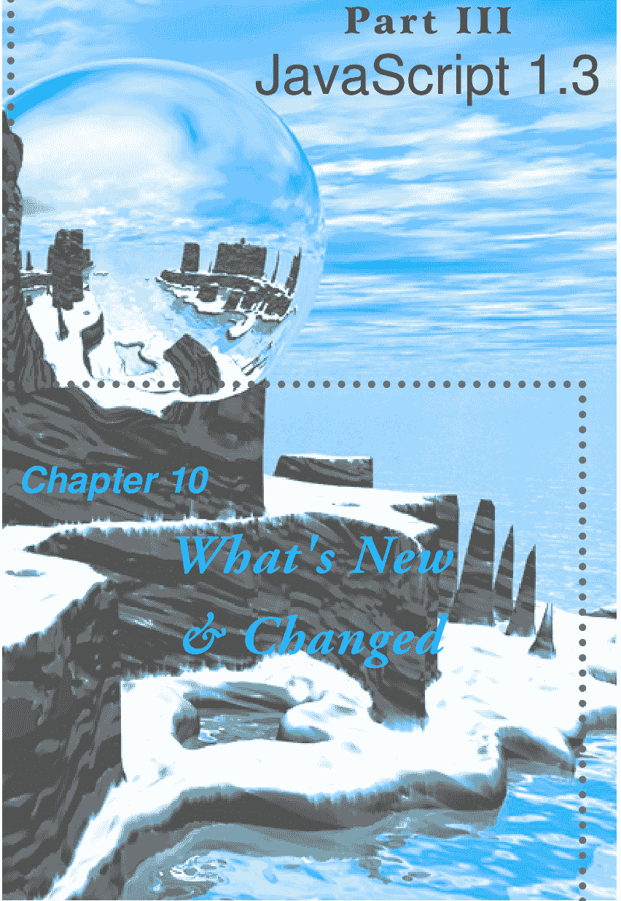

## 第 10 章
### 新特性与变更

## 第 10 章
### 新特性与变更

## 目录

**JavaScript 1.3 的新特性与 JavaScript 1.2 的变更** ………… **855**

- 10.1) 特性概述 ………… 855
- 10.2) JavaScript 1.3 与 ECMA-262 合规性 ………… 855
- 10.3) JavaScript 1.3 与 Unicode ………… 856
  - 10.3.1) Unicode 字符转义序列 ………… 857

**对象变更** ………… **858**

- 10.4) Array 对象的变更 ………… 858
- 10.5) Array 构造函数的变更 ………… 858
- 10.6) Array 对象 length 属性的变更 ………… 859
- 10.7) Array 对象的新 toSource() 方法 ………… 859
- 10.8) Array 对象 toString() 方法的变更 ………… 860
- 10.9) Array 对象 push() 方法的变更 ………… 861
- 10.10) Array 对象 splice() 方法的变更 ………… 861
- 10.11) Date 对象的变更 ………… 862
- 10.12) Date 构造函数的变更 ………… 862
- 10.13) Date 对象的新方法 ………… 863
- 10.14) Date 对象现有方法的变更 ………… 875
- 10.15) Function 对象的变更 ………… 880
- 10.16) Function 对象的 apply() 方法 ………… 880
- 10.17) Function 对象的 call() 方法 ………… 886
- 10.18) String 对象的变更 ………… 888

**新方法** ………… **892**

- 10.19) 多个对象的新 toSource() 方法 ………… 892

**新的顶层属性** ………… **894**

- 10.20) Infinity 属性 ………… 894
- 10.21) NaN 属性 ………… 894
- 10.22) undefined 属性 ………… 895

**新的顶层函数** ………… **895**

- 10.23) isFinite() 函数 ………… 895

**顶层函数的变更** ………… **896**

- 10.24) eval() 函数 ………… 896

**新运算符** ………… **896**

- 10.25) === 运算符 ………… 896
- 10.26) !== 运算符 ………… 897

**运算符变更** ………… **897**

- 10.27) == 运算符 ………… 897
- 10.28) != 运算符 ………… 897

**条件测试行为的变更** ………… **898**

- 10.29) 赋值行为 ………… 898
- 10.30) 对象的 null 和 undefined 值 ………… 898

**使用 JavaScript 控制台调试代码** ………… **898**

## 第 10 章 — 新特性与变更 855

# JavaScript 1.3 的新特性
与 JavaScript 1.2 的变更

## 特性概述

第 10 章探讨了 JavaScript 1.3 中的新特性集，以及相对于 JavaScript 1.2 所做的变更。与 JavaScript 1.2 版本中实现的庞大新特性和功能数组不同，1.3 版本是一个次要升级，它提供了一组相对少量的增强功能，但主要完善了现有的标准。

话虽如此，**Date** 对象现在可以使用大量的新方法，且之前的某些方法也增加了额外的参数。在接下来的所有语法中，请记住：

“JavaScript 1.3 语法”

是指包含在 SCRIPT 元素中且其 LANGUAGE 属性值为 **"JavaScript1.3"** 的 JavaScript，如下所示：

```html
<SCRIPT LANGUAGE="JavaScript1.3">
```

并且：

“JavaScript 1.2 语法”

是指包含在 SCRIPT 元素中且其 LANGUAGE 属性值为 **"JavaScript1.2"** 的 JavaScript，如下所示：

```html
<SCRIPT LANGUAGE="JavaScript1.2">
```

关于 SCRIPT 元素的 TYPE 和 LANGUAGE 属性的浏览器支持问题，请参阅第 196-197 页。

## JavaScript 1.3 与 ECMA-262 合规性

JavaScript 1.3 完全符合 ECMA-262 标准。欧洲计算机制造商协会制定了一个基于核心 JavaScript 的国际编程语言标准，该版本的 JavaScript 被称为 ECMAScript。有关 ECMA-262 的更多信息，请参阅 CD-ROM 中 Netscape 的《JavaScript 1.3 指南》第 1 章。

## JavaScript 1.3 与 Unicode

您现在可以使用 Unicode 字符集进行任何编码，且所有 Unicode 转义序列现在在字符串字面量中都能被正确识别和解释。然而，`escape()` 和 `unescape()` 顶层函数不支持 Unicode。需要注意的是，在 JavaScript 1.3 之前的任何 JavaScript 版本中都不支持 Unicode。

Unicode 字符集是一个通用字符编码标准，它唯一地代表了许多现代和古代语言的字母、符号以及数学和技术符号，包括北美洲、南美洲、欧洲、中东、非洲、印度、亚洲和太平洋地区的语言。尽管 Unicode 2.0 版本包含了 38,885 个识别字符，但它仍然不能覆盖所有过去和现在的语言。幸运的是，该编码方案中仍有大量空间可以进行补充。

Unicode 的目的是解决多语言计算问题。它最初基于美国信息交换标准代码 (ASCII) 字符集，两个方案的前 0-127 个字符是相同的。每个字符都被赋予一个唯一的四位十六进制数，前面带有字母 U，以及一个代表该字符的名称。例如：

| 代码   | 描述            | 名称                        | 字符 |
|--------|------------------------|-----------------------------|------|
| U+0041 | 名称为           | LATIN CAPITAL LETTER A      | A    |
| U+0042 | 名称为           | LATIN CAPITAL LETTER B      | B    |
| U+0061 | 名称为           | LATIN SMALL LETTER A        | a    |
| U+0062 | 名称为           | LATIN SMALL LETTER B        | b    |
| U+0026 | 名称为           | AMPERSAND                   | &    |
| U+003C | 名称为           | LESS-THAN SIGN              | <    |
| U+003E | 名称为           | GREATER-THAN SIGN           | >    |
| U+0030 | 名称为           | DIGIT ZERO                  | 0    |
| U+0031 | 名称为           | DIGIT ONE                   | 1    |

为了在字符串字面量中使用 Unicode 转义序列，您需要使用一组六个 ASCII 字符。您始终以 `\u` 开始，后面跟着代表您要转义的 Unicode 字符的四位十六进制数。例如，要转义和符号 (&)，您将使用：`\u0026`。这样，赋值给 `myString` 的以下代码将返回："Crimson & Clover"。

```javascript
myString = "Crimson \u0026 Clover";
```

有关 Unicode 的更多信息以及查看所有 Unicode 字符图表的最新版本，请访问 Unicode 联盟网站：

http://www.unicode.org


# Unicode 字符转义序列

以下是 38000 多个 Unicode 转义序列中较为常用的一些，及其 ASCII 和 HTML 实体等价表示。请注意，此列表中仅由两个字符组成的 ASCII 转义序列同时也是 JavaScript 特殊字符。

| Unicode 转义 | HTML 实体 | ASCII 转义值 | 名称 | 格式名称 |
| :--- | :--- | :--- | :--- | :--- |
| \u0009 | | \ | 制表符 | <TAB> |
| \u000B | | | 垂直制表符 | <VT> |
| \u000C | | \f | 换页符 | <FF> |
| \u0020 | | | 空格 | <SP> |
| \u00A0 | &nbsp; | | 不间断空格 | |
| \u000A | | \n | 换行符 | <LF> |
| \u000D | | \r | 回车符 | <CR> |
| \u000B | | \b | 退格符 | <BS> |
| \u0022 | | \" | 双引号 | " |
| \u0027 | | \' | 单引号 | ' |
| \u000C | | \\ | 反斜杠 | \ |
| \u0023 | | \x23 | 井号 | # |
| \u0024 | | \x24 | 美元符号 | $ |
| \u0025 | | \x25 | 百分号 | % |
| \u0026 | &amp; | \x26 | 与号 | & |
| \u0028 | | \x28 | 左括号 | ( |
| \u0029 | | \x29 | 右括号 | ) |
| \u002A | | \x2A | 星号 | * |
| \u002B | | \x2B | 加号 | + |
| \u002C | | | 逗号 | , |
| \u002D | | \x2D | 连字符-减号 | - |
| \u002F | | | 正斜杠 | / |
| \u003A | | \x3A | 冒号 | : |
| \u003B | | | 分号 | ; |
| \u003C | | \x3C | 小于号 | < |
| \u003D | &lt; | \x3D | 等号 | = |
| \u003E | &gt; | \x3E | 大于号 | > |
| \u003F | | \x3F | 问号 | ? |
| \u0040 | | \x40 | 商用 at 符号 | @ |
| \u005B | | \x5B | 左方括号 | [ |
| \u005D | | \x5D | 右方括号 | ] |
| \u007B | | \x7B | 左花括号 | { |
| \u007C | | \x7C | 竖线 | | |
| \u007D | | | 右花括号 | } |
| \u00B0 | | \x{B0} | 度符号 | ° |
| \u00AE | &reg; | \x{AE} | 注册商标符号 | ® |
| \u00A9 | &copy; | \x{A9} | 版权符号 | © |

### 对象的变更

### Array 对象的变更

**Array** 对象的变化不多，主要包括对 **Array** 对象方法的修改。以下方法的功能有细微变化：**push()**、**splice()** 和 **toString()**。**length** 属性也有所改变。新增了一个方法，称为 **toSource()** 方法。另外唯一的变化是 Array 构造器。这些变化将在下文逐一讨论。

需要记住的是，在以下语法中，包围元素列表的方括号（[ ]）是使用字面量表示法创建数组的代码的一部分，并非表示可选参数。需要注意的是，尽管 JavaScript 1.2 和 1.3 版本中 Array 构造器的语法相同，但实际行为有所不同。

### Array 构造器的变更

#### JavaScript 1.3 语法：

```
arrayObjectName = new Array(arrayLength);
arrayObjectName = new Array(element0, element1, ..., elementN);
arrayObjectName = [element0, element1, ..., elementN];
```

#### JavaScript 1.2 语法：

```
arrayObjectName = new Array(arrayLength);
arrayObjectName = new Array(element0, element1, ..., elementN);
arrayObjectName = [element0, element1, ..., elementN];
```

在 JavaScript 1.3 版本中，使用 Array 构造器创建新数组并为一个数值参数指定 **arrayLength** 参数值时，你声明的是数组的初始 **length**。例如，**arrayLength**=22 的数组初始 **length** 为 22，*不是*初始 **length** 为 1。该数组初始时没有元素，也绝对*不会*有第一个 **element0** 为 22 的情况：

```
myArray = new Array(22);
```

相反，在 JavaScript 1.3 版本中，当为 **arrayLength** 参数指定单个参数值且该值<u>不是数字</u>时，**length** 为 1，**element0** 即为该指定参数，在以下示例中就是 "butterfly"，如下所示：

```
myArray = new Array("butterfly");
```

在 JavaScript 1.2 版本中，如果为一个数值参数（或其他任何值）指定 **arrayLength** 参数值，则声明的是一个 **length** 为 1 的数组，该参数即为 **element0** 的值。因此如下数组：

```
myArray = new Array(15);
```

的初始 **length** 为 1，**element0** 为数字 15，且它是数组中唯一的元素。

### Array 对象 <u>length</u> 属性的变更

**length** 属性的语法没有变化。

在 JavaScript 1.3 版本中，**length** 属性是一个无符号 32 位整数，为正数，且必须小于 2<sup>32</sup>（即 2 的 32 次方），这意味着数组最多可以有 4,294,967,295 个元素。

在 JavaScript 1.2 版本中，**length** 属性没有上限。换句话说，你可以拥有任意多个数组元素。

### Array 对象的新增 <u>toSource()</u> 方法

#### JavaScript 1.3 语法：

```
arrayObjectName.toSource();
```

### Array 对象 toString() 方法的变更

#### JavaScript 1.3 语法：

```
arrayObjectName.toString();
```

#### JavaScript 1.2 语法：

```
arrayObjectName.toString();
```

在 JavaScript 1.3 版本中，toString() 方法会进行连接操作；即，它将数组的所有元素连接起来，返回一个由每个元素以逗号分隔组成的字符串。在 JavaScript 1.2 版本中，toString() 方法返回包含数组源代码的字符串。在 JavaScript 1.3 中，返回数组源代码的功能由 toSource() 方法提供。

在以下示例中，名为 myArray 的数组有四个元素，当对其调用 toString() 方法时，结果字符串被赋值给 myString：

```
myArray = new Array("one", "two", "three", "four");
myString = myArray.toString();
```

以下字符串被赋值给 myString：

```
"one,two,three,four"
```

### Array 对象 push() 方法的变更

#### JavaScript 1.3 语法：

```
arrayObjectName.push(element1, element2, ..., elementN);
```

#### JavaScript 1.2 语法：

```
arrayObjectName.push(element1, element2, ..., elementN);
```

在 JavaScript 1.3 中，**push()** 方法在将指定数量的逗号分隔元素添加到数组后，返回数组的新 **length**。此方法会改变数组的 **length**。

在 JavaScript 1.2 中，**push()** 方法返回从指定的逗号分隔元素列表中添加到数组的最后一个元素。

### Array 对象 splice() 方法的变更

#### JavaScript 1.3 语法：

```
arrayObjectName.splice(startIndex, removeQty, addElt1, ..., addEltN)
```

#### JavaScript 1.2 语法：

```
arrayObjectName.splice(startIndex, removeQty, addElt1, ..., addEltN)
```

在 JavaScript 1.3 中，**splice()** 方法返回一个由所有已从数组中移除的元素组成的数组，包括仅移除一个元素的情况。要移除的元素数量由 **removeQty** 参数指定，从 **startIndex** 参数指定的序号 **index** 开始。

在 JavaScript 1.2 中，如果 **splice()** 方法仅移除了一个元素，则不会返回数组，而是返回被移除的元素。

## Date 对象的变更

**Date** 对象现在在所有平台上表现出统一的行为。

UTC 即协调世界时，根据自 GMT 位置 1970 年 1 月 1 日 00:00:00 以来经过的毫秒数来指定时间。

**Date** 对象现在具有更大的日期范围。范围从：

1970 年 1 月 01 日 UTC 之前的 -100,000,000 天

到：

1970 年 1 月 01 日 UTC 之后的 +100,000,000 天

需要注意的是，在 JavaScript 1.2 及更早版本中，无法使用 1970 年 1 月 01 日之前的日期。

### Date 构造器的变更

#### JavaScript 1.3 语法：

```
new Date()
new Date("month day, year hours:minutes:seconds")    //字符串值
new Date(milliseconds)                                //整数值
new Date(year, month, day)                            //整数值
new Date(year, month, day[, hours, minutes, seconds, milliseconds]) //整数值
```

#### JavaScript 1.2 语法：

```
new Date()
new Date("month day, year hours:minutes:seconds")    //字符串值
new Date(year, month, day)                            //整数值
new Date(year, month, day[, hours, minutes, seconds]) //整数值
```

在 JavaScript 1.3 中，**Date** 构造器在创建 **Date** 对象时增加了一个可选的 **milliseconds** 参数。

编码提示：一天包含 86,400,000 毫秒。应在日期中始终使用四位数字表示年份，以确保不会出现 Y2K 问题。


## Date 对象的新方法

在 JavaScript 1.3 中，`Date 对象`新增了以下方法：

| Date 方法 | 方法描述/结果 |
| :--- | :--- |
| `getFullYear()` | 返回指定 `Date 对象`的年份。替代已弃用的 `getYear()` 方法。 |
| `getMilliseconds()` | 返回指定 `Date 对象`的毫秒数。 |
| `setFullYear()` | 设置指定 `Date 对象`的年份。替代已弃用的 `setYear()` 方法。 |
| `setMilliseconds()` | 设置指定 `Date 对象`的毫秒数。 |
| `getUTCFullYear()` | 返回指定 `Date 对象`的 UTC 年份。 |
| `getUTCMonth()` | 返回指定 `Date 对象`的 UTC 月份。 |
| `getUTCDate()` | 返回指定 `Date 对象`的 UTC 日期。 |
| `getUTCDay()` | 返回指定 `Date 对象`的 UTC 星期几。 |
| `getUTCHours()` | 返回指定 `Date 对象`的 UTC 小时数。 |
| `getUTCMinutes()` | 返回指定 `Date 对象`的 UTC 分钟数。 |
| `getUTCSeconds()` | 返回指定 `Date 对象`的 UTC 秒数。 |
| `getUTCMilliseconds()` | 返回指定 `Date 对象`的 UTC 毫秒数。 |
| `setUTCFullYear()` | 设置指定 `Date 对象`的 UTC 年份。 |
| `setUTCMonth()` | 设置指定 `Date 对象`的 UTC 月份。 |
| `setUTCDate()` | 设置指定 `Date 对象`的 UTC 日期。 |
| `setUTCHours()` | 设置指定 `Date 对象`的 UTC 小时数。 |
| `setUTCMinutes()` | 设置指定 `Date 对象`的 UTC 分钟数。 |
| `setUTCSeconds()` | 设置指定 `Date 对象`的 UTC 秒数。 |
| `setUTCMilliseconds()` | 设置指定 `Date 对象`的 UTC 毫秒数。 |
| `toUTCString()` | 将指定的 `Date 对象`转换为 UTC 格式的字符串。替代已弃用的 `toGMTString()` 方法。 |

接下来将详细介绍 `Date 对象`的每个新方法。

## getFullYear() 方法

### JavaScript 1.3 语法：

```
dateObjName.getFullYear();
```

**getFullYear()** 方法根据本地时间返回指定 **Date** 对象的年份。它总是返回实际的完整年份，而不是像已弃用的 **getYear()** 方法那样返回截断的两位数版本。**getFullYear()** 方法替代了该方法。对于 1000 年到 9999 年之间的日期，**getFullYear()** 方法总是返回一个四位数。你应该始终使用此方法，以确保你的代码能正确处理 2000 年及以后的日期。

### 迷你示例：

这是一个简单的示例，如果在本书首次出版的年份运行，它将返回数字 1999：

```
var myYear;
myDate = new Date();
myYear = myDate.getFullYear()
```

**getMilliseconds() 方法**

### JavaScript 1.3 语法：

```
dateObjName.getMilliseconds();
```

**getMilliseconds()** 方法根据本地时间返回指定 **Date** 对象的毫秒数。此方法可能返回的值是 0 到 999 之间（含）的整数。

### 迷你示例：

Date 构造函数创建了新的 **Date**：Thu Jun 17 23:59:35 GMT-0400，并将其赋值给 **myDate**。然后在 **myDate** 上调用 **getMilliseconds()** 方法后，**myMilliseconds** 被赋值为 934：

```
var myMilliseconds;
myDate = new Date();
myMilliseconds = myDate.getMilliseconds()
```

## 第十章 — 变更内容

本版本 JavaScript 中，**Date** 对象发生了以下变更。

## setFullYear() 方法

### JavaScript 1.3 语法：

```
dateObjName.setFullYear(yearInteger, monthInteger, dayInteger);
```

### 参数定义：

**setFullYear()** 方法根据本地时间，通过必需的 **yearInteger** 参数设置 **dateObjName** 指定的 **Date** 对象的完整年份。如果未指定可选的 **monthInteger** 值，则内部由 **getMonth()** 方法提供。如果未指定可选的 **dayInteger** 值，则内部由 **getDay()** 方法提供。

**yearInteger** 参数是一个代表完整年份的整数，因此 1000 年到 9999 年之间的日期必须用四位数指定。

**monthInteger** 参数是一个 0 到 11 之间（含）的整数，其中 0 代表一月，1 代表二月，依此类推。

**dayInteger** 参数是一个 1 到 31 之间（含）的整数，代表月份中的日期。如果你确实指定了 **dayInteger** 参数，那么 **monthInteger** 参数就是必需的。

如果你为 **monthInteger** 或 **dayInteger** 参数中的一个或两个提供的值超出了预期的值范围，你不会收到错误，但 **setFullYear()** 方法会尝试相应地更新指定的 **Date** 对象。例如，如果你指定 **dayInteger** 值为 34，那么 **monthInteger** 将增加 1，而 **dayInteger** 的值将为 3。

### 迷你示例：

在下面的示例中，使用 **setFullYear()** 方法将名为 **myDate** 的 **Date** 对象设置为 2012 年 8 月 15 日。

```
myDate = new Date();
myDate.setFullYear(2012, 7, 15);
```

## setMilliseconds() 方法

### JavaScript 1.3 语法：

```
dateObjName.setMilliseconds(millisecondsInteger);
```

## 第三部分 — JavaScript 1.3

### 参数定义：

**setMilliseconds()** 方法用于根据本地时间，通过必需的 **millisecondsInteger** 参数设置 **dateObjName** 指定的 **Date** 对象的毫秒数。值的范围是 0 到 999 之间（含）的整数。如果你为 **millisecondsInteger** 参数提供的值超出了预期的值范围，指定的 **Date** 对象将被更新以反映该情况。例如，如果你指定 **millisecondsInteger** 值为 1022，那么秒数参数将增加 1，而 **millisecondsInteger** 的值将为 22。

### 迷你示例：

这里使用 **setMilliseconds()** 方法将名为 **myDate** 的 **Date** 对象的毫秒数参数设置为 555：

```
myDate = new Date();
myDate.setMilliseconds(555);
```

## getUTCFullYear() 方法

### JavaScript 1.3 语法：

```
dateObjName.getUTCFullYear();
```

### 参数定义：

**getUTCFullYear()** 方法根据通用时间返回指定 **Date** 对象的年份。它总是返回一个代表完整年份的绝对数字，该数字符合 Y2K 规范。对于 1000 年到 9999 年之间的日期，**getUTCFullYear()** 方法总是返回一个四位数。你应该始终使用此方法而不是已弃用的 **getYear()** 方法，以确保你的代码能正确处理 2000 年及以后的日期。

### 迷你示例：

这是一个简单的示例，根据通用时间将名为 **myDate** 的 **Date** 对象的完整年份数字赋值给名为 **myYear** 的变量：

```
var myYear;
myDate = new Date();
myYear = myDate.getUTCFullYear()
```

## getUTCMonth() 方法

### JavaScript 1.3 语法：

```
dateObjName.getUTCMonth();
```

### 参数定义：

**getUTCMonth()** 方法根据通用时间返回指定 `Date` 对象的月份参数。此方法可能返回的值是 0 到 11 之间（含）的整数，其中：

- 0 代表一月，
- 1 代表二月，依此类推，
- 11 代表十二月。

### 迷你示例：

这是一个简单的示例，根据通用时间将名为 `myDate` 的 `Date` 对象的月份参数赋值给名为 `myMonth` 的变量：

```
myDate = new Date();
var myMonth = myDate.getUTCMonth();
```

## getUTCDate() 方法

### JavaScript 1.3 语法：

```
dateObjName.getUTCDate();
```

### 参数定义：

**getUTCDate()** 方法返回一个 1-31 之间（含）的整数，该整数根据通用时间代表指定 `Date` 对象的月份中的日期。请注意，**getUTCDay()** 方法返回的是星期几。

### 迷你示例：

```
myDate = new Date();
var myDayOfTheMonth = myDate.getUTCDate();
```


## `getUTCDay()` 方法

### JavaScript 1.3 语法：

```javascript
dateObjName.getUTCDay( );
```

### 参数定义：

`getUTCDay()` 方法返回一个 0-6 之间（含）的整数，代表指定 `Date` 对象根据通用时间（UTC）所在的星期几。在此方案中，0 代表星期日，1 代表星期一，2 代表星期二，3 代表星期三，4 代表星期四，5 代表星期五，6 代表星期六。

请注意，`getUTCDate()` 方法返回的是一个月中的日期。

### 微示例：

在以下示例中，如果 `myDate` 的星期几是星期五，那么分配给变量 `myDayOfTheWeek` 的值将是 5。

```javascript
var myDayOfTheWeek;
myDate = new Date();
myDayOfTheWeek = myDate.getUTCDay();
```

## `getUTCHours()` 方法

### JavaScript 1.3 语法：

```javascript
dateObjName.getUTCHours();
```

### 参数定义：

`getUTCHours()` 方法返回一个 0-23 之间（含）的整数，代表指定 `Date` 对象根据通用时间的小时数。在此方案中，0 代表午夜间 12:00，1 代表凌晨 1:00，2 代表凌晨 2:00，12 代表正午 12:00，依此类推，23 代表晚上 11:00，这与军事时间一致。

## `getUTCMinutes()` 方法

### JavaScript 1.3 语法：

```javascript
dateObjName.getUTCMinutes();
```

### 参数定义：

`getUTCMinutes()` 方法返回一个 0-59 之间（含）的整数，代表指定 `Date` 对象根据通用时间的分钟数。

## `getUTCSeconds()` 方法

### JavaScript 1.3 语法：

```javascript
dateObjName.getUTCSeconds();
```

### 参数定义：

`getUTCSeconds()` 方法返回一个 0-59 之间（含）的整数，代表指定 `Date` 对象根据通用时间的秒数。

## `getUTCMilliseconds()` 方法

### JavaScript 1.3 语法：

```javascript
dateObjName.getUTCMilliseconds();
```

### 参数定义：

`getUTCMilliseconds()` 方法返回一个 0-999 之间（含）的整数，代表指定 `Date` 对象根据通用时间的毫秒数。

## `setUTCFullYear()` 方法

### JavaScript 1.3 语法：

```javascript
dateObjName.setUTCFullYear(yrInteger[, monthInteger, dayInteger]);
```

### 参数定义：

`setUTCFullYear()` 方法根据通用时间，使用必需的 `yrInteger` 参数为指定的 `Date` 对象 `dateObjName` 设置年份。如果未指定可选的 `monthInteger` 或 `dayInteger` 值，则分别由 `getMonth()` 和 `getDay()` 方法提供。

`yrInteger` 参数是一个代表年份的整数，1000 年至 9999 年的日期必须指定为四位数字。请记住，日期范围是从 UTC 1970 年 1 月 1 日午夜起 $\pm 100,000,000,000$ 天。

`monthInteger` 参数是一个 0 到 11 之间（含）的整数，其中 0 代表一月，1 代表二月，依此类推。

`dayInteger` 参数是一个 1 到 31 之间（含）的整数，代表一个月中的日期。如果您指定了 `dayInteger` 参数，则必须提供 `monthInteger` 参数。

如果您为 `monthInteger` 或 `dayInteger` 参数（或两者）提供的值超出了预期范围，您不会收到错误，但 `setUTCFullYear()` 方法将尝试相应地更新指定的 `Date` 对象。

例如，如果您指定的 `dayInteger` 值为 34，那么 `monthInteger` 将增加 1，且 `Date` 对象的 `dayInteger` 值将变为 3。

### 微示例：

在以下示例中，`setUTCFullYear()` 方法用于将名为 `myDate` 的 `Date` 对象设置为通用时间的 1999 年 12 月 31 日。

```javascript
myDate = new Date();
myDate.setUTCFullYear(1999, 11, 31);
```

## `setUTCMonth()` 方法

### JavaScript 1.3 语法：

```javascript
dateObjName.setUTCMonth(monthInteger[, dayInteger]);
```

### 参数定义：

`setUTCMonth()` 方法根据通用时间，使用必需的 `monthInteger` 参数为指定的 `Date` 对象 `dateObjName` 设置月份。

- 如果未指定可选的 `dayInteger` 值，则由 `getUTCDate()` 方法在内部提供。
- `monthInteger` 参数是一个 0 到 11 之间（含）的整数，其中 0 代表一月，1 代表二月，依此类推。
- `dayInteger` 参数是一个 1 到 31 之间（含）的整数，代表一个月中的日期。
- 如果您为 `monthInteger` 或 `dayInteger` 参数（或两者）提供的值超出了预期范围，您不会收到错误，但 `setUTCMonth()` 方法将尝试相应地更新指定的 `Date` 对象。

### 微示例：

例如，如果您指定的 `monthInteger` 值为 20，那么年份参数将增加 1，且月份参数的值将变为 8。

```javascript
myDate = new Date();
myDate.setUTCMonth(2);
```

## `setUTCDate()` 方法

### JavaScript 1.3 语法：

```javascript
dateObjName.setUTCDate(dayOfMonthInteger);
```

### 参数定义：

`setUTCDate()` 方法根据通用时间，通过必需的 `dayOfMonthInteger` 参数为指定的 `Date` 对象 `dateObjName` 设置一个月中的日期。

- `dayOfMonthInteger` 参数是一个 1 到 31 之间（含）的整数，代表一个月中的日期，*而不是*星期几。
- 如果您为 `dayOfMonthInteger` 参数提供的值超出了预期范围，您不会收到错误，但 `setUTCDate()` 方法将尝试相应地更新指定的 `Date` 对象。

### 微示例：

例如，如果您指定的 `dayOfMonthInteger` 值为 42，那么月份参数将增加 1，且 `dateObjName` 的日期参数值将变为 11。

```javascript
myDate = new Date();
myDate.setUTCDate(25);
```

## `setUTCHours()` 方法

### JavaScript 1.3 语法：

```javascript
dateObjName.setUTCHours(hoursInteger[, minsInt, secsInt, msInt]);
```

### 参数定义：

`setUTCHours()` 方法根据通用时间，使用必需的 `hoursInteger` 参数为指定的 `Date` 对象 `dateObjName` 设置小时。如果未指定可选的 `minsInt` 值，则由 `getUTCMinutes()` 方法在内部提供。如果未指定可选的 `secsInt` 值，则由 `getUTCSeconds()` 方法在内部提供。如果未指定可选的 `msInt` 值，则由 `getUTCMilliseconds()` 方法在内部提供。

- 必需的 `hoursInteger` 参数是一个 0 到 23 之间（含）的整数，用于指定该 `Date` 对象的小时。
- 可选的 `minsInt` 参数是一个 0 到 59 之间（含）的整数，用于指定该 `Date` 对象的分钟数。
- 可选的 `secsInt` 参数是一个 0 到 59 之间（含）的整数，用于指定该 `Date` 对象的秒数。如果您指定了 `secsInt` 参数，则必须提供 `minsInt` 参数。
- 可选的 `msInt` 参数是一个 0 到 999 之间（含）的整数，用于指定该 `Date` 对象的毫秒数。如果指定了 `msInt` 参数，则必须提供 `secsInt` 参数。

如果您为任何参数提供的值超出了预期范围，您不会收到错误，但 `setUTCHours()` 方法将尝试相应地更新指定的 `Date` 对象。

### 微示例：

```javascript
myDate = new Date();
myDate.setUTCHours(2, 15, 30, 500);
```

## `setUTCMinutes()` 方法

### JavaScript 1.3 语法：

```javascript
dateObjName.setUTCMinutes(minutesInteger[, secsInt, msInt]);
```

### 参数定义：

`setUTCMinutes()` 方法根据通用时间，通过必需的 `minutesInteger` 参数为指定的 `Date` 对象 `dateObjName` 设置分钟。如果未指定可选的 `secsInt` 值，则由 `getUTCSeconds()` 方法在内部提供。如果未指定可选的 `msInt` 值，则由 `getUTCMilliseconds()` 方法在内部提供。

- `minutesInteger` 参数是一个 0 到 59 之间（含）的整数。
- 可选的 `secsInt` 参数是一个 0 到 59 之间（含）的整数，用于指定该 `Date` 对象的秒数。
- 可选的 `msInt` 参数是一个 0 到 999 之间（含）的整数，用于指定该 `Date` 对象的毫秒数。如果您指定了 `msInt` 参数，则必须提供 `secsInt` 参数。

如果您为任何参数提供的值超出了预期范围，您不会收到错误，但 `setUTCMinutes()` 方法将尝试相应地更新指定的 `Date` 对象。

### 微示例：

```javascript
myDate = new Date();
myDate.setUTCMinutes(8, 14, 200);
```

## `setUTCSeconds()` 方法

### JavaScript 1.3 语法：

```javascript
dateObjName.setUTCSeconds(secondsInteger[, millisecondsInteger]);
```

### 参数定义：

`setUTCSeconds()` 方法根据通用时间，通过必需的 `secondsInteger` 参数为指定的 `Date` 对象 `dateObjName` 设置秒数。如果未指定可选的 `millisecondsInteger` 值，则由 `getUTCMilliseconds()` 方法在内部提供。

- `secondsInteger` 参数是一个 0 到 59 之间（含）的整数。
- 可选的 `millisecondsInteger` 参数是一个 0 到 999 之间（含）的整数，用于指定该 `Date` 对象的毫秒数。

如果您为任何参数提供的值超出了预期范围，您不会收到错误，但 `setUTCSeconds()` 方法将尝试相应地更新指定的 `Date` 对象。


# setUTCMilliseconds() 方法

## JavaScript 1.3 语法：

```
dateObjName.setUTCMilliseconds(millisecondsInteger);
```

## 参数定义：

**setUTCMilliseconds()** 方法根据协调世界时（universal time），通过必需的 **millisecondsInteger** 参数，为指定的 **dateObjName** 的 **Date** 对象设置毫秒数。

如果您为 **millisecondsInteger** 参数提供的值超出了预期的数值范围，您不会收到错误，但 **setUTCMilliseconds()** 方法将尝试相应地更新指定的 **Date** 对象。例如，如果您将 **millisecondsInteger** 参数值设置为 1500，那么秒参数将增加 1，而毫秒参数将变为 500。

# toUTCString() 方法

## JavaScript 1.3 语法：

```
dateObjName.toUTCString();
```

## 参数定义：

**toUTCString()** 方法根据协调世界时将指定的 **Date** 对象转换为字符串。该字符串的实际格式可能因平台而异。

在 Macintosh 平台上，其格式结构为：

Mon, 22 Feb 1999 13:03:11 GMT

这是由以下代码产生的结果：

```
var myUTCDateString;
myDate = new Date();
myUTCDateString = myDate.toUTCString();
document.write(myUTCDateString);
```

# 第 10 章 — 新特性与变更

## 875

### Date 对象现有方法的变更

针对先前可用于 **Date** 对象的方法进行了以下更改。在下面简要列出后，将立即详细讨论每个方法，并提供 1.3 版本和 1.2 版本的语法。

- **setMonth()** 方法中增加了 **day** 参数。
- **setHours()** 方法中增加了 **minutes**、**seconds** 和 **milliseconds** 参数。
- **setMinutes()** 方法中增加了 **seconds** 和 **milliseconds** 参数。
- **setSeconds()** 方法中增加了 **milliseconds** 参数。
- **UTC()** 方法中增加了 **milliseconds** 参数。
- **getYear()**、**setYear()** 和 **toGMTString()** 方法已被弃用，分别由 **getFullYear()**、**setFullYear()** 和 **toUTCString()** 方法替代。

有关 **getYear()**、**setYear()** 和 **toGMTString()** 的向后兼容性信息，请参阅 CD-ROM 中 JavaScript 1.3 参考指南第 1 章中的 **Date** 对象。

有关 **getFullYear()** 的更多信息，请参阅第 864 页。

有关 **setFullYear()** 的更多信息，请参阅第 865 页。

有关 **toUTCString()** 的更多信息，请参阅第 874 页。

### setMonth() 方法变更

#### JavaScript 1.3 语法：

```
dateObjName.setMonth(monthInteger[, dayInteger]);
```

#### JavaScript 1.2 语法：

```
dateObjName.setMonth(monthInteger);
```

# 第三部分 — JavaScript 1.3

## 参数定义：

**setMonth()** 方法根据本地时间，将指定的 **Date** 对象设置为提供的 **monthInteger** 参数值以及可选的 **dayInteger** 参数值。

必需的 **monthInteger** 值是一个 0 到 11 之间的整数，代表 1 月到 12 月，其中 1 月用 0 表示，2 月用 1 表示，依此类推。可选的 **dayInteger** 值是一个 1 到 31 之间的整数，代表一个月中的日期。如果您没有指定 **dayInteger** 值，则将使用 **getMonth()** 方法返回的值。

如果您为 **monthInteger** 或 **dayInteger** 其中一个或两个参数提供的值超出了预期的数值范围，您不会收到错误，但 **setMonth()** 方法将尝试相应地更新指定的 **Date** 对象。

例如，如果您指定的 **monthInteger** 值为 29，那么年份参数将增加 2，且月份参数的值将为 5。其实现方式是从 **monthInteger** 值中减去 12 的倍数（假设提供的值大于或等于 12），将这些 12 的倍数加到年份上，并使用余数作为月份参数。

### setHours() 方法变更

#### JavaScript 1.3 语法：

```
dateObjName.setHours(hoursInteger[, minsInt, secInt, msInt]);
```

#### JavaScript 1.2 语法：

```
dateObjName.setHours(hoursInteger);
```

## 参数定义：

在 JavaScript 1.3 中，**setHours()** 方法增加了可选的 **minutes**、**seconds** 和 **milliseconds** 参数。

**setHours()** 方法根据本地时间，通过必需的 **hoursInteger** 参数为指定的 **dateObjName** 的 **Date** 对象设置小时。如果未指定可选的 **minsInt**、**secInt** 或 **msInt** 值，则分别由 **getMinutes()**、**getSeconds()** 和 **getMilliseconds()** 方法在内部提供。

**hoursInteger** 参数是一个在 0 到 11（含）范围内的整数，用于指定该 **Date** 对象的小时。

可选的 **minsInt** 参数是一个在 0 到 59（含）范围内的整数，用于指定该 **Date** 对象的分钟数。

可选的 **secsInt** 参数是一个在 0 到 59（含）范围内的整数，用于指定该 **Date** 对象的秒数。如果您指定了 **secsInt** 参数，则必须提供 **minsInt** 参数。

可选的 **msInt** 参数是一个在 0 到 999（含）范围内的整数，用于指定该 **Date** 对象的毫秒数。如果指定了 **msInt** 参数，则必须提供 **secsInt** 参数。

如果您为任何参数提供的值超出了预期的数值范围，您不会收到错误，但 **setHours()** 方法将尝试相应地更新指定的 **Date** 对象。

### setMinutes() 方法变更

#### JavaScript 1.3 语法：

```
dateObjName.setMinutes(minutesInteger[, secsInt, msInteger]);
```

#### JavaScript 1.2 语法：

```
dateObjName.setMinutes(minutesInteger);
```

## 参数定义：

**setMinutes()** 方法中增加了 **seconds** 和 **milliseconds** 参数。

**setMinutes()** 方法根据本地时间，通过必需的 **minutesInteger** 参数为指定的 **dateObjName** 的 **Date** 对象设置分钟。如果未指定可选的 **secsInt** 或 **msInt** 值，则分别由 **getSeconds()** 和 **getMilliseconds()** 方法在内部提供。

**minutesInteger** 参数是一个在 0 到 59（含）范围内的整数，用于指定该 **Date** 对象的分钟。

可选的 **secsInt** 参数是一个在 0 到 59（含）范围内的整数，用于指定该 **Date** 对象的秒数。如果您指定了 **secsInt** 参数，则必须提供 **minsInt** 参数。

可选的 **msInt** 参数是一个在 0 到 999（含）范围内的整数，用于指定该 **Date** 对象的毫秒数。如果指定了 **msInt** 参数，则必须提供 **secsInt** 参数。

如果您为任何参数提供的值超出了预期的数值范围，您不会收到错误，但 **setMinutes()** 方法将尝试相应地更新指定的 **Date** 对象。

### setSeconds() 方法变更

#### JavaScript 1.3 语法：

```
dateObjName.setSeconds(secondsInteger[, msInteger]);
```

#### JavaScript 1.2 语法：

```
dateObjName.setSeconds(secondsInteger);
```

## 参数定义：

**setSeconds()** 方法中增加了 **milliseconds** 参数。

**setSeconds()** 方法根据本地时间，通过必需的 **secondsInteger** 参数为指定的 **dateObjName** 的 **Date** 对象设置秒数。如果未指定可选的 **msInt** 值，则由 **getMilliseconds()** 方法在内部提供。

**secondsInteger** 参数是一个在 0 到 59（含）范围内的整数，用于指定该 **Date** 对象的秒数。

可选的 **msInt** 参数是一个在 0 到 999（含）范围内的整数，用于指定该 **Date** 对象的毫秒数。

如果您为任何参数提供的值超出了预期的数值范围，您不会收到错误，但 **setSeconds()** 方法将尝试相应地更新指定的 **Date** 对象。

### UTC() 方法变更

#### JavaScript 1.3 语法：

```
Date.UTC(year, month, day[, hours, mins, secs, milliseconds]);
```

#### JavaScript 1.2 语法：

```
Date.UTC(year, month, day[, hours, mins, secs]);
```


## 参数定义：

在 JavaScript 1.3 中，`milliseconds` 参数已被添加到 `UTC()` 方法中。

`UTC()` 方法根据所有提供的参数，返回一个 `Date` 对象中自 1970 年 1 月 1 日午夜 12:00（1970 年 1 月 1 日 00:00:00）以来经过的毫秒数。该整数以通用时间（universal time）返回。在七个可能的参数中，有三个是必需的，另外四个是可选的。所有这些参数必须为整数。

必需参数为 `year`、`month` 和 `day`。

可选参数为 `hours`、`mins`、`secs` 和 `milliseconds`。

您提供的日期参数必须是一个以逗号分隔的列表。

在指定 `year` 参数时，您应始终使用完整的年份，且年份应在 1899 年之后。如果您指定的年份在 0 到 99 之间，`UTC()` 方法将通过在您的年份上加上 1900，将其转换为 1900 年代的年份。

- **month** 是一个从 0 到 11（含）的整数，用于指定月份。
- **day** 是一个从 0 到 31（含）的整数，用于指定该月的日期。
- **hours** 是一个从 0 到 23（含）的整数，用于指定小时数。
- **mins** 是一个从 0 到 59（含）的整数，用于指定分钟数。
- **secs** 是一个从 0 到 59（含）的整数，用于指定秒数。
- **milliseconds** 是一个从 0 到 999（含）的整数，用于指定毫秒数。

如果您为任何参数提供的值超出预期范围，`UTC()` 方法将更新您提供的整个参数列表。

`UTC()` 方法是一个静态方法，且始终由 (`Date.`) 前缀引导，而不是将其用作像这样创建的命名 `Date` 对象：

```
Date.UTC()
```

## 微型示例：

这是一个快速示例，其中 `Date.UTC()` 返回 1329301364555 毫秒：

```
myTimeQtyInMS = Date.UTC(2012, 1, 15, 10, 22, 44, 555);
```

## 函数对象的更改

在 JavaScript 1.3 中，函数对象有两个新可用的方法：`apply()` 方法和 `call()` 方法。函数的正式参数和局部变量 _不是_ `arguments[i]` 数组的属性；也就是说，之前这种能力已不再受支持。`arguments.caller` 属性已被弃用。

## 函数对象的 apply() 方法

### JavaScript 1.3 语法：

```
callingObject.apply(methodName[, argumentsArray[i]]);
```

### 参数定义：

| 参数 | 描述 |
| :--- | :--- |
| `callingObject` | 调用 `apply()` 方法的对象（通常是一个函数或方法）。 |
| `methodName` | 您可以使用关键字 `this` 来引用当前作为调用对象的 `callingObject`，或者可以通过指定名称来引用之前定义的函数/方法。 |
| `argumentsArray[i]` | 为 `callingObject` 提供参数的参数数组。它可以采用三种格式之一：数组对象、数组字面量或 `arguments` 属性。所有函数对象的 `arguments` 属性都是一个局部变量，允许您在 `apply()` 方法中传递 `methodName`（即 `callingObject`）之前指定的所有参数，而无需单独列出它们。请参阅第 380-385 页以及随后页面中演示 `apply()` 方法的示例。 |

`apply()` 方法允许您在另一个对象的上下文中应用某个对象的方法，这样您就无需重新定义一个完全相同的方法。这意味着您可以定义一次方法，然后该方法可以被任何其他对象继承。`apply()` 和 `call()` 方法之间唯一的区别在于，使用 `call()` 方法时，调用对象 `callingObject` 的参数只能通过逗号分隔的列表来提供。

## apply() 方法的语法变体

以下是 **apply()** 方法的六种具体语法格式变体：

### JavaScript 1.3 语法：

```
callingObject.apply(this[, new Array(arg1, arg2, ..., argN)]);     //Array Object
callingObject.apply(this[, [arg1, arg2, ..., argN]]);               //Array Literal
callingObject.apply(this[, arguments]);                            //arguments Property
callingObject.apply(methodName[, new Array(arg1, arg2, ..., argN)]);   //Array Obj
callingObject.apply(methodName[, [arg1, arg2, ..., argN]]);         //Array Literal
callingObject.apply(methodName[, arguments]);                     //arguments Property
```

## 一个 apply() 方法示例

在下面的示例中，**checkX(x)** 函数测试 **x** 参数的值并相应地更新它，然后返回结果。

随后 **evaluateQ(x, z)** 函数使用 **apply()** 方法调用 **checkX(x)** 函数，将返回的结果加到 **z** 上，并将该结果赋值给变量 **q**。然后 **document.write()** 方法将 **q** 的值显示在屏幕上。

最后，创建了两个 **evaluateQ(x, z)** 函数的实例，分别命名为 **testItOut()** 和 **testItOut2()**，然后使用 **toSource()** 方法将它们的源代码显示在屏幕上。请参阅 CD-ROM 上的 Sample10000.html。

此脚本在 Navigator 4.5 浏览器中产生以下结果：

**13200**

**8200**

**{x:200, z:8000}**

**{x:100, z:8000}**

```
<SCRIPT TYPE="text/javascript" LANGUAGE="JavaScript1.3">

<!--

function checkX(x) {

    this.x = x;

    if (x < 150) { x = x + 100; }

    else x = x + 5000;

    return x;

}

function evaluateQ(x, z) {

    this.x = x;
    this.z = z;

    var q;

    q = z + checkX.apply(checkX, arguments);

    document.write(q + "<P>");

}

testItOut = new evaluateQ(200, 8000);

testItOut2 = new evaluateQ(100, 8000);

document.write(testItOut.toSource() + "<P>");

document.write(testItOut2.toSource() + "<P>");

-->

</SCRIPT>
```

## 另一个 apply() 方法示例

本示例演示了使用 **apply()** 方法的功能，使得来自调用对象之外的不同函数的参数被传递给调用对象。在本示例的上下文中，这意味着在函数 **evaluateK(x,y)** 中，当使用以下代码时：

```
i = checkY.apply(checkX, [x]);
```

参数 **x** 的值（在这种情况下是 75）被传递给 **checkY(y)** 函数并用作 **y** 的值，因此因为 75 大于 50，**y** 随后被赋值为 75 + 3000 = 3075，然后该值被赋值给变量 **i**。

然后在接下来的代码中：

```
j = checkX.apply(checkY, [y]);
```

参数 **y** 的值（在这种情况下是 300）被传递给 **checkX(x)** 函数并用作 **x** 的值，因此因为 300 大于 150，**x** 随后被赋值为 300 + 5000 = 5300，然后该值被赋值给变量 **j**。

对于 **q** 和 **r** 变量，过程更加直观。在以下代码中：

```
q = checkX.apply(checkX, [x]);
```

参数 **x** 的值（在这种情况下是 75）被传递给 **checkX(x)** 函数并用作 **x** 的值，因此因为 75 小于 150，**x** 随后被赋值为 75 + 100 = 175，然后该值被赋值给变量 **q**。

然后在接下来的代码中：

```
r = checkY.apply(checkY, [y]);
```

参数 **y** 的值（在这种情况下是 300）被传递给 **checkY(y)** 函数并用作 **y** 的值，因此因为 300 大于 50，**y** 随后被赋值为 300 + 3000 = 3300，然后该值被赋值给变量 **r**。

示例的其余部分主要用于格式化屏幕输出，以便您可以逐步在浏览器中验证结果。

此脚本在 Navigator 浏览器中显示的结果见脚本代码之后。请参阅 CD-ROM 上的 Sample10001.html。


## 函数对象的 call() 方法

### JavaScript 1.3 语法：

```
callingObject.call(methodName[, arg1, arg2, ..., argN]);
```

### 参数定义：

| 参数 | 描述 |
| :--- | :--- |
| callingObject | 调用 call() 方法的对象（通常是函数或方法）。 |
| methodName | 你可以使用关键字 this 来引用当前对象，即调用对象 callingObject，也可以通过指定其名称来引用先前定义的函数/方法。 |
| arg1, arg2, ..., argN | 传递给 callingObject 的参数，以逗号分隔。 |

### 使用 call() 方法

call() 方法允许你在不同对象的上下文中应用一个对象的方法，这样你就不必重新定义一个完全相同的方法副本。这意味着你可以只定义一次方法，然后该方法可以被任何其他对象继承。

apply() 和 call() 方法之间的唯一区别在于，对于 call() 方法，调用对象 callingObject 的参数只能通过逗号分隔的列表提供。而对于 apply() 方法，你有三种选择：使用数组对象、数组字面量或所有函数对象的 arguments 属性。

在接下来的示例中，函数 `inventoryItem(name, price, saleBoolean)` 使用 call() 方法来调用先前定义的函数 `saleItem(price, saleBoolean)`，以确定某件商品是否在打折销售。如果商品打折，则将 price 参数乘以 90% (`.9`) 并返回。如果商品不打折，则 price 参数保持不变并赋值给 this.price，然后返回。

然后，基于 saleBoolean 参数，`inventoryItem()` 通过 `document.write()` 方法决定向浏览器输出何种类型的内容。脚本执行后的浏览器输出如下所示。你可以在 `Sample10002.html` 中查看该示例。

## 第十章 — 新增与变更内容 887

```
<SCRIPT TYPE="text/javascript" LANGUAGE="JavaScript1.3">
<!--

function saleItem(price, saleBoolean) {

    this.price = price;

    if (saleBoolean) { this.price = price * .9; }

    else this.price = price;

    return this.price;

}

function inventoryItem(name, price, saleBoolean) {

    this.name = name;

    this.price = saleItem.call(saleItem, price, saleBoolean);

    if (saleBoolean)

        document.write(this.name + "<BR> Sale Price= $" +
            this.price + ".00 -----Discounted 10% off. <P><BR>");

    else

        document.write(this.name + "<BR> Price= $" +
            this.price + ".00");

}

item1 = new inventoryItem("Power Mac G3/400", 3000, true);

item2 = new inventoryItem("Power Mac G3/350", 2500, false);

//-->

</SCRIPT>
```

前面的脚本会产生以下浏览器输出：

**Power Mac G3/400**
**Sale Price= $2700.00 -----Discounted 10% off.**

**Power Mac G3/350**
**Price= $2500.00**

## 对 String 对象的更改

在 JavaScript 1.3 中，对 **String** 对象实施了以下更改。

在 JavaScript 1.3 中，**String** 对象的 **charCodeAt()** 和 **fromCharCode()** 方法现在返回 Unicode 值，而不是 ISO-Latin-1 值。请注意，Unicode 表示的前 128 个字符（即 0 到 127）与 ASCII 和 ISO-Latin-1 的前 0-127 个字符是相同的。

还请注意，有 65,535 个可能的 Unicode 值，而截至 Unicode 2.1 版，支持的字符已超过 38,000 个。

有关 **charCodeAt()** 方法的更多信息，请参见第 761-762 页。

有关 **fromCharCode()** 方法的更多信息，请参见第 763-766 页。

有关 Unicode 的更多信息，请参见第 856 页或 Netscape 的 JavaScript 1.3 指南（位于 CD-ROM 上），或访问 Unicode 联盟网站：

http://www.unicode.org

在 JavaScript 1.3 中，你现在可以将嵌套函数作为 **replace()** 方法第二个参数的可选项。在下页列出的 **replace()** 方法语法中，这将是 **myFunction** 参数。

**replace()** 方法的此增强功能，以及随之而来的新语法，将需要进行一些回顾和大量的解释来涵盖所有细节。那么，我们开始吧。

## 对 String 对象 replace() 方法的更改

### JavaScript 1.3 语法：

```
anyString.replace(regularExpression, "newSubString");
anyString.replace(regularExpression, myFunction);
```

### JavaScript 1.2 语法：

```
anyString.replace(regularExpression, "newSubString");
```

### 参数定义：

从 JavaScript 1.3 开始，replace() 方法可以选择性地为 myFunction 参数使用一个函数，而不是像 JavaScript 1.2 版本那样只能提供一个替换子字符串。

replace() 方法的所有先前功能从 JavaScript 1.2 保留下来，此处将不再赘述。如果你需要回顾，请查看第 8 章关于字符串的第 778-781 页。但是，一些基本信息应该手到擒来，所以在我们深入探讨 myFunction 参数的复杂性之前，这里快速提醒一下 replace()。

replace() 方法在 regularExpression 参数和调用字符串 anyString 之间查找匹配项。然后，使用 newSubString 参数中包含的子字符串来替换 anyString 中匹配到的子字符串。然而，应该注意的是，replace() 方法不会以任何方式更改原始的调用字符串 anyString。它返回一个新的字符串，该字符串由 anyString 和匹配的替换内容组成。

newSubString 参数可以是字面量、变量名，或以下任何正则表达式属性（在第 9 章中定义）。请注意，$1 - $9 在 replace() 方法的 newSubString 参数中使用时，不需要加 RegExp 前缀，并且必须包含在引号内。这仅在使用 replace() 方法时成立。

| 属性 | 值 | 描述 |
| :--- | :--- | :--- |
| $1, $2, ... $9 | | 不加 RegExp 前缀，且必须包含在引号内 |
| lastMatch | $& | 加 RegExp 前缀，使用字符串加法 + 在引号外 |
| lastParen | $+ | 加 RegExp 前缀，使用字符串加法 + 在引号外 |
| leftContext | $` | 加 RegExp 前缀，使用字符串加法 + 在引号外 |
| rightContext | $' | 加 RegExp 前缀，使用字符串加法 + 在引号外 |

regularExpression 参数可以是字面量或变量名。全局标志 g 可用于执行全局搜索，忽略大小写标志 i 可用于执行不区分大小写的搜索。它们可以单独使用，也可以一起作为 gi 使用。

### 参数定义（续）：

回顾就到这里。让我们继续讨论 `myFunction` 参数。

当你在 `replace()` 中为第二个参数指定一个函数（即 `myFunction` 参数）时，它会在 `regularExpression` 和 `anyString` 之间的匹配执行后被调用。`myFunction` 函数用于通过使用 `return` 语句将结果返回给 `replace()` 方法，从而动态生成替换的 `subString`，作为函数调用的结束。
在我们进一步讨论之前，让我们对 `myFunction` 参数的语法进行更详细的描述。

### JavaScript 1.3 语法：

```
anyString.replace(regularExpression,
    function myFunction(fullMatchedSubString, rememberedSubStr1,
        rememberedSubStr2, ..., rememberedSubStr9) {

        Statements;
        return replacementSubString;
    }
);
```

### 参数定义（续）：

当指定了 `myFunction` 函数时，其第一个参数 `fullMatchedSubString` 始终包含来自 `regularExpression` 参数的完整子字符串匹配。`myFunction` 的下一个参数是 `rememberedSubStr1`，它包含第一个带括号的记忆子字符串。其余的可能参数按从 2 到 9 的顺序依次包含其余的带括号的记忆子字符串。

Statements 参数是任何有效的 JavaScript 语句，用于按顺序执行，以将匹配的子字符串及其记忆子字符串操作成最终的 `replacementSubString`，然后通过 `return` 语句返回。`replacementSubString` 是替换在调用 `anyString` 中找到的匹配项的子字符串。

在 `myFunction` 函数内部，即函数包含的任何语句，都可以利用从 `RegExp` 对象的 `exec()` 方法返回的数组。这意味着你可以使用 `RegExp` 的 `$1-$9` 属性，以高效的方式访问带括号的记忆子字符串，以便在返回之前处理替换字符串。你也可以使用 `RegExp` 的 `input` 属性。有关 `RegExp` 属性的更多信息，请参见第 9 章第 803-807 页。

<SCRIPT TYPE="text/javascript" LANGUAGE="JavaScript1.3">
<!--

function checkX(x) {

    this.x = x;

    if (x < 150) { x = x + 100; }

    else x = x + 5000;

    return x;

}

function checkY(y) {

    this.y = y;

    if (y >= 50) { y = y + 3000; }

    else y = y + 44;

    return y;

}

function evaluateS(x, y) {

    this.x = x;
    this.y = y;

    var q;
    var r;
    var s;

    q = checkX.apply(checkX, [x]);
    document.write("q = " + q + "<P>");

    r = checkY.apply(checkY, [y]);
    document.write("r = " + r + "<P>");

    s = q + r;
    document.write("s = q + r = " + s + "<P><BR>");

}

function evaluateK(x, y) {

    this.x = x;
    this.y = y;

    var i;
    var j;
    var k;

    i = checkY.apply(checkX, [x]);
    document.write("i = " + i + "<P>");

    j = checkX.apply(checkY, [y]);
    document.write("j = " + j + "<P>");

    k = i + j;
    document.write("k = i + j = " + k + "<P><BR>");

}

testItOut = new evaluateS(75, 300);

testItOut2 = new evaluateK(75, 300);

document.write(testItOut.toSource() + "<P>");

document.write(testItOut2.toSource());

//-->
</SCRIPT>

前面的脚本会产生以下浏览器输出：

```
q = 175
r = 3300
s = q + r = 3475

i = 3075
j = 5300
k = i + j = 8375

[x:75, y:300]
[x:75, y:300]
```


## 第 10 章 — 新特性与变更

以下示例通过对 **km** 参数中的字符串使用 **replace()** 方法，将公里转换为光年。**RegExp** 字面量会搜索一个或多个数字，后跟零个或一个小数点，再后跟零个或多个数字，该组构成了唯一的记忆子匹配（Submatch）；随后是空格，接着是 "Kilometers" 字符。

替换字符串由 **getLightYears()** 函数提供。**$1** 参数保存了记忆中的子匹配，其值被用于计算等效的光年数。**$1** 随后被用于创建等效数字，以确定 "Light Years" 应该是复数还是单数。

该脚本包含在 [Sample10003.html](Sample10003.html) 中。

```javascript
<SCRIPT TYPE="text/javascript" LANGUAGE="JavaScript1.3">
<!--

function displayLightYears(km)  {

	var LY = km.replace(
		/(\d+\.?\d*)\sKilometers/,

			function getLightYears(fullMatchedSubString, $1) {

				var lightYears = $1 / (9.46 * 1000000000000);

				checkYear = new Number($1);

				if (checkYear == 960000000000) {
					return lightYears + " Light Year";
				}
				else {
					return lightYears + " Light Years";
				}
			}
	);

	document.write(LY + "<BR>");

}


displayLightYears("960000000000 Kilometers");
displayLightYears("960000000000.0 Kilometers");
displayLightYears("960000000000.5 Kilometers");
displayLightYears("18920000000000 Kilometers");
displayLightYears("25757500558885555.52 Kilometers");

//-->

</SCRIPT>
```

上述脚本在浏览器中产生以下输出：

1 Light Year
1 Light Year
1.00000000000000528 Light Years
2 Light Years
2722.7801859287056 Light Years

### 新方法

### 多个对象的 toSource() 方法

toSource() 方法返回一个字符串，该字符串代表对其调用对象的源代码。从 JavaScript 1.3 开始，以下所有对象都拥有这一新方法：

Array, Boolean, Date, Function, Number, Object, RegExp, 和 String。

有关 Array 对象的 toSource() 方法的更多信息，请参阅第 859-860 页。其余可用该方法的对象现在分别进行了介绍。

### JavaScript 1.3 的语法：

```javascript
Boolean.toSource();
booleanObjectName.toSource();

Date.toSource();
dateObjectName.toSource();

Function.toSource();
functionObjectName.toSource();

Number.toSource();
numberObjectName.toSource();

Object.toSource();
objectObjectName.toSource();

RegExp.toSource();
regExpObjectName.toSource();

String.toSource();
stringObjectName.toSource();
```

**toSource()** 方法通常仅用于调试目的，以便在有问题的脚本的各个点检查对象的内容。否则，它通常仅由 JavaScript 内部调用，而不是通过代码显式调用。

对于所有上述对象，如果在顶级内置对象上调用 **toSource()**，则返回以下格式的字符串，表明原生代码无法显示：具体到 **RegExp** 对象，**RegExp.toSource()** 将返回以下字符串：

```javascript
function RegExp() {
    [native code]
}
```

对于所有上述对象，如果在该对象的实例上调用 **toSource()**，则返回该特定实例的源代码，这等同于返回一个对象字面量。例如，如果您有一个如下的 **RegExp** 对象实例：

```javascript
myRegExp = /(\d+)-(\d+)-(\d+)/;
```

那么：

```javascript
myRegExp.toSource();
```

将返回 **RegExp** 字面量：

```javascript
/(\d+)-(\d+)-(\d+)/
```

如果您有一个名为 **Computer()** 的如下对象：

```javascript
function Computer(name,model,speed,ram,year) {
    this.name=name
    this.model=model
    this.speed=speed
    this.ram=ram
    this.year=year
}
```

那么对于名为 **myNewComputer** 的 **Computer()** 实例：

```javascript
myNewComputer = new Computer("PowerMac","G3/",700,"2Gig","2000");
myNewComputer.toSource()
```

将返回对象字面量：

```javascript
{name:"PowerMac", model:"G3/", speed:700, ram:"2Gig", year:"2000"}
```

## 新的顶级属性

在 JavaScript 1.3 中，有三个新的顶级属性，它们是核心属性，不与任何特定对象相关联。它们是：

**Infinity**，**NaN**，以及 **undefined**。

### [Infinity] 属性

#### JavaScript 1.3 的语法：

```javascript
Infinity;
```

**Infinity** 属性是一个数值，代表数学上的正无穷大。其初始值与 **Number.POSITIVE_INFINITY** 相同。它比任何其他数字（包括其自身）都大。它的行为也像数学上的正无穷大，即任何数字乘以 **Infinity** 结果都是 **Infinity**，任何数字除以 **Infinity** 结果是 0（零）。

在 JavaScript 1.2 中，**Infinity** 只能作为 **Number** 对象的属性被访问。有关更多信息，请参阅第 460 页关于 **Number** 对象的介绍。

### [NaN] 属性

#### JavaScript 1.3 的语法：

```javascript
NaN;
```

**NaN** 属性是一个代表“非数字”（Not-A-Number）的值。在 JavaScript 1.3 中，它是一个顶级属性，因此可以直接访问；而在 JavaScript 1.2 中，**NaN** 只能作为 **Number** 对象的属性被访问，例如：**Number.NaN**。有关更多信息，请参阅第 460 页关于 **Number** 对象的介绍。

### undefined 属性

#### JavaScript 1.3 的语法：

```javascript
undefined;
```

**undefined** 属性的值为 **undefined**。对于任何已创建但未赋值的变量，其值均为 **undefined**。任何返回未赋值变量的方法、函数或语句都将返回 **undefined**。

您可以将 **undefined** 与变量进行比较，以确定该变量是否有值。

#### 微型示例：

例如，如果您有变量 **myX**：

```javascript
var myX;
```

```javascript
if (myX == undefined) { execute Statements; }
```

## 新的顶级函数

### isFinite() 函数

#### JavaScript 1.3 的语法：

```javascript
isFinite(number);
```

**isFinite()** 函数是一个顶级函数，不与任何对象相关联。它会对 **number** 参数进行测试以确定其是否为有限数。如果是有限数，则返回 **true**。如果 **number** 参数是正无穷、负无穷或 **NaN**，则返回 **false**。

## 顶级函数的变更

### eval() 函数

#### JavaScript 1.3 的语法：

```javascript
eval("string" | stringVariable);
```

在 JavaScript 1.3 中，eval() 函数仍然是一个顶级函数，其功能仅有微小变更。您应该始终直接使用它，绝不要以间接方式使用（例如将其赋值给一个变量）。有关 eval() 函数用法的更多信息，请参阅 CD-ROM 中的 JavaScript 1.3 参考手册。

## 新运算符

### === 运算符

在 JavaScript 1.3 中，=== 运算符被称为“严格相等运算符”，因为只有当两个操作数相等且类型相同时才返回 true。例如，如果您比较字符串 "5543" 和数字 5543，则比较结果将返回 false，因为它们的类型不同。

与之相对的是相等运算符 == 的行为，它将返回 true，因为它们具有相同的值，而这正是其唯一要求。

有关运算符和对象类型的更多信息，请参阅 CD-ROM 中 JavaScript 1.3 参考手册的运算符章节。

### !== 运算符

在 JavaScript 1.3 中，!== 运算符被称为“严格不等运算符”，因为如果两个操作数不相等且/或类型不同，它将返回 true。换句话说，只要其中一个条件成立，比较结果就会返回 true。

## 运算符的变更

### == 运算符

在 JavaScript 1.3 中使用 == 运算符（相等运算符）时，如果两个操作数类型不同，JavaScript 将尝试在内部将它们转换为相同类型以进行比较。这不会改变任何操作数的实际类型。此行为恢复到了 JavaScript 1.1 版本中的表现。有关 JavaScript 1.2 实现的更多信息，请参阅第 515 页。

### != 运算符

在 JavaScript 1.3 中使用 != 运算符（不等运算符）时，如果两个操作数类型不同，JavaScript 将尝试在内部将它们转换为相同类型以进行比较。这不会改变任何操作数的实际类型。此行为恢复到了 JavaScript 1.1 版本中的表现。有关 JavaScript 1.2 实现的更多信息，请参阅第 515 页。


### 条件测试行为的变更

### 赋值行为

在 JavaScript 1.3 版本中，如果你在条件测试中不小心使用了赋值运算符而不是条件运算符，将会产生运行时错误。例如：

```javascript
if (a = b) { Statements; }
```
会产生错误。正确的用法应该是：
```javascript
if (a == b) { Statements; }
```
在 JavaScript 1.2 及更早版本中，JavaScript 会自动将这种疏忽转换为正确的用法。

### 对象的 `null` 和 `undefined` 值

当将一个对象传递给条件语句时，除非该对象的值为 **null** 或 **undefined**，否则该对象的值将始终为 **true**。即使对于值为 **false** 的布尔对象也是如此。

### 使用 JavaScript 控制台调试代码

JavaScript 控制台是一个独立的窗口，用于显示 JavaScript 代码中的错误。出错的字符会以红色高亮显示，并且控制台会告知你错误发生的行号。让 JavaScript 控制台出现最简单的方法是在浏览器的位置栏中输入 **javascript:**。请注意，冒号是必须的。更多信息请参阅 CD-ROM 中的 JavaScript 1.3 指南。

## 第 10 章 — 新特性与变更

#### 总结与展望

这是一段相当精彩的冒险。如果你理解了本书涵盖的所有内容，那么你已经拥有了所有必要的工具，可以使用样式（Styles）、图层（Layers）和高级 JavaScript 来创建各种创新、实用且有趣的网站。在表达你的创意方面，潜力是无限的。

本书的下一节是为那些刚刚开始接触网站设计的人，或为了快速语法参考而准备的 HTML 入门指南。请注意，CD-ROM 中的 HTML 入门指南是一个扩展版本，在理论、元素详细定义和示例方面都更加丰富。仅在常规 HTML 主题上，CD-ROM 就提供了 70 多个带有完整解释的额外示例文件。其中还包含 QTVR、VRML、音乐、QuickTime 电影、QD3D 3D EMBED 文件的运行示例，以及用于数据收集和订单表单的运行 FORM。具体而言，关于 FORM 元素、EMBED 元素、OBJECT 元素以及可包含在 FORM 元素中的元素，提供了大量额外信息。

附录 B 包含一些关于色彩理论的有用信息，以及一份公认的 JavaScript 颜色名称表，包含其 HEX 等效值、RGB 百分比值和 RGB 数值。

附录 C 包含一张表格，列出了书中使用的所有示例和样本文件，以及一些仅在 CD-ROM 上的奖励样本。该表列出了每个示例在书中的起始页码、示例编号、CD-ROM 上相关样本文件的名称以及涵盖的主题。

附录 D 包含一个语言缩写表，用于大多数 HTML 元素的 LANGUAGE 属性。

附录 E 是一系列图表，将从书中各处分散收集的许多有用信息集中在一起。请注意，它可以从 CD-ROM 中名为 `Charts.pdf` 的文件打印。在编写自己的代码时，将此文件的打印件放在手边作为参考可能会非常有用。

最后，在索引之后，有一些关于 CD-ROM 中包含的文件的信息。整本书都包含 HTML 和 PDF 两种格式，因此你可以选择以交互方式学习资料，请注意所有示例都已链接，因此你可以直接从解释文本中轻松运行它们。

## 第 IV 部分：资源

### 附录 A：HTML 入门指南

**附录 A 前言**

这是一个 HTML 入门指南。它并非关于所有 HTML 的完整著作，甚至没有涵盖 HTML 4.0 提供的所有元素，或者 Navigator 支持的子集。它的作用是提供 Navigator 4.x 支持的所有 HTML 4.0 元素的语法。

此外，它还提供了许多有用的信息，这些信息既可以用作学习使用 HTML 元素的指导，也可以在需要验证特定元素可用哪些属性和值，以及它们在其他元素中是否被正确使用时作为参考。

某些元素（如 IMG、FRAME、FRAMESET 和 TABLE 元素）比大多数其他元素涵盖得更为详细，因为它们更复杂，而且从经验上看，正确利用它们的方法通常不太直观。

CD-ROM 上有更多关于 HTML 4.0 的信息。本书第 IV 部分的 PDF 和 HTML 版本都有额外的页面，这些页面原本是原书的一部分，但由于主题聚焦和篇幅考虑而被删减。相信我，这本书很容易就超过 2000 页。HTML 和 PDF 版本中都有大量额外的示例和样本文件。HTML 版本从名为 `CH1.html` 的文件开始，该文件位于名为 `HTML_BOOK-Online` 的文件夹中。

如果你打算打印该文档，请使用 PDF 版本打印，因为 HTML 版本使用了样式表和图层，由于目前浏览器支持不足，你还无法打印它们。以下文件是本书的第 IV 部分，包含所有附录（包括本 HTML 入门指南附录 A），格式为 PDF：**DHTML BOOK-IV-All ApxS.pdf**。

来自 Netscape 的文件夹包含 Navigator 4.x 的完整 HTML 4.0 文档，其中详细介绍了更多内容，特别是关于 Navigator 特有扩展的内容。加载该文件夹中的 **index.html** 文档即可开始。

来自 Web Design Group (WDG) 的文件夹包含关于 HTML 4.0 所有元素的补充数据（有时会有重叠），包括 Navigator 不支持但属于官方 HTML 4.0 规范的元素。加载该文件夹中的 **index.html** 文档即可开始。

最后，本书的这一节主要是为那些刚开始学习 HTML 的人编写的，所以对于使用它作为参考的老手来说，请跳过显而易见的内容。

### 到底什么是 HTML？

HTML 是 Hypertext Markup Language（超文本标记语言）的缩写。它由元素（Elements）和标签（Tags）组成，通过向 Web 浏览器建议内容应如何显示，来描述或定义文档的内容。需要注意的是，“建议”是这里的关键词；浏览器在如何显示页面方面拥有很大的自主权，且所有浏览器都有其特有的习惯。

HTML 文档可以包含文本、标签、图像引用、音频引用、动画引用、链接、JavaScript、Java Applets 以及许多其他可以通过万维网访问的酷炫嵌入输入。

保存 HTML 文件时，记得在文件名末尾添加后缀 (.html) 或 (.htm)。尽管 HTML 规范并不严格要求，但对于大多数服务器来说，后缀中的点(.) 是必要的。

另外——在开始时就了解这一点将为你省去巨大的麻烦：**不要在文件名中使用空格**，因为服务器会将其转换为百分号 (%) 十六进制符号（%20），由于你在上传时文件名已改变，浏览器将无法找到它们，导致你的所有链接都失效。请改用下划线 (_) 或连字符 (-)。

**示例 A1.1：**

| 文件名 | 状态 |
| :--- | :--- |
| Name_That_File.html | 正确的文件命名 |
| Name-That-File.html | 正确的文件命名 |
| NameThatFile.html | 正确的文件命名 |
| Name That File.html | 完全错误的文件命名 |

### 标签与元素

大多数元素由三个部分组成：开头的起始标签（Start Tag）、内容，然后是结束标签（End Tag）。某些元素（如 `<BR>` 换行符）不包含内容，因此没有结束标签。其他元素（如 `<LI>` 列表项）允许你选择是否使用结束标签，因为结束标签可以通过下一个 `<LI>` 起始标签的使用或实际列表的结束来隐含。通常情况下需要结束标签，因此除非本书注明为禁止或可选，否则请假设它是必需的。

起始标签是由尖括号 (`< >`) 包围的名称（NAME），它向浏览器标志着一个元素的开始。结束标签是相同的名称，但前面有一个正斜杠 (`/`) 且同样由尖括号包围，表示该元素的结束。起始标签和结束标签将你想要用该特定元素标记的内容包围起来。

起始标签、文本和结束标签是在同一行还是在两行或多行中并不重要。更简洁地说：在 HTML 中，空格是不相关的。元素名称（NAMES）始终不区分大小写；因此 `<BR>` 等于 `<bR>` 等于 `<br>` 等于 `<Br>`。


## 示例 A1-2：

```
<CENTER>
此文本将显示在页面中央。
</CENTER>
```

## 示例 A1-3：

```
<CENTER>此文本也将显示在页面中央。</CENTER>
<H1> 这将是一个非常大的标题。 </H1>
```

## HTML 文档类型声明

让我们直接进入正题。每个 HTML 页面都需要声明它遵循哪个版本的 HTML，这通过文档类型声明（Document Type Declaration）来完成。如果你为 HTML 3.2 编写文档，可以使用以下 DOCTYPE：

```
<!DOCTYPE HTML PUBLIC "-//W3C//DTD HTML 3.2//EN">
```

然而，如果你为 HTML 4.0 编写文档，则有三种风格可供选择，每种都有其独特的 DOCTYPE：

### HTML 4.0 Strict

这个精简版的 HTML 不允许使用框架、目标链接或任何已弃用的元素或属性，其中大部分为表现层属性。理论上它依赖样式表来完成表现性格式化的工作。但是，许多浏览器对样式表的支持较差，因此建议您在样式表获得更广泛支持之前使用 HTML 4.0 Transitional。

HTML 4.0 Strict 的 DOCTYPE 如下：

```
<!DOCTYPE HTML PUBLIC "-//W3C//DTD HTML 4.0//EN"
 "http://www.w3.org/TR/REC-html40/strict.dtd">
```

### HTML 4.0 Transitional

除了 HTML 4.0 Strict 的所有功能外，HTML 4.0 Transitional 还包含所有已弃用的元素、表现层属性和目标链接。

HTML 4.0 Transitional 的 DOCTYPE 如下：

```
<!DOCTYPE HTML PUBLIC "-//W3C//DTD HTML 4.0 Transitional//EN"
 "http://www.w3.org/tr/REC-html40/loose.dtd">
```

## 附录 A — HTML 入门

### HTML 4.0 Frameset

这是 HTML 4.0 Transitional 的略微不同版本，专为使用框架集（Framesets）而非正文元素（Body Element）的页面而设计。

HTML 4.0 Frameset 的 DOCTYPE 如下：

```
<!DOCTYPE HTML PUBLIC "-//W3C//DTD HTML 4.0 Frameset//EN"
    "http://www.w3.org/TR/REC-html40/frameset.dtd">
```

## 基本 HTML 文档结构

所有 HTML 文档都遵循相同的基本结构：

```
<!DOCTYPE HTML PUBLIC "-//W3C//DTD HTML 4.0 Transitional//EN"
    "http://www.w3.org/TR/REC-html40/loose.dtd">
<HTML>
<HEAD>
<TITLE> 我的主页或其他标题    </TITLE>
    ***     在此处放置其他头部内容         ***
</HEAD>

<BODY>
    ***     在此处放置正文内容         ***
</BODY>
</HTML>
```

## `<HTML>` 元素

文档类型声明之后的第一个元素是 `<HTML>` 元素。其开始标签和结束标签包围了文档中除 DOCTYPE 之外的所有内容。这告诉像 Netscape Navigator 这样的浏览器，这些开始标签和结束标签之间的所有 HTML 代码（注释和 `<XMP>` 标签的内容除外）都将被解释为 HTML 代码并相应显示。HTML 元素中包含的第一个元素是 HEAD 元素，随后是 BODY 元素，除非文档用一个或多个 FRAMESET 元素替换了 BODY 元素。

**内容**
在 HTML4.0 Strict 和 Transitional 中：HEAD 然后是 BODY
在 HTML4.0 Frameset 中：HEAD 然后是 FRAMESET

**包含于**
不包含于任何元素中，因为 HTML 是顶级元素

## `<HEAD>` 元素

`<HEAD>` 元素是 HTML 元素中包含的第一个元素。通常它用于可选的描述性数据，这些数据对搜索引擎有用，例如包含 META 元素，或用于高级选项，如使用 STYLE 元素的层叠样式表（Cascading Style Sheets），或使用 SCRIPT 元素的 JavaScript，这些我们将在后面介绍。

HEAD 中唯一必需的元素是 TITLE 元素。

其他可以包含在 HEAD 元素中的元素有 BASE、BASEFONT、ISINDEX 和 OBJECT 元素，它们分别在第 1021、925、1024 和 1021 页介绍。LINK 元素也包含在 HEAD 元素中，但它已在第一章的第 114-123 页介绍过。

| 属性 | 说明 |
| --- | --- |
| 内容 | 一个且仅一个必需的 TITLE 元素，可选的 BASE、BASEFONT 和 ISINDEX 元素，以及零个或多个 LINK、META、OBJECT、SCRIPT 或 STYLE 元素 |
| 包含于 | HTML 元素 |

语法：

```
<HEAD>
LANG="ISO语言缩写"
*** 元素 ***
</HEAD>
```

## `<TITLE>` 元素

`<TITLE>` 元素用于描述页面的内容。它将显示在浏览器窗口的标题栏中，而不是在文档本身中。

| 属性 | 说明 |
| --- | --- |
| 内容 | 无 |
| 包含于 | HEAD 元素 |

语法：

```
<TITLE>
我的主页或其他标题
</TITLE>
```

## 附录 A — HTML 入门（续）

## `<BODY>` 元素

这是大部分有趣内容发生的地方。`<BODY>` 元素是你放置大部分想要在浏览器窗口中显示的**内容**的地方。**内容**可以是文本、图像、动画、VRML、QuickTime 电影、QTVR、音乐或其他音频、Shockwave 文件、流媒体视频等等。你将**内容**放在 BODY 的开始标签和结束标签之间。除非你使用样式表或生成 HTML 的脚本，否则这是大部分文本标记发生的地方，也就是说，在这里你用全局参数和其他单个 HTML 元素来格式化和构造**内容**。首先我们将向你展示如何设置 BODY 元素，然后继续介绍文本标记、文档布局、图像和嵌入式对象的操作步骤。

到目前为止，所有标签都是不加任何属性或使用未命名默认值的。属性只是一种根据你的特定显示需求来修改元素的方法。你通过一个 NAME="**value**" 对来实现这一点，其中 NAME 是你想要使用的属性名称，"**value**" 是你选择修改内容的方式。当 "**value**" 包含任何非字母数字字符（如百分号 %）时，始终将其用双引号括起来。当 "**value**" 仅包含字母数字字符时，双引号是可选的。许多人使用小写字母以便于代码阅读，但应注意有些 "**value**" 的值是区分大小写的。元素和属性名称始终不区分大小写。

## 一些快速的色彩理论

在 HTML 中，你可以通过使用十六种公认的颜色名称或使用十六进制 RGB 三原色（这两者都有更广泛支持的优势，因此跨平台更一致）来指定颜色。（注意，在 Navigator 规范中，你也可以使用 JavaScript 颜色名称作为 HTML 颜色值。）有关色彩理论的更多信息，请参见附录 B。

十六种普遍公认的颜色名称是：

- aqua（水绿色）
- black（黑色）
- blue（蓝色）
- fuchsia（紫红色）
- gray（灰色）
- green（绿色）
- lime（酸橙色）
- maroon（栗色）
- navy（海军蓝）
- olive（橄榄色）
- purple（紫色）
- red（红色）
- silver（银色）
- teal（蓝绿色）
- white（白色）
- yellow（黄色）

这是一个快速的色彩概览。为了理解 HTML 中如何处理颜色，你必须知道十六进制三原色 RGB 颜色是基于 16 进制数学构建的。第 909 页语法中的美元符号由你用 0 到 9 的数字和 A 到 F 的字母替换，因为在 16 进制数学中：

A=10, B=11, C=12, D=13, E=14, F=15

## 第四部分 — 资源

红色值由前两位数字表示。
绿色值由中间两位数字表示。
蓝色值由最后两位数字表示。

例如：

| #RRGGBB | 颜色 |
| --- | --- |
| #000000 | 黑色 |
| #ffffff | 白色 |
| #333333 | 深灰色 |
| #ff0000 | 红色 |
| #00ff00 | 酸橙色 |
| #0000ff | 蓝色 |
| #ffff00 | 黄色 |
| #9300ee | 紫色 |

### 小示例：

这是一个使用 TEXT 属性指定偏紫红色 HEX 颜色的示例，注意它总是以井号（#）开头，如下所示（记住双引号）：

```
TEXT="#fa13de"
```

本书中语法（你的 HTML 代码）的排列方式是先写元素名称，本例中即为 BODY。然后列出属性名称及其相应的值可能性，这些组成了前面提到的 NAME="value" 对。当你看到值之间有竖线（|）时，意味着你有多种值类型可供选择。字符（|）只表示（或）。对于第一个属性名称 TEXT，你可以选择使用十六进制颜色或颜色名称。

引号之间的值占位符名称（如 colorName）仅为描述性质，只是试图解释你应该用什么样的值来替换它，除非它是全大写的，这表示它是一个可以原样使用的关键字。一个例外是 "URL"。

大多数属性是可选的，用于根据你自己的喜好修改元素。当某个属性是元素正常工作的必要条件时，我会告诉你。BODY 元素没有必需的属性。对于最小默认属性，只需使用 BODY 的开始标签和结束标签，如下所示：`<BODY> </BODY>`

**内容**
在 HTML4.0 Strict 中：任何块级元素或 SCRIPT 元素
在 HTML4.0 Transitional 中：任何块级元素或内联元素

**包含于**
在 HTML4.0 Strict 或 Transitional 中：HTML
在 HTML4.0 Frameset 中：NOFRAMES


## 附录 A — HTML 入门

### 语法：

```
<BODY
TEXT="#$$$$$$" | "colorName"
BGCOLOR="#$$$$$$" | "colorName"
LINK="#$$$$$$" | "colorName"
ALINK="#$$$$$$" | "colorName"
VLINK="#$$$$$$" | "colorName"
BACKGROUND="imageURL"
ONFOCUS="focusJavaScriptCode"
ONBLUR="blurJavaScriptCode"
ONLOAD="loadJavaScriptCode"
ONUNLOAD="unloadJavaScriptCode"
LANG="ISOLanguageAbbreviation"
STYLE="Property:Value; Property:Value; ..."
CLASS="nameOfClass"
ID="nameOfClassException">

      ***     元素     ***
</BODY>
```

`TEXT="#$$$$$$" | "colorName"` 用于指定文档中普通文本的颜色，可以使用已识别的颜色名称或十六进制红绿蓝三元组。如果不选择颜色，则默认值为黑色，用户也可以在浏览器的首选项菜单中覆盖此设置。详见第1030页及以后的“色彩理论”部分。

`BGCOLOR="#$$$$$$" | "colorName"` 用于指定文档背景的颜色，默认值为白色，用户也可以在浏览器的首选项菜单中覆盖此设置。详见第1030页及以后的“色彩理论”部分。

`LINK="#$$$$$$" | "colorName"` 用于指定文档中未访问链接的颜色，默认值为蓝色且带有下划线。用户可以在Navigator浏览器的首选项菜单中更改链接颜色并关闭下划线功能，但无法通过HTML禁用下划线功能。链接颜色也适用于链接图像周围的默认两像素厚边框，或者由IMG元素的BORDER属性设置的厚度，除非将BORDER属性设置为零，此时将完全不显示边框。

`ALINK="#$$$$$$" | "colorName"` 用于指定文档中活动链接的颜色，默认值为红色且带有下划线。活动链接仅在用户点击它的精确时间段内处于活动状态，因此只有在此短暂间隔内才能看到颜色变化。

`VLINK="#$$$$$$" | "colorName"` 用于指定文档中已访问链接的颜色，默认值为品红色且带有下划线。用户可以在浏览器的首选项菜单中更改已访问链接的颜色并关闭下划线功能。已访问链接是指用户先前访问过的链接，默认情况下会改变颜色，以提醒用户。

`BACKGROUND="imageURL"` 用于指定用作文档背景图像的图像或GIF89a动画的URL。该图像会被平铺，即重复填充整个窗口或框架，并且如果用户调整窗口大小，图像会重新平铺。

`ONFOCUS="focusJavaScriptCode"` 在文档窗口获得焦点时执行此JavaScript代码。焦点是指表单的某个组件或功能已被用户选中以进行输入，在这种情况下，该表单应包含在此文档内。有关事件处理程序的理论和示例，请参阅第6章的JavaScript高级部分。

`ONBLUR="blurJavaScriptCode"` 在此文档失去焦点时执行此JavaScript代码。有关事件处理程序的理论和示例，请参阅第6章的JavaScript高级部分。

`ONLOAD="loadJavaScriptCode"` 在文档完全加载到浏览器窗口后执行此JavaScript代码。有关事件处理程序的理论和示例，请参阅第6章的JavaScript高级部分。

`ONUNLOAD="unloadJavaScriptCode"` 在文档完全从浏览器窗口退出后执行此JavaScript代码。有关事件处理程序的理论和示例，请参阅第6章的JavaScript高级部分。

`LANG="ISOLanguageAbbreviation"` 由ISO缩写指定，例如“en”代表英语或“fr”代表法语，它用于该元素及所有未指定自身LANG属性的包含元素的属性值和所有渲染文本。

`STYLE="Property:Value; Property:Value; ..."` 通过使用一个或多个“属性:值;”对来为元素指定内联样式。详见第一部分——动态HTML。

`CLASS="nameOfClass"` 通过引用先前命名的样式类，为元素指定一个内联的CLASS样式。详见第一部分——动态HTML。

`ID="nameOfClassException"` 指定一个命名的独立样式，作为命名样式类的例外——或——一个位置。详见第一部分——动态HTML。

## <DIV> 元素

用于创建文本分块；通常与其他元素（如段落）一起使用。

- **内容**：所有块级元素和内联元素
- **包含于**：APPLET、BLOCKQUOTE、BODY、CENTER、DD、DIV、FORM、LI、MAP、NOFRAMES、NOSCRIPT、OBJECT、TD、TH 元素

### 语法：

```
<DIV
ALIGN="LEFT"|"CENTER"|"RIGHT"
LANG="ISOLanguageAbbreviation"
STYLE="Property:Value; Property:Value; ..."
CLASS="nameOfClass"
ID="nameOfClassException">
...
</DIV>
```

## <P> 元素

用于创建文本段落。

- **内容**：所有内联元素
- **包含于**：ADDRESS、APPLET、BLOCKQUOTE、BODY、CENTER、DD、DIV、FORM、LI、MAP、NOFRAMES、NOSCRIPT、OBJECT、TD、TH 元素

### 语法：

```
<P
ALIGN="LEFT|CENTER|RIGHT"                          (已弃用)
LANG="ISOLanguageAbbreviation"
STYLE="Property:Value; Property:Value; ..."
CLASS="nameOfClass"
ID="nameOfClassException">
...
</P>
```

## <PRE> 元素

创建保留所有空白字符的预格式化文本。

- **内容**：内联元素，除了：BASEFONT、APPLET、BIG、FONT、IMG、OBJECT、SMALL、SUB、SUP
- **包含于**：APPLET、BLOCKQUOTE、BODY、CENTER、DD、DIV、FORM、LI、MAP、NOFRAMES、NOSCRIPT、OBJECT、TD、TH 元素

### 语法：

```
<PRE
WRAP
COLS="numberColumns"
LANG="ISOLanguageAbbreviation"
STYLE="Property:Value; Property:Value; ..."
CLASS="nameOfClass"
ID="nameOfClassException">
...
</PRE>
```

## <MULTICOL> 元素

创建可指定列数的多列文本。这是Netscape Navigator的扩展，未获W3C批准。

- **内容**：大多数块级元素和内联元素
- **包含于**：大多数块级元素和内联元素

### 语法：

```
<MULTICOL
COLS="number"
WIDTH="pixels"
GUTTER="pixels"
LANG="ISOLanguageAbbreviation"
STYLE="Property:Value; Property:Value; ..."
CLASS="nameOfClass"
ID="nameOfClassException">
...
</MULTICOL>
```

## <SPACER> 元素

创建水平和垂直的空白区域，实际上在其相邻元素之间创建了空间。有关TYPE和ALIGN属性的有用信息，请参阅在线指南中的[CH1.html](CH1.html)。这是Netscape Navigator的扩展，未获W3C批准。

- **内容**：无
- **包含于**：大多数块级元素

### 语法：

```
<SPACER
TYPE="HORIZONTAL"|"VERTICAL"|"BLOCK"
WIDTH="pix"
HEIGHT="pix"
SIZE="pix"
ALIGN="LEFT"|"RIGHT"|"TOP"|"ABSMIDDLE"|"ABSBOTTOM"|
           "TEXTTOP"|"MIDDLE"|"BASELINE"|"BOTTOM">
```

## <H1> 元素

所有H1到H6元素都用于标题，其中H1使用最大字号。

| 特性 | 描述 |
| --- | --- |
| 内容 | 内联元素 |
| 包含于 | APPLET、BLOCKQUOTE、BODY、CENTER、DD、DIV、FORM、LI、MAP、NOFRAMES、NOSCRIPT、OBJECT、TD、TH 元素 |

### 语法：

```
<H1
ALIGN="LEFT"|"CENTER"|"RIGHT"
LANG="ISOLanguageAbbreviation"
STYLE="Property:Value; Property:Value; ..."
CLASS="nameOfClass"
ID="nameOfClassException">
...
</H1>
```

## <H2> 元素

| 特性 | 描述 |
| --- | --- |
| 内容 | 内联元素 |
| 包含于 | APPLET、BLOCKQUOTE、BODY、CENTER、DD、DIV、FORM、LI、MAP、NOFRAMES、NOSCRIPT、OBJECT、TD、TH 元素 |

### 语法：

```
<H2
ALIGN="LEFT"|"CENTER"|"RIGHT"
LANG="ISOLanguageAbbreviation"
STYLE="Property:Value; Property:Value; ..."
CLASS="nameOfClass"
ID="nameOfClassException">
...
</H2>
```

## <H3> 元素

- **内容**：内联元素
- **包含于**：APPLET、BLOCKQUOTE、BODY、CENTER、DD、DIV、FORM、LI、MAP、NOFRAMES、NOSCRIPT、OBJECT、TD、TH 元素

### 语法：

```
<H3
ALIGN="LEFT"|"CENTER"|"RIGHT"
LANG="ISOLanguageAbbreviation"
STYLE="Property:Value; Property:Value; ..."
CLASS="nameOfClass"
ID="nameOfClassException">
...
</H3>
```

## <H4> 元素

- **内容**：内联元素
- **包含于**：APPLET、BLOCKQUOTE、BODY、CENTER、DD、DIV、FORM、LI、MAP、NOFRAMES、NOSCRIPT、OBJECT、TD、TH 元素

### 语法：

```
<H4
ALIGN="LEFT"|"CENTER"|"RIGHT"
LANG="ISOLanguageAbbreviation"
STYLE="Property:Value; Property:Value; ..."
CLASS="nameOfClass"
ID="nameOfClassException">
...
</H4>
```

## <H5> 元素

- **内容**：内联元素
- **包含于**：APPLET、BLOCKQUOTE、BODY、CENTER、DD、DIV、FORM、LI、MAP、NOFRAMES、NOSCRIPT、OBJECT、TD、TH 元素


## 附录 A — HTML 入门

### 语法：

```
<H5
ALIGN="LEFT"|"CENTER"|"RIGHT"
LANG="ISOLanguageAbbreviation"
STYLE="Property:Value; Property:Value; ..."
CLASS="nameOfClass"
ID="nameOfClassException">
...
</H5>
```

### `<H6>` 元素

**内容**
行内元素

**包含于**
APPLET、BLOCKQUOTE、BODY、CENTER、DD、DIV、FORM、LI、MAP、NOFRAMES、NOSCRIPT、OBJECT、TD、TH 元素

### 语法：

```
<H6
ALIGN="LEFT"|"CENTER"|"RIGHT"
LANG="ISOLanguageAbbreviation"
STYLE="Property:Value; Property:Value; ..."
CLASS="nameOfClass"
ID="nameOfClassException">
...
</H6>
```

### `<BR>` 元素

用于在自然文本流中强制插入换行符。只需使用开始标签即可。

**内容**
无

**包含于**
所有行内元素和块级元素

### 语法：

```
<BR
CLEAR="LEFT"|"RIGHT"|"ALL"
STYLE="Property:Value; Property:Value; ..."
CLASS="nameOfClass"
ID="nameOfClassException">
```

### `<HR>` 元素

用于在自然文本流中插入水平线。只需使用开始标签即可。HR 元素可以通过 SIZE 和 WIDTH 属性分别指定垂直和水平尺寸。包含布尔属性 NOSHADE 可以创建不带 3D 阴影效果的水平线。

**内容**：无

**包含于**：APPLET、BLOCKQUOTE、BODY、CENTER、DD、DIV、FORM、LI、MAP、NOFRAMES、NOSCRIPT、OBJECT、TD、TH 元素

### 语法：

```
<HR
ALIGN="LEFT"|"CENTER"|"RIGHT"
SIZE="verticalPixels"
WIDTH="horizontalPixels"
NOSHADE
STYLE="Property:Value; Property:Value; ..."
CLASS="nameOfClass"
ID="nameOfClassException">
```

### `<CENTER>` 元素

`<CENTER>` 元素用于将其开始和结束标签之间包含的元素在窗口或包含层的边距之间水平居中。

**内容**：所有块级元素和行内元素

**包含于**：APPLET、BLOCKQUOTE、BODY、CENTER、DD、DIV、FORM、LI、MAP、NOFRAMES、NOSCRIPT、OBJECT、TD、TH 元素

### 语法：

```
<CENTER
LANG="ISOLanguageAbbreviation"
STYLE="Property:Value; Property:Value; ..."
CLASS="nameOfClass"
ID="nameOfClassException"
...
</CENTER>
```

### `<NOBR>` 元素

`<NOBR>` 元素用于防止其开始和结束标签内包含的文本发生换行。这是 Netscape Navigator 的扩展功能，未获得 W3G 批准。

| 内容 | 大多数行内元素 |
| 包含于 | 所有块级元素 |

### 语法：

```
<NOBR
  LANG="ISOLanguageAbbreviation"
  STYLE="Property:Value; Property:Value; ..."
  CLASS="nameOfClass"
  ID="nameOfClassException">
  ...
</NOBR>
```

### `<WBR>` 元素

这是 Netscape Navigator 的扩展功能，未获得 W3G 批准。结束标签是可选的，通常省略。`<WBR>` 元素通常在 `<NOBR>` 内部使用，以防止非常长的段落变得难以处理。

| 内容 | 大多数行内元素，但通常为空 |
| 包含于 | 所有块级元素和 NOBR |

### 语法：

```
<WBR
  LANG="ISOLanguageAbbreviation"
  STYLE="Property:Value; Property:Value; ..."
  CLASS="nameOfClass"
  ID="nameOfClassException">
```

### 空白字符

空白字符的定义很简单，就是在文本编辑程序（如 BBEdit（Bare Bones Edit））或所见即所得的可视化编辑程序（如 CyberStudio）的编码环境中，单词和标签之间的水平和垂直空白区域。它包括回车符、制表符、换行符以及使用空格键创建的多个空格，这些空格在浏览器渲染时会被折叠为单个字符空格。这样做的原因是让编码者或程序员能够使用足够的空白来排版代码，使代码更易于阅读和调试。如前所述，此规则的例外情况是当你使用 `<PRE>` 或 `<XMP>` 元素时，所有空白字符都会被保留并由浏览器按原样渲染。作为一种快速修复方法，对于你想要保留的每个连续空格，使用一个 `&nbsp;`（不换行空格）HTML 实体代码。

### `<!-- 注释 -->` 标签

注释标签的实际语法相当复杂，但可以用以下规则大致概括：以 `<!--` 开始你的注释，以 `-->` 结束，并且不要在其中使用连续的两个连字符（--）。

当你想要在文档中放入将被忽略且不会被浏览器渲染的文本时，可以将文本放在注释标签中，如下所示：

```
<!-- 把你的注释放在这里 -->
```

注释可以是单行或多行。这对于编写给自己或他人的笔记非常有用，可以解释代码的用途、你想要实现的目标，或者只是用一行字符分隔代码的某个部分，使代码更具可读性，并跟踪你正在处理的部分，特别是在冗长或非常复杂的文档中。

注释标签的传统功能源自真实的编程语言，如 Java 和 C，在这些语言中为代码添加注释对于可读性、概念理解、记住之前编写的代码、让团队中的其他人理解代码以及调试目的都是绝对必要的。

注释标签的其他相关用途是一些特殊情况，当你想在注释标签中隐藏 Java `<script>` `<SCRIPT>` 代码或层叠样式表 `<STYLE>` 代码时，以防止不了解 JavaScript 或样式的浏览器将这些代码显示为普通文本。注释标签在 JavaScript 中还有一些额外功能，这些在前面的 JavaScript 章节中已经介绍过。

确保不要嵌套你的注释，即不要在一个注释标签内部放置另一个注释标签。

### 语法：

```
<!-- ... -->

<!-- 如果你想将注释放在多行上，
可以这样做。 -->
```

### 文本标记

这些元素非常直观。当你想要用特定样式（如 *斜体* 或 **粗体**）来标记文本时，只需将文本包含在相应元素的开始和结束标签内即可。这些标签，如用于 *斜体* 的 `<I>` `</I>` 和用于 **粗体** 的 `<B>` `</B>`，可以放置在大多数其他标签内部；实际上，它们通常至少会被放置在 `<DIV>` 或 `<P>` 标签内。

需要注意的是，闪烁文本被认为是非常烦人的，是整个 HTML 中最令人厌恶的元素。使用风险自负。诚然，在某些情况下，当你确实需要用它来警告某人注意风险操作时，它实际上会受到重视，但这些情况极为罕见。当然，如果你的意图就是故意激怒你的目标受众，那就尽情闪烁吧。

### `<B>` 元素

`<B>` 和 `</B>` 标签用于包含你想要以 **粗体** 显示呈现的文本。

**内容** 所有行内元素

**包含于** 所有块级元素和行内元素

### 语法：

```
<B
LANG="ISOLanguageAbbreviation"
STYLE="Property:Value; Property:Value; ..."
CLASS="nameOfClass"
ID="nameOfClassException">
 ...
</B>
```

920

第四部分 — 资源

### `<I>` 元素

`<I>` 和 `</I>` 标签用于包含你想要以 *斜体* 显示呈现的文本。

**内容** 所有行内元素

**包含于** 所有块级元素和行内元素

### 语法：

```
<I
LANG="ISOLanguageAbbreviation"
STYLE="Property:Value; Property:Value; ..."
CLASS="nameOfClass"
ID="nameOfClassException">
    ...
</I>
```

### `<U>` 元素

`<U>` 和 `</U>` 标签用于包含你想要以 <u>下划线</u> 显示呈现的文本。

**内容** 所有行内元素

**包含于** 所有块级元素和行内元素

### 语法：

```
<U
LANG="ISOLanguageAbbreviation"
STYLE="Property:Value; Property:Value; ..."
CLASS="nameOfClass"
ID="nameOfClassException">
    ...
</U>
```

### `<S>` 元素

`<S>` 和 `</S>` 标签用于包含你想要以 ~~删除线~~ 显示呈现的文本。

**内容** 所有行内元素

**包含于** 所有块级元素和行内元素

### 语法：

```
<S
LANG="ISOLanguageAbbreviation"
STYLE="Property:Value; Property:Value; ..."
CLASS="nameOfClass"
ID="nameOfClassException">
  ...
</S>
```

### `<STRIKE>` 元素

`<STRIKE>` 和 `</STRIKE>` 标签用于包含你想要以 ~~删除线~~ 显示呈现的文本。

**内容** 所有行内元素

**包含于** 所有块级元素和行内元素

### 语法：

```
<STRIKE
LANG="ISOLanguageAbbreviation"
STYLE="Property:Value; Property:Value; ..."
CLASS="nameOfClass"
ID="nameOfClassException">
  ...
</STRIKE>
```


## <SUB> 元素

<SUB> 和 </SUB> 标签用于包裹需要以下标形式显示的文本，例如 X₂。

**内容** 所有内联元素
**被包含于** 所有块级元素和内联元素

### 语法：

```
<SUB>
  LANG="ISOLanguageAbbreviation"
  STYLE="Property:Value; Property:Value; ..."
  CLASS="nameOfClass"
  ID="nameOfClassException"
  ...
</SUB>
```

## <SUP> 元素

<SUP> 和 </SUP> 标签用于包裹需要以上标形式显示的文本，例如 Y²。

**内容** 所有内联元素
**被包含于** 所有块级元素和内联元素

### 语法：

```
<SUP>
  LANG="ISOLanguageAbbreviation"
  STYLE="Property:Value; Property:Value; ..."
  CLASS="nameOfClass"
  ID="nameOfClassException"
  ...
</SUP>
```

## <TT> 元素

<TT> 和 </TT> 标签用于包裹需要以打字机样式显示的文本，即用户在其浏览器首选项中设置的等宽字体，例如 "Courier"。按照惯例，这通常用于作者希望在文档中显示计算机编程代码或 HTML 代码时。一个典型的例子就是本书 HTML 在线版本中所使用的任何示例代码。一个即时可见的例子就是本书中用于显示语法的字体。请注意，此元素不保留空白字符。

| 内容 | 所有内联元素 |
| :--- | :--- |
| 被包含于 | 所有块级元素和内联元素 |

### 语法：

```
<TT
LANG="ISOLanguageAbbreviation"
STYLE="Property:Value; Property:Value; ..."
CLASS="nameOfClass"
ID="nameOfClassException"
...
</TT>
```

## <SMALL> 元素

<SMALL> 和 </SMALL> 标签用于以小号字体显示文本。

| 内容 | 所有内联元素 |
| :--- | :--- |
| 被包含于 | 所有块级元素和内联元素 |

### 语法：

```
<SMALL
LANG="ISOLanguageAbbreviation"
STYLE="Property:Value; Property:Value; ..."
CLASS="nameOfClass"
ID="nameOfClassException"
...
</SMALL>
```

## <BIG> 元素

<BIG> 和 </BIG> 标签用于以大号字体显示文本。

- **内容**：所有内联元素
- **被包含于**：所有块级元素和内联元素

### 语法：

```
<BIG
LANG="ISOLanguageAbbreviation"
STYLE="Property:Value; Property:Value; ..."
CLASS="nameOfClass"
ID="nameOfClassException">
  ...
</BIG>
```

## <BLINK> 元素

<BLINK> 和 </BLINK> 标签用于显示反复闪烁的文本。

- **内容**：所有内联元素
- **被包含于**：所有块级元素和内联元素

### 语法：

```
<BLINK
LANG="ISOLanguageAbbreviation"
STYLE="Property:Value; Property:Value; ..."
CLASS="nameOfClass"
ID="nameOfClassException">
  ...
</BLINK>
```

## <BASEFONT> 元素

<BASEFONT> 元素可以放在文档的 HEAD 或 BODY 中，并且可以使用多次。它用于设定文档中文本的初始大小，并覆盖用户首选项中的设置。SIZE 属性的值是一个从 1 到 7 的数字。结束标签是禁止使用的。

任何后续的 FONT 元素都将相对于 BASEFONT 中设置的 SIZE 进行渲染，但仅限于 FONT 元素使用相对编号系统时，按定义这包括以加号 "+" 或减号 "-" 开头的数字。如果 FONT 元素使用 FONT-SIZE 属性，或者在 SIZE 属性中使用 `非相对` 数字，则文本 `不会` 相对于 BASEFONT 进行渲染。

- **内容**：无
- **被包含于**：HEAD、BODY 以及除 PRE 外的所有块级元素和所有内联元素

### 语法：

```
<BASEFONT
SIZE="1|2|3|4|5|6|7"
ID="nameOfClassException">
```

## <FONT> 元素

用于指定其包裹文本的大小、颜色、粗细和字体。

- **内容**：所有内联元素
- **被包含于**：除 PRE 外的所有块级元素和所有内联元素

### 语法：

```
<FONT
FACE="fontOne, fontTwo, fontThree, ..., fontLast"
POINT-SIZE="integer"
COLOR="#$$$$$$"|"colorName"
WEIGHT="100-900"
SIZE="1|2|3|4|5|6|7|-7|-6|-5|-4|-3|-2|-1|+0|+1|+2|+3|+4|+5|+6|+7"
LANG="ISOLanguageAbbreviation"
STYLE="Property:Value; Property:Value; ..."
CLASS="nameOfClass"
ID="nameOfClassException"
...
...
</FONT>
```

## 短语元素

短语元素是特殊情况的文本块，以各种方式渲染以满足不同的出版需求。从技术上讲，它们的功能是为文本片段添加结构信息。

## <BLOCKQUOTE> 元素

此元素通常用于指定较长的引文。引文被视为文本块，在纯文本中整体缩进。

| | | |
|---|---|---|
| 内容 | 在 HTML4.0 严格模式下： | 块级元素或 SCRIPT |
| | 在 HTML4.0 过渡模式下： | 内联元素或块级元素 |
| 被包含于 | | APPLET, BLOCKQUOTE, BODY, CENTER, DD, DIV, FORM, LI, MAP, NOFRAMES, NOSCRIPT, OBJECT, TD, TH |

### 语法：

```
<BLOCKQUOTE
  LANG="ISOLanguageAbbreviation"
  STYLE="Property:Value; Property:Value; ..."
  CLASS="nameOfClass"
  ID="nameOfClassException">
  ...
</BLOCKQUOTE>
```

## <CITE> 元素

此元素用于指定简短引文；以 *斜体* 显示，但不缩进。

| 内容 | 所有内联元素 |
| :--- | :--- |
| 被包含于 | 所有块级元素和内联元素 |

### 语法：

```
<CITE
  LANG="ISOLanguageAbbreviation"
  STYLE="Property:Value; Property:Value; ..."
  CLASS="nameOfClass"
  ID="nameOfClassException">
  ...
</CITE>
```

## <EM> 元素

<EM> 元素表示文本块应以强调形式渲染，即使用 *斜体*。

| 内容 | 所有内联元素 |
| :--- | :--- |
| 被包含于 | 所有块级元素和内联元素 |

### 语法：

```
<EM
  LANG="ISOLanguageAbbreviation"
  STYLE="Property:Value; Property:Value; ..."
  CLASS="nameOfClass"
  ID="nameOfClassException">
  ...
</EM>
```

## <STRONG> 元素

<STRONG> 元素表示文本块应以强烈强调形式渲染，即使用 **粗体**。

| 内容 | 所有内联元素 |
| :--- | :--- |
| 被包含于 | 所有块级元素和内联元素 |

### 语法：

```
<STRONG
  LANG="ISOLanguageAbbreviation"
  STYLE="Property:Value; Property:Value; ..."
  CLASS="nameOfClass"
  ID="nameOfClassException">
  ...
</STRONG>
```

## 第四部分 — 资源

## <XMP> 元素

<XMP> 元素将实际的 HTML 代码渲染为普通文本。换句话说，这是最方便的机制，让您可以将一整段实际的 HTML 代码交由浏览器直接显示标签、空白和文本，而不是根据标签来标记文本。代码将以用户在 Navigator 首选项中选择的等宽字体显示。开始标签和结束标签都是必需的。这是 Netscape Navigator 的扩展功能，未经 W3C 批准。

**内容** 所有元素
**被包含于** 所有块级元素

### 语法：

```
<XMP
LANG="ISOLanguageAbbreviation"
STYLE="Property:Value; Property:Value; ..."
CLASS="nameOfClass"
ID="nameOfClassException">
...
</XMP>
```

## <SAMP> 元素

根据 Netscape 提供的文档，<SAMP> 元素与上述 <XMP> 元素的行为应该完全相同。但在撰写本文时，它们 *并非如此*。Netscape Navigator 4.0 和 Microsoft Internet Explorer 3.0 都使用 <SAMP> 元素以等宽字体渲染文本，但这与 <XMP> 的相似之处仅此而已。<SAMP> 元素包裹的所有标签都会被完全执行，绝对 *不会被忽略*。所有空白都会被折叠。

**内容** 所有内联元素
**被包含于** 所有块级元素和内联元素

### 语法：

```
<SAMP
LANG="ISOLanguageAbbreviation"
STYLE="Property:Value; Property:Value; ..."
CLASS="nameOfClass"
ID="nameOfClassException">
...
</SAMP>
```


## <KBD> 元素

<KBD> 元素用于将文本渲染为类似从键盘输入的效果。万维网联盟（W3C）的初衷是使其与代码的输入和输出能够相互区分，但大多数浏览器都将其渲染为等宽字体，与 CODE 元素相同。空白符不会保留。起始标签和结束标签都是必需的。

| 属性 | 值 |
|---|---|
| **内容** | 所有内联元素 |
| **包含于** | 所有块级元素和内联元素 |

### 语法：

```
<KBD
LANG="ISOLanguageAbbreviation"
STYLE="Property:Value; Property:Value; ..."
CLASS="nameOfClass"
ID="nameOfClassException">
...
</KBD>
```

## <VAR> 元素

<VAR> 元素用于在编程代码或参考资料中显示变量名。通常以*斜体*渲染。起始标签和结束标签都是必需的。

| 属性 | 值 |
|---|---|
| **内容** | 所有内联元素 |
| **包含于** | 所有块级元素和内联元素 |

### 语法：

```
<VAR
LANG="ISOLanguageAbbreviation"
STYLE="Property:Value; Property:Value; ..."
CLASS="nameOfClass"
ID="nameOfClassException">
...
</VAR>
```

## <CODE> 元素

<CODE> 元素用于显示来自 Java、C++ 和 Fortran 等编程语言的真实计算机代码的小段内容。空白符不会保留，因此如果您需要保持代码的精确格式，请改用 <PRE> 标签。如预期的那样，CODE 元素使用浏览器偏好设置中用户指定的等宽字体渲染文本。起始标签和结束标签都是必需的。

| 属性 | 值 |
|---|---|
| **内容** | 所有内联元素 |
| **包含于** | 所有块级元素和内联元素 |

### 语法：

```
<CODE
LANG="ISOLanguageAbbreviation"
STYLE="Property:Value; Property:Value; ..."
CLASS="nameofClass"
ID="nameofClassException">
...
</CODE>
```

## <DFN> 元素

<DFN> 元素用于表示定义，即术语的定义实例，并将文本渲染为**粗体**或*斜粗体*。起始标签和结束标签都是必需的。此元素并未广泛实现，目前 Navigator 会忽略它。

| 属性 | 值 |
|---|---|
| **内容** | 所有内联元素 |
| **包含于** | 所有块级元素和内联元素 |

### 语法：

```
<DFN
LANG="ISOLanguageAbbreviation"
STYLE="Property:Value; Property:Value; ..."
CLASS="nameofClass"
ID="nameofClassException">
...
</DFN>
```

## <ADDRESS> 元素

<ADDRESS> 元素用于提供作者地址或商业地址，以及其他联系信息。它还用于传达作者信息，例如文档的创建时间，或用于创建图像或其他内容的程序。Navigator 以斜体渲染此数据。起始标签和结束标签都是必需的。

| 属性 | 值 |
| :--- | :--- |
| 内容 | 所有内联元素 |
| 包含于 | 所有块级元素和内联元素 |

### 语法：

```
<ADDRESS
LANG="ISOLanguageAbbreviation"
STYLE="Property:Value; Property:Value; ..."
CLASS="nameOfClass"
ID="nameOfClassException">
...
</ADDRESS>
```

## 列表

### <LI> 元素

<LI> 为列表元素指定列表项。

| 属性 | 值 |
| :--- | :--- |
| 内容 | 块级元素（在 DIR 和 MENU 中使用时除外，它们不允许块级元素），所有内联元素 |
| 包含于 | DIR、MENU、OL、UL |

### 语法：

```
<LI
TYPE= "DISC"|"SQUARE"|"CIRCLE" 仅用于 <UL>
 | "1"|"A"|"a"|"I"|"i" 仅用于 <OL>
VALUE="startNumber" 仅用于 <OL>
LANG="ISOLanguageAbbreviation"
STYLE="Property:Value; Property:Value; ..."
CLASS="nameOfClass"
ID="nameOfClassException">
```

### <OL> 元素

<OL> 元素指定有序列表。

| 属性 | 值 |
| :--- | :--- |
| 内容 | 一个或多个 LI 元素 |
| 包含于 | APPLET、BLOCKQUOTE、BODY、CENTER、DD、DIV、FORM、LI、MAP、NOFRAMES、NOSCRIPT、OBJECT、TD、TH |

### 语法：

```
<OL
TYPE="1"|"A"|"a"|"I"|"i"
START="number"
COMPACT
LANG="ISOLanguageAbbreviation"
STYLE="Property:Value; Property:Value; ..."
CLASS="nameOfClass"
ID="nameOfClassException">
...
</OL>
```

### <UL> 元素

<UL> 元素指定无序列表。

| 属性 | 值 |
| :--- | :--- |
| 内容 | 一个或多个 LI 元素 |
| 包含于 | APPLET、BLOCKQUOTE、BODY、CENTER、DD、DIV、FORM、LI、MAP、NOFRAMES、NOSCRIPT、OBJECT、TD、TH |

### 语法：

```
<UL
TYPE="DISC"|"SQUARE"|"CIRCLE"
COMPACT
LANG="ISOLanguageAbbreviation"
STYLE="Property:Value; Property:Value; ..."
CLASS="nameOfClass"
ID="nameOfClassException">
...
</UL>
```

## 附录 A — HTML 入门

### <DL> 元素

<DL> 元素指定定义列表。

- **内容**：一个或多个 DD 或 DT 元素
- **包含于**：APPLET、BLOCKQUOTE、BODY、CENTER、DD、DIV、FORM、LI、MAP、NOFRAMES、NOSCRIPT、OBJECT、TD、TH

### 语法：

```
<DL
COMPACT
LANG="ISOLanguageAbbreviation"
STYLE="Property:Value; Property:Value; ..."
CLASS="nameOfClass"
ID="nameOfClassException">
...
</DL>
```

### <DT> 元素

<DT> 元素为定义列表 <DL> 指定定义术语。

- **内容**：内联元素
- **包含于**：DL

### 语法：

```
<DT
LANG="ISOLanguageAbbreviation"
STYLE="Property:Value; Property:Value; ..."
CLASS="nameOfClass"
ID="nameOfClassException">
```

### <DD> 元素

<DD> 元素指定定义说明，紧跟在定义术语 <DT> 之后，两者都在定义列表 <DL> 内部。

- **内容**：块级元素和内联元素
- **包含于**：DL

### 语法：

```
<DD
LANG="ISOLanguageAbbreviation"
STYLE="Property:Value; Property:Value; ..."
CLASS="nameOfClass"
ID="nameOfClassException">
```

### <DIR> 元素

<DIR> 元素是目录列表，尽管 Netscape 的文献中没有文档记载，但它的行为类似于定义列表或带有项目符号功能的无序列表。这完全取决于您在内部使用 <LI> 元素，还是使用 <DT> 和 <DD> 元素。

- **内容**：一个或多个 LI 元素（不包含任何块级元素）
- **包含于**：APPLET、BLOCKQUOTE、BODY、CENTER、DD、DIV、FORM、LI、MAP、NOFRAMES、NOSCRIPT、OBJECT、TD、TH

### 语法：

```
<DIR
LANG="ISOLanguageAbbreviation"
STYLE="Property:Value; Property:Value; ..."
CLASS="nameOfClass"
ID="nameOfClassException">
...
</DIR>
```

### <MENU> 元素

<MENU> 元素的工作方式与 <UL> 元素完全相同。

- **内容**：一个或多个 LI 元素（不包含任何块级元素）
- **包含于**：APPLET、BLOCKQUOTE、BODY、CENTER、DD、DIV、FORM、LI、MAP、NOFRAMES、NOSCRIPT、OBJECT、TD、TH

### 语法：

```
<MENU
LANG="ISOLanguageAbbreviation"
STYLE="Property:Value; Property:Value; ..."
CLASS="nameOfClass"
ID="nameOfClassException">
...
</MENU>
```

### <A> 元素

#### 作为锚点的 <A> 元素

<A> 元素可用于在文档中创建锚点，然后可以由另一个作为链接创建的 <A> 元素链接到该锚点，并带有适当的 HREF 属性。

- **内容**：除 A 元素外的所有内联元素
- **包含于**：除 A 元素外的所有块级元素和内联元素

### 语法：

```
<A
NAME="anchorName"
LANG="ISOLanguageAbbreviation"
STYLE="Property:Value; Property:Value; ..."
CLASS="nameOfClass"
ID="nameOfClassException">
...
</A>
```

#### 作为链接的 <A> 元素

当用于创建链接时，<A> 元素创建一个超文本链接，可以应用于文本或图像，点击时将用户带到不同的文档或同一文档中的不同位置。

关于此元素的更多信息，请参阅 CD-ROM 上 [DHTML-JS_BOOK-Main_Files](DHTML-JS_BOOK-Main_Files) 文件夹中 [HTML_BOOK-Online](HTML_BOOK-Online) 文件夹内的 [CH3.html](CH3.html)。

- **内容**：除 A 元素外的所有内联元素
- **包含于**：除 A 元素外的所有块级元素和内联元素

### 语法：

```
<A
HREF="locationURL"
TARGET="frameName"
NAME="anchorName"
ONCLICK="clickJavaScriptCode"
ONMOUSEOUT="mouseOutJavaScriptCode"
ONMOUSEOVER="mouseOverJavaScriptCode"
LANG="ISOLanguageAbbreviation"
STYLE="Property:Value; Property:Value; ..."
CLASS="nameOfClass"
ID="nameOfClassException">
...
</A>
```

**TARGET**="frameName" 是被链接文档或对象的目标窗口或 FRAME。被链接的文档或对象由 HREF 属性指定。如果您有一个包含三个不同 FRAME 的 FRAMESET，且它们都被分配了 NAME，那么您可以通过在 TARGET 属性中指定其 **frameName** 来定位链接，使其出现在您选择的 FRAME 中。

TARGET 属性有某些保留词，使基于关系将文档加载到各种窗口或 FRAME 中变得更加容易。请注意下划线 (_) 字符是名称的一部分，它们是：

- `_parent`：加载到包含当前框架的窗口或框架中
- `_self`：加载到当前框架中
- `_blank`：加载到一个新的附加窗口中
- `_top`：加载到最顶层的窗口中，该窗口不包含在任何其他窗口或框架中


 ## 图像

#### 概述

以下是 Netscape Navigator 4.0 目前支持的图像文件格式。

- GIF (Graphics Interchange Format)
- JPEG (Joint Photographic Experts Group) (技术上这是 JFIF，即 JPEG 文件交换格式)
- XPM (X PixMap)
- XBM (X BitMap)

请务必为您的图像文件名添加后缀，因为这有助于您跟踪所有文件并加快下载速度。例如：

```
image1.jpeg    image4.gif
Image2.jpg    image5.xpm
image3.jpe    image6.xbm
```

在决定特定情况下使用哪种图像文件格式时，主要经验法则是：对于包含大量细节、微妙颜色渐变以及因此需要庞大调色板的艺术品和照片，JFIF 版本的 JPEG 是首选格式。该格式具有完整的 24 位色彩，并为 Web 上使用的多个平台直接访问提供了最佳的图像质量。然而，需要注意的是，JPEG 仍然存在极其轻微的固有图像降质，但与 GIF 相比可以忽略不计。

渐进式 JPEG (Progressive JPEG) 的优势在于它可以通过连续的算法传递进行下载，因此在其余图像下载完成之前，几乎可以瞬间传输一个模糊版本的图像，随后最终图像会更新至最高清晰度。

GIF 格式仅为 8 位，仅应在图像颜色较少且因此具有大面积纯色区域时选择。由于质量较差，这种格式正迅速变得过时。

奇怪的是，有一种名为 GIF89A 的格式，它仍然仅使用 `.gif` 后缀，并且能够对用于 `IMAGE` 元素（而非 `EMBED` 元素）中的动画进行编码。GIF89A 文件被称为交错 GIF (Interlaced GIFs)，在下载特性方面与渐进式 JPEG 类似，但与常规 GIF 一样，它们的调色板容量受限。

某些类型的动画非常适合 GIF89A 格式，例如跳动的 Logo，这可以为您节省大量的下载时间。请查看 Sample35A.html 中的 DreamPlay Logo 动画。有一个名为 GifBuilder 的免费软件可以将您的 QuickTime 电影转换为 GIF89a 动画。您可以在此处下载：

```
http://www.epfi.ch/Staff/Yves.Piguet/clip2gif-home/GifBuilder.html
```

调色板是指格式化算法在为后续显示对文件进行编码时可用的颜色数量。在以 GIF 格式保存图像时，有一个可选择的 256 色可变限制调色板，这就是为什么 GIF 文件更小，占用硬盘空间更少，且下载速度更快。

在 Adobe PhotoShop 中将图像更改为 GIF 格式之前，必须将其从 RGB 或任何其他模式转换为“索引颜色” (INDEX COLOR) 模式（位于“模式”菜单中）。不过，PhotoShop 中有许多选项可以在使用“索引颜色”模式并使用“另存为”命令保存为 GIF 格式时，尝试在平衡文件大小的同时提高图像质量。文件也可以使用 Debabelizer 程序进行批量转换。

相反，JPEG 文件在最高设置下几乎拥有无限的可用调色板颜色，并有多种编码方案可供选择，这将影响图像质量、大小和下载时间。您可以通过在“文件”菜单中选择“另存为”在 PhotoShop 中进行文件转换，随后会向您显示一个选项列表。在 PhotoShop 5.0 版本中，您可以将图像文件保存为渐进式 JPEG，包括设置图像传递次数的能力。

XBM 文件被称为位图 (Bitmap)，因为它们仅是 1 位文件，且仅用于黑白图像。它没有灰度能力，只有纯黑和纯白，且所有曲线边缘都有锯齿。文件体积非常小，但对于艺术品或除矩形以外的任何内容来说，效果都很糟糕。

XPM 文件 (XPixMap) 包含一个 ASCII 图像格式和一个 C 库。该库提供了一组函数，用于将图像在 XPM 格式数据之间进行转换、存储和检索。该格式定义了如何存储彩色图像。有关 XPM 格式的更多信息，请访问：

```
http://www.inria.fr/koala/lehors/xpm.html
```

###  元素

最后，乐趣开始了。图像、图标、Picons、照片、线稿、图形、可以用 JavaScript 在页面上独立移动或在鼠标悬停时改变的单张图像、真正的动画以及多个超链接图像，这些仅仅是其中的一部分可能性。

一些快速注意事项。请务必在您的 `IMAGE` 元素中包含指定的 `WIDTH` 和 `HEIGHT` 属性，因为这有助于加快下载速度。是的，下载时间：这是所有没有 T1 连接的 Web 用户的噩梦。图像文件大小始终是一个考虑因素。是压缩还是不压缩？是用 gif、jpeg 还是 bitmap？是否花时间为那些禁用了图像下载或有视觉障碍的浏览者包含 `ALT` 属性的替代文本。

请记住，图像元素仅使用开始标签，**绝对禁止**使用结束标签。如果您使用了结束标签，图像将不会显示，因为浏览器会忽略它。`SRC` 属性是 Navigator 中唯一必需的属性，但在 HTML 4.0 中 `ALT` 是必需的。在 4.0 之前的 HTML 版本中，`ALT` 属性是可选的。

用于修改 `` 元素的属性如下：

| 属性 | 描述 |
|---|---|
| SRC | 必需的 URL 源路径 |
| SUPPRESS | 布尔标识符，存在即为真 |
| WIDTH | 图像宽度（像素） |
| HEIGHT | 图像高度（像素） |
| ALIGN | 垂直或水平对齐选项 |
| ALT | 图像加载失败时显示的替代文本 |
| BORDER | 图像边框（像素） |
| HSPACE | 图像周围的水平外边距 |
| VSPACE | 图像周围的垂直外边距 |
| ONABORT | 图像加载中止时的 JavaScript 代码 |
| ONERROR | 发生错误时的 JavaScript 代码 |
| ONLOAD | 图像加载完成后的 JavaScript 代码 |
| LOWSRC | 低分辨率占位图的 URL 源 |
| USEMAP | 映射坐标的 URL# 源路径 |
| ISMAP | 布尔标识符，存在即为真 |
| LANG | 选择文本渲染的语言 |
| STYLE | 为元素选择样式 |
| CLASS | 为元素选择一个样式类 (CLASS OF STYLE) |
| ID | 为元素重新格式化一个样式类 (CLASS OF STYLE) |
| NAME | 用于 JavaScript、链接引用的标识符 |

在以下 `IMG` 元素的语法之后，所有这些属性都将得到详细介绍。

| 内容 | 无 |
|---|---|
| 包含于 | 除 `PRE` 元素之外的所有块级元素以及所有内联元素 |

### 语法：

```

```

`SRC="imageURL"` 指定图像的 URL（统一资源定位符）。如果您还记得，URL 是图像文件的网络地址，可以通过两种方式之一进行编码：绝对路径 (Full) 或相对路径 (Relative)。图像几乎总是使用相对 URL。关于如何编码相对 URL 的非技术性描述是：以文件名称开始，例如：

MyFirstImage.jpeg （不要忘记在文件名末尾加上后缀，在本例中是 `.jpg` 或 `.jpeg`。）

如果您的图像文件与想要访问它的 HTML 文档（在文档中使用 `IMG` 标签对图像进行编码）位于同一个文件夹（或者用 Web 术语来说，位于同一个目录）中，那么只需复制文件名并将其放在引号之间，如下所示：

```

```

如果您的图像文件嵌套在另一个文件夹中，则必须将该文件夹的名称放在图像文件名的左侧，并用正斜杠字符 (`/`) 将两个名称分隔开。这是一个必需属性。


# 附录 A — HTML 入门指南

假设之前提到的 IMAGE 位于一个名为：

```
JPEG-Images
```

的文件夹中，那么你的 URL 将是：

```
JPEG-Images/MyFirstImage.jpeg
```

而你的 IMAGE 元素将是：

```

```

**SUPPRESS** 是一个布尔属性，值为 TRUE 或 FALSE，用于告诉 Navigator 在下载 IMAGE 时，是在其预留空间内渲染还是抑制占位符图标和关联的图像边框（注意：不是 FRAME 或 FRAMESET）。它还决定工具提示是激活还是停用。如果正在下载的是渐进式 JPEG 格式的 IMAGE，那么此属性的占位符方面就无关紧要了。

此属性通过仅在元素中包含其名称（不带等号或值）来工作。因此，如果你包含 SUPPRESS，那么它就是 TRUE，占位符图标和图像边框会被抑制，工具提示也会停用。如果你不在 IMAGE 元素中放置 SUPPRESS，那么默认情况下（即缺省时）它就是 FALSE，占位符图标和图像边框将被显示，工具提示将被启用。

**WIDTH**="pixelsWidth" | "number%" 用于设置 IMAGE 的水平宽度。它可以以像素为单位表示，也可以表示为包含图像的窗口或框架总宽度的百分比。要确定图像的宽度，请在 PhotoShop 等绘图程序中打开它，转到图像菜单并选择“图像大小...”项目。当对话框弹出时，你会在底部附近看到宽度和高度值。确保宽度值右侧的弹出菜单显示为“像素”，因为如果使用测量方案，WIDTH 必须以像素为单位指定（而不是英寸等）。你还应确保分辨率为 72 像素/英寸。如果未指定 WIDTH，则默认情况下 Netscape 将按图像的实际宽度显示，但这会增加下载时间。为实现最快下载，请务必指定 WIDTH。

如果由于某种原因，你希望图像显示的宽度小于或大于其实际宽度，只需输入你想要的宽度尺寸，Netscape 会为你调整图像大小。此过程会增加下载时间。

将 WIDTH 表示为百分比时，请确保在数字右侧包含 % 符号。如果你想补偿用户可能使用的多种不同显示器尺寸，这会很有用。通常，你必须确保图像足够大，以便如果所使用的百分比值导致图像以最大尺寸显示，也不会出现任何质量下降。规划你的策略，使图像仅调整为小于其实际尺寸以适应较小的显示器环境。

**HEIGHT**="pixelsHeight" | "number%" 用于设置 IMAGE 的垂直高度。它可以以像素为单位表示，也可以表示为包含图像的窗口或框架总高度的百分比。关于如何确定图像的 HEIGHT，请参阅上面关于 WIDTH 的部分。为实现最快下载，请务必指定 HEIGHT。

ALIGN="LEFT | RIGHT | TOP | TEXTTOP | MIDDLE | ABSMIDDLE | BOTTOM | ABSBOTTOM | BASELINE" 指定图像如何与其周围的文本对齐。此对齐有两种截然不同的结果。如果指定了 LEFT 或 RIGHT 值，则称图像为浮动，文本将环绕图像的一侧流动。如果使用其他任何值，文本将不会浮动，并且只有一行文本会显示在图像的顶部和底部之间；之后，文本将在图像下方继续。参见第 921 页的示例 A1-13。

- **LEFT**：使 IMAGE 浮动并与左边缘齐平。文本随后将环绕 IMAGE 的右侧流动。
- **RIGHT**：使 IMAGE 浮动并与右边缘齐平。文本随后将环绕 IMAGE 的左侧流动。
- **TOP**：指定图像的顶部与包含该图像的行中最高对象的顶部对齐。
- **TEXTTOP**：指定图像的顶部与包含该图像的行中最高文本的顶部对齐。
- **MIDDLE**：指定图像的中部与包含该图像的行中文本的基线对齐。
- **ABSMIDDLE**：指定图像的中部与包含该图像的行中文本的中部对齐。
- **BOTTOM**：指定默认值，与 BASELINE 相同。
- **ABSBOTTOM**：指定图像的底部与包含该图像的行中最低对象的底部对齐。
- **BASELINE**：指定图像的底部与包含该图像的行中文本的基线对齐。

如果你想将图像在页面水平居中对齐，可以将图像放在 `<CENTER>` `</CENTER>` 标签之间，或者放在 `<DIV ALIGN="CENTER">` `</DIV>` 标签之间，或者使用样式表。

ALT="alternateText" 用于提供文本，在图像下载期间或因错误未下载时显示，或者供仅接收文本的视觉障碍浏览者使用。请注意，由于图像下载时间较长，许多用户会关闭浏览器的自动图像下载功能，因此包含它至关重要，特别是当图像包含图形中的指令或文本标题时，否则这些内容将不可用。保持文本简短明了。在严格的 HTML 4.0 中是必需的，但在 Navigator 中不是。

**BORDER="pixelsThick"** 在图像周围放置一个与文本颜色（也是页面的前景色）相同的二维实线边框。边框的厚度以像素为单位。技术上，你无法在 IMAGE 元素中更改图像 BORDER 的颜色，但有一个巧妙的变通方法。将 IMAGE 放在只有一个单元格的 TABLE 中，并将 TABLE 的 BGCOLOR 设置为你想要作为边框颜色的任何颜色。将 CELLPADDING 值设置为你希望图像周围边框的厚度。你所做的是将 CELLPADDING 的常规用法替换为你用作图像边框的用法。确保将 TABLE BORDER 设置为零，并且 IMAGE BORDER 应完全省略。请密切注意最后一句，确保不要混淆 TABLE BORDER 和 IMAGE BORDER，以仅获得具有不同二维 IMAGE BORDER 颜色的图像，而不是同时具有三维 TABLE BORDER 的图像。示例 A3-3 演示了这一点。

### 示例 A3-3：Sample33.html

```html
<!DOCTYPE HTML PUBLIC "-//W3C//DTD HTML 3.2//EN">
<HTML>
<HEAD>
<TITLE> Sample 33 - Image Example A1 </TITLE></HEAD>

<BODY BGCOLOR="#ffffff" TEXT="#ff0000">

<DIV ALIGN="LEFT">

<TABLE BORDER="0" CELLPADDING="25" BGCOLOR="#00ff00">
<TR>
<TH>
</TH>
</TR>
</TABLE>

</DIV>
</BODY>
</HTML>
```

**HSPACE="pixelsHorizontalMargin"** 设置 IMAGE 左右两侧环绕的水平空白区域大小，用作缓冲区，使你的文档看起来不那么杂乱。它以像素为单位衡量，一英寸等于 72 像素。

**VSPACE="pixelsVerticalMargin"** 设置 IMAGE 上下两侧环绕的垂直空白区域大小，并以像素为单位衡量。

**ONABORT="imageAbortJavaScriptCode"** 在图像因用户操作停止加载时执行此 JavaScript 代码。有关事件处理程序的理论和示例，请参阅第 6 章的 JavaScript 高级部分。

ONERROR="errorJavaScriptCode" 在发生错误并被能够处理该类型事件的先前 JavaScript 代码检测到时执行此 JavaScript 代码。有关事件处理程序的理论和示例，请参阅第 6 章的 JavaScript 高级部分。

ONLOAD="imageLoadJavaScriptCode" 指定 IMAGE 完全加载后要调用的 JavaScript 事件处理程序，然后将执行预定的操作。有关事件处理程序的理论和示例，请参阅第 6 章的 JavaScript 高级部分。

LOWSRC="lowResolutionImageUrl" 指定一个分辨率低得多、因此文件大小也小得多的 IMAGE 的 URL 位置，用作代理或替代图像，在较高分辨率文件下载时使用。目前，对于大型 GIF 以外的文件类型，此属性已有些过时。

此属性是在一些非常聪明的程序员创建渐进式 JPEG 文件格式之前设计的，该格式在图像中内置了下载算法，通过多次下载过程以逐渐更高的分辨率显示图像。这样想：如果你有一个具有 3 个通道的 24 位图像，这意味着红、绿、蓝三个通道中的每一个都被分配了 8 位颜色信息。（位是代码信息的最小单元，在二进制语言中，它要么是零=关，要么是一=开。）因此，8 位颜色信息比 4 位为程序提供了更精确的数据来显示图像。

好吧，假设当渐进式 JPEG 保存到磁盘时，描述图像的位以一种方式存储，使得计算机可以非常快速地仅访问前 8 位，然后将其显示出来，这样你就得到了一个模糊的图像替代品，同时计算机继续获取接下来的 8 位，然后用额外的 8 位更新图像，你就得到了一个更清晰的图像。

接下来，它获取最后 8 位数据并再次更新图像，现在你就得到了完美显示的最终图像。这里的理论是，查看一张不完美的图像比一个空白矩形更有趣，如果你不喜欢正在下载的内容，你可以中止该过程，而无需等待整个图像下载完成。考虑到图像下载时间的糟糕状况，这是一个极好的创新。

USEMAP="URL#mapName" 指示该图像将用作客户端图像映射，并且必须有一个包含 MAP 定义的关联 MAP 文件可用，该定义包括 MAP 类型、坐标和链接。

USEMAP 属性必须包含此关联 MAP 文件的 URL 位置（通常在文件名后缀为 .map），然后是 MAP 文件名前的 # 符号。确保你理解文件 URL 和文件名之间的区别。如果你转到本节第 984 页并查看 MAP 元素，你会注意到一个名为 NAME="mapName" 的属性。你选择的 "mapName" 就是由本 IMAGE 元素中的 USEMAP 属性识别或引用 MAP 文件的标识符。


## 附录 A — HTML 入门

假设你的 URL 是：URL=MyFirstMapFile.map

并且你的 MAP 名称是：NAME=TheFirstExampleMap

那么 USEMAP 属性的编写方式如下：

```
USEMAP="MyFirstMapFile.map#TheFirstExampleMap"
```

请记住在 URL 后面加上井号（#）。

对于敢于探索的人来说，这确实是将图像、JavaScript 和超链接功能巧妙融合的精彩范例。大部分设置都是在 MAP 和 AREA 元素中完成的，这些内容在本附录 A 的第 984-989 页有详尽的解释和图示。

**ISMAP** 表示该图像将用作服务器端图像映射。这不是创建单张图片内多个超链接的推荐、首选或高效方式。相反，请使用前面提到的 USEMAP 属性，它运行速度更快，并能创建客户端图像映射。

**LANG="ISOLanguageAbbreviation"** 指定你希望文本显示的语言。它由两个字母的缩写表示。对于英语，使用 "EN" 或 "en"。如需完整的语言缩写列表，请参阅附录 D 的第 1050-1051 页，或者你可以从以下网址下载当前版本：http://ds.internic.net/rfc/rfc1766.txt

**STYLE="Property:Value; Property:Value; ..."** 为图像指定样式。需要重点理解的是，这里的 STYLE 是用作 IMAGE 元素的一个属性，而非 STYLE 元素本身。这是两种截然不同的情况。作为属性时，它用于在 IMAGE 标签内修改图像，而 IMAGE 标签则被包含在 BODY 元素中。当作为 STYLE 元素使用时，它被放置在 HEAD 元素内，用于为许多其他元素设置样式。有关 STYLE 属性的更多信息请参阅第 104 页，有关 STYLE 元素的更多信息请参阅第 16-103 页，详见动态 HTML 高级章节。

**CLASS="nameOfClass"** 为图像指定一个样式类。有关 CLASS 属性的更多信息，请参阅第 72-75 页的动态 HTML 章节。

**ID="nameOfClassException"** 指定对先前格式化样式的例外情况。有关 ID 属性的更多信息，请参阅第 83-84 页的动态 HTML 章节。

**NAME="imageIdentifierName"** 为图像指定一个标识名称，这与文件名不同，JavaScript 代码在执行代码序列期间用它来引用或指代某个图像。有关使用 NAME 属性的示例，请参阅第 551、554、582、589、593、596 页及其他地方。请注意，JavaScript 图像切换效果必须使用它。

## 示例 A3-4：Sample34.html

```
<!DOCTYPE HTML PUBLIC "-//W3C//DTD HTML 3.2//EN">
<HTML>

<HEAD>

<TITLE> Sample 34 - Image Example A3 </TITLE>

<BASEFONT SIZE="5">

</HEAD>

<BODY BGCOLOR="#000000" TEXT="#009900">

<DIV ALIGN="CENTER">


<P>

   This is Gilorien's art referenced as

<BR>

<BR>

<FONT SIZE="7" COLOR="#0000ff">   Desert Arches 15   </FONT>

</P>

</DIV>

</BODY>

</HTML>
```

## 特别说明：

你的图像文件在硬盘上的实际大小很有可能比它们在服务器硬盘上的大小要大，因此你可能会节省一些空间和传输时间。原因在于，存在一些高级格式化算法可供使用，普通公众通常不会费心去使用这些算法，而这些算法能够在格式化硬盘时使接受文件数据的微小区块比正常情况更小。你可以通过将一个小文件从硬盘复制到软盘并比较文件大小来验证这一点。

## 图像与多个超链接

### `<MAP>` 元素

| 内容 | 一个或多个 AREA 元素，或一个或多个块级元素 |
| :--- | :--- |
| 包含于 | 块级元素或行内元素 |

#### 语法：

```
<MAP
NAME="mapName"
LANG="ISOLanguageAbbreviation"
STYLE="Property:Value; Property:Value; ..."
CLASS="nameOfClass"
ID="nameOfClassException">
...
</MAP>
```

### `<AREA>` 元素

客户端图像映射就是一张分配了多个超链接的图像，这样当你点击图像中的某个区域时，它会跳转到一个新链接，而点击另一个不同的区域时，则会跳转到另一个不同的链接。它由三个主要元素组成：`<MAP>` 元素、`<AREA>` 元素和 `` 元素。`<AREA>` 元素始终放置在 `<MAP>` 标签之间，你可以使用任意数量的 `<AREA>` 元素。`` 元素始终位于 `<MAP>` 元素之外。这是图像映射的基本结构：

```
<BODY>
<MAP>
    <AREA>
    <AREA>
    <AREA>
</MAP>

</BODY>
```

这是图像映射的基本结构，包含其各个元素所需的属性：

```
<BODY>
<MAP NAME="mapName">

    <AREA SHAPE="shape" COORDS="x1, y1, x2, y2" HREF="URL">
    <AREA SHAPE="shape" COORDS="x1, y1, x2, y2" HREF="URL">
    <AREA SHAPE="shape" COORDS="x1, y1, x2, y2" HREF="URL">

</MAP>


</BODY>
```

创建图像映射时，先创建图像是合理的，因为那是你制定策略以有效地将视觉吸引力与超链接功能相结合的地方。将图像视为具有多种功能的控制面板，并提前精确规划你希望图像实现什么功能，以及如何通过图像将信息直观地传达给用户。你可能会惊讶地发现，网页上经常使用简单的描述性文字图形，因为作者可以控制字体和字号选择，而这是你无法控制的，而且它不会妨碍作者试图向用户展示的信息。

图像映射在用于一组框架（FRAMES）时最为有用，因为你可以将映射保留在一个框架中，使其始终对用户可用，并将映射中的链接目标（TARGET）指向另一个根据用户选择而变化的框架。

好的，假设你已经完成了图像并命名为 "ImageMap1"。举个例子，假设你设计时将其分为九个区域，每个区域内部采用纯色填充，图像背景为白色。在这种情况下，有四个矩形、四个圆形和一个多边形定义的三角形。

现在你想为这九个区域分别定义一个 AREA 标签，使得每个区域在用户点击时都能跳转到不同的网页。你可以通过为 AREA 标签指定 SHAPE 属性，然后用 COORDS 属性提供一组坐标来说明该形状在图像映射中的位置，从而定义可点击区域。

每种形状的坐标使用方式各不相同，具体如下：

| 形状 | 形状代码 | 坐标 |
| :--- | :--- | :--- |
| 矩形 | RECT | "x1,y1,x2,y2" |
| 圆形 | CIRCLE | "xCenter,yCenter,radius" |
| 多边形 | POLY | "x1,y1,x2,y2,x3,y3,...,x100,y100" |
| 默认 | DEFAULT | 无 |

请注意，POLY 形状最多可以有 100 条边。

| | |
| :--- | :--- |
| **内容** | 一个或多个 AREA 元素或一个或多个块级元素 |
| **包含于** | 块级元素或行内元素 |

#### 语法：

```
<AREA
HREF="locationURL"
TARGET="FrameName"
NOHREF
SHAPE="RECT|CIRCLE|POLY|DEFAULT"
COORDS="x1,y1,x2,y2"|"xCenter,yCenter,radius"|
                      "x1,y1,x2,y2,x3,y3..."
NAME="AreaName"
ALT="alternateText"
ONMOUSEOVER="mouseoverJavaScriptCode"
ONMOUSEOUT="mouseoutJavaScriptCode"
ONCLICK="clickJavaScriptCode"
LANG="ISOLanguageAbbreviation"
STYLE="Property:Value; Property:Value; ..."
CLASS="nameOfClass"
ID="nameOfClassException">
```

示例 A3-6 演示了 AREA 元素。

### 示例 A3-6：Sample36.html

```
<!DOCTYPE HTML PUBLIC "-//W3C//DTD HTML 3.2//EN">
<HTML>
<HEAD>
    <TITLE>Sample 36 - Image Map Area Example A1</TITLE>
</HEAD>

<BODY>
```


 # 第 IV 部分 — 资源

```
<MAP NAME="FirstMap">

<!--Purple Rectangle-->
<AREA COORDS="0,0,144,72" HREF="Sample9.html">

<!--Red Rectangle-->
<AREA COORDS="0,216,144,288" HREF="Sample10.html">

<!--Green Rectangle-->
<AREA SHAPE="RECT" COORDS="288,0,432,72" HREF="Sample11.html">

<!--Blue Rectangle-->
<AREA SHAPE="RECT" COORDS="288,216,432,432" HREF="Sample12.html">

<!--Purple Circle-->
<AREA SHAPE="CIRCLE" COORDS="216,216,71" HREF="Sample13.html">

<!--Red Circle-->
<AREA SHAPE="CIRCLE" COORDS="360,144,71" HREF="Sample14.html">

<!--Green Circle-->
<AREA SHAPE="CIRCLE" COORDS="72,144,71" HREF="Sample15.html">

<!--Blue Circle-->
<AREA SHAPE="CIRCLE" COORDS="216,72,71" HREF="Sample16.html">

<!--Cyan Polygon-->
<AREA SHAPE="POLY" COORDS="149,113,186,144,149,168" HREF="Sample17.html">

<!--default-->
<AREA SHAPE="DEFAULT" HREF="Sample30.html" TARGET="TABLE1">

</MAP>
```

```
<!--This is the Image Map 1
Notice the USEMAP value below is the NAME value of the MAP Element Above-->


```

<P><FONT SIZE="5">如果你点击两幅图像中相同的空间区域，将会跳转到相同的链接。检查此项最简单的方法是将鼠标悬停在图像的某个区域，然后查看窗口底部的状态栏（STATUS BAR）以确认显示的链接名称。</FONT><BR>

```
<!--   This is the Image Map 2
Notice the USEMAP value below is the NAME value of the MAP Element Above.
The same MAP can be used for more than one image but the real point is that it
doesn't matter what the image looks like for it to work but it should make sense to
the user for it to be functional-->


```

```
</BODY>
</HTML>
```

## 附录 A — HTML 入门

HREF="locationURL" 用于选择 URL，即当用户点击下方由 SHAPE 属性和 COORDS 属性指定的 AREA 时，你希望链接到的文档的网页地址。每个 AREA 应该有且只有一个 URL，且通常每个 MAP 元素内部至少有两个 AREA 标签。

TARGET="FrameName" 指定链接将被加载到哪个窗口（Window）、框架（Frame）或图层（Layer）中。通常它会被加载到框架或图层中，因为它们最为实用。

NOHREF 要求当用户点击具有此属性的 AREA 时，不加载任何 URL。这在图像映射（Image MAP）中创建了一个空区域。

SHAPE="RECT|CIRCLE|POLY|DEFAULT" 指定给定 AREA 元素将具有的形状类型，随后通过指定坐标的 COORDS 属性进一步明确，每种形状都有其自身的特性。有四种形状可供选择：

- **RECT** 表示矩形形状。
- **CIRCLE** 表示圆形形状。
- **POLY** 表示多边形形状，可以有 3 到 100 条边。
- **DEFAULT** 表示在创建了所有其他形状后剩余的形状。它没有声明坐标，因此不使用 COORDS 属性。你仍然可以为 DEFAULT 形状分配一个链接。

COORDS="x1,y1,x2,y2" | "xCenter,yCenter,radius" | "x1,y1,x2,y2,x3,y3..." 以逗号分隔的 x,y 点指定精确坐标。

所有图像的 (0,0) 坐标都位于左上角，向右和向下移动时数值增大。这些坐标始终以像素为单位指定，一英寸始终等于 72 像素。

**"x1,y1,x2,y2"** 指定矩形坐标，当 SHAPE 属性的值为 RECT 时，第一组 x1,y1 坐标对代表形状的左上角。第二组 x2,y2 坐标对代表 RECT 形状的右下角。你必须使用正好四个数字来表示一个矩形。

**"xCenter,yCenter,radius"** 指定圆形 CIRCLE 坐标，前两个数字代表圆心，第三个数字代表半径。你总共只需要三个数字来表示一个 CIRCLE。

**"x1,y1,x2,y2,x3,y3"** 指定多边形 POLY 坐标，边数可以少至三条，多至 100 条。多边形形状可以是几何图形（如等边三角形或八边形停止标志），也可以是不规则的，各边长度不同。第一对 x,y 坐标代表多边形的起点。

第二对坐标连接第一对并形成多边形的一条边，第三对连接第二对，以此类推。最后一对 x,y 坐标将连接回第一对以封闭形状，因此你无需再次将第一对坐标作为终点声明。Netscape 会为你处理。从哪个顶点开始并不重要，但你必须按顺序遵循各边。

确定 x,y 坐标的一种方法（如果不是 0,0,100,100,0,100 这种可以心算的明显坐标）是在 PhotoShop 的不同图层上创建一个选区并填充颜色，然后将鼠标置于顶点上，记录 INFO 面板中显示的 x,y 坐标。确保 INFO 面板的读取设置在像素（pixels）。当然，最简单的方法是使用一个能为你完成计算的所见即所得（WYSIWYG）HTML 编辑器。

NAME="AreaName" 为 AREA 指定一个名称，而非为链接指定。此属性极少使用，仅在高级 JavaScript 的 Area 对象中使用。

ALT="alternateText" 用于提供在图像无法显示时替代显示的文本，其用法与 IMG 元素相同。请参阅第 977 页。严格 HTML 要求必须提供，但 Navigator 浏览器则不要求。

ONMOUSEOVER="mouseOverJavaScriptCode" 在用户将鼠标光标置于图像中 AREA 所占据的空间之上时执行此 JavaScript 代码。关于事件处理程序的理论和示例，请参阅第 6 章中的 JavaScript 部分。

ONMOUSEOUT="mouseOutJavaScriptCode" 在用户将鼠标光标移出图像中 AREA 所占据的空间时执行此 JavaScript 代码。关于事件处理程序的理论和示例，请参阅第 6 章中的 JavaScript 部分。

ONCLICK="clickJavaScriptCode" 在用户点击图像中 AREA 指定的链接时执行此备选 JavaScript 代码。通常，点击链接会将其加载到窗口中，但此操作可被 ONCLICK JavaScript 代码覆盖。关于事件处理程序的理论和示例，请参阅第 6 章中的 JavaScript 部分。

LANG="ISOLanguageAbbreviation" 由 ISO 缩写指定（例如英语用 "en"，法语用 "fr"），用于指定该元素及其所有未指定自身 LANG 属性的包含元素的所有属性值和渲染文本所使用的语言。

STYLE="Property:Value; Property:Value; ..." 通过使用一个或多个“属性:值”对，为元素指定内联样式。详情请参阅“第一部分 — 动态 HTML”。

CLASS="nameOfClass" 通过引用之前命名好的样式类，为元素指定一个内联的样式类（CLASS）。详情请参阅“第一部分 — 动态 HTML”。

ID="nameOfClassException" 指定一个命名个体样式，作为命名样式类（NAMED CLASS of STYLE）的例外，或者指定一个位置。详情请参阅“第一部分 — 动态 HTML”。

## 表格与 <TABLE> 元素

当你希望精确控制文本、图像以及其他类型数据（如 GIF89a 动画）的结构时，请使用 <TABLE> 元素。表格（TABLE）可以独立存在，也可以用于表单（FORM）、图层（LAYER）、样式（STYLE）或各种其他元素内部。它们几乎可以包含任何内容。你可以将它们设置为不可见，从而使表格的结构或格式影响其包含的对象；也可以设置为可见，并控制边框、宽度、表格颜色、单个单元格背景色、文本颜色、对齐方式以及由 JavaScript 控制的超链接。

嵌套表格（Nested TABLE），即包含在另一个表格内部的表格，一旦你意识到它只是将一个表格放置在包含表格的某个单元格中，就很容易实现了（请参阅第 959 页开始的示例 A4-2）。它们也可以拥有多列，这是默认设置。

基本上，一个表格由行（ROW）组成，行包含单元格（Cell），而单元格包含你想要显示的实际文本或对象。让我们从表格最简单的组件开始反向分析。

<TD></TD> 元素是一个表格数据单元格（TABLE DATA Cell），它是表格中最小的容器，是你放入文本或数据的地方，如下所示：

```
<TD> My first Table Data Cell </TD>
```

接下来，你将一个或多个表格数据单元格放入一个 <TR></TR> 表格行（TABLE ROW）元素中，如下所示：

```
<TR>
  <TD> My first Table Data Cell </TD>
  <TD> My second Table Data Cell </TD>
</TR>
```

然后，你将所有这些元素放入一个 <TABLE> 元素中，如下所示：

```
<TABLE>
  <TR>
    <TD> My first Table Data Cell </TD>
    <TD> My second Table Data Cell </TD>
  </TR>
</TABLE>
```

这样你就得到了一个表格。诚然，它现在看起来不会特别华丽，因为我们还没有介绍那些高级技巧，但请放心，你对表格拥有极大的创意控制权。在本书中，尤其是在 CD-ROM 中，有大量可以使用作模板并为你自己的页面进行修改的表格示例。


当你梳理所有这些理论时，请记住，你正在创建的是垂直堆叠的**单元格**行。

**表格**总是包含在`<BODY>`元素中。好的，这里有一个快速示例让你入门：请注意，右侧`<!-- ... -->`标签内的文本只是注释说明。

```
<TABLE BORDER="10">     <!-- 表格开始标签 -->
<TR>     <!-- 表格行开始标签 -->
<TD>     <!-- 表格数据开始标签 -->
My First Table     <!-- 你的实际文本 -->
</TD>     <!-- 表格数据结束标签 -->
</TR>     <!-- 表格行结束标签 -->
</TABLE>     <!-- 表格结束标签 -->
```

许多作者会以下面的方式来编写上面的表格，以提高可读性：

```
Example A4-0:    Sample40.html
```

```
<TABLE BORDER="10" BGCOLOR="#ff0000">
    <TR>  <TD>  My First Table          </TD>  </TR>
</TABLE>
```

`<TH></TH>`**表格标题**元素与**表格数据**元素完全相同，只是默认值不同。它们都是可以容纳所有相同数据类型的单元格。HTML 只所以设计这两种单元格类型，唯一的原因是两组不同的默认值可以加快编码速度。

**表格标题**单元格通常用作第一行中后续列的标题，或者用于图表类型表格的整个第一列，因为它们的默认值会使文本在单元格内**加粗**并**居中**显示。

**表格数据**单元格的默认值使文本显示为普通文本并**左对齐**，这对于通常放入表格中的数据有很多应用场景。想想你见过的图表、价目表或表格，其中顶行的类别以某种方式突出显示，下面几列是电子表格数据、每项价格等等，这就说得通了。

## 附录 A — HTML 入门

### 示例 A4-1：Sample41.html

```
<TABLE BORDER=2 CELLSPACING=7 CELLPADDING=10
BGCOLOR="#ff0000" WIDTH=500 HEIGHT=300>

<TR>
<TH> This is Row 1 Cell 1 </TH>
<TH> This is Row 1 Cell 2 </TH>
<TH> This is Row 1 Cell 3 </TH> </TR>
<TR>
<TD> This is Row 2 Cell 1 </TD>
<TD> This is Row 2 Cell 2 </TD>
<TD> This is Row 2 Cell 3 </TD> </TR>
<TR>
<TD> This is Row 3 Cell 1 </TD>
<TD> This is Row 3 Cell 2 </TD>
<TD> This is Row 3 Cell 3 </TD> </TR>

</TABLE>
```

这并不特别令人兴奋，但这只是为了让你理解基本概念。请注意代码是如何布局的，相似的标签被编写得垂直对齐。这不是必须的，在浏览器或网页上也不会使页面看起来有什么不同，但它确实使代码更易于阅读和检查编码错误。

你还会发现，如果你使用非常相似的文件名，并明智地使用复制和粘贴，你可以重用大量代码，而无需一遍又一遍地输入重复的代码。

现在需要指出的是，如果你想紧跟 HTML 不断发展和改进的步伐，那么在某个时候你就会手工编码 HTML，很可能是在 Mac 上的 "BBEdit" 或 Windows 上的 "HomeSite" 中进行。我的理由是：HTML 和 Navigator 不断扩展和升级，程序员重写 WYSIWYG 程序以实现这些增强功能总是有大约 7-18 个月的滞后时间。这就是为什么如果你想要保持最新，等待时间太长了。没有哪个 GUI 程序涵盖了所有可能性，但 Adobe 的 Go Live CyberStudio 或 Macromedia 的 DreamWeaver 是不错的选择。

我并不是建议你永远不使用 WYSIWYG 程序；事实上，大多数作者都会利用两种程序各自的优势。对于那些刚开始使用 HTML 并害怕手工编码的人，请放心，HTML 非常容易上手，一旦你掌握了它，手工编码的速度和在图形环境中一样快。请注意，为 MAP 元素创建 COORDS 属性不在此列。

> 我在这里重复一下，以防你之前错过了。不要在文件名中使用空格，因为当你上传文件时，你的链接会全部失效。

## 语法：

```
<TABLE
ALIGN="LEFT|RIGHT|CENTER"
BGCOLOR="#$$$$$$"|"colorName"
BORDER="pixelsThick"
BORDERCOLOR="#$$$$$$|colorName"
CELLSPACING="pixels"
CELLPADDING="pixels"
COLS="numberColumns"
WIDTH="pixels|number%"
HEIGHT="pixels|number%"
HSPACE="pixelsHorizontalSpace"
VSPACE="pixelsVerticalSpace"
LANG="ISOLanguageAbbreviation"
STYLE="Property:Value; Property:Value; ..."
CLASS="nameOfClass"
ID="nameOfClassException">
...
</TABLE>
```

既然你理解了表格的基本布局，那么在列出语法之后，我们将介绍如何使用大量可用的属性来增强表格。

**内容**
可选的 CAPTION，后跟零个或多个 TR、TH、TD 元素。

**包含于**
APPLET、BLOCKQUOTE、BODY、CENTER、DD、DIV、FORM、LI、MAP、NOFRAMES、NOSCRIPT、OBJECT、TD、TH

请注意，目前没有办法全局更改表格内文本的颜色，如果你希望它与你在 BODY 元素中设置的全局 TEXT 属性不同，除非你使用样式表。但是，你可以使用以下标签修改单元格内选定的文本：

```
<FONT COLOR="#$$$$$$">  text  </FONT> 标签
```

有关 FONT 元素和其他文本元素的更多信息，请参见第 930-933 页。另请参阅随附 CD 上的在线指南中的 [CH2.html](CH2.html)。有关修改表格中**文本**的示例，请查看 CD 上的 [Sample43.html](Sample43.html)，或参见第 81 页的 [Sample230.html](Sample230.html) 和第 86 页的 [Sample234.html](Sample234.html)。

接下来将介绍 TABLE 元素的属性，中间穿插一些示例，然后介绍专门为在 TABLE 元素中使用而设计的元素。

## 附录 A — HTML 入门

**ALIGN="LEFT | RIGHT | CENTER"** 指定表格的水平对齐方式：

- **LEFT**：将表格与左页边距左对齐。这是默认值。文本将环绕表格右侧流动，与表格边缘的距离为 72 像素。
- **RIGHT**：将表格与右页边距右对齐。文本将环绕表格左侧流动，与表格边缘的距离为 72 像素。
- **CENTER**：将表格居中对齐在页面中央，两侧没有文本环绕。仅在 Navigator 4.x 中可用。

如果第一个表格后面没有文本，并且下一个要流入页面的项目是另一个表格，那么下一个表格会自动定位在新行，使其顶部与第一个表格的底部齐平。

在为 Navigator 4.x 之前的版本编写代码时，如果你希望将表格居中对齐，请将表格放在 `<CENTER>` `</CENTER>` 标签之间，或者你可以使用 `<DIV ALIGN="CENTER">` `</DIV>` 标签。
有关使用 CSS 样式表的 **float** 属性居中对齐表格，请参阅第 1 章；有关使用 JavaScript 样式表的 **align** 属性，请参阅第 3 章。

默认情况下，文本会环绕表格流动，这不能通过 ALIGN 属性更改（除非你使用 CENTER 值），因此如果你希望文本从新行开始，必须使用换行元素 `<BR CLEAR="value">` 并将值设置为 LEFT、RIGHT 或 ALL，或者使用默认版本，如：`<BR>`。

**BGCOLOR="#$$$$$$" | "colorName"** 使用十六进制三元组或大多数浏览器认可的 16 种颜色名称之一设置整个表格的背景色。你可以通过在 `<TR>`、`<TH>` 或 `<TD>` 标签内使用另一个 BGCOLOR 属性来覆盖单个行或单元格的 BGCOLOR。通过将文本颜色与单个单元格的颜色形成对比，可以实现非常出色的图形效果。在制作表格时，如果你将顶行和/或左侧单元格列的背景颜色设置为与表格其余部分的单元格不同，这对观看者来说在视觉上会非常有帮助。有关可识别颜色名称的列表和十六进制颜色理论信息，请参见附录 B 或加载 [Sample43.html](Sample43.html)。

**BORDER="pixelsThick"** 设置边框的厚度，该边框包围整个表格的周长，以像素为单位度量。Netscape 以 3D 阴影模式渲染表格边框，使得看起来像是有一束光从左上角以垂直北方逆时针 45 度角照射在表格上。顶部和左侧边框以你在 BORDERCOLOR 或 BGCOLOR 属性中指定的颜色渲染，而右侧和底部边框的阴影比指定的颜色更深，就像那里的光不如现实中那样明亮。


# 附录 A — HTML 入门指南

如果你设置 `TABLE BORDER="0"`，那么表格将获得更多显示空间，边框空间将被分配给表格空间，同时单元格间距边框也将不可见。如果你希望利用表格的格式特性，但不需要其图形效果——即想要将文本或图像组织成图表式布局，而不添加过多装饰——这个技巧会非常有用。如果你是 HTML 新手，可能会惊讶于这种技巧的使用频率之高。

**`BORDERCOLOR="#$$$$$$|colorName"`** 设置边框颜色，可通过十六进制三色组或大多数浏览器识别的 16 种颜色名称之一来指定。

如果此处未指定颜色，则默认使用 `BGCOLOR` 属性设置的颜色。如果表格的 `BGCOLOR` 中未指定颜色，则使用 `BODY` 标签中设置的 `BGCOLOR` 属性。如果 `BODY` 的 `BGCOLOR` 未指定，将默认使用用户在浏览器首选项中设置的颜色。

**`CELLSPACING="pixels"`** 设置表格中各个单元格之间的间距宽度，以像素为单位。该间距是透明的，因此如果表格或 `BODY` 标签中指定了 `BGCOLOR`，该颜色将透显出来，成为单元格间距宽度的颜色。表格的 `BGCOLOR` 会覆盖 `BODY` 的 `BGCOLOR` 设置。如果在 `BODY` 标签中指定了背景图像，你可以通过单元格间距宽度看到它。默认值为 2 像素。

**`CELLPADDING="pixels"`** 设置单元格内的文本或对象与单元格边缘之间的空间大小。可以将其视为以全局单元格值（以像素为单位）一次性设置每个单元格的四个边距。目前无法为单个单元格更改此设置。默认值为 1 像素。

**`COLS="numberColumns"`** 设置表格的列数，这主要用于加快显示速度，因为 Netscape 可以将这个数字作为起点，计算如何渲染大量单元格。

**`WIDTH="pixels"|"number%"`** 设置整个表格的水平宽度。你可以用像素指定，也可以用包含表格的窗口或框架的百分比来指定。请记住，必须使用 `%` 符号表示百分比值；否则，纯数字将表示像素。如果未指定 `WIDTH`，则默认情况下 Netscape 会根据所有单元格的内容以及包含表格的窗口或框架的参数来计算优化的表格。如果用户调整页面大小，Netscape 将重新计算表格并显示新版本。如果显示所有合并单元格所需的最小尺寸小于指定的 `WIDTH`，Netscape 将按比例增加每个单元格的空间，以填满表格宽度。

Navigator 会扫描你的代码，为每一列找到包含该列最大对象或最长文本的单元格，并创建一个足够宽的单元格来容纳它。接下来，Navigator 会创建一列具有相同最大宽度的单元格。然后，它会对下一列重复这一系列操作，依此类推。因此，对于任何给定的列，该列中的所有单元格宽度都相同。在同一表格中，不同列仍然可以有不同的宽度。如果你想绕过单元格标准化，请使用 `WIDTH` 属性，或者在 `<TD>` 或 `<TH>` 元素中使用 `ROWSPAN` 或 `COLSPAN` 属性。如果所有内容的合并宽度大于表格的宽度，Navigator 通常会将文本软换行到尽可能少的单元格中，以使表格适合该宽度。请参阅第 56-58 页的示例 1-18 和第 325-333 页的示例 3-32，或查看 CD-ROM 上的 Sample43.html 或 CH4.html。

如果你不小心在代码中产生错误，例如在指定了小于图像宽度的 `WIDTH` 的单元格中包含一个不可分割的元素（如图像），Netscape 将自动扩大该单元格以容纳图像，这反过来会使该列中的所有单元格扩大到更大的尺寸。

另一个错误来源是当你的表格总宽度计算错误，并且你指定的表格宽度小于容纳所有指定的单元格和单元格间距宽度总和所需的宽度时。在这种情况下，如果你指定了 `COLS` 的数量，Navigator 将调整表格大小以适应请求的宽度。如果你未指定 `COLS` 的数量，Navigator 将缩小单元格的大小以保持指定的表格宽度。

`HEIGHT="pixels"|"number%"` 设置表格将缩放以适应的垂直高度。它可以用像素或页面的百分比表示。如果你指定的 `HEIGHT` 小于最小包含所有单元格中数据所需的大小，Navigator 将自动调整表格大小，以便包含你编码的所有内容。

`HSPACE="pixelsHorizontalSpace"` 设置围绕表格的水平空白区域的大小，用作缓冲区，使你的文档看起来不那么杂乱。它以像素为单位测量，一英寸有 72 像素。为自己节省一些时间，记下 72 乘以 3 到 20 的所有乘法结果。

`VSPACE="pixelsVerticalSpace"` 设置围绕表格的垂直空白区域的大小，以像素为单位测量。

## 示例 A4-2：Sample42.html

```
<!DOCTYPE HTML PUBLIC "-//W3C//DTD HTML 3.2//EN">
<HTML>
<HEAD>
<TITLE> Sample 42 - Table Example A3  </TITLE>

<BASEFONT SIZE="4">
</HEAD>

<BODY BGCOLOR="#002222" TEXT="#0044ff">

<TABLE ALIGN="RIGHT" BORDER="15" BGCOLOR="#55ff00" WIDTH="400"
       HEIGHT="300" HSPACE="0" BORDERCOLOR="#00ff00">
<TR>
	<TH BGCOLOR="#00ffff">
		<!-- 这是嵌套在 TH 单元格内的表格。 -->
		<TABLE BORDER="15" CELLSPACING="4" CELLPADDING="10"
			BGCOLOR="#ff0000" BORDERCOLOR="#7700ff">
			<TR>
				<TH> 单元格 1 </TH>
				<TH> 单元格 2 </TH>
				<TH> 单元格 3 </TH>
			</TR>
			<TR>
				<TD> 单元格 4 </TD>
				<TD> 单元格 5 </TD>
				<TD> 单元格 6 </TD>
			</TR>
			<TR>
				<TD> 单元格 7 </TD>
				<TD> 单元格 8 </TD>
				<TD> 单元格 9 </TD>
			</TR>
			<TR>
				<TD> 单元格 10 </TD>
				<TD> 单元格 11 </TD>
				<TD> 单元格 12 </TD>
			</TR>
		</TABLE>
	</TH>
</TR>
</TABLE>
```

要尝试颜色和边框的有趣效果，可以在外部表格的第一个 `TD` 单元格内嵌套一个表格，并将外部表格的 `TD` 单元格的 `BGCOLOR` 或表格的 `BGCOLOR` 设置为你希望用作单元格间距颜色的颜色，如右侧示例所示。`<P>` `<BR>`

```
<FONT COLOR="#ffffee">
注意，即使 `HSPACE` 设置为零，表格与环绕表格的文本之间也存在固有的 72 像素垂直和水平间距。请相应调整你的计算。</FONT><P>
```

```
<FONT COLOR="#ff0055">
注意，文本环绕表格的原因是因为表格的 `ALIGN` 属性设置为 `RIGHT`。</FONT><P>
```

```
<FONT COLOR="#00ff77">
为了获得更多颜色灵活性，可以进行双重嵌套，即上述的外部表格也嵌套在另一个表格的第一个 `TD` 单元格内。</FONT>
```

```
</BODY>
</HTML>
```

## 特别注意：

如果你在表格旁边编码文本：即使在代码中将 `HSPACE` 和 `VSPACE` 设置为零，在表格与其周围文本（左侧、右侧和底部，但顶部除外）之间也存在固有的 72 像素垂直和水平间距。一个例外是当在 `<TABLE>` 元素内编码 `<CAPTION ALIGN="TOP">` 元素时，这会在表格上方触发 72 像素的 `VSPACE` 边距，并在该边距上方放置标题。如果你想要超过一英寸的空间，请相应调整计算。

## 特别注意：

如果你编码两个相邻的表格：它们将自动垂直堆叠并在边缘接触，除非你使用 `VSPACE` 属性编码垂直空间或使用换行符 `<BR>`。显然，上方第一个表格的底部将接触下方第二个表格的顶部。通常，表格之间留有空隙看起来更好，但并非总是如此。

## 特别注意：

极其复杂的表格通常下载速度较慢，因此为了优化 Netscape 渲染它们的效率，你应始终为所有表格、`TD` 和 `TH` 元素包含 `WIDTH` 属性，并为表格元素包含 `COLS` 属性。确保垂直堆叠在一列中的单元格 `WIDTH` 属性具有相同的值。当你将大量行堆叠在一起时，会形成垂直的单元格列。因此，如果特定列中的所有单元格具有相同的宽度，Netscape 就需要更少地重新计算表格以使其正确显示。请记住，设置此 `WIDTH` 是通过 `TD` 或 `TH` 的单元格属性完成的，而不是通过 `COL` 属性，后者仅用于指定列数，而非宽度。

如果速度是个问题，请避免使用嵌套表格。但如果你更有艺术倾向，嵌套表格看起来会很棒。

## 特别注意：

如果你是从头阅读本书，你已经读过以下段落，可以跳过。

如果你设置 `TABLE BORDER=0`，那么表格将获得更多显示空间，边框空间将被分配给表格空间，同时单元格间距边框也将不可见。如果你希望利用表格的格式特性，但不需要其图形效果——即想要将文本或图像组织成图表式布局，而不添加过多装饰——这个技巧会非常有用。如果你是网络或 HTML 新手，可能会惊讶于这种技巧的使用频率之高。

你也可以使用 `LAYERS` 与样式表结合，而不是表格，这将为你提供更多的控制和灵活性，甚至更多类型的边框。有关更多信息，请参阅第 2 章和第 3 章关于 `LAYERS` 的内容，或第 1 章关于样式表的内容。

样式表和 `LAYERS` 是网站设计的下一个重大创新，结合新的 JavaScript 功能，为优雅和高效的编码开辟了全新的可能性。


## <CAPTION> 元素

<CAPTION> 元素用于为表格添加标题，即位于表格上方或下方的标题。通过 ALIGN 属性来控制标题的位置，其默认值为 TOP，将标题置于表格上方。编写标题代码时，必须将 <CAPTION> 元素放在 <TABLE> 元素内的某个位置，但不能放在表格行（TABLE ROW）或表格单元格（TABLE Cell）内部。请务必理解这里的区别。当本段第一句中的 "caption" 以小写字母出现时，指的是 Navigator 浏览器实际渲染出的标题，例如：

"My First Table"

而当 "CAPTION" 以全部大写字母书写，和/或放在 <> 字符内时，则指的是 <CAPTION> 标签，这些标签包围着需要标记的文本。

如果指定了 VSPACE 参数，标题将在该参数范围之外渲染，并根据需要自动换行以显示完整的标题。表格不会被重新调整大小以试图将标题容纳在一行内。如果没有设置 VSPACE 参数，标题将根据 ALIGN 属性的指示，渲染在表格上方或下方最近的一行上。

- **内容**
  - 所有内联元素

- **包含于**
  - TABLE

## 语法：

```
<CAPTION
ALIGN="BOTTOM|TOP"
LANG="ISOLanguageAbbreviation"
STYLE="Property:Value; Property:Value; ..."
CLASS="nameOfClass"
ID="nameOfClassException">
 ...
</CAPTION>
```

**ALIGN="BOTTOM|TOP"** 指示标题的对齐方式，标题放置在表格边框（BORDER）之外，但从技术上讲仍在整个表格的作用范围内。标题被放置在表格的上方或下方。如果未指定，默认值为 **TOP**。

- **BOTTOM**  将 CAPTION 对齐到表格下方。
- **TOP**     将 CAPTION 对齐到表格上方。

## <TR> 元素

<TR> 元素每次使用时都会在表格中创建一个新行（ROW）。你可以通过将 ALIGN 属性设置为 LEFT、CENTER 或 RIGHT 来指定单行中所有单元格内容的水平对齐方式。类似地，通过将 VALIGN 属性设置为 TOP、MIDDLE、BOTTOM 或 BASELINE，可以为任意行中的所有单元格设置垂直对齐方式。要为行中所有单元格设置背景颜色，只需使用 BGCOLOR 属性，并指定十六进制红绿蓝三元组或使用 16 种公认的颜色名称之一。详见附录 B 中的色彩理论部分。你无法全局更改行中文本的颜色，但可以在单个 <TD> 或 <TH> 单元格中使用 <FONT COLOR="#$$$$$$"> 元素来更改文本颜色。更多信息请参见第 934 页的字体（FONTS）部分。

- **内容**：一个或多个 TH 或 TD 元素
- **包含于**：TABLE

## 语法：

```
<TR
  ALIGN="LEFT|CENTER|RIGHT"
  VALIGN="TOP|MIDDLE|BOTTOM|BASELINE"
  BGCOLOR="#$$$$$$|ColorName"
  LANG="ISOLanguageAbbreviation"
  STYLE="Property:Value; Property:Value; ..."
  CLASS="nameOfClass"
  ID="nameOfClassException"
>

</TR>
```

ALIGN="LEFT|CENTER|RIGHT" 设置整行中所有单元格内容的水平对齐方式。请记住，TABLE 的 CELLPADDING 属性决定了单元格边缘与文本或对象开始位置之间的水平和垂直间距，这实际上构成了单元格边距。

- **LEFT**：将整行中每个单元格的内容与单元格左边界对齐。这是默认值。
- **CENTER**：将整行中每个单元格的内容在单元格左右边界之间居中对齐。
- **RIGHT**：将整行中每个单元格的内容与单元格右边界对齐。

VALIGN="TOP|MIDDLE|BOTTOM|BASELINE" 设置行中所有单元格的垂直对齐方式。请记住，CELLPADDING 属性决定了单元格边缘与文本或对象开始位置之间的水平和垂直间距，这实际上构成了单元格边距。

- TOP 将单元格内容与单元格上边界对齐。
- MIDDLE 将单元格内容垂直居中对齐，这是默认值。
- BOTTOM 将单元格内容与单元格底部边界对齐。
- BASELINE 将整行中所有单元格的文本限制为与文本基线垂直对齐，该基线的位置被设定为与单元格边界的底部对齐。就所有实际用途而言，在 HTML 语法中 BASELINE 与 BOTTOM 相同。

> 历史注释：文本基线是文本下方的一条不可见线条，在编程中用于更改文本行之间的垂直间距（行距）。该术语已被沿用至 HTML 中。

BGCOLOR="#$$$$$$\|$$"ColorName" 使用十六进制三元组或大多数浏览器认可的 16 种颜色名称之一为整行设置背景颜色。你可以通过在 <TH> 或 <TD> 标签（表格表头或表格数据）内使用另一个 BGCOLOR 属性来覆盖单个单元格的背景颜色。

## <TH> 元素

<TH> 元素是表格表头单元格，是文本或其他类型数据（如图像）的最小容器。你可以使用无限数量的 <TH> 元素，它们被放置在表格行元素 <TR></TR> 内。你应该始终指定 WIDTH 值，以便表格更快地下载。

使用 COLSPAN 属性，你可以强制单元格变得更宽，从而跨越多列。使用 ROWSPAN 属性，你可以强制单元格变得更高，使其垂直跨越多行。在此处，你可以更改单个单元格的背景颜色，使其与 TR 或 TABLE 元素中使用的任何全局设置不同。如果你正在设置某种颜色图表，这将非常有用。

表格中的文本始终以默认的变宽字体值渲染，该值由用户在 Navigator 浏览器的首选项中设置，而更改 SIZE 或 FACE 的唯一方法是在每个单元格中手动编码更改。如果你想更改文本的其他标记或格式，也必须在单元格内进行操作，你可以使用任何 FONT 元素、H1-H6 元素、标记元素（如粗体或斜体）或短语元素（如 BLOCKQUOTE）。通过 <FONT> 更改 COLOR 和 SIZE 尤其有用，尽管无法全局设置这些值确实令人烦恼。

## # 附录 A — HTML 入门指南

需要注意的是，通过使用样式（STYLE），大多数元素的这个问题已经被消除，但你不能在 TABLE 或 TR 元素上使用样式。然而，可以通过使用 JavaScript 样式中 document 对象的 tags 属性，或使用 CSS 语法为这些元素分配样式，来全局地为 TH 或 TD 元素应用样式。样式和层（LAYER）是极其强大的工具，具有出色的新功能。详见第 1-3 章。

TH 元素可以为空：也就是说，它们可以包含数据，这在某些情况下作为占位符或图形结构非常有用，因为渲染时它们会在其他单元格之间添加少量的单元格边框，类似于加粗的单元格分隔线。这很难用语言解释，但在演示时显而易见。

在 CD-ROM 上运行 Sample43.html，注意有一个 CELLSPACING 边框比其他的更粗。需要说明的是，CELLSPACING 边框是单元格之间略微凸起的线条或分隔线。

TH 单元格与 TD 单元格的唯一区别在于它们的默认值不同。

| | |
|---|---|
| TH 单元格 | 默认设置为**粗体**文本，水平居中对齐。 |
| TD 单元格 | 默认设置为纯文本，水平对齐到各个单元格的左边界。 |

因此，TH 单元格通常用于第一行或每行的第一个单元格（实际上会创建第一列），作为图表或表格的标题，因为它们在视觉上具有强调效果。

- **内容** 所有块级元素和内联元素
- **包含于** TR

## 语法：

```
<TH
  COLSPAN="number"
  ROWSPAN="number"
  WIDTH="pixels"|"number%"
  ALIGN="LEFT"|"CENTER"|"RIGHT"
  VALIGN="TOP"|"MIDDLE"|"BOTTOM"|"BASELINE"
  BGCOLOR="#$$$$$$"|"colorName"

  NOWRAP
  LANG="ISOLanguageAbbreviation"
  STYLE="Property:Value; Property:Value; ..."
  CLASS="nameOfClass"
  ID="nameOfClassException">
  ...
</TH>
```


COLSPAN="number" 让我们为这个概念做一个简单的可视化。回想一下你小学时的乘法表。在脑海中想象它。记住横向5、纵向5的位置，你会看到25。好的，现在假设你想把包含25的单元格扩大，使其宽度足以覆盖5、6、7三列，而不仅仅是第5列——用TABLE的行话来说，第5列是它的默认值。要做到这一点，你需要使用COLSPAN属性，并将数值设置为3。就这样，现在你的单元格是正常大小的三倍了。**number** 值应该是一个正整数。

当你有不同数量的奇数和偶数个单元格需要放入不同的行时，这个技巧非常有用；也就是说，当你编码的两个或多个行因为数据类型或数量不同而单元格数量不同时，就会发生这种情况。

这种情况在你设置一个TABLE作为FORM元素内的控制发生着。或者在FORM元素内设置一个TABLE来在向客户下订单时收集信息时经常发生。

其他巧妙的用途可以用于图形强调，就像粗体文本比普通文本更具视觉突出性一样。当你想为TABLE创建一个标题并让它显示在TABLE边框内时，几乎总是会用到它——而使用CAPTION元素是无法实现这一点的。

ROWSPAN="number" 指定一个单元格将垂直扩大以跨越或延伸的行数。这只是COLSPAN的垂直版本。

WIDTH="pixels"|"number%" 设置单元格的水平宽度。你可以用像素或占TABLE总宽度的百分比来指定。记住，必须使用%符号来表示百分比值；否则，纯数字将被解释为像素。如果没有指定WIDTH，那么默认情况下，Netscape将根据单元格内容计算创建TABLE所需的最小宽度。

ALIGN="LEFT"|"CENTER"|"RIGHT" 设置仅该单元格的水平对齐方式。记住，CELLPADDING属性决定了单元格边缘与文本或对象开始位置之间的水平和垂直空间，实际上就是单元格边距。默认值是LEFT。

- **LEFT** 将单元格内容与单元格的左边距对齐。
- **CENTER** 将单元格内容在单元格的左右边距之间居中对齐。
- **RIGHT** 将单元格内容与单元格的右边距对齐。

VALIGN="TOP"|"MIDDLE"|"BOTTOM"|"BASELINE" 设置单元格的垂直对齐方式。记住，CELLPADDING属性决定了单元格边缘与文本或对象开始位置之间的水平和垂直空间，实际上就是单元格边距。默认值是MIDDLE。

## 附录 A — HTML 入门

| 术语 | 说明 |
| :--- | :--- |
| TOP | 将单元格内容与单元格顶部边距对齐。 |
| MIDDLE | 将单元格内容垂直居中，这是默认值。 |
| BOTTOM | 将单元格内容与单元格底部边距对齐。 |
| BASELINE | 约束该单元格中的文本，使其垂直对齐于文本的基线，基线的位置被设置为与单元格边距的底部对齐。对于所有实际用途，BASELINE在HTML语法中与BOTTOM相同。 |

BGCOLOR="#$$$$$$"|"ColorName" 使用十六进制三元组或大多数浏览器都能识别的16种颜色名称之一来设置单元格的背景颜色。你可以通过在 `<TH>` 或 `<TD>` 标签（TABLE HEADER 或 TABLE DATA）中使用另一个BGCOLOR属性来覆盖单个单元格的BGCOLOR。

NOWRAP 强制单元格中的所有文本在单行上显示；也就是说，不允许换行。

## `<td>` 元素

TH单元格和TD单元格之间的唯一区别是它们的默认值不同。

| 术语 | 说明 |
| :--- | :--- |
| TD | 其默认值设置为纯文本，水平对齐到左边距。 |
| TH | 其默认值设置为粗体文本，水平居中对齐。 |

因此，TD单元格通常在第一个行之后使用，或在每个后续行的第一个单元格之后使用（这实际上会创建第一列），因为它们的外观不太突出。它们是用作表格内容主体的主力单元格。

有关TD元素属性的更多信息，请参见TH属性的定义。

| 键 | 值 |
| :--- | :--- |
| Contents | All block-level Elements and inline Elements |
| Contained in | TR |

### 语法：

```
<TD
COLSPAN="number"
ROWSPAN="number"
WIDTH="pixels"|"number%"
ALIGN="LEFT"|"CENTER"|"RIGHT"
VALIGN="TOP"|"MIDDLE"|"BOTTOM"|"BASELINE"
BGCOLOR="#$$$$$$"|"colorName"
NOWRAP
LANG="ISOLanguageAbbreviation"
STYLE="Property:Value; Property:Value; ..."
CLASS="nameOfClass"
ID="nameOfClassException">

...
</TD>
```

以下是来自Sample43.html的摘录，该文件仅在CD-ROM上提供。它展示了如何包含CAPTION元素，并演示了TH和TD元素在TABLE中的典型用法。

```
<TABLE BORDER="15" CELLSPACING="4" CELLPADDING="10"
       BGCOLOR="#00ffff" BORDERCOLOR="#7700ff" WIDTH="600">

<CAPTION>      <FONT SIZE="6">THE 16 COLORS RECOGNIZED BY NAME</FONT> </CAPTION>

<TR WIDTH="140">
<TH>COLOR</TH>                <TH>HEXADECIMAL<BR>rrggbb</TH>
<TH>COLOR</TH>                <TH>HEXADECIMAL<BR>rrggbb</TH>                         </TR>

<TR WIDTH="140">
<TD>Black</TD>                <TD>000000</TD> <TD>Green</TD>                <TD>008000</TD> </TR>
<TR WIDTH="140">
<TD>Silver</TD>               <TD>c0c0c0</TD> <TD>Lime</TD>                 <TD>00ff00</TD> cryptoc实际 koboldsích nejvíce.crypto</TR>
<TR WIDTH="140">
<TD>Gray</TD>                 <TD>808080</TD> <TD>Olive</TD>                <TD>808000</TD> </TR>
<TR WIDTH="140">
<TD>White</TD>                <TD>ffffff</TD> <TD>Yellow</TD>               <TD>ffff00</TD> </TR>
<TR WIDTH="140">
<TD>Maroon</TD>               <TD>800000</TD> <TD>Navy</TD>                 <TD>000080</TD> </TR>
<TR WIDTH="140">
<TD>Red</TD>                  <TD>ff0000</TD> <TD>Blue</TD>                 <TD>0000ff</TD> </TR>
<TR WIDTH="140">
<TD>Purple</TD>               <TD>800080</TD> <TD>Teal</TD>                 <TD>008080</TD> </TR>
<TR WIDTH="140">
<TD>Fuchsia</TD>              <TD>ff00ff</TD> <TD>Aqua</TD>                 <TD>00ffff</TD> </TR>

</TABLE>
```

## 框架与框架集

#### 概述

本节讨论创建FRAME作为另一种窗口显示系统。当FRAME首次被引入时，这是第一次你可以将浏览器窗口分成不同的区域，每个区域可以包含一个唯一的URL，这些URL会同时显示，并允许你单独控制每一个以及控制它们之间的交互方式。

基本场景是这样的：FRAME包含你想要显示的文档的URL。然后你将创建的每个FRAME放在FRAMESET中，FRAMESET可以包含任意数量的FRAME。因此，当你加载包含FRAMESET的文档时，Navigator会将每个单独的FRAME加载到浏览器窗口中自己的区域。FRAME的分割方式由FRAMESET属性的定义方式决定。

创建FRAMESET标签时，唯一的要求是包含COLS或ROWS属性。必须有COLS或ROWS中的一个，但也可以在同一个FRAMESET中同时拥有两者。因为FRAMESET可以包含其他嵌套的FRAMESET，所以你通常会遇到这样的情况：页面中的第一个FRAMESET指定了COLS，而第二个嵌套的FRAMESET指定了ROWS。

到目前为止，BODY元素一直包含浏览器显示的大部分内容。为了显示FRAME，BODY元素必须被FRAMESET元素替换。务必确保包含FRAMESET的文档中没有BODY元素。如果你不小心把BODY标签放在FRAMESET内部，它们将被忽略。如果你错误地将FRAMESET标签放在BODY标签内，你的FRAMESET将被忽略，浏览器很可能会显示一个空白页面。

包含FRAME的文档的基本布局如下：

```
<HTML>
<HEAD>
<TITLE></TITLE>
</HEAD>
    <FRAMESET>
        <FRAME>
        <FRAME>
    </FRAMESET>
</HTML>
```


 ## 示例 5-0 Sample50-Frameset-1.html


请注意，`FRAMESET` 元素具有开始标签和结束标签，而 `FRAME` 元素只有开始标签。同时请注意，这里没有 `BODY` 元素，它已被 `FRAMESET` 元素所取代。

`FRAME` 唯一必须使用的必需属性是 `SRC` 属性，这在下面的示例中有所演示。您可以从 CD-ROM 中加载名为 `Sample50-Frameset-1.html` 的文件并在浏览器中查看。请注意，本示例的截图位于本页顶部。

## 示例 A5-0: Sample50-Frameset-1.html

```
<!DOCTYPE HTML PUBLIC "-//W3C//DTD HTML 3.2//EN">
<HTML>
<HEAD>
    <TITLE>Sample 50 - FRAMESET-1 </TITLE>
</HEAD>
```

## 附录 A — HTML 基础

```
<FRAMESET COLS="40%, 60%" BORDERCOLOR="#ff0000">
    <FRAME SRC="Sample50-A.html">
    <FRAME SRC="Sample50-B.html">
</FRAMESET>
</HTML>
```

**COLS** 属性的设置用于指定其下方两个 `FRAME` 元素所创建的两列的大小。尺寸设定为：第一个 `FRAME` 将占用可用窗口空间的 40%，第二个 `FRAME` 将占用窗口空间的剩余 60%。无论用户如何调整浏览器窗口的大小，都会遵循这些百分比。两个 **SRC** 属性指向要加载到各自 `FRAME` 中的页面的 URL。

这看起来可能显而易见，但您编写 `FRAME` 的代码顺序与它们加载到浏览器窗口中的顺序相同，且 `FRAME` 是从左到右、然后从上到下引入的。遵循这一原则，您为 `COLS` 属性指定的第一个宽度值将应用于第一个 `FRAME`，第二个宽度值将应用于第二个 `FRAME`，依此类推。请务必理解这一点，因为在本节后面处理嵌套 `FRAMESET` 时，这将大大简化理解过程。

因此，为了创建上述示例，您必须拥有三个不同的 HTML 文档。第一个文档即上述示例，它创建了 `FRAMESET`，然后通过 `FRAME` 元素持有并指定其他两个文档如何显示。这里用一种更直观的方式来表达相同的意思：

实现 `FRAME` 最有用的方法之一是在窗口左侧设置一个不宽（约 144 像素，等于 2 英寸）且永不改变的 `FRAME`，其中充满了链接，这些链接将内容定向（TARGET）到填充窗口右侧其余部分的第二个 `FRAME` 中。用户和观察者将其称为“左框架导航”。将左侧 `FRAME` 想象成目录，它被用作控制面板，将网站所有最重要的链接或类别集中在一起以便快速访问，因为它始终在那里。在 `FRAME` 出现之前，如果您想让重要链接随时可用，必须将它们包含在网站的每一个页面中，当您需要更新 1000 个页面时，这会非常麻烦。

上述场景的一种变体是在窗口顶部添加另一个相对较小且水平显示的 `FRAME`，其中显示公司标志或其他图形图像，或者可能是通过 JavaScript 编写的辅助导航按钮。您可以通过嵌套 `FRAMESET` 来实现这一点。请参阅第 980 页的示例 A5-5。

## <FRAMESET> 元素

`&lt;FRAMESET&gt;` 元素是 `FRAME` 的容器元素。如果将通常包含在 `BODY` 元素中的任何标签或元素放置在 `FRAMESET` 元素之前，那么 `FRAMESET` 将被完全忽略，您在 Navigator 中将看到一个空窗口，除非您在 `FRAMESET` 内部包含一个 `NOFRAMES` 元素；在这种情况下，仅显示 `NOFRAMES` 元素的内容。

文档中出现多个 `FRAMESET` 的唯一情况是在主 `FRAMESET` 内部包含一个或多个嵌套 `FRAMESET`。如果您不小心编写了两个连续的非嵌套 `FRAMESET`，第二个将被浏览器忽略。

- **包含内容** `FRAME`、`FRAMESET` 或 `NOFRAMES`
- **包含在** `HTML` 中

### 语法：

```
<FRAMESET
COLS="ColumnWidthNumberList"  =     "numberPixels|number%|number*"
ROWS="RowHeightNumberList"   =     "numberPixels|number%|number*"
FRAMEBORDER="YES"|"NO"
BORDER="pixelWidth"
BORDERCOLOR="color"
FRAMESPACING="pixels"                      //Undocumented Attribute
ONLOAD="loadJavaScriptcode"
ONUNLOAD="unloadJavaScriptcode"
ONFOCUS="focusJavaScriptcode"
ONBLUR="blurJavaScriptcode"
STYLE="Property:Value; Property:Value; ..."
CLASS="nameOfClass"
ID="nameOfClassException">

...

</FRAMESET>
```

## 附录 A — HTML 基础

**COLS="ColumnWidthNumberList"** 声明 `FRAMESET` 中包含的 `FRAME` 的宽度。每个 `FRAMESET` 必须使用 `COLS` 或 `ROWS`，且可以在同一个 `FRAMESET` 中同时使用两者。您必须用逗号分隔每个宽度，并且有三种测量类型可供选择：像素、百分比和相对值：分别用以下参数指定：**numberPixels**、**number%** 和 **number***。您可以在列表中混合匹配不同的测量类型，而且通常这样做。

**numberPixels** 当您使用纯数字声明宽度时，它指定 `FRAME` 宽度的精确像素数。您不需要在数字后面加上“pixels”这个词。您只能使用正整数，不能使用分数或小数。

**number%** 当您使用带有百分号 % 的数字时，该 `FRAME` 将被分配当前窗口空间的该百分比。如果用户调整浏览器窗口的大小，`FRAME` 将按比例缩放。可能的值是从正 1% 到 100%。由于显而易见的原因，如果列表中的所有宽度都是百分比，那么它们的总和应该为 100%。如果总和超过 100%，Netscape 将等比例缩小每个宽度直到总和为 100%。如果总和小于 100%，Netscape 将等比例增大每个宽度，除非您的列表中有一个相对宽度（number*），因为相对宽度具有优先权，将获得额外的空间。

**number*** 当您使用带有星号 * 的数字时，该 `FRAME` 将被分配当前窗口空间的相对或比例量。例如：

+ **"*,2*"** 将 1/3 的空间给第 1 个 `FRAME`，2/3 给第 2 个 `FRAME`。
+ **"3*,1*"** 将 3/4 的空间给第 1 个 `FRAME`，1/4 给第 2 个 `FRAME`。
+ **"2*,3*"** 将 2/5 的空间给第 1 个 `FRAME`，3/5 给第 2 个 `FRAME`。
+ **"4*,3*"** 将 4/7 的空间给第 1 个 `FRAME`，3/7 给第 2 个 `FRAME`。
+ **"*,2*,*"** 将 1/4 的空间给第 1 个 `FRAME`，2/4 给第 2 个 `FRAME`，1/4 给第 3 个 `FRAME`。
+ **"2*,1*,3*"** 将 2/6 的空间给第 1 个 `FRAME`，1/6 给第 2 个 `FRAME`，3/6 给第 3 个 `FRAME`。

您看到规律了吗？只需将所有数字相加，将其作为分数的底数（除数），并将每个相应的相对宽度值作为分数的分子（被除数）。我没有将 3/6 这种分数约分为 1/2，因为这样更容易看出规律。

注意在上面的第一个微示例 "*,2*" 中，星号前面没有数字。这是正常的。数字 1 是可选的，即使您没有输入，也被默认存在。当单个星号 * 被分配给一个 `FRAME` 且与同一列表中的其他测量类型一起使用时，浏览器会将所有未分配的空间分配给具有 * 宽度的 `FRAME`。假设您有三个 `FRAME`，并且这样分配 `COLS` 宽度：

## 第四部分 — 资源

```
COLS="25%, *, 35%"
```

这将产生：第 1 个 `FRAME` 获得 25% 的空间，第 2 个 `FRAME` 获得 40%，第 3 个 `FRAME` 获得 35%，因为在分配 25% + 35% = 60% 的空间后，剩余的所有空间就是 40%。

另一个例子是：

```
COLS="150, 20%, *"
```

这将给第 1 个 `FRAME` 分配 150 像素的空间，然后从总窗口空间中减去 150 像素后，剩余空间的 20% 将交给第 2 个 `FRAME`，所有剩余的空间将交给第 3 个 `FRAME`（这取决于用户对浏览器窗口大小的选择，因此得名“相对”）。

如果您在 `FRAMESET` 中有三个 `FRAME`，您可以这样声明它们的宽度：

```
FRAMESET COLS="144, 432, 200"
```

这将为第一个 `FRAME` 分配 144 像素，第二个 432 像素，第三个 200 像素。由于查看网页的显示器尺寸多样，这是一种非常不明智的 `COLS` 指定方式。浏览器几乎总是会调整 `FRAME` 的大小以填满整个窗口空间，在这个过程中会破坏您的像素测量值。

一个好得多的方法是将它们全部声明为百分比，或者如果您有一个 `FRAME` 确实需要特定的大小（例如，最左侧的 `FRAME` 通常用作目录，可能需要 144 像素），而其他两个 `FRAME` 可以指定为百分比，例如：

```
FRAMESET COLS="144, 50%, 50%"
```

这为第一个 `FRAME` 保留了前 144 像素，然后窗口的剩余部分将在最后两个 `FRAME` 之间平分。

另一种经常使用的方法是：

```
FRAMESET COLS="150, *"
```

这始终为第一个 `FRAME` 保留前 150 像素，窗口的其余部分分配给第二个 `FRAME`。即使用户调整窗口大小，第一个 `FRAME` 仍将保持静态且宽度仅为 150 像素。第二个 `FRAME` 将根据用户的操作而扩大或缩小。


## 附录 A — HTML 入门

**ROWS**="RowHeightNumberList" 用于声明 FRAMESET 中包含的 FRAME 的高度。每个 FRAMESET 必须使用 ROWS 或 COLS，且可以在同一个 FRAMESET 中两者同时使用。你必须用逗号分隔每个高度，并且有三种测量类型可供选择，分别通过以下参数指定：**numberPixels**（像素）、**number%**（百分比）和 **number\***（相对值）。你可以在列表中混合搭配这些测量类型，而且通常也是这么做的。

所有关于 COLS 属性的描述都适用于 ROWS，不同之处在于指定的是 FRAME 的高度而非宽度。

- **numberPixels**: 与 COLS 相同，但指定的是高度而非宽度
- **number%**: 与 COLS 相同，但指定的是高度而非宽度
- **number\***: 与 COLS 相同，但指定的是高度而非宽度

例如，在以下 FRAMESET 中：

```
FRAMESET ROWS="*,40%,15%"
```

其中 FRAME 1 占据 45%，FRAME 2 占据 40%，FRAME 3 占据 15%：FRAME 1 获得 45% 是因为在最后两个 FRAME 分配各自的窗口百分比后，剩余的部分就是 45%。

这里有一个实际用途可疑的类警告示例：

```
FRAMESET ROWS="50%,50%,*"
```

从官方角度来看，这是不可能实现的。浏览器会将窗口的 100% 分配给前两个 FRAME，然后尝试将剩余部分（即 0%）分配给最后一个 FRAME。

从非官方角度来看，如果你尝试这样做，你会发现当窗口初次加载时，第三个 FRAME 是不可见的，但它实际上存在且被隐藏了。如果你通过向上拖动窗口最底部的 FRAMEBORDER 来手动改变 FRAME 的划分，它就会出现。这是未记录的行为，不保证在未来可用。但它在 MacIntosh 的 Netscape 4.0.1 中可以运行，如果你想为好奇者留一个“暗门”的话……

**FRAMEBORDER**="YES" | "NO" 用于指定 FRAMESET 中所有 FRAME 的边框（BORDER）是以 3D 凸起格式还是 2D 平面格式渲染。默认值为 "YES"，表示 3D，但可以通过在 FRAME 元素中设置 FRAMEBORDER 属性来覆盖，这仅会影响该特定 FRAME。由于 FRAME 共享边框，且出于美学原因，只有当所有相邻的 FRAME 都将其 FRAMEBORDER 设置为 "NO" 时，FRAME 才能拥有 2D 边框。

- **YES**: 创建 3D 凸起边框。
- **NO**: 创建 2D 平面边框。

**BORDER**="pixelsThick" 用于以像素为单位指定 FRAMESET 内所有 FRAME 以及任何嵌套 FRAMESET 中所有 FRAME 的边框厚度。这是一个全局属性，仅允许在最外层的 FRAMESET 中使用，因此无法被覆盖。默认值为 5 像素，如果你不显式声明此属性，将自动渲染该值。简单来说，如果你喜欢 5 像素宽的边框，就不用费心编写它。如果你不希望任何 FRAME 有边框，则必须编写 BORDER="0"；如果你想利用 FRAME 的功能，又不希望显眼的图形直观地占据宝贵的屏幕空间，这会非常有用。如果你查看一些访问量较高的网站的源代码，你可能会惊讶于这种做法的普遍性。请参阅 351 页示例 3-35 的 [Sample435Frameset.html](Sample435Frameset.html) 文件查看相关示例。在我想显示边框的时候，我喜欢将 BORDER 设置为 "3"。

最后一点注意：FRAME 上的边框与 TABLE 上的边框完全不同。首先，FRAME 边框不会覆盖环绕整个显示区域的灰色窗口边框，后者是永久存在的。因此，只有当一个 FRAME 的四边都有另一个相邻 FRAME 时，它才会在四边都拥有彩色边框（除默认灰色外）。3D 版本具有圆润感，不像 TABLE 边框风格那样棱角分明。

**BORDERCOLOR**="color" 全局决定该 FRAMESET 及其任何嵌套 FRAMESET 中所有 FRAME 的颜色，可以使用十六进制的红-绿-蓝三元组，或者使用 Netscape 识别的 16 种颜色名称之一。请参阅附录 B。

由于 Navigator 分配 FRAME 空间的方式，边框是共享的。当相邻边框被分配不同的颜色时，必须遵循一个层级结构来决定哪个 BORDERCOLOR 属性具有优先级。

- 最低优先级：最外层 FRAMESET 中的 BORDERCOLOR。
- 次级优先级：嵌套 FRAMESET 中的 BORDERCOLOR。
- 最高优先级：FRAME 中的 BORDERCOLOR 覆盖所有其他设置。
- 未定义：两个具有同等优先级的相邻 BORDERCOLOR。

**FRAMESPACING**="pixels" 指定相邻 FRAME 之间的距离。这是一个未记录的属性，使用风险自担。

**ONLOAD**="loadJavaScriptcode" 在 FRAMESET 完全加载到浏览器窗口后执行此 JavaScript 代码。有关事件处理程序的理论和示例，请参阅第 6 章中关于 JavaScript 的高级部分。

**ONUNLOAD**="unloadJavaScriptcode" 在 FRAMESET 从浏览器窗口卸载（退出）后执行此 JavaScript 代码。一种经常出现的情况是，当用户填写 FORM 并使用提交按钮发送时，浏览器没有提供默认行为，因此除非使用 JavaScript 代码将用户引导至其他页面，否则将看到空白页。这种情况的一种解决方案是作者创建一个对话框，通常用于感谢用户的交互、信息或交易，并为用户提供一些链接选项。有关事件处理程序的理论和示例，请参阅第 6 章中关于 JavaScript 的高级部分。

**ONFOCUS="focusJavaScriptcode"** 当此 FRAMESET 获得焦点（FOCUS）时执行此 JavaScript 代码。焦点是指 FORM 的某个组件或功能被用户选中进行输入，在这种情况下，该 FORM 将包含在此 FRAMESET 内部。请务必小心最后这句话，因为这是一个不精确的非技术性描述。FORM 元素永远不能直接编写在 FRAMESET 元素中。从技术上讲，FORM 编写在由 FRAME SRC 属性指定的文档中，然后该 FRAME 被编写在 FRAMESET 中。有关事件处理程序的理论和示例，请参阅第 6 章中关于 JavaScript 的高级部分。另请参阅 1004-1011 页关于 FORM 的部分（仅限语法），并参阅 CD-ROM 上的 [CH6.html](CH6.html) 以获取更多详细信息。

**ONBLUR="blurJavaScriptcode"** 当此 FRAMESET 失去焦点（FOCUS）时执行此 JavaScript 代码。有关事件处理程序的理论和示例，请参阅第 6 章中关于 JavaScript 的高级部分。

以下非常简单的示例旨在展示编写 COLS、ROWS 属性以及 BORDER 属性的各种方式所产生的结果。它们并非旨在作为使用 FRAME 的真实世界案例；相反，它们旨在作为代码起点，供你根据自己的目的进行扩展，以节省时间并为你指明方向。我为 FRAME URL 使用了完全相同的文件，因此你可以将不同 FRAMESET 的属性设置相互比较。

在以下示例中，ROWS 属性为每个 FRAME 分配了 50% 的可用窗口空间，而 BORDERCOLOR 将每个 FRAME 的所有边框设置为红色。URL 为 [Sample50-A.html](Sample50-A.html) 的文件将加载到第一个 FRAME 中，URL 为 [Sample50-B.html](Sample50-B.html) 的文件将加载到第二个 FRAME 中。第一个 FRAME 永远无法由用户滚动，而第二个 FRAME 将始终显示滚动条。

### 示例 A5-1: Sample50-Frameset-2.html

```html
<HTML>
<HEAD>
    <TITLE>Sample 50 - FRAMESET-2 </TITLE>
</HEAD>

<FRAMESET ROWS="50%,50%" BORDERCOLOR="#ff0000">

    <FRAME SCROLLING="no" SRC="Sample50-A.html">

    <FRAME SCROLLING="yes" SRC="Sample50-B.html">

</FRAMESET>

</HTML>
```


COLS 属性将可用窗口空间的 25% 分配给第一个 FRAME 和第三个 FRAME，而星号（*）将剩余的 50% 分配给第二个 FRAME。第一个和第三个 FRAME 仅在需要时才会显示滚动条，这取决于用户选择的浏览器窗口的大小，而第二个 FRAME 永远无法被用户滚动。

## 示例 A5-2: Sample50-Frameset-3.html

```html
<HTML>
<HEAD> <TITLE>Sample 50 - FRAMESET-3 </TITLE>     </HEAD>

<FRAMESET COLS="25%,*,25%" BORDERCOLOR="#ff0000">

        <FRAME SCROLLING="auto" SRC="Sample50-E.html">

        <FRAME SCROLLING="no" SRC="Sample50-B.html">

        <FRAME SCROLLING="auto" SRC="Sample50-C.html">

</FRAMESET>
</HTML>
```

COLS 属性将 200 像素的窗口空间分配给第一个 FRAME，在减去第一个 FRAME 占据的空间后，将剩余窗口空间的 35% 分配给第三个 FRAME，而星号将所有剩余的窗口空间分配给第二个 FRAME。在 FRAMESET 标签中，所有 BORDERS 的颜色被全局设置为红色，但随后每个 FRAME 都会覆盖该设置。第一个 FRAME 的 BORDER 是黑色，第二个是柠檬绿，第三个是蓝色。第一个 FRAME 仅在需要时才会显示滚动条，这取决于用户选择的浏览器窗口大小，而第二个 FRAME 永远无法被用户滚动，第三个 FRAME 则始终显示滚动条。

## 示例 A5-3: Sample50-Frameset-4.html

```html
<HTML>
<HEAD> <TITLE>Sample 50 - FRAMESET-4 </TITLE>     </HEAD>

<FRAMESET COLS="200,*,35%" BORDERCOLOR="#ff0000">

        <FRAME BORDERCOLOR="#000000" SCROLLING="auto" SRC="Sample50-E.html">
        <FRAME BORDERCOLOR="#00ff00" SCROLLING="no" SRC="Sample50-E.html">
        <FRAME BORDERCOLOR="#0000ff" SCROLLING="yes" SRC="Sample50-E.html">

</FRAMESET>
</HTML>
```

## 嵌套 FRAMESETs

嵌套 FRAMESETs 是创建精确布局、高可操作性和视觉复杂网站的真正控制核心。如前所述，一个文档中允许出现多个 FRAMESET 的唯一情况，就是当一个或多个 FRAMESETs 被嵌套或包含在另一个 FRAMESET 内部时。

你可以根据需要使用任意数量的嵌套 FRAMESETs；然而，实际考虑表明其范围大约在 1-10 个之间。如果你有三个 FRAMESETs，且每个其中包含三个到四个 FRAMEs，那么除非你的客户计划在 8 英尺的屏幕上进行演示，或者为工业光魔（Industrial Light & Magic）的乔治·卢卡斯做演示，否则你已经耗尽了屏幕的所有可用空间。对于大多数应用，两个到七个 FRAMEs 就足够了，其中两个到四个承担了大部分工作负载。

最需要明确的核心概念是嵌套 FRAMESETs 中 COLS 和 ROWS 值是如何相互作用的。如果你为最外层的 FRAMESET 选择 COLS，那么除了为最外层 FRAMESET 内的单个 FRAMEs 分配宽度外，你还必须在 ColumnWidthNumberList 中包含一个额外的值，用于指定包含在最外层 FRAMESET 中的整个嵌套 FRAMESET 的宽度。

在这种情况下，可以将嵌套 FRAMESET 想象成一个一个特殊的 FRAME，它必须像所有其他 FRAMEs 一样被分配一个宽度值。然后，在这个嵌套 FRAMESET 内部，你进一步细分分配给它的宽度（如果最外层 FRAMESET 使用了 COLS，则通常使用 ROWS 属性，反之亦然），在本例中即使用 ROWS 属性。如果最外层 FRAMESET 使用的是 ROWS 属性，则适用同样的原理。

查看下一页的示例，研究注释并看看你是否理解代码与最后一段话的关系。

## 示例 A5-5: SAMPLE51-Frameset-DP3.html

```html
<!DOCTYPE HTML PUBLIC "-//W3C//DTD HTML 3.2//EN">
<HTML>
<HEAD>
    <TITLE>DreamPlay Studios Framed 3</TITLE>
</HEAD>

<!-- 这是最外层的 Frameset。COLS 属性的作用是将窗口分为 2 列，其中第一列占用可用窗口空间的 27%，第二列占用可用窗口空间的 73%。第一个 Frame 进入 27% 的第一列。接下来的项目是一个嵌套 Frameset，它进入 73% 的第二列。 -->

<FRAMESET COLS="27%, 73%">

<!-- 这是第一个 Frame。COLS 中的 27% 值分配给这个 Frame -->
<FRAME SCROLLING="yes" NAME="toc-icons"
SRC="dreamplay-website/DP-TABLE-OF-CONTENTS3TABLE.html">

<!-- 这是嵌套 Frameset。COLS 中的 73% 值分配给这个 Frameset。
现在这个 Frameset 被细分为两个 ROWS，因此第一行占用 73% 列空间顶部的 15%，
第二行占用剩余的 85% 空间。-->
<FRAMESET ROWS="15%,85%">

	<FRAME SCROLLING="no" NAME="banner"
	SRC="dreamplay-website/BANNER1.html">

	<FRAME SCROLLING="yes" NAME="view"
	SRC="dreamplay-website/welcome2.html">

</FRAMESET>

</FRAMESET>

</HTML>
```

为了演示嵌套 FRAMESETS 的创造性用法，这里提供一些描述性的理论示例，以及一些真实世界的应用，其代码、解释和示例文件可在 CD-ROM 中找到。

如果你关注过网页，可能已经见过“左侧框架导航”（Left-Frame Navigation）的例子。这里是另一个同样利用了嵌套 FRAMESET 的示例。注意左下角 FRAME 中的 picons 如何被用作主类别或目录，它们链接到包含实际内容的页面，在本例中是绘画的预览图，而这些预览图进一步链接到更大的绘画图像。此外还有文本链接类别，可引导用户进入解释公司服务和产品的页面，以及购买艺术品印刷品的订单表单。

网站顶部的公司标志是固定不动的，位于一个不能滚动的独立 FRAME 中，而主视图 FRAME 则从大量关于网站内容的通用信息开始。此外，该网站还大量使用了图形、颜色、图标和背景图像。

## 示例 A5-6: Sample51-Frameset-6.html

```html
<HTML>
<HEAD>
      <TITLE>    Sample51- Frameset-6   </TITLE>
</HEAD>

<!-- 这是最外层的 Frameset。COLS 属性的作用是将窗口分为 2 列，其中第一列占用可用窗口空间的 27%，第二列占用可用窗口空间的 73%。 -->
<FRAMESET COLS="27%,73%">

<!-- 因为下一个项目是嵌套 Frameset，它将 27% 的第一列分为两行，其中顶部的第一行占用第一列的 7%，底部的第二行占用第一列的 93%。 -->
     <FRAMESET ROWS="7%,93%">

     <FRAME SCROLLING="no" NAME="backforward"
     SRC="dreamplay-website/BANNER10A.html">

     <FRAME SCROLLING="yes" NAME="toc-icons"
     SRC="dreamplay-website/DP-TABLE-OF-CONTENTS4TABLE.html">

     </FRAMESET>

<!-- 然后下一个项目是一个常规 FRAME，它占用为第二列保留的所有空间，在最外层 FRAMESET 中指定为 73%。 -->
               <FRAME SCROLLING="yes" NAME="view"
               SRC="dreamplay-website/welcome4inFrame.html">

</FRAMESET>

</HTML>
```

如果你想研究上述示例的代码实现，源文件位于 CD-ROM 的 "dreamplay-website" 文件夹中。

# 附录 A — HTML 入门

## \<FRAME\> 元素

\<FRAME\> 元素是你界定 FRAME 的所有属性和内容特征的地方，但它必须在 FRAMESET 元素内部使用才能生效。那么你可能会问，究竟什么是 FRAME？FRAME 是一个 HTML 网页文档的容器，它能够以一定（但非绝对）的精度在 Navigator 浏览器窗口中进行定位。

对于 HTML 作者来说，它的革命之处在于，同一个窗口中可以*同时*放入多个 FRAME，*并且*所有 FRAME 都是独立的实体，你可以通过极大的灵活性和控制力对其进行单独操作，特别是当与 JavaScript、样式（Styles）和图层（Layers）结合使用时。

请务必记住：每个 FRAME 都可以拥有自己独特的网页，且在一个浏览器窗口中可以拥有任意数量的 FRAMEs，换句话说，你可以同时打开多个网页。

显然，Netscape 已经修复了 Navigator 4.0 版本，使其能够完全杜绝任何错误或刻意导致无限递归 FRAME 被渲染的可能性，但并非所有人都在使用 4.0 版本，因此请留意你的代码，以免你的网站陷入 FRAME 反馈循环并导致某些人的系统崩溃。

一个虽然无害但可能非常耗时（导致必须重新编码）的错误是：当你链接到一个包含多个 FRAMEs 的 FRAMESET 时，不小心将其 TARGET（目标）到了另一个并非预期、或无法高效处理该内容的 FRAME 中。这通常发生在你有几个略有不同的相同页面版本时，例如为不同浏览器版本或浏览器类型准备的多个主页，或者是纯文本主页。

例如，假设你有几个略有不同的相同页面版本，其中一个页面有一个你一年前编写并忘记的链接，该链接会将一个包含多个页面的嵌套 FRAMESET TARGET 到一个并非为其设计的现有 FRAME 中，导致它被挤在一个太小的空间里；而它内部又含有相同的链接，会将一个更小版本的它挤入一个更小的空间，以此类推。

从技术上讲，这并不是一个无限递归的 FRAMESET，因为它不会在计算机内存耗尽前自动无限循环；用户每次必须点击链接才会发生。第一次意外看到这种情况时，我的第一反应是它看起来挺酷的；虽然完全没用，但很有趣。肯定有人会尝试这样做，并在他们的网页上写一句“不要点击此链接”，就为了看看会发生什么。


## 第 IV 部分 — 资源

任何可以放入普通单个 HTML 文档的内容，都可以通过 SRC 属性引入到 FRAME（框架）中。只需指定文档的 URL，瞧，该文档现在就出现在 FRAME 中了。

一个真正耐人寻味的问题是：你是否被允许在 FRAME 内部包含一个含有 FRAMESET（框架集）的文档？多亏了 Netscape 那些黑客们的卓越远见，你绝对可以这样做，而且这为创意风格和创新开启了各种可能性。

为了确保你理解前一段话的参数及其惊人的含义，让我们详细阐述一下：从你的内部 FRAMESET 开始，在其中放入两个 FRAME，分别命名为 innerframe1 和 innerframe2。接着，创建一个容器 FRAME 并将其命名为 containerframe，用于承载第一个 FRAMESET。通过使用 FRAME 标签和 Src 属性，将包含第一个 FRAMESET 的文档放入 containerframe 中。现在，创建一个外部 FRAMESET，并使用 FRAME 标签和 SRC 属性将 containerframe 放入其中。就这样，并不太复杂：把它想象成一种带变体的双重嵌套即可。这里有一个图解说明：

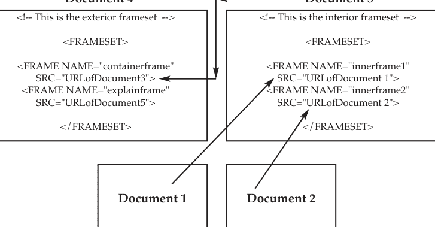

关于上述图解示例的一个简短说明。如果你仔细观察文档 4，你可能会好奇文档 5 是干什么的，因为在此之前从未提到过它。它出现在那里仅仅是因为我不希望任何人认为 *外部 FRAMESET 只能包含一个 FRAME：它们不能*。外部 FRAMESET 必须始终包含至少两个 FRAME。然而，*内部* FRAMESET 可以选择仅包含一个 FRAME，也可以包含多个 FRAME。

示例 A5-7 包含了演示上述概念图解的最基本代码。我仅包含了上述文档 3 和文档 4 的代码，因为另外两个文档中包含的任何内容对于本示例来说都是次要的。

## 附录 A — HTML 基础

### 示例 A5-7 第 1 部分：Sample52-Frameset-8D4.html

```
<!DOCTYPE HTML PUBLIC "-//W3C//DTD HTML 3.2//EN">
<HTML>
<HEAD>     <TITLE> Sample 52- Frameset-8D4 </TITLE>  </HEAD>

<FRAMESET ROWS="50%,*">

<FRAME NAME="containerframe" SRC="Sample52-Frameset-8D3.html">

<FRAME NAME="explainframe" SRC="Sample52-explain.html">

</FRAMESET>

</HTML>
```

### 示例 A5-7 第 2 部分：Sample52-Frameset-8D3.html

```
<!DOCTYPE HTML PUBLIC "-//W3C//DTD HTML 3.2//EN">
<HTML>
<HEAD>     <TITLE> Sample 52- Frameset-8D3 </TITLE>  </HEAD>

<FRAMESET COLS="20%,*">

<FRAME NAME="innerframe1" SRC="Sample51-A.html">
<FRAME NAME="innerframe2" SRC="Sample51-B.html">

</FRAMESET>

</HTML>
```

如果你想看看这个在现实世界中的例子，请进入 [Sample-ETOC]() 文件夹，找到 [welcomeETOC3Bkgd.html]() 文档并将其加载到 Navigator 浏览器中。然后查看左侧的 FRAME，点击名为 Mats 的链接。接着查看右侧的 FRAME，点击名为 [Crescent Mats]() 的链接。然后点击右侧 FRAME 中任何具有暗蓝色背景色的链接，你将看到一个带有内部 FRAMESET 的文档加载到屏幕中央的大型视图区域中。

## 第 IV 部分 — 资源

一些非常酷的 FRAME 图形实现方式是给冲浪者提供自定义设计网站显示外观的选项。例如，提供几个版本的艺术图或公司 Logo，让用户将其放置在横幅 FRAME 中，或者提供几种背景音乐的选择。这些是非常简单的选项，只需要为你想要提供的每个选项设置一个新页面的链接，并将该链接的 TARGET 指向相应的 FRAME。

假设你有五个不同的公司 Logo，你想让用户选择一个最喜欢的显示在你的 Logo FRAME 中。创建五个不同的网页，每页只放一个 Logo。然后设置第二个 FRAME，并创建五个不同的链接，以便每个链接将不同的 Logo 加载到 Logo FRAME 中。为了实现这一点，你需要做两件事。首先，当你创建这两个 FRAME 时，使用（你猜对了）NAME 属性为它们 both 分配一个名称。（尽管对于这个项目，你只需要为想要 TARGET 的 FRAME 命名，但养成给所有 FRAME 命名的习惯是有好处的，以便于引用，并省去以后在代码不再新鲜时重新回去命名的麻烦。）其次，当你编写用于加载每个 Logo 的链接代码时，必须将 TARGET 属性设置为你希望 Logo 加载到其中的 FRAME 的名称。如果你的两个 FRAME 是：

```
<FRAME NAME="logoFrame" SRC="hasLogol.html">
<FRAME NAME="toc" SRC="TableofContents.html">
```

并且文档 "hasLogol.html" 包含 Logo 版本 1，而文档 "TableOfContents.html" 是包含将新 Logo 加载到名为 "logoFrame" 的 FRAME 中之链接的页面，你设置一个 TARGET 值为加载 Logo 到名为 "logoFrame" 的 FRAME 的链接，如下所示：

```
<A HREF="hasLogol.html" TARGET="logoFrame"> Go Logo 1 </A>
```

然后将该链接放入 TableOfContents.html 中，就这样完成了。

好了，你现在确实必须将这两个 FRAME 放入一个 FRAMESET 中，但这些在之前都讨论过了。这也假设你已经正确地编写了 Logo 的图像代码。如果你想看到一个带有许多其他花哨功能的夸张示例，请将 welcomeETOC3Bklg.html 文件放入浏览器中，该文件位于 CD-ROM 的 DHTML-S_BOOK-Main_Files 文件夹下的 Sample-ETOC 文件夹中。当页面出现时，查看最左侧 FRAME 的底部，点击灰色背景单元格中的任何链接，看看顶部的中间 FRAME 中发生了什么。点击 "L1" 或 "L2" 中的任何一个链接，并在 Logo 加载后将鼠标悬停在 Logo 上，看看会发生什么。其中包含了一些非常酷的 JavaScript，这在本书的第二部分中有所讲解。

我想现在应该给出一个不那么花哨的上述理论示例，就在这里：

## 附录 A — HTML 基础

### 示例 A5-8-第 1 部分：Sample51-Frameset-7.html

```
<!DOCTYPE HTML PUBLIC "-//W3C//DTD HTML 3.2//EN">
<HTML>
<HEAD> <TITLE>Sample 51 - FRAMESET-7 </TITLE> </HEAD>

<FRAMESET COLS="150,*" BORDERCOLOR="#000000">
	<FRAME SCROLLING="no" NAME="toc" SRC="Sample51-toc.html">

	<FRAMESET ROWS="100,*">
		<FRAME SCROLLING="no" NAME="MiddleLogo" SRC="Sample51-C.html">
		<FRAME SCROLLING="auto" NAME="MiddleBottom" SRC="Sample51-main.html">
	</FRAMESET>
</FRAMESET>
</HTML>
```

### 示例 A5-8-第 2 部分：Sample51-toc.html

```
<!DOCTYPE HTML PUBLIC "-//W3C//DTD HTML 3.2//EN">
<HTML>
<HEAD><BASEFONT SIZE="5">
<TITLE> Sample 51 - Source File toc </TITLE></HEAD>

<BODY><P><CENTER>

<A HREF="Sample51-A.html" TARGET="MiddleLogo">
	Load Logo 1
</A><P>

<A HREF="Sample51-B.html" TARGET="MiddleLogo">
	Load Logo 2
</A>
</CENTER>
</BODY>
</HTML>
```

### 示例 A5-8-第 3 部分：Sample51-main.html

```
<!DOCTYPE HTML PUBLIC "-//W3C//DTD HTML 3.2//EN">
<HTML> <HEAD><TITLE> Sample 51 - Source File main </TITLE></HEAD>

<BODY BGCOLOR="#23f6ff" BACKGROUND="JPEG-FILES/Icon-Clouds.jpg">
<P><CENTER><H1>This would be the main viewing area.</H1></CENTER>
</BODY>
</HTML>
```

### 示例 A5-8-第 4 部分：Sample51-A.html

```
<!DOCTYPE HTML PUBLIC "-//W3C//DTD HTML 3.2//EN">
<HTML>
<HEAD><TITLE> Sample 51 - Source File A </TITLE></HEAD>

<BODY BGCOLOR="#23f6ff" BACKGROUND="/JPEG-FILES/icon-BG-asteroids.jpg">
<P>
<CENTER>


</CENTER>

</BODY>
</HTML>
```

### 示例 A5-8-第 5 部分：Sample51-B.html

```
<!DOCTYPE HTML PUBLIC "-//W3C//DTD HTML 3.2//EN">
<HTML>
<HEAD><TITLE> Sample 51 - Source File B </TITLE></HEAD>

<BODY BGCOLOR="#23f6ff" BACKGROUND="/JPEG-FILES/icon-FieldStone-Purple.jpeg">
<P>
<CENTER>


</CENTER>

</BODY>
</HTML>
```

### 示例 A5-8-第 6 部分：Sample51-C.html

```
<!DOCTYPE HTML PUBLIC "-//W3C//DTD HTML 3.2//EN">
<HTML>
<HEAD><TITLE> Sample 51 - Source File C </TITLE></HEAD>

<BODY BGCOLOR="#ff0000">
<P><CENTER>

If you want to see an image here then
click on one of the logo links in the left frame.

</CENTER>

</BODY>
</HTML>
```


 ## 附录 A — HTML 入门须知

在使用 FRAME 时需要特别记住的一点是，你要处理的是许多不同的拼图碎片，在本例中就是 HTML 页面，它们只有在正确组合在一起时才能正常工作。具体而言，你需要注意：

- 为你的框架命名
- 采用合乎逻辑的名称，以便清楚了解它们的用途
- 以同样的方式为文件命名
- 正确设置链接的目标
- URL 及其他名称或值放在引号内
- 确保使用正确的文件名和 URL 路径
- 对于嵌套文件夹中的文件或图片，确保 URL 中包含文件夹名称，位于文件名之前，并以 / 符号分隔
- 在纸上给自己写笔记：这比完全靠脑子记要容易
- 图表对于小型和复杂项目尤其高效
- 复用你的代码：复制粘贴并稍作修改
- FRAMESET 替代 BODY 元素
- FRAME 只能放在 FRAMESET 内部
- 每个文档只允许有一个未命名的 FRAMESET
- 每个文档中允许有无限个嵌套的 FRAMESET
- 每个 FRAMESET 必须指定 COLS 或 ROWS，或两者都指定
- 每个 Frame 必须恰好指定一个 SRC="URL"
- 体贴一些，包含一个 NOFRAMES 元素
- 玩得开心，垂直思考，指数级创造

请记住，使用 FRAME 时你只需要使用开始标签。

内容 无
包含于 FRAMESET 内

## 语法：

```
<FRAME
  FRAMEBORDER="YES"|"NO"
  BORDERCOLOR="####$$"|"colorName"
  MARGINWIDTH="pixelsMarginWidth"
  MARGINHEIGHT="pixelsMarginHeight"
  SCROLLING="YES"|"NO"|"AUTO"
  NORESIZE
  NAME="nameYourFrame"
  SRC="URL"                            required
  STYLE="Property:Value; Property:Value; ..."
  CLASS="nameOfClass"
  ID="nameOfClassException">
```

## 第四部分 — 资源

FRAMEBORDER="YES"|"NO" 指定该 FRAME 的边框以 3D 凸起格式还是 2D 平面格式渲染。默认值为 "YES"，表示 3D，这将覆盖任何 FRAMESET 元素中先前设置的 FRAMEBORDER 属性。由于 FRAME 共享边框，出于美观考虑，FRAME 只能具有 2D 边框的情况是当所有相邻的 FRAME 都将它们的 FRAMEBORDER 设置为 "NO" 时。FRAMEBORDER 的默认值为 "YES"，这还包含一个固有的 5 像素厚度设置，无法从 FRAME 标签内部更改。

如果你想更改厚度，则必须在外层 FRAMESET 标签中使用全局设置 BORDER="pixelsThick" 属性，这会影响所有 FRAME 边框。不可能让单个 FRAME 具有不同的厚度设置。如果你完全不使用 FRAMEBORDER 属性，默认情况下它也会显示为与 Navigator 外部窗口边框相同的灰色。你确实可以使用下面的 BORDERCOLOR 属性更改单个 FRAME 的边框颜色。

- YES 创建 3D 凸起边框。
- NO 创建 2D 平面边框。

BORDERCOLOR="#$$$$$$"|"ColorName" 仅确定该 FRAME 的颜色，并覆盖任何 FRAMESET 或嵌套 FRAMESET 的全局设置。它使用老式的十六进制红绿蓝三元组，或使用 Netscape 认可的 16 种颜色名称之一。请参阅附录 B 中的颜色理论部分。

由于 Navigator 为 FRAME 分配空间的方式，边框是共享的，当为相邻边框分配不同颜色时，它们必须遵循层级以确定哪个 BORDERCOLOR 属性具有优先级。

| 优先级 | 设置 |
|---|---|
| 最低优先级： | 最外层 FRAMESET 中的 BORDERCOLOR。 |
| 下一优先级： | 嵌套 FRAMESET 中的 BORDERCOLOR。 |
| 最高优先级： | FRAME 中的 BORDERCOLOR 覆盖所有其他设置。 |
| 未定义： | 两个相邻的 BORDERCOLOR 具有同等优先级。 |

当发生未定义情况时，Netscape 通常会使用第一个被编码的 BORDERCOLOR 属性，说来也怪。

MARGINWIDTH="pixelsMarginWidth" 定义 FRAME 左右两侧的边距大小，以像素为单位指定。这使你可以在 FRAME 内容与 FRAMEBORDER 之间创建空间。不允许使用 0（零）或负数，因为你的内容会接触到，甚至更糟糕的是，会重叠 FRAMEBORDER，导致渲染噩梦。如果你不小心甚至有意使用了负数，Netscape 会将该数字改为 1，因为这是最接近的合法数字。任何从 1 开始的正数都可以接受，但请记住屏幕空间是有限的，因此实际上通常范围约为 1 到 20 像素。如果你确实将边距设置得太大，导致文档内容无法放入 FRAME 中，Netscape 会减小边距以适应内容，但边距不一定在两侧相等。

如果你不指定 MARGINWIDTH，Netscape 默认会创建一个能舒适显示内容的边距，通常大小约为 8-10 像素。当你需要为内容提供最大可用显示空间时，将所有边距设置为 1 并关闭边框，这往往是视觉优雅与笨拙之间的分水岭，这样的时刻肯定存在。

MARGINHEIGHT="pixelsMarginHeight" 定义 FRAME 顶部和底部的边距大小，以像素为单位指定。先前关于 MARGINWIDTH 的所有说明都适用于 MARGINHEIGHT，只是影响的区域是 FRAME 内包含的内容上方和下方的空间，而不是内容左右的空间。

SCROLLING="YES"|"NO"|"AUTO" 指定可选滚动条是永远可见、永远隐藏还是仅在需要时不可见。除非你没用过图形界面电脑，否则你知道水平和垂直滚动条是箭头和上翻页、下翻页键的增强图形版本，它们允许你滚动到文档中隐藏的区域。在大多数计算机程序中，它们要么是内置的，要么根本不存在。而在 HTML 中，选择权在你。每个选项都有其各种应用场景。如果你不包含 SCROLLING 属性，Navigator 将默认使用 AUTO。

AUTO 设置使浏览器检查 FRAME 的大小和内容，然后确定是否需要滚动条。如果 FRAME 的所有内容都可以一次性看到，也就是说，如果所有内容都能放入用户设定大小的 FRAME 中，那么滚动条将被隐藏。如果有比 FRAME 能容纳的更多内容需要显示，那么所需的滚动条将自动变为可见。

在许多情况下，只有垂直滚动条会可见，因为可能有足够的水平空间来显示内容，但垂直空间不足。由于 AUTO 设置是自适应的，每次用户调整网页大小时，如果需要适应内容的布局，它就会改变滚动条的状态。

- YES 指定滚动条永远可见。
- NO 指定滚动条永远隐藏。
- AUTO 指定滚动条仅在需要时不可见。AUTO 是默认值。

NORESIZE 这是一个布尔属性，没有可分配的值。如果你将其包含在 FRAME 标签中，则为真，并阻止用户调整你的 FRAME 大小。如果你不在 FRAME 中包含它，则为假，这是默认值，因此用户可以通过鼠标拖动 FRAME 边缘来调整其大小。重申一遍，所有 FRAME 默认都是可调整大小的。由于 FRAME 边缘是共享的，不是每个 FRAME 都有两条接触或重叠的边缘，如果你在可调整大小的 FRAME 相邻的 FRAME 中包含 NORESIZE，共享边缘仍将不可调整大小，因为 NORESIZE 在代码层级中具有优先权。


 **NAME="nameYourFrame"** 是一个非常重要的属性，它为您的 FRAME 指定一个标识符，以便可以通过链接和 JavaScript 引用和**目标定位**它。把它想象成您 FRAME 的昵称，设置它的目的是为了让您在编码时节省时间、空间和减少混乱。一种非常有用的方法是使用那些描述 FRAME 用途或功能的 NAME。当我们进入 STYLE 和 JavaScript 部分，开始需要命名样式 **ids**、**classes** 和 **Functions** 时，记住这一点也非常有用。

**SRC="URL"** 指定您想要加载到该 FRAME 中的文档或对象的 URL。这是唯一必需的属性。如果您需要更多关于 URL 的信息，请查看第 447-452 页关于 **Location** 对象的内容，或 CD-ROM 上关于链接的 [CH3.html](CH3.html) 文件。

示例 A5-10 包含名为 [welcomeETOC-SAMPLE.html](welcomeETOC-SAMPLE.html) 的示例文件，该文件位于 CD-ROM 上名为 [Sample-ETOC](Sample-ETOC) 的文件夹中。这是一个非常复杂的示例，展示了一个包含四个 FRAME 和两个 FRAMESET 的网站。一个 FRAMESET 嵌套在另一个 FRAMESET 中，位于其两个 FRAME 之间。每个 FRAMESET 有两个 FRAME，一个使用两列（COLS），另一个使用两行（ROWS）。

这样创建的文档窗口在左右两侧都有一个窄列，顶部有一个包含公司徽标的细行，中间是主浏览窗口，当在控制列中点击时，大部分文档都会在这里显示。左侧的 FRAME 用作主目录，它始终保留在那里。它包含网站的主类别链接，这些链接通常被**目标定位**到右侧 FRAME 并在其中打开。右侧 FRAME 包含子类别，通常被**目标定位**到 NAME 属性设置为 **NAME="MiddleBottom"** 的 FRAME，即窗口中间那个大型的主浏览 FRAME。

您确实应该运行这个示例，因为视觉效果让描述清晰得多。它看起来也非常酷。请随意重用本书或 CD-ROM 上示例 HTML 文件中的任何代码。这将为您节省大量时间，并可能为您指明一些创造性的方向。

在查看第 2 部分的代码时，请注意其中包含 JavaScript，并且 TABLE 包含在一个 FORM 元素中，这就是让包含 JavaScript 的 BUTTON 能够工作的原因。如果您是 HTML 新手，并且从附录 A 开始阅读，如果您需要进一步说明，可能需要跳到在线指南的 [CH6.html](CH6.html)（位于 [HTML BOOK-Online](HTML BOOK-Online) 文件夹中）。目前，只需知道要让 BUTTON 工作，它们必须位于 FORM 内部。如果您从书的开始就阅读，那么这已经是旧闻了。

以下是 FRAMESET 的代码，其中包含四个 FRAME，以及随后包含的每个页面进入每个 FRAME 的代码。

## 附录 A — HTML 入门

993

## 示例 A5-10-第 1 部分-框架集：welcomeETOC-SAMPLE.html

```
<!DOCTYPE HTML PUBLIC "-//W3C//DTD HTML 3.2//EN">
<HTML>
<HEAD>
<TITLE>Extra Touch of Class Framed Home Page </TITLE>
</HEAD>
<FRAMESET FRAME="" SPACING="3" BORDER="3" COLS="145,*,155">
<NOFRAMES>
<P><H2>
嘿！！！如果您正在阅读此内容，说明您使用的是不支持框架的浏览器。
为了获得最佳浏览效果，请立即前往
<A HREF="http://www.Netscape.com">Netscape 网站</A>
下载当前版本的 Navigator。
</P>
<P>
否则 <A HREF="ETOCmainWindow5Bkgd.html">
进入 Extra Touch of Class 网站的非框架版本。</A>
</H2></P>
</NOFRAMES>
<FRAME SCROLLING="no" NAME="Left" SRC="etoc-TOC8Bkgd.html">
<FRAMESET FRAME="" SPACING="3" BORDER="3" ROWS="90,*">
<FRAME SCROLLING="no" NAME="MiddleTop" SRC="ETOC-Logo8Bkgd.html">
<FRAME SCROLLING="yes" NAME="MiddleBottom" SRC="ETOCmainWindow5Bkgd.html">
</FRAMESET>
<FRAME SCROLLING="yes" NAME="Right" SRC="etoc-ArtByStyle3Bkgd.html">
</FRAMESET>
</BODY>
</HTML>
```

## 示例 A5-10-第 2 部分：etoc-TOC8Bkgd.html

```
<!DOCTYPE HTML PUBLIC "-//W3C//DTD HTML 3.2//EN">
<HTML>
<HEAD> <TITLE>目录窗口</TITLE>
<BASE TARGET="MiddleBottom">
</HEAD>
<BODY BGCOLOR="#060dff" TEXT="#ffffff" BACKGROUND="icon-BG-stars.jpg"
VLINK="#222222" LINK="#000000" ALINK="#2826CF">
<CENTER>
<FORM>
```

## 994 第四部分 — 资源

```
<TABLE BORDER=3 CELLSPACING=2 CELLPADDING=2>
<TR>
<TH>
<INPUT TYPE="button" VALUE="<B"
onClick="parent.MiddleBottom.history.back()">
<INPUT TYPE="button" VALUE="F>"
onClick="parent.MiddleBottom.history.forward()">
</TH>
</TR>
<TR>
<TH>
<INPUT TYPE="button" VALUE="<a"
onClick="parent.Right.history.back()">
<INPUT TYPE="button" VALUE="f>"
onClick="parent.Right.history.forward()">
</TH>
</TR>
<TR>
<TH BGCOLOR="#dd00ff">
<A HREF="etcArtByArtist3Bkgd.html" TARGET="Right">艺术</A>
</TH>
</TR>
<TR>
<TD BGCOLOR="#7300dd">
<A HREF="etcWoodFrames.html" TARGET="Right">木框</A>
</TD>
</TR>
<TR>
<TD BGCOLOR="#8300ee">
<A HREF="etcMetalFrames.html" TARGET="Right">金属框</A>
</TD>
</TR>
<TR>
<TD BGCOLOR="#9300ff">
<A HREF="etcPolymerFrames.html" TARGET="Right">聚合物框</A>
</TD>
</TR>
<TR>
<TH BGCOLOR="#0066ff">
<A HREF="etcGlass.html" TARGET="Right">玻璃</A>
</TH>
</TR>
<TR>
<TH BGCOLOR="#0099ff">
<A HREF="etcPlexiglass.html" TARGET="Right">有机玻璃</A>
</TH>
</TR>
</TABLE>
```

## 附录 A — HTML 入门

995

```
<TR>
  <TH BGCOLOR="#00ffff">
    <A HREF="etocMats.html" TARGET="Right">衬垫</A>
  </TH>
</TR>
</TR>
```

```
<TR>
  <TH BGCOLOR="#00ff00">
    <A HREF="etocMounting.html" TARGET="Right">装裱</A>
  </TH>
</TR>
</TR>
```

```
<TR>
  <TH BGCOLOR="#00aa00">
    <A HREF="etocHardware.html" TARGET="Right">五金件</A>
  </TH>
</TR>
</TR>
```

```
<TR>
  <TH BGCOLOR="#ffff00">
    <A HREF="Links.html" TARGET="MiddleBottom">链接</A>
  </TH>
</TR>
</TR>
```

```
<TR>
  <.byInitialExample.Cryptography.HolochainSimulation>

  <TH BGCOLOR="#ffbb00">
    <A HREF="Foxmans-Calendar97.html" TARGET="MiddleBottom">活动<BR>
日历</A>
  </TH>
</TR>
</TR>
```

```
<TR>
  <TH BGCOLOR="#FA5A05">
    <A HREF="etoc-CompanyProfile.html" TARGET="MiddleBottom">公司信息</A>
  </TH>
</TR>
</TR>
```

```
<TR BGCOLOR="#F92807">
  <TH>电子邮件</TH>
</TR>
</TR>
```

```
<TR BGCOLOR="#FF0000">
  <TH>电话订购<BR>
  703-354-2905</TH>
</TR>
</TR>
```

```
<TR BGCOLOR="#ff00aa">
  <TH>
    <A HREF="ETOC-OrderForm.html" TARGET="_blank">
    <FONT SIZE=4> 在线订购</FONT></A>
  </TH>
</TR>
</TR>
```

## 996 第四部分 — 资源

```
<TR>
<TH BGCOLOR="#777777">
<A HREF="ETOC-Logo1Bkgd.html" TARGET="Middle.requestFocus.MiddleTop"> L1 </A>
<A HREF="ETOC-Logo2Bkgd.html" TARGET="MiddleTop"> L2 </A>
<A HREF="ETOC-Logo3Bkgd.html" TARGET="MiddleTop"> L3 </A>
<A HREF="ETOC-Logo3A-Bkgd.html" TARGET="MiddleTop"> L4 </A>

</TH>
</TR>

</TABLE>

</FORM>
</CENTER>

</BODY>
</HTML>
```

## 示例 A5-10-第 3 部分：ETOC-Logo8Bkgd.html

```
<!DOCTYPE HTML PUBLIC "-//W3C//DTD HTML 3.2//EN">
<HTML>
<HEAD>
<TITLE> Extra Touch of Class 徽标 8 </TITLE>
</HEAD>

<BODY BGCOLOR="#23f6ff" BACKGROUND="icon-FieldStone-Purple.jpeg">
<P>
<CENTER>


</CENTER>
</BODY>
</HTML>
```

## 示例 A5-10-第 4 部分：ETOCmainWindow5Bkgd.html

```
<!DOCTYPE HTML PUBLIC "-//W3C//DTD HTML 3.2//EN">
<HTML>
<HEAD>

<TITLE>Extra Touch of Class 主框架</TITLE>
</HEAD>

<BODY BGCOLOR="#000000" TEXT="#FFFFFF" BACKGROUND="GIFA-EARTH-ANIMATION.gif"
VLINK="#0000FF" LINK="#000000">

<!------------------------------------------------------------->

<CENTER>
```

## 附录 A — HTML 入门

```
<TABLE BORDER=5 CELLSPACING=3 CELLPADDING=4>

<TR VALIGN=middle BGCOLOR="#755F11">
<TH COLSPAN=2>欢迎光临</TH>
</TR>

<TR BGCOLOR="#755F11">
<TH COLSPAN=2 VALIGN=middle>
<FONT SIZE=2 COLOR="#000000">Extra Touch of Class</FONT><BR>
<FONT SIZE=4>艺术画廊和装裱工作室</FONT>
</TH>
</TR>

<TR VALIGN=middle BGCOLOR="#755F11">
<TH COLSPAN=2>保护性装裱</TH>
</TR>

<TR VALIGN=middle BGCOLOR="#755F11">
<TH> * 木框 * 金属框 * 聚合物框 * </TH>
<TH> * 衬垫 * 装裱 * 玻璃 * 有机玻璃 * </TH>
</TR>

</TABLE>

</CENTER>
```

```
<!--

<CENTER>
<TABLE BORDER=10 CELLSPACING=10 CELLPADDING=10>

<TR>
<TH BGCOLOR="#755F11">
<A HREF="BV20-CrystalMtsWinter14.html"><BR><BR>
<FONT SIZE="6">进入工作室</FONT></A>
</TH>
</TR>

</TABLE>

</CENTER>

!>
```

```
<!--

<CENTER>
<TABLE BORDER=2 CELLSPACING=2 CELLPADDING=5>

<TR VALIGN=middle BGCOLOR="#0000FF">
<TR BGCOLOR="#FFFFFF" <FONT COLOR="#000000">商店 #1</FONT></TH>
<TR BGCOLOR="#FFFFFF" <FONT COLOR="#000000">商店 #2</FONT></TH>
</TR>

<TR VALIGN=middle BGCOLOR="#0000FF">
<TH>5641 -B General Washington Dr.</TH>
<TH>5641 -B General Washington Dr.</TH>
</TR>
```


 # **998** 第 IV 部分 — 资源

```
<TR VALIGN=middle BGCOLOR="#0000FF">
<TH>Alexandria, VA 22312</TH>
<TH>Alexandria, VA 22312</TH>
</TR>

<TR VALIGN=middle BGCOLOR="#0000FF">
<TH>703-354-2905</TH>
<TH>703-354-2905</TH>
</TR>

<TR BGCOLOR="#0000FF" VALIGN=MIDDLE>
<TH BGCOLOR="#FFFFFF"><FONT COLOR="#000000">Store #3</FONT></TH>
<TH ROWSPAN=4 BGCOLOR="#00FFFF"><FONT COLOR="#000000">
Barry Broadway -- Proprietor</TH></FONT>
</TR>

<TR BGCOLOR="#0000FF" VALIGN=MIDDLE>
<TH>5641 -B General Washington Dr.</TH>
</TR>

<TR BGCOLOR="#0000FF" VALIGN=MIDDLE>
<TH>Alexandria, VA 22312</TH>
</TR>

<TR BGCOLOR="#0000FF" VALIGN=MIDDLE>
<TH>703-354-2905</TH>
</TR>

</TABLE>
</CENTER>

<!-------------------------------------------------------------------------->

<BR>
<H3><CENTER><A HREF="FoxmansHELP.html"><BR>
Site Navigation Overview = HELP</A></CENTER>
</H3>

</BODY>
</HTML>
```

# **示例 A5-10-第 5 部分：** etoc-ArtByStyle3Bkgd.html

```
<!DOCTYPE HTML PUBLIC "-//W3C//DTD HTML 3.2//EN">
<HTML>
<HEAD>

    <TITLE>Art by Style 3</TITLE>
</HEAD>

<BODY TEXT="#ffffff" BGCOLOR="#94bbef" BACKGROUND="icon-Paint-Palette.jpg"
ALINK="#0000ff" LINK="#ff0000" VLINK="#000000">

<CENTER>
```

## 附录 A — HTML 基础

```
<TABLE BORDER=5 CELLSPACING=2 CELLPADDING=1>

<TR>
<TH BGCOLOR="#ff0000">
<FONT SIZE="5"><BR>Art by<BR>Style<BR>&nbsp;</FONT>
</TH>
</TR>

<TR>
<TH BGCOLOR="#00ffff">
<A HREF="etoc-ArtByArtist3Bkgd.html" TARGET="Right">!!Art By Artist!!</A>
</TH>
</TR>

<TR>
<TH BGCOLOR="#00ffff">
<A HREF="etoc-ArtByTitle3Bkgd.html" TARGET="Right">!!Art By Title!!</A>
</TH>
</TR>


<TR>
<TH BGCOLOR="#0000FF">
<A HREF="etoc-3DComputerArt.html" TARGET="Right">3D</A>
</TH>
</TR>

<TR>
<TH BGCOLOR="#0000FF">
Abstract
</TH>
</TR>

<TR>
<TH BGCOLOR="#0000FF">
Cubist
</TH>
</TR>

<TR>
<TH BGCOLOR="#0000FF">
Fantasy
</TH>
</TR>

<TR>
<TH BGCOLOR="#0000FF">
Impressionism
</TH>
</TR>

<TR>
<TH BGCOLOR="#0000FF">
Industrial
</TH>
</TR>
```

# 1000 第 IV 部分 — 资源

```
<TR>
<TH BGCOLOR="#0000FF">
Landscapes
</TH>
</TR>

<TR>
<TH BGCOLOR="#0000FF">

</TH>
</TR>

<TR>
<TH BGCOLOR="#0000FF">
Modern
</TH>
</TR>

<TR>
<TH BGCOLOR="#0000FF">
Post Modern
</TH>
</TR>

<TR>
<TH BGCOLOR="#0000FF">
Psychedelic
</TH>
</TR>

<TR>
<TH BGCOLOR="#0000FF">
Sci-Fi
</TH>
</TR>

<TR>
<TH BGCOLOR="#0000FF">
Still Life
</TH>
</TR>

<TR>
<TH BGCOLOR="#0000FF">
<A HREF="etoc-SurrealArt.html" TARGET="Right">Surreal</A>
</TH>
</TR>

</TABLE>
</CENTER>

</BODY>
</HTML>
```

## \<NOFRAMES\> 元素

虽然 \<NOFRAMES\> 元素不是强制要求的，但为了照顾访问者，每个页面的一个 FRAMESET 元素内部都应包含它。它为无法渲染 FRAME 的浏览器提供可显示给用户的替代内容。如果没有 NOFRAMES 元素，不支持 Frame 的浏览者将只能看到一个空白页，因为页面所有的 FRAMESET 内容都会被忽略。

像 Navigator 这样能够解释 FRAME 内容的支持 Frame 的浏览器，会忽略 NOFRAMES 开始标签和结束标签之间的所有文本、内容和标签。一个例外情况是：如果你在 FRAME 或 FRAMESET 代码中创建了错误，例如更改了文件的 URL 或名称，或者忘记更改 SRC=URL 以使其匹配，或者仅仅是输入错了 URL，导致 Navigator 无法访问或加载该文件，那么 NOFRAMES 内容将会被显示。

在上传之前请务必测试你的代码。即使你已经测试过且运行完美，然后决定做一个微小的改动，并且心想：“我绝对不可能有哪怕万分之一的机会，或者哪怕最轻微的迹象，或者哪怕最遥远的预感，在如此微不足道的情况下真的写出个错——误——啦”，也不要拿生命去赌。请在浏览器中重新测试该代码。

你可以在 NOFRAMES 元素中包含几样东西，以展示你对“网络礼仪（netiquette）”的关注。你可以提供一个指向 Netscape 主页或软件下载站点的链接，并告知访问者，通过下载并使用 Navigator，他们将能够按照预期看到该站点。你应当始终包含一个不含任何 FRAME 的站点入口链接。事实上，如果你围绕 FRAME 范式设计网站，你应该考虑创建一个完全不使用 FRAME 的替代平行版本。这不是绝对要求，只需结合你自己的具体情况考虑即可。

许多网页作者在创建主页时，为客户端提供了选择进入哪个版本站点的选项，例如：Frame 版本、非 Frame 版本、纯文本版本，或者肯定会陆续出现（或早已存在，取决于你阅读此书的时间）的 Layers 和非 Layers 版本。

| 内容 | 在 HTML4.0 Transitional 中：所有块级和内联元素 <br> 在 HTML4.0 Frameset 中：一个不能包含任何 NOFRAMES 元素的 BODY 元素 |
| --- | --- |
| 包含于 | APPLET, BLOCKQUOTE, BODY, CENTER, DD, DIV, FORM, FRAMESET, LI, MAP, NOSCRIPT, OBJECT, TD, TH |


# 1002 第 IV 部分 — 资源

## 语法：

```
<NOFRAMES
LANG="ISOLanguageAbbreviation"
STYLE="Property:Value; Property:Value; ..."
CLASS="nameOfClass"
ID="nameOfClassException"
>
...
</NOFRAMES>
```

这只是 NOFRAMES 元素的一个典型用法。请注意它位于 FRAMESET 元素内部。通常你也会在 FRAMESET 内部放置 FRAME。

```
<FRAMESET>
	<NOFRAMES>
		<h2>
		Hey Now!!! If you are reading this you are using a Frame-Challenged-Browser.
		For optimal viewing proceed immediately to
		<A HREF="http://www.Netscape.com">Netscape's website</A>
		and download the current version of Navigator.
		</h2>
		<h2>
		Otherwise
		<A HREF="welcome3.html">
		Enter the Non-Frames Version of the DreamPlay Studios website.</A>
		</h2>
	</NOFRAMES>
</FRAMESET>
```

FRAME 的一些可能性，例如，一个左-FRAME 和右-FRAME 导航系统，其中左-FRAME 是主控制面板，包含网站的所有主要部门，点击后会在右-FRAME 控制面板中展开。在右-FRAME 中将是站点的可变子部门，它们会展开到中间 FRAME 的主查看区域。在这种场景下，左侧和右侧 FRAME 可能是窄列，而大部分可用窗口空间由中间 FRAME 占据，大多数信息内容将 TARGET（目标定位）到那里。大型且数据丰富的站点将从这种场景中受益。

在接下来的页面中是一系列使用了 FRAME 和 FRAMESET 的示例列表，这些示例在 CD-ROM 中，并且代码已在本书中列出。


## 附录 A — HTML 基础

# 1003

| 文件 | 行号 | 内容 |
| :--- | :--- | :--- |
| Sample38frameset.html | line 5: | `<FRAMESET COLS="150">` |
| Sample50-Frameset-1.html | line 5: | `<FRAMESET COLS="40%,60%" BORDERCOLOR="#f00000">` |
| Sample50-Frameset-2.html | line 5: | `<FRAMESET ROWS="50%,50%" BORDERCOLOR="#f00000">` |
| Sample50-Frameset-3.html | line 5: | `<FRAMESET COLS="25%,25%" BORDERCOLOR="#f00000">` |
| Sample50-Frameset-4.html | line 5: | `<FRAMESET COLS="200",35%" BORDERCOLOR="#f00000">` |
| Sample50-Frameset-5.html | line 5: | `<FRAMESET COLS="200,200,200">` |
| Sample51-Frameset-6.html | line 10: | `<FRAMESET COLS="27%,73%">` |
| Sample51-Frameset-7.html | line 5: | `<FRAMESET COLS="150"," BORDERCOLOR="#000000">` |
| Sample52-Frameset-8D3.html | line 5: | `<FRAMESET COLS="20%,">` |
| Sample52-Frameset-D4.html | line 5: | `<FRAMESET ROWS="50%,">` |
| Sample53-Frameset-9.html | line 5: | `<FRAMESET ROWS="250,">` |
| Sample54-Frameset-10.html | line 5: | `<FRAMESET BORDERCOLOR="#0000ff" COLS="25%,25%,25%,">` |
| Sample56-Frameset-11.html | line 5: | `<FRAMESET BORDERCOLOR="#0000ff" COLS="25%,25%,25%,">` |
| Sample56-Frameset-11.html | line 27: | `<FRAMESET BORDERCOLOR="#00#f00" ROWS="50%,25%,25%,">` |
| Sample429Frameset.html | line 5: | `<FRAMESET ROWS="150,">` |
| Sample430Frameset.html | line 5: | `<FRAMESET ROWS="150,">` |
| Sample432Frameset.html | line 5: | `<FRAMESET ROWS="100,">` |
| Sample434Frameset.html | line 5: | `<FRAMESET ROWS="140,">` |
| Sample435Frameset.html | line 4: | `<FRAMESET ROWS="24",24" BORDER="0">` |
| Sample452Frameset.html | line 5: | `<FRAMESET COLS="220,">` |
| Sample453Frameset.html | line 5: | `<FRAMESET COLS="220,">` |
| Sample454Frameset.html | line 5: | `<FRAMESET ROWS="130,">` |
| Sample455Frameset.html | line 5: | `<FRAMESET COLS="220,">` |
| Sample456Frameset.html | line 5: | `<FRAMESET COLS="200,">` |
| Sample533Frameset.html | line 5: | `<FRAMESET COLS="100,">` |
| Sample534.html | line 34: | `document.writeln("<FRAMESET COLS=\"200,\">")` |
| Sample718Frameset.html | line 5: | `<FRAMESET COLS="120,">` |
| Sample719Frameset.html | line 5: | `<FRAMESET COLS="130,">` |
| Sample724Frameset.html | line 5: | `<FRAMESET COLS="220,">` |
| Sample724Frameset.html | line 10: | `<FRAMESET ROWS="100,">` |
| Sample826Frameset.html | line 5: | `<FRAMESET ROWS="100,">` |
| Sample899Frameset.html | line 5: | `<FRAMESET ROWS="120,">` |
| Sample1014Frameset.html | line 5: | `<FRAMESET ROWS="40,">` |
| Sample1015Frameset.html | line 5: | `<FRAMESET ROWS="100,">` |
| Sample1016Frameset.html | line 5: | `<FRAMESET ROWS="100,">` |

请注意，CD-ROM 中绝大多数包含 FRAMESET 但未在书中的示例文件，其文件名中都包含 "Frameset" 一词。


## <FORM> 元素

| 属性 | 描述 |
| :--- | :--- |
| 内容 | 在 HTML 4.0 严格版 (Strict) 中：SCRIPT 或除 FORM 以外的块级元素<br>在 4.0 过渡版 (Transitional) 中：除 FORM 以外的块级或内联元素 |
| 包含于 | APPLET, BLOCKQUOTE, BODY, CENTER, DD, DIV, APPLET, MAP, NOFRAMES, NOSCRIPT, OBJECT, TD, TH |

### 语法：

```
<FORM
  ACTION="ServerURL"
  ENCTYPE="EncodingType"
  METHOD="GET" | "POST"
  NAME="FormName"
  TARGET="WindowName" | "FrameName"
  ONRESET="resetJavaScriptCode"
  ONSUBMIT="submitJavaScriptCode"
  LANG="ISOLanguageAbbreviation"
  STYLE="Property:Value; Property:Value; ..."
  CLASS="nameOfClass"
  ID="nameOfClassException">

  </FORM>
```

## <INPUT> 元素

| 属性 | 描述 |
| :--- | :--- |
| 内容 | 无 |
| 包含于 | 所有块级或内联元素 |

### 语法：

```
<INPUT
  TYPE="BUTTON"|"CHECKBOX"|"FILE"|"HIDDEN"|"IMAGE"|"PASSWORD"|"RADIO"
  |"RESET"|"SUBMIT"|"TEXT"
  NAME="typeName"
  VALUE="displayText"
  LANG="ISOLanguageAbbreviation"
  STYLE="Property:Value; Property:Value; ..."
  CLASS="nameOfClass"
  ID="nameOfClassException">
```

## 附录 A — HTML 入门

| 元素 | 描述 |
| :--- | :--- |
| BUTTON | 在表单 (FORM) 上创建按钮，点击时执行 JavaScript 代码。激活时会高亮显示。 |
| RESET | 在表单 (FORM) 上创建按钮，点击时将表单上所有元素重置为其原始值。 |
| SUBMIT | 在表单 (FORM) 上创建提交按钮，用于将表单内所有元素的数据通过服务器传输到目的地。 |
| IMAGE | 在表单 (FORM) 上创建自定义按钮，使用图像作为按钮。 |
| RADIO | 创建单选按钮，允许用户选择其 VALUE 值。当在具有相同 NAME 的组中使用时，允许用户从列表中选择一个值。 |
| CHECKBOX | 创建复选按钮，充当开关，以便用户在两种备选项之间做出选择。 |
| FILE | 允许用户上传文件作为表单提交数据的一部分。 |
| HIDDEN | 在表单上放置一个不可见的文本字段，用于在表单提交时向服务器传递数据。 |
| PASSWORD | 在文本字段中收集用户的密码，通过显示占位符（如圆点或星号）来隐藏字符。 |
| TEXT | 一个可设置长度的单行文本字段，用户可以在其中输入文本。 |

### <INPUT TYPE="BUTTON"> 元素

#### 语法：

```
<INPUT
  TYPE="BUTTON"
  NAME="buttonName"
  VALUE="buttonText"
  ONCLICK="clickJavaScriptCode"
  ONBLUR="blurJavaScriptCode"
  ONFOCUS="focusJavaScriptCode"
  LANG="ISOLanguageAbbreviation"
  STYLE="Property:Value; Property:Value; ..."
  CLASS="nameOfClass"
  ID="nameOfClassException">
```

### <INPUT TYPE="RESET"> 元素

**语法：**

```
<INPUT
TYPE="RESET"
NAME="resetButtonName"
VALUE="resetButtonText"
ONCLICK="clickJavaScriptCode"
ONBLUR="blurJavaScriptCode"
ONFOCUS="focusJavaScriptCode"
LANG="ISOLanguageAbbreviation"
STYLE="Property:Value; Property:Value; ..."
CLASS="nameOfClass"
ID="nameOfClassException">
```

### <INPUT TYPE="SUBMIT"> 元素

**语法：**

```
<INPUT
TYPE="SUBMIT"
NAME="submitButtonName"
VALUE="submitButtonText"
ONCLICK="clickJavaScriptCode"
ONBLUR="blurJavaScriptCode"
ONFOCUS="focusJavaScriptCode"
LANG="ISOLanguageAbbreviation"
STYLE="Property:Value; Property:Value; ..."
CLASS="nameOfClass"
ID="nameOfClassException">
```

### <INPUT TYPE="IMAGE"> 元素

**语法：**

```
<INPUT
TYPE="IMAGE"
NAME="imageName"
SRC="imageURL"
ALIGN="LEFT"|"RIGHT"|"TOP"|"TEXTTOP"|"MIDDLE"|"ABSMIDDLE"|
      "BOTTOM"|"ABSBOTTOM"|"BASELINE"
LANG="ISOLanguageAbbreviation"
STYLE="Property:Value; Property:Value; ..."
CLASS="nameOfClass"
ID="nameOfClassException">
```

### <INPUT TYPE="RADIO"> 元素

**语法：**

```
<INPUT
TYPE="RADIO"
NAME="radioButtonName"
VALUE="radioButtonText"
CHECKED
ONCLICK="clickJavaScriptCode"
ONBLUR="blurJavaScriptCode"
ONFOCUS="focusJavaScriptCode"
LANG="ISOLanguageAbbreviation"
STYLE="Property:Value; Property:Value; ..."
CLASS="nameOfClass"
ID="nameOfClassException">
```

### <INPUT TYPE="CHECKBOX"> 元素

#### 语法：

```
<INPUT
TYPE="CHECKBOX"
NAME="checkboxName"
VALUE="checkboxValue"
CHECKED
ONCLICK="clickJavaScriptCode"
ONBLUR="blurJavaScriptCode"
ONFOCUS="focusJavaScriptCode"
LANG="ISOLanguageAbbreviation"
STYLE="Property:Value; Property:Value; ..."
CLASS="nameOfClass"
ID="nameOfClassException">
```

### <INPUT TYPE="FILE"> 元素

#### 语法：

```
<INPUT
TYPE="FILE"
NAME="fileUploadName"
VALUE="value"
ONCHANGE="changeJavaScriptCode"
ONBLUR="blurJavaScriptCode"
ONFOCUS="focusJavaScriptCode"
LANG="ISOLanguageAbbreviation"
STYLE="Property:Value; Property:Value; ..."
CLASS="nameOfClass"
ID="nameOfClassException">
```

### <INPUT TYPE="HIDDEN"> 元素

**语法：**

```
<INPUT
TYPE="HIDDEN"
NAME="hiddenName"
VALUE="hiddenValue"
LANG="ISOLanguageAbbreviation"
STYLE="Property:Value; Property:Value; ..."
CLASS="nameOfClass"
ID="nameOfClassException">
```

### <INPUT TYPE="PASSWORD"> 元素

**语法：**

```
<INPUT
TYPE="PASSWORD"
NAME="passwordName"
VALUE="passwordValue"
SIZE="charactersLengthInteger"
MAXLENGTH="maximumCharactersInteger"
ONSELECT="selectJavaScriptCode"
ONBLUR="blurJavaScriptCode"
ONFOCUS="focusJavaScriptCode"
LANG="ISOLanguageAbbreviation"
STYLE="Property:Value; Property:Value; ..."
CLASS="nameOfClass"
ID="nameOfClassException">
```

### <INPUT TYPE="TEXT"> 元素

#### 语法：

```
<INPUT
TYPE="TEXT"
NAME="textName"
VALUE="textValue"
SIZE="charactersLengthInteger"
MAXLENGTH="maximumCharactersInteger"
ONFOCUS="focusJavaScriptCode"
ONBLUR="blurJavaScriptCode"
ONCHANGE="changeJavaScriptCode"
ONSELECT="selectJavaScriptCode"
LANG="ISOLanguageAbbreviation"
STYLE="Property:Value; Property:Value; ..."
CLASS="nameOfClass"
ID="nameOfClassException">
```

## <TEXTAREA> 元素

| 属性 | 描述 |
| :--- | :--- |
| 内容 | 纯文本（未格式化），可包含实体 |
| 包含于 | 所有块级或内联元素 |

### 语法：

```
<TEXTAREA
NAME="textareaName"
COLS="integerColumns"
ROWS="integerRows"
WRAP="OFF"|"HARD"|"SOFT"
ONFOCUS="focusJavaScriptCode"
ONBLUR="blurJavaScriptCode"
ONCHANGE="changeJavaScriptCode"
ONSELECT="selectJavaScriptCode"
LANG="ISOLanguageAbbreviation"
STYLE="Property:Value; Property:Value; ..."
CLASS="nameOfClass"
ID="nameOfClassException">
    ... initialDisplayText ...
</TEXTAREA>
```

## <SELECT> 元素

**内容：** 一个或多个 OPTION 元素
**包含于：** 所有块级或内联元素

### 语法：

```
<SELECT
NAME="selectName"
SIZE="integerListLength"
MULTIPLE
ONFOCUS="focusJavaScriptCode"
ONBLUR="blurJavaScriptCode"
ONCHANGE="changeJavaScriptCode"
LANG="ISOLanguageAbbreviation"
STYLE="Property:Value; Property:Value; ..."
CLASS="nameOfClass"
ID="nameOfClassException">
          ...
     <OPTION>    ...   </OPTION>
          ...
</SELECT>
```

## <OPTION> 元素

**内容：** 纯文本（未格式化），可包含实体
**包含于：** SELECT 元素

### 语法：

```
<OPTION
VALUE="optionValue"
SELECTED
LANG="ISOLanguageAbbreviation"
STYLE="Property:Value; Property:Value; ..."
CLASS="nameOfClass"
ID="nameOfClassException">

     ...displayText...

</OPTION>
```

## 第 IV 部分 — 资源

### <KEYGEN> 元素

用于安全和加密目的。这是 Navigator 的扩展，并非 W3G 批准的标准。

#### 语法：

```
<KEYGEN
NAME="name"
CHALLENGE="challengeString">
```

在 CD-ROM 的 `DHTML-JS_BOOK-Main_Files` 文件夹下的 `HTML_BOOK-Online` 文件夹中的 `CH6.html` 文件里，有大量关于表单元素 (FORM Elements) 及其包含元素的补充信息。以下是 CD-ROM 中一些同样涉及这些主题但未在书中列出的示例文件列表：

- Sample60.html
- Sample61.html
- Sample62.html
- Sample63.html
- Sample64.html
- Sample65.html
- Sample66.html
- Sample67.html
- Sample68.html
- Sample69.html
- Sample70.html
- Sample71-Form1.txt
- Sample71-mailsent.htm
- Sample71-OrderForm.html
- Sample71-SimpleForm.html
- Sample72.html
- Sample73.html

请注意，上述所有示例文件在 CD-ROM 的 `CH6.html` 文件中均有讲解，并且在该文档中提供了超链接以便快速访问。


# 用于嵌入对象的 `<EMBED>` 元素

`<EMBED>` 元素用于将对象（如影片、音频文件、QuickTime VR 影片、VRML 和 Shockwave 多媒体文件）包含到网页中。根据被嵌入到页面中的对象类型，可能会有额外的属性传递给并可以被该 MIME 类型的插件所处理。通常，您应该始终联系创建当前数据所使用插件的公司。通常所有公司都会在其网站的一部分提供关于如何使用其插件实施内容的具体信息，以及免费下载插件的能力。有关一些更流行插件类型的 URL 列表以获取有关其格式的最新信息，请参见第 1022 页。

相应的插件或应用程序必须位于 Netscape 插件文件夹中并正确配置。要配置插件，请转到 Navigator 的“编辑”菜单中的“首选项”菜单。当首选项窗口出现时，转到“Navigator”类别，然后是“应用程序”类别。然后滚动到所需的插件，选中它，然后单击“编辑”或双击该插件。如果您正在查找的插件没有条目，则单击“新建”按钮并从那里开始。在配置插件和正确命名文件时，拥有正确的后缀至关重要。这是一个在大多数浏览器中得到广泛支持的 Navigator 扩展，尽管它已被 OBJECT 元素取代，而后者目前支持不佳且错误百出。

## 语法：

```
<EMBED
  SRC="LocationURL"						<!--Either SRC or TYPE is required-->
  TYPE="MIMEtype"
  HIDDEN="TRUE|FALSE"
  ALIGN="LEFT"|"RIGHT"|"TOP"|"BOTTOM"
  WIDTH="width"							<!--required if TYPE unless HIDDEN="TRUE"-->
  HEIGHT="height"						<!--required unless HIDDEN="TRUE"-->
  UNITS="PIXELS|EN"
  HSPACE="pixelsHorizontalMargin"
  VSPACE="pixelsVerticalMargin"
  BORDER="pixelsBorderThickness"
  FRAMEBORDER="NO"
  NAME="embedName|appletName|pluginName"
  PALETTE="FOREGROUND"|"BACKGROUND"	<!--Windows Platform only-->
  PLUGINSPAGE="instructionsURL"
  PLUGINURL="pluginURL"
  STYLE="Property:Value; Property:Value; ..."
  CLASS="nameOfClass"
  ID="nameOfClassException"
  ...
</EMBED>
```

## ### 1014 第四部分 — 资源

**`SRC="LocationURL"`** 是您想要加载供插件处理的文件的 URL。因为 URL 必须附加正确的后缀，所以 MIME 类型由此确定。`SRC` 或 `TYPE` 属性是必需的。`SRC` 属性通常是正确的选择。

**`TYPE="MIMEtype"`** 指定 MIME 类型，以便 `EMBED` 元素知道加载哪个插件。只有当插件动态获取所有所需数据或插件不需要数据时，您才应使用 `TYPE` 属性。

**`HIDDEN="TRUE|FALSE"`** 指定嵌入对象最初是可见还是不可见。默认值为 `FALSE`，这意味着对象将可见。这比您可能预见的更为实用。如果您有一个音频文件，并且不希望音频控制器（即停止-开始-暂停和音量控制）可见或可被用户更改，那么将 `HIDDEN` 设置为 `TRUE`。您可能有一个只想听声音而不想看图像的影片文件。您可以使用 Java，并且在有限的情况下使用 JavaScript 来控制特定插件的各种参数。

**`ALIGN="LEFT"|"RIGHT"|"TOP"|"BOTTOM"`** 指定对象与文档中该行文本的对齐方式。

- **LEFT** — 文本左对齐。
- **RIGHT** — 文本右对齐。
- **TOP** — 文本顶部对齐。
- **BOTTOM** — 文本底部对齐。

**`WIDTH="width"`** 如果使用 `TYPE` 属性，则是必需属性，除非使用了 `HIDDEN` 属性。它指定对象的宽度，以 `PIXELS` 或 `EN` 为单位测量，单位在 `UNITS` 属性中指定（参见第 1014 页的 `UNITS`）。

对于某些插件，Navigator 会自动缩放对象以适应宽度。对于其他对象，如 QuickTime 影片，如果指定的宽度小于影片的实际宽度，它将被裁剪；如果指定的宽度更大，它将在背景上居中。切勿使用小于 2 像素的宽度，否则会出现问题。默认单位是像素。

**`HEIGHT="height"`** 除非使用了 `HIDDEN` 属性，否则是必需属性。它设置对象的高度，以 `PIXELS` 或 `EN` 为单位测量，单位在 `UNITS` 属性中指定（参见第 1014 页的 `UNITS`）。

如果您希望 QuickTime 影片的控制器可见，则必须在影片的高度上额外增加 24 像素。如果指定的高度小于影片的实际高度，则将裁剪以适应；如果指定的高度更大，则将在背景上居中。切勿使用小于 2 像素的高度，否则会出现问题。

## 附录 A — HTML 入门

**`UNITS="PIXELS | EN"`** 指定 `WIDTH` 和 `HEIGHT` 属性的度量单位。默认值为 `PIXELS`。`EN` 单位的值是磅值高度的一半。

**`HSPACE="pixelsHorizontalMargin"`** 指定对象左右两侧与周围文本和图像之间的不可见边框或边距。它以像素为单位测量。

**`VSPACE="pixelsVerticalMargin"`** 指定对象上下边缘与周围文本和图像之间的不可见边框或边距。它以像素为单位测量。

**`BORDER="pixelsBorderThickness"`** 指定围绕对象的二维边框的厚度，方式与图像可以有边框相同。它以像素为单位测量，并继承文档的前景色。

**`FRAMEBORDER="NO"`** 指定对象框架将没有边框。请注意，此属性只有一个可能的值 `NO`。

**`NAME="embedName | appletName | pluginName"`** 指定嵌入对象、小程序或插件的名称，以便通过 JavaScript 或 Java 引用。

**`PALETTE="FOREGROUND" | "BACKGROUND"`** 仅适用于 Windows 平台。它对 Macintosh 或 Unix 平台没有影响。默认值为 `BACKGROUND`，导致插件使用背景调色板。如果您希望插件使用前景调色板，请将值设置为 `FOREGROUND`。

**`PLUGINSPAGE="instructionsURL"`** 指定一个 URL，其中包含有关下载和安装插件的说明（如果浏览器确定运行文件所需的插件不在 Navigator 的插件文件夹中）。

> 这被认为是对用户的一种礼貌。适当的 URL 始终可从制作插件的公司获得，通常包含在公司网站的信息中。通常他们有一个您应该使用的特定 URL，但您应定期更新此信息，因为随着公司更新其网站，它确实会更改。

例如，Apple 的 QuickTime 插件的 PLUGINSPAGE URL 目前是：

```
http://quicktime.apple.com
```

**`PLUGINURL="pluginURL"`** 指定一个 Java 归档文件 (JAR) 的 URL，该文件可以是已签名压缩文件的集合。推荐使用 `PLUGINURL` 而不是并取代 `PLUGINSPAGE`。请参阅 Netscape CD-ROM 或 Netscape 网站 DevEdge 页面上的 JavaScript 指南中有关使用 JAR 安装管理器的部分。

# `<NOEMBED>` 元素

`<NOEMBED>` 元素用于在用户无法呈现 `<EMBED>` 元素中包含的内容的情况下提供替代内容。

## 语法：

```
<NOEMBED
  LANG="ISOLanguageAbbreviation"
  STYLE="Property:Value; Property:Value; ..."
  CLASS="nameOfClass"
  ID="nameOfClassException">

  ... text and/or HTML to display ...

</NOEMBED>
```

# 使用 Whurlplug 插件嵌入 QD3D 文件

## 语法：

```
<EMBED
  SRC="locationURL"
  WIDTH="widthPixels"
  HEIGHT="heightPixels"
  SPIN="TRUE|FALSE"
  ACTIVE="TRUE|FALSE"
  BGCOLOR="#??????"|"colorName"
  TOOLBAR="TRUE|FALSE"
  ROTATE="x y z"
  RENDER="interactive|wireframe"
  LANG="ISOLanguageAbbreviation"
  STYLE="Property:Value; Property:Value; ..."
  CLASS="nameOfClass"
  ID="nameOfClassException">

  ...

</EMBED>
```


 ## QuickTime 插件

### QuickTime 电影与动画

以下 EMBED 语法用于 QuickTime 插件以播放 QuickTime 电影：

#### 语法：

```
<EMBED
  HOTSPOT n = "locationURL"
  CACHE="value"
  VOLUME="value"
  SCALE="value"
  PLUGININSPAGE="url"
  WIDTH="size in pixels"
  HEIGHT="size in pixels"
  HIDDEN
  AUTOPLAY="value"
  CONTROLLER="value"
  LOOP="value"
  PLAYEVERYFRAME="value"
  HREF="url"
  TARGET="frame"
  PAN="integer"
  TILT="integer"
  FOV="integer"
  NODE="integer"
  CORRECTION="value"
  LANG="ISOLanguageAbbreviation"
  STYLE="Property:Value; Property:Value; ..."
  CLASS="nameOfClass"
  ID="nameOfClassException">
  ...
</EMBED>
```

## 使用 LiveAudio 插件嵌入音频文件

### 语法：

```
<EMBED
  SRC="locationURL"
  HIDDEN="TRUE"
  AUTOSTART="TRUE"|"FALSE"
  LOOP="TRUE"|"FALSE"|"quantityInteger"
  STARTTIME="minutesInteger:secondsInteger"
  ENDTIME="minutesInteger:secondsInteger"
  VOLUME="0-100"|"MASTERVOLUME"
  WIDTH="widthPixels"
  HEIGHT="heightPixels"
  ALIGN="TOP"|BOTTOM|CENTER|BASELINE|LEFT|RIGHT
  |TEXTTOP|MIDDLE|ABSMIDDLE|ABSBOTTOM"
  CONTROLS="CONSOLE|SMALLCONSOLE|PLAYBUTTON|
    PAUSEBUTTON|STOPBUTTON|VOLUMELEVER"
  MASTERSOUND
  NAME="unique ID to group CONTROLS to control one sound"
  LANG="ISOLanguageAbbreviation"
  STYLE="Property:Value; Property:Value; ..."
  CLASS="nameOfClass"
  ID="nameOfClassException"
  ...
</EMBED>
```

## 使用 WorldView 插件嵌入 VRML 文件

您可以使用 EMBED 元素将 VRML 文件直接嵌入到网页中，通过各种插件获得交互式 3D 体验。WorldView 插件表现非常出色，支持 VRML 2，是目前速度最快的插件，且可在 Macintosh、Windows 和 SGI 平台上运行。下载该插件的 URL 请参阅第 1022 页。

VRML 是 Virtual Reality Modeling Language（虚拟现实建模语言）的缩写，它以一种特定格式保存 3D 模型和环境，允许用户通过多种 VRML 插件或浏览器应用程序在动态 3D 虚拟世界中导航。除了 3D 模型和光源外，这些 VRML 文件还可以包含指向其他页面、电影以及多种格式图像的 HTML 链接。

## 附录 A — HTML 入门

许多 3D 建模程序（如 Strata Studio Pro）可以将场景保存为 VRML 格式；而一些建模能力较弱的程序（如 Virtus Walkthrough Pro）则是专门为创建 VRML 文件而设计的，并将内置 VRML 查看器作为程序的一个整体功能。VRML 目前仍处于起步阶段，但在丰富网站内容方面具有巨大的潜力，随着网络速度的提升和程序的日益精良，您将看到它更频繁地增强网站的功能。

要在浏览器中设置 MIME 类型和后缀，请前往 Navigator 的“编辑”菜单中的“首选项”命令。然后，点击 Navigator 选项中的“应用程序”选项，选择一个“描述”后，点击“编辑”按钮并输入信息。VRML 文件的 MIME 类型为：

```
"x-world/x-vrml"
```

VRML 文件的后缀为：

```
vrl
```

例如 [Sample79-VRML.vrl](Sample79-VRML.vrl)。

除了所有 EMBED 元素中可用的常规属性外，WorldView 插件针对 VRML 文件还解析以下属性：

| 属性 | 值 | 描述 |
| :--- | :--- | :--- |
| VRML_POPMENU | FALSE | 禁用鼠标右键菜单 |
| SGI_POPMENU | FALSE | 禁用鼠标右键菜单 |
| VRML_IMAGEQUALITY | BEST<br>SMOOTH<br>SMOOTHEST | 模型以“平滑着色”渲染<br>模型以“平面着色”渲染<br>模型以“线框”渲染 |
| SGI_IMAGEQUALITY | BEST<br>SMOOTH<br>SMOOTHEST | 模型以“平滑着色”渲染<br>模型以“平面着色”渲染<br>模型以“线框”渲染 |
| VRML_SPLASHSCREEN | FALSE | 禁用启动时的闪屏 |
| SGI_SPLASHSCREEN | FALSE | 禁用启动时的闪屏 |
| VRML_DASHBOARD | FALSE | 关闭水平和垂直工具栏 |
| SGI_DASHBOARD | FALSE | 关闭水平和垂直工具栏 |

## 用于 Java Applet 的 \<APPLET\> 元素

**内容**  PARAM 元素，后跟块级元素或内联元素

**包含于**  除 PRE 以外的所有块级元素以及所有内联元素

## 语法：

```
<APPLET
CODE="classFileName"
CODEBASE="classFileDirectoryURL"
ARCHIVE="archiveFile"
ALT="alternateText"
NAME="appletName"
MAYSCRIPT
ALIGN="LEFT"|"RIGHT"|"TOP"|"ABSMIDDLE"|"ABSBOTTOM"|
           "TEXTTOP"|"MIDDLE"|"BASELINE"|"BOTTOM"
WIDTH="pixelsWidth"|"percentWidth%"
HEIGHT="pixelsHeight"|"percentHeight%"
HSPACE="horizontalPixelsMargin"
VSPACE="verticalPixelsMargin"
LANG="ISOLanguageAbbreviation"
STYLE="Property:Value; Property:Value; ..."
CLASS="nameOfClass"
ID="nameOfClassException">

      [<PARAM NAME="parameterName" VALUE="parameterValue">]
      ...

</APPLET>
```

## 用于 Java 参数的 \<PARAM\> 元素

**内容**  无

**包含于**  Applet 或 Object

## 语法：

```
<PARAM
NAME="parameterName"
VALUE="parameterValue">
```

## \<BASE\> 元素

| 内容 | 无 |
| :--- | :--- |
| 包含于 | HEAD |

## 语法：

```
<BASE
HREF="baseURL"
TARGET="WindowName | FrameName"
LANG="ISOLanguageAbbreviation"
STYLE="Property:Value; Property:Value; ..."
CLASS="nameOfClass"
ID="nameOfClassException">
```

## \<OBJECT\> 元素

| 内容 | PARAM 元素，后跟块级元素或内联元素 |
| :--- | :--- |
| 包含于 | HEAD 以及除 PRE 以外的所有块级元素和所有内联元素 |

## 语法：

```
<OBJECT
CLASSID="classFileURL|pluginURL"
DATA="dataLocationURL"
CODEBASE="classFileDirectoryURL"
TYPE="MIMEType"
ALIGN="LEFT" | "RIGHT" | "TOP" | "ABSMIDDLE" | "ABSBOTTOM"
					"TEXTTOP" | "MIDDLE" | "BASELINE" | "BOTTOM"
HEIGHT="pixelsHeight"
WIDTH="pixelsWidth"
ID="objectName"
LANG="ISOLanguageAbbreviation"
STYLE="Property:Value; Property:Value; ..."
CLASS="nameOfClass"
ID="nameOfClassException"
	[...<PARAM NAME="parameterName" VALUE="parameterValue">]
</OBJECT>
```

## 第 IV 部分 — 资源

## 插件 MIME 类型和后缀表

| 描述 | 插件名称 | MIME 类型 | 后缀 |
| --- | --- | --- | --- |
| QuickTime 电影 | QuickTime 插件 | video/quicktime | mov |
| QuickTime VR | QuickTime 插件 | video/quicktime | qtm, moov |
| ULAW 音频 | LiveAudio 插件 | audio/basic | au |
| aiff 音频 | LiveAudio 插件 | audio/aiff | aiff |
| WAV 音频 | LiveAudio 插件 | audio/x-wav | wav |
| midi 音频 | LiveAudio 插件 | audio/midi | mid |
| x-midi 音频 | LiveAudio 插件 | audio/x-midi | mid |
| QuickDraw 3D | WhurlPlug | x-world/x-3dmf | 3dmf, 3dm, qd3d, qd3 |
| VRML | WorldView | x-world/x-vrml | wrl |
| RealAudio 音频 | RealAudio 插件 | audio/x-pn-realaudio-plugin | rpn |

有关 Navigator 当前可用的 176 个插件的更多信息，请访问 Netscape 插件页面：

```
http://home.netscape.com/comprod/products/navigator/version_2.0/plugins/index.html
```

有关本书中提到的插件的更多信息或下载插件，请访问开发公司的网站：

```
QuickTime plug-in  http://quicktime.apple.com
WhurlPlug           http://www.apple.com/quicktime/qd3d/whurlplug.html
WorldView           http://www.intervista.com/
RealAudio           http://www.realaudio.com/
```

## \<META\> 元素

\<META\> 元素位于文档的 HEAD 中。该元素不会影响文档的外观。该元素主要有两种用途。首先，它可以向搜索引擎等外部程序提供有关文档的信息，用于分类或描述目的。它还可以被浏览器用于刷新页面、设置 Cookie 值、更新 Server-Push 和 Client-Pull 代码。

您可以在文档中使用任意数量的 META 标签。必须提供 NAME 或 HTTP-EQUIV 属性。CONTENT 属性的值取决于 NAME 或 HTTP-EQUIV 属性的值。这里有许多可能性。

有关 META 元素的更多信息，请参阅 [HTML-Nav4-Final-Docs] 文件夹中 CD-ROM 上的 Netscape HTML 标签参考文档。有关 Cookie 的更多信息，请参阅第 436 页开始的第 4 章，或访问：

    http://www.netscape.com/newsref/std/cookie_spec.html

有关 META 元素的更详细信息，请查看：

    http://www.stars.com/Seminars/HTML/Head/meta.html

有关 NAME 和 HTTP-EQUIV 属性其他值的更详细信息，请参阅第 1024 页顶部，或查看：

    http://vancouver-webpages.com/META/

他们的网站上有大量相关信息。

**内容** 无
**包含于** HEAD

## 语法：

```
<META
NAME="name"
HTTP-EQUIV="fieldName"
CONTENT="value"
LANG="ISOLanguageAbbreviation"
>
```


## META 元素属性示例表

这并不是所有可能性的完整列表，但它代表了一些较为广泛认可的场景。

| 名称 (NAME) 或 HTTP-EQUIV | 内容 (CONTENT) 示例 |
|---|---|
| NAME="keywords" | CONTENT="art, graphics, 3D, VRML, animation" |
| NAME="description" | CONTENT="一家 3D 艺术和网站设计公司" |
| NAME="author" | CONTENT="Gilorien" |
| NAME="generator" | CONTENT="BBEdit 4.5" // 创作程序 |
| HTTP-EQUIV="refresh" | CONTENT="5" |
| HTTP-EQUIV="refresh" | CONTENT="1;URL=http://www.dplay.com/nextdoc.html" |
| HTTP-EQUIV="expires" | CONTENT="Mon, 15 Feb 1999 11:11:22 GMT" |
| HTTP-EQUIV="Set-Cookie" | CONTENT="cookievalue=whatever;path=/" |

## \<ISINDEX> 元素

\<ISINDEX> 元素是一个表单（FORM）元素，除非你将其与 CGI 脚本结合使用，使该标签包含在 CGI 脚本生成的页面中，否则它没有实际价值。这就是为什么它被包含在这里，而不是在表单章节中的原因。理论上，该元素提供了一个文本字段，用户可以在其中输入搜索关键字字符串，然后在文档内部启动搜索。由于没有浏览器支持自动搜索，因此需要由 CGI 程序提供搜索代码（或者一些创新的 Java 或 JavaScript 编程也能实现）。CGI 编程的细节超出了本书的范围。关于编写 CGI 脚本的信息，以下 URL 是一个很好的起点：

```
http://hoohoo.ncsa.uiuc.edu:80/cgi/overview.html
```

**内容 (Contents)** 无
**包含于 (Contained in)** APPLET, BLOCKQUOTE, BODY, CENTER, DD, DIV, FORM, HEAD, LI, MAP, NOFRAMES, NOSCRIPT, OBJECT, TD, TH

### 语法：

```
<ISINDEX
PROMPT="text">
```

## 按类别划分的 HTML 元素

### 注释
`<!-- your comment here -->`

### 文档结构元素
- HTML
- HEAD
- BODY

### 标题元素
- TITLE
- BASE
- META
- STYLE
- LINK

### 块级文本元素
- ADDRESS
- BLOCKQUOTE
- DIV
- H1
- H2
- H3
- H4
- H5
- H6
- P
- PRE
- XMP

### 格式化元素
- BR
- CENTER
- HR
- MULTICOL
- NOBR
- SPACER
- SPAN
- WBR

### 文本特性元素
- B
- BASEFONT
- BIG
- BLINK
- CITE
- CODE
- EM
- FONT
- I
- KBD
- PLAINTEXT
- S
- SMALL
- STRIKE
- STRONG
- SUB
- SUP
- TT
- U
- VAR

### 列表元素
- DIR
- DL
- DT
- DD
- MENU
- OL
- UL
- LI

### 锚点和链接元素
- A

### 图像和图像映射元素
- IMG
- AREA
- MAP

### 表格元素
- TABLE
- CAPTION
- TR
- TD
- TH

### 表单元素
- FORM
- INPUT
- SELECT
- OPTION
- TEXTAREA
- KEYGEN
- ISINDEX

## 附录 A — HTML 入门

**框架 (Frame) 和框架集 (Frameset) 元素**
- FRAME
- FRAMESET
- NOFRAMES

**定位内容**
- LAYER
- ILAYER
- NOLAYER

**脚本**
- SCRIPT
- NOSCRIPT
- SERVER

**小程序 (Applets) 和插件**
- APPLET
- PARAM
- EMBED
- NOEMBED
- OBJECT

## 第 IV 部分：资源

## 附录 B：颜色名称和值

## 色彩理论

这是一篇关于加色法（additive Color theory）的短论，旨在帮助你理解可见光谱以及 Navigator 和浏览器中的 JavaScript 编译器如何处理颜色。对于那些正在转型的马毛刷艺术家们，你们从调色中知道，通过将颜色混合在一起可以创造出新颜色，例如蓝色加红色得到紫色。你也知道，如果将足够多迥异的颜色混合在一起，最终会得到深褐色或黑色。

然而，在处理可见光谱时，你必须抛弃所有那些理论，因为它的运作原理截然相反。将所有光色相加会得到白色，而去掉所有颜色则得到黑色。可以这样想：如果你关掉房间里所有的灯，因为没有光，所以是黑暗的。如果你用调光开关将灯光调至最高，你会得到白光。如果调光开关仅轻微开启，光线会带有相对的灰色调。

现在，当你用三棱镜将光分解为组成部分时，你会发现光分为红、绿、蓝三个宽泛的分量。通过以不同的强度叠加这三个分量，你可以创造出数百万种不同的颜色。然而，为了实现某些颜色而采取的叠加方式有时非常违背直觉。例如，为了获得最亮、最强烈的黄色，你必须将全绿和全红相加。为了获得青色，你必须将全蓝和全绿相加。为了获得比柠檬绿更深的绿色，你必须从绿色分量中减去一定的强度。

幸运的是，在 Navigator 中有大量被认可的颜色名称，可以使用它们而无需指定精确的数字来达到你想要的颜色。只需确保拼写正确即可。你可以使用大写字母、小写字母或两者的组合。Navigator 在 HTML 代码的属性值中，除了所有 JavaScript 颜色名称外，还能识别 16 个通用认可的颜色名称。

这 16 个通用认可的颜色名称是：
aqua, black, blue, fuchsia, gray, green, lime, maroon, navy, olive, purple, red, silver, teal, white, yellow

所有被认可的 JavaScript 颜色名称及其对应的 16 进制（HEX）、rgb% 和 rgb 数值都在本概述随后的图表中，从第 1033 页开始。同样的信息也包含在 CD-ROM 的示例文件中：Sample1100-AllColorValues.html。如果你只想查看所有实际显示的颜色以及每个颜色的名称，请查看 Sample1100-AllColorNames.html。要转换颜色，或尝试从零开始创建自己的颜色，请查看第 340 页，那里有一个包含在 Sample434.html 中的颜色转换计算器。

## 十六进制三元组颜色

在常规 HTML 中，你还可以将颜色指定为十六进制三元组，其前面带有井号 (#)。在结合了级联样式表 (CSS) 语法或 JavaScript 语法的动态 HTML (DHTML) 中，你还有额外的选项，可以使用 `rgb()` 函数来指定颜色值。

十六进制三元组 RGB 颜色基于 16 进制数学。当你想要在 16 进制数学中表示一个数字时，可以使用字母 "A"-"F"，或者因为 HTML 不区分大小写，你也可以选择使用小写字母 "a"-"f" 来表示数字 10-15，因为这些数字没有单一的数字符号。

在 16 进制数学中：
A=10, B=11, C=12, D=13, E=14, F=15
a=10, b=11, c=12, d=13, e=14, f=15

要将颜色表示为 RGB 十六进制三元组，首先要知道它由 6 个在 0-9 范围内或 A-F/a-f 范围内的数字/字母组成。井号 (#) 后的前两个值代表红色分量 **RR**，第二组两个值代表绿色分量 **GG**，第三组两个值代表蓝色分量 **BB**，如下表所示：

| #RRGGBB | | 对应颜色名称 |
|---|---|---|
| #000000 | = | black |
| #FFFFFF | = | white |
| #333333 | = | darkgray |
| #FF0000 | = | red |
| #00FF00 | = | lime |
| #0000FF | = | blue |
| #FFFF00 | = | yellow |
| #9300EE | = | purple |

获取一个未被认可颜色名称指定的颜色最简单的方法，可能是查看第 1033 页开始的图表中名称旁边的数值，将其作为起点，尝试调整数值直到找到你想要的颜色。

这是一个使用 BODY 元素的 TEXT 属性指定一个类似洋红色 HEX 颜色的示例，请注意，它总是以井号 (#) 开头并包含在单引号或双引号中，如下所示：

```
<BODY TEXT="#fa13de">
```

## rgb( ) 函数

在 CSS 语法和 JavaScript 语法的样式表定义中，指定颜色的方法比常规 HTML 更多。除了使用认可的颜色名称（包括所有 JavaScript 颜色名称）或十六进制三元组外，你还可以使用 `rgb( )` 函数来表达。

`rgb( )` 函数接收三个参数 redArg、greenArg 和 blueArg，分别代表总颜色的红、绿、蓝值。它们由逗号分隔，可以是 0 到 255 的数字，也可以是 0 到 100% 的百分比。如果使用百分比，每个参数的数字后面必须加上百分号 (%)。

`rgb( )` 函数的语法在 CSS 语法和 JavaScript 语法样式表中是相同的。

### CSS 语法和 JavaScript 语法：

```
rgb(redArg, greenArg, blueArg)
rgb(redArg%, greenArg%, blueArg%)
```

在 0-255 测量方案中使用的数字，最低 0 表示该值无颜色，最高 255 表示该值全色，因此：

| RGB 值 | 含义 | 颜色 |
| :--- | :--- | :--- |
| rgb ( 255, 0, 0 ) | 含义：全红，无绿，无蓝 | = red |
| rgb ( 255, 0, 255 ) | 含义：全红，无绿，全蓝 | = plum |
| rgb ( 0, 0, 255 ) | 含义：无红，无绿，全蓝 | = blue |
| rgb ( 0, 255, 255 ) | 含义：无红，全绿，全蓝 | = aqua |
| rgb ( 0, 255, 0 ) | 含义：无红，全绿，无蓝 | = lime |
| rgb ( 255, 255, 0 ) | 含义：全红，全绿，无蓝 | = yellow |
| rgb ( 255, 255, 255 ) | 含义：全红，全绿，全蓝 | = white |
| rgb ( 0, 0, 0 ) | 含义：无红，无绿，无蓝 | = black |

| RGB 百分比 | 含义 | 颜色 |
| :--- | :--- | :--- |
| rgb ( 100%, 0%, 0% ) | 含义：全红，无绿，无蓝 | = red |
| rgb ( 100%, 0%, 100% ) | 含义：全红，无绿，全蓝 | = plum |
| rgb ( 0%, 0%, 100% ) | 含义：无红，无绿，全蓝 | = blue |
| rgb ( 0%, 100%, 100% ) | 含义：无红，全绿，全蓝 | = aqua |
| rgb ( 0%, 100%, 0% ) | 含义：无红，全绿，无蓝 | = lime |
| rgb ( 100%, 100%, 0% ) | 含义：全红，全绿，无蓝 | = yellow |
| rgb ( 100%, 100%, 100% ) | 含义：全红，全绿，全蓝 | = white |
| rgb ( 0%, 0%, 0% ) | 含义：无红，无绿，无蓝 | = black |


 ## 附录 B — 颜色名称与数值

## 已识别颜色名称及其数值对照表

| 颜色名称 | 十六进制值 | RGB 0-255 数值 | RGB 0-100% 数值 |
| :--- | :--- | :--- | :--- |
| aliceblue | F0F8FF | 240, 248, 255 | 94, 97, 100 |
| antiquewhite | FAEBD7 | 250, 235, 215 | 98, 92, 84 |
| aqua | 00FFFF | 0, 255, 255 | 0, 100, 100 |
| aquamarine | 7FFDD4 | 127, 255, 212 | 50, 100, 83 |
| azure | F0FFFF | 240, 255, 255 | 94, 100, 100 |
| beige | F5F5DC | 245, 245, 220 | 96, 96, 86 |
| bisque | FFE4C4 | 255, 228, 196 | 100, 89, 77 |
| black | 000000 | 0, 0, 0 | 0, 0, 0 |
| blanchedalmond | FFEBCD | 255, 235, 205 | 100, 92, 80 |
| blue | 0000FF | 0, 0, 255 | 0, 0, 100 |
| blueviolet | 8A2BE2 | 138, 43, 226 | 54, 17, 89 |
| brown | A52A2A | 165, 42, 42 | 65, 16, 16 |
| burlywood | DEB887 | 222, 184, 135 | 87, 72, 53 |
| cadetblue | 5F9EA0 | 95, 158, 160 | 37, 62, 63 |
| chartreuse | 7FFF00 | 127, 255, 0 | 50, 100, 0 |
| chocolate | D2691E | 210, 105, 30 | 82, 41, 12 |
| coral | FF7F50 | 255, 127, 80 | 100, 50, 31 |
| cornflowerblue | 6495ED | 100, 149, 237 | 39, 58, 93 |
| cornsilk | FFF8DC | 255, 248, 220 | 100, 97, 86 |
| crimson | DC143C | 220, 20, 60 | 86, 8, 24 |
| cyan | 00FFFF | 0, 255, 255 | 0, 100, 100 |
| darkblue | 00008B | 0, 0, 139 | 0, 0, 55 |
| darkcyan | 008B8B | 0, 139, 139 | 0, 55, 55 |
| darkgoldenrod | B8860B | 184, 134, 11 | 72, 53, 4 |
| darkgray | A9A9A9 | 169, 169, 169 | 66, 66, 66 |
| darkgreen | 006400 | 0, 100, 0 | 0, 39, 0 |
| darkkhaki | BDB76B | 189, 183, 107 | 74, 72, 42 |
| darkmagenta | 8B008B | 139, 0, 139 | 55, 0, 55 |
| darkolivegreen | 556B2F | 85, 107, 47 | 33, 42, 18 |
| darkorange | FF8C00 | 255, 140, 0 | 100, 55, 0 |
| darkorchid | 9932CC | 153, 50, 204 | 60, 20, 80 |
| darkred | 8B0000 | 139, 0, 0 | 55, 0, 0 |
| darksalmon | E9967A | 233, 150, 122 | 91, 59, 48 |
| darkseagreen | 8FBC8F | 143, 188, 143 | 56, 74, 56 |
| darkslateblue | 483D8B | 72, 61, 139 | 28, 24, 55 |
| darkslategray | 2F4F4F | 47, 79, 79 | 18, 31, 31 |
| darkturquoise | 00CED1 | 0, 206, 209 | 0, 81, 82 |
| darkviolet | 9400D3 | 148, 0, 211 | 58, 0, 83 |
| deeppink | FF1493 | 255, 20, 147 | 100, 8, 58 |
| deepskyblue | 00BFFF | 0, 191, 255 | 0, 75, 100 |
| dimgray | 696969 | 105, 105, 105 | 41, 41, 41 |
| dodgerblue | 1E90FF | 30, 144, 255 | 12, 56, 100 |
| firebrick | B22222 | 178, 34, 34 | 70, 13, 13 |
| floralwhite | FFFAF0 | 255, 250, 240 | 100, 98, 94 |
| forestgreen | 228B22 | 34, 139, 34 | 13, 55, 13 |
| fuchsia | FF00FF | 255, 0, 255 | 100, 0, 100 |
| gainsboro | DCDCDC | 220, 220, 220 | 86, 86, 86 |
| ghostwhite | F8F8FF | 248, 248, 255 | 97, 97, 100 |
| gold | FFD700 | 255, 215, 0 | 100, 84, 0 |
| goldenrod | DAA520 | 218, 165, 32 | 85, 65, 13 |
| gray | 808080 | 128, 128, 128 | 50, 50, 50 |
| green | 008000 | 0, 128, 0 | 0, 50, 0 |
| greenyellow | ADFF2F | 173, 255, 47 | 68, 100, 18 |
| honeydew | F0FFF0 | 240, 255, 240 | 94, 100, 94 |
| hotpink | FF69B4 | 255, 105, 180 | 100, 41, 71 |
| indianred | CD5C5C | 205, 92, 92 | 80, 36, 36 |
| indigo | 4B0082 | 75, 0, 130 | 29, 0, 51 |
| ivory | FFFFF0 | 255, 255, 240 | 100, 100, 94 |
| khaki | F0E68C | 240, 230, 140 | 94, 90, 55 |
| lavender | E6E6FA | 230, 230, 250 | 90, 90, 98 |
| lavenderblush | FFF0F5 | 255, 240, 245 | 100, 94, 96 |
| lawngreen | 7CFC00 | 124, 252, 0 | 49, 99, 0 |
| lemonchiffon | FFFACD | 255, 250, 205 | 100, 98, 80 |
| lightblue | ADD8E6 | 173, 216, 230 | 68, 85, 90 |
| lightcoral | F08080 | 240, 128, 128 | 94, 50, 50 |
| lightcyan | E0FFFF | 224, 255, 255 | 88, 100, 100 |
| lightgoldenrodyellow | FAFAD2 | 250, 250, 210 | 98, 98, 82 |
| lightgreen | 90EE90 | 144, 238, 144 | 56, 93, 56 |
| lightgrey | D3D3D3 | 211, 211, 211 | 83, 83, 83 |
| lightpink | FFB6C1 | 255, 182, 193 | 100, 71, 76 |
| lightsalmon | FFA07A | 255, 160, 122 | 100, 63, 48 |
| lightseagreen | 20B2AA | 32, 178, 170 | 13, 70, 67 |
| lightskyblue | 87CEFA | 135, 206, 250 | 53, 81, 98 |
| lightslategray | 778899 | 119, 136, 153 | 47, 53, 60 |
| lightsteelblue | B0C4DE | 176, 196, 222 | 69, 77, 87 |
| lightyellow | FFFFE0 | 255, 255, 224 | 100, 100, 88 |
| lime | 00FF00 | 0, 255, 0 | 0, 100, 0 |
| limegreen | 32CD32 | 50, 205, 50 | 20, 80, 20 |
| linen | FAF0E6 | 250, 240, 230 | 98, 94, 90 |
| magenta | FF00FF | 255, 0, 255 | 100, 0, 100 |
| maroon | 800000 | 128, 0, 0 | 50, 0, 0 |
| mediumaquamarine | 66CDAA | 102, 205, 170 | 40, 80, 67 |
| mediumblue | 0000CD | 0, 0, 205 | 0, 0, 80 |
| mediumorchid | BA55D3 | 186, 85, 211 | 73, 33, 83 |
| mediumpurple | 9370DB | 147, 112, 219 | 58, 44, 86 |
| mediumseagreen | 3CB371 | 60, 179, 113 | 24, 70, 44 |
| mediumslateblue | 7B68EE | 123, 104, 238 | 48, 41, 93 |
| mediumspringgreen | 00FA9A | 0, 250, 154 | 0, 98, 60 |
| mediumturquoise | 48D1CC | 72, 209, 204 | 28, 82, 80 |
| mediumvioletred | C71585 | 199, 21, 133 | 78, 8, 52 |
| midnightblue | 191970 | 25, 25, 112 | 10, 10, 44 |
| mintcream | F5FFFA | 245, 255, 250 | 96, 100, 98 |
| mistyrose | FFE4B1 | 255, 228, 225 | 100, 89, 88 |
| moccasin | FFE4B5 | 255, 228, 181 | 100, 89, 71 |
| navajowhite | FFDEAD | 255, 222, 173 | 100, 87, 68 |
| navy | 000080 | 0, 0, 128 | 0, 0, 50 |
| oldlace | FDF5E6 | 253, 245, 230 | 99, 96, 90 |
| olive | 808000 | 128, 128, 0 | 50, 50, 0 |
| olivedrab | 6B8E23 | 107, 142, 35 | 42, 56, 14 |
| orange | FFA500 | 255, 165, 0 | 100, 65, 0 |
| orangered | FF4500 | 255, 69, 0 | 100, 27, 0 |
| orchid | DA70D6 | 218, 112, 214 | 85, 44, 84 |
| palegoldenrod | EE8BAA | 238, 232, 170 | 93, 91, 67 |
| palegreen | 98FB98 | 152, 251, 152 | 60, 98, 60 |
| paleturquoise | AFEEEE | 175, 238, 238 | 69, 93, 93 |
| palevioletred | DB7093 | 219, 112, 147 | 86, 44, 58 |
| papayawhip | FFEFD5 | 255, 239, 213 | 100, 94, 84 |
| peachpuff | FFDAB9 | 255, 218, 185 | 100, 85, 73 |
| peru | CD853F | 205, 133, 63 | 80, 52, 25 |
| pink | FFC0CB | 255, 192, 203 | 100, 75, 80 |
| plum | DDA0DD | 221, 160, 221 | 87, 63, 87 |
| powderblue | B0E0E6 | 176, 224, 230 | 69, 88, 90 |
| purple | 800080 | 128, 0, 128 | 50, 0, 50 |
| red | FF0000 | 255, 0, 0 | 100, 0, 0 |
| rosybrown | BC8F8F | 188, 143, 143 | 74, 56, 56 |
| royalblue | 4169E1 | 65, 105, 225 | 25, 41, 88 |
| saddlebrown | 8B4513 | 89, 69, 19 | 35, 27, 7 |
| salmon | FA8072 | 250, 128, 114 | 98, 50, 45 |
| sandybrown | F4A460 | 244, 164, 96 | 96, 64, 38 |
| seagreen | 2E8B57 | 46 |

## 第 IV 部分 — 资源

## 附录 C

## 引用示例文件

## 示例文件与主题

对于仅在 CD-ROM 上的示例，通常可以在在线指南中找到更多关于它们的信息，该指南位于：
"DHTML-JS BOOK-Main Files/HTML BOOK-Online" 文件夹中。

| 页码 | 示例文件名 | 示例号, 例号 | 主题 |
| :--- | :--- | :--- | :--- |
| | CD-ROM Sample0.html | Sample 0 Example 1-0 | 我的主页或其他 |
| | CD-ROM Sample1.html | Sample 1 Example 1-1 | 我的第一个主页 |
| | CD-ROM Sample2.html | Sample 2 Example 1-2 | PRE 元素 |
| | CD-ROM Sample3.html | Sample 3 Example 1-3 | MULTICOL 元素 |
| | CD-ROM Sample4.html | Sample 4 Example 1-4 | SPACER 元素 示例 1 |
| | CD-ROM Sample5.html | Sample 5 Example 1-5 | SPACER 元素 示例 2 |
| | CD-ROM Sample6.html | Sample 6 Example 1-6 | H1 至 H6 标题示例 |
| | CD-ROM Sample7.html | Sample 7 Example 1-7 | 换行示例 |
| | CD-ROM Sample8.html | Sample 8 Example 1-9 | 水平线 1 |
| | CD-ROM Sample9.html | Sample 9 Example 1-9 | 水平线 2 |
| | CD-ROM Sample10.html | Sample 10 Example 2-0 | 文本标记示例 |
| | CD-ROM Sample11.html | Sample 11 Example 2-1 | 字体大小 示例 1 |
| | CD-ROM Sample12.html | Sample 12 Example 2-2 | 字体大小 示例 2 |
| | CD-ROM Sample13.html | Sample 13 Example 2-3 | 字体大小 示例 3 |
| | CD-ROM Sample14.html | Sample 14 Example 2-4 | 字体大小 示例 4 |
| | CD-ROM Sample15.html | Sample 15 Example 2-5 | BLOCKQUOTE 和 CITE 示例 |
| | CD-ROM Sample16.html | Sample 16 Example 2-6 | EM 示例 |
| | CD-ROM Sample17.html | Sample 17 Example 2-7 | STRONG 示例 |
| | CD-ROM Sample18.html | Sample 18 Example 2-8 | 短语元素示例 |
| | CD-ROM Sample19.html | Sample 19 Example 2-9 | 有序列表 示例 1 |
| | CD-ROM Sample20.html | Sample 20 Example 2-10 | 有序列表 示例 2 |
| | CD-ROM Sample21.html | Sample 21 Example 2-11 | 无序列表 示例 1 |
| | CD-ROM Sample22.html | Sample 22 Example 2-12 | 定义列表 示例 1 |
| | CD-ROM Sample23.html | Sample 23 Example 2-13 | 目录列表 示例 1 |
| | CD-ROM Sample24.html | Sample 24 Example 2-14 | 目录列表 示例 1 |
| | CD-ROM Sample30.html | Sample 30 Example 3-0 | 链接 示例 1 |
| | CD-ROM Sample31.html | Sample 31 Example 3-1 | 链接 示例 2 |
| | CD-ROM Sample32.html | Sample 32 Example 3-2 | 链接 示例 3 |
| 943 | Sample33.html | Sample 33 Example 3-3 | 图像 示例 1 |
| 946 | Sample34.html | Sample 34 Example 3-4 | 图像 示例 2 |
| | CD-ROM Sample35Art.html | Sample 35 Example 3-5 | 显示艺术作品 |
| 949 | Sample36.html | Sample 36 Example 3-6 | 图像映射区域 示例 1 |
| | CD-ROM Sample36.map | Sample 36 Example 3-6 | 图像映射区域 示例 1 - 映射文件 |
| | CD-ROM Sample37.html | Sample 37 Example 3-7 | 图像映射区域 示例 2 |
| | CD-ROM Sample38-D-MetalProfiles.html | Sample 38 Example 3-8 | 金属型材 |
| | CD-ROM Sample38-Glass.html | Sample 38 Example 3-8 | 普通照片玻璃 |
| | CD-ROM Sample38-Mats.html | Sample 38 Example 3-8 | Bainbridge Alphamat 卡纸颜色 |
| | CD-ROM Sample38-PlexiGlass.html | Sample 38 Example 3-8 | 普通有机玻璃 |
| | CD-ROM Sample38-Polymer.html | Sample 38 Example 3-8 | Eastern Polymer 框架组 1 |
| | CD-ROM Sample38-Wood.html | Sample 38 Example 3-8 | Washington 木质框架组 1 |
| | CD-ROM Sample38.html | Sample 38 Example 3-8 | 图像映射区域 示例 3 |
| | CD-ROM Sample38frameset.html | Sample 38 的框架集 | |
| 954 | Sample40.html | Sample 40 Example 4-0 | 表格 示例 1 |
| 955 | Sample41.html | Sample 41 Example 4-1 | 表格 示例 2 |
| 959 | Sample42.html | Sample 42 Example 4-2 | 表格 示例 3 |
| | CD-ROM Sample43.html | Sample 43 Example 4-3 | 表格颜色对照表 |


 ## 附录 C — 示例文件

| 页码 | 示例文件名 | 示例编号 | 例子编号 | 主题 |
| :--- | :--- | :--- | :--- | :--- |
| | CD-ROM Sample50-A.html | Sample 50 | Example 5-0 | 外部源文件 A |
| | CD-ROM Sample50-B.html | Sample 50 | Example 5-0 | 外部源文件 B |
| | CD-ROM Sample50-C.html | Sample 50 | Example 5-0 | 外部源文件 C |
| | CD-ROM Sample50-D.html | Sample 50 | Example 5-0 | 外部源文件 D |
| | CD-ROM Sample50-E.html | Sample 50 | Example 5-0 | 外部源文件 E |
| 970 | Sample50-Frameset-1.html | Sample 50 | FRAMESET-1 | |
| 975 | Sample50-Frameset-2.html | Sample 50 | FRAMESET-2 | |
| 978 | Sample50-Frameset-3.html | Sample 50 | FRAMESET-3 | |
| 978 | Sample50-Frameset-4.html | Sample 50 | FRAMESET-4 | |
| | CD-ROM Sample50-Frameset-1.html | Sample 50 | FRAMESET-1 | 图像映射区域 |
| | CD-ROM Sample50-B.html | Sample 50 | Example 5-0 | |
| 988 | Sample51-A.html | Sample 51 | Example 5-1 | 源 A |
| 988 | Sample51-B.html | Sample 51 | Example 5-1 | 源 B |
| 988 | Sample51-C.html | Sample 51 | Example 5-1 | 源 C |
| 982 | Sample51-Frameset-6.html | Sample 51 | Frameset-6 for Sample 51 | |
| 987 | Sample51-Frameset-7.html | Sample 51 | Frameset-7 for Sample 51 | |
| | CD-ROM Sample51-DP2000.html | Sample 51 | Example 5-1 | 欢迎页面 2000 |
| | Sample51-Frameset-DP3.html | Sample 51 | Example 5-1 | 欢迎框架 DP3 页面 |
| 981 | Sample51-main.html | Sample 51 | Example 5-1 | 主源文件 |
| | Sample51-toc.html | Sample 51 | Example 5-1 | 目录源文件 |
| | Sample52-explain.html | Sample 52 | Example 5-2 | 说明 |
| | Sample52-Frameset-803.html | Sample 52 | Example 5-2 | 说明 |
| 985 | Sample52-Frameset-804.html | Sample 52 | Example 5-2 | 说明 |
| | Sample53-explain.html | Sample 53 | Example 5-3 | 说明 |
| | CD-ROM Sample53-9.html | Sample 53 | Example 5-3 | |
| | CD-ROM Sample54-10.html | Sample 54 | Example 5-4 | 框架欢迎 5000 页面 |
| | CD-ROM Sample55-FramesetMochel | Sample 55 | Example 5-5 | |
| | CD-ROM Sample55-11.html | Sample 55 | Example 5-6 | |
| | CD-ROM Sample60.html | Sample 60 | Example 6-0 | 按钮 |
| | CD-ROM Sample61.html | Sample 61 | Example 6-1 | 重置按钮 |
| | CD-ROM Sample62.html | Sample 62 | Example 6-2 | 提交按钮 |
| | CD-ROM Sample63.html | Sample 63 | Example 6-3 | 输入类型=image |
| | CD-ROM Sample64.html | Sample 64 | Example 6-4 | 单选按钮 |
| | CD-ROM Sample65.html | Sample 65 | Example 6-5 | 单选按钮 |
| | CD-ROM Sample66.html | Sample 66 | Example 6-6 | 复选框 |
| | CD-ROM Sample67.html | Sample 67 | Example 6-7 | 上传输入框 |
| | CD-ROM Sample68.html | Sample 68 | Example 6-8 | 隐藏输入框 |
| | CD-ROM Sample69.html | Sample 69 | Example 6-9 | 密码输入框 |
| | CD-ROM Sample70.html | Sample 70 | Example 6-10 | 文本框 |
| | CD-ROM Sample71-mainset.html | Sample 71 | Example 6-11 | Dreamplay Studio 的感谢页面 |
| | CD-ROM Sample71-Orderform.html | Sample 71 | Example 6-11 | Dreamplay 采购订单 |
| | CD-ROM Sample71-Simpleform.html | Sample 71 | Example 6-11 | Dreamplay 采购订单 |
| | CD-ROM Sample72.html | Sample 72 | Example 6-12 | Textarea 元素 |
| | CD-ROM Sample73.html | Sample 73 | Example 6-13 | Select 元素 |
| | CD-ROM Sample74-Large.html | Sample 74 | Example 6-14 | Embed 元素 |
| | CD-ROM Sample74.html | Sample 74 | Example 6-14 | Embed 元素 |
| | CD-ROM Sample75-QVR2.html | Sample 75 | Example 6-15 | 嵌入 QVR2.2 |
| | CD-ROM Sample76-Audio.html | Sample 76 | Example 6-16 | 嵌入 Furthur Song 音频文件 |
| | CD-ROM Sample77-Q03D.html | Sample 77 | Example 6-17 | 嵌入 Q03D |
| | CD-ROM Sample78-Q03D.html | Sample 78 | Example 6-18 | 嵌入 Q03D |
| | CD-ROM Sample79-VML.html | Sample 79 | Example 6-19 | 嵌入 VML |
| | CD-ROM Sample80.html | Sample 80 | Example 6-20 | Java Hello World Applet |
| | CD-ROM Sample81.html | Sample 81 | Example 6-21 | Java Applet |
| | CD-ROM Sample82.html | Sample 82 | Example 6-22 | 用于嵌入电影的 Object 元素 |

## 1042 第 IV 部分 — 资源

| 页码 | 示例文件名 | 示例编号, 例子编号 | 主题 |
| --- | --- | --- | --- |
| CD-ROM | Sample83.html | Sample 83 Example 6-23 | Meta 元素 |
| 10 | Sample201.html | Sample 201 Example 1-1 | font-size 和 color 样式属性 |
| CD-ROM | Sample202.html | Sample 202 Example 1-2 | 样式的上下文选择标准 |
| 17 | Sample203.html | Sample 203 Example 1-3 | 样式的上下文选择标准 |
| 21 | Sample204.html | Sample 204 Example 1-4 | 层叠样式表 (CSS) 的使用 |
| 26 | Sample205.html | Sample 205 Example 1-5 | 字体类型属性 |
| 29 | Sample206.html | Sample 206 Example 1-6 | 文本类型属性 |
| 33 | Sample207.html | Sample 207 Example 1-7 | 外边距 (Margins) |
| 36 | Sample208.html | Sample 208 Example 1-8 | 内边距 (Paddings) |
| 38 | Sample209.html | Sample 209 Example 1-9 | 边框样式 |
| 40 | Sample210.html | Sample 210 Example 1-10 | 背景颜色 |
| 42 | Sample211.html | Sample 211 Example 1-11 | 背景图像 |
| 44 | Sample212.html | Sample 212 Example 1-12 | 综合示例 |
| 46 | Sample213.html | Sample 213 Example 1-13 | 边框样式 |
| 48 | Sample214.html | Sample 214 Example 1-14 | 边框样式 |
| 50 | Sample215.html | Sample 215 Example 1-15 | 复杂的嵌套边框样式 |
| 51 | Sample216.html | Sample 216 Example 1-16 | 更复杂的嵌套边框样式 |
| 54 | Sample217.html | Sample 217 Example 1-17 | 边框侧边的省略与变化 |
| 56 | Sample218.html | Sample 218 Example 1-18 | 颜色表 2 |
| 59 | Sample219.html | Sample 219 Example 1-19 | 宽度 |
| 61 | Sample220.html | Sample 220 Example 1-20 | 宽度与外边距 |
| 63 | Sample221.html | Sample 221 Example 1-21 | 浮动与对齐 (Float & Align) |
| 65 | Sample222.html | Sample 222 Example 1-22 | 清除、浮动与对齐 (Clear, Float & Align) |
| 66 | Sample223.html | Sample 223 Example 1-23 | 空白字符 |
| 69 | Sample224.html | Sample 224 Example 1-24 | 列表 |
| 70 | Sample224B.html | Sample 224B Example 1-24B | 列表 |
| 71 | Sample224C.html | Sample 224C Example 1-24C | 嵌套列表 |
| 73 | Sample225.html | Sample 225 Example 1-25 | 样式的类 (CLASS of STYLE) |
| 74 | Sample226.html | Sample 226 Example 1-26 | 样式的类 (CLASS of STYLE) |
| 76 | Sample227.html | Sample 227 Example 1-27 | 样式的类 (CLASS of STYLE) |
| 77 | Sample228.html | Sample 228 Example 1-28 | 样式的类 (CLASS of STYLE) |
| 78 | Sample229.html | Sample 229 Example 1-29 | 样式的类 (CLASS of STYLE) |
| 80 | Sample230.html | Sample 230 Example 1-30 | 样式的类 (CLASS of STYLE) |
| 82 | Sample231.html | Sample 231 Example 1-31 | 样式的类 (CLASS of STYLE) |
| 83 | Sample232.html | Sample 232 Example 1-32 | 命名个体样式 |
| 84 | Sample233.html | Sample 233 Example 1-33 | 命名个体样式 |
| 85 | Sample234.html | Sample 234 Example 1-34 | 命名个体样式 |
| 87 | Sample235.html | Sample 235 Example 1-35 | 表格样式注意事项 1 |
| 89 | Sample236.html | Sample 236 Example 1-36 | 表格样式注意事项 2 |
| 91 | Sample237.html | Sample 237 Example 1-37 | 表格样式注意事项 |
| 92 | Sample238.html | Sample 238 Example 1-38 | 诡谲的表格样式继承 |
| 94 | Sample239.html | Sample 239 Example 1-39 | 上下文选择标准 |
| 95 | Sample240.html | Sample 240 Example 1-40 | 上下文选择标准 |
| 96 | Sample241.html | Sample 241 Example 1-41 | 高级列表与上下文选择 |
| 97 | Sample242.html | Sample 242 Example 1-42 | 上下文选择标准 |
| 100 | Sample243.html | Sample 243 Example 1-43 | 上下文选择标准 |
| 101 | Sample244.html | Sample 244 Example 1-44 | 上下文选择标准 |
| 102 | Sample245.html | Sample 245 Example 1-45 | 上下文选择标准 |
| 103 | Sample246.html | Sample 246 Example 1-46 | 上下文选择标准 |
| 104 | Sample247.html | Sample 247 Example 1-47 | 将样式作为属性 |
| 107 | Sample248.html | Sample 248 Example 1-48 | 带有样式的 SPAN 元素 |
| 108 | Sample249.html | Sample 249 Example 1-49 | 带有样式的 SPAN 元素 |
| 109 | Sample250.html | Sample 250 Example 1-50 | 带有样式的 SPAN 元素 |
| 110 | Sample251.html | Sample 251 Example 1-51 | 带有样式类的 SPAN 元素 |


# 附录 C — 示例文件

| 页码 | 示例文件名 | 示例编号 | 主题 |
|--------|-----------------|-------------------|-------|
| 112 | Sample252.html | 示例 252 例 1-52 | 带有 ID 异常的 SPAN 元素 |
| 117 | Sample253-External-CSS-1.html | 示例 253 例 1-53 | 外部 CSS 1 |
| 116 | Sample253.html | 示例 253 例 1-53 | LINK 样式表 |
| 117 | Sample254.html | 示例 254 例 1-54 | LINK 样式表 |
| 118 | Sample255.html | 示例 255 例 1-55 | LINK 样式表 |
| 121 | Sample256.html | 示例 256 例 1-56 | LINK 多个样式表 |
| 124 | Sample257.html | 示例 257 例 1-57 | 多个 STYLE 元素 |
| 131 | Sample300.html | 示例 300 例 2-0 | 作为层的 STYLE |
| 133 | Sample301.html | 示例 301 例 2-1 | 作为层的 STYLE 属性 |
| 134 | Sample302.html | 示例 302 例 2-2 | 相对定位的层 |
| 136 | Sample303.html | 示例 303 例 2-3 | 命名层 |
| 138 | Sample304.html | 示例 304 例 2-4 | 命名层中的宽度和高度 |
| 141 | Sample305.html | 示例 305 例 2-5 | 命名层中的裁剪 |
| 144 | Sample306.html | 示例 306 例 2-6 | 命名层中的裁剪 |
| 145 | Sample307.html | 示例 307 例 2-7 | clip 属性和特性 |
| 147 | Sample308.html | 示例 308 例 2-8 | z-index |
| 150 | Sample309.html | 示例 309 例 2-9 | visibility |
| 151 | Sample310.html | 示例 310 例 2-10 | layer-background-color |
| 154 | Sample311.html | 示例 311 例 2-11 | layer-background-image |
| 156 | Sample312.html | 示例 312 例 2-12 | layer-background-image |
| CD-ROM | Sample313-External.html | 示例 313 例 2-13 | include-source 属性的外部文件 |
| 159 | Sample313.html | 示例 313 例 2-13 | include-source 属性 |
| 160 | Sample314.html | 示例 314 例 2-14 | include-source 属性注意事项 |
| 160 | Sample314A.html | 示例 314A 例 2-14A | include-source |
| 168 | Sample315.html | 示例 315 例 2-15 | LAYER 元素 |
| 169 | Sample316.html | 示例 316 例 2-16 | LAYER 元素 |
| 171 | Sample317.html | 示例 317 例 2-17 | LAYER 元素 |
| 174 | Sample318.html | 示例 318 例 2-18 | ILAYER 元素 |
| 175 | Sample319.html | 示例 319 例 2-19 | ILAYER 元素 |
| 176 | Sample320.html | 示例 320 例 2-20 | NOLAYER 元素 |
| 184 | Sample400.html | 示例 400 例 3-0 | tags 对象属性 |
| 186 | Sample401.html | 示例 401 例 3-1 | classes 对象属性 |
| 188 | Sample402.html | 示例 402 例 3-2 | ids 对象属性 |
| 190 | Sample403.html | 示例 403 例 3-3 | with 函数 |
| 191 | Sample404.html | 示例 404 例 3-4 | 关键字 all |
| 192 | Sample405.html | 示例 405 例 3-5 | 关键字 all 和 with 函数 |
| 198 | Sample406.html | 示例 406 例 3-6 | Script 元素介绍 |
| 202 | Sample407.html | 示例 407 例 3-7 | 用于更改层属性的 Script 元素 |
| CD-ROM | Sample407A.html | 示例 407A 例 3-7A | 裁剪矩形层对象 |
| 222 | Sample408.html | 示例 408 例 3-8 | 使用按钮移动层 |
| 224 | Sample409.html | 示例 409 例 3-9 | 使用按钮调整层大小 |
| 231 | Sample410.html | 示例 410 例 3-10 | write() 方法 |
| 234 | Sample411.html | 示例 411 例 3-11 | 父层上的 moveAbove() 方法 |
| 236 | Sample412.html | 示例 412 例 3-12 | write() 方法和 visibility 属性 |
| 241 | Sample413.html | 示例 413 例 3-13 | 使用 new 运算符创建新层 |
| 243 | Sample414.html | 示例 414 例 3-14 | 使用 new 运算符即时创建层 |
| 245 | Sample414ExternalA.html | 示例 414 例 3-14A | 加载到创建层的外部文件 |
| 245 | Sample414ExternalB.html | 示例 414 例 3-14B | 加载到创建层的外部文件 |
| 246 | Sample415.html | 示例 415 例 3-15 | visibility、z-index 和鼠标事件 |
| 248 | Sample416.html | 示例 416 例 3-16 | 本地脚本和 clip 属性 |
| 251 | Sample417.html | 示例 417 例 3-17 | 使用 SetTimeout 方法显示图像 |
| 253 | Sample418.html | 示例 418 例 3-18 | 使用 SetTimeout 方法显示图像 |
| 257 | Sample419.html | 示例 419 例 3-19 | 使用 SetTimeout 方法动画图像 |
| 259 | Sample420.html | 示例 420 例 3-20 | 使用 SetTimeout 方法动画图像 |

## 第四部分 — 资源

| 页码 | 示例文件名 | 示例编号 | 例号 | 主题 |
| :--- | :--- | :--- | :--- | :--- |
| 261 | Sample421.html | 示例 421 | 例 3-21 | 太阳地球动画 |
| 268 | Sample422.html | 示例 422 | 例 3-22 | 动画层 |
| 285 | Sample423.html | 示例 423 | 例 3-23 | 使用 cycleColors 的 setBackgroundColor 方法 |
| 286 | Sample424.html | 示例 424 | 例 3-24 | setInterval 和 clearInterval 方法 |
| 288 | Sample425.html | 示例 425 | 例 3-25 | clearTimeout 和 setTimeout 方法 |
| 290 | Sample426.html | 示例 426 | 例 3-26 | 加载外部文件的层 |
| 292 | Sample426External.html | 示例 426A | 例 3-26A | 外部文件中的层 |
| CD-ROM | Sample426External2.html | 示例 426B | 例 3-26B | 外部文件中的层 |
| CD-ROM | Sample426External3.html | 示例 426C | 例 3-26C | 外部文件中的层 |
| CD-ROM | Sample426External4.html | 示例 426D | 例 3-26D | 外部文件中的层 |
| CD-ROM | Sample426External5.html | 示例 426E | 例 3-26E | 外部文件中的层 |
| CD-ROM | Sample426Externals.html | 示例 426F | 例 3-26F | 外部文件中的层 |
| 296 | Sample426External.group.html | 示例 426 | 例 3-26 | 外部文件中的层 |
| 298 | Sample427.html | 示例 427 | 例 3-27 | 动画井字棋 |
| 309 | Sample428.html | 示例 428 | 例 3-28 | 简单计时计数器 |
| 311 | Sample429.html | 示例 429 | 例 3-29 | 高级计时计数器 |
| 314 | Sample430Frameset.html | 示例 430 | 例 3-30 | 高级时间计数器显示 |
| 317 | Sample430.html | 示例 430 | 例 3-30 | 示例 430 的框架集 |
| CD-ROM | Sample430Frameset.html | 示例 430 的框架集 | | |
| 323 | Sample431.html | 示例 431 | 例 3-31 | 随机背景 |
| 326 | Sample432.html | 示例 432 | 例 3-32 | JavaScript 数学方法 |
| CD-ROM | Sample432A.html | 示例 432A | 例 3-32A | 计算器显示 |
| 332 | Sample432Frameset.html | 示例 432 的框架集 | | |
| 334 | Sample433.html | 示例 433 | 例 3-33 | |
| 334 | Sample434.html | 示例 434 | 例 3-34 | Math max、min、pow 方法 |
| CD-ROM | Sample434A.html | 示例 434A | 例 3-34A | 多颜色转换计算器 |
| CD-ROM | Sample434A.html | 示例 434A | 例 3-34A | 计算器显示 |
| 351 | Sample435.html | 示例 435 | 例 3-35 | 示例 435 的框架集 |
| 353 | Sample435-1.html | 示例 435-1 | 例 3-35-1 | 角落中的地球 |
| 357 | Sample435-2.html | 示例 435-2 | 例 3-35-2 | 顶部彩虹 |
| 358 | Sample435-3.html | 示例 435-3 | 例 3-35-3 | 左侧彩虹 |
| 358 | Sample435-4.html | 示例 435-4 | 例 3-35-4 | 右侧彩虹 |
| 389 | Sample435-5.html | 示例 435-5 | 例 3-35-5 | 底部彩虹 |
| 391 | Sample435.html | 示例 435 | 例 3-35 | 边框动画和音乐 |
| 351 | Sample435Frameset.html | 示例 435 的框架集 | | |
| 367 | Sample500.html | 示例 500 | 例 4-0 | 定义和调用函数 |
| 374 | Sample501.html | 示例 501 | 例 4-1 | 定义和调用函数 |
| 375 | Sample502.html | 示例 502 | 例 4-2 | 在函数内调用函数 |
| 377 | Sample503.html | 示例 503 | 例 4-3 | 通过属性赋值调用函数 |
| 379 | Sample504.html | 示例 504 | 例 4-4 | 函数对象 |
| 381 | Sample505.html | 示例 505 | 例 4-5 | arguments 数组 |
| 384 | Sample506.html | 示例 506 | 例 4-6 | arguments 数组属性 |
| 384 | Sample507.html | 示例 507 | 例 4-7 | 嵌套函数 |
| 392 | Sample508.html | 示例 508 | 例 4-8 | 为对象创建函数 |
| 394 | Sample509.html | 示例 509 | 例 4-9 | 为对象创建函数 |
| CD-ROM | Sample510-Extra.html | 示例 510 | 例 4-10A | 对象定义中的方法 |
| CD-ROM | Sample510.html | 示例 510 | 例 4-10 | 对象定义中的方法 |
| 397 | Sample511.html | 示例 511 | 例 4-11 | 在对象定义中包含对象 |
| 400 | Sample512.html | 示例 512 | 例 4-12 | 使用 prototype 向对象添加方法 |
| 401 | Sample513.html | 示例 513 | 例 4-13 | 向 Number 对象添加方法 |
| 403 | Sample514.html | 示例 514 | 例 4-14 | 向对象添加属性 |
| 405 | Sample515.html | 示例 515 | 例 4-15 | 索引对象属性 |
| 408 | Sample516.html | 示例 516 | 例 4-16 | 使用字面量表示法创建对象 |
| 409 | Sample517.html | 示例 517 | 例 4-17 | 使用字面量表示法创建对象 |
| 410 | Sample518.html | 示例 518 | 例 4-18 | 使用字面量表示法创建对象 |


 ## 附录 C — 示例文件

| 页码 | 示例文件名 | 示例# | 主题 |
|---|---|---|---|
| 413 | Sample519.html | 示例 519 例 4-19 | watch 方法 |
| 414 | Sample520.html | 示例 520 例 4-20 | watch 方法 |
| 425 | Sample521.html | 示例 521 例 4-21 | window 对象的 open 方法 |
| 426 | Sample522.html | 示例 522 例 4-22 | window 对象的 opener 属性 |
| 428 | Sample523.html | 示例 523 例 4-23 | window 对象的 close 方法 |
| 429 | Sample524.html | 示例 524 例 4-24 | 一些 window 方法 |
| 431 | Sample525.html | 示例 525 例 4-25 | scrollBy 和 setInterval 方法 |
| 435 | Sample526.html | 示例 526 例 4-26 | write 方法 |
| 438 | Sample527.html | 示例 527 例 4-27 | cookie |
| 440 | Sample528.html | 示例 528 例 4-28 | cookie 操作 |
| 443 | Sample529.html | 示例 529 例 4-29 | cookie 过期时间 |
| 446 | Sample530.html | 示例 530 例 4-30 | screen 对象 |
| 450 | Sample531.html | 示例 531 例 4-31 | Location 对象属性 |
| 451 | Sample532.html | 示例 532 例 4-32 | replace 和 reload 方法 |
| 453 | Sample533.html | 示例 533 例 4-33 | history 的 back 和 forward 方法 |
| 454 | Sample533Frameset.html | 示例 533 的框架集 | | |
| 457 | Sample534.html | 示例 534 例 4-34 | navigator 对象及其他 |
| 461 | Sample535.html | 示例 535 例 4-35 | Number 对象 |
| 468 | Sample536.html | 示例 536 例 4-36 | String 函数 |
| 492 | Sample600.html | 示例 600 例 5-0 | break 和 labeled 语句 |
| 495 | Sample601.html | 示例 601 例 5-1 | continue 语句 |
| 497 | Sample602.html | 示例 602 例 5-2 | continue 和 labeled 语句 |
| 504 | Sample603.html | 示例 603 例 5-3 | this 语句 |
| 511 | Sample604.html | 示例 604 例 5-4 | 全局变量 |
| CD-ROM | Sample605.html | 示例 605 例 5-5 | typeof 运算符 |
| 531 | Sample700.html | 示例 700 例 6-0 | 键盘事件、修饰键和警告框 |
| 533 | Sample701.html | 示例 701 例 6-1 | 键盘事件 |
| 534 | Sample702.html | 示例 702 例 6-2 | KeyPress 事件 |
| 535 | Sample703.html | 示例 703 例 6-3 | 键盘事件 MouseDown 改变 bgColor |
| 536 | Sample704.html | 示例 704 例 6-4 | 键盘事件改变 bgColor |
| 538 | Sample705.html | 示例 705 例 6-5 | 获取 ALT 键编号 |
| 539 | Sample706.html | 示例 706 例 6-6 | 获取 CONTROL 键编号 |
| 540 | Sample707.html | 示例 707 例 6-7 | 获取 ALT + CONTROL 键编号 |
| 541 | Sample708.html | 示例 708 例 6-8 | 修饰键和键盘事件加载页面 |
| 546 | Sample709.html | 示例 709 例 6-9 | mouseDown 的 captureEvents 方法 |
| 548 | Sample710.html | 示例 710 例 6-10 | 拖拽图片 |
| 550 | Sample711.html | 示例 711 例 6-11 | 拖拽三张图片中的任意一张 |
| 553 | Sample712.html | 示例 712 例 6-12 | 拖拽三张图片中的任意一张 |
| 558 | Sample713-Chess.html | 示例 713 例 6-13 | 拖拽国际象棋 |
| 581 | Sample714-TTT-Keys.html | 示例 714 例 6-14 | Control 和 Alt 键井字棋 |
| 588 | Sample715.html | 示例 715 例 6-15 | 使用 Switch 语句移动图层 |
| 592 | Sample716.html | 示例 716 例 6-16 | 点击图片开始序列 |
| 596 | Sample717.html | 示例 717 例 6-17 | 点击显示图片 |
| 605 | Sample718.html | 示例 718 例 6-18 | 点击显示图片 |
| 606 | Sample718A.html | 示例 718A 例 6-18A | 点击显示图片 |
| CD-ROM | Sample718B.html | 示例 718B 例 6-18B | 点击显示图片 |
| CD-ROM | Sample718C.html | 示例 718C 例 6-18C | 点击显示图片 |
| CD-ROM | Sample718D.html | 示例 718D 例 6-18D | 点击显示图片 |
| 609 | Sample718Frameset.html | 示例 718 的框架集 | | |
| 612 | Sample719.html | 示例 719 例 6-19 | 点击显示图片 |
| 618 | Sample719A.html | 示例 719A 例 6-19A | 点击显示图片 |
| CD-ROM | Sample719B.html | 示例 719B 例 6-19B | 点击显示图片 |
| CD-ROM | Sample719C.html | 示例 719C 例 6-19C | 点击显示图片 |
| CD-ROM | Sample719D.html | 示例 719D 例 6-19D | 点击显示图片 |

## 第四部分 — 资源

| 页码 | 示例文件名 | 示例# | 例# | 主题 |
| :--- | :--- | :--- | :--- | :--- |
| CD-ROM | Sample719E.html | 示例 719E | 例 6-19E | 预览图片 |
| 620 | Sample719F.frameset.html | 示例 719F 的框架集 | | |
| CD-ROM | Sample719G.HTML.html | 示例 719G | 例 6-19I | 嵌入式帮助文件 |
| 623 | Sample720.html | 示例 720 | 例 6-20 | 修饰键滚动、移动、调整窗口大小 |
| CD-ROM | Sample721-Tight.html | 示例 721 | 例 6-21 | 使用热键移动图层 |
| 626 | Sample721.html | 示例 721 | 例 6-21 | 使用热键移动图层 |
| CD-ROM | Sample722-Tight.html | 示例 722 | 例 6-22 | 多修饰键移动图层 |
| 632 | Sample722.html | 示例 722 | 例 6-22 | 多修饰键移动图层 |
| 648 | Sample723.html | 示例 723 | 例 6-23 | 创建新窗口 |
| CD-ROM | Sample724-B-Frameset.html | 示例 724 的框架集 | | |
| 652 | Sample724.html | 示例 724 | 例 6-24 | 用户可自定义站点 |
| CD-ROM | Sample724A.html | 示例 724A | 例 6-24A | 用户可自定义站点 |
| CD-ROM | Sample724B-HasLayerIdClicker.html | 示例 724B | 例 6-24B | 用户可自定义站点 |
| 659 | Sample724C-Frameset.html | 示例 724C 的框架集 | | |
| CD-ROM | Sample724Right.html | 示例 724 | 例 6-21Right | 拖拽鼠标调整图层大小 |
| 661 | Sample725.html | 示例 725 | 例 6-25 | 鼠标事件 |
| CD-ROM | Sample725A.html | 示例 725A | 例 6-25A | routeEvent() 函数 |
| 665 | Sample726.html | 示例 726 | 例 6-26 | routeEvent() 函数 |
| 669 | Sample727.html | 示例 727 | 例 6-27 | routeEvent 和 handleEvent 方法 |
| 673 | Sample728.html | 示例 728 | 例 6-28 | 嵌套图层中的事件处理 |
| CD-ROM | Sample729.html | 示例 729 | 例 6-29 | 鼠标边框变化 |
| CD-ROM | Sample730.html | 示例 730 | 例 6-30 | 鼠标边框变化 |
| CD-ROM | Sample730-C-Frameses.html | 示例 730 | 例 6-30 | 国际象棋游戏中拖拽图片 |
| 685 | Sample800.html | 示例 800 | 例 7-1 | 数组元素显示 |
| 686 | Sample801.html | 示例 801 | 例 7-1 | 字面量数组创建 |
| 689 | Sample802.html | 示例 802 | 例 7-2 | 嵌套数组 |
| 691 | Sample803.html | 示例 803 | 例 7-3 | 二维数组 |
| 692 | Sample804.html | 示例 804 | 例 7-4 | 三维数组 |
| CD-ROM | Sample805-written.html | 示例 805 | 例 7-5 | 数组方法 |
| 694 | Sample805.html | 示例 805 | 例 7-5 | 数组方法 |
| 695 | Sample806.html | 示例 806 | 例 7-6 | concat 方法 |
| 698 | Sample807.html | 示例 807 | 例 7-7 | concat 方法添加元素 |
| CD-ROM | Sample808.html | 示例 808 | 例 7-8 | concat 方法删除元素 |
| CD-ROM | Sample808-COMPARE.html | 示例 808 | 例 7-8 | concat 方法 |
| 701 | Sample809.html | 示例 809 | 例 7-9 | concat 方法与对象 |
| 704 | Sample810.html | 示例 810 | 例 7-10 | join 方法 |
| 705 | Sample811.html | 示例 811 | 例 7-11 | pop 方法 |
| 707 | Sample812.html | 示例 812 | 例 7-12 | push 方法 |
| 708 | Sample813.html | 示例 813 | 例 7-13 | shift 方法 |
| 714 | Sample814.html | 示例 814 | 例 7-14 | unshift 方法 |
| 714 | Sample815.html | 示例 815 | 例 7-15 | slice 方法 |
| 717 | Sample816.html | 示例 816 | 例 7-16 | splice 方法 |
| 721 | Sample817.html | 示例 817 | 例 7-17 | 数组元素的 toString 方法 |
| 724 | Sample818.html | 示例 818 | 例 7-18 | 数组对象的 sort 方法 |
| 725 | Sample819.html | 示例 819 | 例 7-19 | 更多 sort 方法 |
| CD-ROM | Sample820.html | 示例 820 | 例 7-20 | 奇偶排序方法 |
| 728 | Sample821.html | 示例 821 | 例 7-21 | 按长度排序 |
| 730 | Sample822.html | 示例 822 | 例 7-22 | match 方法返回的数组 |
| 732 | Sample823.html | 示例 823 | 例 7-23 | 带 g 的 match 方法返回的数组 |
| 734 | Sample824.html | 示例 824 | 例 7-24 | exec 方法返回的数组 |
| 735 | Sample825.html | 示例 825 | 例 7-25 | split 方法返回的数组 |
| 741 | Sample826.html | 示例 826 | 例 7-26 | 创建颜色表 |
| CD-ROM | Sample826f.frameset.html | 示例 826 的框架集 | | |
| CD-ROM | Sample826Main.html | 示例 826 | 例 7-26Main | |


# 附录 C — 示例文件

| 页码 | 示例文件名 | 示例号, 例子号 | 主题 |
|---|---|---|---|
| 756 | Sample900.html | Sample 900 Example 8-0 | concat 方法 |
| 757 | Sample901.html | Sample 901 Example 8-1 | concat 方法 |
| 758 | Sample902.html | Sample 902 Example 8-2 | concat 方法 |
| 760 | Sample903.html | Sample 903 Example 8-3 | charAt 方法 |
| 761 | Sample904.html | Sample 904 Example 8-4 | charCodeAt 方法 |
| 763 | Sample905.html | Sample 905 Example 8-5 | fromCharCode 方法 |
| 765 | Sample906.html | Sample 906 Example 8-6 | fromCharCode 方法 |
| 767 | Sample907.html | Sample 907 Example 8-7 | indexOf 方法 |
| 768 | Sample908.html | Sample 908 Example 8-8 | indexOf 方法 |
| 770 | Sample909.html | Sample 909 Example 8-9 | lastIndexOf 方法 |
| 772 | Sample910.html | Sample 910 Example 8-10 | search 方法 |
| 773 | Sample911.html | Sample 911 Example 8-11 | search 方法 |
| 774 | Sample912.html | Sample 912 Example 8-12 | match 方法 |
| 775 | Sample913.html | Sample 913 Example 8-13 | match 方法 |
| 776 | Sample914.html | Sample 914 Example 8-14 | match 方法 |
| 780 | Sample915.html | Sample 915 Example 8-15 | replace 方法 |
| 781 | Sample916.html | Sample 916 Example 8-16 | replace 方法 |
| 785 | Sample917.html | Sample 917 Example 8-17 | split 方法 |
| 787 | Sample918.html | Sample 918 Example 8-18 | split 方法 记忆子字符串 |
| 789 | Sample919.html | Sample 919 Example 8-19 | slice 方法 |
| 791 | Sample920.html | Sample 920 Example 8-20 | substring 方法 |
| 793 | Sample921.html | Sample 921 Example 8-21 | substr 方法 |
| 796 | Sample922.html | Sample 922 Example 8-22 | anchor 和 link 方法 |
| 799 | Sample923.html | Sample 923 Example 8-23 | 装饰性字符串方法 |
| 822 | Sample1000.html | Sample 1000 Example 9-0 | test 方法 |
| 823 | Sample1001.html | Sample 1001 Example 9-1 | test 方法 |
| 824 | Sample1002.html | Sample 1002 Example 9-2 | test 方法 |
| 826 | Sample1003.html | Sample 1003 Example 9-3 | exec 方法 |
| 827 | Sample1004.html | Sample 1004 Example 9-4 | exec 方法 和 input 属性 |
| 828 | Sample1005.html | Sample 1005 Example 9-5 | exec 方法 |
| 831 | Sample1006.html | Sample 1006 Example 9-6 | compile 方法 |
| 833 | Sample1007.html | Sample 1007 Example 9-7 | \D 和 {n,m} 特殊字符 |
| 834 | Sample1008.html | Sample 1008 Example 9-8 | {n,} 特殊字符 |
| 835 | Sample1009.html | Sample 1009 Example 9-9 | 特殊字符 \n |
| 837 | Sample1010.html | Sample 1010 Example 9-10 | 匹配控制字符 |
| 838 | Sample1011.html | Sample 1011 Example 9-11 | 匹配并验证电话号码 |
| 840 | Sample1012.html | Sample 1012 Example 9-12 | exec 与 match 数组元素对比 |
| 843 | Sample1013.html | Sample 1013 Example 9-13 | 匹配并验证姓名、地址 |
| 845 | Sample1014.html | Sample 1014 Example 9-14 | 简单搜索 |
| CD-ROM | Sample1014Frameset.html | Sample 1014 的 Frameset |  |
| CD-ROM | Sample1014Main.html | Sample 1014Main Example 9-14 主页 |  |
| 848 | Sample1015-SearchEngine1.html | Sample 1015 Example 9-15 | 搜索引擎 1 |
| CD-ROM | Sample1015-SearchEngine2.html | Sample 1016 Example 9-16 | 搜索引擎 2 |
| CD-ROM | Sample1015-SearchEngine3.html | Sample 1016 Example 9-16 | 搜索引擎 3 |
| CD-ROM | Sample1015Frameset.html | Sample 1015 的 Frameset |  |
| CD-ROM | Sample1015MainHasArrayEle.html | Sample 1015 Example 9-15 | 搜索关键词 |
| CD-ROM | Sample1015Main.html | Sample 1015 Example 9-15 主页 |  |
| CD-ROM | Sample1016Frameset.html | Sample 1016 的 Frameset |  |
| CD-ROM | Sample1016Main.html | Sample 1016Main Example 9-16 主页 |  |
| CD-ROM | Sample1100-AllColorNames.html | Sample 1100 | 显示所有颜色格式 |
| CD-ROM | Sample1101-AllColorValues.html | Sample 1101 | 显示所有颜色格式 |
| CD-ROM | Sample-AllColorNames.html | 颜色表- 所有 HTML 颜色名称 |  |
| 882 | Sample10000.html | Sample 10000 Example 10-0 | apply 方法 JavaScript 1.3 |
| 884 | Sample10001.html | Sample 10001 Example 10-1 | apply 方法 JavaScript 1.3 |
| 887 | Sample10002.html | Sample 10002 Example 10-2 | call 方法 JavaScript 1.3 |
| 891 | Sample10003.html | Sample 10003 Example 10-3 | replace 方法 JavaScript 1.3 |

## 第 IV 部分
### 资源

## 附录 D
### 语言缩写

这些是用于大多数 HTML 元素的 LANGUAGE 属性值的语言缩写；它们不区分大小写。

| 缩写 | 语言 | 缩写 | 语言 |
|-------------|----------|-------------|----------|
| aa | 阿法尔语 | fj | 斐济语 |
| ab | 阿布哈兹语 | fo | 法罗语 |
| af | 菲律宾语 | fr | 法语 |
| am | 埃塞俄比亚语 | fy | 西弗里西亚语 |
| ar | 阿拉伯语 | | |
| as | 阿萨姆语 | ga | 爱尔兰语 |
| ay | 艾马拉语 | gd | 苏格兰盖尔语 |
| az | 阿塞拜疆语 | gl | 加利西亚语 |
| | | gn | 瓜拉尼语 |
| ba | 巴什基尔语 | gu | 古吉拉特语 |
| be | 白俄罗斯语 | | |
| bg | 保加利亚语 | ha | 豪萨语 |
| bh | 比哈尔语 | hi | 印地语 |
| bi | 比斯拉马语 | hr | 克罗地亚语 |
| bn | 孟加拉语 | hu | 匈牙利语 |
| bo | 藏语 | hy | 亚美尼亚语 |
| br | 布列塔尼语 | | |
| | | ia | 互接语 |
| ca | 加泰罗尼亚语 | ie | 国际语 |
| co | 科西嘉语 | ik | 因纽皮亚克语 |
| cs | 捷克语 | in | 印度尼西亚语 |
| cy | 威尔士语 | is | 冰岛语 |
| | | it | 意大利语 |
| da | 丹麦语 | iw | 希伯来语 |
| de | 德语 | | |
| dz | 不丹语 | ja | 日语 |
| | | ji | 意第绪语 |
| el | 希腊语 | jw | 爪哇语 |
| en | 英语 | | |
| eo | 世界语 | ka | 格鲁吉亚语 |
| es | 西班牙语 | kk | 哈萨克语 |
| et | 爱沙尼亚语 | kl | 格陵兰语 |
| eu | 巴斯克语 | km | 柬埔寨语 |
| | | kn | 卡纳达语 |
| fa | 波斯语 | ko | 韩语 |
| fi | 芬兰语 | ks | 克什米尔语 |
| ku | 库尔德语 | sg | 桑格罗语 |
| ky | 吉尔吉斯语 | sh | 塞尔维亚-克罗地亚语 |
| | | si | 僧伽罗语 |
| la | 拉丁语 | sk | 斯洛伐克语 |
| ln | 林加拉语 | sl | 斯洛文尼亚语 |
| lo | 老挝语 | sm | 萨摩亚语 |
| lt | 立陶宛语 | sn | 绍纳语 |
| lv | 拉脱维亚语 | so | 索马里语 |
| | | sq | 阿尔巴尼亚语 |
| mg | 马达加斯加语 | sr | 塞尔维亚语 |
| mi | 毛利语 | ss | 斯瓦蒂语 |
| mk | 马其顿语 | st | 塞索托语 |
| ml | 马拉雅拉姆语 | su | 巽他语 |
| mn | 蒙古语 | sv | 瑞典语 |
| mo | 摩尔多瓦语 | sw | 斯瓦希里语 |
| mr | 马拉地语 | | |
| ms | 马来语 | ta | 泰米尔语 |
| mt | 马耳他语 | te | 泰卢固语 |
| my | 缅甸语 | tg | 塔吉克语 |
| | | th | 泰语 |
| na | 瑙鲁语 | ti | 提格里尼亚语 |
| ne | 尼泊尔语 | tk | 土库曼语 |
| nl | 荷兰语 | tl | 塔加洛语 |
| no | 挪威语 | tn | 茨瓦纳语 |
| | | to | 汤加语 |
| oc | 奥克语 | tr | 土耳其语 |
| om | 奥罗莫语 | ts | 聪加语 |
| or | 奥里亚语 | tt | 鞑靼语 |
| | | tw | 特威语 |
| pa | 旁遮普语 | | |
| pl | 波兰语 | uk | 乌克兰语 |
| ps | 普什图语 | ur | 乌尔都语 |
| pt | 葡萄牙语 | uz | 乌兹别克语 |
| | | | |
| qu | 克丘亚语 | vi | 越南语 |
| | | vo | 欧拉语 |
| | | | |
| rm | 罗曼什语 | | |
| rn | 基隆迪语 | wo | 沃洛夫语 |
| ro | 罗马尼亚语 | | |
| ru | 俄语 | xh | 科萨语 |
| rw | 卢旺达语 | yo | 约鲁巴语 |
| | | | |
| sa | 梵语 | zh | 中文 |
| sd | 信德语 | zu | 祖鲁语 |

## 第 IV 部分
### 资源

## 附录 E
### 图表

| 属性名称 CSS 语法 | 所有可能类别 | 所有可能值 |
| :--- | :--- | :--- |
| `font-size` | `absolute-size` <br> `relative-size` <br> `length` \| `percentage` | xx-small, x-small, small, medium, large, x-large, xx-large <br> larger, smaller <br> 10pt, 12pt, 14pt, 20pt, 24pt, 25%, 50%, 80%, 120%, 150%, 200%, ...% |
| `font-family` | `any system font` | Times, Helvetica, Geneva, Courier... |
| `font-weight` | `keyword` \| `number` | normal, bold, bolder, light bolder \| 100-900 |
| `font-style` | `keyword` | normal, italic |
| `line-height` | `keyword` <br> `number` <br> `length` \| `percentage` | 乘以一个数字或小数 <br> em, ex, px, pt, in, mm, cm \| 1%-1000%, ...n% <br> normal |
| `text-decoration` | `keyword` | none, underline, line-through, blink |
| `text-transform` | `keyword` | capitalize, uppercase, lowercase, none |
| `text-align` | `keyword` | left, right, center, justify |
| `text-indent` | `length` \| `percentage` | em, ex, px, pt, in, mm, cm \| 1%-1000%, ...n% |
| `margin` | `length` \| `percentage` | em, ex, px, pt, in, mm, cm \| 1%-1000%, ...n% |
| `margin` (示例) | `auto` (适用于所有 5 个 Margin 属性) <br> [ margin: 24pt 30pt 13pt 17pt; ] | 将每个外边距设置为不同的值 <br> 顺序是：上 右 下 左 |
| `margin-top` | `length` \| `percentage` | em, ex, px, pt, in, mm, cm \| 1%-1000%, ...n% |
| `margin-right` | `length` \| `percentage` | em, ex, px, pt, in, mm, cm \| 1%-1000%, ...n% |
| `margin-bottom` | `length` \| `percentage` | em, ex, px, pt, in, mm, cm \| 1%-1000%, ...n% |
| `margin-left` | `length` \| `percentage` | em, ex, px, pt, in, mm, cm \| 1%-1000%, ...n% |
| `padding` | `length` \| `percentage` | [ padding: 25px 20px 4px 35px; ] | 将每个内边距设置为不同的值 |
| `padding-top` | `length` \| `percentage` | em, ex, px, pt, in, mm, cm \| 1%-1000%, ...n% |
| `padding-right` | `length` \| `percentage` | em, ex, px, pt, in, mm, cm \| 1%-1000%, ...n% |
| `padding-bottom` | `length` \| `percentage` | em, ex, px, pt, in, mm, cm \| 1%-1000%, ...n% |
| `padding-left` | `length` \| `percentage` | em, ex, px, pt, in, mm, cm \| 1%-1000%, ...n% |
| `color` | `colourvalue` | none, #######, #########, rgb(0-255,0-255,0-255), rgb(%,%,%) <br> none, name, #######, rgb(0-255,0-255,0-255), rgb(%,%,%) <br> aqua, black, blue, fuchsia, gray, green, lime, maroon, navy, olive, purple, red, silver, teal, white, yellow |
| `background-color` | `colourvalue` | none, #######, #########, rgb(0-255,0-255,0-255), rgb(%,%,%) |
| `background-image` | `url` | none, url(Background-image://URL/Images/ExampleImage.jpeg); ] |
| `border-style` | `keyword` | none, solid, dotted, dashed, groove, ridge |
| `border-color` | `colourvalue` | none, name, #######, rgb(0-255,0-255,0-255), rgb(%,%,%) |
| `border-width` | `length` \| `percentage` | em, ex, px, pt, in, mm, cm \| 1%-1000%, ...n% |
| `border` | `keyword` | [ border: 1px solid #ff00 30px; ] | 将每个宽度设置为不同的值 |
| `border-top-width` | `length` \| `percentage` | em, ex, px, pt, in, mm, cm \| 1%-1000%, ...n% |
| `border-right-width` | `length` \| `percentage` | em, ex, px, pt, in, mm, cm \| 1%-1000%, ...n% |
| `border-bottom-width` | `length` \| `percentage` | em, ex, px, pt, in, mm, cm \| 1%-1000%, ...n% |
| `border-left-width` | `length` \| `percentage` | em, ex, px, pt, in, mm, cm \| 1%-1000%, ...n% |
| `width` | `length` \| `percentage` | em, ex, px, pt, in, mm, cm \| 1%-1000%, ...n% |
| `float` | `keyword` | auto |
| `clear` | `keyword` | left, right, center, none |
| `display` | `keyword` | none, left, right, both <br> block, inline, list-item |
| `list-style-type` | `keyword` | disc, circle, square, normal, decimal, lower-roman, upper-roman, lower-alpha, upper-alpha, none |
| `white-space` | `keyword` <br> `keyword` | [ white-space: pre; ] [ white-space: normal; ] <br> normal, pre |


 # CSS 与 JavaScript 语法属性对照表

| 属性名称（CSS 语法） | 属性名称（JavaScript 语法） | 简单 CSS 语法示例 |
|---|---|---|
| font-size | fontSize | { font-size: 14pt; } |
| font-family | fontFamily | { font-family: Helvetica, Times, Geneva, Courier; } |
| font-weight | fontWeight | { font-weight: bold; } |
| font-style | fontStyle | { font-style: italic; } |
| line-height | lineHeight | { line-height: 22pt; } |
| text-decoration | textDecoration | { text-decoration: underline; } |
| text-transform | textTransform | { text-transform: uppercase; } |
| text-align | textAlign | { text-align: right; } |
| text-indent | textIndent | { text-indent: 40px; } |
| margin | margins() | { margin: 75px; } 将所有 4 个边距设置为相同值 |
| margin | margins() | { margin: 24pt 30pt 30pt 17pt; } 为每个边距设置不同的值。顺序为：上 右 下 左 |
| margin-top | marginTop | { margin-top: 40mm; } |
| margin-right | marginRight | { margin-right: 4cm; } |
| margin-bottom | marginBottom | { margin-bottom: 12pc; } |
| margin-left | marginLeft | { margin-left: 1in; } |
| padding | paddings() | { padding: 25px; } |
| padding | paddings() | { padding: 25pt 20px 45pt 35px; } |
| padding-top | paddingTop | { padding-top:.5in; } |
| padding-right | paddingRight | { padding-right: 25pt; } |
| padding-bottom | paddingBottom | { padding-bottom: 15pt; } |
| padding-left | paddingLeft | { padding-left: 5pt; } |
| color | color | { color: blue; } { color:#0000ff; } |
| color | color | { color: rgb(0%, 0%, 100%); } { color: rgb(0,20, 255); } |
| background-color | backgroundColor | { background-color: maroon; } 与 color 属性选项相同 |
| background-image | backgroundImage | { background-image: url(JPEG-Images/ExampleImage.jpeg); } |
| border-style | borderStyle | { border-style: groove; } |
| border-color | borderColor | { border-color: #335a77; } |
| border-color | borderColor | { border-color: rgb(20%, 50%, 70%); } |
| border-color | borderColor | { border-color: rgb(255, 20, 150); } |
| border-width | borderWidths() | { border-width: 20px; } |
| border-width | borderWidths() | { border-width: 20px 30px 40px 50px; } |
| border-top-width | borderTopWidth | { border-top-width: 20px; } |
| border-right-width | borderRightWidth | { border-right-width: 30px; } |
| border-bottom-width | borderBottomWidth | { border-bottom-width: 40px; } |
| border-left-width | borderLeftWidth | { border-left-width: 50px; } |
| width | width | { width: 50%; } { width: 500px; } { width: 7in; } |
| float | align | { float: left; } { float: right; } { float: center; } |
| clear | clear | { clear: left; } { clear: right; } { clear: both; } |
| display | display | { display: block; } { display: list-item; } |
| list-style-type | listStyleType | { list-style-type: square; } { list-style-type: upper-roman; } |
| white-space | whiteSpace | { white-space: pre; } { white-space: normal; } |

| 绝对单位 | 相对单位 |
|---|---|
| pt -- 点 | em -- 元素字体的高度 |
| px -- 像素 | ex -- 元素字体高度的一半 |
| mm -- 毫米 | px -- 像素，相对于渲染表面 |
| pc -- 帕 | |
| in -- 英寸 | |
| cm -- 厘米 | |

请注意，在第 11 页和第 195 页的表格中，对于任何具有以下场景的属性：

| 可能类别 | 可能值 |
| :--- | :--- |
| 长度 | em, ex, px, pt, pc, in, mm, cm | 1%~1000%, ...n% |

这意味着，如果你使用 `长度` 类型的值，那么它应该是一个 `数字` 后跟以下单位之一：em, ex, px, pt, pc, in, mm, cm，例如："200px"。

如果你使用 `百分比` 类型的值，那么它应该是一个 `数字` 后跟百分号 (%)，例如："75%"。

# CSS 层属性与 <LAYER> 属性对照表

请注意，前两个表格不包括用于定位内容的属性。这些属性列在下面的层模型表格中。

另请注意，对于 LAYER 的 PAGEX、PAGEY、ABOVE 和 BELOW 属性或五个事件处理程序，CSS 语法中没有相应的属性。

| 属性名称 CSS 语法 | 属性名称 <LAYER> 语法 | 简单 CSS 语法示例 | 简单 <LAYER> 语法示例 |
| :--- | :--- | :--- | :--- |
| position | ID | [ position: absolute; ] | <LAYER>< /LAYER> <ILAYER>< /ILAYER> |
| position | LEFT | [ position: relative; ] | ID="myLayerName" |
| #myLayerName | TOP | [ left: 40px; ] | LEFT=40 |
| LEFT | PAGEX | [ left: 20px; ] | TOP=20 |
| TOP | PAGEY | | PAGEX=72 |
| width | WIDTH | [ width: 550px; ] | PAGEY=144 |
| height | HEIGHT | [ height: 40px; ] | WIDTH=550 |
| clip | CLIP | [ clip: rect( 10, 20, 30, 40 ); ] | HEIGHT=400 |
| z-index | Z-INDEX | [ z-index: 3; ] | CLIP="10, 20, 30, 40" |
| | ABOVE | | Z-INDEX=3 |
| | BELOW | | ABOVE="myLayerName5" |
| | VISIBILITY | | BELOW="myLayerName7" |
| visibility | VISIBILITY | [ visibility: show; ] | VISIBILITY="SHOW" |
| background-color | BGCOLOR | [ background-color: purple; ] | BGCOLOR="#0000FF" |
| layer-background-color | | [ layer-background-color: blue; ] | |
| background-image | BACKGROUND | [ background-image:url("image3.jpg");] | BACKGROUND="image3.jpg" |
| layer-background-image | | [ layer-background-image:url("image2.jpg");] | |
| include-source | SRC | [ include source: url(myPage.html); ] | SRC="myPage.html" |
| | onMouseOver | | onMouseOver="Jscode" |
| | onMouseOut | | onMouseOut="Jscode" |
| | onFocus | | onFocus="Jscode" |
| | onBlur | | onBlur="Jscode" |
| | onLoad | | onLoad="Jscode" |

#### JavaScript 层对象属性表

| 层对象属性名称 | 简单 JavaScript 语法示例 | 只读 或 可读/写 |
| :--- | :--- | :--- |
| | （假设存在一个名为 myLayer1 的层） | |
| document | `document.write(document.myLayer1.document);` | 只读 |
| name | `myVar=document.name;` | 只读 |
| left | `document.myLayer1.left=20;` | 可读/写 |
| top | `document.myLayer1.top=30;` | 可读/写 |
| pageX | `document.myLayer1.pageX=10;` | 可读/写 |
| pageY | `document.myLayer1.pageY=15;` | 可读/写 |
| zIndex | `document.myLayer1.zIndex=7;` | 可读/写 |
| visibility | `document.myLayer1.visibility="hide";` | 可读/写 |
| clipTop | `document.myLayer1.clipTop=100;` | 可读/写 |
| clipLeft | `document.myLayer1.clipLeft=-200;` | 可读/写 |
| clipRight | `document.myLayer1.clipRight=700;` | 可读/写 |
| clipBottom | `document.myLayer1.clipBottom=500;` | 可读/写 |
| clipWidth | `document.myLayer1.clipWidth=440;` | 可读/写 |
| clipHeight | `document.myLayer1.clipHeight=480;` | 可读/写 |
| backgroundSrc | `document.myLayer1.backgroundSrc="myImage.jpeg";` | 可读/写 |
| bgColor | `document.myLayer1.bgColor = "#800000";`<br>`document.myLayer1.bgColor = "blue";`<br>`document.myLayer1.bgColor = null;` | 可读/写<br>可读/写<br>可读/写 |
| siblingAbove | `document.myLayer1.siblingAbove;` | 只读 |
| siblingBelow | `document.myLayer1.siblingBelow;` | 只读 |
| above | `document.myLayer1.above;` | 只读 |
| below | `document.myLayer1.below;` | 只读 |
| parentLayer | `document.myLayer1.parentLayer;` | 只读 |
| src | `document.myLayer1.src="myFile.html";` | 可读/写 |

#### 通用 { font-family: } 名称表

以下是 font-family 属性的通用名称值，后跟一个浏览器可能从用户系统字体中选择的示例：

| 通用 font-family 名称 | 示例 |
| :--- | :--- |
| serif | Times |
| sans-serif | Helvetica |
| cursive | Zapf-Chancery |
| fantasy | Western |
| monospace | Courier |

# HTML 元素的样式表

这是一个所有可以使用 STYLE 属性、CLASS 属性或 ID 属性的元素列表，包括 HTML 4.0 中的元素：

| A | ACRONYM | ADDRESS | B |
| --- | --- | --- | --- |
| BIG | BLOCKQUOTE | BODY | BR |
| BUTTON | CAPTION | CENTER | CITE |
| CODE | COLGROUP | COL | COLGROUP | DD |
| CODE | DFN | DIR | DIV |
| DEL | DT | EM | FIELDSET |
| DL | DT | EM | FIELDSET |
| FORM | H1 | H2 | H3 |
| H4 | H5 | H6 | HR |
| I | IMG | INPUT | INS |
| ISINDEX | KBD | LABEL | LEGEND |
| LI | LINK | MAP | MENU |
| OBJECT | OL | OPTION | P |
| PRE | Q | S | SAMP |
| SELECT | SMALL | SPAN | STRIKE |
| STRONG | SUB | SUP | TABLE |
| TBODY | TD | TEXTAREA | TROOT |
| TH | THEAD | TR | TT |
| U | UL | VAR | XMP |

你也可以将它们与以下元素一起使用，但在撰写本文时，它们仅在 Navigator 4.0+ 中有效，但当你阅读本文时，很可能所有其他主要浏览器也会支持它们。如果你使用尖端代码，那么你应该创建并行代码，包含在像 <NOLAYER> 和 <NOSCRIPT> 这样的元素中，以及包含备用内容的其他页面，以涵盖所有跨浏览器兼容性问题。请注意，Internet Explorer 不支持使用 JavaScript 语法的样式表。

ILAYER LAYER

# 特别说明：

默认情况下，层是透明的，这意味着位于其下方的层会显示出来，除非在实际内容（如文本或图像）所在的位置。


# 附录 E — 图表

| 属性名称 | 简单 JavaScript 语法示例 | 备注 |
|-------------|----------------------------------|---|
| fontSize | tags.DIV.fontSize="14pt"; | |
| fontFamily | tags.DIV.fontFamily="Helvetica, Times, Geneva, Courier"; | |
| fontWeight | tags.DIV.fontWeight="bold"; | |
| fontStyle | tags.DIV.fontStyle="italic"; | |
| lineHeight | tags.DIV.lineHeight="22pt"; | |
| textDecoration | tags.DIV.textDecoration="underline"; | |
| textTransform | tags.DIV.textTransform="uppercase"; | |
| textAlign | tags.DIV.textAlign="right"; | |
| textIndent | tags.DIV.textIndent="40px"; | |
| margins() | tags.DIV.margins("75px"); | 将所有4个边距设置为相同的值 |
| margins() | tags.DIV.margins("24pt", "30pt", "30pt", "17pt"); | 每个边距设置为不同的值。顺序为：上 右 下 左 |
| marginTop | tags.DIV.marginTop="40mm"; | |
| marginRight | tags.DIV.marginRight="4cm"; | |
| marginBottom | tags.DIV.marginBottom="12pc"; | |
| marginLeft | tags.DIV.marginLeft="1in"; | |
| paddings() | tags.DIV.paddings("25px"); | |
| paddings() | tags.DIV.paddings("25pt", "20px", "45pt", "35px"); | |
| paddingTop | tags.DIV.paddingTop="2in"; | |
| paddingRight | tags.DIV.paddingRight="25pt"; | |
| paddingBottom | tags.DIV.paddingBottom="15pt"; | |
| paddingLeft | tags.DIV.paddingLeft="5pt"; | |
| color | tags.DIV.color="blue"; | tags.DIV.color="#0000ff"; |
| color | tags.DIV.color="rgb(0%, 0%, 100%)"; | tags.DIV.color="rgb(0,20, 255)"; |
| backgroundColor | tags.DIV.backgroundColor="maroon"; | |
| backgroundImage | tags.DIV.backgroundImage="JPEGImages/ExampleImage.jpeg"; | |
| borderStyle | tags.DIV.borderStyle="groove"; | |
| borderColor | tags.DIV.borderColor="#335a77"; | |
| borderColor | tags.DIV.borderColor="rgb(20%, 50%, 70%)"; | |
| borderColor | tags.DIV.borderColor="rgb(255, 20, 150)"; | |
| borderWidths() | tags.DIV.borderWidths("20px"); | |
| borderWidths() | tags.DIV.borderWidths("20px", "30px", "40px", "50px"); | |
| borderTopWidth | tags.DIV.borderTopWidth="20px"; | |
| borderRightWidth | tags.DIV.borderRightWidth="30px"; | |
| borderBottomWidth | tags.DIV.borderBottomWidth="40px"; | |
| borderLeftWidth | tags.DIV.borderLeftWidth="50px"; | |
| width | tags.DIV.width="50%"; | tags.DIV.width="500px"; |
| align | tags.DIV.align="left"; | tags.DIV.align="right"; |
| align | tags.DIV.align="center"; | tags.DIV.align="none"; |
| clear | tags.DIV.clear="left"; | tags.DIV.clear="right"; |
| clear | tags.DIV.clear="both"; | tags.DIV.clear="none"; |
| display | tags.DIV.display="block"; | tags.LI.display="listitem"; |
| listStyleType | tags.LI.listStyleType="upperroman"; | tags.LI.listStyleType="square"; |
| whiteSpace | tags.DIV.whiteSpace="normal"; | tags.PRE.whiteSpace="pre"; |

| 属性名称 / JavaScript 语法 | 类别 | 所有可能的值 |
| :--- | :--- | :--- |
| `fontSize` | 绝对尺寸，相对尺寸，长度，百分比 | xx-small, sm-small, x-small, small, medium, large, x-large, xx-large, larger, smaller; 10pt, 12pt, 14pt, 20pt, 24pt, ..., 20%, 25%, 50%, 80%, 120%, 150%, 200%, ... |
| `fontFamily` | 任何系统字体关键字 | Times, Timesa, Geneva, Courier... （或任何可用的系统字体） |
| `fontWeight` | 关键字，数字 | normal, bold, bolder, lighter; 100-900 |
| `fontStyle` | 关键字 | normal, italic |
| `style` | 数字 | 乘以一个数字或小数 |
| `length` | 百分比，长度 | em, ex, px, pt, in, mm, cm; 1%-1000%, ...n% |
| `textDecoration` | 关键字 | none, underline, line-through, blink |
| `textTransform` | 关键字 | capitalize, uppercase, lowercase, none |
| `textAlign` | 关键字 | left, right, center, justify |
| `textIndent` | 长度，百分比 | em, ex, px, pt, in, mm, cm; 1%-1000%, ...n% |
| `margins()` | 长度，百分比 | auto（适用于所有4个边距属性） |
| `margins()` （示例） | 将每个边距设置为 auto | 值：("24pt", "30pt", "30pt", "17pt")；顺序为：上 右 下 左 |
| `marginTop` | 长度，百分比 | em, ex, px, pt, in, mm, cm; 1%-1000%, ...n% |
| `marginRight` | 长度，百分比 | em, ex, px, pt, in, mm, cm; 1%-1000%, ...n% |
| `marginBottom` | 长度，百分比 | em, ex, px, pt, in, mm, cm; 1%-1000%, ...n% |
| `marginLeft` | 长度，百分比 | em, ex, px, pt, in, mm, cm; 1%-1000%, ...n% |
| `paddings()` | 长度，百分比 | em, ex, px, pt, in, mm, cm; 1%-1000%, ...n% |
| `paddings()` （示例） | 将每个内边距设置为不同的值 | paddings("24px", "30px", "35px", "17px"); |
| `paddingTop` | 长度，百分比 | em, ex, px, pt, in, mm, cm; 1%-1000%, ...n% |
| `paddingRight` | 长度，百分比 | em, ex, px, pt, in, mm, cm; 1%-1000%, ...n% |
| `paddingBottom` | 长度，百分比 | em, ex, px, pt, in, mm, cm; 1%-1000%, ...n% |
| `paddingLeft` | 长度，百分比 | em, ex, px, pt, in, mm, cm; 1%-1000%, ...n% |
| `color` | 颜色值 | none, name, #SSSSSS, rgb(0-255,0-255,0-255), rgb(%,%,%) |
| `backgroundColor` | 颜色值 | none, name, #SSSSSS, rgb(0-255,0-255,0-255), rgb(%,%,%); （16种颜色名称：aqua, blue, black, blue-gray, green, lime, maroon, silver, navy, olive, purple, red, slate, white, yellow, turf） |
| `backgroundImage` | 图像网址 | url("backgroundimage.jpeg"), "Images/Example/Example.jpeg" |
| `borderStyle` | 关键字 | none, solid, double, inset, outset, groove, ridge |
| `borderColor` | 颜色值 | none, name, #SSSSSS, rgb(0-255,0-255,0-255), rgb(%,%,%) |
| `borderWidths()` | 长度，百分比 | em, ex, px, pt, in, mm, cm; 1%-1000%, ...n% |
| `borderWidths()` 相同 | 长度，百分比 | 值：("20px", "30px", "40px", "50px") |
| `borderTopWidth` | 长度，百分比 | em, ex, px, pt, in, mm, cm; 1%-1000%, ...n% |
| `borderRightWidth` | 长度，百分比 | em, ex, px, pt, in, mm, cm; 1%-1000%, ...n% |
| `borderBottomWidth` | 长度，百分比 | em, ex, px, pt, in, mm, cm; 1%-1000%, ...n% |
| `borderLeftWidth` | 长度，百分比 | em, ex, px, pt, in, mm, cm; 1%-1000%, ...n% |
| `width` | 长度，百分比 | em, ex, px, pt, in, mm, cm; 1%-1000%, ...n%, auto |
| `align` | 关键字 | left, right, center, justify |
| `clear` | 关键字 | none, left, right, both |
| `display` | 关键字 | block, inline, list-item |
| `listStyleType` | 关键字 | disc, circle, square, decimal, lower-roman, upper-roman, lower-alpha, upper-alpha, none |
| `whiteSpace` | 关键字 | normal, pre |

## 图层对象的属性

下表列出了所有 JavaScript **Layer** 对象的属性。在微型示例中，假设 **L1** 是一个 ID="L1" 的图层，**L2** 是一个 ID="L2" 且嵌套在图层 **L1** 内的图层：

| 属性 | 微型示例 | 可修改 |
|---|---|---|
| **document** | document.L1.document.form1.text1.value= "任意文本"; | 否 |
| **name** | document.L1; | 否 |
| **left** | document.L1.document.L2.left=200; | 是 |
| **top** | document.L1.document.L2.top=300; | 是 |
| **pageX** | document.L1.pageX=100; | 是 |
| **pageY** | document.L1.pageY=150; | 是 |
| **visibility** | document.L1.visibility="hide"; | 是 |
| **zIndex** | document.L1.document.L2.zIndex=5; | 是 |
| **siblingAbove** | document.L1.document.L2.siblingAbove; | 否 |
| **siblingBelow** | document.L1.document.L2.siblingBelow; | 否 |
| **above** | document.L1.above; | 否 |
| **below** | document.L1.below; | 否 |
| **parentLayer** | document.L2.parentLayer; | 否 |
| **clip.top** | document.L1.clip.top=50; | 是 |
| **clip.left** | document.L1.clip.left=30; | 是 |
| **clip.bottom** | document.L1.clip.bottom=450; | 是 |
| **clip.right** | document.L1.clip.right=690; | 是 |
| **clip.width** | document.L1.clip.width=555; | 是 |
| **clip.height** | document.L1.clip.height=444; | 是 |
| **bgColor** | document.L1.bgColor="blue"; | 是 |
| **background.src** | document.L1.background.src="myImage.jpg"; | 是 |
| **src** | document.L1.src="AnotherPage.html"; | 是 |

**特别注意：**

JavaScript **Layer** 对象的属性名称区分大小写。


 ## Layer 对象的方法

所有适用于 **Layer** 对象的 JavaScript 方法都可以用于通过 LAYER 元素、JavaScript 样式表语法或 CSS 样式表语法创建的图层，且方法名称完全相同。

目前，共有八个专门可用于调用 **Layer** 对象以访问或修改它的方法。它们分别是：

| 方法 | 简易示例 |
|---|---|
| **moveBy(dx, dy)** | document.L1.moveBy(30, -40) |
| **moveTo(x, y)** | document.L1.moveTo(20, 90) |
| **moveToAbsolute(x, y)** | document.L1.moveToAbsolute(420, 340) |
| **resizeBy(dwidth, dheight)** | document.L1.resizeBy(-20, 30) |
| **resizeTo(width, height)** | document.L1.resizeTo(550, 350) |
| **moveAbove(layerName)** | document.L1.moveAbove(MyLayer5) |
| **moveBelow(layerName)** | document.L1.moveBelow(MyLayer3) |
| **load("sourceURL", newPixelWidth)** | document.L1.load("Sample400.html", 500) |

在 **Layer** 对象上调用方法的 JavaScript 语法为：

## JavaScript 语法：

```
layerObjectName.methodName(arguments)
```

### 参数定义：

| 参数 | 描述 |
|---|---|
| **layerObjectName** | 图层的名称或一个可计算为 **Layer** 对象的表达式 |
| **methodName** | 方法的名称 |
| **arguments** | 以逗号分隔的方法参数列表 |

## 特别注意：

JavaScript **Layer** 对象的方法名称区分大小写。

## 预定义 JavaScript 对象

以下是所有预定义 JavaScript 对象的字母顺序列表：

| 对象 | 参考 | 页码 | 备注 |
| :--- | :--- | :--- | :--- |
| anchor | | | |
| applet | | | |
| area | | | |
| Array | 见第 7 章 | | |
| Boolean | | | |
| button | | | |
| checkbox | | | |
| Date | 见第 3 章, | 第 307 页 | |
| document | 见第 4 章, | 第 432 页 | |
| Event | 见第 6 章 | | |
| fileupload | | | |
| form | | | |
| frame | | | |
| Function | 见第 4 章, | 第 371-385 页，以及第 5 章，第 505 页 | |
| hidden | | | |
| History | 见第 4 章, | 第 452 页 | |
| image | 见第 3 章, | 第 199 页 | JavaScript 1.2 新增 |
| Layer | | | |
| link | | | |
| Location | 见第 4 章, | 第 447 页 | |
| Math | 见第 3 章, | 第 321 页 | |
| mimetype | | | |
| navigator | 见第 4 章, | 第 455 页 | |
| Number | 见第 4 章, | 第 460 页 | |
| Object | 见第 4 章, | 第 389 页 | |
| option | 见第 4 章, | 第 465 页 | |
| password | | | |
| Plugin | | | |
| radio | | | |
| RegExp | 见第 9 章 | | |
| reset | | | |
| screen | 见第 4 章, | 第 444 页 | JavaScript 1.2 新增 |
| select | 见第 4 章, | 第 462 页 | |
| String | 见第 8 章 | | |
| submit | | | |
| text | | | |
| textarea | | | |
| window | 见第 4 章, | 第 416 页 | |

## 作为对象属性的预定义 JavaScript 数组

某些 JavaScript 对象的属性实际上是对象的数组，它们在页面加载时由 JavaScript 编译器定义，并基于您提供的内容。下表指定了相应对象的数组属性，其中 i 是一个从零开始的整数索引。这些数组同样是核心对象。

| 对象 | 属性 | 描述 |
|--------|----------|-------------|
| document | anchors[i] | 一个反映文档中包含 NAME 属性的 <A> 标签的数组，按源码顺序排列。 |
| document | applets[i] | 一个反映文档中 <APPLET> 标签的数组，按源码顺序排列。 |
| document | embeds[i] | 一个反映文档中 <EMBED> 标签的数组，按源码顺序排列。 |
| document | forms[i] | 一个反映文档中 <FORM> 标签的数组，按源码顺序排列。 |
| document | images[i] | 一个反映文档中  标签的数组，按源码顺序排列。（不包括使用 Image() 构造函数创建的图像。） |
| document | layers[i] | 一个反映文档中 <LAYER> 标签或样式表图层的数组，按源码顺序排列。 |
| document | links[i] | 一个反映文档中 <A HREF="..."> 标签、<AREA HREF="..."> 标签以及使用 link() 方法创建的 Link 对象的数组，按源码顺序排列。 |
| Function | arguments[i] | 一个反映函数参数的数组。 |
| form | elements[i] | 一个反映表单元素的数组，按源码顺序排列。 |
| select | options[i] | 一个反映 Select 对象中 <OPTION> 标签的数组，按源码顺序排列。 |
| window | frames[i] | 一个反映包含 <FRAMESET> 标签的窗口中所有 <FRAME> 标签的数组，按源码顺序排列。 |
| window | history[i] | 一个反映窗口中用户访问过的 URL 条目历史记录的数组，按源码顺序排列。 |
| navigator | mimeTypes[i] | 一个反映客户端支持的所有 MIME 类型的数组，包括内部、辅助应用程序或插件。 |
| navigator | plugins[i] | 一个反映客户端安装的所有插件的数组，按源码顺序排列。 |

## 预定义 JavaScript 核心对象

某些 JavaScript 对象被称为“顶级”核心对象，因为它们被内置在语言本身之中。它们是：

### 预定义核心对象

| 对象 | 参考 |
|--------|----------|
| **Array** | 见第 7 章 |
| **Boolean** | 见 JavaScript 参考手册 |
| **Date** | 见第 3 章 |
| **Function** | 见第 4 章 |
| **Math** | 见第 3 章 |
| **Number** | 见第 4 章 |
| **RegExp** | 见第 9 章 |
| **String** | 见第 8 章 |

## 预定义 JavaScript 核心函数

某些 JavaScript 函数被称为“顶级”核心函数，因为它们被内置在语言本身之中。它们是：

### 预定义核心函数

| 函数 | 参考 | 页码 |
|----------|----------|------|
| **escape()** | 见第 4 章, | 第 439 页 |
| **unescape()** | 见第 4 章, | 第 439, 442-443 页 |
| **eval()** | | |
| **isNaN()** | 见第 3 章, | 第 338 页 |
| **Number()** | 见第 4 章, | 第 467 页 |
| **parseFloat()** | 见第 3 章, | 第 337 页 |
| **parseInt()** | 见第 3 章, | 第 337 页 |
| **String()** | 见第 4 章, | 第 468 页 |
| **taint()** | | |
| **untaint()** | | |

## Window 属性

| 属性 | 描述 |
| :--- | :--- |
| closed | 布尔值。如果你打开的窗口现在已关闭，则值为 true。一旦关闭窗口，除非使用 `open()` 方法重新打开，否则不应再引用它。 |
| defaultStatus | 一个可设置的属性，用于指定在状态栏底端显示的默认消息。当没有由 `status` 属性指定的优先级消息需要显示时（例如在 `onMouseOver` 事件发生时），将显示此消息。 |
| document | 访问 `document` 对象的属性和方法，以便将输出渲染到浏览器。请参阅接下来的关于 `document` 对象的章节。 |
| frames | 一个反映窗口中所有框架的数组，按源码顺序排列。你可以通过框架的名称属性或索引号来访问框架。对于框架集中第三个名为 `myFrame3` 的框架：<br>`parent.frames["myFrame3"]` 等同于：<br>`parent.frames[2]`，且等同于：<br>`parent.myFrame3`<br>其 `length` 属性反映窗口中框架的数量。每个数组元素的 `name` 属性反映该框架的名称。 |
| history | 一个反映用户访问过的窗口 URL 条目历史记录的数组，按源码顺序排列。访问 `History` 对象。见示例 4-33。 |
| innerHeight | 以像素为单位指定窗口为插入内容预留空间的垂直大小。 |
| innerWidth | 以像素为单位指定窗口为插入内容预留空间的水平大小。 |
| length | 一个只读属性，反映窗口中框架的数量。`window.length` 等同于 `parent.frames.length` |
| location | 反映包含在窗口关联的 `Location` 对象中的关于当前窗口 URL 的信息。在引用 `Location` 对象时，必须使用 `window.location` 而不能仅使用 `location`。 |
| locationbar | 代表显示当前文档 URL 的窗口地址栏。它有一个 `visible` 属性，可以设置为 `"false"` 来隐藏地址栏，设置为 `"true"` 来显示它。** |
| menubar | 代表包含“文件”、“编辑”、“视图”和“跳转”等下拉菜单的窗口菜单栏。它有一个 `visible` 属性，可以设置为 `"false"` 来隐藏菜单栏，设置为 `"true"` 来显示它。** |
| name | 唯一标识符，即用于引用窗口的名称。从 Navigator 3.0 开始，这是 Navigator 的读/写属性。 |

** 使用此属性需要出于安全目的获得 `UniversalBrowserWrite` 权限。欲了解更多信息，请参阅 JavaScript 指南中的 JavaScript 安全章节或 JavaScript 参考手册中的 `window` 对象章节。


# 附录 E — 图表

| 属性 | 描述 |
| :--- | :--- |
| opener | 指定在使用 `open()` 方法打开新窗口时，作为调用文档的窗口名称。Navigator 允许同时打开最多 100 个窗口。为了释放系统资源，请确保在完成调用窗口的操作后将 `opener` 属性设置为 `null`。 |
| outerHeight | 以像素为单位，指定窗口总外部边缘的垂直尺寸，其中包括状态栏、滚动条、菜单栏和工具栏，这些被称为窗口的“Chrome”元素。 |
| outerWidth | 以像素为单位，指定窗口总外部边缘的水平尺寸，其中包括状态栏、滚动条、菜单栏和工具栏，这些被称为窗口的“Chrome”元素。 |
| pageXOffset | 指定页面当前位置相对于文档左上角原点 (0,0) 的水平偏移距离。该值为整数，可以是正数、负数或零，以像素为单位。 |
| pageYOffset | 指定页面当前位置相对于文档左上角原点 (0,0) 的垂直偏移距离。该值为整数，可以是正数、负数或零，以像素为单位。 |
| parent | 包含当前框架（Frame）的框架集窗口（Frameset Window）的通用同义词。这允许你在一个框架中操作另一个框架的内容。对于多层嵌套的框架集，每层嵌套需额外使用一个 `parent`，例如：一层嵌套使用 `parent.parent.frameName`。 |
| personalbar | 表示窗口的个人栏，用户可以通过该栏快速访问书签。它有一个属性 `visible`，可设置为 `false` 以隐藏个人栏，设置为 `true` 以显示个人栏。** |
| scrollbars | 表示窗口的滚动条，以便用户可以水平和垂直滚动页面。它有一个属性 `visible`，可设置为 `false` 以隐藏滚动条，设置为 `true` 以显示滚动条。** |
| self | 指向当前窗口。此属性与下文的 `window` 属性相同，但其名称可以说更直观。 |
| status | 一个可设置的属性，指定要在窗口底部状态栏中显示的优先级消息。这是一个瞬时消息，在发生如 `onMouseOut` 等事件时，会临时覆盖 `defaultStatus` 消息。 |
| statusbar | 指向浏览器窗口底部的状态栏，此处显示默认状态和状态消息，并存放其他图标。 |
| toolbar | 表示窗口的工具栏，后退、前进、主页和其他按钮位于此处。它有一个属性 `visible`，可设置为 `false` 以隐藏工具栏，设置为 `true` 以显示工具栏。** |
| top | 指向最顶层窗口，即页面中所有其他子窗口或框架的祖先。 |
| window | 指向当前窗口。 |

** 使用此属性出于安全目的需要获得 `UniversalBrowserWrite` 权限。更多信息请参阅 JavaScript 指南中的 JavaScript 安全章节或 JavaScript 参考中的 `window` 对象章节。

### Window 方法

| 方法 | 描述 |
|---|---|
| alert("message") | 当不需要决策或用户反馈时，在带有 OK 按钮的警报对话框中向用户指定一个 **message** 字符串。如需自定义设计您自己的警报对话框，请使用 **open()** 方法。 |
| back() | 加载顶层窗口的上一个 URL。要加载当前窗口或框架的上一个 URL，请使用 **history.back()**。 |
| blur() | 移除指定窗口或框架的焦点。 |
| captureEvents(Event.EVENTNAME [ : Event.EVENTNAME]) | 使窗口捕获所有指定类型的事件。注意，事件名称（如 KEYPRESS 或 CLICK）必须全部大写，且前面必须带有 Event.，如果使用多个事件则用 (1) 分隔。详情请参阅第 6 章关于事件的内容。 |
| clearInterval(intervalID) | 取消通过 **setInterval()** 方法设置的由 **intervalID** 指定的超时。详情请参阅第 284, 286-287 页。 |
| clearTimeout(timeoutId) | 取消通过 **setTimeout()** 方法设置的由 **timeoutId** 指定的超时。详情请参阅第 250, 288-289 页。 |
| close() | 关闭由 **windowReference** 指定的窗口，例如：**myWindow.close()**。如果没有指定 **windowReference**，则关闭当前窗口。详情请参阅第 427 页。 |
| confirm("message") | 当需要用户做出决定时，在带有 OK 和取消按钮的确认对话框中向用户指定一个 **message** 字符串。 |
| disableExternalCapture() | 允许你禁用由 **enableExternalCapture()** 方法设置的外部事件捕获。 |
| enableExternalCapture() | 允许你捕获包含从不同服务器位置加载页面的框架中的事件。 |
| find(["searchString"], [casesensitive], [backward]) | 如果在指定窗口或框架的内容中找到了指定的 **searchString**，则返回 true。**backward** 参数是一个布尔值，如果包含该参数，则向页面起始方向进行搜索，且要求必须同时包含 **casesensitive** 布尔值。详情请参阅 CD-ROM 中的 JavaScript 参考。 |

- **focus()** 将焦点赋予指定的窗口或框架。对于框架，在大多数平台上通过视觉提示（如青色边框）来表示。

- **forward()** 模拟用户点击浏览器导航栏中的“前进”按钮，这等同于加载历史记录列表中的下一个 URL。要加载当前窗口或框架的上一个 URL，请使用 `history.forward(0)`。

- **handleEvent(eventArg)** 调用指定 `eventArg` 的事件处理器。此方法总是与 `routeEvent()` 方法结合使用。完整详情请参阅第 6 章第 668-677 页关于事件的内容。

- **home()** 加载用户在浏览器首选项中指定的主页 URL。

- **moveBy(x, y)** 将窗口移动指定的水平 x 和垂直 y 像素，可以是正整数、负整数或零。

- **moveTo(x, y)** 将窗口的左上角移动到指定的水平 x 和垂直 y 屏幕坐标。以屏幕左上角的 (0, 0) 为原点，正值向右向下，负值向左向上。要将窗口的任何部分移出屏幕，需要在已签名的脚本中获得 `UniversalBrowserWrite` 权限。

- **open("URL", "windowName", "windowFeatures")** 打开一个新的浏览器窗口。详情请参阅第 422-428 页。

- **print()** 打印当前具有焦点的窗口或框架的内容。

- **prompt("message", [defaultInput])** 在带有用户响应数据输入字段的提示对话框中向用户指定一个消息字符串。OK 和取消按钮分别允许或禁止将数据合并到脚本中，尽管脚本最终控制如何使用这些数据。

- **releaseEvents(Event.EVENTNAME | Event.EVENTNAME)** 释放由 `captureEvents()` 方法设置要捕获的指定事件类型，使其在事件层级中继续传递。完整详情请参阅第 6 章关于事件的内容。

- **resizeBy(x, y)** 将窗口的右下角调整为指定的水平 x 和垂直 y 像素，可以是正整数、负整数或零。

- **resizeTo(x, y)** 将整个窗口调整为指定的水平 **x** 和垂直 **y** 像素，这两个值代表外部宽度和外部高度尺寸。

- **routeEvent(eventArg)** 使通过 **captureEvents()** 方法捕获的事件沿正常的事件层级传递到其原始目标，除非中途被另一个对象捕获。完整详情请参阅第 6 章关于事件的内容。

- **scroll(x, y)** 已弃用，请使用 **scrollBy()** 和 **scrollTo()**，后者具有更高的灵活性且名称更直观。

- **scrollBy(x, y)** 将窗口的可视区域滚动指定的水平 **x** 和垂直 **y** 像素（正数、负数或零）。

- **scrollTo(x, y)** 滚动窗口的可视区域，使得指定的 (x, y) 坐标成为窗口当前的左上角。

- **setInterval('expression', milliseconds)**
  **setInterval('functionName()', milliseconds, [arg1, arg2, ..., argN])**
  **setInterval()** 方法有两种语法格式。它可以在指定的毫秒数 elapsed 之后，**重复地**计算一个 **expression** 或调用由 **functionName()** 指定的函数。
  详情和示例请参阅第 284, 286-287 页。

- **setTimeout('expression', milliseconds)**
  **setTimeout('functionName()', milliseconds, [arg1, arg2, ..., argN])**
  **setTimeout()** 方法有两种语法格式。它可以在指定的毫秒数 elapsed 之后，**一次性地**计算一个 **expression** 或调用由 **functionName()** 指定的函数。
  详情和示例请参阅第 250, 288-289 页。

- **stop()** 停止当前正在下载的 URL。


# 附录 E — 图表

## 文档属性

| 属性 | 描述 |
| --- | --- |
| alinkColor | 一个包含 ALINK 属性值的字符串。 |
| anchors[i] | 一个按源顺序反映文档中每个锚点（Anchor）的数组。 |
| applets[i] | 一个按源顺序反映文档中每个 Applet 的数组。 |
| bgColor | 一个包含 BGCOLOR 属性值的字符串。 |
| cookie | 一个 Cookie。详情及示例请参阅第 436–443 页。 |
| domain | 指定提供当前文档的服务端域名。 |
| embeds[i] | 一个按源顺序反映文档中每个嵌入对象（Embed）的数组。 |
| fgColor | 一个包含 TEXT 属性值的字符串。 |
| formName | 对于文档中每个命名的表单（Form），都有一个由该表单的 NAME 属性值指定的 **formName** 属性。例如，对于 <FORM NAME="myForm1">，**formName** 属性被设置为 **myForm1**。对于文档中的第二个表单，同样有一个 **formName** 属性，因此对于 <FORM NAME="theForm2">，**formName** 属性为 **theForm2**。 |
| forms[i] | 一个按源顺序反映文档中每个表单（Form）的数组。 |
| images[i] | 一个按源顺序反映文档中每张图像（Image）的数组。 |
| lastModified | 一个包含文档最后修改日期的字符串。 |
| layers[i] | 一个按源顺序反映文档中每个图层（Layer）的数组。 |
| linkColor | 一个包含 LINK 属性值的字符串。 |
| links[i] | 一个按源顺序反映文档中每个链接（Link）的数组。 |
| plugins[i] | 一个按源顺序反映文档中每个插件（plug-in）的数组。 |
| referrer | 一个包含调用文档 URL 的字符串。 |
| title | 一个包含 TITLE 标签之间内容的字符串。 |
| URL | 一个包含文档完整 URL 的字符串。 |
| vlinkColor | 一个包含 VLINK 属性值的字符串。 |

以下以三个星号 (***) 开头的方法是 Navigator 4.0 的新特性，您可以在关于事件对象的第 6 章中查看详情和示例。

## 文档方法

| 方法 | 描述 |
| --- | --- |
| captureEvents() | ***为文档对象捕获所有指定类型的事件。 |
| close() | 关闭数据流并强制显示 write() 或 writeln() 方法的内容。 |
| getSelection() | 返回一个字符串，包含当前由用户高亮显示或由脚本选择的选中文本。Navigator 4.0 新增。 |
| handleEvent() | ***调用指定事件的事件处理器。 |
| open() | 打开一个数据流以收集 write() 或 writeln() 方法的内容。 |
| releaseEvents() | ***释放由文档对象的 captureEvents() 方法设置为捕获的指定事件类型，使其在事件层级结构中自然传递。 |
| routeEvent() | ***将捕获的事件通过正常的事件层级结构转发，除非它被另一个对象捕获。与 handleEvent() 结合使用。 |
| write() | 为指定的窗口或框架将 HTML 表达式（包括动态 HTML 和普通文本）渲染到文档对象中。它还将在新创建的 HTML 上下文中执行 JavaScript 代码。此外，您还可以在页面的一个或多个 SCRIPT 元素中包含 JavaScript。请记住，HTML 和普通文本字符串必须用单引号或双引号括起来，而可执行的 JavaScript 表达式和变量则不需要。这是一个极其有用 Method。 |
| writeln() | 与 write() 方法相同，但会自动附加一个新行（回车）字符。 |

## 屏幕属性

| 属性 | 描述 |
| :--- | :--- |
| availHeight | 以像素为单位，指定减去操作系统中永久性或半永久性图形用户界面 (GUI) 功能所占空间后的显示屏幕高度。 |
| availWidth | 以像素为单位，指定减去操作系统中永久性或半永久性图形用户界面 (GUI) 功能所占空间后的显示屏幕宽度。 |
| colorDepth | 如果使用了颜色调色板，则指定其位深度。如果没有使用颜色调色板，则由 screen.pixelDepth 提供值。 |
| height | 以像素为单位，指定显示屏幕的高度。 |
| pixelDepth | 指定显示屏幕的分辨率（每像素位数）。 |
| width | 以像素为单位，指定显示屏幕的宽度。 |

通用 URL 语法：

```
protocol://host:port/pathname#hash?search
```

| 协议 | URL 类型 | 示例 |
| :--- | :--- | :--- |
| about: | Navigator 信息 | about: (等同于菜单中的 about Communicator) about:cache about:plugins |
| file:/ | 文件 | file:///myBook/testFiles/Sample22.html |
| ftp: | FTP | ftp://ftp.myDomainName.com/myFolder/myFile |
| gopher: | Gopher | gopher.myHost.com |
| http: | 万维网 | http://www.myDomainName.com/ |
| javascript: | JavaScript 代码 | javascript:document.bgColor="blue" |
| mailto: | 邮件发送 | mailto:gilorien@erols.com |
| news: | Usenet | news://news.erols.com/vrml |
| view-source: | 源代码查看器 | view-source:wysiwyg://0/file:/cl/temp/myDoc.html |

## 1074 第 IV 部分 — 资源

## 位置属性

| 属性 | 描述 |
| --- | --- |
| hash | 一个指定 URL 中锚点名称部分的字符串，包括井号 (#)。设置 **hash** 属性会使页面跳转到该锚点而无需重新加载文档，但如果找不到锚点，将会报错；因此，使用 **href** 属性更安全，因为只有在找不到锚点时才会产生警告窗口。**hash** 属性仅适用于 HTTP 类型的 URL。 |
| host | 一个指定网络主机的字符串，由服务器名称、子域名名称和域名组成。它是 **hostname** 属性的子字符串。 |
| hostname | 一个指定 URL 中 host:port 部分的字符串，包括冒号。 |
| href | 一个指定完整 URL 的字符串。 |
| pathname | 一个指定 URL 中路径名部分的字符串。 |
| port | 一个指定 URL 中端口部分的字符串，即服务器使用的通信端口。 |
| protocol | 一个指定 URL 中协议部分的字符串，即 URL 的开头，包括冒号。 |
| search | 一个指定搜索查询的字符串，以问号开头，后面跟着由和号 (&) 分隔的 **variable=value** 对。例如：<br><br>?x=2&y=5&z=7<br><br>**search** 属性仅适用于 HTTP 类型的 URL。 |

## 位置方法

| 方法 | 描述 |
| --- | --- |
| reload([forceGet]) | 将当前文档重新加载到窗口中。等同于 **history(0)**。如果可选的 **forceGet** 布尔值被设置为 **true**，则强制服务器无条件重新加载页面。否则，由用户首选项决定页面是从缓存重新加载还是从服务器重新加载。 |
| replace("URL") | 加载指定的 URL 以替代当前文档。 |

## 历史属性

| 属性 | 描述 |
| --- | --- |
| current | 指定 **history**[i] 数组中的当前 URL。 |
| length | 反映 **history**[i] 数组中 URL 条目的数量。 |
| next | 指定 **history**[i] 数组中的下一个 URL。 |
| previous | 指定 **history**[i] 数组中的上一个 URL。 |

## 历史方法

| 方法 | 描述 |
| --- | --- |
| back() | 从 **history**[i] 数组中加载上一个 URL。 |
| forward() | 从 **history**[i] 数组中加载下一个 URL。 |
| go("location") | 从 **history**[i] 数组中加载一个 URL，其中 **location** 是一个指定完整或部分 URL 的字符串。 |
| go(integer) | 从 **history** 数组中加载一个 URL，其中 **integer** 为零或正负整数，用于指定在 **history**[i] 数组中的相对位置。如果为零，则重新加载当前页面。如果为正数，则加载相对于当前 URL 位置偏移 **integer** 个单位的 URL。如果为负数，则偏移方向相反。 |


## 第四部分 — 资源

## Navigator 属性

| 属性 | 说明 |
| :--- | :--- |
| **appCodeName** | 指定浏览器的代号。 |
| **appName** | 指定浏览器的名称。 |
| **appVersion** | 指定 Navigator 的版本号。 |
| **language** | 指定显示内容的语言翻译，例如英语。 |
| **mimeTypes[i]** | 一个数组，反映用户支持的每种 MIME 类型。 |
| **platform** | 指定 Navigator 编译所针对的机器类型，而非操作系统。一些可能的值包括：Mac68k、MacPPC、Win16、Win32。 |
| **plugins[i]** | 一个数组，反映用户当前配置的每个插件。 |
| **userAgent** | 指定用户代理请求头。 |

## Navigator 方法

| 方法 | 说明 |
| :--- | :--- |
| **javaEnabled()** | 如果启用了 Java 则返回 true。如果未启用 Java 则返回 false。 |
| **plugins.refresh(false)** | 如果提供 **false**，则使新安装的插件可用。 |
| **plugins.refresh(true)** | 如果提供 **true**，则使新安装的插件可用，并重新加载任何包含 EMBED 元素的已打开文档。 |
| **preference("prefName")** | 返回 **prefName** 首选项的值。 |
| **preference("prefName", setValue)** | 设置 **prefName** 首选项的值为 **setValue** 参数，并返回该值。这必须在签名脚本中设置。 |

# 附录 E — 图表

## Number 属性

| 属性 | 说明 |
| :--- | :--- |
| MAX_VALUE | 其值为 JavaScript 能表示的最大数值，约为 1.79E+308。这是 Number 的只读静态属性，始终通过 **Number.MAX_VALUE** 调用，而不是作为您创建的 Number 对象的属性。更大的数值会溢出为 Infinity。 |
| MIN_VALUE | 其值为 JavaScript 能表示的最小数值（趋近于零时），约为 2.22E-308。注意这不是最小的负数。这是 Number 的只读静态属性，始终通过 **Number.MIN_VALUE** 调用。更小的数值会溢出为零。 |
| NaN | 其值为 NaN，表示非数字（Not-a-Number），这是一个未加引号的字面量。它始终不等于任何数字，甚至不等于其自身。不能在条件语句中将 NaN 用作测试参数，但可以使用全局函数 **isNaN(value)** 来测试某个值是数字还是 NaN。 |
| NEGATIVE_INFINITY | 其值为 "-Infinity"，表示数学上的负无穷大，并具有相应的行为。在溢出时返回。这是 Number 的只读静态属性，始终通过 **Number.NEGATIVE_INFINITY** 调用。 |
| POSITIVE_INFINITY | 其值为 "Infinity"，表示数学上的正无穷大，并具有相应的行为。在溢出时返回。这是 Number 的只读静态属性，始终通过 **Number.POSITIVE_INFINITY** 调用。 |
| prototype | 允许您为 **Number** 对象创建自己的属性。 |

## Number 方法

| 方法 | 说明 |
| :--- | :--- |
| toString([radix]) | 将 **Number** 对象转换为字符串并返回该字符串。可选的 **radix** 参数指定一个 2 到 16 之间的数字，作为转换的基数。如果未指定，默认值为 10。不能对数字字面量使用此方法。 |

## Select 属性的 JavaScript 语法：

```
document.formName.selectName.propertyName;
document.formName.elements[index].propertyName;
```

## Select 属性

| 属性 | 说明 |
| :--- | :--- |
| **form** | 一个只读属性，反映包含当前 **select** 对象的 **form** 对象。 |
| **length** | 反映 **options[i]** 数组中 **option** 对象元素的数量。 |
| **name** | 反映 **select** 对象的 NAME 属性。 |
| **options[i]** | 一个数组，每个数组元素反映一个 **option** 对象。 |
| **selectedIndex** | 一个整数，指定当前选中的 **option** 对象的从零开始的索引。如果选中了多个 **option** 对象，则反映列表中的第一个。可以设置此属性，从而使不同的 **option** 对象成为当前选中项。 |
| **type** | 如果对象是 **select** 对象，则 **type** 的值为 "select-one"。如果对象是 **select** 对象且 HTML SELECT 元素中包含布尔值 MULTIPLE 属性，则 **type** 的值为 "select-multiple"。这是只读属性。 |

## Select 方法的 JavaScript 语法：

```
document.formName.selectName.methodName(parameters)
document.formName.elements[index].methodName(parameters)
```

## Select 方法

| 方法 | 说明 |
| :--- | :--- |
| **blur()** | 从 **select** 对象移除焦点。 |
| **focus()** | 将焦点赋予 **select** 对象。 |
| **handleEvent()** | 调用指定事件的事件处理程序。 |

# 附录 E — 图表

## options[i] 数组属性

| 属性 | 说明 |
| :--- | :--- |
| **length** | 反映数组中选项的数量。 |
| **selectedIndex** | 反映当前选中选项的从零开始的索引号。 |

## options[i] 数组元素属性

| 属性 | 说明 |
| :--- | :--- |
| **defaultSelected** | 反映 **option** 是否具有 SELECTED 属性。如果有，值为 **true**，否则为 **false**。 |
| **index** | 反映 **option** 的从零开始的 **index** 编号。 |
| **selected** | 反映 **option** 当前是否被选中。这是一个布尔属性，如果 **option** 被选中则为 **true**，未被选中则为 **false**。 |
| **text** | 反映 **option** 的 VALUE 属性中包含的文本字符串。 |
| **value** | 反映 **option** 的当前 VALUE 属性，如果提交表单，该值会作为 VALUE=value 对返回给服务器。 |

## option 对象属性

| 属性 | 说明 |
| :--- | :--- |
| **defaultSelected** | 指定 **option** 的初始选择状态，如果选中则值为 **true**，否则为 **false**。 |
| **index** | 指定 **option** 的从零开始的 **index** 编号。 |
| **prototype** | 允许您为 **option** 对象创建新属性。 |
| **selected** | 指定 **option** 的当前选择状态。这是一个布尔属性，如果 **option** 被选中则值为 **true**，未被选中则为 **false**。 |
| **text** | 为 **option** 指定一个文本字符串，该字符串显示在 **select** 对象中。 |
| **value** | 指定 **option** 的当前 VALUE 属性，如果提交表单，该值会作为 value=value 对返回给服务器。 |

## 所有 JavaScript 语句图表

| 语句 | 简明定义 |
| :--- | :--- |
| **break** | 结束包含它的当前 **while** 或 **for** 循环，并将程序控制转移到被终止循环之后的语句。 |
| **comment** | 解释性作者注释，JavaScript 解释器会忽略这些注释。 |
| **continue** | 停止 **while** 循环中的语句块并跳回到条件判断。停止 **for** 循环中的语句块并跳回到更新表达式。 |
| **delete** | 销毁对象的属性或数组中的元素。 |
| **do...while** | 只要测试条件为真，就执行前面的语句块，并且由于条件在前，语句块至少执行一次。 |
| **export** | 将签名脚本中的函数、对象和属性提供给其他签名脚本或未签名脚本使用。 |
| **for** | 循环语句，根据其三个可选表达式参数执行语句块，这些表达式位于括号内并以分号分隔。 |
| **for...in** | 对象操作语句，使用指定变量对对象的每个属性执行语句块。 |
| **function** | 定义逗号分隔、括号括起的参数以及由花括号括起的命名语句块的语句，调用时作为一个单元执行。参数可以是字符串、数字或对象。参见第 371-385、505 页。 |
| **if** | 如果指定条件为真或表达式求值为真，则执行一次语句块。如果为假，则不发生任何操作。 |
| **if...else** | 如果指定条件为真或表达式求值为真，则执行一次语句块。如果条件为假，则执行备选的语句块。 |
| **?:** | 条件运算符语句。**if ()...else** 的简写形式。 |
| **import** | 脚本用来从之前已导出它们的签名脚本中导入函数、对象和属性的语句。 |
| **labeled** | 一个命名语句，其名称通过冒号与其语句块分隔。**break** 或 **continue** 语句使用该名称作为程序继续执行语句的跳转点。 |
| **return** | 指定函数调用要返回的值的语句。 |
| **switch** | 条件语句，根据求值表达式是否与 case 标签的值匹配来执行备选语句。 |
| **var** | 声明变量的语句，可选择性地为其赋值。 |
| **while** | 循环语句，只要判定表达式求值为真，就执行语句块。 |
| **with** | 指定一个默认对象，以便将语句块应用于该对象的语句。 |


## 事件对象与事件处理器

以下是 JavaScript *事件对象*与*事件处理器*的列表。请记住 JavaScript 是区分大小写的：如果你编写的代码是专门针对 JavaScript 1.2 之前的版本，那么*事件对象*和*事件处理器*都必须是小写。Netscape 声称，从 JavaScript 1.2 开始，你可以使用下面所示更熟悉的混合大小写方式来编写*事件处理器*，但我发现对于通过 `属性赋值` 分配的事件，这样做存在缺陷且不可靠。对于通过 `属性赋值` 分配的事件，它仍然可以正常工作。有关事件的 `属性赋值` 和 `属性赋值` 的信息，请参见第 530-533 页。请注意，`dblclick` 事件在 Macintosh 平台上未实现。

| 事件对象 | 事件处理器 | 事件内置的对象（未捕获）： |
| :--- | :--- | :--- |
| abort | onAbort | 图像 |
| blur | onBlur | 窗口 (`<BODY>`)、层、表单元素 |
| change | onChange | 文本框、文本区域、选择列表 |
| click | onClick | 所有类型的按钮 |
| | | 文档、链接、复选框 |
| | | 文档、区域、链接 |
| dblclick | onDblClick | 窗口 |
| dragdrop | onDragDrop | 图像、窗口 |
| error | onError | 窗口 (`<BODY>`)、层、表单元素 |
| focus | onFocus | 文档、图像、链接、文本区域 |
| keydown | onKeyDown | 文档、图像、链接、文本区域 |
| keypress | onKeyPress | 文档、图像、链接、文本区域 |
| keyup | onKeyUp | 窗口 (`<BODY>`)、图像、层 |
| load | onLoad | 文档、按钮、链接 |
| mousedown | onMouseDown | 默认无 |
| mousemove | onMouseMove | 区域、链接、层 |
| mouseout | onMouseOut | 区域、链接、层 |
| mouseover | onMouseOver | 文档、按钮、链接 |
| mouseup | onMouseUp | 窗口 |
| move | onMove | 窗口 |
| reset | onReset | 表单 |
| resize | onResize | 窗口 |
| select | onSelect | 文本框、文本区域 |
| submit | onSubmit | 表单 |
| unload | onUnload | 窗口 (`<BODY>`) |

## 事件属性摘要表

事件属性：

| 属性 | 描述 |
| --- | --- |
| **type** | 返回一个字符串，表示事件类型，如 "click"、"mousedown" 或 "keypress"。 |
| **target** | 返回一个引用，表示事件最初发送到的对象。对于一个名为 "b1" 的按钮，当该按钮被点击时，(event.target.name == "b1") 将返回 true。请注意，你是通过其 **name** 属性来访问 **target** 属性的。 |
| **layerX** | 返回一个数字，指定光标相对于事件发生所在 **Layer** 的水平 x 坐标（以像素为单位），除非发生 **resize** 事件。在这种情况下，当与 **resize** 事件一起传递时，它传递对象的宽度。 |
| **layerY** | 返回一个数字，指定光标相对于事件发生所在 **Layer** 的垂直 y 坐标（以像素为单位），除非发生 **resize** 事件。在这种情况下，当与 **resize** 事件一起传递时，它传递对象的高度。 |
| **width** | 与 **layerX** 相同，但语法更直观，用于 **resize** 事件。 |
| **height** | 与 **layerY** 相同，但语法更直观，用于 **resize** 事件。 |
| **x** | 与 **layerX** 相同。 |
| **y** | 与 **layerY** 相同。 |
| **pageX** | 返回一个数字，指定光标相对于页面的水平 x 坐标（以像素为单位）。 |
| **pageY** | 返回一个数字，指定光标相对于页面的垂直 y 坐标（以像素为单位）。 |
| **screenX** | 返回一个数字，指定光标相对于屏幕的水平 x 坐标（以像素为单位）。 |
| **screenY** | 返回一个数字，指定光标相对于屏幕的垂直 y 坐标（以像素为单位）。 |
| **data** | 返回一个字符串数组，包含所有拖放到窗口中的对象的 URL，并通过 **dragdrop** 事件传递它们。 |
| **which** | 返回一个整数，指定按下的键的 ASCII 值或按下的鼠标按钮的 ASCII 值。 |
| **modifiers** | 返回一个整数，指定与鼠标或按键事件关联时按下的 **modifiers** 键的 ASCII 值。**modifiers** 键常量值为：ALT_MASK、CONTROL_MASK、SHIFT_MASK 和 META_MASK。它们在单独使用和各种组合使用时的相关 ASCII 整数值列于下表中。 |

# 附录 E — 图表

## 每个事件对象可用的事件属性

下表指定了每个事件对象可用的**事件**对象属性。同样，`dblclick` 事件在 Macintosh 上未实现。

| 事件对象 | 可用的事件属性 |
| --- | --- |
| abort | type, target |
| blur | type, target |
| change | type, target |
| click | type, target, which, modifiers |
| dblclick | type, target, which, modifiers, layerX, layerY, pageX, pageY, screenX, screenY |
| dragdrop | type, target, data |
| error | type, target |
| focus | type, target |
| keydown | type, target, which, modifiers, layerX, layerY, pageX, pageY, screenX, screenY |
| keypress | type, target, which, modifiers, layerX, layerY, pageX, pageY, screenX, screenY |
| keyup | type, target, which, modifiers, layerX, layerY, pageX, pageY, screenX, screenY |
| load | type, target |
| mousedown | type, target, which, modifiers, layerX, layerY, pageX, pageY, screenX, screenY |
| mousemove | type, target, layerX, layerY, pageX, pageY, screenX, screenY |
| mouseout | type, target, layerX, layerY, pageX, pageY, screenX, screenY |
| mouseover | type, target, layerX, layerY, pageX, pageY, screenX, screenY |
| mouseup | type, target, which, modifiers, layerX, layerY, pageX, pageY, screenX, screenY |
| move | type, target, screenX, screenY |
| reset | type, target |
| resize | type, target, width, height |
| select | type, target |
| submit | type, target |
| unload | type, target |

注意：当点击链接、层或文档/窗口时，以下六个属性代表鼠标光标位置，但如果点击按钮，则这些属性未使用：layerX、layerY、pageX、pageY、screenX、screenY

## 1084

## 第四部分 — 资源

## 修饰键与 ASCII 值表

此表显示了当鼠标或按键事件发生时返回给 **modifiers** 属性的 ASCII 值。如果没有使用修饰键，则 **modifiers=0**。

| 修饰键和/或组合 | ASCII 值 |
| --- | --- |
| ALT_MASK（Apple 选项键） | = 1 |
| CONTROL_MASK | = 2 |
| ALT_MASK + CONTROL_MASK | = 3 |
| SHIFT_MASK | = 4 |
| ALT_MASK + SHIFT_MASK | = 5 |
| CONTROL_MASK + SHIFT_MASK | = 6 |
| ALT_MASK + CONTROL_MASK + SHIFT_MASK | = 7 |
| META_MASK（Apple 命令键） | = 8 |
| META_MASK + ALT_MASK | = 9 |
| META_MASK + CONTROL_MASK | = 10 |
| META_MASK + ALT_MASK + CONTROL_MASK | = 11 |
| META_MASK + SHIFT_MASK | = 12 |
| META_MASK + SHIFT_MASK + ALT_MASK | = 13 |
| META_MASK + SHIFT_MASK + CONTROL_MASK | = 14 |
| META_MASK + SHIFT_MASK + CONTROL_MASK + ALT_MASK | = 15 |
| 如果事件未使用任何修饰键，则 **modifiers** | = 0 |

# 附录 E — 图表

1085

## 数组属性摘要

| 属性 | 描述 |
| :--- | :--- |
| index | 作为正则表达式匹配结果创建的数组中，匹配字符串的基于零的整数索引。 |
| input | 代表与正则表达式匹配的原始字符串，用于作为正则表达式匹配结果创建的数组。 |
| length | 一个整数，表示数组中元素的精确数量。它可以设置为截断元素，但不能扩展元素数量。 |
| prototype | 用于为脚本中的所有数组对象创建你自己的属性。 |

## 数组方法摘要

| 方法 | 描述 |
| :--- | :--- |
| concat() | 组合两个数组并返回一个新的“单层深”数组。 |
| join() | 获取数组的所有元素并将其转换为一个字符串，其中每个元素由逗号或可选地由你自己的分隔符分隔。 |
| pop() | 移除并返回数组的最后一个元素，更改其 **length**。 |
| push() | 将元素添加到数组的末尾，返回最后添加的元素，并更改数组的 **length**。 |
| reverse() | 反转数组中元素的物理顺序。 |
| shift() | 提取数组的第一个元素并返回该元素。 |
| slice() | 提取数组的可选部分并返回一个新数组。 |
| splice() | 可选地添加、删除或<u>添加并删除</u>数组中的元素。 |
| sort() | 按字典顺序或按你的函数对数组的元素进行排序。 |
| toString() | 返回一个表示调用 **数组** 对象或元素的字符串。 |
| unshift() | 在数组的第一个元素之前添加一个或多个元素，并返回数组的新 **length**。它<u>不</u>返回第一个元素。 |


**1086** 第四部分 — 资源

## 字符串对象属性摘要

| 属性 | 描述 |
| --- | --- |
| **length** | 反映字符串中的字符数。此属性为只读。 |
| **prototype** | 允许你为 **String** 对象创建自己的属性。 |

## 字符串对象方法摘要

| 方法 | 描述 |
| --- | --- |
| **anchor()** | 类似于 `<A>` 标签，创建一个用作超文本目标的锚点。 |
| **big()** | 类似于 `<BIG>` 标签，用于显示更大的字符串。 |
| **blink()** | 类似于 `<BLINK>` 标签，用于显示闪烁的字符串。 |
| **bold()** | 类似于 `<B>` 标签，用于显示粗体字符串。 |
| **charAt()** | 返回一个字符串，包含调用字符串中指定 **索引** 处的字符。 |
| **charCodeAt()** | 返回一个数字，指定调用字符串中指定 **索引** 处字符的 ISO-Latin-1 编码值。 |
| **concat()** | 返回一个字符串，是两个指定字符串的组合。 |
| **fixed()** | 类似于 `<TT>` 标签，用于显示等宽字体字符串。 |
| **fontcolor()** | 类似于 `<FONT COLOR="color">` 标签，用于改变指定字符串的颜色。 |
| **fontsize()** | 类似于 `<FONT SIZE=size>` 标签，用于改变指定字符串的大小。 |
| **fromCharCode()** | 将一个或多个 ISO-Latin-1 编码值的数字转换为 ASCII 字符，并以字符串形式返回。 |
| **indexOf()** | 返回一个数字字符串，表示在调用字符串中第一次出现指定模式的位置 **索引** 号。 |
| **italics()** | 类似于 `<I>` 标签，用于显示斜体字符串。 |
| **lastIndexOf()** | 返回一个数字字符串，表示在调用字符串中最后一次出现指定模式的位置 **索引** 号。 |
| **link()** | 类似于 `<A>` 标签，将字符串转换为指向指定 URL 的 HTML 超链接。 |
| **match()** | 使用正则表达式模式匹配调用字符串，并返回一个反映匹配结果的字符串数组。 |
| **replace()** | 使用正则表达式模式匹配调用字符串，并将匹配到的子字符串替换为新的子字符串。 |
| **search()** | 使用正则表达式模式匹配调用字符串，并返回调用字符串中匹配项的 **索引**。 |
| **slice()** | 返回一个新字符串，包含调用字符串的一部分。 |
| **small()** | 类似于 `<SMALL>` 标签，用于显示更小的字符串。 |
| **split()** | 返回一个子字符串数组，结果基于分隔符分割调用字符串而得，分隔符可以是字符串或正则表达式。 |
| **strike()** | 类似于 `<STRIKE>` 标签，用于显示删除线字符串。 |
| **sub()** | 类似于 `<SUB>` 标签，用于显示下标字符串。 |
| **substr()** | 返回一个字符串，由起始 **索引** 和一个可选的数字指定的字符组成，该数字指定了从调用字符串中提取的字符数量。 |
| **substring()** | 返回一个字符串，由起始 **索引** 和一个可选的结束 **索引** 指定的字符组成，该索引指定了要从调用字符串中提取的字符。 |
| **sup()** | 类似于 `<SUP>` 标签，用于显示上标字符串。 |
| **toLowerCase()** | 将调用字符串转换为小写字符并返回。 |
| **toUpperCase()** | 将调用字符串转换为大写字符并返回。 |

## 第四部分 — 资源

## 预定义 RegExp 核心对象的属性摘要

以下六个属性是重复的；也就是说，同一个属性有两个不同的名称，它们指向完全相同的值。第一个是拼写完整的长名称版本，另一个是缩写的短名称，即“Perl 风格”的名称（类似于 Perl 编程语言）。请务必记住，这些是预定义 **RegExp** 核心对象的属性，*不能* 用于单独的正则表达式，即使它们包含关于单独正则表达式的信息 *也是如此*。你可以通过在属性前加上 **RegExp** 来访问这些属性，例如：RegExp.input

| 属性 | 状态 | 描述 |
|----------|--------|-------------|
| `$_` | 读/写 | 与 **input** 相同。 |
| `$*` | 读/写 | 与 **multiline** 相同。 |
| `$&` | 只读 | 与 **lastMatch** 相同。 |
| `$+` | 只读 | 与 **lastParen** 相同。 |
| `` $` `` | 只读 | 与 **leftContext** 相同。 |
| `$'` | 只读 | 与 **rightContext** 相同。 |
| **input** | 读/写 | 包含 **RegExp** 尝试匹配的字符串。 |
| **multiline** | 读/写 | 布尔属性，如果为 true，则指定跨多行文本搜索；如果为 false，则指定单行文本搜索。 |
| **lastMatch** | 只读 | 包含最后匹配字符的字符串。 |
| **lastParen** | 只读 | 包含最后一个带括号子字符串匹配的字符串。 |
| **leftContext** | 只读 | 包含最近一次匹配之前的子字符串。 |
| **rightContext** | 只读 | 包含最近一次匹配之后的下一个子字符串。 |
| `$1, $2, $3, $4, $5, $6, $7, $8, $9` | 只读 | 最后九个带括号的子字符串匹配（如果有）。要访问任何额外的匹配项，请使用 **exec()** 方法返回的数组的索引元素。`$9` 是最后一个匹配项。如果匹配项少于十个，则 `$1` 将是第一个匹配项。可能的带括号子字符串匹配项数量是无限的，但预定义的 **RegExp** 核心对象只能保存最后九个以便于访问。 |

## 所有正则表达式特殊字符图表

接下来的几页列出了正则表达式中可以使用的所有特殊字符。左侧列出了特殊字符，右侧是描述。然后给出了几个小例子。

| 特殊字符 | 描述 |
| :--- | :--- |
| \ | 此字符具有双重目的。如果它后面的字符通常 *不是* 特殊字符，则将其更改为 *是* 特殊字符，并且 *不应* 按字面意义解释。例如：/d/ 通常匹配字符 'd'；/\d/ 匹配从 0 到 9 的任何数字，因为反斜杠字符 '\' 出现在 'd' 之前。或者，如果它后面的字符 *是* 特殊字符，则将其更改为 *不是* 特殊字符，并且 *应该* 按字面意义解释。例如：+ 通常表示匹配前面的字符一次或多次。/A+/ 通常表示匹配字符 'A' 一次或多次。/A\+/ 匹配字面字符 'A+'，如："I got an A+ on my report." |
| ^ | 匹配输入的开始或新行。例如：/\^A/ 匹配："An apple for the teacher." 中的 'A'；不匹配："I got an A on my report." 中的 'A'。 |
| $ | 匹配输入的结束或行的结束。例如：/a$/ 匹配："On the sea" 中的 'a'；不匹配："Sailing on water" 中的 'a'。 |
| * | 匹配前面的字符零次或多次。例如：/he*/ 匹配："heeeeey there" 中的 'heeeee'；匹配："those musicians" 中的 'h'；在 "See bears be free" 中不匹配任何内容（提示：没有 "h"）。 |
| + | 匹配前面的字符一次或多次。与 {1,} 相同。例如：/o+/ 匹配："Turn on the light" 中的 'o'；匹配："Varoooom" 中的 'oooo'；不匹配："An Orange" 中的 'O'。 |
| ? | 匹配前面的字符零次或一次。例如：/su?/ 匹配："submarine" 中的 'su'；匹配："song" 中的 's'；匹配："Black Holes suuuuuck" 中的 'su'。 |
| . | （句点）匹配除换行符以外的任何单个字符。例如：/.m/ 匹配："Go home Trevor." 中的 'om'；匹配："A dog named Toby." 中的 'am'；不匹配："^meager delineation." 中的 '^m'。 |
| (x) | 匹配 'x'，它可以是任何字符序列，并记住该匹配。例如：/(her)/ 匹配并记住："red herring" 中的 'her'。匹配的子字符串可以从返回的数组元素 [1] 到 [n] 中引用，也可以从预定义 RegExp 对象的属性 $1 到 $9 中引用。 |
| x\|y | 匹配 'x' 或 'y'，它们可以是任何字符序列。如需更多选项，只需用竖线字符 "\|" 分隔每个选项。例如：/blue\|black/ 匹配："I had blueberry pie." 中的 'blue'；匹配："I had blackberry cobbler." 中的 'black'；不匹配："Caution, Black ice ahead." 中的 'Black'。 |
| {n} | 精确匹配前面的字符 'n' 次，其中 'n' 是一个正整数。例如：/yu{3}/ 匹配："Pineapple on pizza is yuuucky." 中的 'yuuu'；匹配："yuuuuuuuuum." 中的 'yuuu'；不匹配："To yum or not to yuum." 中的 'yu' 或 'yuu'。 |


 ## 附录 E — 图表

| 模式 | 描述 |
|---------|-------------|
| `{n,}` | 匹配前面字符至少出现 'n' 次，其中 'n' 是一个正整数。例如：`/u{3,}/` 匹配 "Pineapple on pizza is yuuucky." 中的 'uuu'；匹配 "yuuuuuuum." 中的 'uuuuuuu'；不匹配 "To yuum or not to yuum." 中的 'u' 或 'uu'。 |
| `{n,m}` | 匹配前面字符至少出现 'n' 次且不超过 'm' 次，其中 'n' 和 'm' 是正整数。例如：`/u{2,4}/` 匹配 "yuucky." 中的 'uu'；匹配 "yuuum." 中的 'uuu'；匹配 "yuuuuum." 中的 'uuuu'；不匹配 "To yuum or not to yuuuuum." 中的 'u' 或 'uuuuu'。 |
| `[xyz]` | 匹配方括号字符集中的任意单个字符。要指定字符范围，请在起始字符和结束字符之间使用连字符。例如：`/[abcdefg]/` 等同于 `/[a-g]/`；匹配 "prose" 中的 'e'；匹配 "goo" 中的 'g'。 |
| `[^xyz]` | 否定字符集。匹配 '^' 字符之后、封闭方括号中未指定的任何字符。要指定字符范围，请在 '^' 之后在起始字符和结束字符之间使用连字符。例如：`/[^abcdefg]/` 等同于 `/[^a-g]/`；匹配 "bear" 中的 'r'；匹配 "bye" 中的 'y'。 |
| `[\b]` | 匹配退格字符（不要与 \b 混淆）。 |
| `\b` | 匹配单词边界，如制表符或空格（不要与 [\b] 混淆）。注意，在返回的数组中，字符串中的空格等将被删除。例如：`/\bg/` 匹配 "elliptical galaxy" 中的 'g'；不匹配 "the shaggy dog" 中的 'g'。例如：`/g\b/` 匹配 "the dog barked" 中的 'g'；不匹配 "the shaggy pup" 中的 'g'。 |
| `\B` | 匹配非单词边界。例如：`/\Bg/` 匹配 "Shagrat was an Ork" 中的 'g'。例如：`/g\B\w/` 匹配 "the shaggy pup" 中的 'gg'。 |
| `\cX` | 匹配控制字符，其中 X 是一个控制字符。例如：`/\cE/` 匹配字符串中的 Ctrl 键 + 'E' 或 'e' 键。参见示例 9-6。 |
| `\d` | 匹配数字字符。等同于 `[0-9]`。例如：`/\d/` 或 `/[0-9]/` 匹配 `"Babylon 5"` 中的 `'5'`。 |
| `\D` | 匹配任何非数字字符。等同于 `[^0-9]`。例如：`/\D/` 或 `/[^0-9]/` 匹配 `"Babylon 5"` 中的 `'B'`。 |
| `\f` | 匹配第一个换页符。 |
| `\n` | 匹配换行符。 |
| `\r` | 匹配回车符。 |
| `\s` | 匹配任何单个空白字符，如空格、制表符、垂直制表符、回车符、换页符和换行符。等同于 `[ \f\n\r\t\v]`。例如：`/\s\w+/` 匹配 `"The name of the place is"` 中的 `' name'`。 |
| `\S` | 匹配除空白字符以外的任何单个字符。等同于 `[^ \f\n\r\t\v]`。例如：`/\S/` 匹配 `"The name of the place is"` 中的 `'T'`，匹配 `"rock"` 中的 `'r'`。 |
| `\t` | 匹配制表符。 |
| `\v` | 匹配垂直制表符。 |
| `\w` | 匹配任何字母数字字符和下划线字符 `'_'`。等同于 `[A-Za-z0-9_]`。例如：`/\w/` 或 `/[A-Za-z0-9_]/` 匹配 `"blue"` 中的 `'b'`，匹配 `"#2300fe"` 中的 `'2'`，匹配 `"_top"` 中的 `'_'`。 |
| `\W` | 匹配除下划线以外的任何非字母数字字符。等同于 `[^A-Za-z0-9_]`。例如：`/\W/` 或 `/[^A-Za-z0-9_]/` 匹配 `"#8800ff"` 中的 `'#'`。 |

| `\n` | 其中 'n' 是一个正整数。当你将正则表达式的一个子节（SubSection）包含在圆括号内时，该子节会被记住，并可以作为子字符串（SubString）被引用。正则表达式中的圆括号子节从左到右从 1 开始计数。因此，'n' 是对最后被记住的子字符串的第 n 个圆括号子节的反向引用。 |
|---|---|

（简单的解释是，如果你想匹配已知会在字符串中重复出现的文本，那么你可以使用 '\n' 来寻找它，而无需在正则表达式中显式重复语法。）

| 例如： | /(red )\1/ | 匹配： | 'red red ' | 在 | "The colors blue red red green." |
|---|---|---|---|---|---|

| 例如： | /(3)(+)4\2/ | 匹配： | '3+4+' | 在 | "1+2+3+4+5+6+7" |
|---|---|---|---|---|---|

| 例如： | /eagle(\sand)\shawk\1/ | 匹配： | 'eagle and hawk and ' | 在 | "eagle and hawk and emu" |
|---|---|---|---|---|---|

请注意，如果圆括号子节的数量少于 'n' 中指定的数量，则 'n' 将被解释为接下来定义的八进制转义值。

有关此特殊字符的运行示例，请参阅第 835-836 页的 [Sample1009.html](https://example.com/Sample1009.html)。

| \ooctal | 匹配 'ooctal'，其中 'ooctal' 是任何八进制转义值。允许你将 ASCII 代码值直接包含在正则表达式中。 |
|---|---|

| \xhex | 匹配 'xhex'，其中 'xhex' 是任何十六进制转义值。允许你将 ASCII 代码值直接包含在正则表达式中。 |
|---|---|

| \dec | 匹配 'dec'，其中 'dec' 是任何十进制转义值。允许你将 ASCII 代码值直接包含在正则表达式中。 |
|---|---|

## 单个 RegExp 对象的方法总结

你创建的单个 RegExp 对象的方法有：

| 方法 | 描述 |
| :--- | :--- |
| test() | 用于搜索正则表达式与指定字符串之间是否存在匹配。如果找到匹配则返回 true，否则返回 false。 |
| exec() | 用于搜索正则表达式与指定字符串之间是否存在匹配。如果找到匹配，该方法返回一个子字符串数组，并更新单个正则表达式和预定义 RegExp 对象的属性。如果未找到匹配，则返回 'null'。 |
| compile() | 用于提高效率，强制编译使用 RegExp 构造函数创建的正则表达式，以便在执行期间无需不断重新编译。还用于在执行期间更改正则表达式。 |

## 与单个 RegExp 对象配合使用的字符串方法总结

你可以用来与单个 RegExp 对象交互并操作其的 String 对象方法有：

| 方法 | 描述 |
| :--- | :--- |
| search() | 将正则表达式模式与调用字符串进行匹配，并返回匹配项在调用字符串中的索引。 |
| match() | 将正则表达式模式与调用字符串进行匹配，并返回反映匹配结果的字符串数组。 |
| replace() | 将正则表达式模式与调用字符串进行匹配，并将匹配的子字符串替换为新的子字符串。 |
| split() | 根据分隔符（可以是字符串或正则表达式）拆分调用字符串，并返回由拆分产生的子字符串数组。 |

## 单个 RegExp 对象的属性总结

你创建的单个 RegExp 对象的属性有：

| 属性 | 描述 |
| :--- | :--- |
| global | 一个只读布尔属性。如果正则表达式使用了 g 标志，其值为 'true'，否则为 'false'。g 标志指定正则表达式必须在字符串中查找所有可能的匹配项。如果没有 g 标志，正则表达式在第一次匹配后停止。<br><br>请注意，此属性不能被显式更改，但可能会在调用 compile() 方法后发生更改。 |
| ignoreCase | 一个只读布尔属性。如果正则表达式使用了 i 标志，其值为 'true'，否则为 'false'。i 标志指定正则表达式应忽略大小写，因此在字符串中查找匹配时是不区分大小写的。<br><br>请注意，此属性不能被显式更改，但可能会在调用 compile() 方法后发生更改。 |
| lastIndex | 一个可读/写的整数属性，仅在设置 g 标志以指定全局搜索时适用且被设置。它指示正则表达式应开始下一次搜索的索引。<br><br>更多信息请参阅第 832 页。 |
| source | 一个只读属性，包含正则表达式的模式参数。请注意，这不包括两侧的正斜杠 '/' 或后缀的 i 或 g 标志。<br><br>请注意，此属性不能被显式更改，但可能会在调用 compile() 方法后发生更改。<br><br>示例请参阅第 828 页。 |


## Date 对象

### 属性和方法摘要

以下是 JavaScript1.2 中可用的 `Date` 对象属性和方法。请注意，在第 10 章中，JavaScript1.3 为 `Date` 对象提供了额外的方法。

| Date 属性 | 属性描述 |
| :--- | :--- |
| prototype | 允许你在创建 `Date` 对象新实例时，添加并分配自定义的属性和方法。 |

| Date 方法 | 方法描述/结果 |
| :--- | :--- |
| getDate() | 返回指定 `Date` 对象的月中日期。 |
| getDay() | 返回指定 `Date` 对象的星期几。 |
| getHours() | 返回指定 `Date` 对象的小时。 |
| getMinutes() | 返回指定 `Date` 对象的分钟。 |
| getMonth() | 返回指定 `Date` 对象的月份。 |
| getSeconds() | 返回指定 `Date` 对象的秒数。 |
| getTime() | 返回一个数值，对应指定 `Date` 对象的时间。 |
| getTimezoneOffset() | 返回指定 `Date` 对象相对于当前地理区域的时区偏移量（以分钟为单位）。 |
| getYear() | 返回指定 `Date` 对象的年份。 |
| parse() | 返回 `Date` 对象字符串自 1970 年 1 月 1 日 00:00:00（本地时间）起经过的毫秒数。 |
| setDate(integer) | 设置指定 `Date` 对象的月中日期。 |
| setHours(integer) | 设置指定 `Date` 对象的小时。 |
| setMinutes(integer) | 设置指定 `Date` 对象的分钟。 |
| setMonth(integer) | 设置指定 `Date` 对象的月份。 |
| setSeconds(integer) | 设置指定 `Date` 对象的秒数。 |
| setTime(integer) | 设置 `Date` 对象的值。 |
| setYear(integer) | 设置指定 `Date` 对象的年份。 |
| toGMTString() | 使用 Internet GMT 约定将 `Date` 对象转换为字符串。 |
| toLocaleString() | 使用当前地理区域的约定将 `Date` 对象转换为字符串。 |
| UTC() | 返回 `Date` 对象自 1970 年 1 月 1 日 00:00:00（协调世界时 GMT）起经过的毫秒数。 |

## Math 对象属性摘要

| Math 属性 | 描述 | 近似值 |
| :--- | :--- | :--- |
| E | 欧拉常数 | 2.7182818284590450901 |
| LN10 | 10 的自然对数 | 2.3025850929940459091 |
| LN2 | 2 的自然对数 | 0.6931471805599452862 |
| LOG10E | E 的以 10 为底的对数 | 0.4342944819032518167 |
| LOG2E | E 的以 2 为底的对数 | 1.442695040888963387 |
| PI | 圆周率（圆周长与直径的比率） | 3.141592653589793116 |
| SQRT1_2 | 1/2 的平方根 | 0.7071067811865475727 |
| SQRT2 | 2 的平方根 | 1.414213562373095145 |

## Math 对象方法摘要

| Math 方法 | 描述 |
| :--- | :--- |
| abs(x) | 返回 x 的绝对值。 |
| acos(x) | 返回 x 的反余弦值（弧度）。 |
| asin(x) | 返回 x 的反正弦值（弧度）。 |
| atan(x) | 返回 x 的反正切值（弧度）。 |
| atan2(y,x) | 返回其参数商（即 y/x）的反正切值。另一种说法是它返回极坐标 (y,x) 的角度。 |
| ceil(x) | 返回大于或等于 x 的最小整数。 |
| cos(x) | 返回 x 的余弦值。 |
| exp(x) | 返回 e^x，其中 x 是参数，e 是欧拉常数（自然对数的底数）。 |
| floor(x) | 返回小于或等于 x 的最大整数。 |
| log(x) | 返回 x 的自然对数（以 E 为底）。 |
| max(x,y) | 返回 x 和 y 两个数中较大的那个。 |
| min(x,y) | 返回 x 和 y 两个数中较小的那个。 |
| pow(x,y) | 返回 x^y，传统上为底数的指数幂，即 base^exponent。 |
| random() | 返回一个 0 到 1 之间的伪随机数。 |
| round(x) | 返回 x 四舍五入到最近整数的值（以 .50 为截断点）。 |
| sin(x) | 返回 x 的正弦值。 |
| sqrt(x) | 返回 x 的平方根。 |
| tan(x) | 返回 x 的正切值。 |

## 第 IV 部分

## 资源

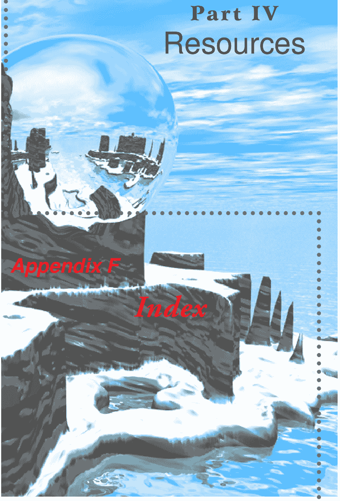

## 附录 F

## 索引

使用**粗体**字体的页码表示该主题最重要的一页（主要定义/描述）。

请注意，附录页码从 900 开始，一直延伸到本书末尾。

有关 HTML 元素的更多信息和示例，请参阅 CD-ROM 中《在线指南》的第 1-6 章，该指南是《HTML 入门》的扩展版本。

## 字符与符号

| 符号 | 描述 | 页码 |
| :--- | :--- | :--- |
| `<>` | HTML 元素标识符 | 903 |
| `<` | 关系运算符：小于 | 515 |
| `<=` | 关系运算符：小于或等于 | 515 |
| `>` | 关系运算符：大于 | 515 |
| `>=` | 关系运算符：大于或等于 | 515 |
| `=` | 赋值运算符 | 473, 517 |
| `==` | 关系运算符：等于 | 515, 897 |
| `!=` | 关系运算符：不等于 | 515, 897 |
| `!==` | 关系运算符：严格等于 | 896 |
| `!==` | 关系运算符：严格不等于 | 897 |
| `+` | 加法 | 515 |
| `+` | 字符串拼接 | 517 |
| `+=` | 加法赋值 | 517 |
| `+=` | 字符串拼接赋值 | 516 |
| `++i` | 一元前置递增 | 516 |
| `i++` | 一元后置递增 | 516 |
| `-` | 减法 | 515 |
| `-=` | 减法赋值 | 517 |
| `--i` | 一元前置递减 | 516 |
| `i--` | 一元后置递减 | 516 |
| `*` | 乘法 | 515 |
| `*=` | 乘法赋值 | 517 |
| `/` | 除法 | 515 |
| `//` | HTML 结束标签内部 | 903 |
| `//` | 在 URL 中 | 448 |
| `/=` | 除法赋值 | 516 |
| `%` | 取模/求余 | 515 |
| `%=` | 取模赋值 | 517 |
| `&` | 按位与 (AND) | 517 |
| `&` | 表单数据编码（见在线指南第 6 章） | |
| `&` | 在 search 属性的查询搜索中 | 449 |
| `&` | 作为 `<a>` 标签 HREF 属性的 mailto 协议中的字段分隔符 | 448-450 |
| `&=` | 按位与赋值 | 517 |
| `&&` | 逻辑与 (AND) 运算符 | 516 |
| `&amp;` | HTML Ampersand 实体 | 857 |
| `\|` | 按位包含或 (OR) | 517 |
| `\|\|` | 逻辑或 (OR) | 516 |
| `\|=` | 按位包含或赋值 | 517 |
| `!` | 逻辑非 (NOT) | 516 |
| `^` | 按位异或 (XOR) | 517 |
| `^=` | 按位异或赋值 | 517 |
| `~` | 按位非 (NOT) | 517 |
| `>>` | 按位右移 | 518 |
| `>>=` | 按位右移赋值 | 517 |
| `>>>` | 无符号右移（零扩展右移） | 518 |
| `>>>=` | 无符号右移赋值 | 517 |
| `<<` | 按位左移 | 518 |
| `<<=` | 按位左移赋值 | 517 |
| `()` | RegExp 正则表达式模式部分 | 812 |
| `[]` | 数组字面量表示法 | 685-686 |
| `[]` | 数组元素下标 | 681-682 |
| `[]` | 用于函数 | 371 |
| `[]` | 在 if() 语句中 | 475 |
| `[]` | 对象字面量表示法 | 407 |
| `? :` | 三元条件运算符语句 | 480 |
| `,` | 逗号运算符 | 514 |
| `#` | 锚点中的井号 | 448 |
| `#` | 在 URL 中 | 448 |
| `#` | 在十六进制颜色三元组中 | 1031 |
| `<!--...-->` | HTML 多行注释 | 29 |
| | 绝不隐藏 JavaScript 样式 | 388 |
| | 用于隐藏 CSS 样式代码 | 225, 226, 233 |
| | 用于隐藏 JavaScript 代码 | 401, 402, 406 |
| `//...` | JavaScript 单行注释 | 508 |
| `//...` | JSS 单行注释 | 18, 182 |
| `/*...*/` | CSS 多行注释 | 18 |
| | JavaScript 多行注释 | 508 |
| | JSS 多行注释 | 18, 182 |
| `/regexp/` | 正则表达式字面量 | 808 |
| `\` | 转义序列 | 197, 442-443, 856-857 |
| `\\` | 字面量反斜杠字符 | 857 |
| `\/` | 字面量正斜杠字符 | 197 |
| `\f` | | 817 |
| `\n` | | 817 |
| `\r` | | 817 |
| `\s` | | 817 |
| `\S` | | 817 |
| `\t` | | 817 |
| `\v` | | 817 |
| `\w` | | 817 |
| `\W` | | 817 |
| `\n` | 其中 'n' 是正整数 | 818 |
| `\ooctal` | | 818 |
| `\xhex` | | 818 |
| `\dec` | | 818 |

## RegExp 核心对象属性

| 属性 | 描述 | 页码 |
| :--- | :--- | :--- |
| `$_` | 同 **input** | 807 |
| `$&` | 同 **lastMatch** | 807 |
| `$+` | 同 **lastParen** | 807 |
| `` $` `` | 同 **leftContext** | 807 |
| `$'` | 同 **rightContext** | 807 |
| `$*` | 同 **multiline** | 807 |
| `$1` | 第一个括号捕获组匹配子串 | 807 |
| `$2` | 第二个括号捕获组匹配子串 | 807 |
| `$3` | 第三个括号捕获组匹配子串 | 807 |
| `$4` | 第四个括号捕获组匹配子串 | 807 |
| `$5` | 第五个括号捕获组匹配子串 | 807 |
| `$6` | 第六个括号捕获组匹配子串 | 807 |
| `$7` | 第七个括号捕获组匹配子串 | 807 |
| `$8` | 第八个括号捕获组匹配子串 | 807 |
| `$9` | 第九个括号捕获组匹配子串 | 807 |

## 正则表达式中的特殊字符：

| 符号 | 描述 | 页码 |
| :--- | :--- | :--- |
| `\` | 正则表达式中的转义序列 | 779, 809, **814**, 818 |
| `^` | | 814 |
| `$` | | 814 |
| `*` | | 814 |
| `+` | | 815 |
| `?` | | 815 |
| `.` | | 815 |
| `(x)` | | 815 |
| `x \| y` | | 815 |
| `{n}` | | 815 |
| `{n,}` | | 816 |
| `{n,m}` | | 816 |
| `[xyz]` | | 816 |
| `[^xyz]` | | 816 |
| `[\b]` | | 816 |
| `\b` | | 816 |
| `\B` | | 816 |
| `\cX` | | 817 |
| `\d` | | 817 |
| `\D` | | 817 |


 # A

- `<A>` 元素（参见在线指南）
  - 作为锚点 935
  - 作为链接 936
  - 用于加载 URL 的 HREF 936
    - javascript 协议 451
    - void() 运算符 514
    - 用于电子邮件的 mailto 协议 448
    - body 字段 451
  - 通过 `<BODY LINK>` 设置颜色 909
  - 用于设置目标的 TARGET 936
    - _blank 936
    - _parent 936
    - _self 936
    - _top 936
  - 使用事件处理器
    - defaultStatus 418
    - 用于消息的 status 424, 429, 514
  - 使用 RegExp 对象的 input 属性 805
  - 使用 String 对象的 link() 方法创建链接 795-796
- A 作为 TYPE 属性的值（参见在线指南）
  - `<LI>` 931
  - `<OL>` 932
- a 作为 TYPE 属性的值（参见在线指南）
  - `<LI>` 931
  - `<OL>` 932
- Location 对象 protocol 属性的 about: 值 448, 450
- ABOVE 属性
  - `<LAYER>` 161-163, 166
  - `<ILAYER>` 166, 173
- 用于定位 Layer 对象内容的 above 属性 210
- Math 对象的 abs(x) 方法 321, 322, 329, 792
- position CSS 属性的 absolute 值 129-132, 134, 135, 158
- position JSS 属性的 absolute 值 196, 547, 548, 550, 553
- 关键字值中的 absolute 类别
  - font-size CSS 属性 23-24
- 绝对单位 12
- Math 对象的 acos(x) 方法 322, 328
- ACTION 属性 `<FORM>`（参见在线指南）1004
- 向对象实例添加属性
  - 在其定义之后 402, 405-408
- 向对象类型添加属性
  - 使用 prototype 属性 402, 403-404
- `<ADDRESS>` 元素（参见在线指南）931
- window 对象的 alert() 方法 338, 344-346, 420, 489, 665, 668, 670, 674, 675, 742, 839, 846
  - 在其中使用特殊字符 753
- align JSS 属性 194-195, 231, 237, 242
  - 等同于 float CSS 属性 62-65
- `<BODY>` 的 ALINK 属性（参见在线指南）909
- document 对象的 alinkColor 属性 610, 612
- 替代文本
  - 对于小程序，使用 `<APPLET>` 中的 ALT 1020
  - 对于框架 `<NOFRAMES>` 1001-1002
  - 对于图像，使用 `` 的 ALT 属性 942
  - 对于图层 `<NOLAYER>` 176
  - 对于脚本 `<NOSCRIPT>` 184
- String 对象的 anchor() 方法 794, 796
- 锚点，使用以下方式创建（参见在线指南）
  - `<A>` 元素 935
  - String 对象的 anchor() 方法 794, 796
- document 对象的 anchors[i] 数组 433
- 裁剪矩形的动画
  - 用于显示图像 250
  - 以及弹出图像 251
- 图层和图像的动画 590
  - 离屏和屏内 264
- 自动动画图层以及点击图像时 591
  - Event 对象的 e.target.name 属性 595
  - 在框架集中 604
  - 移动图像作为边框 351
  - window 对象的 setInterval() 方法 250, 284, 285-288, 372, 422, 430-431
  - window 对象的 setTimeout() 方法 250, 251-253, 256-258, 260-261, 263-265, 273-283, 286, 288, 289, 296, 300-305, 308, 310, 313, 319, 323, 325, 353, 355, 359, 372, 422, 591-592, 594-595, 599, 600-604, 607-608, 619-620
- navigator 对象的 appCodeName 属性 455
- `<APPLET>` 元素（参见在线指南）1020
- 小程序（参见在线指南）1020
  - 参数 `<PARAM>` 1020
  - 通过 `<APPLET>` 包含 1020
  - 通过 `<OBJECT>` 包含 1021
- Document 对象的 applets() 数组 387, 433
- navigator 对象的 appName 属性 455-456
- navigator 对象的 appVersion 属性 455-456
- `<APPLET>` 的 ARCHIVE 属性 1020
- `<AREA>` 元素（参见在线指南）947-952
- 图像和多个超链接 947-952
- Function 对象的 arguments() 数组 380, 381
- argument() 数组属性 382-385
  - length 382-384
  - argument_n, ... N 382-384
  - varname_n, ... N 382-384
  - caller 382-385, 880
  - callee 382-385
- 算术运算符 515
  - (+) 加法 515
  - (-) 递减 516
  - (/) 除法 515
  - (++) 递增 287, 289, 381, 441, 443, 484-486, 492-495, 497, 509, 514, 516, 684-688, 689, 691, 692, 724, 725, 727, 742, 759, 849, 849
  - (%) 取模 207, 516
  - (*) 乘法 515
  - (-) 减法 515
  - （一元否定）515
- Array 对象 681, 682-745
- Array 对象方法 693
  - concat() 方法 693-695, 696-703
  - join() 方法 693-695, 703-704, 719
  - pop() 方法 693-695, 705-706
  - push() 方法 693-695, 707-708
  - reverse() 方法 693-695, 722
  - shift() 方法 693-695, 709-710
  - slice() 方法 693-695, 713-715
  - sort() 方法 693-695, 722-726-728
  - compareFunction 函数 723-728
  - splice() 方法 693-695, 716-718
  - toSource() 方法 859-860
  - toString() 方法 693, 719-721
  - unshift() 方法 693-695, 711-712
- Array 对象方法：
  - 使用其中大部分方法的示例 694-695
- Array 对象属性 693
  - index 属性 693, 735-738
  - input 属性 693, 736-738, 739
  - length 属性 681-686, 688, 693, 699, 705-712, 676, 714, 724, 725, 727-728, 846, 849
  - prototype 属性 693
- 数组 681-744
  - 数组元素 681-687
  - 数组元素方法
    - toString()
      - 326-327, 336, 343, 345, 346, 348, 719
  - 空数组元素 687
  - 核心 Array 对象 681
  - 使用以下方式声明
    - Array() 构造函数 681-683, 687-692, 694, 696-699, 701, 704, 706, 722, 724-728, 741, 845, 848, 849, 858
    - 密集 681, 683-685, 697, 698, 700, 704, 705, 747
    - 字面量表示法 685-687, 694, 707, 709, 711, 714, 716
    - 确定长度 693
    - 减少长度 699-700
    - 动态填充 TABLE 740-743
    - 初始长度 681-683
    - 增加长度 682
  - 方法摘要 693
  - 属性摘要 693
  - 从以下方法返回
    - 单个 RegExp 对象的 exec() 方法 729, 733-735, 739, 813, 825, 826-828, 830-831, 834-837, 839-841, 843
  - 从 String 对象的 match() 方法返回 729-731, 732-736, 739, 770, 772, 774, 775, 777, 804, 825, 833, 840, 845-847, 849
  - 从 String 对象的 split() 方法返回 338, 339, 341, 346, 437-441, 443, 736-738, 782-787
  - 从 String 对象方法返回 729-732, 736-738
  - 三维数组 690-692
  - 二维数组 687-689
  - 将 for() 与数组一起使用 200, 381, 440-441, 443, 484-485, 494, 723-727, 740-742, 847-851
  - 使用 write() 方法从另一个框架内部创建数组 740-743, 845-851
  - 版本 1.3 对 Array 的更改
    - Array() 构造函数 858
    - length 属性 859
    - toSource() 方法 859
    - toString() 方法 860
- Event 对象 which 属性的 ASCII 值 628
- Math 对象的 asin(x) 方法 322, 328
- 通过 STYLE 属性分配图层 130-134, 159
- 使用 ID 属性为图层分配名称 199, 201-203, 211, 220, 222, 224, 231, 234, 237, 238, 242, 244, 249, 252, 254, 255, 257-259, 261, 262, 268-272, 285-288, 290-291, 296-299, 323, 330, 334, 349, 353-354, 356-360, 468, 504, 531, 533, 534-536, 538-541, 546, 551, 554, 558, 560-578, 581-583, 589, 592, 593, 596
  - 在 write() 方法中 312, 318, 327, 343
- 通过 CLASS 属性分配样式 5-7, 15, 72-82, 84-86, 88-93, 100-103, 558, 560-578, 581, 589, 593, 596
  - 在 write() 方法中 312, 318, 327, 343
  - 上下文选择条件 93-103
  - contextual() 方法 191-192
  - ID 属性 83-92, 103, 106, 112, 113, 135, 136, 138, 141, 144, 147, 150, 152-161, 163, 171, 175, 187, 188, 192, 199, 247, 548, 551, 554, 590, 592
  - `<SPAN CLASS>` 110-113, 245, 354
  - `<SPAN ID>` 112-113
  - `<SPAN STYLE>` 105-109, 111, 113, 296, 298-299, 531-541
  - STYLE 属性 104-111, 113, 296, 298-299, 532-541
  - classes 属性 185-186, 190-192, 231, 237, 241, 242, 245, 248, 251, 253, 257, 259, 261, 268, 290, 292, 293, 309, 311, 317, 323, 326, 334, 342, 352, 546, 558, 581, 588, 592, 596, 605, 607, 612, 618, 623, 628, 632, 648, 652, 694, 741
    - 在 write() 中 312, 318, 327, 343
  - ids 属性 187-188, 191, 352, 548, 550, 554, 588, 612, 624, 632, 648, 657
    - 在 write() 中 651, 656, 741
  - tags 属性 183-184, 189-191, 192, 194, 222, 224, 231, 236, 241, 243, 245, 248, 268, 309, 323, 334, 352, 356, 502, 550, 553-554, 588, 624, 694
    - 在 write() 中 656, 741
- 赋值行为 898
- 赋值运算符 517
- 赋值语句 473
- Math 对象的 atan(x) 方法 322, 328, 331
- Math 对象的 atan2(y,x) 方法 322
- 将同一 CLASS 附加到多个元素 78
- HTML 元素的属性 907
- auto 关键字
  - margin CSS 属性的值 31
  - margins() JSS 方法的值 195
  - width CSS 属性的值 59
  - width JSS 属性的值 195
- 每个 Event 对象的可用事件属性 529


 ## 附录 F — 索引

## B

- `<B>` 元素 (参阅在线指南) 919
- `back()` 方法，属于：
  - `window` 对象 420
  - `history` 对象 **452**, 453, 994
- BACKGROUND 属性，属于：
  - `<BODY>` 353, 605, **909-910**
  - `<LAYER>` 13, **167**
  - `<ILAYER>` **167**, 173
- `background` 属性，属于 `Layer` 对象 **215**, 325
- `background-color` CSS 属性 8, 11-12, 20, 21, 26, 37, **40**, 41-50, 54-56, 75-78, 80, 82-85, 87, 91-92, 296, 651
- `backgroundColor` JSS 属性 189-190, 192, **194-195**, **205**, 214, 231, 236, 237, 241, **246**, 268, 290, 309, **312**, 352, 651, **657**
- `background-image` CSS 属性 11-13, **42**, 43, 84-87, 89, 152, 154, 156, 161
- `backgroundImage` JSS 属性 **194-195**, 205, 215, 357-359
- `<BASE>` 元素 (参阅在线指南) 1021
- `<BASEFONT>` 元素 (参阅在线指南) 925, 174, 374, 375, 377, 504
- BELOW 属性，属于：
  - `<LAYER>` 162, 163, **166**
  - `<ILAYER>` **166**, 173
- `below` 属性，属于 `Layer` 对象 210
- BGCOLOR 属性 (参阅在线指南)
  - `<BODY>` 907, 909
  - `<LAYER>` 145, 161, 163, **167-171**, 222, 224, 234, 296-298, 468, 504, 531, 533-536, 538-541, 546, 558, 581-582, 625, 626, 631, 632, 645, 665
  - `<ILAYER>` **167**, 173-175, 431
  - `<TABLE>` 955, 956-957
  - `<TD>` 968
  - `<TH>` 965, 967
  - `<TR>` 963-964
- `bgColor` 属性，属于 `document` 对象 340, 343, 344, 346-348, 367, 371, 372, 373, 376, 377, 379, 385, 399, 400, 417, 426, 432,URLRequest **433**, 476, 480, 500, 511, 512, 533, **609**, **651**, **657**, 760, 764, 765, 768, 772, 773, 823
- `bgColor` 属性，属于 `Layer` 对象 214, 243, 285, 286, 287, 289, 325, 369, 477, 480, 482, 534, 535, 536, 537, 546, 547, 560, 651, 664, 666, 671, 676
- `<BIG>` 元素 (参阅在线指南) 924
- `big()` 方法，属于 `String` 对象 **797**, 799
- 位运算符 517
- `<BLINK>` 元素 (参阅在线指南) 924
- `blink()` 方法，属于 `String` 对象 **797**, 799
- 块级文本元素 (参阅在线指南)
- `<BLOCKQUOTE>` 元素 (参阅在线指南) 926
- `<BODY>` 元素 (参阅几乎任何示例) 907-910
  - 带有 `onLoad` 事件处理器 285, 286, 288, 401, 431, 765, 768, 772, 773, 824, 827, 831, 839, 844, 851
- `bold()` 方法，属于 `String` 对象 **797**, 799
- `Boolean` 对象 386, 388
- BORDER 属性 (参阅在线指南)
  - `<EMBED>` **1013**, **1015**
  - `<FRAMESET>` 972, **975-976**, 993, 939, 940, **943**, 946, 950
  - `<TABLE>` 954, **956-958**, 959-961
- BORDERCOLOR 属性 (参阅在线指南)
  - `<FRAME>` 978, **989-990**
  - `<FRAMESET>` 972, 976, 977, 978, 987
  - `<TABLE>` **956-957**, 959, 960
- 边框宽度- CSS 概述 52
- `border-bottom-width` CSS 属性 11-12, 52-53, 54-55, 80, 82
- `border-color` CSS 属性 11-12, 17, 33, 36, 37, 38, 41-47, **48**, 49-51, 54-56, 59-61, 63, 65, 74, 80, 82, 104, 107-109, 111, 113, 117, 118, 120, 122, 123, 133, 134, 138, 141, 144, 147, 150, 152, 154, 171, 175, 246
- `border-left-width` CSS 属性 11-12, 52-53, 54-55, 80, 82
- `border-right-width` CSS 属性 11-12, 52-53, 54-55, 80, 82
- `border-style` CSS 属性 11-12, 33, 36, 38, 41-45, **46**, 47-51, 54-56, 59-61, 63, 65, 74, 80, 82, 104, 107-109, 111, 113, 117, 118, 120, 122, 123, 133, 134, 138, 141, 144, 147, 150, 152, 154, 171, 175, 246
- **`border-top-width`** CSS 属性 11-12, 52-53, 54-55, 80, 82
- **`border-width`** CSS 属性 11-12, 51-52, 54-56, 59-61, 63, 65, 74, 80, 82, 104, 107-109, 111, 113, 117, 120, 122, 123, 133, 134, 138, 141, 144, 147, 150-152, 154, 171, 175, 246
- **`borderBottomWidth`** JSS 属性 194-195, 292, 311, 312, 317, 318, 327, 343, 352
- **`borderBottom`** CSS 属性 194-195, 231, 236, 237, 241, 242, 248, 251, 253, 257, 259, 268, 290, 293, 352, 502, 548, 550, 553, 592, 596, 605, 607, 612, 618, 656-657, 741
- **`borderLeftWidth`** JSS 属性 194-195, 292, 311, 312, 317, 318, 327, 343, 352
- **`borderRightWidth`** JSS 属性 194-195, 292, 311, 312, 317, 318, 327, 343, 352
- **`borderStyle`** JSS 属性 194-195, 231, 236, 237, 242, 248, 251, 253, 257, 259, 268, 290, 293, 302, 352, 502, 548, 550, 553, 592, 596, 605, 607, 612, 618, 656-657, 741
- **`borderTopWidth`** JSS 属性 194-195, 292, 311, 312, 317, 318, 327, 343, 352
- **`borderWidths()`** JSS 函数 194-195, 231, 236, 237, 242, 248, 251, 253, 257, 259, 268, 290, 293, 302, 352, 502, 548, 550, 553, 592, 596, 605, 607, 612, 618, 656-657, 741
- **Bottled Link 全球排名所有者元素** 81-82
- **break 语句** 473, 474, 481-483, 489-490, 491-494, 496, 589, 624-628, 631, 633-644, 649
- `<BR>` 元素 (参阅在线指南) 915
- **浏览器** 915
  - 关于 URL (语法) 448
  - 名称 455, 456-457
- `clip` CSS 属性的 bug 版本 139-141
- `clip` CSS 属性的无 bug 版本 142

## C

- `callee` 属性，属于 `arguments[]` 数组 382-383
- `caller` 属性，属于 `arguments[]` 数组 382-383
  - 函数对象 380
- 通过属性赋值调用函数 372, 376
  - `onClick` 286, 288, 314, 320, 330, 331-334, 349, 354, 376, 385, 400, 401, 424, 453-454, 533, 554, 558, 581, 665-668, 670, 674, 675, 756, 757, 760, 768, 827, 831, 839, 844, 851
  - `onLoad` 607, 618
  - `onChange` 652-655
- 通过名称调用函数 673
- 通过属性赋值调用函数 376
- 在函数内部调用函数 375
- `<CAPTION>` 元素 (参阅在线指南) 962
- `captureEvents()` 方法 420, 434, 487, 524, 528, 543-548, 551, 555, 560-578, 580, 583, 586, 589-591, 593, 597, 608, 613-614, 623, 625, 631, 645-648, 662-663, 665, 669-674, 676
- 捕获与释放事件 543
- 在嵌套层中捕获事件 543, 663-676
- 捕获事件以通过拖动层来调整其大小 661-662
- 捕获事件以通过鼠标拖动图像 547-549, 550-556, 558-576
- 为 `window` 对象捕获事件
  - 为了获得更好的结果而拖动图像 553
- 捕获 KEYPRESS 和 KEYUP 事件 528, 580, 583, 586, 589, 613, 631, 645, 649

语句类别 473

- **`ceil(x)`** 方法，属于 `Math` 对象 322, 329
- CELLPADDING 属性 `<TABLE>` (参阅在线指南) 956, 958, 34, 50, 81, 86, 88, 90, 92, 330, 349
- CELLSPACING 属性 `<TABLE>` (参阅在线指南) 956, 958, 34, 50, 81, 86, 88, 90, 92, 330, 349
- `<CENTER>` 元素 (参阅在线指南)
- **center** 值，属于：
  - `align` CSS 属性 194-195
  - `float` CSS 属性 11-12, 50, 62, 63, 69-71, 84, 85, 87, 89, 96, 104, 111, 113, 296
  - `text-align` CSS 属性 11-12, 21, 28, 29, 44, 45, 84, 85, 87, 89, 119, 296, 298, 299
  - `textAlign` JSS 属性 194-195, 222, 234, 236-237, 241-243, 245, 248

- CHALLENGE 属性 `<KEYGEN>` (参阅在线指南) 1012
- JavaScript 1.3 版本的变更
  - 条件测试行为的变更 898
  - 对象的变更 858
  - 运算符的变更 897
  - Array 对象的变更 858
  - Date 对象的变更 862
  - Function 对象的变更 880
  - String 对象的变更 888
  - 顶级函数的变更 896
- String 对象的字符数组 749, 754, 759
- `charAt()` 方法，属于 String 对象 338, 340, 341, 343, 345, 346, 350, 759-760
- `charCodeAt` 方法，属于 String 对象 750, 761-762
- 所有 JavaScript 语句图表 474
- 所有示例文件主题图表 1040-1047
- `<INPUT>` TYPE=CHECKBOX 1008
- `<INPUT>` TYPE=RADIO 1007
- **`checked`** 属性，属于 `checkBox` 对象 651, 847
- 国际象棋游戏 — 示例 556-579
- **样式表中的子元素 - 继承问题** 27, 77, 92, 98
- 子层 146, 167, 218
- 子对象 367, 419
- **circle** 值 (参阅在线指南)
  - `list-style-type` CSS 属性 11, 68, 96-97
  - `listStyleType` JSS 属性 195
  - SHAPE 属性 `<AREA>` 949, 950, 951
  - TYPE 属性 `<LI>` 931
  - TYPE 属性 `<UL>` 932
- **圆形坐标** 用于 (参阅在线指南)
  - COORDS 属性 `<AREA>` 949, 951
- `<CITE>` 元素 (参阅在线指南) 45, 95, 97, 100, 926
- **CLASS 属性 — 大多数元素的样式类** 5, 6, 7, 8-14, 12, 80-82, 81.14, 82-86, 88-93, 88.0, 100-103, 558, 560-578, 581, 589, 593, 596
- **`classes`** 属性，属于 `document` 对象 185-186, 190-192, 231, 237, 241, 242, 245, 248, 251, 253, 257, 259, 261, 268, 290, 292, 293, 298, 309, 311, 317, 323, 326, 334, 342, 346, 352, 558, 581, 588, 592, 596, 605, 607, 612, 618, 628, 652, 692, 741
  - 在 `write()` 方法中 318, 322, 337, 343
- CLASSID 属性 `<OBJECT>` (参阅在线指南) 829, 1021
- **CLEAR 属性 `<BR>`** (参阅在线指南) 118, 915
- `clear` CSS 属性 11-12, 62, 64-65


## 第四部分 — 资源

CLIP Attribute \<ILAYER\> 163, 173

**clip** CSS 属性
- 存在缺陷的版本 139-141
- 修复后的版本 142-145

**clip.bottom** **Layer** 对象的属性
**211**, **212**, **213**, **214**, 248, 249, 469, 476

**clip.height** **Layer** 对象的属性
**211**, **212**, **214**, 219, 358, 359, 469, 476, 591, 593, 595, 597-602, 604, 607, 608, 619-620

**clip.left** **Layer** 对象的属性
**211**, **212**, **214**, 469

**clip.right** **Layer** 对象的属性 213
**211**, **212**, **213**, 248, 249, 251-253, 256, 280-283, 469, 475, 476, 591-595, 598-604, 607, 608, 619-620

**clip.top** **Layer** 对象的属性 212
**211**, **212**, **214**, 280-283, 469, 475, 591-595, 598-604, 607, 608, 619-620

**clip.width** **Layer** 对象的属性
**211**, **212**, **213**, 217, 219, 355, 357, 359, 469, 475, 476, 544-547, 591, 593, 595, 597-599, 601-602, 604, 607, 608, 619-620

裁剪矩形 139-145, 211（参见 **Layer** 对象的六个 **clip** 属性）
- 动画过渡
  - 显示图像 250
  - 弹出图像 251
- 裁剪属性的默认值 212

**close()** **document** 对象的方法
198, 219, **230**, 232, 236, 238-240, 242, 243, 284, 312, 318, 327, 344, 425, 426, 428, 432, **434**, 435, 657, 742, 846, 850

**close()** **window** 对象的方法
284, 416, **420**, 427, 428

**closed** **window** 对象的布尔属性 418

\<CODE\> 元素（参见在线指南） 930

CODE Attribute \<APPLET\>（参见在线指南） 1020

CODEBASE Attribute \<APPLET\>（参见在线指南） 1020

CODEBASE Attribute \<OBJECT\>（参见在线指南） 1021

HTML 中的颜色 1030-1037 参见 \<BODY\> 元素
- 设置文本颜色 参见 TEXT Attribute
- 设置背景颜色 参见 BGCOLOR Attribute
- 设置链接颜色 参见 LINK Attribute
- 设置活动链接颜色 参见 ALINK Attribute
- 设置已访问链接颜色 参见 VLINK Attribute

样式表中的颜色 **37**, 1030-1037

颜色转换计算器示例 340-350

颜色名称 1033-1037

颜色单位 1031-1032

颜色值 1033-1037

COLOR Attribute \<FONT\>（参见在线指南）
**313**, 319, 349, 353, 354, 374, 645, 925

**color** CSS 属性
**37-38**, 43, 44, 45, 56, 59-61, 63, 65, 67, 69-78, 80, 82-85, 87, 89, 91-113, 117-120, 122-124, 130, 131, 133-136, 138, 141, 144, 145, 147, 150, 152-156, 159, 171
- 使用 rgb() 函数 56, 80, 109-111, 113, 117, 118, 151, 152, 171, 175, **1031-1032**

**color** JSS 属性
185-192, **194-195**, 222, 224, 231, 236, 237, 241-243, 245, 248, 251, 253, 257, 259, 261, 268, 290, 292-293, 309, 311, 312, 317, 318, 323, 326, 327, 334, 342, 343, 352, 502, 546, 588, 623, 628, 632, 648, 652, 694, 741
- 使用 rgb() 函数 194-195, **1031-1032**

COLS Attribute（参见在线指南）
- FRAMESET 360, 454, **457**, 458, 609, 620, 659, **972**, **973**
- TEXTAREA 440, 442, 658, 775, 777, **1010**

COLSPAN Attribute \<TD\>（参见在线指南） 967-968

COLSPAN Attribute \<TH\>（参见在线指南）
57, 331, 332, 349, 626, **965-966**

合并样式表 121-124

逗号运算符 514

注释语句 9, 508

# 附录 F — 索引

- CSS 语法注释 18
- 不要隐藏 JavaScript 样式表语法 184
- HTML 注释 918
- JavaScript 语法注释 18, 508
- 隐藏 CSS 样式表语法 9
- 隐藏 JavaScript 脚本内容 197
- COMPACT Attribute \<DL\>（参见在线指南） 933
- **compareFunction** 函数 722, 723-728
- 比较运算符 515
- 各 **RegExp** 对象的 **compile()** 方法 819, 830-831
- **Array** 对象的 **concat()** 方法 693-694, 696-703
- **String** 对象的 **concat()** 方法 750, 755-758
- 条件运算符 **?:** 316-317, 319, 353, 473, 474, 480, 509
- 条件语句 475
  - **?:** 316-317, 319, 353, 473, 474, 480, 509
  - **if ()** 和 **if ()...else**（嵌套与非嵌套） 250-253, 256, 258, 260, 261-265, 273-283, 285-287, 289, 300-305, 310, 313, 316-317, 319, 327, 338, 343-348, 355-359, 375, 377, 399-400, 410, 414, 431, 441, 443, 445, 457, 474, 475, 476-479, 480, 487-489, 491-497, 528, 531, 533-535, 537-540, 542, 546, 548, 549-553, 555, 556, 560-578, 580, 584, 585, 589, 593-595, 597-604, 606-608, 611, 614-617, 619, 620, 624, 628-630, 633-643, 649, 655, 662, 664, 665, 668-671, 674, 676, 723, 724, 726-728, 742, 760, 765, 768, 772, 773, 775, 777, 823, 824, 827, 831, 839, 844, 846, 847, 849, 850, 851
  - **switch()** 481-483, 491, 586-589, 623-624, 628-630, 633-643, 648-649, 764, 771, 821
- **window** 对象的 **confirm()** 方法 420, 839, 844
- CONTENT Attribute \<META\>（参见在线指南） 1023
- CSS 样式中的上下文选择 93-98, 99-103
  - JSS 样式中的 **contextual()** 方法 191-192
- **continue** 语句 494-497
- 使用 JavaScript 控制外部框架 609
- **document** 对象的 **cookie** 属性 436-443
  - 处理 **cookie** 值 439-443
  - 存储 **cookie** 值 439-443
- COORDS Attribute \<AREA\>（参见在线指南） 949-952
- 核心 **Function** 对象 378-380
  - **arguments[i]** 数组 380-384
  - **arguments[i]** 数组属性 382-384
    - **length** 382-384
    - **argName1, ..., N** 382-384
    - **varName1, ..., N** 382-384
    - **caller** 382-384, 880
    - **callee** 382-384
  - 方法 380, 880
  - 属性 380
- 核心函数 378
  - JavaScript 1.2 新增 467-469
  - JavaScript 1.3 新增 895
  - 摘要图表 388
- 核心 **Object** 对象 389-415
- 核心 **Object** 对象摘要图表 388
- **Math** 对象的 **cos()** 方法 321-322, 327
- 使用以下方式创建数组
  - **Array()** 对象构造函数 681-683, 687-692, 694, 696-699, 701, 704, 706, 722, 724-728, 741, 845, 848, 849, **858**
  - 密集数组 681, 683-685, 697, 698, 700, 704, 705, 740
  - 字面量表示法 685-687, 694, 707, 709, 711, 714, 716
- 创建搜索引擎 847-851
- 创建时间计数器并显示时间 308-314
- 创建 **Date** 对象
  - 使用四种 **Date()** 构造函数 308
- 动态创建框架 456
- 创建层
  - 使用 CLASS of STYLE 131
  - 使用 STYLE Attribute 130
  - 使用 CSS 语法 130
  - 使用 JavaScript 语法 182-195
  - 使用 \<ILAYER\> 元素 173-175
  - 使用 \<LAYER\> 元素 **162-171**
- 为对象创建方法 392-395
- 使用构造函数创建对象 390-391
- 使用字面量表示法创建对象 407-411
- 创建订单表单（参见在线指南）
- 使用字面量表示法创建 **String** 对象 752
- 创建三维数组 690-692
- 创建二维数组 687-689
- 创建用户自定义文档 650-659
- CSS（层叠样式表） 2-176
  - CSS 语法与 JavaScript 语法
    - 属性对照图表 12
  - CSS 语法属性与用于定位层的 LAYER Attribute 图表 13
  - CSS 语法属性与 LAYER Element Attribute 对照图表 161
  - CSS 语法属性图表 11
- 循环切换层背景颜色 285-289

## D

- DATA Attribute \<OBJECT\>（参见在线指南） 1021
- **Date** 对象 307-308, 309-314, 316-319, 353, 443, 467-468, 510, 513
  - 使用四种 **Date()** 构造函数创建 308
- **_TEMP** 对象方法摘要 307
- **Date** 对象方法
  - **getDate()** 方法 307, 319, 353
  - **getDay()** 方法 307
  - **getFullYear()** 方法 862
  - **getHours()** 方法 307, 319, 353
  - **getLength()** 方法 307
  - **getMilliseconds()** 方法 862, 864
  - **getMinutes()** 方法 307, 319, 353
  - **getMonth()** 方法 307, 319, 353
  - **getSeconds()** 方法 307, 319, 353
  - **getSelection()** 方法 307
  - **getTime()** 方法 307
  - **getTimezoneOffset()** 方法 307
  - **getUTCDate()** 方法 862, 867
  - **getUTCDay()** 方法 862, 868
  - **getUTCFullYear()** 方法 862, 866
  - **getUTCHours()** 方法 862, 868
  - **getUTCMilliseconds()** 方法 862, 869
  - **getUTCMinutes()** 方法 862, 869
  - **getUTCMonth()** 方法 862, 867
  - **getUTCSeconds()** 方法 862, 869
  - **getYear()** 方法 307, 319, 353
  - **parse()** 方法 307
  - **setDate()** 方法 307
  - **setFullYear()** 方法 862, 865
  - **setHours()** 方法 307
  - **setMilliseconds()** 方法 862, 865-866
  - **setMinutes()** 方法 307
  - **setMonth()** 方法 307
  - **setSeconds()** 方法 307
  - **setTime()** 方法 307
  - **setYear()** 方法 307
  - **setUTCDate()** 方法 862, 871
  - **setUTCFullYear()** 方法 862, 870
  - **setUTCHours()** 方法 862, 872
  - **setUTCMilliseconds()** 方法 862, 874
  - **setUTCMinutes()** 方法 862, 872-873
  - **setUTCMonth()** 方法 862, 870, 871
  - **setUTCSeconds()** 方法 862, 873
  - **toGMTString()** 方法 307
  - **toLocaleString()** 方法 307
  - **toUTCString()** 方法 862, 874
  - **UTC()** 方法 307
- **Date** 对象方法 — 1.3 版新增 862-874
- **Date** 对象属性摘要 307
- \<DD\> 元素（参见在线指南） 934
- **String** 对象的装饰性方法 749, **797-799**
- 递减运算符 (--) 516
- 裁剪属性的默认值 212
- **options[i]** 数组的 **defaultSelected** 属性 465
- **option** 对象的 **defaultSelected** 参数 465
- **option** 对象的 **defaultSelected** 属性 466
- **window** 对象的 **defaultStatus** 属性 416, 418, 469
- 定义 CLASS of STYLE 但不附加到元素 75, 77-78
- 使用 **function** 语句定义函数 371


# 附录 F — 索引

定义事件处理器 530
通过属性赋值 532-534
通过属性赋值 530, 535-542, 544-547, 548-549, 551-553
（有关如 `onclick` 和 `onmouseover` 等事件处理器的详细信息，请参阅各条目）

`delete` 语句 508

密集数组 681, **683-685**, 697-698, 700, 704-705, 740

删除对象 411

确定按键的 ASCII 值 541

通过 **window** 对象实现对话框窗口
`alert()` 方法 338, 344-345, **420**, 489, 665-668, 670, 674-675, 742, 753, 839, 844, 846
`confirm()` 方法 **420**, 839, 844
`prompt()` 方法 421

<DFN> 元素（参见在线指南） 930

<DIR> 元素（参见在线指南） 934

`<LI>` 和 `<UL>` 中 TYPE 属性的 `disc` 值（参见在线指南） 931, 932

<DIV> 元素（参见在线指南） 18, 23, 26, 30, 62, 65, 67, 95-97, 117, 118, 122, 192, **911**
带 CLASS 74, 80, 100-102, 131, 145, 158, 186,
带 ID 84-86, 103, 135, 141, 144, 147, 152-158, 160, 247, 548, 554
带 STYLE 104, 105, 130, 131, 133,
带标签 184, 190, 554

<DL> 元素（参见在线指南） 933

`do while()` 语句 488-489

document 对象 432-443
两种类型的 document 对象 200-202

document 对象方法： 434
`captureEvents()` **434**, 487, 528, **543**, 580, 583, 586, 589, 613, 625, 631, 645, 649, 663, 665, 670, 674
`close()` 198, 219, **230**, 232, 236, 238-240, 242, 243, 284, 312, 318, 327, 344, 425, 426, 428, 432, 434, 435, 657, 742, 846, 850
`getSelection()` 434
`handleEvent()` 434, 663, **668-676**
`open()` 219, 284, 312, 318, 422, **434**, 656, 741, 846, 849
`releaseEvents()` **434**, 544, 663
`routeEvent()` 434, **663-676**
`write()` **230-232**, 238, 239, 242, 243, 284, 310-312, 316, 318, 325-327, 336, 343-344, 374, 378, 381, 383, 390, 391, 393-397, 400, 403, 405, 406, 408-410, 412-414, 425, 426, 428, **434**, 435, 437-438, 450, 457, 461-462, 467, 469, 478, 484, 485, 489, 491, 492-499, 505, 514, 650, 651, 645-657, 683-686, 688, 689, 691, 692, 695, 697-702, 704, 706-712, 714, 715, 717, 720, 724, 725, 727, 728, 730, 732, 734, 737, 739, 741, 742, 758, 759, 761-763, 767, 769-771, 774, 778-781, 783-785, 787, 789, 791, 793-796, 799, 821-823, 826, 828, 833-835, 837, 840-841, 846-847, 849-850
`writeln()` **434**, 457, 657

document 对象属性：
`alinkColor` 433, 499, **610**, 612
`anchors[i]` 数组 **433**, 499
`applets[i]` 数组 **433**, 499
`bgColor` 340, 343, 344, 346-348, 367, 371, 372, 373, 376, 377, 379, 385, 399, 400, 417, 426, 432, **433**, 476, 480, 499-500, 511-512, 533, **609**, **651**, **657**, 760, 764, 765, 768, 772, 773, 823
`cookie` 433, 436-443, 499
`domain` **433**, 499
`embeds[i]` 数组 387, **433**, 499
`fgColor` **433**, 499, 657
`formName` **433**, 499
`forms[i]` 数组 387, 432-433, 499
`images[i]` 数组 387, **433**, 499
`lastModified` 433, 499
`layers[i]` 数组 199-200, 387, 404, 432-433, 499
`linkColor` 433, 499, 610, 612
`links[]` 数组 387, 433, 499
`referrer` 433, 499
`title` 433, 499
`URL` 434, 499
`vlinkColor` 434, 499, 610, 612

document 对象的样式和层属性：
- `classes` 属性 185-186, 190-192, 231, 237, 241, 242, 245, 248, 251, 253, 257, 259, 262, 261, 280, 292, 292, 309, 311, 317, 323, 326, 326, 334, 342, 352, 356, 548, 558, 588, 592, 317, 605, 623, 607, 612, 618, 623, 628, 632, 648, 652, 694, 741
    - 在 `write()` 方法中 312, 318, 357, 343, 7
- `ids` 属性 157-188, 191, 352, 358, 550, 554, 588, 612, 624, 632, 648, 657
    - 在 `write()` 方法中 651, 656, 741
- `tags` 属性 183-194, 189-192, 244, 222, 230, 231, 236, 241, 243, 245, 248, 268, 309, 323, 334, 352, 356, 550, 552, 553, 554, 584, 624, 656, 694, 741

document 对象的 document 属性（参见 document 对象）
- Layer 对象 200-204, 206-320
- window 对象 205-360, 418, 425-426

document 对象的 domain 属性 433, 499

- 在层上拖拽以调整其大小 661-662
- 使用鼠标拖动图像 547-549, 550-554, 556-580

- <DT> 元素（参见在线指南） 933
- 动态 HTML (DHTML) 2-360

使用 New 运算符动态创建层 240, 241-245

使用 document 对象的 tags 属性动态创建层
- tags 属性 241

动态创建表格 740-742

动态实现样式 241-243, 308-314, 325-332, 340-349, 650-659

- Math 对象的 E 属性 322, 330
- 元素（参见在线指南）
    - HTML 元素 902, 903-904, 905-1027
    - 数组元素 681
- form 对象的 `elements[]` 数组属性 387
    - <EM> 元素（参见在线指南） 927
    - <EMBED> 元素（参见在线指南） 354, 387, 1013-1019
- 嵌入式对象（参见在线指南）
    - 嵌入音频 1018
    - 嵌入小应用程序 1020-1021
    - 嵌入影片 1017
    - 嵌入 QDZD 1017
    - 嵌入 CTVR 1017
    - 嵌入 VRML 1018-1019
    - 使用 <NOEMBED> 1016
    - 使用 <OBJECT> 元素 1021

document 对象的 `embed[]` 数组 387, 433, 499

`<FORM>` 的 ENCTYPE 属性（参见在线指南） 1004

`escape()` 核心函数 388, 439, 442-443

欧拉常数 (E)，Math 对象属性 322, 330

`eval()` 函数 388, 896

- 事件处理器
    - 所有事件处理器图表 525
    - 定义事件处理器 530
    - 通过属性赋值 532-534
    - 通过属性赋值 530, 535-542, 544-547, 548-549, 551-553
    - （有关如 `onclick` 和 `onmouseover` 等事件处理器的详细信息，请参阅各条目）
    - 修饰键与 ASCII 值对照表 527

`event` 关键字 532-533, 534, 669, 670, 674, 675

事件常量 528

事件模型 524

事件结构 527

- 事件对象 525
    - 所有事件对象图表 525
    - abort 525
    - blur 525
    - change 525
    - click 525
    - submit 525
    - dblclick 525
    - dragdrop 525
    - error 525
    - focus 525
    - keydown 525
    - keypress 525
    - keyup 525
    - load 525
    - mousedown 525
    - mousemove 525
    - mouseout 525
    - mouseover 525
    - mouseup 525
    - move 525
    - reset 525
    - resize 525
    - select 525
    - submit 525
    - unload 525

**事件属性** 摘要图表 526
每个 *事件对象* 的可用属性 529

**事件**（关于 JavaScript 事件的主题）
（注意：页码仅为该主题的起始页）

- 动画层和图像 590
- 通过自动或点击图像动画层 591
- 在框架集中动画层 604
- 使用事件对象的 `e.target.name` 属性动画层 595
    - 事件对象的哪个属性的 ASCII 值 628
- `captureEvents()` 方法 540
    - 层上的 `type` 属性 544
- 捕获和释放事件 543
- 捕获和使用 KEYPRESS 和 KEYUP 事件 580
- 捕获 `window` 对象的事件以拖动图像 553
- 在嵌套层中捕获事件 543
- 国际象棋游戏 556
- 使用 JavaScript 控制外部框架文档 609
- 使用各种方法控制你的窗口 623
- 确定按键的 ASCII 值 541
- 在层上拖拽以调整其大小 661
- 使用鼠标拖动图像 547
- 事件处理器 - 定义 530
    - 通过属性赋值 532
    - 通过属性赋值 530
- `event` 关键字 532
- 事件模型 524
- 事件对象结构 527
- 事件对象和事件处理器 525
- 事件属性 — 摘要图表 526
    - 每个 *事件对象* 的可用属性 529
- 使用点表示法通过名称指定事件 528
- 事件和 `scrollBy()` 方法 622
- 事件和 `scrollTo()` 方法 622
- 字符串对象的 `fromCharCode()` 方法 538
    - 与按键事件结合使用 538
- `handleEvent()` 方法 663, 668, 669
- 在嵌套和非嵌套层中处理和路由事件 673
    - 用于隐藏和显示层的按键事件 610
    - 用于打开新窗口的按键事件 648
- Layer 对象的 `load()` 方法 536
    - 与按键事件结合使用 536
- 用于拖动图像的本地化脚本 556
- 修饰键与 ASCII 值 527
- 修饰键与普通键结合以触发事件 540
- 事件对象的 `target` 属性的 `name` 属性 549
- `releaseEvents()` 方法 544
- `routeEvent()` 函数 663
- 使用按键事件滚动、调整大小和移动窗口 622
- 用于按键事件的 `switch()` 语句 586
    - 用于移动层 588
- 在条件语句中测试修饰键 530
- 在鼠标事件期间按下 535
- 在条件语句中测试修饰键 534
- 使用键盘玩井字棋游戏 580
- 用户可定制文档 650
- `textarea` 对象 777, 806, 824
- `window` 对象 368, 377, 420, 538, 539, 540, 613, 625, 631, 645, 648, 649, 765

## font-family CSS 属性

24-25, 26, 29, 44-46, 54, 56, 67, 68-80, 82, 92, 95, 97, 100, 101, 110, 111, 119, 120, 122, 133, 134, 296

## font-size CSS 属性

23-24, 26, 29, 33, 36, 38, 41-47, 49-51, 54-56, 60, 61, 63, 65, 67, 69-78, 80-82, 87-89, 91-92, 95-113, 117-120, 122-124, 131, 152-156, 134-136, 138, 141, 144, 145, 147, 150, 151, 133, 159, 171, 175, 246, 296, 298, 299, 531, 533-541

## font-style CSS 属性

25-26, 44, 45, 92, 103, 111, 113, 119

## font-weight CSS 属性

25, 26, 99, 101, 104, 105, 107, 119

## font-family JS 属性

194-195, 222, 224, 231, 236-237, 241-243, 245, 248, 268, 290, 292, 293, 309, 311, 312, 317-318, 327, 343, 352, 556, 581, 592, 596, 605, 607, 612, 618, 657

## font-size JS 属性

194-195

## font-weight JS 属性

194-195

字符串对象的 `fontcolor()` 方法 750, 798, 799

字符串对象的 `fontsize()` 方法 750, 798, 799

`for()` 语句

200, 372, 381, 440, 441, 443, 484-485, 491, 493, 494-495, 498, 499, 514, 580, 684-686, 688, 689, 691, 692, 723, 724, 725, 727, 740, 742, 759, 808, 809, 845, 846, 847, 849

`for...in` 语句 498-499

`<FORM>` 元素（参见在线指南） 1004

`<FORM>` 元素，（包含的元素） 1004-1011

`<INPUT>` 元素 1004-1005

带边框动画和音乐的示例 351

使用 window 对象的 `resizeBy()`、`resizeTo()`、`moveTo()` 方法的示例 429

各个 `RegExp` 对象的 `exec()` 方法 729-733, 735-739, 813, 819, 825, 826-828, 830-831, 834-837, 839-841, 843

Math 对象的 `exp()` 方法 321-322, 329

探索正则表达式 813

export 语句 506-507

表达式 518
不返回值的表达式：`void(0)` 运算符 514

外部样式表
优先级规则 121
与 `<LINK>` 元素一起使用 114
多次使用 121-124

## F

字符串对象的 `fixed()` 方法 797, 799

float CSS 属性 62-63, 64-65, 69, 71, 84-85, 87, 89, 96, 104, 108, 111, 113

Math 对象的 `floor()` 方法 322, 329

`<FONT>` 元素（参见在线指南） 925
COLOR 属性 313, 319, 349, 353, 354, 374, 645, 925
FACE 属性 925
POINTSIZE 属性 765, 768, 772, 773, 775, 777, 925
SIZE 属性 57, 168, 169, 349, 925
WEIGHT 属性 925

对象的 `focus()` 方法 463
text 对象 401, 756, 757, 768, 772


# 附录 F — 索引

## 1115

| 条目 | 页码/范围 |
| :--- | :--- |
| `<INPUT TYPE=BUTTON>` | 1005, 539-540, 586, 588, 611, 623, 625, 628, 631, 645, **764-766**, 851 |
| `<INPUT TYPE=CHECKBOX>` | 1008 |
| `<INPUT TYPE=FILE>` | 1008 |
| `<INPUT TYPE=HIDDEN>` | 1009 |
| `<INPUT TYPE=IMAGE>` | 1007 |
| `<INPUT TYPE=PASSWORD>` | 1009 |
| `<INPUT TYPE=RADIO>` | 1007 |
| `<INPUT TYPE=RESET>` | 1006 |
| `<INPUT TYPE=SUBMIT>` | 1006 |
| `<OPTION>` 元素 | 1010 |
| `<SELECT>` 元素 | 1011 |
| `<TEXTAREA>` 元素 | 1011 |
| `form 对象` | 368, 369, 462, 463, 501, 511 |
| form 对象的 `elements[]` 数组 | 463 |
| 每个 form 对象的 `form` 属性 | 463 |
| window 对象的 `forward()` 方法 | 820 |
| history 对象的 `forward()` 方法 | 452, 453, 454 |
| `FRAMEBORDER` 属性，属于 | （参见在线指南） |
| `<EMBED>` | 103, 1015 |
| `<FRAME>` | 989, 990 |
| `<FRAMESET>` | 972, 976 |
| `<FRAME>` 元素（参见在线指南） | 983-1000 |
| 属性 | 989-1000 |
| 示例 | 314, 332, 351, 360, 454, 458, 609, 620, 659 |
| 在 document 对象的 `write()` 方法中创建 | 457 |
| 框架与框架集概述 | 969-971 |
| 框架 — 动态创建 | 456 |
| `<FRAMESET>` 元素（参见在线指南） | 972-982 |
| 属性 | 972-977 |
| 在 document 对象的 `write()` 方法中创建 | 457 |
| 示例 | 314, 332, 351, 360, 454, 458, 609, 620, 659 |
| `嵌套框架集` | 419, 979-982 |
| `FRAMESPACING` 属性，属于 | （参见在线指南） |
| `<FRAMESET>` | 972, 976 |
| String 对象的 `fromCharCode()` 方法 | 538, 750, 763-765, 776, 851 |
| 1.3 版本变更 | 888 |
| 与按键事件配合使用 | 377, 538 |

| 条目 | 页码/范围 |
| :--- | :--- |
| Location 对象 protocol 属性的 `ftp:` 值 | 448, 450 |
| `Function` 核心对象 | 378-380 |
| 方法摘要 | 380 |
| 属性摘要 | 380 |
| `Function` 核心对象属性： |  |
| `arguments[]` 数组 | 380-384 |
| `arity` | 380 |
| `caller` | 380 |
| `prototype` | 380 |
| `Function` 核心对象方法： |  |
| `apply()`（v1.3 新增） | 880-885 |
| `call()`（v1.3 新增） | 880, 886-888 |
| `toString()`（v1.3 新增） | 892-893 |
| `toString()` | 380 |
| `function` 语句 | 371, 412, 474, 505 |
| 函数 |  |
| 通过属性赋值调用 | 372 |
| 通过名称调用 | 373 |
| 通过属性赋值调用 | 376 |
| 在函数内部调用 | 374 |
| 使用 `function` 语句创建 | 371, 505 |
| 使用 `Function()` 构造函数创建 | 378 |
| 函数嵌套 | 382-385 |
| 在 String 对象的 `replace()` 方法中嵌套函数 | 890-892 |
| 为示例创建的函数 |  |
| （各页码） | 223, 225, 232, 238, 239, 242-244, 247, 249, 252, 253, 255, 256, 258, 266, 268, 269, 272-273, 283-285, 287, 289, 291, 292, 301, 303-309, 310, 312, 318, 320-322, 325-330, 333, 343-346, 349, 353, 355-359, 373-375, 377, 381, 383-384, 393-395, 397-438, 400-403, 406, 409, 413-424, 425, 426, 428, 431, 433-441, 503-504, 511, 531-533, 535-537, 541, 546, 547-549, 551, 552, 555, 556, 560-578, 584, 585, 588, 593-595, 597-604, 606-608, 614-617, 619, 620, 624, 628, 631, 632, 645, 649, 656, 662, 664, 665, 669, 671, 673, 674, 676, 724-728, 741, 756-757, 760, 765, 768, 772, 773, 775, 807-824, 827, 831, 833, 843, 846, 849, 851, 882, 884, 885, 887, 891, 893 |

## G

## H

- 游戏
    - 国际象棋游戏 - 示例 556-579
    - 井字棋游戏 296-306
    - 从键盘操作的井字棋 580-585

通用 `font-family` 名称图表 14

- Date 对象的 `getDate()` 方法 307, 319, 353
- Date 对象的 `getDay()` 方法 307
- Date 对象的 `getFullYear()` 方法 862
- Date 对象的 `getHours()` 方法 307, 319, 353
- Date 对象的 `getLong()` 方法 307
- Date 对象的 `getMilliseconds()` 方法 862, 864
- Date 对象的 `getMinutes()` 方法 307, 319, 353
- Date 对象的 `getMonth()` 方法 307, 319, 353
- Date 对象的 `getPosition()` 方法 307
- Date 对象的 `getSeconds()` 方法 307, 319, 353
- Date 对象的 `getSelection()` 方法 307
- Date 对象的 `getTime()` 方法 307
- Date 对象的 `getTimezoneOffset()` 方法 307
- Date 对象的 `getUTCDate()` 方法 862, 867
- Date 对象的 `getUTCDay()` 方法 862, 868
- Date 对象的 `getUTCFullYear()` 方法 862, 868
- Date 对象的 `getUTCHours()` 方法 862, 868
- Date 对象的 `getUTCMilliseconds()` 方法 862, 869
- Date 对象的 `getUTCMinutes()` 方法 862, 869
- Date 对象的 `getUTCMonth()` 方法 862, 867
- Date 对象的 `getUTCSeconds()` 方法 862, 869
- Date 对象的 `getYear()` 方法 307, 319, 353

GIF（图形交换格式）937-938

history 对象的 `go()` 方法 452

样式黄金法则 6

Location 对象 protocol 属性的 `gopher:` 值 448, 450

`<MULTICOL>` 的 GUTTER 属性（参见在线指南）412

- `<h1>` 到 `<h6>`（参见在线指南）913-915
- `handleEvent()` 方法 668-672, 673-677
- 事件处理与路由
    - 在嵌套和非嵌套图层中 673-677
- 样式中的注释处理 18
- `<HEAD>` 元素（参见在线指南）906
- HEIGHT 属性，属于（参见在线指南）
    - `<APPLET>` 1020
    - `<EMBED>` 1013
    - `` 940-941
    - `<LAYER>` 163-164
    - `<ILAYER>` 173
    - `<OBJECT>` 1021
    - `<SPACER>` 913
    - `<TABLE>` 956, 959
- height 属性
    - 在 CSS 中 137-138, 161
    - Layer 对象 clip 属性的 height 214, 219, 358, 359, 476, 591, 593, 595, 597, 599, 601, 602, 604, 607, 608, 619, 620
    - event 事件的 height 526-527
    - resize 事件的 height 526, 529
    - screen 对象的 height 444
- HIDDEN 属性（参见在线指南）
    - `<EMBED>` 1013-1014, 1017, 1018
    - `<OBJECT>`（参见 EMBED 类型）
- TYPE 属性的 HIDDEN 值（参见在线指南）
    - `<INPUT>` 1004-1005, 1009

visibility CSS 属性的 hide 值 149-150

Layer 对象 visibility 属性的 hide 值 203, 208, 300-305, 355-356

`<LAYER>` VISIBILITY 属性的 HIDE 值 163, 166, 238, 254-255, 269, 272

- window 对象的 history 属性 418, 449, 453-454
    - history[] 数组 387, 418

History 对象 452-454

History 对象方法

- back() 452-454
- forward() 452-454
- `go("location")` 452
- go(integer) 452
- History 对象属性
    - current 452
    - length 452
    - next 452
    - previous 452
- history() 方法 449
- window 对象的 home() 方法 421
- 水平对齐浮动与清除 62-65
- 水平浮动图像 942
- Location 对象的 host 属性 447-450
- Location 对象的 hostname 属性 447-450
- `<HR>` 水平线（参见在线指南）916
- HREF 属性（参见在线指南）
    - 在 `<A>` 元素中 936
    - 在 `<AREA>` 元素中 949, 951
    - 在 `<BASE>` 元素中 1021
- Location 对象的 href 属性 447-450
- HSPACE 属性，属于（参见在线指南）
    - `<APPLET>` 1020
    - `<EMBED>` 1013-1015
    - `` 940, 943
    - `<TABLE>` 956, 959
- HTML 定义（参见在线指南）903
    - 使用 write() 方法动态创建 197-198, 219, 230-232, 238, 239, 242, 243, 284, 310-312, 316, 318, 325-327, 336, 343-344, 374, 378, 381, 383, 390, 391, 393-397, 400, 403, 405, 406, 408-410, 412-414, 425, 426, 428, 434, 435, 437-438, 450, 457, 461-462, 467, 469, 478, 484, 485, 489, 491, 492-499, 505, 514, 650, 651, 645-657, 683-686, 688, 689, 691, 692, 695, 697-702, 704, 706-712, 714, 715, 717, 720, 724, 725, 727, 728, 730, 732, 734, 737, 739, 741, 742, 758, 759, 761-763, 767, 769-771, 774, 778-781, 783-785, 787, 789, 791, 793-796, 799, 821-823, 826, 828, 833-835, 837, 840-841, 846-847, 849-850
- HTML 文档序言 904-905
- HTML 元素分类图表 1025-1027
- 可使用样式的 HTML 元素图表 15
- HTTP 协议定义 448
- `<META>` 的 HTTPEQUIV 属性 1023-1024（参见在线指南）
- Location 对象 protocol 属性的 `http:` 值 448, 450
- `<I>`（参见在线指南）920
- TYPE 属性的 I 值（参见在线指南）
    - `<LI>` 931
    - `<OL>` 932
- TYPE 属性的 i 值（参见在线指南）
    - `<LI>` 931
    - `<OL>` 932

ID 属性

为元素应用命名个别样式或重新格式化样式类别 83-92, 103, 106, 112, 113, 135, 136, 138, 141, 144, 147, 150, 152-161, 163, 171, 175, 187, 188, 192, 199, 247, 548, 551, 554, 590, 592

为 `<LAYER>` 或 `<ILAYER>` 命名 199, 201-203, 211, 220, 222, 224, 231, 234, 237, 238, 242, 244, 249, 252, 254, 255, 257-259, 261, 262, 268-272, 285-288, 290-291, 296-299, 323, 330, 334, 349, 353-354, 356-360, 468, 504, 531, 533, 534-536, 538-541, 546, 551, 554, 558, 560-578, 581-583, 589, 592, 593, 596

- document 对象的 ids 属性 187-188, 191, 352, 548, 550, 554, 588, 612, 624, 632, 648, 657
    - 在 write() 中 651, 656, 741
- `if ()` 语句 475-476, 478, 487-489, 491-497, 528, 531, 533-534, 535, 537


## 第 IV 部分 — 资源

538-540, 542, 546, 548-553, 555-556, 557-560, 580-589, 584-585, 589, 593-595, 597-604, 606-608, 611, 614-617, 619, 620-624, 628-630, 633-643, 649, 655, 662-664, 664-665, 668-671, 674, 676, 723, 724, 726-728, 742-760, 765, 768, 772, 773, 775, 823, 823-824, 827, 831, 839, 834-846, 847-859, 882, 884, 887, 891, 895-898

- if...else 语句 477, 491-493, 495-497, 531-535, 537, 596-542, 553-555, 556, 589, 594-599, 604-607, 608-614, 615, 619, 620, 629, 630, 634-643, 655, 671, 659, 676, 842, 773, 775, 827, 824-831, 839, 834-846, 847-859, 880-882, 884-887, 891-898
    - 嵌套 if () 478
    - 嵌套 if...else 479-480
- 参见 条件运算符 (? :) 语句 480

- `<ILAYER>` 173-176, 431, 740-742
    - 其属性 161-163, 174
    - LEFT 属性 174-175
    - TOP 属性 174-175
    - 使用方法 174-176, 431, 740-742

- `<INPUT>` 中 TYPE 属性的 Image 值（参见在线指南） 1004-1005, 1007
- 图像映射 (Image Maps)（参见 `<AREA>`, `<IMAGE>`） 947-952
- Navigator 支持的图像格式 938-937
- image 对象
    - src 属性 204, 368
- 翻转图像的前置图像 - 参见 CD-ROM 上的 Sample1000-Rollovers.html 947-952
- 图像与多个超链接（参见 `<AREA>` & `<MAP>` 以及在线指南） 939-946
- `` 元素（参见在线指南） 939-946
    - 其属性 940-945
    - 水平浮动图像 942
    - 使用方法 943, 946

- import 语句 507
- include-source CSS 属性 158-160, 161, 167
- Array 对象的 index 属性 693, 735-738
- 对象的索引属性 404
- String 对象的 indexOf() 方法 766-768
- 独立的 RegExp 对象 808-851
- Infinity 核心属性 894
- visibility CSS 属性的 inherit 值 149-150
- `<LAYER>` 的 VISIBILITY 属性的 INHERIT 值 163, 166
- 上下文（CONTEXTUAL）样式的继承问题 98
- `<INPUT>` 元素（参见在线指南） 1004-1005
    - `<INPUT TYPE=BUTTON>` 1005
    - `<INPUT TYPE=CHECKBOX>` 1008
    - `<INPUT TYPE=FILE>` 1008
    - `<INPUT TYPE=HIDDEN>` 1009
    - `<INPUT TYPE=IMAGE>` 1007
    - `<INPUT TYPE=PASSWORD>` 1009
    - `<INPUT TYPE=RADIO>` 1007
    - `<INPUT TYPE=RESET>` 1006
    - `<INPUT TYPE=SUBMIT>` 1006
    - `<INPUT TYPE=TEXT>` 1010
- 以下内容的 input 属性：
    - Array 对象 693, 736-738, 739
    - 预定义 RegExp 核心对象 805, 807
    - 在 Layer 对象上调用方法 204, 216（参见 Layer 对象方法）

- isFinite() 函数 895
- `<SINDEX>` 元素（参见在线指南） 1024-1025
- `` 的 ISMAP 布尔属性（参见在线指南） 940, 945
- isNaN() 核心函数 338, 344-346, 460
- String 对象的 isEqual() 方法 797, 799

## J

- Java Applets（参见在线指南） 1020-1021
- Location 对象 Protocol 属性的 JavaScript 值 448, 450
- JavaScript 1.3 - 新特性与变更 855-898
- JavaScript 1.3 与 Unicode 856-857
- JavaScript 与图层（Layers） 179-195, 196-361
- 用于调试代码的 JavaScript 控制台 898
- JavaScript 核心函数 —— 汇总表 388
- JavaScript 核心对象 —— 汇总表 388
- 字符串中的 JavaScript 特殊字符 753, 857
- JavaScript 样式表属性表 194, 195
- JavaScript 样式表 179-189, 190-195
- Array 对象的 join() 方法 703-704, 719
- JPEG 937
- justify 值
    - text-align CSS 属性的 28
    - textAlign JSS 属性的 195

## K

- 关键字 all 75-76, 79-80, 83-84, 87, 89, 91, 92, 99, 100, 111-113, 135, 145, 159, 160, 190-192, 231, 237, 241, 242, 245, 248, 251, 253, 257, 259, 261, 268, 290, 292, 312, 318, 327, 343, 352, 558, 581, 592, 596, 605, 607, 612, 618
- 关键字 new 运算符 240-245, 510
    - new Date 对象 309, 310, 313, 316, 319, 353, 443, 467, 468, 513, 864-874
    - new Layer 对象 240-245
    - new Array 对象 286-287, 289, 325-326, 342, 485, 510, 681-683, 685, 687-692, 694-695, 696-699, 701, 704, 706, 722, 724-728, 741, 845, 848, 849, 858
- 关键字 this 运算符 510-511, 882, 884-887, 893
- 关键字 var 198, 200, 215, 252, 253, 256, 258, 260, 262, 263, 272, 285, 287, 289, 299, 309, 310, 313, 316, 319, 325, 327, 335, 343, 345, 346, 353, 369-370, 375, 380-385, 401, 410, 441, 443, 445, 456, 473-474, 482, 484-485, 494, 498-499, 503-505, 513, 514, 548, 551, 554, 560-578, 583, 586, 588, 593, 597, 605, 607, 613, 618, 623-625, 628, 631, 633, 645, 649-651, 656, 662
    - 在 for() 语句中 200, 372, 381, 440, 441, 443, 484-485, 491, 493, 494-495, 498, 499, 514, 580, 684-686, 688, 689, 691, 692, 723, 724, 725, 727, 740, 742, 759, 808, 809, 845, 846, 847, 849
    - 作为 arguments[i] 数组中的属性 380-385
- `<KBD>`（参见在线指南） 929
- `<KEYGEN>`（参见在线指南） 1012
- `<META>` 的 NAME 属性的 keywords 值（参见在线指南） 1024

## L

- 标签 : 语句 490, 492-494, 496-497
- LANG 属性（大多数元素） 910
- `<SCRIPT>` 的 LANGUAGE 属性 196-197
- navigator 对象的 language 属性 455
- large 值
    - font-size CSS 属性的 11, 23-24
    - fontSize JSS 属性的 195
- 独立 RegExp 对象的 lastIndex 属性 820, 828, 829, 832
- String 对象的 lastIndexOf() 方法 769-770
- document 对象的 lastModified 属性 433, 499
- `<LAYER>` 元素 163-173, 202, 211, 222, 224, 231, 232, 234, 237, 238, 242, 244, 249, 252, 254-255, 257-259, 261-262, 268-272, 285-288, 290-293, 296-299, 323, 330, 334, 349, 353-354, 356-360, 387, 431, 468, 504, 531, 533-536, 538-541, 546, 558, 560-578, 581-583, 589-590, 592, 593, 596, 597, 605, 607, 613, 618, 625, 626, 631, 632, 645-646, 649, 652, 661, 665, 670, 674-675, 742
- Layer 对象 199, 200-229
    - 两种类型的 document 对象 200-202
- Layer 对象方法汇总： 216
- Layer 对象方法：
    - load() 方法 221, 240, 243-244, 289, 291-292
        - 配合键盘事件 536-537, 542
    - 拖动 Layer 以调整大小 661-662
    - moveAbove() 方法 220, 232, 234, 235, 476, 580, 584-585
    - moveBelow() 方法 221
    - moveBy() 方法 217, 258, 260-265, 273-279, 296, 300-305, 355, 356-359, 483, 547, 549, 552, 555, 560-576, 586, 588-589, 594, 599-600, 602-603, 607-608, 619, 628-631, 633-644
    - moveTo() 方法 217-218, 222, 258, 260, 264-265, 272-283, 300-304, 355-359, 476, 483, 580, 584-585, 588, 589, 591, 593, 597, 598, 607, 610, 611, 615-617, 619, 628-631, 633-644
    - moveToAbsolute() 方法 218
    - releaseEvents() 方法 543, 544, 547, 549, 552, 553, 662, 663
    - resizeBy() 方法 218-219, 251, 252, 256, 280-283, 476, 592, 594-595, 599, 601-604, 608, 620
    - resizeTo() 方法 219, 223, 225, 251, 253, 256, 593, 598, 600-601, 603, 607, 611, 615-617, 619

- Layer 对象属性： 14, 203
    - above 属性 210
    - background 属性 215, 323-325
    - below 属性 210
    - bgColor 属性 214, 243, 285, 286, 287, 289, 325, 369, 477, 480, 482, 534-537, 546-547, 560, 651, 664, 666, 671, 676, 280-283, 469, 475, 591-595, 598-604, 607, 608, 619-620
    - clip.width 属性 211, 212, 213, 217, 219, 355, 357, 359, 469, 475, 476, 544-547, 591, 593, 595, 597-599, 601-602, 604, 607, 608, 619-620
    - document 属性 200-204, 206-360
    - left 属性 205-206, 242-244, 258, 260, 262-263, 276, 281, 300-305, 355, 357, 359, 594, 599-603, 607, 619
    - name 属性 205
    - pageX 属性 207, 208, 218
    - pageY 属性 207-208, 218
    - parentLayer 属性 211
    - siblingAbove 属性 209
    - siblingBelow 属性 210
    - src 属性 215, 240, 243-244, 289, 291
    - top 属性 206, 242-244, 260, 262-263, 273-275, 277-283, 300, 301, 304, 355-356, 358-359, 475, 594, 599-603, 608, 619
    - visibility 属性 208, 209, 219, 236, 238, 239, 241, 242, 244, 246, 247, 253, 255-256, 261-265, 272-283, 296, 300-306, 355-356, 476-477, 504, 591-593, 595, 597-604, 607-609, 611, 614-617, 619-621
    - zIndex 属性 209, 265, 272-283, 537

- Layer 对象与裁剪矩形 139-145, 211（参见 Layer 对象的 clip 属性）
- layer-background-color CSS 属性 151-153, 171, 175, 651
- layer-background-image CSS 属性 152, 154-157
- left CSS 属性 132, 133-136, 138, 141, 144, 145, 147, 150, 152, 154, 156, 158-161, 171, 246
- position CSS 属性 130-132, 133-136, 138, 141, 144, 145, 147, 150, 152, 154, 156, 158, 159, 160-161, 171, 246
- top CSS 属性 133, 134-136, 138, 141, 144, 145, 147, 150, 152, 154, 156, 158, 159, 160, 161, 171, 212, 246
- visibility CSS 属性 130, 149, 150, 161, 243-248
- width CSS 属性 11-12, 59-60, 61, 74, 111, 113, 117, 118, 136, 138, 145
- z-index CSS 属性 130, 146, 147, 149, 150, 161, 200, 246-248

- Layer 属性表 - CSS 13, 130, 161
- Layer 属性 - JSS 语法 182-196
    - clip JSS 属性 193
    - left JSS 属性 193, 196, 548, 550, 553
    - position JSS 属性 193, 196, 548, 550, 553
    - top JSS 属性 193, 196, 548, 550, 553-554
    - visibility JSS 属性 193
    - width JSS 属性 193-195, 196, 231, 237, 242, 248, 251, 253, 257, 259, 261, 293, 311, 312, 317, 318, 327, 343, 352, 356, 548, 550, 553, 656, 662, 741
    - zIndex JSS 属性 193
- Layer 属性表 - JSS 193

- Layer 与样式 - CSS 127-176
    - 通过 STYLE 属性指定 Layer 130-134, 159
    - STYLE 的 CLASS 131
    - 上下文选择 (Contextual Selection) 93-98, 99-103
    - 命名 Layer 与 ID 135
    - STYLE 属性 130（参见 Layer 属性 - CSS 语法）

- Layer 与样式 - JSS 179-361
    - all 关键字 190-191
    - 使用 ID 属性为 Layer 分配名称 199, 201-203, 211, 220, 222, 224, 231, 234, 237, 238, 242, 244, 249, 252, 254, 255, 257-259, 261, 262, 268-272, 285-288, 290-291, 296-299, 323, 330, 334, 349, 353-354, 356-360, 468, 504, 531, 533, 534-536, 538-541, 546, 551, 554, 558, 560-578, 581-583, 589, 592, 593, 596
    - 在 write() 方法中 312, 318, 327, 343
    - 注释 182
    - contextual() 方法 191-192
    - 两种类型的 document 对象 200-202
    - 使用 () 语句 189-190, 502（参见 Layer 对象属性）（参见 Layer 属性表 - JSS）

- Layer 与 JavaScript： 230-361
    - 动画化裁剪矩形以显示图像 250
    - 以及弹出图像 251
    - Layer 和图像的动画效果 590
    - 屏幕外与屏幕内 264
    - 自动动画化 Layer 以及通过点击图像触发动画 591
    - Event 对象的 e.target.name 属性 595
    - 在框架集 (Frameset) 中 604
    - 将图像作为边框移动 351
    - window 对象的 setInterval() 方法 250, 284, 285-288, 372, 422, 430-431
    - window 对象的 setTimeout() 方法 250, 251-253, 256-258, 260-261, 263-265, 273-283, 286, 288, 289, 296, 300-305, 308, 310, 313, 319, 323, 325, 353, 355-359, 372, 422, 591-592, 594-595, 599, 600-604, 607-608, 619-620
    - 子层 (Child Layers) 146, 167, 218
    - document 对象的 close() 方法 230-231
    - 拖动 Layer 以调整其大小 661-662

# 附录 F — 索引


 ## 第 IV 部分 — 资源

使用鼠标拖动图像 547-549, 550-556, 558-580

- 使用新运算符动态创建图层 (Layers) 240, 241-245
- document 对象的 tags 属性 241

动态创建表格 740-742

示例 - 边框动画与音乐 351

handleEvent() 方法 669-672

调用窗口 (window) 上的方法 204, 216

- 用于隐藏和显示窗口的按键事件 610-621
- 打开一个新窗口 648-649
- switch() 语句 586-587

- 在 CSS 中为图层内容链接外部文件 150-160, 161, 167
- 在 JS 中 215, 240, 243-244, 289, 291, 292

- 图层内部的本地化脚本 264-269, 556-579
- 用于拖动图像的脚本 556-571

类计算器中的数学方法 325-331

触发事件的修饰键 540

通过 switch() 语句移动图层 588-589

- 图层 (Layer) 对象的 moveAbove() 方法 232-235

- 嵌套图层 130, 136, 137, 146, 164, 169, 169-191, 200-206, 208, 211, 217-218, 230, 524, 556-579, 580-585, 610

处理事件 524, 543, 556-579, 580-585, 587

routeEvent() 函数 673-677

- 两种类型的 document 对象 200-202
- Event 对象的 type 属性和 captureEvents() 方法 544-546
- 用户可自定义文档 650-659
- document 对象的 write() 方法 230-231
- document 对象的 layers[] 数组属性 199-200, 387, 404, 432-433

- `<LAYER>` 元素的 LEFT 属性 163, 168-173
- `<ILAYER>` 元素 174-175

- CSS 的 left 属性 132, 133-136, 138, 141, 144, 145, 147, 150, 152, 154, 156, 158, 161, 171, 246, 247

JS 的 left 属性 196, 548, 550, 553

- 图层 (Layer) 对象的 left 属性 205-206, 244-255, 258, 260, 262-263, 276, 281, 300-305, 355, 357, 359, 594, 599-603, 607, 619

左移运算符 (<<=) 517

- length 属性 - 简述 339
- arguments[] 数组的 length 属性 380-382, 384

- 数组 (Arrays) 对象的 length 属性 325-381, 440, 441, 443, 483, 485, 494, 681-688, 693, 699, 705-716, 716-727, 724-725, 727-728, 846-851
- 1.3 版本的变更 858-859, 861

- 字符数组的 length 属性 754, 759
- frames[] 数组的 length 属性 418
- History 对象的 length 属性 452
- options[] 数组的 length 属性 464
- select 对象的 length 属性 463
- String 对象的 length 属性 338-341, 344-346, 749-750, 752, 761, 766, 790, 792, 832
- window 对象的 length 属性 418

- 用于 for() 语句 381, 440-441, 443, 484-485, 494, 723-727, 740-742, 846-851

# 附录 F — 索引

- **text-decoration** CSS 属性 11, 28, 29, 92, 97
- **textDecoration** JSS 属性 195
- **<LINK>** 元素 114-116, 117-123
- **Link** （作为链接的 **<A>** 元素） (参阅在线指南) 936
- **<BODY>** 的 **LINK** 属性 909
- **String** 对象的 **link()** 方法 795-796, 845-847, 849-850
- **document** 对象的 **linkColor** 属性 610, 612
- **为图层链接外部文件** 内容：在 CSS 中 158-160, 161, 167
- 在 JS 中 215, 240, 243-244, 289, 291
- **链接外部样式表** 114-116, 117-123
- **链接多个外部样式表** 121-123
- **list-style-type** CSS 属性 68-71, 96-97
- **listStyleType** JSS 属性 194-195
- **列表 (Lists)** (参阅在线指南) 931-935
- **正则表达式模式中的字面量字符** 810
- **LiveAudio** 插件 (参阅在线指南) 1018
- **Layer** 对象的 **load()** 方法 221, 240, 243-244, 289, 291-292
  - 配合按键事件 536-537, 542
  - 拖动 **Layer** 以调整大小 661-662
- **图层内的本地化 JavaScript 脚本** 246-249, 556-579
- **Location** 对象 447-451
- **Location** 对象方法 449, 451
  - **reload([forceGet])** 449, 451
  - **replace("URL")** 449, 451
- **Location** 对象属性 449-450
  - **hash** 447, 449-450
  - **host** 447, 449-450
  - **hostname** 447, 449-450
  - **href** 445, 447, 449-450, 851
  - **pathname** 449-450
  - **port** 449-450
  - **protocol** 449-450
  - **search** 449-450
- **window** 对象 **open()** 方法的 **location** 属性 423
  - **window** 对象 418, 445, 447, 614, 851
- **window** 对象的 **locationBar** 属性 418, 445, 457
- **Math** 对象的 **log()** 方法 322, 328
- **Math** 对象的 **LN10** 属性 322
- **Math** 对象的 **LN2** 属性 322
- **Math** 对象的 **LOG10E** 属性 322
- **Math** 对象的 **LOG2E** 属性 322
- **逻辑运算符** 516
- **循环语句** 488-497
  - **break** 473, 474, 481-483, 489-490, 491-494, 496, 586, 589, 624, 628-631, 633-644, 649
  - **continue** 494-497
  - **do while ()** 488-489
  - **for ()** 200, 372, 381, 440, 441, 443, 484-485, 491, 493, 494-495, 498, 499, 514, 580, 684-686, 688, 689, 691, 692, 723, 724, 725, 727, 740, 742, 759, 808, 809, 845, 846, 847, 849
  - **带标签的 (labeled) :** 490, 492-494, 496-497
  - **while ()** 486-487
- **text-transform** CSS 属性的 **lowercase** 值 11, 28
- **textTransform** JSS 属性的 **lowercase** 值 195
- **** 的 **LOWSRC** 属性 (参阅在线指南) 940, 944

# M

- **Location** 对象 **protocol** 属性的 **mailto:** 值 448, 450
- **<MAP>** 元素 (参阅在线指南) 947
- **String** 对象的**操作类方法** 755-769
  - **charAt()** 338, 340, 341, 343, 345, 346, 750, 759-760
  - **charCodeAt()** 750, 761-762
  - **concat()** 750, 755-758
  - **fromCharCode()** 538, 750, 763-765, 766, 851
    - 配合按键事件 377, 538, 539-540, 586, 588, 611, 623, 625, 628, 631, 645, 764-766, 851
    - 1.3 版本的变更 888

| | |
|:---|:---|
| **margin** CSS 属性 | 31, 33, 44-47, 54, 55, 59, 61, 75-77, 80, 104, 107-108, 111, 113, 117-119 |
| **margin-bottom** CSS 属性 | 32, 33, 60, 120 |
| **margin-left** CSS 属性 | **32**, 33, 60-61, 119-120 |
| **margin-right** CSS 属性 | **32**, 33, 59, 61, 84, 119 |
| **margin-top** CSS 属性 | 32, 33, 60, 120 |
| **marginBottom** JSS 属性 | 194-195 |
| **marginLeft** JSS 属性 | 194-195 |
| **marginRight** JSS 属性 | 194-195 |
| **margins()** 函数 JSS 属性 | 194-195, 311-312, 317, 318, 323, 326-327, 334, 342, 343, 352, 356-359, 546, 588, 623, 628, 632, 648, 652, 694, 741 |
| CSS 中的外边距 (Margins) | 30 |
| **marginTop** JSS 属性 | 194-195 |
| `<FRAME>` 的 MARGINHEIGHT 属性 (参阅在线指南) | 989, 991 |
| `<FRAME>` 的 MARGINWIDTH 属性 (参阅在线指南) | 989-991 |
| **String** 对象的 **match()** 方法 | 729-736, 739, 770, 772, 774, 775, 777, 804, 825, 833, 840, 845-847, 849 |
| **Math** 对象 | 321 |
| **Math** 对象的方法 | 322 |

- **Math.abs(x)** 321, **322**, 329, 792
- **Math.acos(x)** 322, 328
- **Math.asin(x)** 322, 328
- **Math.atan(x)** 322, 328, 331
- **Math.atan2(yx)** 322
- **Math.ceil(x)** 322, 329
- **Math.cos(x)** 321-322, 327
- **Math.exp(x)** 321-322, 329
- **Math.floor(x)** 322, 329
- **Math.log(x)** 322, 328
- **Math.max(xy)** 322, 334
- **Math.min(xy)** 322, 334
- **Math.pow(xy)** 322, 334
- **Math.random()** 322, 323, 325, 329
- **Math.round(x)** 310, 313, 319, **322**, 323, 325, 329, 340-341, 344, 345, 353
- **Math.sin(x)** 322, 328
- **Math.sqrt(x)** 322, 329
- **Math.tan(x)** 321-322, 328

**Math** 对象的属性 322

**Math** 对象的 **max(x)** 方法 322, 334

| | |
|:---|:---|
| MAXLENGTH 属性，用于 | |
| `<INPUT TYPE="PASSWORD">` | (参阅在线指南) 1009 |
| `<INPUT TYPE="TEXT">` | 1010 |

**Math** 对象的 **MAX_VALUE** 属性 322

`<APPLET>` 的 MAYSCRIPT 属性 (参阅在线指南) 1020

**font-size** CSS 属性的 **medium** 值 11

**fontSize** JSS 属性的 **medium** 值 195

`<MENU>` 元素 (参阅在线指南) 935

使用 **confirm** 对话框窗口进行消息传递和用户反馈 420, 839, 844

使用 **prompt** 对话框窗口 421

`<META>` 元素 (参阅在线指南) 1023-1024

`<FORM>` 的 METHOD 属性 (参阅在线指南) 1004

方法调用语句 473

JavaScript 中的方法 367-370

为预定义对象创建方法 392-395, 399-401

(对于以下所有方法，请参阅索引中相关的对象以获取更完整的信息)

单个 **RegExp** 对象的方法 819

**Array** 对象的方法 [原文本此处有乱码]

**Date** 对象的方法 307

1.3 版本的新内容 863

**document** 对象的方法 433

**history** 对象的方法 452

**Layer** 对象的方法 216

**location** 对象的方法 449

**Math** 对象的方法 322

**navigator** 对象的方法 455

**Number** 对象的方法 460

**screen** 对象的方法 444

**select** 对象的方法 463

**String** 对象的方法 750

1.3 版本的变更 888-891

**window** 对象的方法 418

**navigator** 对象的 **mimeTypes[i]** 属性 387, 455


# 附录 F — 索引

### N

- MIME 类型表 1022
- *Math* 对象的 **min(sy)** 方法 322, 334
- *Math* 对象的 MIN_VALUE 属性 322
- 修饰键与 ASCII 值表 527
- 取模运算符 (%) 207, 516
- **mouseOut** 事件 525
- **mouseOver** 事件 525
- **mouseMove** 事件 525
- *Layer* 对象的 **moveAbove(0)** 方法 220, 232, 234, 235, 247, 580, 584-585
- *Layer* 对象的 **moveBelow(0)** 方法 221
- 以下对象的 **moveBy(dx, dy)** 方法：
    - Layer 对象 217, 258, 260-263, 273-279, 286, 300-305, 355, 356-359, 483, 547, 549, 552, 555, 560-563, 586, 588, 594, 599-600, 602-603, 623-624, 627-631, 633-644, 661
    - window 对象 421, 429, 623-624, 626-627
- 以下对象的 **moveTo(x, y)** 方法：
    - Layer 对象 217-218, 222, 258, 260, 264-265, 282-283, 300-304, 355-359, 476, 483, 580, 584-585, 588, 589, 591, 593, 597, 598, 607, 610, 611, 615-617, 619, 628-631, 633-644
    - window 对象 421, 429, 445, 457, 623-624, 627-628
- *Layer* 对象的 **moveToAbsolute(x, y)** 方法 218
- 使用 switchIt 语句移动窗口 588-589
- 使用键盘事件移动窗口 622-627
- «MULTICOLOR» 元素（参见在线指南）912
- *RegExp* 核心对象的 multiline 属性 806
- MULTIPLE 属性 1011（参见在线指南）
- 在一个文档中使用多个外部样式表 121-123
- 在一个文档中使用多个 STYLE 元素 123-124
- 音乐及其他音频文件（参见在线指南）1018，在 QuickTime 影片中 1017
- 以下元素的 NAME 属性（参见在线指南）：
    - «APPLET» 1020
    - «AREA» 947, 952
    - «EMBED» 1013
    - «FORM» 1004
    - «FRAME» 989, 992
    - «IMG» 940, 945
    - «INPUT TYPE=BUTTON» 1005
    - «INPUT TYPE=CHECKBOX» 1008
    - «INPUT TYPE=FILE» 1008
    - «INPUT TYPE=HIDDEN» 1009
    - «INPUT TYPE=IMAGE» 1007
    - «INPUT TYPE=PASSWORD» 1009
    - «INPUT TYPE=RADIO» 1007
    - «INPUT TYPE=RESET» 1006
    - «INPUT TYPE=SUBMIT» 1006
    - «INPUT TYPE=TEXT» 1010
    - «KEYGEN» 1012
    - «MAP» 947
    - «META» 1023-1024
    - «PARAM» 1020
    - «SELECT» 1011
    - «TEXTAREA» 1010
- 以下对象的 name 属性：
    - image 对象 205
    - Layer 对象 205
- Event 对象的 target 属性 549-553, 555, 556, 593, 595, 598, 604, 606, 614, 668, 670, 671, 674, 676
- NAMED 图层样式 135
- 命名您的 STYLE 类 74
- NaN 核心属性 894
- Number 对象的 NaN 属性 460
- navigator 对象 455
- navigator 对象的方法：
    - javaEnabled() 455-456
    - plugins.refresh(false) 455-456
    - plugins.refresh(true) 455-456
    - preference("prefName") 455-456
- preference("prefName") setValue 455–456
- navigator 对象的属性：455–456
    - appCodeName 455
    - appName 455–456
    - appVersion 455–456
    - language 455
    - mimeTypes[] 数组 387, 455
    - platform 455
    - plugins[] 数组 387, 455
    - userAgent 455
- Math 对象的 NEGATIVE_INFINITY 属性 322
- 嵌套 FRAMESETS 419, 979–982
- 嵌套 if (0) 语句 478
- 嵌套 if (0)...else 语句 479–480
- 嵌套图层 130, 136, 137, 164, 166, 169, 199–201, 203–205, 208, 211, 217–218, 230, 524, 543, 556–579, 580–585, 610
    - 在嵌图层中处理事件 556–579, 580–585
    - routeEvent() 函数 673–677
    - handleEvent() 方法 673–677
- 在函数内部嵌套函数 384–385
- new 特殊关键字运算符 510（参见每个对象的构造函数）
    - 在实时窗口中创建新图层 240–245
- JavaScript 1.3 的新特性与变更 855–888
- 新增的 JavaScript document 对象属性 183
- 新增的用于样式表的 JavaScript 属性 183
- «NOBR» 元素（参见在线指南）917
- «NOEMBED» 元素（参见在线指南）1016
- «NOFRAMES» 元素（参见在线指南）1001–1002
- «AREA» 的 NOHREF 布尔属性（参见在线指南）951
- «NOLAYER» 元素 176
- «FRAME» 的 NORESIZE 属性（参见在线指南）989, 991
- white-space CSS 属性的 normal 值 11，whiteSpace JS 属性 195
- «NOSCRIPT» 元素 184, 457
- «HR» 的 NOSHADE 属性（参见在线指南）916
- NOWRAP 属性（参见在线指南）：
    - «TD» 967–968
    - «TH» 965, 967
- 对象的 null 和 undefined 值 898
- Number() 核心函数 467
- Number 核心对象 460–461
    - Number 核心对象的方法：
        - toString([radix]) 461
    - Number 核心对象的属性：
        - MAX_VALUE 460
        - MIN_VALUE 460
        - NaN 460
        - NEGATIVE_INFINITY 460
        - POSITIVE_INFINITY 460
        - prototype 460
- JavaScript 中的数字：
    - 从数字字符串转换 341, 342–350
    - radix 参数 340–342–350
    - 十六进制数 340–342–350
- 对象定义中作为属性的对象 396–398
- 对象层次结构图 366
- 对象操作语句 498：
    - delete 412, 508
    - export 506–507
    - for...in 498–499
    - function 371, 412, 474, 505
    - import 507
    - return 412, 506
    - var 189-190, 503-504
    - with () 189-190, 321, 500-502
- 创建的示例：223, 225, 232, 238, 239, 242, 242–244, 247, 249, 252, 253, 255, 256, 258, 260, 262, 263, 272, 263–283, 285, 287, 289, 291, 292, 300, 301-305, 309, 310, 312, 313, 318–320, 325–330, 333, 343–346, 348, 353, 359-359, 373–375, 377, 381, 383–384, 393–395, 397–398, 400–401, 403, 406, 413–414, 425, 426, 428, 431, 435, 441–443, 504, 511, 531, 533–535, 537–541, 546, 547–549, 551, 552, 555, 556, 560–584, 584, 585, 588, 593, 595, 597–604, 606–608, 614–617, 619, 620, 624, 628, 631, 632, 645, 649, 656, 662, 664, 665, 669, 671, 673, 674, 676, 724-728, 741, 756-757, 760, 765, 768, 772, 773, 875, 876, 834, 827, 831, 838, 843, 846, 849, 851, 882, 884, 885, 887, 891, 895
- Object 对象的属性和方法 367-370
    - Object 对象 366-370
        - 子对象 367, 419
        - 为其创建方法 392-395
            - 使用构造函数创建 390-391
            - 使用字面量表示法创建 404-411
            - 删除对象 411
        - JavaScript 核心对象 389-415
    - 对象定义中作为属性的对象 396-398
    - 对象层次结构图 366
    - 对象操作语句 498
    - 预定义核心对象 416-446
    - 预定义核心对象表 388
    - 作为属性的预定义对象数组 387
    - 预定义对象表 386
    - 使用 JavaScript 对象 367
- «OL» 元素（参见在线指南）932
-（参见用于非内置图层的事件处理程序中的 captureEvent() 方法）
- image 对象的 onAbort 事件处理程序 525
- 以下对象的 onBlur 事件处理程序：
    - Layer 对象 13, 162-163, 168, 173, 525
    - select 对象 462
    - text 对象 525, 768, 772, 773, 851
    - textarea 对象 525, 775, 777
    - window 对象 416, 417, 525
- 以下对象的 onChange 事件处理程序：
    - select 对象 462, 525, 650, 652-655
    - text 对象 525
    - textarea 对象 525
- 以下对象的 onClick 事件处理程序：
    - button 对象 221-225, 230, 232, 237, 242, 244, 252, 254, 257, 259, 261, 268-270, 286, 278-290, 291-296, 297-396, 330-332, 334, 339, 354, 372, 376, 378, 383, 400, 401, 424-426, 428, 429, 431, 435, 440, 442, 451, 453, 454, 504, 511, 525, 533, 658, 581, 663, 664, 665, 668, 669, 670, 674, 675, 740, 742, 747, 760, 768, 823-824, 832, 831, 839, 843, 844
    - link 对象 846, 851
    - checkbox 对象 314, 320, 525, 851
    - document 对象 379, 525, 536, 637, 665, 669, 670, 673, 674
    - radio 对象 525
    - reset 对象 525
    - submit 对象 525
- 为 window 对象捕获 673
- 以下对象的 onDblClick 事件处理程序（不在 Mac 平台上）：
    - document 对象 525
    - area 对象 525
    - link 对象 525
- window 对象的 onDragDrop 事件处理程序 525
- 以下对象的 onError 事件处理程序：
    - image 对象 525
    - window 对象 525
- 以下对象的 onFocus 事件处理程序：
    - 所有表单对象 525
    - Layer 对象 525
    - window 对象 525
- 以下对象的 onKeyDown 事件处理程序：
    - document 对象 525, 532, 538, 540, 542, 623, 625
    - image 对象 525
    - link 对象 525
    - textarea 对象 525
- 以下对象的 onKeyPress 事件处理程序：
    - document 对象 377, 487, 525, 536, 537, 580, 584, 586, 589, 813, 631, 645, 648, 649, 764-765, 851
    - image 对象 525
    - link 对象 525
    - textarea 对象 525
- window 对象的 onMove 事件处理程序 525
- form 对象的 onReset 事件处理程序 525
- window 对象的 onResize 事件处理程序 525
- 以下对象的 onKeyUp 事件处理程序：
    - document 对象 525, 539, 580, 584, 623, 625, 631, 645
    - image 对象 525
    - link 对象 525
    - textarea 对象 525
- 以下对象的 onSelect 事件处理程序：
    - text 对象 525
    - textarea 对象 525
- form 对象的 onSubmit 事件处理程序 525
- 以下对象的 onLoad 事件处理程序：
    - image 对象 357-360, 525
    - Layer 对象 13, 162-163, 168, 525, 662
    - window 对象 (<BODY>) 285, 286, 288, 323, 353, 377, 401, 417, 431, 525, 538-540, 607, 613, 617, 618, 625, 631, 645, 648, 649, 765, 768, 772, 773, 824, 827, 831, 839, 844, 851
- window 对象的 onUnload 事件处理程序 (<BODY>) 525
- document 对象的 open() 方法 219, 284, 312, 318, 422, 434, 656, 741, 846, 849
- window 对象的 open() 方法 416, 422-426, 428, 450, 649
- window 对象的 opener 属性 418, 426
- 以下对象的 onMouseDown 事件处理程序：
    - 所有按钮 525, 534
    - document 对象 525, 530, 532, 535
    - link 对象 525
    - 为 Layer 对象捕获 547, 548, 551, 554, 560-578, 662
- 运算符 509-517：
    - 算术运算符 515
    - 赋值运算符 517
    - 位运算符 517
    - 比较运算符 515
    - 逻辑运算符 516
    - 特殊运算符 510-514
    - 字符串运算符 516
- «OPTION» 元素（参见在线指南）1011
- option 对象 466
- option 对象的属性 466：
    - defaultSelected 466
    - index 466
    - prototype 466
    - selected 466
    - text 466
    - value 466
- 以下对象的 onMouseMove 事件处理程序（默认无）525, 547-553, 555, 556, 560-578, 662
- 以下对象的 onMouseOut 事件处理程序：
    - area 对象 525
    - Layer 对象 13, 161-163, 167, 247, 249, 354, 525, 612, 613
    - link 对象 375, 525
- options[i] 数组 369-370, 464, 650-657
- options[i] 数组的属性：
    - length 464
    - selectedIndex 464
- 以下对象的 onMouseOver 事件处理程序：
    - area 对象 525
    - Layer 对象 13, 161-163, 167, 247, 249, 354, 525, 611, 613
    - link 对象 375, 429, 514, 525
- options[i] 数组元素的属性：
    - defaultSelected 465
    - index 369-370, 465, 650-657
    - selected 465
    - text 465
    - value 369-370, 465, 650-657
- 以下对象的 onMouseUp 事件处理程序：
    - 所有按钮 525
    - document 对象 376, 525
    - link 对象 525
    - 为 Layer 对象捕获 547, 548, 551
- 有序列表（参见在线指南）932


# 附录 F — 索引

## P

519, 423, 453, 465, 503, 605, 606, 609-611, 613-617, 651, 656-657, 741-743, 846-847, 849-851

- 正则表达式模式中的括号 780, 781, 807, 815, 818, 828, 833, 838, 838-841, 846, 849, 893
    - 转义括号 838
- Layer 对象的 `parentElement` 属性 203, 211
- Date 对象的 `parse()` 方法 307
- `parseInt()` 核心函数 337, 345, 388, 456
- `parseInt()` 核心函数 337, 340, 341, 344-346, 388, 401, 740, 741
- 第一部分 动态 HTML 1-361
- 第二部分 JavaScript 1.2 363-853
- 第三部分 JavaScript 1.3 855-898
- `<INPUT>` 类型属性的 `PASSWORD` 值（参见在线指南） 1009
- Location 对象的 `pathname` 属性 447-450
- 正则表达式中的模式 810-812
- Math 对象的 PI 属性 322
- 插件 MIME 类型和后缀 章节 102
- navigator 对象的 `plugins[]` 数组 455
- `<EMBED>` 的 `PLUGINSPACE` 属性（参见在线指南） 1013, 1015
- `<EMBED>` 的 `PLUGINURL` 属性（参见在线指南） 1013, 1015
- `<FONT>` 的 `POINT-SIZE` 属性（参见在线指南） 925
- `<MAP>` 类型属性的 `poly` 值（参见在线指南） 947
- Array 对象的 `pop()` 方法 693, 705-706
- Location 对象的 port 属性 447-450
- position CSS 属性 130-132, 133-138, 133, 141, 144, 145, 147, 150, 152, 154, 156, 158, 159, 160, 161, 171, 246
- positioning CSS 属性 196, 548, 550, 553
- 使用以下方式定位内容：
    - `<LAYER>` 163-173, 202, 211, 222, 224, 231, 232, 234, 237, 238, 242, 244, 249, 252, 254-255, 257-259, 261-262, 268-272, 285-288, 290-293, 296-299, 323, 330, 334, 349, 353-354, 356-360, 387, 431, 468, 504, 531, 533-536, 538-541, 546, 558, 560-578, 581-583, 589-590,
    - `<P>` 元素（段落）（参见在线指南） 911
- 内边距（padding）概述 34, 264
- padding CSS 属性 34-35, 36, 42, 43, 48, 49, 56, 76, 84, 85, 87, 89, 111, 113, 117, 118, 147, 150, 152, 156, 167, 171, 246
- `padding-bottom` CSS 属性 35, 56, 536, 541
- `padding-left` CSS 属性 35, 56, 536, 541
- `padding-right` CSS 属性 35, 56, 536, 541
- `padding-top` CSS 属性 35, 56, 536, 541
- `paddingBox` HTML 属性 194-195, 292
- `paddingLeft` JS 属性 194-195, 292, 656
- `paddingRight` JS 属性 194-195, 292, 656
- `padding()` 函数 194-195, 268, 290, 311, 312, 317, 318, 323, 326-327, 334, 342, 343, 352, 356-359, 546, 588, 612, 623, 624, 628, 632, 638, 652, 694, 741
- `paddingTop` JS 属性 194-195
- PAGEX 属性
    - `<LAYER>` 163-164
    - `<ilayer>` 173
- 以下对象的 pageX 属性：
    - Event 对象 526-527, 529, 547-549, 551, 552, 553, 560-578, 525, 663-662
    - Layer 对象 207, 208, 218
- window 对象的 `pageYOffset` 属性 419, 430
- PAGEY 属性
    - `<LAYER>` 163-164
    - `<ilayer>` 173
- 以下对象的 pageY 属性：
    - Event 对象 526-527, 529, 547-549, 551, 552, 553, 560-578, 525, 663-662
    - Layer 对象 207, 208, 218
- window 对象的 `pageYOffset` 属性 419, 430
- `<EMBED>` 的 `PALETTE` 属性
- `<PARAM>` 元素（参见在线指南） 1020
- 父层 (parent Layers) 205, 206, 208-210, 217, 218, 220, 221, 232, 234, 265, 369
- window 对象的 `parent` 属性 310, 312, 318, 326, 327, 336, 343, 344-346, 348-349, 416, 417-418, 592, 593, 596, 597, 605, 607, 613, 618, 625, 626, 631, 632, 645-646, 649, 652, 661, 665, 670, 674-675, 742
- `<ILAYER>` 173-176, 431, 740-742
- **position** CSS 属性的 **absolute** 值 129-132, 134, 135, 158, 161
- **position** JSS 属性的 **absolute** 值 196, 547, 548, 550, 553
- **position** CSS 属性的 **relative** 值 129-132, 134, 135, 136, 138, 158, 161
- **Number** 对象的 POSITIVE_INFINITY 属性 460, 894
- **Math** 对象的 **pow(xy)** 方法 322, 334
- **<PRE>** 元素（参见在线指南） 911-912
- **white-space** CSS 属性的 **pre** 值 66-67
- **whiteSpace** JSS 属性的 **pre** 值 195
- 作为属性的预定义对象数组 387
- 预定义 JavaScript 对象 416-466
- 预定义 JavaScript 对象图表 386
- 预定义 **RegExp** 核心对象 804-807
- **history** 对象的 **previous** 属性 452
- 以编程方式编写 HTML 和 JavaScript 197, 219, 230-231, 378
- **<ISINDEX>** 的 PROMPT 属性（参见在线指南） 1024-1025
- **window** 对象的 **prompt()** 方法 421
- 属性访问语句 473
- 以下对象的属性摘要：
    - **document** 对象 433-434
    - **history** 对象 452
    - **Layer** 对象 203
    - **location** 对象 449
    - **Math** 对象 322
    - **navigator** 对象 455
    - **Number** 对象 460
    - 单个 **RegExp** 对象 820
    - 预定义 **RegExp** 核心对象 807
    - **screen** 对象 444
    - **select** 对象 463
    - **String** 对象 750
    - **window** 对象 418-419
- **location** 对象的 **protocol** 属性 447-450
- 使用 **prototype** 属性来添加：
    - 对象类型的方法 399-401
    - 对象实例的属性 402
    - 对象类型的属性 402-404
- **Array** 对象的 **push()** 方法 693, 707-708

## Q

- QTVR QuickTime 虚拟现实（参见在线指南） 1017
- QuickDraw 3D 3dmf 和 qd3d 文件（参见在线指南） 1016
- QuickTime 电影和动画（参见在线指南） 1017
- QuickTime 插件（参见在线指南） 1017

## R

- **<INPUT>** 类型属性的 RADIO 值（参见在线指南） 1007
- **Math** 对象的 **random()** 方法 322, 323, 325, 329
- 随机加载背景图像到 **Layer** 中 323-325
- **<AREA>** 类型属性的 **rect** 值（参见在线指南） 949-951
- **document** 对象的 **referrer** 属性 433, 499
- **navigator** 对象 **plugins[i]** 数组属性的 **refresh()** 方法 387, 455
- **RegExp** 核心对象 804-807
- **RegExp** 核心对象属性 807
    - **\$_** (同 **input**) 805, 807
    - **\$&** (同 **lastMatch**) 807
    - **\$+** (同 **lastParen**) 804, 807
    - **\$\`** (同 **leftContext**) 807
    - **\$'** (同 **rightContext**) 807
    - **\$\*** (同 **multiline**) 807
    - **\$1** 807, 815, 840, 889, 890, 891,
    - **\$2** 804, 807, 815, 840, 889, 890
    - **\$3** 807, 815, 840, 889, 890, 825, 830, 833, 840, 841
    - **\$4** 807, 815, 840, 889, 890, i 标志 773, 775-779, 808-809, 820, 825, 830, 849
    - **\$5** 807, 815, 840, 889, 890
    - **\$6** 807, 815, 840, 889, 890, <Link-> 的 REL 属性 114-118, 121
    - **\$7** 807, 815, 840, 889, 890, position CSS 属性的 relative 值 130-132, 134-136, 138, 158, 161
    - **\$8** 807, 815, 840, 889, 890, position JS 属性的 relative 值 193
    - **\$9** 807, 815, 840, 889, 890, release() 事件方法 543, 544
- input 804, 805, 807, 821, 825-827, document 对象 434, 544, 663
- lastMatch 807, 824, 827-831, Layer 对象 543, 544, 547, 549, 552, 553, 662, 663
- lastParen 807, 828-829, window 对象 421, 544, 553, 556, 560-578
- leftContext 804, 806, 807
- multiline 804, 806, 807
- rightContext 807, 828-829
- 正则表达式完整示例 845-846, Location 对象的 reload() 方法 449, 451
- 正则表达式对象 801-851, String 对象的 replace() 方法 778-779, 780, 781, 804, 819, 825
    - 单个 RegExp 对象 808-851, 1.3 版本变更 888-890, 891-892
    - 概述 808, 1.3 版本变更 888-890, 891-892
    - 模式中的字面量字符 810, <INPUT> 类型属性的 RESET 值（参见在线指南） 1006
    - 以下模式中的括号 780, 781, 807, 812, 818, 841, 858, 889, 938, reset 事件 525
        - 838-841, 846, 893, Layer 对象的 resizeBy(dwidth, dheight) 方法 218-219, 251, 252, 560, 280-283, 476, 592, 594-595, 599-601, 604, 608, 620
        - 转义括号 838, window 对象 421, 629-623, 624-627
        - 正则表达式中的模式 810-812, Layer 对象的 resizeTo(width, height) 方法 219, 223, 225, 251, 253, 256, 593, 598, 600-601, 603, 607, 611, 625-617, 619
    - 预定义 RegExp 核心对象 804-807, window 对象 421, 429, 431, 445, 457, 623-624, 627
    - 验证名称和地址 843-844, 使用 Bounds 键事件调整大小 622-627
    - 验证电话号码 838-842, return 语句 412, 506
- 使用构造函数创建的正则表达式对象 809, 用于函数中： 247, 249, 252, 253, 256, 258, 260, 272-283, 300, 301-305, 327, 343, 401, 413-414, 441, 442, 541, 533-535, 537-540, 546, 548, 549, 551, 552, 553, 556-560, 578, 624, 631, 649, 662, 664, 665, 669, 671, 673, 674, 724-728, 882, 884, 887, 891
    - 字面量表示法 809, 返回的数组 729-743
- 正则表达式方法 819, 单个 RegExp 对象的 exec() 方法 729, 733-735, 739, 813, 825, 826-828, 830-831, 834-837, 839-841, 843
    - compile() 819, 830-843, 851
    - exec() 729-733, 735, 739, 813, 819, 825, 826-828, 830-831, 834-837, 839-841, 843
    - test() 804, 805, 813, 819, 821, 822-825, 832
- 正则表达式属性 820
    - global 820, 828, 830
    - ignoreCase 820, 828, 830
    - lastIndex 820, 828, 832
    - source 820, 828, 830
- 正则表达式标志 808-809
    - g 标志 777-779, 808-809, 812, 820,


## 第 IV 部分 — 资源

*   * String 对象的 match() 方法 729-731, 732-736, 739, 779, 770, 772, 774, 775, 777, 804, 825, 833, 840, 845-847, 849
*   带有 “g” 标志的 match() 方法 731-732
*   String 对象的 split() 方法 338, 339, 341, 346, 437-441, 443, 736-738, 787-782

*   * Array 对象的 reverse() 方法 693-695, 722
*   rgba() 函数位于：
    *   color CSS 属性 444-446
    *   56, 80, 109-111, 113, 117, 118, 151, 152, 171, 175, 1031-1032
    *   color JSS 属性 194-195, 1031-1032

*   * text-align CSS 属性的 right 值 11
*   textAlign JS 属性的 right 值 195
*   右移运算符 517

*   * Math 对象的 round() 方法 313, 319, 322, 323, 325, 329, 340-341, 344, 353, 355

*   * routeEvent() 函数 434, 663-676, 673-677
*   ROWS 属性（参见在线指南）
    *   <FRAMESET> 972, 975
    *   <TEXTAREA> 1010
*   <TD> 的 ROWSPAN 属性（参见在线指南） 967-968
*   <TH> 的 ROWSPAN 属性（参见在线指南） 965-966

## S

*   * <SCRIPT> 元素 188, 196-197, 198, 202, 211, 223, 225, 232, 234, 238, 242, 244, 246, 247, 249, 251, 255, 256, 258, 260, 262, 278, 282, 287, 289, 291, 255, 299, 302, 312, 313, 318, 320, 325, 330, 335, 342, 348, 353, 355, 357-359, 373-377, 379, 381, 383, 384, 390, 391, 393-395, 397, 400, 401, 403, 406, 408, 409, 410, 413, 414, 424-426, 428, 431, 435, 438, 440, 442, 445, 450, 451, 456, 461, 467, 468-493, 497-499, 501, 504, 511, 531-535, 537-541, 546, 548, 551, 554, 560-578, 583, 588, 593, 607, 605, 607, 612, 613, 618, 624, 628, 632, 648, 655, 665, 669, 671, 673, 676, 685, 686, 689, 691, 692-694, 697-699, 701, 704, 706, 707, 709, 711, 714, 717, 720, 724, 725, 727, 728, 730, 732, 734, 737, 741, 756-758, 760, 761, 763, 765, 767, 768, 770, 772-785, 787, 838-791, 793, 796, 799, 822-824, 826-828, 831, 833-839, 837, 838, 840, 843, 845, 848, 855, 882, 884, 887, 891

*   * screen 对象 444-446
*   screen 对象属性 444
    *   availHeight 444, 445, 456, 623-624
    *   availWidth 444, 445, 456, 623-624
    *   colorDepth 444
    *   height 444
    *   pixelDepth 444
    *   width 444

*   * Window 对象的 scrollBy() 方法 430, 431, 487, 622, 623-624, 626

*   * <FRAME> 的 SCROLLING 属性（参见在线指南） 989, 991

*   * 使用键事件滚动窗口 622-627
*   Window 对象的 scrollTo() 方法 622, 623-624, 626

*   * 搜索引擎创建 - 示例 847-851
*   Location 对象的 search 属性 447-450
*   String 对象的 search() 方法 771, 772-774, 819, 821

*   * <SELECT> 元素（参见在线指南） 1011
*   select 事件 525, 529
*   select 对象 462-466, 501, 525, 650-657
*   select 对象方法 463
    *   blur() 463
    *   focus() 463
    *   handleEvent() 463
*   select 对象属性 463
    *   form 463
    *   length 463
    *   name 463
    *   options[] 369-370, 463-464, 650-657
    *   selectedIndex 463
    *   type 463

*   * text 对象的 select() 方法 827, 831, 839, 844, 850
*   textarea 对象的 select() 方法 777, 806, 824

# 附录 F — 索引

*   <OPTION> 的 SELECTED 属性（参见在线指南） 1011
*   JS 单行和多行注释语句 508
*   **options[i]** 数组的 **selectedIndex** 属性 464
*   SIZE 属性（参见在线指南）
*   **window** 对象的 **self** 属性 419, 430, 622-624, 626
    *   <BASEFONT> 925
    *   <FONT> 925
    *   <HR> 916
*   <A> 的 TARGET 属性的 **_self** 关键字值 936
*   <INPUT TYPE="PASSWORD"> 1009
*   **Date** 对象的 **setDate()** 方法 307
*   <INPUT TYPE="TEXT"> 1010
*   **Date** 对象的 **setFullYear()** 方法 862, 865
*   <SELECT> 1011
*   **Date** 对象的 **setHours()** 方法 307
*   <SPACER> 912-913
*   **window** 对象的 **setInterval()** 方法 284, 285-288, 372, 420, **422**, 430, 431
*   **slice()** 方法位于：
    *   **Array** 对象 693-695, **713-715**
    *   **String** 对象 **339**, 342, 348, **751**, 788, 789, 790
*   **Date** 对象的 **setMilliseconds()** 方法 862, 865-866
*   **Date** 对象的 **setMinutes()** 方法 307
*   <SMALL> 元素（参见在线指南） 923
*   **Date** 对象的 **setMonth()** 方法 307
*   **font-size** CSS 属性的 small 值 11
*   **Date** 对象的 **setSeconds()** 方法
*   **fontSize** JSS 属性的 small 值 195
*   **Date** 对象的 **setTime()** 方法 307
*   **String** 对象的 small() 方法 797, 799
*   **window** 对象的 **setTimeout()** 方法 250, 251-253, 256-258, 260, 261, 263-265, 273-283, 286, 288, 289, 296, 300-305, 308, 310, 313, 319, 323, 325, 353, 355-359, 372, 420, **422**, 591, 592, 594, 595, 599-604, 607, 608, 619, 620
*   一些 JavaScript 技巧 264
*   Array 对象的 **sort()** 方法 693-695, **722-726-728**
*   <SPACER> 元素（参见在线指南） 912-913
*   <SPAN> 元素 105-113, 129
    *   带有 CLASS 属性 **110-111**, 245, 354
    *   带有 ID 属性 **112-113**
    *   带有 STYLE 属性 **106-109**, 296, 298, 299, 531-541
*   **Date** 对象的 **setUTCDate()** 方法 862, 871
*   **Date** 对象的 **setUTCFullYear()** 方法 862, 870
*   **Date** 对象的 **setUTCHours()** 方法 862, 872
*   **Date** 对象的 **setUTCMilliseconds()** 方法 862, 874
*   特殊字符
    *   所有定义及示例表 814-818
    *   正则表达式中的模式 811
    *   字符串中 753
    *   Unicode 中 856-857
    *   （另见本索引开头）
*   **Date** 对象的 **setUTCMinutes()** 方法 862, 872-873
*   **Date** 对象的 **setUTCMonth()** 方法 862, 870, 871
*   **Date** 对象的 **setUTCSeconds()** 方法 862, 873
*   特殊运算符 510-514
    *   逗号 (,) 514
*   **Date** 对象的 **setYear()** 方法 307
*   在样式表中设置边框 46-58
*   在样式表中设置外边距 30-33
*   在样式表中设置内边距 34-36
*   关键字 **new** **240-245**, **510**
    *   **new** Date 对象 309, 310, 313, 316, 319, 353, 443, 467, 468, 513, 864-874
*   <AREA> 的 SHAPE 属性（参见在线指南） 948-952
*   **new** Layer 对象 **240-245**
*   Array 对象的 **shift()** 方法 693-695, **709-710**
*   **new** Array 对象 286-287, 289, 325-326, 342, 485, **510**, **681-683**, 685, 687-692, 694-695, 696-699, 701, 704, 706, 722, 724-728
*   **visibility** CSS 属性的 show 值 11
*   **visibility** JSS 属性的 show 值 195
*   显示和隐藏层以及编写 **Layer** 内容示例 236-239
*   Layer 对象的 **siblingAbove** 属性 209
*   Layer 对象的 **siblingBelow** 属性 210
*   **Math** 对象的 **sin(x)** 方法 **322**, 328

## 第 IV 部分 — 资源

*   - 关键字 this: 510-511, 882, 884-887, 893
*   - 关键字 typeof: 512-513
*   - 关键字 void: 514
*   - 通过名称指定事件: 528
*   - Array 对象的 splice() 方法: 693-695, 716-718
*   - 1.3 版本变更: 861
*   - String 对象的 split() 方法: 338-339, 341, 346, 437-441, 443, 729, 736, 737, 751, 770, 782-784, 785-787, 819
*   - Math 对象的 SQRT 属性: 322
*   - Math 对象的 sqrt(x) 方法: 322, 329
*   - TYPE 属性的 square 值（参见在线指南）: <LI> 931, <UL> 932
*   - 以下元素的 SRC 属性:
    *   <EMBED>: (参见在线指南), 1013-1014
    *   <FRAME>: 314, 332, 351, 360, 454, 458, 609, 620, 659, 989, 992
    *   <ILAYER>: 173
    *   : 940-941
    *   <INPUT TYPE="IMAGE">: 1007
    *   <LAYER>: 163, 167
    *   <SCRIPT>: 196-197
*   - 以下元素的 src 属性:
    *   Layer 对象的 background 属性: 325
    *   image 对象: 368
    *   Layer 对象: 215, 240, 243-244, 289, 291
*   - 层的堆叠顺序:
    *   动态更改: 243-248
    *   visibility CSS 属性: 130, 149, 150, 161, 243-248
*   - Layer 对象的 visibility 属性: 201-203, 205, 208, 209, 219, 236, 238, 239, 241, 242, 244, 246, 247, 253, 255-256, 261-265, 272-283, 296, 300-306, 355-356, 476-477, 504, 591-593, 595, 597-604, 607-609, 611, 614-617, 619-621
*   - <LAYER> 的 VISIBILITY 属性: 161, 163, 166, 238, 242, 244, 249, 252-255, 257-259, 261, 262, 269-272, 298, 299, 354, 593, 596-597, 607, 618
*   - z-index CSS 属性: 146-148, 149, 150, 161, 209, 243-248
*   - Layer 对象的 zIndex 属性: 209, 265, 272-283, 537
*   - <LAYER> 的 Z-INDEX 属性: 161, 163, 165-166, 261, 262, 268-272
*   - <OL> 的 START 属性: 932
*   语句（参见普通 ABC 中的具体列表）
    *   `<!--multi-line HTML comment-->`
    *   `/*multi-line comment*/`
    *   `//single-line comment`
    *   `?:` (条件语句)
    *   赋值: 473
    *   break
    *   continue
    *   delete
    *   do while ()
    *   export
    *   for ()
    *   for ()...in
    *   function
    *   if ()
    *   if ()...else
    *   import
    *   标签 :
    *   方法调用: 473
    *   属性访问: 473
    *   return
    *   switch()
    *   var
    *   while ()
    *   with ()
*   - 以下元素的 status 属性:
    *   window 对象的 open() 方法: 424, 649
    *   window 对象: 419, 429, 514
*   - window 对象的 stop() 方法: 422
*   - 使用 RealAudio 插件进行音频流传输（参见在线指南）: 1018
*   - String 对象的 strike() 方法: 797
*   - String(x) 核心函数: 468-469
*   - 针对单个 RegExp 对象的 String 方法: 770
*   - String 对象: 749


# 附录 F — 索引

| 术语 | 页码 | 术语 | 页码 |
| :--- | :--- | :--- | :--- |
| 字符数组 (Character Array) | 749, 754, 759 | `sub()` | 797 |
| 构造函数 (Constructor Function) | 752 | `substr()` | 792-793 |
| 字面量表示法 (Literal notation) | 752 | `substring()` | 790-791 |
| 方法摘要 (Method Summaries) | 750-751 | `sup()` | 797 |
| 用于正则表达式的方法 | 770, 819 | `toLowerCase()` | 797, 799 |
| 属性摘要 (Property Summaries) | 750 | 字符串对象属性 (String Object Properties) | 750 |
| 字符串对象方法 (String Object Methods) | 750 | `length` | 338-341, 344-346, 749-750, 752, 761, 766, 790, 792, 832 |
| `anchor()` | 794, 796 | `prototype | 750 |
| `bind()` | 797, 799 | 字符串运算符 (String Operators) | 516 |
| `blink()` | 797, 799 | **\<STRONG\>** 元素（参见在线指南） | 927 |
| `charAt()` | 338, 340, 341, 343, 345, 346, 750, 759-760 | 事件对象的结构 (Structure of an Event Object) | 527-528 |
| `charCodeAt()` | 750, 761-762 | STYLE 属性 | 104, 105-109, 111, 113, 130, 131, 133, 139, 159, 296, 298-299, 531-541 |
| `concat()` | 795-758 | 具有 CSS 语法的 **\<STYLE\>** 元素 | 16-163, 20, 26, 29, 33, 36, 38, 40, 42, 44, 46, 48, 50, 51, 54, 56, 59, 61, 80-83, 65, 67, 69-71, 73, 74-76, 78, 80-82, 85-87, 89, 91-89, 92-94, 97- 100-103, 110, 113, 122, 124, 131, 136, 138, 141, 144, 145, 147, 150, 152, 154, 156, 159, 160, 171, 175, 246 |
| `fixed()` | 797, 799 | JSS 语法 | 183, 184, 186, 188, 189, 190-192, 196, 222, 224, 231, 236, 241, 243, 245, 248, 259, 281, 260, 292, 293, 309, 311, 317, 323, 326, 334, 342, 352-356, 359, 502, 546, 548, 550, 553, 588, 623, 628, 632, 648, 652, 694, 741 |
| `fontcolor()` | 798, 799 | CLASS 属性 | 82 |
| `fontsize()` | 798, 799 | 上下文选择标准 (Contextual Selection Criteria) | 93-103 |
| `fromCharCode()` | 538, 750, 763-765, 766, 851 | CLASS 异常的 ID 定义 | 83-84 |
| 与键盘事件结合使用 | 377, 538, 539-540, 586, 588, 611, 623, 625, 628, 631, 645, 764-766, 851 | 针对 JavaScript 语法的样式表注释 | 182 |
| 1.3 版本变更 | 888 | 样式表属性及所有可能值图表 | |
| `indexOf()` | 766-768 | CSS 语法 | 11 |
| `italics()` | 797, 799 | JSS 语法 | 195 |
| `lastIndexOf()` | 790-790 | 样式表与示例图表 | |
| `link()` | 795-796, 845-847, 849-850 | CSS 语法 | 12 |
| `match()` | 729-736, 739, 770, 772, 774, 775, 777, 804, 825, 833, 840-845, 847-849, 778-779, 780, 781, 804, 819, 825 | JSS 语法 | 194 |
| `replace()` | 778-779, 780, 781, 804, 819, 825 | 样式表 - 概述 | 4-5 |
| 1.3 版本变更 | 888-890, 891-892 | 样式 (Styles) | |
| `search()` | 771, 772-774, 819, 821 | 及表格 | 85-92 |
| `slice()` | 339, 342, 345, 751, 788, 789, 790 | | |
| `small()` | 797, 799 | | |
| `split()` | 338-339, 341, 346, 437-441, 443, 729, 736, 737, 751, 770, 782-784, 785-787, 819 | | |
| `strike()` | 797 | | |

## 第 IV 部分 — 资源

通过以下方式分配样式：

CLASS 属性 5-7, 15, 72-82, 84-86,
88-93, 100-103, 558, 560-578, 581,
589, 593, 596

在 `write()` 方法中 312, 318, 327, 343

上下文选择标准 (Contextual Selection Criteria) 93-103

`contextual()` 方法 191-192

ID 属性 83-92, 103, 106, 112, 113,
135, 136, 138, 141, 144, 147, 150,
152-161, 163, 171, 175, 187, 188,
192, 199, 247, 548, 551, 554, 590, 592

`<SPAN CLASS>` 110-113, 245, 354

`<SPAN ID>` 112-113

`<SPAN STYLE>` 105-109, 111, 113, 296,
298-299, 531-541

STYLE 属性 104-111, 113,
296, 298-299, 532-541

classes 属性 185-186, 190-192, 231,
237, 241, 242, 245, 248, 251, 253,
257, 259, 261, 268, 290, 292, 293,
309, 311, 317, 323, 326, 334, 342,
352, 546, 558, 581, 588, 592, 596,
605, 607, 612, 618, 623, 628, 632,
648, 652, 694, 741

在 `write()` 中 312, 318, 327, 343

ids 属性 187-188, 191, 352, 548,
550, 554, 588, 612, 624, 632, 648, 657

在 `write()` 中 651, 656, 741

tags 属性 183-184, 189-191, 192,
194, 222, 224, 231, 236, 241, 243,
245, 248, 268, 309, 323, 334, 352,
356, 502, 550, 553-554, 588, 624, 694

在 `write()` 中 656, 741

动态实现样式 (Dynamically implementing Styles) 241-243,
308-314, 325-332, 340-349, 650-659

外部样式表

优先级问题 121

使用 `<LINK>` 元素 114

多种用途 121-124

继承问题：

上下文样式 (contextual Styles) 98

子元素 (child Elements) 27, 77, 92, 98

链接外部样式表 114-116, 117-123

多个外部样式表 121-123

多个 STYLE 元素 123-124

命名层样式 (Named Layer Style) 135

为你的 STYLE 的 CLASS 命名 74

内边距概述 (Padding Overview) 34, 264

在样式表中设置边框 46-58

在样式表中设置外边距 30-33

在样式表中设置内边距 34-36

`<SUB>` 元素（参见在线指南） 922

字符串对象的 `sub()` 方法 797

`<INPUT>` 的 TYPE 属性中的 SUBMIT 值
（参见在线指南） 1006

submit 事件 525

字符串对象的 `substr()` 方法 792-793

字符串对象的 `substring()` 方法 790-791

`<SUP>` 元素（参见在线指南） 922

字符串对象的 `sup()` 方法 797

`` 的 SUPPRESS 布尔属性
（参见在线指南） 940-941

`switch()` 语句
481-483, 491, 586-589, 623-624, 628-630,
633-643, 648-649, 764, 771, 821

## T

`<TABLE>` 元素（参见在线指南）
956-961, 962-968

动态创建 740-743

标签与元素（使用的约定） 903

document 对象的 tags 属性 183-184,
189-192, 194, 222, 224, 230, 231, 236, 241, 243,
245, 248, 268, 309, 323, 334, 352, 356, 502, 550,
553, 554, 588, 624, 656, 694, 741

Math 对象的 `tan(x)` 方法 321-322, 328

TARGET 属性（参见在线指南）
`<A>` 936, 971, 983, 986-987,
992, 994-996, 999,
1000, 1002

`<AREA>` 949, 950, 951,

`<BASE>` 993, 1021

`<EMBED>` 1017

`<FORM>` 1004

事件对象的 target 属性 526-529, 549-553, 555, 556, 558, 593, 595-598, 604, 606, 614, 668, 670-671, 674, 676

在鼠标事件期间按下 535

`<TD>` 元素（参见在线指南） 967-968

单个 RegExp 对象的 `test()` 方法 804, 805, 813, 819, 821, 822-825, 832

在条件语句中 530-531

测试多个修饰键 535

在条件语句中 534

`<INPUT>` 的 TYPE 属性中的 TEXT 值（参见在线指南） 1010

`<BODY>` 的 TEXT 属性（参见在线指南） 908-909

文本颜色 - 使用以下方式指定：

COLOR 属性 490- 534, 376, 434, 645, 925, 349, 353, 554, 356, 374, 635, 925

color CSS 属性 37-38, 43, 44, 55, 67, 59-80, 82-85, 87, 89-91, 63, 65, 69, 67-80, 80-82, 131, 133-136, 138, 141, 144, 145, 147, 150-152, 156, 159, 158 与 `rgb()` 函数结合使用 150

56, 80-109, 111-113, 117, 118, 151, 152, 151, 175, 175, 1031-1032

color JSS 属性 185-192, 194-195, 222, 224, 231, 232, 236-237, 241-243, 245, 248, 253, 257, 259, 261, 268, 290, 291, 292-293, 309, 311, 312, 317, 318, 323, 326, 327, 334, 342, 343, 352, 502, 546, 583, 628, 638, 652, 654, 692, 741

与 `rgb()` 函数结合使用 194-195, 1031-1032

document 对象的 fgColor 属性 433, 499, 657

`<BODY>` 的 TEXT 属性 908-909

（参见相关主题：）

样式表中的颜色 37, 1030-1037

颜色转换计算器 340-350

颜色名称 1033-1037

颜色单位 1031-1032

颜色值 1033-1037

text-align CSS 属性 11-12, 28, 29, 44, 45, 84, 85, 87, 89, 119, 296, 298-299, 534

textAlign JSS 属性 194-195, 222, 224, 231, 232, 236-237, 241-243, 245, 248, 258, 581

text-decoration CSS 属性 11-12, 28, 29, 92, 97

textDecoration JSS 属性 194-195

text-indent CSS 属性 11-12, 29, 44, 76, 77, 82, 84, 87, 89, 91, 120, 103-105, 120, 122

textIndent JSS 属性 194-195

text-transform CSS 属性 11-12, 28, 29, 33, 36, 59-61, 69, 92, 109-101, 109

textTransform JSS 属性 194-195, 231

`<TEXTAREA>` 元素（参见在线指南） 1010

`<TH>` 元素（参见在线指南） 964-967

this 关键字 510-511, 882, 884-887, 893

井字棋游戏示例 296-306

通过键盘玩的井字棋游戏 580-585

时间 Date 对象

时间计数器与显示当前时间 308-309, 310-315

`<TITLE>` 元素（参见在线指南） 906

Date 对象的 `toDateString()` 方法 307

Date 对象的 `toLocaleTimeString()` 方法 307

字符串对象的 `toLowerCase()` 方法 797, 799

TOP 属性

`<ILAYER>` 173-174, 173, 451

`<LAYER>` 163-164, 166, 211, 222, 224, 231, 232, 234, 237, 238, 242, 244, 249, 252, 254, 255, 257-259, 261, 262, 266-272, 285-288, 290, 291, 296-298, 312, 313, 315, 323, 330, 334, 343, 349, 353, 354, 356-360, 431, 468, 504, 531, 533-536, 538-541, 556, 580-587, 581-583, 589-590, 592-593, 596-597, 605, 607, 613, 618, 625-626, 631-632, 646-649, 652, 657, 661, 663, 670, 674, 675, 742

top CSS 属性 133, 134-136, 138, 141, 144, 145, 152, 147, 150, 152, 154, 156, 158, 159, 160, 161, 171, 212, 246

top JSS 属性 196, 548, 550, 553-554


## 第 IV 部分 — 资源

**Layer** 对象的 **top** 属性 202, **203**, **206**, 242-244, 260, 262, 263

**toSource()** 核心方法 892-893

**toString()** 方法 (概览) 336
数组元素的 toString() 326-327, 336, 343, 345, 346, 348, **719**
**Array** 对象的 toString() 693, **719-721**

**String** 对象的 **toUpperCase()** 方法 798-799

**Date** 对象的 **toUTCString()** 方法 862, 874

<TR> 元素 (参见在线指南) 963-964

<TT> 元素 (参见在线指南) 923

两种类型的 **document** 对象 200-202

以下元素的 TYPE 属性 (参见在线指南)
<EMBED> 1013-1014
<INPUT> 1004
<LI> 931
<LINK> **114-116**, 117-123
<OBJECT> 1021
<OL> 932
<SPACER> 912-913
<STYLE> 16 (参见 STYLE 元素)
<SCRIPT> 196-197
<UL> 932

**typeof** 运算符 512-513

152, 171, 175, 194-195, **1031-1032**
(参见 **color** CSS 和 JSS 属性)

<EMBED> 的 UNITS 属性 (参见在线指南) 1013, 1015

**unload** 事件 525

**Array** 对象的 **unshift()** 方法 693-695, **711-712**

核心 **Object** 对象的 **unwatch()** 方法 389, 412, 413, 415

**text-transform** CSS 属性的 **uppercase** 值 11

**textTransform** JSS 属性的 **uppercase** 值 195

URL (统一资源定位符) 定义 448

<META> 元素的 CONTENT 属性的 URL 属性值 (参见在线指南) 1024

**document** 对象的 **URL** 属性 **434**, 447, 499

**include-source** CSS 属性中的 **url()** 函数 158-160, 161, 167

 的 USEMAP 属性 (参见在线指南) 940, 944-945

用户可自定义文档 650-659

**navigator** 对象的 **userAgent** 属性 455

使用数组动态填充 TABLE 740-743

使用 JavaScript 对象 367

在 Layer 中使用 JavaScript 230-361

使用按键事件隐藏和显示 Layer 610-621

使用按键事件打开新窗口 648-649

使用本地化脚本拖动图像 556-571

在类计算器中使用 **Math** 方法 325-331

使用修饰键触发事件 540

在 STYLE 元素中使用样式 72-103

使用 JavaScript 控制台调试代码 898

使用 **document** 对象的 **write()** 和 **close()** 方法 230-231

使用 **handleEvent(e)** 方法 669-672

使用 **routeEvent(e)** 函数 663-667

在按键事件中使用 **switch()** 语句 586-587

使用 **Layer** 对象的 **moveAbove()** 方法 232-235

在 **Layer** 上使用 **Event** 对象的 **type** 属性和 **captureEvents()** 方法 544-546

**Date** 对象的 **UTC()** 方法 307

## U

<U> 元素 (参见在线指南) 920

<UL> 元素 (参见在线指南) 932

一元否定运算符 (-) 515

**clip** CSS 属性的无 Bug 版本 142

**undefined** 核心属性 895

对象的 undefined 值 898

**unescape()** 函数 388, 439, 442-443, 856

样式表属性单位表 12

颜色单位
十六进制三元组 1030-1032
识别名称表 1033-1037
**rgb()** 函数 56, 80, 109-111, 113, 117, 118, 151,

# 附录 F — 索引

## V

- VALIGN 属性 (参见在线指南)
  - `<TD>` 967-968
  - `<TH>` 965-967
  - `<TR>` 963-964

- VALUE 属性 (参见在线指南)
  - `<INPUT TYPE=BUTTON>` 1005
  - `<INPUT TYPE=CHECKBOX>` 1008
  - `<INPUT TYPE=FILE>` 1008
  - `<INPUT TYPE=HIDDEN>` 1009
  - `<INPUT TYPE=PASSWORD>` 1009
  - `<INPUT TYPE=RADIO>` 1007
  - `<INPUT TYPE=RESET>` 1006
  - `<INPUT TYPE=SUBMIT>` 1006
  - `<INPUT TYPE=TEXT>` 1010
  - `<LI>` 931
  - `<OPTION>` 1011
  - `<PARAM>` 389

Object 对象的 valueOf() 方法 1020

- `<VAR>` 元素 (参见在线指南) 929
- var 语句 198, 200, 215, 252, 253, 256, 258, 260, 262, 263, 272, 283, 287, 289, 300, 309, 310, 313, 316, 319, 325, 327, 335, 343, 345, 346, 353, 369-370, 357, 380-385, 401, 410, 441, 443, 445, 456, 473-474, 482, 484-485, 494, 498-499, 503-505, 513, 514, 548-551, 554, 560-578, 583, 586, 588, 597, 598, 607, 609, 611, 618, 623-625, 628, 631, 633, 645, 649-651, 656, 662
- arguments[] 数组中的 var 属性 380-385
- 变量
  - 定义 198, 503-504
  - 使用 (参见 var 语句)

使用正则表达式验证姓名和地址 843-844

使用正则表达式验证电话号码 838-842

垂直对齐图像 (参见 VALIGN 属性)

- view-source (URL 语法) 448
- 以下元素的 VISIBILITY 属性
  - `<LAYER>` 161, 163, 166, 238, 242, 244, 249, 252-255, 257-259, 261, 262, 269-272, 298, 299, 354, 593, 596-597, 607, 618
  - `<ILAYER>` 173

- visibility CSS 属性 130, 149, 150, 161, 243-248
- 以下对象的 Visibility 属性
  - Layer 对象 201-203, 205, 208, 209, 219, 236, 238, 239, 241, 242, 244, 246, 247, 253-255, 256-261, 265-271, 282-283, 296, 300-306, 355-356, 476-507, 591-593, 595-597, 604-607, 609-611, 614-617, 619-621

- window 对象的 open() 方法的 scrollable 属性 430

`<BODY>` 的 VLINK 属性 (参见在线指南) 909-910

document 对象的 vlinkColor 属性 434, 610, 612

void() 运算符 514

- VRML 虚拟现实建模语言
  - (参见在线指南)
  - 使用 `<EMBED>` 包含 1018-1019

- VSPACE 属性 (参见在线指南)
  - `<APPLET>` 1020-1021
  - `<EMBED>` 1013, 1015
  - `` 940, 943
  - `<TABLE>` 956, 959

## W

核心 Object 对象的 watch() 方法 389, 411-413, 414-415

`<WBR>` 元素 (参见在线指南) 917

`<FONT>` 的 WEIGHT 属性 (参见在线指南) 925

JavaScript 1.3 的新功能与变更 855-898

while() 语句 486-487

1140

## 第 IV 部分 — 资源

空白字符 (参见在线指南) 918

`white-space` CSS 属性 11-12, 66-67, 101, 119

whiteSpace JS 属性 194-195

WIDTH 属性 (参见在线指南)

- `<APPLET>` 1020-1021
- `<EMBED>` 1013-1014
- `` 940-941
- `<HR>` 916
- `<ILAYER>` 173
- `<LAYER>` 163-164
- `<MULTICOL>` 912
- `<OBJECT>` 1021
- `<SPACER>` 912-913
- `<TABLE>` 956, 958-959
- `<TD>` 967-968
- `<VR>` 964, 986

width CSS 属性 11-12, 59-60, 61, 74, 111, 113, 117, 118, 136, 198, 195

width JS 属性 194-195, 196, 231, 237, 242, 248, 251, 253, 257, 259, 261, 293, 311, 312, 317, 318, 327, 343, 352, 356, 358, 550, 553, 656, 741

在 Layer 对象的 `loadWith()` 方法中使用 662

window 对象 416-431

- 使用按键事件移动 622-627
- 使用按键事件调整大小 622-627
- 使用按键事件滚动 622-627

window 对象方法 420-422

- alert() 338, 344-346, 420, 489, 665, 668, 670, 674, 675, 742, 839, 846
- 在其中使用特殊字符 753
- back() 420
- blur() 420
- captureEvents() 420, 543-548, 553, 555, 560-578, 568, 663, 673
- clearInterval() 284, 286-287, 420, 430-431
- clearTimeout() 250, 286, 289, 420
- close() 284, 416, 420, 427, 428
- confirm() 420, 839, 844
- disableExternalCapture() 420
- enableExternalCapture() 420
- find() 420
- focus() 368, 377, 420, 538, 539, 540, 613, 631, 635, 641, 645, 649, 765
- forward() 420
- handleEvent() 421, 668, 673
- home() 421
- moveBy() 421, 429, 623-624, 626
- moveTo() 421, 429, 455, 457, 623-624, 627
- open() 416, 422-426, 428, 450, 649
- print() 421
- prompt() 421
- releaseEvents() 421, 544, 553, 556, 560-578, 563, 663
- resizeBy() 421, 429, 623-624, 627
- resizeTo() 421, 429, 431, 455, 457, 623-624, 627
- routeEvent() 421, 663, 674
- scroll() 421
- scrollBy() 430, 481, 622, 623-624, 626
- scrollTo() 622, 623-624, 626
- setInterval() 284, 285-288, 372, 420, 422, 430, 431
- setTimeout() 250, 251-253, 256-258, 260, 261, 263-265, 273-283, 286, 288, 289, 300, 305-308, 310, 313, 319, 323, 355, 353-359, 372, 420, 422, 591, 592, 594, 595, 599-604, 607, 609, 610, 620
- stop() 422

window 对象属性 418-419

- closed 418
- defaultStatus 416, 418, 469
- document 200-201, 418, 432-443
- frames[] 387, 416-418
- history[] 387, 418
- innerHeight 418
- innerWidth 418
- length 418
- location 418, 445, 447, 614, 851
- locationbar 418, 445, 457
- menubar 418
- name 418
- opener 418, 426

1141

- outerHeight 419
- outerWidth 419
- pageXOffset **419**, 430
- pageYOffset **419**, 430
- parent 310, 312, 318, 326, 327, 336, 343, 344, 346-348, **416**, 417-418, **419**, 423, 453, 454, 501, 503, 605, 606, 609-611, 613-617, 651, 656-657, 741-743, 846-847, 849-851
- personalbar 419
- scrollbars 419
- self **419**, 430, 622-624, 626
- status **419**, 429, 514
- statusbar 419
- toolbar 419
- top 419
- window 419

# 附录 F — 索引

### **window** 对象的 **open()** 方法的 windowfeatures

- 列表及其定义 **423-424**
- alwaysLowered 423
- alwaysRaised 423
- dependent 423
- directories 423
- hotkeys 423, 649
- innerHeight 423, 425, 426, 428, 649
- innerWidth 423, 425, 426, 428, 649
- location 423
- menubar 423, 649
- outerHeight 424
- outerWidth 424
- resizable 424, 425, 426, 428, 649
- screenX 424, 649
- screenY 424, 649
- scrollbars 424, 649
- status 424, 649
- titlebar 424
- toolbar 424
- z-lock 424

**with ()** 语句 **189-190**, 321, **500-502**
在 <STYLE> 元素中 **189-190**, **502**

处理返回的数组和正则表达式 729-745
字符串对象 729-732, 736-738

- 单个 **RegExp** 对象的 **exec()** 方法 729, **733-735**, 739, 813, **825**, 826-828, 830-831, 834-837, 839-841, 843
- **String** 对象的 **match()** 方法 **729-731**, 732-736, 739, 770, **772**, 774, 775, 777, 804, **825**, 833, 840, 845-847, 849
- 带 "**g**" 标志的 **match()** 方法 **731-732**
- **String** 对象的 **split()** 方法 338, 339, 341, 346, 437-441, 443, 736-738, **782-787**

通过 RW 吸收率变化进行软件编程 (参见在线指南)
<PRE> 912
<TEXTAREA> 1010

**document** 对象的 **write()** 方法
**230-232**, 238, 239, 242, 243, 284, 310-312, 316, 318, 325-327, 336, 343-344, 374, 378, 381, 383, 390, 391, 393-397, 400, 403, 405, 406, 408-410, 412-414, 425, 426, 428, **434**, 435, 437-438, 450, 457, 461-462, 467, 469, 478, 484, 485, 489, 491, 492-499, 505, 514, 650, 651, 645-657, 683-686, 688, 689, 691, 692, 695, 697-702, 704, 706-712, 714, 715, 717, 720, 724, 725, 727, 728, 730, 732, 734, 737, 739, 741, 742, 758, 759, 761-763, 767, 769-771, 774, 778-781, 783-785, 787, 789, 791, 793-796, 799, 821-823, 826, 828, 833-835, 837, 840-841, 846-847, 849-850

以编程方式编写 HTML 和 JavaScript 197, 219, 230-231, 378

**document** 对象的 **writeln()** 方法 **434**, 457, 657

## X

**Event** 对象的 **x** 属性 526
**x** 坐标 526
<AREA> 的 COORDS 属性的 "**x1,y1,x2,y2**" 值 **949**, **951**
<AREA> 的 COORDS 属性的 "**x1,y1,x2,y2,x3,y3**" 值 **949**, **951-952**
<AREA> 的 COORDS 属性的 "**xCenter,yCenter,radius**" 值 **949**, **951**


 + XBM (X BitMap) 937-938
- <XMP> 元素（参见在线指南） 928
- XPM (X PixMap) 937-938
- **x-large** font-size CSS 属性值 11, 23
- **x-large** fontSize JSS 属性值 195
- **x-small** font-size CSS 属性值 11, 23
- **x-small** fontSize JSS 属性值 195
- **xx-large** font-size CSS 属性值 11, 23
- **xx-large** fontSize JSS 属性值 195
- **xx-small** font-size CSS 属性值 11, 23
- **xx-small** fontSize JSS 属性值 195

# Y

+ y-坐标 526

# Z

+ **Z-INDEX 属性**
  - <LAYER> 161, **163**, **165**-166, 261, 262, 268-272
  - <ILAYER> 173
- **z-index** CSS 属性 **130**, **146**, 147, 149, 150, 161, 200, 246-248
- **zlock** **window** 对象 **open()** 方法的值 424
- **zIndex** **Layer** 对象属性 **209**, 265, 272-283, 537

## 关于 CD-ROM

首先且最重要的是，整本书都包含在 HTML 和 PDF 两种格式中，以及书中使用的每个示例的源代码。这些示例文件是用 BBEdit 创建的，但可以用任何文本编辑器打开以进行审阅，或将源代码片段复制到您自己的页面中。这些文件已在 Macintosh 平台的 Navigator 中经过充分测试，所有示例都将在 Navigator 4.06+ 中运行。我的理解是，它们应该在 Windows 平台的 Navigator 中运行，但我不能绝对保证，因为我没有亲自在上面进行测试。除了第 10 章中的示例外，所有示例都将在 4.0+ 任何版本的 Navigator 上运行。第 10 章的示例是用 JavaScript 1.3 编写的，要求至少使用 Navigator 4.06。

请查看附录 C 以获取示例和例程文件的列表，包括所涵盖的主题以及书中示例开始的页码。

此外，CD-ROM 上还有数百个不在书中的示例文件供您探索。

以下是 CD-ROM 上主要文件夹内容的描述：

| 文件夹名称 | 内容描述 |
|---|---|
| DHTML_JavaScript_Book_Online | 一个长 PDF 文件的书籍最终版本。 |
| HTML_BOOK-Online | 包含书籍的原始版本，为 HTML 格式，带有颜色编码的术语。请注意，[CH1.html](CH1.html) 到 [CH6.html](CH6.html) 是书籍最终版本 [附录 A](Appendix A) 中所含信息的更详细版本。[CH7.html](CH7.html) 到 [CH16.html](CH16.html) 包含最终版本书籍第 1 章到第 10 章的信息。 |
| Docs_for_Book | 主文档文件夹 |
| &nbsp;&nbsp;html-Character-Codes | HTML 字符代码 |
| &nbsp;&nbsp;html40-W3C Specification | 来自 W3C 的 HTML 4.0 文档 |
| &nbsp;&nbsp;HTML 4.0 -Reference | HTML 4.0 参考文档 |
| &nbsp;&nbsp;HTML-Nav4-Final-Docs | Netscape 为 Navigator 提供的 HTML 4.0 文档 |
| &nbsp;&nbsp;&nbsp;&nbsp;CSS 1.1-All-Docs-97 | 层叠样式表白皮书 |
| &nbsp;&nbsp;Dynamic HTML Communicator | Netscape 的 DHTML 指南 |
| &nbsp;&nbsp;JavaScript 1.2 Docs | |
| &nbsp;&nbsp;JS1.2-Guide | Netscape 的 JavaScript 1.2 指南 |
| &nbsp;&nbsp;JS1.2-Reference | Netscape 的 JavaScript 1.2 参考 |

## 关于 CD-ROM（续）

| | |
|---|---|
| | JavaScript 1.3 文档 |
| | - JavaScript 指南 1.3 |
| | - JavaScript 参考 1.3 |
| | - 更多 Cookie 文档 |
| | - NetscapeOneDevGuide |
| | - Plugin-DevGuide |
| | - Book-Plugins-Info |
| | - Composer-Plugin-Guide |
| | - JAR-Installation-Manager-Docs |
| | - Netcaster-DevGuide |
| | - META-Tags-Docs |
| dreamaplay-website | DreamPlay Studios 的原始网站。它包含大量额外的代码文件。 |
| | + JPEG-FILES |
| | - Sample-ETOC |
| | - VRML-Textures |
| | - ChessImages |
| | + 示例文件中使用的图像。 |
| | - Extra Touch of Class 的原始网站。 |
| | - VRML 文件的图像纹理集合 |
| | - 国际象棋游戏示例中使用的图像。 |

CD-ROM 上还有许多其他好东西，请尽情探索。

Prentice Hall 不为此软件提供技术支持。但是，如果介质出现问题，您可以通过电子邮件向我们说明问题以获取更换副本，邮箱为：

```
`disc_exchange@prenhall.com`
```

作者还有一个网站，您可以在那里查看更多他的艺术图像，还可以听到他创作并录制的两张音乐 CD 的摘录。在该网站上还可以购买艺术作品和音乐 CD 的有框或无框染料升华打印件和火彩打印件，网址为：

```
`http://www.erols.com/gilorien`
```

您可以通过以下地址联系 Gilorien：

```
`gilorien@erols.com`
```
