# 面向印刷设计师的 CSS

## 献词

我正在皮克威克湖附近租一间小木屋，那里是田纳西州、密西西比州和阿拉巴马州的交界处。我独自在这里完成这本书的写作——为了专心致志。小木屋是一间带后门廊的A型单间，门廊外可以俯瞰一片幽深的山谷。

唤醒我的不是摇滚103电台的DJ，而是清晨的鸟鸣。白天我不再追逐新的业务；松鼠在锡制屋顶上互相追逐。午夜时分，取代警笛声的是远处郊狼群的嚎叫。

独自一人，专注于写作，感觉很好。但今天，我需要离开这间小木屋，到水上去写作。原因有二。

第一个原因是实际考虑：现在是三月，我需要花半天时间确保我们的浮船为夏季做好准备。快速擦拭一遍，再从干船坞开车两分钟到达州立公园，我将船放入水中，转动钥匙——它一下子就启动了，毫无问题。

第二个原因是将本书献给我的家人。我想不出比在水上更适合为家人写献词的地方了，因为我和家人的所有珍贵记忆都与水有关：达本湖、克莱本湖、特拉维斯湖和阿克沃斯湖；墨西哥湾、太平洋和大西洋；沃希托河、密西西比河、红河、田纳西河，最后同样重要的是，卢特河滩。

我缓缓驶过波涛汹涌的水面，进入一个隐蔽的小湾，抛下锚，开始写作。风很大。十分钟后，船撞向岸边，被遗失的渔线缠住了。我调整了位置，再次抛锚。这次锚固定住了。

我写道："献给家人，生命中唯一重要的东西。"

风渐起——海浪拍打着岸边的岩石，浮动码头吱吱作响，鸟儿低飞。今晚湖上将有雷暴。但此刻，我享受着水上的时光。我与家人相隔数百英里，却与他们紧密相连。我合上笔记本电脑，随波漂浮。

## 致谢

我要感谢这些人给我的灵感，以及他们为本书的诞生提供的帮助：

- Denise Jacobs，《The CSS Detective's Guide》一书的作者，是她将我引荐给Peachpit出版社。她是本书得以存在的首要原因。
- 全国各地的AIGA分会和平面设计师，感谢他们让我有机会举办"面向印刷设计师的CSS"研讨会。
- 我在Peachpit的朋友们，在我撰写第一本书的过程中一直支持着我。我学到了很多，最主要的是学会了耐心。
- 最后，感谢我每天共事的杰出伙伴们。感谢我Simple Focus团队的成员，感谢那些信任我们以正确方式构建网站的客户，以及孟菲斯设计社区的同仁们。

### 第四章

- 你必须阅读文本 .............................. 27
- 这是编码的全部目的 .............................. 28
- 那么，HTML究竟做什么？ .............................. 29

### 第五章 盒子里的盒子

- 一旦知道秘诀，学习CSS就会很快. . . . . 34
- HTML由标签组成 . . . . . . . . . . . . . . . . . . . . . 35
- 你需要知道的一打标签 . . . . . . . . . . . . . . . . . 36
- 新HTML与旧HTML . . . . . . . . . . . . . . . . . . . . . 38
- 标签组（也称为列表） . . . . . . . . . . . . . . . . 39
- 嵌套标签 . . . . . . . . . . . . . . . . . . . . . . . . . . 44
- 为标签添加属性 . . . . . . . . . . . . . . . . . . . . 46
- 你需要知道的五个属性 . . . . . . . . . . . . . . . . 47
- 自闭合标签 . . . . . . . . . . . . . . . . . . . . . . . 49
- 格式化代码就像排版. . . . . . . . . . . . . . 50
- 块级标签和行内标签 . . . . . . . . . . . . . . . . . 53
- HTML看起来像Word文档 . . . . . . . . . . . . . . . . . . 56

### 第六章 用CSS塑形

- 首要任务：语法 . . . . . . . . . . . . . . . . . . . 58
- 格式化你的CSS . . . . . . . . . . . . . . . . . . . . . . 60
- 让选择器变得花哨 . . . . . . . . . . . . . . . . . . . 62
- 用纯英文阅读选择器 . . . . . . . . . . . . . . . . . . . 66
- 为你的CSS添加注释 . . . . . . . . . . . . . . . . . . . 67
- 让我们写一些CSS. . . . . . . . . . . . . . . . . . . . . . . 68
- 用CSS设置字体样式. . . . . . . . . . . . . . . . . . . . . . 68
- 布局一个网页. . . . . . . . . . . . . . . . . . . . . . 74
- 设计交互效果 . . . . . . . . . . . . . . . . . . . . . . 85
- 让我们一起制作一个网页. . . . . . . . . . . . . . . . . . 88
- 你已经知道很多了 . . . . . . . . . . . . . . . . . . . . . 92

## 前言

不久前，我自愿在孟菲斯举办了一场CSS工作坊。之所以有这个想法，是因为我发现自己一直在和印刷设计师重复同样的对话，尤其是在AIGA交流会上喝了几轮啤酒之后。对话通常是这样的：

我："这啤酒真不错。"

印刷设计师："是啊，我有点微醺。唉，真希望我能手写网页代码。"

我："我打赌你很快就能学会。很简单。我也微醺了。"

印刷设计师："不可能的。我的思维方式跟你的不一样。我更偏向于视觉化。"

我："不是的，说真的——我以前也是印刷设计师。几分钟内我就能教你基础。编码比你想象的要视觉化得多。"

印刷设计师："是吗，别逗了。"

我："我没开玩笑。"

印刷设计师："那你真该做个工作坊讲讲这个。我打赌一定会很火。而且你应该在工作坊上提供啤酒。"

过了一段时间，我开始认真考虑教印刷设计师CSS这个想法。我确信只要三个小时，我就能教会一个从未手写过代码的人CSS。当然内容必须是基础的，进度必须很快。印刷设计师都是相当懂技术的人——他们完全学得会。

于是在AIGA孟菲斯分会的帮助下，我组织了一场工作坊，名为"印刷设计师的CSS入门"。宣传仅几天就售罄了，于是我们又组织了第二场，在48小时内再次售罄。几周后，我收到一封邮件，邀请我去另一个城市举办工作坊。然后是第二封、第三封、第四封……

我认为这本书的出版时机恰到好处。五年前，有些印刷设计师对网页项目敬而远之，有些网页设计师不会写代码。如今几乎每个印刷设计师都被要求为网页做设计，而几乎每个网页设计师都会手写CSS。

设计师与编码者之间的鸿沟正在迅速缩小。新一代像素原住民设计师正在崛起，对他们来说，CSS只是又一个设计工具。读完这本书后，我希望你也能有同样的感受。

## 本书适合谁阅读

本书介绍如何使用纯文本编辑器手写网页代码的基础知识。全书刻意写得简短，语气轻松随意，没有行话或极客用语。

谁应该阅读本书？

- 准备迈出第一步、学习手写代码的设计师或视觉思维者
- 曾尝试阅读其他编码书籍或在线教程，但感到力不从心、沮丧不已的设计师
- 希望在将项目交付给开发者时能更好地与他们沟通的设计师
- 想做网站但对计算机科学学位不感兴趣的艺术或设计专业学生
- 需要教授学生最新网页标准和技术的设计专业教授

## 本书不适合什么用途

本书不是一本面面俱到的参考手册。例如，HTML有超过100个元素，但本书只涵盖了最常用的十来个，并引导读者自行查阅其余内容。它不涉及网页设计的所有知识——那是互联网的职责。

本书不是理论性的。虽然它非常适合学生和教授，但它不探讨代码的*为什么*，而是聚焦于*怎样做*。就是这么实用。

本书不是练习册。虽然书中散布着各种实践示例，但它不会从第1章开始手把手教你怎么一步步搭建一个网站。相反，它按照逻辑顺序讲解概念，并辅以情境化的示例来帮助理解。

本书不适合电脑新手。印刷设计师使用专业软件且精通互联网，因此本书的读者需要能够熟练使用Photoshop、InDesign或Illustrator等应用，并能自如地在网上冲浪。

## 用通俗英语讲编码

### 学CSS就像学一门最简单的语言

**这些年来**，我修了多到令人尴尬的西班牙语课程（总共八门），而我的西班牙语却说得不太好。虽然借助西英词典我能读得懂，但如果让我从头说起，我就束手无策了。如果有一天我在坎昆被游轮落下了，我知道的那点西班牙语只够找到洗手间、医院或图书馆。

四年级时我学到了我需要的东西——二三十个单词、一些基本语法，还有倒问号。

*Hola. Mi nombre es... ¿Dónde esta la biblioteca?*

在某个时候，你会接到一个网站更新的变更单，就像我拿着西英词典一样，你已经（以Google为辅助）知道得足够多了，可以应付自如，对现有网站进行简单的修改。如果有人给你一段`font-size: 12px;`或`width: 200px;`，你完全能轻松读懂它的含义并知道如何修改。

## CSS很容易记忆

我在西班牙语课上学到的最有用的一课是关于同源词的。*同源词*是指在多种语言中含义相似（通常外形或发音也相似）的词语，比如英语中的*education*和西班牙语中的*educacion*。那节课让我发现了西班牙语和英语之间的许多相似之处：我们说的是同样的东西，只是用了稍微不同的词汇，中间还夹杂着一些有趣的符号。如果你只是阅读另一种语言，记住同源词往往是不必要的，因为它们看起来就是你已经认识的词。

请看**表1.1**，它将一些常见的CSS分解成通俗易懂的英语：

| CSS | 含义 |
| --- | --- |
| `font-size` | 字体的大小 |
| `color` | 某样东西的颜色 |
| `height` | 某样东西的高度 |
| `letter-spacing` | 字距调整（字母之间的水平间距） |
| `line-height` | 行距（一行文本所占的垂直空间） |

看到了吧？这东西很简单。事实上比一门真正的语言简单多了，因为词汇总量更少——而且没有动词变位。

## 你已经会读CSS了

让我们来看看一些真正的CSS代码是什么样子的。现在，我不希望你担心那些有趣的符号、空格、格式，或者任何让你困惑或望而生畏的东西。那些不过是CSS版本的倒问号。它们的作用只是告诉你接下来该期待什么，并不会改变含义。就像读普通英语一样读它就行了。

```
.mexican-restaurant{
  font-family: georgia;
  font-size: 16px;
  background-image: url(margarita.gif);
  background-color: lime;
  }
```

## 2

# 从皮卡到像素

## 学习并拥抱互联网媒介

我们平面设计师**就是喜欢**把东西翻到手里，从各个角度端详。我们关心纸张的选择，在意它的触感以及油墨的反应。我们用手指顺着装订处滑过。我们确保最重要的项目预算里包含上机把关。而当我们和家人外出就餐时，他们会翻白眼，因为我们用指甲刮擦菜单的覆膜，看它会不会留下痕迹。

谈到网页设计时，我们可能会感到不适应，因为我们无法把成品拿到手中触摸。印刷设计有一种触觉质感，这是互联网所缺失的——这一点毫无疑问。但当你读完这些页面，你将学会以全新的视角看待网页设计，将代码视为一种雕塑方式：它具有对称性、平衡感和形态。

想想当你为项目指定纸张时，你如何完全掌控设计成品的效果。你选择特定的字体、纯色或金属油墨、不同的纸张材质、覆膜、模切、浮雕、压凹、裁切尺寸——所有元素汇聚在一起，创造出最终的形态。

你所熟悉的媒介与互联网之间的一个主要区别在于：当你将网页设计项目发布出去时，你就放弃了对最终形态的控制权。你的设计将在无数种不同的屏幕尺寸上呈现；有些观看者会调高显示器的色彩设置；某些字体可能无法使用。

但这并非全是悲观和阴暗的。想到你的设计能够灵活应对，在这些不一致的情况下依然有效工作，这其实是令人振奋的。关键在于设计师的心态转变——学会拥抱网络的灵活性。在接下来的几章中开始编写代码时，你将接触到一些甚至连印刷设计中都不存在的弹性设计概念。

这才是有趣的部分：诸如可变宽度、用百分比定位图像、优雅缩放的字号等等。在学会编码之前，你需要先拥抱互联网这一媒介。

> **网页设计能做而印刷设计做不到的事**

我真希望能在纸上展示这些技巧，但我做不到——这正是关键所在。请访问 cssforprintdesigners.com/tactileweb，查看一些网页设计能做而印刷设计做不到的示例。

## 像网页设计师一样思考的三个步骤

当我开始从事网页设计时，有三件事让我难以掌握。首先也是最重要的一点是，我难以接受作为设计师的我不再掌控一切的事实。我曾斥责那些告诉我设计不切实际的程序员。直到我开始自己动手编写设计代码，我才逐渐接受放手，这也帮助我理解了完成一个网页设计需要什么投入，以及最终产出如何呈现。

*投入*的是 CSS 和 HTML——我能控制这个。

*产出*的是设计在每个人屏幕上的呈现效果——我无法控制这个。

理解了这两点，我才能发现新的机会，让我的网页设计对所有人都更好。摆脱平面设计师的思维定式需要时间，但通过练习，你一定能做到。

## 第一步：别再当控制狂了

> 程序员："那个 3200 像素的径向渐变真的有必要吗？这会让页面加载非常慢。而且你真的想要把整整 5000 字的正文都用 Trajan 字体吗？"
>
> 我："这是*设计*里的，伙计。客户已经签字确认了。想办法搞定。"
>
> 程序员："我恨我的人生。你在意 IE6 吗？"
>
> 我："IE6 是什么？"
>
> 程序员："桌面上那个蓝色的 *e*。"
>
> 我："呃。"
>
> 程序员："我需要一箱激浪。接下来六晚我又要耗在这儿了。"

我跟你讲这个是有充分理由的。虽然印刷设计的最终产物是一个完成的、精确的、实体的物件，但互联网并不产生一个完成品；它的优化方向是改变形态并适应其所处的环境。既然我们作为设计师的工作是视觉上强化创意，我们就需要为互联网设计，让信息能够优雅地改变形态（**图 2.1**）。

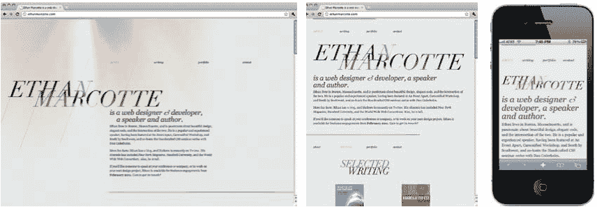

**图 2.1** 注意在 ethanmarcotte.com 上，同一个网站在不同尺寸的屏幕上呈现不同的样子。图形在大屏幕上拉伸填充，在小屏幕上收缩适配。此外，Ethan 的设计还考虑了移动浏览器。这在印刷设计中是做不到的。

我们需要停止当控制狂，不是因为我们无法像页面排版那样掌控网页设计（尽管有时候确实力不能及），而是因为互联网的本质意味着设计无论如何都会发生变化。我们需要接受这一现实，并为灵活性而设计。

这就是互联网的媒介特性。不仅仅是不同的屏幕尺寸；还包括不同的语境和用户赋权。不仅仅是外观和感觉；还有屏幕上文字的含义。

## 第二步：投入之物：通过 HTML 赋予意义

如果说纸墨是印刷设计的媒介，那么互联网的媒介就是 HTML 和 CSS。HTML 为内容赋予意义，而 CSS 告诉它应该长什么样。

理解你的设计将如何随屏幕而变化，是掌控设计的第一步。我们在接触 CSS 进行视觉设计之前，先通过编写 HTML 来实现这一点。

HTML 虽然作为网页设计语言听起来熟悉，但平面设计师不习惯去思考它。那是因为平面设计师不读撰稿人给他们的文字。好吧，你们中有些人确实会读。但我要告诉你们，作为网页设计师，无论你现在是否阅读撰稿人给你的内容，你都需要*开始*阅读它。因为不读内容，你就无法编写 HTML。

### 那么这 HTML 到底是什么？

让我们花点时间理解 HTML 到底代表什么：超文本标记语言（Hyper-text Markup Language）。哎呀，听起来好复杂。你真的需要知道那是什么意思吗？不用，在我看来不需要。需要背下来吗？不必。只需要知道有时候 HTML 被称为标记，有时候程序员会说"标记"一个页面，意思就是"编写 HTML"。

在开始这一章之前，你可能已经熟悉 HTML，也可能不熟悉。很多平面设计师至少听说过它，把 HTML 理解为用来加粗的编码语言，或者用于搜索引擎优化（SEO）的 `<h1>` 标签。你们中有些人可能还知道 HTML 和 CSS 需要配合才能工作。这是个不错的开始，但如上文暗示的，HTML 的意义远不止于此。

我们稍后会深入探讨。目前简而言之，HTML 是你告诉世界你的内容含义的方式。举个例子，`<h1>` 是一个几乎在每个网站上都会用到的重要 HTML 片段。它是"Heading 1（一级标题）"的缩写，告诉 Google 你最重要的标题是什么。

## 第三步：产出之物：屏幕尺寸

就本书而言，我们不会讨论屏幕尺寸的每一种可能配置。探索所有那些组合就像试图向你介绍世界上每家造纸厂的每一种纸张产品线。也就是说，那是不可能的，而且没什么帮助。到了某个点，这就变得冗余了（**图 2.2**）。

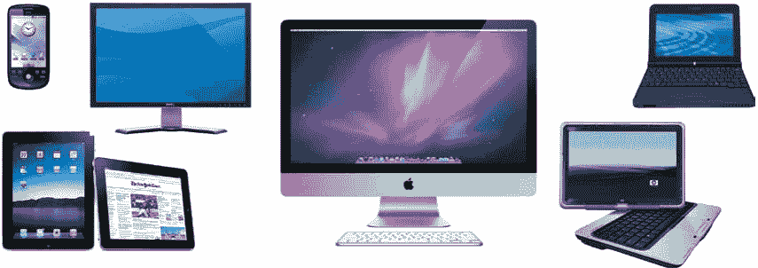

**图 2.2** 市面上有无数种屏幕尺寸和分辨率，从大电脑屏幕到小型移动设备，应有尽有。

相反，我们将专注于学习最简单、最重要的 80%。从一个普通的网站开始吧。也就是说，先别担心不断扩展的移动互联网世界，也别管你奶奶的 WebTV，或者你针对 iPad 优化的 Web 应用。让我们专注于一个普普通通的正常网站。

我们从基础开始，因为目前你真的只需要知道这些。而且这很基础，也很简单。此外，目前传统网页设计的工作比其他类型设计工作更多。而那些其他移动设备正在引入新的分辨率技术，让你即将学到的内容显得像小儿科。慢慢来，一步一步来。

## 我们的设计应该做多大？

当我们为互联网设计时，必须决定设计的尺寸。如果做得太大，用户就不得不左右滚动，这会令人厌烦。如果做得太小，我们就无法利用用户大屏幕所提供的空间优势。那么，我们该如何决定呢？

时至今日，现代世界的绝大多数用户使用的计算机分辨率宽度都在 1024 像素或以上。我们的脸距离屏幕仅几英尺，因此即便现在有了更大的屏幕，仍有大量证据表明，我们不需要不断地将网站设计得越来越大。

**水平和垂直分辨率**


你可能习惯于听到人们用水平和垂直维度来描述屏幕尺寸，例如“1024 by 768”。我刻意避开了这种表达，而选择仅提及宽度，原因有两点。

首先，仅提及宽度更简单，且潜在的混淆更少，因为不同比例的屏幕会有不同的垂直分辨率。

但更重要的是，我想让你停止考虑如何让网页“适应”某种特定的分辨率。那是 AOL 时代的旧习，当时的用户被训练成不要滚动页面，因为他们在 Web 门户视图中可以将所有内容呈现在屏幕上。而我们生活在一个用户习惯于向下滚动长页面的时代。只要有迹象表明下方还有内容，他们就会滚动。

大多数拥有大屏幕的人是通过同时运行多个应用程序并打开多个窗口来利用额外的屏幕空间。这意味着，一个在 2560 像素 27 英寸 iMac 上浏览网页的用户，很可能会在屏幕上散布开启其他窗口。在大多数情况下，她的浏览器窗口将被设置为大多数网站设计时采用的尺寸，也就是说，她的浏览器宽度大约在 1024 像素左右（图 2.3）。

让我们为你简化一下。即便对于 1024 像素宽的屏幕，我们实际上也不会将网站设计成正好 1024 像素宽，因为垂直滚动条大约会占用 30 像素的空间。此外，每个用户都有其影响窗口实际尺寸的个体差异，例如她是否默认隐藏 Dock 栏或任务栏，或者她的浏览器是否安装了额外的工具栏。

考虑到所有这些变量，我的建议是选择一个略低于 1024 的尺寸。在过去的几年里，Web 设计界对 960 网格（960 grid）议论纷纷。并非每个网站都应该遵循 960 网格，但作为典型网站的通用起点，960 网格非常出色，因为它在创建列时为你提供了很多数学选项。它可以被 2, 3, 4, 5, 6, 8, 10, 12, 15 和 16 整除。有了这些数学基础，网格的可能性几乎是无限的。

有时，你应该设计更大的布局，或者能够扩展以填充全屏的布局。这对于复杂的 Web 应用程序和极具视觉冲击力的营销网站很有帮助。另一方面，简单的 Web 应用程序或营销网站可能不需要占用 960 像素的宽度。在决定哪种分辨率最适合你的设计时，请运用你的最佳判断力。并非每种情况都有统一的答案。

## 设置你的 Web 设计文件

在我的工作坊中，人们总是问我使用什么工具进行设计。在制作最终页面布局的视觉稿（comping）时，我使用 Photoshop。但在开始设计图形之前规划网站时，你需要知道有哪些工具可用。

## Web 设计师的工具箱

信不信由你，在 Web 设计流程中，那些你日复一日习惯用于页面布局的应用程序依然有其用武之地。你看，在开始设计最终的图形之前，你需要一个页面布局的路线图。你可能听过这被称为故事板（storyboarding）、线框图（wireframes）或站点流程图（site flow）。

我有时会使用 InDesign（甚至 Illustrator）来快速搭建一个粗略的草图，确定页面上放置哪些元素以及放置在哪里。这些程序能帮我提高工作速度。如你所知，InDesign 非常擅长处理长篇正文，而且它还有一个额外优势，就是能轻松创建多页 PDF 供客户审核（图 2.4）。

**图 2.4** 线框图可以使用 Illustrator 或 InDesign 创建以节省时间。在开始使用 Photoshop 等基于光栅的程序进行设计之前，它们对于规划网站非常有用。

然而，有时 InDesign 的线框图会产生一个非预期的后果，就是看起来太像成品了。这可能会导致客户产生误解，他们认为我那些干净、像成品一样的灰色线框图意味着我为他们的网站提议一个极简的灰色界面。我必须承认，我能理解他们为什么会困惑。

### Photoshop vs. Fireworks

许多人使用 Photoshop 和 Fireworks 进行 Web 设计。有些人对其中一个有强烈的偏好。我使用 Photoshop 来制作网页草图，但你可以使用任何你喜欢的工具。我在本书中默认使用 Photoshop，是因为更多的平面设计师对其熟悉。无论如何，本章中的原则对于这两个应用程序都适用。

当可能出现上述误解时，我会使用 Balsamiq 为客户审核创建粗略的页面布局想法（图 2.5）。这个便捷的应用程序让我能向客户展示想法，而无需承担他们将我的作品误认为已完成设计的风险。它使用铅笔素描的图形界面，因此其想法的初步阶段毫无疑问。

**图 2.5** 像 Balsamiq 这样的应用程序可以帮助你的客户避免将功能性与设计美学混淆。

一旦确定了站点结构，我就会打开 Photoshop，按照最终 Web 设计中的尺寸来布局带有最终图形的页面。

## 新的工作流程

你手里拿着创意简报，桌上用回形针夹着已签字的线框图，心中有一个强有力的概念，还有一个无限额的 iStockPhoto 账户。准备开始。

你关闭了平面设计师信赖的 InDesign 版本，启动了你选择的 Web 设计应用程序。当你将鼠标移到屏幕左上角并点击“文件”→“新建文档”时，你审视着眼前的选项。你因焦虑而僵住了。现在一步走错可能会浪费大量时间。英寸？像素？磅值？颜色模式？十、二十、谁？

让我们在这里停顿一下，谈谈你一直以来的设计方式。作为一名平面设计师，你打开 Photoshop 通常只是为了编辑图像颜色，或者去掉 CEO 头像中一根不听话的鼻毛。从你担任印前工程师（当你管理那个部门时，你是最出色的，大家都知道）的日子起，你的 Photoshop 工作区就是为印刷工作流优化的。

这很有道理，因为它是实体的。你的颜色设置可能被设置为 CMYK，用于真实油墨的四色胶印。你的单位是你所理解的——英寸（如果你走复古路线，甚至可能是 pica）。文档的大小与最终产品的物理尺寸直接相关。宽 5 英寸、高 7 英寸就是宽 5 英寸、高 7 英寸。很简单。

但在 Web 领域，你需要改变工作流程。Photoshop 主要是个光栅图形应用程序，而 Web 图形在很大程度上也是光栅的，因为它们被输出到基于像素的显示器而非印刷机的印版上。此外，Photoshop 非常擅长为 Web 保存图形。你在导出图形时的保存方式至关重要——这决定了文件是看起来清晰且下载速度极快，还是一个带有噪点（artifacted）且在公司网络上需要 8 秒才能下载的 JPEG。

所以，收起你的放大镜、钢尺和 X-Acto 刻刀。让我们开始推像素（push some pixels）吧。你需要决定你的网站要多大，使用什么测量单位，以及颜色设置应该是什么。问题在于，正如你所知，并非每个人都像你一样拥有 27 英寸的 iMac：你的网站访问者可能使用 15 英寸的 Dell、10 英寸的上网本，或者设置为 1024 像素或 1280 像素的显示器。它能适应每个人的屏幕吗？让我们在此绕道学习一下屏幕的工作原理，以便我们能做出明智的决定来继续推进。

## 理解分辨率：从广告牌到计算机屏幕

在平面设计世界中，当我们不使用纯色时，我们会使用点阵图案。我们喜欢在印刷校对时通过可靠的放大镜盯着点阵看。当套色不准导致清晰的边缘变得模糊时，我们会对着印刷工低声抱怨。当我们把成品拿到手里，假设套色正确，点阵会非常小且无法分辨——这使得图像看起来很清晰。

当我们为广告牌设计时，由于项目的物理尺寸巨大，文件也会非常大。这些文件可能会变得难以处理，因此我们找到了减小文件大小的方法。我们知道，即使每英寸点数（DPI）降低很多，从路边看依然清晰，因为从远处观察时，较大的点也无法分辨。因此在设计广告牌时，我们将每英寸点数设置得低很多。如果没有人会近距离观看，就没有必要为了近看清晰而创建一个巨大的文件。如果你某天晚上向广告牌抛出一个抓钩并爬上去的话

从几英尺外观看（这不安全、不合法，我不推荐），你会看到较低的每英寸点数，并注意到广告牌不像在街道上看起来那么清晰。

对于电脑屏幕，我们遵循相同的基本原理。我们希望文件尽可能小以提高下载速度，但又要保证足够的分辨率，使图像看起来清晰。对于典型的网站，你需要将文件设置为每英寸 72 点（dpi）。这有时也称为每英寸像素数（ppi）。

相信我，这背后有很多科学原理；一切都非常复杂，光是想想就让我觉得大脑要从眼眶里流出来了。简而言之，其原理与上述广告牌场景相同：我们在网页设计中采用 72 dpi，是因为它能创建更小的文件便于下载，而且从几英尺外（屏幕到你脸的距离）用肉眼看效果相当不错。

## 理解颜色：从 PANTONE 到 RGB

作为平面设计师，我们熟悉 PANTONE 配色系统（PMS）。基本上，我们都有一本小册子，它为专业印刷商提供了颜色成分，以确保颜色异常一致。这非常棒。

遗憾的是，网页设计没有通用的配色系统。背光屏幕主要使用三种颜色（红、蓝、绿）来组成其上显示的图像。但就像你家里不同品牌、不同时间购买的灯泡可能有不同的色调一样，不同制造商的电脑屏幕所显示的红、蓝、绿也不完全相同。有些更亮，有些更暖，有些更冷。

此外，即使屏幕制造商标准化了他们的颜色，用户也有不同的偏好，会调整屏幕设置以适应自己。有些人会调高亮度，有些人会让一切看起来更冷，还有些人则喜欢更暖的显示效果。

### 你真正需要注意的颜色

- 浅黄色和棕褐色是很难处理的颜色。它们可能在你的屏幕上看起来很棒，在别人的屏幕上却显得发绿。
- 由于不同的亮度设置，极浅或极深的颜色总是难以准确呈现。深炭灰色的纹理可能在一块屏幕上看起来是黑色，在另一块上又显得太浅。通常，一条细微的发丝线在某些屏幕上可能不可见。

由于每个制造商的颜色略有不同，每个用户的颜色设置也略有不同，因此你的颜色在每个人的电脑屏幕上看起来都会略有不同。这是无法控制的。所以，如果你公司的标志有一个特定的 PANTONE 紫色，你可以在网上尽可能接近地匹配它，但它在不同人的屏幕上总会看起来略有不同。

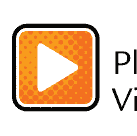

## 最后，设置你的第一个网页设计文件

既然我已经给了你背景知识，让我们言归正传。将你的文档首选项设置为使用像素而非英寸作为测量单位后，你只需要知道这些：72 dpi，RGB（图 2.6）。

**图 2.6** 这是我的大多数 Photoshop 网页设计项目的设置。

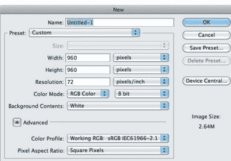

我本可以一开始就告诉你这些，但谁会为一章只有两个字的书付费呢？

# 3 告别拖放

## 学会如何用路径连接事物

当我教授我的工作坊时，我只有三个小时来教平面设计师如何手写代码构建网站。因此，我们花很多时间讨论高层次的东西。这对我来说效果很好，因为工作坊结束时，每个人都对他们如此短的时间内学到这么多东西以及过程多么容易感到非常兴奋。与会者将此归功于我。但事实是，一旦他们回到自己的电脑前摆弄一个网站，很快就会对我没有详细讲解的内容产生疑问。幸运的是，高层次的方法为他们提供了继续前进和搜索（Google）所需的能力。工作坊这样设计是有意为之。我更关心的是降低入门门槛，而不是面面俱到。在很多方面，这本书的设计也是如此——我并不期望你在读完它时就掌握所有关于手写代码构建网站所需的知识。

然而，在这本书里，我可以花更多时间解释一些我在工作坊中不得不快速带过的内容。其中一个主题是如何编写路径：我通常会一笔带过，因为即使不深入理解路径，你也能理解如何思考网站编码。但当你真正开始编码一个网站时，这个主题总会浮现出来。本章将向你传授如何在网站的文件夹结构中导航以及在 HTML 中编写高效导航链接的知识——换句话说，它将教你如何在网站中找到方向。

## 为什么你不应该依赖软件来设置路径

当然，有些工具允许你通过拖放网页和文件到目录中（这会创建路径），但这不是手写代码，对吧？你买这本书是为了学习如何手写代码构建网站，我打算让你物有所值。

此外，当你在排查故障时，如果你不知道怎么做，你会感到无能为力。相信我，你很快就会排查故障，也会感到无能为力。

最好特别注意本章。它将为你提供解决在编码的前两周内 89.6% 可能出现问题的工具。

## 网站像你的电脑一样拥有文件夹

要理解路径，让我们从你已经知道的事情开始：在电脑上组织文件和文件夹。当你编码一个网站时，你是通过输入它们的路径来连接事物，而不是通过点击进入文件夹和文件。你可能听说过路径这个词。

在 Mac 上，路径看起来像这样：

`/Users/jdgraffam/Downloads/somefile.pdf`

你从顶层开始，通过输入文件夹名称进入文件夹。每个文件夹名后面跟着一个反斜杠。然后通过输入另一个文件夹名进入另一个文件夹。如此继续，直到找到你想要打开的文件名。真的就是这么简单。

### 试一试

- 在 Mac 上：在 Firefox 中，输入`/Users/username/`，确保用你的用户名替换`username`（图 3.1）。
- 在 PC 上：在 Internet Explorer 中，输入`C:\Users\username`，确保用你的用户名替换`username`。

以上两个示例都应列出你用户文件夹中的文件和文件夹。注意你的浏览器如何允许你点击浏览文件夹并打开一些文件。在你点击浏览时，特别注意你最初输入路径的地址栏。注意路径如何根据你所在的位置而变化。当你在电脑上浏览文件夹时，所有这些都在后台发生。

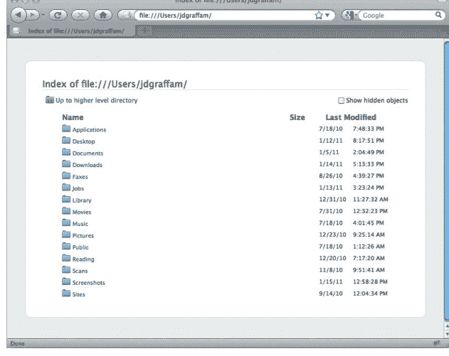

**图 3.1** 直接在 Firefox 中输入文件路径可以让你看到电脑在后台是如何形成路径的。

微软的 Windows 和苹果的 Mac OS X 如此易用，是因为它们使用分层嵌套的文件夹图标，为你提供了电脑文件结构的可视化表示。你们中的一些人习惯不断创建新文件夹来帮助整理东西；另一些人则喜欢把所有东西都扔进一个文件夹（图 3.2）。

**图 3.2** 这是一个典型系统文件夹的示例。

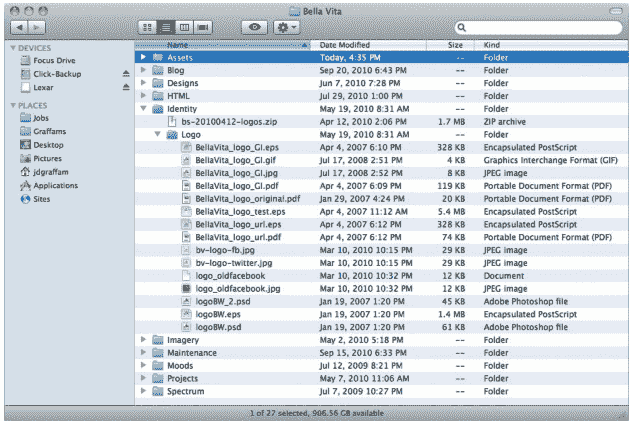

无论哪种情况，你都是二十一世纪的工作专业人士，所以你知道文件夹的用途以及如何在电脑上导航。你甚至可能在某个时候使用过文件传输协议（FTP）客户端将大文件上传到文件服务器。

### 服务器究竟是什么？

服务器不过是一台特殊的计算机，它与世界其他地方共享文件或网站。你的电脑可以在其上运行网站，但除非你知道自己在做什么，否则你电脑上的东西只有你能访问。

## FTP 如何工作（极简版）

以防你以前没有使用过 FTP，或者需要复习一下，这很简单。从技术上讲，FTP 只是在互联网上移动文件的一种方法——从硬盘驱动器到服务器（或反之），或从一个服务器到另一个服务器。

平面设计师经常使用 FTP 应用程序来传输非常大的文件，这些文件太大无法通过电子邮件发送，并且没有足够的时间将文件刻录到 DVD 并邮寄。网页设计师使用 FTP 将文件放置到 Web 服务器上，以便它们可以在互联网上发布。通常，当你通过 FTP 将文件存放在某个地方时，这被称为上传。当你通过 FTP 获取文件时，这被称为下载。

Mac 上常用的 FTP 软件包括 Transmit、Cyberduck、Fetch 和 FileZilla。Windows 上常用的 FTP 工具包括 WS_FTP、SmartFTP 和 FileZilla。

通常，你需要使用 FTP 地址、用户名（`asset username`）和密码来连接到 Web 服务器。成功登录后，你就可以将计算机上的文件和文件夹（也称为本地驱动器）拖放到 Web 服务器（也称为远程驱动器）上。一旦它们出现在 Web 服务器上，你的网站就上线了。

在本地驱动器上编辑网站时，你必须小心，确保使用的是来自远程驱动器的最新文件。

## 在互联网上浏览文件夹

基本上，网站就是 Web 服务器上一个包含内容的文件夹。它使用的文件夹（也称为目录）和你的计算机一样。唯一的区别是，当你编写网页代码并想链接或关联到另一个文件时，你无法通过点击来找到它——你需要像上一节练习的那样，通过输入文本路径来导航到它。

> #### 你需要将一些内容关联起来
>
> 如果你希望网站的主页链接到 CSS 文件中的样式定义，你需要通过输入 CSS 文件保存的路径来将它们链接在一起。如果你想引入你的标志图片，你需要指定它的路径。如果你想链接到另一个网页，你需要指向它。具体形式如下：
>
> CSS: `src="css/base.css"`
>
> 图片: `src="images/logo.gif"`
>
> 链接: `href="login/"`
>
> 路径就是双引号之间的文本字符串。有时你会使用`src=`来描述路径，有时你会使用`href=`。不过现在不用担心这个；你将在后面的章节中详细学习这些内容。

## 就像打包 InDesign 项目

让我用我平面设计背景中一直觉得很形象的方式来解释一下。在互联网上链接文件类似于打包 InDesign 文件（图 3.3）。InDesign 会为你的字体和图片创建文件夹，以便为下一个处理你项目的设计师将所有内容整合在一起。当你将其他人打包的文件导入到你的计算机时，你需要确保所有文件都重新链接，以便路径正确。如果路径错误，你就无法使用想要的字体，图片也无法打印就绪（图 3.4）。

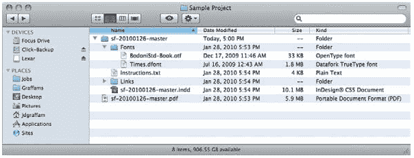

**图 3.3** 你已经熟悉 InDesign 打包文件进行交付的方式（如图所示）。互联网要求我们以类似的方式打包文件，但你必须手动完成。

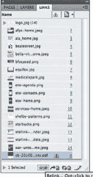

**图 3.4** InDesign 可以帮助你重新链接文件，而无需手动输入文件路径。

InDesign 比互联网更智能；所以如果你链接错了内容，InDesign 至少会提供一个低分辨率预览和关于字体缺失的警告（图 3.5），以及修复问题的指导（图 3.6）。在互联网上，你不会得到低分辨率预览或任何警告。它看起来就是坏了（图 3.7）。

当你需要开始在 HTML 页面中链接文件时，你只需输入它的路径，而不是像在 InDesign 中那样点击。这并不像听起来那么难，所以没必要惊慌。有两种方法可以实现：你可以使用绝对路径或相对路径。

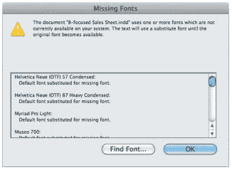

**图 3.5** 当你的字体无法定位时，InDesign 会警告你。

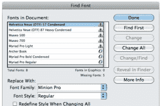

**图 3.6** InDesign 帮助你重新链接字体，无需手动输入路径。

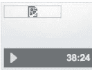

**图 3.7** 在互联网上，当内容损坏时没有任何警告。它就是坏了。


## 保持文件和文件夹的组织性

使用 InDesign 时，你可以自由地将文件分散在计算机各处，因为当你准备打包时，它会将所有文件整合到一个整洁的文件夹中。当你手动编码时，你需要从项目开始时就管理好这一点，将所有内容保存在一个父文件夹中（图 3.8）。

拥有多个文件夹是可以的：你只需要一个包含网站所有内容的单一父文件夹。将不属于最终网站内容的部分放在另一个文件夹中也是一个好主意。这样，最终的网站文件就与工作文件分开了。

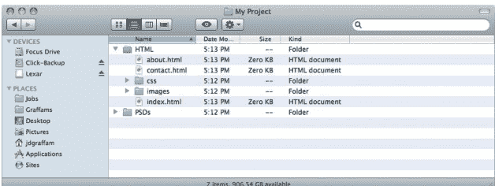

**图 3.8** 当你为互联网打包文件时，将设计文件与最终资产分开存放。

## 绝对路径

对于初学者来说，绝对路径更容易理解，因为这是我们习惯在互联网上看到链接的方式。如果你的网站位于 `cssforprintdesigners.com`，并且主文件夹中有一个名为 `mysecretfile.html` 的文件，你可以通过在 Web 浏览器中输入以下内容来导航到该文件：

`cssforprintdesigners.com/mysecretfile.html`

你需要知道的是，文件和文件夹后面总是跟着一个反斜杠。如果 `mysupersecretfile.html` 位于一个名为 `supersecretfolder` 的文件夹中，你可以通过以下方式导航到它：

`cssforprintdesigners.com/supersecretfolder/mysupersecretfile.html`

在 HTML 中输入绝对路径时，你需要在地址开头输入 `http://`，如下所示：

`http://cssforprintdesigners.com/supersecretfolder/mysupersecretfile.html`

## 相对路径

绝对路径容易理解，因为你输入的是从开头到文件的整个路径，包括域名。但如果你想将网站迁移到新域名，这可能会带来问题。当你的公司在自己的服务器上开发网站时，这种情况经常发生，就像这样：

`myfirm.com/clients/ourclient/`

当需要将网站上线到 `ourclient.com` 时，你需要找到所有 `myfirm.com/clients/ourclient/` 的实例并将其更改为 `ourclient.com`。虽然使用简单的查找和替换就可以做到，但很容易出错；而且，使用相对路径有更好方法。

> **提示** 相对路径总是假设你从包含当前正在编辑文件的文件夹开始。

相对路径顾名思义。你所寻找的文件不是通过绝对路径找到的，而是通过它与你当前位置的 *相对关系* 找到的。

假设你有以下文件夹结构（**图 3.9**）：

```
- mydomain.com (文件夹)
  - images (文件夹)
    - logo.gif (文件)
  - index.html (文件)
  - pages (文件夹)
    - about.html (文件)
    - contact.com (文件)
  - private (文件夹)
    - index.html (文件)
```

**图 3.9** 使用此示例帮助你理解下一页的相对路径练习。

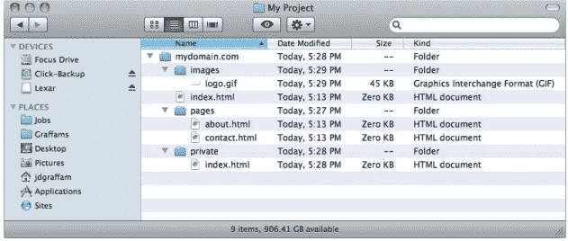

## 在同一文件夹内移动

假设你正在编辑 `pages` 文件夹中的 `about.html`。你想链接到同一 `pages` 文件夹中的 `contact.html`。你只需输入 `contact.html` 即可，因为它在同一个文件夹中。很简单。

## 进入更深的文件夹

让我们尝试一个稍微困难一点的情况。如果你正在编辑主文件夹（也称为根文件夹）中的 `index.html`，并且你想链接到 `pages` 文件夹中的 `about.html`，你可以像使用绝对路径一样操作，但省略域名。实际上，你需要省略当前所在位置以上的所有内容。因为你位于根文件夹，你只需省略根文件夹本身。你只需输入 `pages/about.html`。

## 进入更高的文件夹

假设你正在编辑 `contact.html` 并想链接到根文件夹中的 `index.html`。换句话说，就是我们刚才做的反向操作。正如反斜杠提供了深入文件夹结构的简写方式，相对路径提供了向上一级的简写方式。你输入 `../` 来向上导航一个文件夹。所以你会输入 `../index.html` 来定位当前文件夹上一级的 `index.html` 文件。

如果你需要同时向上两个文件夹，你只需输入 `./` 而不是 `../`。你也可以将它们组合起来以一次向上多个文件夹。`../../` 等同于 `./`，而 `../../../..` 向上四个文件夹。别问我为什么两个点代表一个文件夹，一个点代表两个文件夹——它就是这样。

## 综合运用

现在让我们更进一步。假设你正在编辑 `about.html` 并想链接到 `images` 文件夹中的 `logo.gif`。由于我们要先向上一个文件夹，然后再进入另一个文件夹，我们必须结合到目前为止所学的知识。最好先用简单的英语描述我们想做什么，所以让我们尝试一下。

我们想做的是向上导航一个文件夹，然后进入 `images` 文件夹以便找到 `logo.gif`。所以我们要从输入 `../` 开始以向上一个文件夹，然后输入我们要进入的文件夹名称。到目前为止我们已经到达了 `../images/`。现在我们只需命名文件即可完成：`../images/logo.gif`。我们向上了一级，进入了正确的文件夹，然后输入了文件名。

## 从根目录开始

无论你当前在何处，都可以通过在路径前加一个反斜杠来跳转到根文件夹。例如，无论你在文件夹结构中的哪个位置，`/images/logo.gif` 都会链接到该标志图形。

## 省略索引文件

互联网上有一个特殊的文件名 `index`（有时是 `default`），你并不总是需要包含它。因此，如果你想导航到 `/login/index.html`，你可以只输入 `/login/`，而省略 `index.html`。

## 尾部斜杠

当路径以文件夹结尾时，应该加上尾部斜杠。当路径以文件结尾时，不要加尾部斜杠——这会导致 Web 服务器将你的文件视为文件夹，这并非你想要的。

以下是正确的写法：

```
/login/
/pages/about.html
```

这是错误的写法：

```
/pages/about.html/
```

这个例子会将 `about.html` 当作一个文件夹名，导致 Web 服务器在一个名为 `about.html` 的文件夹中查找索引文件，而该文件夹并不存在。

## 本章将解决你 89.6% 的问题——请再读一遍


你可能记得我说过，你 89.6% 的问题和挫折都源于使用了错误的路径。我之所以知道这点，是因为在我教授工作坊时，我通常有两位助手帮我。除了帮助每个人在举办工作坊的大学或酒店连接无线网络（这比预期的要困难得多）之外，他们唯一的工作就是在大家编写网站代码时四处走动，帮助与会者解决遇到的问题。经过深入的量化研究（其实并没有），我确认有 89.6% 的时间问题都出在错误的路径上。

相信我，这一章值得再读两遍。我建议你把这一章的页角折起来，等读完整本书后再回来看。

# 4 你必须阅读文字

### 这与校对无关

**有一个原因**，我们设计师不允许在未经合格人员校对的情况下将任何东西送交印刷。对于设计师来说，文字和字母不过是相互作用的形状。当我们沉浸在设计中，专注地调整字距时，我们的注意力并不集中在含义上（**图 4.1**）。

我不是说设计师不阅读——不理解传达的信息，就无法对杂志版面或年度报告进行艺术指导。但让我们诚实点：有时我们只是浏览。我是说，标题可能很有趣，但长篇文案*很无聊*。

当我们进行排版时，我们考虑更多的是文字的美学和可读性，而不是它们的语法意义。

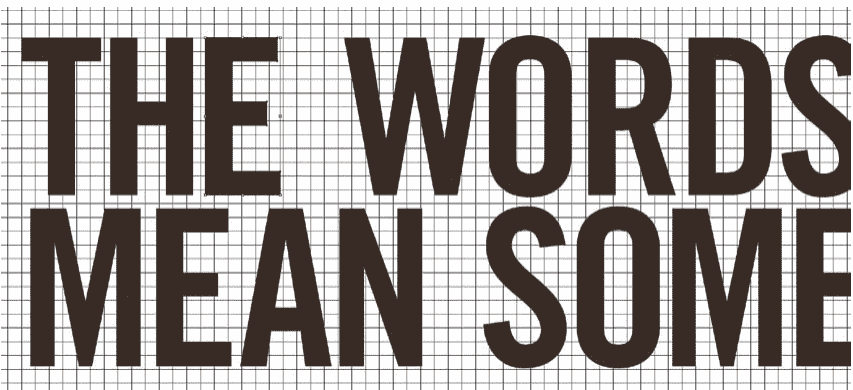

**图 4.1** 调整字距很有趣。阅读则不然。

## 这正是编码的全部意义

在我们开始用 CSS 告诉网页它们该是什么样子之前，我们用 HTML 编写网站，这样我们设计的内容才能以不同的方式分享。此外，CSS（控制外观和感觉的语言）是建立在 HTML 结构之上的——在你有一种方式说“这是正文”之前，你无法编写 CSS 来告诉正文它该是什么样子。HTML 就是那个框架。

让我通过演示一个你可能在印刷设计领域遇到过的问题来解释这一点。如果你需要将两个小册子排版成不同的尺寸，你会创建一个单独的 InDesign 文件，并将内容分别导入每个文件。从那时起，当你的校对员发现一个错别字时，你必须在两个地方进行修正。

在网页设计领域有一个概念，我们将内容与其外观分离开来。你可能听说过“表现与内容分离”。简而言之，这意味着我们将内容维护在一个地方，然后用 CSS 为其换肤，以便在不同的形式中重用它（**图 4.2**）。

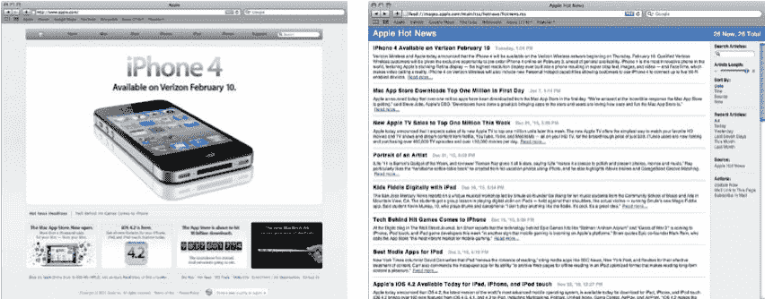

**图 4.2** Apple 主页上的内容在浏览网站时看起来是某种样子，但如果你在 RSS 阅读器中查看，它看起来又会不同。

## 那么 HTML 到底是做什么的？

HTML 只是告诉我们正在查看的是哪种类型的内容。要编写 HTML，你需要阅读文案撰写者提供的内容，以便识别每一块内容是什么。这实际上非常简单，所以别慌；以下是你需要识别的主要内容类型的列表：

- **段落：** 一块文本；理想情况下，它是一系列相关的句子，构成一个统一的思想。

    - HTML 还允许你在内容块之间放置分隔符，以模拟软回车。别被迷惑了：在文本块下方添加一个软回车来增加间距，与将其识别为段落是两回事。HTML 不关乎某物*看起来*像什么；它关乎它*是*什么。

- **标题：** 总结其后面的内容块。

    - 主标题总结后面内容的整体含义，而次级标题则逐步总结更小、更局部的想法。

    - HTML 为你提供了六个级别的标题可供选择。

    - 通常，标题越重要，它就越大。但情况并非总是如此，这就是为什么 HTML 存在的原因。HTML 帮助你在告诉内容*看起来*像什么之前，先确立它*是*什么。例如，你应该努力确保 `<h3>` 标签不会出现在 `<h2>` 标签之上。

> **提示** 当你为了得到想要的外观而在 HTML 上“作弊”时，你就束缚了自己的手脚，因为 CSS 将无法再控制外观和感觉了。使用 CSS 控制外观和感觉的最大优势之一就是，外观和感觉是在一个地方集中控制的。

- **列表：** 一系列相关的项目。

    - HTML 让你可以处理几种不同类型的列表：

        - 无序列表就是我们通常所说的项目符号列表。但别被迷惑；并非所有无序列表都有项目符号。它们可能有箭头、破折号或方块。它们甚至可能根本没有这些图形。例如，导航是一个页面链接列表，它就没有。如果我还没说服你，那么请记住，HTML 不关乎某物*看起来*像什么。它关乎它*是*什么。

        - 有序列表就是我们可能称为编号列表的东西。它们可以是 1., 2., 3... 或 i., ii., iii., 等。当你有意对项目进行排序时使用它们。

        - 定义列表有一个项目，后面跟着某种定义或说明。例如，术语表就会使用定义列表。

- **其他内容：** 还有一些小的 HTML 内容块你需要了解，它们可以让你强调、链接或将事物分组。但目前，段落、标题和列表是我希望你主要考虑的内容。

仅使用上述标签，你的内容就可以在 RSS 订阅源或针对移动设备优化的网站中显示，并拥有自己的外观和感觉。它不会使用与你的网站相同的排版或颜色，但它将是可读的，因为 HTML 告诉了它哪些文本块是标题、段落和列表。

当你的文案撰写者给你一个 Word 文档时，文档通常是从上到下阅读的。它可能不漂亮，但很有逻辑。下次你收到文案撰写者的内容时，参考这一节，并尝试按照 HTML 要求我们识别的方式，识别每一块文本。只需在页边空白处标记每一块文本是什么（图 4.3）。

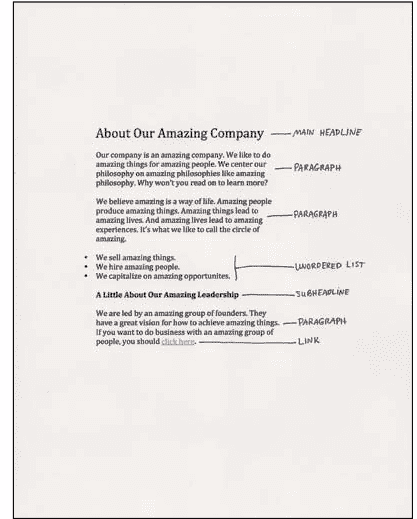

**图 4.3** 当你开始编写 HTML 时，拿笔在纸上标记内容块可能会有所帮助。

如果你在确定如何识别一块内容时遇到困难，与你的文案撰写者确认一下并不是个坏主意。文案撰写者通常使用样式来格式化他们的文档，你知道这些样式可以映射到 InDesign。同样，这种结构也可以让你的 HTML 编写更容易。

就像在你使用 InDesign 设计的 60 页技术手册中没有一个适用于所有情况的“流内容”按钮（天哪，要是有的话该多好！）一样，在编码网站时也没有一个神奇的按钮可以做到这一点——你必须动动脑子。

# 5 盒子中的盒子

## 使用 HTML 进行视觉标记

**在我的工作坊中**，经常有人问我学习 CSS 花了多久。这就是我告诉他们的故事。

在所有代码对我产生意义之前，我已经盯着它们看了好几个月。事实上，我打赌你们中的很多人现在就处于这种状态。你可以打开 Dreamweaver 或 WordPress，修改某些内容的颜色和宽度，但你不确定它究竟是如何运作的，也不确定可能会破坏什么。我经历过那个阶段。

## 一旦掌握秘诀，学习 CSS 会非常快

这一切在我参加当时雇主希尔顿全球（Hilton Worldwide）派遣我去的一次培训时才豁然开朗。你看，我在简历上有点撒谎了，说我能做一些其实我并不擅长的事情。我说“有点”是有原因的。在简历上，我说我会编写网页代码。我的意思是，我*认为*我会，因为我有一份 Dreamweaver 副本，并且会点击“插入 > 表格”。一旦找到了正确的位置，我甚至还能更新页脚的版权年份。我知道如何通过 FTP 上传文件。天呐，我觉得我准备充分了。

因为当时我没意识到自己在撒谎，所以我只是“有点”在撒谎。

那时我遇到了一位罕见的老板，他非常专业。他既懂自己的工作，也懂我的工作。在我入职几周后的某一天，他在审查我的工作，并在浏览器中点击了点击“查看 > 源代码”来检查我的代码。

糟糕，被抓包了。

“去参加培训吧，”他说，“希尔顿出钱。”于是我去了。

我在佐治亚州亚特兰大找到了一门为期两天的“CSS 初学者”课程。这意味着我可以为了工作坐飞机。我的家人对此印象深刻。

而我，另一方面，则担心会失去工作。我不认为培训会对我有帮助，因为我读过的关于 CSS 的书让我觉得，我就像被扔进了一场已经开始的比赛中，仿佛缺失了一些基础知识——不知道从哪里开始。

于是我抵达亚特兰大，租了一辆车，开往一个遮荫的商业园区参加培训。那栋建筑、教室或老师都没有什么特别出众的地方。但在问了几个小时的愚蠢问题后，两件基本的事情终于让我开窍了，我的整个职业生涯也随之打开了局面：

1. 要编写 CSS，你必须知道如何编写 HTML。

2. HTML 是由标签组成的。

让我把这两点再重复一遍，因为这是你编写 CSS 所需的基础知识：*你必须先知道如何编写 HTML，而且 HTML 是由标签组成的*。

在课程的第二天，我出去吃午饭后就没再回来参加剩下的培训了——我已经得到了我想要的东西。在两周内，我就能独立地手动编写网站代码了。

你也可以学得这么快。

我必须把自己关在房间里，问很多愚蠢的问题才能获得所需。希望你和你的雇主能够避免这种开销和时间浪费——编写 CSS 的秘诀就是知道如何编写 HTML。

一旦你懂了 HTML，学习 CSS 根本不需要时间。没错，这就是学习 CSS 的秘诀——学习一种完全不同的语言。

## HTML 是由标签组成的

就像你行李上的标签用来识别内容属于谁一样，HTML 中的标签用来识别它包含的内容。它必须开启，也必须关闭。它以小于号和大于号开启，以同样的方式但带一个斜杠来关闭。

HTML 主要由三个部分组成：

1. 一个包含缩写的开始标签

2. 该缩写所描述的内容

3. 一个包含相同缩写的结束标签

我经常向熟悉程度不同的平面设计师解释编码。我反复使用并获得成功的一种方法是，拿出的一叠便利贴，用粗马克笔写 HTML (**图 5.1**)。某种程度上，在计算机之外看到 HTML，将其与高科技的代码感分开，会让代码显得更人性化，不那么令人生畏。

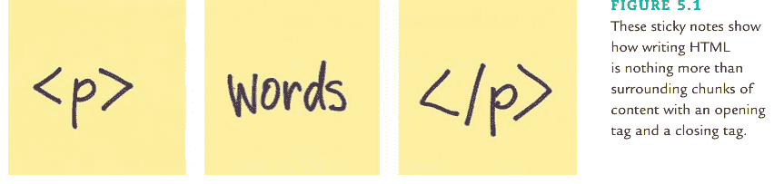

## 不要被奇怪的字符吓到

关于学习编写网站，有一件非常令人生畏的事情我想在这里谈谈，那就是所有那些奇怪的字符。当你查看代码时，你会看到花括号、分号、逗号、尖括号、单引号、双引号、反引号等等。不要让这些东西困扰你。一旦我们一个接一个地破解这些代码，你甚至不需要刻意尝试就能记住它们。

那么，那些便利贴如果写成代码大概是这样的：

```
<p>
  This topic sentence begins a paragraph. It is a topic sentence
  because it summarizes an idea. A collection of sentences is
  called a paragraph. In HTML-speak, p means paragraph.
</p>
```

## 你需要知道的十几个标签

总共大约有一百个标签。

好吧，停止过度呼吸。也有好消息。

好消息是，在很大程度上它们很容易记住，因为它们是类似于普通英语的缩写。更好的消息是，你只需要知道这 13 个标签就能应付。

这些标签覆盖了我日常工作中 90% 的内容。如果你认识它们，你将能更好地理解 HTML 应该做什么。

- `<p>`

  我们已经讨论过这个了。

- `<header>`

  顾名思义。这个标签包裹一个章节或整个页面的页眉。大多数网页设计师用它来包裹 logo 和主导航，但它也可以包裹页面中较小章节的*页眉*。

- `<footer>`

  与 header 类似，这个标签包裹一个章节或整个页面的页脚。

- `<h1>`, `<h2>`, `<h3>`, `<h4>`, `<h5>`, `<h6>`

  标题（Headings 或 headlines）通常是简短的文本块，用于概括随后的内容。`<h1>` 是最重要的标题，而 `<h6>` 是最不重要的。你可以根据自己的判断来确定标题级别，但理想情况下，每个页面至少应该有一个 `<h1>`。


- `<ul>` 和 `<li>`

  有些标签是成对出现的（详见下文）。无序列表，即 `<ul>`，总是与列表项，即 `<li>` 标签配对。你有时会称之为项目符号列表，尽管项目符号并非必须。

- `<ol>` 和 `<li>`

  这是另一组配对标签。有序列表，即 `<ol>`，总是与列表项，即 `<li>` 标签配对。你会称之为数字列表。

- `<div>`

  `<div>` 是 division（分区）的缩写。它不隐含任何像段落或标题那样的语法上下文；它只是将大量相关事物分组的一种方式。事实上，它通常被用来将段落和标题分组。它能包裹的内容仅限于你的想象力。

- `<a>`

  `<a>` 代表 anchor（锚点）。*Anchor* 是 HTML 中表示*链接*的方式，所以一个 `<a>` 标签就是一个链接。

- `<strong>`

  `<strong >` 标签用于包裹我们认为值得更多关注的短文本。通常，这就是我们实现**加粗**的方法。

- `<em>`

  `<em>` 标签用于包裹我们认为需要强调的短文本。通常，这就是我们实现*斜体*的方法。

- `<span>`

  就像它的大哥 `<div>` 标签一样，`<span>` 标签用于分组。它仅用于分隔较小的组，主要是短小的文本片段。

- ``

  `` 是 image（图像）的缩写。这就是你用 HTML 引入图像的方式。

## 新 HTML vs 旧 HTML

HTML 目前正在经历一些重大变化。不过不用担心，对你来说这没什么大不了的。基本上，增加了一些以前不存在的新标签（如 `<header>` 和 `<footer>`）。既然你不知道之前的标签，那么它们对你来说*全部*都是新的。

关键在于：HTML5 的开发是为了取代 HTML4——你应该学习 HTML5，而不是 HTML4。就这么简单。

这就像 Adobe CS5 取代 CS4 一样：它只是一个更新的版本。与 Adobe 的 Creative Suite 一样，HTML5 具有一定的向后兼容性，但比较有限。但与 Adobe 的 Creative Suite 不同的是，新的 HTML 是一种开放标准，不直接为任何人赚钱，因此更新它的动力不如营利产品那么强。事实上，HTML5 的新标准还没有完成，而且在很长一段时间内都不会完成。

现在不要问我为什么应该学习一个尚未完成的东西。我希望你学习的是未来的 HTML，而不是过去的。在我看来，没有什么障碍能阻止你在未来的所有项目中使用 HTML5。

## 处理旧版浏览器

正如我在上面提到的，HTML5 有一些以前不存在的标签，包括 `<header>` 和 `<footer>`。我提到这一点是因为像 IE 和 Firefox 2 这样的旧版浏览器不识别这些较新的 HTML 标签，这会导致它们破坏你的布局。

但不用担心，就像你可以将文件保存为旧版本的 InDesign 一样，你可以在网页上放置一些代码，让旧版浏览器也能正常运行。这些修复依赖于 `JavaScript` 才能生效。

## 你的意思是，我还需要学习 JavaScript？

天呐，不用。我几乎不懂 `JavaScript`。由于 `JavaScript` 对于本书来说有点高级，我将避免过多讨论。你只需要知道，有一段 `JavaScript` 代码片段可以添加到网站中，帮助旧版浏览器理解 HTML5 的新标签。

但说实话，现在你不需要担心这个问题。当它出现时，你可以让你的程序员朋友帮帮你，或者在 Google 上搜索那段代码。我就是这么做的。

## 标签组（也称为列表）

你可能已经注意到，我刚才悄悄加入了几种看起来不同的标签：`<ul>` 和 `<li>`，以及 `<ol>` 和 `<li>`。这些是用来创建列表的。有些标签，比如列表，需要你将几个标签组合使用才能生效。

这意味着你必须编写一些 HTML 来表示“我要开始写一个列表了”。然后你还得在该标签内部再编写一些 HTML，表示“这是一个单独的列表项”。你可以写任意数量的列表项，最后关闭那个开启列表的标签。

## 无序列表（或称项目符号列表）

好了，信息量有点大，我们先从无序列表开始。你还记得无序列表是使用前面提到的 `<ul>` 标签来创建的。你可以这样写：

```html
<ul></ul>
```

但这其实没什么意义，因为这是一个没有任何项目的无序列表，也就是里面没有*列表项*。列表项有专门的标签，叫做 `<li>`，但它必须放在无序列表标签内部，也就是说它要在 `<ul>` 开始标签之后打开，在 `</ul>` 结束标签之前关闭。你自己看看：

```html
<ul>
  <li></li>
</ul>
```

注意我们是如何把 `</ul>` 结束标签移到下面的，并在 `<ul>` 开始标签和 `</ul>` 结束标签之间单独放了一行缩进的 `<li></li>`。

虽然这样格式化完全是可选的，但请记住，保持一致的格式以便在视觉上轻松匹配开始标签和结束标签，将会在你的 HTML 变得越来越复杂时非常有帮助。

所以现在我们还只有一个列表项。让我们再添加几个。

```html
<ul>
  <li></li>
  <li></li>
  <li></li>
</ul>
```

注意每个 `<li>` 开始标签都是在前一个列表项的 `</li>` 结束标签关闭后才开启的。

现在，我们仍然没有一个真正的列表，我们只有一些等待填充内容的 HTML 标签。让我们往里面放点东西。下面是一个平面设计师的购物清单示例：

```html
<ul>
  <li>Whole wheat bread</li>
  <li>Locally-brewed beer</li>
  <li>Organic cigarettes</li>
</ul>
```

让我们来回顾一下。外层标签 `<ul>` 告诉我们即将开始创建一个无序列表。内层标签 `<li>` 定义了该列表的每一个项目。所以你最终看到的效果会是这样的：

- Whole wheat bread
- Locally-brewed beer
- Organic cigarettes

冠军早餐。

你可以 later（或者完全去掉它们）用 CSS 来改变项目符号的外观。

## 有序列表（或称编号列表）

如你所记得的，创建列表时还有另一种选择，叫做*有序*列表。让我们来看看你最喜欢的乐队按偏好排序的列表可能是什么样子：

```html
<ol>
  <li>Mogwai</li>
  <li>Mouse Rat</li>
  <li>Lucero</li>
</ol>
```

这会渲染成如下效果：

1. Mogwai
2. Mouse Rat
3. Lucero

借助 CSS，你可以将其改为渲染成：

i. Mogwai

ii. Mouse Rat

iii. Lucero

我们可以整天谈论这些音乐上的精彩之处，但我们只是来学制表的——继续吧。

## 定义列表（或称词汇表列表）

还有一种最终的列表类型。到目前为止我们已经介绍了项目符号列表和编号列表（分别对应无序列表和有序列表）。另一种列表叫做*定义列表*，它不那么常见但非常有用。

首先，让我们来看看定义列表到底是什么。定义列表由三个标签组成：

- `<dl>`，定义我们即将写一个*定义列表*。
- `<dt>`，定义其包围的内容为*定义标题*。
- `<dd>`，定义其包围的内容为*定义描述*。这个标签跟在 `dt` 标签之后，但可以有多个——你可以把它理解为类似于段落。等你看完实际效果，就会更清楚了。

定义列表可以用于几种用途。最常见的是用于标记词汇表，但有时我也见过用于常见问题解答。虽然我们知道可以用 CSS 改变任何元素的外观，但平面设计师创建的典型定义列表可能看起来像这样：

### Photoemulsion

A special liquid mixture that you put on screens. When it dries and you expose it to light it hardens. It's used to block the flow of ink through the screen. It's magic.

### Image Area

If you block off part of the emulsion when exposing it to light, so that light doesn't get to all the photoemulsion, you can wash that area out since it doesn't harden.

This is the area where ink can pass through the screen to create your image.

### Positive

A clear sheet with opaque black printed or drawn on it. This black area is what blocks the light from getting to the photoemulsion, keeping that area from hardening when exposed to light.

下面是不带内容的标记方式：

```html
<dl>
  <dt></dt>
  <dd></dd>

  <dt></dt>
  <dd></dd>
  <dd></dd>

  <dt></dt>
  <dd></dd>
</dl>
```

如果你仔细看了那段 HTML（你仔细看过了，对吧？没有？那再去看看……），你会注意到第二组中有一个 `dt` 标签，但有两个 `dd` 标签。这是因为"Image Area"这个项目有两段文字来描述它。这就是我刚才说的它*类似*于段落的意思。

让我们看看放入内容后会是什么样：

```html
<dl>
  <dt>Photoemulsion</dt>
  <dd>
    A special liquid mixture that you put on screens. When it dries and
    you expose it to light it hardens. It's used to block the flow of
    ink through the screen. It's magic.
  </dd>
  <dt>Image Area</dt>
  <dd>
    If you block off part of the emulsion when exposing it to light, so
    that light doesn't get to all of the photoemulsion, you can wash
    that area out since it doesn't harden.
  </dd>
  <dd>
    This is the area where ink can pass through the screen to create your
    image.
  </dd>
  <dt>Positive</dt>
  <dd>
    A clear sheet with opaque black printed or drawn on it. This black
    area is what blocks the light from getting to the photoemulsion,
    keeping that area from hardening when exposed to light.
  </dd>
</dl>
```

这看起来不再像你开始读这本书之前那么可怕了吧？到现在，你应该能够阅读上一页的代码，分辨出其中的标签，并看出它们是如何按正确顺序排列的。大于号和小于号也不再那么令人困惑了，现在你已经知道它们的作用和运作方式。

最棒的是：大部分都是*英文*——其实要记住的东西并不多。有时候，当代码看起来对我来说太多时，我会高亮代码部分，来帮助简化。当你只关注简单的标签时，前面的代码块看起来就不那么复杂了。

下面就是高亮后的样子：

```html
<dl>
  <dt>Photoemulsion</dt>
  <dd>
    A special liquid mixture that you put on screens. When it dries and
    you expose it to light it hardens. It's used to block the flow of
    ink through the screen. It's magic.
  </dd>
  <dt>Image Area</dt>
  <dd>
    If you block off part of the emulsion when exposing it to light, so
    that light doesn't get to all of the photoemulsion, you can wash
    that area out since it doesn't harden.
  </dd>
  <dd>
    This is the area where ink can pass through the screen to create your
    image.
  </dd>
  <dt>Positive</dt>
  <dd>
    A clear sheet with opaque black printed or drawn on it. This black
    area is what blocks the light from getting to the photoemulsion,
    keeping that area from hardening when exposed to light.
  </dd>
</dl>
```

每当你开始阅读 HTML 时，最重要的是注意标签的开启和关闭。试着忽略其他一切；慢慢读；不要略读。随着时间的推移，你将能够快速浏览格式良好的 HTML 并迅速发现错误。但现在，慢下来。我希望你专注于有意识地阅读 HTML，并为每个开始标签找到对应的结束标签。

## 嵌套标签

既然你刚接触到标签组（或列表），现在正是 zoom out（从宏观角度）看看 HTML 全貌的好时机。

你看，一个网站由许许多多 HTML 标签组成。有些标签用于定义每个单独的内容片段，比如列表项，而有些 HTML 则用于定义更大块的内容区域。

要让一切正常运作，你必须开始*嵌套*你的 HTML。

## 嵌套标签就像在大盒子里画小盒子

你刚才在列表中已经这么做了。HTML 标签相互嵌套，就像你可能从 CB2 目录中挑选的高档嵌套桌一样。当平面设计师看到展示 HTML 嵌套效果的图示时（**图 5.2**），他们往往能更好地理解这一点。

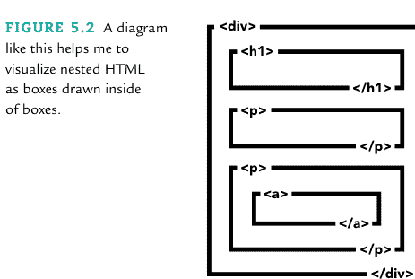

在代码中，它看起来是这样的：

```html
<div>
    <h1>My Very Own Headline</h1>
    <p>With a paragraph following it.</p>
    <p>
        <a href="http://mysite.com">Learn more</a>
    </p>
</div>
```

这就是嵌套代码整洁规范时的样子。我在尝试解决更大问题时，会在白板上做这样的练习ifies>练习。看看用一点简写方式画在白板上的效果（**图 5.3**）。

## 搞坏互联网

当你在编写 HTML 时出错，往往是因为标签的开启或关闭方式不正确——这会导致互联网崩溃，整个互联网，而且全都是你的错。

其实不是这样的。但几乎每次都会搞坏你的网站。当你嵌套标签时，它们必须按照与开启时相反的顺序关闭（**图 5.4**）。

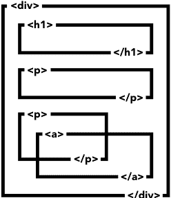

**图 5.4** 你必须确保按正确的顺序开启和关闭标签。它们不能像这样图中底部的 `<a>` 和 `<p>` 标签那样相互重叠。

一切看起来都很正常，直到 `<p>` 标签和 `<a>` 标签相互交叉的地方。在代码中，它可能是这样的：

```html
<div>
  <h1>My Very Own Headline</h1>
  <p>With a paragraph following it.</p>
  <p>
    <a href="http://mysite.com">Learn more</p>
  </a>
</div>
```

你发现了吗？在这个例子中，`<p>` 标签在 `<a>` 标签之前关闭了，这是错误的，因为 `<a>` 标签是在 `<p>` 标签内部开启的。既然它在 `<p>` 标签内部开启，就应该在 `<p>` 标签内部关闭。

我想我们谁都不希望艾尔·戈尔敲我们的门，要求我们去修复他的互联网。所以在这方面多花点时间，确保按正确的顺序开启和关闭标签。

## 为标签添加属性

*Attribute* 这个词听起来挺大的，但我猜你们大多数人在不用查字典的情况下就知道它的意思。不过万一你不知道，也省得你去翻词典，以下是我的定义：*Attribute*（属性）是某物或某人的一种特征。

如果我让你描述这家伙的特征（**图 5.5**），你可能会说他的头发是红色的，还有可爱的脸颊。属性必须识别某样东西，然后对其进行描述。对于这张图片，我选择识别关于这个男孩的两件事并加以描述。

在 HTML 中，我们使用属性来赋予标签更多的含义或定义。

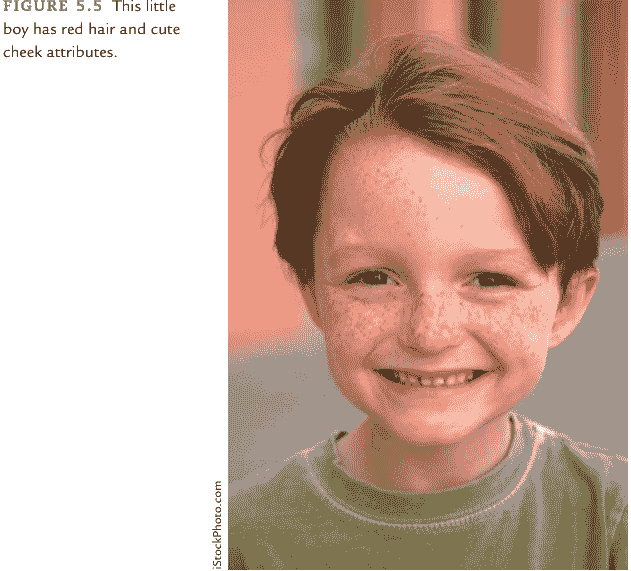

## 属性语法（是的，还有几个奇怪字符要记）

属性的语法可能看起来令人生畏，直到你把它拆解开来。一旦破解了其中的奥秘，它们就和 HTML 标签一样——也就是说，它们大多是英文，加上几个需要记住的奇怪字符。没什么大不了的。举个例子，让我们看看这个男孩的一个假属性可能是什么样的：

```html
hair="red"
cheeks="cute"
```

首先，我们识别我们在谈论什么：Follicle 他的头发和脸颊。然后，我们说它等于某个值，我们把它放在双引号中。

但这还不是全部。我们必须把这个放在某个地方，所以你可能会问："这该放在哪里？" HTML 中的属性放在开启标签的*内部*。让我们继续用一个假的 HTML 标签来描述这个：


`<boy hair="red" cheeks="cute">This boy has red hair and cute cheeks.</boy>`

需要注意的几点：

- 属性放在开启标签内部。没有任何东西会装进关闭标签里。
- 属性开始之前有一个空格。
- 属性开始之后没有空格。这条规则有几个例外，但目前无需担心。
- 我们使用的是直引号，不是弯引号。如果你直接在所选的文本编辑器中输入（比如 `Dreamweaver`、`Text Wrangler` 或 `Coda`），不会有问题，因为这些应用不会自动把你的直引号变成弯引号。但如果你从 `Word` 中复制粘贴，可能会遇到弯引号出现的问题。


**提示** 话说回来，你为什么要在 `Word` 里写网站代码呢？

## 五个你需要了解的属性

就像有 13 个标签比其他标签更常用一样，有五个属性你在写 `HTML` 时绝对要烂熟于心。当然还有其他属性，但这些是我认为最重要的——它们能帮你完成 90% 的编码工作。

- **`href`**

  这个属性用于创建链接，和 `<a>` 标签一起使用。当我们开始将 `CSS` 与 `HTML` 关联时，我们还会看到这个属性在 `<link>` 标签上的用法。放在这个标签中的字符串可以是绝对路径或相对路径。（我们在第 3 章中讨论过绝对路径和相对路径。）

- **`class`**

  这个属性用于 `CSS` 钩子，一页中可以有多个匹配的 `class`。

- **`id`**

  这个属性用于 `CSS` 钩子，一页中只能有一个。它也用于跳转链接，即你点击一个链接，浏览器就会跳转到页面的某个特定部分。

- **`src`**

  每个 `` 标签都需要这个属性。它用于将图片引入 `HTML`。

- **`alt`**

  每个 `` 标签都需要这个属性。它用于用文字描述图片，以防图片无法加载。它服务于 `Google`、盲人或低视力用户（他们通过听的方式来浏览网页），以及网络连接很慢或因某种原因图片无法加载的情况。

你总是可以去万能的 `Google` 那里了解其他的属性。

## 属性实战

```
<a href="http://simplefocus.com/">This is a link to my company website</a>
<div id="something">Something goes in here</div>
<span class="something-else">Something else goes in here</span>

```

关于属性的酷之处在于，在大多数情况下，双引号里面的内容不是代码。它不是你需要死记硬背的东西。你可以自己编造 `class` 和 `id` 属性。如果你想的话，你可以写 `class="bibbledibob"`，这没问题。

## 别在属性上乱来

不过你需要记住，你的 `class` 属性应该对其他人有意义，因为总有一天可能会有人在你之后接手你的网站。或者，更有可能的是，你自己以后回过头来看，会想："我当时在想什么？那个 `class` 属性太傻了！"

作为一个负责任的网页设计师，我必须告诉你，在创建 `id` 和 `class` 属性时要使用良好的命名规范。在行业里，这叫做编写*语义化* `HTML`。*Semantic* 又是一个很大很丑的词。但你可能知道它的意思，因为印刷设计师们热衷于就上帝和 `Archer` 字体的字距之类的问题进行语义争论。

*Semantic* 这个词在网页设计界有类似的定义。它的意思是，讽刺的是，*含义*。你的 `class` 和 `id` 属性不应该描述某物*看起来*什么样；相反，它们应该描述某物*是什么*——记住行李标签的类比。

### 表 5.1 有意义的 `class` 属性（同样适用于 `id`）

| 不好的 | 好的 |
| --- | --- |
| `class="yellow-background"` | `class="highlight"` |
| `class="left"` | `class="sidebar"` |
| `class="italic-headline"` | `class="embellished"` |
| `class="rounded-corner-effect"` | `class="wrap"` |
| `class="bigger-text"` | `class="callout"` |

## 自闭合标签

到目前为止，你已经学习了像 `<header>`、`<p>` 和 `<div>` 这样有开有合的标签。如果我告诉你有些标签可以自己闭合呢？这会不会让你大吃一惊？

有些标签不需要包裹任何内容。有些标签本身就是信息，比如 `` 标签。

如果你一直留意的话，你会注意到我在关于属性的部分悄悄塞进了一个这样的例子。

``

注意到这个 `` 标签没有单独的关闭标签。相反，它的开启标签是自闭合的，因为在结束尖括号（即大于号）之前有一个斜杠。这叫做自闭合标签。实际上，在 `HTML5` 中，有两种正确的自闭合方式：

1. ``
   或者
2. ``

严格来说，两种方式没有谁更正确，因为 `HTML5` 支持这两种自闭合标签的方法。我个人有偏好，但我鼓励你考虑这两种方式，然后做出自己的决定。

我更喜欢使用尾部斜杠的方法（上面的第 1 种），因为这让我更容易扫视哪些标签已经正确闭合了。我已经训练自己在看到一个开启标签时，就去寻找它对应的关闭伙伴。

另一方面，选择非斜杠方法（第2种）也有一个很好的理由：它需要输入的字符更少。

这取决于你。只要选一种并坚持下去就好。

## 格式化代码就像排版

在我的工作坊中，一个经常被问到的好问题是关于格式化的。

- 我怎么知道什么时候该按回车换到下一行？
- 我怎么知道哪里可以安全地放置空格，哪里不可以？
- 我怎么知道何时缩进、缩进多少？我该用制表符还是空格？

这些都是好问题。虽然从规范制定者的角度来看，每一种格式化方式在技术上都有正确答案，但这些都以建议的形式呈现。关于格式化，我想让你知道以下几点：

## 无论你怎么做，保持一致就好

虽然你写代码是为了让计算机理解，但别忘了它也是给人看的。在格式化 `HTML` 时建立你自己的小习惯是可以的。你是一位设计师，所以把这当作一个排版的练习吧，只用缩进和等宽字体来设置易读的文字（**图 5.6**）。

- 如果你更喜欢用空格而不是制表符来缩进，那没问题，只要保持一致就好。空格太多通常不会导致问题，所以不必太纠结。
- 如果你在创建多词类属性时使用连字符，那就一直用连字符。不要随意切换到下划线。
- 优先考虑人的可读性。如果内容较短，可以把几个标签放在一行。如果你做了非常深度的嵌套，要注意确保闭合标签与开始标签对齐，这样更容易看出哪个标签在闭合。

```
<header>
  <div class="utility-links">
    <ul>
      <li class="login">
        <a href="/login/">Login</a>
      </li>
      <li class="help">
        <a href="/help/">Help</a>
      </li>
    </ul>
  </div>
  <div class="wrap">
    <div class="logo">
      
    </div>
    <nav>
      <ul>
        <li class="home">
          <a href="http://simplefocus.com/">Home</a>
        </li>
        <li class="about">
          <a href="/about/">About</a>
        </li>
        <li class="services">
          <a href="/services/">Services</a>
        </li>
        <li class="portfolio">
          <a href="/portfolio/">Portfolio</a>
        </li>
        <li class="contact">
          <a href="/contact/">Contact</a>
        </li>
      </ul>
    </nav>
  </div>
</header>
```

**图 5.6**

`HTML` 如果按逻辑一致的方式缩进，会更容易阅读。

## 使用注释来保持有序

有时候，编码者需要提醒她自己当时的想法，或者与后续接手她工作的另一位编码者沟通。与其把这些备注写在别处，`HTML` 提供了一种方式让编码者写下不会被浏览器渲染的备注。这些被称为*注释*。

```
<!-- Comment goes here -->
```

注释的开始用 `<!--` 表示，这时浏览器就不再关注。无论里面写了什么，都不会出现在你的网站上。当你写完注释后，只需输入 `-->` 来告诉浏览器重新关注。

有很多使用注释的好理由。

**指出一个标签的闭合位置。** 如果你有一堆嵌套的 `<div>` 标签，带有唯一的 `id` 或 `class` 属性，你可以提醒自己正在闭合的是哪一个。

```
<div class="wrap">
    <div class="intro">
        <div class="summary">
            <p>
                Comments are helpful to developers because they facilitate clear
                communication.
            </p>
        </div><!-- close summary -->
        <div class="extended">
            <p>
                Some developers use comments to describe a complex area of the
                code, while other developers use them to help themselves
                remember what they were thinking when they came up with
                something. And finally, some developers use them to crack
                mom jokes about their colleagues (which is not appropriate and
                can be embarrassing if it makes it into a production site).
            </p>
        </div><!-- close extended -->
    </div><!-- close intro -->
</div><!-- close wrap -->
```

**与另一位开发者沟通。** 有时候不止一个人在代码上工作，他们需要互相沟通。

```
<!-- Tom, I was thinking while we wait on content from the client,
we could use CSS to put a drop shadow and round these corners around
-->
```

```
<div class="content">
  <p>Waiting on content from the client.</p>
</div>
```

**提醒你自己当时的想法。** 有时候你想出了一个很好的方法，想提醒自己它是如何工作的，以免以后弄坏它。

```
<!-- Added an extra div with post class below so that I can have a
divider between each blog post. Removing this breaks vertical
spacing. -->
```

```
<div class="post">
<h2>Hello world!</h2>
  <p>
    Welcome to Wordpress. This is your first post. Edit or delete it,
    then start blogging!
  </p>
  <p>
    <a href="/hello-world">Read more</a>
  </p>
</div>
```

注释可以是你想要的任何内容。你只需输入几个字符告诉浏览器开始忽略你将要输入的内容，然后再输入几个字符告诉浏览器注释结束了。

## 块级标签和内联标签

在所有大约一百个标签中，它们都属于两类之一：要么是块级标签，要么是内联标签。

最简单地说，块级标签用于环绕较大的文本块，内联标签用于环绕较小的文本块。我喜欢把块级标签想象成精力充沛的，把内联标签想象成懒散的。

块级标签精力充沛，因为它们会尽可能从左到右横跨页面。内联标签懒散，因为它们只走到必须走的地方，然后就不动了。

换句话说，块级标签的任务是在其父容器中占用尽可能多的水平空间（它尽可能延伸直到碰到尽头）。内联标签的任务是占用尽可能少的水平空间（**图 5.7**）。

**图 5.7** 块级标签尽可能延伸；内联标签只走到必须走的地方。

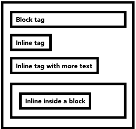

在我已经展示给你的标签中，这些是块级标签：

- `<p>`
- `<header>`
- `<footer>`
- `<h1>`, `<h2>`, `<h3>`, `<h4>`, `<h5>`, `<h6>`
- `<ul>` 和 `<li>`
- `<ol>` 和 `<li>`
- `<div>`

而这些是内联标签：

- `<a>`
- `<strong>`
- `<em>`
- `<span>`
- ``

例如，标题和段落通常应该贯穿其父容器的宽度。另一方面，锚点（链接）或 `<em>` 标签不应该贯穿其父容器的宽度，因为这些标签通常出现在一段较长的文本内部。

如果你仔细想想，这会对布局造成破坏（**图 5.8**）。一个像块级标签一样行事的锚点标签会导致文本行断开到新行，并且锚点会独占一整行。然后，锚点之后的任何内容都会在锚点后的下一行开始。实际上，它会创建一个硬断行，链接独自占一行。

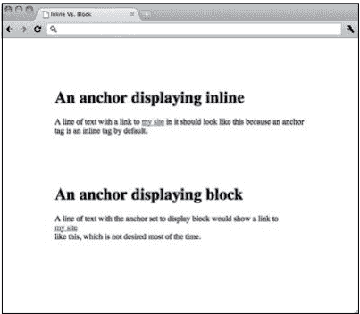

**图 5.8** 块级标签旨在环绕较大的文本块；内联标签旨在环绕较小的文本片段。

### 内联标签和块级标签的顺序

你还记得嵌套的概念，对吧？它的工作方式是让较小的东西放在较大的东西里面。如果我们把块级标签看作比内联标签大，那么把块级标签放在内联标签里面就没有意义了，不是吗（**Wait, the text says "doesn't make sense" and the figures are diagrams showing the concept**？

**图 5.9** 你不能把块级标签放在内联标签里面；这会破坏事情！

有一个简单的规则你需要知道：内联标签不能包围块级标签。

### 改变内联标签和块级标签的外观

你可以改变块级标签的外观，让它们表现得像内联标签，或者让内联标签表现得像块级标签。

使用 `CSS`，你可以告诉块级标签 `display: inline;`，它就会像内联标签一样行事。或者，你可以告诉内联标签 `display: block;`，它就会像块级标签一样行事。这可能是一个非常有用的技巧，例如，如果你想让链接有定义的宽度，或者让它更大更容易点击，就像在你的导航中那样。

不过，你仍然需要遵循那条规则，即原生块级标签不能放入内联标签中。抱歉，规则就是规则——而且，在 `CSS` 介入让一切变得漂亮之前，你的网站首先需要能为用户正常工作。

关于 `CSS` 的内容稍后介绍。别着急，我们终会讲到的。

关于 `HTML`，你还需要了解最后一点：既然它的目的仅仅是结构化内容，那么当你写完 `HTML` 后，很容易就能判断你是否做对了。

## `HTML` 看起来像 `Word` 文档

当你用文本编辑器写完 `HTML` 后，可以将文件保存在电脑上的某个位置，然后通过选择“文件 > 打开”并浏览到该文件，用浏览器（`Firefox`、`Chrome`、`Safari` 或 `Internet Explorer`）打开它。

当你打开 `HTML` 文件时，如果一切正常，你的 `HTML` 文档看起来会很像你的文案撰稿人的 `Word` 文档（图 5.10）。

图 5.10

写完 `HTML` 后，它应该看起来和你最初用的 `Word` 文档差不多。

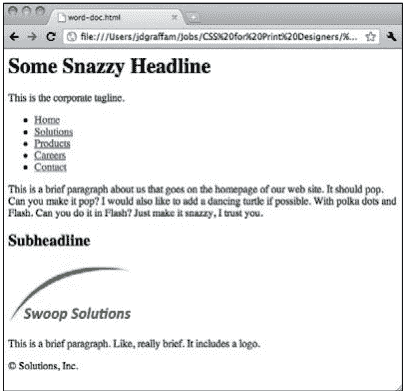

现在，我们已经解决了这个问题，得到了一个看起来和我们最初开始时一模一样的东西。

不，这种反讽我并没有忽略。不幸的是，学习这些内容是编写 `CSS` 不可避免的前提。

我们继续前进。

## 用 `CSS` 进行雕刻

**制作看起来像真实网页的东西**


**我将**编写 CSS 想象成很像创作雕塑，因为 CSS 和雕塑都是经过深思熟虑、有计划地将基本结构雕琢成更美观形态的过程。雕塑家从一大块方形石头、木头或其他材料开始。当我们编写 CSS 时，我们从一个从上到下阅读、类似基本 Word 文档的 HTML 结构开始。雕塑家首先规划大局：不同的元素（如头部、手臂、躯干和脚）应该放在哪里，每个部分应该多大？当我们编写 CSS 时，我们通过移动 HTML 标签来勾勒布局，为页面创建列和整体布局，并在此过程中决定诸如边框、宽度和尺寸等元素。

在雕刻出大致形态后，雕塑家会越来越细致地处理作品的每个部分：引入逼真的细节，如皱纹、皮肤褶皱和肌肉线条。对于 CSS，我们通过颜色、渐变、排版和阴影等设计处理，逐步增强页头、导航、侧边栏、页脚等部分。

最后，雕塑家为展示作品做准备，打磨并微调整体构图。对于 CSS，我们也为作品做最后修饰：例如，确保它在任何场景下对每个访客都能正常工作，并且加载速度快。

在本章中，我们最终将通过观察大局来了解 CSS 如何将一切融合在一起。我们已经完成了所有幕后的准备工作，现在准备制作看起来像真实网页的东西。

## 首先：语法

啊，是的，那些有趣的字符。就像我们在本书前面学到的 HTML 一样，CSS 是一种具有自己特殊语法的编程语言。它可能非常宽容，但我们仍然需要学习基础知识。

你会记得在第一章中，我们看到了 CSS 是多么易于阅读，我曾承诺稍后解释那些有趣的字符。嗯，时候到了。

看看这条 CSS 规则：

```css
p { color : white ; }
```

可以想象，这条 CSS 规则告诉我们页面上的每个段落标签都应该是白色的。

> **不要为词汇感到压力**
>
> 我需要坦白：在写这本书时，我不得不查阅这些术语。我写 CSS 已经很长时间了，但并没有把这些东西背下来。我的意思是，这门语言对我来说很熟悉，对你来说也应该如此，但别费劲去记诸如选择器、属性和值这样的术语了。
>
> 相反，你应该把脑力花在认识形式和语法上。第一部分标识我们要定位的目标，其他所有内容都放在花括号内。冒号连接描述我们目标的两个部分，分号告诉我们这条声明结束了，可以准备用另一条声明来进一步描述第一部分。

**表 6.1** 将帮助你理解代码块中每个字符的含义。

| CSS | 英文解释 |
|-----|---------|
| `p` | 这第一个元素是选择器。选择器告诉我们正在选择哪种类型的项目作为 CSS 的目标。在我们的例子中，它是一个熟悉的 HTML 缩写——`p` 代表段落——它定位所有段落。注意它没有任何 HTML 中的其他特殊字符，如 `<` 或 `>`。它只是缩写。你几乎可以在这个位置放置任何东西：另一个 HTML 标签如 `<div>`，你 HTML 中的一个 `class` 属性如 `.teaser`，或者一个 `id` 属性如 `#logo`（句点和井号有特殊含义，我稍后会介绍）。 |
| `{` | 这个元素有很多名称——花括号、大括号、旋涡括号和小鸡嘴（不，我没编，查维基百科），但我称之为花括号。这是一个开头花括号；你会注意到一个结尾花括号表示这条声明的结束。你在这些花括号内编写的 CSS 描述了你的选择器应该是什么样子。 |
| `color` | 这个元素被称为属性。还记得在 HTML 中我们讨论过属性吗？嗯，这个元素与属性非常相似；它定义了我们即将描述的属性的哪个方面。在这个例子中，我们即将更改所有段落的颜色。 |
| `:` | 冒号连接属性和值。在我们的例子中，它连接属性 `color` 和指定的值 `white`。它只需要位于属性和值之间；无论你是否用空格包围它都没有关系；它只需要在同一行上。 |
| `white` | 这个元素被称为属性的值。它描述了属性应该是什么样子。在我们的例子中，`color` 属性的值是 `white`。 |
| `;` | 这个分号告诉我们声明结束了。你可以在这之后添加更多声明（声明是任何属性-值组合）。 |
| `}` | 最后，如上所述的结尾花括号。这表示一条 CSS 规则的结束。 |

这是一个包含多条声明的 CSS 规则示例：

```css
div{
  background-color: red;
  padding: 10px;
}
```

这条 CSS 规则告诉我们，每个 `<div>` 标签都应该有一个值为 `red` 的 `background-color`，以及其周围 10 像素的空间。

## 格式化你的 CSS

> **为网页设计选择颜色**
>
> 你可能已经注意到，我使用普通英语术语来识别颜色，而不是像 `#DCD87E` 这样的十六进制值。CSS 允许你对常见颜色这样做，但你可能想要更精确地控制颜色值，因此在实际项目中你很可能会使用十六进制值。我这里使用单词只是因为对眼睛更友好。
>
> 请参阅本章后面的“调整颜色”部分，了解如何在 Photoshop 中获取颜色的十六进制值。

在我的研讨会上，就像 HTML 一样，一个经常被问到的问题是：文本格式化有多少是必须的，有多少只是个人偏好？

> **提示**
>
> CSS 不要求在声明列表中使用最后的分号，但我建议你无论如何都要使用它，因为记住每条声明以分号结束比分割每条声明以分号开始要简单得多。我敢打赌，当你遵循这样简单的规则时，犯的错误会更少。

CSS 所要求的只是每条 CSS 规则都以选择器开始，并以一条或多条声明结束，这些声明被包裹在开头和结尾的花括号内。在花括号内，每条声明必须有一个由冒号分隔的属性和值，声明之间必须用分号分隔。

空格和制表符在 CSS 格式化中是完全可选的。我的建议是为了可读性而编写 CSS，同时记住最重要的是对你选择的任何格式化风格保持一致。

> **格式化就像排版文本**
>
> 我发现平面设计师常常在格式化方面感到困难。但通过一些练习，你会开始像看待杂志中长文排版一样看待格式化。这都是关于可读性和一致性的问题。

我通常将选择器和开头花括号写在第一行。然后转到下一行，缩进一次，每行写一条声明。最后，以单独一行的结尾花括号结束，缩进与声明相同。如果我感觉特别有条理，我会将整个 CSS 规则缩进以匹配 HTML 的嵌套。例如，考虑这段 HTML：

```html
<div>
  <p>
    嘿，你需要提供你的电子邮件地址才能注册我们的电子邮件通讯。
  </p>
</div>
```

注意观察 `<p>` 标签是如何嵌套在 `<div>` 标签内的（**图 6.1**）。我在编写 CSS 时会采用这种格式，以此在视觉上提醒自己当前 CSS 文件所对应的 HTML 结构：

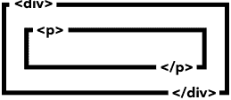

**图 6.1 northeastTESLA**

这展示了简单的嵌套 HTML。

```css
div{
  background-color: red;
  padding: 10px;
}

p{
  color: white;
}
```

但其他格式化方式也同样可接受。注意以下示例中没有空格，且每条规则都写在一行上：

```css
div{background-color:red;padding:10px}
p{color:white}
```

这是另一种写法：

```css
div
{
  background-color: red; padding: 10px
}

p
{
  color: white
}
```

归根结底，如何格式化你的 CSS 取决于你。但我向你保证，如果你花时间保持格式整洁一致，你将学得更快，遇到的问题也会更少。

## 空白会增加文件大小

关于 CSS 格式化有一点需要注意：你使用的空白越多（制表符、换行符和空格），文件就会越大。大多数情况下这没什么大碍，因为文件本身很小，下载速度也很快，所以我建议使用额外的空白来让你的文件更具可读性。

但对于一个非常庞大的网站或流量很高的网站，大量微小文件的累积可能会给公司带来不小的成本。这类公司可能会选择更紧凑的 CSS 格式。

目前，你不必担心这个问题。只需知道你的格式化决策确实可能产生影响。另外，你可以安心入睡，因为有些硬核开发者在处理这类项目时，能够自动地、实时地将人类可读的 CSS 转换为非常紧凑、压缩过的 CSS。如果文件大小将来成为你的问题，那时你可能已经在阅读更高级的书籍了，所以现在不必担心。

## 选择器的花样玩法

让我们来看一个真实的 HTML 及其配套 CSS 的例子——重点关注编码中的选择器部分。假设我们要为一个填写不正确的联系表单的错误状态编写 CSS（**图 6.2**）。我们的 HTML 可能会这样编写：

**图 6.2** 当用户未正确填写 Web 表单时，典型的错误消息可能如图所示。


```html
<div id="form-message">
    <div class="error">
        <p>
            Durr, you need to give us your email address to sign up for our email newsletter.
        </p>
    </div>
</div>
```

## 通过 `class` 和 `id` 属性连接到 CSS

在本章目前看到的 CSS 中，你会注意到我说过我们是在针对每一个 `<div>` 标签和 `<p>` 标签进行设置。这非常适合广泛、全局的 CSS 声明，但你常常会发现只想针对网页中的某一个小部分进行设置，就像上面 HTML 示例中的那样。

我们可以利用 HTML 中的 `class` 属性和 `id` 属性作为钩子，让我们编写 CSS，从而在更精细的层面上控制 HTML。针对上面示例中的 HTML，我们会这样编写 CSS：

```css
#form-message {
    padding-top: 10px;
    border-top: 2px solid black;
}

div.error {
    background-color: red;
    padding: 10px;
}

div.error p {
    color: white;
    font-weight: bold;
}
```

这可能看起来比之前见过的稍微复杂一些，因为我们添加了几个特殊的字符——一个句点（`.`）和一个井号（`#`）——而且选择器也不仅仅是 `p` 了。别担心，这很简单——让我来为你讲解。

## 组合标签与钩子

你可以通过编写一个在标签本身之外还包含 `class` 属性或 `id` 属性的选择器，来让 CSS 更具针对性。我们通过输入你想要针对的标签，然后将其与 `class` 属性或 `id` 属性连接起来。我们通过将句点或井号与标签连接来实现，确保中间不留任何空格字符。

注意上面的代码中，我们有一个没有空格的选择器 `div.error`。它针对任何你定义为 `error` 的 `class` 属性的 `<div>` 标签。换句话说，它针对的是 `<div class="error">`。

因此，CSS 中的选择器 `div.error` 只针对 HTML 中的 `<div class="error">`。

> **提示**
>
> 选择器中的空格字符或无空格字符实际上非常重要，这与格式化中的空格不同，后者无关紧要。

对于 `id` 属性也是如此，但不用句点，而是使用井号（`div#form-message`）。

表 6.2 展示了一些 CSS 如何针对 HTML 的示例。

### 表 6.2 使用 CSS 针对 HTML

| | `div` | `.error` | `div.error` | `p.error` |
|---|---|---|---|---|
| `<div>` | ✓ | | | |
| `<div class="error">` | ✓ | ✓ | ✓ | |
| `<p class="error">` | | ✓ | | ✓ |
| `<span class="error">` | | ✓ | | |

> **提示**
>
> 你可以随意组合这些方式。你可以将任何标签（`<div>`、`<p>`、`<span>` 等）与 `class` 属性或 `id` 属性连接起来。

勾号表示 CSS 选择器与 HTML 标签匹配的地方。没有勾号的地方，CSS 将不会生效。

注意，当我们在 CSS 中只引用 HTML 标签（当我们希望 CSS 应用于某一特定类型的所有标签时），选择器前面不加任何特殊字符，如句点或井号。

## 针对嵌套的 HTML

假设你只想针对嵌套在 `<div class="error">` 内部的 `<p>` 标签（图 6.3）。CSS 为我们提供了一种简单的方法；我们只需要在已学知识的基础上扩展。

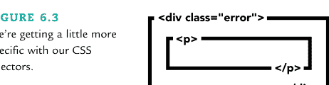

在 CSS 中，除了通过标签名、`class` 属性和 `id` 属性，你还可以根据 HTML 的嵌套方式来进行针对。选择器的第一部分针对父标签，其后跟着的每一部分文本（前面有空格）都嵌套在其前面的父标签中。哇，这话说得有点绕。让我们看看我们的嵌套 HTML 如何与一些简单的 CSS 选择器对应起来（图 6.4）。

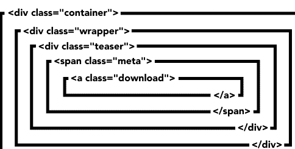

**图 6.4**

在 HTML 中，你可以根据需要嵌套任意多层（或任意少层）。

你可以随心所欲地玩出花样。

```html
<div class="container">
  <div class="wrapper">
    <div class="teaser">
      <span class="meta">(PDF, 1 Megabyte) </span>
      <a href="annual-report.pdf" class="download">Download Now</a>
    </div>
  </div>
</div>
```

针对这个示例中的链接，你可以有几种方式。最简单的方式是针对 `.download`，它会找到任何 `class` 为 `download` 的元素。代码如下：

```css
.download{
  font-weight: bold;
  color: red;
}
```

但假设你只想针对 `class` 属性为 `teaser` 的 `<div>` 标签内，`class` 属性为 `download` 的链接。你需要这样针对 `div.teaser .download`：

```css
div.teaser .download{
  font-weight: bold;
  color: red;
}
```

你甚至可以疯狂一些，用这样的选择器来针对链接：

```css
div.container div.wrapper div.teaser a.download{
  font-weight: bold;
  color: red;
}
```

通常这有点极端，但偶尔在我处理一个不是我最初编写的大型网站时，为了确保我的 CSS 规则不影响网站的其他部分，我不得不这样做。在那种情况下，过于具体会很有帮助。

## 用平实的语言阅读选择器

当我试图理解一个复杂的选择器时，我发现一个有用的练习是用平实的语言将其读出来。这是一个相当难的选择器（图 6.5）：

**图 6.5**

这展示了用 HTML 标记导航的一种常见方式。

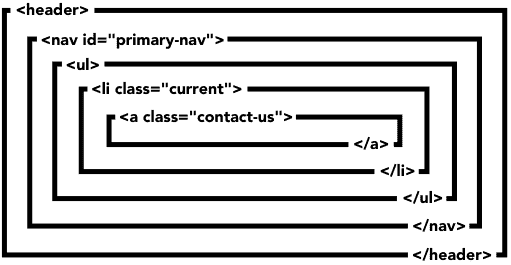

```css
header nav#primary-nav ul li.current a.contact-us{
  font-weight: bold;
}
```

在这个例子中，我们希望某些东西加粗，但具体是想要什么加粗呢？

我们通过反向阅读 CSS 来找出答案。我像诗歌一样插入了换行符，以便于阅读。因此，从这行的末尾向前读：

- 我们针对一个 `class` 属性为 `contact-us` 的 `<a>` 标签
- 它位于一个 `class` 属性为 `current` 的 `<li>` 标签内
- 它位于一个 `<ul>` 标签内
- 它位于一个 `id` 属性为 `primary-nav` 的 `<nav>` 标签内
- 它位于一个 `<header>` 标签内。

> **提示**
>
> 当你按照我描述的方式阅读你的 CSS 时，将其与 HTML 进行比较，它只需是一个真实的陈述。你的选择器不必包含嵌套层次结构中的每个标签。

## 检查和再次检查你的选择器

如果选择器的任何部分与 HTML 不完全匹配，CSS 规则将不会生效。

这里有两个要点：

- CSS 非常强大，因为你可以设计非常具体的 CSS 选择器。
- CSS 选择器越复杂，就越容易出错，你也越容易因为选择器没有按你预期的方式工作而感到沮丧。

能力越大，责任越大。由于你是初学者，我的建议是创建简单的选择器。当你越来越习惯于快速浏览 CSS 并理解它时，你就会知道什么时候可以编写一些非常复杂的选择器。

## 给你的 CSS 添加注释

你已经知道 HTML 可以让你对工作进行注释，以便与 fellow coders 交流并提醒自己正在做什么。CSS 也提供了一种写注释的方式。不过语法略有不同，所以你需要区分清楚。以下是添加 CSS 注释的方法：

```css
/* 你的注释写在这里 */
```

CSS 注释以斜杠和星号开始，以相反的顺序——星号后跟斜杠——结束。浏览器会忽略放在星号之间的任何内容。以下是一个示例：

```css
/*
intro 段落使用更大的文字——多行注释
*/
.entry p.teaser{
  font-size: 24px;
  color: green; /* 上线前需要将这个改成品牌标准的十六进制值 */
  /* 修改了行高，这样更大的文字不会显得拥挤 */
  line-height: 30px;
}
```

通常，你不需要在 CSS 中添加这么多注释。我只是向你展示不同的注释格式。你可以在任何地方添加注释，只是不要破坏你的 CSS 语法。

## 让我们写一些 CSS

我们花了很多时间铺垫，就是为了这一刻。我们学会了如何编写赋予内容意义和结构的 HTML。我们学会了 HTML 和 CSS 的有趣字符和语法，将看似非常复杂的东西分解成一口大小的小块。剩下的路，我的朋友们，都是下坡了。

当我为一个网站编写 CSS 时，有助于我思考我正在编写的 CSS 类型。虽然在技术层面上并没有明确的区分，但我发现识别 CSS 控制的视觉外观类别会让我的工作轻松很多：

- 排版
- 布局
- 交互（例如，悬停效果）

## 用 CSS 设置字体

印刷设计师和网页设计师一样痴迷于字体。这是全宇宙通用的。别装作你（或者至少你的一位设计师朋友）的桌上现在没有放着一个 Helvetica 咖啡杯。


天哪，对字体的热爱甚至会传染给我们的家人，他们喜欢给我们留下深刻印象，向我们展示他们在电子邮件签名和工作中内部备忘录里使用的字体。他们试图和我们一起嘲笑`Comic Sans`，即使他们的内心并不认同。

作为一名印刷设计师，字体将是你开始手写`CSS`时最容易掌握的东西之一。所以让我们直接开始。通过简单的`CSS`，以下是我们在排版中可以控制的一些细节：

- 字体选择
- 字体大小
- 字重
- 颜色
- 行距
- 字距
- 字母大小写（全部大写、全部小写和混合大小写）

## 选择字体

你已经知道，当你导入`InDesign`项目时，需要在电脑上安装字体才能正常使用。网页上的字体工作原理相同。问题是，提示用户在他们的电脑上安装字体既不现实也不合法。

这就是为什么有"网页安全字体"，如`Verdana`、`Georgia`和`Times New Roman`。这些字体几乎已经存在于每个人的电脑上，所以如果我们用`CSS`指定该字体，这是一个安全的赌注，访客电脑上会有这个字体，页面会按预期显示。

不过，为了保险起见，我们需要以这种方式编写`CSS`，以便有一个备用字体或字体类型，以防有人没有我们最先指定的字体。

**指定特殊字体**

技术和字体许可方面的一些近期创新让我们能够指定并非永久安装在访客电脑上的字体。我们指定的字体会临时安装到访客系统中，这样他们就能按照我们希望的方式看到设计。请访问`cssforprintdesigners.com/web-typography`查看可用的选项并了解更多信息。

我们使用`font-family`属性来指定字体。

```
h2{
  font-family: helvetica, arial, sans-serif;
}
```

我们可以在冒号后的字符串中指定任何我们想要的字体，只要每个字体之间用逗号和空格分隔即可。访客的电脑会尝试在系统上找到第一个字体。如果找到了，就使用它；如果没有，就继续查找列表中的下一个字体，依此类推。最后，你可以指定一个字体类型，如`serif`或`sans-serif`，作为最坏情况下的后备方案，以防用户的电脑没有你指定的任何字体。

你有时会遇到这样的`font-family`声明：

```
h2{
  font-family: "Helvetica Neue", helvetica, arial, sans-serif;
}
```

**提示** 与我们即将看到的所有`CSS`属性一样，属性必须完全按照所示输入。它需要保持小写，连字符（如果有的话）是必需的，不能有多余的空格。

这段代码与前一个示例的唯一区别是，其中一个字体被双引号包围。如果你指定的字体名称中包含空格，你需要用双引号将其括起来。注意逗号在引号外面。

## 选择度量单位

如果不讨论网页上的度量单位，我们就无法继续深入。网页设计师有多种度量单位可供选择，就像印刷设计一样。你已经习惯了看到英寸、派卡和厘米。这些度量单位是固定的实际测量值，无论使用什么尺子都是一样的。

网页上的单位略有不同。网页上有多种度量单位可供选择，从百分比到像素再到`em`。百分比就是你所理解的那个意思，像素是用户屏幕上像素的大小，`em`是一种相对的度量单位。大多数情况下，使用像素是安全的，所以我建议你从那里开始。

> **强大的`EM`**
>
> 你可能以前从未听说过`em`，这没关系。
>
> 一个`em`等于当前字体大小，所以这使它成为一种相对的度量单位。需要一点数学知识来理解，所以这里有一个简单的例子：如果你的字体起始大小相当于`12px`，你将它设为`1.5em`，字体大小就变成了相当于`18px`，因为$12 \times 1.5 = 18$。
>
> 当你希望元素按比例缩放时，`em`会非常有用。例如，你可能希望将某个对象的宽度设为其字体大小的相对值。
>
> 现在不需要学习`em`的工作原理；只是把这个度量单位记在心里备用。

## 改变字体大小

我们使用`font-size`属性来设置网页上的字体大小：

```
h2{
  font-family: "Helvetica Neue", helvetica, arial, sans-serif;
  font-size: 18px;
}
```

你可以使用任何带任何度量单位的值。你只需要确保度量单位与数字紧密相连，中间没有空格。

## 设置字重

我们使用`font-weight`属性来将字体设为粗体或常规：

```
h2{
  font-family: "Helvetica Neue", helvetica, arial, sans-serif;
  font-size: 18px;
  font-weight: bold;
}
```

## 设置字体样式

我们使用`font-style`属性来将字体设为正常或斜体：

```
h2{
  font-family: "Helvetica Neue", helvetica, arial, sans-serif;
  font-size: 18px;
  font-weight: bold;
  font-style: italic;
}
```

## 调整颜色

你是印刷设计师，所以你了解所有关于颜色的知识。作为聪明人，你可能知道十六进制值是什么——你知道的，那些看起来怪怪的、前面带井号的六字符网页颜色定义？如今我们不再局限于只能使用网页安全色，所以任何十六进制值都可以使用（图 6.6）。

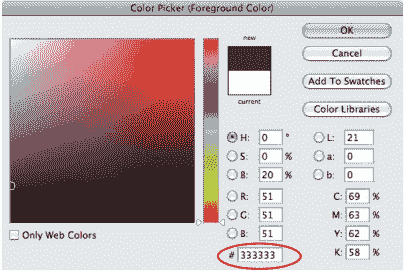

图 6.6

`Photoshop`的拾色器可以轻松找到十六进制（或`RGB`）值。

我们使用`color`属性在线设置字体颜色：

```css
h2{
  font-family: "Helvetica Neue", helvetica, arial, sans-serif;
  font-size: 18px;
  font-weight: bold;
  font-style: italic;
  color: #333333;
}
```

## 使用十六进制简写

随着你对`CSS`越来越熟悉，并且查看其他设计师的作品时，你会偶尔看到更简短的十六进制代码，比如`#333`、`#DDD`或`#069`。这只是用更少的字符书写相同内容的一种方式。其工作原理如下：如果完整的六字符代码中的前两位、中间两位或最后两位字符相同，你可以通过只写一次相应的字符来缩短你的值。换句话说，`#006699`变成了`#069`。

你可以使用十六进制以外的值。例如，你可以使用`RGB`值，其格式如下：`rgb(200, 54, 54)`。我使用十六进制值，但如果你有偏好，两者都可以。

## 调整行高

在`CSS`中使用`line-height`与在印刷设计中调整行距（leading）是一回事。也就是说，此属性设置一行文本所占据的垂直空间（图 6.7）。

**图 6.7** 在为网页进行设计时，不要忘记考虑行高。

```css
line-height: 24px;
font-size: 18px;
```

行距（Leading）和行高（line-height）等于一行文本所占据的垂直空间。

我们使用`line-height`属性设置行距：

```css
h2{
  font-family: "Helvetica Neue", helvetica, arial, sans-serif;
  font-size: 18px;
  font-weight: bold;
  font-style: italic;
  color: #333;
  line-height: 24px;
}
```

就像使用`font-size`一样，你可以在这里使用任何值和单位。在我们的示例中，值是 24，单位是像素，或写为`px`。

## 使用`CSS`进行字距调整

在字距调整方面，`CSS`不如`Adobe Illustrator`或`InDesign`那样能提供精细的控制，但它确实通过`letter-spacing`属性提供了一个粗略的工具。我说“粗略”，是因为`CSS`会调整你指定标签内整个字符串的字距，而且由于屏幕上像素的限制，其测量单位远不够精确。

我们使用`letter-spacing`属性来控制一串文本中每个字母之间的水平间距：

```css
h2{
    font-family: "Helvetica Neue", helvetica, arial, sans-serif;
    font-size: 18px;
    font-weight: bold;
    font-style: italic;
    color: #333;
    line-height: 24px;
    letter-spacing: -1px;
}
```

你可以在此处使用任何单位或值，包括负值，如果你想让字母之间排列得更紧密的话。

## 设置全大写、全小写和混合大小写

`CSS`允许你使用`text-transform`属性非常容易地更改`HTML`中文本的大小写：

```css
h2{
    font-family: "Helvetica Neue", helvetica, arial, sans-serif;
    font-size: 18px;
    font-weight: bold;
    font-style: italic;
    color: #333;
    line-height: 24px;
    letter-spacing: -1px;
    text-transform: uppercase;
}
```

你可以选择的值包括`uppercase`、`capitalize`和`lowercase`。与大多数`CSS`一样，你可以通过声明值为`none`来让它丢失任何继承的`CSS`。

> **不要在你的`HTML`中使用全大写**
>
> 如果你网站的视觉风格需要全大写（或全大写）的标题，没必要在`HTML`中就这样输入。只需以正确的标题大小写形式书写即可。你可以稍后使用`CSS`来转换文本。

## 网页布局

当印刷设计师在杂志上排版一个跨页时，这意味着她正在引入图像、环绕文本、创建分栏、设置栏间距，并用图形处理（如边框）来定义空间。网页设计也是如此，但我们不是使用像`InDesign`这样的页面布局程序来完成，而是使用`CSS`来移动`HTML`标签。

## 使用浮动实现文本环绕

如果你希望图像周围有文本环绕，你可以使用`CSS`将其向左或向右浮动。只需告诉图像`float: right;`或`float: left;`就能达到效果。

此外，你需要确保在文本可能碰到的图像边缘周围留有一些边距。对于向左浮动的图像，这意味着在右侧（以及可能的上边和下边）添加边距。对于向右浮动的图像，这意味着你需要在左侧添加边距（图 6.8）。

**图 6.8** 当你浮动图像以环绕文本时，不要忘记给图像添加边距，这样文本才不会与它贴得太近。

以下是`HTML`：

```html

<p>
    Our beloved CEO has years of experience telling us what to do and not
    following through on his own commitments. He is a micromanager, but
    not an annoying one. We sort of like him for his antics in front of
    clients, and he is endearing when he drags in each morning at 11:00
    after a quick nine holes and a six pack of imported beer.
</p>
```

这是`CSS`：

```css
img{
    float: right;
    margin-left: 10px;
    margin-bottom: 10px;
    }
```

## 使用浮动进行布局

大多数网页设计需要将分栏作为布局的一部分，但`CSS`没有办法说，“我想要创建一个分栏。”所以，我们改用浮动。当我们想在布局中创建分栏时，我们使用`CSS`将标签“浮动”到左侧或右侧，就像我们在上一节图像示例中所做的那样。考虑以下`HTML`（图 6.9）：

**图 6.9** 这是我们编写任何`CSS`之前的`HTML`样子。

```html
<div class="wrap">
  <div class="main">
    Make this the left column.
  </div>
  <div class="side">
    Make this the right column.
  </div>
</div>
```

创建分栏是一个三步过程。

1.  **设置宽度。** 如果你没有为盒子设置宽度，浮动通常不会有任何好处——而且，一个占据整个页面宽度的分栏又有什么用呢（图 6.10）？

**图 6.10** 这就是我们为即将创建的每个分栏设置宽度后发生的情况。

```css
.wrap{
  width: 960px;
}

.main{
  width: 760px;
}

.side{
  width: 200px;
}
```

2.  **设置浮动。** 我们使用`float`属性告诉`<div>`标签向左和向右浮动（图 6.11）：

**图 6.11** 当我们浮动子标签时，父标签会向内折叠。别问为什么，它就是这样。

```css
.wrap{
  width: 960px;
}

.main{
  width: 760px;
  float: left;
}

.side{
  width: 200px;
  float: right;
}
```

请注意，这一步导致了一些奇怪的事情发生。父容器`<div class="wrap">`不再包裹嵌套的盒子——它只是向内折叠了。由于在 99.9% 的情况下，你会希望父盒子包裹其子元素，因此我们需要知道如何修复这个问题。

3.  **清除浮动。** 为了解决第 2 步引入的问题，我们必须执行所谓的“清除浮动”（图 6.12）。大多数情况下最简单的有效方法是将父元素的`overflow`属性设置为`hidden`，如下所示：

**图 6.12** 一旦我们清除了浮动，父标签就再次包裹其子元素。

```css
.wrap{
  width: 960px;
  overflow: hidden;
}

.main{
  width: 760px;
  float: left;
}

.side{
  width: 200px;
  float: right;
}
```

**提示** 清除浮动的方法有很多；我只描述了一种技巧。要了解更多，请查看`cssforprintdesigners.com/clearing-floats`。

我希望我能有一个充分的理由与你分享为什么我们必须清除浮动，但没有——这只是我们必须接受的事情。

## 使用浮动玩出花样

如果你有一系列标签并将它们向同一方向浮动，它们将并排浮动（图 6.13）。例如，如果你想要创建一个三栏布局，这个规范将非常有用。

**图 6.13** 如果你将三个标签都向左浮动，你就可以创建一个简单的三栏布局。

> **提示** 网页设计师通过将一系列`<li>`标签向左浮动来创建水平导航，这非常常见。
>
> **提示** 当你浮动一个块级元素时，它会自动开始表现得像一个行内元素，因此它将占据尽可能少的水平空间。

## 使用边框、内边距和外边距进行间距设置

当我们在`CSS`中指定`border`、`padding`或`margin`属性时，它会增加标签的宽度，这导致我们在设计时必须进行计算，这可能很麻烦。当一个新手负责我正在编写的`PSD`时，我很容易就能判断出来，因为`border`、`padding`和`margin`属性会不规则且不一致。

增加这种间距会让`CSS`编码人员抓狂，很快也会让你抓狂。当你想在设计中的对象之间放置间距时，使用整数会让一切简单得多。

假设你有一个总宽度为 960 像素的双栏布局（图 6.14）。主栏需要加起来达到 760 像素，侧边栏需要总计 200 像素。这很简单，因为 760 + 200 = 960。它放得下。

> **提示** 在印刷设计中，我们称文本栏之间的空间为栏间距（gutters）。在网页设计中，我们通常使用`padding`或`margin`来创建这种间距。

**图 6.14**

两个子元素加起来等于 960 像素，因此它们可以放入一个宽度为 960 像素的父标签内。

但是，如果你通过`border`、`padding`或`margin`属性为内部列增加了任何宽度，你的布局就会被破坏，因为内部列的总宽度大于父元素（图 6.15）。如果你给侧边栏添加 10 像素的边框，侧边栏的总宽度就变成了 210 像素。而 970 总像素将无法放入 960 像素内。

当一个浮动对象没有空间浮到另一个对象旁边时，它就会下落到下一行。看看一个简单的对象的整体宽度在你以每次增加 10 像素的方式为其添加`border`、`padding`和`margin`时是如何变化的（**图 6.16**）。然后试着想象一下，如果你有一个三栏或四栏的布局，这里 2 像素的边框，那里 6 像素的外边距，以此类推，这会有多"有趣"。情况很快就会变得很糟糕。

**图 6.16** 边框、内边距和外边距让我们不得不做计算。这真让人头疼。

这里有两个关键要点：

- 保持简单。我们都是设计师，不是数学家。
- 如果某个元素似乎被推到了比应有位置更低的地方（如图 6.15 所示），请通过将对象声明的宽度以及标签左右两侧边框、内边距和外边距所增加的宽度相加，来检查总宽度。很可能，你试图把太多的宽度塞进太小的空间里。

## 设置边框

我们使用`border`属性为标签设置边框。下面是一个例子：

```
nav{
    border: 5px solid #000;
}
```

这段`CSS`会在`<nav>`标签的四边都设置 5 像素的实线边框（**图 6.17**）。


如果你希望对边框的控制比四边相同更精细一些，你还可以使用以下属性，从顶部开始顺时针排列（记住这个顺时针顺序；一会儿你就会学到有趣的东西）：`border-top`、`border-right`、`border-bottom` 和 `border-left`。如果你省略其中任何一个，你的元素在该边就不会有边框。

如果你想在导航区域的底部设置一条粗黑线，在顶部设置一条细灰线，而两侧什么都没有（图 6.18），你可以这样写 CSS：

```css
nav{
    border-bottom: 5px solid #000;
    border-top: 1px solid #DDD;
}
```

注意我们在 CSS 规则的属性值区域放了三个独立的值：

- 第一个是边框的粗细或宽度（在我们的例子中分别是 5 像素和 1 像素）。
- 第二个是边框的样式（`solid`）。
- 第三个是颜色（`#000` 和 `#DDD`）。

你应该按这个顺序保留这些值，并用单个空格分隔，将它们都保持在同一行。

## 设置边框样式

如果你想用虚线边框、点线边框或双线边框代替实线边框，你也可以做到（图 6.19）：

```css
nav{
  border-bottom: 5px solid #000;
  border-top: 1px dotted #DDD;
}
```

图 6.19 我们将顶部的边框从实线改成了点线。

### 更多边框样式

还有很多其他可用的边框样式，不过我很少使用`实线`或`点线`以外的样式。与本书其他部分一样，我只介绍最常用的内容，并给你足够的信息去网上查找其余的。如果你想看完整列表，只需 Google 搜索`CSS border-style`。

## 继承边框颜色

如果你不声明颜色，元素将继承其父标签设置的`color`属性。你将在后面的章节中了解更多关于这种现象（聪明地称为`继承`）的内容。

## 添加内边距

我们使用`padding`属性在标签的`内部`紧靠边框的地方添加空间。

与`border`属性一样，你可以为标签的四边设置`padding`，就像这样：

```css
nav{
  border-bottom: 5px solid #000;
  border-top: 1px dotted #DDD;
  padding: 20px;
}
```

或者你也可以疯狂一点，用以下属性为四边分别设置不同的`padding`（注意它们和前面讨论的`border`一样，从顶部开始顺时针排列）：`padding-top`、`padding-right`、`padding-bottom`和`padding-left`。

```css
nav{
    border-bottom: 5px solid #000;
    border-top: 1px dotted #DDD;
    padding-top: 20px;
    padding-bottom: 15px;
}
```

由于`padding`在边框内部，如果你为标签设置了背景色，它会填充`padding`并一直延伸到边框（图 6.20）。

```css
nav{
    border-bottom: 5px solid #000;
    border-top: 1px dotted #DDD;
    padding-top: 20px;
    padding-bottom: 15px;
    background-color: #EEE;
}
```

图 6.20 我们添加了一些`padding`，所以它变高了，还添加了一个灰色的`background-color`。

## 设置外边距

`margin`属性与`padding`类似，它也是紧靠边框的空间。区别在于`margin`是边框`外部`的空间，而不是内部。当你设置背景色时，它不会填充`margin`后面的区域，因为`margin`在边框外面。

设置`margin`的方式与设置`padding`完全相同——也就是说，你可以用`margin`属性同时设置四边，也可以用`margin-top`、`margin-right`、`margin-bottom`和`margin-left`分别为每边设置。

```css
nav{
    border-bottom: 5px solid #000;
    border-top: 1px dotted #DDD;
    padding-top: 20px;
    padding-bottom: 15px;
    background-color: #EEE;
    margin-top: 10px;
    margin-right: 20px;
    margin-bottom: 30px;
    margin-left: 40px;
}
```

如你所见，这些编码都很简单，但需要大量输入。如果能有一种方法把这个 CSS 规则缩短一点就好了。等等，确实有！

## 使用 CSS 简写设置 Padding 和 Margin

当你像我们这样开始编写 CSS 时，它会变得非常冗长。CSS 简写为我们提供了一种用更少的按键次数实现同样效果的方法。

`padding`和`margin`属性共享相同的简写，所以我们可以`一石二鸟`。还记得我之前告诉过你的吗，要注意我们从顶部开始并以顺时针方向处理`padding`和`margin`属性？

对于`padding`，从标签的顶部开始顺时针方向，我们有`padding-top`、`padding-right`、`padding-bottom`和`padding-left`。你还记得`margin`也是以同样的方式工作的。

看看这段 CSS：

```css
div{
    padding-top: 10px;
    padding-right: 20px;
    padding-bottom: 30px;
    padding-left: 40px;
}
```

CSS 简写让我们可以这样写：

```css
div{
    padding: 10px 20px 30px 40px;
}
```

你只需从顶部开始输入第一个值，然后顺时针方向围绕标签继续。如果上下匹配，左右也匹配，我们还可以更进一步。例如，你可能想写这样的代码：

```css
div{
    padding-top: 0;
    padding-right: 20px;
    padding-bottom: 0;
    padding-left: 20px;
}
```

> **提示** 实际上我已经给过你`border`的简写了。我之前没提，是因为`border`的完整写法比简写更难记，而且我认为能走捷径的时候没必要走弯路。
>
> **提示** 注意值`0`不需要单位，因为零就是零，无论用什么单位都是零。

注意上下都是`0`，左右都是`20px`。你可以这样写简写：

```css
div{
    padding: 0 20px;
}
```

这段 CSS 将上下`padding`归零，并将左右两边都设置为 20 像素。

## 使用 Margin 居中标签

如果你想在网页设计中将布局居中，可以通过将标签的左右`margin`设置为`auto`并声明标签的`width`来实现。有几种方法可以做到：

```css
margin: Aren 10px auto 5px auto;
margin: 0 auto;
margin: auto;
```

## 使用 CSS Reset 移除默认间距

所有这些计算在紧迫的截止日期下可能会让人非常沮丧。最终你会在某些元素上添加空间，但数学运算对不上。你会挠破头皮，在想哪里出了问题。这个时候就该考虑 CSS reset 了。

在第 5 章中，你了解到当你写 HTML 而没有任何 CSS 时，它读起来像一份 Word 文档。这是因为每个浏览器都会对 HTML 文件应用默认 CSS 以便它们可读——在你写任何 CSS 之前，就已经有 CSS 告诉你的网页该长什么样了。这个默认 CSS 控制着你的标题标签和段落文字的大小、标题上方和下方以及段落和列表的间距，等等。

问题是每个浏览器在究竟使用多少空间和什么字体大小方面都有一些分歧。你可以通过编写自己的 CSS 来覆盖默认 CSS，但这可能会变得很繁琐。为了解决这个问题，一些非常聪明的 CSS 开发者想出了用重置样式表覆盖浏览器默认 CSS 的办法（图 6.21），他们在每个项目中重复使用。

我在`cssforprintdesigners.com/css-reset`整理了一些额外的指导和你可以用在自己项目中的 CSS reset 列表。

有了这样的 CSS reset，每个浏览器都会被告知就每个标签周围应该有多少间距、每个字体应该多大以及其他一些事情达成一致。你需要知道的是：我建议你在项目开始时使用 CSS reset，因为它会让你的数学运算顺利得多。

图 6.21 使用 CSS 重置后，默认的间距和字体大小被统一的字体大小和间距所取代。

## 为交互而设计

很多人认为平面设计师不太理解交互性，但事实并非如此。作为一名平面设计师，以及与全国各地的平面设计师交流，我深知这一点。事实上，我认为平面设计师比许多网页设计师更理解交互性。

想想一本设计精美的折页宣传册。你的“用户”确实在与这个实体物互动，通过探索来发现其内容，投入的时间越长，发现得越多。环境图形设计是所有设计中最具交互性的——顾客确实在其中穿梭，从各个角度与它互动，并根据其设计方式来接收信息。

所以，是的，平面设计师是懂交互的。

但通常，一个设计过网站的平面设计师会创建出交互`功能`，比如悬停效果和下拉菜单，但最终感觉很别扭。我认为这更多是由于对网页交互工具缺乏了解，而不是对交互原则缺乏理解。作为平面设计师，我们习惯于在物理世界中创造交互——布局很重要，握在手中的感觉也很重要。

当你在网站上进行交互设计时，屏幕和鼠标是人们用来探索事物的工具，因此我们需要找到新的方式来实现交互，使其感觉自然、具有物理感和响应性。

互联网上并没有可以翻动的物理页面——只有页面的隐喻。因此，网页设计师必须想办法让用户知道，在某个交互背后隐藏着内容。

我们通过两种方式来实现：

- 首先，我们让事物看起来可点击。这就是为什么网站上的按钮通常看起来像我们在现实生活中看到的按钮：它们通常看起来略有凸起，具有深度感，并且在被点击时外观会发生变化。
- 其次，在点击之前，网页设计师需要给用户一些提示，表明该元素可以被点击。这有助于用户理解他们应该尝试点击它来看看会发生什么。

## 使用交互式 CSS 命令

在开始考虑为你的网站添加交互性之前，你需要知道有哪些工具可供使用。CSS 提供了一种简单的方式来告诉网页上的对象，当用户用鼠标悬停在它们上面或点击它们时应该如何表现。

你已经学习了如何创建选择器来定位 HTML 标签并更改其外观。现在，我们将为 CSS 选择器添加最后一层，用于交互性。

这就像在选择器中添加一个冒号并附加一个单词一样简单。可供选择的单词只有几个，所以这非常简单。表 6.3 向你展示了有哪些选项，以及它们的作用。

表 6.3 交互式 CSS 命令

| CSS | 说明 |
| --- | --- |
| `a:hover` | 使用此命令告诉你的 CSS，当用户将鼠标悬停在某个元素上时，它应该是什么样子。这对于让用户知道何时可以与某物交互很有用。 |
| `a:active` | 使用此命令告诉你的 CSS，当用户用鼠标点击链接时，它应该是什么样子。这有助于让按钮或链接看起来像是被按下了。 |
| `a:visited` | 使用此命令告诉你的 CSS，在用户点击之后某个元素应该是什么样子。这在长链接列表中很有用，你希望用户知道他们已经点击过哪些链接。 |

> **提示** 你不必每次设计交互时都使用所有这些交互式 CSS 命令。你可以选择性地使用。例如，在主导航中，我通常不会费心使用`:visited`状态。

在表 6.3 中，你会注意到我使用了`<a>`标签作为示例。你也可以将这些交互式 CSS 命令用于其他标签、类属性和 ID 属性。问题是，并非所有浏览器都识别所有标签上的这些命令，但它们都识别`<a>`标签上的命令，所以目前你继续使用`<a>`标签是没问题的。

## 你不需要记忆的更多词汇

这些交互式 CSS 命令有一个听起来很复杂的标签来描述它们。它们被称为伪类选择器。我告诉你这个不是因为我想让你学习如何发音它，也不是因为你需要记住这个术语来编写网站代码。我提到它是因为，随着你在网页编码方面变得更加成熟，你最终会在更高级的在线教程和网页设计博客中遇到它，我只想让你知道它是什么。

让我们看几个如何使用这些交互式 CSS 命令的例子。

在这个例子中，我们告诉所有`<a>`标签，初始颜色设置为蓝色。

```css
a{
  color: blue;
}
```

当用户将鼠标悬停在链接上时，我们让颜色变为黑色，以给用户一个提示，表明这是可以点击的东西。

```css
a{
  color: blue;
}

a:hover{
  color: black;
}
```

现在，当用户按住链接上的鼠标按钮时，我们通过将背景颜色更改为黑色并将文本颜色更改为白色来反转文本。这种变化向用户确认他们已命中目标，并且即将发生一些事情。

```css
a{
  color: blue;
}

a:hover{
  color: black;
}

a:active{
  background-color: black;
  color: white;
}
```

最后，在用户点击链接之后，我们将其变为灰色，以给用户一个提示，表明他们已经访问过该链接。下次用户返回此页面并看到该链接时，它将是灰色的。

```css
a{
  color: blue;
}

a:hover{
  color: black;
}

a:active{
  background-color: black;
  color: white;
}

a:visited{
  color: gray;
}
```

## 让我们一起制作一个网页

信不信由你，仅仅通过学习本章的内容，你就已经学会了足够的 CSS 来创建一个简单的网页布局（图 6.22）。到现在，那些有趣的字符应该不再那么令人困惑了。它们可能仍然比纯英文需要多一点时间来阅读，但这没关系。仔细阅读代码，特别是 CSS 中的注释。

图 6.22

这展示了使用本章所学知识可以制作的简单两栏布局。

这是一个简单网页的 HTML：

```html
<header>
  
  <nav>
    <ul>
      <li>
        <a href="index.html">Home</a>
      </li>
      <li>
        <a href="about.html">About</a>
      </li>
      <li>
        <a href="services.html">Services</a>
      </li>
      <li>
        <a href="portfolio.html">Portfolio</a>
      </li>
      <li>
        <a href="contact.html">Contact</a>
      </li>
    </ul>
  </nav>
</header>
<div id="content">
  <div class="main">
    <h1>
      A Very Important Headline Goes Here
    </h1>
    <p>
      Page content goes here.
    </p>
  </div>
  <div class="side">
    <h2>
      A Less Important Headline Goes Over Here
    </h2>
    <p>
      The sidebar content goes here.
    </p>
  </div>
</div>
<footer>
  <p>
    <a href="legalese.html">Legalese</a>
  </p>
</footer>
```

这是 CSS：

```css
header{
    background-color: #BBB; /* 中灰色 */
    width: 900px; /* 我们希望整体宽度为 960，所以接下来我们会用边框和内边距进行一些计算 */
    padding: 20px; /* 四边均为 20，意味着我们为整体宽度增加了 40。900 + 40 = 940 */
    border: 10px solid; /* 这为整体宽度总共增加了 20。940 + 20 = 960 */
    margin: auto; /* 使 header 居中 */
    font-family: "Helvetica Neue", helvetica, arial, sans-serif; /* 为 header 及其内部所有内容选择字体 */
    font-size: 12px;
    line-height: 20px;
    color: #444; /* 用于文本和边框的深灰色 */
    overflow: hidden; /* 提前计划清除浮动 */
}

header img{
    float: left;
}

nav ul{
    overflow: hidden; /* 提前计划清除浮动 */
    padding: 0;
    float: right;
}

nav li{
    float: left; /* 浮动每个 <li> 标签到左侧，这样它们就会按顺序排列 */
}

nav a{
    display: block; /* 这是为了让下一行的内边距生效所必需的 */
    padding: 5px; /* 在链接周围添加一些间距 */
    margin-right: 1px; /* 在每个链接之间放置一个像素的间距 */
    background-color: #DDD; /* 浅灰色背景色 */
    color: #444; /* 深灰色文本颜色 */
    text-decoration: none; /* 去除链接的默认下划线 */
}
```


# 7 使用 CSS 进行设计

## 如何利用图像和 CSS3 让你的布局出彩

当我观看平面设计师（或任何设计师）工作时，有一点总是让我印象深刻，那就是我们每个人都会以不同的方式使用设计工具来实现自己的创意愿景。

当你把任何强大的工具交到富有创意的人手中时，那个人总会找到新的方法来完成工作。这就是工具的奇妙之处——当你完全掌握了它们，所能成就的就是没有极限的。需要的只是一点点想象力。

CSS 就是这样一种强大的工具。在上一章中，我们学习了如何创建布局、控制排版，以及如何为网页设计添加交互性。在本章中，我们将学习如何让你的布局变得美观。

## 使用背景图像

创建一个视觉上有趣、符合品牌调性的页面的最简单方法之一，就是引入在 Photoshop 等程序中创建的图形。

> **用 CSS 引入装饰性图像**

在之前的章节中，我向你介绍了 HTML 中的 `` 标签。该标签用于引入被视为内容的图像，比如头像或徽标。在本章中，我们将通过 CSS 而非 HTML 来引入图像。因此，如果你想引入用于装饰的图像，比如背景中的重复图案，或者作为页面底层基础的粗糙纹理，我们将使用 CSS 的背景图像来实现，而不是 `` 标签。

与其使用 HTML 的 `` 标签来引入装饰性图像或图案，不如使用 CSS 属性 `background-image`，并结合 `background-repeat`、`background-color` 和 `background-position` 等其他几个属性：

```css
.content{
    background-color: #DDD;
    background-image: url(i/tile.gif);
    background-repeat: repeat-x;
    background-position: right bottom;
}
```

## 为什么要定义背景颜色？

你已经在上一章了解了 `background-color` 属性——而且它含义明确，无需过多解释。

```css
.content{
    background-color: #DDD;
    background-image: url(i/tile.gif);
    background-repeat: repeat-x;
    background-position: right bottom;
}
```

在我的工作坊中，我经常被问到这样一个问题："如果背景要被一张大图片或重复的背景图像覆盖，我为什么还要定义背景颜色呢？"

这确实是个好问题，因为它提出了一个关于如何让网络对每个人都更友好的重要观点。作为网页设计师，我们面对的是灵活的内容、不同尺寸的屏幕，以及全球各地具有不同偏好和下载速度的用户。因此，我们需要为最坏的情况做设计。

我们在网上使用图像时，最坏的情况是图像无法加载。这可能由多种原因造成。也许是网络通道堵塞，图像需要很长时间才能下载。又或者，你的用户正在一个网络接入非常慢的地方浏览你的网站，比如第三世界国家或偏远 woods 中的湖畔小屋。

在你把这种情况当作不可能发生之前，请想想那些到这些地区度假、从事 missionary 工作或打仗的用户。这比你想象的更为常见。

对于这些需要等待很长时间才能加载背景图像，或者图像根本无法加载的用户，我们应该定义一个背景颜色，以确保该标签中的任何文本都能保持可读性。一个常见的场景是，设计师将白色文字放在深色背景图像之上。如果图像无法加载，或者加载缓慢，白色文字在默认的白色背景色上将不可见。为了解决这个问题，我们设置一个深色背景色，以确保即使在没有图像的情况下文字也是可读的。

如果你不做这个处理，部分用户可能将无法阅读文字。我鼓励你始终为最坏的情况做设计——能够设计出可以被不同用户以不同方式查看的内容，正是网页设计如此有报偿感的原因。而那些用户虽然可能不知道你在设计中投入了多少努力，但会记得这个网站就是能用，这也是始终值得被赞赏的。

## 为背景图像指定路径

在 HTML 中，你学习了如何使用 `src` 属性来指定图像的路径。CSS 有自己特殊的方式来调用图像，但路径在 CSS 中的工作方式与在 HTML 中完全相同：

```css
.content{
    background-color: #DDD;
    background-image: url(i/tile.gif);
    background-repeat: repeat-x;
    background-position: right bottom;
}
```

我们这里要看两件事：需要学习的语法，以及图像路径——你会从第 3 章中回忆起这部分内容。

我们先从语法开始。不同于 HTML 中使用 `src` 属性，我们在这里写 `url()`。字符串 `url(` 加上开括号告诉我们即将设置图像的路径。闭合括号则告诉我们图像路径已经写完了：

```text
url(i/tile.gif)
```

现在来看路径。在第 3 章中，我们学习了如何通过导航文件夹来定位文件，从而编写路径。前面示例中的路径是一个相对路径（在 CSS 中也可以使用绝对路径，但我建议坚持使用相对路径作为最佳实践），因为它是相对于 CSS 文件的位置而言的：

```text
url(i/tile.gif)
```

在这个例子中，我将 CSS 图像文件夹命名为 `i`，这是我自己为 images 创造的缩写。为什么这么做？有两个原因。第一，输入 `i/` 比输入 `images/` 更快捷。第二，这种方法可以减小文件体积——在非常大的 CSS 文件中，如果我写 `i/` 而不是 `images/`，字符数更少，文件体积最终也会更小。

在前面的示例中，让我们想象有以下文件夹结构：

```text
+-- index.html (HTML 文件)
+-- css (文件夹)
    +-- base.css (CSS 文件)
    +-- i (文件夹)
        +-- tile.gif (图像文件)
```

由于 CSS 文件 `base.css` 在 `css` 文件夹中，而 `i` 文件夹也在 `css` 文件夹中，所以我们只需输入 `i/tile.gif` 就能到达 `css/i/` 文件夹内的 `tile.gif`。

## 重复的背景图像

你上网的时间已经足够长了，知道重复的背景图像看起来是什么样子的（**图 7.1**）。毫无疑问，CSS 的这一功能曾经被过度使用。

但你这样有品位的设计师，是不会使用这种图像的吧？

不开玩笑了，重复的背景图像如果使用得当，可以产生很好的效果，为你的设计增添一层深度和质感，让它感觉更加完整和专业。

---

以下是从上一章（第 6 章）摘录的 CSS 代码片段：

```css
nav a:hover{
    background-color: #FFF; /* 白色 */
    color: #000; /* 黑色 */
}

nav a:active{
    margin-top: 1px; /* 按下时将导航项向下推移一个像素 */
}

#content{
    overflow: hidden; /* 再次提前规划，以清除浮动 */
    width: 960px; /* 与上方 header 的宽度匹配 */
    margin: auto; /* 将 #content 居中 */
    font-family: "Helvetica Neue", helvetica, Arial, sans-serif; /*
    为 #content 及其内部所有元素选择字体 */
    font-size: 12px;
    line-height: 20px;
    color: #444; /* 文本和边框的深灰色 */
}

.main{
    width: 740px;
    padding-right: 20px; /* 740 + 20 = 760 */
    float: left;
}

h1{
    font-size: 30px; /* 大标题 */
    font-weight: normal; /* 标题默认是粗体，所以如果需要可以设为 normal */
}

.side{
    width: 160px;
    padding: 20px; /* 760 + 160 + 40 = 960，所以刚好合适！ */
    float: right;
    background-color: #DDD;
}

h2{
    font-size: 12px;
    text-transform: uppercase;
    letter-spacing: 1px;
}

footer{
    border-top: 1px dotted #DDD; /* 用点状边框在视觉上微妙地将 footer 与 #content 分开 */
    width: 960px; /* 与 header 和 #content 的宽度匹配 */
    margin: auto; /* 将 footer 居中 */
    font-family: "Helvetica Neue", helvetica, arial, sans-serif; /*
    为 footer 及其内部所有元素选择字体 */
    font-size: 12px;
    line-height: 20px;
    color: #444; /* 文本和边框的深灰色 */
}
```

## 你已经学会了很多

你刚才看到的已经完成了一个网页设计项目的 90%。它还不算漂亮，内容也只是占位文本，但你做到了！**表 6.4** 列出了我们刚刚学过的所有 CSS。

| CSS | 英文说明 |
|---|---|
| `font-family` | 这是我们选择字体的方式。 |
| `font-size` | 这是我们选择字体大小的方式。 |
| `font-weight` | 这是我们选择字体为粗体或正常的方式。 |
| `font-style` | 这是我们选择字体为斜体或常规的方式。 |
| `color` | 这是我们选择颜色的方式。 |
| `text-decoration` | 这是我们控制下划线的方式。 |
| `width` | 这是我们设置某物宽度的方式 Автор。 |
| `border` | 这是我们为某物设置边框的方式。 |
| `padding` | 边框内部的空间。 |
| `margin` | 边框外部的空间。 |
| `background-color` | 这是我们选择背景颜色的方式。 |
| `overflow` | 我们将其设为 auto 以清除浮动。 |
| `float` | 这是我们实现文字环绕图像、制作多列以及创建水平导航的方式。 |

最后的 10% 将在接下来的几章中讨论，那里你可以尽情发挥，为你的作品添上最后的润色，因为你已经将整体结构搭建出来了。

**图 7.1** 就互联网而言，背景图像早已不是什么新鲜事物。

我们的示例将背景图像沿 X 轴重复，但 CSS 还为我们提供了其他选项。

```css
.content{
  background-color: #DDD;
  background-image: url(i/tile.gif);
  background-repeat: repeat-x;
  background-position: right bottom;
}
```

**表 7.1** 列出了我们可以通过 `background-repeat` 属性重复背景图像的方式。

### 表 7.1 `background-repeat` 的值

| CSS | 英文说明 |
|---|---|
| `repeat` | 此选项让图像在上下左右所有方向重复。 |
| `no-repeat` | 此选项让图像不重复。如果你使用的是单张较大的图像，或者将单张图像用作装饰（比如背景中的水印标志），这个选项很有用。 |
| `repeat-x` | 此选项让图像沿 X 轴重复。 |
| `repeat-y` | 此选项让图像沿 Y 轴重复——你猜对了。 |

我知道，我知道。X 轴和 Y 轴很难记住——所以我设计了一个小图表来帮助我记清楚（**图 7.2**）。

**图 7.2**

我记得 Y 轴是上下方向，是因为字母 Y 在这个图表中是垂直排列的。

## 定位背景图像

当你使用 CSS 引入背景图像时，浏览器会从你指定标签的左上角开始显示。对于一个需要在所有方向重复的图像来说，这没问题——无论容器尺寸如何，它都会在各个方向重复并填满容器。

但如果你想将图像放在特定位置，或者只想让它在某个方向重复，你需要告诉浏览器从哪里开始显示图像。

```css
.content{
    background-color: #DDD;
    background-image: url(i/tile.gif);
    background-repeat: repeat-x;
    background-position: right bottom;
}
```

`background-position` 属性允许我们使用像素、百分比和关键字来控制图像的起始点。

请注意，`background-position` 的值顺序很重要。正如我们在示例中看到的，`background-position` 属性接受两个值。第一个值是水平（左右）位置，第二个值是垂直（上下）位置。

### 使用关键字定位

你可以使用纯英文关键字来定位背景图像。代码示例如下：

```css
.content{
    background-position: right bottom;
}
```

关键字是 CSS 的一个贴心功能，让我们可以用纯英文指定所需位置。它们易于编写和阅读。`top` 表示顶部，`bottom` 表示底部，`left` 表示左侧，`right` 表示右侧，`center` 表示居中（无论是水平还是垂直方向）。

**表 7.2** 列出了使用关键字进行水平定位的选项。

### 表 7.2 使用关键字进行水平定位

| CSS | 英文说明 |
|---|---|
| `left` | 此选项让图像从标签左侧开始显示。 |
| `center` | 此选项让图像水平居中。 |
| `right` | 此选项让图像从标签右侧开始显示。 |

**表 7.3** 列出了使用关键字进行垂直定位的选项。

### 表 7.3 使用关键字进行垂直定位

| CSS | 英文说明 |
|---|---|
| `top` | 此选项让图像位于标签顶部。 |
| `center` | 此选项让图像垂直居中。 |
| `bottom` | 此选项让图像从标签底部开始显示。 |

### 使用像素定位

你可以通过计算从指定标签左上角开始的像素数来精确地定位背景图像。代码示例如下：

```css
.content{
    background-position: 100px 200px;
}
```

我们已经知道第一个值是水平位置，第二个值是垂直位置。因此很容易看出，这个背景图像将被放置在距离指定标签左侧 100 像素、顶部 200 像素的位置（**图 7.3**）。

**提示** 如果省略一个关键字，浏览器会默认你在另一个轴上使用 `center`。因此，输入 `background-position: right;` 等同于在声明中输入 `background-position: right center;`。而输入 `background-position: bottom;` 等同于在声明中输入 `background-position: center bottom;`。

## 裁剪背景图像

你可以使用负像素值来指定背景图像的位置。超出指定标签的部分将不会显示，类似于在 InDesign 中导入图像后，你可以裁剪掉不需要的部分。这种裁剪技巧我们将在本章后面好好利用，所以做好准备吧！

### 使用百分比定位

百分比提供了一种灵活的方式来定位相对于指定标签左上角的背景图像。代码示例如下：

```css
.content{
    background-position: 30% 70%;
}
```

使用百分比定位背景图像可能很有趣，尽管一开始可能有点令人困惑。

理解百分比定位最简单的方法是调整我们的大脑来适应百分比在此上下文中的工作方式。如果你将背景图像定位为 `0% 0%`，这等同于从左上角开始。如果你将背景图像定位为 `100% 100%`，这等同于从右下角开始。而 `50% 50%` 则等同于将图像水平和垂直居中。

你可以使用任何想要的百分比值，它们会相应地定位。

### 使用简写属性定位背景图像

我几乎总是使用简写 `background` 属性来控制与背景外观相关的任何内容。简写形式如下：

```css
background: #DDD url(i/tile.gif) repeat-x 10px 40px;
```

简写形式节省了输入冗长、重复的 CSS 属性的大量时间。`background` 属性接受多个值，每个值之间用空格分隔。

- 第一个值是调用背景图像的标签的 `background-color`。
- 第二个值是背景图像的路径。
- 第三个值告诉背景图像是否应该重复，如果重复，在哪个方向重复。
- 第四个值将背景图像水平定位，距离标签左侧。
- 第五个值将背景图像垂直定位，距离标签顶部。

## 使用 CSS 裁剪图像

前面我提到过，我们将学习如何利用 CSS 裁剪图像的能力。假设你正在用 InDesign 设计一张海报，而你不想看到图像的某一部分——你只需裁剪导入的图像以去掉不想看到的部分（**图 7.4**）。

在网页设计领域，我们把这些裁剪掉部分的大图像称为精灵图。

**图 7.4** 使用 InDesign 裁剪图像轻而易举。

### 为什么这样做？

你可能想知道为什么我们要导入一张图像然后只显示一部分，因为这意味着用户下载了一个比实际需要更大的文件。我很高兴你如此关心性能；你会成为一名出色的网页设计师。

但如果你以后想使用图像的其他部分，这种方法会很方便。

此外，每次服务器请求一张新图像都会减慢下载速度。下载一个大文件通常比下载大量小文件更快，因为每个文件都会对服务器造成一次请求。

### 使用图像创建花哨的悬停效果

我们通过在 Photoshop（或任何你想要使用的图形编辑程序）中创建一个包含多个图形的大画布图像来制作精灵图（**图 7.5**）。


然后我们使用 `background-position` 属性来裁剪掉我们不想看到的图形部分（图 7.6）。

假设你想设计一个下载按钮，默认状态是单色的，但当你悬停在它上面时会变成橙色。你将使用我们在第 6 章学到的 `:hover` 伪类选择器来改变 `background-position`，以显示彩色图标并隐藏单色图标。

让我用技术术语以外的方式解释一下：要使用 CSS 创建悬停效果，你只需要在鼠标悬停时改变图像的位置，以显示悬停状态并隐藏默认状态。让我们开始吧。

图 7.5 这是一个导航菜单的精灵图。它展示了默认状态、悬停状态和按下状态。

图 7.6 通过定位背景图像，我们能够显示精灵图的选择性部分。这里我们展示的是“合作伙伴”菜单项的按下状态。

在这个例子中，让我们为简历创建一个简单的下载链接（图 7.7）。

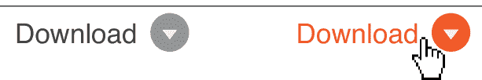

图 7.7 左侧的默认状态在用户将鼠标悬停在链接上时会变为橙色。

1. 编写 HTML 并创建图像（图 7.8）。

```html
<div class="download">
  <a href="downloads/resume.pdf">Download</a>
</div>
```

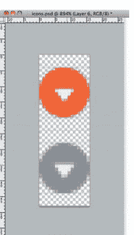

图 7.8 一个包含灰色和橙色图形的小精灵图（sprite），用于实现悬停效果。

2. 利用上面学到的知识引入背景图像（图 7.9）。


图 7.9 在你为链接设置样式之前，文本会覆盖在背景图像之上。

```css
.download a {
  background: url(icon-download.gif) no-repeat right top;
}
```

请注意，我们省略了 `background-color` 的值。这样做会使其变为透明。所以，我们写的这段代码与写成下面这样是一样的：

```css
.download a {
  background: transparent url(icon-download.gif) no-repeat right top;
}
```

3. 注意到下载图标的一部分位于链接之后。这样效果不好，因此在下载链接的右侧添加一些内边距（padding），为图标的可见性留出空间。同时在链接周围添加一些内边距，并设置文本样式，使其开始接近我们想要的样子（图 7.10）。

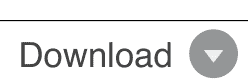

图 7.10 经过一些内边距和文本处理，这看起来像是一个漂亮的链接。

```css
.download a {
  background: url(icon-download.gif) no-repeat right top;
  padding: 5px 20px 5px 5px;
  font-size: 12px;
  font-family: "Helvetica Neue", helvetica, arial, sans-serif;
  text-decoration: none;
  color: #444; /* 深灰色文本颜色 */
}
```

> **提示** 我的个人目标是尽可能少地编写 CSS。你也应该这样做！

4. 我们引入的图形底部一部分不可见，因为它超出了标签的边缘。让我们在 `:hover` 时切换图形，以显示图形的悬停状态，并让默认状态超出标签范围（图 7.11）。同时，在 `:hover` 时给链接文本设置一个匹配的橙色。

图 7.11 左侧，橙色图形被隐藏。当用户悬停在链接上时，背景位置改变，显示橙色图形并隐藏灰色图形。

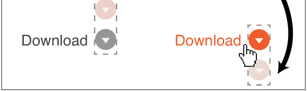

> **提示** 像这样在下游覆盖 CSS 声明是一种常见做法，也是 CSS 强大之处的一部分。我们将在第 9 章中详细讨论。

由于我们更改的背景图像唯一特性是背景位置（background position），因此不需要使用简写属性再次指定所有内容。我们只需使用 `background-position` 属性来覆盖之前语句中的那一部分。

```css
.download a {
  background: url(icon-download.gif) no-repeat right top;
  padding: 5px 20px 5px 5px;
  font-size: 12px;
  font-family: "Helvetica Neue", helvetica, arial, sans-serif;
  text-decoration: none;
  color: #444; /* 深灰色文本颜色 */
}
```

```css
.download a:hover {
  background-position: right bottom;
  color: #E56121;
}
```

## 创建基于图像的悬停效果

现在你已经看到了如何在悬停链接时切换图像，让我们更进一步。假设你想创建一个巨大的“立即购买”按钮，看起来如此诱人，以至于用户忍不住想点击它（图 7.12）。


图 7.12 很难不点击这个巨大的绿色怪物。

这个按钮有特殊的字体、微妙的渐变、深度和质感。在 Photoshop 中创建它很容易——你闭着眼都能做出来。但要通过 `:hover` 和 `:active` 状态将其转化为一个交互式按钮，需要相当专业的 CSS 技巧。真的如此吗？

我们只需要运用所学知识，外加一个小技巧。与其尝试通过样式调整文本来匹配我们的设计，不如将整个链接设为一个 CSS 背景图像。

首先编写 HTML 并创建一个精灵图（图 7.13）。我们可以使用上一个例子中熟悉的 HTML。

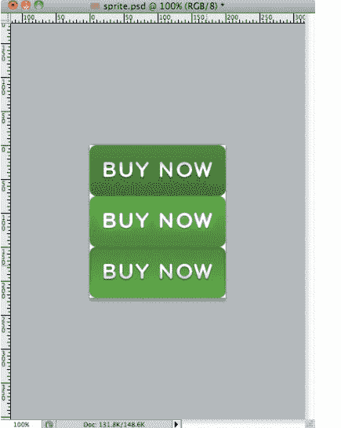

图 7.13 该精灵图包含一个默认状态（顶部）、一个悬停状态（中间）和一个按下状态（底部）。

```html
<div class="buy">
  <a href="add-to-cart.php">Buy Now</a>
</div>
```

使用 CSS 引入背景图像。

```css
.buy a {
  background: green url(buy-now.gif) no-repeat top;
}
```

接下来，我们要让 `<a>` 标签的大小与按钮图形一致。精灵图宽 200 像素，高 225 像素，这是因为它包含了按钮的所有三种状态。我们将链接设置为宽 200 像素、高 75 像素，暂时隐藏精灵图中的其他状态。

`<a>` 标签默认是行内（inline）标签，因此如果我们想指定宽度和高度，需要在宽度和高度生效之前告诉它 `display: block;`。

```css
.buy a {
  background: green url(buy-now.gif) no-repeat top;
  display: block;
  width: 200px;
  height: 75px;
}
```

糟糕，文本覆盖在背景图像上了。这在我们之前的例子中也出现过，直到我们添加内边距为图标留出空间。在这个例子中，我们根本不希望显示文本。对此有一个简单的解决方法，叫做图像替换（image replacement）。

图像替换是网页设计师的一种方法，旨在用 CSS 移除文本，同时将其保留在 HTML 中。这样一来，当在不支持 CSS 的浏览器中查看、在 RSS 阅读器中查看以及被 Google 抓取时，HTML 仍然可以被读取。

以下是使用图像替换的一种常见方法：

```css
.buy a {
  background: green url(buy-now.gif) no-repeat top;
  display: block;
  width: 200px;
  height: 75px;
  text-indent: -9999px;
}
```

仔细观察。我们使用了一个名为 `text-indent` 的新属性，并将其值设置为一个极大的负像素值。这种技术会将你目标标签内的文本直接抛到极左侧，使其不可见（图 7.14）。

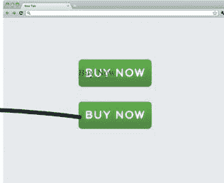

图 7.14 图像替换将文本直接抛离网页，从而避开背景图像。

“Buy Now”这些词仍然在 HTML 中，但 CSS 实际上已经将它们隐藏并用图像替换了。

最后，让我们添加一些 CSS 来控制悬停和按下状态。

```css
.buy a {
  background: green url(buy-now.gif) no-repeat top;
  display: block;
  width: 200px;
  height: 75px;
  text-indent: -9999px;
}
```

```css
.buy a:hover {
  background-position: center;
}
```

```css
.buy a:active {
  background-position: bottom;
}
```

## 关于图像替换的警告

我们之前学过，设置 `background-color` 值总是很重要的，这样当用户的图像无法加载时，文本仍然可读。然而，图像替换并不完美。

> **提示** 还有其他比这更高级的技术，它们各有优缺点。我在 `cssforprintdesigners.com/image-replacement` 创建了一个页面，你可以在那里了解更多。

最糟糕的情况是图像未能加载，而文本又是负缩进的，因此不可见。这意味着图像无法加载的用户将无法看到该链接。在设计网站时请始终考虑这些问题——识别谁将使用你的网站，并为他们进行设计。

## 发挥你的想象力

在 CSS 中使用背景图像时，你的限制只有你的想象力。正如我之前所说，我只向你提供我在作为网页设计师的大部分工作日中能搞定事情的技巧。大胆创作，练习这些技术，尝试新事物，看看哪些有效。

## 使用背景图像创建列

在我们结束 CSS 图像之前，还有一个概念需要涵盖：列。我知道你在想什么——我们在上一章讨论了用于创建列的浮动（floats）。好吧，我方便地把某些内容留到了现在才讲。

CSS 没有提供一个好的方法来创建延伸到页面底部的列，因为标签在垂直方向上的延伸仅限于它们所需的长度。因此，如果你有一个分栏布局，一列可能会比另一列长（图 7.15）。这是因为 CSS 和 HTML 的创建是为了让内容根据需要自由流动，无论长短。

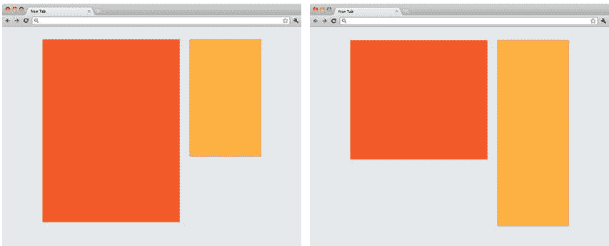

图 7.15 在 Web 上，垂直高度由标签内部包含的内容多少决定。

标签在垂直方向上增长以允许内容流动，并在内容结束时停止。在 CSS 中没有办法告诉这两列保持相同的高度。它们相互独立，仅根据填充它们的内容而增长。

## 你确实可以设置最小高度

CSS 提供了 `min-height` 属性，这很有帮助，但当内容增长超过最小高度时，它并不能解决我们的问题。`min-height` 属性和 `height` 属性类似，都会设置一个标签的高度。区别在于，使用 `min-height` 时，当内容超出分配的空间，我们允许区域随之扩展。

## 放弃垂直对齐吧

作为平面设计师，我们喜欢事物对齐整齐。这是合理的，因为我们习惯于为一个通常具有固定宽度和高度的矩形空间进行设计。

当你从平面设计师转型为网页设计师时，我希望你能接受一个事实：在网页设计中，垂直对齐几乎是不可能的。动态内容和用户设置有太多因素，无法加以控制。

此外，网页是为从上到下的阅读方式而优化的——它不像杂志、报纸或宣传册那样有固定的高度。它更像是一卷可以按需展开到任意长度的卷轴。网页就像这些古老的卷轴一样，为了适应任意数量的内容，可以在长度上自由延伸——因此有了滚动条这个术语。

这种缺乏固定尺寸的特性常常让平面设计师感到沮丧，因为这让我们很难在垂直方向上对齐元素。

不要因此对网页设计灰心。从某种意义上说，这是一种解放——我们没有固定的高度！我们可以让页面随心所欲地变长。

## 制造假列效果

2004 年，Dan Cederholm 在 *A List Apart, No. 167* 上发表了一篇题为“Faux Columns”的文章，描述了一种用于模拟列垂直对齐的简单概念。他并没有发明这项技术，但他的文章是我第一次接触到这个技巧，它让我大为震撼。

简而言之，你在 Photoshop 中创建一个背景图片，将其定位为沿 Y 轴在列后方重复，从而产生一种错觉，让某一列看起来始终与其相邻列等高。

这是一个 hack，但它是一个简单的 hack，而且行之有效。

具体做法是，将一张背景图片放入列的父容器中，并使其垂直重复，从而拉伸到与最长列等高的整个高度。

以下是一张你可能会用到的示例图片，我们称之为 `column.gif`（图 7.16）。这张图片的宽度与列宽匹配，通过微妙的渐变来定义空间，营造出纵深感。

图 7.16 如果我们在这列后方重复这个背景图片，就可以让这列看起来在垂直方向上与其他列对齐。

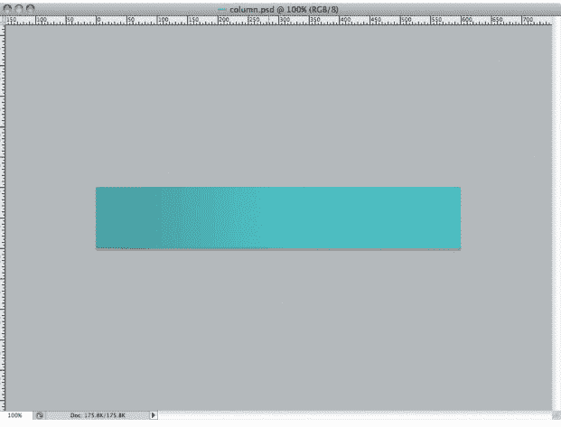

现在让我们编写一些 HTML，到目前为止你应该已经很熟悉了。

```html
<div class="content">
  <div class="main">
    <p>
      We will put a lot of content in here. That is because we want this column to be much taller than the side column. As this column grows in size, we want the side column to appear to grow with it. We are faking this by repeating a background-image on the parent container.
    </p>
    <p>
      This paragraph is just here for good measure. Are you really reading this?
    </p>
  </div>
  <div class="side">
    <p>
      We will put just a little bit of content in here.
    </p>
  </div>
</div>
```

然后我们编写一些 CSS 来创建列。

```css
.content {
  overflow: hidden;
  width: 960px;
}

.main {
  width: 720px;
  float: left;
}

.side {
  width: 200px;
  float: right;
}
```

最后，我们添加神奇的 CSS。

```css
.content {
  overflow: hidden;
  width: 960px;
  background: #FFF url(i/column.gif) repeat-y right;
}

.main {
  width: 760px;
  float: left;
}

.side {
  width: 200px;
  float: right;
}
```

现在，放置好背景图片后，你可以看到无论内容高度如何，它都会在垂直方向上增长以填充空间（图 7.17）。这是一个简单的技巧，但它每天都在帮助网页设计师。

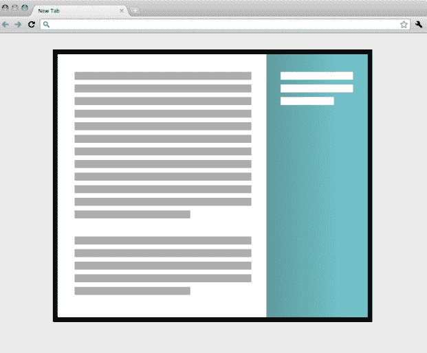

图 7.17 这个网页让你觉得列的高度是对齐的，但其实并非如此。我们只是用重复的背景图片在模拟效果。

## 使用 CSS3 设计——无需图片

事实就是：设计师喜欢圆角和投影之类的效果。谁又能怪我们呢？它们确实漂亮！而直到最近，我们还不得不依赖背景图片的创意运用来实现这些效果。不过现在，我们有了更好的浏览器（如 Firefox、Safari、Chrome 和 Internet Explorer 9），可以使用更新的技术来实现圆角效果。

我在第 5 章中告诉过你，HTML5 是 HTML 的新版本，它基本上是在旧版 HTML 的基础上添加了一些内容使其变得更好。CSS3 也是同样的道理——我们目前为止学到的所有内容都已经是 CSS 的一部分，但 CSS3 给了我们一些新的方式来实现很酷的效果，比如在不使用图片的情况下添加圆角和投影。

> **提示** CSS3 还提供了无需 JavaScript 就能创建简单动画的方式。但这属于相当高级的内容，所以我会在本书中略去。你可以在 `cssforprintdesigners.com/css-animations` 上看到一些 CSS 动画的演示。

## CSS3 的利与弊

虽然使用图片进行装饰确实有其优势（比如更广泛的浏览器兼容性），但依赖图片也有一些负面影响（比如增加加载时间以及企业的制作成本）。

你现在刚开始学习编写网站代码，所以我会教你新的方法——如果旧方法很快就会被更好的东西取代，我认为教它没有太大意义。随着每一天的过去，越来越多的用户在使用支持这些 CSS3 技术的浏览器，所以我说，放手去做吧。

不知不觉中，这甚至都不会再成为讨论的话题。但现在，我们必须了解使用最新最佳技术的利弊。


使用 CSS3 最大的顾虑是浏览器支持。我几乎在每个项目中都要和客户讨论这个问题：它需要在所有浏览器中看起来完全一样吗？通常，对方会立刻回答：“什么是浏览器？”然后，在一番解释之后，答案变成了：“是的，当然所有浏览器中的内容都应该一样。”

# 优雅降级

这是一个向你的客户介绍一个网页设计理念的好时机，叫做`优雅降级`。优雅降级是一种花哨的说法，意思是网页设计在较旧的浏览器中看起来（或在某些情况下表现）会略有不同，因为它是为未来兼容性而构建的。总体而言，布局和功能将保持不变——但圆角或投影之类的小细节在旧版浏览器中将无法呈现。

对这些用户来说，网站看起来不会`坏掉`，而且他们永远不会知道有什么不同，因为他们不可能在不同浏览器中并排查看网站来检查圆角是否一致。

如果你能把这个想法推销给客户，那你就可以开始使用`CSS3`来节省大量时间，而不用再为圆角和投影等常见元素用背景图片编写变通方案了。

# 说服客户接受 CSS3

以下是我与客户之间理想的对话。

**我：**“对于您的项目，我们可以通过在一些设计处理上使用`CSS3`来为您节省一些费用，比如圆角和投影。您的网站对所有人来说加载速度也会更快。这是一种最佳实践。”

**客户：**“太棒了，我喜欢最佳实践。你为什么告诉我这些？”

**我：**“您需要知道的是，使用较旧电脑的一些用户看到的设计不会完全一样；他们会看到方角，也看不到阴影。但总体而言，设计仍然会很好看。您能接受吗？”

**客户：**“你是说能帮我省钱？”

**我：**“是的。”

**客户：**“你还站在这里干什么？赶紧干活去！”

但说实话——有时客户会坚持要求网站在所有浏览器中看起来完全一样。说什么`品牌一致性`。你想让我说什么呢？你不可能让所有人满意。

# 关于 CSS3 的残酷真相（暂时的）

还记得我告诉你`CSS3`是新的吗？是的，而且它甚至还没有最终定稿。我在这里把问题简化了很多，但我怀疑你不会去读所有关于网页设计的八卦杂志，所以我还是保持简化吧。那些能创建圆角和投影等效果的`CSS3`属性尚未最终确定，因此浏览器厂商在此期间各自创建了自己的`CSS3`属性。

这意味着在 Firefox 中让圆角生效的代码不一定能在 Safari 和 Chrome 中生效，所以目前我们需要编写多遍 CSS 来确保每个浏览器都能显示圆角。值得庆幸的是，新版 Internet Explorer 9 在`CSS3`方面做得相当不错。

尽管如此，在我看来，你需要学习`CSS3`，因为它比为这些简单的设计处理创建图片更容易，加载速度也更快——而且它代表的是未来，而不是过去。

当然，这前提是你的客户能接受旧版浏览器没有所有 CSS3 的炫酷效果。

# 浏览器大战

要全面理解这个问题，我们需要稍微跑个题，聊聊浏览器以及浏览器是如何制造的。不同的公司制作不同的浏览器；为了相互竞争，他们认为使用不同的`渲染引擎`来显示网页是明智的做法。

渲染引擎决定了浏览器解释`HTML`和`CSS`的方式，并在你访问网站时决定显示什么内容。

由于浏览器的制造商并不都使用相同的渲染引擎，网页设计师有时需要学习不同的方法来在不同浏览器中实现相同的效果。再加上每个浏览器都有渲染 bug，你就能理解为什么 CSS 排障会让人头疼了。

别担心；在很大程度上，现代浏览器已经开始在渲染方式上达成一致。但像`CSS3`这样新鲜的事物，必然会有差异。

> **提示** 另一种方法是直接做了而不告诉客户。当我这样做的时候，还没有收到过任何投诉（目前）。


## 浏览器特定前缀

Firefox 使用自己的渲染引擎，因此其`CSS3`属性带有`-moz-`前缀，这是 Mozilla（开发 Firefox 的组织）的缩写。Safari 和 Chrome 都使用名为 Webkit 的相同渲染引擎，因此它们的`CSS3`属性带有`-webkit-`前缀。其他浏览器厂商同样拥有不同的渲染引擎。欲了解更多信息，请访问`cssforprintdesigners.com/browsers`。

## CSS3 的最佳实践路径

值得庆幸的是，浏览器厂商在处理带前缀的 CSS 属性时非常谨慎。Safari 和 Chrome 会忽略任何以`-moz-`开头的 CSS 声明，Firefox 会忽略任何以`-webkit-`开头的声明，以此类推。这使得我们能够编写在一种浏览器上运行良好且不会在另一种浏览器中引起问题的 CSS。

我的建议是编写尽可能具有“前瞻性”的 CSS。为此，我们将先编写供应商特定的 CSS 属性，最后以提议的 CSS3 标准属性结尾。下面是一个我推荐的如何使用 CSS3 为标签创建圆角的快速示例。

```css
.container{
  -moz-border-radius: 10px;
  -webkit-border-radius: 10px;
  border-radius: 10px;
}
```

我们基本上把同样的内容写了三次，唯一的区别就是供应商特定的前缀。理想情况下，你可以在几年后回到代码中移除这些供应商前缀以清理代码，但这些前缀的设计方式使得保留它们也不会造成任何损害——尤其是如果你的最后一条 CSS 声明是不带前缀的 CSS3 标准属性。因为如果发生冲突，浏览器将使用最后一条 CSS 声明来覆盖之前的声明。

## 使用圆角

每个设计师都知道圆角会让东西变得更漂亮；事实就是如此。在 CSS3 中，我们使用`border-radius`属性来实现圆角。

```css
.container{
  border-radius: 10px;
}
```


CSS3 的支持变化如此之快，以至于你最好的资源就是互联网。我在`cssforprintdesigners.com/css3`创建了一个页面，你可以在那里跟进 CSS3 最新的浏览器支持情况和技巧。


关于这个被称为“覆盖（overriding）”的概念，在第 9 章中有更多内容可以学习。

**提示** `border-radius`为 0 的角将是直角。

就像`padding`和`margin`属性一样，我们可以一次性声明所有四个角，也可以按顺时针方向分别声明它们。为此，我们从左上角开始，顺时针绕标签一周。

```css
.container{
  border-radius: 10px 20px 30px 40px;
}
```

在理想世界中，我们就完成了。但为了确保尽可能多的浏览器能看到圆角，为了稳妥起见，让我们叠加上一些供应商特定的前缀。

```css
.container{
  -moz-border-radius-topleft: 10px;
  -moz-border-radius-topright: 20px;
  -moz-border-radius-bottomright: 30px;
  -moz-border-radius-bottomleft: 40px;
  -webkit-border-top-left-radius: 10px;
  -webkit-border-top-right-radius: 20px;
  -webkit-border-bottom-right-radius: 30px;
  -webkit-border-bottom-left-radius: 40px;
  border-radius: 10px 20px 30px 40px;
}
```

**提示** 在我之前提到的同一个链接中，我列出了我最喜欢的 CSS3 生成器：`cssforprintdesigners.com/css3`。

请注意，除了供应商特定的前缀外，Mozilla 和 Webkit 浏览器的语法也略有不同。

真糟糕。好吧，说认真的。我根本不尝试去背这些东西。网上有很多优秀的 CSS3 生成器，可以帮你生成这些乱七八糟的代码，而不需要你绞尽脑汁。

## 添加阴影

设计师热爱深度感。客户则热爱那些具有“跳跃感（pop）”的设计。我们可以通过投影（drop-shadows）为设计增加深度和跳跃感。CSS3 允许我们使用`box-shadow`属性为盒子创建阴影，使用`text-shadow`属性为文本创建阴影。

### 为盒子添加阴影

在 CSS3 中使用`box-shadow`属性类似于在 Photoshop 中使用投影图层效果（图 7.18）。

该属性接受多个值使其生效（图 7.19）。

```css
.container{
  box-shadow: 5px -5px 8px 2px #888;
}
```

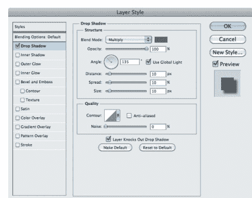

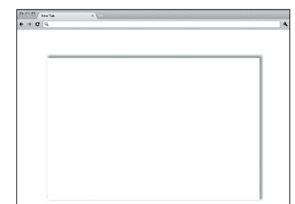

**图 7.18** 使用 CSS3 控制阴影非常像在 Photoshop 中使用投影图层效果。

**图 7.19** 一个 CSS3 的`box-shadow`示例。

- 第一个值将阴影向左或向右移动。如果你使用像`-5px`这样的负值，阴影向左移动。正值（如`5px`）则将其向右移动。
- 第二个值将阴影向上或向下移动。如果你使用像`-5px`这样的负值，阴影向上移动。正值（如`5px`）则将其向下移动。
- 第三个值控制阴影的模糊大小，这有点像 Photoshop 投影设置中的阴影大小。
- 第四个值是阴影的扩展大小。我通常通过不断尝试直到它看起来正确为止。
- 第五个值是阴影的颜色。如果你想要它更不透明，请选择深色；如果你想要它更透明，请选择浅色。

> ### 真正的透明阴影
>
> 如果你想要真正的透明度，可以使用 RGBa 值代替十六进制值。RGBa 与我在书前部分提到的 RGB 相同，但它在末尾添加了一个 alpha 透明度值，用于控制透明度。一个 50% 不透明度的灰色阴影将写成：`rgba(0,0,0,0.5)`。但请小心，旧版浏览器不支持 RGBa 颜色。

此外，你可以在值的开头添加`inset`关键字，使阴影变为内阴影，就像在 Photoshop 中那样（图 7.20）。具体操作如下：

**图 7.20** 应用了`inset`关键字的 CSS3 `box-shadow`。

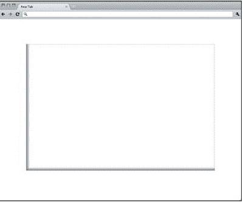

```css
.container{
    box-shadow: inset 5px -5px 2px 8px #888;
}
```

现在，为了确保大多数浏览器都能渲染出你漂亮的投影，我们需要像这样编写最终的 CSS，并加上供应商特定前缀：

```css
.container{
    -moz-box-shadow: inset 5px -5px 2px 8px #888;
    -webkit-box-shadow: inset 5px -5px 2px 8px #888;
    box-shadow: inset 5px -5px 2px 8px #888;
}
```

就像为印刷品设计一样，最好通过尝试这些值来获得最佳效果。别担心，我每次用 CSS3 做投影时都会去查哪个值对应什么功能。当然，这是在我没偷懒的时候——大多数时候我只是随机调整数值，看看阴影往哪个方向走以及看起来如何。

### 为文本添加阴影

通过 CSS3，我们可以使用`text-shadow`属性为文本添加投影（图 7.21）。如果说让盒子产生跳跃感还不够，那么现在你的设计没有足够的跳跃感就没有任何借口了。

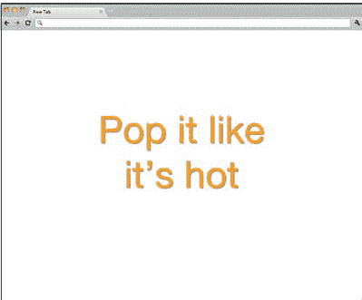

**图 7.21** 一个 CSS3 的`text-shadow`示例。

我们使用`text-shadow`属性的方式与使用`box-shadow`属性非常相似：

```css
h1{
  text-shadow: 2px 2px 2px #888;
}
```

- 第一个值将阴影向左或向右移动。如果你使用像`-2px`这样的负值，阴影向左移动。正值（如`2px`）则将其向右移动。
- 第二个值将阴影向上或向下移动。如果你使用像`-2px`这样的负值，阴影向上移动。正值（如`2px`）则将其向下移动。
- 第三个值控制阴影的模糊大小，这有点像 Photoshop 投影设置中的阴影大小。
- 第四个值是阴影的颜色。如果你想要它更不透明，请选择深色；如果你想要它更透明，请选择浅色。

## 综合实践

让我们通过一个简单的网页设计示例，结合背景图像和 CSS3 来看我们能做出什么样的效果（图 7.22）。

首先，我们需要为那个大按钮创建一个雪碧图（sprite）（图 7.23）。

**图 7.22** 仅凭你在本章学到的内容，你就已经具备了创建精美网站所需的工具。

**图 7.23** 一个包含下载按钮的默认状态、悬停状态和按下状态的精灵图。

接下来，我们编写 HTML。

```html
<div class="container">
  <header>
    <h1>My name is JD.</h1>
  </header>
  <div id="content">
    <p class="intro">
      I am a Web designer from Memphis, and I run a Web design firm
      called <a href="http://simplefocus.com/">Simple Focus</a>. I am
      also on the board for <a href="http://memphis.aiga.org/">
      AIGA Memphis</a>. In my spare time I like to fish and write
      poetry.
    </p>
    <div class="download">
      <a href="downloads/resume.pdf">Download My Resume</a>
    </div>
  </div>
</div><!-- close .container -->
```

最后，我们添加 CSS。


```css
.container{
  width: 400px;
  padding: 40px; /* The total width is 480px! */
  margin: 100px auto; /* put space above and below, then center the tag
  in the browser */
  background-color: orange;
  -moz-border-radius: 20px; /* rounded corners for Mozilla */
  -webkit-border-radius: 20px; /* rounded corners for Webkit */
  border-radius: 20px; /* CSS3 rounded corners for new browsers */
  -moz-box-shadow: 0 3px 5px 0 #AAA; /* for Mozilla */
  -webkit-box-shadow: 0 3px 5px 0 #AAA; /* for Webkit */
  box-shadow: 0 3px 5px 0 #AAA; /* CSS3 box-shadow for new browsers */
  -moz-text-shadow: 1px 1px 1px #666; /* for Mozilla */
  -webkit-text-shadow: 1px 1px 1px #666; /* for Webkit */
  text-shadow: 1px 1px 1px #666; /* CSS3 text-shadow for new browsers */
  font-family: "Helvetica Neue", helvetica, arial, sans-serif; /* since
we are putting this on the parent tag, it applies to all the children
as well */
  color: #FFF; /* applies to all children */
  text-align: center; /* applies to all children */
}

a{
  color: #FFF; /* changing the default blue color */
}

a:hover{
  text-decoration: none; /* rollover */
}

a:active{
  color: gold; /* pressed */
}

h1{
  margin: 0; /* removing unnecessary default spacing for headings */
  font-size: 36px; /* make it bigger */
  font-weight: normal; /* lose the default bold */
  padding-bottom: 20px; /* add some space below */
}

p{
  margin: 0; /* removing unnecessary default spacing for paragraphs */
  font-size: 18px; /* make it bigger */
}

.download a{
  background: url(i/sprite.png) no-repeat top; /* bring in the sprite image */
  display: block; /* changing its appearance from default inline to block */
  width: 400px; /* this width happens to match the width set for .container */
  height: 85px; /* the height of one of the graphics in the sprite, including shadows */
  text-indent: -9999px; /* get rid of the overlapping text */
  margin-top: 20px; /* add some space above the button */
}

.download a:hover{
  background-position: center; /* rollover */
}

.download a:active{
  background-position: bottom; /* pressed */
}
```

# 让设计落地

到目前为止，我已经向你介绍了 CSS 中最强大、最常用且最具复用性的属性和技术。但我不会假装在本章（或本书中）我已经触及了 CSS 的皮毛。事实上，我省略了数百种功能强大的 CSS 属性、值和技术。

与本书其余部分一样，我的目标是为你打下足够的知识基础，让你能够自信地驾驭 CSS。凭借你现在所掌握的知识，你几乎可以实现任何你想要的效果——其余的再通过搜索引擎查找即可。

把 CSS 当作像 InDesign、Photoshop，甚至铅笔和纸一样的创作工具就好。它只是实现你创意愿景的一种手段。真正让设计落地的，是你自身的创造力，而不是你所使用的工具。

# 第 8 章：用 CSS 改善生活

## 让网络变得更友好

我热爱有创造力的人，因为他们通常是我所认识的最友善的人。我说的是平面设计师、网页设计师、玩具设计师、室内设计师、插画师、字体设计师、建筑师、摄影师、作家和纯艺术家（同样也包括注册会计师、医生、律师以及任何在工作中运用创意思维的人）。

但创意行业尤其充满了友善的人。那些乍看之下可能显得复杂、阴郁或深沉的人：纹身、奇怪的音乐和缺少顶灯——这些都是你身处创意部门的明显标志。

创造力强的人有一种特殊的能力，能够运用想象力设身处地地为他人着想，并想象可能的解决方案。他们拥有同理心，能够感受到糟糕设计给用户带来的挫败感，并能够构想出改进方案。

而同理心正是我们本章要讨论的主题。

## 通过 CSS 体现同理心

在设计和编写网站时，有些事情我们应当加以考虑。这些事情一开始看起来可能是不必要的或可有可无的，但它们能让网络对所有用户都更加友好。

这些事情在设计初期——当你在白板上勾画创意或在 Photoshop 中制作网页布局时——可能并不显眼。但请放心，它们的积累会让你的网页对更多人来说更加实用（也更少令人感到挫败）。

这些事情包括：

- 我们如何控制网页打印时的外观？
- 我们如何编码和设计一个所有人都能使用的网站，包括盲人、聋人和行动不便的用户？
- 我们如何编写 CSS 才能让网站加载更快、性能更好？

本章我们不会详细讲解如何实现所有这些目标。但这并不是因为它们不重要——而是因为从前几章的内容中，你已经掌握了大部分所需的知识。

## 为打印而设计（使用 CSS）

你没听错；我们即将学习如何使用 CSS 进行打印设计！这是因为你的访客最终会从你的网站上打印网页。

对我来说，把文字捧在手里的感觉就是不一样——我不知道这是因为实用性还是怀旧情结。我可以随身携带它，用我喜欢的笔在上面涂涂画画，在飞机上、出租车里或与我可爱的妻子和被宠坏的比格犬一起躺在床上时阅读。纸张是真实的，所以它让文字感觉更有分量。而且，比起背光屏幕，纸张对眼睛也更友好。

由于我们设计的网站需要在没有固定垂直高度的屏幕上显示，因此我们必须考虑网页打印到信纸大小的纸张上时会是什么样子（图 8.1）。

### 编写打印样式表

编写 HTML 时，你可以链接一个单独的 CSS 文件来控制网站打印时的外观。要链接 CSS 文件，我们使用 `<link>` 标签，并设置 `rel`、`href`、`type` 和 `media` 等属性。`media` 属性告诉浏览器在打印页面时使用这个特定的文件。

图 8.1 打印样式表可以设计得很精美，但必须以实用为主。不要因为你想让用户看到纹理背景而浪费他们的墨水。

我们将在第 9 章“从零开始”中学习如何链接 CSS 文件，但这里先做一个简单的预览：

```html
<link rel="stylesheet" href="css/print.css" type="text/css" media="print" />
```

很棒的一点是，你不需要修改 HTML 就能制作打印友好的样式表。你只需要编写一个单独的 CSS 文件。

下面我们来看看一些你可能想通过打印样式表来改变网站外观的方面。

### 排版

在创建打印样式表时，一定要考虑排版。用户打印页面很可能是为了阅读，因此你应该特别注重可读性的设计。

### 字号

你在第 6 章“选择度量单位”中会记得，我们讨论了几种不同的度量单位。像素在屏幕上效果很好，但我建议在制作打印样式表时使用磅（point）。其缩写为 `pt`。

### 颜色

为了可读性（并节省墨水），我建议将所有文字颜色调深，并放在白色背景上。

### 宽度

最好去除内容的任何固定宽度，这样它可以水平增长以填满页面，尽可能少用纸。

### 打印机墨水不便宜

对我来说，没有什么比在网页上点击打印，走到打印机旁却发现刚打印了七页实心墨水、上面是几乎看不清的白色文字更让人沮丧的了。

打印的网页不应该浪费墨水，通过：

- 打印不必要的颜色
- 打印反色文字（如黑色背景上的白色文字）
- 显示在打印上下文中没有意义的侧边栏或模块（如导航或登录表单）

为了不浪费墨水和纸张来测试你的打印样式表，你可以直接打印该页面的 PDF（图 8.2）。

图 8.2 与其通过实际打印页面来测试打印样式表，你可以通过打印 PDF 文件来测试。

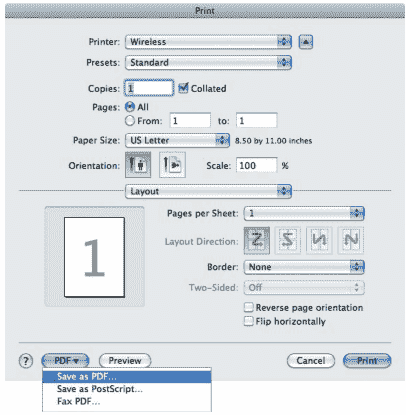

**提示** 你可以在 `cssforprintdesigners.com/printer-friendly` 了解更多关于打印样式表的信息。

## 为无障碍设计

每个人都应该能够访问互联网上的信息，无论其能力如何。在设计网站时，不要忘记人们访问在线信息的方式不止于用手、眼睛和耳朵。

### 视力障碍

并非每个上网的人都能看到你的设计，因此你需要通过设计可访问的网站来照顾这些访客。“等等，”你问道，“我该如何为看不见的人设计呢？”

### 有些人能看见，只是看不清

很多上网的人视力不太好，尤其是现在 50 岁以上的人群也开始上网了——电脑和互联网不再是年轻人的专属。务必设计可读性好的文字，字号要够大，对比度要充足。

### 盲人用户也会上网

盲文让盲人能够阅读书面文字。对于在线阅读，有一种名为屏幕阅读器的软件，可以为看不见内容的人朗读内容。

### 使用 HTML 属性实现无障碍

你已经熟悉 `` 标签中的 `alt` 属性，它在图片无法加载时描述图片内容。这也是屏幕阅读软件向盲人用户朗读的内容。

`<a>` 标签还有一个我们之前没有讨论过的属性，叫做 `title`。`title` 属性类似于 `alt` 属性，它会提供更多关于链接的信息，特别是告诉用户点击后将要前往何处。当链接文字不能很好地描述其目的地时，这个属性很有用。一个典型的例子就是滥用的“点击这里”，这并不能告诉用户她要去哪里。

### 听力障碍

电视上的字幕有助于确保聋人能够观看电视并了解正在说什么。

如果你的网站包含视频或音频内容，你可以通过为该内容提供替代访问方式，让聋人用户也能获得字幕。

### 提供字幕和文字记录

提供字幕不需要任何 CSS 技巧。你只需将字幕嵌入视频中，或者在媒体控件附近提供音频或视频剪辑的文字记录链接。

### 行动障碍

有些互联网用户存在身体限制，导致他们无法有效使用鼠标，或者根本无法使用鼠标。

### 设计易于点击的目标

由于有些用户可能难以使用鼠标，我们应该在设计中将链接、按钮和其他点击区域设计得足够大，使得点击不是一件困难的事。如果你要制作易于点击的区域，30 像素或更大的尺寸是一个好的开始。越大越好。

### 为不使用鼠标的用户设计

有些互联网用户无法使用鼠标。他们通过其他方式发出命令来浏览互联网——通常是通过某种输入设备，接受命令以跳转到页面上下一个可点击的项目。

事实上，这很像使用你自己键盘上的 Tab 键来浏览网站。使用 Tab 键实际上是测试网站可访问性的好方法。

当你使用 Tab 键测试网站的可访问性时，应该始终清楚自己当前在页面的什么位置。你在网站上之前也见过这种位置指示，当你聚焦在某个链接上时，会出现虚线轮廓。

如果你只能使用键盘上的 Tab 键和回车键来浏览你的网站，那你的网站可能相当具有可访问性。

### 使用 CSS 显示当前位置

之前我们学习了 `:hover` 和 `:active` 伪选择器，用于让网页更具交互性。还有另一个名为 `:focus` 的伪选择器，它允许你定义当用户通过键盘 Tab 到某个元素时，该元素应该呈现什么样子，而不是用鼠标悬停（图 8.3）。

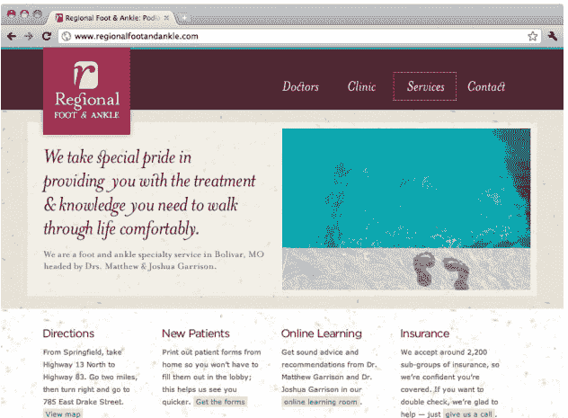

图 8.3 虚线轮廓显示了不使用鼠标浏览此网页时，你当前所在的位置。

以下是一些有助于无障碍的 CSS 示例：

```css
a:focus{
  outline: 1px dotted;
}
```

注意我们使用的是 `outline` 属性，而不是 `border`。`outline` 属性和 `border` 属性的区别在于，`outline` 绘制在边框的外侧。

## 编写加载速度快的 CSS

当你试图打造一个用起来令人愉悦的网站时，还有一点需要考虑：它的加载速度。下载速度可能受到许多你无法控制的因素影响，例如服务器速度和网络连接。

我想让你掌握那些你可以控制的因素。

### 尽量减小图片大小

当你开始用 CSS 使用背景图片时，不要过度。想办法用更小的背景图片来实现你的设计效果。

**提示** 我将在第 10 章详细介绍如何导出网页图片。

保存图片时，始终使用适合该图片类型的最佳格式（图 8.4）。

图 8.4 Photoshop 的“存储为 Web 所用格式”对话框（文件 > 存储为 Web 和设备所用格式）为你导出图形时提供了大量优化选项。

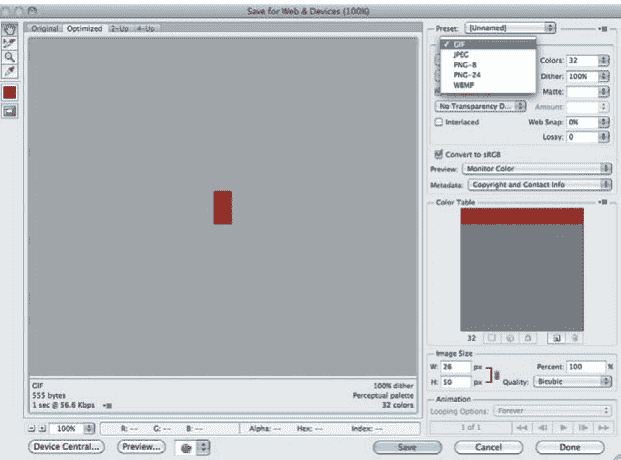

记住，图片越小，页面加载越快。而且，优化图片对页面速度的提升效果最为显著。如果你不这样做，其他的都没用。

### 尽可能高效地编写 CSS

花时间提前思考并规划你的 CSS，再开始编写。编写紧凑的 CSS 不仅能节省文件大小和下载速度，还能避免大量不必要的输入。

### 串联选择器

提高 CSS 效率的最佳方法之一是将选择器串联到一条 CSS 规则中。当页面上的多个标签需要相同的属性时，这样做很合适，比如页眉、内容和页脚区域。

看看这段 CSS，它效率不高，因为每条规则都重复了相同的声明：

```css
header{
  width: 960px;
  margin: auto;
  overflow: hidden;
}

#content{
  width: 960px;
  margin: auto;
  overflow: hidden;
}

footer{
  width: 960px;
  margin: auto;
  overflow: hidden;
}
```

通过用逗号将选择器串联起来，我们可以用少得多的按键次数写出相同的内容，节省时间和文件大小。

```css
header, #content, footer{
  width: 960px;
  margin: auto;
  overflow: hidden;
}
```

你可以像上面的例子那样把每个选择器放在同一行，也可以把选择器放在单独的行并用逗号分隔，像这样：

```css
header,
#content,
footer{
  width: 960px;
  margin: auto;
  overflow: hidden;
}
```

### 使用更高的特异性来覆盖其他 CSS

你可以通过提高选择器的特异性来用一个声明覆盖另一个声明。

为了理解我的意思，看看这段 HTML：

```html
<div id="content">
  <p class="teaser">我是什么颜色？</p>
</div>
```

假设我想让我设计中的每个段落都是黑色的。我可能会这样写 CSS：

```css
p{
  color: black;
}
```

但假设我还希望所有类属性为 `teaser` 的段落都显示为紫色。我会这样编写我的 CSS：

```css
p{
  color: black;
}

p.teaser{
  color: purple;
}
```

在这种 CSS 中，所有没有 `teaser` 类属性的段落将保持黑色。但那些具有 `teaser` 类属性的段落将变成紫色，因为 `p.teaser` 比单独的 `p` 更具特异性。

现在让我们写一个特异性更高的规则：

```css
p{
  color: black;
}

p.teaser{
  color: purple;
}

div#content p.teaser{
  color: orange;
}
```

在这里，我们告诉任何具有 `teaser` 类属性且同时位于 `id` 属性为 `content` 的 `<div>` 标签内部的段落显示为橙色。


## 超越视觉设计的思考

互联网是一个让人与人之间保持联系的惊人工具。在制作网站时，网页设计师手中掌握着让互联网对每个人来说都更加愉悦的能力。

我的希望是，当你开始手动编写网站代码时，能够继续将 CSS 视为一门手艺去学习——以及一种让人们的生活变得更好（即使只有一点点）的方式。

# 第 9 章：从零开始

## 为每个项目复制并粘贴重复元素


**并非印刷设计中的所有内容**都具有极强的创意。别误会我的意思——我们处理的一些项目确实令人兴奋、具有创新性且非常有成就感。但我们也花大量时间执行重复或单调的任务，比如为一份年度报告排版 80 页的正文；当然，封面很有趣，甚至前十页也是。但剩下的 70 页，嗯，就是工作。我希望我能告诉你这类任务在网页设计中不存在，但事实是它们确实存在，尤其是当你开始一个新项目的时候。几乎在每一个你参与的项目中，都有一些必须一遍又一遍编写的 HTML。这就是为什么我说在开始新项目时，你应该复制并粘贴它。

### 复制粘贴节省时间

作为一名初学者，深入研究每一行代码的具体含义并不是最重要的。你只需要知道，你需要在 HTML 的顶部放置一大段代码，才能使其成为一个有效的 HTML 文件。我会向你展示在代码的哪个位置需要进行调整，以便你的代码能在你的网站上正常运行。

> ### 我们将快速跳过这个部分

> 在我的工作坊中，我通常在 60 秒内涵盖这个主题：我对着投影屏幕上约 20 行密集的 HTML 挥挥手，然后告诉那些印刷设计师们，“你们不需要担心这些是什么意思——直接复制粘贴这些东西就行。”

### 更多 HTML 标签

到目前为止，在本书中，我们一直在查看像`<div>`、`<p>`、`<h1>`等 HTML 标签。但还有一些其他标签与网站的内容其实没有太大关系——它们只是每个网站都需要的，用于帮助搜索引擎优化 (SEO) 以及指定使用哪个 CSS 文件。

**提示** 你可以在`cssforprintdesigners.com/copy-and-paste`下载这些代码示例。

这些标签大多位于 HTML 文件的最开头，在`<head>`标签中——但其中有几个（准确地说是`<html>`标签和`<body>`标签）甚至包裹着所有你自己编写的 HTML (**图 9.1**)。

**图 9.1** 这是一个真实 HTML 文档的完整结构，除了那些你需要每次从零开始编写的部分。

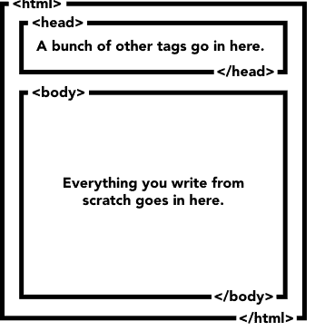

让我们深入研究一下创建正确的 HTML 文件需要什么。首先，你需要保存一个扩展名为`.html`的文本文件。然后，在该文件中放入以下代码：

```html
<!DOCTYPE html>
<html>
  <head>
    <meta http-equiv="Content-Type" content="text/html; charset=utf-8"/>
    <title>Page Title</title>
    <meta name="description" content="Web site description" />
    <meta name="keywords" content="SEO keywords " />
    <link href="css/screen.css" rel="stylesheet" type="text/css" media="screen" />
    <link href="css/print.css" rel="stylesheet" type="text/css" media="print" />
    <link href="favicon.ico" rel="shortcut icon" type="image/ico" />
  </head>
  <body>
    This is where you put the HTML that you write
  </body>
</html>
```

我已经高亮显示了这段 HTML 中你需要关注的部分。只需为你的网站调整这些属性的值即可。

### 页面标题 (Page Title)

页面标题是显示在浏览器窗口或标签页顶部以识别网页的内容 (**图 9.2**)。

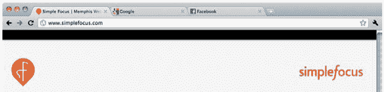

**图 9.2** HTML 中的页面标题有助于识别每个标签页的用途。

### 网站描述 (Web Site Description)

网站描述是搜索引擎在搜索结果预览中显示的内容。请保持简短，不超过一两句话。

### SEO 关键字 (SEO Keywords)

这个由逗号分隔的字符串是搜索引擎在确定你的网站相关性时参考的部分内容。不要使用超过 20 个左右的关键字和关键字短语，并尽量避免同一个词重复出现超过三次。

### CSS 文件

我们使用`<link>`标签来调用 CSS。href 属性中的路径应该指向一个 CSS 文件，即一个以`.css`扩展名结尾的文本文件。

在这个示例中，我们有两个 CSS 文件。它们都在 css 文件夹中，文件分别命名为`screen.css`和`print.css`。你可以通过添加更多具有这些属性的`<link>`标签来链接尽可能多的 CSS 文件。

### CSS Media 属性

这两个`<link>`标签调用不同的 CSS 文件：一个用于屏幕浏览，一个用于纸质打印。media 属性告诉浏览器是为屏幕还是为打印使用该 CSS 文件。

### Favicon (网站图标)

Favicon 是一个小型图形文件（尺寸为 16 像素乘 16 像素），显示在网站的地址栏、标签页或书签栏中。该文件应保存为`.ico`文件类型。文件应位于网站的根目录下，并命名为`favicon.ico`。

### `<body>`标签

`<body>`标签是你放置所有自行编写的 HTML 的地方。当我在本书中给出示例时，我会输入类似这样的内容：

```html
<div id="content">
  <div class="main">
    Main content area
  </div>
  <div class="side">
    Sidebar area
  </div>
</div>
```

在一个运行中的网站中，为了在真实环境中工作，该代码需要放在`<body>`标签内部，如下所示：

```html
<!DOCTYPE html>
<html>
  <head>
    <meta http-equiv="Content-Type" content="text/html; charset=utf-8"/>
    <title>Page Title</title>
    <meta name="description" content="Web site description" />
    <meta name="keywords" content="SEO keywords " />
    <link href="css/screen.css" rel="stylesheet" type="text/css" media="screen" />
    <link href="favicon.ico" rel="shortcut icon" type="image/ico" />
  </head>
  <body>
    <div id="content">
      <div class="main">
        Main content area
      </div>
      <div class="side">
        Sidebar area
      </div>
    </div>
  </body>
</html>
```

### HTML 框架 (The HTML Framework)

2009 年，在我开始领导工作坊时，我开发并发布了 The HTML Framework (`htmlframework.com`)，这是一套免费的启动文件，旨在帮助网页设计师减少设置 HTML 文件和 CSS 布局的时间，从而将更多时间用于使用 CSS 进行设计。

我认为这个框架对于初学者和资深网页设计师来说都是一个很好的起点，因为它节省了时间并防止了一些低级的打字错误。

相信我，低级的打字错误在网页编程世界中非常普遍。我们需要尽可能多的帮助。


# 10 网页的印前处理

### 切割和处理图像以实现快速加载且视觉美观

**印前工作是一门**需要耐心和经验的艺术。为了让设计在出厂时看起来美观，印刷设计师需要了解文件离开硬盘后的生产方式。这意味着要熟悉生产印版的设备、将要使用的油墨，以及最终将数字文件转化为实物的机器。

印前工作还需要全面理解作品印刷方式的实际情况和局限性——无论是一个在丝网印刷机上小批量生产的演出海报，还是在当地报纸的古老轮转印刷机上运行的印刷广告，亦或是分布在全国多个工厂印刷并分发给数十万订阅者的时尚杂志编辑布局。

## 网页设计的图像制作

网页设计师同样需要为生产环境准备他们的设计。但网页的生产环境完全关乎文件大小和下载速度。对于流量大的大型网站，图像大小甚至可能成为成本因素。

我敢肯定，你已经习惯了看到那些图像优化不佳的网站——这可能会让你觉得，为网页制作图像意味着你必须将图像保存为低质量以使其加载快速。这可能会令人沮丧，并让你不禁要问：“既然程序员最终会把它压缩得看起来很糟糕，那我花那么多时间让设计看起来那么好是为了什么？”

你不应该有这种感觉，因为只要使用正确的工具和一点点耐心，你无需在质量上妥协，就能确保你的图像清晰且加载迅速。

在我的研讨会上，经常有几个问题会被提出：“面对众多的图像文件格式，我怎么知道哪个才是最好的？”以及“文件大小应该控制在多小？”

在本章中，我将揭开网页图像制作的神秘面纱，并为你提供开始切割和处理图像所需的信心和知识，让图像既能快速加载，**又能**保持良好外观。

### 从规划开始

网页图像制作的第一步是仔细审视你的设计，并弄清楚哪些图像需要被切割和拼接起来以实现设计效果。我通过想象我的 HTML 的两个层面来实现这一点：布局和内容。之后，哪些图形需要从设计中提取出来就变得清晰了。

在本章中，我们将研究一个样本网站，它包含了典型网站的所有元素（图 10.1）。

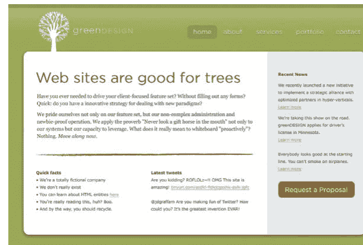

**图 10.1** 我们的环保主题网站。

### 从布局开始

当我开始一个项目时，我做的第一件事就是用方框来可视化布局。我需要哪些标签来实现我的布局？哪些标签应该浮动以及向哪个方向浮动？它们的顺序应该是怎样的？让我们看看叠加了 HTML 方框的示例网页设计（**图 10.2**）。

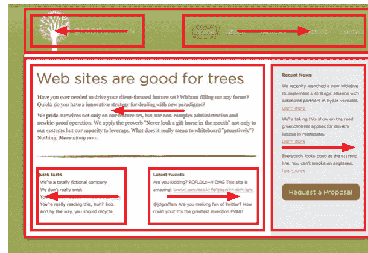

**图 10.2** 从可视化布局和浮动开始会有所帮助。

### 理解布局

图 10.2 显示了六个嵌套的方框，箭头指示了我们的浮动方向。

在页眉区域，我们有两个主要容器：一个用于 logo，另一个用于网站导航。

在内容区域，我们有一个主要的内容栏，下面有两个较小的文字栏。在主要内容区域旁边，我们有一个侧边栏。

### 识别内容块

在我识别了主要组件并看清需要哪些 HTML 来实现布局之后，我会识别需要放入每个部分或模块的所有内容（图 10.3）。这有助于我编写剩余的 HTML 并规划我的 CSS。

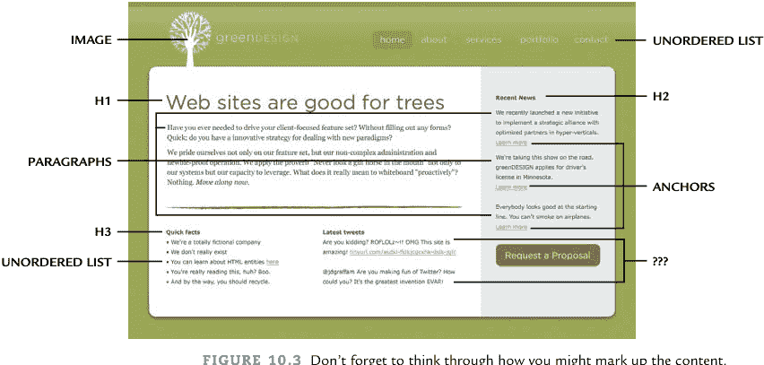

### HTML 标记并非一门精确科学

图 10.3 显示了我识别大部分需要编写的 HTML 标签的位置，这些标签用于标识网页的内容。为了简化，我略去了一些东西。例如，你知道无序列表内部嵌套有列表项，导航部分在每个`<li>`标签内部会有`<a>`标签。

我甚至在“最新推文”部分标上了问号——这是因为有时该使用哪种 HTML 并不明确。在现实场景中，你可能无法控制这些推文，因为它们可能来自第三方。但即使你能控制标记，也很难确定使用哪个 HTML 标签最合适。它们是段落吗？或者这是一个推文列表？如果它们既不是段落也不是列表，我们应该直接使用`<div>`标签吗？

### 确定需要哪些图像

最后，让我们在设计上叠加一些方框，看看为了让布局生效需要哪些图像（图 10.4）。我们将关注 CSS 图像和内容图像——记住，内容图像是我们使用 HTML 的``标签来调用的；装饰性图像是我们使用 CSS 的 background 属性来调用的。

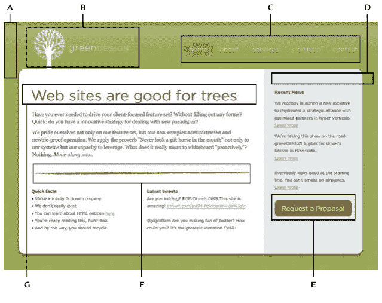

**图 10.4** 找准需要导出以实现设计效果的图像。注意细节。

仔细观察设计——细节很重要。

- A. 注意页面顶部是如何有一个微妙的渐变，顶部边框颜色更深。我们可以通过在 x 轴上重复我高亮显示的这部分来创建此效果。
- B. 这个图像是 logo，所以它与其余部分不同——它被视为页面内容。我们将使用 HTML 的``标签将其引入设计，而不是 CSS。
- C. 导航栏将是一个带有悬停状态的大型雪碧图（sprite）。它使用 Gotham 字体，大多数用户的计算机上没有安装该字体，因此我们还将使用在第 7 章学到的图像替换技术，以防止文字覆盖背景图像。在制作雪碧图时，我们还需要记住为每个菜单项包含悬停效果。
- D. 为了创建右侧一直向下延伸的伪列，我们可以截取这个灰色条并在 y 轴上重复它。
- E. 与上面的导航元素一样，这个按钮将是一个雪碧图，我们将使用图像替换。我们需要确保记得设计一个鼠标悬停状态。
- F. 分隔主内容和其下方两个小栏目的线条可以是背景图像。
- G. 这个标题使用了 Gotham 字体，因此我们将使用图像替换技术，将其作为`<h1>`标签的背景图像引入。

## 理解图像格式

与印刷项目将所有内容保存为 20MB 的 TIF 文件不同，我们需要将文件保存为文件大小更小的格式，以便它们在网页上快速加载。网页设计师广泛使用三种格式：GIF、JPEG 和 PNG。每种格式都适用于特定类型的图像。决定哪种文件格式效果最佳的方法是尝试所有三种，看看哪种在文件大小和图像质量之间取得了最佳平衡。

### 可靠的 GIF

小巧的 GIF 文件格式是我的最爱，因为它让我对文件大小有最大的控制权。它还支持透明度，这意味着它非常适合叠加在背景颜色上或创建微妙的纹理。

但它也有局限性。它只支持 256 种颜色，这意味着它通常不适用于照片。而且它只支持一级透明度；GIF 中的每个像素要么是透明的，要么是不透明的。这种单级透明度可能导致图像边缘粗糙。

GIF 非常适合像 logo、简单插图和颜色变化不大的渐变这样的图形。

### 优化 GIF

GIF 文件格式支持多达 256 种颜色，但这并不意味着你需要全部使用它们。当你打开 Photoshop 并选择“文件” > “存储为 Web 和设备所用格式”，然后从下拉列表中选择 GIF 时，右侧会显示一个小的颜色表区域。这个颜色表列出了你的图形所使用的所有颜色。

尝试在“颜色”选项中减少颜色数量，并在左侧的“优化”标签页下实时查看结果。当你在不牺牲图像质量的前提下将颜色数量降到最低时，你可以查看你的文件有多大（**图 10.5**）。


导出 GIF 时请注意文件大小（显示在此 Photoshop 对话框的左下角）。颜色越少，文件就越小。这个文件大小远低于 1 KB。

### GIF 通用规则

根据我的经验，我知道优化 GIF 文件通常哪些方法有效，所以我想给你几个捷径。记住，我这里说的是通用情况，因为你的项目总会有所不同。学习什么有效的方法是尝试一些东西，看看会发生什么。

- 一个小型的 GIF 图像（比如 100 x 20 像素）应该小于 1 KB。
- 一个较大的 GIF 图像（比如 300 像素见方）不应超过 20 KB 左右。

## 消除 GIF 中糟糕的轮廓

Photoshop 的“存储为 Web 所用格式”对话框中有一个名为“晕边（Matte）”的功能，这个功能在我的工作坊中总是大受欢迎。我经常惊讶于竟然有这么多平面设计师从未听说过 Photoshop 的这个功能。不过转念一想，我其实不该惊讶，因为这对平面设计师来说没有实际用途，而且它位于“存储为 Web 所用格式”面板中，平面设计师没有理由去那里探索。

当你在 Photoshop 中选择“文件 > 存储为 Web 所用格式”并在下拉列表中选择 GIF 时，你会看到右侧有一个标为“晕边”的选项。如果你的 GIF 包含透明度，选择“晕边”将为你提供一些选项，用于选择一种颜色作为 GIF 图像边缘的晕边色（**图 10.6**）。

**图 10.6**

Photoshop “存储为 Web 所用格式”对话框中的“晕边”功能可帮助透明 GIF 与背景颜色匹配。


你需要选择透明 GIF 图像背后的背景颜色。接着，Photoshop 会在 GIF 图像周围（即透明像素所在边缘）生成一个看起来很糟糕的锯齿状边界。

但别担心——这正是你想要的效果。因为如果你将该图形放置在你晕边设置中所选的颜色之上，神奇的事情就发生了。Photoshop 已将图形的边缘与晕边色进行了融合，现在它看起来天衣无缝，就像我们的设计中一样。

但请注意，因为你只能设置一种晕边色。带有晕边色的 GIF 图像在与背景色匹配时效果极佳，但如果背景色不匹配，它的外观会非常糟糕。

## 全能的 JPEG

JPEG 适用于颜色丰富的图像，例如摄影作品。

我们可以通过在 Photoshop 的“存储为 Web 所用格式”对话框中输入百分比来调整图像的整体质量，从而控制 JPEG 的文件大小（**图 10.7**）。


**图 10.7** 在 Photoshop 的“存储为 Web 所用格式”对话框中调整 JPEG 的质量和文件大小。

通常，直到质量降低到 65% 或 70% 左右时，人类的眼睛才能分辨出质量差异。百分比越低，JPEG 图像看起来就越粗糙，但文件体积会越小。

如果 JPEG 保存时的质量设置不够高，就会开始出现所谓的`伪影（artifacting）`，这通常在一种颜色向另一种颜色过渡的地方尤为明显。

## 最后的手段 PNG


PNG 非常擅长保持图像质量，并且在控制文件大小方面表现相当不错。它们还支持 256 级的透明度，这比 GIF 要好得多。如果你有带有圆角或阴影的图像，且不知道它们将放置在什么背景色上，或者它们是否会显示在不同的背景色上，那么 PNG 格式将是救星。

### 两种 PNG 格式

有两种 PNG 格式可供选择：PNG-8 和 PNG-24。PNG-24 是支持完全透明度的格式。我很少使用 PNG-8，因为其结果通常与使用 GIF 相同。当我谈到 PNG 时，我指的是 PNG-24。

> **提示** 不要将“存储为 Web 所用格式”中的 JPEG 设置与 Photoshop 常规“文件 > 存储为”对话框中的 JPEG 保存选项混淆。“存储为 Web 所用格式”能让你更精准地控制 JPEG 质量。

> **提示** Internet Explorer 6 不支持 PNG 透明度。如果你设计的网站需要支持 IE6，祝你好运——并尽可能地使用 GIF。虽然有一些使用 JavaScript 的解决方法，但我尽可能避免使用。如果你需要走这条路，可以搜索“IE6 PNG fix”。

我们可以通过进入 Photoshop 的“存储为 Web 所用格式”对话框并选择 PNG-24 来将图形保存为 PNG。

PNG 的问题是我们无法很好地控制其文件大小或质量设置（图 10.8），这就是为什么我将 PNG 作为最后的手段，仅在 GIF 或 JPEG 无法达到所需质量时才使用。偶尔 PNG 会给我惊喜，产生比 GIF 或 JPEG 更小的文件体积，但这很罕见。


## 保存图像

既然我们已经确定了设计所需的图像，并且对文件类型有了更好的了解，你现在可以启动 Photoshop 并开始导出图像了（图 10.9）。


完成后，你应该将 CSS 图像和 HTML 图像分开存放。这有助于保持文件井然有序，而且在编写 CSS 代码时，输入相对路径会容易得多。例如，输入 `i/graphic.gif` 比输入 `../css/i/graphic.gif` 要简单得多。

将 CSS 图像保存在专门为 CSS 图像准备的文件夹中。之前我建议放在 `css/i/` 中。

Web 设计师通常将 HTML 图像放在名为 `images` 或 `img` 的文件夹中。到目前为止，我想你已经知道我的投票给了较短的那个名称。

## 三思而后行，量两次切一次


关于 Web 图像制作，我能给出的最好的建议就是：计划，计划，再计划。

在开始切割图像之前，将你的 Photoshop 样稿处理得整洁有序，会让你省去很多麻烦。在设计过程中花额外的时间清晰地命名图层并进行逻辑分组，是非常值得的。

> **不要在原始 PSD 文件上直接操作**

我很尴尬地承认，我不止一次因为匆忙而直接将精美的 Photoshop 设计稿合并图层且未保存，导致失去了编辑原稿的能力。哎呀！

我的建议是？在切割图像时不要在原始 PSD 文件上操作——否则你可能会像我一样，熬夜重建文件，包括那些疯狂的图层效果。

此外，由于我们处理的是像素而非矢量，请开启 Photoshop 的“对齐像素（Snap to Pixels）”功能（图 10.10）。这将使你的形状对齐在像素网格上，防止最终图形出现模糊边缘（图 10.11），同时也让测量变得更简单。


**图 10.10** Photoshop 的“对齐像素”功能可以节省时间。请使用它。

**图 10.11** 左侧显示了像素正确对齐时图形应有的样子——它看起来很清晰。右侧在 100% 视图下看起来则很模糊。

最后，不要急躁。不要在这个关键阶段匆忙过关。尝试不同的文件格式，看看哪种能产生最小的文件体积和最高的设计质量。

如果第一次没做到完美，也不要压力太大——虽然印刷设计的印前错误会导致昂贵的重印，但 Web 具有容错性。如果你上线了一个不够理想的图形，你随时可以回来修复它。

# 11 行业工具

## Web 设计所需软件快速指南

**每种工艺都**有一套工具集。这就是为什么艺术学院如此昂贵。每个课程都需要不同的工具——绘画需要价值 200 美元的铅笔和木炭；绘画需要价值 400 美元的画笔、颜料、画布、木材和订书钉；摄影则需要价值 600 美元的胶片、镜头和化学药剂。

平面设计师也有工具。除了 InDesign、Illustrator 和 Photoshop 等软件外，我们的桌子上还堆满了 X-Acto 刻刀、喷胶、放大镜和其他创作工具。这是不可避免的——我们最终都会需要这些工具。

## Web 设计不需要太多工具

从平面设计师转型为 Web 设计师并不需要昂贵的软件——至少现在不需要。也许以后当你能熟练地标记复杂布局并在梦中编写 CSS 时才需要。目前，我希望你专注于基础知识。

这些基础包括：

- 你已经拥有的软件
- 一个文本编辑器
- 几个 Web 浏览器的插件

是的，就这些。你可以在不花费过多额外资金（甚至完全不花钱）的情况下成为一名 Web 设计师。

## Web 设计师的工具箱

在开始制作网站之前，你需要了解有哪些工具可用。我在这里不提供一份详尽的清单——我只是给你提供一些开始寻找的方向。我特意保持清单简短，仅专注于你入门所需的内容。

随着你参与越来越多的 Web 设计项目，你会发现一些我没列在这里的优秀工具，甚至是我没听说过的工具。只要记住，归根结底，重要的是你如何使用工具，而不是工具本身。

### Photoshop（或 Fireworks）

我之前说过，但在这里值得再次强调：Photoshop 不是设计网站的唯一应用程序。很多 Web 设计师会告诉你 Fireworks 才是正确的选择，他们确实有一些合理的理由。但我更熟悉 Photoshop，你可能也是。此外，你可能已经拥有一套 Photoshop 了。

> **用 Illustrator 设计怎么样？**
>
> 我用 Illustrator 设计过几次，但最近已经不再使用了。Illustrator 确实有像素视图，这对 Web 设计项目很有帮助，但总体而言它是为矢量图形优化的。此外，我发现使用 Photoshop 导出图形比使用 Illustrator 要容易得多。

使用你最习惯的程序来确定整体概念，但我的建议是在 Photoshop 中完成所有工作。

### FTP

我们在第 3 章已经学习了 FTP。很可能在某个时候，你曾使用 FTP 上传大型文件用于印刷作业，而不是刻录光盘再邮寄出去。

当我们在电脑上建好网站后，需要将其上传到 Web 服务器才能让网站上线。这就是 FTP 的用武之地。如果你还没有 FTP 应用程序，以下是我推荐的一些工具。

**Mac 用户**

- Panic 的 Transmit（35 美元，`panic.com/transmit`）
- Fetch（30 美元，`fetchsoftworks.com`）
- Cyberduck（免费，`cyberduck.ch`）

**Windows 用户**

- SmartFTP（40 美元，`smartftp.com`）
- CoffeeCup 的 Free FTP（免费，`coffeecup.com/free-ftp/`）

## 文本编辑器

我们在本书中所学的一切都涉及输入文本。而且，我们不会在 Microsoft Word 中输入代码。我们使用纯文本编辑器来编写代码。

**Mac 用户**

- TextWrangler（免费，`barebones.com/products/TextWrangler/`）
- BBEdit（100 美元，`barebones.com/products/bbedit/`）
- Panic 的 Coda（100 美元，`panic.com/coda/`）

**Windows 用户**

- CoffeeCup 的 Free HTML Editor（免费，`coffeecup.com/free-editor/`）
- CoffeeCup 的 The HTML Editor（50 美元，`coffeecup.com/html-editor/`）
- Notepad++（免费，`notepad-plus-plus.org`）

> **提示** 很多平面设计师已经安装了 Dreamweaver。与许多网页编码者可能说的不同，它并不是一个糟糕的文本编辑器。如果你有，就用它。如果没有，也不必非花钱去买——还有其他更便宜的选择。

### 使用正确的文件扩展名保存 HTML 和 CSS 文件

当你使用纯文本编辑器保存文件时，可以选择使用什么文件扩展名。如果你不知道的话，创建 HTML 文件时，需要用 `.html` 扩展名保存。创建 CSS 文件时，需要用 `.css` 扩展名保存。

## 浏览器和插件

如你所知，如今有多种 Web 浏览器可供选择——而且它们都相当不错。当你从零开始编写网页时，最好下载所有主流浏览器，并让它们随时可用，以确保你的网页在每个浏览器中都能正常显示。

但你需要选择一个浏览器来开发网站。Firefox 是我在开发网站时的首选浏览器，因为它拥有一个活跃的开发者社区，他们开发了许多能让编码变得更轻松的插件。

以下是我最喜欢的一些插件。

### Firebug

Firebug（`addons.mozilla.org/en-US/firefox/addon/firebug/`）是一个 Web 开发工具，它扩展了 Firefox 的功能，让你可以检查网页的 HTML 和 CSS（图 11.1）。

**图 11.1** Firebug 通过提供可视化方式浏览网页代码，为 Web 开发者节省了大量时间。


Firebug 非常适合调试你自己的代码，但如果你想查看别人的网站、了解对方是如何用 CSS 实现某种效果时，它尤其有用。它会显示仅适用于该元素的 HTML 和 CSS，这样你就不用在成百上千行代码中苦苦搜索来拼凑出究竟发生了什么。

### MeasureIt

MeasureIt（`addons.mozilla.org/en-US/firefox/addon/measureit/`）是一个方便的小工具，用于测量网页上的任何内容（图 11.2）。


**图 11.2**

MeasureIt 让在网页上进行测量变得轻而易举。

## 综合运用

现在你已经掌握了独立制作网站所需的所有知识。我们涵盖了所有内容：屏幕尺寸、路径、HTML、CSS 布局、CSS3、无障碍性、图像制作以及各种工具。

你现在要做的就是动手去做。


# 12 有问题吗？

*来自真实平面设计师的真实问题集锦*

当我主持研讨会时，我确保将演示内容定位为面向初学者——我希望避免使用在网页设计领域有特定含义、但对平面设计师来说毫无意义的技术术语。

我教平面设计师学习 HTML 和 CSS 的方式很简单：你需要了解 HTML；HTML 由标签组成；标签长这样；然后，这就是 CSS 的样子，以及一些使用技巧和窍门。

看到了吗？我用一个复合句就把整本书概括了。

正因为这种谈论手写代码的方式如此简单，参加者在研讨会进行到一半时就开始举手，提出一些相当高级的问题。我总是对这些问题的质量感到惊喜。

我在本书中专门留了一章来回答这些问题。这些是我在多年主持“面向平面设计师的 CSS”研讨会期间被问到的真实问题。

## 常见问题

这些问题从基础到高级不等。我的回答不会过于详细。相反，我会给你足够的信息来理解基本概念，然后你可以自己去 Google 查找其余内容。

## 哪些网站是好的资源？

万维网联盟（`w3.org`）告诉你编码网站的正确方式，不过该网站非常技术化。当你需要查找某个技术定义，或者想催眠入睡时，可以去那里看看。

A List Apart（`alistapart.com`）是一本在线杂志，每两周发布几篇新文章。话题有时面向高级编码者，但也常常能引起初学者的共鸣。文章写作总是非常出色，思想也总是走在前沿。

Chris Coyier 的 CSS Tricks（`css-tricks.com`）是一个网页设计社区。Chris 总是发布用 CSS 实现各种功能的巧妙方法。而且他的写作风格通俗易懂。

Smashing Magazine（`smashingmagazine.com`）理应出现在这个列表中，原因在于这家杂志发布文章的数量之多。它并非仅限于网页设计，因为它也发布关于平面设计的文章。我每周会来这里看几次。

The Photoshop Etiquette Manifesto for Web Designers（`photoshopetiquette.com`）是一份关于组织 Photoshop 文档的实用且细致的建议清单，能让文件传输更加顺畅。一定要读这个——对于保持条理性至关重要。

网上有成千上万优秀的网页设计博客和资源——我不可能把它们全部列出。除此之外，我建议在 Twitter 上关注网页设计师，看看他们在谈论什么、分享什么链接。

## 我听说为了 SEO，每个页面只能使用一个 `<h1>` 标签。这是真的吗？

还记得我告诉过你有新版 HTML 和旧版 HTML 吗？嗯，较新的版本 HTML5 不关心你有多少个 `<h1>` 标签，只要每个容器中只有一个 `<h1>` 标签即可。而 HTML4 则要求每个页面只能有一个 `<h1>` 标签。

为确保你使用的是 HTML5，请使用你在第 9 章学过的 DOCTYPE。如果你的文档没有使用以下 HTML5 DOCTYPE，你就只能在每个页面中使用一个 `<h1>` 标签：

```html
<!DOCTYPE html>
```

## HTML4 DOCTYPES

其他更旧的 DOCTYPE 看起来比 HTML5 DOCTYPE 复杂得多。以下是你可能会遇到的几个。注意它们之间只有细微的差别，但都比 HTML5 DOCTYPE 复杂得多：

```html
<!DOCTYPE HTML PUBLIC "-//W3C//DTD HTML 4.01//EN"
"http://www.w3.org/TR/html4/strict.dtd">

<!DOCTYPE HTML PUBLIC "-//W3C//DTD HTML 4.01 Transitional//EN"
"http://www.w3.org/TR/html4/loose.dtd">

<!DOCTYPE html PUBLIC "-//W3C//DTD XHTML 1.0 Strict//EN"
"http://www.w3.org/TR/xhtml1/DTD/xhtml1-strict.dtd">
```

看到了吧？你不会想学这个的，对吗？

## 使用表格进行布局有什么问题？

当你使用表格进行布局时，你没有正确地标识内容。内容需要被正确标识，以便于维护和复用。

十五年前，当我还在为 Kurt Cobain 的离世而哀悼时，网页编码者们正在想方设法用巧妙的方式在屏幕上模拟平面设计。当时的网页浏览器糟糕透了，甚至比 IE6 还差。它们无法处理浮动定位，CSS 也还只是一个蹒跚学步的婴儿。

总之，当时的编码者们发现，通过使用 `<table>` 标签，配合表格行（`<tr>` 标签）和表格数据单元格（`<td>` 标签），可以创建更复杂的布局，就像平面设计领域那样。这确实行得通，但牺牲了语义。

快进到今天。我们不再需要那些糟糕的表格了。我们有了好用的浏览器。

## 编写网站代码时，有没有适合使用表格的场景？

当然有。当你的内容由表格化数据组成时，你*应该*使用表格来排列内容。表格可能会变得相当复杂，因此在我的研讨会上不涉及这部分内容，我在本书中也省略了。

如果你想了解更多关于如何用 HTML 制作规范表格的知识，可以 Google 搜索“HTML table”。记住，HTML 表格只是由标签组成的，所以你可以用 CSS 来美化它们。

## 设计网站时，我们应该如何为“折痕”（fold）进行设计？

折痕只是你的想象。它是印刷设计（准确地说是报纸）中的一个概念，基于固定的高度。众所周知，网页并没有固定的高度。

但我们仍然要面对这样一个事实：你的网页内容会在不同用户屏幕上不同高度处被截断。我们可能不知道确切位置，但可以对可能的范围做出相当好的猜测。

**提示** 浏览器中的滚动条并不够。用户只有在意识到需要它时才会去注意它。

这个假想的“折痕”通常在页面顶部往下 500–700 像素的位置。我通过确保我的设计中有元素开始和结束于这个范围之外来围绕它进行设计（图 12.1）。

**图 12.1** 与其把所有内容塞进折痕上方，不如给用户一个提示，告诉他们下方还有内容。


## 什么是基于 div 的布局？这和 CSS 布局一样吗？

是的。当有人说“div 布局”时，他们指的是 CSS 布局。不要忘记，除了 `<div>` 标签之外，还有其他标签可以用于布局。

使用 HTML5，我们现在有了 `<header>`、`<section>`、`<article>`、`<aside>`、`<footer>` 等等。一般来说，我称之为 CSS 布局。

## 如何处理 IE6？

首先，我们公司不额外收费就不支持 IE6。它是一款非常古老的浏览器，几乎没有人再使用了。此外，大多数真正令人头疼的 bug 都来自 IE6，而且排查这些问题可能需要花费相当长的时间。处理 IE6 可不是儿戏。

然而，有时 IE6 支持是必须的要求。以下是一些最令人沮丧和怪异的 IE6 bug 及其简单的解决方法：


- 取决于你使用哪种 `DOCTYPE`，IE6 可能无法正确计算带有内边距或边框的对象宽度。我会避免在用于布局的标签左右两侧添加 `padding` 和 `border` 来规避这个问题。如果你 Google 搜索 "IE6 box model"，你会学到远超你需要的知识。

- 当在 IE6 中浮动某个元素时，不要在其右侧添加 `margin`。如果你这样做，那个右边距的值会翻倍。如果你 Google 搜索 "IE6 double margin" 可以了解更多。

- 当你在 IE6 中浮动对象时，确保父容器有 `line-height: 0;` 以确保每个标签水平对齐。Google 搜索 "stepdown bug" 来了解更多。

## 如何制作短破折号、弯引号等特殊字符？

最好不要将特殊字符复制粘贴到你的 HTML 中，因为文本必须正确编码才能在每台计算机上正常工作。相反，你需要了解 HTML 字符实体。它们看起来很奇怪，你可能之前已经见过。

基本上，一个 HTML 字符实体由 `&` 符号和分号组成，中间有一些数字或文本字符串。你只需输入实体，浏览器就会渲染出正确的字符。

**表 12.1** 给出了一些最常见的 HTML 字符实体。

| 实体 | 显示效果 | 实体 | 显示效果 |
| :--- | :--- | :--- | :--- |
| `&copy;` | © | `&ldquo;` | " |
| `&trade;` | ™ | `&rdquo;` | " |
| `&lsquo;` | ' | `&mdash;` | — |
| `&rsquo;` | ' | `&ndash;` | – |

## 有没有办法检查我们的代码以确保我们做对了？

有的。HTML 和 CSS 可以自动检查，看它们是否遵循所有规则。我使用 W3C 的验证器（`validator.w3.org`）来检查我的代码。如果你有一个看起来不对的布局，检查一下确保你的代码是有效的。修复错误通常会解决你认为应该能正常工作的某些问题。

但请记住，代码有效并不意味着它就是好的。好的 HTML 能正确标识它所包围的内容，格式整洁，并且 `class` 和 `id` 属性不会暗示某物应该如何显示。

## 你推荐哪些书？

读完本书之后，我推荐 Jeffrey Zeldman 的 *Designing with Web Standards, Third Edition* 和 Dan Cederholm 的 *Bulletproof Web Design, Second Edition*。

## 编程是一门艺术

平面设计师从事沟通、广告和营销工作。他们整天都在上网。他们甚至帮助客户规划和执行在线营销策略，阅读关于"用户体验"的博客文章。此外，几乎每一位平面设计师都在某个时候为网页设计过一些东西。了解网页只是工作的一部分。

尽管对网页技术如此熟悉，但一想到要手写代码，一些平面设计师就会冒冷汗。这是因为平面设计师从未以视觉方式学习过代码，所以这对他们来说没有意义。

问题太多了：我能做这个吗？我应该做那个吗？这些你会怎么做？如果我尝试这个，我的设计会崩溃吗？如果崩溃了，我能修好吗？

关于编程的每一个问题都有一个根源——平面设计师害怕用"错误的方式"去做。过程中的每一步都令人望而生畏、紧张、未知。但学习编程不应该是这样的。

## 学习没有错误的方式

编程是艺术。就像艺术一样，你必须通过实验来看看什么有效、什么无效。把 HTML 和 CSS 想象成黏土之类的材料，你想给你妈妈做一个黏土碗。多好啊！

有一些工具和技巧可以将黏土旋转成漂亮的碗。而那些工具和技巧需要练习。你可以阅读和研究所用工具，直到你对它们了如指掌。但我仍然敢打赌，当你第一次坐下来旋转黏土时，无论做了多少研究和计划，你都会弄得一团糟。

这没关系；这甚至就是重点。学习编程应该是有趣的。当你尝试某件你认为可能行得通的新事物，而它真的行得通时，你的脸上会绽放出创造的喜悦。

我希望你用代码来制造混乱。把玩它，享受乐趣，弄脏双手。

# 索引

## 符号

- `\` (反斜杠), 23, 25, 26
- `:` (冒号), 58, 59
- `{ }` (花括号), 58, 59
- `""` (弯引号), 47, 161
- `#` (井号), 63
- `-` (连字符), 69
- `.` (句点), 63
- `;` (分号), 58, 59, 60
- 点号 (`"`), 47, 70, 96

## A

- absolute paths (绝对路径), 23
- accessibility (无障碍/可访问性), 127-129
- active command (active 命令/激活命令), 86
- attributes (属性)
  - adding class and id (添加 `class` 和 `id`), 63
  - HTML's accessibility (HTML 的无障碍/可访问性), 127
  - `<media>`, 136
  - using (使用), 46-49

## B

- background images (背景图片), 94-101
  - cropping (裁剪), 100
  - defining background color for (为其定义背景色), 94-95
  - `` tag vs. `background-image` property (`` 标签与 `background-image` 属性), 94
  - incorporating in design (融入设计), 119-122
  - making columns with (用其制作列), 108-112
  - positioning (定位), 98-100
  - repeating (重复), 96-97, 109-112
  - shorthand for CSS coding (CSS 编码简写), 100-101
  - specifying paths for (指定路径), 95-96
- block tags (块级标签), 53-56, 78
- `<body>` tag (`<body>` 标签), 136-137
- borders (边框), 78-81
- boxes (盒子/框)
  - adding drop-shadows to (添加投影), 116-118
  - nesting tags as boxes within (将标签嵌套为其中的盒子), 44-45
  - visualizing image production with (用其可视化图像制作), 141-142
- browsers (浏览器)
  - interacting with CSS3 (与 CSS3 交互), 113-115
  - PNG transparency and Internet Explorer 6 (PNG 透明度与 Internet Explorer 6), 148
  - resetting default CSS for (重置默认 CSS), 84-85
  - selecting development (选择开发), 154
  - supporting Internet Explorer 6 (支持 Internet Explorer 6), 160-161
  - using newer HTML with older (在旧浏览器中使用较新的 HTML), 38
  - viewing HTML files in (在其中查看 HTML 文件), 56
- bulleted lists (项目符号列表/无序列表), 30, 37, 39-40

## C

- Cascading Style Sheets (层叠样式表). *参见* CSS
- class attribute (`class` 属性), 63
- closing tags (`</ >`) (闭合标签), 35, 36
- coding (编码/编程)
  - background images (背景图片), 100-101
  - comments for organizing (用于组织的注释), 52-53
  - consistency in (一致性), 50
  - HTML before adding CSS (添加 CSS 之前的 HTML), 28-29
  - margins and padding (外边距和内边距), 83-84
  - marking up page in HTML (用 HTML 标记页面), 8, 142-143
  - reading CSS (阅读 CSS), 2
  - RGB color (RGB 颜色), 72
  - sample CSS web page (CSS 网页示例), 90-91, 119-122
  - tables (表格), 150
- color (颜色)
  - cautions for (注意事项), 15
  - choosing text (选择文本颜色), 71-72
  - defining background for background images (为背景图片定义背景色), 94-95
  - GIF images with matte (有哑光色的 GIF 图像), 146-147
  - identifying in CSS (在 CSS 中识别), 60, 72
  - optimizing for GIF files (优化 GIF 文件), 145
  - RGB (RGB), 15-16, 72
  - selecting for print style sheets (为打印样式表选择), 126
  - using with interactive commands (与交互命令配合使用), 87-88
- columns (列), 75-79, 108-112
- comments (注释), 52-53, 67
- content (内容)
  - copying and pasting in HTML (在 HTML 中复制和粘贴), 134
  - designing for "fold" in site design (在网站设计中为"折痕"设计), 160
  - identifying for layout (为布局识别), 142
  - setting minimum height for (设置最小高度), 109
  - using tables for laying out (使用表格进行布局), 159
  - viewing on page vs. RSS reader (在页面上查看 vs. RSS 阅读器), 29
- cropping images (裁剪图片), 101-108
- CSS (Cascading Style Sheets, 层叠样式表). *另参见* background images; selectors (背景图片; 选择器)
  - accessibility features with (无障碍/可访问性功能), 127-129
  - adding shadows in CSS3 (在 CSS3 中添加阴影), 116-119
  - adjusting line height (调整行高), 72
  - calling with HTML tags (通过 HTML 标签调用), 136
  - changing case of HTML text with (改变 HTML 文本的大小写), 73
  - coding in HTML before adding (添加前在 HTML 中编码), 8, 28-29, 34-35
  - commenting in (在其中添加注释), 67
  - controlling page printing (控制页面打印), 124-126
  - creating interactive features (创建交互功能), 85-88
  - cropping images with (用其裁剪图片), 101-108
  - `.css` file extension (`.css` 文件扩展名), 136, 153
  - designing page layout (设计页面布局), 74-85, 124
  - downloading speeds for (下载速度), 129-132

# 索引

**CSS（层叠样式表）** *续*

- 格式化，60–61
- 通过 `class` 和 `id` 属性进行关联，63
- 如何阅读，2–3
- 在 CSS 中识别颜色，60，72
- 使用 CSS 进行图片替换，106–107
- 使用 CSS 进行字距调整，73
- 将主页链接到 CSS 样式，21
- 在 CSS 中使用小写特异性，69
- 不使用鼠标进行导航，128–129
- 在 CSS 中覆盖声明，104，131–132
- 演示的 CSS 属性，92
- CSS3 的优缺点，112–115
- 重置浏览器默认样式，84–85
- CSS3 中的圆角，115–116
- 使用 CSS 塑造 HTML，57–58
- 设置内容高度，109
- 外边距和内边距的简写，83–84
- 在 CSS 中指定字体，69–72，125–126
- CSS 精灵，101，102，105，119–120
- CSS 语法元素，58–59
- 使用 CSS 进行排版，2，68–74
- 使用 CSS 的单位，70
- 空白和文件大小，62
- 使用 HTML 和 CSS 编写网页，88–92
- CSS3 生成器，116

## D

- 定义列表，30，41–43

**设计师**

- 接受设计变化，6–8，9–11，14
- 适应 CSS 格式化，60
- 适应新的工作流程，13–14
- 使用 RGB 进行色彩设计，15–16，72
- 网页设计与纸媒设计的对比，5–6
- 开发交互式功能，85–86
- 在网页上模拟垂直对齐，108–112
- 设计师常见问题，158–162
- 学习网页设计艺术，162
- CSS 中需要注意的要点，124
- 为网页制作图像，139–140
- CSS3 对设计师的优缺点，112–115
- 说服客户接受 CSS3，113–114
- 理解屏幕分辨率，14–15
- 使用 HTML，8–9
- 在 HTML 中编写文本，27–31
- 分区标签（`<div>`），37，160

**下载**

- 定义，20
- 提高 CSS 下载速度，129–132
- 本书的视频剪辑，26

## E

**em**

- `<em>` 标签，36
- 测量，70
- 使用 `em` 破折号，161

## F

- 收藏夹图标，136

**文件。** *另见路径*

- `.css` 扩展名，136，153
- 收藏夹图标，136
- GIF，144–147
- `.html` 扩展名，56，135，153
- HTML 框架，137
- `.ico` 扩展名，136
- JPEG，146，147
- 打包网页文件，21–23
- 文件路径，18–20
- Photoshop 设计设置，16
- PNG，147–148
- 上传和下载，20
- 查看 HTML，56
- 空白和文件大小，62
- Fireworks，12，152

**浮动**

- 清除浮动，77
- 使用浮动创建三栏布局，78
- 通过可视化规划制作，141–142
- 使用浮动设置列，75–77
- 使用 `float` 属性，74–75

**文件夹**

- 绝对路径和相对路径，23–24
- 在路径中添加末尾斜杠，26
- 跳转到根目录，26
- 在路径中移动和之间移动，25
- 浏览互联网文件夹，21
- 将文件整理到文件夹中，23
- 将制作图像保存在单独的文件夹中，149
- 设置路径，18–20

**字体**

- 字体颜色，71–72
- 选择打印样式表的字体，125–126
- 字体大小，70
- 使用 CSS 指定字体，69–70
- 使用临时字体，69
- 字重和样式，71
- `<footer>` 标签，36

**格式化**

- HTML 中的代码格式化，50–51
- CSS 格式化，60–61
- FTP（文件传输协议），20–21，153

## G

- GIF 文件格式，144–147
- 术语表列表，41–43

## H

**标题**

- 关于，29，37
- `<h1>` 标签，36，158–159
- `<header>` 标签，36
- 十六进制代码，60，72，117

主文件夹，26

水平定位关键词，98

`hover` 命令，86

HTML 框架，137

HTML（超文本标记语言）。*另见*标签

- 关于，8–9
- 可访问性属性，127
- 避免使用 HTML4 `DOCTYPE`，159
- 用标签调用 CSS，136
- 代码中的大小写，73，74
- 用 HTML 编写页面，28–29，88–89
- 复制和粘贴，134
- 代码格式化，50–51
- `.html` 文件扩展名，135，153
- 在 HTML 中用锚点链接，37
- 列表，30，37，39–43
- 用 HTML 标记页面，8，142–143
- 导航到索引文件，26
- 用注释组织代码，52–53
- 保存和查看，56
- 用 CSS 塑造，57–58
- 特殊字符，161–162
- 用 CSS 设置样式，29
- 表格，150
- 标签，29–31，34，35–37，136
- 定位嵌套选择器，64–66
- 使用 HTML 框架文件节省时间，137
- 在写 CSS 之前理解 HTML，34–35
- 使用 HTML5 版本，38
- 编写语义化 HTML，48–49

## I

- `.ico` 文件扩展名，136

`id` 属性，63


图像。另见背景图像；网页图像制作

- 关于 `` 标签，36，94
- 创建使用图像的简单网页，119–122
- 使用 CSS 裁剪图像，101–108
- 使用图像设计悬停效果，102–104
- 浮动和环绕文本，74–75
- 使用背景图像制作列，108–112
- 保留原始 Photoshop 图像，149
- 替换悬停图像，105–107
- 下载大小和速度，129–130
- 切片，149–150
- 精灵，101，102，105，119–120

InDesign，12，21–23

索引文件，26

内联标签，53，55–56

交互式功能，85–88

- 创建图像悬停效果，102–104
- 为交互设计，85–86
- 使用交互式 CSS 命令，86–88

Internet

- 在网上查找 CSS3 支持，115
- 浏览互联网文件夹，21，25
- 为互联网打包链接文件，21–23
- 网页设计的变化，6–8

Internet Explorer 6，148，160–161

## J

- JavaScript，38

JPEG 文件格式，146，147

## K

字距调整，73

关键词

- 定位图像，98–99
- SEO 关键词，136

## L

布局，74–85

- 关于网页布局，74
- 添加内边距，81–82
- 调整外边距，82–83
- 背景图像，94–101
- 边框，80–81
- 使用外边距声明居中，84
- 考虑布局大小，9，10–11
- 使用表格设计布局，159
- 识别布局内容，142
- 继承边框颜色，81
- 规划图像制作，140–142
- 使用 CSS 重置移除默认间距，84–85
- 使用浮动设置列，75–77，78
- 使用边框、内边距和外边距设置间距，78–79
- 使用 `div`，160
- 使用浮动环绕文本，74–75

行距，72

链接

- 通过 `<link>` 标签将 CSS 与 HTML 链接，136
- 在 HTML 中使用锚点标签链接，37
- 在互联网上链接页面文件，21–23

列表

- 定义列表，30，41–43
- 使用一系列浮动 `<li>` 标签导航，78
- 有序（编号）列表，30，37，40–41
- 标记列表，29，30，39–43
- 无序（项目符号）列表，30，37，39–40

## M

外边距

- 使用外边距居中设计，84
- CSS 外边距简写，83–84
- 与内边距的对比，82
- 为布局设置外边距，82–83
- 使用边框、内边距和外边距设置页面间距，78–79

在 HTML 中标记页面，8，142–143

MeasureIt，155

`<media>` 属性，136

鼠标

- 为鼠标设计交互式按钮，86–88
- 不使用鼠标的用户，128

## N

导航

- 在路径中的文件夹之间移动，25
- 提示用户导航，86
- 设计网页导航，144
- 导航到索引，26
- 互联网文件夹，21
- 使用 `./` 和 `../` 导航多个文件夹，25
- 使用一系列浮动 `<li>` 标签，78
- 不使用鼠标导航，128–129

嵌套标签

- 在 HTML 中应用 CSS，61
- 不能在行内标签中嵌套块级标签，55
- 定位嵌套选择器，64–66
- 使用，44–46

编号列表，30，37，40–41

## O

开始标签（`<>`），35，36

有序列表，30，37，40–41

覆盖 CSS 中的声明，104，131–132

## P

`<p>` 标签。参见选择器

内边距

- 添加内边距，81–82，103
- CSS 内边距简写，83–84
- 与外边距的对比，82
- 使用 `padding` 属性设置间距，78–79

网页页面标题，135

纸媒与网页设计，5–6

段落标签（`<p>`），29，36

父标签和子标签，76–77

路径

- 绝对路径，23
- 设置路径的重要性，18，26
- 跳转到根文件夹，26
- 在 InDesign 中链接页面文件，21–23
- 浏览路径上的文件夹，21，25
- 相对路径，24
- 指定背景图像，95–96
- 文件夹名后的末尾斜杠，26
- 理解网页文件夹，18–20

图像定位的百分比，100

Photoshop

- 在 Photoshop 中为 GIF 图像添加杂边颜色，146–147
- 颜色选择器，71
- 使用 Photoshop 设计，11，152
- Fireworks 与 Photoshop 的对比，12，152
- 保留原始文件，149
- 存储为 Web 所用格式对话框，145，146，147，148
- 保存选定的制作图像，148–149
- 在 Photoshop 中设置设计项目，16
- 切片图像，149–150

像素，10，99–100，149

插件，154–155

PNG 文件格式，147–148

定位背景图像，98–100，102

打印

- 识别用于打印的 CSS 文件，136
- 打印网页，124–126

伪选择器，87

## R

相对路径，24

渲染引擎，114–115

分辨率

- 水平和垂直分辨率，10
- 理解计算机分辨率，14–15

RGB 颜色，15–16，72

悬停效果

- 可访问性考虑，128
- 更改悬停效果的默认状态，103–104
- 使用图像设计悬停效果，102–104
- 替换悬停图像，105–107

CSS3 中的圆角，115–116

## S

保存

- CSS 文件，136，153
- HTML 文件，56，135
- 保存制作图像，148–149

屏幕阅读器，127

屏幕尺寸变化，6–8，9–11，14

滚动页面，10，109

选择器

- 检查，67
- 定义，59
- 与钩子和标签一起使用，63–64
- 制作交互式选择器，86
- 覆盖声明，104，131–132
- 阅读选择器，66
- 串联选择器，130–131
- 定位嵌套选择器，64–66
- 使用，62–66

自闭合标签，49–50

服务器，20

阴影，116–119

切片图像，149–150

CSS 中的空格，69

`<span>` 标签，36

特殊字符，161–162

精灵，101，102，105，119–120

状态

- 更改悬停效果的状态，103–104
- 创建多个悬停状态，105，119–120

`<strong>` 标签，36

语法

- 注释语法，67
- CSS 语法元素，58–59
- HTML 属性语法，47

## T

用于布局的表格，159

标签。另请参阅列表

- 为标签添加属性，46–49
- 基本的 HTML，29–31，36–37
- 块级和行内标签，53–56
- `<body>` 标签，136–137
- 使用标签调用 CSS，136
- 使用外边距声明居中，84
- 注释标签，52–53
- 定义列表标签，41–43
- 开始/结束标签中的错误，45–46
- 浮动子元素，76–77
- 每页 `<h1>` 标签的使用频率，158–159
- 标签在 HTML 中的重要性，34
- 在标签中包含网站描述，136
- 列表标签，29，30，37，39–43
- 标签嵌套，44–46
- 网页的页面标题标签，135
- HTML 的组成部分，35–36
- 自闭合标签，49–50
- 使用标签构建 HTML 文件结构，134–137
- 使用选择器与钩子和标签，63–64
- 列的垂直高度和 HTML，108

文本

- HTML 的大小写，73，74
- 更改行距，72
- 清除浮动，77
- 对特殊字符进行编码，161–162
- 为文本选择颜色，71–72
- 文本的 CSS 对应属性，2
- 指定测量单位，70
- 文本编辑软件，153
- 字距调整，73
- 重用和重新格式化文本，28
- 使用 CSS 设置文本，68
- 为文本添加阴影，118–119
- 在 HTML 中编写文本的技巧，27–31
- 处理字体，69–72，125–126
- 使用浮动包裹文本，74–75

文本编辑器，153

透明效果

- 添加透明阴影，117
- 支持透明的 PNG 文件，147，148

故障排除

- 关于图像替换的注意事项，107
- 检查开始/结束标签，45–46
- 块级标签中嵌套的行内标签，55
- 组织网页文件，21–23
- 使用 Firebug 进行故障排除，154–155

字体。参见文本

## U

测量单位，70

无序列表，30，37，39–40

上传文件，20

## V

垂直对齐，99，108–112

垂直分辨率，10

查看

- 页面内容与 RSS 阅读器，29
- 在浏览器中查看 HTML 文件，56
- 识别查看的 CSS 文件，136

访问链接命令，86

## W

网页设计。另请参阅网页图像制作；网页

- 网页设计的艺术，162
- 设计师面临的挑战，5–6
- RGB 色彩设计，15–16
- 考虑布局尺寸，9，10–11
- 针对“折叠线”的内容设计，160
- 控制页面打印，124–126
- 为设计创建文件，11–16
- 使用 `div` 进行布局，160
- 常见问题解答，158–162
- 在互联网上链接页面文件，21–23
- 用于文件的 Photoshop 设置，16
- 在 CSS 中需要考虑的要点，124
- 推荐的相关书籍，162
- 设计所需的工具，11–16，151–155
- 理解计算机分辨率，14–15
- 使用 HTML 进行设计，8–9
- 使用表格进行布局，159
- 屏幕尺寸的差异及其影响，6–8，9–11，14
- 网页设计工作流程，13–14

网页图像制作，139–150

- 为制作选择最终图像，143–144
- 用于制作的 GIF 图像，144–147
- 用于制作的 JPEG 图像，146，147
- 为制作规划布局，140–142
- 用于制作的 PNG 图像，147–148
- 为制作保存选定的图像，148–149
- 图像切片，149–150

网页。另请参阅编码；网页图像制作

- 网页的可访问性，127–129
- 浏览代码以查找错误，154–155
- 为网页创建文件，11–16
- 示例网页的 CSS 编码，90–91，119–122
- 使用 InDesign 设计网页，12
- 开始/结束标签中的错误，45–46
- 在 HTML 中格式化网页，50–51
- 每页 `<h1>` 标签的使用频率，158–159
- 网页所需的 HTML 标签，134–135
- 为网页链接文件，21–23
- 在 HTML 中标记设计原型，8，142–143
- 测量网页，155
- 网页的页面标题，135
- 为网页规划最终布局，140–144
- 网页设计资源，81，158
- 保存和查看 HTML 网页，56
- 网页滚动，10，109
- 网页的 HTML 结构，134
- 网页的空白区域和文件大小，62
- 编写网页示例，88–92

## X

- X 轴和 Y 轴，97
