#  CSS 即查即用结果（程序员对程序员）


## 封底

*CSS 快速实战* 帮助您快速掌握并实现 CSS 为网页设计师提供的多样化 Web 应用程序。本书围绕十个即用型项目展开。*CSS 快速实战* 深入探讨实际代码，以便您快速学习。本书及代码项目是为希望学习如何使用 CSS 进行更优质、更快速的设计和标记的 Web 开发人员和设计师编写的。具备一定的 JavaScript 使用经验将大有裨益。

这 10 个项目中的每一个都包含分步设置指令以及项目描述，使您能够理解并随后对其进行修改，以便在不同场景中重复使用。

代码已在多个浏览器中通过测试，包括 Mozilla Firefox 1.0、Opera 8、Windows 平台的 Microsoft Internet Explorer 6 以及 Mac OS X 平台的 Safari 1.3。书中涵盖的 10 个项目包括：

- 基于标签页的导航
- 多列布局
- 动态下拉菜单
- 下拉菜单的另一种实现方法
- 基于 Web 的幻灯片
- 自定义边框与圆角
- 将 CSS 应用于 Webmail 应用程序
- 输入表单样式设计
- 基于 Web 的文件查看器用户界面
- 基于 Web 的日历样式设计

## 关于作者

Richard York 是 Trilithic, Inc. 的 Web 应用程序开发人员，该公司专门从事电信行业的测试设备。他在 2004 年写了他的第一本书 *Beginning CSS: Cascading Style Sheets for Web Design* (Wrox Press)。

Richard 在印第安纳大学-普渡大学印第安纳波利斯分校学习课程，开始了其 Web 开发职业生涯。大学毕业后，他继续执行自我制定的学习计划，掌握了 Web 开发中使用的各种技术，包括 HTML/XHTML、CSS、JavaScript、PHP 和 MySQL。作为开源软件的坚定支持者，他为 PHP PEAR 编写了一个开源 Webmail 应用程序，目前正在开发一个名为 Hierophant 的开源 PHP 库和框架，并希望在 2006 年发布。

Richard 维护着一个个人网站 [http://www.richard-york.com](http://www.richard-york.com)，您可以在那里了解更多关于他的专业和个人兴趣的信息。

## 制作团队

### 高级收购编辑
Jim Minatel

### 开发编辑
Tom Dinse

### 技术编辑
Marshal Antony
Alexei Gorkov

### 制作编辑
Angela Smith

### 文字编辑
Kim Cofer

### 编辑经理
Mary Beth Wakefield

### 制作经理
Tim Tate

### 副总裁兼执行集团出版人
Richard Swadley

### 副总裁兼执行出版人
Joseph B. Wikert

### 项目协调员
Ryan Steffen

### 图形与制作专家
Joyce Haughey
Barbara Moore
Barry Offringa
Alicia B. South

### 质量控制技术员
John Greenough
Jessica Kramer

### 校对与索引
Techbooks

## 致谢

我想感谢我在 Trilithic 的老板 Karalee Slayton，感谢她对我能力的信任，为我提供了完成工作所需的工具，并在每一步都给予我极大的支持和鼓励。

我想感谢我最好的朋友 Richelle Brown。在生活的喜悦与艰辛中，我们从彼此身上学到了很多。没有你，我无法完成这本书。Vive le Paul!

我想感谢我在 Wiley 的编辑们：感谢 Jim Minatel 给我再次为 Wrox 写作的机会，感谢我的开发编辑 Tom Dinse 以近乎无穷的耐心容忍我的拖延。

最后，我要感谢我的父母 Tammy 和 John，无论好坏，他们始终陪伴在我身边。我还要感谢我的姐姐 Laura 和她的丈夫 Steven。我非常爱你们所有人！


 CSS 即时效果

# 简介

层叠样式表（CSS）在网页设计师的工具库中扮演着日益多样化的角色，而且越来越多的功能以前只能用 JavaScript 实现，现在 CSS 也能做到了。在*CSS 即时效果*一书中，我介绍了 CSS 的一些最常见应用，从简单的导航标签页到下拉菜单，再到基于浏览器的幻灯片展示。与 1996 年诞生之初相比，今天的 CSS 能力已经有了大幅提升。浏览器不仅在扩展其 CSS 支持能力，而且在已有功能方面也变得越来越完善。随着最新一代现代浏览器不断扩展对 CSS 3 的支持，以及微软终于在 Internet Explorer 7 浏览器中更新了 CSS 支持能力，现在正是 CSS 领域令人振奋的时刻。

在这本书中，我展示了十个已完成的 CSS 项目。每个项目都解释了实现特定效果所需的所有技巧和方法（以及相关的注意事项），此外还介绍了如何修改特定项目以适应替代设计方案。

*CSS 即时效果*中的项目，正如书名所示，设计初衷_cts 旨在让你能够轻松地将它们应用到自己的项目中，即拿即用，唯一需要做的调整就是根据自己的审美偏好进行修改。

## 本书适合谁

在*CSS 即时效果*中，我展示了可以直接应用到真实网站中的完整 CSS 项目。我提供了所有必要的源代码和使用说明，以便你能在实际项目中使用本书中的项目。

由于我展示的是完整的项目，因此我假设你已具备网页编程语言的基础知识，如 CSS、XHTML 和 JavaScript（本书会讨论这三种语言）。与详细解释某个特性为何如此工作相比，我更多地在讨论哪些特性适合特定项目，以及它们如何协同工作以达到预期效果。我避免详细讨论 JavaScript，因为本书的主题是 CSS 而非 JavaScript。然而，对于某些 CSS 的高级应用，如果没有一些 JavaScript 的帮助，就无法实现专业的、跨浏览器的设计。对于某些项目，JavaScript 可能比 CSS 更适合。如果一个项目可以有纯 CSS 方案，也可以有涉及 JavaScript 的替代方案，我会同时介绍这两种。有几个项目在部分浏览器中有纯 CSS 方案，但在其他浏览器中由于某些原因无法正常运行，而这些问题可以通过 JavaScript 来解决。在这些情况下，我会介绍如何使用 JavaScript 来"hack"那些不兼容的浏览器，以实现与其他原生支持所需 CSS 的浏览器相同的设计效果。

对于 CSS 的入门指南，我推荐我的著作*Beginning CSS: Cascading Style Sheets for Web Design*（Wiley Publishing, Inc., ISBN: 0764576429）。同样，对于 JavaScript，我推荐 Paul Wilton 的*Beginning JavaScript, 2nd Edition*（Wiley Publishing, Inc., ISBN: 0764555871）。如果你完全不了解网页编程，对任何网页编程语言都没有先前知识，你应该从 Jon Duckett 的*Beginning Web Programming with HTML, XHTML, and CSS*（Wiley Publishing, Inc., ISBN: 0764570781）开始，然后再进阶到我前面提到的两本书。

## 本书涵盖内容

本书展示了十个可直接用于现实世界的 CSS 项目。在每一章中，我首先概述项目——为什么这个项目有用，以及我为什么选择介绍这个特定的项目。接着我会讨论在设计项目时，哪些组件会组合在一起以达到预期效果。然后我展示完整的源代码，并对源代码进行解释。在展示源代码之后，我会讨论项目的测试和任何相关的注意事项，以及如果需要的话，必须采取什么措施来应对浏览器不兼容等问题。最后，我会对每个项目进行总结，讨论你可以如何修改项目以适应其设计中的替代方案。在介绍替代方案时，我会展示完整的修改后源代码，然后详细解释每项更改。

本书的结构酸楚 在十个项目中，我展示了实现一种功能的各种不同方法。各个项目在下面的列表中有详细概述：

- **第 1 章，"标签页"**：在第一章中，我描述了用于创建基于标签页的导航的各种方法。主要项目聚焦于如何使用简单的 HTML 列表和 CSS 创建简洁的标签导航。在替代方案中，我展示了如何将相同的设计演变为包含背景图片、包含文本的背景图片，以及可以伸缩以适应可用区域的流式标签页。我还介绍了 Dean Edwards 的 IE7 JavaScript，并解释了这种 JavaScript 如何弥合像 Mozilla Firefox 这样更具 CSS 能力的浏览器与微软的 Internet Explorer 5、5.5 和 6 浏览器之间的 CSS 兼容性差距。
- **第 2 章，"多栏布局"**：在第二章中，我展示了如何使用 CSS 和 XHTML 创建多栏设计。主要项目描述了如何使用 CSS 定位来创建多栏设计。我还描述了如何在使用或不使用 IE7 JavaScript 的情况下修正 Internet Explorer 6 中的渲染问题。在替代方案中，我描述了如何修改设计以得到两栏布局而非三栏，如何使用浮动而非定位来排列栏位，以及如何使次要栏位变为流式。
- **第 3 章，"动态下拉菜单"**：在第三章中，我详细阐述了可用于创建动态下拉菜单的各种方法。在主要项目中，我展示了如何使用 CSS :hover 动态伪类来创建下拉菜单。在替代方案中，我讨论了为什么仅使用 :hover 动态伪类并非最佳方法，并展示了如何修改项目以使用 JavaScript 驱动的菜单系统，在 CSS 不可用时回退到 CSS 方案。我还展示了如何修改下拉菜单使其具有自定义边框和背景，此外还介绍了如何创建侧向展开而非向下展开的菜单。第 3 章还介绍了 CSS 3 伪类 :target 如何在下拉菜单、弹出对话框到幻灯片展示等各种场景中发挥作用。
- **第 4 章，"更多动态下拉菜单以及神奇多能的 :target"**：在第四章中，我讨论了我在第 3 章中介绍的动态下拉菜单系统的另一种方法。
- **第 5 章，"幻灯片展示"**：在第五章中，我展示了一个主要依赖 :target 伪类来运作的基于网页的幻灯片展示。由于 :target 伪类仅在 Safari 和 Mozilla Firefox 中工作，我还展示了你需要采取哪些步骤才能在 Internet Explorer 和 Opera 中获得正常运作的幻灯片展示。
- **第 6 章，"自定义边框和圆角"**：第六章详细阐述了网页设计师们常见的一种需求：如何自定义边框和角。我介绍了制作自定义边框和圆角的两种流行技术。
- **第 7 章，"将 CSS 应用于网络邮件应用程序"**：在第七章中，我展示了 CSS 的一个更复杂的应用场景：为基于网页的邮件应用程序设计样式。虽然你不会创建一个功能完整的网络邮件应用程序，但你会看到设置用户界面所涉及的步骤和挑战。我还在设计中展示了一些替代方法，包括可选的消息预览窗格，以及如何修改网络邮件应用程序使其模仿 Microsoft Outlook 2003 的三栏视图。
- **第 8 章，"美化输入表单"**：在第八章中，我讨论了如何为 Wrox P2P 网站注册表单设计样式，将原来的遗留表现性 HTML 更新为更现代的 CSS 和 XHTML。我还介绍了一种可用于自定义文本输入字段外观的技术。
- **第 9 章，"基于网页的文件查看器用户界面"**：在第九章中，我展示了一个名为"hFinder"的复杂项目，这是一个开源的基于网页的文件管理应用程序，我最初是为公司企业内联网作为内容管理系统（CMS）的一部分而开发的。与第 7 个项目一样，完成这个项目后你不会有一个功能完整的文件管理系统，但你会学到更多


## 本书结构

> 讨论与制作基于网页的文件查看器时，美学方面相关的挑战。我探讨了一些技巧，帮助基于网页的文件查看器在外观和功能上类似于其桌面对应物——Windows资源管理器和Mac OS X Finder。你将学习如何实现不同的文件和目录查看方法，如详细信息、图标、列表和平铺视图。我还将讨论仅使用标记和CSS创建伪弹出窗口和对话框的技巧。

- **第10章，“日历”**：在最后一章，我详细阐述了如何设计基于网页的日历。我讨论了允许你创建静态日历（手动输入事件）或如何为更复杂的应用程序做准备（日历和事件由JavaScript或服务器端编程语言生成）的技术。

在《*CSS即学即用*》全书中，我讨论了你将面对的与全球最流行的浏览器——微软Internet Explorer相关的技术和挑战，而该浏览器在所有主流浏览器中对CSS的支持也是最差的。每章都包含了使所有十个项目在Internet Explorer中正常运行所需的技巧和变通方法。

## 使用本书的条件

你需要几个浏览器用于测试。在本书中，我测试了以下浏览器。

- Mozilla Firefox 1.0（或更高版本），可从 http://www.mozilla.org 获取
- Opera 8，可从 http://www.opera.com 获取
- 微软 Internet Explorer 6 (Windows版)，可从 http://www.microsoft.com/ie 获取
- Safari 1.3 (Mac OS X版)，可从 http://www.apple.com/safari 获取

如果你有一台Windows电脑但没有Mac，或者反过来，你应该也能跟上书中的内容。大部分测试在支持跨平台的Mozilla Firefox网页浏览器上进行，该浏览器可在Windows或Mac OS X上运行。

**注意** 截至本书撰写时，Internet Explorer 6拥有最大的浏览器市场份额。Mozilla Firefox浏览器位居第二，在主流网站上的市场份额接近10%，在科技类网站上则达到30%。

你可能注意到我遗漏了一个大的浏览器名称：Netscape。最新的Netscape浏览器（仅提供Windows版本）同时基于Internet Explorer 6和Mozilla Firefox 1.0。它的特点是能够使用IE的渲染引擎或Firefox的渲染引擎来查看网页。因此，没有必要将Netscape浏览器加入测试范围。

本书的所有项目都专注于互操作性设计，旨在尽可能多的浏览器上工作——在Windows、Macintosh或Linux上。然而，一些注意事项仍然存在。正如大多数CSS特性一样，并非每种方法都能跨浏览器友好。

## 排版约定

为了帮助你从文本中获得最多信息并跟踪内容变化，我们全书使用了一些排版约定。

**重要** 类似这样的方框包含重要、不可遗忘的信息，这些信息与周围文本直接相关。

**注意** 提示、建议、技巧以及对当前讨论的旁白，以这样的斜体形式单独放置。

至于文本中的样式：

- 当我们引入重要词汇时，会*高亮*显示
- 我们这样显示键盘按键：Ctrl+A
- 我们在文本中这样显示文件名、URL和代码：`persistence.properties`
- 我们用两种方式呈现代码：

```
在代码示例中，我们用灰色背景高亮显示新的和重要的代码。
灰色高亮不用于当前上下文中不太重要的代码，或之前已经展示过的代码。
```

## 源代码

当你在本书中学习示例时，你可以选择手动输入所有代码，或使用随书附带的源代码文件。本书中使用的所有源代码均可在随书附带的CD-ROM上获取，也可从 <http://www.wrox.com> 下载。到达网站后，只需找到本书的书名（使用搜索框或浏览标题列表），然后在书籍详情页面点击“Download Code”链接，即可获取本书的所有源代码。

> 商业内容：以上关于从wrox.com下载源代码的文本是相关的，应原样保留（“注意”方块在原文中存在，但此段落看起来像是离题之语；不，它是内容的延续）。

> **注意** 因为许多书有相似的书名，你可能会发现通过ISBN搜索最为简便；本书的ISBN是0-471-75126-X。

下载代码后，只需用你喜欢的压缩工具解压即可。或者，你可以访问Wrox代码下载主页面 <http://www.wrox.com/dynamic/books/download.aspx>，查看本书及所有其他Wrox书籍的可用代码。

## 勘误

我们尽一切努力确保文本或代码中没有错误。然而，人无完人，错误难免发生。如果你在我们的书中发现错误，比如拼写错误或错误的代码片段，我们将非常感激你的反馈。提交勘误可以为其他读者节省数小时的挫败感，同时也能帮助我们提供更高质量的信息。

要查找本书的勘误页面，请访问 `http://www.wrox.com`，使用搜索框或标题列表找到书名。然后，在书籍详情页面，点击“Book Errata”链接。在此页面上，你可以查看已提交给本书的所有勘误，以及由Wrox编辑发布的勘误。包含每本书勘误链接的完整书单也可在 `www.wrox.com/misc-pages/booklist.shtml` 获取。

如果你在“Book Errata”页面上没有发现“你的”错误，请访问 `www.wrox.com/contact/techsupport.shtml` 并填写表格，将你发现的错误发送给我们。我们将核实信息，如果合适，将在该书的勘误页面发布消息，并在后续版本中修正问题。

## p2p.wrox.com

要参与作者和同行讨论，请加入 [p2p.wrox.com](http://p2p.wrox.com) 的P2P论坛。该论坛是一个基于网页的系统，你可以在其中发布与Wrox书籍及相关技术相关的信息，并与其他读者和技术用户互动。该论坛提供订阅功能，当论坛有新帖子发布时，会通过电子邮件发送你选择的感兴趣的主题。Wrox作者、编辑、其他行业专家以及你的读者同伴都会出现在这些论坛中。

在 [http://p2p.wrox.com](http://p2p.wrox.com) 你会发现许多不同的论坛，它们不仅能帮助你阅读本书，还能帮助你开发自己的应用程序。要加入论坛，只需按照以下步骤操作：

1.  访问 [p2p.wrox.com](http://p2p.wrox.com) 并点击“Register”链接。
2.  阅读使用条款并点击“Agree”。
3.  填写加入所需的信息以及任何你希望提供的可选信息，然后点击“Submit”。
4.  你将收到一封电子邮件，其中包含如何验证你的账户并完成加入过程的信息。

**注意** 你可以不加入P2P而在论坛中阅读消息，但要发布你自己的消息，需要注册加入。

一旦加入，你就可以发布新消息并回复其他用户发布的信息。你随时可以在网页上阅读消息。如果你想将特定论坛的新消息通过电子邮件发送给你，请在论坛列表中点击该论坛名称旁边的“Subscribe to this Forum”图标。

要了解有关如何使用Wrox P2P的更多信息，请务必阅读P2P常见问题解答，其中包含有关论坛软件工作原理的问题解答，以及许多特定于P2P和Wrox书籍的常见问题。要阅读常见问题解答，请在任何P2P页面上点击“FAQ”链接。

## 第1章：选项卡

### 概述

选项卡在网页设计中已经相当普遍——如今你几乎随处可见。（Apple.com就是主流网站实现选项卡的一个绝佳例子。）早期的网页设计更依赖于图像热点或简单的链接图像和表格来创建选项卡。本章讨论了几种使用CSS实现选项卡的技巧，这自然会带来更有意义、更易访问的标记。

所有主流浏览器都能够实现稳定、简洁、友好的选项卡设计。然而，一些注意事项仍然存在。与大多数CSS特性一样，并非每种方法都能跨浏览器友好，但本章涵盖了所有必要的变通方法和彻底的技巧，以使选项卡实现在尽可能多的浏览器中表现出色。在本章后面，你会看到一个名为“IE7”的开源JavaScript如何帮助Internet Explorer 5.5和6兼容一些更高级的方法，以及有时一点JavaScript如何在弥合浏览器之间的兼容性差距方面大有帮助，不仅包括开源的IE7 JavaScript，还包括其他以JavaScript为中心的工具，例如Internet Explorer专有的CSS特性`expression()`，它在本书介绍的许多项目中也扮演着重要角色。

在展示选项卡项目之前，需要进行一些规划。你应该问自己：“我对选项卡实现有什么期望？”以下列表概述了选项卡项目的设计目标：

- 选项卡必须包含在简单、有意义的标记中。
- 每个选项卡的文本不能是图片。
- 必须为每个选项卡提供鼠标悬停效果，以便当用户的鼠标悬停在选项卡上时，选项卡会改变颜色。
- 当前加载页面的选项卡必须被高亮显示。

[下一节](next section) 讨论在实现这些目标中发挥作用的CSS、XHTML和JavaScript组件。


## 设计

本章呈现的设计在美学上并不特别出众——它是一个关于如何创建无需图像或表格的 CSS 选项卡（tabs）的简单、直接的演示。在本章稍后部分，你将学习如何修改此设计，以实现流式可伸缩选项卡，以及自定义边框和背景。但初始设计非常简单且基础。以下列表详细阐述了前一节中提到的 CSS 选项卡项目的目标，并讨论了在实现这些目标中起作用的 CSS 和标记语言：

- **选项卡必须包含在简单且具有语义的标记中。** 第一个设计目标相对容易实现。简单来说，这意味着必须为所包含的数据使用正确的标记。在选项卡项目中，这意味着选项卡在文档中将结构化为一个 HTML 无序列表。因为呈现的内容实际上是一系列超链接（不一定按特定顺序出现），因此使用 `<ul>` 和 `<li>` 元素最合理。CSS 提供了将无序列表的呈现方式转换为选项卡外观的能力。这是通过移除由 `margin`, `padding` 和 `list-style` 属性提供的默认列表样式来实现的。然后，每个列表项 (`<li>`) 都被设置了边框和一定的外边距，为了将 `<li>` 元素水平排列（正如你期望在选项卡中看到的那样），可以使用 `float` 属性或通过 `position: absolute;` 声明进行绝对定位。在本项目中，你将使用 `float` 属性，因为它比定位稍微简单一点。
- **每个选项卡的文本不能是图像。** 第二个设计目标涉及可访问性和搜索引擎可见性。如果选项卡的文本包含在图像中，那么使用像 JAWS 这样的语音浏览器访问网站的盲人用户就无法阅读。将文本放在图像中还会阻碍搜索可见性，因为图像中的文本可能是你希望搜索引擎抓取的价值关键词。在本章稍后部分，你将看到一种在为每个选项卡使用背景图像的同时，保留文本并维持搜索可见性和可访问性的方法。
- **必须为每个选项卡提供鼠标悬停效果，以便当用户鼠标悬停在其上方时，选项卡会改变颜色。** 下一个设计目标实现起来很简单。你只是希望向用户提供某种视觉提示，告知该选项卡用于导航。改变背景颜色或其他方面是提供这种视觉提示的一种方式。在本项目中，你通过在样式表的一些规则中应用 CSS `:hover` 伪类来实现这一点。
- **当前加载页面的选项卡必须被高亮显示。** 第四个设计目标是一个常见需求。简单来说，必须有某种视觉提示，表明当前加载的页面与通过选项卡链接的页面是同一个。为了实现这一点，可以使用一种稍微冗长的方法，这在选项卡项目中通过标记五个单独的 XHTML 文档来演示。每个文档的 `<body>` 元素都被赋予一个不同的唯一 ID 名称，然后每个包含单个选项卡的 `<li>` 元素也被赋予一个唯一名称。这种方法提供了某些“挂钩”，允许你为当前加载页面的选项卡提供不同的样式。

话不多说，选项卡项目的代码及其代码解释将在[下一节](#)中呈现。请记住，本项目的源代码提供在随本书附带的 CD-ROM 中，或者你可以从 [www.Wrox.com](#) 下载。

## 代码与代码解释

要使用 CSS 和 XHTML 创建选项卡，请遵循以下步骤：

1. 创建以下标记文档；每个文档之间的差异已高亮显示：

```
<!DOCTYPE html PUBLIC "-//W3C//DTD XHTML 1.0 Transitional//EN"
"http://www.w3.org/TR/xhtml1/DTD/xhtml1-transitional.dtd">
<html xmlns='http://www.w3.org/1999/xhtml' xml:lang='en'>
    <head>
        <meta http-equiv='Content-Type' content='text/html; charset=UTF-8' />
        <title></title>
        <link rel='stylesheet' type='text/css' href='tabs.css' />
        <!-- compliance patch for microsoft browsers -->
        <!--[if lt IE 7]>
            <script src='/ie7/ie7-standard-p.js' type='text/javascript'></script>
        <![endif]-->
    </head>
    <body id='wrox'>
        <ul id='tabs'>
            <li id='tab1'><a href='wrox.html'><span>Wrox P2P</span></a></li>
            <li id='tab2'><a href='amazon.html'><span>Amazon</span></a></li>
            <li id='tab3'><a href='google.html'><span>Google</span></a></li>
            <li id='tab4'><a href='slashdot.html'><span>Slashdot</span></a></li>
            <li id='tab5'>
                <a href='twit.html'><span>This Week in Tech</span></a>
            </li>
        </ul>
        <div id='iframe'>
            <iframe src='http://p2p.wrox.com'
                    frameborder='0' marginheight='0' marginwidth='0'></iframe>
        </div>
    </body>
</html>
```

2. 将第一个文档保存为 wrox.html。

```
<!DOCTYPE html PUBLIC "-//W3C//DTD XHTML 1.0 Transitional//EN"
"http://www.w3.org/TR/xhtml1/DTD/xhtml1-transitional.dtd">
<html xmlns='http://www.w3.org/1999/xhtml' xml:lang='en'>
    <head>
        <meta http-equiv='Content-Type' content='text/html; charset=UTF-8' />
        <title></title>
        <link rel='stylesheet' type='text/css' href='tabshuay' />
        <!-- compliance patch for microsoft browsers -->
        <!--[if lt IE 7]>
            <script src='/ie7/ie7-standard-p.js' type='text/javascript'></script>
        <![endif]-->
    </head>
    <body id='amazon'>
        <ul id='tabs'>
            <li id='tab1'><a href='wrox.html'><span>Wrox P2P</span></a></li>
            <li id='tab2'><a href='amazon.html'><span>Amazon</span></a></li>
            <li id='tab3'><a href='google.html'><span>Google</span></a></li>
            <li id='tab4'><a href='slashdot.html'><span>Slashdot</span></a></li>
            <li id='tab5'>
                <a href='twit.html'><span>This Week in Tech</span></a>
            </li>
        </ul>
        <div id='iframe'>
            <iframe src='http://www.amazon.com'
                    frameborder='0' marginheight='0' marginwidth='0'></iframe>
        </div>
    </body>
</html>
```

3. 将第二个文档保存为 amazon.html。

```
<!DOCTYPE html PUBLIC "-//W3C//DTD XHTML 1.0 Transitional//EN"
"http://www.w3.org/TR/xhtml1/DTD/xhtml1-transitional.dtd">
<html xmlns='http://www.w3.org/1999/xhtml' xml:lang='en'>
<head>
    <meta http-equiv='Content-Type' content='text/html; charset=UTF-8' />
    <title></title>
    <link rel='stylesheet' type='text/css' href='tabs.css' />
    <!-- compliance patch for microsoft browsers -->
    <!--[if lt IE 7]>
        <script src='/ie7/ie7-standard-p.js' type='text/javascript'></script>
    <![endif]-->
</head>
<body id='google'>
    <ul id='tabs'>
        <li id='tab1'><a href='wrox.html'><span>Wrox P2P</span></a></li>
        <li id='tab2'><a href='amazon.html'><span>Amazon</span></a></li>
        <li id='tab3'><a href='google.html'><span>Google</span></a></li>
        <li id='tab4'><a href='slashdot.html'><span>Slashdot</span></a></li>
        <li id='tab5'>
            <a href='twit.html'><span>This Week in Tech</span></a>
        </li>
    </ul>
    <div id='iframe'>
        <iframe src='http://www.google.com'
                frameborder='0' marginheight='0' marginwidth='0'></iframe>
    </div>
</body>
</html>
```

4. 将第三个文档保存为 google.html。

```
<!DOCTYPE html PUBLIC "-//W3C//DTD XHTML 1.0 Transitional//EN"
"http://www.w3.org/TR/xhtml1/DTD/xhtml1-transitional.dtd">
<html xmlns='http://www.w3.org/1999/xhtml' xml:lang='en'>
<head>
    <meta http-equiv='Content-Type' content='text/html; charset=UTF-8' />
    <title></title>
    <link rel='stylesheet' type='text/css' href='tabs.css' />
    <!-- compliance patch for microsoft browsers -->
    <!--[if lt IE 7]>
        <script src='/ie7/ie7-standard-p.js' type='text/javascript'></script>
    <![endif]-->
</head>
<body id='slashdot'>
    <ul id='tabs'>
        <li id='tab1'><a href='wrox.html'><span>Wrox P2P</span></a></li>
        <li id='tab2'><a href='amazon.html'><span>Amazon</span></a></li>
        <li id='tab3'><a href='google.html'><span>Google</span></a></li>
        <li id='tab4'><a href='slashdot.html'><span>Slashdot</span></a></li>
        <li id='tab5'>
            <a href='twit.html'><span>This Week in Tech</span></a>
        </li>
    </ul>
    <div id='iframe'>
        <iframe src='http://www.slashdot.org'
                frameborder='0' marginheight='0' marginwidth='0'></iframe>
    </div>
</body>
</html>
```

5. 将第四个文档保存为 slashdot.html。

```
<!DOCTYPE html PUBLIC "-//W3C//DTD XHTML 1.0 Transitional//EN"
"http://www.w3.org/TR/xhtml1/DTD/xhtml1-transitional.dtd">
<html xmlns='http://www.w3.org/1999/xhtml' xml:lang='en'>
    <head>
        <meta http-equiv='Content-Type' content='text/html; charset=UTF-8' />
        <title></title>
        <link rel='stylesheet' type='text/css' href='tabs.css' />
        <!-- compliance patch for microsoft browsers -->
        <!--[if lt IE 7]>
            <script src='/ie7/ie7-standard-p.js' type='text/javascript'></script>
        <![endif]-->
    </head>
    <body id='twit'>
        <ul id='tabs'>
            <li id='tab1'><a href='wrox.html'><span>Wrox P2P</span></a></li>
            <li id='tab2'><a href='amazon.html'><span>Amazon</span></a></li>
            <li id='tab3'><a href='google.html'><span>Google</span></a></li>
            <li id='tab4'><a href='slashdot.html'><span>Slashdot</span></a></li>
            <li id='tab5'>
                <a href='twit.html'><span>This Week in Tech</span></a>
            </li>
        </ul>
        <div id='iframe'>
            <iframe src='http://www.twit.tv'
                    frameborder='0' marginheight='0' marginwidth='0'></iframe>
        </div>
    </body>
</html>
```

6. 将第五个文档保存为 twit.html。

7. 接下来，输入以下样式表：


## 代码与代码解释

```css
body, html {
    margin: 0;
    padding: 0;
}
ul#tabs {
    list-style: none;
    margin: 0;
    padding: 10px 0 0 0;
    height: 25px;
    border-bottom: 1px solid black;
    background: rgb(222, 222, 222);
}
ul#tabs li {
    float: left;
    margin: 0 5px;
    height: 23px;
    text-align: center;
    position: relative;
    width: 150px;
    border: 1px solid black;
    top: 1px;
    background: rgb(128, 128, 128);
}
ul#tabs li:hover {
    border-bottom: 1px solid white;
    background: white;
}
ul#tabs a {
    display: block;
    height: 100%;
    text-decoration: none;
    color: white;
    font: 14px Arial, sans-serif;
}
body#wrox li#tab1,
body#amazon li#tab2,
body#google li#tab3,
body#slashdot li#tab4,
body#twit li#tab5 {
    background: white;
    border-bottom: 1px solid white;
}
ul#tabs a:hover,
body#wrox li#tab1 a,
body#amazon li#tab2 a,
body#google li#tab3 a,
body#slashdot li#tab4 a,
body#twit li#tab5 a {
    color: black;
}
ul#tabs span {
    display: block;
    padding: 4px 10px 0 10px;
}

div#iframe {
        position: absolute;
        top: 0;
        bottom: 0;
        right: 0;
        left: 0;
        margin-top: 50px;
        border-top: 1px solid black;
}
iframe {
        position: absolute;
        top: 0;
        bottom: 0;
        right: 0;
        left: 0;
        width: 100%;
        height: 100%;
}
```

- 8. 将样式表保存为 `tabs.css`。

在 Mozilla Firefox 中的效果如图 1-1 所示。


### 图 1-1

在图 1-1 中，你可以看到当加载 `wrox.html` 页面时，Wrox P2P 的标签页被高亮显示。如果点击另一个标签页，则该页面的标签页将被高亮显示，如图 1-2 所示。

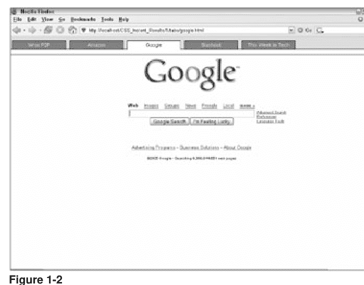

图 1-2 显示当加载 `google.html` 页面时，Google 的标签页被高亮显示。

在开始解释之前，先看看这段可能看起来有点奇怪的标记：

```html
<!-- compliance patch for microsoft browsers -->
<!--[if lt IE 7]>
    <script src="/ie7/ie7-standard-p.js" type=" text/javascript"></script>
<![endif]-->
```

这段标记用于为 Internet Explorer 5.5 和 6 提供兼容性，以支持样式表中出现的一些 IE 原生不支持的 CSS 特性。暂时将此（以及在 IE 中的测试）搁置一边——这将在下一节“测试与注意事项”中详细讨论。

以下是对 `tabs.css` 样式表中出现的每个声明进行的逐条解释，旨在帮助你将标签页项目定制为自己所用。

`tabs.css` 样式表中的第一条规则移除了 `<body>` 元素的默认边距和内边距：

```css
body, html {
    margin: 0;
    padding: 0;
}
```

此规则对于标签页实现并非必要，但此处添加它仅为展示示例。某些浏览器（IE 和 Firefox）默认为 `<body>` 元素应用一些边距，而其他浏览器（Opera）则默认应用内边距；这条规则同时涵盖了这两种情况。

下一条规则为包含最终成为标签页的列表项的 `<ul>` 元素设置样式：

```css
ul#tabs {
    list-style: none;
    margin: 0;
    padding: 10px 0 0 0;
    height: 25px;
    border-bottom: 1px solid black;
    background: rgb(222, 222, 222);
}
```

此规则中的第一个声明 `list-style: none;` 移除了每个 `<li>` 项目的默认项目符号样式。随后，`margin: 0;` 移除了每个浏览器为 `<ul>` 元素应用的默认间距，不过与 `<body>` 元素的情况类似，有些浏览器为 `<ul>` 元素应用内边距而非边距；`padding: 10px 0 0 0;` 处理了这一点，并且你在顶部内边距添加了 10 像素的空间，这个空间出现在浏览器视口的顶部边框与每个标签页的顶部边框之间。与对 `<body>` 元素的修改一样，这个空间对于创建标签页实现并非必需，可以根据你自己的需求进行定制。

下一个声明为 `<ul>` 元素设置固定高度。如果没有固定高度，为 `<ul>` 元素指定的背景和底部边框将出现在标签页的上方，而不是与每个 `<li>` 元素的底部边框齐平。这是因为每个 `<li>` 元素都是浮动的，由于它们是浮动的，它们不再影响 `<ul>` 元素的高度，因为浮动元素脱离了正常文档流，只影响内容，而不影响高度、内边距、边距等盒模型相关属性。最后两个声明对于标签页实现也非必需，可以进行定制。应用了 `border-bottom: 1px solid black;` 和 `background: rgb(222, 222, 222);` —— 前者沿着所有标签页的底部，后者为 `<li>` 元素及其包含的 `<ul>` 提供一些颜色对比。底部边框仅在创建当前页面标签页没有底部边框的标签页效果时才是必要的。如图 1-1 所示，Wrox P2P 标签页被高亮显示且没有底部边框；在图 1-2 中，Google 页面的标签页被高亮显示且没有底部边框。如果需要此效果，`<ul>` 元素的底部边框在创建它时起作用。

为了使标签页设计真正可移植，也可以将其绝对定位，并通过 CSS 的偏移属性（`top`、`right`、`bottom` 或 `left`）设置在文档中的任何所需位置。

下一条规则为每个 `<li>` 元素设置样式：

```css
ul#tabs li {
    float: left;
    margin: 0 5px;
    height: 23px;
    text-align: center;
    position: relative;
    width: 150px;
    border: 1px solid black;
    top: 1px;
    background: rgb(128, 128, 128);
}
```

此项目使用 CSS 浮动模型来布局标签页。这将每个 `<li>` 元素并排放置，而不是像它们在普通列表中那样出现（每个在新行上）。这是通过 `float: left;` 声明完成的。为了将每个标签页的底部边框与包含它们的 `<ul>` 元素的底部边框重叠，你应用了 `position: relative;` 声明，然后紧接着应用了 `top: 1px;` 声明，这将每个标签页的位置向下移动一个像素，以与 `<ul>` 元素的底部边框重叠。接下来，为了在每个标签页之间放置一些间距，你应用了 margin。`margin: 0 5px;` 将上下边距设置为零，左右边距设置为 5 像素。这在每个标签页之间放入了 10 像素的空间，并在包含 `<ul>` 元素的左边框与第一个标签页的左边框之间放入了 5 像素的空间。下一个声明为每个标签页设置固定高度。这在 `<li>` 高度和 `<ul>` 高度之间提供了一致性，尽管这并非绝对必要。可以删除高度并将 `top: 1px;` 声明更改为 `top: 4px;`，以保持每个 `<li>` 元素的底部边框与 `<ul>` 元素的底部边框之间的同步。应用高度是为了垂直居中文本，尽管这也可以通过对每个 `<li>` 元素应用 `vertical-align` 属性来实现。为了居中文本，自然地，应用了 `text-align: center;` 声明。接下来，使用 `width: 150px;` 声明添加了固定宽度。此属性也是可选的；此处应用它是为了使每个标签页具有相同的宽度。

**注意** 如果包含每个标签页的 `<ul>` 元素是绝对定位的，则需要应用一个大于 `<li>` 元素累计宽度的固定宽度，以保持与 Opera 的兼容性。这是必需的，因为在 Opera 中，每个 `<li>` 元素都是浮动的，而包含的 `<ul>` 不会水平扩展以适应嵌套的 `<li>` 元素。这种行为是 CSS 2 规范中一个模糊性的结果，该规范的措辞实际上导致了 Firefox 和 Opera 都通过互斥的解释而正确。冲突围绕着绝对定位元素使用收缩到合适宽度的大小算法，以及该宽度在何时确定。Opera 在考虑其浮动的后代元素之前计算绝对定位元素的宽度；Firefox 先浮动这些元素，然后再为绝对定位元素分配其宽度。

最后，为每个 `<li>` 元素应用背景和边框，以将它们与包含的 `<ul>` 元素区分开来。

在下一条规则中，为每个 `<li>` 元素添加了悬停效果：

```css
ul#tabs li:hover {
    border-bottom: 1px solid white;
    background: white;
}
```

此规则非常直接：如果用户的鼠标悬停在某个 `<li>` 元素上，则该 `<li>` 元素的背景变为白色，而不是前一条规则中通过 `background: rgb(128, 128, 128);` 应用的灰色。底部边框的颜色也变为白色，而不是前一条规则中指定的黑色。这提供了标签页出现在“顶部”的效果，正如你在 **图 1-1** 和 **1-2** 中所见；尽管这些图显示当前页面的标签页被高亮显示，但此悬停效果也为其他页面的标签页做同样的事情，但仅在用户的鼠标悬停在标签页上时生效。

下一条规则设置每个 `<li>` 元素内链接的样式：

```css
ul#tabs a {
    display: block;
    height: 100%;
    text-decoration: none;
    color: white;
    font: 14px Arial, sans-serif;
}
```

第一个声明将 `<a>` 元素的显示从其默认的 inline 状态切换为 block，这是像 `<div>` 和 `<p>` 这类元素的默认显示状态。这使得 `<a>` 元素占据所有可用的水平空间（最多到包含它的 `<li>` 元素的左右边框）。接下来，应用了 `height: 100%;` 声明；这使得每个 `<li>` 元素的整个内部空间（边框内）都成为一个超链接。然后，使用 `text-decoration: none;` 声明移除了链接的默认下划线。`color: white;` 声明将链接的颜色设置为白色（默认通常为蓝色，如果已访问则为紫色）。与此项目的其他样式方面一样，`color: white;` 并非必要，但此处提供它是为了展示一个 CSS 标签页实现。最后，应用了 `font: 14px Arial, sans-serif;` 以更改字体。

在你创建的五个文档中，你为每个文档的 `<body>` 元素应用了不同的 id 名称。下一条规则利用该命名约定来为当前加载页面的标签页设置与其他标签页不同的样式：

```css
body#wrox li#tab1,
body#amazon li#tab2,
```


## 代码与代码解析

```css
body#google li#tab3,
body#slashdot li#tab4,
body#twit li#tab5 {
```
```css
{
    background: white;
    border-bottom: 1px solid white;
}
```

这个概念足够简单。通过利用层叠性并为每个页面命名唯一 ID，你能够为当前加载页面的标签页设置与其它标签页不同的样式。这也要求每个标签页本身也必须具有唯一的名称。结合 `<body>` 元素的 id 名称，该规则可以覆盖之前的规则 `ul#tabs li`，因为 `body#wrox li#tab1` 选择器的层叠优先级（specificity）高于前者。在后一个选择器中，当 `<body>` 具有 "wrox" id 名称，且 `<li>` 元素具有 `tab1` id 名称时，它会覆盖 `ul#tabs li` 选择器，并应用白色背景和白色实线底边框，从而使当前页面的标签页具有与其它页面不同的样式。

事实上，之前的规则可以与你之前看到的 `ul#tabs li:hover` 规则进行分组——这里将它们分开呈现是为了区分两个不同的概念，但实际上它们指定了相同的声明，这使其成为选择器分组的理想场景。这一点可以在接下来的规则中观察到：

```css
ul#tabs a:hover,
body#wrox li#tab1 a,
body#amazon li#tab2 a,
body#google li#tab3 a,
body#slashdot li#tab4 a,
body#twit li#tab5 a {
    color: black;
}
```

该规则由六个独立的选择器开始，它们被分组在一起以避免样式表中的重复。第一个选择器选中 `<ul>` 元素（id 名称为 `tabs`）的后代 `<a>` 元素，但仅在用户鼠标悬停在 `<a>` 元素上时生效。随后的选择器正如你在上一个规则中看到的，根据 `<body>` 元素的 id 名称和 `<li>` 元素的 id 名称，选中当前加载页面的链接。由于每个 `<li>` 元素内的链接原本是白色的，且当用户鼠标悬停在标签页上或该标签页为当前加载页时，`<li>` 元素的背景被设为白色。在这种情况下，链接颜色必须更改以与白色背景形成对比，因此当满足这些条件时，会应用 `color: black;` 声明。

接下来的规则对嵌套在每个 `<a>` 元素内部的 `<span>` 元素应用样式：

```css
ul#tabs span {
    display: block;
    padding: 4px 10px 0 10px;
}
```

该规则中的第一个声明将 `<span>` 元素的显示状态从默认的内联（inline）改为块级（block）。这使你能够通过块级盒模型而非内联盒模型来应用内边距（padding）。这样做是为了控制每个标签页文本周围的间距，这取决于你具体项目的样式要求，可能是必需的，也可能不是。

你可能会好奇，为什么不使用 `<div>` 而使用 `<span>` 元素？从语义上讲，用内联元素（如 `<a>`）包裹块级元素（如 `<div>`）在技术上是不合法的（即使你将其显示状态改为 block），并且可能会在不同浏览器中产生不一致的结果。从标准的角度来看，使用 `<span>` 既在技术上正确又更为合适，因为它合法地可以嵌套在另一个内联元素（如 `<a>`）内部。这种方法可以避免使用 W3C 验证器（网址为 [http://validator.w3.org](http://validator.w3.org)）时出现验证错误，标记作者通常使用该工具来查找标记错误并确保其标记符合标准。

同样，正如前文所述，额外的 `<span>` 可能并非必须，你可能需要固定高度的标签页，也可能不需要使用 `<span>` 元素来控制文本的垂直间距（相对于使用 `vertical-align` 属性）。

最后两条规则与实现标签页设计无关，引入它们仅仅是通过内联框架包含流行网站的外部文档，用补充内容来填充文档的其余空白部分。

## 测试与注意事项

本节描述了在扩展浏览器测试集时遇到的一些挑战。通常在项目开始时，我会忽略除 Firefox 以外的所有浏览器，直到项目成熟到接近最终产品。当开发到达那个阶段时，我开始在 Internet Explorer、Opera、Safari 等其他浏览器中进行测试。在一个典型的项目中，对于像 Opera 和 Safari 这样对标准支持较好的浏览器，可能只需要进行微调，这就是为什么你在本节中看到重点仅在于 Internet Explorer，以及在向 IE 引入其可能尚未理解、或理解不足、或理解错误的标准时所面临的挑战。

前一节提到了一段标记片段，它有助于为 Internet Explorer 5.5 和 6 提供对某些 IE 5.5 和 6 原生不支持的 CSS 特性的兼容性。为了唤起你的记忆，相关标记如下：

```html
<!-- compliance patch for microsoft browsers -->
<!--[if lt IE 7]>
    <script src='/ie7/ie7-standard-p.js' type='text/javascript'></script>
<![endif]-->
```

如果你读过我的书 *Beginning CSS: Cascading Style Sheets for Web Design*（同样由 Wiley Publishing, Inc. 出版），你可能记得我在第 18 章介绍了 IE7 JavaScript，并在该章中描述了如何下载和安装它。由于本书面向具有更先进网站设计知识的读者，我不会在此重复每一个步骤，但将提供安装过程的概述以及 IE7 JavaScript 的背景。

IE7 JavaScript 由英国伦敦人 Dean Edwards 编写，旨在帮助设计师应对微软 Internet Explorer 浏览器五年未进行重大 CSS 更新这一事实。Edwards 使用 JavaScript 在 IE 中实现其先前不支持的 CSS 特性，使 IE 5.5 和 IE 6 能与 Safari 和 Mozilla Firefox 等浏览器处于一个更公平的竞争水平（在撰写本书时，后两者具有远更好的 CSS 支持）。IE7 库的编写方式非常透明，使得 Explorer 看起来像是原生支持这些 CSS 特性，而使用 IE7 的人员无需具备除链接到 IE7 库之外的任何额外 JavaScript 知识。IE7 提供的部分顶尖 CSS 特性如下：

- `min-width`、`max-width` 和 `min-height` 属性
- `:hover`、`:active` 和 `:focus` 伪类（适用于任何元素，而不仅仅是 `<a>` 元素）
- 各种高级选择器，如直接子代选择器 (`>`)、属性选择器 (`input[type]`)、相邻兄弟选择器 (`+`) 和通用兄弟选择器 (`~`)
- 结构伪类，如 `:root`、`:first-child` 和 `:last-child`
- `::before` 和 `::after` 伪元素以及 `content` 属性

当然，Edwards 并没有止步于此；这些仅仅是部分顶尖特性。真正令人惊叹的是 IE7 的体积和速度。IE7 JavaScript 库采用了模块化设计；这有助于降低下载体积，并允许设计师仅包含他们需要的特性。主库的大小仅约为 24KB。它提供了上述所有功能以及更多（除了 `:last-child`，他将其放在了一个专门的 CSS3 选择器库中）。

IE7 JavaScript 托管在 SourceForge 上（一个托管数千个开源项目的组织），可以通过以下 URL 下载：[https://sourceforge.net/project/showfiles.php?group_id=109983](https://sourceforge.net/project/showfiles.php?group_id=109983)。

下载 IE7 后，必须将其解压缩并放置在 Web 服务器的根目录下。例如，如果你的网站是 [http://www.example.com/](http://www.example.com/)，则 IE7 JavaScript 必须位于 [http://www.example.com/ie7/](http://www.example.com/ie7/)。你也可以将 IE7 安装到不同的目录，但本书提供的源代码示例必须更新以反映你安装 IE7 的路径。

IE7 JavaScript 是开源的，并在 Creative Commons LGPL 许可证（较宽松通用公共许可证）下提供。你可以在 [http://creativecommons.org/licenses/LGPL/2.1](http://creativecommons.org/licenses/LGPL/2.1) 获取完整文本（无法律术语版本）。

你可以从 IE7 主页 `http://dean.edwards.name/ie7` 找到更多关于 IE7 的信息。

下一节将讨论 Edwards 的 IE7 JavaScript 为本项目提供了哪些具体功能。

## IE7 JavaScript 为本项目提供了什么

观察 IE7 JavaScript 为本项目提供的功能，最好的方法就是直接在没有安装 IE7 JavaScript 的 Internet Explorer 中打开标签页项目。在 Internet Explorer 6 中，没有 IE7 功能的 `wrox.html` 输出结果如图 1-3 所示。

**图 1-3**

在 Explorer 中看起来并没有太大区别，只有几个细微的例外：

- 当鼠标悬停在标签页上时，标签页没有白色背景。
- `<iframe>` 完全不可见。

第一个要点描述的情况发生是因为 Internet Explorer 6 仅在 `<a>` 元素上支持 `:hover` 动态伪类，而不能像 Firefox、Opera 和 Safari 那样支持所有元素。第二个要点是因为 Explorer 6 不支持通过组合 `top`、`right`、`bottom` 和 `left` 属性来暗示绝对定位或固定定位元素的尺寸。Edwards 的 IE7 JavaScript 提供了这两项功能，使 Internet Explorer 6 达到了与 Firefox、Opera 和 Safari 相同的功能水平。图 1-4 显示了应用 Edwards IE7 JavaScript 后的 Internet Explorer 6 输出结果。


## 测试与注意事项

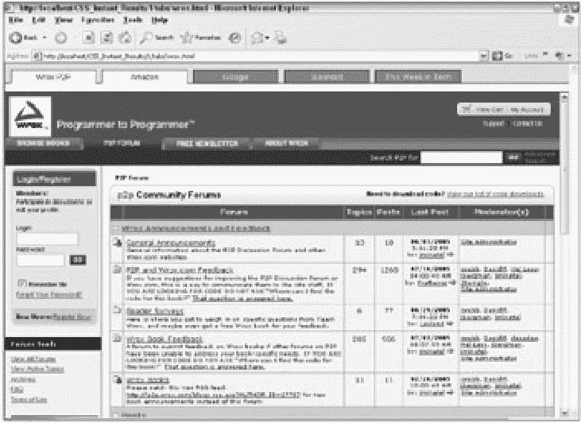

### 图 1-4

[图 1-4](#figure-1-4) 展示了当用户的鼠标悬停在其他标签页上时，这些标签页的颜色会发生变化，同时 `<iframe>` 现在可见。

[下一节](#next-section) 将讨论如何修改标签页项目，以采用多种不同的设计替代方案。

## 使用与修改项目

本节介绍标签页项目设计的几种替代方案，因为并非所有人都希望使用已呈现的标签页项目。本节讨论的替代方案如下：

- 使用背景图片而非纯色和方形边框
- 使用包含文本的背景图片，同时不损害无障碍性
- 以这种方式使用背景图片，使标签页具有流动性，可以在最小和最大约束之间自适应调整

当然，这些替代方案会增加项目的复杂性和难度，但引入它们是为了提供最大的灵活性，并尽可能涵盖标签页实现的各种场景。

第一种替代方案介绍如何使用背景图片来替代默认的纯色和方形边框。

## 带有背景图片的标签页

要创建带有背景图片的标签页，请按以下步骤操作。以下方案的源代码以及配套图片可在本书网站和随书附带的光盘的 "Project 1" 文件夹中的 "with-background" 文件夹中找到。

1. 输入以下样式表。与原始项目中 tabs.css 的更改之处已标出：

```css
body, html {
    margin: 0;
    padding: 0;
}
ul#tabs {
    list-style: none;
    margin: 0;
    padding: 10px 0 0 0;
    height: 23px;
    border-bottom: 1px solid black;
    background: rgb(218, 218, 218);
}
ul#tabs li {
    float: left;
    margin: 0;
    height: 23px;
    text-align: center;
    width: 160px;
    background: transparent url('images/tab.png') no-repeat scroll top;
}
ul#tabs a {
    display: block;
    height: 100%;
    text-decoration: none;
    color: white;
    font: 14px Arial, sans-serif;
}
```

```css
ul#tabs li:hover,
body#wrox li#tab1,
body#amazon li#tab2,
body#google li#tab3,
body#slashdot li#tab4,
body#twit li#tab5 {
    background: transparent url('images/tab_hover.png') no-repeat scroll top;
}
ul#tabs a:hover,
body#wrox li#tab1 a,
body#amazon li#tab2 a,
body#google li#tab3 a,
body#slashdot li#tab4 a,
body#twit li#tab5 a {
    color: black;
}
ul#tabs span {
    display: block;
    padding: 4px 10px 0 10px;
}
div#iframe {
    position: absolute;
    top: 0;
    bottom: 0;
    right: 0;
    left: 0;
    margin-top: 50px;
    border-top: 1px solid black;
}
iframe {
 programmatically {
    position: absolute;
    top: 0;
    bottom: 0;
    right: 0;
    left: 0;
    width: 100%;
    height: 100%;
}
```

2. 将生成的样式表保存为 `tabs.css`。

你可以在图 1-5 中看到这些修改的结果。

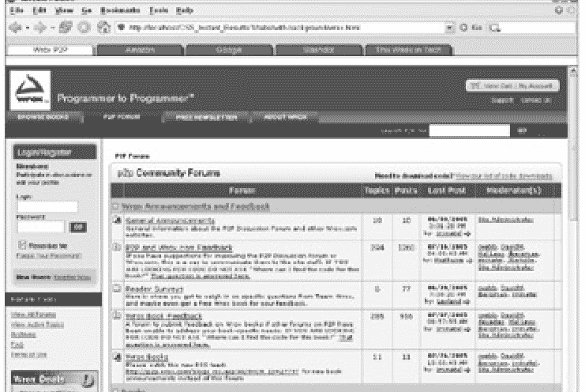

使用背景图片替代边框和纯色所需的修改 surprisingly 很少。下面详细解释每一项修改。

第一项修改是针对 `<ul>` 元素的高度，它直接对应于每个 `<li>` 元素要使用的背景图片的高度：

```css
ul#tabs {
    list-style: none;
    margin: 0;
    padding: 10px 0 0 0;
    height: 23px;
    border-bottom: 1px solid black;
    background: rgb(218, 218, 218);
}
```

第二项修改是包含五个标签页的 `<ul>` 元素的纯色背景。背景被稍微调亮，以匹配 Adobe Photoshop 生成的标签背景图片的背景色。虽然最初使用的 RGB 值为 222, 222, 222，且在 Adobe Photoshop 中也使用了相同的 RGB 值作为标签的背景，但在任何浏览器中两者都无法匹配。为了让它们更接近，只需将 `<ul>` 元素的灰色背景稍微调暗。

下一项修改是针对 `<li>` 元素的规则：

```css
ul#tabs li {
    float: left;
    margin: 0;
    height: 23px;
    text-align: center;
    width: 160px;
    background: transparent url('images/tab.png') no-repeat scroll top;
}
```

首先，去除每个 `<li>` 元素之间的外边距，并删除 `position: relative;` 和 `top: 1px;` 声明，因为它们不再需要。此前，每个 `<li>` 元素的左右外边距设置为 5 像素。这样做是因为在此示例中使用了背景图片；外边距可以包含在背景图片本身中。调整外边距后，宽度修改为 160 像素。这是为了包含从每个 `<li>` 元素左右两侧移除的外边距。最后，在前一条规则的最后一个声明中，应用了背景图片。背景图片生成尺寸为 160 × 23 像素，与为 `<li>` 元素指定的宽度和高度完全匹配。要修改此示例以适应不同尺寸的标签页，请注意前一条规则中出现的 width 和 height 属性，以及 `ul#tabs` 规则的 height 属性，这将是修改每个标签页尺寸以适应更大或更小背景标签的起点。修改尺寸时还需考虑的其他因素是包裹每个标签页文本的 `<span>` 元素的内边距值，它用于控制垂直对齐。

最后一项修改是修改加载页面的标签页，或用户悬停在标签页上时出现的背景图片：

```css
ul#tabs li:hover,
body#wrox li#tab1,
body#amazon li#tab2,
body#google li#tab3,
body#slashdot li#tab4,
body#twit li#tab5 {
    background: transparent url('images/tab_hover.png') no-repeat scroll top;
}
```

在原始的标签页示例中，你将 `ul#tabs li:hover` 定义为单独的规则。在这里，你只需将它们与定义当前加载文档的标签页的规则组合在一起，并修改 background 声明以引用 `tab_hover.png`。

以上就是全部内容。下一节将讨论如何使用包含文本的背景图片，同时不损害无障碍性。

## 包含文本的背景图片

要创建带有包含文本的背景图片的标签页，请按以下步骤操作。以下方案的源代码和配套图片可在本书网站和随书光盘的 "Project 1" 文件夹中的 "with-text" 文件夹中找到。

1. 对 `tabs.css` 进行以下修改。与之前的背景图片方案相比，更改之处已标出，不过也有一些声明已被删除：

```css
body, html {
    margin: 0;
    padding: 0;
}
ul#tabs {
    list-style: none;
    margin: 0;
    padding: 10px 0 0 0;
    height: 23px;
    border-bottom: 1px solid black;
    background: rgb(218, 218, 218);
}
ul#tabs li {
    float: left;
    margin: 0;
    height: 23px;
    text-align: center;
    width: 160px;
}
ul#tabs a {
    display: block;
    height: 100%;
    text-decoration: none;
    color: white;
    font: 14px Arial, sans-serif;
}
ul#tabs li#tab1 {
    background: transparent url('images/wrox-tab.png') no-repeat scroll top;
}
ul#tabs li#tab1:hover,
body#wrox li#tab1 {
    background: transparent url('images/wrox-tab-hover.png') no-repeat scroll top;
}
ul#tabs li#tab2 {
    background: transparent url('images/amazon-tab.png') no-repeat scroll top;
}
ul#tabs li#tab2:hover,
body#amazon li#tab2 {
    background: transparent url('images/amazon-tab-hover.png') no-repeat scroll top;
}
ul#tabs li#tab3 {
    background: transparent url('images/google-tab.png') no-repeat scroll top;
}
ul#tabs li#tab3:hover,
body#google li#tab3 {
    background: transparent url('images/google-tab-hover.png') no-repeat scroll top;
}
ul#tabs li#tab4 {
    background: transparent url('images/slashdot-tab.png') no-repeat scroll top;
}
ul#tabs li#tab4:hover,
body#slashdot li#tab4 {
    background: transparent url('images/slashdot-tab-hover.png') no-repeat scroll top;
}
ul#tabs li#tab5 {
    background: transparent url('images/twit-tab.png') no-repeat scroll top;
}
ul#tabs li#tab5:hover,
body#twit li#tab5 {
    background: transparent url('images/twit-tab-hover.png') no-repeat scroll top;
}
ul#tabs a:hover,
body#wrox li#tab1 a,
body#amazon li#tab2 a,
body#google li#tab3 a,
body#slashdot li#tab4 a,
body#twit li#tab5 a {
    color: black;
}
```


## 使用与修改项目

```css
ul#tabs span {
    display: block;
    padding: 4px 10px 0 10px;
    visibility: hidden;
}
div#iframe {
    position: absolute;
    top: 0;
    bottom: 0;
    right: 0;
    left: 0;
    margin-top: 50px;
    border-top: 1px solid black;
}
iframe {
    position: absolute;
    top: 0;
    bottom: 0;
    right: 0;
    left: 0;
    width: 100%;
    height: 100%;
}
```

2.  保存为 `tabs.css`。

这些修改将产生如图 1-6 所示的输出效果。

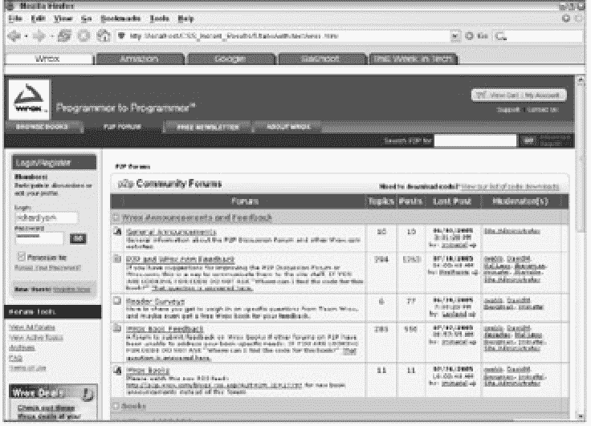

### 图 1-6

虽然这种方法的修改范围比上一个仅使用无文本背景图像的方法更广，但大部分修订是冗余的，因为每个标签页必须使用不同的背景图像。

```css
ul#tabs li#tab1 {
background: transparent url('images/wrox-tab.png') no-repeat scroll top;
}
ul#tabs li#tab1:hover,
body#wrox li#tab1 {
    background: transparent url('images/wrox-tab-hover.png') no-repeat scroll top;
}
```

样式表中的前一段代码片段是第一个标签页的背景图像，该标签页链接到 Wrox P2P 网站。首先，你需要从 `ul#tabs li` 规则中删除 `background` 声明，然后从前一段代码开始，为所有五个标签页定义单独的规则，因为现在所有五个标签页的文本都包含在背景图像本身中。

在样式表的后面，为了保持可访问性，嵌套在每个标签页内的 `<span>` 元素中的文本被设置为不可见：

```css
ul#tabs span {
    display: block;
    padding: 4px 10px 0 10px;
    visibility: hidden;
}
```

将文本设为不可见可以将其对终端用户隐藏，但由于 Googlebot 等搜索机器人和 JAWS 等屏幕阅读器尚未支持 CSS，文本对于搜索引擎和屏幕阅读器仍然是“可见”的，从而保证了可访问性。

最后一种方法演示了如何使标签页变为流式（liquid），使其能够根据最小和最大约束进行伸缩。

## 流式标签页 (Liquid Tabs)

要创建可以伸展以填充所有可用空间的流式标签页，请按照以下步骤操作：

1.  按如下方式修改 `tabs.css`；与上一种方法相比的更改已突出显示：

```css
body, html {
    margin: 0;
    padding: 0;
}
ul#tabs {
    list-style: none;
    margin: 0;
    padding: 10px 0 0 0;
    height: 23px;
    border-bottom: 1px solid black;
    background: rgb(218, 218, 218);
    position: relative;
}
ul#tabs li {
    position: absolute;
    bottom: 0;
    margin: 0;
    height: 23px;
    text-align: center;
    width: 20%;
    background: transparent url('images/tab/tab_01.png') no-repeat scroll left;
}
ul#tabs li > div {
    height: 23px;
    background: transparent url('images/tab/tab_03.png') no-repeat scroll right;
}

ul#tabs li > div > div {
    height: 23px;
    background: transparent url('images/tab/tab_02.png') repeat-x scroll center;
    margin: 0 8px 0 7px;
}

ul#tabs a {
    display: block;
    height: 100%;
    text-decoration: none;
    color: white;
    font: 14px Arial, sans-serif;
}

ul#tabs li#tab1 {
    left: 0;
}

ul#tabs li#tab2 {
    left: 20%;
}

ul#tabs li#tab3 {
    left: 40%;
}

ul#tabs li#tab4 {
    left: 60%;
}

ul#tabs li#tab5 {
    left: 80%;
}

ul#tabs li:hover,
body#wrox li#tab1,
body#amazon li#tab2,
body#google li#tab3,
body#slashdot li#tab4,
body#twit li#tab5 {
    background: transparent url('images/tab-hover/tab-hover_01.png') no-repeat scroll left;
}

ul#tabs li:hover > div,
body#wrox li#tab1 > div,
body#amazon li#tab2 > div,
body#google li#tab3 > div,
body#slashdot li#tab4 > div,
body#twit li#tab5 > div {
    background: transparent url('images/tab-hover/tab-hover_03.png') no-repeat scroll right;
}

ul#tabs li:hover > div > div,
body#wrox li#tab1 > div > div,
body#amazon li#tab2 > div > div,
body#google li#tab3 > div > div,
body#slashdot li#tab4 > div > div,
body#twit li#tab5 > div > div {
background: transparent url('images/tab-hover/tab-hover_02.png') repeat-x
scroll center;
}
ul#tabs a:hover,
body#wrox li#tab1 a,
body#amazon li#tab2 a,
body#google li#tab3 a,
body#slashdot li#tab4 a,
body#twit li#tab5 a {
    color: black;
}
ul#tabs span {
    display: block;
    padding: 4px 10px 0 10px;
}
div#iframe {

    position: absolute;
    top: 0;
    bottom: 0;
    right: 0;
    left: 0;
    margin-top: 50px;
    border-top: 1px solid black;
}
iframe {
    position: absolute;
    top: 0;
    bottom: 0;
    right: 0;
    left: 0;
    width: 100%;
    height: 100%;
}
```

2.  保存 `tabs.css`。

3.  对 `wrox.html`、`amazon.html`、`google.html`、`slashdot.html` 和 `twit.html` 进行以下修改：

```html
<!DOCTYPE html PUBLIC "-//W3C//DTD XHTML 1.0 Transitional//EN"
"http://www.w3.org/TR/xhtml1/DTD/xhtml1-transitional.dtd">
<html xmlns='http://www.w3.org/1999/xhtml' xml:lang='en'>
    <head>
        <meta http-equiv='Content-Type' content='text/html; charset=UTF-8' />
        <title></title>
        <link rel='stylesheet' type='text/css' href='tabs.css' />
        <!-- compliance patch for microsoft browsers -->
        <!--[if lt IE 7]>
            <link rel='stylesheet' type='text/css' href='tabs-ie.css' />
            <script src="/ie7/ie7-standard-p.js" type=" text/javascript"></script>
        <![endif]-->
    </head>
    <body id='wrox'>
        <ul id='tabs'>
<li id='tab1'>
    <div><div>
        <a href='wrox.html'><span>Wrox P2P</span></a>
    </div></div>
</li>
<li id='tab2'>
    <div><div>
        <a href='amazon.html'><span>Amazon</span></a>
    </div></div>
</li>
<li id='tab3'>
    <div><div>
        <a href='google.html'><span>Google</span></a>
    </div></div>
</li>
<li id='tab4'>
    <div><div>
        <a href='slashdot.html'><span>Slashdot</span></a>
    </div></div>
</li>
<li id='tab5'>
    <div><div>
        <a href='twit.html'><span>This Week in Tech</span></a>
    </div></div>
</li>
</ul>
<div id='iframe'>
    <iframe src='http://p2p.wrox.com'
            frameborder='0' marginheight='0' marginwidth='0'></iframe>
</div>
</body>
</html>
```

4.  保存 `wrox.html`、`amazon.html`、`google.html`、`slashdot.html` 和 `twit.html`。

5.  创建一个新的样式表并输入以下 CSS：

```css
ul#tabs {
    height: 22px
}
```

6.  将新样式表保存为 `tabs-ie.css`。

这种方法将产生如图 1-7 所示的输出效果。

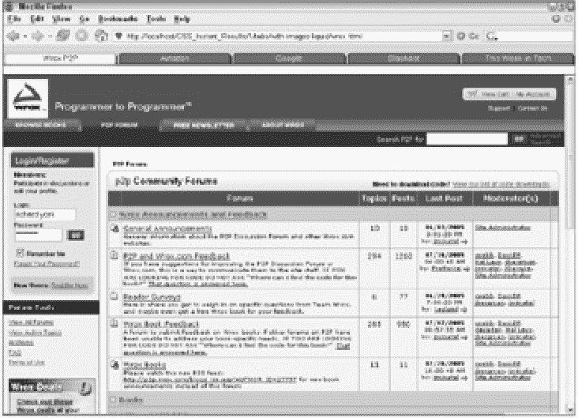

**图 1-7**

标签页项目的最后一个变体是最复杂的，但它创造了一定的灵活性，因为这种设计可以很容易地适应那些需要对标签页所在元素设置最小或最大约束的项目。在本例中，没有设置最小或最大约束，而如果你在 `ul#tabs` 元素上使用了 `min-width` 或 `max-width` 属性，则会有这些约束。

对 `tabs.css` 进行的第一处修改是给标签页的 `<ul>` 元素添加 `position: relative;` 声明：

```css
ul#tabs {
    list-style: none;
    margin: 0;
    padding: 10px 0 0 0;
    height: 23px;
    border-bottom: 1px solid black;
    background: rgb(218, 218, 218);
    position: relative;
}
```

添加 `position: relative;` 会使得其中包含的、采用绝对定位的 `<li>` 元素相对于标签页 `<ul>` 元素进行定位。我在这种方法中使用定位，是因为 Explorer 在百分比宽度测量方面存在一些 bug。简单地为每个 `<li>` 元素应用 20% 的宽度会导致最后一个 `<li>` 元素在 Explorer 中出现在新的一行，尽管 20% * 5 = 100%！

```css
ul#tabs li {
    position: absolute;
    bottom: 0;
    margin: 0;
    height: 23px;
    text-align: center;
    width: 20%;
    background: transparent url('images/tab/tab_01.png') no-repeat scroll left;
}
```


## 使用与修改项目

第一个声明自然会使 `<li>` 元素被**绝对定位**，相对于包含它们的 `<ul>` 元素。`bottom: 0;` 声明将每个 `<li>` 元素相对于包含它们的 `<ul>` 元素的**底部**进行定位。下一个声明 `width: 20%;` 使每个 `<li>` 元素占据包含它的 `<ul>` 元素宽度的 20%。Explorer 中的缺陷因此被克服了，因为每个 `<li>` 元素都是绝对定位的，第五个 `<li>` 元素不可能出现在下一行。

最后一个声明应用了第一张背景图。我使用 Photoshop 的切片工具将图像切成了三部分。第一部分是左侧的角和边。第二部分是选项卡的中间部分，第三部分是右侧的角和边。第一张图像被应用并**不重复**地定位在每个 `<li>` 元素的**左侧**。然后，为了制作可伸展的选项卡，你在每个 XHTML 文档中添加了一些额外的 `<div>` 元素，这些元素提供了放置切片选项卡的挂钩：

```css
ul#tabs li > div {
    height: 23px;
    background: transparent url('images/tab/tab_03.png') no-repeat scroll right;
}
```

在下一个规则中，你应用了选项卡的**右侧**部分。这应用于第一个 `<div>`，它被赋予 23 像素的高度以镜像包含它的 `<li>` 元素。然后，选项卡的右侧被应用并定位在第一个 `<div>` 元素的**右侧**。下一个 `<div>` 元素嵌套在最后一个里面；这个元素包含了选项卡的**中间**部分：

```css
ul#tabs li > div > div {
    height: 23px;
    background: transparent url('images/tab/tab_02.png') repeat-x scroll center;
    margin: 0 8px 0 7px;
}
```

它也被赋予了 23 像素的高度，以镜像包含它的 `<div>` 和 `<li>` 元素的尺寸。背景被应用于 `<div>` 元素的**中心**，并设置为在 X 轴上重复，即水平重复。最后，在最后一个声明中，为了控制重叠，你为 `<div>` 应用了左右外边距，其宽度分别等于左右选项卡切片的宽度。

接下来的五个规则设置了每个 `<li>` 元素的**水平位置**：

```css
ul#tabs li#tab1 {
    left: 0;
}
ul#tabs li#tab2 {
    left: 20%;
}
ul#tabs li#tab3 {
    left: 40%;
}
ul#tabs li#tab4 {
    left: 60%;
}
ul#tabs li#tab5 {
    left: 80%;
}
```

每个选项卡都相对于包含的 `<ul>` 元素**向左**定位，以 20% 的增量递增（20% 是相对于包含 `<ul>` 元素的宽度而言的）。

最后，每个选项卡切片的**分层技术**在当前加载页面的选项卡上以及用户**悬停**在选项卡上时重复使用：

```css
ul#tabs li:hover,
body#wrox li#tab1,
body#amazon li#tab2,
body#google li#tab3,
body#slashdot li#tab4,
body#twit li#tab5 {
    background: transparent url('images/tab-hover/tab-hover_01.png') no-repeat scroll left;
}
ul#tabs li:hover > div,
body#wrox li#tab1 > div,
body#amazon li#tab2 > div,
body#google li#tab3 > div,
body#slashdot li#tab4 > div,
body#twit li#tab5 > div {
    background: transparent url('images/tab-hover/tab-hover_03.png') no-repeat scroll right;
}
ul#tabs li:hover > div > div,
body#wrox li#tab1 > div > div,
body#amazon li#tab2 > div > div,
body#google li#tab3 > div > div,
body#slashdot li#tab4 > div > div,
body#twit li#tab5 > div > div {
    background: transparent url('images/tab-hover/tab-hover_02.png') repeat-x scroll center;
}
```

当然，这次只需要更改背景图像，因为这种技术利用了**级联**来替换当前加载页面选项卡的背景，以及当用户悬停在选项卡上时。

你还修改了每个文档的标记，以引用一个只有 Internet Explorer 才能看到的**条件注释**样式表：

```html
<!--[if lt IE 7]>
    <link rel='stylesheet' type='text/css' href='tabs-ie.css' />
    <script src='/ie7/ie7-standard-p.js' type='text/javascript'></script>
<![endif]-->
```

该样式表在 Internet Explorer 专有的**条件注释**中被引用，这提供了一种仅为 Internet Explorer 提供样式表修复的方法。

在此样式表中，你输入了一条规则：

```css
ul#tabs {
    height: 22px
}
```

上述规则修正了选项卡下方出现的 **1 像素高的空隙**。

在讨论了四种使用 XHTML 和 CSS 设计选项卡的不同方法后，下一章将向你展示如何使用 XHTML 和 CSS 创建**多列布局**。

# 第 2 章：多列布局

### 概述

本章提供了使用 XHTML 和 CSS 创建功能正常、**跨浏览器兼容**的多列布局所需的所有代码。在 Web 开发领域，CSS 相对于依赖基于表格布局的**表现性 HTML** 最引人注目的论据是，浏览器对使用简单 XHTML 和 CSS 进行多列布局的支持相当好，尤其是从微软和 Netscape 家族的**第五代浏览器**开始。Mozilla 作为 Netscape 的产物，一直是一个强大的**符合标准**的浏览器，因为它从一开始就按此设计（早期版本的 Mozilla 有不少错误，但仍然以标准为导向）。Opera、Konqueror 以及基于 Konqueror 的 Safari 在这个领域也拥有出色的**支持**。

然而，特别是微软 Internet Explorer 存在一些**怪癖**，如果你不熟悉这些怪癖，使用 XHTML 和 CSS 创建一个功能正常的多列布局可能是一项艰巨的任务。在本章中，你将看到在撰写本文时如何利用所有可用的工具来**绕过**这些怪癖，此外，你还将学习如何创建一个能覆盖尽可能多受众的多列设计。

在介绍必要的工具之前，你需要了解你想要实现什么。总的来说，你需要一个在 Internet Explorer 5.5、6 和 7、Mozilla 1.7、Firefox 1.0、Firefox 1.1、Safari 1.2 和 Opera 8 中都能**正常工作**的多列布局。除了前述的整体设计目标外，还必须满足以下具体目标：

-   布局必须能够**伸展**以适应页面上最长的列，并且每列的长度必须相同。
-   **页脚**不能被任何列覆盖。
-   主要内容必须是**流体的**，在较大的屏幕分辨率下伸展到更大的宽度，在较小的屏幕分辨率下收缩以适应。

最初，这项任务看起来很简单。我选择较不受欢迎的浏览器的最新版本，因为这些浏览器的用户倾向于一旦有新版本可用就立即更新，尽管该设计在这些浏览器的早期版本中也可能同样有效。这里概述的所有目标都可以利用当前 CSS 的**能力**来实现。

下一节讨论在设计标记时需要考虑的因素，以及最适合完成手头任务的 CSS 方法。

## 设计

从标记的角度来看，多列布局的设计**相对简单**。这种设计比任何基于表格的设计都**灵活得多**，并允许多得多的样式表可能性。例如，该设计允许你在必要时**移动列**而无需修改标记。该设计还允许你提供**备用样式表**（例如，不同的皮肤，甚至每个列物理位置的变体），前提是浏览器提供了备用样式表功能。本项目使用简单的、通用的 `<div>` 元素来包围每一列，以及一个包含所有内容的容器 `<div>`。我避免使用表格进行布局，因为它们不提供与 `<div>` 元素相同的灵活性，尽管我可以使用表格并且在 Internet Explorer 的 CSS 支持中遇到的怪癖会少得多。

从 CSS 的角度来看，该设计要成功，有**几个属性**是至关重要的。就列而言，有两种方法可以创建多列布局：**定位**和**浮动**。本章重点讨论**定位**方法，因为它比浮动方法提供的**注意事项**更少——而且因为你本质上是在创建层，**绝对定位**是完成这项工作的正确工具。在本章后面，你将学习如何修改样式表以使用浮动方法，以及采取这种方法时需要考虑的**注意事项**。

相应的 CSS 属性将使你能够满足设计目标：

-   **布局必须能够伸展以适应页面上最长的列，并且每列的长度必须相同。** 你必须决定哪些列将是最长的。通常，这将是包含网页**内容**的列。其他列更可能与**导航**或**信息**相关，并且根据设计，它们不会像内容列可能增长的那样长。因此，重点是如何将**次要列**伸展到内容列的长度。因为每一列（除了静态定位的内容列之外）都是**绝对定位**的（相对于包围所有列的 `<div>` 元素），CSS 提供了两种方法使这些列与内容列一样长：**百分比高度**和通过同时存在 `top` 和 `bottom` 偏移属性来**隐含高度**。哪种方法更合适取决于次要列是否必须具有内边距、外边距或边框。因为百分比高度是基于应用它的元素的父元素的高度，所以外边距、边框和内边距是**额外添加**到父元素高度上的。使用后一种方法——同时使用 `top` 和 `bottom` 偏移属性——元素的高度将是应用外边距、边框和内边距后**剩余**的空间。就浏览器支持而言，Internet Explorer **不支持**这两种方法对绝对定位的元素，因此无论选择哪种方法，都必须为 Internet Explorer 提供一个**解决方法**。为了与未来的设计更改保持最大的兼容性，我选择使用 `top` 和 `bottom` 方法来定义次要列的高度。

前一段提到次要列是**绝对定位**的，相对于包含的 `<div>`，而内容列是**静态定位**的；也就是说，它保持在文档的正常流中，没有应用定位。这种方法**迫使**包含的 `<div>` 元素随着文档的内容增长，由于包含的 `<div>` 增长，这也允许次要列从前一段提到的方法中检索其高度，从而允许实现第二个目标。通过为内容列应用与次要列宽度相等的左或右外边距（或两者都应用）来**防止**次要列和内容列之间的重叠。

-   **页脚不能被任何列覆盖。** 在本项目中，页脚放置在包含的 `<div>` 元素**之后**，这在大多数情况下防止了重叠。如果次要列比内容列**更长**，次要列将覆盖页脚。为了防止这种情况，你必须确定次要列可能的最长长度，并在包含的 `<div>` 元素上定义一个等于该长度的**最小高度**。本质上，包含的 `<div>` 将始终与最长的次要列一样长，以防止页脚被覆盖。


设计

- **主要内容必须是流动的，能够随大屏幕分辨率而伸展，并随小屏幕分辨率而收缩以适应。** 这一目标将通过 CSS 提供的 `minimum` 和 `maximum` 宽度属性来实现。在样式表中将提供一个上限约束和一个下限约束，以便内容能够优雅地适应更大或更小的屏幕分辨率。

**注意** &nbsp;&nbsp;&nbsp; 该项目目前面临的最大挑战是，Internet Explorer 5.5 和 6 几乎不支持前几段所述的实现设计目标所需的任何战略性 CSS —— 至少不是以标准形式支持。为了兼容 Internet Explorer 5.5 和 6，有两种可行的方案。第一种是使用 Dean Edwards 的 IE7 JavaScript，它在 IE 5.5 和 6 中实现了所需的 CSS。这是通过包含一个由 Explorer 专有的条件注释包裹的小型 JavaScript 文件来完成的。第二种方案是使用一些 Explorer 专有的 CSS 特性。在这个项目中，你会看到这两种方法的应用。

现在你已经了解了该项目设计中一些最重要的方面，可以开始查看项目的源代码了。


## 代码与代码详解

本节将介绍用于按照[前一节](previous section)所述方式创建多列布局的底层代码。随后，你将学习如何修改项目以适应不同的设计方法，以及如何更改设计以适应更多或更少的列。

首先你将看到 XHTML 标记，虽然 XHTML 并不是必需的 —— 使用符合 HTML 4.01 标准的标记也可以达到同样的效果。请按照以下步骤创建一个基础的多列布局设计：

1. 输入以下标记。或者，你可以在本书的网站以及随书附带的源码 CD-ROM 的 [Chapter 2](Chapter 2) 文件夹中找到此示例，文件名为 `multi-column .html`。

```html
<!DOCTYPE html PUBLIC "-//W3C//DTD XHTML 1.0 Strict//EN"
"http://www.w3.org/TR/xhtml1/DTD/xhtml1-strict.dtd">
<html xmlns='http://www.w3.org/1999/xhtml' xml:lang='en'>
    <head>
        <meta http-equiv="Content-Type" content="text/html; charset=UTF-8" />
        <title></title>
        <link rel='stylesheet' type='text/css' href='multi-column.css' />
        <!-- compliance patch for microsoft browsers -->
        <!--[if lt IE 7]>
            <link rel='stylesheet' type='text/css' href='multi-column-ie.css' />
            <script src="/ie7/ie7-standard-p.js" type="text/javascript"></script>
        <![endif]-->
    </head>
    <body>
        <div id='header'>
            <h1>Header</h1>
        </div>
        <div id='container'>
            <div id='first-column'>
                Text in the first column.
            </div>
            <div id='content'>
                Text in the content column.
            </div>
            <div id='third-column'>
                Text in the third column.
            </div>
        </div>
        <div id='footer'>
            <h6>Footer</h6>
        </div>
    </body>
</html>
```

2. 将文件保存为  `multi-column.html`。

标记中没有什么特别之处或令人兴奋的地方，只是标准的 XHTML 1.0。页眉引用了两个样式表和 Dean Edwards 的 IE7 JavaScript。第一个样式表供所有浏览器读取。第二个样式表出现在微软专有的条件注释中；这是一个仅在 Internet Explorer 中生效的功能，可用于将 IE 特有的 Bug 修复与常规样式分开。

3. 第一个样式表包含以下规则。在源码 CD-ROM 中，此文件名为 `multi-column.css`：

```css
body {
    background: white;
    font-family: sans-serif;
    margin: 0;
    padding: 0;
}
h1, h6 {
    margin: 0;
    font-weight: normal;
}
div#container {
    position: relative;
    min-height: 400px;
    border: 1px solid gray;
    background: lightgrey;
    max-width: 1000px;
    min-width: 750px;
    margin: auto;
}
div#first-column,
div#third-column {

    position: absolute;
    top: 0;
    bottom: 0;
    border: 1px solid gray;
    background: rgb(240, 240, 240);
    width: 200px;
    margin: 3px;
}
div#first-column {
    left: 0;
}
div#third-column {
    right: 0;
}
div#content {
    margin: 3px 208px 3px 208px;
    background: rgb(240, 240, 240);
    border: 1px solid gray;
    min-height: 392px;
}
div#header,
div#footer {
    background: rgb(240, 240, 240);
    padding: 3px;
    border: 1px solid gray;
    max-width: 994px;
    min-width: 744px;
    margin: auto;
}
div#header {
    border-bottom: none
}
div#footer {
    border-top: none;
}
```

4. 将此文件保存为 `multi-column.css`。

5. 对于条件注释样式表，添加以下内容：

```css
div#content {
    position: relative;
    top: 3px
}
```

6. 将此文件保存为 `multi-column-ie.css`。

最终的输出结果在 Mozilla Firefox 中应如图 2-1 所示。

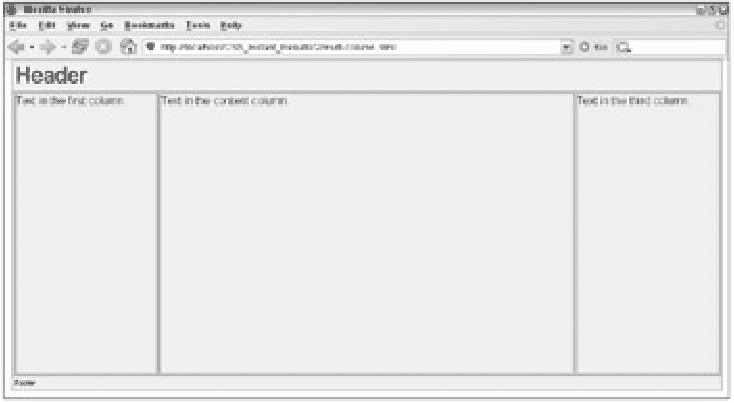

**图 2-1**

虽然第一条规则对项目没有实际影响，但出于几个原因它是必要的：

```css
body {
    background: white;
    font-family: sans-serif;
    margin: 0;
    padding: 0;
}
```

首先，为文档指定了背景颜色。这很重要，因为用户可能会自定义其操作系统或浏览器，并指定一个可能与设计相冲突的背景颜色。通过为整个 body 应用背景，可以避免这种情况。在第二个声明中指定了字体。同样，用户指定的字体可能与开发人员浏览器中使用的字体完全不同。通过指定特定字体（在本例中为通用无衬线字体 `sans-serif`），你可以避免用户使用不同字体的可能性。最后，你移除了 `<body>` 元素的任何默认外边距（margin）或内边距（padding），这提高了跨浏览器的一致性，因为不同的浏览器对于 `<body>` 元素的默认外边距或内边距可能有所不同。

在接下来的规则中，你移除了默认外边距，并为 `<h1>` 和 `<h6>` 元素（分别包含页面标题和页脚文本）将字体设置为常规（normal）而非粗体（bold）：

```css
h1, h6 {
    margin: 0;
    font-weight: normal;
}
```

在这里，你同样是为了避免浏览器默认的外边距和字体，使设计在不同浏览器之间更加一致，而且在这个项目中，你恰好不需要这些元素具有任何外边距或粗体字。

接下来的规则定义了容纳三列的容器 `<div>` 元素的样式：

```css
div#container {
    position: relative;
    min-height: 400px;
    border: 1px solid gray;
    background: lightgrey;
    max-width: 1000px;
    min-width: 750px;
    margin: auto;
}
```

首先，你给容器 `<div>` 元素设置了相对定位（relative position），这样容器内部绝对定位的列将相对于该容器定位，而不是相对于浏览器的视口。接着，你给容器 `<div>` 元素设置了 `min-height` 属性；所提供的数值 400px 只是一个估计，因为你无法预知最长的绝对定位列可能会有多长。随着项目的进行，你可以调整这里定义的最小高度，以适应更长的侧边列并避免它们与页脚重叠。随后，指定了边框和背景以明确容器的尺寸，尽管这并非必要，如果美学设计方向发生改变，可以进行修改。在指定边框和背景后，定义了最小和最大宽度，这可以防止内容在高分辨率显示器上被拉伸得太稀疏，同时也防止设计在低分辨率显示器上收缩过多。最后，最后一个声明将区块在视口中居中。这不是一个必须的添加项，因为如果需要，内容也可以左对齐或右对齐。

接下来的规则定义了侧边列的样式，其 id 名称分别为 `first-column` 和 `third-column`。在实际项目中，我建议给列起更有意义的名字，例如“navigation”（导航）或“adverts”（广告），这样能更透明地描述元素的用途：

```css
div#first-column,
div#third-column {
    position: absolute;
    top: 0;
    bottom: 0;
    border: 1px solid gray;
    background: rgb(240, 240, 240);
    width: 200px;
    margin: 3px;
}
```

这两列被赋予了绝对定位（absolute positions），这意味着它们脱离了文档的正常流，并沿着 z 轴占据空间，而不是像静态定位那样纯粹在 x 轴和 y 轴上。此规则包含了两列共用的样式。`top: 0;` 和 `bottom: 0;` 声明使每列在高度上伸展至容器 `<div>` 元素的高度。该高度是在应用了外边距、边框和内边距后剩余的空间。接下来，这里再次指定了边框和背景以明确两列的尺寸。然后，两列都被赋予了 200 像素的固定宽度。这样做是因为在像这样的设计中，无法创建能随屏幕空间增加而缩放的列。这关键在于内容列是如何设置样式的。内容列被赋予了等于两列宽度之和的左右外边距...


## 代码与代码解释

次要列，为了使次要列能够在最小和最大约束下伸缩，内容 `<div>` 上也需要有最小和最大边距，但这是目前 CSS 尚未提供的功能。或者，可以为列应用百分比宽度，并为内容 `<div>` 应用百分比边距，这将达到类似的效果，但仍然无法定义最小和最大约束，而这在流体设计中通常是期望的，以防止设计布局出现混乱。百分比宽度也使得直接为列添加边框、内边距和外边距变得更加困难。如果需要这样做，可以在每个列内放置另一个 `<div>`，并将边框、内边距和外边距应用到这些内部的 `<div>` 上。你将在本章后面的“使用与修改本项目”部分看到一个示例。

接下来的规则分别将每个列定位到内容的左侧和右侧：

```css
div#first-column {
    left: 0;
}
div#third-column {
    right: 0;
}
```

紧随其后的规则为内容列定义了样式：

```css
div#content {
    margin: 3px 208px 3px 208px;
    background: rgb(240, 240, 240);
    border: 1px solid gray;
    min-height: 392px;
}
```

第一个声明指定了外边距，这是此规则中最重要的声明，因为它防止了内容被左右两列覆盖。这里，顶部和底部应用了 3 像素的外边距，与左右两列相同；左右两侧应用了 208 像素的外边距，这等于左右两列的宽度、边框、内边距和外边距之和。此外，指定了背景色和边框以明确内容列的尺寸。最后，指定了最小高度，这样即使内容不足以填满，内容列的高度也始终等于左右两列的高度。

随后的规则为标题页眉和页脚 `<div>` 元素定义了样式：

```css
div#header,
div#footer {
    background: rgb(240, 240, 240);
    padding: 3px;
    border: 1px solid gray;
    max-width: 994px;
    min-width: 744px;
    margin: auto;
}
```

指定了背景色、内边距和边框以保持视觉一致性。然后，如同为容器 `<div>` 所做的那样，为页眉和页脚 `<div>` 元素指定了最小和最大宽度，但由于指定了内边距，其测量值比容器 `<div>` 元素少了 6 像素。最后，使用 `margin: auto;` 声明使这些块居中。

最后，最后一条规则调整了页眉和页脚元素的边框，移除了页眉 `<div>` 的底部边框和页脚 `<div>` 的顶部边框：

```css
div#header {
    border-bottom: none;
}
div#footer {
    border-top: none;
}
```

下一节将描述与此设计相关的注意事项。

## 测试与注意事项

在本节中，你将把目前在 Firefox 中完全正常运行的完成项目，在 Internet Explorer 5.5 和 6 中进行测试，看看该项目是否存在任何注意事项。

与任何 Web 开发项目一样，我总是首先从标准的角度来处理项目，然后只在必要时才针对特定浏览器使用兼容性技巧，并且只使用尽可能最小侵入性的方法。这使我可以创建一个标准的 Web 文档，它很可能在大多数浏览器中运行良好或优雅降级。然而，我无法忽略市场份额最大的浏览器——Internet Explorer。开箱即用时，IE 5.5 和 6 未能达到我的设计目标，尽管尽管 Explorer 存在 CSS 限制，它仍然可用和可查看。但是，我不满足于 Explorer 中粗糙的渲染效果，我决定应用 Dean Edwards 的 IE7 JavaScript。对于这个项目，Edwards 的 JavaScript 实现了几个重要的 CSS 功能，否则这些功能在 Internet Explorer 中将无法工作。这些功能如下：

- `min-width`、`max-width` 和 `min-height` 属性
- 使用 `top` 和 `bottom` 偏移属性来隐式设置次要列的高度

还存在其他方法来解决对这些属性不支持的问题（并在下一节中讨论），但 Edwards 的 IE7 JavaScript 文件大小非常小（约 24KB！）且非常快。通过应用 IE7 JavaScript，你在 Internet Explorer 中获得的输出非常接近 Firefox 和 Opera 所提供的效果。在标记中，你引用了 Edwards 的 IE7 JavaScript 和一个样式表：

```html
<!-- compliance patch for microsoft browsers -->
<!--[if lt IE 7]>
    <link rel='stylesheet' type='text/css' href='multi-column-ie.css' />
    <script src='/ie7/ie7-standard-p.js' type='text/javascript'></script>
<![endif]-->
```

这些被包含在微软专有的条件注释中，这可以防止除了指定版本之外的 Internet Explorer 浏览器看到所包含的内容。条件是如果 Internet Explorer 的版本低于 7，则包含注释中出现的标记。条件注释可以让你专门针对 Internet Explorer，但其他浏览器会忽略条件注释，并将其中的内容视为 HTML 注释。

应用 IE7 JavaScript 后唯一剩下的不一致之处是内容 `<div>` 的顶部边框和容器 `<div>` 的顶部边框之间没有 3 像素的边距。这通过一个条件注释样式表来修复。条件注释样式表的内容如下：

```css
div#content {
    position: relative;
    top: 3px
}
div#first-column {
    top: 3px;
}
div#third-column {
    bottom: 3px;
}
div#container {
    margin-top: -3px;
    margin-bottom: -3px;
}
```

该样式表名为 multi-column-ie.css，其中只出现了三条规则。内容 `<div>` 被设置为相对定位，然后从顶部偏移 3 像素以纠正 Internet Explorer 中的间距问题。然后应用两条规则来修正第一列和第三列的位置，第一列从顶部偏移 3 像素，第三列从底部偏移 3 像素。最后，调整了容器 `<div>` 元素的外边距，顶部和底部各减去 3 像素。这些修改的结果是输出与在 Mozilla Firefox 中看到的输出一致。

随着样式表变得越来越复杂，可能需要添加其他规则来纠正 Internet Explorer 中的细微不一致，但在很大程度上，IE7 JavaScript 的效果非常精准。

[图 2-2](#) 显示了应用 Edwards 的 IE7 JavaScript 和条件注释样式表之前，项目在 Internet Explorer 6 中的输出。

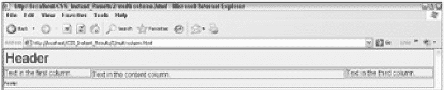

**图 2-2**

[图 2-3](#) 显示了应用 IE7 JavaScript 和条件注释样式表之后，项目在 Internet Explorer 6 中的输出。

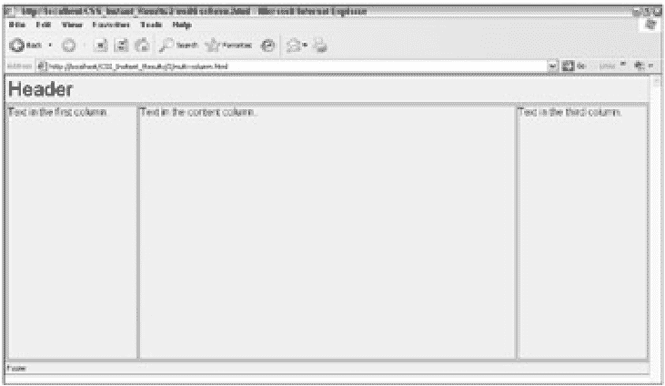

**图 2-3**

[下一节](#) 将描述如何修改该项目。

## 使用与修改本项目

前面章节中提出的设计概念已准备好按原样实施。布局的各个方面可以进行调整以适应你项目的需求。本节涵盖如何以以下方式修改项目：

- 两栏布局
- 流体次要列，而非固定宽度的列
- 浮动方法，而非前面已介绍的定位方法
- 无需 Edwards 的 IE7 JavaScript 的 Internet Explorer 5.5 和 6 兼容性

涵盖设计师可能设想的每一个可想象的变体是不可能的。我选择了设计中最有可能的四种变体。第一种是最容易实现的，一个简单的两栏布局。大多数设计师会立即明白如何做到这一点，但为了完整性，[下一节](next section) 重新阐述了从原始设计创建两栏布局所需的步骤。

## 两栏布局

对于两栏布局，只需从原始设计中减去一些内容。创建两栏布局所需的步骤如下：

1.  从标记中移除第三列，使其呈现如下所示：

```html
<!DOCTYPE html PUBLIC "-//W3C//DTD XHTML 1.0 Strict//EN"
"http://www.w3.org/TR/xhtml1/DTD/xhtml1-strict.dtd">
<html xmlns='http://www.w3.org/1999/xhtml' xml:lang='en'>
    <head>
        <meta http-equiv="Content-Type" content="text/html; charset=UTF-8" />
        <title></title>
        <link rel='stylesheet' type='text/css' href='two-column.css' />
        <!-- compliance patch for microsoft browsers -->
        <!--[if lt IE 7]>
            <link rel='stylesheet' type='text/css' href='two-column-ie.css' />
            <script src="/ie7/ie7-standard-p.js" type="text/javascript"></script>
        <![endif]-->
    </head>
    <body>
        <div id='header'>
            <h1>Header</h1>
        </div>
        <div id='container'>
            <div id='first-column'>
                Text in the first column.
            </div>
            <div id='content'>
                Text in the content column.
            </div>
        </div>
        <div id='footer'>
            <h6>Footer</h6>
        </div>
    </body>
```


 ## 使用和修改本项目

+ 2. 将文件保存为 [two-column.html](two-column.html) 保存。

3. 从样式表中删除对第三列的引用，并将内容 `<div>` 元素的右边距从 208 像素设置为 3 像素。生成的样式表应如下所示：

```
body {
    background: white;
    font-family: sans-serif;
    margin: 0;
    padding: 0;
}
h1, h6 {
    margin: 0;
    font-weight: normal;
}
div#container {
    position: relative;
    min-height: 400px;
    border: 1px solid gray;
    background: lightgrey;
    max-width: 1000px;
    min-width: 750px;
    margin: auto;
}
div#first-column {
    position: absolute;
    top: 0;
    bottom: 0;
    border: 1px solid gray;
    background: rgb(240, 240, 240);
    width: 200px;
    margin: 3px;
}
div#first-column {
    left: 0;
}
div#content {
    margin: 3px 3px 3px 208px;
    background: rgb(240, 240, 240);
    border: 1px solid gray;
    min-height: 392px;
}
div#header,
div#footer {
    background: rgb(240, 240, 240);
    padding: 3px;
    border: 1px solid gray;
    max-width: 994px;
    min-width: 744px;
    margin: auto;
}
div#header {
   我连read 目 = = QI-EN
```


 ## 使用和修改本项目

这些元素采用绝对定位，通过 `top: 0; bottom: 0; left: 0;` 和 `right: 0;` 声明，两个内部 `<div>` 元素的宽度和高度完全取决于第一列和第三列 `<div>` 元素的尺寸，并且外边距、内边距、边框和背景都应用在这些元素上，而不是它们的父元素，因为父元素具有百分比宽度。这使你可以在内容 `<div>` 元素上指定与第一列和第三列宽度相等的百分比外边距。最后的修改将所有内容整合在一起：

```
div#content {
    margin: 3px 20% 3px 20%;
    background: rgb(240, 240, 240);
    border: 1px solid gray;
    min-height: 392px;
}
```

内容 `<div>` 元素应用了 20% 的左右外边距，这等于第一列和第三列 `<div>` 元素 20% 的宽度。

[下一节](#)介绍浮动方法。

## 浮动方法

多列设计的下一个替代方案是浮动方法。浮动方法存在许多漏洞，如果没有一些先前的经验，很难识别这些漏洞。这些漏洞会在多种不同场景中出现；例如，Internet Explorer 的躲猫猫漏洞（peek-a-boo bug）。

**注意**

Internet Explorer 的大多数浮动漏洞在我的著作 *Beginning CSS: Cascading Style Sheets for Web Design*（同样由 Wiley Publishing, Inc. 出版）以及各种网站如 `positioniseverything.net` 中都有详细讨论，因此我不会详细讨论那些不影响本章所呈现的基础三列布局浮动变体的漏洞。

由于浮动方法比定位方法更容易受到漏洞的影响，我强烈推荐使用定位方法而非浮动方法。既然已经向你发出警告，请自行承担使用浮动方法的风险！

按照以下步骤使用浮动方法创建多列布局：

- 1. 由于浮动要求文档中的元素按特定顺序出现，因此必须修改文档的标记。修改标记使其如下所示。与原设计的差异已突出显示：

```
<!DOCTYPE html PUBLIC "-//W3C//DTD XHTML 1.0 Strict//EN"
"http://www.w3.org/TR/xhtml1/DTD/xhtml1-strict.dtd">
<html xmlns='http://www.w3.org/1999/xhtml' xml:lang='en'>
    <head>
        <meta http-equiv="Content-Type" content="text/html; charset=UTF-8" />
        <title></title>
        <link rel='stylesheet' type='text/css' href='float-columns.css' />
        <!-- compliance patch for microsoft browsers -->
        <!--[if lt官 gt IE 7]>
            <link rel='stylesheet' type='text/css' href='float-columns-ie.css' />
            <script src="/ie7/ie7-standard-p.js" type="text/javascript"></script>
        <![endif]-->
    </head>
    <body>
```

```
<div id='header'>
    <h1>Header</h1>
</div>
<div id='container'>
    <div id='content'>
        <div id='first-column'>
            Text in the first column.
        </div>
        <div id='third-column'>
            Text in the third column.
        </div>
        <div id='content-inner'>
            Text in the content column.
        </div>
    </div>
</div>
<div id='footer'>
    <h6>Footer</h6>
</div>
</body>
</html>
```

- 2. 将 XHTML 保存为 `float-columns.html`。

- 3. 修改样式表。同样，与原设计的差异已突出显示，但有些样式已被删减。样式表应如下所示：

```
body {
    background: white;
    font-family: sans-serif;
    margin: 0;
    padding: 0;
}
h1, h6 {
    margin: 0;
    font-weight: normal;
}
div#container {

    min-height: 400px;
    border: 1px solid gray;
    background: lightgrey;
    max-width: 1002px;
    min-width: 750px;
    margin: auto;
    overflow: hidden;
}
div#first-column,
div#third-column {
    width: 200px;
    border: 1px solid gray;
    background: rgb(240, 240, 240);
    min-height: 392px;
}
div#first-column {
    float: left;
}
```

```
margin-left: -205px;
}
div#third-column {
    float: right;
    margin-right: -205px;
}
div#content {
    margin: 3px 208px 3px 208px;
}
div#content-inner {
    background: rgb(240, 240, 240);
    border: 1px solid gray;
    min-height: 392px;
}
div#header,
div#footer {
    background: rgb(240, 240, 240);
    padding: 3px;
    border: 1px solid gray;
    max-width: 994px ere);
    min-width: 744px;
    margin: auto;
}
div#header {
    border-bottom: none;
}
div#footer {
    border-top: none;
}
```

- 4. 将样式表保存为 `float-columns.css`。

- 5. 修改 Internet Explorer 条件注释样式表：

```
div#container {
    max-width: 1000px;
}
div#first-column,

div#third-column {
    /* Correct double-margin bug */
    display: inline;\;
}
div#content {
    margin: 3px 205px 3px 205px;
}
div#first-column {
    margin-left: -202px;
}
```

- 6. 将条件注释样式表保存为 `float-columns-ie.css`。

上述修改产生了图 2-7 中所示的截图。

## 使用和修改本项目

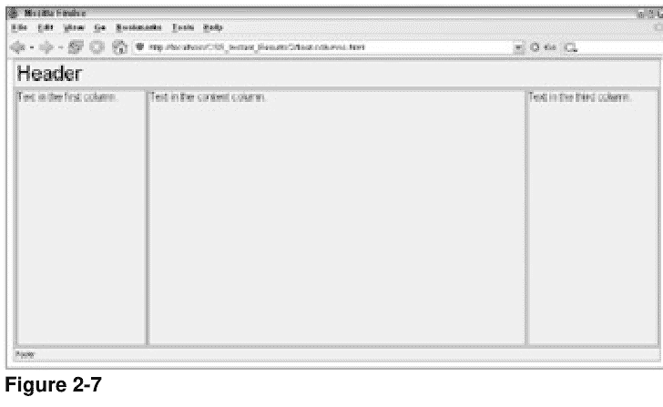

**图 2-7** 显示，通过定位在图 2-1 中实现的设计也可以通过浮动来实现。这种设计在 Internet Explorer 中揭示了一些奇怪的漏洞，这些漏洞不容易 pinpoint。该设计确保 Internet Explorer 输出的像素与在 Firefox 中观察到的输出完全相同。（你可以在这本书附带的光盘以及本书的网站上找到上述文档的源代码。这些文档名为 📄 float-columns.html、📄 float-columns.css 和 📄 float-columns-ie.css。）

既然你已经成功实现了浮动方法，本节的剩余部分将解释 CSS 如何工作以实现图 2-7 中的结果。

首先修改标记，因为浮动元素必须出现在其旁边内容之前。为了解决 Internet Explorer 中几个奇怪的间距漏洞，将两个元素都放在 content `<div>` 本身中：

```
<div id='content'>
    <div id='first-column'>
        Text in the first column.
    </div>
    <div id='third-column'>
        Text in the third column.
    </div>
    <div id='content-inner'>
        Text in the content column.
    </div>
</div>
```

在内容本身周围添加了另一个 `<div>` 元素，命名为 content-inner。这样做的原因将在呈现样式表的每项修改时变得明显。

对容器 `<div>` 进行了第一次修改。在 Firefox 中查看时，容器元素的宽度与页眉和页脚 `<div>` 元素相比有所偏差。进行了 2 像素的调整：

```
div#container {
    min-height: 400px;
    border: 1px solid gray;
    background: lightgrey;
    max-width: 1002px;
    min-width: 750px;
    margin: auto;
    overflow: hidden;
}
```

容器 `<div>` 规则中的第二项修改是应用 `overflow: hidden;` 声明。这可以防止浮动的辅助列与页脚 `<div>` 之间发生重叠，尽管这可能并非总是理想的，因为这可能会影响设计的其他方面。如果是这种情况，则可以在页脚 `<div>` 上应用 `clear: both;` 声明，并移除 `overflow: hidden;` 声明。

下一项修改看到两个辅助列都应用了 `min-height` 属性：

```
div#first-column,
div#third-column {
    width: 200px;
    border: 1px solid gray;
    background: rgb(240, 240, 240);
    min-height: 392px;
}
```

两个辅助列都应用了最小高度，以保持这些列与内容 `<div>` 的高度相同。根据最长辅助列的可能高度，这可能需要与内容 `<div>` 的最小高度一起调整，以防止与页脚重叠（如果使用 `clear: both;`），或内容被截断（如果使用 `overflow: hidden;`）。

接下来的两条规则将两个辅助列定位到相应位置：

```
div#first-column {
    float: left;
    margin-left: -205px;
}
div#third-column {
    float: right;
    margin-right: -205px;
}
```

第一列 `<div>` 元素向左浮动，这当然将其置于内容的左侧。同样，第三列 `<div>` 元素向右浮动。然后将第一列的左边距设置为负偏移，这导致该元素被拉到内容 `<div>` 元素的外部。第三列 `<div>` 元素也被赋予负外边距，但这次是在右侧。通过这条规则，你离用定位方法在图 2-1 中看到的完全相同输出更近了一大步。

前两条规则的修改直接引出了下一条规则：

```
div#content {
    margin: 3px 208px 3px 208px;
}
```

内容 `<div>` 仍然必须具有与前两条规则中提供的偏移量相等的左右外边距。这正好在内容列、辅助列和包含 `<div>` 元素周围的边框之间提供了 3 像素的空间。

下一条规则为 content-inner `<div>` 设置样式，该元素被添加用于将内容与列分离，并解决 Internet Explorer 中的几个间距漏洞。此规则中的声明使 content-inner `<div>` 元素在两个列的边框、背景和高度方面相匹配：

```
div#content-inner {
    background: rgb(240, 240, 240);
    border: 1px solid gray;
    min-height: 392px;
}
```

## 使用和修改此项目

资源管理器的浮动缺陷并不总是有明显的规律可循；有时唯一能解决它们的方法就是开始实验和调整。在这种情况下，我遇到了Firefox输出与资源管理器输出之间的间距差异问题。资源管理器并没有在内容与列之间提供恰好3像素的间距。在针对资源管理器的条件注释样式表中调整内容`<div>`的边距是徒劳的，因为通过层叠无法更改内容`<div>`的左右边距，而这本可以帮助我弥合间距差距。经过几个小时的实验，我采用了不同的浮动列方法，选择将两个浮动列都放在内容`<div>`本身中，并通过负边距来控制它们的位置，从而绕过了间距缺陷。完成此操作后，我意识到间距问题仍然存在，于是我又添加了一个`<div>`元素来包裹内容，即内部内容`<div>`元素，这让我更接近理想结果，尽管还有其他问题——这引出了对资源管理器条件注释样式表所做的修改。

在条件注释样式表的第一条规则中，我再次调整了`max-width`属性，将其降回1000像素。此时这看起来像是Firefox的一个缺陷，因为Opera也希望容器的宽度为1000像素，以使容器与页眉和页脚`<div>`元素平齐对齐：

```
div#container {
    max-width: 1000px;
}
```

这似乎是浮动方法的另一个不一致之处。

我应用下一条规则是因为当我最初将定位设计转换为浮动方法时，我看到资源管理器的双倍边距缺陷开始在我的设计中出现：

```
div#first-column,
div#third-column {
    /* 纠正双倍边距缺陷 */
    display: inline;
}
```

后来，在将列翻转到内容`<div>`中并尝试间距缺陷的替代方法后，我删除了这个声明，列就完全消失了。然后我发现双倍边距缺陷也会使负边距加倍！因为资源管理器将负边距加倍，并结合我在容器元素上使用`overflow: hidden;`的事实，两个次要列在资源管理器中似乎都消失了。`display: inline;`声明纠正了这一畸形，使列更接近它们应得的位置。

设计现在更接近Firefox显示的效果，但还不够完美。我之前提到的额外空间仍然存在。接下来的两条规则彻底纠正了间距问题：

```
div#content {
    margin: 3px 205px 3px 205px;
}
div#first-column {
    margin-left: -202px;
}
```

下一节介绍了如何在没有Dean Edwards的IE7 JavaScript的情况下，在Internet Explorer中实现定位方法。

## 好用、老派的Internet Explorer黑客技术

在Dean Edwards的IE7 JavaScript出现之前，Internet Explorer的CSS黑客技术零散分布，完全依赖于一些专有特性来实现其功能。由于Edwards的IE7在CSS支持方面的健壮性、对这些黑客技术的集中管理以及非常快的速度，我强烈建议不要为了其他提供相同功能的黑客技术而放弃它。Edwards的IE7使得那些条件注释样式表变得更小，并提供了大量的标准CSS支持，而微软在其IE 5、IE 5.5和IE 6浏览器中并未提供这些支持。Edwards的IE7也在持续发展，并且其所做的事情做得更好，我有没有提到它的体积非常小？然而，为了提供关于黑客攻击资源管理器的完整信息，本节展示了如何使用原始、好用、老派的资源管理器黑客技术来实现定位方法，这些技术不需要IE7 JavaScript就能正常工作。

本节介绍的所有资源管理器黑客技术都围绕一个名为`expression()`的专有资源管理器特性展开。`expression()`可以用作任何接受长度值的CSS属性的长度值。它允许直接在样式表中调用和执行JScript（Microsoft对ECMAScript的变体，ECMAScript是以前称为JavaScript的语言的标准化名称）。为消除任何混淆，我将始终称这种语言为JavaScript，因为所有变体在现实世界中通常都称为JavaScript。`expression()`使得在资源管理器中实现最大宽度成为可能。对于像`min-width`和`min-height`这样的最小尺寸，不需要`expression()`——资源管理器对`width`和`height` CSS属性的实现已经类似于标准的`min-width`和`min-height`属性，并且很容易通过条件注释样式表来利用这种行为。`expression()`也用于在资源管理器中重新创建`top`和`bottom`偏移属性的组合来表示高度。这种方法只有一个缺点：因为它依赖于JavaScript，所以在资源管理器中禁用脚本时将不可用。

如果你不懂JavaScript，不要惊慌。所需的JavaScript非常小，并且非常容易理解。

请按照以下步骤创建一个多列设计，该设计无需IE7 JavaScript即可在Internet Explorer中按预期运行：

- 1. 从标记中移除对IE7 JavaScript的引用，并修改文件对样式表和条件注释样式表的引用：

```
<!DOCTYPE html PUBLIC "-//W3C//DTD XHTML 1.0 Strict//EN"
"http://www.w3.org/TR/xhtml1/DTD/xhtml1-strict.dtd">
<html xmlns='http://www.w3.org/1999/xhtml' xml:lang='en'>
    <head>
        <meta http-equiv="Content-Type" content="text/html; charset=UTF-8" />
        <title></title>
        <link rel='stylesheet' type='text/css' href='hack-columns.css' />
        <!-- 用于微软浏览器的兼容性补丁 -->
        <!--[if lt IE 7]>
            <link rel='stylesheet' type='text/css' href='hack-columns-ie.css' />
        <![endif]-->
    </head>
    <body id='body'>
        <div id='header'>
            <h1>页眉</h1>
        </div>
        <div id='container'>
            <div id='first-column'>
                第一列中的文本。
            </div>
            <div id='content'>
                内容列中的文本。
            </div>
            <div id='third-column'>
                第三列中的文本。
            </div>
        </div>
        <div id='footer'>
            <h6>页脚</h6>
        </div>
    </body>
</html>
```

- 2. 将生成的XHTML文档保存为hack-columns.html。

- 3. 主样式表与原始示例保持不变。创建一个副本并将其命名为hack-columns.css。

- 4. 对条件注释样式表进行以下修改：

```
div#container {
    width: expression(
        document.getElementById('body').offsetWidth > 1000?
        // 如果body的宽度大于1000像素
        // 将最大宽度设置为1000
        1000
        :
        // 如果body的宽度小于1000，则执行
        // 另一个检查。
        document.getElementById('body').offsetWidth > 750?
        // 如果body的宽度大于750像素，
        // 但小于1000，则将其设置为auto。
        'auto'
        :
        // 如果body的宽度为750像素或更小，
        // 将容器的最小宽度设置为750像素。
        750
    );
    /* 在IE中，height的行为类似于min-height */
    height: 400px;
}
div#first-column,
div#third-column {
    height: expression(
        document.getElementById('container').offsetHeight - 10
    );
}
div#content {
    position: relative;
    top: 3px;
    height: 392px;
}
div#header,
div#footer {
    width: expression(
        document.getElementById('body').offsetWidth > 994?
        994
```


## 使用与修改本项目

```
document.getElementById('body').offsetWidth > 744?

     'auto'

     :

     744

  );
}
```

- 将条件注释样式表保存为 `hack-columns-ie.css`。

在本书随附的源代码 CD-ROM 中，文件被命名为 `hack-columns.html`、`hack-columns.css` 和 `hack-columns-ie.css`。

在 Internet Explorer 中加载此文件将得到如图 2-8 所示的输出。

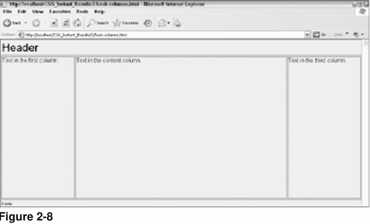

图 2-8 中的输出与图 2-3 中的输出完全相同，图 2-3 展示了在应用 Dean Edwards 的 IE7 JavaScript 后的原始定位方法。

这种方法绕过了 IE7 JavaScript，并直接对 Internet Explorer 应用了几个著名的 CSS hack，以弥补其对 `min-width`、`max-width` 和 `min-height` 属性支持的缺失，以及不支持使用 `top` 和 `bottom` 偏移属性来暗示绝对定位元素的高度的问题。

样式表中的第一条规则引用了容器 `<div>` 元素。第一个声明是调用微软私有 `expression()` 特性的 `width` 属性：

```
width: expression(
    document.getElementById('body').offsetWidth > 1000?

    // If the width of the body is greater than 1000 pixels
    // set the max-width to 1000

    1000

    :

    // If the width of the body is less than or equal to 1000, perform
    // another check.

    document.getElementById('body').offsetWidth > 750?

    // If the width of the body is greater that 750 pixels,
    // but less than 1000 make it auto.

    'auto'
    :
    // If the width of the body is 750 pixels or less,
    // make the min-width of the container 750 pixels.

    750
);
```

在 `expression()` 内部，包含了一些 JavaScript 代码，用以（大致）重建应用标准 `max-width` 和 `min-width` CSS 属性的效果。我说“大致”，是因为该设计不会像更符合标准的浏览器那样遵循 `max-width`——在标准浏览器中，如果内容多于可用空间，内容会超出元素的边缘（这在 Explorer 中其实并不是一个损坏的尺寸模型，而是一个损坏的 `overflow: visible;` 实现），但元素本身不会调整大小。而在 Explorer 中，当内容多于可用空间时，元素会随之调整大小。

以下是对该 JavaScript 代码的逐段解析。

首先，你调用了 `document.getElementById('body').offsetWidth > 1000`。`document.getElementById('body')` 指的是页面上唯一命名为 `'body'` 的元素。在本例中，它恰好是 `<body>` 元素（你为其应用了 id 名称 `'body'`，从而使其成为可能）。`offsetWidth` 是一个微软私有的 JavaScript 属性，它引用元素的真实宽度。我说“真实宽度”是因为这不是 `width` 属性的值，而是元素的实际宽度。由于 Explorer 中的宽度是动态的，其值...


## 设计

在我的纯CSS动态下拉菜单项目中，我依赖两个特定的CSS功能来创建交互性：`:hover`动态伪类和直接子元素`>`选择器。结合使用这两个功能，当用户的鼠标悬停在网页文档中的特定元素上时，就可以显示和隐藏元素。对于文档的标记（就像你在[第1章](#)中做标签页项目那样），你将使用无序列表来构建导航系统，并使用诸如`list-style`之类的CSS属性来控制列表的样式。

你可能会想，我刚才提到的用于完成项目的工具并不符合前两个目标。你说得对。仅靠CSS不可能创建可访问的下拉菜单！你即将看到的这个项目无法满足项目的前两个目标。然而，在本章稍后题为“使用和修改代码”的部分中，你会看到如何将下拉菜单项目与JavaScript结合使用，以满足前两个设计目标，并且仅在用户浏览器禁用JavaScript时，才回退到CSS驱动的方法。

[下一节](#)将讨论用于下拉菜单的CSS驱动方法。

## 代码与代码说明

要创建纯CSS下拉菜单，请按照以下步骤操作。此示例的源代码可在随附的CD-ROM的Project 3文件夹中找到，分别为`drop_down_menus.html`和`drop_down_menus.css`。

- 1. 在你的文本编辑器中输入以下标记：

```
<!DOCTYPE html PUBLIC "-//W3C//DTD XHTML 1.0 Strict//EN"
"http://www.w3.org/TR/xhtml1/DTD/xhtml1-strict.dtd">
<html xmlns='http://www.w3.org/1999/xhtml' xml:lang='en'>
    <head>
        <meta http-equiv="Content-Type" content="text/html; charset=UTF-8" />
        <title>Top sites all CSS developers should know about</title>
        <link rel='stylesheet' type='text/css' href='drop_down_menus.css' />
    </head>
    <body>
        <ul class='menu'>
            <li class='menu'>
                <a href='http://p2p.wrox.com'>Wrox P2P</a>
                <ul>
                    <li>
                        <a href='http://p2p.wrox.com/forum.asp?FORUM_ID=151'>
                            Beginning CSS: Cascading Style Sheets for Web Design
                        </a>
                    </li>
                    <li>
                        <a href='http://p2p.wrox.com/forum.asp?FORUM_ID=143'>
                            CSS
                        </a>
                    </li>
                    <li>
                        <a href='http://p2p.wrox.com/forum.asp?FORUM_ID=84'>
                            HTML Code Clinic
                        </a>
                    </li>
                </ul>
            </li>
            <li><a href='http://www.google.com'>Google</a></li>
            <li class='menu'>
                <a href='http://www.mozilla.org'>Mozilla</a>
                <ul>
                    <li>
                        <a href='http://www.mozilla.org/products/firefox'>
                            Firefox
                        </a>
                    </li>
                    <li>
                        understated
                        Thunderbird
                        </a>
                    </li>
                    <li>
                        <a href='http://bugzilla.mozilla.org'>
                            Bugzilla
                        </a>
                    </li>
                </ul>
            </li>
            <li class='menu'>
                <a href='http://www.apple.com'>Apple</a>
                <ul>
                    <li class='menu'>
                        <a href='http://www.apple.com/safari'>Safari</a>
                        <ul>
                            <li>
                                <a href='http://webkit.opendarwin.org'>
                                    Webkit Open Source Project
                                </a>
                            </li>
                            <li>
                                <a href='http://webkit.opendarwin.org/blog/'>
                                    Surfin Safari
                                </a>
                            </li>
                        </ul>
                    </li>
                    <li>
                        <a href='http://www.apple.com/macosx'>
                            Mac OS X
                        </a>
                    </li>
                    <li>
 <!--[if
                            iTunes
                        </a>
                    </li>
                </ul>
            </li>
            <li class='menu'>
                <a href='http://www.microsoft.com'>Microsoft</a>
                <ul>
                    <li>
                        <a href='http://blogs.msdn.com/ie'>
                            Internet Explorer Blog
                        </a>
                    </li>
                    <li>
                        <a href='http://channel9.msdn.com/wiki/default.aspx/Channel9.InternetExplorerFeedback'>
                            Internet Explorer Wiki
                        </a>
                    </li>
                </ul>
            </li>
            <li class='menu'>
                <a href='http://www.w3.org'>W3C</a>
                <ul>
                    <li>
                        <a href='http://validator.w3.org'>
                            W3C Markup Validation Serviceingly
                        </a>
                    </li>
                    <li>
                        <a href='http://jigsaw.w3.org/css-validator/'>
                            W3C CSS Validation Service
                        </a>
                    </li>
                    <li>
                        <a href='http://www.w3.org/TR/CSS21/'>
                            CSS 2.1 Specification
                        </a>
                    </li>
                    <li>
                        <a href='http://www.w3.org/Style/CSS/current-work'>
                            CSS 3
                        </a>
                    </li>
                </ul>
            </li>
            <li class='menu'>
                <a href='#'>Other</a>
                <ul>
                    <li>
                        <a href='http://www.quirksmode.org'>
                            Peter-Paul Koch's Quirksmode.org
                        </a>
                    </li>
                    <li>
                        <a href='http://www.meyerweb.com'>
                            Eric A. Meyer
                        </a>
                    </li>
                    <li>
                        <a href='http://www.alistapart.com'>
                            A List Apart
                        </a>
                    </li>
                    <li>
                        <a href='http://www.positioniseverything.net'>
                            Position is Everything
                        </a>
                    </li>
                    <li>
                        <a href='http://annevankesteren.nl'>
                            Anne's Weblog About Markup and Style
                        </a>
                    </li>
                    <li>
                        <a href='http://dean.edwards.name'>
                            Dean Edwards
                        </a>
                    </li>
                    <li>
                        <a href='http://www.csszengarden.com'>
                            CSS Zen Garden
                        </a>
                    </li>
                </ul>
            </li>
        </ul>
    </body>
</html>
```

- 2. 将标记保存为`drop_down_menus.html`。

- 3. 输入以下样式表：

```
body {
    font: 14px sans-serif;
    margin: 0;
    padding: 0;
}
ul.menu a {
    color: white;
    text-decoration: none;
    display: block;
    width: 100%;
}
ul.menu,
ul.menu ul {
    background: rgb(128, 128, 128);
    list-style: none;
    padding: 0;
    margin: 0;
    width: 222px;
}
ul.menu ul {
    position: absolute;
    top: 0;
    left: 222px;
    visibility: hidden;
}
ul.menu li {
    position: relative;
    padding: 2px;
}
ul.menu li:hover {
    background: rgb(142, 142, 142);
}
ul.menu li:hover > ul {
    visibility: visible;
}
li.menu > a {
    background: url('arrow.png') no-repeat right;
}
```

- 4. 将样式表保存为`drop_down_menus.css`。

在Safari或Mozilla Firefox中渲染时，上述代码的输出如图3-1所示。

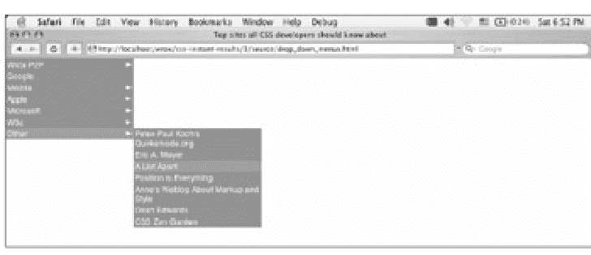

**图3-1**

创建纯CSS解决方案所需的标记和CSS相当简单明了。首先，你通过一系列无序列表来标记下拉菜单的结构。

> **注意** 我还没有为Windows版Internet Explorer引入任何复杂的hack。我会在[下一节](#)“测试与注意事项”中进行说明。

```
<ul class='menu'>
    <li class='menu'>
        <a href='http://p2p.wrox.com'>Wrox P2P</a>
        <ul>
            <li>
                <a href='http://p2post_com/forum.asp?FORUM_ID=151'>Beginning CSS: Cascading Style Sheets for Web Design</a>
            </li>
            <li>
                <a href='http://p2p.wrox.com/forum.asp?FORUM_ID=143'>CSS</a>
            </li>
            <li>
                <a href='http://p2p.wrox.com/forum.asp?FORUM_ID=84'>HTML Code Clinic</a>
            </li>
        </ul>
    </li>
</ul>
```

包含所有下拉菜单的`<ul>`元素被赋予一个`menu`类名。然后，每个后续包含嵌套`<ul>`元素的`<li>`元素也获得一个`menu`类名。这样做是为了让你能够识别出哪些`<li>`元素包含菜单，并且可以添加一个箭头或其他标识符来直观地表示子菜单的存在。这个模式在整个下拉导航系统的结构中重复使用。


## 代码与代码详解

现在，有了结构良好的标记，你可以开始对下拉导航系统进行样式设计了。第一条规则仅仅是为了创建跨浏览器的兼容性，对于实现下拉菜单来说并不是必须的：

```css
body {
    font: 14px sans-serif;
    margin: 0;
    padding: 0;
}
```

它将整个文档的字体设置为 14 像素的 sans-serif，然后移除了 `<body>` 元素的默认内边距（padding）或外边距（margin）。

接下来的规则为每个链接定义样式：

```css
ul.menu a {
    color: white;
    text-decoration: none;
    display: block;
    width: 100%;
}
```

前两个声明取决于个人喜好。第一个将颜色设置为白色，第二个移除了链接的默认下划线。而接下来的两个声明则使下拉导航系统更具可用性。你将 `display` 设置为 `block`，这样包含链接的整个 `<li>` 元素就变得可点击，而不仅仅是链接文本，因为链接默认是以行内（inline）方式显示的。最后一个声明是为了解决 Windows 版 Internet Explorer 中的一些 bug。IE 在处理链接时有一个众所周知的 bug：即使你将链接格式化为块级元素，也只有链接的文本部分可以点击。将 `width` 设置为 `100%` 可以规避这个 bug，尽管这使得向 `<a>` 元素应用外边距、内边距和边框等盒模型属性变得更加困难。

接下来是对 `<ul>` 元素本身的样式设计：

```css
ul.menu,
ul.menu ul {
    background: rgb(128, 128, 128);
    list-style: none;
    padding: 0;
    margin: 0;
    width: 222px;
}
```

这里同样有一些声明取决于个人喜好。在本章后面的“使用与修改项目”部分，你会看到对 `<ul>` 元素样式的其他替代方法，包括如何创建在每个 `<li>` 元素下方而不是右侧弹出菜单的方法。最关键的声明是 `list-style` 声明，它移除了 `<li>` 元素的默认项目符号格式，以及 `padding: 0;` 和 `margin: 0;` 声明，这有助于创建跨浏览器的一致性。这样做是因为某些浏览器默认会对 `<ul>` 元素应用内边距，而另一些浏览器则默认应用外边距。包含下拉导航系统的外层 `<ul>` 元素和下拉菜单本身使用了相同的样式。这些样式可以通过为 `ul.menu` 和 `ul.menu ul` 编写两条不同的规则来分开定义。

下一条规则通过绝对定位进一步定义下拉菜单的样式：

```css
ul.menu ul {
    position: absolute;
    top: 0;
    left: 222px;
    visibility: hidden;
}
```

此时，每个下拉菜单都被绝对定位——你在下一条规则中会看到，它们是相对于包含它们的 `<li>` 元素进行绝对定位的。相对于父级 `<li>` 元素，每个下拉菜单距离父级 `<li>` 元素顶部 0 像素，向左偏移 222 像素（即父级 `<li>` 元素的宽度）。最后，`visibility` 被设置为 `hidden`。你也可以使用 `display: none;` 来代替 `visibility: hidden;`。我选择 `visibility` 属性是因为 Internet Explorer 的 `display` 属性偶尔会出现 bug。这个 bug 与 `display` 和 `visibility` 属性之间的区别有关。使用 `display: none;` 声明时，元素不会被渲染，因此不占用空间。而使用 `visibility: hidden;` 声明时，元素会被渲染并占用空间，只是不可见。在某些情况下，将元素从 `display: none;` 设置为 `display: block;` 会导致 Explorer 出现一些闪烁的渲染问题，尤其是在怪异模式（quirks mode）下。而使用 `visibility` 属性则不会发生这种情况。

接下来的规则将每个 `<li>` 元素的位置设置为相对定位（relative），这使得每个嵌套的 `<ul>` 下拉菜单相对于包含它的 `<li>` 元素进行定位：

```css
ul.menu li {
    position: relative;
    padding: 2px;
}
```

下一条规则在用户将鼠标光标移动到菜单中包含的每个元素上时，提供一个视觉提示：

```css
ul.menu li:hover {
    background: rgb(142, 142, 142);
}
```

这使得用户在鼠标悬停在菜单项上时，每个 `<li>` 元素的背景色会变为浅灰色。

接下来的规则是本项目的核心，它使你能够仅使用 CSS 创建动态下拉菜单：

```css
ul.menu li:hover > ul {
    visibility: visible;
}
```

当用户将鼠标悬停在包含 `<ul>` 元素作为直接子元素的 `<li>` 元素上时，该 `<ul>` 元素的可见性被设置为 `visible`。

在最后一条规则中，`arrow.png` 图像被设置为存在下拉菜单的每个 `<a>` 元素的背景图。`arrow.png` 图像被设置为不重复，并位于作为 `menu` 类名 `<li>` 元素直接子元素的每个 `<a>` 元素的右侧：

```css
li.menu > a {
    background: url('arrow.png') no-repeat right;
}
```

如果在这次讨论中我似乎漏掉了一个重要的浏览器，接下来的部分将通过讨论如何为了兼容 Microsoft Internet Explorer 而对下拉菜单项目进行调整来弥补这一点。

## 测试与注意事项

在[前一节](http://www.wrox.com/WileyCDA/WroxTitle/productCd-0471784656.html)中，我提到下拉菜单项目在 Internet Explorer 中尚无法运行。本节将讨论如何使下拉菜单示例在 Internet Explorer 中运行，以及与 CSS 驱动的下拉菜单相关的注意事项。

在 Internet Explorer 6 中，你会发现没有箭头标示子菜单的位置，悬停在 `<li>` 项上时没有浅灰色显示，也没有下拉菜单出现。与之前的项目一样，本项目将使用 Dean Edwards 的 IE7 JavaScript 在 Internet Explorer 中启用。

要使下拉菜单在 Internet Explorer 6 中正常工作，请执行以下步骤：

- 1. 在 `drop_down_menus.html` 中，对标记进行以下高亮部分的更改：

```html
<!DOCTYPE html PUBLIC "-//W3C//DTD XHTML 1.0 Strict//EN"
"http://www.w3.org/TR/xhtml1/DTD/xhtml1-strict.dtd">
<html xmlns='http://www.w3.org/1999/xhtml' xml:lang='en'>
<head>
    <meta http-equiv="Content-Type" content="text/html; charset=UTF-8" />
    <title>Top sites all CSS developers should know about</title>
    <link rel='stylesheet' type='text/css' href='drop_down_menus.css' />
    <!-- compliance patch for microsoft browsers -->
    <!--[if lt IE 7]>
        <style type='text/css'>
            ul.menu ul {
                    left: 220px;
            }
        </style>
        <script src="/ie7/ie7-standard-p.js" type="text/javascript">
            IE7_PNG_SUFFIX = ".png";
        </script>
    <![endif]-->
</head>
<body>
    <ul class='menu'>
        <li class='menu'>
                <a href='http://p2p.wrox.com'>Wrox P2P<span></span></a>
                <ul>
                    <li>
                        <a href='http://p2p.wrox.com/forum.asp?FORUM_ID=151'>
                                Beginning CSS: Cascading Style Sheets for Web Design
                        </a>
                    </li>
                    <li>
                        <a href='http://p2p.wrox.com/forum.asp?FORUM_ID=143'>
                                CSS
                        </a>
                    </li>
                    <li>
                        <a href='http://p2p.wrox.com/forum.asp?FORUM_ID=84'>
                                HTML Code Clinic
                        </a>
                    </li>
                </ul>
        </li>
        <li><a href='http://www.google.com'>Google</a></li>
        <li class='menu'>
            <a href='http://www.mozilla.org'>Mozilla<span></span></a>
            <ul>
                <li>
                    <a href='http://www.mozilla.org/products/firefox'>
                        Firefox
                    </a>
                </li>
                <li>
                    <a href='http://www.mozilla.org/products/thunderbird'>
                        Thunderbird
                    </a>
                </li>
                <li>
                    <a href='http://bugzilla.mozilla.org'>
                        Bugzilla
                    </a>
                </li>
            </ul>
        </li>
        <li class='menu'>
            <a href='http://www.apple.com'>Apple<span></span></a>
            <ul>
                <li class='menu'>
                    <a href='http://www.apple.com/safari'>
                        Safari<span></span>
                    </a>
                    <ul>
                        <li>
                            <a href='http://webkit.opendarwin.org'>
                                Webkit Open Source Project
                            </a>
                        </li>
                        <li>
                            <a href='http://webkit.opendarwin.org/blog/'>
                                Surfin Safari
                            </a>
                        </li>
                    </ul>
                </li>
                <li>
                    <a href='http://www.apple.com/macosx'>
                        Mac OS X
                    </a>
                </li>
                <li>
                    <a href='http://www.apple.com/itunes'>
                        iTunes
                    </a>
                </li>
            </ul>
        </li>
    </ul>
</body>
</html>
```


## 测试与注意事项

```html
        </li>
    </ul>
</li>
<li class='menu'>
    <a href='http://www.microsoft.com'>Microsoft<span></span></a>
    <ul>
        <li>
            <a href='http://blogs.msdn.com/ie'>
                Internet Explorer Blog
            </a>
        </li>
        <li>
            <a href='http://channel9.msdn.com/wiki/default.aspx/Channel9.InternetExplorerFeedback'>
                Internet Explorer Wiki
            </a>
        </li>
    </ul>
</li>
<li class='menu'>
    <a href='http://www.w3.org'>W3C<span></span></a>
    <ul>
        <li>
            <a href='http://validator.w3.org'>
                W3C Markup Validation Service
            </a>
        </li>
        <li>
            <a href='http://jigsaw.w3.org/css-validator/'>
                W3C CSS Validation Service
            </a>
        </li>
        <li>
            <a href='http://www.w3.org/TR/CSS21/'>
                CSS 2.1 Specification
            </a>
        </li>
        <li>
            <a href='http://www.w3.org/Style/CSS/current-work'>
                CSS 3
            </a>
        </li>
    </ul>
</li>
<li class='menu'>
    <a href='#'>Other<span></span></a>
    <ul>
        <li>
            <a href='http://www.quirksmode.org'>
                Peter-Paul Koch's Quirksmode.org
            </a>
        </li>
        <li>
            <a href='http://www.meyerweb.com'>
                Eric A. Meyer
            </a>
        </li>
        <li>
            <a href='http://www.alistapart.com'>
                A List Apart
            </a>
        </li>
        <li>
            <a href='http://www.positioniseverything.net'>
                Position is Everything
            </a>
        </li>
        <li>
            <a href='http://annevankesteren.nl'>
                Anne's Weblog About Markup and Style
            </a>
        </li>
        <li>
            <a href='http://dean.edwards.name'>
                Dean Edwards
            </a>
        </li>
        <li>
            <a href='http://www.csszengarden.com'>
                CSS Zen Garden
            </a>
        </li>
    </ul>
</li>
</ul>
</body>
</html>
```

2. 将修改后的文档保存到名为 "ie" 的新文件夹中，文件名为 drop_down_menus.html。

3. 对 drop_down_menus.css 进行以下编辑：

```css
ul.menu li {
    position: relative;
    padding: 2px;
}
ul.menu li:hover {
    background: rgb(142, 142, 142);
}
ul.menu li:hover > ul {
    visibility: visible;
}
li.menu > a {
    position: relative;
}
li.menu > a > span {
    position: absolute;
    width: 15px;
    height: 15px;
    top: 0;
    right: 0;
    background: url('arrow.png') no-repeat right;
}
```

现在，你在 Windows 版 Internet Explorer 6 中的输出效果与 Safari 1.3、Mozilla Firefox 和 Opera 8 一致。这可以通过图 3-2 的输出结果观察到。

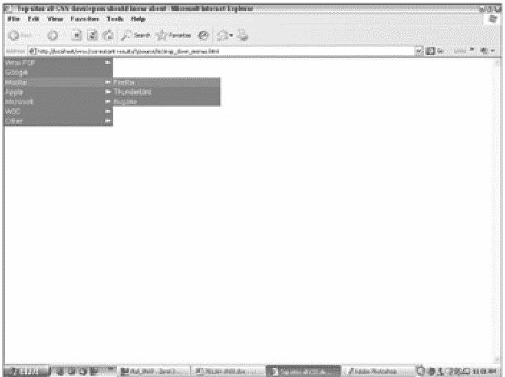

### 图 3-2

本项目所需的 hack 很少，因为 Dean Edwards 的 IE7 JavaScript 为你完成了大部分工作。它启用了直接子选择器、任何元素上的 `:hover` 动态伪类，并修正了 Explorer 原生不支持 alpha 透明度的问题。以下解释了为什么每个 hack 是必要的，以及 IE7 JavaScript 在幕后是如何运作的。

**注意**

Alpha 透明度是 PNG 图像格式的一项可选功能。实质上，它允许 PNG 图像的部分区域变得部分或完全透明。在网页设计中，这对于创建某些效果非常有用，例如可以让背景区域透过带有透明部分的 PNG 图像显现出来。Internet Explorer 6 及更早版本不支持 PNG 图像格式的 alpha 透明度部分，但可以通过使用 Internet Explorer 专有的 CSS filter 属性来使其支持，这正是 Dean Edwards 的 IE7 为 Internet Explorer 中的 PNG 图像启用 alpha 透明度的方式。Internet Explorer 7 则完全支持 PNG 图像的 alpha 透明度。

首先，你在标记中应用了一个条件注释，用于选择所有低于 7 版本的 Internet Explorer 浏览器：

```html
<!--[if lt IE 7]>
    <style type='text/css'>
        ul.menu ul {
            left: 220px;
        }
    </style>
    <script src="/ie7/ie7-standard-p.js" type="text/javascript">
        IE7_PNG_SUFFIX = ".png";
    </script>
<![endif]-->
```

第一个修改是引入一个内联样式表，这也可以改为外部样式表。在内联样式表中，对下拉菜单的左偏移定位进行了修正。将左偏移从 222 像素改为 220 像素，使得 Explorer 的输出与 Mozilla Firefox、Safari 和 Opera 8 一致。接下来，你引用了 Dean Edwards 的 IE7 JavaScript。在 script 标签之间，你设置了一个全局 JavaScript 变量，用于告诉 Edwards 的 PNG 修正脚本哪些 PNG 图像需要 alpha 透明度修正。默认情况下，它会寻找以 `'-trans.png'` 结尾的 PNG 图像。设置这个全局变量可以让你告诉它寻找所有 PNG 图像（即使是那些不需要 alpha 透明度修正的 PNG 图像）。这取决于个人偏好，并可根据具体项目的需求进行更改。

在标记的正文中，你还为每个包含嵌套 `<ul>` 元素的 `<li>` 元素应用了空的 `<span>` 标签。这是因为为了让 Explorer 支持 PNG 透明度而采用的 hack。该 hack 利用了 Explorer 的一项 CSS 专有特性，称为 filter（过滤器）——具体来说，是微软的 `AlphaImageLoader` 过滤器。Edwards 的 IE7 JavaScript 会在 CSS 的 `background` 或 `background-image` 属性中寻找需要修正的 PNG，并将其替换为如下所示的微软专有 `filter` 属性：

`filter: progid:DXImageTransform.Microsoft.AlphaImageLoader(src='arrow.png', sizingMethod='scale');`

`filter` 属性的问题在于，除了过于冗长之外，它无法对图像进行定位，且设置 `background-position` 属性对使用 `filter` 属性加载的图像位置没有影响。这就是空 `<span>` 元素发挥作用的地方。它作为一个容器，使其内部的图像可以相对于包含它的 `<a>` 元素进行定位。

## 其他注意事项

除了上述关于 Internet Explorer 的问题外，这种实现下拉菜单的方法在其他浏览器中也存在不少注意事项：

- 导航无法仅通过键盘访问，且仅使用标记和 CSS 无法实现此类无障碍访问。
- 子菜单非常敏感，当鼠标离开下拉菜单的外边缘时，子菜单会迅速消失。
- 该下拉系统无法将“鼠标悬停”导航转换为“基于点击”的导航。CSS 不提供 "onclick" 功能，为此你需要 JavaScript。
- Explorer 原生不支持 `:hover` 和直接子选择器，因此使用纯 CSS 下拉导航而非 JavaScript 的任何优势都消失了，因为在 Internet Explorer 中使纯 CSS 菜单工作需要 JavaScript。

这些是纯 CSS 方法的一些严重局限性，它们都集中在一个精心设计的导航系统中最关键的组件上：无障碍访问（accessibility）。纯 CSS 的导航方法在本质上是有缺陷的，并且与 CSS 通常代表的理念背道而驰。此外，用户与文档之间的交互首先就不应该由 CSS 来处理——交互属于 JavaScript 的领域。[下一节](next section)将讨论如何修改项目，以使用我编写的一个可以提供这些重要无障碍功能的 JavaScript。我采取了两者的优点并将它们结合起来：CSS 下拉菜单（仅在禁用脚本时使用）和 JavaScript（在未禁用脚本时使用），以提供尽可能无障碍的菜单系统。如果你不熟悉 JavaScript，不必担心，我会详细解释任何你可能想要修改的内容。

> **注意** 如果你想学习我为本项目编写的 JavaScript 是如何工作的，我建议你阅读 Paul Wilton 的 *Beginning JavaScript, 2nd Edition* (Wiley Publishing, Inc., ISBN: 0764555871)。


## 测试与注意事项

## 使用与修改项目

如果不学习 JavaScript，在网站开发领域将很难有所建树。虽然 JavaScript 曾因产生弹出窗口、跑马灯滚动以及充斥着各种烦人特性而声名狼藉，但它也有积极的一面。事实上，JavaScript 可以增强文档的可访问性和交互性，而这些是仅靠 XHTML 和 CSS 无法实现的。在接下来的对原始下拉菜单示例的修改中，你将协同利用 JavaScript 和 CSS 的力量，创建一个更具可访问性的动态下拉菜单系统，而这仅凭 CSS 是无法实现的。在开始之前，你需要另一个 Dean Edwards 的绝佳 JavaScript 库 —— 叫做 cssQuery。它允许开发人员在 JavaScript 中使用 CSS 选择器来抓取元素。此外，它具有跨浏览器兼容性，支持 Windows 平台的 IE 5、5.5、6 和 7，以及 Safari 1.3、Mozilla Firefox 1.0 和 Opera 8。利用 Dean 在 Web 开发方面的先驱工作，你可以直接在 JavaScript 中使用你已经熟悉的 CSS，而这种方式在本书编写时浏览器内置的 JavaScript 中并不原生支持。

你可以从 Dean 的网站 http://dean.edwards.name/my/cssQuery 获取 cssQuery JavaScript。与 IE7 一样，cssQuery 是在开源 LGPL 许可证下提供的。你可以在 http://creativecommons.org/licenses/LGPL/2.1 获取该许可证的全文。cssQuery JavaScript 也出现在本书随附的源码 CD-ROM 的 Project 3 文件夹中。

我将 Dean 的 cssQuery 与一个我为本项目准备的 JavaScript 结合在一起。因为本书的标题是《CSS Instant Results》（CSS 快速上手）而非《JavaScript Instant Results》，因此我不会深入探讨我准备的动态下拉 JavaScript 的内部工作原理，而仅提供你可能希望编辑以自定义特定项目的部分。我准备的 JavaScript 在使用本章前面介绍的标记和 CSS 时几乎可以开箱即用，但必须进行一些修改，并且有几点注意事项需要指出。

你可以使用这个 JavaScript 来创建满足以下标准的动态下拉菜单：

- 如果 JavaScript 被禁用，则回退到纯 CSS 下拉菜单
- 可以通过键盘访问，且不干扰浏览器已在使用的键盘快捷键
- 下拉菜单通过点击菜单主题激活，而不是通过鼠标光标悬停在菜单主题上

此方法的源文件可在源码 CD-ROM 的 Project 3 文件夹下的 "js" 文件夹中找到。如果没有源码 CD-ROM，你也可以从 http://www.wrox.com 获取源码。Dean Edwards 的 cssQuery 也出现在此文件夹中，不过你应该查看他的网站 http://dean.edwards.name/my/cssQuery 以获取包含自本书发布以来修复 Bug 的更新版本。

本节还将介绍一些对下拉菜单外观和感觉的其他可能修改，包括自定义背景、边框以及向下而不是向右展开的菜单。

## 实现启用 JavaScript 的下拉菜单

要创建启用 JavaScript 的下拉菜单，请执行以下步骤：

- 1. 对 `drop_down_menus.html` 进行以下修改（使用你在“测试与注意事项”部分创建的包含 Internet Explorer hack 的版本）：

```html
<!DOCTYPE html PUBLIC "-//W3C//DTD XHTML 1.0 Strict//EN"
"http://www.w3.org/TR/xhtml1/DTD/xhtml1-strict.dtd">
<html xmlns='http://www.w3.org/1999/xhtml' xml:lang='en'>
    <head>
        <meta http-equiv="Content-Type" content="text/html; charset=UTF-8" />
        <title>Top sites all CSS developers should know about</title>
        <link rel='stylesheet' type='text/css' href='drop_down_menus.css' />
        <!-- compliance patch for microsoft browsers -->
        <!--[if lt IE 7]>
        <style type='text/css'>
        ul.menu ul {
            left: 220px;
        }
        </style>
        <script src='/ie7/ie7-standard-p.js' type='text/javascript'>
        IE7_PNG_SUFFIX = ".png";
        </script>
        <![endif]-->
        <script src='cssQuery/cssQuery-p.js' type='text/javascript'></script>
        <script src='drop_down_menus.js' type='text/javascript'></script>
        <noscript>
        <style type='text/css'>
        ul.menu li:hover > ul {
            visibility: visible;
        }
        </style>
        </noscript>
    </head>
    <body>
    <ul class='menu'>
    <li class='menu' id='menu-0'>
        Wrox P2P<span></span>
        <ul>
            <li>
                <a href='http://p2p.wrox.com/forum.asp?FORUM_ID=151'>
                    Beginning CSS: Cascading Style Sheets for Web Design
                </a>
            </li>
            <li>
                <a href='http://p2p.wrox.com/forum.asp?FORUM_ID=143'>
                    CSS
                </a>
            </li>
            <li>
                <a href='http://p2p.wrox.com/forum.asp?FORUM_ID=84'>
                    HTML Code Clinic
                </a>
            </li>
        </ul>
    </li>
    <li><a href='http://www.google.com'>Google</a></li>
    <li class='menu' id='menu-1'>
        Mozilla<span></span>
        <ul>
            <li>
                <a href='http://www.mozilla.org/products/firefox'>
                    Firefox
                </a>
            </li>
            <li>
                <a href='http://www.mozilla.org/products/thunderbird'>
                    Thunderbird
                </a>
            </li>
            <li>
                <a href='http://bugzilla.mozilla.org'>
                    Bugzilla
                </a>
            </li>
        </ul>
    </li>
    <li class='menu' id='menu-2'>
        Apple<span></span>
        <ul>
            <li class='menu' id='menu-3'>
                Safari<span></span>
                <ul>
                    <li>
                        <a href='http://webkit.opendarwin.org'>
                            Webkit Open Source Project
                        </a>
                    </li>
                    <li>
                        <a href='http://webkit.opendarwin.org/blog/'>
                            Surfin Safari
                        </a>
                    </li>
                </ul>
            </li>
            <li>
                <a href='http://www.apple.com/macosx'>
                    Mac OS X
                </a>
            </li>
            <li>
                <a href='http://www.apple.com/itunes'>
                    iTunes
                </a>
            </li>
        </ul>
    </li>
    <li class='menu' id='menu-4'>
        Microsoft<span></span>
        <ul>
            <li>
                <a href='http://blogs.msdn.com/ie'>
                    Internet Explorer Blog
                </a>
            </li>
            <li>
                <a href='http://channel9.msdn.com/wiki/default.aspx/Channel9.InternetExplorerFeedback'>
                    Internet Explorer Wiki
                </a>
            </li>
        </ul>
    </li>
    <li class='menu' id='menu-6'>
    W3C<span></span>
    <ul>
    <li>
    <a href='http://validator.w3.org'>
    W3C Markup Validation Service
    </a>
    </li>
    <li>
    <a href='http://jigsaw.w3.org/css-validator/'>
    W3C CSS Validation Service
    </a>
    </li>
    <li>
    <a href='http://www.w3.org/TR/CSS21/'>
    CSS 2.1 Specification
    </a>
    </li>
    <li>
    <a href='http://www.w3.org/Style/CSS/current-work'>
    CSS 3
    </a>
    </li>
    </ul>
    </li>
    <li class='menu' id='menu-7'>
    Other<span></span>
    <ul>
    <li>
    <a href='http://www.quirksmode.org'>
    Peter-Paul Koch's Quirksmode.org
    </a>
    </li>
    <li>
    <a href='http://www.meyerweb.com'>
    Eric A. Meyer
    </a>
    </li>
    <li>
    <a href='http://www.alistapart.com'>
    A List Apart
    </a>
    </li>
    <li>
    <a href='http://www.positioniseverything.net'>
    Position is Everything
    </a>
    </li>
    <li>
    <a href='http://annevankesteren.nl'>
    Anne's Weblog About Markup and Style
    </a>
    </li>
    <li>
        <a href='http://dean.edwards.name'>
            Dean Edwards
        </a>
    </li>
    <li>
        <a href='http://www.csszengarden.com'>
            CSS Zen Garden
        </a>
    </li>
    </ul>
    </li>
    </ul>
</body>
</html>
```

- 2. 保存 `drop_down_menus.html`。

- 3. 对 `drop_down_menus.css` 进行以下修改：

```css
body {
    font: 14px sans-serif;
    margin: 0;
    padding: 0;
}
ul.menu a {
    color: white;
    text-decoration: none;
    display: block;
    width: 100%;
}
ul.menu,
ul.menu ul {
    background: rgb(128, 128, 128);
    list-style: none;
    padding: 0;
    margin: 0;
    width: 222px;
}
ul.menu ul {
    position: absolute;
    top: 0;
    left: 222px;
    visibility: hidden;
}
ul.menu li {
    position: relative;
    padding: 2px;
    color: white;
}
ul.menu li:hover,
li.menu-highlight,
li.menu-link-highlight {
    background: rgb(142, 142, 142);
}
li.menu > a {
```


 ## 使用与模型
```
position: relative;
}
li.menu > span,
li.menu > a > span {
    position: absolute;
    width: 15px;
    height: 15px;
    top: 0;
    right: 0;
    background: url('arrow.png') no-repeat right;
    border: none;
}
```

4. 保存 `drop_down_menus.css`。

请记住，这两个文件必须与 `drop_down_menus.js`、包含 `cssQuery-p.js`（应命名为 `cssQuery`）的解压目录以及 `arrow.png` 图像位于同一个文件夹中。一旦全部链接完成，你应该能看到如图 3-3 所示的输出结果。

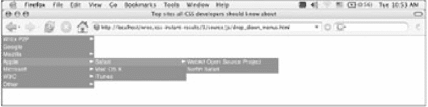

**图 3-3** 展示了此版本的 `drop_down_menus.html` 的输出结果。你应该能够使用键盘上的上或下方向键来选择链接，使用回车键导航到所选链接，以及使用键盘上的左或右方向键导航子菜单。使用鼠标时，你应该能够点击打开子菜单，且当鼠标光标不在菜单上时，点击应关闭所有菜单。最后，如果在浏览器中禁用 JavaScript，且你的浏览器支持任何元素上的 `:hover` 动态伪类以及直接子选择器，则会调用纯 CSS 菜单系统。

JavaScript 驱动的下拉菜单系统是最佳方案，因为它结合了两者的优点，使文档尽可能地易于访问。以下将解释你所做的修改及其原因。

首先，你链接了 `drop_down_menus.js` 和 `cssQuery-p.js`；它们提供了驱动 JavaScript 启用下拉菜单系统的引擎。在这两者中，`cssQuery-p.js` 必须排在前面。你所做的下一个修改是在 JavaScript 被禁用时启用纯 CSS 菜单系统：

```
<noscript>
    <style type='text/css'>
        ul.menu li:hover > ul {
            visibility: visible;
        }
    </style>
</noscript>
```

`<noscript>` 标签的内容仅在 JavaScript 被禁用的情况下才会包含在内。

接下来，你修改了每个顶级菜单项。每个菜单项必须有一个唯一的 id，并且必须移除链接：

```
<li class='menu' id='menu-0'>
        Wrox P2P<span></span>
```

唯一的 id 提供了一种方式，用于在 `drop_down_menus.js` 文件中追踪用户发起的事件。必须移除链接，是因为不可能在一个子菜单仅通过点击显示的下拉菜单系统中，同时在该项上设置链接，因为这自然会产生冲突。

为了根据自己的需求进一步定制项目，你可能想要更改类名。由于类名被 `drop_down_menus.js` 文件使用，你还需要编辑该文件中的类名。在文件的顶部，你会看到四个包含四个不同类名的变量：

```
var $CSSIR_liClassName = 'menu';
var $CSSIR_ulClassName = 'menu';
var $CSSIR_liHighlight = 'menu-highlight';
var $CSSIR_aHighlight = 'menu-link-highlight';
```

第一个变量指的是每个包含下拉菜单的 `<li>` 元素；这些元素默认具有 menu 类名。第二个变量指的是包含整个下拉菜单系统的 `<ul>` 元素。它默认也具有 menu 类名。接下来的两个我尚未讨论。它们是 menu-highlight 和 menu-link-highlight 类名。这些在 JavaScript 中是动态应用的。menu-highlight 被应用于包含子菜单且当前被用户选中（无论是通过键盘方向键还是鼠标）的 `<li>` 元素。menu-link-highlight 仅在用户使用键盘上或下方向键选择菜单内的链接时适用。因为这些是类名，你可以在普通的样式表中为它们设置样式。事实上，你在这里应用了这些类名：

```
ul.menu li:hover,
li.menu-highlight,
li.menu-link-highlight {
    background: rgb(142, 142, 142);
}
```

具有 menu-highlight 或 menu-link-highlight 类名的 `<li>` 元素将获得与用户鼠标当前悬停的 `<li>` 元素相同的样式。

在下一节中，你将通过为其应用自定义背景和边框，将此方法更进一步。

## 自定义背景与边框

在下一个示例中，你将利用一些高级 CSS 为下拉菜单项目应用自定义边框和背景。这个示例建立在之前在下拉菜单项目中实现 JavaScript 的方法之上。

要为 `drop_down_menus.html` 应用自定义背景和边框：

- **1.** 对 `drop_down_menus.html` 进行以下修改：

```
<!DOCTYPE html PUBLIC "-//W3C//DTD XHTML 1.0 Strict//EN"
"http://www.w3.org/TR/xhtml1/DTD/xhtml1-strict.dtd">
<html xmlns='http://www.w3.org/1999/xhtml' xml:lang='en'>
    <head>
        <meta http-equiv="Content-Type" content="text/html; charset=UTF-8" />
        <title>Top site for all CSS developers should know about</title>
        <link rel='stylesheet' type='text/css' href='drop_down_menus.css' />
        <!-- compliance patch for microsoft browsers -->
        <!--[if lt IE 7]>
<style type='text/css'>
    ul.menu ul {
        left: 220px;
    }
</style>
<script src='/ie7/ie7-standard-p.js' type='text/javascript'>
    IE7_PNG_SUFFIX = "arrow.png";
</script>
<script src='/ie7/ie7-recalc.js' type='text/javascript'></script>
<![endif]-->
<!--[if lt IE 6]>
    <style type='text/css'>
        ul.menu span {
            margin-left: -15px;
            padding-left: 15px;
        }
    </style>
<![endif]-->
<script src='cssQuery/cssQueryaramproxy.js' type='text/javascript'></script>
<script src='drop_down_menus.js' type='text/javascript'></script>
<noscript>
    <style type='text/css'>
        ul.menu li:hover > ul {
            visibility: visible;
        }
    </style>
</noscript>
</head>
<body>
    <div class='menu'><div>
    <ul class='menu'>
        <li class='menu' id='menu-0'>
            <span>Wrox P2P</span><span class='arrow'></span>
            <div class='menu'><div>
                <ul>
                    <li>
                        <a href='http://p2p.wrox.com/forum.asp?FORUM_ID=151'>
                            <span>Beginning CSS: Cascading Style Sheets for Web Design</span>
                        </a>
                    </li>
                    <li>
                        <a href='http://p2p.wrox.com/forum.asp?FORUM_ID=143'>
                            <span>CSS</span>
                        </a>
                    </li>
                    <li>
                        <a href='http://p2p.wrox.com/forum.asp?FORUM_ID=84'>
                            <span>HTML Code Clinic</span>
                        </a>
                    </li>
                </ul>
            </div></div>
        </li>
        <li><a href='http://www.google.com'><span>Google</span></a></li>
        <li class='menu' id='menu-1'>
            <span>Mozilla</span><span class='arrow'></span>
            <div class='menu'><div>
            <ul>
                <li>
                    <a href='http://www.mozilla.org/products/firefox'>
                        <span>Firefox</span>
                    </a>
                </li>
                <li>
                    <a href='http://www.mozilla.org/products/thunderbird'>
                        <span>Thunderbird</span>
                    </a>
                </li>
                <li>
                    <a href='http://bugzilla.mozilla.org'>
                        <span>Bugzilla</span>
                    </a>
                </li>
            </ul>
            </div></div>
        </li>
        <li class='menu' id='menu-2'>
            <span>Apple</span><span class='arrow'></span>
            <div class='menu'><div>
            <ul>
                <li class='menu' id='menu-3'>
                    <span>Safari</span><span class='arrow'></span>
                    <div class='menu'><div>
                    <ul>
                        <li>
                            <a href='http://webkit.opendarwin.org'>
                                <span>Webkit Open Source Project</span>
                            </a>
                        </li>
                        <li>
                            <a href='http://webkit.opendarwin.org/blog/'>
                                <span>Surfin Safari</span>
                            </a>
                        </li>
                    </ul>
                    </div></div>
                </li>
                <li>
                    <a href='http://www.apple.com/macosx'>
                        <span>Mac OS X</span>
                    </a>
                </li>
                <li>
                    <a href='http://www.apple.com/itunes'>
                        <span>iTunes</span>
                    </a>
                </li>
            </ul>
            </div></div>
        </li>
```


## 使用并修改项目

```
<li class='menu' id='menu-4'>
        <span>Microsoft</span><span class='arrow'></span>
        <div class='menu'><div>
            <ul>
                <li>
                    <a href='http://blogs.msdn.com/ie'>
                        <span>Internet Explorer Blog</span>
                    </a>
                </li>
                <li>
                    <a href='http://channel9.msdn.com/wiki/default.aspx/Channel9.InternetExplorerFeedback'>
                        <span>Internet Explorer Wiki</span>
                    </a>
                </li>
            </ul>
            </div></div>
    </li>
    <li class='menu' id='menu-6'>
        <span>W3C</span><span class='arrow'></span>
        <div class='menu'><div>
            <ul>
                <li>
                    <a href='http://validator.w3.org'>
                        <span>W3C Markup Validation Service</span>
                    </a>
                </li>
                <li>
                    <a href='http://jigsaw.w3.org/css-validator/'>
                        <span>W3C CSS Validation Service</span>
                    </a>
                </li>
                <li>
                    <a href='http://www.w3.org/TR/CSS21/'>
                        <span>CSS 2.1 Specification</span>
                    </a>
                </li>
                <li>
                    <a href='http://www.w3.org/Style/CSS/current-work'>
                        <span>CSS 3</span>
                    </a>
                </li>
            </ul>
            </div></div>
    </li>
    <li class='menu' id='menu-7'>
        <span>Other</span><span class='arrow'></span>
        <div class='menu'><div>
            <ul>
                <li>
                    <a href='http://www.quirksmode.org'>
                        <span>Peter-Paul Koch's Quirksmode.org</span>
                    </a>
                </li>
                <li>
                    <a href='http://www.meyerweb.com'>
                        <span>Eric A. Meyer</span>
                    </a>
                </li>
                <li>
                    <a href='http://www.alistapart.com'>
                        <span>A List Apart</span>
                    </a>
                </li>
                <li>
                    <a href='http://www.positioniseverything.net'>
                        <span>Position is Everything</span>
                    </a>
                </li>
                <li>
                    <a href='http://annevankesteren.nl'>
                        <span>Anne's Weblog About Markup and Style</span>
                    </a>
                </li>
                <li>
                    <a href='http://dean.edwards.name'>
                        <span>Dean Edwards</span>
                    </a>
                </li>
                <li>
                    <a href='http://www.csszengarden.com'>
                        <span>CSS Zen Garden</span>
                    </a>
                </li>
            </ul>
        </div></div>
    </li>
</ul>
        </div></div>
</body>
</html>
```

+   2. 保存 [CD 图标] drop_down_menus.html。
3. 对 `drop_down_menus.css` 进行以下修改：

```
body {
    font: 16px sans-serif;
    margin: 20px;
    padding: 0;
    color: white;
    background: url('shell_mound.jpg') no-repeat center;
}
div.menu,
li.menu div {
    width: 222px;
    background: transparent url('images/transparent_01.png') no-repeat top;
}
div.menu > div,
li.menu > div > div {
    width: 222px;
}
background: transparent url('images/transparent_03.png') no-repeat bottom;
padding: 20px 0 20px 0;
}
ul.menu a {
    color: white;
    text-decoration: none;
    width: 100%;
    display: inline-block;
    height: 100%;
    position: relative;
}
ul.menu,
ul.menu ul {
    background: transparent url('images/transparent_02.png') repeat-y center;
    list-style: none;
    padding: 0;
    margin: 0;
    width: 222px;
}
li.menu > div {
    position: absolute;
    top: -20px;
    left: 222px;
    visibility: hidden;
    z-index: 4;
    width: 222px;
}
ul.menu li {
    position: relative;
    padding: 2px;
}
ul.menu li:hover,
li.menu-highlight,
li.menu-link-highlight {
   background: transparent url('images/highlight_02.png') repeat-y center;
}
ul.menu span {
    display: block;
    padding: 2px 10px;
}

li.menu > span.arrow {
    position: absolute;
    width: 15px;
    height: 15px;
    top: 5px;
    right: 15px;
    background: url('arrow.png') no-repeat right;
    border: none;
    padding: 0;
    margin: 0;
}
```

4. 保存 `drop_down_menus.css`。

**注意** 此方法的 drop_down_menus.js 文件也进行了修改，以适配新增的 `<div>` 元素。请使用源 CD-ROM 上 Project 3 文件夹中 "custom-bg" 文件夹内提供的文件。

修改结果如[图 3-4](#) 所示。

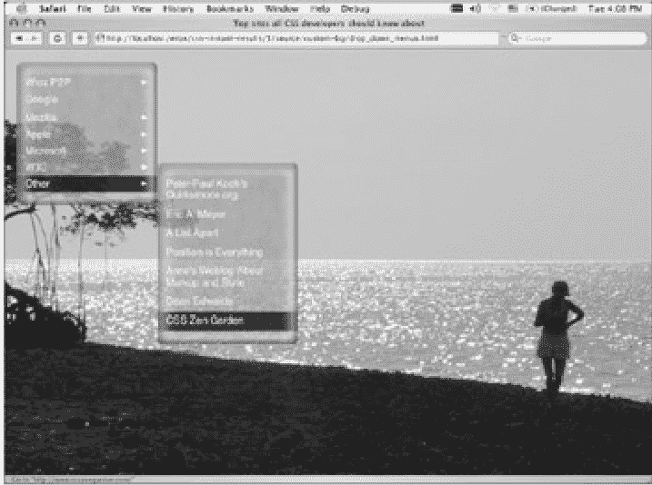

**图 3-4**

生成的文档在 Internet Explorer 5.5 和 6、Firefox 1.0、Opera  <!-- 0.820965207576706 --> 8 以及 Safari 1.3 中均能正常工作。

如"测试与注意事项"一节所述，Internet Explorer 6 本身不支持 PNG 透明效果，而就本项目而言，无法将透明的 PNG 图像应用作下拉菜单的背景。你可以使用 GIF 或其他网页支持的图像格式来解决这个问题。遗憾的是，GIF 格式不支持部分透明，如[图 3-4](#) 所示，你可以看到 shell_mound.jpg 图像透过菜单系统使用的背景 PNG 图像显示出来。因此，在 Internet Explorer 5.5 和 6 中无法使用透明 PNG。即使用了滤镜 hack，这种方法也会失败，因为滤镜 hack 会禁用链接，并导致其他无法克服的美观问题。另一方面，Internet Explorer 7 本身支持透明的 PNG 图像。

你还为 Internet Explorer 6 应用了一些新的 hack，使其能够使用高级的 CSS 伪类 `:first-child` 和 `:last-child` 来渲染下拉菜单，而这些伪类本身并不受支持。

```
<!--[if lt IE 7]>
    <style type='text/css'>
        ul.menu ul {
            left: 220px;
        }
    </style>
    <script src='/ie7/ie7-standard-p.js' type='text/javascript'>
        IE7_PNG_SUFFIX = "arrow.png";
    </script>
    <script src='/ie7/ie7-recalc.js' type='text/javascript'></script>
<![endif]-->
```

修改了 `IE7_PNG_SUFFIX` 变量，使其仅针对出现在包含下拉菜单的 `<li>` 元素中的 `arrow.png` 图像。如果不这样做，该 hack 也会应用到其他背景 PNG 图像上，这将在 Internet Explorer 中引发各种混乱。解决这个问题的最佳方法，在不使用复杂分层的情况下，就是简单地选择不透明的图像格式，或者使用 GIF 格式提供的较为简单的透明效果。最后，由于下拉菜单的某些方面是通过 JavaScript 动态修改的，因此需要 Dean 的 `ie7-recalc.js` 模块；此功能仅由 `drop_down_menus.js` 使用。

只需进行少量修改即可使项目兼容 IE 5.5。以下代码绕过了 IE 5.5 的一个 bug：

```
<!--[if lt IE 6]>
	<style type='text/css'>
		ul.menu span {
			margin-left: -15px;
			padding-left: 15px;
		}
	</style>
<![endif]-->
```

奇怪的是，这修正了子菜单的偏移定位。它无法与 IE 6 的输出像素级完全一致，但差异细微，普通用户难以察觉。

正如你从示例中注意到的，应用自定义背景或边框需要向文档中添加额外的标记。在浏览器支持 CSS 3 的多背景和边框功能之前，我们很可能还要继续使用类似这样的技术很多年。你对 `drop_down_menus.html` 所做的第一个修改是将每个 `<ul>` 元素包裹在两个 `<div>` 块中：

```
<div class='menu'><div>
<ul class='menu'>
	<li class='menu' id='menu-0'>
		<span>Wrox P2P</span><span class='arrow'></span>
		<div class='menu'><div>
		<ul>
```

这两个 `<div>` 块将作为可以附加背景图像的元素。外部的 `<div>` 元素，带有 `menu` 类名，包含背景的顶部图像：

```
div.menu,
li.menu div {
	width: 222px;
	background: transparent url('images/transparent_01.png') no-repeat top;
}
```

图像 `transparent_01.png` 是同一图像的一部分。它在 PhotoShop 中使用切片工具进行切割，然后使用"存储为 Web 所用格式"功能将每个单独的切片保存为单独的图像。这使得每个子菜单都可以拥有自定义的角。

内部的 `<div>` 元素接收图像的底部切片：

```
div.menu > div,
li.menu > div > div {
	width: 222px;
	background: transparent url('images/transparent_03.png') no-repeat bottom;
	padding: 20px 0 20px 0;
}
```


## 使用与修改项目

应用图像后，顶部和底部切片的高度会应用于内部 `<div>` 的内边距。这可以防止顶部和底部切片与图像的中间切片重叠。在此情况下，顶部和底部切片的高度为20像素。

中间切片应用于 `<ul>` 元素本身：

```
ul.menu,
ul.menu ul {
    background: transparent url('images/transparent_02.png') repeat-y center;
    list-style: none;
    padding: 0;
    margin: 0;
    width: 222 marc
}
```

中间切片仅沿 y 轴重复，并定位在 `<ul>` 元素的中心。这使背景呈现无缝效果，并允许子菜单适应长短不一的菜单项。

针对 Internet Explorer 应用了一个变通方案，因为它在其中一个下拉菜单上存在一些渲染问题：

```
ul.menu a {
    color: white;
    text-decoration: none;
    width: 100%;
    display: inline-block;
    height: 100%;
    position: relative;
}
```

一个已知在 Explorer 中将 `display: block;` 应用于 `<li>` 元素内的链接时出现的 bug 露出了它的丑陋面目。因此，不是将 `display` 设置为 `block`，而是将其设置为 `inline-block`，然后应用100%的宽度和高度，以及 `position: relative;`。

对于其他浏览器，您添加的 `<span>` 元素被用作后代的 `aria-owns`：

```
ul.menu span {
    display: block;
    padding: 2px 10px;
}
li.menu > span.arrow {
    position: absolute;
    width: 15px;
    height: 15px;
    top: 5px;
    right: 15px;
    background: url('arrow.png') no-repeat right;
    border: none;
    padding: 0;
    margin: 0;
}
```

之前为菜单箭头添加的所有 `<span>` 元素都被赋予了 `arrow` 类名：

```
<li class='menu' id='menu-7'>
    <span>Other</span><span class='arrow'></span>
    <div class='menu'><div>
    <ul>
        <li>
```

```
<a href='http://www.quirksmode.org'>
    <span>Peter-Paul Koch's Quirksmode.org</span>
</a>
</li>
```

然后，为每个链接和菜单项的内部文本添加了一个额外的 `<span>`。这个额外的 `<span>` 允许挂接另一个元素来控制间距，并提供了一种规避 Explorer 空白 bug 的方法。

## 下拉，而非侧向

要创建一个向下而非向侧边展开的动态菜单系统，请按照以下步骤操作：

+   1. 在 `drop_down_menus.html` 中出现的以下 `<div>` 元素上添加一个 `menu` id 名称：

```
<noscript>
    <style type='text/css'>
        ul.menu li:hover > ul {
            visibility: visible;
        }
    </style>
</noscript>
</head>
<body>
    <div class='menu' id='menu'><div>
    <ul class='menu'>
        <li class='menu' id='menu-0'>
            <span>Wrox P2P</span><span class='arrow'></span>
```

+   2. 保存 `drop_down_menus.html`。

+   3. 对 `drop_down_menus.css` 进行以下修改：

```
body {
    font: 16px sans-serif;
    margin: 20px;
    color: white;
    background: white url('shell_mound.jpg') no-repeat scroll center;
}
div#menu {
    background: black;
    height: 27px;
    width: 1000px;
    margin: auto;
}
div.menu > div > ul.menu > li {
    width: 125px;
    float: left;
}
li.menu div {
    background: transparent url('images/highlight_01.png') no-repeat top;
}
li.menu div {
    width: 222px;
}
li.menu > div > div {
    width: auto;
}
```

```
       background: transparent url('images/highlight_03.png') no-repeat bottom;
       padding: 20px 0 20px 0;
}
ul.menu a {
     color: white;
     text-decoration: none;
     width: 100%;
     display: inline-block;
     height: 100%;
     position: relative;
}
ul.menu,
ul.menu ul {
     background: transparent url('images/highlight_02.png') repeat-y center;
     list-style: none;
     padding: 0;
     margin: 0;
}
ul.menu ul {
     width: 222px;
}
li.menu > div {
     position: absolute;
     top: -20px;
     left: 222px;
     visibility: hidden;
     z-index: 4;
     width: 222px;

}
div.menu > div > ul.menu > li.menu > div {
     top: 29px;
     left: 0;
}
ul.menu li {
     position: relative;
     padding: 2px;
}
ul.menu li:hover,
li.menu-highlight,
li.menu-link-highlight {
     background: transparent url('images/transparent_02.png') repeat-y center;
}
ul.menu span {
     display: block;
     padding: 2px 10px;
}
li.menu > span.arrow {
     position: absolute;
     width: 15px;
     height: 15px;
     top: 5px;
     right: 15px;
     background: url('arrow.png') no-repeat right;
     border: none;
     padding: 0;
     margin: 0;
}
```

+   4. 保存 `drop_down_menus.css`。

最终输出如图 3-5 所示。

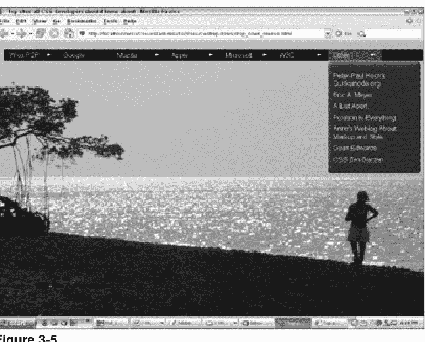

**图 3-5**

图 3-5 显示顶级菜单项现在是并排的，并且下拉菜单是向下而非向侧边展开的。

您所做的第一个修改是为包含整个菜单系统的顶级 `<div>` 提供一个唯一标识符：

```
<div class='menu' id='menu'><div>
```

为顶级 `<div>` 应用菜单 id 名称后，您现在可以添加为其独有的样式：

```
div#menu {
    background: black;
    height: 27px;
    width: 1000px;
    margin: auto;
}
```

在上面的规则中，您为顶级 `<div>` 元素应用了纯黑色背景、固定高度 27 像素和固定宽度 1000 像素，然后使用 `margin: auto;` 声明使 `<div>` 居中。需要固定宽度和高度，因为包含子菜单的 `<li>` 元素被向左浮动以使它们并排显示：

```
div.menu > div > ul.menu > li {
    width: 125px;
    float: left;
}
```

顶级 `<li>` 元素也被赋予了固定宽度，这可以防止箭头与文本重叠。

其余的背景样式与上一种方法相比做了一些调整：

```
background: transparent url('images/highlight_01.png') no-repeat top;
```

最后，对下拉菜单的定位进行了轻微调整：

```
li.menu > div {
    position: absolute;
    top: -20px;
    left: 222px;
    visibility: hidden;
    z-index: 4;
    width: 222px;
}
div.menu > div > ul.menu > li.menu > div {
    top: 29px;
    left: 0;
}
```

新规则覆盖了顶级 `<li>` 元素的子菜单定位，将子菜单定位在下方而非右侧。

在下一个项目中，您将了解如何在不使用 JavaScript 的情况下创建类似于这些的下拉菜单。

# 第 4 章：**更多动态下拉菜单与强大灵活的 :target**

### 概述

[第 3 章](Chapter 3) 可能让人觉得仅使用 CSS 和 XHTML 不可能创建动态下拉菜单，至少如果您只想使用单击来打开菜单的话。尽管所提出的观点是正确的，但有一种仅使用 CSS 的方法允许用户单击打开菜单。这种方法是我在本章的重点，它对于许多事情都很有用，从创建下拉菜单到自定义弹出对话框。

我决定在[第 3 章](Chapter 3)中不深入探讨这种方法，因为它确实有一些局限性，尽管这些局限性并非无法克服。我还决定在一整个章节中专门介绍这种方法，因为它可以做的不仅仅是创建下拉菜单。此处介绍的技术也可用于在用户单击网页文档中的某项内容时创建其他样式变化。例如，它可以用来显示自定义弹出对话框，或创建基于标签的导航，其中每个标签的内容都存在于同一文档中，而不是像[第 1 章](Chapter 1)演示的那样存在于单独的文档中。

这种方法的最大好处是它符合[第 3 章](Chapter 3)中提出的可访问性要求；也就是说，文档仍然可以通过键盘访问，并且所有这些几乎不需要或完全不需要 JavaScript。您还可以了解这项技术如何应用于[第 5 章](Chapter 5)中的项目，该章进一步探讨了在 web 项目中使用 `:target` 的可能性。

这种方法最引人注目的好处是它消除了对复杂 JavaScript 的需求。我并不认为使用 JavaScript 是件坏事，或者应该避免使用 JavaScript——事实上恰恰相反，JavaScript 使得丰富的交互式应用程序成为可能。然而，我相信 web 设计师应该在保持可访问性的同时，采取最简单、最直观、最有效的路径。与第 3 章中我为 States 准备的 JavaScript 相比，这种方法在简洁性和卓越的可访问性方面更胜一筹。[下一节](next section)详细阐述了本项目设计中使用的组件，并对此进行了更深入的讨论。


## 设计

本章我重点介绍的方案围绕一个鲜为人知的 CSS 3 动态伪类展开，它就是 `:target`。`:target` 与 `:hover` 和 `:active` 一样，能够让网页设计师根据用户触发的事件来应用样式修改。`:target` 基于*URL 片段*（URL fragments）来应用样式，也就是在网页设计的早期被称为 HTML 锚点的东西。URL 片段是 URL 中井号（#）之后的部分，而这个井号恰好也是 CSS 中的 id 选择器。例如，如果你想创建链接到长文档中特定位置的 URL，你可以为文档中的元素创建 id 名称，这样不仅可以使用 id 选择器为这些元素设置样式，还可以使用 URL 片段跳转到文档中的相应位置。下面的 HTML 代码最能说明这一点。如果你有以下链接

```
<a href='#some-fragment'>Jump to the paragraph</a>
```

假设该链接后面跟着数百段内容，并且在标记中的某个位置有这个段落

```
<p id='some-fragment'>A paragraph</p>
```

你就拥有了一个 URL 片段链接和锚点。`:target` 动态伪类允许你在 CSS 中捕获这一事件，并对片段链接的目标元素进行样式更改。

这种技术可以以多种不同的方式加以利用。例如，你还可以使用 `:target` 以与第 3 章中 `:hover` 动态伪类创建下拉菜单相同的方式来动态显示和隐藏内容。`:target` 不仅可以用来创建下拉菜单系统（尽管其灵活性有限），还可以用来创建自定义弹出对话框、工具提示，以及大量以前需要 JavaScript 才能实现的功能。

`:target` 还天然具备良好的无障碍访问性。下面的列表详细说明了这种方案的优缺点。

首先，优点：

- 为元素提供硬编码的 id，使得从任何其他文档链接到该元素成为可能，而不仅仅局限于同一文档内部。例如，你可以从文档深处或另一个文档链接到一个菜单，当用户点击链接时，他们会被带到已经打开的菜单或对话框。

- 在允许 `<a>` 元素获取焦点的浏览器中，用户可以完全使用 Tab 键通过键盘导航页面，这也因此取代了我自己在第 3 章中包含的 JavaScript 键盘导航。这是因为 Tab 键本身就已经用于在文档中导航链接和其他元素，所以用户已经知道如何使用键盘来导航菜单系统。

- 无需维护或调试复杂的 JavaScript，样式或结构上的更改也更容易实现。

- 只要浏览器原生支持 `:target`，即使 JavaScript 不可用，`:target` 也可以使用。

现在说说缺点：

- 只能创建单层深度的下拉导航系统，因为在任何给定时刻只能有一个元素处于 `:target` 状态，而且 CSS 没有提供访问元素父级或祖先的选择器。虽然这是一个限制，但也可以通过少量 JavaScript 来变通解决。

- 使用 `:target` 会导致文档跳转到目标位置，这可能符合也可能不符合你的预期，具体取决于你在文档中使用 `:target` 伪类的位置。

- 支持情况参差不齐。在撰写本文时，Internet Explorer 不原生支持 `:target`，但在 Dean Edwards 的 IE7 JavaScript 的帮助下可以实现支持。Opera 8 也不支持 `:target`。另一方面，Mozilla Firefox 和 Safari 则支持 `:target`。

下一节将介绍并描述使用 CSS 创建下拉菜单和弹出对话框所需的代码。


## 代码与代码解释

你会发现下面的代码与第 3 章讨论的最后一种方案完全相同。（修改之处已高亮显示。）以下代码也可在源代码光盘的 Project 4 文件夹中找到，位于名为 "drop-down" 的子文件夹中。

要使用 :target 实现下拉导航系统，请按照以下步骤操作：

1. 使用第 3 个项目中"Drop down, not Sideways!"方案的源代码，对 drop_down_menus.html 进行以下修改：

```html
<!DOCTYPE html PUBLIC "-//W3C//DTD XHTML 1.0 Strict//EN"
"http://www.w3.org/TR/xhtml1/DTD/xhtml1-strict.dtd">
<html xmlns='http://www.w3.org/1999/xhtml' xml:lang='en'>
    <head>
        <meta http-equiv="Content-Type" content="text/html; charset=UTF-8" />
        <title>Top sites all CSS developers should know about</title>
        <link rel='stylesheet' type='text/css' href='drop_down_menus.css' />
        <!-- compliance patch for microsoft browsers -->
        <!--[if lt IE 7]>
            <style type='text/css'>
                ul.menu ul {
                    left: 220px;
                }
            </style>
            <script src='/ie7/ie7-standard-p.js' type='text/javascript'>
                IE7_PNG_SUFFIX = "arrow.png";
            </script>
        <![endif]-->
        <!--[if lt IE 6]>
            <style type='text/css'>
                ul.menu span {
                    margin-left: -15px;
                    padding-left: 15px;
                }
            </style>
        <![endif]-->
        <script type='text/javascript'>
            document.onmousedown = function($e)
            {
                ($e || ($e = window.event));

                if (
                    $e.target &&
                    $e.target.nodeName != 'A' &&
                    $e.target.parentNode.nodeName != 'A'

                ||

                    $e.srcElement &&
                    $e.srcElement.nodeName != 'A' &&
                    $e.srcElement.parentNode.nodeName != 'A'
                ) {
                    location.href = '#';
                }
            }
        </script>
        }
</head>
<body>
    <div class='menu' id='menu'><div>
    <ul class='menu'>
        <li class='menu' id='menu-0'>
            <a href='#menu-0'>
                <span>Wrox P2P</span>
            </a>
            <span class='arrow'></span>
            <div class='menu'><div>
            <ul>
                <li>
                    <a href='http://p2p.wrox.com/forum.asp?FORUM_ID=151'>
                        <span>Beginning CSS: Cascading Style
                        Sheets for Web Design</span>
                    </a>
                </li>
                <li>
                    <a href='http://p2p.wrox.com/forum.asp?FORUM_ID=143'>
                        <span>CSS</span>
                    </a>
                </li>
                <li>
                    <a href='http://p2p.wrox.com/forum.asp?FORUM_ID=84'>
                        <span>HTML Code Clinic</span>
                    </a>
                </li>
            </ul>
        </div></div>
    </li>

    <li><a href='http://www.google.com'><span>Google</span></a></li>
    <li class='menu' id='menu-1'>
        <a href='#menu-1'>
            <span>Mozilla</span>
        </a>
        <span class='arrow'></span>
        <div class='menu'><div>
        <ul>
            <li>
                <a href='http://www.mozilla.org/products/firefox'>
                    <span>Firefox</span>
                </a>
            </li>
            <li>
                <a href='http://www.mozilla.org/products/thunderbird'>
                    <span>Thunderbird</span>
                </a>
            </li>
            <li>
                <a href='http://bugzilla.mozilla.org'>
                    <span>Bugzilla</span>
                </a>
            </li>
        </ul>
    </li>
</div></div>
</li>
<li class='menu' id='menu-2'>
    <a href='#menu-2'>
        <span>Apple</span>
    </a>
    <span class='arrow'></span>
    <div class='menu'><div>
    <ul>
        <li>
            <a href='http://www.apple.com/safari'>
                <span>Safari</span>
            </a>
        </li>
        <li>
            <a href='http://webkit.opendarwin.org'>
                <span>Webkit Open Source Project</span>
            </a>
        </li>
        <li>
            <a href='http://webkit.opendarwin.org/blog/'>
                <span>Surfin Safari</span>
            </a>
        </li>
        <li>
            <a href='http://www.apple.com/macosx'>
                <span>Mac OS X</span>
            </a>
        </li>

    <li>
        <a href='http://www.apple.com/itunes'>
            <span>iTunes</span>
        </a>
    </li>
    </ul>
    </div></div>
</li>
<li class='menu' id='menu-4'>
    <a href='#menu-4'>
        <span>Microsoft</span>
    </a>
    <span class='arrow'></span>
    <div class='menu'><div>
    <ul>
        <li>
            <a href='http://blogs.msdn.com/ie'>
                <span>Internet Explorer Blog</span>
            </a>
        </li>
        <li>
            <a href='http://channel9.msdn.com/wiki/default.aspx/Channel9.InternetExplorerFeedback'>
                <span>Internet Explorer Wiki</span>
            </a>
        </li>
```


**代码与代码解释**

```html
    </ul>
    </div></div>
</li>
<li class='menu' id='menu-6'>
    <a href='#menu-6'>
        <span>W3C</span>
    </a>
    <span class='arrow'></span>
    <div class='menu'><div>
    <ul>
        <li>
            <a href='http://validator.w3.org'>
                <span>W3C 标记验证服务</span>
            </a>
        </li>
        <li>
            <a href='http://jigsaw.w3.org/css-validator/'>
                <span>W3C CSS 验证服务</span>
            </a>
        </li>
        <li>
            <a href='http://www.w3.org/TR/CSS21/'>
                <span>CSS 2.1 规范</span>
            </a>
        </li>
        <li>
            <a href='http://www.w3.org/Style/CSS/current-work'>
                <span>CSS 3</span>
            </a>
        </li>
    </ul>
    </div></div>
</li>
<li class='menu' id='menu-7'>
    <a href='#menu-7'>
        <span>其他</span>
    </a>
    <span class='arrow'></span>
    <div class='menu'><div>
    <ul>
        <li>
            <a href='http://www.quirksmode.org'>
                <span>Peter-Paul Koch 的 Quirksmode.org</span>
            </a>
        </li>
        <li>
            <a href='http://www.meyerweb.com'>
                <span>Eric A. Meyer</span>
            </a>
        </li>
        <li>
            <a href='http://www.alistapart.com'>
                <span>A List Apart</span>
            </a>
        </li>
        <li>
            <a href='http://www.positioniseverything.net'>
                <span>Position is Everything</span>
            </a>
        </li>
        <li>
            <a href='http://annevankesteren.nl'>
                <span>Anne's Weblog About Markup and Style</span>
            </a>
        </li>
        <li>
            <a href='http://dean.edwards.name'>
                <span>Dean Edwards</span>
            </a>
        </li>
        <li>
            <a href='http://www.csszengarden.com'>
                <span>CSS 禅意花园</span>
            </a>
        </li>
    </ul>
    </div></div>
</li>
        </ul>
        </div></div>
    </body>
</html>
```

+   2. 保存 `drop_down_menus.html` 文件。

+   3. 接下来，对 `drop_down_menus.css` 进行如下修改：

```css
body {
    font: 16px sans-serif;
    margin: 20px;
    color: white;
    background: white url('shell_mound.jpg') no-repeat scroll center;
}
div#menu {
    background: black;
    height: 27px;
    width: 1000px;
    margin: auto;
}
div.menu > div > ul.menu > li {
    width: 125px;
    float: left;
}
li.menu div {
    background: transparent url('images/highlight_01.png') no-repeat top;
}
li.menu div {
    width: 222px;
}
li.menu > div > div {
    width: auto;
    background: transparent url('images/highlight_03.png') no-repeat bottom;
    padding: 20px 0 20px 0;
}
ul.menu a {
    color: white;
    text-decoration: none;
    width: 100%;
    display: inline-block;
    height: 100%;
    position: relative;
}
ul.menu a:focus {
    color: yellow;
}
ul.menu,
ul.menu ul {
    background: transparent url('images/highlight_02.png') repeat-y center;
    list-style: none;
    padding: 0;
    margin: 0;
}
div.menu li:target > div {
    visibility: visible;
}
ul.menu ul {
    width: 222px;
}
li.menu > div {
    position: absolute;
    top: -20px;
    left: 222px;
    visibility: hidden;
    z-index: 4;
    width: 222px;
}
div.menu > div > ul.menu > li.menu > div {
    top: 29px;
    left: 0;
}
ul.menu li {
    position: relative;
    padding: 2px;
}
ul.menu li:hover,
li.menu-highlight,
li.menu-link-highlight {
    background: transparent url('images/transparent_02.png') repeat-y center;
}
ul.menu span {
    display: block;
    padding: 2px 10px;
}
li.menu > span.arrow {
    position: absolute;
    width: 15px;
    height: 15px;
    top: 5px;
    right: 15px;
    background: url('arrow.png') no-repeat right;
    border: none;
    padding: 0;
    margin: 0;
}
```

4. 保存 `drop_down_menus.css` 文件。

图 4-1 展示了在 Mozilla Firefox 中的最终输出结果。

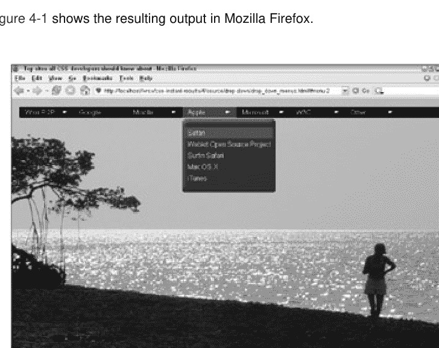

**图 4-1**

从图 4-1 的输出和代码中，你可以看到，要实现一个基于 `:target` 的动态下拉菜单系统，并不需要太多修改。

你做的第一个修改是在 `drop_down_menus.html` 文件中。你在这里添加了几行 JavaScript：

```html
<script type='text/javascript'>
    document.onmousedown = function($e)
    {
        ($e || ($e = window.event));

        if (
            $e.target &&
            $e.target.nodeName != 'A' &&
            $e.target.parentNode.nodeName != 'A'
        ||
            $e.srcElement &&
            $e.srcElement.nodeName != 'A' &&
            $e.srcElement.parentNode.nodeName != 'A'
        ) {
            location.href = '#';
        }
    }
</script>
```

这段 JavaScript 是当用户点击文档时关闭打开的菜单的机制。它将 URL 片段目标设置为空（此操作与任何样式表规则无关），并关闭菜单。你也可以在文档本身内添加链接，无需 JavaScript 来关闭菜单。例如

```html
<a href='#'>关闭</a>
```

提供了与前面 JavaScript 相同的功能，但 JavaScript 方法似乎最直观。菜单会一直保持打开状态，直到用户点击文档中不是链接的位置。

接下来，你在文档正文内应用了几个链接，这些链接指向它们的父 `<li>` 元素：

```html
<li class='menu' id='menu-7'>
    <a href='#menu-7'>
        <span>其他</span>
    </a>
```

该链接指向具有相同 id 名称（该名称出现在 URL 片段中）的父 `<li>` 元素。然后，通过样式表，你可以基于该目标启动样式：

```css
div.menu li:target > div {
    visibility: visible;
}
```

因为目标元素是一个 `<li>` 元素，所以前面的样式表规则适用。它表示，当任何作为具有 `menu` 类名的 `<div>` 元素后代的 `<li>` 元素包含一个与 URL 片段中找到的 id 相同的 id，并且它有一个直接子 `<div>` 元素时，使该元素可见。

最后，为了给使用键盘导航菜单系统的用户提供视觉提示，应用了 `:focus` 动态伪类：

```css
ul.menu a:focus {
    color: yellow;
}
```

这会导致链接在获得焦点时变成黄色。

## 测试与注意事项

你尚未实现与 Internet Explorer 的兼容性，因为即使 Dean Edwards 的 IE7 JavaScript 支持 `:target` 伪类，它也未包含在默认的 IE7 库中。这是因为 Dean Edwards 将 IE7 JavaScript 模块化，分离了不同的功能，这样你就可以只包含你需要的修复，而不是在不需要的功能上浪费带宽和浏览器加载速度。

要在此项目中启用 Internet Explorer 支持，请将以下行添加到 `drop_down_menus.html`：

```html
<!-- compliance patch for microsoft browsers -->
<!--[if lt IE 7]>
    <style type='text/css'>
        ul.menu ul {
            left: 220px;
        }
    </style>
    <script src='/ie7/ie7-standard-p.js' type='text/javascript'>
        IE7_PNG_SUFFIX = "arrow.png";
    </script>
    <script src='/ie7/ie7-css3-selectors.js' type='text/javascript'>
    </script>
<![endif]-->
```

保存 `drop_down_menus.html`。就是这样！现在 `:target` 伪类在 Internet Explorer 5、5.5 和 6 中也能工作了。

在下一章中，你将在一个名为“all-in-one tabs”的项目中继续使用 `:target` 伪类。该项目使用基于标签页的导航系统，其中每个标签页的内容都包含在同一文档中。

# 第 5 章：幻灯片放映

### 概述

在第 4 章中，你了解了 `:target` 伪类对于点击驱动的事件可能很有用。然而，它并非总是有用，因为 `:target` 伪类的功能由 HTML 锚点驱动；因此，当文档具有滚动内容时，有时基于 `:target` 的下拉菜单并不理想，因为点击锚点会导致文档跳转到锚点的位置。本章介绍了一个稍显实用的 `:target` 伪类应用：创建一个基于标准的幻灯片放映。

幻灯片放映是桌面应用程序（如 Microsoft Office 的 PowerPoint）的典型功能，但基于 Web 的幻灯片放映的想法并不新鲜。Eric Meyer，CSS 大师，著有《Eric Meyer on CSS》（New Riders）和《CSS 权威指南》（O'Reilly）等多本流行的 CSS 书籍，首先通过他的 S5 普及了基于 Web 的幻灯片放映的想法。S5 代表简单、基于标准的幻灯片放映系统。最初灵感来自 Tantek Çelik（前 Macintosh 版 Internet Explorer 首席开发人员）和另一位 CSS 大师开发的幻灯片放映，S5 由 XHTML、CSS 和 JavaScript 驱动。Eric Meyer 的 S5 与本章介绍的幻灯片放映应用之间的区别在于，Eric Meyer 的 S5 使用 JavaScript 来减少设置基于标准的幻灯片放映所需的时间。他使用 JavaScript 自动生成幻灯片放映导航，以及一些面向语义的命名约定，便于轻松创建基于 Web 的幻灯片放映。由于 S5 利用 JavaScript 自动化基于 Web 的幻灯片放映的某些方面，它本质上优于本章介绍的项目。S5 还会自动生成适用于其他媒体（如打印或投影仪）的备选样式表，而本章介绍的所有导航和备选样式表方面都必须手动创建。

下一节将介绍一些基于 Web 的幻灯片放映的设计要求。


## 设计

在[第 3 章](#)中，你了解到有些人认为 CSS 不应该具有任何事件驱动的功能。我倾向于不僵化地坚持“CSS 仅用于演示”这一观点，而是主张采用尽可能最简单的路径。在某些情况下，事件驱动功能与 CSS 非常契合；而在其他情况下，事件驱动功能则应交给 JavaScript。在[第 4 章](#)中，你看到了 `:target` 伪类如何实现比简单的纯 CSS 鼠标悬停菜单更高程度的可访问性和可用性，因为使用 `:target` 伪类允许你链接到文档的特定状态——例如，链接到一个特定菜单已打开的文档。`:target` 伪类还允许 Web 文档在无需 JavaScript 额外干预的情况下，继续通过键盘访问。

本章展示的幻灯片演示包含在单个文档中。不同的幻灯片包含在不同的 `<div>` 元素中。每个 `<div>` 元素都有一个唯一的 id 名称，这使得特定的 `<div>` 可以使用 HTML 锚点进行定位——随后 `:target` 伪类可以根据哪个 `<div>` 元素是当前锚点目标来启用不同的样式。

[下一节](#)将给出基于 Web 的幻灯片演示的源代码。

## 代码与代码解析

要使用 CSS 和 XHTML 创建一个符合标准的幻灯片演示，请遵循以下步骤：

+   1. 输入以下标记：

```
<!DOCTYPE html PUBLIC "-//W3C//DTD XHTML 1.0 Strict//EN"
"http://www.w3.org/TR/xhtml1/DTD/xhtml1-strict.dtd">
<html xmlns='http://www.w3.org/1999/xhtml' xml:lang='en'>
    <head>
        <meta http-equiv="Content-Type" content="text/html; charset=UTF-8" />
        <title>:target Slideshow</title>
        <link rel='stylesheet' type='text/css' href='styles/slideshow.css' />
    </head>
    <body>
        <div id='slide-new-features' class='slide'>
            <h1>New Features in Microsoft Internet Explorer 7</h1>
            <p>
                The latest version of Microsoft's flagship Internet Explorer
                7 browser contains many key enhancements that promise
                to make a web developer's job easier.
            </p>
        </div>
        <div id='slide-bug-fixes' class='slide'>
            <h1>IE7 Bug Fixes</h1>
            <p>
                Internet Explorer 7 has bug fixes for several, infamous bugs that
                plagued Internet Explorer 6, and made the IE platform a thorn in
                the sides of developers everywhere.
            </p>
            <p>
                Some of the most well-known rendering bugs have been fixed.
            </p>
            <ul>
                <li>
                    Layering of the
                    <span class='code'>&lt;select&gt;</span> element
                </li>
                <li>Peek-a-boo</li>
                <li>Guillotine</li>
                <li>Duplicate character</li>
                <li>Border chaos</li>
                <li>No Scroll</li>
                <li>Three-pixel text jog</li>
                <li>Magic creeping text</li>
                <li>Bottom margin bug on hover</li>
                <li>Losing the ability to highlight text under the top border</li>
            </ul>
        </div>
        <div id='slide-bug-fixes-2' class='slide'>
            <h1>More IE7 Bug Fixes</h1>
            <p>Also fixed in IE7</p>
            <ul>
                <li>IE/Win line height bug</li>
                <li>Double-margin float bug</li>
                <li>Quirky percentages</li>
                <li>Duplicate indent</li>
                <li>Moving viewport scrollbar outside HTML borders</li>
                <li>1px border style</li>
                <li>Disappearing list background</li>
                <li>Auto width</li>
            </ul>
        </div>
        <div id='slide-css-support' class='slide'>
            <h1>New CSS Support in IE7</h1>
            <p>
                In addition to CSS bug fixes, Microsoft has added some support
                for other CSS features.
            </p>
            <ul>
                <li>Fixed positioning</li>
                <li>
                    Fixed backgrounds on all elements, not just the
                    <span class='code'>&lt;body&gt;</span> element
                </li>
                <li>CSS 2 selectors
                    <ul>
                        <li>Direct Child</li>
                        <li>Adjacent Sibling</li>
                        <li>Attribute</li>
                    </ul>
                </li>
                <li>CSS 2 pseudo-classes
                    <ul>
                        <li class='code'>:first-child</li>
                        <li>
                            <span class='code'>:hover</span> on all elements,
                            not just the <span class='code'>&lt;a&gt;</span>
                            element
                        </li>
                    </ul>
                </li>
            </ul>
        </div>
        <div id='slide-markup' class='slide'>
            <h1>Markup Improvements</h1>
            <p>
                Some markup improvements have also been made in IE7.
            </p>
            <ul>
                <li>
                    Including an <span class='code'>&lt;?xml</span> prolog
                    in IE7 no longer triggers quirks mode in XHTML
                    documents.
                </li>
                <li>
                    IE7 includes native support for the
                    <span class='code'>&lt;abbr&gt;</span> element.
                </li>
                <li>
                    IE7 boasts improved support for
                    <span class='code'>&lt;object&gt;</span> element fallback.
                </li>
            </ul>
        </div>
        <div id='slide-ie7-release' class='slide'>
            <h1>IE7 Release Date</h1>
            <p>
                Microsoft has not committed to a definitive release date
                for IE7 at the time of this writing. As of now, only a public
                beta of IE7 has been announced, and is expected for the first
                quarter of 2006.
            </p>
        </div>
        <div id='slide-navigation'>
            <ul>
                <li><a href='#slide-new-features'>New Features in IE7</a></li>
                <li><a href='#slide-bug-fixes'>IE7 Bug Fixes</a></li>
                <li><a href='#slide-bug-fixes-2'>More IE7 Bug Fixes</a></li>
                <li><a href='#slide-css-support'>New CSS Support in IE7</a></li>
                <li><a href='#slide-markup'>IE7 Markup Improvements</a></li>
                <li><a href='#slide-ie7-release'>IE7 Release Date</a></li>
            </ul>
        </div>
    </body>
</html>
```

2. 将上述标记文档保存为 `slideshow.html`。

3. 输入以下样式表：

```
body {
    font: 12px sans-serif;
}
.code {
    font-family: monospace;
}
div.slide {
    display: none;
    position: absolute;
    top: 0;
    bottom: 0;
    left: 0;
    right: 0;
    font-size: 15px;
    border: 50px solid #369;
    margin: 50px;
    padding: 50px;
}
div.slide:target {
    display: block;
}
div#slide-navigation {
    position: absolute;
    bottom: 0;
    right: 0;
    opacity: 0.0;
    width: 200px;
    background: white;
    border: 1px solid black;
    padding: 10px;
    margin: 10px;
}
div#slide-navigation ul {
    margin: 0;
    padding: 0;
    list-style: none;
}
div#slide-navigation li {
    margin-top: 5px;
}
div#slide-navigation a {
    text-decoration: none;
    color: black;
}
div#slide-navigation:hover {
    opacity: 1;
}
```

4. 将上述样式表保存为 **slideshow.css**。

上述代码产生了如图 5-1 所示的输出。在浏览器中渲染时，将鼠标光标悬停在浏览器窗口的右下角即可显示幻灯片导航。

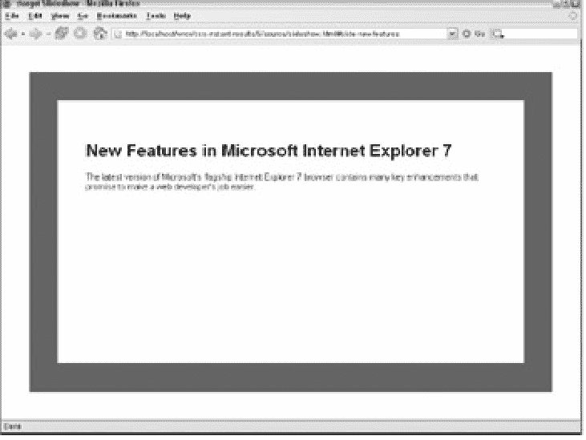

**图 5-1**

图 5-2 显示了第 2 张幻灯片“IE7 Bug Fixes”的内容。

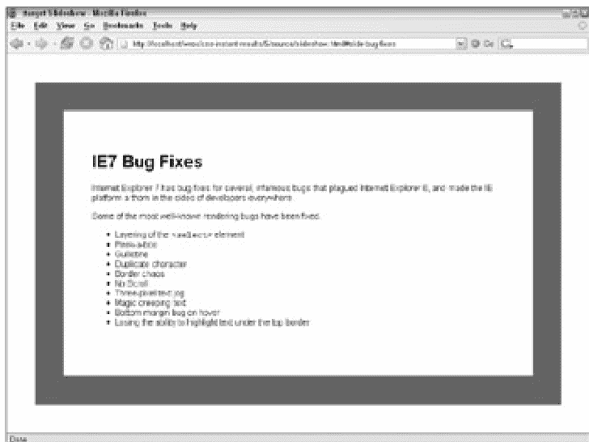

**图 5-2**

**图 5-3** 显示了第 3 张幻灯片“More IE7 Bug Fixes”的内容。

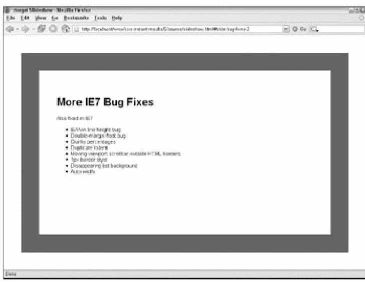

**图 5-3**

**图 5-4** 显示了第 4 张幻灯片“New CSS Support in IE7”的内容。

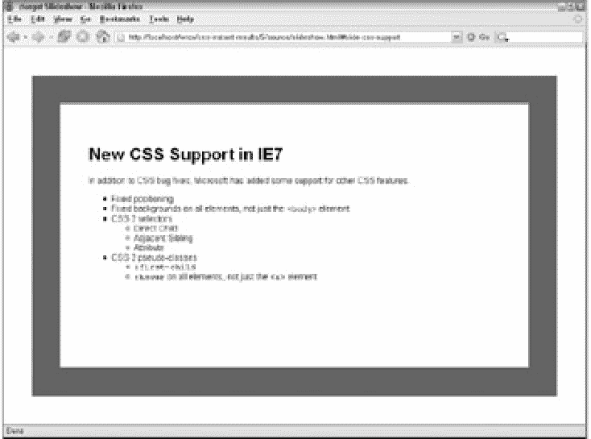

**图 5-4**

**图 5-5** 显示了第 5 张幻灯片“IE 7 Markup Improvements”的内容。

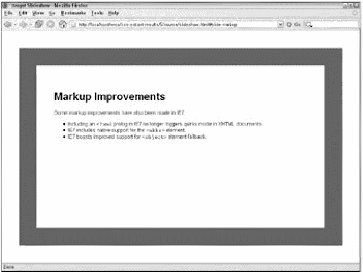

**图 5-5**

**图 5-6** 显示了第 6 张幻灯片“IE7 Release Date”的内容。


 ## 代码及代码说明

**图 5-6**

如你所见，创建一个基于网页的幻灯片并不复杂。本节剩余部分将回顾应用于 `slideshow.css` 中的样式。

第一条规则为文档应用了字体，设置为 12 像素无衬线字体：

```
body {
    font: 12px sans-serif;
}
```

下一条样式表规则适用于任何带有 "code" 类名的元素。当某个元素被赋予 "code" 类名时，会将等宽字体应用于该元素：

```
.code {
    font-family: monospace;
}
```

接下来，对每个幻灯片进行样式设置。首先，使用 `display: none;` 声明将每个带有 "slide" 类名的 `<div>` 元素隐藏起来。然后，将每个幻灯片 `<div>` 绝对定位。通过指定 `top: 0;` 和 `bottom: 0;` 这对偏移属性，`<div>` 元素的高度被拉伸到相对于其定位参照元素高度的值。接着，`left: 0;` 和 `right: 0;` 这对偏移属性将 `<div>` 元素的宽度拉伸到相对于其定位参照元素宽度的值。这是必要的，因为绝对定位元素遵循 *收缩适配*（shrink-to-fit）的宽度和高度计算算法。默认情况下，收缩适配算法意味着 `<div>` 元素的宽度和高度由其内部包含的内容决定，其宽度或高度仅会增长到足以容纳该内容的程度。

接下来，将每个幻灯片的字体大小增加到 15 像素，然后为每个 "slide" `<div>` 的所有边应用 50 像素宽的纯蓝色边框。最后，应用 50 像素的外边距和 50 像素的内边距：

```
div.slide {
    display: none;
    position: absolute;
    top: 0;
    bottom: 0;
    left: 0;
    right: 0;
    font-size: 15px;
    border: 50px solid #369;
    margin: 50px;
    padding: 50px;
}
```

接下来是实现这个特定幻灯片功能的关键机制。当带有 slide 类名的 `<div>` 是 HTML 锚点请求的目标时，该 `<div>` 会被赋予 `display: block;` 声明。当某个 `<div>` 不是 HTML 锚点请求的目标时，样式会恢复为上一条规则所指定的 `display: none;`：

```
div.slide:target {
    display: block;
}
```

下一条规则使用 `bottom: 0;` 和 `right: 0;` 这对偏移属性将幻灯片导航定位在屏幕的右下角。"slide-navigation" `<div>` 通过 `opacity: 0.0;` 声明变为完全透明，从而默认隐藏导航。同时应用了 200 像素的固定宽度。然后应用白色背景和 1 像素宽的纯黑色边框。最后，应用 10 像素的内边距和外边距：

```
div#slide-navigation {
    position: absolute;
    bottom: 0;
    right: 0;
    opacity: 0.0;
    width: 200px;
    background: white;
    border: 1px solid black;
    padding: 10px;
    margin: 10px;
}
```

在下列规则中，使用 `margin: 0;`、`padding: 0;` 和 `list-style: none;` 声明移除包含幻灯片导航的 `<ul>` 元素的默认样式：

```
div#slide-navigation ul {
    margin: 0;
    padding: 0;
    list-style: none;
}
```

在下一条规则中，5 像素的外边距为幻灯片导航的每个链接之间添加了间距：

```
div#slide-navigation li {
    margin-top: 5px;
}
```

然后移除每个链接的默认下划线，并将链接本身设置为黑色：

```
div#slide-navigation a {
    text-decoration: none;
    color: black;
}
```

最后，为了让幻灯片导航在用户鼠标光标悬停时可见，下一条规则将 opacity 属性重置为 1，这使得 "slide-navigation" `<div>` 元素完全不透明：

```
div#slide-navigation:hover {
    opacity: 1;
}
```

现在你已经拥有了一种快速简便的方法来构建基于标准的幻灯片。[下一节](next section)描述了与这种方法相关的注意事项。

◄ 上一页

下一页 ►

## 测试与注意事项

首先，如前所述的幻灯片在 Internet Explorer 中甚至无法运行，Opera 也是如此。这两种浏览器都不支持 `:target` 伪类和 CSS 3 的 `opacity` 属性。在撰写本文时，Opera 浏览器的第 9 版正在开发中，据说将支持 CSS 3 的 `opacity` 属性，但截至目前，Opera 9 尚未计划支持 `:target` 伪类。我无法为 Opera 提供解决方案；不过，可以在 Opera 9 中使用 JavaScript 检测 URL 的锚点部分，并显示相应的幻灯片。

本节不使用 Dean Edwards 的 JavaScript，而是演示如何使用底层的 Internet Explorer 技巧来使幻灯片正常工作——即通过使用专有特性和 JavaScript。

图 5-7 展示了幻灯片目前在 Internet Explorer 中的显示效果。

**图 5-7**

为了解决 Internet Explorer 不支持 CSS 3 `opacity` 属性的问题，可以使用专有的 `filter` 属性。`filter` 属性用于提供各种图形效果。该属性的注意事项是它仅在 Windows 版的 Microsoft Internet Explorer 中有效。对于 Internet Explorer，不使用 `opacity: 0;` 声明来实现完全透明，而是使用以下更为冗长的声明：

`filter:progid:DXImageTransform.Microsoft.Alpha(opacity=0);`

与 CSS 3 的 `opacity` 属性不同，`filter` 属性接受百分比值，因此在 `opacity=` 部分的语法中，你指定的值是 0 到 100 之间的数值，其中 0 表示完全透明，100 表示完全不透明。

为了解决 Internet Explorer 不支持 CSS 3 `:target` 伪类的问题，可以使用 JavaScript 检测 URL 中锚点部分的存在，然后获取 URL 的锚点部分并显示正确的幻灯片。

要按照以下步骤修复 Internet Explorer 和 Opera 9 中的幻灯片问题：

- 1. 对 `slideshow.html` 进行如下修改：

```
<!DOCTYPE html PUBLIC "-//W3C//DTD XHTML 1.0 Strict//EN"
"http://www.w3.org/TR/xhtml1/DTD/xhtml1-strict.dtd">
<html xmlns='http://www.w3.org/1999/xhtml' xml:lang='en'>
    <head>
        <meta http-equiv="Content-Type" content="text/html; charset=UTF-8" />
        <title>:target Slideshow</title>
        <link rel='stylesheet' type='text/css' href='styles/slideshow.other.css' />
        <!-- compliance patch for microsoft browsers -->
        <!--[if lt IE 7]>
            <style type='text/css'>
                div.slide {
                    width:
                        expression(
                            document.getElementById('slideshow').offsetWidth - 300
                        );
                    height:
                        expression(
                            password
                            document.getElementById('slideshow').offsetHeight - 300
                        );
                }
            </style>
        <![endif]-->
        <script type='text/javascript'>
            switch (navigator.appName)
            {
                case 'Microsoft Internet Explorer':
                case 'Opera':
                {
                    document.write("<script src='slideshow.js'");
                    document.write("type='text/javascript'>")
                    document.write("</" + "script>");
                    break;
                }
            }
        </script>
    </head>
    <body id='slideshow'>
        <div id='slide-new-features' class='slide'>
            <h1>New Features in Microsoft Internet Explorer 7</h1>
            <p>
                The latest version of Microsoft's flagship Internet Explorer
                7 browser contains many key enhancements that promise
                to make a web developer's job easier.
            </p>
        </div>
        <div id='slide-bug-fixes' class='slide'>
            <h1>IE7 Bug Fixes</h1>

            <p>
                Internet Explorer 7 has bug fixes for several, infamous bugs that
                plagued Internet Explorer 6, and made the IE platform a thorn in
                the sides of developers everywhere.
            </p>
            <p>
                Some of the most well-known rendering bugs have been fixed.
            </p>
        </div>
```


## 测试与注意事项

```html
<ulziering of the
<span class='code'>&lt;select&gt;</span> element
</li>
<li>Peek-a-boo</li>
<li>Guillotine</li>
<li>Duplicate character</li>
<li>Border chaos</li>
<li>No Scroll</li>
<li>Three-pixel text jog</li>
<li>Magic creeping text</li>
<li>Bottom margin bug on hover</li>
<li>Losing the ability to highlight text under the top border</li>
</ul>
```

```html
<div id='slide-bug-fixes-2' class='slide'>
<h1>More IE7 Bug Fixes</h1>
<p>Also fixed in IE7</p>
<ul>
<li>IE/Win line height bug</li>
<li>Double-margin float bug</li>
<li>Quirky percentages</li>
<li>Duplicate indent</li>
<li>Moving viewport scrollbar outside HTML borders</li>
<li>1px border style</li>
<li>Disappearing list background</li>
<li>Auto width</li>
</ul>
</div>
```

```html
<div id='slide-css-support' class='slide'>
<h1>New CSS Support in IE7</h1>
<p>
In addition to CSS bug fixes, Microsoft has added some support
for other CSS features.
</p>
<ul>
<li>Fixed positioning</li>
<li>
Fixed backgrounds on all elements, not just the
<span class='code'>&lt;body&gt;</span> element
</li>
<li>CSS 2 selectors
<ul>
<li>Direct Child</li>
<li>Adjacent Sibling</li>
<li>Attribute</li>
</ul>
</li>

<li>CSS 2 pseudo-classes
<ul>
<li class='code'>:first-child</li>
<li>
<span class='code'>:hover</span> on all elements,
not just the <span class='code'>&lt;a&gt;</span>
element
</li>
</ul>
</ul>
</div>
<div id='slide-markup' class='slide'>
<h1>Markup Improvements</h1>
<p>
Some markup improvements have also been made in IE7.
</p>
<ul>
<li>
Including an <span class='code'>&lt;?xml</span> prolog
in IE7 no longer triggers quirks mode in XHTML
documents.
</li>
<li>
IE7 includes native support for the
<span class='code'>&lt;abbr&gt;</span> element.
</li>
<li>
IE7 boosts improved support for
<span class='code'>&lt;object&gt;</span> element fallback.
</li>
</ul>
</div>
<div id='slide-ie7-release' class='slide'>
<h1>IE7 Release Date</h1>
<p>
Microsoft has not committed to a definitive release date
for IE7 at the time of writing. As of now, only a public
beta of IE7 has been announced, and is expected for the first
quarter of 2006.
</p>
</div>
<div id='slide-navigation'>
<ul id='slide-navigation-inner'>
<li><a href='#slide-new-features'>New Features in IE7</a></li>
<li><a href='#slide-bug-fixes'>IE7 Bug Fixes</a></li>
<li><a href='#slide-bug-fixes-2'>More IE7 Bug Fixes</a></li>
<li><a href='#slide-css-support'>New CSS Support in IE7</a></li>
<li><a href='#slide-markup'>IE7 Markup Improvements</a></li>
<li><a href='#slide-ie7-release'>IE7 Release Date</a></li>
</ul>
</div>
</body>
</html>
```

2. 将上述文档保存为 `slideshow.other.html`。

3. 对 `slideshow.css` 进行以下修改：

```css
html {
    height: 100%;
}
```

```css
body {
    font: 12px sans-serif;
    margin: 0;
    padding: 0;
    height: 100%;
}
.code {
    font-family: monospace;
}
div.slide {
    display: none;
    position: absolute;
    top: 0;
    bottom: 0;
    left: 0;
    right: 0;
    font-size: 15px;
    border: 50px solid #369;
    margin: 50px;
    padding: 50px;
}
div.slide:target {
    display: block;
}
div#slide-navigation {
    position: absolute;
    bottom: 0;
    right: 0;
    opacity: 0.0;
    filter: progid:DXImageTransform.Microsoft.Alpha(opacity=0);
    width: 200px;
    background: white;
    border: 1px solid black;
    padding: 10px;
    margin: 10px;
}
div#slide-navigation ul {
    margin: 0;
    padding: 0;
    list-style: none;
}
div#slide-navigation li {
    margin-top: 5px;
}
div#slide-navigation a {
    text-decoration: none;
    color: black;
}
div#slide-navigation:hover {
    opacity: 1;
}
```

4. 将上述内容保存为 `slideshow.other.css`。

5. 在另一个文件中，添加以下 JavaScript 代码：

```javascript
var $currentSlide = '';

function slideEvents()
{
    var $li = document.getElementById('slide-navigation-inner').childNodes;

    for (var $i in $li)
    {
        if ($li[$i].childNodes &&
            $li[$i].childNodes[0] &&
            $li[$i].childNodes[0].nodeName == 'A'
        ) {
            $li[$i].childNodes[0].onclick = getSlide;
        }
    }

    getSlide();

    var $navigation = document.getElementById('slide-navigation');

    if (navigator.appName == 'Microsoft Internet Explorer')
    {
        $navigation.onmouseover = function()
        {
            this.style.filter =
                'progid:DXImageTransform.Microsoft.Alpha(opacity=100);';
        };

        $navigation.onmouseout = function()
        {
            this.style.filter =
                'progid:DXImageTransform.Microsoft.Alpha(opacity=0);';
        };
    }
}

function getSlide()
{
    if (this.href)
    {
        var $anchor = this.href.substring(
            this.href.indexOf('#') + 1, this.href.length
        );

        if (document.getElementById($currentSlide))
        {
            document.getElementById($currentSlide).style.display = 'none';
        }

        $currentSlide = $anchor;

        if ($anchor.length && document.getElementById($anchor))
        {
            document.getElementById($anchor).style.display = 'block';
        }
    }
}

window.onload = slideEvents;
```

6. 将上述文档保存为 `slideshow.js`。

如果你成功完成了上述修改，你将在 Internet Explorer 6 中拥有一个可运行的幻灯片展示，如图 5-8 所示。

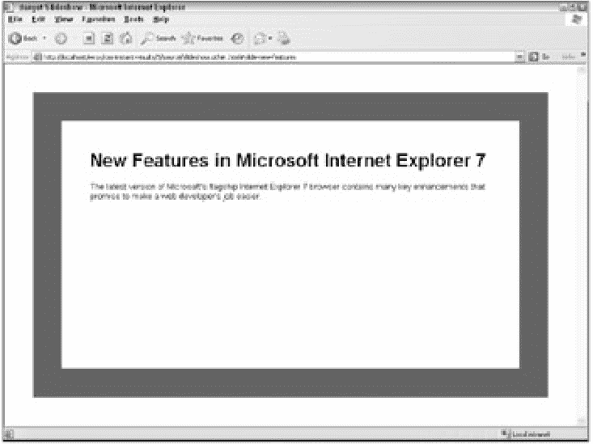
**图 5-8**

在 Opera 8 中，你也能拥有一个基本可运行的幻灯片（导航菜单默认未隐藏），并且在 Opera 9 中拥有一个功能完整的导航菜单。图 5-9 展示了 Opera 8 中的幻灯片。

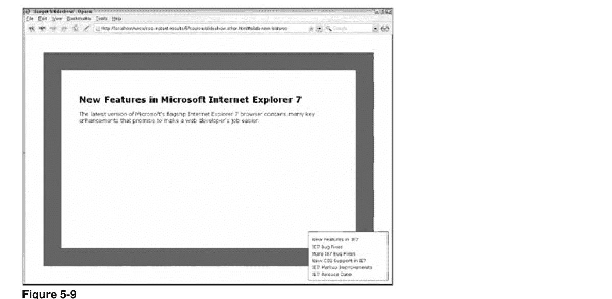

你所做的第一组修改是在 `slideshow.html` 中。以下标记用于纠正 Internet Explorer 不支持通过偏移属性组合来暗示宽度或高度的问题。由于在 Internet Explorer 中，应用于同一元素的 `right: 0;` 和 `left: 0;` 并不意味着宽度，因此你使用了 Internet Explorer 特有的 `expression()` 特性，将 JavaScript 直接包含在样式表中：

```html
<!-- compliance patch for microsoft browsers -->
<!--[if lt IE 7]>
<style type='text/css'>
    div.slide {
        width: expression(
            document.getElementById('slideshow').offsetWidth - 300
        );
        height: expression(
            document.getElementById('slideshow').offsetHeight - 300
        );
    }
</style>
<![endif]-->
```

类名为 "slide" 的 `<div>` 元素的宽度是通过应用 `expression()` 来定义的。为了获得基于视口的宽度，你还必须进行其他一些修改。你为 `<body>` 元素应用了一个 `slideshow` 的 id 名称：

```html
<body id='slideshow'>
```

你还在 `slideshow.css` 中添加了几条规则：

```css
html {
    height: 100%;
}
```

```css
body {
    font: 12px sans-serif;
    margin: 0;
    padding: 0;
    height: 100%;
}
```

通过将 id 名称 `slideshow` 应用于 `<body>` 元素，你现在拥有了一个参考点，可以根据视口的尺寸来定义宽度。`document.getElementById('slideshow')` 在样式表中使用 JavaScript 引用 `<body>` 元素。`offsetWidth` 属性获取 `<body>` 元素的宽度，但它是使用旧的、特有的 Internet Explorer 盒模型来实现的，在这种模型中，元素的宽度包括元素的边框和内边距，而元素的内容占据边框和内边距应用后剩余的空间。从 `offsetWidth` 属性的值中减去 300 像素，这是为了抵消应用于每个 "slide" `<div>` 元素的外边距、边框和内边距。高度的处理方式相同，但使用的是 `offsetHeight` 属性。

默认情况下，由于 `<body>` 是一个块级元素，`<body>` 元素的高度使用 shrink-to-fit（收缩以适应）算法计算——其高度根据内部包含多少内容而定。为了获得能够反映视口窗口高度的 `offsetHeight` 值，你将外边距（margin）和内边距（padding）设置为零，以移除任何默认值。然后你将高度设置为 100%。由于百分比高度是基于应用该百分比测量的元素之父元素的高度来确定的，因此你也将 `<html>` 元素的高度设置为 100%。在为 `<body>` 元素定义了 100% 高度之后，你现在可以引用该元素的 `offsetHeight` 属性，从而使 "slide" `<div>` 元素的高度能够反映视口的高度。再次减去 300 像素以抵消边框、外边距和内边距，你就得到了尺寸基于视口的 "slide" `<div>` 元素。

你对 `slideshow.css` 进行了最后一项更改，即添加了一个包含特有 `filter` 属性的声明。该声明默认隐藏了幻灯片的导航菜单：

```css
div#slide-navigation {
    position: absolute;
    bottom: 0;
    right: 0;

    opacity: 0.0;
    filter: progid:DXImageTransform.Microsoft.Alpha(opacity=0);
    width: 200px;
    background: white;
    border: 1px solid black;
    padding: 10px;
    margin: 10px;
}
```

你对幻灯片做的最后一次修改是应用了一段 JavaScript，以在不支持 CSS 3 `:target` 伪类的情况下提供相应的功能。

我不会详细讲解 JavaScript 语法的基础知识。正如在[第 3 章](#)中所提到的，如果你需要 JavaScript 的全面概述，Paul Wilton 的 *Beginning JavaScript 2nd Edition* 是一个很好的起点。

同样在[第 3 章](#)中提到过，如果不使用 JavaScript，很难在 Web 开发中走得很远。接下来你将看到如何利用 JavaScript 语言，在 Opera 9 和 Internet Explorer 6 中提供与 Mozilla Firefox 相同的功能。

你首先在 JavaScript 中设置一个变量 `$currentSlide`，用于跟踪用户当前正在查看哪一张幻灯片。该变量将在本节后面进一步详细描述：

```javascript
var $currentSlide = '';
```


## 测试与注意事项

在 JavaScript 中，几乎所有操作都是由事件驱动的，例如当用户的鼠标移动到某个元素上方或点击某个元素时。这些事件可以被捕获，并在事件发生时执行独立的代码片段。下面的函数 `slideEvents()` 在文档加载时执行。当它被执行时，会执行几个子程序来使幻灯片放映功能正常运行。它为每个包含幻灯片导航链接的 `<li>` 元素附加 `onclick` 事件。当某个 `<li>` 元素被点击时，会显示相应的幻灯片。它还会根据用户的鼠标是否悬停在导航菜单所在屏幕区域上方来隐藏或显示导航菜单。该函数以函数声明开头，包括 `function` 关键字和函数名 `slideEvents`：

```javascript
function slideEvents()
{
```

函数内的首要任务是获取 id 名为 `slide-navigation-inner Owl` 的 `<ul>` 元素的所有子节点：

```javascript
var $li = document.getElementById('slide-navigation-inner').childNodes;
```

使用 `for/in` 结构，为每个 `<li>` 元素的子 `<a>` 元素添加 `onclick` 事件。当 `<a>` 元素被点击时，执行 `getSlide` 函数。在分配该 `onclick` 事件之前，必须首先确保目标 `<li>` 元素有子节点、有第一个子节点，并且该第一个子节点是 `<a>` 元素。这样做是为了避免任何潜在的 JavaScript 错误：

```javascript
for (var $i in $li)
{
    if ($li[$i].childNodes &&
        $li[$i].childNodes[0] &&
        $li[$i].childNodes[0].nodeName == 'A'
    ) {
        $li[$i].childNodes[0].onclick = getSlide;
    }
}
```

接下来是调用 `getSlide()` 函数。这样做是因为用户可能通过已经包含幻灯片锚点部分的 URL 来访问幻灯片：

```javascript
getSlide();
```

总结下来，后面将 id 为 "slide-navigation" 的元素赋值给 `$navigation` 变量：

```javascript
var $navigation = document.getElementById('slide-navigation');
```

然后需要重新实现当用户鼠标悬停时导航菜单变为完全不透明的效果，这在 `slideshow.css` 中通过以下规则实现：

```css
div#slide-navigation:hover {
    opacity: 1;
}
```

要在 JavaScript 中复制此效果，可以使用 `onmouseover` 和 `onmouseout` 事件。首先将 `onmouseover` 事件赋值给 `$navigation` 变量，该变量引用的是 "slide-navigation" `<div>` 元素。在 `onmouseover` 事件的函数内部，通过语法 `navigator.appName == 'Microsoft Internet Explorer'` 确保浏览器是微软 Internet Explorer，这是唯一支持 `filter` 属性的浏览器。`this` 关键字引用的是应用了 `onmouseover` 事件的元素，即 "slide-navigation" `<div>` 元素。`this.style.filter` 被赋值为用户鼠标悬停时希望 "slide-navigation" `<div>` 具有的值；100 将不透明度设置为完全不透明：

```javascript
if (navigator.appName == 'Microsoft Internet Explorer')
{
    $navigation.onmouseover = function()
    {
        this.style.filter =
        'progid:DXImageTransform.Microsoft.Alpha(opacity=100);';
    };
}
```

在实现用户鼠标悬停时 "slide-navigation" `<div>` 元素变为完全不透明之后，现在必须添加另一个事件，当用户鼠标离开元素边界时触发。这通过 `onmouseout` 事件完成，应用了类似的函数。唯一的区别是不透明度设置为 "0" 或完全透明：

```javascript
$navigation.onmouseout = function()
{
    this.style.filter =
    'progid:DXImageTransform.Microsoft.Alpha(opacity=0);';
};
```

现在来看使幻灯片在不支持 `:target` 伪类的情况下正常工作的部分。首先使用 `function` 关键字创建一个新的函数声明，后跟函数名 `getSlide`：

```javascript
function getSlide()
{
```

首先要做的是获取 URL 的锚点部分。文档 URL 可以在 `.href` 属性中找到。使用 `substring()` 方法，可以只提取 URL 的锚点部分。`substring()` 需要两条信息来提取正确的字符串部分（这些称为参数）。`substring()` 根据 URL 中的字符数来检索 URL 的一部分。因此，需要知道锚点开始的位置和结束的位置。如果 URL 总共有 100 个字符，而 "#" 字符是第 75 个字符，就需要一种方法来确定 "#" 字符是第 75 个字符。这通过 `indexOf()` 函数实现。`indexOf` 需要知道你要查找的内容——在本例中是 "#" 字符——然后它会检索 "#" 在 URL 中的位置。不过，你不希望检索到 "#" 字符本身，只希望获取它后面的字符。为了只获取这些字符，将 `indexOf` 返回的值加一。`substring()` 还需要知道你要获取的最后一个字符的位置；因为你想要整个锚点，所以给它 URL 的总字符数：

```javascript
if (this.href)
{
    var $anchor = this.href.substring(
        this.href.indexOf('#') + 1, this.href.length
    );
```

现在你已经获得了锚点的文本，也就是特定幻灯片的 id 名称。当用户点击导航中的链接时，还需要某种方法隐藏他们之前正在查看的幻灯片（如果有的话）。这通过让浏览器记住用户当前正在查看的幻灯片来实现，该信息存储在 `$currentSlide` 变量中。如果存在 `$currentSlide`，当发出新请求时会将其隐藏：

```javascript
if (document.getElementById($currentSlide))
{
    document.getElementById($currentSlide).style.display = 'none';
}
$currentSlide = $anchor;
```

现在可以显示当前请求的幻灯片了。首先检查确保存在锚点，并且存在具有该 id 名称的元素。如果存在，将该元素的 `display` 属性值设置为 `block`：

```javascript
if ($anchor.length && document.getElementById($anchor))
{
    document.getElementById($anchor).style.display = 'block';
}
}
}
```

最后要做的是让浏览器执行上述所有操作。由于 JavaScript 包含在 `<head>` 和 `</head>` 标签之间，而 JavaScript 在文档加载时会被读取并可能被执行，所以 `<body>` 和 `</body>` 标签之间的元素尚不存在。通过以下代码行，你告诉浏览器在文档加载完成时执行 `slideEvents()` 函数：

```javascript
window.onload = slideEvents;
```

现在你有了一个在 Internet Explorer 6 和 Opera 9 中都能正常工作的幻灯片放映。


# 第 6 章：自定义边框和圆角

### 概述

网页设计师常见的抱怨之一是网页设计的方形特性。好消息是有多种技术可以用来打破方形圆角的限制；有些技术甚至可以用来制作自定义边框。在本章中，你将学习如何着手打破方形圆角的限制，并了解 CSS 有限的边框样式选择。

自定义圆角和边框的最大挑战是内容宽度、高度或两者都变化的情况。任何人都可以制作固定尺寸的设计，甚至可以直接跳过大部分标记和 CSS，通过图像来包含设计。我开展这个项目的前提是，有能力的 designer 会针对分辨率或字体大小的调整进行规划，并在适当时候使用 CSS 和标记来增强可访问性和搜索引擎可见性。设计良好的自定义边框或圆角实现的目标是在特定分辨率下或在字体大小调整时不会破坏设计。

目前正在进行的工作旨在使自定义边框和圆角更容易实现。在 CSS 3 中，正在开发一种新的语法，用于在单个元素上指定多个背景，并为不同的边框段指定图像。在撰写本文时，只有苹果的 Safari 浏览器实现了对 CSS 3 多背景的实验性支持，尽管 CSS 3 背景和边框模块仍然是草案规范，可能会发生变化。在其他浏览器中获得支持的可能性较小，直到 CSS 3 背景和边框模块至少达到候选推荐状态。CSS 3 中还有 `border-radius` 属性，提供了为盒子圆角的功能。存在一个类似但不完全等同于 `border-radius` 属性的属性，即 `-moz-border-radius` 属性，它只在具有 gecko 渲染引擎的浏览器中工作，如 Mozilla、Mozilla Firefox 和 Netscape 等。

在浏览器支持 CSS 3 背景和边框模块之前，网页设计师必须依赖引入比该支持所需更多标记和样式表规则的方法。

[下一节](#) 介绍了用于制作圆角或自定义边框的各种技术的设计概念。


## 设计

正如你在[第 1 章](chapter1)、[第 3 章](chapter3)和[第 4 章](chapter4)中所看到的，自定义边框和圆角有时需要插入大量冗余且无意义的标记。最佳的跨浏览器方法是使用这些章节中介绍的技术，因为所有浏览器对背景的支持几乎完全一致。这种方法的不足之处在于额外的标记。在标记中插入更多 `<div>` 元素只会增加臃肿感，而且说到底，这种技术并不比使用表格进行布局好多少，尽管我认为无意义的 `<div>` 元素比 `<table>` 元素要好，因为我认为后者应该保留用于以语义化的方式组织表格数据。将表格从布局中移除，可以让它们恢复一些之前因过度使用而被掩盖的语义。

**注意** 在我看来，实现圆角和自定义边框的最佳技术出现在网站 [456bereastreet.com](http://456bereastreet.com) 上。该技术由瑞典 Web 开发人员 Roger Johansson 开发，它保持了标记的简洁，且没有那些使标记混乱和臃肿的无意义元素。他使用 JavaScript 动态地插入这些额外的无意义元素，如果禁用了 JavaScript，用户将看到相同内容的一个不那么美观的版本。我认为 Johansson 的方法更优，因为它利用 JavaScript 来增强设计，同时也使标记更干净、更易于维护。我决定在这里不详细介绍 Johansson 的技术，因为它需要 JavaScript。如果你想了解更多关于此技术的信息，可以从 Johansson 网站的以下 URL 获取教程：*[http://www.456bereastreet.com/archive/200505/transparent_custom_corners_and_borders](http://www.456bereastreet.com/archive/200505/transparent_custom_corners_and_borders)*。

对于本章的主要项目，我将重复你在之前章节中看到的技术，但在这里将其独立出来，仅用于演示在自己的项目中实现该技术所需的标记和 CSS。

[下一节](next-section)将给出此项目的源代码。

## 代码与代码详解

- 1. 输入以下标记：

```html
<!DOCTYPE html PUBLIC "-//W3C//DTD XHTML 1.0 Strict//EN"
"http://www.w3.org/TR/xhtml1/DTD/xhtml1-strict.dtd">
<html xmlns="http://www.w3.org/1999/xhtml" xml:lang="en">
<head>
    <meta http-equiv="Content-Type" content="text/html; charset=UTF-8" />
    <title>Custom corners and borders</title>
    <link rel="stylesheet" type="text/css" href="styles/borders.css" />
</head>
<body>
    <div class="content">
        <div class="header">
            <h1><span>Heading</span></h1>
        </div>
        <div class="outer-body">
            <div class="body">
                <div class="inner-body">
<p>
    Lorem ipsum dolor sit amet, consectetuer adipiscing elit. Remi sem.

    Maecenas neque. Donec bibendum, justo id varius vulputate, eros neque
    scelerisque lectus, a lobortis ipsum enim et nunc. Maecenas sit amet
    urna a turpis pellentesque gravida. Donec a enim vitae felis tempor
    lobortis. Morbi sodales lacinia iacque. Cum sociis natoque penatibus
    et magnis dis parturient montes, nascetur ridiculus mus. Praesent
    metus. In hac habitasse platea dictumst. Vestibulum convallis
    scelerisque leo. Cras risus arcu, imperdiet vel, commodo non,
    malesuada in, metus. Aenean commodo adipiscing pede. Suspendisse
    tellus orci, placerat quis, ullamcorper id, consectetuer sed, nisi.
</p>
<p>
    Nullam et orci. Vestibulum ante ipsum primis in faucibus orci luctus
    et ultrices posuere cubilia Curae; Suspendisse suscipit accumsan
    felis. Aliquam in justo ut leo rutrum iaculis. In tempus, sapien
    egget commodo vulputare. Eros tortor placerat ipsum, id feugiat elit
    massa id nisi. Nulla fringilla, adipiscing id mauris. Curabitur lacinia,
    orci id convallis mauris, metus felis moleslie neque, nib sit amet
    scelerisque liguia nulla sed enim. Vestibulum ligula. Nam aliquet.
    Aeonian art ente, suscipit pharetra, vulputate a, aliquam ac, quam.
    Ut lobortis suscipit velit. Morbi pellentesque. Mauris aliquam
    blandit diam. Suspendisse potenti. Ut pede nibh, feugiat nec,
    porttitor sed, malesuada nec, libero. Morbi facilisis, nisl at dictum
    imperdiet, nisl justo adipiscing dui, sed pretium tellus ipsum eu
    velit. Quisque pede lorem, ullamcorper sagittis, venenatis vel, 
    venetasin a, orci. Vivamus ante arcu, bibendum id, volutpat id,
    tristique vitae, libero. Cras volutpat iaculis purus. Pellentesque
    mi arcu, ultrices non, pharetra in, auctor sit amet, diam.
</p>
<p>
    Pellentesque mollis rutrum leo. Nulla ac enim. Sed auctor et eget leo.
    Vivamus purus tortor, ornare nec, condimentum id, venenatis vel, nulla.
    Pellentesque commodo magna ac eros. Suspendisse in massa fringilla est
    blandit sagittis. Duis metus. Praesent tellus ante, bibendum vitae, tincidunt sit amet, varius vitae, mauris. Mauris nibh. Donec dignissim eleifend eleifum quad. Etiam luctus. Integer feugiat, arcu vitae molestie dictum, turpis quam porttitor massa, a semper purus mi quis odio. Donec sem ligula, sollicitudin nec, lacinia id, sodales vitae, sem. Aliquam erat volutpat. Aliquam eros. Quisque in turpis quis ante dignissim malesuada. Class aptent taciti sociosqu ad litora torquent per conubia nostra, per inceptos hymenaeos.
</p>
<p>
    Class aptent taciti sociosqu ad litora torquent per conubia nostra, per inceptos hymenaeos. Cras pellentesque diam a augue pretium ullamcorper. Vestibulum dapibus consectetuer pede. Cras id sapien quis magna dictum sodales. Ut convallis eleifend massa. Sed semper arcu non lacus. Nullam vitae eros. Morbi eu odio. Maecenas in pede. Fusce sem lacus, sollicitudin nec, blandit ac, pellentesque et, mauris. Proin sodales. Aenean eget risus. Etiam quis augue ac augue hendrerit semper. Curabitur auctor sem at tortor.
</p>
<p>
    Proin quam nunc, egetas vulputate, hendrerit id, sagittis et, purus. Quisque in purus et massa dapibus integer. Integer libero mauris,
    malesuada quis, rutrum hendrerit, tincidunt vitae, justo. Donec vehicula. Lorem ipsum dolor sit amet, consectetuer adipiscing elit. Donec aliquet. Sed gravida tristique lorem. In laoreet enim sit amet libero. Donec nisl nisi, gravida fermentum, consectetuer suscipit, malesuada ac, metus. Sed id eros. Curabitur bibendum sceleriscor tortor. Nulla facilisi. Donec vulputate feugiat odio. Nam vitae lectus. Nullam molestie est et dolor. Proin sit amet tellus eu mauris interdum volutpat. Nulla at lectus id sem laoreet ornare. Donec nec quam feugiat urna elementum tincidunt. Nunc suscipit facilisis mi.
</p>
                </div>
            </div>
        </div>
        <div class='outer-footer'>
            <div class='footer'>
                <div class='inner-footer'>
                </div>
            </div>
        </div>
    </div>
</body>
</html>
```

- 2. 将上述内容保存为 **borders.html**。

- 3. 输入以下样式表：

```css
body {
	padding: 0;
	margin: 0;
	font: 12px sans-serif;
	background: #fff;
}

div.content {
    color: white;
    background: url('../images/borders_01.png') no-repeat top left;
}
div.header {
    background: url('../images/borders_03.png') no-repeat top right;
}
div.header h1 {
    background: url('../images/borders_02.png') repeat-x top;
    margin: 0 22px 0 22px;
    font-size: 14px;
    height: 26px;
    line-height: 26px;
}
div.header h1 span {
    position: relative;
    top: 10px;
}
div.outer-body {
    background: url('../images/borders_04.png') repeat-y left;
}
div.body {
    background: url('../images/borders_06.png') repeat-y right;
}
div.inner-body {
    background: url('../images/borders_05.png');
    margin: 0 22px 0 22px;
}
div.inner-body p:first-child {
    margin-top: 0;
    padding-top: 10px;
}
div.inner-body p:last-child {
    margin-bottom: 0;
}
div.outer-footer {
    background: url('../images/borders_07.png') no-repeat bottom left;
}
div.footer {
    background: url('../images/borders_09.png') no-repeat bottom right;
}
div.inner-footer {
    background: url('../images/borders_08.png') repeat-x bottom;
    height: 28px;
    margin: 0 22px 0 22px;
}
```

- 4. 将上述内容保存为 **borders.css**。

以上操作将产生如图 6-1 所示的输出结果。


 ## 代码及其解释

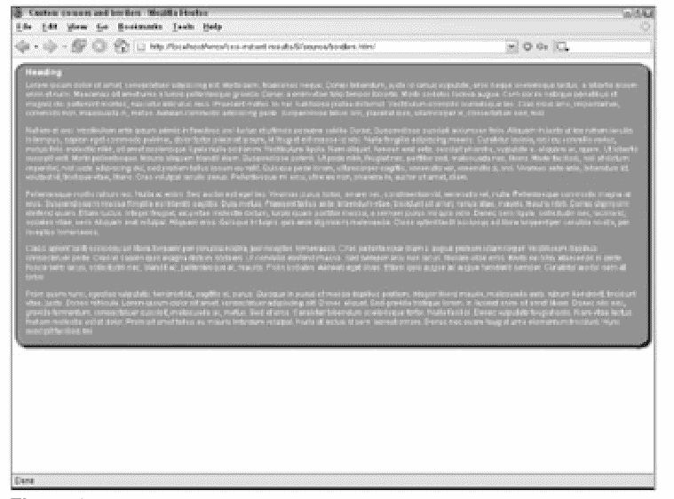

图 6-1

本项目需要九张不同的背景图片：四个角各一张，四条边各一张，以及中心区域一张。你最初尝试通过在文档中添加额外的标记来实现自定义边框和角；起码需要九个不同的元素来分别放置每张图片。而通过使用背景图，你拥有了一种在多种浏览器中更容易部署的方法。

你在 `borders.css` 中应用的第一条规则适用于 `<body>` 元素。首先，你移除了默认的外边距（margin）和内边距（padding），指定了字体，并将背景设置为白色以保持一致性。

> **注意** 为 `<body>` 元素设置背景总是一个好主意，因为用户的浏览器或操作系统可能会默认应用除白色以外的颜色。指定默认背景色可以防止这种情况发生。

```
body {
    padding: 0;
    margin: 0;
    font: 12px sans-serif;
    background: #fff;
}
```

`borders.css` 中的下一条规则开始处理自定义角和边框。我使用 PhotoShop 将一张图片切成了九部分。第一张图片被应用于类名为 `content` 的 `<div>` 元素，它包含了所有其他元素。颜色被设置为白色，以便与我选择的深色背景色形成更好的对比。然后指定第一张背景图，将其不重复地（no-repeat）放置在 `content` `<div>` 元素的左上角：

```
div.content {
    color: white;
    background: url('../images/borders_01.png') no-repeat top left;
}
```

在下一条规则中，应用了第二张图片。这次是将右上角应用于类名为 `header` 的 `<div>` 元素：

```
div.header {
    background: url('../images/borders_03.png') no-repeat top right;
}
```

为了确保自定义边框和背景在任何尺寸下（无论是更改分辨率、调整浏览器窗口大小，还是增加或减少字体大小）都能继续发挥作用，该技术的设计使得侧边边框是重复的。在下一条规则中，第三张图片被应用为顶边框。它沿 x 轴重复，并定位在 `<h1>` 元素的顶部，而 `<h1>` 是类名为 `header` 的 `<div>` 元素的后代。然后，为了防止与 `content` 和 `header` `<div>` 元素重叠，应用了与左上角和右上角图片宽度相等的左右外边距。接着应用了 14 像素的字体大小。设置 26 像素的高度，以确保无论 `<h1>` 元素内部内容的尺寸如何，背景始终可见，同时 `line-height` 也设为 26 像素：

```
div.header h1 {
    background: url('../images/borders_02.png') repeat-x top;
    margin: 0 22px 0 22px;
    font-size: 14px;
    height: 26px;
    line-height: 26px;
}
```

`<h1>` 元素中的文本与 `<h1>` 的高度不太匹配，因此通过给 `<span>` 元素一个相对位置，并将其顶部偏移 10 像素，来微调 `<h1>` 元素内文本的位置：

```
div.header h1 span {
    position: relative;
    top: 10px;
}
```

接下来应用第四张图片。该图片成为左侧边框。背景被设置为沿 y 轴重复，以适应任何垂直长度的内容，并位于类名为 `outer-body` 的元素左侧：

```
div.outer-body {
    background: url('../images/borders_04.png') repeat-y left;
}
```

紧接着是第五张图片，它成为右边框。它同样沿 y 轴重复，但位于类名为 `body` 的元素右侧：

```
div.body {
    background: url('../images/borders_06.png') repeat-y right;
}
```

第六张图片成为中间内容的背景。在某些情况下，中心区域可能根本不需要使用图片，而可以使用纯色。我选择了使用图片。背景被设置为类名为 `inner-body` 的 `<div>` 元素，并设置为沿 y 轴和 x 轴同时重复。然后，就像之前在样式表中对 `<h1>` 元素所做的那样，你应用了与左右边框背景图宽度相等的左右外边距：

```
div.inner-body {
    background: url('../images/borders_05.png');
    margin: 0 22px 0 22px;
}
```

header。移除第一个 `<p>` 元素的顶部外边距可以消除这个间隙。然后你应用了 10 像素的内边距，为标题留出更多空间：

```
div.inner-body p:first-child {
    margin-top: 0;
    padding-top: 10px;
}
```

就像之前处理顶部间隙的规则一样，下一条规则通过使用 CSS 3 的 `:last-child` 伪类移除最后一个 `<p>` 元素的底部外边距，从而消除底部的间隙：

```
div.inner-body p:last-child {
    margin-bottom: 0;
}
```

第七张图片被应用于类名为 `outer-footer` 的 `<div>` 元素。第七张背景图被指定为不重复地放置在 `outer-footer` `<div>` 元素的左下角：

```
div.outer-footer {
    background: url('../images/borders_07.png') no-repeat bottom left;
}
```

第八张图片被应用于类名为 `footer` 的 `<div>` 元素。它同样被不重复地应用于 `footer` `<div>` 元素的底部和右侧：

```
div.footer {
    background: url('../images/borders_09.png') no-repeat bottom right;
}
```

最后，在 `borders.css` 中出现的最后一条规则中，你应用了底边框。就像你在 `<h1>` 元素中处理顶边框一样，你将第九张图片沿类名为 `inner-footer` 的 `<div>` 元素的 x 轴重复。`inner-footer` `<div>` 元素随后被赋予 28 像素的高度，这正是该元素背景图以及左下角和右下角图片的高度。然后，你通过将 `inner-footer` `<div>` 元素的左右外边距设置为与左下角和右下角图片宽度相等，完成了 `inner-footer` `<div>` 元素的设置：

```
div.inner-footer {
    background: url('../images/borders_08.png') repeat-x bottom;
    height: 28px;
    margin: 0 22px 0 22px;
}
```

**注意**

你可能会好奇 `borders.html` 文档中的文本是什么意思。这是印刷业使用了几个世纪的虚拟文本（dummy text），近年来也广泛用于网站和软件开发。这种虚拟文本是用拉丁文编写的，仅仅作为填充物，用来查看模板在添加文案后的样子。如果你有兴趣了解更多关于它的起源，请访问网站 *www.lipsum.com*。

在接下来的**章节**中，你将看到这种方法的缺陷以及如何修正它们。

## 测试与注意事项

在本节中，你将采用上一节的最终设计，并将浏览器的测试范围扩大到包括 Internet Explorer 和 Opera。

这里使用的设计在其他浏览器中存在几个缺陷，这与样式表中 `:first-child` 和 `:last-child` 伪类的使用有关。

图 6-2 显示了该项目在 Internet Explorer 中的样子，该浏览器既不支持 `:first-child` 也不支持 `:last-child` 伪类。

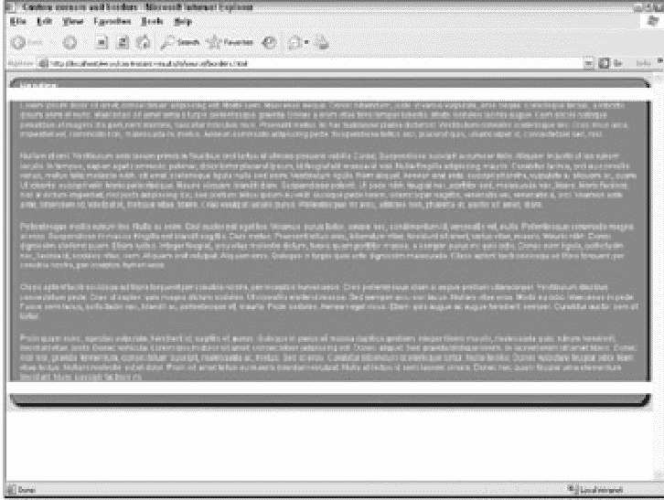

**图 6-2**

图 6 **[图 6-3](6-3)** 显示了该项目在 Opera 中的样子，Opera 不支持 CSS 3 的 `:last-child` 伪类。

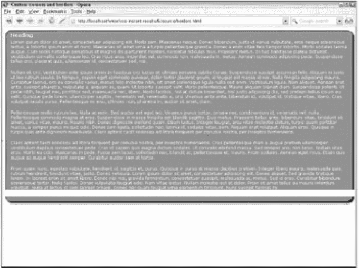

**图 6-3**

Internet Explorer 还被另一个问题困扰。由于用作背景的 PNG 图片包含 alpha 通道（透明部分），这些背景图的透明部分在 Internet Explorer 中显示为灰色。对于本项目，解决方法并不简单。PNG 图片必须更新为没有透明部分，才能在 Internet Explorer 中获得相同的外观和感觉。

要修正 [图 6-2](figures-6-2) 和 [6-3](6-3) 中看到的间隙，你必须首先理解间隙出现的原因。正如你在[前一节](previous-section)中看到的，间隙是通过去掉第一个 `<p>` 元素的顶部外边距和最后一个 `<p>` 元素的底部外边距来消除的。这些间隙可以用“外边距折叠”（margin collapsing）来解释。第一个 `<p>` 元素的顶部外边距与类名为 `inner-body` 的 `<div>` 的顶部外边距折叠，而后者又与类名为 `body` 的 `<div>` 的顶部外边距折叠，最后又与 `outer-body` `<div>` 元素的顶部外边距折叠。这导致了 `outer-body` `<div>` 元素和 `header` `<div>` 元素之间出现间隙。底部也发生了同样的情况，只不过是底部外边距发生了折叠。这个问题有两种解决方案，你已经见过其中一种：移除外边距。由于 `inner-body` `<div>` 内的内容可能并不总是可预测的，因此存在另一种可能更好的方法，即给 `inner-body` `<div>` 元素应用 1 像素的内边距（padding）。这样做之后，你在 Internet Explorer 6 中可以得到 [图 6-4](figure-6-4) 所示的结果，在 Opera 中同样能得到类似的结果。这些修正方案包含在本书随附的源码 CD-ROM 的 Project 6 文件夹中，文件名为 `borders.fixed.html`。


## 测试与注意事项

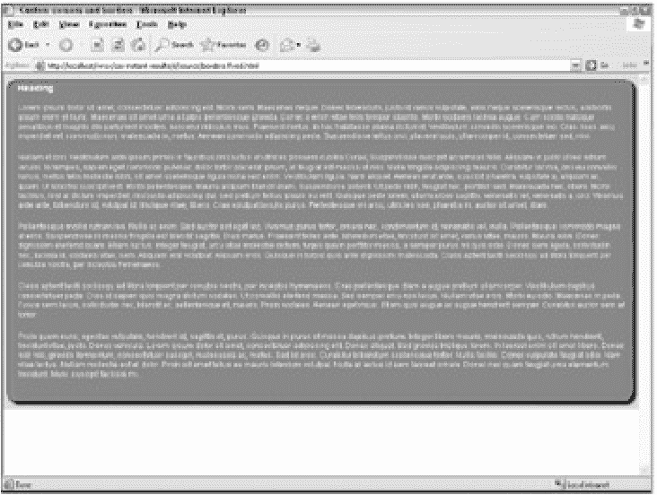

**图 6-4**

下一节将探讨本项目的一些替代方案。

## 使用与修改项目

本节介绍自定义圆角的一种替代方案。这里使用的方法侧重于通过 CSS 为元素应用边框并自定义其圆角。

该技术深受 **Adam Kalsey** 启发，其原始版本可在线获取：http://kalsey.com/2003/07/rounded_corners_in_css/。

Kalsey 的技术采用极简主义方案，适用于所有主流浏览器，如果圆角是你的唯一目标，这种方法非常合适。

本节的方法经过修改，以适配带有边框的元素。要实现该方案，请按以下步骤操作：

+   1. 打开 `borders.html` 并进行以下修改：

```html
<!DOCTYPE html PUBLIC "-//W3C//DTD XHTML 1.0 Strict//EN"
"http://www.w3.org/TR/xhtml1/DTD/xhtml1-strict.dtd">
<html xmlns='http://www.w3.org/1999/xhtml' xml:lang='en'>
    <head>
        <meta http-equiv="Content-Type" content="text/html; charset=UTF-8" />
        <title>Custom corners and borders</title>
        <link rel='stylesheet' type='text/css' href='styles/borders.kalsey.css' />
        <!-- compliance patch for microsoft browsers -->
        <!--[if lt IE 7]>
            <link rel='stylesheet' type='text/css'
                href='styles/borders.kalsey.ie.css' />
        <![endif]-->
    </head>
    <body>
        <div class='content'>
            <h1 class='top'>
                <span>Header Text</span>
            </h1>
            
            <div class='body'>
```

```html
<p>
    Lorem ipsum dolor sit amet, consectetuer adipiscing elit. Morbi sem.
    Maecenas neque. Donec bibendum, justo id varius vulputate, eros neque
    scelerisque lectus, a lobortis ipsum enim et nunc. Maecenas sit amet
    urna a turpis pellentesque gravida. Donec a enim vitae felis tempor
    lobortis. Morbi sodales lacinia augue. Cum sociis natoque penatibus
    et magnis dis parturient montes, nascetur ridiculus mus. Praesent
    metus. In hac habitasse platea dictumst. Vestibulum convallis
    scelerisque leo. Cras risus arcu, imperdiet vel, commodo non,
    malesuada in, metus. Aenean commodo adipiscing pede. Suspendisse
    tellus orci, placerat quis, ullamcorper id, consectetuer sed, nisi.
</p>
<p>
    Nullam et orci. Vestibulum ante ipsum primis in faucibus orci luctus
    et ultrices posuere cubilia Curae; Suspendisse suscipit accumsan felis. Aliquam in justo ut leo rutrum iaculis. In tempus, sapien eget commodo pulvinar, dolor tortor placerat ipsum, id feugiat elit massa id nisi. Nulla fringilla adipiscing mauris. Curabitur lacinia, orci eu convallis varius, metus felis molestie nibh, sit amet scelerisque ligula nulla sed enim. Vestibulum ligula. Nam aliquet. Aenean erat ante, suscipit pharetra, vulputate a, aliquam ac, quam. Ut lobortis suscipit velit. Morbi pellentesque. Mauris aliquam blandit diam. Suspendisse potenti. Ut pede nibh, feugiat nec, porttitor sed, malesuada nec, libero. Morbi facilisis, nisl at dictum imperdiet, nisl justo adipiscing dui, sed pretium tellus ipsum eu velit. Quisque pede lorem, ullamcorper sagittis, venenatis vel, venenatis a, orci. Vivamus ante ante, bibendum id, volutpat id, tristique vitae, libero. Cras volutpat iaculis purus. Pellentesque mi arcu, ultricies non, pharetra in, auctor sit amet, diam.
</p>
<p>
    Pellentesque mollis rutrum leo. Nulla ac enim. Sed auctor est eget leo. Vivamus purus tortor, ornare nec, condimentum id, venenatis vel, nulla. Pellentesque commodo magna at eros. Suspendisse in massa fringilla est blandit sagittis. Duis metus. Praesent tellus ante, bibendum vitae, tincidunt sit amet, varius vitae, mauris. Mauris nibh. Donec dignissim eleifend quam. Etiam luctus. Integer feugiat, arcu vitae molestie dictum, turpis quam porttitor massa, a semper purus mi quis odio. Donec sem ligula, sollicitudin nec, lacinia id, sodales vitae, sem. Aliquam erat volutpat. Aliquam eros. Quisque in turpis quis ante dignissim malesuada. Class aptent taciti sociosqu ad litora torquent per conubia nostra, per inceptos hymenaeos.
</p>
<p>
    Class aptent taciti sociosqu ad litora torquent per con pitons nostra, per inceptos hymenaeos. Cras pellentesque diam a augue pretium ullamcorper. Vestibulum dapibus consectetuer pede. Cras id sapien quis magna dictum sodales. Ut convallis eleifend massa. Sed semper arcu non lacus. Nullam vitae eros. Morbi eu odio. Maecenas in pede. Fusce sem lacus, sollicitudin nec, blandit ac, pellentesque et, mauris. Proin sodales. Aenean eget risus. Etiam quis augue ac augue hendrerit semper. Curabitur auctor sem at tortor.
</p>
<p>
    Proin quam nunc, egestas vulputate, hendrerit id, sagittis et, purus. Quisque in purus et massa dapibus pretium. Integer libero mauris, malesuada quis, rutrum hendrerit, tincidunt vitae, justo. Donec vehicula. Lorem ipsum dolor sit amet, consectetuer adipiscing elit. Donec aliquet. Sed gravida tristique lorem. In laoreet enim sit amet libero. Donec nisl nisi, gravida fermentum, consectetuer suscipit, malesuada ac, metus. Sed id eros. Curabitur bibendum scelerisque tortor. Nulla facilisi. Donec vulputate feugiat odio. Nam vitae lectus. Nullam molestie est et dolor. Proin sit amet tellus eu mauris interdum volutpat. Nulla at lectus id sem laoreet ornare. Donec nec quam feugiat urna elementum tincidunt. Nunc suscipit facilisis mi.
</p>
```

```html
</div>
<div class='bottom'>

    </div>
</div>
</body>
</html>
```

2. 将此方案保存为 [borders.kalsey.html](borders.kalsey.html)。

3. 保留原始 [borders.css](borders.css) 中 `<body>` 元素的规则，输入以下新的样式表：

```css
body {
    padding: 0;
    margin: 0;
    font: 12px sans-serif;
    background: #fff;
}
```

```css
div.content {
    background: #7c92b3;
    border: 1px solid black;
    color: white;
    margin: 10px;
    position: relative;
}
```

```css
div.body {
    padding: 10px;
}
```

```css
div.content h1 {
    background: url('../images/simple_borders_01.png') no-repeat top left;
    margin: -1px 0 0 -1px;
    font-size: 14px;
}
```

```css
div.content h1 span {
    position: relative;
    left: 10px;
    top: 10px;
}
```

```css
img.top-right {
    position: absolute;
    top: -1px;
    right: -1px;
}
```

```css
div.bottom {
    background: url('../images/simple_borders_07.png') no-repeat bottom left;
    height: 15px;
    margin: 0 0 -1px -1px;
}
```

```css
img.bottom-right {
    position: absolute;
    bottom: -1px;
    right: -1px;
}
```

4. 将上述样式表保存为 borders.kalsey.css。

5. 再输入另一个样式表：

```css
div.content {
    height: 1%;
    z-index: 1;
    background-color: #7087AB;
}
div.content h1 {
    position: relative;
    z-index: 2;
    left: -1px;
    margin-left: 0;
}
img.top-right {
    right: -2px;
}
img.bottom-right {
    right: -3px;
}
div.bottom {
    position: relative;
    z-index: 2;
    left: -1px;
    bottom: -1px;
    margin: 0;
}
```

6. 将上述样式表保存为 borders.kalsey.ie.css。

在 Mozilla Firefox 中，你所做的修改将得到如图 6-5 所示的输出。


**图 6-5**

这些修改使得文档中的标记略微减少，但仍远不及 Kalsey 教程中的精简，因为本方案需要在内容周围添加边框。

borders.kalsey.css 中的第一条规则适用于 `class` 属性值为 `content` 的 `<div>` 元素。你为它设置了蓝色背景，并在其周围添加了 1 像素的实线黑色边框。然后将文字设为白色，并用 10 像素的外边距将其与视口边缘隔开。最后，你为它设置了相对定位，以便其内部采用绝对定位的元素能够相对于它进行定位：

```css
div.content {
    background: #7c92b3;
    border: 1px solid black;
    color: white;
    margin: 10px;
    position: relative;
}
```

为了给内容一些喘息空间，你为 `class` 属性值为 `body` 的 `<div>` 元素应用了 10 像素的内边距：

```css
div.body {
    padding: 10px;
}
```

接下来，`<h1>` 元素接受样式设置。第一条声明在左侧创建圆角。`<h1>` 元素的位置必须稍作调整，使其左侧和顶部与 `content` `<div>` 元素重叠 1 像素。这使得左上角与 `content` `<div>` 元素指定的边框无缝衔接。最后，在最后一条声明中将字体大小设为 14 像素：

```css
div.content h1 {
    background: url('../images/simple_borders_01.png') no-repeat top left;
    margin: -1px 0 0 -1px;
    font-size: 14px;
}
```


## 使用和修改项目

在下面的规则中，你调整了 `<h1>` 元素内文本的位置，该元素被包裹在一个通用的 `<span>` 元素中。`<span>` 元素被设置为相对定位，并从顶部和左侧各偏移 10 像素：

```css
div.content h1 span {
    position: relative;
    left: 10px;
    top: 10px;
}
```

然后你定位了右上角的图片，它出现在 `` 元素中。`` 元素被设置为绝对定位，并从顶部和右侧各偏移负 1 像素，使其同样与 `content <div>` 元素重叠，呈现出无缝圆角边框的效果：

```css
img.top-right {
    position: absolute;
    top: -1px;
    right: -1px;
}
```

下一个需要设置样式的元素是带有 `bottom` 类名的 `<div>` 元素。它被设置了一个用于左下角的背景图片，该图片设为不重复。然后你给它设置 15 像素的高度，以确保 `<div>` 的高度与背景图片一致。接着你将底部和左侧边距各偏移负 1 像素，使 `bottom <div>` 元素与 `content <div>` 元素重叠：

```css
div.bottom {
    background: url('../images/simple_borders_07.png') no-repeat bottom left;
    height: 15px;
    margin: 0 0 -1px -1px;
}
```

现在右下角的图片也出现在一个 `` 元素中。右下角的 `` 元素同样采用绝对定位，底部和右侧各偏移负 1 像素，使其与 `content <div>` 元素重叠：

```css
img.bottom-right {
    position: absolute;
    bottom: -1px;
    right: -1px;
}
```

就目前而言，该文档在 Internet Explorer 中的效果并不理想。图 6-6 展示了应用 IE 专属样式表之前该文档在 Internet Explorer 中的显示效果。

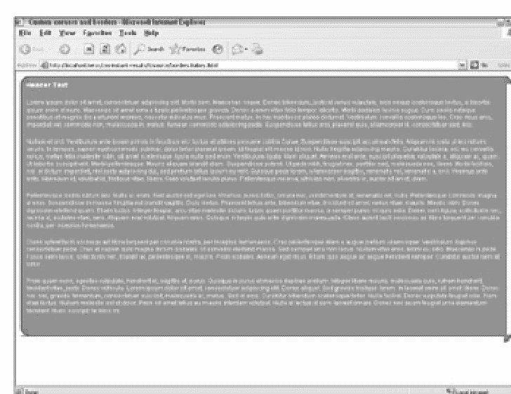

图 6-6

为了修正图 6-6 中显示的问题，你在 Microsoft 专有的条件注释中应用了一个新的样式表。

在 [borders.kalsey.ie.css](borders.kalsey.ie.css) 的第一条规则中，你首先为带有 `content` 类名的 `<div>` 元素设置了 `height: 1%`。这迫使 Internet Explorer 重新考虑其对相对于 `content <div>` 定位的元素的布局决策，从而带来更好的一致性。Explorer 在 `content <div>` 与其内部的 `<h1>` 之间的层叠关系上也存在一些问题。为此你设置了显式的 z-index 值。最后，Internet Explorer 不认为为 `content <div>` 元素指定的背景颜色与 PNG 图片中的颜色相同。为修正这一点，你为 Internet Explorer 提供了一个不同的颜色值：

```css
div.content {
    height: 1%;
    z-index: 1;
    background-color: #7087AB;
}
```

左上角在 Internet Explorer 中与边框不匹配，事实证明在 Internet Explorer 中修改 margin 是徒劳的，因此将 margin 设为零，并通过给 `<h1>` 元素设置相对定位并从左侧偏移负 1 像素来修改其位置：

```css
div.content h1 {
    position: relative;
    z-index: 2;
    left: -1px;
    margin-left: 0;
}
```

Internet Explorer 对定位在右侧的 `` 元素也有异议。为此，右上角的图片从右侧偏移负 2 像素，右下角的图片从右侧偏移 3 像素：

```css
img.top-right {
    right: -2px;
}
img.bottom-right {
    right: -3px;
}
```

带有 `bottom` 类名的 `<div>` 元素存在与 `<h1>` 元素相同的问题。为修复此问题，你将 margin 设为零，将 `bottom <div>` 元素设为相对定位，给它一个高于 `content <div>` 的 z-index 值，并从左侧和底部各偏移负 1 像素：

```css
div.bottom {
    position: relative;
    z-index: 2;
    left: -1px;
    bottom: -1px;
    margin: 0;
}
```

应用 IE 样式表后，你得到了[图 6-7](#)所示的效果。

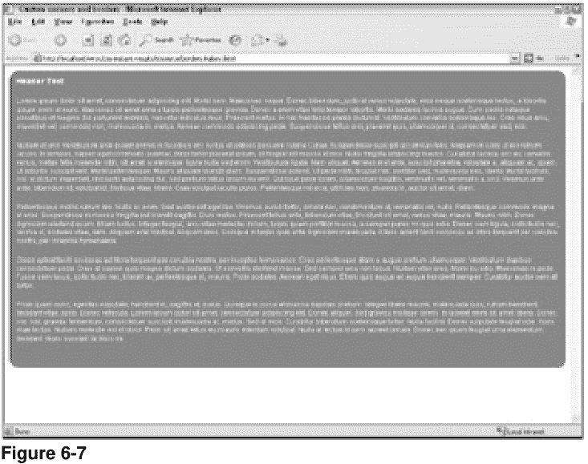

现在你又回到了与 Firefox 及其同类浏览器相当的效果。

## 第 7 章：将 CSS 应用于 Webmail 应用程序

### 概述

本章你将了解如何处理基于 Web 的邮件应用程序的呈现方面的问题。当我收到这本书的写作邀请时，编辑让我构思几个可以轻松复用、只需很少或无需额外工作就能集成的项目。我脑海中浮现的第一个想法是*这固然不错，但如果你写的是像 JavaScript 这样的东西，或者像 PHP 或 ASP.NET 这样的服务器端编程语言，那就更好了*。不难看出如何用这些语言编写可复用的项目。CSS 则有所不同。CSS 处理的是网页的呈现方面。大多数人对自己想在 Web 项目中如何使用 CSS 都有自己的创意想法，因为一般来说，企业和个人都希望能创建反映自身独特个性、行业定位等方面的网站。为了满足编辑的要求，并为本书提供一些有用的内容，我决定提供完整的项目模板——而不是我原本想做的——诸如标签页、多列布局和圆角等基础模板。也就是说，那些最常被问到的"我该如何用 CSS 实现这个？"的问题。但这些主题不足以填满整本书。面对写什么内容的困境，我想了想自己作为 Web 应用程序开发人员在日常工作中通常做些什么。我每天都在写各种 PHP、JavaScript、CSS 和标记语言的混合代码——这并不奇怪，这正是我职位名称中"Web 应用程序"的部分。于是我想到了一个结论：还有什么比写我自己日常开发的一些应用程序更好的呢？其中一个应用程序就是基于 Web 的邮件应用程序。好吧，你不会得到一个功能完备的 webmail 应用程序，但 CSS 在任何 Web 应用程序开发中都扮演着重要角色。此外，本章的项目涵盖了 webmail 应用程序的呈现方面。

我见过不少质量低劣的基于 Web 的邮件应用程序——丑陋的图标、糟糕的布局和设计。本章展示的 webmail 布局本身也谈不上惊天动地，而且图形开发并非我的专长，这一点也不足为奇。精通图形开发软件并不是成为 CSS 专家的先决条件！撇开这些不谈，本项目中的 webmail 应用程序旨在从外观和感觉上都像一个 Mac OS X 应用程序。你还会在本章的 webmail 应用程序与[第 9 章](Chapter 9)中展示的基于 Web 的文件管理应用程序之间看到一些相似之处。

使用本章的项目，你将能够完成以下一项或多项操作：

- 了解 webmail 应用程序布局的构成要素，并可能构建一个自己的 webmail 应用程序。
- 使用这里提供的标记和样式表，并结合 JavaScript 和服务器端编程语言来完成项目，构建一个功能完备的基于 Web 的邮件应用程序。
- 简单地了解更多关于在创建这种特定布局时可能面临的各种挑战。

基于 Web 的邮件应用程序绝非一项简单的工程，但归根结底，创建一个这样的应用程序在呈现方面并没有太多内容。以下是 webmail 应用程序的设计目标：

- 应提供常用邮件操作的按钮：回复、全部回复、转发、撰写新消息、通讯录和删除。
- webmail 应用程序应至少有两个窗口用于查看邮箱信息。一个窗口应包含邮箱和文件夹，另一个窗口应包含消息摘要信息——主题行、发件人、消息是否有附件以及消息的发送日期。

下一节涵盖了在设计 webmail 应用程序时需要考虑的一些事项。


## 设计

我的观点一直如一，那就是基于 Web 的邮件应用程序在外形和功能上都应该尽可能地接近原生桌面应用程序。像 Google 的 Gmail 这样的服务就是已经采纳了这一设计理念的基于 Web 的邮件应用程序的典范。就 Gmail 而言，它更像原生桌面应用程序这一事实曾引起广泛关注，也是该服务取得成功的原因之一。桌面邮件应用程序都遵循相似的设计原则。图标可能有所不同，但典型邮件相关操作的布局以及查看消息的用户界面在不同应用程序之间非常相似。图 7-1 是 Microsoft Office 2003 的截图。

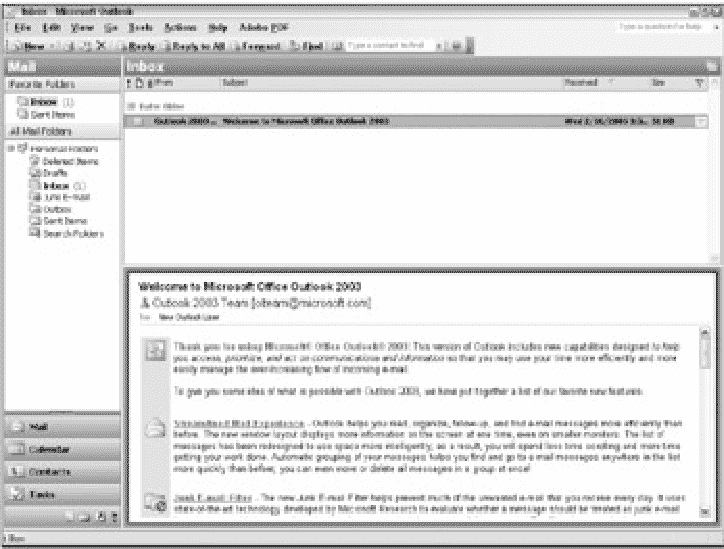

**图 7-1**

图 7-2 是 Mozilla Thunderbird 的截图。

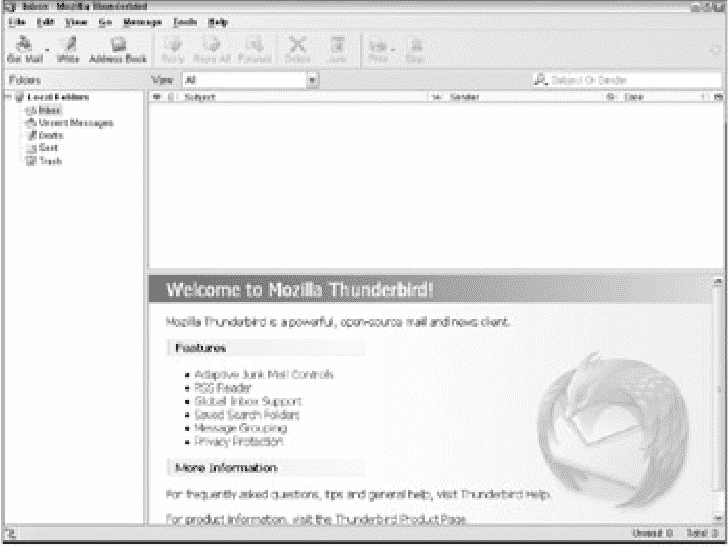

**图 7-2**

从图 7-1 和图 7-2 可以清楚地看到，邮件应用程序倾向于将邮箱和文件夹放在左侧，而将消息放在右侧。Eudora 和 Mac OS X Mail 也遵循这种布局方案。由于桌面应用程序在文件夹、按钮和消息的放置位置上趋于一致，你的基于 Web 的邮件程序可以从这种事实上的标准邮件应用程序布局中受益。

大多数开发者会倾向于使用框架（frame）来布局基于 Web 的邮件应用程序，以匹配流行的桌面邮件应用程序的布局。框架会增加应用程序开发的复杂性。对于这个 Web 应用程序，你不得不将文档分割成三个不同的框架——如果包含消息预览窗格，则是四个。基于 Web 的邮件应用程序不应使用超过一个框架，而且该框架仅在需要消息预览窗格时才应包含。消息必须在单独的窗口中显示，因为如今大多数消息都包含 HTML，而由于这些是完整的 HTML 文档，它们非常适合在框架中显示。应用程序的其余部分可以在单个文档中仅用 CSS 来布局。

如果需要使用 CSS 和标记来实现类似框架的设计，你有两条路线可走，但它们取决于布局方式：

- 固定定位适用于文档的某一部分保持不动而另一部分滚动的场景。这也优于框架，原因有几个。只需管理一个文档。如果需要动态层（如下拉菜单），框架设计将无法工作，因为层无法离开包含它的框架。框架对于使用语音合成浏览器的用户来说也不具备可访问性。
- 绝对定位加上 `overflow: auto;` 声明，适用于只有层（或你愿意称之为伪框架）的内容滚动或不涉及滚动的场景。

正如你在第 2 章中所看到的列布局，伪框架是通过 CSS 和标记使用拉伸技术创建的，该技术涉及同时使用偏移定位属性来隐式定义宽度。也就是说，在包含 `position: absolute;` 或 `position: fixed;` 声明的规则中，同时存在 `left: 0;` 和 `right: 0;` 就隐式定义了宽度。该元素会被拉伸到其相对定位元素的宽度。这些原则被用于创建左侧的文件夹窗口和右侧的消息摘要信息窗口。

此应用程序中的消息文件夹使用简单的无序列表来布局，而消息摘要则包含在简单的 HTML 表格中。

现在你已经了解了 Web 邮件应用程序样式化所需的各个组件的概览，下一节将展示源代码以及 CSS 如何与标记结合产生最终效果的解释。

## 代码及代码解释

要为基于 Web 的邮件应用程序设置样式，请按照以下步骤操作：

1. 输入以下标记：

```html
<!DOCTYPE html PUBLIC "-//W3C//DTD XHTML 1.0 Strict//EN"
"http://www.w3.org/TR/xhtml1/DTD/xhtml1-strict.dtd">
<html xmlns='http://www.w3.org/1999/xhtml' xml:lang='en'>
    <head>
        <meta http-equiv='content-type' content='text/html; charset=utf-8' />
        <meta http-equiv='content-language' content='en-us' />
        <title>Mail</title>
        <link rel='stylesheet' type='text/css' href='styles/mail.css' />
    </head>
    <body>
        <div id='mail-tools'>
            <table>
                <tbody>
                    <tr>
                        <td class='reply'>
                            
                        </td>
                        <td class='reply-all'>
                            
                        </td>
                        <td class='forward'>
                            
                        </td>
                        <td class='compose'>
                            
                        </td>
                        <td class='address-book'>
                            
                        </td>
                        <td class='delete'>
                            
                        </td>
                    </tr>
                </tbody>
            </table>
        </div>
        <div id='mailboxes'>
            <ul>
                <li class='mailbox'>
                    richard@localhost
                    <ul class='folders'>
                        <li class='inbox'>
                            Inbox <span class='inbox-count'>5</span>
                            <ul class='folders'>
                                <li>
                                    <span>p2p.proxom.com</span>
                                    <ul>
                                        <li><span>BegCSS</span></li>
                                        <li class='selected-folder'><span>CSS</span></li>
                                        <li><span>HTML_Code</span></li>
                                        <li><span>Javascript</span></li>
                                        <li><span>Javascript_how</span></li>
                                        <li><span>PHP_How</span></li>
                                        <li><span>Other</span></li>
                                    </ul>
                                </li>
                                <li><span>W3C=CSS</span></li>
                                <li><span>IE7</span></li>
                            </ul>
                        </li>
                        <li class='drafts'>
                            Drafts <span class='drafts-count'>1</span>
                        </li>
                        <li class='sent'>Sent</li>
                        <li class='trash'>Trash</li>
                    </ul>
                </li>
                <li class='mailbox'>
                    webmaster@localhost
                    <ul class='folders'>
                        <li class='inbox'>
                            Inbox <span class='inbox-count'>3</span>
                        </li>
                        <li class='drafts'>
                            Drafts <span class='drafts-count'>2</span>
                        </li>
                        <li class='sent'>Sent</li>
                        <li class='trash'>Trash</li>
                    </ul>
                </li>
            </ul>
        </div>
        <div id='messages'>
            <table>
                <colgroup>
                    <col id='mail-attachments-col' />
                    <col id='mail-subject-col' />
                    <col id='mail-sender-col' />
                    <col id='mail-date-col' />
                </colgroup>
                <thead>
                    <tr>
                        <th></th>
                        <th>Subject</th>
                        <th>Sender</th>
                        <th>Date</th>
                    </tr>
                </thead>
                <tbody>
                    <tr>
                        <td class='mail-attachment'></td>
                        <td class='mail-subject'>
                            <a href='#'>[CSS] CSS and frameset capabilities</a>
                        </td>
                        <td class='mail-sender'>
                            <a href='#' title='&lt;donotreply@wrox.com&gt;'>
                                Wrox P2P Forum Subscriptions
                            </a>
                        </td>
                        <td class='mail-date'>11:58 AM</td>
                    </tr>
                    <tr>
                        <td class='mail-attachment'></td>
                        <td class='mail-subject'>
                            <a href='#'>[CSS] aspx inside of css</a>
                        </td>
                        <td class='mail-sender'>
                            <a href='#' title='&lt;donotreply@wrox.com&gt;'>
                                Wrox P2P Forum Subscriptions
                            </a>
                        </td>
                        <td class='mail-date'>4:45 AM</td>
                    </tr>
                    <tr>
                        <td class='mail-attachment'></td>
                        <td class='mail-subject'>
                            <a href='#'>[CSS] aspx inside of css</a>
                        </td>
                        <td class='mail-sender'>
                            <a href='#' title='&lt;donotreply@wrox.com&gt;'>
                                Wrox P2P Forum Subscriptions
                            </a>
                        </td>
                        <td class='mail-date'>2:12 PM</td>
                    </tr>
                    <tr>
                        <td class='mail-attachment'></td>
                        <td class='mail-subject'>
                            <a href='#'>
                                [CSS] fixing header, and first column of table.
                            </a>
                        </td>
                        <td class='mail-sender'>
                            <a href='#' title='&lt;donotreply@wrox.com&gt;'>
                                Wrox P2P Forum Subscriptions
                            </a>
                        </td>
                        <td class='mail-date'>October 27, 2005 5:32 AM</td>
                    </tr>
                </tbody>
            </table>
        </div>
    </body>
</html>
```


## 代码与代码详解

```html
</tr>
<tr>
    <td class='mail-attachment'></td>
    <td class='mail-subject'>
        <a href='#'>
            [CSS] fixing header, and first column of table.
        </a>
    </td>
    <td class='mail-sender'>
        <a href='#' title='&lt;donotreply@wrox.com&gt;'>
            Wrox P2P Forum Subscriptions
        </a>
    </td>
    <td class='mail-date'>October 21, 2005 7:09 AM</td>
</tr>
<tr>
    <td class='mail-attachment'></td>
    <td class='mail-subject'>
        <a href='#'>
            [CSS] fixing header, and first column of table.
        </a>
    </td>
    <td class='mail-sender'>
        <a href='#' title='&lt;donotreply@wrox.com&gt;'>
            Wrox P2P Forum Subscriptions
        </a>
    </td>
    <td class='mail-date'>October 21, 2005 7:11 AM</td>
</tr>
<tr>
    <td class='mail-attachment'></td>
    <td class='mail-subject'>
        <a href='#'>
            [CSS] fixing header, and first column of table.
        </a>
    </td>
    <td class='mail-sender'>
        <a href='#' title='&lt;donotreply@wrox.com&gt;'>
            Wrox P2P Forum Subscriptions
        </a>
    </td>
    <td class='mail-date'>October 21, 2005 8:09 AM</td>
</tr>
<tr>
    <td class='mail-attachment'></td>
    <td class='mail-subject'>
        <a href='#'>
            [CSS] fixing header, and first column of table.
        </a>
    </td>
    <td class='mail-sender'>
        <a href='#' title='&lt;donotreply@wrox.com&gt;'>
            Wrox P2P Forum Subscriptions
        </a>
    </td>
    <td class='mail-date'>October 21, 2005 8:25 AM</td>
</tr>
<tr>
    <td class='mail-attachment'></td>
    <td class='mail-subject'>
        <a href='#'>
            [CSS] fixing header, and first column of table.
        </a>
    </td>
    <td class='mail-sender'>
        <a href='#' title='&lt;donotreply@wrox.com&gt;'>
            Wrox P2P Forum Subscriptions
        </a>
    </td>
    <td class='mail-date'>October 21, 2005 8:33 AM</td>
</tr>
</tbody>
</table>
</div>
</body>
</html
```

- 2. 将上述标记保存为 `mail.html`。
- 3. 输入以下样式表：

```css
html,
body {
    width: 100%;
    height: 100%;
    margin: 0;
    padding: 0;
    font: 12px sans-serif;
    background: url('../images/brushed_metal.png');
}

a {
    color: #369;
    text-decoration: none;
}
div#mail-tools {
    padding: 8px 0 0 8px;
}
td.compose {
    padding-left: 25px;
}
td.address-book {
    padding-right: 25px;
}
div#mailboxes,
div#messages {
    position: absolute;
    top: 0;
    bottom: 0;
    border: 1px solid rgb(128, 128, 128);
    overflow: auto;
}

div#mailboxes {
	left: 0;
	width: 200px;
	margin: 52px 0 10px 10px;
	background: #fff;
}

div#messages {
	left: 0;
	right: 0;
	margin: 52px 10px 10px 220px;
	background: url('../images/stripes.png');
}

div#messages > table {
	width: 100%;
	border-collapse: collapse;
}

div#messages > table th {
	background: rgb(249, 250, 253);
	border-bottom: 1px solid rgb(200, 200, 200);
	text-align: left;
	padding: 2px 4px;
}

div#messages > table th + th {
	border-left: 1px solid rgb(200, 200, 200);
}

.col#mail-sender-col,
.col#mail-date-col,
.col#mail-attachments-col {
	width: 1%;
}

td.mail-sender,
td.mail-date {
	white-space: nowrap;
	padding: 0 4px;
}

div#messages > table tbody tr {
	height: 20px;
}

div#messages > table tbody tr:hover {
	background: #369;
	color: #fff;
}

div#messages > table tbody tr:hover a {
	color: #fff;
}

td.mail-subject {
	background: url('../images/16x16/2381.png') no-repeat left;
	padding-left: 20px;
	white-space: nowrap;
}

div#mailboxes ul {
	list-style: none;
	margin: 0;
	padding: 10px;
}

li.mailbox {
    padding: 5px 0 0 0;
    font-weight: bold;
}
li.mailbox + li.mailbox {
    border-top: 1px solid rgb(200, 200, 200);
}
li.mailbox * {
    font-weight: normal;
}
li.mailbox > ul > li {
    padding-left: 20px;
    min-height: 20px;
}
li.inbox {
    background: url('../images/inbox.png') no-repeat top left;
}
li.drafts {
    background: url('../images/drafts.png') no-repeat top left;
}
li.sent {
    background: url('../images/sent.png') no-repeat top left;
}
li.trash {
    background: url('../images/trash.png') no-repeat top left;
}
span.inbox-count,
span.drafts-count {
    font-weight: bold;
}
span.inbox-count::before,
span.drafts-count::before {
    content: '(';
}
span.inbox-count::after,
span.drafts-count::after {
    content: ')';
}
ul.folders ul.folders li {
    background: url('../images/folder.png') no-repeat top left;
    padding-left: 20px;
}
ul.folders ul.folders ul {
    position: relative;
    left: -20px;
}
li.selected-folder > span {
    background: #369;
    color: #fff;
}
ul.folders ul.folders span:hover {
    background: #369;
    color: white;
}
```

- 4. 将上述样式表保存为 `mail.css`。

结果如图 7-3 所示。

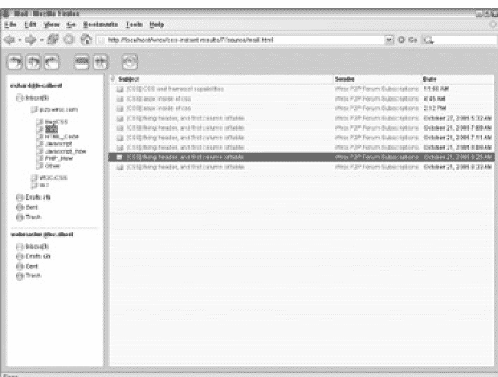

**图 7-3**

正如你从前面的源代码中所见，创建一个基于 Web 的邮件应用程序其实并不复杂。当然，我提供的是一个极简版本，并不包含 Web 邮件的其他方面，例如撰写邮件、查看地址簿、配置菜单等。

本节的其余部分将回顾 `mail.css` 中应用的每一条规则，并解释为什么需要每条规则。

`mail.css` 中出现的第一个规则适用于 `<html>` 和 `<body>` 元素。它们被赋予了 100% 的宽度和高度，因为默认情况下，块级元素在垂直方向上仅扩展到足以容纳其内部静态定位内容的程度。由于用于邮件文件夹的 `<div>` 元素和用于邮件摘要的窗口是绝对定位的，它们不会影响 `<html>` 和 `<body>` 元素的高度，但它们的尺寸必须基于 `<html>` 和 `<body>` 元素的宽度和高度，以便创建能随浏览器窗口调整大小的伪框架窗口。接下来的两个声明移除了默认的外边距（margin）或内边距（padding）。`<html>` 元素没有默认的外边距或内边距，但 `<body>` 元素根据浏览器的不同可能会有其中之一。在 Opera 中是内边距，在 Mozilla Firefox 和 IE 中则是外边距。

```css
html,
body {
    width: 100%;
    height: 100%;
    margin: 0;
    padding: 0;
    font: 12px sans-serif;
    background: url('../images/brushed_metal.png');
}
```

下一个声明将整个文档的字体设置为 12 像素的通用无衬线字体（sans-serif）。最后，设置了一张背景图像；`brushed_metal.png` 旨在让邮件应用程序看起来像 Mac OS X 应用程序（例如 Mac OS X Mail）。该图像被设置为在 x 轴和 y 轴上重复。

接下来的规则设置链接的样式。通过以下规则，链接被设置为蓝色并移除了默认的下划线：

```css
a {
    color: #369;
    text-decoration: none;
}
```

接下来的规则是指向紧跟在起始 `<body>` 元素之后的 `<div>`，它具有 `mail-tools` ID 名称。这个 `<div>` 包含一个 `<table>` 元素，而该表格则承载着邮件应用程序的按钮。它被赋予了 8 像素的顶部内边距和 8 像素的左侧内边距，以便在视口（viewport）的顶部和左侧边界与 `<div>` 内部内容之间提供一定的空间：

```css
div#mail-tools {
    padding: 8px 0 0 8px;
}
```

接下来的两条规则是指向承载邮件应用程序控制按钮的 `<td>` 元素，具体来说是“撰写”和“地址簿”按钮。包含撰写按钮的 `<td>` 元素的左侧应用了 25 像素的内边距，而包含地址簿按钮的 `<td>` 元素的右侧应用了 25 像素的内边距。这在不同类型的控件之间提供了一定的间隔：

```css
td.compose {
    padding-left: 25px;
}
td.address-book {
    padding-right: 25px;
}
```

下一条规则适用于具有 `mailboxes` ID 名称的 `<div>`（承载邮件文件夹）和具有 `messages` ID 名称的 `<div>`（承载邮件摘要信息），并应用一些这两个 `<div>` 元素共有的样式。首先应用了 `position: absolute;` 声明；由于这两个元素是 `<body>` 元素的子元素，因此这两个 `<div>` 元素相对于 `<body>` 元素进行定位。`top: 0;` 和 `bottom: 0;` 声明使 `<div>` 元素根据 `<body>` 元素的高度拉伸其自身高度，而正如你在本节前面看到的，`<body>` 的宽度和高度基于其父元素 `<html>` 元素，而 `<html>` 的宽度和高度又基于浏览器视口的宽度和高度。`top: 0;` 和 `bottom: 0;` 属性的组合使得 `mailboxes` 和 `messages` `<div>` 元素的垂直尺寸依赖于视口的高度。接下来，每个 `<div>` 元素被赋予一个 1 像素的实线灰色边框。最后一个声明 `overflow: auto;` 使得如果 `<div>` 内部包含的内容超过其尺寸，则每个 `<div>` 都会出现滚动条：

```css
div#mailboxes,
div#messages {
    position: absolute;
    top: 0;
    bottom: 0;
    border: 1px solid rgb(128, 128, 128);
    overflow: auto;
}
```

接下来的规则同样是指向具有 `mailboxes` ID 名称的 `<div>`。它接收 `left: 0;` 声明以将其定位在窗口的左侧，然后获得 200 像素的固定宽度。外边距经过调整以适应按钮

在视口的顶部。将上边距设置为 52 像素可以防止 `<div>` 与这些按钮重叠。下边距和左边距设置为 10 像素，以在视口的左、下边框与 `<div>` 的左、下边框之间留出一定间距。最后，`<div>` 设置为白色背景：

```css
div#mailboxes {
	left: 0;
	width: 200px;
	margin: 52px 0 10px 10px;
	background: #fff;
}
```

在下一条规则中，`<div>` 通过其 `messages` id 名称单独引用。前两个声明 `left: 0;` 和 `right: 0;` 将 `<div>` 拉伸至与视口同宽，然后像上一条规则一样为该 `<div>` 调整边距。52 像素的上边距防止 `<div>` 与邮件应用程序顶部的按钮重叠，然后在右侧和底部应用 10 像素，以在 `<div>` 的右、下边框与视口的右、下边框之间留出一定间距。左侧应用 220 像素的边距，以防止 `<div>` 与左侧的 `mailboxes` `<div>` 重叠。最后一条声明指定了 `stripes.png` 图像，该图像设置为沿 x 轴和 y 轴重复：

```css
div#messages {
	left: 0;
	right: 0;
	margin: 52px 10px 10px 220px;
	background: url('.../images/stripes.png');
}
```

以下规则应用于包含邮件摘要信息的 `<table>` 元素，例如主题、发件人、邮件是否有附件以及邮件发送日期。首先将 `<table>` 元素的宽度设置为 100%，使其与 `messages` `<div>` 等宽。第二个声明 `border-collapse: collapse;` 去除了表格单元格之间的默认间距：

```css
div#messages > table {
	width: 100%;
	border-collapse: collapse;
}
```

设置好表格后，在下一条规则中，为表格的标题元素应用样式。每个 `<th>` 被设置为米白色背景，以及 1 像素的实线灰色底部边框。`<th>` 元素中的文本默认通常为居中；包含 `text-align: left;` 声明以强制文本左对齐。最后，在每个 `<th>` 元素的顶部和底部应用 2 像素的内边距，在左侧和右侧应用 4 像素的内边距：

```css
div#messages > table th {
	background: rgb(249, 250, 253);
	border-bottom: 1px solid rgb(200, 200, 200);
	text-align: left;
	padding: 2px 4px;
}
```

下一条规则在每个 `<th>` 元素之间放置边框。通过使用选择器 `div#messages > table th + th`，可以选择除第一个以外的每个 `<th>` 元素。这样做是为了确保除第一个之外的所有 `<th>` 元素只有左边框，否则第一个 `<th>` 元素也会出现左边框：

```css
div#messages > table th + th {
	border-left: 1px solid rgb(200, 200, 200);
}
```

## 代码与代码说明

通过下一条规则，将附件、发件人和日期列设置为尽可能小，声明为 `width: 1%;`。因为 `<table>` 元素不会遵循显式宽度，实际上将宽度和高度更像是最小宽度和高度，这使得这些列占据尽可能少的空间，而主题列则占据剩余的空间：

```css
col#mail-sender-col,
col#mail-date-col,
col#mail-attachments-col {
    width: 1%;
}
```

由于发件人和日期列被设置为最小，导致文本换行，因此设置 `white-space: nowrap;` 声明以防止文本换行。此外，由于每列的大小，发件人列的文本紧挨着日期列，因此在左侧和右侧添加 4 像素的内边距，以使每列的文本稍微隔开一些：

```css
td.mail-sender,
td.mail-date {
    white-space: nowrap;
    padding: 0 4px;
}
```

在下一条规则中将每个 `<tr>` 元素的高度设为 20 像素，为消息窗口中的每条消息之间提供一些间距：

```css
div#messages > table tbody tr {
    height: 20px;
}
```

如果用户的鼠标光标悬停在其邮箱中的某条消息上，则应用下一条规则。它将应用蓝色背景和白色文本：

```css
div#messages > table tbody tr:hover {
    background: #369;
    color: #fff;
}
```

由于前一条规则在用户的鼠标悬停在邮箱中的某条消息上时应用蓝色背景和白色文本，链接颜色也会发生变化。以下规则在这种情况下将链接变为白色：

```css
div#messages > table tbody tr:hover a {
    color: #fff;
}
```

下一条规则应用于 "messages" 视图的主题列。首先应用一个信封图标，该图标是从 Microsoft Outlook 2003 中"借用"的。为防止主题文本与信封图标重叠，应用 20 像素的左内边距。最后，与日期列和发件人列一样，使用 `white-space: nowrap;` 声明防止文本换行：

```css
td.mail-subject {
    background: url('../images/16x16/2381.png') no-repeat left;
    padding-left: 20px;
    white-space: nowrap;
}
```

下一系列规则应用于应用程序左侧的邮箱文件夹。首先为 `mailboxes` `<div>` 元素中包含的所有 `<ul>` 元素设置一些默认值。使用 `list-style: none;` 声明去除默认列表项目符号。使用 `margin: 0;` 声明去除默认边距，然后为每个 `<ul>` 元素应用 10 像素的内边距：

```css
div#mailboxes ul {
    list-style: none;
    margin: 0;
    padding: 10px;
}
```

包含电子邮件地址的顶级 `<li>` 元素每个都被赋予 `mailbox` 类名。应用 5 像素的顶部内边距，以在顶部邮箱与 `mailboxes` `<div>` 元素的顶部边框之间以及每个邮箱之间提供一些空间。然后，使用 `font-weight: bold;` 声明将每个电子邮件地址的文本设置为粗体：

```css
li.mailbox {
    padding: 5px 0 0 0;
    font-weight: bold;
}
```

在下一条规则中使用选择器 `li.mailbox + li.mailbox`，使每个邮箱之间出现 1 像素的实线灰色边框：

```css
li.mailbox + li.mailbox {
    border-top: 1px solid rgb(200, 200, 200);
}
```

由于在前面的规则中将每个电子邮件地址的文本设置为粗体，以下规则通过将 `mailbox` 类名的 `<li>` 元素的所有后代的 `font-weight` 属性重置为 `normal` 来覆盖继承：

```css
li.mailbox * {
    font-weight: normal;
}
```

下一条规则为具有 `inbox`、`drafts`、`sent` 和 `trash` 类名的 `<li>` 元素准备接收图标。首先将左内边距设置为 20 像素，以防止每个 `<li>` 元素的文本与图标重叠，并设置 20 像素的最小高度，以防止如果 `<li>` 元素的高度不足以容纳图标时图标被裁剪：

```css
li.mailbox > ul > li {
    padding-left: 20px;
    min-height: 20px;
}
```

下一系列规则为具有 `inbox`、`drafts`、`sent` 和 `trash` 类名的 `<li>` 元素放置图标——每个 `<li>` 元素设置一个不重复的不同颜色的圆球，位于每个元素的顶部和左侧：

```css
li.inbox {
    background: url('../images/inbox.png') no-repeat top left;
}
li.drafts {
    background: url('../images/drafts.png') no-repeat top left;
}
li.sent {
    background: url('../images/sent.png') no-repeat top left;
}
li.trash {
    background: url('../images/trash.png') no-repeat top left;
}
```

下一条规则将收件箱和草稿箱文件夹的邮件计数设置为粗体：

```css
span.inbox-count,
span.drafts-count {
    font-weight: bold;
}
```

由于并非所有人都希望邮件计数周围有括号，因此以下两条规则允许使用 `::before` 和 `::after` 伪元素以及 `content` 属性从样式表进行自定义：

```css
span.inbox-count::before,
span.drafts-count::before {
    content: '(';
}
span.inbox-count::after,
span.drafts-count::after {
    content: ')';
}
```

下一条规则将文件夹图标应用于收件箱文件夹的子文件夹。与前面规则中的图标一样，背景设置为顶部和左侧不重复，然后调整左内边距以防止文件夹名称的文本与文件夹图标重叠：

```css
ul.folders ul.folders li {
    background: url('../images/folder.png') no-repeat top left;
    padding-left: 20px;
}
```

下一条规则通过包含 `position: relative;` 声明，并从左侧负偏移 20 像素来调整子文件夹的位置：

```css
ul.folders ul.folders ul {
    position: relative;
    left: -20px;
}
```

用户可能会欣赏他们当前正在查看的文件夹在左侧目录结构中高亮显示。这是通过以下规则实现的。它将所选文件夹的 `<span>` 子元素设置为蓝色背景和白色文本：

```css
li.selected-folder > span {
    background: #369;
    color: #fff;
}
```

最后，最后一条规则与上一条类似，为 `<span>` 元素提供蓝色背景和白色文本，但这次仅在用户的鼠标悬停在其中一个元素上时：

```css
ul.folders ul.folders span:hover {
    background: #369;
    color: white;
}
```

现在你已经了解了邮件应用程序的呈现方面如何与标记结合，在下一节中，你将了解我们的老朋友 Internet Explorer，以及需要进行哪些调整才能使设计在 Internet Explorer 6 中与其他浏览器一样出色。


 ## 代码与代码说明

## 测试与注意事项

在本节中，你将[上一节](previous section)的最终成果进行更严格的测试，这包括在 Windows 的 Internet Explorer 中时查看该项目。

你可能已经猜到了，就目前而言，这个邮件应用在 Internet Explorer 中看起来与专业设计的网页毫无相似之处。好消息是，要让 Internet Explorer 达到与 Mozilla Firefox ， 不相上下的水平，所需的改动并不多。

[图 7-4](Figure 7-4)展示了邮件应用目前在 Internet Explorer 6 中的样子。

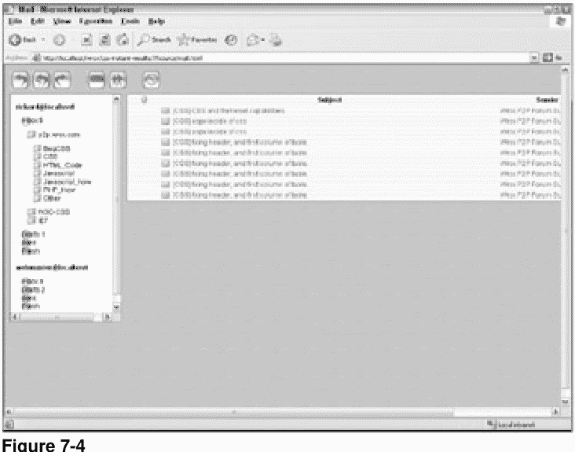

**图 7-4**

这又是 Dean Edwards 那款出色的 IE7 JavaScript 出马的时候吗？当然。[图 7-5](Figure 7-5)展示了应用了 Dean 的 IE7 后邮件应用的样子。

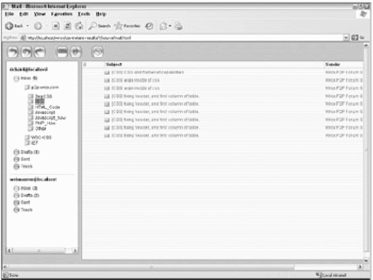

### 图 7-5

即使应用了 Dean 的 IE7 JavaScript，邮件应用仍不完美。这个应用暴露出了 IE7 中的一些 bug（至少在撰写本文时如此——我敢肯定 Dean covered 然后我就去掉原文.）。当我打字时，Dean 正在修复这些问题，这些问题与使用 margin 以及使用 offset 属性组合来 implied width 或 height 有关。

在图 7-5 中，渲染存在以下问题：

- 在 `messages` `<div>` 元素上指定的左边距，同时使用了左右 offset 属性组合来 implied width，但该左边距不会像在 Firefox 中那样从宽度中减去。
- 附件列太宽。
- 顶部的图标是带有透明部分的 PNG 图像；IE 默认不支持透明 PNG 图像。
- 当鼠标悬停在邮件上时，主题列中不会出现蓝色背景。
- `mailboxes` `<div>` 稍微短了一点。
- 视口存在垂直和水平滚动条。

这里列出的渲染问题并不会导致邮件应用无法使用。要解决这些问题，请按以下步骤操作：

1. 打开 `mail.html` 并进行以下更改：

```
<!DOCTYPE html PUBLIC "-//W3C//DTD XHTML 1.0 Strict//EN"
"http://www.w3.org/TR/xhtml1/DTD/xhtml1-strict.dtd">
<html xmlns='http://www.w3.org/1999/xhtml' xml:lang='en'>
    <head>
        <meta http-equiv='content-type' content='text/html; charset=utf-8' />
        <meta http-equiv='content-language' content='en-us' />
        <title>Mail</title>
        <link rel='stylesheet' type='text/css' href='styles/mail.css' />
        <!-- compliance patch for microsoft browsers -->
<!--[if lt IE 7]>
    <script src="/ie7/ie7-standard-p.js" type="text/javascript">
    </script>
    <link rel='stylesheet' type='text/css' href='styles/mail.ie.css' />
<![endif]-->
</head>
<body id='mail'>
    <div id='mail-tools'>
        <table>
            <tbody>
                <tr>
                    <td class='reply'>
                        
                    </td>
                    <td class='reply-all'>
                        
                    </td>
                    <td class='forward'>
                        
                    </td>
                    <td class='compose'>
                        
                    </td>
                    <td class='address-book'>
                        
                    </td>
                    <td class='delete'>
                        
                    </td>
                </tr>
            </tbody>
        </table>
    </div>
    <div id='mailboxes'>
        <ul>
```

2. 将修改后的文件保存为 `mail.ie.html`。

3. 输入以下样式表：

```
col#mail-attachments-col {
    width: 1px;
}
div#messages > table tbody tr:hover td.mail-subject {
    background: #369 url('../images/16x16/2381.png') no-repeat left;
}
div#messages {
    width: expression(
        document.getElementById('mail').offsetWidth - 235
    );
}
div#messages,
div#mailboxes {
    height: expression(
        document.getElementById('mail').offsetHeight - 65
    );
}
```

4. 将新的样式表保存为 `mail.ie.css`。

这些修改后的结果如图 7-6 所示。

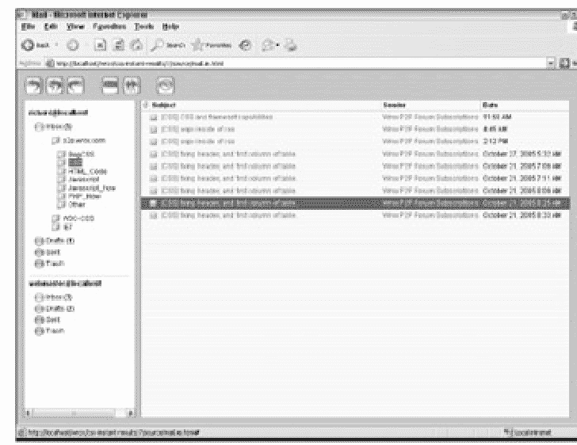

**图 7-6**

你所做的修改使 Internet Explorer 的渲染效果与 Firefox、Opera 和 Safari 齐平。

第一个修改为每个透明 PNG 图像添加了 "-trans" 前缀。"-trans" 前缀被 Dean Edwards 的 IE7 JavaScript 用作过滤器，提醒 IE7 哪些 PNG 图像需要应用特殊的透明 PNG  hack。在第 9 章中，你将深入了解这个 hack 的工作原理；对于这个项目来说，"-trans" 前缀是一种快速而简单的方法，用来绕过 Internet Explorer 缺乏原生 PNG 透明度支持的问题。

本节其余部分将详细检查 `menu.ie.css` 中的每条规则，并解释它们为什么有效。

在第一条规则中，你为邮件附件列应用了 `width: 1px;` 声明。对所有列指定 `width: 1px;` 会导致 IE 忽略 Sender 和 Date 列上的 `white-space: nowrap;` 声明，因此这些列保留 `menu.css` 中原先指定的 `width: 1%;` 声明，而 Attachments 列则获得 `width: 1px;`：

```
col#mail-attachments-col {
    width: 1px;
}
```

下一条规则修正了 IE 在鼠标悬停时不会将 Subject 列的背景变为蓝色的问题。结果发现这是因为该列指定了背景，即信封图标。为了修正这个问题，当用户鼠标悬停在父级 `<tr>` 元素上时，选择具有 `mail-subject` 类名的 `<td>`，然后为子级 `<td>` 显式指定与父级 `<tr>` 元素相同的蓝色背景（以及信封图标）：

```
div#messages > table tbody tr:hover td.mail-subject {
    background: #369 url('../images/16x16/2381.png') no-repeat left;
}
```

接下来，修正 `messages` `<div>` 的宽度。这里使用的技术与你之前在[第 2 章](…)中相同，在标题为"老派 Internet Explorer Hacking"一节中介绍过——使用了 Microsoft 专有的 `expression()` 功能来直接在样式表中包含 JavaScript。你为 `<body>` 元素应用了 `mail` id 名称，这里就是使用 `getElementById()` 方法引用它的。`offsetWidth` 属性用于获取 `<body>` 元素的宽度，然后减去 235 像素，这包括 `mailboxes` `<div>` 的宽度以及该 `<div>` 元素左右两侧的边距：

```
div#messages {
    width: expression(
        document.getElementById('mail').offsetWidth - 235
    );
}
```

在 `mail.ie.css` 的最后一条规则中，你修正了 `messages` 和 `mailboxes` 这两个 `<div>` 元素的高度。这里同样使用 `expression()` 功能来获取 `<body>` 元素的 `offsetHeight` 属性，然后减去 65 像素，这样每个 `<div>` 元素的高度就进行了调整，以考虑文档顶部按钮的空间以及每个 `<div>` 元素下方的边距：

```
div#messages,
div#mailboxes {
    height: expression(
        document.getElementById('mail').offsetHeight - 65
    );
}
```

攻克了 Internet Explorer 之后，[下一节](...)将介绍邮件应用的一些替代方法。


## 使用与修改项目

在本节中，你将看到针对该 Web 邮件应用程序的以下两种实现方案：

- 通过内联框架（inline frame）为邮件添加预览窗格。
- 将文档重构为类似于 Microsoft Outlook 2003 的三栏格式。

添加预览窗格是一项相对简单的任务：只需添加一个内联框架，然后对消息 `<div>` 应用一些样式进行调整大小以适应该框架即可。你将在下一节中看到具体操作方法。

### 添加邮件预览窗格

由于邮件可能是 HTML 或纯文本格式，因此邮件预览窗格必须是一个内联框架，以便将其隔离为独立的文档。要添加邮件预览窗格，请执行以下步骤：

1. 对 `mail.ie.html` 进行以下修改：

```html
<!DOCTYPE html PUBLIC "-//W3C//DTD XHTML 1.0 Frameset//EN"
"http://www.w3.org/TR/xhtml1/DTD/xhtml1-frameset.dtd">
<html xmlns='http://www.w3.org/1999/xhtml' xml:lang='en'>
    <head>
        <meta http-equiv='content-type' content='text/html; charset=utf-8' />
        <meta http-equiv='content-language' content='en-us' />
        <title>Mail</title>
        <link rel='stylesheet' type='text/css'
            href='styles/mail.messagePreview.css' />
        <!-- compliance patch for microsoft browsers -->
        <!--[if lt IE 7]>
            <script src="/ie7/ie7-standard-p.js" type="text/javascript">
            </script>
            <link rel='stylesheet' type='text/css'
                href='styles/mail.ie.messagePreview.css' />
        <![endif]-->
    </head>
    <body id='mail'>
        <div id='mail-tools'>
            <table>
                <tbody
```

2. 继续修改 `mail.ie.html`，添加以下标记：

```html
                    <tr>
                        <td class='mail-attachment'></td>
                        <td class='mail-subject'>
                            <a href='#'>
                                [CSS] fixing header, and first column of table.
                            </a>
                        </td>
                        <td class='mail-sender'>
                            <a href='#' title='&lt;donotreply@wrox.com&gt;'>
                                Wrox P2P Forum Subscriptions
                            </a>
                        </td>
                        <td class='mail-date'>October 21, 2005 8:33 AM</td>
                    </tr>
                </tbody>
            </table>
        </div>
        <iframe id='message-preview'
                name='message_preview'
                src=''
                frameborder='0'
                marginwidth='0'
                marginheight='0'></iframe>
    </body>
</html
```

3. 将修改后的文档保存为 `mail.messagePreview.html`。

4. 对 `mail.css` 进行以下更改：

```css
div#mailboxes,
div#messages {
    position: absolute;
    top: 0;
    bottom: 0;
    border: 1px solid rgb(128, 128, 128);
    overflow: auto;
}
div#mailboxes {
    left: 0;
    width: 200px;
    margin: 52px 0 10px 10px;
    background: #fff;
}
div#messages {
    left: 0;
    right: 0;
    margin: 52px 10px 300px 220px;
    background: url('../images/stripes.png');
}
div#messages > table {
    width: 100%;
    border-collapse: collapse;
}
```

5. 继续对 `mail.css` 进行更改。添加以下规则：

```css
ul.folders ul.folders ul {
    position: relative;
    left: -20px;
}
li.selected-folder > span {
    background: #369;
    color: #fff;
}
ul.folders ul.folders span:hover {
    background: #369;
    color: white;
}
iframe#message-preview {
    position: absolute;
    border: 1px solid rgb(128, 128, 128);
    bottom: 0;
    left: 0;
    right: 0;
    margin: 0 10px 10px 220px;
    height: 280px;
    background: #fff;
}
```

6. 将文件保存为 `mail.messagePreview.css`。

7. 对 `mail.ie.css` 进行以下修改：

```css
col#mail-attachments-col {
    width: 1px;
}
div#messages > table tbody tr:hover td.mail-subject {
    background: #369 url('../images/16x16/2381.png') no-repeat left;
}
div#messages {
    width: expression(
        document.getElementById('mail').offsetWidth - 235
    );
    height: expression(
        document.getElementById('mail').offsetHeight - 355
    );
}
div#mailboxes {
    height: expression(
        document.getElementById('mail').offsetHeight - 65
    );
}
iframe#message-preview {
    width: expression(
        document.getElementById('mail').offsetWidth - 235
    );
}
```

8. 将文件保存为 `mail.ie.messagePreview.css`。

在 Firefox 中，你可以看到图 7-7 所示的输出。

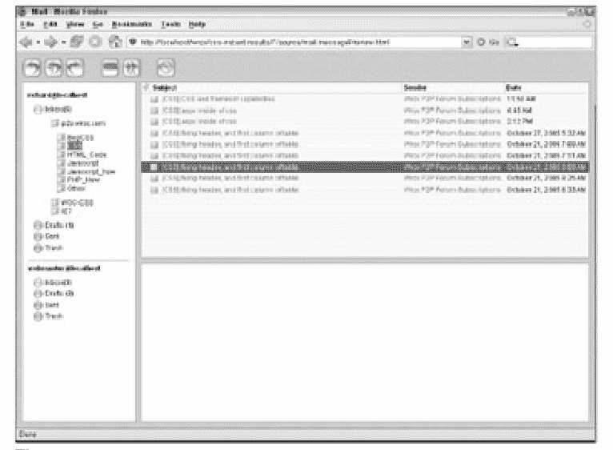
**图 7-7**

在 Internet Explorer 中，你可以看到图 7-8 所示的输出。

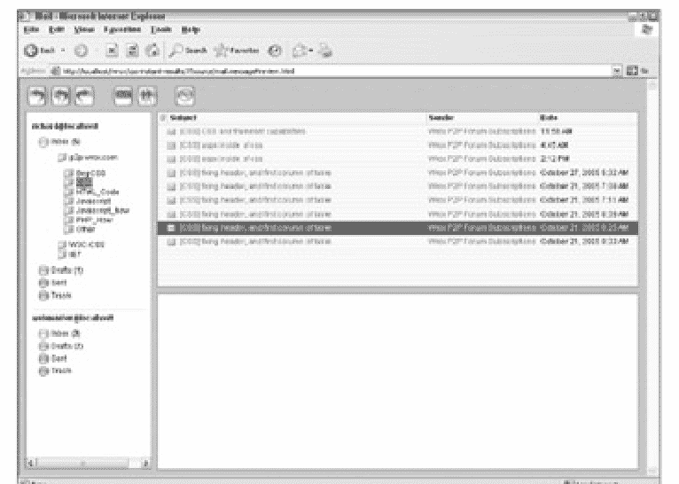
**图 7-8**

为邮件应用程序添加邮件预览窗格是一个相当简单的过程。首先，因为文档包含一个内联框架，你将文档类型声明（Document Type Declaration）更改为 XHTML frameset 文档类型声明。然后，你修改了样式表的路径以反映新的文件名。在文档末尾，在 `messages <div>` 的闭合 `</div>` 标签之后，你添加了一个 `<iframe>` 元素，用于预览邮件。在 `mail.css` 中，你通过修改以下规则为新的 `<iframe>` 元素留出空间：

```css
div#messages {
    left: 0;
    right: 0;
    margin: 52px 10px 300px 220px;
    background: url('../images/stripes.png');
}
```

底边距被大大增加，以便在视口中为 `<iframe>` 元素占据的区域留出空间。

随后应用了一条新规则来定位 `<iframe>` 元素。它被设置为绝对定位，并赋予一个与 mailboxes 和 messages `<div>` 元素相同的灰色实线边框。通过 `bottom: 0;` 声明将其定位在视口的底部，并通过 `left: 0;` 和 `right: 0;` 偏移属性的组合使其在视口宽度上延伸。接着指定外边距，使其与视口的右边框和底边框保持 10 像素的距离。然后指定 220 像素的左边距，以防止 `<iframe>` 元素与左侧的 mailboxes `<div>` 元素重叠。最后，`<iframe>` 元素被赋予 280 像素的高度和白色背景：

```css
iframe#message-preview {
    position: absolute;
    border: 1px solid rgb(128, 128, 128);
    bottom: 0;
    left: 0;
    right: 0;
    margin: 0 10px 10px 220px;
    height: 280px;
    background: #fff;
}
```

你所做的最后调整是为了解决 Internet Explorer 中的新不一致问题。

首先，你必须调整 `messages` `<div>` 元素的高度：

```css
div#messages {
    width: expression(
        document.getElementById('mail').offsetWidth - 235
    );
    height: expression(
        document.getElementById('mail').offsetHeight - 355
    );
}
```

在上述规则中，使用了微软专有的 `expression()` 特性来调整 messages `<div>` 元素的高度，以防止其与新添加的 `<iframe>` 元素重叠。355 这个值相当于 messages `<div>` 元素上方出现按钮的空间、`<iframe>` 元素的高度，以及必须从 messages 元素高度中减去的所有其他额外垂直空间（如外边距），以保持整体布局稳定。

你对 `mail.ie.messagePreview.css` 做的最后一项修改是为 `<iframe>` 元素添加一条新规则：

```css
iframe#message-preview {
    width: expression(
        document.getElementById('mail').offsetWidth - 235
    );
}
```

`<iframe>` 元素的宽度也必须进行调整，以便它在水平方向上占据 `mailboxes <div>` 与视口右边框之间的所有可用空间。你从 `<body>` 元素的宽度中减去 235 像素，以适应 `mailboxes <div>` 的宽度，从而使 `<iframe>` 在 Internet Explorer 中的渲染效果与在 Firefox 中一致。

在下一节中，你将学习如何实现像 Microsoft Office 2003 那样的三栏布局。

### 仿 Microsoft Outlook 2003 的三栏布局

本节概述如何修改项目，使其具有类似于 Microsoft Outlook 2003 的三栏布局。图 7-9 是 Microsoft Outlook 2003 三栏视图的屏幕截图。

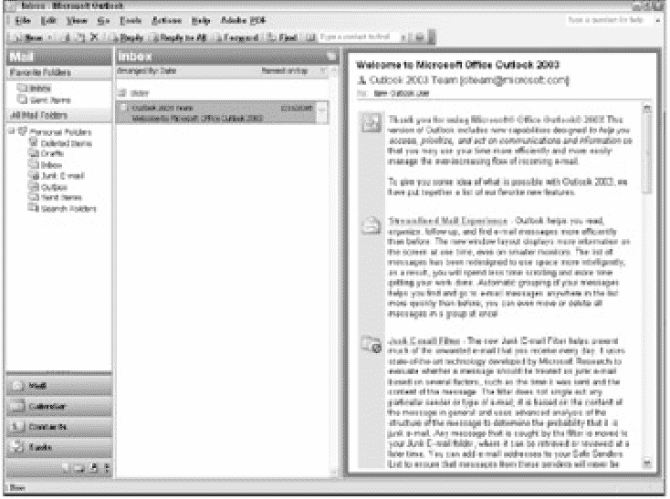
**图 7-9**

要制作一个像 Microsoft Outlook 2003 这样的邮件应用程序布局，请执行以下步骤：

1. 对 `mail.messagePreview.html` 进行以下修改：

```html
<!DOCTYPE html PUBLIC "-//W3C//DTD XHTML 1.0 Frameset//EN"
"http://www.w3.org/TR/xhtml1/DTD/xhtml1-frameset.dtd">
<html xmlns='http://www.w3.org/1999/xhtml' xml:lang='en'>
    <head>
        <meta http-equiv='content-type' content='text/html; charset=utf-8' />
        <meta http-equiv='content-language' content='en-us' />
        <title>Mail</title>
        <link rel='stylesheet' type='text/css' href='styles/mail.outlook2k3.css' />
        <!-- compliance patch for microsoft browsers -->
        <!--[if lt IE 7]>
            <script src="/ie7/ie7-standard-p.js" type="text/javascript">
            </script>
```


 ## 使用与修改项目

```
<link rel='stylesheet' type='text/css'
    href='styles/mail.ie.outlook2k3.css' />
<![endif]-->
</head>

<body id='mail'>
    <div id='mail-tools'>
        <table>
            <tbody>
                <tr>
                    <td class='reply'>
                        
                    </td>
                    <td class='reply-all'>
                        
                    </td>
                    <td class='forward'>
                        
                    </td>
                    <td class='compose'>
                        
                    </td>
                    <td class='address-book'>
                        
                    </td>
                    <td class='delete'>
                        
                    </td>
                </tr>
            </tbody>
        </table>
    </div>
    <div id='mailboxes'>
        <ul>
            <li class='mailbox'>
                richard@localhost
                <ul class='folders'>
                    <li class='inbox'>
                        Inbox <span class='inbox-count'>5</span>
                        <ul class='folders'>
                            <li>
                                <span>p2p.wrox.com</span>
                                <ul>
                                    <li><span>BegCSS</span></li>
                                    <li class='selected-folder'>
                                        <span>CSS</span></li>
                                    <li><span>HTML_Code</span></li>
                                    <li><span>Javascript</span></li>
                                    <li><span>Javascript_how</span></li>
                                    <li><span>PHP_How</span></li>
                                    <li><span>Other</span></li>
                                </ul>
                            </li>
                            <li><span>W3C-CSS</span></li>
                            <li><span>IE7</span></li>
                        </ul>
                    </li>
                    <li class='drafts'>Drafts
                        <span class='drafts-count'>1</span>
                    </li>
                    <li class='sent'>Sent</li>
                    <li class='trash'>Trash</li>
                </ul>
            </li>
            <li class='mailbox'>
                webmaster@localhost
                <ul class='folders'>
                    <li class='inbox'>
                        Inbox <span class='inbox-count'>3</span>
                    </li>
                    <li class='drafts'>
                        Drafts
                        <span class='drafts-count'>2</span>
                    </li>
                    <li class='sent'>Sent</li>
                    <li class='trash'>Trash</li>
                </ul>
            </li>
        </ul>
    </div>
    <div id='messages'>
        <div class='message'>
            <span class='mail-date'>11:58 AM</span>
            <div class='mail-sender'>
                <a href='#' title='&lt;donotreply@wrox.com&gt;'>
                    Wrox P2P Forum Subscriptions
                </a>
            </div>
            <div class='mail-subject'>
                <a href='#'>[CSS] CSS and frameset capabilities</a>
            </div>
        </div>
        <div class='message'>
            <span class='mail-date'>4:45 AM</span>
            <div class='mail-sender'>
                <a href='#' title='&lt;donotreply@wrox.com&gt;'>
                    Wrox P2P Forum Subscriptions
                </a>
            </div>
            <div class='mail-subject'>
                <a href='#'>[CSS] aspx inside of css</a>
            </div>
        </div>
        <div class='message'>
            <span class='mail-date'>2:12 PM</span>
            <div class='mail-sender'>
                <a href='#' title='&lt;donotreply@wrox.com&gt;'>
                    Wrox P2P Forum Subscriptions
                </a>
            </div>
            <div class='mail-subject'>
                <a href='#'>[CSS] aspx inside of css</a>
            </div>
        </div>
        <div class='message'>
            <span class='mail-date'>October 27, 2005 5:32 AM</span>
            <div class='mail-sender'>
                <a href='#' title='&lt;donotreply@wrox.com&gt;'>
                    Wrox P2P Forum Subscriptions
                </a>
            </div>
            <div class='mail-subject'>
                <a href='#'>[CSS] fixing header, and first column of table.</a>
            </div>
        </div>
        <div class='message'>
            <span class='mail-date'>October 21, 2005 7:09 AM</span>
            <div class='mail-sender'>
                <a href='#' title='&lt;donotreply@wrox.com&gt;'>
                    Wrox P2P Forum Subscriptions
                </a>
            </div>
            <div class='mail-subject'>
                <a href='#'>[CSS] fixing header, and first column of table.</a>
            </div>
        </div>
        <div class='message'>
            <span class='mail-date'>October 21, 2005 7:11 AM</span>
            <div class='mail-sender'>
                <a href='#' title='&lt;donotreply@wrox.com&gt;'>
                    Wrox P2P Forum Subscriptions
                </a>
            </div>
            <div class='mail-subject'>
                <a href='#'>[CSS] fixing header, and first column of table.</a>
            </div>
        </div>
        <div class='message'>
            <span class='mail-date'>October 21, 2005 8:09 AM</span>
            <div class='mail-sender'>
                <a href='#' title='&lt;donotreply@wrox.com&gt;'>
                    Wrox P2P Forum Subscriptions
                </a>
            </div>
            <div class='mail-subject'>
                <a href='#'>[CSS] fixing header, and first column of table.</a>
            </div>
        </div>
        <div class='message'>
            <span class='mail-date'>October 21, 2005 8:25 AM</span>
            <div class='mail-sender'>
                <a href='#' title='&lt;donotreply@wrox.com&gt;'>
                    Wrox P2P Forum Subscriptions
                </a>
            </div>
            <div class='mail-subject'>
                <a href='#'>[CSS] fixing header, and first column of table.</a>
            </div>
        </div>
        <div class='message'>
            <span class='mail-date'>October 21, 2005 8:33 AM</span>
            <div class='mail-sender'>
                <a href='#' title='&lt;donotreply@wrox.com&gt;'>
                    Wrox P2P Forum Subscriptions
                </a>
            </div>
            <div class='mail-subject'>
                <a href='#'>[CSS] fixing header, and first column of table.</a>
            </div>
        </div>
    </div>
    <iframe id='message-preview'
        name='message_preview'
        frameborder='0'
        marginwidth='0'
        marginheight='0'></iframe>
</body>
</html>
```

2. 将修改后的文件保存为 `mail.outlook2k3.html`。

3. 对 `mail.messagePreview.css` 进行以下更改：

```
html,
body {
    width: 100%;
    height: 100%;
    margin: 0;
    padding: 0;
    font: 12px sans-serif;
    background: url('../images/brushed_metal.png');
}
a {
    color: #369;
    text-decoration: none;
}
div#mail-tools {
    padding: 8px 0 0 8px;
}
img#mailbox-image {
    margin-right: 10px;
    float: right;
}
td.compose {
    padding-left: 25px;
}
td.address-book {
    padding-right: 25px;
}
div#mailboxes,
div#messages {
    position: absolute;
    top: 0;
    bottom: 0;
    border: 1px solid rgb(128, 128, 128);
    overflow: auto;
}
div#mailboxes {
    left: 0;
    width: 200px;
    margin: 52px 0 10px 10px;
    background: #fff;
}
div#messages {
    left: 0;
    right: 0;
    margin: 52px 0 10px 220px;
    width: 375px;
    background: url('../images/stripes.png');
}
div#messages > table {
    width: 100%;
    border-collapse: collapse;
}
div#messages > table th {
    background: rgb(249, 250, 253);
    border-bottom: 1px solid rgb(200, 200, 200);
    text-align: left;
    padding: 2px 4px;
}
div#messages > table th + th {
    border-left: 1px solid rgb(200, 200, 200);
}
col#mail-sender-col,
col#mail-date-col,
col#mail-attachments-col {
    width: 1%;
}
td.mail-sender,
td.mail-date {
    white-space: nowrap;
    padding: 0 4px;
}
div#messages > table tbody tr {
    height: 20px;
}
div#messages > table tbody tr:hover {
    background: #369;
    color: #fff;
}
div#messages > table tbody tr:hover a {
    color: #fff;
}
td.mail-subject {
    background: url('../images/16x16/2381.png') no-repeat left;
    padding-left: 20px;
    white-space: nowrap;
}
div.message {
    background: url('../images/16x16/2381.png') no-repeat 2px 10px;
    padding: 2px 5px 2px 20px;
    margin-bottom: 5px;
}
div.message:hover {
    background: #369 url('../images/16x16/2381.png') no-repeat 2px 10px;
    color: white;
}
div.message:hover a {
    color: white;
}
div.mail-sender a {
    color: black;
}
span.mail-date {
    float: right;
}
div#mailboxes ul {
    list-style: none;
    margin: 0;
    padding: 10px;
}
li.mailbox {
    padding: 5px 0 0 0;
    font-weight: bold;
}
li.mailbox + li.mailbox {
    border-top: 1px solid rgb(200, 200, 200);
}
li.mailbox * {
    font-weight: normal;
}
li.mailbox > ul > li {
    padding-left: 20px;
    min-height: 20px;
}
li.inbox {
    background: url('../images/inbox.png') no-repeat top left;
}
li.drafts {
    background: url('../images/drafts.png') no-repeat top left;
}
li.sent {
    background: url('../images/sent.png') no-repeat top left;
}
```


## 使用和修改项目

```css
li.trash {
    background: url('../images/trash.png') no-repeat top left;
}

span.inbox-count,
span.drafts-count {
    font-weight: bold;
}
span.inbox-count::before,
span.drafts-count::before {
    content: '(';
}
span.inbox-count::after,
span.drafts-count::after {
    content: ')';
}
ul.folders ul.folders li {
    background: url('../images/folder.png') no-repeat top left;
    padding-left: 20px;
}
ul.folders ul.folders ul {
    position: relative;
    left: -20px;
}
li.selected-folder > span {
    background: #369;
    color: #fff;
}
ul.folders ul.folders span:hover {
    background: #369;
    color: white;
}
iframe#message-preview {
    position: absolute;
    border: 1px solid rgb(128, 128, 128);
    top: 0;
    bottom: 0;
    left: 0;
    right: 0;
    margin: 52px 10px 10px 605px;
    background: #fff;
}
```

4. 将更改保存到名为 `mail.outlook2k3.css` 的新文件中。

5. 打开 `mail.ie.messagePreview.css` 并进行以下更改：

```css
col#mail-attachments-col {
    width: 1px;
}
div#messages > table tbody tr:hover td.mail-subject {
    background: #369 url('../images/16x16/2381.png') no-repeat left;
}
div#mailboxes,
div#messages,
iframe#message-preview {
    height: expression(
        document.getElementById("mail").off setHeight - 65
    );
}
iframe#message-preview {
    width: expression(
        document.getElementById("mail").off setWidth - 615
    );
}
```

6. 将该文件保存为 `mail.ie.outlook2k3.css`。

在 Firefox 1.5 中加载 `mail.outlook2k3.html`，输出结果如图 7-10 所示。

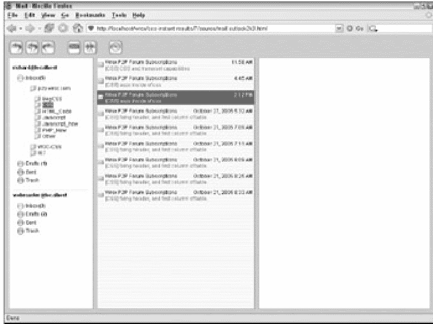

在 Internet Explorer 6 中加载 `mail.outlook2k3.html`，输出结果如图 7-11 所示。

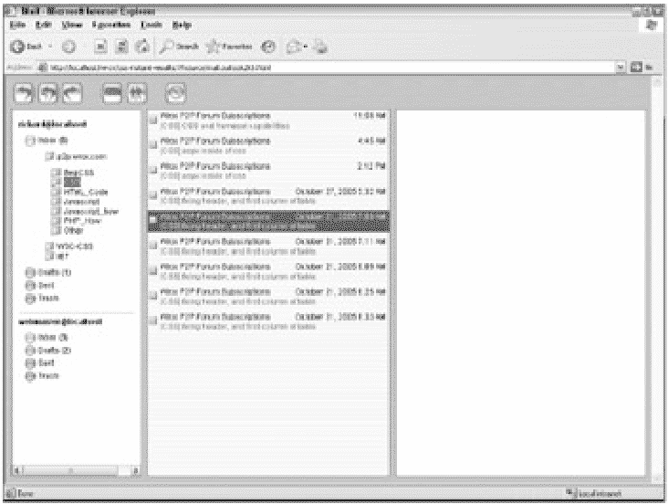

### 图 7-11

这次的修改范围要大一些。现在，通过使用服务器端程序，可以为用户提供多种查看邮箱内容的方式。

你首先对标记进行了修改。首先必须更新样式表以反映新的文件名。然后你重新组织了标记，删除了最初用于存放消息摘要信息的 `<table>`，并用 `<div>` 元素替代，这使得消息摘要信息的格式与 Outlook 2003 更加一致。重新组织标记后，你开始修改样式表。你做的第一个修改是针对以下规则：

```css
div#messages {
    left: 0;
    right: 0;
    margin: 52px 0 10px 220px;
    width: 375px;
    background: url('../images/stripes.png');
}
```

`messages` `<div>` 元素被设置为固定宽度 375 像素，并调整了边距。你保留了 52 像素的顶部边距（以防止 `messages` `<div>` 元素与顶部的按钮重叠）、右侧无外边距、10 像素的底部边距（以增加 `messages` `<div>` 的底部边框与视口底部边框之间的间距），以及 220 像素的左侧边距，以防止 `messages` `<div>` 与 `mailboxes` `<div>` 重叠。

接下来的一系列规则用于格式化重新组织后的消息摘要。第一条规则应用于带有`message`类名的 `<div>`，它包裹每个单独的消息摘要。首先将信封图标设置为不重复，距离左侧 2 像素、顶部 10 像素。然后应用内边距。顶部和底部各 2 像素的内边距，右侧  像素，左侧 20 像素，以适应图标并防止 `<div>` 元素内的内容与背景重叠。然后应用 5 像素的底部边距，使每个消息摘要之间保持间距：

```css
div.message {
    background: url('../images/16x16/2381.png') no-repeat 2px 10px;
    padding: 2px 5px 2px 20px;
    margin-bottom: 5px;
}
```

正如你在原始项目中所做的那样，当用户鼠标悬停在消息摘要上时，你将 `message` `<div>` 元素的背景设置为蓝色，文本设置为白色：

```css
div.message:hover {
    background: #369 url('../images/16x16/2381.png') no-repeat 2px 10px;
    color: white;
}
```

接下来，`message` `<div>` 元素内的链接在鼠标悬停时也必须变为白色，否则文本将不可见，因为链接的颜色与背景悬停颜色相同：

```css
div.message:hover a {
    color: white;
}
```

在以下规则中，你将"发件人"链接的颜色设置为黑色，我认为这是为了增加发件人文本与主题文本之间的对比度：

```css
div.mail-sender a {
    color: black;
}
```

最后修改的规则是针对 `<iframe>` 元素的。它添加了 `top: 0;` 声明，而之前只有 `bottom: 0;` 声明。然后你修改了 `<iframe>` 元素的边距，以适应位于其左侧的 `mailboxes` 和 `messages` `<div>` 元素，同时也适应文档顶部的按钮：

```css
iframe#message-preview {
    position: absolute;
    border: 1px solid rgb(128, 128, 128);
    top: 0;
    bottom: 0;
    left: 0;
    right: 0;
    margin: 52px 10px 10px 605px;
    background: #fff;
}
```

你最后所做的修改使三列布局在 Internet Explorer 中也能像在 Firefox 中一样正常工​​作。

由于 `mailboxes`、`messages` 和 `message-preview` 元素都具有相同的高度，你向以下规则添加了选择器：

```css
div#mailboxes,
div#messages,
iframe#message-preview {
    height: expression(
        document.getElementById("mail").off setHeight - 65
    );
}
```

你最后所做的修改调整了 `<iframe>` 元素的宽度，以适应 `mailboxes` 和 `messages` 元素：

```css
iframe#message-preview {
    width: expression(
        document.getElementById("mail").off setWidth - 615
    );
}
```


## 第 8 章：样式化输入表单

### 概述

本章将引导你完成对输入表单的样式设计。这涉及创建一个具有你自己网站独特外观和感觉的表单（而不是浏览器提供的默认外观），方法是使用带有背景图像的自定义按钮和输入字段。本章介绍的项目还包含了许多前面章节中的项目元素。除了样式化输入表单外，你还将看到[第 1 章](#)标签页项目、[第 2 章](#)多列项目以及[第 6 章](#)圆角的真实实现。这些元素共同构成了取自 [p2p.wrox.com](https://p2p.wrox.com) 的页面，即 Wrox Programmer to Programmer 论坛网站，Wrox 读者在那里寻求有关 Wrox 图书及其涵盖语言的技术问题的帮助。具体来说，这个项目使用了 [p2p.wrox.com](https://p2p.wrox.com) 的用户注册表单。我已重写该页面，使其符合严格的 XHTML 语法，并编写了样式表以使文档尽可能接近原始版本。通过这个项目，你不仅可以看到如何样式化输入表单，还可以了解本书中介绍的其他项目如何在一个真实的网站中结合起来，包括公司品牌标识，同时仍然非常紧密地遵循原始项目中介绍的基本原​​则。你还将了解在创建跨浏览器、跨平台文档时可能面临的挑战，该文档需要能够在尽可能多的操作系统上的尽可能多的浏览器中渲染。

输入表单项目的目标如下：

- 所有文本、密码和文本区域字段都必须具有独特的外观。
- 底层标记必须使用语义化 HTML 元素，例如 `<fieldset>`、`<legend>`、`<label>`，以及用于辅助功能的 `accesskey` 属性。
- 自定义 HTML 表单必须融入 Wrox 的企业品牌标识，并展现出 Wrox 独有的外观和感觉。
- 用 XHTML 和 CSS 重新编码的注册表单必须尽可能接近其原始版本。

[下一节](#)将讨论本项目的设计参数以及创建过程中面临的一些挑战。


## 设计

Web 开发社区中有许多人反对为输入表单设置样式。其主要论据通常与可用性有关：用户期望输入表单在不同网站之间保持一致的外观。然而，可能的样式范围之广，加上并非每个人都具备 A+ 级别的用户界面设计能力这一不幸事实，可能会给网站访问者带来潜在的不可访问体验。

表单的默认外观通常会模仿操作系统对输入表单的样式设置。但也有一些例外。无论操作系统如何，Opera 都有自己默认的输入表单外观。Windows 和 Mac OS X 上的 Firefox 中的输入框与 Windows 和 Internet Explorer 中的非常相似。Safari 自然使用 Mac OS X 的"Aqua"来渲染输入框，这与其他同样使用 Aqua 的 Mac OS X 应用程序中的输入框几乎相同。

对于 Safari 来说，存在一个根本性的限制，导致本项目完全无法在其上运行。在撰写本文时，Safari 不允许对输入框进行样式设置。此处使用的技巧在 Safari 1.3 和 2.0 中不会生效。然而，Safari 的近期开发版本已经具备对某些输入框进行样式设置的能力，Safari 的开发者们也在持续改进 Safari 的这一方面。

**注意**：Safari 开发者 Dave Hyatt 以及 Safari 团队的其他成员经常在 Safari 团队的博客 Surfin Safari 上撰写关于 Safari 更新、错误修复和新功能的文章。你可以自行访问 *http://webkit.opendarwin.org* 来了解 Safari 浏览器的新功能。

此处展示的核心项目需求相对简单——实际上无非就是应用一些背景图像并禁用输入控件中存在的默认样式。然而，输入表单所在的上下文则稍微复杂一些，因为它汇集了前几章中介绍的几个项目——来自**第 1 章**的标签页项目和来自**第 2 章**的多列项目。我在这里选择使用这些项目是为了展示它们在实际网站中的实用性。正如**第 1 章**和**第 2 章**中所介绍的，它们只使用了非常通用的 XHTML 容器。

当我开始这个项目时，我曾考虑从 Wrox 网站复制并粘贴源代码，但后来意识到，从那个充满表格的老式 HTML 设计转变为现代的 XHTML 设计需要对底层代码进行彻底的重新设计。除了图像之外，没有什么可以复用的。

**图 8-1** 显示了本文撰写时 Wrox 新用户注册页面的截图。

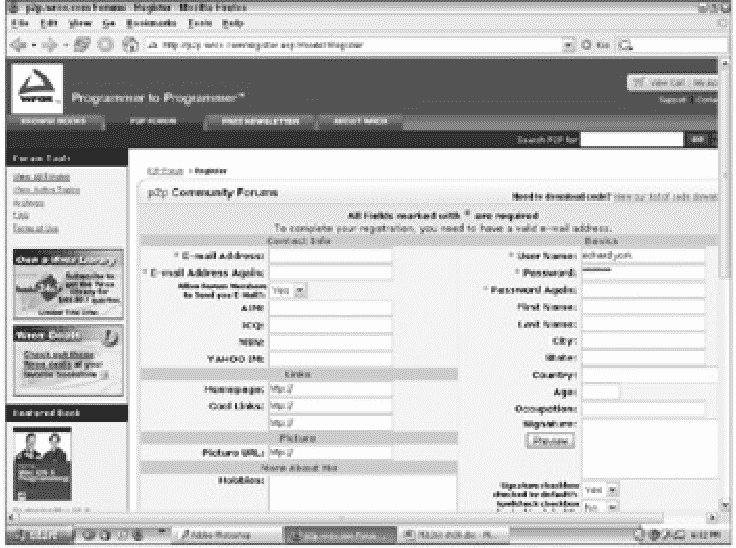
**图 8-1**

在图 8-1 中，你可以看到当前的注册表单甚至无法放入分辨率为 1024 × 768  Vitamin 的显示器中，而本书所有截图均以此分辨率拍摄。当你完成本项目后，注册表单将能舒适地适应 1024 × 768 的屏幕分辨率，并且还能优雅地缩减至 800 × 600。

图 8-2 显示了同一文档源代码的截图。

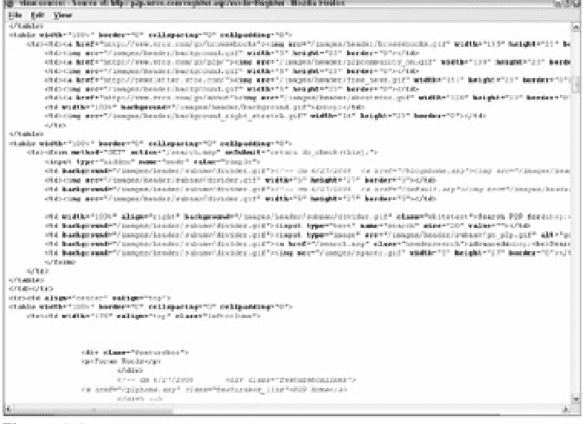
**图 8-2**

当你完成本项目后，本文档的源代码将看起来与图 8-2 完全不同。它将会是简洁、可维护、可扩展的，并且体积更小。`width`、`height`、`background`、`bgcolor` 等老式 HTML 属性将不再存在于文档中。你在文档中找到的表格将只用于容纳表单控件。

下一节将介绍 Wrox P2P 注册页面的代码及代码说明。

## 代码及代码说明

要了解如何使用 XHTML 和 CSS 为 Wrox Programmer to Programmer 网站注册表单设置样式，请按以下步骤操作：

- 1. 输入以下标记。请记住，标记随书附带的光 Brad Muter 件提供。以下内容可在第 8 章文件夹中的 `register.html` 文件中找到：

```xhtml
<!DOCTYPE html PUBLIC "-//W3C//DTD XHTML 1.0 Strict//EN"
"http://www.w3.org/TR/xhtml1/DTD/xhtml1-strict.dtd">
<html xmlns='http://www.w3.org/1999/xhtml' xml:lang='en' id='p2p-wrox-com'>

  <head>
    <meta http-equiv="Content-Type" content="text/html; charset=UTF-8" />
    <title>p2p.wrox.com Forums - Register</title>
    <link rel='stylesheet' type='text/css' href='styles/p2p-header.css' />
    <link rel='stylesheet' type='text/css' href='styles/p2p-body.css' />
    <link rel='stylesheet' type='text/css' href='styles/p2p-form.css' />
    <link rel='shortcut icon' href='images/favicon.ico' type='image/x-icon' />
  </head>
  <body id='top'>
    <div id='wrapper'>
      <div id='header'>
        <div id='h-logo'>
          <a href='#'>
            
          </a>
        </div>
        <div id='h-cart'>
          <div>
            <a href='#'>View Cart</a> |
            <a href='#'>My Account</a>
          </div>
        </div>
        <div id='h-links'>
          <a href='#'>Support</a> |
          <a href='#'>Contact Us</a>
        </div>
      </div>
      <ul id='tabs'>
        <li class='browse-books'>
          <a href='#'>
            
          </a>
        </li>
        <li class='p2p-forum'>
          <a href='#'>
            
          </a>
        </li>
        <li class='free-newsletter'>
          <a href='#'>
            
          </a>
        </li>
        <li class='about-wrox'>
          <a href='#'>
            
          </a>
        </li>
      </ul>
      <form action='javascript:void(0);' method='post'>
        <div id='search'>
          <a href='#'>Advanced<br />Search</a>
          <label for='p2p-search'>Search P2P for</label>
          <input name='search' id='p2p-search' size='20' value='' type='text' />
          <input src='images/go_p2p.gif' alt='go' type='image' />
        </div>
      </form>
      <div id='column'>
        <div class='box tools'>
          <h4>Forum Tools</h4>
          <ul>
            <li><a href='#'>View All Forums</a></li>
            <li><a href='#'>View Active Topics</a></li>
            <li><a href='#'>Archives</a></li>
            <li><a href='#'>FAQ</a></li>
            <li><a href='#'>Terms of Use</a></li>
          </ul>
        </div>
        <div class='box ads'>
          <p>
            <a href='#'>
              
            </a>
          </p>
          <p>
            <a href='#'>
              
            </a>
          </p>
        </div>
        <div class='box featured'>
          <h4>Featured Book</h4>
          <p class='featured-book'>
            <a href='#'>
              
            </a>
            <a href='#'>Beginning Mac OS X Programming</a>
          </p>
        </div>
        <div class='box ads'>
          <p>
            <a href='#'>
              
            </a>
          </p>
        </div>
      </div>
      <div id='breadcrumbs'>
        <ul>
          <li><a href='#'>P2P Forum</a></li>
          <li class='here'>Register</li>
        </ul>
      </div>
      <div id='content'>
        <h1>
          <span class='inner'>
            Need to download code?
            <a href='#'>View our list of code downloads.</a>
          </span>
          <span style='color: #c03;'>p2p</span> Community Forums
        </h1>
        <div id='body'>
          <div id='innerbody'>
            <!-- Begin Content -->
            <p>
              <span style='font-weight: bold;'>
                All Fields marked with
                <span class='required'>*</span> are required.
              </span><br />
              To complete your registration, you need to have a valid e-mail address.
            </p>
            <form action='javascript: void(0);' method='post'>
              <div class='column1'>
                <fieldset>
                  <legend>Contact Info</legend>
                  <table class='form'>
                    <colgroup>
                      <col />
                      <col />
                    </colgroup>
                    <tbody>
                      <tr>
                        <td class='label'>
                          <label for='email'>
                            <span class='required'>*</span>
                            E-mail Address:
                          </label>
                        </td>
                        <td class='input'>
                          <input name='email' id='email' size='25' maxlength='50' value='' class='i' />
                        </td>
                      </tr>
                      <tr>
                        <td class='label'>
                          <label for='email-confirm'>
                            <span class='required'>*</span>
                            E-mail Address Again:
                          </label>
                        </td>
                        <td class='input'>
```


## 代码与代码解释

```html
<input name='email_confirm'
       id='email-confirm'
size='25' maxlength='50' value='' class='i' />
</td>
</tr>
<tr>
  <td class='label'>
    <label for='receive-email'>
      Allow Forum Members<br />
      to Send you E-Mail?:
    </label>
  </td>
  <td class='input'>
    <select name='receive_email' id='receive-email' class='y-n'>
      <option value='1' selected='selected'>Yes</option>
      <option value='0'>No</option>
    </select>
  </td>
</tr>
<tr>
  <td class='label'>
    <label for='aim'>AIM:</label>
  </td>
  <td class='input'>
    <input name='aim'
           id='aim' size='25' maxlength='50' value='' class='i' />
  </td>
</tr>
<tr>
  <td class='label'>
    <label for='icq'>ICQ:</label>
  </td>
  <td class='input'>
    <input name='icq'
           id='icq' size='25' maxlength='50' value='' class='i' />
  </td>
</tr>
<tr>
  <td class='label'>
    <label for='msn'>MSN:</label>
  </td>
  <td class='input'>
    <input name='msn'
           id='msn' size='25' maxlength='50' value='' class='i' />
  </td>
</tr>
<tr>
  <td class='label'>
    <label for='yahoo'>YAHOO IM:</label>
  </td>
  <td class='input'>
    <input name='yahoo'
           id='yahoo' size='25' maxlength='50' value='' class='i' />
  </td>
</tr>
        </tbody>
      </table>
    </fieldset>
    <fieldset>
      <legend>Links</legend>
      <table class='form'>
        <colgroup>
          <col />
          <col />
        </colgroup>
        <tbody>
          <tr>
            <td class='label'>
              <label for='homepage'>Homepage:</label>
            </td>
            <td class='input'>
              <input name='homepage'
                     id='homepage'
                     size='25' maxlength='255' value='http://' class='i' />
            </td>
          </tr>
          <tr>
            <td class='label' rowspan='2'>
              <label for='link1'>Cool Links:</label>
            </td>
            <td class='input'>
              <input name='link1'
                     id='link1'
                     size='25' maxlength='255' value='http://' class='i' />
            </td>
          </tr>
          <tr>
            <td class='input'>
              <input name='link2'
                     id='link2'
                     size='25' maxlength='255' value='http://' class='i' />
            </td>
          </tr>
        </tbody>
      </table>
    </fieldset>
    <fieldset>
      <legend>Picture</legend>
      <table class='form'>
        <colgroup>
          <col />
          <col />
        </colgroup>
        <tbody>
          <tr>
            <td class='label'>
              <label for='picture-url'>Picture URL:</label>
            </td>
            <td class='input'>
              <input name='picture_url'
            id='picture-url'
            size='25' maxlength='255' value='http://' class='i' />
        </td>
    </tr>
    </tbody>
    </table>
</fieldset>
<fieldset>
    <legend>More About Me</legend>
    <table class='form'>
        <colgroup>
            <col />
            <col />
        </colgroup>
        <tbody>
            <tr>
                <td class='label'>

                    <label for='hobbies'>Hobbies:</label>
                </td>
                <td class='input'>
                    <textarea name='hobbies' id='hobbies' cols='30' rows='4'></textarea>
                </td>
            </tr>
            <tr>
                <td class='label'>
                    <label for='quote'>Favorite Quote:</label>
                </td>
                <td class='input'>
                    <textarea name='quote' id='quote' cols='30' rows='4'></textarea>
                </td>
            </tr>
            <tr>
                <td class='label'>
                    <label for='bio'>Bio:</label>
                </td>
                <td class='input'>
                    <textarea name='bio' id='bio' cols='30' rows='4'></textarea>
                </td>
            </tr>
        </tbody>
    </table>
</fieldset>
</div>
<div class='column2'>
    <fieldset>
        <legend>Basics</legend>
        <table class='form'>
            <colgroup>
                <col />
                <col />
            </colgroup>
            <tbody>
                <tr>
                    <td class='label'>
                        <label for='username'>
                    <span class='required'>*</span>
                    User Name:
                  </label>
                </td>
                <td class='input'>
                  <input name='username' id='username' size='25' value='' class='i' />
                </td>
              </tr>
              <tr>
                <td class='label'>
                  <label for='password'>
                    <span class='required'>*</span>
                    Password:
                  </label>
                </td>
                <td class='input'>
                  <input type='password'
                         name='password' id='password' size='25' value='' class='i' />
                </td>
              </tr>
              <tr>
                <td class='label'>
                  <label for='pd-confirm'>
                    <span class='required'>*</span>
                    Password Again:
                  </label>
                </td>
                <td class='input'>
                  <input type='password'
                         name='pd_confirm'
                         id='pd-confirm' size='25' value='' class='i' />
                </td>
              </tr>
              <tr>
                <td class='label'>
                  <label for='first-name'>First Name:</label>
                </td>
                <td class='input'>
                  <input name='first_name'
                         id='first-name' size='25' value='' class='i' />
                </td>
              </tr>
              <tr>
                <td class='label'>
                  <label for='last-name'>Last Name:</label>
                </td>
                <td class='input'>
                  <input name='last_name' id='last-name' size='25' value='' class='i' />
                </td>
              </tr>
              <tr>
                <td class='label'>
                  <label for='city'>City:</label>
                </td>
                <td class='input'>
<input name='city' id='city' size='25' value='' class='i' />
</td>
</tr>
<tr>
  <td class='label'>
    <label for='state'>State:</label>
  </td>
  <td class='input'>
    <input name='state' id='state' size='25' value='' class='i' />
  </td>
</tr>
<tr>
  <td class='label'>
    <label for='county'>County:</label>
  </td>
  <td class='input'>
    <input name='county' id='county' size='25' value='' class='i' />
  </td>
</tr>
<tr>
  <td class='label'>
    <label for='age'>Age:</label>
  </td>
  <td class='input'>
    <input name='age' id='age' size='2' value='' class='a' />
  </td>
</tr>
<tr>
  <td class='label'>
    <label for='occupation'>Occupation:</label>
  </td>
  <td class='input'>
    <input name='occupation'
           id='occupation' size='25' value='' class='i' />
  </td>
</tr>
<tr>
  <td class='label'>
    <label for='signature'>Signature:</label>
  </td>
  <td class='input'>
    <textarea name='signature'
              id='signature' cols='30' rows='4'></textarea>
  </td>
</tr>
<tr>
  <td class='label'>
    <label for='signature-default'>
      Signature checkbox<br />checked by default?:
    </label>
  </td>
  <td class='input'>
    <select name='signature_default' id='signature-default' class='y-n'>
      <option value='1' selected='selected'>Yes</option>
      <option value='0'>No</option>
</select>
</td>
</tr>
<tr>
  <td class='label'>
    <label for='spellcheck-default'>
      Spellcheck checkbox<br />checked by default?:
    </label>
  </td>
  <td class='input'>
    <select name='spellcheck_default' id='spellcheck-default' class='y-n'>
      <option value='1'>Yes</option>
      <option value='0' selected='selected'>No</option>
    </select>
  </td>
</tr>
<tr>
  <td class='label'>
    <label for='timezone'>Your TimeZone:</label>
  </td>
  <td class='input'>
    <select name='timezone' id='timezone'>
      <option value='' selected='selected'>
        Use the server time  (EST)
      </option>
      <option value='-12'>(GMT - 12:00)</option>
      <option value='-11'>(GMT - 11:00)</option>
      <option value='-10'>(GMT - 10:00) Hawaii</option>
      <option value='-9'>(GMT - 09:00) Alaska</option>
      <option value='-8'>(GMT - 08:00) Pacific Time  (US)</option>
      <option value='-7'>(GMT - 07:00) Mountain Time  (US)</option>
      <option value='-6'>(GMT - 06:00) Central Time  (US)</option>
      <option value='-5'>(GMT - 05:00) Eastern Time  (US)</option>
      <option value='-4'>(GMT - 04:00)</option>
      <option value='-3'>(GMT - 03:00)</option>
      <option value='-2'>(GMT - 02:00)</option>
      <option value='-1'>(GMT - 01:00)</option>
      <option value='0'>(GMT)  Greenwich Mean Time</option>
      <option value='1'>(GMT + 01:00)</option>
      <option value='2'>(GMT + 02:00)</option>
      <option value='3'>(GMT + 03:00)</option>
      <option value='4'>(GMT + 04:00)</option>
      <option value='5'>(GMT + 05:00)</option>
      <option value='6'>(GMT + 06:00)</option>
      <option value='7'>(GMT + 07:00)</option>
      <option value='8'>(GMT + 08:00)</option>
      <option value='9'>(GMT + 09:00)</option>
      <option value='10'>(GMT + 10:00)</option>
      <option value='11'>(GMT + 11:00)</option>
      <option value='12'>(GMT + 12:00)</option>
      <option value='13'>(GMT + 13:00)</option>
    </select>
  </td>
</tr>
<tr>
```

## 代码与代码解释

```html
                <td class='label'>
                  <label for='dst'>Adjust for Daylight<br />Savings Time?:</label>
                </td>
                <td class='input'>
                  <select name='dst' id='dst' class='y-n'>
                    <option value='1'>Yes</option>
                    <option value='0' selected='selected'>No</option>
                  </select> * Must choose a timezone
                </td>
              </tr>
            </tbody>
          </table>
        </fieldset>
        <fieldset>
          <legend>Subscription Preferences</legend>
          <table class='form'>
            <colgroup>
              <col />
              <col />
            </colgroup>

            <tbody>
              <tr>
                <td class='label'>
                  <label for='email-self'>
                    Receive Your Postings:
                  </label>
                </td>
                <td class='input'>
                  <select name='email_self' id='email-self'>
                    <option value='0' selected='selected'>
                      No, don't send my postings to me
                    </option>
                    <option value='1'>Yes, send me my postings</option>
                  </select>
                </td>
              </tr>
              <tr>
                <td class='label'>
                  <label for='topic-default'>
                    Topic Subscribe checkbox<br />
                    checked by default for<br />
                    topics you create?:
                  </label>
                </td>
                <td class='input'>
                  <select name='topic_default' id='topic-default' class='y-n'>
                    <option value='1'>Yes</option>
                    <option value='0' selected='selected'>No</option>
                  </select>
                </td>
              </tr>
            </tbody>
          </table>
        </fieldset>
      </div>
```

```html
<div class='buttons'>
    <a href='#' class='back'>Back To Forum</a>
    <input value='Submit' name='submit' type='submit' />
</div>
</form>
</div>
<!-- End Content -->
    </div>
</div>
</div>
<div id='footer'>
    <a href="http://www.wrox.com/go/copyright">Copyright &copy; 2000-2005</a> by
    <a href="http://www.wiley.com">John Wiley &amp; Sons, Inc.</a>
    or related companies.
    All rights reserved. Please read our
    <a href="http://www.wrox.com/go/privacy">Privacy Policy</a>.
</div>
</body>
</html>
```

- 2. 将上述内容保存为 `register.html`。

- 3. 输入以下样式表。以下内容可在本书附带的源代码CD-ROM的 styles 文件夹、第8章文件夹中找到，文件名为 `p2p-header.css`：

```css
body {
    margin: 0;
    padding: 0;
    font: 11px Arial, Helvetica, sans-serif;
}
a:link {
    color: #903;
}
a:visited {
    color: #603;
}
a:hover {
    color: #c03;
    text-decoration: none
}
a:active {
    color:#903;
    text-decoration:none
}
img {
    border: none;
}
div#wrapper {
    position: relative;
    min-height: 1000px;
}
div#header {
    background-color: #c03;
    position: relative;
}
div#header a {
    text-decoration: none;
    margin: 0 4px;
}
div#h-cart {
    position: absolute;
    top: 23px;
    right: 15px;
    background: url('../images/css_background.gif') no-repeat center;
    width: 170px;
    height: 25px;
}
div#h-cart div {
    position: absolute;
    top: 6px;
    left: 35px;
    color: #8c8c8c;
}
div#h-links {
    position: absolute;
    top: 54px;
    right: 27px;
}
div#h-links a {
    color: white;
}
ul#tabs {
    height: 23px;
    list-style-type: none;
    margin: -4px 0 0 0;
    position: relative;
    padding: 0;
    background: url('../images/background.gif') repeat-x top;
    border-bottom: 1px solid #6c6c6c;
}
ul#tabs li {
    position: absolute;
    top: 1px;
    left: 0;
}
ul#tabs li.p2p-forum {
    left: 141px;
}
ul#tabs li.free-newsletter {
    left: 287px;
}
ul#tabs li.about-wrox {
    left: 445px;
}
form {
    margin: 0;
    padding: 0;
}
div#search {
    background-color: #333;
    text-align: right;
    color: #fff;
    height: 27px;
}
div#search a {
    float: right;
    line-height: 11px;
    margin: 0 10px 0 5px;
    text-align: left;
    text-decoration: none;
    color: rgb(128, 128, 128);
}
div#search a:hover {
    color: #fff;
}
div#search * {
    vertical-align: middle;
}
```

4. 将上述样式表保存为 `p2p-header.css`。

5. 输入以下样式表：

```css
div#column {
    position: absolute;
    top: 129px;
    bottom: 0;
    left: 0;
    width: 175px;
    background: url('../images/gradient_left.gif') repeat-y center;
}
div#column h4 {
    color: white;
    background-color: #000;
    margin: 0 4px 0 0;
    padding: 5px 0 5px 10px;
    font-size: 13px;
}
div.box ul {
    margin: 0;
    padding: 5px 0 5px 10px;
    list-style-type: none;
}
div.box li {
    margin: 5px 0 0 0;
}
div.box.ads {
    text-align: center;
}
div.box.featured a {
    margin: 10px;
    display: block;
    color: rgb(128, 128, 128);
    font-weight: bold;
}
```

## 代码与代码解释

```css
div#breadcrumbs {
    margin-left: 200px;
}
div#breadcrumbs ul {
    margin: 25px 0 4px 0;
    padding: 0;
    list-style-type: none;
    overflow: auto;
}
div#breadcrumbs li {
    float: left;
}
div#breadcrumbs li + li::before {
    font-family: monospace;
    content: '>';
    margin: 0 5px;
    font-weight: bold;
}
div#breadcrumbs a {
    color: rgb(128, 128, 128);
}
div#breadcrumbs a:hover {
    color: #c03;
}
div#breadcrumbs li.here {
    font-weight: bold;
}
div#content {
    clear: both;
    margin: 0 0 0 185px;
}
div#content h1 {
    background: url('../images/top_left.gif') no-repeat top left;
    font-size: 16px;
    height: 30px;
    padding: 10px 0 0 15px;
    margin: 0 25px 0 0;
}
div#content h1 span.inner {
    background: url('../images/top_right.gif') no-repeat top right;
    float: right;
    font-size: 11px;
    position: relative;
    height: 22px;
    margin: -10px -11px 0 0;
    padding: 18px 10px 0 0;
}
div#content h1 span.inner a {
    font-weight: normal;
}
div#body {
    background: #e5e5e5;
    min-height: 400px;
    margin-right: 14px;
    border: 1px solid #ccc;
}
div#footer {
    background: #fff url('../images/gradient_bottom.gif') repeat-x top;
    padding: 5px 0 5px 10px;
    font-size: 12px;
    height: 50px;
}
```

6. 将上述样式表保存为 `p2p-body.css`。

7. 为P2P注册输入表单输入以下样式表：

```css
div#innerbody {
    max-width: 1000px;
    min-width: 790px;
    margin: auto;
    padding: 10px;
}
div#innerbody > p * {
    font-size: 13px;
    vertical-align: middle;
}
div#innerbody span.required {
    color: #c03;
    font-size: 24px;
    font-weight: bold;
}
div.column1 {
    float: left;
    width: 49%;
}
div.column2 {
    position: relative;
    width: 49%;
    margin-left: 50%;
}
fieldset {
    border: 1px solid #ccc;
    background-color: #f5f5f5;
}
legend {
    color: #c03;
    font-weight: bold;
    font-size: 13px;
}
table.form {
    width: 100%;
}
table.form col {
    width: 50%;
}
td.label {
    text-align: right;
    vertical-align: top;
    font-weight: bold;
}
td.label * {
    vertical-align: middle;
}
div#innerbody input.i,
div#innerbody textarea {
    border: 0px solid transparent;
    font: 14px Arial, Helvetica, sans-serif;
}
div#innerbody input.i {
    width: 196px;
    height: 18px;
    padding: 2px 0 0 4px;
    background: url('../images/input.png') no-repeat;
}
div#innerbody input.a {
    width: 40px;
    height: 18px;
    padding: 2px 0 0 4px;
    background: url('../images/input-a.png') no-repeat;
}
div#innerbody textarea {
    padding: 2px;
    height: 96px;
    width: 236px;
    background: url('../images/textarea.png') no-repeat;
}
div.buttons {
    clear: both;
    overflow: auto;
}
div.buttons a {
    float: left;
}
div.buttons input {
    float: right;
}
```

8. 将上述样式表保存为 **p2p-form.css**。

这堆代码最终会产生如图8-3所示的输出。


## 代码与代码详解

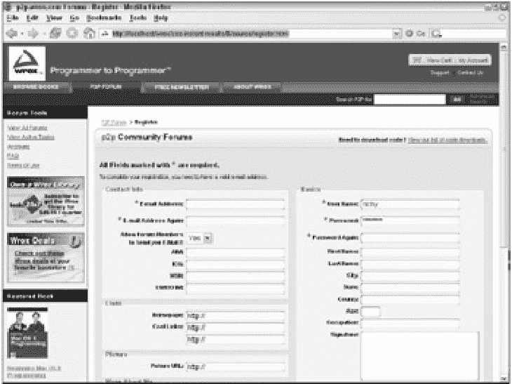

### 图 8-3

在图 8-3 中，你可以看到通过引入 CSS 背景，文本输入框和文本域（textarea）输入框都获得了独特的外观和感觉。由于这是一个包含许多不同设计原则的大型项目，本节将回顾每一个共同协作产生图 8-3 中输出结果的部分。

首先，你将对注册表单的头部部分（包含 Wrox P2P 标志）、购物车、附加导航链接、标签页和搜索表单进行样式设计。

标志、购物车图标和其他导航链接被包含在一个 ID 为 `header` 的 `<div>` 中。然后，各个组件被隔离在各自的 `<div>` 容器中，并根据每个项目的用途分别命名：

```
<div id='wrapper'>
  <div id='header'>
    <div id='h-logo'>
      <a href='#'>
        
      </a>
    </div>
    <div id='h-cart'>
      <div>
        <a href='#'>View Cart</a>
        <a href='#'>My Account</a>
      </div>
    </div>
    <div id='h-links'>
      <a href='#'>Support</a> |
      <a href='#'>Contact Us</a>
    </div>
  </div>
```

在名为 `p2p-header.css` 的样式表中，有几条规则定义了文档这一部分的视觉效果。

`p2p-header.css` 文档的前几条规则定义了一些通用样式：

```
body {
    margin: 0;
    padding: 0;
    font: 11px Arial, Helvetica, sans-serif;
}
a:link {
    color: #903;
}
a:visited {
    color: #603;
}
a:hover {
    color: #c03;
    text-decoration: none
}
a:active {
    color:#903;
    text-decoration:none
}

img {
    border: none;
}
```

从 `<body>` 元素中移除了默认的外边距（margin）和内边距（padding），使 `header` `<div>` 元素的尺寸与浏览器的视口边界齐平。然后，根据链接的状态赋予不同的颜色：未访问的链接为深红色，已访问的链接为更深的红色，而用户鼠标悬停或点击的链接则为浅红色。最后，移除了 `` 元素的边框。

接下来的样式定义了包含文档所有内容（页脚除外）的 `<div>` 元素。这个 `<div>` 元素被恰当地命名为 `wrapper`。该 `<div>` 元素使你能够创建两列布局而不会影响页脚。它提供了一个参考点，用于定位左列；尽管它也包裹了页眉，但它也可以同样简单地仅包裹这两列：

```
div#wrapper {
    position: relative;
    min-height: 1000px;
}
```

首先，你应用了 `position: relative;` 声明，这允许左列相对于 wrapper `<div>` 进行定位，而不是相对于浏览器的视口。然后，提供了一个 `min-height: 1000px` 声明，以确保 wrapper `<div>` 的高度始终至少为 1000 像素。提供最小高度可以确保左列不会因为其内容而变得太小，因为左列的高度将基于 wrapper `<div>` 元素的高度。

下一条规则适用于包裹 Wrox 标志、购物车和导航链接的 `<div>` 元素：

```
div#header {
    background-color: #c03;
    position: relative;
}
```

这个 `<div>` 元素被赋予了 “Wrox” 红色背景和 `position: relative;` 声明。有了相对定位，现在购物车和导航链接可以相对于页眉进行定位。

接下来，对这些链接进行样式设计：

```
div#header a {
    text-decoration: none;
    margin: 0 4px;
}
```

移除了下划线，并通过 `margin: 0 4px;` 声明在每个链接的左右两侧应用了一些额外的空间。

在接下来的规则中，包裹购物车链接的 `<div>` 被绝对定位，但它是相对于 `header` `<div>` 元素定位的：

```
div#h-cart {
    position: absolute;
    top: 23px;
    right: 15px;
    background: url('../images/css_background.gif') no-repeat center;
    width: 170px;
    height: 25px;
}
```

背景中应用了一张包含购物车标志和灰色椭圆的图形，其位置精确地位于图 8-1 中的原始位置。`h-cart` `<div>` 元素的宽度和高度被设置为与背景图像的宽度和高度相匹配。在 `h-cart` `<div>` 元素内部还有另一个 `<div>` 元素，包含 “View Cart” 和 “My Account” 链接。这个 `<div>` 元素同样被绝对定位：

```
div#h-cart div {
    position: absolute;
    top: 6px;
    left: 35px;
    color: #8c8c8c;
}
```

然后为分隔两个链接的垂直条指定了浅灰色。同样，“Support” 和 “Contact Us” 的链接也被绝对定位，并且被赋予了白色，而不是默认指定的深红色：

```
div#h-links {
    position: absolute;
    top: 54px;
    right: 27px;
}
div#h-links a {
    color: white;
}
```

接下来的四个标签页是：Browse Books、P2P Forum、Free Newsletter 和 About Wrox：

```
<ul id='tabs'>
    <li class='browse-books'>
        <a href='#'>
            
        </a>
    </li>
    <li class='p2p-forum'>
        <a href='#'>
            
        </a>
    </li>
    <li class='free-newsletter'>
      <a href='#'>
        
      </a>
    </li>
    <li class='about-wrox'>
      <a href='#'>
        
      </a>
    </li>
</ul>
```

就像在第 1 章中所做的那样，这些内容被包含在一个 `<ul>` 元素中，然后每个单独的 `<li>` 元素被赋予一个唯一的类名，以控制每个标签页的位置：

```
ul#tabs {
  height: 23px;
  list-style-type: none;
  margin: -4px 0 0 0;
  position: relative;
  padding: 0;
  background: url('../images/background.gif') repeat-x top;
  border-bottom: 1px solid #6c6c6c;
}
```

`<ul>` 元素被赋予了一个明确的高度，这使得背景图像可见。因为 `<li>` 元素是绝对定位的，所以它们不会影响 `<ul>` 元素的高度。背景图像沿 x 轴水平重复。顶部外边距经过调整，以尽可能匹配图 8-1 中的原始页面，然后移除了其他外边距、默认内边距以及默认的列表样式。最后，应用了一个灰色底边框。

然后对单个标签页进行样式设计：

```
ul#tabs li {
  position: absolute;
  top: 1px;
  left: 0;
}
ul#tabs li.p2p-forum {
  left: 141px;
}
ul#tabs li.free-newsletter {
  left: 287px;
}
ul#tabs li.about-wrox {
  left: 445px;
}
```

第一条规则设置了所有标签页共有的样式。随后的每个 `<li>` 元素通过试错法进行绝对定位，直到结果看起来接近原图。你可能会好奇，“P2P Forum” 标签是如何覆盖边框的？这是通过让该图像的高度比其他图像多 1 像素来实现的——这就是 CSS 分层技术的精妙之处。

接下来是搜索框。自然地，搜索框被包裹在一个表示表单开始的 `<form>` 元素中。接着，一个 `<div>` 容器包裹了表单控件，该元素将接收深灰色背景。其实可以省略这个 `<div>` 元素，直接将样式应用于 `<form>` 元素以达到同样的效果；然而，为了通过严格的 XHTML 验证，`<form>` 元素只能包含某些特定的元素作为其直接子元素。具体来说，它只能包含 `<p>`、`<h1>`、`<h2>`、`<h3>`、`<h4>`、`<h5>`、`<h6>`、`<div>`、`<pre>`、`<address>`、`<fieldset>`、`<ins>`、`<del>`。

```
        <form action='javascript:void(0);' method='post'>
          <div id='search'>
           <a href='#'>Advanced<br />Search</a>
           <label for='p2p-search'>Search P2P for</label>
           <input name='search' id='p2p-search' size='20' value='' type='text' />
           <input src='images/go_p2p.gif' alt='go' type='image' />
          </div>
        </form>
```

由于人为错误在任何项目中都不可避免，养成使用 `http://validator.w3.org` 的 W3 验证服务检查工作的习惯是个好主意。对于之前的这段标记片段，图 8-4 显示了在省略 `<div>` 时 W3 验证器产生的结果。

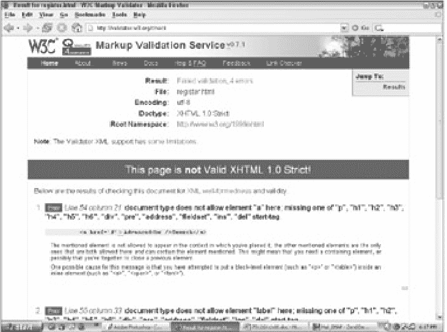

**图 8-4**

图 8-5 显示了在包含 `<div>` 时 W3 验证器产生的结果，此时 XHTML 通过了验证。


## 代码及代码讲解

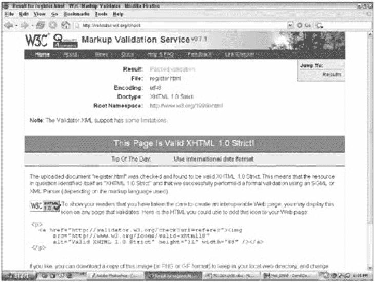
图 8-5

搜索框的样式表规则简洁明了。第一条规则去掉了`<form>`元素的默认外边距和内边距：

```css
form {
    margin: 0;
    padding: 0;
}
```

接下来，搜索`<form>`内部包含的`<div>`（它本身容纳着表单控件）被赋予深灰色背景，声明为`background-color: #333`。文本向右对齐，颜色设为白色，最后为`<div>`指定了明确的高度 27 像素：

```css
div#search {
    background-color: #333;
    text-align: right;
    color: #fff;
    height: 27px;
}
```

接下来为"Advanced Search"链接设置样式。它向右浮动，使`<a>`元素变为块级元素，这有助于按照块级盒模型规则而非内联盒模型规则来提供外边距以控制其位置。这也使得"Advanced"和"Search"之间的换行不会影响标签和表单控件。如果不让`<a>`元素浮动，"Search"一词将会出现在表单标签和输入控件下方的新一行中。`line-height`也调整为 11 像素，与字体大小相同；这让该链接的样式更接近图 8-1 所示的原始 P2P 注册表单。文本向左对齐。由于搜索`<div>`设置为右对齐，而且通过浮动使`<a>`元素成为块级元素，所以其中的文本可以左对齐。默认的下划线通过`text-decoration: none;`声明被移除，最后，链接文本颜色设为较浅的灰色，以便在深灰色背景上可见：

```css
div#search a {
    float: right;
    line-height: 11px;
    margin: 0 10px 0 5px;
    text-align: left;
    text-decoration: none;
    color: rgb(128, 128, 128);
}
```

在为链接设置样式以匹配图 8-1 中的"高级搜索"链接后，又添加了一条鼠标悬停规则。当用户鼠标悬停在链接上时，它会变为白色：

```css
div#search a:hover {
    color: #fff;
}
```

最后，为了让`search`<div>内的所有内容垂直对齐，使用了一个通配符选择器来选择`<div>`元素的所有后代，并将声明`vertical-align: middle;`应用于全部：

```css
div#search * {
    vertical-align: middle;
}
```

请记住，`vertical-align`属性只能应用于内联元素或表格单元格元素。由于`<div>`元素的所有子元素都是内联级别元素（"高级搜索"链接除外，你已通过浮动将其设为块级），因此此技术有效。

搜索框之后是左列，其中包含一些网站导航和广告：

```html
<div id='column'>
    <div class='box tools'>
        <h4>Forum Tools</h4>
        <ul>
            <li><a href='#'>View All Forums</a></li>
            <li><a href='#'>View Active Topics</a></li>
            <li><a href='#'>Archives</a></li>
            <li><a href='#'>FAQ</a></li>
            <li><a href='#'>Terms of Use</a></li>
        </ul>
    </div>
    <div class='box ads'>
        <p>
            <a href='#'>
                
            </a>
        </p>
        <p>
            <a href='#'>
                
            </a>
        </p>
    </div>
    <div class='box featured'>
        <h4>Featured Book</h4>
        <p class='featured-book'>
            <a href='#'>
                
            </a>
            <a href='#'>Beginning Mac OS X Programming</a>
        </p>
    </div>
    <div class='box ads'>
      <p>
        <a href='#'>
          
        </a>
      </p>
    </div>
</div>
```

整体由 id 名为`column`的`<div>`包裹，然后列的每个部分被划分为多个具有多重类名的`<div>`元素。类名`box`为所有四个`<div>`元素共有。第二个类名则进一步限定该盒子在文档中扮演的更具体的角色。两个盒子是广告，因此它们的第二个类名是`ads`。第一个盒子包含论坛导航链接，因此其第二个类名为`tools`。最后一个盒子包含一本精选的 Wrox 图书，因此其第二个类名为`featured`。这些命名约定允许你根据盒子所含内容来设置每个盒子内部内容的样式。

`p2p-body.css`中的第一条样式表规则为`column`<div>设置样式。它绝对定位，通过指定声明`top: 129px;`和`bottom: 0`来拉伸 wrapper`<div>`元素的高度。共同构成文档标题的元素——标志、标签页和搜索框——高度为 129 像素：

```css
div#column {
    position: absolute;
    top: 129px;
    bottom: 0;
    left: 0;
    width: 175px;
    background: url('../images/gradient_left.gif') repeat-y center;
}
```

`left: 0;`声明将列`<div>`放置在 wrapper`<div>`的左侧，最后图像`gradient_left.gif`沿`column`<div>的 y 轴重复显示。

下一条规则为左列标题 Forum Tools 和 Featured Book 的文本设置样式。它们被赋予黑色背景和白色文本，然后调整外边距和内边距以匹配图 8-1 所示的原始表单。规则中的最后一条声明将字体大小设为 13 像素：

```css
div#column h4 {
    color: white;
    background-color: #000;
    margin: 0 4px 0 0;
    padding: 5px 0 5px 10px;
    font-size: 13px;
}
```

接下来的规则用于左列链接：View All Forums、View Active Topics 等。这些链接包含在一个无序列表中。列表首先被去掉默认样式，并调整其内边距以将链接定位到与图 8-1 中观察到的相似位置：

```css
div.box ul {
    margin: 0;
    padding: 5px 0 5px 10px;
    list-style-type: none;
}
```

设置链接样式的第二条规则在每个链接之间垂直放置 5 像素的空间：

```css
div.box li {
    margin: 5px 0 0 0;
}
```

包含广告的`<div>`盒子很容易设置样式——广告图片只需在其所包含的`<div>`中居中对齐：

```css
div.box.ads {
    text-align: center;
}
```

最后一个接收样式的`<div>`是包含精选 Wrox 图书的`<div>`：

```css
div.box.featured a {
    margin: 10px;
    display: block;
    color: rgb(128, 128, 128);
    font-weight: bold;
}
```

包含同时具有 box 和 featured 类名的`<div>`中的链接被设为块元素。这有助于定位图像和包含图书标题的链接。链接被赋予较深的灰色并加粗。

文档中的下一段标记实现了一个通常称为*面包屑*的用户界面概念。面包屑用于向用户说明他们在网站导航层级中的当前位置。结果是一系列链接，按照当前页面所属的分类层级流动。第一个链接代表最宽泛的类别；其他链接代表向下延伸至用户当前所在页面的类别。当前页面不应是链接，因为用户已经在该位置了。Wrox P2P 注册页面中的面包屑体现在一个无序列表中：

```html
<div id='breadcrumbs'>
    <ul>
        <li><a href='#'>P2P Forum</a></li>
        <li class='here'>Register</li>
    </ul>
</div>
```

包含面包屑链接的`<div>`是第一个被设置样式的元素。它被赋予等于左列宽度再加上一些的左外边距：

```css
div#breadcrumbs {
    margin-left: 200px;
}
```

下一个被设置样式的元素是包含每个单独面包屑的`<ul>`元素。它的默认列表样式被移除，同时去除了浏览器应用的默认外边距或内边距，这使跨平台渲染一致，因为有些浏览器默认应用外边距，另一些则应用内边距。顶部外边距也添加了一些空间，以便将面包屑从上方包含搜索框的`<div>`进一步下移，底部外边距也添加了空间，以便将其与下方包含内容的`<div>`隔开。最后，`overflow: auto;`声明强制`<ul>`元素的高度与其内部包含的`<li>`元素相同。这是必要的，因为`<li>`元素是左浮动的。由于它们是左浮动的，它们对包含它们的`<ul>`元素的尺寸没有影响——直到 overflow 属性被赋予`visible`（默认值）以外的值。当 overflow 属性包含`visible`以外的值时，`<ul>`容器的高度将变为它所包含的最高浮动元素的高度——如果它包含浮动内容，且浮动内容超出其边界。如果没有 overflow 属性，`<ul>`元素需要被提供一个明确的高度，


 ## 代码及代码说明

否则的话，应用于它的底部外边距就需要一个高得多的值才能产生效果（例如，包含在其中的最高 `<li>` 元素的高度，甚至更高）。有了 `overflow` 属性，可以实现多于一行的面包屑，这也会让 `<ul>` 元素具有可变高度的可能性——而用其他方法是无法做到的：

```
div#breadcrumbs ul {
    margin: 25px 0 4px 0;
    padding: 0;
    list-style-type: none;
    overflow: auto;
}
```

接下来，每个 `<li>` 元素都向左浮动，以使所有 `<li>` 元素显示在同一行上。类似的效果也可以通过给每个 `<li>` 元素添加 `display: inline;` 声明来实现。我偏爱使用浮动：

```
div#breadcrumbs li {
    float: left;
}
```

每个面包屑之间都会出现一个*大于号*。你可以使用相邻兄弟选择器和 `::before` 伪元素的组合来在文档中包含这个符号。这样做的结果是，除了第一个以外的每个 `<li>` 元素前面都会有一个大于号。一些外边距被应用在每个大于号的左右两侧。然后字体设置为等宽并加粗：

```
div#breadcrumbs li + li::before.scss {
    font-family: monospace;
    content: '>';
    margin: 0 5px;
    font-weight: bold;
}
```

面包屑链接随后被设置为灰色……

```
div#breadcrumbs a {
    color: rgb(128, 128, 128);
}
```

……当用户鼠标悬停在上面时变为红色：

```
div#breadcrumbs a:hover {
    color: #c03;
}
```

当前位置随后被加粗：

```
div#breadcrumbs li.here {
    font-weight: bold;
}
```

面包屑后面是包含文档内容的标记。该标记以一个 id 名为 `content` 的 `<div>` 开头，它继而包裹了出现在面包屑和页脚之间的右栏中的所有内容。内容 `<div>` 中的第一个元素是页面标题，它出现在一个 `<h1>` 元素中。它包含文本"p2p Community Forums"和一个代码下载链接，随后是一个 id 名为 `body` 的 `<div>`，其中包含注册表单本身：

```
<div id='content'>
    <h1>
        <span class='inner'>
```

```

Need to download code?
<a href='#'>View our list of code downloads.</a>
</span>
<span style='color: #c03;'>p2p</span> Community Forums
</h1>
<div id='body'>
```

这一批中第一个要进行样式设置的是内容 `<div>`。它得到一个 `clear: both;` 声明，防止它向上浮动到左侧浮动的面包屑旁边，这在除 Internet Explorer 以外的任何浏览器中都是不必要的。由于包含面包屑的 `<ul>` 元素被赋予了一个非 `visible` 的 overflow 值，这在标准兼容的浏览器中等同于清除浮动。同时还应用了左外边距，以防止内容被左栏覆盖：

```
div#content {
    clear: both;
    margin: 0 0 0 185px;
}
```

此外，`<h1>` 元素也被提供了样式。第一条声明用一张包含左侧圆角的图片来设置该元素的背景，这可以在图 8-3 的输出中观察到。`<h1>` 元素的字体大小默认相当大，因此这里重置为 16 像素。然后 `<h1>` 被赋予一个明确的高度，这有助于定位包含自定义边框的背景。内边距和外边距随后将文本定位到合适的位置：

```
div#content h1 {
    background: url('../images/top_left.gif') no-repeat top left;
    font-size: 16px;
    height: 30px;
    padding: 10px 0 0 15px;
    margin: 0 25px 0 0;
}
```

一个 `<span>` 元素包含代码下载链接。它被赋予了包含自定义边框的另一半背景。将背景切割成两部分可以让内容具有可变宽度，并能随更大分辨率进行缩放。它向右浮动，然后使用 `height` 属性、外边距和内边距将其定位到位。`position: relative;` 声明是为了消除 Explorer 中的任何不良影响（例如躲猫猫 bug），字体大小设置为 11 像素：

```
div#content h1 span.inner {
    background: url('../images/top_right.gif') no-repeat top right;
    float: right;
    font-size: 11px;
    position: relative;
    height: 22px;
    margin: -10px -11px 0 0;
    padding: 18px 10px 0 0;
}
```

下一条规则去除了代码下载链接的粗体：

```
div#content h1 span.inner a {
    font-weight: normal;
}
```

id 名为 `body` 的 `<div>` 元素包含注册表单。它被赋予灰色背景和 1 像素宽的实线灰色边框。设置了最小高度以确保即使 body `<div>` 不包含内容时也始终可见。然后应用右外边距，使 body `<div>` 的边框与为 `<h1>` 元素和包含代码下载链接的 `<span>` 指定的背景图片中的边框对齐：

```
div#body {
    background: #e5e5e5;
    min-height: 400px;
    margin-right: 14px;
    border: 1px solid #ccc;
}
```

`p2p-body.css` 样式表中引用的最后一段代码涉及页脚 `<div>`，它包含版权信息和指向 Wrox 隐私政策的链接：

```
    <div id='footer'>
      <a href="http://www.wrox.com/go/copyright">Copyright &copy; 2000-2005</a> by
      <a href="http://www.wiley.com">John Wiley &amp; Sons, Inc.</a>
      or related companies.
      All rights reserved. Please read our
      <a href="http://www.wrox.com/go/privacy">Privacy Policy</a>.
    </div>
```

页脚 `<div>` 相当直接。它包含一个沿 x 轴重复、横跨文档宽度的背景。引入了一些内边距，使 `<div>` 的内容与边缘保持距离。字体大小设置为 12 像素，并指定了明确的高度，以在文本和文档底部之间提供一些间距：

```
div#footer {
    background: #fff url('../images/gradient_bottom.gif') repeat-x top;
    padding: 5px 0 5px 10px;
    font-size: 12px;
    height: 50px;
}
```

注册表单以一个名为 `innerbody` 的 `<div>` 元素开始。我将这个元素归入注册表单，因为它在 Wrox P2P 模板中可以从一页到另一页有不同的用途；也就是说，它可能有也可能没有最小或最大尺寸约束。在 `innerbody` `<div>` 元素之后，表单以一个 `<p>` 元素开始，该元素包含这样的文本：所有标有红色星号的表单控件标记都是必填字段，需要有效的电子邮件地址才能完成注册：

```
           <div id='innerbody'>
<!-- Begin Content -->
<p>
  <span style='font-weight: bold;'>
   All Fields marked with
   <span class='required'>*</span> are required.
  </span><br />
  To complete your registration, you need to have a valid e-mail
  address.
</p>
```

`innerbody` `<div>` 是 `p2p-form.css` 样式表中第一个要进行样式设置的元素。它被赋予最小和最大宽度约束，这可以防止表单在极端屏幕分辨率阈值下变得无法阅读：

```
div#innerbody {
    max-width: 1000px;
    min-width: 790px;
    margin: auto;
}
```

```
        padding: 10px;
    }
```

随后，选中 `<p>` 元素的所有后代。这归结为以下两个 `<span>` 元素：

```
  <span style='font-weight: bold;'>
    All Fields marked with
    <span class='required'>*</span> are required.
  </span>
```

每个都垂直居中对齐，并被赋予 13 像素的字体大小：

```
div#innerbody > p * {
    font-size: 13px;
    vertical-align: middle;
}
```

接下来，所有那些红色星号都被设置了样式。每个星号都被一个带有 required 类名的 `<span>` 元素包裹。它们每个都被赋予 24 像素的红色粗体：

```
div#innerbody span.required {
    color: #c03;
    font-size: 24px;
    font-weight: bold;
}
```

在那条规则之后是 `<form>` 元素，它包含构成注册表单的控件。表单被分成两半，一半进入 class 名为 `column1` 的 `<div>`，另一半进入 class 名为 `column2` 的 `<div>`。表单的每个部分在这些列 `<div>` 元素中进一步细分。`<fieldset>` 和 `<legend>` 元素定义了注册表单的每个子部分。然后，在每个 `<fieldset>` 元素中，在 `<legend>` 之后，一个 `<table>` 元素包含表单控件和标签：

```
<form action='javascript: void(0);' method='post'>
<div class='column1'>
  <fieldset>
    <legend>Contact Info</legend>
    <table class='form'>
      <colgroup>
        <col />
        <col />
      </colgroup>
      <tbody>
        <tr>
          <td class='label'>
            <label for='email'>
              <span class='required'>*</span>
              E-mail Address:
            </label>
          </td>
          <td class='input'>
            <input name='email'
                   id='email' size='25' maxlength='50' value='' class='i' />
          </td>
```

这两列使用浮动来定位。第一个 `<div>` 向左浮动，这样就将两列并


 ## 代码与代码解释

并排放置。每个列的宽度设置为 49%。宽度指定为 49% 是为了规避 Internet Explorer 中的一个 bug，它无法正确理解 50% + 50% = 100%。当宽度设为 50% 时，IE 仍然会将第二列放置在第一列下方。

设置 `position: relative;` 是为了绕开不受欢迎的 CSS 渲染 bug，例如 Explorer 的"peek-a-boo"（时隐时现）bug。第二列被赋予 50% 的右边距，以确保其所有内容始终位于第一列的右侧：

```
div.column1 {
    float: left;
    width: 49%;
}
div.column2 {
    position: relative;
    width: 49%;
    margin-left: 50%;
}
```

接下来要设置样式的是 `<fieldset>` 和 `<legend>` 元素。无法将 `<fieldset>` 和 `<legend>` 元素的样式设置得与旧版 P2P Wrox 注册表单完全一致，因为旧版表单不包含这些元素。问题在于浏览器允许 `<legend>` 元素接受的样式限制。不出所料，Firefox 允许使用 margin 或相对定位以及四个偏移属性来定位 `<legend>` 元素。Internet Explorer 也允许对 `<legend>` 进行定位，但存在一些 bug，正如你在下一节中将看到的那样。Opera 和 Safari 不允许修改 `<legend>` 元素的位置。如果没有这些限制，可以为 `<fieldset>` 元素添加深灰色的粗顶部边框，为 `<legend>` 添加相同颜色的背景，并通过 margin 调整其位置以匹配图 8-1 中的样式。即便这样做，也无法将 `<legend>` 元素居中。这种方法的致命缺陷在于 Explorer 的一个 bug，使得无法再现图 8-1 中 `<legend>` 元素周围的粗灰色方框。在 Explorer 中，即使没有明确指定边框，`<legend>` 元素周围也会出现一个边框，并且会为其设置与 `<fieldset>` 边框匹配的背景。为了保持正确的表单语义，并使表单尽可能易于访问，应该同时包含 `<fieldset>` 和 `<legend>` 元素；看来解决方案只能是利用浏览器所允许的功能。`<legend>` 被设置为红色、粗体、13 像素的字体，`<fieldset>` 被设置为灰色实线边框和较浅的灰色背景：

```
fieldset {
    border: 1px solid #ccc;
    background-color: #f5f5f5;
}
legend {
    color: #c03;
    font-weight: bold;
    font-size: 13px;
}
```

在 `<fieldset>` 和 `<legend>` 之后，是包含表单控件的表格的样式。每个表单 `<table>` 被赋予 100% 的宽度，这样做是因为默认情况下 `<table>` 元素遵循收缩适应（shrink-to-fit）宽度计算算法，仅扩展到足以容纳其内容的程度。设置了 100% 的宽度后，每个 `<table>` 将始终与其包含元素等宽：

```
table.form {
    width: 100%;
}
```

既然 `<table>` 已经拥有了 100% 的宽度，其两列可以各占一半宽度，这在下一条规则中指定：

```
table.form col {
    width: 50%;
}
```

在每列被赋予 50% 的宽度后，接下来对每个具有 `label` 类名的 `<td>` 元素设置样式。字体设置为粗体，文本对齐到每个单元格的顶部和右侧：

```
td.label {
    text-align: right;
    vertical-align: top;
    font-weight: bold;
}
```

与之前的规则一样，选中 label `<td>` 元素的所有后代元素，并将其垂直对齐到中间：

```
td.label * {
    vertical-align: middle;
}
```

接下来为每个 `<input>` 和 `<textarea>` 设置样式。每个相同长度的 `<input>` 被赋予一个 `i` 类名。这样做是因为如此复杂的表单可能包含不同长度的文本输入。这种自定义输入表单样式的方法需要为每种尺寸的输入框分别创建自定义背景。

首先从 `<input>` 和 `<textarea>` 字段中去除默认样式。这通过将边框宽度设为零来实现。然后将字体调整为 14 像素的无衬线字体：

```
div#innerbody input.i,
div#innerbody textarea {
    border: 0px solid transparent;
    font: 14px Arial, Helvetica, sans-serif;
}
```

每个 `<input>` 字段被赋予与插入的背景图片完全一致的尺寸。高度、宽度和内边距的总和等于背景图片的尺寸。然后指定背景图片并将其定位到左上角（`background-position` 属性的默认值）：

```
div#innerbody input.i {
    width: 196px;
    height: 18px;
    padding: 2px 0 0 4px;
    background: url('../images/input.png') no-repeat;
}
```

下一条规则与所有其他输入字段的规则几乎完全相同，只是尺寸经过调整以适应较小的"年龄"字段，并使用了较小的背景图片 `input-a.png`：

```
div#innerbody input.a {
    width: 40px;
    height: 18px;
    padding: 2px 0 0 4px;
    background: url('../images/input-a.png') no-repeat;
}
```

`<textarea>` 字段的处理方式相同——高度、宽度和内边距都经过设置，与指定的背景图片保持协调：

```
div#innerbody textarea {
    padding: 2px;
    height: 96px;
    width: 236px;
    background: url('../images/textarea.png') no-repeat;
}
```

表单控件的样式设置并没有太多内容。`<select>` 元素也可以用同样的方式设置背景，但浏览器对 `<select>` 元素样式的支持并不一致，而且由于最流行的浏览器 Internet Explorer 不允许完全自定义 `<select>` 元素的样式，因此这里将其省略。复选框、文件输入框和单选按钮控件也可以完全自定义，但这些输入的自定义需要 JavaScript，因此超出了本书的讨论范围。

P2P 注册表单中最后需要设置样式的元素是包含表单提交按钮和返回论坛默认页面链接的 `<div>`。这个 `<div>` 被恰当地赋予了 `buttons` 类名。它被添加了 `clear: both;` 声明，以防止 buttons `<div>` 出现在注册表单中浮动到左侧的列 `<div>` 旁边。它还被添加了 `overflow: auto;` 声明，使其高度与其包含的最高浮动元素相同：

```
div.buttons {
    clear: both;
    overflow: auto;
}
```

最后，文本为"Back to Forum"的链接和提交按钮分别被浮动到左侧和右侧：

```
div.buttons a {
    float: left;
}
div.buttons input {
    float: right;
}
```

下一节将介绍一些额外的 hack，使 Wrox P2P 注册页面在 Internet Explorer 中表现得更加出色。

## 测试与注意事项

在本节中，你将上一节完成的项目在 Internet Explorer 中进行测试。

在像 Wrox P2P 新用户注册表单这样冗长而复杂的项目中，难免会出现一些兼容性问题。其中一些兼容性问题已经得到了解决，但 Explorer 显示的文档看起来远不像一个专业技术书籍出版社的网站。图 8-6 展示了未应用任何 hack 的 Wrox P2P 新用户注册表单的截图。

**图 8-6**

要使 Wrox P2P 新用户注册表单在 Internet Explorer 中看起来像在 Firefox 中一样光彩夺目，请按照以下步骤操作：

- 1. 与之前的项目一样，应用 Dean Edwards 的 IE7 JavaScript 以提高项目的一致性。将 IE7 条件注释的 JavaScript 添加到 register.html 文档中：

```
<!DOCTYPE html PUBLIC "-//W3C//DTD XHTML 1.0 Strict//EN"
"http://www.w3.org/TR/xhtml1/DTD/xhtml1-strict.dtd">
<html xmlns='http://www.w3.org/1999/xhtml' xml:lang='en' id='p2p-wrox-com'>

<head>
    <meta http-equiv="Content-Type" content="text/html; charset=UTF-8" />
    <title>p2p.wrox.com Forums - Register</title>
    <link rel='stylesheet' type='text/css' href='styles/p2p-header.css' />
    <link rel='stylesheet' type='text/css' href='styles/p2p-body.css' />
    <link rel='stylesheet' type='text/css' href='styles/p2p-form.css' />
    <link rel='shortcut icon' href='images/favicon.ico' type='image/x-icon' />
    <!-- compliance patch for microsoft browsers -->
    <!--[if lt IE 7]>
        <script src="/ie7/ie7-standard-p.js" type="text/javascript"></script>
    <![endif]-->
```


2. Save the document as `register-ie.html`.

Having applied the IE7 JavaScript, you get output similar to that in Figure 8-7.

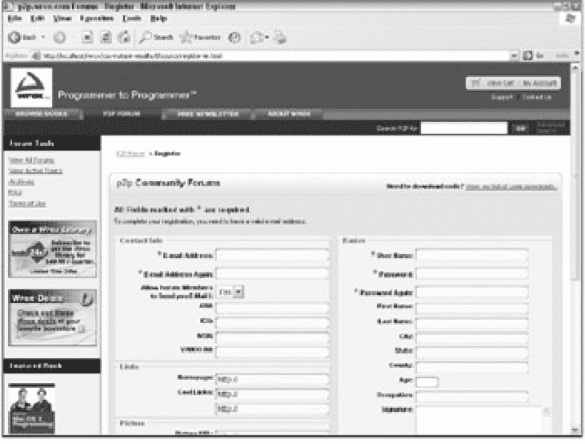

**图 8-7**

The project still is not perfect in Internet Explorer:

- The top bar containing the logo goes too far to the right.
- The `<legend>` elements are not positioned correctly.
- There is too much space between the bread crumbs and the content.

There is also one more bug that isn't so obvious. This bug is demonstrated in Figure 8-8.

## Testing and ≡Caveats

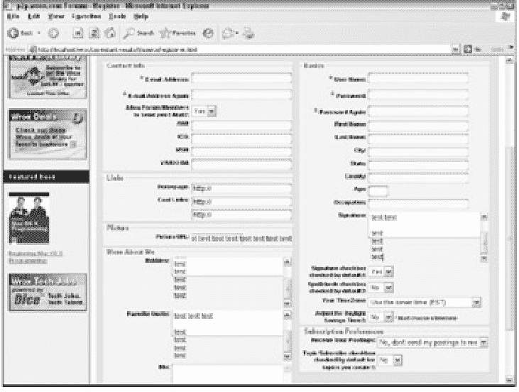

**图 8-8**

In **图 8-8**, you see that when the text fields containing backgrounds are filled with enough text to cause scrolling, the background moves. To correct these bugs, follow these steps:

1. Modify `register-ie.html`, applying the following markup:

```
<!DOCTYPE html PUBLIC "-//W3C//DTD XHTML 1.0 Strict//EN"
"http://www.w3.org/TR/xhtml1/DTD/xhtml1-strict.dtd">
<html xmlns='http://www.w3.org/1999/xhtml' xml:lang='en' id='p2p-wrox-com'>

<head>
  <meta http-equiv="Content-Type" content="text/html; charset=UTF-8" />
  <title>p2p.wrox.com Forums - Register</title>
  <link rel='stylesheet' type='text/css' href='styles/p2p-header.css' />
  <link rel='stylesheet' type='text/css' href='styles/p2p-body.css' />
  <link rel='stylesheet' type='text/css' href='styles/p2p-form.css' />
  <link rel='shortcut icon' href='images/favicon.ico' type='image/x-icon' />
  <!-- compliance patch for microsoft browsers -->
 Rodgers & Hamelstein, 2001.

Cinderella</
```

2. Save the preceding markup as `register-ie-hacks.html`.

3. Enter the following style sheet into your text editor:

```
div#header {
    /* The Holly Hack fixes positioning
        of the cart links */
    height: 1%;
}
div#content {
```

## Testing and ≡Caveats

```
margin-top: -20px;
}
div#innerbody input.i {
    background: url('../images/input.png') no-repeat fixed;
}
div#innerbody input.a {
    background: url('../images/input-a.png') no-repeat fixed;
}
div#innerbody textarea {
    background: url('../images/textarea.png') no-repeat fixed;
    padding-right: 20px;
}
fieldset {
    position: relative;
    margin-bottom: 10px;
}
legend {
    /* This seems the only way to get Explorer
       to position the <legend> correctly */
    position: absolute;
    top: -10px;
}
```

4. Save the new style sheet as `p2p-ie.css`.

This results in the output shown in Figure 8-9.

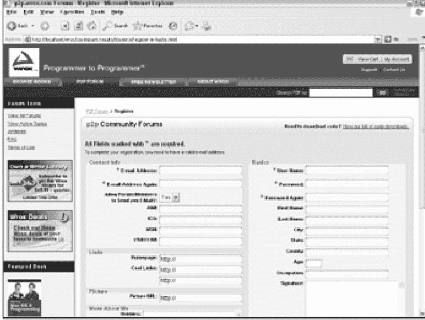

**图 8-9**

The hacks required to get Explorer on the same page, so to speak, as other browsers are relatively simple. Given the symptoms exhibited in Figures 8-7 and 8-8, the resulting conditional comment style sheet is simple and to the point. First a "Holly" hack is applied to the `<header>` `<div>` element:

```
div#header {
```

## Testing and ≡Caveats

```
/* The Holly Hack fixes positioning
    of the cart links */
    height: 1%;
}
```

The Holly Hack is named for developer Holly Bergevin, who along with another fellow named "Big John" maintain the online browser bug site extraordinaire "Position is Everything" at [http://www.positioniseverything.net](http://www.positioniseverything.net). The Holly Hack is a technique used to force an element in Explorer to acquire the "layout" algorithm, which is used internally within Internet Explorer's Trident rendering engine. While I could write an entire chapter about "layout" in Explorer, the simple, to the point explanation is that elements without layout define their dimensions based on the last element to have layout — for instance, auto width on a block element is determined by that element's parent, and that element's parent may also have an auto width which is itself determined by that element's parent, and so on.

Layout in Explorer is an internal algorithm used to implement rendering scenarios like this: elements with layout serve as the reference point to render children and descendants whose dimensions position are reliant upon that element's dimensions. The Holly Hack forces a new point of reference to be created, which corrects the incorrect positioning of the navigational links in the header of the registration form.

You can learn more about Internet Explorer's proprietary `hasLayout` feature from the following URL: http://www.satzansatz.de/cssd/onhavinglayout.html.

The next hack corrects the spacing between the bread crumbs and the content `<div>`. The top margin is simply set to negative 20 pixels to force the content `<div>` up farther:

```
div#content {
    margin-top: -20px;
}
```

After correcting the space between the bread crumbs and the content `<div>`, the next hack fixes those scrolling backgrounds in the `<input>` and `<textarea>` elements. Applying the `fixed` keyword to the background property prevents the background of the `<input>` and `<textarea>` element from scrolling:

```
div#innerbody input.i {
    background: url('../images/input.png') no-repeat fixed;
}
div#innerbody input.a {
    background: url('../images/input-a.png') no-repeat fixed;
}
div#innerbody textarea {
    background: url('../images/textarea.png') no-repeat fixed;
    padding-right: 20px;
}
```

Finally, the top border of the `<fieldset>` element and the position of the `<legend>` element are corrected with the following two rules. Applying a bottom margin to the `<fieldset>` element pushes its top border up to where it belongs, and a `position: relative;` declaration positions the absolutely positioned `<legend>` element relative to the `<fieldset>` element, and it is then wiggled into place using the `top: -10px` declaration:

```
fieldset {
    position: relative;
    margin-bottom: 10px;
}
legend {
    /* This seems the only way to get Explorer
       to position the <legend> correctly */
    position: absolute;
```

## Testing and ≡Caveats

```
top: -10px;
}
```

With the Wrox P2P new user registration form fixed and working properly in Internet Explorer, the next chapter discusses user interface design.


### 第 9 章：基于 Web 的文件查看器用户界面

### 概述

在本章中，你将了解一些用于为基于 Web 的文件查看器应用程序设计用户界面（UI）的技术。UI 可以指从网站导航到一系列控件的任何事物，这些控件共同协作，使复杂的 Web 应用程序得以正常运行。本项目中的文件导航应用程序旨在模拟 Mac OS X 的 Aqua 用户界面。如果你从未见过 Mac OS X，Aqua 采用了水平细条纹背景（有时是拉丝金属背景），以及带有灯光效果的按钮，使按钮看起来内部有水——这就是 Aqua 名称的由来。这正是 Mac 操作系统独特外观和感觉的由来。图 9-1 是 Mac OS X Finder 的截图。

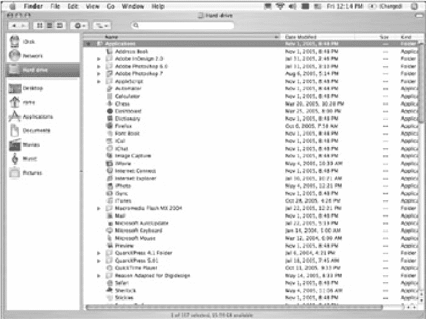

**图 9-1**

对于本项目，你将使用一个开源（Free-BSD 许可）项目的图形、标记和样式表，该项目我一直在开发，我称之为"Hierophant"（在撰写本书时，该项目尚未向公众发布），一个开源的 PHP 驱动框架和内容管理系统（CMS）。如果你好奇的话，"Hierophant"一词指的是古希腊祭司，据说他们有能力将神秘或深奥的事物变得易于理解（根据一种定义）。我选择这个名字是因为我想编写一个复杂的 PHP 框架，让复杂且有时困难的任务对普通用户来说变得简单。

这个应用程序被称为"hFinder"，因为它提供了 Mac OS X 的 Finder 或 Windows 资源管理器的大部分功能，只是它通过浏览器提供文件管理功能，而 Finder 是 Mac 操作系统的一部分。由于实际应用程序是超出本书范围的复杂技术交织，主要是 PHP、MySQL 和 JavaScript，我只包含样式表、图形和标记。事件驱动的功能仅在理论上进行讨论，并且只讨论与将样式表应用于底层标记相关的部分。

hFinder 的目的是让新手用户轻松完成与文件管理相关的所有事务，其外观和感觉是普通用户可能已经熟悉且感到舒适的，因为 hFinder 中使用的控件旨在模拟本机操作系统文件管理功能。


## 第9章：基于Web的文件查看器用户界面

以下是 hFinder 的目标：

-   该**项目**必须是可复用的，因为 Hierophant 框架的其他部分可能也需要文件管理功能，但不一定需要 hFinder 中的所有控件。例如，设计一个基于 Web 的文件管理应用程序也可能有助于设计其他应用程序。基于 Web 的**所见即所得**（WYSIWYG）HTML 编辑器可能需要一个“打开”或“另存为”对话框，让用户看到服务器上文件的图形表示会很有用。
-   应用程序必须支持多种查看文件信息的方法，例如列表、详细信息、缩略图、图标、列等等。应用程序应尝试实现用户熟悉的尽可能多的视图（例如，Windows 和 Macintosh 通用的视图），以实现最大的可用性。其结果是 Mac OS X Finder 和 Windows 资源管理器的混合体。如果不能支持所有视图，则至少必须易于在以后扩展新方法。
-   应用程序必须有两个并排的视图：在左侧视图中，是服务器上目录的树状表示；在右侧，是所选目录的内容。这正是 Windows 资源管理器提供的功能。
-   每个文件都必须有一个附带的图标。HTML 文件有 Web 浏览器图标，目录有文件夹图标，等等。
-   左侧的树状视图中，目录旁边必须有箭头，以指示该文件夹包含其他文件夹。
-   应用程序必须有一个工具栏，用于与浏览文件相关的常用功能；例如，用于前进和后退、刷新等的按钮。
-   应用程序必须有用于其他常见操作的菜单，例如上传新文件、创建目录、更改当前目录的视图、修改首选项等。

了解了 hFinder 应用程序的目标后，下一节将讨论哪些 CSS 功能在创建 hFinder 应用程序中发挥作用。

## 设计

在现实世界中，团队成员在开发应用程序时被分配项目的不同部分的情况并不少见。一个人可能负责呈现布局，另一个人可能创建图形，另一个人可能负责 JavaScript，还有一个人可能处理服务器端编程（PHP、ASP、Java、Ruby 等）。hFinder 应用程序是此类面向团队委托的理想候选者，尽管实际上它仅由一个人——我设计！

将 CSS 应用于 hFinder 应用程序是本书中呈现的最复杂的项目。hFinder 应用程序，就像第 8 章中的 p2p.wrox.com 用户注册表单一样，实践了许多你已经在早期项目中看到的概念，例如下拉菜单和多列布局，但它也提出了一些尚未涵盖的独特挑战。

下一节将介绍 hFinder 的源代码，然后按功能对源代码进行解释。hFinder 项目的各个功能如下：

-   下拉导航菜单（文件、视图、帮助）和上下文菜单（用于右键单击文件）
-   用于浏览按钮的工具栏（后退、前进、刷新等）
-   纯 CSS 弹出窗口（用于上传文件或修改文件属性）
-   用于导航目录的目录树
-   用于查看目录内容的目录窗口

由于应用程序非常复杂，首先呈现完整的源代码，然后详细解释它是如何组合在一起的，按照前面列表中提到的各种方法进行模块化。

## 代码与代码说明

以下是 hFinder 应用程序的完整源代码。hFinder 应用程序的源代码可以从本书附带的 CD-ROM 获取，也可以在线在 www.wrox.com 获取。由于源代码文件的长度，在源代码之后是对该项目不同方面的解释。

1.  输入以下标记：

```html
<!DOCTYPE html PUBLIC "-//W3C//DTD XHTML 1.0 Transitional//EN"
"http://www.w3.org/TR/2002/REC-xhtml1-20020801/DTD/xhtml1-transitional.dtd">
<html xmlns='http://www.w3.org/1999/xhtml' xml:lang='en'>
    <head>
        <meta http-equiv='content-type' content='text/html; charset=utf-8' />
        <meta http-equiv='content-language' content='en-us' />
        <title>hFinder File Management Application</title>
        <!-- compliance patch for microsoft browsers -->
        <!--[if lt IE 7]>
            <script src="/ie7/ie7-standard.js"
                type=" text/javascript"></script>
            <script src="/ie7/ie7-css3-selectors.js"
                type=" text/javascript"></script>
            <link rel='stylesheet'
                type='text/css'
                href='styles/hFinder.ie.css' />
            <link rel='stylesheet'
                type='text/css'
                href='styles/tree.ie.css' />
            <script type='text/javascript'
                src='js/png.js'></script>
        <![endif]-->
        <link rel='stylesheet' type='text/css' href='styles/hFinder.css' />
        <!--

            Hierophant Framework

            http://www.smilingsouls.net/hierophant
            (c) Copyright 1998-2005 Richard York, All rights Reserved

            Use and redistribution are subject to the terms of the license.
            http://www.smilingsouls.net/hierophant/license

        -->
    </head>
    <body>
        <ul id='hfinder-menu'>
            <li class='hfinder-menu-item' id='hfinder-menu-file'>
                File
                <ul>
                    <li id='hfinder-menu-new-file'>
                        <span>New File</span>
                    </li>
                    <li id='hfinder-menu-new-directory' class='sep'>
                        <span>New Directory</span>
                    </li>
                    <li id='hfinder-menu-close'>
                        <span>Close</span></li>
                </ul>
            </li>
            <li class='hfinder-menu-item' id='hfinder-menu-view'>
                View
                <ul>
                    <li id='hfinder-menu-thumbnail'>
                        <span>Thumbnails</span>
                    </li>
                    <li id='hfinder-menu-tile'>
                        <span>Tiles</span>
                    </li>
                    <li id='hfinder-menu-icon'>
                        <span>Icons</span>
                    </li>
                    <li id='hfinder-menu-details'>
                        <span>Details</span>
                    </li>
                    <li id='hfinder-menu-list' class='sep'>
                        <span>List</span>
                    </li>
                    <li id='hfinder-menu-default-view'>
                        <span>Set Current as Default</span>
                    </li>
                </ul>
            </li>
            <li class='hfinder-menu-item' id='hfinder-menu-admin'>
                Admin
                <ul>
                    <li id='hfinder-menu-home-directory' class='sep'>
                        <span>Home Directory</span>
                    </li>
                    <li id='hfinder-menu-manage-users'>
                        <span>Manage Users</span>
                    </li>
                    <li id='hfinder-menu-manage-groups'>
                        <span>Manage Groups</span>
                    </li>
                </ul>
            </li>
            <li class='hfinder-menu-item' id='hfinder-menu-help'>
                Help
                <ul>
                    <li id='hfinder-help-contents'>
                        <span>Help Contents</span>
                    </li>
                </ul>
            </li>
        </ul>
        <div id='hfinder-toolbar'>
            <table style='width: 100%; border-collapse: collapse;'>
                <tbody>
                    <tr>
                        <td style='width: 35px;'>
                            
                        </td>
                        <td style='width: 35px;'>
                            
                        </td>
                        <td style='width: 35px;'>
                            
                        </td>
                        <td style='width: 35px;'>
                            
                        </td>
                        <td style='vertical-align: middle;'>
                            <input type='text'
                                style='width: 98%;'
                                value='/'
                                id='hfinder-location-input' />
                        </td>
                        <td style='width: 35px;'>
                            
                        </td>
                        <td style='width: 35px;'>
                            
                        </td>
                        <td style='width: 35px;'>
                            
                        </td>
                    </tr>
                </tbody>
            </table>
        </div>
    </body>
</html>
```


## 代码与代码解释

```
</tbody>

</table>
</div>
<div id='hfinder-tree'>
    <ul class='file-tree'>
        <li>
            <div class='file-tree-directory file-tree-root'
                 id='tree-dir-1'>
                <span>Hard drive</span>
            </div>
            <ul id='directory-1' class='file-tree-dir-list'>
                <li>
                    <div class='file-tree-directory'
                         id='tree-dir-3645'>
                        <span>account</span>
                    </div>
                    
                </li>
                <li>
                    <div class='file-tree-directory'
                         id='tree-dir-31'>
                        <span>cp</span>
                    </div>
                </li>
                <li>
                    <div class='file-tree-directory'
                         id='tree-dir-3785'>
                        <span>daemon</span>
                    </div>
                </li>
                <li>
                    <div class='file-tree-directory'
                         id='tree-dir-3677'>
                        <span>file</span>
                    </div>
                </li>
                <li>
                    <div class='file-tree-directory'
                         id='tree-dir-26'>
                        <span>forum</span>
                    </div>
                </li>
                <li>
                    <div class='Opening-hours-table-container file-tree-directory'
                         id='tree-dir-3651'>
                        <span>home</span>
                    </div>
                    
                </li>
                <li>
                    <div class='file-tree-directory'
                         id='tree-dir-3681'>
                        <span>images</span>
                    </div>
                    
                </li>
                <li>
                    <div class='file-tree-directory'
                         id='tree-dir-3690'>
                        <span>js</span>
                    </div>
                    
                </li>
                <li>
                    <div class='file-tree-directory'
                         id='tree-dir-30'>
                        <span>listener</span>
                    </div>
                </li>
                <li>
                    <div class='file-tree-directory'
                         id='tree-dir-29'>
                        <span>logout</span>
                    </div>
                </li>
                <li>
                    <div class='file-tree-directory'
                         id='tree-dir-3682'>
                        <span>media</span>
                    </div>
                    
                </li>
                <li>
                    <div class='file-tree-directory'
                         id='tree-dir-3667'>
                        <span>network</span>
                    </div>
                </li>
                <li>
                    <div class='file-tree-directory'
                         id='tree-dir-3735'>
                        <span>products</span>
                    </div>
                    
                </li>
                <li>
                    <div class='file-tree-directory'
                         id='tree-dir-28'>
                        <span>register</span>
                    </div>
                </li>
                <li>
                    <div class='file-tree-directory'
                         id='tree-dir-3784'>
                        <span>search</span>
                    </div>
                </li>
            </ul>
        </li>
    </ul>
</div>
<div id='hfinder-files'>
    <div id='dir-3645'
         class='file-details file-directory'
         title='account'>
        <div>
            <div class='file-icon-wrapper'>
                
            </div>
            <div class='file-details-caption file-caption-wrapper'>
                <span class='file-name'>account</span>
            </div>
        </div>
    </div>
    <div id='dir-31'
         class='file-details file-directory'
         title='cp'>
        <div>
            <div class='file-icon-wrapper'>
                
            </div>
            <div class='file-details-caption file-caption-wrapper'>
                <span class='file-name'>cp</span>
            </div>
        </div>
    </div>
    <div id='dir-3785'
         class='file-details file-directory'
         title='daemons'>
        <div>
            <div class='file-icon-wrapper'>
                
            </div>
            <div class='file-details-caption file-caption-wrapper'>
                <span class='file-name'>daemons</span>
            </div>
        </div>
    </div>
    <div id='dir-3677'
         class='file-details file-directory'
         title='file'>
        <div>
            <div class='file-icon-wrapper'>
                
            </div>
            <div class='file-details-caption file-caption-wrapper'>
                <span class='file-name'>file</span>
            </div>
        </div>
    </div>
    <div id='dir-26'
         class='file-details file-directory'
         title='forum'>
        <div>
            <div class='file-icon-wrapper'>
                
            </div>
            <div class='file-details-caption file-caption-wrapper'>
                <span class='file-name'>forum</span>
            </div>
        </div>
    </div>
    <div id='dir-3651'
         class='file-details file-directory'
         title='home'>
        <div>
            <div class='file-icon-wrapper'>
                
            </div>
            <div class='file-details-caption file-caption-wrapper'>
                <span class='file-name'>home</span>
            </div>
        </div>
    </div>
    <div id='dir-3681'
         class='file-details file-directory'
         title='images'>
        <div>
            <div class='file-icon-wrapper'>
                
            </div>
            <div class='file-details-caption file-caption-wrapper'>
                <span class='file-name'>images</span>
            </div>
        </div>
    </div>
    <div id='dir-3690'
         class='file-details file-directory'
         title='js'>
        <div>
            <div class='file-icon-wrapper'>
                
            </div>
            <div class='file-details-caption file-caption-wrapper'>
                <span class='file-name'>js</span>
            </div>
        </div>
    </div>
    <div id='dir-30'
         class='file-details file-directory'
         title='listener'>
        <div>
            <div class='file-icon-wrapper'>
                
            </div>
            <div class='file-details-caption file-caption-wrapper'>
                <span class='file-name'>listener</span>
            </div>
        </div>
    </div>
    <div id='dir-29'
         class='file-details file-directory'
         title='logout'>
        <div>
            <div class='file-icon-wrapper'>
                
            </div>
            <div class='file-details-caption file-caption-wrapper'>
                <span class='file-name'>logout</span>
            </div>
        </div>
    </div>
</div>
```


 # 代码及代码说明

```
</div>
<div id='dir-3682'
    class='file-details file-directory'
    title='media'>
    <div>
        <div class='file-icon-wrapper'>
            
        </div>
        <div class='file-details-caption file-caption-wrapper'>
            <span class='file-name'>media</span>
        </div>
    </div>
</div>
<div id='dir-3667'
    class='file-details file-directory'
    title='network'>
    <div>
 via the file-icon-wrapper">
            
        </div>
        <div class='file-details-caption file-caption-wrapper'>
            < Markus the file-name">network</span>
        </div>
    </div>
</div>
<div id='dir-3735'
    class='file-details file-directory'
    title='products'>
    <div>
        <div class='file-icon-wrapper'>
            
        </div>
        <div class='file-details-caption file-caption-wrapper'>
            <span class='file-name'>products</span>
        </div>
    </div>
</div>
<div id='dir-28'
    class='file-details file-directory'
    title='register'>
    <div>
        <div class='file-icon-wrapper'>
            
        </div>
        <div class='file-details-caption file-caption-wrapper'>
            <span class='file-name'>register</span>
        </div>
```

```
</div>
            </div>
            <div id='dir-3784'
                 class='file-details file-directory'
                 title='search'>
                <div>
                    <div class='file-icon-wrapper'>
                        
                    </div>
                    <div class='file-details-caption file-caption-wrapper'>
                        <span class='file-name'>search</span>
                    </div>
                </div>
            </div>
            <div id='reg-112'
                 class='file-details file-registry-doc'
                 title='File Not Found'>
                <div>
                    <div class='file-icon-wrapper'>
                        
                    </div>
                    <div class='file-details-caption file-caption-wrapper'>
                        <span class='file-name' id='freg-112'>404.html</span>
                        <h4>File Not Found</h4>
                        <p class='file-details-text'>
                            This is a custom 404 error document.
                        </p>
                    </div>
                </div>
            </div>
            <div id='reg-1'
                 class='file-details file-registry-doc'
                 title='Welcome'>
                <div>
                    <div class='file-icon-wrapper'>
                        
                    </div>
                    <div class='file-details-caption file-caption-wrapper'>
                        <span class='file-name' id='freg-1hm hr ll ch ku k'>index.html</span>
                        <h4>Welcome</h4>
                        <p class='file-details-text'>
                            This is the default page for the website.
                        </p>
                    </div>
                </div>
            </div>
        </div>
    </div>
```

```
<div id='hfinder-contextmenu'>
    <ul>
        <li id='context-open' class='sep'>
            <span style='font-weight: bold;'>Open</span>
        </li>
        <li id='context-control-panel'>
            <span>Control Panel</span>
        </li>
        <li id='context-title-description' class='sep'>
            <span>Modify Title and Description</span>
        </li>
        <li id='context-delete'>
            <span>Delete</span>
        </li>
        <li id='context-rename' class='sep'>
            <span>Rename</span>
        </li>
        <li id='context-properties'>
            <span>Properties</span>
        </li>
        <li id='context-permissions'>
            <span>Permissions</span>
        </li>
    </ul>
</div>
<div id='file-upload'>
    <div class='file-titlebar'>Upload a File</div>
    <form method='post'
        id='hfinder-upload-form'
        enctype='multipart/form-data'
        action='javascript:void(0);'
        target='hfinder-file'>
        <input type='hidden' name='dir' value='' id='hfinder-dir' />
        <table style='widthuber-width: 100%;'>
            <colgroup>
                <col style='width col. Uber valued the width: 25%;'>
                <col style='width: 75%;'>
            </colgroup>
            <tbody style='text-align: left;'>
                <tr>
                    <td>
                        <label for='hfinder-meta-title'>
                            Title:
                        </label>
                    </td>
                    <td>
                        <input type='text'
                            style='width: 98%;'
                            name='meta_title'
                            id='hfinder-meta-title' />
                    </td>
                </tr>
                <tr>
                    <td style='vertical-align: top;'>
                        <label for='hfinder-meta-description'>
```

```
File Description:
</label>
</td>

<td>
<textarea rows='4'
           cols='15'
           style='width: 98%;'
           name='meta_description'
           id='hfinder-meta-description'></textarea>
</td>
</tr>
<tr>
<td>
<label for='hfinder-upload'>
    Select a file:
</label>
</td>
<td>
<input type='file'
       name='content'
       id='hfinder-upload' />
</td>
</tr>
<tr>
<td style='text-align:不甘示弱 right;' colspan='2'>
<input type='submit'
       title='Upload File'
       value='Upload'
       id='hfinder-file-upload' />
<input type='submit'
       value='Cancel'
       id='hfinder-file-cancel' />
</td>
</tr>
</tbody>
</table>
</form>
</div>
<iframe id='hfinder-file' name='hfinder-file' src=''></iframe>
<div id='file-modify-attributes'>
    <div class='file-titlebar'>Modify Title and Description</div>
    <form method='post' action='javascript:void低级错误(0);'>
        <input type='hidden' name='dir' value='' id='hfinder-dir' />
        <table style='width: 100%;'>
            <colgroup>
                <col style='width: 25%;'>
                <col style='width: 75%;'>
            </colgroup>
            <tbody style='text-align: left;'>
                <tr>
                    <td>
                        <label for='file-modify-meta-title'>
                            Title:
                        </label>
                    </td>
```

```
<td>
    <input type='text'
           style='width: 98%;'
           name='meta_title'
           id='file-modify-meta-title'
           disabled='disabled' />
</td>
</tr>
<tr>
    <td style='vertical-align: top;'>
        <label for='挂号费file-modify-meta-description'>
            File Description:
        </label>
    </td>
    <td>
        <textarea rows='4'
                  cols='15'
                  style='width: 98%;'
                  name='meta_description'
                  id='file-modify-meta-description'
                  disabled='disabled'></textarea>
    </td>
</tr>
<tr>
    <td style='text-align: right;' colspan='2'>
        <input type='hidden'
               id='file-modify-id'
               name='file_modify_id'
               value='' />
        <input type='submit'
               id='file-modify-save'
               title='Save'
               value='Save'
               disabled='disabled' />
        <日常工作生活<input type='submit'
               id='file-modify-cancel'
               value='Cancel'
               disabled='disabled' />
    </td>
</tr>
</tbody>
</table>
</form>
</div>
</body>
</html>
```

- 2. 将该标记保存为 hFinder.html。

- 3. 输入以下样式表，该样式表包含其他由应用程序的不同部分分隔的样式表。该样式表中的样式设置了基本布局，并对包含控件的各种列和模块进行定位：

```
@import 'menus.css';
@import 'views.css';
```


## 代码及代码说明

```css
@import 'tree.css';
@import 'popup.css';

body,
html {
    width: 100%;
    height: 100%;
    min-width: 500px;
    min-height: 300px;
}
body {
    padding: 0;
    margin: 0;
    background: url('../images/brushed_metal.png');
    -moz-user-select: none;
}
div#hfinder-toolbar {
    position: absolute;
    top: 0;
    left: 0;
    right: 0;
    margin: 28px 10px 0 10px;
}
div#hfinder-tree {
    position: absolute;
    top: 0;
    bottom: 0;
    left: 0;
    margin: 73px 0 10px 10px;
    width: 190px;
    background: white;
    overflow: auto;
    border: 1px solid rgb(128, 128, 128);
    z-index: 1;
}
div#hfinder-files {
    margin: 73px 10px 10px 210px;
    position: absolute;
    top: 0;
    bottom: 0;
    left: 0;
    right: 0;
    border: 1px solid rgb(128, 128, 128);
    background: white url('../images/stripes.png');
    z-index: 1;
    overflow: auto;
}
```

+   4. 保存为 **hFinder.css**。

+   5. 输入以下样式表，用于设置各个菜单的样式：

```css
ul#hfinder-menu {
    list-style: none;
    margin: 0;
    padding: 2px;
    font: 12px sans-serif;
    height: 19px;
}
ul#hfinder-menu li.hfinder-menu-item {
    float: left;
    padding: 3px;
    margin: 0 3px;
    position: relative;
}
ul#hfinder-menu li.hfinder-menu-item:hover {
    background: rgb(128, 128, 128);
    color: white;
}
ul#hfinder-menu li.hfinder-menu-item:hover > ul {
    visibility: visible;
}
div#hfinder-contextmenu {
    /*visibility: hidden;*/
    position: absolute;
    z-index: 4;
    right: 25px;
    bottom: 25px;
}
li#context-title-description {
    display: none;
}
div#hfinder-contextmenu ul,
ul#hfinder-menu ul {
    font: 12px sans-serif;
    color: black;
    background: white url('../images/stripes.png');
    width: 16em;
    list-style: none;
    margin: 0;
    padding: 2px;
    border: 1px solid rgb(128, 128, 128);
    opacity: 0.9;
}
ul#hfinder-menu ul {
    position: absolute;
    visibility: hidden;
    top: 18px;
    left: 0;
    z-index: 2;
}
li.sep {
    border-bottom: 1px solid rgb(200, 200, 200);
    margin-bottom: 2px;
}
div#hfinder-contextmenu ul > li,
ul#hfinder-menu ul > li {
    padding: 3px 5px;
}
div#hfinder-contextmenu ul > li > span,
ul#hfinder-menu ul > li > span,
div#directory-view ul > li > span {
    padding: 0 0 15px;
}
div#hfinder-contextmenu ul > li:hover,
ul#hfinder-menu ul > li:hover {
    background: #369;
    color: white;
}
```

+   6. 保存为 menus.css。

+   7. 输入以下样式表，用于设置目录树的样式：

```css
ul.file-tree,
ul.file-tree ul {
    list-style: none;
    font: 12px sans-serif;
    white-space: nowrap;
    margin: 5px 0 0 0;
    padding: 0 0 0 15px;
}
ul.file-tree li {
    padding: 4px 0;
    position: relative;
}
ul.file-tree-dir-list li:hover > div > span {
    background: #369;
    color: white;
}
div.file-tree-directory.file-tree-root {
    background: url('../images/hard_drive.png') no-repeat left center;
    height: 32px;
    padding: 0 0 4px 34px;
    border: 1px solid white;
    border-bottom: 2px solid rgb(200, 200, 200);
}
div.file-tree-directory.file-tree-root span {
    display: block;
    margin-top: 10px;
}
ul.file-tree div {
    margin: -5px 0 0 -10px;
    background: url('../images/folder.png') no-repeat left center;
    padding-left: 20px;
}
img.file-has-children {
    position: absolute;
    top: -2px;
    left: -25px;
}
```

+   8. 将上述样式表保存为 tree.css。

+   9. 下一个样式表用于设置目录内容各种查看方式的样式：

## 代码及代码说明

```css
div.file-thumbnail,
div.file-icon,
div.file-tile,
div.file-list,
div.file-details.file-directory {
    float: left;
    position: relative;
    overflow: hidden;
    font: 13px sans-serif;
    margin: 3px;
    padding: 4px;
    cursor: pointer;
}
div.file-thumbnail img {
    padding: 35px;
    border: 1px solid rgb(232, 232, 232);
}
div.file-thumbnail div.file-image-thumb-wrapper {
    width: 118px;
    height: 118px;
    border: 1px solid rgb(232, 232, 232);
    padding-top: 4px;
}
div.file-thumbnail img.file-image-thumb {
    padding: 0;
    border: none;
}
div.file-list {
    width: 250px;
    height: 20px;
}
div.file-details {
    margin: 3px;
    padding: 4px;
    font: 12px sans-serif;
    cursor: pointer;
}
div.file-thumbnail {
    width: 120px;
    height: 155px;
}
div.file-thumbnail > div {
    text-align: center;
}
div.file-thumbnail span.file-name {
    position: absolute;
    bottom: 10px;
    left: 0;
    width: 120px;
    text-align: center;
}
div.file-icon {
    width: 100px;
    height: 60px;
    text-align: center;
}
```

## 代码及代码说明

```css
div.file-details.file-directory,
div.file-tile {
    width: 200px;
    height: 40px;
}
div.file-details.file-registry-doc {
    clear: both;
    float: none;
}
div.file-tile > div > div.file-caption-wrapper,
div.file-details.file-directory > div > div.file-caption-wrapper,
div.file-list > div > div.file-caption-wrapper {
    position: absolute;
    top: 10px;
    left: 42px;
}
div.file-list > div > div.file-caption-wrapper {
    top: 3px;
    left: 25px;
}
div.file-details.file-registry-doc > div > div.file-caption-wrapper > span {
    float: right;
}
div.file-details.file-registry-doc h4 {
    margin: 0 0 0 40px;
    border-bottom: 1px dotted black;
}
div.file-details.file-registry-doc p {
    margin: 3px 0 0 40px;
}
div.file-details div.file-icon-wrapper,
div.file-tile div.file-icon-wrapper,
div.file-list div.file-icon-wrapper {
    float: left;
}
div.file-highlight-on,
div.file-details.file-highlight-on {
    background: url('images/stripes_darker.png');
    padding: 4px;
}
div.file-highlight-off,
div.file-details.file-highlight-off {
    background: transparent;
    padding: 4px;
    border: none;
}
```

10. 将上述样式表保存为 `views.css`。

11. 下一个样式表包含纯 CSS 弹出窗口的样式：

```css
div.file-titlebar {
    padding: 2px 5px;
    font-weight: bold;
    border-bottom: 1px solid rgb(128, 128, 128);
    margin-bottom: 3px;
    font: 16px sans-serif;
}
div#file-upload,
div#file-modify-attributes {
    position: absolute;
    width: 600px;
    height: 250px;
    top: 50%;
    left: 50%;
    margin: -125px 0 0 -300px;
    border: 3px solid rgb(128, 128, 128);
    background: url('../images/brushed_metal.png');
    z-index: 5;
    display: none;
}
div#file-upload {
    display: block;
}
div#file-upload label,
div#file-modify-attributes label {
    font: 12px sans-serif;
    display: block;
    text-align: right;
}
input#hfinder-location-input {
    font: 12px sans-serif;
    padding: 2px;
}
input#hfinder-location-input:focus,
input#hfinder-location-input:hover {
    outline: 2px solid rgb(203, 245, 254);
    -moz-outline: 2px solid rgb(203, 245, 254);
}
input[type='text'],
textarea {
    border: 1px solid rgb(128, 128, 128);
}
iframe#hfinder-file {
    z-index: 20;
    position: absolute;
    bottom: 0;
    left: 0;
    width: 100%;
    height: 100px;
    background: white;
    display: none;
}
```

12. 将最后一个样式表保存为 popup.css。

该代码生成的输出如图 9-2 所示。

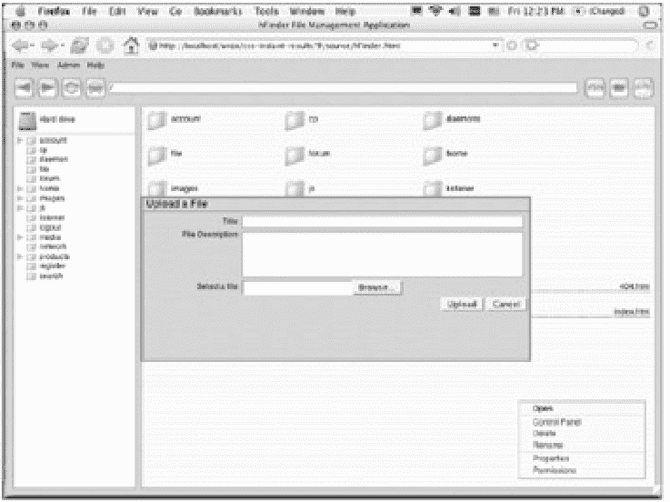

**图 9-2**

图 9-2 展示了文件上传弹出窗口和上下文菜单，这些控件应在需要之前保持隐藏。图 9-3 展示了 hFinder 应用程序，其中文件上传弹出窗口和上下文菜单处于隐藏状态。


**图 9-3**

既然已经看到了 hFinder 应用程序样式化的结果，以下部分将解释这些样式如何与标记结合，以实现图 9-2 和图 9-3 中所示的效果。

## 奠定基础

## 代码及代码说明

文件 hFinder.css 专门处理以下标记，相关部分已进行编辑以展示要点：

```html
</head>
    <body>
        <div id='hfinder-toolbar'>
        </div>
        <div id='hfinder-tree'>
        </div>
        <div id='hfinder-files'>
        </div>
    </body>
</html>
```

应用样式表 hFinder.css 后，得到图 9-4 所示的结果。


**图 9-4**

hFinder.css 中出现的第一条样式是应用程序其他模块的 `@import` 规则：

```css
@import 'menus.css';
@import 'views.css';
@import 'tree.css';
@import 'popup.css';
```

hFinder.css 中的所有内容都涉及 `hFinder` 应用程序外观和感觉的基础。第一条规则使 `<html>` 和 `<body>` 元素占据浏览器视口的 100% 宽度和高度。这是为了让树视图和目录内容能够相对于视口调整大小——当窗口调整大小时，文档的这些部分也会随之调整大小。同时还提供了最小约束条件，以防止浏览器窗口非常小时设计被破坏：

```css
body,
html {
    width: 100%;
```


## 代码与代码解释

```css
height: 100%;
min-width: 500px;
min-height: 300px;
}
```

下一条规则移除了默认的 `margin` 和 `padding`，然后为整个浏览器窗口指定了拉丝金属背景。此规则中的最后一个声明是 Gecko 浏览器专有的。`-moz-user-select: none;` 防止用户在窗口中选择文本。实际上，它使选区变得不可见。应用程序中防止选区是因为当通过 JavaScript 附加鼠标点击事件时，用户可能无意中触发选择。然而，由于应用程序开发者（或熟练用户）可能希望进行选择，所以选择仍然会发生，但它是不可见的。在 Mozilla Firefox 中，右键单击不可见的选区（或使用 command + A，或 CTRL + A）仍然提供“查看选区源代码”的选项，这对于文档部分通过 JavaScript 动态更改的情况非常有用，就像这个应用程序完全功能化时的情况一样。使用专有的 `::-moz-selection` 伪元素，通过包含 `background: transparent;` 和 `color: inherit;` 声明，可以达到相同的效果。在 Internet Explorer 中，防止用户选择需要 JavaScript。事实上，为了提供一个完整的、跨浏览器的解决方案，以下是 Internet Explorer 所需的 JavaScript 来提供相同的功能：

```html
<script type='text/javascript'>
    document.onselectstart = function() {return false;};
</script>
```

在 Mozilla 和 Gecko 衍生浏览器中，使用 CSS 方法仍然可以创建不可见的选区，而在 IE 中，使用此方法则完全无法进行选择：

```css
body {
    padding: 0;
    margin: 0;
    background: url('../images/brushed_metal.png');
    -moz-user-select: none;
}
```

下一条规则定位工具栏，这是一个 `id` 为 `hfinder-toolbar` 的 `<div>`。该 `<div>` 被绝对定位到视口顶部，然后使用 `left: 0;` 和 `right: 0;` 声明沿视口宽度拉伸。然后，顶部应用了 28 像素的 margin，以防止它与上方出现的菜单重叠，左右两侧应用了 10 像素的 margin，以在工具栏与视口左右两侧之间提供一些空间：

```css
div#hfinder-toolbar {
    position: absolute;
    top: 0;
    left: 0;
    right: 0;
    margin: 28px 10px 0 10px;
}
```

下一条规则定位包含目录结构树形表示的 `<div>`（其 `id` 为 `hfinder-tree`）。该 `<div>` 首先被绝对定位，然后使用 `top: 0;` 和 `bottom: 0;` 声明沿视口高度拉伸，再使用 `left: 0;` 声明定位到视口左侧。然后应用 margin 到 `<div>` 的顶部——73 像素，这防止树视图与菜单和工具栏重叠；底部和左侧应用了 10 像素的 margin，以使其与视口的左下角保持间距。在偏移属性之后，该 `<div>` 被赋予了 190 像素的明确宽度和白色背景。提供了 `overflow: auto;` 声明，以防止 `<div>` 的内容溢出其边界；如果内容多于可用空间，相应地将出现滚动条。接下来应用了 1 像素的实心灰色边框，最后通过 `z-index` 将 `<div>` 在 z 轴上的位置设置为堆叠顺序中的第一层：

```css
div#hfinder-tree {
    position: absolute;
    top: 0;
    bottom: 0;
    left: 0;
    margin: 73px 0 10px 10px;
    width: 190px;
    background: white;
    overflow: auto;
    border: 1px solid rgb(128, 128, 128);
    z-index: 1;
}
```

接下来要介绍的规则定位显示目录内容的 `<div>`。与前一条规则类似，这个 `<div>` 也是绝对定位，但它使用四个偏移属性向所有四个方向拉伸。然后使用 margin 来微调 `<div>` 的位置——同样，73 像素的空间防止目录内容与应用程序窗口顶部的菜单和工具栏重叠。底部和右侧提供了 10 像素的 margin，使其与视口的右下角保持间距。最后，左侧 margin 提供了 210 像素的空间，以防止 `<div>` 与树视图重叠。提供了 1 像素的实心灰色边框，并指定了细条纹背景，该背景在 x 轴和 y 轴上重复。`z-index` 提供了 `<div>` 在 z 轴上的位置，最后，`overflow: auto;` 声明会在 `<div>` 的内容大于其尺寸时导致滚动条出现：

```css
div#hfinder-files {
    position: absolute;
    top: 0;
    bottom: 0;
    left: 0;
    right: 0;
    margin: 73px 10px 10px 210px;
    border: 1px solid rgb(128, 128, 128);
    background: white url('../images/stripes.png');
    z-index: 1;
    overflow: auto;
}
```

基础结构就位后，下一节将描述菜单是如何样式的。

## 应用菜单

本节描述如何将 `menus.css` 中的样式应用到以下代码片段。第一个片段是文档顶部的菜单——文件、视图、管理与帮助菜单：

```html
<body>
    <ul id='hfinder-menu'>
        <li class='hfinder-menu-item' id='hfinder-menu-file'>
            File
            <ul>
                <li id='hfinder-menu-new-file'>
                    <span>New File</span>
                </li>
                <li id='hfinder-menu-new-directory' class='sep'>
                    <span>New Directory</span>
                </li>
                <li id='hfinder-menu-close'>
                    <span>Close</span>
                </li>
            </ul>
        </li>
        <li class='hfinder-menu-item' id='hfinder-menu-view'>
            View
            <ul>
                <li id='hfinder-menu-thumbnail'>
                    <span>Thumbnails</span>
                </li>
                <li id='hfinder-menu-tile'>
                    <span>Tiles</span>
                </li>
                <li id='hfinder-menu-icon'>
                    <span>Icons</span>
                </li>
                <li id='hfinder-menu-details'>
                    <span>Details</span>
                </li>
                <li id='hfinder-menu-list' class='sep'>
                    <span>List</span>
                </li>
                <li id='hfinder-menu-default-view'>
                    <span>Set Current as Default</span>
                </li>
            </ul>
        </li>
        <li class='hfinder-menu-item' id='hfinder-menu-admin'>
            Admin
            <ul>
                <li id='hfinder-menu-home-directory' class='sep'>
                    <span>Home Directory</span>
                </li>
                <li id='hfinder-menu-manage-users'>
                    <span>Manage Users</span>
                </li>
                <li id='hfinder-menu-manage-groups'>
                    <span>Manage Groups</span>
                </li>
            </ul>
        </li>
        <li class='hfinder-menu-item' id='hfinder-menu-help'>
            Help
            <ul>
                <li id='hfinder-help-contents'>
                    <span>Help Contents</span>
                </li>
            </ul>
        </li>
    </ul>

    <div id='hfinder-toolbar'>
    </div>
    <div id='hfinder-tree'>
    </div>
    <div id='hfinder-files'>
    </div>
```

下一个片段是上下文菜单，在启用 JavaScript 的应用程序中，当用户右键单击文件或目录时会出现。应用于上下文菜单的样式与应用于文档顶部菜单的样式几乎完全相同：

```html
<div id='hfinder-contextmenu'>
    <ul>
        <li id='context-open' class='sep'>
            <span style='font-weight: bold;'>Open</span>
        </li>
        <li id='context-control-panel'>
            <span>Control Panel</span>
        </li>
        <li id='context-title-description' class='sep'>
            <span>Modify Title and Description</span>
        </li>
        <li id='context-delete'>
            <span>Delete</span>
        </li>
        <li id='context-rename' class='sep'>
            <span>Rename</span>
        </li>
        <li id='context-properties'>
            <span>Properties</span>
        </li>
        <li id='context-permissions'>
            <span>Permissions</span>
        </li>
    </ul>
</div>
</body>
```

第一条样式表规则应用于 `id` 为 `hfinder-menu` 的 `<ul>` 元素。这个 `<ul>` 元素包含了文档顶部的菜单——文件、视图、管理与帮助。第一个声明 `list-style-type: none;` 移除了每个列表项默认在无序列表中显示的项目符号。margin 设置为零以移除默认边距，padding 设置为 2 像素，只是为了增加一点空间。然后指定了 12 像素的通用无衬线字体，并指定了 19 像素的固定高度，这样做是因为包含在 `<ul>` 元素中的 `<li>` 项目是浮动的，并且由于它们浮动了，在计算 `<ul>` 元素的高度时不会被考虑在内：

```css
ul#hfinder-menu {
    list-style: none;
    margin: 0;
    padding: 2px;
    font: 12px sans-serif;
    height: 19px;
}
```

下一条规则设置每个顶级列表项的位置，即文本为“文件”、“视图”、“管理”和“帮助”的那些。每个 `<li>` 元素都向左浮动，然后应用 3 像素的 padding，以在每个列表项的边框和其中包含的文本之间提供一些间距。接下来，每个 `<li>` 元素的左右两侧应用了 3 像素的 margin，这使得包含所有四个 `<li>` 元素的 `<ul>` 元素的左边界与第一个 `<li>` 元素之间有 3 像素的空间，并且每个单独的 `<li>` 元素之间有 6 像素的空间：


 ## 代码及代码详解

```
ul#hfinder-menu li.hfinder-menu-item {
    float: left;
    padding: 3px;
    margin: 0 3px;
    position: relative;
}
```

接下来的规则设置了当用户鼠标悬停在顶级 `<li>` 元素上的背景色和文本颜色。每个顶级 `<li>` 元素都被赋予了 `hfinder-menu-item` 类名。背景被设置为灰色，文本颜色被设置为白色：

```
ul#hfinder-menu li.hfinder-menu-item:hover {
    background: rgb(128, 128, 128);
    color: white;
}
```

接下来的这一部分仅用于样式展示目的。它使得当用户鼠标悬停在这些 `<li>` 元素之一时，菜单变为可见。在完成的启用 JavaScript 的 hFinder 应用程序中，菜单的显示由 JavaScript 处理。其原因有两点：首先，Firefox 1.0 中的一个 bug（在 Firefox 1.5 中已修复）会导致当用户鼠标光标到达菜单的某个部分，且该部分层叠在另一个 `overflow` 属性值非 `visible` 的元素之上时，菜单会过早消失。使用启用 JavaScript 的菜单而非纯 CSS 菜单可以解决这个 bug。第二个原因是 hFinder 应用程序旨在营造一种桌面应用程序的体验。菜单采用“点击打开”模式，就像真正的桌面应用程序那样。你在**第 4 章**中看到，通过操作 `:target` 伪类可以实现此类菜单。该应用程序非常适合使用 `:target` 伪类，因为文档主体永远不会滚动，因此不受该方法的局限性影响（如果主体内容足够多导致需要滚动，文档会发生滚动或轻微跳动）。对于本应用程序，我简单地决定，既然应用程序的大多数其他方面已经需要 JavaScript，那么将菜单改为 JavaScript 驱动会更合适：

```
ul#hfinder-menu li.hfinder-menu-item:hover > ul {
    visibility: visible;
}
```

下一条规则适用于具有 `hfinder-contextmenu` 类名的 `<div>` 元素。在最终的应用程序中，该菜单通过 JavaScript 的 `oncontextmenu` 事件处理器动态显示和定位。与桌面应用程序一样，它允许 Web 设计师在用户点击鼠标右键时提供一个自定义的选项菜单。在这种情况下，选项与正在显示的目录和文件相关。第一个声明被注释掉了。`visibility: hidden;` 隐藏了上下文菜单；该声明被禁用是为了让你能看到对上下文菜单进行样式设计的效果。接下来，菜单相对于浏览器的视口进行绝对定位。最后指定了 `right` 和 `bottom` 偏移属性，尽管这些值纯粹是为了测试目的，因为 JavaScript 会根据用户右键点击的项目动态设置上下文菜单的正确位置：

```
div#hfinder-contextmenu {
    /*visibility: hidden;*/
    position: absolute;
    z-index: 4;
    right: 25px;
    bottom: 25px;
}
```

下一条规则涉及上下文菜单中一个默认不显示的选项。在上下文菜单中，某些适用于目录的选项很可能不适用于文件，这里的情况正是如此。“修改标题和描述”选项仅对文件可用。最终应用程序中的 JavaScript 会在用户右键点击项目时确定该选项是否可用：

```
li#context-title-description {
    display: none;
}
```

接下来是一条由上下文菜单和文档顶部的下拉菜单共同共享的规则。某些样式是冗余的，因为它们已经为顶级 `<ul>` 元素指定过了，而那是 menus.css 样式表的第一条规则。这里再次指定它们是因为上下文菜单没有共享那些声明。同样地，指定了 12 像素的无衬线字体和水平细条纹背景。指定了 16 em 的宽度，这将宽度设置为 12 × 16（12 像素字体大小乘以 16 em），即 192 像素。这个宽度允许菜单的水平尺寸随用户的字体偏好而增加或减少。接下来，再次使用 `list-style: none;` 来移除默认的列表项目符号。将 margin 设置为零以移除默认外边距，并为 `<ul>` 元素内部的每个列表项设置 2 像素的内边距空间。指定了一个 1 像素的实线灰色边框，最后，通过将 opacity 属性设置为 0.9（1 为完全不透明，0 为完全透明），在支持 CSS 3 opacity 属性的浏览器中使菜单变为半透明：

```
div#hfinder-contextmenu ul,
ul#hfinder-menu ul {
    font: 12px sans-serif;
    color: black;
    background: white url('../images/stripes.png');
    width: 16em;
    list-style: none;
    margin: 0;
    padding: 2px;
    border: 1px solid rgb(128, 128, 128);
    opacity: 0.9;
}
```

在随后的规则中，构成顶部下拉菜单的 `<ul>` 元素相对于其父级 `<li>` 元素进行绝对定位。设置 z-index 为 2 以指定沿不可见 z 轴的堆叠顺序。visibility 属性设置为 hidden，以便菜单默认不可见。每个 `<ul>` 元素相对于其父级 `<li>` 元素的顶边偏移 18 像素，相对于其父级 `<li>` 元素的左边偏移 0 像素：

```
ul#hfinder-menu ul {
    position: absolute;
    z-index: 2;
    visibility: hidden;
    top: 18px;
    left: 0;
}
```

在下一条规则中，所有具有 sep 类名的 `<li>` 元素都被赋予了一个实线灰色底边框，此外还设有 2 像素的外边距，将该边框与随后的 `<li>` 元素隔开。此样式用于某些 `<li>` 元素，以提供菜单项之间的视觉分隔，并使菜单选项能够以有意义的方式组织：

```
li.sep {
    border-bottom: 1px solid rgb(200, 200, 200);
    margin-bottom: 2px;
}
```

下一条规则微调每个菜单选项文本的位置。设置了 padding 属性，在每个 `<li>` 元素的顶边和底边与内部的 `<span>` 元素（包含菜单选项文本）之间应用 3 像素的内边距，并在每个 `<li>` 元素的左边和右边与其中包含的 `<span>` 元素的左边和右边之间应用 5 像素的内边距：

```
div#hfinder-contextmenu ul > li,
ul#hfinder-menu ul > li {
    padding: 3px 5px;
}
```

每个 `<span>` 元素也接收了一些内边距：在每个 `<span>` 元素的左侧应用 15 像素。这是为了在未来添加图标时留出空间：

```
div#hfinder-contextmenu ul > li > span,
ul#hfinder-menu ul > li > span,
div#directory-view ul > li > span {
    padding: 0 0 0 15px;
}
```

在 🟢menus.css 中出现的最后一条规则中，当用户鼠标悬停在 `<li>` 元素上时，每个 `<li>` 元素会被设为蓝色调并赋予白色文本：

```
div#hfinder-contextmenu ul > li:hover,
ul#hfinder-menu ul > li:hover {
    background: #369;
    color: white;
}
```

在菜单设置完成后，下一节将描述样式表 🟢tree.css 中出现的标记和样式如何共同构建一个目录树。

## 为目录树设计样式

与菜单以及大多数组织序列结构一样，目录树使用无序列表进行标记，尽管对于本应用程序，即使列表标记永远不会被看到，使用有序列表可能同样合理，甚至更合理。🟢tree.css 中的样式适用于 🟢hFinder.html 中以下标记片段：

```
<ul class='file-tree'>
    <li>
        <div class='file-tree-directory file-tree-root'
             id='tree-dir-1'>
            <span>Hard drive</span>
        </div>
        <ul id='directory-1' class='file-tree-dir-list'>
            <li>
                <div class='file-tree-directory'
                     id='tree-dir-3645'>
                    <span>account</span>
                </div>
                
            </li>
            <li>
                <div class='file-tree-directory'
                     id='tree-dir-31'>
                    <span>cp</span>
                </div>
            </li>
        </ul>
    </li>
</ul>
```


## 代码及代码解释

```html
<li>
    <div class='file-tree-directory'
         id='tree-dir-3785'>
        <span>daemon</span>
    </div>
</li>
<li>
    <div class='file-tree-directory'
         id='tree-dir-3677'>
        <span>file</span>
    </div>
</li>
<li>
    <div class='file-tree-directory'
         id='tree-dir-26'>
        <span>forum</span>
    </div>
</li>
<li>
    <div class='file-tree-directory'
         id='tree-dir-3651'>
        <span>home</span>
    </div>
    
</li>
<li>
    <div class='file-tree-directory'
         id='tree-dir-3681'>
        <span>images</span>
    </div>
    
</li>
<li>
    <div class='file-tree-directory'
         id='tree-dir-3690'>
        <span>js</span>
    </div>
    
</li>
<li>
    <div class='file-tree-directory'
         id='tree-dir-30'>
        <span>listener</span>
    </div>
</li>
<li>
    <div class='file-tree-directory'
        id='tree-dir-29'>
        <span>logout</span>
    </div>
</li>
<li>
    <div class='file-tree-directory'
        id='tree-dir-3682'>
        <span>media</span>
    </div>
    
</li>
<li>
    <div class='file-tree-directory'
        id='tree-dir-3667'>
        <span>network</span>
    </div>
</li>
<li>
    <div class='file-tree-directory'
        id='tree-dir-3735'>
        <span>products</span>
    </div>
    
</li>
<li>
    <div class='file-tree-directory'
        id='tree-dir-28'>
        <span>register</span>
    </div>
</li>
<li>
    <div class='file-tree-directory'
        id='tree-dir-3784'>
        <span>search</span>
    </div>
</li>
</ul>
</li>
</ul>
```

上面这段标记中的树形结构只显示了顶级目录。包含其他目录的目录左侧有灰色箭头。这些目录默认不显示。事实上，子目录甚至不会出现在标记中，因为在最终应用中，子目录是通过 JavaScript 获取的。

[tree.css](tree.css) 中出现的第一个规则为树中包含的 `<ul>` 元素设置样式，包括顶级和嵌套的 `<ul>` 元素。在使用 `list-style: none;` 移除默认的项目符号后，字体设置为 12 像素的通用无衬线字体。`white-space: nowrap;` 声明防止后代节点中的文本被换行（因为 `white-space` 属性是继承的）。最后，正如 `<ul>` 元素总是如此，使用 `margin: 0;` 移除默认的外边距。最后一条规则非常重要，因为它创建了"树"的效果。左侧内边距设置为 15 像素，这使得每个嵌套的 `<ul>` 元素比其最近的祖先 `<ul>` 元素向右偏移 15 像素：

```css
ul.file-tree,
ul.file-tree ul {
    list-style: none;
    font: 12px sans-serif;
    white-space: nowrap;
    margin: 5px 0 0 0;
    padding: 0 0 0 15px;
}
```

在随后的规则中，为每个 `<li>` 元素设置 4 像素的内边距，以在其上下边框与其中内容的上下边框之间留出空间。该规则还将左右两侧的内边距设为零。提供 `position: relative;` 声明是为了让每个灰色箭头图像相对于其父 `<li>` 元素定位：

```css
ul.file-tree li {
    padding: 4px 0;
    position: relative;
}
```

下一条规则使得当用户将鼠标悬停在目录名称所在 `<span>` 元素的祖父级 `<li>` 元素上时，`<span>` 元素会显示蓝色背景和白色文本：

```css
ul.file-tree-dir-list li:hover > div > span {
    background: #369;
    color: white;
}
```

下一条规则涉及同时具有 `file-tree-directory` 类名和 `file-tree-root` 类名的 `<div>` 元素。该 `<div>` 元素以 Mac 硬盘图标作为背景，设置为在 `<div>` 内不重复、左对齐、垂直居中。`<div>` 被赋予 32 像素的显式高度，这是由 [hard_drive.png](hard_drive.png) 图像的高度决定的。内边距用于控制包含在该 `<div>` 内的子 `<span>` 元素的位置。4 像素的内边距在 `<li>` 元素底部和 `<span>` 元素底部之间添加空间。为防止 `<span>` 与 [hard_drive.png](hard_drive.png) 背景图像重叠，指定了 34 像素的左内边距。包含 `border: 1px solid white;` 声明是为了覆盖外边距折叠。如果没有 `border: 1px solid white;` 声明，子 `<span>` 元素上指定的 10 像素顶部外边距将会与 `<ul>` 元素上指定的 5 像素顶部外边距折叠。这也可以通过在子 `<span>` 元素上指定更大的外边距来解决。使用哪种方法是个人偏好的问题。该规则的最后一条声明将底部边框设置为 2 像素、灰色实线（覆盖前一条声明指定的 1 像素白色实线底部边框）。然后在下一条针对子 `<span>` 元素的规则中，通过 `display: block;` 声明使 `<span>` 元素成为块级元素：

```css
div.file-tree-directory.file-tree-root {
    background: url('../images/hard_drive.png') no-repeat left center;
    height: 32px;
    padding: 0 0 4px 34px;
    border: 1px solid white;
    border-bottom: 2px solid rgb(200, 200, 200);
}
div.file-tree-directory.file-tree-root span {
    display: block;
    margin-top: 10px;
}
```

下一条规则为每个 `<li>` 元素中出现的 `<div>` 元素设置样式。第一条声明微调 `<div>` 元素的位置，顶部外边距设置为 -5 像素，使每个 `<div>` 向上移动 5 像素，-10 像素使每个 `<div>` 向左移动 10 像素。然后每个 `<div>` 获得一个定位为左对齐、垂直居中、不重复的文件夹背景。最后，20 像素的左内边距防止 `<span>` 元素的内容与 `folder.png` 背景图像重叠：

```css
ul.file-tree div {
    margin: -5px 0 0 -10px;
    background: url('../images/folder.png') no-repeat left center;
    padding-left: 20px;
}
```

`tree.css` 中最后一条规则定位灰色箭头图像，该图像指示目录是否包含子目录。每个图像被赋予适当的 `file-has-children` 类名。每个图像绝对定位：`top: -2px;` 表示图像定位在父 `<li>` 元素上边框上方 2 像素处，`left: -25px;` 表示每个图像定位在父 `<li>` 元素左边框外侧 25 像素处：

```css
img.file-has-children {
    position: absolute;
    top: -2px;
    left: -25px;
}
```

现在你已经了解了如何为目录树设置样式，下一节将介绍如何实现查看目录内容的多种方法的样式方面。

## 查看目录内容多种方法的样式设置

本节介绍如何为查看目录内容的多种方法设置样式。到目前为止，你已经看到了详细信息视图的结果。在所有样式表中，`views.css` 提供了五种查看目录内容的方法：缩略图、平铺、图标、详细信息和列表（当然，这对应于视图下拉菜单中的选项）。`views.css` 中的样式适用于 `hFinder.html` 中的以下标记片段：

```html
<div id='dir-3645'
     class='file-details file-directory'
     title='account'>
    <div>
        <div class='file-icon-wrapper'>
            
        </div>
        <div class='file-details-caption file-caption-wrapper'>
            <span class='file-name'>account</span>
```


## 代码与代码详解

```
</div>
</div>
</div>
<div id='dir-31'
    class='file-details file-directory'
    title='cp'>
    <div>
        <div class='file-icon-wrapper'>
            
        </div>
        <div class='file-details-caption file-caption-wrapper'>
            <span class='file-name'>cp</span>
        </div>
    </div>
</div>
<div id='dir-3785'
    class='file-details file-directory'
    title='daemons'>
    <div>
        <div class='file-icon-wrapper'>
            
        </div>
        <div class='file-details-caption file-caption-wrapper'>
            <span class='file-name'>daemons</span>
        </div>
    </div>
</div>
<div id='dir-3677'
    class='file-details file-directory'
    title='file'>
    <div>
        <div class='file-icon-wrapper'>
            
        </div>
        <div class='file-details-caption file-caption-wrapper'>
            <span class='file-name'>file</span>
        </div>
    </div>
</div>
<div id='dir-26'
    class='file-details file-directory'
    title='forum'>
    <div>
        <div class='file-icon-wrapper'>
            
        </div>
        <div class='file-details-caption file-caption-wrapper'>
            <span class='file-name'>forum</span>
        </div>
    </div>
</div>
<div id='dir-3651'
    class='file-details file-directory'
    title='home'>
    <div>
        <div class='file-icon-wrapper'>
            
        </div>
        <div class='file-details-caption file-caption-wrapper'>
            <span class='file-name'>home</span>
        </div>
    </div>
</div>
<div id='dir-3681'
    class='file-details file-directory'
    title='images'>
    <div>
        <div class='file-icon-wrapper'>
            
        </div>
        <div class='file-details-caption file-caption-wrapper'>
            <span class='file-name'>images</span>
        </div>
    </div>
</div>
<div id='dir-3690'
    class='file-details file-directory'
    title='js'>
    <div>
        <div class='file-icon-wrapper'>
            
        </div>
        <div class='file-details-caption file-caption-wrapper'>
            <span class='file-name'>js</span>
        </div>
    </div>
</div>
<div id='dir-30'
    class='file-details file-directory'
    title='listener'>
    <div>
        <div class='file-icon-wrapper'>
            
        </div>
        <div class='file-details-caption file-caption-wrapper'>
            <span class='file-name'>listener</span>
        </div>
    </div>
</div>
<div id='dir-29'
    class='file-details file-directory'
    title='logout'>
    <div>
        <div class='file-icon-wrapper'>
            
        </div>
        <div class='file-details-caption file-caption-wrapper'>
            <span class='file-name'>logout</span>
        </div>
    </div>
</div>
<div id='dir-3682'
    class='file-details file-directory'
    title='media'>
    <div>
        <div class='file-icon-wrapper'>
            
        </div>
        <div class='file-details-caption file-caption-wrapper'>
            <span class='file-name'>media</span>
        </div>
    </div>
</div>
<div id='dir-3667'
    class='file-details file-directory'
    title='network'>
    <div>
        <div class='file-icon-wrapper'>
            
        </div>
        <div class='file-details-caption file-caption-wrapper'>
            <span class='file-name'>network</span>
        </div>
    </div>
</div>
<div id='dir-3735'
    class='file-details file-directory'
    title='products'>
    <div>
        <div class='file-icon-wrapper'>
            
        </div>
        <div class='file-details-caption file-caption-wrapper'>
            <span class='file-name'>products</span>
        </div>
    </div>
</div>
<div id='dir-28'
     class='file-details file-directory'
     title='register'>
    <div>
        <div class='file-icon-wrapper'>
            
        </div>
        <div class='file-details-caption file-caption-wrapper'>
            <span class='file-name'>register</span>
        </div>
    </div>
</div>
<div id='dir-3784'
     class='file-details file-directory'
     title='search'>
    <div>
        <div class='file-icon-wrapper'>
            
        </div>
        <div class='file-details-caption file-caption-wrapper'>
            <span class='file-name'>search</span>
        </div>
    </div>
</div>
<div id='reg-112'
     class='file-details file-registry-doc'
     title='File Not Found'>
    <div>
        <div class='file-icon-wrapper'>
            
        </div>
        <div class='file-details-caption file-caption-wrapper'>
            <span class='file-name' id='freg-112'>404.html</span>
            <h4>File Not Found</h4>
            <p class='file-details-text'>
                This is a custom 404 error document.
            </p>
        </div>
    </div>
</div>
<div id='reg-1'
     class='file-details file-registry-doc'
     title='Welcome'>
    <div>
        <div class='file-icon-wrapper'>
            
        </div>
        <div class='file-details-caption file-caption-wrapper'>
            <span class='file-name' id='freg-1'>index.html</span>
            <h4>Welcome</h4>
            <p class='file-details-text'>
                This is the default page for the website.
            </p>
        </div>
    </div>
</div>
```

在上述标记片段中，每个目录文件都包含在一个 `<div>` 元素中。每个 `<div>` 元素的 id 名称用于唯一标识哪个文件是哪个，从而允许最终应用程序中的 JavaScript 对与应用程序控件相关联的用户事件做出适当反应，例如访问、重命名、删除或以其他方式修改文件的相关操作。然后，插入各种类名（class names）以提供钩子，用于为查看目录内容的各种方式提供样式。当你看到 `views.css` 中的每条规则为何被包含时，每个类名的目的就变得显而易见了。

要观察“缩略图（Thumbnails）”视图，请将标记修改为以下内容，其中更改部分已高亮显示，并移除了用于文件标题和描述的 `<h4>` 和 `<p>` 元素：

```
            <div id='reg-1'
                 class='file-thumbnail file-registry-doc'
                 title='Welcome'>
              <div>
                <div class='file-icon-wrapper'>
                  
                </div>
                <div class='file-thumbnail-caption file-caption-wrapper'>
                  <span class='file-name' id='freg-1'>index.html</span>
                </div>
              </div>
            </div>
```

对每个文件重复此过程：将每个类名中的 `details` 单词替换为 `thumbnail`，并将图标图像路径从 `images/32x32` 更改为 `images/48x48`。结果应该类似于**图 9-5** 所示。源 CD-ROM 中提供了一个文件，其中所有工作已经完成（在**第 9 章**文件夹中，名为 `hFinder.thumbnails.html`）。


## 代码与代码说明

对于“平铺”和“图标”视图，只有类名发生了变化：

```
<div id='reg-1'
    class='file-tile file-registry-doc'
    title='Welcome'>
    <div>
        <div class='file-icon-wrapper'>
            
        </div>
        <div class='file-tile-caption file-caption-wrapper'>
            <span class='file-name' id='freg-1'>index.html</span>
        </div>
    </div>
</div>
```

与“缩略图”视图的情况一样，对于“平铺”和“图标”视图，类名中的 `details` 一词会根据所需的视图更改为 `tile` 或 `icon`。这些文件在源 CD-ROM 上显示为 [hFinder.tiles.html](hFinder.tiles.html) 和 [hFinder.icons.html](hFinder.icons.html)。

对于“平铺”视图，修改后的结果类似于 [图 9-6](Figure 9-6) 所示的内容。

**图 9-6**

对于“图标”视图，修改后的结果类似于 [图 9-7](#) 所示的内容。

**图 9-7**

对于“列表”视图，该过程与之前的视图相同：将每个类名中的 `details` 一词替换为 `list`，并且与“缩略图”视图的情况一样，图像路径也会被更改。这次，不是使用 `32x32`，而是使用 `16x16` 来调用尺寸为 16x16 像素的图标。该文件在源 CD-ROM 上显示为 hFinder.list.html：

```
<div id='reg-1'
    class='file-list file-registry-doc'
```

```
title='Welcome'>
<div>
    <div class='file-icon-wrapper'>
        
    </div>
    <div class='file-list-caption file-caption-wrapper'>
        <span class='file-name' id='freg-1'>index.html</span>
    </div>
</div>
</div>
```

“列表”视图修改后的结果显示在图 9-8 的输出中。

图 9-8

可以发明更多的视图，不过，要使其具有任何用处，很可能需要使用完全不同的结构化标记。本章后面你将看到一个应用自定义视图的示例。

`views.css` 中的第一条规则设置了一些在“缩略图”、“图标”、“平铺”、“列表”和“详细信息”视图之间通用的规则。首先选择相应的 `<div>` 元素。除了“详细信息”视图中的文件外，所有视图中的所有文件和目录都被选中。对于“详细信息”视图，只有目录接收规则中包含的声明。这种区分使得目录可以并排出现，而文件则包含标题和描述信息。`float: left;` 声明使得每个文件在可用空间允许的情况下可以并排出现。`position: relative;` 声明适用于（在某些视图中）绝对定位的后代元素。隐藏溢出也很重要，因为有些文件名可能非常长，当文件名很长时，它们会超出 `<div>` 元素的固定宽度边界，并与其他文件重叠。`overflow: hidden;` 会隐藏该溢出并防止文件名与其他文件重叠。然后，将字体大小指定为 13 像素，通用无衬线字体。指定了 3 像素的外边距，它们出现在每个文件和目录之间。4 像素的内边距使每个 `<div>` 的内容与其边框分开。最后，`cursor: pointer;` 使用户的光标图标发生变化，给用户一种每个文件都是可点击实体的印象：

```
div.file-thumbnail,
div.file-icon,
div.file-tile,
div.file-list,
div.file-details.file-directory {
    float: left;
    position: relative;
    overflow: hidden;
    font: 13px sans-serif;
    margin: 3px;
    padding: 4px;
    cursor: pointer;
}
```

在“缩略图”视图中，可以预期有两种类型的图像。第一种是带有默认应用程序图标的图像，它们始终是 48x48 像素。以下规则为此类图标设置了 35 像素的内边距和 1 像素实线灰色边框：

```
div.file-thumbnail img {
    padding: 35px;
    border: 1px solid rgb(232, 232, 232);
}
```

第二种缩略图图标是文件（图像、PDF 等）的预览，其尺寸不可预测。为了保持一致性，样式应与其固定的、48x48 像素的 ANSI 对应物相似。以下规则的声明通过将一个类名为 `file-image-thumb-wrapper` 的 `<div>` 的尺寸设置为 118x118 像素来实现这一点，包括 1 像素实线灰色边框，以及 4 像素的顶部内边距，以使预览缩略图图像与 `file-image-thumb-wrapper` `<div>` 元素的顶部边框分开：

```
div.file-thumbnail div.file-image-thumb-wrapper {
    width:  118px;
    height: 118px;
    border: 1px solid rgb(232, 232, 232);
    padding-top: 4px;
}
```

因为那些预览缩略图图像的尺寸各不相同，并且你之前为“file-thumbnail” `<div>` 的所有后代图像设置了边框和内边距，所以对于预览类型的缩略图图像，必须移除该边框和内边距。这在以下规则中完成：

```
div.file-thumbnail img.file-image-thumb {
    padding: 0;
    border: none;
}
```

下一条规则设置了“列表”视图的高度。“列表”视图并非完全是对 Windows XP 列表视图的完美复制。你可以从南洋中看到差异，其中显示了 Windows XP 列表视图的屏幕截图。

在 [图 9-9](#) 中，你会看到文件被安排在不可见的列中，文件一个接一个地出现，直到填满第一列。这个功能在当前 CSS 的能力范围内是不可能实现的——这样的功能要求能够设置列（如在 CSS 3 列规范中），设置列高度，并使溢出仅水平滚动，而不是垂直滚动（CSS 3 的 `overflow-x` 和 `overflow-y` 属性）。CSS 3 列规范在 Mozilla Firefox 1.5 中处于实验性实现状态（CSS 3 列属性带有专有的“-moz-”前缀）。Mozilla Firefox 和 Internet Explorer 支持先前为 Microsoft 专有的 `overflow-x` 和 `overflow-y` 属性。由于互操作性无法实现，我没有尝试实现一个“真正的”列表视图。尽管“列表”视图超出了 CSS 的当前能力范围，但使用 JavaScript 可以复制 Windows XP 列表视图的功能，从而实现这种类型的视图，但这超出了本书的范围。目前，“列表”视图只是“平铺”视图的一个更小的实现：

```
div.file-list {
    width: 250px;
    height: 20px;
}
```

下一条规则设置了一些特定于“详细信息”视图的样式，该视图并不试图镜像 Windows XP 中的“详细信息”视图。本章后面你将学习如何实现一个忠实于 Windows XP 详细信息视图的“详细信息”视图。在 `views.css` 的第一条规则中，你为所有视图和出现在“详细信息”视图中的目录设置了样式。以下规则为“详细信息”视图中的文件和目录设置了通用的样式（因此与第一条规则存在一些冗余）。与 `views.css` 第一条规则的情况一样，指定了 3 像素的外边距以分隔每个文件，4 像素的内边距以分隔每个 `<div>` 元素的外部边框与其内部内容。然后指定了 12 像素的无衬线字体，接着是 `cursor: pointer;`，给用户一种每个文件都是链接的印象：

```
div.file-details {
    margin: 3px;
    padding: 4px;
    font: 12px sans-serif;
    cursor: pointer;
}
```


## 代码及代码解析

在缩略图视图（Thumbnails view）的下一条规则中，每个 `<div>` 都被赋予了明确的宽度和高度，这与每个 `<div>` 内容的宽度和高度相对应：

```css
div.file-thumbnail {
    width: 120px;
    height: 155px;
}
```

缩略图视图中的缩略图是居中的：

```css
div.file-thumbnail > div {
    text-align: center;
}
```

缩略图视图中包含文件名的 `<span>` 采用绝对定位，相对于 `file-thumbnail` `<div>` 定位。每个文件名距离底部 10 像素，距离左侧 0 像素，且宽度与 `file-thumbnail` `<div>` 相等。最后，文本在 `<span>` 内部居中：

```css
div.file-thumbnail span.file-name {
    position: absolute;
    bottom: 10px;
    left: 0;
    width: 120px;
    text-align: center;
}
```

在图标视图（Icons view）中，`<div>` 被赋予 100 像素的明确宽度和 60 像素的明确高度，随后将文件名的文本居中：

```css
div.file-icon {
    width: 100px;
    height: 60px;
    text-align: center;
}
```

对于详细信息视图（Details view）中的目录，以及平铺视图（Tiles view）中的目录和文件，每个 `<div>` 都被赋予 200 像素的明确宽度和 40 像素的高度：

```css
div.file-details.file-directory,
div.file-tile {
    width: 200px;
    height: 40px;
}
```

在详细信息视图中，文件不会互相浮动排列，因此指定了 `clear: both;` 以停止浮动对文件的影响，并使用 `float: none;` 防止文件产生任何浮动：

```css
div.file-details.file-registry-doc {
    clear: both;
    float: none;
}
```

下一条规则定义了平铺视图、列表视图（List view）中的文件名，以及详细信息视图中的目录的位置。类名为 `file-caption-wrapper` 的 `<div>` 采用绝对定位，距离顶部 10 像素（为了使文本垂直居中），距离左侧 42 像素（为了容纳 32x32 像素的图标）：

```css
div.file-tile > div > div.file-caption-wrapper,
div.file-details.file-directory > div > div.file-caption-wrapper,
div.file-list > div > div.file-caption-wrapper {
    position: absolute;
    top: 10px;
    left: 42px;
}
```

接下来的规则覆盖了上一条规则中为列表视图指定的顶部和左侧偏移属性。在列表视图中，由于使用的图标较小（16x16 像素），`file-caption-wrapper` `<div>` 的位置被设定为距离顶部 3 像素，距离左侧 25 像素：

```css
div.file-list > div > div.file-caption-wrapper {
    top: 3px;
    left: 25px;
}
```

在详细信息视图中，文件名出现在文档标题的右侧。这是通过 `float: right;` 声明实现的：

```css
div.file-details.file-registry-doc > div > div.file-caption-wrapper > span {
    float: right;
}
```

在详细信息视图中，文档标题包含在一个 `<h4>` 元素中。`<h4>` 元素的默认上下外边距被移除，并指定了 40 像素的左外边距，以防止 `<h4>` 元素底部指定的黑色点状边框被其左侧的图标遮挡：

```css
div.file-details.file-registry-doc h4 {
    margin: 0 0 0 40px;
    border-bottom: 1px dotted black;
}
```

在详细信息视图中，文档的描述包含在一个 `<p>` 元素中。其默认顶外边距设置为 3 像素，以便在 `<p>` 元素中的文本与之前的 `<h4>` 元素底边框之间提供一定的间距。然后，与 `<h4>` 元素一样，指定了 40 像素的外边距，以在 `<p>` 元素的内容与其左侧的图标之间提供一定的空间：

```css
div.file-details.file-registry-doc p {
    margin: 3px 0 0 40px;
}
```

在详细信息、平铺和列表视图中，每个文件或目录的应用图标通过 `float: left;` 声明浮动到文本的左侧：

```css
div.file-details div.file-icon-wrapper,
div.file-tile div.file-icon-wrapper,
div.file-list div.file-icon-wrapper {
    float: left;
}
```

`views.css` 中的最后两条规则是通过 JavaScript 动态指定的类。因为元素的类名可以通过 JavaScript 更改，所以这在分离脚本和样式方面是一个非常有用的特性。更具体地说，它允许你将应用程序的呈现方面从 JavaScript 中剥离，并将其放在原本就属于它们的 CSS 中。第一条规则为文件指定了背景图像，作为一种视觉提示，表明用户通过将鼠标悬停在文件上或右键单击文件而选中了该文件：

```css
div.file-highlight-on,
div.file-details.file-highlight-on {
    background: url('images/stripes_darker.png');
    padding: 4px;
}
```

最后一条规则是一条额外的规则，指定当文件未被选中时应该发生什么：

```css
div.file-highlight-off,
div.file-details.file-highlight-off {
    background: transparent;
    padding: 4px;
    border: none;
}
```

在了解了不同视图是如何创建的之后，下一节将描述 hFinder 应用程序中的 CSS 弹出窗口是如何创建的。

## CSS 弹出窗口

hFinder 应用程序的另一个特性是 CSS 弹出窗口。随着弹出窗口拦截器的出现，避免使用独立窗口进行弹出变得越来越重要。然而，在 hFinder 应用程序中，弹出拦截软件并不一定相关，因为 hFinder 应用程序中的 CSS 弹出窗口仅仅是一种美学偏好。

`popup.css` 中的样式适用于以下标记片段。它们是允许将新文件上传到 hFinder 应用程序的控件，以及一个用于编辑文件标题和描述（在默认的详细信息视图中可见）的实用工具：

```html
<div id='file-upload'>
    <div class='file-titlebar'>Upload a File</div>
    <form method='post'
        id='hfinder-upload-form'
        enctype='multipart/form-data'
        action='javascript:void(0);'
        target='hfinder-file'>
    <input type='hidden' name='dir' value='' id='hfinder-dir' />
    <table style='width: 100%;'>
        <colgroup>
            <col style='width: 25%;'>
            <col style='width: 75%;'>
        </colgroup>
        <tbody style='text-align: left;'>
            <tr>
                <td>
                    <label for='hfinder-meta-title'>
                        Title:
                    </label>
                </td>
                <td>
                    <input type='text'
                        style='width: 98%;'
                        name='meta_title'
                        id='hfinder-meta-title' />
                </td>
            </tr>
            <tr>
                <td style='vertical-align: top;'>
                    <label for='hfinder-meta-description'>
                        File Description:
                    </label>
                </td>
                <td>
                    <textarea rows='4'
                              cols='15'
                              style='width: 98%;'
                              name='meta_description'
                              id='hfinder-meta-description'></textarea>
                </td>
            </tr>
            <tr>
                <td>
                    <label for='hfinder-upload'>
                        Select a file:
                    </label>
                </td>
                <td>
                    <input type='file'
                           name='content'
                           id='hfinder-upload' />
                </td>
            </tr>
            <tr>
                <td style='text-align: right;' colspan='2'>
                    <input type='submit'
                           title='Upload File'
                           value='Upload'
                           id='hfinder-file-upload' />
                    <input type='submit'
                           value='Cancel'
                           id='hfinder-file-cancel' />
                </td>
            </tr>
        </tbody>
    </table>
    </form>
</div>
<iframe id='hfinder-file' name='hfinder-file' src=''></iframe>
<div id='file-modify-attributes'>
    <div class='file-titlebar'>Modify Title and Description</div>
    <form method='post' action='javascript:void(0);'>
        <input type='hidden' name='dir' value='' id='hfinder-dir' />
        <table style='width: 100%;'>
            <colgroup>
                <col style='width: 25%;'>
                <col style='width: 75%;'>
            </colgroup>
            <tbody style='text-align: left;'>
                <tr>
                    <td>
                        <label for='file-modify-meta-title'>
                            Title:
                        </label>
                    </td>
                    <td>
```


 # 代码与代码说明

```
<input type='text'
    style='width: 98%;'
    name='meta_title'
    id='file-modify-meta-title'
    disabled='disabled' />
</td>
</tr>
<tr>
    <td style='vertical-align: top;'>
        <label for='file-modify-meta-description'>
            File Description:
        </label>
    </td>
    <td>
        <textarea rows='4'
            cols='15'
            style='width: 98%;'
            name='meta_description'
            id='file-modify-meta-description'
            disabled='disabled'></textarea>
    </td>
</tr>
<tr>
    <td style='text-align: right;' colspan='2'>
        <input type='hidden'
            id='file-modify-id'
            name='file_modify_id'
            value='' />
        <input type='submit'
            id='file-modify-save'
            title='Save'
            value='Save'
            disabled='disabled' />
        <input type='submit'
            id='file-modify-cancel'
            value='Cancel'
            disabled='disabled' />
    </td>
</tr>
</tbody>
</table>
</form>
</div>
```

popup.css 中出现的第一个规则应用于弹出窗口的标题，该标题显示在 CSS 弹出框的左上角。第一个声明在带有 `file-titlebar` 类名的 `<div>` 元素的边框与其内部文本之间应用了一些间距：上下 2 像素，左右 5 像素。然后 `<div>` 中的文本被设为**粗体**，并应用了 1 像素的实线灰色底部边框。3 像素的底部边距在标题栏底部与其后的内容之间创建了间距。最后，设置了一个 16 像素的通用无衬线字体：

```
div.file-titlebar {
    padding: 2px 5px;
    font-weight: bold;
    border-bottom: 1px solid rgb(128, 128, 128);
    margin-bottom: 3px;
    font: 16px sans-serif;
}
```

下一个规则将弹出层定位到正确位置。我使用了每个要成为弹出框的 <div> 的 id 名称，不过我也完全可以创建一个 "popup" 类名，然后通过类名来应用样式。

弹出框通过一种简单的技术实现完美居中，无论是在水平方向还是垂直方向。首先为弹出框设置明确的宽度和高度。宽度和高度可以是百分比、像素或 CSS 支持的任何测量类型。只有一个要点——宽度和高度必须能被 2 整除，才能获得最佳效果。对于像素测量，除法结果必须是整数，不能是小数，因为浏览器不支持部分像素测量。设置明确的测量是实现层垂直居中的一个要素（尽管还有其他技术可用）。

设置明确的宽度和高度后，top 和 left 偏移属性被设置为 50%。这样，层相对于其定位参考元素的顶部边框，偏移该元素高度的 50%。在这种情况下，它是相对于视口定位的。所以 50% 指的是视口高度的 50%。同样，对于 left 偏移属性，它从视口的左边框开始，偏移视口宽度的 50%。元素本身的定位并不能使其垂直或水平居中。要实现居中，必须调整边距。上边距设置为等于元素高度属性值一半的负值，同样，左边距设置为等于元素宽度属性值一半的值。有了这个声明，层现在在垂直和水平方向上都居中了。

我选择对这个特定的层使用绝对定位，因为文档内容永远不会产生视口滚动条。对于可能滚动的文档，固定定位会是更好的选择，因为使用绝对定位时，层会随文档滚动。由于这些是作为弹出框设计的——更具体地说，是用户调用以执行特定操作的对话框——弹出对话框应保持焦点，直到操作完成或用户点击 Cancel 按钮，此时启用动态功能的 JavaScript 会隐藏该对话框。

该规则中的下一个声明为弹出框设置了 3 像素的实线灰色边框，接着是 Mac OS X 应用程序常见的"拉丝金属"背景。然后设置 z-index，将层沿不可见的 z 轴定位。最后，层默认通过 `display: none;` 声明隐藏，因为这些弹出框只在用户想要执行弹出框所设计的操作时才显示：

```
div#file-upload,
div#file-modify-attributes {
    position: absolute;
    width: 600px;
    height: 250px;
    top: 50%;
    left: 50%;
    margin: -125px 0 0 -300px;
    border: 3px solid rgb(128, 128, 128);
    background: url('../images/brushed_metal.png');
    z-index: 5;
    display: none;
}
```

出于设计和调试目的，下一个规则将文件上传对话框的显示设置为 block，以覆盖前一个规则中指定的 `display: none;`：

```
div#file-upload {
    display: block;
}
```

在最后一条规则中，每个对话框中的 <label> 元素被设置为 12 像素的通用无衬线字体。它们还通过 `display: block;` 声明被设置为块级元素，因为 `<label>` 元素默认是行内级元素。最后，每个 `<label>` 元素的文本向右对齐：

```
div#file-upload label,
div#file-modify-attributes label {
    font: 12px sans-serif;
    display: block;
    text-align: right;
}
```

下一条规则涉及 hFinder 应用程序顶部的地址栏，嵌套在导航控件中。引用此输入框的规则与 popup.css 中那些引用表单控件的规则归为一组。在第一个声明中，此输入框被赋予 12 像素的通用无衬线字体，以及 2 像素的内边距，以增加输入框边框与其内部文本之间的间距：

```
input#hfinder-location-input {
    font: 12px sans-serif;
    padding: 2px;
}
```

在下一条规则中，地址栏在获得焦点或用户鼠标悬停时会被赋予轮廓线。第一个声明是标准的 CSS 2 `outline` 属性。输入框被赋予 2 像素的实线蓝色轮廓。第二个声明是 Mozilla 特有的，适用于 Mozilla Firefox 1.5 中使用的 Gecko 构建版本之前的 Gecko 衍生浏览器。`-moz-outline` 属性提供与 CSS 2 `outline` 属性类似的功能，但不符合 CSS 2 规范。`-moz-outline` 将轮廓线放置在元素边框内部，而不是像 CSS 2 规范那样放在外部。轮廓线用于提供强调效果，不影响元素的尺寸，而边框则作为 CSS 盒模型的一部分计入元素的尺寸：

```
input#hfinder-location-input:focus,
input#hfinder-location-input:hover {
    outline: 2px solid rgb(203, 245, 254);
    -moz-outline: 2px solid rgb(203, 245, 254);
}
```

在下一条规则中，`<input type='text' />` 和 `<textarea>` 元素的边框被赋予 1 像素的实线灰色边框，以覆盖浏览器默认值：

```
input[type='text'],
textarea {
    border: 1px solid rgb(128, 128, 128);
}
```

在最后一条规则中，你会看到一个对 `<iframe>` 元素的引用，这可能看起来有些突兀。对于这类由 JavaScript 驱动的应用程序，你可能希望用户能够在不重新加载页面的情况下上传文件。这就是 `<iframe>` 的用武之地。内联框架可以包含在文档中，对用户隐藏，并且上传表单可以将其设为上传目标。此处使用的 `<iframe>` 元素是一个没有展示性目的但可能包含在应用程序中的示例，但它仍然需要样式设置。我将 `<iframe>` 元素定位并赋予了一些尺寸，用于调试目的。在构建应用程序时，我可以切换 `<iframe>` 的显示开关，以查看其中输出的内容。

```
iframe#hfinder-file {
    z-index: 20;
    position: absolute;
    bottom: 0;
    left: 0;
    width: 100%;
    height: 100px;
}
```


## 代码与代码详解

```css
background: white;
display: none;
}
```

[接下来的章节](next section)将重新审视我们被忽视的朋友——Internet Explorer，并解释如何使 hFinder 在 IE 6.0 中正常工作。


## 测试与注意事项

正如你在前面章节中所做的那样，在本节中，你将把上一节中已在 Mozilla Firefox 和其他遵循标准的浏览器中完成并正常运行的最终项目，通过在 Internet Explorer 中进行测试来扩展该项目。

本节还将探讨 hFinder 应用程序设计中的注意事项，以及如何使其在 IE 6.0 中正确显示。[图 9-10] 展示了未应用任何修复措施时，hFinder 目前在 IE 6 中的外观。


在 [图 9-10] 中，你可以观察到许多与 [图 9-2] 和 [图 9-3] 中所示的 Mac Firefox 版本不一致的地方。为了使 IE 的渲染输出与 Mac Firefox 相同，必须修正文档的以下部分：

- 包含“后退”、“前进”、“刷新”等按钮的工具栏太宽了。
- IE 无法将 PNG 图像的透明部分识别为透明。你可以通过输出结果中每个带有透明部分的图像周围的灰色方块看到这一缺陷。
- 树状视图顶部显示的不是硬盘图标，而是一个文件夹图标。
- 树状视图的高度没有达到窗口高度。
- 目录视图的宽度和高度不依赖于视口（viewport）的宽度和高度（而当顶部、右侧、底部和左侧的偏移属性被协同使用以暗示宽度或高度时，情况则不同）。
- 树状视图中出现的目录排列混乱——每个目录之间空间过大。箭头与右侧的目录没有对齐。

工具栏渲染过宽是因为将位置栏输入字段设置为其所在 `<td>` 元素宽度的 100%，导致包含此表格的 `<div>` 渲染过宽。不过，这很容易修正，只需为 Internet Explorer 提供一个较小的工具栏宽度即可。

接下来的问题是 Explorer 不支持 PNG 透明度。Internet Explorer 可以使用其私有的 CSS `filter` 属性来渲染透明 PNG 图像。为了方便实现，这个众所周知的 hack 是通过 JavaScript 启用的。该方法将在本节后面介绍。

显示硬盘图标的问题出在 Internet Explorer 对单个元素上多个类名（class names）的支持上——实际上它是正确支持的。但当类名在样式表中链式连接以引用具有多个类名的元素时，情况就变得复杂了，这正是 Explorer 在这里失败的地方。这也很容易修正，因为可以使用 Dean Edwards 的 IE7 JavaScript 来解决。

树状视图和目录视图无法正确渲染，是因为 Explorer 不支持通过指定图层的四个偏移属性来暗示宽度或高度。

要修正 Internet Explorer 对 hFinder 应用程序的渲染，请按照以下步骤操作：

1. 对 `hFinder.html` 进行以下修改：

```html
<!DOCTYPE html PUBLIC "-//W3C//DTD XHTML 1.0 Transitional//EN"
"http://www.w3.org/TR/2002/REC-xhtml1-20020801/DTD/xhtml1-transitional.dtd">
<html xmlns='http://www.w3.org/1999/xhtml' xml:lang='en'>
    <head>
        <meta http-equiv='content-type' content='text/html; charset=utf-8' />
        <meta http-equiv='content-language' content='en-us' />
        <title>hFinder File Management Application</title>
            <!-- compliance patch for microsoft browsers -->
            <!--[if lt IE 7]>
                <link rel='stylesheet'
                       type='text/css'
                       href='styles/hFinder.ie.css' />
                <link rel='stylesheet'
                       type='text/css'
                       href='styles/tree.ie.css' />
                <script type='text/javascript'
                        src='scripts/cssQuery/cssQuery-p.js'></script>
                <script type='text/javascript'
                        src='scripts/png.js'></script>
                <script src="/ie7/ie7-standard-p.js" type="text/javascript">
                </script>
            <![endif]-->
            <link rel='stylesheet' type='text/css' href='styles/hFinder.css' />
    </head>

    <body id='hfinder'>
        <ul id='hfinder-menu'>
            <li class='hfinder-menu-item' id='hfinder-menu-file'>
                File
                <ul>
                    <li id='hfinder-menu-new-file'>
                        <span>New File</span>
                    </li>
                    <li id='hfinder-menu-new-directory' class='sep'>
                        <span>New Directory</span>
                    </li>
                    <li id='hfinder-menu-close'>
                        <span>Close</span></li>
                </ul>
            </li>
        </ul>
    </body>
</html>
```

2. 将修改后的文件保存为 `hFinder.ie.html`。

3. 输入以下样式表：

```css
body#hfinder div#hfinder-files {
    width: expression(
        document.getElementById('hfinder').offsetWidth - 225
    );
}
body#hfinder div#hfinder-files,
body#hfinder div#hfinder-tree {
    height: expression(
        document.getElementById('hfinder').offsetHeight - 90
    );
}
div#hfinder-toolbar {
    width: 98%;
}
ul#hfinder-menu {
    position: relative;
}
```

4. 将上述样式表保存为 `hFinder.ie.css`。

5. 输入以下样式表：

```css
ul.file-tree {
    position: relative;
    left: -2px;
}
ul.file-tree li {
    width: 100%;
}
ul.file-tree div {
    position: relative;
    height: 15px;
}
body#hfinder img.file-has-children {
    top: 5px;
}
div#hfinder-tree div.file-tree-directory.file-tree-root {
    background: url('../images/hard_drive.png') no-repeat left center;
    height: 32px;
    padding: 0 0 4px 34px;
    border: 1px solid white;
    border-bottom: 2px solid rgb(200, 200, 200);
}
```

6. 将上述样式表保存为 `tree.ie.css`。

7. 输入以下 JavaScript：

```javascript
hFinderIE = {
    png : function($img)
    {
        var $html =
            '<span ' +
                (($img.id)?       "id='"     + $img.id + "' "          : '') +
                (($img.className)? "class='" + $img.className + "' "    : '') +
                (($img.title)?     "title='"  + $img.title + "' "      : '') +
                'style="' +
                    'display: inline-block;' +
                    'width: ' + $img.width + 'px;' +
                    'height: ' + $img.height + 'px;' +
                    "filter:progid:DXImageTransform.Microsoft.AlphaImageLoader(src='" 
                        + $img.src + "', sizingMethod='scale'); " +
                    $img.style.cssText + '"';

        $html += '></span>';

        $img.outerHTML = $html;
    }
};

window.onload = function()
{
    $imgs = cssQuery('img.hfinder-toolbar-control, div.file-icon-wrapper img');

    for (var $i in $imgs)
    {
        hFinderIE.png($imgs[$i]);
    }
};
```

8. 将上述 JavaScript 保存为 `png.js`。

上述更改将产生 [图 9-11](Figure%209-11) 所示的输出。


在图 9-11 中，你可以看到 Internet Explorer 现在与 Mac Firefox 的输出一致。

尽管这些应用于 IE 的 hack 看起来可能不合逻辑，但其概念很简单。接下来的段落将解释每项修改。

你首先通过修改 `hFinder.html` 开始。你所做的修改是链接新的样式表和 JavaScript，以及为 `<body>` 元素应用一个 id 名称。然后，在 `hFinder.ie.css` 中，IE 的“急救”开始了：

```css
body#hfinder div#hfinder-files {
    width: expression(
        document.getElementById('hfinder').offsetWidth - 225
    );
}
```

正如你在第 2 章“传统 Internet Explorer Hacking”章节中所做的那样，你将私有的 `expression()` 值与 `width` 属性结合使用。在 `expression()` 值内部是一段 JavaScript 代码，它使用私有的 `offsetWidth` 属性来查找 `<body>` 元素（因为它具有 id 名称 hfinder）的“真实”宽度。然后减去 225 像素，这大约相当于树状视图的宽度。

接下来，同时设置树状视图和目录视图的高度。这一次，找到 `<body>` 元素的 `offsetHeight`，并减去 90 像素，这相当于文档顶部菜单和工具栏的高度：

```css
body#hfinder div#hfinder-files,
body#hfinder div#hfinder-tree {
    height: expression(
        document.getElementById('hfinder').offsetHeight - 90
    );
}
```

`hFinder.ie.css` 中的下一条规则通过给工具栏设定一个较小的百分比高度，从而修正了其过宽的问题。


 ## 测试与注意事项

hFinder.ie.css 中的最后一条规则修正了菜单的层级问题。将 id 名称为 `hfinder-menu` 的 `<ul>` 元素的 position 设置为 relative 即可解决该问题：

```
ul#hfinder-menu {
    position: relative;
}
```

tree.ie.css 使用了许多 hack 来在 Internet Explorer 中触发 layout（布局）——这是解决 Explorer 渲染问题的常用手段。正如第 8 章中所提到的，通过将 position 设置为除 `static` 以外的值、给元素赋予除 `auto` 以外的宽度或高度，以及在特定值下使用少数其他属性，可以触发 layout。本质上，任何能让 Internet Explorer 重新计算元素尺寸而不如此依赖元素祖先（如这两个属性的默认值那样）的属性/值组合都能奏效。

tree.ie.css 的第一条规则赋予类名为 `file-tree` 的 `<ul>` 元素一个相对位置，然后将其位置向左调整 2 像素：

```
ul.file-tree {
    position: relative;
    left: -2px;
}
```

在第二条规则中，所有 `<li>` 元素都被赋予了 100% 的宽度，奇怪的是，这解决了每个目录之间空间过大的问题：

```
ul.file-tree li {
    width: 100%;
}
```

在给每个 `<li>` 赋予 100% 宽度后，目录图标被裁剪了，只能看到图标的一小部分。接下来的规则修正了这一点，它将 position 设置为 relative 并给每个 `<div>` 赋予 15 像素的高度。15 像素这个值并不重要，因为任何高度值都有效：

```
ul.file-tree div {
    position: relative;
    height: 15px;
}
```

接下来，灰色箭头的 position 被调整为距离顶部 5 像素，而不是原 tree.css 样式表中所写的负 2 像素：

```
body#hfinder img.file-has-children {
    top: 5px;
}
```

在最后一条规则中，你修正了硬盘图标在 Internet Explorer 中不显示的问题。硬盘图标在 Internet Explorer 中不显示是因为特异性（specificity）问题。Dean Edwards 的 IE7 JavaScript 通过为任何包含链式类名的规则创建并分配一个单一类名，修正了 Internet Explorer 对链式类名支持不足的问题。为了修复这一点，你在 tree.ie.css 中复制了该规则，并在选择器开头添加了一个 id 选择器以增加规则的特异性。直接在 `tree.css` 中操作也能达到相同的结果：

```
div#hfinder-tree div.file-tree-directory.file-tree-root {
    background: url('../images/hard_drive.png') no-repeat left center;
    height: 32px;
    padding: 0 0 4px 34px;
    border: 1px solid white;
    border-bottom: 2px solid rgb(200, 200, 200);
}
```

你创建的最后一个文件是一个用于修正 PNG 透明度的 JavaScript。该文件中包含两个函数。

以下 JavaScript 对象包含了修正 PNG 透明度的功能：

```
hFinderIE = {
    png : function($img)
    {
        var $html =
            '<span ' +
                (($img.id)?       "id='"    + $img.id + "' "       : '') +
                (($img.className)? "class='" + $img.className + "' ": '') +
                (($img.title)?     "title='" + $img.title + "' "   : '') +
                'style="' +
                    'display: inline-block;' +
                    'width: ' + $img.width + 'px;' +
                    'height: ' + $img.height + 'px;' +
                    "filter:progid:DXImageTransform.Microsoft.AlphaImageLoader(src='"
                    + $img.src + "', sizingMethod='scale'); " +
                $img.style.cssText + "' ";

        $html += '></span>';

        $img.outerHTML = $html;
    }
};
```

一个 JavaScript 对象被传递给上述函数。该函数假设此对象引用的是一个 `` 元素。它获取该 `` 元素的各种属性并将其复制到 `<span>` 元素中。`<span>` 元素获得相同的宽度、高度、id 名称、类名和标题（如果指定了的话）。此外，除了宽度和高度，还应用了两个重要的样式。第一个将 `<span>` 元素变为 inline-block 元素（以模拟图像的渲染），第二个应用了私有的 `filter` 属性。

本质上，上述函数将如下 `` 元素的标记：

```

```

替换为以下标记：

```
<span title="Back"
      class="hfinder-toolbar-control"
      id="hfinder-back"
      style="display: inline-block;
          width: 34px;
          height: 33px;
          filter:progid:DXImageTransform.Microsoft.AlphaImageLoader(
              src='images/back.png', sizingMethod='scale'
          );
      "></span>
```

`filter` 属性提供了一种在 PNG 图像中实现透明度的方法。

`png.js` 中出现的第二个函数被分配给 window 对象的 `onload` 事件。这意味着当窗口完成所有标记和外部文档（样式表、JavaScript、图像等）的加载时，这段 JavaScript 就会执行。代码只能在文档加载完成后执行。这可以防止 JavaScript 尝试引用尚未加载的内容，否则会导致错误。

在该函数内部，引用了单独加载的 Dean Edwards 的 `cssQuery()` 函数。在 `cssQuery()` 函数中，使用 CSS 选择器来查找需要修正 PNG 透明度的图像。所有具有 `hfinder-toolbar-control` 类名的图像都被包含在内，此外还包括类名为 `file-icon-wrapper` 的 `<div>` 元素的后代图像。该函数收集所有这些图像并将其分配给 `$imgs` 变量。然后，使用一种称为循环（loop）的编程结构处理 `$imgs` 变量。循环会对 `$imgs` 变量中的每个图像执行一次。接着，在循环内部调用上述 PNG 函数。这将每个 `` 元素转换为 `<span>` 元素，从而修正 Internet Explorer 对 PNG 透明度支持不足的问题：

```
window.onload = function()
{
    $imgs = cssQuery('img.hfinder-toolbar-control, div.file-icon-wrapper img');

    for (var $i in $imgs)
    {
        hFinderIE.png($imgs[$i]);
    }
};
```

还有另一种在 Internet Explorer 中修复 PNG 透明度且速度略快的方法，但它需要稍微多一点的代码：

```
function png($img)
{
    if (navigator.appName == 'Microsoft Internet Explorer')
    {
        var $html =
            '<span ' +
                (($img.id)?      "id='"      + $img.id + "' "          : '') +
                (($img.className)? "class='" + $img.className + "' "  : '') +
                (($img.title)?    "title='"   + $img.title + "' "     : '') +
                'style="' +
                    'display: inline-block;' +
                    'width: ' + $img.width + 'px;' +
                    'height: ' + $img.height + 'px;' +
                    "filter:progid:DXImageTransform.Microsoft.AlphaImageLoader(src='"
                        + $img.src + "', sizingMethod='scale'); " +
                    $img.style.cssText + " ";
        
        $html += '></span>';

        $img.outerHTML = $html;
    }
}
```

上述代码可以包含在一个不出现在条件注释（conditional comments）中的 JavaScript 文件里。JavaScript 本身会检查是否是在为 Internet Explorer 处理 PNG，因为对于其他支持 PNG 透明度的浏览器来说，这种方法是不必要的。

然后，使用上述函数，在文档的 HTML 中包含以下内容：

```

```

这种方法更快，因为图像一旦加载就会立即进行 PNG 透明度处理，而不需要像另一种方法那样等待整个文档加载完成。

在修复了 Internet Explorer 的渲染问题后，下一节将描述 hFinder 应用程序的一些附加功能。


## 使用与修改本项目

本节将介绍如何针对其他应用修改 hFinder 项目。你将了解如何通过以下方式修改 hFinder：

- 实现 Windows 详细信息视图
- 修改 hFinder，使其类似于“另存为”对话框
- 从树状视图创建目录选择对话框

正如本章前面所述，hFinder 应用的目标之一是使其能够在内容管理系统的各种其他场景中复用，并足够灵活地支持多种查看目录内容的方式。你首先将修改 hFinder，看看 Windows 详细信息视图的实现方式。

## Windows 详细信息视图

本节介绍如何在 hFinder 应用中实现一种新视图，即完全仿照 Windows 的详细信息视图。Windows 详细信息视图本质上就是将数据以表格形式按列组织。你可以在[图 9-12]中看到这一点，这是 Windows 详细信息视图的截图。


图 9-12

从[图 9-12]可以看出，实现 Windows 风格的详细信息视图并不需要做太多工作。这只是将数据重新整理为表格形式，并包含一些有关文件的附加信息。要实现 Windows 详细信息视图，请按以下步骤操作：

1. 对 <hFinder.html> 进行如下修改：

```html
</li>
</ul>
</li>
</ul>
</div>
<div id='hfinder-files'>
    <table class='file-wdetails'>
        <colgroup>
            <col style='width: 16px;' />
            <col />
            <col style='width: 10%;' />
            <col style='width: 20%;' />
            <col style='width: 20%;' />
        </colgroup>
        <thead>
            <tr>
                <th></th>
                <th>Name</th>
                <th>Size</th>
                <th>Type</th>
                <th>Last Modified</th>
            </tr>
        </thead>
        <tbody>
            <tr id='dir-3645' class='file-directory' title='account'>
                <td>
                    
                </td>
                <td class='file-name'>account</td>
                <td class='file-size'></td>
                <td class='file-type'>Directory</td>
                <td class='file-last-modified'>11/26/2005 4:28 PM</td>
            </tr>
            <tr id='dir-31' class='file-directory' title='cp'>
                <td>
                    
                </td>
                <td class='file-name'>cp</td>
                <td class='file-size'></td>
                <td class='file-type'>Directory</td>
                <td class='file-last-modified'>11/26/2005 4:30 PM</td>
            </tr>
            <tr id='dir-3785' class='file-directory' title='daemons'>
                <td>
                    
                </td>
                <td class='file-name'>daemons</td>
                <td class='file-size'></td>
                <td class='file-type'>Directory</td>
                <td class='file-last-modified'>11/26/2005 4:33 PM</td>
            </tr>
            <tr id='dir-3677' class='file-directory' title='file'>
                <td>
                    
                </td>
                <td class='file-name'>file</td>
                <td class='file-size'></td>
                <td class='file-type'>Directory</td>
                <td class='file-last-modified'>11/26/2005 4:34 PM</td>
            </tr>
            <tr id='dir-26' class='file-directory' title='forum'>
                <td>
                    
                </td>
                <td class='file-name'>forum</td>
                <td class='file-size'></td>
                <td class='file-type'>Directory</td>
                <td class='file-last-modified'>11/26/2005 4:35 PM</td>
            </tr>
            <tr id='dir-3651' class='file-directory' title='home'>
                <td>
                    
                </td>
                <td class='file-name'>home</td>
                <td class='file-size'></td>
                <td class='file-type'>Directory</td>
                <td class='file-last-modified'>11/26/2005 4:37 PM</td>
            </tr>
            <tr id='dir-3681' class='file-directory' title='images'>
                <td>
                    
                </td>
                <td class='file-name'>images</td>
                <td class='file-size'></td>
                <td class='file-type'>Directory</td>
                <td class='file-last-modified'>11/26/2005 4:38 PM</td>
            </tr>
            <tr id='dir-3690' class='file-directory' title='js'>
                <td>
                    
                </td>
                <td class='file-name'>js</td>
                <td class='file-size'></td>
                <td class='file-type'>Directory</td>
                <td class='file-last-modified'>11/26/2005 4:39 PM</td>
            </tr>
            <tr id='dir-30' class='file-directory' title='listener'>
                <td>
                    
                </td>
                <td class='file-name'>listener</td>
                <td class='file-size'></td>
                <td class='file-type'>Directory</td>
                <td class='file-last-modified'>11/26/2005 4:40 PM</td>
            </tr>
            <tr id='dir-29' class='file-directory' title='logout'>
                <td>
                    
                </td>
                <td class='file-name'>logout</td>
                <td class='file-size'></td>
                <td class='file-type'>Directory</td>
                <td class='file-last-modified'>11/26/2005 4:41 PM</td>
            </tr>
            <tr id='dir-3682' class='file-directory' title='media'>
                <td>
                    
                </td>
                <td class='file-name'>media</td>
                <td class='file-size'></td>
                <td class='file-type'>Directory</td>
                <td class='file-last-modified'>11/26/2005 4:42 PM</td>
            </tr>
            <tr id='dir-3667' class='file-directory' title='network'>
                <td>
                    
                </td>
                <td class='file-name'>network</td>
                <td class='file-size'></td>
                <td class='file-type'>Directory</td>
                <td class='file-last-modified'>11/26/2005 4:44 PM</td>
            </tr>
            <tr id='dir-3735' class='file-directory' title='products'>
                <td>
                    
                </td>
                <td class='file-name'>products</td>
                <td class='file-size'></td>
                <td class='file-type'>Directory</td>
                <td class='file-last-modified'>11/26/2005 4:45 PM</td>
            </tr>
            <tr id='dir-28' class='file-directory' title='register'>
                <td>
                    
                </td>
                <td class='file-name'>register</td>
                <td class='file-size'></td>
                <td class='file-type'>Directory</td>
                <td class='file-last-modified'>11/26/2005 4:46 PM</td>
            </tr>
            <tr id='dir-3784' class='file-directory' title='search'>
                <td>
                    
                </td>
                <td class='file-name'>search</td>
                <td class='file-size'></td>
                <td class='file-type'>Directory</td>
                <td class='file-last-modified'>11/26/2005 4:47 PM</td>
            </tr>
            <tr id='reg-112' class='file-registry-doc' title='File Not Found'>
                <td>
                    
                </td>
                <td class='file-name' id='freg-112'>404.html</td>
                <td class='file-size'>900 Bytes</td>
                <td class='file-type'>text/html</td>
                <td class='file-last-modified'>11/26/2005 4:49 PM</td>
            </tr>
            <tr id='reg-1' class='file-registry-doc' title='Welcome'>
                <td>
                    
                </td>
                <td class='file-name'>index.html</td>
                <td class='file-size'>10 KB</td>
                <td classantz='file-type'>text/html</td>
                <td class='file-last-modified'>11/26/2005 4:50 PM</td>
            </tr>
        </tbody>
    </table>
</div>
<div id='hfinder-contextmenu'>
    <ul>
        <li id='context-open' class='sep'>
            <span style='font-weight: bold;'>Open</span>
        </li>
```

2. 将所做的修改保存到一个名为 `hFinder.wDetails.html` 的新文件中。

3. 对 `views.css` 进行如下修改：

```css
div.file-highlight-on,
div.file-details.file-highlight-on {
    background: url('images/stripes_darker.png');
    padding: 4px;
}
div.file-highlight-off,
div.file-details.file-highlight-off {
    background: transparent;
    padding: 4px;
    border: none;
}
table.file-wdetails {
    font: 12px sans-serif;
    width: 100%;
}
table.file-wdetails th {
    text-align: left;
}
```

4. 保存 `views.css`。

你所做的修改将得到[图 9-13]所示的输出效果。


## 使用和修改项目


### 图 9-13

你所做的 CSS 修改非常简单：指定字体、让容纳文件详情的 `<table>` 占据所有可用空间，并将 `<th>` 字段左对齐。

下一节将讨论如何修改 hFinder 以创建"另存为"对话框。

### 另存为对话框

要创建"另存为"对话框，修改工作同样相对简单。要了解具体实现方法，请按以下步骤操作：

1. 使用随书附带 CD-ROM 中的 `hFinder.list.html` 文件，进行以下修改：

```html
<!DOCTYPE html PUBLIC "-//W3C//DTD XHTML 1.0 Transitional//EN"
"http://www.w3.org/TR/2002/REC-xhtml1-20020801/DTD/xhtml1-transitional.dtd">
<html xmlns='http://www.w3.org/1999/xhtml' xml:lang='en'>
    <head>
        <meta http-equiv='content-type' content='text/html; charset=utf-8' />
        <meta http-equiv='content-language' content='en-us' />
        <title>hFinder File Management Application</title>

            <!-- compliance patch for microsoft browsers -->
            <!--[if lt IE 7]>
                <link rel='stylesheet'
                    type='text/css'
                    href='styles/hFinder.ie.css' />
                <link rel='stylesheet'
                    type='text/css'
                    href='styles/tree.ie.css' />
                <script type='text/javascript'
                    src='scripts/cssQuery/cssQuery-p.js'></script>
                <script type='text/javascript'
                    src='scripts/png.js'></script>
                <script src="/ie7/ie7-standard-p.js" type="text/javascript">
                </script>
            <![endif]-->
            <link rel='stylesheet' type='text/css' href='styles/hFinder.css' />
    </head>
    <body id='hfinder-dialog'>
        <div id='hfinder-toolbar'>
            <table style='width: 100%; border-collapse: collapse;'>
                <tbody>
                    <tr>
                        <td style='width: 35px;'>
                            
                        </td>
                        <td style='width: 35px;'>
                            
                        </td>
                        <td style='width: 35px;'>
                            
                        </td>
                        <td style='width: 35px;'>
                            
                        </td>
                        <td>
                            <div id='file-location'>
                                <div id='file-location-inner'>
                                    
                                    <ul>
                                        <li title='/'>
                                            <span>Hard drive</span>
                                        </li>
                                        <!--
                                            You may want to test what happens
                                            when multiple directories are included
                                            to do so, remove the comments around
                                            the following <li> element
                                        <li title='/account'>
                                            <span>account</span>
                                        </li>
                                        -->
                                    </ul>
                                </div>
                            </div>
                        </td>
                        <td style='width: 35px;'>
                            
                        </td>
                        <td style='width: 35px;'>
                            
                        </td>
                        <td style='width: 35px;'>
                            
                        </td>
                    </tr>
                </tbody>
            </table>
        </div>
        <div id='hfinder-files'>
            <div id='dir-3645'
                 class='file-list file-directory'
                 title='account'>
                <div>
                    <div class='file-icon-wrapper'>
                        
                    </div>
                    <div class='file-list-caption file-caption-wrapper'>
                        <span class='file-name'>account</span>
                    </div>
                </div>
            </div>
            <div id='dir-31'
                 class='file-list file-directory'
                 title='cp'>
                <div>
                    <div class='file-icon-wrapper'>
                        
                    </div>
                    <div class='file-list-caption file-caption-wrapper'>
                        <span class='file-name'>cp</span>
                    </div>
                </div>
            </div>
            <div id='dir-3785'
                 class='file-list file-directory'
                 title='daemons'>
                <div>
                    <div class='file-icon-wrapper'>
                        
                    </div>
                    <div class='file-list-caption file-caption-wrapper'>
                        <span class='file-name'>daemons</span>
                    </div>
                </div>
            </div>
            <div id='dir-3677'
                 class='file-list file-directory'
                 title='file'>
                <div>
                    <div class='file-icon-wrapper'>
                        
                    </div>
                    <div class='file-list-caption file-caption-wrapper'>
                        <span class='file-name'>file</span>
                    </div>
                </div>
            </div>
            <div id='dir-26'
                 class='file-list file-directory'
                 title='forum'>
                <div>
                    <div class='file-icon-wrapper'>
                        
                    </div>
                    <div class='file-list-caption file-caption-wrapper'>
                        <span class='file-name'>forum</span>
                    </div>
                </div>
            </div>
            <div id='dir-3651'
                 class='file-list file-directory'
                 title='home'>
                <div>
                    <div class='file-icon-wrapper'>
                        
                    </div>
                    <div class='file-list-caption file-caption-wrapper'>
                        <span class='file-name'>home</span>
                    </div>
                </div>
            </div>
            <div id='dir-3681'
                 class='file-list file-directory'
                 title='images'>
                <div>
                    <div class='file-icon-wrapper'>
                        
                    </div>
                    <div class='file-list-caption file-caption-wrapper'>
                        <span class='file-name'>images</span>
                    </div>
                </div>
            </div>
            <div id='dir-3690'
                 class='file-list file-directory'
                 title='js'>
                <div>
                    <div class='file-icon-wrapper'>
                        
                    </div>
                    <div class='file-list-caption file-caption-wrapper'>
                        <span class='file-name'>js</span>
                    </div>
                </div>
            </div>
            <div id='dir-30'
                 class='file-list file-directory'
                 title='listener'>
                <div>
                    <div class='file-icon-wrapper'>
                        
                    </div>
                    <div class='file-list-caption file-caption-wrapper'>
                        <span class='file-name'>listener</span>
                    </div>
                </div>
            </div>
            <div id='dir-29'
                 class='file-list file-directory'
                 title='logout'>
                <div>
                    <div class='file-icon-wrapper'>
                        
                    </div>
                    <div class='file-list-caption file-caption-wrapper'>
                        <span class='file-name'>logout</span>
                    </div>
                </div>
            </div>
```

让我继续补充刚才截断的剩余目录部分：

```html
            <div id='dir-XXX'
                 class='file-list file-directory'
                 title='logout'>
                <div>
                    <div class='file-icon-wrapper'>
                        
                    </div>
                    <div class='file-list-caption file-caption-wrapper'>
                        <span class='file-name'>logout</span>
                    </div>
                </div>
            </div>
```

> 注意：原始 OCR 文本在 `logout` 目录条目处代码列表中断。源文档很可能在提供的输入内容之外还有更多的目录条目。


 ## 使用与修改项目

```
<div#hfinder-tree {
  position: absolute;
  top: 0;
  bottom: 0;
  left: 0;
  margin: 73px 0 10px 10px;
  width: 190px;
  background: white;
```

## 使用与修改项目

```
</div>
<div class='file-list-caption file-caption-wrapper'>
    <span class='file-name'>register</span>
</div>
</div>
</div>
<div id='dir-3784'
    class='file-list file-directory'
    title='search'>
<div>
    <div class='file-icon-wrapper'>
        
    </div>
    <div class='file-list-caption file-caption-wrapper'>
        <span class='file3ame'>search</span>
    </div>
</div>
</div>
<div id='reg-112'
    class='file-list file-registry-doc'
    title='File Not Found'>
<div>
    <div class='file-icon-wrapper'>
        
    </div>
    <div class='file-list-caption file-caption-wrapper'>
        <span class='file-name' id='freg-112'>404.html</span>
    </div>
</div>
</div>
<div id='reg-1'
    class='file-list file-registry-doc'
    title='Welcome'>
<div>
    <div class='file-icon-wrapper'>
        
    </div>
    <div class='file-list-caption file-caption-wrapper'>
        <span class='file-name' id='freg-1'>index.html</span>
    </div>
</div>
</div>
<div id='hfinder-dialog-controls'>
    <form action='javascript:void(0);' method='post'>
        <table>
            <colgroup>
```

## 使用与修改项目

```
<col />
<col style='width: 5%;' />
<col style='width: 5%;' />
</colgroup>
<tbody>
<tr>
<td><input type='text'
       name='fname' value='' id='file-name' /></td>
<td><input type='submit'
       name='save' value='Save' /></td>
<td><input type='submit'
       name='cancel' value='Cancel' /></td>
</tr>
</tbody>
</table>
</form>
</div>
<div id='hfinder-contextmenu'>
<ul>
<li id='context-open' class='sep'>
  <span style='font-weight: bold;'>Open</span>
</li>
<li id='context-control-panel'>
  <span>Control Panel</span>
</li>
<li id='context-title-description' class='sep'>
  <span>Modify Title and Description</span>
</li>
<li id='context-delete'>
  <span>Delete</span>
</li>
<li id='context-rename' class='sep'>
  <span>Rename</span>
</li>
<li id='context-properties'>
  <span>Properties</span>
</li>
<li id='context-permissions'>
  <span>Permissions</span>
</li>
</ul>
</div>
```

- 2. 将之前的修改保存为 `hFinder.saveas.html`。

- 3. 对 `hFinder.css` 进行以下修改：

```
div#hfinder-tree {
  position: absolute;
  top: 0;
  bottom: 0;
  left: 0;
  margin: 73px 0 10px 10px;
  width: 190px;
  background: white;
```

使用与修改项目

```
    overflow: auto;
    border: 1px solid rgb(128, 128, 128);
    z-index: 1;
}
div#hfinder-files {
    margin: 73px 10px 10px 210px;
    position: absolute;
    top: 0;
    bottom: 0;
    left: 0;
    right: 0;
    border: 1px solid rgb(128, 128, 128);
    background: white url('../images/stripes.png');
    z-index: 1;
    overflow: auto;
}
body#hfinder-dialog div#hfinder-toolbar {
    margin: 10px 10px 0 10px;
}
body#hfinder-dialog div#hfinder-files {
    margin: 53px 10px 53px 10px;
}
div#hfinder-dialog-controls {
    position: absolute;
    bottom: 0;
    left: 0;
    right: 0;
    margin: 0 7px 0 7px;
}
div#hfinder-dialog-controls input#file-name {
    background: white url('../images/stripes.png');
    width: 98%;
}
div#hfinder-dialog-controls table {
    width: 100%;
}
div#file-location {
    height: 30px;
    position: relative;
    z-index: 2;
}
div#file-location-inner {
    background: white url('../images/stripes.png');
    height: 30px;

    overflow: hidden;
    border: 1px solid rgb(128, 128, 128);
    font: 12px sans-serif;
    position: absolute;
    top: 0;
    left: 0;
    right: 0;
}
div#file-location ul {
    list-style: none;
    margin: 0
```

## 使用与修改项目

```
       padding: 0;
       position: absolute;
       bottom: 0;
       left: 0;
}
div#file-location ul li {
       height: 30px;
       white-space: nowrap;
       overflow: hidden;
       background: url('../images/24x24/MacOSXAqua_012.png') no-repeat 10px center;
       padding-left: 40px;
}
div#file-location ul li span {
       line-height: 30px;
       vertical-align: middle;
}
div#file-location ul li:first-child {
       background: url('../images/24x24/MacOSXAqua_037.png') no-repeat 10px center;
}
img#file-location-arrow {
       position: absolute;
       top: 5px;
       right: 5px;
}
```

4. 保存 hFinder.css。

修改结果如图 9-14 所示。


**图 9-14**

这一系列修改比实现 Windows 风格的“详细信息”视图要复杂得多。在“另存为”对话框中，你移除了菜单和原本包含文件位置输入的树状视图。添加了一个 `<div>` 和一个 `<ul>`，旨在实现你在“另存为”对话框中常见的下拉菜单功能。这在图 9-15 中可见。


**图 9-15**

图 9-16 显示了同一个对话框，但此时下拉对话框已关闭。


**图 9-16**

hFinder 中的下拉导航比 Windows 使用的要简化。因为对于这个应用程序来说，不需要显示多个驱动器，所以 hFinder 的下拉导航旨在仅显示用户当前查看目录的文件路径，并提供一种便捷的方法来跳转到该层级中的其他目录。

## 使用与修改项目

当用户浏览文件系统时，该框可以填充当前的文件路径。在下拉导航的右侧，添加了一个用于更改文件视图的新图标，并移除了“前往”图标。在包含文件和目录的 `<div>` 元素下方是一个新表单，用于为你要保存的文件输入新的文件名。

在 `hFinder.css` 中，你进行了一些修改以适应“另存为”对话框。你应用的第一条规则利用了你赋给 `<body>` 元素的 ID 名称。为 `<body>` 元素添加 ID 名称允许你通过级联覆盖其他样式表规则。在第一条规则中，你覆盖了应用于具有 `hfinder-toolbar` ID 名称的 `<div>` 的外边距（margin）；为了响应移除顶部的“文件”、“视图”、“管理”和“帮助”菜单，其外边距被减小了：

```
body#hfinder-dialog div#hfinder-toolbar {
    margin: 10px 10px 0 10px;
}
```

与之前的规则一样，具有 `hfinder-files` ID 名称的 `<div>` 的外边距也需要调整，以便于从顶部移除树状视图和菜单。底部外边距还需要增大，以便为文档底部的新表单留出空间：

```
body#hfinder-dialog div#hfinder-files {
    margin: 53px 10px 53px 10px;
}
```

由于包含文件和目录的 `<div>` 是绝对定位的，任何插入其后的元素也必须是绝对定位的。位于 hFinder 文档底部承载表单的 `<div>`（它为用户输入要保存的文件名提供控件）被绝对定位在视口底部，并从视口的左边界拉伸到右边界。然后调整左右外边距，使表单与上方承载目录和文件的 `<div>` 对齐：

```
div#hfinder-dialog-controls {
    position: absolute;
    bottom: 0;
    left: 0;
    right: 0;
    margin: 0 7px 0 7px;
}
```

用于新文件名的 `<input />` 元素被赋予了 98% 的宽度和细条纹背景：

```
div#hfinder-dialog-controls input#file-name {
    background: white url('../images/stripes.png');
    width: 98%;
}
```

随后，承载新文件名 `<input />` 以及“保存”和“取消”按钮的 `<table>` 被赋予了 100% 的宽度：

```
div#hfinder-dialog-controls table {
    width: 100%;
}
```

接下来是对文档顶部承载新下拉导航控件的 `<div>` 进行样式设置。它被赋予了 30 像素的明确高度；一个相对定位（relative position），以便其绝对定位的后代元素能够相对于它进行定位；以及一个 z 轴方向的定位：

```
div#file-location {
    height: 30px;
    position: relative;
```


## 使用和修改项目

```css
z-index: 2;
}
```

以下规则适用于嵌套在 "file-location" `<div>` 元素内的 `<div>`。它的 id 名称为 `file-location-inner`。嵌套的 `<div>` 是为了分层而必需的。因为 `position: relative;` 声明应用于 `<td>` 元素时不起作用，所以嵌套的 `<div>` 元素允许你规避将 `position: relative;` 应用于 `<td>` 元素的需要。现在拥有了一个可以相对定位的元素，嵌套的 `file-location-inner` `<div>` 元素就可以绝对定位，相对于其父元素进行定位。它获得了针条纹背景和 30 像素的高度。`overflow: hidden;` 声明防止超出 `file-location-inner` `<div>` 元素边界的后代内容被显示，并在开发只显示当前文件路径中最后一个目录的下拉菜单方面起着重要作用。下一规则会详细说明。指定了 12 像素的通用无衬线字体。最后，`<div>` 被拉伸到其相对定位的父元素整个宽度。拉伸元素使其随窗口宽度调整大小：

```css
div#file-location-inner {
    background: white url('../images/stripes.png');
    height: 30px;
    overflow: hidden;
    border: 1px solid rgb(128, 128, 128);
    font: 12px sans-serif;
    position: absolute;
    top: 0;
    left: 0;
    right: 0;
}
```

在下拉导航 `<div>` 中，当前文件路径包含在 `<ul>` 元素内，该元素会被 JavaScript 更改以反映用户当前查看的目录的文件路径。正如 Windows"另存为"对话框中的情况，当下拉导航未激活时，只有路径中的最后一个目录可见。要使用 CSS 实现这一点，父元素 `file-location-inner` `<div>` 被赋予 30 像素的显式高度和 `overflow: hidden;` 声明。当这些属性与 `<ul>` 元素及其子元素的属性一起应用时，结果是一个下拉导航系统，其中只有文件路径中的最后一个目录可见。当前文件路径中存在于标记中的祖先目录对用户不可见，直到用户访问下拉导航，这可以通过将 JavaScript `onclick` 事件附加到 `file-location-inner` `<div>` 来实现。点击 `file-location-inner` `<div>` 时，`<div>` 的高度会被调整，以便路径中的所有目录都可见，从而为用户提供一种轻松导航到当前文件路径中目录的方法：

```css
div#file-location ul {
    list-style: none;
    margin: 0;
    padding: 0;
    position: absolute;
    bottom: 0;
    left: 0;
}
```

为了隐藏存在于标记中但在下拉导航被访问之前必须保持不可见的祖先目录，`<ul>` 元素被绝对定位到 `file-location-inner` `<div>` 的左侧和底部。然后其子元素 `<li>` 每个都被赋予 30 像素的高度，以及一些确保该高度始终被遵守的属性。虽然大多数浏览器遵守显式高度，但如果元素的内容超过高度允许的范围，Explorer 并不总是遵守显式高度。通过 `white-space: nowrap;` 和 `overflow: hidden;` 声明强制遵守高度。现在，如果目录名称太长无法容纳，它将在 `<li>` 元素的宽度处被截断。然后每个目录需要一个图标；MacOSXAqua_012.png 是文件夹图标。它距离 `<li>` 元素左侧 10 像素偏移，并垂直居中。`padding-left: 40px;` 声明防止目录名称的文本与图标重叠。

"另存为"对话框下拉导航的一个重要元素在此处编写的 CSS 中没有实现，那就是缩进路径中的目录以显示它们之间的关系。这是应用程序的另一个必须通过 JavaScript 完成的方面。在完整的应用程序中，背景图像的偏移和 `padding-left` 属性会在 JavaScript 中进行调整，以将每个后代目录进一步向右缩进：

```css
div#file-location ul li {
    height: 30px;
    white-space: nowrap;
    overflow: hidden;
    background: url('../images/24x24/MacOSXAqua_012.png') no-repeat 10px center;
    padding-left: 40px;
}
```

接下来必须调整目录名称的文本，使其与上一规则中的图标一样垂直居中。文本通过将 `<span>` 元素的 `line-height` 调整为 30 像素（与父 `<li>` 元素的高度相同），然后应用 `vertical-align: middle;` 声明来实现垂直居中。这里需要嵌套的 `<span>` 元素，因为 `vertical-align` 属性仅适用于内联元素或 `<tr>`、`<th>` 或 `<td>` 元素。由于 `vertical-align` 属性的目的是相对于行基线垂直对齐文本（应用于内联元素时），必须首先将 `line-height` 调整为与父 `<li>` 元素的高度匹配，`vertical-align` 属性才能提供所需的结果：

```css
div#file-location ul li span {
    line-height: 30px;
    vertical-align: middle;
}
```

最顶层的目录始终是列表中的第一个。这个目录是特殊的，因为它是根目录。它获得与其他目录不同的图标，这是通过 `:first-child` 伪类实现的。图像 MacOSXAqua_037.png 是一个 Mac 硬盘图标：

```css
div#file-location ul li:first-child {
    background: url('../images/24x24/MacOSXAqua_037.png') no-repeat 10px center;
}
```

最后一条规则定位下拉导航的箭头。它将箭头放置在距离 `file-location` `<div>` 元素顶部和右侧 5 像素的位置：

```css
img#file-location-arrow {
    position: absolute;
    top: 5px;
    right: 5px;
}
```

hFinder 的最后一种替代实现溅射是如何制作"选择目录"对话框。

## 选择目录对话框

正如你在这个项目中所见，hFinder 是一个复杂的应用程序，可以服务于与文件管理相关的许多不同功能。事实上，我本可以花整本书只讲 hFinder。虽然 hFinder 绝不是完整的应用程序，但你可以看到处理此类应用程序的展示方面需要什么，以及修改此类应用程序以适应不同目的需要什么。

在 hFinder 的最终替代实现中，你可以了解创建"选择目录"对话框需要什么。这次你使用树视图，而不是目录视图。"选择目录"对话框，也称为"浏览文件夹"对话框，看起来像图 9-17 中的样子，该图恰好来自 Windows 版本的 iTunes。


**图 9-17**

要制作"选择目录"对话框，请按照以下步骤操作：

- 1. 对 hFinder.html 进行以下修改：

```html
<!DOCTYPE html PUBLIC "-//W3C//DTD XHTML 1.0 Transitional//EN"
"http://www.w3.org/TR/2002/REC-xhtml1-20020801/DTD/xhtml1-transitional.dtd">
<html xmlns='http://www.w3.org/1999/xhtml' xml:lang='en'
      id='hfinder-directory-dialog'>
    <head>
        <meta http-equiv='content-type' content='text/html; charset=utf-8' />
        <meta http-equiv='content-language' content='en-us' />
        <title>hFinder File Management Application</title>
        <link rel='stylesheet' type='text/css' href='styles/hFinder.css' />
    </head>
    <body>
        <h4>Choose a Directory...</h4>
        <div id='hfinder-tree'>
            <ul class='file-tree'>
                <li>
                    <div class='file-tree-directory file-tree-root'
                         id='tree-dir-1'>
                        <span>Hard drive</span>
                    </div>
                    <ul id='directory-1' class='file-tree-dir-list'>
```


## 使用与修改项目

```
<li>
    <div class='file-tree-directory'
        id='tree-dir-3645'>
        <span>account</span>
    </div>
    
</li>
<li>
    <div class='file-tree-directory'
        id='tree-dir-31'>
        <span>cp</span>
    </div>
</li>
<li>
    <div class='file-tree-directory'
        id='tree-dir-3785'>
        <span>daemon</span>
    </div>
</li>
<li>
    <div class='file-tree-directory'
        id='tree-dir-3677'>
        <span>file</span>
    </div>
</li>
<li>
    <div class='file-tree-directory'
        id='tree-dir-26'>
        <span>forum</span>
    </div>
</li>
<li>
    <div class='file-tree-directory'
        id='tree-dir-3651'>
        <span>home</span>
    </div>
    
</li>
<li>
    <div class='file-tree-directory'
        id='tree-dir-3681'>
        <span>images</span>
    </div>
    
</li>
<li>
    <div class='file-tree-directory'
         id='tree-dir-3690'>
       <span>js</span>
    </div>
    
</li>
<li>
    <div class='file-tree-directory'
         id='tree-dir-30'>
       <span>listener</span>
    </div>
</li>
<li>
    <div class='file-tree-directory'
         id='tree-dir-29'>
       <span>logout</span>
    </div>
</li>
<li>
    <div class='file-tree-directory'
         id='tree-dir-3682'>
       <span>media</span>
    </div>
    
</li>
<li>
    <div class='file-tree-directory'
         id='tree-dir-3667'>
       <span>network</span>
    </div>
</li>
<li>
    <div class='file-tree-directory'
         id='tree-dir-3735'>
       <span>products</span>
    </div>
    
</li>
<li>
    <div class='file-tree-directory'
         id='tree-dir-28'>
       <span>register</span>
    </div>
</li>
<li>
    <div class='file-tree-directory'
         id='tree-dir-3784'>
       <span>search</span>
    </div>
</li>
</ul>
</li>
</ul>
</div>
<div id='hfinder-dialog-controls'>
 <form action='javascript:void(0);' method='post'>
 <table>
 <colgroup>
 <col />
 <col style='width: 5%;' />
 <col style='width: 5%;' />
 </colgroup>
 <tbody>
 <tr>
 <td><input type='submit'
 name='new_directory'
 value='New Directory' /></td>
 <td><input type='submit' name='ok' value='Ok' /></td>
 <td><input type='submit'
 name='cancel' value='Cancel' /></td>
 </tr>
 </tbody>
 </table>
 </form>
</div>
</body>
</html>
```

2. 将修改后的文件保存为 `hFinder.chooseDirectory.html`。

3. 使用你在前一节中创建用于制作“另存为”对话框的 `hFinder.css` 版本，进行以下修改：

```
@import 'menus.css';
@import 'views.css';
@import 'tree.css';
@import 'popup.css';

body,
html {
    width: 100%;
    height: 100%;
    min-width: 500px;
    min-height: 300px;
}

body {
    padding: 0;
    margin: 0;
    background: url('../images/brushed_metal.png');
    -moz-user-select: none;
}
html#hfinder-directory-dialog,
html#hfinder-directory-dialog body {
    min-width: 200px;
}
div#hfinder-toolbar {
    position: absolute;
    top: 0;
    left: 0;
    right: 0;
    margin: 28px 10px 0 10px;
}
html#hfinder-directory-dialog h4 {
    font: normal 12px sans-serif;
    position: absolute;
    margin: 0;
    top: 15px;
    left: 10px;
}
html#hfinder-directory-dialog div#hfinder-tree {
    margin: 43px 10px 53px 10px;
    right: 0;
    width: auto;
}
div#hfinder-tree {
    position: absolute;
    top: 0;
    bottom: 0;
    left: 0;
    margin: 73px 0 10px 10px;
    width: 190px;
    background: white;
    overflow: auto;
    border: 1px solid rgb(128, 128, 128);
    z-index: 1;
}
```

4. 保存 hFinder.css。

修改后的结果如图 [图 9-18](Figure 9-18) 所示。


**图 9-18**

创建“选择目录”对话框所需的修改很少。在 `hFinder.html` 中，你移除了菜单、工具栏、弹出窗口和目录视图窗口，然后添加了一个用于创建新目录的按钮，以及“确定”和“取消”按钮。这些控件被放置在一个名为 `hfinder-dialog-controls` 的 `<div>` 中，这与上一节中“另存为”对话框所用控件 `<div>` 元素的名称相同。你为“另存为”对话框的 `hfinder-dialog-controls` `<div>` 应用的相关 CSS 在“选择目录”对话框中被重复使用。

你为创建“选择目录”对话框而应用的 CSS 只有几行，且大部分是通过级联（cascade）来覆盖原始 hFinder 应用程序所使用的默认规则。为了实现这一点，你为 `<html>` 元素添加了一个 id 名称 `hfinder-directory-dialog`。你在 `hFinder.css` 中添加的第一条规则覆盖了默认的最小宽度。默认的最小宽度对于“选择目录”对话框来说太大了，因为该对话框不需要很宽即可使用：

```
html#hfinder-directory-dialog,
html#hfinder-directory-dialog body {
    min-width: 200px;
}
```

然后，你在标记中添加了一个新的 `<h4>` 元素，文本为“Choose a Directory...”。该元素在 `hFinder.css` 中由以下规则定义样式：

```
html#hfinder-directory-dialog h4 {
    font: normal 12px sans-serif;
    position: absolute;
    margin: 0;
    top: 15px;
    left: 10px;
}
```

`<h4>` 元素的字体使用 `normal` 关键字取消了粗体，并设置为 12 像素的通用无衬线字体（sans-serif）。移除了默认外边距，然后将元素绝对定位在距离顶部 15 像素、距离左侧 10 像素的位置。

最后添加到 [hFinder.css](hFinder.css) 的规则覆盖了 `hfinder-tree` `<div>` 的外边距和宽度，并将右偏移属性设置为零，使得 `hfinder-tree` `<div>` 能够拉伸至整个窗口宽度：

```
html#hfinder-directory-dialog div#hfinder-tree {
    margin: 43px 10px 53px 10px;
    right: 0;
    width: auto;
}
```

随着 hFinder 呈现层的设置完成，现在它可以借助 JavaScript 以及 PHP、Java、Perl 等服务端语言，演变成一个更为复杂的应用程序。

# 第 10 章：日历

### 概述

在本章中，你将学习如何标记和定义日历的样式。这是基于一个个人项目，该项目允许用户通过点击日历上的日期来为特定日期分配事件。你可以使用本章中的技术来创建一个静态日历（必须手动创建），或者创建你自己的更先进的日历，由 PHP、Perl、Java 等服务端语言，甚至客户端 JavaScript 生成。

日历项目的目标如下：

- 用户必须能够快速、轻松地导航到任何日历日期，因此除了允许用户直接跳转到任何日期的功能外，还必须存在跳转到上一个月和下一个月的控件。
- 应用程序必须能够便捷地以 Unix 时间戳（Unix timestamps）格式检索日期，该格式将时间衡量为自 Unix 纪元（1970 年 1 月 1 日 00:00:00 GMT）以来经过的秒数。由于 Unix 时间戳是必需的，且某些平台在检索 Unix 纪元之前和 2038 年 1 月 19 日之后的 Unix 时间戳值时存在困难，因此该应用程序将仅支持该范围内的年份（至少在本次实现中）。此应用程序实际上并不生成这些时间戳，但必须在 id 或类名（class name）的命名约定中包含它们。
- 应用程序必须通过在日历上的天数着色来显示用户输入的事件。如果用户将鼠标光标移动到某个日期上，将显示该事件的详细信息。

[下一节](next section)将描述项目设计中必须考虑的一些细节。


## 设计

本项目中的日历应用程序包含三个日历。其中一个包含事件，是本文档关注的重点。另外两个渲染得较小，一个用于显示上一个月，另一个用于显示下一个月。这些较小的日历为用户提供了一种直观的方法来导航至上一个月和下一个月。该应用程序还包含一个带有三个 `<select>` 控件的表单，允许用户选择要导航到的日期，并允许用户快速导航到支持年份范围内的任何日期。

日历本身并不复杂。对于这个项目，标记语言完成了大部分繁重的工作。每个日历都使用 HTML 表格进行格式化。星期几的名称以及月份和年份的名称格式化在 `<thead>` 元素中的 `<th>` 元素内。日历的日期分别出现在 `<table>` 的 `<tbody>` 部分的 `<td>` 元素中。

事实上，本项目最复杂的部分是命名约定。日历上的不同日期必须通过不同方式进行标识。某一天可能代表今天，一组日期可能代表当前月份之前出现在日历上的上个月日期，以便能够显示一个完整的七天周。最后，某些日期也是事件。为了适应一天可能需要的多种样式，每个代表日历日期的 `<td>` 都会接收一个或多个类名。

为了满足 Unix 时间戳的要求，日历中的每个 `<td>` 元素都接收一个包含 Unix 时间戳的 id 名称。这使你能够编写 JavaScript 脚本，以任何所需目的检索该时间戳。

为了在用户将鼠标悬停在某一天时显示事件，你可以使用简单的 CSS 启用弹出窗口，其功能类似于你在第三章中看到的纯 CSS 下拉菜单。

接下来的部分将展示日历的源代码。

## 代码与代码详解

要创建日历，请按照以下步骤操作：

- 1. 输入以下标记：

```html
<!DOCTYPE html PUBLIC "-//W3C//DTD XHTML 1.0 Transitional//EN"
"http://www.w3.org/TR/2002/REC-xhtml1-20020801/DTD/xhtml1-transitional.dtd">
<html xmlns='http://www.w3.org/1999/xhtml' xml:lang='en'>
	<head>
		<meta http-equiv='content-type' content='text/html; charset=utf-8' />
		<meta http-equiv='content-language' content='en-us' />
		<title>Events</title>
		<link rel='stylesheet' href='styles/calendar.css' type='text/css' />
	</head>
	<body>
<div class='calendar'>
		<div id='calendar-last-month' title='Navigate to Last Month'>
			<table class='calendar last' id='calendar-1130821200'>
				<thead>
					<tr>
						<th class='month' colspan='7'>November 2005</th>
					</tr>
					<tr>
						<th class='weekday'>Sun</th>
						<th class='weekday'>Mon</th>
						<th class='weekday'>Tue</th>
						<th class='weekday'>Wed</th>
						<th class='weekday'>Thu</th>
						<th class='weekday'>Fri</th>
						<th class='weekday'>Sat</th>
					</tr>
				</thead>
				<tbody>
					<tr>
						<td class='last-month' id='day-1130648400'>30</td>
						<td class='last-month' id='day-1130734800'>31</td>
						<td class='this-month today first' id='day-1130821200'>1</td>
						<td class='this-month' id='day-1130907600'>2</td>
						<td class='this-month' id='day-1130994000'>3</td>
						<td class='this-month' id='day-1131080400'>4</td>
						<td class='this-month' id='day-1131166800'>5</td>
					</tr>
					<tr>
						<td class='this-month' id='day-1131253200'>6</td>
						<td class='this-month' id='day-1131339600'>7</td>
						<td class='this-month' id='day-1131426000'>8</td>
						<td class='this-month' id='day-1131512400'>9</td>
						<td class='this-month' id='day-1131598800'>10</td>
						<td class='this-month' id='day-1131685200'>11</td>
						<td class='this-month' id='day-1131771600'>12</td>
					</tr>
					<tr>
						<td class='this-month' id='day-1131858000'>13</td>
						<td class='this-month' id='day-1131944400'>14</td>
						<td class='this-month' id='day-1132030800'>15</td>
						<td class='this-month' id='day-1132117200'>16</td>
						<td class='this-month' id='day-1132203600'>17</td>
						<td class='this-month' id='day-1132290000'>18</td>
						<td class='this-month' id='day-1132376400'>19</td>
					</tr>
					<tr>
						<td class='this-month' id='day-1132462800'>20</td>
						<td class='this-month' id='day-1132549200'>21</td>
						<td class='this-month' id='day-1132635600'>22</td>
						<td class='this-month' id='day-1132722000'>23</td>
						<td class='this-month' id='day-1132808400'>24</td>
						<td class='this-month' id='day-1132894800'>25</td>
						<td class='this-month' id='day-1132981200'>26</td>
					</tr>
					<tr>
						<td class='this-month' id='day-1133067600'>27</td>
						<td class='this-month' id='day-1133154000'>28</td>
						<td class='this-month' id='day-1133240400'>29</td>
						<td class='this-month last' id='day-1133326800'>30</td>
						<td class='last-month' id='day-1133413200'>1</td>
						<td class='last-month' id='day-1133499600'>2</td>
						<td class='last-month' id='day-1133586000'>3</td>
					</tr>
				</tbody>
			</table>
		</div>
		<div id='calendar-next-month' title='Navigate to Next Month'>
			<table class='calendar next' id='calendar-1136091600'>
				<thead>
					<tr>
						<th class='month' colspan='7'>January 2006</th>
					</tr>
					<tr>
						<th class='weekday'>Sun</th>
						<th class='weekday'>Mon</th>
						<th class='weekday'>Tue</th>
						<th class='weekday'>Wed</th>
						<th class='weekday'>Thu</th>
						<th class='weekday'>Fri</th>
						<th class='weekday'>Sat</th>
					</tr>
				</thead>
				<tbody>
					<tr>
						<td class='this-month today first' id='day-1136091600'>1</td>
						<td class='this-month' id='day-1136178000'>2</td>
						<td class='this-month' id='day-1136264400'>3</td>
						<td class='this-month' id='day-1136350800'>4</td>
						<td class='this-month' id='day-1136437200'>5</td>
						<td class='this-month' id='day-1136523600'>6</td>
						<td class='this-month' id='day-1136610000'>7</td>
					</tr>
					<tr>
						<td class='this-month' id='day-1136696400'>8</td>
						<td class='this-month' id='day-1136782800'>9</td>
						<td class='this-month' id='day-1136869200'>10</td>
						<td class='this-month' id='day-1136955600'>11</td>
						<td class='this-month' id='day-1137042000'>12</td>
						<td class='this-month' id='day-1137128400'>13</td>
						<td class='this-month' id='day-1137214800'>14</td>
					</tr>
					<tr>
						<td class='this-month' id='day-1137301200'>15</td>
						<td class='this-month' id='day-1137387600'>16</td>
						<td class='this-month' id='day-1137474000'>17</td>
						<td class='this-month' id='day-1137560400'>18</td>
						<td class='this-month' id='day-1137646800'>19</td>
						<td class='this-month' id='day-1137733200'>20</td>
						<td class='this-month' id='day-1137819600'>21</td>
					</tr>
					<tr>
						<td class='this-month' id='day-1137906000'>22</td>
						<td class='this-month' id='day-1137992400'>23</td>
						<td class='this-month' id='day-1138078800'>24</td>
						<td class='this-month' id='day-1138165200'>25</td>
						<td class='this-month' id='day-1138251600'>26</td>
						<td class='this-month' id='day-1138338000'>27</td>
						<td class='this-month' id='day-1138424400'>28</td>
					</tr>
					<tr>
						<td class='this-month' id='day-1138510800'>29</td>
						<td class='this-month' id='day-1138597200'>30</td>
						<td class='this-month last' id='day-1138683600'>31</td>
						<td class='last-month' id='day-1138770000'>1</td>
						<td class='last-month' id='day-1138856400'>2</td>
						<td class='last-month' id='day-1138942800'>3</td>
						<td class='last-month' id='day-1139029200'>4</td>
					</tr>
				</tbody>
			</table>
		</div>
		<div id='calendar-this-month'>
			<table class='calendar current' id='calendar-1133413200'>
				<thead>
					<tr>
						<th class='month' colspan='7'>December 2005</th>
					</tr>
					<tr>
						<th class='weekday'>Sun</th>
						<th class='weekday'>Mon</th>
						<th class='weekday'>Tue</th>
						<th class='weekday'>Wed</th>
						<th class='weekday'>Thu</th>
						<th class='weekday'>Fri</th>
						<th class='weekday'>Sat</th>
					</tr>
				</thead>
```


## 代码与代码解释

```
<tbody>
    <tr>
        <td class='last-month' id='day-1133067600'>27</td>
        <td class='last-month' id='day-1133154000'>28</td>
        <td class='last-month' id='day-1133240400'>29</td>
        <td class='last-month' id='day-1133326800'>30</td>
        <td class='this-month today first event' id='day-1133413200'>
            1
            <div class='event'>
                <span class='event-date'>2005年12月1日</span>
                完成第六章的编写。
            </div>
        </td>
        <td class='this-month' id='day-1133499600'>2</td>
        <td class='this-month' id='day-1133586000'>3</td>
    </tr>
    <tr>
        <td class='this-month' id='day-1133672400'>4</td>
        <td class='this-month' id='day-1133758800'>5</td>
        <td class='this-month' id='day-1133845200'>6</td>
        <td class='this-month' id='day-1133931600'>7</td>
        <td class='this-month' id='day-1134018000'>8</td>
        <td class='this-month event' id='day-1134104400'>
            9
            <div class='event'>
                <span class='event-date'>2005年12月9日</span>
                《CSS Instant Results》截止日期。
            </div>
        </td>
        <td class='this-month' id='day-1134190800'>10</td>
    </tr>
    <tr>
        <td class='this-month' id='day-1134277200'>11</td>
        <td class='this-month' id='day-1134363600'>12</td>
        <td class='this-month' id='day-1134450000'>13</td>
        <td class='this-month' id='day-1134536400'>14</td>
        <td class='this-month' id='day-1134622800'>15</td>
        <td class='this-month event' id='day-1134709200'>
            16
            <div class='event'>
                <span class='event-date'>2005年12月16日</span>
                公司圣诞派对。
            </div>
        </td>
        <td class='this-month' id='day-1134795600'>17</td>
    </tr>
    <tr>
        <td class='this-month' id='day-1134882000'>18</td>
        <td class='this-month' id='day-1134968400'>19</td>
        <td class='this-month' id='day-1135054800'>20</td>
        <td class='this-month' id='day-1135141200'>21</td>
        <td class='this-month' id='day-1135227600'>22</td>
        <td class='this-month event' id='day-1135314000'>
            23
            <div class='event'>
```

```
<span class='event-date'>2005年12月23日</span>
理查德家派对，自带酒水！
</div>
</td>
<td class='this-month event' id='day-1135400400'>
24
<div class='event'>
<span class='event-date'>2005年12月24日</span>
平安夜
</div>
</td>
</tr>
<tr>
<td class='this-month event' id='day-1135486800'>
25
<div class='event'>
<span class='event-date'>2005年12月25日</span>
圣诞节
</div>
</td>
<td class='this-month' id='day-1135573200'>26</td>
<td class='this-month' id='day-1135659600'>27</td>
<td class='this-month' id='day-1135746000'>28</td>
<td class='this-month' id='day-1135832400'>29</td>
<td class='this-month' id='day-1135918800'>30</td>
<td class='this-month last event' id='day-1136005200'>
31
<div class='event'>
<span class='event-date'>2005年12月31日</span>
除夕夜
</div>
</td>
</tr>
</tbody>
</table>
<div class='event-info'
    将鼠标悬停在日历上有颜色的日期上以查看事件信息。

</div>
</div>
</div>
<form method='get' action='javascript:void(0);'
    <fieldset>
        <legend><span>跳转到日期</span></legend>
        <table>
            <tbody>
                <tr>
                    <td class='form-input'>
                        <select id='calendar-month' name='month'>
                            <option value='1'>一月</option>
                            <option value='2'>二月</option>
                            <option value='3'>三月</option>
                            <option value='4'>四月</option>
                            <option value='5'>五月</option>
                            <option value='6'>六月</option>
                            <option value='7'>七月</option>
```

```
<option value='8'>八月</option>
<option value='9'>九月</option>
<option value='10'>十月</option>
<option value='11'>十一月</option>
<option valueInterceptor value='12' selected='selected'>十二月</option>
</select>
</td>
<td class='form-input'>
<select id='calendar-day' name='day'>
<option value='1' selected='selected'>1</option>
<option value='2'>2</option>
<option value='3'>3</option>
<option value='4'>4</option>
<option value='5'>5</option>
<option value='6'>6</option>
<option value='7'>7</option>
<option value='8'>8</option>
<option value='9'>9</option>
<option value='10'>10</option>
<option value='11'>11</option>
<option value='12'>12</option>
<option value='13'>13</option>
<option value='14'>14</option>
<option value='15'>15</option>
<option value='16'>16</option>
<option value='17'>17</option>
<option value='18'>18</option>
<option value='19'>19</option>
<option value='20'>20</option>
<option value='21'>21</option>
<option value='22'>22</option>
<option value='23'>23</option>
<option value='24'>24</option>
<option value='25'>25</option>
<option value='26'>26</option>
<option value='27'>27</option>
<option value='28'>28</option>
<option value='29'>29</option>
<option value='30'>30</option>
<option value='31'>31</option>
</select>
</td>
<td class='form-input'>
<select id='calendar-year' name='year'>
<option value='1970'>1970</option>
<option value='1971'>1971</option>
<option value='1972'>1972</option>
<option value='1973'>1973</option>
<option value='1974'>1974</option>
<option value='1975'>1975</option>
<option value='1976'>1976</option>
<option value='1977'>1977</option>
<option value='1978'>1978</option>
<option value='1979'>1979</option>
```

```
<option value='1980'>1980</option>
<option value='1981'>1981</option>
<option value='1982'>1982</option>
<option value='1983'>1983</option>
<option value='1984'>1984</option>
<option value='1985'>1985</option>
<option value='1986'>1986</option>
<option value='1987'>1987</option>
<option value='1988'>1988</option>
<option value='1989'>1989</option>
<option value='1990'>1990</option>
<option value='1991'>1991</option>
<option value='1992'>1992</option>
<option value='1993'>1993</option>
<option value='1994'>1994</option>
<option value='1995'>1995</option>
<option value='1996'>1996</option>
<option value='1997'>1997</option>
<option value='1998'>1998</option>
<option value='1999'>1999</option>
<option value='2000'>2000</option>
<option value='2001'>2001</option>
<option value='2002'>2002</option>
<option value='2003'>2003</option>
<option value='2004'>2004</option>
<option value='2005' selected='selected'>2005</option>
<option value='2006'>2006</option>
<option value='2007'>2007</option>
<option value='2008'>2008</option>
<option value='2009'>2009</option>
<option value='2010'>2010</option>
<option value='2011'>2011</option>
<option value='2012'>2012</option>
<option value='2013'>2013</option>
<option value='2014'>2014</option>
<option value='2015'>2015</option>
<option value='2016'>2016</option>
<option value='2017'>2017</option>
```

```
<option value='2018'>2018</option>
<option value='2019'>2019</option>
<option value='2020'>2020</option>
<option value='2021'>2021</option>
<option value='2022'>2022</option>
<option value='2023'>2023</option>
<option value='2024'>2024</option>
<option value='2025'>2025</option>
<option value='2026'>2026</option>
<option value='2027'>2027</option>
<option value='2028'>2028</option>
<option value='2029'>2029</option>
<option value='2030'>2030</option>
<option value='2031'>2031</option>
<option value='2032'>2032</option>
<option value='2033'>2033</option>
<option value='2034'>2034</option>
```

```
<option value='2035'>2035</option>
<option value='2036'>2036</option>
<option value='2037'>2037</option>
</select>
</td>
<td class='form-button'>
<input type='submit' id='calendar-jump-to-date' value='转到' />
</td>
</tr>
</tbody>
</table>
</fieldset>
</form>
</body>
</html>
```

-   2. 将以上内容保存为 `calendar.html`。

-   3. 输入以下样式表：

```
body {
    font: 12px sans-serif;
    background: #fff;
}
div.calendar {
    position: relative;
    height: 390px;
    min-width: 760px;
    max-width: 1000px;
    margin: auto;
}
div#calendar-this-month {
    position: absolute;
    left: 50%;
    top: 20px;
    margin-left: -185px;
}
table.calendar {

    border-collapse: collapse;
    table-layout: fixed;
    border: 1px solid rgb(200, 200, 200);
}
table.calendar td {
    width: 50px;
    height: 50px;
    background: #fff;
    border: 1px solid rgb(200, 200, 200);
    vertical-align: top;
}
td.this-month.today.event {
    background: gold;
}
td.this-month.event {
    background: yellow;
}
```


## 代码与代码解析

```
div.event,
div.event-info {
    position: absolute;
    bottom: -62px;
    left: -1px;
    right: 0;
    border-bottom: 1px solid rgb(200, 200, 200);
    border-left: 1px solid rgb(200, 200, 200);
    border-right: 1px solid rgb(200, 200, 200);
    background: white;
    display: none;
    height: 51px;
    padding: 5px;
    z-index: 2;
}
div.event-info {
    display: block;
    z-index: 1;
}
span.event-date {
    font-weight: bold;
}
td.this-month.event:hover > div.event {
    display: block;
}
table.calendar th {
    text-align: center;
    background: #fff;
}
table.calendar td.last-month,
table.calendar td.next-month {
    background: rgb(222, 222, 222);
}
table.calendar td.today {
    background: rgb(242, 242, 242);
}
table.calendar th.month {
    text-align: center;
    font-size: 24px;
    font-weight: normal;
    border-bottom: 1px solid rgb(200, 200, 200);
    background: rgb(242, 242, 242);
}
table.calendar.last,
table.calendar.next {
    font-size: 10px;
    margin: 100px 20px 20px 20px;
    cursor: pointer;
}
table.calendar.last th.month,
table.calendar.next th.month {
    font-size: 10px;
}
table.calendar.last td,
table.calendar.next td {
    width: 20px;
    height: 20px;
}
div#calendar-last-month {
    position: absolute;
    left: 0;
    top: 0;
}
div#calendar-next-month {
    position: absolute;
    right: 0;
    top: 0;
}
fieldset {
    margin: 0 auto;
    border: none;
    border-top: 1px solid rgb(200, 200, 200);
    max-width: 998px;
}
```

4. 将上述内容保存为 `calendar.css`。

前述源码将产生如图 10-1 所示的输出。


## 图 10-1

`calendar.css` 中的第一条规则非常简单：将字体设置为 12 像素的 sans-serif，并指定白色背景：

```
body {
    font: 12px sans-serif;
    background: #fff;
}
```

为了将主日历置于中间，而将较小的日历置于主日历的左右两侧，每个日历必须使用绝对定位。每个日历都是相对于类名为 `calendar` 的 `<div>` 元素进行定位的。该日历 `<div>` 元素被赋予了 390 像素的高度，因为每个日历都是绝对定位的 —— 它们不会影响日历 `<div>` 元素的高度。然后，为了防止在浏览器窗口较小时日历发生重叠，提供了一个最小宽度。相反，如果浏览器窗口太大，最大宽度则可防止日历之间距离过远。当达到最大宽度时，`margin: auto;` 声明会将 `calendar` `<div>` 元素居中：

```
div.calendar {
    position: relative;
    height: 390px;
    min-width: 760px;
    max-width: 1000px;
    margin: auto;
}
```

在接下来的规则中，当前查看月份的日历采用了绝对定位。它通过将左偏移属性设置为 50%，然后从左边距中减去 185 像素（大约为其宽度的一半）来实现居中。接着，为了在日历顶部和视口顶边之间留出一些空间，日历顶部偏移了 20 像素：

```
div#calendar-this-month {
    position: absolute;
    left: 50%;
    top: 20px;
    margin-left: -185px;
}
```

在下一条规则中，应用了三个日历共有的样式。`border-collapse: collapse;` 声明移除了表格单元格之间的间距。`table-layout: fixed;` 声明强制执行应用于列或表格单元格的显式宽度，而传统的表格尺寸算法将宽度更多地视为最小约束，单元格仍会根据需要扩展以适应内容。在接下来的规则的最后一条声明中，每个日历 `<table>` 的周长周围应用了 1 像素的灰色实线边框：

```
table.calendar {
    border-collapse: collapse;
    table-layout: fixed;
    border: 1px solid rgb(200, 200, 200);
}
```

接下来的规则适用于日历中的每个 `<td>` 元素，这些元素恰好都是日历中的天数。50 像素的宽度和高度使每个 `<td>` 元素成为完美的正方形。同时指定了白色背景；如果 `<body>` 元素的背景发生变化，每个 `<td>` 元素的背景仍将保持白色。每个 `<td>` 元素应用了 1 像素的灰色实线边框。在最后一条声明中，`vertical-align` 属性被设置为 `top`，这使得每一天都与每个单元格的顶部和左侧对齐：

```
table.calendar td {
    width: 50px;
    height: 50px;
    background: #fff;
    border: 1px solid rgb(200, 200, 200);
    vertical-align: top;
}
```

接下来，你将利用应用于某些日期的额外类名。今天的单元格有四个类名：`this-month`、`today`、`first` 和 `event`。因此，根据你的需求，这一天可以有相当多种不同的样式：

```
td.this-month.today.event {
    background: gold;
}
```

非“今天”的事件则获得黄色背景：

```
td.this-month.event {
    background: yellow;
}
```

在接下来的规则中，存放事件信息的 `<div>` 元素获得了样式。这些元素出现在图 10-1 中，你可以看到文本“将鼠标悬停在日历的有色日期上以查看事件信息”。这些 `<div>` 元素是相对于 ID 名称为 `calendar-this-month` 的 `<div>` 元素进行绝对定位的。每个 `event` `<div>` 距离 `calendar-this-month` `<div>` 底部的偏移量为 `event` `<div>` 的高度 —— 62 像素（5 像素底内边距 + 5 像素顶内边距 + 1 像素底边框 + 51 像素高度）。左偏移量为负 1 像素，以使 `event` 和 `event-info` `<div>` 元素的边框与表格对齐。然后 `right: 0;` 将 `event` 和 `event-info` `<div>` 元素的宽度延伸至与 `calendar-this-month` `<div>` 元素一致。接着，底边、左边和右边被设置为 1 像素灰色实线。然后应用白色背景。`display` 属性被设置为 `none` 以隐藏事件显示，因为它们仅在用户的鼠标悬停在事件上时才会显示：

```
div.event,
div.event-info {
    position: absolute;
    bottom: -62px;
    left: -1px;
    right: 0;
    border-bottom: 1px solid rgb(200, 200, 200);
    border-left: 1px solid rgb(200, 200, 200);
    border-right: 1px solid rgb(200, 200, 200);
    background: white;
    display: none;
    height: 51px;
    padding: 5px;
    z-index: 2;
}
```

在接下来的规则中，`event-info` `<div>` 元素被赋予了 `display: block;` 声明，因为这个 `<div>` 元素指示用户如何查看其他事件。然后它被赋予了一个比前一条规则更低的 `z-index` 值，以便 `event` `<div>` 元素出现在 `event-info` `<div>` 元素之上：

```
div.event-info {
    display: block;
    z-index: 1;
}
```

然后，在下一条规则中，出现在每个 `event` `<div>` 元素中的事件日期被设置为**粗体**文本：

```
span.event-date {
    font-weight: bold;
}
```

以下规则使得当用户将鼠标光标悬停在同时具有 `this-month` 和 `event` 类名的 `<td>` 元素上时，`event` `<div>` 元素变得可见：

```
td.this-month.event:hover > div.event {
    display: block;
}
```

接下来，日历顶部的每个 `<th>` 元素都被设置为居中对齐并赋予白色背景：

```
table.calendar th {
    text-align: center;
    background: #fff;
}
```

在每个日历中，代表上个月天数的 `<td>` 元素和代表下个月天数的 `<td>` 元素都被赋予了灰色背景：

```
table.calendar td.last-month,
table.calendar td.next-month {
    background: rgb(222, 222, 222);
}
```

接下来的规则为“今天”设置了背景颜色。当没有事件时，其背景颜色比用于表示上个月和下个月天数的背景颜色更浅：

```
table.calendar td.today {
    background: rgb(242, 242, 242);
}
```

下一条规则定义了每个日历中月份名称的样式。它将文本居中，并将字体大小设置为 24 像素。默认的粗体通过 `font-weight: normal;` 声明被移除。然后，应用 1 像素灰色实线底边框，并将背景设置为浅灰色：

```
table.calendar th.month {
    text-align: center;
    font-size: 24px;
    font-weight: normal;
    border-bottom: 1px solid rgb(200, 200, 200);
    background: rgb(242, 242, 242);
}
```

接下来，上个月和下个月的日历采用了与当前月份不同的样式。字体大小被设置为 10 像素，并调整了边距，使这两个日历的顶部与视口顶部之间有 100 像素的边距，其他各边为 20 像素。光标被设置为 `pointer` 关键字，这使得每个日历看起来像是一个链接。在一个功能完整的、启用 JavaScript 的应用程序中，可以通过附加相应的事件将这些日历变为链接，由于鼠标悬停时光标变为指针，用户会获得一个视觉提示，相信它们是链接：

```
table.calendar.last,
table.calendar.next {
    font-size: 10px;
    margin: 100px 20px 20px 20px;
    cursor: pointer;
}
```

接下来的规则强制要求包含月份名称的 `<th>` 元素使用 10 像素的字体高度，这是必要的，因为前一条规则的优先级不足以使月份名称也变为 10 像素字体。通过提高特异性，以下规则成功地覆盖了最初指定的 24 像素字体大小：


## 代码与代码解释

月份名称：

```
table.calendar.last th.month,
table.calendar.next th.month {
    font-size: 10px;
}
```

在接下来的规则中，上个月和下个月的日历天数被设置得更小。`<td>`元素被设置为 20 像素乘 20 像素，这样它们占用的空间就比本月日历少：

```
table.calendar.last td,
table.calendar.next td {
    width: 20px;
    height: 20px;
}
```

上个月和下个月的日历都采用了绝对定位——上个月位于本月左侧，下个月位于本月右侧。这在以下两条规则中实现：

```
div#calendar-last-month {
    position: absolute;
    left: 0;
    top: 0;
}
div#calendar-next-month {
    position: absolute;
    right: 0;
    top: 0;
}
```

`calendar.css` 中最后出现的一条规则是对包含跳转到特定日期表单控件的 `<fieldset>` 元素应用样式。首先，移除了顶部和底部的默认外边距，并通过将左右外边距设置为 `auto` 关键字使 `<fieldset>` 水平居中。使用 `border: none;` 声明移除了 `<fieldset>` 的边框线，随后将顶边框设置为 1 像素、实线且为灰色。最后一条声明将最大宽度设置为 998 像素：

```
fieldset {
    margin: 0 auto;
    border: none;
    border-top: 1px solid rgb(200, 200, 200);
    max-width: 998px;
}
```

下一节将描述如何使 `calendar.html` 文档在 Internet Explorer 中的运行效果与其他浏览器一样好。


## 测试与注意事项

在本节中，你将使用[前一节](previous section)中完成的项目并在 Internet Explorer 中进行测试。

正如本书中每个项目的情况一样，源代码在 Internet Explorer 6.0 中无法开箱即用。但通过一些 hack 手段、耐心和勤奋，这个项目也可以在 Internet Explorer 中运行。

**图 10-2** 展示了在未应用任何额外 hack 的情况下，📄 [calendar.html](calendar.html) 在 Internet Explorer 6.0 中的样子。


 应用了 Dean Edwards 的 IE7 JavaScript 后的 [calendar.html](calendar.html) 样子。


对比图 10-2 和图 10-3，你会发现似乎没有任何变化。截图没有显示出来，但在 [图 10-3](#figure-10-3) 中，鼠标悬停效果（rollovers）已经生效了！

事实证明，Internet Explorer 中的表格乱码是因为存在一个单一的声明：`table-layout: fixed;`。

[图 10-4](#figure-10-4) 展示了移除该声明后在 Internet Explorer 中的输出结果。


现在，它与 Firefox 的渲染效果非常接近。`table-layout: fixed;` 声明之所以产生问题，是因为 Internet Explorer 会自动将应用了此声明的 `<table>` 元素拉伸至其父元素宽度的 100%。移除 `table-layout: fixed;` 声明后，设计就修复了。

不过，有些地方仍然不对：

- 事件没有显示为彩色日期。
- `event` 和 `event-info` 元素的宽度不对。
- 虽然在图 10-4 的截图中看不出来，但 `<fieldset>` 元素的 `<legend>` 文本是蓝色的而不是黑色的。

要修正 Internet Explorer 的渲染错误，请执行以下步骤：

1. 打开 📄 `calendar.html` 并进行以下修改：

```
<!DOCTYPE html PUBLIC "-//W3C//DTD XHTML 1.0 Transitional//EN"
"http://www.w3.org/TR/2002/REC-xhtml1-20020801/DTD/xhtml-transitional.dtd">
<html xmlns='http://www.w3.org/1999/xhtml' xml:lang='en'>
    <head>
        <meta http-equiv='content-type' content='text/html; charset=utf-8' />
        <meta http-equiv='content-language' content='en-us' />
       hood to on the `<title>Events</title>
        <link rel='stylesheet' href='styles/calendar-2.css' type='text/css' />
        <!-- compliance patch for microsoft browsers -->
        <!--[if lt IE 7]>
            <script src="/ie7/ie7-standard-p.js" type=" text/javascript"></script>
            <link rel='stylesheet' href='styles/calendar.ie.css' type='text/css' />
        <![endif]-->
    </head>
    <body>
<div class='calendar'>
```

2. 将 📄 `calendar.html` 保存为 📄 `calendar.ie.html`。

3. 打开 📄 `calendar.css` 并从以下规则中删除 `table-layout: fixed;` 声明：

```
div#calendar-this-month {
    position: absolute;
    left: 50%;
    top: 20px;
    margin-left: -185px;
}
table.calendar {
    border-collapse: collapse;
    table-layout: fixed;
    border: 1px solid rgb(200, 200, 200);
}
table.calendar td {
    width: 50px;
    height: 50px;
    background: #fff;
    border: 1px solid rgb(200, 200, 200);
    vertical-align: top;
```

4. 将 📄 `calendar.css` 保存为 📄 `calendar-2.css`。

5. 继续编辑 📄 `calendar-2.css`，重新排列事件规则的顺序，使其如下所示：

```
div.event,
div.event-info {
anın

    position: absolute;
    bottom: -62px;
    left: -1px;
    right: 0;
    border-bottom: 1px solid rgb(200, 200, 200);
    border-left: 1px solid rgb(200, 200, 200);
    border-right: 1px solid rgb(200, 200, 200);
    background: white;
    display: none;
    height: 51px;
    padding: 5px;
    z-index: 2;
}
div.event-info {
    display: block;
    z-index: 1;
}
span.event-date {
    font-weight: bold;
}
td.this-month.event:hover > div.event {
    display: block;
}
```

```
table.calendar th {
    text-align: center;
    background: #fff;
}
table.calendar td {
    width: 50px;
    height: 50px;
    background: #fff;
    border: 1px solid rgb(200, 200, 200);
    vertical-align: top;
}
table.calendar td.last-month,
table.calendar td.next-month {
    background: rgb(222, 222, 222);
}
table.calendar td.today {
    background: rgb(242, 242, 242);
}
table.calendar td.this-month.event {
    background: yellow;
}
table.calendar td.this-month.today.event {
    background: gold;
}
```

6. 保存 `calendar-2.css`。

7. 创建以下样式表：

```
div.event,
div.event-info {
    width: expression(
            document.getElementById('calendar-this-month').offsetWidth - 12
        );
    left: 0;
}
legend {
    color: black;
}
```

8. 将上述样式表保存为 `calendar.ie.css`。

上述修改将产生如图 10-5 所示的截图结果。


修复 Internet Explorer 需要分析 Dean Edwards 的 IE7 JavaScript 是如何修复 Internet Explorer 中有缺陷的多类名支持的。Internet Explorer 默认支持多个类名；但它不支持在样式表中链式调用类名选择器，这正是 Dean 的 JavaScript 在后台修复的内容。问题在于，Dean 的 IE7 在应用修复时没有考虑优先级。在原始的 [calendar.css](http://calendar.css) 中，为包含事件的 `<td>` 元素应用背景的规则出现在为普通日期应用背景的 `<td>` 元素规则之前。

该样式表在 Firefox 中有效，是因为选择器 `table.calendar td.this-month.event` 的特异性（specificity）高于 `table.calendar td`。Dean 的 IE7 默认不考虑优先级，因为这样做会对性能产生很大影响。由于 IE7 应用修复的方式，特异性被破坏了。Dean 的 IE7 将 Internet Explorer 不理解的选择器转换为它能理解的选择器——类名。因此，`td.this-month.event`（如原始 [calendar.css](http://calendar.css) 中所示）变成了类似 `td.ie7_22` 的形式，其特异性低于 `table.calendar td`，导致 `<td>` 事件元素的背景变成了白色，而不是原本应有的黄色。

为了修正这一点，你需要重新排列样式表中规则出现的顺序，如下所示：

```
table.calendar td {
    width: 50px;
    height: 50px;
    background: #fff;
    border: 1px solid rgb(200, 200, 200);
    vertical-align: top;
}
table.calendar td.last-month,
table.calendar td.next-month {
    background: rgb(222, 222, 222);
}
table.calendar td.today {
    background: rgb(242, 242, 242);
}
table.calendar td.this-month.event {
    background: yellow;
}
table.calendar td.this-month.today.event {
    background: gold;
}
```

现在，规则按照特异性递增的顺序出现，且当规则特异性相同时，后一条规则将覆盖前一条。因此，当 IE7 将选择器 `table.calendar td.this-month.event` 转换为 `table.calendar td.ie7_22`，将 `table.calendar td.this-month.today.event` 转换为 `table.calendar td.ie7_23` 时，这些选择器的特异性最终变得相同，但后者因为出现在前者之后而胜出。

特异性问题也可以通过引入另一个 IE7 模块 [ie7-css-strict.js](http://ie7-css-strict.js) 来解决，具体操作如下：

```
<!-- compliance patch for microsoft browsers -->
<!--[if lt IE 7]>
    <script src="/ie7/ie7-standard-p.js" type="text/javascript"></script>
    <script src="/ie7/ie7-css-strict.js" type="text/javascript"></script>
    <link rel='stylesheet' href='styles/calendar.ie.css' type='text/css' />
<![endif]-->
```

我建议仅在无法按照我的方法重新排列规则时才添加此模块，因为考虑到优先级可能会导致 IE7 运行速度变慢，具体取决于需要处理的样式表和规则的数量。


## 测试与注意事项

为了修正其他部分，你在一个新的样式表中包含了两条规则，这些规则仅 Internet Explorer 6 及更早版本可见。在该样式表的第一条规则中，你解决了 `event` 和 `event-info` `<div>` 元素的宽度问题。动态的 `expression()` 特性根据 `calendar-this-month` `<div>` 元素的 `offsetWidth` 来设置 `event` 和 `event-info` `<div>` 元素的宽度，然后减去 12 像素以适应内边距（padding）和边框。第二个声明将左偏移属性设置为零，以修正 `event` 和 `event-info` `<div>` 元素向左偏移 1 像素的问题：

```css
div.event,
div.event-info {
    width: expression(
            document.getElementById('calendar-this-month').offsetWidth - 12
          );
    left: 0;
}
```

最后，在最后一条规则中，你通过简单地将颜色设置为黑色，修正了 `<legend>` 元素文本显示为蓝色的问题：

```css
legend {
    color: black;
}
```

[下一节](#) 将向你展示如何修改项目，使日历变得更大，并且让事件包含在每一天中，而不是仅在鼠标悬停时可见。

## 使用与修改项目

要修改项目以使日历变得更大，请遵循以下步骤：

- 1. 打开 `calendar.ie.html` 并将文档结构修改如下：

```html
<!DOCTYPE html PUBLIC "-//W3C//DTD XHTML 1.0 Transitional//EN"
"http://www.w3.org/TR/2002/REC-xhtml1-20020801/DTD/xhtml1-transitional.dtd">
<html xmlns='http://www.w3.org/1999/xhtml' xml:lang='en'>
    <head>
        <meta http-equiv='content-type' content='text/html; charset=utf-8' />
        <meta http-equiv='content-language' content='en-us' />
        <title>Events</title>
        <link rel='stylesheet' href='styles/calendar.fullPage.css'
              type='text/css' />
        <!-- compliance patch for microsoft browsers -->
        <!--[if lt IE 7]>
            <script src="/ie7/ie7-standard-p.js" type="text/javascript"></script>
        <![endif]-->
    </head>
    <body>
<div class='calendar'>
    <div id='calendar-this-month'>
        <table class='calendar current' id='calendar-1133413200'>
            <thead>
                <tr>
                    <th class='month' colspan='7'>
<div id='calendar-last-month' title='Navigate to Last Month'>
    <table class='calendar last' id='calendar-1130821200'>
        <thead>
            <tr>
                <th class='month' colspan='7'>November 2005</th>
            </tr>
            <tr>
                <th class='weekday'>Sun</th>
                <th class='weekday'>Mon</th>
                <th class='weekday'>Tue</th>
                <th class='weekday'>Wed</th>
                <th class='weekday'>Thu</th>
                <th class='weekday'>Fri</th>
                <th class='weekday'>Sat</th>
            </tr>
        </thead>
        <tbody>
            <tr>
                <td class='last-month' id='day-1130648400'>30</td>
                <td class='last-month' id='day-1130734800'>31</td>
                <td class='this-month today first' id='day-1130821200'>1</td>
                <td class='this-month' id='day-1130907600'>2</td>
                <td class='this-month' id='day-1130994000'>3</td>
                <td class='this-month' id='day-1131080400'>4</td>
                <td class='this-month' id='day-1131166800'>5</td>
            </tr>
            <tr>
                <td class='this-month' id='day-1131253200'>6</td>
                <td class='this-month' id='day-1131339600'>7</td>
                <td class='this-month' id='day-1131426000'>8</td>
                <td class='this-month' id='day-1131512400'>9</td>
                <td class='this-month' id='day-1131598800'>10</td>
                <td class='this-month' id='day-1131685200'>11</td>
                <td class='this-month' id='day-1131771600'>12</td>
            </tr>
            <tr>
                <td class='this-month' id='day-1131858000'>13</td>
                <td class='this-month' id='day-1131944400'>14</td>
                <td class='this-month' id='day-1132030800'>15</td>
                <td class='this-month' id='day-1132117200'>16</td>
                <td class='this-month' id='day-1132203600'>17</td>
                <td class='this-month' id='day-1132290000'>18</td>
                <td class='this-month' id='day-1132376400'>19</td>
            </tr>
            <tr>
                <td class='this-month' id='day-1132462800'>20</td>
                <td class='this-month' id='day-1132549200'>21</td>
                <td class='this-month' id='day-1132635600'>22</td>
                <td class='this-month' id='day-1132722000'>23</td>
                <td class='this-month' id='day-1132808400'>24</td>
                <td class='this-month' id='day-1132894800'>25</td>
                <td class='this-month' id='day-1132981200'>26</td>
            </tr>
            <tr>
                <td class='this-month' id='day-1133067600'>27</td>
                <td class='this-month' id='day-1133154000'>28</td>
                <td class='this-month' id='day-1133240400'>29</td>
                <td class='this-month last' id='day-1133326800'>30</td>
                <td class='last-month' id='day-1133413200'>1</td>
                <td class='last-month' id='day-1133499600'>2</td>
                <td class='last-month' id='day-1133586000'>3</td>
            </tr>
        </tbody>
    </table>
</div>
<div id='calendar-next-month' title='Navigate to Next Month'>
    <table class='calendar next' id='calendar-1136091600'>
        <thead>
            <tr>
                <th class='month' colspan='7'>January 2006</th>
            </tr>
            <tr>
                <th class='weekday'>Sun</th>
                <th class='weekday'>Mon</th>
                <th class='weekday'>Tue</th>
                <th class='weekday'>Wed</th>
                <th class='weekday'>Thu</th>
                <th class='weekday'>Fri</th>
                <th class='weekday'>Sat</th>
            </tr>
        </thead>
        <tbody>
            <tr>
                <td class='this-month today first' id='day-1136091600'>1</td>
                <td class='this-month' id='day-1136178000'>2</td>
                <td class='this-month' id='day-1136264400'>3</td>
                <td class='this-month' id='day-1136350800'>4</td>
                <td class='this-month' id='day-1136437200'>5</td>
                <td class='this-month' id='day-1136523600'>6</td>
                <td class='this-month' id='day-1136610000'>7</td>
            </tr>
            <tr>
                <td class='this-month' id='day-1136696400'>8</td>
                <td class='this-month' id='day-1136782800'>9</td>
                <td class='this-month' id='day-1136869200'>10</td>
                <td class='this-month' id='day-1136955600'>11</td>
                <td class='this-month' id='day-1137042000'>12</td>
                <td class='this-month' id='day-1137128400'>13</td>
                <td class='this-month' id='day-1137214800'>14</td>
            </tr>
            <tr>
                <td class='this-month' id='day-1137301200'>15</td>
                <td class='this-month' id='day-1137387600'>16</td>
                <td class='this-month' id='day-1137474000'>17</td>
                <td class='this-month' id='day-1137560400'>18</td>
                <td class='this-month' id='day-1137646800'>19</td>
                <td class='this-month' id='day-1137733200'>20</td>
                <td class='this-month' id='day-1137819600'>21</td>
            </tr>
            <tr>
                <td class='this-month' id='day-1137906000'>22</td>
                <td class='this-month' id='day-1137992400'>23</td>
                <td class='this-month' id='day-1138078800'>24</td>
                <td class='this-month' id='day-1138165200'>25</td>
                <td class='this-month' id='day-1138251600'>26</td>
                <td class='this-month' id='day-1138338000'>27</td>
                <td class='this-month' id='day-1138424400'>28</td>
            </tr>
            <tr>
                <td class='this-month' id='day-1138510800'>29</td>
                <td class='this-month' id='day-1138597200'>30</td>
                <td class='this-month last' id='day-1138683600'>31</td>
                <td class='last-month' id='day-1138770000'>1</td>
                <td class='last-month' id='day-1138856400'>2</td>
                <td class='last-month' id='day-1138942800'>3</td>
                <td class='last-month' id='day-1139029200'>4</td>
            </tr>
        </tbody>
    </table>
</div>
<span class='this-month'>December 2005</span>
</th>
</tr>
<tr>
```


 ## 使用与修改项目

```html
                    <th class='weekday'>Sun</th>
                    <th class='weekday'>Mon</th>
                    <th class='weekday'>Tue</th>
                    <th class='weekday'>Wed</th>
                    <th class='weekday'>Thu</th>
                    <th class='weekday'>Fri</th>
                    <th class='weekday'>Sat</th>
                </tr>
            </thead>
            <tbody>
                <tr>
                    <td class='last-month' id='day-1133067600'>27</td>
                    <td class='last-month' id='day-1133154000'>28</td>
                    <td class='last-month' id='day-1133240400'>29</td>
                    <td class='last-month' id='day-1133326800'>30</td>
                    <td class='this-month today first event' id='day-1133413200'>
                        1
                        <div class='event'>
                            <span class='event-date'>December 1, 2005</span>
                            Finish writing Chapter 6.
                        </div>
                    </td>
                    <td class='this-month' id='day-1133499600'>2</td>
                    <td class='this-month' id='day-1133586000'>3</td>
                </tr>
                <tr>
                    <td class='this-month' id='day-1133672400'>4</td>
                    <td class='this-month' id='day-1133758800'>5</td>
                    <td class='this-month' id='day-1133845200'>6</td>
                    <td class='this-month' id='day-1133931600'>7</td>
                    <td class='this-month' id='day-1134018000'>8</td>
                    <td class='this-month event' id='day-1134104400'>
                        9
                        <div class='event'>
                            <span class='event-date'>December 9, 2005</span>
                            CSS Instant Results deadline.
                        </div>
                    </td>
                    <td class='this-month' id='day-1134190800'>10</td>
                </tr>
                <tr>
                    <td class='this-month' id='day-1134277200'>11</td>
                    <td class='this-month' id='day-1134363600'>12</td>
                    <td class='this-month' id='day-1134450000'>13</td>
                    <td class='this-month' id='day-1134536400'>14</td>
                    <td class='this-month' id='day-1134622800'>15</td>
                    <td class='this-month event' id='day-1134709200'>
                        16
                        <div class='event'>
                            <span class='event-date'>December 16, 2005</span>
                            Company Christmas party.
                        </div>
                    </td>
                    <td class='this-month' id='day-1134795600'>17</td>
                </tr>
                <tr>
                    <td class='this-month' id='day-1134882000'>18</td>
                    <td class='this-month' id='day-1134968400'>19</td>
                    <td class='this-month' id='day-1135054800'>20</td>
                    <td class='this-month' id='day-1135141200'>21</td>
                    <td class='this-month' id='day-1135227600'>22</td>
                    <td class='this-month event' id='day-1135314000'>
                        23
                        <div class='event'>
                            <span class='event-date'>December 23, 2005</span>
                            Party at Richard's place, BYOB!
                        </div>
                    </td>
                    <td class='this-month event' id='day-1135400400'>
                        24
                        <div class='event'>
                            <span class='event-date'>December 24, 2005</span>
                            Christmas Eve
                        </div>
                    </td>
                </tr>
                <tr>
                    <td class='this-month event' id='day-1135486800'>
                        25
                        <div class='event'>
                            <span class='event-date'>December 25, 2005</span>
                            Christmas Day
                        </div>
                    </td>
                    <td class='this-month' id='day-1135573200'>26</td>
                    <td class='this-month' id='day-1135659600'>27</td>
                    <td class='this-month' id='day-1135746000'>28</td>
                    <td class='this-month' id='day-1135832400'>29</td>
                    <td class='this-month' id='day-1135918800'>30</td>
                    <td class='this-month last event' id='day-1136005200'>
                        31
                        <div class='event'>
                            <span class='event-date'>December 31, 2005</span>
                            New Year's Eve
                        </div>
                    </td>
                </tr>
            </tbody>
        </table>
    </div>
</div>
<form method='get' action='javascript:void(0);'>
    <fieldset>
        <legend><span>Jump to Date</span></legend>
        <table>
            <tbody>
                <tr>
                    <td class='form-input'>
                        <select id='calendar-month' name='month'>
                            <option value='1'>January</option>
                            <option value='2'>February</option>
                            <option value='3'>March</option>
                            <option value='4'>April</option>
                            <option value='5'>May</option>
                            <option value='6'>June</option>
                            <option value='7'>July</option>
                            <option value='8'>August</option>
                            <option value='9'>September</option>
                            <option value='10'>October</option>
                            <option value='11'>November</option>
                            <option value='12' selected='selected'>December</option>
                        </select>
                    </td>
                    <td class='form-input'>
                        <select id='calendar-day' name='day'>
                            <option value='1' selected='selected'>1</option>
                            <option value='2'>2</option>
                            <option value='3'>3</option>
                            <option value='4'>4</option>
                            <option value='5'>5</option>
                            <option value='6'>6</option>
                            <option value='7'>7</option>
                            <option value='8'>8</option>
                            <option value='9'>9</option>
                            <option value='10'>10</option>
                            <option value='11'>11</option>
                            <option value='12'>12</option>
                            <option value='13'>13</option>
                            <option value='14'>14</option>
                            <option value='15'>15</option>
                            <option value='16'>16</option>
                            <option value='17'>17</option>
                            <option value='18'>18</option>
                            <option value='19'>19</option>
                            <option value='20'>20</option>
                            <option value='21'>21</option>
                            <option value='22'>22</option>
                            <option value='23'>23</option>
                            <option value='24'>24</option>
                            <option value='25'>25</option>
                            <option value='26'>26</option,
                            <option value='27'>27</option>
                            <option value='28'>28</option>
                            <option value='29'>29</option>
                            <option value='30'>30</option>
                            <option value='31'>31</option>
                        </select>
                    </td>
                    <td class='form-input'>
                        <select id='calendar-year' name='year'>
                            <option value='1970'>1970</option>
                            <option value='1971'>1971</option>
                            <option value='1972'>1972</option>
                            <option value='1973'>1973</option>
                            <option value='1974'>1974</option>
                            <option value='1975'>1975</option>
                            <option value='1976'>1976</option>
                            <option value='1977'>1977</option>
                            <option value='1978'>1978</option>
                            <option value='1979'>1979</option>
                            <option value='1980'>1980</option>
                            <option value='1981'>1981</option>
                            <option value='1982'>1982</option>
                            <option value='1983'>1983</option>
                            <option value='1984'>1984</option>
                            <option value='1985'>1985</option>
                            <option value='1986'>1986</option>
                            <option value='1987'>1987</option>
                            <option value='1988'>1988</option>
                            <option value='1989'>1989</option>
                            <option value='1990'>1990</option>
                            <option value='1991'>1991</option>
                            <option value='1992'>1992</option>
                            <option value='1993'>1993</option>
                            <option value='1994'>1994</option>
                            <option value='1995'>1995</option>
                            <option value='1996'>1996</option>
                            <option value='1997'>1997</option>
                            <option value='1998'>1998</option>
                            <option value='1999'>1999</option>
                            <option value='2000'>2000</option>
                            <option value='2001'>2001</option>
                            <option value='2002'>2002</option>
                            <option value='2003'>2003</option>
                            <option value='2004'>2004</option>
                            <option value='2005' selected='selected'>2005</option>
                            <option value='2006'>2006</option>
                            <option value='2007'>2007</option>
                            <option value='2008'>2008</option>
                            <option value='2009'>2009</option>
                            <option value='2010'>2010</option>
                            <option value='2011'>2011</option>
                            <option value='2012'>2012</option>
                            <option value='2013'>2013</option>
                            <option value='2014'>2014</option>
                            <option value='2015'>2015</option>
                            <option value='2016'>2016</option>
                            <option value='2017'>2017</option>
                            <option value='2018'>2018</option>
                            <option value='2019'>2019</option>
                            <option value='2020'>2020</option>
                            <option value='2021'>2021</option>
                            <option value='2022'>2022</option>
                            <option value可能比</option>
                            <option value='2024itchen2023'>2023</option>
                            <option value='2024'>2024</option>
                            <option value='2025'>2025</option>
                            <option value='2026'>2026</option>
                            <option value='2027'>2027</option>
```


## 使用和修改项目

2. 将上述内容保存为 calendar.fullPage.html。

3. 打开 calendar-2.css 并进行以下修改。在本项目中，许多声明被删除同时也新增了一些。最终的样式表如下：

```css
body {
    font: 12px sans-serif;
}
div.calendar {
    position: relative;
    min-width: 760px;
    max-width: 1000px;
    margin: auto;
}
table.calendar {
    border-collapse: collapse;
    border: 1px solid rgb(200, 200, 200);
}
table.calendar.current {
    width: 100%;
    table-layout: fixed;
}
span.this-month {
    font-size: 50px;
}
div.event {
    padding: 5px;
}
span.event-date {
    font-weight: bold;
}
table.calendar th {
    text-align: center;
    background: #fff;
}
table.calendar td {
    background: #fff;
    border: 1px solid rgb(200, 200, 200);
    vertical-align: top;
}
table.calendar td.last-month,
table.calendar td.next-month {
    background: rgb(222, 222, 222);
}
table.calendar td.today {
    background: rgb(242, 242, 242);
}
table.calendar td.this-month.event {
    background: yellow;
}
table.calendar td.this-month.today.event {
    background: gold;
}
table.calendar th.month {
    text-align: center;
    font-size: 24px;
    font-weight: normal;
    border-bottom: 1px solid rgb(200, 200, 200);
    background: rgb(242, 242, 242);
}
table.calendar.last,
table.calendar.next {
    font-size: 10px;
    cursor: pointer;
}
table.calendar.last th.month,
table.calendar.next th.month {
    font-size: 10px;
}
table.calendar.last td,
table.calendar.next td {
    width: 20px;
    height: 20px;
}
div#calendar-last-month {
    float: left;
}
div#calendar-next-month {
    float: right;
}
fieldset {
    margin: 0 auto;
    border: none;
    border-top: 1px solid rgb(200, 200, 200);
    max-width: 998px;
}
legend {
    color: black;
}
```

4. 将上述文档保存为 📁 calendar.fullPage.css。

这些修改产生了如图 10-6 所示的输出效果。


要使日历占据更多屏幕空间，需要对标记结构进行重新组织。首先，你更新了引用样式表的文件，以反映样式表已更名为 `calendar.fullPage.css`。接下来，IE 专用的样式表不再需要，因此将其移除。Dean 的 IE7 仍然需要用来解释最小和最大宽度属性，但正如你在本书中所看到的，这也可以通过 Internet Explorer 专有的动态 `expression()` 特性来实现。在标记的主体部分，前一个月和下一个月的日历被移到了包含当前月份名称的 `<th>` 元素中，同时 `event-info` `<div>` 元素被移除。

在样式表中，你删除了几条不再使用的规则，并修改了现有规则，使日历变得更大。

在以下规则中，你移除了 `height: 390px;` 声明，以便日历可以根据需要自由地垂直扩展：

```css
div.calendar {
    position: relative;
    min-width: 760px;
    max-width: 1000px;
    margin: auto;
}
```

接下来添加了以下规则，使当前月份的日历通过 `width: 100%;` 声明占满所有可用的水平空间。然后 `table-layout: fixed;` 声明强制应用到表格单元格或列的显式宽度和高度生效。这次表格元素的布局要求它占据所有可用空间，因此表格在 Internet Explorer 中仍然能正确渲染：

```css
table.calendar.current {
    width: 100%;
    table-layout: fixed;
}
```

你在当前月份名称和年份周围添加了一个带有 `this-month` 类名的 `<span>` 元素。在下一条规则中，你将该 `<span>` 元素中的文本放大到 50 像素：

```css
span.this-month {
    font-size: 50px;
}
```

在下一条规则中，你移除了之前用于在表格下方定位事件的若干声明。共有十一条声明被移除，仅保留了 `padding: 5px;` 这一条声明，它用于为事件 `<div>` 元素内的文本与包含它的 `<td>` 元素的边框之间留出间距：

```css
div.event {
    padding: 5px;
}
```

在下一条规则中，你移除了对当前月份日历 `<td>` 元素的宽度和高度限制：

```css
table.calendar td {
    background: #fff;
    border: 1px solid rgb(200, 200, 200);
    vertical-align: top;
}
```

然后，在以下规则中，你移除了 `font-size: 24px;` 声明，因为它不再需要。你之前在样式表中为 `this-month` `<span>` 添加的 `font-size: 50px;` 声明替代了它：

```css
table.calendar th.month {
    text-align: center;
    font-size: 24px;
    font-weight: normal;
    border-bottom: 1px solid rgb(200, 200, 200);
    background: rgb(242, 242, 242);
}
```

在上述规则中，你移除了外边距声明，因为下一个月和前一个月的日历现在被定位在当前月份名称和年份的左右两侧：

```css
table.calendar.last,
table.calendar.next {
    font-size: 10px;
    cursor: pointer;
}
```

接下来，你通过以下两条规则将日历定位在当前月份名称和年份的左右两侧：

```css
div#calendar-last-month {
    float: left;
}
div#calendar-next-month {
    float: right;
}
```

由于你删除了 Internet Explorer 专用的样式表，`<legend>` 元素文本显示为蓝色的修复也丢失了，这就是为什么你需要在 `calendar.fullPage.css` 中添加以下规则：

```css
legend {
    color: black;
}
```

以上就是全部内容。你现在拥有一个完全可用的应用程序，它尽可能地占用了浏览器窗口的空间。

## 索引

## 符号和数字

- +（相邻兄弟选择器）
  - IE7 JavaScript 提供，13
  - 输入表单使用，229
- >（直接子选择器）
  - 下拉菜单使用，64
  - IE7 JavaScript 提供，13
- ~（间接相邻兄弟选择器），13
- 456bereastreet.com 网站，138

## A

- `<a>` 元素
  - 下拉菜单使用，71、100
  - 输入表单使用，225
  - 幻灯片使用，133
  - 选项卡使用，11、12

- `:active` 伪类
  - 下拉菜单使用，100
  - IE7 JavaScript 提供，13

- 相邻兄弟选择器（+）
  - IE7 JavaScript 提供，13
  - 输入表单使用，229

- `::after` 伪元素
  - IE7 JavaScript 提供，13
  - Webmail 应用使用，174

- PNG 图像的 Alpha 透明度
  - 边框和圆角使用，146
  - 定义，76
  - 下拉菜单使用，91–92
  - 文件查看器使用，300、305–307
  - Webmail 应用使用，179

- amazon.html 文件，3–4、25–26

- HTML 锚点（URL 片段），100

- Aqua
  - 渲染的输入字段，200
  - 用户界面，243

- 属性选择器，13

## B

- **background** 声明
  - 日历使用，345、347
  - 下拉菜单使用，92
  - 文件查看器使用，268、325
  - 输入表单使用，233
  - 选项卡使用，19、22
  - Webmail 应用使用，170、184–185

- 选项卡的背景图片
  - 带文本，19–23
  - 不带文本，16–19

- `::before` 伪元素
  - IE7 JavaScript 提供，13
  - 输入表单使用，229
  - Webmail 应用使用，174

- *Beginning CSS: Cascading Style Sheets for Web Design*（York），13、49

- *Beginning JavaScript, 2nd Edition*（Wilton），78

- Bergevin, Holly（Holly Hack），240–241

- `<body>` 元素
  - 边框和圆角使用，141、149
  - 下拉菜单使用，69
  - 文件查看器使用，267、303–304、325
  - 输入表单使用，220
  - 移除其中的外边距，9
  - 多栏布局使用，36、59
  - 幻灯片使用，132
  - 选项卡使用，2、9、11
  - Webmail 应用使用，169

- 书籍。*参见* 出版物

- **border** 声明
  - 日历使用，350
  - 文件查看器使用，278

- 边框
  - 使用 `<body>` 元素实现，141、149
  - 浏览器兼容性问题，145–147
  - 实现的挑战，137
  - 代码
    - `borders.css` 文件，140–141
    - `borders.html` 文件，138–140
  - CSS 3 特性，137
  - 设计，138

B

`<div>` 元素用于，**138**，**142–144**，**146**

用于下拉菜单，**85–93**

其中的图像，**141**

用于输入表单项目，**230**

其中的结果，**142**，**145–147**

`<span>` 元素用于，**143**，**152**

其中的透明 PNG 图像，**146**

- `[icon] borders.css` 文件，**140–141**
- `[icon] borders.html` 文件，**138–140**
- `[icon] borders.kalsey.css` 文件，**149–150**
- `[icon] borders.kalsey.html` 文件，**148–149**
- `[icon] borders.kalsey.ie.css` 文件，**150–151**

**bottom** 属性

`expression()` 功能与，**56**，**58**，**60**

IE7 JavaScript 提供，**15**，**39**

何时使用，**32**

面包屑导航，输入表单，**227–230**，**241**

浏览器。*另请参见* Internet Explorer (IE)

- Firefox 浏览器
  - `<ul>` 元素的固定宽度，**10**
  - `:hover` 伪类支持，**15**
  - 使用的输入表单，**200**
  - `<body>` 元素的边距，**9**
  - `:target` 伪类支持，**101**
- Gecko 浏览器，**268**
- 边框在浏览器间的不兼容性，**145–147**
  - 日历，**351–353**，**356–358**
  - 下拉菜单，**71**，**77**
  - 基于 Web 的文件查看器，**299–307**
  - 输入表单，**200**，**236**，**238**，**240–241**
  - 多列布局，**31**，**39**，**40**，**60**
  - 圆角，**145–147**
  - 幻灯片放映，**123–124**
  - 选项卡，**1**，**13**
  - Webmail 应用程序，**175–180**
- Konqueror 浏览器，**31**
- Mozilla Firefox 浏览器
  - `<ul>` 元素的固定宽度，**10**
  - `:hover` 伪类支持，**15**
  - 使用的输入表单，**200**
  - `<body>` 元素的边距，**9**
  - `:target` 伪类支持，**101**
- Opera 浏览器
  - `<ul>` 元素的固定宽度，**10**
  - 表单的外观和感觉，**200**
  - `:hover` 伪类支持，**15**
  - 使用的输入表单，**200**
  - `:last-child` 伪类支持，**145–146**
  - `<body>` 元素的边距，**9**
  - opacity 属性支持，**123–124**
  - `:target` 伪类支持，**101**，**123–124**

Safari 浏览器

- 表单的外观和感觉，**200**
- `:hover` 伪类支持，**15**
- 使用的输入表单，**200**
- 对输入字段样式的支持，**200**
- `:target` 伪类支持，**101**

## 索引

### C

- **日历**
  - 其 `background` 声明，**345**，**347**
  - 其 `border` 声明，**350**
  - 浏览器不兼容性，**351–353**，**356–358**
  - 代码
    - `calendar.css` 文件，**343–345**
    - `calendar.fullPage.css` 文件，**365–367**
    - `calendar.fullPage.html` 文件，**358–365**
    - `calendar.html` 文件，**336–343**
    - `calendar.ie.css` 文件，**354–355**
    - `calendar.ie.html` 文件，**353–354**
    - `calendar-2.css` 文件，**354**
  - 设计，**335–336**
  - `<div>` 元素用于，**346–347**，**348**，**368–369**
  - 其中的事件
    - 设计，**335–336**
    - 在 Internet Explorer 中，**352**，**354–358**
    - 样式，**347–348**，**349**
  - `expression()` 功能用于，**368**
  - `<fieldset>` 元素用于，**350**，**352**
  - 用于的 IE7 JavaScript，**351–352**，**356–357**
  - 增加大小，**358–369**
  - `<legend>` 元素用于，**352**，**358**，**369**
  - 其中使用的链接，**349**
  - 日历的定位，**346–347**
  - 其中的结果，**346**，**356**，**367**
  - `<select>` 元素用于，**335**
  - `<span>` 元素用于，**368**，**369**
  - 日历的样式，**347–350**
  - 表格用于
    - 设计，**336**
    - 实现，**347–350**
    - 用于 Internet Explorer，**352**，**356–357**
    - 大尺寸日历，**368–369**
  - `vertical-align` 声明用于，**347**

- `calendar.css` 文件，**343–345**
- `calendar.fullPage.css` 文件，**365–367**
- `calendar.fullPage.html` 文件，**358–365**
- `calendar.html` 文件，**336–343**
- `calendar.ie.css` 文件，**354–355**
- `calendar.ie.html` 文件，**353–354**
- `calendar-2.css` 文件，**354**

## 层叠样式表 (CSS)

其中的事件驱动功能，**111**

在应用程序开发中的作用，**157**

选择目录对话框，文件查看器，**328–334**

## color 声明

文件查看器使用，**268**

选项卡使用，**11**，**12**

## 列布局，多列

`<body>` 元素用于，**36**，**59**

浏览器不兼容性，**31**，**39**

代码

- `float-columns.css` 文件，**50–51**
- `float-columns.html` 文件，**50**
- `float-columns-ie.css` 文件，**51–52**
- `liquid-columns.css` 文件，**46–47**
- `liquid-columns.html` 文件，**45**
- `liquid-columns-ie.css` 文件，**47**
- `multi-column.css` 文件，**34–35**
- `multi-column.html` 文件，**33–34**
- `multi-column-ie.css` 文件，**35**，**40**
- `two-column.css` 文件，**42–43**
- `two-column.html` 文件，**42**
- `two-column-ie.css` 文件，**43**

内容列，流动，**33**，**38**

设计，**31–33**，**41**

`<div>` 元素用于

浏览器不兼容性，**40**，**60**

用于浮动方法，**52–55**

JavaScript 用于，**55–56**，**59**

边距用于

- 浮动方法，**54–55**，**60**
- Internet Explorer 解决方案，**40**
- 流动列，**44**，**48–49**
- 三列布局，**32**，**36–39**
- 两列布局，**42**

标记指南，**32**

结果

- 浮动方法，**52**
- 用于 Internet Explorer，**58**
- 流动列，**47–48**
- 三列布局，**41**
- 两列布局，**44**

次要列，流动，**44–49**

表格用于，何时使用，**45**

三列布局，**32**，**37–39**

两列布局，**42–44**


drop_down_menus.css 文件，67—68, 82—83, 90—95, 94—95, 106—107

- drop_down_menus.html 文件，64—67, 71—75, 79—82, 85—88, 94, 101—106
- drop_down_menus.js 文件，83—84, 90

纯 CSS 解决方案，64—71

边缘处理 (edgeing)，63—64

直接子代选择器 (>)，64

`<div>` 元素，90, 92, 94—97

向下展开而非向侧边展开，94—97

在文件查看器应用程序中，269—274, 304

`:first-child` 伪类，91, 327

`:focus` 伪类，109

`:hover` 伪类，64, 71, 77, 84

用于 IE7 的 JavaScript，71—77

JavaScript 增强解决方案，78—84, 90, 91

`:last-child` 伪类，91

链接应用于：

- 自定义背景和边框解决方案，91, 93
- JavaScript 启用解决方案，83, 84
- 纯 CSS 解决方案，63, 69
- `:target` 伪类解决方案，109

`list-style` 声明，70

`position` 声明，93

结果：

- 自定义背景和边框解决方案，90
- 下拉（而非侧向）解决方案，96
- Internet Explorer 解决方案，76
- JavaScript 启用解决方案，83
- 纯 CSS 解决方案，68
- `:target` 伪类解决方案，108

`<span>` 元素，77, 93

`:target` 伪类，100—109

透明 PNG 图像，91—92

无序列表应用于：

- 下拉（而非侧向）解决方案，97
- 在文件查看器应用程序中，269—274, 304
- Internet Explorer 解决方案，77
- JavaScript 启用解决方案，84
- 纯 CSS 解决方案，68—71

`visibility` 属性，70

## **drop_down_menus.css** 文件

- 自定义背景和边框，89—90
- 下拉解决方案，94—95
- JavaScript 启用解决方案，82—83
- 纯 CSS 解决方案，67—68
- `:target` 启用解决方案，106—107

## **drop_down_menus.html** 文件

用于自定义背景和边框，85—88

用于下拉解决方案，**94**

用于 Internet Explorer 解决方案，**71–75**

用于 JavaScript 启用解决方案，**79–82**

用于纯 CSS 解决方案，**64–67**

用于 `:target` 启用解决方案，**101–106**

📄 **drop_down_menus.js** 文件，83–84, 90

动态下拉菜单。*参见* [下拉菜单](drop-down menus)

## 索引

## E

- ECMAScript, 56

Edwards, Dean

- cssQuery JavaScript, 78
- IE7 JavaScript, 13
- ie7-recalc.js 模块, 91

*Eric Meyer on CSS* (Meyer), 111

- 事件 (events)

  在日历中

  - 设计，335–336
  - 在 Internet Explorer 中，352, 354–358
  - 样式定义，347–348, 349

  将片段链接捕捉为事件，100

  CSS 功能，111

- `expression()` 特性，Internet Explorer

  - 日历应用，368
  - 文件查看器应用程序应用，303–304
  - 多列布局应用，56–59
  - 幻灯片应用，131–132
  - Web 邮件应用程序应用，185

## F

`<fieldset>` 元素

- 日历应用，350, 352
- 输入表单应用，232–233, 241

文件查看器，基于 Web

- `background` 声明，268, 325
- `<body>` 元素，267, 303–304, 325
- `border` 声明，350
- 浏览器不兼容性，299–307
- 选择目录对话框，328–334

代码：

- `hFinder.chooseDirectory.html` 文件，329–332
- `hFinder.css` 文件，258–259, 321–322, 332–333
- `hFinder.html` 文件，246–258
- `hFinder.ie.css` 文件，301
- `hFinder.ie.html` 文件，300–301
- `hFinder.saveas.html` 文件，313–320
- `hFinder.wDetails.html` 文件，309–312
- `menus.css` 文件，259–261
- `png.js` 文件，302
- `popup.css` 文件，263–264
- `tree.css` 文件，261
- `tree.ie.css` 文件，301–302
- `views.css` 文件，261–263, 312

- `color` 声明，268

由 cssQuery JavaScript 使用，306–307

设计，243–245

详细信息视图 (Details view)，288–289, 290–293

目录树 (directory tree)，268–269, 274–279, 304–305

目录窗口 (directory window)，269, 279–293

下拉菜单，269–274, 304

`expression()` 特性，303–304

`filter` 属性特性，300, 306

Hierophant 框架，243, 246

`<iframe>` 元素，298

`left` 属性，268

列表视图 (List view)，287–288, 289–290, 293

- `list-style` 声明，273, 277
- `list-style-type` 声明，271
- `-moz-user-select` 声明，268

- `opacity` 属性，273

整体布局，266–269

弹出窗口，293–298

`position` 声明，277, 288, 326

结果，265–266, 285–288, 290, 313

`right` 属性，268

另存为对话框 (Save As dialog)

代码，313–322

实现，322–323, 325–328

结果，323–324

`<span>` 元素应用于：

- 目录树，278
- 下拉菜单，274
- 图像，306
- 另存为对话框，327
- 缩略图视图，291

表格应用，308

`:target` 伪类，272

缩略图视图 (Thumbnails view)，284–285, 289, 291

平铺和图标视图 (Tiles and Icons view)，284–287, 291, 293

工具栏，268, 300

透明 PNG 图像，300, 305–307

无序列表，269–274, 304

`vertical-align` 声明，327

`visibility` 属性，272, 273

`white-space` 声明，277

Windows 详细信息视图 (Windows Details view)，308–313

**filter** 属性

- 作为 `opacity` 属性的替代方案，124
- 幻灯片应用，132–133, 134
- 支持透明 PNG 图像：
  - 下拉菜单，76, 77, 91
  - 文件查看器，300, 306

**Firefox** 浏览器

- `<ul>` 元素的固定宽度，10
- `:hover` 伪类支持，15
- 输入表单应用，200
- `<body>` 元素的边距，9
- `:target` 伪类支持，101

**:first-child** 伪类

- 下拉菜单应用，91, 327
- 文件查看器应用，327
- IE7 JavaScript 提供，13
- Internet Explorer 支持，145

- **float-columns.css** 文件，50–51
- **float-columns.html** 文件，50
- **float-columns-ie.css** 文件，51–52

**:focus** 伪类

- 下拉菜单应用，109
- IE7 JavaScript 提供，13

**表单，输入 (forms, input)**

- `<a>` 元素，225
- 相邻兄弟选择器 (+) 应用，229
- `background` 声明，233
- `::before` 伪元素，229
- `<body>` 元素，220
- 边框，230
- 面包屑导航 (bread crumbs)，227–230, 241
- 浏览器不兼容性，200, 236, 238, 240–241

代码：

- **p2p-body.css** 文件，215–216
- **p2p-form.css** 文件，216–218
- **p2p-header.css** 文件，213–214
- **p2p-ie.css** 文件，239
- **register.html** 文件，202–212
- **register-ie-hacks.html** 文件，238–239
- **register-ie.html** 文件，236–237

设计，199–202

`<div>` 元素应用于：

- 面包屑导航，227–229
- 内容，220, 230, 231–232
- 页脚，231
- 表单控件，222–223, 224–225, 235
- 页眉，219–221, 240–241
- 左侧列，225–227

`<fieldset>` 元素，232–233, 241

页脚，231

页眉，219–221

Holly Hack 应用，240–241

用于 IE7 的 JavaScript，236–237

左侧列，225–226, 227

`<legend>` 元素，199, 232–233, 238, 241

链接应用，219, 220–221, 226–228

`position` 声明，220, 230, 233, 241

注册表单，231–235

结果，218–219, 237, 240

圆角，230

搜索框，222–225

`<select>` 元素，235

`<span>` 元素，230, 232

表格应用，202, 232–233

- 其中的选项卡 (tabs)，221–222
- 两列布局，220
- 无序列表，221–222
- 验证标记 (validating markup)，223–224
- `vertical-align` 声明，225

456bereastreet.com 网站，138

片段链接，将其捕捉为事件，100

框架 (frames)，用于 Web 邮件应用程序，160–161, 169

## G

- Gecko 浏览器，268
- **google.html** 文件，4, 25–26
- 大于号 (>)，直接子代选择器
  - 下拉菜单应用，64
  - IE7 JavaScript 提供，13

## H

**hasLayout** 特性，Internet Explorer, 241

hFinder 应用程序。*参见* 文件查看器，基于 Web

- [hFinder.chooseDirectory.html](hFinder.chooseDirectory.html) 文件，329–332
- [hFinder.css](hFinder.css) 文件，258–259, 321–322, 332–333
- [hFinder.html](hFinder.html) 文件，246–258
- [hFinder.ie.css](hFinder.ie.css) 文件，301
- [hFinder.ie.html](hFinder.ie.html) 文件，300–301
- [hFinder.saveas.html](hFinder.saveas.html) 文件，313–320
- [hFinder.wDetails.html](hFinder.wDetails.html) 文件，309–312

Hierophant 框架，243, 246

Holly Hack，输入表单应用，240–241

**:hover** 伪类

- 下拉菜单应用，64, 71, 77, 84
- IE7 JavaScript 提供，13
- 选项卡应用，2, 10–11, 15

HTML 锚点 (URL 片段)，100

Hyatt, Dave (Safari 开发人员)，200

超链接 (hyperlinks)

- 日历应用，349
- 下拉菜单应用：
  - 自定义背景和边框解决方案，91, 93
  - JavaScript 启用解决方案，83, 84
  - 纯 CSS 解决方案，63, 69
  - **:target** 伪类解决方案，109
- 片段链接，将其捕捉为事件，100
- 输入表单应用，219, 220–221, 226–228
- 幻灯片应用，123, 133
- 选项卡应用，2, 11, 12
- Web 邮件应用程序应用，169, 172, 196

连字符 (-)，间接相邻兄弟选择器，13


## 索引

### I
- IE。参见 Internet Explorer
- IE7 JavaScript
  - 由其启用的 alpha 透明度特性，76
  - 其优势，55
  - 使用其构建日历，351–352, 356–357
  - 下载，14
  - 使用其构建下拉菜单，71–77
  - 其特性，13–14
  - 使用其构建输入表单，236–237
  - 安装，14
  - 使用其构建多列布局，39–41
  - 使用其构建标签页，14–15
  - 由其启用的 `:target` 伪类，109–110
  - 使用其构建 Web 邮件应用程序，176
- `IE7_PNG_SUFFIX` 变量，91
- `ie7-recalc.js` 模块，91
- `<iframe>` 元素
  - 使用其构建文件查看器，298
  - 使用其实现目标，15
  - 使用其构建 Web 邮件应用程序，183–184, 185, 196–197
- 图像
  - 标签页的背景图像
    - 带文本的，19–23
    - 不带文本的，16–19
  - 使用图像实现边框，141
  - 使用图像实现圆角，141, 152–154
  - 透明 PNG 图像
    - 使用其实现边框和圆角，146
    - 定义，76
    - 使用其构建下拉菜单，91–92
    - 使用其构建文件查看器，300, 305–307
    - 使用其构建 Web 邮件应用程序，179
- 间接相邻兄弟选择器 (~)，13
- 输入表单
  - 用于表单的 `<a>` 元素，225
  - 表单中使用的相邻兄弟选择器 (+)，229
  - 表单的 `background` 声明，233
  - 表单的 `::before` 伪元素，229
  - 用于表单的 `<body>` 元素，220
  - 表单边框，230
  - 表单的面包屑导航，227–230, 241
  - 表单的浏览器不兼容性，200, 236, 238, 240–241
  - 代码
    - p2p-body.css 文件，215–216
    - p2p-form.css 文件，216–218
    - p2p-header.css 文件，213–214
    - p2p-ie.css 文件，239
    - register.html 文件，202–212
    - register-ie-hacks.html 文件，238–239
    - register-ie.html 文件，236–237
  - 设计，199–202
  - 用于表单的 `<div>` 元素
    - 面包屑导航，227–229
    - 内容，220, 230, 231–232
    - 页脚，231
    - 表单控件，222–223, 224–225, 235
    - 页眉，219–221, 240–241
    - 左列，225–227
  - 用于表单的 `<fieldset>` 元素，232–233, 241
  - 表单页脚，231
  - 表单页眉，219–221
  - 表单使用的 Holly Hack，240–241
  - 用于表单的 IE7 JavaScript，236–237
  - 表单左列，225–226, 227
  - 用于表单的 `<legend>` 元素，199, 232–233, 238, 241
  - 表单中使用的链接，219, 220–221, 226–228
  - 表单的 position 声明，220, 230, 233, 241
  - 表单中的注册表单，231–235
  - 结果，218–219, 237, 240
  - 表单圆角，230
  - 表单搜索框，222–225
  - 用于表单的 `<select>` 元素，235
  - 用于表单的 `<span>` 元素，230, 232
  - 表单表格，202, 232–233
  - 表单中的标签页，221–222
  - 表单的两列布局，220
  - 表单的无序列表，221–222
  - 表单标记验证，223–224
  - 表单的 vertical-align 声明，225
- Internet Explorer (IE)。另见 IE7 JavaScript
  - bottom 属性支持，15, 39
  - 类名选择器链式调用，300, 356–357
  - `display:block` 的 Bug，93
  - `expression()` 特性，56–59
  - `:first-child` 伪类支持，145
  - 浮动方法 (float method) 的 Bug，49, 52–55
  - 表单的外观和感觉，200
  - 多列布局的 Hack，56–61
  - `hasLayout` 特性，241
  - `height` 属性支持，60
  - 针对 IE 的 Holly Hack，240
  - `:hover` 伪类支持，15, 77
  - `:last-child` 伪类支持，145
  - `left` 属性支持，15
  - `<body>` 元素中的外边距 (margins)，9
  - `max-width` 属性支持，39
  - `min-height` 属性支持，39
  - `min-width` 属性支持，39
  - `opacity` 属性支持，123–124
  - `right` 属性支持，15
  - `table-layout:` 声明支持，352
  - `:target` 伪类支持，101, 123–124
  - `top` 属性支持，15, 39
  - 透明 PNG 图像，76, 91, 146, 300

### J
- JavaScript
  - cssQuery JavaScript，78, 306–307
  - 使用其构建下拉菜单，78–84, 90, 91
  - 456bereastreet.com 使用情况，138
- IE7 JavaScript
  - 由其启用的 alpha 透明度特性，76
  - 其优势，55
  - 使用其构建日历，351–352, 356–357
  - 下载，14
  - 其特性，13–14
  - 使用其构建输入表单，236–237
  - 安装，14
  - 使用其构建多列布局，39–41, 55–56, 59
  - 使用其构建标签页，14–15
  - 由其启用的 `:target` 伪类，109–110
  - 使用其构建 Web 邮件应用程序，176
  - `ie7-recalc.js` 模块，91
- 使用其构建幻灯片，129–130, 133–136
- Johansson, Roger (456bereastreet.com 网站)，138

### K
- Kalsey, Adam (自定义圆角技术)，147–155
- Konqueror 浏览器，31

### L
- `<label>` 元素
  - 输入表单使用情况，199
  - 弹出窗口使用情况，297
- `:last-child` 伪类
  - 下拉菜单使用情况，91
  - IE7 JavaScript 提供支持，13
  - Internet Explorer 支持，145
  - Opera 浏览器支持，145–146
- `left` 属性
  - 文件查看器使用情况，268
  - Internet Explorer 支持，15
- `<legend>` 元素
  - 日历使用情况，352, 358, 369
  - 输入表单使用情况，199, 232–233, 238, 241
- `<li>` 元素，在无序列表中。*参见* 无序列表
- 链接
  - 日历使用情况，349
  - 下拉菜单使用情况
    - 自定义背景和边框方案，91, 93
    - JavaScript 启用方案，83, 84
    - 纯 CSS 方案，63, 69
    - `:target` 伪类方案，109
  - 片段链接，作为事件捕获，100
  - 输入表单使用情况，219, 220–221, 226–228
  - 幻灯片使用情况，123, 133
  - 标签页使用情况，2, 11, 12
  - Web 邮件应用程序使用情况，169, 172, 196
- 流体标签页 (liquid tabs)，23–30
  - `liquid-columns.css` 文件，46–47
  - `liquid-columns.html` 文件，45
  - `liquid-columns-ie.css` 文件，47
- 列表视图，文件查看器，287–288, 289–290, 293
- 列表，无序
  - 目录树使用情况，277–279
  - 下拉菜单使用情况
    - 下拉方案，97
    - 在文件查看器应用程序中，269–274, 304
    - Internet Explorer 方案，77
    - JavaScript 启用方案，84
    - 纯 CSS 方案，68–71
  - 用于“另存为”对话框，322, 327–328
  - 幻灯片使用情况，123
  - 输入表单中的标签页使用情况，221–222
  - 标签页使用情况
    - 背景图像，18–19
    - 带文本的背景图像，22–23
    - 布局，9–12
    - 流体标签页，26–30
    - 标记指南，2
- `list-style` 声明
  - 下拉菜单使用情况，70
  - 文件查看器使用情况，273, 277
  - 幻灯片使用情况，123
  - 标签页使用情况，2, 9
  - Web 邮件应用程序使用情况，172
- `list-style-type` 声明，文件查看器使用情况，271

### M
- 邮件应用程序，基于 Web。*参见* Web 邮件应用程序
  - `mail.css` 文件，165–168
  - `mail.html` 文件，161–165
  - `mail.ie.css` 文件，178
  - `mail.ie.html` 文件，177–178
  - `mail.ie.messagePreview.css` 文件，182–183
  - `mail.ie.outlook2k3.css` 文件，193–194
  - `mail.messagePreview.css` 文件，181–182
  - `mail.messagePreview.html` 文件，180–181
  - `mail.outlook2k3.css` 文件，190–193
  - `mail.outlook2k3.html` 文件，186–190
- 外边距 (margins)
  - 边框和圆角使用情况
    - 页脚，153
    - 页眉，143–144, 152, 154
    - 图像，146
  - 日历使用情况，346–347, 349, 350, 369
  - 下拉菜单使用情况，69–70, 97
  - 文件查看器使用情况
    - 选择目录对话框，334
    - 详细信息视图，291, 292–293
    - 目录树，277, 278
    - 目录窗口，268–269
    - 下拉菜单，271–272, 273, 274
    - 列表视图，288
    - 弹出窗口，296–297
    - 另存为对话框，325
  - 输入表单使用情况
    - 面包屑导航，228–230, 241
    - 左列，227
    - 导航链接，220
    - 右列，233
    - 搜索框，224, 225
    - 标签页，222
  - 多列布局使用情况
    - 浮动方法，54–55, 60
    - Internet Explorer 方案，40
    - 流体列，44, 48–49
    - 三列布局，32, 36–39
    - 两列布局，42
  - 移除，36
  - 幻灯片使用情况，122–123, 132
  - 标签页使用情况，2, 9–10, 19, 28
  - Web 邮件应用程序使用情况
    - Internet Explorer 方案，176, 179
    - 邮箱文件夹，170, 172
    - 邮件预览窗格，184–185
    - 邮件窗口，195–196
    - 整体布局，169
- `max-width` 属性，13, 39, 58
- 菜单，下拉。*参见* 下拉菜单
- `menus.css` 文件，259–261
- Meyer, Eric
  - CSS *the Definitive Guide*，111
  - 基于 CSS 的下拉导航，63
  - *Eric Meyer on CSS*，111
  - “Pure CSS Menus”演示，63
  - S5 (Simple Standards-based Slide Show System)，111
- `min-height` 属性，13, 39, 58
- 减号 (-)，间接相邻兄弟选择器，13
- `min-width` 属性，13, 39, 58
- 鼠标悬停 (mouseover) 效果
  - 日历使用情况，336
  - 幻灯片使用情况，111, 134
  - 针对标签页
    - 背景图像及其效果，19
    - 设计，2
    - 实现，10–11, 12
    - 流体标签页
- Mozilla Firefox 浏览器
  - `<ul>` 元素的固定宽度，10
  - `:hover` 伪类支持，15
  - 输入表单使用情况，200
  - `<body>` 元素中的外边距，9
  - `:target` 伪类支持，101
- `-moz-outline` 属性，298
- `::-moz-selection` 伪元素，268
- `moz-user-select` 声明，文件查看器使用情况，268
- 多列布局
  - 用于布局的 `<body>` 元素，36, 59
  - 浏览器不兼容性，31, 39


## 索引

### C
- 代码示例
    - `float-columns.css` 文件，50–51
    - `float-columns.html` 文件，50
    - `float-columns-ie.css` 文件，51–52
    - `liquid-columns.css` 文件，46–47
    - `liquid-columns.html` 文件，45
    - `liquid-columns-ie.css` 文件，47
    - `multi-column.css` 文件，34–35
    - `multi-column.html` 文件，33–34
    - `multi-column-ie.css` 文件，35, 40
    - `two-column.css` 文件，42–43
    - `two-column.html` 文件，42
    - `two-column-ie.css` 文件，43
- 流式内容列，33, 38
- 设计，31–33, 41
- `<div>` 元素
    - 浏览器兼容性问题，40, 60
    - 用于浮动方法，52–55
    - 用于流式辅助列，44–45, 48–49
    - 用于三列布局，32, 37–39
- `expression()` 特性，56–59
- 浮动方法，49–55
- 页脚，33, 36, 38–39
- 页眉，36, 38–39
- IE7 JavaScript 技术，39–41
- Internet Explorer 浏览器补丁，56–61
- JavaScript 技术，55–56, 59
- 外边距
    - 浮动方法，54–55, 60
    - Internet Explorer 解决方案，40
    - 流式列，44, 48–49
    - 三列布局，32, 36–39
    - 两列布局，42
- 标记指南，32
- 效果
    - 浮动方法，52
    - Internet Explorer 浏览器，58
    - 流式列，47–48
    - 三列布局，41
    - 两列布局，44
- 流式辅助列，44–49
- 表格，适用场景，45
- 三列布局，32, 37–39
- 两列布局，42–44

### N
- `<noscript>` 元素，84

### O
- **opacity** 属性
    - 不支持此属性的浏览器，123
    - 文件查看器中的应用，273
    - 幻灯片演示中的应用，123-124, 134
- **Opera** 浏览器
    - `<ul>` 元素固定宽度，10
    - 表单外观与样式，200
    - `:hover` 伪类支持，15
    - 使用的输入表单，200
    - `:last-child` 伪类支持，145-146
    - `<body>` 元素外边距，9
    - `opacity` 属性支持，123-124
    - `:target` 伪类支持，101, 123-124
- **outline** 属性，298
- **overflow** 属性，268, 269, 272, 326

### P
- `p2p-body.css` 文件，215–216
- `p2p-form.css` 文件，216–218
- `p2p-header.css` 文件，213–214
- `p2p-ie.css` 文件，239
- 加号 (+)，相邻兄弟选择器
    - IE7 JavaScript 提供，13
    - 输入表单中的应用，229
- PNG 图像，其 alpha 透明度特性
    - 用于边框和圆角，146
    - 定义，76
    - 下拉菜单中的应用，91–92
    - 文件查看器中的应用，300, 305–307
    - 电子邮件应用程序中的应用，179
- `png.js` 文件，302
- 弹出窗口，文件查看器，293–298
- `popup.css` 文件，263–264
- **position** 声明
    - 下拉菜单中的应用，93
    - 文件查看器中的应用，277, 288, 326
    - 输入表单中的应用，220, 230, 233, 241
    - 选项卡中的应用，2, 10, 26, 27
    - 电子邮件应用程序中的应用，161, 170, 174
- "Position is Everything" 网站，240–241
- 出版物
    - *Beginning CSS: Cascading Style Sheets for Web Design* (York)，13, 49
    - *Beginning JavaScript, 2nd Edition* (Wilton)，78
    - *CSS the Definitive Guide* (Meyer)，111
    - *Eric Meyer on CSS* (Meyer)，111
- "Pure CSS Menus" 演示 (Meyer)，63

### R
- `register.html` 文件，202–212
- `register-ie-hacks.html` 文件，238–239
- `register-ie.html` 文件，236–237
- 注册表单。参见 输入表单
- 资源
    - 出版物
        - *Beginning CSS: Cascading Style Sheets for Web Design* (York)，13, 49
        - *Beginning JavaScript, 2nd Edition* (Wilton)，78
        - *CSS the Definitive Guide* (Meyer)，111
        - *Eric Meyer on CSS* (Meyer)，111
        - "Pure CSS Menus" 演示 (Meyer)，63
    - 网站
        - cssQuery JavaScript，78
        - 456barestreet.com，138
        - Hierophant 框架，246
        - IE7 JavaScript，14
        - Kalsey 的自定义圆角技巧，147
        - "Position is Everything"，240–241
        - Safari Team 博客，200
        - W3C 验证服务，223
        - Wrox Programmer to Programmer 论坛，199
- 右尖括号 (>)，直接子选择器
    - 下拉菜单中的应用，64
    - IE7 JavaScript 提供，13
- **right** 属性
    - 文件查看器中的应用，268
    - Internet Explorer 支持，15
    - `:root` 伪类，13
- 圆角
    - `<body>` 元素，141, 149
    - 浏览器兼容性问题，145–147
    - 实现挑战，137
    - 代码示例
        - `borders.css` 文件，140–141
        - `borders.html` 文件，138–140
        - `borders.kalsey.css` 文件，149–150
        - `borders.kalsey.html` 文件，148–149
        - `borders.kalsey.ie.css` 文件，150–151
    - CSS 3 特性，137
    - 设计，138
    - `<div>` 元素，138, 142–144, 146, 151–154
    - 图片，141, 152–154
    - 用于输入表单项目，230
    - Kalsey 技巧，147–155
    - 效果，142, 145–147, 151, 153, 155
    - `<span>` 元素，143, 152
    - 透明 PNG 图像，146

### S
- S5 (基于标准的简单幻灯片演示系统)，111
- Safari 浏览器
    - 表单外观与样式，200
    - `:hover` 伪类支持，15
    - 使用的输入表单，200
    - 输入字段样式支持，200
    - `:target` 伪类支持，101
- 另存为对话框，文件查看器
    - 代码示例，313–322
    - 实现，322–323, 325–328
    - 效果，323–324
- `<select>` 元素
    - 日历中的应用，335
    - 输入表单中的应用，235
- 选择器
    - 相邻兄弟选择器 (+)
        - IE7 JavaScript 提供，13
        - 输入表单中的应用，229
    - 属性选择器，IE7 JavaScript 提供，13
    - 直接子选择器 (>)
        - 下拉菜单中的应用，64
        - IE7 JavaScript 提供，13
    - 间接相邻兄弟选择器 (-)，IE7 JavaScript 提供，13
- 基于标准的简单幻灯片演示系统 (S5)，111
- `slashdot.html` 文件，4–5, 25–26
- 幻灯片演示
    - `<a>` 元素，133
    - `<body>` 元素，132
    - 浏览器兼容性问题，123–124
    - 代码示例
        - `slideshow.css` 文件，114–115, 128–129
        - `slideshow.html` 文件，112–114, 125–127
        - `slideshow.js` 文件，129–130
    - 设计，111–112
    - `<div>` 元素，112, 122–123, 132, 134
    - `expression()` 特性，131–132
    - 滤镜属性，132–133, 134
    - Internet Explorer 版本，123–124, 130–136
    - JavaScript 增强解决方案，129–130, 133–136
    - 链接使用，123, 133
    - `list-style` 声明，123
    - `opacity` 属性，123–124, 134
    - Opera 版本，123–124, 130–136
    - 效果，116–121, 130–131
    - S5 (基于标准的简单幻灯片演示系统)，111
    - `:target` 伪类，111–112
    - 无序列表，123
- `slideshow.css` 文件，114–115, 128–129
- `slideshow.html` 文件，112–114, 125–127
- `slideshow.js` 文件，129–130
- `<span>` 元素
    - 边框和圆角中的应用，143, 152
    - 日历中的应用，368, 369
    - 下拉菜单中的应用，77, 93
    - 文件查看器中的应用
        - 目录树，278
        - 下拉菜单，274
        - 用于 Internet Explorer，306
        - 另存为对话框，327
        - 缩略图视图，291
    - 输入表单中的应用，230, 232
    - 选项卡中的应用，12, 19, 22
    - 电子邮件应用程序中的应用，174

### T
- **table-layout** 声明，352
- 表格
    - 日历中的应用
        - 设计，376
        - 实现，347-350
        - 用于 Internet Explorer，352, 356-357
        - 大型日历，368-369
    - 文件查看器中的应用，308
    - 输入表单中的应用，202, 232-233
    - 多列布局中的应用，45
    - 不使用表格的原因，32
    - 电子邮件应用程序中的应用，161, 169, 171
    - 适用场景，45, 138
- 选项卡
    - `<a>` 元素，11, 12
    - **background** 声明，19, 22
    - 背景图片
        - 带文字，19-23
        - 无文字，16-19
    - `<body>` 元素，2, 9, 11
    - `browser` 元素，1, 13
    - 浏览器兼容性问题，1, 13
    - 代码示例
        - `amazon.html` 文件，3-4, 25-26
        - `google.html` 文件，4, 25-26
        - `slashdot.html` 文件，4-5, 25-26
        - `tabs.css` 文件，6-7, 16-17, 20-21, 23-25
        - `tabs-ie.css` 文件，26
        - `twit.html` 文件，5, 25-26
        - `wrox.html` 文件，3, 25
    - **color** 声明，11, 12
    - 设计，2, 16
    - `<div>` 元素，12, 28
    - 当前选项卡高亮，2, 8
    - `:hover` 伪类，2, 10-11, 15
    - IE7 JavaScript 技术，14-15
    - `<iframe>` 元素，15
    - 用于输入表单项目，221-222
    - 链接使用，2, 11, 12
    - 流式选项卡，23-30
    - **list-style** 声明，2, 9
    - 标记指南，2

- 鼠标悬停效果用于
  - 背景图片，19
  - 设计，2
  - 实现，10–11，12
  - 液态标签页，29
- `position`声明用于，2，10，26，27
- 结果
  - 背景图片与，18
  - 带文字的背景图片与，22
  - Internet Explorer解决方案，15
  - 液态标签页，27
  - 纯CSS解决方案，7，8
- `<span>`元素用于，12，19，22
- 无序列表用于
  - 其中的背景图片，18–19
  - 其中带文字的背景图片，22–23
  - 布局，9–12
  - 液态标签页，26–30
  - 标记，相关指南，2
- `vertical-align`声明用于，10
- `tabs.css`文件，6–7，16–17，20–21，23–25
- `tabs-ie.css`文件，26

## `:target`伪类

- 浏览器不支持，101，123
- 下拉菜单使用，100–109
- 特性，100
- 文件查看器使用，272
- 局限性，111
- 幻灯片使用，111–112

## 三栏布局

- 多栏布局，32，37–39
- Webmail应用程序，185–186，194–197

缩略图视图，文件查看器，284–285，289，291

平铺与图标视图，文件查看器，284–287，291，293

时间戳，Unix，335，336

## `top`属性

- `expression()`特性与，56，58，60
- IE7 JavaScript提供，15，39
- 何时使用，32

## 透明PNG图片

- 边框和圆角使用，146
- 定义，76
- 下拉菜单使用，91–92
- 文件查看器使用，300，305–307
- Webmail应用程序使用，179
- tree.css文件，261
- tree.ie.css文件，301–302
- twit.html文件，5，25–26

两栏布局
- 输入表单，220
- 多栏布局，42–44
- two-column.css文件，42–43
- two-column.html文件，42
- two-column-ie.css文件，43

## 索引

## U

- `<ul>`元素。参见无序列表
- Unix时间戳，335，336
- 无序列表
  - 目录树使用，277–279
  - 下拉菜单使用
    - 下拉解决方案，97
    - 文件查看器应用程序中，269–274，304
    - Internet Explorer解决方案，77
    - 支持JavaScript的解决方案，84
    - 纯CSS解决方案，68–71
  - 另存为对话框，322，327–328
  - 幻灯片使用，123
  - 输入表单中的标签页，221–222
  - 标签页使用
    - 其中的背景图片，18–19
    - 其中带文字的背景图片，22–23
    - 布局，9–12
    - 液态标签页，26–30
    - 标记，相关指南，2

URL片段（HTML锚点），100

## V

- **vertical-align**声明
  - 日历使用，347
  - 文件查看器使用，327
  - 输入表单使用，225
  - 标签页使用，10
- views.css文件，261–263，312
- **visibility**属性
  - 下拉菜单使用，70
  - 文件查看器使用，272，273

## W

W3验证服务，223–224

网站资源
- cssQuery JavaScript，78
- 456bereeastreet.com，138
- Hierophant框架，246
- IE7 JavaScript，14
- Kalsey的自定义圆角技术，147
- "Position is Everything"，240–241
- Safari Team博客，200
- W3验证服务，223
- Wrox Programmer to Programmer论坛，199

基于Web的文件查看器。参见`file viewer`，`web-based`

Webmail应用程序
- `background`声明用于，170，184–185
- `::before`伪元素用于，174
- `<body>`元素用于，169
- 浏览器不兼容性，175–180
- 按钮，169–170
- 代码
  - `mail.css`文件，165–168
  - `mail.html`文件，161–165
  - `mail.ie.css`文件，178
  - `mail.ie.html`文件，177–178
  - `mail.ie.messagePreview.css`文件，182–183
  - `mail.ie.outlook2k3.css`文件，193–194
  - `mail.messagePreview.css`文件，181–182
  - `mail.messagePreview.html`文件，180–181
  - `mail.outlook2k3.css`文件，190–193
  - `mail.outlook2k3.html`文件，186–190
- `content`属性用于，174
- 设计，158–161
- `<div>`元素用于
  - 浏览器不兼容性，176
  - 按钮，169
  - 邮箱，170
  - 邮件预览，184–185
  - 邮件窗口，171–173，179–180，183，195–196
- `expression()`特性用于，185
- 框架，160–161，169
- `hasLayout`特性，Internet Explorer，241
- IE7 JavaScript用于，176
- `<iframe>`元素用于，183–184，185，196–197
- 链接样式，169
- 链接用于，169，172，196
- `list-style`声明用于，172
- 邮箱文件夹，170–171，172–174，197
- 邮件摘要，171–172，179–180，195–196
- `position`声明用于，161，170，174
- 预览窗格，180–185，197
- 结果，168，178，194
- `<span>`元素用于，174
- 表格用于，161，169，171
- 三栏布局，185–186，194–197
- 透明PNG图片，179
- `white-space`声明用于，172，179

**white-space**声明
- 文件查看器使用，277
- Webmail应用程序使用，172，179

Wilton, Paul（*Beginning JavaScript, 2nd Edition*），78

Windows详细信息视图，文件查看器，308–313

Windows Internet Explorer。参见Internet Explorer (IE)

Wrox P2P注册页面。参见input forms

Wrox Programmer to Programmer论坛，199

wrox.html文件，3，25–26

## Y

York, Richard（*Beginning CSS: Cascading Style Sheets for Web Design*），13，49

## EX LIBRIS
Eugene A. Katkovsky
