# CSS Web 设计入门指南

## 关于作者

**Richard Mansfield** 在 1981 年至 1987 年期间担任 *COMPUTE!* 杂志的编辑。在此期间，他撰写了数百篇杂志文章和两个专栏。从 1987 年到 1991 年，他是 Signal Research 的编辑总监兼合伙人。他于 1991 年开始全职撰写书籍，自 1982 年以来已编写了 36 本计算机书籍。其中四本成为了畅销书：*Machine Language for Beginners* (COMPUTE! Books)、*The Second Book of Machine Language* (COMPUTE! Books)、*The Visual Guide to Visual Basic* (Ventana) 以及 *The Visual Basic Power Toolkit* (Ventana, 与 Evangelos Petroutsos 合著)。他的书籍在全球范围内累计销量超过 50 万册，并被翻译成 12 种语言。

Richard 最近的作品包括 *Office 2003 Application Development All-in-One Desk Reference For Dummies*、*Visual Basic .NET All-in-One Desk Reference For Dummies*、*Visual Basic .NET Weekend Crash Course*、*Visual Basic .NET Database Programming For Dummies*、*Visual Basic 6 Database Programming For Dummies*（均由 Wiley 出版）、*Hacker Attack* (Sybex) 以及 *The Wi-Fi Experience: Everyone's Guide to 802.11b Wireless Networking* (Pearson Education, 与 Harold Davis 合著)。

## 献词

本书献给 David Lee Roach。

## 作者致谢

我要感谢策划编辑 Katie Feltman 提供的周到且有益的建议。我之前与 Katie 共事过，她非常专业。我很幸运地拥有两位强大的编辑来改进本书。项目编辑 Linda Morris 能提出正确的问题，给出许多好的建议，并且总体上扮演了读者的代表。她在必要时请求澄清，并确保读者能找到一致且有用的信息。她的审美和高水准的编辑工作值得赞赏。

技术编辑 Vanessa Williams 对整个原稿的技术质量进行了审查。为此我感谢她。我很高兴地报告，她在编程代码中发现的缺陷很少，但我很庆幸能有机会修复她发现的那几个缺陷。Vanessa 还建议了替代的 CSS 技术和额外资源，深化了书中可提供的技术信息。

感谢这些人，以及 Wiley 所有为本书做出贡献的优秀人员，感谢他们在出版过程的每一步中所投入的时间和心血以确保质量。

## 出版商致谢

我们为这本书感到自豪；请通过我们的在线注册表 `www.dummies.com/register/` 向我们发送您的意见。

协助将本书推向市场的部分人员包括以下人员：

### 策划、编辑和媒体开发

- **项目编辑：** Linda Morris
- **策划编辑：** Katie Feltman
- **文字编辑：** Linda Morris
- **技术编辑：** Vanessa Williams
- **编辑经理：** Carol Shehean
- **媒体开发经理：** Laura VanWinkle
- **媒体开发主管：** Richard Graves
- **编辑助理：** Amanda Foxworth
- **漫画：** Rich Tennant (`www.the5thwave.com`)

### 排版服务

- **项目协调员：** Adrienne Martinez
- **布局与图形：** Carl Byers, Andrea Dahl, Lauren Goddard, Joyce Haughey, Stephanie D. Jumper, Melanie Prendergast
- **校对：** Leann Harney, Jessica Kramer
- **索引编撰：** TECHBOOKS Production Services

### 技术类 Dummies 出版与编辑

- **Richard Swadley**，副总裁兼执行集团出版人
- **Andy Cummings**，副总裁兼出版人
- **Mary Bednarek**，执行策划总监
- **Mary C. Corder**，编辑总监

### 消费者类 Dummies 出版

- **Diane Graves Steele**，副总裁兼出版人
- **Joyce Peeple**，策划总监

### 排版服务

- **Gerry Fahey**，制作服务副总裁
- **Debbie Stailey**，排版服务总监

## 简介

欢迎来到层叠样式表（CSS）的世界。借助 CSS，您可以设计出华丽且高效的网站。CSS 为网站开发人员和设计师提供了强大的功能和灵活性。本书将向您展示如何使用 CSS 让您的网页栩栩如生。

营销专家喜欢说“包装有助于销售珠宝”。CSS 可以实现许多有用的功能，但其中最重要的一点就是帮助您设计出更具吸引力的“包装”来承载您的网页内容。

### 创建极具吸引力的设计

在构建网站时，CSS 允许您将表现层与内容分离。换句话说，HTML 本身在有效显示方面相当有限。它适用于承载或描述*内容*（例如一段文本），但原生 HTML 网页的外观并不太时尚（委婉地说）。

使用 HTML 时，您往往找不到简单的方法——甚至完全没有方法——来显示内容，使其在浏览器中查看时看起来真正美观。利用 CSS 技术，您通常可以让您的站点更具吸引力，同时强制执行样式规则，有助于统一整个站点所有页面的外观。

在本书中，您将学习如何使用 CSS 将您的在线内容包装在吸引人的视觉设计中，包括特殊的戏剧化效果，例如图像之间或整个页面之间的动画过渡。样式表可以提供醒目且设计精良的容器，将相对朴素的 HTML 内容倾注其中。

最好的网页不仅仅是高效、逻辑严谨且稳定，而且*看起来非常酷*。采用 CSS 的最终结果是一个更具吸引力的网站，具有更统一、更有效的整体设计。

### 将内容与样式分离

CSS 还通过允许您将内容与控制内容外观的样式分离来提高效率。您可以在网页的头部区域描述 CSS 样式——从而将它们移至 HTML 代码之外。或者，您甚至可以将 CSS 样式规则放在完全独立的文件中。网页的 HTML 驻留在一个文件中，它仅包含一个链接，指定包含样式规则的独立 CSS 文件的位置（例如：一级标题或段落元素应该如何显示，它们位于何处，有多大，底层是什么纹理，等等）。

如果您是一名设计师，与程序员共同开发网页，将您的代码与程序员的 HTML 或脚本代码分开会更高效。设计师可以处理外部 CSS 样式表，而不是在程序员的 HTML 文件中艰难地寻找并尝试管理嵌入在 HTML 代码中的样式属性。HTML 程序员会对此表示赞赏，您这位 CSS 设计师也会如此。这样就不会再互相干扰对方的工作了。

当然，许多网站是由一个人身兼数职设计的：一个才华横溢的个人可以同时编写 HTML、脚本和 CSS。本书没有忽略这部分受众。书中的大多数 CSS 示例都包含在 HTML 页面中，演示了整个页面如何和谐运作。您可以直接将书中的示例加载到浏览器中，立即看到令人愉悦的结果。甚至有一整章专门介绍脚本，因此您也可以尝试交互式动态 CSS 效果。

### 从层叠中获益

CSS 提供了多种好处。例如，单个样式表可以将其效果级联（cascade）到网站的所有页面中。这样做的一个副作用是，如果您决定将站点的默认正文字体从 Arial 更改为 Times New Roman，您只需在样式表中更改一次，而不需要在构成站点的所有 HTML 代码文件中搜寻所有属性。使用 CSS 的另一个好处是，样式表只需要下载一次到用户的计算机上。此后，它将从本地缓存中调用，从而减小 HTML 页面的体积。您的网页在用户浏览器中加载速度更快——对于大约 60% 仍未拥有宽带高速互联网连接的美国网民来说，这仍然是一个主要的考量因素。

如果您已经接触过 CSS，本书将磨练您的技能并向您展示许多新技术，将您的网页设计提升到新的水平。如果您是 CSS 新手，那么您找对地方了：在这里，您将找到构建统一、吸引人且诱人的网站所需的一切。

本书将向您这位 CSS 设计师展示如何最好地利用、扩展、管理以及为网页编写代码。本书涵盖了 CSS 的所有要点：

- 如何在不使用表格的情况下设计网页
- 理解 CSS 继承
- 最佳编码技术
- 页面元素（间距、字体、颜色等）
- 将 CSS 集成到新或现有网站的实用方法
- 语法规则、属性和值
- CSS 如何与 HTML 和脚本协同工作
- 嵌入式和外部样式表
- 高级视觉效果（如过渡）
- 选择器和声明
- 最新的 CSS3 特性

### 浏览器大战的终结

CSS 已经推出多年，但与 DHTML（用于网页动画效果的动态 HTML）一样，CSS 曾因浏览器大战而陷入困境。基本上，Netscape 的 Navigator 和微软的 Internet Explorer 试图强制执行不同的私有标准。现在 Netscape 在市场中几乎销声匿迹，且由于 Internet Explorer 的主导地位，标准已变得相对稳定，CSS 已成为创建和设计顶级网站的主要技术。尽管仍存在一些不兼容问题，但本书仅偶尔提及。为什么？因为通常您不需要编写复杂的规避代码来照顾极小规模的用户群体，从实际角度来看，许多网页直接忽略了他们。

即便如此，我意识到一些设计师不得不处理浏览器兼容性问题，因此我在第 17 章中对此主题进行了深入探讨。您将学习如何检测用户使用的浏览器及其版本，以及如何在网页代码中采取适当措施来处理。我还将告诉您在哪里可以找到最好的在线兼容性图表；如何查看您的页面在不兼容浏览器中的外观并测试其行为；以及如果浏览器无法处理您的 CSS 代码，如何自动将浏览器重定向到不同的网页或网站。

几年前，人们正从 Netscape 迁移到 Internet Explorer，但您的网站受众中仍有很大一部分在使用 Netscape。您必须编写在两种浏览器中都能有效工作的 CSS（以及 HTML 和脚本）。现在情况不再如此。迁移已经结束；Netscape 仅仅是游荡在计算机历史博物馆走廊里的幽灵。

大多数 CSS 书籍在兼容性问题上浪费了大量空间。我决定大幅减少对该主题的覆盖，原因与今天的报纸很少为 1991 年的海湾战争留出空间是一样的。那场战争已经结束了。Netscape 以及其他用户群较小的次要浏览器（如 Opera）也是如此。历史和大众观点选择了 Internet Explorer (IE) 作为标准——我们无需争论。一个例外是 Mozilla Firefox，它出人意料地出现，最终可能会挑战 Internet Explorer 在浏览器领域的主导地位。

Firefox 是一款“开源”——换句话说，“免费”——的软件。当然，Internet Explorer 有时也被描述为免费。没错，它随 Windows “免费”赠送，但众所周知，这与*免费（no charge）*并不完全一样。您购买了 Windows，而它的浏览器是 Windows 的一个功能，捆绑在操作系统中。

*开源* 的另一个含义是其代码（Firefox 浏览器的底层编程）对任何人开放。许多优秀的程序员正在编写有趣的插件和修改，您可以将它们添加到 Firefox 中以赋予其新功能。

Firefox 快速、简洁，且整体相当稳定。事实上，它不像 IE 那样经常受到黑客的攻击。原因有两个：首先，目前使用 Firefox 的人还不够多，因此利用它传播病毒的收益较低。其次，病毒作者经常认同开源软件社区的理想，且可以说，不太倾向于欣赏微软。

所以，IE 要小心了。Firefox 或类似的产品最终可能会获得市场份额，并最终成为浏览器标准。但目前，超过 95% 的浏览器用户是通过 IE 查看您的网页的，因此您可以通常忽略在尝试让 CSS 代码兼容所有可能浏览器及其所有可能版本时出现的问题。IE 在接下来的几年里很可能将继续占据主导地位。

放轻松，假设您的网页访客要么使用 IE，要么已经习惯了坚持使用非主流浏览器的代价。但如果您必须面对兼容性问题，请参阅第 17 章。

### 谁应该阅读本书

本书旨在满足广泛的受众，包括网页程序员和设计师。本书将通过开发针对常见互联网编码和网页设计问题的解决方案，展示如何利用 CSS。

程序员发现如何更有效地控制浏览器元素，以构建像传统 Windows 应用程序一样具有交互性和高效性的 Web 客户端。设计师了解如何创建美观、协调的网站。初学者将发现这本书是 CSS 的有效入门教程；有经验的用户则会发现它是一本实用且最新的参考手册。

#### 面向设计师、准设计师、程序员和开发者

这本书面向广泛的受众：设计师、准设计师、程序员、开发者，甚至是希望让网页栩栩如生的小办公室员工或个人。换句话说，这本书对任何希望设计更有效网页并更高效完成工作的人来说都很有价值。

本书展示了如何利用验证器来找出代码中的错误，以及如何使用工具、功能、隐藏快捷方式和其他 CSS 技术来解决设计问题。

这本书也面向想要参与创建、自定义或改进网页设计但不知从何开始的准设计师。无论你是想销售汽车、创建一个好看的博客，还是对创造强烈的视觉印象感兴趣，你都会在本书中找到所需的内容。书中充满了关于设计的有用建议（哪些看起来好，哪些看起来差，哪些看起来很无聊）。你还会获得大量实用的、真实的 CSS 示例，包括：

- 遵循最佳设计实践
- 有效管理文本
- 使用*三分法则*进行有效的整体页面设计
- 创建动态的动画效果，如淡入淡出和移动阴影

#### 在经济动荡中勉力应对

无论权威人士怎么说，*我们*都知道经济有多不稳定，不是吗？当今几乎所有行业的主要趋势都是用更少的资源勉力应对：更少的工人，更少的时间完成任务，尽可能地节省资源。这一趋势要求提高生产力。一些办公室的回应是裁掉部分员工，并将额外的工作堆在剩下的员工身上。在许多情况下，一个更成功的长期策略是提高员工的整体效率，无论是否裁员。

## 6 CSS 网页设计入门

CSS 充满了提高网页设计和维护生产力的功能，*前提是*设计师知道如何利用它们。*《CSS网页设计入门》*是一本手册，能引导读者从构思到完成网站。

我希望我探索 CSS 所做的所有工作能对你有所帮助，为你展示许多有用的捷径，并引导你克服困难。我不会隐瞒任何事情：我承认有时我不得不与 CSS 或其他代码搏斗好几个小时才能完成某件事。但在我花时间让它运作之后，我几乎总能向*你*展示如何在几分钟内完成它。示例代码就在本书中，随时准备完成你需要完成的任务。

### 朴实清晰的英文

另外，与一些关于 CSS 的其他书籍（它们必须保持匿名——它们自己知道是谁！）不同，这本书是用朴实、清晰的英文撰写的。初学者会发现许多复杂的任务变得简单：书中充满了初学者可以遵循的分步示例，即使他们从未写过一行 CSS 或 HTML，或者设计过一个网页。如果你是一个有经验的 CSS 设计师，那就更好了。你将了解如何快速完成复杂的任务。你还将了解如何利用 CSS 内置的机制。你还会发现如何利用你当前的技能，为 CSS 编程的未来做好准备：从 CSS2 迈向 CSS3。

### 如何使用本书

本书集中于当前被接受的级联样式表版本：CSS2。下一个版本 CSS3 被计划为官方版本（意思是：被 Internet Explorer 完全采用）还需几年时间。然而，CSS 委员会继续开会、交换电子邮件，并接受像我们这样的人的建议。他们还计划推出“模块”——在未来几年，CSS3 建议的部分内容将偶尔出现。如果你想尝试一些新东西，可以下载 Mozilla Firefox，并尝试第 15 章中的一些 CSS3 代码示例。它们目前还不能在 Internet Explorer 中工作。

本书显然无法涵盖 HTML、脚本中的每一个功能，同时还能很好地处理 CSS 本身。然而，这些技术在更好、更动态、更引人入胜的网站中密切互动。CSS 为网站增添了美感和协调性。HTML 包含内容并将其组织成树状结构。脚本提供了与用户的复杂交互、引人注目的动画效果以及其他好处。

当你尝试本书中的许多分步示例时，你将熟悉 CSS 最有用的功能，并发现许多捷径和省时技巧——有些可能需要多年才能自己发现。（相信我，有些我花了好几年才偶然发现。）你还将看到如何在 CSS 设计的背景下利用 HTML 和脚本。正如你将发现的那样，让这些技术作为一个整体协同工作，就像一个单一的生物一样，是很迷人的。有点像火箭女郎舞蹈团。

许多人认为 HTML 难以置信地困难，而脚本（经典意义上的编程）则更加困难。其实不必如此。

事实上，你会发现本书中有一些你可以直接复制的解决方案。只需复制并粘贴几行代码，就能在*用户查看页面时自动更改 CSS 样式*。换句话说，例如，你可以设置一个定时器，在一段时间后或定期发生事情。这种东西可以增强你的 CSS 设计，并且值得加入你的设计师技巧库。

本书会告诉你某个特定的轮子是否已经被发明出来。它还向你展示如何通过使用或修改现有网页来满足你的需求，从而节省时间，而不是从头开始构建新的解决方案。但如果你正在做一些完全原创的事情（恭喜！），本书也为你提供了从头开始处理所有 CSS 任务的分步方法。

#### 愚蠢的假设

在写这本书时，我不得不对你，亲爱的读者，做了一些假设。我假设你知道如何使用电脑、鼠标和其他部件。

我还假设你对 CSS 编程知之甚少，甚至一无所知。也许最重要的是，我假设你不需要大量理论或无关的细节。你只想完成网页设计工作，而不是坐着听关于复杂选择器继承之类的空洞理论。当一项工作可以在 CSS 中完成时，我会向你展示如何做。当你需要使用更高级的脚本或 HTML 技术时，我也会向你展示。无论需要什么，工作都会完成。

你*确实*最终理解了所有关于继承和选择器的知识以及它们的工作原理。只是你不必坐在那里听关于 CSS 行为背后的抽象哲学的讲座。相信我，你会睡着的。相反，你得到了实用的建议，以及朝着目标前进所需的所有必要信息。

#### 本书的组织结构

*《CSS网页设计入门》*的总体目标是为 CSS 设计者提供一本有趣且易懂的指南。本书面向具有很少或没有 CSS 经验的人。


本书分为五个部分。但仅仅因为本书有组织性，并不意味着你也必须如此。你不必按顺序从第 1 章读到结尾，就像你不必按顺序读一本烹饪书一样。

事实上，如果你想看看 CSS3 中有什么新内容，只需直接翻到第 15 章。

如果你想了解如何创建设计精良的网页，而不使用传统的 HTML 表格来挂载你的元素，只需翻到第 12 章，该章解释了如何仅使用 CSS 定位功能来构建页面。你不需要知道第一部分或第二部分的内容才能在第三部分取得成果。同样，在每一章中，你通常可以浏览标题并直接跳到涵盖你想要完成的任务的部分。无需从头到尾阅读每一章。我已小心地使所有示例和 CSS 代码尽可能自成体系。它们也都有效。它们已经过彻底测试。

本书中所有示例的源代码都可以从本书的网站 `www.dummies.com/go/csswebdesign` 下载。

以下部分简要描述了本书的五个主要部分。

## 第 1 部分：CSS 基础知识

第一部分介绍了 CSS，解释了它的目的和基本性质。你将了解如何完成常见任务，并全面了解 CSS 设计的元素。你还将发现 CSS 如何改进 HTML，以及如何为实际的网站解决方案构建实用的样式表。你将学会如何超越 HTML 进行思考——构建既优雅又有风格的网页——这一切都得益于 CSS 赋予设计师的额外力量。本部分的主题包括从零开始、从 HTML 迁移到 CSS、理解*层叠*的含义，以及开始接触 CSS 行为的主要构建块：选择器和继承。你还会考虑使用什么样的编辑器（如果有的话）来辅助你构建 CSS 样式。

## 第二部分：使用 CSS 让页面美观

第二部分从对 CSS 设计细节的实际探索开始：如何对页面的各个区域进行定位、条件格式化、相对定位、绝对和固定元素以及层叠流。接着，您将全面了解文本处理：为需要温习经典字体、字重、特殊效果以及总体良好的文本设计原则的设计师提供的一门复习课程。本节还可作为初学者的文本显示技术课程。所有要点都涵盖在内，从字体大小等简单概念，到各种字体族的使用等高级主题（以及为什么你应该像避瘟疫一样避开其中某些字体）。本书还涵盖了您可以提供给 CSS 属性的 *值* 类型，例如颜色和位置。您将探索长度和测量单位、颜色值、百分比以及相关的定位和尺寸规范。第二部分以一个章节结束，在该章节中，您将尝试一些绝佳的设计师秘诀：字距调整（kerning）、行距（leading）、自定义背景、添加纹理，以及使用图形应用程序来提高某些页面元素的质量。总的来说，您将发现如何实现惊艳且引人入胜的设计，以及如何管理同样重要的一点：避免设计中的庸俗感。

## 第三部分：增加艺术感：使用 CSS 进行设计与构图

第三部分接续并扩展了第二部分结束时的主题：如何使用 CSS 制作精美的网页。您将思考良好页面构图的要素、网页设计大师的秘诀以及涉及对称性的问题。（除了名媛舞会和婚礼邀请函，极度对称的布局 *真的* 是个好主意吗？）您还将发现如何以全新的视角审视您的整体设计，将形状抽象化，从而在不阅读任何文本或查看任何照片的情况下，观察组成页面的黑色、白色和灰色矩形（希望还有其他形状）。

在本部分中，您将继续操纵外边距（margins）、内边距（padding）、边框（borders）、线条和框架。这些元素允许您在页面内构建有效的区域，向观察者提示每个区域的性质，并将相关信息收集在独立的区域内。例如，标题及其描述的照片可以被视为一个逻辑区域，因此您可能想要为它们添加框架，或在下方使用一条线，或在周围添加一些外边距。

本部分还探讨了显示表格和列表的最佳方式，以及如何去掉那些 _(7)_ 未显示的表格。（传统上，表格被用作挂载网页其他元素的钩子，允许设计师对元素进行定位。现在，您可以使用纯 CSS 更好地完成这项工作。）

第三部分以一些酷炫的过渡效果结束。您将看到如何让某些文本或图形轻轻淡入。（您在设计良好的网页上见过这种效果：当底层的第二个元素变得可见时，上层的一个元素逐渐变暗。）您还将发现其他像电影和电视中那样看到的特殊效果。想在自己的页面中添加这些动画和过渡吗？您可以做到。

## 第四部分：高级 CSS 技术

第四部分专注于为那些已经掌握 CSS 基础的人提供的各种复杂技术，首先探索 CSS 样式的层叠方式、树形结构以及总体的继承机制。您还将发现最新的前沿选择器、伪元素（它们并不像看起来那么 *伪*），以及 CSS3 将如何重新定义 CSS 的行为方式。

您将发现如何运用 *脚本（scripting）*，对于许多设计师来说，这是他们第一次接触真正的计算机编程。诚然，每当您与计算机通信时（包括 CSS），您都在使用一种计算机语言，从技术层面来说就是在编程。但脚本是硬核编程。通过脚本，您几乎可以命令网页执行您想要的 *任何* 操作。您将学习动态代码（在页面处于用户浏览器中时更改 CSS 属性和样式）、定时器、动画技术、切换（toggling）以及仅能通过脚本实现的其他酷炫效果。

然而，您不需要成为一名 *脚本程序员* 才能将这些效果放入您的网页中。您只需复制并粘贴——像猴子模仿一样——脚本就能像您精通此道一样出色地完成工作。第四部分以如何修复有问题的 CSS 和 HTML 代码结束。通过所谓的 *验证（validating）*、*解析（parsing）*，或者更准确地说，*调试（debugging）*，您将找到追踪并修复行为异常、未按预期运行的网页的最佳方法。

## 第五部分：十条建议

这是本书中最小的部分，但却最充实且有营养。它包括了我想放入书中但没能找到完美位置的各种提示、技巧、技术和主题。

诚然，这是一个大杂烩——我不掩饰这个事实——但您可能会在这里找到您一直在寻找的那个提示。主题包括：一个可以帮助您理解复杂 CSS 选择器的工具（它将复杂的 CSS 代码翻译成普通英语）；如何避免常见的 CSS 编码错误；一种独立于浏览器的标题、文本或图形居中方法；修复脚本问题；一些最优秀的 CSS 在线资源，包括一个针对高级 CSS 编码中较为令人困惑的部分提供极佳且易懂教程的网站；关于为什么您应该考虑使用 Visual Studio 作为 CSS 编辑器的解释；一个专门研究如何使用 CSS 在页面中构建分栏的在线网站；以及更多内容。每个提示都是因其实用性而被选中的。

### 本书采用的约定

本书充满了示例，这些示例就像食谱一样，帮助您“烹饪”出最终的 CSS 网页。其中一些示例是以编号步骤的形式呈现的。每个步骤都以一两个**粗体句子**开始，告诉您应该做什么。在粗体步骤之后，您可能会看到一两个非粗体句子，告诉您粗体操作导致的结果——例如打开了一个菜单、弹出了一个对话框、出现了一个向导，或者您中了彩票，无论是什么。

我尝试让示例尽可能通用，但同时地也让它们足够具体。听起来不可能，不是吗？有时确实如此；在其他情况下，这并不容易。其核心思想是给您一个可以遵循的具体示例，同时给您一个模板：一种您可以直接应用于自己网页的、易于理解且有用的技术。换句话说，我想阐明一种技术，但要以采用现实世界中实用的 CSS 的方式来进行。

#### 特殊符号

请注意，特殊符号用于向您展示如何导航菜单。例如，当您看到“选择 文件➪另存为”时，您应该选择“文件”菜单，然后选择“另存为”子菜单。

当我显示编程代码时，您会看到一种像这样的字体：

```
<style>

#pfirst {

font-size: 8px;
width: 400px;

}

</style>
```

代码中与讨论主题相关的重要部分使用粗体，例如此代码中的 `font-size` 属性。当我在常规文本段落中提到某些编程代码时，我会使用一种特殊的字体，像这样：`width: 400px;`。这样，您就可以轻松地将编程代码与普通文本区分开来。

#### 避免拼写错误：在线获取所有代码

您在本书中看到的每一行代码都可以从 Dummies 网站下载：

```
www.dummies.com/go/csswebdesign
```

请充分利用这个便捷的代码电子版，从网站下载，这样您就可以直接复制并粘贴源代码，而不是手动输入。这为您节省了大量时间，当然也避免了那些讨厌的拼写错误。

#### 开始前您需要准备什么

为了充分利用本书，您只需要一样东西：一台运行 Windows 的 PC。为了测试和修改本书各种示例中的 CSS 和 HTML 网页代码，您只需要 Windows 记事本（Notepad）和 Internet Explorer。这两者都随 Windows 提供，所以您无需额外准备。在全书的 CSS 驱动网页示例演示和测试中，我主要使用 Internet Explorer。某些示例——特别是第 13 章和第 16 章中使用动态滤镜和过渡效果的示例——仅在 Internet Explorer 中有效。不过，我也简要使用了 Mozilla Firefox，它可以免费下载，并且在与 Internet Explorer 运行在同一台电脑上时不会产生任何副作用。如果您想尝试，请尽管安装 Firefox。

#### 本书使用的图标

请注意本书页边距中那些可爱且引人注目的小图标。它们出现在某些段落旁边，以强调出现了特殊信息。以下是这些图标的含义：

| 图标 | 含义 |
|------|------|
| 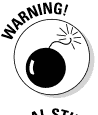 | “提示”图标引导您了解可以节省时间和麻烦的快捷方式和见解。这是我最常使用的图标。 |
|  | “警告”图标旨在引导您远离危险。它只被使用了绝一两次，因为 CSS 尚未被 *证明* 会导致实验室大鼠自杀。 |
| 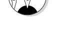 | “技术细节”图标突出了极客式的技术讨论，如果您愿意，可以跳过。我很少使用它——我不怎么喜欢不必要的技术细节。 |

## 第一部分

### CSS 基础知识

#### 第五波浪潮

作者：Rich Tennant

#### 本部分内容 . . .

使用 CSS 创建高效且华丽的网页设计并不一定是一项艰巨的任务。如果你一直在使用 CSS 但仍然感到有些困惑，或者你是第一次尝试，那么你选择了一本正确的书。

你是否曾被如雪片般飞来的新概念搞得晕头转向：选择器、继承、权重、树状图、内嵌规则，以及各种令人头疼的琐碎问题？是否被那些把几乎所有内容都写得晦涩难懂的书籍给劝退了？本书的第一部分将带你轻轻地步入 CSS 的世界，并确保你对 CSS 是什么、如何工作以及你可以用它做哪些精彩的事情有一个良好且坚实地理解。

CSS 为网页设计者提供了一系列高效的技巧，这些技巧非常高效，而且在大多数情况下非常易于理解和使用。我会告诉你哪些技巧是没有用的且应当避免的，同时我也会演示如何使用大多数*有用*的技巧。

## 第 1 章

### CSS 兑现了承诺

#### 本章内容

- 使用 CSS 改进 HTML
- 让 CSS 与你现有的工具协同工作
- 创建实用的样式表
- 避免浏览器兼容性问题
- 使用滤镜创造戏剧效果

在所有网页的底层都是传统的 HTML，这种标记语言控制着诸如字体大小、文本颜色、图像位置以及页面其他元素的信息。HTML 有时被称为*纯* HTML，以将其与使用样式表等更高级技术构建的网页区分开来。而对于 HTML 来说，“*纯*（plain）”确实是一个恰当的词。

如果没有帮助，HTML 产生的页面往往非常枯燥。与这些缺乏活力的页面一样令人不快的是，尝试仅使用 HTML 来描述整个网页所导致的 HTML 代码混乱。样式表来拯救这一切。

#### 改进 HTML

CSS（层叠样式表）是万维网联盟（W3C）在 1996 年推荐的一项技术。理解 CSS 目的的一个简单方法是将其视为 HTML 的一个补充，旨在帮助简化和改进网页设计。事实上，某些 CSS 效果仅通过 HTML 是无法实现的。

CSS 的另一个优势是它允许你定义一次样式，而浏览器可以在一个文档中多次应用该样式。例如，如果你想让你网站中的某些图片周围有一个细小的蓝色边框，你可以在 CSS 中将此边框定义为一个样式。然后，你无需在每次需要该特定边框时重复编写 HTML 的细蓝边框定义，而只需将 CSS 样式作为属性插入到每个需要边框的图形元素中。

TEAM LING - 实时、信息化、免费且真实！

16 第一部分：CSS 基础知识

换句话说，你使用 CSS 来定义关于网页元素如何行为以及如何显示的通用规则——例如它们的位置、大小、不透明度等等。然后，每当你想在 HTML 页面中强制执行该规则时，只需引用该规则的名称即可。

这是一个 CSS 规则，定义了你决定应用于最大标题 H1 的几个属性：

```
<style>
H1 { font-size:16pt color:blue;}
</style>
```

在这种 CSS 规则生效的情况下，任何包含 H1 元素的 HTML 代码都会自动以 16 磅字体渲染并显示为蓝色：

```
<html>
    <body>
        <h1>this headline is blue and 16 pt.</h1>
    </body>
</html>
```

CSS 规则可以定义在一个单独的 .css 文件中，也可以内嵌在 HTML 文件中。以下是将 CSS 标题样式规则内嵌在 HTML 文件头部的示例：

```
<html>
    <head>
        <style>
h1 { font-size:16pt color:blue;}
        </style>
    </head>
    <body>
        <h1>this headline is blue and 16 pt.</h1>
    </body>
</html>
```

请注意 `<style>` 元素。你可以在此元素内部定义你的 CSS 样式。（如果愿意，你也可以在页面上放置多个 `<style>` 元素。）

为了提高效率，本书示例中的几乎所有 CSS 代码都直接放在 HTML 文档的 `<style>` 元素中，如前代码所示。这使得将整个示例（CSS 加上 HTML）保存为 .htm 文件更加方便。只需在 Windows 资源管理器中双击该文件，即可自动在 Internet Explorer 中加载示例并查看效果。然而，在你的实际工作中，你可能会将 CSS 放在一个单独的文件中，然后在 HTML 文档中使用 `<link>` 元素来导入 CSS。你可以将 CSS 样式放在三个位置：外部文件（扩展名为 .css）；HTML 文件的头部区域内的 `<style>` 元素中；或者甚至直接在 HTML 元素内部，使用 `style=` 属性。关于这些问题的更多内容请参阅第 3 章。

##### 高效使用 CSS

像 CSS 这样在单一位置定义样式有几个优点。首先，它消除了冗余：例如，你不需要在文档中每次使用 `<h1>` 标签时都重复指定其字体大小和颜色。这使得网页代码更易于阅读和后续修改。如果你熟悉计算机编程，可以将一个简单的 CSS 样式规则视为类似于编程语言中的常量：例如，你通过创建像 `LocalTax` 这样的名称来指定当地税率，然后为其分配一个值，如 `Constant LocalTax = .07`。此后，在整个程序中，你不需要重复指定 `.07`，只需使用常量名 `LocalTax` 即可。

同样地，在你定义了 CSS 标题样式之后，无论该样式多么冗长和复杂，之后你只需使用该样式的类名即可。在本示例中，你没有使用类名，因此每个 H1 标题都将使用此样式渲染：

```
<style>
h1 { font-size:16pt color:blue;}
</style>
```

将所有样式定义集中在一个位置的第二个优点是你更容易进行全局更改。如果你决定将所有 H1 标题从蓝色改为红色怎么办？如果你没有使用样式表，你就必须在整个网站的 HTML 文件中搜索所有 H1 元素，并逐个修改这些元素。

但如果你有先见之明使用了样式表，你只需要在样式表中更改 H1 的单个样式定义。规格会自动应用到整个 HTML 中。换句话说，只需在样式表中将蓝色改为红色：

```
H1 { font-size:16pt color:red;}
```

整个网站中所有在 `<h1>` 和 `</h1>` 标签之间的标题现在都将显示为红色文本。

##### 改善网页设计

HTML 最初的设计目标是类似于大纲，指定文档的结构，而不需要过多关注文档的实际视觉风格或设计。大纲仅按层次结构组织想法：A、B、C 等是主要想法。在这些类别中，你有二级划分如 1、2、3、4，甚至更低级别的划分如 a、b、c、d 等。HTML 中等同的大纲结构是通过各种标题级别（如 H1、H2、H3 等）来描述的。

HTML 本应该简单地定义内容：这是正文，这是标题，这是一个表格，等等。但网页设计者自然希望提供更具吸引力、视觉上更美观的网页。毕竟，互联网更多地是在与活泼的电视广告竞争，而不是与枯燥、高度结构化的学术期刊竞争。HTML 开始通过添加许多特殊的格式元素和属性（如斜体和颜色）而随意生长。这种标签的膨胀使得创建、阅读和修改 HTML 变得越来越繁琐。将内容（结构）与页面的设计和布局分离变得非常有必要。于是 CSS 登场了。当你使用 CSS 时，HTML 主要负责处理结构，而 CSS 文件包含定义 HTML 元素外观的样式。

此外，CSS 还为网页设计者提供了纯 HTML 中无法实现的功能。正如你在本书中将看到的，CSS 给设计者带来了对网页外观更强大的控制力。

##### 准备应对一切

当然，如果你为互联网创建站点，你永远无法对网页拥有*绝对*的控制权。网页永远不会有一种真正稳定、单一且可预测的显示方式。为什么？因为就像某些名人一样，网页在每一分钟都不知道自己最终会出现在哪里。它必须准备好在各种情况下进行展示。

一个网页可能会显示在 Pocket PC PDA 屏幕上——像素极少且是黑白的。或者它可能会显示在香港巨大的 Diamond Vision 显示屏上，其长度超过波音 747，甚至显示在多伦多 Skydome 的 Jumbotron 屏幕上，该屏幕宽 110 英尺，高 33 英尺。


你不仅要考虑巨大的尺寸差异，还要考虑*纵横比*（形状）。许多计算机显示器仍然是传统的正方形，但越来越多的互联网用户正在转向宽屏显示器——宽度大于高度，就像电影屏幕一样——以便更好地显示 HDTV 和 DVD。对于互联网用户来说，宽屏仅仅意味着每页可以看到更多的水平信息。使用绝对（固定）定位设计的网页在宽屏显示器的右侧会留下几英寸的空白区域。如果是文森特（Vincent）会怎么做？

梵高会如何处理设计一幅向日葵花瓶图的问题，而这幅图可能显示在宽屏的`Jumbotron`上，也可能显示在一个小小的正方形显示器上？

## 第 1 章：CSS 兑现了承诺

解决这个问题的基本方案是以*相对*而非绝对的术语来指定尺寸和位置。例如，与其说“向日葵高 2 英寸，距离左侧 12 英寸”（这是一个*绝对规格*），不如说“向日葵的大小为 6%，距离左侧 35%”（这是一个*相对规格*）。其他相对指定尺寸的方法还包括*像素*（它是给定监视器能显示的最小信息单位，因此因监视器而异）或像 *x-large* 或 *large* 这样的一般术语。

细心的读者此时可能会问：“百分之六是指什么的百分之六？”该百分比是基于*包含块（containing block）*计算的。它可以是浏览器窗口（`<body>`），也可以是 `<body>` 内部的 `<div>` 等块。在这个例子中，包含块是浏览器的总尺寸，但你也可以为浏览器窗口内其他较小的容器指定百分比。关于这个问题的更多内容将在第 4 章中讨论。

相对规格能够很好地适配各种尺寸的显示屏。一个大小为 6% 的向日葵在 800x600 的电脑显示器上显示约为 48 像素，但在一个 300 英尺宽的巨型屏幕（`Jumbotron`）上则会显示为 18 英尺宽。

换句话说——当你指定*相对*测量值或位置时——你的图形或文本会根据需要自动*缩放*，以适应当时使用的任何尺寸的显示屏。

当然，如果你是在为*内网（intranet）*站点构建页面，你可能很清楚，你办公网络中的每个人都被要求使用相同尺寸的屏幕、相同的浏览器、相同的操作系统，并且办公隔间里不允许放家庭照片。如果是这样，你为什么在为一个法西斯组织工作？开玩笑的。在整个公司强制执行统一标准的那些情况下，你*可以*提供绝对规格，但这种情况相对罕见。

为了扮演“反方”角色，我建议你不要*太*担心你的网页在各种设备上的外观。我意识到大多数关于 CSS 的书籍——以及那些致力于研究 CSS 标准的理论家和委员会——都非常困扰于“浏览器独立性”。他们希望 CSS 样式不仅是可伸缩的（拉伸或缩小以适应各种屏幕尺寸），而且能让你的页面设计、颜色和其他效果*在不同浏览器、甚至所有这些浏览器的所有旧版本中都以相同的方式显示*。

这种理论的一个大问题是，当你尝试将浏览器和设备独立性付诸实践时，你往往被迫接受“最小公分母”。在我看来，你应该针对在典型 17 英寸监视器上运行的 Internet Explorer (IE) 6 版本来设计网页。为什么？原因如下：

- 超过 95% 访问你网站的人使用 IE 6。
- 你可以利用许多仅在 IE 或 IE 6 中起作用的酷炫效果。
- ✔ 如果你是在为一个可预测、稳定的画布进行设计，你的工作会轻松得多。
- ✔ 在 PDA 屏幕和电脑监视器上同样出色的设计确实罕见，而且使用桌面电脑访问你网页的用户远多于使用 PDA 的用户。

诚然，几年前，互联网用户被分在 Netscape 和 IE 之间，因此你必须谨慎地考虑 Netscape 及其特性。现在不再如此。至少目前，浏览器大战已经结束，Netscape 现在仅仅是一个规模较小的边缘参与者。

### 设计师想要设计

设计师（更不用说营销人员了）想要构建具有吸引力的网页，这并不奇怪。颜色、过渡效果，甚至各种类型的动画和其他特效都是令人向往的属性，而且设计师说，在竞争激烈的世界中，这些是必要目标。

多年来，设计师一直使用功能丰富的图像处理工具（如 Photoshop）和强大的页面设计工具（如 PageMaker）。在万维网的早期，设计师认为没有理由不能以同样的自由度来操作网页。诚然，动画增加了相当大的复杂性，而且网页设计在未来总有可能出现多平台冲突，导致你有时需要为多个平台进行设计。

但无论障碍多么艰巨，目标仍然是让网站尽可能地具有吸引力、娱乐性和美感。CSS 显然是朝着正确方向迈出的一步。针对像 Internet Explorer 6 这样可预测的目标平台进行设计，会让设计变得简单得多，结果也更具吸引力。

通过 CSS，设计师可以完成许多使用普通 HTML 难以或无法实现的事情。例如，你可以通过 CSS 完成的其中几项任务包括：

- ✔ 自定义文本缩进
- ✔ 在页面之间创建淡入、溶解和其他过渡效果
- ✔ 获得对格式化的更多控制，例如在文本块周围添加边框
- ✔ 精确地定位或平铺背景图形
- ✔ 在描述图形或文本的尺寸和位置时，能非常具体地指定点号大小（point size）和其他测量单位（如英寸）

### 理解数字化效果

我们这些在数字化领域工作的人才刚刚开始意识到数字化带来了多么深刻的变化。数字相机记录的是像素的数学模式。使用胶片时，你只能对图像进行粗略的操作——例如过曝、太阳化、用刀刮擦、剪切粘贴或叠印两张底片。与数字效果相比，这些以及其他技术极其原始。数字操作既可以很粗犷也可以很微妙，而且可以像现实本身一样精细。你无疑见过那些一个物体转化为另一个物体的短动画——男孩变成女孩，鸵鸟变成别克车，等等。这说明了数字信息的完全可操纵性。既然你可以轻松控制数字照片中的每个像素，你就可以将任何东西转化为几乎任何其他东西。此外，你拥有无限修改图像的能力。

像《极地快车》和《寻找尼莫》这样的新动画电影证明，数字效果正变得越来越容易实现。

艺术家现在正获得对听觉（音乐）和视觉领域（电影和照片）的控制权，就像古腾堡发明活字印刷术时，出版商获得对排版领域的控制权一样。不再需要像僧侣一个接一个地书写和设计圣经页面那样笨拙地手工操作。相反，利用数字效果，例如，你只需选择对象，然后点击按钮添加半透明阴影，就可以有效地为视觉元素添加阴影。之所以如此简单，是因为照片中的每一个微小点都表示为一组数字。而数字与胶片底片不同，可以用任何方式进行无尽且精确的操作。添加阴影的问题在于计算出能够调整像素使其看起来有阴影的数学函数。这以及无数其他视觉函数，已由开发 Photoshop 和其他图形应用程序的人员研究完成。（一种方法是让计算机分析真实的阴影，以识别其数学梯度和其他特性。）因此，如果你为网页构思了特定的背景效果，只要你拥有进行数字操作的经验和技巧，你就能实现它。

这不再是一个充满妥协的世界，不再需要像黏土动画、定格动画、比例模型等不够精良的特效。这些已经变成了古怪的历史技术。

现在的问题不再是你是否能在屏幕上实现某件事：而仅仅是需要多少成本以及需要多少时间。

- 有效地管理页边距
- 除字距调整（kerning，调整文本行之间的间距）、行距（leading，行与行之间的空间）和两端对齐之外，还能极其精确地操纵字符和单词间距
- 为用户提供独特的导航工具
- 为文本和图形层指定 z 轴（即谁在“顶层”）

## 22 第一部分：CSS 基础

### CSS 与你现有工具的结合

你可以使用任何纯文本编辑器（如记事本）来编写样式表。不过，你也可以使用专业的 CSS 编辑器，它们提供了创建样式表的快捷方式。使用微软的 Visual Studio 或 Magia Internet Studio 的 TopStyle Pro 等编辑器时，你可以例如从调色板中选择文本颜色，从工具箱中拖放图形，或者从列表中选择字体大小。然后，编辑器会自动将你的选择（通常通过拖放或鼠标点击完成）转换为构成样式表的文本描述。对于像移动页面元素以寻找最吸引人的布局这类操作，鼠标拖放可以真正地节省时间。

如果你打开一个 CSS 文件，且电脑上安装了微软的 Visual Studio，默认情况下，CSS 将在 Visual Studio 中显示，如图 1-1 所示。

![img/49168ba8f289d9206d482e19425de1c1_40_0.png]

**图 1-1：** CSS 文件可以在微软的 Visual Studio 中进行管理。

许多 Web 程序员使用 Visual Studio 及其 ASP.NET 功能来创建具有丰富交互性的网站。但艺术家和设计师也可以使用 Visual Studio 来创建 CSS 文件。如图 1-1 所示，该样式表定义了一个文本框、一张图像和一个背景图像。左侧是样式表的抽象视图（“大纲”）；右侧是实际的可编辑代码。如果你想添加更多样式定义，没有什么比这更简单的了。你 *不需要亲自编写代码*。只需点击“构建样式 (Build Style)”按钮，就会打开“样式构建器 (Style Builder)”对话框，如图 1-2 所示：

![img/49168ba8f289d9206d482e19425de1c1_41_0.png]

点击左侧的任何类别——例如背景 (Background)、位置 (Position) 或列表 (Lists)——你将看到一个带有更多选项的新对话框。

要从零开始创建一张全新的样式表，请选择 文件 (File) ➪ 新建 (New) ➪ 文件 (File)，然后双击样式表 (Style Sheet) 图标。

要通过将其与现有的 HTML 元素（如 `<h2>`）关联来创建新样式，请选择 样式 (Styles) ➪ 添加样式规则 (Add Style Rule)。随后将打开“添加样式规则”对话框，如图 1-3 所示：

![img/49168ba8f289d9206d482e19425de1c1_41_1.png]

## 24 第一部分：CSS 基础

请记住，当你将 CSS 加入你的 Web 设计工具箱时，并不是简单地放弃 HTML。相反，CSS 允许你修改 HTML 的标签。但在某些情况下，你可能会发现你想使用 CSS 的某些特性，而不是传统的 HTML。例如，许多人认为使用 CSS 定位工具比像经典 HTML 那样过度依赖表格要好。同样，你可能会决定放弃古老的 HTML `<font>` 标签，转而使用 CSS 中更强大且更精细的文本描述符。

最重要的是，不要被吓到。CSS 在概念上并不困难，在实践中使用也不难。

### 实际操作

Web 页面设计师必须做出的最大一次观念飞跃，或许就是在使用样式表时 *跳出 HTML 的思维模式*。许多计算机程序支持 HTML——甚至像 Word 这样的 Office 2003 应用程序在其“文件”菜单中也有“网页预览”和“另存为网页”选项。但对于 CSS，你需要将当前的网页设计习惯和工具升级为一种抽象思考。学术界会说，CSS 主要是一个允许你定义抽象类，并将这些类应用于网页设计以产生实际效果的系统。而我会说，CSS 让设计变得更简单。

#### 在你当前的软件中寻找 CSS 特性

毫无疑问，你至少使用过一个能构建 HTML 并最终生成网页的应用程序。如果你对某个特定的网页设计工具感到舒适，请继续使用它。但请检查你当前的软件中是否有支持 CSS 的特性。在产品的帮助索引中搜索 CSS——也许你一直没注意到一个 CSS 工具就静静地躺在那里。

#### Web 资源

作为替代方案，你可以使用流行的编程编辑器（如 Visual Studio）或专用的 CSS 编辑器来分析现有网页并从中提取 CSS 样式表，或者从零开始构建 CSS 文件。如果你还没有接触到任何 CSS 工具，请参考以下提示：

> 你可以在互联网上找到许多 CSS 设计工具——其中一些是免费的。请查看 W3C 网站上的 CSS 创作工具列表：`www.w3.org/Style/CSS/`。关于 CSS 资源的话题，你经常可以在这个新闻组中找到关于 CSS 问题的有用答案：`comp.infosystems.www.authoring.stylesheets`。

当然，始终有微软的网站。在撰写本书时，微软的主要 CSS 索引位于此地址：`http://msdn.microsoft.com/library/default.asp?url=/library/en-us/vsintro7/html/vxtskWorkingWithHTMLStyles.asp`。然而，微软很少为其技术和文档长期保留同一个名称或地址。因此，你可能需要使用 `www.microsoft.com` 微软主页上的搜索功能来寻找 CSS。

此外，在由 W3C 赞助的 Web 样式表主页 `http://www.w3.org/Style` 上也可以找到大量信息（虽然呈现方式略显刻板且学术化）。

最后，请参阅第 19 章，其中描述了几个额外的在线 CSS 资源。

#### 避免浏览器兼容性问题

早期的网页设计师面临一个奇怪的问题：不同的 Web 浏览器对 HTML 的解释方式不同。在那些早期日子里，Netscape 仍被广泛使用。幸运的是——至少对网页设计师而言——如今超过 95% 的网站访问者使用 Internet Explorer (IE)。而且，大多数人预计会使用最新版本的 IE。这让设计师的生活变得更容易。只要你坚持使用当前版本 IE 的规范和能力，你可以预期大多数人看到的网页将是你意图呈现的样子。

许多关于 CSS 的书籍花了很多篇幅列举和描述 Netscape 和 Internet Explorer 之间的不兼容性——展示这些浏览器实现 CSS 特性的不同方式。另一个潜在的不兼容来源是操作系统之间的差异，即 PC 和 Mac。

但考虑最坏的情况：如果在你的网页代码中使用了某个 CSS 特性，但用户的浏览器或操作系统不支持它，会发生什么？什么也不会发生。与编程语言不同——编程语言经常出现令用户恐惧的令人困惑的错误消息——浏览器的设计初衷是向用户隐藏问题。用户永远不会看到一条说“Netscape 不支持此 CSS 样式”的错误消息。相反，无论你试图通过用 CSS 重新定义 HTML 元素来实现什么样的特殊效果，它都会被直接忽略。如果你将 `<h1>` 重新定义为蓝色标题，该定义将被忽略，而改为使用默认的黑色。然而，如果 CSS 控制的是定位，结果可能会不那么温和。但同样，损害仅限于那些不使用 IE 的少数人。

浏览器兼容性现在已经不像几年前 Netscape 更流行时那样是一个大问题了。而且，Mac 电脑在今天的计算机市场中也只占很小一部分。无论是否公平，浏览器之战和操作系统之战已经达成了一次至少是暂时的休战——网页设计师可以从中受益，因为他们可以针对单一的主要平台进行构建。

尽管如此，一些网站设计师 *必须* 与兼容性问题作斗争。如果你对此感到担忧，请参阅第 17 章，在那里我讨论了你可以采用的各种策略，以尽可能地减少——如果不能完全防止的话——由于次要或过时浏览器而对你的优秀设计造成的损害。

#### 使用滤镜制造戏剧效果

为了让你感受特殊浏览器效果的效能和强大，请看看几个你可以添加到网页中的滤镜。*滤镜 (Filters)* 是微软内置在 Internet Explorer 中的一套特殊动画效果。

将以下内容输入到记事本或你选择的 CSS 编辑器中：

```
<html>
<head>

<style>

div.box {width: 300px; height: 200px; padding: 30px;
	font: 46pt times new roman;}

</style>

</head>
<body>

<div class="box" style=" filter:
		progidx:DXImageTransform.Microsoft.Alpha

	(Opacity=100,
	FinishOpacity=0, Style=1, StartX=0, FinishX=0, StartY=0,
	FinishY=100)">

Hey...you can modify opacity.</div>


</body>
</html>
```

现在将其保存为名为 `opac.htm` 的文件，然后在 Windows 资源管理器中双击该文件名。你的 Internet Explorer 窗口应该会打开，显示文本的透明度从 0（完全不透明）调整到 100（完全透明），如图 1-4 所示。

请注意图1-4中创建了一个渐变效果，使文本逐渐淡化。实际上，这里发生的情况是：背景（默认为白色）因为文本变得越来越透明而逐渐显露出来。

你可能会说，这有什么？我可以在Photoshop这样的图形程序中输入文字，然后应用不透明度渐变，同样能达到这个效果。之后我可以将文本保存为图形文件，直接作为图片导入网页。当然，你可以这样做。但通过创建CSS样式来实现相同效果有几个优点。你只需使用额外的`<div>`标签，就能轻松地将该样式应用于网站中的任何其他文本块。更重要的是，通过一点额外的编程，你可以让这类效果动起来——变得动态化。例如，你可以使用不透明度滤镜让一些文本或图形缓慢地淡入或淡出页面。你也可以让元素根据用户的鼠标操作轻轻淡入淡出。或者，让整个章节或页面作为过渡效果，相对较快地淡出到下一个章节或页面？只要给各种滤镜添加一点脚本和计时器，就能实现许多酷炫的效果。

当然，滤镜只内置于Internet Explorer（4.0及更高版本）中。而且，严格来说，它们并不完全是CSS效果——尽管CSS确实使使用它们更容易。但这又有什么关系呢？网页设计师越来越多地使用滤镜作为与电视竞争的一种方式。就像为黑白网页添加颜色是一个真正的改进一样，动画相对于静态页面也是一个显著的提升。

## 第一部分：CSS入门

试试新技巧。要创建一个不同的渐变——这次是圆形的——只需对你的HTML代码做两处小改动（以粗体显示）。你需要将不透明度`style`属性从1改为2（这会将渐变改为圆形效果），并提供一个颜色背景，这样你就能更容易地看到渐变的圆形辐射：

```html
<html>
<head>
<style>
div.box {width: 300px; height: 200px; padding: 30px;
         font: 46pt times new roman;}
</style>
</head>
<body>
<div class="box" style="background: green; filter:
         progid:DXImageTransform.Microsoft.Alpha
(Opacity=100,
FinishOpacity=0, Style=2, StartX=0, FinishX=0, StartY=0,
FinishY=100)">
嘿...你可以修改不透明度。</div>
</body>
</html>
```


将此HTML保存为`.htm`文件，然后在Windows资源管理器中双击它，将其加载到IE中。你会看到渐变已经变成了圆形，如图1-5所示。

你会发现IE内置了许多你可以运用的特殊效果，其中一些你将在第13章中探索。有阴影、反转、还原、转换，还有一些为哥特人群准备的轻微扭曲效果。

作为滤镜可用的多种多样效果的一个例子，我们来考虑过渡擦除效果。过渡擦除——只是你可以使用的众多效果之一——提供了两个元素之间的平滑连接。这些擦除效果在电影和视频中被用作场景转换的方式，表示穿越空间、时间流逝或其他过渡行为——比如从现实到梦境。你可以在网页中使用它们实现类似的目的。为了让你了解一些可以使用的效果，表1-1列出了一些过渡擦除效果。

### 第一章：CSS兑现承诺

| 过渡擦除效果 | 值 |
|---|---|
| 向内方框 | 0 |
| 向外方框 | 1 |
| 向内圆形 | 2 |
| 向外圆形 | 3 |
| 向上擦除 | 4 |
| 向下擦除 | 5 |
| 向右擦除 | 6 |
| 向左擦除 | 7 |
| 垂直百叶窗 | 8 |
| 水平百叶窗 | 9 |
| 横向棋盘格 | 10 |
| 纵向棋盘格 | 11 |
| 随机溶解 | 12 |
| 垂直分裂进入 | 13 |
| 垂直分裂退出 | 14 |
| 水平分裂进入 | 15 |
| 水平分裂退出 | 16 |
| 向左下条纹 | 17 |
| 向左上条纹 | 18 |
| 向右下条纹 | 19 |
| 向右上条纹 | 20 |
| 随机水平条纹 | 21 |
| 随机垂直条纹 | 22 |
| 随机 | 23 |

表1-1（续）

你可以组合或混合各种效果来生成新的效果。我不会说“可能性是无限的——你只受想象力的限制”，因为那是计算机时代最令人厌烦的陈词滥调。但你确实可以用CSS和Internet Explorer做出一些很棒的视觉效果。如果你迫不及待想了解动态动画技巧，可以翻到第13章或第16章深入探究。

### 第二章：用CSS获得成果

### 本章内容

- 从零开始
- 介绍选择器和分组
- 创建通用属性
- 管理ID选择器
- 层叠样式表
- 可视化特异性
- 探索继承

本章介绍了几个理解CSS的核心、略带理论性的概念。但与其用枯燥、抽象的解释来让你对*继承*和*特异性*等枯燥、抽象的概念感到厌倦，我打算用简短的例子和一种巧妙、轻松的演示来娱乐你。你甚至不会感觉到被“击中”。尽管如此，在你尝试了本章的例子之后，你将几乎下意识地理解CSS背后的主要理论概念。

所以，卷起袖子，准备好看看CSS可以多么*有趣*。别在意你同时也了解了一些CSS理论。理论是在你享受有趣例子的同时，从后门悄悄溜进来的。

#### 从零开始

你可以使用任何纯文本文档编辑器编写CSS。与XML和其他源于HTML的当代计算机语言一样，CSS并不试图创建某种难以作为简单英语文本进行编写或阅读的、奇怪的专用*代码语言*。

当然，专门的CSS编辑器可以在各种方面帮助你，特别是如果你想构建功能强大、复杂的网站的话。但目前，我将从一些非常简单的CSS实践示例开始。为了创建这些例子，你使用的是Windows朴素的记事本，没有比这更复杂的工具了。

## 第一部分：CSS入门

样式表通常被编写并保存为硬盘上的`.css`文件。此后，任何想要使用`.css`文件中定义的样式的HTML（`.htm`）网页文档，只需将其作为“链接”引用即可。你很快就会看到如何将HTML链接到CSS文件。

运行记事本（如果你使用XP，选择“开始”→“所有程序”→“附件”→“记事本”）。然后输入以下内容来定义一个超简单的样式，告诉网站你希望文本段落如何显示：

```css
p
{
color: blue;
text-align: right;
font-family: courier;
}
```

通过选择记事本中的“文件”→“另存为”来保存此样式表，并将文件命名为`ParaStyle.css`。你可以使用任何你想要的名字，但你需要在网页的HTML代码中引用该名称。为此，请删除记事本中的所有内容，并输入此HTML页面，该页面引用了你的`ParaStyle.css`样式表文件：

```html
<html>
<head>
<link type="text/css" rel="stylesheet" href="ParaStyle.css">
</head>
<body>
<H1>标题文本</H1>
<p>这是正文文本</p>
</body>
</html>
```

使用记事本的“文件”→“另存为”功能，将此代码保存到名为`PStyle.htm`的文件中，该文件与你保存`ParaStyle.css`文件的目录相同。

这个高度简化的网页代码说明了外部样式表文件是如何工作的。在`.css`文件中，你指定了`<p>`（段落）元素应该是蓝色、右对齐，并使用Courier字体。在你的HTML代码中，你链接到了一个名为`ParaStyle.css`的样式表。该样式表位于与`.htm`文件相同的目录中。

你没有为`H1`标题样式定义样式，因此它默认为浏览器为`H1`样式设置的标准大小、颜色、位置、字体（可能还有其他属性）。使用Internet Explorer的默认设置，标题是左对齐、黑色和衬线字体。

但你*确实*为段落标签指定了样式。所以，要查看这个样式的效果，请在 Windows 资源管理器中双击网页文件名`PStyle.htm`。页面会自动加载到 Internet Explorer 中，显示默认的标题样式和你修改后的段落样式，如图 2-1 所示。

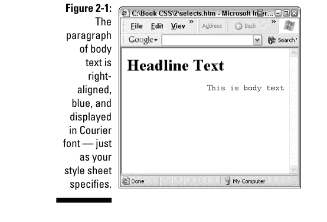

### 选择器之类：CSS 语法

开发 CSS 的委员会并没有采用简单的方法，使用现有的 HTML 术语。相反，他们为熟悉的 HTML 概念（如*标签*和*属性*）发明了特殊的、全新的 CSS 词汇。谁知道呢？也许他们这样做是有原因的，letting，但这确实需要你适应一些新术语。

每个 CSS 样式*规则*分为三个部分：*选择器*（selector）、*属性*（property）和*值*（value），属性/值对用大括号括起来，像这样：

```
{property: value pair}
```

此外，属性和值之间用冒号分隔。一个完整的 CSS 规则看起来像这样：

```
selector {property: value};
```

下面是一个真实世界的 CSS 样式示例。它定义了 HTML 段落 `<p>` 元素的 `color` 属性值为 `blue`：

```
p {color: blue};
```

CSS *选择器* 在 HTML 中称为*标签或元素*——即 HTML 代码中被尖括号包围的项（如 `<h2>`、`<p>` 或 `<tr>`）。

单个 CSS *规则* 至少由三部分组成：

- 1. *选择器*，如 `p`，它告诉浏览器该规则应稍后应用于 HTML 代码中的哪个 HTML 标签（元素）。
- 2. *属性*，如 `color`。这就是 HTML 中所说的属性。通常是元素某种特性的名称，如 `height`、`font-style`、`color` 等。
- 3. 属性的*值*，如 `blue`。这是实际的数据，指定你要对元素外观（通常）所做的更改，如 `45 pixels`、`Times Roman` 或 `yellow`。

上面的列表描述了最简单的 CSS 规则。不过，你可以为单个样式分组多个选择器（例如，`h1`、`h2`、`p` 都可以在单个规则中指定为 `green`）。同样，你也可以在单个规则中分组多个属性，就像我在前面的例子中所做的：

```
p {
color: blue;
text-align: right;
font-family: courier;
}
```

与 HTML 一样，CSS 代码可以自由地以任何适合你的方式重新排列——行可以以任何方式格式化。下面的规则与前面的例子解释起来完全相同：

```
p {color: blue;
text-align: right; font-family: courier;}
```

这两条规则对浏览器来说含义完全相同，但 CSS 程序员对于格式有自己的个人偏好。

#### 属性指代属性

CSS *属性* 就是 HTML 中所说的 *属性*——你要指定的特性名称（如 `color` 或 `font size`）。许多计算机语言也以同样的方式使用*属性*这个术语。

最后，CSS *值* 是关于属性的实际数据：换句话说，`black` 或 `green` 可以是 `color` 属性的值。CSS 中的值与计算机编程中变量或常量所持有的值是相同的概念。计算机编程语言使用 *value* 这个术语的方式与 CSS 相同。

有些值用不止一个单词来描述，例如 *minty green* 而不是 *green*。当你遇到多词值时，将值名称用引号括起来：

```
p {color: "minty green";}
```

这种表示法类似于某些数据库软件处理多词术语的方式。

此外，如果你为一个选择器定义多个属性，请用分号分隔这些属性，就像你在本章前面使用的 CSS 样式示例一样：

```
p
{
color: blue;
text-align: right;
font-family: courier;
}
```

你可以按任何你想要的方式格式化 CSS 样式。大括号作为分隔符（或分界符），所以浏览器知道当遇到右大括号符号（`}`）时，选择器的属性就结束了。有些人喜欢将每个属性放在单独的一行，以便于阅读。


#### 分组

如果你愿意，可以一次定义一大堆标签（选择器）。如果你想让*所有*标题元素都以 Arial 字体显示，这可以节省时间。HTML 有四个标题元素：`H1`、`H2`、`H3` 和 `H4`。不必在 CSS 文件中将每个不同的标题元素定义为单独的样式，只需将所有选择器堆在一起，用逗号分隔即可。在这个例子中，从标题 1 一直到标题 4 的标题大小都定义为 Arial：

```
h1,h2,h3,h4
{
font-family: Arial;
}
```

#### 展示一些类

如果你想将给定标签（选择器）样式细分为几个备选方案呢？这类似于将你的食谱收藏分成子类别，如中国菜、墨西哥菜、泰国菜等。

假设你希望文档中*大部分*段落为黑色，但想通过红色文本强调少数段落。通过向选择器添加*类*定义很容易做到这一点，就像这个例子。这里我为 `p` 选择器定义了一个 `bodytext` 类和一个 `alert` 类：

```
p.bodytext {color: black;}
p.alert {color: red;}
```

面向对象的计算机语言在指定类及其属性时使用类似的标点符号——使用句点将类与属性分开。

你可以用任何你想要的词作为类名。除了 `p.alert`，你还可以使用 `p.emphasis` 或 `p.bridgette` 或任何其他名称。唯一的要求是，一旦你用特定术语定义了样式，之后必须在 HTML 中调用该类时再次使用相同的术语。如果你在样式表中将红色文本段落定义为 `p.alert`，那么每当在网页代码中要调用它时，都必须将其引用为 `p class="alert"`。此外，如果你选择与实际结果有一定关联的术语，阅读你的代码显然会更容易。因此，我建议你避免将类命名为 `Bridgette`。

选择类名时，尽量根据它的功能而不是外观来命名。我在上面没有使用 `p.red`，而是使用了 `p.alert`，因为用红色文本提醒读者是这个类的行为或目的，而不仅仅是它的外观。我以后可能会决定将所有的警报改为粗体而不是红色。如果我将这个类命名为 `red`，那么以后我确实改变这个样式时就会出问题。我无法合理地允许 `class=red` 将文字变为粗体并保留黑色。为了保持代码的可理解性，我必须遍历整个网站的 HTML 代码，更改每个 HTML 文件中类名 `red` 的每一次使用。这将与 CSS 的主要价值之一背道而驰：你不需要在整个网站中进行搜索和替换来更改各种样式的外观。

在你指定了 `p` 选择器类的成员之后，可以在 HTML 文档中这样引用它们：

```
<p class="bodytext">
这个是黑色的。
</p>

<p class="alert">
这个是红色的。
</p>
```

##### 指定通用属性

你不一定总是必须将类附加到标签上。你可以指定一个通用类，它可以应用于 HTML 代码中*任何*类型的标签。这样，你就不必为每个想要以蓝色显示的标签分配，比如说一个特定的蓝色值。你可以只在想要某个元素为蓝色时分配蓝色类。（这节省了时间，因为样式可能很复杂且冗长，而且你只需要指定一次 CSS 规则。之后在 HTML 代码中，只需使用该规则的类名，而不必重复规则中的所有属性和值。）

例如，如果你想要能够将任何文本变为蓝色以突出显示它，在 CSS 文件中定义 `"highlight"` 类时省略选择器名称，也就是省略 `p.blue {color: blue}` 中的 `p`。下面是蓝色的一个通用类定义：

```
/* This class can be used with any HTML tag */
.highlight {color: blue;}
```

现在，*任何*使用 `class = highlight` 的 HTML 元素都会变成蓝色：

```
<html>
<head>

<link type="text/css" rel="stylesheet" href="ParaStyle.css">
</head>

<body>

<p class="highlight">
我是蓝色的正文文本。
</p>

<h2 class="highlight">
我是一个蓝色的标题
</h2>

</body>
</html>
```

如果你想让只有一部分段落变为蓝色，请使用 `<span>` 标签，像这样：

```
<p>I say again, <span class="highlight">and I use blue for emphasis here</span> that you need to remember the lesson plans</p>
```

## 第一部分：CSS 基础知识

只需记住，当你使用类选择器时，不必在 CSS 文件中将每个特定标签定义为蓝色。相反，你定义一个 `"highlight"` 类，将其 `color` 属性设置为 `blue` 值，然后只需在 HTML 代码中使用 `class="highlight"`，即可让*任何*元素变为蓝色。

如果你想在 CSS 文件中添加注释，请将注释内容放在 `/*` 和 `*/` 符号之间。给代码添加注释的目的是方便你日后阅读和修改代码，或者在你离开公司后方便其他人修改你的代码。你可以立即读懂注释代码的用途或所使用的技术：

```
/* This class can be used with any HTML tag */
```

这些符号很别扭，因为它们彼此相似却又不完全相同。本可以选择其他更容易输入、更方便的标点符号。一个好的选择本可以是单引号（`）。但由于 CSS 是由委员会设计的，所以难免会出现效率低下的情况。总而言之，CSS 确实很有价值，但你可能会希望它没有那么多源自 C 编程语言的特性。C 语言程序员就是这样给代码添加注释的，而 C 语言以是所有计算机语言中最难、通常也是效率最低的而臭名昭著。

### 使用 ID 选择器

ID 选择器与通用类相似——它们同样独立于特定的文档元素。但 ID 与类的不同之处在于，ID 本应只在一个给定的网页上*使用一次*——只有一个元素（具有该 ID 的元素）应该受到影响。HTML 代码中任何后续对已使用 ID 的引用都应被忽略。为什么我在这里如此频繁地使用"本应"这个说法？因为 ID 选择器并不像宣传的那样工作。在*实际*中，浏览器会忽略"只使用一次"这条规则。例如，我在 Internet Explorer 中尝试了这段代码，浏览器并没有强制执行"只使用一次"的规定；所有三个具有重复 ID 的元素都被高亮显示了：

```
<html>
<head>

<style>
#highlight {color: yellow; font-style: italic;}
</style>

</head>
<body>

<p>ordinary default text </p>
<p id="highlight">highlighted text </p>
<p id="highlight">second attempt to use this id fails</p>

<h1 id="highlight">highlighted text </h1>

</body>
</html>
```

当我将此文件加载到 Internet Explorer 中时，此示例中所有三个 `HIGHLIGHT` 的使用都将文本行变为黄色斜体。这是怎么回事？不过是老样子罢了。有人制定了规则，而另一个人无视了它。无论如何，也许 ID 样式在未来某个时候会在 CSS 中变得有用，所以至少简要了解一下它们。（HTML 代码中的 ID 属性在使用 ASP.NET 或其他编程（如脚本）时非常有用。在这些情况下，ID 允许你的编程通过指定唯一的 ID 属性来影响元素。ID 在构建模板中也发挥着作用。更多关于脚本的内容请参见第 16 章。）

你使用井号（`#`）来创建 CSS ID 规则。下面的示例将 CSS 定义直接放在 HTML 页面的头部。这称为内部样式表。你可以使用此选项代替创建单独的 CSS 文件。不过，对于大多数网站来说，外部独立的 CSS 样式文件被认为是最佳实践，因为它们可以在多个页面间强制执行规则，并且只需在一个地方就能轻松修改规则。

> **提示** 为了方便在本书中说明 CSS，我几乎总是将样式定义放在 HTML 页面的头部。这样，所有内容——定义及其使用——都在同一个文件中。我还省略了 HTML 中一些有用但不必要的元素，例如 `<title>`。这些简化使你更容易看到代码中要说明的想法，而不会被两个独立的文件和多余的 HTML 代码等不必要的干扰分散注意力。

在此示例中，一个名为 `HIGHLIGHT` 的 ID 样式在头部创建，然后在网页主体中引用该 ID 的位置使用。


```html
<HTML>
<head>
<style>
#highlight {color: yellow; font-style: italic;}
</style>
</head>
<body>
<p>ordinary default text </p>
<p id="highlight">highlighted text </p>
</body>
</html>
```

### 指定多个类

你可以在单个 HTML 元素中使用多个类名。例如，你可以创建独立的类规则（一个用于加边框，一个用于粉色），然后通过在 HTML 的元素 `class` 属性中将它们组合在一起来使用，如下所示：

```html
<p class="framed pink">
```

关于其工作原理的解释和说明它的代码示例，请参见第 18 章中题为"组合类"的部分。

### 利用大小写敏感性

HTML 和 CSS 代码（通常）不区分大小写。标签名、属性名等可以按你喜欢的任何方式大写——浏览器仍然能理解你指的是单个实体。例如，`BODY`、`Body`、`body` 或 `BoDy` 都是允许的 `body` 标签，可以互换使用。

不过，一如既往，有人决定在这个合理的大小写不敏感规则上搞点花样。在 HTML 或 XHTML（可扩展 HTML，即 XML 与 HTML 的融合）中，ID 和 `class` 值是区分大小写的。CSS 样式定义中的大小写必须与文档中的大小写匹配。以下 CSS 样式：

```css
p.yellow {color: yellow;}
```

与文档中此行中 `Yellow` 的使用不匹配（Y 是大写的）。这行不是黄色的，因为样式未被应用：

```html
<p class="Yellow">This is black!</p>
```

CSS 和 HTML 通常不区分大小写的另一个例外是 `OL`（有序编号列表）元素中 `TYPE` 属性的值。它是区分大小写的。

### 坚持使用小写

在实践中，大多数人通常会尝试将他们的编程、HTML、CSS 和其他代码**全部以小写形式**编写。一方面，这样打字更方便。另一方面，如果大小写敏感性生效，你不会仅仅因为粗心大意到处使用了大写而遇到任何问题（或难以追踪的 bug）。事实上，XHTML **要求**全部小写。

另外还有一些大小写敏感的例外情况，即以 `&` 符号开头的转义序列和互联网地址（URL）。并非所有 URL 都区分大小写，但**有些**是。这种混乱和低效实在过于繁琐且不必要。总有一天，我们程序员会团结一致，坚持要求在**所有**计算机编程场景中都不区分大小写。

### 样式层叠时

*层叠*这个术语对样式表意味着什么？它意味着 CSS 规则会逐层向下传递代码，有时会遇到冲突的规则。

层叠是关于程序员所说的*优先级*：当出现冲突时，谁胜出？一个给定的标签可以应用多个样式。例如，总有浏览器定义的默认样式，比如黑色作为默认文本颜色。如果你在 CSS 规则中指定了其他颜色，层叠允许你的规则占据主导地位，优先于内置样式。

但如果两个 CSS 规则相互冲突，浏览器如何决定哪个样式胜出？冲突的样式应该合并吗？如果样式完全不兼容——例如一个样式指定斜体而另一个指定非斜体——该怎么办？

### 可视化特异性

当样式发生冲突时，有几个因素决定哪个样式胜出：继承、文档中的结构树以及样式的*特异性*（*或接近程度*）（我将在本节后面解释这些概念）。最容易理解的冲突规则可能涉及样式*定义的位置*。你的 CSS 样式可以在四个主要位置定义：

- 浏览器的默认样式。
- 外部样式表（一个包含样式定义的 `.css` 文件，通过 HTML 文档中的 `Link` 元素引用）。
- 内嵌样式表（在 HTML 文档内部、`<head>` 标签中定义的样式。这种样式有时也称为*内部*样式）。
- 内联样式（在 HTML 元素本身内作为属性定义的样式，其效果仅限*于该元素本身*）。例如，这是一个典型的内联样式：

```html
<p style="border-bottom: blue">
```

此列表还说明了在任何冲突中冲突样式"胜出"的顺序。可以将该顺序理解为离元素*最近*的样式胜出。例如，内联样式——紧贴在元素内部——是最接近的。因此，如果为该元素指定了多个样式，则使用内联样式。样式与其匹配的元素之间的这种接近程度更正式地称为*特异性*。

具有第二高优先级的样式位置是位于 HTML 文档头部的内部样式表。第三高优先级属于外部样式表——单独的文件。而最弱的优先级，即所有其他样式都能超越的，是默认样式。毕竟，默认样式就是样式表本应改变的外观。

下面是一个示例，说明 IE 如何在蓝色和红色之间做决定：

```html
<html>
<head>
<style type="text/css">
p {color:red;}
</style>
</head>
<body>
<p style="color: blue;">I guess I'm blue. </p>
</body>
</html>
```

要测试此文档，请将 HTML 代码输入记事本，然后使用文件名 `EmTest.htm` 保存。在 Windows 资源管理器中双击其文件名来加载此网页。你会看到句子 *I guess I'm blue* 以蓝色显示。这里的 `<p>` 元素以两种相互冲突的方式定义。在内嵌样式中，它被定义为红色，但该定义被蓝色的内联定义所覆盖。

## 第 2 章：使用 CSS 获取结果

尝试删除内联样式来看看会发生什么。将该行改为：

```html
<p>I guess I'm blue. </p>
```

通过重新保存刚才修改的记事本文件来重新测试。

> 在 Windows 资源管理器中无需再次双击该文件名即可将新版本加载到 IE 中。一旦加载了文档，它就成了 IE 中的默认地址——在本例中，是您硬盘上一个 .htm 文件的地址。如果您像本例中那样修改该文件，要查看修改结果，只需按下 F5 键。这会“刷新”IE。

> 一些人更喜欢使用浏览器内置的源代码视图作为修改和重新测试 CSS 代码的快捷方式。选择“查看” > “源代码”。您可以对代码进行更改，然后保存。Netscape 和 Firefox 都会突出显示语法，一些程序员发现这很有用。

当您将该文档的新版本加载到 IE 中后，“I guess I'm blue”这一行现在显示为红色。嵌入式样式定义和内联样式定义之间的冲突已经解决，因为您删除了内联样式。

> 您可以使用 `!Important` 命令来覆盖正常的优先级规则，以指定无论如何都必须使用此样式。`!Important` 声明将覆盖所有其他样式定义。您可以这样添加该命令：

```css
p {color: blue !important;}
```

在 CSS1 中，由网页作者声明为 important 的样式甚至会覆盖读者声明为 important 的任何样式（是的，网页读者也可以指定样式，您在本书中稍后会看到）。然而，在 CSS2 中，重要的读者样式优于重要的作者样式，事实上优于任何作者样式，无论是否标记为 important。

### 理解 CSS 特异性（Specificity）

“特异性”这个术语还用于描述浏览器在样式冲突时计算哪个样式获胜的第二种方法。首先，浏览器会寻找“接近度（closeness）”——但如果接近度相同怎么办？这时就会应用第二种技术。

例如，想象同一个 HTML 文档引用了两个不同的样式表（是的，您可以将多个 CSS 文件附加到给定网页的 HTML 代码中）。但在其中一张表中，`H1` 被设置为粗体，而在另一张表中它被设置为斜体。在这种情况下，可怜的浏览器该怎么办？哪个规范获胜？

与本章早些时候的样式冲突示例不同（当时可以使用*接近度*来确定获胜者），这里两种样式位于*相同程度*的接近度（相同的特异性）。这两个样式定义都位于外部样式表中。


在这种情况下，浏览器会进行一些奇特的数学计算来决定使用哪个样式。和之前一样，更“特异（specific）”的样式获胜。但在这次比赛中，什么被视为特异性？它与“接近度”因素不同。浏览器必须进行一些奇怪的计算，但你真的不能称之为数学。它只是一种奇特的数值累加，其中某些样式的权重比其他样式高出几个数量级。如果您觉得奇怪的计算没有意思，就不要为此费脑筋。

如果两个竞争样式的“接近度”因素相同，浏览器如何计算它们的特异性？分为三步：

- 查看样式并计算它拥有的 ID 属性数量（如果有）。
- 计算类（`class`）属性的数量（如果有）。
- 计算选择器的数量（您可以在样式中这样分组选择器：`h1, h2, h3`）。

然后浏览器并不会将这些数字*相加*；它仅仅是将这些*数字*拼接在一起。也许这是某个星系的外星人使用的一种算术，但我肯定没听说过。想象一下，如果您通过以下拼接过程得到了数字 130：

```text
1 个苹果, 3 个橙子, 0 个香蕉 = 130
```

这个过程赋予了苹果比橙子高十倍的“权重”，比香蕉高 100 倍的权重。这里有两个例子，展示了在 CSS 中用于确定特异性时它是如何运作的。就假装您回到了三年级的数学课上。

同学们请注意！这个选择器的特异性数值是多少？

```css
ul h1 li.red {color: yellow;}
```

有人得到答案 13 吗？

正确答案是 13。您拥有：

```text
0 个 ID，1 个类属性 (red)，以及 3 个选择器 (ul h1 li)
```

这么说来，这“相加”成了 013。现在，孩子们，谁能解释一下下面的选择器定义是如何得到 1 的特异性的？

```css
H1 {color: blue;}
```

一旦确定了特异性，数值较高的获胜。假设两个样式发生冲突，因为它们都定义了 `H1` 的颜色，但定义不同。但由于一个定义的特异性值为 13，而另一个仅为 1，因此 `H1` 标题是黄色而非蓝色。

如果两条规则的特异性相同怎么办？我*就知道*会有人这么问。在这种情况下（假设两者都在样式表中，或者与 HTML 标签的“接近度”相同），最后指定的规则获胜。

### 理解继承（Inheritance）

第 14 章将深入探讨继承，但在这里我想向您介绍这个概念，这样您在接下来的章节示例中看到 CSS 的某些行为时，就不会完全感到困惑。我很清楚，困惑是一种不舒服的感觉。

如果您想充分理解 CSS，必须将继承的概念牢记在心。在计算机世界中，*继承*意味着“子”对象从其“父”对象继承属性或能力。

当您使用 CSS 指定样式时，样式会同时应用于该元素及其“后代”。例如，如果您指定 `<p>` 元素应显示为绿色背景，那么该 `<p>` 元素的大多数子元素也将具有绿色背景。其运作方式如下：

```html
<html>
<head>
<style type="text/css">
p {background: green;}
</style>
</head>
<body>
<p>diagrams <strong>belong in the box!</</strong></p>
</body>
</html>
```

在这个例子中，一个子“内联元素”（`<strong>`）嵌套在父元素（`<p>`）之中。`<strong>` 标签意味着强强调，结果为粗体。在本例中，强强调文本是粗体，但同时也*继承*了其父元素 `<p>` 的绿色背景。

继承非常有用，因为您不必指定 `<p>` 的子元素 `<strong>` 也应着色为绿色，或具有父元素的其他特征。对于像列表这样具有许多子元素的元素，继承显然可以节省时间。所有子元素会同时变绿，因为它们从父元素继承了该颜色。

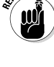

然而，一些属性是不被继承的，因为在某些情况下这没有意义。例如，您不希望子元素继承父元素使用的外边距（margins）。外边距的主要目的是将父文本块与子块区分开，因此它们应该有不同的外边距。同样，边框（borders）、内边距（padding）和背景（backgrounds）也不被继承。

## 第 3 章：使用选择器开始运行

### 本章内容

- 认真对待选择器
- 使用多个声明
- 理解分组
- 将属性用作选择器
- 构建您的第一个样式表
- 详细探讨 CSS

既然您已经接触到了 CSS 的神奇之处，您不太可能继续编写这种 HTML 了：

```html
<h3><font color="red">Warning:</font></h3>
```

这种行在网站中可能需要编写几十次。例如，假设您的整个网站中有一系列警告，每个警告前面都有一个红色的 `H3` 标题。对于*每一个*标题，您都必须使用 `<font>` 元素指定它是红色的。

CSS 出现了。现在您可以在单个位置创建一个 `H3`*选择器*，它就能影响整个网站的所有 `H3` 标题。这一个样式就自动使所有 `H3` 标题变红。如果您以后决定将 `H3` 标题从红色改为简单的粗体，没问题。您只需要在样式表规则中修改一次，而不需要在散布于 HTML 代码中的几十处 `H3` 元素中进行修改。

选择器指定 CSS 样式规则应用于 HTML 代码中的哪个元素。例如，如果您想将规则应用于 HTML 段落 `<p>` 元素，请使用选择器 `p`。或者使用选择器 `h1` 来定义一个应用于 HTML 代码中 `H1` 标题元素的 CSS 规则。换句话说，CSS 选择器就是一个去掉了 `< >` 符号的 HTML 元素。这是一个 CSS 规则中的 `h1` 选择器（以粗体显示）：

48 第一部分：CSS 基础

```html
<style>
h1 {color: red;}
</style>
```

这条规则意味着，在整个 HTML 代码中，*选择*每个 `H1` 元素并将红色应用到它上面。选择器告诉 CSS 要将 CSS 规则应用于哪些 HTML 元素。

但选择器的功能比你想象的要多。考虑一下使用选择器的其他方式。它们比你想象的更加灵活。

### 使用通用选择器

你可能想知道是否会影响网站中的*所有内容*——不仅仅是某些标签，而是所有标签？当然可以。你可以使用 `*` 来创建一个具有全局效果的通用选择器。也许有一天你的老板——那个完全没有品味或设计感的老板——走进来说："听着，我认为我们应该让我们的网站从众多网站中脱颖而出，所以我们把整个网站都变成粗体吧！怎么样？"

"你是说所有的标题？"

"不，我是说从最小的说明文字到正文到最大的标题，全部！多棒的主意。"

"为什么不更进一步呢？"你问道，忘了讽刺通常对老板不起作用。"为什么不把整个背景也做成鲜艳的格子图案呢？"

"嘿，我觉得你说得有道理！"他说着，回到办公室去想其他精妙的主意去了。嗯，谁让他是老板呢。

要在不使用通用选择器的情况下让整个网站都变成粗体，你必须创建一组选择器，像这样：

```css
body, p, table, h1, h2, h3, h4, h5, h6, {font-weight: bold;}
```

实际上，你还必须创建一个更大的组，将 HTML 中的大多数标签组合起来，比如 `th`、`td`、`pre`、`strong`、`em` 以及你在未来可能使用的任何其他标签。

不用担心。与其构建一个庞大的组选择器，你可以直接使用*通用选择器*，将你整个网站的文本都改为粗体，让老板高兴，像这样：

```css
* {font-weight: bold;}
```

单独的星号就是一个通用选择器。它的意思是"*对*文档中的所有元素都这样做"。在这里，你为每个元素分配了 `font-weight` 属性，值为粗体。这显然是一种强大而*不加区分的*力量——和他的老板本人没什么两样。


许多人避免使用通用选择器，因为它们可能会产生涉及继承的意外副作用。（例如，你可能不希望超链接继承通用字体样式——超链接需要从周围文本中脱颖而出。）但是，如果你有胆量，就去大胆地在你的网站上强制执行一些大规模规则，并在副作用出现时尝试管理它们。

### 使用多重声明

还记得分组吗？在那里你可以指定多个选择器，后面跟着你希望所有这些元素共享的样式，像这样：

```css
h1, h2, h3, h4, {font-weight: bold;}
```

那么，你也可以使用多重声明（大括号内的属性/值对）：

```css
h1 {font-weight: bold; font: 18px Courier; color: green;}
```

使用多重声明时要记住的是，要用分号将它们分隔开。空格在这里会被 CSS 简单地忽略，所以你不能指望用空格来分隔声明。

许多计算机书籍的作者不屑于写最后的分号，在闭合大括号 (`}`) 前把它省略掉，像这样：

```css
h1 {font-weight: bold}
```


然而，省略最后的分号是个不太好的主意。你应该养成始终以分号结束每个声明的习惯。在声明列表中遗漏分号是*一个非常常见的*导致浏览器混乱和错误的原因。下面是一个例子，你希望将 `H1` 标题显示为粗体、绿色、28 磅的 Arial 字体：

```html
<html>
<head>
<style>
```

```css
h1 {font-weight: bold font: 28pt arial; color: green;}
```

```html
</style>
</head>
<body>
<h1>a headline</h1>
</body>
</html>
```

但注意，*bold* 后面缺少分号。结果导致 Internet Explorer 变得困惑，无法识别 `font: 28pt Arial` 是一个可以与 `font-weight` 属性一起使用的值（事实上它确实不能）。因此浏览器简单地忽略了 `font` 属性及其关联的 `28pt Arial` 值。它转而使用默认的 `H1` 字体，而不是你想要的 Arial。同样，所请求的 28 磅大小也被忽略了，转而使用默认字体大小（在这种情况下可能比你想要的小）。

如你所料，你可以同时分组选择器*和*声明，像这样：

```css
h1, h2, h3, h4 { font-weight: bold; color: blue; background-color: green; }
```

### 使用属性作为选择器


CSS2 定义了一些新的选择器，包括属性选择器。唉，这种选择器不被 Internet Explorer（IE）支持，但我会介绍它。熟悉一些 IE 不支持的 CSS 技术仍然是个好主意，以防 IE 将来支持它们。

而且，当然，属性选择器确实可以在 Netscape 6 或 7、Mozilla 或 Opera 5 或 6 中工作。更重要的是，CSS 不仅可以应用于 HTML 文件，还可以应用于其他文件，比如基于 XML 的文件。XML 文件通常努力使用“自描述”属性，所以这些属性往往可以作为选择器使用。

属性选择器可以扩展类和 ID 属性的效用和灵活性，此外还允许你尝试一些有用的技巧。

例如，回顾一下，当你使用类选择器时，CSS 会将选择器与每个 HTML 标签进行比较——只有当 HTML 中的类名与 CSS 中选规则中的类名相同时，才会找到匹配项（类名是你自己取的，比如`bodytext`、`alert`、`highlight`、`warning`等等）。下面是一个典型的类选择器。它定义了一个样式（显示红色），与后面 HTML 中任何带有`class = "alert"`的`<p>`标签匹配：

```css
p.alert {color: red}
```

在 HTML 中，这个段落标签与`alert`类匹配：

```html
<p class="alert">
This is red.
</p>
```

稍停片刻，确保你已经弄清楚了术语（这有点令人困惑）。在下面的 CSS 规则中，`p`是选择器，`alert`是类名，`color`是属性，`red`是该属性的值：

```css
p.alert {color: red}
```

而在相关的 HTML 文档中，这是一个与此选择器匹配的元素：

```html
<p class="alert">
```

在这个元素中，`p`是元素（或标签），`class`是该`p`元素的一个属性，`alert`是 class 属性的值。

为什么这很令人困惑？因为这些项目在不同位置有不同的名称。在 CSS 文件中，`p`被称为选择器，但在 HTML 文件中，它被称为标签（或元素）。此外，`alert`是一个类名（在 CSS 文件中），但在 HTML 文件中变成了值。你只需要努力记住几个这样的类别和术语，否则你在试图理解 CSS 时很快就会感到困惑。看看图 3-1。它比较了两行链接代码中的术语：首先是 CSS 规则，然后是应用该规则的 HTML。

#### CSS 文件中的样式定义

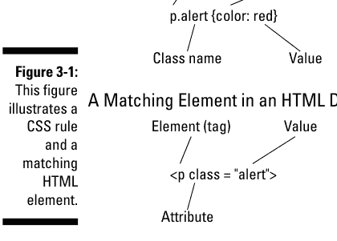

#### HTML 文档中的匹配元素

## 最简单的属性选择器

属性选择器有几种类型。最简单的版本仅仅查找属性匹配，而忽略属性的具体内容。换句话说，在以下代码中，如果一个`<p>`标签有一个`class`——任何类都可以——就会发生匹配。如果你想让标签中带有`class=`属性的任何段落都渲染为斜体，例如，你可以创建这个选择器：

```css
p[class] {font-style: italic;}
```

注意，这里你不是在定义一个类名（比如`p.alert`中的`alert`）。相反，你只是指定了`[class]`，这意味着任何类都可以。所以，这个 HTML 中的`<p>`元素是斜体的，因为它有一个`class`属性：

```html
<p class="red">
This is red.
</p>
```

而这个也是斜体的。它有一个`class`：

```html
<p class="signal">
This is an important point!
</p>
```

整个文档中任何在标签中带有`class=`作为属性的`<p>`标签——无论等号后面指定的实际值是什么——都是斜体的。这就是属性选择器最简单的一种。

另一种属性选择器可以匹配“值”（class XML 经常使用这种匹配）。例如，假设你运营着一个汽车经销商的网站，经销商希望每次提到正在销售的汽车时都用粗体显示。你可以这样做：

```css
car[onSale] {font-weight: bold;}
```

这会导致以下 HTML 中第一个和第二个（但不是第三个）元素的文本加粗显示：

```html
<car onSale="5000">Chevy</car>
<car onSale="2999">Ford</car>
<car>Maxim</car>
```

在这个例子中，只有 Chevy 和 Ford 的文本是粗体的。为什么呢？因为它们有一个`onSale`属性——选择器就是这样指定的。

## 匹配属性选择类型

这种属性选择技术并不常用，但在需要匹配语言值时（例如，用`fr`匹配法语）会很有价值。例如，下面这个选择器为所有`lang`属性以（或等于）`fr`开头的元素指定蓝色。这会使法语文本变成蓝色：

```css
*[lang|="fr"] {color: blue;}
```

然后，在 HTML 中，以下元素中只有一个会变蓝：

```html
<p lang="fr">Pouvez vous prospérer</p>
<p lang="en-us">May you prosper</p>
```

你猜对了：第一个是`fr`，所以它匹配并变成蓝色。

## 匹配部分属性值

类名（或者你更喜欢称其为值）可以包含多个单词，例如：

```html
<p class="running headline">
```

如果你想匹配所有`class`属性中包含单词`running`的元素呢？你可以使用一种针对类名部分匹配的通配符。编写这样的选择器：

```css
p[class~="running"] {color: blue;}
```

波浪号（`~`）表示：“如果这个词出现就匹配”，无论其他词是否存在。

## 匹配精确属性值

属性选择器技术的最后一种变体要求与属性值精确匹配。这个选择器只为`onSale`属性值为 2999 的 car 元素加粗：

```css
car[onSale="2999"] {font-weight: bold;}
```

这会导致以下 HTML 中第二个元素的文本加粗（而不是第一个或第三个）：

```html
<car onSale="5000">Chevy</car>
<car onSale="2999">Ford</car>
<car>Maxim</car>
```

## 构建你的第一个样式表

你已经尝试过一些小例子——定义单个选择器，然后在 HTML 代码的一两个元素上测试它。现在是时候尝试一个稍大的例子，以更准确地了解 CSS 的强大功能。在这个例子中，你将创建一个 HTML 页面，然后通过 CSS 文件进行修改。最后，你将两个 CSS 文件应用到 HTML 上，以查看层叠和特性的实际效果。

生成一个用于练习的 HTML 页面的简便方法是，在 Word 中输入几个段落（或直接复制粘贴），然后让 Word 将它们转换成 HTML 文档。要查看其工作原理，请按照以下步骤操作：

1. 运行 Word 2003。
2. 输入三到四个段落。
3. 将其中一个段落设为斜体。
4. 在单独的一行上输入几个单词，然后按 Enter。
5. 用鼠标拖动选择这些文本。
6. 选择“格式：样式和格式”。
7. 在样式列表中双击“标题 1”。
8. 通过重复步骤 4 到 7 创建几个二级标题，但在步骤 7 中不选择“标题 1”样式，而是选择“标题 2”。

你的结果应该类似于图 3-2。

TEAM LING - LIVE, INFORMATIVE, NON-COST AND GENUINE!

## 将 Word 文档转换为网页

现在你应该有一个包含几个段落的简单 Word 文档——其中一个段落是斜体。你还有几个一级标题和几个二级标题。你现在想将此文件另存为 MyFirst.htm。请按照以下步骤将此文档创建为 HTML 文件：

1. 选择“文件”→“另存为网页”。
   1. 出现一个“另存为”对话框，询问你是否要将其另存为`.mht`（单个文件）网页。此格式是 Microsoft 的专用格式，包含大量有关文档的额外信息——因此可以使用 Word 的全部功能进行编辑。你不需要所有这些。你只需要在这里生成一个简单的 HTML 文档。
2. 在对话框底部的“保存类型”列表框中，单击向下箭头查看文件类型选项列表，并选择“网页（*.htm, *.html）”。将此文件命名为`MyFirst.htm`。
   1. 你现在创建了一个名为`MyFirst.htm`的 HTML 文档，可以在浏览器中显示。
   2. 你可能还会注意到，当对话框关闭并返回到 Word 文档视图时，文本看起来变小了。
3. 选择“视图”，并注意“Web 版式”现在是活动视图，而不是之前的“普通”视图。

现在，通过在 Windows 资源管理器中双击`MyFirst.htm`文件，在 Internet Explorer 中查看你的新网页。

你的页面出现了，但它不再是`.doc`文件。它现在是一个浏览器可以读取、理解和显示的 HTML 文件，如图 3-3 所示。

现在你已经准备好查看此页面背后的 HTML 代码了。在 Word 中选择“视图”→“HTML 源文件”。一个特殊的 Microsoft 脚本编辑器将打开，显示你的 HTML 的全部内容。尽管这是此页面的“纯”HTML 版本（与你在前面的步骤列表中第 1 步拒绝的`.mht`版本相比是“纯”的）——但它仍然相当庞大！

检查 Word 生成的 HTML，如图 3-4 所示。

在浏览 HTML 代码时，你可能会注意到注释（Microsoft 使用这些注释来强制浏览器忽略专有内容，有时甚至是一些脚本代码）。你还看到了许多对`mso`的引用，它代表 Microsoft Office，以及许多 XML 格式的项目，定义了文档属性和其他数据。忽略所有这些。或者，如果你愿意，可以浏览一会儿，但不要被迷住，因为我们要找的内容在页面的更下方。

**图 3-3：** 这与图 3-2 中显示的文本相同，但现在由 Internet Explorer 渲染。

向下滚动，直到找到样式部分，它被恰当地标记为粉红色。查看粉红色部分：

```css
strong {color:#400000;}
em {color:#400000;}
p {mso-margin-top-alt:auto; margin-right:0in; mso-margin-bottom-alt:auto; margin-left:0in; text-indent:12.25pt; mso-pagination:widow-orphan; font-size:12.0pt; font-family:"Times New Roman"; mso-fareast-font-family:Times;}
```

请注意，这里的`strong`和`em`选择器都被定义为具有值为`#400000`的颜色。因为这些样式嵌入在此 HTML 文档中，所以它们会覆盖我们链接到文档的任何外部样式表。嵌入式样式比外部样式更接近它们要修改的 HTML 标签。“更接近”的样式也被描述为更具体。因此，如果样式定义冲突，嵌入式样式会胜出。

## 可视化特性的级别

以下是关于 CSS 特性的一些规则：

- 子元素（例如，父`<body>`内的`<p>`段落元素）继承其父元素的样式。如果`<body>`有一个指定下划线的关联样式，则该父`<body>`元素内的任何`<p>`元素都会继承该下划线。但是，如果网页上存在更具体的样式（例如内联样式），它们会覆盖继承的样式。
- 包含在 HTML 文档中的 CSS 样式（嵌入式或内联样式）优先于外部样式（位于单独的`.css`文件中，并通过 HTML 代码中的`<link>`标签引用）。
- 带有`!Important`命令的样式具有优先权，无论其他因素如何。

现在，只是为了好玩，尝试做一个实验。按照以下步骤修改 Word 生成的 HTML 代码中的这个嵌入式样式`strong`：

1. 在 Microsoft 脚本编辑器中，找到此选择器：

   ```css
   strong {color:#400000;}
   ```

2. 在脚本编辑器中修改它，将`<strong>`的颜色改为绿色，如下所示：

   ```css
   strong {color: green;}
   ```

3. 现在在第一个段落中找到一些文本——你的文档文本位于编辑器中 HTML 的最底部。用`<strong> </strong>`标签包裹一个或两个单词，如下所示：

   ```html
   <p class=MsoNormal>You've <strong>experimented</strong> with
   ```

4. 单击工具栏上的“刷新”按钮。
5. 选择“文件”>“保存”。

请注意，一旦你键入`<`符号，编辑器中的文本就会变成红色。这是为了提示你 HTML 代码中有错误。当代码恢复为正确格式时（当你键入结束符号`>`时），文本会再次变成黑色，向你表明一切都正常了。或者即使不完全正常，至少你的 HTML 代码没有明显的错误。

在保存此文件之前，请注意 Word 文档中发生了什么很酷的事情。现在切换到 Word。看到“刷新”工具栏了吗，如图 3-5 所示？Word 知道你编辑了 HTML，因此当前的 Web 版式视图不再准确。

你现在看到你标记为`<strong>`的单词已经变成绿色，正如你修改后的样式所指定的那样。

HTML 文件现已更新以反映你的更改。

**TEAM LING - LIVE, INFORMATIVE, NON-COST AND GENUINE!**

### 图 3-5

Word 允许你通过单击此刷新工具栏，在脚本编辑器中查看对 HTML 代码进行任何编辑的结果。

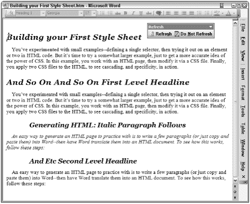

6. 切换到 IE 并按 F5。

按 F5 时页面会刷新。

浏览器窗口通过重新加载你的`.htm`文件来刷新，你在这里也能看到你要求的绿色文字。

使用 Word 创建网页并不困难。如果你有一些想要添加到网站的 Word 文档，使用 Word 的“另存为网页”功能会很方便。在 Word 2003 内置的脚本编辑器中编辑 HTML 代码也很高效：它甚至还有一个调试器。

## 创建外部层叠样式表

现在你要构建一个外部 CSS 文件，从你刚刚构建的 Word`.htm`文件中引用它，并使用`!Important`命令来用外部 CSS 文件中的样式覆盖嵌入式样式。

如果 CSS 术语发生变化，不必过于困扰。例如，这个`!Important`命令在我读过的四位不同的计算机书籍作者那里被称为四种不同的东西：有时是属性、规则、值或声明。官方 W3 网站（`www.W3.org`）本应对这类问题有最终决定权，但即使他们也不一致。他们将`!Important`称为规则，但也把`!`和`Important`描述为关键字。无所谓了。多年来，每当微软搞不清某个语言元素的分类时，他们就把它叫做关键字。有些语言元素显然是函数或运算符等等。另一些则很难归类。实际上，关键字并没有真正的含义——它只是把无法分类的概念扔进去的杂物袋。对于这类术语，我更喜欢用命令这个词。所以我把`!Important`称为命令。那又何妨？每个人都有自己的首选术语。

要构建 CSS，打开记事本并输入以下样式定义：

```css
p
{
color: blue;
text-align: center;
font-family: arial
!important;
}
```

将此 CSS 保存为`MyFirst.css`。

在记事本中打开`MyFirst.htm`文件。你会在`.htm`文件的最顶部看到类似以下的代码。按如下所示插入指向`.css`文件的链接：

```html
<html xmlns:o="urn:schemas-microsoft-com:office:office"
xmlns:w="urn:schemas-microsoft-com:office:word"
xmlns="http://www.w3.org/TR/REC-html40">
<head>
<meta http-equiv=Content-Type content="text/html;
        charset=windows-1252">
<meta name=ProgId content=Word.Document>
<meta name=Generator content="Microsoft Word 11">
<meta name=Originator content="Microsoft Word 11">
<link rel=File-List
href="Building%20your%20First%20Style%20Sheet_files/filelist.xml">
<link type="text/css" rel="stylesheet" href="MyFirst.css">
<title>Building your First Style Sheet</title>
```

在`.htm`文件中放置各种元素的位置通常并不关键——尽管当然你希望某些东西放在头部，某些放在主体中。此外，项目的显示顺序或脚本代码的执行顺序可能会受其在代码中顺序的影响。然而，如果可能的话，将类似的元素放在一起通常是最佳选择。因此，将你的新链接放在微软自己的`.xml`文件链接下方。

## !Important 的重要性

现在保存`MyFirst.htm`文件。通过双击`MyFirst.htm`将其加载到 Internet Explorer 中来测试样式表。你应该能看到`!Important`样式的效果。在段落中，黑色文字变为蓝色，居中，并从默认的衬线字体变为 Arial 的无衬线样式，如图 3-6 所示。


尝试从记事本中的`.css`文件里删除`!Important`命令。按`Alt+F+S`保存对此文件的更改。然后使用`Alt+Tab`切换到IE，再按`F5`刷新浏览器（重新加载HTML以将显示内容更新到最新版本）。如你所见，蓝色和居中生成了效果，但衬线的`Times New Roman`字体没有按外部样式指定的那样变为`Arial`。为什么你的CSS文件中某些样式被应用了，而其他的没有？答案就在此页面的`.htm`代码中。在嵌入式样式中，找到属性选择器。你会看到：

```css
p
    {mso-margin-top-alt:auto;
    margin-right:0in;
    mso-margin-bottom-alt:auto;
    margin-left:0in;
    text-indent:12.25pt;
    mso-pagination:widow-orphan;
    font-size:12.0pt;
    font-family:"Times New Roman";
    mso-fareast-font-family:Times;}
```

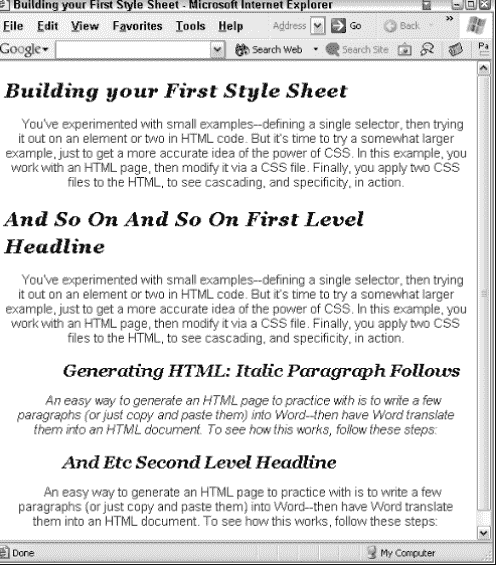

微软的嵌入式样式没有定义`<p>`选择器的颜色或对齐方式，该选择器决定段落元素的外观。然而，字体族是在嵌入式样式中指定的：

```css
font-family:"Times New Roman";
```

> **提示** 注意这种测试CSS效果和修改的高效方式。使用记事本保存CSS文件，你可以对CSS代码进行更改然后保存文件，只需刷新浏览器即可立即看到结果。我在本书中多次提到这个编辑-测试循环，因为它值得反复强调。

### 最近者优先的重要性

回顾层叠样式中的“接近性”规则：嵌入式样式优先于外部样式。覆盖嵌入的`Times New Roman`字体的唯一方法就是使用`!Important`命令。

关于`!Important`还有两个重要要点需要记住。你不能在它前面使用分号，而且你必须为每个属性使用它（CSS样式中的“属性”会影响HTML代码中的“属性”）。

#### 省略分号

例如，这个CSS样式不会生效：

```css
font-family: arial;!Important
```

这是因为在属性的值（这里是`arial`）和`!Important`命令之间不能使用分号。要使其生效，你的`!Important`命令应该紧挨在值后面，就像这样：

```css
font-family: arial!Important
```

#### 所有内容都必须重要

此外，以下示例将文字变为蓝色，居中（蓝色和居中不与其他样式冲突），并由于`!Important`命令将大小增加到18磅——但未能将字体变为Arial：

```css
p
{
color: blue;
text-align: center;
font-family: arial;
font-size:18.0pt!Important
}
```

你未能将`!Important`添加到`font-family`属性上。每个你想要设为`!Important`的属性都必须附加该命令，就像这样：

```css
p
{
color: blue;
text-align: center;
font-family: arial!Important;
font-size:18.0pt!Important
}
```

### 添加新选择器

现在打开你的`.css`文件，将标题字体从斜体重定义为正常，从默认的左对齐重定义为居中，并使用一种名为`Ravie`的相当激进的字体族。首先看看Word放入`.htm`文件中的`H1`选择器的嵌入式样式：

```css
h1
    {
        mso-style-parent:"";
        mso-style-next:Normal;
        margin-top:14.0pt;
        margin-right:0in;
        margin-bottom:10.5pt;
        margin-left:0in;
        text-indent:0in;
        line-height:24.0pt;
        mso-line-height-rule:exactly;
        mso-pagination:none;
        page-break-after:avoid;
        mso-outline-level:1;
        font-size:17.0pt;
        mso-bidi-font-size:10.0pt;
        font-family:Georgia;
        mso-fareast-font-family:"Times New Roman";
        letter-spacing:.5pt;
        mso-font-kerning:0pt;
        font-weight:bold;
        mso-bidi-font-weight:normal;
        font-style:italic;
        mso-bidi-font-style:normal;
    }
```

注意字体是一种名为`Georgia`的字型，而且是斜体。你在`.htm`文档中使用了一级和二级标题，因此与其为每个标题创建单独的选择器，不如将标题样式分组到一个样式规范中。在记事本中打开你的`.css`文件并添加如下所示粗体部分的选择器组：

```css
p
{
color: blue;
text-align: center;
font-family: arial!important;
font-size:18.0pt!important
}
h1, h2
{
font-family: ravie!important;
font-style: normal!important;
text-align: center;
}
```

注意你不需要将`!Important`命令添加到标题居中，因为微软的嵌入式CSS选择器对标题没有提到对齐方式。因此，你的外部样式表可以自由地对此属性进行任何你想要的更改。

### 当层叠冲突时

要查看浏览器如何处理两个样式竞争的外部文件，使用记事本创建第二个`.css`文件，包含此段落选择器定义：

```css
p
{
color: maroon;
text-align: center;
font-family: arial!important;
font-size:18.0pt!important
}
```

将此文件保存为`MySecond.css`。

现在，通过将以下粗体部分的链接添加到你一直在之前示例中使用的HTML代码中，将这个第二`.css`文件链接到你的`MyFirst.htm`文件：

```html
<link type="text/css" rel="stylesheet" href="MyFirst.css">
<link type="text/css" rel="stylesheet" href="MySecond.css">
<title>Building your First Style Sheet</title>
```

## 第三章：选择器入门

保存此文件。现在想象一下会发生什么。在`MyFirst.css`中，段落文本应该是蓝色的：

```css
p
{
color: blue;
text-align: center;
font-family: arial !Important;
font-size: 18.0pt !Important;
}
```

但`MySecond.css`指定段落文本为栗色：

```css
p
{
color: maroon;
text-align: center;
font-family: arial !Important;
font-size: 18.0pt !Important;
}
```

会发生什么？这两个选择器对`.htm`文件中的HTML`<p>`标签具有相同的“接近度”（或特异性），因为两者都在外部文件中。或者它们毕竟具有相同的接近度？这里是否适用另一种接近度？你认为颜色会是什么？

将`MyFirst.htm`加载到IE中，看看这两个外部选择器中哪个占主导地位。文本变成了栗色。为什么？因为第二个`.css`文件的`<link>`标签在HTML代码中更接近受影响的`<p>`元素。第二个`.css`文件链接在头部中位置更低，因此更接近文档主体，而`<p>`元素就在其中。如果你交换头部中`<link>`元素的顺序，文本就会变成蓝色。尝试像这样交换顺序，然后保存`.htm`文件并刷新浏览器：

```html
<link type="text/css" rel="stylesheet" href="MySecond.css">
<link type="text/css" rel="stylesheet" href="MyFirst.css">
```

结果是什么？蓝色。

## 第一部分：CSS基础

## 第二部分：用CSS美化页面

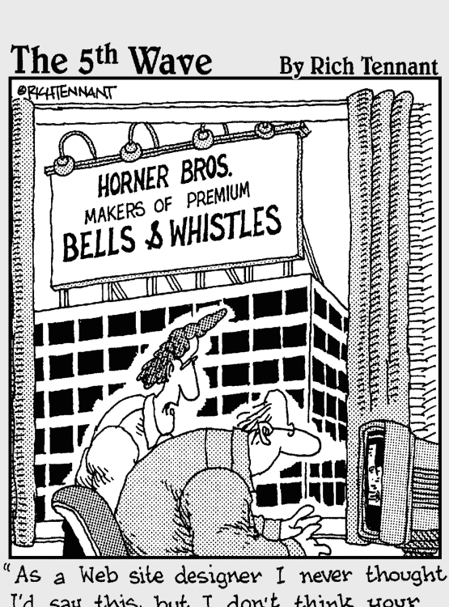

### 本部分内容...

CSS为你提供了许多效率工具，包括能够按照你的方式布局网页、调整字符、单词和文本行之间的间距，以及添加颜色或纹理来使背景栩栩如生。本部分涵盖了这些以及其他CSS基本设计元素。

## 第四章：定位

### 本章内容

- 理解相对定位
- 熟练使用绝对定位
- 偏移位置
- 堆叠元素和调整不透明度

设计中最基本的元素可能就是定位。假设有人给你五个物体，并告诉你把它们排列在一个框架内。这五个物体的纹理、形状或颜色并不那么重要。如果你有天赋，你可以通过以最佳方式排列它们，使它们在框架内看起来很漂亮。

在网页上定位元素对于该页面的成功同样至关重要。你不希望人们认为这些元素只是碰巧落在那里——意外地出现在它们恰好落脚的地方。

本书有几章涉及定位，但这里你可以了解控制网页设计的基础知识。

一个简单的网页默认将其元素从上到下排列，沿着页面左侧将它们一个接一个地堆叠起来。这是两个段落，中间有一张图片：

```html
<html>
<head>
</head>
<body>
<h1>This Is The Headline</h1>

<P>

</P>

<P>This is paragraph two.</P>
</body>
</html>
```

70 第二部分：用CSS美化页面

尝试将此文件另存为`Simple.htm`。同时，在同一文件夹中添加一张名为`lake.jpg`的图片。然后双击`Simple.htm`在Internet Explorer中查看它。你应该会看到类似图4-1的内容。

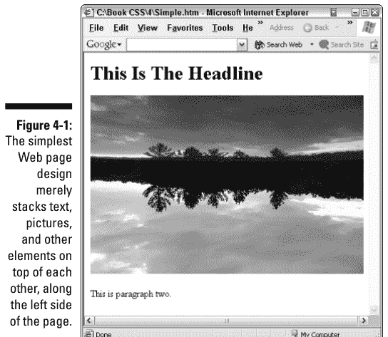

改进图4-1所示的设计非常容易：只需添加一个使标题居中的属性：

```html
<h1 align="center">This Is The Headline</h1>
```

这将产生如图4-2所示的更令人愉悦的设计。

但以这种方式居中文本存在问题。它是相对于浏览器居中，而不是相对于图形。因此，如果用户的浏览器比图形本身更宽，居中的文本相对于图像会偏离中心，如图4-3所示。

HTML并非为有效处理页面布局而设计。CSS的开发部分是为了解决这个问题。CSS包含各种定位工具，包括复杂的相对定位。你可以使一个对象的位置与另一个对象相关（关联，或相对于另一个对象）。这解决了用户调整浏览器窗口大小的问题：相对定位的对象无论浏览器本身发生什么变化，都保持它们之间的相互关系。

TEAM LING - LIVE, INFORMATIVE, NON-COST AND GENUINE !

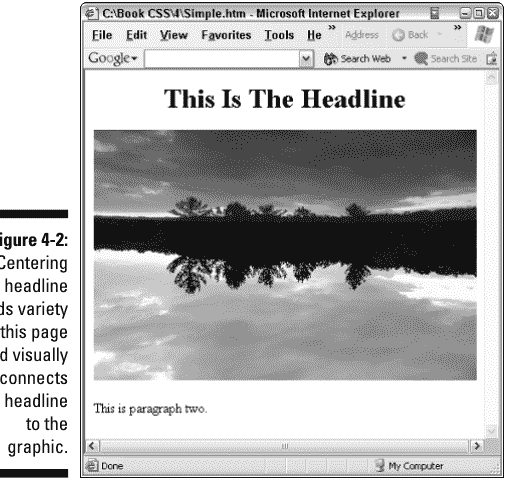

**图4-2：** 标题居中增加了页面的变化，并在视觉上将标题与图形联系起来。

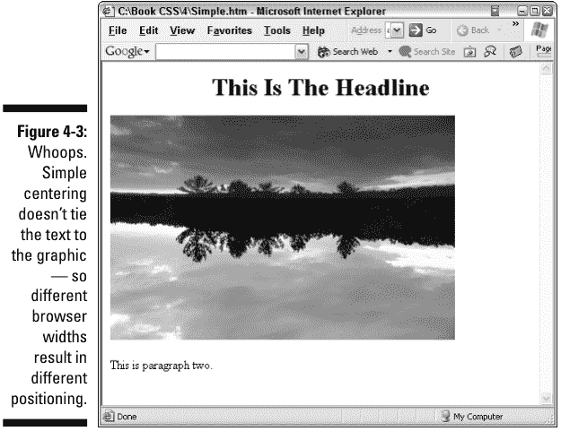

**图4-3：** 糟糕。简单的居中并没有将文本与图形关联起来——因此不同的浏览器宽度会导致不同的定位。

72 第二部分：用CSS美化页面

### 相对性解释

相对定位意味着一个元素的位置是相对于另一个元素的。

相对位置可能意味着一个元素位于另一个元素的中央，或在其左侧35像素，或从其顶部向下25%。主要的一点是，第一个元素的位置取决于另一个元素的位置。正如你在图4-3中看到的，标题可以相对于浏览器窗口居中。

绝对定位指定一个特定的数字（像素、点、英寸，无论你选择什么测量系统），元素应该按照这个数字定位。绝对大小由宽度和高度数字描述，如本章前面HTML代码中描述的图片大小：

```html

```

绝对位置由两个数字描述：顶部和左侧。技术上称为坐标，这两个数字告诉浏览器确切地将元素放在浏览器窗口内的什么位置。`顶部 3英寸`意味着将元素的顶部放在距离浏览器窗口边框向下三英寸处。`左侧 2英寸`意味着距离边框左侧两英寸。使用这两个坐标，你可以将任何东西放在任何地方。

一些设计师试图使他们的网页具有极高的灵活性，以便可以在许多不同的尺寸下查看——从微小的PDA屏幕到巨大的体育场屏幕。这是使用相对大小和定位技术的另一个原因。请注意，当你在Internet Explorer中选择查看 > 文字大小时，你会看到相对论选项：最大、较大、中等、较小、最小。你不会看到像1英寸、1/2英寸、1/4英寸这样的绝对规格选择。设计Internet Explorer的人假设人们使用不同尺寸的屏幕和不同的分辨率设置（800x600等）。因此，“大”的含义应该是相对于分辨率，而不是某种固定（绝对）的测量单位。PDA上最大的尺寸与巨型投影电视上最大的尺寸是相当不同的，对吧？

当然，正如阿尔伯特·爱因斯坦指出的，一切都是相对的，除了光速。所以，当我们谈论“绝对”定位时，它仅仅意味着我们“不那么相对”。我这么说是什么意思？

实际上，无论你多么努力，你都无法静止不动。当你认为自己静止不动时，随着太阳系绕银河系旋转，你仍然以大约每小时50万英里的速度移动。事实上，你正以快速而复杂的螺旋路径穿过空间。即使在你安静地睡觉时，你仍然乘坐着旋转的地球飞行，绕着太阳轨道运行，绕着银河系旋转。而银河系本身正高速穿过宇宙。所以你实际上一直在十几个不同的圆圈中快速移动。幸运的是，你的床和你房间里的所有其他东西也是如此。它们都处于静止状态，相对于你，但并非相对于光。

同样的概念也适用于绝对定位。毕竟，PDA屏幕上的一个英寸与巨型投影电视上的一个英寸是完全不同的东西。所以，尽管英寸是一个绝对的度量单位，但它的效果是相对于显示你网页的设备而言的。因此，不要被CSS样式中绝对这个有点难以捉摸的概念所困扰。

### 流式布局与定位，浮动与坐标

如果你只是将元素添加到网页上——而不指定具体的坐标——它们会流动（沿着左侧堆叠自己，如图4-1所示）。

CSS提供了两个重要的定位工具：浮动和定位。理解这些工具的各种交互特性需要一些时间，但你会很高兴你投入了这段时间。首先，你通常可以实现CSS所促成的一个伟大目标：摆脱用于布局的表格。

第9章、第10章和第11章深入介绍了CSS的定位功能，但了解这些功能的吸引力是一个好主意——它让你尝一尝你能做什么。

通过CSS定位，你可以精确指定元素在浏览器中出现的位置。但请注意，这个指定是相对于它们的默认位置，或相对于其他元素、浏览器背景的。（当然，当你相对于浏览器背景定位某个元素时，你可以认为它是“绝对”定位。浏览器框架是网页的“宇宙”，因此你可以忽略用户可能移动或调整浏览器窗口大小的事实。一个元素定位在距离浏览器窗口左侧一英寸处，无论用户做什么，它都会保持在该坐标上。）

现在看看你可以用来修改CSS选择器中定位属性的各种方式：`static`、`relative`、`absolute`、`fixed`和`inherit`。

`Static`类似于默认值——当你没有指定任何定位值时的情况。Static元素以默认方式流动（它们堆叠在左侧），但它们不能被重新定位；它们保持原位，你无法给它们指定坐标（`top`和`left`属性）。你也不能使用脚本（如VBScript或JavaScript）调整static元素的位置。它们保持原位：static。

Relative定位类似于static，但你可以使用`top`和`left`属性来修改默认的流动位置，相对于其他对象。

TEAM LING - LIVE, INFORMATIVE, NON-COST AND GENUINE !

## 第二部分：使用CSS打造美观界面

绝对定位（Absolute positioning）将元素从其他对象中脱离出来——它的位置不是相对于它们而定的。它是独立的。它位于浏览器窗口中，距离左侧和顶部有指定的距离。你通过`top`和`left`属性来提供位置，从`top: 0px; left: 0px;`开始，这将使元素紧贴浏览器窗口的左上角。（从技术上讲，`top`和`left`属性描述的是元素在其包含块（containing block）中的位置——但我将这个概念留到稍后讨论。）

要查看绝对定位如何影响图像，请尝试这个示例：

```
<html>
<head>
<style>
.absol {position: absolute; top: 0px; left: 0px;}
</style>
</head>
<body>
<h1>This Is The Headline</h1>
<p>
This is a paragraph of text.
</p>
<p>This is paragraph two.</p>


</body>
</html>
```


这个示例说明了将图形定位在`0,0`（绝对定位）如何导致它部分覆盖标题并完全覆盖一段正文内容。标题和文本是流式排列的（按照它们在 HTML 文档中出现的顺序堆叠）。然而，图像在堆叠顺序中排在*第三*位，却被定位在最前面：它被*绝对*地显示在左上角，如图 4-4 所示：

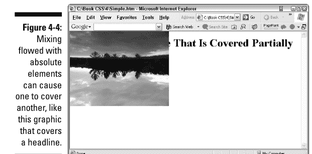

如果你将`position`属性从`absolute`改为`relative`会怎样？看看这个：

```
<style>
.absol {position: relative; top: 0px; left: 0px;}
</style>
```

将`position`的值从`absolute`改为`relative`会导致默认行为。图形将定位在它通常流转的位置 —— 即根据它们在 HTML 代码中的顺序在元素堆叠顺序中排列，如图 4-5 所示：

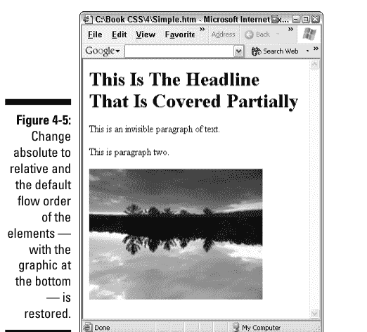

`position`属性值为`fixed`的元素将保持在浏览器中的位置，即使由于用户滚动浏览器，它们也不会移动。*其他*非固定元素会随之滚动，但固定元素不会。这个技巧可用于制作滚动标题、边框，或在表格顶部保留页眉或一组标签。然而，使用`fixed`有两个缺点。当用户滚动时，它可能看起来很烦人 —— 元素在抵制滚动时可能会出现抖动和跳跃 —— 更重要的是，这个技术在 IE 中不起作用。如果某个东西在当今 96% 的浏览器中都无法工作，那它的意义何在？直接避免使用它即可。

## 使用偏移量控制布局

在本章之前的示例中，你使用了`top`和`left`属性来描述绝对位置。现在，进一步研究如何将一个元素相对于另一个元素进行偏移。

`top`和`left`是*相对于*一个封闭对象的特定位置。例如，如果你的元素没有被包含在另一个元素中，那么`top`和`left`是相对于浏览器窗口（或“视口 viewport”）指定的。

万维网联盟（W3C）在某些术语的使用上相当模糊，有时甚至自相矛盾。一个核心问题是 —— 除了学术界传统上对空洞理论的偏好之外 —— W3C 想要避免使用具体、实在、易懂的术语*浏览器（browser）*。相反，他们更倾向于使用*视口（viewport）*这个抽象术语 —— 这是一个独立于设备的概念。考虑到 HTML 及其衍生产品应该能在手机和大显示器上使用，其想法是*视口*这个词能更准确地表达输出设备的潜在多样性。考虑到你 99% 的 CSS 工作最终都会在浏览器中运行，我建议你礼貌地忽略这些平台无关的抽象概念。这只会让人困惑。所以，就像大多数 CSS 书籍的作者一样，我将忽略视口问题，并将*浏览器窗口（browser window）*和*视口（viewport）*这两个词交替使用。

有时元素被定位在其他元素*内部*（例如，一个块级`<div>`内部的段落`<p>`）。在这种情况下，指定`top`和`left`是*相对于*容器元素的 —— 例如，包裹`<p>`的那个`<div>`。

将文档想象成由嵌套在其他块中的块所组成的。一个仅由一系列段落（`<p>`）元素组成的简单文档，可以被看作是一个包含`<p>`元素的`<body>`元素。这里是官方术语：`body`是这些段落的*包含块（containing block）*。

请注意，这种“块中块”的视觉描述与 XML 甚至 HTML 文档中的“树状结构”概念相平行。*父/子（Parent/child）*是描述这种层次概念的另一种方式。

理论就说到这里。来看一个定位示例：

```
<html>
<head>
<style>
div.sidebar {position: absolute; background-color: cornflowerblue; top: 0; left: 0; width: 100px;
height: 75%; padding-left: 6px; padding-right: 4px; padding-top: 6px; font-size: 16pt;}
div.maintext {position: absolute;  background-color: darkkhaki; top: 0; left: 110px; height: 75%; width: 75%;}
img.relative {position: relative; left = 35%; top = 20%;}
</style>
</head>
<body>
<div class="sidebar"> HERE is a sidebar. You can fill it with links, text, whatever... </div>
<div class="maintext">

</div>
</body>
</html>
```

这段代码产生了如图 4-6 所示的窗口。

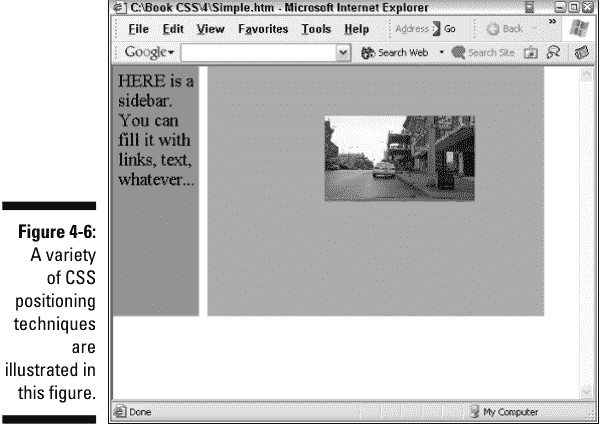

在页眉中，你定义了三个规则：`sidebar`、`maintext`和`relative`。第一个样式提供了关于`<div>`元素的`sidebar`类应该如何显示的信息：

```
div.sidebar {position: absolute; background-color: cornflowerblue; top: 0; left: 0; width: 100px;
height: 75%; padding-left: 6px; padding-right: 4px; padding-top: 6px; font-size: 16pt;}
```

这条规则指定了一个`<div>`应该在浏览器窗口的左上角绝对定位（`top`偏移量为`0`，`left`为`0`）。正如我们在北卡罗来纳州所说，那东西就直接贴在墙角了 —— 它不可能比这更靠上或更靠左了。它的宽度被指定为 100 像素，但请注意，高度不是一个绝对值。它是以包含块（在这种情况下，包含块是浏览器）的百分比来表示的。正如你在图 4-6 中看到的，左侧的`sidebar` `div`高度是浏览器窗口高度的 75%。

这是一个重点：请记住，即使在`position`属性被定义为`absolute`的样式中，你仍然可以将尺寸和位置都表示为相对百分比。

尝试运行这个示例，然后调整浏览器窗口使其变长。你会注意到浏览器保持了`div`与浏览器窗口之间 75% 的高度比例。

`sidebar`类还指定了左、右和顶部的内边距（`padding`）。这是一种很有用的方法，可以防止文本或其他元素因为紧贴`div`或其他块的边缘而显得尴尬。如果没有那个内边距，请注意图 4-7 中文本相对于背景看起来多么粗糙。

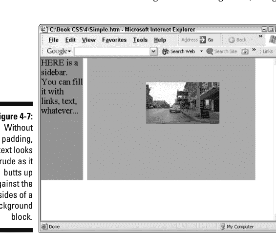

## 深入研究定位

在本节中，我将探讨 CSS 定位的一些进一步优化。CSS 提供了许多方法来帮助你在网页中实现精准的布局目标。

在前面的代码示例中，背景颜色被描述为`cornflowerblue`（矢车菊蓝）。显然，这比古怪的 RGB 等效值（`#6495ED`）是一种更易读、更易理解且更易记忆的表达颜色方式。除了 IE 6 之外的浏览器在使用颜色描述词时可能会遇到问题。因此，如果你担心你的页面在其他浏览器上看起来不好看，请使用`#6495ED`而不是`cornflowerblue`。所有浏览器都能解析`#6495ED`，即使我们人类不能。

但我的建议是，直接假设几乎每个看到你网页的人都使用 IE。为什么？因为绝大多数人*确实*在使用 IE。


我在本书封页内的速查表（Cheat Sheet）中包含了 IE 颜色列表。或者你可以在`http://msdn.microsoft.com/library/default.asp?url=/workshop/author/dhtml/reference/properties/background_0.asp`查看包含描述词和 RGB 值的完整颜色表。或者，如果微软将该表格移到了不同的 URL（虽然微软永远不会随意更改其网站地址！），请尝试在 MSDN 站点搜索`color table`。

还记得前面代码示例页眉中定义的三个样式吗？你定义的第二个样式是用于网页主部分的，名为`maintext`：

```
div.maintext {position: absolute;  background-color: darkkhaki; top: 0; left: 110px; height: 75%; width: 75%;}
```

这与`sidebar`类类似，但使用了不同的颜色，并将`div`相对于浏览器窗口左侧偏移 110 像素。这是一个绝对偏移量，如果用户拉伸浏览器窗口使其变宽，它也不会改变。请注意 110 像素（此处定义为主部分的左侧）与之前的`sidebar`样式之间的关系，后者指定`sidebar` `div`宽度为 100 像素。这样，这两个`div`就能很好地契合在一起，中间留有一条 10 像素宽的条带。你如何去掉这条条带？将`maintext`类的`left`属性设为 100 像素，或者将`sidebar`的尺寸扩大到 110 像素。

## CSS 测量单位

您可以使用以下单位来指定`top`、`left`、`height`或`width`：

- **px**：像素（pixels），显示器上的最小单位 —— 当您足够靠近电视时，有时能看到的彩色光点。

- **pt**：点（points），1/72 英寸。通常用于字体测量。

- **pc**：派卡（picas），1 pica = 12 points。

- **mm**：毫米。

- **cm**：厘米。

- **in**：英寸。

- **em**：当前元素的近似字体大小的测量值。

- **ex**：当前元素字体的 x-高度（小写字母 x 的高度） —— 通常约为 em 大小的 1/2。

对于相对大小或位置，请使用`%`表示百分比。测量单位将在第 6 章中详细讨论。

如果您将`maintext`类的`left`保持在 110 像素，但将`sidebar`类的尺寸扩大到，比如 130 像素，会发生什么？每个小组总有一个“捣蛋鬼”想看看违反间距会发生什么。尽管试一试吧。名为`maintext`的区块（在 HTML 中位于`sidebar`之后）会覆盖住`sidebar`的一部分以及其中的部分文本。您*可以*通过操作重叠区块并调整它们的透明度（这样您仍然可以看到`sidebar`中的文本）来创建酷炫的效果，但我稍后再介绍这些技巧。

请注意，对于`maintext`类，您将其高度和宽度都定义为*相对*的。宽度和高度均为 75%，但如果用户调整浏览器窗口的宽度，宽度会被压缩，因为浏览器必须为显示具有绝对宽度的`sidebar`留出空间。

前一段代码页眉中定义的第三个样式指定了一个在*其包含块内*位置完全相对的图像。与由浏览器本身包含的`div`元素不同，该图像被包含在一个`div`中。因此，`left`为 35% 的位置意味着照片的左侧位于`maintext` `div`宽度的约三分之一处，而`top`为 20% 意味着距离`div`顶部约五分之一处。您可以在图 4-6 中看到这些偏移量。

```
img.relative {position: relative; left: 35%; top: 20%}
```

如果您尝试将浏览器拉宽或拉长，照片会随之移动，以保持在其容器`div`内距离左侧三分之一、距离顶部五分之一的位置。

最后，在文档正文中，您地显示这些元素：

```
<div class="sidebar"> HERE is a sidebar. You can fill it with links, text, whatever... </div>
<div class="maintext">

```

请注意，该图像以绝对术语指定了您希望照片具有的大小（像素是默认的测量单位，如果您未指定任何其他单位则使用像素）。如果您不指定高度和宽度，图像将以*其*真实大小显示。

## 使用 Z 轴将元素堆叠在一起

显然，定位不仅仅涉及水平（`left`）或垂直（`top`）坐标。事实上，还有一个第三轴，称为*z 轴*。当浏览器中的某个对象覆盖另一个对象，或者处于“其上方”（就像把一本书放在桌子上，书就在桌子上方一样）时，就会发生这种情况。

在 CSS 中，您可以使用`z-index`属性来指定哪个对象在另一个对象之上。较高的`z-index`值会使对象显示在最上方。例如，回想本章早些时候的实验，当您将`maintext`类的`left`设为 110 像素，但将`sidebar`类的尺寸扩大到 130 像素时，`maintext`覆盖了`sidebar`的一部分。您可以通过将`sidebar`的`z-index`调整为 99 或任何您知道比`maintext`高的数字来改变这一点。这将把`sidebar` `div`移动到`maintext` `div`之上。

```
div.sidebar {position: absolute; z-index: 99; background-
color: cornflowerblue; top: 0; left: 0; width:
130px; height: 65%; padding-left: 6px; padding-
right: 4px; padding-top: 6px; font-size: 16pt;}
```

（请注意，我还将`sidebar`的高度从 75% 降低到了 65%，以便在图 4-8 中更好地显示重叠效果。）

当您添加一个较高的`z-index`值时，`sidebar`会移动到`maintext` `div`之上，如图 4-8 所示：

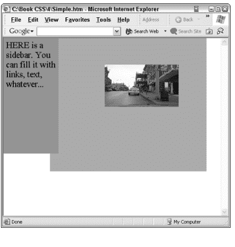

图 4-8：由于具有较高的`z-index`值，此`sidebar`被定位在`maintext` `div`“之上”。

## 将堆叠与半透明相结合

现在尝试一个将堆叠与不透明度调整相结合的酷炫技巧。这对于各种设计效果都很有用，尤其是与能够动态地对元素不透明度或位置进行动画处理的脚本一起使用时，效果尤为显著。如果使用得当，这种动画会非常有吸引力。本例调整了您在本章中一直使用的示例代码，但使`sidebar`元素在`maintext`元素中透出来。

CSS3 正在努力在未来的规范中加入`opacity`属性，但为什么还要等待？IE 5.5 及更高版本支持您现在就可以使用的不透明度功能。将一些堆叠与元素的*融合*结合起来如何？请看图 4-9。

在图 4-9 中，`sidebar`被定义为具有比`maintext` `div`更低的`z-index`。`sidebar`的`z-index`为 1，`maintext`的`z-index`为 2；因此，`maintext`叠加在`sidebar`之上。然而，`sidebar`能够透出来，是因为给`maintext`设定了 60 的不透明度值，使其变得有些透明。（0 的不透明度值使元素完全透明；100 的值使其完全不透明。）

```
filter:progid:DXImageTransform.Microsoft.Alpha(opacity=60)
```

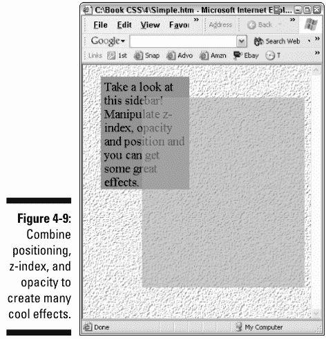

以下是产生图 4-9 的完整代码。注意：此代码假设您的硬盘上与`.htm`文件相同的文件夹中有一个具有砂岩纹理的图形文件（名为`sandstone.jpg`）。如果没有，请用另一个纹理图形文件代替背景，但将其命名为`sandstone.jpg`，以便以下代码能够运行。

```
<html>
<head>
<style>

div.sidebar {position: absolute; z-index: 1; background-
        color: cornflowerblue; top: 20; left: 30; width:
        150px; height: 35%; padding-left: 6px; padding-
        right: 4px; padding-top: 6px; font-size: 16pt;}
div.maintext {position: absolute; z-index: 2;
        filter:progid:DXImageTransform.Microsoft.Alpha(opa
        city=60);  background-color: darkkhaki; top:
        55; left: 100px; height: 75%; width: 75%;}

</style>

</head>
<body background="sandstone.jpg">
<div class="sidebar"> Take a look at this sidebar! Manipulate
            z-index, opacity and position and you can get some
            great effects.</div>
<div class="maintext">

</div>
</body>
</html>
```

想象一下，如果您添加一些脚本，在用户观看时缓慢调整不透明度值，可以产生多么美妙的淡入效果。您可能在一些设计更好的网站上见过淡入等酷炫效果。到您读完这本书时，您将知道如何使用 CSS 和脚本创建动画。但如果您是那种想立即尝试的急躁类型，现在就请翻到第 16 章。


如果您担心代码的浏览器独立性，除了 IE 之外的其他浏览器也通过私有属性支持不透明度。这段代码使该技巧在 IE、Mozilla、Safari 和 Opera 中都能运行：

```
div.maintext {position: absolute; z-index: 2; background-
            color: darkkhaki; top: 55; left: 100px; height:
            75%; width: 75%;
opacity: 0.6;   /*supported by current Mozilla, Safari, and
            Opera*/-moz-opacity: 0.6;  /*older Mozilla*/
-khtml-opacity: 0.6;    /*older Safari*/
filter: alpha(opacity=60);  /*older IE*/
filter:progid:DXImageTransform.Microsoft.Alpha(opacity=60)}
```

## 第 5 章：关于文本的一切

### 在本章中

- 思考用户界面
- 在 CSS 中处理字体
- 管理大小
- 使用特殊的文本效果

CSS 为您提供了多种样式化文本的方法。如果您做出明智的选择，您的整体页面设计将对网站访问者具有吸引力。另一方面，如果您不考虑文本如何与图形效果相结合，那么一个原本优雅、强大的网页可能会被毁掉。本章致力于 CSS 文本样式。

### 思考用户界面

用户将您的网站视为图形和文本主体的结合。作为设计者，您负责避免明显的问题，例如背景图形过暗导致前景文本无法阅读、跳跃的动画、干扰的颜色、糟糕的整体设计等等。

但您还负责选择既令人愉悦又能反映您想要塑造的形象的文本特征。

显然，银行网站想要展现稳重和保守，因此经典的 Times Roman 字体比图 5-1 所示的 Joker 字体是更好的选择。

即使在选择了字体之后，在设计 CSS 文本样式时，您还必须考虑其他问题：字体大小、粗体或斜体、居中、两端对齐、上标、首字母大写或下划线。

## 字体的替代

字体是指字母、数字以及相关符号和标点的特定设计。图 5-1 展示了两种不同的字体，不难看出你可以用多少种不同的方式来扭曲字母，同时仍然让它们保持可识别。

许多写 CSS 书籍的作者担心使用不同操作系统的人可能没有特定的字体。例如，设计师可能会指定常用的 Times New Roman 字体，但在 Linux 上运行的浏览器可能会用一种类似的字体（也许是 Times Roman 或 Garamond）来替代他们指定的 Times New Roman。

但那又怎样呢？首先，字体*族*之间共享足够的特征，所以这并不是那么关键。更重要的是，绝大多数网络用户使用 Windows，它附带了一套标准字体，包括 Times New Roman。浏览者很可能 96% 的情况下都能准确看到设计师指定的字体。

在计算机内存和硬盘空间稀缺的年代，人们有时会删除字体以节省空间。现在不再需要了。你几乎可以确定所有用户都拥有操作系统附带的完整微软字体集。现在没有人再费心去删除这些字体了。

我的电脑上有 295 种字体，自从安装 Windows XP 以来，我既没有添加也没有删除过任何字体。然而，其中一些实际上并不是独立的字体——相反，它们是变体，如 Times New Roman Bold、Times New Roman Bold Italic 等。在你的电脑上，你会发现适用于各种场合的字体，还有一些字体不适合*任何*场合，除了或许用其糟糕的品味来吓跑用户。

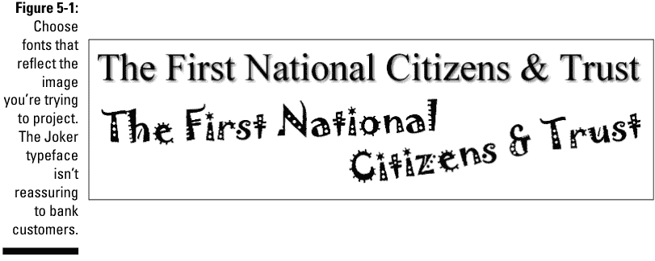

字体族，不出所料，在 CSS 规则中使用`font-family`属性来指定。如果你想让文档中的所有段落都使用 Arial 字体，你可以这样创建规则：

```
p {font-family: arial;}
```

有些字体名称中包含空格，比如 Times New Roman 或 Showcard Gothic。在这些情况下（以及如果名称包含任何如 % 或 @ 之类的符号时），你应该用单引号将名称括起来，像这样：

```
p {font-family: 'Showcard Gothic', arial;}
```

### 字体的类型

字体分为两大主要类别，依据是它们是否有卷曲装饰和变化的线条宽度。请看图 5-2，它展示了无衬线字体风格——那种线条宽度固定、线端简洁的朴素风格。

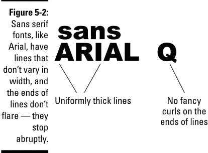

现在再看图 5-3，衬线字体风格，它看起来更像手写体，因为就像用钢笔书写的字符一样，线条宽度有变化，线端逐渐变细成一个点或圆点：

衬线体和无衬线体之间的区别在字母 *I* 上表现得非常明显。通过比较图 5-2 和图 5-3，你可以看到无衬线版本就像一块简单的砖。衬线版本更像一根罗马柱，顶部和底部展开并逐渐变细。

88 第二部分：用 CSS 打造美观外观

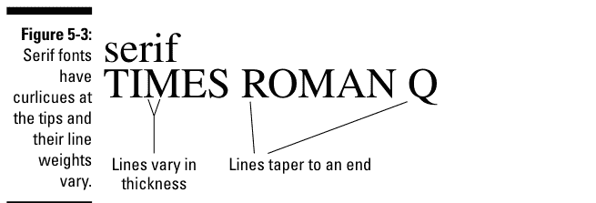

眼尖的读者可能会注意到，在图 5-2 中，一些线条的厚度确实略有变化，有些在末端稍有展开（注意 Q）。然而，无衬线体和衬线体之间的标准划分仍然占据绝对主导地位。几个世纪以来，各种字体设计师对无衬线字体做了一些调整，使其稍微不那么死板。同样，在二十世纪的大部分时间里，衬线字体通常趋向于演变成设计稍微不那么装饰性（或者我们可以说不太*华丽*）的风格，以顺应现代对简洁、直线和方块形状的偏好。你肯定听过那句著名的格言："少即是多"。今天的建筑师和画家似乎正在摆脱过去五十年占据主导地位的极简主义美学，但一切仍有待时间验证。目前，在大多数创意领域，"少"仍然被认为是"多"。

衬线字体传统上更多地用于正文文本，人们认为它们能提高可读性，因为字母具有更多的视觉变化。这种多样性以及末端的小笔画和装饰为字母赋予了比更干净但更统一的无衬线风格更多的个性。

> 提示：你可以将衬线斜体字体视为与衬线相关的特质的放大，此外它们还向右倾斜。

无衬线字体和全大写传统上比衬线字体更常用于标题，因为标题简短且相对较大，而大文字的可读性问题较小。然而，这些传统的设计规则现在已被广泛忽视。

> 提示：无衬线字体更易读的一个例外情况出现在极小的尺寸时。当文字被压缩成"鼠字"时，衬线开始妨碍可读性，而无衬线字体更干净的线条实际上反而成为优势。如果你不想让人们阅读合同中的细则，务必使用衬线字体。以下是一个小字体的例子，你可以加载到浏览器中看看区别：

```
<html>
<head>

<style>
p {font-size: 7pt;}
p.arial {font-family: arial;}

</style>
</head>

<body>

<p>
It's a bit difficult to read text at small font sizes, which
            is an advantage if -- for strictly legal reasons --
            you don't want someone to see the small print in
            your document.

</p>

<p class="arial">
It's a bit difficult to read text at small font sizes, which
            is an advantage if -- for strictly legal

reasons -- you don't want someone to see the small print in
            your document.

</p>

</body>
</html>
```

一种特别有趣的字体设计叫做 *Optima*，它试图结合衬线和无衬线的特质/plainqualities。它的比例经典但避免了衬线。它实际上是一种非常漂亮的字体。

**图 5-4：**

Optima（或者微软称之为 Optimum）是一种混合字体，结合了无衬线和衬线字体的特点。

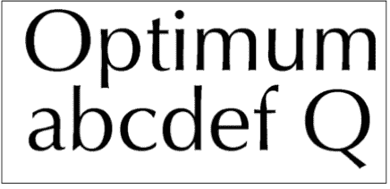

Optima 允许自己带有一些轻微的衬线（见小写 *a*），以及一些线条宽度的变化。所以，如果你想结合无衬线和衬线，可以考虑像 Optima 这样的字体。

## 90 第二部分：用 CSS 打造美观外观

> 字体名称各不相同，但你通常可以找出同义字体，因为别名往往与正式名称非常相似，如经典的 Palatino 及其别名 Palomino。如果你不确定两种字体有多相似，仔细看看大写 Q 和连字符 (&)。这些通常是字体字母表中最具特色的字符。

字体从朴素到装饰性渐变，无衬线字体位于这个谱系的朴素一端，然后依次过渡到衬线、衬线斜体和各种"草书"字体（它们模仿手写体，最好留给婚礼请柬和法国餐厅菜单使用）。在谱系的远端是*异国情调字体*（也称为装饰性或幻想字体）。唉，它们几乎从来没有用处。异国情调字体以装饰华丽的字母为特色（见图 5-1 和 5-5）。它们对 17 岁以上的人很少有吸引力，所以尽量避免在大多数网页设计中使用它们。因为它们中的大多数难以阅读，如果有的话，也仅限于在标题而非正文中使用。

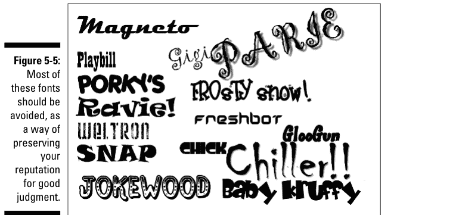

也许如果你在设计万圣节网站，或者化装舞会的邀请函，你可能会想借助图 5-5 中展示的一些异国情调字体，但对于大多数用途来说，它们只是怪诞而应避免。例如，Gigi 字体可能适合法国相关的网站，Magneto 适合 50 年代复古设计，Weltron 适合辐射警告，Chiller 适合恐怖电影广告。你可以想象在一些专门的场合使用某些异国情调字体；它们自有其魅力。但是 Baby Kruffy、Jokewood——*到底*在什么类型的网页上，它们才可能显得迷人呢？

### 避免等宽字体

我也不想花太多时间在等宽字体上。这些字体——Courier 是最著名的——在上一代人中频繁使用。它们

等宽字体的使用并非因为它们好看或易读，而是因为它们解决了某个技术问题。等宽字体为每个字符分配相同的宽度，即使这样做毫无意义。换句话说，*i* 的宽度与 *w* 一样宽。因此，*i* 的两侧会有大量空白，而其他字母之间的间距则时而过多，时而不足。

那么，为什么等宽字体如此被广泛使用呢？大多数打字机无法处理比例（可变）字符宽度，某些显示设备也存在类似问题。这些问题随着打字机的消失而烟消云散。计算机输出设备——打印机和显示器——可以非常轻松地处理字符宽度的变化。所以，请直接忽略等宽字符字体。它们的时代已经结束，只有一个例外：像`this`这样的等宽字体有时被用于书籍和浏览器中，以表示计算机语言代码。尝试在 HTML 中使用`<code>`标签来查看效果。

### 使用系统样式

Windows 为其各种组件提供了多种字体。如果你希望在网页中使用看起来像 Windows 字体（或托管浏览器的其他操作系统字体）的元素，可以使用系统字体。可用的字体包括`caption`、`icon`、`menu`、`message-box`、`small-caption`（用于微小组件上的标题）和`status-bar`。这里有一个你可以加载到 Internet Explorer 中以查看这些字体效果的示例：

```html
<html>
<head>
<style>
button {font: caption;}
icon {font: icon;}
menu {font: menu;}
</style>
</head>
<body>
<button>
This is a caption on a button
</button>
<br>
<icon>
ICON FONT
</icon>
<br>
<menu>
menu font
</menu>
</body>
</html>
```

然而，如果你计划在网页中大规模模仿操作系统的外观和感觉，你可能需要考虑使用在图形应用程序中创建的背景以及第 7 章中描述的其他特殊技术。

### 条条大路通罗马

对于大多数正文，尤其是严肃、正式的网页（例如，企业或宗教网站，或者任何需要庄重和尊严的地方），*Roman*（罗马）字体是最理想的。所有衬线字体都源自公元一世纪由一位不知名的罗马书法天才设计的经典、优雅的字母表。

他的作品迅速传遍了文明世界——出现在从公共建筑到硬币的所有物品上。这种开创性的字体最初仅由大写字母组成。它的设计如此周详——事实上接近完美——以至于它一直主导着西方文本，而且可能永远如此。

这种现在被称为 *Roman* 的字体最初被雕刻在神庙和雕像的大理石上，事实证明它同样适用于纸上的墨水。

### 简约至上

字体设计的另一个重大事件发生在 1816 年，而这一次我们知道该感谢谁。威廉·卡斯隆四世（William Caslon IV）是一个著名字体设计家族的后裔，他砍掉了衬线，并为其新字体强制执行单一的线宽。这代表了对公元前 500 年被长期忽视的希腊字母的回归，并预见了“少即是多”的审美。这种现在被称为 *sans serif*（*sans* 在法语中意为“没有”）的字体主导了标题、图注、摘录或任何独立于正文或比正文更大的文本。请看图 5-6 中的几种流行无衬线字体：

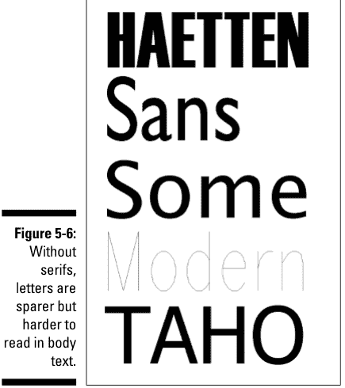

为了对比，图 5-7 中是一些著名的衬线字体：

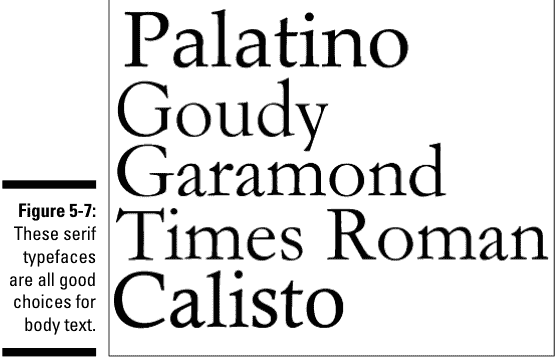

如图 5-7 所示，不同的罗马字体在外观和感觉上有可察觉的差异。Palatino 和 Calisto 较重，因此它们会使文字较多的页面显得阴暗。Goudy 较轻，但有些人认为它和 Caslon（也称为 Calisto）过于“繁琐”且过时。

然而，如果你在页面上有大量文本且很少有“留白”（空白区域），请考虑使用 Goudy 或其他相对轻盈的字体，看看是否能让页面感觉轻快一些。Garamond 可能是至今依然极其受欢迎的最古老的字体。只要人们还使用西方字母，它可能就一直存在。它是正文的一个极佳的通用选择。Times Roman（各种变体）也是正文的安全选择。Times New Roman 是 Internet Explorer 的默认显示字体，除非 HTML 字体元素或 CSS 规则另有指定。用户还可以通过选择“工具”$\rightarrow$“Internet 选项”，然后在出现的 Internet 选项对话框中点击“字体”按钮来更改 IE 的默认字体。

### 当你对字体不太挑剔时

如果你不太在意使用 *哪个* 特定的字体，你可以指定通用的无衬线或衬线字体（使用`sans-serif`或`sans`），就像这个 CSS 样式一样，它允许用户的浏览器选择一种衬线字体——很可能是 Times New Roman：

```css
body {font-family: serif;}
```

此外，因为`<body>`元素是段落`<p>`和其他子元素的父元素，这些子元素也会继承这种衬线字体（除非更具体的选择器坚持使用另一种样式）。

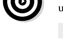

你可以将特定的字体请求与通用后备方案结合起来。如果用户的机器上没有 Garamond，则根据以下规则使用用户的默认衬线字体：

```css
body {font-family: Garamond, serif;}
```

### 使用字体变体

什么时候应该使用斜体、粗体、下划线和其他字体变体？大多数字体有几种变体，其中粗体和斜体最常见。粗体最常用于标题。它大而厚。它很少用于正文，因为太容易分散注意力。就像全大写字体一样，正文中的粗体可能会适得其反。

如果你想在正文中强调某些内容，请使用 *斜体*，而不是全大写、粗体或任何其他技巧。*仅使用斜体*。（年轻人倾向于用各种方式强调正文。除了斜体和全大写，他们还会反色显示（黑底白字）、下划线、画心形、添加一排感叹号!!!!! 等等。这些策略确实能起到某种强调作用，但就像那些认为大声喊叫能让论点更强的人一样，这些技术并不那么有说服力，而且很快会让人厌倦。当你想要添加强调时，请仅在正文中使用斜体。）

一个特殊的例外：如果你想给读者提供一种快速浏览某些文本的方法，可以在正文中点缀粗体。粗体词就像嵌入在文本中的微型标题。这种技术的经典例子是八卦专栏，其中名人姓名被加粗。你可以在公司报告、旅游广告或任何不使用子标题但希望给读者提供一种高效浏览文本并定位感兴趣话题的方法的地方使用这种方法。

虽然在正文中的使用应受限制，但粗体、全大写和下划线在标题中通常很有用，并且可以为你的页面设计增加必要的多样性。

### 指定字体粗细

当你想要调整 *粗细*（深浅、粗细或轻盈度）时，可以使用这些相对的 CSS 值：`normal`、`bold`、`bolder`、`lighter`、`100`、`200`、`300`、`400`、`500`、`600`、`700`、`800`、`900`、`inherit`。数字越高，字体越粗。大多数情况下，只需使用`bold`值：

```css
H2 {font-weight: bold;}
```

从`100`到`900`的值仅仅是对所需粗细的指示，但很少有用户的字体具有这么多档位的粗细。虽然这个方案没有绝对标准，但你可以将`100`-`300`的粗细大致等同于“轻量”字体（如 Copperplate Gothic Light），`400`-`500`为常规（CSS 值`normal`），`600`-`900`为粗体。然而，如果一种字体具有粗体、特粗体等粗细区分，数值粗细值会提供更强的针对性。

**提示** 你可以使用`lighter`或`bolder`值来指定相对于元素父元素的粗细，如下所示：

```css
body {font-weight: bold;}
p {font-weight: bolder;}
```


在这种情况下，`<body>` 元素是粗体，但 `<p>` 元素如果可能，将以更粗的字体显示。Times New Roman 除了粗体之外没有更粗的档位，因此 `bolder` 值没有效果。然而，在以下情况下，`<p>` 标签之外的文本是常规的，而 `<p>` 标签内的文本被设为粗体：

```css
body {font-weight: regular;}
p {font-weight: bolder;}
```

## 使用 Font-Variant 实现小型大写字母

`small-caps` 值是普通字母的一种特殊变体。它创建的大写字母大小约为普通大写字母的 75%。这种情况并不常用，但在需要时效果很好。你最常见到它是在使用 AD 或 BC 来表示日期时，如下例所示。

```html
<html>
<head>

<style>

em.smallcaps {font-style: normal;font-variant: small-caps;}

p {font-size: x-large;}

</style>
</head>

<body>

<p>
These vases were created around 4000 <em class="smallcaps">b.c.</em> Before glazing was invented.
</p>

</body>
</html>
```

结果如下所示：

These vases were created around 4000 BC. Before glazing was invented.

请注意，BC 是以大写显示的，但请将 `B` 与单词 *Before* 中普通 `B` 的大小进行比较。

## 简单的 Font-Style

`font-style` 属性只有三个可能的值：`normal`、`italicBloom` 和 `oblique`。由于斜体通常仅用于强调普通文本 *内部* 的某个单词或短语，因此你通常会看到 HTML 代码中使用 `<i>` 标签来指定斜体。斜体（oblique）样式很少在 CSS 样式中指定——它仅仅是将普通字体的字母向右倾斜，使其稍微倾斜。Oblique 与 italic 类似，但 italic 实际上是一种独立的字体设计，除了向右倾斜外，对普通字体还进行了微调。当你为大多数衬线字体（如 Times Roman）指定 italic 时，你会得到真正的斜体效果。然而，许多无衬线字体在响应斜体请求时，仅仅是生成一个轻微的偏移并将普通字母向右倾斜。实际上，无衬线斜体通常其实是 oblique，尽管它们被指定为 italic。在实践中，你可以直接忽略 oblique 样式。

## 选择合适的字体大小

在决定网页的字体大小时，有两点需要记住。首先，每页将大小限制在两种或三种；过多的不同大小会使读者感到困惑，并使你的页面看起来凌乱且无组织。（选择过多不同的字体也会产生同样的混乱效果。）其次，大小应与页面上分配给它的空间相适应。在巨大的空白区域中使用小型字体可能会让人迷失方向。同样不美观的是将大号字体挤在很小的空间里。

关于大小还需要考虑的一点是：不要过于担心实现“浏览器独立”这个不可能的目标。只需在 17 英寸或 19 英寸监视器上，使用 800x600 或 1024x768 分辨率，将 Internet Explorer 设置为全屏来设计你的网页，结果可能会让 96% 访问你网站的人满意。他们使用的监视器尺寸和浏览器几乎完全相同。所以不要焦虑。试图在开源软件、小屏幕便携设备和罕见操作系统之间寻找最小公约数，其结果是可以预见的：你的网页看起来就像是最低标准的妥协。试图讨好每个人，结果将是谁也讨好不了。只要顺应绝大多数人即可。使用 Linux 和 PDA 浏览网页的人已经习惯了看到奇怪的字体效果（以及许多其他妥协）。你的网站在他们的屏幕上出现尴尬的外观对他们来说并不意外；他们一直都在看到这样的东西。

如果你被迫为不同的输出设备，甚至是完全不同的媒体类型（例如屏幕和纸张）进行设计，请考虑创建单独的样式表，为每个目标设备或介质创建一份。这种方法允许你针对每个目标优化设计。

## 指定相对大小

大多数人的监视器尺寸和分辨率差异虽然不是巨大，但尽可能使用 *相对* 大小（以及位置）规范会很有帮助。这样，你在大多数浏览器上都能获得最可预测的比例。以下是你可以在 `font-size` 属性中指定的 CSS 值：`xx-small`、`x-small`、`small`、`medium`、`large`、`x-large`、`xx-large`、`smaller`、`larger`、`length`、`percentage`、`inherit`。

指示相对于父元素大小的一种方法是使用 `smaller` 或 `larger` 值，如下所示：

```html
<html>
<head>

<style>

body {font-size: x-large;}

p {font-size: smaller;}

div {font-size: larger;}

</style>
</head>

<body>

This is the body text

<p>
This is one step smaller than its parent body.
</p>

<div>
This is one step larger than the parent.
</div>

</body>
</html>
```

将此示例加载到 IE 中，你会看到如图 5-8 所示的结果。

`xx-large` 是 CSS 文本大小可能值列表中的最大值。然而，如果你在 `xx-large` 文本的子元素上应用 `larger` 值，IE 会遵循你的请求并超出 `xx-large` 的范围。

## 更精确地控制字体大小

如果你想尝试比 `smaller` 或 `larger` 更精确一点，但仍想避免指定绝对磅值或像素，请使用百分比。例如，要使段落字体大小为其父级 `div` 的 75%，请尝试：

```css
div {font-size: xx-large;}
p {font-size: 75%;}
```

你也可以使用高于 100 的百分比来增加子元素相对于父元素的大小，如下所示：

```css
p {font-size: 145%;}
```

## 指定绝对测量大小

你也可以避开目前讨论的相对规范，强制字体大小为特定的测量单位，例如 0.5 英寸或 12 磅。回想一下，可用的测量单位有 `px`（像素）、`pt`（磅）、`pc`（派卡）、`mm`（毫米）、`cm`（厘米）、`in`（英寸）、`em`（当前元素的近似字体大小）和 `ex`（x-height，当前字体中小写字母 `x` 的高度）。此示例指定段落文本应为 0.2 英寸，一级标题应为 24 磅：

```css
body {font-size: .2in;}
h1 {font-size: 24pt;}
```

大多数设计师在 CSS 规则中指定字体大小时使用 `pt` 或 `px`，所以你最好也随大流。你可能已经对 `pt` 或 `px` 的工作方式有了感觉，所以坚持使用你熟悉的东西即可。

## Font：通用属性

在本章中，你已经看到了使用 *font-this* 和 *font-that* 属性来指定字体外观的多种方法，如下所示：

```css
p {font-family: Garamond; font-size: 26px;
    font-weight: bold; font-style: italic;}
```

然而，你可以使用简写来创建字体的 CSS 样式定义：只需使用通用的 `font` 属性。这样，你可以省去指定每个属性名称（`font-weight`、`font-family` 等）的步骤。只需列出你想要的值，浏览器就会正确地解析它们。例如，它可以分辨出 `bold` 值只能用于 `font-weight` 属性，而不能用于 `font-size`、`font-variant` 或 `font-family` 属性。

许多其他 CSS 属性也具有这种简写功能，例如 `border` 属性。边框可以使用带连字符的属性（如 `border-bottom`）来指定，但简写的 `border` 属性后接一个值列表同样有效。使用长格式还是缩写格式取决于你。

通常，像这样让计算机减轻设计师或程序员的负担是有用的。然而，正如你可能预料到的，`font` 属性并不像想象中那么简单。你必须记住并确保遵守一些琐碎的规则，否则浏览器将完全忽略你的样式（而且，当然，不会提供任何错误消息来警告你或帮助你解决问题）。

但如果你喜欢使用缩写，那就尝试一下 `font` 属性吧。前一个示例中的 `p` 样式可以通过使用 `font` 属性浓缩成以下形式：

```css
p {font: bold italic 26px Garamond;}
```

两种样式的结果将相同，但 *如果* 你记得规则，这个浓缩版本可以节省一些时间！规则如下：

列表中的前两个值（`style` 和 `weight`）可以按任意顺序排列。例如，你可以反转之前的顺序而不会产生不利影响：

```css
p {font: italic bold 26px Garamond;}
```

如果你愿意，还可以加入 `font-variant`（`small-caps`），并按你想要的任何方式混合匹配前三个值。浏览器接受这些值的任意顺序。

然而，最后两个值 *必须* 按照 `size`, `family` 的顺序排列。它们 *必须* 是列表中的最后两个值，且 *两者* 都必须出现在列表中，并且 *必须* 遵循 `size`, `family` 的顺序。

没有人知道为什么*某些*值可以随意排列，而其他值必须严格遵守顺序。这只是 CSS 规则中你必须记住的那些异常情况之一。

接下来的这条样式规则会失效，尽管不同浏览器的响应方式不同：

```css
p {font: bold italic Garamond 26px;}
```

这里的尺寸-字体族顺序错了。这个值列表以尺寸结尾，而*所有*此类值列表必须以 `font-family` 值结尾。IE 会继续渲染粗体斜体，但它会忽略 `Garamond` 和 `26px` 字体大小。

遗憾的是，负责 CSS 规范的人员在这里确实失策了。写错这个字体值的顺序是一个极其常见的错误，而这种严格限制完全是没有必要的。如果浏览器能区分 *bold* 和 *italic* 这样的单词，它们当然也能区分 *26px* 这样的数字和 *Garamond* 这样的单词。没办法。

## 调整行高

你可以在第 7 章中找到关于操纵文本间距的讨论，但既然我们正在讨论各种 `font-` 属性，我想简要地看看如何使用 `line-height` 属性来操纵文本行之间的间距。

调整行高主要出于两个原因。标题在行间有*较少*的空白时通常看起来更好；而极小的正文文本在行间有*较多*的空白时可读性更高。

这是一个演示如何指定行高更改的示例。在 `font-size` 值之后加上一个正斜杠，然后是你想要对行高进行的百分比调整。（100% 表示为 1，120% 为 1.2，50% 为 .5，依此类推。）一个 38 像素的字体大小，其行高调整将默认间距缩小到正常的 94%，看起来像这样：`38px/.94`

这里有一个指定了两种样式的示例。普通的 H1 标题应为粗体 32 像素 Arial。但特殊的 “narrowed” H1 标题类应为默认行间距的 94%。

```html
<html>
<head>

<style>

h1.narrowed {font: bold 38px/.94 Arial;}
h1 {font: bold 38px Arial;}
</style>
</head>
<body>

<h1>
This Is the H1 Style
With the Line Space Default
</h1>

<br>
<br>

<h1 class="narrowed">
This Is Our Superior H1 Style
With the Lines Closer Together
</h1>

</body>
</html>
```

正如你在图 5-9 中看到的，浏览器底部调整后的 `line-height` 比顶部的默认效果更好看。报纸和杂志，更不用说电视、广告牌和其他媒体，几乎总是会收紧标题中的行间距。这比在行之间留下不必要的漂浮空白看起来要好得多。

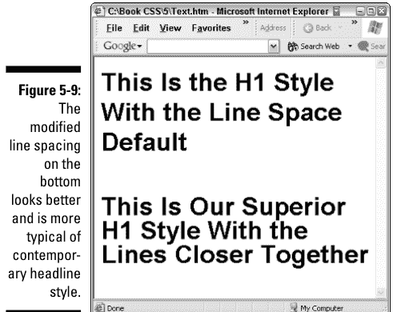

*字距调整（Kerning）* —— 调整标题中单个字母之间的间距 —— 也是增强大字体文本视觉吸引力的常用方法。你将在第 7 章中学习如何实现字距调整。第 7 章还将涵盖几个与定位相关的额外文本管理属性：`word-spacing`、`text-indent`、`indentation` 和 `vertical-align`。

## 使用下划线和删除线装饰文本

出于某种原因，那些“最懂行的人”（即 CSS 规范委员会）有时会选择奇怪的术语。*Decoration*（装饰）并不是描述下划线和类似文本效果的一个好词。`text-decoration` 属性实际上并不是指*装饰*文本（这暗示像中世纪僧侣那样添加特殊的装饰性设计），而是控制下划线、上划线、删除线以及一种被称为*闪烁*的诡异效果。

CSS 的主宰者们在决定不将其中一个值像其他人那样称为 *strikethrough*（删除线）时，凭其智慧，也变得有点疯狂。相反，他们认为增加一点混乱可能会很有趣，于是将该样式称为 *line-through*。习惯它吧。

上划线（在文本上方绘制的线）可用于视觉效果，或作为分隔文本区域的一种方式。幸运的是，IE 凭借其智慧，不支持闪烁文本技巧，因为对大多数读者来说，那将是一个彻底令人心烦的干扰。

下划线、上划线和删除线（见图 5-10）非常简单：

```html
<html>
<head>

<style>

h1.over {text-decoration: overline;}
h1.under {text-decoration: underline;}
h1.strike {text-decoration: line-through;}

</style>
</head>
<body>

<h1 class="over">This is an overline.</h1>

<h1 class="under">This is an underline.</h1>

<h1 class="strike">This is a strikethrough.</h1>

</body>
</html>
```

## 使用大写转换文本

如果你觉得用 *decoration* 来描述下划线很奇怪，那么试想一下用 “transform”（转换）来描述大写。通过 `text-transform` 属性，你可以指定首字母大写、全部大写或全部小写。

你可能会问：如果你想在网页上全部大写，*为什么不直接按下键盘上的 Caps Lock 键*而忽略这个 `text-transform` 属性呢？

首先，你可能希望文本效果是动态的。比方说，如果你想在用户点击句子时将其大写。你可以编写一个脚本来调整 `text-transform` 属性以响应用户行为。其次，你可能希望大写是条件性的。也许你想在网站的某些标题样式中使用首字母大写，但在其他位置，你想要全部大写。

值名称中唯一奇怪的地方是，CSS 领导层令人困惑地将其称为 `capitalize` 的值，实际上是首字母大写。

```css
<style>
h1.initcaps {text-transform: capitalize;}
h1.uppercase {text-transform: uppercase;}
</style>
```

这段代码产生了图 5-11 中显示的标题：

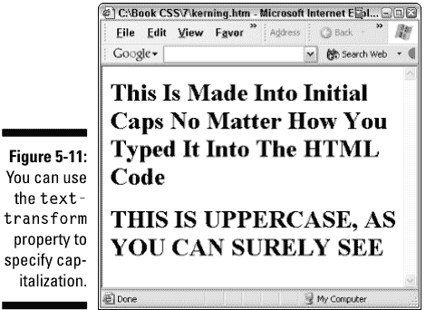

你可能想要避免对首字母大写使用 `transform` 属性。英语标点习惯通常避免将介词和冠词首字母大写。因此，在图 5-11 顶部显示的标题中，*into* 和 *the* 这两个词不应大写。

## 使用投影进行阴影处理

*投影（drop shadow）* 是每个字母周围的黑色或灰色阴影，使字母看起来像是在投射阴影。这通常是为图像或文本增加维度感和真实感的好方法。

某些图形和排版效果最好交给 Photoshop 等图形应用程序处理。这些应用程序致力于创建比通过 HTML 或 CSS 代码轻松实现的视觉效果更复杂、更微妙的效果。毕竟，图形应用程序拥有允许你预览效果的工具；可以使用鼠标辅助设计和修改效果；并且可以并排比较效果。此外，图形应用程序中的内置效果经过精心设计。例如，它们的投影使用渐变阴影，而不是纯色、看起来不自然的黑色或灰色。简单来说，把花哨的视觉效果交给专门处理这些事情的应用程序。

CSS2 包含一个 `drop-shadow` 属性，但谢天谢地，地球上没有一个浏览器实现了这个功能。如果你想创建投影，请在图形应用程序中完成，将其保存为 `.jpg` 文件，然后将生成的 `` 元素放入你的网页中。图 5-12 展示了通过向文本添加投影效果可以获得的 3D 效果：

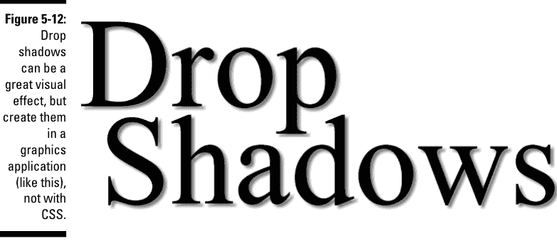

# 第 6 章

## 管理样式表中的细节

### 本章内容

- 描述单位、百分比和长度
- 为你的文本添加颜色
- 为背景着色

Web 设计师欣赏的 CSS 各种特性中，包括它能让你对颜色、文本间距、定位以及各种元素的大小等细节进行精细控制。在你体验过 CSS 赋予的所有自由之后，纯 HTML 就会显得相当粗糙和笨拙。有了 CSS，*你*决定页面上的事物应该如何呈现。

## 指定大小和位置

在 CSS 样式定义（或*规则*）中，你可以使用许多不同的测量单位，以多种方式描述位置和大小。你通常可以选择任何你想要的单位，尽管某些特定类型的测量在某些情况下效果最好。

例如，许多从事纸媒工作的设计师习惯于以*点（points）*来指定字体。一个点是一个绝对长度：1/72 英寸。为杂志或书籍使用绝对字体大小规范是完全没问题的 —— 毕竟，用户无法缩小、拉伸或改变书页的宽高比。（*宽高比（Aspect ratio）* 是高度与宽度之间的比例。）然而，浏览器可以随意调整大小。如果你拖动浏览器的一侧，你就在改变它，使其变窄或变宽。换句话说，你正在改变它的形状，即它的宽高比，比如从正方形变为长方形。


对于在浏览器中显示的字体，相对测量单位优于传统的点。与点或英寸等绝对测量值不同，相对单位随字体大小缩放。因此，在指定字体大小的网页中使用相对测量单位可以获得更可预测的结果。对于 Web 设计师来说，最实用的相对测量单位之一是`em`——本章稍后将详细介绍。虽然`em`是有用的，但实际上，大多数设计师在指定字体大小时仍然使用点或像素。也许这只是习惯使然，但无论如何，结果在大多数浏览器中看起来通常都不错。

### 测量长度

在我解释`em`到底意味着什么之前，我想先看看所有用于测量长度的单位：

- **`px`（像素）：** 像素是显示器上最小的单位——如果你凑近电视，有时甚至能看到那些小点。例如，将你的显示器分辨率设置为`800x600`意味着它的宽度为 800 像素，高度为 600 像素。

  像素可以是用来指定字体大小的有效方式，但缺点是，如果你指定了像素，就会覆盖 Internet Explorer 中自定义字体大小的选项——因此用户无法从“大”调整到“最大”等。然而，你应该始终使用`px`来描述*图像*大小。图像已经是以像素为单位的（你可以将图像加载到任何图形应用程序中查看其尺寸）。

- **`pt`（点）：** 一点等于 1/72 英寸。点（和派卡）是经典的字体测量单位。大多数浏览器默认使用 12 点衬线字体。

- **`pc`（派卡）：** 一派卡等于 12 点。

- **`mm`（毫米）：** 一毫米为 0.0394 英寸，所以一英寸大约包含 26 毫米。一厘米包含 10 毫米。世界上大部分地区使用这种*公制*系统。

- **`cm`（厘米）：** 一厘米为 0.3937 英寸，所以一英寸大约包含 2 又 1/2 厘米。

- **`in`（英寸）：** 英寸是*英制*或*帝国制*系统中的单位——在美国使用。英国和少数殖民地时期的遗留地区也在很长一段时间内沿用英制，但最近屈服了。英国政府于 2000 年配合欧洲的公制化，现在在英国女王的领土上以磅为单位销售已成为刑事犯罪。例如，据报道康沃尔的一名男子因在街头以每磅 1.50 英镑的价格出售鲭鱼而被抓，不得不支付法庭费用。

  英寸基于一位现已被人遗忘的国王的拇指第一关节到末端之间的距离。50 年来，在美国，通过教育和立法来废除英制、推广公制的持续努力都以失败告终。

- **`em`：** Em 是一种从字体字母`m`的近似宽度派生出来的测量单位。这通常被认为是在 CSS 中指定字体大小的最佳方式，尽管很少有设计师遵循这一建议。

- **`ex`（x 高度）：** Ex 是当前元素字体的小写字母 x 的高度，即 x 高度。浏览器通常将`em`除以二来获得 ex 高度。这种测量单位目前不如`em`有用，因为它对所有字体来说并不是一个同样可预测的平均值。

- **`%`（百分比）：** 百分比非常适合指定相对大小（它可以相对于祖先元素、父元素等）。

测量单位不区分大小写。你可以根据需要大写或不大写。同样，在 IE 中，你可以在数字和其单位之间包含空格，也可以不包含：例如，`2 in`等同于`2in`。其他浏览器不喜欢空格。为了简单起见，在使用 CSS 时使用小写并避免不必要的空格通常是个好主意。只要养成`2in`或`24px`格式的习惯就没问题，除非 CSS 委员会在未来决定改变立场。

### 理解小写的 em

因为专家建议，当你设计一个希望看起来恰到好处的网页时应该使用`em`，所以值得仔细看看这个单位到底意味着什么。传统上，`em`是字母`m`的宽度。

也许你听说过*m-破折号*或*em-破折号*这个术语，它是出版中常用的破折号。它是一条水平线——像这样——相当于字体字母`m`的宽度（这在许多字体中并不严格精确等价）。还有一种*en-破折号*。猜猜它是基于什么的。

Em 和 ex 单位是相对于每种字体的。这很有用，因为这意味着 em 指定的大小会根据用户的显示器分辨率、偏好设置和其他因素以精确的方式变化。换句话说，使用 em 允许你指定*相对于*字体的效果。结果与字体的其他特性和周围文本成比例。此外，像`em`这样的相对规格允许有障碍的人士在必要时在浏览器中放大字体。像`px`或`pt`这样的固定规格则无法为用户提供这一选项。

Em 和 ex 是传统排字工人的测量单位，但它们在 CSS 中的含义略有修改。首先，计算机通过简单地将 em 除以二来计算 ex。这样更容易计算，但对大多数字体来说只是一个近似值。CSS 中的 em 是以像素为单位的字体大小。这很有用，因为你可以指定 em 单位，并依靠它们相对于父（或其他）元素的字体。

这里有一个实验，用来了解 em 如何相对于另一个元素工作。在这段代码中，元素内的文本定义为`26px`，但段落元素内的文本定义为`1.5em`，或者换句话说，是父元素大小的一倍半。在 HTML 代码的后面，段落元素被包含（作为子元素）在 body 元素中。因此，段落文本以 1.5x26 像素（即 39 像素）渲染。

```html
<html>
<head>
<style>
body {font-size: 26px;}
p {font-size: 1.5em;}
p.abs {font-size: 39px;}
</style>
</head>
<body>
some text
<p>
some text (1.5 em of the parent body).
</p>
<p class="abs">
some text (39 pixels).
</p>
</body>
</html>
```

abs 类版本的`<p>`中的文本与普通`<p>`渲染的大小相同。`<body>`元素是`<p>`的父元素，而`<p>`定义为其父元素的`1.5em`。父元素 body 使用 26 像素作为其文本大小，所以 26x1.5 的结果是 39 像素。你可以在图 6-1 中看到 em 与其父元素`<body>`之间相对性的效果：

**图 6-1：** 第二行——设置为`1.5em`的子元素——因此是第一行大小的 1.5 倍。

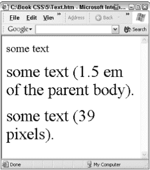

### 计算百分比

我现在从考虑指定文本大小的方式，转向使用百分比来指定较大元素（如段落）的大小或位置。下一个示例说明如何使用百分比来指定整个段落的宽度（而不是其文本的字体大小）。换句话说，这个百分比值会告诉浏览器何时将一行文本分成两行（而不是将文本字符设置多大）。

如果你熟悉诸如`<p width="80%">`这样的经典 HTML 百分比规范，那么理解百分比在 CSS 中的工作原理就没有问题。该 HTML 代码实际上是在说 Declare, “使此段落为用户浏览器的 80%（或五分之四）宽。”换句话说，元素的百分比是*相对于*其容器或父元素的。

CSS 百分比的工作原理相同。这是一个结合 CSS 和 HTML 百分比值的示例。

```html
<html>
<head>
<style>
p.csspercent {margin-right: 20%}
</style>
</head>
<body>
here's some ordinary body text
<br>
<br>
<table width="80%">
text at eighty percent of the parent.
</table>
<p class="csspercent">
text at eighty percent of the parent.
</p>
</body>
</html>
```

首先，此示例显示未经修改的、普通的 body 文本，填充浏览器中的水平空间，然后定义为 80% 的表格在到达右侧 80% 处时换行并开始新行。最后，段落的行为与表格相同，在其行的 80% 标记处打断——因为你指定了`p.csspercent`样式，其`margin-right`属性值为 20%。你可以在图 6-2 中看到这些效果：

**图 6-2：** 将表格的`width`属性设置为 80% 与将 CSS 的`margin-right`属性设置为 20% 具有相同的效果——在其他条件相同的情况下。

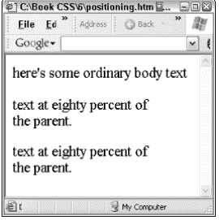

下一个示例展示了如何使用 CSS 的`margin-right`和`margin-left`属性以及百分比：

```html
<html>
<head>
<style>
p.leftside {margin-right: 50%}
p.rightside {margin-left: 50%}
</style>
</head>
<body>
here's some ordinary body text that goes the full distance
        across the browser window, then wraps to
the next line down.
<br>
<br>
<p class="leftside">
here's some ordinary paragraph text that stops half way
        across the browser window, then wraps to the
next line down.
</p>

<p class="rightside">
here's some ordinary paragraph text that starts half way
across the browser window, then wraps to

half way across the next line down.
</p>

</body>
</html>
```

## 第六章：样式表中的细节管理

图 6-3 展示了左右各 50% 边距的效果：

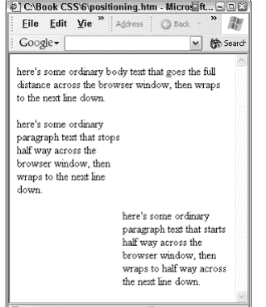

**图 6-3：** 使用 CSS，你可以将元素放置在几乎任何你想要的位置。

### 添加一点颜色

颜色对于网页的设计和组织都非常有用。选择有效、恰当且和谐的颜色，能为你的网页整体成功增色不少。或许不那么明显的是，颜色在引导视觉关注页面结构和逻辑方面也扮演着角色。

你可以像使用表格或线条一样，用颜色创建逻辑分区。例如，你可以将所有链接设置为相同颜色，并将它们分组在页面的一个单独区域下——使用统一的背景色——以此来帮助用户。所有这些都有助于访问你网站的访客理解，这个区域中这些颜色的元素具有某种共性。如果你真的想吸引注意力，可以把它们设置为*紫褐色*、*淡紫红色*或其他不寻常的颜色。你也可以将颜色选择与网页内容联系起来：例如，对于包含辐射危险警告的段落，使用黄橙色背景。

在许多情况下，比纯色更胜一筹的是设计过的背景——渐变、纹理、云朵的图片……任何能在视觉上强化你网站信息的东西。许多设计最好的网站都加载背景图像，因为在 Photoshop 等图形程序中创建这样的图像，可以让你完全控制背景的每一个像素。你可以创建任何类型的、令人愉悦的复杂设计，而不仅仅是单一的静态颜色：

```html
<body background="WaterView.jpg">
```

如果你将图形化设计的背景与动画（见第 16 章）结合起来，你就有望赢得一个奖项……一个网页设计奖。

这里有一些很酷的网站，可以给你一些创意灵感：

```text
http://www.philipkoether.com/
```

```text
futurefarm.nl
```

```text
http://www.tomoco.de/
```

下面这个页面没有炫目的动画，但设计精良，并展示了 CSS 的部分能力（在访问这个网站时，可以四处看看——它有一些很棒的 CSS 教程和资源）：

```text
http://glish.com/css/noah.asp
```

关于背景设计，我有很多要讲的都在第 7 章和第 16 章。现在，我们先专注于颜色。

与设置边距、定位文本以及网页设计的许多其他方面一样，在管理颜色方面，CSS 明显优于传统 HTML。使用 CSS，你可以为*几乎每个*元素指定前景色（文本和边框）以及背景色。而使用传统 HTML，你设置颜色的能力仅限于少数几个元素。


CSS1 和 CSS2 将所有颜色归入“颜色与背景”属性组，但 CSS3 承诺引入一个新的颜色模块，包含不透明度等全新特性和新的命名系统。关于 CSS3 预期能为设计师提供什么，请参见第 15 章了解更多细节。

### 创建特殊段落样式

假设你正在编写一个包含特殊警告段落的网页，你希望这些警告突出显示。除了将它们设为斜体，你还希望文本是鲜亮的南瓜色。要实现这种效果，只需定义一个名为`warning`（或你想使用的任何名称）的段落样式，然后添加斜体和颜色规范，如下所示：

```html
<html>
<head>

<style>

p.warning {color: #ffcc33; font-style: italic;}

</style>
</head>
<body>

<p>An ordinary paragraph blah blah</p>

<p class="warning">
Warning: Wow! Here comes a whole bunch of gnats! What to do:
         cover yourself and your loved ones with netting
         and crouch down. Keep your mouth shut, too!

</p>

</body>
</html>
```

### 计算颜色

你是如何得出`#ffcc33`是南瓜色，而不是，比如棕色，甚至是像紫红色这样的警示色呢？在编写前面的 CSS 样式时，我并不是*瞎猜*的`#ffcc33`这个数值，对吧？毕竟，可能的颜色规范范围从`000000`（黑色）到`ffffff`（白色）。中间有（潜在地）近 1700 万种颜色。（对于你这样较真的人，精确数字是 16,777,216。）而且，到底什么样的数字系统会使用字母表中的字母呢？一定很蹩脚。（事实上，它*确实*很蹩脚，但计算机程序员们使用这个系统已经有几十年了，所以要摆脱这个怪物还需要一段时间。）

有些人对颜色相当敏感，但没有人*那么*敏感。还有什么比`#ffcc33`这样的代码更能描述一种颜色的呢？你永远也记不住`#ffcc33`代表南瓜色，或者`#00ff00`是酸橙绿。

你可以轻松地通过几种方式中的任何一种来选择颜色，从而避免使用那种完全无用代码的怪异方案。以下是我对指定 CSS 颜色的建议：

- 在图形程序中创建一个背景图像，并使用其工具（如色轮或渐变）来选择你的颜色。
- 使用像 Microsoft Visual Studio 这样的程序中的特殊样式编辑器，从颜色表中选择一种颜色（如图 6-4 所示）。然后它会将你的选择转换为 CSS 样式的颜色编号，例如`#ffcc33`。
- 从描述性颜色名称列表中选择一种颜色（它们在 Internet Explorer 中有效）。该列表将在下面标题为“使用颜色列表”的部分提供。（你也可以在本书封面内侧的速查表中找到此列表。）

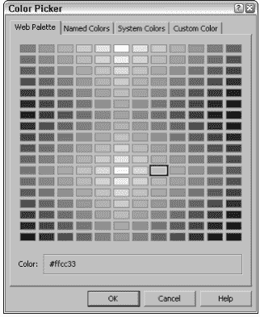

你还可以通过访问在线的浏览器安全色图表网站（例如这个）来查看颜色在浏览器中的外观，同时获取其值：

```text
www.primeshop.com/html/216colrs.htm
```

### 使用颜色列表

我不会用`#ffcc33`代码含义的细节来烦你。它叫做*十六进制数*，但别试图搞清楚它的含义和工作原理，给自己找麻烦。相信我，这太乏味了。我多年前确实学过，但无论我怎么尝试，我都无法忘记它。它占据了我大脑的一块区域，我本希望那块区域能被用来存储一些重要的东西，但它却永久地被无用的信息占据了，比如“Cheap Trick 乐队的鼓手叫 Bun E. Carlos。”明白我的意思吗？

我不知道为什么现在人们还要费心使用十六进制（在几十年前的计算机早期，十六进制和二进制算术还稍微有点用）。操作十六进制数本身就已经够难了，但当你试图用它们做算术时……嗯，这比把未煮过的意大利面弄熟还难。

当你想为网页元素选择一种颜色时，只需从*视觉*表示中选择一种颜色（比如 Photoshop 中的颜色渐变，或如图 6-4 所示的 Visual Studio 中的表格调色板，或在线颜色图表）。或者，如果你必须，从下面的颜色名称列表中选一个。

*不要*试图处理十六进制数。谁能记住哪种颜色对应哪个“数字”呢？很少有人能理解这个编号系统本身。而且，老实说，你完全不需要理解它。

以下是 Microsoft 的 IE 浏览器能通过*名称*识别的颜色列表。完全不需要费心将这些名称转换为十六进制值：


AliceBlue, AntiqueWhite, Aqua, Aquamarine, Azure, Beige, Bisque, Black, BlanchedAlmond, Blue, BlueViolet, Brown, BurlyWood, CadetBlue, Chartreuse, Chocolate, Coral, CornflowerBlue, Cornsilk, Crimson, Cyan, DarkBlue, DarkCyan, DarkGoldenrod, DarkGray, DarkGreen, DarkKhaki, DarkMagenta, DarkOliveGreen, DarkOrange, DarkOrchid, DarkRed, DarkSalmon, DarkSeaGreen, DarkSlateBlue, DarkSlateGray, DarkTurquoise, DarkViolet, DeepPink, DeepSkyBlue, DimGray, DodgerBlue, FireBrick, FloralWhite, ForestGreen, Fuchsia, Gainsboro, GhostWhite, Gold, Goldenrod, Gray, Green, GreenYellow, Honeydew, HotPink, IndianRed, Indigo, Ivory, Khaki, Lavender, LavenderBlush, LawnGreen, LemonChiffon, LightBlue, LightCoral, LightCyan, LightGoldenrodYellow, LightGreen, LightGrey, LightPink, LightSalmon, LightSeaGreen, LightSkyBlue, LightSlateGray, LightSteelBlue, LightYellow, Lime, LimeGreen, Linen, Magenta, Maroon, MediumAquamarine, MediumBlue, MediumOrchid, MediumPurple, MediumSeaGreen, MediumSlateBlue, MediumSpringGreen, MediumTurquoise, MediumVioletRed, MidnightBlue, MintCream, MistyRose, Moccasin, NavajoWhite, Navy, OldLace, Olive, OliveDrab, Orange, OrangeRed, Orchid, PaleGoldenrod, PaleGreen, PaleTurquoise, PaleVioletRed, PapayaWhip, PeachPuff, Peru, Pink, Plum, PowderBlue, Purple, Red, RosyBrown, RoyalBlue, SaddleBrown, Salmon, SandyBrown, SeaGreen, Seashell, Sienna, Silver, SkyBlue, SlateBlue, SlateGray, Snow, SpringGreen, SteelBlue, Tan, Teal, Thistle, Tomato, Turquoise, Violet, Wheat, White, WhiteSmoke, Yellow, YellowGreen。

直接将其中一个（通常描述得很优雅的）名称（如 `PapayaWhip`）放入你的颜色属性规范中，就像这样：

```css
p.warning {color: lightslategray;}
```

## 为边框着色

你得到了一种看起来像……嗯……浅灰色石板的颜色。

> 没有谁是完美的。微软在大多数时候将 gray 拼写为“a”，但在其他地方——就在这个相同的列表中——他们使用了“e”，比如“LightGrey”。

前景色（Foreground color）不仅适用于文本。你还可以使用它来指定边框的颜色。在接下来的示例中，你将图像的 `color` 属性设置为 `skyblue`（天蓝色）。（或者，如果你愿意，也可以使用 `border-color` 属性。）此外，你将 `border-width` 设置为比默认值更大。你还必须指定 `border-style` 属性：

```html
<html>
<head>

<style>
img {border-style: solid;border-width:25px; color: skyblue;}
</style>

</head>
<body>


</body>
</html>
```

如果你想尝试这个示例，请先在与该 `.htm` 文件相同的目录下保存一个图形文件，并将该文件命名为 `GrandfatherHouse.jpg`。

当你测试这个示例时可以看到，图形周围被放置了一个浅蓝色的边框。参见图 6-5。

> 单色的纯色边框相当单调。它让人想起早期的计算机时代，那时电脑在提供简单的颜色效果方面都还非常吃力。

我建议你避免使用简单的 CSS 框架，考虑在图形程序中生成一个酷炫的框架。然后你可以直接在图形程序中将图像放入该框架内，并将整个作品保存为一个新的 `.jpg` 文件。这样框架就成了图像本身的一部分，你只需将该图像文件加载到网页中即可。你不必担心使用简单的内置边框样式作为框架——而且你在图形应用程序中构建的框架几乎肯定比你能用 CSS 实现的任何效果都要更精致、更有趣。参见图 6-6 中的示例。

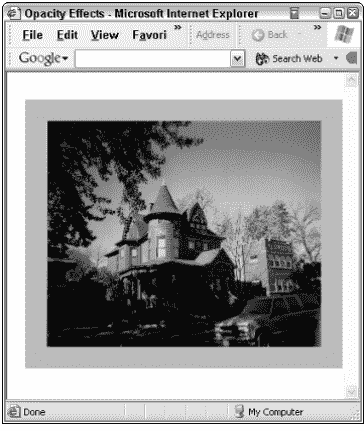

**图 6-5：** 可以使用图像的 `color` 属性为边框着色。

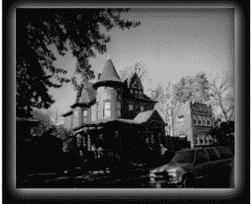

**图 6-6：** 这种装饰性边框是在 Micrografx 的 Picture Publisher 中自动创建的。

### 使用内凹边框颜色

如果你想完全在 IE 的能力范围内创建微妙且吸引人的边框，你可以对图形周围的各种边框使用 `inset` 命令配合颜色。这会产生一种斜切效果（beveled look），绝对比图 6-5 中显示的扁平纯色边框要好。请看图 6-7 和图 6-8：

120 第二部分：使用 CSS 打造精美界面

**图 6-7：**

你可以使用 `inset` 命令来创建像这样具有维度感和阴影的边框。

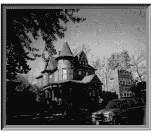

图 6-7 中的边框是用这段代码创建的：

```html
<html>
<head>

<style>
img {
border-right: silver inset; border-left: silver inset;
border-top: silver inset;border-bottom: silver inset;
border-width:12px;
}
</style>

</head>
<body>


</body>
</html>
```

**卡纸（Matting）**是指在与照片、绘画、印刷品或其他艺术品尺寸相同的卡纸板上切开一个开口，然后将艺术品贴在卡纸背面并装裱起来。这在框架和艺术品之间提供了一个边框。在展示照片时几乎总是使用这种方法，因为它在照片本身和框架玻璃之间提供了一定的距离。卡纸还能突出艺术品。

要获得图 6-8 中显示的边框，请对前面的代码进行这个简单的修改：

```css
border-width:5px;
```

TEAM LING - LIVE, informative, NON-cost and Genuine !

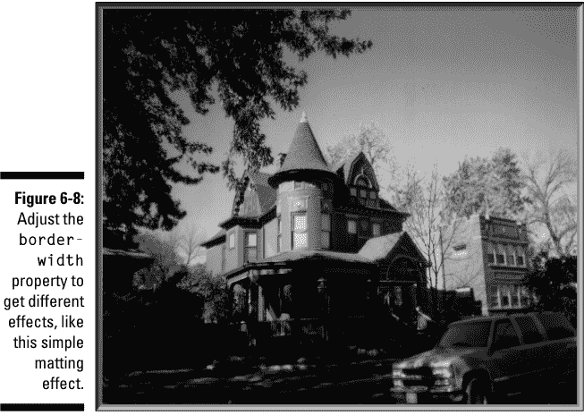

### 光线从哪里来？

既然我们在本书中探讨了相对论，为什么不顺便探讨一下光本身的起源，或者至少是光源的心理物理学呢？

微软在其 `inset` 设计中（例如 Word 中被按下、点击的按钮），会加深用于左侧和顶部边框的颜色，而让右侧和底部框架保持亮色。而那些静止未被点击的按钮是 *outset*（外凸）的，其左侧和顶部边框比右侧和底部边框更亮。为什么？

在 Windows 图形风格（菜单、按钮、窗口框架等）中，光线总是被假设为来自屏幕的左上角。一个视觉上 *凸出* 的对象（如按钮）会在其顶部和左侧产生高光。阴影则落在对象的右侧和底部。然而，如果对象应该是陷入背景的——例如 *inset*（内凹）框架或被点击的按钮——这个过程就会反转，顶部和左侧会变暗。

这种效果在现实世界中其实运作方式几乎相同：当你户外阅读时，如果你和大多数人一样，你会调整躺椅或毛巾，直到阳光从你的左侧照射进来——当然，太阳是在上方的。

看看你的工作区域。大多数人倾向于将灯放在书桌或阅读椅的左侧和上方。作为一个实验，将本书倒过来，看看你对图 6-7 中框架的感知发生了什么变化。它现在看起来是不是不再像内凹，而是像 *outset*（外凸）了？别骗自己：如果你没有预先认定光线来自左上角，你很有可能将这个倒置的框架视为 *inset*（内凹）——即使光线来自框架的下方和右侧。

尝试将之前的 CSS 样式代码从 `inset` 改为 `outset`，然后在 IE 中重新加载页面查看效果：

```css
img {
    border-right: silver outset; border-left: silver outset;
    border-top: silver outset;border-bottom: silver outset;
    border-width:12px;
}
```

`outset` 效果看起来像是框架向观察者凸出，如图 6-9 所示。请注意，这里的阴影和高光与图 6-8 中的 `inset` 样式有所不同。

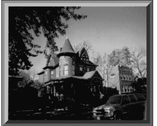

> **图 6-9：**
>
> `outset` 效果看起来像是框架向观察者凸出。

除了 `inset` 和 `outset`，你还可以尝试的其他 CSS 边框样式包括 `groove`（凹槽）和 `ridge`（脊状）。

CSS 相比传统的 Web 设计设施提供了许多显著的改进，并且远好于经典 HTML。正如你在本书的各种示例中所看到的，使用 CSS 你可以实现许多视觉上令人印象深刻的效果。但不要让 CSS 承担 *所有* 的图形效果。例如，如果你想构建一个具有特定纹理的背景，有时可以通过叠加图像文件、重复图案以及借助其他 CSS 技巧来实现。但天哪，在尝试通过 CSS 实现某种特殊效果之前，请先问问自己：这个效果是否可以在图形程序中更轻松地实现，或者获得更好的结果？答案通常是肯定的。不要强迫 CSS 去做它不擅长的事情；图形程序包含许多用于创建视觉效果的专用工具。永远要问：“Photoshop 能做得更好吗？”看看图 6-10 中的框架。图形程序可以做很多这样的事情，而 CSS 做不到。


对于预算有限的人，或者那些还没有掌握图形应用软件因此无法使用 Photoshop 等程序的人，你可以找到关于将 CSS 推向极限的在线建议。（记住，当页面加载时间是主要考虑因素时，你有时必须将自己限制在 CSS 范围内。）这是一个能让 CSS 发挥极大性价比的优质网站：

```text
http://www.sitepoint.com/
```

### 为背景着色

元素的背景包括其边框和任何内边距（`padding`）。内边距在第 9 章中会详细探讨，但基本上，内边距在元素周围添加空间。这里有一个例证 `padding` 和 `background-color` 属性的示例：

```html
<html>
<head>

<style>
h1 {background-color: silver; padding: 6%;}
</style>

</head>
```

124 第二部分：用 CSS 打造精美外观

```html
<body>

<H1>标题周围的内边距</H1>

</body>
</html>
```

此代码中样式的结果显示在图 6-11 中：

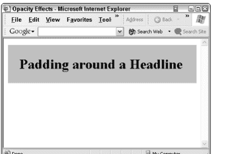

`background-color` 属性接受与前景 `color` 属性相同的颜色值。默认情况下，背景是透明的，因此底部的任何纹理、图像或其他元素都会透过来。此外，几乎可以为任何元素添加背景色，从行内 `em` 元素到整个 `body` 元素。

> **提示**
>
> 尽量避免刺眼的颜色组合。一些网页设计师试图通过在页面上使用花哨、甚至可以说是粗俗的色块来创造“特殊效果”。除非你有非常充分的理由这样做，否则应该避免页面被各种颜色区域随意涂抹的那种凌乱、幼稚的外观。以下是我要说的例子。这个页面有蓝色背景，还有薰衣草色、橙色、热粉红色和其他 bizarre 的颜色组合。这样的页面不仅难以阅读；通常还都很难看，如图 6-12 所示。

```html
<html>
<head>

<style>
body {background-color: DodgerBlue;}
i {background-color: OliveDrab; color: orange;}
p {background-color: lavender; color: HotPink;}
</style>
```

```html
</head>
<body>

<p>段落的色彩令人震惊！</p>
<p>而且段落中的<i>斜体文字</i>更加恼人</p>

</body>
</html>
```

**图 6-12：**

这本书中以灰度印刷已经够难看了。想象一下在浏览器中以全彩显示会有多糟糕。

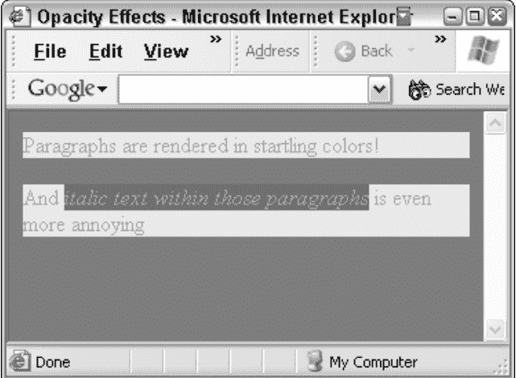

# 第二部分：用 CSS 打造精美外观

## 第 7 章：按你的方式设计样式

### 本章内容

- 通过字距调整控制文本间距
- 调整行间距
- 调整单词间距
- 对齐文本
- 添加纹理
- 创建自定义背景

如果 CSS 除了让你强力控制网页外观外别无他用，它仍然会比 HTML 有巨大的改进。在本章中，你将探索使用各种特殊工具和技巧来增强网页外观的方法。你从 *字距调整* ——调整文本字符之间的间距——开始。稍后在本章中，你将了解如何为效果对齐文本、添加纹理以及创建自定义背景。

### 字距调整打造更优标题

字距调整——调整字母之间的间距——有时被错误地用于强调。一些网页设计师试图通过字距调整来增加字母之间的额外空间，以达到 `e m p h a s i s` 的效果。然而，糟糕的文字设计还包括许多其他丑陋的“强调”形式，除了字距调整之外，还有粗体、鲜艳颜色、全部大写等等。这些视觉技巧应该避免作为强调单词或短语的方式。要强调时，请使用 *斜体*。而且 *只* 用斜体。

宽间距字母有时用于标题，特别是单字标题，例如读者来信专栏，像这样：

#### 读 者 来 信

在标题中，收紧字距才能真正发挥作用。你 *减小* 字母之间的间距，将单词挤压在一起，改善标题的外观。大多数字体（除了等宽字体如 Courier 之外）的字母间距都有变化，以提高字体的可读性。字距调整允许你对字母间距进行自定义调整——具体而言，是让某些字母对更心境一些。（有时字距调整也用于将字母分开，例如当斜体字符“倾斜”到紧邻的右括号时。）

一种简单但效果较差的字距调整可以通过 CSS 中的 `letter-spacing` 属性来实现，如下所示：

```html
<h1 style="letter-spacing: -0.06cm">此标题略微紧缩</h1>
```

以下是一个完整的示例，展示了同一标题在有字距调整和没有字距调整时的效果，如图 7-1 所示。

```html
<html>
<head>
<style>
h1 {font-size:44px; letter-spacing: -0.12em}
h1.unkerned {font-size:44px; letter-spacing: 0.00em;}
</style>
</head>
<body>
<h1>此标题通过字距调整略微紧缩</h1>
<h1 class="unkerned">此标题通过字距调整略微紧缩（并没有！）</h1>
</body>
</html>
```

如图 7-1 所示，当你为 `letter-spacing` 使用负值时（本例中为 `-.12em`；`em` 为字母 m 的宽度），标题的字母会相互靠拢。传统上，略微收紧标题字母之间的间距被认为在美学上优于同一标题的未调整版本。看看你是否同意图 7-1 中底部的标题在默认字母间距下（`0em` 的意思是：不对字母间距进行任何修改）看起来有点过于松散。

为什么要调整标题字距？因为你的网页看起来更专业，而且实际上更易读。研究表明，人们不是逐字母阅读文本的。相反，大多数读者会瞥一眼每个单词，并几乎立即识别出整个单词的形状。如果你收紧内部空间，你就从图形上强调了该单词的个体形状。

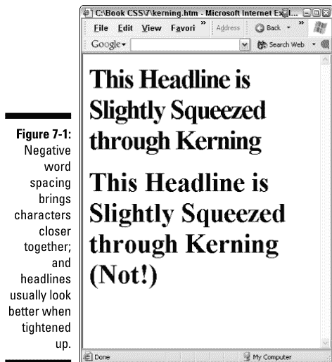

**图 7-1：** 负单词间距使字符更靠拢；标题通常收紧后看起来更好。

然而，你不需要对每一对字符都进行字距调整。这就是为什么使用 CSS 的 `letter-spacing` 属性实际上并不是严格意义上的*字距调整*。字距调整只涉及调整某些字母对。它实际上是一种比你在图 7-1 中看到的更微妙的效果。

### 真正的字距调整

真正的字距调整是逐个字母进行的，而不是在整个标题上统一处理。不过，你可以使用字母间距来实现这种手式字距调整。以下示例定义了比正常更紧的字母间距（`-.06em`），并结合了一个名为 `kern` 的类中更紧的挤压（`-.16em`）：


```html
<style>
h1 {font-size:44px; letter-spacing: -.06em}
h1.normal {letter-spacing: normal}
.kern {letter-spacing: -0.16em;}
</style>
</head>
```

## 第二部分：用 CSS 打造精美外观

```html
<body>

<h1>此标题通过<span class="kern">字距</span>调整和更重度字距略微紧缩</h1>

<h1 class="normal">此标题通过字距调整略微紧缩（并没有！）</h1>
```

此代码的结果显示在图 7-2 中：

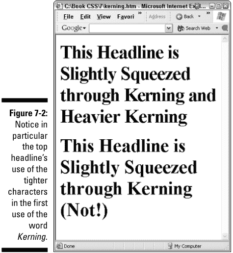

图 7-3 更近距离地展示了已调整和未调整字距的单词：


这种对字母间距的关注可能看起来有点麻烦——确实如此——但如果你想要标题看起来更好，有效的字距调整是关键。当然，你应该指定字体大小，甚至可能指定字体 face，以确保用户看到的结果与你调整字距时看到的一致。你不必每个标题都调整，但较大的字号尤其受益于一点紧缩。

如果标题中的某些字符看起来对你来说太松散，你可能愿意花点时间进行一点手动调整。字距调整在大写字母悬垂于小写字母之上时通常特别有效，就像 Kerning 中 K 悬垂于 e 之上一样。没有字距调整，字母之间会出现不雅观的间隙，如图 7-4 所示：

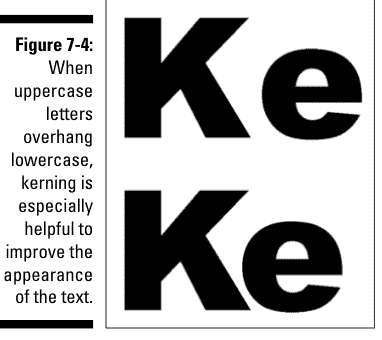

现在切换到像 Arial 这样的无衬线字体，看看对典型标题字体的效果：

```html
<style>
h1 {font Spencer-family: "Arial Black"; font-size:48px; letter-spacing: -.06em}
h1.normal {letter-spacing: normal}
.kern {letter-spacing: -0.20em;}
.ultrakern {letter-spacing: -0.26em;}
</style>
```

### 超紧字距调整

注意，当切换到这个不同的字体时，我不得不将`.kern`类的值调整为`.20em`（与前面的示例比较，那个示例针对 Times Roman 字体设置为`.16`）。在进行字距调整时，你必须稍微调整直到获得理想的效果。我还添加了一个名为`ultrakern`的新类，用于更紧的间距，然后在代码中需要的地方应用了这两个类：

## 第二部分：用 CSS 打造精美外观

```html
<body>

<h1>此标题通过字距调整和更重度<span class="ultrakern">Ke</span><span class="kern">rning</span>略微紧缩</h1>

<h1 class="normal">此标题通过字距调整略微紧缩（并没有！）</h1>

</body>
```

结果显示在图 7-5 中。使用非常紧的间距将`e`推到 K 下面。

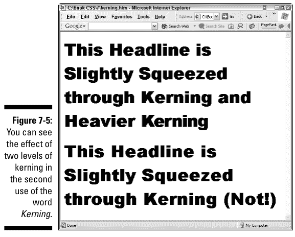

你可以在图 7-6 中更清楚地看到字距调整的效果。

字距调整也常用于闭合字符与其后标点符号之间的间隙。字距调整还可用于减小空格字符的大小，从而减少单词之间的间距，使单词更靠拢。稍后你将了解 CSS 的`word-spacing`属性。

**图 7-6：** 字距调整有助于眼睛快速识别独特的单词形状。

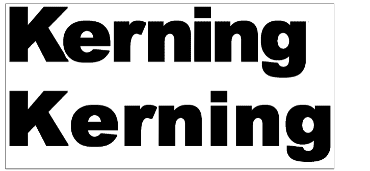

字距调整对浏览器敏感，因此如果你担心在 Netscape 或其他浏览器中让字距调整后的标题看起来好看，请将该页面加载到那个浏览器中，看看是否需要进一步调整，以在 Internet Explorer 和其他浏览器之间达成最低限度的折中方案。

### 垂直紧缩

多行标题还应该通过调整行间距来进行一些垂直方向上的紧缩：减少文本行之间的空白，如图 7-7 所示。在排版学中，行间距被称为*行距*（leading），因为排版工人曾经通过插入或移除铅制间隔件来分隔铅字行。

### 调整百分比

回想一下第 5 章，你可以通过向字体大小添加百分比数字来调整行间距。你在`font-size`值后面加上一个斜线和想要调整的行高百分比。在本例中，我指定为 99%，但你可以调整间距，直到它看起来令你满意：

```html
<html>
<head>

<style>

h1.spaced{font: bold 48px/.99 "Arial Black"; letter-spacing: -.06em;}
```

```css
h1 {font-family: "Arial Black"; font-size:48px; letter-spacing: -.06em;}
h1.normal {letter-spacing: normal; font-size 48px;}
.kern {letter-spacing: -0.20em;}
.ultrakern {letter-spacing: -0.26em;}

</style>
</head>
<body>

<h1 class="spaced">This Headline is Slightly Squeezed through
<span class="ultrakern">Ker</span><span class="kern">ning</span></h1>

<br>
<h1 class="normal">This Headline is Slightly Squeezed through
Kerning (Not!)</h1>

</body>
</html>
```

**图 7-7：** 调整行间距也有助于改善标题的外观。

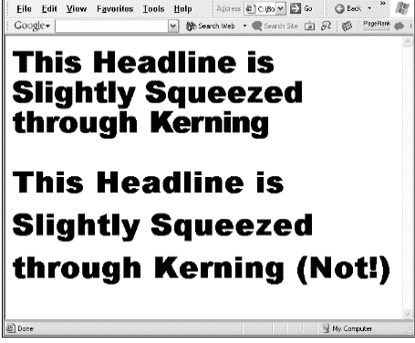

如果你愿意，可以使用`line-height`属性，而不是上面代码示例中展示的`font-size`/斜杠技巧。`line-height`属性可以采用所有常见的 CSS 度量单位，如`px`、`em`、百分比等。以下是一个例子：

```css
h1 {font: bold 48px "Arial Black"; letter-spacing: -.06em;
    word-spacing: -.46em; line-height:48px;}
```

TEAM LING - LIVE, INFORMATIVE, NON-COST and GENUINE !

### 理解基线

`line-height`属性指定文本行*基线*之间的距离。基线是一条假想的线，字符就 resting 在这条线上。请注意，这是*大多数*字符 resting 的线。换句话说，有些字符有*下伸部分*——字符中低于基线的部分——如 p、q、y、g 等。在确定基线时，这些下伸部分被忽略。翻到前面的图 7-10，看看下伸部分的样子。

### CSS3 引入字距调整模式

如果你觉得手动字距调整比它的价值更麻烦，或许你会愿意等到 CSS3 属性可用。一个新的`kerning-mode`属性是 CSS3 草案决议的一部分。你可以对该属性使用`pair`值，以移除已知具有“额外”空间的字母对之间的间距，如`Ke`或`Yo`。字距调整对阈值属性指定了你希望成对字距调整开始生效的字体大小。请记住，字距调整通常只对大字号有用（主要是标题）。这个提议的字距调整对阈值属性的`auto`值让浏览器决定何时使用字距调整；`initial`值允许你指定字距调整激活的字体大小。然而，除非这个提议的自动字距调整属性针对每种不同的字体和每种字体大小进行了精细调整，否则我怀疑它无法达到手工字距调整标题的质量。而且手工字距调整也不是*那么*麻烦，对吧？

### 词间距

`word-spacing`属性与`letter-spacing`类似，可以用来创建两端对齐的文本（左右两边对齐）。然而，网页设计师可以很好地利用它来对标题产生字距调整效果，以减少单词之间不必要的空白。

以下是一个将单词之间的间距减少 0.56 em 的例子：

```html
<html>
<head>

<style>

h1.kernSpaced {font-family: "Arial Black"; font-size:48px;
                word-spacing: -.56em;}
```

```css
h1 {font-family: "Arial Black"; font-size:48px;}

</style>
</head>
<body>

<h1 class="kernSpaced">This Headline is Slightly Squeezed through Kerning</h1>

<h1>This Headline is Slightly Squeezed through Kerning (Not!)</h1>

</body>
</html>
```

正如你在图 7-8 中看到的，收紧单词之间的间距可以改善标题的外观：

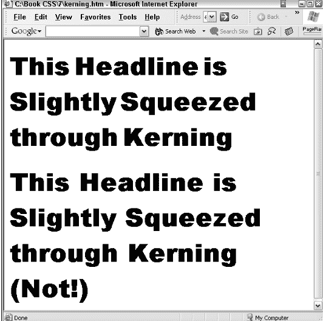

与字母间距和行间距一样，你可以使用任何 CSS 单位来指定词间距。然而，如果由于某种原因用户的浏览器替换了另一种字体，`em`通常是最可靠的。`em`度量是大多数字体的最准确*平均*字符大小度量。

你可能希望同时应用字距调整、行间距减少和词间距减少。下一个例子正是这样做的，如图 7-9 所示。

```html
<html>
<head>

<style>

h1.spaced{font: bold 48px/1.1 "Arial Black"; letter-spacing:
          -.06em; word-spacing: -.46em;}

h1.normal {letter-spacing: normal; font: bold 48px "Arial
          Black";}

.kern {letter-spacing: -0.20em;}
.ultrakern {letter-spacing: -0.26em;}


</style>
</head>
<body>

<h1 class="spaced">This Headline is Slightly Squeezed through
                    <span class="ultrakern">Ker</span><span class="kern">ning</span></h1>

<br>
<h1 class="normal">This Headline is Slightly Squeezed through
          Kerning (Not!)</h1>

</body>
</html>
```

注意定义间距调整的那一行：

```css
h1.spaced{font: bold 48px/1.1 "Arial Black"; letter-spacing:
          -.06em; word-spacing: -.46em;}
```

你想要调整行间距（本例中的`/1.1`）以及字母和词间距值，直到获得你想要的外观。不要忘记，编辑然后查看结果的最快方法是按照以下步骤操作：

1. 在记事本中编写你的代码。
2. 按`Alt+F+S`。

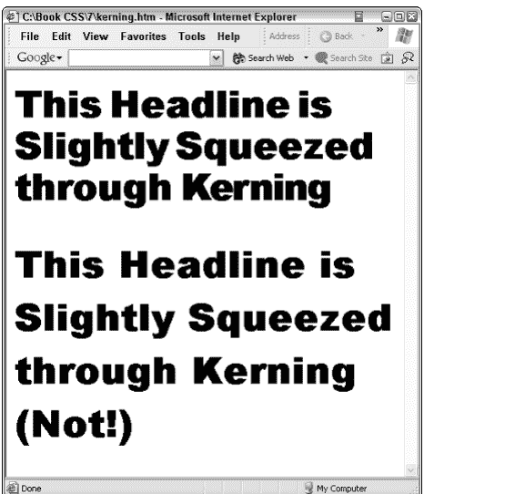

你的 HTML 代码已保存到磁盘。

3. 按`Alt+Tab`切换到 Internet Explorer。
4. 按`F5`刷新浏览器。

这个按键循环使你能够快速查看结果，然后返回记事本尝试额外的调整……直到你完全满意，永远幸福。

### 文本对齐

第 4 章简要介绍了元素对齐的概念——通常是与图像对齐的文本。在本章中，你更仔细地看看各种可能的对齐方式。

#### 垂直对齐

`vertical-align`属性指定文本如何相对于另一个元素垂直对齐（惊喜！），例如其他文本（例如上标）或图像（例如添加说明）。

**TEAM LING - LIVE, INFORMATIVE, NON-COST and GENUINE !**

你可以给`vertical-align`属性以下八个描述性值中的任何一个：`bottom`、`baseline`、`middle`、`sub`、`super`、`text-top`、`text-bottom`和`top`。或者你可以提供一个特定的度量值（如`4px`）或百分比。

### 使用描述性值

在 CSS 中，对齐是相对于文本使用的任何`line-height`属性进行的。大多数可以与`vertical-align`一起使用的值都是不言自明的，但`text-bottom`意味着基线被忽略，假想线画在字体下伸部分的底部。

在块级元素中，`vertical-align`属性相对于块没有效果。然而，该属性确实可以在表格单元格中对齐元素。

正如你在图 7-10 中看到的，基线是一条在无下伸字符之间绘制的假想线。

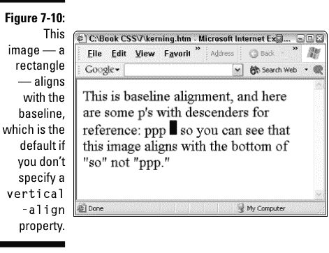

这是产生图 7-10 所示结果的 HTML 文件：

```html
<html>
<head>

<style>

img {vertical-align: baseline;}

body {font-size: 24px;}
```

## 140 第二部分：用 CSS 美化外观

```html
</style>
</head>
<body>

This is baseline alignment, and here are some p's with
descenders for reference: ppp  so you can see that this image
aligns with the bottom of "so" not "ppp."

</body>
</html>
```

图 7-11 展示了上标对齐效果。

### 图 7-11：

你可以使用上标值来提升普通元素或内联文本元素（例如`span`）的位置。

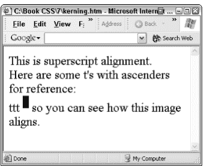

如果使用上标或下标，请注意文本大小不会自动缩小。如果需要这种效果，你必须指定更小的字号。要获得你想要的效果（如图 7-12 所示），你应该将`super`值与`font-size`属性的百分比缩小结合起来，像这样：

```css
span.super {vertical-align: super; font-size: 70%;}
This is 70<span class="super">o</span> cold!
```

在使用垂直对齐时，你也可以指定向上或向下的绝对距离。只需使用任何常用的度量单位，例如`px`、`inches`等即可。

### 按百分比对齐

图 7-13 展示了如何使用负值或百分比来相对于父元素定位元素：

**TEAM LING - LIVE, informative, non-cost and genuine !**

**图 7 accountant 注：此处保留原样，因“图 7-12”实际应为“图 7-12”**，但原文如此：小写字母“o”在 Times Roman 字体中缩小到约 70% 时，可以很好地用作度符号。


**图 7-13：** 使用百分比来指定相对位置，如下所示。

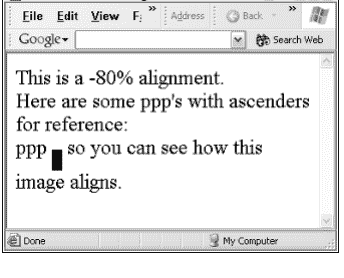

> 当你为垂直对齐指定百分比时，文本元素的基线或图像的底边会相对于父元素的基线发生位移。如图 7-13 所示，方形图像的底部大约位于文本基线下方 80% 的位置（这里的文本指的是不带下伸线的字母，例如“s”和“o”）。

### 水平对齐

使用`text-align`属性进行文本水平调整与垂直对齐类似，但使用的是以下描述性值：`left`、`center`、`right`或`justify`，而且效果应用于整个段落而非单个字词。

这些值基本上与任何文字处理软件中的对齐值相同。默认值是`left`（至少对于西方语言而言）。`text-align`属性只能用于块级元素，例如段落`<p>`元素，如图 7-14 所示。

## 第二部分：用 CSS 美化外观


图 7-14 中的效果是通过以下样式创建的：

```css
<style>

p.right {font-size: 24px; text-align: right;}
p.center {font-size: 24px; text-align: center;}
p.justified {font-size: 24px; text-align: justify;}

</style>
```

如图 7-14 所示，CSS 的文本两端对齐效果并不美观。单词之间的间距实在太大了。当文本行更宽时（图 7-14 中的浏览器窗口相当窄），这种情况会有所改善。尽管如此，你在书籍和杂志中看到的真正的文本两端对齐要微妙和美观得多。真正的两端对齐涉及调整字母之间的间距，而不仅仅是单词之间的间距，就像 IE 所做的那样。此外，CSS 没有提供连字符规范——而连字允许在单词中间断开，这也能让文本行看起来更美观。

### 文本缩进

与水平对齐类似，*缩进*经常用于帮助读者快速识别每个段落的开始，从而更轻松地浏览文本。在文字处理软件中，缩进通常是按下 Tab 键时发生的效果。

## 第 7 章：用你自己的方式设置样式

HTML 没有缩进功能，因此人们不得不借助插入不可见图像和其他技巧来实现。（添加空格是行不通的，因为 HTML 会去除多余的空格。）


CSS 凭借其 `text-indent` 属性挽救了这一局面。与 `<p>` 等块级元素一起使用时，你可以指定诸如 `6em` 或 `7px` 这样的单位长度，或者相对的百分比。

以下是为段落指定缩进的方法，如图 7-15 所示：

```css
p {font-size:24px; text-indent: 2em;}
```


### 纹理效果

大多数网站配上一些背景纹理和图形看起来效果最好。纯背景色相当粗糙，但一个美观、克制的淡色纹理放在文本后面，能提升许多网页的视觉效果。再加上一些设计得当的图形，你就能让最单调的页面焕发活力。纹理还有助于统一页面，将各个区域整合在一起。

与投影阴影以及你可能想要添加到网页的许多其他视觉效果一样，添加背景时的最佳方法是在 Photoshop 等图形应用程序中进行设计。

例如，你可以用重复的小纹理来创建背景。图 7-16 中的示例将一块只有 1 英寸的小纹理平铺到整个浏览器背景上。它的工作原理与 Windows 中通过右键单击桌面、选择“属性”、点击“桌面”选项卡，然后从列表中选择“肥皂泡”等纹理来实现平铺纹理的方式类似。不过，你自己的纹理几乎可以肯定比 Windows 自带的纹理更出色。

以下是使用 `background` 属性的 `repeat` 值来平铺名为 `pebble` 的纹理文件的示例：

```html
<html>
<head>

<style>

body {background: white url("pebble.jpg") repeat;}

h2 {background: url("coin.jpg") no-repeat left top;
color: blue;
width: 85%;
padding: 30px;
font: bold 48px "Arial Black";
letter-spacing: -.02em;
word-spacing: -.16em;
line-height:48px;
}

</style>
</head>

<body>
<h2>Coins of the Realm</h2>

<h2>European and Asian Available Now!</h2>

</body>
</html>
```

你可以为整个页面（在 `<body>` 元素中）或单个元素（如上述代码中所示的 2 级标题 H2）设置背景。CSS 能够为任何视觉元素添加图形或纹理背景，这对网页热忱希望设计网页的人来说非常有用。

请注意，硬币的照片作为 H2 元素定义的一部分被包含在内，因此它出现在每个 H2 的左上角。然而，`width` 和 `padding` 等额外属性定义了标题的间距，并且使用了间距属性来收紧标题文本。

不过，即使有间距调整，通过 CSS 实现的字体效果仍然相对粗糙且缺乏立体感。图 7-17 展示了如何在图形应用程序中为文本添加投影阴影，以赋予页面自然的立体感：一种凸起的 3D 外观。大多数人都会同意，图 7-17 中的字体比图 7-16 中更简单、更朴素的字体更具吸引力。

### TEAM LINQ - LIVE, Informative, NON-cost and Genuine!

## 第 7 章：用你自己的方式设置样式

145


图 7-16：背景是在图形程序中创建的，但文本是纯 CSS 实现的。

如果不做处理，硬币照片的背景会在硬币后面形成一个小方块——覆盖背景纹理。因此，在图形程序中，我复制了鹅卵石纹理，然后将其填充到硬币照片背景中硬币周围的部分。这样，硬币就能与网页背景融为一体。此外，我还为硬币照片添加了投影阴影。设计引人注目的图形的一个目标是让页面看起来不那么扁平。如果你的整个设计都是二维的，没有重叠元素，也没有阴影效果，那你就没有充分利用手头所有的设计工具。除了传统的 x 轴（水平）和 y 轴（垂直），还要考虑 z 轴（第三维度），在这个维度上，物体相互堆叠并投下阴影。

当你加载一张图形作为背景时，如图 7-18 所示，你可以让图像只覆盖部分背景，而背景的其余部分通过平铺的纹理来填充。如果两种纹理相同（如图 7-17 所示），观看者就无法分辨图像在哪里结束，平铺纹理背景在哪里开始。

如果你确实包含了背景图像，你可能希望在图像上方显示超链接、标签或其他元素。这可以通过指定一些绝对定位来轻松实现。（如果你只是在 HTML 中添加文本或其他元素而不指定定位，该元素会出现在页面中图像底部的下方。）

TEAM LING - LIVE, INFORMATIVE, NON-COST AND GENUINE !

图 7-17：特殊文本效果，如首字下沉和投影，在图形程序中更容易实现。


如果你想深入了解如何充分利用 Photoshop，可以查阅芭芭拉·奥伯迈尔和迪克·麦克莱兰合著的《Photoshop 7 For Dummies》（Wiley 出版社）。

以下是生成图 7-17 所示效果的代码，其中包含在图形应用程序中创建的背景图像以及叠加在图像上的前景文本：

```html
<html>
<head>
<style>
body {background: white url("pebble.jpg") repeat;}
</style>
</head>
<body>

<DIV style="top: 390px; left: 85px; position: absolute; font: 32px;" >THIS TEXT IS ON TOP OF THE IMAGE...</DIV>
</body>
</html>
```

此代码将生成你在图 7-18 中看到的图像。


> **提示**  
> 在图形应用程序中设计网页后，后续调整会更困难。例如，要更改图 7-17 中的文本，你不能仅仅在 HTML 代码中重新输入二级标题。相反，你必须回到图形应用程序并重新制作部分或全部图形。

> **提示**  
> 背景纹理和图像不应与前景在视觉上竞争。你需要确保文本易于阅读，并且页面的整体设计——其逻辑和结构——不应被繁琐或浓重的纹理所掩盖。

### 设置单独的背景属性

在前面的示例中，你使用 `background` 属性指定了整组值，如下所示：

```css
h2 {background: url("coin.jpg") no-repeat left top;}
```

这类似于 `font` 属性后可跟多个值的方式。但是，如果你愿意，`font` 属性（例如 `font-size`）可以单独设置，你也可以单独指定背景属性，如下所示：

```css
body {background-image: url(pebble.jpg);}
```

这将导致鹅卵石图像平铺覆盖整个背景。这是因为平铺值（`repeat`）是默认值。如果你不希望平铺，请使用 `no-repeat` 值。

### 背景不继承

背景图像不会被继承。你不会希望背景被文档中的每个元素继承。这会破坏某些背景的效果（那些使用比本章中使用的鹅卵石纹理更大的重复图像的背景）。较大的图像（例如重复的硬币图像）可能适合作为硬币经销商网站的背景——只要硬币足够淡化，以至于不会影响页面文本的可读性。然而，如果那个硬币图像被继承，它将会为其他元素单独平铺。毫无疑问，较小的元素（如标题）会将一行硬币一分为二，将另一行分成四分之三，依此类推。页面将变成一团糟，布满不同的平铺区域。实际上，没有任何背景值会被继承。

### 特殊重复

除非你另有指定，否则背景图像会垂直和水平重复，直到填满窗口。但是，如果你想要，比如，左侧有一个带纹理的边框，你可以指定仅垂直重复，使用 `repeat-y` 值，如下所示：

```html
<html>
<head>
<style>
body {background-image: url(paper.jpg); background-repeat: repeat-y;}
h1 {font-size: 3em; padding-left: 28px;}
</style>
</head>
<body>
<h1>Check in to the B & B!</h1>

</body>
</html>
```

这将导致纹理沿浏览器侧边平铺，如图 7-19 所示：


### 背景定位

`background-position` 属性可以使用以下值指定：`left`、`center`、`right`、`top` 和 `bottom`。你可以像这样组合这些值：

```css
background-position: top right;
```

正如你可能猜到的，你也可以使用百分比来指定背景图像的位置。百分比的使用有点特殊，因为需要提供两个百分比，如下所示：

```css
background-position: 100% 100%;
```

这些 x/y 坐标同时用于*图像*和父元素。换句话说，`100% 100%` 表示位置在右下角。因此，图像的右下角将定位在父元素的右下角。`0% 0%` 的值将图像的左上角定位在元素的左上角。`50% 50%` 使图像居中。这些百分比的任何变化都可以将图像放置在父元素内的任何位置。你认为 `40% 60%` 会定位在哪里？

以下是代码：

```html
<html>
<head>
<style>
body {background-image: url(coin.jpg); background-repeat: no-repeat; background-position: 40% 60%;}
</style>
</head>
<body>
</body>
</html>
```

此代码将生成你在图 7-20 中看到的图像。

请注意，图 7-20 中的图像并非精确地位于左侧 40% 和顶部 60% 的位置。这是因为图像的左上角不是定位点。相反，该点位于图像内部*其自身*的 40/60 坐标处。

绝对定位单位（`inches`、`px` 等）也可以用于定位背景图像，使用通常的 x y 坐标系（第一个值是水平位置，第二个是垂直位置）。但是，与百分比不同，图像的左上角是定位点。

如果你愿意，可以提供负百分比或绝对单位，从而将图像移动到元素框的外部一点点。以下代码将硬币图像从段落边缘向两个方向移动了 20 像素，如图 7-21 所示：

```css
<style>
p {font-size:32px; background-image:url(lightcoin.jpg); background-repeat: no-repeat; background-position: -20px -20px;}
</style>
```


图 7-20：此图形位于 40% 60% 坐标处。


图 7-21：你可以提供负坐标，将背景图像移动到父元素框的外部。

如果你指定 `background-attachment` 属性的 `fixed` 值，可以防止背景图像滚动：

```css
background-attachment: fixed;
```

`scroll` 值是默认值。

## 第三部分：增添艺术感：使用 CSS 进行设计与构图


### 本部分内容

你需要高效的页面，但缺乏美感的高效并无大用。第三部分探索设计大师的秘密，包括诸如“对称到何种程度才算过多？”这类热议问题。你还将学习如何运用著名的三分法则来增加焦点，同时保持页面平衡。你将了解如何使用外边距、边框和内边距来操控页面元素之间的空间。本部分还涵盖了列表、表格以及一些相当出色的视觉过渡效果。

## 第 8 章：网页设计基础

### 本章内容

- 掌握网页设计大师的秘密
- 处理对称性
- 添加首字下沉
- 运用三分法则（它比你想象的更容易）

正如仙妮亚·唐恩最近指出的，有创造力的人不一定是自己作品的最佳评判者。事实上，创作者和评估创意作品的人之间存在脱节。

本章探讨了一些关于设计的“规则”，你可以考虑将其应用到自己的网页设计中。有创造力的人憎恶规则，因为他们的工作是创造新事物，而这些新事物实际上并不遵循现有规则。所以，如果你像安迪·沃霍尔、米开朗基罗或简·奥斯汀那样才华横溢，尽管忽略以下规则。但如果你是那些罕见的人才之一，你还在读这本书做什么？你应该在你的写作桌或画架前。

我们其余的人，没有那么充满天赋，很高兴学习如何改进我们的设计。而规则，即使我们有时忽略它们，也是有用的。试着先遵循规则。如果它对你不适用，那就去违反它吧。

本章的主旨是鼓励你的创造力：尝试新事物，移动元素，或者试试你的想法。当你对一个页面感觉良好时，从这些规则的角度，不带偏见地再看一遍。也许你会决定忽略某个规则。毕竟，这些只是指导方针，一些最好的设计*确实*忽略了本章中的一条或多条建议。但是，更有可能的是，当你带着这些规则重新审视你的页面设计时，可能会发现页面的外观得到了改善。毕竟，它们之所以成为规则，是因为它们通常相当有效。

### 利用留白进行排版

有些规则显而易见，但你可能会惊讶于它们被忽视的频率。大多数网页都需要有效利用“留白”。留白不一定真的是白色：它可以是背景颜色或纹理。它仅仅是指在页面上包含一些没有文字或醒目图形的区域（浅色背景图有时也可以）。换句话说，留白是图像和文字之间的空白区域。

你的网站应避免因页面拥挤、文字过多而吓到人。用户不想阅读所有这些文字。他们不是在上学：他们在上网冲浪。他们不想从你这里接到作业。他们想要一个吸引人的网站，承诺提供娱乐性和有用的信息。

你可以通过多种方式让页面对读者具有吸引力。网页上的主要元素是标题、图形、文本块和留白。你在页面上放置这些元素的位置及其相对大小，对页面的视觉吸引力有重大影响。有效运用这些构建模块，你就已经完成了一半以上的工作，创造出人们愿意花时间浏览的文档。

### 再检查一遍

在编写完页面后，把页面放一边几天，然后用冷静、客观的眼光审视（或请一些朋友给你反馈）。检查你的页面是否具有平衡感、对比度、多样性以及本章讨论的其他品质。还要检查一些违规情况：拥挤、隐藏或浮动的标题、墓碑式排版（相邻栏中平行的标题），或孤行（被遗留下来的单行或文本碎片）。

### 实现平衡

你的主要设计目标应该是让页面保持平衡。什么是平衡？它意味着页面不会头重脚轻或脚重头轻，左侧与右侧相平衡。换句话说，你将页面分成四份，看看“重量”是否大致均匀分布。什么是“重量”？它不仅仅是黑暗程度的总量（文字是灰色的，标题更深，有些图形几乎是黑色的，空白空间是“白色”的，即使它是浅色或纹理的）。相反，要考虑你的页面是否在视觉上协调统一，因为你有效地安排了各个元素。

有效的布局并非完全对称。很少有文档在完全对称平衡时看起来好看。诚然，完全对称的页面是平衡的，但它*太过*平衡了。过犹不及。对称性剥夺了设计中一个重要的品质：多样性。唯一重视极端对称的文档是婚礼请柬，而且它们在其他方面也往往缺乏品味。在一些婚礼请柬上，完全对称与手写体字体相结合：所缺的就只有廉价香水了，否则它们可以赢得“世界恶俗冠军”。

所以现在你有了留白、灰色的文本块、黑色的标题块，以及一些介于两者之间的图形、照片、图表等。在所有这些组件中，留白（较亮的区域）通常是最重要的。

你在做*设计*，视觉*构图*。你可能看过蒙德里亚的画作。他将正方形和矩形排列成迷人且平衡的构图。他没有通过将四个相同的方块放在页面的四个象限中来平衡他的艺术作品，如图 8-1 所示。那样确实平衡，但无聊地对称了。你面临着类似的任务：避免对称，但实现平衡的构图。

图 8-1 的另一个问题可能是文字太多（由灰色块代表）。增加一些留白会缓解过于灰暗的视觉效果。

图 8-2 展示了另一个极端：过度不对称。图 8-2 中的设计设法避免了对称的单调，但并不平衡。此外，两个相同的标题-文本区域位置安排得很糟糕。它们的位置看起来随意草率。


图 8-1：对称是平衡的，但很乏味。


添加一张照片（图 8-3 左下角较深的灰色方块）并使用大小各异的文本块和标题，有助于给页面带来多样性。


### 使用剪影强调对象

一种称为*剪影*的有用技术，通过去除照片或绘图的大部分或全部背景来帮助打破对称，然后将其偏离中心放置在背景颜色或空白上。当你清除了现有背景后，图像的前景变得更加突出。它提供了一种额外的维度，有点像添加阴影。前景边缘的细节被暴露出来，似乎要从页面中冲向观看者。

你可以让像图 8-4 中的手表这样的对象变得生动起来，首先去除背景，使用图形应用程序中的工具擦除它。然后它看起来像图 8-5。


通过倾斜手表使其不完全垂直，并将其放置在偏移的背景上，你赋予了它额外的突出感，如图 8-6 所示。

图 8-4 和图 8-6 的一个主要区别是，在 8-4 中，手表被背景框住。在图 8-6 中，背景没有围绕手表，所以手表看起来像是放置在屏幕之上，而不是沉入背景之中。图 8-6 为图 8-4 中相对静态、下沉、平淡的图像增加了动感、活力和维度。

图 8-6：这种部分剪影效果将手表直接从屏幕中拉出来，并将读者的目光直接吸引到你的页面上。


### 添加首字下沉

你可以将我在上一节讨论的偏移原则以多种方式应用于文本。一种方法是在每个段落旁边添加一个图标——比如这个手表图形。让段落环绕图像，或者在段落开头使用一个放大的重叠大写字母。这种称为*首字下沉*的技术，几个世纪以来一直用于为文本页面增添多样性。

图8-7是使用以下技术创建的。定义一个类，指定比其父元素更大的字体，使其浮动到父元素的左侧，如果你愿意，还可以赋予它不同的颜色。（在此代码中，我将首字下沉设为粗体，比周围段落文字大400%。）然后使用`<span>`元素将首字下沉添加到段落中：

```html
<html>
<head>
<style>
p {font-size:32px;}
.dropcap {font:bold 400%; float:left; color:GreenYellow;}
</style>
</head>
<body>
<p><span class="dropcap">N</span>otice that the graphic in Figure 7-21 is not precisely 40% over from the left and 60% down from the top. That's because the top-left of the graphic is not the positioning point. Instead, the point is inside the graphic at its 40/60 coordinate. Absolute positioning units (inches, px, and so on) can also be used to position a background graphic, using the usual
</p>
</body>
</html>
```

图 8-7：首字下沉通过侵入父段落的空间来增添多样性。

为每个段落添加首字下沉的一种更简单方法是使用伪元素。伪元素将在第15章进一步探讨。以下是预览，如图8-8所示：

```html
<html>
<head>
<style>
p {font-size:24px;}
p:first-letter {font:bold 300%; float:left;
                color:GreenYellow;}
</style>
</head>
<body>
<p>
Notice that the graphic in Figure 7-21 is not precisely 40%
           over from the left and 60% down from the top.
           That's because the top-left of the graphic is not
           the positioning point. Instead, the point is
           inside the graphic at its 40/60 coordinate.
           Absolute positioning units (inches, px, and so on)
           can also be used to position a background graphic,
           using the usual
</p>
<p>
You can apply this same offsetting principle to text in
           various ways. One way is to add an icon--like this
           watch graphic perhaps--to the side of each of your
           paragraphs. Flow the paragraphs around the image.
           Or use an overlapping capital letter at the start scholar of René Descartes, known for his dualism.
</p>
</body>
</html>
```

### 消除讨厌的留白

有时留白看起来会很糟糕。如果你用文本或图形将一块空白区域包围起来，就会形成所谓的*被困住的*留白。这种被困住的留白看起来很糟糕，会让你的页面显得斑驳杂乱，如图 8-9 所示：

**图 8-9：** 虽然这个设计多样且平衡，但它包含了被困住的留白。

图 8-9 的问题在于右侧 H3（细黑色水平线）与它描述的文本之间的距离。标题、说明文字及其他描述性内容几乎都应该紧挨着它们所描述的照片或段落。图 8-10 展示了如何调整页面上的元素来消除被困住的留白，并将标题与它们描述的文本放在一起。

**图 8-10：** 当你消除被困住的留白时，设计就得到了改善（与图 8-9 对比）。

---

### 遵循三分法则

像任何优秀的绘画或摄影作品一样，你的网页也会因拥有*焦点*而受益——一个代表主要主题或最突出视觉元素的物体。这可以是一张照片、一幅素描，或者是观众首先注意到的任何东西。它从页面的其他部分中脱颖而出。也许它只是一个不寻常的形状——与页面上其他形状不同的东西，如图 8-11 所示：

图 8-11 比图 8-3 有所改进，但运用三分法则能让构图更加强化。画一条假想的线，将网页垂直和水平地分成三等份，如图 8-12 所示。线条相交的位置是放置焦点的最佳位置。

---

#### 四个热点

网页包含四个"热点"。这些位置是你应该尝试将焦点居中的地方。看看你是否认为图 8-13 比图 8-11 有所改进，因为舞者现在被移到了热点上：

**图 8-13：** 焦点现在位于页面的热点上。

尝试将焦点移到其他热点之一；你会发现它在那些位置看起来也很好。记住，你有四个热点可以实验。在图 8-14 中，舞者被定位在左上角的 hotspots 上。另外请注意，舞者相对于图 8-13 的位置被翻转了，所以在图 8-14 中她是*舞入*页面的。如果你有动态元素（箭头、舞者、任何指向或移动的东西），确保运动的方向是进入页面，而不是离开页面。焦点是观众首先看到的东西，它应该引导视线进入页面。

**图 8-14：** 这位舞者在这个其他热点上也很好看。

然而，图 8-15 中的设计就不那么成功，尽管舞者被定位在左下角的热点。为什么？

回想一下图 8-4 和 8-6 中手表的摆放位置。良好构图的规则之一是，你应该突破留白，移动焦点使其不被框住或陷入背景中，而是伸入周围的留白空间。在图 8-13 和 8-14 中，舞者从背景中跃入留白空间。这是更好的选择。

在所有这些页面设计中，图 8-13 可能是最好的。它是最平衡的，因为舞者抵消了页面顶部大标题的重量。但最终的选择，一如既往，取决于你。

---

#### 背景图像定位

热点的概念同样适用于背景图像。大多数人会将图 8-16 所示的背景图像居中，心想：为什么不呢？放在中间是平衡的，对吧？没错，但始终记住，你想要的是平衡与趣味相结合，统一与变化相结合。

当你将背景居中在热点上时，你保持了平衡（热点正是为此而设），同时为构图增添了趣味。

在图 8-17 中，背景从热点向外辐射。

> 正如我在本书中经常评论的，设计网页时，没有什么能真正替代使用图形应用程序。CSS 在很多方面都很棒，但你根本无法让它做所有事情。图 8-18 中的 *Deals on Wheels* 这几个字并不是由特殊金属字体组成的；3D 金属效果是在图形程序中为普通的平面黑色字体添加的。例如，CSS 可以以多种方式操纵文本，但它无法添加那种金属效果。当你需要将文本或图形提升到更高水平时，请转向像 Photoshop 这样具有许多此类功能的专用图形应用程序。

**图 8-16：** 大多数业余网页设计师会将背景图形像这样直接放在页面正中间。

**图 8-17：** 这是更好的构图：将车轮居中在左上角的热点。

**图 8-18：** 将一些文本与偏移的背景结合起来，你就朝着设计良好的网页迈出了一步。

---

### 保持适当性

我以一句警示来结束本章，献给那些偶尔忘记*思考*的设计师。当然不是说你，我说的是你的某些朋友，你可能会把这本书借给他们。

请务必确保你添加的符号、形状、剪贴画和其他焦点元素与你的网站内容相符。添加到图 8-11 中的剪贴画剪影对于舞蹈工作室的网站来说很棒。但对于由"Concerned Mothers Against Filth on TV"赞助的网站来说就不太合适了。

在后者的网站上，你期待的是严肃、脚踏实地的图形。*什么都不能是跳跃的舞者。*一个厚重的、脚踏实地的女性形象并不能很好地象征 CMAFTV 的理念，不是吗？那位舞者在大多数教堂和政府机构的网站中同样会显得格格不入。

我想推荐一些具体的网站来说明本章讨论的原则。然而，网站更改内容的频率如此之高，以至于我指出的任何网站在你读到这本书时很可能已经变了。不过，你可以自己做一些网上浏览，找到视觉上引人入胜的网页。（或者只是看看杂志版面或广告。）你很可能会在任何好的网页中发现至少一些本章原则的示例。

---

## 第 9 章

### 用盒子进行空间布局

### 本章内容

- 理解 CSS 盒子
- 运用胜利的边距
- 为元素添加内边距
- 定位元素
- 添加线条

要掌握使用 CSS 进行精确定位，你必须理解盒子的概念。理解了这一点，你就能很好地感受元素在浏览器窗口中的定位方式。在本章中，你将了解如何使用盒子和内边距在网页上定位元素。

---

### 掌握盒子

CSS 中的每个视觉元素周围都有一个假想的盒子，这可能导致它在页面上占据比其实际内容（元素的文本或图形）更多的空间。换句话说，你可以为元素添加可选的内边距、边框和外边距，从而扩展该元素使用的区域。

盒子是内容（文本或图形）加上添加到该内容的任何内边距、边框或外边距的虚拟图示。图 9-1 说明了内边距、边框和外边距如何从中心内容向外辐射。

CSS 定义了两种主要类型的元素：块级元素（如段落）和内联元素（如 `<span>`）。块级元素的定位方式相对容易想象。内联元素可能不太直观。（*包含块* 简单来说就是一个包含一个或多个子元素的块级元素。*包含块* 的概念在讨论 CSS 继承特性时会用到。）

## 第三部分：增添艺术性：运用 CSS 进行设计和排版

要理解`padding`（内边距）、`border`（边框）和`margin`（外边距）如何相互作用，可以想象在艺术画廊中挂画的工作。每幅画由实际的画布区域组成，在 CSS 场景中，这就是内容。接下来，你可以添加一个可选的衬垫，它将画布的外边缘与画框分开。衬垫相当于 CSS 盒子模型中的`padding`。画作周围的画框相当于 CSS 的`border`。最后，你在墙上挂画之间的距离相当于 CSS 的`margin`。

内容区域的宽度和高度取决于你是否为`width`或`height`属性指定了值、内容是否是表格（或其他特殊元素）、内容是否包含其他盒子或文本等等。

元素的盒子宽度是通过将内容宽度加上任何左侧和右侧的外边距、边框或内边距来确定的。同样，元素的盒子高度是内容高度加上任何顶部和底部的外边距、边框和内边距的总和。

盒子的各个区域的背景（可见）样式使用以下属性指定：

- **内容区域：** 元素的`background`属性
- **内边距区域：** 元素的`background`属性
- **边框区域：** 元素的`border`属性
- **外边距区域：** 无背景，外边距总是透明的

`padding`、`border`和`margin`都可以为它们的上、下、左、右四边指定不同的值。其中一些属性包括`padding-top`、`border-bottom-width`和`margin-left`。

你可以使用这些属性在盒子内创建各种特殊效果。然而，例如，你可能只指定一个底部边框，并用相当多不同的方式绘制该边框。事实上，`border-bottom`属性可以指定一系列值，这些值*仅*应用于四条可能边框线中的底部线条。

### 添加边框

如果你希望一个段落用一英寸厚的蓝色虚线作为下划线，请使用以下代码来获得图 9-2 所示的结果：

```html
<p style="border-bottom: 12px blue dotted">
You can apply this same offsetting principle to text in
various ways.
</p>

<p>
This is the next paragraph.
</p>
```

### 添加内边距

现在为上一个示例添加内边距，看看如何在文本底部（内容区域的底部）和边框之间添加空间。图 9-3 中的内容添加了*内边距*：

```html
<p style="border-bottom: 12px blue dotted; padding-bottom:.5in;">
You can apply this same offsetting principle to text in
various ways.
</p>
```

### 添加外边距

最后，添加一个*外边距*，将段落元素与附近的元素分开；在这种情况下，是下面的下一个段落，如图 9-4 所示：

```html
<p style="border-bottom: 12px blue dotted; padding-bottom: .5in; margin-bottom: 1in;">
```

> 在前面的三个图中，第一个段落周围的*盒子*高度增加了，尽管其宽度没有改变。请记住，盒子高度是内容、边框、内边距和外边距高度的组合。

### 垂直定位

如果你未指定定位，你的网页元素将使用默认流流入页面：浏览器只是按照你在 HTML 代码中定位它们的顺序，将元素沿着屏幕左侧堆叠，如图 9-5 所示：

图 9-5：默认定位允许浏览器决定你的元素应该如何堆叠，结果可能像这样不美观。

除非你明确使用定位或浮动来违反正常的堆叠行为，否则此默认定位将生效。

同样，在默认情况下，元素的高度在最基本层面上由元素的内容决定。例如，图 9-6 中的图像在浏览器中显示为此大小，因为它在现实中就是这个大小。这就是`lure.jpg`图形文件为此图像定义的大小。

```html

```

图像可以在图形应用程序中调整大小，但你也可以通过 CSS 使用特定的`width`和`height`属性来调整它们。结果如图 9-7 所示：

```html

```

图 9-6：如果你没有另行指定，图像的高度和宽度将与其文件规范定义的一致。

图 9-7：指定一个大于此图形默认高度的高度值，会导致其下方的元素在页面上向下移动。

显然，通过指定`height`属性，你影响了这个元素的高度。这反过来又影响了此元素下方任何项目的默认垂直定位。（你可以通过为这些下方项目使用定位属性来影响它们的定位。）

同样，你可以通过使段落变窄来影响一段文本的高度，这需要段落增加高度以显示所有文本。指定一个段落只占浏览器宽度的 35% 可能会导致该段落从浏览器底部流出，并强制浏览器添加滚动条，如图 9-8 所示：

以下是生成图 9-8 的代码：


```html
<body>

<p style="width: 35%;">
If you allow your Web page to simply be calculated by the browser--the default simply stacks the elements along the left side of the screen in the order that you locate them in the HTML code. This normal positioning takes effect unless you specifically use positioning or floating to violate the normal stacking behavior.
</p>

</body>
```

要理解元素的盒子高度，你可能需要考虑总共七个可能涉及的属性：

- `height`（元素的实际内容）
- `padding-top`
- `padding-bottom`
- `border-top`
- `border-bottom`
- `margin-top`
- `margin-bottom`

盒子的底部决定了紧随其后的下一个元素盒子的顶部可以定位在哪里（在默认的正常流定位中）。

元素的高度以及顶部和底部外边距属性可以设置为`auto`。如果你想指定内边距属性（在内容和任何边框之间添加空间）或边框宽度本身，你必须使用实际的测量单位或百分比来指定它们，而不是`auto`。然而，对于`margin-top`和`margin-bottom`，`auto`默认为零。

### 水平定位

西方浏览器从左到右阅读，因此当元素水平定位时，它们从左侧开始。但你必须始终记住，它的*盒子*可能比元素的内容更大。

考虑这个示例，它显示背景色以说明此段落元素的`width`属性。结果如图 9-9 所示：

```html
<style>
p {width: 100px;background:tan;}
</style>
</head>
<body>
<p>This paragraph is only 100px wide.</p>
</body>
```


**图 9-9：** 这里的宽度只是由段落样式的`width`属性指定。

但如果你为段落添加内边距和外边距，你会增加段落盒子的宽度：

```html
<style>
  p {width: 100px; padding: 30px; margin: 40px;
    background:tan;}
</style>
</head>
<body>
<p>This paragraph is only 100px wide.</p>
</body>
```

请注意，与图 9-9 相比，图 9-10 中显示的段落元素具有更宽的背景颜色（因为指定了内边距），并且在水平方向上也离浏览器左侧更远（因为指定了外边距）。


**图 9-10：** 这里，段落有一个更大的背景色块，并且从浏览器窗口左侧缩进。

> **提示** 网页设计师经常错误地认为，当他们为元素的`width`属性提供一个值时，他们是在指定其左边界线和右边界线之间的距离。或者更糟的是，有些人认为他们的`width`值指定了元素与下一个元素之间整个可见距离。事实上，内边距、边框宽度和外边距*都*必须被考虑在内。

## 第三部分：增添艺术感：CSS 设计与构图

这同样适用于`height`属性，你也必须考虑内边距、边框和外边距。


一些设计师会暂时为元素添加背景色，以便更轻松地可视化方框（参见图 9-9）。但始终要记住，背景不包括任何外边距，如图 9-10 所示。因此，仅仅添加背景并不总是能让虚拟方框可见。

定位还涉及`auto`值和浮动等概念。这些问题及相关内容将在后续章节中介绍。

### 用水平线分隔文本

出于某种原因，水平分割线在书籍和其他媒介中的使用已不如从前。在我看来，这很遗憾，因为它们既美观又实用。

水平线通常是分隔网页不同逻辑区域的一种非常有效的方式。它们以一种既不引人注目又高效的方式为读者组织视觉内容。它们还可以通过增添多样性来提升美学外观。

读者欣赏你以某种方式在视觉上分隔包含大量文本的页面。标题和子标题有助于实现这一点，边框和背景色或纹理也是如此。但表明一组段落在逻辑上属于同一部分的最佳方法之一，就是简单地根据需要插入水平线。

使用水平线最简单的方法可能是使用`<hr>`（水平线）元素，如下所示：

```html
<style>
hr {
  margin-top:5px;
  width: 80%;
  height: 1px;
  color: blue;
}
</style>
</head>
<body>
```

## 第 9 章：用方框控制间距

水平线通常是分隔网页不同逻辑区域的一种非常有效的方式。它们看起来也不错——增添了多样性。读者欣赏你以某种方式将包含大量文本的页面划分成区域。标题和子标题有助于实现这一点，边框和背景色或纹理也是如此。但表明一组段落在逻辑上属于同一部分的最佳方法之一，就是简单地根据需要插入水平线。

现在，谈一个完全不同的话题，blah blah 线条通常是分隔网页不同逻辑区域的一种非常有效的方式。它们看起来也不错——增添了多样性。


一些 CSS 专家建议使用元素的`border-top`或`border-bottom`属性来提供水平分割线，但我从未真正理解为什么。这些专家坚持认为你应该*始终*尝试将内容（HTML）与表现形式（CSS）分离，但这在我看来过于极端。毕竟，像`<i>`这样的斜体元素确实很容易嵌入正文文本中，而不是为相同效果设置一条 CSS 规则。专家们进一步争辩：“如果你决定将斜体更改为其他强调方法怎么办？”我对此有三点回应：你应该始终只使用斜体进行强调。但如果你面临需要逐一将每个`<i>`标签更改为其他元素的情况，使用查找和替换工具在代码中全局进行更改有多难？这只花几秒钟时间，有什么大不了的？最后，如果你不喜欢查找和替换，你也可以通过创建一个以`i`为选择器的新 CSS 规则来重新定义`<i>`元素，对吧？总之，`<hr>`元素对于添加线条效果很好。如果你为它提供一个百分比宽度，如前面的示例所示，该线条相对于父元素的尺寸是合适的。通常，将分隔线限制在父元素宽度的 80% 左右是最合适的，如图 9-11 所示。

你可以将大多数预期的 CSS 属性与`<hr>`一起使用，包括在上面的示例中使用的少量`top-margin`，以使线条在第一个段落下方保持合适的间距。

尽管普通的黑色或灰色线条通常就足够了，如果你愿意，可以调整分隔线的形状和大小，就像这样，其中外边距、高度、宽度和颜色都与之前的示例不同：

```css
hr {
    margin-top: 3px;
    margin-bottom: 5px;
    height: 14px;
    width: 60%;
    background-color: mediumspringgreen;
}
```

TEAM LING - LIVE, INFORMATIVE, NON-COST AND GENUINE!

## 180 第三部分：增添艺术感：CSS 设计与构图


有关 Internet Explorer 中所有可用颜色的列表，包括`LavenderBlush`和`WhiteSmoke`等流行颜色，请参见本书前内页的速查表。

如果你真的富有冒险精神，可以尝试使用线条的`background-image`属性，将你的线条变成图形。但是，如果你想用图片来分隔段落组，我建议两点：

- 直接使用``元素来使用图形，而不是将水平线元素扭曲成它从未打算成为的东西。
- 仔细考虑使用图形而不是简单线条来分隔段落的视觉效果。

如果你必须尝试，下面是代码。图 9-12 展示了当热情战胜常识时会发生什么：

```html
<style>
p {font: 24pt;}
hr {
  background-image: url(globe.jpg);
  background-repeat: no-repeat;
  border: none;
  width: 400px;
  height: 800px;
}
</style>
```


**图 9-12：** 使用图片作为分隔段落的方式——虽然可能——但通常不太明智。

图 9-12 中使用的技巧更可能使观众感到困惑，而不是引导他们。一般来说，图形并不是组织文本区域的好方法。即使是微妙的图形，如一个小巧雅致的菱形或点边框，通常也只是对读者的干扰，最好避免使用。

## 第三部分：增添艺术感：CSS 设计与构图

## 第 10 章

### 视觉组织你的网页

### 本章内容

- 创建有效的边框
- 浮动元素
- 在浮动中使用`clear`属性

本章重点介绍两种视觉组织网页的方法：在元素周围添加边框，以及在页面上浮动元素。

边框可以帮助你的访客理解页面布局、各个区域及其用途，是一种很好的方式。段落是将文本划分为逻辑单元的一种方式——读者知道段落分隔表示一个新的想法，或者是对前一段落想法的进一步扩展。

类似地，段落本身可以分组为更大的逻辑单元。例如，一个网页可以细分为描述你公司的部分、包含指向网站各处链接的部分，以及宣传你最新产品的部分。

这些部分中的每一个都可能包含多个段落，但你将它们分组在一起，因为它们在逻辑上属于一起。

段落可以通过多种方式分组。例如，标题或子标题将它们后面的段落分组。水平线（`<hr>`）可以有效地分隔段落组。或者你可以采用不那么优雅的视觉分区方法，通过为段落组设置不同的背景颜色（除非是面向儿童的网站，否则不推荐最后这种方法）。

最后，你将了解如何利用有用的`float`属性使元素相互环绕，例如一段文本似乎包围一张照片。

## 184 第三部分：增添艺术感：CSS 设计与构图

### 管理边框

如果你选择用边框包围网页的元素，那你很幸运：CSS 提供了相当多样的边框使用方式，并且允许你为任何想要的元素添加边框。

边框是一个框架，通常只是一条线，包围着一个元素。然而，你可以有选择地省略边框四条线中的任何一条，或者使用`border-top`、`border-right`、`border-bottom`和`border-left`属性单独定义它们。

边框包围内容，并且可选地包围你为元素指定的任何内边距。指定的任何可选外边距不会被边框包围，而是将此元素与周围元素分隔开。

边框可以被赋予指示你希望它们外观的值：颜色、粗细和样式（点线、内嵌等）。边框的粗细或宽度可以使用通常的多种 CSS 方式指定（使用第 6 章详细描述的测量单位，如`px`、`in`或`em`），包括默认的`medium`，即两到三像素宽。边框的默认颜色是元素的文本颜色，或者如果元素没有文本（例如图像），则继承其父元素的文本颜色。

如果人们想知道为什么使用 CSS，你可以告诉他们众多原因之一是`border`属性。它可以应用于任何元素，并且像许多 CSS 特性一样，`border`属性灵活、美观、合理、高效且有用。没有 CSS，你将不得不诉诸真正糟糕的解决方案，比如滥用`table`元素作为框架。

### 指定简单边框

使用 CSS 时，你会发现各种各样的边框可供使用。最简单的边框规范只是使用`border`属性，后跟由空格分隔的三个值（`width`、`style`和`color`），例如：

```html
<html>
<head>
<style>
body {font-size:24px;}
p {border: thick solid green;}
</style>
</head>
<body>
```

TEAM LING - LIVE, INFORMATIVE, NON-COST AND GENUINE!

```html
<p>Absolute positioning units (inches, px, and so on) can
also be used to position a background graphic,
using the usual x y coordinate system.
</p>
```

```html
<p style="border: 10px groove gray">Absolute positioning
units (inches, px, and so on) can also be used to
position a background graphic, using the usual x y
coordinate system.
</p>
```

```html
<p style="border: .4in ridge mintcream">Absolute positioning
units (inches, px, and so on) can also be used to
position a background graphic, using the usual x y
coordinate system.
</p>
```

```html
<p style="border: 6px double blue">Absolute positioning units
(inches, px, and so on) can also be used to
position a background graphic, using the usual x y
coordinate system.
</p>
</body>
</html>
```

将此代码保存为 Windows 资源管理器中扩展名为`.htm`的文件，然后双击该`.htm`文件。Internet Explorer 将打开并加载你在图 10-1 中看到的页面：

请注意在上述代码中，你在`border`属性之后依次跟上了宽度、样式和颜色的值，对于内联 CSS 样式的方式如下：

```css
style="border: 6px double blue"
```

或者对于通用 CSS 样式如下：

```css
p {border: 6px double blue;}
```

**提示** 如果你不指定样式，则不会出现边框。默认样式是`none`。因此，不要以为只要指定了其他边框相关属性（如`border-width`或`color`），最终就会产生边框。`border-style`属性是必需的。

外部、嵌入式和内联 CSS 样式之间的区别在第 2 章名为“可视化优先级（Visualizing Specificity）”的章节中有所描述。

绝对定位单位（英寸、px 等）也可以使用常规的 x y 坐标系来定位背景图形。

绝对定位单位（英寸、px 等）也可以使用常规的 x y 坐标系来定位背景图形。

绝对定位单位（英寸、px 等）也可以使用常规的 x y 坐标系来定位背景图形。

绝对定位单位（英寸、px 等）也可以使用常规的 x y 坐标系来定位背景图形。

### 从众多边框样式中选择

你可以指定八种不同的边框样式：`solid`（实线）、`dotted`（点线）、`dashed`（虚线）、`double`（双线）、`groove`（凹槽）、`ridge`（脊线）、`inset`（内嵌）或`outset`（外凸）。图 10-2 展示了每种样式，尽管其中一些比通常希望使用的要宽一些。为了演示目的，我将这里的每个边框指定为宽大的 8 像素，以便你在本书中能清晰地看到它们。一般来说，通常建议加粗的只有类框架设计：`groove`、`ridge`、`inset`和`outset`。这些样式旨在通过改变线条的亮度来显示阴影，因此你需要线条足够大，以便观察者能实际看到阴影。代码如下：

```html
<p style="border: 8px solid">This is the SOLID border style.
        No color is specified, so it defaults to black.
</p>
<p style="border: 8px dotted">This is the DOTTED border
        style.
</p>
```

## 第 10 章：通过视觉组织你的网页

```html
<p style="border: 8px dashed">This is the DASHED border style.
</p>
<p style="border: 8px double">This is the DOUBLE border style.
</p>
<p style="border: 8px groove">This is the GROOVE border style.
</p>
<p style="border: 8px ridge">This is the RIDGE border style.
</p>
<p style="border: 8px inset">This is the INSET border style.
</p>
<p style="border: 8px outset">This is the OUTSET border style.
</p>
```

图 10-2 展示了八种边框样式：


其他浏览器对边框样式的解释略有不同。图 10-3 显示了 Mozilla Firefox 如何显示这些样式。例如，Firefox 认为 `dotted` 意味着短虚线。此外，如图 10-3 所示，Firefox 在底部四个类框架边框的阴影中使用了黑色，而不是更微妙的灰色：

## 第三部分：增加艺术感：使用 CSS 进行设计与构图


CSS3 正在开发 `border-radius` 属性，允许你通过圆角进一步细化边框的外观；一个 `border-image` 属性，你可以用它配合精美的图形来构建华丽的框架；以及一些用于旋转和转换华丽边框的相关属性。进步在不断前行。

### 样式的混合与匹配

如果你愿意，可以使用单边边框（或者两边或三边）。你甚至可以混合匹配样式，例如，一边是点线，其余是双线。至于为什么会想要这样做是另一个问题，但这里有一个例子：顶部和右侧为点线样式，底部无边框，左侧为虚线样式的图形：

```html
<html>
<head>
<style>
IMG {border-style: dotted dotted none dashed;}
}
</style>
</head>
<body>

</body>
</html>
```

这段代码导致了图 10-4 中奇怪的混合边框外观：


在 CSS 样式中，当边框、外边距或其他属性的四个方向用一个值列表指定时，顺序始终是：上、右、下、左。你可以通过顺时针方向（从顶部的 12 点钟方向开始）来记住这个值顺序。因此，`dotted dotted none dashed` 翻译为：顶部和右侧为点线，底部无边框，左侧为虚线边框，如图 10-4 所示。

### 指定边框宽度

边框宽度可以使用常用的 CSS 单位集（`px`、`in`、`em` 等）指定，或者使用描述性值 `thin`（细）、`medium`（中）或 `thick`（粗）。以下使用 `thick` 值的代码产生了图 10-5 所示的结果：

```html
<style>
P {background-color: lightsalmon; padding: 12px;
border-style: double; border-width: thick;}
</style>
```

除了更改边框样式外，你还可以改变每个独立边框的大小（就像操作外边距一样），尽管这个工具在极少数网页设计中才有用。如果需要，可以使用这些属性来显示多重粗细边框：`border-top-width`、`border-right-width`、`border-bottom-width` 和 `border-left-width`。图 10-5 展示了粗尺寸的效果。


图 10-5：此边框以 `thick` 边框宽度渲染。

### 给边框上色

边框颜色使用 `border-color` 属性指定。这并不奇怪。只需使用第 6 章中详细描述的任何 CSS 颜色值即可。请记住，如果你省略此属性，边框将采用周围文本的颜色，或者如果本地元素没有颜色（例如图像元素），则采用父元素的文本颜色。因此，默认边框颜色通常是黑色。

如果你想尝试一些光影效果，使边框具有立体感，你可以为边框的每一边指定四种不同的颜色，如下所示：

```html
<style>
P {padding-left: 6px; padding-right: 4px; padding-top: 6px;
border-style: double; border-width: thick;
border-color: lightskyblue lightskyblue darkslateblue darkslateblue;}
</style>
```

当你给右侧和底侧分配深色时，即使你没有在边框属性中使用 `outset` 样式，也会产生一种“外凸”的照明效果。图 10-6 展示了实现此方法的一种方式：


> 虽然你可以为内联元素添加边框，但请避免这样做。这看起来会非常混乱且过头。边框并不是为内联元素设计的。

### 关于浮动（Floating About）

CSS 允许任何元素浮动，就像它将许多其他属性扩展到 *所有* 元素一样（而在传统 HTML 中这些属性仅限于少数元素）。设计师过去可以通过在 HTML 中使用 `align="right"` 代码使文本在图像或表格周围流动（或 *环绕*），但现在你几乎可以让你想要的任何东西浮动。在这里，CSS 再次赋予了设计师比以往更大的 *设计* 自由。

图 10-7 展示了以下代码在 *不* 使用 `float` 属性时的样子：

```html
<body>
<h2>Illustrating how a gradient effect works</h2>
</body>
```

## 第三部分：增加艺术感：使用 CSS 进行设计与构图

```html
<p>You can apply gradients to various images, as you wish.
Imagine the nice fade-in effect that you can
generate if you add some scripting to slowly
adjust the opacity value while the user is
watching.</p>
</body>
```

**图 10-7：** 如果没有 `float` 属性，许多网页设计几乎肯定会出现不必要的空白，如图所示。


但当你添加 `float` 属性时，文本和其他元素会围绕该浮动元素进行环绕。在接下来的示例中，图像在父级标题及其随后的文本中都处于浮动状态，如图 10-8 所示：

```html
<body>

<h2>Illustrating how a gradient
effect works</h2>

<p>You can apply gradients to various images, as you wish.
Imagine the nice fade-in effect that you can
generate if you add some scripting to slowly
adjust the opacity value while the user is
watching.</p>
</body>
```

请注意在上述代码中，图像是一个内联元素，嵌套在 `H2` 元素内部。当你像这样嵌套元素时，可以确保大多数浏览器将标题文本的顶边距与图像对齐。


图 10-9 展示了右浮动，使用了之前的代码但做了一处更改：

```css
float: right;
```


左浮动通常用于给文本添加特殊效果，例如首字下沉（在第 8 章中进行了描述和图解），或者你想要在每个段落开始处插入的项目符号或图标。

如果你想同时实现左浮动和右浮动，尽管去做。图 10-10 展示了这种双重浮动。代码如下：

```html
<h3>
Illustrating how a gradient effect works

Illustrating how a gradient effect works</h3>
```


### 使用 Clear 取消浮动

正如本章中的各个图表所示，列在浮动图像之后的 HTML 文本通常会沿着图像向下流动。

但如果你想强制某些文本脱离它通常会环绕的图像怎么办？如果你想将其移动到图像下方怎么办？有时你*不希望*文本与特定的图像相关联。

此外，请考虑到从任何给定图像的顶部流动到底部所需的实际单词数可能会有很大差异。例如，用户可能会调整浏览器窗口的大小，这对流动有很大影响。同样，用户偏好的字体大小、屏幕分辨率和其他因素也会影响流动的文本量。在这些情况下，你可能希望指定某些文本必须显示在浮动图像之下——无论用户如何调整浏览器大小或其他因素。该文本必须*始终*忽略浮动并出现在图像下方。

当页面上有多个图像时，浮动会出现一个问题。`clear` 属性可以帮助你确保每个文本元素出现在与其关联的图像旁边。

CSS 版本的清除（clearing）类似于传统 HTML 中带有 `clear` 属性的 `<br>` 元素。在 CSS 中，你使用 `clear` 属性，以及 `left`、`right` 或 `both` 值。仅在配合此 CSS 样式使用 `<br>` 时，才能强制 `<br>` 之后的文本移动到任何现有边距下方（换句话说，移动到页面上的下一个 `clear` 区域）。

这里有一个示例，展示了 `clear` 属性产生的影响。以下代码插入了一个普通的 `<br>` 标签，但它并没有将 `<br>` 之后的文本段落移到浮动图像之外。`<br>` 所做的只是将文本向下移动一行，如图 10-11 所示：

```html
<body>


<p>You can apply gradients to various images, as you wish. Imagine the nice fade-in effect that you can generate if you add some scripting to slowly adjust the opacity value while the user is watching.

<br>
We want this paragraph to be disassociated from the previous paragraph and from the floating image. You can apply gradients to various images, as you wish. Imagine the nice fade-in effect that you can generate if you add some scripting to slowly adjust the opacity value while the user is watching.</p>
</body>
```

正如你在图 10-11 中所看到的，插入一个普通的 `<br>` 元素仅仅创建了一个段落换行（将文本移至下一行）。但我们真正想对这段文本做的是将其完全移到图像下方。


然而，通过添加 CSS `clear` 属性并指定 `left` 值，你可以强制文本移动到浮动图像之外，如图 10-12 所示。

```html
<br style="clear: left">
```

**图 10-12：** 当你想将某些文本向下移至浮动元素之外时，只需使用 `clear` 属性。


显然，当你想要覆盖左浮动元素时，请使用 `left` 值。至于何时使用 `right` 和 `both` 值，我就交给你去研究了。

> 正如 CSS 中常见的情况（且在传统 HTML 中是不可能的），你可以将 `clear` 属性应用于任何元素，而不仅仅是文本和图像。因此，如果你遇到需要确保某个元素位于浮动元素下方的情况，请使用 `clear`。

如果你在一个页面或网站中进行了大量的清除操作，你可能想创建一个通用类，将其应用于 `div` 或 `span` 标签，如下所示：

```css
div.spacer
{
    clear: both;
}
```

## 第 11 章：使用 Auto 和内联元素进行设计

### 本章内容

- 使用 auto

- 设置边距与文本居中

- 管理内联元素

CSS 元素的盒子（box）是一个虚拟的想象形状，由元素的内含内容组成，再加上可选的内边距（padding）、边框（border）和外边距（margin）（如果有的话）。盒子的尺寸不一定与可见内容或可见边框相同。如果使用了内边距，盒子会扩大以包含内边距的尺寸。如果进一步添加了边框或外边距，它们也会增加盒子的大小。然而，内边距本身永远不可见——它仅仅是在元素与周围元素或浏览器框架之间创建空间。

当你理解了虚拟盒子的概念，你就已经在通往高效页面布局管理的道路上了。而且，正如你在本章中将发现的，CSS 通过允许你使用 `auto` 值，为你提供了对内容和边距行为的进一步控制。CSS 甚至允许你在内联元素（如斜体 `<i>` 元素）周围添加边框和外边距等功能。在本章中，你将探讨这两个主题——auto 和内联操作——以了解应该采用什么以及应该避免什么。

### 使用 Auto 控制布局

在网页的四个可能区域（内容、内边距、边框和外边距）中，只有两个（元素的内容和可选的外边距）可以设置为 `auto`。Auto 允许浏览器自动调整内容和外边距的大小：这使你能够实现一些非常有趣的功能，例如无论用户如何调整浏览器大小，都能将图形稳定在网页中心。

接下来的示例允许浏览器自动调整右外边距的大小，以确保段落保持固定大小，并且与浏览器窗口左侧保持固定距离。

你可以分别指定左、右、上、下外边距，例如使用如下代码：

```css
p {width: 150px; margin-right: auto; margin-left: 150px;}
```

这个有趣的样式规定内容应固定为 150 像素宽，且左外边距固定为 150 像素。父元素实际上就是浏览器窗口本身（从技术上讲，如果没有其他父元素参与，父元素就是 `<body>` 元素，但浏览器窗口确实*看起来*像父元素）。换句话说，从浏览器窗口左侧到内容（段落文本）右侧的总距离必须维持在 300 像素。然而，右外边距会自动调整以维持另外两个固定宽度。`auto` 属性的效果是将段落冻结在浏览器窗口内特定的水平位置，即使由于用户调整大小（或某些其他事件导致的大小更改）而拉伸或收缩浏览器窗口也是如此。

为了理解这个效果，请看图 11-1。该段落没有使用任何 CSS 样式。没有 `auto` 值生效，因此当用户加宽浏览器窗口（右侧的窗口）时，文本会加宽以填满窗口的宽度。


图 11-1 中的左侧浏览器被拉伸，最终看起来像右侧的浏览器。文本段落随之加宽以适应新的浏览器宽度。

相比之下，在图 11-2 中，你可以看到使用 `auto` 的 CSS 样式所产生的影响。以下代码使段落固定在某个位置（在本例中，距离父级浏览器窗口左侧一个稳定的距离）：

```html
<html>
<head>
<style>
p {width: 150px; margin-right: auto; margin-left:
                   150px;border: 2px solid;}
</style>
</head>
<body>
<p>This paragraph's right margin is set to auto. The box dimensions are not necessarily the same as the visible contents, or the visible border. If padding is used, then the box grows to include the padding dimensions. If a border or margin are further added, they, too, grow the size of the box.
</p>
</body>
</html>
```

图 11-2：当右外边距（right margin）设置为 `auto` 且指定了左外边距和宽度时，用户调整窗口大小，此文本不会移动或改变尺寸。


图 11-2 表明，将浏览器窗口拉宽（右图）并不会使段落随之变宽。图中的右外边距会自动调整为维持段落尺寸和位置所需的任何大小。

如果你将三个宽度属性——`width`、`margin-left` 和 `margin-right` ——都设置为一个具体的绝对尺寸（例如 150 像素），你就创建了一个不可能的状态。当用户拉伸浏览器窗口时，浏览器能做什么？这三个宽度测量值中必须有一个变为灵活的。它们不可能全部保持固定，对吧？在这种情况下，浏览器会自动将 `margin-right` 属性更改为 `auto` 并忽略你指定的尺寸。

### 指定外边距（Specifying margins）


如果你指定了左外边距和右外边距，但没有指定宽度，元素会拉伸其宽度以适应并维持请求的外边距。例如，如果你指定左外边距和右外边距应为 150 像素，那么段落的`width`属性（必然）就变成了`auto`。

```css
p {margin-left: 50px; margin-right: 50px; border: 2px solid;}
```

图 11-3 说明，同时指定左外边距和右外边距但省略宽度定义，会导致浏览器假设宽度为`auto`。

接下来的这个样式与前一段代码中的样式效果相同：

```css
p {width: auto; margin-left: 50px; margin-right: 50px;
   border: 2px solid;}
```

### 居中（Centering）

图 11-3 展示了一种使段落居中的方法，但如果你想在居中的同时固定它的尺寸该怎么办？换句话说，你希望它保持在浏览器的中间，并且在用户拉伸浏览器窗口时能够抵御尺寸变化（如图 11-3 中那样）。以下代码*理应*实现这一点：

```css
p {margin-left: auto; margin-right: auto; width: 200px;}
```

然而，在撰写本文时，Internet Explorer 6 版本在处理上述代码时会出错，简单地将段落贴在左侧（不使用左外边距）。但 Mozilla Firefox 和其他浏览器则处理正确，如图 11-4 所示：


这是 Internet Explorer 6 少数未能正确解析 CSS 样式的实例之一。将左右外边距设置为`auto`的技术在 CSS 样式中是实现元素居中并固定尺寸的正确方法。我希望 IE 能尽快跟上潮流。

### 使用 `!DOCTYPE` 强制 IE 合规

你可以通过在代码页的*顶部*（`<html>`元素之上）插入以下行代码，使 IE 能够渲染之前的示例（以及其他一些类型的 CSS 规则）。其外观如下：

```html
<!DOCTYPE HTML PUBLIC "-//W3C//DTD HTML 4.0 Strict//EN" >
<html>
<head>
<style>
p {margin-left: auto; margin-right: auto; width: 200px;}
</style>
```

这个`!DOCTYPE`声明可能会产生意外的副作用，例如改变你可能正在利用的 IE 专有行为（例如，相对字体大小的渲染方式可能会有所不同）。但如果你想尝试使用这个声明，它确实能强制 IE 6 切换到其 CSS 标准兼容模式。

### 使用 Auto 进行垂直定位

就像在水平尺寸和定位时可以将三个属性设置为`auto`（`width`以及`left`和`right`外边距）一样，理论上你也可以在等效的垂直属性中使用`auto`值：`height`以及`top`和`bottom`外边距。

奇怪的是，在使用正常流（默认）时居中元素相当困难，因为如果你尝试将`auto`作为`margin-top`或`margin-bottom`属性的值，该值会被评估为零！在这种情况下，`auto`直接被忽略了。回想本章前面关于水平居中的讨论，`auto`外边距可用于居中——事实上，使用`auto`外边距是 CSS 居中的推荐技术。

你可以使用以下代码固定元素的顶部位置。只需指定`top-margin`值，并忽略元素的高度：

```css
p {width: auto; margin-top: 100px; margin-bottom: 100px;
    border: 2px solid;}
```

图 11-5 展示了如何将元素放置在特定的垂直位置，但其高度*没有*被固定。调整浏览器（或父元素）的形状可能会增加或减少元素的高度（参见图 11-5 右侧，当浏览器变宽时，段落失去了一些高度）。

你可以尝试使用绝对定位或相对定位，在一些次要浏览器中实现有效的垂直定位，但这些权宜之计在 Internet Explorer 中仍然无效。此外，不要尝试摆弄`vertical-align`属性。它是设计用来操作行内文本元素位置的（例如上标）；`vertical-align`属性对块级内容没有影响。

以下是在 Firefox 和 Netscape 中运行良好的示例代码：

```css
div {
  height: 100%;
  width: 100%;
  display: table;
  position: fixed;
}

p {
  display: table-cell;
  vertical-align: middle;
}
```


### 处理行内元素（Handling Inline Elements）

在 CSS 中，行内元素是指文本行中的小型元素（如`<em>`或`<i>`元素）。你可以通过多种方式摆弄文本中的行内元素：为单个单词或短语绘制边框、添加内边距、包含外边距、插入超大字符或单词、将图形图像插入段落中间，以及其他令人厌烦的技巧。

为什么说令人厌烦？这类文本调整几乎总是显得丑陋且不专业。仅仅因为 CSS 允许你将几乎任何属性应用于任何元素，并不意味着你*应该*这么做。

一般来说，文本操纵最好交给最初设计字体的设计师。一旦你在文本行中开始添加行内框架、边框、外边距、大字符或图形，你就会开始接近在勒索信或儿童初次尝试印刷时可见的那种难看且难以阅读的文本效果。

唯一的例外是`vertical-align`属性，如果你需要制作上标或下标文本，它会非常有价值。该主题在第 7 章中有所涵盖。

不过，为了完整性，我将简要介绍一些通过重新定位或以其他方式干扰完好文本而能实现的糟糕且诡异的操作。（千万不要说你在 ... *For Dummies* 系列书籍中没有获得应有的价值。）本章的这一节与其说是指南，不如说是一次警告。

行内元素与块级元素不同，它们通常相当小，且正如其名，位于一行文本中。你可以插入非替换元素，如`strong`（使文本加深），或者插入替换元素，如图像。（替换元素是指像图像那样，内容是动态插入的，而不是存在于代码本身中。而一个非替换元素则是一个文本单词：它存在于网页的实际代码中，因此不需要由外部文件中的内容来替换。）

你可以通过添加一个行内元素（本例中为`span`）并定义 CSS 边框，将一个原本完好的文本段落搞得乱七八糟，如图 11-6 所示：


图 11-6：嵌入在某些文本中的边框。它就像系在鹦鹉脖子上的项链——它能吸引你的注意力，但看起来很荒谬。

图 11-6 中的这种“罪行”是由以下代码造成的：

```html
<html>
<head>
<style>
span {border: 3px dotted;}
</style>
```

## 第 11 章：使用自动和内联元素进行设计

```html
body {font-size: large;}

</style>
</head>

<body>

<p>通过重新定位以及以其他方式干扰完好端端的文本，你可以做出一些糟糕且诡异的效果。本章的这一节与其说是指南，不如说更像是一个警告。<span>这里有一些带有边框的内联文本！</span>...看起来挺糟糕的，对吧？</p>

</body>
</html>
```

我不想用大量内联定位导致难看的文本布局示例来烦扰或惊吓你。相反，我仅用另一个涉及给内联元素应用内边距（padding）的示例来满足。这不仅看起来很糟，而且会导致部分文本变得无法阅读。

以下是产生图 11-7 中所示特殊效果的代码：

```html
<style>

span {background: linen; padding-top: 16px;}

</style>
```


图 11-7：由于在内联元素上使用了内边距，受折磨的文本达到了一个新低。

206 第三部分：增加艺术感：使用 CSS 进行设计与布局

坦白说，我还没有见过——甚至没有想象过——这类内联元素操作的用途，但我同样确信，在某个地方，有人发明了一种巧妙的技巧，恰恰涉及将这些属性应用于这些内联元素。如果你知道任何此类技巧，请发送电子邮件至`richardm52@hotmail.com`。

## 第 12 章

### 处理表格和列表（以及摆脱表格）

#### 本章内容

- 选择合适的列表样式
- 将列表绑定到其他元素
- 使用 CSS 显示表格
- 避免使用表格进行布局
- 创建无需表格的自由形式设计

啊，现在我来到了经典部分。经典 HTML 的古老骨架——表格。如果没有表格，Web 设计师*会*怎么活？它们之于传统网页布局，就像框架之于房屋，或者鸡网之于巡游花车：它是你附加所有其他东西的基础。

在*理论*上，得益于 CSS，你应该能够创建充满活力且复杂的网页设计而完全不需要使用表格。但在实践中，如今大多数网页在“幕后”仍然是由表格支撑的。觉得我在开玩笑？访问几乎任何知名网站，如`www.cnn.com`或`www.bbc.com`，在 Internet Explorer 中选择“查看➡源代码”来查看 HTML，我敢打赌你不需要寻找太久就能发现第一个`<table>`元素。而且你不需要寻找太久就能发现几十个这样的元素。

在本章中，你将看到 CSS 对 HTML 列表产生的影响，然后进一步探索 CSS 如何接纳表格，或者，或许在某种程度上，甚至完全取代它们。

本章有两个重点。首先，它探讨了 CSS 在列表和表格的特殊属性方面贡献了什么。（对于没耐心的朋友，答案是：“不多”。）其次，你将看到如何让你的网页从对表格结构和布局的依赖中解脱出来。*这*——即 CSS 定位特性——是 CSS 对网页设计做出的重大贡献，也是所有网页设计师迟早应该接纳的一点。相比于使用那些陈旧、笨重的表格技术，CSS 定位特性是一种合理得多的处理方式。

208 第三部分：增加艺术感：使用 CSS 进行设计与布局

### 丰富的列表样式

当然，列表是表格的简单表亲。表格中的项目在水平和垂直两个方向上展开，而列表则限于简单的项目水平堆叠。列表就像表格中的单列。由于格式更简单，列表通常不需要边框来界定单个单元格。项目符号、装饰符号或数字通常用于在视觉上将一个列表组件与下一个区分开。

但列表确实有用，玛莎·斯图尔特（Martha Stewart）肯定会同意这一点。（我长期怀疑玛莎有太多的列表，以至于她可能需要一份所有其他列表的总清单。）

CSS 允许你以 HTML 无法实现的多样化方式操作列表。在无序列表（也称为无编号列表或项目符号列表）中，你可以使用三种图形符号之一作为项目符号。显然，即使是带有项目符号的列表也不是随机的，尽管“无序”这个词如此暗示。这三种符号是：

- Disc：最常见的符号，一个黑色实心圆点，也是 CSS 默认的列表样式
- Circle：一个圆圈空心轮廓
- Square：一个实心正方形

以下是产生图 12-1 的代码。请注意，我没有指定第一种样式，而是简单地使用了`<ul>`（无序列表）元素。这是因为`disc`（圆点）是默认的无序列表样式：

```html
<html>
<head>
<style>
body {font-size: large;}
</style>
</head>
<body>
<ul>
<li>first
<li>second
<li>third
</ul>
<ul style="list-style-type: circle;">
<li>first
<li>second
<li>third
</ul>
```

## 第 12 章：处理表格和列表（以及摆脱表格）

```html
<ul style="list-style-type: square;">
<li>first
<li>second
<li>third
</ul>

</body>
</html>
```


这里是六种编号（有序）列表的样式：

- `decimal`: 1. 2. 3.
- `lower-roman`: i. ii. iii.
- `upper-roman`: I. II. III.
- `lower-alpha`: a. b. c.
- `upper-roman`: A. B. C.
- `none`: 列表中的项目像所有其他列表一样缩进，但没有图形或数字符号。

CSS2 为样式组增加了几种语言（亚美尼亚语、小写希腊语等）。CSS2 还包含一种`decimal-leading-zero`样式，在所有低于 10 的数字前插入 0（01. 02. 03.）。

210 第三部分：增加艺术感：使用 CSS 进行设计与布局

### 使用 `list-style-image` 属性打造异彩

如果你想使用不同的图形作为项目符号——比提供的圆点、圆圈或正方形更令人兴奋或更独特的图形——请使用`list-style-image`属性，如图 12-2 所示。

```html
<html>
<head>
<style>
li {list-style-image: url("shadow.jpg");}
body {font-size: large;}
</style>
</head>
<body>
<ul>
<li>onezee
<li>doozee
<li>thrice
</ul>
</body>
</html>
```

图 12-2：你可以轻松替换自己的自定义按钮，而不仅仅是依赖内置的圆点、圆圈或正方形。


如果你发现（如图 12-3 所示）图形没有与文本字符居中对齐，这不是你的错。文本被强制与`list-style-image`的底部对齐。

TEAM LING - LIVE, INFORMATIVE, NON-COST AND GENUINE!

211 第 12 章：处理表格和列表（以及摆脱表格）

图 12-3：不幸的是，这些项目符号没有居中；它们有点太高了。

- first
- second
- third

解决方案是回到设计项目符号图形的图形软件中，将图形底部切掉，从而降低其位置。这在图 12-4 中有说明：

图 12-4：调整项目符号图形周围的空白区域，以便在网页中重新定位。


> 你不能使用例如`height`和`width`属性来调整`list-style-images`的大小。相反，你必须在 Photoshop 等图形软件中调整图像大小。

### 定位列表

如果你想调整项目符号或编号列表的缩进方式（当列表项包含多行文本时），可以为`list-style-position`属性指定`inside`或`outside`值。其效果相对较小，但如果你指定`inside`值，会产生类似首字下沉的效果——将项目符号或数字嵌套在文本内——如图 12-5 所示：

TEAM LING - LIVE, INFORMATIVE, NON-COST AND GENUINE !


以下代码产生了图 12-5 所示的 inside 效果：

```css
ul {list-style-position: inside}
```

默认值是 outside 位置，如图 12-6 所示。


为什么图 12-6 中显示的样式（默认样式）最受欢迎？因为它看起来更好，并且能以项目符号和数字应有的方式帮助读者：帮助他们快速识别列表中的项目。

## 第 12 章：处理表格和列表（以及摒弃表格）

### 综合运用

正如你所预料的，CSS 提供了一种简写格式来设置列表样式。`list-style`属性融合了上述三个属性的特性：`list-style-type`、`list-style-image`和`list-style-position`。它的用法如下：

```html
<style>
li {list-style: circle inside}
</style>
```

或者，要使用自定义的项目符号，可以使用以下代码，其中`shadow.jpg`是你想用作项目符号的图形文件的名称：

```html
<style>
li {list-style: url("shadow.jpg");}
</style>
```

或者，为某个特定的`<ul>`元素定义样式：

```html
<ul style="list-style: square inside">
```

### 管理表格

如今，表格在网页中的用途远远超出了最初的设计意图。原本计划只是用它们来展示表格数据——即普通的信息表格。然而，多年来表格一直作为网格，支撑整个网页的构建。

根本问题在于，HTML 没有提供一种可行的方式来安排页面中的各种组件或视觉区域。从事杂志、广告和其他领域的设计师期望能够将页面元素精确地放置在他们想要的位置——小到最小的度量单位。（在电脑显示器上，这个度量单位就是像素。）但即使使用 HTML 表格来承载其他内容，你也永远无法获得像素级的控制。

### 追踪隐形 `.gif` 图片

于是设计师们，尤其是*Creating Killer Web Sites*（Hayden, 1997）的作者`David Siegal`，想出了一个办法：使用单像素的`.gif`图形，通过表格来定位内容。这个图形可以轻松调整到你需要的任何尺寸，以使页面看起来美观。只需调整`width`和`height`属性以适应你的需求，如下方的第 5 步所示。隐形表格无法在大规模定位元素时完成的任务，你可以通过插入隐形图形来进行微调。

要了解这种间隔图片如今的使用有多普遍，请按以下步骤操作：

1. 打开 Internet Explorer，在地址栏中输入`msn`，然后按 Ctrl+Enter。


Internet Explorer 会自动补全 `www.` 和 `.com` 以及其他必要的冗余（就好像你在*其他*地方而不是万维网上查找这个网址，又好像它没有 `com` 后缀一样）。

你会进入 `msn.com` 网站。

2. 选择“查看”>“源文件”。

   记事本打开，显示 MSN 网页的源代码。

3. 在记事本中，选择“编辑”>“查找”。

   查找对话框打开。

4. 搜索 `c.gif`。

5. 反复按 F3，注意你找到这个图形的次数。

   你很可能会发现很多次对这个图片的引用（尽管宽度和高度各不相同）：

```html

```

通过改变这个图片的宽度和高度，你可以创建空间。你也会发现它位于表格元素内部。很多次。

或者查看其他网站的源代码，比如 `www.cnn.com`，你很可能会发现一些神秘的 `.gif` 文件没有可见内容（但有宽度和高度属性）。它们通常位于表格内部，正如你将看到的。我发现了一个有趣的，名叫 `px.gif`。

在我介绍 CSS 如何让你无需使用表格作为骨干来设计页面之前，先来考虑一下 `table-layout` 属性，这是 CSS 为真正的表格带来的一个特性。所谓*真正的表格*，我指的是行为像传统表格的表格：以表格格式向用户展示信息，而不是隐藏在网页布局背后、仅仅为你页面可见内容提供框架的表格。

### 使用 `table-layout` 属性

CSS 的 `table-layout` 属性允许你指定表格单元格是应该展开以显示其全部内容，还是保持固定。默认值是 `auto`，这意味着浏览器需要承担计算每个单元格大小的工作，然后再进行表格布局。然而，你可以对 `table-layout` 属性使用 `fixed` 值，通过为单元格指定最大尺寸来加快速度。但是，这可能会截断部分图片，如图 12-7 所示：

**图 12-7：** 当你对 `table-layout` 使用 `fixed` 值时，可能会导致内容被截断，如左图所示。


如以下代码所示，左侧的图（代码中第一个指定的图）位于一个 `table-layout` 属性设置为 `fixed` 的表格中。无论用户如何调整浏览器大小，这张图都不会被拉伸或收缩。它被固定为指定的宽度（此处为 150 像素）。（表格单元格的高度不受所有这些的影响。）

```html
<html>
<head>
<body>

<table>
<tr>
<td>

<table style="table-layout: fixed; width: 150px; border:
               solid">
<tr>
<td><br />
A friend in contemplative thought, reduced to grayscale.</td>
</tr>
</table>
</td>
<td>

<table style="table-layout: auto; border: solid" >
<tr>
<td><br />
A friend in contemplative thought, reduced to grayscale.</td>
</tr>
</table>
</td>
</tr>
</table>

</body>
</html>
```

第二个表格设置为 `auto`，因此浏览器可以拉伸这些单元格，使其加宽以显示全部内容，如图 12-7 中右侧的表格所示。（关于 `auto` 的详细讨论，请参见第 11 章。）

### 避免使用 IE 不支持的属性

`caption-side` 属性用于在表格的顶部、右侧、底部或左侧添加简短的描述性文本、标题或题注。它在 Internet Explorer 6 及更早版本中不起作用，因此要避免使用。此外，即使它能工作，也相当难看。

IE 同样忽略或错误处理以下三个 CSS 属性：`border-collapse`、`border-spacing` 和 `empty-cells`。这些属性试图控制边框的显示方式，包括如果单元格不包含内容则不绘制边框（`empty-cells`）。然而，在 IE 正确响应这些属性之前，使用它们显然不是个好主意。

### 摒弃表格

多年来，许多网页设计师的梦想就是找到某种方法，避免依赖使用表格和间隔图片布局网页所需的冗长、臃肿的代码。CSS 定位让我们离这个难以捉摸的目标更近了一大步。如果你假设 95% 的网页受众都在使用 Internet Explorer，而很少有人在用老旧的另类 Netscape 4，那么你可以将基于表格的布局迁移到 CSS 样式，而不用感到内疚或担心某些用户会在屏幕上看到混乱的画面。CSS 定位现在已被广泛接受，在各浏览器中基本上能产生可预测的效果。使用 CSS 而不是表格设计页面有两大主要优势：

- 你可以在 CSS 代码中的一个位置完成大部分样式定义，而不必在各种表格元素中指定多个属性。
- 你的代码（标记）更加“轻量”（不那么冗长复杂），更易于阅读和维护。

> 说实话，Netscape 浏览器对定位和浮动等 CSS 属性的支持一直比 IE 更好。只是现在 IE 也开始支持这些属性了，不使用表格的设计才终于变得实用（鉴于大多数人使用 IE 作为浏览器）。CSS 早就准备好实现从表格到无表格定位的转变；IE 则一直没有跟上。

### 随心所欲地定位

表格笨重繁琐，包含大量嵌套元素，因此应尽可能避免使用。当你不强迫表格去做其他技术更适合的工作时，页面加载得更快。页面需要传输的代码更少，浏览器需要解析的代码更少，而且设计师和程序员也更容易理解和修改这些代码。

多栏布局也许是网页最常见的组织形式，正如你在报纸和杂志中看到的文本分栏一样。栏目用于水平组织内容，正如段落、分隔线和标题等元素帮助读者了解信息如何垂直组织。结果，在大多数以这种网格布局的页面中，本质上就是一个表格，一组包含段落或段落组的“单元格”。而多年来，嵌套表格一直是创建多种网页的唯一可行解决方案。

CSS 专门用于描述事物应该如何呈现，包括它们应该如何定位。`top`、`left` 和 `position` 属性允许你创建样式，描述页面上的各个区域。

### 随意放置内容

有时你想要突破网页中常见的正式栏式、网格状布局。你想要随心所欲地在这里或那里放置几段文字——wherever your design sense tells you they look good。在本节中，我先向你展示这种方法，然后再做一种文字量更大的基于栏目的布局。

## 第三部分：增添艺术性：使用 CSS 进行设计和构图

使用 CSS 定位时，技巧在于创建指定区域位置的类或 ID。（如果需要，你还可以添加格式、颜色和其他属性。）


将 `absolute` 值用于定位元素，会导致该元素在不参考页面正常流的情况下进行定位。除了其包含块之外，该元素不影响其他元素，也不受其他元素影响。在下面的示例中，包含块是 `body`。在页面布局期间，会忽略绝对定位元素在正常流中可能占用的任何空间。因此，该元素根本不会对其他元素产生任何影响。

请注意，在以下代码中，我使用了绝对定位，这使得每个 `div` 都独立于所有其他 `div` 进行放置。它们不会像火车车厢那样相互碰撞。此外，由于使用百分比来描述位置（`top`、`left` 和 `width` 属性），当用户调整浏览器大小时，这些元素会移动以保持它们与 `body` 的关系，因为 `body` 元素的形状会发生变化。

在以下代码中，我删除了一些实际的段落文本以避免浪费空间：

```html
<html>
<head>
<style>

.topheadline {
  padding: 10px;
  font-size: xx-large;
  font-family: arial black;
  left: 12%;
  top: 0%;
  width: 75%;
  position: absolute;}

.biggestcolumn {
  top: 25%;
  padding: 10px;
  font-size: small;
  left: 50%;
  width: 40%;
  text-align: justify;
  background: lightgrey;
  position: absolute;}

.mediumcolumn {
  padding: 10px;
  top: 40%;
  left: 5%;
  width: 35%;
  background: lightsalmon;
  position: absolute;}

.smallcolumn {
  padding: 10px;
  left: 45%;
  width: 25%;
  top: 65%;
  background: lightsalmon;
  position: absolute;}

</style>
</head>

<body>

<div class="topheadline">
THIS IS THE MAIN HEADLINE
</div>

<div class="biggestcolumn">
The biggest column: Here you are specifying that you want the
first paragraph displayed in a special green
version of the highlight class, but ...
</div>

<div class="mediumcolumn">
The medium column: Here you are specifying that you want the
first paragraph displayed in a special green
version of the highlight class, but ...
</div>

<div class="smallcolumn">
The small column: Here you are specifying that you want the
first paragraph displayed in a special green
version of the highlight class, but ...
</div>

</body>
</html>
```

如你所见，代码顶部的样式中定义了一组类。每个类描述了页面主体上的一个位置。在代码的主体部分，有一组 `div`，每个 `div` 引用其中一个类。结果如图 12-8 所示：


然而，图 12-8 确实存在一些问题。它违反了你在第 8 章探讨的一些设计原则。例如，它本可以更平衡，现在倾向于左上角较重，并且没有焦点。热点位置没有任何东西来吸引眼球。如果我们添加一个背景图形会怎样？

```css
<style>
body {
  background-image: url(backfish.jpg);
  background-repeat: no-repeat; 
}
</style>
```

这个背景包含一个作为焦点的漂浮球，并且还有助于通过浅色、抽象的圆形设计将页面的其余部分统一起来。为了进一步整合元素，调整两个 `div`（文本块）以移除它们的背景，并将文本放入背景中。这些文本块也进行了重新定位：

```css
.biggestcolumn {
  top: 25%;
  padding: 10px;
  font-size: medium;
  left: 50%;
  width: 40%;
  text-align: justify;
  position: absolute;
}

.smallcolumn {
  padding: 10px;
  left: 25%;
  width: 25%;
  top: 70%;
  position: absolute;
}
```

最后，降低页面上的主标题位置：

```css
.topheadline {
  padding: 10px;
  font-size: xx-large;
  font-family: arial black;
  left: 12%;
  top: 10%;
  width: 75%;
  position: absolute;
}
```

图 12-9 显示了这些改进的结果。


### 过于执着于你的布局

如果你有一个设计，你无法忍受看到它移动，那么请使用具体的度量单位（以及绝对定位值）来固定你的文本块和其他元素的大小和位置。

前面讨论的设计，以及图 12-8 和图 12-9 所示的设计，具有一定的灵活性、流动性和非固定性。例如，如果用户拉长浏览器窗口，这会改变 `top: 10%` 的含义。因此，在该位置指定的 `<div>` 必须向下移动，以保持其距离顶部百分之十的距离。换句话说，如果用户调整浏览器窗口的大小，百分之十就不再是相同的距离。

然而，你可以拒绝让你宝贵的、来之不易的定位被打扰。你可以将你的 `<div>` 元素固定在它们的位置上（相对于彼此），这样即使外部框架（浏览器窗口）被调整大小，*内部设计*——页面上图形元素之间的视觉关系——也保持固定。实现这一点的方法是将所有百分比值替换为具体的度量单位，例如英寸或像素。

以下是固定单位代码的样子。此代码创建了图 12-10 所示的结果：

```html
<html>
<head>
<style>
body {
  background-image: url(background.jpg);
  background-repeat: no-repeat; 
}

.topheadline {
  font: bold 48px/.99 "Arial Black"; letter-spacing: -.06em;
  padding: 10px;
  left: 100px;
  top: 85px;
  width: 475px;
  position: absolute;
}

.biggestcolumn {
  padding: 10px;
  font-size: medium;
  left: 200px;
  top: 200px;
  width: 370px;
  text-align: justify;
  position: absolute;
}

.mediumcolumn {
  padding: 10px;
  font-size: medium;
  top: 420px;
  left: 80px;
  width: 350px;
  position: absolute;
}

.smallcolumn {
  padding: 10px;
  left: 590px;
  width: 200px;
  top: 430px;
  position: absolute;
}
</style>
</head>
```


图 12-10：如果你想让你的设计不受浏览器形状调整的影响，请使用固定单位。

请注意，图 12-10 中的标题被收紧了，不仅移除了字母之间的空格，也移除了行与行之间的空格。这些有用的技术有助于创建有吸引力的网页，将在第 7 章详细讨论：

```css
font: bold 48px/.99 "Arial Black"; letter-spacing: -.06em;
```

图 12-11 显示了与图 12-10 相同的页面，但浏览器已被调整大小。请注意，内部设计——元素的大小和位置——保持稳定和固定。


### 创建随浏览器调整大小的列

当然，前面示例中演示的自由形式设计并不适合每个网站。事实上，大多数企业仍然更喜欢更沉稳、通常文本更密集的经典网格布局，这是表格长期以来在网页中所支持的。

但你可以推翻表格；直接抛弃它们。使用类似于自由形式布局中描述的技术，但在定义样式时，浮动这些块（当它们水平并排放置时，它们实际上是*列*）。在下一个示例中，你使用两列文本，当浏览器加宽或缩窄时，它们会调整大小。（有关使用 `float` 的更多详细信息，请参见第 10 章。）

图 12-12 和图 12-13 展示了如何在浏览器调整大小时，以优雅的方式调整经典列的大小：


以下是生成图 12-12 和图 12-13 的代码，其中删除了一些正文文本以避免浪费空间：

```html
<html>
<head>
<style>
body {
  background-image: url(background.jpg);
  background-repeat: no-repeat;
  padding: 24px;
}
</style>
```

## 226 第三部分：增添艺术感：使用 CSS 进行设计与构图

```css
.topheadline {
    font: bold 48px/.99 "Arial Black"; letter-spacing: -.06em;
    padding: 5px; }

.leftcolumn {
    float: left;
    width: 35%;
    padding: 10px;
    text-align: justify;}

.right Drill ::contentReference[oaicite:0]{index=0}
```

## 226 第三部分：增添艺术感：使用 CSS 进行设计与构图


```css
.topheadline {
    font: bold 48px/.99 "Arial Black";
    letter-spacing: -.06em;
    padding: 5px;
}

.leftcolumn {
    float: left;
    width: 35%;
    padding: 10px;
    text-align: justify;
}

.rightcolumn {
    float: left;
    width: 65%;
    padding: 10px;
    margin-bottom: 23px;
    text-align: justify;
}

.midhead {
    clear: both;
    font: 24px/.99 "Arial";
    letter-spacing: -.06em;
    text-align: right;
    padding-bottom: 15px;
}

hr {
    clear: both;
    height: 2px;
    width: 90%;
    background-color: mediumspringgreen;
}
```

```html
<body>

<div class="topheadline">
THIS IS THE MAIN HEADLINE
</div>

<div class="leftcolumn">
The left column: Here you are specifying that you want the
first paragraph displayed in a special green
version of the highlight class, but the second
</div>

<div class="rightcolumn">
The right column: Here you are specifying that you want the first paragraph displayed in a special green version of the highlight class, but the second
</div>

<hr>

<div class="midhead">
You know what you will, but do as you may, for all is long
</div>

<div class="leftcolumn">
The left column: Here you are specifying that you want the first paragraph displayed in a special green version of the highlight class, but the second
</div>

<div class="rightcolumn">
The right column: Here you are specifying that you want the first paragraph displayed in a special green version of the highlight class, but the second
</div>

</body>
</html>
```

## 第 12 章：处理表格和列表（以及摒弃表格）

由于此设计使用两列布局，你需要指定`float: left`，但同时要确保这两列（加上任何内边距、边框或外边距）的总宽度不超过 100%。在本例中，`leftcolumn`类设置为 body 宽度的 35%，`rightcolumn`类为 65%。这样，无论用户如何调整浏览器大小（变宽或变窄），宽度都会保持其相对大小，如图 12-13 所示。左列的大小约为右列的一半。

如果你想要三列或更多列，只需为`columnthree`和`columnfour`（或你想起的任何名称）创建额外的类，并为它们设置百分比宽度，使得所有列（它们的盒子）加起来的总宽度不超过 100%。

在上面的代码中，`clear`属性用于水平分隔线和中间标题。回想一下，使用`clear`会强制元素移动到浮动元素（如我们的列）的下方。有关`clear`属性的更多内容，请参阅第 10 章。

在这个例子中，右列在 Firefox 和 Netscape 中向左对齐（可能是为了保持左列 35% 的宽度）。如果你指定右列应该向右浮动，则在这些浏览器中该问题就会消除。另请注意，元素在标记中的出现顺序会影响它们的渲染方式（尤其在使用`float`时）。例如，将右列标记放在左列之上会使它们的显示位置互换。将右列改为向右浮动会使其无论出现在左列标记之前还是之后都向右浮动。

### 构建固定列

冻结你的列宽（而不是像图 12-12 和图 12-13 所示的那样允许它们调整大小）很容易做到。使用`position: absolute`属性值，并用固定计量单位（如像素）指定你的列的位置和大小（它们的`left`、`top`和`width`属性）。这种列样式看起来是这样的：

```css
.topheadline {
    position: absolute;
    top: 25px;
    font: bold 48px/.99 "Arial Black";
    letter-spacing: -.06em;
    padding: 5px;
}

.leftcolumn {
    position: absolute;
    top: 135px;
    left: 25px;
    width: 200px;
    text-align: justify;
}

.rightcolumn {
    position: absolute;
    top: 135px;
    left: 260px;
    width: 200px;
    text-align: justify;
}

.thirdcolumn {
    position: absolute;
    top: 135px;
    left: 495px;
    width: 200px;
    text-align: justify;
}
```

当使用绝对定位时，你有责任确保各列的`left`属性按预期工作。例如，最左列的宽度可以帮助你确定下一列的`left`属性应该是什么。在这段代码中，最左列宽 200 像素（加上其`left`位置的 25 像素）。你通过给`rightcolumn`类的`left`属性赋值为 260 像素，将其位置进一步向右推移。第三列从 495 像素处开始。

由于这些是相对定位，body 中内置的任何内边距都会被忽略。

如果你想在这些文本块下方添加额外的列（参见图 12-13 中的四个文本块），你必须为它们创建额外的类。这段代码中现有的三个列类——`leftcolumn`、`rightcolumn`和`thirdcolumn`——都有一个固定的、特定的`top`属性值（三列均为 130 像素）。显然，页面较低的列需要更大的`top`属性值。

当你创建这样的固定列时，无论用户如何调整浏览器窗口大小，文本列都保持在同一位置（相对于窗口左上角），并且不会改变其大小或形状。

图 12-14 和图 12-15 展示了当浏览器调整大小时，这些固定列不会退让其位置，也不会改变形状。

页面 body 包含各种分区（本例中的列）；它们的位置由你在样式部分创建的类来控制：

```html
<body>

<div class="topheadline">
WHEN SHIPS HEAD TO SEA
</div>

<div class="leftcolumn">
The left column: Here you are specifying that you want the first paragraph displayed in a special green version of the highlight class, but the second
</div>

<div class="rightcolumn">
The right column: Here you are specifying that you want the first paragraph displayed in a special green version of the highlight class, but the second
</div>

<div class="thirdcolumn">
The right column: Here you are specifying that you want the first paragraph displayed in a special green version of the highlight class, but the second
</div>

</body>
```

## 第 12 章：处理表格和列表（以及摒弃表格）

如果你需要构建一个表单（例如一系列供用户填写以注册你的网站或订购商品的文本框），你可能会忍不住想用回表格。但是，与表格一样，表单也可以仅使用 CSS 来轻松构建。为行、标签、标签值、表单左侧和表单右侧创建 CSS 规则。然后在页面的 HTML 代码中构建一行，插入左侧内容、右侧内容，然后使用一个间隔器来清除浮动。接着构建另一行。你甚至可以做得更花哨，为表单也添加页眉和页脚。用 CSS 构建表单一开始可能会很痛苦，直到你掌握了技巧，但它具有通常的好处：生成的标记代码更少，对最终结果的控制更多。

图 12-15：当浏览器调整大小时，列保持固定不动。

### 在页面盒子中嵌套盒子

请考虑以下建议，以帮助你更快地一次性重新定位整个网页。

绝对定位的缺点在于，它使一次性移动页面上的所有内容变得困难。每个占位符都必须单独移动。相反，你可能更喜欢创建一个最外层的盒子，将其命名为"page"，并用它来相对定位其中的所有元素。

原因如下：如果你使用 CSS 布局和绝对定位完成了一个网站，但老板后来告诉你所有公司网页现在必须是 798 像素宽，并且在浏览器中居中，周围有白色边框。老板说的话，就得照办，对吧？如果所有元素都是绝对定位的，那你就得做相当大的修改。

要解决这个问题，可以创建一个页面盒子作为最外层的盒子，然后在那个外框内相对定位所有内容。这样，你可以将整个"页面"向下、向右、居中或移动到你想要的任何位置，而无需操纵内部每个元素的位置。例如，可以考虑使用绝对定位的外框，其中包含页眉、页脚、侧边栏等区域。（请注意，这些内部元素是相对定位的。）

另一个有用的技巧是首先在纸上绘制你的网页模板。这非常有帮助：如果你试图在电脑上临时进行，盒子的相对嵌套会变得混乱。绘制完整体设计后，编写 CSS 代码使该设计在屏幕上呈现。向页面添加内容，并将其相对定位在模板之内。只需更改这些区域的 CSS，你就可以轻松通过交换页眉、页脚、侧边栏或主内容区域来重新排列页面。

## 第十三章

### 创建引人注目的视觉效果

#### 本章内容

- 添加静态滤镜
- 用动态过渡增强动感
- 在页面或网站之间进行过渡

一个设计精良的网页堪称奇观，但它并非永恒的快乐。目前，你的网页主要与杂志及其他静态媒体竞争。然而，情况不会永远如此。最终，网页必须与电视及其他活跃、动态、动画化媒体所提供的刺激感相抗衡。事实上，网络很可能会在某一天与数字电视融合成一种单一的媒介。毕竟，像素就是像素，将互联网与电视区分开来的只是一些硬件限制、一些难以改变的旧习惯，以及最重要的是，电视制作和网页设计——至少目前如此——是两个不同的职业。

鉴于当前互联网带宽限制影响了超过一半的访客，你可以预期这些使用 56K 调制解调器连接的人不会乖乖坐着等待你的页面下载大量动画影片。（带宽指的是能够传输的信息量。）然而，美国现在至少有 40%的城市家庭用户拥有高速互联网，而且这一趋势没有放缓的迹象。专家估计宽带的普及率可能很快就会达到 70%。

一方面，近 80%的美国劳动者能够接触到宽带互联网，通常是在他们的工作场所。而一旦你体验过宽带，就不愿再回到 sluggish 的 56K 调制解调器了。

现在既然你已经相信互联网带宽将使动画网页越来越受欢迎，何不尽早尝试一些目前可用的酷炫技巧呢？在本章中，你将探索过渡效果——引导你的用户（或者我们应该称他们为观众？）从一张图片过渡到下一张，或在网页之间切换。你还将初步了解如何将脚本的力量添加到 CSS 中——编写一些简单的程序，对用户在页面上点击按钮的行为做出反应。

### 用静态滤镜令人印象深刻

我在第一章中简要讨论过滤镜。如果你可以假设不使用 Internet Explorer 的人不会因为看不到它们而受到影响，那么就可以使用滤镜。滤镜是微软独有的技术，尽管你可以将它们与 CSS 样式一起使用，但 CSS 本身尚未发展到支持动画（除非你认为点击时变色的超链接是一种动画形式）。然而，许多滤镜只是用来添加一些漂亮的视觉效果，不使用 IE 的人看不到它们只是少了一些美观（不是太多信息）。

下面是一个静态滤镜的例子。（*静态*滤镜不会随时间变化；我们将在"dazzling with Transition Filters"一节中讨论动态滤镜，或者说*过渡*滤镜。）尝试以下代码，看看一个可以为文本、`<div>`块等添加阴影效果的滤镜：

```html
<html>
<head>

<style>

p {
    height: 350px;
    width: 450px;
    font-size: 44pt;
    filter: progid:DXImageTransform.Microsoft.Shadow(color='gray', direction=120, strength=6);
}

</style>
</head>

<body>

<p>
Get a Drop Shadow Effect
</p>

</body>
</html>
```

将`direction`值调整到`0-360`之间的任意数值，以围绕投射阴影的物体旋转光源。因为我相信大多数自然阴影都落在物体的右下方，我喜欢使用`120`作为值。微软同意我的看法。（或者反过来说？）看看 Windows 元素上的阴影效果，例如按钮、图标和窗口边框：

这些元素上的阴影表明光源来自物体的左上方。调整`strength`值可以延长阴影。图 13-1 是根据前面的代码生成的：

**图 13-1：** 添加阴影是你可以添加到页面元素的 16 种静态滤镜之一。

> 在我看来，如果你想添加阴影和大多数其他"滤镜"效果，通常最好类似于在 Photoshop 这样的图形应用程序中创建图像。换句话说，只需在图形应用程序中为文字添加阴影，然后将结果保存为`.jpg`文件。（我认为`.jpg`比网页中有时使用的`.gif`格式提供更好的质量。）然后只需使用``标签将完成的、精美的结果导入到你的网页中。Photoshop 和类似的应用程序专门擅长此类效果，结果通常比在 CSS 中试图取巧更加细腻、更加精细。浏览器并非设计用于实现最复杂的图形效果，浏览器通常无法与 Photoshop、Picture Publisher 及其他图形应用程序中工具的精致程度和多样性相竞争。CSS 有很多用途，但我认为当你试图用它来制作特殊图形效果时，你对它的要求太高了。

> 对于使用慢速调制解调器（关闭了图形）的人或有视觉或其他障碍的人，为每张图片始终包含`alt`标签是良好的做法。这样，如果有人看不到你的图形，或者*收听*页面文本被朗读出来，他们仍然能获得必要的信息。以下是如何使用`alt`的示例：

```html

```

> 我在本书中不使用`alt`是为了清晰起见；我避免包含会分散每个示例主要观点的代码。Raster 你应该在你的网页中包含`alt`。

以下是你可以尝试的 16 种静态滤镜列表：`alpha`、`basicimage`、`blur`、`chroma`、`compositor`、`dropshadow`、`emboss`、`engrave`、`glow`、`ICMfilter`、`light`、`maskfilter`、`matrix`、`motionblur`、`shadow`和`wave`。这些静态滤镜——以及更多动态滤镜——是微软对"官方" CSS 规范的扩展。你可以在这个地址找到滤镜及其参数（或 CSS 喜欢称之为值，或 HTML 喜欢称之为属性）的完整参考，即微软的"Visual Filters and Transitions Reference"：

```text
http://msdn.microsoft.com/library/default.asp?url=/workshop/author/filter/filters.asp
```

在图 13-1 所示的例子中，使用灰色与`shadow`滤镜结合产生了 respectable 的阴影效果，但如果你愿意，可以尝试其他一些滤镜。例如，`dropshadow`滤镜与`shadow`滤镜是分开的。但是，虽然`shadow`滤镜提供了令人信服的渐变（从暗到浅的过渡），`dropshadow`滤镜却只提供纯色阴影。矛盾的是，`dropshadow`滤镜产生的效果不如`shadow`滤镜好。所以，如果你不顾我前面建议中的忠告，执意要使用静态滤镜——好吧，诅咒你！哎呀……我一时失态了。我的意思是，你必须尝试各种效果及其相关值，看看什么对你来说是好看的。

将滤镜改为`dropshadow`类型，看看图 13-2 中的结果：

```css
filter: progid:DXImageTransform.Microsoft.dropshadow(OffX=5, OffY=5, Color='gray', Positive='true');
```

这里还有一个静态滤镜的例子。这个叫做`motionblur`，效果可能与阴影类似，正如你在图 13-3 中所见：

**图 13-3：** `motion-blur`滤镜可以在谨慎使用的情况下提供渐变阴影效果。

以下是产生图 13-3 的代码：

```css
<style>

p {
    height: 350px;
    width: 450px;
    font-size: 44pt;
    filter: progid:DXImageTransform.Microsoft.MotionBlur(
        Strength=5,
        Direction=120
    );
}
```

图 13-3 中的微妙效果是通过克制实现的。我将`strength`保持在较低的`5`值。要看看按预期使用此滤镜会发生什么，请看图 13-4：

**图 13-4：** 改变方向并增加`motion-blur`滤镜的强度会产生这种特殊效果。


图13-4中所示的结果是通过以下代码实现的（注意我将`strength`增加到了`45`）：

```
filter:progid:DXImageTransform.Microsoft.MotionBlur(Strength=45,Direction=270);}
```

在第16章中，你将深入探索*动态*代码，它允许你在用户浏览网页时更改CSS样式。例如，如果用户将鼠标指针移到某些小文本上，其`font-size`CSS样式可以被修改，然后在他们惊讶的目光中从10像素调整为25像素。第16章还深入介绍了与之相关的脚本编程概念。

## 用过渡滤镜制造炫酷效果

我可能有点超前了，在这里引入了一些*脚本编程*（为Web浏览器编写的程序），但管它呢？第16章会更深入地探讨这个有趣的话题。不过，只是为了好玩，我想向你展示如何使用脚本来触发一些有趣的过渡滤镜（也称为动态滤镜）。

当你编写脚本时，你需要在两大编程语言家族之间做出选择：Basic和C。我偏好Basic，但许多人（主要是专业程序员）更喜欢类C的脚本语言JavaScript。对于第一个示例，如果你有兴趣比较两者，我将同时提供两种语言的脚本。以下是Basic版本：

```
<html>
<head>

<SCRIPT LANGUAGE=vbscript>

dim toggle

function fader

    mydiv.filters(0).Apply

    if toggle = 1 Then

        toggle = 0
        mydiv.style.backgroundColor="indigo"

    else
        toggle = 1
        mydiv.style.backgroundColor="lime"

    end if

    mydiv.filters(0).Play

End Function

</SCRIPT>

</head>
<body>

<DIV ID="mydiv" STYLE=" background-color: indigo;
     height:400px; width:500px;

     filter:progid:DXImageTransform.Microsoft.Fade
     (duration=3);">

</DIV>

<br>
<button onclick="fader()">Click Me!</button>

</body>
</html>
```

对于偏好C和Java的人，以下是同一函数的JavaScript版本：

```
<SCRIPT>

var toggle = 0;

function fader() {

    mydiv.filters[0].Apply();

    if (toggle) {
        toggle = 0;
        mydiv.style.backgroundColor="indigo";
    } else {
        toggle = 1;
        mydiv.style.backgroundColor="lime";
    }
    mydiv.filters[0].Play();
}

</SCRIPT>
```

**提示** 微软长期以来一直推广VBScript，但有人决定将JavaScript设为Internet Explorer的默认脚本语言。因此，你无需在代码中指定JavaScript，例如`<SCRIPT Language=JavaScript>`。你只需使用`<SCRIPT>`即可。

如你所见，这两个脚本之间的差异并不大。实际上，主要区别在于C语言到处插入了大量不必要的分号和花括号。但在其他编程中，C语言使用反向语法（与普通英语表达方式相反）以及其他复杂之处。

试着执行这段代码，当你点击按钮时，你会看到一个大方块从紫色渐变为绿色。再次点击，渐变会反向恢复为紫色。

这个酷炫的效果由`fade`滤镜为你呈现。当按钮被点击时，浏览器会响应并执行分配给`onclick`属性的内容。在这种情况下，它是一个名为`fader`的函数（在编程代码中描述的行为，在此例中是脚本）。（你可以随意命名你的函数。）因此，浏览器会执行`fader`函数中的所有指令。以下是触发`fader`函数的代码：

```
<button onclick="fader()">Click Me!</button>
```

该函数首先设置一个名为`toggle`的变量，它就像一个电灯开关，在两种状态之间切换。和函数一样，你可以随意命名变量：如果你愿意，可以叫它*MarthaWashington*。但程序员喜欢以能提醒自己变量用途的方式来命名变量，所以我叫它`toggle`。

在函数内部，你首先在`mydiv`元素中*应用*（设置）滤镜：

```
mydiv.filters(0).Apply
```

`Mydiv`同样只是我编造的另一个名称。它只是`<div>`标签的ID。脚本通过这个ID名称来知道要操作哪个`div`。

不要担心为什么使用`(0)`。这是计算机语言的一个怪癖，毫无道理可言——它们从零而不是一开始计数。直接使用代码就好，别费脑子去想了。只需*应用*这个滤镜即可。

接下来是一个常见的编程结构：`if . . . then`。实际上，它在生活中也是相当常见的情况。它的意思是，*如果*`toggle`变量的值为1，*那么*将颜色更改为紫色靛蓝色（同时将零存入`toggle`变量）。这样，下次用户点击这个按钮时，就会发生*其他*事情。也就是说，颜色变为青柠色，并将1赋值给`toggle`变量：

```
if toggle = 1 Then
    toggle = 0
    mydiv.style.backgroundColor="indigo"
else
    toggle = 1
    mydiv.style.backgroundColor="lime"

end if
```

最后，在背景颜色更改之后，`play`方法被触发，过渡按你要求的方式淡入淡出：

```
mydiv.filters(0).Play
```

`Play`是IE浏览器内置的函数，所以你不必编写这个函数。直接调用即可。`apply`函数也是一样。

有关调试脚本（修复因编程不正确而导致的问题）的技巧，请参见第17章。

如果你想将此脚本用于不同类型的过渡，只需简单更改滤镜的名称，也许再调整一下属性。要查看`blinds`过渡（看起来像百叶窗），你只需更改代码中的滤镜名称，像这样：

```
filter:progid:DXImageTransform.Microsoft.Blinds(duration=3)
```

进行此更改后，将文件加载到Internet Explorer并点击按钮。你会看到图13-5所示的结果：


你还可以尝试过渡的其他参数。在以下地址可以找到相关说明和列表：

```
http://msdn.microsoft.com/library/default.asp?url=/workshop/author/filter/filters.asp
```

例如，`blinds`过渡除了前一个示例中使用的`duration`参数外，还有其他参数（或*属性*）。你可以指定百叶窗打开和关闭的方向，以及带的数量。如果你想要垂直百叶窗，试试这个：

```
filter:progid:DXImageTransform.Microsoft.Blinds(duration=3, direction = 'right')
```

如果你想要更多的`bands`（`blinds`……为什么他们不能直接叫它们该叫的名字？），可以指定数量。默认是十条（如图13-5所示），但你可以大胆地设为20。你会得到图13-6所示的过渡效果：


**图13-6：** 你可以指定方向——这里是垂直方向——以及此过渡的百叶窗数量。

```
filter:progid:DXImageTransform.Microsoft.Blinds(duration=3, direction = 'right', bands=20)
```

一种著名的过渡称为`wipe`，它由一条横跨屏幕的单条线组成，例如将一幅图像替换为另一幅，就像滑入视野一样。你可以通过将百叶窗过渡的值设置为（`direction='up'`，`bands=1`）来实现各种类型的擦除效果。改变`direction`属性来改变擦除方向。


### 在图像之间淡入淡出

另一个非常实用且吸引人的效果是在两幅图像之间进行淡入淡出、擦除或其他过渡。你无疑见过这种技术。它在所有浏览器中都被使用，因为它可以通过JavaScript应用。一些设计最精美的网站使用了精致的淡入淡出效果——通常在你首次查看页面时作为一种介绍触发，一幅图像缓缓溶解为另一幅。

如果你想查看一些关于"悬停"、淡入淡出和其他过渡的优秀JavaScript代码示例，请访问此网站：

```
http://brothercake.com/site/resources/scripts/transitions/
```

要尝试下一个示例（仅限IE），请确保在保存`.htm`文件的硬盘同一文件夹中有两个`.jpg`文件。这些文件必须命名为`first.jpg`和`second.jpg`。你还需要包含一个名为`texture.jpg`的图形文件，它可以为背景填充某种浅色纹理。

```
<html>
<head>

<SCRIPT LANGUAGE=VBScript>

function fadethem()

    myimage.filters.item(0).Apply()
    myimage.src="second.jpg"
    myimage.filters.item(0).Play()

end function

</SCRIPT>

<style>
H1 {font-size: 42px;padding-left: 3%;}
BODY {background-image: url(texture.jpg);}
</style>

</HEAD>

<BODY>

<br>
<H1> Join us! We Have all Styles of Houses</h1>


<br><br>

<INPUT type=button style="position:relative;left:83%;font-
           weight: lighter;

font-size: 20px; width: 120px; font-family: 'times new
           roman'; height: 44px"
value="See More" onClick="fadethem()">


</BODY>

</html>
```

此示例中的脚本很简单，因为你只需单击一次按钮即可交换图片——无需切换。但整个过程如黄油般顺滑，看起来相当令人印象深刻。使用此效果的网站能在众多网站中脱颖而出。请注意，两张图片的`visibility`属性都被定义为`hidden`值，但第一张图片在代码中出现了两次。第一次出现为两张图片定义了尺寸、边框和位置。这次出现还预载了第一张图片，以便访问者在页面加载时就能看到第一张图片。

图13-7至13-9展示了过渡效果，其中一个“房屋”逐渐与另一个交换位置：

如果你更喜欢在上述代码中使用JavaScript，只需将一堆多余的标点符号加入前面的VBScript代码中即可：

```
<SCRIPT LANGUAGE=JavaScript>
function fadethem()
{
    myimage.filters.item(0).Apply();
    myimage.src="second.jpg";
    myimage.filters.item(0).Play();
}
</SCRIPT>
```

## 245

## 第13章：创建戏剧性视觉效果


**图13-7：** 在点击按钮之前，你会看到这座建筑。


**图13-8：** 点击后，另一座建筑开始淡入画面，而第一座房屋逐渐淡出。

TEAM LING - LIVE, INFORMATIVE, NON-COST AND GENUINE !


> 当你为浏览器编写脚本时，就像是将计算机程序嵌入到HTML中。显然，一个由“黑暗面”人士——那些心术不正、幼稚的病毒作者——运营的网站，如果你访问了他们的网站，很容易就会造成一些损害。脚本语言有一些内置的安全措施。例如，它们没有访问硬盘驱动器的命令。然而，狡猾的恶意攻击者知道绕过的方法，因此有些人会配置他们的浏览器以拒绝脚本。（在Internet Explorer中执行此操作，请选择“工具”⇨“Internet选项”⇨“安全”⇨“自定义级别”，然后在“脚本”下选择“禁用”或“提示”（先询问）按钮。）此外，如果你安装了最新的Microsoft安全包，当上述`.htm`文件加载到浏览器时，你会在Internet Explorer顶部看到一条小消息（参见图13-10）。它警告你页面包含“活动内容”。如果用户点击该警告，则允许执行页面上的脚本。

### 页面之间的过渡

你是否希望用户首次访问你的网站时，整个网页能淡入（或以其他方式过渡）？只需在你的HTML代码中添加一点所谓的“meta”代码，就可以实现整页过渡。

### 他们究竟能不能统一标准？

混乱从未停止：负责定义计算机编程标点、措辞和其他元素的人们，从不满足于只用*一种*方式来描述某事物。那将太简单、太高效了。不，每个新的委员会都坚持要在事情上留下自己的印记——这与孩子们在湿水泥上刻下自己的名字没什么不同：JASON曾到此一游！这些来自Microsoft、其他公司或学术界的“专家”委员会，似乎每次在标准会议上都会提出一些新的、不兼容的变体措辞。他们也不允许这些变体充当同义词（在所有上下文中都能正常工作）。不，那将太符合逻辑了。它会防止错误和混乱。它会很高效。相反，他们通常要求每个上下文都有其独特的用法，因此你必须学习大量额外的规则和制度。你可以想象这种混乱给各地的小官僚们带来了多少乐趣。例如，这里有四种*不同*的方式来描述网页中的图形文件。而且它们不能互相替代——每种变体都有其特殊的要求。

在`<style>`元素中，你通过使用冒号（而不是等号）后跟`url`，然后在括号中放入文件名，最后跟一个分号来指定图形文件的值，像这样：

```
body {
  background-image: url(back-fish.jpg);
}
```

然而，当在HTML元素定义中将图形文件指定为属性时，情况就完全不同了。你现在必须用引号将文件名括起来，并移除括号。属性之间不使用分号分隔，只使用空格，像这样：

```
<body background-image="texture.jpg" font-size: 24px;>
```

另一种变体涉及``标签。你使用属性`src`后跟等号和引号来指定*它的*文件，像这样：

```

```

最后，如果你使用简写的`background`属性，你需要用空格分隔值，在属性后使用冒号，然后使用`url`、引号和括号，像这样：

```
h2 {background: url("coin.jpg")
  no-repeat left top;
```

你必须记住这些变体。面对现实吧，你注定会时不时地把它们搞混，然后不得不浪费时间去查找正确的标点和用法。这些委员会通常由一些乏味的人组成，他们对自己造成的混乱和灾难一无所知。想想这种草率且永无休止地操纵计算机语言所造成的累积效应：大量的集体编程精力被浪费在试图弄清楚代码为什么不起作用，以及程序员为什么无法向计算机清晰地表达他们的意图。如果你曾做过任何编程，你会知道这种效果：你第一次写一行代码时，它通常就是不工作。即使你写了很多年的CSS或其他类型的计算机代码，你仍然会发现，你第一次尝试写一行代码时往往会失败。别责备自己。责怪那些将自我意识注入这些语言创造过程的人。难怪我们把他们的结果称为*代码*。

## 248 第三部分：增添艺术性：使用CSS进行设计与排版


将此代码放在`<head>`元素内，这与你通常放置脚本和有时放置CSS样式的位置相同。尝试这个简单的网页，看看一些非常酷的过渡效果：


`<html>`
`<head>`
`<meta http-equiv="page-enter" content="progid:dximagetransform.microsoft.wheel(duration=4)" />`
`<meta http-equiv="page-exit" content="progid:dximagetransform.microsoft.stretch(duration=3, stretchstyle='spin')" />`
`</head>`
`<body>`
`<h1> 欢迎常来！我们有许多精彩的过渡效果</h1>`
`</body>`
`</html>`

现在将此文件保存为`effects.htm`到你的硬盘驱动器。在 Windows 资源管理器中双击它，它会将页面加载到 Internet Explorer 中。如果你看到安全警告，点击该警告并允许此页面加载。然后尝试按 F5 重新加载页面。当页面进入条件（事件）发生时，观察酷炫的“轮盘”效果。现在要查看页面退出过渡效果（拉伸效果），请单击你的链接或主页图标以转到另一个网站。然后按退格键返回此页面。

TEAM LING - LIVE, INFORMATIVE, NON-COST AND GENUINE !

尝试在此处列出的其他各种过渡效果：

```
http://msdn.microsoft.com/library/default.asp?url=/workshop/author/filter/filters.asp
```

**提示** 如果我是你，我会避免使用`page-exit`过渡，除非你有一个多页网站并且想在自己的页面之间使用它们。（无论什么情况，都让它们持续时间短一些。）过渡确实需要一点时间，有些人可能会因为你让他们勉强看到你的页面让位给他们试图访问的下一个网站而感到恼火。如果你愿意，你也可以用`site-enter`和`site-exit`事件替换`page-enter`和`page-exit`事件。

**提示** Microsoft 的 FrontPage 网页设计应用程序可以轻松配置本章讨论的过渡效果（以及许多其他过渡效果）。在 FrontPage 中，选择“格式”→“页面过渡”。

## 第 IV 部分：高级 CSS 技术

## 第五波

作者：Rich Tennant

> “看着我的网站，卡鲁瑟斯女士。深深地盯着它那旋转的、带有精美动画的螺旋，旋转，旋转，将你吸入，更深处……更深处……”

### 在本部分中 . . .

本部分全部关于高级 CSS 技术 —— 即便是一些 CSS 大师有时也不了解的内容。你将与 CSS 继承的概念搏斗，直到将其彻底制服，并能为树状结构中几乎任何可以想象的位置提供选择器规则。你将尝试未来的 CSS3 特性，其中一些现在就可以在 Mozilla Firefox 浏览器中进行测试。通过在你的 CSS 技巧库中加入 JavaScript 或 VBScript，你将发现实现那些仅靠 CSS 无法完成的功能的方法。在众多技术中，你将了解到如何在用户使用浏览器查看页面时，动态地实际更改 CSS 规则，甚至添加新规则（你甚至不需要在当时在场）。最后，你将深入研究在将你的“宝贝”发送到世界（即万维网 World Wide Web）之前，检查 CSS 和 HTML 错误的最有效方法。

## 第 14 章：精通选择

### 本章内容

- 处理树状结构
- 区分父级与祖先
- 通过后代继承
- 处理上下文选择器

当样式级联时，它们的效果就像雪花落在树上一样向下掉落到较低层级。除非另有指定，否则样式会向下级联通过你的文档，并应用于其目标（选择器）所在的所有位置。它还会应用于任何后代元素 —— 即嵌入在目标内部的元素，例如嵌入在段落中的斜体元素。

有没有一种方法，可以让样式仅在元素被嵌入在某个特定元素内部时才生效，而不是通用地应用？换句话说，例如你是否可以要求标题中的斜体显示为粗体，但在段落中的斜体则不如此？当然可以。选择器可以被设计得具有高度的特异性。但在研究特殊类型的选择器之前，首先很好地掌握浏览器如何向下遍历文档结构，以及决定如何以及何时应用 CSS 样式会很有帮助。

为了真正理解选择、继承、特异性和级联，你必须理解描述网页设计的树状结构概念。在本章中，你将看到树状结构是如何工作的，以及如何使用专门的选择器。

### 深入理解继承的特异性

我在第 2 章中介绍了特异性的概念。*特异性（Specificity）* 意味着如果两个样式发生冲突，距离元素“最近”的样式获胜。假设在外部（`.css`文件）样式表中将`<p>`样式定义为斜体，但在文档的“嵌入式”样式（位于`<head></head>`标签内）中将`<p>`定义为常规非斜体。嵌入式样式在文档中离`<p>`元素更近，因此它获胜：该样式将被应用。

同样，在嵌入式样式与“内联”样式（定义在 HTML 元素本身的样式，例如`<p style="font-style: italic;">`）之间发生冲突时，内联样式更近。事实上，内联样式就在元素内部，因此内联样式是获胜者。

### 掌握树状结构

继承与所有网页底层的树状结构相关。想象一个只有两个段落的简单文档。它的树状结构将展示段落如何从属于 body（两个段落的“父”元素，即它们是“子”元素）。换句话说，段落标签在`<body>` `</body>`标签*内部*，因此`<p>`元素是父级`<body>`的子级。该文档的树状图如图 14-1 所示。

### 父级与祖先

你会听到 *父子（parent-child）* 和 *祖先-后代（ancestor-descendant）* 这些术语。并非所有祖先都是父级，但所有父级都是祖先。明白了吗？可能还不明白。我刚开始也没明白。很少有人能立刻明白。

这些关系并不意味着完全相同的事情。父子关系是最紧密的：父级在树状结构中恰好比其子级高一级。然而，继承可以流动超过一个层级，当它流动*经过*一个子级（到达该子级的子级或更远）时，这种关系被描述为祖先-后代关系。

还不清楚？好吧，放下你的马提尼酒，或者猫，或者“亲密好友”，或者任何分散你注意力的东西，集中注意力。

参考图 14-2 所示的结构。这个树比图 14-1 的树图有更多的分支，因为第一个段落有它自己的子级，即斜体元素：

```html
<body>
  <p>I cannot <i>emphasize</i> this point enough!</p>
  <p>But in this paragraph, I'm calmer.</p>
</body>
```

图 14-2 是上述代码的树状图。在图 14-2 的图中，body 是两个段落的父级，但 body 仅仅是斜体元素的 *祖先*。段落是 body 的子级。斜体元素是其父级段落的子级，同时也是 body 的后代。下课。

#### 当根节点位于树顶时

在`<body>`之上的是 HTML，也就是他们所说的结构的 *根（root）*。接下来的树状结构是`<head>`和`<body>`元素。为了帮你可视化，这是一个完整的网页。图 14-3 是它的示意图：

```html
<html>
  <head>
    <style>
    </style>
  </head>

  <body>
    <p>I cannot <i>emphasize</i> this point enough!</p>
    <p>But in this paragraph, I'm calmer.</p>
  </body>
</html>
```

所以，你凝视着图 14-3，它的根（html）及其分支向下延伸到 body 和 style，然后进一步分支延伸到段落以及段落的子级。

等一下。分支 *从根部向下生长*？

#### 不太稳固的“树”

是的。说实话，“树”这个比喻有点勉强。考虑到如果根位于图表的顶部，那么这棵树就是倒着长的，所以可能相当勉强。但不要太挑剔。只要感谢 *那些负责人* 没有决定将整个图表横过来放，或者改用某种星际比喻就好。

回到我们尝试掌握这种树状结构的努力中。网页上的每个元素在层级结构中都有自己的位置，处于父子关系的特定位置。每个元素要么是某个其他元素的父级，要么是其子级，或者两者皆是。此外，有些子级是 *同级（siblings）*（树经常有同级分支）。我稍后会讲到同级元素。总之，父级是靠近根部的较大分支，而子级是从父分支分出来的较小分支。一个父分支可以分出多个子分支。而且在这个小镇里每个人都参加了家长教师协会（PTA）……噢，比喻错了。

##### 后代继承

尝试可视化树状结构的一个原因是掌握继承是如何工作的。根据文档的结构，样式可以应用于某些元素，而不能应用于其他元素。如果没有树状结构或类似的东西，样式甚至不知道如何工作。

你可以利用对树状结构的了解，为你的样式指定各种类型的专门目标。例如，如果你想在段落中的斜体加上下划线，但绝不在标题中的斜体加上下划线怎么办？你可以遍历整个文档，为段落中的每个斜体元素输入`border-bottom`属性或`text-decoration: underline`，但那样你就没有利用 CSS 的效率。

你可以创建专门针对具有特定祖先、特定同级（相关的子级 —— 就像图 14-1 中的两个段落元素，它们是同一个父级 body 的子级）以及其他类型结构关系的元素规则。在这种情况下，我想让所有作为段落子级的斜体都带下划线。我不希望标题、列表、表格或任何其他地方的斜体带下划线。只要是段落就行。

#### 上下文选择器

这里有一个示例，它通过一种称为 *上下文选择器（contextual selectors）* 的技术实现了这一点。（回想一下，*选择器* 只是 HTML 元素的另一种称呼，但当它被用于指定 CSS 规则时，它被称为 *选择器*。）在以下样式中，`p`和`i`都是选择器：

```css
<style>
p i {border-bottom: 1px solid;}
</style>
```

上下文选择器是一种本书之前未讨论过的新样式定义。请注意，`p`和`i`之间没有用逗号隔开（那种样式被称为 *分组（grouping）*）。

上面的代码并不意味着所有段落和所有斜体元素都要加下划线。它的意思是 *只有那些是段落的子级或其他后代的斜体元素* 才会加下划线。因此，标题内的斜体元素不会被加下划线，因为该标题不是段落的后代。该样式仅适用于继承自段落的斜体。这是一个上下文选择器，而不是通用选择器。

负责计算机编程相关事务的人（*他们是谁？*）发布了一项公告，此后每个人都应该将上下文选择器描述为后代选择器（descendant selectors）。但是，他们正是首先……

告诉我们使用上下文选择器。所以，与其等待他们的下一道命令，我想我会继续使用*contextual*这个词。

下面代码及其上下文选择器的结果如图 14-4 所示：

```html
<html>
<head>
<style>
p i {border-bottom: 1px solid;}
</style>
</head>
<body>
<h1>This <i>is not</i> underlined</h1>
<p>However, this italics element is a descendant of a
           paragraph, so <i>it does</i> get underlined.</p>
</body>
</html>
```


### 按上下文选择而非分组

正如你无疑已经注意到的，并且多次为之鼓掌的，我在本书中很少重复自己。然而，由于分组选择器和上下文选择器之间的相似性，我在这里将重复一次。不要把这种上下文选择器技术与分组混淆，在分组中，你同时为多个选择器定义一种样式。如果你想将 p 和 i 分组，使所有段落和所有斜体都带下划线，请使用逗号创建分组样式，如下所示：

```css
<style>
p, i {color: blue;}
</style>
```

通过在 p 和 i 选择器之间添加那一个逗号，你就创建了一个分组，两个元素都会获得底部边框，无论它们出现在什么上下文中，如图 14-5 所示：

图 14-5：在这里，分组导致所有斜体和段落下方都出现底部边框。


你可以用各种实用的方式使用上下文选择器。例如，你可能想让粗体或 strong 元素内的所有文本都变成浅红色以吸引注意力。这很好。你可以用分组来实现，如下所示：

```css
b, strong {color: coral;}
```

但是，如果你想指定一条额外的规则，说明如果需要在粗体（b）文本（本身是珊瑚色）中强调某些内容（使用 strong 选择器），strong 文本必须变成黑色？这样观众才能真正看到强烈的强调效果。除非你创建这种样式，否则 b 和 strong 是无法区分的——它们都会是珊瑚色。

要做到这一点，你需要创建一个上下文选择器，规定任何作为 b 元素子元素（包含在 b 内）的 strong 必须是黑色的：

```css
b strong {color: black;}
```

以下是产生图 14-6 所示期望结果的完整代码：

```html
<html>
<head>
<style>
b, strong {color: coral;}
b strong {color: black;}
body {font-size: 24px;}
</style>
</head>
<body>
<p>
<b>This paragraph is entirely bold, so we <strong>simply had
        to find</strong> a way
to emphasize text within the boldness.</p>
<p>
Here's a paragraph with something <b> just plain bold.</b></p>
<p>
Here's a paragraph with something <strong> just plain
strong.</strong></p>
</body>
</html>
```

图 14-6：使用上下文选择器，你可以在已经是粗体的句子中强调某些文本。


### 更深层次的派生

你能通过为前面的样式添加另一个条件来深入更深层级的后代吗？当然可以。假设你有时想为粗体句子中`strong`文本内的几个词添加蓝色背景。你可以指定任何`<span>`在`<strong>`内（而`<strong>`本身又在`<b>`内）必须具有蓝色背景。这是一个三级上下文选择器。它表示："如果`span`是`strong`的子元素且是`b`的后代，则添加蓝色背景。" 下面是这个样式，结果如图 14-7 所示：

```css
b strong span {background-color:blue}
```

**图 14-7：** 一个三元素上下文选择器，加深 span 的背景色（但仅当它位于`b`内的`strong`中时）。


还有另一个快捷方式。如果你想用相同的样式定义多个上下文选择器，该怎么办？例如，你希望`b strong span`的蓝色背景也用在`h2`标题中的斜体出现时？你不必创建单独的样式定义，只需使用逗号分隔上下文选择器，就像对普通选择器进行分组时一样：

```css
b strong span, h2 i {background-color:blue}
```

在为一个上下文选择器描述了样式之后，该样式也会被选择器的任何子元素继承，实际上是被该选择器的任何后代一直沿着树继承下去。（或者我应该说，*向上*继承？）

例如，如果你在这个斜体选择器内有一个`strong`或`em`或其他子元素，该`strong`或`em`子元素会继承其祖先斜体选择器的绿色：

```css
p i {color: green;}
```

因此，这里的`<strong>`继承了其父级斜体元素的绿色：

```html
<p>
Here's a paragraph with <i>italics</i>, but <strong>also some strong inside</strong> the italics</i>.
</p>
```

如果你觉得这种继承不适用于你，想要阻止它沿着整个祖先链发生，请参阅本章后面标题为"阻止后代选择器"的部分。

### 为远距离后代设置样式

通用选择器会对*每个元素*进行更改。如果你想让页面上的所有内容都变成红色——所有标题、超链接、段落，一切——你可以使用这条运用通用选择器（`*`）的规则：

```css
* { color: red; }
```

但是你能将通用选择器与上下文选择器一起使用吗？你可真是个聪明的小家伙！这种技术有点令人困惑，但确实可以做到。其效果是将样式应用于与祖先具有一定距离的元素。例如，如果你只想让曾孙列表变为红色：

```css
body * * ul {color: red;}
```

在下一个例子中，只有作为 body 的孙元素（或更下一级如曾孙）的无编号列表元素才会变为红色：

```css
body * ul {color: red;}
```

要符合这条规则，无编号列表元素不能是 body 元素的子元素；相反，它必须与 body 相隔更远，例如作为列表项的子元素。（列表项本身才是 body 的子元素。）只有作为 body 子元素的无编号列表元素不会变成红色：所有其他派生的无编号列表元素*确实*会变成红色。

如果你觉得所有这些通常比实用更复杂，那你真是个特别狡猾的小家伙。然而，如果你确实需要为远距离派生的元素创建规则，将通用选择器与上下文选择器结合使用是最佳方法。

### 阻止后代选择器

警告：目前，你不能将下面这个选择器技巧应用于 Internet Explorer 中使用的代码——它不会工作。如果你只想选择子元素，而不是整个后代系列？要做到这一点，你要使用`>`符号，它表示*仅当它是子元素时*。看起来是这样的：


```css
p > i {color: blue;}
```

这意味着：“将段落子元素中的斜体设为蓝色。*但如果斜体有任何子元素或后代，就不要再继续了。*” 所以，在下面的段落中，`strong` 元素不会继承蓝色：

```html
<p>
Here's a paragraph with <i>italics, but <strong>also some
strong child inside</strong> the italics</i>.
</p>
```

在某些情况下，你不想选择任意远祖先派生的元素；相反，你想缩小范围，只选择作为另一元素子元素的元素。例如，你可能只想选择作为 `H1` 元素子元素（而非后代）的 `strong` 元素。要做到这一点，你要使用子元素组合器，即大于号（`>`）：

```css
h1 > strong {color: red;}
```

这条规则使下面第一个 `H1` 中的 `strong` 元素变为红色，但第二个不行：

```html
<h1>This is <strong>very</strong> important.</h1>
<h1>This is <em>really <strong>very</strong></em>
important.</h1>
```

从右往左读，选择器 `h1 > strong` 翻译为“选择任何作为 `H1` 元素子元素的 `strong` 元素”。`child` 组合器周围的可选空白。因此，`h1 > strong`、`h1> strong` 和 `h1>strong` 都是等价的。你可以随意使用或省略空白。

你还可以指定一种以相邻兄弟为作用对象的选择器方式（比如两个共享同一个 `<body>` 元素作为其父元素的段落）。你使用 `+` 号来指定它们。然而，这同样未被微软的 Internet Explorer 采纳。

## 使用属性的选择器

警告：此技巧在 Internet Explorer 中也不起作用。属性选择器允许你定义一种样式，仅当特定 HTML 属性作为元素的一部分存在时才应用。这里有一个示例。假设你只想给那些带有 `align-right` 属性的段落添加边框：

```html
<p align="right">
```

或者

```html
<p align="right" color="blue">
```

那么你需要使用方括号来创建如下样式：

```css
p[align='right'] {border: 3px solid gray;}
```

并寄以厚望。然而，这在 Internet Explorer 中并不起作用，所以目前（也可能永远）可以忽略它。关于这种特殊选择器的更多信息，请参阅第 3 章。

# 第 15 章

## CSS 迈向未来

### 本章内容

- CSS2 与 CSS3 的比较
- 处理伪类和伪元素
- 考虑可疑的后代

技术在不断进步。海狸们又开始忙了，小心点！尽管工具书继续在这个网页上。

尽管以技术标准（实际上是***任何***标准）来看进展缓慢，但定义 CSS 规则和特性的委员会仍在辛勤工作，经过四年的努力，试图推出 CSS3。CSS 程序员仍然受 CSS2 规范集的约束，大多数浏览器已经采纳了大部分 CSS2 规则。一些浏览器——特别是 Mozilla 和 Firefox——甚至已经开始采用一些 CSS3 草案中更有趣的样式和选择模式。

CSS 委员会从*草案*起步，草案即为建议。经过几年的争论和斟酌，CSS 委员会发布*推荐*，推荐也是类似建议的想法，但更具权威性。

实际上没有人使用“rule”这个不礼貌的、说白了是政治上不正确的词。好吧，我确实在用，但我的工作并不依赖于政治术语或学术官话。我应该追求清晰，而我也通常努力这样做。（“rule”的概念在 CSS 中确实存在，但它指的是你对文档施加的样式，而不是由委员会颁布的规则。）

在本章中，你可以窥见 CSS3 中一些正在提议和考虑中的更有趣（或在某些情况下令人困惑的）新规则。你还会发现一些学者使用*伪*这个词的独特方式。（而你还以为它的意思是*假*呢。）

## 认识 CSS3

CSS3 是 CSS“核心”下一波变革和增补的名称。核心是本书中描述的大部分功能，这些功能在 Internet Explorer 6 以及许多小型浏览器中都有提供。

CSS3 已经在委员会中审议多年。第一批工作草案于 2001 年初发布。相关人员宣布，他们将不再尝试推出一个全面的新版本，而是会不时推出“模块”。一些推荐已经在浏览器中开始获得支持，而另一些推荐可能甚至需要数年才能被正式提出。

Internet Explorer 6 不支持 CSS3 中的任何内容。这就是为什么我在本书中只简要介绍 CSS3 功能的原因。目前尚不知道 Internet Explorer 7 中会出现什么（如果有的话）CSS 扩展，它最可能于 2006 年面世。鉴于 Internet Explorer 享有的市场主导地位，如果 IE 7 不支持这些扩展，其他浏览器怎么做并不重要，除非 Mozilla Firefox 在此期间接管世界。

如果你想跟踪最新的推荐，并且不介意阅读一些陷入异常枯燥学术写作的白皮书，你可以在 `www.w3.org/Style/CSS/current-work` 找到关于 CSS 新想法的论文。

以下是一些更重大的预期变化，它们修复了现有问题或扩展了 CSS 功能：

- 更简单的字体下载。
- 表格列设计中的更大效用和灵活性。
- 用户对配色方案的更大控制权。（这一功能似乎与设计师应该控制此类问题的理念相悖，与下一点形成一定矛盾。）
- 颜色描述，使显示器能够更准确地再现网页设计师想要的效果。
- 对各类对象行为的更动态控制。

## 使用 Mozilla 支持的 CSS3 功能

在小型浏览器中，Mozilla 的 Firefox 似乎对采用 CSS3 功能最感兴趣。它允许使用新的属性子串选择器（`*`、`$` 和 `^`）来匹配属性中的部分单词。例如，假设你想向用户表明某个特定链接指向的是 Active Server Page（Active Server Page 文件名以 `.asp` 结尾）。使用 `$` 来表示子串 `.asp` 位于目标末尾。这条规则使所有指向以 `.asp` 结尾页面的链接变为红色：

```css
a[href$='.asp']{color: red;}
```

当然，这种指定子串匹配的方式违背了传统的（追溯到 DOS 早期）标点符号用法，当时 `*` 和 `?` 是主要符号。或许更糟的是，CSS 委员会选择的替代符号没有放在字符串内部，而是附加到属性名上（本例中 `$` 附加到 `href` 上，而不是在字符串 `'.asp'` 内部，在那里 `$` 会更有效地传达其含义）。但是，按照 CSS 的传统，不要指望在可以大胆探索新方向、真正迷惑人的时候，还会明智地遵循传统标点符号。

Mozilla 还支持 CSS3 的 `:not` 命令。为什么他们在传统且完全可用的 `not` 命令前加一个冒号，谁也猜不到。这是一个否定伪类选择器（稍后详述伪类）。更简单地说，如果某物没有通过测试，就会应用某种样式。例如，如果你想给当前没有边框的任何段落添加粗边框，可以这样做：

```html
<html>
<head>

<style>

p:not([border]){border: 6px solid red;}

body {font-size: 24 px;}

</style>

</head>

<body>

<P style="border: 3px solid blue">
Here's a paragraph with a border defined in a style. </p>

<P>
Here's a normal paragraph with no border defined, so it gets
      a red border. </p>

</body>
</html>
```

这在 Mozilla Firefox 中如广告宣传的那样工作。第一个段落有边框样式定义，所以它有一个蓝色边框。第二个段落在样式中没有分配边框，所以它被赋予了一个粗红色边框。

# 第四部分：高级 CSS 技术

如果你不习惯 CSS 或其他计算机编程语言（除了 Basic），你可能会问：为什么他们要把这种语法设计得像一个两岁小孩说的：*Paragraph not border* 是这段 CSS 代码的笨拙语法。他们难道不能用普通英语语法，比如 *No border on paragraph*，来达到同样的效果吗？当然可以。那样会更容易记住、更容易阅读，也更容易修复错误。但学术界和专业程序员组成的委员会有着除清晰之外的其他议程。所以大多数编程语言听起来相当火星语，语法扭曲。

请注意，由于无人能向我解释的原因，如果你使用类来应用样式，`:not` 命令不起作用。在以下示例中，*两个段落*在 Firefox 中都显示红色边框：

```html
<style>
p.bordr {border: 3px solid blue;}
p:not([border]){border: 6px solid red;}
body {font-size: 24 px;}
</style>
</head>
<body>
<P class="bordr">
Here's a paragraph with a border defined in a style. </p>
<P>
Here's a normal paragraph with no border defined, so it gets
a red border. </p>
</body>
```

如果你去掉方括号，`:not` 在此示例中可以工作，如下所示：

```css
p:not(border){border: 6px solid red;}
```

## 设置不透明度

Mozilla 已经从 CSS3 实现的另一个新功能是*不透明度*，即向元素添加透明度的能力。以下是它在 Mozilla 识别并正确解释的 CSS 实现中的工作方式：

```css
div.maintext {position: absolute; z-index: 2; opacity: 0.5;
            background-color: darkkhaki; top: 55;left: 100px;
            height: 75%; width: 75%;}
```

Internet Explorer 尚未知道如何处理 `opacity` 属性，但它拥有一个私有的透明度过滤器。要在 IE 中获得相同的效果，请使用以下代码：

```css
div.maintext {position: absolute; z-index: 2;
 filter:progid:DXImageTransform.Microsoft.Alpha(opacity=50);
            background-color: darkkhaki; top: 55;left: 100px;
            height: 75%; width: 75%;}
```

请注意，IE 使用较为直观的数值 50 来表示 50%（这是大多数人表达透明度的方式）。遗憾的是，CSS 规范采用了不太直观的 0.5 来表示 50%。这并不是说微软总是能做出明智的决定，但在这种情况下，他们确实做到了。

一般来说，如果你想尝试最新的 CSS 特性，你会发现 Mozilla 及其衍生浏览器 Firefox 在各种浏览器中是最具实验精神且*最紧跟潮流（au courant）*的。Internet Explorer 则保守一些，尽管它拥有许多其他浏览器不具备的特性（包括过滤器等微软私有扩展）。

我称它们为*伪伪类（false pseudo）*，因为这里适用双重否定。这些是*真实*的类。它们不是假的。它们通常能发挥有用的作用。那么，这些“伪”类到底是什么呢？

要理解伪类的概念，首先回顾一下 CSS 类是什么：它是修改选择器（例如 `img` 选择器）的一种方式。类名起到了形容词的作用。假设你希望网站中的*部分*图片带有蓝色边框。（如果你希望*所有*图片都这样，你可以直接为 `img` 选择器定义样式，而无需创建类。这样，所有图片都会获得蓝色边框。）但你只想要部分图片。于是你创建了一个类。这就像是你创建了一个新的图片类别，并将其定义为*有边框的图片（framed image）*。因此，*framed* 就是这个类的名称。你可以使用任何对你有意义的词来命名类，但在这里 *framed* 对我来说很有意义。

当然，你只需为类起个名字，就可以创建任何你想要的类，如下所示：

```html
<html>
<head>

<style type="text/css">

img.framed {padding-left: 6px; padding-right: 4px; padding-top: 6px; border: 12px inset lightblue;}

</style>

</head>


</body>
</html>
```

在这种样式中，你创建了一个名为 *framed* 的类。其目的是为任何类被指定为 *framed* 的图片加上一个漂亮的蓝色内嵌边框。任何没有 `class="framed"` 属性或具有其他类名属性的图片都不会获得这个蓝色边框。到目前为止还很顺利。

但什么是伪类呢？嗯，朋友们，它并不是像“pseudo”这个词所暗示的那样是一个*虚假*的类。它其实就是一个内置样式：一个 CSS 规范中包含的类，因此某些浏览器支持并知道如何渲染它。换句话说，这就是 CSS 一直以来所称的*属性*。

伪类的设计旨在提供一些有用的功能，而无需创建新属性或增加 HTML 元素列表。过去他们一直采取的方式是直接创建一些新属性，那样可能更合理。尽管这种术语很令人困惑，但我们现在必须接受它：CSS 现在拥有少量特殊的*伪*技巧。其中一些会根据上下文改变元素颜色或其他样式（例如，超链接变为不同的颜色以指示用户已经访问过该站点）。其他伪技巧则是根据元素在文档树中的状态进行选择的复杂方式（例如*选择所有没有子元素的父元素*）。CSS 程序员的工作就是弄清楚这少数几个伪元素，以便在需要时调用它们。其中一些非常实用。

## 使用伪类进行超链接格式化

这是一个实用的 CSS 伪元素示例。将不同类型的超链接显示为不同颜色通常有助于访问者浏览你的页面。因此，CSS 委员会中那些勤勉的专家们决定创建一些内置的（伪）类来处理这一非常普遍的需求。

以下是针对 `a` 选择器（或元素）的四个伪类：

```css
a:link {color: #FF0000;}    /* 未访问的链接 */
a:visited {color: #00FF00;}  /* 已访问的链接 */
a:hover {color: #FF00FF;}   /* 鼠标悬停在上面的链接 */
a:active {color: #0000FF;}  /* 被选中的链接 */
```

请注意，选择器 (`a`) 与伪类名称之间用冒号分隔。此外，你必须按此顺序排列这些样式，否则 `hover` 和 `active` 样式将无法正常工作。

这是一个可以尝试的示例，用以查看这组内置行为有多方便：

```html
<html>
<head>

<style>

a:link {color: blue;}       /* 未访问的链接 */
a:visited {color: purple;}  /* 已访问的链接 */
a:hover {color: red;}       /* 鼠标悬停在上面的链接 */
a:active {color: green;}  /* 被选中的链接 */

</style>
</head>

<body style="font-size=x-large">

<a href="http://www.cnn.com">Click here for CNN</a>

</body>
</html>
```

请注意，你在正文的元素本身中没有使用任何代码来标识伪类（例如 `class="visited"`）。与你自己编写的普通类不同，内置（伪）类无需你添加 `class=` 属性即可生效。毕竟，这组伪类共同协作，修改了链接元素 `a` 的行为（在本例中为颜色）。


如果你将此示例保存为 `.htm` 文件并在 Internet Explorer 中加载，你会注意到 “Click here for CNN” 链接起初显示为蓝色。当鼠标移到上面时它变为红色，当你点击它时变为绿色。然而，如果你按下 F5 并尝试“重新加载”文件以再次体验这些美妙的颜色变化，链接却保持为绿色！这正是预期的效果。

你现在看到的是已选中的链接。它不再是未访问状态。要重新开始这个过程，请对 `.htm` 文件中的代码进行一些更改，例如添加一个 `<p>` 标签。然后重新保存 `.htm` 文件，并将其重新加载到 IE 中。这将强制 IE 将其视为新页面，并重置 `a` 的伪类行为。

## 使用伪类实现悬停效果

你可以随意尝试将这些伪类用于除最初设计的 `a` 以外的其他元素。通常，CSS 明智地允许你将大多数特性用于大多数 HTML 元素。为什么要用人为的限制来约束设计师？为什么不让他们尝试各种特性并发现利用 CSS 的新方法呢？

悬停（Hovering）是一个特别有趣的功能，因为它以一种简单的方式模拟了脚本行为。（我称之为简单，是因为你无需进行任何编程就能让网页对用户的鼠标做出反应。）用户将鼠标指针悬停在具有 `hover` 伪类的某个元素之上，然后砰的一声，样式发生了变化。至少，理论上是这样的。

然而在实践中，IE 不允许将 `hover` 用于除 `a` 以外的任何元素，甚至通常很宽容的 Mozilla Firefox 似乎（至少在我的实验中）也不允许所有元素都响应悬停。

你可以想象这会有多么有用。通过 `hover`，你可以通过 CSS 实现高亮效果，而不需要使用 DHTML 和脚本等更复杂的方法。请尝试使用 Firefox 或支持在 `a` 以外元素上使用 `hover` 伪类的浏览器查看此示例（如前所述，IE 6 不支持此特性）。在这里，所有段落都使用了伪类 `hover`：


```css
p:hover {background: peachpuff; border: 1px solid powderblue}
```

将此内容加载到 Firefox 中，当你将鼠标指针移动到浏览器中的段落上时，看看会出现什么有趣的效果——尝试不同的元素以查看哪些受到了影响。理论上，所有元素都应该受到影响。


你可以在网上找到大量示例，展示如何使用 JavaScript 在 IE 中创建悬停效果。

### 为伪类添加自定义类名

如果你愿意，可以将个人类名添加到伪类中。例如，如果你希望某些链接在用户鼠标悬停时变为粉红色，在它们之上，将你自定义的类名放在选择器和伪类名之间，像这样：

```css
a.pinklink:hover {color: pink}
```

然后，在正文部分，使用常规的方式，通过`class=`属性来引用这个类：

```html
<a class="pinklink" href="http://www.zrsn.org">Click here for
           a real shock.</a>
```

### 选择第一个子元素

还有一个伪类允许你仅选择一个元素的*第一个*子元素。然而，在撰写本文时，它在 Internet Explorer 中无法工作。

假设你想仅对正文的第一个段落进行缩进，而不需要对其余段落缩进。你可以使用`first-child`伪类，像这样：

```css
body > p:first-child
{
text-indent:30px;
}
```

然后，在正文稍后的部分：

```html
<p>
This first paragraph is indented, yes?
</p>

<p>
But this second paragraph isn't indented.
</p>
```

### 使用伪元素

你猜怎么着？CSS 的专家们又想出了另一类名为*伪元素 (pseudo-element)*的伪类。但谁在乎呢？尽管我读过、研究过且深思熟虑过，但我看不出*伪类 (pseudo-classes)*和*伪元素 (pseudo-elements)*之间有什么区别。W3.org 在这里“解释”了这种区别：

```text
www.w3.org/TR/REC-CSS2/selector.html#q15
```

如果你知道他们在说什么，请通过`richardm52@hotmail.com`给我发邮件。也许那些制定这些系统和分类方法的聪明人能提供一些澄清。但如果你真的需要知道这种区别（如果确实存在的话），真的有必要吗？不需要。只要知道这些各种各样的*伪某某 (pseudo-whatevers)*存在即可，以防你以后想用到其中任何一个。这就像开车一样：你不需要知道撞在窗户上的所有昆虫的属名也能开得很好。

伪元素的使用方式与伪样式完全相同，只有一个例外。你可以将伪类名放在选择器的任何位置，但伪元素的名称必须列在选择器主体的后面。（这里的*主体*指的是文档中匹配该选择器的任何元素。）不要在这个最终毫无意义的区别上浪费时间。*谁 !@#! 在乎？*只需遵循下一节示例代码中的语法，你就没问题了。

### 使用 first-letter 创建快速首字下沉

一种快速为文本增添优雅感的方法是使用首字下沉（drop caps）：在段落开头使用大字符。有时，该字母的颜色还与周围文本不同。这里有一个使用伪元素`first-letter`的样式：

```html
<html>
<head>

<style>

p:first-letter

{color: steelblue;
font-size:44px;}

</style>
</head>

<body style="font-size:x-large">

<p>
This first paragraph has a nice drop cap effect that you can
              see in steel blue.
</p>

<p>
And this second paragraph has a drop cap too.
</p>

</body>
</html>
```

结果如图 15-1 所示：


你可以对`first-letter`伪元素使用以下属性：`font properties, color, background, margin, padding, border, text-decoration, vertical-align`（如果没有浮动效果）、`text-transform, line-height, float`以及`clear`。

### 使用 first-line 元素处理特殊的文本行

你还可以为元素的第一行提供特殊样式，而不仅仅是第一个字母。在这个示例中，它增加了每个段落第一行文本的大小：

```css
p:first-line {font-size: 45px}
```

你可以对`first-line`伪元素使用以下属性：`font properties, color, background, word-spacing, letter-spacing, text-decoration, vertical-align, text-transform, line-height`以及`clear`。

### 伪类的未来

CSS 委员会可能会继续增加伪特性来处理各种用户界面。他们还可能会创建一些额外的动态响应，使浏览器窗口能够做出反应，而无需你编写任何脚本（例如`hover`伪类）。当然，

### 启用与禁用

`:enabled`和`:disabled`伪类允许你为复选框、单选按钮等输入控件应用传统的视觉提示。例如，当 Windows 中的元素被*禁用*（意味着用户无法与该控件交互）时，习惯做法是将控件变为浅灰色。这能让人们知道该控件是失效的。这种功能的一个用途是：如果用户在填写表单并点击了“从未结婚”复选框，此时，你的网页可以让“结婚多久了？”复选框变为禁用状态。如果一个人从未结婚，那么没有理由允许用户输入他或她结婚多久的信息，对吧？

### 检查单选按钮和复选框

`:checked`和`:indeterminate`伪类提供了一种样式（通常是鲜艳的颜色）来指示复选框的状态。通常，Windows 的惯例只是显示一个勾选符号，而不是，比如，高亮显示与复选框或单选按钮相关的文本（单选按钮被选中时显示的是一个点而非勾选）。`Indeterminate`仅适用于单选按钮。它具有三态属性：*启用*（在 CSS 中称为*checked*）、*禁用*和*中间态 (indeterminate)*。`checked`类同时适用于单选按钮和复选框。


> 我建议你忘掉这些按钮和复选框伪类，除非你对用户输入有某些奇怪的要求。直接让控件自动处理即可：在点击控件时通过点或勾选向用户提供视觉提示。任何你通过样式添加的内容可能都过头了，并且违反了 Windows 的视觉惯例。违反惯例通常只会让那些多年来习惯了 Windows 工作方式的人感到困惑和恼火。尽管如此，微软的一些基层员工有时认为他们最清楚，于是想出了一些令我们其他人困惑的古怪修改。例如，试着在 Windows Media Player 10 版本中寻找菜单。在过去十年中，几乎每个 Windows 应用程序左上角都有的文件 (File)、选项 (Options)、工具 (Tools) 和帮助 (Help) 菜单，在 Media Player 中被深深地埋了起来。我花了好长时间才找到帮助菜单，我认为这有点不体贴：这就像隐藏灭火器一样。Media Player 10 是一款出色的软件，它的视觉设计在我看来相当优雅。例如，当你将鼠标指针悬停在左上角的选项卡上时，选项卡会微妙地亮起，就像装饰艺术剧院里的壁灯。但是……那里应该是*菜单*所在的地方。

### 理解可疑的后代选择器

CSS 大师们在 CSS3 中引入了一组在我看来相当可疑的“后代选择器”。其中一些选择器可能带来的困惑多于用途，但如果你真的痴迷于 CSS 的冷门知识，分组模式可能正是你一直在寻找的乐趣。

后代选择器规定规则仅适用于特定的子元素或后代，例如仅适用于无序列表中的第四个列表项。你还可以将其用于应用到某种模式的规则，例如每隔三个或每隔一个子元素。

`:only-child`选择器仅选择那些——你猜对了——没有兄弟姐妹的元素（例如`<div>`中的唯一一个段落）。一个相关的选择器是`only-of-type`选择器，它选择特定类型的元素，比如一个没有 H1 兄弟元素但*确实*有其他兄弟元素（如一组`<p>`段落）的 H1。想象一个包含四个段落但只有一个标题的`<div>`。

另一个后代选择器被称为*nth-child*。要为某个特定子元素指定样式，比如列表中的第六项，只需使用数字本身。这不是一个重复模式。这段代码将一个子元素（第六项）的背景颜色设置为红色：

```css
ul:nth-child(6) {background-color: red;}
```

如果你想使用一种样式*模式*，比如将每隔一个表格项的背景颜色设为浅蓝色怎么办？这是一种相当常见的方法，可以帮助读者区分表格的不同单元格、行和列。

使用*nth-child*功能，你可以指定子元素的*组*，从而创建一种模式。想象一个列表。在`<ul>`父元素内部有一堆子`<li>`元素，对吧？如果你想让列表中的*每隔一个子元素*变为红色怎么办？你可以使用*nth-child*伪类来创建这种效果：

```css
ul:nth-child(2n+1){background-color: red;}
```

这句话的意思是“将子元素（在此例中指列表内的`li`元素）按*两两*（2n）分组。然后仅对该分组中的第一个元素应用样式。”要理解这个绕脑的概念，可以将这段代码与另一个示例进行对比。以下代码会将每第四个列表项标红：

```css
ul:nth-child(4n+1){background-color: red;}
```

除了像`4n+1`这样用数学表达式来指定模式外，你还可以使用`odd`和`even`作为值（而非数字），来影响每隔一个的后代元素，如下所示：

```css
ul:nth-child(even){background-color: red;}
```

你可以使用`nth-last-child`选择器从一组元素的末尾开始计数。当元素混合在一起时（它们都是兄弟元素，同属一个父元素的子元素，但你只想为比如标题而非段落指定特定样式），你还可以创建分组。为此，请使用`nth-of-type`选择器。CSS 还提供了前两者的组合：`nth-last-of-type`。

选择器的种类还有很多。`empty`选择器选取空元素（没有子元素的元素）。`first-of-type`（或`last-of-type`）选择器仅对第一个或最后一个子元素提供样式。例如，要将每个列表中的第一个列表项设为斜体，可以这样写：

```css
ul:first-of-type{text-style: italic;}
```

富有创意的 CSS 管理委员会还提供了一个*none*选择器：`nth-of-none`。它什么都不选。（最后这条纯属玩笑。）

## 第 16 章：编程式 CSS

### 本章内容

- 脚本编写
- 自动化 CSS 功能
- 动态更改样式和规则
- 使用计时器
- 使用节拍计时器进行重复

大多数普通 CSS 不是动态的，因为它不会对用户做出响应。一个确实能响应用户的例子是第 15 章讨论的`a`元素的伪类。例如，CSS 有一个名为`hover`的功能，当用户将鼠标指针悬停在超链接上时，会将其变为不同的颜色。

然而，总的来说，CSS 为网页增添美观，简化整个网站的设计，然后它的使命就完成了。之后与用户的任何交互都留给了编程技术，如 ASP.NET 或*脚本*（使用`<script>`元素编写的、嵌入 HTML 页面中的小程序段）。但是，脚本和其他编程技术可以与 CSS 样式交互，其结果可以放大 CSS 的实用性。

### 用脚本扩展 CSS

脚本代码通常用 VBScript 或 JavaScript 编写。默认情况下，IE 使用 JavaScript，但你也可以根据需要指定 VBScript。

**提示**：一些专家警告说 VBScript 的通用性不如 JavaScript——所有浏览器都可以运行 JavaScript，但只有 Internet Explorer 能识别 VBScript。然而，鉴于超过 95% 的互联网用户选择使用 Internet Explorer，选择 VBScript 似乎足够安全。不过，如果你担心的话，那就继续与 JavaScript 搏斗吧。它更有可能出现 bug，编写速度也更慢，但你也许更喜欢它。遇到 bug 怎么办？关于脚本调试的更多内容将在第 17 章中介绍。

#### 为禁用脚本的用户编写

脚本语言最初被设计为对计算机无害（危险命令如磁盘格式化已被从脚本语言中剔除）。尽管如此，病毒编写者、木马作者和其他社会不良分子还是找到了利用脚本窥探用户数据、损坏文件等的方法。不过，*你亲手编写*了本章的脚本示例，所以你可以信任它们并测试这些示例。

但在互联网上使用脚本呢？目前，大多数使用 IE 的用户似乎都在允许脚本，所以将它们插入网页可能是安全的。但是，如果某个浏览器或用户拒绝允许脚本，你应该为脚本提供替代方案。如有必要，你可以在代码中插入一个`<noscript>`元素，当由于用户的安全设置导致脚本无法执行时，该元素就会被执行。在这个`<noscript>`元素内部，你可以包含 CSS 样式、解释脚本功能的文字，或者一个他们可以点击以获取更多信息的`<a>`链接：总之，只要是能够让脚本无法运行时页面仍然可接受、可理解且美观的内容都可以。以下是一个示例：

```html
<noscript>
  <p>Sorry, you have configured
     your browser to prohibit
     scripting. If you want to
     allow scripting in Internet
     Explorer, adjust the set-
     tings in the Tools➔Internet
     Options dialog box. Click
     the Security tab, and then
     click the Custom Level
     button and set the permis-
     sions.
</noscript>
```

有时使用`<noscript>`元素并非必要，因为脚本只是在做一些视觉上的装饰（比如将图形图像淡入页面作为装饰）。你不需要为这种情况提供替代方案，因为*大概*你读完本书后，你的 CSS 设计页面在没有动画脚本设计元素提供的额外装饰的情况下，已经足够漂亮了。但如果脚本做了某些必要的事情，比如将微小的文字放大以便阅读，或者模拟打开菜单，你可能需要确保那些无法执行脚本的用户仍然可以通过超链接加载另一个页面来获取这些重要功能，或者以其他方式实现。

以下是使用 JavaScript 编写的脚本示例：

```html
<html>
<head>

<script type="text/javascript" language="JavaScript">
<!--
function foryou( ) {
    alert("A message for you!");
}
//-->
</script>

</head>
<body>

<button onclick="foryou()">Click me for a personal
message.</button>

</body>
</html>
```

如果你仅面向 Internet Explorer，你可以简化代码，如下所示：

```html
<script>

function foryou( ) {
    alert("A message for you!");
}

</script>
```

HTML 注释符号`<!--`和`-->`可以防止某些浏览器向用户显示代码。（这里并不是在注释什么——使用这些符号只是为了骗过某些浏览器，让它们忽略这些代码。）注释永远不会显示给用户，只有在编写代码时才会对程序员可见。更糟糕的是，`//`符号是 JavaScript 的注释标记，你必须加上它才能防止 JavaScript 被 HTML 的`-->`符号搞混！这可真是够折腾的。如果我是你，我会直接省略所有这些注释符号，不必为此烦恼。那些不识别`<script>`元素的浏览器实在太老了，还在使用它们的人理应受到“惩罚”。这也许能说服他们下载一个免费的现代浏览器，加入我们的行列。

JavaScript 是 IE 的默认语言，因此你不需要在脚本块中指定它。

CSS 团队希望废弃（他们称之为 deprecate）历史悠久的`language=`属性，改用远不那么清晰的`type=`属性。（C 程序员以及大学里的 C 语言教授喜欢使用 type 这个词。他们到处应用这个词，就像滥用 object 一词一样随意。而且，和 object 一样，type 这个词几乎已经丧失了它曾经拥有的含义——它被用于变量、自定义数据结构、数组等等。现在他们想用 type 取代 language。老天保佑我们吧。）

或者，你可以使用更容易理解、更容易编程的 VBScript，如下所示：

```html
<script language="VBScript">

function foryou

    msgbox ("A message for you!")

end function

</script>
```

如果你想将脚本从 HTML 中分离出来，放在一个单独的文件中，请使用`src`属性，如下所示：


```html
<script type="text/javascript" src="foryou.js"></script>
```

请确保你的脚本文件（使用记事本等纯文本编辑器创建）与包含 HTML 代码的 `.htm` 文件位于同一目录中。脚本会在页面加载时被导入，就像使用 `` 元素导入图片一样。

### 在加载时自动执行脚本

在前面的示例中，用户必须点击按钮才能执行脚本。如果你想让脚本在页面首次加载时就执行，只需移除函数即可。在 VBScript 中，这意味着移除两行代码（`function` 和 `end function`），如下所示：

```html
<script language="VBScript">

    msgbox ("A message for you!")

</script>
```

JavaScript 使用花括号来表示过程的开始和结束，因此要移除包含花括号的两行代码，使脚本在页面首次加载时执行：

```html
<script>

    alert("Hello, HTML world!");

</script>
```

[第 301 页]

当带有脚本的网页在最新版本的 Internet Explorer（Service Pack 2）中加载时，脚本不会立即执行。取而代之的是，浏览器窗口顶部会出现一条消息，提示：为保护您的安全，Internet Explorer 已阻止此文件显示可能访问您计算机的活动内容。单击此处获取选项。请继续单击此处。然后在弹出的对话框中选择“允许阻止的内容”。接着又会弹出另一个警告，以防你在做出选择时神志不清或酩酊大醉。这第二个警告会再次向你确认。请点击“是”。终于，你终于可以看到脚本的效果了。请注意，一旦你允许某个网页的阻止内容，你浏览的任何其他网页也被允许发送阻止内容。IE 只有在关闭并重新启动后才会重置。之后，每当检测到脚本加载尝试时，关于阻止内容的提示会再次出现。

你可以在一个页面中包含多个 `script` 元素，但要把它们放在 `<head>` 元素内部。

### 选择合适的工具

对于小型编程任务，脚本完全够用。脚本就是编程，只不过使用的是一种稍显简化的语言。脚本的设计初衷是为了绕过防火墙、浏览器安全设置和其他安全措施。脚本语言与其父语言（Visual Basic 或 Java）非常相似，但一些潜在危险的命令——主要是访问硬盘的命令，如删除文件——已从脚本语言中移除。

不幸的是，恶意用户仍然可以找到使脚本变危险的方法，但微软提出了一个巧妙的解决方案：在服务器上执行你的代码，计算完成后生成一个普通的 HTML 页面，然后将该 HTML 页面发送回用户的浏览器。HTML 就像电视节目一样，无法将病毒引入你的家中。这就好比看到一张感冒患者的图片，与坐在公交车上旁边有人咳嗽喘气之间的区别。

`ASP.NET` 是微软为这种服务器端代码执行技术所起的名字。它运作得相当好，允许程序员使用完整的 VBA、VB.NET 或其他语言，而不仅仅是脚本。对于严肃、复杂的 Web 编程解决方案（或现在通常称为企业开发的项目），你会发现使用 Visual Studio .NET 套件中的重型工具要高效得多。

但对于 CSS 工作，当你只想对用户行为做出一些反应、对页面设计做些小改动、或做一点动画效果时，脚本已经足够强大了。

### 通过编程修改 CSS 样式

接下来的示例将向你展示如何创建自己的效果——以任何方式修改任何元素的样式（几乎可以是任何样式）。还记得第 15 章中使用伪类在用户将鼠标悬停在元素上时改变链接（`a` 元素）颜色的例子吗？

现在你将看到如何使用一些巧妙的脚本技巧，在页面显示时动态地对样式进行任何你想要的更改。

### 更改样式

在记事本或其他你喜欢的文本编辑器中输入以下内容，或者从本书的网站上复制：

```html
<html>
<head>

<script>

function changestyle(obj,sname,ch) {

var dom = document.getElementById(obj).style;
dom [sname] = ch;

}

</script>

<style>

#pfirst {

font-size: 8px;
width: 400px;

}
</style>

</head>

<body>

<h1 id="head1" onmouseover=
"changestyle('pfirst','fontSize','24px');
changestyle('head1','color','green');"
>Hover mouse here to expand.
</h1>

<br>
<br>

<p id="pfirst">

For small programming jobs, scripting works just fine.
        Scripting is programming, albeit with a somewhat
        abbreviated language. Scripting is designed to get
        past firewalls, browser security settings, and
        other security measures. A script language is
        quite similar to its parent language (Visual Basic
        or Java), but some potentially dangerous commands
        - mainly hard drive access, such as file deleting
        - are removed from the script language.</p>

</body>
</html>
```

要测试此示例，请按照以下步骤操作：

1. **将此代码保存为硬盘上的 `scripting.htm` 文件，或使用你喜欢的其他文件名。**
2. **在 Internet Explorer 中双击该文件。**

   页面加载到 Internet Explorer 中。你会看到如图 16-1 所示的结果。

3. **将鼠标指针移动到标题上。**

标题立即变为绿色，段落文本从 12 像素扩展到 24 像素，如图 16-2 所示：


你可以看到其中的意义。你可以使用 HTML 事件属性——如 `onclick`、`onmouseover`、`onchange`、`onkeypress`、`onfocus` 等——来触发 CSS 样式的更改。你可以隐藏段落或列表（如前面的示例所示）、操纵颜色、交换段落和其他元素的位置、调整大小和形状——只要你能想到的都可以。

不要在意脚本本身。它能运行，你不需要知道它是如何或为什么运作的。你不知道汽车的万向节是怎么工作的，对吧？但你照样开车。

只需将此脚本插入任何你想动态更改 CSS 样式的网页中。在这个脚本中，你只需要关心你传入的内容以及它为你做了什么：

```javascript
function changestyle(obj,sname,ch) {

var dom = document.getElementById(obj).style;
dom [sname] = ch;

}
```

要使其正常工作，你必须提供三样东西，在此代码中分别叫做 `obj`、`sname` 和 `ch`，但名字并不重要。你实际提供的是你分配给元素的 ID 名称（或者如果你愿意的话叫选择器）、你想要更改的属性名称，以及你想要设置的实际值。例如，第一行 `changestyle` 更改 id 为 `pfirst` 的段落，更改其 `font-size` 属性，将 `font-size` 设置为 24 像素：

```html
<h1 id="head1" onmouseover=
"changestyle('pfirst','fontSize','24px');
changestyle('head1','color','green');"
>Hover mouse here to expand.
</h1>
```

Java 和 JavaScript，与 C 及类似语言一样，非常严格。它们多余的标点规则、古怪的语法和拼写限制因导致无数 bug 和浪费无数人的时间而臭名昭著。本示例中的脚本就是这一可悲状况的又一实例。JavaScript 区分大小写。它区分 `fontsize` 和 `fontSize`。它甚至不允许你使用正确的 CSS 术语 `font-size` 作为此属性名。JavaScript 不允许使用连字符，而且，如果一个单词由两个词组成，如 `font-size`，你必须去掉连字符并将第二个单词的首字母大写。因此 `fontSize` 是你向脚本传递 `font-size` 属性的唯一方式。如果你的脚本不工作，请确保你传递给脚本的属性名称的大小写是正确的。

你可以向 `changestyle` 函数发送任意数量的样式更改请求。在本示例中，你做了两处更改——一处是段落文本的大小，另一处是标题的颜色。但请创造性地应用此技术。考虑为脚本添加切换功能，这样每次用户悬停鼠标时，元素都能恢复到原始状态（有关切换行为的详情请参见第 13 章）。或者尝试添加一个定时器（参见本章后面的“正确计时”部分）来控制样式更改的速度或时机。

### 更改规则

在下一个示例中，你将修改 `style` 区域本身。例如，假设你有一个选择器和样式定义如下：

```css
p {font-size: 8px; color: pink; }
```

页面加载时，你的段落显示为粉红色的小文本。如果你想让用户更改这个样式规则怎么办？下面这行代码在用户的鼠标指针移到此元素上时更改 `p` 规则，使文本变为蓝色并增大到 18 像素：

```html
<h1 onmouseover="newrule('p','font-size: 18px; color: blue')">Hover here to drop
```

要实现此功能，首先你需要给 `style` 元素一个自己的 `id`（是的，你可以给 `style` 元素设置 `id`）。在脚本中，你使用这个 `id` 来指定你所说的哪个 `style` 元素（一个页面可以有多个 `style` 元素，所以这是必需的）：

```html
<style id="thestyles">
```

以下是完整的可运行示例，供你实验：

```html
<html>
<head>
<script>

function newrule(selector,props) {
	document.styleSheets.MyStyles.addRule(selector,props)
}

</script>

<style id="MyStyles">
h1 {font-size: 24pt}
```

```html
<style>
p {font-size: 8px; color: pink;}
</style>
</head>
<body>
<h1 onmouseover="newrule('p','font-size: 18px; color:
blue')">Hover here to drop
text</h1>
<p>
For small programming jobs, scripting works just fine.
Scripting is programming, albeit with a somewhat
abbreviated language. Scripting is designed to get
past firewalls, browser security settings, and
other security measures.
</p>
</body>
</html>
```

在本例中，当用户将鼠标悬停在标题上（`p`）时，会触发此 `onmouseover` 事件：

```html
<h1 onmouseover="newrule('p','font-size: 18px; color:
blue')">Hover here to drop
```

这将导致 `newrule` 函数执行其工作。括号内的项目由计算机发送给函数。首先，发送 `p`，标识要更改的选择器。然后，属性和值也被发送给函数。您可以发送任意数量的属性，不必与选择器样式定义中当前的数量相同。

随后，函数执行其唯一的工作：

```javascript
document.styleSheets.thestyles.addRule(selector,specs)
```

这会修改此文档样式表集合中的“规则”（对该选择器，更改这些属性）。使用 ID 为 `thestyles` 的特定样式元素。

## 第四部分：高级 CSS 技术

请记住，您无需理解编程即可使用本章介绍的脚本技术。只需将 `script` 元素复制并粘贴到 `<head>` 部分，然后按照示例将正确的数据传递给函数（正如您在此示例中使用 `onmouseover` 事件所做的那样）。您可以轻松自定义这些示例。如果您希望在本例中将 `p` 选择器的文本颜色改为绿色而非蓝色，只需在代码中进行相应更改：

```html
<h1 onmouseover="newrule('p','font-size: 18px; color: green')">Hover here to drop
```

或者，如果您想更改 `headline` 选择器而非 `p` 的属性，只需进行此更改（以粗体显示）：

```html
<h1 onmouseover="newrule('h1','font-size: 18px; color: blue')">Hover here to drop
```

这在 Firefox 中无效。

### 把握时机

脚本技术的另一个有趣用途是为网页添加计时器。您可以将计时器用于两个目的：在指定时间执行某项操作（如早上 6 点设置闹钟），或以特定间隔重复某项操作（如节拍器）。

假设您想将绿色标题变为蓝色——与前面的示例一样——但不是在用户悬停或点击某处、或页面首次加载时发生，而是希望在页面加载后几秒钟或几分钟发生。为此，您需要使用计时器。

在此示例 HTML 页面中，我切换到 VBScript 来创建、使用并销毁计时器：

```html
<html>
<head>
<script LANGUAGE="VBScript">

function startTimer()
    timerhandle = setTimeout("changehead",3000)
end function

function stopTimer()
    clearTimeout(timerhandle)
end function
```

```vbscript
function changehead()
 h.style.color = "slateblue"
 h.style.fontSize = "36"
end function

</script>
</head>

<body onload="startTimer()" onunload="stopTimer()">

<h1 ID="h">Some headlines can change, all on their
 own...</h1>

</body>
</html>
```

在本例中，您首先创建一个包含三个函数的脚本。第一个函数，我将其命名为 `startTimer`，设置计时器。它运行函数 `changehead`：在计时器启动后三秒。如果需要，时间可以非常精确，因为它以毫秒为单位指定（一毫秒是千分之一秒，因此 3000 毫秒等于三秒）：

```javascript
function startTimer()
 timerhandle = setTimeout("changehead",3000)
```

此 `startTimer` 函数在页面加载时由 `<body>` 元素中的此 `onload` 事件触发：

```html
<body onload="startTimer()" onunload="stopTimer()">
```

页面卸载后，计时器被丢弃，这通常是一个好的做法，因为不再需要它。`onunload` 事件执行该清理工作。

`changehead` 函数在由计时器触发时，修改 ID 为 `h` 的标题的颜色和字体大小：

```vbscript
function changehead()
 h.style.color = "slateblue"
 h.style.fontSize = "36"
end function
```

很酷吧？现在您可以延迟效果、滤镜、过渡或任何其他希望在页面加载后某段时间发生的功能。您还可以在用户点击或其他事件发生后延迟一段时间再执行事件。

## 292 第四部分：高级 CSS 技术

本例中的关键点是 `changehead` 一词，它是脚本函数的名称，您希望在计时器倒计时结束时执行该函数。

`Changehead`（或您选择使用的任何函数名称）在间隔结束后自动执行；本例中为三秒。（要使某事在一分钟后发生，您将使用 60,000 毫秒。）

以下是当您将前一个示例的源代码加载到浏览器中时发生的详细过程：

1. 页面加载时（`onload`），执行 `startTimer` 函数。
2. `startTimer` 函数指定，在 3000 毫秒后，启动 `changehead` 函数：`timerhandle = setTimeout("movep", 3000)`。
3. 计时器倒计时三秒后，`changehead` 函数对 H1 对象的样式执行两项操作。它更改颜色并调整字体大小。
4. 请注意，您可以使用 ID 属性为段落（或标题或其他 HTML 元素）命名，如下所示：`<h1 ID="h">`。然后，在函数中，您可以通过指定其名称 `h` 或您赋予该元素的任何 ID 来调整该元素的属性。
5. 最后，页面卸载时（`onunload="stopTimer()"`），`stopTimer` 函数使用 `clearTimeout` 命令销毁计时器。

```css
h.style.color = "slateblue"
h.style.fontSize = "36"
```


延迟的另一个用途是显示启动画面。您可能希望向访问者展示一个有吸引力的图形界面几秒钟，然后再显示网站的主页。考虑显示五秒钟的启动画面来吸引他们。然后自动显示或淡入您的真实主页（用户无需点击任何内容——计时器完成工作）。要显示启动画面，请显示图形页面直到计时器倒计时结束，然后隐藏该页面并显示您的主页。此代码向您展示如何显示一张图片（我电脑上的`andy.jpg`）五秒钟，然后将该图片替换为名为`colorriot.jpg`的另一张图片。

```vb
<html>
<head>
<script LANGUAGE="VBScript">

function startTimer()
    timerhandle = setTimeout("jump",5000)
end function

function jump()
    document.location = "colorriot.jpg"
end function

function stopTimer()
    clearTimeout(timerhandle)
end function

</script>
</head>

<body onload="startTimer()" onunload="stopTimer()">


</body>
</html>
```

对于`document.location`值，您可以根据需要提供第二个`.htm`文件。以下是如何加载位于与第一个`.htm`文件同一台计算机的 C 盘根目录上的网页：

```vb
document.location = "file:///C:/cheese.htm"
```

### 掌握倒计时器

倒计时器（从设定值倒数，如厨房计时器）是使用`setTimeout`命令创建的，如下所示：

```vb
timerhandle = setTimeout("movep",3000)
```

您可以在此处使用几乎任何名称代替`timerhandle`（除了 VBScript 已使用的词，如`End`或`Function`）。然而，`timerhandle`似乎是一个不错的名称。`timerhandle`只是计时器由上述脚本行创建时（当带有此脚本的页面加载到浏览器中时）赋予的名称。您可以稍后使用其名称销毁此计时器，如下所示：

```vb
clearTimeout(timerhandle)
```

`clearTimeout`命令从计算机内存 srs 内存中删除计时器（实际上是销毁它）。`clearTimeout`命令并非严格必要。通常，您可以指望计算机销毁不再使用的计时器。然而，在程序使用完计时器后显式地终止它被认为是良好的编程实践。

### 使用节拍器式计时器

要创建一个让某物以固定间隔重复的页面，你需要使用同一个计时器对象，但方式略有不同。在前两个计时器示例中，你使用`setTimeout`命令来产生延迟，然后激活某些行为。如果你想要重复性的行为，就需要一个节拍器式的计时器。它通过使用`setInterval`命令来创建，像这样：

```vb
timerhandle = setInterval("movep", 200)
```

`setTimeout`和`setInterval`的区别在于，使用`setInterval`时，函数（在下一个示例中是`movep`）会重复执行，而不是只执行一次。下面是一个示例。

```vb
<html>
<head>

<script LANGUAGE="VBScript">

dim toggle

function startTimer()
    timerhandle = setInterval("movep", 100)
end function

function stopTimer()
    clearTimeout(timerhandle)
end function

function movep()
    toggle = not toggle
    if toggle then
        para.style.color = "slateblue"
    else
        para.style.color = "black"
    end if
end function

</script>
</head>

<body onload="startTimer()" onunload="stopTimer()">

<p ID="para" style="font-size: 24px;">This text vibrates a little bit!</p>
</body>
</html>
```

这里的计时器每 100 毫秒触发一次（即每秒十次），因为直到页面卸载之前，你并没有使用`stopTimer`函数——而且因为你不断重复执行`movep`函数。这个函数将文本的字体颜色在黑色和蓝色之间切换，产生一种微妙但令人不安的脉动效果。不要盯着它看太久，否则你可能会把自己吓到。

以下列表展示了运行上述代码示例时发生的主要事件：

1. **当网页包含一段`script`时，任何未包含在`Function . . . End Function`（或`Sub . . . End Function`）内的程序行都会在页面加载时立即执行。**

   换句话说，在前面的示例中，`dim toggle`这一行位于任何`Function`或`Sub`之外。因此，当页面首次加载到浏览器中时，变量`toggle`就被创建了。（`dim`命令用于创建变量。）

   在任何`Function`或`Sub`之外使用`dim`命令创建变量的主要价值在于，该变量可以被**所有**的`Function`和`Sub`在当前网页的任何地方使用。（在`Function`或`Sub`内部创建的变量只能被**该单个**`Function`或`Sub`内的其他源代码行使用。）

   在这个示例中，你希望有一个变量`toggle`，无论当前正在执行或没有执行什么函数，它都能保存信息。因为你在`Function`之外创建了`toggle`，所以只要页面保留在浏览器中，它就能保存你赋予它的信息。

2. **当`startTimer`函数被执行时（通过`body onload`命令），浏览器被告知每 100 毫秒执行一次`movep`函数。**

   注意，这个执行发生得相当频繁，因为 1000 毫秒等于一秒。

3. **这个程序的核心在于`movep`函数。`toggle = not toggle`这一行就像拨动电灯开关。**

   如果变量`toggle`是 true，使用`not`命令后它就变为 false。如果它是 false，就变为 true。

4. **对变量`toggle`进行测试。如果它为 true（`if toggle then`），段落显示为蓝色。如果`toggle`为 false（`else`），段落变为黑色。**

5. **`movep`函数继续快速地在开和关之间切换，直到`stopTimer`函数在浏览器卸载此页面时被执行，触发`onunload="stopTimer()"`命令。**

你可以在互联网上找到很多可以复制粘贴的脚本。请参阅第 18 章和第 19 章中列出的一些资源。

## 第四部分：高级 CSS 技术

### 第 17 章：测试与调试

*本章内容包括*

- 标点符号出错时
- 处理浏览器兼容性问题
- 调试 CSS
- 验证 HTML

**调**试、验证、解析：无论你叫它什么，在某些时候，你需要找出问题所在。本章向你展示相关技术，并介绍一些免费工具，帮助你修复 CSS 和 HTML 代码中的错误，并在将网页放到互联网上供所有人查看之前进行仔细检查。

### 检查标点符号

当 CSS 代码无法正常工作时，最好的办法就是检查标点符号。不幸的是，CSS 设计时采用了源自 C 类型计算机语言的几种标点符号。这意味着你必须在大括号、冒号和分号的地方使用它们，而更合理的标点符号——或者根本不需要标点符号——本来也可以很好地工作。

例如，看看这段典型 CSS 样式中的标点符号：

```html
<html>
<head>

<style>
img {
    border: silver outset;
    border-width: 16px;
}
</style>
</head>
<body>

</body>
</html>
```

多年来，每个人都习惯了 HTML 非常实用的标点符号技术。对于属性（如`width`属性），你使用等号（`=`）将属性名（`width`）与分配给该属性的值（上面示例代码中的`320px`）分开。如果存在多个属性，它们用简单的空格分隔，就像普通句子中的单词一样：`width height src`，等等。整个元素用`< >`符号括起来。每个人都习惯这种标点符号，并且确切知道它的工作原理。它清晰、简洁、有效。

然后 CSS 来了，决定用花括号`{ }`替换大于号（`>`）和小于号（`<`）来括起每个样式。他们为什么不能让大家的生活更简单一点，坚持使用传统的、成熟的`<>`符号呢？通过改变规则，他们引入了大量的混乱和错误。现在编写 CSS 代码的人不得不在编写相同的基本语法结构——属性及其值——时，不断地在 HTML 和 CSS 标点符号之间做心理笔记和切换。此外，你再也不能简单地复制一个带有所有属性的 HTML 元素，然后将其粘贴到 CSS 样式规则中。那样会太方便、太高效了。

更有甚者，HTML 使用等号将每个属性与其值分开。这是传统的、经典的计算机编程标点符号，已经使用了几十年。CSS 的智者们来了，决定自己编一些有趣的、独特的把戏。也许在某个会议上有人说："嘿，每个人都理解和使用等号。我们来搅个局，让他们在 CSS 代码中用冒号来分隔属性和它的值（`border: silver`），这样就能造成很多错误。那样，同一件事就会使用两种不同的标点符号风格。程序员和设计师会不断把它们搞混，不得不浪费大量时间来调试他们的网页！"如果让我遇到这个开玩笑的人，我有几句尖锐的话要送给他或她。

最后，HTML 明智地用空格分隔属性/值对，像这样：

```html
width=320px height=264px
```

注意前面代码示例中`320px`和`height`之间的空格。嗯，这些空格被 CSS 设计师们替换掉了。用什么替换的呢？用分号。我能想到的唯一解释是，在 C 语言（如 Java）中，深受学术界喜爱，逻辑代码行用分号分隔。除了这个用途（这完全是不同的语境），我找不到任何证据表明引入这种新的、怪异的属性/值对分隔方式有任何解释。我很想听听是哪个喜剧演员首先提出了这个糟糕的主意。也许就是那个决定用冒号分隔属性与值的家伙。

在我看来，对 CSS 样式使用大家已经习惯的 HTML 相同标点符号会合理得多。那样，设计师和程序员就不用在两种技术之间不断进行心理切换。CSS 样式本应该——但可惜不是——像 HTML 那样加标点。它看起来应该是这样的：

```html

```

如果你担心计算机可能会混淆，因为`outset`和`border-width`之间没有分号，别担心。计算机完全有能力解析这样的代码。它能毫不费力地识别值和属性名之间的区别。或者如果你担心这一行对我们人类来说可读性较差，只需在代码中将其分成两行（计算机不会在意）：

```html

```

问题解决。*至少看起来是这样。*实际上，在现实世界中，每个人都必须接受 CSS 委员会的人们决定在相同的信息上并行使用两种标点符号系统。一个系统只在 CSS 样式中工作，另一个在 HTML 代码中工作。你越经常使用 CSS，就越会发现你的错误往往源于简单的、难以发现的标点符号错误。真正的谜题是，这种愚蠢的状态究竟是怎么被决定的。

我在这里深入讨论这个标点符号问题有两个原因。首先，如果我不说说它，我可能会因为纯粹的挫败感而抓狂。其次，展示 CSS 标点符号与 HTML 标点符号的所有不同之处，可以让你了解在写 CSS 规则时可能掉进的各种陷阱。你现在知道了所有标点符号的差异，以及当你的 CSS 样式不如预期工作时，大多数时候应该去哪里查找。

### 关于返利和标点的疯狂

是的，标点的疯狂令人困惑，但我有时怀疑这是否是故意的，就像生活中的另一种低效率现象——返利。有人正从这种混乱中获利。你因为价格低而购买，却忘记寄出返利卡。专家表示，每年有超过 5 亿美元的返利无人认领。

你可以理解为什么公司故意在返利流程中设置各种麻烦：用小字印刷的截止日期（返利去年就结束了）、你漏掉了某一项必需的材料、你买了*两件*而返利只适用于一件（又是小字）、你不小心损坏了条形码，等等。

我怀疑，计算机编程语言中至少有一些烦人且低效的设计也属于同一类别：故意将混淆融入"代码"措辞、标点和语法中，以保护编程人员或编程教师的工作岗位。毕竟，如果编程是直截了当的，他们就卖不出去自己的服务了。人人都能指挥计算机如何运作，而不只是精英阶层。

不管你喜不喜欢，设计者和编程人员必须面对这样一个现实：CSS本可以比现在更清晰、更高效。你在编写 CSS 时面临的是始终保持警惕的需要。而且——鉴于普遍缺乏有效的 HTML 和 CSS 代码调试信息——当你将网页载入 Internet Explorer 后发现它并不像预期的那样工作时，你应该首先检查标点。标点混乱是 CSS 中大多数错误的根源。确保你的开闭大括号位置正确，分号和冒号都在正确的位置，而且你没有遗漏其他东西，比如遗漏闭合标签（例如使用了`<script>`却忘记插入闭合的`</script>`）。

此外，一些专家建议你始终以相同的方式书写样式，这样你就能养成包含所有内容的习惯。一种方法是先输入开闭大括号`{ }`开始每条规则。然后输入每个属性及其结尾的分号。最后，为每个属性填写值。这种方法对某些人有效果，能减少一些错误。但常见的错误来源，比如最后一刻的调整，这种技术是无法 prevent 的。

### 验证你的工作

确保你的 CSS 或 HTML 代码没有问题被称为*验证*。这个过程可以帮助你定位实际的`bug`，还能提供其他有用的信息。例如，验证可以警告你正在使用"非标准"的 HTML 标签或其他功能，这些在 Internet Explorer 中有效，但未来版本中可能不被支持，或者可能无法在其他浏览器（如 Netscape）中工作。

#### 忽略边缘浏览器

正如我在本书其他地方提到的，对我来说，Netscape 和其他边缘浏览器对我的编程影响微乎其微，因为很少有人直接使用它们。Internet Explorer 是标准——它赢得了浏览器之战。所以我有点困惑，为什么其他关于 CSS 和 HTML 的书要花 30% 的时间来担心如何确保兼容性，例如与 Netscape 4（可能根本没人用了）或 Opera 等的兼容性。你应该看看一些脚本中那些复杂的`if . . . else`结构——试图迁就每一个可能的浏览器变体。与其在这些次要的兼容性问题上花费大量时间，不如用节省下来的空间探索和展示更多的 CSS 特性和功能。

#### 回溯时光

你甚至会看到书中包含详尽的列表，显示每个 CSS 元素、属性和值是否适用于每个浏览器，*以及每个浏览器的每个版本*。

谁愿意追求最低公分母呢？何必为那些年代久远、理智的人都不会再用的浏览器操心？

如果你把兼容性问题推向极端，你就得避免使用 CSS 本身！例如，如果你想确保你的网页在从 PDA 到带有互联网 LCD 的冰箱门的所有可能设备上都能工作，你就必须完全避免使用 CSS。你得使用 HTML 3.2 版本，而它根本不包括样式表。

大多数浏览器都可以免费下载。所以如果有人还在使用古老的版本，他们要面对的计算问题远比看到你的网页上文字位置不对要多得多。我的建议是：为 Internet Explorer 编写和测试你的网页，你就会没事的。

##### 如果你必须考虑兼容性？

不过，我确实意识到一些设计者出于各种原因必须考虑替代浏览器和旧版本。如果这说的是你，我想你会发现本书中关于 CSS 的大部分信息仍然对你有用。只是在你设计完网页后，你有一个额外的步骤要做：让网页通过验证器，或者更好的是，在 Firefox、Netscape 4 或你担心的任何浏览器中加载它。你会立即看到（如果有的话）需要调整或变通的地方。

###### 查看兼容性图表

你可以在线找到详细的兼容性列表和图表，列举所有 CSS 属性和其他功能的浏览器兼容性。以下是一些资源：

- `www.corecss.com/properties/full-chart.php`
- `www.westciv.com/style_master/academy/browser_support/basic_concepts.html`
- `www.quirksmode.org/css/contents.html`
- `css.nu/faq/ciwas-mFAQ.html`

要测试你的网页在不支持你 CSS 格式化样式的浏览器中的外观，请按以下步骤操作：

1. **在 Internet Explorer 中选择"工具 ➔ Internet 选项"。**

   "Internet 选项"对话框打开。

2. **单击"辅助功能"按钮。**

   "辅助功能"对话框打开。

3. **勾选"格式化"下的各种复选框，特别是"字体样式"框。**

4. **单击两次"确定"。**

   对话框关闭，你会看到你的网页没有选中的 CSS 格式化的效果。

###### 嗅探浏览器

浏览器主要分为两类：高级和低级。低级意味着它们支持 HTML 3.2（无脚本，无 CSS）。高级浏览器支持 HTML 4.0 及更高版本，因此它们也能处理 JavaScript 1.2 和 CSS。

专家提出了几种处理浏览器不兼容问题的解决方案，但没有一种是完全成功的。你可以提供一个启动画面或特殊页面，在展示主页*之前*先展示给用户。这个页面上有链接到替代主页的链接，例如，如果用户的浏览器不支持 CSS，就提供不依赖 CSS 的页面。然而，谁想让 Internet Explorer 用户——占你网站 100 个访问者中的 95 个——经历这个小测验呢？此外，其他网站或搜索引擎也无法阻止提供到你实际主页的链接，直接绕过测验页面。


更好的解决方案是自动化这个过程。在用户加载页面时让你的页面执行一个小脚本，测试用户使用的是哪种浏览器及其版本。然后你的页面可以动态调整样式（在第16章中描述）、向用户显示警告，或者自动将他们的浏览器重定向到你的非CSS页面或其他低规格的页面。

这类脚本被称为*浏览器嗅探器*。和所有脚本一样，它们只有在用户没有在其浏览器安全设置中禁用脚本的情况下才能工作。如果你想尝试嗅探器，可以从这里开始，你会在那里找到更多细节和可用的嗅探器：

- `www.webreference.com/tools/browser/`

### 强迫用户升级

如果你想严厉"管教"那些使用薄弱或过时浏览器的网站访客，你可以使用所谓的DOM（文档对象模型）嗅探器。如果他们使用的浏览器达不到你的标准（换句话说，如果你的页面在他们的烂浏览器中看起来不是你喜欢的样子），告诉他们升级。你将他们重定向到以下位置：

- `www.webstandards.org/upgrade/`

在那里，他们会被告知为什么应该（如果可能的话）升级，以及应该升级到哪些浏览器和版本。该网站包含链接，允许用户下载支持CSS的浏览器版本，包括IE v6（Mac用户用v5）、Netscape v7、Firefox、Galeon、Opera v7、Safari和Konqueror。

如果你想采用这种方法并重定向用户，将此脚本插入到你网页的`<head>`部分：

```html
<script>
<!--  //
if (!document.getElementById) {
    window.location = "http://www.webstandards.org/upgrade/"
}
    // -->
</script>
```

通过使用`window.location =`命令，你强制用户的浏览器跳转到引号中指定的互联网页面。用户无需点击链接；浏览器只是自动避免显示你的网页，而是（在本例中）显示Web标准组织（Web Standards Project）的页面。

## 第304节 第四部分：高级CSS技巧

### 尝试使用W3C验证器

W3C（万维网联盟，*W*乘以3，懂吗？）提供了一种测试网页HTML和CSS代码的方法。然而，W3C提供的调试工具（他们称之为*验证器*）非常严格和苛刻，你可能需要考虑其他替代工具。

在求助于专业工具之前，我建议你首先尝试自己在代码中定位错误。你通常能发现相当多的问题，而且这种方法有助于你记住需要注意什么（你个人常犯的错误是什么）。此外，验证器往往提供的信息比你想要的更多。它可能不仅告诉你什么不起作用，还告诉你什么在某些不起眼的浏览器中不起作用，或者什么可能在未来不起作用。它还会提出很多“建议”，比如告诉你应该提供通用字体族，以防有人没有你期望的那种字体。

要查看验证器，请访问W3C主页：

```
www.w3.org/
```

并点击[验证器](http://www.w3.org/)超链接。或者，直接访问这里（此地址在撰写本文时正确，但可能会更改）：

```
http://jigsaw.w3.org/css-validator/
```

你可以通过三种方式测试你的页面：

- 向验证器提供网页或纯CSS外部样式文件的URI（地址）。
- 上传代码文件（这仅适用于CSS文件）。
- 将CSS代码直接复制并粘贴到W3C网页中。


你可能熟悉URL（统一资源定位符）这个术语，但W3C的好心人将其称为URI（统一资源标识符）。他们这样做有技术原因。

请按照以下步骤尝试第二种验证方法（指定硬盘上的`.css`文件进行上传验证）：

1. 从本书网站复制此代码：

```
p
{
color: green;
text-align: center;
font-family: arial!important;
font-size:18.0pt!Important;
}

h1, h2
{
font-family: ravie!Important;
font-style: normal!Important;
text-align: center;
}
```

2. **将代码粘贴到记事本中。**

3. **在记事本中选择“文件→另存为”。**

   另存为对话框打开。

4. **单击下拉箭头符号，将“保存类型”列表框从“文本文档 (*.txt)”更改为“所有文件”。**

5. **键入`myfirst.css`作为文件名。**

6. **单击对话框顶部“保存位置”列表框中的下拉箭头符号。**

   显示一个列表，显示硬盘上的各个位置。

7. **浏览列表以找到`c:`驱动器（`c:`的主要根目录）**

8. **单击`c:`。**

   你现在的保存会将此文件放在`c:`上。

9. **单击“保存”按钮。**

   现在文件`myfirst.css`位于`c:`上。

要测试此CSS代码，你现在只需按照以下步骤操作：

1. **在以下位置打开此CSS测试页面**

   `http://jigsaw.w3.org/css-validator/`

2. **在该网页上找到标题为“通过上传验证”的部分。**

3. **单击网页上的“浏览”按钮。**

   选择文件对话框打开。

4. **导航到定位你的文件`c:\myfirst.css`。**

5. **在对话框中双击`c:\myfirst.css`。**

   对话框关闭，你的文件地址现在显示在网页上的“本地CSS文件”文本框中。

6. **单击网页上的“检查”按钮。**

然后你会看到一份关于你的CSS代码错误和整体合规性的报告。例如，我从验证器得到了这些结果：

```
W3C CSS Validator Results for file://localhost/C:\MyFirst.css
To work as intended, your CSS style sheet needs a correct
             document parse tree. This means you should use
             valid HTML.

Errors
URI : file://localhost/C:\MyFirst.css
Line: 13 Context : h1 , h2
Parse Error - text-align: center;
Line: 14 Context : h1 , h2
Parse error - Unrecognized : }

Warnings
URI : file://localhost/C:\MyFirst.css

Line : 5 font-family: You are encouraged to offer a generic
            family as a last alternative
Line : 11 font-family: You are encouraged to offer a generic
            family as even last alternative
Valid CSS information

p {
color : blue;
text-align : center;
font-family : arial !important;
font-size : 18pt !important;
}
```

呼！

你明白为什么验证器声称在`h1, h2`选择器规则中发现了一个错误吗？该规则*确实*包含一个错误，但验证器无法具体说明错误是什么，甚至无法精确说明位置。这是验证器的错误消息：

```
Line: 13 Context : h1 , h2
Parse Error - text-align: center;

Line: 14 Context : h1 , h2
Parse error - Unrecognized : }
```

验证器似乎对`text-align: center;`有问题，但该代码实际上运行良好——它根本不是错误。同样，验证器说它不识别冒号和花括号，不管那是什么意思。

### 希望获得有用的错误消息

一个真正有用的错误消息会具体说明错误是什么以及错误的位置。在调试代码时，找到错误的位置通常是最大的问题。

至少解析器正确地告诉你错误存在于第13行、第14行或两行。这是有用的信息，但实际上错误不在这两行中的任何一行——只是*在它们附近*。验证器应该能够报告精确的位置，指定错误本身，并提供建议的解决方法。那将是一个真正有用的调试工具。

此代码中的错误在C和Java等语言中很常见，而且，由于CSS委员会的缘故，它现在在CSS中也变得不必要地常见了。一个好的错误消息应该具体，比如这样：

```
第12行缺少结尾分号：

font-style: normal!important

要修复此错误，请在此行末尾添加分号，如下所示：

font-style: normal!important;
```

也许有希望有一天验证器（调试器）和其他语言的调试器能够真正精确地指出问题并提供建议的解决方法。（JavaScript在这方面也很薄弱，而且大多数语言都有模糊的错误消息，并且经常指向代码中的错误位置。）

无论如何，如果你在`.css`文件中的该行添加分号，然后重新运行验证，你会得到以下结果（这次没有错误部分）：

```
W3C CSS Validator Results for file://localhost/C:\MyFirst.css
To work as intended, your CSS style sheet needs a correct
        document parse tree. This means you should use
        valid HTML.

Warnings
URI : file://localhost/C:\MyFirst.css

Line : 5 font-family: You are encouraged to offer a generic
        family as a last alternative
Line : 11 font-family: You are encouraged to offer a generic
        family as a last alternative

Valid CSS information

p {
color : green;
text-align : center;
font-family : arial !important;
font-size : 18pt !important;
}

h1 , h2 {
font-family : ravie !important;
font-style : normal !important;
text-align : center;
}
```

这次通过验证器，`h1, h2`部分已从错误区域移至有效区域（意味着代码现在通过了他们的测试）。

当验证器发出警告时，其严重性低于错误。警告只是意味着你的代码可能无法在所有过去的和未来的设备上普遍工作，包括1995年的浏览器或内置于冰箱门的互联网屏幕。警告意味着，嗯，你的代码确实在Internet Explorer中有效，但你真的应该提供一个默认字体族，以防Arial被其他东西替换，并且你希望确保字体保持无衬线。真是了不起的大事。

关于“正确文档”的评论是否让你脊背发凉？验证器总是显示注释`To work as intended, your CSS style sheet needs a correct document parse tree. This means you should use valid HTML.`实际上，你可以直接忽略它。它总是作为责备来指责你。你的HTML很可能没有任何问题——他们只是告诉你检查它。有关更多内容，请参阅本章后面的“验证HTML”部分。

### 识别属性值问题

如果你尝试使用一个不能与特定属性一起使用的值——比如将`12px`赋给`color`属性——会得到什么样的错误消息？

如果你将此CSS代码输入验证器：

```
p
{
color: 12px;
text-align: center;
}
```

所以你看，校验器在真正需要时还是能发挥作用的。而且，验证你的CSS代码在以下两种情况下最有用：

- 当你试图通过阅读代码来调试，却找不到网页表现异常或某个样式不工作的原因时。（例如，你试图将标题变成绿色，但默认的黑色标题样式仍然出现。）
- 就在你准备将网页发布到互联网上供所有人查看之前。你想知道是否有任何错误遗漏。

用HTML解析器运行一遍你的代码，以确保网页代码的这一部分也没有令人不快的意外。

有时，在警告部分，你会发现一个有价值的建议。考虑这种情况：你忘了为某段文本指定背景色。你确实指定了前景色（文本字符本身）为深绿色，并假设背景会保持默认的白色。但那些开启了自己的用户样式表或以其他方式自定义浏览器行为和显示特性的人呢？如果其中有人将背景设置为一种颜色，使你的深绿色文本几乎无法阅读怎么办？验证报告的警告部分会对这类问题提出建议，即使你忽略了许多这类建议，至少你能够考虑到它们并做出明智的决定。

### 验证HTML

HTML错误有时会导致CSS错误。而且，你的网页当然是由CSS和HTML共同组成的，所以你需要测试这两种代码。幸运的是，许多HTML解析器（读取代码以检查标签对是否匹配等的工具）都是可用的。解析器、验证器和调试器只是同一概念的不同说法：让你知道你的代码是否包含问题，潜在的（警告）或实际的（错误）。

我建议你找一个比W3C提供的那个不那么——我该怎么说呢，专断——的解析器。它批评很多在Internet Explorer中运行得很好的HTML代码。不过，如果你想获得完整的严格处理，以下是如何从W3C的HTML调试器获取结果。

与CSS有多个版本一样，HTML也是如此。要使用W3C验证器，你必须在HTML文档顶部指定你使用的是哪个版本，然后才能验证。这样，验证器就知道如何分析你的代码。将你的文档声明为符合HTML-4。（HTML 3不允许使用`span`、`ID`、`style`或`class`属性，以及其他不足之处。）如果这些属性缺失，你的CSS样式真的会大大受限，不是吗？而且如果你的代码中有这些属性，HTML验证器会将它们列为错误，除非你指定了HTML-4。

访问以下地址获取HTML验证器：

```
http://validator.w3.org/
```

如果你的网页已经在互联网上，你可以通过提供其URL（或W3C所称的URI）地址来验证它。当你访问网页时，Internet Explorer地址栏中显示的信息就是它的URL。

如果你仍在开发页面，尚未发布，你可以浏览硬盘上的`.htm`文件，就像本章前面CSS验证示例中浏览`.css`文件一样。

### 满足一些要求

HTML验证器想知道关于你的文档的两件事：你使用的是哪个版本的HTML（4是正确的答案）以及哪个*风格*（`strict`、`transitional`或`frameset`）。***Strict***意味着你不使用任何有问题的或最近弃用的HTML代码（被反对或打算最终替换的代码）。***Transitional***意味着你在使用一些已弃用的标签。如果你想包含*框架集*，你必须指定该风格。我建议你使用宽松的`transitional`或`frameset`风格。你应该在`.htm`文件的*顶部*（`<html>`标签上方）插入以下内容：

```
<!DOCTYPE HTML PUBLIC "-//W3C//DTD HTML 4.01
Transitional//EN"
"http://www.w3.org/TR/html4/loose.dtd">
```

正如你在尝试本书中的各种示例后所知道的，浏览器并不关心`doctype`"声明"信息。不过，一些验证器确实在意。

> 要了解如何使用`!DOCTYPE`强制IE（或其他浏览器）符合CSS标准，请参阅第11章，或查看这个在线讨论：
>
> `http://msdn.microsoft.com/library/default.asp?url=/library/en-us/dnie60/html/cssenhancements.asp`

现在按照以下步骤测试W3C HTML验证：

1. **从本书的网页复制以下代码：**

   ```
   <!DOCTYPE HTML PUBLIC "-//W3C//DTD HTML 4.01 Transitional//EN"
   "http://www.w3.org/TR/html4/loose.dtd">
   
   <html>
   
   <head>
   
   <style>
   
   body { margin-top: 20px; color: lightgray;}
   
   </style>
   
   </head>
   
   <body>
   
   <P>This is paragraph one.</P>
   
   </body>
   </html>
   ```

2. **将代码粘贴到记事本中。**

3. **在记事本中选择文件»另存为。**

   弹出"保存"对话框。

4. **单击向下箭头符号，将"保存类型"列表框从"文本文档 (*.txt)"更改为"所有文件"。**

5. **输入`myfirst.htm`作为文件名。**

6. **单击"保存在"列表框旁边的向下箭头符号。**

   列表显示硬盘上的各个位置。

7. **浏览列表以找到`c:`盘（`c:`的主根目录）。**

8. **单击`c:`。**

   你的保存操作现在会将此文件放到`c:`盘。

9. **单击"保存"按钮。**

   文件`myfirst.htm`现在位于`c:`盘。

现在按照以下步骤验证此HTML代码：

1. 打开HTML验证页面，地址为`http://validator.w3.org/`

2. 在该网页上找到标题为"Validate by File Upload"的部分。

3. 单击网页上的"浏览"按钮。

   弹出"选择文件"对话框。


4. 浏览以在`c:\myfirst.htm`找到你的文件。

5. 在对话框中双击`c:\myfirst.htm`。

   对话框关闭。你的文件地址现在显示在网页上的"本地文件"文本框中。

6. 单击网页上的"检查"按钮。

   然后你会看到关于你的 HTML 代码中错误和警告的报告。

调试器可能会抱怨你发送的是普通文本（`text/plain`），而它不支持纯文本。随便吧。如果你执意使用这个调试器，你可以摆弄 IIS 或 IE 尝试指定`text/html` MIME Content-Type 值。深入这些已超出本书范围。我尝试在另一台计算机上使用 IE，W3C 网站接受了那个`.html`文件并解析了它。

这里有个捷径：尝试下载 Mozilla Firefox。它是免费的，而且 W3C 调试器似乎觉得它更友好。所以如果你在使用 IE 向验证器发送文件时遇到问题，试试 Firefox。

使用 Firefox，我设法从调试器获得了报告。它说缺少字符编码（它几乎总是这么说），还说我的页面不是有效的 HTML 4.01 transitional（它也几乎总是这么说）。

至于我代码中的错误，验证器说第 7 行（`<style>`）需要指定类型（它说`type`属性是必需的）。它还抱怨第 13 行缺少`head`元素的结束标签，尽管存在`</head>`结束标签。我假设这可能是因为它看到`<style>`元素的问题而产生的副作用。浏览器似乎对这个简单的 HTML 页面没有问题，但验证器有。我尝试提供了它要求的`type`属性：

```
<style type="text/css">
```

然后我再次通过验证器运行该页面（使用 Firefox）。这次，它没有对`style`元素挑毛病，但仍然抱怨那个"缺失"的`</head>`结束标签。不愿让这个调试器占上风，我又将一个我知道"完全合规"的`.html`文件通过它验证，果不其然，通过了。另一个文件获得了验证器的这个.buffer blessing：上传的文件被暂时发现是有效的。一场胜利！嗯，不算完全胜利，因为它只是*暂时*有效。

于是我尝试删除`<head>`元素附近的各种元素，看看删除什么会触发关于`<head>`结束标签的相同错误信息。找到了！是这个：

```
<title>My Title</title>
```

如果你省略`title`元素（我一直以为是可选的，因为*浏览器*不在乎它），验证器会告诉你缺少`head`元素。好吧，这不是真正缺失的，但至少经过一些实验，我能够令验证器满意，并用以下代码更改获得了它的暂时认可：

```
<!DOCTYPE HTML PUBLIC "-//W3C//DTD HTML 4.01
            Transitional//EN"

"http://www.w3.org/TR/html4/loose.dtd">

<html>
<head>

<title>Some Supposedly Optional Title</title>

<style type="text/css">

body { margin-top: 25px; margin-bottom: 25px; margin-left:
           25px; margin-right: 25px; }

</style>

</head>

<body>

<P>This is paragraph one.</P>

</body>
</html>
```

Firefox 提供了一些优秀的开发者扩展。你可以通过选择 工具→扩展，然后点击 [获取更多扩展](http://Get More Extensions) 链接来轻松下载它们。你将被带到这个页面：

```
https://addons.update.mozilla.org/extensions/?application={ec8030f7-c20a-464f-9b0e-13a3a9e97384}
```

一个非常流行的扩展是 Web Developer，它添加了一个菜单和一个工具栏，为网页设计师和程序员提供了许多有用的额外功能，无论是设计还是调试。不过关于下载扩展有句忠告：这些是可执行文件，因此很容易包含病毒或其他有害代码。对我来说，安全的做法是避免下载最新的、刚发布的扩展（从定义上说，它们尚未被证明是安全的，因为很少有人试用过）。另一方面，像 Web Developer 这样流行的、经典的扩展基本上可以保证是安全的。如果像 Web Developer 这样的扩展出了问题，你会很快在计算机媒体上听到相关消息。

### 寻找更好的错误捕捉工具

有些人喜欢"官方"验证器的严格性，它一丝不苟地坚持最细致的代码检查。但我不是这样的人（谢天谢地，微软也不是）。我在研究生院就厌倦了那种对无关紧要的细节无穷无尽的关注。我在学术阶梯上爬得越高，关注点就越狭窄。有些人在这种环境中如鱼得水（看看任何学术期刊就能了解它产出的写作风格——有时脚注比正文还多）。

如果你和我一样，你可能会觉得这个验证器带来的麻烦比它的价值还大。好消息是，还有其他可用的验证器。你可以使用 Microsoft Visual Studio 内置的工具，或者尝试 Web Design Group（WDG）的 CSS 和 HTML 验证器。我发现它们比 W3C 的工具更灵活、更友好。WDG HTML 验证请前往这里：

```
http://www.htmlhelp.com/tools/validator/upload.html
```

或者直接用 Google 搜索 *CSS validator* 或 *HTML validator* 来找到其他优秀的调试工具。

### 调试脚本

调试程序代码比调试 HTML 或 CSS 代码要复杂得多。在脚本中，可能的副作用和程序元素之间的复杂交互，比 CSS 和 HTML 等标记语言中元素和属性之间的交互要广泛得多。

解释如何调试程序代码远远超出了本书的范围，更不用说相当偏题了。不过，我确实在第 18 章给出了一些要点。

## 第五部分

十大排行榜

> "有时我觉得自己跟不上时代了。我让我 11 岁的儿子为我的生意建一个网站，他说可以，不过要等他建完给他蚂蚁农场做的那个网站之后才行。"

### 本部分内容……

本部分叫做"十大排行榜"，源自每 89 年在 Samnos 岛上举行一次的神秘仪式，涉及三条大鱼、绿色丝带和一只山羊。你真的不会想知道的。实际上，第五部分叫做"十大排行榜"是因为本部分的两章各有十个小节。懂了吗？

无论如何，第 18 章给你一些 CSS 设计师需要知道的最重要的技巧：比如注意不可见的边框、防止颜色冲突、调试脚本、如何炖胡萝卜，以及其他热门技巧。（实际上，本章有十一个技巧，因为炖胡萝卜的食谱有点离题。）

第 19 章是一个大杂烩，收集了我想告诉你的内容，但在本书其他部分找不到合适位置的话题。本章涵盖的一些主题包括分层、访问官方网站、将 HTML 升级为 CSS，以及一些很好的在线资源——以防你遇到本书没有回答的问题（虽然这种可能性不大）。

## 第 18 章

### 十大 CSS 技巧与窍门

### 本章内容

- 避免更改默认字体大小

- 注意不可见的边框

- 防止颜色冲突

- 再谈居中

- 模糊效果

- 调试脚本

- 查找 CSS 资源

- 自定义项目符号图形

- 从多个位置导入图形

- 组合类

- 炖胡萝卜：附赠技巧

本书各处散布着许多技巧。但是，管它呢！这里再来一些。

### 让用户控制字体大小

尽量避免指定`body`的字体大小。不要这样做，例如：

```
body {font-size: 24px;}
```

我在第 15 章和本书其他地方使用了这段代码。我把`body`的字体大小从浏览器的默认设置改为 24 像素。*不要这样做。* 用户已经将浏览器的选项设置为适合他们的文字大小。你不知道他们的像素分辨率是 1680x1050 还是 800x600。这会产生差异。应该由用户来决定这个问题，而不是你。为什么我在本书中这样做？因为这是一本书。在默认字体大小下，本书中用作插图的屏幕截图将无法阅读，所以我有时会增大正文字体大小，以便读者能看到我所讲的内容。

### 确保边框显示出来

这是一个常见的 CSS 编程困惑：

```
p {border: 12px;}
```

尽管你写了这条规则，但段落周围没有显示出任何边框。你可能会理所当然地认为，指定了边框大小就应该能看到边框。并非如此。除非你同时指定边框*样式*，否则不会出现边框。默认样式是 *none*，所以需要将其改为包含一个样式：

```
p {border: solid 12px;}
```

### 注意颜色冲突

如果你指定了文字颜色，但没有指定背景颜色怎么办？听起来没什么问题，但这可能会成为问题。有些用户使用个人样式表，其中包含他们喜欢的颜色。如果用户将背景指定为棕色，将文字指定为白色会怎样？假设你将文字指定为棕色：

```
BODY {color: brown;}
```

用户将完全看不到你的文字，因为他们的背景颜色和你的前景（文字）颜色完全相同。解决办法是什么？*始终*在为文字着色时指定背景色。这样你就能控制文字在该背景上的显示效果：

```
BODY {color: brown; background-color: yellow;}
```

### 让所有人都能居中

在网页上居中元素仍然没有完全解决。这是一个非常常见的任务——你希望某些东西在页面上居中，例如某些标题和大标题。但怎么做呢？

一种方法是将元素放在一个`div`内，然后将`div`居中（这在 Netscape、Mozilla 或 Firefox 等浏览器中有效，但在 Internet Explorer 中*无效*）。将`div`的边距设置为`0px`和`auto`，你可以有效地在除 IE 之外的所有浏览器中将其居中：

```
<div style="width: 400px; background-color: lightblue;
         padding: 4px; margin: 0px auto;">
```

要在 IE 中居中内容，你可以使用`text-align=center`（非 IE 浏览器对此不以为然）：

```
<div style="text-align:center;">
```

解决办法是什么？让所有人都满意，将一个设置了`0px auto`的`div`包裹在另一个设置了`text-align: center`的`div`内，像这样：

```
<html>
<head>

<style>
</style>

</head>
<body>

<div style="text-align:center;">

<div style="background-color: lightblue; width: 400px;
padding: 4px; margin: 0px auto;">

<p>HERE I am...

</div></div>

</body>
</html>
```

### 定时模糊和其他效果

组合计时器、脚本和滤镜来创建各种动态视觉效果。在 Internet Explorer 中试试这个酷炫效果：

```
<html>
<head>
<script LANGUAGE="VBScript">

dim counter

function startTimer()
	timerhandle = setInterval("sizeit",130)
end function

function stopTimer()
    clearTimeout(timerhandle)
end function

function sizeit()
counter = counter + 1
if counter > 49 then counter = 1
n = "blur(add=1, direction=125, strength=" & counter & ")"
divider.style.filter= n
end function
</script>

<style>

div {position: absolute; filter: blur(add=1, direction=15,
                strength=90";}

</style>

</head>

<body onload="startTimer()" onunload="stopTimer()">

<div id="divider">
<h1>This is a blur effect over time.</h1>
</div>
</body>
</html>
```

此效果的示例见图 18-1。有关如何创建这些各种效果的更多详情，请参阅第 16 章。

**图 18-1：** 想象这个效果在移动，就像阴影在慢慢增长一样。

尝试通过调整这行代码中的值 130 来改变滤镜的速度：

```
timerhandle = setInterval("sizeit",130)
```

### 调试脚本

脚本和代码后置编程（如 ASP.NET）是 Web 编程中非常重要的一环，因此你可能想了解如何设置断点以及调试脚本的其他方法。对于 IE 工作，最好的选择是从以下位置下载 Microsoft 脚本调试器：

```
http://msdn.microsoft.com/library/default.asp?url=/downloads/list/webdev.asp
```

安装完成后，你可以在 Internet Explorer 中通过选择"查看 ⇨ 脚本调试器 ⇨ 打开"来启动它。然后你会看到调试器（它同时支持 VBScript 和 JScript），如图 18-2 所示：


图 18-2：使用此调试器让你的脚本正常运行。

为确保调试器正常工作，请按以下步骤操作：

- 1. 在 Internet Explorer 中，选择"工具 ⇨ Internet 选项"。

"Internet 选项"对话框将打开。

- 2. 单击"高级"选项卡。

- 3. 向下滚动"设置"列表框，直到找到"浏览"部分。

- 4. 取消勾选以下两个复选框："禁用脚本调试（Internet Explorer）"和"禁用脚本调试（其他）"。

- 5. 勾选"显示每个脚本错误的通知"（此项为可选）。

有关设置断点、逐步执行代码（这两个通常是非常有用的技巧）、查看变量、编辑变量（命令窗口）以及其他功能的说明，请访问：

```
http://msdn.microsoft.com/library/default.asp?url=/library/en-us/sdbug/Html/sdbug_1.asp
```

### 发现 A List Apart（明白了吗？）

以下是一些优秀创意、示例和文章的来源——由一些最有才华的 Web 设计师提交——可以在这里找到：

```
www.alistapart.com/topics/css/
```

你可以在这里找到一些真正前沿的 CSS 技巧和技术的描述。谁知道呢？也许有一天你会提交一两个自己的酷炫创意。

### 在列表中使用自定义项目符号

使用 CSS，在图形程序中设计自定义项目符号，然后将其分配给列表项是很容易的。以下代码产生图 18-3 所示的结果：

```html
<HTML>
<HEAD>
<style>

ul { list-style-image: url("mybullet.jpg"); font: 32px; }

</style>
</HEAD>
<body>

<ul>
<li>first
<li>second
<li>third
</ul>

</body>
</html>
```

img/49168ba8f289d9206d482e19425de1c1_343_0.png

> 当你在图形程序中裁剪自定义项目符号时，右侧留出一些空白，这样项目符号就不会紧挨着文本项。另一个提示：确保将`.jpg`或`.gif`图形文件与包含上述代码的`.htm`文件放在同一文件夹中。否则，浏览器将无法找到图形文件。（另请参阅下一节关于指定图形位置的内容。）

### 指定图形位置

如果你将图形文件与`.htm`或`.html`文件存储在同一文件夹中，HTML 代码只需要图形文件的名称，如下所示：

```
list-style-image: url("mybullet.jpg")
```

但是，如果文件位于其他位置，你必须提供该位置的路径，并且还要做一些奇怪的标点符号处理——出于某种原因，需要添加`///`。以下示例在 c: 驱动器的根目录中查找此文件：

```
list-style-image: url("file:///C:\mause.jpg")
```

以下是位于 f: 驱动器的 \photos 子目录中的文件：

```
list-style-image: url("file:///F:\Photos\mause.jpg")
```

以下是用于本地网络位置时必须添加的额外奇怪标点符号 (`///\\`)：

```
list-style-image: url("file:///\\Hp\servr\PHOTOS\mause.jpg")
```

如果你的图形文件存储在 Internet 站点上，请提供 URL 地址。

最后，如果你的图形文件存储在航天飞机上，请使用此标点符号：

```
"file:///\\\\\\\^^^^\\outerspace\servr\PHOTOS\mause.jpg"
```

在指定`src=`属性以将图形加载到 HTML ``元素中时，使用相同的标点和约定。

当你将网页从本地计算机移动到服务器以发布到 Internet 时，可能看不到某些图形。如果发生这种情况，请检查文件路径以确保图形文件位于代码指示的位置。最简单的策略是将所有依赖文件（如图形文件）与`.htm`和`.css`文件放在同一目录中。这样，你可以使用*相对*路径，这意味着在代码中不指定任何路径，只写文件名。浏览器会理解它应该在与找到 HTML 文件相同的路径中查找你的图形。

### 组合类


你可以通过定义后续组合使用的类来节省时间和麻烦，就像形容词与名词组合一样。假设你想让某些段落有绿色边框，某些有蓝色边框，其他有粉色边框。你可以为每种段落创建一个单独的类，或者你可以聪明一点，创建一个通用的边框样式类，以及三个用于着色的附加类。它是这样工作的。首先，你创建四个样式，然后在 HTML 元素中使用`class=`属性时组合类名：

```html
<HTML>
<HEAD>

<style>

.framed {
             border: solid 3px red;
             padding: 6px;}

.pink { background-color: pink; }
.blue { background-color: blue; }
.green { background-color: green; }

</style>
</HEAD>
<body>

<p class="framed green">
    You can save yourself some time and trouble by defining classes that are later combined, like adjectives combine with nouns.
</p>

<p class="framed blue">
    You can save yourself some time and trouble by defining classes that are later combined, like adjectives combine with nouns.
</p>

<p class="framed pink">
    You can save yourself some time and trouble by defining classes that are later combined, likeaynomials combine with nouns.
</p>
</body>
</html
```

### 米尔德里德姨妈的釉面胡萝卜

这里有一道获奖的炖胡萝卜食谱。

1. **将去皮胡萝卜放入半杯水和两汤匙黄油中烹煮。**

2. **撒上一茶匙红糖和少许龙蒿。**

3. **慢炖至水分消失（几分钟），然后在黄油中轻轻慢炖，直到胡萝卜刚刚变软。**

   这还需要几分钟；用叉子不断测试。

4. **现在翻动鱼（假设你也在煮鱼）。**

拉特利克夫妇——两人都像埃尔顿·约翰——是 1992 年路易斯安那州塞平沼泽州博会的蔬菜评委，他们授予米尔德里德姨妈这个食谱二等奖。这是放错书的食谱吗？无论如何，你没有吃亏，因为这是本章的第十一个提示；其他十个是关于 CSS 的。试试这道胡萝卜吧。它应该得头奖的。

## 第五部分：十之部分

## 第 19 章：十个不适合放在本书其他地方的专题（但很重要）

### 本章内容

- 访问官方网站：别害怕
- 将 HTML 升级为 CSS
- 阅读优秀的教程和参考信息
- 搞懂继承
- 获取复杂规则的解释
- 提供替代而行方案
- 让用户决定
- 考虑 Visual Studio
- 玩转列
- 层叠

不要把本章标题看作是我规划本书时混乱和无序的自白。不，它只是代表一些我认为你应该了解的想法和资源，尽管它们不太适合放在其他章节中。看看所有其他章节，你会发现这本书并不混乱，或者像你奶奶可能说的，杂乱无章。它是方法和逻辑的典范。真的。

所以，至少请浏览一下本章的标题，看看这些主题是否有你感兴趣的。我认为你会在这里找到一些值得你关注的主题。

### 通过互联网保持维护最新

关于最新提案、草案和建议的最详尽的描述可以在 CSS 官方网站找到：

```
www.w3.org/Style/CSS/
```

在这个网站上，你可以找到教程、新闻、实用工具评测、实际工具（如第 17 章中描述的各种"验证器"，用于检查你的 HTML 或 CSS 代码中的错误）以及其他信息。虽然该网站严重倾向于学术界——在那里，理论和细节往往胜过效率和常识——但你也可以在这里找到实用的建议。确实，你必须从烟雾和迷雾中挖掘出实用信息。让我直说吧：我建议你先尝试本章后面描述的其他 CSS 信息来源。（但是，如果你有任何关于未来 CSS 功能的建议，可以通过这个网站发送给官方委员会，所以请记住这一点。）

### 将 HTML 网页升级为 CSS

许多设计师发现 CSS 非常高效，以至于他们决定将现有的基于 HTML 的网页转换为基于 CSS 的页面。这涉及的不仅仅是简单地替换`<font>`标签，但你可能会发现这种努力非常值得。你可以在这里找到关于将网站从 HTML 迁移到 CSS 的优秀分步教程：

```
www.websitetips.com/info/css/intro1/
```

### 查找优秀的教程和参考信息

除了这本书（我这是万分谦虚地说），找到关于 CSS（以及相关技术）的扎实、实用建议和教程课程的最佳地方之一是 w3Schools 网站。它适合你查找 CSS 功能的详细信息、查找代码示例，或者只是阅读一些关于 CSS 如何以及为什么运作的出色描述。在这里看看：

```
www.w3schools.com/css/default.asp
```

## 第19章：十个不适合放在书中其他部分的主题（但都很重要）

除了CSS相关内容外，本书还探讨了许多与互联网编程相关的其他主题：脚本、XML（及其多种变体）、DHTML、ASP.NET、SOAP（简单对象访问协议，一种基于XML的轻量级、灵活的通信协议）、DOM（文档对象模型，一种结构化的XML对象标准模型）等等。

另外，请查看以下网站获取有价值的进阶CSS信息：

- `www.nypl.org/styleguide`
- `www.quirksmode.org/`

### 记住继承

许多CSS作者，包括*moi*，都面临一个困惑：为什么有些样式会被继承，而有些则不会。例如，假设你指定某个段落中的文本应为绿色，但最终整个文本并非都是绿色的。请看这个例子：

```html
<p style="color: green;">This paragraph includes
    <strong>boldface</strong> and also a link <a href="http://www.ebay.com/">eBay</A> to a Web
page.
</p>
```

你已在样式中指定了绿色，但超链接文本（此处的eBay）却不是绿色的。它是蓝色的，或者是用户浏览器为超链接指定的任何颜色。浏览器的规则胜过了你的样式。但由于浏览器没有针对`<strong>`的规则，*那个*元素就变成了绿色（从父段落元素继承了颜色）。所以，如果你发现某些样式未被继承而感到困惑，很可能就是这个问题。如果你**真的真的**想让链接文本变成绿色，就必须通过为链接添加样式来覆盖浏览器样式，像这样：

```html
<p style="color: green;">This paragraph includes
    <strong>boldface</strong> and also a link <a
    style="color: green;"
    href="http://www.ebay.com/">eBay</A> to a Web
page.
</p>
```

### SelectORacle：获取复杂规则的说明

你是否遇到过复杂到连自己这个作者都困惑的CSS样式呢？或者你在浏览某个有趣的网页时查看源码，却发现一行CSS代码让你完全无法想象其效果，比如这样：

```css
body > h2:not(:first-of-type):not(:last-of-type);
```

这行CSS代码是什么意思？它在`body`中选择什么？是一些H2标题，但*是哪些*呢？

要找到详尽的解答、规则含义的翻译，以及任何可能的错误列表，请访问这个网站：

`http://gallery.theopalgroup.com/selectoracle/`

你会庆幸自己这么做了。该站点提供英文或西班牙文的解释。对于上述H2规则，SelectORacle会怎么说呢？以下是它的回答：

> "Selects any h2 element that is not a first child of its type and that is not a last child of its type, that is a child of a body element."

对于自动翻译来说，这个预言家做得相当不错。它在厘清复杂关系方面特别有帮助。

### 提供替代方案

出于节省空间等原因，本书在展示`img`元素时回避了使用`alt`属性。用通俗的话说就是，当我展示图片时，没有同时提供该图片的文字说明。这段文字的作用是填补空白，例如，用户可能网络连接较慢（或者设备屏幕非常小，如手机或PDA），导致图片无法显示。另一种情况是：视障人士经常收听网页的音频版本，他们很感激能听到自己无法看到的图片的文字描述。这些都是使用`alt`的合理理由。

```html

```

> "那么，你为什么不用`alt`呢？"我能听到有人说，"*你怎么回事*？"

我的辩护很直接。许多计算机书籍包含冗长的代码示例，一页又一页。我认为那是糟糕的做法。示例代码应该尽可能简单明了地说明观点。我不想让读者在大量与所演示主题无关的代码中挣扎。所以我会尽可能省略（例如，在网页中使用`<title>`元素是可取的，但你在本书中找不到）。

另一种替代技术，虽然可能不如`alt`重要，是提供默认字体系列。这样做的假设是并非所有人都有，例如，微软著名的无衬线字体Arial。但你希望即使这些用户也能看到无衬线字体（而不是像Times Roman那样的衬线字体）。这并非必需，但这样做很好。甚至有些检查CSS代码的验证器也会建议你这样做，如果它们发现你只指定了特定字体系列的话，像这样：

```css
p
{
font-family: arial
}
```

建议是，先指定你真正想要的字体，然后可以添加任何你想用作替代的额外字体。最后，如果*所有*备选字体都不可用（那些*到底*是些什么字体都没有的人在哪里呢？），你可以在愿望清单末尾加上一个通用字体，CSS共有五种通用字体：Serif、Sans Serif、Monospace、Cursive和Fantasy。我建议你只用前三种，除非你设计婚礼请柬（Cursive）或在小丑学校工作（Fantasy）。以下是如何添加通用字体系列：

```css
p
{
font-family: arial, sans-serif
}
```

### 让用户决定

为什么不提供一些替代样式表，而只是给你的网页文档强制一种外观呢？谁能在这些替代方案之间做出选择呢？你的受众、你网页的浏览者、受欢迎的客人。我不是建议你变得像某些社会那样超乎常人地体贴和礼貌。我知道在一些国家，飓风被尊称为"客风"。我还没准备走到那一步。但礼貌总是受欢迎的，而且用户通常很感激能对一些视觉呈现有发言权。

Netscape 6会在其"查看→使用样式表"菜单中列出任何替代样式。Internet Explorer不提供此功能，但用户可以通过以下步骤调整颜色偏好等设置：

1. **在Internet Explorer中选择"工具→Internet选项"。**

   将打开"Internet选项"对话框。

2. **点击"常规"选项卡。**

3. **点击"颜色"按钮。**

   在打开的"颜色"对话框中进行更改，然后点击"确定"。

同样地，从"常规"选项卡中，你可以点击"字体"按钮来修改字体设置。

不要效仿Netscape的做法（用户每次访问新网页时都要检查菜单来看是否有替代样式，这并不方便）。相反，直接在你的网页上描述替代样式，并提供链接让用户点击以切换到新样式。你可能有用于减少图形或更大文字（为视力障碍者）的样式。你也可以根据用户喜欢的颜色或个人爱好来变化样式。这就像总是礼貌地问问客人要不要来点什么喝的，如果他要的话，*想要口味偏好*。即使是一股客风也会感激这种体贴。

如果你想为Netscape菜单设置替代样式表，只需在`head`部分添加额外的`link`元素，像这样（`title`会显示在菜单中）：

```html
<link type="text/css" rel="stylesheet" title="Oldstyle"
      href="MyDefault.css">

<link type="text/css" rel="alternate stylesheet"
      title="Conservative" href="MyDefault.css">

<link type="text/css" rel="alternate stylesheet"
      title="Out There" href="MyDefault.css">
```

要为大多数用户（Internet Explorer用户）提供替代方案，你可以在文档正文中插入`<a>`元素，简单地将用户发送到不同的页面，或者完全不同的替代站点。但这不是一个CSS解决方案。所以如果你想像Netscape方案那样通过CSS外部样式表切换样式，你就得为IE写一个脚本。示例请见：

`http://www.alistapart.com/`

### 探索 Visual Studio

1997 年，Microsoft 从 Visual InterDev 开始，逐步将所有编程语言和编程工具整合到一套工具中，现在称为 Visual Studio。你会找到多种创建网站、附加数据库、用多种语言构建模块（可协同工作）的方法，以及其他简化程序员和网站创建者工作的功能。CSS 也没有被这套工具遗漏。

尽管许多 Web 开发者和其它领域的程序员对 Microsoft 颇为不满，但这家公司仍然难以被忽视。无论好坏，Microsoft 制定标准，而且在可预见的未来仍将继续如此。拒绝使用 Microsoft 产品的开发者和程序员有点像拒绝使用高速公路的司机。这是可以做到的，但很不方便。

如果你还没有了解过，你可能想试试 Visual Studio。eBay 上有便宜的版本出售。当然，市面上还有其他 CSS 编辑器，但没有哪个能提供 Visual Studio 内置的海量功能。没有一个能望其项背。我们说的是高级调试、宏功能、直接连接数据库，以及数百种工具、向导、控件、插件和其他功能，这些让从想法到完成网站的旅程变得更加轻松快捷。如果你更喜欢走小路，那随你（我这是字面意思）。如果你想要高速公路，那其它的编程套件甚至不值得考虑。

有人可能会说这本书过于以 Microsoft 为中心，但我唯一的回应是看看市场。绝大多数*用户*（与那些认为 Microsoft 一无是处的计算机专业人士相反）也是以 Microsoft 为主的。

图 19-1 展示了 Visual Studio 中 CSS 设计区域的一些功能。

2005 年期间，Microsoft 推出了一系列它称之为 Express 版本的编程产品。Microsoft 宣传这些技术——包括 Visual Web Dev 2005 Express (ASP.NET)——是扩展 Visual Studio 产品线的产品，包含面向爱好者和初学者的易用工具，他们希望构建动态的 Windows 应用程序和网站。尽管如此，这些仍然是功能强大的产品。例如，Visual Basic Express 版本实际上能够完成"专业"版本所能做的所有事情。主要区别在于 Express 版本有更友好的用户界面（立即显示的选项更少，所以你不会感到不知所措）和更偏向非技术的设计（这样初学者可以上手而不会感到有压力）。试试这些产品吧。Beta 版本现在可以免费下载：

```
http://lab.msdn.microsoft.com/express/
```

## 第 336 页 Part V: The Part of Tens

### 重新发现列

很多网站（比如报纸和杂志的网站）迫切需要列式布局。网页上的文本分成易于扫描的宽度时往往看起来最好，比如每页两到三列。也许你还记得第 12 章探讨过的各种在网页中使用列的方法，你可以用纯 CSS 实现，而不必借助表格。

然而，还有一些涉及列的额外技巧你可能想尝试。如果你对这个话题更感兴趣，可以访问这个网站，它专门研究 CSS 列式设计，还有关于 CSS 其它方面的优秀信息和资源列表：

```
http://glish.com/css/
```

## 第 19 章：书中无处安放的十个重要话题

### 玩转定位

将 CSS 的`position`属性设置为`absolute`可以让你随心所欲地叠加元素。以下示例代码将文字绘制在文字之上。这也是添加简单阴影的一种方法（只需将绝对位置偏移少量，如本例所示）。还要注意，放置这些`div`的顺序很重要：它们按照列出的顺序绘制在浏览器窗口中。所以，在这个例子中，最后一个`div`，颜色为热粉色，位于其它两个之上。它的字符叠加在其它文本之上，如图 19-2 所示。

```html
<HTML>

<HEAD>
</HEAD>

<BODY>">

<DIV style="position: absolute;
top: 35px;
left: 150px;
color:lightgreen;
font-size: 90pt ">
SUPER
</DIV>

<DIV style="position: absolute;
top: 98px;
left: 181inski";
font-size: 40pt;
font-style: italic;
letter-spacing: .9cm;
color: gray;">imposition
</DIV>es to

<DIV style="position: absolute;
top: 95px;
left: 179px;
font-size: 40pt;
font-style: italic;
letter-spacing: .9cm;
color: hotpink;">imposition
</DIV>

</BODY>
</HTML>
```

## 338 Part V: The Part of Tens


图 19-2：使用绝对定位试验将元素相互叠加。

## 索引

### 符号和数字

### A

- `*`（星号）
  - 创建属性选择器，53
  - 匹配属性中的部分单词，266–267
  - 设置通用选择器样式，262
- `*/`（星号、正斜杠），38
- `{}`（花括号）
  - 分组，35
  - JavaScript 程序的开始和结束，282
  - 编写样式，300
- `[]`（方括号），264
- `^`（脱字符），266–267
- `:`（冒号）
  - 描述图形文件，247
  - 分隔属性和值，33
- `,`（逗号），257、259
- `$`（美元符号），266–267
- `=`（等号），298
- `/*`（正斜杠、星号），38
- `<>`（大于、小于符号），298
- `#`（井号），39
- `—`（短破折号），109
- `%`（百分号），80
- `;`（分号）
  - 错误消息，307–308
  - 描述图形文件，247
  - 多个声明，49
  - 省略，62
- `~`（波浪号），53

### B

- 3-D
  - 投影效果，105–106
  - 创建文字，166–167
- 绝对定位规范
  - 独立放置分区，218
  - 使用的缺点，19
  - 嵌套盒子，232
  - 定位，72、78
  - 字体大小，99
  - 将文字绘制在顶部，337–338
- 活动内容的注意事项，246、248、283
- Active Server Page，266–267
- Adobe Photoshop
  - 背景，143–144、146
  - 创建边框，118–119、123
  - 文字阴影，105、235
  - 文字淡出，27
  - 3D 效果，166–167
- 文字对齐
  - 全部更改，63–64
  - 描述性值，139–140
  - 水平对齐，141–142
  - 按百分比，140–141
  - 垂直对齐，138–139
- 通用属性
  - `font`，100–101
  - 指定，37–38
- 模拟效果，21
- 动画
  - 数字动画的操控，21
  - 文字淡出，27
- 算术
  - 坐标，72
  - 计算特异性，44–45
  - z 轴，81–82
- 宽高比，107

### CSS Web Design For Dummies

- ASP.NET
  - Express 版本，335
  - 病毒，283
- 星号（`*`）
  - 创建属性选择器，53
  - 匹配属性中的部分单词，266–267
  - 设置通用选择器样式，262
- 星号、正斜杠（`*/`），38
- 属性
  - CSS 等价物，34–35
  - 匹配其中的部分单词，266–267
  - 选择，264
  - 用作选择器，50–51
  - `transition`，242
  - 匹配类型，53
- Mildred 阿姨的蜜汁胡萝卜食谱，327
- `auto` 元素
  - 居中，201
  - 强制 Internet Explorer 使用（`<!DOCTYPE>`），201–202
  - 控制布局，197–200
  - 指定边距，200
  - 垂直定位，202–203

### C

- Baby Kruffy 字体，90
- 背景
  - 盒子元素，170、178
  - 针对浏览器定位，73
  - 颜色，114、123–125
  - 擦除以创建轮廓，159–160
  - 浮动球焦点，自由设计，220–221
  - 图像与三分法则，166–168
  - 设置单独属性，147–148
  - 不可继承，46、148
  - 段落，177
  - 定位，149–151
  - 特殊重复，148–149
  - 文字颜色，261
  - 纹理化，143–147、243–244
- 平衡，156–158
- 带宽限制，233
- 基线，行间距，135
- Basic 编程，238–239
- 空白区域
  - 平衡，156–158
  - 消除标题额外间距，102
  - 缺少空白，用字体平衡，94
  - 审阅，156
  - 三分法则，166
  - 违反，166
- 百叶窗，垂直和水平过渡擦除，29、241–242
- 闪烁文字，103
- 块
  - 区分父块和子块，46
  - 定位，80–81、169
- 模糊
  - 静态滤镜，236–237
  - 计时，321–322
- 粗体文字，95
- 边框
  - 斜面（内嵌），119–120
  - 盒子，171
  - 选择样式，186–188
  - 颜色，118–119、190–191
  - 描述，184
  - 水平线，179
  - 不包括在继承中，46
  - 缺失，320
  - 混合搭配样式，188–189
  - 指定简单边框，184–186
  - 指定，100
  - 指定宽度，189–190
- 底部盒子元素，170
- 盒入/盒出过渡擦除，29
- 盒子
  - 边框，171
  - 内容区域宽度和高度，170
  - 描述，169–170
  - 水平定位，176–178
  - 与元素间距的段落边距，172
  - 内部嵌套盒子，232
  - 内边距，171–172
  - 文本，用水平线分隔，178–181
  - 垂直定位，173–176
- 大括号（`{}`）
  - 分组，35
  - JavaScript 程序的开始和结束，282
  - 书写风格，300
- 方括号（`[]`），264
- 分支，继承树结构，255–256
- 浏览器兼容性问题
  - 避免，25–26，97
  - 边框样式，187
  - 段落居中，201
  - 颜色，116
  - 列对齐，228
  - 冲突样式，64–65
  - CSS 作为终结，3–4
  - 后代选择器，263
  - 忽略的好处，19–20
  - 字距调整，133
  - 不透明度，84
  - 定位，70
  - 调整列大小，224–228
  - 脚本语言，279
  - 文本阴影，235
  - 嗅探器，302–303
  - 测试和调试，301–303
  - 验证工作，300
  - 垂直定位，202
  - 视口，76
- 浏览器源代码视图，43
- 项目符号
  - 自定义，210–211，213，324–325
  - 左浮动，193
- 按钮
  - 检查，276–277
  - 图像交换脚本，244–246
  - 外凸，121

### D

- C 编程
  - 编码精确性，287
  - 语言与类型属性，281
  - 标点符号检查，297
  - 衍生特性，38
  - 脚本编写，238–240
- Callisto 字体，93
- 相机，21
- 用 `clear` 取消浮动元素，194–196
- 大写字母
  - 段落开头放大的重叠字母，160–162
  - 标题，88
  - 字距调整，131
  - 全部指定，104–105
- 小的大写字母（首字下沉）
  - 设计规则，160–162
  - 伪元素（`first-letter`），274–275
  - 左浮动，193
- 标题，定位，163
- 脱字符号（`^`），266–267
- 胡萝卜食谱，327
- 卡通
  - 数字，处理，21
  - 淡化文本，27
- 层叠
  - 描述，41
  - 特异性，41–45
- 层叠样式表（CSS）委员会
  - 草案，265
- 层叠样式表（CSS）编辑器
  - 滤镜，26
  - 修改 HTML 标签，24
  - 与文本编辑器对比，31–33
  - 与 Visual Studio 配合使用，22–23
- CSS Web 设计傻瓜书
- 层叠样式表（CSS）编辑器（续）
  - 与文本编辑器对比，31–33
  - 与 Visual Studio 配合使用，22–23
- 层叠样式表（CSS）网站，330
- 层叠样式表第 3 版（CSS3）
  - 后代选择器，可疑的，277–278
  - 描述，265
  - 伪类，269–273
  - 伪元素，273–275
  - Mozilla Firefox 浏览器特性，266–269
  - 伪类，275–277
- 大小写敏感
  - 描述，41
  - 小写，使用的好处，41
- Caslon 字体，93
- Caslon，William IV（字体设计师），92
- 单元格
  - 空单元格，216
  - 垂直对齐，139
- 居中
  - 自动元素，201
  - 标题居中，70，71
  - 热点居中，167
  - 方法，320–321
- 厘米（`cm`），80
- 全局更改，17
- 棋盘格骨架过渡壁纸，29–30
- 检查单选按钮和复选框，276–277
- 子对象
  - 包含块，169
  - 描述，45–46
  - `em` 字体大小，110
  - 仅选择第一个，263，273
  - 嵌套块，76
  - 相对字体大小，98–99
  - 特异性，57–58
- Chiller 字体，90
- 圆形进出过渡擦除，29
- 圆形列表符号，208–209
- 圆形渐变文本，28
- 类
  - 属性特异性计算，44
  - 定义，326–327
  - 多个，用 ID 选择器指定，40
  - 名称，添加，272–273
  - 部分属性值匹配，53
  - 选择器，51
- 接近性
  - 层叠，41–45
  - 样式表，57–59，62
- `cm`（厘米），80
- 编码
  - 注释，38
  - 常量，CSS 样式与常量的相似性，17
  - 加载时执行脚本，282–283
  - 图形文件描述，247
  - 语言，脚本与语言，238–240
  - Microsoft Express 版本，335
  - 等宽字体指示，91
  - 面向对象的计算机语言，36
  - 规则，更改，288–290
  - 脚本编写，279–282
  - 服务器端代码执行，283–284
  - 样式，修改，284–288
  - 语法与，287
  - 计时器，290–295
  - 为禁用脚本的用户编写，280–282
- 硬币背景示例，144–146
- 冒号（`:`）
  - 图形文件，描述，247
  - 属性与值的分隔，33
- 颜色
  - 背景，114，123–125
  - 边框，118–119，190–191
  - 盒子，临时颜色，178
  - 计算，115–116
  - 更改脚本颜色，240–241
  - 冲突的颜色，320
  - 高亮文本，37–38，261–262
  - 水平线，179–180
  - 内凹边框，119–121
  - 浅色，起源，121–123
  - 列表，116–118
  - 段落样式，115
  - 定位，79
  - 颜色的作用，113–114
  - 文本颜色，在其上绘制，337–338
  - 验证颜色使用，308–309
- 列
  - 固定列，构建，228–231
  - 用表格定位，217
  - 用浏览器调整大小，224–228
  - 使用列的资源，336
- 逗号（`,`），257，259
- 命令，60
- 注释
  - 描述，38
  - 符号，用注释隐藏代码，281
- 浏览器兼容性问题
  - 避免，25–26，97
  - 边框样式，187
  - 段落居中，201
  - 颜色，116
  - 列对齐，228
  - 冲突样式，64–65
  - CSS 作为终结，3–4
  - 后代选择器，263
  - 忽略的好处，19–20
  - 字距调整，133
  - 不透明度，84
  - 定位，70
  - 调整列大小，224–228
  - 脚本语言，279
  - 文本阴影，235
  - 嗅探器，302–303
  - 测试和调试，301–303
  - 验证工作，300
  - 垂直定位，202
  - 视口，76
- 冲突样式，浏览器如何处理，64–65
- 计算机显示尺寸
  - 绝对定位，73
  - 忽略不同尺寸的好处，19–20，97
  - 相对定位，70
  - 最小单位，108
  - 担心不同尺寸，18–19
- 常量，CSS 样式与常量的相似性，17
- 包含块
  - 定义，169
  - 图像在其中的位置，80–81
  - 嵌套，76
  - 百分比，计算，19
  - `top` 和 `left` 属性，74
- 内容
  - 盒子区域宽度和高度，170
  - 与样式分离，1–2
- 上下文选择器
  - 后代，261–262
  - 描述，257–258
  - 与分组对比，258–260
  - 样式应用，262
- 坐标，数学坐标，72
- 角落，定位在角落，78
- 倒计时计时器，293
- Courier 字体，90–91
- *Creating Killer Web Sites*（Siegal 著），213
- CSS（层叠样式表）委员会
  - 草案，265
- CSS（层叠样式表）编辑器
  - 滤镜，26
  - 修改 HTML 标签，24
  - 与文本编辑器对比，31–33
  - 与 Visual Studio 配合使用，22–23
- CSS（层叠样式表）
  - 标题，17
- CSS（层叠样式表）在线
  - 网站，330
- CSS3（层叠样式表第 3 版）
  - 后代选择器，可疑的，277–278
  - 描述，265
- CSS Web 设计傻瓜书
- CSS3（层叠样式表第 3 版）（续）
  - 伪类，269–273
  - 伪元素，273–275
  - Mozilla Firefox 浏览器特性，266–269
  - 伪类，275–277
- 草书字体，90
- 深色文本，95
- 字重，95
- 日期，小型大写字母表示，96
- 调试器
  - HTML，309–314
  - 重要性，300
  - W3C 工具，304–309
- 调试和测试
  - 浏览器兼容性，301–303
  - 浏览器源代码视图，43
  - HTML 验证器，309–314
  - 缺失的结束分号，49
  - 标点符号检查，297–300
  - 脚本，315，323–324
  - 单独的 `.css` 文件，60–61
  - 验证工作，300
  - W3C 验证器，304–309
- 十进制列表，209
- 默认样式
  - 背景属性，148
  - 边框颜色，190
  - 冲突，解决，41
  - 标题，32
  - 元素高度，173
  - IE 字体，94
  - 定位，69–70，173
  - 表格布局，214–216
  - 字体，108
- 后代
  - 上下文选择器，261–262
  - 可疑的选择器，277–278
  - 阻止后代继承，263
- 降部，字符，135
- 描述性值，139–140
- 设计
  - 适宜性，168
  - 创建引人注目的设计，1
  - 首字下沉，160–162
  - 自由形式，217–221
  - 针对不同屏幕尺寸的 HTML，18–20
  - 内联元素，使用的缺点，203–206
  - 内部设计，222–224
  - 评估自身能力，155
  - 对象剪影，159–160
  - 任务，20–22
  - 三分法则，164–168
  - 被困住的空白，163
  - 字体大小，限制，97
  - 空白，用于组织，156–158
- 数码相机，21
- 数字效果，21
- 圆盘列表符号，208–209
- 显示尺寸
  - 绝对定位，73
  - 忽略不同尺寸的好处，19–20，97
  - 相对定位，70
  - 最小单位，108
  - 担心不同尺寸，18–19
- 自己动手做网页，5–6
- 美元符号（`$`），266–267
- 低版本浏览器，302–303
- 戏剧性的视觉效果
  - 带宽限制与，233
  - 图像之间淡入淡出，243–246
  - 静态滤镜，234–238
  - 过渡滤镜，238–242
  - 页面之间过渡，246，248–249
- 首字下沉
  - 设计规则，160–162
  - 伪元素（`first-letter`），274–275
  - 左浮动，193
- 阴影文字效果
  - 描述，105–106
  - 使用静态过滤器，234–238
- 重复 ID 选择器，查看，38–39
- 动态代码，238
- 页面空白区域
  - 平衡，156–158
  - 空白过多，使用字体进行平衡，94
  - 审查，156
  - 三分法原则，166
  - 消除标题行之间不必要的空白，102
  - 违反原则，166
- 英语计量系统，108
- 等号（`=`），298
- 错误
  - HTML 代码，颜色指示，58
  - 编程语言及相关错误，287
  - W3C 验证器消息，307–308
- 转义序列，41
- `ex`（字体的 x-高度），80, 109
- 精确属性值，匹配，54
- 加载时执行脚本，282–283
- 异域字体，90
- 可扩展显示表格，214–216
- Express 编程版本，335
- 可扩展超文本标记语言（XHTML），40
- 可扩展标记语言（XML）
  - 属性选择器类匹配，52
  - Word 文档，转换，56
- 扩展，开发者，314
- 外部样式表，59–60

### E

- 编辑器，CSS（层叠样式表）
  - 过滤器，26
  - 修改 HTML 标签，24
  - 与文本编辑器对比，31–33
  - 使用 Visual Studio，22–23
- 编辑器，图形
  - 背景，143–144, 146
  - 创建边框，118–119, 123
  - 文字阴影，105, 235
  - 文字，渐隐，27
  - 3D 效果，166–167
- 编辑器，Microsoft Script
  - 转换后的代码，58–59
  - 打开，56
- 编辑器，文本
  - 与专业 CSS 编辑器对比，31–33
  - 更改样式，284–288
- 元素，HTML，34
- `em` 计量单位
  - 描述，108
  - 字体，80
  - 字间距，128
  - 指定大小和位置，109–110
  - 实用性，107–108
  - Word 文档，转换为 HTML，57
- 嵌入式样式表
  - 描述，16
  - 覆盖，62
  - 优先级，42, 58
- 破折号（`—`），109
- 强调
  - 上下文选择器及相关，260
  - 用作字距调整，127

### F

- 图像间渐隐


- 动画，84
- 按钮激活，240
- 剧烈的视觉效果，243–246
- 文字渐隐，26–27
- 伪类（false pseudo-classes）
  - 添加类名，272–273
  - 描述，269–270
  - 仅选择第一个子元素，273
  - 悬停，272
  - 超链接格式化，270–272
- 伪元素（false pseudo-elements）
  - 描述，274
  - 首字下沉（first-letter），274–275
  - 与伪类对比，273
  - 特殊文本行（first-line），275
- 幻想字体，90
- 文件，独立
  - 在其中定义 CSS 规则，16
  - 链接，32, 60
  - 优先级排序，42
- 过滤器
  - 描述，26–30
  - 定时，291, 322
  - 过渡，剧烈的视觉效果及相关，238–242
- Firefox（Mozilla）
  - 边框样式，187
  - 居中问题，201, 320
  - 列对齐，228
  - 调试器，312–313
  - 匹配属性的部分内容，266–267
  - 否定伪类选择器（`:not`命令），267–268
  - 不透明度，84, 268–269
  - 选择属性，50
  - 语法，268
  - 垂直定位，202–203
- 仅选择第一个子元素，273
- 构建固定列，228–231
- 固定或可扩展显示表格，214–216
- 风格，HTML 文档，310
- 浮动元素
  - 使用 `clear` 取消，194–196
  - 手写代码，191–194
  - 修改流位置，73–75
- 放置焦点，164–165
- 字体
  - 调整行高，133–134
  - 相对测量与绝对测量对比，107
  - 允许用户指定大小，319
  - 替换，86–87
  - 计量单位，80
- 字体族，62, 86
- 前景对象，剪影，159–160
- 格式化
  - CSS 样式，35
  - HTML，增长，18
  - 表单，231
- 正斜杠，星号（`*/`），38
- 框架集，310
- 全页或部分页面背景
  - 纹理，144
- 模糊度
  - 静态过滤器，236–237
  - 定时，321–322

### G

- Garamond 字体，93, 94
- 通用罗马字体，94
- `.gif` 图形，使用不可见图形定位，213–214
- Gigi 字体，90
- Goudy 字体，93
- 渐变文字
  - 基础，27
  - 圆形，28
- 图形
  - 提供替代方案，332–333
  - 边框，188–189
  - 自定义项目符号，210–211, 213
  - 在不同编程语言中指定文件，247
  - 指定位置，325–326
  - 启动界面，292–293
  - 稳定化，197–198
  - 为每个图形设置样式，15
  - 分割文字，180–181
  - 背景纹理化，145–147
- 图形编辑器
  - 背景，143–144, 146
  - 创建边框，118–119, 123
  - 文字阴影，105, 235
  - 文字，渐隐，27
  - 3D 效果，166–167
- 灰色，118
- 大于，小于符号（`<>`），298
- 分组
  - 与上下文选择器对比，258–260
  - 多个选择器，34
  - 标点，257
  - 编写 CSS，35

### H

- 十六进制数，116–117
- 层级，继承排序，256
- 高亮
  - 粗体文字，95
  - 悬停效果，272
  - 文本元素，37–39
- 水平线，178–181, 183
- 水平定位
  - 盒子，176–178
  - 文字，141–142
- 水平过渡擦除，30
- 悬停，272
- HTML（超文本标记语言）
  - CSS 的优势，15
  - 将样式与 HTML 关联，23–24
  - 大小写敏感，40
  - 类选择器，51
  - 注释符号，用以隐藏代码，281
  - 概念，CSS 中的等效语言，33
  - 为不同屏幕尺寸设计，18–20
  - 生成文档，54–55
  - 元素，CSS 等效项，47–48
  - 嵌入 CSS 代码，16
  - 表单，231
  - 应用于标题，16
  - 缩进问题，143
  - 在 HTML 中构建文档大纲，17–18
  - 指定段落文字，109–110
  - 标点，298
  - 仅选择属性，264
  - 使用 CSS 编辑器修改标签，24
  - 定时器，相关操作，290–293
  - 将页面升级为 CSS，330
  - 验证工作，300
  - 查看，207
  - 病毒，283
  - Word 文档，转换，54–57
  - 验证器
    - 寻找替代方案，314
    - 描述，309
    - 要求，310–314
    - 版本，310
- 超链接格式化
  - 伪类，270–272
  - 通用选择器，避免使用，49
- 图标
  - 左浮动，193
  - 文字，偏移，160
- ID 选择器
  - 大小写敏感，40–41
  - 创建，39–40
  - 重复项，查看，38–39
  - 指定多个类，40
  - 特异性，计算，44
- `if . . . then` 编程结构，240–241
- 图像编辑器
  - 背景，143–144, 146
  - 创建边框，118–119, 123
  - 文字阴影，105, 235
  - 文字，渐隐，27
  - 3D 效果，166–167
- 图像
  - 按钮，脚本交换，244–246
  - 焦点，164
  - 遮罩（matting），120
  - 分割段落，180–181
  - 调整大小，173–174
  - 垂直对齐，141
- 指定不可移动表格，222–224
- 英制计量系统，108
- `!Important` 样式
  - 描述，60–63
  - 术语不一致，59
- `in`（英寸），80, 108
- 文字缩进
  - 项目符号或数字列表，211–212
  - 指定，143
  - 实用性，142
  - 替代方案，143
- 继承
  - 关于继承的混淆，331
  - 描述，45–46
  - 层级，所在位置，256
  - 后代，257
  - 父元素与祖先元素对比，254–255
  - 根元素，255–256
  - 特异性，58, 253–254
  - 通用选择器，非预期的副作用，49
- 首字大写，104–105
- 行内元素
  - 使用的缺点，203–204
  - 使用不当，204–205
  - 定位，169
  - 优先级，42, 58
- 进/出过渡擦除，29
- 输入元素
  - 检查，276–277
  - 图像交换脚本，244–246
  - 外凸（outset），121
- 内嵌边框颜色，119–121
- 用户界面
  - 按钮，121, 276–277
  - 图像交换脚本，244–246
  - 文字，考量，85–86
- 内部设计，222–224
- 内部样式优先级，42
- 内部样式表，39
- 互联网地址。参见 URL；Web 站点，列出的地址
- Internet Explorer（Microsoft）
  - 活动内容，警示，246, 248, 283
  - 属性选择器，50
  - 强制自动元素（`!DOCTYPE`），201–202
- Haetten 字体，93
- 手写代码，191–194
- 井号（`#`），39
- 页眉，样式定义，39–40, 77–78
- 标题
  - 居中，70
  - 更改字体和对齐方式，63–64
  - CSS，17
  - 默认样式，32
  - 定义为组，35
  - 选择字体，94
  - 自由形式设计，220
  - 水平间距，使用字距调整，127–131
  - 行高，101–102
  - 组织段落，183
  - 定位，163
  - 将属性应用于全部，16, 47–48
  - 规则违反，156
  - 无衬线字体和全大写，88
  - 定时器更改，290–292
  - 调整垂直行间距，133–135
  - 调整词间空白，135–138
- 高度
  - 盒子，172, 175
  - 默认，173
  - 调整元素大小，173–174
  - 定义文字高度，80
- 居中段落的问题，201，321
- 颜色列表，79，117
- CSS3，266
- 调试器，323
- 针对其设计，19–20，25
- 滤镜，26–30
- 字体，默认，94
- ID 选择器失败，38
- 将 CSS 文件加载到其中，16
- 不透明度，84
- 脚本，239，280
- 表格，216
- 验证工作，300
- 垂直定位，202
- 互联网，高速，233
- 间隔计时器，294–295
- 内网设计问题，19
- 不可见的 `.gif` 图形，通过定位定位，213–214
- 斜体类型
  - 衬线特征，88
  - 指定，63–64，96–97
  - 使用时机，94–95，127
- 大字体大小，102
- 逐字，129–131
- 超大，131–133
- 单词间距，137–138
- 关键词，59–60

### L

- 语言
  - 等宽字体，91
  - 值，匹配，53
- 图层，21
- 布局，用自动元素控制，197–200
- 行距
  - 基线，135
  - 描述，133
  - 百分比，调整，133–134
  - 减少，137–138
- 左侧属性
  - 框元素，170
  - 包含块，74
- 左侧框元素，170
- 左侧条纹过渡擦除，30
- 左右过渡擦除，29
- 可读性，88
- 长度，测量，108–109
- 逐字字距调整，129–131
- 纹理背景上的文字，144
- 光源
  - 颜色与，121–123
  - 投影效果，235
  - 凸出效果，191
- 明度，字体，95
- 行高，调整，101–103
- 行距
  - 基线，135
  - 描述，133
  - 百分比，调整，133–134
  - 减少，137–138
- 元素周围的线条
  - 斜面（内嵌），119–120
  - 框，171
  - 选择样式，186–188
  - 颜色，118–119，190–191
  - 描述，184
  - 水平线，179
  - 继承，排除在外，46
  - 缺失，320
  - 混合搭配样式，188–189
  - 简单，指定，184–186
  - 指定，100
  - 视觉组织，184–191
  - 宽度，指定，189–190

### J

- JavaScript 编程
  - 编码精确性，287
  - 描述，239
  - 示例，243
  - 脚本，加载时执行，282
- Joker 字体，85–86
- Jokewood 字体，90
- 两端对齐文本
  - 描述，135–137
  - 带字距调整和行距减少，137–138

### K

- 字距调整
  - 描述，127–129
  - `kerning-mode` 属性，135
- 对齐文本
  - 全部更改，63–64
  - 描述性值，139–140
  - 水平，141–142
  - 按百分比，140–141
  - 垂直，138–139
- 链接格式
  - 错误的伪类，270–272
  - 通用选择器，避免使用，49
- 链接文件，32，60
- 列表
  - 项目符号图形，更改，210–211
  - 项目符号，自定义，324–325
  - 元素的区分大小写，40
  - 着色，262
  - 定位，211–212
  - 快捷格式，213
  - 样式，209
  - 通用选择器，样式设置，262
  - 有用性，208–209
- 加载
  - 脚本，加载时执行，282–283
  - 时间，保持较低，123
  - 计时器，激活，291
- 小写字母编号列表，209
- 小写
  - 与大写相邻的字距调整，131
  - 文本，转换为，104–105
  - 编写代码的好处，41
- 小写罗马数字编号列表，209
- 刺眼的颜色组合，124–125

### M

- Macintosh 计算机，26
- Magneto 字体，90
- 主要主题，164
- 边距
  - 自动元素指定，200
  - 框宽度，段落，177
  - 浏览器窗口大小与，198
  - 继承，排除在外，46
  - 段落，与附近元素分隔，170，172
  - 百分比，指定，111–113
- 数学
  - 坐标，72
  - 特异性，计算，44–45
  - Z 轴，81–82
- 衬边，120
- McClelland, Deke（Photoshop 7 For Dummies），146
- 测量，单位
  - 列出，80
  - 确保特定设计，222–224
- 公制系统，108
- 节拍器计时器，294–295
- Microsoft
  - 关键词，术语使用，59–60
  - 静态滤镜，236
- Microsoft Internet Explorer
  - 活动内容，注意，246，248，283
  - 属性选择器，50
  - 自动元素，强制（`!DOCTYPE`），201–202
  - 居中段落的问题，201，321
  - 颜色列表，79，117
  - CSS3，266
  - 调试器，323
  - 针对其设计，19–20，25
  - 滤镜，26–30
  - 字体，默认，94
  - ID 选择器失败，38
  - 将 CSS 文件加载到其中，16
  - 不透明度，84
  - 脚本，239，280
  - 表格，216
  - 验证工作，300
  - 垂直定位，202
- Microsoft Script Editor
  - 转换后的代码，58–59
  - 打开，56
- Microsoft Visual Studio
  - 使用的好处，335–336
  - 颜色，选择，116
  - 创建 CSS 文件，22–23
  - 打开 CSS 文件，22
- Microsoft Windows
  - 元素上的投影，234–235
  - 操作系统字体，91–92
- Microsoft Windows Explorer，26
- Microsoft Windows Media Player，276–277
- Microsoft Word 文档
  - 编辑转换后的样式，58–59
  - 转换为网页，54–57
- 中间对齐
  - 自动元素，201
  - 标题，70，71
  - 在热点上，167
  - 方法，320–321
- 极简主义，字体选择与，88
- 毫米（mm），80
- Modern 字体，93
- 等宽字体，90–91
- 影片
  - 数字，操作，21
  - 文本淡出，27
- Mozilla Firefox 浏览器功能
  - 边框样式，187
  - 居中问题，201，320
  - 列对齐，228
  - 调试器，312–313
  - 匹配属性的部分，266–267
  - 否定伪类选择器（`:not` 命令），267–268
  - 不透明度，84，268–269
  - 选择属性，50
  - 语法，268
  - 垂直定位，202–203
- 多列布局
  - 用表格创建，217
  - 用浏览器调整大小，224–228
- 多个属性，选择，53
- 多个类，指定，40
- 多个属性，定义，35
- 多个选择器
  - 声明，49–50
  - 分组，34

### N

- 命名
  - 区分大小写不敏感，40
  - 类，36，52
  - `.css` 文件，32
  - 字体约定，87，90
- 否定伪类选择器（`:not` 命令），267–268
- 嵌套
  - 页面框内的框，232
  - 列表文本内的项目符号或数字，211–212
- Netscape
  - 属性选择器，50
  - 居中元素，320
  - 列对齐，228
  - CSS 支持，217
  - 使用减少，20，25
  - 垂直定位，202–203
- 不可继承的背景，148
- Notepad 文本编辑器
  - 滤镜，26
  - `!Important` 命令，移除，61
  - 选择器组，添加，64
  - 样式表，编写，22，60
  - 样式，更改，284–288
  - 编写简单 CSS，31–32
- 编号列表样式，209
- 数字
  - 颜色，115，116–117
  - 数字图像，操作，21
- 覆盖
  - 嵌入式样式表，62
  - 优先级规则，43

### O

- Obermeier, Barbara（Photoshop 7 For Dummies），146
- 面向对象的计算机语言，36
- 倾斜字体样式，97
- 偏移，76–78，79
- 后代，257
- 不透明度
  - Mozilla Firefox 浏览器功能，268–269
  - 与层叠，82–84
- 打开 CSS 文件，22
- 启动画面
  - 浏览器不兼容性，警告，302
  - 计时器，292–293
- Opera 浏览器，84
- Optima 字体，89
- 有序列表样式，209
- 组织，视觉
  - 边框，184–191
  - 描述，183
- 装饰性字体，90
- 输出显示大小
  - 绝对定位，73
  - 忽略不同，好处，19–20，97
  - 相对定位，70
  - 最小单位，108
  - 担心不同，18–19
- 凸出效果，121，122
- 为文本添加顶线，103

### P

- 内边距
  - 框，170，171–172，176
  - 继承，排除，46
  - 段落，177
  - 侧边栏类定位，78
- 页面
  - 背景纹理，144
  - 颜色链接主题，114
  - 自己动手，5–6
  - HTML，升级到 CSS，330


- 嵌套框，232
- 模板，232
- 页面间的过渡擦除，28–30
- URL，验证，310
- Word文档，转换为，55–57

## 页面间的过渡

- 百叶窗，241–242
- 颜色变化，240–241
- 戏剧性视觉效果，246，248–249
- 计时，291

## Palatino字体，93

## 纸张输出，97

## 段落

- 颜色，33–34，115
- 冲突样式，协调，64–65
- 显示，32
- 强调，36
- 浮动，195–196
- HTML，指定，109–110
- 缩进，142–143
- 边距，指定，200
- Microsoft嵌入式样式，62
- 调整高度，174–175
- 选择器，应用，47–48
- 分隔，172
- 大小或位置，按百分比指定，111–113

## 父对象

- 祖先与，254–255
- 描述，45–46
- `em`字体大小，110
- 嵌套块，76
- 相对字体大小，98–99
- 特异性，57–58

## 解析器

- HTML，309–314
- 重要性，300
- W3C工具，304–309

## 匹配部分属性值，53

## 派卡 (`pc`)，80，108

## 鹅卵石纹理，144

## 百分号 (`%`)，80

## 百分比

- 对齐文本，140–141
- 背景图像，149–151
- 行距，133–134
- 计算相对大小，19
- 类型大小和位置，指定，109，111–113
- Z轴，81–82

## 照片

- 按钮，脚本交换，244–246
- 焦点，164
- 衬边，120
- 段落，分隔，180–181
- 调整大小，173–174
- 垂直对齐，141

## Photoshop (Adobe)

- 背景，143–144，146
- 边框，创建，118–119，123
- 文本阴影，105，235
- 文本淡出，27
- 3D效果，166–167
- `Photoshop 7 For Dummies` (Obermeier and McClelland)，146

## 派卡 (`pc`)，80，108

## 像素 (`px`)

- 正文类型，允许用户控制，319
- 列宽度，固定，228–230
- 描述，80，108
- 字体大小，指定，99

## 磅 (`pt`)

- 描述，80，108
- 字体大小，指定，99

## 定位

- 背景，149–151
- 块内，80–81
- 居中标题，70
- 颜色，79
- 用表格定位内容，213–214
- 默认，69–70
- 元素，337–338
- `em`测量，109–110
- 流与定位，73–75
- 图形，325–326
- 重要性，69
- 长度，测量，108–109
- 列表，211–212
- 测量单位，80
- 偏移，76–78
- 不透明度与层叠，82–84
- 在其他元素内，76
- 百分比，计算，111–113
- 相对，70–73
- 间距问题，80
- 在Z轴上层叠，81–82
- 字体点数，107

## 优先级，41

## 精确的字体大小控制，98–99

## 命词，大写，105

## 问题

- HTML代码，颜色指示，58
- 编程语言与，287
- W3C验证器消息，307–308

## 编程

- 注释，38
- 常量，CSS 样式相似性，17
- 加载时执行脚本，282–283
- 图形文件描述，247
- 语言、脚本和，238–240
- Microsoft Express 版本，335
- 等宽语言表示，91
- 面向对象计算机语言，36
- 规则，更改，288–290
- 脚本编写，279–282
- 服务器端代码执行，283–284
- 样式，修改，284–288
- 语法和，287
- 计时器，290–295
- 适用于禁用脚本的用户，280–282

## 属性

- 背景，147–148
- 定义，33，34
- `font`，100–101
- 指定，37–38
- 值问题，308–309
- 编写 CSS，34–35
- 突出显示对象，121

## 伪类

- 检查单选按钮和复选框，276–277
- 首字下沉，161–162
- 启用和禁用输入控件，276

## 伪类，false

- 添加类名，272–273
- 描述，269–270
- 仅选择第一个子元素，273
- 悬停，272
- 超链接格式，270–272

## 伪元素，false

- 描述，274
- 首字下沉（`first-letter`），274–275
- 伪类对比，273
- 文本行，特殊（`first-line`），275

## `pt`（点）

- 描述，80，108
- 指定字体大小，99

## 标点符号

- 标记，关闭周围间距，132
- 缺失，49
- 面向对象计算机语言，36
- 测试和调试，297–300

## `px`（像素）

- 正文类型，允许用户控制，319
- 列宽，固定，228–230
- 描述，80，108
- 指定字体大小，99

● 𝑹 ●

## 随机

- 条形过渡擦除，30
- 溶解过渡擦除，30

## 比例，宽高比，107

## 返利，300

## 配方，327

## 红色、绿色、蓝色（RGB）值，79

## 将用户重定向到浏览器升级网站，303

## 参考信息，330–331

## 相对

- `em` 和 `ex` 单位，109
- 定位，70–73
- 大小和位置，优势，19
- 字体大小，指定，97–98

## 重复活动间隔，294–295

## 调整大小

- 列，224–228
- 图像，173–174
- 段落，174–175

## 资源

- CSS，24–25
- 设计，324

## RGB（红色、绿色、蓝色）值，79

## 右侧

- 盒子元素，170
- 列对齐，228

## 右条纹过渡擦除，30

## 罗马字体

- 选择，94
- 主导地位，92
- 通用，指定，94
- 简单性，92–93

## 根，继承，255–256

## Safari 浏览器，84

## Sans 字体，93

## 无衬线字体

- 描述，87–88
- 不透明度，97

## 缩放，相对大小和，19

## 场景，移动，28–30

## 屏幕尺寸

- 绝对定位，73
- 忽略不同尺寸，优势，19–20，97
- 相对定位，70
- 屏幕上的最小单位，108
- 担心不同尺寸，18–19

## 脚本编辑器（Microsoft）

- 转换代码，58–59
- 打开，56

## 脚本

- 调试，323–324
- 加载时执行，282–283
- 悬停，272
- 图像，淡入淡出，243–246
- 编程语言和，238–240
- 静态元素，73
- 测试和调试，315
- 适用于已禁用脚本的用户，280–282
- 编写，279–282

## 安全问题

- ASP.NET 服务器端代码执行，283
- 脚本和，246，280

## 选择

- 属性，264
- 上下文选择器，257–262
- 后代，阻止，263
- 指定继承，253–257

## SelectORacle，332

## 选择器

- 添加，63–64
- 使用属性，50–51
- 使用优势，47–48
- 定义，33，34
- 精确属性值，匹配，54
- 与声明分组，50
- 多个声明，49–50
- 部分属性值，匹配，53
- 最简单版本，52–53
- 特异性，计算，44
- 细分，35–36
- 类型，匹配，53
- 通用，48–49

## 分号 (`;`)

- 错误消息，307–308
- 图形文件，描述，247
- 多个声明，49
- 省略，62

## 衬线字体，87–88

## 服务器

- 代码执行，283–284
- 图形，丢失，326

## 阴影，边框，186–187

## 阴影类型效果

- 描述，105–106
- 使用静态滤镜，234–238

## 兄弟元素，继承和，256

## `sidebar` 类定位，78

## Siegal, David (`Creating Killer Web Sites`)，213

## 对象轮廓化，159–160

## 单个元素，设置样式。参见 ID 选择器

## 大小，指定对象

- `em` 测量，109–110
- 长度，测量，108–109
- 百分比，计算，111–113
- 字体点，107

## 大小，字体

- 绝对测量，99
- 通用 `font` 属性，100–101
- 行高，调整，101–103
- 精确控制，98–99
- 相对，指定，97–98
- 小型大写字体，96

## 软件，当前 CSS 功能，24

## 太阳系，运动，72

## 空格字符，饺子 132（注：这似乎是“空格字符，132”的 OCR 错误）

## 间距问题

- 文本底部内边距，171–172
- 定位，80

## 特殊背景重复，148–149

## 特效定时，321–322

## 特异性

- 级联，41–45
- 样式表，57–59，62

## 启动屏幕

- 浏览器不兼容性，警告，302
- 计时器，292–293

## 垂直/水平分割过渡擦除，30

## 方形列表符号，208–209

## 堆叠

- 绝对定位，74
- 默认，69–70
- 与不透明度堆叠，82–84
- 在 z 轴上，81–82

## 静态元素，73

## 静态滤镜，234–238

## 严格 HTML 验证器，310，314

## 删除线字体，103–104

## 条纹过渡擦除，30

## `<style>` 元素，16

## 样式表

- 替代方案，提供，333–334
- 接近规则，62
- 竞争样式，浏览器处理方式，64–65
- 外部，创建，59–60
- HTML 文档，生成，54–55
- `!Important` 样式，60–63
- 添加选择器，63–64
- 分号，省略，62
- 特异性，规则，57–59
- Word 文档，转换为网页，55–57

## 样式

- 上下文选择器，262
- 编程，修改，284–288

## 细分标签，35–36

## 下标，140

## 替换字体，94

## 上标，140

## 对称，157–158

## 同义字体，90

## 语法

- 精确性，287
- Mozilla Firefox 浏览器功能，268

## 系统字体样式，91–92

● T ●

## 制表符文本

- 项目符号或编号列表，211–212
- 指定，143
- 用途，142
- 解决方法，143

## 表格单元格

- 空，216
- 垂直对齐，139

## 表格

- 避免使用，216–217
- 固定或可扩展显示，214–216
- 不可移动，指定，222–224
- Internet Explorer 限制，216
- 多列布局，217
- 需要，207
- 定位内容，213–214
- 非常规定位，217–221

## 标签

- 通用属性，指定，37–38
- 类选择器，51
- CSS 中的等效语言，33，34
- 格式化，不规则发展，18
- 细分，35–36

## Taho 字体，93

## 模板，网页，232

## 测试和调试

- 浏览器兼容性，301–303
- 浏览器源视图，43
- HTML 验证器，309–314
- 缺少闭合分号，49
- 标点符号，检查，297–300
- 脚本，315，323–324
- 单独的 `.css` 文件，60–61
- 验证工作，300
- W3C 验证器，304–309

## 文本

- 粗体，何时使用，95
- 使用水平线分隔，178–181
- 居中，70
- 淡入淡出，27
- 字体，选择，86–87，94
- 高亮显示，37–38
- 强调使用斜体，94–95
- 行高，101
- 行，特殊（`first-line`），275
- 匹配属性中的部分，266–267
- 段落，显示，32
- 避免捕获的空白，163
- 字体，87–92
- 用户界面，考虑，85–86

## 文本编辑器

- 专业 CSS 编辑器对比，31–33
- 更改样式，284–288

## 纹理背景

- 完整或部分页面，144
- 使用图形，145–147
- 字母，144
- 用途，143–144

## 三分之一，规则

- 背景图像，166–168
- 设计规则，164–168
- 焦点，放置，164–165
- 空白和，166

## 3D

- 投影效果，105–106
- 文本，创建，166–167

## 波浪号 (`~`)，53

## 平铺背景属性，148

## 时间，表示流逝，28–30

## 计时器

- 更换标题，290–292
- 倒计时，293
- 滤镜，291，322
- 节拍器，294–295
- 特效，321–322
- 启动屏幕，292–293

## Times Roman 字体

- 粗细，95
- 何时使用，93，94

## 顶部元素

- 盒子元素，170
- 包含块，74

## 过渡滤镜，234，238–242

## 过渡擦除，28–30，242

## 过渡型 HTML 风格，310

## 页面间过渡

- 百叶窗，241–242
- 颜色变化，240–241
- 戏剧性视觉效果，246，248–249
- 定时，291

# 358 CSS Web设计傻瓜书

- 半透明效果
- Mozilla Firefox浏览器特性，268–269
- 与堆叠，82–84
- 困住的白空间，163
- 树形结构，继承
  - 分支，255–256
  - 父元素与子元素，254–255
- 教程，330–331
- 字体
  - 大小写，104–105
  - 投影阴影，105–106
  - 字体族，62
  - 图像与，85
  - 行高，调整，101–103
  - 等宽字体，避免使用，90–91
  - Optima字体，89
  - 点数指定大小和位置，107
  - Roman字体，92–94
  - 衬线体与无衬线体，87–88
  - 简洁样式，96–97
  - 字号，97–98
  - 小型大写字母，96
  - 同义词，90
  - 系统样式，91–92
  - 文本，87–92
  - 下划线和删除线，103–104
  - 变体，94–95
- 字重，指定，95
- 高级浏览器，302–303
- 大写
  - 段落开头放大重叠，160–162
  - 标题，88
  - 字距调整，131
  - 指定全部大写，104–105
- 小的大写字母（下沉大写字母）
  - 设计规则，160–162
  - 伪元素（`:first-letter`）失效，274–275
  - 左浮动，193
  - 大写罗马数字列表，209
- URL（统一资源定位符）
  - 大小写敏感，41
  - 链接格式化，49，270–272
  - 在URL验证网页，310
- 用户界面
  - 按钮，121，276–277
  - 图像交换脚本，244–246
  - 文本，考虑，85–86
- 用户
  - 提供替代样式表，333–334
  - 重定向到浏览器升级站点，303
  - 为禁用脚本的用户编程，280–282

### • U •

- 超宽字距，131–133
- 下划线
  - 段落，171
  - 单词，103–104
- 统一资源定位符。见URL
- 通用选择器，49
- 无编号列表，262
- 非常规定位，表格与，217–221
- 升级
  - 浏览器，强制访问者升级，303
  - HTML页面升级到CSS，330

### • V •

- 验证工作
  - HTML，309–314
  - 重要性，300
  - W3C工具，304–309
- 值
  - 属性选择器匹配，52
  - 颜色，验证，308–309
  - 定义，34–35
  - 语言值，匹配，53
  - 分号，省略，62

## 索引 359

- VBScript
  - 浏览器接受，239，279
  - 加载时执行的脚本，282
  - 定时器，使用，290–293
- 垂直定位
  - 自动元素，202–203
  - 盒子，173–176
  - 重复的背景元素，148–149
  - 文本，138–139
- 垂直过渡擦除，30
- 视口，76
- 病毒
  - ASP.NET服务器端代码执行，283
  - 脚本与，246，280
- 视觉效果
  - 带宽限制与，233
  - 图像之间淡入淡出，243–246
  - 静态滤镜，234–238
  - 过渡滤镜，238–242
  - 页面之间的过渡，246，248–249
- 视觉组织
  - 边框，184–191
  - 描述，183
- Visual Studio（微软）
  - 使用优势，335–336
  - 颜色，选择，116
  - 创建CSS文件，22–22
  - 打开CSS文件，22
  - 在硬盘上指定`.css`文件，304–306
  - 查看，304
- WDG（网页设计小组）CSS和HTML验证器，314
- 网页浏览器兼容性问题
  - 避免，25–26，97
  - 边框样式，187
  - 段落居中，201
  - 颜色，116
  - 列对齐，228
  - 冲突样式，64–65
  - CSS作为终结，3–4
  - 后代选择器，263
  - 忽略，优势，19–20


- 字距调整，133
- 不透明度，84
- 定位，70
- 调整列大小，224–228
- 脚本语言，279
- 文本阴影，235
- 嗅探器，302–303
- 测试和调试，301–303
- 验证工作，300
- 垂直定位，202
- 视口，76

- 网页设计师、程序员和开发者，5
- `Web Developer`扩展，314

- 网页
  - 背景纹理，144
  - 颜色链接主题，114
  - 自己动手，5–6
  - `HTML`，升级到`CSS`，330
  - 嵌套盒子，232
  - 模板，232
  - 页面之间的过渡擦除，28–30

- `URL`，验证，310
- `Word`文档，转换为，55–57

### • W •

- 警告段落，强调，115
- `W3C`（万维网联盟），76
- `W3C`（万维网联盟）验证器
  - 错误消息，307–308
  - 属性值问题，308–309

## 360 CSS Web设计傻瓜书

### 网页之间的过渡

- 百叶窗，241–242
- 颜色变化，240–241
- 戏剧性的视觉效果，246，248–249
- 定时，291

### 网站，列出的地址

- 颜色主题，114
- 列设计和其他`CSS`创意，336
- `CSS`，24–25，330
- 设计，324
- `HTML`验证器，310
- Internet Explorer调试器，323
- JavaScript编程示例，243
- 微软静态滤镜，236
- 将`HTML`迁移到`CSS`，330
- 教程和参考信息，330–331
- `W3C`验证器，304
- `WDG`、`CSS`和`HTML`验证器，314

### 字重，字体

95

### Weltron字体

90

### 白空间

- 平衡，156–158
- 缺乏，使用字体来平衡，94
- 白空间检查，156
- 三分法则，166
- 标题区域，消除，102
- 违反，166

### 宽度

- 边框，189–190
- 盒子，172
- 列宽，冻结，228–231
- 默认，173
- 等宽字体，91
- 段落元素，176–177
- 表格元素，固定，215–216
- 文本，定义，80

### 通配符匹配

53

### 窗口，浏览器使用术语

76

### Windows资源管理器（微软）

26

### Windows媒体播放器（微软）

276–277

### Windows（微软）

- 元素上的投影阴影，234–235
- 操作系统字体，91–92
- 向上/向下擦除过渡，29，242

### Word（微软）文档

- 编辑转换后的样式，58–59
- 转换为网页，54–57

### 字间距

- 描述，135–137
- 与字距调整和行距缩减，137–138

### 单词

- 粗体，何时使用，95
- 用水平线分隔，178–181
- 居中，70
- 淡化，27
- 字体，选择，86–87，94
- 突出显示，37–38
- 斜体用于强调，94–95
- 行高，101
- 行，特殊（`:first-line`），275
- 匹配属性中的部分，266–267
- 段落，显示，32
- 困住的白空间，避免，163
- 字体，87–92
- 用户界面，考虑，85–86

### 万维网联盟（`W3C`）

76

### 万维网联盟（`W3C`）验证器

- 错误消息，307–308
- 属性值问题，308–309
- 在硬盘上指定`.css`文件，304–306
- 查看，304

### 文本换行

- 取消，194–196
- 创建，191–194

- 编写`CSS`
  - 通用属性，指定，37–38
  - 分组，35
  - `ID`选择器，38–41
  - 属性，34–35
  - 规则，33–34
  - 细分标签，35–36
  - 文本编辑器与专业`CSS`编辑器，31–33

- `x`高度，字体，80，109
- `XHTML`（可扩展`HTML`），40
- `XML`（可扩展标记语言）
  - 属性选择器类匹配，52
  - `Word`文档，转换后，56
- `z`轴
  - 盒子元素，170
  - 包含块，74
- `z-index`，82–84
- 区域
  - 颜色，指定，113–114
  - 内容，放置，217–221

## 商业、职业与个人理财

- 还有：
  - 会计学傻瓜书 †
    - 0-7645-5314-3
  - 商业计划工具包傻瓜书 †
    - 0-7645-5365-8
  - 求职信傻瓜书
    - 0-7645-5224-4
  - 节俭生活傻瓜书
    - 0-7645-5403-4
  - 领导力傻瓜书
    - 0-7645-5176-0
  - 管理傻瓜书
    - 0-7645-1771-6
  - 市场营销傻瓜书
    - 0-7645-5600-2
  - 个人理财傻瓜书 *
    - 0-7645-2590-5
  - 项目管理傻瓜书
    - 0-7645-5283-X
  - 简历傻瓜书 †
    - 0-7645-5471-9
  - 销售傻瓜书
    - 0-7645-5363-1
  - 小企业工具包傻瓜书 *†
    - 0-7645-5093-4

## 家用与商用计算机基础

- 还有：
  - ACT! 6傻瓜书
    - 0-7645-2645-6
  - iLife '04全能案头参考傻瓜书
    - 0-7645-7347-0
  - iPAQ傻瓜书
    - 0-7645-6769-1
  - Mac OS X Panther省时技巧傻瓜书
    - 0-7645-5812-9
  - Mac电脑傻瓜书
    - 0-7645-5656-8
  - Microsoft Money 2004傻瓜书
    - 0-7645-4195-1
  - Office 2003全能案头参考傻瓜书
    - 0-7645-3883-7
  - Outlook 2003傻瓜书
    - 0-7645-3759-8
  - PC电脑傻瓜书
    - 0-7645-4074-2
  - TiVo傻瓜书
    - 0-7645-6923-6
  - 升级和修理PC电脑傻瓜书
    - 0-7645-1665-5
  - Windows XP省时技巧傻瓜书
    - 0-7645-3748-2

## 美食、家居、园艺、爱好、音乐与宠物

- 还有：
  - 贝斯吉他傻瓜书
    - 0-7645-2487-9
  - 糖尿病食谱傻瓜书
    - 0-7645-5230-9
  - 园艺傻瓜书 *
    - 0-7645-5130-2
  - 吉他傻瓜书
    - 0-7645-5106-X
  - 节日装饰傻瓜书
    - 0-7645-2570-0
  - 家居改善全能傻瓜书
    - 0-7645-5680-0
  - 编织傻瓜书
    - 0-7645-5395-X
  - 钢琴傻瓜书
    - 0-7645-5105-1
  - 幼犬傻瓜书
    - 0-7645-5255-4
  - 剪贴簿傻瓜书
    - 0-7645-7208-3
  - 老年犬傻瓜书
    - 0-7645-5818-8
  - 唱歌傻瓜书
    - 0-7645-2475-5
  - 30分钟餐点傻瓜书
    - 0-7645-2589-1

## 互联网与数字媒体

- 还有：
  - 2005在线购物指南傻瓜书
    - multimedia
  - CD和DVD刻录傻瓜书
    - 0-7645-5956-7
  - eBay傻瓜书
    - 0-7645-5654-1
  - 对抗垃圾邮件傻瓜书
    - 0-7645-5965-6
  - 在线家谱傻瓜书
    - 0-7645-5964-8
  - Google傻瓜书
    - 0-7645-4420-9
  - 音乐家家庭录音傻瓜书
    - 0-7645-1634-5
  - 互联网傻瓜书
    - 0-7645-4173-0
  - iPod和iTunes傻瓜书
    - 0-7645-7772-7
  - 防止身份盗窃傻瓜书
    - 0-7645-7336-5
  - Pro Tools全能案头参考傻瓜书
    - 0-7645-5714-9
  - Roxio Easy Media Creator傻瓜书
    - 0-7645-7131-1

* 另有加拿大版

† 另有英国版

## 体育、健身、育儿、宗教与灵修

0-7645-5146-9

0-7645-5418-2

### 其他可选书籍

- 《傻瓜书之领养指南》0-7645-5488-3
- 《傻瓜书之篮球入门》0-7645-5248-1
- 《傻瓜书之圣经指南》0-7645-5296-1
- 《傻瓜书之佛教入门》0-7645-5359-3
- 《傻瓜书之天主教指南》0-7645-5391-7
- 《傻瓜书之冰球入门》0-7645-5228-7
- 《傻瓜书之犹太教指南》0-7645-5299-6
- 《傻瓜书之武术入门》0-7645-5358-5
- 《傻瓜书之普拉提入门》0-7645-5397-6
- 《傻瓜书之宗教指南》0-7645-5264-3
- 《傻瓜书之教孩子阅读》0-7645-4043-2
- 《傻瓜书之力量训练入门》0-7645-5168-X
- 《傻瓜书之瑜伽入门》0-7645-5117-5

## 旅行

0-7645-5438-7

0-7645-5453-0

### 其他可选书籍

- 《傻瓜书之阿拉斯加》0-7645-1761-9
- 《傻瓜书之亚利桑那州》0-7645-6938-4
- 《傻瓜书之坎昆与尤卡坦》0-7645-2437-2
- 《傻瓜书之邮轮假期》0-7645-6941-4
- 《傻瓜书之欧洲》0-7645-5456-5
- 《傻瓜书之爱尔兰》0-7645-5455-7
- 《傻瓜书之拉斯维加斯》0-7645-5448-4
- 《傻瓜书之伦敦》0-7645-4277-X
- 《傻瓜书之纽约市》0-7645-6945-7
- 《傻瓜书之巴黎》0-7645-5494-8
- 《傻瓜书之房车假期》0-7645-5443-3
- 《傻瓜书之迪士尼世界与奥兰多》0-7645-6943-0

## 图形、设计与网站开发

0-7645-4345-8

0-7645-5589-8

### 其他可选书籍

- 《傻瓜书之Adobe Acrobat 6 PDF》0-7645-3760-1
- 《傻瓜书之建立网站》0-7645-7144-3
- 《傻瓜书之Dreamweaver MX 2004》0-7645-4342-3
- 《傻瓜书之FrontPage 2003》0-7645-3882-9
- 《傻瓜书之HTML 4》0-7645-1995-6
- 《傻瓜书之Illustrator CS》0-7645-4084-X
- 《傻瓜书之Macromedia Flash MX 2004》0-7645-4358-X
- 《傻瓜书之Photoshop 7综合指南》0-7645-1667-1
- 《傻瓜书之Photoshop CS高效技巧》0-7645-6782-9
- 《傻瓜书之PHP 5》0-7645-4166-8
- 《傻瓜书之PowerPoint 2003》0-7645-3908-6
- 《傻瓜书之QuarkXPress 6》0-7645-2593-X

## 网络、安全、编程与数据库

0-7645-6852-3

0-7645-5784-X

### 其他可选书籍

- 《傻瓜书之A+认证》0-7645-4187-0
- 《傻瓜书之Access 2003综合指南》0-7645-3988-4
- 《傻瓜书之编程入门》0-7645-4997-9
- 《傻瓜书之C语言》0-7645-7068-4
- 《傻瓜书之防火墙》0-7645-4048-3
- 《傻瓜书之家庭网络》0-7645-42796 [原文如此]
- 《傻瓜书之网络安全》0-7645-1679-5
- 《傻瓜书之网络》0-7645-1677-9
- 《傻瓜书之TCP/IP》0-7645-1760-0
- 《傻瓜书之VBA》0-7645-3989-2
- 《傻瓜书之无线综合指南》0-7645-7496-5
- 《傻瓜书之无线家庭网络》0-7645-3910-8

TEAM LING - 活力、资讯、免费、真诚！

## 健康与自助

+ 0-7645-6820-5 *†

0-7645-2566-2

### 其他可选书籍

- 《傻瓜书之阿尔茨海默病》0-7645-3899-3
- 《傻瓜书之哮喘》0-7645-4233-8
- 《傻瓜书之控制胆固醇》0-7645-5440-9
- 《傻瓜书之抑郁症》0-7645-3900-0
- 《傻瓜书之节食》0-7645-4149-8
- 《傻瓜书之生育》0-7645-2549-2
- 《傻瓜书之纤维肌痛》0-7645-5441-7
- 《傻瓜书之提升记忆力》0-7645-5435-2
- 《傻瓜书之怀孕》† 0-7645-4483-7
- 《傻瓜书之戒烟》0-7645-2629-4
- 《傻瓜书之人际关系》0-7645-5384-4
- 《傻瓜书之甲状腺》0-7645-5385-2

## 教育、历史、参考与考试准备

+ 0-7645-5194-9

0-7645-4186-2

### 其他可选书籍

- 《傻瓜书之代数》0-7645-5325-9
- 《傻瓜书之英国历史》0-7645-7021-8
- 《傻瓜书之微积分》0-7645-2498-4
- 《傻瓜书之英语语法》0-7645-5322-4
- 《傻瓜书之法医学》0-7645-5580-4
- 《傻瓜书之GMAT考试》0-7645-5251-1
- 《傻瓜书之西班牙语》0-7645-5427-1
- 《傻瓜书之意大利语》0-7645-5196-5
- 《傻瓜书之拉丁语》0-7645-5431-X
- 《傻瓜书之刘易斯与克拉克》0-7645-2545-X
- 《傻瓜书之研究论文》0-7645-5426-3
- 《傻瓜书之SAT I考试》0-7645-7193-1
- 《傻瓜书之科学展览项目》0-7645-5460-3
- 《傻瓜书之美国历史》0-7645-5249-X

## 登录`dummies.com®`获取智能方案

- 查找完整的傻瓜系列书目
- 浏览大量免费在线文章
- 注册每周免费电子技巧邮件
- 了解其他使用傻瓜名称的产品
- 直接在傻瓜书店购物
- 每月参与赢取新奖品！

* 另有单独加拿大版

† 另有单独英国版

各地书店均有销售。欲了解更多信息或直接订购：美国客户请访问`www.dummies.com`或致电`1-877-762-2974`。

英国客户请访问`www.wiley-europe.com`或致电`0800 243407`。加拿大客户请访问`www.wiley.ca`或致电`1-800-567-4797`。

## 为普通读者提供更多傻瓜产品！

从兴趣爱好到健康生活，发现各种有趣产品。

**DVD/视频 • 音乐CD • 游戏 • 消费电子产品 • 软件 • 手工套件 • 烹饪套件 • 更多！**

请访问`www.dummies.com`的傻瓜特色商店了解更多信息！

**WILEY**

有趣、活力、资讯、免费、真诚！
