# Web Designers 的 CSS3

## 前言

网站并非网站的图片。当一个人在 Photoshop 中设计，另一个人将设计转换为标记和 CSS 时，编码者必须对设计者的意图进行猜测和假设。这种解读过程难免会有摩擦——除非编码者是 Dan Cederholm。当 Dan 为别人的设计编写代码时，他总能做到完美无缺，甚至连设计者出错的部分也能纠正。例如，Dan 总能将设计者固定的 Photoshop 尺寸转化为灵活、可访问且坚固的代码。（事实上，Dan 在教会我们如何做到这一点的同时，还创造了“坚固的网页设计”这一术语。）

对 Dan 而言，灵活绝不意味着马虎。细节始终至关重要。这是因为 Dan 不仅是一位出色的前端开发者和用户倡导者，他骨子里也是一位设计师。他梦想设计，倾注设计，甚至通过 [dribbble.com](http://dribbble.com) 为世界带来了一种分享设计的新方式。Dan 还是一位天生的教师和风趣的人，他那面无表情的冷幽默让 Steven Wright 都相形见绌。Dan 在世界各地演讲，帮助设计师提升技艺，他不仅传授知识，而且*技惊四座*。

朋友们，正因如此，我们邀请他担任我们（以及你们）的 CSS3 向导。你再也找不到比我们的 Dan 更聪明、更有经验、更专注于设计的向导，或者比他更狂热的网络标准极客了。祝旅途愉快！

——Jeffrey Zeldman

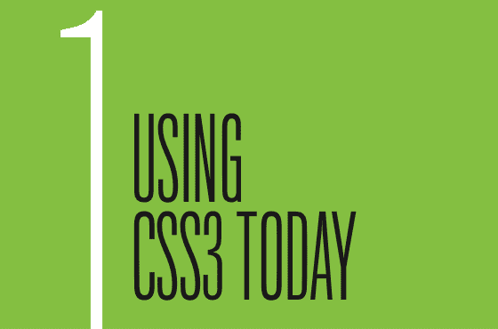

回顾 CSS 的传奇历史，我们看到一些重要的里程碑塑造了我们作为网页设计师的方向。这些分水岭式的技术、文章和事件帮助我们创建了灵活、可访问的网站，无论从视觉上还是从底层代码上，我们都引以为豪。

可以说，事情在 2001 年开始变得有趣起来，当时 Jeffrey Zeldman 撰写了《让糟糕的浏览器见鬼去吧》（[`bkaprt.com/css3/1/`](http://bkaprt.com/css3/1/)）^(1)，标志着 CSS 时代的黎明。这份宣言鼓励设计师们向前迈进，将 CSS 用于不仅仅是链接颜色和字体，而抛弃那些无法处理 CSS1 的旧式、无能的浏览器。是的，*CSS1*。

接下来的几年里，我们不断发现并分享使用 CSS 实现客户和老板需求的技术。那是一个激动人心的实验时代，我们突破界限，摸索出处理跨浏览器渲染问题的复杂方法——所有这一切都是为了增加灵活性、提高可访问性并减少代码量。

大约在 2006 年左右，关于 CSS 的讨论变得沉寂。我们需要解决的大多数问题都有了文档化的解决方案。常见的浏览器漏洞也有了多种变通方法。我们为那些因莫名其妙的 Internet Explorer 漏洞而留下心理创伤的设计师成立了支持小组。我们的头发开始变白。（好吧，我是在说我自己。）但最重要的是，当时的主流浏览器相对停滞不前。这段稳定期让我们有时间打磨可复用的方法并建立最佳实践，但对于渴望更好工具的 CSS 爱好者来说，情况变得有点，我敢说，*无聊*。

幸运的是，情况发生了变化。浏览器开始更快地迭代和更新（好吧，至少其中一些是这样）。Firefox 和 Safari 不仅开始获得市场份额，而且凭借更快的开发周期蓬勃发展，在添加更多实验性属性的同时，也提供了坚实的标准支持。在许多情况下，这些具有前瞻性的浏览器选择实现的技术随后被纳入草案规范。换句话说，有时是浏览器厂商推动了规范的进展。

## 但别去读规范

问一屋子网页设计师：“谁喜欢读规范？”可能只有一个人会举手。（如果你是那个人，我赞赏你，以及你显然拥有的空闲时间。）虽然规范是重要的*参考*，但我当然不喜欢通读整个规范，也不建议为了全面掌握 CSS3 而这样做。

好消息是，CSS3 实际上是一系列*模块*，它们被设计成可以彼此独立地实现。这是一件非常好的事情。这种分块的方法使得规范的某些部分可以比其他部分进展得更快（或更慢），并鼓励浏览器厂商在 CSS3 整体被认为完成之前，先实现那些更成熟的模块。

W3C 解释了这种模块化方法：

> 与其试图将数十个更新塞进一个单一的庞大规范中，不如能够单独更新规范的各个部分，这样会更简单、更高效。模块将使 CSS 能够以更及时、更精确的方式更新，从而使整个规范能够更灵活、更及时地演进。^(2)

这对我们网页设计师的好处是，伴随着实验和更快的发布周期，我们可以在许多 CSS3 属性成为候选推荐标准之前（也许要等上几年）就使用它们。

当然，如果你*喜欢*阅读规范，那就去读吧！自然，里面有很多东西可以学——但更实际的做法是专注于那些目前已经实现且*今天*就能用的部分，而这些正是我们将在本章剩余部分讨论的内容。之后，我们将在本书其余部分的示例中应用这些内容。

我通过剖析现实中的示例学到的网页设计知识，总是比阅读白皮书要多，而这正是我们在接下来的页面中要强调的。

## CSS3 属于每个人

我经常听到全球各地的同行网页设计师这样说：“我等不及要用 CSS3 了……*等它完成的时候*。”

但事实是，每个人现在就可以开始使用 CSS3。幸运的是，你不需要改变思维方式，也不需要对你构建网站的方式进行剧烈调整。怎么能在任何项目中使用 CSS3 呢？因为我们将精心选择应用 CSS3 的场景，将重点放在*体验层*上。

### 瞄准体验层

如果过去几年我们做得正确，我们一直在网络标准（语义化 HTML 和用于布局、字体、颜色等的 CSS）的基础上构建，而将大部分交互效果——动画、反馈和移动——留给 Flash 和 JavaScript 等技术。随着 CSS3 属性在有前瞻性的浏览器中缓慢但稳步地引入，我们可以开始将部分体验层转移到样式表中。

作为一个更偏向视觉设计而非编程的界面设计师，我越能用已经熟悉的工具（如 HTML 和 CSS）来创造引人入胜的用户体验，我就越会开心地手舞足蹈。

CSS3 是为像你我这样的网页设计师准备的，我们可以*今天*就开始使用它的部分功能，只要我们知道*何时*以及*如何*将其融入其中。

### 何时应用 CSS3

就网站的视觉体验而言，我们可以将事物分为两类：关键性和非关键性（表 1.01）。

表 1.01：网站的视觉体验可分为关键性和非关键性两类。后者是今天可以应用 CSS3 的地方。

| 关键性 | 非关键性 |
| --- | --- |
| 品牌 | 交互 |
| 可用性 | 视觉奖励 |
| 可访问性 | 反馈 |
| 布局 | 动效 |

品牌塑造、可用性和布局等领域对任何网站的成功都至关重要，因此，使用尚未被所有浏览器完全支持的技术会带来风险。

例如，在不断发展的 CSS3 规范中，有多个关于布局控制的草案——这正是我们迫切需要的。多年来，我们一直在借用 `float` 属性来处理布局。我们已经学会了如何利用现有手段勉强应付，但一个真正的布局引擎绝对是必需的。

话虽如此，CSS3 的三个新布局模块中有两个尚未被任何浏览器实现。它们仍在完善中，可以说仍然令人困惑、难以掌握，而且很可能不是我们一直在寻找的最终解决方案。最重要的是，对于布局这样重要的事情，CSS3 目前还不是合适的工具。

另一方面，非关键性事件（如交互：悬停、聚焦、表单元素、浏览器视口灵活性）以及由这些交互产生的视觉增强（包括动画）则不同。在这些事件上，让不同浏览器提供完全一致的体验远没有那么重要，因此这正是将 CSS3 的某些部分应用于当前支持它们的浏览器的绝佳机会。

正是基于这些非关键性事件，我们将在本书中应用 CSS3，同时保持页面更重要的特性在所有浏览器中完好无损，无论它们当前对 CSS3 的支持程度如何。

当我们决定聚焦并瞄准视觉体验中的这些非关键领域时，就可以非常自由地叠加 CSS3 并丰富网站的交互，而无需担心核心信息、布局和可访问性会受到影响。

## 当前可用的核心 CSS3 属性

那么，虽然我们已经将体验层确定为当前可以安全应用 CSS3 的地方，但我们还需要确定可以使用哪些 CSS3 属性。也就是说，规范的哪些部分已经达到了足够的浏览器实现临界点，从而可以实际使用。

CSS3 的很大一部分尚未在任何浏览器中实现。许多内容仍在制定中。我们可以对那些仍在变化的部分保持好奇，但最好还是将注意力集中在实际可用的部分上，幸运的是，现在已经有相当多的部分是可用的。

让我们快速浏览一下本书示例中将使用的相对较小的核心 CSS3 属性集（如下所示，以及表 1.02）。这里只是简单介绍，稍后我们将深入探讨高级语法和实际用法。

表 1.02：CSS3 属性及其支持的浏览器

| 属性 | 支持的浏览器 |
| --- | --- |
| `border-radius` |  |  |  |  |  |
|  | 3+ | 3+ | 1+ | 10.5+ | 9 beta |
| `text-shadow` |  |  |  |  |  |
|  | 1.1+ | 2+ | 3.1+ | 9.5+ |  |
| `box-shadow` |  |  |  |  |  |
|  | 3+ | 3+ | 3.5+ | 10.5+ | 9 beta |
| 多重背景图像 |  |  |  |  |  |
|  | 1.3+ | 2+ | 3.6+ | 10.5+ | 9 beta |
| `opacity` |  |  |  |  |  |
|  | 1.2+ | 1+ | 1.5+ | 9+ | 9 beta |
| RGBA |  |  |  |  |  |
|  | 3.2+ | 3+ | 3+ | 10+ | 9 beta |

### `border-radius`

用指定的半径值将元素的角变为圆角。支持 Safari 3+、Chrome 3+、Firefox 1+、Opera 10.5+ 和 IE9 Beta。示例：

```
.foo {
  border-radius: 10px;
  }
```

### `text-shadow`

一个 CSS2 属性（在 2.1 中被移除，后在 CSS3 中重新引入），为超文本添加阴影，可设置阴影的方向、模糊程度和颜色。支持 Safari 1.1+、Chrome 2+、Firefox 3.1+ 和 Opera 9.5+。示例：

```
p {
  text-shadow: 1px 1px 2px #999;
  }
```

### `box-shadow`

为元素添加阴影。语法与 `text-shadow` 相同。支持 Safari 3+、Chrome 3+、Firefox 3.5+、Opera 10.5+ 和 IE9 Beta。示例：

```
.foo {
  box-shadow: 1px 1px 2px #999;
  }
```

### 多重背景图像

CSS3 增加了在元素上应用多个背景图像（用逗号分隔）的能力，而 CSS2.1 只允许一个。支持 Safari 1.3+、Chrome 2+、Firefox 3.6+、Opera 10.5+ 和 IE9 Beta。示例：

```
body {
  background: url(image1.png) no-repeat top left,
  url(image2.png) repeat-x bottom left,
  url(image3.png) repeat-y top right;
  }
```

### `opacity`

定义元素的不透明度。值为 1 表示完全不透明，值为 0 表示完全透明。支持 Safari 1.2+、Chrome 1+、Firefox 1.5+、Opera 9+ 和 IE9 Beta。示例：

```
.foo {
  opacity: 0.5; /* .foo 将具有 50% 的不透明度 */
  }
```

### RGBA

这不是一个 CSS 属性，而是 CSS3 中引入的一种新的*颜色模型*，允许在指定 RGB 颜色值的同时指定不透明度级别。支持 Safari 3.2+、Chrome 3+、Firefox 3+、Opera 10+ 和 IE9 Beta。示例：

```
.foo {
  color: rgba(0, 0, 0, 0.75); /* 黑色，75% 不透明度 */
  }
```

当然，这个列表远非详尽。CSS3 包含更多属性和工具，其中许多仍在开发中，尚未在任何浏览器中实现。但你会注意到，前面列表中的每个属性都达到了某种浏览器支持阈值：它至少在两个主流浏览器中可用。在某些情况下，未来版本的 Internet Explorer（和 Opera）也承诺支持。

因此，我们现在有了一份简洁且可用的属性列表，它们基于在 Safari、Chrome、Firefox 和 Opera 中相对较好的支持。它们尚未在所有浏览器中通用，我们将在本书后面讨论为什么这没问题，以及如何为这种不统一的支持做好规划。

### 我们不会涉及的内容

我列出了本书中经常使用的少数 CSS3 属性，但其他属性呢？我选择不在这里详尽地涵盖所有内容，而是只关注当前实际可用的部分，因为它们具有良好且稳定的浏览器支持。

CSS3 规范中还有其他部分可能现在就可以使用，但超出了本书的范围（并且可能值得单独成书）：

1.  媒体查询（[`www.w3.org/TR/CSS3-mediaqueries/`](http://www.w3.org/TR/css3-mediaqueries/)）
2.  多列布局（[`www.w3.org/TR/CSS3-multicol/`](http://www.w3.org/TR/css3-multicol/)）
3.  网络字体（[`www.w3.org/TR/CSS3-webfonts/`](http://www.w3.org/TR/css3-webfonts/)）

读完本书后，请务必查看这些其他模块。

## 厂商特定前缀

我之前提到过，CSS3 规范是一系列模块，浏览器厂商正在逐步推出这些模块。在某些情况下，这种推出涉及实验性支持。也就是说，当规范在 W3C 被编写、讨论和敲定时，浏览器制造商可能会选择添加对某些属性的支持，并在真实环境中进行测试。这已成为流程中健康的一部分，实验性使用的反馈常被用来调整规范。

或者，浏览器厂商可能希望引入一个不属于任何拟议标准、但日后可能成为标准的实验性属性。

通常，对 CSS 属性的实验性支持是通过使用*厂商前缀*来处理的，如下所示：

```
-webkit-border-radius
```

这个以连字符为前缀的关键词附加在属性名称的开头，将其标记为进行中的工作，特定于浏览器对不断演变的规范的实现和解释。如果实验最终成为完成的 CSS3 模块的一部分，浏览器应支持不带前缀的属性名称。

每个浏览器厂商都有自己的前缀，本质上是对其实验性属性进行命名空间划分。其他浏览器会忽略包含它们无法识别前缀的规则。

表 1.03 显示了最广泛使用的厂商及其相关前缀，在后续章节的示例中，我们将使用 WebKit、Mozilla 和 Opera 前缀，因为它们与 CSS3 相关。

表 1.03：最广泛使用的厂商及其相关前缀。

|  | WebKit | `–webkit–` |
|  | Mozilla | `–moz–` |
|  | Opera | `–o–` |
|  | Konqueror | `–khtml–` |
|  | Microsoft | `–ms–` |
|  | Chrome | `–chrome–` |

### 厂商前缀的工作原理

以下是带厂商前缀的 CSS 在实际中的工作方式；我们以 `border-radius` 属性为例。假设我们想将一个元素的圆角半径设为 10 像素，可以这样写：

```
.foo {
  -webkit-border-radius: 10px;
  -moz-border-radius: 10px;
  border-radius: 10px;
  }
```


WebKit（Safari、移动 Safari 和 Chrome 的内核）和 Gecko（Firefox 的内核）浏览器各自通过自己的厂商前缀版本支持`border-radius`属性，而 Opera 则支持不带厂商前缀的属性。IE9 也将支持不带厂商前缀的`border-radius`。

### 最佳顺序

使用厂商前缀时，务必注意声明中列出规则的顺序。你会注意到在上面的例子中，我们首先列出了带厂商前缀的属性，然后是不带前缀的 CSS3 属性。

为什么把实际的 CSS3 属性放在最后？因为你的样式在未来可能会在更多浏览器中工作，从而逐步增强你的设计。当浏览器最终按照规范实现对该属性的支持时，真正的属性会取代实验性版本，因为它位于列表的最后。如果厂商特定版本的实现与真正的属性不同，你就能确保最终标准占据主导地位。

### 不要害怕厂商前缀！

你的第一反应可能是：“哎呀，这太混乱了，是专有技术！”但我向你保证，这不仅是前进的方向，而且比非 CSS3 解决方案中常见的代码臃肿和僵化要清晰得多，同时也是规范演进的重要组成部分。

通过现在使用这些带厂商前缀的属性，我们可以测试水温，甚至在规范最终确定之前向浏览器制造商提供宝贵的反馈。也请记住，前缀通常附加在拟议标准上。这与我们过去偶尔用来解决跨浏览器问题的其他 hackish CSS 有很大区别。

有些人可能会将厂商前缀与许多人为针对特定浏览器版本而使用的语法技巧（例如，使用`w\idth: 200px`或`_width: 200px`来针对特定版本的 IE）相提并论。但相反，厂商前缀是标准流程的重要组成部分，允许属性在真实世界的实现中演进。

正如 CSS 专家 Eric Meyer 在 A List Apart 上的文章“Prefix or Posthack”（[`bkaprt.com/css3/2/`](http://bkaprt.com/css3/2/)）中所解释的那样：^(3)

> 前缀让我们掌控自己的 hack 命运。过去，我们不得不发明一堆解析器技巧，仅仅是为了让不一致的实现在我们发现它们不一致后表现一致。那是一种完全被动的做法。前缀是一种主动的做法。

他接着指出，厂商前缀不仅是积极的，而且应该更深入地融入标准流程，并且会：

> ……迫使厂商和工作组共同制定必要的测试来确定互操作性。这些测试可以指导后来者，帮助他们更快地实现互操作状态。他们可以在一个公开测试版中直接发布带前缀的实现，然后在下一个版本中移除前缀。

所以，不要为厂商前缀烦恼。使用它们，要知道你是这个过程的一部分，它让你今天就能完成工作，并为未来移除前缀铺平道路。

### 重复那么多怎么办？

你可能觉得为每个厂商重复看似相同的属性三四次很愚蠢，我可能同意你的看法。

但现实是，非 CSS3 解决方案可能需要僵化且更复杂的代码，尽管可能不重复。

我们不需要永远重复自己。目前，这是一个必要但临时的步骤，以保持浏览器之间可能不同的实现与最终规范实现分离。

在我们开始用少数可用的 CSS3 属性及其各自的厂商前缀做令人兴奋的事情之前，让我们先基本掌握 CSS 过渡。理解过渡及其运作方式将帮助我们将其与其他属性结合，创造美妙的体验。

1. 长 URL：[`www.alistapart.com/articles/tohell/`](http://www.alistapart.com/articles/tohell/) [[↵]](#chapter1.html_footnote-1-backlink)
2. [`www.w3.org/TR/css3-roadmap/#whymods`](http://www.w3.org/TR/css3-roadmap/#whymods) [[↵]](#chapter1.html_footnote-2-backlink)
3. [`www.alistapart.com/articles/prefix-or-posthack/`](http://www.alistapart.com/articles/prefix-or-posthack/) [[↵]](#chapter1.html_footnote-3-backlink)

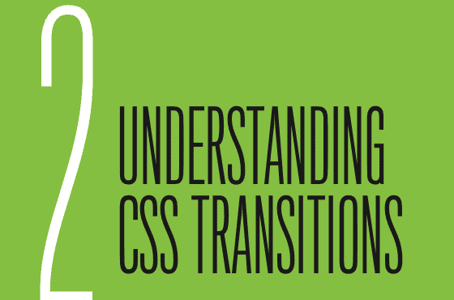

那是 1997 年，我坐在马萨诸塞州美丽的奥尔斯顿一间破旧不堪的公寓里。一个典型的深夜，我在查看源代码并自学 HTML，白天则在当地一家唱片公司打包 CD 赚取微薄收入（所以公寓破旧）。我相信你能理解。

一个胜利的夜晚，我兴奋地挥舞着拳头。我刚刚成功编写了第一个 JavaScript 图像翻转效果。还记得那些吗？

我仍然记得看到自己拼凑出来的粗糙按钮图形在鼠标悬停时“切换”成另一个图形时的惊奇。当时我几乎不知道自己在做什么，但让页面上的东西成功变化，动态地，嗯……就像魔法一样。

在过去的十年里，我们在网页交互和视觉体验方面取得了长足的进步。历史上，Flash 和 JavaScript 等技术实现了动画、运动和交互效果。但最近，随着浏览器开始支持 CSS 过渡和变换，其中一些动画和体验增强现在可以轻松地转移到我们的样式表中。

1997 年，我第一次用 JavaScript 实现图片翻转效果，花了几个晚上挠头苦思，写了许多当时对我来说如同天书般的代码，还用了多张图片。而如今的 CSS3 只需几行简洁的代码就能实现更丰富、更灵活的交互效果，而且值得庆幸的是，在不支持它的浏览器中也能优雅降级。

正如我在第 1 章中提到的，只要我们谨慎选择使用场景，现在就可以开始使用一些 CSS3 属性。CSS 过渡也是如此。它们当然不会取代 Flash、JavaScript 或 SVG 等现有技术（尤其是在浏览器支持还不够广泛的情况下），但与前面提到的核心 CSS3 属性（以及我们将在本书后面介绍的 CSS 变换和动画）结合使用时，它们可以用来将体验层提升一个档次。最重要的是，对于已经熟悉 CSS 的网页设计师来说，它们相对容易实现，只需要几行代码。

我在这里（第 2 章）早早地介绍 CSS 过渡，是因为我们将在本书后面的许多示例中应用它们。在深入案例研究之前，对过渡的语法及其工作原理有一个基本了解会很有帮助。

## 本末倒置

CSS 过渡最初由 WebKit 团队为 Safari 开发，现在已成为 W3C 的工作草案规范。（CSS 变换和 CSS 动画有着相同的渊源，我们将在第 4 章和第 6 章中分别讨论它们。）

这是一个很好的例子，展示了浏览器创新如何被纳入潜在标准。我说潜在，是因为它目前还只是一个草案。不过，Opera 最近在 10.5 版本中增加了对 CSS 过渡的支持，Firefox 也承诺在 4.0 版本中支持。换句话说，尽管它还是一个草案规范，仍在演变中，但它已经足够稳定，以至于 Opera 和 Firefox 都认真对待并添加了支持。最重要的是，CSS 过渡不再是 Safari 独有的专有实验。

让我们来看看过渡是如何工作的，好吗？就像第 1 章中讨论的 CSS3 属性一样，我在这里只介绍它们的基本语法，以便你掌握它们的运作方式。稍后，我们将用过渡做各种有趣的事情，用它来润色后续章节中的示例，届时你就能快速理解过渡如何恰当地融入其中。

## 什么是 CSS 过渡？

我喜欢把 CSS 过渡想象成黄油，当触发悬停、点击和聚焦等交互时，它能平滑地改变样式表中的值变化。与真正的黄油不同，过渡不会让人发胖——它们只是样式表中的几条简单规则，用来丰富设计中的某些事件。

W3C 对 CSS 过渡的解释非常简单（[`bkaprt.com/css3/3/`](http://bkaprt.com/css3/3/)）：^(4)

> CSS 过渡允许 CSS 值的属性变化在指定的持续时间内平滑发生。

这种平滑效果会在鼠标点击、聚焦或激活状态，或任何元素变化（甚至包括元素`class`属性的变化）触发时，对 CSS 值的变化进行动画处理。

## 一个简单的示例

让我们从一个简单的例子开始，我们将为链接的背景颜色切换添加一个过渡。当鼠标悬停时，链接的背景颜色会改变，我们将使用过渡来平滑这种变化——这种效果以前只能用 Flash 或 JavaScript 实现，但现在只需几行简单的 CSS 代码即可。

标记是一个简单的超链接，如下所示：

```html
<a href="#" class="foo">过渡我吧！</a>
```

接下来，我们将为正常链接状态添加声明，设置一点内边距和浅绿色背景，然后在悬停时切换到深绿色背景（图 2.01）：

```css
a.foo {
  padding: 5px 10px;
  background: #9c3;
  }

a.foo:hover {
  background: #690;
  }
```

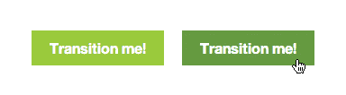

图 2.01：链接的正常状态和`:hover`状态。

现在，让我们为这个背景颜色变化添加一个过渡。这将平滑地动画化指定时间段内的变化（图 2.02）。

为了简单起见，我们暂时只使用目前基于 WebKit 的浏览器（Safari 和 Chrome）中有效的厂商前缀属性。稍后，我们将为 Mozilla 和 Opera 添加厂商前缀。

```css
a.foo {
  padding: 5px 10px;
  background: #9c3;
  -webkit-transition-property: background;
  -webkit-transition-duration: 0.3s;
  -webkit-transition-timing-function: ease;
  }
```

```css
a.foo:hover {
  background: #690;
  }
```

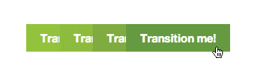

图 2.02：此图显示了从浅绿色到深绿色背景的平滑过渡。

你会注意到声明中过渡的三个部分：

- `transition-property`：要过渡的属性（本例中为`background`属性）。
- `transition-duration`：过渡应持续的时间（0.3 秒）。
- `transition-timing-function`：过渡随时间变化的速度（`ease`）。

## 计时函数（或者，我真希望当初数学课认真听了）

计时函数值通过定义六种可能性之一来允许过渡速度随时间变化：`ease`、`linear`、`ease-in`、`ease-out`、`ease-in-out`和`cubic-bezier`（允许你定义自己的计时曲线）。

如果你像我一样在高中几何课上睡着了，别担心。我建议你直接插入每个计时函数值，看看它们有何不同。

对于我们的简单示例，过渡持续时间非常短（仅 0.3 秒），很难区分这六种选项。对于较长的动画，你选择的计时函数就变得更加重要，因为你有时间注意到动画过程中速度的变化。

如果不确定，`ease`（也是默认值）或`linear`对于短过渡来说应该没问题。

## 延迟过渡

回到我们的示例，过渡可以在屏幕上触发事件后延迟发生。例如，假设我们希望背景过渡在链接悬停后半秒才开始。我们可以使用`transition-delay`属性来实现。

```css
a.foo {
  padding: 5px 10px;
  background: #9c3;
  -webkit-transition-property: background;
  -webkit-transition-duration: 0.3s;
  -webkit-transition-timing-function: ease;
  -webkit-transition-delay: 0.5s;
  }

a.foo:hover {
  background: #690;
  }
```

## 过渡的简写形式

我们可以通过使用过渡的简写属性来大大简化（无延迟的）声明，这也是我们在本书后续示例中使用的语法。

```css
a.foo {
  padding: 5px 10px;
  background: #9c3;
  -webkit-transition: background 0.3s ease;
  }
```

```css
a.foo:hover {
  background: #690;
  }
```

现在我们有了一个更紧凑的规则，实现了相同的结果。

### 带延迟的简写过渡

如果我们想为简写版本的过渡重新添加半秒延迟，可以通过将持续时间值放在规则末尾来实现，如下所示：

```css
a.foo {
  padding: 5px 10px;
  background: #9c3;
  -webkit-transition: background 0.3s ease 0.5s;
  }
```

```css
a.foo:hover {
  background: #690;
  }
```

当然，所有这些美妙的过渡在 WebKit 浏览器中运行良好，但其他浏览器呢？

## 浏览器支持

正如我之前提到的，过渡效果最初由 WebKit 开发，自 Safari 和 Chrome 3.2 版本起就已支持，而 Opera 在 10.5 版本中也提供了支持（[`bkaprt.com/css3/4/`](http://bkaprt.com/css3/4/)）^(5)，并且 Firefox 4.0 已承诺支持（[`bkaprt.com/css3/5/`](http://bkaprt.com/css3/5/)）。^(6)

由于当前及近期的支持情况，添加适当的厂商前缀至关重要，这样我们的过渡效果就能在更多浏览器中随着支持的推出而生效。

## 构建完整的过渡堆栈

以下是修订后的声明，添加了`-moz-`和`-o-`前缀以及实际的 CSS3 `transition`属性。同样，我们将无前缀的属性放在堆栈的最后，以确保当该属性从草案变为最终状态时，最终实现将优先于其他实现。

```css
a.foo {
  padding: 5px 10px;
  background: #9c3;
  -webkit-transition: background 0.3s ease;
  -moz-transition: background 0.3s ease;
  -o-transition: background 0.3s ease;
  transition: background 0.3s ease;
  }

a.foo:hover {
  background: #690;
  }
```

有了这个堆栈，我们就能在当前版本的 Safari、Chrome 和 Opera 中平滑地改变背景色，并且在未来任何选择支持该特性的浏览器中也能实现。

## 过渡状态

我记得刚开始尝试 CSS 过渡时有点困惑。将过渡属性放在`:hover`声明中不是更合理吗？因为那是触发过渡的条件。答案是元素除了`:hover`之外还有其他可能的状态，而你很可能希望过渡在每个状态上都发生，而无需重复声明。

例如，你可能希望过渡也发生在链接的`:focus`或`:active`伪类上。与其将过渡属性堆栈添加到每个声明中，不如将过渡指令附加到正常状态，这样只需声明一次。

下面的示例为`:focus`状态添加了相同的背景切换。这样，无论是通过悬停还是聚焦链接（例如通过键盘），都能触发过渡。

```css
a.foo {
  padding: 5px 10px;
  background: #9c3;
  -webkit-transition: background 0.3s ease;
  -moz-transition: background 0.3s ease;
  -o-transition: background 0.3s ease;
  transition: background 0.3s ease;
  }

a.foo:hover,
a.foo:focus {
  background: #690;
  }
```

## 过渡多个属性

假设除了背景色，我们还想改变链接的文本颜色并对其进行过渡。我们可以通过用逗号分隔多个过渡来实现。每个过渡可以有不同的持续时间和缓动函数（图 2.03）。

```css
a.foo {
  padding: 5px 10px;
  background: #9c3;
  -webkit-transition: background .3s ease, color 0.2s linear;
  -moz-transition: background .3s ease, color 0.2s linear;
  -o-transition: background .3s ease, color 0.2s linear;
  transition: background .3s ease, color 0.2s linear;
  }

a.foo:hover,
a.foo:focus {
  color: #030;
  background: #690;
  }
```

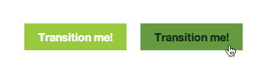

图 2.03：链接的正常状态和`:hover`状态。

## 过渡所有可能的属性

另一种列出多个属性的方法是使用`all`值。这将过渡所有可用的属性。

让我们将`all`放入简单的示例中，而不是分别列出`background`和`color`。现在它们将共享相同的持续时间和缓动函数。

```css
a.foo {
  padding: 5px 10px;
  background: #9c3;
  -webkit-transition: all 0.3s ease;
  -moz-transition: all 0.3s ease;
  -o-transition: all 0.3s ease;
  transition: all 0.3s ease;
  }

a.foo:hover,
a.foo:focus {
  color: #030;
  background: #690;
  }
```

这是一种便捷的方式，可以捕获`:hover`、`:focus`或`:active`事件中发生的所有变化，而无需列出每个你想要过渡的属性。

## 哪些 CSS 属性可以过渡？


现在我们已经成功过渡了超链接的`background`和`color`，还有许多其他 CSS 属性也可以过渡，包括`width`、`opacity`、`position`和`font-size`。W3C 提供了所有可过渡属性（及其类型）的图表（[`bkaprt.com/css3/6/`](http://bkaprt.com/css3/6/)）。^(7)

实现流畅体验的机会显而易见。在下一章及后续的案例研究示例中，我们将结合过渡使用其中几个属性。

## 为什么不改用 JavaScript？

你可能会想，既然并非所有浏览器都支持（或至少承诺支持）CSS 过渡，为什么不使用 JavaScript 解决方案来处理动画呢？流行的框架如 jQuery、Prototype 和 script.aculo.us 已经通过 JavaScript 实现了跨浏览器动画，并且已经有一段时间了。

这完全取决于过渡对体验的重要性。在这本小书中，我强调如果你选择用户体验中合适的部分来应用 CSS3，就可以拥抱它的简洁性和灵活性：丰富页面上发生的交互。通常，由 CSS 过渡处理的这些交互动画对网站的品牌、可读性或布局并非不可或缺。因此，用几行简单的 CSS 来触发一个简单的动画，该动画在支持它的浏览器中是`原生`的（而不是依赖 JavaScript 框架），似乎是一个明智的选择。我很高兴我们拥有这个选择。

## 明智而微妙

就像所有闪亮的新工具一样，`恰当地`使用过渡非常重要。很容易过度使用，将过渡添加到页面上的所有元素，结果变成某种烦人、脉动的怪物。关键在于决定哪些地方过渡能真正丰富用户体验，哪些地方只是多余的噪音。此外，确保过渡的速度不会拖慢用户原本敏捷的操作至关重要。请谨慎使用。

关于 CSS 过渡和动画的合适速度的更多思考，请参阅 Trent Walton 的相关文章：[`bkaprt.com/css3/7/`](http://bkaprt.com/css3/7/)。^(8)

现在我们已经对 CSS 过渡在技术层面上的工作原理有了扎实的基础知识，我们可以用它们来平滑后续示例中的体验层，从下一章开始。让我们开始吧。

4\. 长 URL：[`www.w3.org/TR/CSS3-transitions/`](http://www.w3.org/TR/CSS3-transitions/) [[↵]](#chapter2.html_footnote-4-backlink)

5\. 长 URL：[`www.opera.com/docs/specs/presto23/css/transitions/`](http://www.opera.com/docs/specs/presto23/css/transitions/) [[↵]](#chapter2.html_footnote-5-backlink)

6\. 长 URL：[`developer.mozilla.org/en/CSS/CSS_transitions`](https://developer.mozilla.org/en/CSS/CSS_transitions) [[↵]](#chapter2.html_footnote-6-backlink)

7\. 长 URL：[`www.w3.org/TR/css3-transitions/#properties-from-css-`](http://www.w3.org/TR/css3-transitions/#properties-from-css-) [[↵]](#chapter2.html_footnote-7-backlink)

8\. [`trentwalton.com/2010/03/22/CSS3-in-transition/`](http://trentwalton.com/2010/03/22/CSS3-in-transition/) [[↵]](#chapter2.html_footnote-8-backlink)

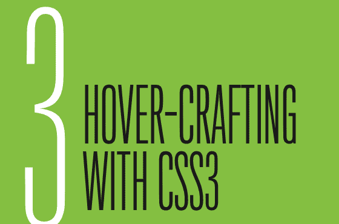

我们在前两章进行了训练，了解了当前 CSS3 中可用的功能。我们还讨论了`体验层`目前是应用这些可用 CSS3 最合适的地方。

回顾一下我们目前涵盖的重要内容，请记住以下几点：

1. 有一些核心的 CSS3 属性现在就可以使用。
2. 每个人都可以在自己的项目中使用这些核心属性，尤其是在针对体验层时。
3. 厂商前缀让我们能够立即向前推进，帮助在实际环境中测试尚在变化中的属性。
4. CSS 过渡不再是专有的实验性功能，而是其他浏览器正在采纳的草案规范。让我们用起来吧！

有了这些反重力腰带下的知识，现在是时候用我们所有的新工具来玩一玩了，并在一个全页设计的上下文中让它们发挥作用。

## 我们的案例研究

在接下来的大多数示例中，我将使用我设计的一个虚构案例研究：对宇航员们有幸前往月球并留在那里的所有物品的幽默致敬（图 3.01）。这个主题背后有一个与本书主题直接相关的故事，请容我稍作说明。

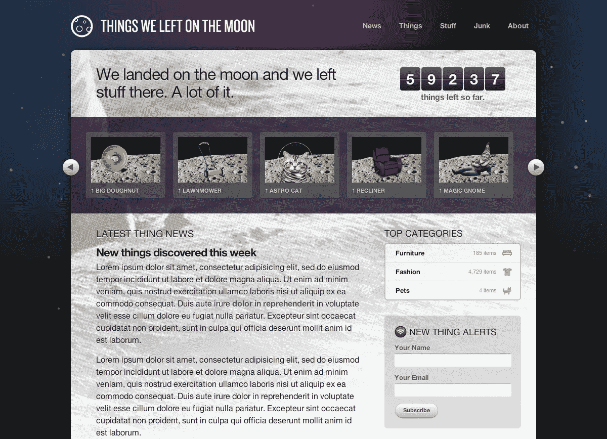

图 3.01：我们的虚构案例研究，`我们留在月球上的东西`。

### 太空和网络中的信息

1969 年，宇航员尼尔·阿姆斯特朗和巴兹·奥尔德林成为首批踏上月球的人类。我一直是太空旅行和美国国家航空航天局（NASA）计划的普通爱好者，但在阿波罗 11 号任务四十周年之际听到更多关于它的消息，促使我阅读了更多关于登月历史和事件的内容。尤其让我着迷的是所有留在月球上并至今仍在那里的东西。

在所有被留下的物品中，有一个我特别感兴趣，它堪称用户体验设计的绝佳范例。那是一块小小的硅片（大约相当于美国半美元硬币的大小）。硅片上刻有来自全球七十多个国家领导人的友好信息。你需要用显微镜才能阅读它们，但宇航员能携带的物品有限，这帮助塑造了这件纪念品的设计——它可以留在月球上，供未来的访客发现（图 3.02）。

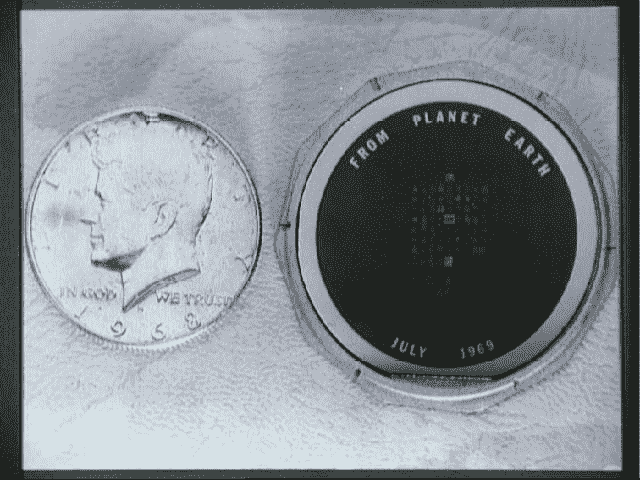

图 3.02：阿波罗 11 号宇航员留在月球上的小硅片（大约相当于美国半美元硬币大小）。（NASA/由 nasaimages.org 提供）

从某种意义上说，NASA 是在利用当时可用的最新技术，为未来某个未知的受众设计一件物品。听起来很熟悉吧？

后来，在 1977 年，旅行者 1 号和旅行者 2 号航天器也通过“金唱片”解决了类似的设计问题：一张镀金铜质留声机唱片，其中包含来自地球生命的音频、图像和图表（图 3.03）。从某种意义上说，这张唱片是向太阳系以外潜在文明投递的一封瓶中信。它的外壳上用符号语言刻着如何正确播放唱片、它来自银河系的哪个位置以及其他说明。

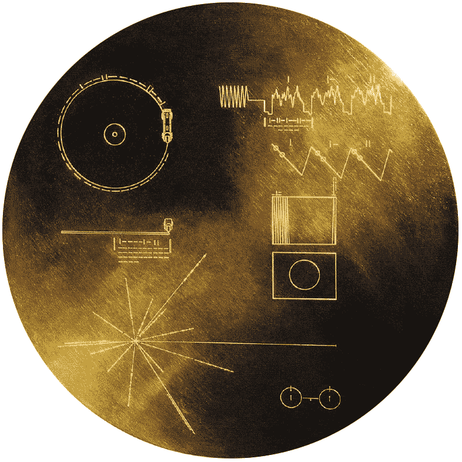

图 3.03：金唱片的镀金外壳，这是一张搭载在旅行者 1 号和 2 号航天器上的留声机唱片。（由 NASA/JPL-Caltech 提供）

就像仍躺在月球尘埃中的硅片一样，金唱片在制作时也使用了当时最先进的技术，为的是应对充满无数未知的用户体验。外星人捡到这张唱片后，能看到、摸到并听到其中的内容吗？

我们可以从留在月球上的硅片和飞向深空的金唱片中学到很多——利用尽可能好的技术，有助于向一个基本未知的受众传递信息。

作为网页设计师，当我们在网络上创造东西时，我们也是在投递瓶中信。我们可以对谁会阅读它们、他们实际能理解什么等做出假设——但我们永远无法 100% 确定。但这不应阻止我们使用可用的最佳技术来传递信息及其相关体验，让体验在较旧或能力较弱的设备上优雅降级。

我们作为设计师的工作不仅仅是把瓶子打扮得漂亮，而是要找到丰富故事和增强信息的方法。CSS3 现在就能帮助我们做到这一点。

所以现在你明白为什么我们的案例研究要向那些留在月球上或漂浮在太空中的信息致敬了。是时候开始剖析这个网站，将其分解成与 CSS3 相关的、易于消化的小例子了。我发现把所有我们将讨论的技术集中在一个地方很有帮助。你可以随时参考这个模板和所有示例，它们都存在于一个活生生的、不断更新的单页网站中。

你可以从[`CSS3exp.com/code`](http://CSS3exp.com/code)下载案例研究的示例代码。

接下来的每一章都会处理一组与 CSS3 相关的不同示例。我并没有试图面面俱到，告诉你关于 CSS3 的一切，而是恰恰相反：深入探讨非常具体、有针对性的示例，同时展示它们如何在模拟环境中工作——这些快速收获你可以立即应用，并在消化这些页面后进一步扩展。`嗝。`

## 惊喜与愉悦

让网页设计与静态媒体如此不同且有趣的部分原因在于`交互`。事物可以做出反应、移动，甚至在像素而非纸张上体验时带来惊喜。

正是这种交互，CSS3 可以轻松地为支持它的浏览器增强，而不会让不支持的浏览器感到缺失。

一个用 CSS3 带来惊喜与愉悦的绝佳例子可以在荷兰设计师兼开发者 Faruk Ateş 的个人网站（[`farukat.es`](http://farukat.es)）上找到。侧边栏中有一个指向各种社交网络的链接列表，当鼠标悬停时，这些链接会展开并借助多种 CSS3 处理和流畅的过渡变得生动起来（图 3.04）。

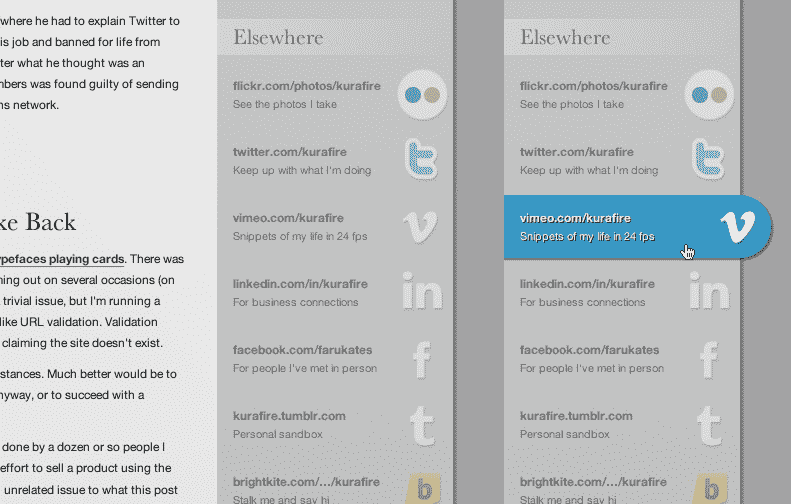

图 3.04：Faruk Ateş 网站上的侧边栏和悬停处理效果。

看起来只是一个普通的文本列表，图片浮动在右侧，但当你与之交互时，它会变得有趣得多。这是丰富体验层的一个典型例子，Faruk 使用了多种 CSS3 属性来实现这一点（在支持它们的浏览器中）。

图 3.05 显示了在完全不支持 CSS3 的 Internet Explorer 7 中看到的相同默认状态和悬停状态。但你会注意到，虽然悬停状态没有那么精致，但它仍然是一个可用、可读且`功能正常`的体验——更不用说默认的非悬停状态几乎完全相同了。

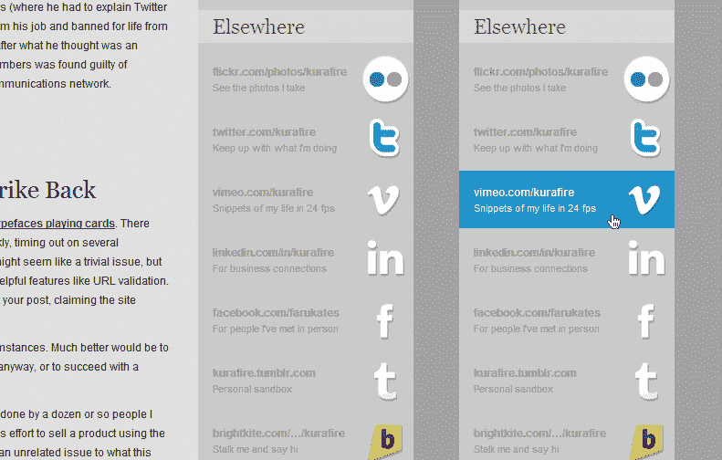

图 3.05：在 IE7 中查看时，Faruk Ateş 的网站没有通过 CSS3 实现相同的视觉效果，但这完全没问题。

悬停（或聚焦）在一个元素上是使用 CSS3 增强体验的绝佳时机。Internet Explorer 的用户会获得不同的体验（直到它最终支持 CSS3 属性）。但这种替代体验完全没问题，并不意外，而且坦率地说，IE 用户不会知道自己错过了什么。

也就是说，直到他们在朋友的 Safari、Chrome、Firefox 或 Opera 浏览器上打开这个页面（并感到一阵嫉妒）。

## 网站在每个浏览器中都需要完全相同的体验吗？

这是一个重要的问题（在此时提出也很恰当），我尝试在这个超长域名的网站上回答它（图 3.06）：[`dowebsitesneedtobeexperiencedexactlythesameineverybrowser.com`](http://dowebsitesneedtobeexperiencedexactlythesameineverybrowser.com)。

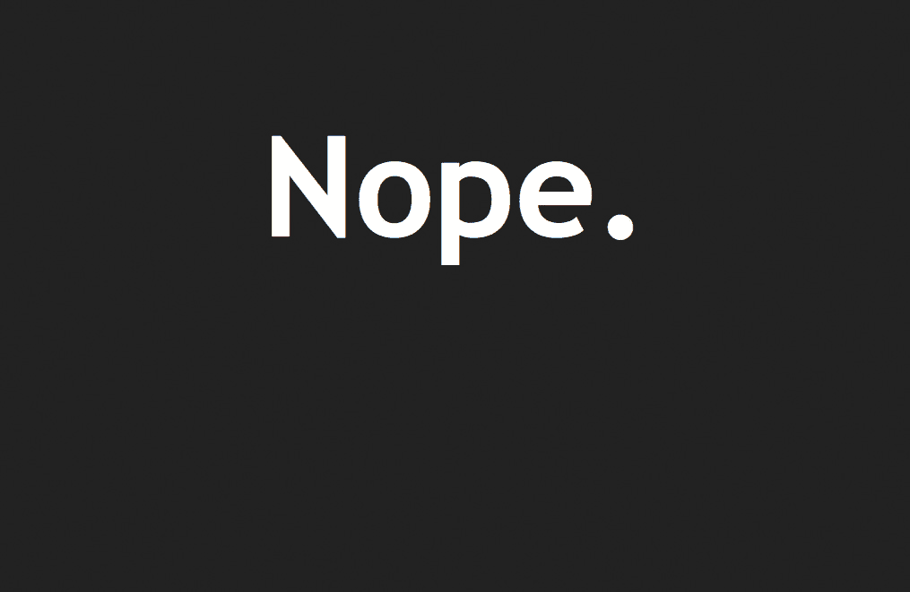

图 3.06：这个名字古怪的网站[`dowebsitesneedtobeexperiencedexactlythesameineverybrowser.com`](http://dowebsitesneedtobeexperiencedexactlythesameineverybrowser.com)。

和 Faruk 的例子一样，只有当你开始与网站交互时，事情才变得有趣。表面上，该网站在大多数浏览器中看起来几乎相同，但当你移动鼠标划过屏幕和文字时（图 3.07），一系列 CSS3 属性、过渡和变换会被应用，从而创造出独特且令人难忘的体验。

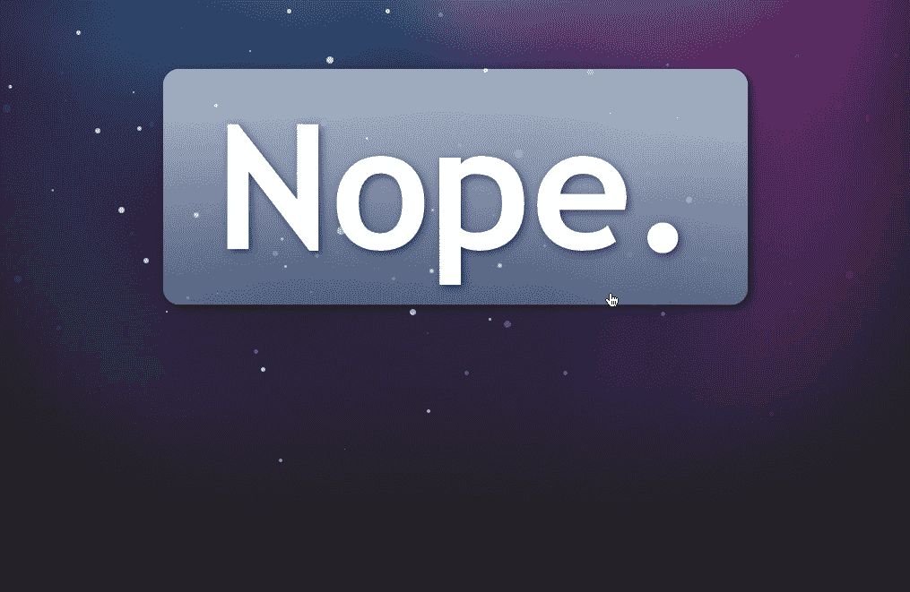

图 3.07：与网站交互时，会展现出更丰富的体验。这得益于我们的朋友 CSS3。

再次强调，正是在体验层中，我们逐步增强了这个网页设计。核心内容、可读性、可用性和标记保持一致且不受影响。

## 导航月球

让我们将 CSS3 添加到设计悬停交互的概念应用到我们的案例研究中。我将带领大家创建网站顶部导航（图 3.08），其中我们结合了`border-radius`、`text-shadow`、RGBA 和 CSS 过渡，创造出令人惊喜和愉悦的体验。

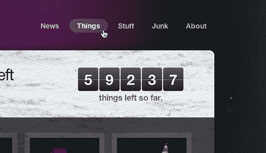

图 3.08：案例研究的顶部导航，悬停时通过 CSS3 增强效果。

### 首先，标记

作为优秀的语义学家，我们将使用一个经典的无序列表来标记顶部导航。

```
<ul id="nav">
  <li><a href="#">新闻</a></li>
  <li><a href="#">事物</a></li>
  <li><a href="#">东西</a></li>
  <li><a href="#">杂物</a></li>
  <li><a href="#">关于</a></li>
</ul>
```

当然，这里并没有什么惊天动地的东西——只是一个合适的结构，我们可以用它来开始应用样式。

### 浮动列表项

首先，让整个列表浮动，并使用一些内边距将其定位到页面右侧；然后，也让每个列表项浮动。

```
#nav {
  float: right;
  padding: 42px 0 0 30px;
  }

#nav li {
  float: left;
  margin: 0 0 0 5px;
  }
```

图 3.09 显示了结果。我们的列表现在是水平的。

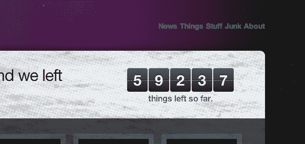

图 3.09：通过几条 CSS 规则变为水平的链接列表。

### 使用 RGBA 设置链接颜色

接下来，为每个链接添加一些内边距，并将颜色改为半透明白色。我们将使用 RGBA 将白色（`255, 255, 255`）设置为 70% 不透明度（`0.7`），让文字吸收一些其后的背景颜色（图 3.10）。

```
#nav li a {
  padding: 5px 15px;
  font-weight: bold;
  color: rgba(255, 255, 255, 0.7);
  }
```

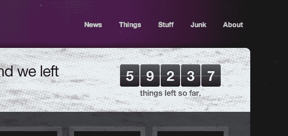

图 3.10：现在链接使用 RGBA 样式，使文字与背景略微融合。

图 3.11 显示了链接的特写，通过 RGBA 设置的 70% 不透明度的白色让背景微微透出。

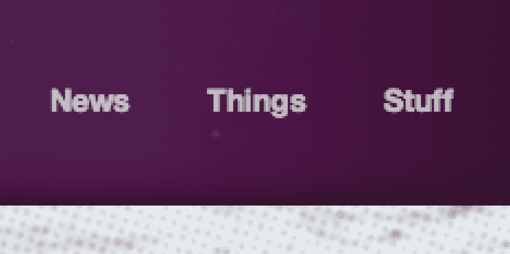

图 3.11：半透明链接的放大视图。

### 为 RGBA 提供后备方案

虽然 RGBA 是一种非常灵活的方式来指定颜色及其不透明度，但并非所有浏览器都支持。当前版本的 Safari、Chrome、Firefox 和 Opera 都支持它，Internet Explorer 9 也支持——但 IE6–8 呢？

这时指定一个`后备`颜色就派上用场了。当使用 RGBA 分配颜色值时，最佳实践是先指定一个纯色，作为不支持 RGBA 的浏览器的回退方案。

```
#nav li a {
  padding: 5px 15px;
  font-weight: bold;
  color: #ccc; 
  color: rgba(255, 255, 255, 0.7);
  }
```

`支持` RGBA 的浏览器会覆盖纯色（此处为浅灰色`#ccc`），而`不支持` RGBA 的浏览器则会忽略 RGBA 规则。

因此，需要记住一个重要点：在 RGBA 规则`之前`的单独规则中为 RGBA 颜色指定纯色后备。

### 添加 `text-shadow`

作为链接样式的最后一项补充，让我们添加一个非常微妙的`text-shadow`。我们将再次使用 RGBA 来定义阴影的颜色，让 50% 不透明度的半透明黑色与背后的背景融合。

```
#nav li a {
  padding: 5px 15px;
  font-weight: bold;
  color: #ccc;
  color: rgba(255, 255, 255, 0.7);
  text-shadow: 0 1px 1px rgba(0, 0, 0, 0.5); 
  }
```

图 3.12 显示了在 Safari 中查看时，未应用`text-shadow`（左）和应用了`text-shadow`（右）的文字链接对比。这是一个几乎难以察觉的细节，但微小的阴影为文字提供了足够的“提升感”，使其脱离背后的太空背景。

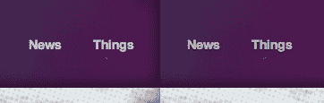

图 3.12：未应用`text-shadow`（左）和应用了`text-shadow`（右）的链接对比。

请记住，`text-shadow`在当前版本的 Safari、Chrome、Firefox 和 Opera 中有效。不支持`text-shadow`的浏览器（**咳咳** IE）会无害地忽略该规则。没有阴影，没问题。

有了`text-shadow`，我们现在可以自由地继续处理`:hover`效果了。而这里我们将更多地依赖 CSS3。

### 悬停和聚焦样式

我们将为每个链接的`:hover`状态添加颜色变化和背景颜色。再次使用 RGBA 在`:hover`时设置半透明白色背景。

```
#nav li a {
  padding: 5px 15px;
  font-weight: bold;
  color: #ccc;
  color: rgba(255, 255, 255, 0.7);
  text-shadow: 0 1px 1px rgba(0, 0, 0, 0.5);
  }

#nav li a:hover,
#nav li a:focus {
  color: #fff;
  background: rgba(255, 255, 255, 0.15);
  }
```


因此，在 `:hover` 时，我们将文字颜色改为纯白色，并添加 15% 不透明度的白色背景。我还进一步为链接处于聚焦状态时声明了此样式。例如，使用键盘导航的用户在链接聚焦时也会看到这一变化。

图 3.13 显示了链接新的 `:hover`（和 `:focus`）状态。支持 RGBA 的浏览器将在更亮的白色文字后面获得半透明白色背景。

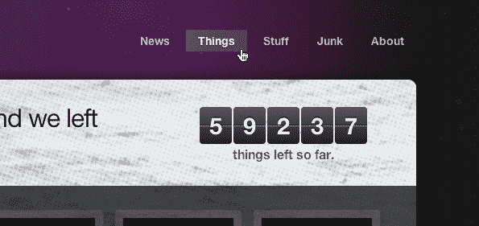

图 3.13：显示 `:hover` 状态，现在通过 RGBA 实现了半透明背景。

### 使用 `border-radius` 圆角悬停

更进一步，我们可以使用 CSS3 的 `border-radius` 属性将悬停背景的角变圆，为支持它的浏览器创建药丸形状。

回顾我们在第 1 章中学到的关于 `border-radius` 属性以及使我们今天能够使用它的厂商前缀的知识，我们可以将堆叠添加到默认链接声明中，如下所示：

```css
#nav li a {
  padding: 5px 15px;
  font-weight: bold;
  color: #ccc;
  color: rgba(255, 255, 255, 0.7);
  text-shadow: 0 1px 1px rgba(0, 0, 0, 0.5);
  -webkit-border-radius: 14px;
  -moz-border-radius: 14px;
  border-radius: 14px; 
  }

#nav li a:hover,
#nav li a:focus {
  color: #fff;
  background: rgba(255, 255, 255, 0.15);
  }
```

图 3.14 展示了 `:hover` 背景处理，现在通过 `border-radius` 实现了圆角，在 Safari、Chrome、Firefox、Opera 以及 IE9 中都能看到。请记住，我们将不带前缀的 `border-radius` 属性放在列表的最后，确保最终实现会覆盖带浏览器前缀的版本。例如，Safari 5 现在同时支持不带前缀的 `border-radius` 属性和 Safari 4 中支持的 `-webkit-border-radius`。

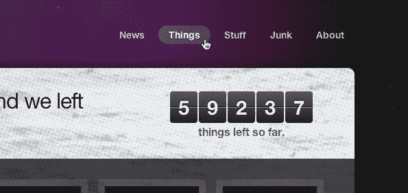

图 3.14：使用 `border-radius` 为背景添加圆角。

你可能会想，为什么我要把 `border-radius` 规则放在 `#nav li a` 声明中，而不是放在 `#nav li a:hover` 声明中（因为效果是在悬停时显现的）。答案在于我们接下来要添加的 CSS 过渡，作为最后的润色。

### 添加过渡效果

最后，让我们运用在第 2 章中学到的知识，为导航链接的 `:hover` 和 `:focus` 状态添加过渡效果。这将平滑背景药丸形状的出现，使其在文本后方微妙地显现。过渡效果还会平滑文本颜色从半透明白色到全白色的变化（图 3.15）。

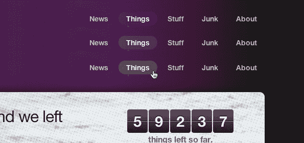

图 3.15：过渡生效时的缓入缓出效果。

这里，我们将添加当前在 Safari、Chrome、Firefox（4.0）和 Opera 中有效的过渡堆栈，并将不带前缀的 `transition` 属性放在声明的最后，以便其他浏览器（或未来版本）最终实现。

```css
#nav li a {
  padding: 5px 15px;
  font-weight: bold;
  color: #ccc;
  color: rgba(255, 255, 255, 0.7);
  text-shadow: 0 1px 1px rgba(0, 0, 0, 0.5);
  -webkit-border-radius: 14px;
  -moz-border-radius: 14px;
  border-radius: 14px;
  -webkit-transition: all 0.3s ease-in-out; 
  -moz-transition: all 0.3s ease-in-out;
  -o-transition: all 0.3s ease-in-out;
  transition: all 0.3s ease-in-out; 
  }

#nav li a:hover,
#nav li a:focus {
  color: #fff;
  background: rgba(255, 255, 255, 0.15);
  }
```

请记住，我们将过渡属性添加到要过渡的元素的正常状态。过渡之所以这样设计，是为了让过渡不仅在 `:hover` 时发生，也在 `:focus` 或 `:active` 状态时发生。

我在过渡中使用了 `all` 值，以捕获 `:hover` 和 `:focus` 时变化的所有属性——本例中是 `color` 和 `background`。或者，我们也可以通过逗号分隔的列表显式列出每个属性来实现相同的过渡，如下所示：

```css
-webkit-transition: 
  color 0.3s ease-in-out, 
  background 0.3s ease-in-out;
-moz-transition: 
  color 0.3s ease-in-out, 
  background 0.3s ease-in-out;
-o-transition: 
  color 0.3s ease-in-out, 
  background 0.3s ease-in-out;
transition: 
  color .3s ease-in-out, 
  background .3s ease-in-out;
```

你可以很快看出，对于过渡元素上的多个变化，`all` 值更加简洁高效。

### 悬停体验的精细打磨

我们刚刚经历了一个相当简单的例子，为体验层添加了各种 CSS3 属性。支持这些属性的浏览器会在带有文本阴影的文本链接后面平滑地显示一个半透明的圆角背景。不支持这些属性的浏览器则无法获得增强的悬停体验，但这完全没问题。它们得到的是一个语义化的水平链接列表——而这个基础才是最重要的。

我认为这个小练习也展示了实现以前需要 Flash 和/或 JavaScript 才能实现的效果是多么高效。我们使用的 CSS 规则简单直接，对于尚不支持它们的浏览器来说也无害。

我们还通过确保规范中的属性放在规则的最后，为我们的 CSS3 做好了未来兼容。用适当的浏览器特定前缀重复这些规则是必要的努力——但回报是丰厚的：现在就能使用 CSS3 来增强许多用户的体验。

## 使用 `opacity` 实现简单灵活的悬停效果

我们一直在寻找能够节省时间并提供额外灵活性的解决方案。这正是 CSS3 大量提供给我们的：用几行代码就能实现过去需要更多时间和资源来创建和维护的效果。

悬停效果武器库中的另一个工具是 `opacity` 属性。正如第 1 章中提到的，`opacity` 是一个 CSS3 属性，允许你指定给定元素的不透明度。与前面提到的 RGBA 结合使用，`opacity` 提供了另一种为网页设计添加透明度的方法。

我喜欢使用 `opacity` 的一种方式是为超链接图形创建简单灵活的悬停状态，利用透明度的变化从单个图像创建多个状态。再加上 CSS 过渡，你现在就能为页面上的链接图形提供丰富且易于维护的体验。

让我们看看在月球案例研究中是如何使用 `opacity` 属性的。

### 可点击图片上的不透明度

图 3.16 显示了月球示例网站的页脚，在一些法律声明和令人震惊的免责声明下方，有三个可点击的徽标。

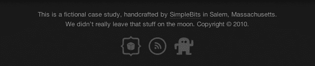

图 3.16：我们留在月球上的东西的页脚。

我们将使用 `opacity` 属性不仅控制 `:hover` 和 `:focus` 的处理，还设置初始透明度级别。而 CSS 过渡将平滑并动画化这一变化，以实现完整效果。

### 标记

与之前的顶部导航示例类似，这些页脚徽标的标记简单且语义化——只是一个超链接图片的无序列表：

```html
<ul id="footer-logos">
  <li><a href="#"></a>
  </li>
  <li><a href="#"></a>
  </li>
  <li><a href="#"></a>
  </li>
</ul>
```

### 不透明度与图片效率

实际上，我将图标本身创建为全白的 PNG 图像，因为我知道之后可以使用 `opacity` 属性通过 CSS 调整透明度级别。这改变了我在某些情况下对 Web 项目图形资源的思考方式。

我不再保存半透明的 PNG，而是保存完全不透明的版本（图 3.17），然后在浏览器中调整。这不仅节省了时间，还允许我们在 `:hover`、`:focus` 和 `:active` 状态下改变 `opacity` 级别，而无需创建多组图像。

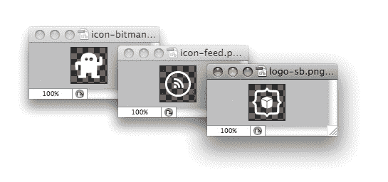

图 3.17：徽标 PNG 创建为全白。

### 为列表添加样式

首先，一些样式技巧会将页脚中的图片居中，并使其水平排列而非垂直排列（图 3.18）。

```css
#footer-logos {
  text-align: center;
  }
#footer-logos li {
  display: inline;
  }
```

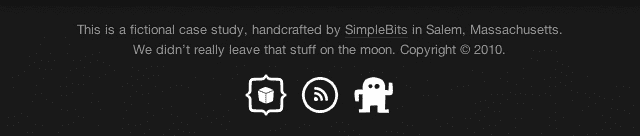

图 3.18：白色 PNG 图片在页脚中居中显示。

接下来，我们添加 `opacity` 值，让图标在默认状态下变暗，在悬停或聚焦时则变亮一些。

```css
#footer-logos a img {
  opacity: 0.25;
  }

#footer-logos a:hover img,
#footer-logos a:focus img {
  opacity: 0.6;
  }
```

这里我们将图片的透明度设为 25%，然后在悬停或聚焦时将其提升至 60%（图 3.19）。很简单，不是吗？而且只需要一组图片。

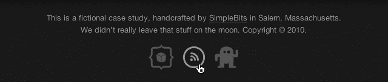

图 3.19：通过调整 `opacity` 展示页脚图标的 `:hover` 状态。

请注意，`opacity` 属性不需要厂商前缀，在 Safari、Chrome、Firefox 和 Opera 中都能正常工作。IE8 及更低版本不支持 `opacity`，但对于那些不介意使用专有方案的人来说，也有一个 hack 式的解决方案。

### IE 的 `opacity` hack

值得庆幸的是，`opacity` 现在已得到 Internet Explorer 9 Beta 的支持，但我们也可以通过使用微软专有的 `filter` 属性，在旧版 IE 中模拟出相同的效果。

通常我不建议使用 `filter`，因为（与带厂商前缀的属性不同）它不属于任何提议标准的一部分。此外，使用 `filter` 属性可能会带来额外的性能开销，具体取决于使用的位置或频率。这是一个 hack——但它提供了一种达到目的的手段。

只要你理解这一点，并且或许将该属性的使用隔离到单独的样式表中，或者仔细地添加注释，那么它就是一种可行的方法。

具体做法如下：

```css
#footer-logos a img {
  border: none;
  opacity: 0.25;
  -ms-filter: "progid:DXImageTransform.Microsoft.Alpha(Opacity=25)"; /* IE 8 hack */
  filter: alpha(opacity = 25); /* IE 5-7 hack */ 
  }

#footer-logos a:hover img,
#footer-logos a:focus img {
  opacity: 0.6;
  -ms-filter:"progid:DXImageTransform.Microsoft.Alpha(Opacity=60)"; /* IE 8 hack */
  filter: alpha(opacity = 60); /* IE 5-7 hack */
  }
```

语法类似，通过 IE 的 alpha 滤镜传递一个透明度值。请注意，IE8 会忽略 `filter` 属性，而需要使用带厂商前缀的 `-ms-filter` 并附加一些（丑陋的）值。

有了这些 hack，你现在就能在 Internet Explorer 中看到相同的结果了（图 3.20）。再次强调，请谨慎使用，甚至最好不用。但现实是，如果你的任何网站有可观的 IE 流量（大多数网站都有），你很可能需要用到它。

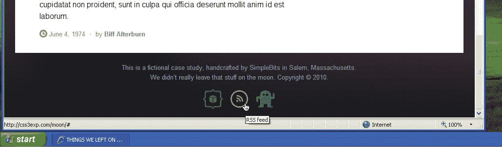

图 3.20：在 IE7 中，通过 `filter` hack 模拟 `opacity` 属性的效果。

### 添加过渡效果

最后，为 `opacity` 的切换添加一个过渡效果，可以平滑该值的变化，并提供一些动画丰富度，将整个技术串联起来。

让我们在声明中添加（现已熟悉的）`transition` 堆栈，这次专门过渡 `opacity` 属性。我们将使其相当快（仅 0.2 秒），并采用缓入缓出效果。

```css
#footer-logos a img {
  opacity: 0.25;
  -ms-filter: "progid:DXImageTransform.Microsoft.Alpha(Opacity=25)"; /* IE 8 hack */ 
  filter: alpha(opacity = 25); /* IE 5-7 hack */
  -webkit-transition: opacity 0.2s ease-in-out; 
  -moz-transition: opacity 0.2s ease-in-out; 
  -o-transition: opacity 0.2s ease-in-out; 
  transition: opacity 0.2s ease-in-out; 
  }

#footer-logos a:hover img,
#footer-logos a:focus img {
  opacity: 0.6;
  -ms-filter: "progid:DXImageTransform.Microsoft.Alpha(Opacity=60)"; /* IE 8 hack */
  filter: alpha(opacity = 60); /* IE 5-7 hack */ 
  }
```

有了过渡效果，我们现在就有了一种简单的技术，通过使用一组图片，利用透明度来打造灵活的悬停体验。

## 去打造悬停效果吧

正如我之前提到的，这个解决方案影响了我对设计资源图形创作方式的思考。我们可以使用 `opacity` 来控制图形默认状态下的显示方式，使其融入背景——然后为 `:hover`、`:focus` 和 `:active` 状态应用不同的值，并通过过渡效果将其与支持该特性的浏览器结合起来。

下次你在自己的设计中为超链接图片创建悬停效果时，请记住 `opacity` 属性。你将节省时间、带宽，以及避免其他解决方案可能带来的不必要的复杂性。

使用 CSS3 打造悬停效果，就是快速高效地添加简单的样式，丰富体验层，让现在和未来支持这些属性的浏览器给用户带来惊喜和愉悦。如果浏览器不支持你创建的高保真体验，那完全没问题，因为用户不会知道自己错过了什么。

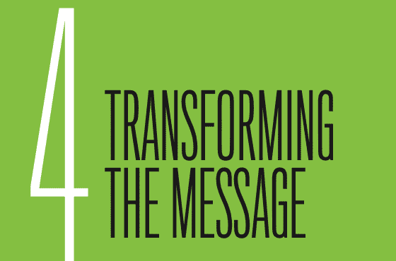

与 CSS 过渡类似，CSS 变换最初也是由 WebKit 团队开发的，后来被纳入 W3C 的两个独立工作草案中：

1. CSS 2D 变换（[`www.w3.org/TR/CSS3-2d-transforms/`](http://www.w3.org/TR/css3-2d-transforms/)）
2. CSS 3D 变换（[`www.w3.org/TR/CSS3-3d-transforms/`](http://www.w3.org/TR/css3-3d-transforms/)）

本书将只关注 2D 变换，因为它们是当前最实用的。仅 3D 变换的信息就足以写满一整本书，而且它们非常神奇。但 2D 变换在浏览器支持方面最具优势，包括 Safari 3.2、Chrome 3.2、Firefox 4.0 和 Opera 10.5（与过渡一样）。

那么，CSS 变换到底是什么？W3C 是这样描述的：

> CSS 2D 变换允许由 CSS 渲染的元素在二维空间中进行变换。^(9)

嗯，这很有帮助。理解变换的最佳方式就是看实际效果。

那么，我们先通过一个简单的例子，在一个小型图片库上应用各种 2D 变换。然后在本章后面，我们将在月球示例网站上实际运用这些相同的技术。

## 缩放变换

想象一个水平排列的列表，包含三张带有微妙边框的照片，来自最近一次去玛莎葡萄园岛（马萨诸塞州海岸外的一个小岛）的旅行（图 4.01）。这是一种相当典型的设计模式：一个链接图片的网格。

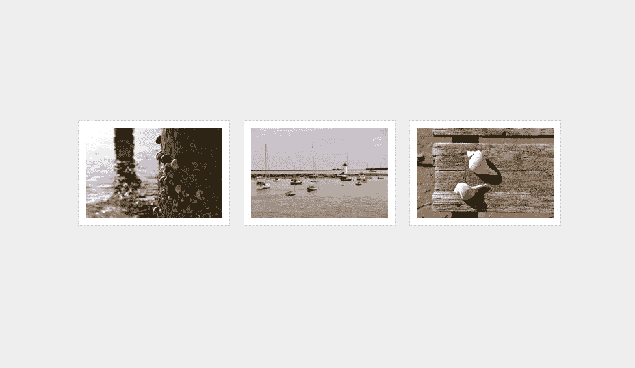

图 4.01：三张超链接照片的网格。

我们将再次依赖我们可靠的无序列表来标记这些内容：


```html
<ul class="gallery">
  <li><a href="#"></a></li>
  <li><a href="#"></a></li>
  <li><a href="#"></a></li>
</ul>
```

在未应用任何样式的情况下，图 4.02 显示了该列表的默认外观。请注意，图片比我们最终设计中想要的要大得多。这是有意为之，因为我们稍后将使用 CSS 来缩小它们。

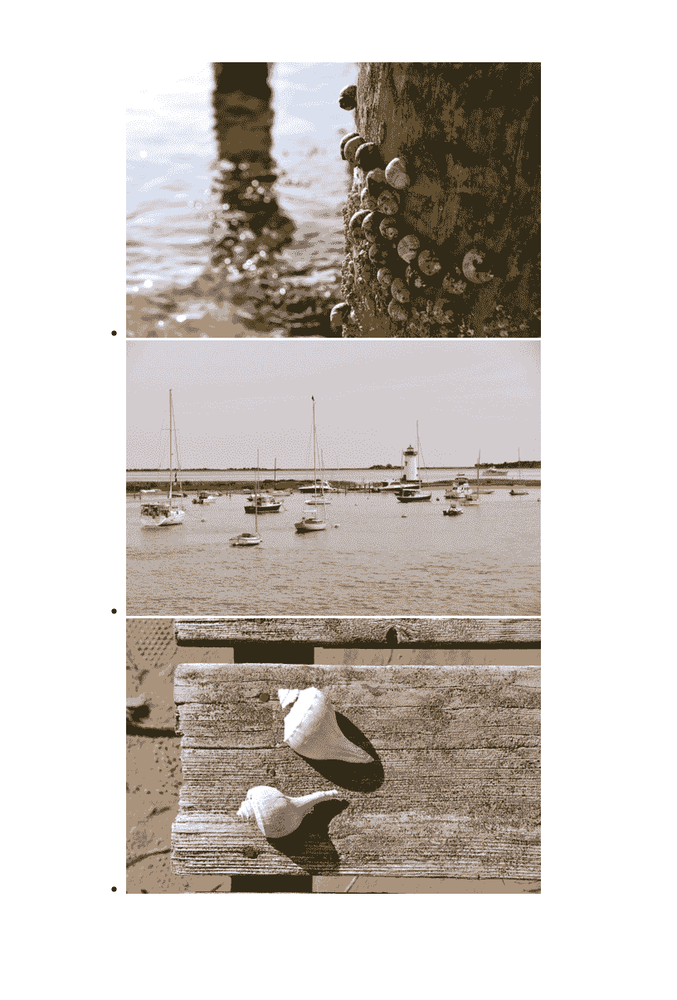

图 4.02：应用 CSS 之前的大照片列表。

### 添加样式

让我们添加一些 CSS，将这个垂直的照片列表变成水平网格，并为每张图片添加 1 像素的边框（同时注意页面背景为浅灰色 `#eee`）。

```css
ul.gallery li {
  float: left;
  margin: 0 10px;
  padding: 10px;
  border: 1px solid #ddd;
  list-style: none;
}

ul.gallery li a img {
  float: left;
  width: 200px;
}
```

这里我们让列表项浮动，关闭了 `list-style` 项目符号，并为每个 `li` 添加了 1 像素的灰色边框。我们还让图片本身浮动，并将其尺寸缩小到 200 像素宽。

这两行简洁的声明就能让我们达到默认设计的目标（请参考图 4.01）。

### 在悬停时应用缩放变换

现在该轮到变换了。让我们添加一个 `scale` 变换，使照片在悬停时变大。请记住，标记中的原始图片比我们在样式表中指定的 200 像素宽度要大。这意味着我们可以安全地放大图片，同时保持其质量。

缩放变换在 Safari、Chrome、Firefox 和 Opera 中均受支持——每个浏览器都需要一个厂商前缀。让我们添加一组代码，既能满足这些浏览器，也能兼容未来的浏览器。

```css
ul.gallery li a:hover img {
  -webkit-transform: scale(1.5);
  -moz-transform: scale(1.5);
  -o-transform: scale(1.5);
  transform: scale(1.5);
}
```

当超链接被悬停时，我们表示：“将图片缩放到其初始大小的 1.5 倍”（初始大小为 200 像素宽）。设置 `scale(2)` 会使照片变为两倍大，`scale(0.5)` 则使其变为一半大小，以此类推。

图 4.03 显示了结果，此处是在 Safari 中查看的。请注意，`transform` 不会干扰文档中的其他元素，并且会从中心向外放大照片，而不影响其周围的布局。

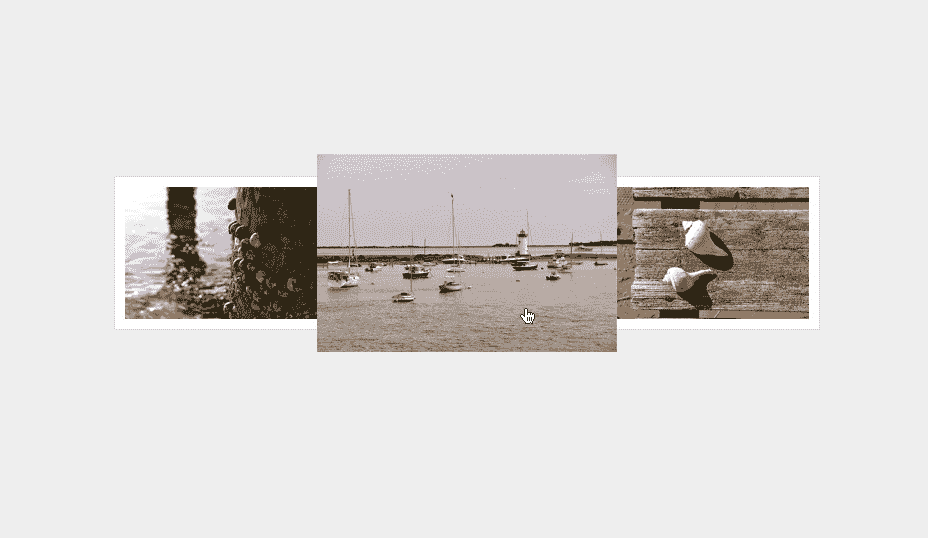

图 4.03：中间的照片被悬停，并通过 CSS 变换进行了缩放。

你还可以选择设置一个 `transform-origin`，它将决定缩放从何处展开：顶部、底部、中心或百分比（参见 [`bkaprt.com/css3/8/`](http://bkaprt.com/css3/8/)）。^(10)

例如，要让照片从其容器的左下角而不是中心向外缩放，你可以这样写：

```css
ul.gallery li a:hover img {
  -webkit-transform-origin: bottom left;
  -moz-transform-origin: bottom left;
  -o-transform-origin: bottom left;
  transform-origin: bottom left;
  -webkit-transform: scale(1.5);
  -moz-transform: scale(1.5);
  -o-transform: scale(1.5);
  transform: scale(1.5);
}
```

### 合适的投影

我们可以在这个例子中更进一步，为悬停时的照片添加投影。这是 CSS3 `box-shadow` 属性的一个恰当用法，因为我们让放大的照片看起来像是从页面上浮起来。

投影是一种微妙的技巧，常常被过于冲动的设计师滥用。很容易就会过头。但在本例中，我们试图为照片放大效果增加立体感，所以应该会效果不错。

`box-shadow` 的语法与我们在第 3 章中使用的 `text-shadow` 属性相同。不过，与 `text-shadow` 不同，`box-shadow` 需要厂商前缀才能在 Safari、Chrome 和 Firefox 中工作。（Opera 10+ 和 IE9 Beta 支持无前缀的 `box-shadow`。）让我们把这些规则整合进来。

```css
ul.gallery li a:hover img {
  -webkit-transform: scale(1.5);
  -moz-transform: scale(1.5);
  -o-transform: scale(1.5);
  transform: scale(1.5);
  -webkit-box-shadow: 4px 4px 10px rgba(0, 0, 0, 0.5);
  -moz-box-shadow: 4px 4px 10px rgba(0, 0, 0, 0.5);
  box-shadow: 4px 4px 10px rgba(0, 0, 0, 0.5);
}
```

我们为支持 `box-shadow` 属性的 WebKit 和 Mozilla 浏览器添加了一组 CSS3 代码，最后以无前缀版本结尾，就像我们在其他示例中所做的那样。

就语法而言，这里我们为悬停的图片应用了一个阴影：距离顶部 `4px`，距离左侧 `4px`，模糊半径 `10px`，颜色为黑色且不透明度 50%（确保它能与背后的任何背景或元素融合）。

图 4.04 显示了当照片被悬停时，阴影与 `scale` 变换同时出现的效果。这种组合产生了放大的照片从页面中弹出的效果。

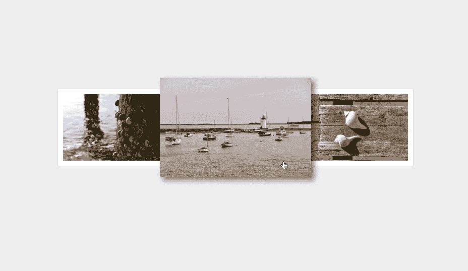

图 4.04：悬停的照片，现在应用了 `box-shadow` 并进行了缩放。

### 使用过渡平滑缩放效果

最后，为链接的照片添加一个过渡效果，可以使缩放变得平滑，让 `:hover` 处理呈现出动画般的放大和缩小效果——这种效果以前只能通过 Flash 或 JavaScript 实现，但现在只需几行 CSS3 就能在许多浏览器中实现。

以下是为我们的小型照片画廊添加的完整 CSS 过渡代码：

```css
ul.gallery li {
  float: left;
  margin: 0 10px;
  padding: 10px;
  border: 1px solid #ddd;
  list-style: none;
}

ul.gallery li a img {
  float: left;
  width: 200px;
  -webkit-transition: -webkit-transform 0.2s ease-in-out;
  -moz-transition: -moz-transform 0.2s ease-in-out;
  transition: transform 0.2s ease-in-out;
}

ul.gallery li a:hover img {
  -webkit-transform: scale(1.5);
  -moz-transform: scale(1.5);
  -o-transform: scale(1.5);
  transform: scale(1.5);
  -webkit-box-shadow: 4px 4px 10px rgba(0, 0, 0, 0.5);
  -moz-box-shadow: 4px 4px 10px rgba(0, 0, 0, 0.5);
  box-shadow: 4px 4px 10px rgba(0, 0, 0, 0.5);
}
```

请注意，这次我们过渡的属性是 `scale` 变换，因此 `transition` 和 `transform` 属性都使用了相应的厂商前缀。

## 改变体验

一切就绪后，仅用极少的 CSS 就能实现如此令人印象深刻的效果。我们将大部分效果负担交给了支持这些特性的浏览器，而不是注入 Flash 或 JavaScript 来实现。

再次强调，在这个特定示例中，我们选择全面拥抱 CSS3 的地方在于体验层：当照片被悬停时，我们提供了一个增强的视图。对于不支持这些属性的浏览器来说，这并非关键。

例如，Internet Explorer 的用户只会看到一个可点击缩略图的画廊，这完全没问题。如果悬停处理是关键的，那么我们就需要重新考虑使用 CSS3 来实现视觉体验的方式。

## 旋转、倾斜和平移

除了 `scale`，还有另外三种变换可用于旋转、倾斜和平移元素。（平移通过 x/y 坐标移动元素。）让我们将它们分别添加到照片画廊示例中，快速了解它们的工作原理。

### 添加旋转

如果我们希望在悬停时旋转照片，同时仍然放大它，可以在 `:hover` 规则中添加以下 `rotate` 变换：

```css
ul.gallery li a:hover img {
  -webkit-transform: scale(1.5) rotate(-10deg);
  -moz-transform: scale(1.5) rotate(-10deg);
  -o-transform: scale(1.5) rotate(-10deg);
  transform: scale(1.5) rotate(-10deg);
  -webkit-box-shadow: 4px 4px 10px rgba(0, 0, 0, 0.5);
  -moz-box-shadow: 4px 4px 10px rgba(0, 0, 0, 0.5);
  box-shadow: 4px 4px 10px rgba(0, 0, 0, 0.5);
}
```

我们仍然在悬停时放大照片，但同时使用 `rotate` 将照片向左倾斜 10 度（图 4.05）。这在 Safari、Chrome、Firefox 和 Opera 中都能工作。从 `-1deg` 到 `-360deg` 的负值会使元素逆时针旋转，而从 `1deg` 到 `360deg` 的正值则使其顺时针旋转。

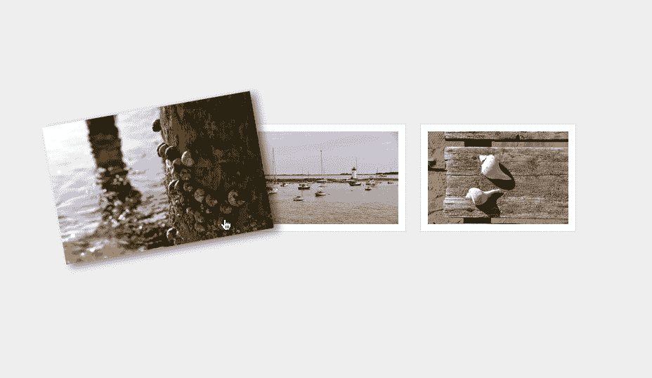

图 4.05：一张悬停的照片，现在使用 `rotate` 变换进行了缩放和向左旋转。

或者，我们可以为列表项添加不同的 `rotate` 变换，让照片（和相框）看起来像是被随意扔在桌子上。然后我们还可以在 `:hover` 时应用 `rotate` 和 `scale`（图 4.06）。

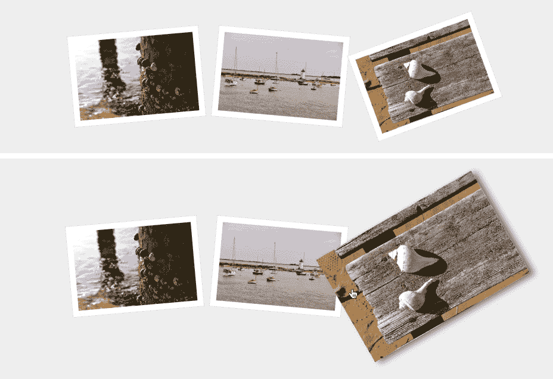

图 4.06：使用 `rotate` 让照片看起来散落在页面上。

在这本小册子中，我一直在强调，添加 CSS3 最合适的地方是体验层——但这并不意味着你不能在设计的默认视图中使用这些技术，前提是它们不是关键性的，并且降级效果良好。

例如，如果浏览器不支持 `rotate` 变换，照片完全保持笔直，那也没问题。不会出现任何看起来损坏的情况。

### 没有旋转？别慌

在页面主要设计中运用 `rotate` 的一个好例子是 Panic Software 的博客（[`www.panic.com/blog`](http://www.panic.com/blog)），他们通过 CSS3 使用了非常微妙的旋转，让条目向左倾斜，仿佛它们是留在桌子上的纸张（图 4.07）。这对设计来说并非关键，如果条目没有旋转而是笔直的（图 4.08），也完全没问题。

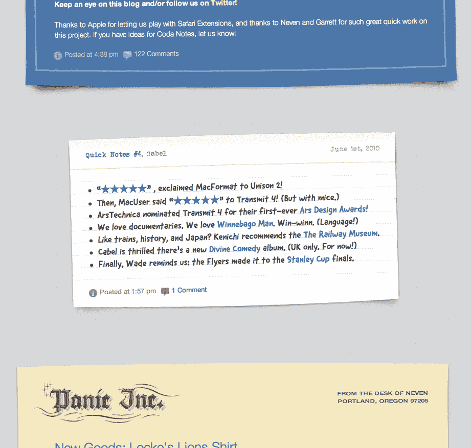

图 4.07：Panic Software 的博客设计通过 CSS3 使用微妙的旋转来增加真实感。

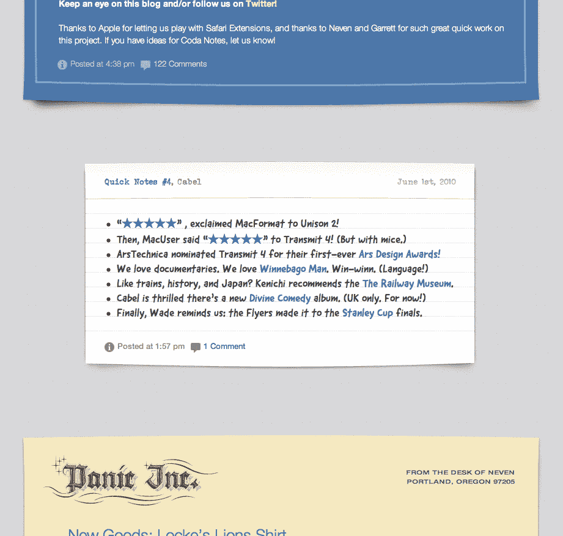

图 4.08：没有旋转，博客看起来依然很棒。没有任何缺失或损坏的迹象。

### 旋转太阳

另一个恰当使用 CSS 变换的好例子是 Outside 网站（[`outsideapp.com`](http://outsideapp.com)），这是一款适用于 iPhone 的出色天气应用（图 4.09）。

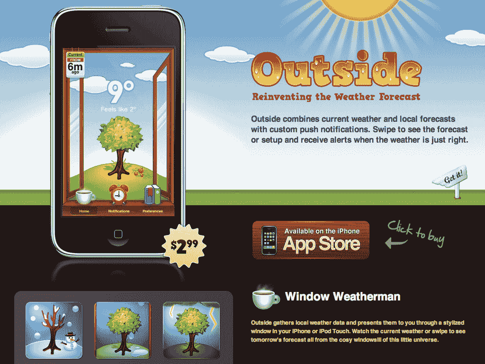

图 4.09：Outside iPhone 应用在太阳图形上使用了旋转。

页面顶部有一个太阳图形（图 4.10），通过 `rotate` 变换实现 360° 旋转。（在这个例子中，非 WebKit 浏览器使用 JavaScript 来驱动旋转动画，但我们将在第 6 章中讨论纯 CSS 动画）。这种微妙的体验增强简单而恰当，因为它模仿了 iPhone 应用本身出现的动态阳光。在不支持 CSS 变换的浏览器中，太阳不会旋转，这完全没问题。在非动画版本的网站中，没有任何东西看起来损坏或缺失。

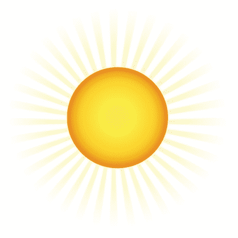

图 4.10：Outside 应用的太阳图形在通过 CSS 定位和旋转后变得生动起来。

CSS 中的变换与过渡相结合，有助于支持我们为网络设计中的整体信息传达，这对我们网页设计师来说是一个极好的赋能工具。

### 倾斜变换

`skew` 变换接受 x 和 y 坐标，并对元素进行倾斜。例如，如果我们想在悬停时倾斜图库中的照片，可以使用以下 CSS（在 x 坐标上倾斜负 5 度，在 y 坐标上倾斜 30 度）（图 4.11）：

```css
ul.gallery li a:hover img {
  -webkit-transform: scale(1.5) skew(-5deg, 30deg);
  -moz-transform: scale(1.5) skew(-5deg, 30deg);
  -o-transform: scale(1.5) skew(-5deg, 30deg);
  transform: scale(1.5) skew(-5deg, 30deg);
}
```

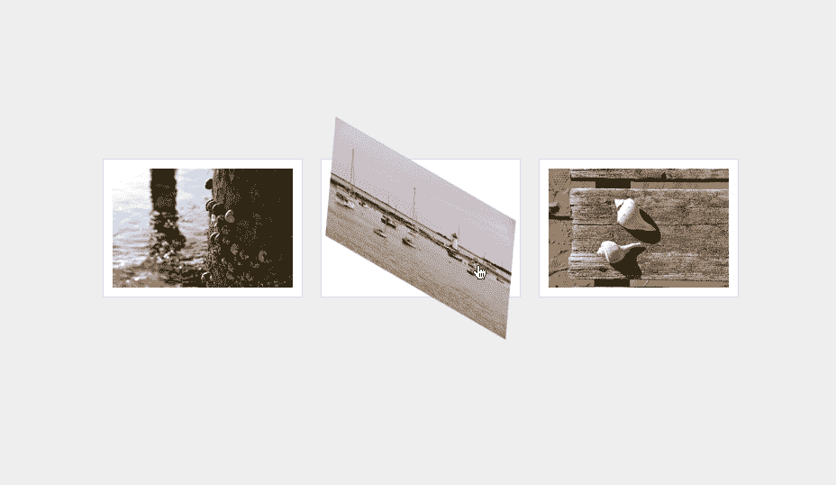

图 4.11：使用 `skew` 变换使照片变形。

与 `rotate` 类似，`skew` 接受正负角度值。你也可以只使用一个值同时应用于 x 和 y 轴，如下所示（图 4.12）：

```css
ul.gallery li a:hover img {
  -webkit-transform: scale(1.5) skew(30deg);
  -moz-transform: scale(1.5) skew(30deg);
  -o-transform: scale(1.5) skew(30deg);
  transform: scale(1.5) skew(30deg);
}
```

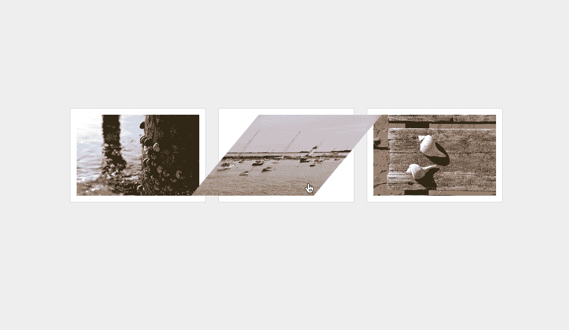

图 4.12：在 x 轴和 y 轴上同时倾斜照片 30 度。

现在我意识到，我们对照片所做的这些操作远非视觉上引人入胜，而且坦白说，我并不经常使用 `skew`；不过，我相信它有一些有趣的用途。

例如，`skew` 可以用于文本块来创建三维视觉效果——全部使用语义化标记和 CSS3（图 4.13 和 4.14）。

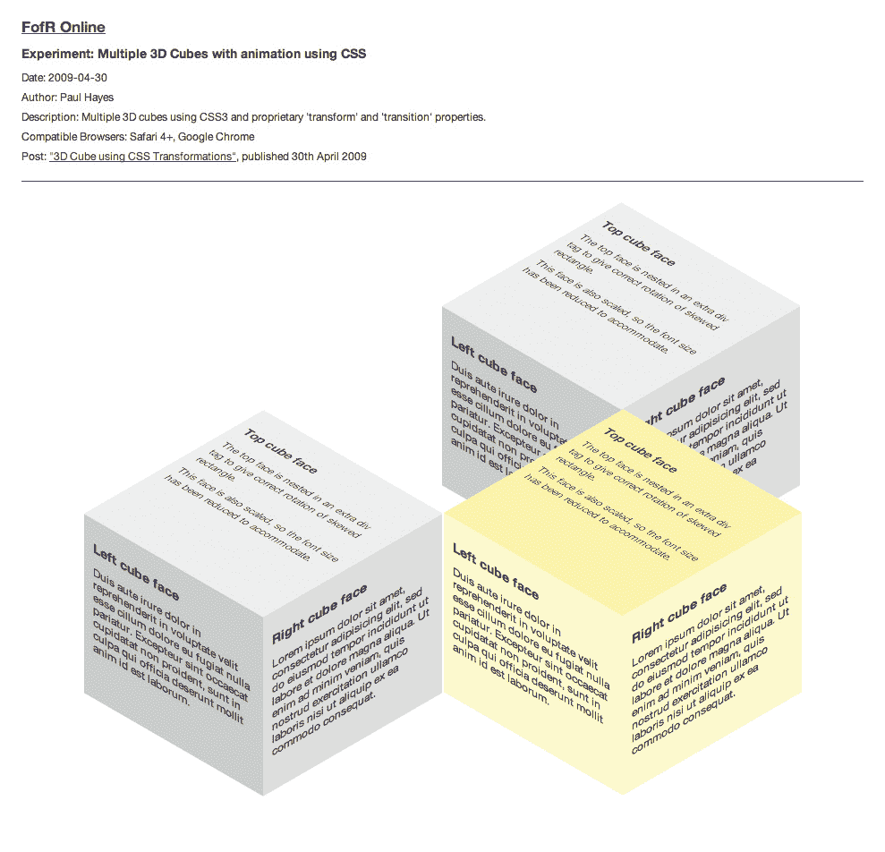

图 4.13：Paul Hayes 的一个演示，使用 `skew` 和过渡从简单的超文本块创建多个 3D 立方体（[`www.fofronline.com/experiments/cube/multiCubes.html`](http://www.fofronline.com/experiments/cube/multiCubes.html)）。

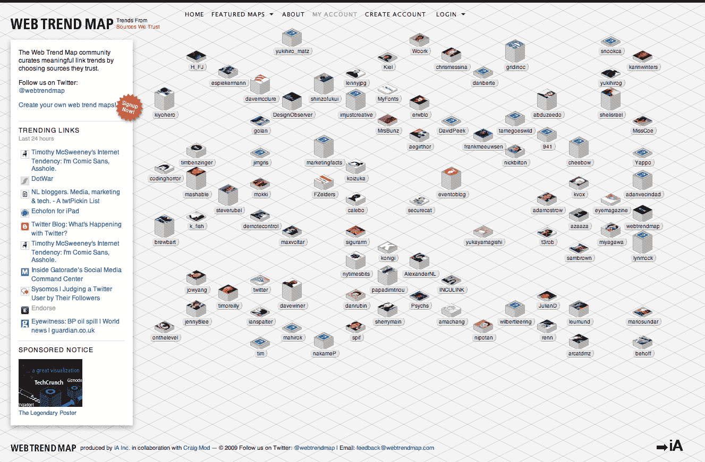

图 4.14：Web Trend Map 使用 `skew` 将头像放置在等距网格上，从原本平面的元素中创建出独特的数据可视化效果（[`webtrendmap.com`](http://webtrendmap.com)）。

### 平移变换

最后，`translate` 变换允许你使用 x 和 y 坐标将元素从屏幕上的正常位置移动。

例如，如果我们想在悬停时将照片图库中的图像从其初始位置移开，可以使用 `translate`。配合我们已有的过渡，这种移动将被平滑地动画化。

以下是将图像从其原始位置向右移动 20 像素、向下移动 40 像素的语法（图 4.15）：

```css
ul.gallery li a:hover img {
  -webkit-transform: scale(1.5) translate(20px, 40px);
  -moz-transform: scale(1.5) translate(20px, 40px);
  -o-transform: scale(1.5) translate(20px, 40px);
  transform: scale(1.5) translate(20px, 40px);
}
```

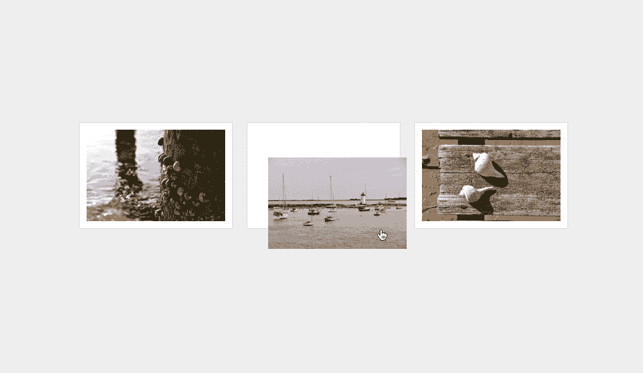

图 4.15：使用 `translate` 变换在 `:hover` 时移动照片。

如果我们想将图像向左和/或向上移动，可以使用负值，例如 `translate(-20px, -40px)`。


与前面提到的变换一样，`translate` 不会干扰文档中的其他元素，它会明确地将元素移动到指定的位置。这意味着你无需担心外边距、内边距、清除浮动或绝对定位。给元素一个 `translate` 坐标，它就会移动到那里。

## 不同的变换有助于支持叙事

照片图库的例子展示了 `scale`、`rotate`、`skew` 和 `translate` 如何与过渡协同工作，以创造更丰富的体验。善用这些变换的关键在于找到合适的情境，让它们有助于讲述屏幕上内容的故事。

再次强调，很容易过度使用变换，因为它们实现起来既有趣又简单。但在体验层中寻找合适的位置来启用它们，将带来更好的最终产品。

## 变换月亮

让我们回到月亮示例网站，我在其中使用了各种变换和过渡来让幻灯片图库的体验更加生动（图 4.16）。

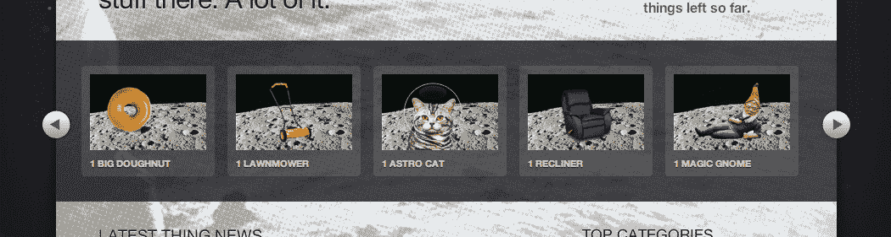

图 4.16：“我们留在月球上的东西”的幻灯片轮播区域。

当悬停在月球上留下的每个物品时，图像会根据该物品的特性（无论是甜甜圈、割草机、猫等）以不同的方式做出反应。

为每个项目添加适当的变换/过渡不仅有趣且易于实现，而且对于尚未支持实现交互所需的 CSS3 特性的浏览器也无害。

让我们逐一查看每个项目，了解如何将 `scale`、`rotate`、定位和 `opacity` 与过渡结合，以完成整个体验。

### 支持信息传达

如果我们思考每个链接项目，特别是它们的含义，就可以应用一种变换和/或过渡来支持该对象所讲述的故事。

一个大甜甜圈或躺椅会对交互做出怎样的反应？我们可以选择在这里应用适当的 CSS3 来丰富体验（图 4.17）。

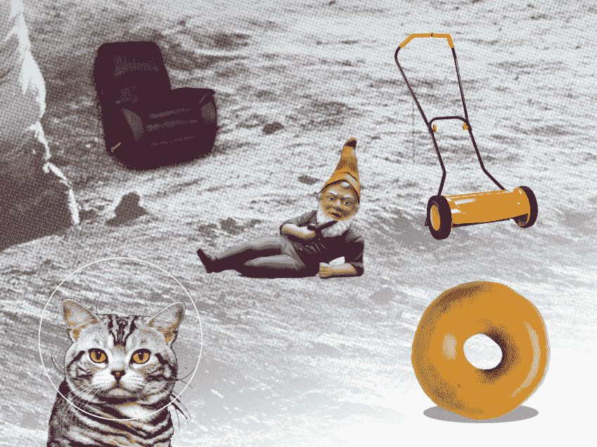

图 4.17：我们将要变换的物品。

### 标记

为了标记这个古怪物品的伪旋转木马，语义非常简单：只是一个包含链接图片的有序列表，下方有一个标题描述每个物品是什么。

```html
<ol id="things">
  <li id="things-1">
    <a href="#"></a>
    <h2>1 big doughnut</h2>
  </li>
  <li id="things-2">
    <a href="#"></a>
    <h2>1 lawnmower</h2>
  </li>
  <li id="things-3">
    <a href="#"></a>
    <h2>1 astro cat</h2>
  </li>
  <li id="things-4">
    <a href="#"></a>
    <h2>1 recliner</h2>
  </li>
  <li id="things-5">
    <a href="#"></a>
    <h2>1 magic gnome</h2>
  </li>
</ol>
```

注意，我们为列表本身添加了 `id` 为 `#things`，并为每个列表项也添加了 `id`，这样我们就可以为每个项目的 `:hover` 状态添加独特的交互。

### 每个项目的基础样式

接下来，我们将为包含链接图片的每个列表项添加基础 CSS。以下样式将项目浮动以使其水平排列，设置相对定位作为上下文，以便稍后对每个图片进行绝对定位，最后添加一个圆角半透明背景框。

```css
ol#things li {
  position: relative;
  float: left;
  margin: 0 15px 0 0;
  padding: 10px;
  background: #444; /* backup for non-RGBA */
  background: rgba(255, 255, 255, 0.1);
  list-style: none;
  -webkit-border-radius: 4px;
  -moz-border-radius: 4px;
  -o-border-radius: 4px;
  border-radius: 4px;
  }
```

现在我们将设置每个项目后面出现的月球背景图片，并为每个链接指定具体的 `width` 和 `height`（图 4.18）。

```css
ol#things li a {
  float: left;
  width: 137px;
  height: 91px;
  background: url(../img/moon-137.jpg) no-repeat top left;
  }
```

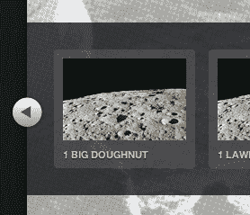

图 4.18：列表项，现在带有月球背景图片。

### 通用声明

下一步是创建一个通用声明，将每个图片绝对定位在列表项的框架内，从而位于月球背景图片之上。

我们将根据对象的不同，对每个项目进行略微不同的定位，并使用不同的变换，但我们可以在这里为所有图片声明 `position: absolute;`，这样就不必为每个项目重复该规则。我们还将使用 `all` 值添加一个过渡堆栈。这样，无论我们决定更改哪些 CSS 属性，我们对每个物品所做的任何变换或更改都将被过渡并平滑处理。

```css
ol#things li a img {
  position: absolute;
  -webkit-transition: all 0.2s ease-in;
  -moz-transition: all 0.2s ease-in;
  -o-transition: all 0.2s ease-in;
  transition: all 0.2s ease-in;
  }
```

现在，我们可以利用添加到每个列表项的 `id`，为每个图片添加精确的定位和宽度。

```css
ol#things li#things-1 a img { 
  width: 60px;
  top: 23px;
  left: 26px;
  }

ol#things li#things-2 a img { 
  width: 50px;
  top: 20px;
  left: 50px;
  }

ol#things li#things-3 a img { 
  width: 80px;
  top: 19px;
  left: 30px;
  }

ol#things li#things-4 a img { 
  width: 70px;
  top: 25px;
  left: 45px;
  }

ol#things li#things-5 a img { 
  width: 80px;
  top: 20px;
  left: 34px;
  }
```

我将这些图片做得偏大，这样如果我们想放大它们，可以在不拉伸图片超出其原始尺寸的情况下进行。

现在，我们将为每个项目添加独特的 `:hover` 处理，知道通用过渡会平滑并动画化我们加入的任何效果。

### 放大甜甜圈

大甜甜圈在悬停时会变大，因此我们将使用 `scale` 变换来放大图片。请记住，标记中的原始图片比我们在样式表中缩小后的尺寸要大得多。这是有意为之，这样我们就可以像这样放大它。

```css
ol#things li#things-1 a:hover img {
  -webkit-transform: scale(1.25);
  -moz-transform: scale(1.25);
  -o-transform: scale(1.25);
  transform: scale(1.25);
  }
```

这些规则将使甜甜圈在悬停时放大 25%。图 4.19 显示了正常状态和悬停状态，甜甜圈在鼠标悬停时变得稍大。

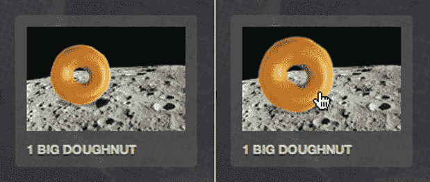

图 4.19：大甜甜圈在 `:hover` 时使用 `scale` 变大。

### 使用缩放和定位实现透视效果

对于留在月球上的割草机，我们将做两件事：

1. 使用变换将其放大。
2. 将其向下和向右移动。

这两个变化加上过渡，使割草机看起来像是朝你冲过来（小心！）。效果非常微妙，但简单有效。

我们将默认位置向下调整 5 像素，向右调整 10 像素。同时添加一个变换堆栈，将割草机放大到比默认大 20%。

```css
ol#things li#things-2 a:hover img {
  top: 25px;
  left: 60px;
  -webkit-transform: scale(1.2);
  -moz-transform: scale(1.2);
  -o-transform: scale(1.2);
  transform: scale(1.2);
  }
```

图 4.20 显示了默认状态和悬停状态，割草机朝你冲来的错觉就完成了。

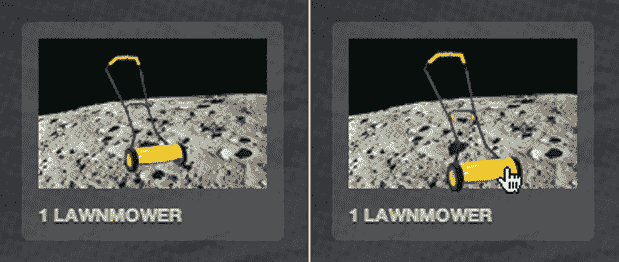

图 4.20：割草机使用定位和 `scale` 创建伪三维效果。

### 难以捉摸的太空猫

我们可以在大量属性（不仅仅是 CSS3 属性）上添加 CSS 过渡；仅仅平滑位置变化就可以让太空猫看起来像是在躲避鼠标。

通过调整悬停时图片的 `left` 位置，通用过渡将平滑该移动，使太空猫看起来像是在来回滑动。

这里我们将 `left` 值从 `30px` 增加到 `45px`，将猫向右移动 15 像素（图 4.21）：

```css
ol#things li#things-3 a:hover img {
  left: 45px;
  }
```

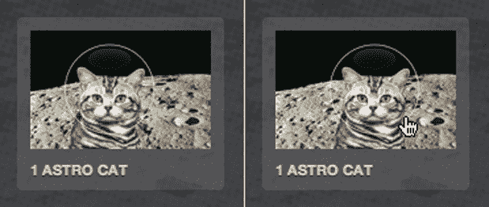

图 4.21：猫来回滑动，就像猫经常做的那样。

非常简单。实际上，CSS 过渡才是这里施展魔法的关键。

### 向后倾斜的躺椅

一把好的躺椅会向后倾斜，我们可以使用前面提到的 `rotate` 变换来模拟这种现实世界的反应。

让我们添加变换堆栈，将躺椅稍微向左旋转。我们将使用针对 WebKit、Mozilla 和 Opera 浏览器的厂商前缀规则，并以实际的 `transform` 属性结尾，以备将来实现。

```css
ol#things li#things-4 a:hover img {
  -webkit-transform: rotate(-15deg);
  -moz-transform: rotate(-15deg);
  -o-transform: rotate(-15deg);
  transform: rotate(-15deg);
  }
```

我们使用了一个负值来让图像向左倾斜（逆时针），而过渡效果会平滑地处理这个微妙的旋转，从而完成我们那把舒适柔软的月球躺椅的幻觉（图 4.22）。

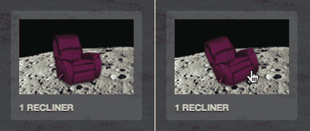

图 4.22：躺椅通过 `rotate` 变换的负值向左倾斜。

### 消失的地精

最后一项，我们将让一个躺着的地精部分消失。不知为何，这看起来对地精来说是一件非常自然的事情。

我们将使用 `opacity` 属性来简单快速地创建图像的悬停样式，使其显著变暗。由于图像上所有属性变化都已经设置了过渡效果，`opacity` 的切换会在支持过渡的浏览器中产生动画效果，让我们的这位小朋友平滑地消失。

声明很简单：

```css
ol#things li#things-5 a:hover img {
  opacity: 0.4;
  }
```

图 4.23 展示了地精在 `:hover` 时淡出至 40% 不透明度的效果。

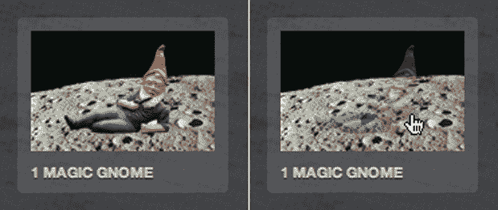

图 4.23：通过降低 `:hover` 时的 `opacity`，地精几乎消失了。

现在请记住，如果我们希望这个效果在 Internet Explorer 中也能工作（无需过渡），我们可以重新使用第 3 章中介绍的专有 `filter` 属性 hack。

### 无害的降级

就像我们本章前面讨论的照片画廊示例一样，我们在这里添加的少量 CSS3 对于尚不支持它的浏览器是无害的。

归根结底，重要的是这些项目中的每一个都是可点击的链接。除此之外，对于能够接收它的浏览器来说，这是一种更丰富的体验。

## 再说一次：要聪明，要微妙

花一点时间思考我们所处理内容背后的含义，我们可以选择应用一些今天就能使用的 CSS3 属性，以及过渡和变换。

这些体验增强可以成为真正网页工匠的标志：关注并非每个人都会注意到的细节，对非关键的视觉事件进行关怀和滋养，并将信息传递提升到超越常规的水平。对于现在支持这些内容的浏览器，以及未来将支持它们的浏览器，少量的代码和思考是非常值得的。

在 CSS 变换方面，尽量保持微妙。很容易得意忘形，但使用得当，它们可以极大地改变读者体验你所传递信息的方式。

### 再来点“哇”的效果

说到得意忘形，下次你的客户或老板说“这个设计需要更多‘哇’的效果”或“它缺少一些活力！”时，只需在你的样式表中添加以下声明（当然，确保他们使用的是 Safari、Chrome、Firefox 或 Opera）：

```css
*:hover {
  -webkit-transform: rotate(180deg);
  -moz-transform: rotate(180deg);
  -o-transform: rotate(180deg);
  transform: rotate(180deg);
  }
```

这一小段 CSS3 的意思是：“悬停在页面上的任何元素上，并将其旋转 180 度。”试试看。这是一个制造深刻印象的万无一失的方法（图 4.24）。


图 4.24：“悬停时旋转所有内容”技巧导致的混乱。

实际上，可悲的是，确实有一些客户和老板可能会喜欢这个。

“太棒了！发布吧！”

*唉。*

9. [`www.w3.org/TR/CSS3-2d-transforms/#abstract`](http://www.w3.org/TR/CSS3-2d-transforms/#abstract) [[↵]](#chapter4.html_footnote-9-backlink)

10. 长 URL：[`www.w3.org/TR/css3-2d-transforms/#transform-origin`](http://www.w3.org/TR/CSS3-2d-transforms/#transform-origin) [[↵]](#chapter4.html_footnote-10-backlink)


如果你两年前问我：“在 CSS3 中你最期待什么？”我可能会热情地回答：“多重背景图像！”当时，能够在单个元素上叠加多个背景图像似乎能解决我们作为网页设计师所面临的许多头痛问题。

为了创建灵活、无懈可击的设计问题解决方案，我们必须弄清楚如何用更少的图形，或者在不添加额外标记作为额外背景图像挂钩的情况下解决问题。我们已经尽力利用现有条件，但能够为元素分配多个背景图像的承诺，对我来说，一直像是用更少的代码实现更轻松时代的绝妙承诺。

然而，现实是，在这个过程中，浏览器已经增加了对 CSS3 中背景与边框模块（[`bkaprt.com/css3/9/`](http://bkaprt.com/css3/9/)）的大部分支持。^(11) 我们之前书中讨论的许多属性，如 `border-radius`、`box-shadow`、渐变、`RGBA` 和 `opacity`，如今在 Safari、Chrome、Firefox、Opera 和 IE9 Beta 中都有不错的浏览器支持。在某些情况下，这些属性使得无需图像就能解决常见问题。许多以前需要图像的技术现在完全可以在样式表内部实现。所有这些都有明显的好处。

因此，虽然几年前我对多重背景支持的前景垂涎三尺，但今天，由于我们手头有这么多其他工具，我反而没那么兴奋了。尽管如此，在单个元素上分配多个背景图像仍然有绝佳的用例，我们将在这一简短章节中讨论一种特定技术。

## 视差滚动

回顾一下月球示例网站，我在 `body` 元素上使用了多个背景图像来创建分层的太空环境。不是一张平面图像，而是四张半透明的 PNG 图像堆叠在一起。每张图像都有自己的水平定位，以便在浏览器窗口调整大小时产生动画效果（图 5.01）。


图 5.01：月球示例网站的背景，四张 PNG 图像堆叠在一起，营造出深邃太空的感觉。

这种速度分层技术被称为“视差滚动”，我们在维基百科的朋友将其定义为：

> 计算机图形学中的一种特殊滚动技术，最早出现在 1982 年的街机游戏《月球巡逻队》中。在这种伪 3D 技术中，背景图像相对于前景图像以较慢的速度移动，从而在 2D 视频游戏中创造出深度错觉，并增强了沉浸感。该技术源于 20 世纪 40 年代以来传统动画中使用的多平面摄像机技术。^(12)

过去几年中，网络上出现了许多应用视差效果的优秀示例，我长期以来的最爱之一是 Silverback 的网站（[`silverbackapp.com`](http://silverbackapp.com)），这是 Clearleft 团队开发的一款便捷的可用性测试软件（图 5.02）。


图 5.02：访问 Silverback 时调整浏览器窗口大小，享受三维丛林体验。

来回调整浏览器窗口大小，注意从顶部垂下的藤蔓层如何以略微不同的速度来回移动，从而产生立体感（我第一次遇到这个网站时，大概连续玩了一个小时）。

当然，并非每个人都会注意到它——但对于那些确实体验到它的人来说，这是一个美妙的细节和增强的用户体验，它让你不由自主地感到一丝愉悦。

## 旧方法：额外标记


那么具体是如何实现的呢？保罗·安奈特（Paul Annett）在 2008 年初为 `Think Vitamin` 撰写的一篇文章中，记录了他专门为 Silverback 网站创建视差效果所使用的技术（[`bkaprt.com/css3/10/`](http://bkaprt.com/css3/10/)）。^(13)

为了将三层藤蔓（每层都是一个独立的 PNG）分层放置，你至少需要三个可用的块级元素。需要两个额外的包装 `div`，以便在 `body`、`#midground` 和 `#foreground` 元素上放置背景图像。

为了简单起见，我在这里进行了粗略的翻译，但标记大致如下：

```
<body>
  <div id="midground">
    <div id="foreground">
      <!-- 页面内容放在这里 -->  
    </div>
  </div>
</body>
```

用于放置三张图像（每张图像的水平位置各不相同）的 CSS 大致如下：

```
body {
  background: url(vines-back.png) repeat-x 20% 0;
  }

#midground {
  background: url(vines-mid.png) repeat-x 40% 0;
  }

#foreground {
  background: url(vines-front.png) repeat-x 150% 0; 
  }
```

这种方法效果很好。但使用 CSS3 中引入的多背景语法后，实现起来就简单多了。

让我们看看如何将多背景应用于月球示例网站的 `body`，以及如何为可能体验到的用户创建更简单的视差效果。

## 新方法：通过 CSS3 实现多背景

我使用了四个半透明的 PNG 来创建月球示例网站所用的深邃太空背景。它们都层叠在 `body` 元素上，一个叠在另一个上面，以便在用户调整浏览器窗口大小时营造出立体感。

图 5.03 展示了所使用的四张 PNG 图像：

1. 尘埃云（`clouds.png`）
2. 蓝到紫的渐变（`space-bg.png`）
3. 一层星星（`stars-1.png`）
4. 另一层随机分布的星星（`stars-2.png`）


图 5.03：层叠在月球示例网站下方的四张半透明背景 PNG。

### 多背景语法

下面就是使用更新后的 CSS3 语法将这四张图像指定为 `body` 元素的背景有多么简单：

```
body {
  background: 
    url(../img/stars-1.png) repeat-x fixed -130% 0,
    url(../img/stars-2.png) repeat-x fixed 40% 0,
    url(../img/space-bg.png) repeat-x fixed -80% 0,
    url(../img/clouds.png) repeat-x fixed 100% 0;
  background-color: #1a1a1a;
  }
```

这里我将四张图像层叠起来，云层在底部，星星在顶部，形成一个逗号分隔的列表（注意堆叠顺序从“最靠近”用户的图像开始）。我还让每张图像水平重复，并将它们设置在不同的水平位置（使用正值和负值），以便在调整窗口大小时，每一层以不同的速度“移动”。最后，我使用 `fixed` 值将它们固定在页面上的锁定位置。

近乎黑色的背景色 `#1a1a1a` 作为单独的 `background-color` 规则最后添加。

就是这样（图 5.04）。它的美妙之处在于不需要任何多余的标记。我们将所有这些图像放在 `body` 元素上，使它们位于页面内容之后，但我们不需要添加虚拟的包装 `div` 来分层。


图 5.04：四张 PNG 彼此层叠，并带有深炭灰色背景色。

### 浏览器支持情况如何？

正如第 1 章中提到的，多背景在 Safari 1.3+、Chrome 2+、Firefox 3.6+、Opera 10.5+ 和 IE9 Beta 中得到支持。因此，实际上，它们与我们在本书中一直使用的许多其他 CSS 属性处于同一水平。

再次强调，由于支持不完善，我们选择在设计的非关键部分使用这个精彩的 CSS3 宝石：丰富页面的 `背景`，通过为能够体验到的用户创建视差效果，增强调整窗口大小的体验。

### 为所有浏览器提供回退方案

尚不支持多背景的浏览器会忽略整个 `background` 规则。这正是我们将 `background-color` 定义在单独规则中的原因。

图 5.05 显示了在 IE7 中查看的月球示例网站，其中我们声明的多背景图像被忽略，只显示炭灰色的 `background-color`。


图 5.05：IE7 忽略了声明多背景图像的规则，只显示深炭灰色背景色。

现在，这里并没有 *破坏* 任何东西——但失去背景中的所有太空感是一种遗憾。解决方案是，在声明中 *首先* 为不支持多图像的浏览器（如 IE7 和 8）指定一个单一的回退背景图像。然后，我们可以用多背景规则覆盖该规则（IE 会忽略多背景规则）。

```
body {
  background: url(../img/space-bg.png) repeat-x fixed -80% 0; 
  background: 
    url(../img/stars-1.png) repeat-x fixed -130% 0,
    url(../img/stars-2.png) repeat-x fixed 40% 0,
    url(../img/space-bg.png) repeat-x fixed -80% 0,
    url(../img/clouds.png) repeat-x fixed 100% 0;
  background-color: #1a1a1a;
 }
```

对于单一图像回退，你可以选择多背景声明中使用的其中一张图像，甚至可以创建一个多层的扁平化版本。

对于月球网站，我选择简单地使用 `space-bg.png`，即颜色渐变图像（图 5.06），从而为尚不支持多背景图像的浏览器提供一个没有星星、没有云层的背景版本。这很合适。


图 5.06：有了单一回退图像，IE7 现在恢复了一些太空感。

## 今天使用多背景

与本书其他示例的主题一致，这里我们正在使用多背景图像。我们正在推进一个在 Safari、Chrome、Firefox 和 Opera 以及 IE9 Beta 中得到良好支持的 CSS3 属性。我们不是害怕这种非普遍支持并等待它普及，而是选择将该属性应用于一个非关键的视觉事件（视差移动背景）。

我们还知道，如果浏览器不支持多背景，它会忽略整个 `background` 规则。为了弥补这一点，我们将在多背景规则之前定义一个扁平或备用的单一图形作为背景规则。

考虑到所有这些，我们现在可以更灵活地尝试将背景图像彼此层叠、移动和定位，而无需额外的标记。看到这项技术以创造性的新方式被使用，将会令人兴奋。

11\. 长链接：[`www.w3.org/TR/CSS3-background/`](http://www.w3.org/TR/CSS3-background/) [[↵]](#chapter5.html_footnote-11-backlink)

12\. [`en.wikipedia.org/wiki/Parallax_scrolling`](http://en.wikipedia.org/wiki/Parallax_scrolling) [[↵]](#chapter5.html_footnote-12-backlink)

13\. 长链接：[`thinkvitamin.com/design/how-to-recreate-silverbacks-parallax-effect/`](http://thinkvitamin.com/design/how-to-recreate-silverbacks-parallax-effect/) [[↵]](#chapter5.html_footnote-13-backlink)


# 第 6 章：丰富表单

表单是网站中另一个涉及交互的方面，因此它们提供了额外的视觉事件，非常适合用 CSS3 来丰富。

默认情况下，表单元素本身的外观可能因浏览器或操作系统而异。为什么不接受这种差异，选择应用那些今天就能工作的 CSS3 部分来提升体验呢？

在表单元素上进行细微调整与保持用户熟悉感之间取得平衡至关重要，这样才能确保表单的可用性。换句话说，输入框仍然需要明显看起来像输入框。如今，CSS 已经能够对表单元素进行深度样式化（在大多数浏览器中），我们必须小心不要破坏最重要的部分：功能。

话虽如此，我们仍然可以利用 CSS3 对表单做很多事情，为支持这些特性的浏览器丰富体验，同时为不支持的浏览器优雅降级。

这一章也让我们有机会讨论之前尚未涉及的三个 CSS3 部分：

1. 强大的新选择器
2. CSS 渐变
3. CSS 动画

同样，我们将以月球示例网站为起点，讨论表单和 CSS3 如何以新颖的方式协同工作。具体来说，就是右侧边栏中的“新事物提醒”注册表单（图 6.01）。


图 6.01：一个简单的表单，用户可以在月球上留下新物品时订阅更新。

## 标记简单的注册表单

就 HTML 而言，这个小表单再简单不过了。只有几个带标签的输入框和一个提交按钮。

```
<form action="/" id="thing-alerts">
  <fieldset>
    <label for="alerts-name">你的姓名</label>
    <input type="text" id="alerts-name" />
  </fieldset>

  <fieldset>
    <label for="alerts-email">你的邮箱</label>
    <input type="text" id="alerts-email" />
  </fieldset>

  <fieldset>
    <input type="submit" value="订阅" />
  </fieldset>
</form>
```

图 6.02 显示了使用默认浏览器样式的表单（在 Safari 中查看）。


图 6.02：在 Safari 中查看的表单，未应用样式。

## 为 `fieldset` 和 `label` 添加样式

我们为这个表单添加的第一部分 CSS 是针对 `fieldset` 和 `label` 元素的——只是为每一行之间添加一些间距。

```
#thing-alerts fieldset {
  margin: 0 0 10px 0;
  }

#thing-alerts label {
  display: block;
  font-weight: bold;
  line-height: 1.4;
  color: #666;
  color: rgba(0, 0, 0, 0.6);
  text-shadow: 0 1px 1px #fff;
  }
```

查看图 6.03，你会注意到我们在每个 `fieldset` 行下方添加了 `10px` 的外边距，并将标签设置为 `display: block` 使其独占一行。我们还为文本指定了 60% 透明度的黑色，并为不支持 RGBA 的浏览器提供了纯灰色作为后备颜色。此外，我们使用 `text-shadow` 添加了微妙的白色高光，使文本看起来像是嵌入背景中。


图 6.03：`fieldset` 和 `label` 元素现在已应用样式。

现在，虽然我们在 `fieldset` 行之间有了漂亮的 10 像素间距，但由于灰色框内的内边距，我们 *不需要* 最后一行（包含提交按钮）下方的 10 像素外边距。

这是一种常见模式：你有一系列元素，每个元素都应用了相同的样式，但你希望对该系列中的最后一个元素进行稍微不同的样式处理。

与其在最后一个元素上添加 `class="last"`，不如利用 CSS3 中的 `:last-child` 伪类来移除底部外边距，而无需修改标记：

```
#thing-alerts fieldset {
  margin: 0 0 10px 0;
  }

#thing-alerts fieldset label {
  display: block;
  font-weight: bold;
  line-height: 1.4;
  color: #666;
  color: rgba(0, 0, 0, 0.6);
  text-shadow: 0 1px 1px #fff;
  }

#thing-alerts fieldset:last-child {
  margin: 0;
  }
```

请记住，`:last-child` 在 IE8 及更低版本中不受支持，但对于像这样的小型外观调整，它是比在标记中添加类更好的替代方案。

图 6.04 显示了当前进度，最后一个 `fieldset` 元素的底部外边距已通过 `:last-child` 伪类移除。


图 6.04：移除了最后一个 `fieldset` 的底部外边距后，表单间距看起来不错。

### 更多 CSS3 选择器

既然我们很好地利用了 `:last-child`，那么现在正好可以指出 CSS3 中还有许多其他非常方便的新选择器。

我强烈推荐 Roger Johansson 关于此主题的文章《CSS3 选择器详解》（[`bkaprt.com/css3/11/`](http://bkaprt.com/css3/11/)）^(14)，他在其中演示了这些选择器是什么以及它们如何工作。不同浏览器对 CSS3 选择器的支持情况各不相同，因此请务必参考 Peter-Paul Koch 详尽的《CSS 内容与浏览器兼容性》表格（[`bkaprt.com/css3/12/`](http://bkaprt.com/css3/12/)）^(15) 以及微软的《CSS 兼容性与 Internet Explorer》（[`bkaprt.com/css3/13/`](http://bkaprt.com/css3/13/)）^(16)，以了解各浏览器的支持情况。

## 样式化文本输入框

接下来，让我们开始添加样式，将默认的文本输入框变成更定制化的样子。这次我们将使用 CSS2.1 属性选择器来仅针对 `input type="text"` 元素（而不是 `input type="submit"` 按钮）。

如果我们简单地声明：

```
#thing-alerts input
```

我们将样式化表单中的所有输入框（文本 *和* 按钮），但如果将其修改为：

```
#thing-alerts input[type="text"]
```

我们将仅针对文本输入框。

再次强调，在样式表中使用强大的选择器可以避免在标记中添加额外的类来分别样式化不同的表单元素。这很优雅。

请记住，虽然属性选择器在 IE7 及以上版本中受支持，但在 IE6 中 *不受支持*，但这没关系，因为我们只是修改这些表单元素的非关键外观。IE6 会忽略这些规则，在这种情况下完全可以接受。

以下声明应用了特定的 `width`、`padding` 和 `font-size`，关闭了默认边框，添加了 `background-color`，并使用我们信赖的 `border-radius` 堆栈为输入框添加了圆角。

```
#thing-alerts fieldset input[type="text"] {
  width: 215px;
  padding: 5px 8px;
  font-size: 1.2em;
  color: #666;
  border: none;
  background-color: #fff;
  -webkit-border-radius: 4px;
  -moz-border-radius: 4px;
  -o-border-radius: 4px;
  border-radius: 4px;
  }
```

图 6.05 显示了在 Safari 中的进度（在 Firefox 和 Opera 中结果类似）。现在我们有了扁平、圆角的文本输入框，看起来相当不错，但让我们添加一些深度，使它们看起来更像典型的可编辑输入框。


图 6.05：扁平、圆角的文本输入框。

## 使用 CSS3 渐变

添加这种深度的一种巧妙方法是使用 CSS 渐变，这是 CSS3 中的新特性。也就是说，无需使用任何图像即可创建从一种颜色到另一种颜色的渐变。听起来很诱人，不是吗？

CSS 渐变目前仅在 Safari 4+、Chrome 2+ 和 Firefox 3.6+ 中受支持，但同样，对于非关键用途，它可以是一种灵活且降级良好的解决方案。

CSS 渐变可以应用于样式表中任何可以声明图像的地方。换句话说，`background-image`、`list-style-image`、`border-image` 以及生成内容。

声明 CSS 渐变的语法在 Safari 和 Firefox 的实现中略有不同。不过，（非常初步的）规范更倾向于 Firefox 的处理方式。这里有一个很好的例子说明为什么厂商前缀是这个过程的重要组成部分：这两种不同的语法可以为每个浏览器正确声明，而官方规范仍在制定中。

老实说，这两种语法都有点令人困惑。创建渐变时可以有大量的控制，包括涉及的颜色、颜色停止点、渐变方向等。


例如，以下是在 WebKit 和基于 Mozilla 的浏览器中为元素背景创建简单线性渐变的语法：

```
#foo {
  background-image: -webkit-gradient(linear, 0% 0%, 0% 100%, from(#fff), to(#999));
  background-image: -moz-linear-gradient(0% 100% 90deg, #fff, #999);
  }
```

这并不完全直观，而且也很难记住每个厂商的差异。

我发现生成正确代码的最佳方法是使用 John Allsopp 出色的所见即所得编辑器（图 6.06，[`bkaprt.com/css3/14/`](http://bkaprt.com/css3/14/)）。^(17)


图 6.06：John Allsopp 出色的 CSS 渐变工具。

使用这个工具直观地创建你想要的渐变，然后获取适用于 Safari 和 Firefox 的相应语法。John 的工具为你完成了所有繁重的工作。这非常有帮助，因为我还没能记住代码（以及浏览器之间的差异）。

Jonathan Snook 有一篇关于处理渐变语法的有用文章，可能也会有所帮助：[`bkaprt.com/css3/15/`](http://bkaprt.com/css3/15/)。^(18)

我们要添加到文本输入框中的渐变非常微妙——只是一个小小的边缘，使其看起来像是内嵌的（图 6.07）。经过调整并在 John Allsopp 的工具中输入一些值后，我们得到了两行简短的 CSS：

```
#thing-alerts fieldset input[type="text"] {
  width: 215px;
  padding: 5px 8px;
  font-size: 1.2em;
  color: #666;
  border: none;
  background-image: -webkit-gradient(linear, 0% 0%, 0% 12%, from(#999), to(#fff));
  background-image: -moz-linear-gradient(0% 12% 90deg, #fff, #999); 
  background-color: #fff;
  -webkit-border-radius: 4px;
  -moz-border-radius: 4px;
  -o-border-radius: 4px;
  border-radius: 4px;
  }
```


图 6.07：每个文本输入框顶部微小渐变的放大视图，使其看起来有凹陷感。

我们在这里应用的是*线性*渐变，但 CSS 也可以实现*径向*渐变。

在这里你可以看到`-webkit`和`-moz`实现之间的语法差异。我们实际上是在输入框垂直高度的 12%范围内添加了一个从浅灰色（`#999`）到白色（`#fff`）的小型线性渐变。我们使用厂商前缀的`background-image`规则来让 Safari 和 Firefox 实现这一效果。

图 6.08 显示了结果，你可以看到我们的圆角输入框现在无需图片就拥有了一点内阴影。


图 6.08：应用了 CSS 渐变的文本输入框。

尚不支持 CSS 渐变的浏览器会忽略这些`background-image`规则，只显示纯白色背景。这完全没问题。但 CSS 渐变带来的调整、灵活性和控制力相当引人注目。在下一节关于提交按钮的部分，我们将更多地使用它们。

## 纯 CSS3 按钮

如果有一个 UI 元素能展示 CSS3 的变革性，那可能就是按钮了。结合本书中已经讨论过的许多技术，我们将把一个普通的表单提交按钮变成更有趣的东西——完全使用 CSS（图 6.09）。


图 6.09：左侧是 Safari 中的默认提交按钮，右侧是使用 CSS3 样式化的按钮——没有图片！

使用 CSS3 来样式化按钮的美妙之处在于，由于不使用图片，我们得到了更灵活的东西。如果浏览器不支持我们将用来提升按钮视觉效果的属性，那也没关系。它会优雅地降级为用户正在使用的任何浏览器中的默认表单按钮。

那么，让我们逐步了解将默认表单按钮变成图 6.09 右侧那个闪亮按钮所需的步骤。

### 基础按钮样式

首先，我们将添加一些内边距，将字体改为 Helvetica 以匹配整体设计，关闭边框，并将背景色设置为白色。

```
#thing-alerts input[type="submit"] {
  padding: 8px 15px;
  font-family: Helvetica, Arial, sans-serif;
  font-weight: bold;
  line-height: 1;
  color: #444;
  border: none;
  background-color: #fff;
  }
```

图 6.10 显示了在 Safari 中应用这些简单基础样式后的效果。我们已经得到了一个看起来完全不像默认输入按钮的东西。


图 6.10：移除了默认边框和背景的提交按钮。

### 圆角成胶囊形状

接下来，让我们添加一个`border-radius`堆栈，使按钮变成胶囊形状（图 6.11）。

```
#thing-alerts fieldset input[type="submit"] {
  padding: 8px 15px;
  font-family: Helvetica, Arial, sans-serif;
  font-weight: bold;
  line-height: 1;
  color: #444;
  border: none;
  background-color: #fff;
  -webkit-border-radius: 23px;
  -moz-border-radius: 23px;
  -o-border-radius: 23px;
  border-radius: 23px; 
  }
```


图 6.11：使用`border-radius`将提交按钮圆角化。

经过一些尝试找到合适的值后，我们确定了`23px`来获得胶囊形状。

### 应用线性渐变

现在让我们在按钮上应用一个从底部浅灰色（`#bbb`）到顶部白色（`#fff`）的渐变。我们将再次依赖 Allsopp 先生的渐变工具来生成适用于 Safari、Chrome 和 Firefox 的正确规则。

```
#thing-alerts input[type="submit"] {
  padding: 8px 15px;
  font-family: Helvetica, Arial, sans-serif;
  font-weight: bold;
  line-height: 1;
  color: #444;
  border: none;
  background-image: -webkit-gradient(linear, 0% 0%, 0% 100%, from(#fff), to(#bbb));
  background-image: -moz-linear-gradient(0 100% 90deg, #fff, #bbb); 
  background-color: #fff;
  -webkit-border-radius: 23px;
  -moz-border-radius: 23px;
  -o-border-radius: 23px;
  border-radius: 23px;
  }
```

图 6.12 显示了在 Safari 中的进展。现在我们有了一个带有 CSS 渐变的圆角按钮。到目前为止，没有使用任何图片，我们只在样式表中添加了几行代码。


图 6.12：为提交按钮添加的 CSS 渐变。

### 添加文本阴影让文字有嵌入感

现在让我们在文字下方添加一个近乎白色的`text-shadow`，使文字看起来像是印在按钮上。

```
#thing-alerts input[type="submit"] {
  padding: 8px 15px;
  font-family: Helvetica, Arial, sans-serif;
  font-weight: bold;
  line-height: 1;
  color: #444;
  border: none;
  text-shadow: 0 1px 1px rgba(255, 255, 255, 0.85);
  background-image: -webkit-gradient(linear, 0% 0%, 0% 100%, from(#fff), to(#bbb));
  background-image: -moz-linear-gradient(0 100% 90deg, #fff, #bbb); 
  background-color: #fff;
  -webkit-border-radius: 23px;
  -moz-border-radius: 23px;
  -o-border-radius: 23px;
  border-radius: 23px;
  }
```

我们将使用`RGBA`将纯白色调暗至 85%，让灰色渐变微微透出。同时指定阴影正好位于文本下方一个像素，并将阴影模糊一个像素。

图 6.13 展示了细微阴影的特写，以及按钮目前的进展。


图 6.13：我们添加的细微`text-shadow`的放大视图，用于营造浮雕效果。

### 为按钮添加 box-shadow

我们要为这个时尚小按钮添加的最后一项 CSS3 属性是非常轻微的`box-shadow`，以增加一丝立体感。这有助于按钮在灰色背景上显得更协调。

以下是一组代码，为当前支持以及未来支持的浏览器添加`box-shadow`。

```
#thing-alerts input[type="submit"] {
  padding: 8px 15px;
  font-family: Helvetica, Arial, sans-serif;
  font-weight: bold;
  line-height: 1;
  color: #444;
  border: none;
  text-shadow: 0 1px 1px rgba(255, 255, 255, 0.85);
  background-image: -webkit-gradient(linear, 0% 0%, 0% 100%, from(#fff), to(#bbb));
  background-image: -moz-linear-gradient(0% 100% 90deg, #bbb, #fff);
  background-color: #fff;
  -webkit-border-radius: 23px;
  -moz-border-radius: 23px;
  -o-border-radius: 23px;
  border-radius: 23px;
  -webkit-box-shadow: 0 1px 2px rgba(0, 0, 0, 0.5);
  -moz-box-shadow: 0 1px 2px rgba(0, 0, 0, 0.5);
  box-shadow: 0 1px 2px rgba(0, 0, 0, 0.5); 
  } 
```

图 6.14 展示了在 Safari 中为按钮添加`box-shadow`后的效果，该阴影距离顶部`1px`，模糊`2px`。颜色方面，我们使用`RGBA`以 50% 透明度应用黑色，使阴影具有一定透明度，让背景透出。


图 6.14：添加到按钮底部的微小`box-shadow`的放大视图，使其略微脱离背景。

这不仅完成了我们的按钮，也完成了整个表单。通过使用几行额外的 CSS3，我们将一个原本默认外观的表单塑造成更具风格、与页面其他设计更协调的样子。我们选择使用 CSS3 而非图片，因为对于尚不支持这些高级规则的浏览器来说，这样做完全可行且无害。让我们来确认一下。

## 其他浏览器呢？

如果我们在 Internet Explorer 7（完全不支持 CSS3 的浏览器）中查看表单，会看到一个完全可以接受且功能正常的表单（图 6.15）。这是个好消息！我们通过样式表中的少量 CSS3 规则添加的所有增强效果都被安全地忽略了，留下了一个功能完备的极简表单。任务完成。


图 6.15：在 IE7 中，表单看起来像普通表单，功能也正常。这很好。

## 使用 box-shadow 创建焦点状态

我们可以更进一步丰富表单交互，在输入框的焦点状态上使用`box-shadow`属性。这快速、简单，并且像前面提到的 CSS3 一样，优雅降级。

只需创建一个新声明，并在文本输入框的属性选择器上添加`:focus`伪类即可。

（顺便说一句，如果你需要搭讪的话，前面这段话绝对是个好梗。以后谢我吧。）

```
#thing-alerts input[type="text"]:focus {
  -webkit-box-shadow: 0 0 12px rgba(51, 204, 255, 0.5);
  -moz-box-shadow: 0 0 12px rgba(51, 204, 255, 0.5);
  box-shadow: 0 0 12px rgba(51, 204, 255, 0.5);
  }
```

这个声明包含一组`box-shadow`，当文本输入框获得焦点时，会应用 50% 透明度的亮蓝色阴影。我们在图 6.16 中看到了结果，它模仿了操作系统默认的焦点输入框行为，但通过自定义，我们对外观有了更多控制。


图 6.16：对文本输入框的`:focus`状态应用了`box-shadow`。

那些不支持`box-shadow`的浏览器呢？它们只是在获得焦点时显示普通输入框。我敢打赌你能猜到我要说什么……没错，这完全没问题。

## 添加 CSS 动画以丰富表单交互

在焦点处理的`box-shadow`基础上更进一步，如果阴影也*动画化*，比如像等待你输入一样脉动，会怎样？让我们短暂进入 CSS 动画的世界，在基于 WebKit 的浏览器中实现这一效果。

我在这里说基于 WebKit 的浏览器，是因为 CSS 动画（如 CSS 变换和过渡）最初由 WebKit 团队开发，随后被纳入 W3C 的提议标准（[`bkaprt.com/css3/16/`](http://bkaprt.com/css3/16/)）。^(19) 然而，与变换和过渡不同，动画尚未被其他浏览器实现。它们目前能在 Safari 和 Chrome 中运行，但 Firefox 或 Opera 不支持，IE9 也没有计划支持。因此，我不会过多关注动画（至少目前如此）。尽管它们*确实*强大且令人兴奋，但它们的普及程度能否像变换和过渡那样全面且迅速，仍有待观察——而变换和过渡已经获得了相当不错（且不断增长）的支持。

尽管如此，创建 CSS 动画的概念和语法相当直接，对于目前只有 WebKit 浏览器能享受的非关键增强，将其注入合适的位置是很有趣的。让我们为输入框的焦点状态添加一个简单的动画，以了解其工作原理。

### 使用关键帧

构建 CSS 动画的第一步是创建关键帧声明。熟悉编程的人可能会将其类比为构建一个函数，可以在样式表的其他地方调用和引用。

`keyframe`是一种专门的 CSS at 规则。它类似于普通的 CSS 声明，但允许你使用标识符为其命名，并通过一系列百分比值（或关键字“to”和“from”）指定 CSS 规则以及随时间的变化。

直接看一个实际例子会更清楚，所以让我们创建一个简单的动画，使之前添加到焦点输入框的`box-shadow`淡入淡出。

我们将它命名为“pulse”，并设置三个略有不同的规则：一个在起点（0%），一个在中点（50%），一个在终点（100%）。每个百分比规则只是调整蓝色`box-shadow`的不透明度，从 20% 上升到 90%，再回落到 20%。这种变化随时间过渡并循环，会在基于 WebKit 的浏览器中产生输入框获得焦点时脉动的效果。

```
@-webkit-keyframes pulse {
  0% {
    -webkit-box-shadow: 0 0 12px rgba(51, 204, 255, 0.2);
  }
  50% {
    -webkit-box-shadow: 0 0 12px rgba(51, 204, 255, 0.9);
  }
  100% {
    -webkit-box-shadow: 0 0 12px rgba(51, 204, 255, 0.2);
  }
}
```

这里我只为 WebKit 指定规则，使用了`-webkit-`厂商前缀。在本书前面，我们一直注意为所有当前支持这些属性的厂商编写重复规则，并添加无前缀版本以备将来兼容。但在这种情况下，CSS 动画除了 Safari 和 Chrome 外仍不被支持，且其他厂商对动画是否应属于 CSS 持保留态度，因此我选择只编写`-webkit-`规则。

### 引用关键帧

CSS 动画的第二部分是通过`animation`属性按名称引用`keyframe`。


在这种情况下，我们希望当用户聚焦表单中的文本输入框时，`box-shadow`的脉冲效果能够运行。这里我们通过名称调用`keyframe`，设置动画运行的持续时间，使其无限循环，最后设置缓入缓出的过渡时间函数。你可以看到`animation`的语法与`transition`类似。

```
#thing-alerts input[type="text"]:focus {
  -webkit-animation: pulse 1.5s infinite ease-in-out;
}
```

这样，我们就确保了`pulse`动画仅在用户聚焦表单中的文本输入框时运行（仅限 Safari 和 Chrome）。

效果相当惊艳。图 6.17 展示了发生的情况：`box-shadow`缓慢地淡入淡出，仿佛输入框在等待用户交互。


图 6.17：我们添加到文本输入框`:focus`状态的脉冲动画。

我使用了简写属性`animation`来在一个规则中设置调用动画的所有值。或者，你也可以用各自的属性分别指定每个值，如下所示：

```
#thing-alerts input[type="text"]:focus {
  -webkit-animation-name: pulse;
  -webkit-animation-duration: 1.5s;
  -webkit-animation-iteration-count: infinite;
  -webkit-animation-timing-function: ease-in-out;
}
```

### 在按钮悬停时复用动画

创建关键帧的一个好处是，它们可以在样式表中的多个声明中重复使用。例如，我们可以将相同的`pulse`动画应用于提交按钮的悬停或聚焦状态，添加一种类似 Wii 的蓝色脉冲光晕。

只需将相同的`animation`规则添加到提交按钮的新`:hover`/`:focus`声明中即可，就像我们对文本输入框所做的那样：

```
#thing-alerts input[type="submit"]:hover,
#thing-alerts input[type="submit"]:focus {
  -webkit-animation: pulse 1.5s infinite ease-in-out;
}
```

我们之前为文本输入框创建的`pulse`动画会淡入淡出蓝色`box-shadow`——但在这里我们也可以将其用于按钮，效果同样出色（图 6.18），在悬停或聚焦时柔和地发光，仿佛在等待用户提交。


图 6.18：按钮悬停时其背后阴影的脉冲效果。

### 其他浏览器呢？

添加 CSS 动画是本书中第一次真正只针对一个浏览器厂商（WebKit）来丰富体验。我们看到 CSS3 被越来越多地使用的一个主要原因，是它被 Firefox、Opera 甚至 IE9 所采纳。你可能会问，现在添加 CSS 动画是否值得。这确实值得考虑。

要么 CSS 动画仍然是 WebKit 独有的技术，要么它会像过渡和变换一样被其他浏览器采纳。无论如何，CSS 动画简单、开销小，并且不支持它们的浏览器会安全地忽略它们。我在这里演示的动画相当基础，只是触及了仅用标记和样式表在屏幕上实现可能性的皮毛。这令人兴奋，仅凭这一点就值得尝试。

## 聚焦交互

表单元素很少同时是关键的品牌元素，而这正是用 CSS3 增强表单的绝佳机会。

表单元素的外观因用户环境而异——但我们可以选择用高级 CSS 来丰富它们，同时知道在不支持 CSS3 的浏览器中，它们会优雅降级为功能完整、熟悉且默认的表单控件。

14. 长链接：[`www.456bereastreet.com/archive/200601/css_3_selectors_explained/`](http://www.456bereastreet.com/archive/200601/css_3_selectors_explained/) [[↵]](#chapter6.html_footnote-14-backlink)

15. 长链接：[`www.quirksmode.org/css/contents.html`](http://www.quirksmode.org/css/contents.html) [[↵]](#chapter6.html_footnote-15-backlink)

16. 长链接：[`msdn.microsoft.com/en-us/library/cc351024(VS.85).aspx`](http://msdn.microsoft.com/en-us/library/cc351024(VS.85).aspx) [[↵]](#chapter6.html_footnote-16-backlink)

17. 长链接：[`www.westciv.com/tools/gradients/index-moz.html`](http://www.westciv.com/tools/gradients/index-moz.html) [[↵]](#chapter6.html_footnote-17-backlink)

18. 长链接：[`snook.ca/archives/html_and_css/multiple-bg-css-gradients`](http://snook.ca/archives/html_and_css/multiple-bg-css-gradients) [[↵]](#chapter6.html_footnote-18-backlink)

19. 长链接：[`www.w3.org/TR/CSS3-animations/`](http://www.w3.org/TR/CSS3-animations/) [[↵]](#chapter6.html_footnote-19-backlink)


好了，现在让我们回到现实，放松一下。

我们已经介绍了许多（如果我可以这么说的话）在当前日常工作中使用 CSS3 的绝妙方法。我希望通过展示这些技术如何在支持它们的浏览器中增强体验层，同时在不支持的浏览器中优雅降级，能够激励你在日常工作中使用它们，无论你正在做什么项目。

CSS3 的真正承诺在于，它使我们能够更高效地解决常见的设计问题，用更少的代码和更多的灵活性。只要你（以及你的客户和老板）能够接受网站在访问它们的浏览器和设备上可能看起来和体验不同，那么就没有上限。大胆去做吧。

我在第 1 章中提到过，我经常听到“我等不及要用 CSS3 了——等它完成的时候”。我写这本书的目标就是证明你不需要等待。现在就开始尝试这些东西吧。开始在你的设计中将 CSS3 用于非关键的视觉事件。既然你已经掌握了哪些有效，更重要的是，当它们无效时如何降级，你就可以轻松地用几行 CSS 实现以前需要更多时间和代码才能完成的事情。

## 那些不理解 CSS3 的客户和老板怎么办？

另一个我在谈论 CSS3 时经常被问到的问题是，如何在客户项目中使用它。如何教育客户使用 CSS3 相比其他解决方案的好处？教育是最有帮助的：向客户展示代码和图片减少了多少。向他们展示在不支持 CSS3 的浏览器中体验有何不同。向他们解释权衡。

如果这听起来太麻烦，那就*直接去做*。

开始在你的日常工作中添加 CSS3，让你的客户和老板愉快地发现它。事实上，我在本书中演示的许多例子都是在浏览网站时发现的：悬停、聚焦、交互等。这当然是有意为之。

通常，在我自己的客户项目中，我会在不提一个字的情况下将这种体验增强添加到项目中，当客户偶然发现时，会感到惊喜和愉悦。更重要的是，当客户的*访客*偶然发现时，也会感到惊喜和愉悦。

要让它在所有能想到的浏览器中工作？嗯，那得额外收费。咳咳。

## 展望未来

未来呢？整个 CSS3 涵盖的内容远不止这本小书所能覆盖的。我想非常专注于当前实际可用的内容，避免那些仍在其他模块中讨论、可能尚未广泛实现的部分。

但趋势是积极的。几乎在 WebKit、Mozilla 和 Opera 的每一个新版本中，都在添加新的属性支持。这种通过厂商前缀的快速采用正在推动创新。关注新特性，并观察这些前瞻性浏览器在实现上的临界点，可以帮助你了解实际应用。

我们即将迎来令人兴奋的 IE9 Beta 版。是的，我确实这么说了。我们看到 Internet Explorer 正在加入越来越多的 CSS3 支持，这意味着一切都在向好的方向发展。

最终，我们将能够依赖 CSS3 不仅用于增强体验，还能用于那些关键的视觉概念（布局就是一个主要例子）。这条路看似走得缓慢，但这是事物正确发展的必要过程。在这条缓慢的道路上，请毫不犹豫地抓住并运用当前可用的东西。你、你的客户以及网络用户都将从中受益。

## 延伸阅读与资源

CSS3.info 长期以来一直在汇总新闻、示例和进展：[`www.CSS3.info`](http://www.css3.info)

另请查看其预览部分，了解特定属性的演示：[`www.CSS3.info/preview`](http://www.css3.info/preview)

之前，我告诉过你不要阅读规范，但为了获得相关的大局观、为未来做准备，以及查看哪些模块处于什么状态（工作草案、候选推荐等），请查看这里：[`www.w3.org/Style/CSS/current-work`](http://www.w3.org/Style/CSS/current-work)

或者，前往这里了解更多关于模块本身的信息，它们是如何划分的，以及包含什么内容：[`www.w3.org/TR/CSS3-roadmap`](http://www.w3.org/TR/CSS3-roadmap)

所有主要浏览器的开发博客是了解正在实现什么以及何时实现的绝佳场所。我强烈建议订阅以随时了解哪些被采纳、拒绝和试验：[`webkit.org/blog`](http://webkit.org/blog)、[`blog.mozilla.com`](http://blog.mozilla.com)、[`dev.opera.com/articles/css`](http://dev.opera.com/articles/css)、[`blogs.msdn.com/b/ie`](http://blogs.msdn.com/b/ie)

有几个网站可以帮助理解浏览器兼容性，并识别哪些版本支持哪些属性：[`caniuse.com`](http://caniuse.com)、[`www.quirksmode.org/css/contents.html`](http://www.quirksmode.org/css/contents.html)、[`html5readiness.com`](http://html5readiness.com) *别被网址骗了，它也包含 CSS3 信息*。

许多基于浏览器的工具提供了可视化环境来创建当前支持的语法，并且是很好的学习工具：[`CSS3generator.com`](http://css3generator.com)、[`CSS3please.com`](http://css3please.com)、[`gradients.glrzad.com`](http://gradients.glrzad.com)、[`tools.westciv.com`](http://tools.westciv.com)、[`border-radius.com`](http://border-radius.com)

最后，JavaScript 解决方案可以帮助将 CSS3 的支持扩展到更多浏览器。对于需要在任何地方都能正常工作的关键视觉事件，使用当今的 CSS3，有以下选择：[`www.modernizr.com`](http://modernizr.com)、[`ecsstender.org`](http://ecsstender.org)、[`selectivizr.com`](http://selectivizr.com) *针对 IE5.5-8 的伪类选择器模拟*。

感谢阅读！现在去创造美好的事物吧。梦想远大，从小处着手。

## 索引

-chrome 11

*:hover 80

-khtml 11

-moz 11, 22–25, 42, 44, 51, 56–61, 65–68, 72–77, 80, 98, 100, 101, 104–109

-ms 11, 49–51

-o 11, 22–25, 44, 51, 56–61, 65, 66, 68, 72, 73, 75, 76, 78, 80, 98, 101, 104–106, 108

-webkit 10, 11, 19–25, 42, 44, 51, 56–58, 60, 61, 65, 66, 68, 72–74, 76, 77, 80, 98, 100, 101, 104–109, 112–114

### A

active 17, 23, 25, 44, 47, 51

Aldrin, Buzz 29

A List Apart 1, 13

all 24–25, 44–45, 73

Allsopp, John 100–101, 105

animation 4, 5, 15–16, 20, 26, 64, 84, 93, 110–115

Annett, Paul 85

Apollo 11 29

Armstrong, Neil 29

Ateş, Faruk 33–35

attribute selector 97–98, 109

### B

Backgrounds and Borders Module 82

border-radius 6–7, 10–11, 36, 41–44, 72, 83, 98, 101, 104–106, 108, 120

box-shadow 7–8, 58, 60–61, 83, 107–114

browser viewport 5

### C

Candidate Recommendation 3, 119

Chrome 6–9, 11, 18, 22, 35, 39, 40, 42, 43, 48, 53, 56, 58, 62, 80, 83, 89, 90, 99, 105, 111, 112, 113

Clearleft 84

color model 8

CSS3 规范 2–4, 6, 9, 10, 12, 14, 16–17, 45, 99–100, 119

三次贝塞尔曲线 19

### E

缓动 19–25

缓入 19, 73

缓入缓出 19, 44, 51, 60, 112–114

缓出 19

体验层 4, 6, 16, 27–28, 34, 36, 45, 52, 60, 62, 69, 116

### F

滤镜 49–51, 79

Firefox 2, 6–9, 11, 17, 22, 35, 39, 40, 42, 43, 48, 53, 56, 58, 62, 80, 83, 89, 90–92, 99, 100, 102, 105, 111, 115

Flash 4, 15, 16, 18, 45, 59, 60

焦点 5, 17, 23–25, 34, 40–52, 109–114, 117

表单 92–115

### G

Gecko 11

金唱片 31–32

渐变 83, 93, 99–102, 105–107, 120

### H

Hayes, Paul 67

### I

input[type="submit"] 97, 103–105

input[type="text"] 97, 98, 109, 112–113

Internet Explorer 2, 6–9, 11–12, 34, 39, 40, 42, 48–51, 58, 60, 79, 83, 89–90, 96–98, 108, 111, 115, 118, 120

IE6 98

IE7 34, 89, 91, 98, 108–109

IE8 及更低版本 39, 48–51, 90, 96

IE9 Beta 6–9, 8, 11, 42, 49, 58, 89, 90, 111, 115, 118

### J

JavaScript 4, 15, 16, 18, 26, 45, 59, 60, 64, 120

Johansson, Roger 97

jQuery 26

### K

关键帧 111–114

Koch, Peter-Paul 97

Konqueror 11

### L

last-child 96

布局 4–5, 9, 118

线性 19–20, 24, 100, 102, 105–107

### M

媒体查询 9

Meyer, Eric 13

Microsoft 11, 49–51, 97

模块 2–3

Moon Patrol 84

Mozilla 10, 11, 18, 58, 77, 100, 118

多列布局 9

多重背景图像 7–8, 82–91

### N

NASA 29–32, 126

### O

不透明度 7–8, 25, 45–51, 70, 78–79, 83

Opera 6–9, 10, 11, 17, 18, 22, 23, 35, 39, 40, 42, 43, 48, 53, 56, 58, 62, 77, 80, 83, 89, 90, 99, 111, 115, 118

Outside 64–65

### P

Panic Software 63

视差滚动 84–90

PNG 47–48, 83, 85–88

渐进增强 12

原型 26

脉冲 111–114

### R

RGBA 7–9, 36, 38–44, 46, 58, 60, 61, 72, 83, 95, 96, 106–109, 112

旋转 61–66, 69–70, 77–78, 80

### S

Safari 2, 6–9, 11, 16, 17, 18, 22, 35, 39, 40, 42, 43, 48, 53, 56, 57, 58, 62, 80, 83, 89, 90, 94, 99, 100, 102, 104, 105, 106, 108, 111, 112, 113

缩放 54–62, 65–70, 74–76


`script.aculo.us` 26

硅盘 30–31

Silverback 84

倾斜 61, 65–67, 69

斯努克，乔纳森 100

SVG 16

### T

文本阴影 7, 36, 39–42, 44, 45, 58, 95–96, 106–107

Think Vitamin 85

计时函数 19–20, 24, 112

变换 16, 36, 53–81, 110–111, 115

变换原点 57

过渡 14, 15–27, 28, 36, 43–44, 46, 50–51, 53, 65, 69, 70, 76, 78–81, 110–111, 115

平移 61, 66, 68–69

### V

厂商前缀 10–14, 18, 22, 28, 41, 48, 56, 58, 60, 99, 112, 118

旅行者 1 号和旅行者 2 号 31

### W

W3C 3, 10, 16, 17, 25, 53, 110

沃尔顿，特伦特 26

Web 字体 9

WebKit 10, 11, 16, 18, 21, 22, 53, 58, 64, 77, 100, 110, 111, 112, 115, 118

Web 趋势图 67

Wii 114

维基百科 84

工作草案 119

工作组 13

### Z

泽尔德曼，杰弗里 1

## 关于《A Book Apart》

网页设计需要多学科的精通和专注，这正是我们为网站制作者编写短小精悍书籍的核心理念。我们以风格、清晰度，尤其是简洁性，来涵盖网页设计与开发中新兴且重要的主题——因为身兼设计师与开发者的从业者不能浪费时间。

我们目录中每一本书的目标都是快速而清晰地阐明一个棘手的问题，让你能尽快回到工作中。感谢你支持我们的使命，即为专业人士提供推动网络前进所需的工具。

## 关于作者


丹·塞德霍尔姆是一位网页设计师、作家、丈夫和父亲，居住在马萨诸塞州塞勒姆。他是 SimpleBits（一家小型设计工作室）的创始人。作为基于标准的网页设计领域的公认专家，丹曾与 YouTube、MTV、谷歌、雅虎、ESPN、Fast Company、Blogger 等公司合作。他通过设计工作、写作和演讲，倡导使用网页标准进行灵活、适应性强的设计。

丹是 Dribbble 的联合创始人和设计师，这是一个供设计师实时分享他们正在进行的作品的社区。此前，他联合创立了 Cork'd，这是网络上第一个面向葡萄酒爱好者的社交网络。

丹是三本畅销书的作者：《手工 CSS》（New Riders）、《防弹网页设计》第二版（New Riders）和《网页标准解决方案》特别版（Friends of ED）。他还会弹奏一手不错的尤克里里，并且只是一个太空旅行的普通爱好者。

作者照片由约翰·莫里森、NASA 和 Photoshop 提供。
