# CSS3 精简指南

---

*谨以此书献给我的父母——愿此书为他们的生活带来喜悦和幸福。*

---

## 前言

## 本书的主要价值主张是什么？

本书主要介绍 CSS3，以及一些可以与 CSS3“结合”使用的技术。事实上，本书包含几个非 CSS3 章节，包括一章 SVG 内容和一章深入探讨 HTML5 Canvas 与 CSS3 的内容。此外，几章还包含可选部分，向您展示如何将 jQuery 与 CSS3 结合使用，以及 jQuery 与 SVG 结合使用。如果您不熟悉 jQuery，可以阅读附录中关于 jQuery 的介绍。另一个附录则介绍了各种主题，例如 CSS3 框架、SASS 和 LESS、Bootstrap 4、Material Design 以及 CSSLint。

## 本书的格式是什么？

这个问题的答案很重要，因为您显然想确定本书中有多少内容对您有用且相关。首先，本书不是 CSS3 语法的参考指南，也不包含任何“速查表”（但您可能在网上找到后者）。尽管格式与“食谱”风格略有相似，但本书并未提供大量解决许多常见任务的“如何做”代码示例（这些您可能在 Stack Overflow 上找到）。相反，本书中的代码示例阐释了 CSS3 的一些“核心”功能，并辅以 CSS3 能够实现的有趣效果。确实，一些代码示例创造出的效果您在其他地方不太可能找到。即使您可能不会使用本书中的所有示例，您也将了解各种编码技巧，并且或许能够利用它们来为您的网页设计出自己的变体。

## 阅读本书需要哪些前置知识？

最重要的先决条件是熟悉 HTML 和基本 CSS。在某些情况下（例如第 6 章的示例），熟悉基本 JavaScript 绝对是理解代码示例所必需的。了解本书的一种方法是浏览一些代码示例，以了解其中有多少内容是您熟悉的，有多少是新的。如果您被太多陌生的概念所淹没，那么选择另一本书可能是明智的。另一方面，如果您觉得材料虽新但可以掌握，您可以通过阅读在线教程来填补潜在的空白（显然本书中的细节各异）。关于购买本书的决策过程显然对您很重要，满意的客户对出版商和作者也很重要。

## 目标读者

本书旨在面向具有多样化背景、处于不同年龄段的国际读者群体。虽然许多读者能够阅读英语，但他们的母语并非英语（可能是他们的第二、第三甚至第四语言）。因此，本书使用标准英语，而非可能让这些读者感到困惑的口语化表达。我们始终牢记读者可能终身学习和阅读的习惯，因为移动学习在二十一世纪越来越受欢迎。所有这些读者都可以归类为“知识工作者”。如您所知，许多人通过不同类型的模仿来学习，包括阅读、写作或听新材料（是的，一些基础视频也可用）。本书考虑了这些要点，以便为目标读者提供舒适且有意义的学习体验。

## 充分利用本书

有些人从散文中学习效果很好，有些人则从示例代码（以及大量代码）中学习效果很好，这意味着没有一种单一风格可以适用于所有人。

此外，有些人喜欢先打开 HTML 网页，查看它们的渲染效果，然后返回代码深入细节（反之，其他人使用相反的方法）。

为了给这两种人都提供有意义的内容，本书包含了混合的代码示例：有些很短，有些很长，而另一些代码示例则是在早期代码示例的基础上“构建”起来的。

目标是向您展示（而不仅仅是告知）各种可能的视觉效果，其中一些您在其他地方可能找不到。您将从这种方法中受益，因为您可以挑选和选择视觉效果以及创建这些视觉效果的代码。

## 本书的代码是如何测试的？

本书中的代码示例已在安装有 OS X 10.14 的 Macbook Pro 上的 Google Chrome 浏览器（v51 版本）中进行了测试。除非另有说明，否则代码未采用任何特定浏览器的特殊特性，这意味着代码示例应该可以在其他平台的 Chrome 浏览器以及其他现代浏览器中运行。例外情况是由 SVG 本身特定功能的跨平台可用性限制造成的。虽然代码在 Macbook Pro 上的几个早期 Chrome 版本中也能运行，但您仍需要在自己的平台和浏览器上测试代码（特别是如果您使用的是 Internet Explorer）。

另一点需要记住的是，所有关于“Web 检查器 (Web Inspector)”的引用均指 Chrome 中的 Web 检查器，它与 Safari 中的 Web 检查器有所不同。如果您使用的是其他（但仍是现代的）浏览器或早期版本的 Chrome，您可能需要在线查询启动和查看 Web 检查器所需的按键序列。请访问此链接获取更多有用信息：

`http://benalman.com/projects/javascript-debug-console-log/`

## 为什么本书只有 200 页而不是 500 页？

首先，本书属于 *Pocket Primer 系列*，该系列的书籍通常在 200 到 250 页之间。其次，目标读者群体包括 HTML 和 JavaScript 知识水平从初学者到中级的人员。同时，几乎任何形式的阐述中，一个主要原则就是“展示，而非讲述”。虽然本书并非字面上完全照搬这一原则，但其出发点是先展示后讲述。如果“一画抵千言”的格言成立，那么本书将努力同时提供图像和文字。

### 随书光盘

随书附带的光盘包含了所有代码示例，以节省您将代码手动输入到 HTML 网页中这一易错过程所花费的时间和精力。此外，在某些情况下，您可能无法方便地使用随书光盘。而且，书中的代码示例提供了随书光盘中没有的解释。

*随书光盘上的所有文件均可通过发送电子邮件至 `info@merclearning.com` 联系出版商下载。*

### 本书是否包含生产级别的代码示例？

本书代码示例的主要目的是阐明 CSS3 的各种特性。清晰度比编写更紧凑但更难理解（且可能更容易产生 bug）的代码具有更高的优先级。如果您决定将本书中的任何代码用于生产环境的网站，您应当对该代码进行与 HTML 网页其他部分同样严格的分析。

### 为什么截图是黑白的？

黑白图像的成本比原始彩色图像低，因此采用黑白图像意味着本书可以以更低的价格提供。*不过，彩色图像可在随书光盘中找到*，同时还附有在浏览器中启动时可呈现彩色的补充代码示例。

### 作者的其他相关书籍

+ 1) HTML5 Canvas and CSS3:

  `http://www.amazon.com/HTML5-Canvas-CSS3-Graphics-Primer/dp/1936420341`

2) jQuery, HTML5, and CSS3:

   `http://www.amazon.com/jQuery-HTML5-Mobile-Desktop-Devices/dp/1938549031`

3) HTML5 Pocket Primer:

   `http://www.amazon.com/HTML5-Pocket-Primer-Oswald-Campesato/dp/1938549104`

4) jQuery Pocket Primer:

   `http://www.amazon.com/dp/1938549147`

以下开源项目包含的代码示例是对本书各章内容的补充：

+ `https://github.com/ocampesato/css3-graphics`

  `https://github.com/ocampesato/d3-graphics`

  `https://github.com/ocampesato/html5-graphics`

  `https://github.com/ocampesato/jquery-css3-graphics`

  `https://github.com/ocampesato/jquery-graphics`

  `https://github.com/ocampesato/react-svg-gsapi`

  `https://github.com/ocampesato/react-svg-graphics-14`

  `https://github.com/ocampesato/svg-filters-graphics`

  `https://github.com/ocampesato/svg-graphics`

  `https://github.com/ocampesato/threejs-graphics`

### HTML5 特性

## 第 1 章

本章将向您介绍 HTML5 的一些特性以及用于语义化标记的 HTML5 特定元素。您还将了解一些提供有用信息的网站（例如浏览器对 HTML5 特性的支持情况），并获取关于 W3C 和 WHATWG 标准组织的一些信息。

在阅读本章之前，必须解决一个问题：为什么这本关于 CSS3 的书包含一个关于 HTML5 的介绍章节？首先，CSS 完全存在于网站的语境中：与 JavaScript 不同，没有“服务端”CSS。其次，许多技术被认为是 HTML5 “大伞”的一部分，而它们相关 API 的复杂程度差异很大。第三，您很有可能会接触到 JavaScript（如果您还没有接触的话），并且需要学习 JavaScript 的一些基础知识。事实上，当相关内容被认为是有意义且有用时，本书中的某些章节包含了 JavaScript 相关部分（通常标记为“可选”）。

本章的第一部分介绍 HTML5、浏览器支持以及两个 HTML5 工作组。第二部分描述 HTML5 包含的技术、HTML4 与 HTML5 的区别、一些有用的在线工具以及特性检测。第三部分向您展示一个简单的 HTML5 网站、新的 HTML5 元素和语义化标记。本章的最后一部分向您介绍 WAI ARIA、实验性特性和移动端支持。

另一点需要记住的是，目前有多种现代浏览器可用，它们都对 HTML 和 CSS 提供了非常好的支持。然而，由于空间和时间的限制以及需要涵盖的主题数量，选择 Chrome 作为测试本书代码示例的主要浏览器。虽然这本书中的代码示例在其他现代浏览器中极有可能可以运行，但您可以在此处检查某个 CSS 特性在给定浏览器中是否受支持：[www.caniuse.com](http://www.caniuse.com)。

最后，如果您决定跳过本章开头的高层概括部分，名为“简单 HTML 网站”的章节包含一个 HTML 网站示例及其内容描述。稍后您显然可以返回到本章中跳过的部分。

### 什么是 HTML5？

尽管问题很简单，但答案却并不精确：HTML5 是多种技术的混合体，其中一些正式包含在 HTML5 规范中，而另一些则不是规范的一部分。似乎很少有人知道 HTML5 的“定义”，也许这就是为什么 Peter Paul Koch（`quirksmode` 网站的创建者）幽默地建议说：“无论你现在正在从事什么样的酷炫 Web 技术……那就是 HTML5。”正如您将发现的，HTML5 对不同的人意味着不同的东西，因此如果您无法获得一个统一的 HTML5 “定义”，请不要感到惊讶（要是情况能这么简单就好了！）。

然而，同样事实是，HTML5 是 HTML 的最新版本，它与早期版本 HTML 标记的大多数特性向后兼容。除了无插件架构外，HTML5 还提供了大量新特性：用于音频、视频和语义化标记的新标签；用于表单的新输入类型和验证；本地存储和会话存储；对 Canvas 中基于图形的 API 的支持；以及与通信相关的技术，如服务器发送事件 (server sent events) 和 WebSockets。前一句列出的大多数技术不在本书的范围之内，因此如果您不熟悉它们，无需担心。

虽然 CSS3 不是 HTML5 的一部分，但许多人认为它是网站的重要（甚至不可或缺的）组成部分。事实上，CSS3 是网站或应用程序许多视觉设计组件的核心。正如您将在第 2 章到第 4 章中看到的，CSS3 为丰富的视觉效果提供了支持，包括 2D/3D 图形和动画。

关于 HTML 标记，好消息是新的 HTML5 语义化标签提供了关于 HTML5 网站中每个部分用途的更有意义的信息，这比用 HTML4 编写的网站更容易辨识。您将在本章稍后部分看到使用这些语义化标签的示例。

此外，HTML 最初设计的目标是在桌面设备以及移动设备上运行 HTML 网站。自 1996 年以来，CSS 本身就包含了反映这种关于 HTML 用途的早期思考的媒体属性（例如 `handheld`）。

基于 Web 的移动应用程序不支持推送通知。一些 Android 特定功能，如添加铃声、执行通知或更改壁纸，通常属于用户特性。

还有一点需要记住：HTML 4.01（HTML5 的前身）的规范是在 1999 年推出的，因此 HTML5 代表了多年来 HTML 最大的进步，而且包含其他技术或许是必然的。围绕 HTML5 有着巨大的热情。事实上，对 HTML5 的热忱加速了 HTML 成为基于开放标准的正式规范的速度。

### HTML5 的浏览器支持

基于 WebKit 的浏览器（Chrome 和 Safari）以及 Mozilla Firefox、Opera、IE10 和 Microsoft Edge 在桌面端和移动设备上都支持许多 HTML 特性。至于移动设备，这里有一个非常好的网站，列出了移动浏览器支持的 HTML 特性（包括本章讨论的特性）：`http://mobilehtml5.org/`。

目前，iOS 上的 Safari 支持 28 项特性，而 Android 支持 24 项特性（同时也列出了其他浏览器）。

另一个提供各种移动设备上 HTML 相关特性测试结果的优秀网站在这里：`http://www.quirksmode.org/mobile/`。

上述网站由 Peter Paul Koch（通常被称为 PPK）维护，他维护着包含许多测试结果的网站，以及表达他对 HTML5 和移动领域趋势看法的博客文章。

### HTML5 包含哪些技术？

以下列表包含正式纳入 HTML5 规范的技术，以及几种经常与 HTML5 相关联的其他技术：

- Canvas 2D

- CSS3

- 拖放 (Drag-and-Drop, DnD)

- File API

- 地理位置 (Geolocation)

- 微数据 (Microdata)

- 离线应用程序 (Offline Applications)

- 服务器发送事件 (Server Sent Events, SSE)

- SVG

- Web Intents

- Web Messaging

- Web Storage

- Web Sockets

- Web Workers

还有其他经常与 HTML5 相关联的技术，包括 WebGL 和 XHR2 (XmlHTTPRequest Level 2)。

请记住，其中一些技术的状态会发生变化，因此请务必访问 W3C 规范的详细链接，以获取每项技术的最新状态。

### HTML4 标签与 HTML5 标签的区别

- 不支持某些 HTML4.x 元素

- 为新元素提供支持

- 简化了一些现有元素

- 包含对自定义属性的支持

以下是 HTML5 中的一些新元素：`<article>`、`<aside>`、`<audio>`、`<canvas>`、`<command>`、`<datalist>`、`<details>`、`<dialog>`、`<figure>`、`<footer>`、`<header>`、`<keygen>`、`<mark>`、`<meter>`、`<nav>`、`<output>`、`<progress>`、`<rp>`、`<rt>`、`<ruby>`、`<section>`、`<source>`、`<time>` 和 `<video>`。

在 HTML5 中不建议在新工作中使用（其中许多已被 CSS 样式取代）的 HTML 元素包括：`<acronym>`、`<applet>`、`<basefont>`、`<big>`、`<center>`、`<dir>`、`<font>`、`<frame>`、`<frameset>`、`<noframes>`、`<s>`、`<strike>`、`<tt>` 和 `<u>`。

你可能已经知道新的 HTML5 `<audio>` 元素和 HTML5 `<video>` 元素，在本章后面，你将看到如何在 HTML5 网站中使用这些元素的示例。

一个重要的 HTML5 新特性是自定义数据属性，它们总是带有 `data-` 前缀。这种对自定义数据属性的支持为 HTML5 标记提供了一些 XML 中具备的功能，使代码能够处理自定义标签及其值，同时又能通过验证。

如果你想了解更多详情，HTML5 和 HTML4 之间差异的完整列表在以下 W3C 文档中：

`http://dev.w3.org/html5/html4-differences/`。

### HTML5 开发的实用在线工具

在深入研究本章讨论的新 HTML5 元素之前，你需要了解可以辅助创建高质量 HTML 的在线工具。这些工具之所以存在是因为一个重要事实：现代浏览器在对 HTML5 特性的支持方面存在差异（包括桌面浏览器和移动浏览器）。幸运的是，像 Modernizr 这样的工具允许你使用简单的 JavaScript 代码检测现代浏览器对 HTML5 特性的支持情况。

### Modernizr

Modernizr 是一个用于在各种浏览器中进行 HTML5 相关特性检测的非常实用的工具，其主页在这里：`http://www.modernizr.com/`。

如果你还不知道，服务端“浏览器嗅探（browser sniffing）”曾是一种流行的检测用户渲染特定网站所用浏览器的技术，但由于浏览器实现的快速变化，这种技术不再那么准确（或不再那么“干净”）。事实上，大多数检查 HTML5 支持情况的热门网站使用的是特性检测而非浏览器嗅探。

在某个时间点，你会在 HTML5 网站中开始使用 JavaScript（事实上，你可能已经在这样做了），而 Modernizr 提供了一种编程方式来检查不同浏览器中的许多 HTML5 和 CSS3 特性。

为了使用 Modernizr，请将以下代码片段包含在网站的 `<head>` 元素中：

```html
<script src="modernizr.min.js" type="text/javascript"></script>
```

以下类型的代码块演示了在 HTML 页面中使用 Modernizr 的一种方式：

```javascript
if(Modernizr.canvas) {
  // canvas 可用
  // 在此处执行某些操作
} else {
  // canvas 不可用
  // 在此处执行其他操作
}
```

> 注意：与许多可以插入在页面 body 之后的脚本不同，Modernizr 旨在在页面渲染之前以及任何其他脚本之前运行。


导航到 `Modernizr` 主页，你可以在那里阅读关于特性检测集的文档、教程和详细信息。

### Caniuse

以下网站（“When Can I Use…”）极其有用，因为它提供了现代浏览器对许多 HTML5 特性支持情况的信息：<http://www.caniuse.com>。

目前该网站有两个主要选项卡。第一个（也是默认的）选项卡分为若干部分（CSS、HTML5、SVG、JS API 和 Other），每个部分包含一个技术项列表，这些项目是跳转到提供详细信息网站的超链接。

该网站的第二个选项卡名为 `tables`，当你点击此选项卡时，你会看到一组以表格形式显示的信息。每个表格的列是现代浏览器，行指定特性，而单元格则提供支持该指定特性的浏览器版本号。

以下网站也提供了关于 HTML5 的非常实用的信息：

<http://html5boilerplate.com/>

#### 在 HTML 网站中使用特性检测

浏览器嗅探或 UA 嗅探是指解析每个浏览器中可用的 User Agent 字符串，然后使用结果来决定如何执行。然而，浏览器嗅探是不可靠的，它已被特性检测（feature detection）所取代，特性检测会检查浏览器中特性的可用性。特性检测可以像对待当前浏览器一样对待新浏览器，而浏览器嗅探使用的是硬编码字符串（可能包含正则表达式），因此每当有新浏览器出现时，必须添加新代码。

检测 HTML5 功能的四种基本方法列举如下：

- 检查全局对象上的属性
- 检查你创建的元素上的属性
- 检查方法是否返回正确的值
- 检查元素是否保留某个值

每个 HTML5 文档都显示在一个全局元素中，通常被称为 `navigator` 或 `window`。你可以使用全局元素来测试浏览器是否支持离线 Web 应用程序，如下所示：

```javascript
if(window.applicationCache) {
   console.log("Your browser supports offline apps.");
} else {
   console.log("Your browser does not support offline web apps.");
}
```

如果你的浏览器支持 `applicationCache` 项，那么它就可以使用在线/离线检测、离线应用程序缓存等特性。

测试元素是否保留值的一个示例见下文：

```javascript
var div = document.createElement('div');
div.style.cssText = "background-color:rgba(150,255,150,.5)";
if(!!~('' + div.style.backgroundColor).indexOf('rgba')){
  // rgba is supported so do something here
}
```

### 一个简单的 HTML 网站

除了引入许多新的语义元素，HTML5 还简化了几个元素，包括 `<!DOCTYPE>` 声明以及 `lang` 和 `charset` 属性。代码清单 1.1 展示了 `Sample1.html`，它是一个 HTML5 网站，演示了 HTML5 简化的语法。

#### 代码清单 1.1：Sample1.html

```html
<!doctype html>
<html lang="en">
 <head>
  <meta charset="utf-8">
  <title>This is HTML5</title>
 </head>

 <body>
   <div id="outer"></div>
 </body>
</html>
```

代码清单 1.1 包含一个 HTML5 `<!DOCTYPE>` 元素，其简单的结构非常直观且易于记忆，特别是与 HTML4 `<!DOCTYPE>` 元素的语法相比（试着凭记忆构建一个！）。此标记是向后兼容的：它在所有支持标准模式（相对于怪异模式）的浏览器中触发标准模式，并且它还告诉浏览器使用特殊的 HTML5 解析模式。

此外，`<meta>` 标签及其 `lang` 和 `charset` 属性比早期版本 HTML 中的对应物更简单。请注意，HTML5 支持新语法以及早期语法，因此您现有的 HTML 页面将在 HTML5 中被识别。

### 新的 HTML5 元素

本节讨论 HTML5 中一些有用的新元素，包括与语义相关的元素、`<video>` 元素和 `<audio>` 元素。`<input>` 元素的新类型将在 HTML5 表单部分（本章后面）讨论。要理解本书中的示例，需要对新的 HTML5 标签有基本的了解，因此如果您不需要深入了解 HTML5 元素，可以浏览本节。

#### 语义化标记 HTML5 元素

HTML5 提供了用于“语义化标记”的新元素，旨在为您的 HTML5 网站提供更有意义的结构。其中一些新标签包括：`<section>`、`<article>`、`<aside>`、`<nav>`、`<header>`、`<canvas>`、`<video>`、`<audio>`、`<time>`、`<figure>` 和 `<figcaption>`。

例如，HTML5 `<section>` 标签可用作文档的“容器”，而 HTML5 `<article>` 标签非常适合表示报纸文章或博客文章的内容。HTML5 `<header>` 标签和 HTML5 `<footer>` 标签代表 HTML5 `<section>` 标签的页眉和页脚。HTML5 `<aside>` 标签包含与网站主要内容有些相关的信息（类似于“顺便说一句”类型的评论）。

HTML5 `<nav>` 标签支持网站中某个部分的导航。其他新标签包括用于标记对话的 HTML5 `<dialog>` 标签，以及用于为视频或图形关联标题（这对搜索引擎很有用）的 HTML5 `<figure>` 标签。

这些标签的语义很简单，但随着您对 HTML5 网站经验的积累，您会了解到一些微妙之处。

语义化标记还包括 WAI-ARIA（Web Accessibility Initiative – Accessible Rich Internet Applications）。简而言之，WAI-ARIA 是一种“桥接”技术，用于澄清辅助技术的语义。WAI-ARIA 规范描述了定义可访问用户界面元素的角色、状态和属性，这些内容在此描述（连同 HTML 元素上的 `aria-*` 属性）：

> <http://dev.w3.org/html5/spec/sai/ceai-aria.html>

#### 文章 vs 章节：如何使用它们？

HTML5 `<article>` 元素和 HTML5 `<section>` 元素的语义很复杂，部分原因是它们可以相互嵌套：一个 `<article>` 元素可以包含一个或多个 `<section>` 元素，而每个 `<section>` 元素又可以包含一个或多个 `<article>` 元素。虽然可以设计一种“技巧”来区分给定 HTML5 网站中这些元素的逻辑关系，但目前还没有标准惯例。另一个因素是这两个 HTML 元素在用于创建 HTML 网站大纲的文档大纲算法中的处理方式，该算法在此描述：

> <http://coding.smashingmagazine.com/2011/08/16/html5-and-the-document-outlining-algorithm>

对于简单的 HTML5 网站，`<article>` 元素和 `<section>` 元素的行为是合理的，但对于更复杂的 HTML5 网站，结果可能出乎意料（或不受欢迎）。在您为 HTML5 网站的内容使用 `<section>` 和 `<article>` 元素之前，请思考内容的逻辑关系，以确定 HTML5 网站的结构布局。如果存在任何混淆的可能性，包含一个评论部分也可能有所帮助，以便其他人更容易理解您的 HTML5 网站布局的原理。无论如何，值得花些时间了解这些元素以及文档大纲算法。

#### 为什么使用语义化标记？

在您的网站中使用语义标签至少有两个原因。首先，语义标签可以帮助您理解网站的结构和某部分标记的目的。其次，使用语义标签使您更容易以编程方式定位和管理逻辑上相似的代码段（例如 `<nav>` 元素、`<aside>` 元素等）。第三，屏幕阅读器和搜索引擎可以使用这些标签来区分网站中的内容和导航。这些是使用语义化标记的一些更重要的原因，您可能还能想到其他原因。

#### 一个使用语义化标记的简单网站

代码清单 1.2 展示了 `SemanticMarkup1.html` 的内容，它说明了如何使用 HTML5 语义化标记。

##### 代码清单 1.2：SemanticMarkup1.html

```html
<!DOCTYPE HTML>
<html>
<head>
  <meta charset="utf-8">
  <title>Examples of HTML5 Semantic Markup</title>
</head>
<body>
  <article> <!-- start article #1 -->
    <header>
      <h1>An HTML5 CSS3 Canvas Graphics Primer</h1>
    </header>
    <header>
      <aside style="font-size:larger;font-style:italic;color:red;float:right;width:150px;">
        The book is available on Amazon as well as MercLearning.
      </aside>
    </header>
    <p>This book covers the features of the HTML5 Canvas graphics and CSS3 graphics, and shows how to extend the power of CSS3 with SVG.</p>
    <p>The material is accessible to people with basic knowledge of HTML and JavaScript, and more advanced users will benefit from the examples of sophisticated CSS3 2D/3D animation effects.</p>
    <p>Learn how to create HTML5 Web sites that use Canvas, CSS3, and SVG to render 2D shapes and Bezier curves, create linear and radial gradients, apply transforms to 2D shapes and JPG files, create animation effects, and generate 2D/3D bar charts and line graphs.</p>

    <nav>
      <ul>
        <li><a href="http://www.amazon.ca/HTML5-Canvas-CSS3-Graphics-Primer/dp/1936420341">Amazon Link</a></li>
        <li><a href="http://www.merclearning.com/titles/html5_canvas_css3_graphics.html">MercLearning Link</a></li>
      </ul>
    </nav>

    <details>
      <summary>More Details About the Book</summary>
      <p>The code samples in this book run on WebKit-based browsers on desktops and tablets. A companion DVD contains all the source code and color graphics in the book.</p>
    </details>
  </header>

  <section>
    <h3>Other Books by the Author</h3>
    <article> <!-- start article #2 -->
      <p>Previous books include: Java Graphics Programming, Web 2.0 Fundamentals, SVG Fundamentals, and Pro Android Flash.</p>
      <footer>
        <p>Posted by: Oswald Campesato</p>
      </footer>
      <details>
        <summary>More Details</summary>
        <p>Contact me for more detailed information</p>
      </details>
    </article> <!-- end article #2 -->

    <article> <!-- start article #3 -->
      <p>SVCC (Silicon Valley Code Camp) is the biggest free code camp in the world, and also a great way to meet like-minded people who are interested in the latest trends in technology.</p>
      
    </article> <!-- end article #3 -->
  </section>
</article> <!-- end article #1 -->
</body>
</html>
```

代码清单 1.2 中的 `<body>` 标签包含一个 HTML5 `<article>` 标签，该标签又包含两个 HTML5 `<header>` 标签，其中第二个 HTML5 `<header>` 标签包含一个 HTML5 `<aside>`。代码清单 1.2 的下一部分包含一个 HTML5 `<nav>` 元素，其中有三个用于导航的 HTML `<a>` 链接。

图 1.1 显示了在 Chrome 浏览器中渲染网站 `SemanticMarkup1.html` 的结果。

### HTML5 CSS3 Canvas 图形入门指南

本书涵盖 HTML5 Canvas 图形与 CSS3 图形的特性，并展示如何用 SVG 扩展 CSS3 的功能。

本书适合具备 HTML 和 Javascript 基础知识的读者，更高级的用户也能从复杂的 CSS3 2D/3D 效果示例中获益。

你将学习如何创建使用 Canvas、CSS3 和 SVG 渲染 2D 图形与贝塞尔曲线、创建线性渐变与径向渐变、对 2D 图形和 JPG 文件应用变换、创建动画效果，以及生成 2D/3D 柱状图与折线图的 HTML5 网页。

本书可在亚马逊及 MercLearning 购买。

- 亚马逊链接
- MercLearning 链接

更多关于本书的详细信息

### 作者的其他著作

之前的著作包括：《Java 图形编程》、《Web 2.0 基础》、《SVG 基础》以及《Pro Android Flash》。

发布者：Oswald Campesato

更多详细信息

SVCC（硅谷代码营）是全球最大的免费编程训练营，也是结识对科技最新趋势感兴趣志同道合者的绝佳方式。

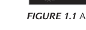

图 1.1 在 Chrome 浏览器中使用语义化标记的 HTML5 网站。

### HTML5 中的自定义数据属性

HTML5 支持自定义数据属性，这实际上使你能够编写可以存储网站或应用程序私有自定义数据的 HTML5 网站。

代码清单 1.3 展示了网站 `CustomAttributes1.html` 的内容，其中说明了 jQuery Mobile 中可用的一些自定义属性。

#### 代码清单 1.3：CustomAttributes1.html

```html
<!doctype html>
<html lang="en">
  <head>
    <meta charset="utf-8">
    <title>Hello World from jQueryMobile</title>
  </head>
  <body>
    <div id="page1" data-role="page">
      <header data-role="header" data-position="fixed">
        <h1>jQuery Mobile</h1>
      </header>
      <div class="content" data-role="content">
        <h3>Content Area</h3>
      </div>
      <footer data-role="footer" data-position="fixed">
        <h3>Fixed Footer</h3>
      </footer>
    </div>
  </body>
</html>
```


代码清单 1.3 展示了一个用于 jQuery Mobile 的 HTML5 网站结构，但它并不完整，因为它没有包含对任何 jQuery JavaScript 文件或 CSS 样式表的引用。代码清单 1.3 的目的是向你展示一个简单 jQuery Mobile 页面的布局，在本例中，该页面包含一个所谓的“页面视图”以及一些 jQuery Mobile 中常见的自定义数据属性。

### HTML5 验证器

HTML5 验证器使你能够测试 HTML5 网站和移动应用程序。有许多类型的 Web 应用程序验证器可用，包括：

- HTML 验证器：测试你的 HTML 的有效性
- 无障碍验证器：测试网站以确定屏幕阅读器对其的读取效果
- 代码验证器（又称 lint）：检查你的脚本、CSS 和 API 调用是否准确
- 移动设备验证器：提供为移动设备优化页面的建议。它们通常也充当模拟器。

除了上述列表，还有其他工具可以评估你网站的“友好性”，例如：

- W3C mobileOK Checker，位于 `http://validator.w3.org/mobile`
- MobiReady，位于 `http://ready.mobi/`

W3C mobileOK Checker 和 MobiReady 都会查看互联网上实际运行的页面，然后给你一份关于它们在移动设备上性能的报告。

### WAI-ARIA

WAI-ARIA（Web 无障碍倡议 – 富互联网应用无障碍）是一项 W3C 规范，它指定了如何提高使用 AJAX、HTML、JavaScript 及相关技术开发的网站（包括动态内容）和用户界面组件的无障碍性。

WAI-ARIA 规范定义了对无障碍 Web 应用程序的支持，这涉及通常是 HTML5 元素属性的标记扩展。Web 开发人员可以使用这些标记扩展来获取关于屏幕阅读器和其他辅助技术的更多信息。

作为一个简单的例子，考虑以下来自 ARIA 规范的增强型 HTML `<li>` 元素的代码片段，它说明了 `role` 和 `aria-checked` 属性的用法：

```html
<li role="menuitemcheckbox" aria-checked="true">
  
  <!-- note: additional scripts required to toggle image
    source -->
  Sort by Last Modified
</li>
```

上述代码片段中的两个新属性不会影响浏览器渲染 `<li>` 元素的方式。支持 ARIA 的浏览器会向渲染的 `<li>` 元素添加特定于操作系统的无障碍信息，并使屏幕阅读器能够以情境化的方式朗读信息。

> 你可以在此处获取有关 WAI-ARIA 规范的更多信息：
> `http://www.w3.org/TR/wai-aria/` 以及
> `http://www.techrepublic.com/blog/webmaster/a-checklist-for-web-accessibility-issues/2626`.

### HTML5 与各种工作组

W3C（万维网联盟）、WHATWG（网页超文本应用技术工作组）和 DAP（设备 API 工作组）是为本书涵盖的 HTML5 和移动设备提供规范和 API 的组织。此外，IETF（互联网工程任务组）处理网络标准（如 Web-Sockets、SPDY、CORS 等），但不处理实际的 API，其主页在这里：

`https://www.ietf.org/`.

W3C 是一个国际社区，各种成员、公司和组织在此合作制定 Web 标准。W3C 由 Web 发明者 Tim Berners-Lee 和首席执行官 Jeffrey Jaffe 领导，其主页在这里：

`http://www.w3.org`.

提交给 W3C 的每项提案都要经历以下序列才能成为 W3C 推荐标准：

- 工作草案 (WD)
- 候选推荐标准 (CR)
- 提案推荐标准 (PR)
- W3C 推荐标准 (REC)
- 后续修订

提交给 W3C 的 HTML5 相关技术（本章前面已列出）处于 W3C “评估”过程的不同阶段。

本质上，WHATWG 拥有主规范，W3C HTML 工作组将其作为“官方”规范的基础。W3C 同步其与 WHATWG 的工作，主要是重新格式化以匹配其发布风格（包括将其拆分为子规范）。

WHATWG 规范形式的引言中的确切变更列表在这里：

`http://www.whatwg.org/specs/web-apps/current-work/multipage/introduction.html#introduction`.

以下链接提供了 HTML5 API 列表及其最新状态更新：

`http://www.w3.org/TR/`.

### 总结

本章向你介绍了 HTML5 以及与 HTML5 相关的一些技术。接下来你了解了 HTML5 与 HTML4.01 之间的一些差异、一些有用的工具（如 Modernizr）以及功能检测。然后你看到了一个简单 HTML5 网页的示例，这引出了对 HTML 中新元素和语义化标记的讨论。最后，你了解了关于 WAI-ARIA、W3C 和 WHATWG 的一些知识。

## 第 2 章

### CSS3 入门

本章介绍 CSS3 的各个方面，如 2D 变换、图形和动画。因此，你需要对 CSS2 有合理的掌握（即如何定义 CSS 选择器、用 HTML 元素选择它们的规则等）。如果你不熟悉 CSS 选择器，有许多通过互联网搜索可以获得的入门文章。如果你确信 CSS 的操作规则令人困惑且看似深奥，那么阅读一篇关于 CSS 盒模型规则的在线文章可能是值得的，之后你将更好地理解 CSS 的底层逻辑。

本章的第一部分从简要概述各种 CSS3 特性开始，例如伪选择器、伪类和属性选择。本章的第二部分包含代码示例，说明如何创建阴影效果、如何渲染带有圆角的矩形，以及如何使用线性渐变和径向渐变。

本章的第三部分涵盖 CSS3 变换（缩放、旋转、倾斜和平移），并附有代码示例，说明如何对 HTML 元素和二进制文件应用变换。本章的最后一部分涵盖了浏览器对 CSS3 的支持，并简要讨论了 CSS3 特性的特定浏览器前缀的用途。

你可以在台式机或笔记本电脑上的任何浏览器中运行本章的代码示例；只要在支持代码示例中使用的 CSS3 特性的浏览器中启动，你也可以在移动设备上查看它们。

### CSS3 浏览器支持

在深入了解 CSS3 的细节之前，有两个重要细节你需要了解关于定义基于 CSS3 的选择器以用于 HTML。首先，你需要了解不同浏览器中可用的 CSS3 特性。判断浏览器对 CSS3 特性支持情况的最佳网站之一是：

> `http://caniuse.com/`

上述链接包含了许多不同浏览器中 CSS3 支持情况的表格信息，这使得该网站的信息非常有价值。

另一个非常有用的检查 CSS3 特性支持的工具是 `Enhance.js`，它会测试浏览器以确定其是否能支持一组基本的 CSS 和 JavaScript 属性，然后向通过测试的浏览器交付相应功能。你可以在此处下载 `Enhance.js`：

> `https://github.com/filamentgroup/EnhanceJS`

### CSS3 特性快速概览

CSS3 采用模块化方法，涉及多个规范，用于扩展现有 CSS2 功能以及支持新功能。以下链接包含了 CSS WG（规范和工作组在第 1 章中讨论）所有已完成规范和草案的列表及其当前状态：

> `https://www.w3.org/Style/CSS/current-work.en.html`

简而言之，CSS3 使你能够创建带有圆角和阴影效果的盒子；使用线性渐变和径向渐变创建丰富的图形效果；检测竖屏和横屏模式；使用媒体查询选择器检测移动设备类型；以及生成多栏文本渲染和格式化。

此外，CSS3 使你能够使用伪类、第一个或最后一个子元素（`:first-child`、`:last-child`、`:first-of-type` 和 `:last-of-type`）在选择器中定义复杂的节点选择规则，以及用于元素属性的模式匹配测试。本章的几个部分包含如何创建此类选择规则的示例。

### CSS3 伪类和属性选择

本简短部分包含一些伪类的示例，随后是代码片段，向你展示如何根据文本字符串在各种属性中的相对位置来选择元素。虽然本节重点介绍 `:nth-child()` 伪类，但你将熟悉各种其他 CSS3 伪类，如果你需要使用这些伪类，本节末尾提供了一个链接，其中包含更多信息和示例来说明如何使用它们。

CSS3 支持广泛而丰富的伪类集合，包括 `nth-child()`，以及一些其语义相关的"变体"，如 `nth-of-type()`、`nth-first-of-type()`、`nth-last-of-type()` 和 `nth-last-child()`。

CSS3 还支持布尔选择器（也是伪类），如 `empty`、`enabled`、`disabled` 和 `checked`，这些对于与表单相关的 HTML 元素非常有用。另一个伪类是 `not()`，它返回一组不匹配选择条件的元素。

CSS3 使用元字符 `^`、`$` 和 `*`（后跟 `=` 符号）来匹配文本字符串的起始位置、结束位置或任意位置。如果你熟悉 Unix 工具 `grep` 和 `sed` 以及 `vi` 文本编辑器，那么这些元字符对你来说会非常熟悉。

#### CSS3 伪类

CSS3 的 `:nth-child()` 伪类功能强大且实用，其形式如下：

```
:nth-child(insert-a-keyword-or-linear-expression-here)
```

以下列表提供了使用 `nth-child()` 伪类来匹配 HTML `<div>` 元素的各个子元素子集的各种示例（也可以用其他 HTML 元素替代）：

- `div:nth-child(1)`：匹配第一个子元素
- `div:nth-child(2)`：匹配第二个子元素
- `div:nth-child(:even)`：匹配偶数位置的子元素
- `div:nth-child(:odd)`：匹配奇数位置的子元素

`nth-child()` 伪类有趣且强大的方面在于它支持 `an+b` 形式的线性表达式，其中 `a` 是正整数，`b` 是非负整数，如下所示（使用 HTML5 `<div>` 元素）：

- `div:nth-child(3n)`：从位置 0 开始，匹配每第三个子元素
- `div:nth-child(3n+1)`：从位置 1 开始，匹配每第三个子元素
- `div:nth-child(3n+2)`：从位置 2 开始，匹配每第三个子元素

#### CSS3 属性选择

你可以使用各种正则表达式来指定 CSS3 选择器，以选择 HTML 元素以及基于 HTML 元素属性值选择 HTML 元素。例如，以下选择器选择 `src` 属性以文本字符串 `Sandra` 开头的 `img` 元素，然后将所选 `img` 元素的 `width` 属性和 `height` 属性设置为 `100px`：

```
img[src^="Sandra"] {
  width: 100px; height: 100px;
}
```

上述 CSS3 选择器在你想根据图片名称（如 `Sandra`、`Shelly`、`Steve` 等）为图片设置不同尺寸时非常有用。

以下 HTML `` 元素不匹配上述选择器：

```


```

以下选择器选择 `src` 属性以文本字符串 `jpeg` 结尾的 HTML `img` 元素，然后将所选 `img` 元素的 `width` 属性和 `height` 属性设置为 `150px`：

```
img[src$="jpeg"] {
  width: 150px; height: 150px;
}
```

上述 CSS3 选择器在你想根据图片类型（`jpg`、`png`、`jpeg` 等）为图片设置不同尺寸时非常有用。

以下选择器选择 `src` 属性中包含文本字符串 `baby` 的任何出现的 HTML `img` 元素，然后将所选 HTML `img` 元素的 `width` 属性和 `height` 属性设置为 `200px`：

```
img[src*="baby"] {
  width: 200px; height: 200px;
}
```

上述 CSS3 选择器在你想根据图片的"分类"（`mybaby`、`yourbaby`、`babygirl`、`babyboy` 等）为图片设置不同尺寸时非常有用。

如果你想了解更多关于可在 CSS3 选择器中使用的模式（及其描述），可以在此处找到详尽的列表：`http://www.w3.org/TR/css3-selectors`.

CSS3 第 4 级选择器使你能够指定 HTML 元素的父元素。一个用于将部分 CSS3 选择器表达式转换为 XPath 的在线工具在此处：`http://css2xpath.appspot.com`.

本章第一部分到此结束，下一节将深入介绍 CSS3 图形相关的效果，如圆角和阴影效果。

### CSS3 阴影效果和圆角

CSS3 阴影效果对于创建生动的视觉效果非常有用。你可以对文本以及矩形区域使用阴影效果。CSS3 还使你能够轻松渲染带有圆角的矩形，因此你不需要 JPG 文件来创建这种效果。

#### 使用 RGB 和 HSL 指定颜色

在深入了解 CSS3 的有趣特性之前，你需要了解如何表示颜色。一种方法是使用 `(R,G,B)` 三元组，它表示颜色的 `红色`、`绿色` 和 `蓝色` 分量。例如，三元组 `(255,0,0)`、`(255,255,0)` 和 `(0,0,255)` 分别表示 `红色`、`黄色` 和 `蓝色`。指定颜色的其他方式包括：十六进制三元组 `(FF,0,0)` 和 `(F,0,0)`；十进制三元组 `(100%,0,0)`；或字符串 `#F00`。你还可以使用 `(R,G,B,A)`，其中第四个分量指定不透明度，它是从 `0`（不可见）到 `1`（不透明）之间的十进制数。

然而，还有 `HSL`（`色相`、`饱和度` 和 `亮度`）颜色表示法，其中第一个分量是 `0` 到 `360` 之间的角度（`0` 度为正北方向），另外两个分量是 `0` 到 `100` 之间的百分比。例如，`(0,100%,50%)`、`(120,100%,50%)` 和 `(240,100%,50%)` 分别表示 `红色`、`绿色` 和 `蓝色`。

此外，`HSLa` 颜色模型支持 alpha/透明度值，其范围在 `0`（完全透明）和 `1`（完全不透明）之间。当 alpha 值（在任何颜色模型中）小于 `1` 时，它使你能够"看穿"重叠的元素，而值为 `1` 则阻止你看到位于其他元素下方的部分。

本书中的代码示例使用 `(R,G,B)` 和 `(R,G,B,A)` 来表示颜色，但你可以通过互联网搜索获取更多关于 `HSL` 的信息。

#### CSS3 和文本阴影效果

文本的阴影效果可以使网页看起来更生动、更有吸引力，许多网站在使用不过于强烈的阴影效果时看起来更好（除非你特别需要这样做）。

清单 2.1 展示了 HTML5 页面 `TextShadow1.html` 的内容，演示了如何渲染带有阴影效果的文本，清单 2.2 展示了清单 2.1 中引用的 CSS 样式表 `TextShadow1.css` 的内容。

##### 清单 2.1 TextShadow1.html

```
<!DOCTYPE html>
<html lang="en">
<head>
  <meta charset="utf-8" />
  <title>CSS Text Shadow Example</title>
  <link href="TextShadow1.css" rel="stylesheet" type="text/css">
</head>

<body>
  <div id="text1">Line One Shadow Effect</div>
  <div id="text2">Line Two Shadow Effect</div>
  <div id="text3">Line Three Vivid Effect</div>
  <div id="text4">
```

```html
<span id="dd">13</span>
<span id="mm">August</span>
<span id="yy">2012</span>
</div>
<div id="text5">
  <span id="dd">13</span>
  <span id="mm">August</span>
  <span id="yy">2012</span>
</div>
<div id="text6">
  <span id="dd">13</span>
  <span id="mm">August</span>
  <span id="yy">2012</span>
</div>
</body>
</html>
```

代码清单 2.1 中的代码很直观：其中引用了 CSS 样式表 `TextShadow1.css`，该样式表包含两个 CSS 选择器。一个选择器指定了如何渲染 `id` 属性值为 `text1` 的 HTML `<div>` 元素，另一个选择器则匹配 `id` 属性值为 `text2` 的 HTML `<div>` 元素。虽然本示例中包含了 CSS3 的 `rotate()` 函数，但我们将在本章后续部分再详细讨论该函数。

#### 代码清单 2.2 TextShadow1.css


```css
#text1 {
  font-size: 24pt;
  text-shadow: 2px 4px 5px #00f;
}

#text2 {
  font-size: 32pt;
  text-shadow: 0px 1px 6px #000,
               4px 5px 6px #f00;
}

/* 注意 text-shadow 定义中的多个部分 */
#text3 {
  font-size: 40pt;
  text-shadow: 0px 1px 6px #fff,
               2px 4px 4px #0ff,
               4px 5px 6px #00f,
               0px 0px 10px #444,
               0px 0px 20px #844,
               0px 0px 30px #a44,
               0px 0px 40px #f44;
}

#text4 {
  position: absolute;
  top: 200px;
  right: 200px;
  font-size: 48pt;
  text-shadow: 0px 1px 6px #fff,
               2px 4px 4px #0ff,
               4px 5px 6px #00f,
               0px 0px 10px #000,
               0px 0px 20px #448,
               0px 0px 30px #a4a,
               0px 0px 40px #fff;
  transform: rotate(-90deg);
}

#text5 {
  position: absolute;
  left: 0px;
  font-size: 48pt;
  text-shadow: 2px 4px 5px #00f;
  transform: rotate(-10deg);
}

#text6 {
  float: left;
  font-size: 48pt;
  text-shadow: 2px 4px 5px #f00;
  transform: rotate(-170deg);
}

/* 'transform' 将在后文解释 */
#text1:hover, #text2:hover, #text3:hover,
#text4:hover, #text5:hover, #text6:hover {
  transform: scale(2) rotate(-45deg);
}
```

代码清单 2.2 中的第一个选择器指定了 24 的字号和一个 `text-shadow`，该阴影为文本渲染了蓝色背景（由十六进制值 `#00f` 表示）。`text-shadow` 属性从左到右指定了阴影的 x 坐标、y 坐标、模糊半径和颜色。第二个选择器指定了 32 的字号和红色阴影背景（`#f00`）。第三个选择器通过在 `text-shadow` 属性中指定多个分量，创建了更丰富的视觉效果，这些分量是通过实验在不同分量中使用不同值所能产生的效果而选定的。

最后一个 CSS3 选择器在用户将鼠标悬停在任何六个文本字符串上时创建动画效果，动画的细节将推迟到本章稍后部分讨论。

图 2.1 展示了将 CSS 样式表 `TextShadow1.css` 中的选择器与 HTML 页面 `TextShadow1.html` 中的 HTML `<div>` 元素进行匹配后的结果。

**图 2.1** CSS3 文本阴影效果。

### CSS3 和盒子阴影效果

你也可以对包含文本字符串的盒子应用阴影效果，这对于引起对网页特定部分的注意可能很有效。然而，关于过度使用的相同警告也适用于盒子阴影。

HTML 页面 `BoxShadow1.html` 和 `BoxShadow1.css` 此处未显示，但它们在随附的光盘中可用，两者结合渲染出盒子阴影效果。

关键属性是 `box-shadow` 属性，此处加粗显示了 Mozilla、WebKit 以及无前缀的属性：

```css
#box1 {
  position: relative;
  top: 10px;
  width: 50%;
  height: 30px;
  font-size: 20px;
  box-shadow: 10px 10px 5px #800;
}
```

图 2.2 展示了基于 `BoxShadow1.html` 和 `BoxShadow1.css` 中代码的截图。

**图 2.2** CSS3 盒子阴影效果。

### CSS3 和圆角

Web 开发者为 CSS 中的圆角功能等待了很长时间，CSS3 使得渲染带圆角的盒子变得非常容易。代码清单 2.3 显示了 HTML 页面 `RoundedCorners1.html` 的内容，它在带圆角的盒子中渲染文本字符串，代码清单 2.4 显示了 CSS 样式表 `RoundedCorners1.css` 的内容。

#### 代码清单 2.3 RoundedCorners1.html

```html
<!DOCTYPE html>
<html lang="en">
<head>
  <link href="RoundedCorners1.css" rel="stylesheet" type="text/css">
</head>
<body>
  <div id="outer">
    <a href="#" class="anchor">圆角矩形内的文本</a>
  </div>
  <div id="text1">带阴影效果的文本第一行</div>
  <div id="text2">带阴影效果的文本第二行</div>
</body>
</html>
```

代码清单 2.3 包含对 CSS 样式表 `RoundedCorners1.css` 的引用，该样式表包含三个 CSS 选择器，分别匹配 `id` 属性值为 `anchor`、`text1` 和 `text2` 的元素。`RoundedCorners1.css` 中定义的 CSS 选择器创建了视觉效果，正如你将看到的，`hover` 伪选择器使你能够创建动画效果。

#### 代码清单 2.4 RoundedCorners1.css

```css
a.anchor:hover {
  background: #00F;
}

a.anchor {
  background: #FF0;
  font-size: 24px;
  font-weight: bold;
  padding: 4px 4px;
  color: rgba(255, 0, 0, 0.8);
  text-shadow: 0 1px 1px rgba(0, 0, 0, 0.4);
  transition: all 2.0s ease;
  border-radius: 8px;
}
```

代码清单 2.4 包含选择器 `a.anchor:hover`，当用户将鼠标悬停在任何锚点元素上时，它在两秒的时间间隔内将文本颜色从黄色（`#FF0`）变为蓝色（`#00F`）。

选择器 `a.anchor` 包含各种属性，这些属性指定了包围 `<a>` 元素中文本的盒子的尺寸，以及两个新属性。第一个属性指定了 `transition` 属性，我们将在本章稍后讨论。第二个属性是 `border-radius`，其值为 `8px`，它决定了包围 `<a>` 元素中文本的盒子圆角的半径（以像素为单位）。最后两个选择器与代码清单 2.1 中的选择器相同。

图 2.3 展示了将 CSS 样式表 `RoundedCorners1.css` 中定义的选择器与 HTML 页面 `RoundedCorners1.html` 中的元素进行匹配后的结果。

**图 2.3** CSS3 圆角效果。

### CSS3 线性渐变

CSS3 支持线性渐变和径向渐变，可以创建与其他技术（如 SVG）中的渐变一样丰富的视觉效果。本节中的代码示例说明了如何在 CSS3 中定义线性渐变（径向渐变将在下一节讨论），然后将它们与 HTML 元素匹配。

CSS3 线性渐变需要一个或多个“颜色停止点”，每个停止点指定一种起始颜色、一种结束颜色和一种渲染模式。浏览器支持以下语法来定义线性渐变：

- 一个方向（或一个角度）
- 一个或多个颜色停止点

如果 `direction` 指定为 `to bottom`，渐变将从顶部到底部水平渲染。如果 `direction` 属性指定为 `to right`，渐变将从左到右垂直渲染。如果 `direction` 属性指定为 `to bottom right`，渐变将从左上到右下对角渲染。

你可以指定一个角度而不是预定义的方向：角度值是水平线与渐变线之间的夹角。例如，以下代码片段渲染了一个与水平轴形成三十度角的对角线性渐变：

```css
background: linear-gradient(30deg, red, yellow);
```

颜色从红色变为黄色，并从左上显示到右下。

代码清单 2.5 显示了 `LinearGradient1.html` 的内容，代码清单 2.6 显示了 `LinearGradient1.css` 的内容，它们说明了如何将线性渐变与包含在 `<p>` 元素和一个 `<h3>` 元素中的文本字符串一起使用。

#### 代码清单 2.5 LinearGradient1.html

```html
<!doctype html>
<html lang="en">
<head>
  <meta charset="utf-8">
  <title>CSS 线性渐变示例</title>
  <link href="LinearGradient1.css" rel="stylesheet" type="text/css">
</head>
<body>
  <div id="outer">
    <p id="line1">line 1 with a linear gradient</p>
    <p id="line2">line 2 with a linear gradient</p>
    <p id="line3">line 3 with a linear gradient</p>
    <p id="line4">line 4 with a linear gradient</p>
    <p id="outline">line 5 with Shadow Outline</p>
    <h3><a href="#">A Line of Gradient Text</a></h3>
  </div>
</body>
</html>
```

清单 2.5 包含四个 `<p>` 元素和一个 `<h3>` 元素。清单 2.5 还引用了 CSS 样式表 `LinearGradient1.css`（显示在清单 2.6 中），其中包含的 CSS 选择器匹配清单 2.5 中的四个 `<p>` 元素和 `<h3>` 元素。

#### 清单 2.6 LinearGradient1.css

```css
#line1 {
  width: 50%;
  font-size: 32px;
  background-image: linear-gradient(to bottom, #fff, #f00);
  border-radius: 4px;
}

#line2 {
  width: 50%;
  font-size: 32px;
  background-image: linear-gradient(to bottom left, #fff, #ff0);
  border-radius: 4px;
}

#line3 {
  width: 50%;
  font-size: 32px;
  background-image: linear-gradient(to bottom, #f00, #00f);
  border-radius: 4px;
}

#line4 {
  width: 50%;
  font-size: 32px;
  background-image: linear-gradient(to bottom left, #f00, #00f);
  border-radius: 4px;
}

#outline {
  font-size: 2.0em;
  font-weight: bold;
  color: #fff;
  text-shadow: 1px 1px 1px rgba(0, 0, 0, 0.5);
}

h3 {
  width: 50%;
  position: relative;
  margin-top: 0;
  font-size: 32px;
  font-family: helvetica, arial;
}

h3 a {
  position: relative;
  color: red;
  text-decoration: none;
  background-image: linear-gradient(to bottom, #fff, #f00);
}

h3:after {
  content: "This is a Line of Text";
  color: blue;
}
```

清单 2.6 中的第一个选择器将字号指定为 32，边框半径指定为 4（呈现圆角）。方向属性为 `to bottom`，因此渐变将从左到右垂直渲染。线性渐变从白色 `#fff` 开始，以红色 `#f00` 结束，如下所示：

```css
#line1 {
  width: 50%;
  font-size: 32px;
  background-image: linear-gradient(to bottom, #fff, #f00);
  border-radius: 4px;
}
```

如你所见，第一个选择器包含两个标准属性。由于清单 2.6 中的接下来三个选择器与第一个选择器相似，我们将不讨论它们的内容。

下一个 CSS 选择器通过将文本渲染为白色并带有细黑色阴影，创建具有精美阴影效果的文本轮廓，如下所示：

```css
color: #fff;
text-shadow: 1px 1px 1px rgba(0, 0, 0, 0.5);
```

清单 2.6 的最后部分包含三个影响 `<h3>` 元素及其嵌入的 `<a>` 元素渲染的选择器：`h3` 选择器指定宽度和字号；`h3 a` 选择器指定线性渐变；`h3:after` 选择器指定在 HTML5 `<h3>` 元素之后显示的文本字符串 `"This is a Line of Text"`（你可以使用 `h3:before` 来指定在 HTML5 `<h3>` 元素之前显示的文本字符串）。还指定了其他属性，但这些是这些选择器的主要属性。

图 2.4 显示了将 CSS 样式表 `LinearGradient1.css` 中的选择器与 HTML 页面 `LinearGradient1.html` 匹配的结果。

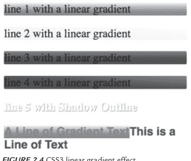

**图 2.4** CSS3 线性渐变效果。

### CSS3 径向渐变

CSS3 径向渐变比 CSS3 线性渐变更复杂，你可以使用它们来创建更复杂的渐变效果。

径向渐变至少需要两个色标，其语法如下：

```css
background: radial-gradient(shape size at position, color1, ..., last-color);
```

`shape` 的默认值是 `ellipse`；`size` 的默认值是 `farthest-corner`；`position` 的默认值是 `center`。

径向渐变的简单示例如下：

```css
background: radial-gradient(red, yellow, green);
```

上述代码片段渲染“均匀分布”的径向渐变，这是默认行为。指定色标偏移值的示例如下：

```css
background: radial-gradient(red 25%, yellow 50%, green 60%);
```

上述代码片段将红色渲染在从径向渐变起点 25% 的位置，黄色渲染在一半的位置，绿色渲染在 60% 的位置。

这里未显示 HTML5 网页 `RadialGradient1.html` 和 CSS 样式表 `RadialGradient1.css`，但完整清单可在随附光盘中找到。HTML5 代码的实质涉及以下代码块：

```html
<div id="outer">
  <div id="radial3">Text3</div>
  <div id="radial2">Text2</div>
  <div id="radial4">Text4</div>
  <div id="radial1">Text1</div>
</div>
```

CSS 样式表 `RadialGradient1.css` 包含与五个 HTML `<div>` 元素匹配的五个 CSS 选择器，其中一个选择器如下所示：

```css
#radial1 {
  font-size: 24px;
  width: 100px;
  height: 100px;
  position: absolute;
  top: 300px;
  left: 300px;
  background: radial-gradient(farthest-side at 60% 55%, red, yellow, #400);
}
```


# CSS3 径向渐变

`#radial1`选择器包含一个`background`属性，该属性定义了一个径向渐变，指定了`farthest-side`属性，后跟红色、黄色和`#400`三种颜色。

其他选择器是第一个选择器的简单变体，创建了一组略有对比的径向渐变。

图 2.5 显示了将 CSS 样式表`RadialGradient1.css`中的选择器与 HTML 页面`RadialGradient1.html`匹配的结果。

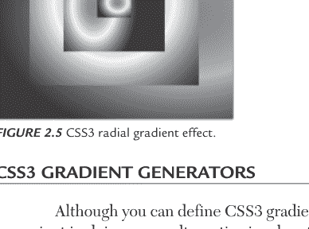

**图 2.5** CSS3 径向渐变效果。

## CSS3 渐变生成器

虽然你可以手动定义 CSS3 渐变，甚至可以熟练掌握，但另一种方法是使用在线工具，其中一些列在这里：

- http://gradientgenerator.com/
- https://github.com/istvan-ujszaszi/css-gradient-generator

这个在线 CSS3 渐变生成器支持 Sass：

- http://www.colorzilla.com/gradient-editor/

将会生成包含浏览器特定前缀的代码，而这些前缀已不再需要。如果你担心生成此类代码，以下网站包含有关渐变生成器的警示细节（特别是关于冗余的浏览器特定前缀）：

- http://codepen.io/thebabydino/full/ppJVWp

## CSS3 2D 变换

CSS3 支持可应用于 2D 形状以及二进制文件的变换。CSS3 变换包括`scale`、`rotate`、`skew`（已弃用）和`translate`，以及`perspective`和`matrix`。请注意，你将在第 3 章学习 CSS3 过渡。然而，另一种选择是使用 GSAP（在第 9 章讨论），其中涉及一小段 SVG（在第 7 章讨论）。例如，考虑以下选择器：

```css
#mytransform {
  /* not supported in IE */
  transform: translateX(100px) scale(0.5);
}
```

用以下与 GSAP 变换相关的 SVG 元素替换上述代码片段：

```html
<g id="mytransform" transform="matrix(0.5, 0, 0, 0.5, 100, 0)">...</g>
```

以下各节包含说明如何将这些 CSS3 变换应用于一组 JPG 文件的代码示例。当用户将鼠标悬停在任何 PNG 文件上时，动画效果会发生；此外，你可以在相邻的 PNG 文件之间快速移动鼠标来创建"部分"动画效果。顺便说一下，上述四个变换是 CSS3`matrix()`函数的特例，该函数可以指定任意的线性 3D 变换，包括 CSS3 透视变换。

清单 2.7 显示了`Scale1.html`的内容，清单 2.8 显示了`Scale1.css`的内容，它们说明了如何缩放 PNG 文件以创建"悬停框"图片画廊。

### 清单 2.7 `Scale1.html`

```html
<!DOCTYPE html>
<html lang="en">
<head>
  <meta charset="utf-8" />
  <title>CSS 缩放变换示例</title>
  <link href="Scale1.css" rel="stylesheet" type="text/css">
</head>
<body>
  <header><h1>悬停任意图像：</h1></header>
  <div id="outer">
    
    
    
    
  </div>
</body>
</html>
```

清单 2.7 引用了 CSS 样式表`Scale1.css`（其中包含用于创建缩放效果的选择器）以及四个引用 PNG 文件`sample2.png`和`sample3.png`的 HTML``元素。清单 2.7 的其余部分很简单，只有一些简单的样板文本和 HTML 元素。

### 清单 2.8 `Scale1.css`

```css
#outer {
  float: left;
  position: relative;
  top: 50px;
  left: 50px;
}

img {
  transition: transform 1.0s ease;
}

img.scaled {
  box-shadow: 10px 10px 5px #800;
}

img.scaled:hover {
  transform: scale(2);
}
```

清单 2.8 中的`img`选择器包含一个`transition`属性，该属性应用在一秒时间间隔内发生的`transform`效果，使用`ease`函数，如下所示：

```css
transition: transform 1.0s ease;
```

接下来，选择器`img.scaled`指定了一个`box-shadow`属性，用于创建红色阴影效果（你在本章前面已经看到过），如下所示：

```css
img.scaled {
  box-shadow: 10px 10px 5px #800;
}
```

最后，选择器`img.scaled:hover`指定了一个`transform`属性，该属性使用`scale()`函数，在用户将鼠标悬停在任何``元素上时，将关联的 PNG 文件大小放大一倍，如下所示：

```css
transform: scale(2);
```

由于`img`选择器使用`ease`函数指定了一秒的间隔，因此缩放效果将持续一秒钟。尝试使用 CSS3`scale()`函数的不同值以及不同的时间间隔值，以创建适合您需求的动画效果。

另一点需要记住的是，您可以同时进行水平和垂直缩放：

```css
img {
  transition: transform 1.0s ease;
}

img.mystyle:hover {
  transform: scaleX(1.5) scaleY(0.5);
}
```

图 2.6 显示了将 CSS 样式表`Scale1.css`中的选择器与 HTML 页面`Scale1.html`匹配的结果。

#### 将鼠标悬停在任意图像上：

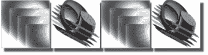

**图 2.6** 基于 CSS3 的 JPG 文件缩放效果。

### 旋转变换

CSS3`transform`属性允许您指定`rotate()`函数以创建缩放效果，其语法如下所示：

```css
rotate(someValue);
```

您可以将`someValue`替换为任意数字。当`someValue`为正数时，旋转为顺时针方向；当`someValue`为负数时，旋转为逆时针方向；当`someValue`为零时，没有旋转效果。在所有情况下，旋转效果的初始位置都是正水平轴。

随书光盘中的 HTML5 网页`Rotate1.html`和 CSS 样式表`Rotate1.css`展示了如何创建旋转效果，其中一个示例显示如下：

```css
img.imageL:hover {
  transform: scale(2) rotate(-45deg);
}
```

指定`transition`属性的`img`选择器使用`ease`计时函数在一秒时间间隔内创建动画效果，如下所示：

```css
transition: transform 1.0s ease;
```

CSS3`transform`属性允许您指定`skew()`函数以创建倾斜效果，其语法如下所示：

```css
skew(xAngle, yAngle);
```

您可以将`xAngle`和`yAngle`替换为任意数字。当`xAngle`和`yAngle`为正数时，倾斜效果为顺时针方向；当`xAngle`和`yAngle`为负数时，倾斜效果为逆时针方向；当`xAngle`和`yAngle`为零时，没有倾斜效果。在所有情况下，倾斜效果的初始位置都是正水平轴。

随书光盘上的 HTML5 网页`Skew1.html`和 CSS 样式表`Skew1.css`展示了如何创建倾斜效果。包含`img`选择器的 CSS 样式表指定了一个`transition`属性，该属性使用`ease`计时函数在一秒时间间隔内创建动画效果，如下所示：

```css
transition: transform 1.0s ease;
```

还有四个选择器`img.skewed1`、`img.skewed2`、`img.skewed3`和`img.skewed4`，分别创建深红色、黄色、绿色和蓝色的背景阴影效果（所有这些都已在之前的代码示例中出现过）。

选择器`img.skewed1:hover`指定了一个`transform`属性，当用户将鼠标悬停在第一个``元素上时执行倾斜效果，如下所示：

```css
transform: scale(2) skew(-10deg, -30deg);
```

其他三个 CSS3 选择器也使用`skew()`和`scale()`函数的组合来创建不同的视觉效果。请注意，第四个悬停选择器还将`opacity`属性设置为`0.5`，这与此选择器中的其他效果同时发生。

图 2.7 显示了将 CSS 样式表`Skew1.css`中的选择器与 HTML 页面`Skew1.html`中的元素匹配的结果。

#### 将鼠标悬停在任意图像上：

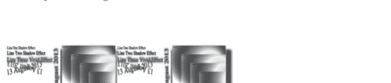

CSS3`transform`属性允许您指定`translate()`函数以创建涉及元素水平和/或垂直"位移"的效果，其语法如下所示：

```css
translate(xDirection, yDirection);
```

位移是相对于位于屏幕左上角的原点进行的。因此，`xDirection`和`yDirection`的正值分别产生向右和向下的位移，而`xDirection`和`yDirection`的负值分别产生向左和向上的位移；`xDirection`和`yDirection`的零值不会导致任何位移效果。

随书光盘上的网页`Translate1.html`和 CSS 样式表`Translate1.css`展示了如何对 PNG 文件应用位移效果。

```css
img.trans2:hover {
  transform: scale(0.5) translate(-50px, -50px);
}
```

包含`img`选择器的 CSS 样式表使用`ease`计时函数在一秒时间间隔内指定`transform`效果，如下所示：

```css
transition: transform 1.0s ease;
```

四个选择器`img.trans1`、`img.trans2`、`img.trans3`和`img.trans4`分别创建深红色、黄色、绿色和蓝色的背景阴影效果，正如您在上一节中看到的那样。

选择器`img.trans1:hover`指定了一个`transform`属性，当用户将鼠标悬停在第一个``元素上时执行缩放效果和位移效果，如下所示：

```css
transform: scale(2) translate(100px, 50px);
```

图 2.8 显示了将 CSS3 样式表`Translate1.css`中定义的选择器与 HTML 页面`Translate1.html`中的元素匹配的结果。

#### 将鼠标悬停在任意图像上：

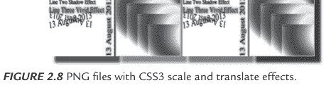

**图 2.8** 具有 CSS3 缩放和位移效果的 PNG 文件。

## 如何提高 CSS 选择器的效率

本节的第一部分比较了两个看起来非常相似但结果不同的 CSS 选择器。第二部分讨论了在网页中使用`translate()`函数与`top`/`left`属性之间的权衡。

浏览器从右到左读取选择器：这是一种"自下而上"的方法，"关键"选择器是 CSS 选择器最右边的部分。从右到左更高效，因为`element:parent`的关系是一对一的，而`parent:child`的关系是多对一的。

作为示例，请考虑以下 CSS 和 HTML 片段：

```css
#mylist a { ... }
```

```html
<ul id="mylist">
  <li a=... class="abc" .../>
  <li a=... class="abc" .../>
  <li a=... class="abc" .../>
  ...
</ul>
```

现在假设您有 100 个`<a>`元素，并且您想选择具有值为`abc`的`class`属性的三个`<a>`元素。这个 CSS 选择器匹配了完整的  个`<a>`元素集合（这不是您想要的）：

```css
#mylist a { ... }
```

另一方面，以下 CSS 选择器*仅*匹配所需的三个元素：

```css
#mylist .abc { ... }
```

此处涉及 calculate/layout/paint 的高效 CSS 示例选择器如下：

```css
.results h2 {                 // recalculate style
  height: 25px;              // layout
  text-shadow: 2px black;    // paint
}
```

Paul Irish 关于 Performance Tooling 的一段稍早（但仍然有用）的视频涵盖了与性能相关的主题，链接如下：

http://www.youtube.com/watch?v=HAqjyCH_LOE

### `translate()`函数与`Top`/`Left`属性

支持`translate()`的因素包括：a)`translate()`不会"触碰" DOM，以及 b)`translate()`涉及子像素，从而产生更平滑的效果（部分原因是由于模糊）。另一方面，当元素在网页中具有相对/绝对/固定定位时，请优先使用`top`/`left`/`right`/`bottom`而不是`translate()`。

请记住，*这两种*技术在不同的浏览器上可能会产生不同的结果。以下详细文章（由 Chris Coyier 和 Paul Irish 撰写）包含更多信息：

- http://css-tricks.com/tale-of-animation-performance/
- http://www.paulirish.com/2012/why-moving-elements-with-translate-is-better-than-posabs-topleft/

## CSS3 属性的浏览器特定前缀

浏览器特定前缀用于那些在各浏览器中处于“开发中”状态的 CSS 属性，最终的规范会去掉这些浏览器特定前缀。虽然现代浏览器的较新版本不再需要前缀（将在本节后面讨论），但出于两个原因，了解这些前缀仍然很有价值：a) 您可能会遇到包含浏览器特定前缀的旧代码；b) 生成 CSS 渐变效果的旧网站往往会产生包含不必要浏览器前缀的代码。

浏览器特定前缀`-ie-`、`-moz-`和`-o-`分别对应 Internet Explorer、Firefox 和 Opera。请注意，Opera 也支持`-webkit-`前缀，其他浏览器也可能会这样做（请查看各自的网站以获取更新）。

为了演示，以下代码块展示了这些前缀的示例：

```css
-ie-webkit-border-radius: 8px;

-moz-webkit-border-radius: 8px;

-o-webkit-border-radius: 8px;

border-radius: 8px;
```


在 CSS 选择器中，请在“通用”属性之前指定带有浏览器特定前缀的属性，通用属性在浏览器特定属性未被选中时将作为默认选择。本书中的 CSS3 代码示例包含 WebKit 特定前缀，这有助于我们在尺寸上保持 CSS 样式表的可管理性。如果您需要能在多个浏览器（包括当前版本和旧版本）上运行的 CSS 样式表，基本上有两种选择。一种选择是手动添加包含所有必需浏览器特定前缀的 CSS3 代码，但这在维护时可能非常繁琐且容易出错。另一种选择是使用 CSS 工具包或框架（将在下一章讨论），它们可以通过编程方式生成包含所有浏览器特定前缀的 CSS3 代码。

最后，这里有一个详尽的浏览器前缀 CSS 属性列表：`http://peter.sh/experiments/vendor-prefixed-css-property-overview/`。

在颜色渐变（在第 3 章讨论）的情况下，最新版本的 Chrome、Firefox、IE 10+、Opera 和 Safari 不再需要浏览器特定前缀。随着现代浏览器在功能支持方面的演进，更多的 CSS 属性将变为“无前缀”。幸运的是，以下开源项目允许您在代码中指定无前缀属性：`http://leaverou.github.io/prefixfree/`。

上述代码仅在必要时插入浏览器特定前缀，从而减轻了手动执行此任务的繁琐。

### 本章小结

在本章中，您学习了浏览器对 CSS3 的支持、浏览器特定前缀以及各种 CSS3 特性。接着，您学习了 CSS3 伪类，以及如何创建阴影效果和圆角。您还学习了 CSS3 线性渐变和径向渐变，以及在线渐变生成器。此外，您还了解了如何使用各种 CSS3 变换，如缩放（`scale`）、旋转（`rotate`）、倾斜（`skew`）和位移（`translate`）。最后，您学习了与性能相关的技术。

## 第三章

### CSS3 2D 图形与动画

前一章包含了创建 CSS3 2D 图形效果的示例，而本章则包含 CSS3 2D 动画效果。请注意，第 4 章将向您展示如何创建 CSS3 3D 图形和动画效果。虽然 CSS3 相关的图形和动画效果分布在三个章节中讨论，但请记住，代码示例旨在介绍概念，而非对技术概念和特性的全面且详尽的覆盖。

本章的第一部分讨论用于创建简单动画效果（如发光效果和弹跳效果）的 CSS3 过渡（`transitions`）。本部分的章节还包含代码示例，向您展示如何定义可以实现更复杂文本效果（如渲染多栏文本）的 CSS3 选择器。

本章的第二部分向您展示如何定义 CSS3 选择器以创建 2D 动画效果。具体而言，您将学习如何使用 CSS3 `keyframes` 以及 CSS3 函数 `scale()`、`rotate()` 和 `translate()` 来创建 2D 动画效果。

本章的第三部分向您展示如何创建淡出图像、旋转图像和“弹跳”效果。本节还解释了如何为文本创建 CSS3 效果（如多栏文本）。此外，本节还介绍了 CSS 运动路径（Motion Paths），这是一个支持类似 SVG 动画效果的实验性 CSS3 特性。本章的第四部分涵盖了 CSS3 过滤器，并提供了可编程生成网页自定义过滤器的网站链接。

最后一部分涉及 jQuery，以及如何使用 jQuery 和 CSS3 创建 2D 效果。您还将学习如何使用 jQuery 和 CSS3 创建一个“跟随鼠标”的示例。如果您不熟悉 jQuery，可以阅读配套光盘中的 jQuery 附录。如果您不需要 jQuery，可以将本节视为可选内容（或许在未来的某个时间点再回到本节）。

如果您还不知道，在 HTML5 网页中使用 CSS3 有几个优势。首先，您将学习如何使用 CSS3 3D 创建自己的视觉效果。其次，像 jQuery Mobile 这样的工具包在渲染内容和创建动画效果（包括页面过渡）时严重依赖 CSS3。因此，您从本书 CSS3 相关章节中获得的知识将为您打下基础，帮助您理解 jQuery Mobile 是如何实现其“魔法”的，甚至可能让您更容易阅读 jQuery Mobile 的源代码。

第四，创建令人印象深刻的基于 CSS3 的图形和动画效果（尤其是 3D）比使用其他语言（包括 SVG）创建同样的效果更容易。第五，如果您使用 CSS3 而不是依赖 JavaScript 和 JPG 文件来实现图形和动画，您的代码可能会更精简，这对移动设备来说是一个特别重要的点。请注意，许多 CSS3 3D 效果必须依赖硬件加速，好消息是，越来越多的移动设备支持 CSS3 的硬件加速（在某些情况下，HTML5 Canvas 也有此类支持）。

### CSS3 2D 变换

CSS3 变换包括 CSS3 函数 `scale()`、`rotate()`、`skew()` 和 `translate()`，它们使您能够修改 HTML 元素的形状。

本节向您展示如何使用 CSS3 创建一个立方体，这涉及渲染前表面（矩形）、顶表面（平行四边形）和右表面（同样是平行四边形）。

在本节中，我们将使用以下 CSS3 变换和效果：

1. CSS3 `skew()` 函数来创建左表面和右表面。
2. CSS3 `scale()` 和 `rotate()` 函数来创建顶表面。
3. 线性渐变和径向渐变来实现阴影效果。

本节的示例包含大量 CSS3 代码，在学习代码的同时，在浏览器中启动网页查看结果可能会很有帮助。

#### 代码清单 3.1 `3DCube1.html`

```html
<!DOCTYPE html>
<html lang="en">
<head>
  <title>CSS 3D Cube Example</title>
  <meta charset="utf-8" />
  <link href="3DCS1.css" rel="stylesheet" type="text/css">
</head>
<body>
  <header>
    <h1>Hover Over the Cube Faces:</h1>
  </header>

  <div id="outer">
    <div id="top">Text1</div>
    <div id="left">Text2</div>
    <div id="right">Text3</div>
  </div>
</body>
</html>
```

代码清单 3.1 是一个简单的 HTML 页面，它引用了 CSS 样式表 `3DCSS1.css`，该样式表包含用于定义此网页中 HTML `<div>` 元素样式的 CSS3 选择器。

```css
/* size and position */

#right, #left, #top {
  position: relative;
  padding: 0px;
  width: 200px;
  height: 200px;
}

/* #left and #right selectors omitted for brevity */
```

`transform` 属性指定了 CSS3 变换函数 `scale()`、`skew()` 和 `rotate()`。这三个函数被同时调用，这意味着您将看到缩放、倾斜和旋转效果同时发生，而不是顺序发生。

代码清单 3.2 中的最后三个选择器定义了立方体每个表面的属性。例如，`#left` 选择器指定了某些文本的字体大小，以及立方体左表面的位置属性。`#left` 选择器最复杂的部分是 `background-image` 属性的值，它由径向渐变、重复径向渐变和另一个径向渐变的组合组成。请注意，左表面是一个矩形，通过以下代码被变换成了平行四边形：

```css
transform: skew(0deg, -30deg);
```

`#top` 选择器和 `#right` 选择器包含与 `#left` 选择器相当的代码，您可以尝试修改它们的值以创建其他令人愉悦的视觉效果。

图 3.1 显示了将 `3DCube1.css` 中的 CSS 选择器与 HTML 页面 `3DCube1.html` 中的 `<div>` 元素匹配后的结果。

如果您想学习如何使用 CSS3 属性和变换创建各种形状，以下链接提供了技术和示例：`http://enjoycss.com/gallery/shapes` 和 `http://1stwebdesigner.com/css-shapes/`。

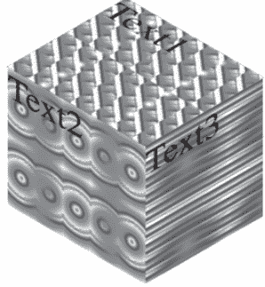

图 3.1 一个基于 CSS3 的立方体。

### CSS3 2D 过渡（TRANSITIONS）

CSS3 过渡涉及以平滑的方式更改 CSS 值，它们由用户手势触发，例如鼠标点击、聚焦或“悬停（hover）”效果。过渡非常有用，因为你可以使用所谓的“缓动函数（easing functions）”在特定的时间长度在 CSS 属性上创建动画效果，这些函数能产生不同变化率的动画效果。例如，某些缓动函数在动画效果期间以恒定速率变化，而其他函数则创建非线性效果（慢-快-慢，快-慢-快，等等）。缓动函数功能强大且实用，因为它们能让你创建出真实的视觉效果，比如观察一颗棒球在空中向你飞来（这是一个“快-慢-快”动画的例子）。

WebKit 最初开发了 CSS3 过渡，通过使用浏览器特定前缀（你将在本节稍后看到），它们在 Safari、Chrome（3.2 或更高版本）、Opera（10.5 或更高版本）和 Firefox（4.0 或更高版本）中同样可用。请记住，有一些工具包（如 jQuery 和 Prototype）支持类似于基于 CSS3 的过渡效果。

创建 CSS 过渡的基本语法是一个指定以下内容的“三元组”：

- 一个 CSS 属性
- 一个时长（以秒为单位）
- 一个过渡时间函数

这是一个过渡示例：

```css
transition-property: background;
transition-duration: 0.5s;
transition-timing-function: ease;
```

幸运的是，你也可以将这些过渡组合在一行中，如下所示：

```css
transition: background 0.5s ease;
```

这是一个包含这些过渡的 CSS3 选择器示例：

```css
a.foo {
  padding: 3px 6px;
  background: #f00;
  transition: background 0.5s ease;
}

a.foo:focus,
a.foo:hover {
  background: #00f;
}
```

过渡目前需要浏览器特定前缀，才能在所有浏览器中正常工作。然而，浏览器发展迅速，现在需要前缀的属性在未来可能会变得无需前缀。访问这些网站以了解 CSS 属性是否需要前缀：`http://shouldiprefix.com/` 和 `http://caniuse.com/`。

以下网站可以帮助你为 CSS 属性添加浏览器特定前缀：`https://github.com/postcss/autoprefixer`。

这是一个使用针对 Internet Explorer、Firefox 和 Opera 的浏览器特定前缀来指定属性的示例：

```css
-ie-webkit-transition: background 0.5s ease;
-moz-webkit-transition: background 0.5s ease;
-o-webkit-transition: background 0.5s ease;
```

目前你可以指定以下过渡时间函数之一（使用浏览器特定前缀）：

- `Ease`
- `Ease-in`
- `Ease-out`
- `Ease-in-out`
- `Cubic-bezier`

如果这些过渡函数都不能满足你的需求，你可以使用这个在线工具创建自定义函数：`www.matthewlein.com/ceaser`。

这里有一个显示过渡时间函数对比的网站：`http://www.roblapalacca.com/examples/bezierBuilder/`。

你可以为 `transition-property` 属性指定许多值，详细的值列表请参阅：`https://developer.mozilla.org/en/CSS/CSS_transitions`。

根据上述链接，`transition-property` 属性仍处于实验阶段，该链接中还提供了一个浏览器兼容性表。

以下网站是 CSS3 和贝塞尔曲线（Bezier curve）动画效果示例的良好来源：`https://medium.com/@EanPlatter/css3-animations-with-a-cubic-bezier-curve-ea06fc20e5c1`。

### 使用 CSS3 过渡为立方体制作动画

本节中的代码示例在上一节的代码基础上添加了基于悬停的动画效果。HTML 网页 `3DCube1Hover1.html` 与网页 `3DCube1.html` 几乎完全相同；唯一的例外是引用了 CSS 样式表 `3DCube1Hover1.css`。

代码清单 3.3 显示了 `3DCubeHover1.css` 的内容，其中包含创建立方体面动画效果的悬停相关 CSS3 选择器。

#### 代码清单 3.3 `3DCube1Hover1.css`

```css
#right:hover {
  transition: transform 3.0s ease;
  transform: scale(1.2) skew(-10deg, -30deg) rotate(-45deg);
}

#left:hover {
  transition: transform 2.0s ease;
  transform: scale(0.8) skew(-10deg, -30deg) rotate(-45deg);
}

#top:hover {
  transition: transform 2.0s ease;
  transform: scale(0.5) skew(-20deg, -30deg) rotate(45deg);
}

// 其余代码与 3DCube1.css 相同
```

既然你已经了解了如何使用 CSS3 2D 变换和过渡，接下来的章节将讨论使用 CSS3 关键帧（`keyframes`）来创建不需要用户交互的动画效果。

### 使用 CSS3 关键帧创建动画效果

到目前为止，你看到的基于 CSS3 的代码示例主要涉及静态视觉效果（但你已经看到了如何使用 `hover` 伪选择器来创建动画效果）。本节中的 CSS3 代码示例将演示如何为基于表单的元素创建“发光”效果和“弹跳”效果。

CSS3 `@keyframes` 规则包含一组通过代表 `0` 到 `100` 之间百分比的数字来识别的选择器。你还需要指定元素上动画效果的时长，关键帧每个部分的时长将计算为效果总时长的百分比。

例如，以下 CSS3 `@keyframes` 规则定义了动画前半段以及后半段发生的情况：

```css
@keyframes glow {
  0% {
    box-shadow: 0 0 24px rgba(255, 255, 255, 0.5);
  }

  50% {
    box-shadow: 0 0 24px rgba(255, 0, 0, 0.9);
  }

  100% {
    box-shadow: 0 0 24px rgba(255, 255, 255, 0.5);
  }
}
```

因此，如果动画效果持续十秒，那么前两个动画效果持续五秒，随后是动画效果完成时创建的视觉效果。

前面的代码块是一个简单但具有代表性的示例，向你展示了如何使用 CSS3 `@keyframes` 规则。本节中的示例使用 `keyframes` 和 `hover` 伪选择器，以便在用户将鼠标悬停在 HTML 页面的特定元素上时创建动画效果。

代码清单 3.3 显示了 `Transition1.html` 的内容，代码清单 3.4 显示了 `Transition1.css` 的内容，其中包含在输入字段上创建“发光”效果的 CSS3 选择器。

#### 代码清单 3.3 `Transition1.html`

```html
<!DOCTYPE html>
<html lang="en">
<head>
  <title>CSS Animation Example</title>
  <meta charset="utf-8" />
  <link href="Transition1.css" rel="stylesheet" type="text/css">
</head>
<body>
  <div id="outer">
    <input id="input" type="text" value="This is an input line"></input>
  </div>
</body>
</html>
```

代码清单 3.3 是一个简单的 HTML 页面，包含对 CSS 样式表 `Transition1.css` 的引用和一个包含 `<input>` 字段元素的 HTML `<div>` 元素。正如你将看到的，当用户将鼠标悬停在 `<input>` 元素上时，会产生动画效果。

#### 代码清单 3.4 `Transition1.css`

```css
#outer {
  position: relative;
  top: 20px;
  left: 20px;
}

@keyframes glow {
  0% {
    box-shadow: 0 0 24px rgba(255, 255, 255, 0.5);
  }

  50% {
    box-shadow: 0 0 24px rgba(255, 0, 0, 0.9);
  }

  100% {
    box-shadow: 0 0 24px rgba(255, 255, 255, 0.5);
  }
}

#input {
  font-size: 24px;
  border-radius: 4px;
}

#input:hover {
  animation: glow 2.0s 3 ease;
}
```


代码清单 3.4 包含一个名为`glow`的 CSS3 `@keyframes`规则，它指定了三种阴影效果。第一种阴影效果（在动画效果的时间 0 处发生）渲染为不透明度为 0.5 的白色。第二种阴影效果（在动画效果的中点处）渲染为不透明度为 0.9 的红色。第三种阴影效果（在动画效果结束时发生）与第一个动画效果相同。

`#input`选择器匹配`Transition1.html`中的输入字段，从而产生一个圆角矩形。`#input:hover`选择器使用`glow @keyframes`规则，为两秒的时间间隔创建动画效果，重复三次，并使用`ease`函数，如下所示：

```css
animation: glow 2.0s 3 ease;
```

图 3.2 显示了启动 HTML 页面`Transition1.html`的结果。请记住，在桌面浏览器上，你只需将鼠标悬停在输入字段上即可触发动画效果，而在移动设备上，你需要点击输入字段才能触发动画效果，这同时也会导致键盘显示。

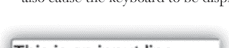

**图 3.2** CSS3 发光过渡效果。

### 使用 CSS3 关键帧实现图像淡出和旋转效果

前一节的示例向你展示了如何创建发光动画效果，本节将向你展示如何为 JPG 图像创建淡出效果。

代码清单 3.5 显示了`FadeRotateImages1.html`的内容，代码清单 3.6 显示了`FadeRotateImages1.css`的内容，它们阐述了如何在一个 PNG 文件上创建“淡入”效果，以及在另一个 PNG 文件上创建发光效果。

#### 代码清单 3.5 `FadeRotateImages1.html`

```html
<!DOCTYPE html>
<html lang="en">
<head>
    <title>CSS3 Fade and Rotate Images</title>
    <meta charset="utf-8" />
    <link href="FadingImages1.css" rel="stylesheet"
          type="text/css">
</head>
<body>
    <div id="outer">
        
        
    </div>
    <div id="third">
        
    </div>
</body>
```

代码清单 3.5 中引用了 CSS 样式表`FadingImages1.css`，其中包含用于创建淡入效果和发光效果的 CSS 选择器。代码清单 3.5 中的第一个 HTML `<div>`元素包含两个``元素；当用户将鼠标悬停在渲染的 JPG 文件上时，它会“淡入”并显示另一个 JPG 文件。第二个 HTML `<div>`元素包含一个``元素，当用户将鼠标悬停在这个 PNG 上时，CSS3 选择器会绕垂直轴旋转所引用的 PNG 文件。

#### 代码清单 3.6 `FadeRotateImages1.css`

```css
#outer {
    position: absolute; top: 20px; left: 20px;
    margin: 0 auto;
}

#outer img {
    position: absolute; left: 0;
    transition: opacity 1s ease-in-out;
}

#outer img.upper:hover {
    opacity: 0;
}

#third img {
    position: absolute; top: 20px; left: 250px;
}

#third img:hover {
    animation: rotatey 2.0s 3 ease;
}

@keyframes rotatey {
    0% {
        transform: rotateY(45deg);
    }

    50% {
        transform: rotateY(90deg);
    }

    100% {
        transform: rotateY(0);
    }
}
```

我们将跳过代码清单 3.6 中已经熟悉的代码细节。创建淡入效果的关键点是在用户将鼠标悬停在最左侧的图像上时将`opacity`值设置为`0`，CSS 选择器中的关键代码如下：

```css
#outer img.upper:hover {
    opacity: 0;
}
```

如你所见，这个代码示例表明，无需复杂的代码或逻辑即可创建吸引人的视觉效果。

接下来，代码清单 3.6 定义了一个 CSS3 选择器，通过在标记为`rotatey`的`keyframes`中调用 CSS3 函数`rotateY()`来创建绕垂直轴的旋转效果。请注意，你可以通过将`rotateY()`替换为 CSS3 函数`rotateX()`或 CSS3 函数`rotateZ()`来创建绕另外两个轴的旋转效果。你甚至可以在同一个`keyframes`中同时使用这三个函数来创建 3D 效果。请注意，CSS3 3D 效果将在下一章中更详细地讨论。

图 3.3 显示了启动`FadeRotateImages1.html`的结果，点击左侧图像（最初与右侧图像相同）后使用淡入效果渲染。请注意，在桌面浏览器上，用户可以将鼠标悬停在任一图像上，将鼠标悬停在右侧图像上会创建旋转效果。

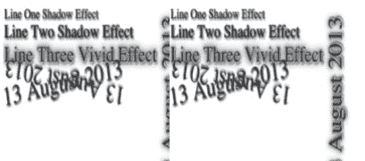

**图 3.3** CSS3 淡入和旋转 JPG 效果。

### CSS3 Keyframes 弹跳效果

前面的示例展示了如何创建淡入动画效果，本节将展示如何创建“弹跳”动画效果。

代码清单 3.7 显示了`Bounce2.html`的内容，代码清单 3.8 显示了`Bounce2.css`的内容，它们说明了如何在输入字段上创建“弹跳”效果。

#### 代码清单 3.7 `Bounce2.html`

```html
<!DOCTYPE html>
<html lang="en">
<head>
  <title>CSS Animation Example</title>
  <meta charset="utf-8" />
  <link href="Bounce2.css" rel="stylesheet" type="text/css">
</head>
<body>
  <div id="outer">
    <input id="input" type="text" value="An input line"/>
  </div>
</body>
</html>
```

代码清单 3.7 是另一个简单的 HTML 页面，包含对 CSS 样式表`Bounce2.css`的引用和一个包含`<input>`字段元素的 HTML `<div>`元素。当用户用鼠标悬停在`<input>`元素上时，CSS 样式表会创建弹跳动画效果。

#### 代码清单 3.8 `Bounce2.css`

```css
#outer {
    position: relative; top: 50px; left: 100px;
}

@keyframes bounce {
    0% {
        left: 50px;
        top: 100px;
        background-color: #ff0000;
    }

    25% {
        left: 100px;
        top: 150px;
        background-color: #ffff00;
    }

    50% {
        left: 50px;
        top: 200px;
        background-color: #00ff00;
    }

    75% {
        left: 0px;
        top: 150px;
        background-color: #0000ff;
    }

    100% {
        left: 50px;
        top: 100px;
        background-color: #ff0000;
    }
}

#input {
    font-size: 24px;
    border-radius: 4px;
}

#outer:hover {
    animation: bounce 2.0s 4 ease;
}
```

代码清单 3.8 包含一个标记为`bounce`的`@keyframes`规则，它指定了五个时间间隔：动画效果持续时间的 0%、25%、50%、75%和 100%点。每个时间间隔指定了`<input>`字段的`left`、`top`和`background-color`的值。尽管这个`@keyframes`规则很简单，但它创建了一个令人愉悦的动画效果。

`#input`选择器匹配`Bounce2.html`中的输入字段，结果是一个圆角矩形。`#input:hover`选择器使用`bounce` keyframes 来创建一个持续两秒、重复四次、使用`ease`函数的动画效果，如下所示：

```css
animation: bounce 2.0s 4 ease;
```

图 3.4 显示了 HTML 网页`Bounce2.html`中动画效果的快照。

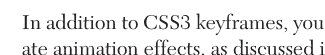

*图 3.4 CSS3 弹跳动画效果。*

除了 CSS3 keyframes 之外，你还可以使用 CSS Motion Paths 来创建动画效果，这将在下一节中讨论。

### CSS Motion Paths

CSS Motion Paths 目前正在开发中，它们在纯 CSS3 中创建复杂动画效果方面提供了巨大的潜力。CSS Motion Paths 允许作者使任何图形对象沿作者指定的路径进行动画。你通过在 CSS 选择器中指定`motion-path`属性来定义 CSS Motion Path，其值涉及`path()`函数中的实际路径。CSS Motion Paths 支持四个属性：`motion`（`motion-path`的简写形式）、`motion-offset`（`motion-path`上的一个位置）、`motion-path`（用于动画的类似 SVG 的路径）和`motion-rotation`（运动路径上元素的方向）。

CSS Motion Paths 使你能够创建类似于 SVG 动画效果的动画效果，这些 SVG 动画效果自 SVG 早期就已经可用。事实上，`motion-path`属性的值使用基于 SVG 的语法，你可以在以下示例中看到：

```css
#mydiv {
  motion-path: path('M900,190  L993,245 V201  A11,11 0 0,1
1004,190  H1075  A11,11 0 0,1 1086,201  V300  L1294,423
H1216  A11,11 0 0,0 1205,434  V789  A11,11 0 0,1 1194,800
H606  A11,11 0 0,1 595,789  V434  A11,11 0 0,0 584,423
H506 L900,190');
}
```

如果你熟悉 SVG，前面 CSS 选择器中的代码将非常熟悉。如果你是 SVG 新手，请阅读第 7 章中的 SVG 相关材料。

目前，CSS Motion Paths 在某些版本的 Chrome 和 Opera 中受支持（`http://caniuse.com/#feat=css-motion-paths`）。

一个更全面的 CSS Motion Paths 示例（涉及线段和椭圆弧）可以在`https://googlechrome.github.io/samples/css-motion-path/index.html`和`http://thenewcode.com/38/Animate-Elements-on-a-Path-with-CSS`找到。

请参阅`https://drafts.fxtf.org/motion-1/`了解 CSS Motion Path 规范的完整详细信息。

### CSS3 文本效果

你已经在前面的章节中看到了几个代码样本中渲染文本字符串的示例（特别是在`TextShadow1.html`中），在本节中我们将讨论 CSS3 的一个非常好的新功能，它使你能够以多列渲染文本。

#### 多列文本渲染

在第 2 章中，你了解到 CSS3 支持多列文本，当网页包含大量文本时，它可以创建非常好的视觉效果。

代码清单 3.9 显示了`MultiColumns1.html`的内容，代码清单 3.10 显示了`MultiColumns1.css`的内容，它们说明了如何渲染多列文本。

#### 代码清单 3.9 `MultiColumns1.html`

```html
<!doctype html>
<html lang="en">
<head>
  <title>CSS Multi Columns Example</title>
  <meta charset="utf-8" />
  <link href="MultiColumns.css" rel="stylesheet"
        type="text/css">
</head>
```

```html
<body>
  <header>
    <h1>将鼠标悬停在多列文本上：</h1>
  </header>
  <div id="outer">
    <p id="line1">.</p>
    <article>
      <div id="columns">
        <p> CSS 使你能够定义选择器，这些选择器指定了你希望如何渲染 HTML 页面中的元素的样式或方式。CSS 帮助你模块化你的 HTML 内容，并且由于你可以将你的 CSS 定义放在一个单独的文件中，你也可以在多个 HTML 文件中重用相同的 CSS 定义。
        </p>
        <p>  此外，CSS 还使你能够简化需要对 HTML 页面中的元素进行的更新。例如，假设多个 HTML 表格元素使用指定颜色为红色的 CSS 规则。如果你后来需要将颜色更改为蓝色，你只需在一个 CSS 规则中做一个更改（即将红色更改为蓝色）即可实现这种更改。
        </p>
        <p>  如果没有 CSS 规则，你将被迫手动更新每个受影响的 HTML 表格元素中的颜色属性，这容易出错、耗时且效率极低。
        </p>
      </div>
    </article>
    <p id="line1">.</p>
  </div>
</body>
</html>
```

清单 3.9 中的 HTML5 页面包含语义标签（在第 1 章中讨论），这些标签将文本渲染在几个 HTML `<p>`元素中。如你所见，这个 HTML5 页面很直接，多列效果在清单 3.10 所示的 CSS 样式表`MultiColumns1.css`中定义。

#### 清单 3.10 `MultiColumn1.css`

```css
#columns:hover {
    transition: transform 3.0s ease;
    transform: scale(0.5) skew(-20deg, -30deg) rotate(45deg);
}

#line1:hover {
    transition: transform 3.0s ease;
    transform: scale(0.5) skew(-20deg, -30deg) rotate(45deg);
    background-image: linear-gradient(to bottom, #fff, #00f);
    border-radius: 8px;
}

#columns {
    column-count: 3;
    column-gap: 80px;
    column-rule: 1px solid rgb(255,255,255);
}

#line1 {
    color: red;
    font-size: 24px;
    background-image: linear-gradient(to bottom, #fff, #f00);
    border-radius: 4px;
}
```

清单 3.10 中的前两个选择器在用户将鼠标悬停在`id`属性值为`columns`或`line1`的`<div>`元素上时创建动画效果。两个选择器都在三秒的时间间隔内使用 CSS3 函数`scale()`、`skew()`和`rotate()`创建动画效果，如下所示：

```css
transition: transform 3.0s ease;
transform: scale(0.5) skew(-20deg, -30deg) rotate(45deg);
```


第二个选择器还定义了一个线性渐变背景效果。

清单 3.10 中的 `#columns` 选择器包含三个与布局相关的属性。`column-count` 属性为 `3`，因此文本显示在三列中；`column-gap` 属性为 `80px`，因此相邻列之间有 80 像素的间距；`column-rule` 属性指定白色背景。

`#line1` 选择器指定一个线性渐变，在多列文本上方和下方创建了良好的视觉效果。

图 3.5 显示了将 `MultiColumns.css` 中的 CSS 选择器与 HTML 页面 `MultiColumns.html` 中的文本进行匹配的结果。

**将鼠标悬停在多列文本上：**

（图 3.5：多列文本）

### CSS 滤镜

滤镜效果是你在对 HTML 网页中的元素应用图形操作时创建的效果。滤镜可以接受零个或多个输入图像，以及可能的一些输入参数。输出图像要么显示在 HTML 网页中，要么可以用作另一个滤镜效果的输入，或者作为 CSS 图像值提供。

此外，现代浏览器支持以下 CSS 滤镜（显示每个滤镜的示例值）：

```css
filter: blur(3px);
filter: grayscale(100%);
filter: hue-rotate(80deg);
filter: opacity(0.8);
filter: sepia(80%);
filter: saturate(2);
filter: brightness(0.5);
filter: contrast(0.6);
filter: hue-rotate(120deg);
filter: invert(0.4);
```

你可以将这些 CSS 滤镜应用于 JPG 文件，如下列选择器所示，该选择器为所有 `` 元素应用 CSS 模糊滤镜：

```css
img {
  filter: blur(3px);
}
```

你可以从 W3C 编辑草案（这是一个正在进行中的工作）在 `https://docs.w3.org/hg/FXTF/raw-file/tip/filters/index.html` 获取完整的滤镜列表和其他信息。

另外两个包含有关滤镜有用信息的网站位于 `http://www.ssi-developer.net/css/visual-filters.shtml` 和 `https://html5-demos.appspot.com/static/css/filters/index.html`。

Firefox 浏览器为 CSS 滤镜和开发者工具提供了丰富的支持，可以在 `https://developer.mozilla.org/en-US/docs/Tools/Page_Inspector/How_to/Edit_CSS_filters` 找到。

以下链接显示了浏览器对 CSS 滤镜的支持状态：`http://caniuse.com/#feat=css-filters`。

#### CSS 自定义滤镜

Adobe 网站 CSS FilterLab 允许读者通过点击来为网页添加 CSS 滤镜，并生成你可以复制/粘贴到自己的 HTML 网页中的相关代码。CSS FilterLab 网站位于 `http://www.adobe.com/devnet/html5/articles/css-filterlab.html`。

请记住，Adobe 的 CSS FilterLab 的 Github 仓库最近没有任何活动。

更多自定义滤镜的示例可以在 `http://www.inserthtml.com/2013/07/css-custom-filters` 找到。

如果你是 Instagram 的粉丝，你可能会对以下使用 CSS3 创建 Instagram 滤镜的工具包感兴趣：`http://una.im/CSSgram/`。

### 使用 CSS 和 jQuery（可选）

本章的其余部分包含包含 CSS3 和 jQuery 的网页示例。你可能会问自己 jQuery 在 CSS 袖珍指南中的相关性。这是一个有效的问题，因为这*是* CSS3 袖珍指南。一个选择是简单地跳过本节（以及本书其他章节中的 jQuery 部分），并可能记住这些部分，以防你在将来的某个时候决定学习结合 jQuery 和 CSS3。

另一个需要考虑的因素是 jQuery 极大的普及度，这导致其被包含在数量惊人的网页中。因此，你遇到 jQuery 代码的可能性很大。jQuery 代码示例的目的是向你展示 jQuery `css()` 方法的强大功能，该方法大大简化了动态修改现有 HTML 元素的 CSS 属性以及创建新的 HTML 元素。因此，本章中带有 jQuery 的代码示例只需要理解一些基本概念。

本书的关键 jQuery 概念如下所列：

1. 使用美元符号 `"$"` 代表 jQuery。
2. 通过语法 `$("html标签名")` 定位 HTML 元素。
3. 通过语法 `$("#id值")` 定位 `id` 属性。
4. 通过语法 `$(".class值")` 定位 `class` 属性。
5. 将你的代码放在此块中：`$(document).ready(function(){…})`。

以下是一些具体示例：

1. `$("p")` 在 HTML 网页中查找所有 `<p>` 元素。
2. `$("#abc")` 查找 `id` 属性值为 `"abc"` 的 HTML 元素。
3. `$(".def")` 查找 `class` 属性值为 `"def"` 的 HTML 元素。

清单 3.11 显示了 `HelloWorld1.html` 的内容，该清单说明了如何向包含单个 HTML `<p>` 元素的 HTML5 网页添加 jQuery 功能。

> 清单 3.11 包含 `console.log()`，该函数在基于 WebKit 的浏览器中可用，但在其他浏览器中可能需要某种类型的插件或扩展才能使用。

#### 清单 3.11 HelloWorld1.html

```html
<!DOCTYPE html>
<html lang="en">
  <head>
    <meta charset="utf-8" />
    <title>Hello World</title>
    <script src="http://code.jquery.com/jquery-2.0.0b1.js"></script>
  </head>
  <body>
    <p id="Steve">Hello World From a Paragraph</p>
    <script>
      $(document).ready(function(){

          // 获取 'id' 值（等于 Steve）
          var pIdValue = $("p").attr("id");

          // 获取 <p> 元素中的文本
          var pText = $("p").text();

          console.log(pIdValue+" says "+pText);

          // 更新 <p> 元素中的文本
          $("p").text("Goodbye World From a Paragraph");

          pText = $("p").text();
          console.log(pIdValue+" says "+pText);

      });
    </script>
  </body>
</html>
```

清单 3.11 使用以下代码片段引用了两个 jQuery 文件：

```html
<script src="http://code.jquery.com/jquery-2.0.0b1.js"></script>
```

注意，HTML `<body>` 元素中的第一个 HTML `<script>` 元素以以下行开始：

```javascript
$(document).ready(function(){
    // 在此处执行某些操作
});
```

前面的构造确保 DOM（文档对象模型）已加载到内存中，之后访问和操作 DOM 元素才是安全的。使用 jQuery `attr()` 函数获取 HTML 元素（如 `<p>` 元素）属性的值。例如，以下代码片段查找 HTML `<p>` 元素的 `id` 属性值：

```javascript
var pIdValue = $("p").attr('id');
```

使用 jQuery `text()` 函数检索 HTML 元素中的文本字符串。例如，以下代码片段检索 HTML `<p>` 元素中的文本：

```javascript
// 获取 <p> 元素中的文本
var pText = $("p").text();

console.log (pIdValue+' says '+pText);
```

最后，你可以使用相同的 `text()` 函数来更新 HTML `<p>` 元素中的文本，如下所示：

```javascript
// update the text in the <p> element
$("p").text("Goodbye World From a Paragraph");
```

在浏览器中启动清单 3.11 的内容，并打开浏览器中提供的检查器。接下来，选择“检查元素”，然后点击网页底部的“>>”符号，以查看清单 3.11 中两个 `console.log()` 语句的输出。请记住，在 Chrome 中使用 Web 检查器的具体步骤与 Safari 不同，而且这两款浏览器未来版本的步骤也可能会有所变化。

如果你还不知道，你可以使用 Chrome Web 检查器来查看变量的内容，这对于调试非常有帮助。你可以尝试 Chrome Web 检查器的各种功能，也可以阅读关于这个优秀工具的在线教程。

### 使用 CSS3 和 jQuery 实现 2D 效果

如果你不打算在 HTML 网页中使用 jQuery，可以将本节视为可选内容，不会影响内容的连续性。

清单 3.12 显示了 `JQTransforms2D1.html` 的内容，演示了如何在 HTML 网页中对 `<div>` 元素调用 CSS3 2D 变换。

**清单 3.12 JQTransforms2D1.html**

```html
<!DOCTYPE html>
<html lang="en">
<head>
    <meta charset="utf-8" />
    <title>jQuery and CSS Transforms</title>
    <link href="JQTransforms2D1.css" rel="stylesheet"
          type="text/css">
    <script src="http://code.jquery.com/jquery-2.0.0b1.js"></script>
    <script src="http://code.jquery.com/jquery-migrate-1.1.0.js"></script>
</head>
<body>
    <h1>Click Inside Any of the Rectangles:</h1>
    <div id="outer">
        <div id="inner1"></div>
        <div id="inner2"></div>
        <div id="inner3"></div>
    </div>
    <script>
      $(document).ready(function() {

        // one block of code for each <div>
        $("#inner1").click(function() {
          $("div").css({height: '300px',
            'transform': 'scale(0.5, 0.5) skew(-10deg, 20deg)'
          });
        });

        $("#inner2").click(function() {
          $("div").css({height: '200px',
                        width: '250px',
            'transform': 'scale(0.5, 0.8) rotate(-45deg)'
          });
        });

        $("#inner3").click(function() {
          $("div").css({height: '100px',
                        width: '250px',
            'transform': 'skew(-10deg, 10deg) rotate(-45deg)'
          });
        });

      });
    </script>
</body>
</html>
```

清单 3.12 在 `<head>` 元素中包含多个 `<script>` 元素，随后是 `<body>` 元素，其中包含一个 `<div>` 元素和一个 `<script>` 元素。该 `<div>` 元素包含三个子 `<div>` 元素，这些元素由清单 3.12 中的选择器匹配。`<script>` 元素以 jQuery 代码片段开头——以粗体显示——这是确保 DOM 已加载到内存中的标准“检查”。请注意，所有 JavaScript 和 jQuery 代码都在这个代码片段内部。

清单 3.12 的下一部分包含三个代码块，用于处理三个嵌套 `<div>` 元素的点击事件。当用户点击其中任何一个 `<div>` 元素时，代码调用 jQuery 的 `css()` 方法来更新相关 `<div>` 元素的各种属性。例如，当用户点击第一个嵌套 `<div>` 元素时，执行以下代码块，将 `scale()` 函数和 `skew()` 函数应用于该 `<div>` 元素：

```javascript
$("#inner1").click(function() {

  $("div").css({height: '300px',

    'transform': 'scale(0.5, 0.5) skew(-10deg, 20deg)'

  });

});
```

清单 3.13 显示了 `JQTransforms2D1.css` 的内容，其中包含在清单 3.12 中引用的 CSS3 选择器。

**清单 3.13 JQTransforms2D1.css**

```css
#outer {
  position: absolute;
  left: 50px;
  top: 150px;
}

#inner1 {
  float: left;
  background-color:#F00;
  width: 200px;
  height:150px;
}

#inner2 {
  float: left;
  background-color:#FF0;
  width: 200px;
  height:150px;
}

#inner3 {
  float: left;
  background-color:#00F;
  width: 200px;
  height:150px;
}
```

清单 3.13 包含四个 CSS 选择器，分别匹配清单 3.12 中的四个 `<div>` 元素。每当用户点击相关 `<div>` 元素时，匹配每个选择器的 `<div>` 元素都会更新为简单属性的值。

图 3.6 显示了在 Chrome 浏览器中启动 `JQTransforms2D1.html` 的结果。

#### 点击任意矩形内部：


**图 3.6** 当用户点击 `<div>` 元素时应用 CSS 变换。

### 使用 CSS3 和 jQuery 实现“跟随鼠标”

清单 3.14 显示了 `JQSketchSolid1.html` 的内容，演示了如何在 HTML 网页中对 `<div>` 元素调用 CSS3 2D 变换。

**清单 3.14 JQSketchSolid1.html**

```html
<!DOCTYPE html>
<html lang="en">
<head>
  <meta charset="utf-8" />
  <title>jQuery Sketching Example</title>
  <script src="http://code.jquery.com/jquery-2.0.0b1.js">
  </script>
  <script
    src="http://code.jquery.com/jquery-migrate-1.1.0.js">
  </script>
</head>
<body>
  <script>
    $(document).ready(function() {
      var render = false; // true/false = draw/no draw
      var shape="", width="8px", height="8px", color="#ff0000";

      $(document).mousedown(function() { render = true; });
      $(document).mouseup(function()   { render = false; });

      $(document).mousemove(function(e) {
        if(render == true) {
          // create a rectangle at the mouse position
          shape = $('<span>').css({'position':'absolute',
```


```javascript
'background-color': color,
'width': width,
'height': height,
top: e.pageY,

// offsets

left: e.pageX

// offsets

});

// append rectangle to <body> element

$(document.body).append(shape);

}

});

});

</script>

</body>

</html>
```

清单 3.14 包含一个 `<script>` 元素，该元素定义了一个 JavaScript 函数，用于通过切换 JavaScript 变量 `render` 的值来处理 `mousedown` 和 `mouseup` 事件。清单 3.14 的下一部分定义了 JavaScript 函数 `mousemove`，该函数创建一个新的 `<span>` 元素，如果 `render` 为 `true`，则将该 `<span>` 元素附加到 `<body>` 元素，从而创建“跟随鼠标”的效果。

### 有用链接

本节包含一系列链接，为本章讨论的各种主题提供有用的额外信息。

- 一组使用 CSS3 的“类似素描”的视觉效果，请访问：[http://andrew-hoyer.com/index.html](http://andrew-hoyer.com/index.html)。
- 桌面和移动浏览器对 HTML5、CSS3、SVG 等的支持兼容性表格，请访问：[http://caniuse.com](http://caniuse.com)。
- 一个使用各种 CSS3 功能生成 CSS3 代码的网站，请访问：[http://CSS3generator.com](http://CSS3generator.com)。
- 一个可以实时编辑各种 CSS3 选择器内容并查看结果的网站，请访问：[http://CSS3please.com](http://CSS3please.com)。
- 一个处理 CSS3 属性的浏览器特定扩展细节的工具包，使您可以编写无前缀的 CSS3 选择器，请访问：[http://ecsstender.org](http://ecsstender.org)。
- 一个可以在线创建渐变并查看相关 CSS3 代码的网站，请访问：[http://gradients.glrzad.com](http://gradients.glrzad.com)。
- 另一个关于 HTML5 和 CSS3 功能浏览器支持的网站，请访问：[http://html5readiness.com](http://html5readiness.com)。
- 大量关于 HTML5 的文章合集，请访问：[http://www.html5rocks.com/en/](http://www.html5rocks.com/en/)。
- 一个专门介绍 CSS3 各种内容的网站，请访问：[http://www.CSS3.info](http://www.CSS3.info)。
- 以下网站是互联网上浏览器兼容性信息的极佳来源（由 Peter-Paul Koch 维护）：[http://www.quirksmode.org](http://www.quirksmode.org)。
- 一个非常好的在线工具，允许你尝试许多 CSS3 功能并显示相关的 CSS3 代码，请访问：[http://www.westciv.com/tools/3Dtransforms/index.html](http://www.westciv.com/tools/3Dtransforms/index.html)。

这些链接提供了丰富的信息和有用的技术，因此你极有可能找到创建网站所需视觉效果的信息。

### 小结

本章向你展示了如何创建发光和淡出效果，以及如何渲染多列文本。然后，你学习了如何使用 CSS3 `keyframes` 以及 CSS3 函数 `scale()`、`rotate()` 和 `translate()`，这些功能使你能够创建 2D 动画效果。你了解了 CSS 运动路径，这是一种实验性的 CSS3 功能，支持类似 SVG 的动画效果。此外，你还学习了 CSS3 滤镜，以及可以编程方式为网页生成自定义滤镜的网站链接。

本章的最后一部分深入探讨了如何将 CSS3 与 jQuery 结合以创建 2D 效果，并通过一个“跟随鼠标”的代码示例进行了说明。

## 第 4 章 CSS3 3D 图形与动画

本章将向你展示如何创建具有各种 3D 图形和动画效果的 HTML 网页，这些效果涉及 CSS3。然而，虽然 3D 效果比 2D 效果更具吸引力，但它们通常对 CPU 的消耗更大，这对于在移动设备上渲染的网页来说可能会产生问题。CSS3 3D 效果依赖 GPU（图形处理单元）来处理密集的计算，你将了解到如何确保 GPU 被调用。此外，许多网页都在移动设备上显示，因此确定 CSS3 3D 动画效果对移动设备电池续航的影响非常重要。

本章第一部分向你展示如何使用 CSS3 2D 变换渲染一个立方体，以及在悬停事件期间创建动画效果的过渡。本章第二部分讨论 3D 变换，如平移、缩放和旋转变换（2D 倾斜变换没有对应的 3D 版本）。本节还讨论了如何创建 CSS3 过渡。

本章第三部分包含 3D 动画效果的示例。本章第四部分向你展示如何将 3D 效果与精灵图、CSS 动画工具结合使用，以及一个可选章节，介绍如何使用 jQuery 和 CSS 创建动画效果（jQuery 附录提供了相关介绍，如果你需要熟悉这项技术的话）。

除了本章讨论的代码示例外，这里还有一套用于创建 CSS3 2D/3D 图形/动画效果的大量代码示例（主要是为了好玩）：[https://github.com/ocampesato/css3-graphics](https://github.com/ocampesato/css3-graphics)。

由于本章涉及 CSS3 3D 动画效果，本章最后部分简要讨论了 GPU、它在 HTML 中的作用，还向你展示如何确保 GPU 被调用于基于 CSS 的动画效果。在你阅读了讨论 CSS3 与 SVG 以及 CSS3 与 HTML5 Canvas 的章节之后，第 9 章将从性能角度简要比较这些技术。

### CSS3 3D 变换

一般来说，CSS3 支持与其 2D 对应版本相对应的 3D 变换；一个例外是倾斜变换，它没有对应的 3D 版本。具体来说，3D 变换包括：`translate3D`、`rotate3D`、`scale3D`、`matrix3D` 和 `perspective`。

清单 4.1 展示了 `3DTransforms.html` 的内容，它演示了如何在网页中使用 CSS3 3D 变换，清单 4.2 展示了 CSS3 样式表 `ThreeD2.css` 的内容。

**清单 4.1 Threed2.html**

```html
<!DOCTYPE html>
<html lang="en">
<head>
  <title>CSS 3D Effects Example</title>
  <meta charset="utf-8" />
  <link href="Threed2.css" rel="stylesheet" type="text/css">
</head>
<body>
  <div id="outer">
    <div id="radial1">Text1</div>
    <div id="radial2">Text2</div>
  </div>
</body>
</html>
```

清单 4.1 是一个简单的 HTML5 网页，其中包含对 CSS3 样式表 `Threed2.css` 的引用，接着是一个 `<body>` 元素，其中包含一个 `<div>` 元素，其 id 属性的值为 `outer`。这个 `<div>` 元素还有两个子 `<div>` 元素，它们与清单 4.2 中的某些选择器相匹配。

**清单 4.2 Threed2.css**

```css
#outer {
  position: relative;
  top: 10px;
  left: 0px;
}

#radial1 {
  opacity: 0.8;
  font-size: 24px;
  width: 200px;
  height: 200px;
  position: absolute;
  top: 0px;
  left: 0px;
  background: radial-gradient(
    blue 1%,
    orange 5%,
    yellow 40%,
    green 60%,
    red 80%,
    #fff
  );
  transform: rotate3d(20,30,40, 50deg)
             translate3d(50px,50px,50px)
             skew(-15deg,0);
}

#radial2 {
  opacity: 0.6;
  font-size: 24px;
  width: 200px;
  height: 200px;
  position: absolute;
  top: 200px;
  left: 200px;
  background: radial-gradient(
    red 1%,
    orange 5%,
    yellow 40%,
    green 60%,
    blue 80%,
    #fff
  );
  transform: rotate3d(1,0,0, 60deg)
             scale3d(1.5, 0.5, 0.75);
}
```

清单 4.2 包含两个 CSS 选择器 `#radial1` 和 `#radial2`，它们与清单 4.1 中具有相应 id 值的 `<div>` 元素相匹配。如你所见，这些选择器包含 `transform` 属性，该属性指定了 CSS 3D 函数的组合，如 `rotate3d()` 和 `translate3d()`，以及 2D `skew()` 函数。

请记住，CSS3 3D 变换可能并非所有浏览器都支持。请访问 `caniuse` 网站了解哪些浏览器支持特定的 2D 或 3D 变换，网址为 `http://caniuse.com/#feat=transforms2d` 和 `http://caniuse.com/#search=css3%203d%20transforms`。

### CSS3 3D 过渡（修正示例）

CSS 过渡是对 CSS 属性在指定持续时间内应用的动画效果。CSS 过渡效果的持续时间默认值为 0。因此，除非你指定 CSS 过渡的持续时间，否则不会发生过渡。

清单 4.3 展示了 `3DTransition1.html` 的内容，它使用 CSS3 过渡来响应“悬停”事件以触发变换。

**清单 4.3 3DTransition1.html**

```html
<!DOCTYPE html>
<html>
<head>
  <meta charset="utf-8">
  <title>CSS3 Transition Effect</title>
  <style>
    div {
      width: 150px;
      height: 150px;
      background: red;
      transition: width 2s;
    }

    div:hover {
      width: 300px;
    }
  </style>
</head>
<body>
  <p>Hover over the following div element:</p>
  <div></div>
</body>
</html>
```

清单 4.3 包含一个 `<style>` 元素，其中有一个匹配 HTML `<div>` 元素的 CSS 选择器。该选择器指定了若干 CSS 属性，包括一个过渡属性。`<style>` 元素还包含一个匹配 `<div>` 元素上“悬停”事件的选择器。在这种情况下，`<div>` 元素的宽度增加到 `300px`。清单 4.3 的最后部分由一个 `<body>` 元素组成，其中包含一个 `<p>` 元素和一个空的 `<div>` 元素。

CSS3 支持涉及 3D 变换的过渡，类似于 CSS3 2D 过渡。你可以在 CSS 选择器中使用“悬停”伪选择器来检测“悬停”事件，然后执行过渡（以及其他效果）。

> 在移动设备上渲染 HTML 网页时，不会触发“悬停”事件。

你可以指定与过渡相关的时间函数，如下所示：

```css
#div1 { transition-timing-function: linear; }
#div2 { transition-timing-function: ease; }
#div3 { transition-timing-function: ease-in; }
#div4 { transition-timing-function: ease-out; }
#div5 { transition-timing-function: ease-in-out; }
```

除了 CSS3 属性 `transition-timing-function` 之外，CSS3 还支持 `transition`、`transition-delay`、`transition-duration` 和 `transition-property` 属性，说明如下：

- `transition`：一个简写属性，用于将四个过渡属性设置为单个属性。
- `transition-delay`：指定过渡效果的延迟时间（以秒为单位）。
- `transition-duration`：指定过渡效果完成所需的秒数或毫秒数。
- `transition-property`：指定过渡效果适用的 CSS 属性名称。
- `transition-timing-function`：指定过渡效果的速度曲线。

浏览器对 CSS 过渡的支持列表如下：`http://caniuse.com/#feat=css-transitions`。

### CSS3 3D 文本和 PNG 文件动画

清单 4.4 展示了 `TextAndImages.html` 的内容，它对齐了文本字符串和 PNG 文件，并在用户悬停于文本或 PNG 文件上时创建动画效果。

**清单 4.4 TextAndImages.html**

```html
<!DOCTYPE html>
<html lang="en">
<head>
  <meta charset="utf-8" />
  <title>Text, Images, and Animation</title>
  <link href="TextAndImages.css" rel="stylesheet" type="text/css">
</head>
<body>
  <div class="preferences">
    
    <p>23 Beer</p>
    
    <p>11 Beer</p>
  </div>
</body>
</html>
```

清单 4.4 包含一个 `<div>` 元素，其 class 属性为 `preferences`（这也是清单 4.5 中的一个选择器）。该 `<div>` 元素包含两个 `` 元素和两个 `<p>` 元素，两者都由清单 4.5 中的选择器进行“样式化”。

清单 4.5 展示了样式表 `TextAndImages.css` 的内容，其中包含与清单 4.4 中 HTML 元素匹配的各种选择器。

**清单 4.5 TextAndImages.css**

```css
.preferences {
  width: 230px;
  height: 40px;
  background-color: #e2f;
  padding: 12px;
  top: 20px;
  box-shadow: 0 0 24px rgba(100, 100, 100, 0.9);
}

.preferences > img {
  float: left;
  width: 24px;
  height: 24px;
}

.preferences > p {
  margin: 0;
  float: left;
  font-size: 24px;
}

color: red;
background-color: #48f;
```

```css
p {
  font-size: 24px;
  border-radius: 4px;
  box-shadow: 0 0 24px rgba(100, 100, 100, 0.9);
}
```

```css
p:hover {
  scale: 2;
  animation: rotatex 4.0s 3 ease;
}
```

```css
img {
  padding: 4px;
}

img:hover {
  scale: 2;
  animation: rotatex 4.0s 3 ease;
}
```


`@keyframes rotatex` {

  0%   { transform: rotateX(-45deg); }

  25%  { transform: rotateY(90deg); }

  50%  { transform: rotateX(270deg); }

  75%  { transform: rotateZ(135deg); }

  100% { transform: rotateX(0); }

}

清单4.5以一个选择器开头，该选择器匹配class属性值为`preferences`的`<div>`元素、或嵌套的``元素、或嵌套的`<p>`元素。下一个选择器匹配顶层的`<p>`元素，随后是一个在用户悬停于顶层`<p>`元素时匹配的选择器。类似的说明也适用于匹配``元素和悬停在``元素上的事件的选择器。

清单4.5的最后一部分包含一个`@keyframes`定义，该定义以25%的增量指定了`rotateX()`函数中的不同角度值。

运行清单4.4中的代码并观察其创建的效果。

如果你不熟悉`float`属性（或者需要快速复习），以下链接值得一读：*http://bitsofco.de/2015/how-floating-works*。

图4.1展示了通过悬停在清单4.1中的文本字符串上所创建的动画效果的屏幕截图。

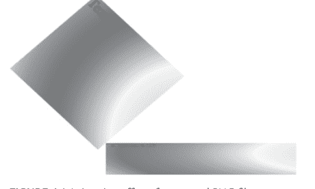
**图4.1** 文本和PNG文件的动画效果。

### 使用关键帧的CSS3 3D动画效果

在上一章中，你学习了如何使用`keyframes`规则创建CSS3 2D动画效果。你也可以通过CSS3 `keyframes`规则创建CSS3 3D动画效果，方法是单独或组合指定CSS3函数，例如`scale3d()`、`rotate3d()`和`translate3d()`。

清单4.6展示了`Anim240Flicker3DLGrad4.html`的内容，这是一个非常简单的HTML页面，包含四个HTML `<div>`元素。在这个例子中，由于关联的CSS3样式表中指定的持续时间，动画效果持续四分钟。

#### 清单4.6 Anim240Flicker3DLGrad4.html

```html
<!DOCTYPE html>
<html lang="en">
<head>
  <title>CSS3 Animation Example</title>
  <meta charset="utf-8" />
  <link href="Anim240Flicker3DLGrad4.css" rel="stylesheet"
    type="text/css">
</head>
<body>
  <div id="outer">
    <div id="linear1">Text1</div>
    <div id="linear2">Text2</div>
    <div id="linear3">Text3</div>
    <div id="linearCredits">Text4</div>
  </div>
</body>
</html>
```

清单4.6是一个非常简单的HTML5页面，带有相应的CSS选择器（如清单4.7所示）。和往常一样，真正的复杂性在于包含创建动画效果代码的CSS选择器。

如你所见，清单4.6中的一些CSS选择器包含了CSS3 `matrix()`函数，这需要矩阵知识（超出本书范围）才能完全理解使用CSS3 `matrix()`函数可以创建效果的原因。如果你有兴趣学习矩阵，可以阅读这篇关于CSS3矩阵变换的入门文章：*http://www.eleqtriq.com/2010/05/css-3d-matrix-transformations/*。

由于`Anim240Flicker3DLGrad4.css`是一个很长的代码示例，清单4.7中只显示了部分代码。但是，完整的代码可在本书的配套光盘上找到。

#### 清单4.7 Anim240Flicker3DLGrad4.css

```css
@keyframes upperLeft {
  0% {
    transform: matrix(1.5, 0.5, 0.0, 1.5, 0, 0)
               matrix(1.0, 0.0, 1.0, 1.0, 0, 0);
  }
  10% {
    transform: translate3d(50px,50px,50px)
               rotate3d(50,50,50,-90deg)
               skew(-15deg,0) scale3d(1.25, 1.25, 1.25);
  }
  /* similar code omitted */
  90% {
    transform: matrix(2.0, 0.5, 1.0, 2.0, 0, 0)
               matrix(1.5, 0.0, 0.5, 2.5, 0, 0);
  }
  95% {
    transform: translate3d(-50px,-50px,-50px)
               rotate3d(-50,-50,-50, 120deg)
               skew(135deg,0) scale3d(0.3, 0.4, 0.5);
  }
  96% {
    transform: matrix(0.2, 0.3, -0.5, 0.5, 100, 200)
               matrix(0.4, 0.5, 0.5, 0.2, 200, 50);
  }
  97% {
    transform: translate3d(50px,-50px,50px)
               rotate3d(-50,50,-50, 120deg)
               skew(315deg,0) scale3d(0.5, 0.4, 0.3);
  }
  98% {
    transform: matrix(0.4, 0.5, 0.5, 0.3, 200, 50)
               matrix(0.3, 0.5, -0.5, 0.4, 50, 150);
  }
  99% {
    transform: translate3d(150px,50px,50px)
               rotate3d(60,80,100, 240deg)
               skew(315deg,0) scale3d(1.0, 0.7, 0.3);
  }
  100% {
    transform: matrix(1.0, 0.0, 0.0, 1.0, 0, 0)
               matrix(1.0, 0.5, 1.0, 1.5, 0, 0);
  }
}
/* code omitted for brevity */
#linear1 {
  font-size: 96px;
  text-stroke: 8px blue;
  text-shadow: 8px 8px 8px #FF0000;
  width: 400px;
  height: 250px;
  position: relative; top: 0px; left: 0px;
  background-image: linear-gradient(#f00,
      orange 20%,
      yellow 40%,
      blue 60%,
      green 80%,
      #00f);
  border-radius: 4px;
  box-shadow: 30px 30px 30px #000;
  animation-name: lowerLeft;
  animation-duration: 240s;
}
```

清单4.7包含一个名为`upperLeft`的`keyframes`定义，它以以下行开始：

```css
@keyframes upperLeft {
  /* percentage-based definitions go here */
}
```

`#linear`选择器包含了你已经见过的属性，以及一个引用由`lowerLeft`标识的`keyframes`的属性，和一个指定持续时间为240秒的属性，如下所示：

```css
#linear1 {
  /* code omitted for brevity */
  animation-name: lowerLeft;
  animation-duration: 240s;
}
```

现在你知道如何在CSS3选择器中引用`keyframes`定义，让我们看看`lowerLeft`定义的细节，它包含十九个指定各种动画效果的元素。`lowerLeft`的每个元素都发生在动画的特定阶段。例如，`lowerLeft`中的第八个元素指定了值`50%`，这意味着它将发生在动画效果的一半时刻。由于`#linear`选择器包含一个值为`240s`的`animation-duration`属性（在清单4.6中以粗体显示），这意味着动画将从HTML5页面启动的时间点开始持续四分钟。

`lowerLeft`的第八个元素指定了平移、旋转、倾斜和缩放效果（全部在三维空间中），一个例子如下：

```css
50% {
  transform: translate3d(250px,250px,250px)
             rotate3d(250px,250px,250px,-120deg)
             skew(-65deg,0) scale3d(0.5, 0.5, 0.5);
}
```

动画效果按顺序发生，从平移开始，到缩放效果结束，`lowerLeft`中的其他元素也是如此。

图4.2展示了CSS3样式表`Anim240Flicker3DLGrad4.css`中定义的CSS3选择器与HTML页面`Anim240Flicker3DLGrad4.html`中的HTML元素匹配的初始视图。

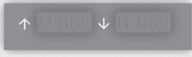
**图4.2** CSS3 3D动画效果。

### CSS3动画与CSS精灵图

CSS `Sprites`（精灵图）减少了HTTP请求的数量（这减少了网页的响应时间），并且也减少了文件总大小。其思想很简单：下载一个包含网站上所有较小图像的单一图像（称为精灵图），然后根据它们在精灵图中的位置来引用这些较小的图像。

这个过程需要两个步骤：
- a) 创建精灵图
- b) 对于精灵图中的每个图像，计算其在精灵图中的位置，然后相应地更新CSS选择器。

尽管你可以手动执行这两个步骤，但一个更简单、能为你节省大量时间和精力的替代方案是一个名为`SpriteMe`的出色工具，可在*http://spriteme.org/*找到。

该网站包含一个演示，向你展示如何将该工具安装到你的书签工具栏中，以及如何在几分钟内为网站轻松创建精灵图。此外，你可以下载生成的精灵图和包含精灵图中每个图像位置的CSS选择器。创建精灵图后，你可以使用本章前面学到的技术来为精灵图应用2D和3D动画效果。

另一个有用的网站包含一系列涉及CSS精灵图的技术和教程，可在*http://namburivk.blogspot.in/2012/05/building-faster-websites-with-css.html?goback=%2Egde_2071438_member_120537762*找到。

下一节讨论与性能相关的主题，首先概述CSS与GPU。

### HTML网页与GPU

本节的材料确实比本章和本书其他章节的其他部分更复杂，这是因为涉及多种因素以确保浏览器能够以每秒许多帧的速度平滑渲染图形（没有任何“卡顿”）。尽管如此，你将看到关于应避免使用的CSS代码类型的建议，因为它对网页性能有不利影响。

作为起点，浏览器在GPU（一种单芯片专用处理器，可以提高涉及2D或3D图形的视频/图形性能）的帮助下渲染流畅的基于CSS3的图形和动画效果。

> 浏览器必须能够使用安装在宿主操作系统（OS）上的显卡驱动程序，而且在一台给定机器上某个浏览器的 GPU 加速并不保证所有浏览器都支持。

网页可以包含会导致 HTML 元素位置发生变化的 CSS 选择器。浏览器通过两种会严重影响性能的重要操作来处理位置变化：重绘（repainting）和回流（reflow）。重绘涉及新像素值的计算（这可以交给 GPU 处理），而回流则涉及计算 HTML 元素的新位置。请注意，某些基于 CSS 的效果（例如更改元素的透明度）如果元素位置没有改变，则只需要重绘而不需要回流。Chrome 的 DevTools 提供了“Enable paint flashing”功能来查看重绘过程：启用此功能后，重绘区域周围会出现绿色方框。GPU 通过执行所谓的“合成（compositing）”来处理像素值的计算，这涉及到创建一个或多个“合成层（composite layers）”。这些层被“混合在一起”以组合各种效果。你可以将合成层想象成一叠具有不同颜色像素的平行平面，而合成过程就是当这些平面相互叠加时，计算每个像素的最终颜色。GPU 在以下情况下会创建单独的合成层：3D 或透视 CSS 变换、`<video>` 或 `<canvas>` 元素、CSS 滤镜，以及被提取到合成层的重叠元素（例如使用了 z-index 的元素）。

合成层的创建数量也有大小限制，因此可能会创建耗尽 GPU 内存的动画效果。幸运的是，Chrome 的 DevTools 提供了“Show layer border”选项，可以用橙色边框显示每个合成层。

需要记住的一点是，合成过程对于可以直接在 GPU 中执行的元素变更效率最高。具体来说，通过 `transform`、`opacity` 或 `filter` 对元素进行的更改可以直接由 GPU 处理。

Chrome 会开启硬件合成模式（如果支持且尚未“开启”）。Chrome 会创建一个新层和“支撑表面（backing surface）”，即一个用于绘制层的图形上下文（也称为纹理）。支撑表面被上传到 GPU，且多个层有时会共享同一个“支撑表面”。如果层满足以下条件，Chrome 将创建新的支撑表面：

1. 使用 3D 或透视变换 CSS 属性
2. 由使用加速视频解码的 `<video>` 元素使用
3. 由具有 3D 上下文或加速 2D 上下文的 `<canvas>` 元素使用
4. 对其透明度使用 CSS 动画或使用动画变换
5. 使用加速的 CSS 滤镜
6. 拥有一个作为合成层的后代节点
7. 拥有一个 z-index 较低且具有合成层的兄弟节点（该层是否渲染在合成层之上？）

### CSS 遮罩（Mask）与性能

CSS 遮罩会产生一个新的离屏缓冲区（OSB）。接着，GPU 首先写入 OSB 而不是直接写入 VRAM（显存），之后 OSB 的内容被复制到 VRAM。然而，移动设备上的 VRAM 相对有限且“容易耗尽”，这会导致性能下降。请记住，CSS 圆角和投影使用了遮罩，这就是为什么它们运行较慢的原因。此外，圆角和投影的组合速度会更慢。

### 什么是回流和重绘？

回流（Reflow）是计算网页中元素位置的过程，而重绘（Repaint）则是网页中像素颜色的重新渲染。在 CSS 中，`display:none` 会引起回流和重绘，因为它在网页中既不存在也不可见。另一方面，`visibility:hidden` 仍然存在，这意味着没有几何形状的变化，因此只需要重绘。

绘制过程（浏览器将 DOM 和 CSSOM，即 CSS 对象模型结合起来）涉及使用具有类 `Canvas` API 的 “Skia” 光栅化软件，输出是一组位图。接着，位图被发送到 GPU，由 GPU 进行合成（计算像素值）。最后，GPU 将输出结果渲染在屏幕上。当你想要改变一个元素的位置时，`transform` 属性更高效，因为它直接在 GPU 中处理，不涉及重绘。相反，`left` 和 `top` 属性的组合会导致回流以及重绘。

### 回流和重绘的原因

以下效果会导致网页出现回流和重绘：

- 滚动（scroll）和悬停（hover）
- 盒阴影（box-shadow）和投影（drop shadows）
- 浮动（floats）和表格（tables）
- 透明度（opacity）和渐变（gradients）
- 圆角（border-radius）
- 透明度和过渡（transitions）
- 更改字体大小
- 叶子节点：可能是较小的变化
- 顶层节点：传播可能会导致许多变化
- 添加/删除/更新 DOM

即使是添加、删除或更新 DOM 元素的“常规”操作也会导致网页的回流和重绘。因此，在网页中完全消除回流和/或重绘可能是不可能的：需要记住的是，你要尽量减少这类事件的数量，以免对网页的性能和用户体验质量产生不利影响。

### Chrome 与布局变更

Chrome 异步地“批处理”布局变更，以最大化渲染性能。以下样式信息会导致同步更新：

- `OffsetTop` 和 `offsetLeft`
- `OffsetWidth` 和 `offsetHeight`
- `ScrollTop` 和 `clientTop`
- `Left`, `width`, 和 `height`
- `GetComputedStyle()`

目标是查找并消除导致同步更新的 JavaScript 代码和/或 CSS 选择器。

避免同步更新，因为任何对节点样式信息的请求都会强制浏览器提供最新的值。为了做到这一点，浏览器必须应用所有已计划的更改，刷新队列并执行一次回流。

例如，在 HTML 网页中尽量减少此类代码：

```javascript
el.style.left = el.offsetLeft + 10 + "px";
```


### GPU 的自动调用

当网页包含 CSS 选择器（尤其是涉及变换或动画效果的选择器）时，浏览器会决定何时调用 GPU。然而，不能保证 GPU 总是会被调用以提供更好的性能。幸运的是，有一些技术（有时被称为“无操作”或“黑客技巧/hack”）可以强制调用 GPU。你可以使用`translate3D(0,0,0)`或`translateZ(0)`，如下面的选择器所示：

```css
.myelem {
    transform: translateZ(0);
}
```

Paul Irish（Google 的开发者倡导者）在下面这段 30 分钟的视频中讨论了这些及其他技术：[http://paulirish.com/2011/dom-html5-css3-performance/](http://paulirish.com/2011/dom-html5-css3-performance/)。

这些“黑客技巧”有时可能会变慢吗？请在浏览器中尝试这段包含 4,000 个小型`<div>`元素的示例代码：[http://dl.dropboxusercontent.com/u/17844821/zeug/hwtest.html](http://dl.dropboxusercontent.com/u/17844821/zeug/hwtest.html)。

以下是原始的 Stack Overflow 帖子（2012 年 4 月）：[http://stackoverflow.com/questions/10014461/why-does-enabling-hardware-acceleration-in-css3-slow-down-performance](http://stackoverflow.com/questions/10014461/why-does-enabling-hardware-acceleration-in-css3-slow-down-performance)。

直到最近，Web 开发人员必须依赖本节讨论的技术来确保 GPU 的调用。从 2015 年开始，另一种方法涉及 CSS 的`will-change`属性，详见下一节。

### CSS `will-change`属性

CSS`will-change`属性可确保调用 GPU。该属性在 Chrome 36+、Opera 24+ 和 Firefox 36+ 中受支持。此外，Safari 目前正在实现`will-change`，而 Microsoft Edge 的支持处于“考虑中”。关于`will-change`属性的更多细节可以在此处找到：[http://www.sitepoint.com/introduction-css-will-change-property/](http://www.sitepoint.com/introduction-css-will-change-property/)和[https://dev.opera.com/articles/css-will-change-property/](https://dev.opera.com/articles/css-will-change-property/)。

### 使用 jQuery 动态创建内容（可选）

本节包含了一个关于如何动态创建`<div>`元素并通过 jQuery 的`css()`方法指定匹配 CSS 选择器的示例。如果你打算阅读本节，且不熟悉 jQuery，请同时阅读第 3 章中的 jQuery 介绍部分。如果你打算跳过本节，可以尝试在浏览器中运行本节代码以查看各种效果（你可能会感到惊讶）。

这段代码示例的目的有两个：a) 如何通过 jQuery 创建动态内容，以及 b) 如何通过匹配动态创建内容的 CSS3 选择器来创建动画效果。本节中的代码示例将向你展示一些编程技巧，你可以将其应用于为你的网页创建其他基于 CSS3 的动画或图形效果。

代码清单 4.8 展示了`ArchModEllipsesGrad2.html`的部分内容，该文件使用动态创建的`<div>`元素创建基于 CSS3 的 3D 动画效果。完整的代码清单可在随书光盘中找到。

#### 代码清单 4.8：`ArchModEllipsesGrad2.html`

```html
<body>
  <div id="outer"></div>

  <script>
    var fillColor  = "rgb(255, 0, 0)";
    var basePointX = 300, basePointY = 150;
    var majorAxis = 120, minorAxis = 80;
    var currentX  = 0, currentY = 0;
    var deltaAngle = 3, maxAngle = 720;
    var Constant = 0.25, newNode;
    var rVal = 0, gVal = 0, bVal = 0;
    var stripCount = 10;
    var stripWidth = Math.floor(maxAngle / stripCount);
  </script>
</body>
```

```javascript
$(document).ready(function() {
    for (var angle = 0; angle < maxAngle; angle++) {
        radius = Constant * angle;
        offsetX = radius * Math.cos(angle * Math.PI / 180);
        offsetY = radius * Math.sin(angle * Math.PI / 180);
        currentX = basePointX + offsetX;
        currentY = basePointY - offsetY;

        rVal = Math.floor(
            255 * (angle % stripWidth) / stripWidth
        );
        fillColor = "rgb(" + rVal + ", 0, 0)";

        // create an ellipse at the current position
        if (angle % 20 == 0) {
            newNode = $('<div>').css({
                'position': 'absolute',
                'width': (angle % majorAxis) + 'px',
                'height': (angle % minorAxis) + 'px',
                left: currentX + 'px',
                top: currentY + 'px',
                'backgroundColor': fillColor,
                'borderRadius': '20%'
            }).toggleClass("skewAnim1");
        } else {
            newNode = $('<div>').css({
                'position': 'absolute',
                'width': majorAxis + 'px',
                'height': minorAxis + 'px',
                left: currentX + 'px',
                top: currentY + 'px',
                'backgroundSize': '240px 240px, 80px 80px',
                'backgroundColor': fillColor,
                'borderRadius': '50%'
            }).addClass("radial6 glow");
        }

        $("#outer").append(newNode);
    }
});
```

Listing 4.8 由一个`<body>`元素组成，该元素以一个 id 属性值为`"outer"`的`<div>`元素开始。这个`<div>`元素是动态创建的`<div>`元素将被附加的地方，具体由 Listing 4.8 中`<script>`元素内的代码执行。

`<script>`元素初始化了一些 JavaScript 变量，随后标准的 jQuery`"ready"`函数包含一个循环，该循环使用条件逻辑动态创建`<div>`元素，然后将它们附加到 Listing 4.8 中的顶层`<div>`元素。

例如，当循环变量是 20 的倍数时，会创建一个具有各种 CSS 属性的新`<div>`元素，如该代码块所示：

```javascript
newNode = $('<div>').css({
    'position': 'absolute',
    'width': (angle % majorAxis) + 'px',
    'height': (angle % minorAxis) + 'px',
    left: currentX + 'px',
    top: currentY + 'px',
    'backgroundColor': fillColor,
    'borderRadius': '20%'
}).toggleClass("skewAnim1");
```

条件逻辑的`"else"`部分则动态创建另一个属性类似的`<div>`元素。

图 4.3 显示了在 Chrome 浏览器中运行 Listing 4.8 的结果。

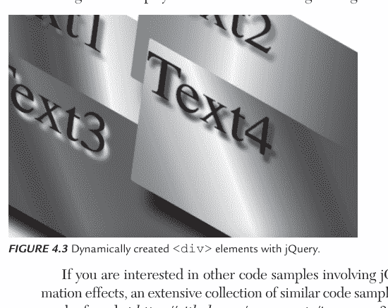

如果你对涉及 jQuery 和 CSS3 动画效果的其他代码示例感兴趣，可以在 https://github.com/ocampesato/jquery-css3-graphics 找到大量类似的代码示例（类似于“色卡”）。

### 有用链接

除了 Google Chrome，Mozilla Developer Tools 还提供了一套强大的工具，用于分析 HTML 网页中与性能相关的瓶颈：https://www.mozilla.org/en-US/firefox/developer/。

这里有一个关于 CSS 动画硬件加速的绝佳示例：http://www.sitepoint.com/introduction-to-hardware-acceleration-css-animations/。

本书中许多 CSS3 样式表包含具有 2D/3D 动画效果的选择器，硬件加速将显著提高性能。事实上，一些平板设备不提供良好的硬件加速，在这种设备上，包含大量 2D 或 3D 动画效果的样式表几乎无法运行。

以下链接包含十项关于性能相关的 CSS3 内容：http://stackoverflow.com/questions/7486017/css3-what-are-the-performance-best-practices。

这里有一篇文章提供了编写更高效 CSS 选择器的信息：http://www.pubnub.com/blog/css3-performance-optimizations。

关于编写 CSS3 选择器的“最佳实践”信息请参阅：http://webdesignerwall.com/trends/css3-examples-and-best-practices 和 http://www.impressivewebs.com/css3-best-practices/。

CSS 动画工具列表可以在此找到：http://speckyboy.com/2015/09/09/css-animation/。

你还可以找到其他关于 CSS3 性能、CSS3“最佳实践”以及 HTML5`Canvas`的在线视频和教程。

### 本章小结

在本章中，你学习了如何创建 CSS3 3D 图形和动画效果。特别是，你学习了变换（如`translate`、`scale`和`rotate`）以及过渡（`transitions`）。然后，你学习了如何编写调用 GPU 以处理密集计算的代码。此外，你还看到了如何将 3D 效果与精灵图（`sprites`）结合，以及如何使用 jQuery 和 CSS 创建动画效果。

## 第 5 章：媒体查询与元标签

本章主要讨论 CSS3 媒体查询（Media Queries），同时涵盖几种类型的元标签（`meta tags`）以及对局部 CSS 的讨论，局部 CSS 同样由 Web Components 提供（在第 8 章中简要讨论）。你将学习如何使用 CSS3 媒体查询检测移动设备的屏幕相关属性（如宽度、高度和方向）。

本章的第一部分讨论 CSS3 媒体查询，它使你能够检测设备的某些特征，并根据这些设备特征渲染 HTML5 网页。你将看到使用 CSS3 媒体查询根据移动设备的方向来改变网页布局的示例。CSS3 媒体查询还用于响应式 Web 设计（Responsive Web Design）。在第 8 章中，你将学习 Bootstrap，它使用 CSS3 媒体查询作为定义移动设备不同像素宽度（由`xs`、`sm`、`md`和`lg`表示）的基础。

本章的第二部分讨论适用于移动设备的通用元标签，以及 iOS 特定和 Android 特定的元标签。你还将学习如何使用“纯”JavaScript 来检测设备方向（纵向或横向）和属性值（如屏幕宽度和高度），然后适当地更新这些属性。

因此，在混合 HTML5 移动应用程序中，你可以使用 CSS3 媒体查询，或者 CSS3 和 JavaScript 的组合（或两者兼有）。你采取的方法可能取决于各种因素（项目范围和具体需求），这些因素通常涉及权衡。可用技术的范围从“纯”JavaScript（工作量较大，但代码占用空间较小）到框架（代码库较大，但许多细节由框架处理），为你的 HTML5 Web 应用程序开发提供了多种选择。

在阅读本章之前，先做一个简单的离题讨论。在附录中，你将学习预处理器（如 Sass 和 LESS），它们提供了变量定义等功能。然而，预处理器变量存在局限性，其中一些会影响它们在 CSS3 媒体查询中的使用。一种可能的解决方案是名为 CSS 自定义属性（通常称为 CSS 变量）的有趣特性，它能够克服预处理器变量的许多局限性。在你完成本章第一部分和附录中与预处理器相关的内容后，可以考虑阅读以下介绍 CSS 变量的文章：https://developer.mozilla.org/en-US/docs/Web/CSS/Using_CSS_variables 和 http://openweb.eu.org/articles/dry-approaches-don't-repeat-yourself。

一个重要的注意事项：CSS 变量仍处于实验阶段，Firefox 已支持，Chrome 正在开发中。请访问此 URL 以了解更多关于 CSS 变量的详细信息：http://caniuse.com/#feat=css-variables。

### 什么是 CSS3 媒体查询？

CSS3 媒体查询扩展了旧版 CSS 规范中称为“媒体类型（media types）”的功能。媒体类型将浏览器分为`screen`（屏幕）、`handheld`（手持设备）或`print`（打印）等高级类别，以便重新定义网页的打印输出样式。

CSS 2.1 引入了媒体查询的概念，使你能够有条件地为打印、屏幕等包含替代样式表。媒体类型规范详细列出了十种媒体类型，但浏览器仅支持其中的几种（如`screen`和`print`）。

例如，以下 CSS 2.1 媒体查询根据 media 属性的值有条件地加载 CSS 样式表：

```html
<link rel="stylesheet" type="text/css" href="main.css" media="screen" />
<link rel="stylesheet" type="text/css" href="print.css" media="print" />
```

CSS3 媒体查询模块扩展了 CSS 2.1 中引入的媒体类型理念，所有现代桌面浏览器和主流移动浏览器都支持基于 CSS3 的媒体查询。

CSS3 媒体查询使你能够确定访问网站的设备的某些物理特性。在某种意义上，CSS3 媒体查询充当了特征检测（feature detection）的对应手段。例如，以下 CSS3 媒体查询将两个条件结合起来，作为加载 CSS 样式表的条件逻辑：

```html
<link rel="stylesheet"
      media="screen and (min-width: 800px)" href="main.css" />
```

你也可以在 CSS 中使用`@media`指令以内联方式使用媒体查询，从而有条件地为各种 HTML 元素设置样式，如下例所示：

```css
@media screen and (min-width: 320px) {
    body {
        background-color: #ff0000;
    }
}
```

```css
@media screen and (min-width: 480px) {
    body {
        background-color: #0000ff;
    }
}
```


本节包含一系列 CSS3 媒体查询，这些是非常实用的逻辑表达式，使您能够检测具有不同物理属性和方向的设备上的移动应用程序。例如，使用 CSS3 媒体查询，您可以更改应用程序的尺寸和布局，使其在智能手机和平板电脑上都能适当地渲染。

具体而言，您可以使用 CSS3 媒体查询来确定设备的以下特性：

- 浏览器窗口的宽度和高度
- 设备的宽度和高度
- 方向（横向或纵向）
- 宽高比
- 设备宽高比
- 分辨率

CSS3 媒体查询是布尔表达式，包含一个或多个“简单术语”（通过 `and` 或 `or` 连接），这些术语的计算结果为 `true` 或 `false`。因此，CSS3 媒体查询代表了计算结果为 `true` 或 `false` 的条件逻辑。

例如，下面的链接元素仅当设备是屏幕且设备的最大宽度为 480px 时，才会加载 CSS 样式表 `mystuff.css`：

```html
<link rel="stylesheet" type="text/css"
      media="screen and (max-device-width: 480px)"
      href="mystuff.css"/>
```

前面的链接包含一个 `media` 属性，该属性指定了两个组件：`screen` 媒体类型和一个指定 `max-device-width` 的查询，其值为 480px。CSS3 媒体查询中 `media` 支持的值包括：`braille`、`embossed`、`handheld`、`print`、`projection`、`screen`、`speech`、`tty` 和 `tv`。

下一个 CSS3 媒体查询检查 `media` 类型、设备的最大宽度和设备的分辨率：

```css
@media screen and (max-device-width: 480px) and
(resolution: 160dpi) {
  #innerDiv {
    float: none;
  }
}
```

如果前面代码片段中的 CSS3 媒体查询计算结果为 `true`，那么嵌套的 CSS 选择器将匹配 `id` 属性值为 `innerDiv` 的 HTML 元素，并且在任何最大屏幕宽度为 `480px` 的设备上，其 `float` 属性将被设置为 `none`。如您所见，可以创建包含复杂逻辑的紧凑 CSS3 媒体查询，这显然非常有用，因为 CSS3 没有其他编程语言中可用的 `if/then/else` 结构。

以下 CSS3 媒体查询测试 `media` 类型、设备的最小宽度和设备的分辨率：

```css
@media screen and (min-device-width: 481px) and
(resolution: 160dpi) {
  #innerDiv {
    float: left;
  }
}
```

在前面的 CSS 选择器中，在任何最小屏幕宽度为 `481px` 的设备上，`id` 属性值为 `innerDiv` 的 HTML 元素的 `float` 属性值将为 `left`。

下一个 CSS3 媒体查询在屏幕宽度介于 `321` 和 `480` 之间时，将 `div` 元素的宽度设置为 `100px`：

```css
@media screen and (min-width: 321px) and (max-width: 480px) {
  div {
    width: 100px;
  }
}
```

在以下代码片段中，`myphone.css` 将应用于浏览器视为“handheld”（手持设备）的设备，或屏幕宽度不大于 `320px` 的设备：

```html
<link rel="stylesheet" media="handheld, only screen and
(max-device-width: 320px)" href="myphone.css">
```

> **注意**　在媒体查询中使用 `only` 关键字会导致不符合 CSS3 标准的浏览器忽略该规则。再举一个例子，以下 `<link>` 加载一个适用于屏幕尺寸在 `641px` 和 `800px` 之间的 CSS 样式表：

```html
<link rel="stylesheet" media="only screen and (min-width:
641px) and (max-width: 800px)" href="wide.css">
```

媒体查询可以包含在内联 `<style>` 标签中，如本查询所示，该查询适用于 `portrait`（纵向）模式下的所有媒体类型：

```html
<style>
  @media only all and (orientation: portrait) { ... }
</style>
```

现在您已经基本了解了 CSS3 媒体查询可以完成的工作类型，接下来可以阅读下一节的代码，其中包含一个 HTML5 网页和一个 CSS3 样式表，说明了如何处理移动设备的方向变化。

### 使用 CSS3 媒体查询检测屏幕分辨率

目前，针对 Android 设备或 iOS 设备的特定 CSS3 媒体查询还很少。幸运的是，您可以使用 CSS3 媒体查询，基于不同的屏幕尺寸或不同的屏幕分辨率进行条件逻辑判断，其中一些是特定于 Android 设备和 iOS 设备的。您可以使用 `resolution` 关键字测试每英寸点数（dpi）来确定特定分辨率。您还可以使用 `min-` 和 `max-` 前缀来为低分辨率和高分辨率的机器显示样式表。

4G iPhone 和 iPod touch 使用高清 Retina 显示屏。您可以使用 WebKit 关键字来测试其是否存在：

```css
-webkit-min-device-pixel-ratio
```

要仅显示到 Retina 设备，您将使用以下条件逻辑：

```css
only screen and (-webkit-min-device-pixel-ratio: 2)
```

### 使用 CSS3 媒体查询检测屏幕方向

本节中的 CSS3 媒体查询提供了一个说明 CSS3 媒体查询功能的简单示例。

代码清单 5.1 和 5.2 展示了样式表 `CSS3MediaQuery1.css` 和 HTML5 网页 `CSS3MediaQuery1.html` 的内容，说明了当用户旋转移动设备时如何更改两个图像的大小。

**代码清单 5.1 `CSS3MediaQuery1.css`**

```css
@media all and (orientation: portrait) {
  #img1, #img2 {
    float: left;
    width: 120px;
    height: 300px;
  }
}

@media all and (orientation: landscape) {
  #img1, #img2 {
    float: left;
    width: 200px;
    height: 200px;
  }
}
```

代码清单 5.1 中的代码很直观：第一个选择器指定了当移动设备处于 `portrait`（纵向）模式时，两个 PNG 文件的 `float`、`width` 和 `height` 属性的值；第二个选择器指定了当设备处于横向模式时，两个 PNG 文件不同的 `width` 和 `height` 属性值。

**代码清单 5.2 `CSS3MediaQuery1.html`**

```html
<!DOCTYPE html>
<html lang="en">
<head>
  <meta charset="utf-8">
  <title>CSS3 Media Query</title>
  <link href="CSS3MediaQuery1.css" rel="stylesheet"
        type="text/css">
</head>
<body>
  <header>
    <h2>Rotate Your Device:</h2>
  </header>
  <div id="outer">
    <div id="one">
      
    </div>
    <div id="two">
      
    </div>
  </div>
</body>
</html>
```

代码清单 5.2 引用了代码清单 5.1 中的 CSS 样式表 `CSS3MediaQuery1.css`，以便将 CSS 选择器应用于 `<body>` 元素中的 JPG 文件。接下来，HTML `<body>` 元素包含两个 HTML `<div>` 元素，其 `id` 属性值分别为 `img1` 和 `img2`，这些值在相应的 CSS 选择器中被引用。

图 5.1 展示了在 Android 平板电脑上以纵向模式渲染 HTML 页面 `CSS3MediaQuery.html` 的结果。

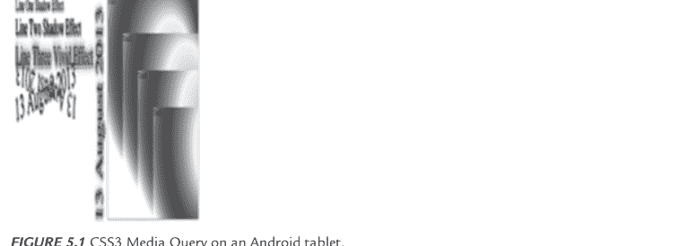

*图 5.1 Android 平板电脑上的 CSS3 媒体查询。*

图 5.2 展示了以横向模式渲染 HTML 页面 `CSS3MediaQuery.html` 的结果。

#### Rotate Your Device:

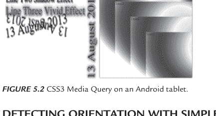

*图 5.2 Android 平板电脑上的 CSS3 媒体查询。*

### 使用简单 JavaScript 检测方向

本章前面您已经了解了如何使用 CSS3 媒体查询来检测移动设备的方向变化。但是，请记住，使用简单的 JavaScript 代码也可以完成同样的事情，因此您并非“被迫”使用 CSS3 媒体查询。

代码清单 5.3 展示了网页 `CSS3OrientationJS1.html` 的内容，说明了如何使用标准 JavaScript 在用户旋转移动设备时更改两个图像的大小。

**代码清单 5.3 `CSS3OrientationJS1.html`**

```html
<!DOCTYPE html>
<html lang="en">
<head>
  <meta charset="utf-8">
  <title>CSS3 and Orientation with JS</title>
  <style>
    #img1, #img2 {
      float: left;
      width: 120px;
      height: 300px;
    }
  </style>
  <script>
    function init() {
      // Event listener to determine device orientation
      window.onresize = function() {
        updateOrientation();
      };
    }

    function updateOrientation() {
      var orientation = window.orientation;

      switch (orientation) {
        case 0: /* portrait mode */
          document.getElementById("img1").style.width = "120px";
          document.getElementById("img1").style.height = "300px";
          document.getElementById("img2").style.width = "120px";
          document.getElementById("img2").style.height = "300px";
          break;

        case 90: /* 横屏（屏幕向左旋转） */
          document.getElementById("img1").style.width = "200px";
          document.getElementById("img1").style.height = "200px";
          document.getElementById("img2").style.width = "200px";
          document.getElementById("img2").style.height = "200px";
          break;

        case -90: /* 横屏（屏幕向右旋转） */
          document.getElementById("img1").style.width = "200px";
          document.getElementById("img1").style.height = "200px";
          document.getElementById("img2").style.width = "200px";
          document.getElementById("img2").style.height = "200px";
          break;
      }
    }
  </script>
</head>
<body onload="init()">
  <header>
    <h2>旋转您的设备：</h2>
  </header>
  <div id="outer">
    <div id="one">
      
    </div>
    <div id="two">
      
    </div>
  </div>
</body>
</html>
```

如您所见，与示例 5.2 相比，示例 5.3 中的代码要多得多。本质上，这段代码利用变量 `window.orientation` 的值来检测移动设备的四种不同方向，并在每种情况下，使用以下类型的代码更新 PNG 文件的尺寸：

```javascript
document.getElementById("img1").style.width = "120px";
document.getElementById("img1").style.height = "300px";
```

尽管这是一个非常简单的示例，但希望这段代码能让您领略 CSS3 媒体查询的能力。

### 使用 JavaScript 在 3D 空间中检测设备方向

上一节向您展示了如何根据设备是处于纵向模式还是横向模式来确定其方向。此外，您还可以确定设备在 3D 空间中的位置。

设备在 3D 位置的变化有三种类型：上下（z 轴）、左右（y 轴）以及顺时针和逆时针（x 轴）。这些变化是通过加速度计测量的，您可以在 `window` 对象的 `deviceorientation` 事件中检查其当前值。每当移动设备移动时，该事件就会触发，并返回一个包含方向相关属性的对象。

JavaScript 代码如下所示：

```javascript
window.addEventListener('deviceorientation', function (o) {
  console.log(o.alpha, o.beta, o.gamma);
}, false);
```

属性 `alpha`、`beta` 和 `gamma` 分别提供 z、x 和 y 轴上的旋转角度（以度为单位，而非弧度）。请记住，z 轴是垂直轴（向上为正），x 轴指向您（远离您为负），y 轴是从左到右的水平轴（向右为正）。

这三个属性的允许值如下：

```text
alpha: 0 to 360 (clockwise)
beta: -180 to 180 (toward you/away from you)
gamma: -90 to 90 (left to right)
```

如果您想了解有关设备方向的更多细节，可以使用加速度计获取更精确的信息。

### 检测屏幕宽度和高度

`window` 对象支持 `resize` 事件，您可利用它来确定屏幕的宽度和高度，从而能够修改 HTML5 网页中的其他效果。示例 5.4 展示了 `ResizeBorder1.html` 的内容，它演示了如何无论屏幕大小或屏幕方向如何，都保持相同的蓝色边框。

**示例 5.4 `ResizeBorder1.html`**

```html
<!DOCTYPE html>
<html lang="en">
<head>
  <meta charset="utf-8">
  <title>Resizing the Window</title>
  <style>
    * {
      margin: 0;
      padding: 0;
    }

    #outer {
      width: 400px;
      height: 300px;
      border: 10px solid blue;
    }
  </style>
```

88 • CSS3 口袋手册

```html
<link rel="stylesheet"
      href="http://code.jquery.com/mobile/1.1.0/jquery.mobile-1.1.0.min.css">

<script src="http://code.jquery.com/jquery-2.0.0b1.js"></script>

<script src="http://code.jquery.com/jquery-migrate-1.1.0.js"></script>

<script src="http://code.jquery.com/mobile/1.1.0/jquery.mobile-1.1.0.min.js"></script>
</head>
<body onload="resizeBorder();">
  <div id="outer">
  </div>
```


```html
<script>

// borderWidth 等于上面 CSS 选择器中的 'border'

var borderWidth = 10;

window.onresize = function() { resizeBorder(); }

function resizeBorder() {

// 如果屏幕尺寸已调整，则执行以下操作：

var rescaledScreenWidth = document.documentElement.clientWidth;

var rescaledScreenHeight = document.documentElement.clientHeight;

$("#outer").css('width', rescaledScreenWidth-2*borderWidth);

$("#outer").css('height', rescaledScreenHeight-2*borderWidth);

}

</script>
```

</body>

</html>

示例 5.4 包含一个 `<style>` 元素，其第一个选择器将网页中所有元素的内边距和外边距设置为 0px。第二个选择器指定了 10px 的蓝色边框。当您将此网页加载到浏览器中时，以及每当您调整浏览器大小时，都会执行 JavaScript 函数 `resizeBorder()`。此 JavaScript 函数通过以下代码片段获取浏览器的当前宽度和高度：

```javascript
var rescaledScreenWidth = document.documentElement.clientWidth;

var rescaledScreenHeight = document.documentElement.clientHeight;
```

`resizeBorder()` 中的接下来两行代码将 `<div>` 元素（其 id 属性值为 `outer`）的宽度和高度属性设置为等于当前宽度和高度值减去 `2*borderWidth` 的量。

### 适用于多种屏幕尺寸的 CSS3 媒体查询

在 CSS3 媒体查询的介绍中，您看到了使用复合条件逻辑（可包括 `and`、`or`、`only` 和 `not`）定义媒体查询的示例。如果您尚未注意到，您可以使用媒体查询来处理智能手机和平板电脑等移动设备的不同屏幕尺寸。以下是一个示例：

```css
@media screen and (min-width: 321px) and (max-width: 480px)
{
    div { width: 100px; }
}

@media screen and (min-width: 481px) and (max-width: 720px)
{
    div { width: 200px; }
}
```

上述这对媒体查询中的逻辑很直接：第一个媒体查询在屏幕宽度介于 `321` 像素和 `480` 像素之间时，将 `<div>` 元素的宽度设置为 `100px`；第二个媒体查询在屏幕宽度介于 `481` 像素和 `720` 像素之间时，将 `<div>` 元素的宽度设置为 `200px`。

以下媒体查询仅在屏幕设备上将 `<div>` 元素的宽度设置为 `150px`：

```css
@media only screen {
    div { width: 150px; }
}
```

以下媒体查询为不支持方向感知的设备将 `<div>` 元素的宽度设置为 `50px`：

```css
not (orientation)  {
    div { width: 50px; }
}
```

从本节和前面各节的示例中可以看出，CSS3 媒体查询在表达性和直观功能方面简单、灵活且强大。

### CSS 设备适配

CSS 设备适配使您能够使用 CSS 来指定 HTML5 网页中 viewport meta 元素的大小、缩放因子和方向。一个简单的例子是，以下选择器指定了 `width` 属性和 `zoom` 属性：

```css
@viewport {
  width: device-width;
  zoom: 0.5;
}
```

您还可以将 `@viewport` 嵌入在 `@media` 中（使用您已经熟悉的条件逻辑），如下例所示：

```css
@media screen and (min-width: 200px) {
  @viewport {
    width: 100px;
  }
}

@media screen and (max-width: 200px) {
  @viewport {
    width: 300px;
  }
}
```

`viewport` meta 元素的允许值如下：

- `width`
- `height`
- `initial-scale`
- `minimum-scale`
- `maximum-scale`
- `user-scalable`
- `target-densityDpi`

关于 CSS 设备适配的更多信息可在 W3C 规范（目前仍在制定中）中找到：<http://www.w3.org/TR/css-device-adapt/>。

### 网页中资源的条件加载

目前，没有一个近期的网站提供了关于使用 CSS3 媒体查询从本地目录和远程网站（如 CDN）加载图像等资源的最新信息综合列表。但是，有一些包含测试相关信息和结果的链接可能对您有用。

一个较早的链接，包含多个关于在 CSS3 媒体查询中下载图像的测试结果，地址是：<https://timkadlec.com/2012/04/media-query-asset-downloading-results/>。

以下是上述链接中进行的几项测试的摘要：

- 使用 `display:none` 隐藏 div 中包含的图像。
- 如果屏幕宽度小于 `600px`，则将设置了背景图像的 div 设置为 `display:none`。
- 一个设置了背景图像的 `<div>` 包含在一个父 `<div>` 中，当屏幕宽度小于 `600px` 时，后者被设置为 `display:none`。
- 一个带有背景图像的 `<div>`，如果屏幕宽度小于 `600px`，其颜色会发生变化。
- 如果最小比例为 `1.5`（使用 `min-device-pixel-ratio` 媒体查询），一个带有背景图像的 `<div>` 会被赋予新的背景图像。

请记住，前面的链接可能包含一些过时的信息；不过，你仍然可以在你选择的浏览器上执行相同的测试，以确定结果是否仍然有效。

另一种选择是使用 `window.matchMedia`，它是 CSS3 媒体查询的 JavaScript 替代方案。`window.matchMedia` API 列在这里：<https://developer.mozilla.org/en-US/docs/Web/API/Window/matchMedia>。

一篇涉及 `window.matchMedia` 的代码示例文章在这里：<https://hacks.mozilla.org/2012/06/using-window-matchmedia-to-do-media-queries-in-javascript/>。

本章的下一节深入探讨 meta 标签，包括一些针对移动设备的特定标签。

### 视口 META 标签

HTML 网页在一个"虚拟页面"中渲染，而屏幕就是进入该页面的一个窗口。`viewport` `meta` 标签设置这个虚拟页面的尺寸。此外，`viewport` `meta` 标签控制 iOS 和 Android 中浏览器窗口的缩放。`viewport` `meta` 标签支持以下属性：

- **Width**：以像素为单位的视口宽度（默认值为 980），可以在 200 到 10,000 之间。
- **Height**：以像素为单位的视口高度。默认值是根据宽度和设备的宽高比计算得出的，可以在 223 到 10,000 之间。
- **Initial-scale**：应用程序的初始"缩放因子"，用户可以从此初始值进行缩放。
- **Minimum-scale**：视口的最小缩放值（默认值为 0.25），可以在 0 到 10.0 之间。
- **Maximum-scale**：视口的最大缩放值（默认值为 1.6），可以在 0 到 10.0 之间。
- **User-scalable**：你可以指定用户是否能够在应用程序中放大和缩小（默认值为 "yes"）。将值设置为 "no" 以防止缩放。

此外，你可以在 meta 标签中设置多个视口选项，用逗号分隔，如下所示：

```html
<meta name="viewport" content="width=device-width, user-scalable=no">
```

`target-densitydpi` 属性（在 `viewport` meta 标签中指定）已被弃用（并且实际上已从 WebKit 中移除），因此不建议在基于 Android 的移动应用程序中使用此属性来指定低、中或高 dpi 值。

你也可以使用 `viewport` 标签来阻止用户在移动应用程序中进行缩放或平移。示例如下：

```html
<meta name="viewport"
content="width=device-width; initial-scale=1.0; maximum-scale=1.0; user-scalable=0;" />
```

iOS 平台支持 `viewport` meta 标签以及 iOS 特定的 meta 标签，其中一些在这里有描述：<http://developer.apple.com/library/safari/documentation/appleapplications/reference/SafariHTMLRef/Articles/MetaTags.html#//apple_ref/doc/uid/TP40008193-SW1>。

### 视口单位

视口指的是浏览器屏幕，四个视口单位如下：

```text
vw: 视口宽度的百分比
vh: 视口高度的百分比
vmin: vw 或 vh 中较小的值
vmax: vw 或 vh 中较大的值
```

例如，`1vw` 是浏览器宽度的 1%，这意味着 `100vw` 是浏览器宽度的 100%。以下 CSS 选择器在 HTML 网页调整大小时使用 `calc()` 函数和 CSS3 媒体查询来计算 `font-size` 属性：

```css
html {
    font-size: 100%;
}

/* 每增加至少 100px 缩放 1px（从 600px 开始） */
@media (min-width: 600px) {
    font-size: calc(125% + 4 * (100vw - 600px) / 400)
}

/* 将 font-size 设置为 24px（适用于 1000px 或更宽） */
@media (min-width: 1000px) {
    font-size: calc(150%)
}
}
```

本章的下一部分讨论用于将 CSS 样式表导入另一个 CSS 样式表的 `@import` 语句。

### CSS3 中的 @IMPORT 语句

`@import` 语句方便地使你能够将一个 CSS 样式表导入另一个样式表。例如，假设你想将 CSS 样式表 `basic.css` 导入到 CSS 样式表 `extended.css`，两者都在文件系统的同一目录中。你可以使用以下代码片段来实现：

```css
@import basic.css
```

你也可以导入互联网上可用的 CSS 样式表，而不是文件系统上的样式表，如下所示：

```css
@import url(http://www.princexml.com/fonts/larabie/index.css) all;
```

下一节讨论在 CSS 样式表中使用 `@import` 语句时需要注意的两个重要考虑因素。

### 模块化和性能

尽管 `@import` 语句非常方便，但使用时有两点需要考虑。首先，`@import` 语句可以帮助你模块化 CSS 样式表，但请注意，当非你本意时，你需要留意属性覆盖的情况。其次，也可能存在性能损失。一种缓解性能下降的流行技术是，使用工具将文件合并在一起，然后压缩这个单一的连接文件。这种方法减少了 HTTP 请求的数量，同时也减少了发送到网页的总文件大小。

### 内联和本地 CSS

围绕 CSS 存在一些众所周知的问题，例如 CSS 选择器的全局性。如果你需要复习 CSS 的优缺点，包括关于内联样式的讨论，以下帖子提供了一些有用的信息（以及一些有趣的读者评论）：<https://css-tricks.com/the-debate-around-do-we-even-need-css-anymore/>。

ReactJS 以"React 的方式"支持内联样式，有时也称为"JS 中的 CSS"。以下演示讨论了 CSS 的问题以及 Facebook 如何在 ReactJS 中解决它们：<https://speakerdeck.com/vjeux/react-css-in-js>。

关键思想涉及将 CSS 选择器转换为基于 JSON 的对象。例如，假设你有以下 CSS 选择器：

```css
container1 {
  width: 50px;
  height: 50px;
  border-radius: 2px;
}

container2 {
  width: 150px;
  height: 20px;
  border-radius:8px;
}
```

前述 CSS 选择器对应的 JSON 对象如下所示：

```javascript
var styles = {
    container1: {
        width: 50,
        height: 50,
        borderRadius:2
    },
    container2: {
        width: 150,
        height: 20,
        borderRadius:8
    }
};
```

本质上，分号被替换为逗号，并且对于包含连字符的属性使用驼峰命名法。

尽管 React 内联样式确实解决了 CSS 中的重要问题，但以下博客文章（"React 内联样式存在根本性缺陷"）指出了 React 中内联样式的缺点：<https://byjoeybaker.com/react-inline-styles>。

上述链接讨论了内联样式在供应商前缀、抽象、媒体/元素查询以及与 `@keyframes` 的可重用动画等方面引入的问题（等等）。

例如，以下选择器定义无法转换为 React 内联样式，据作者所说，这对 iOS 来说是有问题的，因为它需要 webkit 前缀：

```css
div {
    display: -webkit-flex;
    display: flex;
}
```

作者建议了一些其他可能可行的解决方案工具包：

- <https://github.com/martinandert/react-inline>
- <https://github.com/jsstyles/react-jss>
- <https://github.com/petehunt/jsxstyle>
- <https://github.com/formidablelabs/radium>
- <https://github.com/js-next/react-style>
- <https://github.com/andreyopp/styling>

以下链接提供了 React 的 CSS in JS 库的比较：<https://github.com/FormidableLabs/radium/tree/master/docs/comparison>。第二个关于 React 的 CSS in JS 库的比较在这里：<https://github.com/MicheleBertoli/css-in-js>。

### CSS Modules 与局部 CSS

CSS Modules 通过 `local-style` 属性为局部 CSS 提供了另一种方法（与 ReactJS 无关）。CSS Modules 团队提供了一种类似于命名空间的解决方案（前一节描述了命名空间），以及对不同文件的独立编译，旨在提供不在全局命名空间中的 CSS 选择器，其主页位于：<https://github.com/css-modules>。

以下文章更深入地描述了 CSS Modules：<http://glenmaddern.com/articles/css-modules> 和 <http://www.sitepoint.com/understanding-css-modules-methodology>。

### Web Components 与局部 CSS

第三种方法（同样与 ReactJS 无关）是 Shadow DOM，它在不同组件中强制执行局部 CSS，这在 Web Components 和 Polymer 中可用（但尚未在所有现代浏览器中得到支持）。

在第 9 章中，你将学习 Web Components，它允许你定义自定义组件，其中包含仅在自定义组件内部可见的 CSS 选择器，从而也为局部 CSS 提供了支持。

### 实用链接

以下链接列表虽然简短但非常实用，每个链接都包含非常优质的信息（当然，你也可以随时进行自己的互联网搜索）。

- 以下链接包含实用的 CSS 代码片段：<http://www.hongkiat.com/blog/css-snippets-for-designers>。请记住，许多命名的代码片段（如 `box-shadow`、`text-shadow`、`border-radius` 和 `opacity`）不再需要前缀，因此你可以相应地更新它们。
- 一组使用 CSS3 的精美“草图风格”视觉效果在这里：<http://andrew-hoyer.com/index.html>。
- 关于桌面和移动浏览器对 HTML5、CSS3、SVG 等支持的兼容性表格在这里：<http://caniuse.com>。
- 一个使用各种 CSS3 特性生成 CSS3 代码的网站在这里：<http://CSS3generator.com>。


- 一个允许你对各种 CSS3 选择器的内容进行实时编辑并查看结果的网站在这里：`http://CSS3please.com`。
- 一个处理 CSS3 属性浏览器特定扩展细节的工具包，使你可以编写无需前缀的 CSS3 选择器，在这里：`http://csss-tender.org`。
- 一个允许你在线创建渐变并查看相关 CSS3 代码的网站在这里：`http://gradients.glrzad.com`。
- 另一个关于浏览器对 HTML5 和 CSS3 特性支持信息的网站在这里：`http://html5readiness.com`。
- 这里有一个关于 HTML5 的广泛文章集：`http://www.html5rocks.com/en/`。
- 一个致力于 CSS3 所有相关内容的网站在这里：`http://www.CSS3.info`。
- 互联网上一个关于浏览器兼容性信息的优秀来源（由 Peter-Paul Koch 维护）可以在此处找到：`http://www.quirksmode.org`。
- 一个非常优秀的在线工具，允许你尝试许多 CSS3 特性并显示相关的 CSS3 代码，在这里：`http://www.westciv.com/tools/3Dtransforms/index.html`。
- 以下是一个简要讨论了 14 个 CSS 生成器的网站：`http://www.webpop.com/blog/2013/04/23/css-generators`。
- 对 15 种跨浏览器测试工具（大多数是免费的，有些是商业的）的比较，并带有功能对比表，在这里：`http://www.smashingmagazine.com/2011/08/07/a-dozen-cross-browser-testing-tools`。

这些链接提供了丰富的信息和实用技巧，因此你很有可能找到创建网站所需视觉效果的信息。

### 附加代码示例


CSS 样式表 `CSS3MediaQuery1.css` 和 HTML5 网页 `CSS3MediaQuery1.html`（都在随书光盘中）阐明了如何使用媒体查询（Media Queries）在用户旋转移动设备时更改两张图片的大小。

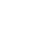

你可以使用简单的 JavaScript 代码检测移动设备方向的变化，因此你并非“被迫”使用 CSS3 媒体查询。随书光盘上的 HTML5 网页 `CSS3OrientationJS1.html` 阐明了如何使用标准 JavaScript 在用户旋转移动设备时更改两张图片的大小。

本质上，代码使用变量 `window.orientation` 的值来检测移动设备的四种不同方向，而在每一种情况下，PNG 文件的尺寸通过以下类型的代码进行更新：

```javascript
document.getElementById("img1").style.width  = "120px";
document.getElementById("img1").style.height = "300px";
```

虽然这是一个非常简单的例子，但希望这段代码能让你体会到 CSS3 媒体查询的功能。

### 本章小结

本章向你展示了如何在用于移动应用的 HTML5 网页中使用 meta 标签。你看到了如何使用 `@media` 指令在 CSS 中内联使用媒体查询，以便有条件地为各种 HTML 元素设置样式。你还学习了如何使用 CSS3 媒体查询来检测移动设备的方向变化，以及如何使用简单的 JavaScript 代码实现相同的效果。此外，你还学习了如何结合基于不同屏幕尺寸或不同屏幕分辨率的条件逻辑来使用 CSS3 媒体查询，其中一些是 Android 设备和 iOS 设备特有的。

### 第 6 章：CSS3 与 HTML5 CANVAS

本章概述了将 CSS3 与 HTML5 Canvas 相结合的方法，Canvas 是一种直接在网页的一部分绘制图形的技术。HTML5 `Canvas` 支持各种用于渲染 2D 形状和创建动画效果的 API。此外，你还将看到如何使用基于 CSS3 的动画效果为 HTML5 `<canvas>` 元素设置样式。

你可能会好奇为什么本书包含这一章。如果你想了解 HTML `Canvas` 及其相关的 JavaScript 代码，那么本章将为你提供一个合理的介绍。包含本章的第二个原因是：尽管网上有大量关于 `Canvas` 和 CSS3 的教程，但很少有将 HTML5 `Canvas` 与 CSS3 图形效果结合起来的。

本章的第一部分向你展示如何在 HTML5 `Canvas` 中渲染线段、矩形和圆，以及如何将 HTML5 `Canvas` 与 CSS3 样式表结合。第二部分向你介绍 HTML5 `Canvas` 中的线性渐变和径向渐变，并给出如何将它们应用于贝塞尔曲线和二进制图像的示例。本章的第三部分包含一些在 HTML `Canvas` 元素中渲染 PNG 文件的示例。

一个重要的注意事项：与本书的其他章节不同，本章需要一定的 JavaScript 知识，例如如何定义变量和函数。此外，代码示例中包含用于在 HTML 网页中查找元素的 `document.getElementById()`，用于向网页添加事件监听器的 `window.addEventListener()`，以及为 HTML `<input>` 元素定义点击处理程序的代码。诚然，本章不对这些方法的细节进行讨论。浏览代码示例以了解其中包含的 JavaScript 代码类型，然后你可以评估自己是否有信心更详细地阅读这些示例。另一个建议：运行本章的代码示例，看看哪些图形效果让你感兴趣，然后阅读本章中相关的代码。

正如你将看到的，本章中的一些代码示例包含 HTML5 Canvas、CSS3 图形和 CSS3 2D/3D 动画效果的（有时是令人惊叹的）结合，这在任何在线资源或相关主题书籍中都不太可能找到。这些代码示例为你创建自己的极具视觉吸引力的图形效果提供了一个起点。

此外，本章的大部分章节都从相关代码清单中使用的 API 语法开始，部分原因是代码示例包含许多细节，并且阐明了多个概念。如果你在读完本章后想探索更多的 HTML5 Canvas 图形，可以在这里找到一套广泛的代码示例：`https://github.com/ocampesato/html5-graphics`。

请记住，评估编写低级基于 Canvas 的图形代码（如本章中的代码示例）与使用开源项目和商业产品之间的权衡（时间、精力和成本）是非常重要的。如果你不想深入研究创建 HTML5 Canvas 效果的所有 JavaScript 细节，可以使用在线绘图工具为你生成代码。一个提供基本功能的免费工具在这里：`http://www.htmlcanvasstudio.com/`。

### 什么是 HTML5 CANVAS?

几年前，Canvas 在 OS/X 中作为一个组件工具包开始出现，在 Canvas 已经在 Safari 浏览器中可用之后，它成为了 Web 的一项规范，现在通常被称为 HTML5 Canvas。

HTML5 Canvas 和 SVG 都可以让你通过 JavaScript 在浏览器中以编程方式渲染图形。然而，HTML5 Canvas 使用的是“立即模式（immediate mode）”，这是一种“写入即忘记”的图形渲染方法。因此，如果你想在 HTML5 Canvas 中编写一个素描程序并提供“撤销”功能，那么你必须以编程方式跟踪用户在屏幕上绘制的所有内容。另一方面，SVG 使用的是“保留模式（retained mode）”，它涉及一个 DOM 结构，用于跟踪渲染的对象及其彼此之间的关系。

如果你打算编写大量使用图形效果的 HTML 网页，你可能需要了解 HTML5 Canvas 和 SVG 在性能方面的差异。你可以自由地仅使用其中一种技术，但也可以创建包含 HTML5 Canvas、SVG 和 CSS3 混合的 HTML 网页，而与性能相关的信息可以帮助你决定如何编写 HTML 网页。

虽然本章不对上述要点进行更详细的探讨，但你可以在这里找到关于 HTML5 Canvas 一些特性/优势的良好概述：`http://thinkvitamin.com/code/how-to-draw-with-html-5-canvas/`。

### HTML5 CANVAS 坐标系

回想一下你在高中学过的知识，笛卡尔坐标系通过一对数字（通常写成对写为 `(x,y)`）来确定欧几里得平面上的任意一点。第一个数字代表水平值，第二个数字代表垂直值。水平轴被称为 x 轴，x 轴上的正值位于垂直轴的右侧（即向右）。垂直轴被称为 y 轴，y 轴上的正值位于水平轴之上。原点是 x 轴和 y 轴的交点。

HTML5 `Canvas` 坐标系的情况几乎相同。x 轴是水平的，正方向向右。y 轴是垂直的，但正方向是*向下*的，这与典型数学教科书中的大多数图表方向相反。在 HTML5 `Canvas` 坐标系中，原点是屏幕的左上角（而不是左下角），测量单位是像素。

作为简单的说明，图 6.1 在 HTML5 `<canvas>` 元素中显示了四个点。

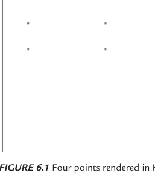

如果你从原点（屏幕左上角）开始，向右移动 50 像素，然后向下移动 50 像素，你将到达图 6.1 中的左上点。接着，如果你从原点开始，向右移动 200 像素并向下移动 50 像素，你将到达代码清单 6.1 中的右上点。同样地，第二“行”中的两个点坐标为 `(50,100)` 和 `(200,100)`。请注意，第一行中的两个点 y 坐标值相同，这是合理的，因为它们距离网页顶部的距离相同；第二行中的两个点也是如此。同样，左侧“列”中的两个点 x 坐标相同，因为它们距离网页左侧的距离相同。

现在你已经了解了 HTML5 `Canvas` 坐标系，让我们看看代码清单 6.1 的内容，它展示了一个简单的 HTML5 网页，该网页已准备好渲染基于 HTML5 `Canvas` 的图形。

本章中基于 Canvas 的代码示例包含在代码清单 6.1 中显示的代码（或其变体）。

> **注意** 如果你在浏览器会话中运行这段代码，你将只看到一个空白屏幕。

#### 代码清单 6.1 Canvas1.html

```html
<!DOCTYPE html>
<html lang="en">
  <head>
    <meta charset="utf-8">
    <title>Canvas Example</title>

    <script><!--
      window.addEventListener('load', function () {
        // Get the canvas element
        var elem = document.getElementById('myCanvas');
        if (!elem || !elem.getContext) {
          return;
        }

        // Get the canvas 2d context
        var context = elem.getContext('2d');
        if (!context) {
          return;
        }

        // Insert your custom Canvas graphics code here
      });
      // --></script>
  </head>

  <body>
    <p>
      <canvas id="myCanvas" width="300" height="300">
                                     No support for Canvas.
      </canvas>
    </p>
  </body>
</html>
```

代码清单 6.1 包含一个 HTML `<head>` 元素，用于检查网页 HTML `<body>` 元素中是否存在 HTML `<canvas>` 元素，然后从 HTML `<canvas>` 元素中获取 2D 上下文。如果你跳过代码清单 6.1 中的各种条件语句，有两行代码使我们能够获得变量 `context` 的引用，该变量代表一个可绘制表面：

```javascript
var elem = document.getElementById('myCanvas');
var context = elem.getContext('2d');
```

如果你在不支持 HTML5 Canvas 的浏览器中运行代码清单 6.1，它将显示文本消息 “No support for Canvas.”。

由于在 load 事件期间执行的匿名 JavaScript 函数，每当你启动该网页时，都会执行以下代码片段：

```javascript
<script><!--
window.addEventListener('load', function () {
  // do something here
});
// --></script>
```

既然你已经理解了渲染基于 Canvas 的 2D 形状的底层代码，你可以专注于实际绘制一些 2D 形状的代码，从下一节的示例开始。

### 线段、矩形、圆形和阴影效果

本节包含一组代码示例，用于说明如何在 HTML5 Canvas 中渲染 2D 形状。本节引入了许多概念，因此在深入研究代码示例之前，让我们先看看本节中使用的一些 HTML5 Canvas API。第 2 章有一个章节描述了指定颜色的各种方法，该章节的内容与本章的代码示例相关（因此如果你需要，现在可以快速回顾其内容）。

HTML5 Canvas 提供了 `fillRect()` 方法用于渲染矩形，该方法需要四个参数：矩形的左上顶点（由其 x 坐标和 y 坐标定义）、矩形的宽度以及所需矩形的高度。Canvas `fillRect()` API 如下所示：

```javascript
context.fillRect(x, y, width, height);
```

HTML5 Canvas 允许你通过指定线段两个端点的 (x, y) 坐标来渲染线段。本节代码示例中使用的两个新 API 是 `moveTo()` 和 `lineTo()`，它们如下所示：

```javascript
context.moveTo(x1, y1);
context.lineTo(x2, y2);
```

上述代码片段表示两个端点由点 (x1, y1) 和 (x2, y2) 指定的线段。请注意，你也可以使用以下代码片段渲染同一条线段：

```javascript
context.moveTo(x2, y2);
context.lineTo(x1, y1);
```

阴影效果提供了比不使用阴影效果更丰富的视觉体验。你可以通过为三个阴影相关属性赋值来创建阴影效果，这些属性控制底层阴影的大小以及阴影的“模糊度”，如下所示：

```javascript
context.shadowOffsetX = shadowX;
context.shadowOffsetY = shadowY;
context.shadowBlur    = 4;
```

你还可以为 `shadowColor`（它是绘制上下文的一个属性）分配 (R,G,B) 或 (R,G,B,A) 值，如下所示：

```javascript
context.shadowColor   = "rgba(0,0,64,1.0)";
```

代码清单 6.2 中的 HTML5 网页 `RandRectanglesShadow.html` 使用此技术来渲染一组带有阴影效果的随机生成矩形。

#### 代码清单 6.2 RandRectanglesShadow.html


```html
<!DOCTYPE html>
<html lang="en">
<head>
  <meta charset="utf-8">
  <title>Canvas Random Rectangles With Shadow Effects</title>
  <link href="CSS3Background2.css" rel="stylesheet" type="text/css">

  <style>
    input {
      width:300px;
      font-size:24px;
      background-color:#f00;
    }
  </style>

  <script><!--
    window.addEventListener('load', function() {
      var clickCount = 0;

      // Get the canvas element
      var elem = document.getElementById('myCanvas');
      if (!elem || !elem.getContext) {
        return;
      }

      // Get the canvas 2d context
      var context = elem.getContext('2d');
      if (!context) {
        return;
      }

      var basePointX = 10;
      var basePointY = 10;
      var canWidth   = 800;
      var canHeight  = 450;
      var shadowX    = 10;
      var shadowY    = 10;
      var rectCount  = 100;
      var rectWidth  = 100;
      var rectHeight = 100;
      var colorIndex = 0;
      var fillStyles = ['#f00', '#ff0', '#0f0', '#00f'];

      redrawCanvas = function() {
          // clear the canvas before drawing new set of rectangles
          context.clearRect(0, 0, elem.width, elem.height);

          for(var r=0; r<rectCount; r++) {
              basePointX = canWidth*Math.random();
              basePointY = canHeight*Math.random();

              // Alternate shadow effect based on an even/odd
              // click count with different (R,G,B,A) values
              if(clickCount % 2 == 0) {
                  context.shadowColor   = "rgba(0,0,64,1.0)";
              } else {
                  context.shadowColor   = "rgba(64,0,0,1.0)";
              }

              // code that specifies the size and also the
              // "fuzziness" of the underlying shadow effect
              context.shadowOffsetX = shadowX;
              context.shadowOffsetY = shadowY;
              context.shadowBlur    = 4;
              context.lineWidth     = 1;

              // render a colored rectangle
              colorIndex = Math.floor(basePointX)%fillStyles.length;
              context.fillStyle = fillStyles[colorIndex];

              context.fillRect(basePointX, basePointY,
                               rectWidth, rectHeight);

              ++clickCount;
          }
      }

      // render a set of random rectangles
      redrawCanvas();
    });
    // --></script>
</head>

<body>
  <div>
    <canvas id="myCanvas" width="800" height="450">No support for Canvas</canvas>
  </div>
</body>
</html>
```

```html
<div>
<input type="button" onclick="redrawCanvas();return false"
       value="Redraw the Rectangles" />
</div>
</body>
</html>
```

代码清单 6.2 中的 HTML5 代码首先初始化一些 JavaScript 变量，然后定义 JavaScript 函数`redrawCanvas()`，该函数包含一个用于在屏幕上渲染矩形的循环。该循环计算每个矩形左上顶点的坐标，如下所示：

```
basePointX = canWidth*Math.random();
basePointY = canHeight*Math.random();
```

循环的下一部分分配背景颜色（在深蓝色和深红色阴影之间交替），然后通过为`shadowOffsetX`、`shadowOffsetY`和`shadowBlur`属性指定值来设置阴影效果，如下所示：

```
context.shadowOffsetX = shadowX;
context.shadowOffsetY = shadowY;
context.shadowBlur    = 4;
```

每个矩形的实际渲染由以下代码执行：

```
context.fillRect(basePointX, basePointY,
                 rectWidth, rectHeight);
```

请注意，每次用户在 HTML5 Canvas 元素内部点击时，`clickCount`变量都会递增，其值决定了应用于随机生成矩形的阴影颜色。

虽然阴影效果能营造出愉悦的视觉感受，但它们也会对性能产生影响。如果你需要类阴影效果但性能成为了问题，一种替代方案是用黑色（或某种深色）渲染一个背景形状，然后使用不同的颜色渲染同一个形状（并带有微小的偏移量）。

例如，你可以通过先渲染一个黑色矩形，然后在黑色矩形之上渲染一个红色矩形来创建矩形的阴影效果，如下所示：

```
// render a black rectangle
context.fillStyle = '#000';
context.fillRect(50+shadowX, 50+shadowY, 200, 100);

// render a red rectangle
context.fillStyle = '#f00';
context.fillRect(50, 50, 200, 100);
```

`shadowX`和`shadowY`的值决定了背景“阴影”的大小，而`shadowX`和`shadowY`选择正值还是负值将决定黑色矩形相对于红色矩形的相对位置。

#### 代码清单 6.3 CSS3Background2.css

```css
#myCanvas {
    position: relative; top: 0px; left: 0px;
    background-color:white;
    background-image:
    radial-gradient(red 4px, transparent 18px),
    repeating-radial-gradient(red 0px,  green 4px, yellow 8px,
                                     blue 12px, transparent 28px,
                                     green 20px, red 24px,
                                     transparent 28px,
                                     transparent 32px),
    repeating-radial-gradient(red 0px,  green 4px, yellow 8px,
                                     blue 12px, transparent 28px,
                                     green 20px, red 24px,
                                     transparent 28px,
                                     transparent 32px);
    background-size: 50px 60px, 70px 80px;
    background-position: 0 0;
    box-shadow:  30px 30px 30px #000;
    resize:both;
    overflow:auto;
}

#myCanvas:hover {
    position: relative; top: 0px; left: 0px;
    background-color:white;
    background-image:
        radial-gradient(red 4px, transparent 48px),
        repeating-radial-gradient(red 2px,  green 4px, yellow 8px,
                                        blue 12px, transparent 16px,
                                        red 20px, blue 24px,
                                        transparent 28px,
                                        transparent 32px),
        radial-gradient(blue 8px, transparent 68px);
    background-size: 120px 120px, 4px 4px;
    background-position: 0 0;
}
```

代码清单 6.3 包含两个类似的 CSS3 选择器，用于渲染代码清单 6.3 中定义的 HTML5 `<canvas>`元素，还有一个基于悬停（hover）的选择器，每当用户将鼠标悬停在该元素上时，就会更改 HTML5 `<canvas>`元素的背景。`#myCanvas`选择器定义了一个径向渐变，随后是两个重复径向渐变，它们在不同的像素位置指定了红色、绿色、黄色和蓝色的各种组合。一个关键点在于`transparent`（透明）的使用，它改变了渲染的连续颜色之间的间隙。

正如你在`#myCanvas`选择器的定义中所看到的，颜色、渐变（及其类型）、渐变颜色以及`background-size`属性的值有许多可能的组合。定义这些模式没有“正确”的方法；请随意尝试不同的组合，你可能会创造出出人意料的绝佳效果。

图 6.2 显示了一组基于代码清单 6.2 中`RandRectanglesShadow.html`生成的具有阴影效果的随机矩形。

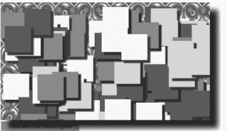

**图 6.2** Canvas 随机矩形。

### HTML5 CANVAS 线性渐变

HTML5 `Canvas`提供了两种主要的颜色渐变类型（类似于 SVG 和 CSS3）：*线性渐变*和*径向渐变*。

线性颜色渐变可进一步细分为三种类型：水平线性渐变、垂直线性渐变和对角线线性渐变。因此，HTML5 `Canvas`提供的颜色渐变使你能够创建愉悦的视觉效果。

线性渐变通过`addColorStop`元素来定义，每个元素包含一个小数（0 到 1 之间）和一个代表颜色的十六进制值。例如，如果你定义一个初始颜色为`#FF0000`（红色的十六进制值）、最终颜色为`#000000`（黑色的十六进制值）的线性渐变，那么最终的颜色渐变将（以线性方式）从红色过渡到黑色。线性渐变使你能够创建生动且有趣的颜色组合，并且分为三种形式：水平、垂直和对角线。请注意，本书中“线性渐变”和“线性颜色渐变”这两个术语可以互换使用。

#### 水平、垂直和对角线线性渐变

正如你在本章引言中所学到的，HTML5 `Canvas`支持`createLinearGradient()`方法，你可以使用它以编程方式创建线性渐变，其语法如下：

```
context.createLinearGradient(startX, startY, endX, endY);
```

代码清单 6.4 中的 HTML5 网页`LGradRectangles1.html`演示了如何渲染一组具有水平、垂直和对角线线性渐变的矩形。代码清单 6.4 引用了 CSS3 样式表`HoverAnimation1.css`，每当用户将鼠标悬停在第一个 HTML5 `<canvas>`元素上时，它会应用基于 CSS3 `keyframes`的 2D 动画。代码清单 6.4 还引用了 CSS3 样式表`HoverAnimation2.css`，其作用方式类似；不过，该样式表将 CSS3 3D 动画效果应用于代码清单 6.4 中的第二个 HTML5 `<canvas>`元素。由于这些 CSS 样式表中的动画技术在第 2 章中已有讨论，我们将在本章中省略，但完整的源代码可在配套光盘中获取。

#### 代码清单 6.4 LGradRectangles1.html

```html
<!DOCTYPE html>
<html lang="en">
  <head>
    <meta charset="utf-8">
    <title>Canvas Linear Gradient Rectangles</title>
    <link href="HoverAnimation1.css" rel="stylesheet"
      type="text/css">
    <link href="HoverAnimation2.css" rel="stylesheet"
      type="text/css">
    <style>
      input {
        width:350px;
        font-size:24px;
        background-color:#f00;
      }
    </style>
    <script><!--
      window.addEventListener('load', function () {
        var elem = document.getElementById('myCanvas');
        if (!elem || !elem.getContext) {
          return;
        }
        var context = elem.getContext('2d');
        if (!context) {
          return;
        }
        var elem2 = document.getElementById('myCanvas2');
        if (!elem2 || !elem2.getContext) {
          return;
        }
        var context2 = elem2.getContext('2d');
        if (!context2) {
          return;
        }
        var basePointX = 0;
        var basePointY = 0;
        var currentX   = 0;
```

```javascript
var currentY = 0;
var rectWidth = 200;
var rectHeight = 200;
var clickCount = 0;
var gradient1;

redrawCanvas = function() {
```


代码清单 6.4 渲染了四个具有线性渐变阴影的矩形。这些线性渐变分别调用了两次、三次或四次 `addColorStop()` 方法，并使用了各种颜色组合（以十六进制形式表示），以便你可以看到一些可能的渐变效果。

尝试为颜色停止点定义不同的值，看看这些值的改变如何影响渲染矩形的外观。

图 6.3 展示了一组随机生成的矩形，其阴影效果基于代码清单 6.4 中的 `LGradRectangles1.html`。

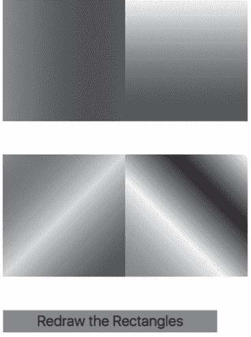

**图 6.3** 线性渐变矩形。

### HTML5 CANVAS 径向渐变

径向颜色渐变是第二种基于 HTML5 `Canvas` 的颜色渐变。你可以通过 `createRadialGradient()` 方法定义径向颜色渐变，并使用 `addColorStop()` 方法添加颜色值。其语法（不含 `addColorStop()` 方法）如下所示：

```javascript
context.createRadialGradient(startCenterX, startCenterY,
                            startRadius, endsCenterX,
                            endCenterY, endRadius);
```

*径向*颜色渐变可以类比为向池塘中投石时产生的涟漪效果，其中每层“涟漪”的颜色都以渐变方式变化。每层涟漪对应一个颜色停止点元素。例如，如果你定义一个起始颜色为 `#FF0000`（红色）且结束颜色为 `#000000`（黑色）的径向渐变，那么最终产生的颜色渐变将以径向方式从红色过渡到黑色。径向渐变也可以包含多个起始/停止颜色组合。需要记住的是，径向渐变在颜色变化上是*线性*的，但渲染出的颜色是以扩展的*径向*方式绘制的。请注意，本书中“径向渐变”和“径向颜色渐变”这两个术语是可以互换使用的。

代码清单 6.5 展示了 HTML5 页面 `RGradRectangles1.html` 的内容，该页面在 HTML5 `<canvas>` 元素中使用线性渐变和径向渐变来渲染线段、矩形和圆。

#### 代码清单 6.5 RGradRectangles1.html

```html
<!DOCTYPE html>
<html lang="en">
 <head>
  <meta charset="utf-8">
  <title>Canvas Radial Gradient Rectangles</title>
  <link href="HoverAnimation1.css" rel="stylesheet"
                            type="text/css">
  <style>
    input {
      width:300px;
      font-size:24px;
      background-color:#f00;
    }
  </style>
  <script><!--
    window.addEventListener('load', function () {
      var elem = document.getElementById('myCanvas');
      if (!elem || !elem.getContext) {
        return;
      }
      var context = elem.getContext('2d');
      if (!context) {
        return;
      }
      var basePointX = 10;
      var basePointY = 10;
      var currentX   = 0;
      var currentY   = 0;
      var rectWidth  = 200;
      var rectHeight = 200;
      var clickCount = 0;
      var gradient1;
      redrawCanvas = function() {
          // clear the canvas before drawing new set of rectangles
          //context.clearRect(0, 0, elem.width, elem.height);
          // upper left rectangle
          currentX = basePointX;
          currentY = basePointY;
          gradient1 = context.createRadialGradient(
                                      currentX,
                                      currentY,
                                      0,
                                      currentX+rectWidth,
                                      currentY+rectHeight,
                                      rectWidth);
          gradient1.addColorStop(0, '#f00');
          gradient1.addColorStop(1, '#00f');
          context.fillStyle = gradient1;
          context.fillRect(currentX, currentY,
                          rectWidth, rectHeight);
          // upper right rectangle
          currentX = basePointX+rectWidth;
          currentY = basePointY;
          gradient1 = context.createRadialGradient(
                                      currentX,
                                      currentY,
                                      0,
                                      currentX+rectWidth,
                                      currentY+rectHeight,
                                      rectWidth);
          gradient1.addColorStop(0, '#ff0');
          gradient1.addColorStop(1, '#00f');
          context.fillStyle = gradient1;
          context.fillRect(currentX, currentY,
                          rectWidth, rectHeight);
          // lower left rectangle
          currentX = basePointX;
          currentY = basePointY+rectHeight;
          gradient1 = context.createRadialGradient(
                                      currentX,
                                      currentY,
                                      0,
                                      currentX+rectWidth,
                                      currentY+rectHeight,
                                      rectWidth);
          gradient1.addColorStop(0, '#f00');
          gradient1.addColorStop(1, '#00f');
          context.fillStyle = gradient1;
          context.fillRect(currentX, currentY,
                          rectWidth, rectHeight);
          // lower right rectangle
          currentX = basePointX+rectWidth;
          currentY = basePointY+rectHeight;
          gradient1 = context.createRadialGradient(
                                      currentX,
                                      currentY,
                                      0,
                                      currentX+rectWidth,
                                      currentY+rectHeight,
                                      rectWidth);
          gradient1.addColorStop(0, '#ff0');
          gradient1.addColorStop(1, '#00f');
          context.fillStyle = gradient1;
          context.fillRect(currentX, currentY,
                          rectWidth, rectHeight);
          ++clickCount;
          basePointX += 4;
          basePointY += 2;
      }
      // render radial gradient rectangles
      redrawCanvas();
    });
  // -->
  </script>
 </head>
 <body>
  <div>
    <canvas id="myCanvas" width="600" height="250">No support for Canvas</canvas>
  </div>
  <div>
    <canvas id="myCanvas2" width="600" height="250">No support for Canvas</canvas>
  </div>
  <div>
    <input type="button" onclick="redrawCanvas();return false"
           value="Redraw the Rectangles" />
  </div>
 </body>
</html>
```

```javascript
// clear the canvas before drawing new set of rectangles
//context.clearRect(0, 0, elem.width, elem.height);
//context2.clearRect(0, 0, elem.width, elem.height);

// upper left rectangle: horizontal linear gradient
currentX = basePointX;
currentY = basePointY;
gradient1 = context.createLinearGradient(currentX, currentY, currentX+rectWidth, currentY+0*rectHeight);
gradient1.addColorStop(0, '#f00');
gradient1.addColorStop(1, '#00f');
context.fillStyle = gradient1;
context.fillRect(currentX, currentY, rectWidth, rectHeight);

// upper right rectangle: vertical linear gradient
currentX = basePointX+rectWidth;
currentY = basePointY;
gradient1 = context.createLinearGradient(currentX, currentY, currentX+0*rectWidth, currentY+rectHeight);
gradient1.addColorStop(0, '#ff0');
gradient1.addColorStop(1, '#00f');
context.fillStyle = gradient1;
context.fillRect(currentX, currentY, rectWidth, rectHeight);

// render the lower rectangles in the second <canvas> element
// lower left rectangle: diagonal linear gradient
currentX = basePointX;
currentY = basePointY;
//currentY = basePointY+rectHeight;
gradient1 = context2.createLinearGradient(
                                  currentX, 
                                  currentY, 
                                  currentX+rectWidth,
                                  currentY+rectHeight);
gradient1.addColorStop(0,  '#f00');
gradient1.addColorStop(0.5,'#0f0');
gradient1.addColorStop(1,  '#00f');
context2.fillStyle = gradient1;
context2.fillRect(currentX, currentY,
                  rectWidth, rectHeight);

// lower right rectangle: diagonal linear gradient
currentX = basePointX+rectWidth;
currentY = basePointY;
//currentY = basePointY+rectHeight;
gradient1 = context2.createLinearGradient(
                                  currentX+rectWidth, 
                                  currentY,
                                  currentX+0*rectWidth, 
                                  currentY+rectHeight);
gradient1.addColorStop(0,  '#fff');
gradient1.addColorStop(0.3, '#000');
gradient1.addColorStop(0.6,'#ff0');
gradient1.addColorStop(1,  '#f00');
context2.fillStyle = gradient1;
context2.fillRect(currentX, currentY,
                  rectWidth, rectHeight);

++clickCount;
basePointX += 4;
basePointY += 2;
```

```html
</script>
</head>
<body>
  <div>
    <canvas id="myCanvas" width="600" height="250">No support for Canvas</canvas>
  </div>
  <div>
    <canvas id="myCanvas2" width="600" height="250">No support for Canvas</canvas>
  </div>
  <div>
    <input type="button" onclick="redrawCanvas();return false"
           value="Redraw the Rectangles" />
  </div>
</body>
</html>
```


`gradient1.addColorStop(0, '#f00');`
`gradient1.addColorStop(0.5, '#0f0');`
`gradient1.addColorStop(1, '#00f');`
`context.fillStyle = gradient1;`
`context.fillRect(currentX, currentY, rectWidth, rectHeight);`

// 右下角的矩形
`currentX = basePointX + rectWidth;`
`currentY = basePointY + rectHeight;`

`gradient1 = context.createRadialGradient(currentX, currentY, 0, currentX + rectWidth, currentY + rectHeight, rectWidth);`

`gradient1.addColorStop(0, '#fff');`
`gradient1.addColorStop(0.3, '#000');`
`gradient1.addColorStop(0.6, '#ff0');`
`gradient1.addColorStop(1, '#f00');`
`context.fillStyle = gradient1;`
`context.fillRect(currentX, currentY, rectWidth, rectHeight);`

`++clickCount;`
`basePointX += 2;`
`basePointY += 2;`
}

// 渲染一组矩形
`redrawCanvas();`
}); 
// -->
`</script>`
`</head>`

`<body>`
  `<div>`
    `<canvas id="myCanvas" width="600" height="500">No support for Canvas alt="渲染径向渐变矩形。">`
    `</canvas>`
  `</div>`

  `<div>`
    `<input type="button" onclick="redrawCanvas();return false" value="重新绘制矩形" />`
  `</div>`
`</body>`
`</html>`

清单 6.5 与清单 6.4 类似，但使用的是径向渐变（而不是线性渐变），该渐变以径向方式从蓝色过渡到红色。

方法 `addColorStop()` 被调用了四次，以便向径向渐变添加四个“颜色停止值”。清单 6.5 还引用了 `HoverAnimation1.css`；`HoverAnimation1.css` 的完整源代码可从附带的光盘中获取。

图 6.4 展示了渲染 `RGradRectangles1.html` 的结果，该页面创建了一组带有径向渐变的矩形。

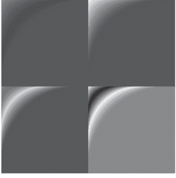

**重新绘制矩形**

**图 6.4** 径向渐变矩形。

### 使用 CSS3 选择器在画布上渲染图像

HTML5 Canvas 支持渲染二进制图像，你也可以将 CSS 选择器应用于 HTML5 `<canvas>` 元素。清单 6.7 展示了 `Image1.html` 的内容；清单 6.8 展示了 `Image1.css` 的内容，其中的选择器应用于清单 6.7 中的 HTML5 `<canvas>` 元素。

**清单 6.7 Image1.html**

```
<!DOCTYPE html>
<html lang="en">
<head>
   <meta charset="utf-8" />
   <title>在 HTML5 Canvas 中渲染二进制图像</title>

   <link href="Image1.css" rel="stylesheet" type="text/css">
   <link href="HoverAnimation1.css" rel="stylesheet" type="text/css">

   <script>
      function renderPNG() {
// 获取 canvas 元素
var elem = document.getElementById('myCanvas');
if (!elem || !elem.getContext) {
    return;
}

// 获取 canvas 2d 上下文
var context = elem.getContext('2d');
if (!context) {
    return;
}

var basePointX  = 30;
var basePointY  = 30;
var rectWidth   = 150;
var rectHeight  = 200;
var borderX     = rectWidth/2;
var borderY     = rectHeight/2;
var offsetX     = 20;
var offsetY     = 20;
var gradientR   = 60;

// 创建径向渐变：
var rGradient = context.createRadialGradient(
                                basePointX+rectWidth/2,
                                basePointY+rectWidth/2,
                                gradientR,
                                basePointX+rectWidth/2,
                                basePointY+rectWidth/2,
                                3*gradientR);

rGradient.addColorStop(0,   '#FF0000');
rGradient.addColorStop(0.5, '#FFFF00');
rGradient.addColorStop(1,   '#000044');

// 带有径向渐变的矩形背景：
context.fillStyle = rGradient;
context.fillRect(basePointX-offsetX,
                 basePointY-offsetY,
                 rectWidth+borderX+2*offsetX,
                 rectHeight+borderY+2*offsetY);

// 加载 PNG
var myImage = new Image();
myImage.onload = function() {
    context.drawImage(myImage,
                     basePointX,
                     basePointY,
                     rectWidth,
                     rectHeight);
}

myImage.src = "sample1.png";
}
</script>
<style type="text/css">
  canvas {
    border: 0px solid #888;
    background: #FFF;
  }
</style>
</head>
<body onload="renderPNG();">
  <header>
    <h1>将鼠标悬停在图像上</h1>
  </header>
  <div>
    <canvas id="myCanvas" width="500" height="300">No support for Canvas
    </canvas>
  </div>
</body>
</html>
```

清单 6.7 包含 JavaScript 代码，用于创建一个带有三个颜色停止值的径向渐变 `rGradient`。接下来，使用由变量 `rGradient` 引用的径向渐变渲染一个矩形，然后是一段渲染二进制图像 `sample1.png` 的代码。`<style>` 元素中的内联 CSS 代码渲染了白色背景和零宽度边框（因此不可见），但你可以修改此 CSS 代码以产生额外的效果。`<body>` 元素包含 `onload` 属性，其值为 `renderPNG()`，这是一个在 HTML5 `<canvas>` 元素内渲染二进制图像的 JavaScript 函数。

#### 清单 6.8 Image1.css

```
#myCanvas:hover {
  width: 500px;
  height: 300px;
  position: relative; top: 0px; left: 0px;
  background-color: white;
  background-image:
    radial-gradient(red 4px, transparent 24px),
    repeating-radial-gradient(red 1px, green 4px, yellow 8px, blue 12px, transparent 16px, red 20px, blue 24px, transparent 28px, transparent 32px);
  background-size: 30px 30px, 40px 40px;
  background-position: 0 0;
}

#myCanvas {
  width: 500px;
height: 300px;
position: relative; top: 0px; left: 0px;

background-color:white;
background-image:
    radial-gradient(black 4px, transparent 20px),
    repeating-radial-gradient(blue 1px, yellow 4px, blue 8px,
                             red 12px, transparent 16px,
                             red 20px, blue 24px,
                             transparent 28px,
                             transparent 32px);
background-size: 30px 30px, 40px 40px;
background-position: 0 0;
}
```

清单 6.8 中的第一个选择器在用户将鼠标悬停在 HTML5 `<canvas>` 元素上时，显示另一种图案（基于不同的径向渐变）。清单 6.8 中的第二个选择器渲染了一个彩色图案（也基于径向渐变）作为 HTML5 `<canvas>` 元素的背景矩形。

顺便提一下，HTML5 Canvas 还支持 `clip()` 方法，使你能够以各种方式“裁剪”二进制图像。此外，你可以执行合成效果，甚至可以操作图像文件的各个像素。请在互联网上搜索描述这些效果技术细节的文章。

图 6.5 展示了一个带有两种径向渐变背景效果的二进制图像。

### 将鼠标悬停在图像上

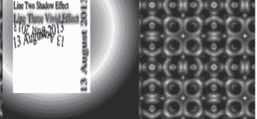

**图 6.5** HTML5 Canvas 径向 PNG。

### 使用图案在画布上重复图像

HTML5 Canvas 提供了 `createPattern(image, type)` 方法，使你能够根据图案类型渲染一组图像，其值可以是 `repeat`、`repeat-x`、`repeat-y` 和 `no-repeat`。语法示例（以及如何使用它）如下所示：

```
var pattern = canvas.createPattern(img,"repeat");
canvas.fillStyle = pattern;
canvas.fillRect(0,0,500,300);
```

清单 6.8 展示了 `RepeatingImage1.html` 的内容，它说明了如何在 HTML5 `<canvas>` 元素上重复二进制图像。

#### 清单 6.8 RepeatingImage1.html

```
<!DOCTYPE html>
<html lang="en">
<head>
  <meta charset="utf-8" />
  <title>在 HTML5 Canvas 中重复图像</title>

  <script>
    var elem, canvas, filename = "BlueBall.png";

    function init() {
      elem = document.getElementById("myCanvas");
      canvas = elem.getContext('2d');

      var img = new Image();
      img.src = filename;
      img.addEventListener("load", modImage, false);
    }

    function modImage(e) {
      img = e.target;
      var pattern = canvas.createPattern(img,"repeat");

      canvas.fillStyle = pattern;
      canvas.fillRect(0,0,500,300);
    }

    window.addEventListener("load", init, false);
  </script>
</head>

<body>
  <div>
    <canvas id="myCanvas" width="500" height="300">No support for Canvas
    </canvas>
  </div>
</body>
</html>
```

清单 6.8 包含以下代码行，当此网页加载到浏览器时，它会调用 JavaScript 的 `init()` 方法：

```
window.addEventListener("load", init, false);
```

`init()` 方法在网页中查找一个 HTML5 `<canvas>` 元素，为简单起见，没有执行错误检查（这可以通过使用前面示例中的代码来处理）。

`init()` 方法还初始化了一个引用二进制图像的 JavaScript 变量 `img`，然后添加一个事件监听器来执行 JavaScript 函数 `modImage()`，如下所示：

```javascript
var img = new Image();
img.src = filename;
img.addEventListener("load", modImage, false);
```

最后，`modImage()` 方法调用 `Canvas` 的 `createPattern()` 方法，并传入参数 `repeat`，以便基于一个 PNG 文件（在本例中为 `BlueBall1.png`）创建图像的矩形网格，如图所示：

```javascript
var pattern = canvas.createPattern(img,"repeat");
canvas.fillStyle = pattern;
canvas.fillRect(0,0,500,300);
```

图 6.6 显示了在 Macbook 的 Chrome 浏览器中运行示例 6.8 中的 `RepeatingImage1.html` 的效果。

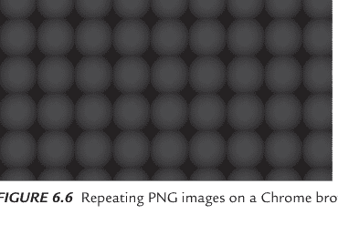

**图 6.6** 在 MacBook 的 Chrome 浏览器中重复显示 PNG 图像。

### 本章小结

本章向您介绍了如何在 HTML5 Canvas 中渲染线段、矩形和圆形。您了解了如何将 HTML5 Canvas 与 CSS3 样式表结合以创建动画效果。接下来，您学习了如何在 HTML5 Canvas 中创建线性渐变和径向渐变。最后，您学习了如何将 PNG 文件嵌入到 HTML Canvas 元素中。

### 第 7 章：SVG 基础

本章节奏较快，将深入探讨 SVG 的许多特性。SVG 是一种基于 XML 的 2D 形状渲染技术。关于 SVG 已经有许多专著，仅用一章的内容不足以使其真正精通。作为一种折中方案，代码示例中包含了多种 SVG 特性，这将节省您自行开发的时间。例如，包含 SVG 变换和渐变的代码示例并未对这些特性进行详细描述，因为您在本书的前几章中已经接触过变换和渐变。因此，您已经掌握了相关概念，主要只需学习用于创建这些效果的 SVG 语法。同时，您可以根据自己的兴趣，重点关注那些演示您最感兴趣的 SVG 特性的章节。


如果您还不知道的话，SVG 最近成为了 Web 开发中关注的焦点，部分原因是其功能集与 CSS3 配合良好。此外，您可以使用 SVG 代替 PNG 文件（将在第 8 章讨论）。SVG 还提供了一些 CSS3 不具备的功能，例如对任意多边形、椭圆弧以及二次和三次贝塞尔曲线的支持。而且，您可以轻松地将 SVG 与 CSS3 选择器相结合，以创建 3D 图形和动画效果。

本章的第一部分包含代码示例，演示如何渲染直线和矩形，以及如何创建线性渐变和径向渐变。本章的第二部分讨论多边形形状和功能极其强大的 SVG `<path>` 元素。

第三部分包含带有 SVG 变换的贝塞尔曲线、如何在 SVG 中渲染文本以及 SVG 滤镜。最后一部分包含 SVG、CSS3 和 jQuery 各种组合协作的示例，随后是对 SVG 和 CSS3 的简要比较。

### SVG 的基本特性

SVG 支持线性渐变、径向渐变、滤镜效果、变换（`translate`、`scale`、`skew` 和 `rotate`）、贝塞尔曲线以及动画效果。您可以使用渲染形状的代码创建 SVG 文档，也可以将 SVG 直接嵌入到 HTML 网页中。SVG 元素被插入到网页的 DOM 中，这意味着可以跟踪/管理 SVG 元素组。SVG 的一些优点包括：

- 放大时没有模糊/锯齿边缘
- 便于在工具之间进行导入/导出
- 可以对 SVG 文档应用 XSL 样式表

另一方面，请记住 SVG 的语法较为冗长，在由程序自动生成的 SVG 文档中可能难以阅读。此外，复杂的动画效果可能会很繁琐：建议考虑使用 D3 来创建动画和处理鼠标相关事件。虽然本章重点讨论“纯”SVG，但这里提供了一组带有 JavaScript 的 SVG 代码示例：`https://github.com/ocampesato/svg-graphics`。

正如您将看到的，可以通过 CSS 的 `url()` 函数将 CSS 选择器与 SVG 元素相匹配，CSS3 和 SVG 的结合为您提供了一种强大的机制，可以在 CSS3 选择器中利用 SVG 的功能。事实上，您可以在同一个 HTML 网页中结合使用 CSS、SVG、D3 和 HTML5 `Canvas` 元素。

### 在 SVG 中渲染线段和矩形

本节向您展示如何在 SVG 文档中渲染线段和矩形。作为一个简单的示例，SVG 支持使用 `<line>` 元素来渲染线段，其语法如下：

```xml
<line x1="20" y1="20" x2="100" y2="150".../>
```

SVG `<line>` 元素渲染连接两点 `(x1,y1)` 和 `(x2,y2)` 的线段。

SVG 支持使用 `<rect>` 元素来渲染矩形，其语法如下：

```xml
<rect width="200" height="50" x="20" y="50".../>
```

SVG `<rect>` 元素渲染一个矩形，其宽度和高度由 `width` 和 `height` 属性指定。矩形的左上顶点由坐标 `(x,y)` 的点指定。

示例 7.1 显示了 `BasicShapes1.svg` 的内容，其中演示了如何渲染线段和矩形。

#### 示例 7.1 BasicShapes1.svg

```xml
<?xml version="1.0" encoding="iso-8859-1"?>
<!DOCTYPE svg PUBLIC "-//W3C//DTD SVG 20001102//EN"
"http://www.w3.org/TR/2000/CR-SVG-20001102/dtd/svg-20001102.dtd">

<svg xmlns="http://www.w3.org/2000/svg"
     xmlns:xlink="http://www.w3.org/1999/xlink"
     width="100%" height="100%">
  <g>
    <!-- left-side figures -->
    <line x1="20" y1="20" x2="220" y2="20"
          stroke="blue" stroke-width="4"/>

    <line x1="20" y1="40" x2="220" y2="40"
          stroke="red" stroke-width="10"/>

    <rect width="200" height="50" x="20" y="70"
          fill="red" stroke="black" stroke-width="4"/>

    <path d="M20,150 L200,0 L10,50 L-200,0 z"
          fill="blue" stroke="red" stroke-width="4"/>

    <!-- right-side figures -->
    <path d="M250,20 L200,0 L-100,50 z"
          fill="blue" stroke="red" stroke-width="4"/>

    <path d="M300,100 L100,0 L50,50 L-100,0 L-50,-50 z"
          fill="yellow" stroke="red" stroke-width="4"/>
  </g>
</svg>
```

示例 7.1 中的第一个 SVG `<line>` 元素指定颜色为 `blue` 且 `stroke-width`（即线宽）为 `4`，而第二个 SVG `<line>` 元素指定颜色为 `red` 且 `stroke-width` 为 `10`。

请注意，第一个 SVG `<rect>` 元素渲染的矩形在视觉上（除颜色外）与第二个 SVG `<line>` 元素相同，这表明可以使用不同的 SVG 元素来渲染矩形（或线段）。

SVG `<path>` 元素可能是最灵活且最强大的元素，因为您可以基于其他 SVG 元素的“拼接”来创建任意复杂的形状。在本章稍后部分，您将看到如何在 SVG `<path>` 元素中渲染多条贝塞尔曲线的示例。

SVG `<path>` 元素包含一个 `d` 属性，用于指定所需路径的点。例如，示例 7.1 中的第一个 SVG `<path>` 元素包含以下 `d` 属性：

```xml
d="M20,150 L200,0 L10,50 L-200,0 z"
```

以下是如何解读 `d` 属性内容的：

- 移动到绝对位置点 `(20, 150)`
- 向右绘制一条 `200` 像素的水平线段
- 通过向右移动 `10` 像素并向下移动 `50` 像素绘制一条线段
- 通过向左移动 200 像素绘制一条水平线段
- 绘制一条线段回到起始点（由 `z` 指定）

类似的注释也适用于示例 7.1 中的另外两个 SVG `<path>` 元素。需要记住的一点是，大写字母（`C`、`L`、`M` 和 `Q`）指的是绝对位置，而小写字母（`c`、`l`、`m` 和 `q`）指的是相对于紧邻其左侧元素的相对位置。您可以尝试通过组合使用大小写字母来修改示例 7.1 中的代码，以便更好地理解如何创建不同的视觉效果。

图 7.1 显示了渲染 SVG 文档 `BasicShapes1.svg` 的结果。

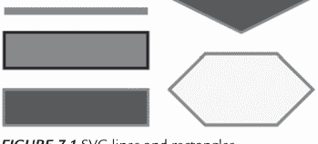

**图 7.1** SVG 直线和矩形。

### SVG 渐变

您可能已经猜到了，SVG 支持可以应用于 2D 形状的线性渐变以及径向渐变。

示例 7.2 显示了 `BasicShapesLRG1.svg` 的内容，其中演示了如何使用线性渐变和径向渐变来渲染 2D 形状。

#### 示例 7.2 BasicShapesLRG1.svg

### SVG `<PATTERN>` 元素

SVG `<pattern>` 元素使你能够定义自定义图案，用相对简单的代码就能创造出令人惊叹的丰富视觉效果。

清单 7.3 展示了 `PatternElement1.svg` 的内容，演示了如何使用不同的自定义图案来渲染矩形和椭圆。

#### 清单 7.3 PatternElement1.svg

```xml
<?xml version="1.0" encoding="iso-8859-1"?>
<!DOCTYPE svg PUBLIC "-//W3C//DTD SVG 20001102//EN"
    "http://www.w3.org/TR/2000/CR-SVG-20001102/DTD/svg-20001102.dtd">

<svg xmlns="http://www.w3.org/2000/svg"
    xmlns:xlink="http://www.w3.org/1999/xlink"
    width="100%" height="100%">
    <defs>
      <pattern id="dotPattern1" width="8" height="8"
               patternUnits="userSpaceOnUse">
        <circle id="circle1" cx="2" cy="2" r="3"
                style="fill:blue;"/>
      </pattern>
      <pattern id="dotPattern2" width="8" height="8"
               patternUnits="userSpaceOnUse">
      <rect x="0" y="0" width="4" height="4" fill="red" />
      <rect x="4" y="0" width="4" height="4" fill="black" />
      <rect x="0" y="4" width="4" height="4" fill="black" />
      <rect x="4" y="4" width="4" height="4" fill="red" />
      </pattern>
    </defs>
    <g id="largeCylinder" transform="translate(100,20)">
        <rect x="0" y="0" width="200" height="100"
              style="fill:url(#dotPattern1)"/>
        <ellipse cx="100" cy="150" rx="80"  ry="40"
                 stroke="blue" stroke-width="4"
                 style="fill:url(#dotPattern2)"/>
    </g>
</svg>
```

清单 7.3 中包含一个 SVG `<defs>` 元素，其中又包含两个 `<pattern>` 元素。第一个 `<pattern>` 元素创建“点状”效果，每个“点”是一个半径为 3 的蓝色圆形。第二个 `<pattern>` 元素通过指定四个相同尺寸的矩形来创建“棋盘格”图案，第一“行”的颜色为红色和黑色，第二“行”的颜色为黑色和红色。

清单 7.3 的下一部分包含一个 SVG `<g>` 元素，其中有一个 `<rect>` 元素，其 `fill` 属性指定了第一个 `<pattern>` 元素，随后是一个 `<ellipse>` 元素，其 `fill` 属性指定了第二个 `<pattern>` 元素。

图 7.3 展示了 SVG 文档 `Pattern1.svg` 中定义的矩形和椭圆的渲染结果。

**图 7.3** 使用不同图案渲染的两个形状。

### SVG `<POLYGON>` 和 `<POLYLINE>` 元素

SVG `<polygon>` 元素包含一个 `polygon` 属性，在其中你可以指定表示多边形顶点的点。SVG `<polygon>` 元素在你想创建任意边数的多边形时最为有用，但你也可以使用此元素来渲染线段和矩形。

SVG `<polygon>` 元素的语法如下所示：

```xml
<polygon path="specify a list of points" fill="…" />
```

清单 7.4 展示了 `SvgCube1.svg` 的部分内容，演示了如何在 SVG 中渲染立方体。

**清单 7.4 SvgCube1.svg**

```xml
<?xml version="1.0" encoding="iso-8859-1"?>
<!DOCTYPE svg PUBLIC "-//W3C//DTD SVG 20001102//EN"
    "http://www.w3.org/TR/2000/CR-SVG-20001102/DTD/svg-20001102.dtd">

<svg xmlns="http://www.w3.org/2000/svg"
    xmlns:xlink="http://www.w3.org/1999/xlink"
    width="100%" height="100%">
    <!-- <defs> element omitted for brevity -->
    <!-- top face (counter clockwise) -->
    <polygon fill="url(#pattern1)"
        points="50,50 200,50 240,30 90,30"/>
    <!-- front face -->
    <rect width="150" height="150" x="50" y="50"
        fill="url(#pattern2)"/>
    <!-- right face (counter clockwise) -->
    <polygon fill="url(#pattern3)"
        points="200,50 200,200 240,180 240,30"/>
</svg>
```

**图 7.4** SVG 渐变立方体。

清单 7.4 包含一个 SVG `<g>` 元素，其中包含立方体的三个面：一个 SVG `<polygon>` 元素渲染顶面（一个平行四边形），一个 SVG `<rect>` 元素渲染正面，另一个 SVG `<polygon>` 元素渲染右面（也是一个平行四边形）。立方体的三个面使用 SVG `<defs>` 元素（未在清单 7.4 中显示）中定义的线性渐变和两个径向渐变进行渲染。

图 7.4 展示了 SVG 文档 `SvgCube1.svg` 的渲染结果。SVG `<polyline>` 元素指定一组点，这些点表示一个或多个线段的端点，显示为一条连接线。SVG `<polyline>` 元素的语法与 SVG `<polygon>` 元素非常相似，如下例所示：

```xml
<polyline points="50,50 200,50 200,200 50,200" fill="url(#pattern2)" />
```

前面的代码片段渲染的“正面”矩形与清单 7.4 中 `<rect>` 元素的效果相同。配套光盘中包含 SVG 文档 `Polyline1.svg`，它渲染的立方体与清单 7.4 中的代码相同。`Polyline.svg` 使用三个 `<polyline>` 元素，而 `SvgCube1.svg` 使用两个 `<polygon>` 元素和一个 `<rect>` 元素来渲染立方体。

### SVG `<PATH>` 元素

SVG `<path>` 元素使你能够定义椭圆弧（使用 `d` 属性）并指定渐变效果。SVG `<path>` 元素包含一个 `d` 属性用于指定路径元素，如下所示：

```xml
<path d="specify a list of path elements" fill="..." />
```

清单 7.5 展示了 `PathElement.svg` 的内容，演示了如何使用 `<path>` 元素来渲染椭圆弧。

#### 清单 7.5 PathElement.svg

```xml
<?xml version="1.0" encoding="iso-8859-1"?>
<!DOCTYPE svg PUBLIC "-//W3C//DTD SVG 20001102//EN"
    "http://www.w3.org/TR/2000/CR-SVG-20001102/DTD/svg-20001102.dtd">

<svg xmlns="http://www.w3.org/2000/svg"
    xmlns:xlink="http://www.w3.org/1999/xlink"
    width="100%" height="100%">
  <defs>
    <linearGradient id="pattern1"
                    x1="0%" y1="100%" x2="100%" y2="0%">
      <stop offset="0%"   stop-color="yellow"/>
      <stop offset="40%"  stop-color="red"/>
      <stop offset="80%"  stop-color="blue"/>
    </linearGradient>
  </defs>
  <g>
    <path d="M 505,145 v -100 a 250,100 0 0,1 -200,100"
          fill="black"/>
    <path d="M 500,140 v -100 a 250,100 0 0,1 -200,100"
          fill="url(#pattern1)"
          stroke="black" stroke-thickness="8"/>
</svg>
```


清单 7.5 包含一个 SVG `<defs>` 元素，定义了一个线性渐变，随后是一个 SVG `<g>` 元素，其中包含四个 `<path>` 元素。每个 `<path>` 元素显示一个椭圆弧，并引用该线性渐变作为 `fill` 属性的值。

第一个 `<path>` 元素为椭圆弧指定了黑色背景，其 `d` 属性定义如下：

```
d="M 505,145 v -100 a 250,100 0 0,1 -200,100"
```

遗憾的是，SVG 中椭圆弧的语法并不直观，它基于连接椭圆上两点的大弧和小弧的概念。此示例仅用于说明目的，因此我们不会深入探讨 SVG 中椭圆弧的详细定义方式。如果需要了解相关内容，你可以进行互联网搜索并阅读各种链接中的信息（并准备好花一些时间用你自己的代码示例进行实验）。

第二个 SVG `<path>` 元素以轻微偏移的方式渲染相同的椭圆弧，使用线性渐变 `pattern1`，从而产生阴影效果。

类似的情况也适用于另一对 SVG `<path>` 元素，它们使用径向渐变 `pattern2` 渲染椭圆弧（同样带有阴影效果）。

图 7.5 展示了渲染 SVG 文档 `PathElement.svg` 的结果。

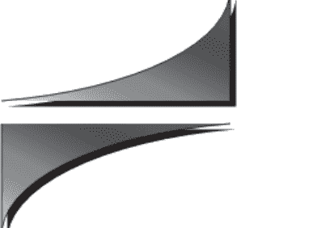

**图 7.5** SVG 椭圆弧。

### 贝塞尔曲线与变换

SVG 支持二次和三次贝塞尔曲线，你可以使用线性渐变或径向渐变对其进行渲染。你还可以使用 SVG `<path>` 元素将多个贝塞尔曲线连接起来。代码清单 7.6 展示了 `BezierCurves1.svg` 的内容，它演示了如何渲染各种贝塞尔曲线。请注意，与变换相关的效果将在本章稍后部分讨论。

#### 代码清单 7.6 BezierCurves1.svg

```xml
<?xml version="1.0" encoding="iso-8859-1"?>
<!DOCTYPE svg PUBLIC "-//W3C//DTD SVG 20001102//EN"
 "http://www.w3.org/TR/2000/CR-SVG-20001102/DTD/svg-20001102.dtd">
<svg xmlns="http://www.w3.org/2000/svg"
     xmlns:xlink="http://www.w3.org/1999/xlink"
     width="100%" height="100%">
  <!-- <defs> element omitted for brevity -->
  <g transform="scale(1.5,0.5)">
    <path d="m 0,50 C 400,200 200,-150 100,350"
          stroke="black" stroke-width="4"
          fill="url(#pattern)" />
  </g>
  <g transform="translate(50,50)">
    <g transform="scale(0.5,1)">
      <path d="m 50,50 C 400,100 200,100 200,120"
            fill="red" stroke="black" stroke-width="4" />
    </g>
    <g transform="scale(1,1)">
      <path d="m 50,50 C 400,100 200,100 200,120"
            fill="yellow" stroke="black" stroke-width="4" />
    </g>
</g>
<g transform="translate(-50,50)">
  <g transform="scale(1,2)">
    <path d="M 50,50 C 400,100 200,200 100,20"
          fill="blue" stroke="black" stroke-width="4"/>
  </g>
</g>
<g transform="translate(-50,50)">
  <g transform="scale(0.5, 0.5) translate(195,345)">
    <path d="m20,20 C20,50 20,450 300,200 s-150,-250 200,100"
          fill="blue" style="stroke:#880088;stroke-width:4;"/>
  </g>
  <g transform="scale(0.5, 0.5) translate(185,335)">
    <path d="m20,20 C20,50 20,450 300,200 s-150,-250 200,100"
          fill="url(#pattern2)"
          style="stroke:#880088;stroke-width:4;"/>
  </g>
  <g transform="scale(0.5, 0.5) translate(180,330)">
    <path d="m20,20 C20,50 20,450 300,200 s-150,-250 200,100"
      fill="blue" style="stroke:#880088;stroke-width:4;"/>
  </g>
  <g transform="scale(0.5, 0.5) translate(170,320)">
    <path d="m20,20 C20,50 20,450 300,200 s-150,-250 200,100"
          fill="url(#pattern2)" style="stroke:black;
                                      stroke-width:4;"/>
  </g>
</g>
<g transform="scale(0.8,1) translate(380,120)">
  <path d="M0,0 C200,150 400,300 20,250"
        fill="url(#pattern2)" style="stroke:blue;
                                    stroke-width:4;"/>
</g>
<g transform="scale(2.0,2.5) translate(150,-80)">
  <path d="M200,150 C0,0 400,300 20,250"
        fill="url(#pattern2)" style="stroke:blue;
                                    stroke-width:4;"/>
</g>
</svg>
```

代码清单 7.6 包含一个 SVG `<defs>` 元素，其中定义了两个线性渐变，随后是十个 SVG `<path>` 元素，每个元素都渲染一条三次贝塞尔曲线。这些 SVG `<path>` 元素被包裹在 SVG `<g>` 元素中，其 `transform` 属性包含 SVG `scale()` 函数或 SVG `translate()` 函数（或两者兼有）。

第一个 SVG `<g>` 元素调用了 SVG `scale()` 函数来缩放在 SVG `<path>` 元素中指定的三次贝塞尔曲线，如下所示：

```xml
<g transform="scale(1.5,0.5) ">
  <path d="m 0,0 C 400,200 200,-150 100,350"
    stroke="black" stroke-width="4"
    fill="url(#pattern1)" />
</g>
```

上述三次贝塞尔曲线的起点为 (0, 50)，控制点为 (400, 200) 和 (200, -150)，随后的第二个控制点为 (100, 350)。这条贝塞尔曲线为黑色，宽度为 4，其 `fill` 属性是 SVG `<defs>` 元素中定义的 `<linearGradient>` 元素（其 `id` 属性为 `pattern1`）所定义的颜色。

其余的 SVG `<path>` 元素与第一个 SVG `<path>` 元素类似，因此不再赘述。

图 7.6 展示了渲染 SVG 文档 `BezierCurves1.svg` 中定义的贝塞尔曲线的结果。

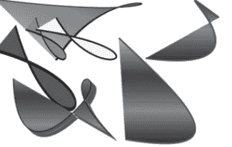

**图 7.6** SVG 贝塞尔曲线。

### 在 SVG 路径上渲染文本

你可以创建精美的滤镜效果，并将其应用于 2D 形状以及文本字符串。

代码清单 7.7 展示了文档 `TextOnQBezierPath1.svg` 的内容，它演示了如何沿着二次贝塞尔曲线的路径渲染文本字符串。

#### 代码清单 7.7 TextOnQBezierPath1.svg

```xml
<?xml version="1.0" encoding="iso-8859-1"?>
<!DOCTYPE svg PUBLIC "-//W3C//DTD SVG 20001102//EN"
"http://www.w3.org/TR/CR-SVG-20001102/DTD/svg-20001102.dtd">
<svg xmlns="http://www.w3.org/2000/svg"
     xmlns:xlink="http://www.w3.org/1999/xlink"
     width="100%" height="100%">
  <defs>
    <path id="pathDefinition" d="m0,0 Q100,200 200,200 T300,200 z"/>
  </defs>
  <g transform="translate(100,100) ">
    <text id="textStyle" fill="red"
          stroke="blue" stroke-width="2"
          font-size="24">
<textPath xlink:href="#pathDefinition">
Sample Text that follows a path specified by a Quadratic
Bezier curve
</textPath>
</text>
</g>
</svg>
```

代码清单 7.7 中的 SVG `<defs>` 元素包含一个定义了二次贝塞尔曲线的 SVG `<path>` 元素（注意 `d` 属性中的 `Q`）。该 SVG `<path>` 元素有一个 `id` 属性，其值为 `pathDefinition`，在随后的代码示例中被引用。

SVG `<g>` 元素包含一个指定要渲染文本字符串的 SVG `<text>` 元素，以及一个指定文本渲染路径的 SVG `<textPath>` 元素，如下所示：

```xml
<textPath xlink:href="#pathDefinition">
Sample Text that follows a path specified by a Quadratic
Bezier curve
</textPath>
```

请注意，SVG `<textPath>` 元素包含 `xlink:href` 属性，其值为 `pathDefinition`，这正是定义在 SVG `<defs>` 元素中的 SVG `<path>` 元素的 `id`。因此，文本字符串是沿着二次贝塞尔曲线的路径渲染的，而不是水平渲染（默认行为）。

图 7.7 展示了渲染 `TextOnQBezierPath1.svg` 的结果，其中文本字符串沿着二次贝塞尔曲线的路径渲染。

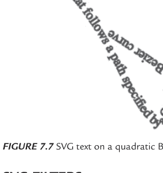

**图 7.7** SVG 二次贝塞尔曲线上的文本。

### SVG 滤镜

SVG 支持一套丰富的滤镜效果，其完整解释很容易超过一章的篇幅。掌握 SVG 滤镜需要一个学习过程，因为只有少数 SVG 滤镜比较简单。许多滤镜非常复杂，需要多个非直观的输入值。事实上，某些 SVG 滤镜可以进行“链式”连接：一个滤镜的输出可以是另一个滤镜的输入（且某些 SVG 滤镜的输入需要两个滤镜的输出）。正如你所猜测的，某些 SVG 滤镜的计算量可能很大，这反过来会对他性能产生不利影响；在移动设备的情况下，包含此类滤镜的应用还会对电池寿命产生不利影响。

与滤镜相关的 SVG 元素列表包括：
- `feBlend`
- `feColorMatrix`
- `feComponentTransfer`
- `feComposite`
- `feConvolveMatrix`
- `feDiffuseLighting`
- `feDisplacementMap`
- `feFlood`
- `feGaussianBlur`
- `feImage`
- `feMerge`
- `feMorphology`
- `feOffset`
- `feSpecularLighting`
- `feTile`
- `feTurbulence`

你可以使用滤镜效果渲染 2D 形状以及文本字符串。代码清单 7.8 展示了 SVG 文档 `BlurFilterText1.svg` 的内容，它使用模糊滤镜渲染了一个文本字符串。

#### 代码清单 7.8 BlurFilterText1.svg

```xml
<?xml version="1.0" encoding="iso-8859-1"?>
<!DOCTYPE svg PUBLIC "-//W3C//DTD SVG 20001102//EN"
 "http://www.w3.org/TR/2000/CR-SVG-20001102/DTD/svg-20001102.dtd">
<svg xmlns="http://www.w3.org/2000/svg"
     xmlns:xlink="http://www.w3.org/1999/xlink"
     width="100%" height="100%">
  <defs>
  <filter
    id="blurFilter1"
    filterUnits="objectBoundingBox"
    x="0" y="0"
    width="100%" height="100%">
    <feGaussianBlur stdDeviation="4"/>
  </filter>
  </defs>
<g transform="translate(50,100)">
  <text id="normalText" x="0" y="0"
        fill="red" stroke="black" stroke-width="4"
        font-size="72">
    Normal Text
  </text>
  <text id="horizontalText" x="0" y="100"
        filter="url(#blurFilter1)"
        fill="red" stroke="black" stroke-width="4"
        font-size="72">
    Blurred Text
  </text>
</g>
</svg>
```

代码清单 7.8 中的 SVG `<defs>` 元素包含一个 SVG `<filter>` 元素，通过以下行指定了高斯模糊：

```xml
<feGaussianBlur stdDeviation="4"/>
```

你可以为 `stdDeviation` 属性指定更大的值，如果你想要创建更加"弥散"的滤镜效果。

包含在 SVG `<g>` 元素中的第一个 SVG `<text>` 元素渲染一个普通文本字符串，而第二个 SVG `<text>` 元素包含一个 `filter` 属性，该属性引用在 SVG `<defs>` 元素中定义的滤镜，以便渲染相同的文本字符串，如下所示：

```
filter="url(#blurFilter1)"
```


图 7.8 展示了渲染`BlurFilterText1.svg`的结果，该文件创建了一种滤镜效果。

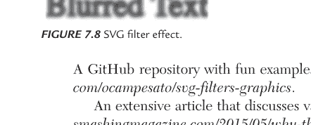

*图 7.8 SVG 滤镜效果。*

一个包含有趣的 SVG 滤镜示例的 GitHub 仓库在这里：https://github.com/ocampesato/svg-filters-graphics。

一篇讨论各种 SVG 滤镜的详尽文章在这里：http://www.smashingmagazine.com/2015/05/why-the-svg-filter-is-awesome/。

一个关于现代浏览器对 SVG 滤镜支持情况的表格列表在这里：http://caniuse.com/#feat=svg-filters。

### SVG 变换和渐变

在本章前面，你已经看到了一些 SVG 变换效果的示例。除了 SVG 函数`scale()`、`translate()`和`rotate()`之外，SVG 还提供了`skew()`函数来创建倾斜效果。

清单 7.9 展示了`TransformEffects1.svg`的内容，该文件说明了如何在 SVG 中对矩形和圆形应用变换。

#### 清单 7.9 TransformEffects1.svg

```xml
<?xml version="1.0" encoding="iso-8859-1"?>
<!DOCTYPE svg PUBLIC "-//W3C//DTD SVG 20001102//EN"
  "http://www.w3.org/TR/2000/CR-SVG-20001102/DTD/svg-200011 antisymmetric022.dtd">
<svg xmlns="http://www.w3.org/2000/svg"
     xmlns:xlink="http://www.w3.org/1999/xlink"
     width="100%" height="100%">
  <defs>
    <linearGradient id="gradientDefinition1"
      x1="0" y1="0" x2="200" y2="0"
      gradientUnits="userSpaceOnUse">
      <stop offset="0%" style="stop-color:#FF0000"/>
      <stop offset="100%" style="stop-color:#440000"/>
    </linearGradient>
    <pattern id="dotPattern" width="8" height="8"
          patternUnits="userSpaceOnUse">
      <circle id="circle1" cx="2" cy="2" r="2"
          style="fill:red;"/>
    </pattern>
  </defs>
  <!-- 完整圆柱体 -->
  <g id="largeCylinder" transform="translate(100,20)">
    <ellipse cx="0"  cy="50" rx="20" ry="50"
             stroke="blue" stroke-width="4"
             style="fill:url(#gradientDefinition1)"/>
    <rect x="0" y="0" width="300" height="100"
          style="fill:url(#gradientDefinition1)"/>
    <rect x="0" y="0" width="300" height="100"
          style="fill:url(#dotPattern)"/>
    <ellipse cx="300" cy="50" rx="20"  ry="50"
             stroke="blue" stroke-width="4"
             style="fill:yellow;"/>
  </g>
  <!-- 半尺寸圆柱体 -->
  <g transform="translate(100,100) scale(.5)">
    <use xlink:href="#largeCylinder" x="0" y="0"/>
  </g>
  <!-- 倾斜圆柱体 -->
  <g transform="translate(100,100) skewX(40) skewY(20)">
    <use xlink:href="#largeCylinder" x="0" y="0"/>
  </g>
  <!-- 旋转圆柱体 -->
  <g transform="translate(100,100) rotate(40)">
    <use xlink:href="#largeCylinder" x="0" y="0"/>
  </g>
</svg>
```

清单 7.9 中的 SVG `<defs>`元素包含一个`<linearGradient>`元素，该元素定义了一个线性渐变，随后是一个 SVG `<pattern>`元素，该元素定义了一个自定义图案，如下所示：

```xml
<pattern id="dotPattern" width="8" height="8"
          patternUnits="userSpaceOnUse">
  <circle id="circle1" cx="2" cy="2" r="2"
          style="fill:red;"/>
</pattern>
```

如你所见，SVG `<pattern>`元素包含一个 SVG `<circle>`元素，该元素在一个 8x8 的矩形内以网格状方式重复（注意`width`属性和`height`属性的值）。SVG `<pattern>`元素有一个`id`属性，其值为`dotPattern`，因为（如你将要看到的）该元素创建了一种“点状”效果。

清单 7.9 包含四个 SVG `<g>`元素，每个元素都渲染一个引用在 SVG `<defs>`元素中定义的 SVG `<pattern>`元素的圆柱体。

清单 7.9 中的第一个 SVG `<g>`元素包含两个 SVG `<ellipse>`元素和两个 SVG `<rect>`元素。第一个`<ellipse>`元素用 SVG `<defs>`元素中定义的线性渐变渲染圆柱体的左侧“端盖”。第一个`<rect>`元素用线性渐变渲染圆柱体的“主体”，第二个`<rect>`元素在圆柱体主体上渲染“点状图案”。最后，第二个`<ellipse>`元素渲染椭圆的右侧“端盖”。

其他三个圆柱体很容易创建：它们只需引用第一个圆柱体并应用变换来改变大小、形状和方向。具体来说，这三个圆柱体通过以下代码引用第一个圆柱体：

```xml
<use xlink:href="#largeCylinder" x="0" y="0"/>
```

然后它们应用缩放、倾斜和旋转函数来渲染缩放、倾斜和旋转后的圆柱体。

图 7.9 展示了渲染`TransformEffects1.svg`的结果。

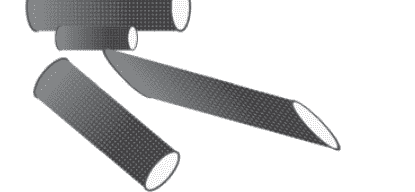

### SVG 的其他特性

SVG 支持许多其他特性，本节将介绍其中一些。请注意，引用的文件位于本书附带的配套光盘中。

#### SVG 动画效果

SVG 支持动画效果，你可以将其指定为 SVG 元素声明的一部分。SVG 文档`AnimateMultiRect1.svg`展示了如何用四个矩形创建动画效果。

```xml
<rect id="rect1" width="100" height="100"
     stroke-width="1" stroke="blue"/>
<use xlink:href="#rect1" x="0" y="0" fill="red">
  <animate attributeName="x" attributeType="XML"
    begin="0s" dur="4s"
    fill="freeze" from="0" to="400"/>
</use>
```

SVG `<g>`元素包含一个 SVG `<use>`元素，该元素对矩形执行并行动画效果。第一个`<use>`元素引用在 SVG `<defs>`元素中定义的矩形，然后在四秒的时间间隔内对`x`属性进行动画处理。请注意，`x`属性从 0 变化到 400，这将矩形从左到右水平移动。你也可以对其他 SVG 元素进行动画处理，包括文本字符串。

如果你想了解如何在 SVG 中处理缩放和平移功能，代码示例可在这里获取：http://msdn.microsoft.com/en-us/library/gg589508(v=ts.85).aspx。

#### SVG 和 JavaScript

除了将“纯”SVG 代码嵌入 HTML5 页面之外，SVG 还允许你将 JavaScript 嵌入 CDATA 区域，以动态创建 SVG 元素并将其附加到 HTML 网页的 DOM 中。你还可以为 SVG 元素在 JavaScript 中定义事件监听器。SVG 文档`ArchEllipses1.svg`渲染一组遵循阿基米德螺旋线路径的椭圆。一个片段如下所示：

`var svgNS = "http://www.w3.org/2000/svg";`

```javascript
function drawSpiral(event) {
  for(angle=0; angle<maxAngle; angle+=angleDelta) {
    ellipseNode = svgDocument.createElementNS(svgNS,
      "ellipse");
    ellipseNode.setAttribute("fill", redColor);
    ellipseNode.setAttribute("stroke-width",
      strokeWidth);
    ellipseNode.setAttribute("stroke", "yellow");
    ellipseNode.setAttribute("cx", currentX);
    ellipseNode.setAttribute("cy", currentY);
    ellipseNode.setAttribute("rx", majorAxis);
    ellipseNode.setAttribute("ry", minorAxis);
    gcNode.appendChild(ellipseNode);
  }
}
```

SVG 文档`ArchEllipses1.svg`包含一个带有`<script>`元素的 CDATA 区域，而`<script>`元素又包含`drawSpiral()`函数，其主循环渲染一组动态创建的 SVG `<ellipse>`元素。每个 SVG `<ellipse>`元素都是在`svgNS`变量中指定的 SVG 命名空间中创建的，然后为椭圆的必要属性赋值。每个 SVG `<ellipse>`元素动态创建后，该元素便被附加到 DOM 中。

#### 使用 CSS3 和 JavaScript 在 SVG 中创建 3D 效果

如本章前面所述，SVG 不支持 3D 效果。但是，你可以通过`url()`函数在 CSS 选择器中引用 SVG 元素，这提供了一种在 CSS3 选择器中利用 SVG 功能的强大机制。另一种技术涉及 JavaScript 和 SVG 的组合。一组包含 3D 效果的 SVG 代码示例在这里：https://github.com/ocampesato/svg-filters-graphics。

图 7.10 展示了在 MacBook 上的 Chrome 浏览器中渲染`TroughPattern3S2.svg`（属于上述开源项目的一部分）的结果。

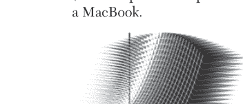

图 7.10 Chrome 浏览器中的 SVG 3D “槽”形。

如果你有兴趣用 SVG 创建 3D 效果，可以在这里获取更多信息和代码示例（包括关于矩阵变换的详细信息）：http://msdn.microsoft.com/en-us/library/hh535759(v=vs.85).aspx。

开源（且非常强大）的工具包 D3 基于 SVG 构建，许多基于 D3 的代码示例在这里：https://github.com/ocampesato/d3-graphics。

#### SVG、CSS 和 jQuery

你可以在同一网页中结合这些技术（也可以与 D3 一起使用）。但是，当你使用 jQuery 在网页中动态创建 SVG 元素时，需要添加一些额外的代码（稍后展示）。如果你不打算使用 jQuery，可以跳过本节。如果你对 jQuery 感兴趣但尚未使用过，请阅读配套光盘中的相关附录。

到目前为止，你已经知道 CSS3 选择器可以使用 CSS3 `url()`函数引用 SVG 文档，这意味着你可以在你的 HTML 页面中嵌入基于 SVG 的图形效果（包括动画）。HTML 网页`Blue3DCircle1.html`引用 CSS 样式表`Blue3DCircle1.css`，以渲染带有样式效果的 SVG 圆形。

另一个例子是，HTML5 页面`CSS3SVGBarChart1.html`引用 CSS3 样式表`CSS3SVGBarChart1.css`和 SVG 文档`CSS3SVGBarChart1.svg`，以渲染 SVG 圆形、条形图和多列文本。

一个有趣的场景是在同一网页中结合 jQuery 与 SVG 和 CSS，如以下小节所示。

### SVG 与 jQuery

清单 7.10 展示了`JQuerySVGCSSCube1.html`的内容，该示例演示了当用户点击立方体的任意一个面时，如何更新基于 SVG 的立方体的填充颜色。

#### 清单 7.10 JQuerySVGCSSCube1.html

```html
<!DOCTYPE html>
<html lang="en">
  <head>
    <meta charset="utf-8" />
    <title>SVG, CSS, and jQuery Example</title>
    <script src="https://cdnjs.cloudflare.com/ajax/libs/
                  jquery/3.0.0-alpha1/jquery.js">
    </script>
    <style>
      .newcolor {
        fill: #c8f;
        stroke: white;
        stroke-width: 2;
      }
    </style>
  </head>
  <body>
    <svg class="none" width="600" height="300">
      <!-- top/front/right faces -->
      <polygon fill="yellow"
               points="50,50 200,50 240,30 90,30"/>
      <rect width="150" height="150" x="50" y="50"
            fill="red"/>
      <polygon fill="blue"
               points="200,50 200,200 240,180 240,30"/>
    </svg>
    <script>
      var mysvg = $("svg > *");
      $(document).ready(function() {
        mysvg.on("click", function() {
          mysvg.removeClass("none");
          $(this).toggleClass("newcolor");
          //$(this).newClass("newcolor");
        });
      });
    </script>
  </body>
</html>
```

清单 7.10 包含样板代码和用于渲染立方体的熟悉的 SVG 代码。新增的部分是`<script>`元素中的 jQuery 代码块，它向你展示了如何定义一个事件处理程序，以响应立方体任意一个面上的点击事件。如果你对这段代码不熟悉，请阅读随附光盘中的 jQuery 附录。

### 创建 SVG 元素与 jQuery

使用`document.createElement()`方法添加 SVG DOM 节点是行不通的，因为需要一个命名空间。请使用`document.createElementNS()`方法，而这是 jQuery 不会为你处理的。

清单 7.11 展示了`JQuerySVG.html`的内容，该示例演示了如何创建一个 SVG 椭圆，然后通过 jQuery 将该椭圆追加到 DOM 中。

#### 清单 7.11 JQuerySVG.html

```html
<!DOCTYPE html>
<html lang="en">
  <head>
    <meta charset="utf-8" />
    <title>An SVG Ellipse and jQuery</title>
    <script src="http://code.jquery.com/jquery-1.7.1.min.js">
```


### 清单 7.11 使用 jQuery 创建 SVG 元素

```html
</script>

  </head>

  <body>

    <svg id="outersvg" width="800" height="500">

    </svg>

    <script>

      function createSVGElemWithNS(elem)

      {

        return document.createElementNS('http://www.

                                        w3.org/2000/svg', elem);

      }

      $(document).ready(function() {

        var $mySVG = $('#outersvg');

        $(createSVGElemWithNS('circle'))

                              .attr('cx', 150)

                              .attr('cy', 100)

                              .attr('r', 50)

                              .attr('fill', 'none')

                              .attr('stroke', 'red')

                              .attr('stroke-width', 3)

                              .appendTo($mySVG);

      })

    </script>

  </body>

</html>
```

清单 7.11 以样板代码开头，`<body>` 元素中包含一个 `<svg>` 元素，用于容纳 SVG 元素。`<body>` 元素的下一部分是一个 `<script>` 元素，它以 JavaScript 函数 `createSVGElemWithNS` 开头，其唯一目的是创建带有 SVG 命名空间的元素。`<script>` 元素的第二部分包含标准的 jQuery "ready" 代码块，该代码块在网页加载到内存后执行。如你所见，这个代码块首先获取网页中 `<svg>` 元素的引用，然后调用 JavaScript 函数 `createSVGElemWithNS` 来创建一个 SVG `<circle>` 元素。在将该元素追加到 DOM 之前，使用链式调用来为 SVG `<circle>` 元素赋值。

如果你想查看 jQuery 和 CSS 在同一个网页中的示例，可以在随附光盘的附录中找到此类示例。

### 现有 SVG 元素与 jQuery

上一节向你展示了如何动态创建新的 SVG 元素并通过 jQuery 将它们追加到 DOM 中。你还可以使用 jQuery 操作现有的 SVG 元素，而且无需处理命名空间问题。

清单 7.12 展示了 `UpdateSVGviaJQuery.svg` 的内容，该示例演示了如何使用 jQuery 来更新 SVG `<rect>` 元素的 `width` 属性。

#### 清单 7.12 UpdateSVGViaJQuery.svg

```xml
<?xml version="1.0" encoding="UTF-8" standalone="no"?>
<!DOCTYPE svg PUBLIC "-//W3C//DTD SVG 1.0//EN"
"http://www.w3.org/TR/2001/REC-SVG-20010904/DTD/svg10.dtd">
<svg xmlns="http://www.w3.org/2000/svg"
     xmlns:xlink="http://www.w3.org/1999/xlink" width="500"
                                                height="500">
  <script xlink:href="http://code.jquery.com/
                                   jquery-2.0.0b1.js">
  </script>
  <script xlink:href="http://code.jquery.com/jquery-
                                   migrate-1.1.0.js">
  </script>
  <rect id="rect1" x="50" y="50" width="200"  height="50"
    style="fill:red"/>
  <script>
    $('#rect1').attr('width', 400);
  </script>
</svg>
```

清单 7.12 包含带有两个 `<script>` 元素的样板代码，这两个元素引用了与 jQuery 相关的脚本。清单 7.12 中的 `<body>` 元素包含一个 SVG `<svg>` 元素，该元素又包含两个 `<rect>` 元素，随后是一个包含 jQuery 代码块的 `<script>` 元素。网页加载到内存后，该代码块执行并将第一个 SVG `<rect>` 元素的 `width` 属性设置为 400。这个简单的代码示例向你展示了通过 jQuery 更新 SVG 元素的属性是多么容易。

### 用于 SVG 的 jQuery 插件

如果你更喜欢在 HTML5 网页中使用 jQuery 而不是 D3，你可以通过 jQuery 插件来添加 SVG 支持。

例如，以下 jQuery 插件提供了一些 SVG 支持：`http://keith-wood.name/svg.html`。

以下代码块演示了如何使用此 jQuery 插件渲染多个 2D 形状：

```javascript
svg.rect(50, 50, 100, 100,
    {fill: 'blue', stroke: 'red', 'stroke-width': 3});
svg.line(50, 50, 100, 100,
    {'stroke': 3, 'stroke-width': 3});
svg.circle(50, 50, 100, 100,
    {'fill': 'red', 'stroke': 3, 'stroke-width': 3});
svg.ellipse(250, 250, 100, 50,
    {'fill': 'red', 'stroke': 3, 'stroke-width': 3});
```


在前面的代码块中，JavaScript 变量`svg`是对在 HTML5 网页其他位置定义的 HTML `<div>` 元素的引用。

用于为 SVG `<path>` 元素制作动画的 jQuery 插件可以在以下网站找到：http://www.jqueryrain.com/2015/10/jquery-drawsvg-animate-svg-paths/ 和 http://www.justinmccandless.com/blog/Patching+jQuery's+Lack+of+SVG+Support。

### SVG 与 CSS3 的简要比较

本节简要总结了 SVG 和 CSS3 共有的特性，以及每种技术独有的特性。第 6 章和第 7 章包含的代码示例演示了本节中总结的一些特性。

SVG 和 CSS3 都支持以下功能：

- 线性和径向渐变
- 2D 图形和动画效果
- 创建矩形、圆形和椭圆等形状的能力
- WAI-ARIA

SVG 支持以下 CSS3 中不可用的高级功能：

- 贝塞尔曲线
- 层次化对象定义
- 自定义字形
- 沿任意路径渲染文本
- 在 SVG 对象上定义事件监听器
- 使用 JavaScript 以编程方式创建 2D 形状
- 对基于 XML 的技术和工具的“可访问性”

CSS3 支持以下 SVG 中不可用的高级功能：

- 3D 图形和动画效果
- 文本的多列渲染
- 面向 WebGL 的功能（例如 CSS 着色器）

请注意，SVG 滤镜和 CSS 滤镜在不久的将来某个时候将会统一。

一般来说，与 CSS3 相比，SVG 更适合用于数据可视化的大型数据集。你可以在 CSS3 选择器中使用`CSS3 url()`函数引用 SVG 文档（它可能渲染某种图表）。你已经在第 3 章中看到过这样的示例，其中 SVG 文档包含了条形图的布局。

通常，可能涉及额外的处理过程，即从一个或多个来源（如数据库和 Web 服务）检索或聚合数据，然后使用某种编程语言（如 XSLT、Java 或 JavaScript）进行操作，以便以编程方式创建 SVG 文档，或者在浏览器会话中以编程方式创建 SVG 元素。

### 小结

本章首先介绍了 SVG 以及如何使用 SVG 渲染 2D 形状。你学习了 SVG 渐变（线性和径向），以及如何在渲染 2D 形状时指定渐变。接下来，你学习了用于在平面中渲染任意多边形（凸多边形或凹多边形）的 SVG `<polygon>` 元素。

你还学习了 SVG `<pattern>` 元素以及如何创建用于创建丰富视觉效果的自定义图案。然后，你学习了贝塞尔曲线以及如何在 SVG 中沿路径（如贝塞尔曲线）渲染文本字符串。最后，你学习了 SVG 滤镜以及如何将其与 SVG 变换结合并应用于 2D 形状。

### 杂项主题

本章包含了一组兼而有之的主题，首先是对 Houdini 的概述，这是一项对网页中的 CSS 具有深远影响的计划。您还将学习 Flexbox 和 Grid 布局，以及二进制图像的性能优化技术。此外，您将看到 CSS3、SVG 和 HTML5 `Canvas` 的对比，以及 Web 动画 API 和动画相关工具包。

本章的第一部分是对 Houdini 的快速介绍，这是一个重要的工作组，其目标是提供新的 API，以确保所有现代浏览器中具有一致的 CSS 行为。

本章的第二部分包含代码示例，向您展示如何使用`CSS Flexbox`和`CSS Grid Layout`。本章的第三部分讨论了 HTML5 网页和 CSS3 的性能改进，以及 CSS3、SVG 和 HTML5 `Canvas` 的对比。

本章的第四部分涵盖了优化二进制图像的性能技术，以及对精灵图（spritesheets）、渐进模糊技术（blur-up technique）、渐进式图像和 Web 字体（Web fonts）的描述。本章的第五部分探讨了 Web Animations API 和其他动画工具包，例如 GSAP、mojo.io 和 sequence.js。

本章的最后一部分深入探讨了 Chrome Inspector 的一些功能，它提供了一套非常丰富的诊断和调试能力。您将学习“计算属性（computed properties）”、如何对 CSS 选择器中的属性进行实时更新，以及如何收集数据以帮助您精确定位性能瓶颈。完成本节后，您将能够更好地将 Chrome Inspector 的功能与其它现代浏览器中支持的相应功能进行基于功能的对比。

### Project Houdini

Houdini 是一个 W3C 工作组，其目标是提供一套 API，使 CSS 在所有现代浏览器中保持一致。这些 API 还将允许开发人员通过访问浏览器渲染引擎的样式和布局过程来扩展 CSS。虽然 Houdini 是一个相对较新的小组，但这里有一些 Houdini 示例：`https://github.com/GoogleChrome/houdini-samples`。

正如您现在可能已经知道的，polyfill（例如 Modernizr）是 JavaScript 工具包，用于“填充”浏览器中缺失的功能，以便其它 JavaScript 工具包在不同的现代浏览器中运行一致。从本质上讲，polyfill 通过修改 DOM 来工作。

DOM 在 CSS 中的“对应物”是 CSSOM，它是 CSS 对象模型（CSS Object Model）的缩写。不幸的是，CSSOM 在不同浏览器之间不一致且缺乏关键功能。此外，“polyfill” CSS 比 polyfill DOM 更加困难（而且也是一个不完整的解决方案）。

CSSOM 的一个缺陷是它会丢弃任何无法识别的 CSS 规则或声明；因此，为了 polyfill 这些规则和声明，必须使用 DOM（具体而言是访问 `<style>` 和 `<link>` 元素）。

本质上，Houdini 的目标是修改浏览器的内部渲染引擎，以便在现代浏览器中“标准化”（即消除不一致行为）CSS。

#### 渲染流水线（The Rendering Pipeline）

渲染流水线包含以下顺序的阶段（按此顺序）：

1. 解析器（Parser）
2. DOM/CSSOM
3. 层叠（Cascade）
4. 布局（Layout）
5. 绘制（Paint）
6. 合成（Composite）

前三个阶段是 CSS 属性和值 API（CSS Properties and Values API）的组成部分，后三个阶段由 Worklets 组成。Houdini 在渲染流水线中引入了第一阶段（尚未编写）和第三阶段。第一阶段将正确处理外部样式表，并支持 CSS 自定义扩展。

Houdini 还引入了 worklet 的概念，它们本质上是处理注册相关操作的脚本。Worklet 支持各种功能，例如调用 JavaScript 代码的能力。

请导航至 Houdini 主页，以获取有关提议的 Houdini API 的更多详细信息。

### CSS3 高级特性

本书中的 CSS3 示例已在基于 WebKit 的浏览器中进行了测试，您可以使用浏览器特定的前缀（在第 1 章中简要讨论过）为其它浏览器插入 CSS3 代码。此外，本章中的部分代码示例在 Google Canary 中渲染，有时在 WebKit 的 nightly 构建版本中渲染，文中会相应注明。当本书印刷时，这些功能可能会在 Chrome 的通用发行版中可用。

有几种 CSS 特性一直处于积极开发中，其中大多数（可能全部）在基于 WebKit 的浏览器中可用。在许多情况下，每项新 CSS 特性的 W3C 规范都处于“工作进行中（work in progress）”状态，因此在您阅读本书时，它们可能会被修改。请检查类似`www.caniuse.com`的网站，以获取您所选择的浏览器中最新特性的支持信息。

在高级（某些情况下是实验性）特性中包括：

1. CSS Flexbox
2. CSS 混合模式（CSS Blending）
3. CSS 合成（CSS Compositing）
4. CSS 排除（CSS Exclusions）
5. CSS 区域（CSS Regions）

考虑到上述几点，这里列出了一些最新的 CSS3 特性：

- CSS Canvas 背景（Webkit 和 FF）
- CSS 设备自适应（IE10）
- CSS Exclusions（IE10）
- CSS Filters（IE10 和 Webkit）
- CSS Flexbox（IE10）
- CSS Grid（IE10 和 Webkit）
- CSS Regions（IE10 和 Webkit）
- CSS 自定义过滤器（Webkit）
- CSS 模板（IE10）

CSS Flexbox 是上述列表中本章涵盖的唯一特性。您还将看到一些 CSS Flexbox 代码示例和截图，用以阐明如何创建图形效果。您可以通过导航至其它 CSS 特性的各自主页来查看其状态。

#### CSS Flexbox（弹性盒子）

CSS 支持多种布局模型，例如块级（block）、内联（inline）、表格（table）和定位（positioned）布局模型。此外，CSS 还支持 CSS Flexbox（Flexible Box）模型，您将在本节中看到一些示例。

Flexbox 是一种单向布局概念，其中弹性项目（flex items）被放置在水平行或垂直列中。`flex-direction` 属性指定主轴，进而定义弹性项目在弹性容器中放置的水平或垂直方向。`flex-direction` 的默认值是`row`，这意味着项目从左到右、从上到下放置（即我们在页面上阅读文本的顺序）。

以下是`flex-direction`的其它值：

- `row-reverse`：如果书写模式（writing-mode）指定为从左到右，那么弹性项目将以从右到左的方式布局
- `column`：如果书写系统是水平的，弹性项目将垂直放置
- `column-reverse`：与`column`属性类似，但顺序相反

CSS Flexbox 模型还允许您扩展 flexbox 的子元素以填充未使用的空间，以及缩小子元素以避免溢出父元素。此外，您可以在同一个 HTML 网页中为不同的 flexbox 创建不同的布局。

#### Flexbox 属性集

一些不需要前缀的有用 flexbox 属性包括：`box-align`、`box-flex`、`box-ordinal-group`、`box-pack` 和`flex-flow`。

`box-align`属性（以及其它 Flexbox 属性）支持`start`、`end`、`center`、`baseline`和`stretch`等值，所有这些值都允许您指定 flexbox 中元素的对齐方式。例如，`start`和`end`将分别对 flexbox 中的一组元素进行左对齐和右对齐。

`box-flex`属性允许您为 flexbox 中的某个元素分配较大的相对权重。`box-ordinal-group`属性允许您更改 flexbox 中一组元素的默认排序。您还可以使用`display`属性并指定值为`box`。

您可以使用 Flexbox 属性来执行额外的任务：

- 使用`order`安排 flexbox 子元素
- 使用`flex-basis`定义 flexbox 子元素的尺寸
- 使用`flex-shrink`和`flex-grow`正确调整 flexbox 子元素的大小
- 使用`flex-wrap`和`align-content`创建网格

下一节包含一个包含上述部分 Flexbox 属性的网页示例。

#### 使用 Flexbox 属性的网页

代码清单 8.1 显示了`SimpleFlexboxWK1.html`的内容，代码清单 8.2 显示了`SimpleFlexboxWK1.css`的内容，它们阐明了如何使用本节开头列表中的 flexbox 属性。

#### 清单 8.1：SimpleFlexboxWK1.html

```html
<!doctype html>
<html lang="en">
<head>
  <meta charset="utf-8">
  <title>Flexbox Layout</title>
  <link rel="stylesheet" href="simpleflex1wk.css">
</head>
<body>
  <div>
    <ul id="flex1">
      <li>Item11</li>
      <li>Item12</li>
      <li>Item13</li>
    </ul>
    <ul id="flex2">
      <li>Item21</li>
      <li>Item22</li>
      <li>Item23</li>
    </ul>
    <ul id="flex3">
      <li>Item31</li>
      <li>Item32</li>
      <li>Item33</li>
    </ul>
  </div>
</body>
</html>
```

清单 8.1 首先引用了一个 CSS 样式表，接着是一些样板 HTML 标记。下一部分包含三个无序列表，每个列表都有一个`id`属性，其值分别为`flex1`、`flex2`和`flex3`。每个无序列表都基于`SimpleFlexboxWK1.css`中匹配的选择器进行样式设置。

#### 清单 8.2：SimpleFlexboxWK1.css

```css
#flex1 {
  display: -webkit-box; width: 100%; height: 50px;
  background: #faa;
  -webkit-box-pack: center; -webkit-box-align: start;
}

#flex1 li {
  background: yellow; margin: 0 5px;
}

#flex1 li:nth-child(2) {
  -webkit-box-ordinal-group: 1;
}

#flex2 {
  display: -webkit-box; width: 100%; height: 50px;
  background: #aaf;
  -webkit-box-pack: center; -webkit-box-align: center;
}

#flex2 li {
  background: red; margin: 0 5px; -webkit-box-flex: 1;
}

#flex2 li:nth-child(1) {
  -webkit-box-flex; -webkit-box-ordinal-group: 1;
}

#flex3 {
  display: -webkit-box; width: 100%; height: 50px;
  background: #afa;
  -webkit-box-pack: center; -webkit-box-align: right;
}

#flex3 li {
  background: #88f; margin: 0 5px; -webkit-box-flex: 8;
}

#flex3 li:nth-child(1) {
  -webkit-box-flex: 3; -webkit-box-ordinal-group: 2;
}
```

清单 8.2 包含九个选择器，其中三个选择器分别对应清单 8.1 中的每个无序列表。你可以回顾上一节的内容，了解清单 8.2 中选择器的 flexbox 属性说明。

#### 使用 Flexbox 渲染列和行

清单 8.3 展示了`Flexbox1.html`的内容，说明了如何通过 flex 相关属性将一组 HTML `<div>`元素渲染为列，将另一组 HTML `<div>`元素渲染为行。

#### 清单 8.3：Flexbox1.html

```html
<!DOCTYPE html>
<html lang="en">
<head>
  <meta charset="utf-8">
  <title>CSS3 Flexbox Examples</title>
  <style>
    #outer1 { display: block; }
    #outer2 { display: -webkit-box; }

    #outer1 > div {
      width: 200px;
      height: 50px;
      background-color: red;
      color: white;
      margin: 2px;
    }

    #outer2 > div {
      width: 200px;
      height: 50px;
      background-color: blue;
      color: white;
      margin: 2px;
    }
  </style>
</head>
<body>
  <div id="outer1">
    <div id="div1">div one</div>
    <div id="div2">div two</div>
    <div id="div3">div three</div>
  </div>

  <div id="outer2">
    <div id="div4">div four</div>
    <div id="div5">div five</div>
    <div id="div6">div six</div>
  </div>
</body>
</html>
```

清单 8.3 包含一个`<style>`元素，其中使用了常见的标准 CSS 属性来设置清单 8.3 中`<body>`元素内两个`<div>`元素的样式。具体来说，第一个选择器将第一个`<div>`元素渲染为列：

```css
#outer1 { display: block; }
```


```css
#outer1 { display: block; }
```

唯一的新增功能是第二个选择器中与 Flexbox 相关的 CSS 属性，它将第二个 `<div>` 元素渲染为行：

```css
#outer2 { display: -webkit-box; }
```

图 8.1 展示了在 MacBook 上的 Chrome 浏览器中渲染 `Flexbox1.html` 的结果。

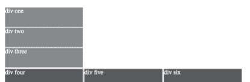

#### 图 8.1 MacBook 上 Chrome 浏览器中的 CSS Flexbox 示例

作为示例，考虑以下 `<style>` 代码块，它指定了一个宽度为 `300px` 的 HTML `<div>` 元素，其中包含四个 `<button>` 元素，每个按钮的宽度为 `80px`：

```html
<style>
    #div1 {
      display: flexbox;
      flex-flow: row wrap;
      width: 300px;
    }

    button {
      flex: 80px 1;
    }
</style>

<div id="div1">
  <button id="button1">FreshTomatoes</button>
  <button id="button2">MincedGarlic</button>
  <button id="button3">FreshGinger</button>
  <button id="button4">OliveOil</button>
</div>
```

由于 HTML `<div>` 元素的宽度不足以在同一行中容纳四个按钮，因此前三个按钮被渲染在第一行，第四个按钮则作为第二行中唯一的元素进行渲染。此外，第一行中的三个按钮从 `80px` 扩展到 `100px`，而第四个按钮从 `80px` 扩展到 `300px`。

这种“扩展”行为以及为第四个按钮创建第二行的原因在于 `flex-flow` 属性被设置为 `"row wrap"`，这允许多行 Flexbox 布局。

### Flexbox 实用链接

CSS Flexbox 规范（进行中）的更多信息可在此处找到：<http://www.w3.org/TR/css3-flexbox/>。

一个可以在线测试 Flexbox 代码的网站在这里：<http://flexbox.help/>。

一个包含 Flexbox“模式”的网站在这里：<https://github.com/cjcenizal/flexbox-patterns>。

一个使用 Flexbox 的 CSS 网格框架可在此处找到：<http://1000ch.github.io/grd/>。

一篇包含一些实用的 Flexbox 相关代码片段的博客文章在这里：<http://kyusuf.com/post/almost-complete-guide-to-flexbox-without-flexbox>。

### CSS 网格布局

CSS 网格布局使您能够以网格方式控制 HTML 网页元素的布局。CSS 网格涉及 `grid` 显示模式以及使用名为 `fr`（“fraction”，即“分数”）的新长度单位。您还可以使用 `px`、`em` 或 `auto` 作为度量单位来指定行数和列数。

例如，以下选择器指定了四列三行：

```css
#mydiv {
  display: grid;
  grid-columns: 2fr 1fr 1fr 2fr;
  grid-rows: 50px auto 50px;
}
```

在上述选择器中，第一列和最后一列各占网格宽度的六分之二，而中间两列各占网格宽度的六分之一。顶部和底部行的高度均为 `50px`，中间行占据剩余空间。

清单 8.4 展示了 `CSSGrid1.html` 的内容，说明了如何在 HTML 网页中显示按钮元素的网格。

#### 清单 8.4 CSSGrid1.html

```html
<!DOCTYPE HTML>
<html>
<head>
<style>
.grid {
    display: grid;
    grid-columns: repeat(4, 1fr);
    grid-rows: repeat(2, auto);
}
</style>
</head>
<body>
<div class="grid">
    <header></header>
    <div class="content">
        <button id="btn1">Button1</button>
        <button id="btn2">Button2</button>
        <button id="btn3">Button3</button>
        <button id="btn4">Button4</button>
        <button id="btn5">Button5</button>
        <button id="btn6">Button6</button>
        <button id="btn7">Button7</button>
    </div>
</div>
</body>
</html>
```

清单 8.4 包含一个 `<style>` 元素，其中的选择器对 `class` 属性值为 `grid` 的 `<div>` 元素设置样式。当前有七个 `<button>` 元素显示在单行中。但是，当你将清单 8.4 中的两个网格相关属性替换为以下代码行时，每行将最多显示三个按钮：

```css
grid-template-columns: repeat(4, 1fr);
grid-template-rows: repeat(2, auto);
```

图 8.2 展示了在 MacBook 上的 Chrome 浏览器中渲染 `CSS3Grid1.html` 的结果。

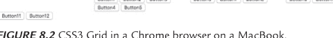

正如你可能看到的，CSS 网格布局支持复杂的布局定义，其布局方式远非显而易见。例如，以下选择器指定了四列三行：

```css
body {
  grid-columns: * * (0.5in * *)[2];
  grid-rows: 20% *;
  columns: 3;
  column-gap: 0.5in;
}
```


上述 CSS 选择器包含以下信息：

- 指定了一个显式网格
- 括号表达式是一个重复模式
- 方括号中的整数是重复次数
- 星号语法表示比例长度，这意味着每个 `*` 被分配相等的空间

你可以从 CSS 网格布局规范（进行中）获取更多信息：[`http://dev.w3.org/csswg/css3-grid-layout/`](http://dev.w3.org/csswg/css3-grid-layout/) 和 [`http://www.w3.org/TR/css3-grid/`](http://www.w3.org/TR/css3-grid/)。

### 提升 HTML5 网页性能

性能始终是一个重要的考量因素，虽然详细而冗长的讨论超出了本书的范围，但了解一些可用的技术仍然很重要：

- 将 JavaScript/CSS 文件合并为单个文件
- 使用文件压缩（压缩/精简）
- 使用精灵图（spritesheets）
- 使用 `base64` 编码图像
- 延迟加载 JavaScript 文件

一篇关于使用 `base64` 编码图像的优秀博客文章在这里：[`http://davidbcalhoun.com/2011/when-to-base64-encode-images-and-when-not-to?goback=%2Egde_2071438_member_234328886`](http://davidbcalhoun.com/2011/when-to-base64-encode-images-and-when-not-to?goback=%2Egde_2071438_member_234328886)。

你可以通过将 `<script>` 标签放置在网页 `<body>` 元素的末尾来延迟加载 JavaScript 文件。

异步加载 CSS 样式表，如下所示：[`http://filamentgroup.github.io/loadCSS/test/preload.html`](http://filamentgroup.github.io/loadCSS/test/preload.html)。

你还可以探索 `RequireJS`，它是一个用于异步下载 JavaScript 文件（以及管理 JavaScript 依赖关系）的 JavaScript 工具包，其主页在这里：[`http://requirejs.org/`](http://requirejs.org/)。

### 与 CSS 相关的性能

CSS3 提供了出色的功能，例如圆角以及 2D 和 3D 图形与动画效果。然而，不同 CSS3 特性的性能表现有所不同，这显然会影响 HTML5 网页的性能。

回想一下，您可以通过使用类似 `translate3D(0,0,0)`（这本质上是一个“无操作”指令）来确保设备使用 GPU。您也可以将 2D 转换替换为相应的 3D 转换。然而，不加区分地使用 3D 转换可能会导致页面回流（reflow）或页面重绘（repaint），从而对性能产生不利影响。

关于 CSS 绘制时间（paint times）的优秀文章可见此处：

- [`http://css-tricks.com/efficiently-rendering-css/`](http://css-tricks.com/efficiently-rendering-css/)
- [`http://www.html5rocks.com/en/tutorials/speed/css-paint-times/`](http://www.html5rocks.com/en/tutorials/speed/css-paint-times/)
- [`http://stickmanventures.com/labs/demo/spinning-gears-Chrome-pre-serve-3d/#`](http://stickmanventures.com/labs/demo/spinning-gears-Chrome-pre-serve-3d/#)

另一个有趣的观点是关于在 CSS 选择器中使用 CSS3 `translate` 与绝对定位（absolute position）的对比。Paul Irish 在这里比较了这些技术：[`http://paulirish.com/2012/why-moving-elements-with-translate-is-better-than-pos-abs-topleft/`](http://paulirish.com/2012/why-moving-elements-with-translate-is-better-than-pos-abs-topleft/)。

如果您对绘制过程的底层细节感兴趣，CSS2 定义了绘制过程的顺序，即元素在“层叠上下文”（stacking contexts）中堆叠的顺序。这个顺序会影响绘制，因为堆栈是从后往前绘制的。块渲染器的堆叠顺序如下：

- 背景颜色
- 背景图像
- 边框
- 子元素
- 外轮廓（Outline）

关于绘制过程更详细的解释可以在以下链接中找到：[`http://www.html5rocks.com/en/tutorials/speed/unnecessary-paints/`](http://www.html5rocks.com/en/tutorials/speed/unnecessary-paints/) 和 [`http://www.html5rocks.com/en/tutorials/internals/howbrowserswork/`](http://www.html5rocks.com/en/tutorials/internals/howbrowserswork/)。

Steve Souders 至少写了两本与性能相关的书，并撰写了许多关于性能的博客文章，他的作品绝对值得阅读。

### CSS、SVG 和 Canvas 的简要对比

CSS3 提供了 a) 2D/3D 图形/动画，b) GPU 支持，c) 嵌入到 SVG `<defs>` 元素中的能力，d) 用于动画的“缓动函数”（easing functions），以及 e) 对 HTML 元素进行动画处理的能力。

SVG 提供了 a) 2D 图形/动画，b) 部分 GPU 支持，c) 创建任意 2D 形状的能力，d) 自定义 `<pattern>`，以及 e) 通过 `<g>` 元素进行分组，以及 D3 中的“缓动函数”（但 SVG 无法为 HTML 制作动画）。

Canvas 提供了 a) 2D 图形/动画，b) GPU 支持，c) 更新许多小对象（如游戏）的能力，以及 d) 处理视频的选项（3D 动画请使用 `ThreeJS/WebGL`）。

当 a) 您已经拥有基于 SVG 的数据且 b) 必须支持 IE6 时，CSS3+SVG 非常有用（这可以通过 `Raphael` 工具包实现，但 D3 不行）。

CSS3+D3 适用于现代浏览器，且在定义事件处理器和动画方面更简单（可能也更容易维护/增强）。

然而，请记住 CSS3+SVG 可能没有 GPU 支持（或许可以考虑 D3 搭配 `BackboneJS/AngularJS` 等）。

使用 CSS3 结合 SVG 创建 3D 动画效果的步骤如下：

- 步骤 #1：创建 SVG 文档
- 步骤 #2：创建 SVG `<defs>` 元素
- 步骤 #3：创建带有 CSS3 3D 动画效果的 CSS3 选择器，并将其放入 `<style>` 元素中
- 步骤 #4：将 `<style>` 元素插入到 `<defs>` 元素中
- 步骤 #5：设置 SVG 元素的 `class` 属性，使其与 `<style>` 元素中的 CSS3 选择器匹配

请注意，您也可以在 SVG 文档中引用外部 CSS 样式表。

现代浏览器支持 `<canvas>` 元素。通过在网页中插入 `<canvas>` 元素，然后使用 JavaScript API 创建 2D 形状，即可将 CSS3 与 HTML5 `Canvas` 结合使用，所有内容都渲染在 `<canvas>` 元素中。请记住，HTML5 `<canvas>` 不提供 DOM。不过，CSS3 选择器可以匹配 HTML5 `<canvas>` 元素。一篇解释如何追踪 `Canvas` 调用的文章可见此处：[`http://www.html5rocks.com/en/tutorials/canvas/inspection/`](http://www.html5rocks.com/en/tutorials/canvas/inspection/)。

#### 哪个更快：CSS3/Canvas/SVG？

在显示多边形和许多小对象时，HTML5 `Canvas` 通常比 SVG 快，但在简单动画方面，CSS3 比 `Canvas` 快：[`http://phrogz.net/tmp/image_move_speed.html`](http://phrogz.net/tmp/image_move_speed.html)。

此外，在渐变处理上，CSS3 比 SVG 快；在“跟随鼠标”效果上，D3 比 SVG 更好/更快。上述规则是通用指南：请务必测试/比较网页的性能特性，尤其是如果您在为移动设备开发时。

#### HTML 网页与二进制图像

多种因素可能会对 HTML 网页的性能产生不利影响，其中包括二进制文件的下载时间。根据以下网站，平均网页大小为 1.8 MB，其中 60% 的体积来自图像：[`http://httparchive.org/interesting.php`](http://httparchive.org/interesting.php)。

可以通过多种技术提高性能，例如图像格式选择（在另一节中讨论）、CSS 精灵图（spritesheets）、预处理、延迟加载、缓存和 CDN。以下子节将讨论前两种技术。

### 选择文件格式

如您所知，SVG 是一种基于矢量的格式，而其他文件格式涉及二进制数据。尽管 SVG 具有诸多优点，但仍有几个与性能相关的点需要注意。首先，浏览器渲染 SVG 的过程比小型二进制文件慢（部分原因是转换过程）。其次，移动设备上的位图会涉及 GPU，而移动设备上的 SVG 并不总是涉及 GPU。第三，请使用工具优化 SVG 文件（以及二进制文件）。

考虑到上述几点，SVG 非常适合网页中需要可伸缩的资产（SVG 渲染时永远不会出现“锯齿”）。如果不需要可伸缩性，那么 PNG 文件是一个选择。JPEG 文件则非常适合照片。

关于各种文件格式（及其权衡）的详细描述可见此处：[`https://forums.adobe.com/thread/1640828`](https://forums.adobe.com/thread/1640828)。

### 优化 SVG 和二进制文件

以下网站对于优化 SVG 文件非常有用（并提供了该工具的可下载命令行版本）：[`https://jakearchibald.github.io/svgomg/`](https://jakearchibald.github.io/svgomg/)。

您还可以使用命令行工具优化二进制资产，例如这个：[`https://imageoptim.com/command-line.html`](https://imageoptim.com/command-line.html)。

以下链接包含一个关于多种工具对二进制文件压缩率的表格对比：[`http://jamiemason.github.io/ImageOptim-CLI/`](http://jamiemason.github.io/ImageOptim-CLI/)。

### CSS 精灵图（Spritesheets）

CSS 精灵图是指创建一张包含多个二进制图像的单一二进制图像。下载一张精灵图仅需要一次 HTTP 请求，这比分别下载单个图像的多次 HTTP 请求更高效。

精灵图中的特定图像是通过指定该图像在精灵图中的相对偏移量来在网页中渲染的。手动计算偏移量是一个冗长且容易出错的过程。幸运的是，有一些在线工具可以创建精灵图并自动计算单个图像所需的偏移量。一个商业工具（单用户 20 美元）是 `Zwoptex`，其主页在此：[`https://zwopple.com/zwoptex/`](https://zwopple.com/zwoptex/)。

`SpriteMe` 是一个用于生成精灵图及其配套 CSS 的免费工具，其主页在此：[`www.spriteme.org`](http://www.spriteme.org)。

一篇关于精灵图最佳实践的文章可见此处：[`http://webdesign.tutsplus.com/articles/css-sprite-sheets-best-practices-tools-and-helpful-applications-webdesign-8340`](http://webdesign.tutsplus.com/articles/css-sprite-sheets-best-practices-tools-and-helpful-applications-webdesign-8340)。

如果您需要调整任何图像的大小，`ImageMagick` 是执行此类任务的绝佳命令行工具，其主页在此：[`http://www.imagemagick.org/script/convert.php`](http://www.imagemagick.org/script/convert.php)。

调整图像大小后，您可以使用 `Glue` 等命令行工具使用修改后的图像创建新的精灵图：[`http://glue.readthedocs.org/en/latest/`](http://glue.readthedocs.org/en/latest/)。

请通过互联网搜索其他工具，然后比较其功能，以确定哪些工具满足您的需求。

### 渲染背景图像的“Blur Up”技术

这种技术涉及先显示一张小图像，然后缩放该图像并同时应用高斯模糊滤镜（滤镜在第 2 章中讨论）。该技术的详细细节描述在此：[`https://css-tricks.com/the-blur-up-technique-for-loading-background-images/`](https://css-tricks.com/the-blur-up-technique-for-loading-background-images/)。

该技术的一个示例可见此处：[`http://codepen.io/thatemil/pen/yY-maqG/`](http://codepen.io/thatemil/pen/yY-maqG/)。

该技术的一个有趣方面在于滤镜：您可以使用 `base64`、CSS 或 SVG 来定义滤镜。另一个值得关注的点是在渐进式图像（在下一节中描述）中使用此技术的可能性。

顺便一提，Facebook 工程团队在他们的原生应用程序中加载封面照片预览时就使用了这种技术。

### 渐进式图像（Progressive Images）

另一种在 HTML 网页中加载图像的技术涉及渐进式图像。这种技术包括先下载并显示图像的低分辨率初始版本，然后“渐进式地”下载并重新显示图像，直到渲染出全分辨率图像。

有趣的是，这项技术在 2008 年（甚至更早）就已经可用，而最近人们对渐进式图像的兴趣再次回升。然而，渐进式图像的采用率仍然相当低。以下文章提到了一种可能性，该文章对三种不同格式的图像进行了各种测试：[`http://www.webperformancetoday.com/2014/09/17/progressive-image-rendering-good-evil/`](http://www.webperformancetoday.com/2014/09/17/progressive-image-rendering-good-evil/)。

虽然上述文章没有得出定论，但有一段有趣的引用：

> “当图像呈现像渐进式 JPEG 方法那样分为两个阶段——初始的粗糙图像突然变为清晰焦点时，认知流畅性会受到抑制，大脑必须更加努力地去理解所显示的内容。”

基于前述引述，用户对渐进式图像的反应或许涉及认知与主观因素的结合。

如果你有兴趣了解传输二进制文件的四种方式，以下链接包含一些有趣的信息：[`http://blog.codinghorror.com/progressive-image-rendering/`](http://blog.codinghorror.com/progressive-image-rendering/)。

另一项优化网页的举措是 Google AMP（加速移动页面），它大幅限制了网页初始下载时允许的内容类型。Google AMP 将在下一章中讨论。

### 网络字体

浏览器在渲染网页时下载网络字体，然后将其应用到网页中的文本。网络字体集合可在此处获取：[`http://webfonts.info/`](http://webfonts.info/)。

在样式表中包含网络字体的示例如下：

```html
<link rel='stylesheet' type='text/css'
      href='http://fonts.googleapis.com/css?family=Archivo+Narrow'>
```

当从远程网站下载时，网络字体可能会对 HTML 网页的性能产生不利影响。关于网络字体性能的在线演示可在此处找到：[`https://speakerdeck.com/bramstein/web-fonts-performance`](https://speakerdeck.com/bramstein/web-fonts-performance)。

### 该怎么办？

此时，设计优化的 HTML 网页显然没有一刀切的公式。然而，有一点是明确的：在尝试了各种技术之后，你需要测试网页的性能，以确定什么对你的网站来说是最佳的。

### 网页动画 API 概述

网页动画可以通过多种方式实现，例如：

- `jQuery animate()`
- `requestAnimationFrame`
- `GreenSock` 和 `Velocity`
- CSS 过渡和关键帧动画
- SVG 动画
- `setTimeout/setInterval`

```text
playState

reverse()

currentTime

playbackRate
```

以下代码块展示了如何创建一个带有动画的播放器对象：

```javascript
var player = document.getElementById('toAnimate').animate([
    { transform: 'scale(1)' },
    { transform: 'scale(.6)' }
  ], {
    duration: 700, //milliseconds
    iterations: Infinity, //or a number
    direction: 'normal', //'alternate', 'reverse', ...
    fill: 'forwards', //'backwards', 'both', 'none', 'auto'
    delay: 10, //milliseconds
    easing: 'ease-in-out', //'linear', 'ease-in', ...
  });
```

以下代码块展示了如何创建一个对多帧进行动画处理的播放器对象：

```javascript
var player = document.getElementById('toAnimate2').animate([
    {transform: 'scale(1)',   opacity: 1,  offset: 0 },
    {transform: 'scale(.5)',  opacity: .5,  offset: .3333},
    {transform: 'scale(.66)', opacity: .66,offset: .6666},
    {transform: 'scale(.6)',  opacity: .6,  offset: 1 }
  ], {
    duration: 700,
    easing: 'linear',
    delay: 0,
    iterations: 3,
    direction: 'alternate',
    fill: 'forwards'
  });
```

下一节包含一个使用网页动画 API 的完整代码示例。

### 网页动画 API 示例

本节包含一个使用网页动画 API 创建 SVG 元素动画效果的代码示例。该示例来自以下 Github 仓库：[`https://github.com/ocampesato/web-animations`](https://github.com/ocampesato/web-animations)。

你需要安装 `bower`，然后在你的机器上调用命令 `bower install` 来设置环境，上述仓库中的 `README.md` 文件包含详细说明。

清单 8.5 显示了 `AnimArchOvals1.html` 的内容，该示例展示了如何使用网页动画 API 创建一组沿阿基米德螺旋路径运动的椭圆的动画效果。

```html
清单 8.5 AnimArchOvals1.html

<!doctype html>

<html>

<head>

  <meta name="viewport"

    content="width=device-width, minimum-scale=1.0,

initial-scale=1.0, user-scalable=yes">

  <title>阿基米德图形</title>

  <script src="web-animations-next.min.js"></script>

  <script src="bower_components/platform/platform.js">

  </script>

  <link rel="import" href="bower_components/polymer/

                           polymer.html">

  <link rel="import" href="PolyArchOvals钻孔1.html">

</head>

<body unresolved>
```


```html
<svg-graphics id="main" width="800" height="600">
</svg-graphics>

<script>
  var elem = document.querySelector('#main');

  var player = elem.animate([
    { opacity: 0.5, transform: "rotate(-225deg)" },
    { opacity: 0.5, transform: "scale(0.5)" },
    { opacity: 1.0, transform: "translate(300px,200px)" },
    { opacity: 1.0, transform: "scale(1.5)" }
  ], {
    direction: 'alternate',
    duration: 2000,
    iterations: Infinity
  });
</script>
</body>
</html>
```

清单 8.5 初始化了变量`player`，指定了涉及透明度属性和四个变换函数的四种动画效果。动画效果持续两秒钟，并以交替往复的方式无限重复。

### JS 网页动画的其他工具包

本节包含支持动画效果的 JavaScript 工具包的简要说明。

GSAP 工具包提供复杂的动画和补间效果。GSAP 是纯 JavaScript（无需“特殊”或专有语言）用于创建动画效果，其主页在此：http://greensock.com/gsap。

请注意，GSAP 不会转换字体或创建 SVG 图稿。GSAP TweenLite 是核心工具包，可以对 CSS 属性（以及其他）进行动画处理，TweenMax 是具有高级功能的 TweenLite 的超集。TimelineLite 是一个排序工具，TimelineMax 是 TimelineLite 的超集。GSAP 还支持缓动函数，并且有各种插件可用。更多示例在此：http://greensock.com/examples-showcases。

一些结合 SVG、GSAP 和 ReactJS 的炫目代码示例在此：https://github.com/ocampesato/react-svg-gsapi。

PostCSS 是一个非常小的工具包，仅包含 CSS 解析器、CSS 节点树 API、源映射生成器和节点树字符串化器。所有的样式转换都由插件执行，插件是普通的 JS 函数。每个插件接收一个 CSS 节点树，对其进行转换，然后返回修改后的树。

PostCSS 的工作原理与 Sass 和 LESS 等预处理器相同：http://www.smashingmagazine.com/2015/12/introduction-to-postcss/。

你可以使用`cssnext`插件包，立即编写未来的 CSS 代码：

```css
:root {
  --mainColor: #ffbbaaff;
}

@custom-media --mobile (width <= 640px);

@custom-selector :--heading h1, h2, h3, h4, h5, h6;

.post-article :--heading {
  color: color(var(--mainColor) blackness(+20%));
}

@media (--mobile) {
  .post-article :--heading {
    margin-top: 0;
  }
}
```

Sequence.js 是一个 JavaScript 工具包，支持用于创建动画效果的内置 CSS 框架，其主页在此：http://www.sequencejs.com/。

内容过渡以 CSS 定义，还涉及 GPU 硬件加速，以创建非常流畅的动画效果。

关于 sequence.js 的详细教程在此：https://davidwalsh.name/creating-animated-product-slider-sequencejs。

sequence.js 的 codepen 演示在此：http://codepen.io/IanLunn/pen/qObKVR。

最后，基于 JavaScript 的开源工具包 mojs.io 使你能够创建非常精美的动画效果，其主页在此：http://mojs.io/。

### 使用 Chrome 开发者工具

Chrome 开发者工具是一个功能强大的工具，使你能够执行各种任务。特别是，Chrome 开发者工具让你可以轻松完成以下操作：

1. 查看 DOM 中任何元素的计算 CSS 属性
2. 修改 CSS 属性并查看更改生效
3. 保存带有 CSS 修改的 CSS 样式表
4. 在 Sources 选项卡中查看 CSS 样式表
5. 查找性能瓶颈

本节提供了上述列表中一些项目的详细信息。现在在 Chrome 浏览器中启动`Threed2Hover1.html`，然后导航到“查看->开发者->JavaScript 控制台”以查看 Chrome 开发者工具的内容。本节讨论`Elements`选项卡和`Sources`选项卡，你可以在完成本节后再研究其他选项卡。

图 8.3 显示了`ChromeInspector.png`的内容，这是在 Chrome 浏览器中启动 HTML 网页`Threed2Hover1.html`后 Chrome 开发者工具的截图。

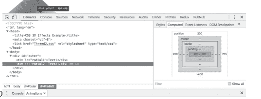

#### 图 8.3 Chrome 开发者工具内容示例

点击`Elements`选项卡，你将看到当前在浏览器中查看的 HTML 网页的 DOM 内容。当你展开各个元素时，注意浏览器会话的顶部如何突出显示 DOM 中当前选定项目的某些属性。

点击`Sources`选项卡，然后点击文件`Threed2Hover1.css`以查看此文件的内容。在屏幕右侧，你会看到显示的各种选项卡。点击`Computed`选项卡，你将看到为 DOM 中任何元素设置的属性值。对于每个 HTML 元素，计算属性的值是匹配该 HTML 元素的 CSS 选择器的“聚合”结果。

Chrome 开发者工具使你能够添加新的 CSS 选择器，动态应用到当前 HTML 网页。点击`Styles`选项卡（在`Computed`选项卡的左侧），然后点击位于浏览器最右边缘的加号（“+”）按钮，该按钮位于包含`Styles`选项卡的行下方的行中。作为一个简单的例子，添加以下 CSS 选择器：

```css
body {
  background-color: blue;
}
```

注意，当你输入颜色`blue`的字母时，Chrome 会用与当前输入字符串匹配的颜色更新背景颜色。

现在点击`Timeline`标签，你会看到一个“Capture:”选项，它可以让你收集有关时间轴的内存信息，并在收集的同时捕获屏幕截图。每当你想要`Record`信息时，点击位于`Elements`标签左侧（和下方）的黑色圆圈；当你想要清除记录信息时，点击它右侧的圆圈。尝试这些选项并进行一些录制，以便熟悉捕获性能相关细节的操作。

### 本章小结

在本章中，你了解了 Project Houdini，这是一个旨在现代浏览器中实现 CSS 一致性和可扩展性的工作组。然后你学习了 FlexBox 和 Grid Layout，以及一些用于二进制图像的性能技术。接下来，你看到了 CSS3、SVG 和 HTML5 Canvas 的比较，以及如何使用 Web Animation API 的示例。此外，你还学习了性能技术、精灵表以及几种在网页中渲染二进制图像的技术。

## 第九章：设计移动应用

本章的目的是提供一些设计优秀 HTML5 移动应用的指导原则。本章讨论了 UI 体验的各个方面，以及如何创建美观的移动 Web 应用。此外，本章还涵盖了一些工具包，它们可以帮助你在不牺牲重要设计考量的情况下支持所需的功能。本章中的一些部分涉及第五章的 CSS3 媒体查询，因此在阅读本章的一些部分之前，你可能需要复习该章的相关内容。

本章的第一部分讨论了移动隐喻的一些主要方面，它是面向触摸的而非面向鼠标的。本章的第二部分深入探讨了移动表单的设计相关方面。本章的最后部分讨论了 Google AMP（加速移动页面）和渐进式移动应用（也是由 Google 开发的）。虽然 Google AMP 仍然是一项新技术，但它是相关的，因为 Google AMP 支持一些 CSS 以及大多数 SVG 元素。

在阅读本章时，请记住以下几点。首先，本章几乎不包含代码示例，因为其重点是风格方面的考虑。其次，本章不深入探讨创建混合移动应用的工具包（详细讨论超出了本书的范围）。然而，PhoneGap（Cordova）是一个非常流行的工具包，它已经影响了其他移动工具包。Ionic（被 IBM 收购）是一个使用 Angular 2 创建混合移动应用的工具包，并且在内部也使用 PhoneGap。PhoneGap、Ionic 和其他混合移动应用工具包有大量的在线资源可供使用。

顺便说一下，PhoneGap 和 Ionic 应用确实依赖于 DOM 结构，但也有用于开发不使用 DOM 的移动应用的工具包和产品。特别是，Facebook 的 React Native 和微软收购的 Xamarin 就是这样的两个产品。访问这些工具包的各自网站以获取代码示例和教程。

### 什么是好的移动设计？

这个简单问题的答案比你想象的更复杂，但有一些指导原则可以帮助你为混合 HTML5 移动应用（以及原生应用，如 iOS 和 Android，这些超出了本书的范围）做出设计决策。如你所见，其中一些指导原则包括触摸导向、性能和响应性、检测屏幕尺寸、调整资源大小以及确定实际内容。

接下来的几个部分提供了关于这些和其他重要因素更多信息，然后讨论工具包或提供代码片段来帮助你实现所需的功能。

### 移动网页设计的重要方面

设计混合 HTML5 移动应用时的一些重要考虑因素如下：

- 触摸导向的设计（而非鼠标导向）
- 提高用户手势的响应时间
- 检测不同的屏幕尺寸（特别是针对 Android 设备）
- 调整资源大小（如图像）
- 确定网页的内容

移动网页应用不是处理鼠标点击，而是处理触摸相关事件（单击和多击）和用户手势（滑动、轻拂、平移等等）。

幸运的是，jQuery Mobile 提供了一种事件虚拟化，通过一组单一的 API 来处理鼠标事件和触摸事件。这种虚拟化简化了你的代码：你只需要处理一组事件。

#### 触摸导向的设计

你可能认为只需将所有与鼠标相关的事件替换为其触摸相关对应事件就可以实现这一目标。虽然这是一个好的起点，但这种方法有几个注意事项。首先，没有与鼠标悬停事件相对应的触摸事件。因此，带有`#myDiv:hover`类型选择器的 CSS 样式表在笔记本电脑和台式机上可以正确工作，但在移动设备上不能正确工作。

其次，当用户用一根手指触摸移动屏幕时，第二个手势可能是以下之一：

1. 触摸抬起
2. 触摸按住
3. 触摸移动
4. 滑动手势

因此，会有一个延迟（大约 300 毫秒）来等待第二个事件。第一个事件（触摸按下）可以与第二个事件结合以确定正确的用户手势。然而，这个延迟会影响移动网页应用的感知响应性。幸运的是，有一些 JavaScript 工具包可以提高移动网页应用的触摸相关响应性，这是下一部分的主题。

#### 提高用户手势的响应时间

有几种工具包可以消除第一个触摸事件和第二个触摸事件之间 300 毫秒的延迟。第一个具有优秀触摸相关功能的 JavaScript 工具包是`fastclick.js`，其主页位于：https://github.com/ftlabs/fastclick。

移动浏览器在初始点击事件后等待大约 300 毫秒，以确定用户是否会执行双击。由于 FastClick 消除了移动浏览器上物理点击和点击事件触发之间 300 毫秒的延迟，移动应用感觉更加响应迅速。

清单 9.1 展示了 HTML5 网页`FastClick1.html`的内容，它说明了如何在网页中使用`fastclick.js`。

**清单 9.1 FastClick1.html**

```html
<html>
<head>
  <meta charset="utf-8">
  <script src="/path/to/fastclick.js"></script>
</head>
<body>
  <script>
    window.addEventListener('load', function() {
      FastClick.attach(document.body);
    }, false);
  </script>
</body>
</html>
```

清单 9.1 很直观：包含一个引用`fastclick.js`的`<script>`元素，然后添加一个事件监听器，在浏览器加载事件中调用`fastclick.js`的`attach()`方法。

你也可以在使用 jQuery Mobile 的移动网页应用中使用`fastclick.js`，详细描述在此处提供：http://forum.jquery.com/topic/how-to-remove-the-300ms-delay-when-clicking-on-a-link-in-jquery-mobile。

#### 在移动网页应用中调整资源大小

至少有两种常见的技术用于检测屏幕尺寸，而这反过来又与调整资源大小相关。第一种技术涉及 CSS3 媒体查询，为不同的屏幕宽度加载不同的 CSS 样式表。第二种技术是使用 JavaScript 为不同的屏幕尺寸设置不同的 CSS 属性。

当你在移动网页应用的 HTML5 网页中放置资源（如 PNG 文件）时，你需要决定如何处理以下情况：

1. 从竖屏切换到横屏（或反之）
2. 部署到不同屏幕尺寸的移动设备
3. 调整文本字符串和文本区域的大小
4. 缩放非二进制图像（如 SVG）

每当你创建一个不仅包含 PNG 文件，还包含其他类型资源（如嵌入式 SVG 文档或 HTML5`<canvas>`元素）的 HTML5 网页时，你需要处理上述情况。

在渲染文本字符串的情况下，你如何确定正确的字体大小？即使你将`em`用作度量单位，你也无法知道特定设备的 DPI 分辨率。当然，你可以做出有根据的猜测，决定移动手机使用`14em`，平板（或平板手机）使用`16em`，但越来越多不同 DPI 的屏幕意味着你无法保证你的选择在所有情况下都是正确的。

对于嵌入 HTML5 网页的 SVG 文档，你可以使用基于 CSS 的技术来自动调整 HTML5 网页中 SVG 文档内容的大小，代码片段如下：

```html
<div style="background-size: contain">
```


这种技术的详细描述在这里：<https://developer.mozilla.org/en-US/docs/Web/CSS/background-size>。

#### 确定移动网页的内容布局

确定网页内容的一些设计考虑因素如下：

- 为智能手机提供单列文本
- 移除额外的链接和内容
- 移除过多的项目和侧边栏/页脚
- 避免绝对尺寸
- 将包装器宽度设置为百分比
- 将段落设置为块级显示

请记住，上述要点是指导原则而非绝对规则。例如，某些智能手机在横屏模式下可以容纳两列（取决于列宽），而许多平板电脑在纵屏模式下也可以显示两列。有些人建议减少屏幕上所需的滚动次数，但许多用户已经习惯了在移动设备（尤其是智能手机）上频繁滚动。

如果不确定，可以创建两种（或更多）布局，并从用户那里获取反馈，以确定哪种布局对广泛受众更具吸引力。如果您仍然无法决定哪种布局设计最适合您的目的，也许您可以从“A/B 测试”中获益，相关描述见此处：<http://en.wikipedia.org/wiki/A/B_testing>。

### HTML 网页的移动端设计

设计面向移动设备的 HTML 网页有几种方法，包括“移动优先（mobile first）”、“仅限移动端（mobile only）”以及为移动应用使用独立域名。

“移动优先”方法可确保 HTML 网页在移动设备上正确渲染。然而，您需要考虑移动设备之间不同的屏幕尺寸，例如智能手机、“大屏手机（phablets）”和平板电脑。这一点在 Android 移动设备上尤为明显（在 iOS 设备上程度较低）。

“仅限移动端”方法仍然要求您考虑移动设备上的不同屏幕尺寸，但在这种场景下，您无需处理笔记本电脑或台式机的 HTML 网页。请记住，这种方法并非易事：它可能涉及客户端（或服务器）模板、本地数据存储以及由 BackboneJS 等工具包提供的高效视图-模型绑定（view-model binding）的结合。另一个需要考虑的点是您是否可以利用 NoSQL 数据存储，例如 MongoDB。

第三种方法是为移动端和桌面端网页使用不同的域名。如果您正在开发轻量级移动 Web 应用程序（即托管在服务器上并由各种设备类型访问的网页），这种方法具有几个优势。

首先，这使得您的移动站点更容易被发现。其次，您可以将移动端 URL 与桌面端 URL 分开宣传。第三，用户只需更改域名即可在“常规”网站和移动网站之间切换。第四，检测移动用户（然后将其引导至独立域名）的代码逻辑比修改 CSS 样式表更简单。

现在您已经对移动网页的设计考量有了概览，让我们来看看移动表单样式设计的示例，这就是下一节的主题。

### 移动表单样式设计的高层视图

在渲染移动表单时，既有高层级技术（例如如何显示输入字段），也有具体性质的技术（例如标明必填字段）。

以下列表包含了一些渲染移动表单的高层级技术：

- 使用语义化标记
- 使用单列显示输入字段（针对智能手机）
- 确定标签对齐方式（左对齐或顶对齐）
- 输入字段的分组/分块
- 工具提示或信息气泡
- 显示错误消息
- 适当的字段宽度
- 合适的配色方案
- 使用选项卡（Tabs）代替单选按钮
- 处理长下拉列表（使用预测搜索或链接）
- 主按钮和次按钮
- 输入元素之间的间距
- 弹出菜单控件
- 语音输入

请注意，之前的列表中没有“减少滚动”：用户已经习惯了在智能手机和平板电脑上滚动。此外，单列显示对于较小的智能手机更为重要，但某些智能手机在横屏模式下可以显示两列，而平板电脑在处理多列文本方面则更具优势。

如果您以从左到右的方向渲染文本，那么左对齐标签允许您在屏幕中放置更多输入字段，并且在字段输入过程中更容易扫描，但它们在处理长输入字段时效果不佳。顶对齐标签则具有与左对齐标签相反的优缺点。

另一种技术是使用内联标签，这本质上意味着输入字段的“文本提示”为预期的数据类型提供建议。

### 移动表单样式设计的具体技术

除了前一节列出的设计技术外，您还可以使用以下部分或全部具体技术：

- 使用 CSS 为输入字段定义不同的样式
- 为输入字段提供标签
- 为输入字段指定键盘类型
- 为输入字段提供默认值或建议值
- 对数字字段使用约束
- 标明必填字段
- 在用户输入后验证每个字段
- 利用密码掩码
- 采用字段缩放

以下子章节为前述列表中的部分项提供更多细节。

#### 使用 CSS 为输入字段定义不同样式

这涉及两个步骤。第一步是应用默认样式，然后应用您自己的样式规则。第二步是使用 `-webkit-appearance` 属性删除所有输入元素的默认样式，如下所示：

```css
input, textarea, select {
   -webkit-appearance: none;
}
```

接下来，指定取决于输入字段类型的自定义 CSS 样式，如下所述：

```css
input[type=checkbox] {
   /* specify styles for checkbox */
}

input[type=radio] {
   /* specify styles for radio */
}

input[type=textarea] {
   /* specify styles for textarea */
}
```

您可以将上述示例作为定义 CSS 选择器的指南，以更改网页中其他 HTML 元素的外观。

#### 为输入字段指定键盘类型

HTML5 为 `input` 元素的 `type` 属性引入了以下新属性：

- 电子邮件地址：`type='email'`
- 网站地址：`type='url'`
- 电话号码：`type='tel'`

上述类型仅在移动浏览器上生效（在笔记本电脑或台式机浏览器中不会发生任何变化）。

以下示例向您展示如何为输入字段指定不同的键盘：

```html
<form id="form1" name="form1" method="post" action="">
  <label for="name">Name:</label>
  <input name="name" id="name" type="text" /><br />

  <label for="email">Email:</label>
  <input name="email" id="email" type="email" /><br />

  <label for="phone">Phone:</label>
  <input name="phone" id="phone" type="tel" /><br />

  <input name="submit" type="button" value="Submit" />
</form>
```

#### 不同国家和语言

在为不同国家和语言创建应用程序时，有几点需要记住：

- 不同国家的电话格式不同
- 从左到右与从右到左的文本输入
- 符合文化习惯的内容

如果您打算发布支持多种语言的 Android 应用程序，以下链接提供了有用信息：<http://developer.vodafone.com/how-support-multiple-languages-android/>。

如果您打算发布支持多个国家和语言的 iOS 应用程序，Apple 在此处提供了详尽的信息：<https://developer.apple.com/internationalization/>。

创建国际化 iOS 移动应用程序的详细步骤（例如如何创建额外的字符串资源）请参阅：<http://www.slideshare.net/cxpartners/web-and-mobile-forms-design-userfriendly-2010-workshop>。

### 设计相关工具和在线模式

Balsamiq 是一个在线设计工具，其主页在：<http://www.balsamiq.com/>。

Balsamic Mockups 是一个快速创建线框图（wireframes）的工具，旨在模拟在白板上绘制界面的体验。由于这些原型存储在您的计算机上，您可以快速轻松地与他人共享。

另一个创建线框图的工具包是 justinmind，其主页在：<http://justinmind.com>。

上述两种工具均可免费使用，并配有演示如何使用它们的视频。

两个提供设计模式集合的网站（第二个纯粹针对移动端）分别是：<http://pttrns.com> 和 <http://mobile-patterns.com>。

### 处理字体大小和计量单位

如果您已经接触过 CSS 样式表，那么您已经熟悉了 HTML5 网页中用于表示文本字体大小的不同单位。有多种单位可用，包括 `em`、`rem`、`px`、`pt` 和 `%`。

这些单位之间的关系如下：

```text
1em = 12pt = 16px = 100%
```

### px 单位

像素单位是虚拟屏幕像素，而非物理像素。需要注意的一点是，对于视力受损的读者，像素单位无法正确缩放。

你可以将 px 单位用于文本、图像、边框、圆角和阴影。但是，如果你正在构建使用相对尺寸的流式布局，那么使用 em 单位或 % 单位来设置文本可能会更好。

em 单位正变得越来越流行，尤其是在移动设备上，因为此单位非常适合缩放网页。与 px 单位不同，em 单位相对于网页中的父元素。你可以把 px 单位理解为“全局”的，而 em 单位则是“局部”的。

一个有用的技巧是为 `<body>` 元素指定 62.5% 的值。由于 62.5% 等于分数 5/8，16px 与 5/8 的乘积是 10px。10px 这个值是在 CSS 选择器中快速、轻松地在 px 单位和 em 单位之间进行转换的便捷“基准点”。

例如，1.5em 是 15px，2em 是 20px，2.5em 是 25px，以此类推。如果你在进行转换时需要帮助，这里有一个在线 em 计算器：<http://riddle.pl/emcalc/> 和 <http://www.ready.mobi/launch.jsp?locale=en_EN>。

更多有用信息请访问：<http://www.w3.org/QA/Tips/font-size>。

### GOOGLE AMP 是什么？

Google AMP 是一项开源计划，旨在让网页在移动设备上更快地渲染，其主页位于：<https://www.ampproject.org/>。

AMP 的初始规范于 2015 年 10 月公布，代码示例可在此处获取：<https://github.com/ampproject/amphtml>。

加速移动页面（Accelerated Mobile Pages）可以在任何现代浏览器或 Web 视图中加载。然而，与“普通” HTML 网页相比，AMP 对功能施加了限制性子集，以减少浏览器中加载 AMP 的时间。此外，AMP 可以缓存在云端，这可以带来额外的速度提升。

AMP 合规网页的一些限制如下：

- 不允许开发者编写或第三方 JavaScript
- 不允许任何类型的输入元素，包括标准输入和文本域
- 不允许外部样式表，且文档头部只能有一个 `style` 标签
- 不允许内联样式
- 样式规则必须低于或等于 50kb

AMP 规范的使用者包括内容生产者，他们可以创建可以被爬取、索引和显示的 AMP 网页。好消息是，Google AMP 支持大多数 SVG 元素，未来或许还会有更多支持。

> **注意**：Google AMP 支持大多数 SVG 元素。

你可以将 AMP 视为创建移动网页的框架，它由 AMP HTML（带有 AMP 特定元素的 HTML 子集）、AMP JS（用于 AMP 的 JavaScript 框架，不允许第三方 JavaScript）和可选的 AMP CDN（内容分发网络）组成。

AMP 的目标之一是支持加速移动页面中的所有已发布内容。

有关 AMP 的更多信息，请参阅以下常见问题解答：<https://www.ampproject.org/docs/support/faqs.html>。

### RAIL 框架

RAIL 是以下基于时间的测量指标的缩写：反应时间（100ms）、动画时间（60FPS）、空闲时间（<50ms）和加载时间（< 一秒）。前一句中括号内的数字是相应时间测量目标。

现代浏览器中诸如 Service Workers（尽管是一项实验性技术）等功能的出现，将有助于实现 RAIL 所追求的网页良好性能目标。

目前 Chrome、Opera 和 Firefox 对 Service Workers 有部分支持，有关 Service Workers 的更多信息请访问：<https://developer.mozilla.org/en-US/docs/Web/API/Service_Worker_API>。

### AMP 中的样式

所有样式必须出现在文档头部的 `style` 标签中，且该 `style` 标签必须包含 `amp-custom` 属性。

```html
<amp-lightbox id="lightbox" class="lightbox" layout="nodisplay">
  <div class="lightbox-content">
    <amp-img
      src="https://cdn.auth0.com/website/jobs/myimage.jpg"
      width="2000"
      height="1035"
      layout="responsive">
    </amp-img>

    <p>some text in a paragraph</p>
  </div>
</amp-lightbox>
```

AMP 组件对广告的支持包括：A9、AdReactor、AdSense、AdTech 和 Doubleclick。参与 Google AMP 的公司包括 Twitter、Pinterest、WordPress.com、Chartbeat、Parse.ly、Adobe Analytics 和 LinkedIn。

### HTML 元素和核心 AMP 组件的状态

AMP 禁止的元素包括：

- `base`、`frame`、`frameset`
- `object`、`param`、`applet`
- `embed`、`form`、`script`（*）
- `input`、`textarea`、`select`、`option`

（*）除非类型为 `"application/ld+json"`。

允许的 HTML 元素（某些情况下有注意事项）包括：`button`、`link`、`style`、大多数 SVG 元素，以及对样式表的部分支持。

内置“核心” AMP 组件包括：

- `amp-img`、`amp-audio`、`amp-video`
- `amp-pixel`、`amp-anim`、`amp-iframe`
- `amp-carousel`、`amp-lightbox`、`amp-ad`
- `amp-instagram`、`amp-twitter`、`amp-youtube`

> **注意**：内置组件在 AMP 文档中始终可用，它们使用 `<amp-*>` 元素。

核心/扩展 AMP 组件包括：

- `amp-img`、`amp-audio`、`amp-video`
- `amp-pixel`、`amp-anim`、`amp-iframe`
- `amp-carousel`、`amp-lightbox`、`amp-ad`
- `amp-instagram`、`amp-twitter`、`amp-youtube`

被 AMP 替换的元素包括 `img`（`amp-img`）、`video`（`amp-video`）、`audio`（`amp-audio`）和 `iframe`（`amp-iframe`）。

`<amp-img>` 元素的示例：

```html
<amp-img
  src="https://mysite/myimage.jpg"
  width="2000"
  height="1035"
  layout="responsive"
></amp-img>
```


AMP 扩展组件涉及在 `<head>` 元素中加载 JavaScript。请访问以下链接查看简单的 AMP 网页示例：`https://www.ampproject.org/docs/get_started/create/basic_markup.html`。

### 什么是渐进式 Web 应用？

渐进式 Web 应用基于浏览器标签页中的页面，它们使用应用外壳模型来提供类似于原生移动应用的“外观和感觉”。渐进式 Web 应用是响应式的（适用于任何屏幕尺寸）、安全的（通过 HTTPS 提供服务），并且由于使用了 Service Workers，始终保持最新状态。

渐进式 Web 应用执行以下步骤：

1. 注册 `service worker`
2. 在 HTTPS 上运行（需要防止中间人攻击）
3. 创建基于 JSON 的应用清单文件，包含应用信息

Service Workers 包含一组由 Google 提供的 API，用于离线访问和 Web 推送通知。清单文件包含元数据，如图标、方向等。请注意，Polymer 启动工具包包含一个有效的清单文件。适用于 Android 的 Chrome 和适用于 Android 的 Opera 允许你将应用保存到主屏幕，这意味着它在你的主屏幕上看起来就像原生应用一样。你可以用默认方向打开应用。关键的一点是，在不支持渐进式应用的浏览器中，该应用可以像“普通”网站一样工作。渐进式 Web 应用清单的示例请访问：`https://mobiforge.com/design-development/web-app-manifests-usher-new-wave-progressive-apps-to-your-homescreen`。

### 提升 HTML5 网页性能

性能始终是一个非常重要的考虑因素，尽管详细而冗长的讨论超出了本书的范围，但了解一些可用的技术是很重要的：

- 将 JavaScript/CSS 文件合并为单个文件
- 使用文件压缩（minification）
- 使用精灵图（spritesheets）
- 对图像使用 base64 编码
- 延迟加载 JavaScript 文件

关于使用 base64 编码图像的一篇好博客文章请访问：`http://davidbalhoun.com/2011/chen-to-base64-encode-images-and-and-when-not-to?goback=%2Egde_2071438_member_234328886`。

你可以通过将 `<script>` 标签放在网页 `<body>` 元素的末尾来延迟加载 JavaScript 文件。

你还可以了解 RequireJS，这是一个用于异步下载 JavaScript 文件（以及管理 JavaScript 依赖）的 JavaScript 工具包，其主页位于：`http://requirejs.org/`。

Steve Souders 至少撰写了两本与性能相关的书籍，并撰写了许多关于性能的博客文章，阅读他的作品绝对值得。

### 有用链接

以下链接有助于测试移动应用：

- `http://css3test.com/`
- `http://www.css3.info/selectors-test/`
- `http://quirksmode.org/html5/tests/video.html`
- `http://double.co.nz/video_test/`
- `http://www.terrillthompson.com/tests/html5-audio.html`

其他资源包括 `www.stackoverflow.com` 和 Paul Irish 的视频。

一个较新的网站是 HTML5 Please，它由知名行业人士贡献内容：`http://html5please.com`。

上述网站提供了一个输入字段，你可以在其中指定 HTML5 和 CSS3 特性，以确定它们是否已准备好使用，还可以查看如何使用它们。

W3C 为 HTML 网页（包括 HTML5 网页）提供了免费的在线验证服务：`http://validator.w3.org/#validate_by_uri+with_options`。

上述网站使您能够验证 URL、文件或直接输入的代码。

以下网站提供了 HTML5 电子邮件输入字段的“样板”模板（以及 CSS 和 jQuery 的模板）：`http://favbulous.com/post/848/6-useful-web-development-boilerplates`。

### 摘要

在本章中，您了解了移动“环境”的触摸导向隐喻，以及移动表单的设计相关方面。此外，您还了解了如何通过 `fast-click.js` 改善用户手势的响应时间，以及可以使用 CSS3 媒体查询和 JavaScript 来检测移动设备的屏幕尺寸。您还了解了 Google AMP 及其对许多 SVG 元素的支持。接下来，您了解了渐进式移动应用以及性能相关细节的概要。

### 索引

**A**

- `addColorStop()` 方法, 110, 114

**B**

- 伯纳斯-李, 蒂姆 (Berners-Lee, Tim), 13
- 布尔表达式, 81
- 布尔选择器, 17
- 弹跳效果, 37, 42
  - CSS3 关键帧, 47–48
- 浏览器, 1

**C**

- Canvas 2D, 3
- 笛卡尔坐标系, 99
- 链式方法, 142
- `createLinearGradient()`, 106
- CSS3 2D 图形和动画效果, 37–60
  - 使用 jQuery 和 CSS3 实现 2D 效果, 55–57
    - `JQTransforms2D1.css` 选择器, 57
  - 使用 CSS3 动画立方体, 42
  - 使用 CSS3 关键帧的动画效果, 42–44
  - CSS3 2D 过渡, 40–41
  - 使用 CSS3 的文本效果, 49–51
    - 渲染多列文本, 49–51
  - CSS3 变换, 38–40
  - CSS 滤镜, 51–52
    - 自定义滤镜, 52
  - 图像淡入淡出和旋转效果, 44–46
  - jQuery（可选）, 53–55
    - 概念, 53
    - 使用四个属性的运动路径, 48–49
    - 使用 CSS3 和 jQuery 的鼠标效果, 57–58
- CSS3 3D 图形和动画效果, 61–77
  - 动画和精灵图, 70
  - 使用关键帧的动画效果, 67–70
  - 文本和 PNG 文件的动画, 65–66
  - GPU 的自动调用, 73–74
    - CSS `will-change` 属性, 74
  - 使用 jQuery 动态创建内容, 74–76
  - HTML 页面和 GPU, 70–72
  - 遮罩和性能, 72
  - 重排和重绘, 72–73
    - 原因, 72–73
    - Chrome 和布局变化, 73
  - 变换器, 62–63
  - 过渡（文件示例）, 63–64
- CSS3, 3, 15–35
  - 2D 变换器, 29–33
    - 旋转变换, 31–33
  - 浏览器特定前缀, 35
  - 浏览器支持, 15–16
  - `OuterParam`
  - 渐变生成器, 28–29
  - 线性渐变, 24–27
    - 浏览器支持的语法, 24
  - 使选择器更高效, 33–34
    - `translate()` 函数与 `top/left` 属性, 34
  - 快速概述, 16
  - 径向渐变, 27–28
  - 伪类和属性选择, 16–18
    - CSS3 伪类, 17
    - CSS3 属性选择, 17–18
  - 阴影效果和圆角, 18–24
    - 盒子阴影效果和, 22
    - 使用 RGB 和 HSL 指定颜色, 19
    - 圆角和, 22–24
    - 文本阴影效果和, 19–22
- CSS3 媒体查询, 80–96
  - 网页中的条件资源加载, 90–91
  - 使用 JavaScript 检测 3D 设备方向, 86–87
  - 使用简单 JavaScript 检测方向, 85–86
  - 检测高度和宽度, 87–88
  - 使用 CSS3 媒体查询检测屏幕方向, 83–85
  - 使用 CSS3 媒体查询检测屏幕分辨率, 83
  - 设备适配, 89–90
  - 内联和本地 CSS, 93–95
    - CSS 模块, 95
    - Web 组件, 95
  - 多种屏幕尺寸, 89
  - 视口 meta 标签, 91
    - 属性, 91
- CSS 高级特性, 147–164
  - CSS 混合模式, 147
  - CSS 合成, 147
  - CSS 环绕, 147
  - CSS Flexbox, 147–152
    - 各种属性, 148
    - 带有属性的网页, 148
    - 使用 Flexbox 渲染列和行, 150–152
    - 有用链接, 152
  - CSS 网格布局, 152–154
  - CSS 区域, 147
- CSS 相关性能, 155
  - CSS、SVG 和 Canvas 比较, 155
  - 使用 CSS3 创建带有 SVG 的 3D 动画效果, 156
  - 哪个更快：CSS3/Canvas/SVG?, 156
  - HTML 网页和二进制图像, 156–159
  - CSS 电子表格, 157–158
  - 优化 SVG 和二进制文件, 157
  - 渐进式图像, 158–159
    - 模糊渐进技术, 158
  - 选择文件格式, 157
- Web 字体, 159
- 改善 HTML5 页面性能, 154
- Web 动画 API 概述, 159–161
  - 示例, 160–161
- JS Web 动画工具包, 161–162
- 使用 Chrome 检查器, 162–164
- CSS 自定义属性, 80
- Chrome, 1
- 合成, 71

**D**

- 拖放（Drag-and-Drop, DnD）, 3
- `document.createElement()` 方法, 141

**F**

- 文件 API, 3

**G**

- 地理定位, 3
- 发光效果, 37, 42
- Google AMP（加速移动页面）, 165, 173
- GPU（图形处理单元）, 61

**H**

- HTML5, 2–14
  - 浏览器支持, 3
  - 定义, 2
  - HTML4 标签与 HTML5 的区别, 4
  - 特性, 2
  - 新元素, 7–12
    - 文章与章节, 8
    - HTML5 中的自定义数据属性, 11–12
    - 语义标记元素, 7–8
    - 为什么使用语义标记, 9–11
  - 在线开发工具, 4–6
    - Caniuse, 5–6
  - 简单网站, 7
  - 包含的技术, 3–4
  - 在网站中使用特性检测, 6–7
    - 检测函数的方法, 6
  - 验证器, 12
  - 各种工作组, 13–14
- HTML5 Canvas, 98–119
  - 坐标系, 99–101
  - 线性渐变, 106–110
    - 水平、垂直和对角线, 106–110
  - 线段、矩形、圆形和阴影效果, 101–106
  - 径向渐变, 110–114
  - 使用 CSS3 选择器在 Canvas 上渲染图像, 114–117
  - 使用图案在 Canvas 上重复图像, 117–119
  - 什么是 Canvas, 98

**J**

- 贾菲, 杰弗里 (Jaffe, Jeffrey), 13
- JavaScript, 1
  - `jQuery css()` 方法, 74

**K**

- 科赫, 彼得·保罗 (Koch, Peter Paul), 2

**M**

- 微数据, 3
- 移动应用, 165–177
  - 设计相关工具和在线模式, 172
  - 不同国家和语言, 172
  - 良好的移动设计, 166
    - HTML 网页, 169
  - 渲染移动表单的高级技术, 169–170
    - 特定技术, 170
  - 重要方面, 166
  - 检测不同的屏幕尺寸, 166
  - 确定网页内容, 168–169
  - 改善用户手势的响应时间, 167
  - 调整移动 Web 应用中的资源大小, 168
  - 触摸导向设计, 166–167
  - 改善 HTML5 网页性能, 176
  - 渐进式应用, 175–176
  - HTML 元素和核心 AMP 组件的状态, 174–175
  - 为输入字段指定键盘类型, 171–172
  - AMP 中的样式, 174
  - RAIL 框架, 174
  - 使用 CSS 以不同方式设置输入字段样式, 171
  - 处理字体大小和度量单位, 172–173
  - 移动优先方法, 169
- 仅移动优先方法, 169
- Modernizr, 5

**N**

- 导航器, 6

**O**

- 离线应用, 3

**P**

- 渐进式移动应用, 165
- Project Houdini, 146
  - 渲染管道中的阶段序列, 146

**S**

- `SemanticMarkup1.html`, 9–11
- 语义标记, 9
  - 使用语义标记的简单网站, 9–11
- 服务器发送事件（SSE）, 3
- 显示图层边框选项, 71
- SpriteMe, 70
- SVG, 3, 121–144
  - CSS 与 SVG 的简要比较, 143–144
  - 基本特性, 122
  - 贝塞尔曲线和变换, 130–132
    - SVG `scale()` 函数, 132
  - CSS 和 jQuery, 139
  - 滤镜, 133–135
  - 渐变, 124–125
  - jQuery 和 SVG, 140–143
    - 创建元素和 jQuery, 141–143
    - 现有元素和, 142
    - jQuery 插件, 143
  - 其他特性, 137–139
    - 使用 JavaScript 和 CSS3 创建 3D 效果, 139
    - JavaScript 和 SVG, 138
    - SVG 动画效果, 137–138
  - 在 SVG 中渲染线段和矩形, 122–124
  - 在 SVG 中沿路径渲染文本, 132–133
  - SVG `<path>` 元素, 128–130
  - SVG `<pattern>` 元素, 125–127
  - SVG `<polygon>` 元素, 127
  - SVG `<polyline>` 元素, 128
  - 变换器和渐变, 135–137
- `@import` 语句, 92–93
- 模块化与性能, 93
- `clip()` 方法, 117
- `fillRect()` 方法, 101
- `init()` 方法, 118
- `modImage()` 方法, 119
- React 方式或 JS 中的 CSS, 93

- W3C (万维网联盟), 13
- WAI-ARIA (Web 辅助功能倡议 – 可访问的富互联网应用), 7–8, 12–13
- Web 消息传递 (Web messaging), 3
- Web sockets, 3
- Web 存储 (Web storage), 3
- Web workers, 3
- WebGL, 4
- Window, 6

- UA 探测 (UA sniffing), 6

- 视口 (Viewport), 92
- VRAM (显存), 72

- XHR2, 4
