# CSS3 精要指南


---


---


---


#  *Succinctly* 系列书籍背后的故事

Daniel Jebaraj，副总裁
Syncfusion, Inc.

## 站在技术前沿

正如大家可能知道的那样，Syncfusion 是 Microsoft 平台的软件组件提供商。这使我们处于一个既令人兴奋又充满挑战的位置——始终站在技术前沿。

每当 Microsoft 发布新的平台或工具时（如今似乎每隔一周就有一次），我们都必须快速地自我学习，跟上步伐。

## 信息丰富却更难消化

实际上，这意味着要订购大量书籍、搜索博客和浏览 Twitter。

尽管互联网上可用的信息越来越多，出版的书籍也越来越多（甚至是一些相对较新的话题），但有一个方面一直困扰着我们，那就是难以找到简明扼要的技术概述书籍。

我们通常面临两种选择：阅读几本超过500页的大部头，或者在网上搜寻相关的博客文章和其他资料。就像其他所有有工作要做、有客户要服务的人一样，我们发现这相当令人沮丧。

## *Succinctly* 系列

这种挫败感转化为一种强烈的愿望，即创作一系列针对在 Microsoft 平台上工作的开发者的简明技术书籍。

我们坚信，考虑到这些开发者的背景知识，大多数主题都可以转化为50到100页之间的书籍。

这正是我们决心通过 *Succinctly* 系列来完成的目标。一切美好的事物不都是源于改变现状、使其变得更好的深切渴望吗？

## 最佳的作者，最好的内容

每位作者都是从一群与我们有着共同愿景的才华横溢的专家中精心挑选出来的。你现在手中的这本书，以及本系列中的其他书籍，都是作者们不知疲倦工作的成果。你会发现其中的原创内容保证能让你在喝几杯咖啡的时间里就快速上手并运行起来。

## 永久免费

Syncfusion 将致力于出版多个主题的书籍。这些书籍将永远免费。我们发布的任何更新也将是免费的。

## 免费？有什么猫腻吗？

这里没有任何猫腻。Syncfusion 在这项工作中有着既得利益。

作为组件供应商，我们独特的主张一直是我们提供比市场上任何人都更深入、更广泛的框架。开发者教育极大地帮助我们向那些承诺“一键启用 AJAX 支持”或“把月亮变成奶酪！”的竞争对手进行市场营销和销售。

## 告诉我们你的想法

如果你有任何感兴趣的主题、想法或反馈，请随时通过 [succinctly-series@syncfusion.com](mailto:succinctly-series@syncfusion.com) 发送给我们。

我们衷心希望你喜欢阅读这本书，并希望它能帮助你更好地理解所研究的主题。感谢你的阅读。

请在 Twitter 上关注我们，并在 Facebook 上“点赞”我们，帮助我们传播 *Succinctly* 系列书籍的讯息！

## 关于作者

作为20世纪70年代末到80年代初 IT 领域的早期采用者，我最初使用的是一台只有 1k 内存的、不起眼的 Sinclair ZX81 家用电脑。

在很短的时间内，这台 1k 的小机器就升级成了 16k 的 Tandy TRS-80，接着是一台 Acorn Electron，最终，在经历了许多其他机器之后，变成了一台 4mb 内存、基于 ARM 处理器的 Acorn A5000。

最终，在离开学校并接触了基于 DOS 的 PC 机之后，我继续在计算机网络和通信行业的许多不同领域接受培训。

在90年代中期重返校园并获得计算工业学理学学位后，我在英格兰东北部创立了自己的咨询公司，名为 Digital Solutions Computer Software Ltd。我在许多不同的 IT 领域为客户提供硬件和软件层面的咨询，涵盖了从移动通信和网络到地理信息系统、银行与金融以及网页设计等广泛领域知识。

凭借在 IT 行业超过30年的经验，涉及许多不同且多样化的平台和操作系统，我有很多知识可以分享。

你经常可以在 LinkedIn 的 LIDNUG .NET 用户群组中找到我，这个群组是我协助管理的。你也可以轻松地在 Stack Overflow、Code Project 等地方找到我，或者在 Twitter 上以 @shawty\_ds 的身份找到我。我也是一名 Pluralsight 作者，并制作各种可供在线观看的视频。

希望你喜欢这本书，并能从中学到一些新东西。在当今快速发展的 IT 世界里，我们几乎没有多余的时间去寻找我们需要的信息——希望这些书籍有助于减轻这方面的负担。

请记得感谢 Syncfusion（在 Twitter 上是 @Syncfusion）让这本书（以及系列中的其他书籍）得以出版，让像我这样的人能够与广大的 .NET 社区分享我们的知识。如果你有书籍的构想，请联系 Syncfusion，告诉他们你希望看到什么。*Succinctly* 系列对于忙碌的程序员来说是一个绝妙的点子。

# 第1章  什么是 CSS3？

如果你成为一名 Web 开发者已有一段时间，那么 CSS 对你来说就不会陌生。然而，你可能想知道 CSS3 到底有什么大惊小怪的。

就像新的 HTML 5 规范一样，CSS3（更准确地说是 CSS 版本 3）是最新的一套规范，旨在塑造、定义和说明 CSS 最新版本所具备的能力。

要充分利用 CSS3，你首先需要对 CSS 的概念有一个基本的理解。第2章将涵盖一个非常基础的复习来帮助你做到这一点，但如果你从未以任何方式使用过 CSS，那么你在阅读本书时可能会感到有些茫然，因为它确实假设你至少对该技术有大致的了解。

CSS3 也不像许多人认为的那样是“全新的 CSS”；像 HTML 5 一样，它向后兼容之前的所有版本。然而，向前看，它拥有大量令人惊叹的新功能，提供了许多以前版本中根本不存在的创造性可能性。

## 代码示例

在我们通读本书的过程中，我将为你创建各种代码示例供你研究。这些代码示例将不提供下载，但它们足够小，可以手动输入。

在大多数情况下，代码只是为了突出某个特定主题，尤其是在混合 CSS 和 HTML 代码的情况下。对于 HTML 代码（除非是相当复杂的示例），通常我会只描述所需的内容，然后将 CSS 代码作为代码示例展示。

因此，我将假设读者理解 HTML、它的结构，以及如何创建标准的简单 HTML 标签和元素。如果你不了解，那么我强烈建议你在继续阅读本书之前至少阅读一些关于该主题的背景材料。

然而，为了让事情变得稍微容易一些，以下 HTML 代码可以作为一个非常简化的 HTML 5 标准文档示例。这绝不是一个完整的示例；它的目的是为本书中的其他代码提供一个模板化的起点。

我在本书中展示的所有示例都将假设你使用类似的代码，并将在此基础上进行扩展。

```
<!doctype html>
<html>
<head>
    <title>Basic HTML 5 document</title>
    <link href="styles.css" rel="stylesheet" type="text/css" />
```


 ```
<html>
<head>
    <link rel="stylesheet" type="text/css" href="styles.css">
</head>
<body>
    <h1>这是一个基础的 HTML 5 文档</h1>
</body>
</html>
```

> 代码清单 1：基础 HTML 5 文档

请特别注意头部中的 `link` 标签——它指定了一名为 **styles.css** 的文件。

大部分我们的 CSS 代码将被放置在这个（或类似名称的）文件中。

良好的实践要求将 CSS 代码与 HTML 代码分离，而 *Succinctly* 系列的一个基本原则就是提倡良好的实践，因此我们将努力在整本书中贯彻这一点。

当然，你不必将文件命名为 **styles.css**；你可以随心所欲地命名。但是，如果你更改了文件名，那么请记住在创建用于实验的基础 HTML 文档时，你使用了不同的名称。

如果你文件名弄错了，你会知道的——你会在浏览器的调试工具中看到一个错误，类似于图 1。

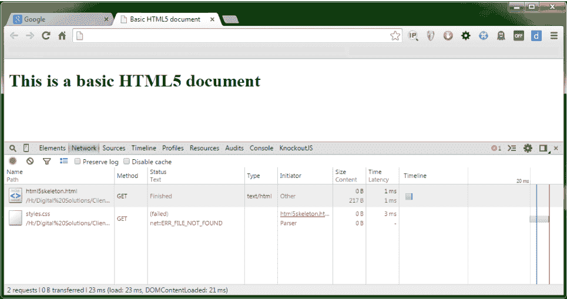

> 图 1：Chrome 浏览器工具显示 CSS 文件加载失败

如果你的 HTML 文件无法找到链接的 CSS 文件，那么你定义的所有样式规则都不会被使用，你的结果将看起来与应有的样子大相径庭。

## 关于浏览器兼容性的简要说明

在继续之前，我们需要讨论的最后一件事是浏览器兼容性。

任何从事过 HTML 前端驱动网页开发的人，都深知让代码在所有浏览器上呈现一致的痛苦。

如果你曾花时间研究过 CSS2 和 HTML4 标准，以及并不遥远的浏览器大战，那么这一点就更是如此了。

因为 CSS3 随较新的 HTML 5 标准一起推出，所以我不会刻意确保我展示的代码能在所有旧版浏览器上毫无差错地运行。

在本书的课程中，我将使用以下浏览器：

```
Google Chrome 39.0.2171.95 m
```

我还将提供以下浏览器版本，但不一定使用它们：

- Firefox 34.0.5
- Internet Explorer 11.0.9600.17501 Update 11.0.15 (KB3008923)
- Maxthon Cloud Browser 4.4.3.4000

由于我主要将坚持使用那些或多或少已完成的特性，或者在上述四种浏览器中支持情况相同的特性，因此你应该使用其他浏览器也不会有问题。但是，我会在可能的情况下指出任何可能需要进行的更改。

请注意，使用其他浏览器时可能会遇到需要浏览器厂商前缀的情况（但因为我使用的是 Chrome 而忽略了这些情况）。

作为一般经验法则，我使用 Chrome 进行开发，然后进行修改以适应其他浏览器。如果某些代码没有按预期工作，请在假设代码有问题之前，先在线查找该非工作代码的 CSS3 语法。

至于最低版本，我不会尝试让本书中的任何代码在低于之前所示的版本下正确运行，如果你需要支持更早的浏览器，那么你可能需要使用某种合适的辅助库来填补空白。由于可用的辅助库数量庞大，本书遗憾地无法讨论所有这些库。

## 第 2 章 基础 CSS 知识回顾

在我们开始本书的主要核心内容之前，让我们先回顾一下基础知识。

如果你之前使用过 CSS，或者熟悉这门语言及其工作原理，那么你可以安全地跳过本书的这一部分。如果你的 CSS 技能有点生疏，或者你对 CSS 的概念非常陌生，那么你应该阅读本章，因为它将为后续章节的内容提供基础。

### 定义 CSS

那么，CSS 到底是什么？

CSS 代表层叠样式表，其背后的思想非常简单。CSS 文档的创建纯粹是为了对 HTML 文档的内容进行样式设计（即管理颜色、大小、布局、位置等等）。

HTML 代码的目的是定义文档的结构，而 CSS 则用于定义该内容如何呈现给最终用户。

CSS 最初的创建是为了减少 HTML 文档中用于规定特定 HTML 代码块外观的标记数量。

许多现代网页开发者可能从未见过这种旧语法，因此为了给你一个过去做法的示例，请看代码清单 2：

```
<body>
    <font family="serif" size="20pt" color="#FF0000">
        <i>
            <b>
                <h1>This is my header in bold italic, 20 point red serif font</h1>
            </b>
        </i>
    </font>
</body>
```

> 代码清单 2：CSS 之前样式设置的典型示例

今天的浏览器仍然会遵循此规则并对其进行适当的样式设置，如下图所示：

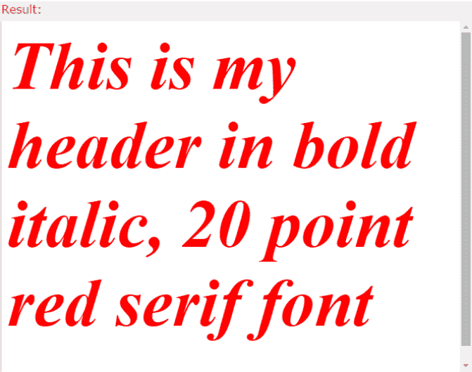

> 图 2：代码清单 2 中 CSS 之前代码示例产生的输出

正如你在代码清单 2 中的 HTML 代码中所看到的，要生成一个简单的一行、加粗、红色的标题，需要的标记比现在大多数人习惯使用的要多得多。

那只是一个标题——想象一下，每次你想为你的页面创建一个类似样式的标题时都得这样做。

CSS 规则立即解决了其中两个问题。首先，它们通常将定义文本外观的规则放在一个单独的文件中定义。这立即意味着设计师或仅负责图形的人可以轻松地更改这些规则，而无需担心 HTML 文件中的代码。

其次，它们通过使用 class 属性促进规则在多个元素上的重用，这意味着你只需指定一次设置，然后告诉标记何时使用这些设置。

现在让我们重新审视代码清单 2，看看我刚才描述的区别。

```
<h1 class="boldred">This is my header in bold italic, 20 point red serif font</h1>
```

> 代码清单 3a：用于加粗红色样式的新 HTML 标记

```
.boldred
{
  font-family: serif;
  font-size: 20pt;
  color: red;
}
```

> 代码清单 3b：现在在 styles.css 中定义的加粗红色样式规则

你可以立即看到这里的区别，要在另一行上重用该规则，我们只需在标签上添加 `class="boldred"` 作为属性。如果我们随后继续将样式规则从例如红色更改为绿色，那么每个使用该规则的元素都会突然变成绿色，而无需触及任何 HTML 标记。

所以现在我们知道 CSS 为什么被定义；接下来我们将开始研究它是如何工作的。

### 层叠规则

敏锐的读者可能已经在问自己 CSS 中的“层叠”部分代表什么。层叠意味着向下流动或跟随，而这正是 CSS 样式表所做的。

暂不考虑特异性这个主题（本书后面会涵盖），在链中更靠后被遵守或发现的规则会覆盖更靠前的所有规则。如果你不习惯这一点，它可能会给你带来一些有趣的错误和挑战，尤其是在你刚开始探索什么是可用的、什么不是的时候。

然而，一旦你看到它在实践中如何工作，这个概念就相当简单了。

考虑以下样式规则：

```
.mystyle
{
  font-size: 10pt;
  color: green;
}
```

> 代码清单 4：简单的绿色文本 CSS 规则

如果你将此规则附加到一个元素上，你会理所当然地期望文本大小为 10 点，颜色为绿色。

现在想象这个规则是在一个已经实现的样式表中定义的，该样式表包含在项目其他地方（例如作为内容管理系统的一部分）。

此外，想象你被要求将使用该规则的所有文本改为红色，但又不能更改之前创建的样式文件。

你可能无法更改原始文件的原因多种多样；例如，该样式表可能也被第二个网站使用，那里的文本必须保持绿色，或者样式可能是动态生成的。无论原因是什么，这种情况发生的频率比你预期的要高得多。

但是，如果你只是创建第二个样式文件（我们称之为 **styles2.css**），然后复制链接标签（如前一章基本 HTML 代码中所示）并相应地更改文件名，我们就可以开始向这个新文件添加以下 CSS 规则。

```
.mystyle
{
    color: red;
}
```

> 代码清单 5：我们在 'styles2.css' 中创建的重复规则

如果你操作正确，那么你应该会在浏览器中看到红色文本，而不是绿色文本。

为了继续使用绿色版本，你只需省略加载 **styles2.css** 的第二个链接，并包含它来将你的规则“调整”为红色。

如果你在原始文件中更改字体大小，你会看到那一个更改将影响文本的红色和绿色版本。

这种样式的层叠可以用多种不同的方式使用；不过，在我解释之前，还有一个重要的回顾主题你需要先理解。

### CSS 选择器

到目前为止，你只看到了使用“class”属性的 CSS 规则，但还有许多其他方式可以定义规则。

考虑以下 HTML 示例。

```
<p id="importantInfo">This is a standard text paragraph, with no explicit style
rule defined, all it has is an 'id' attribute that essentially gives the HTML
parser a name for it</p>
```

> 代码清单 6a：带有 ID 属性的 HTML 标记

```
#importantInfo
{
    color: red;
    font-size: 14pt;
}
```

> 代码清单 6b：针对给定 ID 的 CSS 样式规则
```


在代码清单6a中，我定义了一个标准的HTML段落标签。它没有应用任何关联的样式信息或类选择器；它所拥有的只是一个简单的**id**属性，这本质上允许我们为该元素命名。

然而，如果你查看代码清单6b中定义的CSS规则，你会看到，规则名称前面现在使用的是井号[#]，而不是之前的句点[.]。

CSS在定义规则时可以使用多种不同的符号。这些符号被称为CSS选择器，你定义选择器的方式决定了你打算如何使用该规则。

就代码清单6而言，我们使用的是ID选择器。ID选择器的目的是定位文档中一个特定的、已命名的元素。

在代码清单4和5中，类选择器旨在通过添加一个**class**属性用于许多不同的元素。因为一个给定的ID一次只能应用于一个元素，所以当我们指定一个针对ID的CSS规则时，我们实际上是在说该规则适用于那个元素，并且仅适用于那个元素——绝不是任何其他元素。

然而（你稍后就会看到），ID选择器经常被刻意用来控制CSS文档中的层级结构，并充分利用该技术的层叠特性。

当我们把选择器链接在一起时，层叠可以发挥巨大的作用，因为它允许我们深入到HTML标记中，而无需确保我们指定了标记应该是什么样子。

让我们想象一下，我们正在创建一个包含新闻帖子的HTML文档。

文档中的每一篇新闻帖子都必须遵守同一套样式规则，因此，每篇帖子都呈现出相同的外观和感觉。

每篇帖子都应显示在与页面其余部分不同颜色的背景上，并且应始终有蓝色、加粗的标题和较小的、红色的段落文本。

基于我们目前所看到的，我们可能会倾向于编写以下代码。

```
<div id="newspost">
    <h1 class="newsheader">News article 1</h1>
    <p class="newstext">The article text for news article one, this should be standard paragraph text</p>
    <h1 class="newsheader">News article 2</h1>
    <p class="newstext">The article text for news article 2 goes right here, and looks the same as article one</p>
</div>
```

*代码清单7a：可能的新闻文章HTML代码*

```
#newspost
{
    background-color: silver;
}

.newsheader
{
  color: blue;
  font-size: 15pt;
}

.newstext
{
  color: red;
  font-size: 10pt;
}
```

*代码清单7b：可能的新闻文章CSS代码*

虽然这效果很好并能产生所需的输出，但我们实际上可以利用CSS的层叠特性，让事情变得更清晰一些——甚至达到我们的HTML和CSS几乎在描述其自身意图的程度。

如果我们修改代码清单7a中的HTML，从每个**h1**和**p**元素中移除所有的class标签，我们应该会得到以下代码：

```
<div id="newspost">
    <h1>News article 1</h1>
    <p>The article text for news article one, this should be standard paragraph text</p>
    <h1>News article 2</h1>
    <p>The article text for news article 2 goes right here, and looks the same as article one</p>
</div>
```

*代码清单8：移除了class属性的清单7a代码*

如你所见，我们现在只剩下为包装所有文章的**div**元素定义名称**newspost**的ID。

现在，按如下方式更改CSS代码：

```
#newspost
{
  background-color: silver;
}

#newspost h1
{
  color: blue;
  font-size: 15pt;
}

#newspost p
{
  color: red;
  font-size: 10pt;
}
```

*代码清单9：更改了选择器的清单7b CSS代码*

你应该发现，当你在浏览器中渲染它时，你仍然会得到以下输出：

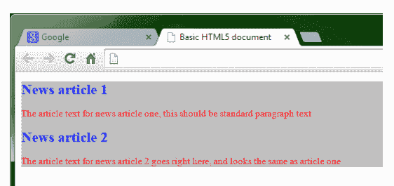

*图3：代码清单8和9产生的输出*

让层叠特性处理这类事情的一个真正妙处在于，你可以轻松地通过插入适当的`h1`和`p`元素，向你的`newspost div`中添加另一篇文章。你完全不需要担心在添加每个`h1`和`p`元素时为其分配正确的类名，也不必不断检查两个元素是否都使用了正确的样式。

只要元素位于一个具有命名ID的部分内，它们就会相应地着色。还要注意，我们刚刚看到的层叠行为不仅仅适用于基于ID的选择器；例如，你可以为`newspost div`使用一个基于类的选择器，你可能打算重用它，你仍然可以将其他元素的样式层叠于其上，如以下代码所示：

```
.newspost
{
  background-color: silver;
}

.newspost h1
{
  color: blue;
  font-size: 15pt;
}

.newspost p
{
  color: red;
  font-size: 10pt;
}
```

*代码清单10：使用类选择器的清单9 CSS代码*

使用这样一个层叠的、基于类的选择器，允许你在HTML的许多不同地方重用你的**newspost**类，并且放置在所述元素内的任何**h1**或**p**元素将自动呈现蓝色标题和红色文本的外观。

### 伪选择器

在进行基础复习时，我们需要考虑的下一类基本选择器是伪选择器。就像“伪代码”一样，伪选择器本身不是一个完整的选择器，而是对现有选择器的扩展。

其中最著名的例子是用于HTML锚标签的悬停选择器。

伪选择器的工作原理是修改现有规则，使其仅在特定场景下激活，就悬停而言，就是当用户的鼠标悬停在相关元素上时，如代码清单11a所示：

```
<a href="#" class="hoverClass">Hover over me I'll change color</a>
```

*代码清单11a：演示伪悬停选择器的HTML*

```
.hoverClass
{
    font-size: 20pt;
    color: red;
}

.hoverClass:hover
{
    color: blue;
}
```

*代码清单11b：演示伪悬停选择器的CSS代码*

如果你在浏览器中渲染包含此代码的页面，你应该会看到类似以下的内容：

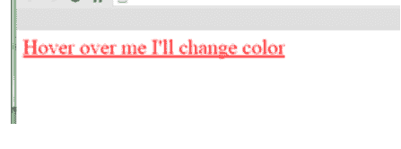

*图4：伪悬停选择器的默认状态*

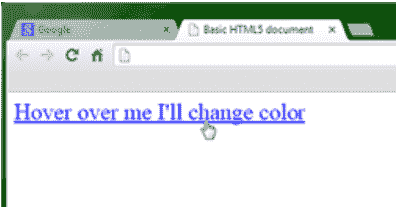

*图5：伪悬停选择器的悬停状态*

在CSS3之前，只有少数几个伪选择器可以可靠地在所有浏览器中工作；通常这些仅适用于HTML锚标签，它们是悬停（你刚刚看到的）、已访问、活动和链接，用于根据用户是否曾经访问过相关链接来为锚标签设置样式以提供视觉反馈。不幸的是，从CSS3开始，尽管这些样式仍然存在并按预期工作，但它们可以改变的选项数量受到了严重限制。这是对野外发现的一种隐私漏洞的回应，一些不良网站所有者利用这些选项来跟踪用户是否访问过给定的站点。

### 直接选择器

复习清单上的最后一个选择器是直接选择器。这是所有可用选择器中最简单的，顾名思义，它用于直接选择已知的元素名称。你可能还会遇到类型选择器、元素选择器和标签选择器等术语；对于这种选择器类型没有统一的术语，使用哪个术语在很大程度上取决于浏览器制造商。就我们的目的而言，我们使用直接选择器，仅仅是因为我们直接定位一个命名的实体。

例如，如果你想定位给定文档中的所有**p**元素，你只需执行以下操作：

```
p
{
    color: green;
}
```

*代码清单12：使用直接选择器*

一旦将其添加到样式表中，文档HTML标记中由`<p></p>`标签组成的任何内容都将显示为绿色，无论其类、ID或其他任何属性如何。

别忘了，你可以轻松组合基本选择器，因此你可以只选择**div**的后代中的**h1**元素；例如，**h1**类型元素应用了**boxout**类，并且嵌套在**div**元素内。这可以使用像**div .boxout h1**这样的选择器来实现。


 ## 摘要

CSS3 引入了许多新的选择器类型，让你能够更精确地控制如何定位 HTML 文档中的各个部分。我们将在下一章中介绍这些内容，开始探索 CSS3 为现代 Web 开发人员带来的新特性。

在本章中，我们快速了解了 CSS 作为一种技术/语言，并简要回顾了它的工作原理。从这里开始，我们将深入探讨这一新版 CSS 特有的主题。如果你对 CSS 的整体理解仍有困难，那么我建议你先通过当今互联网上可用的一些相关网站进行学习。

我可以衷心推荐的一个网站是 [HTML Dog](https://www.htmldog.com)。这个网站不仅充满了你可能需要了解的基本信息，还提供了大量教程、参考指南以及通往互联网上其他有用地方的资源链接，这些都将帮助你进一步扩展知识。

# 第三章：新选择器

在上一章中，你简要回顾了 CSS 中最常用的选择器类型。这三种类型被称为类选择器、ID 选择器和后代选择器，它们是 CSS 3 版本之前唯一可用的选择器。现在 CSS3 已经到来，它带来了许多新选择器作为其新功能的一部分。

我们不会在本章中涵盖每一个新选择器，但你会很快看到，现在可用的灵活性之大，可能是你从未想象过的。

这些新选择器中的许多都是以伪选择器的形式实现的（作为另一个选择器的扩展的选择器，例如 hover），仅就这个主题你完全可以写一整本书。

在本章中，我们只会介绍最重要的新选择器，并基本演示它们的用途。对于其余部分，我强烈建议你阅读互联网上许多优秀的资源。除了我已经提到的其他链接之外，一个专门用于 CSS 主题的绝佳起点是 [Mozilla 开发者网络](https://developer.mozilla.org/)上的 CSS 页面。MDN 的优点在于其兼容性指南，它可以让你一目了然地了解哪些选择器适用于哪些浏览器，以及哪些会给你带来问题。

## 通用选择器 (*)

*target all* 选择器名副其实：它尽可能定位其作用范围内的所有内容。

这意味着如果你将它放在基于 ID 的选择器内部，那么所有落在该 ID 选择器控制范围内的元素都会受到影响。

使用 `*` 符号立刻就能明白它的行为类似于通配符，尽可能贪婪地选择尽可能多的内容。起初，这似乎是一件好事，直到你突然意识到它在移动设备上或在有数百万嵌套元素的页面中，会让你的页面变慢多少。

通用选择器主要用于在初始设置中进行全面更改，例如将页面的整个 CSS 模型设置为已知的默认集合（如 0 像素边距和无边框）。

通常它在 CSS 重置中使用，以便从已知状态开始。许多知名的前端 UI 框架广泛地使用它来将你的页面置于已知状态，然后再应用它们可能提供的任何自定义样式。

通用选择器应该谨慎使用，并且应使其影响范围尽可能小，以免造成严重的性能瓶颈。

如果你想确保文档中每个元素的边距和内边距都设置为 0，那么你可以如代码清单 13 所示应用此选择器。

```
*
{
  margin: 0;
  padding: 0;
}
```

*代码清单 13：使用通用选择器*

在样式文件顶部附近包含此代码后，你可以确保在其之后，你的任何规则都不会有任何边距或内边距应用。

## 相邻兄弟选择器 (+)

相邻选择器是较容易理解的选择器之一，它选择紧邻的元素，并且对每个出现的位置仅执行一次。

假设你有以下 HTML 标记：

```
<div>
    <h1>Heading</h1>
    <p>Text line 1</p>
    <p>Text line 2</p>
    <h1>Heading</h1>
    <p>Text line 1</p>
    <p>Text line 2</p>
</div>
```

*代码清单 14a：用于演示相邻选择器的 HTML 标记*

如果你然后将以下 CSS 规则应用于：

```
h1 + p
{
  color: red;
}
```

*代码清单 14b：用于演示相邻选择器的 CSS 规则*

只有紧接在 **h1** 元素之后的 **p** 元素会被更改为红色。第二行文本（以及可能紧随其后的任何其他文本）将保持不变，**h1** 元素本身也一样，如图 6 所示：

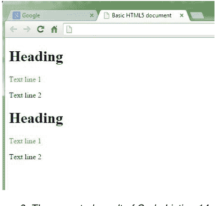

相邻兄弟选择器最有用武之地之一是创建引言或开篇段落。考虑以下示例。

```
<!doctype html>
<html>
<head>
    <title>Basic HTML 5 document</title>
    <link href="styles.css" rel="Stylesheet" type="text/css" />
</head>

<body>

    <section>
        <article>
            <h1>Monstrous Inbox</h1>
            <p>Today in local news, a monstrous email inbox was discovered belonging to Mr Jones of durham.</p>
            <p>The email inbox was rumoured to have 11ty billion unread emails in it, but scientists say that calculating the actual amount is going to be almost impossible.</p>
            <p>Mr. Jones had no comment, but he did let slip that he had no idea how his inbox grew so large and so fast.</p>
        </article>
        <article>
            <h1>Jelly Table Legs</h1>
            <p>Furniture Watchdogs are today warning all people to be on the lookout for tables with Jelly legs.</p>
            <p>In recent months there have been a spate of fake tables released into the global furniture market, these fake tables are exceptionally dangerous and could wobble over at any moment.</p>
            <p>People should exercise extreme caution when buying new tables, if you're unsure call a professional table tester to ensure you're getting a genuine product.</p>
        </article>
    </section>
```

```
</body>
</html>
```

### 代码清单 15：假新闻列表

清单 15 中的代码代表了一组可能的新闻文章。我对代码进行了标记，使其使用了 HTML 5 中的新语义标签来帮助定义文档结构和布局。请注意，你不需要输入 `<p>` 元素中的所有文本；我包含了大量内容仅用于演示目的。

如果你直接渲染输出而不进行任何样式设置，你会得到类似以下的效果：

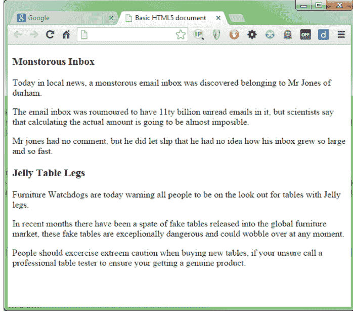

## 图 7：由代码清单 15 生成的未设置样式的新闻文章示例

借助相邻兄弟选择器，以及后代选择器的帮助，我们可以使用非常少量的样式规则轻松地为这个输出设置样式。

以下 CSS 代码展示了如何使用相邻兄弟选择器来确保每篇文章中的第一个段落与其余段落区分开来。

```
section
{
	font-family: sans-serif;
	font-size: 12pt;
}
section h1
{
    color: green;
    border-bottom: 1px solid green;
    font-size: 15pt;
}
section p
{
    color: grey;
}
section h1 + p
{
    color: black;
    font-size: 14pt;
    font-style: italic;
}
```

*代码清单 16：用于为代码清单 15 中的新闻文章设置样式的 CSS 代码*

如你在代码清单 16 中所见，使用的 CSS 非常简单，而且更重要的是，它是由 `section` 标签驱动的，这意味着任何不在包含性 section 标签内的标题或段落组合仍然可以安全使用，不会更改为匹配清单 16 中的样式。

如果我们用新的样式刷新 HTML 输出，并进行一些文本编辑，我们现在应该能看到类似这样的效果：


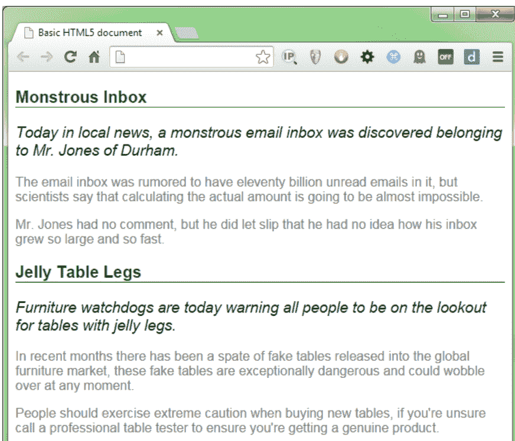

*图 8：应用了代码清单 16 中 CSS 规则的代码清单 15*

## 直接子元素选择器 (>)

正如你已经看到的，后代选择器允许你在标记的元素链中向下定位子元素。

例如，如果你想定位嵌套在 **class** 类型为 **news** 的 **div** 中的段落标签，那么选择器 **div.news p** 就可以胜任。然而，有一个缺点：后代选择器是贪婪的。

当我们说一个选择器是贪婪的，意思是它会尝试尽可能多地匹配（任何有正则表达式经验的人都会明白我在说什么）。

这在实践中意味着，不仅第一层选择中的元素会被选中，其下任何匹配的元素也会被选中。

直接子元素选择器通过减少贪婪性来解决这个问题，它只深入到根选择器下方的第一层。

考虑以下 HTML 标记：

```
<div class="test">
    <p>Paragraph 1</p>
    <p>Paragraph 2</p>
    <div>
        <p>Paragraph 3</p>
    </div>
    <p>Paragraph 4</p>
</div>
```

*代码清单 17：用于演示直接子元素选择器的 HTML 标记*

如果我们在浏览器中渲染代码清单 17，我们会得到四个简单的段落元素。

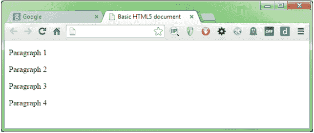

*图 9：使用代码清单 17 渲染的 HTML*

你会从标记中注意到，段落 3 嵌套在一个 **div** 元素内部；如果我们使用标准的后代选择器来为这个块设置样式，我们将得到以下输出：

```
div.test p
{
    color: red;
}
```

*代码清单 18：使用后代选择器为代码清单 17 中的代码设置样式的 CSS 规则*

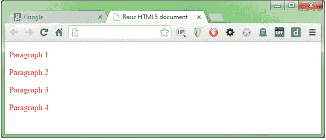

*图 10：将代码清单 17 中的 HTML 与代码清单 18 中的规则结合后产生的输出*

乍看之下，这个输出可能看起来没问题，而且通常情况下可能确实是你想要达到的效果。然而，请考虑一下：为什么段落 3 要被嵌入到另一个 **div** 元素中？

它可能是为了与其他段落元素采用不同的样式而这样创建的。

让我们更改规则，使用直接子元素选择器，如下所示：

```
div.test > p
{
    color: red;
}
```

*代码清单 19：使用直接子元素选择器为代码清单 17 中的代码设置样式的 CSS 规则*

你现在应该会看到，它跳过了嵌套元素中的段落，但继续按预期为其他段落设置样式。

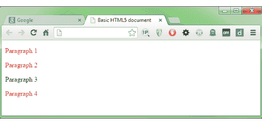

这在创建弹出菜单等场景时特别有用，你可能希望所有顶级元素呈现未选中的外观和感觉，但当父元素被选中时，构成子菜单的嵌套项目需要保持不变。

## 通用兄弟选择器 (~)

*通用兄弟*选择器与其近亲相邻兄弟选择器类似，用于选择跟在特定类型父元素后面的元素。然而，与它的近亲不同的是，它尝试在标记层次结构中选择多个匹配项。

相邻兄弟选择器最多（如你前面所见）只选择给定匹配项的第一次出现；而通用兄弟选择器则会尝试选择该匹配项，只要层次结构继续匹配。

如果我们构建两个无序列表，如下所示：

```
<p>List 1</p>
<ul>
<li><a href="#">Link 1a</a></li>
<li><a href="#">Link 2a</a></li>
<li><a href="#">Link 3a</a></li>
<li><a href="#">Link 4a</a></li>
</ul>
<ul>
<li><a href="#">Link 1b</a></li>
<li><a href="#">Link 2b</a></li>
<li><a href="#">Link 3b</a></li>
<li><a href="#">Link 4b</a></li>
</ul>
<p>List 2</p>
<ul>
<li><a href="#">Link 1a</a></li>
<li><a href="#">Link 2a</a></li>
<li><a href="#">Link 3a</a></li>
<li><a href="#">Link 4a</a></li>
</ul>
<ul>
<li><a href="#">Link 1b</a></li>
<li><a href="#">Link 2b</a></li>
<li><a href="#">Link 3b</a></li>
<li><a href="#">Link 4b</a></li>
</ul>
```

*代码清单 20：用于演示兄弟选择器的 HTML 标记*

与前面的示例一样，如果我们先用无样式渲染，将得到默认的标准渲染效果：

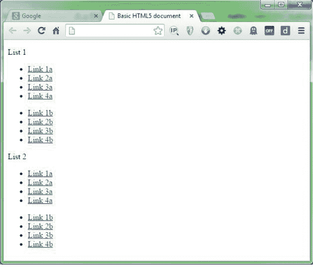

*图 12：代码清单 20 中的 HTML 在无样式规则应用时产生的输出*

为了说明区别，我们将首先使用前面看到的相邻兄弟选择器来设置列表样式，使用以下规则。

```
p + ul a
{
  color: red;
}
```

*代码清单 21：代码清单 20 的相邻选择器*

当我们使用代码清单 21 中的规则渲染代码清单 20 时，我们得到以下输出：

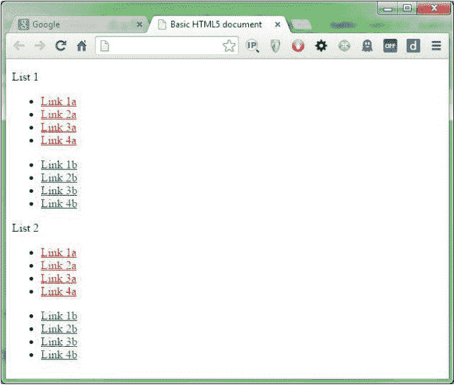

*图 13：应用相邻选择器后代码清单 20 产生的输出*

如果你一直在跟着代码操作，这应该不会令人惊讶。第一组被设置了样式，第二组则没有。

然而，如果我现在将代码切换为使用通用兄弟选择器：

```
p ~ ul a
{
  color: red;
}
```

*代码清单 22：代码清单 20 的兄弟选择器*

我们应该会看到选择上的差异：

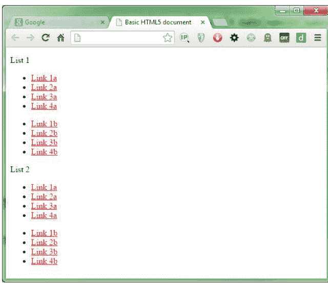

*图 方法论14：应用兄弟选择器后代码清单 20 产生的输出*

虽然相邻兄弟选择器在第一次匹配后就停止，通用兄弟选择器却不会；通用兄弟选择器会继续向下遍历链条，只要前面的元素匹配，就会匹配规则中的任何内容。

## 相邻与后代之间的区别

此时你可能会想，为什么我们有两种看似实现相同功能的方式。重要的是要记住，虽然到目前为止我们在本章中设置了类似的场景，但我们是通过相当不同的方式来实现的。

当我们谈论彼此相邻的元素时，我们的意思是这些元素就像一条街道上相邻的房屋。如果你沿着每栋房屋的对齐线画一条线，你会看到所有房屋都在同一水平线上。在以下代码中，每个具有 **class** 属性为 **house** 的 **div** 元素都是彼此相邻的：

```
<div class="street">
    <div class="house"></div>
    <div class="house"></div>
    <div class="house"></div>
    <div class="house"></div>
    <div class="house"></div>
</div>
```

*代码清单 23：相邻元素*

当我们谈论元素是彼此的后代时，我们说的是一种父子关系。如果我们将此应用到代码清单 23 中的街道示例，我们可能会有"租户"居住在每个房屋中。

```
<div class="street">
    <div class="house"><p class="tenant"></p></div>
    <div class="house"><p class="tenant"></p></div>
    <div class="house"><p class="tenant"></p></div>
    <div class="house"><p class="tenant"></p></div>
    <div class="house"><p class="tenant"></p></div>
</div>
```

*代码清单 24：后代元素*

正如你在代码清单 24 中看到的，我们现在每个房屋里都有一个租户。租户彼此不相邻，因为你必须离开房屋，向下移动，然后进入下一栋房屋才能到达下一个租户。

然而，由于你可以从房屋到达租户，因此租户成为房屋的后代。

子元素和孙元素术语被定义为后代的一种特殊情况。就像在家族树中一样，我们的示例中的租户可能有孩子，而那些孩子长大后又有了自己的孩子。

孩子的孩子仍然是租户的后代，但它不是租户的孩子；它是孙辈，类似于以下内容：

```
<div class="street">
    <div class="house">
        <div class="tenant">
            <div class="tenantsChild">
                <div class="childsChildButTenantsGrandChild"></div>
            </div>
        </div>
    </div>
</div>
```

*代码清单 25：显示子元素与后代关系的代码*

如果你在租户的范围内创建更多彼此相邻的、**class** 为 **tenantsChild** 的 **div** 元素，那些 **tenantsChild** 元素，就像房屋一样，将是彼此相邻的。

你需要一些练习才能养成这样思考的习惯，但如果你想一想 HTML 的原生形式——一种专门的基于 XML 的语言——那么你会看到嵌套开始变得合理。一旦嵌套变得合理，选择器的流程和布局也开始变得清晰。

如果你一开始难以理解，不要担心。我也花了很长时间才全部理清，即使现在我有时也会搞错。


到目前为止，我们已经介绍了主要的基本选择器。如果你想了解其余的选择器，可以在W3C网站上找到官方文档。

不过，我确实认为有必要在这里提醒一下。虽然W3C的官方文档是所有HTML内容的权威来源，但它也是一个非常难读的网站。

有更容易获取的信息来源，比如Mozilla和HTML Dog。我强烈建议你先消化这些内容，然后再去W3C网站，这样你对主题会有更好的理解。

## 属性选择器

为了结束本章，我们将探讨CSS3中得到极大扩展的一个内容：属性选择器。

在之前的版本中，只有少量关于这种选择器子集的介绍，但它在很大程度上被忽视了，因此大多数开发者从未停下来研究过它能提供什么。

然而，在CSS3中，属性选择器功能强大，允许你对元素进行一些相当智能的样式设置。

首先，我们需要定义什么是属性选择器。

与你目前见过的选择器不同，属性选择器不是位于两个目标之间的单字符构造；它是父规则的多字符附加部分，包含其自身的内部处理规则。

从某种程度上说，属性选择器有点像拥有一套自定义的搜索表达式，专门用于根据附加在元素上的属性值（或部分值）来查找元素。

看看下面的HTML标记。

```
<ul>
    <li><a href="#" rel="external">External Link 1</a></li>
    <li><a href="#" rel="internal">Internal Link 1</a></li>
    <li><a href="#" rel="internal">Internal Link 2</a></li>
    <li><a href="#" rel="external">External Link 2</a></li>
    <li><a href="#" rel="external">External Link 3</a></li>
</ul>
```

*代码清单26：包含自定义属性的HTML标记*

在代码清单26中，你可以看到我创建了一个相当标准的无序列表，其中包含锚元素。这并不罕见，你经常会在HTML文档的导航链接中看到类似内容。

然而，我做的是使用`rel`属性来标记链接的关系，指定它是外部链接还是内部链接。

如果我们想以不同的方式为两种类型设置样式，理论上，我们可以只添加一个类，比如`.internal`或`.external`。然而，有时候HTML标记是在你无法控制的过程中生成的，因此你可能无法以这种方式将类添加到输出中。

这就是属性选择器的用武之地。你可以用它来定位元素内的特定命名属性，正如你稍后将看到的，你不仅可以使用它来定位完整字符串，还可以定位部分字符串。

首先，让我们看看如何将其应用于我们之前的链接示例。将以下样式规则添加到你的样式表中（假设你已经将之前的HTML添加到文档中）：

```
a[rel="external"]
{
	color: red;
}

a[rel="internal"]
{
	color: green;
}
```

*代码清单27：代码清单26的属性选择器规则*

如果你在浏览器中渲染这个，你应该会看到类似这样的内容：

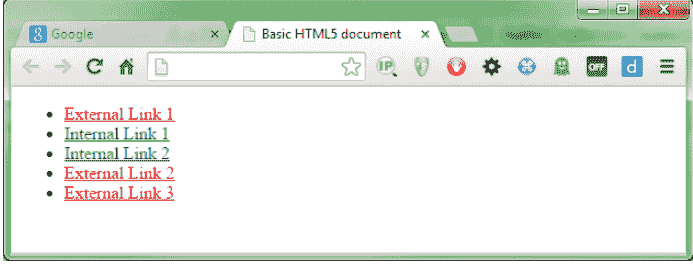

*图15：应用了代码清单27中CSS规则的代码清单26*

仅仅通过使用两条不同的规则，我们就轻松地定位了两种不同类型的链接，仅仅因为`rel`属性的差异。

一个现实世界的例子可能看起来像这样；将代码清单26中的代码修改为如下内容：

```
<ul>
```

```
<li><a href="#">Link 1</a></li>
<li><a>Link 2</a></li>
<li><a>Link 3</a></li>
<li><a href="#">Link 4</a></li>
<li><a href="#">Link 5</a></li>
</ul>
```

## 代码清单28：从代码清单26修改而来的HTML标记

默认情况下，大多数浏览器不会使没有**href**属性的链接可点击，而且至少对于默认样式，它们不会使用通常的蓝色下划线进行样式设置。

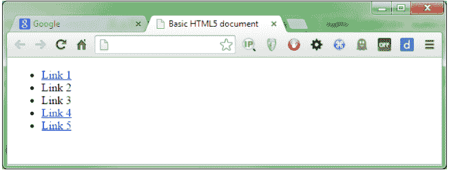

## 图16：没有样式的代码清单28的输出。

然而，在许多情况下（特别是如果你使用较大的框架），你可能会发现锚点标签通常被赋予了统一的样式，以保持一致的外观和感觉。

例如：

```
a
{
  text-decoration: none;
  color: green;
}
```

## 代码清单29：可能用于赋予锚点统一外观和感觉的规则

这段代码可能用于应用那种统一的样式，并将使我们的列表看起来如下：

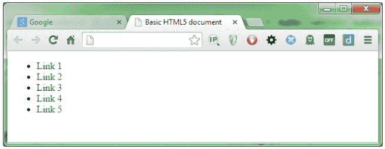

## 图17：应用了统一样式的代码清单28的锚点元素

你立刻就能看出，你已经失去了任何可能提示链接没有目标的上下文信息，作为网站用户，你不知道哪些链接是好的，哪些是坏的。

你可以遍历代码，为每个缺少`href`的链接添加`class="nodestination"`，但如果有人随后向数据库添加了链接，突然间链接就有了有效的目标怎么办？在这种情况下，你面临着找到所有之前没有`href`但现在有了的链接的任务，这样你就可以移除类名并恢复正常。

解决这个问题的另一种方法是只使用没有额外内容的属性选择器本身，如下所示：

```
a[href]
{
    text-decoration: none;
    color: green;
}
```

*代码清单30：仅定位具有href属性的锚点的属性规则*

现在当我们刷新页面时，我们应该看到我们现在得到的样式与之前不同：

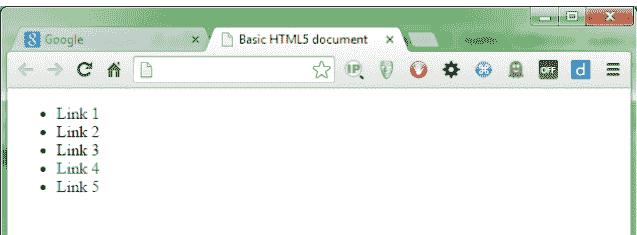

*图18：应用了统一样式，但仅应用于具有有效目标的锚点的代码清单28*

现在，为了让链接样式正确，你所要做的就是让你的Web应用平台生成带有`href`属性的链接，而对于还没有链接的内容，则省略`href`属性。

然而，还有一个问题。

如果我们还想为其余没有`href`属性的元素设置样式，例如，让它们颜色更浅一些，这样它们看起来可能像是禁用的呢？

CSS3也用一个伪选择器解决了这个问题。我们将在下一章了解更多关于新的伪选择器的内容；现在，我们可以通过使用以下属性/伪样式规则来简单地解决缺少`href`属性的锚点标签的样式问题：

```
a:not([href])
{
```

```
text-decoration: none;
color: silver;
}
```

## 代码清单31：仅定位没有href属性的锚点的属性规则

如果我们更改样式规则以匹配代码清单31，然后重新渲染文档，我们应该得到以下结果：

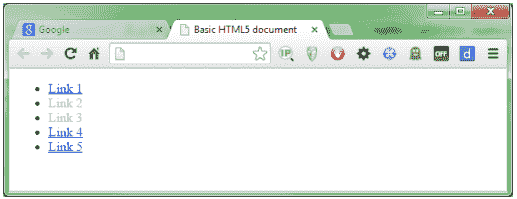

## 图19：应用了反转属性样式的代码清单28

以下规则利用了CSS的层叠特性，并将内容逻辑地组合在一起：

```
a
{
    text-decoration: none;
}
a[href]
{
    color: green;
}
a:not([href])
{
    color: silver;
}
```

## 代码清单32：自动为缺少href属性的链接设置样式的组合规则

理论上，我们可以进一步简化，只是将绿色颜色添加到基本锚点规则中。这将把绿色作为默认应用，但如果没有`href`存在，则将其更改为银色。这里的理念只是为了用最简单的术语展示正在发生的事情，而展开内容通常使概念更易于理解。

如果我们现在渲染它，我们应该看到类似这样的内容：

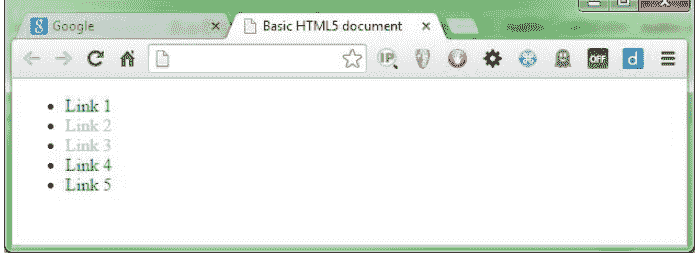

## 图20：应用了组合样式的代码清单28

从这个例子中得到的主要优势是，你不再需要担心确保为给定链接应用特定的类，这使得文档维护更容易且不易出错。如果你在Umbraco或WordPress等CMS下运行，那么你只需要关心链接是否具有有效的目标。

> 注意：我之前在普通段落文本中使用过这种属性选择器，以便在链接激活时自动突出显示与普通文本内联的链接，并在链接未激活时使其看起来与段落文本完全一样。

我之前提到过，属性选择器也可以匹配给定属性中的部分内容。主要选择器中有一些添加内容，允许你检查属性的值是否以、是否包含或是否以给定子字符串结尾。

这在处理外部和内部链接时可能非常有用。

回想一下我们在代码清单26中看到的代码；我们使用了`rel`属性来定义锚元素上的内部或外部关系。

就W3C规范而言，这可能不是最好的做法，而且很可能，如果用HTML 5验证工具测试，HTML可能无法通过验证。

然而，这并不意味着我们必须回到使用class属性。

想象一下，你所有的外部链接都有一个完整的URL，而你所有的内部链接只有一个相对的页面叶子。在这种情况下，代码清单26现在可以改写如下：

```
<ul>
  <li><a href="http://external.com/link1">External Link 1</a></li>
  <li><a href="internal/link1">Internal Link 1</a></li>
  <li><a href="internal/link2">Internal Link 2</a></li>
  <li><a href="http://external.com/link2">External Link 2</a></li>
  <li><a href="http://external.com/link3">External Link 3</a></li>
</ul>
```

## 代码清单33：不使用rel属性重写的代码清单26


如果你查看 **href** 属性的差异，会发现所有外部链接都以 "http://" 开头，而内部链接则不是。

如果我们使用“属性值以……开头”选择器，就可以轻松地为外部链接设置不同的颜色。

我们可以为锚标签设置统一的默认样式，这将成为内部链接的默认样式，然后在外部链接的情况下进行覆盖。

要使用“以……开头”属性选择器，我们在属性名和值之间指定 `^="..."`，如下面的规则所示：

```
a[href^="http:"]
{
    color: red;
}
```

*代码清单 34：CSS 样式规则，用于更改以 "http" 开头的属性的颜色*

如果将其应用于代码清单 33 中的 HTML 标记，然后在浏览器中渲染，我们应该得到以下结果：

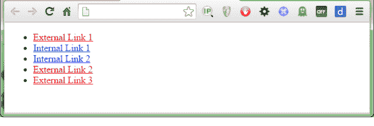

*图 21：将代码清单 34 中的规则应用于代码清单 33 的 HTML*

现在，如果我们像之前一样添加一个统一规则，使链接默认显示为绿色，最终输出将如下所示：


*图 22：应用了最终样式的代码清单 33 的 HTML*

我相信你很快就能意识到，这可以很容易地与检测属性存在的规则结合起来，进一步对没有 **href** 属性的链接做出处理。

属性选择器剩下的部分是“以……结尾”和“包含”选择器。

“以……结尾”在根据文件类型设置链接样式时非常方便。例如，你可以这样做：

```
<ul>
    <li><a href="photo1.png">Photo 1</a></li>
    <li><a href="photo2.png">Photo 2</a></li>
    <li><a href="sound1.mp3">Sound 1</a></li>
    <li><a href="sound2.mp3">Sound 2</a></li>
    <li><a href="document.pdf">Document</a></li>
</ul>
```

*代码清单 35：重写的代码清单 33，用于列出文件链接*

然后，使用 **$=** 属性选择器创建以下规则：

```
a[href$=".png"]
{
  color: red;
}
a[href$=".mp3"]
{
  color: green;
}
a[href$=".pdf"]
{
  color: blue;
}
```

*代码清单 36：基于文件类型的“以……结尾”属性规则*

渲染后，应该得到以下结果：

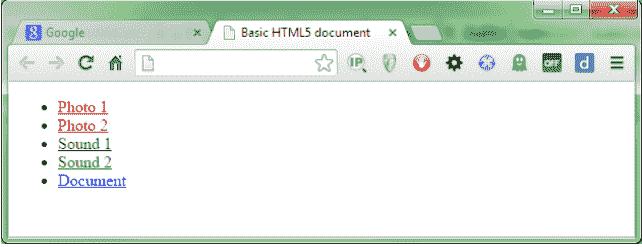

*图 23：代码清单 35 显示"以……结尾"属性选择器的输出*

最后一个基于属性的选择器是“包含”选择器，它的作用名副其实。

如果属性值包含给定的子字符串，那么 **\*** 就会匹配它。

例如，查看下面这组锚标签：

```
<ul>
   <li><a href="/admin/users/list">List Users</a></li>
   <li><a href="/admin/personal/settings">Your Account Settings</a></li>
   <li><a href="/admin/users/edit">Edit Users</a></li>
   <li><a href="/admin/users/report">Users Report</a></li>
   <li><a href="/admin/personal/profile">Your Profile</a></li>
</ul>
```

*代码清单 37：重写的代码清单 35，用于演示"包含"属性选择器*

配合以下规则：

```
a[href*="users"]
{
   color: red;
}
a[href*="personal"]
{
   color: green;
}
```

*代码清单 38：基于子字符串的"包含字符串"属性规则*

这将产生以下输出：

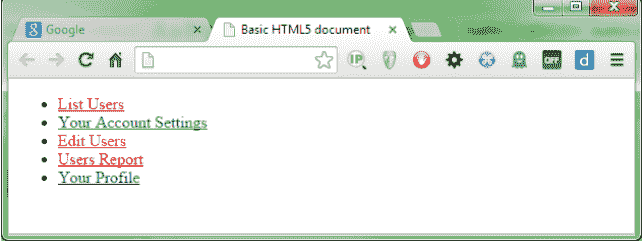

*图 24：将代码清单 38 中的规则应用于代码清单 37 所产生的输出*

我们 covered 的内容甚至还没有触及可用潜力的表面，尤其是在属性选择器方面。

在 HTML 5 中，有一种新的属性类型叫做 data-属性。这种新属性的形式为：

**data-**

后跟一个自定义名称，例如：

**-approved**

**data-recordIndex**

你可以在任何元素上使用这些 data 属性，用于任何目的，当与正确的选择器结合时，它们允许你使用 HTML 5 轻松地描述其自身意图并进行样式设置。

## 小结

在本章中，我们深入探讨了 CSS3 中新增的主要选择器。我们已经看到，在定位要设置样式的元素时，我们不再受限，也不再受过去的限制所束缚，从而可以在规则中实现几乎无限的表达。

在下一章中，我们将更仔细地研究新的伪选择器，当与到目前为止所学的内容结合时，它们将使我们的能力达到新的高度。

# 第 4 章  新的伪选择器

在上一章中，我们介绍了 CSS3 中新增的主要选择器。现在，我们将进一步探索新增的伪选择器。

伪选择器与普通选择器不同，因为它们不能单独使用。相反，它们需要与其他选择器（如前两章中的选择器）结合使用才能发挥作用。至少，主流观点是这样描述的。

事实上，许多伪选择器现在确实可以在没有任何后缀规则的情况下使用（你很快就会看到），但将它们与常规选择器结合使用时，仍然能发挥最佳效果。

你在本章中看到的一些选择器实际上并不是 CSS3 中的新特性，它们已经存在相当长的时间了。然而，在以前的版本中，它们要么不为人所知，要么由于 IE6/IE7/IE8 兼容性一代的问题，人们主动避免使用它们。

首先，我们将从最古老的选择器开始。

### :focus

顾名思义，**focus** 用于输入元素在文档中获得焦点时。这通常用于表单中以高亮显示活动字段。

让我们使用以下 HTML 标记创建一个模拟表单：

```
<form action="#" method="post">
    <label for="txtUserName">User Name</label><br />
    <input type="text" id="txtUserName" name="txtUserName" /><br /><br />
    <label for="txtEmail">Email</label><br />
    <input type="text" id="txtEmail" name="txtEmail" /><br /><br />
    <input type="submit" value="Submit" />
</form>
```

*代码清单 39：模拟 HTML 表单标记*

这会给我们一个非常普通的 HTML 表单。

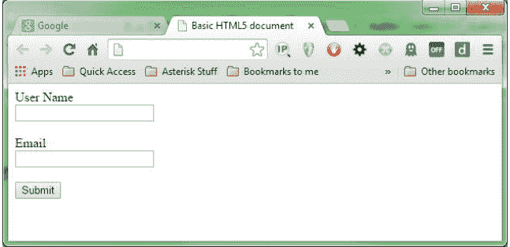

让我们向样式表中添加以下简单的规则：

```
:focus
{
  background-color: beige;
  color: green;
}
```

*代码清单 40：简单的 Focus CSS 规则*

如果我们重新渲染浏览器，并点击其中一个表单字段使其获得焦点，应该会看到它变为反映选中状态的样子。

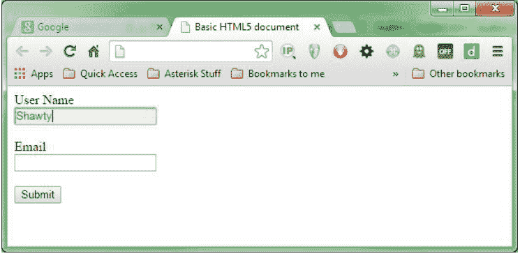

你可能会注意到，在示例中，我单独使用了 **focus** 而没有扩展任何内容。在 CSS3 中，许多伪选择器现在都可以这样使用；这只是意味着将其应用于任何理解该选择器的元素。

对于我们的示例，任何可以从用户那里接收焦点的元素在获得焦点时都会按照指定改变其颜色。

### # 关于访问状态的简短题外话

我想稍作停顿，展示另一个自 CSS 规范 V2 版本以来就存在的伪选择器。它可以像 **focus** 一样单独使用，但也可以被恶意利用来发现一个人的浏览历史。

如果你在文档中放置一些外部锚标签，如下所示：

```
<ul>
    <li><a href="http://www.google.co.uk/">Google</a></li>
    <li><a href="http://www.yahoo.co.uk/">Yahoo</a></li>
    <li><a href="http://msn.com">MSN</a></li>
</ul>
```

*代码清单 41a：外部 URL*

然后应用以下样式规则：

```
:link
{
    color: green;
}

:visited
{
    color: red;
}
```

*代码清单 41b：针对 41a 中外部 URL 的样式*

当你渲染文档时，你会看到以下内容。

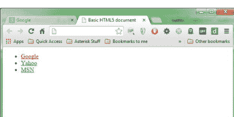

*图 27：由代码清单 41 渲染的链接*

你可能会看到一些甚至所有链接都显示为红色。就我而言，只有 Google 链接是红色的，这是因为 Google 英国主站存在于我的浏览器历史中，而其他两个则没有。

看看 CSS，你会发现样式由 **visited** 伪选择器提供，作为页面用户的你可以立即直观地确认你最近访问过该页面。


尽管这表面上看起来似乎相当无害，但如果你深入挖掘并查看较新规范中新增的一些 JavaScript API，就会发现有一个名为 `getComputedStyle` 的 API 调用。通过此调用，可以获取浏览器中元素上实际可见的计算后样式——至少过去是这样。

在当今的现代浏览器中，这个漏洞已被大幅修补，尝试使用此调用来获取链接颜色实际上只会返回基础颜色。就我们的情况而言，即使对于 Google 链接，返回的也全是绿色。

不过，我曾听说使用 JQuery 和 MooTools 可以检索到正确的值并加以区分。

这只是一个小小的例子，说明任何事物都可能被用来侵犯用户的隐私或安全，即使是像 CSS 这样常见的东西。请务必尽可能使你的规则具体明确。仅仅因为你可以在没有规则约束的情况下全局使用它们，并不意味着你应该这样做。如果将它们绑定到特定的规则集上，就意味着你的样式规则不会被那些使用浏览器工具瞎搞的人滥用。

### :disabled 和 :enabled

在 HTML 5 规范中可以应用于元素的众多新属性中，有 `disabled` 属性。

你像使用任何其他属性一样使用它，只需在标记中的元素上添加 "disabled" 即可。

让我们重用代码清单 39 中创建的表单模型，但将其更改为如下所示：

```
<form action="#" method="post">
    <label for="txtUserName">User Name</label><br />
    <input type="text" id="txtUserName" name="txtUserName" disabled /><br /><br />
    <label for="txtEmail">Email</label><br />
    <input type="text" id="txtEmail" name="txtEmail" /><br /><br />
    <input type="submit" value="Submit" />
</form>
```

代码清单 42：包含禁用元素的模拟 HTML 表单标记

当你渲染它时，应该会看到第一个输入元素现在无法使用了。

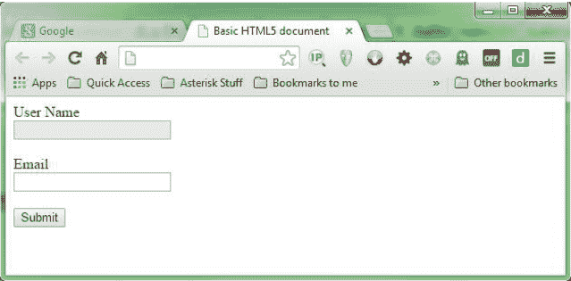

图 28：一个禁用了输入的简单表单

让我们将以下规则添加到样式表中：

```
input:disabled
{
    background-color: red;
    border: 2px solid blue;
}
```

代码清单 43：为禁用元素设置样式的 CSS 规则

当你重新渲染表单时，你会看到显著的变化。

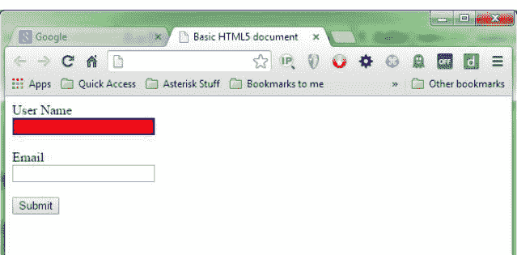

图 29：应用了代码清单 43 中禁用伪类的简单表单

如果你从元素上移除 **disabled** 属性，输入将恢复到其原始状态。

此规则通常用于在记录编辑器中显示只读字段，或显示不适用于当前表单的字段。例如，你可能会设计一个表单，使得只有当勾选了向该地址发送邮件的复选框时，才显示地址字段。

如果你使用 Bootstrap UI 框架，你可能已经注意到，表单中的某些元素在鼠标指针悬停时会显示一个小的红色停止圆圈。这是以相同的方式执行的，使用 disabled 规则来更改鼠标指针的样式。

**enabled** 伪选择器在逻辑上与 disabled 相反，并将给定的样式应用于未被禁用的元素，如下例所示：

```
input:enabled
{
  background-color: yellow;
  border: 2px solid green;
}
```

代码清单 44：为启用元素设置样式的 CSS 规则

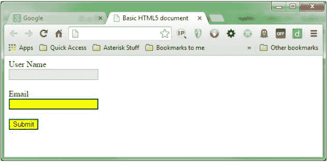

图 30：显示已应用启用 CSS 规则的浏览器表单

当没有理由禁用元素时，或者更具体地说，当元素未被应用 **disabled** 属性时，该元素被视为已启用。

请注意，如果通过 JavaScript 将元素的布尔 **disabled** 属性在其文档对象上设置为 **true**，则该元素也将被归类为已禁用。在这种情况下，与其他选择器一样，disabled 和 enabled 选择器的应用明确基于元素的状态，这意味着你不必一直确保正确的元素具有正确的应用类。

### :valid 和 :invalid

添加到 HTML 5 的另一个很棒的功能是浏览器端验证。通过浏览器端验证，你可以让浏览器在表单提交之前验证表单的输入。

与 disabled 选择器类似，这里的伪选择器仅在我们使用规范中提供的额外属性和标记时才应用于元素。

再次使用我们的表单，让我们做另一个更改，使其具有以下 HTML 代码：

```
<form action="#" method="post">
    <label for="txtUserName">User Name</label><br />
    <input type="text" id="txtUserName" name="txtUserName" required /><br /><br />
    <label for="txtEmail">Email</label><br />
    <input type="email" id="txtEmail" name="txtEmail" /><br /><br />
    <input type="submit" value="Submit" />
</form>
```

代码清单 45：包含可验证元素的模拟 HTML 表单标记

这些更改一开始可能不明显，但如果你查看用户名框，会看到它现在有了一个 **required** 属性。

然而，电子邮件输入的类型不再是 **text**；它现在是 **email** 类型。

如果我们渲染这个页面，然后在不输入任何值的情况下点击 **Submit**，我们将看到类似以下的内容：

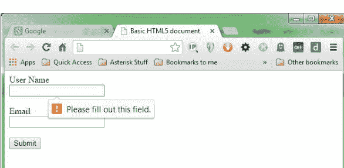

图 31：我们的基本表单展示 required 属性的效果

如果我们在名称框中输入一些内容，并在电子邮件框中输入一些内容，但故意将电子邮件格式设置错误，我们还将获得关于电子邮件格式的验证。

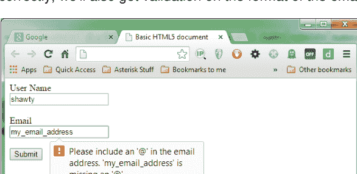

图 32：我们的基本表单展示电子邮件验证的效果

我将在这里展示更多关于验证类的内容，但现在，请将以下规则添加到你的样式表中：

```
input:valid
{
    background-color: green;
}

input:invalid
{
    background-color: red;
}
```

代码清单 46：CSS3 验证规则

如果你然后渲染页面，应该会得到以下内容：

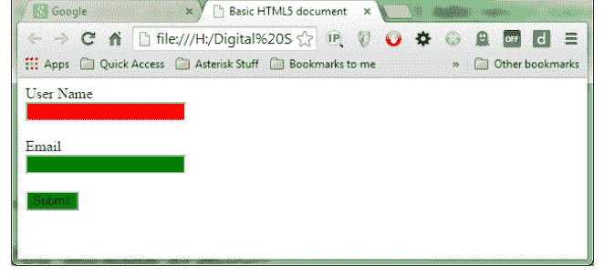

图 33：应用了代码清单 46 中验证样式的简单表单

用户名立即显示为红色，因为它是必需的，所以在填入之前，它被视为无效。

电子邮件是有效的，因为我们只告诉它必须将输入验证为电子邮件地址。我们没有说它必须是输入项，因此空白的电子邮件是有效的。然而，如果你开始在其中输入内容，它将变为红色，并且只有在输入格式正确或完全删除后才会变回绿色。

使用 `valid` 和 `invalid` 是向用户提供反馈的好方法，但一显示表单就立即看到它们通常不被认为是好的做法。

因此，你通常不会像我这样直接将它们应用于 input 元素（事实上，你可以看到我只是使用了一个非常宽泛的选择器，因为按钮也是绿色的）。通常，你会将它们附加到一个类/ID 名称上，然后在表单提交时使用 JavaScript 检查和应用它们。

由于这本书是关于 CSS 的，我不会在这里详细讨论这一点。如果你想进一步探索 HTML 5 验证的兔子洞，我的[博客](https://example.com)上有一篇文章可以帮助你入门。

### :in-range 和 :out-of-range

继续讨论验证伪选择器，我们有 **in-range** 和 **out-of-range**。它们的使用方式与上一节中的 **valid** 和 **invalid** 类似，但处理的是不同的场景。

对文本类型和内容的验证并不是新规范中添加的唯一验证；HTML 5 规范还带来了数字类型和最小/最大范围。

创建另一个虚拟表单，但这次，不是用户名和电子邮件输入框，我们来定义一个数字范围。

```
<form action="#" method="post">
  <label for="nmbUserAge">User Age</label><br />
  <input type="number" id="nmbUserAge" name="nmbUserAge" min="16" maximum="100" /> <br /><br />
  <input type="submit" value="Submit" />
</form>
```

代码清单 47a：带有数字输入的模拟 HTML 表单

让我们将以下样式应用于我们的表单：

```
input[type=number]:in-range
{
  background-color: yellow;
}

input[type=number]:out-of-range
{
  background-color: salmon;
}
```

代码清单 47b：为清单 47a 中的数字范围表单设置样式

当我们渲染表单时，最初会看到它以 out-of-range 颜色显示，因为其中没有值。

然后，如果我们开始输入值，应该会看到颜色根据输入的值而改变，无论是在范围内还是在范围外。

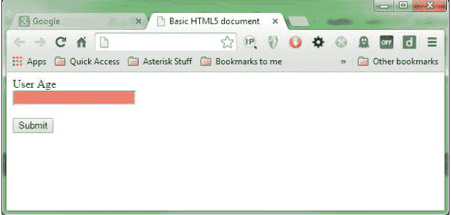
图 34：刚加载后的数字范围表单

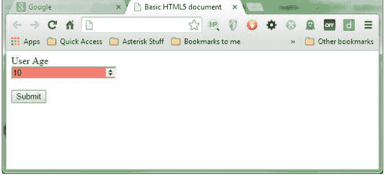
图 35：包含无效值的数字范围表单

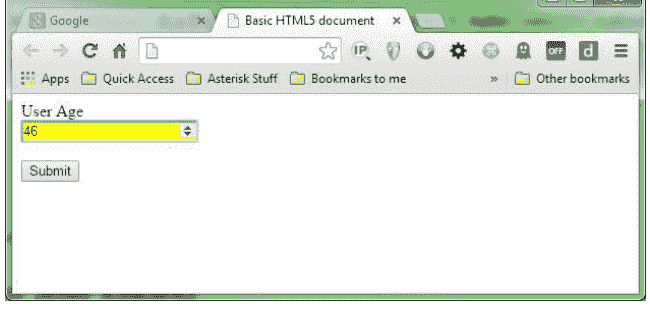
图 36：包含有效值的数字范围表单

### :empty

`empty` 伪选择器初看之下似乎用于元素值为空的情况，但事实并非如此；它是用于 HTML 元素的内部内容为空的情况。请看以下 HTML：

```
<div class="mydiv"></div>
```
代码清单 48a：一个空的 div 元素

代码清单 48a 中的 `div` 是空的——它完全没有任何内容，位于开始和结束标签之间。

如果我们现在应用如下规则：

```
.mydiv:empty
{
    /* 规则写在这里 */
}
```
代码清单 48b：用于 empty 伪选择器的 CSS 规则

CSS 中定义的任何样式规则都会应用到它上面。然而，由于实际上没有任何内容，应用改变颜色等规则几乎是多余的，除非父元素已经有一个规则使其具有固定大小和边框。

当你想要从显示中移除空元素时，`empty` 伪元素就派上用场了。例如，假设你在用户界面的一个标签页末尾有一个消息计数。如果该计数为 0 或没有值，那么你就不希望显示一个空的红色圆圈。

在这种情况下，你会在一个单独的规则中为你的红色徽章设置样式，然后像下面这样设置你的空规则：

```
.mydiv:empty
{
    display: none;
}
```
代码清单 48c：使空元素从显示中消失的 CSS 规则

通过将 `empty` 选择器定义为不显示，你只需确保开始和结束标签之间没有任何内容，就能使计数从显示中消失。

你可能注意到我措辞为“没有任何内容”，这是有意为之的。当我们说 `empty` 选择器匹配一个空标签时，我们指的是百分百为空。一个空格对我们来说可能看起来是空的，但对于 CSS 选择器引擎来说，它被归类为内容，将空标签换行到两行同样被视为内容。

当你试图找出为什么你确定应该从显示中消失的元素确实没有消失时，这可能会变得相当令人沮丧。我知道这会引起多少抓狂。

如果开始和结束标签之间有任何东西——任何东西——那么 `empty` 选择器将**不会**匹配。它最适合用于构成小型容器的 `span` 和 `div`，这些容器的内容通过 JavaScript 构建和移除。

由于此选择器的视觉工作原理，我将不提供屏幕截图。如果你构造一个简单的 `div` 标签并为其应用代码清单 48c 中的规则，然后使用编辑器手动添加或移除内容，你很快就能看到它是如何工作的。

### :checked

`checked` 伪选择器用于处理复选框和单选按钮元素。

前提很简单：如果元素被选中或选中，则会应用此伪规则；否则不会应用。

让我们修改我们的表单，这次显示几个复选框和单选按钮，如代码清单 49 所示：

```
<form action="#" method="post">
    <label>Check box 1<input type="checkbox" /></label><br />
    <label>Check box 2<input type="checkbox" /></label><br />
    <label>Check box 3<input type="checkbox" /></label><br />
    <label>Check box 4<input type="checkbox" /></label><br />
    <label>Radio Button 1<input type="radio" name="radios" /></label><br />
    <label>Radio Button 2<input type="radio" name="radios" /></label><br />
    <label>Radio Button 3<input type="radio" name="radios" /></label><br />
    <label>Radio Button 4<input type="radio" name="radios" /></label><br />
</form>
```
*代码清单 49：包含复选框和单选按钮的简单表单*

渲染此表单应该会给我们提供相当直观的一组控件。

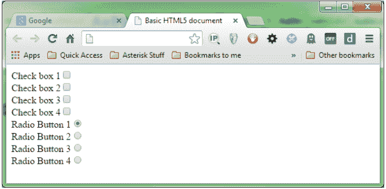
图 37：显示简单复选框和单选按钮控件的表单

由于复选框和单选按钮不会改变颜色，我们将在此演示中使用略有不同的策略，即改变控件的大小。将以下规则添加到你的样式表中：

```
input[type="checkbox"], input[type="radio"]
{
  width: 20px;
  height: 20px;
}
input[type="checkbox"]:checked, input[type="radio"]:checked
{
  width: 25px;
  height: 25px;
}
```
代码清单 50：演示使用 checked 伪选择器的 CSS 样式

如果你现在渲染表单，并选中和取消选中一些控件，你应该会看到被选中的项目有微小的尺寸变化。

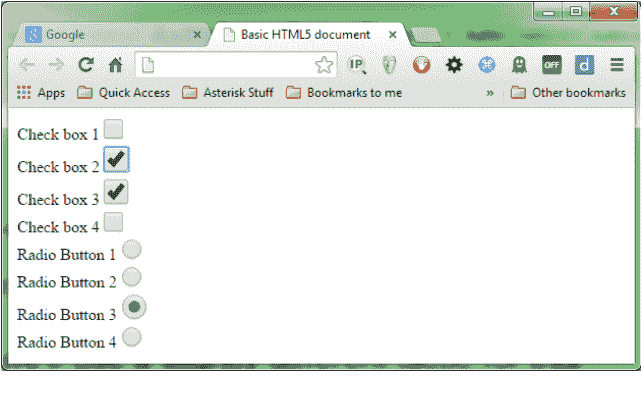
图 38：我们的复选框和单选按钮改变大小

你可能想知道，如果很难更改复选框的颜色等属性，为什么还要使用此伪选择器。

直到你开始考虑将其与相邻选择器结合使用时，你才会明白为什么以及如何可能想要使用它。在代码清单 49 的表单中添加如下一行：

```
<input type="checkbox" /><span class="checkboxlabel">This is my check box</span>
```
代码清单 51a：要添加到之前表单的行

然后，添加以下 CSS 规则：

```
input[type="checkbox"]:checked + span.checkboxlabel
{
    color: red;
}
```
*代码清单 51b：为代码清单 51a 中的行设置样式的规则*

你应该会发现，当你渲染文档时，选中或取消选中复选框不会对复选框本身产生任何更改，但会更改其后跟随的 `span` 的文本颜色。

它之所以这样做，是因为我们告诉 CSS 引擎，对于任何 `type` 属性等于 **checkbox** 的 `input` 元素，查看相邻元素并检查它是否是 `span`，并且具有类名 **checkboxlabel**。如果是，则将该 `span` 元素的颜色更改为红色。

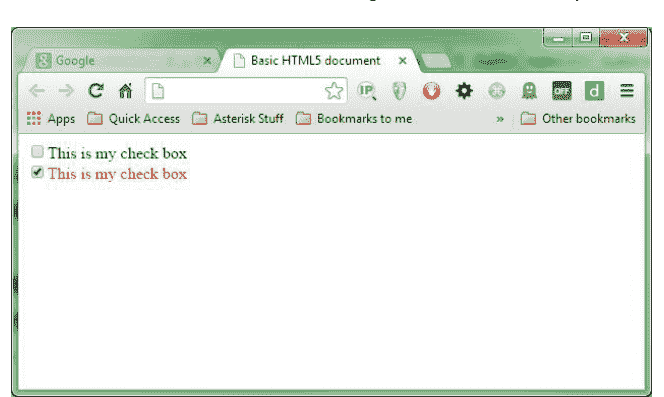

像这样使用 checked 选择器是 Foundation 和 Bootstrap 等 UI 工具包用来制作切换按钮以及由图标列表组成的自定义单选和复选组的方法。

如果你想要创建自定义复选框，那么你只需将此模式与 `before` 和 `after` 等伪元素结合使用，即可在标记中动态添加/删除内容。

### :before 和 :after

在 CSS3 出现之前，如果你想动态添加或删除元素和内容，你必须借助 JavaScript，或者在服务器端进行更改，并使用 Ajax 调用之类的东西重绘文档片段。

> **注意：** Ajax 不是本书将要涵盖的内容，因为它与 JavaScript 深度绑定，并且是一个相当复杂的主题。然而，通常情况下，Ajax 调用是请求 JavaScript 向 Web 服务器发出部分请求以仅获取少量内容的过程。它通常用作获取小块数据并根据需要将它们插入网页的手段，而不是一次请求下载整个页面。

借助 **before** 和 **after** 伪选择器，我们可以添加和删除 HTML 元素中的内容，而无需触及一行代码，并且完全由纯 CSS 规则驱动。

从一个简单的例子开始，假设我们的 HTML 标记中有以下行：

```
<span class="bracketedLabel">This is a bracketed Label</span>
```
*代码清单 52a：用于演示 before 和 after 选择器的简单 span*

这个标签没有任何特别之处；如果我们渲染它，我们只会得到一个简单的输出。

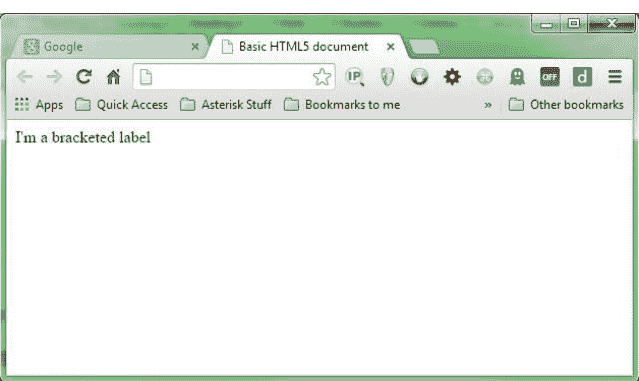
图 40：代码清单 52a 的输出

顾名思义，我们希望任何具有此类的标签都有方括号包围，但我们不想手动去找到所有出现的地方来添加它们。

所以，我们可以添加以下 CSS 规则：

```
.bracketedLabel
{
    color: green;
}
.bracketedLabel:before
{
    content: '[';
    color: red;
}
.bracketedLabel:after
{
    content: ']';
}
```


color: red;
}
```

*代码清单 52b：使我们的标签带有括号的 CSS 规则*

然后，当我们刷新浏览器输出时，会得到以下结果：

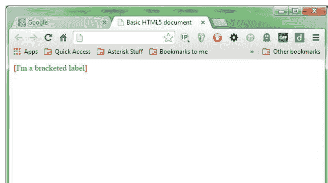

*图 41：我们的带括号标签现在有了括号*

在大家急着使用 before 和 after 选择器来在文档中添加和移除 HTML 标签之前，我不得不告诉你们，很遗憾，这是做不到的。

虽然 before 和 after 伪选择器很强大，但你只能使用纯文本。如果你尝试在规则中放入 HTML 标签，那么这些标签将会按原样渲染，包括标签本身作为文本字符串。

这有很多原因。想象一下，你有一个元素，通过 CSS 规则添加了一个元素，而这个元素又添加了一个元素；如果不小心，你很容易就会陷入无限循环，导致一切停止。

CSS 规则也被设计为一次性解析，，因此任何插入需要样式的元素都将意味着必须停止、返回并重新处理已经见过的规则，然后再回来继续。

然而，你仍然可以用它们实现一些非常有趣的技巧。

其中较好的用途之一就是仅使用 CSS3 属性和选择器来创建自定义复选框。为了说明这一点，创建一个包含两个复选框的简单表单。

```html
<form action="#" method="post">
    <input id="chkCheckboxOne" type="checkbox">
    <label class="checkbox" for="chkCheckboxOne"> Checkbox 1 </label><br />
    <input id="chkCheckboxTwo" type="checkbox">
    <label class="checkbox" for="chkCheckboxTwo"> Checkbox 2 </label>
</form>
```

*代码清单 53：准备定制的复选框和单选按钮*

与我们之前的复选框示例一样，渲染这个只会给我们简单的表单样式：

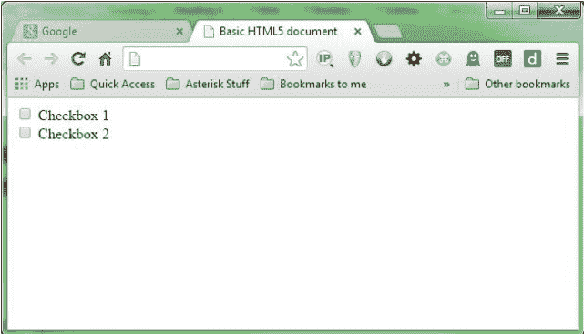

*图 42：只是另一个简单的表单*

让我们添加第一条规则，并给复选框一些默认样式。

```css
.checkbox
{
  display: inline-block;
  cursor: pointer;
  font-size: 20px;
  font-family: sans-serif;
}

input[type=checkbox]
{
  display: none;
}
```

*代码清单 54a：复选框和单选按钮的默认样式*

如果你此时渲染页面，可能会惊讶地发现我们隐藏了实际的控件，只样式化了标签文本。我们这样做是因为不想看到原始控件，而且既然我们无法真正用颜色等来自定义它们，我们就干脆让它们消失，以便绘制我们自己的新控件。

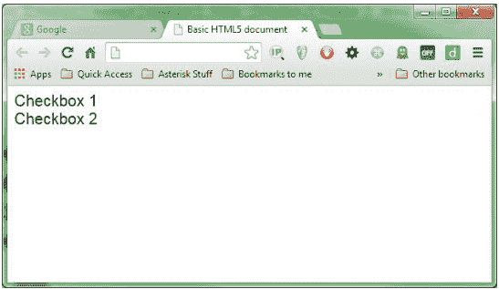

*图 43：我们的复选框还在，只是不可见了*

接下来我们添加的规则是样式表的 **before** 部分，但要注意我们定位的是标签而不是实际的复选框元素，因为实际上是标签在驱动这一切。

```css
.checkbox:before
{
  content: "";
  display: inline-block;
  width: 18px;
  height: 18px;
  vertical-align: middle;
  background-color: green;
  color: #f3f3f3;
  text-align: center;
  box-shadow: inset 0px 2px 3px 0px rgba(0, 0, 0, .3), 0px 1px 0px 0px rgba(255, 255, 255, .8);
  border-radius: 3px;
}
```

*代码清单 54b：规则的 before 部分，绘制控件的未选中版本*

渲染这个，我们可以看到现在有了看起来更像复选框的东西。

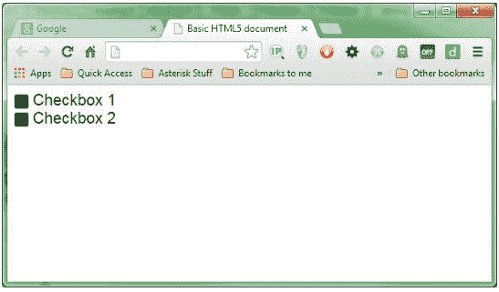

*图 44：我们有了绿色复选框*

我们还没完成；还需要添加一条规则，以确保当控件处于选中或选择状态时，会出现一个好看的勾选符号。

```css
input[type=checkbox]:checked + .checkbox:before
{
    content: "\2713";
    text-shadow: 1px 1px 1px rgba(0, 0, 0, .2);
    font-size: 15px;
}
```

*代码清单 54c：完成自定义复选框所需的最后一条规则*

当我们渲染这个时，应该会发现我们可以像使用默认复选框一样切换复选框。

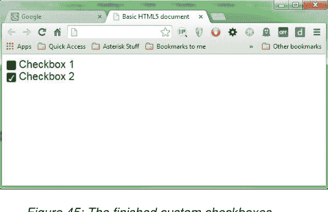

*图 45：完成的自定义复选框*

这种技术可以在很多地方使用；例如，Bootstrap 使用它在输入字段中定位图标。

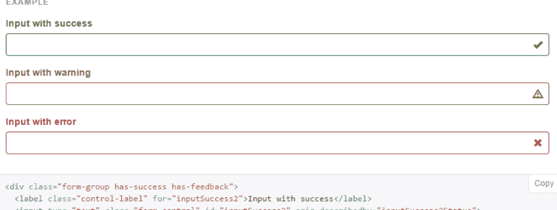

*图 46：Twitter Bootstrap 使用相同的方法显示验证图标*

**Before** 和 **after** 可能是两个最灵活的伪选择器，开发社区仍未发现它们所有的使用方式。

### First-X、Last-X 和 nth-X

我选择将这最后一组表示为一个集合，因为它们都是相关的。first、last 和 nth 伪选择器用于选择元素列表中的第一个、最后一个和用户定义数量的元素。

这一批中有两个不同的组；我们先看通用选择器（即选择任何元素的），然后是特定类型选择器。这两组在 CSS3 规范中列出为：

first-child、last-child、nth-child()

和

first-of-type、last-of-type、nth-of-type()

对于第一组示例，我们将使用以下 HTML 标记来说明选择器的工作原理以及它们能做什么。

```html
<ul>
    <li>List Item One</li>
    <li>List Item Two</li>
    <li>List Item Three</li>
    <li>List Item Four</li>
    <li>List Item Five</li>
    <li>List Item Six</li>
    <li>List Item Seven</li>
    <li>List Item Eight</li>
    <li>List Item Nine</li>
    <li>List Item Ten</li>
</ul>
```

*代码清单 55：用于 first、last 和 nth 选择器的无序列表标记*

正如我们目前为止对其他内容所做的，以下是标记在浏览器中的渲染前效果：

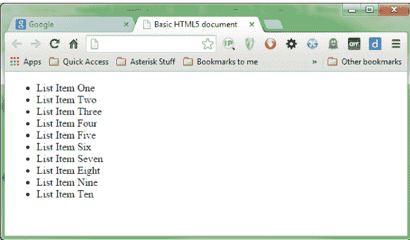

与许多可用的选择器一样，它们的名称毫无疑问地描述了它们的功能。让我们将以下规则应用到代码清单 55 的 HTML 中。

```css
ul > li:first-child
{
    color: red;
}

ul > li:last-child
{
    color: green;
}
```

*代码清单 56：演示 'first-child' 和 'last-child' 伪选择器的 CSS 规则*

正如你可能预测的，无序列表中的第一个和最后一个项目如预期般变色。

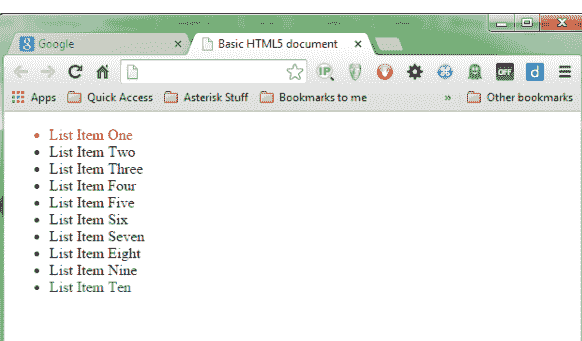

first-child 和 last-child 选择器是我们能遇到的最简单的；然而，nth-child() 需要更多解释。

你可能会注意到，与其他选择器不同，nth-child 后面跟着一组括号。这是因为与其他选择器不同，nth-child 接受一个参数来控制它。

这个参数采用代数方程的形式，描述要选择什么以及如何选。

> **注意：** 对许多人来说，在学校做代数是很遥远的记忆。对于那些还记得的人来说，他们可能宁愿不记得。然而，即使你当时可能想过它什么时候会派上用场，记住它是如何工作的确实能帮助你理解 CSS3 中的代数表达式。如果你正在努力回忆，那么现在可能是快速复习一下的好时机。

不要害怕；代数方程是描述数字计算应该如何运作的东西，但不一定是实际答案应该是什么。

许多人可能在生命中的某个阶段遇到过看起来像这样的东西：
**1n+5x=6y**

对于那些记得的人来说，这被称为代数，是数学的一个相当专业的分支，许多人会连续学习多年。解这些奇怪的方程式是许多理论数学家的一种爱好，有些人甚至把生命中的岁月奉献给仅仅是对这些东西的理论研究。

对于那些仍在挠头的人，那一点点代数意味着以下内容：

方程 1 乘以 n 的值加上 5 乘以 x 的值将始终等于 6 乘以 y 的值，其中 n、x 和 y 是没有任何当前值的理论实例。

别担心，你不需要那么深入地了解代数就能理解 nth-child 是如何工作的，但你确实需要知道代数是如何运作的。

当你有一个离散值后跟一个理论实例时，该理论实例通常以某种方式由运算符相乘。运算符也可以应用加法和减法，或者单独指定以给出静态值。

例如：

**1** 就是这个意思：1，偏移量为 1，计数为 1，一页，一个东西……真的不重要，因为它是理论性的。

**1n**，另一方面，意味着 1 个 **n**，或 **n** 的 1 次乘法；同样，**n** 可以代表任何东西，因为一切都是理论性的。

**1n+1** 意味着 1 个 n 再加上额外的 1。

也许理解这些方程如何运作的更简单方法，是想象使用它们来进行乘法表运算。例如，记住 3 的乘法表：

**3 x 0 = 0**


**3 x 1 = 3**
**3 x 2 = 6**
**3 x 3 = 9**
**3 x 4 = 12**

以此类推…

现在，想象一下我们 **3n** 中的 **n** 是第二列（值从 0 到 4）的乘数；你便会开始理解 n 如何引用该范围内的任何值。

然后，如果你将结果视为一个静态数字，最终会得到以下静态序列：

**0, 3, 6, 9, 12**

让这个想法沉淀一下。

现在回想一下代码清单 55 中的 HTML 元素列表。该列表中有 10 个列表项子元素，如果我们忽略静态列表中的数字 0 和 12，我们得到 3、6 和 9，这些都可以是用于选择的偏移量（0 和 12 不是有效的项，因为它们不存在）。

嗯，这正是 `nth-child()` 的作用。它使用传递给它的代数方程来精确确定列表中需要选择哪些元素。

让我们将以下 CSS 规则应用于代码清单 55 中的列表：

```
ul > li:nth-child(3n)
{
  color: red;
}
```

*代码清单 57a：用于选择每个第三个元素的 nth-child CSS 规则*

将会发生的是，列表中每个第三个元素都将受此规则影响。

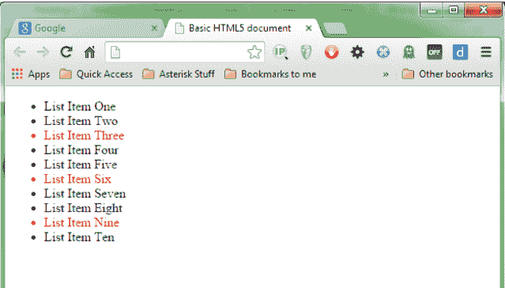

*图 49：我们的 nth-child(3n) 规则生效*

如果我们开始添加一个 `+` 偏移量，我们就指定了乘法的起始位置：

```
ul > li:nth-child(3n+1)
{
  color: red;
}
```

*代码清单 57b：用于从元素 1 开始选择每个第三个元素的 nth-child CSS 规则*

这将产生以下效果：

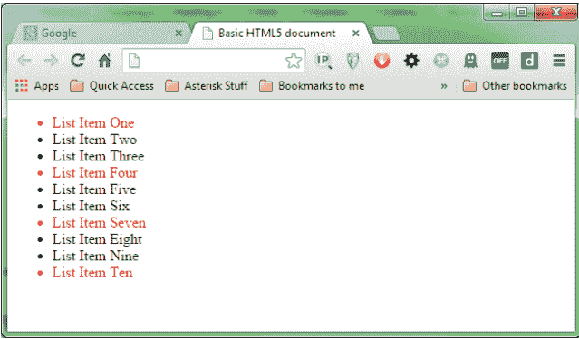

*图 50：nth-child(3n+1) 从 1 开始并选择每个第三个元素*

如你所见，它从元素索引号 1 开始，然后每次应用乘以 3 的乘法，以选择每个第三项。

你也可以单独使用 **n**，当与正偏移量结合使用时，它允许你选择范围。例如：

```
ul > li:nth-child(n+7)
{
  color: red;
}
```

*代码清单 57c：用于选择从第 7 个开始所有内容的 nth-child CSS 规则*

这将从偏移量 7 开始，简单地选择从该点开始的所有剩余元素。

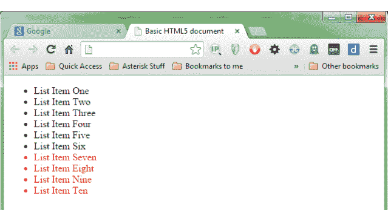

图 51：从第 7 个开始选择元素的 nth-child

你也可以通过在 **n** 前面添加负号来反向选择。

```
ul > li:nth-child(-n+7)
{
    color: red;
}
```

代码清单 57d：用于从第 7 个开始反向选择所有内容的 nth-child CSS 规则


图 52：从第 7 个开始反向选择的 nth-child

如果你只是想选择列表中某个特定编号的元素，可以这样做：

```
ul > li:nth-child(5)
{
    color: red;
}
```

代码清单 57e：仅选择索引号 5 的 nth-child CSS 规则

直接指定数字索引将仅选择该编号的元素。


*图 53：nth-child 仅选择列表中的第五个元素*

我很容易就能用 nth-child 方程的不同组合填满本书的剩余部分，但我认为我们目前已经掌握了足够多的内容。

我猜你们大多数人此刻可能都在问自己一个问题：

> “我该如何利用这一点来选择并为表格或网格中的所有行添加条纹？你能告诉我那是什么方程式吗？”

好消息是，W3C 标准委员会意识到这很可能是 `nth-child` 伪选择器最常见的用途之一，因此他们添加了一些快捷方式：**even** 用于选择每个偶数编号的元素，**odd** 用于选择每个奇数编号的元素。

如果你添加以下规则：

```
ul > li:nth-child(odd)
{
    color: red;
}
```

*代码清单 57f：用于选择每个奇数编号元素的 nth-child CSS 规则*

你应该能看到标记中的每个奇数列表项都被选中。


图 54：nth-child 选择每个奇数元素

我想到了这个阶段，你可能想让你的大脑休息一下，所以我们暂时把代数知识放在一边。

不过请注意，我们还有大量内容尚未涉及。例如，你可以链接 `nth-child` 选择器（就像许多其他选择器一样），从而产生一些看起来像这样的疯狂选择器规则：

**nth-child(3n+1):nth-child(even)**

这将选择从索引 1 开始的每个第三个元素，但仅限于索引为偶数的那些。对于 11 个元素，这将仅选择索引为 4 和 10 的元素（其他都是奇数）。

你可以轻松选择范围，然后拆分这些范围。你还可以将这些范围选择与 **first-child** 和 **last-child** 结合使用，从而只选择范围的开始和结束。这本身就是一个主题，或许值得用一整本书来讲解，迄今为止，**nth-child** 伪选择器已经有一些非常巧妙的应用；但对我们来说，是时候继续前进了。

属于 **first**、**last** 和 **nth** 元素选择器之下的第二组伪选择器是 **of-type** 选择器。

**first-of-type**、**last-of-type** 和 **nth-of-type** 选择器的工作方式与本章前面描述的通用选择器完全相同，但它们针对的是特定的元素类型。

让我们以代码清单 55 中的无序列表为例，稍微修改一下，将其转换为定义列表。

```
<dl>
    <dt>HTML 5</dt>
    <dd>HTML 5 is the markup language used to create documents that are published on the internet</dd>
    <dt>CSS3</dt>
    <dd>CSS3 is the markup language used to add style and colors to documents created using HTML 5</dd>
    <dt>HTTP (Hyper Text Transfer protocol)</dt>
    <dd>HTTP is the mechanism by which HTML (copyleft) documents and their associated resources are transported on the internet</dd>
    <dt>WWW (World Wide Web)</dt>
    <dd>The World Wide Web is the collective name for the many hundreds of thousands of HTML 5 documents published via the internet</dd>
    <dt>The Internet</dt>
    <dd>The internet is a massive global computer network, which amongst other things holds the World Wide Web</dd>
</dl>
```

*代码清单 58：用于 first、last 和 nth 选择器的定义列表标记*

定义列表与其他类型的列表略有不同。它内部实际上包含两种不同类型的子元素：**dt** 元素或“定义标题”，以及 **dd** 元素或“定义”。

如果我们渲染代码清单 58，我们可以看到两者的默认样式：


*图 55：具有默认样式的定义列表*

如果我们尝试将之前的一个规则应用于此列表（稍作修改以适应不同的标签类型），例如，选择每个第三个子元素的 CSS 规则（代码清单 57a），我们会看到它并不完全像我们预期的那样工作。

```
dl > :nth-child(3n)
{
  color: red;
}
```

*代码清单 59a：为我们的定义列表修改的 nth-child 规则*

它尝试选择每个第三个子元素，即使我们可以按名称专门定位事物，我们可能不得不处理内容变化极大的列表。


图 56：*nth-child 搞错了我们的选择*

然而，如果我们使用 `nth-of-type()`：

```
dt:nth-of-type(2n)
{
	color: red;
}
```

代码清单 59b：用 'nth-of-type' CSS 规则代替 'nth-child'

我们很快就能看到，它只影响我们要求它影响的元素。


图 57：*nth-of-type 做对了我们的选择*

**nth-of-type**（以及 **first-of-type** 和 **last-of-type**）仅将指定的目标元素视为选择的候选者。

在前面的例子中，我们看到了一些可能用于新闻页面的标记；如果你在那个页面上使用 **nth-of-type**，你将获得与使用 **nth-child** 一样的灵活性，但你能够告诉 CSS 选择器引擎只将该规则应用于文章中找到的段落元素。

例如，你可以轻松地为所有偶数编号的段落设置与奇数编号段落不同的颜色，无论每个部分中有多少段落元素，或者可能存在多少其他元素（如标题）。

还有更多的伪选择器需要介绍，将它们全部链接在一起还能做更多事情；然而，其潜力远远超出了我们在这里所能描述的范围。

也要记住，通用规则总是在特定规则之前。

如果你定义：

```
p:nth-child(odd)
{
    color: blue;
}

p
{
    color: green;
}
```

*代码清单 60：特定 CSS 规则在前*

你会发现你所有的段落元素都将是绿色的。这是因为后面的规则比前面的规则更具体，所以前面规则应用的任何更改都将被后者覆盖。

将这两个规则的顺序颠倒即可解决这个问题，这样通用的规则首先将所有内容变为绿色，然后特定的规则针对奇数编号的元素，将它们从绿色更改为蓝色。

> *注意：在撰写本文时，并且使用的是（当时版本的）Chrome（和其他浏览器），前面的描述成立，即所有 <p> 元素确实会变成绿色。但是，两个月后，规范进行了更新，现在意味着在示例中 nth-child 规则具有比标准元素选择器更高的优先级。这意味着无论它们顺序如何，前面的示例现在都会产生完全相同的结果。这并不意味着你应该突然忽略规则顺序；仍然有很多地方需要遵守这一点。然而，在这个例子中，它完美地说明了许多这些特性仍然处于不断变化状态的事实，因此，一如既往地，在决定使用哪些特性以及为什么使用时，请明智选择。*


如果你遇到样式没有在预期时间、预期位置生效的问题，首先要检查的是**特异性顺序**。

### 总结

在本章中，我们快速（且烧脑地）浏览了 CSS3 中新增的伪类选择器。现在，你应该对如何定位和选择所需元素，以及实现这些选择的方法有了很好的理解。

本章我们学到了大量知识，还掌握了一些巧妙的技巧。既然困难的部分已经过去，现在是时候坐下来享受轻松的时光了。

从下一章开始，我们将探讨你们大多数人一直在期待的内容：视觉特效。我们将从大家都喜欢的元素入手：圆角、阴影和渐变填充。

## 第5章 服务器端

CSS3 有大量方法可以让事物变得美观。

对于开发者（尤其是那些大部分时间都在服务器端工作的人来说），他们可能不明白这有什么好大惊小怪的；我们是被雇来制作软件的，而这正是我们正在做的事情。

可惜，在客户端和浏览器中，情况并非如此。那些不理解我们做什么或如何做的同事，喜欢看到炫目、多彩、闪闪发光的东西。

当他们看到这种类型的进展时，就会将这种视觉反馈视为应用程序正在开发中的证据。

非 IT 人群最喜欢看到的，当属阴影和圆角这种“视觉盛宴”了。

我敢肯定，如果你过去做过一些严肃的 CSS 或设计工作，你一定会非常熟悉使用 Photoshop 创建半透明 PNG 图形文件的困难，然后你必须将它们对齐放置在一个精心布置的 div 元素周围。

即使你只偏离了一个像素，你也常常不得不从头开始，一次测量一个像素，并将页面布局限制为固定尺寸，这样之后才不会出错。

如果你是这一行的新手，那么随便找一个 Web 开发行业的老兵，我敢肯定他们会给你讲不少恐怖故事。

CSS3 通过增加定义规则的能力来解决所有这些问题，这些规则现在可以指定圆角的弧度，并允许你描述阴影的外观。然后，CSS3 引擎会根据你提供的选择器规则，自动将这些指令应用到你的 HTML 标记上，并计算出所有内容需要放置的位置。

## 圆角

网页是方的——至少在不久之前是这样。

在 CSS3 出现之前，我们只有带尖角的盒子。div 元素总是方方正正、平行排列的，表格也是如此，我们无法让事物看起来更柔和、更友好（嗯，至少不用大量图像技巧的话不行）。

为了改变这一点，CSS3 在所有可以使用边框的块级元素上引入了 **border-radius** 属性。

使用它很简单。

给定以下 HTML 标记：

```
<div class="niceDiv">
    <p>This is a nice div with no sharp corners</p>
</div>
```

*代码清单 61a：用于演示边框半径的 HTML 标记*

以及这个 CSS 规则：

```
.niceDiv
{
  width: 100px;
  height: 100px;
  background-color: beige;
  padding: 4px;
  border: 1px solid black;
  border-radius: 5px;
}
```

*代码清单 61b：为 61a 中的 HTML 添加圆角的 CSS 规则*

我们将在浏览器中看到一个非常漂亮的 `div` 元素：


*图 58：带圆角的 div*

在代码清单 61b 的规则中，我们使用了边框半径的通用默认设置，只指定了一个值。当你这样定义规则时，相同的值将用于所有四个角，因此如你所见，图 58 中的每个角看起来都一样。

指定的值决定了曲线的角度有多陡峭；在我们的例子中，我们使用了 5 像素。如果将其更改为 25 像素，你应该会得到类似图 59 的效果：


*图 59：带 25 像素圆角的 div*

因为每个角是四分之一，而圆的四分之一是 90 度，所以如果我们把值改为 90 像素，就会得到一个完美的圆形。


*图 60：带 90 像素圆角的 div*

在上面的演示中，我们使用了单值格式，但如果你愿意，也可以指定所有四个值（每个角一个）。将代码清单 61b 中的 **border-radius** 行改为如下所示：

```
border-radius: 5px 10px 15px 20px;
```

*代码清单 61c：修改后的 61b 边框半径行*

渲染后，你应该会看到一个带有四个不同大小圆角的 `div`：


*图 61：带四个不同大小圆角的 div*

第一个值是左上角，接着是右上角，然后是右下角，最后是左下角。

如果你愿意，也可以使用四个不同的规则，将大小规范写出来，如下所示：

```
border-top-left-radius: 5px;
border-top-right-radius: 10px;
border-bottom-right-radius: 15px;
border-bottom-left-radius: 20px;
```

*代码清单 61d：将 61c 中的更改写出来*

如何选择完全取决于你；有些人喜欢用冗长的方式做事，老实说，在开发过程中我发现这有助于维护代码。但是，当你发布到生产环境时，你确实希望这些东西尽可能小。

一个好的 CSS 压缩工具对于优化你的样式文件是必需的，特别是如果你在开发过程中使用了长格式。

> **注意：压缩 CSS**——压缩是在不丢失任何原始意图的情况下，使文件比原来更小的过程。与压缩或 zip 文件不同，压缩后的文件仍然以原始意图的方式运行——只是变得小了很多，更紧凑了。拥有一个好的压缩工具来压缩你的文件对于 Web 开发来说是必不可少的。当你的网站加载时，你能获得的最大加速之一，就是让你的样式、代码、标记和图像尽可能小、尽可能少。

有大量工具可以帮助你完成这项工作。一个很好的起点是使用 [Grunt 任务运行器](http://gruntjs.com/)。Grunt 拥有大量用于压缩 CSS、JavaScript、图像甚至 HTML 的模块，让你可以在每个地方节省宝贵的字节。知道如何使用这些工具对于任何 Web 开发者来说都是一项非常重要的技能。

你也不必为每个角只指定一个角度。如果你指定了，那么两边将应用相同的角度，给你一个均匀且相等的基于圆的曲线。

如果你在每个角上指定两个值，那么你就可以使用椭圆来塑造边框的曲线半径。这样做会给你带来一些有趣的可能。

将你的边框半径规则更改为如下所示：

```
border-top-left-radius: 50px 15px;
border-top-right-radius: 50px 15px;
border-bottom-right-radius: 15px 50px;
border-bottom-left-radius: 15px 50px;
```

*代码清单 61：扩展边框半径规则以显示基于椭圆的曲线*

你应该会得到类似图 62 的效果：


*图 62：我们的 div 带有基于椭圆的圆角*

## 阴影

创建阴影是另一个容易掌握的视觉特效，它可以产生一些有趣的效果。

阴影是通过使用 **box-shadow** 规则创建的，该规则接受四个整数度量值和一个颜色值。

在提供的四个度量值中，只有前两个是必需的；如果省略后两个，它们将默认为浏览器的默认值。

前两个度量值是偏移 X 和偏移 Y 值，顾名思义，它们设置阴影从元素突出显示的距离。如果提供正值，则阴影从右下方突出；如果使用负值，阴影则从左上方突出。要让阴影出现在其他角上，你需要根据需要混合正负偏移量。

创建一个 HTML 5 文档并添加以下标记（或者重用上一节关于边框半径的代码，但将其重复四次）：

```
<div class="niceDiv">
    <p>This is a nice div with drop shadows</p>
</div>
<div class="niceDiv">
    <p>This is a nice div with drop shadows</p>
</div>
<div class="niceDiv">
    <p>This is a nice div with drop shadows</p>
</div>
<div class="niceDiv">
    <p>This is a nice div with drop shadows</p>
</div>
```

*代码清单 62a：用于演示阴影的 HTML 标记*

创建以下样式规则作为本节其余部分的基础：

```
.niceDiv
{
    width: 100px;
    height: 100px;
    background-color: beige;
    padding: 4px;
    border: 1px solid black;
    display: inline-block;
    margin: 15px;
}
```

*代码清单 62b：用于设置 62a 中 HTML 样式的 CSS 规则*

这将给我们带来你在上一节看到的默认米色 div，没有额外的样式。

> 注意：到目前为止，你已经看到很多规则从其上方的、特异性较低的规则中层叠下来。这是 CSS3（及之前版本）最大的特性之一，我之前没有过多详述。在上一节中，我们直接将边框半径添加到 'niceDiv' 规则中；在本节中，我将开始使用层叠...


## 渐变填充

我相信在开发 HTML 文档的某个阶段，你一定遇到过在页面设计中需要某种渐变填充的情况。

这样做的目的主要是让基础样式（在本例中是我们的米色矩形）与我们当前正在探索的规则保持分离。你可以根据需要多次使用相同的选择器，效果始终是累加的。例如，如果你指定了 `.niceDiv` 和 `.niceDiv .shadow`，那么你始终可以选择通过为元素指定 `niceDiv` 类来使用基础样式，并可选地通过在类列表中添加次要 ID 来应用阴影效果。如果愿意，你完全可以通过重复类选择器和 ID 选择器来将内容分组，但这样做时请确保你记住了特异性规则，并正确排列顺序。

与前面的示例一样，我们先渲染这个效果，这样你可以在我们开始之前看看它是什么样子的。


一旦我们让这个效果生效，我们将创建一些示例规则来为我们的元素应用不同的投影。

```css
.niceDiv.topLeftShadow
{
  box-shadow: -10px -10px;
}

.niceDiv.bottomLeftShadow
{
  box-shadow: -10px 10px;
}

.niceDiv.bottomRightShadow
{
  box-shadow: 10px 10px;
}

.niceDiv.topRightShadow
{
  box-shadow: 10px -10px;
}
```

代码清单 62b：为 62a 中的 HTML 应用不同阴影的 CSS 规则

现在我们需要对 HTML 做一个小改动，将每个新的类名 `topLeftShadow`、`bottomLeftShadow` 等分别添加到代码清单 62a 中 HTML 的每个 **div** 上，如下所示：

```html
<div class="niceDiv topLeftShadow">
    <p>This is a nice div with drop shadows</p>
</div>
<div class="niceDiv bottomLeftShadow">
    <p>This is a nice div with drop shadows</p>
</div>
<div class="niceDiv bottom versatility amazing versality">
    <p>This is a nice div with drop shadows</p>
</div>
<div class="niceDiv topRightShadow">
    <p>This is a nice div with drop shadows</p>
</div>
```

代码清单 62c：为我们的 div 添加四个投影类

以防你想知道这里发生了什么，我们利用了 CSS 的层叠特性来获得优势，这样我们就不必在四条规则中分别输入四次基础的米色 **div** 样式；这样做意味着更少的输入和更好的复用。

如果我们重新渲染，你现在应该能看到每个 **div** 元素上都有四个默认的、块状的投影，分别朝向四个方向。


然而，投影的默认设置是非常粗重和实心的；改变这一点就是剩余两个可选测量值发挥作用的地方。

第一个值是模糊半径；你不能对其使用负值，但你提供的任何正值都会使阴影越来越模糊，每个递增的值都会带来更柔和的外观。

按如下方式更改代码清单 62b 中的规则：

```css
.niceDiv.topLeftShadow
{
  box-shadow: -10px -10px 5px;
}

.niceDiv.bottomLeftShadow
{
  box-shadow: -10px 10px 5px;
}

.niceDiv.bottomRightShadow
{
  box-shadow: 10px 10px 5px;
}

.niceDiv.topRightShadow
{
  box-shadow: 10px -10px 5px;
}
```

代码清单 62d：修改 CSS 规则以模糊阴影

然后重新渲染你的测试 HTML 文档，你现在应该看到阴影变得稍微柔和一些了。

> Figure 65：我们的 div 元素添加了少量模糊效果

模糊值越大，阴影的边缘就越柔和。

> Figure 66：我们的 div 元素使用了 30px 的模糊半径

第四个参数控制模糊从边缘扩展的程度，称为扩展半径。

如果我们在模糊半径上增加 10 像素，阴影将总共增长到 20 像素（我们已经有了 10 像素的偏移量），但最后的 10 像素将用于模糊及其相关的渐隐效果。按如下方式更改阴影规则：

```css
.niceDiv.topLeftShadow
{
    box-shadow: -10px -10px 30px 10px;
}

.niceDiv.bottomLeftShadow
{
    box-shadow: -10px 10px 30px 10px;
}

.niceDiv.bottomRightShadow
{
    box-shadow: 10px 10px 30px 10px;
}

.niceDiv.topRightShadow
{
    box-shadow: 10px -10px 30px 10px;
}
```

> 代码清单 62e：修改 CSS 规则以模糊阴影

然后重新渲染，你应该会得到一些非常大、非常模糊的阴影，边缘非常柔和：

> Figure 67：我们的 div 元素应用了可选的扩展半径

为可选值找到合适的视觉效果很大程度上是一个反复试验的过程，但一般来说，扩展半径越大，模糊就有越多的空间来渐隐，从而可以实现更平滑的过渡。

**注意：如果你有某些特定的 Z 轴排列（即，如果你使用的是 div 层），那么就有可能将阴影投射到同级元素上。因此，通常最好尽量将投影保持在元素堆叠的较低位置，或者调整模糊和偏移量的大小，使效果保持在你在元素上定义的任何边距范围内。**

最后一个值是颜色值，与元素上的任何其他颜色属性一样，它可以接受任何标准颜色值。目前我们只使用标准的 6 位 # 符号方式来指定颜色，因为我们将在下一章更详细地探讨颜色定义。

将你的规则修改为如下所示：

```css
.niceDiv.topLeftShadow
{
    box-shadow: -10px -10px 20px 5px #FF0000;
}

.niceDiv.bottomLeftShadow
{
    box-shadow: -10px 10px 20px 5px #00FF00;
}

.niceDiv.bottomRightShadow
{
    box-shadow: 10px 10px 20px 5px #0000FF;
}

.niceDiv.topRightShadow
{
    box-shadow: 10px -10px 20px 5px #FFFF00;
}
```

代码清单 62e：修改 CSS 规则以给阴影着色

重新加载 HTML 后，你应该看到你的阴影现在更加明亮、色彩更丰富，而且更好看了。

*Figure 68：我们的阴影现在更加多彩了*

你可以通过在规则中指定可选的 **inset** 关键字使阴影显示在元素内部（而不是像我们之前做的那样显示在外部）。但是，如果你使用 inset，必须将其放在所有值之前。最后一次修改我们的规则：

```css
.niceDiv.topLeftShadow
{
    box-shadow: inset -10px -10px 20px 5px #FF0000;
}

.niceDiv.bottomLeftShadow
{
    box-shadow: inset -10px 10px 20px 5px #00FF00;
}

.niceDiv.bottomRightShadow
{
    box-shadow: inset 10px 10px 20px 5px #0000FF;
}

.niceDiv.topRightShadow
{
    box-shadow: inset 10px -10px 20px 5px #FFFF00;
}
```

代码清单 62e：修改 CSS 规则以使阴影变为内阴影

然后重新渲染以查看效果。


## 文字投影

CSS3 还支持为普通文本元素添加投影。当你这样做时，阴影的形状将跟随文本的形状，而不仅仅是元素边框的轮廓。

这里的区别在于，虽然参数大致相同，但它们的指定顺序与 box-shadow 的参数有很大不同。

指定文字阴影时，规则的格式如下：

```css
text-shadow: <color> <offsetx> <offsety> <blurRadius>
```

文字阴影不支持扩展半径，而且颜色必须在列表中排在第一位而不是最后。

作为一个快速示例，将以下 HTML 添加到你的文档中：

```html
<h1>Drop Shadow Text</h1>
```

代码清单 63a：用于演示文字投影的 HTML

然后添加以下样式规则：

```css
h1
{
  text-shadow: red 10px 10px 10px;
}
```

代码清单 63b：为代码 63a 中的文字添加投影的 CSS 规则

你应该会得到类似 Figure 70 的效果：


这些参数的工作方式与 box-shadow 相同，所以我们不再进行冗长的描述；相反，我将其留给读者自行实验。

关于这两种阴影规则，你最后需要知道的是，你可以为一个元素添加多个阴影声明，用逗号分隔。

当你这样做时，效果将是累加的，任何相互重叠的阴影将按照它们在 CSS 规则中指定的顺序从前到后绘制。这可以用来在元素周围创建一些相当奇怪的光晕效果。但请记住要谨慎使用：即使现在的浏览器可能变得越来越快，这样的效果仍然需要消耗计算能力和 CPU 能源来绘制，移动设备用户可能不会因为你为了美观而耗尽他们的设备电池而感谢你。


这可以是颜色的细微变化，也可以是在很小空间内的大胆变化。正确使用颜色渐变可以带来很大的不同。

与许多图形效果一样，过去你通常会借助 Photoshop 等图像编辑软件来创建颜色渐变。然后将生成的渐变作为背景图像应用，并根据需要重复平铺以覆盖目标元素的整个尺寸。

使用 CSS3，你现在可以利用渐变填充类型即时创建颜色范围，再也不需要使用图像编辑器了。

请注意，我在上一段中将渐变填充称为一种"类型"。与我们之前看到的所有内容不同，渐变填充并不是像阴影和圆角边框那样独立的规则。它实际上是一种 CSS 引擎为我们创建的图像类型，并且通常（但并非总是）与任何你可能常规指定图像的规则一起使用。

这意味着你的样式表中没有名为渐变的规则；相反，你需要使用 `color`、`background-color`、`background-image` 等常规 CSS 属性来为给定目标创建 CSS 规则。然后用你希望应用渐变的区域来替换或覆盖已定义规则的全部或部分内容。

这一点对于向后兼容性很重要，因为它意味着你始终有后备方案，也就是说 CSS 颜色渐变是你可以在不做任何特殊处理来支持旧浏览器的情况下使用的众多新特性之一。

在典型用法中，你会创建规则（记住特异性顺序）以一种对旧浏览器也能正常显示的方式来设置元素样式。然后你可以添加特定类的可选择规则来扩展原始规则，或者在基本属性设置完成之后，在相关规则的末尾添加渐变生成器。

以这种方式生成渐变可以让浏览器中的 CSS 引擎为你完成所有繁重的工作，无需 polyfill 或 JavaScript hack 来提供向后兼容性。

既然你已经了解了基础知识，让我们来看看如何应用它。

首先我们需要一些 HTML 标记来进行实验，所以让我们创建一个简单的单个 **div** 并将其放入 HTML 文档中。

```
<div class="gradDiv">
    <p>I'm a div with a gradient</p>
</div>
```

*代码清单 64a：渐变填充的 HTML*

让我们也定义以下规则作为实验的起点：

```
.gradDiv
{
    width: 200px;
    height: 200px;
    background-color: salmon;
    padding: 4px;
    border: 1px solid black;
    display: inline-block;
    margin: 15px;
}
```

*代码清单 64b：渐变 div 的基础样式*

初始渲染效果应如下所示：


*图 71：未添加渐变的 div 元素*

渐变分为三种类型：线性渐变、径向渐变和重复渐变，每种都有自己的语法和格式。

> 注意：直到最近，许多主流浏览器仍使用厂商前缀来定义渐变等功能。值得庆幸的是，它们现在都支持无前缀版本的渐变填充，每个浏览器都已确定使用标准语法。如果你需要支持旧浏览器（这里的旧是指中等程度的旧：IE9、FF20 等），那么你可能会发现需要多次指定渐变填充（以及其他 CSS3 特性），而且需要以几种不同的形式来写。在本书中，我只使用可以无前缀方式使用的属性和功能，以保持简洁。渐变填充有一个额外的注意事项：指定填充的实际语法在不同前缀版本之间差异很大，只有标准化的无前缀版本才是统一的。

我们将从最简单的线性渐变开始。

在样式文件中添加以下内容（但不要替换我们已经定义的规则）：

```
.gradDiv
{
    background-image: linear-gradient(red, yellow);
}
```

> 代码清单 64b：渐变 div 的样式扩展

在浏览器中渲染后，你应该看到它变为：


> 图 72：我们的第一个渐变 div

如你所见，线性渐变使用起来非常简单。我们告诉 CSS 引擎从红色开始到黄色结束，它就照做了，在目标元素的整个尺寸上创建了一个均匀的渐变。

我们还可以使用 **to** 关键字来改变方向。将规则 64b 修改如下：

```
.gradDiv
{
    background-image: linear-gradient(to left, red, yellow);
}
```

> 代码清单 64c：带有方向更改的 CSS 规则

刷新 HTML 后，我们会发现渐变现在从右侧开始向左延伸。


*图 73：渐变现在从右向左运行*

你可以组合方向，例如使用 "to top left" 或 "to bottom right"，从而实现从角到角的渐变，而不仅仅是从上到下或从左到右。

你也可以提供角度。例如：

```
.gradDiv
{
    background-image: linear-gradient(30deg, red, yellow);
}
```

*代码清单 64d：带有方向更改的 CSS 规则*

这将给你一个以 0 轴为基准、30 度角从红色到黄色的渐变。


*图 74：30 度角的渐变*

> 注意：根据你需要支持的浏览器版本，你可能仍需使用厂商前缀。我已经提到厂商前缀版本使用不同的语法来指定渐变。但我尚未提及的是旋转角度的计算方式。标准语法以目标元素底部中间为 0 度，正向递增从 0 到 360 度按顺时针方向旋转。你可以在前面示例的 30 度旋转中看到这一点，红色从左下角开始。在浏览器前缀版本中，使用了两种不同的方案——一种是现在的标准方式，另一种是以右侧中间为 0 度，正向旋转从 0 到 360 度按逆时针方向进行。

线性渐变还可以包含两种以上的颜色；事实上，它们可以包含任意数量的颜色。还记得人们曾经热衷的彩虹色背景吗？试试以下扩展的 CSS 规则。

```
background-image: linear-gradient(red, orange, yellow, green, blue, indigo, violet);
```

*代码清单 64d：带有彩虹色的 CSS 规则*

在浏览器中渲染这个效果可能会刺伤你的眼睛！


*图 75：我们的 div 现在看起来像彩虹*

你会注意到颜色分布仍然均匀地分布在整个元素的高度上。我们可以使用颜色断点轻松地改变这一点。

如果你曾经使用过 Photoshop 或 Gimp 等图像编辑器，那么你很可能知道颜色断点是什么。它们是预设值，告诉图形引擎在色阶的某个特定点改变颜色。

为了演示我的意思，将你的扩展规则修改如下：

```
.gradDiv
{
    color: white;
    background-image: linear-gradient(black 0%, black 20%, green 30%, black 40%, black 100%);
}
```

*代码清单 64e：使用颜色断点的 CSS 规则*

你会发现现在渲染 HTML 时，你会得到一个黑色背景，上面有一条渐变的绿色条纹。


*图 76：我们的 div 现在看起来相当暗*

你可以使用任何你喜欢的值类型来指定断点，但为了便于阅读，我建议你坚持使用百分比值，尤其是当你需要像图 76 那样精确控制值的时候。

## 径向渐变

与线性渐变类似，径向渐变从一个定义的点（通常是元素的中心）开始，以向外运动的方式产生颜色渐变。它们也接受与线性渐变相同的颜色设置（和颜色断点）。

从一个简单的示例开始（并重用上一节的 HTML），将你的 CSS 规则修改如下：

```
.gradDiv
{
    background-image: radial-gradient(red, yellow);
}
```

*代码清单 65a：修改为径向渐变的 CSS 规则*


这将产生如图 77 所示的输出：


图 77：我们将渐变改为径向渐变

与线性渐变一样，我们可以更改起始位置。例如，我们可以轻松地通过以下方式从右上角开始渐变：

```
.gradDiv
{
    background-image: radial-gradient(at top right, red, yellow);
}
```

代码清单 65b：径向渐变改为从右上角开始

这会得到以下效果：


图 78：从右上角开始的径向渐变

你也可以使用任何有效的 CSS 值来提供 X 和 Y 偏移量。在这里使用百分比很有趣，因为你可以创建依赖于目标元素大小的定位径向渐变。在以下规则中，我们在 X 轴（0 为左侧）的 75% 处和 Y 轴（0 为顶部）的 60% 处开始。

```
.gradDiv
{
  background-image: radial-gradient(at 75% 60%, red, yellow);
}
```

代码清单 65c：径向渐变改为 X 轴 75% 和 Y 轴 60%

渲染这应该会得到类似以下的效果：


图 79：我们的 div，渐变中心位于 75% 和 60% 处

如果你仔细观察渲染后的输出，可能已经注意到实际的渐变是相当圆形的。

默认情况下，CSS3 引擎会生成椭圆形的径向渐变，而不是均衡的圆形。

如果你需要径向渐变是圆形的，那么可以通过使用 `circle` 修饰符来强制 CSS3 引擎生成圆形渐变，如下所示：

```
.gradDiv
{
  background-image: radial-gradient(circle at 75% 50%, red, yellow);
}
```

代码清单 65d：在我们的规则中应用 circle 修饰符

如果你一直使用我们迄今为止使用的 200px × 200px 的元素，可能看不出区别，所以你可以尝试将父规则中的宽度改为 400px 之类的值，然后尝试分别渲染应用和未应用 circle 修饰符的效果。

在 400 × 200 并应用了 `circle` 修饰符的情况下，你应该会看到类似这样的效果：


> 图 80：应用了 circle 修饰符的渐变

还有其他可以添加的修饰符；这些主要用于基于宽度来控制事物。例如，如果你有一个矮而宽的元素，并且你指定了 `circle` 修饰符，那么最大的颜色范围将沿着最长的边缘。这意味着从上到下你可能只能看到起始颜色，但完整的渐变会在整个宽度上可见。为了解决这个问题，你可以使用的一个修饰符是 `closest-side`，它会将大部分渐变强制缩放到 whichever 侧边尺寸最小的方向，同时让渐变在较宽的边上提前结束。和所有其他可用设置一样，你可以在 Mozilla 开发者网络上找到这些设置及其说明。

## 重复渐变

重复渐变的语法与径向渐变相同，唯一的区别是你使用 `repeating-linear-gradient` 而不是 `linear-gradient` 来指定它们。然而，有一个需要注意的地方，那就是你**必须**为颜色提供色标值。

如果你尝试只提供非色标值来指定重复渐变，你最终只会得到看起来就像标准线性渐变的效果，例如：

```
.gradDiv
{
    background-image: repeating-linear-gradient(red, yellow);
}
```

> 代码清单 66：重复线性渐变

这将产生以下图像：


如果我们将渐变填充调整为这样：

```
.gradDiv
{
  background-image: repeating-linear-gradient(red 0%, red 10%, yellow 10%, yellow 20%);
}
```

你会发现渲染时得到以下效果：


这里发生的事情很简单：我们从 0% 开始，确保红色持续到 10%，然后我们在 10% 的位置开始黄色，并在 20% 处结束。

CSS3 引擎查看该规则uzu则，发现它在元素宽度的 20% 处用完颜色，于是重复前面的 20% 来填充剩余的 80%。

那么这是否意味着我们永远不能用 100% 的渐变来重复？不，当然不是；虽然我们示例中的 100% 宽度是元素的宽度，但渐变的计算实际上是基于背景的宽度。

在 CSS3 中，你现在可以使用 `background-size` 规则来设置背景的大小。

这与我们当前的相关之处在于，如果我们将背景大小设置为 10px × 10px，那么对于我们重复渐变而言，那 10px 就是 100% 的大小。如果那个 10px × 10px 的背景然后应用到一个 200px × 200px 的元素上，除非另有指示，背景将在 X 和 Y 方向上重复 20 次。

在我们的示例中看到 100% 作为元素宽度的唯一原因是，我们让背景的宽度和高度保持默认值，而这个默认值恰好是目标元素的 100%。

记住这一点，无论你在哪里结束色标，你的重复渐变都会在其内部重复。这意味着如果你正在调整背景大小，你需要确保你所做的任何色标也在平铺图像边界上重复——除非错位正是你想要的效果。

## 小结

在本章中，你已经看到了 CSS3 引入的一些视觉装饰。接下来，我们将更仔细地了解在 CSS3 中指定颜色的不同方式，并了解一些我们现在可以使用的东西，比如 alpha 通道。

# 第 6 章 颜色

如果你在阅读本书之前做过任何 Web 开发，那么你几乎一定遇到过 HTML/CSS 中定义颜色的标准方式，即使用 6 位十六进制表示法：**#rrggbb**

这到底是什么意思？其实很简单。实际上，它是一个由三个 8 位分量组成的 24 位颜色值。

在十六进制数字系统中，数字从 0 数到 F，而不是像普通十进制数字系统那样从 0 数到 9。仔细观察，你会发现所有这些值都可以放入 4 位中，而由于 4 位在十进制中能代表的最大数字是 15，所以 0 到 F 实际上意味着 0 到 15。

如果你将其加倍，4 位变成 8 位，那么能容纳的最大值就是 255，所以 FF（我们最大的十六进制数字）变成 255（我们最大的十进制数字）。我在这里的目的不是把这变成一堂十六进制数学课；我的目的只是向你解释，颜色值是由红色、绿色和蓝色的 256 个（0 到 255）级别组成的，0 表示没有颜色，255 表示该颜色的最大量。

例如，如果你想要中灰色，你可以对红色、绿色和蓝色都使用 127，转换后会得到 **#7F7F7F**。

如果你使用 Windows，通过 Windows 计算器可以轻松转换。在运行框中输入 **calc**，或在开始菜单中搜索它。加载后，在 **视图** 菜单中选择 **程序员**。


图 83：Windows 计算器的视图菜单

你应该会得到以下结果：


图 84：程序员模式下的 Windows 计算器

要转换为十六进制，确保选择 **Dec**（图 84 中标记为"1"），然后输入你的值。选择 **Hex**（图 84 中标记为"2"），你就会看到要放入颜色值中的值。如果你的值只有一位数字（从 0 到 F），那么只需在前面加一个额外的 0（01、02 ... 0E、0F）。对三个值都这样做，然后将它们全部组合起来形成你的最终颜色。很简单，对吧？

嗯，不，并不真的简单，因为你要么必须理解十六进制/十进制转换，要么需要某种工具来帮助理解。

这就是一开始的情况，而且一直都是如此——至少直到 CSS3 出现为止。

## 颜色名称

CSS2 为一些颜色引入了正式的名称，但它们并没有得到广泛推广；然而 CSS3 大大扩展了这一点。你已经在本书中看到过我使用过 red、green 和 blue 等名称。实际上总共有 140 种，如图 85 所示。

| aliceblue | antiquewhite | aqua | aquamarine | azure |
| --- | --- | --- | --- | --- |
| beige | bisque | black | blanchedalmond | blue |
| blueviolet | brown | burlywood | cadetblue | chartreuse |
| chocolate | coral | cornflowerblue | cornsilk | crimson |
| cyan | darkblue | darkcyan | darkgoldenrod | darkgray |
| darkgreen | darkkhaki | darkmagenta | darkolivegreen | darkorange |
| darkorchid | darkred | darksalmon | darkseagreen | darkslateblue |
| darkslategray | darkturquoise | darkviolet | deeppink | deepskyblue |
| dimgray | dodgerblue | firebrick | floralwhite | forestgreen |
| fuchsia | gainsboro | ghostwhite | gold | goldenrod |
| gray | green | greenyellow | honeydew | hotpink |
| indianred | indigo | ivory | khaki | lavender |
| lavenderblush | lawngreen | lemonchiffon | lightblue | lightcoral |
| lightcyan | lightgoldenrodyellow | lightgray | lightgreen | lightpink |
| lightsalmon | lightseagreen | lightskyblue | lightslategray | lightsteelblue |
| lightyellow | lime | limegreen | linen | magenta |
| maroon | mediumaquamarine | mediumblue | mediumorchid | mediumpurple |
| mediumseagreen | mediumslateblue | mediumspringgreen | mediumturquoise | mediumvioletred |
| midnightblue | mintcream | mistyrose | moccasin | navajowhite |
| navy | oldlace | olive | olivedrab | orange |
| orangered | orchid | palegoldenrod | palegreen | paleturquoise |
| palevioletred | papayawhip | peachpuff | peru | pink |
| plum | powderblue | purple | red | rosybrown |
| royalblue | saddlebrown | salmon | sandybrown | seagreen |
| seashell | sienna | silver | skyblue | slateblue |
| slategray | snow | springgreen | steelblue | tan |
| teal | thistle | tomato | turquoise | violet |
| wheat | white | whitesmoke | yellow | yellowgreen |

图 85：140 个 CSS3 颜色名称

实际上还有更多（总共 147 个），但那些只是已指定颜色的备用拼写，例如 "darkslategrey"（为那些将 "gray" 拼写为 "e" 的人准备）。

在 CSS 规则中需要指定颜色的任何地方，你都可以使用这些颜色名称。

如果你像我们很多人一样难以记住它们，那么你可能会觉得 [这个网站](https://example.com) 很有用。

该网站会在每次加载或刷新页面时在其主页上为你提供列表中的一个随机颜色，并以大号字母列出颜色名称。如果你点击文本正下方的小网格图标，你将进入一个页面，在那里你可以悬停在颜色上，以不同方式对它们进行排序，并通常可以查看整个列表。

[CSS-Tricks](https://css-tricks.com) 也有一个有用的列表。它不仅列出了颜色，还列出了每种颜色的 #rrggbb 值。

你需要知道的最后一个颜色名称是 **transparent**。

当你使用 transparent 颜色名称时，你使应用颜色值的对象 100% 透明。不幸的是，无法使用颜色名称和十六进制值来改变透明度级别，但你可以设置元素的 **opacity** CSS 规则，除非你想使用直接颜色值。

## 颜色值

如果命名颜色不够用，十六进制表示法对你来说又太繁琐，那么你会很高兴地知道，使用 CSS3，你可以使用四种新的数据类型之一来定义颜色。

这些类型的使用方式与之前在渐变部分中看到的方式类似，通过将它们指定为关键字，后跟括号中的一组参数值。

括号内的值可以是固定值或百分比值。我们在本章开头的中等灰色示例现在可以表示如下：

- #7F7F7F
- rgb(127, 127, 127)
- rgb(50%, 50%, 50%)

这三个值中的任何一个，当用在 CSS 中可以指定颜色的任何地方时，都会生成相同的颜色。

你还可以使用 `rgba` 关键字指定带有 Alpha 通道的颜色。

> 注意：Alpha 分量是指定给定颜色所使用的不透明度级别的值。可以将其想象为一个透明度值，其中 0 是完全透明，255/100% 是完全不透明，介于两者之间的值提供不同的透明度级别。它就像一个纱门：你可以看穿门，但你不能直接穿过去，因为它仍然是一个实体对象。透明度类似，给定的 Alpha 值级别决定了你能看穿 "门" 的程度。

`rgba` 关键字的使用方式与 `rgb` 关键字完全相同，但需要一个额外的值来指定 Alpha 级别：`rgba(127,127,127, 0.5)`

然而，与颜色值本身不同，你不能为 alpha 量提供百分比值或 0 到 255 的整数。

相反，你必须使用基于浮点数的数字，范围从 0 到 1，其中 0 是完全透明，1 是完全不透明，0.5 代表中间点。

大多数人只是选择简单的值，例如 **0**、**0.1**、**0.2**.... **0.8**、**0.9**、**1**

但是，如果需要，你可以通过加倍数字来获得更精细的控制，如下所示：**0.01**、**0.32**、**0.84**

对于常见的百分比值，你经常会使用以下值：

- 0.00 = 0%
- 0.25 = 25%
- 0.50 = 50%
- 0.75 = 75%
- 1.00 = 100%

当你以这种方式加倍数字时，突然就很容易将百分比值与使用的 0 到 1 刻度联系起来。

我们需要介绍的另一种指定颜色的方法，这将让那些作为专业图形艺术家或设计师接受过正确色彩理论培训的人更容易理解。这就是 `hsl` 和 `hsla` 方式。

使用方式与 `rgb` 颜色值完全相同，`hsl` 方法赋予前三个值不同的含义。

它们不是混合红、绿、蓝的级别，而是指定色相、饱和度和亮度。

我不会在这里深入讲解完整的色彩理论，但色相值代表你在色谱上的位置，0 度为红色，360 度为品红色/红色；当你沿着 360 度色轮从 0 到 360 时，你会得到不同的基础颜色值。

饱和度是所选颜色值的强度，从 0%（非常弱）到 100%（非常强），亮度值是 0%（非常暗/通常是黑色）到 100%（非常浅或明亮）。

所有内容都在 [hsl-color.com](http://hsl-color.com) 上有详细解释。

大多数人只是选择简单的值，例如 **0**、**0.1**、**0.2**.... **0.8**、**0.9**、**1**

但是，如果需要，你可以通过加倍数字来获得更精细的控制，..........

### 总结

在这相当短的一章中，我们探讨了如何在 CSS3 中定义颜色。我特意没有创建任何代码清单，因为有很多机会可以回去查看之前的示例，并替换 `color`、`background-color` 和 `gradient` 规则中的值，如果你想尝试的话。

我们已经了解了 CSS3 如何使在样式规则中指定颜色变得更容易，并介绍了一些互联网资源，这些资源将使记忆和指定颜色变得更加有用。

在下一章中，我们将深入探讨现在可用于基于 CSS3 页面的新字体功能。

## 第 7 章 网络字体

在 HTML/CSS 规范的整个生命周期中，网络开发人员和设计师在排版方面一直被限制使用相同的核心字体集。

我已经记不清在这个话题上看到过多少次激烈的辩论和讨论了，而且我亲身经历过客户想要特定字体的文本，却不得不告诉他们这无法实现的沮丧。

如果你想使用给定的字体，你通常必须在能够访问所需字体的美术包或文字处理软件中准备文本，然后将图像保存为浏览器兼容的图像文件，或者从你的文字处理软件中截取屏幕截图，以便在 HTML 文档中使用。

不用说，这并不容易。拼写错误和简单的文本更改需要极长的时间来纠正（在任何人问之前，我这些年来至少有一个客户希望所有正文文本都以这种方式完成），而且除了简单的横幅或标题之外，它实际上并不实用。

虽然围绕字体使用存在大量挫折感，但限制使用有充分、合理的理由，这些理由通常归结为平台差异。

早期的浏览器在图形能力上远不如今天的浏览器，许多操作系统只安装了有限数量的字体，因此 HTML 委员会制定了一个已知字体列表，这些字体几乎可以保证在运行任何图形浏览器的任何平台上都存在。需要指出的是，我们不仅仅是在谈论 Windows 和 Mac——当时有更多 Unix 和 Linux 的变体，每个变体都有自己特定的桌面环境。直到 1990 年代初期，许多变体才开始标准化，使用 X11 以及 GNOME 和 KDE 等窗口管理器等工具。即使是 Windows 也有至少四个不同的版本。

几乎总能保证工作的有限基础字体列表是：

- sans-serif
- serif
- fantasy
- cursive
- monospace

如果你使用其中一种字体来指定你的字体，你将获得该平台的字体版本，虽然它可能并不总是完全相同，但外观、风格和感觉会足够接近，以至于你的设计布局不会受到太大影响。

根据你的平台，你还可以提供要使用的覆盖字体。在 Windows 机器上开发的网站上，通常会看到字体被描述为：

> *Times, "Times New Roman", serif*

这样做简单来说意味着：尝试查看是否拥有 times 字体；如果没有，则寻找 times new roman；如果仍然失败，则回退到 'serif' 标识符，并让平台选择最佳匹配。

不过，你仍然不能随心所欲地使用任何你喜欢的任何字体。

例如，如果你指定了 **`Impact Bold`, `sans-serif`**，那么任何安装了 **`Impact Bold`** 的平台都会按照预期显示。如果该字体不可用，则会使用 sans-serif。它看起来可能与原字体完全不同，因此许多设计会直接崩溃，无法正确渲染。

CSS3 通过提供一种新能力解决了所有这些问题：现在可以将不同格式的字体与你的 Web 应用程序一起打包，如果 Web 服务器检测到目标平台没有可用字体，则下载并使用它们。

这仍然不意味着你不应该使用 Web 安全字体列表；因为一旦失去网络连接，你就回到了原点。然而，这意味着你可以指定 **`Impact Bold`**，并且有很大机会以 **`Impact Bold`** 渲染，而显示失败仅在极端情况下才会出现。

## 使用 Web 字体

既然你已经知道了“为什么”，那么让我们来看看“怎么做”。

### 创建合适的字体

获取用于设计的字体最简单的方法可能是使用极佳的 Font Squirrel 网站，它可以将你系统中的字体转换为一套立即可用的 CSS3 规则和样式表。

前往 [Font Squirrel](http://fontsquirrel.com)，你应该会看到类似这样的界面（截至 2015 年 1 月 6 日有效）：


图 86：Font Squirrel Webfont 生成器

使用它很简单；你点击、添加字体并选择想要添加的字体文件。添加完想要转换的字体后，你必须点击同意框才能继续。然后 Font Squirrel 将为你转换字体。完成后，它会提供一个 zip 文件的下载链接，其中包含多种不同 Web 兼容格式的字体，以及一些 CSS 文件和 HTML 标记示例，向你展示如何使用它。

> **注意：** 请*非常*小心地选择你要转换和使用的字体。许多字体供应商对于你被允许以及不被允许如何使用其字体有着极其严格的规定。他们大多数将这种为了在网页上使用而进行的字体转换过程归类为盗版，并且在向网站所有者指出这一点时并不友好。我知道有些公司甚至不屑于发警告信，直接给毫无防备的网站所有者寄来授权费账单并要求立即付款。除非你使用的是已知允许使用的字体，否则请务必检查字体的授权要求。其中许多字体供应商甚至通过允许你使用该字体创建图像并在网页中使用图像，但不允许直接使用该字体，从而增加了限制。

在网页中使用字体的另一种选择是开源的 [Google Fonts 目录](https://fonts.google.com)。

Google 通过这个工具，允许网站上列出的所有字体都可以在网页设计中使用。


*图 87：Google Fonts (2015 年 1 月)*

通过 Google Fonts，你可以搜索、筛选并比较列表中的任何字体，一旦决定使用某种字体，你可以将其添加到集合中或查看其使用的快速示例。

快速使用页面特别有用，因为它列出了立即将该字体添加到网页所需的所有信息。通过遵循快速使用页面上的说明并复制粘贴给出的示例代码，你可以直接从 Google 的全球内容分发网络使用该字体，因此加载速度快，而且你无需费力地将其下载并添加到自己的 Web 服务器中。

如果你选择将其添加到集合，那么你可以继续添加其他字体，所有字体都将出现在页面底部的“集合 (Collection)”面板中。


图 88：Google Fonts 集合面板

在这个面板中，你只需点击 Use 按钮，就会被带到一个与快速使用页面类似的页面以完成集成。

## 手动添加字体

为了结束本章，我将带你通过一个将自定义字体添加到网页的示例。我将使用之前使用 Font Squirrel 转换的两种字体，名为 Amble 和 Nobile。如果你访问 Font Squirrel 的主页并浏览免费字体列表，你可以找到这两个以及更多字体。你需要下载它们，解压，然后使用 Web 字体生成工具进行转换。

字体转换完成后，打开提供给你的 zip 文件，你应该会发现许多以所选字体命名的文件。

查看 Nobile 字体的 zip 文件，你会看到类似以下内容（这里我使用的是优秀的免费压缩程序 7-Zip）：


图 89：7-Zip 显示的字体包部分列表

除了预期的 .html 和 .css 文件外，你会看到有 .ttf, .eot, .svg, .woff 和 .woff2 文件；这五个扩展名就是你的实际字体文件，你需要将这些文件复制到 Web 服务器上以便页面使用。我通常将它们放在根目录中名为 **fonts** 的文件夹里，以便集中管理。怎么做完全取决于你，但请记住，CSS 样式需要能够找到它们，因此根据你的网站结构，在使用它们时可能需要在路径名中加入 `../`。

将两个 zip 包中的字体文件解压到测试网页可使用的位置，然后在演示文件中创建以下 HTML 标记进行测试：

```html
<h1 class="ambleBold">I'm the header in Amble Bold</h1>
<p class="nobileRegular">
    I'm some general purpose paragraph text that's rendered using the 'Nobile Regular'
    web font. As you can see I'm nothing special but for comparison...
</p>
<p>I'm some regular paragraph text using the default font</p>
```

*代码清单 68a：用于演示自定义 Web 字体用法的 HTML 标记*

创建好测试 HTML 后，创建一个包含以下规则的样式表：

```css
body
{
    background-color: aliceblue;
}

@font-face
{
    font-family: 'amblebold';
    src: url('fonts/amble-bold-webfont.eot');
    src: url('fonts/amble-bold-webfont.eot?#iefix') format('embedded-opentype'),
         url('fonts/amble-bold-webfont.woff2') format('woff2'),
         url('fonts/amble-bold-webfont.woff') format('woff'),
         url('fonts/amble-bold-webfont.ttf') format('truetype'),
         url('fonts/amble-bold-webfont.svg#amblebold') format('svg');
    font-weight: normal;
    font-style: normal;
}

@font-face
{
    font-family: 'nobileregular';
    src: url('fonts/nobile-regular-webfont.eot');
    src: url('fonts/nobile-regular-webfont.eot?#iefix') format('embedded-opentype'),
         url('fonts/nobile-regular-webfont.woff2') format('woff2'),
         url('fonts/nobile-regular-webfont.woff') format('woff'),
         url('fonts/nobile-regular-webfont.ttf') format('truetype'),
         url('fonts/nobile-regular-webfont.svg#nobileregular') format('svg');
    font-weight: normal;
    font-style: normal;
}

.ambleBold
{
  font-family: 'amblebold'
}

.nobileRegular
{
  font-family: 'nobileregular'
}
```

代码清单 68b：用于定义代码清单 68a 中 HTML 样式的 CSS 字体规则

将相应的字体文件复制到与测试 HTML 文档和样式表相同的位置下名为 **fonts** 的文件夹中，如果你将文档加载到浏览器中，你应该会看到以下内容：


图 90：使用自定义字体渲染的 HTML 页面

你可以指定任意数量的 `@font-face` 规则。一旦定义好，你就可以在任何原本使用 Web 安全字体的 CSS 规则中，简单地使用你定义的名称。

然而，正如在我们的演示中所见，我更倾向于定义一个包含字体名称的基于类的规则。这允许我直接将类名添加到元素的类列表中；这样如果我以后需要更改字体，我只需要在一个地方更改，而不需要在多个不同的规则中更改。同样，在自己的项目如何构建这一点由你决定；唯一需要确保的是，每个字体定义中各种 `url` 关键字指向的文件能够被下载。

我在 Windows 平台使用 IIS Web 服务器的开发人员中看到最常见的问题之一是，有时字体无法正确渲染，尽管字体文件存在且 CSS 文件正确。发生这种情况的原因是，默认情况下，IIS 没有 woff 和 woff2 字体扩展名的 MIME 类型列表（在一些旧版本中，ttf 和 svg 也没有定义）。你可以通过在浏览器的地址栏中直接请求字体来验证这一点。如果字体没有正确的 MIME 类型，你将收到服务器返回的 404 错误，告诉你找不到该字体。


### 总结

在本章中，我们学习了如何使用 CSS3 的字体功能，如何转换和添加新字体到我们的网页中，同时还了解了一些使用字体时的注意事项。

接下来，我们将探讨生成内容、计数器和计算。

# 第 8 章：生成内容和计算

你已经通过 `:before` 和 `:after` 伪选择器见过生成内容的一些功能；然而，生成内容模块仅凭几条简单的 CSS 规则就能实现更多功能。

例如，你可以读取父元素的属性值，然后在后续的规则链中使用该值。

你还可以初始化和使用计数器，从而在从列表编号到元素索引等各种场景中使用自动生成的顺序编号。

最后，借助计算模块，你的 CSS 规则实际上可以执行基本数学运算，并精确计算屏幕尺寸、边框宽度以及其他各种有用的度量值——所有这些都无需考虑 JavaScript。

## 计数器

计数器由常规 CSS 规则控制，虽然它们本质上非常简单，但却有相当多的用途。

计数器通过 `counter-reset` CSS 规则进行初始化，并通过 `counter-increment` 规则进行递增。

你可以通过 `counter()` 函数获取计数器的值。

假设你有以下 HTML 标记（如果你已经阅读了本书前面的内容，你会认出这是代码清单 58 中的内容）。

```html
<dl>
    <dt>HTML </dt>
    <dd>HTML 5 is the markup language used to create documents that are published on the internet</dd>
    <dt>CSS3</dt>
    <dd>CSS3 is the markup language used to add style and colors to documents created using HTML 5</dd>
    <dt>HTTP (Hyper Text Transfer protocol)</dt>
    <dd>HTTP is the mechanism by which HTML 5 documents and their associated resources are transported on the internet</dd>
    <dt>WWW (World Wide Web)</dt>
    <dd>The World Wide Web is the collective name for the many hundreds of thousands of HTML 5 documents published via the internet</dd>
    <dt>The Internet</dt>
    <dd>The internet is a massive global computer network, which amongst other things holds the World Wide Web</dd>
</dl>
```

*代码清单 69a：用于计数器演示的定义列表标记*

如果我们渲染它，将得到以下结果。


*图 91：我们准备进行样式的定义列表。*

首先，让我们添加一些默认样式，只是为了让内容看起来更整齐一些。

在你的样式表中添加以下规则。

```css
body
{
  background-color: aliceblue;
  font-family: sans-serif;
  font-size: 12px;
}

dt
{
  font-weight: bold;
  font-size: 1.1em;
  border-bottom: 1px solid grey;
  margin-bottom: 4px;
  margin-top: 8px;
  color: grey;
}

dd
{
  font-size: 0.9em;
  margin-top: 2px;
  margin-bottom: 2px;
  margin-left: 10px;
}
```

*代码清单 69b：生成内容的默认样式规则*

这里没有特别新的内容，我们为页面设置了默认的字体样式、大小和背景颜色，然后为定义列表项设置了一些默认样式。

输出应该如下所示：


然而，如果我们能让每个定义标题都带有编号就好了。

我们当然可以逐个添加，在每个标题前加上相应的数字，但这样做既繁琐又容易出错，而且如果这些定义是从一个事先没有编号的数据库中发布出来的呢？

我们也可以将 **dl** 元素改为 **ol** 元素，然后将所有内部列表项改为 **li** 元素，但这样我们就不得不使用 nth-child 设置来将每个交替行突出显示为标题。同时还会面临从定义文本中去除编号的问题，只保留标题的编号。

两种方法都可行，但都需要大量的开发和管理工作。CSS 计数器可以通过在我们已有的样式上添加几行小代码来解决这个问题。

首先，让我们在每次遇到 **dl** 元素时将计数器重置为 0。将以下代码追加到你现有的样式表中：

```css
dl
{
    counter-reset: dtcount 0
}
```

*代码清单 69c：重置计数器*

然后我们需要递增计数器，并在 **dt** 元素的内容之前添加它：

```css
dt:before
{
  content: counter(dtcount)". ";
  counter-increment: dtcount;
}
```

*代码清单 69d：递增并添加计数器*

现在如果你刷新浏览器，你应该会看到每个 **dt** 元素旁边都有一个编号。


*图 93：我们的定义列表标题旁边带有编号*

编号会根据列表中 **dt** / **dd** 对的数量递增，并且会正确编号。你也不一定非得使用 **content:before** 伪选择器；在任何可以使用整数值的地方，你都可以使用 **counter()** 函数来获取计数器的值。这意味着你可以用它来改变颜色、调整字体大小、增加间距以及各种其他操作。

那么如何递减计数器呢？你也可以做到，但并不完全像你想象的那样。

要递减计数器，你仍然使用 **counter-increment** 规则，但使用一个负的偏移量。

计数器递增规则可以接受两个参数：第一个是要更改的计数器名称，第二个是递增的量。

将代码清单 69d 中的代码修改为如下内容：

```css
dt:before
{
  content: counter(dtcount)". ";
  counter-increment: dtcount 4;
}
```

*代码清单 69e：在 69d 的代码中添加了偏移量*

如果你现在渲染它，你会看到定义列表的编号每次递增四。


*图 94：我们的计数器现在每次递增 4*

同样，如果你将 4 改为负数，那么你会看到 **dt** 元素旁边的数字会递减。

我相信你能想到更多可以使用计数器的场景——我将这些留给你去实践和探索。

## 计算值

多年来，CSS 中最大的问题之一就是精确计算元素大小。正是因为缺乏执行这类简单任务的能力，才出现了如此多的 JavaScript UI 框架以及 Sass 和 Less 等工具。

在 CSS3 中，标准委员会引入了 `calc()` 函数，顾名思义，这个非常实用的小工具可以为你计算值。

它能做的大多数事情其实只是基本数学运算——真正让它如此特别的是你可以将其与其他功能组合使用。

你可以在 **calc** 函数中将值与基于百分比的值、em、px、pt 以及 CSS 能理解的任何其他类型的值或度量单位组合使用，这开启了一些令人惊叹的可能性。

请看以下 HTML 标记：

```html
<div class="header">
    <h1>This is the main Header</h1>
</div>
<p>This is some dummy body text</p>
```

*代码清单 70a：用于演示 calc 函数的 HTML 标记*

在大多数 HTML 文档中看到这种模式并不罕见，通常你会将 header 类标记为使用百分比值（可能是 75%）的固定大小来覆盖预期的文档最小宽度。

```css
body
{
    background-color: aliceblue;
    font-family: sans-serif;
}

.header
{
    width: 75%;
    height: 60px;
    background-color: steelblue;
    border: 1px solid black;
    color: white;
}
```

*代码清单 70b：基本的 body 和 header 规则*

代码清单 70b 中的基本规则将给你以下效果：

修复它非常简单，与其在这里重复说明，我将直接指向[这篇文章](https://example.com)和[这篇文章](https://example.com)。这两个链接将为你提供解决该问题所需的一切知识。

如果此问题发生在其他服务器上，你需要查阅相应服务器的文档以了解如何添加适当的 MIME 类型。


*图 95：应用到页眉的基本规则*

由于我们为 header 元素的宽度使用了百分比值，它将始终被设置为 75%。这工作得很好，但如果我们想要居中显示页眉呢？这也不难。将以下两行添加到 basic 样式中的 `.header` 规则：

```css
margin-left: auto;
margin-right: auto;
```

*代码清单 70c：用于居中页眉的附加规则*

不出所料，这会使我们的页眉居中。


不幸的是，现在我们页眉两侧都有相当多的空白区域，而且由于这是基于百分比的度量，当页面调整为宽屏显示器的大小时，这些间隙看起来会非常大，更不用说在移动设备上它们可能会显得多么拥挤。

你可能会决定通过更改百分比值来弥补。于是你将其改为 95%、100% 或 98%。你可能会花费数小时调整它，然后在各种不同的屏幕尺寸和不同设备上进行测试，但无论你多么努力，都无法让它在每台可能的设备上看起来完全一致。

要是有一种方法能让你说："我希望我的页眉宽度始终是 100%，但无论我的显示器有多小或多大，左右两侧都始终恰好有 20 像素的间距。"

这正是 **calc** 函数大显身手的地方。

如果你希望两侧都恰好有 20 像素，那么总共就是 40 像素。如果你将一个 100% 宽度的对象居中，然后减去 40 像素，这就能得到你恰好需要的效果。

将 **.header** 中的 **width** 规则更改如下：

```css
width: calc(100% - 40px);
```

*代码清单 70d：现在使用 calc 来计算宽度的宽度规则*

当你渲染它时，你应该看到以下内容：


*图 97：两侧各有 20px 间距的页眉*

现在，它会在两侧都留出 20px 的间距，而且宽度是多少并不重要，因为 CSS 引擎始终知道目标宽度的 100% 是多少，因此可以自动为我们进行计算。

与 `counter()` 类似，你可以在任何可以使用简单数字的地方使用 `calc()`。不过需要提醒的是：**并非所有浏览器都支持在所有属性中使用它**。从实现角度来看，所有当前浏览器都支持它，但并非所有浏览器都支持将其用于颜色值或旋转等属性。

最佳的查询去处是 [Can I Use](https://caniuse.com)，该网站会列出所有新特性标准化后的当前兼容性图表。一个有用的小技巧是，你通常可以在 Google 搜索中输入类似 "**caniuse calc()**" 或 "**caniuse web fonts**" 的内容，就能立即获得你想了解更多信息的特性的兼容性图表链接。

## 元素属性

为了给本章收尾，我将介绍获取元素属性的能力，以便在你使用的规则中使用它。

如果你还记得，我在本书前面提到过一种叫做 data 属性的东西；data 属性的一个巨大优点是能够向 HTML 5 元素中嵌入自定义属性数据，并且仍然能使其通过验证。

以下 HTML 展示了这可以如何使用：

```html
<div class="header">
    <h1 data-headersuffix=" (Hello)">This is the main Header</h1>
</div>
<p>This is some dummy body text</p>
```

*代码清单 71a：用于演示父属性的 HTML 标记*

如果你渲染这个，你将获得与图 97 完全相同的输出（假设你仍然保留了相同的样式规则）。如果你没有保留相同的样式，或者已经开始了一个新文件，那么你只会得到白底黑字的纯文本。

这里的要点在于，这些额外的 data 属性对 HTML 或 CSS 中的任何内容都没有意义，会被静默忽略。

这真的非常有用——尤其对于许多可用的 JavaScript 库而言——因为它意味着 HTML 开发者可以向页面添加自定义属性，然后 JavaScript 代码会以某种方式处理它们。Bootstrap UI 框架就广泛利用了这种功能，这样创建页面的 HTML 开发者完全不需要了解任何 JavaScript。他或她只需要描述意图是什么，Bootstrap 库就会处理其余的一切。

确保你的样式文件与代码清单 70b 相同，并且你使用的是代码清单 71a 中的 HTML 代码。在你的浏览器中渲染该 HTML，并确保你的输出看起来像图 95。

现在向样式表中添加以下扩展规则（你应该会看到页眉文本变为蓝色）：

```css
.header h1:after
{
    content: " (Hiya)";
}
```

*代码清单 71b：在页眉文本后添加 "(Hiya)" 的扩展页眉规则*

渲染这个并确保页眉文本现在已附加了 "(Hiya)"。如果是这样，现在将规则更改，使其查找名为 **headersuffix** 的 data 属性，并使用其中的参数作为其数据来源。

```css
.header h1
{
    color: attr(data-headersuffix);
}
```

*代码清单 71c：使用 data 属性来设置文本的扩展页眉规则*

结果应该是页眉文本现在使用选择器所针对的 **h1** 元素上存在的自定义 data 属性的内容来扩展。


*图 98：使用 data 属性中文本的页眉*

不幸的是，有一些坏消息。如果你仔细阅读规范，你会发现读取父属性并将其放入生成内容字段的能力实际上是在 CSS2.1 中定义的，而使用 `attr()` 函数来设置属性（如颜色、大小等）的能力是在 CSS3 中定义的。因此，所有主流浏览器都可以使用 `attr()` 在 `:before` 或 `:after` 伪选择器中设置内容，但截至目前，还没有浏览器在通用属性设置场景中实现这一功能。

这并不是说它们不会实现；正如你们许多人可能知道的，W3C 标准轨道上最受欢迎的特性就是开发者所要求的那些，而 `attr()` 目前并没有受到太多关注。总有一天这会最终确定，浏览器厂商会觉得它受到了足够的关注，从而真正完成实现。目前，尽管文档中有所说明，但它只能用于内容生成。

然而，它在一种场景下非常有用（而且我以前曾经使用过），那就是向页眉和欢迎横幅附加为特定区域设置的本地化问候语。由于该值取自属性，在 JavaScript 中更改该属性非常容易，因为有访问 data 属性的原生调用。

另一个它变得有用的地方是在打印中。如果你有一个仅在打印页面时使用的样式表，你可以使用它来获取锚点元素的 `href` 内容，然后将其打印在锚点标签之后。这样做意味着带有链接的页面打印到 PDF 或纸张上时仍然可见，而屏幕上的页面仍然保持可点击状态。

## 小结

在本章中，我们学习了如何使用纯粹的 CSS 规则生成任意内容，这是一项以前需要大量 JavaScript 才能正确完成的任务。我们进一步了解 data 属性的工作原理，以及如何使用它们来保存自定义内容。

在下一章中，我们将对一些没有空间涵盖的内容进行汇总，以及一些较小的新规则。

# 第 9 章 技巧大杂烩

于是我们来到了本书的最后一章。

当你读到这样的书的结尾时，总是令人伤感的，尤其是在像 CSS3 这样丰富多样的主题上，但这并不是结束。事实上，我们离结束还差得远——我们仍然只是这场冒险的开端。

到目前为止，我向你展示的只是冰山一角。如果你有任何疑问，请查看 [Mozilla 开发者网络](https://developer.mozilla.org/) 上的主要 CSS 索引。我甚至还没有开始探索 CSS 布局或 CSS 动画；这两个主题中的任何一个都足以单独写满一整本书，详尽的规则/属性后跟描述列表风格的文本也是如此。

然而，*Succinctly* 系列的书籍设计初衷是紧凑、易读，只提供足够让你朝着正确方向前进的信息，而决定省略什么内容总是一个艰难的决定。

与任何新技术一样，学习它的最佳方式是动手实践。玩耍是一种宝贵的技能和学习工具，在现代 IT 行业中，面对紧迫的截止日期和紧张的发布计划，这种能力往往会被遗忘。我希望我在这里提供的信息至少能防止你浪费时间去了解你正在实践的是什么。

在本章剩余的部分，我将用几个值得注意的、易于理解的 CSS3 功能来做总结，这些功能我觉得值得一提。

## CSS 多列布局

我们都曾经历过这样的场景：抓狂地试图让列宽恰到好处，以便在页面设计中获得一个美观平衡的多列布局。

数小时花费在调整、测量和再调整上，直到我们得到一个近乎完美的规则和内容的组合。然后有人决定在侧边栏中放入一张图片，把内容推出了 1 像素，砰！整个布局崩溃成一堆冒烟的废墟。

多亏了 CSS 多列布局，这应该不再会影响你了。

创建一个包含很长段落的 **div**，类似下面这样：

```html
<div class="container">
    <p>Lorem ipsum dolor sit amet, consectetur adipiscing elit. Maecenas pellentesque urna nec eros ornare, ac tristique diam porta. Donec fermentum velit eget dignissim condimentum. Sed rutrum libero sit amet enim viverra tristique. Mauris ultricies ornare arcu non adipiscing. Sed id ipsum vitae libero facilisis pulvinar id nec lacus. Ut lobortis neque et luctus mattis. Morbi nunc diam, elementum rutrum tellus non, viverra mattis diam. Vestibulum sed arcu tincidunt, auctor ligula ut, feugiat nisi. Phasellus adipiscing eros ut iaculis sagittis. Sed</p>
</div>
```


```markdown
## CSS 变换

虽然变换是另一个足以单独成书的话题，但仍有一些基础内容便于我们进行实践。创建一个 HTML 文档，并将以下标记和 CSS 规则添加到其中：

```html
<div class="transDiv">
    <p>I'm a div ready to be transformed.</p>
</div>

body
{
    background-color: aliceblue;
    font-family: sans-serif;
}

.transDiv
{
    width: 200px;
    height: 200px;
    background-color: beige;
    border: 1px solid black;
    padding: 4px;
    margin-left: auto;
    margin-right: auto;
}
```

*代码清单 74：用于创建一个米色居中 div 的 HTML 和 CSS 规则*

渲染后，你应该会看到如下内容：


*图 101：只是一个标准的米色 div*

现在，向样式表中添加以下扩展规则，并重新渲染输出：

```css
.transDiv
{
    transform: rotate(45deg);
    -webkit-transform: rotate(45deg);
}
```

*代码清单 75：用于旋转我们 div 的扩展 CSS 规则*

你应该会看到一个旋转了 45 度的 **div**：


**图 102：我们的 div 现在被旋转了。**

与 CSS 多栏布局类似，仍然有一种情况需要使用浏览器厂商前缀，那就是 Safari。当前版本的 IE、Firefox 和 Chrome 都无需前缀即可正常工作。

你也可以应用以下变换：

-   `scale(x,y)`
-   `scalex(value)`
-   `scaley(value)`
-   `skewx(value)`
-   `skewy(value)`
-   `translate(x,y)`
-   `translatex(value)`
-   `translatey(value)`

每个函数的具体用途可以在 MDN 上找到，但 `scale` 允许你放大或缩小一个元素，`skew` 允许你倾斜一个元素，而 `translate` 则允许你移动一个元素。还有其他函数可以产生各种奇妙的效果，而且许多这些属性也可以被动画化，从而实现更多效果。

还有更多内容，例如多重背景、分层元素、3D 变换、Flexbox 布局、CSS 形状等等，不一而足。

然而，目前我希望你已经初步领略了你在浏览器中所掌握的力量。当这与新元素类型、布局可能性以及完整 HTML 5 规范中可用的 JavaScript API 相结合时，你很容易就能看出 HTML 平台已经取得了多大的进步。

就在不久前，大多数网站仍然相当静态且颜色单调；而现在，我们开始看到一些真正令人惊叹的视觉效果成为可能，开发者们每天都在寻找新颖而引人入胜的方式来运用这些功能。

这是一个只会变得更好的平台，并且注定会成为大多数软件的通用用户界面。CSS3 是每个 Web 开发者都需要学习的内容，无论是现在还是将来——如果你不学，就有被时代淘汰的风险。
```
