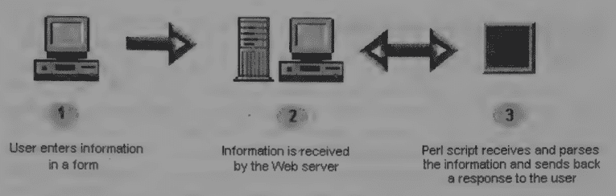

# Perl 自定义 CGI 脚本指南

谨以此书献给 Shannon，感谢她对我的耐心包容，忍受我写这本书所花费的时间，以及许多个夜晚和周末她坐着看我打字而无外出的时光。她对我的耐心展现了我俩共同创造的成果，如果她愿意成为我的妻子，她将使我成为最幸福的男人。

我也将此书献给我的家人和朋友，感谢他们给予我的所有支持。

## 关于作者

`Kevin Hanegan`（khanegan@yahoo.com）是 `Xevo Corporation`（www.xevo.com）的高级技术顾问，该公司是应用服务提供商（ASPs）基础设施解决方案的领先供应商。此前，Kevin 曾在位于马萨诸塞州莱克星敦的领先国防承包商雷神公司（Raytheon）担任软件工程师。Kevin 是一位认可的互联网研讨会和会议演讲者，同时也是东北大学 MIS 部门和 State of Art 部门的兼职讲师。Kevin 拥有 Custom Web Designs，一家服务于中小型企业的 Web 设计公司。

Kevin 在维拉诺瓦大学获得了数学学士学位和计算机科学学士学位，在不工作的时候，他喜欢踢拳击和放松。

## 引言

`Custom CGI Scripting with Perl` 是一本关于如何为网站创建自定义 Web 应用程序的完整实用指南。其他书籍可能只教授 Perl 而不教授 CGI，或者只为你提供可放入网站的 CGI 示例而没有教你如何创建自己的脚本，又或者教你如何创建 CGI 脚本但没有给出如何将它们整合到网站中的全貌。本书涵盖了学习如何搭建网站并使用 Perl 脚本为其添加交互功能所需的全部知识。虽然 Perl 是一门难以精通的语言，但如果你只提取完成工作所需的知识，学习 Perl 将变得不再那么艰巨。在本书中，我尝试提取了九个不同的 Perl 构建模块，这些模块将覆盖你的网站可能需要的任何功能。在分别学习每个构建模块之后，我们将开始将这些模块整合在一起，形成自定义的 Perl 脚本。

在当今的高科技世界中，每家企业都需要一个网站。一个只有纯文本的信息性网站已经无法满足需求。网站需要具备交互性才能吸引用户。对于你创建的每一个网站，你必须假设至少有 10 个其他网站正在尝试实现与你完全相同的功能。为了生存，你必须接触访问者并给他们一个留下的理由。你的网站现在必须成为组织中活跃的一部分，而不仅仅是一个在线广告。如果你能保持其交互性，并提供用户接收和发送信息的方式，你的处境将会好得多。这一切都可以通过使用 Perl 编写 CGI 脚本来实现。

例如，最简单的订单表就能帮助你的网站实现交互。至少，访问者应该能够通过你的网站与你联系。使用 Perl 的 CGI 脚本可以在后台快速实现这一切。对于许多在线提供服务或产品的企业来说，可搜索的数据库正成为一种必然。这项功能可以让信息被快速且轻松地找到。本书将逐步向你展示如何创建这些在线数据库。通过学习 Perl CGI 脚本编写，你可以添加更多的交互功能，帮助你的网站和业务繁荣发展。你可以使用 Perl 脚本创建培训和测试工具、在线贺卡、聊天室、计数器等等。

## 本书与技术概述

当今最热门的领域之一就是 CGI 脚本编写。很少有人能声称他们知道如何高效地创建 CGI 脚本。即使你没有寻求职业转换，只是对这门语言感到好奇，或者希望为你的网站增加交互性，本书也适合你。本书不仅会教授你需要知道的概念，还将通过你可以立即在网站上使用的真实世界示例来教授。这本书将为你省去购买三四本其他 Perl 书籍的麻烦：一本学习 CGI，一本学习 Perl，一本学习如何在 Web 服务器上设置和安装 Perl 脚本，以及一本提供可修改的 Perl 脚本示例。本书末尾包含八个附录，让你在创建 Perl 脚本时能够快速访问所需的任何参考资料。

## 本书结构

本书分为四个部分。每个部分涉及 Perl 脚本的不同方面。第一部分是“入门”，解释了你在开始编写 Perl 脚本之前需要知道的信息和需要具备的工具。第二部分“Perl 构建模块”将讨论与 CGI 编程相关的 Perl 语言。该语言被分解为构建模块，本部分的每一章将讨论一个构建模块。第三部分“高级 Perl 技术”将讨论如何确保你的 Perl 脚本能够处理错误并保证安全性，还将讨论当 Perl 脚本无法正常工作时如何进行调试。书中的最后一部分“综合实践”将讨论如何正确规划你的脚本，并为你提供三个案例研究。这些案例研究的选择旨在让你接触到 Perl CGI 脚本编写中的许多核心概念。阅读完本书后，多个附录将为你提供一些有用的参考资料。

# 第一部分：入门

本部分为不熟悉 CGI 的人员提供 CGI 概述，并概述安装 Perl 脚本所需的内容及必要步骤。

## 第 1 章：CGI 概述

本章将简要介绍 CGI。它将提供 CGI 的概览，解释 CGI 是什么以及可以用作什么，解释 CGI 的工作流程，并解释 HTTP 协议是什么。

## 第 2 章：CGI 框架

本章将讨论搭建 CGI 框架时所需的所有步骤。本章讨论了托管自己的 Web 服务器或外包给其他公司的优缺点。此外，还讨论了 Unix 和 Windows NT 平台之间的差异。最后，本章提到了一些关于 Web 服务器配置及其环境的，你需要向 Web 托管公司询问的具体问题。

## 第 3 章：安装 CGI 脚本

本章将介绍编写并将 Perl 脚本上传到 Web 服务器所需的步骤和工具。本章还将讨论使用哪种类型的文本编辑器，以及如何将文件上传到服务器，以及文件上传后如何对其进行操作。

# 第二部分：Perl 构建模块

本部分将向读者展示使用 Perl 创建自定义 CGI 脚本所需的所有构建模块。我认为有 10 个构建模块是你应该熟练掌握的。一旦你理解了所有 10 个模块，你就可以发挥想象力将它们整合到一个功能完整的 Perl 脚本中。

## 第 4 章：Perl 简介

本章将概述 Perl，包括它发展至今的历史。Perl 和 Web 从一开始就结合在一起，主要是因为 Web 涉及大量数据，而 Perl 处理数据的能力很强。本章还将讨论使用 Perl 相比其竞争对手的其他优势。最后，你将编写第一个用于互联网的 Perl 脚本。

## 第 5 章：使用 `print` 语句

本章将详细描述最重要的 Perl 构建模块——`print` 函数，以及如何将其用于 Perl 脚本编写。`print` 函数是使用 Perl 进行 CGI 编程的基础。大多数 CGI 脚本将动态创建 Web 页面或将用户信息存储到数据库中，如果没有 `print` 函数，这一切都无法实现。本章将介绍 `print` 函数的多种不同实现方式。

## 第 6 章：使用变量

本章将讨论如何使用 Perl 来控制数据。Perl 可以通过多种不同方式控制数据。本章将详细分析每种主要类型，以及我们如何移动、操作和返回这些数据。

## 第 7 章：语句与条件判断

本章将讨论 Perl 语言中的语句和条件判断。这是所有 Perl 编程的根基。它解释了有效使用这些控制结构的重要性。本章将帮助读者养成良好的编程习惯，例如使程序易于理解和调试。Perl 拥有许多我们习惯于在 C 或其他语言以及 Unix shell 中使用的相同控制语句。其语法非常灵活，因此，本章将定义这些语句，并提供一种统一的编写方式，以便我们之后能明确其含义。

## 第 8 章：使用子程序

本章将讨论子程序的设计与构建。子程序为我们提供了组织性、效率和简洁的代码。更重要的是，它们能让我们将麻烦和问题分解成更容易处理的块。使用子程序编写是实现超过 20 行程序的最佳方式。本章还将向您展示如何复用其他程序的子程序，而无需进行简单的复制粘贴。

## 第 9 章：模式匹配

本章将讨论模式匹配。Perl 最强大的功能之一就是其搜索文本以寻找模式并对匹配的子字符串执行操作的能力。本章将展示如何在一行输入中搜索特定的匹配字符数组，并根据是否找到所搜索的模式返回真或假。

## 第 10 章：文件输入与输出

本章将讨论文件的输入与输出。使用 Perl 进行 CGI 脚本编写的一项主要能力是能够从数据库和文件中读取数据，以及对其进行追加或覆盖。为了在 Perl 中实现这一点，您必须学习如何打开、读取和写入给定文件。本章将涵盖所有这些主题，并指出处理文件输入输出的一些特定方法。

## 第 11 章：处理 HTML 表单

本章将讨论 HTML 表单处理。开发人员使用 Perl 的主要原因之一是为了接收来自 HTML 表单的用户输入。本章将重点讨论 Perl 脚本如何接收和处理来自 HTML 表单的用户输入。本章还将介绍能让初学者更容易处理表单的 Perl 库。

## 第 12 章：使用数据库

本章将讨论如何将数据库集成到您的 Perl 脚本中。如果您计划开发一个处理大量数据的网站，您会希望使用关系型数据库。本章将解释什么是关系型数据库，列出您可以选择的几个方案，并向您展示如何将数据库无缝集成到 Perl 脚本中，以便在您的网站上存储和搜索数据。

## 第 13 章：与操作系统交互

本章将讨论如何与底层操作系统进行交互。Perl 的优势之一就是它能够与底层操作系统交互。这使得 Perl 成为一个非常有效的系统管理工具。对于 CGI 脚本来说也非常方便。本章将涵盖如何运行系统命令以及如何在操作系统上执行其他操作（如发送电子邮件）。

# 第三部分：高级 Perl 技术

本节将介绍一些 Perl 的高级技术。一旦您学习了所有必要的构建块，必须确保正确使用它们。本节将涵盖如何处理 Perl 脚本运行时可能出现的意外错误。还将涵盖如果脚本运行不正确时如何进行调试。最后，还将介绍如何保护您的 Perl 脚本免受不法黑客的攻击。

## 第 14 章：错误处理

本章将讨论错误处理。错误处理允许我们编写更健壮、容错性更强的脚本。即使您的语法正确且 Perl 脚本运行良好，它在未来也可能无法运行，尤其是当它与其他系统或应用程序交互时。本章将讨论何时使用错误处理，并探讨错误处理的基础知识。错误处理使得 Perl 脚本更适用于无法承受错误的业务或关键任务应用程序。

## 第 15 章：调试 Perl 脚本

本章将讨论调试。在编写 Perl 脚本后，有时脚本会因为简单的拼写错误或逻辑错误而无法运行。本章将涵盖最常发生的错误类型以及如何寻找它们。

## 第 16 章：保护您的 Perl 脚本

本章将讨论安全性。通常情况下，CGI 脚本可能会带来严重的安全漏洞。即使您的脚本编写完美且运行良好，它也可能不安全。由于在 Perl 中可以用多种不同的方式完成同一任务，其中一些方式比其他方式安全性较低。本章将向您展示如何为脚本增加安全性，并解决可能出现的一些安全漏洞。

# 第四部分：综合实践

本节将基于您在第二部分“Perl 构建块”中获得的知识。创建 Perl 脚本简单来说就是将必要的 Perl 构建块集成到一个脚本中，以创建一个功能完整的 Perl 脚本。本节将向您展示在创建 Perl 脚本之前如何进行规划。本节还将通过三个常用 Perl 脚本的案例研究进行演示。

## 第 17 章：规划您的脚本

本章将讨论规划。在计算机上输入第一行代码之前，对 Perl 脚本进行规划至关重要。规划脚本可能是创建脚本过程中最重要的一部分。如果您能适当规划并在开始编写之前处理好所有需求，您将能够更快速、更高效地创建脚本。

## 第 18 章：电子邮件响应表单

本章将讨论第一个案例研究：电子邮件响应表单。该脚本允许用户在 HTML 表单中输入信息。随后，这些信息被发送到 Perl 脚本，并由脚本发送给指定的人员。用户随后会收到一个自定义的 HTML 响应页面作为回馈。该脚本涵盖了如何接收 HTML 表单输入、如何生成 HTML 响应页面以及如何发送电子邮件。

该网站包含了书中讨论的所有源代码以及指向 Perl 相关网站的链接。其中包含所有所需应用程序（如 WS FTP LE）的链接，以便读者下载。此外还包含一个公告板，以便读者可以发布关于 CGI 或 Perl 的疑问。

## 总结（从这里开始，接下来的内容，等等）

`Custom CGI Scripting with Perl` 是任何希望为其网站增加交互功能的人的必买之书。它讨论了如何将 Perl 提供的构建块与用户自身的数据相结合来编写自定义 Perl 脚本。这些脚本将能够处理客户端发送的信息，并能向客户端发送响应。本书还涵盖了如何设置 Web 服务器和 Perl，以便在内网或互联网上提供 Web 页面。阅读本书后，您将能够创建任何您想要的 Perl 脚本。唯一能限制您的是您的想象力！

# 第一部分：入门

## 第 1 章：CGI 概览

当我们就熟知的万维网（World Wide Web）在 1994-1995 年左右开始真正商业化起飞时，HTML（超文本标记语言）是开发 Web 页面的首选语言。网站管理员最初希望在互联网上发布论文、传单或简单的文本，以便全世界的人都能查看。在那个时刻，没有人能猜到互联网在接下来的几年里会变成什么样子。

很快，公司们意识到，在网上宣传他们的公司和产品可以让全世界的客户随时查看他们的产品或服务。Web 很快成为了增长最快的广告媒介。如果您的公司没有在线形象，它就不会被认为是一家优秀的公司。

很快，Web 开发人员意识到了互联网的潜力，同时也意识到 HTML 缺乏他们所寻找的许多能力。HTML 从来不是为了分发动态内容而设计的，而只能分发预设计的内容。HTML 本质上是一种静态语言。为了在不重新设计 HTML 规范的情况下向互联网添加动态内容，人们创建了一个接口，允许客户端计算机向 Web 服务器请求信息。Web 服务器随后可以执行其需要的任何操作，并将响应以格式良好的 Web 页面形式返回给客户端。这个接口被称为 `Common Gateway Interface`，通常简称为 CGI。随着 CGI 的出现，互联网变成了一个可以一站式处理任何事情的地方……

可能需要。例如，学生不再需要开车去图书馆查阅百科全书，他们可以在线查看。毕业后寻找工作的大学生现在可以快速访问潜在雇主的网站，以了解更多关于这些公司的情况。繁忙的父母现在可以在线订购书籍、CD、家具甚至杂货以节省时间。这场新的革命始于 CGI。

### 章节目标

- 理解什么是 CGI 以及为什么它很有用
- 理解哪些产品与 CGI 竞争，以及何时 CGI 是更好的选择
- 理解客户端/服务器应用程序（Client Server Applications）的概念
- 理解 HTTP 协议的基础知识
- 理解 CGI 流程涉及的步骤

### 什么是 CGI？

CGI（通用网关接口，Common Gateway Interface）是一种允许客户端计算机与服务器进行对话的协议。CGI 不是一个在计算机上运行的实际程序，而是一种信息服务器与其他程序通信的方法。CGI 为网页用户与 Web 服务器之间如何相互通信设定了标准。

### 为什么 CGI 很有用？

CGI 为您的网站增加了交互性和动态内容。在过去的几年里，我们见证了人们看待计算机及其能力的方式发生了显著变化。我们不再受限于处理能力极低的大型台式机。随着万维网（World Wide Web）的引入，我们现在可以在几秒钟内从世界任何地方访问信息和资源。我们一直在寻找访问信息甚至在网上开展业务的新方法和改进方法。例如，电子商务预计在未来三年内将增长两倍。对于我们这些 Web 开发人员来说，挑战在于不断提高标准，以跟上最新技术，并满足对通过网络交付的更快、更轻量、更健壮的应用程序的需求。这些应用程序从简单的订单确认脚本，到收集用户信息并将其存储在数据库中，再到在线处理订单，不一而足。

CGI 是解决所有这些应用程序的一种可行方案。CGI 是最常见的服务端 Web 技术。几乎所有现有的 Web 服务器都提供对 CGI 程序的支持。CGI 程序可以用多种语言编写，其中 Perl 是最流行的。Perl（在第 4 章“Perl 简介”中将详细讨论）是一种非常适合编写 CGI 脚本的语言。几乎所有的 Web 服务器都安装了 Perl 解释器。由于 Perl 解释器是免费软件且已安装在 Web 服务器上，Web 开发人员可以轻松找到一个符合其功能的现有 CGI 脚本，根据其内容进行修改，然后上传到自己的站点。

### 客户端/服务器应用程序

为了更好地理解 CGI 的概念，首先有必要理解客户端/服务器编程的基础知识。简单来说，`客户端`（client）是用于访问网页的计算机。`服务器`（server）是用户从中检索网站的计算机。服务器可以位于世界任何地方。如图 1.1 所示，许多用户可以登录到位于一台服务器上的同一个网页。

在这种情况下，同一个网页正被多个访问者访问。如果您希望网页根据每个访问者的操作而改变其属性，您将使用客户端编程技术，例如 JavaScript。例如，当用户将鼠标悬停在与 `mouseover` 事件关联的图像上时，会发生 JavaScript 滚转（rollovers）。图像仅在该用户的网页实例中被替换为另一张图像，所有其他实例保持不变。

服务端编程用于需要在服务器上发生某些操作的行为。聊天室就是一个很好的例子。用户输入文本，该文本被追加到位于服务器上的一个 HTML 文件中。该文件需要被聊天室中的每个人访问，而不仅仅是输入文本的人。用户需要在服务器上共享同一个文件。如果没有服务器，用户将无法相互通信。聊天室中的每个人都会动态地向该共享文件添加内容。

> **注意**：**服务端编程**是指任何需要使用服务器的程序或脚本。**客户端编程**是指任何仅影响单个客户端计算机，而不影响同时访问同一页面的其他任何人的程序。

对于需要包含客户端计算机之间任何形式的交互，或需要使用服务器执行任何任务（如访问数据库或发送电子邮件）的网页来说，服务端编程至关重要。

实现服务端编程的一种方法是使用 CGI。CGI 协议定义了网页如何向服务器发送信息以进行处理，如何访问非 HTML 信息，并将其转换为 HTML 格式以便在 Web 浏览器中显示。

### HTTP 协议


为了让 Web 服务器执行 CGI 脚本，Web 浏览器需要将任何用户数据打包并向 Web 服务器发出 HTTP 请求。HTTP（超文本传输协议，HyperText Transfer Protocol）是一种应用层协议，用于帮助在互联网上传输数据。HTTP 通信极有可能通过传输控制协议/互联网协议（TCP/IP）连接进行。这通常通过端口完成，大多数网页的默认端口为 80。

如果您的网页地址是 `www.cwdesigns.com`，信息将通过默认端口 80 传输。如果网页地址是 `www.cwdesigns.com:8080`，信息将通过端口 8080 传输。在配置 Web 服务器时，您可以将默认端口保持为 80，也可以将其修改为任何可接受的端口号。请查阅您的 Web 服务器配置文件以了解允许哪些端口号。许多网站会为正式生产站点使用默认端口，为开发站点使用另一个端口。

> **注意**：互联网上的计算机通常使用 TCP/IP 协议，通过信息数据包相互通信。这些数据包使用标识数据发送者和接收者的 IP 地址来往返发送。

HTTP 协议是一种请求/响应协议。每个 HTTP 客户端请求和服务器响应由三部分组成：请求/响应行、头部区域和主体。

### 客户端请求

当客户端向服务器发送请求时，它通过 HTTP 指定的端口连接，并发送请求方法，随后是 URL 以及所使用的协议类型和版本。当一个人在浏览器地址栏输入 `http://www.cwdesigns.com` 时，浏览器会向服务器发送以下请求：

```http
GET /index.html HTTP/1.0
```

这表明浏览器正使用 `Get` 方法，通过 HTTP 协议 1.0 版本请求服务器上的 `index.html`。所有可用方法将在本章稍后部分讨论。

然后，客户端可以发送可选的头部信息，以告知服务器更多关于其配置和其他相关信息。有关请求头部的完整列表，请参阅附录 A“请求和响应头部”。如果客户端想向服务器发送关于自身的信息，以便服务器能够自动识别并量身定制响应，客户端可以发送 `User-Agent` 头部。客户端还可以发送 `Accept` 头部来指定响应中可接受的媒体类型。如果将这些信息添加到我们刚才看到的客户端请求中，它看起来会像这样：

```http
GET /index.html HTTP/1.0
Accept: image/gif, image/jpeg, image/png
User-Agent: Mozilla/4.7
```

最后，客户端可能会在发送实际内容之前向服务器发送额外信息。这些元数据是关于发送给服务器的数据的附加信息。例如，如果客户端想将请求转发给源服务器（即使它拥有所请求内容的缓存副本），它可以向服务器发送 `Pragma: no-cache` 头部。

发送给服务器的最终请求数据包如下所示：

```http
GET /index.html HTTP/1.0
Accept: image/gif, image/jpeg, image/png
User-Agent: Mozilla/4.7
Pragma: no-cache
```

请求行、头部和主体分别放置在不同的行中。这样服务器就知道每一行包含一个请求头部。客户端在头部结束时会向服务器发送一个空行，以告知服务器头部已完成，返回的网页即将开始。

### 服务器响应

服务器首先会回复一条包含所用协议、状态码以及状态码简短描述的状态行。有关所有状态码及其描述的完整列表，请参阅附录 B“服务器状态码”。

如果服务器响应上述客户端请求，它可能看起来像这样：

```http
HTTP/1.0 200 OK
```

接下来服务器发回给客户端的几行是服务器信息头部。这些头部允许服务器传递有关响应的附加信息，而这些信息无法放置在状态行中。

如果服务器发回日期、所使用的 Web 服务器类型、最后修改日期以及发送文件的内容类型，它可能看起来像这样：

如果请求以及随后的响应都成功，那么服务器会将数据附加到发回给客户端的数据包中。如果服务器发回前一个示例中的 `index.html`，它可能看起来像这样：

```html
HTTP/1.0 200 OK
Date: Tue, 2 May 2000 21:24:56 GMT
Server: Apache/1.3.6 (Unix) PHP/3.0.7
Last-Modified: Sun, 30 April 2000 12:43:24 GMT
Content-type: text/html;

<HTML>
<HEAD><TITLE>CW Designs</TITLE>
</HEAD>
<BODY>
...
</BODY>
</HTML>
```

请注意，在最后一个响应头之后有一个空行。就像客户端请求一样，每个响应头都以回车符结束，并且在响应头的末尾会添加一个空行。

### CGI 流程

刚才描述的所有步骤在连接到静态 HTML 文件时都是自动发生的。然而，在连接到 CGI 脚本时，我们必须在 CGI 脚本内部创建服务器响应，以便脚本能够正确地返回给浏览器。通过理解 HTTP 协议及其与 CGI 流程的关系，编写 CGI 脚本将变得轻而易举。

CGI 脚本编写涉及设计和编写能够从网页接收启动命令的脚本。要用浏览器打开该网页，您可以输入 URL，或者点击指向该 URL 的现有链接。随后请求被提交给 Web 服务器，服务器继而定位该网页并将其发回给浏览器。然后浏览器将显示该页面。

URL 同样引用每个图像、声音文件、插件等等，浏览器必须向服务器请求其中的每一个，并像对待 HTML 页面一样将它们返回。在为您的网站开发 CGI 脚本时，理解 Web 浏览器和 Web 服务器的角色以及它们如何相互交互至关重要。您对这项技术的了解越多，您的脚本就会越高效。

Web 浏览器是一个将多种信息检索能力结合在一个界面下的程序。它可以被看作是一个通用用户界面。无论您是在互联网上浏览信息、提交在线订单、处理在线银行业务，还是从数据库中访问信息，浏览器的职责都是相同的：呈现 Web 内容，将访问者的任何请求发送到服务器，并处理该请求的任何结果。

Web 服务器是运行在连接到互联网的计算机上的程序。Web 服务器监控互联网连接并等待来自浏览器的请求。当服务器收到请求时，它将被发送到相应的进程，在许多情况下是一个 HTTP 服务器。然后服务器接收请求并决定如何处理。通常，结果是在 Web 服务器上找到一个特定文件并将其返回给浏览器。该文件可以是一个 HTML 页面、一张图像、一个声音文件等等。

例如，以下 URL 会使 Web 浏览器向主机计算机 `www.cwdesigns.com` 发送请求，以发出针对文档 `index.html` 的 HTTP 请求：

```text
http://www.cwdesigns.com/index.html
```

除了简单地请求 HTML 文件外，您还可以要求服务器为您运行一个应用程序。这个应用程序就是我们所称的 CGI 脚本。

目前有许多可用的 Web 服务器。本书将主要关注基于 Unix 的服务器，因为它们仍然是最为主流的，但也会涵盖基于 Windows 的服务器。

#### 三层模型

Web 应用程序通常遵循三层模型。第一层由所有用于将数据组装成可呈现格式的技术组成。它通常不仅包括 Web 浏览器，还包括 Web 服务器。第二层由脚本或程序组成。第三层为第二层提供所需的数据。

例如，一个加入新健身俱乐部的人可能会登录他们的网站来填写一份健身评估表。这份评估表将存储在健身俱乐部的数据库中，以便员工在培训特定会员时可以查看。

在这个例子中，Web 应用程序将从会员那里收集数据。这是第一层。应用程序将信息发送到 Web 服务器，服务器将运行请求的脚本。这是第二层。请求的脚本将会员信息发送到数据库。这是第三层。然后脚本将打包一个确认页面发回给浏览器。这又是第二层。最后，浏览器接收数据包并将其显示给会员。这回到了第一层。

几乎所有 Web 应用程序都是使用这种相同的架构构建的。唯一改变的是发送给脚本的信息是什么，脚本如何处理它，以及发回什么内容。由于它们都遵循相同的基本架构，Web 开发人员可以很容易地搭建环境，并为几乎所有的 CGI 脚本遵循相同的流程。

### CGI 流程中的步骤

CGI 脚本的第一步是从用户那里收集信息。这传统上使用一个简单的 HTML 表单来处理。用户在字段中输入信息，按下提交按钮，并将信息发送到服务器。

为了使服务器能够处理传入的信息，Web 浏览器必须将用户数据打包并向服务器发出 HTTP 请求（如本章前面所述）。此 HTTP 请求由 CGI 脚本的 URL、用户输入的表单数据以及任何头部信息组成。

有两种常用的请求方法将此类信息发送到服务器：`Get` 和 `Post`。`Get` 和 `Post` 方法都用于发出执行 CGI 脚本的请求。两种方法都用于检索用户提交的信息。虽然它们实现的功能相同，但方法截然不同。

`Get` 头部意味着产生的数据将作为 URL 的一部分发送到 Web 服务器。数据将存储在环境变量 `QUERY_STRING` 中。`Post` 方法则意味着表单数据在头部主体中传递，并由程序通过标准输入读取。两种方法将在本书后续部分详细讨论。

现在数据包已发送并被服务器接收，服务器必须将请求传递给特定的 CGI 脚本进行处理。Web 服务器将首先通过查看脚本的扩展名来确定需要加载和使用的操作系统环境类型。

在 CGI 脚本的情况下，服务器经过配置，使得 `cgi-bin` 目录下任何扩展名为 `.cgi` 或 `.pl` 的文件都将被视为 CGI 脚本。然后，服务器将加载运行 CGI 脚本所需的任何运行时环境变量。接着，Web 服务器将创建一个新进程来运行该 CGI 脚本。

> **注意**：环境变量是由 Unix 操作系统、Web 服务器或其他程序设置的由名称和值对组成的文本字符串，其他运行中的程序可以访问这些变量。这是 Web 服务器向其他程序传递数据的一种简单方式。这些字符串被称为环境变量，因为它们是全局的，且对所有运行中的程序可见。

最后一步是确保浏览器收到来自服务器的响应。通常，CGI 脚本将指定发送回来的 `content-type`，然后写入一个将发回浏览器显示的响应。

当浏览器收到响应时，它将查看发送的响应头并决定如何渲染信息（通常为 HTML 文件或图形）。服务器始终会向 Web 浏览器返回某种响应，即使它仅仅是一个错误消息。

例如，当访问者填写在线健身调查时，数据由浏览器打包，发送到服务器，存储在数据库中，最后一个 HTML 页面返回给浏览器，确认信息已成功发送。

回顾整个流程：

1. 用户填写一个简单的 HTML 表单并点击提交按钮。
2. 浏览器请求表单中 Action 标签内的 URL，并将所有数据随请求一同传递。
3. 服务器接收数据包并检查服务器是否允许运行 CGI 程序。
4. 服务器检查 CGI 程序是否放置在服务器配置的适当位置（`cgi-bin`）。
5. 服务器在操作系统中启动一个子进程来运行该程序。
6. 脚本运行并返回一个 HTML 响应，通常是一个新动态创建的网页形式。
7. 响应被传回服务器，服务器将其打包在包含所有适当响应头的 HTTP 响应中。
8. 服务器将整个响应发回浏览器，浏览器将其显示给用户。

对于从事 CGI 脚本开发的 Web 开发人员来说，唯一需要担心设计的是第 6 步。流程中的其他步骤已经由浏览器或服务器处理完毕。

编写 CGI 脚本的诀窍在于确保您的脚本能够处理来自 HTML 表单的信息，按要求处理该信息，并向浏览器发送适当的响应以显示给用户。图 1.2 显示了运行 CGI 脚本的事件流。

### CGI 的局限性

CGI 流程存在一些问题。安全性可能是最大的问题，将在第 16 章“保护您的 Perl 脚本”中详细解释。另一个是 CGI 与 HTTP 协议交互所带来的性能问题。

## 第 1 章

CGI（通用网关接口）的请求和响应概述如图 1.2 所示。

CGI 非常依赖于 HTTP 协议。HTTP 主要是在 Web 上没有交互性的时代设计的，因此 HTTP 只提供了一次性的请求/响应式通信。这意味着 Web 浏览器和 Web 服务器仅在浏览器向服务器发送请求，服务器处理请求并将响应返回给浏览器所需的时间内保持连接。如果浏览器需要第二个文档，它必须重新连接服务器并再次请求。这是 CGI 的一个重大缺陷，因为 CGI 本应增加交互性，而不是一次性请求/响应。

例如，想象一下与朋友通电话，但每次你说了一句话并收到对方的回复后，都必须挂断并重拨对方的号码。这给 CGI 带来了多方面的麻烦。

如果客户端和服务器需要在一段时间内或一系列交换中维护浏览器与服务器之间的信息，CGI 脚本必须负责跟踪所有对话并维护其状态。CGI 必须能够将当前的 HTTP 请求与先前发生的相关请求联系起来。

有多种方法可以让 CGI 脚本维护状态。开发人员可以在表单中使用隐藏变量、对 URL 地址进行编码、在服务器上维护状态文本文件，或使用 cookies 来维护状态，但这些方法都很困难且效率低下。

此外，每一次请求/响应都会导致 Web 服务器执行 CGI 脚本的一个独特实例。这意味着如果有 20 个人登录我的网站，并且都在填写我的健身表单提交，那么同时会有 20 个 CGI 脚本实例打开。这可能会给服务器带来非常沉重的负担。

### CGI 过时了吗？

那么，为什么 CGI 至今仍在使用？随着新技术（例如 Java Servlets 和 Active Server Pages，仅举两例）的出现，旨在弥补 CGI 的不足，CGI 是否将继续保持其市场地位，并成为为网站生成动态内容的可行来源？答案是肯定的。

CGI 在动态内容技术领域占有非常重要的一席之地。在大多数情况下，它是正确选择，也是适合这项工作的正确工具。让我们来讨论一下原因。

随着互联网的爆炸式发展，每家企业现在都必须拥有互联网形象才能生存。每天，成千上万的公司正在上线并吸引新的受众。如果你想吸引这一代人，你必须拥有一个网站。

家庭不再在晚饭后围在收音机旁收听当天的新闻故事。你也不再坐在躺椅上阅读当地报纸来了解世界上正在发生的事情。在当今社会，人们通过技术联系在一起，我们希望更快地获取信息，几乎是即时获取。

人们不再等待晚上的当地新闻，而是登录像 `www.msnbc.com` 这样的网站获取最新的、实时的新闻。如果你想了解你的股票投资组合的表现，不必在早上阅读报纸的商业版，只需登录成千上万个提供当前股票报价的网站中的一个。

公司现在必须将网络视为吸引用户和销售产品或服务的必要手段，而不是一个临时的、面向“技术人员”的信息媒介。

这种新媒体不仅是一种宣传自己或公司的方式，公司也在利用这种新媒体开展完全存在于互联网上的业务。随着公司意识到网络不会消失，并且它对于营销和广告的重要性就像报纸或杂志在互联网出现之前的黑暗时代一样，他们正争相建立能够吸引用户、让他们留在网站上并让他们回访的网站。

本书不是关于设计概念，而是关于交互性和动态内容，这些是吸引和留住用户的主要因素。

网站还将为用户提供与其他用户或服务器交互的能力。一个包含从不改变且不提供任何交互性的静态 HTML 文件的信息网站有什么好处？用户在访问一次后，为什么会选择回来？

你需要假设，对于你在网站上做的任何事情，都有很多其他网站试图完成同样的事情。你必须创建你的网站，以便吸引用户并让他们回访。简单、静态的 HTML 文件将不再奏效。事实上，现在超过一半的网络内容是动态的。所有这些动态数据本质上都是短暂的；信息根据用户不断变化或个性化。

有很多技术可以实现这一点，为什么使用 CGI？CGI 是一个很好的工具，可以为中小型企业和个人用户提供动态内容生成和交互性。它简单易用，有许多免费软件示例可供参考，而且成本低廉。

最大的误解之一是 CGI 已经过时，在当今互联网中不再是可行的技术。正如我所说，自从互联网兴起以来，有很多公司的主要业务就是互联网。他们的大部分员工和预算都用于网站的设计、开发和支持。

也有很多公司规模足够大，可以在其网站上投入大量时间和金钱。在这些情况下，网站可能为成千上万的人同时执行高速、敏感的交易和数据记录。从事这类网站工作的人会遇到 CGI 的速度和性能问题。他们认为对于期望同时拥有许多访问者的网站来说，它太慢了。

由于 CGI 的这一局限性，一些供应商推出了用于动态生成 Web 内容的新技术。这些新技术可能稍微快一些，但它们只适用于非常大型、可扩展的网站。没有必要用核弹去杀蚂蚁。

对于想为网站添加一些交互性的人来说，CGI 仍然是完美的解决方案。它易于学习，使得周转时间非常快。

如果你不像互联网公司那样，不将网络作为公司的主要收入来源，你将会对网站的投资回报率非常感兴趣。为什么要花一大笔钱创建一个网站，只为 1,000 个同时访问者以 1.2 毫秒的速度处理用户请求？

这些新技术需要更长的学习时间，并且购买和配置成本更高。当然，它们会工作得很好，在某些情况下可能比 CGI 更快，但对于普通人来说，使用新技术的弊端太大了。

对于大多数不期望有 1,000 个同时访问者的企业来说，CGI 将完美运行。CGI 非常易于使用，大多数非技术人员可以通过查找现有脚本并针对其内容进行修改，立即满足其功能需求。

### 关键点

- 互联网是使用 TCP/IP 协议相互通信的互联网络集合。
- CGI 是一个接口，定义了 Web 服务器如何与其他软件应用程序通信，以及其他软件如何与 Web 服务器对话。
- 客户端/服务器架构涉及一台计算机（Web 客户端）向另一个计算机程序（Web 服务器）请求信息，服务器通过完成请求来响应。
- HTTP 是万维网的语言。它允许计算机使用互联网作为传输文件的介质来请求和接收各种文件类型。
- 环境变量是由 Unix 操作系统、Web 服务器或其他程序设置的由名称和值对组成的文本字符串，可以被其他正在运行的程序访问。
- 尽管 CGI 有其局限性，但它是许多 Web 应用程序的合适工具。

### 总结

总的来说，CGI 可以工作，而且如果做得正确，效果相当好。拥有大预算和开发团队的公司可以负担得起对其服务器的所有探索和定制，但对于中小型企业和本书的大多数读者来说，CGI 是唯一能够让他们在互联网上满足业务需求的工具。

通过本书的基础知识，你将能够完全设计和开发你的网站，包括任何你可能需要的交互，而无需购买任何商业软件应用。你不仅将完成这项工作，而且将在预算内和必要的时限内完成。

现在你对 CGI 是什么以及你可能想如何将其应用于你的网站有了基本的了解，下一章将讨论使用 CGI 脚本的网站所需的框架。

## 第 2 章

### CGI 框架


在当今社会，中小企业若想生存，就必须拥有虚拟存在。一旦决定创建网站，就会面临更艰难的抉择。首先是将网站托管在何处。是自己托管，还是找一家网络托管公司？正如你将看到的，托管自己的 Web 服务器不仅仅是购买一个软件应用、设计几个简单的 HTML 页面然后接入互联网那么简单。

在做出这一关键决定之前，你应首先考虑所有选项和标准。请记住，没有标准答案。每个决定都应根据具体情况做出，权衡各自的利弊。如果你决定自己托管网站，就需要选择使用什么平台、使用什么硬件以及购买什么 Web 服务器软件。如果你决定将网站托管外包出去，就需要找到一家最符合你需求且价格合理的公司。

### 章节目标

- 了解自己托管与外包 Web 服务器的利弊
- 了解 Unix 与 Windows 平台用于 Web 服务器的优劣
- 了解托管自己的 Web 服务器需要什么样的硬件
- 了解你需要从网络托管公司获取哪些信息

### 自己托管 Web 服务器的利弊

如果你选择自己托管网站，就必须购买一台高性能计算机并将其专门用作 Web 服务器。该计算机必须能够安装和配置商用 Web 服务器应用。同时，该计算机必须始终保持运行状态，并通过高速通信服务（如 T1 线路）连接到互联网。你还需要提供全天候的持续维护和支持，这在时间和金钱上可能非常昂贵。如果你选择不自己托管网站，就不必担心这些问题。

如何决定哪种方式最适合你？在做决定时需要研究以下几个标准：Web 服务器设置、维护成本、通信成本和投资回报率。你需要权衡预期通过网站或因网站而获得的业务量。如果你的网站主要用于个人用途且不会从中获得太多收入，你的投资回报率将非常低。你花在设置和维护网站上的钱将远超网站带来的收益。

你也可能没有时间来设置 Web 服务器并提供支持。例如，如果你正在巴哈马群岛度假，而你的服务器崩溃了，你就必须飞回家去修复问题。如果你不飞回去或找不到人替你修复，你的网站在你回去修复之前将无法被任何人访问。

然而，如果你有时间和资金，并且预期网站能带来相当可观的业务，那就没有理由不去自己托管网站。如果你有员工，自己托管网站实际上可能会省钱。例如，如果你有 20 名员工，你可以用一个 T1 连接（甚至是半条 T1 连接）替代所有 20 个独立的拨号上网账户来收发电子邮件和访问互联网。

### 硬件方面的考虑

CGI 脚本的性质决定了它会给 Web 服务器带来非常大的负担。它们是独立的应用程序，这意味着服务器进程必须为每个执行的 CGI 脚本生成一个新线程。服务器不能仅仅启动一个程序然后坐等响应返回。很可能在此期间有其他人在请求 URL。新任务必须以异步方式运行，服务器必须监控任务以确定其何时完成。

生成新任务并等待其完成的开销通常很小，但任务本身会使用系统资源并消耗处理器时间。任何无法同时运行两个程序的服务器根本算不上是服务器。实际上，如果有两位数甚至三位数的程序在运行，而其中大多数是 CGI 脚本呢？如果你设计的网站预期几乎同时获得数十次访问，而你的服务器一次只能处理几个程序，服务器就会试图满足所有请求，每个请求都会占用一些内存和处理器时间，服务器很快就会陷入困境，变得毫无用处。

说了这么多，需要强调的是，这并不意味着大型网站不应该使用 CGI 开发。这只意味着你必须了解服务器的容量，在开发之前规划好网站，最重要的是持续监控你的性能。你不可能去找系统专家询问服务器需要多少 RAM 或磁盘空间。所有这些需求会因你运行的服务器软件、编写的 CGI 脚本类型和编写质量，以及网站的流量模式而有很大差异。

尽管选择硬件并非一门精确的科学，但仍有一些准则可以帮助你。这些准则因你选择的平台而异：Windows 还是 Unix。

在 Windows 机器上优化服务器性能，最好的办法就是增加内存。虽然大多数运行在 Windows 平台上的服务器以 12Mb RAM 就能运行，但你实际上需要 16Mb，并且应该有 32Mb 来优化服务器。超过 32Mb 再增加 RAM 不会有太大区别，除非你计划运行像 SQL 服务器这样的大型应用程序。

基于 Unix 的服务器通常不需要像基于 Windows 的服务器那样多的 RAM。Unix 是一个更小的操作系统，其所有驱动程序也更小。如果你确保机器有 16Mb RAM 和一个相当快的硬盘驱动器，你的 CGI 脚本就能在任何合理的并发访问量下快速高效地运行。

显然，每秒接收多次访问的大型网站应该拥有更多 RAM（无论是在 Unix 还是其他平台上）。计算机拥有的 RAM 越多，缓存 Web 文件和图片的能力就越强，从而更快地满足用户请求。数据库查询和非 CGI 程序往往会拖慢脚本的处理时间。最好将计算机专门留作 Web 服务器使用，不执行任何其他任务，尤其在 Unix 服务器上更应如此。

### 选择平台

无论你决定是否自己托管网站，都必须决定使用哪个平台。Unix 和 Windows 是两个主要的选择平台。许多人认为 Perl 非常适合 CGI 脚本编程，因为它是平台无关的，可以编写一次然后安装在任何平台上。

然而，事实并非如此。尽管 Perl 几乎可以在所有操作系统上运行，但不同操作系统处理事务的方式有很大差异。Perl 针对特定操作系统的实现往往反映了这些差异。

那么，哪个平台最适合托管 Perl 脚本？Unix 在以下方面往往优于 Windows：

- 效率
- 性能
- 可靠性
- 远程管理
- 互联网服务

基于 Unix 的系统平均拥有比基于 Windows 的系统更多的内存和处理器能力。Unix 在 32Mb 内存下提供的性能往往远超 Windows 在 64Mb 内存下的表现。Unix 在内存管理方面也更为出色。

基于 Windows 的系统往往更容易崩溃，而 Unix 的可靠性历经的年头比 Windows 存在的时间还长。远程管理是 Unix 的另一个优势。Unix 的设计允许系统管理员从世界任何地方对系统执行操作，而 Windows 的设计则要求大多数操作必须在本机上完成。最后，Unix 包含了许多协议和服务，如 telnet 和域名服务（DNS），而 Windows 却缺少这些。

基于 Unix 的服务器总体上更适合 Web 应用，但在运行 CGI 脚本的 Web 服务器方面比 Windows 有着显著优势。Unix 是一个更加成熟的操作系统，所有主要的 Web 服务器最初都是为其开发的。

Perl 是 CGI 脚本的首选语言，它最初是在 Unix 上开发的，因其文本解析能力以及轻松执行 Unix 系统命令的能力而非常强大。使用 Unix 系统命令的问题在于，如果你选择了基于 Windows 平台的服务器，这些 Unix 系统命令将无法工作。

例如，要在 Unix 机器上通过 CGI 脚本发送电子邮件，你可以输入以下 Perl 代码：

```
open (MAIL, "| mail khanegan\@yahoo.com");
print MAIL "This is a test email";
close (MAIL);
```

此脚本将使用 Unix 系统命令 `MAIL` 向 `khanegan@yahoo.com` 发送一封电子邮件。

如果你将这个脚本加载到基于 Windows 的服务器上，你会遇到 CGI 配置错误，因为 Windows 没有名为 `MAIL` 的系统命令。为了编写在基于 Windows 的服务器上发送电子邮件的 Perl 脚本，你将必须使用 SMTP 协议。

> **注意**：简单邮件传输协议（`SMTP`）是一种 TCP/IP 协议，用于在互联网上的服务器之间发送电子邮件。由于开发者在 Unix 服务器上使用的邮件应用程序——`mail` 和 `sendmail`——仅适用于 Unix 服务器，在非 Unix 服务器上发送电子邮件将需要使用 `SMTP` 协议。

### 选择 Web 服务器软件

一旦选择了平台，接下来你需要选择一个 Web 服务器应用程序。目前有三种主要的 Web 服务器软件应用程序：Microsoft Internet Information Server（`IIS`）、Netscape Enterprise Server 和 Apache。在考察这些服务器时，我们将比较所有关键问题：价格、易用性、性能、稳定性、可扩展性、定制性和安全性。

> **注意**：正如我们之前所述，第一个 Web 服务器软件是为 Unix 编写的。基于这个传统，两个免费的服务器应用程序被构建出来：`NCSA HTTPd` 和 `CERN HTTPd`。NCSA 由伊利诺伊大学维护，CERN 由万维网联盟（W3C）在麻省理工学院维护。

如今大多数 Web 服务器应用程序都是这些原始服务器之一的后代。事实上，Netscape、Microsoft 和 Apache 的服务器都是基于 `NCSA HTTPd`。

#### Microsoft Internet Information Server

Internet Information Server 仅适用于 Windows NT（实际上随 Windows NT 免费提供），并与之紧密集成。其安全特性建立在 Windows NT 本身的安全特性之上，涉及用户帐户和密码。

使用 Windows NT 文件系统，你可以按用户为基础授予对计算机上特定目录和文件的权限。World Wide Web 服务也可以在主页或虚拟目录上设置权限。这是在 Windows NTFS 授予的任何权限之外的。

通常会对包含 HTML 文件的文件夹授予读取访问权限（否则无法查看），而对 CGI 脚本则期望授予执行访问权限（否则无法运行）。

IIS 还支持安全套接层（SSL）协议，允许服务器和客户端之间的通信加密。这对于发送密码非常有用。

IIS 的站点管理是通过 Microsoft 管理控制台（MMC）执行的。通过此界面，你可以管理站点、目录和文件级别的访问和安全限制。这个图形用户界面（GUI）非常易于使用。

目前使用 IIS 的主要缺点是缺乏对 Unix 平台的支持。Perl 使用 Unix 系统命令来完成许多任务，而这些命令在 Windows 中不可用。IIS 也容易频繁崩溃，需要经常重新启动。

#### Apache

Apache 项目始于 1995 年 3 月，旨在回应一些关于公共域 HTTP 服务器积极开发的担忧。它提供了比 NCSA 服务器更好的速度和稳定性，并包含增强功能。

Apache 可从 `www.apache.org` 免费获取。当你下载适合你操作系统的 Apache 软件包时，请确保获取文档。

Apache Web 服务器是当今互联网上使用最广泛的 Web 服务器。你不必运行 Windows 来运行 Apache。它最初是在各种 Unix/Linux/BSD 平台上开发的，最近被移植到 Win32。

IIS 在 NT 平台上是一个非常好的 Web 服务器，但它被困在仅限 Windows 的世界中。虽然 IIS 有许多方便的功能，但并非每个人都想将 NT 用作其 Web 服务器的操作系统（OS），特别是如果你正在开发 CGI 脚本。

Apache 被广泛接受的另一个原因是其整体稳定性。虽然你可以减慢 Apache Web 服务器的速度（特别是如果你运行许多 Perl/CGI 脚本），但你很少——如果有的话——能将其杀死。Apache Web 服务器服务几乎是坚不可摧的，而且也相对较快。

Apache 的一个缺点是其配置和管理。如果你不熟悉 Unix，Apache 非常难以操作，因为配置和管理服务器完全在命令行上进行。Apache 不提供 GUI 管理控制台。

#### Netscape Enterprise Web Server

Netscape 的 Enterprise，现在称为 iPlanet，是一款顶级服务器。它易于使用、管理和配置，并且不依赖于平台。

与 Apache 和 Internet Information Server 不同，iPlanet 不是免费的。它价格昂贵——在美国价格在 1,300 美元到 2,000 美元之间。也可以从 `www.iplanet.com/products/infrastructure/web_servers/index.html` 下载为期 60 天的评估版。

Netscape 的 iPlanet 服务器可以从命令提示符和其 Web 界面进行管理。使用 Web 界面非常轻松，是三大服务器中最易于使用的。Netscape 还提供非常广泛的在线支持，使管理和故障排除变得容易得多。

就本书而言，你选择哪个服务器并不重要。所有三个服务器都支持使用 Perl 进行 CGI 脚本编写。但是，IIS 无法在其脚本中执行任何 Unix 系统命令。

### 要问你的虚拟主机公司什么问题

如果你决定托管自己的网站不符合你的最佳利益，你可以与虚拟主机公司签约服务。虚拟主机公司会为你提供所有必要的硬件和软件，以及所有的配置和维护。有成千上万的虚拟主机公司，所以你应该研究那些你感兴趣的公司，找到最适合你需求的那一家。

由于 CGI 是主要的安全威胁，许多虚拟主机公司不允许用户使用 CGI 脚本。许多其他公司可能会为你提供一些常见的、已经配置好的 CGI 脚本供你使用，但你无法自定义或添加任何新内容。

其他一些虚拟主机公司会允许你拥有一个 `cgi-bin`，但不允许你将它们上传到服务器。如果是这种情况，他们会要求你通过电子邮件发送脚本，以便他们检查可能的安全漏洞。脚本获得批准后，他们会为你上传。

这种方法听起来不错，因为许多配置和繁重工作都从你手中移除了，但如果你正在开发需要大量错误修复和试验的自定义脚本，它就非常繁琐。每次你的脚本有新的迭代版本，你都必须通过电子邮件将其发送给虚拟主机公司。他们必须测试它，然后上传。如果有语法错误或其他错误，你将不得不花时间发送电子邮件，结果才发现它不工作，因为你忘记了某一行中的分号。

最好找一家允许你完全访问 `cgi-bin` 并允许你使用文件传输协议（FTP）自行上传所有脚本的虚拟主机公司。

找到一家允许你在其服务器上编写 CGI 脚本的虚拟主机公司后，你仍然必须获取关于该公司及其服务器的更多信息，以便编写你的脚本。Web 服务器如何知道用户在你的网站上请求的 URL 是应该按原样加载的静态文件，还是应该运行的像 CGI 脚本这样的程序，这取决于两个因素：文件所在的目录和文件的扩展名。

大多数 CGI 脚本需要在一个名为 `cgi-bin` 的目录中。有些服务器配置的目录名称是 `bin` 或 `htbin`。你需要询问你的虚拟主机公司这个目录的确切名称和位置。

服务器被设置为知道此目录中的任何文件都是应该运行的程序，而不是简单地发送回浏览器。根据服务器配置，你甚至可能无法将普通的 HTML 文件放在此目录中。

CGI 脚本还必须具有适当的扩展名。服务器上文件的扩展名告诉服务器它是什么类型的文件以及如何处理它。大多数服务器配置为知道 `.html` 或 `.htm` 和 `.txt` 文件是纯文本和静态文件，应该按原样发送到浏览器。

你还可以通过 Web 服务器的配置选项添加自己的文件扩展名，并告诉它如何处理文件。`.cgi` 和 `.pl` 扩展名通常用于 CGI 脚本文件。服务器配置为将这些文件识别为它应该执行的程序。

你需要从虚拟主机公司获取的下一条信息是服务器上 Perl 解释器的确切位置。将文件放在 `cgi-bin` 中并带有 `.cgi` 扩展名会告诉服务器将其作为程序运行，但它不会告诉服务器确切如何运行它。

如果程序是编译代码，比如 C 程序，Web 服务器执行它不会有问题。然而，Perl 脚本是解释型的，而不是编译型的。因此，服务器必须包含 Perl 解释器的版本。

你为 Unix 创建的每个 Perl 脚本的第一行将是服务器上 Perl 解释器的位置。通常解释器存储在服务器的 `/usr/local/bin/perl` 或 `/usr/bin/perl`。由于 Perl 解释器可能位于你服务器上的任何位置，因此有必要与你的虚拟主机公司联系以找到确切的位置。

在 Unix 中，Perl 解释器是一个可执行程序，将运行你的脚本。Perl 解释器的路径必须以 `#!` 开头，通常称为 shebang（SharpBang）。以下是一个简单 CGI 脚本的第一行代码示例：

```
#!/usr/bin/perl
```

> **注意**：Unix 和 Perl 对大小写和空格极其敏感。绝对有必要逐字复制路径，并注意大小写。许多初学者会忘记路径中的第一个斜杠（`/`）。还要注意代码行中任何地方都没有空格。任何空格都会导致 CGI 错误，并阻止你的脚本工作。

你还应该查明服务器上 `cgi-bin` 的 URL 和 Unix 或 Windows 路径。某些脚本需要 `cgi-bin` 的 URL。URL 必须包含完整的 URL，例如 `www.yourdomain.com/cgi-bin`。

其他 CGI 脚本需要知道 `cgi-bin` 的相对 Unix 或 Windows 路径。如果你的脚本进行任何类型的文件操作，你需要服务器上文件的相对路径。给出 URL 是不行的。考虑仅当你在链接到文件或将信息发送回浏览器时才使用 URL。

Unix 平台上 `cgi-bin` 的相对路径可能如下所示：

```
/home/youruserid/cgi-bin
```

## 关键点

- Web 服务器是一个软件应用程序，它接收 Web 页面的请求，并将请求的 URL 映射到主机服务器上的本地文件。随后，服务器从磁盘加载该文件，并通过网络将其发送给发起初始请求的 Web 浏览器。
- Unix 是一种计算机操作系统，旨在支持多人同时使用，并内置了 TCP/IP 协议。它是互联网上 Web 服务器最常用的操作系统。
- 三大主流 Web 服务器是 Apache、Internet Information Server 和 Netscape Enterprise Server。
- Web 托管公司提供用于存放、运行和维护网站的设备与服务，以及这些网站所需的互联网连接。

### 总结

在决定创建网站时，你有很多选择需要做出。你需要决定是自行托管网站，还是将其外包给 Web 托管公司。你还必须决定服务器运行在哪个平台上，是 Windows 还是 Unix。

如果你自行托管网站，则必须决定互联网连接方式以及运行服务器的计算机配置。在选定硬件后，你必须决定使用哪款 Web 服务器软件。如果你与 Web 托管公司签约，他们很可能不会给你选择余地，你必须使用他们提供的软件。

如果你自行托管，可以在支持两种平台的多种软件应用中进行选择，包括 Apache、Netscape Enterprise Server 和 Microsoft Internet Information Server。最后，你需要找出服务器上目录和文件的位置及 URL。

这些问题的答案取决于网站的复杂程度，以及你在软件和硬件配置方面的专业水平和知识储备。然而，一旦这些问题全部解决，你就准备好开始使用 Perl 编写自定义 CGI 脚本了！既然我们已经了解了什么是 CGI，以及搭建架构和框架需要准备什么，下一章将讨论创建和实现 CGI 脚本所需的工具。

## 第 3 章：安装 CGI 脚本


一旦你选定并配置好服务器软件和硬件，就需要测试一个简单的 CGI 脚本，以确保设置正确无误。为此，你需要一些额外的工具，例如文本编辑器、FTP 应用程序；如果你选择了 Unix 平台，还需要一个 Telnet 应用程序。文本编辑器用于编写 CGI 脚本，FTP 应用程序用于将脚本上传到 Web 服务器并更改脚本权限，而 Telnet 应用程序则用于远程登录到 Web 服务器，并执行调试和编辑脚本等各种操作。

### 本章目标

- 了解编写 CGI 脚本所需的工具
- 了解上传和配置 CGI 脚本的必要步骤

### 选择文本编辑器

在将 CGI 脚本上传到 Web 服务器之前，你必须先编写它。编写 CGI 脚本不需要购买特定工具，你可以使用任何想要的文本编辑器。如果你运行的是 Windows，我建议使用 WordPad 或 NotePad；如果你使用 Macintosh，建议使用 SimpleText。由于 CGI 脚本本质上就是 ASCII 文本，你只需在编辑器中编写文本，并将其保存为具有相应扩展名的 ASCII 文本文件即可。必须将文件保存为 ASCII 文本，而不是二进制或任何其他格式。CGI 脚本是逐行解释执行的。如果你不将其保存为 ASCII 文本，脚本中可能会被添加一些额外字符，从而干扰解释过程。

需要注意的一点是，大多数人是在 Windows 或 Macintosh 桌面计算机上开发 Web 页面和 CGI 脚本的。这些脚本随后可能会被上传到 Unix 工作站。由于它们是不同的操作系统，因此并不完全兼容。如果你的脚本是从运行 DOS 或 Windows 的 PC 上传的，可能会出现 DOS 换行符问题。DOS 会在文本文件中插入额外的换行符，这会让 Unix 感到困惑。你应当始终使用 ASCII 传输模式从 Windows 机器上传 CGI 脚本——如果你使用自动模式，某些 FTP 程序可能无法正确处理。本章稍后将详细讨论这一点。

如果你在开发简单的 HTML 文件，额外的换行符影响不大。但当你使用 Perl 开发 CGI 脚本时，该语言非常敏感，一个额外的换行符就会导致脚本出错。当你学习如何在服务器上使用 Telnet 并编辑 CGI 脚本时，很容易发现是否发生了这种情况。如果你看到每行末尾都有 `^M`，那么你就遇到了 DOS 换行符问题。你可以通过使用 FTP 程序的 ASCII 模式重新上传脚本，或者在 Web 服务器上使用 `dos2unix` 脚本来解决。`dos2unix` 脚本将删除文件中所有额外的回车符。尽量使用 WordPad、NotePad 或 SimpleText，因为它们通常不会添加额外字符。

### 上传文件

接下来你需要做的是找一个 FTP 程序并熟悉它的使用。你将遇到的很大一部分 CGI 错误都源于脚本上传不正确。你使用的 FTP 程序是 CGI 拼图中的关键一块，它使你能够将程序上传到正确的位置、采用正确的格式，并为程序分配适当的权限。

大多数 FTP 程序为用户提供了图形界面，以便从本地机器和远程 Web 服务器中选择目录和文件。你必须确保将所有 CGI 脚本上传到相应的目录中，该目录通常被称为 `cgi-bin`。上传脚本有两种格式：ASCII 或二进制。由于 Perl 被解释为文本，因此必须将文件作为 ASCII 文本上传。如果你不小心将脚本作为二进制文件上传，将会出现内部服务器错误，且脚本无法运行。

上传脚本后，你需要在 Unix 服务器上更改其权限。文件的权限告诉 Web 服务器如何处理该文件。在 Unix 世界中，有三个类别，每个类别有三种设置。对于每个脚本，权限可以是以下各项的任意组合：读取（read）、写入（write）和执行（execute）。只读文件无法被修改。可读且可写但不可执行的文件可以被读取和写入，但是静态文件，不会被执行。这三种设置的任何组合都可以为三个不同的类别设定：所有者（owner）、组（group）和其他人（other）。所有者是在服务器上创建该文件的人。组是一个 Unix 术语，指与所有者属于同一个组的任何人。其他人是指世界上任何可能尝试访问你文件的人。

由于 CGI 脚本必须能被世界上任何人读取和执行，因此必须为所有者、组和其他人设置执行和读取权限。写入权限的设置则略有不同。在你编写并上传 CGI 脚本后，你会希望所有人都能读取并执行它，但你不希望除了你（所有者）之外的任何人能写入该文件。因此，写入权限必须仅为所有者设置。

并非所有上传到服务器的文件都具有相同的权限。上述示例是任何 CGI 脚本的标准权限，但正如我们在第一章“CGI 概述”中所学到的，CGI 脚本不仅仅是自身在交互。事实上，它们在执行过程中通常会与外部文件或应用程序交互。如果 CGI 脚本访问的文件需要被修改，那么写入权限应当为所有者、组和其他人设置。这是因为该文件需要能够被世界上任何人写入。一个完美的例子是访客簿。你希望设置访客簿，使得每个访问你的网站并想要填写访客簿表单的人都能添加其信息。为了将访问者的信息追加到当前的访客簿文件中，该文件必须是可写的。权限也可以使用 Telnet 直接在服务器上设置，这将在本章稍后讨论。不过，使用 FTP 更改权限会更容易，尤其是对于 Unix 初学者。

几乎所有 FTP 程序都有通用的图形界面，允许你在本地机器和远程机器之间进行拖放。一个值得尝试的好程序是 WS FTP LE，这是由 ipswitch (`www.ipswitch.com`) 提供的一款免费 FTP 程序。下载该程序后，必须按照随附文件的说明进行安装。安装完成后，启动程序。你将看到一个如图 3.1 所示的界面。

你首先要做的是设置应用程序，使其能够连接到你的 Web 托管服务器。点击“New”按钮开始。接着，在相应的字段中填写相关信息（见表 3.1）。

填写完信息后，点击“OK”按钮。如果你输入的信息正确，你将连接到 Web 服务器。连接成功后，你应该看到一个类似于图 3.2 的界面。

图 3.1 WS FTP 设置窗口。

表 3.1 WS FTP 设置字段

| 字段名 | 说明 |
| --- | --- |
| 配置文件名称 | 这是一个任意的名称，是你特定配置的标题。 |
| 主机名/地址 | 这是你要连接的 Web 服务器的地址。如果你不知道这些信息，请询问你的 Web 托管公司。 |
| 主机类型 | 该字段可以保留为“自动检测”。这将让程序自动识别并相应地配置自身。 |
| 用户 ID | 这是你的用户名，由 Web 托管主机提供给你用于登录服务器的。 |
| 密码 | 这是你的 Web 托管主机与你的用户 ID 一起提供给你的密码。输入密码时，该框只会显示星号字符，而不会显示你的实际密码。 |
| 账户 | 该字段可以留空。 |
| 备注 | 该字段允许你添加自己的注释和说明。这是一个可选字段。 |
| 匿名 | 如果你要连接的 Web 服务器允许匿名登录，则勾选此框。 |
| 保存密码 | 如果你希望应用程序在你下次尝试连接时记住你的密码，则勾选此框。如果你在可能有其他用户可以访问的地方使用该应用程序，你可能不想勾选此项。 |

**图 3.2** WS FTP 本地/远程屏幕。

> **注意：** 填写完设置窗口信息后，WS FTP 会为你保存该配置文件以供日后使用。当你再次使用该应用程序时，只需从菜单列表中选择配置文件名称即可。

图 3.2 中屏幕左侧显示的文件和目录是位于你本地计算机上的。屏幕右侧显示的文件和目录是位于 Web 服务器上的。要上传文件到你的 Web 服务器，首先转到左侧框架。这是本地计算机上文件的列表。你必须导航到你存放要发送文件的目录。如果你需要返回上一级目录，请使用文件列表顶部的绿色箭头。如果你需要前往另一个驱动器，请滚动到文件列表的底部。你会看到所有列 Drive 的列表。选择你需要前往的驱动器并双击它。你现在会获得一个新的目录和文件列表。只需不断切换目录，直到到达正确的位置，那里会列出你要发送的文件。在 Web 服务器端，你同样要导航到 CGI 脚本应该上传到的目录，通常是 `cgi-bin`。请向你的 Web 托管公司询问正确的位置。现在选择你要上传的文件，然后点击应用程序中间的向右箭头。这将把文件发送到 Web 服务器。

上传 CGI 脚本时，你需要确保它以 ASCII 模式上传，而不是二进制模式。为了确保这一点，你必须在本地计算机目录下选择名为 ASCII 的单选按钮。如果你选择了 Binary 单选按钮，你的 CGI 脚本将无法工作，你必须重新上传。上传脚本后，你还必须像前面提到的那样更改其权限。为此，你必须在服务器上选择该文件并右键单击它。一个菜单将会弹出，如图 3.3 所示。

**图 3.3** WS FTP 文件选项菜单。

然后你必须点击 `chmod(Unix)` 选项。一个如图 3.4 所示的弹出菜单——WS FTP 远程文件权限——将会出现。由于我们正在上传 CGI 脚本，我们必须更改其权限，使其对所有人可执行和可读。我们通过勾选所有者、组和其他用户的执行和读取复选框来实现这一点。脚本还应该由你——所有者——可写，所以确保勾选该复选框。菜单应该看起来与图 3.4 中完全相同。

### 在 Web 服务器上操作

文件上传到 Web 服务器后，你可能需要直接从服务器本身对其执行各种操作。为此，你需要使用用户名和密码登录服务器。这可以通过使用 Telnet 应用程序来完成。Telnet 是一个允许你使用用户名和密码连接到 Unix Web 服务器的应用程序。连接后，你可以直接在服务器上执行任务，而无需在本地完成后再重新上传。通过 Telnet，你应该能够创建、修改和删除文件，遍历 Web 目录结构，创建子目录，复制、移动或删除文件，更改文件权限，以及调试脚本。

**图 3.4** WS FTP 远程文件权限。

要使用 Telnet，你应该对 Unix 有一定的了解。尽管使用 Telnet 并不是创建 CGI 脚本的必要条件，但它确实很有用，而且会为你节省大量时间。两款最流行的 Telnet 程序是用于 Macintosh 的 NCSA Telnet 和用于 Windows 的 Windows Telnet。你可以在“开始”菜单的“运行”提示符中输入 Telnet 命令来启动 Windows Telnet。

要连接到你的 Web 服务器，你需要打开一个新连接。通过在“连接”菜单上打开“远程系统”来实现，如图 3.5 所示。

接下来，输入你的 Web 服务器名称作为主机名，如图 3.6 所示。

当出现 `login:` 提示时，输入你的 Web 托管公司提供给你的用户 ID，然后按回车键。接下来，输入你的密码并按回车键（见图 3.7）。

登录到服务器后，你应该会获得一个命令提示符（见图 3.8）。从那里你可以输入任何 Unix 命令，然后按回车键。

**图 3.5** 打开新连接。

图 3.6 登录到你的 Web 服务器。

### 基本 Unix 命令

你现在已登录到服务器，并位于你的主目录中。要查看当前目录中的所有文件和子目录，请使用 `ls` 命令。`ls` 命令与大多数 Unix 命令一样，带有一些可以使用的标志。有时你需要查看比文件名更多的文件信息。例如，你可能需要查看文件上设置了什么权限、谁拥有该文件，或者该文件有多大。如果你将 `-al` 标志与 `ls` 命令一起使用，你将获得当前目录中所有文件或子目录的列表，并为每个项目列出其许多属性。

如果你需要从当前目录切换到其他目录，可以使用 `cd` 命令。发出 `cd` 命令后，你需要输入要切换到的目录路径。要切换到 `images/` 目录，请键入 `cd images/`。

图 3.7 输入你的用户名和密码。

**图 3.8** Web 服务器上的命令提示符。

如果你需要从当前目录返回上一级目录，请键入 `cd ..`。如果你希望返回到主目录，可以从任何目录键入 `cd`。

如果你需要将文件从一个目录复制到另一个目录，请使用 `cp` 命令。`cp` 命令的语法是 `cp 文件名 新文件名`。此命令将 `文件名` 复制为 `新文件名`。如果你需要将文件复制到其他目录中的位置，还可以在列表中添加路径。例如，如果你不小心将 `image1.gif` 上传到了 `public_html` 文件夹中，而你想将其移动到正确的位置——`images` 文件夹中，你可以执行以下操作：

```bash
cp image1.gif /images/image1.gif
```

这行代码将 `image1.gif` 从其当前位置移动到 `/images/image1.gif`。在 `images` 前放置 `/` 表示 `images` 是你主目录的子目录。如果你省略了斜杠，你会将图像移动到当前目录内名为 `images` 的文件夹中。这是很多不熟悉 Unix 路径结构的 Unix 初学者容易出错的地方。

如果你需要同一个文件的两个副本，那么使用 `cp` 命令是可以的。但是，`cp` 命令执行的是复制，而不是移动。如果你只是想移动文件，请使用 `mv` 命令。`mv` 命令的语法是 `mv 文件名 新文件名`。此命令将 `文件名` 移动到 `新文件名`。使用我们的示例，代码将如下所示：

```bash
mv image1.gif /images/image1.gif
```

## 36 第3章

与 `cp` 命令一样，如果需要访问当前目录之外的路径，你可以在文件列表中添加路径。

你可能还需要从服务器上删除文件。为此，请使用 `rm` 命令。要删除单个文件，请输入 `rm` 命令后跟文件名。例如：

```bash
rm image1.gif
```

如果出于某种原因你想删除图片目录中的所有图片，可以使用通配符（`*`）。如果你输入 `rm *.gif`，它将删除当前目录中所有 `.gif` 文件。通配符可以放置在文件名的任何位置。如果你输入 `rm im*.gif`，它将删除所有以 `im` 开头的 `.gif` 文件。例如，`rm kevin.*` 将删除任何名为 Kevin 的文件，无论文件扩展名是什么。通配符也可用于除 `rm` 之外的许多 Unix 命令。

如果你想删除整个目录及其所有文件，你必须首先切换到上一级目录（即你要删除的目录的父目录）。然后对你希望删除的目录执行 `rm -r` 命令。

如果你能删除一个目录，那么创建一个目录也同样简单。要创建新目录，你可以使用 `mkdir` 命令，后跟一个空格，然后是你要创建的目录名称。在 Unix 中，目录不能包含空格、斜杠、与符号或星号。你应该坚持使用数字、字母、连字符和下划线。

如果你在本地桌面上开发 CGI 脚本，你需要保存它、上传它、更改权限，然后测试它。如果脚本有简单的错误，你将不得不在本地编辑它，然后重新完成整个上传过程。使用 Telnet 可以更轻松地完成这一繁琐的过程。Unix Web 服务器为你提供了一个 Unix 风格的编辑器，允许你直接在服务器上创建或修改文件。这省去了每次需要更改时都必须重新上传文件的麻烦。

所有 Unix Web 服务器上都应该有一个简单的编辑器，那就是 Pico。你可以直接从命令行调用 Pico，输入 `pico` 后跟一个空格，然后是要创建或编辑的文件名。打开后，Pico 的命令集始终显示在终端屏幕底部。命令由 Control 键后跟一个字母组成。Pico 在屏幕上用 `^` 表示 Control 键。图 3.9 展示了 Pico 文本编辑器的屏幕截图。

你也可以使用 Telnet 更改文件权限。FTP 通过提供复选框以图形化方式为你完成此操作。使用 Telnet，你必须手动输入文件模式。执行此操作的命令是 `chmod`，即 change modifications（更改权限）的缩写。为此，你需要输入 `chmod` 命令，后跟文件模式，然后是文件名。文件模式是三位数字或八进制数，用于描述哪些用户有权对该文件执行特定操作。表 3.2 展示了如何确定特定文件的文件模式。

文件权限通过使用八进制数字来表示每个组的权限。在 Unix 中，有三个组：所有者（Owner）、组（Group）和其他（Other）。要使 Perl 脚本可执行，权限必须为 `755`，这意味着所有者拥有读、写和执行权限，而组和其他用户拥有读和执行权限。

如果你不确定某个命令可以设置哪些标志、可以使用哪些选项，或者如何使用该命令，你可以在命令行输入 `man commandname`，其中 `commandname` 替换为你想要获取帮助的命令名称。例如，如果你想了解更多关于 `ls` 命令的信息，可以输入 `man ls`。

表 3.2 Unix 权限

| 二进制数 | 八进制数 | 含义 |
| --- | --- | --- |
| 000 | 0 | 无权限 |
| 001 | 1 | 仅执行 |
| 010 | 2 | 仅写入 |
| 011 | 3 | 写入和执行 |
| 100 | 4 | 仅读取 |
| 101 | 5 | 读取和执行 |
| 110 | 6 | 读取和写入 |
| 111 | 7 | 读取、写入和执行 |

> **注意：** 请参阅附录 C“基本 Unix 命令”，获取你在使用 CGI 脚本时经常用到的一些基本 Unix 命令的快速参考。

### 安装你的第一个 CGI 脚本

现在你已经准备好创建你的第一个脚本并上传以测试你的配置。我们将使用的脚本功能不多，但如果它能运行，你就知道你的 Web 服务器配置正确了。这个脚本还将让你了解某些目录的位置和路径，以及你将来需要的其他相关信息。CGI 脚本运行在与其他程序不同的环境中，因为它不会从标准输入流获取输入。Web 服务器向 CGI 脚本传递信息的方法之一是通过*环境变量*。环境变量由 HTTP 服务器在每次浏览器向 Web 服务器发送信息时设置。此示例将把所有环境变量输出到你的浏览器上。设置的环境变量因你使用的服务器不同而异。这些环境变量包含大多数 CGI 脚本需要考虑和使用的重要信息。变量存储在一个名为 `ENV` 的数组中。数组将在本书后面讨论。附录 D“环境变量”包含可能的环境变量列表及其简要说明。

打开你的文本编辑器，开始输入以下信息：

```perl
#!/usr/bin/perl
#########################################
# Basic Hello World Perl Script to      #
# test server setup                     #
#########################################
print "Content-type: text/html\n\n";
while (($key, $val) = each %ENV){
print $key."=".$val."\n";
}
```


输入完代码后，你应该将文件保存为`cgi1.pl``或`cgi1.cgi`，具体取决于你的 Web 服务器支持哪种扩展名。确保记住将文件保存为纯文本格式。

接下来，打开你的 FTP 程序，将此脚本上传到服务器上的正确位置，通常是`cgi-bin`。确保以 ASCII 模式（而非二进制模式）上传，并将权限更改为所有者、组和其他用户都可读、写和执行。

完成上述步骤后，你就可以打开浏览器，输入脚本的 URL 来查看是否运行成功。请记住，CGI 脚本的 URL 并不总是像看起来那样直观。即使 FTP 程序可能显示`cgi-bin`在某个位置，它可能有一个完全不同的 URL。由于 CGI 脚本是主要的安全威胁，一些 Web 主机将使用一个集中的`cgi-bin`，并为每个用户提供一个子目录。Web 主机将从每个用户的主账户到其在`cgi-bin`中的子目录建立一个 Unix 链接。虽然你的`cgi-bin`看起来在你的账户空间内，但实际上它位于一个完全不同的位置。你的`cgi-bin`可能不在`www.yourdomain.com/cgi-bin`，而是在`www.yourserver.com/cgi-bin/suid/~username`。你应该在购买 Web 托管服务时了解你的`cgi-bin`的 URL。

如果你的脚本运行成功，它将打印出该特定请求上设置的所有环境变量。如果没有成功运行，请确保你遵循了刚才提到的所有步骤。如果所有方法都失败了，请参阅第 15 章“调试和测试你的脚本”，了解更多关于如何查找代码中错误的信息。

### 关键要点

- 使用基本文本编辑器编写 CGI 脚本。
- 使用文件传输协议（FTP）将 CGI 脚本上传到 Web 服务器。FTP 是在两个 Internet 站点之间传输文件的标准方法。使用 FTP，你可以登录到另一个 Web 服务器并检索和/或发送文件，包括网页、CGI 脚本和图像。FTP 可以通过命令行完成，也可以通过提供图形界面的应用程序完成，允许用户从 Web 服务器拖放文件。
- 使用 Telnet 协议登录到你的 Web 服务器。登录后，你可以执行各种特定任务，如发送和检查电子邮件、调试 CGI 脚本、修改文件权限以及使用文本编辑器。

### 小结

能够安装 CGI 脚本是成为 Web 开发人员的一个非常关键的部分。在许多情况下，安装 CGI 脚本可能比开发它更耗时。开发人员不仅需要了解所使用的脚本语言，还需要了解脚本将安装的环境。编写完 CGI 脚本后，你将使用 FTP 应用程序将其上传到 Web 服务器。上传脚本后，你可能需要对其进行测试和调试。

你现在已准备好进入更复杂的章节，这些章节将向你介绍 Perl 语言。

## Perl 构建块

# 第 4 章

## Perl 简介

无论你是刚刚开始从事互联网编程一周，还是在格子间里写了 10 年 Ada 语言，毫无疑问你都听说过 Perl。不熟悉 Web 编程和 Unix 的人往往会将 Perl 和 CGI 这两个术语混用。事实上，Perl 在今天的互联网出现之前就已经存在了。Perl 是一种高级解释型编程语言，最初创建是为了减轻 Unix 机器上系统管理员的工作负担。它以文本处理和系统管理能力而闻名，并且是许多其他流行工具概念的独特结合体。在我们深入研究实际的 Perl 语法和代码之前，回顾一下它的起源会对有所帮助。

### 本章目标

- 了解 Perl 是如何创建的
- 理解什么是 Perl 语言
- 理解使用 Perl 的优势
- 了解 Perl 的竞争对手
- 了解如何为互联网编写 Perl 脚本

### Perl 的起源

Larry Wall 在 1986 年开发了 Perl，将其作为他工作单位计算机的配置管理和控制系统。起初，Perl 仅包含模式匹配、文件句柄和标量变量（所有这些主题稍后将详细讨论）。当时没有人知道它会变成什么样子，或者最终会进化到什么程度。随着 Larry 对该语言的开发，他发现它的用途比他最初预想的要多。随后 Larry 做出了一个关键决定：他决定将 Perl 作为开源软件发布。随着人们开始研究 Perl 并将其用作编写 Unix shell 脚本的替代方案，他们添加了新的特性和功能，Perl 开始呈指数级增长。随着越来越多的人为 Perl 添加功能，它变成了一种日益复杂的语言，但其完整性和通用性足以完成以前需要四五个 Unix 实用程序才能完成的任务。因此，Perl 遵循这样一种理论：达成目标的方法不止一种（there is more than one way to skin a cat）。如果 Perl 从未作为开源软件发布，它就不会像今天这样流行，也不会成为如此庞大的语言。

自 Web 诞生以来，Perl 变得越来越受欢迎。无论是因为语言本身，还是因为它恰好在正确的时间出现在正确的位置，Perl 成为了互联网上最广泛使用的编程语言，特别是在 CGI 编程方面。虽然还有其他动态内容语言可以编写 CGI 脚本，以及其他可以用作 CGI 替代方案的动态内容技术，但 Perl 仍然是最受欢迎的。事实上，它如此流行，以至于你的服务器上可能已经安装了它，尤其是如果它是一台 Unix 服务器。

由于其复杂性，现在向 Perl 添加新特性变得更加困难。然而，如果有人发现 Perl 目前不支持某种功能，他们可以编写一个 Perl 模块，该模块可以从任何 Perl 脚本内部加载。模块帮助 Perl 支持面向对象编程方法。

**注意** 面向对象编程是一个革命性的概念，它改变了计算机程序开发的规则。面向对象编程围绕“对象”而非“动作”、围绕“数据”而非“逻辑”来组织。该概念专注于我们真正关心的内容——操作对象，而不是操作它们所需的逻辑。

这些模块可以作为对象分发，且在无需了解底层代码的情况下即可使用。例如，我们可以创建一个模块，负责通过 socket 创建与另一个服务器连接的所有繁琐工作。该模块将持续从服务器将股票行情拉取到你的机器上，以便在你的网站托管的 Web 页面上显示。你可以打赌这段代码会相当复杂。在你写好 Perl 代码后，为什么不将所有这些功能封装到一个模块中，然后在任何需要相同功能的 Perl 脚本中加载该模块呢？许多程序员利用了这一点，这些模块的增长导致越来越多的人发现 Perl 非常有用。事实上，可用的模块如此之多，以至于你在不需要深入了解 Perl 语言的情况下就能设计出整个交互式网站。我们将在后面的章节中讨论其中一些模块。要查找可用 Perl 模块的完整列表，请访问 Comprehensive Perl Archive（CPAN），网址为`www.cpan.org`。

### 关于该语言

正如我之前提到的，Perl 不是最容易学习的语言。事实上，精通 Perl 可能非常困难。许多非编程人员或不熟悉 Unix 的人往往会对使用 Perl 望而却步。许多 Web 开发人员使用 HTML 创建网站，但不敢使用 Perl 为其网站添加交互功能。他们认为学习这门语言以及如何实现它的周转时间太高了。这是一个严重的误区。虽然 Perl 作为一个整体是庞大且复杂的，但我们可以轻松地从中剖析出让 CGI 脚本运行所需的部分。我将向你展示与 CGI 脚本相关的所有必要的 Perl 构建块。凭借这些知识，你将能够创建几乎任何你想要的自定义 CGI 脚本。你所需要做的就是识别必要的构建块，并将它们插入到你的特定脚本中。

通常，Perl 脚本由服务器执行，这与用 JavaScript 或 Java 编写的其他程序不同，后者由客户端（通常是像 Internet Explorer 或 Netscape 这样的浏览器）执行。

通过额外的模块，例如数据库独立接口（DBI）或开放数据库连接（ODBC），Perl 可以访问数据库，从像 MySQL 这样的免费数据库到像 Microsoft SQL server 这样昂贵的数据库。这可以与 CGI 脚本结合，从而实现诸如网站购物购物车之类的应用程序。

Perl 还具有许多使其在处理文本数据时非常实用的特性。通过 CGI 从 Web 浏览器发送到 Web 服务器的大部分信息都是用户在 HTML 表单中填写的文本。因此，Perl 是 CGI 脚本编写的绝佳选择。Perl 的有趣特性包括：

- 无需显式声明变量。相反，变量引用的第一个字符用于区分标量、数组或关联数组。
- 无需预先声明字符串或数组的大小。它们从较小规模开始，并根据需要增长到足够大。
- 所有变量在显式设置之前都有可预测的默认值。
- 一套丰富的模式匹配操作，使其能够轻松定位和处理文本模式。
- 一套完整的算术能力。
- 一套用于各种任务的完整内置函数。
- 倾向于快速完成工作，而不是优雅地完成工作。

**注意** Perl 是`解释型`的，这意味着不需要显式的独立编译步骤。相反，你可以使用任何文本编辑器准备一个包含程序源码的文本文件。然后，Perl 处理器读取整个文件，将其转换为内部形式并立即执行。

我们之前提到 Perl 是一种`解释型语言`。这意味着什么？简单来说，有解释型语言，也有编译型语言。解释型语言使用解释器在计算机上直接执行程序。执行像 Perl 这样的解释型语言非常简单。你编写脚本，然后告诉解释器使用类似于`Perl <filename>`的命令来运行它。这使得该语言看起来像一种高级机器语言；然而，其执行速度通常比 C 或 C++ 等编译型语言慢。编译型语言要求你编写的代码由一个名为`编译器`的程序转换为机器可读的代码。如果你编写的程序是正确的（即没有错误），只有在它被编译之后你才能运行该程序。这种编译过程可能很慢，但生成的执行文件速度会快得多。编译型语言的优势在于不需要解释器。在一部机器上编译完成后，它可以在任何能够理解原始机器码的机器上运行。

关于像 Perl 这样的解释型语言，最重要的一点是：你只需编写脚本并运行它。我们编写脚本，然后将其交给 Perl 解释器来完成所有工作。

### 为什么要使用 Perl？

Perl 能够在许多流行的 Web 浏览器上运行。这一点加上它是免费的且拥有庞大的新闻组支持，使得 Perl 成为开发 CGI 脚本的逻辑选择。正如你在第 9 章“模式匹配”中将看到的，Perl 的文本处理和文件操作能力与 HTTP 以及从 Web 上的 HTML 表单检索和处理数据协作得非常好。

如果一名程序员需要设计一个能够将访问者信息存储到数据库中，并且允许数据库所有者搜索和检索信息的 CGI 脚本，那么你需要使用某种模式匹配或搜索算法。Perl 的吸引力之一在于，程序员只需付出极少的努力就能实现模式匹配。`模式匹配`是指通过搜索字符串来查找特定模式的能力……

Perl。在像 C 这样的常规编译型语言中需要数百行代码才能实现的功能，用 Perl 只需几行就能完成。

Perl 还简化了许多以前繁琐的任务，例如从表单接收用户输入、使用 SQL 连接数据库，或向 Web 浏览器重新打印 HTML。Unix 系统的所有管理任务都可以通过用 Perl 编写的程序来简化。它还用于处理和生成文本文件。Perl 语言的结构允许你快速编写出可用的程序。

### Perl 的竞争者

CGI 脚本的最大优势之一在于，你的 CGI 脚本几乎可以用任何编程语言编写。任何能够从标准输入读取数据并向标准输出写入数据的程序都具备编写 CGI 脚本的能力 Talbit。无论它是解释型还是编译型的，两者都能很好地工作。

但有数百种语言满足这一要求。我们如何决定使用哪一种呢？以下是 CGI 脚本语言应具备的一些要求或能力：

- 从标准输入读取
- 向标准输出打印
- 与其他软件工具和库交互
- 访问所有操作系统环境变量
- 字符串操作

由于许多编程语言都满足这些要求，我们现在需要考虑其他决定因素来帮助我们做出决策。

一个主要的决定因素是速度与效率之间的权衡。你应该权衡自己对某种语言的速度和效率的需求，与另一种语言的易用性之间的取舍。如果你首先选择使用 CGI，你的 Web 应用程序可能并不是密集型或复杂型的。大多数 CGI 任务并不需要太大的处理能力。对于预计不会支持每小时数千次访问的 Web 应用程序来说，Perl 将是完美的选择。

另一个决定因素是 Web 服务器上已安装或已配置的语言的可用性。很可能你的 Web 服务器上已经安装了 Perl。你想花时间在服务器上安装和配置 C 编译器吗？如果你使用的是 Web 托管服务，他们可能会规定你使用什么语言。

最后一个决定因素是 Web 流量。你应该考虑你的 Web 服务器预计会有多大的访问量。对于每秒被访问数千次的网站来说，较小型的编译 C 程序可能更高效。然而，Perl 更容易学习和编写，而且免费脚本随处可见，便于定制或启发思路。在考虑了这些因素和条件之后，你的选择范围应该缩小到几种语言。

用于 CGI 的两种最常见的语言是 Perl 和 C，各有优缺点。总体而言，Perl 是一种非常高层次且功能强大的语言。它灵活且易于使用，但体积相对较大，性能上比 C 慢。C 程序更小、更高效、更低层，但编程和编译更困难，而且不擅长像 Perl 那样的字符串操作。那么哪个更好呢？这取决于你希望你的网站做什么、多快完成，以及你希望多快、多便宜地完成。例如，一家寻求互联网存在的中小型企业需要简单的功能，如信息请求、用户评论检索、用户数据存储，以及网站的其他交互组件。这些功能可以用 Perl 简单、廉价、快速地实现。

### 编写 Perl

以下准则将帮助程序员促进 Perl 开发。编写 Perl 脚本的步骤将在第 17 章“规划你的脚本”中讨论。

**清晰性。** 程序不仅必须被编写脚本的人理解，还必须被任何可能维护它的人理解。如果你在编写代码时不够清晰，之后需要回头更新代码时，你可能需要花更多时间来弄清楚你之前做了什么，而不是实际更新代码。不清晰会阻碍你自己更新和维护脚本的自由。

**缩进。** 作为编程中早已形成的经典惯例，你应该在打开每个新代码块时缩进两个空格，在代码块结束时关闭缩进。这样，开始和结束的标记就在同一列，使其开始和结束的位置非常清晰。这可能会使脚本看起来更长，因为某些行现在不得不多行显示，但这对可读性很重要。

**变量命名。** 一般来说，你应该尽量给变量名最大的清晰度，同时又不使它们太长。

**注释。** 为了促进对程序的理解，用英语通过注释来解释它是有帮助的。脚本中应始终包含至少四条注释：

- 脚本做什么
- 谁写了这个脚本
- 脚本何时写的
- 脚本为谁写的

此外，谨慎的做法是对程序的执行形式、任何参数及其语法，以及控制结构进行注释，例如解释细节功能的方式，以及强调实现变量的函数。

### 为互联网设计你的第一个 Perl 脚本

现在让我们创建一个基本的 Perl 脚本，以便涵盖编写任何 Perl 脚本所需的一些基础知识。打开像 WordPad 这样的文本编辑器后，你就可以开始输入你的第一个脚本了。在脚本的第一行，输入`#! /usr/bin/perl`，其中`/usr/bin/perl`指的是你的 Web 服务器上安装的 Perl 解释器的路径。如果你不知道 Perl 解释器的路径，请询问你的 Web 托管公司或系统管理员。在这一行之后，我们可以编写任何我们想要的 Perl 代码。记住，在 Perl 中，每一行都必须以分号结尾。如果你忘记并漏掉了分号，在服务器上尝试执行脚本时将会收到错误。和任何规则一样，也有例外。例如，任何条件语句的首行和末行不需要以分号结尾。

在你的文本编辑器中输入以下代码：

```perl
#!/usr/bin/perl
#####################
# First Perl script #
#####################
print "Content-type: text/html\n\n";
print "<HTML>\n";
print "<HEAD><TITLE>First Script</TITLE></HEAD>\n";
print "<BODY>\n";
foreach $env_var (keys %ENV){
  print "$env_var: $ENV{$env_var}<BR>\n";
}
print "</BODY>\n";
print "</HTML>\n";
```

如果你不理解其中一些语句和语法，不用担心，后面的章节会涉及。将此文件保存为`ex1.ext`，其中`.ext`是你的服务器认可的文件格式扩展名。本书中，我将使用`.pl`。

在本地保存文件后，打开你的 FTP 软件。将`ex1.pl`发送到你的`cgi-bin`。由于 Perl 是解释型的而非编译型的，我们必须以 ASCII 模式而非二进制模式传输它。成功传输后，更改文件权限以允许所有人执行它。

最后，通过在浏览器中输入其地址来测试脚本。同样，如果你不知道 URL，你将不得不询问你的 Web 托管公司或系统管理员。如果你正确地遵循了这个过程，你应该会看到一个类似于图 4.1 所示的网页，它打印出此特定页面和服务器的所有环境变量及其值。

### 要点

- Perl 是一种非常敏感和特殊的语言。确保所有内容都`完全`按照应有的方式输入。
- 大多数 Perl 命令以分号结尾。
- 所有 Perl 脚本都必须以 Perl 解释器的路径开头。
- Perl 是一种能够在没有太多培训时间的情况下快速高效完成工作的优秀语言。
- Perl 模块有助于支持面向对象的方法。
- 一定要对你的工作进行注释。

### 练习

1. Perl 和 CGI 有什么区别？
2. 描述 Perl 相对于 C 的优势。
3. 列出创建 Perl 脚本所需的步骤。

### 总结

迄今为止，Perl 是编写 CGI 脚本最流行的语言。最初它是作为 Unix 系统的通用工具而创建的。过去，Perl 曾被轻视，因为它只是一种脚本语言，或者因为它不是带有商业支持的商业应用程序。然而，这些论点是站不住脚的。多年来，许多系统管理员和其他专业人士一直在使用 Perl 和许多其他免费程序。如果没有 Perl，如今互联网上大多数动态生成的网站将无法运行。

Perl 是一种健壮而强大的语言，将在未来许多年继续存在。尽管它很复杂并支持高度结构化的应用程序，Perl 使得编写强大而简单的 CGI 脚本变得容易。你可以学习一些基本的 Perl 概念，并将其扩展以创建一个具有丰富交互性的网站。

现在，我们将深入学习 Perl。有一些编程经验会有所帮助，但如果你发现这些概念难以理解，*Karel and Robot: A Gentle Introduction to the Art of Programming*，第二版，由 Richard Pattis、Jim Roberts 和 Mark Stehlik 著（Wiley，1994）将为你提供一些入门概念。

## 使用 Print 语句


无论你的 Perl 脚本是复杂还是简单，你始终需要使用`print`函数。`print`函数是用于将信息以 Web 页面形式向用户回传信息，或将来自用户的信息存储在像访客簿或数据库这样的文件中的工具。尽管它在许多脚本中都被使用，但它依然保持着简单且易于使用的特性。

`print`函数为许多计算机语言提供了将内容打印到文件或标准输出（通常是计算机屏幕）的能力。Perl 的`print`函数也不例外，它为你提供了多种功能，使你能够快速创建高效的 Perl 脚本。

### 本章目标

- 理解`print`函数的概念
- 理解如何使用 *here* 文档方法进行打印
- 理解如何使用`q`和`qq`命令进行打印

### 使用`print`函数

正如我之前提到的，CGI 脚本必须接收来自客户端计算机发送的信息，在服务器上执行某些操作，然后将响应发送回客户端计算机。此响应（通常是一个 Web 页面）将被发送到客户端计算机的 Web 浏览器。默认情况下，`print`函数会将输出的数据发送到标准输出（`STDOUT`），即客户端 Web 浏览器。`print`函数的语法为：

```perl
print 'contents to be printed somewhere';
```

因此，以下代码行将向 Web 浏览器回传打印内容：

```perl
print "<HTML><TITLE>This is a line of HTML</TITLE>";
```

如果你想将信息打印到文件而不是 Web 站点，你需要使用文件句柄（filehandler），我们将在第 10 章“文件输入与输出”中讨论。

CGI 如此便捷的原因在于我们可以在 Perl 脚本内部重新创建 HTML 页面。我们还可以在 Web 页面中添加动态数据。例如，如果我想向浏览器发送一个与我网站上所有其他页面外观和感觉一致的 Web 页面，但其中包含一场重大棒球赛的当前比分，我只需重新创建该 Web 页面并添加一个包含当前比赛比分的变量即可。我们将在下一章学习变量。当你将`print`函数与其他 Perl 命令结合使用时，就能体会到它的强大之处。

你不能像在文本编辑器中编写那样直接开始向浏览器发送 HTML。需要使用特殊的标头（headers）来告诉浏览器正在发送什么内容。正如我们在第 1 章“CGI 概述”中所学到的，当使用 CGI 将 Web 页面发送回浏览器时，它是以数据包的形式发送的，并附带其他信息。浏览器应首先接收响应标头。由于我们要发送的是 Web 页面，我们将发送 Web 页面的`Content-type`标头。为了告诉浏览器标头已结束且 HTML 代码即将开始，协议要求我们跳过一个空格。在 Perl 中，这是通过在最后一个标头之后添加一个额外的回车来实现的。

例如，以下 Perl 脚本将把 *Hello World* 这一短语作为 Web 页面的标题发送回浏览器：

```perl
#!/usr/bin/perl
print "Content-type: text/html\n\n";
print "<HTML>";
print "<HEAD>";
print "<TITLE>Hello World</TITLE>";
print "</HEAD>";
print "<BODY></BODY>";
print "</HTML>";
```

请注意第二行中看到的`\n\n`。在 Perl 中，`\n`是执行回车（换行）的代码。连续放置两个`\n`将在`Content-type: text/html`之后执行一次回车，然后在新行上再次执行一次回车，从而在代码中创建一个空行。

如果你尝试前面的示例，你可能会注意到 Web 页面有一些不同之处。在浏览器中查看时，它的外观完全正确，但如果你在浏览器中查看页面的源代码，页面的所有内容将显示在同一行（请参阅图 5.1 以查看通过 Netscape 的“查看源代码”功能看到的源代码）。为什么？正如我所说，为了在 Perl 中执行回车，你必须写`\n`。每次你想要一个新行时，必须以`\n`结束前一行。如果我们重写前面的示例，使“查看源代码”更容易阅读，我们会这样做：

```perl
#!/usr/bin/perl
print "Content-type: text/html\n\n";
print "<HTML>\n";
print "<HEAD>\n";
print "<TITLE>Hello World</TITLE>\n";
print "</HEAD>\n";
print "<BODY></BODY>\n";
print "</HTML>\n";
```

如果你测试这段代码并查看源代码（如图 5.2 所示），你会发现现在有六行，而不是像之前那样只有一行。如果我现在想在 Web 页面的正文（body）中添加文本行怎么办？如果我想添加 *Custom CGI Scripting with Perl* 和 *A book to help you add interactivity to your site*，我会编写以下代码：

```perl
#!/usr/bin/perl
print "Content-type: text/html\n\n";
print "<HTML>";
print "<HEAD>";
print "<TITLE>Hello World</TITLE>";
print "</HEAD>";
print "<BODY>";
print "Custom CGI Scripting with Perl<br>\n";
print "A book to help you add interactivity to \n      your site\n";
print "</BODY>";
print "</HTML>";
```

这段代码将添加两行文本。但为什么我在每行末尾需要两种类型的回车？在我想换行的地方，每行末尾都有一个`<br>`和一个`\n`。它们都是必要的，但用途不同。它们都添加回车，但`\n`是向发送给浏览器的代码添加回车，而`<br>`是向浏览器解释给用户看的代码中添加回车。

如果在代码中省略`\n`，当你查看源代码时，所有的 HTML 代码都将排在同一行。浏览器对代码的解释将完全相同，因为 HTML 对多个空格不敏感。为浏览器做的任何格式化仅仅是为了可读性。然而，一旦浏览器接收到代码，它会解释 HTML 标签并将结果显示给用户。

图 5.3 显示了从 Perl 脚本发送到浏览器的代码。这是通过 Netscape 的“查看源代码”功能看到的。随后代码被浏览器解释并显示。图 5.4 显示了解释后的代码在 Netscape 浏览器中的显示方式。

现在，让我们通过添加我的网站地址来稍微修改示例。

```perl
#!/usr/bin/perl
print "Content-type: text/html\n\n";
print "<HTML>";
print "<HEAD>";
print "<TITLE>Hello World</TITLE>";
print "</HEAD>";
print "<BODY>";
print "Custom CGI Scripting with Perl<br>\n";
print "A book to help you add interactivity to
    your site<br>\n";
print "<a href= "http://www.cwdesigns.com/cgi">
    Click here to go to my Website</a>\n";
print "</BODY>";
print "</HTML>";
```

你发现这段代码有什么问题吗？在第 10 行中，有两组双引号。Perl 如何知道哪些引号对应哪些元素？虽然 Perl 解释器非常智能，但该语言不允许嵌套引号。在这段代码中，解释器会认为`"<a href="`是一组引号，而`">Click here to go to my Website</a>\n"`是另一组，你会收到一个错误。

双引号被视为 Perl 的特殊字符。特殊字符（普通 ASCII 字符）在 Perl 语言中执行特殊功能。例如，Perl 中的双引号是用于许多函数（如`print`函数）开头和结尾的特殊字符。当我们想要打印 ASCII 字符而不是让 Perl 将其解释为特殊字符时，我们需要使用反斜杠。反斜杠是另一个特殊的 Perl 字符，用于让 Perl 不要将下一个字符解释为特殊的 Perl 字符。为了正确地显示代码，示例如下：

```html
<HTML>
<HEAD>
<TITLE>Hello World</TITLE>
</HEAD>
<BODY>
Custom CGI Script Reply to Scripting with Perl<br>
A book to help you add interactivity to you site<br>
</BODY>
</HTML>
```

**图 5.3** 发送到 Netscape 的 Perl 脚本代码。

**图 5.4** 在 Netscape 中显示的解释后代码。

58

在编写前述示例时，我们不得不对 ASCII 双引号进行转义（`\`），如下所示：

```perl
#!/usr/bin/perl
print "Content-type: text/html\n\n";
print "<HTML>";
print "<HEAD>";
print "<TITLE>Hello World</TITLE>";
print "</HEAD>";
print "<BODY>";
print "Custom CGI Scripting with Perl<br>\n";
print "A book to help you add interactivity to
your site<br>\n";
print "<a href= \"http://www.cwdesigns.com/cgi\">
Click here to go to my Website</a>\n";
print "</BODY>";
print "</HTML>";
```

还有一些其他特殊的 Perl 字符也需要转义。表 5.1 列出了一些特殊的 Perl 字符。

请注意，`@`符号也是一个特殊的 Perl 字符。`@`符号在网上随处可见，因为它被用于所有电子邮件地址。记住，当你在 Perl 的`print`函数中写入电子邮件地址时，必须使用`\`对其进行转义，例如，`info\@cwdesigns.com`。

> **注意** 在用 Perl 创建网页时，要记住一件重要的事情：你在 HTML 中可能使用的任何链接或图像的路径，可能与你习惯编写的路径不同。由于你的`cgi-bin`目录位置与你的网页位置不同，因此你必须调整你的路径，以确保它们仍然有效。

### 表 5.1 特殊的 Perl 字符

| 字符 | 描述 |
|---|---|
| `#` | 此字符之后的任何文本都会被注释掉 |
| `\"`或`'` | 用于许多 Perl 函数的开头和结尾 |
| `@` | 列表数组 |
| `%` | 关联数组 |
| `$` | 标量变量 |
| `&` | 用于调用子程序 |
| `\` | 用于转义特殊的 Perl 字符，使其不被解释 |

### 使用 Here Document

你现在可能已经意识到，创建 Perl 脚本并不困难，但可能看起来很繁琐。如果我们正在重新创建整个网页并发送回浏览器（带有一些动态数据条目），我们可能会遇到大量的双引号，因为它们在网站中经常使用。此外，为每一行你想发送回去的内容都写上`print`函数会变得非常繁琐。

让我们看一个发送表格回去的网页。

```perl
#!/usr/bin/perl
print "Content-type: text/html\n\n";
print "<html>\n";
print "<head><title>Printing can be
        tedious</title></head>\n";
print "<body>\n";
print "<TABLE BORDER=\"1\" CELLSPACING=\"1\"
        CELLPADDING=\"1\">\n";
print "<TR>\n";
print "<TD ALIGN=\"left\">Name:</TD>\n";
print "<TD ALIGN=\"right\">Kevin Haneghan</TD>\n";
print "</TR>\n";
print "<TD ALIGN=\"left\">Email:</TD>\n";
print "<TD
        ALIGN=\"right\">info@cwdesigns.com</TD>\n";
print "</TR>\n";
print "</TABLE>\n";
print "</BODY></HTML>\n";
```

在这个简单的脚本中，进行了大量的转义。最大的问题是，如果缺少任何一个转义反斜杠，整个脚本就无法工作。在 HTML 中，如果你写错了一个标签，浏览器会忽略它，并按应有的方式显示其他所有内容。在 CGI 中，我们没那么幸运。整个脚本将无法工作，你必须调试脚本来找出错误所在。我们将在第 15 章“调试 Perl 脚本”中讨论这个问题。

幸运的是，Perl 功能强大，为 Web 程序员提供了不止一种打印选项。将大量 HTML 信息发送回 Web 浏览器的一个解决方案是使用 *here documents*。使用这个解决方案，程序员可以打印所有内容而无需转义或单独打印每一行。

Here document 方法告诉 Perl 打印由一个标记（你可以随意命名）界定的指定代码块中的所有内容。以下是使用 here document 的语法：

```perl
print <<[MARKER];
some text to be sent to the browser as wysiwyg
[MARKER]
```

此代码将打印两个`[MARKER]`单词之间的所有内容，完全按照它在脚本中的编写方式。为了更好地了解这如何让一切变得更简单，让我们尝试使用 here document 来打印我们之前的表格示例：

```perl
#!/usr/bin/perl
print <<html_content;
Content-type: text/html

<html>
<head><title>Printing can be tedious</title></head>
<body>
<TABLE BORDER='1' CELLSPACING='1'
       CELLPADDING='1'>
<TR>
   <TD ALIGN='left'>Name:</TD>
   <TD ALIGN='right'>Kevin Hanegan</TD>
</TR>
   <TD ALIGN='left'>Email:</TD>
   <TD ALIGN='right'>info@cwdesigns.com</TD>
</TR>
</TABLE>
</BODY></HTML>
html_content
```

这段代码不仅编写得更快，而且实际上出错的可能性也更小。你不需要转义任何东西。Here document 方法告诉 Perl 打印出它从第 2 行的`print`行开始看到的所有内容，直到它再次在第 19 行找到标记为止。记住，这个标记可以是任何你想要的东西，但它必须与定义时的写法*完全*一样。以下代码将无法工作并会发生错误：

```perl
#!/usr/bin/perl
print <<" html_content";
Content-type: text/html

<html>
<head><title>Printing can be tedious</title></head>
<body>
<TABLE BORDER='1' CELLSPACING='1'
       CELLPADDING='1'>
<TR>
   <TD ALIGN='left'>Name:</TD>
   <TD ALIGN='right'>Kevin Hanegan</TD>
</TR>
   <TD ALIGN='left'>Email:</TD>
   <TD ALIGN='right'>info@cwdesigns.com</TD>
</TR>
</TABLE>
</BODY></HTML>
html_content
```

在这段代码中，`html_content`在第 2 行被定义为前面有两个空格，但在第 19 行它应该被关闭的地方，却没有空格。

> **注意** 请注意，在前面的两个 here document 示例中，`Content-type`头之后的那行是空白的。这不是笔误，而且非常重要。因为我们在 here document 内部，所以我们可以跳过一行，而不必在`Content-type`之后写上`\n\n`。虽然使用起来容易得多，但也更容易被遗忘。

### 使用`q`和`qq`

打印的另一种选择是自定义用作双引号的实际字符。这提供了另一种在将 HTML 页面返回给浏览器时避免转义双引号的方法。

`qq`命令告诉 Perl 使用不同的字符来界定`print`函数。默认情况下，`print`函数以及大多数其他 Perl 函数使用`"`号来界定。使用`qq`命令，我们可以选择一个`"`号的替代品，这样我们就可以在`print`内部使用`"`号而不需要转义它。可以不这样写：

```perl
print "\"Hello\", Joe said.";
```

你也可以这样写：

```perl
print qq!"Hello", Joe said.!;
```

此代码使用`!`号作为分隔符，而不是`"`或`'`。你可以使用任何你想要的字符。让我们使用`qq`重新审视表格示例，并使用`!`号来替换`"`号。


```perl
#!/usr/bin/perl
print "Content-type: text/html\n\n";
print "<html>\n";
print "<head><title>Printing can be
     tedious</title></head>\n";
print "<body>\n";
print qq!<TABLE BORDER="1" CELLSPACING="1"
     CELLPADDING="1">\n!;
print "<TR>\n";
print qq!<TD ALIGN='left'>Name:</TD>\n!;
print qq!<TD ALIGN='right'>Kevin Hanegran</TD>\n!;
print "</TR>\n";
print qq!<TD ALIGN='left'>Email:</TD>\n!;
print qq!<TD
       ALIGN="right">info@cwdesigns.com</TD>\n!;
print "</TR>\n";
print "</TABLE>\n";
print "</BODY></HTML>\n";
```

在调试和修改脚本时使用`qq`命令特别有用。`qq`命令提高了脚本的可读性，因为你不需要用反斜杠转义，反斜杠会使 HTML 和 CGI 代码变得杂乱。

### 关键点

- 为了向浏览器或文件打印任何内容，你必须使用`print`函数。
- 如果你使用`print`函数，记得转义任何特殊的 Perl 字符。
- 除非另有指定，`print`函数将信息发送到 STDOUT。
- 如果你返回到网站，请记住你指向链接和图像的路径可能不同。
- 使用 here document 语法将使 HTML 响应页面的生成变得容易得多。

### 练习

1. 使用你创建的一个 HTML 网页，并使其成为 Perl 脚本中的响应网页。

### 总结

`print`函数是 Perl 进行 CGI 编程的基础。你可以学习并掌握所有其他 Perl 构建块，但除非你能利用`print`函数，否则你的 Perl 脚本将无法做太多事情。默认情况下，`print`函数将数据返回给 STDOUT（通常是用户的 Web 浏览器），但它可以很容易地被修改为将数据发送到文件、数据库以及几乎任何其他地方。接下来，我们将转向另一个构建块：变量。

## 第 6 章 使用变量

本章将对变量进行介绍。变量是使用 Perl 编写 CGI 脚本中第二重要的方面。虽然你仅凭一个`print`函数就能创建整个 Perl 脚本，但任何具有实际功能的 Perl 脚本都需要使用变量。大多数 CGI 脚本处理的是客户端与 Web 服务器之间的转换，这需要对变量进行格式化和重新格式化。

变量使程序员能够将信息存储在占位符中，以便在脚本的其他部分使用该信息。例如，如果你正在为一名询问其订单状态的用户自定义响应 HTML 页面，那么响应 HTML 页面可能会多次包含该用户的姓名。与其写两次姓名，我们可以在第一次获取时将其存储在占位符中，这样我们就无需多次调用它，只需调用该占位符即可。

如果我们要处理一段不断变化的数据怎么办？例如，假设我们的 Perl 脚本中有一个部分需要不断地将当前用户数量插入到 Web 页面中。听起来不错吧？而且它更强大。我们不仅可以使用变量来存储姓名，还可以使用变量存储几乎任何内容：姓名、数字、字符串，或者像地址这样的短语。变量还允许我们存储信息列表。

### 本章目标

- 理解不同类型的变量
- 学习如何使用标量变量（scalar variables）
- 学习如何使用列表数组（list arrays）
- 学习如何使用哈希数组（hash arrays）

### 标量变量

变量有许多不同类型。让我们从最简单的开始：标量变量。标量变量存储单个（标量）值。该值可以是整数、浮点数，也可以是一个字符或一个字符串。标量变量由`$`符号表示。这里有一个示例：

`$name = 'Bob Ianozzi';`

我们如何使用它？假设你在一个给定的 Perl 脚本中需要多次使用某个姓名。在这种情况下，你不需要重复输入 Bob Ianozzi，而可以用`$name`来代替。

为了将我们在上一章学到的`print`函数与标量变量的使用结合起来，让我们向用户返回一个 Web 页面，并在页面中插入其姓名。请记住，我们仍需要学习如何检索用户的姓名并将其存储在变量中。这将涵盖在第 11 章“处理 HTML 表单”中。

```perl
#!/usr/bin/perl
# code to retrieve user's name and email
# and store it in $name and $email
print <<html_content;
Content-type: text/html

<html>
<head><title>Printing can be tedious
    </title></head>
<body>
<TABLE BORDER='1' CELLPADDING='1'
       CELLSPACING='1'>
<TR>
<TD ALIGN='left'>Name:</TD>
<TD ALIGN='right'>$name</TD>
</TR>
<TD ALIGN='left'>Email:</TD>
<TD ALIGN='right'>$email</TD>
</TR>
</TABLE>
</BODY></HTML>
html_content
```

正如我所说，标量不限于字符串。以下是一些其他类型的标量变量列表：

```perl
$age = 24;
$gender = "M";
$married = 0;
$onehalf = 0.5;
$text = "$name is $age years young!";
```

### 变量插值

在本章中，你会注意到有些值被包含在双引号中，有些在单引号中，而有些则完全没有引号。这些在 Perl 中是重要的区别。

引号表示标量变量的值不是数字。双引号意味着引号内部的信息会被插值（interpolated）。而使用单引号时不会发生插值。例如：

```perl
$text = "$name is $age years young!";
print $text;
```

将打印出：

> Bob Ianozzi is 24 years young!

而：

```perl
$text = '$name is $age years young!';
print $text;
```

将打印出：

> $name is $age years young.

> **注意** 任何在单引号中的内容都不会被解释为变量，而是原样显示。如果你将变量放在双引号中，它们将被解释。

如果你熟悉其他强类型编程语言（如 C 或 C++），你会注意到这里缺少像`int`、`float`、`double`或`string`这样的关键字。在其他语言中，不同类型的变量前会有一个表示其类型的关键字。

在前面的示例中，`$name`和`$text`都是字符串，可能会在它们前面加上`string`关键字；`$age`是整数，可能会在它前面加上`int`关键字；`$married`是布尔值（返回真或假），可能会在它前面加上`boolean`关键字。

所有这些关键字在 Perl 中都不存在，Perl 使用符号来代替。这些符号告诉我们它是哪种类型的变量。例如，我们知道`$`符号代表标量变量。

Perl 的另一个优点是能够轻松地进行变量插值。大多数 Perl 脚本在某个时刻都会向用户返回一个 Web 页面，并在动态内容所在的位置放置变量。你只需要将 Web 页面的全部内容放在一个 here document 中，然后在脚本的 HTML 部分中在希望出现变量的地方添加变量即可。

这让生活变得简单得多。要在其他语言中实现这一点，所有变量必须被连接到字符串上（引号内不能有变量，无论单引号还是双引号）。你现在开始明白为什么 Perl 是编写 CGI 脚本的完美选择了吗？

### 变量类型

在修改或调试 Perl 脚本时，变量很容易被发现，因为符号非常醒目。而常规关键字则会融入代码中。声明我们正在使用什么类型的变量被称为类型定义（typing）。

这在有多个程序员共同开发同一个应用程序的大型软件项目中很有帮助。例如，你不能让一个程序员将变量`$tothrs`（总工作小时数）保存为整数（`$tothrs = 40`），另一个程序员将其保存为浮点数（`$tothrs = 40.0`），而第三个程序员将其保存为字符串（`$tothrs = "forty"`）。

所有这些方案在 Perl 中都是完全可以接受的，但我们需要以一致的方式使用变量。在大型项目中，人们需要知道正在使用什么类型的变量。然而，我们已经注意到 Perl 并不适合大型软件应用。在较小的 Perl 程序中，我们不需要担心控制变量，因为它们通常由一名开发人员编写，且复杂度不高。

由于 Perl 没有强制执行任何关于类型定义的规则，因此它被认为是弱类型（loosely typed）的，与像 C++ 这样的强类型（strongly typed）语言相反。

接下来的问题通常是：这些变量是如何设置的？变量可以来自用户输入的数据、脚本内部的数据、服务器提供的数据或外部应用程序提供的数据。例如，从服务器检索本地时间并将其存储在名为`$currentTime`的变量中的命令是：

```perl
$currentTime = localtime(time);
```

将时间存储在`$currentTime`后，我们稍后可以将其打印到 Web 浏览器中。

```perl
#!/usr/bin/perl
$currentTime = localtime(time);
print "Content-type: text/html\n\n";
print "The current Time is ";
print $currentTime;
```

### 更改变量

变量（Variables）一词源于 *vary*（变化），其值往往会发生变化。记住这一点，在 Perl 中有几种方法可以更改标量变量的值。

假设你正在创建一个统计登录到你网站的用户数量的脚本。你需要维护一个包含当前登录人数的文件。在一名新访客登录后，你必须访问这个数字，并通过在当前数字上加 1 来更改它。

我们将在书的后面讨论实现此操作所需的其他 Perl 代码，但现在让我们专注于增加数字。一旦我们将数字存储在变量中，我们会给它加 1，然后将其存回文件。如果你想给变量加 1，可以输入：

```perl
$num = $num + 1;
```

在 Perl 中（就像在许多其他语言中一样），还有另一种增加变量的方法：输入`$num++`。如果你想将数字减少 1，输入`$num--`。同样，如果你想将数字增加 5，则输入`$num+=5`。

如果你只想将变量的值更改为除自增之外的其他值，你可以覆盖它，或者为其重新分配一个新值。由于 Perl 是弱类型的，我们甚至可以决定将`$num`的值从整数（如 5）更改为字符串（如 six）。

```perl
$num = "six";
```

> **注意** 现在`$num`是字符串而不是数字了，我们不能再对它进行数学运算。

由于 Perl 是弱类型的，如果你在需要数值的地方意外使用了字符串值，可能会遇到问题。如果你这样做会发生什么？Perl 不会给你语法错误，而是会给你一个不恰当的值。

如果在需要数值的地方使用了字符串值，Perl 会自动将字符串转换为其数值等价物。任何不是数字的尾随字符和任何前导空格都将被忽略。如果在需要字符串值的地方使用了数值，Perl 会自动将数字转换为其字符串等价物。以下是一些示例列表：

```perl
$string1 = "334";
$string2 = "10Matt";
$string3 = "Todd80";
$test1 = $string1 + 10; #$test1 is 344
$test2 = $string2 + 10; #$test2 is 20
$test3 = $string3 + 10; #$test3 is 10
```

### Perl 运算符

如果你想对变量进行任何数学运算，Perl 提供了广泛的支持。当你编写 Perl 脚本时，你将通常在某个时间点或另一个时间点需要更改一些变量。

正如我们之前在反例中看到的，这种修改仅限于给变量增加 1。很多时候，我们需要对数值变量执行数学运算，对字符串变量执行字符串操作。

例如，如果我们有一个允许用户输入月薪的网站，而我们想要向他们返回预计的年薪该怎么办？一旦 Perl 脚本接收到来自用户的信息，持有月薪值的变量必须乘以 12。代码可能看起来像这样：

```perl
$yearSal = $monthSal * 12;
```

如果我们有一个健身网站，用户输入每小时消耗的热量数和锻炼的小时数会怎样？用户每天登录网站，数据被存储在数据库中。当用户想要找出自己消耗了多少热量时，Perl 脚本可以执行如下操作：

```perl
$calPerHour = $totCal / $numHours;
```

你会注意到我使用了`/`符号。那是 Perl 中的除法运算符。Perl 还允许你进行加法、减法、乘法、取模和指数运算。表 6.1 列出了一些常用的 Perl 命令。

Perl 还拥有内置的字符串运算符，可以简化一些原本繁琐的代码。Perl 提供了通过字符串连接运算符将多个字符串连接成一个的能力。此操作使用`.`（点）符号执行。

在 Perl 脚本中，使用变量组合在脚本内部构建目录路径是非常常见的。例如，假设我们有一个网站，根据内容将文档归档到四个不同目录之一。假设这些目录是：`/publications`、`/news`、`/whatsNew`和`/comments`。所有这些目录都位于同一级，位于`/archive`目录下。

我们创建用于归档文件的 Perl 脚本将有一个变量将我们引导至`/archive`目录。然后创建四个包含四个归档目录名称的变量。假设我们要归档到`/news`目录。Perl 脚本需要将这两个变量连接起来，以创建一个包含归档目录完整路径的变量。让我们看看代码：

### 表 6.1 常用 Perl 命令

| 命令 | 功能 |
|---|---|
| `%` | 取模 |
| `/` | 除法 |
| `*` | 乘法 |
| `+` | 加法 |
| `-` | 减法 |
| `**` | 幂 |

```perl
#!/usr/bin/perl
# Simple archiving example
# $archive = "/home/cwd/public_html/archive/";
$pubDir = "publications/";
$newsDir = "news/";
$whatNewDir = "whatsnew/";
$commentDir = "comments/";
# Assume we are in the section to archive in the news directory
$newsArchive = $archive . $newsDir;
# other valid commands are below:
# $newsArchive = "$archive" . "$newsDir";
# or
923编码器
# $newsArchive = $archive . "news/";
```

为什么根本需要变量？为什么我们不能直接在代码中输入值来代替变量？嗯，有几个原因。首先，如果你要在整个脚本中多次使用该值，每次输入变量比输入值要容易得多。此外，如果你在稍后更改了该值，你只需要更新变量。否则，你必须更新每个使用该值的位置。记住，让脚本运行起来很重要，但你还应该尝试将其设计得易于更新。

### 列表数组

现在是时候让情况变得稍微复杂一点了。我们讨论过标量变量是能够存储单个值的变量。如果我们想在一个变量中存储多个值怎么办？为此，我们需要使用数组。

数组是一组连续的内存位置，它们具有相同的名称，并由标量变量组成。为了引用数组中的特定位置或元素，我们可以指定数组的名称以及该特定元素在数组中的位置，即索引。这个位置被称为下标。

在本章中我们将涵盖两种类型的数组：列表数组和关联数组。列表数组（简称列表）允许程序员在一个变量内部存储多个标量变量。哇！

Perl 列表数组的名称前缀是一个`@`符号。为什么你会想使用列表数组？数组对于处理多个元素的集合非常有用。你可以将此集合存储在数组中，并将集合作为一个整体访问，或者分别访问其中的元素。

例如，如果我是一名教师，我想记录所有学生的数据，我可能会按班级存储。每个班级将是一个学生的集合。数组可能看起来像这样：

```perl
@Perl101 = ("Adamo, Matthew", "Barrett, Christopher",
    "Emery, Brent", "Finos, Jocelyn", "McAnn, Todd", "Milano,
Kimberly", "Motzkin, Michael", "Kazarian, Chris", "Keddy, Elizabeth");
```

数组在圆括号内创建，每个元素由逗号分隔。每个元素周围的双引号不是必需的，但在本例中由于我们处理的是字符串，这样可以减少出错的机会。

我可以访问整个集合，也可以单独访问每个元素。如果我想打印出集合中第一个条目的值，我会输入`print $perl101[0]`。

记住，集合是由数组组成的。命名约定与标量变量类似，但有一个注意事项：每个元素实际上是一个标量变量，因此我们需要使用`$`符号来访问它们。为了找到你想要的元素，你需要列出该元素在集合中的数值位置。在 Perl 中，与许多其他语言一样，数组索引从 0 而不是 1 开始。

前述语句的结果将在屏幕上打印出 *Adamo, Matthew*。

以下程序将打印出关于我们的`@perl101`数组的一些信息：

```perl
print "The \@perl101 array contains the following
    elements: @perl101\n";
print "The first element is $perl101[0] \n";
print "The fifth element is $perl101[4] \n";
print "The \@perl101 array contains ". scalar(@names).
    "elements\n";
```


同时也可以一次访问数组的多个元素。事实上，你可以访问任意数量的元素，且顺序随意。你只需为下标提供多个值，所有值用逗号隔开。这将为你提供包括这些值在内的所有中间内容。

> **注意** 当访问多个元素（如 `[0,2]`）时，我们不能使用标量前缀。我们是在列表上下文中访问数组，因此使用 `@` 符号。如果我们想将数组作为列表进行任何操作，也就是说，对一个以上的值进行操作，我们必须使用 `@` 符号来引用该数组。

许多使用数组的 Perl 脚本需要能够快速且轻松地计算出数组中包含多少个元素。幸运的是，Perl 提供了一种简单的实现方法。如果我们想找出名为 `@perl101` 的数组的大小，只需直接使用数组本身而无需访问其任何元素。

```
$perl101length = @perl101;
```

人们经常忘记数组的长度是从 0 而不是 1 开始的。在最后一个例子中，`$perl101length` 实际上将等于 9 而不是 8。

### 向数组添加元素

有几种向数组添加元素的方法。最简单的方法就是通过数字引用数组并将其设置为新值。由于我们仅访问数组中的一个元素，因此我们使用 `$` 字符而不是 `@` 字符。例如，如果我想将 `Eldredge, Shannon` 添加到列表中，我会使用以下行：

```
$perl101[9] = "Eldredge, Shannon";
```

这种方法也适用于修改任何已存在的元素。例如，假设我们的学生 `Milano, Kimberly` 在学期中结婚并决定更改姓名。我们可以这样更新数组：

```
$perl101[5] = 'Mattera, Kimberly';
```

当然，这个例子可能不会用于互联网上的 Perl 脚本。但是，如果我们有一个管理整个幻想棒球联赛的网站，数组将被频繁使用，因为球队会不断修改他们的名单。每个棒球运动员都可以被设置成一个数组，其中包含他的打击率、打点数等等。随着我们学习更多 Perl 命令，我们将看到更多数组在编写 Perl CGI 脚本时大显身手的情况。

### 删除数组中的元素

就像我们可能想要添加或修改数组中的元素一样，我们也可能需要删除元素。幸运的是，Perl 提供了通过 `splice` 函数完成此任务的简便方法。`splice` 函数的语法如下：

```
splice ([name of array]), [offset], [length], [list of 015]);
```

第一个参数是要修改的数组名称。`offset` 参数是数组中开始修改的起点。起点以数组中元素的编号指定（记住，第一个元素是 0 而不是 1）。`length` 参数是从 `offset` 位置开始将被修改的总元素数量。`list` 参数由要修改的元素值组成。如果没有给出值，则该元素被删除，并且数组中在被删除元素之后的元素将在列表中前移。

回到学生示例，假设学期中途有两个人退学；`Finos, Jocelyn` 和 `McAnn, Todd`。代码如下所示：

```
splice (@perl101, 3,2);
```

这段代码将删除元素 3 和 4。如果我们打印出修改后的数组，它将如下所示：

```
"Adamo,Matthew", "Barrett,Christopher", "Emery, Brent" ,
"Mattera,Kimberly",
"Motzkin,Michael", "Kazarian, Chris", "Keddy,Elizabeth",
"Eldredge,Shannon"
```

### 列表数组操作

我们已经了解了如何添加、删除和修改元素。但我们拿它们做什么呢？我们存储它们是为了某种目的，但那个目的是什么？你通常会一次取出个元素并对每个元素执行某种操作。你可以一直这样做直到数组为空。现在的问题是，我们如何实现这一点？表 6.2 列出了 Perl 提供的一些用于操作列表数组的内置函数。

我们将在本书后面看到许多这些函数，特别是 `chop` 和 `sort` 函数。

### 使用哈希数组

哈希数组（hash array）或关联数组（associative array）是一种特殊的数组，它将元素配对。与列表数组不同，哈希数组的索引值是其他标量变量。它们以 `%` 符号为前缀，由成对的元素（一个键 key 和一个值 value）组成。你不需要像使用列表数组那样使用索引或位置来引用哈希数组，而是使用其关联的关键字来引用数组中的值。

哈希数组就像列表数组一样是一个元素列表，但元素在关键字和值之间交替。对于每个定义的关键字，下一个元素将是它的值。我们将在后面的章节中看到，这种类型的数组在开发 CGI 脚本时非常常见。以下是一个包含特定网站用户信息哈希数组的示例。

### 表 6.2 Perl 内置列表函数

| 函数 | 描述 |
|---|---|
| `shift(@whichArray)` | 移除 `@whichArray` 中的第一个元素 |
| `unshift(@whichArray, $element)` | 将 `$element` 添加到 `@whichArray` 的开头 |
| `pop(@whichArray)` | 移除 `@whichArray` 中的最后一个元素 |
| `push(@whichArray, $element)` | 将 `$element` 添加到 `@whichArray` 的末尾 |
| `sort(@whichArray)` | 对 `@whichArray` 中的元素进行排序 |
| `reverse(@whichArray)` | 反转 `@whichArray` 中的元素顺序 |
| `chop(@whichArray)` | 截断 `@whichArray` 中每个元素的最后一个字符 |
| `split(/delimiter/, string)` | 通过拆分字符串来创建数组 |
| `join(delimiter, @whichArray)` | 将 `@whichArray` 中的每个元素通过分隔符连接在一起，创建一个标量变量 |

```
%USER_BIO = ('first_name' , 'Dawson' , 'last_name' ,
'Leary' , 'email' , 'dawson@cwdesigns.com');
```

在这个例子中，哈希数组 `%USER_BIO` 有三对关联。

### 访问哈希数组

为了从数组中访问一个值，我们使用关键字：

```
$first_name = $USER_BIO{'first_name'};
```

如果我使用变量作为键而不是实际的字符串，我就不能使用单引号。假设我有一个名为 `$user_first` 的变量，其值等于字符串 `first_name`，我可以这样做：

```
$first_name = $USER_BIO{$user_first}
```

你什么时候需要使用哈希数组？CGI 最重要的部分就是能够检索用户在网页中输入的数据。然后这些数据作为一个长字符串发送给 CGI 脚本。拆分该字符串的一种方法是将所有值存储在哈希数组中。这样，用户输入的任何内容都将存储在一个方便易用的变量中。从那里，你可以将其打印回浏览器，存储在服务器的某个地方，甚至发送到外部程序。

### 修改哈希数组

如果我们不能修改哈希数组（或者任何变量），那么它将没什么用处。幸运的是，Perl 让向哈希数组添加、更改和删除变得非常简单。如果你想向哈希数组添加一个关键字和值，只需告诉 Perl 要添加哪个键和值。回到网站用户示例，让我们添加一个存储用户年龄的关键字：

```
$USER_BIO{'age'} = 24;
```

如果你想从哈希数组中删除一个关键字和值，Perl 提供了一个名为 `delete` 的函数。只需调用 `delete` 函数，并向其发送哈希数组的名称和要删除的关键字。让我们删除在前面示例中刚刚添加的 `age` 关键字。

```
delete ($USER_BIO{'age'});
```

最后，如果你想修改哈希数组中某个关键字的值，只需访问该关键字并更改其值。让我们将当前用户的年龄从 24 改为 25。

```
$USER_BIO{'age'} = 25;
```

### 关键点

- 标量变量不需要声明为字符串或数字。
- 在数组索引中，位置（或索引计数器）从 0 开始，而不是 1。
- 当使用标量变量作为键访问关联数组时，不应在键周围加上单引号，因为标量变量将不会被解析（interpolated）。

### 练习

1. 创建一个包含 12 个元素的数组，每个元素代表一个月。每个月应表示为一个字符串。在 Web 浏览器中分行打印所有元素。
2. 使用指数运算符在 Web 浏览器中打印 `2^5` 的值。
3. 创建一个包含从星期日到星期三的周日数组。创建第二个包含从星期四到星期六的周日数组。在 Web 浏览器中分别打印每个数组的内容。然后将这两个数组合并为一个数组，并在 Web 浏览器中打印该数组。
4. 创建一个包含你朋友姓氏列表的数组。按字母顺序对该数组进行排序，并在 Web 浏览器中打印结果。
5. 创建一个包含 11 个元素的数组，编号从 0 到 10。将元素 4 和 7 替换为字符串 `"CGI"`，并打印该数组，使其输出为：0 1 2 3 CGI 5 6 CGI 8 9 10。

### 总结

变量是 Perl 中最重要的概念之一。通过它们，我们能够将数据定位并存储在占位符中，以便在程序稍后使用。特别是对于 CGI，变量有许多用途。它们允许我们存储所有用户信息以及其他相关数据。Perl 允许我们以三种不同的方式存储值：标量变量允许用户存储任何单个值（无论是数字还是字符串）；Perl 还允许我们在列表数组或关联数组中存储多个值。从现在起，变量将在我们的 Perl 脚本中发挥重要作用。一旦我们学习了更多 Perl 语法，我们将重新审视变量，并向你展示如何在用于互联网的 Perl 脚本中准确地使用它们。在下一章中，我们将讨论条件语句和语句。

# 第 7 章

## 语句与条件语句

我们已经了解了如何在变量中存储和操纵数据，以及如何将这些数据（以及 HTML）打印到 Web 浏览器。现在我们需要学习关于条件语句和语句的知识。动态内容技术的特性就是内容并不总是恒定的。因此，在代码中添加条件语句可能是必要的。条件语句允许我们在某些条件存在时执行任务 1 和 2，否则执行任务 3。

在编写 Perl 脚本来解决特定功能之前，你必须完整地理解需要做什么，并彻底规划你的方法。第 17 章“规划你的脚本”将详细讨论这一点，但控制结构和语句将成为你许多算法和计划的基础。关于条件语句和语句，有一点需要特别注意（尤其是对于没有编程背景的人），就是这个构建块是内容逻辑流结束的地方。人们习惯于从左到右、从上到下地阅读书籍，但计算机语言并不总是遵循一行接一行的顺序。对于初学者来说，这可能是一个非常令人困惑的概念。有时必须离开正常的解释或执行顺序，移动到另一段代码。这是为了执行循环、周期或迭代，以完成重复性任务。所有这些任务都是为了让程序员能够控制程序的行为方式。在 Perl 中，有三种不同类型的控制语句：条件语句（conditional）、循环语句（looping）和标签语句（labeling）。在本章中，我们将学习这三种控制语句中的两种，以及如何利用它们使用 Perl 构建自定义的 CGI 脚本。

### 章节目标

- 理解如何控制和改变 Perl 脚本中的执行流程。
- 学习如何在 Perl 脚本中使用条件控制语句。
- 学习如何在 Perl 脚本中使用循环控制语句。

### 条件控制语句

条件控制语句用于在多种可选的行动方案中做出选择。例如，一个在线度假规划网站可能会有一个表单，询问用户是否为会员。相应的 Perl 脚本需要运行一段代码来处理用户是会员的情况，以及另一段代码来处理用户不是会员的情况。

该脚本将使用 `if` 语句。如果传递给 `if` 语句的表达式为 True（真），它将执行相应的任务。该语句必须使用求值为 True 或 False 的表达式，例如 `x > 4`。`if` 语句的语法如下：

```
if (CONDITION){
    # 如果条件为 True 时
    # 执行的代码块
}
```

为在线度假规划示例创建 `if` 语句的代码如下所示：

```
if ($isMember eq 'yes'){
    # 如果用户是会员时
    # 执行的代码块
}
```

如果当前用户是会员，这段代码将执行 `{` 符号内部的代码块。但是，如果用户不是会员会发生什么？我们需要同时考虑到 `if` 语句的 True 和 False 两种情况。`if/else` 选择结构允许我们为 True 指定一个特定的代码块，并为 False 指定另一个代码块。`if/else` 结构的语法如下：

```
if (CONDITION){
    # 如果条件为 True 时
    # 执行的代码块
} else {
    # 如果条件为 False 时
    # 执行的代码块
}
```

在了解了 `if/else` 结构后，让我们重新审视在线度假规划的示例。使用 `if/else` 结构的完整代码如下所示：

```
if($isMember eq 'yes'){
    # 如果用户是会员时
    # 执行的代码块
} else {
    # 如果用户不是会员时
    # 执行的代码块
}
```

注：请记住在使用 `eq`、`==` 和 `=` 时要小心。在 `if` 语句的比较中，`eq` 用于字符串之间的比较，而 `==` 用于数字之间的比较。确保不要使用 `=` 符号，因为那是赋值操作而非比较操作。`$userName = 'Shannon'` 将字符串 `'Shannon'` 赋值给变量 `$userName`。由于这种赋值总是成功执行的，因此求值结果将返回 True。

如果我们只需要评估两种可能的情况（用户要么是会员，要么不是），那么 `if/else` 结构就非常完美。但如果我们需要测试多种可能性怎么办？例如，如果我们需要询问用户的年收入呢？我们希望根据他们的答案将其分为三类：30,000 美元以下、30,000 至 50,000 美元之间，以及 50,000 美元以上。在这种情况下，我们将使用 `if/elsif` 结构。此示例的代码如下：

```
if ($income < 30,000){
    # 如果用户收入低于 30,000 时
    # 执行的代码块
} elsif (30,000 < $income < 50,000){
    # 如果用户收入在 30,000 到 50,000 之间时
    # 执行的代码块
} else {
    # 如果用户收入超过 50,000 时
    # 执行的代码块
}
```

注：`if/elsif` 代码块经常被误写为 `elseif` 而不是 `elsif`。

### 循环控制语句

循环控制结构允许我们指定在某个条件保持为真时重复执行某个操作。循环可用于遍历数组以查找特定值，可用于遍历文件中的行，甚至可用于计数操作。循环应该是周而复始地重复。如果这段话让你感到困惑，请重新阅读这句话。Perl 中有四种主要类型：`while`、`until`、`for` 和 `foreach`。

#### While 循环

`while` 循环在某个条件求值为 True 时重复执行一个语句块。我们在日常行动中经常在脑海中执行 `while` 循环。当我们去购物时，可能会列一份购物清单。只要我的清单上还有项目，我就去商店中寻找清单上的下一个项目并将其划掉。只要清单上仍有未划掉的项目，我就继续寻找下一个。换句话说，在条件保持为 True 期间，在商店中寻找下一个项目并将其划掉的操作将被重复执行。`while` 循环有两种语法，分别是：

```
while (CONDITION) {
    STATEMENTS
}
```

或者：

```
do{
    STATEMENTS
} while (CONDITION);
```

在第一个代码块中，条件在任何语句被解析之前就被检查。而第二个代码块是在语句被解析之后才检查条件。这确保了语句至少被解析一次。具体使用哪种类型完全取决于你想在代码中实现什么。很多时候，你可以使用这两种方法中的任何一种来完成所需的功能。只需记住，如果你使用 `do/while` 循环，你的语句将至少被解析一次。

控制块内部的语句被认为是 `while` 循环的主体。这可以是一条或多条语句。一旦条件被求值为 False，循环结构就会退出。Perl 脚本中 `while` 循环的大多数用途都与读取文件中的行有关。我们可以使用 `while` 循环从指定文件中一次读取一行，然后对该行执行任何操作。通常，你会对该行进行查询或将该行打印到浏览器中。例如，特殊变量 `$_` 通常指的是 Perl 脚本当前的输入行。`<>`（钻石）运算符告诉 Perl 从运算符内部的文件句柄读取一行输入。我们将在第 10 章“文件输入与输出”中学习文件句柄。如果我们不在运算符中放置文件句柄，Perl 将从标准输入（Standard Input）读取一行。以下代码将逐行打印标准输入中的每一行。

```
while(<>)
{
    print();
}
```

在这段代码中，第一行读取输入字符串的第一行并将其赋值给 `$_`。尽管我们在代码中没有明确看到 `$_`，但它与 `<>` 运算符协同工作。每次进入 `while` 循环，下一行都会被赋值给 `$_` 变量。这是大多数运算符的默认变量。在第一行读取输入字符串后，它将在第二行被打印出来。同样的代码也可以在不使用 `$_` 的情况下写成这样：

```
while($inputLine = <>)
{
   print($inputLine);
}
```

这段代码的功能与前一个示例完全相同。第一行代码将标准输入中的当前行存储在名为 `$inputLine` 的标量变量中，第二行则打印该变量。虽然这段代码比之前的稍长，但可能更容易理解。由于为网站添加某种功能有多种方法，你需要选择你最容易理解的方式。


让我们来看另一个例子。假设我们正在为一个健身俱乐部开发网站。他们希望能够让用户选择一个肌肉群，并为他们提供适用于该肌肉群的不同举重练习。我们首先需要一个数据库来存储所有练习及其对应的肌肉群。再次假设它们简单地存储在一个扁平文件中（我们将在第 20 章“扁平文件数据库”中学习扁平文件）。Perl 脚本必须一次读取文件的一行，并在该行中搜索特定的肌肉群。如果肌肉群匹配（我们将在第 9 章“模式匹配”中学习模式匹配），我们就将练习打印到浏览器中。听起来很简单，对吧？当我们以后在相关章节学习模式匹配和文件输入/输出时，将完成这个示例，但 `while` 循环看起来大概像这样：

```
# 打开文件的代码
while (<SOMEFILE>)
{
    # 检查特定肌肉群是否与
    # 用户输入的一致的代码
    # 如果匹配，则打印练习
}
# 关闭文件的代码
```

### For 循环

`for` 重复结构用于处理*计数控制型循环*。计数控制型循环会重复执行特定次数。使用 `for` 循环，我们可以完成诸如从 1 数到 10，或者遍历数组并对每个元素执行某些操作等任务。以下是 `for` 循环的语法：

```
for (INITIALIZATION; CONDITION; MODIFICATION){
    STATEMENTS
}
```

初始化部分在 `for` 循环中首先设置。这段代码通常将一个变量初始化为 0。该变量将作为计数器，告诉 `for` 循环需要执行多少次迭代。然后，只要条件判断为 True，语句就会被解释执行。所有语句执行完毕后，进行修改操作。通常，计数器变量会递增 1。最后，循环再次开始，重新评估条件。这个过程会持续进行，直到条件判断为 False，此时循环终止。

例如，某银行希望允许用户计算复利在 10 年内每年会为其账户增加多少利息。该银行的网站会有一个表单，允许用户输入初始存款金额。假设我们已经将用户存入的金额捕获到一个名为 `$initialDeposit` 的变量中，脚本可能如下所示：

```perl
#!/usr/bin/perl
# 检索初始存款金额并将其
# 存储在 $initialDeposit 中的代码
$intRate = .05;
print "Content-type: text/html\n\n";
# 输出 HTML 响应页面的内容
for ($ctr=0; $ctr<=10; $ctr++){
    $amount = $initialDeposit * ((1.0 + $intRate)**$ctr);
    print "Year $ctr : $amount<br>\n";
}
# 输出 HTML 响应页面的结尾
```

`for` 循环将循环体解释执行 10 次。第 8 行执行每次迭代中实际的利息计算。确定某年金额的公式为：金额 = 初始存款(1 + 年利率)^年数。在 Perl 中，`**` 是指数运算符。第 9 行输出年份和该年的存款金额。

### Foreach 循环

Perl 中许多常见功能都包括遍历数组。这一操作非常频繁，以至于 Perl 实际上提供了一种基于 `for` 循环的特殊循环结构，用于遍历给定数组中的每个元素。其语法如下：

```
foreach TEMP_LOOP_VAR (ARRAY){
    STATEMENTS
}
```

`TEMP_LOOP_VAR` 被赋值为 `ARRAY` 中每个元素的值。执行相关语句，在所有语句解释执行完毕后，`TEMP_LOOP_VAR` 被赋值为 `ARRAY` 中下一个元素的值。这一过程持续进行，直到到达数组末尾。例如，如果我们有一个数字数组，并且需要能够找出并输出数组中的最大数字，代码可能如下所示：

```perl
#!/usr/bin/perl
# 假设已创建名为 @studGrades 的数组
$maxNum = 0;
foreach $temp (@studGrades){
    if ($temp > $maxNum){
        $maxNum = $temp;
    }
}
print "Content-type: text/html\n\n";
print "<HTML>\n";
print "The maximum number is $maxNum\n";
print "</HTML>\n";
```

### 要点

- 在纸上先写下你的条件和循环会很有帮助。
- 表达式被评估为 True 或 False。
- 如果数字不为 0，则被评估为 True。
- 如果字符串不为 null 或 0，则被评估为 True。
- `elsif` 语句的使用数量没有限制。

### 练习

1. 创建一个用于 Web 的 Perl 脚本，打开一个文件并打印出指向的文件的每行内容的编号列表。输出的行应遵循此处所示的格式：

   `Line 1 :blob:#!/usr/bin/perl`

   `Line 2 : #This is exercise 7.1`

2. 在纸上，创建一个你可能在平均一天中经历的 `if/elsif` 结构事件。例如：

```perl
if (wake_up_late){
    skip breakfast
}
else {
    eat breakfast
}
```

### 小结

控制结构是 Perl 中重要的构建模块。到目前为止，我们已经看到程序语句是按顺序执行的。也就是说，它们按照列出的顺序执行，从程序开头到结尾。然而，控制结构允许我们根据需要跳过或重复语句。我们可以使用几种控制结构。条件语句（`if/else`、`if/elsif`）是单次执行的选择语句，在动作之间做出一次性选择。重复语句（`while`、`for`、`foreach`）执行多次，并持续执行某个动作，直到满足某个标准。如果某些操作需要在 Perl 脚本中多次执行（但不是连续执行），你需要使用子程序。我们将在下一节讨论子程序。

## 第 8 章：使用子程序

如果你想在脚本中反复使用同一段代码，你需要使用子程序。子程序是可以重复使用的数据块。它本身就像一个小脚本，可以完成某个特定功能。你不必多次重写相同的代码，而是可以将代码写在一个子程序中，并在需要时调用它。如果你的脚本需要执行多个功能，你可能希望将每个功能分解为子程序。子程序执行的一些典型任务包括解析 HTML 表单输入、执行数学运算以及输出 HTML 页眉和页脚。

### 本章目标

- 理解子程序的概念
- 理解如何创建子程序
- 理解如何从子程序返回值

### 子程序基础

Perl 子程序的语法如下：

```
sub name{
    statement;
    statement;
}
```

`Name` 是子程序的名称。如果你想创建一个输出 HTML 头部标签的子程序，你可以编写如下代码：

```perl
sub header{
    print "<HTML>\n";
    print "<HEAD>\n";
    print "<TITLE>Custom Perl Scripts</TITLE>\n";
    print "</HEAD>";
}
```

上述代码每次调用时都会创建一个 HTML 网页的头部。要调用此脚本，你只需键入 `&` 符号加上子程序的名称。要调用我们之前创建的 `header` 子程序，你可以键入：

```perl
&header;
```

调用子程序会停止当前代码行的执行。程序流跳转到子程序内部的程序代码。当子程序执行完毕后，程序流跳转回子程序调用发生的位置。子程序可以放在 Perl 脚本中的任何位置。为了可读性，最好将所有子程序放在脚本主体的末尾之后。在其他语言中，如 JavaScript，子程序或函数必须放在代码中实际调用它的位置之前。在 Perl 中，这不是必需的。

一般来说，Perl 子程序可以访问在主 Perl 脚本中定义的所有变量。默认情况下，所有 Perl 变量都是全局定义的。每个规则都有例外，这个规则也不例外，但这超出了本书的范围。

### 返回值

由于子程序是从脚本的主部分调用的，它们必须能够将值返回给主体部分。这可以通过使用 `return` 语句来实现。如果省略 `return`，则返回最后一次被评估表达式的结果值。返回类型可以是任何有效的 Perl 类型，包括标量、数组和哈希。例如，我们可以创建一个将两个值相加并返回总和的函数：

```perl
sub addition_routine{
    return $firstVar + $secondVar;
}
```

在这个示例中，`$firstVar` 和 `$secondVar` 的总和将被返回到调用它的主 Perl 脚本中。我们可以调用子程序 `addition_routine()` 并将其返回值存储在名为 `$sum` 的标量变量中，如下所示：

```perl
$sum = addition_routine();
```

### 要点

- 子程序定义可以放在 Perl 脚本中的任何位置。
- 所有子程序定义都是全局的。
- 子程序内部的所有变量引用都是对全局变量的引用。
- 返回值是子程序内部最后一个被评估表达式的值。

### 练习

1. 创建一个函数，接收以摄氏度表示的温度，并将其返回为华氏度。传入 10 个温度，全部来自数组。（在我们学习第 11 章"处理 HTML 表单"如何从浏览器接收输入之前，你必须手动将温度值硬编码到数组中。）将两组温度都返回给浏览器。

2. 创建一个函数，输出所有 HTML 开始标签，以及另一个函数，输出所有 HTML 页脚标签。

### 小结

子程序是一组执行特定任务的指令。子程序从 Perl 脚本主体内部调用，并需要返回到 Perl 脚本中任务完成后所在的位置。大多数子例程用于程序中重复执行的功能。通过将代码行放在子例程中，该部分代码可以被 Perl 脚本的其余部分根据需要多次调用。在下一章中，我们将学习如何使用 Perl 的内置模式匹配函数来搜索模式。

## 第 9 章：模式匹配

Perl 被广泛用于 Web 编程的原因之一是其拥有大量的模式匹配运算符。模式匹配允许我们搜索字符串并根据给定的模式返回匹配结果。Perl 还包含许多允许进行字符串操作的运算符。在第 1 章中我们了解到，通过 HTML 表单发送到 Perl 脚本的所有信息都会被连接成一个大字符串。使用这些内置运算符，我们可以执行诸如检查文件以查看当前用户是否输入了正确的密码、查询数据库以返回与用户输入的任意关键字匹配的结果，以及解析用户输入的字符串以查找输入的重要信息等任务。这可能是我们将讨论的最复杂的构建模块，特别是如果你是非程序员的话。只需按照示例操作，并记住学习它们的唯一方法就是亲自坐在电脑前尝试。

### 章节目标

- 理解模式匹配的概念
- 理解如何使用匹配运算符
- 理解如何执行替换
- 理解如何对模式进行分组以及为模式添加范围

### 匹配运算符

匹配运算符在 Perl 中执行基本的模式匹配。匹配运算符的语法如下：

```
/any_reg_expression/
```

斜杠用于界定正则表达式，不包含任何引号。这段代码将返回 True 或 False，因此通常在条件结构（如 `if/elsif` 结构）中使用。如果你正在搜索文件或数据库，你将需要使用循环结构来逐行或逐表地遍历。例如，如果我们想从文件中读取每一行代码并在每行中搜索 `custom` 这个单词，代码可能如下所示：

```
#Place code here to open a file
while (<>){
  if(/custom/){
    print $_;
  }
}
```

假设我们已经编写了打开文件的代码（我们将在第 10 章"文件输入与输出"中学习），上面的代码将读取文件的每一行。然后它将逐行搜索字符串 `custom` 是否存在。如果该字符串存在，整行将被打印出来。

我们搜索的模式可以由任意 ASCII 字符组合构成。在前面的示例中，序列 `custom` 包含六个单字符模式（每个字符对应一个）。当我们把这些字符一个接一个地放置时，如果被搜索的序列包含与模式完全匹配的字符序列，Perl 将返回匹配结果。被搜索的模式可以包含更多字符，但必须至少包含该序列。例如，如果我们运行刚才讨论的脚本，而某一行中包含字符串 `customer`，条件将返回 True。这是因为模式 `custom` 在字符串 `customer` 内部。然而，字符串 `c u s t o m` 将返回 False，因为空格是 ASCII 字符且不在模式中。

有时，在创建执行查询的脚本时，你并不总是确定你在搜索什么，或者你正在搜索一个不太具体的特定模式。例如，如果我们需要执行搜索以查找文件中所有包含一个 `a` 和一个 `b` 且中间隔一个字符的字符串呢？你可以通过对每一个符合该特定要求的可能模式进行搜索来实现，但这将需要大量的工作和大量的 `if` 语句。记住，我们使用 Perl 是为了能够快速完成任务，而无需大量编程。Perl 为我们提供了大量的选项，可以在执行模式匹配时使用。正则表达式中的 `.` 字符（或通配符）将匹配除换行符 (`\n`) 之外的任何单个 ASCII 字符。它就像一副牌中的通配符或百搭牌。我们不必搜索 `a` 和 `b` 之间隔一个字符的所有可能组合，只需使用通配符即可，如下所示：

```
#Place code here to open a file
while (<>){
    if(/a.b/){
        print $_;
    }
}
```

但请记住，在 Perl 中有些字符有多种含义，就像任何口语中的单词可以有不同含义一样。点字符可以是实际的 ASCII 字符（如句号），也可以是通配符。如果我们想将点字符用作 ASCII 字符，就必须对它进行转义。例如，如果我们不想搜索 `a` 和 `b` 之间隔任意一个字符，而是想搜索序列 `a.b` 呢？我们将使用转义字符，代码可能如下所示：

```
#Place code here to open a file
while (<>){
    if(/a\.b/){
        print $_;
    }
}
```

### 字符类

除了搜索特定模式外，我们可能还需要搜索一组字符。例如，如果我们需要创建一个搜索脚本，为用户提供对其 HTML 文件执行关键字搜索的功能，我们将需要基于特定字符集执行许多模式匹配。字符集是放置在方括号内的一组字符。Perl 将进行搜索，如果字符串中存在字符集内的任何单个字符，则返回 True。例如，`[aeiou]` 将匹配任何包含小写元音字母的字符串。如果你放置多个方括号对，Perl 将对两者进行分配并执行所有排列组合。例如，如果我想搜索包含模式 `ab` 或 `ac` 的所有字符串，我可以编写以下代码：

```
#Place code here to open a file
while (<>){
  if(/a[bc]/{
    print $_;
  }
}
```

字符类也区分大小写。为了同时搜索小写和大写，你必须同时包含两者。要搜索包含以任意大小写组合出现的字符串 `ab` 的任何字符串，我们可以这样写：

```
#Place code here to open a file
while (<>){
  if(/[aA][bB]/{
    print $_;
  }
}
```

这段代码将搜索 `ab`、`aB`、`Ab` 和 `AB`。

Perl 还提供了取反字符类。取反字符类将匹配除方括号中列出的字符以外的任何字符。区分它是取反字符类还是字符类的方法是在方括号内放置一个 `^` 作为第一个字符。例如，如果我们想搜索任何不包含小写元音字母的字符串，我们可以这样写：

```
#Place code here to open a file
while (<>){
  if(/[^aeiou]/{
    print $_;
  }
}
```

### 你认为下面的代码会搜索什么？

```
#Place code here to open a file
while (<>){
  if(/a[^bc]/{
    print $_;
  }
}
```

这段代码将搜索任何包含一个 `a` 后跟除 `b` 或 `c` 之外的任意字符的字符串。

### 添加范围

由于这样的代码可能会变得有些冗长，Perl 提供了快捷方式来简化操作。我们可以在字符类内部定义字符范围以定义模式范围。范围可以是所有数字和字母（大写和小写）的范围。要实现这一点，我们只需在范围的首字符和末字符之间放置一个 `-` 即可。例如，要搜索包含任意数字的字符串，我们可以这样写：

```
#Place code here to open a file
while (<>){
    if(/[0-9]/){
        print $_;
    }
}
```

有些范围在 Perl 中经常使用，因此提供了快捷方式以减少输入。表 9.1 列出了一些常见的快捷方式。

大多数快捷方式的用途涉及用户输入数据的验证：输入的邮政编码是否全为数字、输入的文件名是否仅包含字母数字和 `_` 字符、是否存在空白字符。由于 Perl 将空白字符视为 ASCII 字符，因此搜索并删除用户可能输入的多余空白字符非常重要。

### 分组模式

到目前为止，我们已经了解了如何搜索单个字符的序列，但如果我们需要在模式中搜索一个或多个字符呢？在 Perl 中，我们可以使用三个新的运算符将模式组合在一起：`*`（星号）、`?`（问号）和 `+`（加号）。星号跟在我们之前看到的任何单字符模式后面，搜索零个或多个前面的模式。例如，如果我们想搜索包含一个 `a`、后跟零个或多个 `b` 字符、再后跟一个 `c` 的字符串，我们可以这样写：

```
#Place code here to open a file
while (<>){
    if(/ab*c/){
```

| 标志 | 范围描述 |
|:---|:---|
| `\d` | `[0-9]` 数字 |
| `\D` | `[^0-9]` 非数字 |
| `\w` | `[a-zA-Z0-9_]` 字母数字字符和 `_` |
| `\W` | `[^a-zA-Z0-9_]` 非字母数字字符或 `_` |
| `\s` | `[ \r\n\t\f]` 空白字符 |
| `\S` | `[^ \r\n\t\f]` 非空白字符 |

```
print $_;

}

}
```

问号表示紧跟它的模式出现零次或一次，而星号则表示出现零次或多次。例如，要搜索一个包含字符 `a`，随后跟着 `b`，然后再跟着一个 `c` 或完全没有 `c` 的字符串，可以像这样写：

```
#Place code here to open a file
while (<>){
  if(/abc?/){
    print $_;
  }
}
```


加号表示紧跟它的模式必须至少出现一次或多次。例如，要搜索一个包含一个或多个 `a`，随后跟着 `b` 的字符串，可以像这样写：

```perl
#Place code here to open a file

while (<>) {
    if (/a+b/) {
        print $_;
    }
}
```

我们还可以在一个模式中使用多个此类分组选项。如果我们希望搜索结果能匹配 HTML 代码中存在的模式，可以使用分组模式来搜索尖括号内的字符。代码可能如下所示：

```perl
#Place code here to open a file

while (<>) {
    if (/^<.*>/) {
        print $_;
    }
}
```

这段代码将搜索任何以 `<` 开始，随后跟着零个或多个通配符，最后以 `>` 结尾的字符串。对于任何 HTML 标签，此搜索都将返回 True。

假设我们有一个由用户填写的表单，用于指示其使用的操作系统。这很简单。如果我们打算将该信息存储在某个地方（无论是扁平文件还是数据库），我们以后可能需要搜索它。如果我们想检索所有输入了 Windows 98 的用户，就必须创建一个能与之匹配的模式。我们还必须考虑到用户可能输入的任何变体。例如，如果出现 *Windows 98*、*Windos98* 或 *window98*，我们都应该返回 True。为此，我们需要在模式的任何部分周围放置括号，并将 `*`、`?` 或 `+` 运算符应用于括号内的所有内容。

我们可以轻松匹配字符串的任何部分，例如，包含任意数量的两个字符序列，该序列为一个 *a*，随后跟着任何单个数字。如果我们想这样做，代码将如下所示：

```perl
#place code here to open and read a file

while (<>) {
    if (/(a[0-9]+)/) {
        print $_;
    }
}
```

实际上，在编写用于互联网的 Perl 脚本时，你永远不需要执行这样的搜索。以下是一些你可能会用到的模式匹配：

- 在传入的电子邮件主题中搜索特定的标志。这些标志将用于将电子邮件过滤到相应的联系人处。
- 搜索任何仅包含空白字符的字符串。
- 搜索特定的 HTML 标签，如锚点标签（anchor tag）或图像标签。
- 搜索任何 Perl 标量变量。

### 分组与内存（Grouping and Memory）

如果我们想将所有用户信息存储在扁平文件数据库中会怎样？（我们将在第 20 章“扁平文件数据库”中学习更多关于扁平文件数据库的内容。）我们可能会将每个用户信息存储在单行中，并且仅用空格分隔每条数据。我们需要能够在稍后读取该行，并将每个数据块拆分到各自的标量变量中。实现此功能的代码如下所示：

```perl
#!/usr/bin/perl

#open(HANDLE, '<data.txt');

while (<HAND>) {
    ($fname, $lname, $phone) = /(\w+)\s+(\w+)\s+(\w+)/;

    print "$fname\n";
    print "$lname\n";
    print "$phone\n";
}
```

`data.txt` 文件看起来像这样：

```text
Kevin Hanegan   7813343263
```

这段代码会将 *Kevin* 放入 `$fname`，*Hanegan* 放入 `$lname`，将 *7813343263* 放入 `$phone`。这没问题，但当我们添加一个询问地址的数据字段时会发生什么？大多数人在输入地址时会使用空格，对吧？那么在代码中，空格会使地址数据字段表现为多个字段而不仅仅是一个。例如，地址 `4 Lander Road` 将被视为三个数据字段。

为了纠正这个问题，我们应该使用分隔符（如分号）而不是空格来分隔字段。现在假设我们的 `data.txt` 文件看起来像这样：

```text
Kevin ; Hanegan ; 7813343263 ; 4 Lander Road
```

我们现在可以将代码改为搜索 `;` 字符而不是空格。代码如下所示：

```perl
#!/usr/bin/perl

#open(HANDLE, "<data.txt");

while (<HAND>) {
    ($fname, $lname, $phone, $address) =
        /(\w+)\s*;\s*(\w+)\s*;\s*(\w+)\s*;\s*(\w+)/;

    print "$fname\n";
    print "$lname\n";
    print "$phone\n";
    print "$address";
}
```

虽然这可行，但这不是最佳方法。书中后面我们将讨论其他更高效的选项。事实上，这种方法仅允许你保存四个变量。

### 替换/选择（Alteration）

使用 `|` 符号（即选择符号），我们可以给 Perl 提供一个备选匹配项。Perl 将匹配你提供的所有备选方案。如果其中之一被找到，它将返回 True。例如，以下代码将打印出任何包含 *Kevin* 或 *Shannon* 单词的行：

```perl
while (<>) {
    if (/Kevin|Shannon/) {
        print $_;
    }
}
```

### 锚定（Anchoring）

锚定是模式匹配中的另一个重要概念。锚定用于执行返回精确匹配而非字符串任何迭代的搜索。Perl 提供了四个充当各种类型锚点的运算符。表 9.2 列出了这些锚点。

#### 表 9.2 锚点运算符

| 运算符 | 描述 |
|---|---|
| `\b` | 匹配任何单词边界。 |
| `\B` | 匹配任何非单词边界。 |
| `^` | 匹配一行的开始。 |
| `$` | 匹配一行的结束。 |

例如，如果我们想搜索一个文件，并且仅返回包含单词 *foo* 而不包含任何 `foo` 变体（如 `foobar` 或 `football`）的行，代码如下所示：

```perl
while (<>) {
    if (/\bfoo\b/) {
        print $_;
    }
}
```

### 替换（Substitutions）

Perl 可以对匹配正则表达式的字符串部分进行替换。替换运算符的语法为：

```text
s/REGEXPRESSION/NEWVALUE/MODIFIERS
```

替换运算符像之前的示例一样搜索 `REGEXPRESSION`。如果找到匹配项，`REGEXPRESSION` 将被删除并替换为新值。如果没有使用修饰符，这仅发生在 `REGEXPRESSION` 第一次出现时。如果没有匹配，则不发生替换。

替换运算符有许多修饰符。修饰符指定了替换运算符的工作方式。`g` 运算符代表全局（global），允许将替换应用于字符串中所有匹配正则表达式的部分，而不仅仅是第一个。`i` 修饰符告诉 Perl 忽略大小写。表 9.3 列出了替换运算符的修饰符。

### `=~` 运算符

替换运算符使用默认的标准输入字符串来执行替换。然而，有时你需要使用另一个变量。`=~` 运算符（即模式绑定运算符）在左侧期待一个标量变量，在右侧期待一个替换表达式。模式绑定的语法为：

```perl
$string =~ /pattern/
```

这种情况经常发生在用户填写 `textarea` 表单元素时。当用户填写 `textarea`（如评论框）时，他/她可能会按下回车键。在 Perl 中，这会在行末放置一个 `\n`。当我们想在动态生成的网页（如访客簿）上显示此信息时，`\n` 在 HTML 中不会产生换行。为了添加换行，我们必须搜索所有 `\n` 的出现，并将其替换为 `\n<BR>`。本质上，我们所做的只是在用户在 `textarea` 中每次按下回车的地方添加一个 `<BR>` 标签。

代码如下所示：

```perl
$textarea_comments =~ s/\n/<br>\n/g;
```

#### 表 9.3 替换运算符的修饰符

| 修饰符 | 描述 |
|---|---|
| `e` | 强制 Perl 将替换模式作为表达式进行求值。 |
| `g` | 替换字符串中所有出现该模式的地方。 |
| `i` | 忽略字符串中字符的大小写。 |
| `m` | 将字符串视为多行。 |
| `o` | 模式仅编译一次。仅在变量值在程序生命周期内不会改变时使用。 |
| `s` | 将字符串视为单行。 |

### Join 和 Split

Perl 为我们提供了将字符串拆分为子字符串序列以及反向操作的运算符。这是网站上另一种常用的功能。`split` 运算符的语法是：

```perl
@ARRAY = split(EXPRESSION);
```

而 `join` 运算符的语法是：

```perl
join(string, array);
```

许多网站会解析数据文件并将所有记录拆分为字段，然后显示在网页的表格中。以下文件 `userdata.txt` 看起来像这样：

```text
64852:Hanegan:Kevin:Writer
12421:Adamo:Matthew:Teacher
12563:McAnn:Todd:Accountant
87632:Motzkin:Mike:Politician
```

以下脚本将读取 `userdata.txt`，并根据 `:` 字符作为分隔符将输入记录拆分为字段。然后，这些信息将以 HTML 表格的形式显示给 Web 用户。此示例还考虑到了我们在第 7 章“语句与条件判断”中学到的 `foreach` 循环。

```perl
1. #!/usr/bin/perl

2. #Display data file in HTML table

3. @dataFields = ("userID", "fname", "lname", "job");

4. print "Content-type: text/html\n\n";

5. print "<HTML><TITLE>Returned Records</TITLE>\n";

6. print "<BODY><TABLE>\n";

7. open (FILE, '<userdata.txt');

8. while(<FILE>){

9. @data(@dataFields) = split(/:/, $_, scalar @dataFields);

11. foreach(@dataFields){

12. print "<TR><TD>$data{$_}</TD><TD>$data{$_}</TD>
<TD>$data{$_}</TD><TD>$data{$_}</TD></TR>\n";

14. }

15. }

16. close(FILE);

17. print "</TABLE>\n";

18. print "</BODY></HTML>";
```

以下列表详细描述了重要的行：

- 第 3 行。这一行创建一个数组，其元素为字符串 `userID`、`fname`、`lname` 和 `job`。
- 第 7 行。这一行打开文件 `userdata.txt` 以供读取（这将在第 10 章“文件输入与输出”中详细讨论）。
- 第 9 行。这一行根据 `:` 字符拆分从 `userdata.txt` 输入的一行。它将每个字段存储到哈希数组 `@data` 中，该数组使用第 3 行中设置的 `@dataFields` 数组的值作为键。
- 第 11 行。这一行循环遍历为当前输入行创建的数组。

### 关键要点

- 正则表达式是字符串匹配的模式。
- 点号（`.`）作为通配符，匹配除换行符之外的任何单个字符。
- 字符类允许你匹配给定列表中的任何单个字符。
- 特殊字符必须进行转义才能获得其字面意义。
- 替换运算符用于在目标字符串中搜索模式，并将匹配的字符串替换为给定的字符串。
- `split` 函数根据指定的分隔符将字符串拆分为字符串数组，而 `join` 函数将值列表连接为由指定分隔符分隔的字符串。

### 练习

1. 编写一个可以匹配 *class* 或 *classroom* 的模式。
2. 编写一个模式，将换行符后的第一个字符存储到模式记忆中。
3. 编写一个模式，将所有 1999 年的实例更改为 2000。

### 小结

正则表达式在 Perl 中用于搜索模式。模式匹配是 Perl 最强大的功能之一，也是它成为创建 CGI 脚本理想选择的主要原因。事实上，这一功能在 Perl 中比在 C 或 C++ 中更为强大。阅读本章后，你应该能够快速轻松地创建简单的 Perl 脚本，以便搜索存储在服务器上的特定信息。一旦我们在下一章中学习了文件输入/输出，我们将有足够的构建块来创建更复杂的脚本。

## 第 10 章：文件输入与输出

到目前为止，我们已经学习了 Perl 中许多必要的构建块。我们学习了如何创建变量、调用子程序、创建循环和条件结构，以及将信息输出到浏览器。这些是重要的技能，但它们不是永久性的。将数据存储到变量和数组中，以及将信息打印到网页上是临时的。变量的作用范围不超过用户访问脚本的时间。如果你需要更长时间存储信息，将信息存储在文件中是一种可行的方法。文件用作大量信息的永久存储。在本章中，我们将探讨如何创建、更新和删除数据文件，以及如何从中读取信息以在 Perl 脚本中使用。

### 本章目标

- 了解如何创建新文件
- 学习如何以及何时测试文件
- 学习不同的 Perl 文件函数
- 理解 Unix 文件权限的概念

### 创建新文件

以下语法将创建一个新文件：

```perl
$variabletoStoreFile = filename;
```

当你的 Perl 脚本将数据写入新文件（如归档文件）时，你需要给它一个唯一的名称，这样就不会有人意外覆盖它。实现这一点的一种方法是将进程 ID 和时间整合到文件名中。正如我们之前讨论的，每次运行 Perl 脚本时，都会生成一个新的进程。进程 ID 是一个数值，对应于你访问 Perl 脚本时生成的进程。在 Perl 中，特殊变量 `$$` 返回当前进程 ID（PID），`$^T` 返回自 1970 年以来的当前时间（以秒为单位）。以下代码将创建一个新文件，并将其命名为包含 PID 和时间的连接字符串：

```perl
$filename = "$$" . "$^T" . ".txt"
```

由于回收的 PID 数量很少，你的 Perl 脚本有可能在同一秒内被访问两次，但这种可能性大大降低。通常，网站的数据文件将每月、每周甚至每天归档。例如，大多数新闻网站会显示当天的头条新闻。然而，与其删除前几天的头条新闻，Perl 脚本会归档这些文件，以便用户可以搜索旧的头条新闻。新闻网站可能会使用带时间戳的文件进行归档，以便它们可以存储带有保存日期指示的文件名。如果你想用唯一的词或更短的名称创建文件名，你可以检查你想使用的文件名是否已经存在。

> **注意**：记住，如果你正在归档文件或创建新的数据文件，你可能希望将这些文件放在特殊目录中。为此，请提供包括目录在内的文件的完整路径。

### 文件测试

Perl 有许多内置运算符，允许我们对文件执行测试。最重要的文件输入/输出（I/O）任务之一是检查文件是否存在。我们可以在尝试操作文件之前执行此测试。执行此测试的代码可能如下所示：

```perl
#!/usr/bin/perl

$file = "/home/cwd/data/data.txt";

print 'Content-type: text/html\n\n';

print "<HTML>\n";

if (-e $file) {
    print "The $file exists!\n";
} else {
    print "The $file does not exist\n";
}

print "</HTML>";
```

在此代码中，`-e` 运算符检查给定文件是否存在。如果存在，代码返回 True。这可以与我们的代码结合，以在发现文件存在时更改文件名。

例如，一家健身俱乐部可能有一个网站，允许用户填写表格，详细说明他们在任何给定锻炼中的锻炼情况。除了将此信息与其他锻炼的信息进行整理外，健身俱乐部还希望有能力将当前的锻炼信息保存在单独的 HTML 文件中。它将使用锻炼者的姓名首字母和时间戳作为保存 HTML 文件的名称。如果已经存在具有此名称的文件，将在文件名末尾添加 2。文件名将不断在最后数字上加一，直到找到不存在的文件名为止。代码将如下所示：

```perl
#!/usr/bin/perl

#workout generator

#...在此处放置代码以将 HTML 表单数据存储到...

#...一个哈希数组中。第 11 章将涵盖...

$filename = "$initials" . "^T" . ".html";
$counter = 2;

while (-e $filename) {
    $filename = "$initials" . "^T" . "$counter" . ".html";
    $counter++;
}

#...在此处放置代码以打开文件进行写入并写入...

#...表单数据。本章稍后涵盖...

#向用户返回一个网页

print "Content-type: text/html\n\n";
print "<HTML>\n";
print "<!-- 在此处放置 html 内容-->\n";
print "</HTML>";
```

另一个常见的测试是检查文件的大小。你可以使用 `-s` 运算符检查每个文件的大小。如果你需要在网站上显示文件大小（例如，可下载文件的大小），以下代码将打印出给定文件的大小到 Web 浏览器：

```perl
#!/usr/bin/perl

$file = "/home/cwd/data/data.txt";

print "Content-type: text/html\n\n";
```


表 10.1 文件测试操作

| 操作符 | 描述 |
| --- | --- |
| `-A` | 自上次访问以来文件的年龄（天数） |
| `-B` | 检查文件是否为二进制文件 |
| `-T` | 检查文件是否为文本文件 |
| `-d` | 检查文件是否为目录 |
| `-e` | 检查文件是否存在 |
| `-s` | 检查文件大小是否非零，并返回文件大小 |

```perl
print "<HTML>\n";

$file = "/home/cwd/data/data.txt";

$fileSize = -s $file;

print "</HTML>";
```

表 10.1 列出了一些常用的文件测试操作。

### 文件函数

Perl 拥有许多内置函数，允许我们更轻松地操作函数。基于 Unix 的命令将在第 13 章“与操作系统交互”中讨论。虽然大约有 25 个函数，但您经常使用的只有少数几个。我们将在本章中详细讨论这些函数，但表 10.2 列出了一些较为常用的函数。

### 打开和关闭文件

每当您对文件执行任何操作时，首先需要打开它。这就像使用任何 Windows 产品一样。以 Microsoft Word 为例，对于 Word 文档，为了对其进行写入或读取，您只需点击“文件->打开”菜单按钮，然后选择要打开的文件即可。在 Windows 中这很简单，因为您使用的是图形界面和鼠标。而在 CGI 中，打开文件必须通过编程实现。您可以使用 `open` 文件函数打开文件并将其分配给一个文件句柄（filehandle）。文件句柄是文件或设备输入/输出连接的名称。文件句柄可以是任何您想要的唯一标识符，类似于变量名，且不需要任何特殊的变量前缀字符。建议将所有文件句柄设为大写，这样在代码中更容易识别。使用文件句柄打开文件的语法为：

```perl
open(FILEHANDLE, filename);
```

表 10.2 常用文件函数

| 函数 | 描述 |
| --- | --- |
| `chdir(DIR_NAME)` | 将目录更改为 `DIR_NAME`。 |
| `chmod(MODE, file(s))` | 将文件(s)的权限更改为 `MODE` 中指定的值。 |
| `close(FILEHANDLE)` | 关闭与 `FILEHANDLE` 的连接。 |
| `eof(FILEHANDLE)` | 如果 `FILEHANDLE` 的下一行读取将是文件末尾，或者文件未打开，则返回 true。 |
| `flock(FILEHANDLE, OPERATION)` | 对指定的 `FILEHANDLE` 加锁。 |
| `mkdir(DIR_NAME, MODE)` | 创建名为 `DIR_NAME` 的目录，并将其权限设置为 `MODE` 中设定的值。 |
| `open(FILEHANDLE, EXPRESSION)` | 在 `FILEHANDLE` 和 `EXPRESSION` 指定的文件之间创建链接。 |
| `print FILEHANDLE (ARRAY)` | 将 `ARRAY` 的内容发送到 `FILEHANDLE`。 |
| `read(FILEHANDLE, BUFFER, LENGTH, OFFSET)` | 从 `FILEHANDLE` 中从 `OFFSET` 指定的位置开始读取字节到 `BUFFER` 指定的变量中。返回读取的字节数。 |
| `rename(FILE1, FILE2)` | 将 `FILE1` 的名称更改为 `FILE2`。 |
| `rmdir(DIR_NAME)` | 删除 `DIR_NAME` 指定的目录。 |
| `tell(FILEHANDLE)` | 返回 `FILEHANDLE` 中的当前文件位置。 |

打开文件可以执行多种任务。对于每项任务，都有一个特殊的选项作为文件名的前缀。表 10.3 列出了打开文件的选项。

当您完成对文件的操作后，必须始终记得关闭与当前修改文件相关联的文件句柄。关闭文件句柄的语法为：

```perl
close(FILEHANDLE);
```

#### 错误处理

虽然错误处理将在第 14 章“错误处理”中详细讨论，但在此处提到 `die` 函数是合适的。

如果由于意外错误（例如文件被移动或文件权限发生变化）导致文件无法打开，您应该打印出描述性的错误消息，以便能够轻松找到问题。`die` 函数用于退出脚本并向用户显示一条消息。`die` 函数的语法为：

```perl
die(COMMENTS);
```

表 10.3 文件打开选项

| 选项 | 描述 |
| :--- | :--- |
| `<` | 只读 |
| `>` | 仅覆盖写入 |
| `>>` | 修改（追加） |
| `+>` | 读取并覆盖写入 |
| `+>>` | 读取并追加写入 |

将 `die` 函数与 `open` 命令结合使用的最简单方法是将其放在 `open` 命令之后的 `or` 运算符（可以是 `or` 或 `||`）的右侧。将此添加到打开文件的代码中，代码如下所示：

```perl
open(FILEHANDLE, filename) || die (COMMENTS);
```

在 `die` 函数的注释部分包含 Perl 特殊变量 `$!` 也非常有用。`$!` 包含关于 `open` 命令失败的信息，如下代码所示：

```perl
open(FILEHANDLE, filename) || die ("$! COMMENTS");
```

### 读取文件

每当您将信息存储在数据库文件（或任何其他文件）中时，您需要在以后能够将该信息读取回脚本中。这可以通过在打开指定文件后逐行读取来实现。

现在我们进入了 Perl 的最后几个构建块，我们将开始看到完整的、独立的代码段。打开文件并将其中信息作为行列表读取的代码如下：

```perl
#!/usr/bin/perl

$file = "/home/cwd/public_html/files/data.txt";

open (FILE, <$file) or die "Cannot open file";

print "Content-type: text/html\n\n";

print "<HTML>\n";

print "<HEAD><TITLE>Read in a File</TITLE></HEAD>\n";

@datafile = <FILE>;

foreach $line (@datafile){

    chomp($line);

    print "$line\n";

}

print "</html>";
```

这段代码将打开一个文件并将其分配给文件句柄 `FILE`。然后它将读取整个输入文件 `$file`，将其作为行列表存储在数组 `@datafile` 中。接着，代码将遍历该数组，将 `@datafile` 中的当前行存储到 `$line` 中。`chomp` 函数用于删除每行末尾的换行符 (`\n`)，然后将该行打印到浏览器中。

如果您的数据文件高达 250Mb 会发生什么？嗯，您需要相当大的内存来存储 250Mb 的数据。一种更好的读取文件信息的方法可能是每次读取一行。采用这种方法，对每一行进行搜索也更容易。以下代码将从文件中一次读取一行并将其打印出来。

```perl
#!/usr/bin/perl

$file = '/home/cwd/public_html/files/data.txt';

open (FILE, '<$file') or die "Cannot open file";

print "Content-type: text/html\n\n";

print "<html>\n";

print "<HEAD><TITLE>Read in a File</TITLE></HEAD>\n";

while (<FILE>){

    print "$_ \n";

}

print "</html>";
```

这段代码使用 `open` 命令来打开文件并将其分配给文件句柄 `FILE`。请注意，文件名前缀有 `<` 字符。这将以只读模式打开文件。然后，行运算符 (`<>`) 从文件的开头（包括第一行）开始读取。从文件中读取的数据进入 `$_` 变量，我们每行打印一次该变量。在循环的下一次迭代中，数据将从上次读取停止的地方开始读取，直到遇到下一个换行符 (`\n`)。这个过程循环进行，直到没有更多数据行。当这种情况发生时，`while` 循环内部的条件为假，循环终止。

> **注意**：这是一种高效的读取文件信息的方法，因为您可以处理大型数据文件，而无需一次将整个文件加载到内存中。

#### 写入文件

每当我们要求网站用户填写表单并提交时，我们需要收集这些信息并对其进行处理。将这些信息记录在某种数据库中是一个好主意；无论它是文件还是真正的数据库，取决于信息的范围和规模。在第 12 章“使用数据库”中，我们将讨论如何使用 Perl 结合数据库。在本节中，我们将讨论如何打开文件以便将信息写入其中。

打开文件进行写入的语法为：

```perl
open(FILEHANDLE, ">filename") or die "Cannot open file";
```

请注意在文件名之前添加了 `>` 字符。这将打开文件以进行写入。如果我们想将内容打印到文件中，只需在执行 `print` 命令时指定 `FILEHANDLE` 即可。打印到文件的语法为：

```perl
print FILEHANDLE "Output to file";
```

如果您使用 here document 进行打印，这段代码同样适用：

```perl
print FILEHANDLE <<EOF;
```

一个完美的例子是网页计数器。以下代码将在用户每次访问网页时被调用。它将打开一个文件进行读取。该文件仅包含一个数字，代表页面的访问次数。该数字被读取为一个标量变量，然后关闭文件。接着，文件将重新以写入模式打开。计数器数字增加 1，然后写回文件，覆盖之前的数字。最后，关闭文件并将数字打印到网页上。代码如下所示：

```perl
open (COUNTERFH, "<$counterfile");

$ctr = <COUNTERFH>;

close(COUNTERFH);

open (COUNTERFH, ">$counterfile");

$ctr++;

print COUNTERFH "$ctr";

close (COUNTERFH);
```

**注意**：请记住，`>` 字符用于覆盖文件。它不会追加到文件末尾。您必须使用 `>>` 才能追加到文件。

### 追加到文件

我们的下一个示例将展示如何将表单中输入的信息追加到 HTML 文件中。这在留言板中很常见。许多书籍和音乐俱乐部网站也会使用这项技术，允许用户填写评论和评估，并将其追加到所有用户可见的网页上。

追加到文件的语法为：

```perl
open(FILEHANDLE, ">>filename") || die ("Cannot open file");
```

除了使用 `>>` 字符代替 `>` 字符（后者用于覆盖文件）之外，其余代码完全相同。你将在第19章“编写留言簿”中看到追加运算符的实际应用。

### 文件权限

既然我们正在学习打开和修改文件，那么讨论文件权限是顺理成章的。请记住，Unix 机器上的所有文件都必须设置权限。我在第3章“安装CGI脚本”中提到，Perl 脚本的权限应设置为允许所有人执行。不过请记住，是服务器在执行脚本，而不是你，因此服务器也必须拥有在您选择的目录中写入文件的权限。通常，服务器以用户 nobody（或其他权限最小的用户）身份运行，这就需要全局读写访问权限。你应该使用 `chmod 766 <directory_name>` 来设置目录权限，即允许所有人读写。如果你想追加到现有文件，请确保脚本要追加到的文件也具有766权限。

这意味着系统上的任何有账户的人都可以编辑或删除这些文件。出于安全原因——即服务器和系统的安全，而非网页的安全——大多数Web服务器都是这样配置的。新的CGI开发者第一次听说这个问题时会感到困惑和愤怒。大多数需要快速将内容发布到Web上的开发者只能接受这个风险。不过，我们将在第16章“保护你的Perl脚本”中讨论一些针对这个问题的解决方案。

如果你在网页中创建一个新文件，你需要设置其权限。与Perl脚本不同（其权限可以在使用FTP软件上传时设置），新文件的权限必须从Perl脚本内部设置。Perl的 `chmod` 函数允许我们设置或修改权限。`chmod` 函数的语法如下：

```perl
chmod (MODE, FILE)
```

现在，让我们将这个函数添加到创建HTML文件以记录用户锻炼信息的脚本中。

```perl
#!/usr/bin/perl

#workout generator

#...place code here to store HTML form data into...

#...a hash array. Covered in Chapter 11...

$filename = "$initials" . "$T" . ".html";

$counter = 2;

while (-e $filename){

    $filename = "$initials" . "$T" . "$counter" . ".html";

    $counter ++;

}

chmod(766, $filename);

#...place code here to open a file for writing and write...

#...form data into it. Covered later on in this Chapter...

#Return a Web page to the user

print "Content-type: text/html\n\n";

print "<HTML>\n";

print "<!-- place html contents here-->\n";

print "</HTML>";
```

`chmod` 这行将 `$filename` 的权限设置为766，允许所有人读写该文件。

### 文件锁定

由于我们所有的脚本都将放置在Web服务器上，因此有可能多个脚本副本同时运行。如果我们有一个用户填写了留言簿并将其提交给相应的留言簿脚本，那么如果另一个人同时尝试运行该脚本会发生什么？最后完成脚本执行的人的信息将被保存在留言簿中，覆盖掉另一个用户的信息。由于脚本的两个实例都打开了文件进行读写，只有最后关闭文件的人的信息才会被保存。那么，如何解决这个问题呢？一种方法是尽可能缩短文件保持打开状态以进行追加或写入的时间。你应该在打开文件之前尽可能多地准备好文本内容，以便在文件打开时运行的操作尽可能少。然而，这并不能确保文件在第一个用户关闭之前不被另一个用户访问。如果你不仅仅是将信息追加到文件末尾，而是将其放置在文件中间，情况尤其如此。这需要在文件打开期间进行更多的搜索。

一个更好的方法是在文件打开时锁定它，就像一些Windows应用程序允许的那样。例如，当一个人打开一个Word文件时，它会被锁定，这样另一个用户就无法覆盖它。如果你尝试访问该文件，可能会看到一个弹出消息窗口，上面写着：“文件ch10.doc已打开，是否以只读方式打开？”

同样的原理适用于从Perl脚本访问的文件。锁定文件可确保在文件锁定期间没有其他脚本可以篡改其内容。要锁定文件，我们将使用 `flock()` 命令。`flock()` 命令的语法如下：

```perl
flock(FILEHANDLE, 2)
```

打开文件后，你可以输入 `flock`，并传入你用于打开文件的 `FILEHANDLE` 和数字2作为参数。数字2表示你希望获得文件的独占访问权。在你锁定文件期间，其他人甚至无法读取文件。

要解锁文件，你可以使用以下语法：

```perl
flock(FILEHANDLE, 8);
```


此命令类似于锁定命令，但数字 8 表示你希望解锁文件。然而，这些函数无法提供将文件锁定为写入但仍允许其他进程读取的功能。如果你不介意锁定文件以阻止读取访问，可以考虑使用这些系统调用。

### 关键点

- 文件句柄是文件 I/O 连接的名称。
- 文件句柄应使用大写字符。
- 要覆盖、读取或追加文件，必须先打开它。
- 使用`close`函数将文件句柄与文件解除关联。
- 文件名中可以使用空格，但必须用引号括起来。
- 创建文件时，还必须设置其权限。
- 更新存储用户数据的文件时，应在打开文件时锁定它。

### 练习

1. 创建一个脚本，每次访问 Perl 脚本时都会打开一个文件。每次访问脚本时，你将用户的 IP 地址和访问时间用冒号分隔写入文件。
2. 创建一个脚本，打开一个文件并显示每一行及其行号。

### 总结

文件是存储从用户获取的数据和信息的好地方。仅存储在变量中而未存储在文件中的信息将在脚本执行完毕后丢失。我们可以对文件执行四种基本操作：打开、读取、写入和关闭。你现在应该有足够的资源来学习本章中提到的其他文件测试和函数。

接下来，我们将学习如何在 Perl 脚本中从 HTML 表单接收输入。

# 第 11 章：使用 HTML 表单

当你浏览网站、使用搜索引擎、下载程序、订购书籍甚至发送电子邮件时，你都需要填写表单。CGI 脚本最常见的用途可能是处理来自 HTML 表单的信息。表单允许用户填写数据并将其发送到你的 Web 服务器，在那里它可以被你的任何 Perl 脚本收集和利用。到目前为止，我们看到的所有 Perl 构建块都向我们展示了如何在服务器上实现功能。现在，我们将学习如何将从 HTML 表单发送的信息与你的 Perl 脚本关联起来，以便有效地使用它们。

### 本章目标

- 了解如何使用 `post` 方法发送 HTML 表单数据
- 了解如何使用 `get` 方法发送 HTML 表单数据
- 了解如何使用 `cgi-lib.pl` 模块
- 了解如何使用 `CGI.pm` 模块
- 了解如何将用户重定向到另一个网页

### `POST` 方法

本书不讨论如何创建 HTML 表单，但如果你有兴趣学习 HTML 表单，可以访问万维网联盟的网站 `www.w3c.org`。在本节中，我们将介绍`<form>`标签的两个重要属性：`Method`和`Action`。`Action`标签的值是你的 Perl 脚本的位置。如果你不知道 `cgi-bin` 的 URL，请询问你的虚拟主机提供商或系统管理员。`Method` 指定表单信息传递给 Perl 脚本的方式。`Method` 属性常用的两个值是 `get` 和 `post`。两者的主要区别在于它们如何将数据发送到服务器以及如何从 Perl 脚本中检索数据。

`post` 方法将整个表单的内容发送到标准输入。所有表单元素的 `name=value` 对被连接成一个长字符串，如：

```text
name1=value1&name2=value2&name3=value3&name4=value4
```

考虑到 `post` 方法将所有表单信息作为一个长字符串发送给 Perl 脚本，为了从 Perl 脚本内部访问所有这些数据，我们必须解析输入。解析输入意味着我们将输入字符串分解为一个哈希数组，其中包含相应输入的名称和值对。执行此操作的代码可能如下所示：

```perl
#!/usr/bin/perl

read(STDIN, $buffer, $ENV{'CONTENT_LENGTH'});

@formdata = split(/&/, $buffer);

foreach $pair (@formdata) {
  ($name, $value) = split(/=/, $pair);

  $name =~ tr/+/ /;

  $name =~ s/([a-fA-F0-9]{2})/pack('C', hex($1))/eg;

  $value =~ tr/+/ /;

  $value =~ s/([a-fA-F0-9]{2})/pack('C', hex($1))/eg;

  $value =~ tr/,/, /;

  $value =~ s/! < /(.\n)*->/g;

  $INPUT{$name} = $value;
}
```

以下列表详细描述了重要的代码行。

**第 2 行。** 这一行使用`read()`函数从标准输入读取数据。`read`函数接受三个参数：一个文件句柄、一个标量变量和要读取的字节数。由于 `post` 将表单数据发送到标准输入，这就是我们使用的文件句柄。`$buffer` 用作我们存储数据的标量变量名。我们使用 `$ENV{'CONTENT_LENGTH'}`，它包含 HTML 表单提交的数据字节数，作为要读取的字节数参数。

**第 3 行。** 我们将`$buffer`中的数据和`&`符号分离开来，并将其放入一个列表数组中，该数组包含所有`name=value`键值对。

**第 4 行。** 我们使用`foreach`循环遍历`@formdata`中的每一行。每次迭代时，当前行存储在`$pair`变量中。

**第 5 行。** 包含`name=value`键值对的`$pair`字符串，使用`split`命令和`=`作为分隔符进行拆分。拆分后的字符串将分别放入`$name`和`$value`变量中。

**第 6 行。** 将`$name`中所有的`+`号替换为空格。当 HTML 表单中的所有数据连接成一个字符串时，空格会用`+`号表示。例如，地址 `"4 Lander Rd"` 在字符串中会被连接为`4+Lander+Rd`。

**第 7 行。** 将任何 ASCII 码更改为对应的 ASCII 字符。

**第 8 行和第 9 行。** 功能与第 6 行和第 7 行完全相同。

**第 10 行。** 将`$value`中的任何逗号替换为空格。这样做是因为逗号在数据库中经常被用作分隔符。如果提交的值中包含逗号，可能会损坏数据库。

**第 11 行。** 移除任何 HTML 注释。

**第 12 行。** 将`name`和`value`添加到哈希变量`%INPUT`中。

现在，在你的 Perl 脚本中任何想要访问从 HTML 表单发送过来的信息的地方，你都可以使用`%INPUT`变量。

假设我们有以下 HTML 表单：

```html
<HTML>

<HEAD><TITLE>Test Form</TITLE></HEAD>

<BODY>

<FORM METHOD=POST ACTION="/cgi-bin/testData.pl">

Name: <INPUT TYPE=TEXT NAME='name'><br>

Email: <INPUT TYPE=TEXT NAME='email'><br>

</FORM>

</BODY>

</HTML>
```

我们可以扩展我们的 Perl 脚本，将这些信息打印回给用户：

```perl
1. #!/usr/bin/perl

2. read(STDIN, $buffer, $ENV{'CONTENT_TYPE'});

3. @formdata = split(/&/, $buffer);

4. foreach $pair (@formdata) {

5.   ($name, $value) = split(/=/, $pair);

6.   $name =~ tr/+/ /;

7.   $name =~ s/%([a-fA-F0-9][a-fA-F0-9])/pack("C", hex($1))/eg;

8.   $value =~ tr/+/ /;

9.   $value =~ s/%([a-fA-F0-9][a-fA-F0-9])/pack("C", hex($1))/eg;

10.  $value =~ tr/,/ /;

11.  $value =~ s/<!-(.|\n)*-->//g;

12.  $INPUT{$name} = $value;

13. }

14. print "Content-type: text/html\n\n";

15. print "<HTML>\n";

16. print "<BODY>\n";

17. print "Here is the information that you submitted<br>\n";

18. print "<b>Name:</b> $INPUT{name}<br>\n";

19. print "<b>Email:</b> $INPUT{email}<br>\n";

20. print "</BODY>\n";

21. print "</HTML>";
```

上面的 Perl 脚本将接受在 HTML 表单中输入的信息，并将一个动态生成的网页打印回浏览器。这个动态生成的网页将打印出用户在表单中输入的信息。这种类型的脚本可以设置为向浏览器打印订单确认信息，通常还会发送一封包含提交信息的电子邮件。此功能将在第 18 章“电子邮件响应表单”中详细讨论。

### `GET` 方法

如果你决定使用 `get` 方法将 HTML 表单信息发送到服务器，数据将在 URL 之后发送。Web 浏览器将像 `post` 方法一样连接数据，并将其放在 URL 和问号之后。以下是使用 `get` 方法提交表单后，URL 可能的样子：

```text
http://www.mydomain.com/cgi-bin/test.pl?name1=value1&name2=value2
```

当我们想要访问这些数据时，我们使用与 `post` 方法相同的过程，但有一个小变化。我们必须从环境变量 `QUERY_STRING` 中获取数据，而不是从标准输入读取数据。以下代码接收使用 `get` 方法发送的 HTML 表单数据：

```perl
1. #!/usr/bin/perl

2. @formdata = split(/&/, $ENV{'QUERY_STRING'});

3. foreach $pair (@formdata) {

4.   ($name, $value) = split(/=/, $pair);

5.   $name =~ tr/+/ /;

6.   $name =~ s/%([a-fA-F0-9][a-fA-F0-9])/pack("C", hex($1))/eg;

7.   $value =~ tr/+/ /;

8.   $value =~ s/%([a-fA-F0-9][a-fA-F0-9])/pack("C", hex($1))/eg;

9.   $value =~ tr/,/ /;

10.  $value =~ s/<!-(.|\n)*-->//g;

11.  $INPUT{$name} = $value;

12. }
```

### 使用 `cgi-lib.pl`

有一些软件包可以简化表单数据的读取。有两个常用的包或库可以实现这一点：Steven E. Brenner 编写的 `cgi-lib.pl` 和 Lincoln Stein 编写的 `CGI.pm`。`cgi-lib.pl` 是用于脚本处理的最广泛使用的 CGI 库。它最初用于 Perl 4，后来升级到支持 Perl 5。这个库让 Perl 脚本编写变得轻而易举，允许初学者轻松创建自定义的动态网页。Web 托管公司使用的大多数服务器都会安装 `cgi-lib.pl`。如果没有安装，你可以免费从`http://cgi-lib.stanford.edu/cgi-lib`下载它。

在脚本中包含 `cgi-lib.pl` 的语法是：

```perl
require "cgi-lib.pl";
```

> **注意：** 如果你的服务器上没有安装 `cgi-lib.pl`，你需要安装它，并且必须像处理任何其他 CGI 程序一样遵循所有必要的步骤。这包括将其作为 ASCII 文件上传，将其放在 `cgi-bin` 目录中，并使其可执行。

`require`命令允许开发人员将另一个文件中的源代码包含到脚本中。这与 C 或 C++ 中的`#include`命令原理相同。在`cgi-lib.pl`文件中包含各种函数。`ReadParse`函数将复制我们必须手动完成的所有代码，无论是使用`post`方法还是`get`方法。然后该函数将值存储到名为`%in`的哈希数组中。数组的键是相应 HTML 文件中的表单字段名称。例如，如果我有这样的表单元素：

```html
<INPUT TYPE="TEXT" NAME="phone">
```

我可以使用 `cgi-lib.pl` 在 Perl 脚本中检索该字段的值，只需输入 `$in{'phone'}` 即可！这难道不是简单多了吗？

为了使此代码工作，我们不仅必须在脚本中 `require` `cgi-lib.pl`，还必须调用 `ReadParse` 子程序。我们已经从第 8 章“使用子程序”中知道如何做到这一点：

```perl
require "cgi-lib.pl";

&ReadParse;
```

以下是一个 Perl 脚本，它将用户输入的信息打印回浏览器。假设它是由我们之前创建的 HTML 表单调用的。

```perl
#!/usr/bin/perl

require "cgi-lib.pl";

&ReadParse;
```

```perl
print 'Content-type: text/html\n\n';

print <<EOF;

<HTML>

<BODY>

This is the information you just sent<BR>

Your name is $in{'name'} and your email is $in{'email'}

</BODY>

</HTML>

EOF
```

### 使用 `CGI.pm`

`CGI.pm` 是一个更新的库，是为 Perl 5 创建的。`CGI.pm` 采用面向对象的方法创建 Perl 脚本，允许开发人员动态创建 HTML 填写表单并轻松解析其内容。它还简化了创建 HTTP 头、表单元素和维护状态等任务。

> **注意：** HTTP 是一种无状态协议。因此，Perl 脚本本身没有内在的方法来保存来自先前连接的记忆。使用各种技术，我们可以开发保存当前脚本状态的 Perl 脚本，以便稍后检索。这称为维护 Perl 脚本的状态。

要在脚本中使用 `CGI.pm` 模块，你必须执行以下语句：

```perl
use CGI;
```

`use`语句的功能几乎与`require`语句相同。两者之间的区别超出了本书的范围。为了能够解析来自 HTML 表单的数据，你必须创建一个新的 CGI 对象：

```perl
$query = new CGI;
```

这一行调用了 CGI 类的`new()`方法。`new()`方法解析 `get` 和 `post` 方法变量以及来自输入流的所有参数，执行所有统一资源标识符（URI）解码，然后将结果作为新的 CGI 对象存储到名为`$query`的变量中。当我说你可以在一个非常小的 Perl 语句中打包很多功能时，我可不是在开玩笑！当我们创建其中一个对象时，它会检查环境中是否有查询字符串，解析它，并存储结果。然后我们可以要求 CGI 对象返回或修改查询值。

任何时候我们想要检索从 HTML 表单发送给我们的一些信息，我们现在都可以使用`$query`对象与`param`方法结合使用。检索从 HTML 表单输入的信息的语法是：

```perl
$query -> param('fieldname')
```

单词`fieldname`用表单字段的名称替换，就像使用 `cgi-lib.pl` 库一样。

执行与之前的 `cgi-lib.pl` 代码相同任务的代码如下所示：

```perl
#!/usr/bin/perl

use CGI;

$query = new CGI;

print "Content-type: text/html\n\n";

print <<EOF;

<HTML>

<BODY>

This is the information you just sent<BR>

Your name is $query->param('name') and your email is $query->param('email')

</BODY>

</HTML>

EOF
```

`cgi-lib.pl` 和 `CGI.pm` 都可以轻松检索在 HTML 表单中输入的数据。我们应该使用哪一个？虽然它们都提供相同的基本功能，但 `CGI.pm` 更新，并且可以使用面向对象的方法。

> **注意：** `CGI.pm` 是为 Perl 5 制作的。确保你使用的是 Perl 5 来运行使用 `CGI.pm` 的脚本。

### 页面重定向

大多数 CGI 脚本会处理表单数据，然后构建并返回一个确认页面给浏览器。然而，还有许多其他可用的 HTTP 头，包括`location`头，它可以将浏览器重定向到另一个页面。如果你的网站上有一个静态网页，你想从脚本中显示它，你不需要读取它然后将其打印到服务器。在处理完表单数据后，返回该文件的`Location: some_url`头，而不是返回`Content-type: text/html`头。例如，我们可以根据用户在 HTML 表单中的输入将其重定向到一个特定的静态网页。

### 使用隐藏字段

有时你需要在页面之间保持状态。这在 HTTP 协议中是不允许的。为了克服这个问题，Web 程序员采用了隐藏表单字段的方法。每个这样的字段都包含一个名称和值，它们会和可见表单字段一起传递给 CGI 脚本。然后你可以使用这些隐藏表单字段来将事务的状态从一个表单保存到下一个表单。

例如，让我们考虑一个销售产品的在线商店。第一个表单可以询问用户的姓名、地址和电话号码。然后用户点击提交按钮，将信息发送给一个包含另一个表单的 Perl 脚本。在这个表单内部，有隐藏字段包含用户的姓名、地址和电话号码。这样就在多个页面之间维护了用户的信息。

你的第一个表单可能如下所示：

```html
<form method=POST>

<p>Enter your name: <input name="name"><br>

Enter your address: <input name="address"><br>

Enter your phone number: <input name="phone"></p>

<p><input type=submit></p>

</form>
```

当你点击提交按钮时，姓名、地址和电话号码的值会传递给 Perl 脚本。Perl 脚本应该返回第二个表单，并将第一个表单中的信息嵌入为`<input type=hidden>`标签：

```html
<form method=POST>
```


<!-- state information from previous form -->

```html
<input type=hidden name='name' value="Harry Jameson">
<input type=hidden name="address" value="21 Pioneer Way">
<input type=hidden name="phone" value="555-481-4119">
```

<!-- second form -->

```html
<p>Have you ever purchased products online before?<br>

<input type=radio name='purchase' value="yes"> Yes

<input type=radio name='purchase' value="no"> No<br>

Enter the SKU number of the product you wish to purchase:

<input name="SKU"><br>

Enter your Credit Card number:

<input name="ccnumber"><br></p>

<p><input type=submit></p>
```

当你提交这个第二个表单时，第一个和第二个表单的信息都会被提交。

```perl
#!/usr/bin/perl

use CGI; # read the form data into %query->param

$query = new CGI;

if ($query->param('whichPage') eq 'one'){

    print 'Location: firstPage.html\n';

} elsif($query->param('whichPage') eq 'two'){

    print 'Location: secondPage.html\n';

} else($query->param('whichPage') eq 'three'){

    print 'Location: thirdPage.html\n';

}

}
```

这将 URL 硬编码到脚本中。你可以编写一个更好的脚本，将 URL 作为数据放入 HTML 表单中，可以作为隐藏变量或单选按钮、选项列表的值。

```perl
if ($query->param('whichPage') eq 'one' ) {

    print 'Location: ${in{'one'}}\n\n';

}
```

对应的 HTML 会有一个如下所示的字段：

```html
<INPUT TYPE=HIDDEN NAME=one
VALUE='http://www.domain.com/firstPage.html'>
```

或者：

```html
<SELECT NAME='one'>

<OPTION VALUE='http://www.domain.com/firstPage.html'>
```

### 要点

- 所有从 HTML 表单发送的信息都会被拼接成一个字符串。
- HTML 表单可以通过两种方式向脚本发送输入：`get` 和 `post`。
- `Action` 属性是你想要发送数据到的 Perl 脚本的 URL。
- 使用像 `cgi-lib.pl` 或 `CGI.pm` 这样的库可以封装接收 HTML 表单数据并将其解析为变量的过程。
- `CGI.pm` 比 `cgi-lib.pl` 更高效，但需要 Perl 5。
- 除了返回 HTML 响应页面之外，你也可以使用 `location` 头将用户重定向到已存在的 HTML 页面。

### 练习

1. 创建一个 HTML 页面和一个相应的 Perl 脚本，用于询问用户的姓名。数据应发送到一个 Perl 脚本，该脚本将姓名存储到文件中并返回响应。
2. 创建一个 HTML 页面和两个相应的 Perl 脚本，以实现两部分的在线订购会话。第一个表单应询问用户的姓名、地址和电话号码。第二个表单嵌入在 Perl 脚本中，应询问用户的信用卡号码、到期日期和信用卡类型，并传递第一个表单的信息。最终的 Perl 脚本应向用户打印出一个自定义响应，包含所有输入的信息（信用卡号码除外）。

### 总结

使 Perl 脚本成为 CGI 脚本的关键在于它能够读取 Web 浏览器提供的表单数据。这就是 CGI 和 Perl 脚本的真正威力所在。我们可以创建一个 HTML 表单，并将该表单中输入的数据发送到指定的 Perl 脚本。该脚本可以轻松地读取和解析用户的数据，并对其进行各种操作。既然我们已经学会了如何从用户读取数据，在下一章中，我们将学习如何使用这些数据来保存、编辑或查询数据库。

# 第12章：使用数据库

对开发者来说，最困难的任务之一是保持网站的及时更新和内容最新。如果用户每天看到的都是相同的信息，他们就不会继续访问你的网站。你必须设法让用户留在你的网站上，而当他们离开时，也要让他们愿意再次回来。网站必须不断提供有用的信息，这样访问者才会回头。许多网站由数千个文档组成，每个文档中的信息可能也存在于其他地方。当信息发生变化时，更新页面可能非常具有挑战性。例如，如果你想让网站显示公司的当前股票价格，你不会想手动进入网页去手动更改价格。这就是数据库的强大之处，它可以大大简化保持网页更新的任务。数据库是一个计算机化的记录保存系统，为开发者提供标准化的存储、检索和更改数据的方法。通过将数据库集成到网站中，你将能够提供一个更具动态性和时效性的网站。

许多公司已经使用某种数据库来存储数据。我们现在可以将这些数据库集成到 Web 服务器中，允许用户和员工添加、检索和修改数据。数据库可以像银行用来管理所有客户账户的账户跟踪系统一样复杂和庞大，也可以像用户输入数据的集合一样简单。

**注意** 我们可以选择在网站上实现许多不同类型的数据库。有*平面文件数据库*，将在第20章“平面文件数据库”中详细讨论。还有*关联平面文件数据库、关系数据库、对象数据库、网络数据库*和*层次数据库*。关系数据库被认为是最有用的，通常可以通过 Web 托管公司提供给开发者使用，因此本章将重点考察这种数据库类型。

### 章节目标

- 理解什么是数据库，并使用正确的术语来描述数据库类型和数据库组成部分
- 理解并使用 SQL 在关系数据库中插入、删除、更新和查询数据
- 理解如何使用 DBI 模块与数据库通信，以及如何使用它来操作数据
- 理解如何创建一个可运行的 Web 应用程序来更新和搜索关系数据库

### 关系数据库的工作原理

关系数据库中的数据存储在表中，这是一种组织信息的二维数据结构。你可以将表类比为电子表格，因为它由固定数量的列和可变数量的行组成，行和列交叉形成单元格，每个单元格保存一条数据。表的每一行代表一个条目；每一列保存关于该条目的特定信息。

表12.1展示了一个设计用于保存通讯列表信息的表的示例，如果你查看数据库并进行检查，可能会看到这样的结构。

**表12.1** 数据库表示例

| 姓名 | 名字 | 地址 | 城市 | 州 | 邮编 |
|---|---|---|---|---|---|
| Eldredge | Shannon | 19 Hawthorne Dr | Franklin | MA | 02038 |
| Adamo | Matthew | 5 Midland Rd | Lynnfield | MA | 01940 |
| Milano | Kimberly | 5 Dawson Way | Boston | MA | 01245 |
| McAnn | Todd | 61 Ridgedale | Burlington | MA | 01265 |
| Finos | Jocelyn | 5 Barnsley Road | Merrimack | MA | 01345 |

每一行代表不同的人，而关于他/她的具体细节则存储在相应的列中。如果我们决定向产品目录添加一个新项目，只需在表中插入另一行信息即可。

数据库通常包含多个表。每个表被指定用于处理特定类型的信息，并被分配一个唯一的标题或名称，我们可以通过它引用其数据。例如，上面的表可能被命名为`DISTRIBUTION_TABLE`；它所属的数据库可能还有其他表——一个用于存储专有信息，一个用于保存销售记录，等等。

每个表的列名和数据类型的集合称为其*模式*（schema）。设置数据库的人还会设计模式来建模要存储的现实世界数据。这个过程称为*数据库设计*，有专门的书籍完全致力于如何最好地设计你的数据库。一个不错的资源是 ZD Education 所著的 *Relational Database Design: A Practical Approach*。

### SQL

要在关系数据库中存取数据，我们使用 SQL（Structured Query Language，结构化查询语言）发出查询。SQL 是一种简单的类英语语言，它指定了构建请求和控制如何返回结果的语法。虽然不同数据库供应商之间在语法和功能上存在一些差异，但基本命令在 Oracle、Sybase、Informix、Microsoft SQL Server、Microsoft Access 和 MySQL 等所有关系数据库中通常都是兼容的。

SQL 查询指定了我们感兴趣的信息以及它可以在哪个表中找到。SQL 查询通常以表格格式返回数据，包含行和列，就像存储原始数据的表一样。然而，SQL 查询的结果表不一定需要与现有表的结构完全对应。SQL 查询的结果可能是子集，甚至是经过修改的数据集合。如果我们使用`DISTRIBUTION_TABLE`作为例子，我们可以返回的不只是完整的行，还可以是从某些行中获取的特定值，如姓氏和城市。

虽然本书不会深入讨论 SQL，但我们将介绍基本的语句。基本 SQL 命令的参考可以在附录 G“SQL Commands”中找到。

#### Insert（插入）

在 SQL 中，可以使用`INSERT`语句向表中插入新行。`INSERT`语句的语法如下：

```sql
INSERT into tablename (colname1, colname2, colname3,
etc...) values (val1, val2, val3, etc...)
```

如果我们想向之前创建的 distribution 表中添加一个新的人，我们可以执行以下 SQL 语句：

```sql
INSERT into DISTRIBUTION_TABLE (LastName, FirstName, Address, City, State, Zip) values (Leary, Dawson, 123 Capeside Ave, Capeside, MA, 02343)
```

这段代码会向`DISTRIBUTION_TABLE`中添加一行新数据，并将`LastName`、`FirstName`、`Address`、`City`、`State`和`Zip`列分别填充为 Leary、Dawson、123 Capeside Ave、Capeside、MA、02343。

#### Delete（删除）

在 SQL 中，可以使用`DELETE`语句从表中删除行。`DELETE`语句的语法如下：

```sql
DELETE from tablename WHERE condition
```

条件可以是任何能评估为 True 或 False 的表达式。如果我们想从 distribution 表中删除所有住在 Lynnfield 的人，我们可以执行以下 SQL 语句：

```sql
DELETE from DISTRIBUTION_TABLE WHERE city = 'Lynnfield'
```

上述代码会从`DISTRIBUTION_TABLE`中删除所有`city`字段值为 Lynnfield 的行。

#### Update（更新）

在 SQL 中，可以使用`UPDATE`语句更新表中的现有行。`UPDATE`语句的语法如下：

```sql
UPDATE tablename SET field1 = value1 [,field2 = Value2, etc...] WHERE condition
```

如果我们想更新之前创建的 distribution 表中某个人的地址，我们可以执行以下 SQL 语句：

```sql
UPDATE DISTRIBUTION_TABLE SET Address='61C South St', City='Marlboro',State ='MA',Zip='01775' WHERE lastName='Eldredge'
```

上述代码会修改`DISTRIBUTION_TABLE`中所有`lastName`字段值为 Eldredge 的行的地址。

#### Select（选择）

在 SQL 中，可以使用`SELECT`语句从表中选择特定的行。`SELECT`语句将返回符合特定条件的所有行。`SELECT`语句的语法如下：

```sql
SELECT field1 [,field2,field3,etc...] from table1
[,table2,table3,etc...] WHERE condition
```

如果我们想选择所有来自 Lynnfield 的人所在的行，代码如下所示：

```sql
SELECT * FROM DISTRIBUTION_TABLE WHERE
  city='Lynnfield'
```

### 使用 DBI 模块

我们不能简单地在 Perl 脚本中直接调用 SQL 语句，因为我们不知道要从哪个数据库调用应用程序编程接口（API）。每个数据库应用程序都有不同的 API，允许开发人员与他们的数据库进行交互。我们需要一种方法将 Perl 脚本中的 SQL 语句与特定的数据库联系起来。我们可以使用数据库独立接口（DataBase Independent Interface，DBI）模块来连接数据库，并向数据库发送所有 SQL 语句。在 Perl 脚本中，查询数据库的操作是通过 DBI 模块完成的。DBI 模块将 Perl 脚本连接到数据库系统，并为开发人员提供一组通用的函数来操作数据库。使用 DBI 模块的好处在于，Perl 脚本只与 DBI 模块通信，而从不直接与数据库通信。这使得开发人员可以在不同数据库之间无缝切换或连接到现有数据库，使脚本更具可移植性。如果你对某个数据库的性能或技术支持不满意，你可以轻松更换数据库。

如果尚未安装，你需要在 Web 服务器上安装 DBI 模块。DBI 模块可以从综合 Perl 存档网络（CPAN）网站`www.cpan.org`下载。解压该模块后，请阅读 README 文件以了解如何安装。你也可以向你的 Web 托管公司寻求帮助。安装好 DBI 模块后，就可以在 Perl 脚本中加载它。

DBI 模块不与任何特定的数据库通信，而是与数据库的驱动程序通信。每个数据库都有一个驱动程序，其中包含特定于供应商的库，知道如何与实际的数据库通信。这些数据驱动程序在 Perl 中以数据库驱动（Database Driver，DBD）模块的形式打包。当我们请求 DBI 模块为我们执行查询时，它会将查询发送给我们正在使用的数据库的 DBD 模块，然后 DBD 模块与数据库通信并将结果返回给 DBI 模块，后者再将结果传回 CGI 脚本。

将 DBI 模块加载到 Perl 脚本中的语法如下：

```perl
use DBI;
```

接下来我们要做的是建立与特定数据库的连接。假设你使用的是 MySQL 数据库，连接将如下所示：

```perl
$dbh = DBI->connect ("dbi:mysql:distribution" ,
    "username" , "password",{RaiseError => 1});
```

这段代码调用了 DBI 模块的`connect`方法。`connect`方法包含四个参数：三个字符串和一个匿名哈希。第一个参数包含三个用冒号分隔的值。第一个值始终是`dbi`，第二个值是要连接的数据库系统的名称，第三个值是数据库系统内特定数据库的名称。第二个参数实际上指定要加载哪个 DBD 模块。在前面的示例中，CGI 脚本将使用 MySQL DBD 模块。

**注意：** 可以在第三个值之后传递附加信息。请阅读驱动程序的文档，了解还允许放置哪些内容。

传递给`connect`方法的第二个和第三个参数是连接数据库时要使用的用户名和密码。最后一个参数是可选的。你可以传入一组参数来控制 DBI 的行为。在此示例中，`RaiseError`变量设置为 1。当此变量设置为 1 时，数据库操作失败时 DBI 模块会执行错误处理。

就像在 Perl 中处理文件一样，我们在 Perl 中处理数据库时也是通过句柄进行通信的。`connect`函数返回一个对象，我们将其存储在数据库句柄`$dbh`中。从现在开始，我们可以使用这个句柄与数据库通信。

完成与数据库的通信后，你需要断开连接。这可以使用`disconnect`方法来完成。`disconnect`方法的语法如下：

```perl
$dbh->disconnect();
```

### 与数据库通信

为了与数据库通信，我们需要在 Web 服务器上安装一个数据库。同时，我们还需要加载数据库对应的 DBD 模块。您可能需要向您的 Web 托管公司咨询，了解您的 Web 服务器上已经安装了哪些数据库。例如，如果 MySQL 数据库已经安装，那么对应的 MySQL DBD 模块很可能也已安装，这样您就无需担心这些了。如果 Web 服务器上没有安装任何数据库，您就需要选择一个。MySQL 是一个免费分发的数据库，可以通过 Perl DBI 模块访问。它速度快、轻量级，并且支持许多 SQL 语句。您可以从`www.mysql.com`下载 MySQL 数据库。

在连接到数据库之后，我们可以通过数据库句柄向数据库发送 SQL 命令。我们使用的大多数 SQL 命令都是基础的，可以分为两类：命令和查询。命令是不返回信息的 SQL 语句，它们只是对数据库执行一个操作，比如插入一条记录、删除一条记录或更新一条记录。查询则稍微复杂一些，因为它们会返回结果，我们需要读取并处理这些结果。

> 注意：要执行诸如在数据库中创建表之类的操作，您需要使用 DBD 模块。请阅读您数据库的 README 文件以了解 DBD 模块的 API。

### SQL 命令

要使用 DBI 模块执行基本的 SQL 命令，我们可以简单地使用`do`方法。`do`方法的语法如下：

```perl
$rowsAffected = $dbh->do(statement);
```


`do` 方法将准备并执行给定的 SQL 语句，并返回受影响的行数。此方法通常用于 `insert`、`delete` 和 `update` 语句。如果我想向我的分发列表中添加一个新的人，我会编写如下代码：

```perl
ROWSAffected = $dbh->do("INSERT into DISTRIBUTION_TABLE (LastName, FirstName, Address, City, State, Zip) values (Leary, Dawson, 123 Capeside Ave, Capeside, MA, 02343)");
```

这段代码将执行所示的 `insert` SQL 语句，并将另一个人添加到分发列表中。

### SQL 查询

当使用 `select` 语句查询数据库时，我们需要读取结果并为用户进行格式化。这使得查询比像 `INSERT` 这样的 SQL 命令稍微复杂一些。我们需要做的是使用 DBI 的 `prepare` 方法来准备查询。`prepare` 方法的语法如下：

```perl
$sth = $dbh->prepare(statement);
```

这段代码将准备给定的语句，并将其存储在一个名为 `$sth` 的语句句柄中，我们稍后将用它来存储结果。

如果语句中包含在 SQL 中具有其他含义的字符，例如 `%` 符号或 `"`，您将需要使用 `quote` 方法，该方法会转义字符串中的特殊字符，并添加 DBI 模块对语句所需的外部引号。`quote` 方法的语法如下：

```perl
$whatStatement = $dbh->quote(statement);
```

该语句现在存储在名为 `$whatStatement` 的变量中。这个变量已经准备好被发送到 `prepare` 方法。要完成此操作，您需要使用以下代码：

```perl
$sth = $dbh->prepare($whatStatement);
```

要执行该语句，请使用 `execute` 方法。`execute` 方法的语法如下：

```perl
$sth = $dbh->execute();
```

这段代码将语句发送到数据库，并将结果返回到 `$sth` 语句句柄中。为了读取返回的数据，我们可以使用 `fetchrow_array` 方法。`fetchrow_array` 方法以字段数组的形式返回下一行数据。`fetchrow_array` 的语法如下：

```perl
$sth = $dbh->fetchrow_array;
```

`fetchrow_array` 将返回下一行数据，直到没有更多结果为止。然后它将返回一个空数组。使用 `while` 循环，我们可以遍历结果，直到 `fetchrow_array` 返回假值。

```perl
while (@results = $sth->fetchrow_array) {
  print "@row";
}
```

这段代码将打印出返回的每一行。一旦查询完成，我们调用 `finish` 方法来清理所有内容。`finish` 方法的语法如下：

```perl
$sth = $dbh->finish();
```

如果我们想允许用户选择一个城市，并接收 `DISTRIBUTION_TABLE` 数据库中 `City` 字段值为用户指定值的所有条目，HTML 页面将如下所示：

```html
<HTML>
<HEAD><TITLE>DB Search</TITLE></HEAD>
<BODY>
<FORM METHOD='POST' ACTION="/cgi-bin/dbquery.pl">
Enter a City: <INPUT TYPE=TEXT NAME=whichCity><br>
<INPUT TYPE='SUBMIT'>
</FORM>
</BODY>
</HTML>
```

Perl 脚本将如下所示：

```perl
#!/usr/bin/perl

use CGI;

$query = new CGI;

use DBI;

$dbh = DBI->connect ("dbi:mysql:distribution",
  "khanegan", "dawson",{RaiseError => 1});

$whichCity = $query->param('whichCity');

$sth = $dbh->prepare("SELECT * FROM
  DISTRIBUTION_TABLE WHERE city=$whichCity");

$sth = $dbh->execute();

print "Content-type: text/html\n\n";

print "<HTML>\n";

print "<BODY>\n";

while (@results = $sth->fetchrow_array){
print "@row\n";
}

  $sth = $dbh->finish();

$dbh->disconnect();

print "</BODY>\n";

print "</HTML>\n";
```

### 关键点

- 数据库是相关信息的集合，被认为是持久存储。
- 数据库表包含与特定条目相关的数据字段。
- SQL 用于操作和检索数据库中的数据。
- DBI 模块为开发人员提供了与多个数据库交互的一致接口。

### 练习

1. 假设您有一个可用的关系型数据库，创建一个 Perl 脚本，使其每次运行时都将在数据库中存储当前时间和 IP 地址。
2. 使用您在上一个练习中创建的数据库表，创建一个 Perl 脚本，允许用户输入一个日期。然后，Perl 脚本将搜索数据库并返回所有包含相同日期的行。

### 总结

为您的网站使用关系型数据库比最初看起来要容易得多。有许多关系型数据库可供选择，价格不等，您可以将它们放置在您的 Web 服务器上。选择数据库后，您需要下载 DBI 模块，以便与您的数据库无缝集成。然后编写使用 DBI 模块向数据库发送 SQL 语句的 Perl 脚本。在网站上建立一个可用的数据库应用程序被认为是一项非常困难的任务，中级开发者往往避而远之。使用已有的 Perl 模块，这项任务变得非常容易。在不久的将来，您将拥有一个可用的关系型数据库来存储您网站或其用户所需的任何数据。

我们需要学习的最后一个 Perl 构建模块是如何与底层操作系统交互。

# 第 13 章：与操作系统交互

除了读取 HTML 表单输入和生成响应头之外，Perl 脚本还可以为用户执行各种操作。用户希望发送和接收电子邮件、在服务器上执行测试、遍历目录以及执行外部程序。其中一些操作是平台相关的；而另一些则内置于 Perl 中，是平台无关的。本章将讨论如何在底层操作系统上执行各种操作。

### 章节目标

- 了解不同类型的 Perl 内置函数及其使用方法
- 了解如何在脚本中添加系统调用，以便运行外部程序
- 了解如何从 Perl 脚本发送电子邮件
- 了解如何在 Perl 脚本中添加当前时间和日期

### 内置函数

Perl 有许多内置函数，允许程序员与操作系统交互。其中许多函数反映了在 Unix 操作系统下 C 或 Unix shell 程序员可用的函数。这些函数可以分为以下几组：数组操作、数据库操作、文件操作、目录操作、Unix 操作、组操作、哈希操作、主机操作、输入操作、数学操作、进程操作、正则表达式操作、字符串操作和输入/输出操作。有关 Perl 内置函数的完整列表，请访问本书的配套网站 `www.wiley.com/compbooks/hanegan`。

### 文件操作

Perl 提供了许多内置函数，允许我们对文件执行操作或操作服务器上的文件。以下是与文件操作相关的所有 Perl 函数的列表：`binmode`、`chdir`、`chmod`、`chown`、`chroot`、`close`、`eof`、`fcntl`、`fileno`、`flock`、`getc`、`glob`、`ioctl`、`link`、`lstat`、`open`、`print`、`printf`、`read`、`readdir`、`readlink`、`rename`、`rmdir`、`seek`、`select`、`stat`、`symlink`、`sysopen`、`sysread`、`syswrite`、`tell`、`truncate`、`umask`、`unlink`、`utime` 和 `write`。下面将讨论 Web 的 Perl 脚本中更常用的两个函数。

### `glob` 函数

`glob` 函数接受一个表达式，并返回与该表达式匹配的所有文件的列表。`glob` 函数的语法是：

```perl
glob(EXPRESSION)
```

这段代码将在当前目录中搜索任何与给定 `EXPRESSION` 匹配的文件。例如，如果我想返回所有以 `.pl` 结尾的文件，我会编写如下代码：

```perl
@returnedFiles = glob("*.pl");
```

这段代码将返回当前目录中所有以 `.pl` 结尾的文件，并将它们存储在一个名为 `returnedFiles` 的数组中。

### `unlink` 函数

`unlink` 函数接受一个文件或文件列表并删除它们。它返回删除的文件数。`unlink` 函数的语法是：

```perl
$numDeleted = unlink(FILES);
```

如果我们设置 Perl 脚本来执行排序或向文本文件中间追加信息，就需要创建一个临时文件来存储原始文件。之后，在我们的操作完成后，应该删除该文件。使用 `unlink` 函数，我们可以轻松地为 Perl 脚本添加此功能。如果要删除名为 `dbtxt.tmp` 的文件，可以编写以下代码：

```perl
$numDeleted = unlink('dbtxt.tmp');
```

### 目录操作

Perl 还提供了许多内置函数，允许我们对一个或多个文件或目录执行操作。以下是所有与文件和目录操作相关的 Perl 函数列表：`binmode`、`chdir`、`chmod`、`chown`、`chroot`、`close`、`eof`、`fnctl`、`fileno`、`flock`、`glob`、`ioctl`、`link`、`lstat`、`open`、`print`、`printf`、`read`、`readdir`、`readlink`、`rename`、`rmdir`、`seek`、`select`、`stat`、`symlink`、`sysopen`、`sysread`、`syswrite`、`tell`、`truncate`、`umask`、`unlink`、`utime`、`write`、`chdir`、`closedir`、`mkdir`、`opendir`、`readdir`、`rewinddir`、`rmdir`、`seekdir` 和 `telldir`。Web 的 Perl 脚本中较常用的两个函数将在以下各节中讨论。

#### `mkdir` 函数

如果你需要在 Perl 脚本中创建目录，可以使用 `mkdir` 函数轻松实现。`mkdir` 函数的语法为：

```perl
mkdir(DIR_NAME)
```

此代码将尝试创建名为 `DIR_NAME` 的目录。如果无法创建指定目录，此函数将返回 False。此函数在归档文件时常用。每天归档信息（如文章）的网站会为每年创建一个目录，并为每月创建子目录。实现此功能的 Perl 脚本将归档文件。如果当前月份的目录尚不存在，Perl 脚本将使用 `mkdir` 函数创建它。

#### `unlink` 函数

如果你需要在 Perl 脚本中删除文件，可以使用 `unlink` 函数。`unlink` 函数的语法为：

```perl
$numDeleted = unlink(filename(s));
```

此代码将删除指定的文件，并将成功删除的文件数量存储在变量 `$numDeleted` 中。如果指定了多个文件要删除，文件名用逗号分隔列出。此函数在 Perl 脚本创建临时文件时常用。这些临时文件必须在 Perl 脚本结束时删除。

### Unix 操作

最后一组允许我们对操作系统执行任务的 Perl 内置函数涉及模拟 Unix 中可执行的操作。以下是所有与 Unix 操作相关的 Perl 函数列表：`chmod`、`chown`、`chroot`、`dump`、`endgrent`、`endhostent`、`endnetent`、`endprotent`、`endpwent`、`endservent`、`fcntl`、`fork`、`getgrent`、`getgrgid`、`getgrname`、`gethostent`、`getlogin`、`getnetent`、`getpgrp`、`getppid`、`getpriority`、`getprotobyname`、`getprotobynumber`、`getprotoent`、`getpwent`、`getpwname`、`getpwuid`、`getservbyname`、`getservbyport`、`getservent`、`ioctl`、`link`、`lstat`、`readlink`、`select`、`setgrent`、`sethostent`、`setnetent`、`setpgrp`、`setpriority`、`setprotoent`、`setpwent`、`setservent`、`sleep`、`syscall`、`times`、`umask`、`wait` 和 `waitpid`。

### 系统调用

Perl 被广泛用作 CGI 脚本的首选语言的原因之一是它能够与底层操作系统交互。在为网站添加交互性时，调用外部程序（如电子邮件应用程序、数据库或其他 Unix 应用程序）是很常见的。这可以通过几种技术来实现。你可以使用反引号（\`）来捕获外部程序的输出。你也可以打开一个到外部程序的管道（我们将在本章后面讨论管道）。还有两个函数允许我们直接调用外部程序：`system()` 和 `exec()`。在接下来的几节中，我们将看看如何以及为什么调用这些函数的示例。

### `system` 和 `exec` 函数

`system` 和 `exec` 函数都允许我们从 Perl 运行外部程序。唯一的区别是 `system` 函数调用外部程序并等待其返回，而 `exec` 调用程序后永不返回。

`system` 函数的语法为：

```perl
system("PROG");
```

此代码将生成一个 shell 并运行 `PROG` 程序。为防止 `system` 函数生成 shell 并避免性能问题，请将参数分开。例如，在 Unix 中列出当前目录的所有文件，你可以使用 `/bin/ls` 命令。要在 Perl 脚本中调用此操作，代码如下：

```perl
system '/bin/ls';
```

> **注意**：要了解有关 `system` 命令安全问题的更多信息，请参阅第 16 章“保护你的 Perl 脚本”。

你也可以在 Perl 中使用 `exec` 函数直接运行程序。`exec()` 函数等同于 `system` 函数，不同之处在于它会终止当前正在运行的 Perl 脚本。换句话说，如果你在 `exec()` 中将所有参数包含在一个参数中，它将生成一个 shell，运行该程序，并在完成后退出 Perl 脚本。为防止 `exec()` 生成 shell，请像使用 `system()` 一样将参数分开。

### 捕获程序输出

在 Perl 中捕获和解析程序的输出很简单。存储 Perl 程序输出的最简单方法是使用反引号（\`）调用它。Perl 生成一个 shell 并执行反引号内的命令，返回命令的输出。例如，以下代码生成一个 shell，运行 `/bin/ls`，并将输出存储在标量 `$files` 中：

```perl
$files = `/bin/ls`;
```

然后我们可以将 `$files` 打印到浏览器。

你也可以在 Perl 中使用 `open()` 函数的管道。如果你想将命令（例如 `ls`）的输出管道传输到文件句柄，可以使用以下代码：

```perl
open(FH, "ls|");
```

此代码将 `ls` 工具的输出管道传输并存储到文件句柄 `FH` 中。类似地，你可以使用以下代码将数据管道传输到程序中：

```perl
open(FH, "! /usr/sbin/sendmail ");
```

此代码将文件句柄 `FH` 中的所有信息管道传输到 Unix `sendmail` 应用程序。下一节将更多地讨论从 Perl 脚本发送电子邮件。

### 发送电子邮件

任何网站最重要的交互功能是能够发送从服务器生成的用户信息，以及能够从网站接收用户信息。例如，你可能希望在网站更新时向用户发送确认电子邮件或更新通知。你也可能希望向所有订阅者发送每月通讯邮件。由于现在互联网上的用户数量极其庞大，手动发送信息需要大量时间。然而，所有这些功能都可以使用电子邮件轻松完成和自动化。由于我们主要处理的是 Unix 服务器，我们将使用 `sendmail`。`Sendmail` 是一个开源应用程序，可在大多数 Unix 计算机以及部分 NT 工作站上使用，尽管后者数量不多。由于它在服务器上可用，我们可以使用 Perl 脚本向其发送信息，并随心所欲地发送电子邮件。我们将利用 Perl 打开外部程序管道的能力来运行 `sendmail`，并向其提供来自我们脚本或服务器上其他文件的输入。

我们需要学习的第一件事是如何访问服务器上的 `sendmail` 应用程序。假设你的服务器上有 `sendmail`，你应该找出它在服务器上的位置。通常，它位于名为 `/usr/sbin` 的目录中。

如前所述，我们将打开一个文件句柄，并将其所有内容管道传输到 `sendmail` 应用程序中。我们可以使用第 10 章“文件输入和输出”中学到的 `open` 命令来执行此操作。语法如下：

```perl
open(MAIL , '| /usr/sbin/sendmail -t');
```

此代码打开一个名为 `MAIL` 的文件句柄（你可以任意命名，它不是保留字），并将 `MAIL` 的所有内容管道传输到 `sendmail` 应用程序。末尾的 `-t` 选项告诉 `sendmail` 扫描邮件中的任何邮件头，如 `To:`、`Cc:`、`Subject:`、`Reply-to:` 和 `From:`。邮件头位于电子邮件内容之前。

现在，我们所要做的就是将电子邮件信息打印到文件句柄 `MAIL`。以下是一个打印所有邮件头和文本 *Hello Out There* 的示例。

```perl
print MAIL "To: whoever\@wherever.com\n";

print MAIL "From: khanegan\@yahoo.com\n";

print MAIL "Subject: Testing email\n";

print MAIL "Hello Out There";

close(MAIL);
```


此代码将所有指定的邮件头和电子邮件内容打印到文件句柄`MAIL`。每个邮件头的值在本示例中是硬编码的，但最好在脚本的配置部分设置这些值：

```perl
#######Config Section##########

$email_recip = 'whoever@wherever.com';
$email_from = 'khanegan@yahoo.com';
$email_subj = "Testing email";

#######End Config Section#######

print MAIL "To: $email_recip\n";
print MAIL "From: $email_from\n";
print MAIL "Subject: $email_subj\n";
print MAIL "Hello Out There";

close(MAIL);
```

**注意**：如果您想将电子邮件发送给多个收件人，只需在“收件人 (To:)”字段中添加所有电子邮件地址，并用逗号分隔即可。

### 我可以用电子邮件做什么？

以下列表描述了电子邮件可以为您的网站增加的一些重要功能：

- **通知（已请求的）访客网站更新。** 示例脚本是收集您想要发送电子邮件的人员地址的好方法。
- **允许访客发送您网站上的片段信息。** 例如，一位朋友将网页发送给另一位朋友。
- **创建在线邮件列表。** 对于其他国家的人来说，有许多可用的邮件列表，这可能是获取潜在客户的一种极佳方式。当然，所有的活动都发生在邮件列表（论坛）的语言环境中，因此您需要一位了解您的公司并能在在线讨论中代表公司的人员。
- **使用像“传真按需”一样的邮件自动回复功能。** 发送一封空白邮件，您将收到一份文档。您的公司文档和销售材料应该有文本形式，以便可以通过自动回复检索。事实上，许多自动回复程序可以反映您网站的内容和结构，唯一的区别是您的访客是通过电子邮件而非 Web 获取信息。当然，如果您打算将互联网用于国际营销，您需要将网站最重要的页面以自动回复形式呈现，并使用您希望针对的国家语言。

### 获取时间和日期

在 Perl 中，有两个内置函数可以返回时间：`time` 和 `localtime`。`time` 将返回自 1970 年以来经过的秒数。`localtime()` 将以字符串形式返回当前的时间和日期，例如 *Wed Aug 16 10:02:46 2000*。您可以使用以下语法将`localtime`分解为九个元素：

```perl
($sec,$min,$hour,$mday,$month,$year,$weekday,$yeardate,
$isdst) = localtime();
```

运行以下代码将产生与表 13.1 类似的输出。当然，数值会有所不同，因为您运行代码的时间与我不同。

```perl
($sec,$min,$hour,$mday,$month,$year,$weekday,$yeardate,$isdst) =
localtime();

print <<HTML_RESPONSE;

Content-type: text/html

<HTML>
<HEAD>
    <TITLE>localtime() example</TITLE>
</HEAD>
<BODY>
<CENTER>
    <TABLE bgColor=#CCCCAA>
    <TR bgColor=#CCCCEE>
        <TD colspan=2>Values returned from localtime()</TD>
    </TR>
    <TR>
        <TD>\$sec</TD><TD>$sec</TD>
    </TR>
    <TR>
        <TD>\$min</TD><TD>$min</TD>
    </TR>
    <TR>
        <TD>\$hour</TD><TD>$hour</TD>
    </TR>
    <TR>
        <TD>\$mday</TD><TD>$mday</TD>
    </TR>
    <TR>
        <TD>\$month</TD><TD>$month</TD>
    </TR>
    <TR>
        <TD>\$year</TD><TD>$year</TD>
    </TR>
    <TR>
        <TD>\$weekday</TD><TD>$weekday</TD>
    </TR>
    <TR>
        <TD>\$yeardate</TD><TD>$yeardate</TD>
    </TR>
    <TR>
        <TD>\$isdst</TD><TD>$isdst</TD>
    </TR>
    </TABLE>
</CENTER>
</BODY>
</HTML>

HTML_RESPONSE
```

如果您打算频繁使用时间和日期，将其放入一个子程序中是一个好主意。这样，您只需要将该子程序原样粘贴到 Perl 脚本中，然后调用它即可。

**表 13.1** Localtime 元素

| 变量 | 说明 |
|------|------|
| `$sec` | 存储当前分钟内经过的秒数 |
| `$min` | 存储当前小时内经过的分钟数 |
| `$hour` | 存储当前天内经过的小时数 |
| `$mday` | 存储当前月份的日期 |
| `$month` | 存储当前年份内经过的月份数，从 0 开始 |
| `$year` | 存储自 1900 年以来当前的年份 |
| `$weekday` | 存储当前周内经过的天数，从 0 开始 |
| `$yeardate` | 存储当前年份内经过的天数，从 0 开始 |
| `$isdst` | 如果时间处于夏令时则为 True，否则为 False |

以下代码显示了一个用于获取和格式化当前时间和日期的子程序：

```perl
1. sub getDate {
2.     ($sec,$min,$hour,$day,$month,$year) = localtime(time);
3.     $ampm = "a.m.";
4.     $year = $year + 1900;
5.     if ($hour eq 12)
6.     {
7.         $ampm = "p.m.";
8.     }
9.     if ($hour eq 0)
10.    {
11.        $hour = "12";
12.    }
13.    if ($hour > 12)
14.    {
15.        $hour = ($hour - 12);
16.        $ampm = "p.m.";
17.    }
18.    @monthArray =("Jan", "Feb", "Mar", "Apr", "May",
        "Jun", "Jul", "Aug", "Sep", "Oct", "Nov", "Dec");
19.    $date = "$monthArray [$month] $day, $year ; $hour:$min:$sec $ampm EST";
20. }
```

在这段代码中，我们在第 2 行调用了`localtime`函数。由于我们不会使用所有返回的元素，我只存储了前六个。在第 3 行，我创建了一个标量变量来存储时间是上午 (A.M.) 还是下午 (P.M.)。Perl 返回的年份是自 1900 年以来的年份数，因此我们必须像在第 4 行那样，在年份上加上 1900 才能得到当前年份。例如，如果是 2000 年，`$year` 将返回 100。

第 5-13 行将小时从 24 小时制转换为 12 小时制。在第 5 行，我们检查小时变量是否等于 12。如果是，那么就是中午，我们将`ampm`变量改为 P.M.。在第 9 行，我们检查小时变量是否等于 0。如果是，那么就是午夜，我们将小时变量改为 12。在第 13 行，我们检查小时变量是否大于 12，即是否在中午之后。如果是，我们从当前小时变量中减去 12。我们还将`ampm`变量改为 p.m.。在第 18 行，我们创建了一个数组，根据索引号存储月份的名称。最后在第 19 行，我们创建了一个包含我们所需格式日期的字符串。

### 重点

- Perl 脚本的一个重要功能是它们能够与底层操作系统（无论是 Unix、Windows 还是其他操作系统）进行交互。
- Perl 允许开发人员在 Perl 脚本内部发送电子邮件。
- Perl 开发人员可以使用内置函数`time`和`localtime`来检索当前时间。

### 练习

1. 创建一个脚本，向我 (khanegan@yahoo.com) 发送电子邮件，让我知道您目前对这本书的看法。创建一个 HTML 表单来记录要发送给我的评论，并将其发送到 Perl 脚本，由该脚本向我发送一封以这些评论为内容的电子邮件。
2. 尝试为您的来信评论创建过滤器。创建一个允许用户发送评论的 HTML 表单。当用户提交表单时，将信息发送到 Perl 脚本。该 Perl 脚本应接收信息并搜索关键词。根据您在脚本中设置的关键词，将电子邮件发送到不同的地址。例如，关键词 *troubleshooting*（故障排除）可以与电子邮件地址 support@yourdomain.com 相关联。所有包含 *troubleshooting* 一词的表单现在都将发送到 support@yourdomain.com。如果您没有多个电子邮件地址来妥善测试此功能，请将所有表单发送到同一个地址，但将邮件主题改为所选的关键词。
3. 尝试设置 *发送邮件给朋友* 功能。在您的网站上添加一个 HTML 表单，允许用户输入收件人的电子邮件地址以及发件人的姓名和电子邮件地址。当用户提交表单时，相应的 Perl 脚本应发送一封邮件到表单中指定的地址。邮件内容应该是您希望收件人访问的页面 URL 或页面的实际内容。*提示：* 如果您发送 URL，您可以将其硬编码在脚本中，或者通过 HTML 表单作为隐藏字段发送。这样，您可以编写一个 Perl 脚本并使其适用于多个页面。

### 总结

互联网上有几种不同类型的网络服务，从电子邮件到数据库查询，再到万维网。访问这些服务的能力非常有用，它可以决定一个网站是勉强合格还是顶尖先进。通常，Perl 脚本将充当万维网与其他服务之间的网关。您已经看到了访问外部程序的几个示例，以及在底层操作系统上操作文件和目录的方法。这些构建块将在广泛的脚本中被反复使用。然而，这些功能可能会给您的脚本带来安全漏洞，使您的服务器容易受到黑客攻击。有关安全性的概述以及如何确保脚本安全，请参阅第 16 章“保护您的 Perl 脚本”。

现在我们已经完成了 Perl 构建块的学习，我们将继续学习一些高级 Perl 技术。下一章将讨论如何处理意外错误。

# 第三部分

## 高级 Perl 技术

## 第 14 章

### 错误处理

到目前为止，我们一直假设脚本和服务器上的一切都运行正常。如果情况总是如此，那当然很好，但在 Perl 脚本执行过程中，可能会发生多种不同类型的错误（而且它们往往在你最意想不到的时候发生）。即使你的 Perl 脚本编写正确，不包含任何错误或逻辑缺陷，由于外部程序宕机、数据库崩溃、网络连接中断、磁盘空间不足以及各种服务器处理错误（如必要文件不存在），错误仍然可能发生。在编写 Perl 脚本时，我们无法预知这些错误是否会发生，它们可能在任何时候出现。作为程序员，我们需要做的是假定错误会发生，并据此做好规划。通过检测可能的错误，我们虽然无法总是阻止它们发生，但至少可以在退出脚本时提供一条更友好的消息。当我使用任何类型的 Web 应用程序时，我首先查看的通常是它们的错误响应页面。如果它们只是 HTTP 协议的标准错误格式，比如“错误 404：文件未找到”，这看起来就像开发者没有花足够的时间来处理脚本中的错误。如果是这种情况，谁知道他们还在其他哪些地方没有投入足够的时间呢？通过检测和规划错误，我们可以向用户返回一条更友好的消息，提供更多信息选项，而不是让他/她完全感到沮丧。这个概念被称为*防御性编程*。

### 章节目标

- 理解 CGI 过程中可能出现错误的地方
- 理解如何检查这些错误
- 理解如何处理可能发生的错误
- 学习如何使用`die()`和`warn()`函数进行错误处理

### 检查可能的错误

养成尝试检测可能错误并向用户返回更友好消息的习惯是件好事。无论你希望提供何种程度的保护，检测错误状态都是第一步。在尝试检测错误之前，我们需要知道错误可能出现在哪里。错误状态通常由与外部系统的交互或操作系统上的文件 I/O 操作引起。例如，如果我编写了一个必须调用 Unix sendmail 应用程序的脚本，但我的服务器系统管理员为了维护暂时将其移除了，该怎么办？虽然你的脚本编写得非常完美，而且当 sendmail 在线时你的 Web 应用程序也能正常工作，但它目前不可用，任何尝试使用你脚本的人都会收到一条错误消息。用户并不知道问题在于 sendmail 因维护而暂时关闭，几分钟后就会恢复；他/她会认为脚本工作不正常，并且不会再回来了。我们应该做的是尝试捕获错误，并向用户返回一个自定义的响应页面，说明问题所在，并建议他/她稍后再试。在查询数据库的 Web 应用程序中，你经常会看到这种错误处理方式。如果数据库达到最大并发访问量，系统会提示用户几分钟后重试。当我在 Ticketmaster 的网站上尝试在线订购门票时，就经常看到这种错误消息。

每当打开一个文件、启动一个外部程序、更改目录或执行任何其他可能因任何原因而无法成功的操作时，你都应该检查错误并处理任何出现的问题。即使你确信文件会打开或外部程序现在就能启动，你也不知道几个月甚至几年后会怎样。请记住，这些错误与你的 Perl 脚本无关，而是与外部文件和程序有关。编写 CGI 脚本的难点之一在于，它必须与外部文件和程序交互才能接收输入和发送输出。作为开发人员，我们必须了解环境，不仅要正确编写脚本，还要处理可能由外部因素引起的任何错误。

Perl 提供了三个特殊变量，帮助我们找出错误发生后的情况：`$?`、`$!`和`errno`。`$?`变量包含上一个管道、`system()`或`exec()`方法调用或反引号操作符的状态。`$!`变量包含`errno`变量的值。`errno`变量反映了刚刚发生的错误类型，包含 10 个不同的值之一。表 14.1 列出了`errno`的可能值。

**表 14.1 errno 的可能值**

| 编号 | 描述 |
| --- | --- |
| 1 | 操作不允许 |
| 2 | 没有此文件或目录 |
| 3 | 没有此进程 |
| 4 | 函数调用被中断 |
| 5 | I/O 错误 |
| 6 | 没有此设备或地址 |
| 7 | 参数列表太长 |
| 8 | 执行格式错误 |
| 9 | 错误的文件描述符 |
| 10 | 没有子进程 |

如果发生的错误不属于表 14.1 所列的类别，则会返回“未知错误”消息。

### 处理错误

既然你已经了解了可能发生的错误以及如何找出具体的错误是什么，你必须决定如何处理它。例如，你知道如果`errno`变量等于 2，则你请求的文件或目录不存在。知道了这一点，我们就可以向用户报告错误并允许他/她采取一些行动；我们可以在脚本内部执行一些操作；我们可以优雅地停止脚本然后退出应用程序；或者我们可以执行任何其他操作或行动。在大多数情况下，你会希望让用户知道发生了什么以及如何继续。现在，错误处理最重要的部分是：我们将所有内容放在哪里？大多数 Perl 命令都会返回一个值。我们可以检查这个值，确保它是预期的值。如果是，那么我们可以继续执行脚本。然而，如果不是，我们可以向用户返回一条自定义错误消息，并优雅地退出脚本。为了实现这一点，我们只需要为每个可能返回错误的操作添加一个评估。我们将操作像往常一样放在 Perl 脚本中，然后只需在操作之后添加一个`or`操作符。然后在`or`操作符的右侧，我们可以执行任何操作，比如返回一个自定义的响应页面。如果操作评估为 True，则脚本继续。如果评估为 False，则执行右侧部分。如果我们尝试打开一个数据文件但无法打开，我们现在就可以向用户打印回一个自定义的响应页面。

```perl
open (FH, "> $datafile") or print ("An error occurred while trying to open $datafile. Please try again later or contact the system administrator.");
```


如果找不到或无法打开`$datafile`，此代码将向用户打印出错误消息。如果发生该错误，操作将评估为 False，右侧的`print`语句将被执行。在这个例子中，我们只是向用户打印了一个字符串。我们也可以调用一个子程序，该子程序会返回一个完全自定义的 HTML 错误响应页面。我们还可以使用该子程序向服务器的系统管理员发送电子邮件，提醒他`$datafile`无法打开。我们甚至可以将当前尝试保存到`$datafile`的数据存储在一个临时的`$datafile`中，这样用户就不必重新输入任何信息。

> 注意：如果你正在对其执行错误处理的函数或命令不像`open`函数那样返回 True 或 False 或 1 或 0，而是返回一个数字或其他内容，请确保你找出成功和失败时返回的值。有关函数返回值的信息，请查阅附录 F“Perl 内置函数”。

### 使用`Die()`和`Warn()`

在前面的例子中，Perl 脚本将向用户返回一条错误消息，但脚本不会退出。脚本将继续执行其命令。这可能并不总是一个好主意。如果我们有一个 Perl 脚本，它将用户数据存储到一个数据文件中，然后向负责该数据文件的人发送电子邮件，以提醒他/她已添加了新信息，该怎么办？如果数据文件无法打开，我们不仅希望向用户发送一条错误消息，还希望停止执行脚本，这样就不会向负责数据文件的人发送电子邮件了。为什么他/她希望收到一封说明新信息已添加到数据文件的电子邮件，而实际上并没有添加呢？

在这种情况下，Perl 有两个函数旨在向用户显示一条消息，并根据错误的严重性退出脚本或警告用户脚本遇到了非致命错误。这两个函数是`die()`和`warn()`。`die`函数将终止你的脚本，而`warn`函数在错误发生时会打印出一条错误消息，但不会终止脚本。使用哪个函数取决于你预期会出现哪种类型的错误。如果你预期要处理的错误是致命错误，例如网络断开或数据库崩溃，那么你应该使用`die`函数。在这些情况下，你会使用`die`函数，因为你的脚本要么无法处理任何内容，要么关键程序和文件不可用。如果你是在向用户发出关于内存不足等非致命错误的警告，那么你应该使用`warn`函数。

实现`die`或`warn`函数最简单的方法是将它放在`or`运算符的右侧，就像我们在前一个示例中对`print`语句所做的那样。如果我们想在`$datafile`无法打开时使用`die`函数退出 Perl 脚本，代码将如下所示：

```perl
open(FH, "> $datafile") or die();
```

如果`$datafile`无法打开，用户将收到一个字符串，说明哪个脚本已终止以及大约在第几行。

```text
Died at emailResponse.pl line 7.
```

如果你想更进一步并包含我们之前讨论过的`$!`变量，Perl 脚本将返回`errno`变量中指定的错误类型。

```perl
open(FH, "> $datafile") or die("$!\n");
```

现在，向用户返回的错误响应将在错误消息前加上`errno`变量中指定的错误类型：

```text
No such device or address at emailResponse.pl line 7.
```

`warn`函数的工作方式与`die`函数完全相同，不同之处在于它不会强制脚本退出。

**注意** 常见的做法是在你的`die`或`warn`错误消息中添加文本，以便用户更好地理解发生了什么问题。这些文本只需像`$!`变量一样放在`die`函数的引号内即可。通过这种方法，你既可以像使用`print`函数那样灵活地打印自定义响应，又能利用 Perl 内置错误处理函数（如`die()`和`warn()`）的强大功能。

### 关键点

- 即使你的 Perl 脚本使用正确的语法编写，在脚本执行过程中仍可能发生错误。
- 当你执行任何 Perl 系统函数时，特殊变量`$!`包含关于任何失败条件的信息。
- Perl 为我们提供了两个函数`die`和`warn`，它们都与`$!`字符配合工作，以提供更详细的错误消息。

### 练习

1. 创建一个尝试打开名为`data.txt`数据文件的脚本。在脚本中添加条件语句和`print`语句，以便当`data.txt`未能正常打开时，Perl 脚本能打印出错误消息。为了测试你的 Perl 脚本，请不要创建`data.txt`文件。
2. 在上述代码中使用`die()`函数以添加更详细的错误消息。

### 总结

即使你的脚本很可靠，并且你已经检查了所有的逻辑和语法错误，你仍然必须考虑到你可能会与不完美的外部系统和文件进行交互，例如数据库服务器、扁平文件和其他外部应用程序。脚本能够处理由其他系统产生的错误至关重要，因此你必须从一开始就设计脚本来处理这些情况。在软件世界中，没有错误的 Perl 脚本并不代表它是完美的；相反，如果它能在大多数错误情况发生之前处理好大部分情况，它才被认为是完美的。就像 Perl 中的大多数函数一样，执行错误处理有多种方法。我们讨论了简单的`print`函数，以及专门为处理错误而设计的强大的内置函数。

在下一章中，我们将学习如果 Perl 脚本运行不正确，该如何对其进行调试。

# 第 15 章

## 调试 Perl 脚本

编写 Perl 脚本时，你首先会学到的一点就是它们总会产生某种类型的错误。这些错误是你第一次编写代码时没有察觉到的。发现并修复这些错误可能非常枯燥且耗时。我曾度过许多个焦虑的夜晚，试图在正在编写的 Perl 脚本中寻找错误。无论是像忘记大括号这样简单的错误，还是像脚本规划不正确这样复杂的问题，除非你遵循一些基本指南和技巧，否则调试 Perl 脚本可能会非常令人压力大且耗时。寻找错误最好的方法是知道可能发生什么样的错误。一般来说，Perl 错误可分为两类：服务器错误和语法错误。

### 本章目标

- 理解可能出现哪些类型的错误
- 理解如何查找和修复服务器错误
- 理解可能出现哪些类型的语法错误以及如何修复它们
- 理解如何使用`Carp`模块进行调试

### 服务器错误

当服务器出现问题时，它会在浏览器中显示错误消息。这些错误消息应该能让我们了解 Perl 脚本出了什么问题。以下部分涵盖了一些常见的服务器错误，并提供了当你尝试运行脚本时 Web 服务器返回这些错误可能的原因。

#### 404 错误：文件未找到（File Not Found）

这个错误非常直接。服务器找不到请求的 Perl 脚本。如果你收到此错误，请检查是否正确输入了 Perl 脚本的路径或 URL。请记住，Perl 是区分大小写的，路径必须完全准确。

产生此错误的另一个原因可能是你将 Perl 脚本放置在了适当`cgi-bin`内部的子目录中。某些服务器的配置要求你只能将 CGI 脚本放在`cgi-bin`中，不能放在其他任何地方。

最后，确保你没有将 Unix 路径与 HTTP URL 混淆。如果你尝试在位置响应头（location response header）中为网页提供一个 Unix 路径，你将收到此错误消息。反之，如果你尝试使用 URL 来调用 Unix 系统上的文件，你同样会收到此错误消息。

#### 403 错误：禁止访问（Forbidden）

产生此错误是因为你没有为 Perl 脚本设置正确的权限。如果你尝试访问一个未被设置为可执行的 Perl 脚本，就会返回此错误消息。请确保所有需要写入或执行的脚本和文件都设置了正确的权限。

此外，确保你的脚本位于被批准的`cgi-bin`中。如果你将 Perl 脚本放在一个未配置为处理 CGI 脚本的目录中，你将收到此返回错误。

#### 505 错误：文档不包含数据（Document Contains No Data）

当没有信息返回给浏览器时，Web 浏览器会收到此错误。脚本执行正常，`content-type`响应头也返回给了 Web 浏览器，但没有随之发送任何内容。这可能是由于返回 Web 浏览器的打印错误，或者是由于服务器超时。如果你的 Perl 脚本执行时间较长，且响应页面返回 Web 浏览器的时间过久，请求将超时并出现此错误消息。

#### 500 错误：内部服务器错误（Internal Server Error）

这是最严重的错误，也是你可能会最常看到的错误。此错误意味着服务器遇到了一个内部错误，导致其无法完成请求。这极有可能是由于配置错误引起的。你应该首先检查确保是以 ASCII 格式而非二进制格式上传脚本的。如果你不记得是用哪种方式上传的，只需将其重新以 ASCII 格式上传，覆盖当前文件并再次尝试。

通常，当我们使用 Windows 平台工作并将 Perl 脚本迁移到 Unix 平台时，每行末尾会有额外的字符，尤其是在 Windows 平台上进行复制粘贴时。这也可能导致配置错误。修复此问题的唯一方法是在服务器上的脚本中，在每一行之后按下回车键。如果你的脚本很大，这可能会非常耗时且枯燥。有一个名为`dos2unix`的应用程序，你可以在脚本上传到服务器后运行它。该应用程序可以从 www.cnet.com 下载。它可以删除所有额外的换行符和回车符。

导致内部服务器错误的另一个常见原因是 Perl 脚本找不到 Perl 解释器。确保脚本的第一行是 Perl 解释器的确切位置。

如果你在 Perl 脚本中包含库或模块但调用不正确，你也会收到此错误。例如，如果你在 Perl 脚本中输入`require "cgi-lib.pl"`，Perl 解释器将在当前目录下寻找名为`cgi-lib.pl`的 Perl 文件。请确保这些文件位于正确的目录中且拼写正确。

如果你没有上述任何错误但仍然收到内部服务器错误，那么很有可能你遇到了语法错误。语法错误将在下一节中讨论。

### 语法错误

语法错误是指在编写 Perl 脚本时使用的语言、格式或标点符号出现的错误。对于 Perl 初学者来说，这些错误通常是拼写错误。

你会发现 Perl 对语法错误非常敏感。一个简单的拼写错误、缺失的标点符号或错误的大小写都可能导致你的 Perl 脚本返回内部服务器错误，让你焦虑不已。

为了在脚本中查找语法错误，你必须通过 Telnet 连接到你的 Web 服务器，或者查看服务器的错误日志。我们在第 3 章“安装 CGI 脚本”中讨论过 Telnet。一旦进入服务器，请移动到包含 CGI 脚本的目录。在命令行输入`perl -c scriptname`。这将检查脚本的语法而无需运行它。如果你想在检查脚本语法的同时运行脚本的同时进行，请改用`-w`选项。`-w`选项还会向你提示那些不会导致服务器错误的警告信息。

在执行这两个命令中的任何一个后，你将收到一份代码中语法错误的列表。这些列表并不总是能直接告诉你你想要知道的答案，但它们会提供行号以及错误位置附近的一些 Perl 文本。请将此信息作为引导而非绝对准则，因为提供的文本往往恰好在错误旁边，但并不一定与错误本身相关。给出的行号也可能完全不对。

你可能会得到包含几个错误消息的列表。从第一个开始，依次向下处理，每次处理后重新运行脚本。很有可能你的第一个错误也是导致其他所有错误的根源。

### 常见错误

以下是常见错误列表。

- 你忘记关闭所有的`{}`。请确保左花括号（`{`）的数量与右花括号（`}`）的数量一致。
- 你忘记对具有多种含义的特殊字符使用反斜杠转义，例如电子邮件地址中的`@`或 HTML 内容中的`"`。
- 你忘记在所有适当的语句末尾加上分号。
- 你忘记在所有变量前加上相应的符号（`$`、`@`、`%`）。
- 你混淆了应该使用哪些比较运算符。例如`==`、`=`、`eq`、`!=`和`ne`。
- 你忘记更改脚本或任何需要写入或执行的文件权限。
- 你忘记以 ASCII 格式而不是二进制格式上传。
- 你忘记 Perl 的函数、标头和命令是区分大小写或对拼写敏感的。例如，`print`不等于`Print`，也不等于`pirnt`。
- 你输入的文件路径不正确。
- 用于打印的 here document 关键字在书写结束标识时，与声明时并不完全一致。

### 使用`Carp()`模块

Carp 是一个帮助程序员调试 Perl 脚本的 Perl 模块。它包含一个名为`fatalsToBrowser`的功能。如果你将其包含在 Perl 脚本中，任何遇到的内部服务器错误都会作为响应页面显示在浏览器窗口中。你无需检查服务器日志或在命令行运行脚本，现在可以在浏览器中运行并达到同样的效果。

要在 Perl 脚本中包含此模块，请在 Perl 脚本顶部与其他所有 include 一起输入以下内容：

```perl
use CGI::Carp qw(fatalsToBrowser);
```

在创建 Perl 脚本时包含此模块是一个好主意——它会为你节省大量时间。但是，如果你不希望任何人在脚本上线后在屏幕上看到打印的错误，只需将脚本中包含该模块的行注释掉即可。

### 通用技巧

如果你收到错误消息，首先应该尝试检查服务器日志。如果你在 Perl 脚本中犯了错，Perl 解释器会将错误发送到服务器，该错误也应记录在服务器错误日志中。由于该错误消息更具体，因此比用户在浏览器中看到的错误消息更有帮助。你也可以通过登录服务器并使用`-c`或`-w`选项运行脚本来实现这一点。

然后，你应该尝试隔离代码中可能发生错误的区域。如果你有子例程，请将它们及其被调用处全部注释掉。如果错误消失了，你就知道错误出在那个子例程中。这需要极大的耐心，并且可能需要一些反复试验。Perl 是一种非常精确的语言，除非你的脚本写得完全正确，否则它将无法运行。

你应该使用`CGI::Carp`模块。当脚本调用`warn()`、`die()`、`croak()`以及其他几个函数时，该模块会将格式良好的消息写入服务器日志。

### 关键点

- 在调试 Perl 脚本时，你应该寻找编码错误并尝试从代码中将其删除。

### 总结

在 Perl 脚本中调试并消除故障和 Bug 是编程过程中非常重要的一部分。你总是需要为 Perl 脚本的调试和测试留出充足的时间（如果你在管理站点开发，还需预留资金）。即使你认为程序已经修复，许多 Bug 仍可能在奇怪的时间出现。还记得 Y2K（千年虫）的炒作吗？它被忽视了多年，随后卷土重来，花费了公司巨额资金来修复。尽管脚本看起来没问题，但 Bug 随时可能出现。最后，不要放弃。调试可能是一个漫长、耗时且枯燥的过程，似乎永无止境。你可能会花无穷的时间审查代码并一遍又一遍地测试，最后才注意到一个微小的拼写错误。

尝试在调试期间休息一下。转向做其他事情或休息几天。清醒的头脑会给你带来奇迹。只要有条件，随时寻求帮助。无论是通过新闻组、同事、老师，甚至是我，多一双眼睛总是有好处的。别人可能瞬间就能发现一个简单的拼写错误。

在下一章中，我们将讨论 CGI 安全。

## 保护你的 Perl 脚本

你是否曾经拥有一台包含大量专利或个人信息的计算机，然后就把它随便丢在某个地方，让任何想用的人都能使用？可能没有。这是因为你担心计算机的安全性。那么，当你编写 CGI 脚本时，你认为自己在做什么？每当你将计算机连接到外部世界，你就在创建潜在的安全漏洞和破口。任何具有一点 Unix 知识且心术不正的人都可能利用你的服务器，给你或计算机的所有者带来很大麻烦。

当你允许用户填写 HTML 表单并提交给 CGI 脚本时，你实际上是为他们提供了一个可以进入你计算机的命令行；如果你的脚本设计不正确，他们可以访问服务器上你不希望公开的信息。他们甚至可以尝试格式化你的整个硬盘。避免这些漏洞的最佳方法是找出可能导致它们的原因。

### 本章目标

- 理解 Web 安全的重要性
- 理解安全漏洞可能发生的位置
- 理解并实施安全策略
- 理解 CGI wrapper（包装器）的目的

### 安全漏洞的来源

从 CGI 过程的第一步到最后一步，安全性都至关重要。有许多环节可能会失效或被操纵，从而使黑客能够访问你的服务器。这怎么可能发生？原因有很多。

Perl 脚本是一个可执行文件，就像任何其他程序一样（例如 Netscape）。然而在 Windows 上，我们点击图标程序就会启动。而对于 Perl 脚本，我们通常通过向其发送 HTML 数据来启动。这就是我们的第一个问题：我们有一个可执行程序，它将接受任何人和所有人输入的数据。这些数据可以是用户想要的任何内容。这些数据还会被发送到运行在操作系统服务器上的 Perl 脚本。我们基本上是在允许任何人输入参数并在一个陌生的操作系统上运行它们。

Perl 也是以 ASCII 文本形式保存的。如果有人获得了 Web 服务器的访问权限，他们可以直接修改你的 Perl 脚本。如果 Perl 是二进制格式，黑客能对其做的操作就少得多。

为了充分理解黑客能做什么，我们必须观察数据流并指出每个可能存在漏洞的地方。虽然使用 CGI 的 Web 应用程序的数据流可能有所不同，但每次都会遵循完全相同的 CGI 通信过程。它始于用户在 HTML 表单中输入的数据。用户提交表单后，数据将从客户端浏览器的 HTML 页面传输到服务器。在那里，数据将被路由到 Perl 脚本。

在 Perl 脚本内部，接收到数据后可以将其路由到服务器上的任何地方。可以打开 Unix shell，可以使用管道或反引号运行外部程序，数据也可以存储在服务器的某个地方。这些在传递过程中的数据在从 HTML 表单接收时、发送到外部程序时或存储在服务器上时，都可能导致安全漏洞。请注意，我们假设服务器本身是安全的，因为我们处理的是脚本而非服务器。

### 解决方案

如你所见，安全问题几乎总是与用户输入错误数据有关。由此我们可以推断，为了保护你的脚本，你永远不应该信任用户输入的数据。如果我们永远不信任来自用户的数据，那么怎么我们能使用它吗？我们必须验证数据的正确性，并禁止可能危及服务器安全的命令或注释被发送过来。

### 验证表单数据

每当您期望从用户那里获取数据时，都应该对其进行验证，以确保它是您期望的数据，并且不包含任何非法字符。假设一位程序员创建了一个接受表单数据并使用`sendmail`将数据发送给自己/她自己的脚本。为了实现此目的，HTML 表单将包含一个指定程序员电子邮件地址的隐藏字段：

```html
<INPUT TYPE="HIDDEN" NAME="emailAddress" VALUE=
    "khanegan@yahoo.com">
```


接下来，程序员开始开发相应的 Perl 脚本。为了实现邮件功能，他/她使用以下代码：

```perl
$emailAddress = $query->param('emailAddress');

$emailBody = $query->param('emailBody');

system("/usr/sbin/sendmail $emailAddress <$emailBody");
```

这段代码将创建一个新的 Unix shell，并向指定地址发送一封邮件，邮件内容由变量`$emailBody`指定。问题在于，这段脚本假设通过表单发送过来的数据是电子邮件地址和邮件内容。这些数据是在哪里输入的？数据是在 HTML 页面中输入的，任何想要输入的人都可以输入。不仅如此，任何人都可以保存并修改该 HTML 表单。如果有人保存了 HTML 页面并将隐藏表单字段修改成这样，会发生什么：

```html
<INPUT TYPE="HIDDEN" NAME="emailAddress" VALUE=
    "khanegan@yahoo.com; mail hacker@bad.com
    </etc/passwd">
```

在 Unix 中，`/etc/passwd` 是包含系统上所有密码的密码文件。分号将停止第一个发送邮件的命令，并启动另一个 Perl 语句，将密码文件发送给`hacker@bad.com`。Perl 脚本无需做任何更改，但黑客已经获取了系统上的密码文件。更糟糕的是，黑客可以执行诸如格式化硬盘或将病毒上传到服务器等操作。

为了确保黑客无法执行任何这些操作，我们需要验证或过滤传入的数据。验证将取决于数据的格式。您应该确定什么是合法的，并拒绝任何不符合该定义的数据。不要识别什么是非法的并拒绝这些情况，因为您很可能会遗漏某些不允许的字符。以下列表列出了您应该执行的验证：

- 限制最大字符长度。
- 确定字符串的合法字符，并过滤掉任何不匹配的字符。
- 检查文件名，确保路径不包含任何用于更改当前目录的 Unix 命令。

在前面的示例中，数据应该是一个有效的电子邮件地址，因此我们应该检查并确保只发送有效的电子邮件地址。在电子邮件地址中不会出现的任何字符都应该被找到并转义，使其不被解释。电子邮件地址可以包含字母数字字符——`@` 符号、句点（`.`），以及可能的 `-` 或 `_` 字符——但不能包含其他任何字符。我们现在需要创建一个代码片段来验证传入的数据。以下代码将为给定变量转义危险的 Unix shell 字符：

```perl
$myVar =~ s/([;<>`\\*$|'`$!#()\[\]\{}:''""]*@/\\$1/g;
```

您必须时刻将自己置于黑客的角色中，并尝试通过您的 Perl 脚本入侵您的系统。编写 CGI 脚本时最危险的事情就是假设用户会遵守说明。他们不会的。

### 使用 `system()` 和 `exec()`

使用`system`和`exec`函数不一定会打开一个 Unix shell，因此不一定会使自身面临安全漏洞。通过向函数提供多个参数，可以在不调用 shell 的情况下调用这两个函数。例如，不要写：

```perl
system ("/usr/bin/add < data.txt");
```

最好写成：

```perl
system ("/usr/bin/add", "data.txt");
```

### 包装器

出于安全原因，许多 ISP 不会授予其用户运行 CGI 脚本的权限。但是，这些 ISP 可能会允许您使用服务器上的某个程序来运行您的 CGI 脚本。这些程序称为 CGI 包装器。包装器可以对脚本执行某些安全检查，使其更安全。通常，当您的 ISP 使用包装器时，您访问`cgi-bin`的 URL 会稍长一些且更复杂。

> **注意** 没有任何方法能使您的 CGI 脚本完全安全，但您可以使它们更安全，并在包装器的帮助下确保错误的数据不会传递给服务器。

Unix 系统上有许多可用的包装器。Apache Web 服务器附带了一个名为`suEXEC`的 CGI 包装器。另外两个常用的 CGI 包装器是`CGIWrap`和`SBOX`。

### 要点

- 永远不要信任表单数据。
- 几乎所有的安全漏洞都来自与用户的交互。
- Perl 脚本应该在受限环境中运行。如果这些程序被黑客入侵，损害将是有限的。
- 检查传递给外部程序的所有数据或在系统函数中使用的数据。
- 尽可能使用包装器对脚本执行某些安全检查。

### 练习

1. 创建一个 Perl 脚本，接收用户输入的表单数据并过滤掉所有不必要的字符。
2. 致电您的网络托管公司，了解使用了哪些包装器（如果有），并阅读所有提供的文档。

### 总结

我爱上 Web 编程的原因之一是我看到自己的努力工作很快得到了回报，这种即时的满足感令人着迷。无论您是第一次学习 HTML 并让图像显示在页面上，还是正在学习 Perl 并让您的第一个平面文件数据库开始工作，您的决心和努力工作总会得到回报。当公司寻求网络展示时，他们可能会决定花费数千美元请 Web 设计公司设计他们的网站。如果他们觉得负担不起这笔费用，可能会决定在内部创建网站。

无论您是一家高科技初创公司还是本地的小型定制 T 恤零售商，您都应该拥有在线形象。但是，您必须意识到，在急于建立在线形象的过程中，不能忘记安全性。Perl 被誉为快速完成复杂任务的编程语言。使用本书，您可以轻松创建一个交互式的、定制的网站来推广您的业务，甚至在线销售您的产品。但是，您不想陷入获得即时满足而忘记其他问题的陷阱。例如，并不是每个人都会怀着善意访问您的网站。有些人会发现您系统中的安全漏洞并加以利用。如果您忘记添加适当的安全措施，当您的网站——与电视广告或杂志广告一样显眼——被黑客破坏或损坏时，您的即时满足将瞬间变成恐怖。更不用说修复安全漏洞以及造成的损失所花费的时间和金钱了。

如果您阅读本书是因为您是一名 Web 设计承包商，并且希望将 Perl 脚本编写添加到您的技能库中呢？如果您向客户交付了一个不安全的脚本，并且由于您的脚本导致他们的 Web 服务器出了问题，您将承担法律责任。不要忘记在脚本中添加安全措施。安全总比后悔好。

现在，我们将开始把 Perl 的构建块和高级技术组合起来，使用 Perl 构建自定义 CGI 脚本。

## 第四部分：整合所有内容

## 第 17 章：规划您的脚本

现在您已经拥有了所有必要的构建块，可以为您的网站创建各种自定义 Perl 脚本。下一步是学习如何将所有内容整合在一起，并从零开始构建 Perl 脚本。为处理编程项目制定流程是关键。如果没有规划，编写 Perl 脚本或任何语言的脚本都可能非常令人沮丧。遵循清晰、结构化的过程有助于减少挫败感以及实现脚本所需的时间。

### 章节目标

- 了解如何确定所需的功能
- 了解如何规划您的 Perl 脚本
- 了解如何维护您的 Perl 脚本

### 确定功能识别

你需要做的第一件事就是识别所需的功能。在为你的网站编写设计文档时，你需要涵盖网站所需的所有功能。对几个竞争对手的网站进行竞争分析可能会有所帮助。通过这种方式，你将对可能想要在网站上实现的功能类型有一个清晰的认识。例如，如果你正在为一家会计师事务所开发网站，你可能需要包含以下内容：

- 一个“请求更多信息”页面。
- 一个完整的在线当前资产清单，用于审阅和更新，允许管理人员评估资产的当前分布情况。
- 访问付款历史和状态信息的权限。
- 为员工和管理人员提供在线提交工资单信息的接口，包括预扣费用、自动存款和工时表。

一旦完成了这些，你就有了可以开展工作的基础。接下来的步骤是编写功能的描述。例如，反馈功能的描述可能如下所示：

“反馈部分将是一个基于表单的前端，用户在其中填写其联系信息，回答几个关于其需求和想法的问题，以及任何其他评论。该部分还可能包含用户填写其人口统计信息的表单字段。当点击提交按钮时，表单中的信息将被发送到相应的电子邮件地址。用户将收到一条自动确认和感谢信息，确认电子邮件已收到。”

你甚至可能希望在纸上通过故事板（storyboard）绘制出脚本流程，而不仅仅是用文字描述。创建一个网站用户，并逐步勾勒出他/她完成该功能所经过的流程。例如，完成请求更多信息的步骤可能如图 17.1 所示。

接下来你应该做的是确保你的脚本是可实现的。最糟糕的情况就是开始讨论一个你准备创建的脚本，或者向公司承诺某种功能，结果却发现你想做的事情根本无法实现。一旦你确定脚本是可行的，你应该进行一些研究，尝试寻找一个包含你想实现脚本的 Perl 脚本仓库。没有必要重新造轮子。如果已经有人完成了你试图实现的功能，并且他/她公开了代码，为什么还要浪费时间尝试重新创建一遍？我们今天拥有这些技术的原因，就是因为人们会重复利用并基于现有技术进行改进，使其变得更好。



接下来，你需要尝试将你在第二部分“Perl 构建块（Perl Building Blocks）”中学到的所有 Perl 构建块拼凑在一起。如果你找不到可以修改的现有代码，你就需要开始收集代码片段。例如，如果你想打开并写入文件，你就需要收集关于如何打开文件并将信息写入文件的代码片段。

现在你准备好坐下来开始编写你的 Perl 脚本了。

一旦你的脚本能够运行，你可能想将其保存为模板以便日后使用。如果你计划设计许多 Perl 脚本，你会惊讶地发现许多脚本之间有许多共同点。通过将脚本或构建块保存为模板，未来的脚本实现起来会容易得多。这几乎就像一种“即插即用”的方法。如果你有一个打开并写入文件的模板，你只需将其剪切并粘贴到当前脚本中，只需进行少量的修改即可完成集成。

### 可维护性

在涉及 Perl 脚本时，可维护性是一个非常重要的话题。可维护性是衡量你能多么轻松地使应用程序适应未来需求的指标。在编写代码时，你要牢记以后需要对其进行维护。我无法告诉你我已经多少次为了在网页上实现某个功能而编写了一个简单的 Perl 小脚本，结果后来回头看时发现我完全不记得当时想做什么了。请记住，编写脚本时要确保你自己能理解当时在做什么。以下章节提供了一些编写 Perl 脚本时的有用提示。

#### 将代码分为若干部分

通过使用 Perl 构建块，你可以轻松地对代码进行分段。这样，如果你知道脚本的文件 I/O 部分出了问题，你就能快速轻松地找到它。任何提供特定功能的代码段都应该位于脚本的独立部分中。

#### 记录程序的更改或更新

你需要确保在更新或修改代码时，记得做了哪些修改或添加。这不仅对你自己，对你的客户来说也是一个很好的技巧。这可以成为一个关于你对脚本进行的所有功能更新和修改的日志。如果你的客户是按小时向你付费，他们可能希望验证你实际工作的小时数与你收取的费用相符。由于他们可能不懂 Perl，你唯一能向他们展示的就是你的文档。在代码被修改或更新的注释中加上日期也是个好主意。这还可以成为记录你何时工作以及做了什么的好方法。你让客户越满意，他们就越乐意给你付费并再次雇佣你。

即使你不是做咨询而是为公司工作，你也应该记录文档。事实上，许多公司要求程序员记录所有的更改和修改。由于可能有多个人在同一个 Perl 脚本上工作，没有编写全部代码的人也能知道做了什么、何时完成以及由谁编写。养成注释和记录更改的好习惯实际上会为你节省时间。

#### 计划代码复用

目前大约 70% 的编程工作都是剪切和粘贴。当前的编程关键在于开发能够运行且能够快速编码和集成的程序。因此，代码复用是必须的。与其开发庞大的 Web 应用程序，你应该尝试将应用程序分解为我们讨论过的 Perl 构建块。几乎你可以想象到的每一个 CGI 脚本都将基于这些构建块。只要在编码前进行一点计划，你应该能够直接挑选你创建的构建块，然后将它们集成起来创建你的 Web 应用程序。几乎不需要编写太多新代码。

#### 保持命名约定的一致性

在为变量命名时遵循某种特定风格是很常见的。你应该选择一种命名约定，使你能够快速轻松地在代码中找到变量，并理解该变量的用途。有两种常见的变量命名方式：第一种是在变量名中的每个新单词首字母大写（`whichColor`）；另一种是在每个新单词之间放置下划线（`which_color`）。如果你遵循其中任何一种格式，你应该能轻松地在脚本中定位所有变量。

你还应该使用具有描述性的变量名。例如，如果你决定将每个变量命名为`x`、`y`和`z`，那么当你日后回到代码中时，你可能根本不知道变量`x`代表什么。

#### 尝试使用配置变量

在开发 Perl 脚本时，使用配置变量是一个好主意。配置变量是在 Perl 脚本开始时设置的，用于处理 Perl 脚本配置的变量。

例如，如果我们打算打开一个文件，可以使用以下语法：

```perl
open (FILE, >/home/cwd/public_html/data/data.txt);
```

这种语法的问题是，每当我们想更改文件名时，都必须在代码中搜索它。此外，如果我们需要在多个地方调用文件名，我们就必须重新输入整个文件名。如果我们为文件名创建一个变量并将其放在脚本顶部，那么每当我们需要为特定服务器重新配置脚本时，只需修改配置部分，而无需触动脚本的主体。任何经常更改的文件名、路径或其他属性（如 HTML 响应页面的背景颜色`bgcolor`或 HTML 响应页面的标题`title`）都应该是配置变量。

以下是我编写的一个实现在线聊天的 Perl 脚本中的配置部分：

```perl
###################################################################

#Begin Configuration Setup

$debugging = 0;

$disable_html = 1;

$numberChat = "1000";

$refreshTime = 10;

$chatPath = "chat.pl";

$usersPath = "../public_html/users.txt";

$chatfileURL = "http://www.cwdesigns.com/chatfile.html";

$chatfilePath = "../public_html/chatfile.html";

$chatendURL = "http://www.cwdesigns.com/goodbye.html";

#End Configuration Setup

###################################################################
```


### 关键点

- 你应该花相当多的时间来规划和设计你的 Perl 脚本。
- 为了有效地完成 Perl 脚本，你必须正确识别需要完成的功能。

在编写 Perl 脚本之前，先绘制故事板（storyboard）很有帮助，这样可以确保你考虑到了所有可能的场景。在创建 Perl 脚本时，应使其易于更新和维护。

### 练习

1. 你的任务是创建一个 Perl 脚本，允许用户通过 HTML 表单输入数据。你应该将数据存储在扁平文件数据库中，并将其通过电子邮件发送给自己。用户应当收到一个确认页面。请为该脚本的完成编写一份功能规范。
2. 针对你在练习 1 中创建的 Perl 脚本，创建一个能够描绘该 Perl 脚本执行流程的故事板。

### 总结

Perl 脚本运行在公司/网络以及个人 Web 服务器上，用以执行各种任务。人们编写 Perl 脚本来执行数据库查询并显示结果、进行复杂计算、提供在线股票行情、建立聊天室或在线公告板，以及任何你能想到的其他功能。互联网的每一次创新应用最初都是使用 CGI 接口编写的，且大部分是用 Perl 实现的。

就像任何其他编程语言一样，你不能直接坐在笔记本电脑前就为你的站点写一个 Web 应用程序。事实上，大型公司在编写哪怕一行代码之前，都会花费同样多的时间来编写需求文档和设计文档。他们这样做是因为这能缩短实现和集成的时间，更不用说在故障排除和维护上花费的时间。在接触计算机之前，必须对 Perl 脚本进行规划，并解决该脚本的所有功能需求。

接下来的三章是关于创建完整 CGI 脚本的案例研究：电子邮件响应表单、访客簿和扁平文件数据库。

# 第 18 章：电子邮件响应表单

电子邮件响应表单是任何网站上最常用的功能之一。大多数企业，无论规模大小，其网站上都会运行一个版本的此类脚本。电子邮件响应表单是一个基础的 HTML 表单，用户在其中填写联系信息、问题答案或其他评论等数据。该部分还可能包含用户填写人口统计信息的表单字段。

当点击“提交”按钮时，表单中的信息将被发送到脚本中指定的相应电子邮件地址。随后，用户将收到一个自动生成的确认 Web 页面，确认邮件已收到。

通过这个简单的脚本，你将创建一个功能完整的 Perl 脚本，你可以根据需求轻松地对其进行自定义。我在至少 40 个不同的 Perl 脚本中使用了这个脚本的变体。这个脚本可以很容易地被修改为在线订单表单、更多信息请求表单、基于 Web 的电子邮件或任何其他基于表单的响应脚本。

### 本章目标

- 理解电子邮件响应表单的功能
- 理解如何编写电子邮件响应表单程序
- 理解如何对电子邮件响应表单进行故障排除
- 理解电子邮件响应表单的可能变体

### 确定功能

创建电子邮件响应表单的第一步是确定功能。该脚本的目的是为现有的网站增加实时交互能力，并为用户提供一种将相关信息输入并发送到指定电子邮件地址的方式。

一旦用户提交信息，信息将发送到 Perl 脚本中指定的地址，用户将收到一个动态生成的响应页面。该脚本具有以下特性：

- 显示供用户输入的表单字段
- 接收来自表单的数据
- 解析并解释数据，并将其发送到指定的电子邮件
- 向用户返回一个自定义响应页面

下一步是规划结构并列出创建该脚本所需的构建块。电子邮件响应脚本需要以下构建块：

- 读取 HTML 表单数据
- 解析 HTML 表单数据
- 将邮件发送到指定地址
- 向用户打印 HTML 响应页面

我们需要能够让访问者通过 Web 电子邮件向我们发送评论。用户应该能够在 HTML 表单（`form.html`）中输入电子邮件的主题和内容。然后，用户点击提交按钮，将信息传递给服务器上指定的 Perl 脚本（`emailResponse.pl`）。

接着，Perl 脚本将使用 `CGI.pm` 模块，将用户输入的值解析到一个数组中。然后它将打开 Unix 邮件包，并将用户发送给脚本的所有信息通过管道传输进去。

在 Perl 脚本完成邮件发送后，它将返回一个动态生成的 Web 页面，其中包含用户发送的所有信息以及一封确认邮件已发送的通知。

#### 脚本

在编写任何 Perl 代码之前，我们应该先编写 HTML 表单。记住，没有 HTML 表单，我们无法向 Perl 脚本发送信息。这个 HTML 表单可以根据你的需求进行自定义，但为了本章的目的，我们将要求用户输入姓名、电子邮件地址和评论。HTML 表单如下所示：

```html
<HTML>

<HEAD>
  <TITLE>Email Response Form</TITLE>
</HEAD>

<BODY>

<FORM METHOD=POST ACTION="/cgi-bin/emailResponse.pl">

Name: <INPUT TYPE=TEXT NAME="userName"><br>

Email: <INPUT TYPE=TEXT NAME="email"><br>

Comments: <INPUT TYPE=TEXT NAME="comments"><br>

</FORM>

</BODY>

</HTML>
```

在你的脚本中，你需要将 `ACTION` 属性的值替换为你 Web 服务器上 `cgi-bin` 目录中的文件名，并将文件保存为 `form.html`。

接下来，你需要创建 Perl 脚本 `emailResponse.pl`。我们要做的第一件事是在 Perl 脚本中指定服务器上 Perl 解释器的位置。

```perl
#!/usr/bin/perl
```

我们需要链接到 `CGI.pm` 模块并创建一个新的 CGI 对象实例，以便我们可以轻松地读取来自用户的 HTML 表单数据，并将其解析到数组中以便后续使用。

```perl
use CGI.pm;

$query = new CGI;
```

接下来的部分是配置部分。变量定义是你编写的任何脚本中第一段实际的 Perl 代码。为了让这个程序运行，我们需要知道几件不同的事情，其中大部分取决于你运行的服务器。

在这种情况下，将变量声明放在脚本开头的一个清晰定义区域是良好的实践，这样如果由于 Web 服务器更改或任何其他原因导致其中一个或多个变量发生变化，你可以轻松地定位并修改它们，而不会浪费太多时间，也不会更改太多代码。

请记住，当你实现这些脚本时，你不会使用我的服务器，因此你的值可能会有所不同。如果你不确定，请询问你的 Web 托管公司。

我们需要为 Unix `sendmail` 命令的路径、电子邮件地址的接收者以及发送邮件的主题创建配置变量。

```perl
$mailpck = "/usr/sbin/sendmail";

$recipient = "khanegan\@yahoo.com";

$subject = "Comment form has been submitted";
```

接下来我们需要做的是将提交的信息通过电子邮件发送给自己。许多 CGI 程序都会这样做，因此你会频繁地复用这个构建块。接着，我们需要打开一个文件句柄，将其内容通过管道传输到 Unix 电子邮件命令，并发送到指定地址。

```perl
open (MAIL, '| $mailpck -t') or die("$!\n");
```

Perl 将所有内容都视为一段数据，包括其他程序。我们在配置部分告知了 Perl 电子邮件程序的类型和位置。在某个方面，我们将它像处理普通文件一样处理，但我们还做了一件略有不同的事情。

我们必须将输入发送到另一个程序，由该程序执行其自身的操作。这个过程被称为 *piping*（管道传输，在第 13 章“与操作系统交互”中详细讨论）。我们通过 `|`（管道）字符将数据传送到另一个程序。因此，我们正将所有来自文件句柄 `MAIL` 的输入传送到 `sendmail` 程序。

现在，我们可以像处理普通文件一样处理所有内容。我们将所有用户信息打印到文件句柄 `MAIL` 中，然后将其作为电子邮件发送出去。我们使用的是 here document 打印方式。

```perl
print << EMAIL;

To: Kevin Hanegan <$recipient>

From: $query->param('userName') <$query->param('email')>

Subject: $subject

Someone filled out your form

It was filled out by: $query->param('userName')

$query->param('comments')

EMAIL;
```

上面的代码片段会将所有内容（直到再次写出 `EMAIL` 这个词为止）打印到文件句柄 `EMAIL` 中。它打印出 `sendmail` 程序的标头，然后是邮件内容。最后，我们使用以下代码关闭文件句柄 `MAIL`：

```perl
close(MAIL);
```

现在我们已经完成了脚本在服务器端的部分，准备向 Web 浏览器发送响应。这个响应可以是发送一个动态生成的 Web 页面，或者将用户重定向到一个已经存在的 Web 页面。（还有其他响应方式，但这里仅适用这两种。）

在这种情况下，我们发送的是一个动态生成的 Web 页面，因此我们将发送 `Content-type: text/html` 标头。记得在最后一个标头之后跳过一行。

```perl
print <<HTML_RESPONSE

Content-type: text/html
```

```perl
HTML_RESPONSE
```

在上述代码中，我放置 `...Contents of response HTML page...` 的地方，你可以粘贴整个网页模板，并使用 `query->param` 命令添加动态返回的数据。这样，你就可以获得一个完全动态生成、为每个用户量身定制的网页了！

完整的 Perl 代码应该如下所示：

```perl
#!/usr/bin/perl

##########################################

#EmailResponse.pl                     #

#Kevin Hanegan                       #

#Case Study # 1                      #

##########################################

use CGI.pm;

$query = new CGI;

#########Configuration Section##########

$recipient = 'khangean@yahoo.com';

$subject = 'Comment form has been submitted';

#########End Config Section############

########Send email Section########

open (MAIL, '| ! $mailpck -t') or die ('!\n');

print <<EMAIL;

To: Kevin Hanegan <$recipient>

From: $query->param('userName') <$query->param('email')>

Subject: $subject

Someone filled out your form

It was filled out by: $query->param('userName')

$query->param('comments')

EMAIL;

close (MAIL);

########End Append Section############

#####Dynamic Response HTML page#####

print <<HTML_RESPONSE

Content-type: text/html

<HTML>

<HEAD>

    <TITLE>Email Response Confirmation</TITLE>

</HEAD>

<BODY>

<h2>Thank You! Your information has been sent successfully</h2>

The following listing is the information you sent:<br>

<b>Name</b>: $query->param('userName')<br>

<b>Email</b>: $query->param('email')<br>

<b>Comments</b>: $query->param('comments')<br>

</BODY>

</HTML>

HTML_RESPONSE

#####End Dynamic Response HTML page#####
```


这个响应页面相当朴素。你可以也应该为响应页面添加你网站的外观和风格，使其与网站的其余页面保持一致。要实现这一点，只需将你的网站模板剪切并粘贴到此脚本中，替换掉使用的响应 HTML 页面即可。

> **注意** 请记住，如果你添加整个网站模板，由于你是在`cgi-bin`目录中而不是在`public_html`文件夹中，你的图片和网页路径可能会有所不同。

最后，将文件保存为`emailResponse.pl`。

### 上传脚本

实际的 HTML 表单`form.html`可以放在任何位置，因为它是一个静态 HTML 文件。Perl 脚本`emailResponse.pl`必须位于你的`cgi-bin`目录中。为此，打开你的 FTP 应用程序并登录到你的 Web 服务器。在你的 FTP 应用程序中进入`cgi-bin`目录，然后上传`emailResponse.pl`。上传时，请记住必须以 ASCII 模式而不是二进制模式上传文件，并且必须更改文件权限以使其对所有人可执行（权限必须为 755；参见第 3 章“安装 CGI 脚本”）。

### 脚本故障排除

邮件响应表单包含两个部分：HTML 表单和表单动作。因此，我们可以假设使用邮件响应表单时遇到的任何问题通常都是由于其中一部分设置错误造成的。以下列表包含此脚本中发生的常见错误。有关错误及其解决方法的更完整说明，请参见第 15 章“调试 Perl 脚本”。

- 如果你收到了来自邮件响应表单的邮件，我们可以假设表单动作设置正确。如果你收到的邮件是空白的或缺少部分信息，请确保你的表单值与你在 Perl 脚本中使用的值相同。
- 如果你没有收到来自邮件响应表单的邮件，可能有几种情况。其中包括你的表单动作设置不正确的可能性。在继续之前，请确保你已正确检查了收件箱，并且已经给了自己足够的时间来接收来自响应表单的邮件结果。
- 如果你的脚本试图被下载而不是执行，你可能没有更改 Perl 脚本的权限。
- 如果你收到`script not regular file`消息，你的脚本可能位于错误的位置或命名不正确。
- 如果你收到一条错误消息，指出你的文件不可执行，你可能没有更改其权限。
- 如果你收到格式错误的头部错误，你的文件可能没有正确链接到`CGI.pm`模块。
- 如果你发现你的信息没有被附加到`guestbook.html`并且你收到配置错误，请确保你已更改了`guestbook.html`文件的权限。
- 如果你的脚本正在运行，但你没有将用户输入的值打印到`guestbook.html`，请确保你在 HTML 表单上的值与你在 Perl 脚本中调用的值匹配。

如果这没有帮助，请确保检查：

- 第一行书写正确：`#!/usr/bin/perl`
- 你所有的`print`、`open`和`close`函数都是小写的。
- 所有文件句柄（`GB`和`TEMPGB`）都是大写的。
- 你在代码末尾空了一行。
- 如果需要，你在每行之后添加了分号。
- 你关闭了括号。

### 变体

由于此脚本的功能被频繁使用，因此它有许多变体。这些附加功能可以分为三类。

**屏幕响应。** 返回给用户的响应可以多种多样，从向用户显示一个简单的、标准的确认页面（其中没有自定义文本），到显示一个包含提交表单信息的定制确认页面，甚至重定向到你网站上或另一个网站上已存在的特定网页。

**通知网站管理员。** 可以向一个或多个地址发送电子邮件消息，其中结合了表单内容和其他静态信息。这确保了你每次收到查询时都能立即收到通知。你甚至可以在表单上添加一组复选框，每个复选框指定一个唯一的地址。例如，你可以设置一个复选框，将你的电子邮件重定向到服务、技术支持或销售部门。选中的复选框会发回服务器，并用作电子邮件收件人。

**给访问者的邮件响应。** 可以向访问者发送定制的电子邮件响应。消息可以与网站管理员的消息相同，也可以是另一个消息。它可以是简单的感谢查询的消息，也可以是一系列更详细的响应，其中嵌入了来自表单和其他数据库的信息——其结果是一个完全个性化的回复。

这些脚本可用于向朋友发送电子邮件、建立基于网络的电子邮件系统、向公司请求信息、实现在线订购站点以及许多其他功能。

### 关键点

- 邮件响应表单是最基本的 Perl 应用程序。
- 邮件响应表单允许用户输入将由外部应用程序或文件发送和处理的信息。
- 邮件响应表单可以有许多变体。

### 练习

1. 创建你自己的 HTML 表单，或者使用伴侣网站 www.wiley.com/compbooks/hanegan 为你提供的表单模板。将表单中输入的数据发送到名为`emailResponse`的 Perl 脚本。让`emailResponse` Perl 脚本接收数据，处理数据，并向你发送包含内容的电子邮件。

### 总结

此脚本根据用户输入构建定制和格式化的 HTML 及电子邮件响应。它提供了更强大的回复定制功能，因为它可以访问来自多个来源的信息，如表单输入、数据库或 Unix 操作系统，来构建回复。我们可以轻松地添加存储在数据库中的信息。例如，如果有人填写表单并请求关于特定物品或订单的信息，我们可以在 Perl 脚本中连接到数据库，并向用户返回任何相关信息。

下一个案例研究是留言板示例。

# 第 19 章

# 留言板

留言板是你脚本库中的一个好脚本。通过制作一个工作留言板所获得的知识，你可以轻松地更改页面以接受和存储用户信息。如今存在数百种不同的留言板式脚本变体。我们将在本章创建的脚本是学习全功能 Perl 程序的一个很好的例子，因为它们涉及文件操作和循环结构，这是两个必要的构建模块。

### 章节目标

- 了解留言板的功能
- 了解如何编写留言板程序
- 了解如何排除留言板故障
- 了解留言板的可能变体

## 确定功能需求

此脚本的目的是为现有的网站增加实时交互功能，为用户提供输入评论的方式并允许所有人查看这些评论。例如，如果我们有一个在线书店，我们可以使用此脚本让用户阅读并提交对特定书籍的评论。用户在没有阅读评论的情况下通常不愿在网上购买书籍。

脚本的交互功能允许用户查看包含评论的留言簿文件，并有机会向该文件添加评论。用户提交评论及其他相关信息后，系统将向其展示已添加评论的留言簿。该脚本具有以下功能：

- 显示供用户输入信息的留言簿表单字段
- 显示当前的留言簿文件及其所有条目
- 接收来自留言簿表单的数据
- 解析并解释数据，并将其连同日期和时间一起添加到留言簿中

既然已经规划好了脚本，下一步就是设计脚本的结构，并列出创建脚本所需的构建模块。留言簿脚本需要以下构建模块：

- 读取 HTML 表单数据
- 解析 HTML 表单数据
- 以追加模式打开文件
- 将用户信息打印到留言簿文件
- 将日期和时间打印到留言簿文件
- 将用户重定向到留言簿文件

留言簿将由以下三个文件组成：一个用于写入条目的单个 HTML 页面（`guestbook.html`），一个包含提交条目表单的 HTML 页面（`guestbookform.html`），以及一个处理信息发布和留言簿自身更新的 Perl 脚本（`guestbook.pl`）。用户将在表单页面（`guestbookform.html`）中填写姓名和评论。一旦点击“提交”，信息将被发送到 Perl 脚本（`guestbook.pl`）进行解析和处理。Perl 脚本将接收信息，对其进行解析，并将用户的姓名、评论以及日期和时间追加到包含所有留言簿条目的 HTML 文件（`guestbook.html`）中。信息追加到 HTML 文件后，用户将被重定向到刚刚更新的文件（`guestbook.html`）。这是一个非常线性的 Perl 脚本。

### 脚本实现

我们要做的第一件事是编写 HTML。记住，你应该始终从基础开始。如果 HTML 表单没有发送用户信息，你就无法在 Perl 脚本中收集到这些信息。

假设我们希望用户输入姓名和评论，代码如下：

```html
<HTML>
<HEAD>
  <TITLE>Guestbook Example</TITLE>
</HEAD>
<BODY>
Please fill in the requested information below:<br>
<FORM METHOD=POST ACTION="/cgi-bin/guestbook.pl">
Name:<INPUT TYPE="TEXT" NAME="userName"><br>
Comments:<br>
<TEXTAREA NAME="userComments"></TEXTAREA><br>
<INPUT TYPE="SUBMIT" VALUE="Add to Guestbook">
</FORM>
</BODY>
</HTML>
```

将该文件保存为`guestbookform.html`。

接下来的工作是编写 Perl 脚本`guestbook.pl`。对于这个脚本，我们将打开`guestbook.html`，将用户信息打印到该 HTML 文件中，然后保存文件。

第一步是在 Perl 脚本中指定服务器上 Perl 解释器的位置。

```perl
#!/usr/bin/perl
```

我们需要链接到`CGI.pm`模块并创建一个`CGI`对象的实例，以便我们可以轻松地读取来自用户的 HTML 表单数据，并将其解析为数组以备后用。

```perl
use CGI.pm;

$query = new CGI;
```

接下来的部分是配置部分。变量定义是你在任何脚本中编写的第一段实际 Perl 代码。为了让这个程序运行，我们需要知道几件不同的事情；其中大多数取决于你运行的服务器。在这种情况下，将变量声明放在脚本开始的一个定义明确的区域是良好的实践，这样如果其中一个变量因为 Web 服务器的更改或其他原因而改变，你可以轻松地找到并修改它们，而不会浪费太多时间，也不会更改太多代码。请记住，当你实现这些脚本时，你不会使用我的服务器，因此你的值可能会有所不同。如果你不确定，请咨询你的 Web 托管公司。

我们需要知道存储所有条目的`guestbook.html`文件的相对路径。由于我们在 Perl 脚本内部，此位置不应该是 URL，而应该是相对路径。对于此脚本，我将使用与你在系统中看到的类似的路径，但它们并不精确，因此你必须用你的相对路径替换我的路径。

```perl
$guestbookpath = '/home/cwd/public_html/guestbook.html';
```

我们还需要知道`guestbook.html`文件的 URL。如果在用户追加信息后我们将他们重定向到`guestbook.html`文件，我们需要使用`Location:`响应头。由于此响应头被发送回浏览器，它不再处于 Web 服务器上，因此只能识别 URL。

```perl
$guestbookURL = 'http://www.cwdesigns.com/guestbook.html';
```

**注意** 尽管`$guestbookpath`和`$guestbookURL`的值不同，但它们指向同一个文件。对于不熟悉 Unix 的人来说，这个概念有时很难理解。网页的位置有两种不同的指定方式。第一种是 Unix 目录路径名，它指定了文件在 Web 服务器上的真实位置。第二种是通过 URL，Web 服务器的根 URL 是`www.somedomain.com`。

接下来我们需要知道当前的日期和时间，以便将其与条目一起记录。由于这本身就是一个特定的功能，我们将把实现此功能的全部代码放在一个子程序中，然后直接调用该子程序：

```perl
&getDate;
```

接下来，我们将从`<textarea>`字段接收用户数据。如果用户在填写字段时按下 ENTER 键强制换行，它会被存储为`\n`。如果我们想在将其追加到`guestbook.html`网页时正确显示，我们需要找到`<textarea>`中所有注册`\n`的位置，并添加一个`<br>`。我们可以使用之前讨论的替换命令轻松实现这一点。只需在名为*comments*的`<textarea>`字段中搜索所有`\n`实例，并将其替换为`<br>\n`。这实际上是为每个`\n`实例添加了一个`<br>`标签。

```perl
$query->param('comments') =~ s/\n/<br>\n/g;
```

现在我们准备将新条目写入`guestbook.html`。（有关此构建模块的更多信息，请参阅第 11 章“文件输入与输出”。）我们需要创建一个文件句柄来放置所有新信息，并将这些信息发送到`guestbook.html`。

```perl
open(GB, ">>$guestbookpath") or die("$!\n");
```

这段代码打开了一个名为`GB`的文件句柄，并以追加模式打开`guestbook.html`文件。所有发送到`GB`的信息都将被追加到`guestbook.html`，直到`GB`文件句柄关闭。

下一步是将新条目打印到文件句柄`GB`。为了让操作更简单，我们将使用 here document 方式进行打印。

```perl
print GB <<NEW_ENTRY;

<b>Name</b>: $query->param('userName')<br>

<b>Date</b> : $date<br>

<b>Comments:</b>: $query->param('comments')<br>

<hr>

NEW_ENTRY

close(GB);
```

这段代码会将所有内容打印到文件句柄`GB`，直到再次看到`NEW_ENTRY`字样。它打印出姓名、日期和评论，全部用`<br>`标签分隔。在条目末尾放置一个`<hr>`以分隔每个条目。在代码末尾，我们关闭文件句柄`GB`。

现在我们已经完成了脚本在服务器端的部分，准备向 Web 浏览器发送响应。此响应可以是发送一个动态生成的网页，或者将用户重定向到一个已经存在的网页。（虽然还有其他响应，但这里只适用这两种。）在这种情况下，我们希望用户被重定向到`guestbook.html`文件，以便他们可以看到所有条目以及他们自己的条目。为此，我们需要使用`Location:`响应头，并发送回`guestbook.html`文件的绝对 URL。

```perl
print "Location: $guestbookURL\n\n";
```

请记住，为了将信息打印回 Web 浏览器，必须使用`print`命令。由于我们将信息发送回 Web 浏览器，我们必须跳过最后一个头部约定（即使我们没有发送回 HTML 页面）。

完整的 Perl 代码如下所示：

```perl
#!/usr/bin/perl

#####################
#Guestbook.pl      #
#Kevin Haneqan     #
#Case Study # 2    #
#####################

#Link to CGI.pm module and create an instance of the CGI object

use CGI.pm;

$query = new CGI;

########Configuration Section########

$guestbookpath = '/home/cwd/public_html/guestbook.html';

$guestbookURL = 'http://www.cwdesigns.com/guestbook.html';

&getDate;

$query->param('comments') =~ s/\n/<br>\n/g;

########配置结束 ##########

########追加到文件部分########

open(GB, ">$guestbookpath") or die("$!\n");

print GB <<NEW_ENTRY;

<b>姓名</b>: $query->param('userName')<br>

<b>日期</b>: $date<br>

<b>评论</b>: $query->param('comments')<br>

<hr>

NEW_ENTRY

close(GB);

########追加部分结束########

#####响应用户部分#####

print 'Location: $guestbookURL\n\n';

########获取日期函数##########

sub getDate {

    ($sec,$min,$hour,$day,$month,$year) = localtime(time);

    $ampm = 'a.m.';

    $year = $year + 1900;

    if ($hour eq 0)
    {
        $hour = '12';
    }

    if ($hour >= 12)
    {
        $hour = ($hour - 12);
        $ampm = 'p.m.';
    }
}

@monthArray
= ("Jan","Feb","Mar","Apr","May","Jun","Jul","Aug",
    "Sep","Oct","Nov","Dec");

$date = "$monthArray[$month] $day, $year ; $hour:$min:$sec

$ampm EST";
}

########获取日期函数结束########
```


### 高级技巧

我们创建的留言簿是一个独立运行的留言簿应用程序。问题在于它无法让程序员创建出美观的网页，就像电子邮件回复那样。这是因为我们只是在文件末尾追加内容，因此无法拥有非常美观的网页。如果我们将数据追加到 HTML 页面末尾，一旦留言条目开始，就无法再放置页脚或其他内容。它不仅缺乏足够的能力让我们添加外观和感觉模板，而且还将最新的条目添加到页面底部，而不是顶部。

我们想要做的是能够插入新条目，但不是正好在页面顶部。我们需要在 HTML 文件中放置一个注释，例如 `<!--begin appending-->`，以提醒 Perl 脚本在哪里追加信息。然后我们需要读取 `guestbook.html` 并将每一行存储在一个临时文件句柄中。接下来，我们将从临时文件句柄中的每一行打印回 `guestbook.html`，直到遇到开始追加的注释为止。然后我们只需将用户信息追加到 `guestbook.html`。完成追加新条目后，我们继续将临时文件句柄中的每一行打印回 `guestbook.html`。这将允许我们使用与网站上其他页面相同的布局，并且可以轻松自定义我们希望新条目出现的位置。你不希望在牺牲设计的前提下添加功能。使用 Perl，你应该能够同时实现两者！

Perl 脚本中的所有内容都将与之前相同，直到我们打开 `guestbook.html` 进行写入为止。我们需要像之前一样打开 `guestbook.html`，但这一次仅以只读方式打开：

```perl
open(TEMPGB, "<$guestbookpath") or die("$!\n");
```

现在我们需要读取 `guestbook.html` 的每一行，并将每一行存储在一个数组中，以便稍后在脚本中逐行遍历该数组：

```perl
@guestbooklines = <TEMPGB>;
```

然后我们需要关闭 `GB` 文件句柄：

```perl
close (TEMPGB);
```

现在我们已经将 `guestbook.html` 的所有内容存储在一个可以读取的临时位置，我们需要再次打开 `guestbook.html`，但这一次是为了能够写入。我们只是覆盖当前的 `guestbook.html`，但会向其中添加新条目：

```perl
open(GB, ">$guestbookpath") or die("$!\n");
```

接下来我们需要做的是遍历存储的 `guestbook.html` 中的每一行，并搜索注释 `<!--begin appending-->`。这将向我们发出信号，表明我们需要开始追加新条目。这是通过 `foreach` 循环实现的：

```perl
foreach $line (@guestbooklines);
```

在循环内部，我们需要首先使用 `chomp()` 函数去掉每一行的最后一个字符。然后我们需要检查每一行，看看它是否包含 `<!--begin appending-->` 注释：

```perl
chomp($line);

if ($line =~ /<!--begin appending-->/)
```

如果临时文件句柄中的当前行是 `<!--begin appending-->`，那么我们需要将新条目打印到 `guestbook.html` 中：

```perl
print GB "<!--begin appending-->\n";

print GB "<b>姓名:</b> $query->param('userName')<br>\n";

print GB "<b>日期:</b> $date<br>\n";

print GB "<b>评论:</b> $query->param('comments')<br>\n";

print GB "<hr>\n";
```

如果临时文件句柄中的当前行不是 `<!--begin appending-->`，那么只需将该行打印回 `guestbook.html`：

```perl
print GB "$line\n";
```

`foreach` 循环将遍历存储 `guestbook.html` 副本的临时文件句柄中的每一行。每一行都会被打印回 `guestbook.html`，除非该行包含 HTML 注释 `<!--begin appending-->`。如果是这种情况，新条目将被打印回 `guestbook.html`。此循环持续进行，直到检查完临时文件句柄中的每一行。当我们完成循环后，关闭文件句柄 `GB`。

```perl
close(GB);
```

现在我们的新条目已成功添加到 `guestbook.html` 中我们想要的确切位置。我们所要做的就是完成获取和格式化当前日期和时间的子程序。整个 Perl 脚本如下所示：

```perl
#!/usr/bin/perl

######################

#Guestbook.pl       #

#Kevin Hanegan      #

#案例研究# 2a       #

######################

#链接到CGI.pm模块并创建CGI对象的实例

use CGI;

$query = new CGI;

#######配置部分########

$guestbookpath = '/home/cwd/public_html/guestbook.html';

$guestbookURL = 'http://www.cwdesigns.com/guestbook.html';

&getDate;

$query->param('comments') =~ s/\n/<br>\n/g;

#######配置部分结束#########

#######追加到文件部分#######

open(TEMPGB, "<$guestbookpath") or die("$!\n");

@guestbooklines = <TEMPGB>;

close (TEMPGB);

open(GB, ">$guestbookpath") or die("$!\n");

foreach $line (@guestbooklines)

{

  chomp($line);

  if ($line =~ /<!--begin appending-->/)

  {

    print GB <<NEW_ENTRY;

    <!--begin appending-->

    <b>姓名</b>: $query->param('userName')<br>

    <b>日期</b> : $date<br>

    <b>评论:</b>: $query->param('comments')<br>

    <hr>

NEW_ENTRY

  }

  else

  {

    print GB "$line\n";

  }

}

close(GB);

#######追加部分结束########

#####响应用户部分######

print "Location: $guestbookURL\n\n";

#########获取日期函数##########

sub getDate {

    ($sec,$min,$hour,$day,$month,$year) = localtime(time);

    $ampm = "a.m.";

    $year = $year + 1900;

    if ($hour eq 0)

    {

      $hour = '12';

    }

    if ($hour >= 12)

    {

      $hour = ($hour - 12);

      $ampm = "p.m.";

    }

    @monthArray = ("Jan","Feb","Mar","Apr","May","Jun","Jul","Aug",

                  "Sep","Oct","Nov","Dec");

    $date = "$monthArray[$month] $day, $year ; $hour:$min:$sec $ampm EST";

}

#######获取日期函数结束#######
```

完成后，将文件保存为 `guestbook.pl`。

最后一步是创建 `guestbook.html` 文件。我们可以创建一个骨架 HTML 页面，或者使用我们网站上其他所有网页的模板。无论你想在哪里添加留言簿信息，只需添加 `<!--begin appending-->` 注释即可。

```html
<HTML>

<HEAD>

<TITLE>留言簿文件</TITLE>

</HEAD>

<BODY>

... 添加你的HTML模板或任何你想要的HTML . . .

<!--begin appending-->

... 添加你的HTML模板或任何你想要的HTML . . .

</BODY>

</HTML>
```

完成创建此文件后，将其保存为 `guestbook.html`。

### 上传文件

下一步是上传文件并进行测试。实际的 HTML 表单 `guestbookform.html` 可以放在任何位置，因为它只是一个静态 HTML 文件。Perl 脚本 `guestbook.pl` 必须位于你的 `cgi-bin` 中，当你上传它时，请记住以 ASCII 模式上传并将其 `chmod` 设置为所有人可执行（755）。实际的 HTML 留言簿文件 `guestbook.html` 也必须放在服务器上，放在 `public_html` 文件夹中，因为我们必须对其写入。它放在 `public_html` 文件夹而不是 `cgi-bin` 的原因是它不是 Perl 脚本，而且通常服务器只允许 `cgi-bin` 中放置 CGI 脚本。我们将要写入、读取或执行的任何文件都必须放在服务器上，并且可能需要 `chmod`。留言簿文件必须 `chmod` 设置为所有人可写（766），因为每个人都需要具备将其条目追加到文件中的能力。

### 文件故障排除

填写你的 HTML 表单，并检查你的信息是否已成功记录到你的留言簿中。这些文件中最常见的是语法错误。

脚本如下列表所示。关于错误及其解决方法的更完整说明，请参阅第 15 章“调试 Perl 脚本”。

- 如果你的脚本被尝试下载而不是执行，你可能没有更改 Perl 脚本的权限。
- 如果你收到 `script not regular file` 消息，你的脚本可能位于错误的位置或命名不正确。
- 如果你收到文件不可执行的错误消息，你可能没有更改其权限。
- 如果你收到格式错误的头部错误，你的文件可能没有正确链接到 `CGI.pm` 模块。
- 如果你看到你的信息没有被追加到 `guestbook.html` 并且你收到配置错误，请确保你已更改 `guestbook.html` 文件的权限。
- 如果你的脚本正在工作，但你没有将用户输入的值打印到 `guestbook.html`，请确保 HTML 表单上的值与你在 Perl 脚本中调用的值匹配。

如果这没有帮助，请确保检查：

- 第一行是否正确编写 `#!/usr/bin/perl`
- 所有 `print`、`open` 和 `close` 函数是否均为小写
- 所有文件句柄（`GB` 和 `TEMPGB`）是否均为大写
- 你是否在代码末尾跳过了一行
- 如果需要，你是否在每行后添加了分号
- 你是否关闭了所有括号

### 变体

该留言簿脚本可以轻松修改，为你的网站执行各种功能。这取决于你的创意。例如，在没有太多修改的情况下，你可以设置一个在线跟踪系统。每个用户获得自己的 HTML 文件，每次他们呼叫客户服务时，客户服务可以填写一个表单，将当前通话的信息追加到他/她的 HTML 文件。该脚本也可以轻松修改以创建书籍和 CD 等物品的评论页面。使用留言簿可以轻松创建互联网公告板。甚至可以通过留言簿脚本的变体进行在线聊天。聊天是一个留言簿文件，多个文件正在实时查看和追加到其中。

### 关键点

- 基本的留言簿脚本允许用户输入数据并将其追加或写入文件。
- 几乎所有提供交互性的网站都会使用某种变体的留言簿脚本。
- 从用户发送的信息可以追加或写入文本文件或网页。

### 练习

1. 使用我们在第二部分“Perl 构建块”中讨论的 Perl 构建块，添加仅显示最近 10 个条目的功能。
2. 在练习 1 的基础上，添加下一个和上一个按钮以循环浏览留言簿条目。

### 总结

留言簿脚本不仅有用，而且是一个学习如何向文件写入和从文件读取的好脚本。通过修改，你可以实现公告板或聊天，添加数据库组件来存储信息。记住，在 Perl 中你可以做任何你想做的事情。你只需要运用想象力，并将你需要的构建块拼凑在一起。

最后一个案例研究是平面文件数据库示例。

# 第 20 章：平面文件数据库

Perl 最有用的应用之一是其能够搜索结构化文件以获取信息，并使用该信息生成报告返回给用户。这种功能在平面文件数据库中很明显。平面文件数据库以结构化的方式组织信息，通常在一个大文件中。在最简单的场景中，平面文件数据库可能只有几个字段来存储信息。然后，相同的格式用于许多不同的条目。

信息的结构化方式类似于电子表格。一行（或一行）是数据库中的一个条目。每个字段由分隔符分隔。这可以是制表符、逗号、管道符（`|`）或任何其他唯一字符。在本章中，我将使用管道符。以下是平面文件数据库的示例：

```text
Ianozzi|Bob|123 Cindy Lane|Hatfield|PA|19085|(999) 999-9999|

Emery|Brent|321 Fire Road|Arlington|VA|01940|(999) 999-9998|

Ceballos|Jeff|432 Redskins Lane|Georgetown|DC|20543|(999) 999-9987
```

平面文件数据库的优点在于，我们不仅可以像在留言簿脚本中那样向这些文件追加信息，还可以搜索条目以及删除现有条目。这开启了一种全新的能力，你现在可以在你的网站上实现这些能力。全球成千上万的公司使用某种变体。

### 章节目标

- 理解平面文件数据库的概念
- 理解如何在平面文件数据库中添加、搜索、删除和排序条目
- 理解平面文件数据库的可能变体

### 实现功能

此脚本的目的是为现有网站添加实时交互性，并为用户提供一种创建在线数据库来存储用户数据、存储库存以及允许用户搜索库存的方法。

### 向平面文件数据库添加条目

第一个功能是向数据库添加条目。为此，我们需要以下 Perl 构建块：

- 读取 HTML 表单数据
- 解析 HTML 表单数据
- 打开数据库文件以追加
- 将用户信息打印到文件
- 向用户返回包含其输入信息的确认页面

添加功能将包含三个文件：一个用于向数据库提交条目的表单的单个 HTML 页面（`addentry.html`），一个处理信息提交到数据库的 Perl 脚本（`addentry.pl`），最后，一个用于写入条目的单个 ASCII 文本文件（`db.txt`）。用户将在表单页面上填写他/她的名字、姓氏、地址、城市、州、邮政编码和电话。一旦他/她点击“提交”按钮，信息将被发送到 Perl 脚本进行解析和处理。Perl 脚本将接受信息，解析它，并将其追加到平面文件数据库。一旦信息被追加到平面文件数据库，Perl 脚本将返回一个动态创建的网页，确认用户的信息已成功提交。

#### 脚本

我们首先要做的就是编写 HTML。让我们假设此脚本使用以下数据库格式：

姓氏|名字|地址|城市|州|邮政编码|电话

HTML 表单如下所示：

```html
<HTML>

<HEAD>

    <TITLE>Flat file Database</TITLE>

</HEAD>

<BODY>

Please fill in the requested information below to add your own entry into the database:<br>

<FORM METHOD=POST ACTION='/cgi-bin/addentry.pl'>

First Name: <INPUT TYPE='TEXT' NAME='fname'><br>

Last Name: <INPUT TYPE='TEXT' NAME='lname'><br>

Address: <INPUT TYPE='TEXT' NAME='address'><br>

City: <INPUT TYPE='TEXT' NAME='city'><br>

State: <INPUT TYPE='TEXT' NAME='state'><br>

Zip: <INPUT TYPE='TEXT' NAME='zip'><br>

Phone: <INPUT TYPE='TEXT' NAME='phone'><br>

<INPUT TYPE='SUBMIT' VALUE='Add Entry'>

</FORM>

</BODY>

</HTML>
```

完成编写后，将其保存为 `addentry.html`。

接下来要做的就是编写 Perl 脚本 `addentry.pl`。对于此脚本，我们将打开平面文件数据库 `db.txt` 进行追加。此代码与我们在上一章创建的原始留言簿脚本几乎相同。这是因为两个脚本使用相同的构建块。唯一的区别是我们打印到文件的格式以及我们返回给客户端计算机的响应头。我们不是将名称和注释放在单独的行上，后跟一个 `<hr>` 标签，而是在向平面文件数据库添加信息时，将所有字段放在一行上，用 `|` 字符分隔。在最后一个条目之后，我们放置一个换行符。

第一步是在文本编辑器中打开一个新页面，并输入 Perl 解释器的路径：

```perl
#!/usr/bin/perl
```

现在我们需要链接到 `CGI.pm` 模块，并创建一个 CGI 对象的新实例，以便我们可以轻松地从用户读取 HTML 表单数据并将其解析为数组以供以后使用。

```perl
use CGI;

$query = new CGI;
```


下一部分是配置部分。变量定义是你在任何脚本中编写的第一个实际 Perl 代码。我们需要知道运行此程序需要几个不同的信息；大多数取决于你运行的服务器。在这些情况下，最好在脚本的开头在一个明确定义的区域中放置变量声明，这样如果由于 Web 服务器的更改或任何其他原因导致其中一个发生变化，你可以轻松找到并修改它们，而无需浪费太多时间，也不会更改太多代码。请记住，当你实现这些脚本时，你不会使用我的服务器，因此你的值可能不同。如果你不确定，请询问你的 Web 托管公司。

我们需要知道将存储所有条目的 `db.txt` 文件的相对路径。由于我们在 Perl 脚本中，此位置不应是 URL，而是相对路径。对于此脚本，我将使用与你在系统上看到的类似但不完全相同的路径，因此你必须用你的相对路径替换我的路径。

```perl
$dbpath = '/home/cwd/public_html/db.txt';
```

我们现在准备好将新条目写入 `db.txt`。我们需要创建一个文件句柄，将所有新信息放入其中，并将此信息发送到为追加而打开的 `db.txt`。

```perl
open(DB, ">>$dbpath") or die("$!\n");
```

此代码打开一个名为 `DB` 的文件句柄，并打开 `db.txt` 文件进行追加。发送到 `DB` 的所有信息都将被追加到 `db.txt`，直到 `DB` 文件句柄关闭。

下一步是将新条目打印到文件句柄 `DB`。

```perl
print DB "$query->param('fname')|";
print DB "$query->param('lname')|";
```

```perl
#!/usr/bin/perl

####################
#addEntry.pl        #
#Kevin Hanegan      #
#Case Study # 3     #
####################

use CGI.pm;

$query = new CGI;

#######Configuration Section########

$dbpath = '/home/cwd/public_html/db.txt';

#######End Config Section##########

#######Append to File Section#######

open(DB, '>$dbpath') or die("$!\n");

print DB "$query->param('fname')|";
print DB "$query->param('lname')|";
print DB "$query->param('address')|";
print DB "$query->param('city')|";
print DB "$query->param('state')|";
print DB "$query->param('zip')|";
print DB "$query->param('phone')|\n";

close (DB);

#######End Append Section#######

#####Dynamic Response HTML page#####

print <<HTML_RESPONSE

Content-type: text/html

<HTML>

<HEAD>
	<TITLE>Entry Added to DB Confirmation</TITLE>
</HEAD>

<BODY>
	<h2>Thank You! Your information has been added successfully</h2>

	The following listing is the information you added:<br>

	<b>First Name</b>: $query->param('fname')<br>
	<b>Last Name</b>: $query->param('lname')<br>
	<b>Address</b>: $query->param('address')<br>
	<b>City</b>: $query->param('city')<br>
	<b>State</b>: $query->param('state')<br>
	<b>Zip</b>: $query->param('zip')<br>
	<b>Phone</b>: $query->param('phone')<br>
</BODY>

</HTML>

HTML_RESPONSE

####End Dynamic Response HTML page###
```

这段代码将每个条目打印到文件句柄 `DB` 中，并用 `|` 字符分隔。在最后一个条目之后，会添加一个换行符。这将使当前条目的所有信息都位于同一行。在代码结束时，我们关闭文件句柄 `DB`。

现在我们已经完成了脚本的服务器部分，准备向 Web 浏览器发送响应。该响应可以是发送一个动态生成的 Web 页面，或者将用户重定向到一个已有的 Web 页面。（还有其他响应方式，但这里仅适用这两种。）在这种情况下，我们发送的是一个动态生成的确认 Web 页面，因此我们将发送 `Content-type: text/html` 标头。请记得在最后一个标头之后留一行空行。

```perl
print <<HTML_RESPONSE

Content-type: text/html

<HTML>

....Contents of response HTML page...

</HTML>

HTML_RESPONSE
```

在上述代码中我放置 `...Contents of response HTML page...` 的位置，您可以粘贴完整的 Web 页面模板，并使用 `query->param` 命令添加动态返回的数据。现在，您可以拥有一个完全动态生成的、为每个用户量身定制的 Web 页面了！

完整的 Perl 代码应该像这样：

```perl
#!/usr/bin/perl

####################
#addEntry.pl        #
#Kevin Hanegan      #
#Case Study # 3     #
####################

use CGI.pm;

$query = new CGI;

#######Configuration Section########

$dbpath = '/home/cwd/public_html/db.txt';

#######End Config Section##########

#######Append to File Section#######

open(DB, '>$dbpath') or die("$!\n");

print DB "$query->param('fname')|";
print DB "$query->param('lname')|";
print DB "$query->param('address')|";
print DB "$query->param('city')|";
print DB "$query->param('state')|";
print DB "$query->param('zip')|";
print DB "$query->param('phone')|\n";

close (DB);

#######End Append Section#######

#####Dynamic Response HTML page#####

print <<HTML_RESPONSE

Content-type: text/html

<HTML>

<HEAD>
	<TITLE>Entry Added to DB Confirmation</TITLE>
</HEAD>

<BODY>
	<h2>Thank You! Your information has been added successfully</h2>

	The following listing is the information you added:<br>

	<b>First Name</b>: $query->param('fname')<br>
	<b>Last Name</b>: $query->param('lname')<br>
	<b>Address</b>: $query->param('address')<br>
	<b>City</b>: $query->param('city')<br>
	<b>State</b>: $query->param('state')<br>
	<b>Zip</b>: $query->param('zip')<br>
	<b>Phone</b>: $query->param('phone')<br>
</BODY>

</HTML>

HTML_RESPONSE

####End Dynamic Response HTML page###
```

### 搜索数据库

接下来我们将研究的功能是搜索数据库。能够向数据库添加条目固然很好，但如果不能搜索，这样做又有什么意义呢？即使我们没有意识到，我们每天都在搜索数据库。每次您向搜索引擎提交查询时，您都在搜索一个数据库；每次您查看电影上映时间、电视节目单或特定地点的天气时，您始终是在搜索数据库中的一个条目。这对于任何先进的 Web 页面来说都是必须的。

要搜索纯文本文件数据库中的条目，我们需要以下 Perl 构建模块：

- 读取 HTML 表单数据
- 解析 HTML 表单数据
- 以读取模式打开数据库文件
- 每次读取一行
- 使用正则表达式匹配搜索关键词
- 向用户返回一个列出匹配项的 Web 页面

搜索功能将由三个文件组成：一个包含用于提交搜索关键词和条目中特定搜索字段的表单的 HTML 页面（`searchDB.html`），一个处理数据库搜索的 Perl 脚本（`searchDB.pl`），以及最后一个纯文本数据库文件（`db.txt`）。用户将选择数据库中七个字段（姓、名、地址、城市、州、邮编或电话）中的一个进行搜索，并输入搜索关键词。一旦点击“提交”按钮，信息将被发送到 Perl 脚本进行解析和处理。Perl 脚本将接收信息，解析它，并执行特定关键词的搜索。这将通过使用嵌套的 `if/elsif` 结构来找到所选的特定字段来实现。一旦找到了选定的搜索字段，脚本将把当前条目中的每个字段拆分到各自的变量中。然后进行检查，看关键词是否与所搜索特定字段的值匹配。一旦找到所有匹配项，Perl 脚本将返回一个动态创建的 Web 页面，列出所有找到的匹配项。

我们要做的第一件事是编写 HTML 表单页面（`searchDB.html`）。在这个脚本中，我们将给用户提供在七个给定字段（名、姓、地址、城市、州、邮编和电话）中进行搜索的选项。用户将选择想要排序（此处原文应指筛选/搜索）的字段和搜索关键词。

代码如下所示：

```html
<HTML>

<FORM METHOD='post' ACTION="/cgi-bin/searchDB.pl">

<TABLE>

<TR>
  <TD><P><B>Field To Search:</B></P></TD>
  <TD>
    <INPUT TYPE='radio' NAME='searchWhat' VALUE='fname'>First Name
    <INPUT TYPE='radio' NAME='searchWhat' VALUE='lname'>Last Name
    <INPUT TYPE='radio' NAME='searchWhat' VALUE='address'>Address
    <INPUT TYPE='radio' NAME='searchWhat' VALUE='city'>City
    <INPUT TYPE='radio' NAME='searchWhat' VALUE='state'>State
    <INPUT TYPE='radio' NAME='searchWhat' VALUE='zip'>Zip
    <INPUT TYPE='radio' NAME='searchWhat' VALUE='phone'>Phone
    <INPUT TYPE='radio' NAME='searchWhat' VALUE='all'>All
  </TD>
</TR>

<TR>
  <TD><P><B>Search For:</B></P></TD>
  <TD><INPUT TYPE='text' NAME='searchKey' SIZE='30'></TD>
</TR>

<TR>
  <TD COLSPAN='2'><INPUT TYPE='submit' VALUE='Search'></TD>
</TR>

</TABLE>

</FORM>

</HTML>
```

完成编写后，将文件保存为 `searchDB.html`。下一步是编写 Perl 脚本 `searchDB.pl`。对于这个脚本，我们以读取模式打开 `db.txt`。脚本的第一行是 Perl 解释器的路径。

```perl
#!/usr/bin/perl
```

现在，我们需要链接到 `CGI.pm` 模块并创建 `CGI` 对象的实例，以便我们能够轻松地读取用户的 HTML 表单数据并将其解析到数组中以备后用。

```perl
use CGI.pm;

$query = new CGI;
```

接下来的部分是配置部分。变量定义是您在任何脚本中编写的第一段实际 Perl 代码。为了运行这个程序，我们需要知道几件不同的事情，其中大多数取决于您运行的服务器。在这种情况下，将变量声明放在脚本开始的清晰定义区域是一个良好的习惯，这样如果其中某个变量因 Web 服务器更改或任何其他原因而改变，您可以轻松地定位并修改它们，而不会浪费太多时间，也不会更改太多代码。请记住，当您实现这些脚本时，您不会使用我的服务器，因此您的值可能会有所不同。如果您不确定，请咨询您的 Web 托管公司。

我们需要知道存储所有条目的 `db.txt` 文件的相对路径。由于我们在 Perl 脚本内部，此位置不应该是 URL，而应该是相对路径。对于这个脚本，我将使用与您在系统上看到的类似的路径，但它们不是完全一致的，因此您必须将我的路径替换为您的相对路径。

```perl
$dbpath = '/home/cwd/public_html/db.txt';
```

我们还希望存储要搜索的字段值以及用户输入的关键词。我们需要在脚本中多次使用这些变量，因此应该将它们放在配置部分，这样我们就不必每次都写一遍。

```perl
$searchWhat = $query->param("searchWhat");

$searchKey = $query->param("searchKey");
```

第一行将用户在 HTML 表单中选择的任何字段存储到变量 `$searchWhat` 中。第二行将用户输入的关键词存储到变量 `$searchKey` 中。例如，这样写会容易得多，`$searchWhat = $query->param("searchWhat")`，尤其是当我们必须多次编写它时。

我们现在准备在 `db.txt` 中搜索用户输入的关键字（关于此构建模块的更多信息，请参阅第 10 章“文件输入和输出”）。我们想要创建一个文件句柄来打开 `db.txt` 以进行读取。

```perl
open(DB, "<$dbpath") or die("$!\n");
```

这段代码打开了一个名为 `DB` 的文件句柄，并打开 `db.txt` 文件以进行读取。接下来，我们需要逐行遍历该文件句柄。当我们这样做时，当前行被存储在 Perl 特殊变量 `$_` 中。

```perl
while(<DB>){
```

接下来，我们需要检查正在搜索哪个字段。该值是通过 `searchDB.html` 中的 `searchWhat` 表单字段发送过来的。然后，我们使用 `split` 函数将当前行分解为七个变量，每个变量对应一个字段。接着，我们使用匹配命令（在第 9 章“模式匹配”中讨论过）来查看用户输入的关键字是否存在于相应的字段中。如果找到匹配项，我们就将当前行推入 `@matches` 数组中。`push` 命令在第 6 章“使用变量”中讨论过。

```perl
if($searchWhat eq "all"){

    if(/$searchKey/i){

        push @matches, $_

    };

}

elsif ($searchWhat eq "fname"){

    ($fname,$lname,$address,$city,$state,$zip,$phone)=split(/\|/);

    if($fname =~ /$searchKey/i){

        push @matches, $_

    };

}

elsif ($searchWhat eq "lname"){

    ($fname,$lname,$address,$city,$state,$zip,$phone)=split(/\|/);

    if($lname =~ /$searchKey/i){

        push @matches, $_

    };

}

elsif ($searchWhat eq "address"){

    ($fname,$lname,$address,$city,$state,$zip,$phone)=split(/\|/);

    if($address =~ /$searchKey/i){

        push @matches, $_

    };

}

elsif ($searchWhat eq "city"){

    ($fname,$lname,$address,$city,$state,$zip,$phone)=split(/\|/);

    if($city =~ /$searchKey/i){

        push @matches, $_

    };

}

elsif ($searchWhat eq "state"){
```


```perl
($fname,$lname,$address,$city,$state,$zip,$phone)=split(/\|/);

if($state =~ /$searchKey/i){

    push @matches, $_

};

}

elsif ($searchWhat eq "zip"){

    ($fname,$lname,$address,$city,$state,$zip,$phone)=split(/\|/);

    if($zip =~ /$searchKey/i){

        push @matches, $_

    };

}

elsif ($searchWhat eq "phone"){

    ($fname,$lname,$address,$city,$state,$zip,$phone)=split(/\|/);

    if($phone =~ /$searchKey/i){

        push @matches, $_

    };

}

close (DB);
```

在这段代码片段中，一个嵌套的`if/elsif`结构用于检查选择了哪个搜索字段。除了`all`以外，每一项都将当前行在`|`字符处拆分为七个标量变量。正则表达式用于检查所选字段是否与用户输入的关键字匹配。如果用户选择搜索所有字段，则不对当前行进行拆分，而是使用正则表达式检查任何字段是否与输入的关键字匹配。

接下来我们需要找出有多少个不同的匹配项。

```perl
$numMatches = @matches;
```

记住，将一个标量变量设置为等于一个数组，将简单地将数组中元素的数量存储在该变量中。上面的代码行将把匹配的数量存储在`$numMatches`中。

我们现在已经完成了脚本的服务端部分，接下来要向 Web 浏览器发送响应。这个响应可以是发送一个动态生成的 Web 页面，或者将用户重定向到一个已有的 Web 页面。（虽然还有其他响应方式，但这里只适用这两种。）在这种情况下，我们将动态生成一个响应页面，向用户展示找到的所有匹配项，因此我们将发送`Content-type: text/html`响应头。记得在最后一个响应头之后空一行。

```perl
print "Content-type: text/html\n\n";

print "<HTML><BODY>\n";

print "Your search for $query->param('searchKey') returned $numMatches matches.\n";

print "<HR>\n";

foreach $matchedEntry (@matches){

    print "$matchedEntry\n";

}

print "</BODY></HTML>\n";
```

这个响应页面会打印出搜索的关键字以及返回的匹配数量。它还使用了一个`foreach`循环来遍历`@matches`数组中的每一项并将其打印出来。

将文件保存为`searchDB.pl`。完整代码如下：

```perl
#!/usr/bin/perl

####################

#searchDB.pl      #

#Kevin Haneghan   #

#Case Study # 3   #

####################

use CGI;

$query = new CGI;

#######Configuration Section########

$dbpath = '/home/cwd/public_html/db.txt';

$searchWhat = $query->param("searchWhat");

$searchKey = $query->param("searchKey");

########End Config Section##########

########Begin Search Section##########

open(DB, "<$dbpath") or die("$!\n");

while (<DB>){

    if($searchWhat eq "all"){

        if(/$searchKey/i){

            push @matches, $_

        };

    }

    elsif ($searchWhat eq "fname"){

        ($fname,$lname,$address,$city,$state,$zip,$phone)=split(/\|/);

        if($fname =~ /$searchKey/i){

            push @matches, $_

        };

    }

    elsif ($searchWhat eq "lname"){

        ($fname,$lname,$address,$city,$state,$zip,$phone)=split(/\|/);

        if($lname =~ /$searchKey/i){

            push @matches, $_

        };

    }

    elsif ($searchWhat eq "address"){

        ($fname,$lname,$address,$city,$state,$zip,$phone)=split(/\|/);

        if($address =~ /$searchKey/i){

            push @matches, $_

        };

    }

    elsif ($searchWhat eq "city"){

        ($fname,$lname,$address,$city,$state,$zip,$phone)=split(/\|/);

        if($city =~ /$searchKey/i){

            push @matches, $_

        };

    }

    elsif ($searchWhat eq "state"){

        ($fname,$lname,$address,$city,$state,$zip,$phone)=split(/\|/);

        if($state =~ /$searchKey/i){

            push @matches, $_

        };

    }

    elsif ($searchWhat eq "zip"){

        ($fname,$lname,$address,$city,$state,$zip,$phone)=split(/\|/);

        if($zip =~ /$searchKey/i){

            push @matches, $_

        };

    }

    elsif ($searchWhat eq "phone"){

        ($fname,$lname,$address,$city,$state,$zip,$phone)=split(/\|/);

        if($phone =~ /$searchKey/i){

            push @matches, $_

        };

    }

}

close (DB);

#######End Search Section##########

$numMatches = @matches;

#######Response to User section######

print 'Content-type: text/html\n\n';

print '<HTML><BODY>\n';

print "Your search for $query->param('searchKey') returned $numMatches matches.\n";

print '<HR>\n';

foreach $matchedEntry (@matches){

    print "$matchedEntry\n";

}

print '</BODY></HTML>\n';

#######End Response to User section######
```

该脚本将通过简单地打印出每一行匹配的内容来返回所有匹配项。你可以很容易地实现更详细的搜索。目前我们返回的是整个条目，包括其所有字段。如果你想添加格式化，和/或仅返回几个字段，请使用`split`函数拆分当前行，以便将该条目中所有不同的字段存储在单独的变量中。

```perl
($fname, $lname, $address, $city, $state, $zip, $phone) = split(/\|/);
```

一旦我们获得了这些变量，就可以修改返回页面，分别打印出每个值。

```text
First Name: $fname<br>

Last Name: $lname<br>

Address: $address<br>
```

### 从数据库中删除条目

到目前为止，我们已经学习了如何在扁平文件数据库中添加和搜索条目。假设我们维护的是一个永远不会改变的数据库，那么这些功能就足够了。然而，我想不出有多少事情是永远不会改变的。很可能你在网站上创建的任何扁平文件数据库都会每年、每月、每周、每天，甚至每秒钟地发生变化。如果你计划在网站上使用扁平文件数据库，你必须能够删除条目。

例如，如果我的数据库包含商店的当前库存，那么每次我向商店添加商品或每次有人购买商品时，数据库都会发生变化。如果我添加商品，只需使用我们之前创建的脚本将条目添加到数据库中。我们现在需要创建一个可以从数据库中删除条目的脚本。有了这个功能，我们可以轻松创建一个允许用户购买数据库中商品的在线商店。一旦商品被购买，我们就可以调用此脚本将购买的商品从数据库中删除。这将确保我们的库存是最新的，用户不会尝试购买我们不再拥有的商品。此功能也可用于在线电话簿、公寓和房屋租赁列表以及任何其他动态列表。

要从扁平文件数据库中删除条目，我们需要以下 Perl 构建模块：

- 读取 HTML 表单数据
- 解析 HTML 表单数据
- 打开数据库进行读取
- 打开临时文件进行写入
- 从数据库逐行读取数据
- 使用正则表达式匹配搜索关键词
- 将未匹配的行写入临时文件
- 将临时文件重命名为数据库文件

删除功能将由三个文件组成：一个包含表单的 HTML 页面，用于提交要删除的条目关键词及搜索的特定字段（`deleteDB.html`）；一个 Perl 脚本，处理数据库搜索和条目删除操作（`searchDB.pl`）；以及平面文件数据库（`db.txt`）。这些构建模块看起来应该相似。本脚本使用我们之前创建的搜索脚本来查找待删除的条目。任何被搜索脚本找到的条目都将被标记为删除。这些条目将存储在一个新的数组中。然后我们打开数据库进行读取，并创建一个临时文件来存储条目。我们将再次遍历数据库，将每个条目打印到临时文件，除非该条目已被标记为删除。任何被标记为删除的条目都不会被写入临时文件。当我们完成数据库遍历后，将创建一个包含所有未标记为删除条目的临时文件。随后我们将用临时文件覆盖当前数据库。

我们首先要编写的是 HTML 表单，它与`searchDB.html`相同。

```html
<HTML>

<FORM METHOD='post' ACTION='/cgi-bin/deleteDB.pl'>

<TABLE>

  <TR>

    <TD><P><B>删除字段：</B></P></TD>

    <TD>

      <INPUT TYPE='radio' NAME='searchWhat' VALUE='fname'>名字

      <INPUT TYPE='radio' NAME='searchWhat' VALUE='lname'>姓氏

      <INPUT TYPE='radio' NAME='searchWhat' VALUE='address'>地址

      <INPUT TYPE='radio' NAME='searchWhat' VALUE='city'>城市

      <INPUT TYPE='radio' NAME='searchWhat' VALUE='state'>州/省

      <INPUT TYPE='radio' NAME='searchWhat' VALUE='zip'>邮编

      <INPUT TYPE='radio' NAME='searchWhat' VALUE='phone'>电话

      <INPUT TYPE='radio' NAME='searchWhat' VALUE='all'>全部

    </TD>

  </TR>

  <TR>

    <TD><P><B>搜索内容：</B></P></TD>

    <TD><INPUT TYPE='text' NAME='searchKey' SIZE='30'></TD>

  </TR>

  <TR>

    <TD COLSPAN='2'><INPUT TYPE='submit' VALUE='搜索'></TD>

  </TR>

</TABLE>

</FORM>

</HTML>
```

接下来我们需要编写 Perl 脚本`deleteDB.pl`。脚本的第一行是 Perl 解释器的路径。

```perl
#!/usr/bin/perl
```

现在我们需要链接`CGI.pm`模块并创建一个新的 CGI 对象实例，以便轻松读取用户提交的 HTML 表单数据，并将其解析为数组以供后续使用。

```perl
use CGI.pm;

$query = new CGI;
```

下一部分是配置部分。变量定义是任何脚本中实际编写的第一个 Perl 代码。此程序需要了解几个不同的信息，大多数取决于您运行的服务器。在这些情况下，最佳实践是在脚本开头清晰定义变量声明区域，以便在 Web 服务器或其他原因导致某个变量更改时，可以轻松定位和修改它们，而不会浪费太多时间或修改太多代码。请记住，当您实现这些脚本时，您将不会使用我的服务器，因此您的值可能不同。如果不确定，请咨询您的网络托管公司。

我们需要知道存储所有条目的`db.txt`文件的相对路径。由于我们在 Perl 脚本中，此位置不应是 URL，而应是相对路径。对于此脚本，我将使用与您系统上类似的路径，但它们不会完全相同，因此您必须将我的相对路径替换为您的。

```perl
$dbpath = '/home/cwd/public_html/db.txt';

$tempdb = '/home/cwd/public_html/db.tmp';
```

我们还要存储要搜索的字段值以及用户输入的关键词。我们将在脚本中频繁使用这些变量，因此应将它们放在配置部分，这样就不必每次都写出来。

```perl
$searchWhat = $query->param('searchWhat');

$searchKey = $query->param('searchKey');
```

第一行将用户在 HTML 表单上选择的任何字段存储到变量`$searchWhat`中。第二行将用户输入的关键词存储到变量`$searchKey`中。例如，编写`$searchWhat`比编写`query->param("searchWhat")`容易得多，特别是当我们必须多次编写它时。

我们现在准备在`db.txt`中搜索用户输入的关键词。（有关此构建模块的更多信息，请参见第 10 章“文件输入与输出”。）我们希望创建一个文件句柄来打开`db.txt`进行读取。

以下代码打开一个名为 DB 的文件句柄，并打开`db.txt`文件进行读取。

```perl
open(DB, "<$dbpath") or die("$!\n");
```

我们还想创建一个文件句柄来打开临时文件进行写入。

```perl
open(TEMP, ">$tempdb") or die("$!\n");
```

我们现在要包含在前一节中学到的搜索功能。我们将使用该脚本中被“Begin Search Section”注释包围的所有代码。这就是为什么注释有益的原因。我们可以轻松找到一段代码。在嵌套的`if/elsif`结构末尾，我们将添加一个`else`语句来捕获任何不匹配的行。如果当前行未返回匹配，则将其打印到临时文件。

```perl
while (<DB>){

if($searchWhat eq "all"){

    if(/$searchKey/i){

       print TEMP $_;

    push @matches, $_

   }

}

elsif ($searchWhat eq "fname"){

($fname,$lname,$address,$city,$state,$zip,

   $phone)=split(/\|/);

   if($fname =~ /$searchKey/i){

    push @matches, $_

});

}

elsif ($searchWhat eq "lname"){

  ($fname,$lname,$address,$city,$state,$zip,

   $phone)=split(/\|/);

   if($lname =~ /$searchKey/i){

   push @matches, $_

});

}

   elsif ($searchWhat eq "address"){

   ($fname,$lname,$address,$city,$state,$zip,

   $phone)=split(/\|/);

   if($address =~ /$searchKey/i){

   push @matches, $_

};

}

elsif ($searchWhat eq "city"){

   ($fname,$lname,$address,$city,$state,$zip,

   $phone)=split(/\|/);

   if($city =~ /$searchKey/i){
```


`push @matches, $_`;

`elsif ($searchWhat eq "state")`{
`($fname,$lname,$address,$city,$state,$zip, $phone)=split(/\|/)`;
`if($state =~ /$searchKey/i)`{
`push @matches, $_`
};
}
`elsif ($searchWhat eq "zip")`{
`($fname,$lname,$address,$city,$state,$zip, $phone)=split(/\|/)`;
`if($zip =~ /$searchKey/i)`{
`push @matches, $_`
};
}
`elsif ($searchWhat eq "phone")`{
`($fname,$lname,$address,$city,$state,$zip, $phone)=split(/\|/)`;
`if($phone =~ /$searchKey/i)`{
`push @matches, $_`
};
}
`else` {
`print TEMP $_`;
}
`close (DB)`;

此代码片段与搜索脚本的唯一区别在于，我们打开了一个用于写入的临时文件，并将每个与用户输入关键词不匹配的条目打印到其中。

接下来我们需要删除当前数据库并用临时文件替换它。为此，我们必须首先删除数据库文件。可以使用`unlink`函数完成此操作。

```
unlink($dbpath);
```

使用`unlink`函数删除数据库文件后，我们将使用`rename`函数将临时文件重命名为数据库文件。

```
rename ($tempdb, $dbpath);
```

然后我们必须关闭两个文件句柄`DB`和`TEMP`。

```
close (DB);
close (TEMP);
```

我们现在已完成服务器端的脚本，准备向Web浏览器发送响应。此响应可以是返回动态生成的网页，或将用户重定向到已存在的网页（还有其他响应，但这些是唯一适用的）。在这种情况下，我们将动态生成一个响应页面，向用户显示已删除的任何条目，因此我们将发送回`Content-type: text/html`头。请记住，在最后一个头后跳过一行。

```
print 'Content-type: text/html\n\n';
print '<HTML><BODY>\n';
print '您搜索的 $query->param('searchKey') 返回了 $numMatches 个匹配项。以下条目已被删除。\n';
print '<HR>\n';
foreach $matchedEntry (@matches){
    print "$matchedEntry\n";
}
print '</BODY></HTML>\n';
```

此响应页面打印出搜索的关键词以及返回的删除匹配项数量。它还使用一个`foreach`循环遍历`@matches`数组中的每个项目并将其打印出来。

将文件保存为`deleteDB.pl`。完整代码如下所示：

```
#!/usr/bin/perl
###################
#deleteDB.pl           #
#Kevin Hanegan          #
#Case Study # 3          #
###################
use CGI;
$query = new CGI;
#######配置部分########
$dbpath = '/home/cwd/public_html/db.txt';
$tempfile = '/home/cwd/public_html/tempdb.txt';
$searchWhat = $query->param("searchWhat");
$searchKey = $query->param("searchKey");
#######配置结束部分##########
#######删除部分开始##########
open(DB, "<$dbpath") or die("$!\n");
open(TEMP, ">>$tempfile") or die("$!\n");
while (<DB>){
    if($searchWhat eq 'all'){
        if(/$searchKey/i){
            push @matches, $_
        };
    }
    elsif ($searchWhat eq "fname"){
        ($fname,$lname,$address,$city,$state,$zip,
            $phone)=split(/\!/);
        if($fname =~ /$searchKey/i){
            push @matches, $_
        );
    }
    elsif ($searchWhat eq 'lname'){
        ($fname,$lname,$address,$city,$state,$zip,
        $phone)=split(/\|/);
        if($lname =~ /$searchKey/i){
        push @matches, $_
        };
    }
    elsif ($searchWhat eq 'address'){
        ($fname,$lname,$address,$city,$state,$zip,
        $phone)=split(/\|/);
        if($address =~ /$searchKey/i){
        push @matches, $_
        };
    }
    elsif ($searchWhat eq 'city'){
        ($fname,$lname,$address,$city,$state,$zip,
        $phone)=split(/\|/);
        if($city =~ /$searchKey/i){
        push @matches, $_
        };
    }
    elsif ($searchWhat eq 'state'){
        ($fname,$lname,$address,$city,$state,$zip,
        $phone)=split(/\|/);
        if($state =~ /$searchKey/i){
        push @matches, $_
        };
    }
    elsif ($searchWhat eq 'zip'){
        ($fname,$lname,$address,$city,$state,$zip,
        $phone)=split(/\|/);
        if($zip =~ /$searchKey/i){
        push @matches, $_
        };
    }
    elsif ($searchWhat eq 'phone'){
        ($fname,$lname,$address,$city,$state,$zip,
        $phone)=split(/\|/);
        if($phone =~ /$searchKey/i){
        push @matches, $_
        };
    }
    else {
        print TEMP $_;
    }
}
close (DB);
close (TEMP);
#######删除部分结束##########
$numMatches = @matches;
#######用户响应部分######
  print "Content-type: text/html\n\n";
  print "<HTML><BODY>\n";
print "Your search for $query->param('searchKey')
returned $_numMatches matches. The following entries
have been deleted.\n";
  print "<HR>\n";
  foreach $matchedEntry (@matches){
    print "$matchedEntry\n";
  }
  print "</BODY></HTML>\n";
#######用户响应部分结束######
```

该脚本将通过简单地打印出每个包含匹配项的行，来回显所有待删除的条目。

## 文件故障排除

为三种功能分别填写 HTML 表单并检查是否正常工作。这些脚本中最常见的是语法错误，如下表所示。有关错误的更完整解释以及如何解决，请参阅第 15 章“调试 Perl 脚本”。

- 如果你的脚本尝试被下载而不是执行，你可能还没有修改 Perl 脚本的权限。
- 如果收到 *script not regular file*（脚本不是常规文件）消息，你的脚本可能位于错误的位置或命名不正确。
- 如果收到提示文件不可执行的错误消息，你可能还没有修改其权限。
- 如果收到畸形标头（malformed header）错误，你的文件可能没有正确链接到`CGI.pm`模块。
- 如果你发现信息没有被添加到`db.txt`并且收到了配置错误，请确保你修改了`db.txt`文件的权限。
- 如果你的脚本可以运行，但用户输入的值没有打印到`db.txt`中，请确保 HTML 表单上的值与你在 Perl 脚本中调用的值相匹配。

如果上述检查没有帮助，请务必检查以下各项：

- 第一行是否正确编写为`#!/usr/bin/perl`
- 所有的`print`、`open`和`close`函数是否均为小写
- 所有文件句柄（filehandles）是否均为大写
- 代码末尾是否留了一行空行
- 如果需要，每行之后是否添加了分号
- 括号是否已全部闭合

## 变体

平面文件数据库（Flat-file databases）有广泛的用途。它们可用于存储账户、库存、人事和其他记录保存信息。数据库还可用于在线地址簿、CD 库、新闻存档等。每当你需要长期存储信息时，都可以考虑使用平面文件数据库。几乎没有哪个领域不能使用数据库。

## 关键点

- 平面文件数据库允许 Perl 开发人员在不使用关系数据库的情况下存储数据并进行搜索。
- 你可以使用平面文件数据库来存储联系信息、当前产品库存，甚至是客户服务状态信息。
- 平面文件数据库允许你添加、修改或删除条目。

## 练习

- 1. 允许用户选择数据库中的一个字段进行排序。实现排序功能，使数据库中的所有条目根据所选字段按字母顺序或升序排列。
- 2. 允许用户修改数据库中的任何条目。*提示：* 你需要对数据库执行搜索，并向用户展示一个允许其修改字段的表单。这将包括创建一个 HTML 表单响应页面。

## 总结

对于在网站上存储大量数据，平面文件数据库是理想的选择。由于平面文件数据库效率相当高，因此很难证明购买某些高端关系数据库产品以及投入巨大时间编写自己的数据库例程是合理的。使用本章中的模板作为起点，你已经拥有了最难编写的代码。不过，你需要为自己的站点实现这些模板，以确定在数据库中使用哪些数据和字段。

我们在讨论的三个案例研究中使用了许多相同的构建块。虽然 Perl 是一门庞大的语言，但在 Perl 脚本中可以使用相同的关键构建块。只要你理解这些构建块，你就可以使用 Perl 创建许多类型的有效 CGI 脚本。

## 附录 A

## 请求和响应标头

### 请求示例

以下是 HTTP 请求/响应事务的语法：

```
CLIENT REQUEST
Method URL HTTP-version
General Header
Request Header
Entity Header
[Entity Body]
```

```
SERVER RESPONSE
HTTP-version Status-Code Status-Message
General Header
Request Header
Entity Header
[Entity Body]
```

这是一个成功请求网页的示例：

**客户端请求 (CLIENT REQUEST)**
```
GET /index.html HTTP/1.0
User-agent: Mozilla/4.0(compatible; MSIE 5.01; Windows NT)
Accept: */*
Accept: image/gif
Accept: image/jpeg
```

**服务器响应 (SERVER RESPONSE)**
```
HTTP/1.0 200 OK
Date: Wed, 19 Jan 2000 14:17:52 GMT
Server: NCSA/1.3
MIME-version: 1.0
Content-type: text/html
[body of document]
```


### 常规标头（General Headers）

常规标头指定如日期等通用信息。这些标头由客户端和服务器共同使用。

#### Date（日期）

`Date` 标头指定请求的时间和日期。

**可选值：**任何有效的日期格式。目前有三种。

**RFC 1123 格式。**所有日期均使用格林威治标准时间（GMT）的固定长度字符串表示。

*示例：* `Wed, 19 Jan 2000 14:17:52 GMT`

**RFC 850 格式。**所有星期几均使用全称表示，日期、月份缩写和两位数年份之间用连字符分隔。

*示例：* `Wednesday, 19-Jan-00 14:17:52 GMT`

**ANSI C asctime() 格式。**所有日期均使用格林威治标准时间（GMT）的固定长度字符串表示，首先是星期几，然后是月份和日期。

*示例：* `Wed Jan 19 14:17:52 2000`

#### Mime-Version

`Mime-version` 标头指定用于创建请求正文的 MIME 版本。

*可选值：*任何有效的 MIME 版本。

*示例：* `MIME-version: 1.0`

#### Pragma

`Pragma` 标头指定客户端需要发送给服务器的任何附加信息。它通常指定用于代理和网关系统的指令。

*可选值：*任何有效的 HTTP 指令。目前仅支持一项指令。

`no-cache`。告知缓存代理直接从服务器检索请求的信息，而不要查找缓存副本。

*示例：* `Pragma: no-cache`

### 请求标头（Request Headers）

请求标头用于客户端向服务器发起的请求。它们包含客户端配置以及希望返回的文档格式等信息。

#### Accept

`Accept` 标头指定客户端可以处理的多媒体类型。

*可选值：*任何可接受的媒体类型。

| ACCEPT 标头值 | 描述 |
| --- | --- |
| `application/octet-stream` | 未识别或二进制数据 |
| `application/pdf` | Acrobat（`.pdf`）文件 |
| `application/postscript` | PostScript 文件 |
| `audio/basic` | `.au` 或 `.snd` 格式的声音文件 |
| `audio/x-aiff` | AIFF 声音文件 |
| `audio/x-wav` | WAV 声音文件 |
| `audio/midi` | MIDI 声音文件 |
| `text/html` | HTML 文档 |
| `text/plain` | 纯文本 |
| `image/gif` | GIF 图像 |
| `image/jpeg` | JPEG 图像 |
| `image/png` | PNG 图像 |
| `image/x-xbitmap` | X Window 位图 |
| `video/mpeg` | MPEG 视频剪辑 |
| `video/quicktime` | QuickTime 视频剪辑 |

*示例：* `Accept: image/gif, image/jpg`

#### Authorization（授权）

`Authorization` 标头指定当前用户是否有权进入安全区域。

**可能的值：**任何包含编码名称和密码的有效字符串。

**示例：**`Authorization: BASIC 8H987CEP987459SEKH=`

（该值解码后类似于 `khanegan:12193682`。）

#### From（发件人）

`From` 标头指定发起请求的用户电子邮件地址（如果可用）。

**可能的值：**任何有效的电子邮件地址。

**示例：**`From: khanegan@yahoo.com`

#### If-modified-since（自上次修改起）

`If-modified-since` 标头指定请求文档必须被修改的日期。如果文档未被修改，将向用户返回 304 状态码。

**可能的值：**任何有效的日期格式。目前有三种。更多信息请参阅 `Date` 请求标头。

**示例：**`If-modified-since: Wed, 19 Jan 2000 14:17:52 GMT`

#### Referer（引用页）

`Referer` 标头指定发起请求的页面的 URL。

**可能的值：**任何有效的 URL。

**示例：**`Referer: http://www.espn.com`

#### User-agent（用户代理）

`User-agent` 标头指定发起请求的浏览器名称和版本。

**可能的值：**任何包含浏览器名称和版本的有效字符串。

**示例：**`User-agent: Mozilla/4.0(compatible; MSIE 5.01; Windows NT);`

### Response Headers（响应标头）

响应标头用于服务器向客户端返回响应。它们将包含服务器配置以及与请求 URL 相关的信息。

#### Retry-After

`Retry-After` 标头指定服务器将重新可用的时间。

*可能的值：*对应秒数的任何有效数字，或任何有效的日期格式。更多信息请参阅 `Date` 标头。

*示例：*`Retry-After: Wed, 19 Jan 2000 14:17:52 GMT`

#### Server

`Server` 标头指定服务器的名称。

*可能的值：*任何包含服务器名称和版本号的有效字符串。

*示例：*`Server: NCSA/1.3`

#### Set-Cookie

`Set-Cookie` 标头指定与页面关联的任何 Cookie。

*可能的值：*任何包含 Cookie 信息名称/值对的有效字符串。

*示例：*`Set-Cookie: userId=4598673`

### Entity Headers（实体标头）

实体标头用于描述在客户端和服务器之间发送的数据格式。

#### Allow

`Allow` 标头指定服务器支持哪些 POST 方法。

*可能的值：*任何有效的 POST 方法。虽然不止这两种，但您应该使用的仅有两个值：`get` 和 `post`。

*示例：*`Allow: GET HEAD PUT`

#### Expires

`Expires` 标头指定内容应被视为过期且不再缓存的时间。

*可能的值：*任何有效的日期格式。目前有三种。更多信息请参阅 `Date` 请求标头。

*示例：*`Expires: Thurs, 20 Jan 2000 14:17:52 GMT`

#### Content-encoding（内容编码）

`Content-encoding` 标头指定消息正文的格式：压缩、压紧、编码或加密。

*可能的值：*有效的编码方案。目前 HTTP 仅允许两种编码方案：`x-gzip` 和 `x-compress`。

*示例：*`Content-Encoding: x-gzip`

#### Content-length（内容长度）

`Content-length` 标头指定请求正文的大小。大小以字节为单位。

*可能的值：*以字节为单位的任何有效数字。

*示例：*`Content-length: 407`

#### Content-type（内容类型）

`Content-type` 标头指定在请求正文中发送信息的 MIME 类型。

*可能的值：*任何可接受的媒体类型。

| 内容标头值 | 描述 |
| --- | --- |
| `application/octet-stream` | 未识别或二进制数据 |
| `application/pdf` | Acrobat（`.pdf`）文件 |
| `application/postscript` | PostScript 文件 |
| `audio/basic` | `.au` 或 `.snd` 格式的音频文件 |
| `audio/x-aiff` | AIFF 音频文件 |
| `audio/x-wav` | WAV 音频文件 |
| `audio/midi` | MIDI 音频文件 |
| `text/html` | HTML 文档 |
| `text/plain` | 纯文本 |
| `image/gif` | GIF 图像 |
| `image/jpeg` | JPEG 图像 |
| `image/x-xbitmap` | X Window 位图 |
| `video/mpeg` | MPEG 视频片段 |
| `video/quicktime` | QuickTime 视频片段 |

**示例：**`Content-type: text/html`

#### Last-modified（最后修改时间）

`Last-modified` 标头指定返回文档最后一次更改的时间和日期。

**可能的值：**任何有效的日期格式。目前有三种。更多信息请参阅 `Date` 请求标头。

**示例：**`Last-modified: Mon, 15 Nov 1999 23:33:16 GMT`

#### Location（位置）

`Location` 标头指定客户端应前往的以获取待显示文档的位置。

**可能的值：**任何有效的 URL。

**示例：**`Location: http://www.cwdesigns.com`

## 附录 B：服务器状态码

HTTP 服务器状态码由 Web 服务器返回，用于指示请求的状态。状态码是一个 3 位数字的代码，表示特定的响应。该代码的第一位数字标识状态码的类别。剩余的 2 位数字对应于响应类别中的具体情况。本附录概述了 HTTP/1.1 草案定义的所有状态码。完整的 HTTP/1.1 草案可以在 `www.w3.org/Protocols/rfc2068/rfc2068` 找到。

### 信息性 1XX

**100 Continue（继续）。**100 状态码意味着客户端应继续其请求。这是一个临时响应，用于通知客户端请求的初始部分已被接收，且尚未被服务器拒绝。如果请求已完成，客户端应发送请求的剩余部分或忽略此消息。当请求完全完成后，服务器将发送最终响应。

**101 Switching Protocols（切换协议）。**101 状态码意味着服务器理解客户端关于更改连接中所用应用协议的请求，并将予以执行。

### 成功 2XX

**200 OK（成功）。**200 状态码意味着请求成功。服务器的响应包含请求的数据。

**201 Created（已创建）。**201 状态码意味着请求已执行，并创建了新资源。响应实体中返回的 URL 可用于引用新创建的资源。

**202 Accepted（已接受）。**202 状态码意味着请求已被接受，但尚未完全处理。请求最终可能会被执行，因为在处理过程中可能会被禁止。

**203 Non-Authoritative Information（非权威信息）。**203 状态码意味着实体标头中返回的信息不是来自原服务器的确定集，而是来自本地或第三方副本。

**204 No Content（无内容）。**204 状态码意味着服务器已执行请求，但无需返回实体正文。

**205 Reset Content（重置内容）。**205 状态码意味着浏览器应清除导致发送请求的表单。此响应旨在允许用户通过表单输入操作，然后清除表单以允许用户执行更多操作。

**206 Partial Content（部分内容）。**206 状态码意味着服务器已针对该资源执行了部分 GET 请求。

### 重定向 3XX

**300 Multiple Choices（多项选择）。**300 状态码意味着请求的 URL 未被限定为一组表示。

**301 Moved Permanently（永久移动）。**301 状态码意味着请求的资源被分配了一个新的永久 URL。

**302 Found（找到）。**302 状态码意味着请求的资源暂时驻留在不同的 URL 下。

**303 See Other（查看其他位置）。**303 状态码意味着对请求的响应可以在 `Location` 标头指定的 URL 中找到。

**304 Not Modified（未修改）。**304 状态码意味着客户端使用了 `If-Modified-Since` 标头执行了条件 GET 请求，但文档未被修改。因此，正文不会被发送。

**305 Use Proxy（使用代理）。**305 状态码意味着请求的资源必须通过代理访问，该代理的 URL 在 `Location` 标头中给出。

### 客户端请求不完整 4XX

**400 Bad Request（错误请求）。**400 状态码意味着由于语法不正确，请求无法被理解。

#### 401 Unauthorized

401 状态码意味着请求缺乏适当的授权。

**402 Payment Required（需要付费）。**402 状态码保留给未来在 HTTP 中使用。

**403 Forbidden（禁止访问）。**403 状态码意味着请求本身没有问题，但服务器由于某种原因拒绝执行该请求。

**404 Not Found（未找到）。**404 状态码意味着服务器在 `Request-URL` 请求头中找不到任何与请求相匹配的内容。很可能是用户请求了一个服务器上不存在的网页。

**405 Method Not Allowed（方法不允许）。**405 状态码意味着 `Request-Line` 请求头中指定的方法不允许用于 `Request-URL` 请求头中指定的资源。

**406 Not Acceptable（无法接受）。**406 状态码意味着请求所标识的资源只能生成与请求中发送的 `accept` 请求头不兼容的内容特征的响应实体。

**407 Proxy Authentication Required（需要代理身份验证）。**407 状态码意味着客户端需要通过 `Proxy-Authenticate` 请求头进行身份验证，但尚未执行此操作。

**408 Request Timeout（请求超时）。**408 状态码意味着客户端在规定的时间内没有发出请求。

**409 Conflict（冲突）。**409 状态码意味着请求无法完成，因为与请求资源的当前状态发生了冲突。

**410 Gone（已永久删除）。**410 状态码意味着请求的资源不再可用。

**411 Length Required（要求长度）。**411 状态码意味着服务器要求你使用 `Content-Length` 请求头，在执行此操作之前将不处理请求。

**412 Precondition Failed（前置条件失败）。**412 状态码意味着 `IF` 请求头中的前置条件评估结果为 `False`。

**413 Request Entity Too Large（请求实体过大）。**413 状态码意味着请求的资源大于允许的大小。

**414 Request-URL Too Long（请求 URL 过长）。**414 状态码意味着请求的 URL 长度超过了允许的限制。

**415 Unsupported Media Type（不支持的媒体类型）。**415 状态码意味着请求体采用了不受支持的格式。

### 服务器错误 5XX

**500 Internal Server Error（服务器内部错误）。**500 状态码意味着服务器遇到了意外情况。

**501 Not Implemented（尚未实现）。**501 状态码意味着服务器不支持完成请求所需的功能。

**502 Bad Gateway（错误网关）。**502 状态码意味着服务器作为网关或代理，从尝试访问的另一个服务器接收到了一个无效的响应。

**503 Service Unavailable（服务不可用）。**503 状态码意味着服务器目前无法处理请求，因为服务器正在进行维护或服务器过载。

**504 Gateway Timeout（网关超时）。**504 状态码意味着服务器作为网关或代理，在尝试访问另一个服务器时未收到响应。

**505 HTTP Version Not Supported（HTTP 版本不支持）。**505 状态码意味着服务器不支持请求头中指定的 HTTP 版本。

# 附录 C

## 基础 Unix 命令

Unix 是大多数网站运行的操作系统。为了能够快速使用 Perl 创建 CGI 脚本，你可能需要熟悉一些基础的 Unix 命令。以下是大多数用户需要的 Unix 命令简表。

### `pwd`

`pwd` 命令会告诉你当前在服务器上所处的工作目录。

**示例：**在 Telnet 命令提示符下直接输入 `pwd`，它将返回类似 `/usr/home/cwd/` 或 `/usr/home/cwd/public-html` 的内容。

### `ls`

`ls` 命令列出你当前所在目录的文件和子目录。你还可以为 `ls` 命令添加一些参数，使其更具意义。

如果你输入 `ls -a`，它将显示所有隐藏文件，例如 `.htaccess` 文件。

如果你输入 `ls -l`，它将显示每个文件和目录的详细信息，包括权限、所有者、大小以及文件最后修改的时间。

**示例：**在 Telnet 命令提示符下输入 `ls -al`，它将返回包括隐藏文件在内的文件名，并在子目录前插入一个正斜杠。

### `mkdir`

`mkdir` 命令用于创建新目录。只需在 Telnet 命令提示符下输入 `mkdir directory`，并将 `directory` 替换为你想要创建的目录名称。

**示例：**在 Telnet 命令提示符下输入 `mkdir temp` 来创建一个名为 `temp` 的新目录。

### `rmdir`

`rmdir` 命令用于删除（移除）目录。只需在 Telnet 命令提示符下输入 `rmdir directory`，并将 `directory` 替换为你想要删除的目录名称。

**示例：**在 Telnet 命令提示符下输入 `rmdir temp` 来删除一个名为 `temp` 的目录。

### `cp`

`cp` 命令将文件复制到新位置或重命名为新文件名。

只需在 Telnet 命令提示符下输入 `cp filename copyname`，将 `filename` 替换为你想要复制的文件名，将 `copyname` 替换为新副本的名称。

如果你想将文件复制到一个全新的位置，也可以添加目录结构。只需输入 `cp filename directory/copyname`，并将 `directory` 替换为你希望存放新副本的目录名称。

**示例：**在 Telnet 命令提示符下输入 `cp home.htm index.html` 将名为 `home.htm` 的文件复制为名为 `index.html` 的文件。

### `mv`

`mv` 命令用于重命名文件或将其移动到新位置。只需在 Telnet 命令提示符下输入 `mv oldfile newfile`，将 `oldfile` 替换为你想要重命名或移动的文件名，将 `newfile` 替换为新文件的名称。

如果你想将文件移动到一个全新的位置，也可以添加目录结构。只需输入 `mv oldfile directory/newfile`，并将 `directory` 替换为你希望移动文件的目录名称。

**示例：**在 Telnet 命令提示符下输入 `mv test.conf test.old.conf` 将名为 `test.conf` 的文件移动（重命名）为名为 `test.old.conf` 的文件。

### `rm`

`rm` 命令用于删除（移除）文件。只需在 Telnet 命令提示符下输入 `rm filename`，并将 `filename` 替换为你想要删除的文件名。

**示例：**在 Telnet 命令提示符下输入 `rm test.html` 来删除一个名为 `test.html` 的文件。

### `grep`

`grep` 命令用于在文件中查找与指定文本模式匹配的行。只需在 telnet 命令提示符下输入 `grep "text" filenames`，将 `"text"` 替换为你想要搜索的词或短语，将 `filenames` 替换为你想要搜索的文件。要搜索当前目录中的所有文件，只需将 `filenames` 替换为 `*`。

**示例：**在 Telnet 命令提示符下输入 `grep "for sale" *` 来查找当前目录下任何包含文本 `"for sale"` 的文件。

# 附录 D

## 环境变量

所有 Web 服务器都会向 CGI 程序传递一组环境变量，用于描述正在处理的实际请求。这些变量包含各种信息，从访客使用的浏览器类型到其查看页面的地点。本附录列出了一些环境变量及其描述。

### `AUTH_TYPE`

`AUTH_TYPE` 变量描述了所使用的身份验证方法。这仅在脚本受到保护时使用。

### `CONTENT_LENGTH`

`CONTENT_LENGTH` 变量给出了附加数据的长度。该变量用于从脚本的标准输入中读取特定长度的数据。

### `CONTENT_TYPE`

`CONTENT_TYPE` 变量指示正在发送数据的 MIME 类型。如果请求中附加了数据并通过标准输入流传递，则会设置此变量。

### `GATEWAY_INTERFACE`

`GATEWAY_INTERFACE` 变量标识服务器所使用的 CGI 规范版本，形式为 `name/version`。

### `HTTP_ACCEPT`

`HTTP_ACCEPT` 变量指示浏览器愿意接受的 MIME 内容类型。

### `HTTP_USER_AGENT`

`HTTP_USER_AGENT` 变量是一个标识 Web 客户端的字符串。这通常是浏览器的名称和版本，但可能包含其他信息，例如请求是通过代理发出的这一事实。

### `PATH_INFO`

`PATH_INFO` 变量包含 URL 中在标识脚本的子字符串之后的所有数据。

### `PATH_TRANSLATED`

`PATH_TRANSLATED` 变量包含 `PATH_INFO` 中给出的信息，并在其前面加上了 Web 根目录路径。

### `QUERY_STRING`

`QUERY_STRING` 变量包含用户输入的表单数据（假设信息是通过 `get` 方法发送的）。

### `REMOTE_ADDR`

`REMOTE_ADDR` 变量包含发起请求的主机机的 Internet 地址。

### `REMOTE_HOST`

`REMOTE_HOST` 变量包含发起请求的主机名（如果可以确定的话）。

### `REMOTE_IDENT`

`REMOTE_IDENT` 变量包含发起请求的远程用户的名称。仅当服务器和远程主机支持并配置为使用 ident 协议（RFC 931）时，该变量才存在。

### `REQUEST_METHOD`

`REQUEST_METHOD` 变量包含发起请求时使用的方法。对于 HTTP 请求，它是以下 HTTP 请求方法之一：`get`、`put`、`post`、`head`。

### `REMOTE_USER`

`REMOTE_USER` 变量包含经过身份验证的用户名称（如果服务器支持用户身份验证且脚本受到保护）。

### `SCRIPT_NAME`

`SCRIPT_NAME` 变量包含正在执行的脚本的虚拟路径。这对于生成包含引用自身脚本链接的文档的脚本非常有用。

### `SERVER_NAME`

`SERVER_NAME` 变量包含运行服务器的系统的主机名。这可以是真实的主机名、别名或数字形式的 Internet 地址。

### `SERVER_PORT`

`SERVER_PORT` 变量包含接收请求的端口号。

### `SERVER_PROTOCOL`

`SERVER_PROTOCOL` 变量包含发起请求时所使用的协议名称和版本。通常为 `HTTP/1.0`。

### `SERVER_SOFTWARE`

`SERVER_SOFTWARE` 变量标识所使用的服务器软件，提供其名称和版本号，例如 `CERN/3.0`。

# 附录 E

## Perl 特殊变量

### 用于文件的特殊变量

以下列表包含了用于文件的 Perl 特殊变量。

#### `$.`

`$.` 变量保存最后一次读取的文件句柄的当前记录或行号。它是只读的，并在文件句柄关闭时重置为 `0`。

**示例：**此示例将打印出一个 Perl 脚本，并在每行前添加行号作为前缀。

```perl
```


# Perl 特殊变量

## 用于输入和输出的特殊变量

### `$/`

`$/` 变量保存用于分隔行时使用的字符（s）。默认值是 `\n` 字符。我们可以通过将任何字符或字符串赋值给 `$/` 来将其设置为行分隔符。当读取输入文件时，文件将由 `$/` 变量进行分割。如果 `$/` 变量未设置任何值，则将一次性读取整个输入文件。

### `$|`

`$|` 变量可以设置为零或非零。如果值为非零，则在每次调用 `print()` 或 `write()` 函数后，输出缓冲区将被刷新。如果值为零，则输出将被缓冲。

### `$^F`

`$^F` 变量保存最大系统文件描述符的值。

### `$ARGV`

如果使用了 `<>` 运算符，`$ARGV` 变量保存当前正在读取的文件名。

示例：

```perl
while (<>) {
    print "$ARGV\n";
}
```

## 用于模式匹配的特殊变量

以下列表包含了用于模式匹配的 Perl 特殊变量。

### `$&`

`$&` 变量保存最后一次成功模式匹配中匹配到的字符串。

### `` $` ``

`` $` `` 变量保存最后一次成功模式匹配之前的字符串。

### `$'`

`$'` 变量保存最后一次成功模式匹配之后的字符串。

### `$+`

`$+` 变量保存最后一次成功模式匹配中最后一个括号匹配的字符串。

### `$*`

`$*` 变量可以设置为 1 或 0。默认值为 0。如果你使用的模式中包含嵌入的新行，则应将此变量设置为 1。如果值为 0，Perl 将仅对单行进行模式匹配，包含嵌入新行的模式将无法返回正确的信息。

## 用于数组的特殊变量

以下列表包含了用于数组的 Perl 特殊变量。

### `$"`

`$"` 变量保存将数组转换为列表时打印的字符或字符串。默认值是一个空格，打印时数组元素将由空格分隔。如果你想用 `,` 字符分隔数组中的元素，可以将此变量设置为 `","`。

### `$[`

`$[` 变量保存任何数组中第一个元素的索引值。默认值为 0。如果你习惯于将任何列表的第一个值设为 1 而不是 0，可以将此值设置为 1。该变量对你设置该值后使用的任何数组都有效。

### `$;`

`$;` 变量保存多维数组的下标分隔符。自 Perl 5.0 起，此变量不再需要。

## 用于打印的特殊变量

以下列表包含了用于打印的 Perl 特殊变量。

### `$,`

`$,` 变量保存 `print()` 函数的输出分隔符。默认值为空字符串。如果你打印一个由逗号分隔的参数列表，输出分隔符将打印在每个参数之间。如果你希望每个新参数都另起一行，只需将 `$,` 变量设置为 `"\n"`。

### `$\`

`$\` 变量保存 `print()` 函数的记录结束分隔符。默认值为空字符串。如果你打印一个由逗号分隔的参数列表，`$\` 变量的值将被附加到打印参数的末尾。如果你希望每个 `print()` 函数以新行结束，只需将 `$\` 变量设置为 `"\n"`。

### `$#`

`$#` 变量保存打印数字的格式。默认值为 `%.20g`。

## 用于进程的特殊变量

以下列表包含了用于进程的 Perl 特殊变量。

### `$$`

`$$` 变量保存运行当前 Perl 脚本的进程 PID 编号。此值是只读的。

### `$?`

`$?` 变量保存最后一次管道关闭、`system()` 或 `exec()` 函数调用，或反引号字符串的状态。这些命令都会打开一个子进程，如果其中任何一个发生错误，错误代码将存储在 `$?` 变量中。

### `$0`

`$0` 变量保存正在执行的 Perl 脚本的文件名。

### `$]`

`$]` 变量保存一个包含你所使用的 Perl 版本的字符串。该版本也可以用作数字。它的计算结果将是版本号加上补丁级别除以 1,000。

### `$!`

`$!` 变量保存 `errno` 变量的当前值。当发生操作系统错误条件时，`errno` 变量会被设置。如果将其用作字符串，它将保存与 `errno` 值相关联的错误字符串消息。

### `$@`

`$@` 变量保存一个包含最后一次 `eval()` 函数（如果存在）语法错误消息的字符串。如果在 `eval()` 函数中使用了错误的语法，`$@` 变量将保存相应的错误消息。

### `$^T`

`$^T` 变量保存当前 Perl 脚本执行的时间（以秒为单位）。

示例：

```perl
$beginTime = localtime($^T);
print 'This Perl script began at $^T \n';
```

### `$^X`

`$^X` 变量保存解析当前 Perl 脚本的 Perl 解释器的绝对路径。

示例：

```perl
$beginTime = localtime($^T);
print 'The location of the Perl interpreter is $^X \n';
```

### `%ENV`

`%ENV` 哈希变量保存每个环境变量的名称-值对。

### `%SIG`

`%SIG` 哈希变量保存所有标准信号的名称-值对。

### `$<`

如果底层操作系统支持用户和组，`$<` 变量保存当前进程的读取 uid。

### `$>`

如果底层操作系统支持用户和组，`$>` 变量保存当前进程的有效 uid。

### `$)`

如果底层操作系统支持用户和组，`$)` 变量保存当前进程的真实 gid。该值将是以空格分隔的当前 Perl 脚本所属的所有组的列表。

## 杂项特殊变量

以下列表包含了 Perl 的其他杂项特殊变量。

### `$_`

`$_` 变量保存默认模式空间。通常在读取文件时使用 `$_`。`$_` 变量将依次被设置为每一行。

### `$^D`

如果 Perl 在调试模式下运行，`$^D` 变量保存调试标志的值。

示例：

```perl
print 'Here are the debugging flags: $^D\n';
```

### `@ARGV`

`@ARGV` 变量保存传递给 Perl 脚本的所有参数。要找出发送给 Perl 脚本的参数数量，请使用 `$#ARGV` 变量。

示例：

```perl
print 'There were $#ARGV arguments sent to this Perl script and the first one was @ARGV[0]\n';
```

### `@INC`

`@INC` 变量保存一个目录列表，Perl 可以在其中查找要执行的脚本。

### `%INC`

`%INC` 变量保存当前 Perl 脚本中包含的每个文件名的名称-值对。名称是文件名，值是找到该文件的路径。

示例：

```perl
require 'myLibrary.pl';
$tmp = $INC{'myLibrary.pl'};
print "The required file did exist: $tmp\n";
```

# 附录 F：Perl 内置函数

本附录按字母顺序列出了一个常用的 Perl 内置函数。完整的函数列表可以在本书的配套网站 www.wiley.com/compbooks/hanegan 上找到。

## `chdir`

**类别：** 文件与目录

`chdir` 函数将当前工作目录更改为函数调用中作为参数指定的目录。成功时函数返回 1，失败时返回 0。

## `chmod`

**类别：** 文件与目录

`chmod` 函数设置文件或一组文件的权限。它至少需要一个参数。第一个参数是文件保护模式，其余的是需要更改保护权限的文件名。函数返回实际更改的文件数量。

## `chop`

**类别：** 标量变量

`chop` 函数删除字符串的最后一个字符。如果没有给出参数，则默认为 `$_`。函数返回被删除的字符。

## `chown`

**类别：** 文件与目录

`chown` 函数更改文件或一组文件的所有权。它至少需要两个参数。第一个是所有者，第二个是组。其余是要修改的文件。所有者和组必须是数值。函数返回实际更改的文件数量。

## `close`

**类别：** 输入与输出

`close` 函数关闭一个文件句柄（假设该句柄处于打开状态）。

## `defined`

**类别：** 杂项

`defined` 函数检查其参数是否已定义。如果变量之前已被使用，则该函数返回 true，否则返回 false。

## `delete`

**类别：** 哈希变量

`delete` 函数用于从哈希表中删除条目。删除后，针对这些条目，`defined` 和 `exists` 函数将返回 false。

## `die`

**类别：** 控制流

`die` 函数的作用类似于 `print`，但它将输出到 `STDERR` 并退出程序。当你希望在输出错误消息后不再继续运行程序时，请使用此函数。

## `each`

**类别：** 哈希变量

`each` 函数接收一个哈希数组，并且每次被调用时都会返回*下一个*条目。使用此函数可以一次处理哈希表的一个条目。该函数返回一个包含两个元素的数组：第一个是键，第二个是值。

## `eval`

**类别：** 杂项

`eval` 函数会接收其*参数*并像运行独立的 Perl 脚本一样*运行*它。此函数会为 `eval` 函数开启一个新进程。如果没有指定参数，它将评估 `$_`。

## `exec`

**类别：** 进程

`exec` 函数会接收其参数并像运行 Unix 命令一样*运行*它。它将用这个新命令替换当前正在运行的 Perl 脚本。

## `exists`

**类别：** 哈希变量

`exists` 函数用于检查哈希表中是否存在特定的条目。如果给定的哈希表条目存在于哈希表中，则函数返回 true；否则返回 false。

## `exit`

**类别：** 控制流

`exit` 函数退出当前的 Perl 脚本。退出值可以作为参数给出。如果没有参数，退出值为 0。

## `getc`

**类别：** 输入与输出

`getc` 函数从给定的文件句柄中获取下一个字符；如果省略文件句柄，则从 `STDIN` 中获取。

## `grep`

**类别：** 列表数据

`grep` 函数至少需要两个参数。第一个是一个表达式，该表达式将在随后的每个参数上进行评估（每次将 `$_` 设置为正在处理的元素）。如果你编写程序期望得到一个数组，它将列出所有评估结果为 true 的元素。如果你编写程序期望得到一个数字，你将获得第一个参数评估为 true 的次数。

## `index`

**类别：** 标量变量

`index` 函数返回第二个字符串参数在第一个字符串参数中出现的位置。字符计数从 0 开始，如果没有找到匹配项，则返回 -1。

## `join`

**类别：** 列表数据

`join` 函数将第一个参数与所有后续参数连接起来。

## `keys`

**类别：** 哈希变量

`keys` 函数返回一个包含特定哈希表中所有键的数组。该哈希表作为参数传递。

## `last`

**类别：** 控制流

`last` 函数在循环结束前退出循环。

## `length`

**类别：** 标量变量

`length` 函数返回给定字符串的长度。如果没有参数，则使用 `$_`。

## `localtime`

**类别：** 时间

`localtime` 函数将 Unix 时间戳数字转换为一个代表本地时区时间和日期的数组。

## `mkdir`

**类别：** 文件与目录

`mkdir` 函数使用第一个参数作为名称创建目录。通过第二个参数指定 Unix 文件保护模式。

## `next`

**类别：** 控制流

`next` 函数使 Perl 立即返回到周围循环的顶部。

## `open`

**类别：** 文件与目录

`open` 函数允许你打开新的文件句柄。`open` 使用 Unix shell 字符来表达如何打开文件。如果操作失败，函数返回一个未定义值。

## `pop`

**类别：** 数组

`pop` 函数将给定数组的最后一个元素切除并返回。

## `print`

**类别：** 输入与输出

`print` 函数将其参数列表打印到 `STDOUT`。如果第一个参数是文件句柄，则将打印到该文件句柄。

## `push`

**类别：** 数组

`push` 函数将第二个参数作为新元素添加到第一个参数所指定的数组末尾。

## `read`

**类别：** 输入与输出

`read` 函数从第一个参数给定的文件句柄中读取，并将结果放入第二个参数给定的标量变量中。要读取的字符数由第三个参数指定。

## `rename`

**类别：** 文件与目录

`rename` 函数将第一个参数中的文件名更改为第二个参数中的名称。

## `return`

**类别：** 控制流

`return` 函数结束用户定义函数的执行，并将参数作为结果返回。

## `reverse`

**类别：** 标量变量

`reverse` 函数反转给定数组的元素，或反转字符串中字母的顺序。

## `rmdir`

**类别：** 文件与目录

`rmdir` 函数删除给定的 Unix 目录。为了使该函数生效，Unix 目录必须为空。

## `s/reg exp/replacement text/`

**类别：** 模式匹配

`s` 函数是 Perl 的替换运算符。它将任何匹配正则表达式的文本替换为替换文本。你可以将其放在 `=~` 的右侧，使其作用于你选择的特定标量，或者将其独立使用以作用于 `$_`。

## `select`

**类别：** 输入与输出

`select` 函数选择 `print` 函数和其他函数默认使用的文件句柄。

## `shift`

**类别：** 数组

`shift` 函数的作用类似于 `pop` 函数，但它删除的是给定数组的第一个元素而非最后一个。（如果没有给出数组，它将在主程序中使用 `@ARGV`，在用户定义函数中使用 `@_`。）

## `sort`

**类别：** 列表数据

`sort` 函数对参数（通常是一个数组）进行排序。

## `splice`

**类别：** 数组

`splice` 函数实现了比 `push`、`pop`、`shift` 和 `unshift` 更复杂的形式。通过 `splice`，你可以添加或剪除数组的片段，而不仅仅是处理第一个和最后一个元素。

## `split`

**类别：** 模式匹配

`split` 函数使用第一个参数给出的正则表达式在第二个参数中寻找位置，并在这些位置将第二个参数进行分割。

## `stat`

**类别：** 文件与目录

`stat` 函数提供关于作为参数指定的文件描述性信息。

## `substr`

**类别：** 标量变量

`substr` 函数返回第一个参数指定字符串的一部分。它从第二个参数指定的字符位置开始，到字符串末尾或第三个参数指定的长度结束。

## `system`

**类别：** 进程

`system` 函数将给定的 Unix 命令作为一个单独的进程执行。

## `time`

**类别：** 时间

`time` 函数返回当前时间，定义为自 UTC 时间 1970 年 1 月 1 日 00:00:00 以来非闰年的秒数。

## `undef`

**类别：** 杂项

`undef` 函数使标量变为未定义。对标量执行此函数后，`defined` 函数将对该标量返回 false。

## `unlink`

**类别：** 文件与目录

`unlink` 函数删除给定的文件名。

## `values`

**类别：** 哈希变量

`values` 函数返回一个数组，其中包含作为函数参数指定的哈希表中的所有值。

# SQL 命令

## 数据定义语言 (DDL) 语句

**注意** 大多数 SQL 命令末尾需要分号。

- `show tables;` 此命令显示数据库中所有表的列表，如果没有表则不显示。
- `describe tableName;` 此命令描述在 `tableName` 中指定的表。
- `create table tableName (column1 name column1 value, etc...);` 此命令将创建一个名为 `tableName` 的表，用于存储 x 个列。

*示例：* `create table perlTable ( id INT, name CHAR(64), tel CHAR(16) );`

## 数据操作语言 (DML) 语句

- `insert into tableName (col1name, col2name, etc...) values (col1val, col2val, etc...);` 此命令将指定的行插入到 `tableName` 指定的表中。指定的列将被填充为指定的值。该命令完成后，将返回一条状态消息，以及受影响的行数和更新表所花费的时间。

```
Query OK, 1 row affected (0.01 sec)
```

如果发生错误，您将收到一条错误消息。

```
ERROR 2000: parse error near \" at line 1
```

*示例：* `insert into perlTable (id, name, tel) values (001, "Dawson Leary", "555-282-9532");`

- `delete from tableName where condition`。此命令将从 `tableName` 指定的表中删除所有使指定条件评估为 true 的行。

*示例：* `delete from perlTable where id = '001';`

- `update tableName SET col1 = val1 [,col2 = val2, etc...] where condition`。此命令将更新 `tableName` 指定的表中所有满足指定条件的行。该行将被更新为指定的信息。

*示例：* `Update perlTable SET name = "Pacey Whitter" where id=001;`

- `select colnames from tableName;`。此命令将从 `tableName` 指定的表中为每行选择 `colnames` 中指定的列并返回。

*示例 1：*
```sql
select * from perlTable;
```


返回以下内容：

| id | name | tel |
|---|---|---|
| 001 | Dawson Leary | 555-282-9532 |

1 row in set (0.01 sec)

**示例 2：** `select name,tel from perlTable;` 返回以下内容：

| name | tel |
|---|---|
| Dawson Leary | 555-282-9532 |

1 row in set (0.01 sec)

- `select colnames from tableName where condition;` 此命令将从`tableName`指定的表中，为每个使条件评估为 true 的行选择`colnames`中指定的列。

**示例 1：** `select * from perlTable where id = 001;` 返回以下内容：

| id | name | tel |
|---|---|---|
| 001 | Dawson Leary | 555-282-9532 |

1 row in set (0.01 sec)

### 其他示例：

```sql
select * from perlTable where id > 001;

select id from perlTable where name='Dawson Leary';

select name,tel from perlTable where name='Dawson Leary';
```

- `select colnames from tableName order by colname ASC|DESC;` 此命令将从`tableName`指定的表中为每行选择`colnames`中指定的列，并根据`colname`指定列的升序或降序对返回的行进行排序。

**示例 1：** 假设表如下所示：

| id | name | tel |
|---|---|---|
| 001 | Dawson Leary | 555-282-1988 |
| 002 | Pacey Whitter | 555-282-3263 |
| 003 | Shawn Hanegan | 555-467-7436 |

```sql
select * from perlTable order by name asc;
```

返回以下内容：

| id | name | tel |
|---|---|---|
| 003 | Shawn Hanegan | 555-467-7436 |
| 001 | Dawson Leary | 555-282-1988 |
| 002 | Pacey Whitter | 555-282-3263 |

3 rows in set (0.02 sec)

**示例 2：** 假设表如下所示：

| id | name | tel |
|---|---|---|
| 001 | Dawson Leary | 555-282-1988 |
| 002 | Pacey Whitter | 555-282-3263 |
| 003 | Shawn Hanegan | 555-467-7436 |

```sql
select * from perlTable order by name desc;
```

返回以下内容：

| id | name | tel |
|---|---|---|
| 002 | Pacey Whitter | 555-282-3263 |
| 001 | Dawson Leary | 555-282-1988 |
| 003 | Shawn Hanegan | 555-467-7436 |

3 rows in set (0.02 sec)

### SQL 条件语句

以下列表包含了 SQL 条件语句。

#### 关系运算符

这些逻辑运算符可用于 SQL 命令中任何需要条件的地方。

| 运算符 | 描述 |
| :--- | :--- |
| `=` | 等于 |
| `!=` | 不等于 |
| `<` | 小于 |
| `>` | 大于 |
| `<=` | 小于或等于 |
| `>=` | 大于或等于 |

**示例：**
```sql
select * from perlTable where id > 001;

select id from perlTable where name='Dawson Leary';

select name,tel from perlTable where name !='Dawson Leary';

select id from perlTable where id >= 001;
```

#### 逻辑运算符

这些逻辑运算符可用于 SQL 命令中任何需要条件的地方。

- **and.** 连接两个或多个条件，如果所有条件都评估为 True，则返回 True。
- **or.** 连接两个或多个条件，如果任何一个条件评估为 True，则返回 True。

**示例：**
```sql
select id from perlTable where id >= 001 and name ='Dawson Leary';

select id from perlTable where id >= 001 or name ='Dawson Leary';
```

#### 复合条件语句

这些额外的复合条件语句可用于需要条件的地方。

- **in.** 连接两个或多个条件，如果任何一个值匹配，则返回 True。
- **between.** 连接两个或多个条件，如果值落在范围内，则返回 True。可以使用`not`运算符。

**示例：**
```sql
select id from perlTable where id between 001 and 005;

select id from perlTable where name in ('Dawson Leary' , 'Pacey Whitter');

select id from perlTable where id not between 001 and 005;
```

## 附录 H: Perl 快速参考

### 标量

```perl
$a = 1 + 2;      # 将 1 和 2 相加并存入 $a

$a = 5 - 4;      # 从 5 中减去 4 并存入 $a

$a = 5 * 6;      # 5 乘以 6

$a = 7 / 8;      # 7 除以 8 得到 0.875

$a = 9 ** 10;     # 9 的 10 次方

$a = 5 % 2;      # 5 除以 2 的余数

++$a;            # 增加 $a 然后返回它

$a++;            # 返回 $a 然后增加它

--$a;            # 减少 $a 然后返回它

$a--;            # 返回 $a 然后减少它

$a = $b;         # 将 $b 赋值给 $a

$a += $b;        # 将 $b 加到 $a 上

$a -= $b;        # 从 $a 中减去 $b

$a = $b . $c;    # 连接 $b 和 $c

$a .= $b;        # 将 $b 追加到 $a 后面

$a == $b         # $a 在数值上是否等于 $b？

$a != $b         # $a 在数值上是否不等于 $b？

$a eq $b         # $a 在字符串上是否等于 $b？

$a ne $b         # $a 在字符串上是否不等于 $b？

($a && $b)       # $a 和 $b 是否都为真？

($a || $b)       # $a 或 $b 是否其中一个为真？

!($a)            # $a 是否为假？
```

### 未解释字符串

```perl
print 'custom';       # 打印 custom

print 'custom\n';     # 打印 custom\n

print '$ycustom\n';   # 打印 $ycustom\n
```

### 解释字符串

```perl
print "custom";           # 打印 custom

print "custom\n";         # 打印 custom 随后是一个回车符

$y = 2;

print "$ycustom\n";       # 打印 2custom 随后是一个回车符

@x = (1, 2, 3);

print "@x";                # 打印 1 2 3
```

### 数组

```perl
()                                # 空列表

(1, 2)                            # 包含两个数字的列表

(1, 'custom', 2.5)               # 包含三个元素的列表
```

### 操作数组

```perl
@x = (0, 1, 2);                 # @x 是一个包含三个元素的列表

$x[2] = 50;                     # @x 现在是 (0, 1, 50)

$x[0] = 5;                      # @x 现在是 (5, 1, 50)

print $x[5];                    # 列表只有 3 个元素，因此

                                # 第 6 个数组位置未初始化，

                                # 将打印一条警告消息

                                # (使用 -w 时)

@x = (0, 1, 2);                 # @x 是一个包含三个元素的列表

$x[3] = 47;                     # @x 现在是 (0, 1, 2, 47)

$x[500] = 47;                   # @x 现在在第 501 个数组

                                # 位置有一个 47

@x = (2, 0, 1);

@sorted = sort @x;              # 对列表排序，产生列表 (0,1,2)

                                # 使用 foreach 遍历列表

foreach $element (@x) {

    print $element;             # $element 将是

                                # 连续元素的值

}
```

# Perl 语言参考

```perl
scalar(@x);                  # 列表的大小

if (defined $x[23])...       # 测试以确定某个位置

                             # 是否已初始化
```

## 关联数组

```perl
{()                          # 空数组

()                           # 同样是空数组

(1 => 2)                     # 将键 1 映射到值 2

{'custom' => 2, 3 => 'cgi'} # 将 custom 映射到 2，3 映射到 cgi
```

## 操作关联数组

```perl
%x = {};                     # %x 为空

$x{'custom'} = 2;            # 键 custom 映射到值 2

$key = 'name';

$x{$key} = 'shannon';        # 键 name 映射到值 shannon

print $x{'hank'};            # 数组中没有键 hank

                             # 该数组位置未初始化

                             # 且会打印一条警告信息

                             # (在开启 -w 的情况下)

delete $x{'custom'};         # 从表 x 中删除键 custom

if (defined $x{'hank'})      ...  # 测试以确定某个键是否

                                  # 已定义

@keys = keys %x;             # 创建一个键列表

@values = values %x;         # 创建一个值列表
```

## 控制语句

```perl
### if

if (...) {...}

### if-then-else

if (...) {...} else {...}

### 嵌套的 if-then-else

if (...) {...} elsif (...) {...} ... else {...}

### for 循环

for ($i = 0; $i < $max; $i++) {...}

### foreach 循环

foreach (...) {...}{...}

### while 循环

while (...) {...}
```

## 文件输入/输出

```perl
### 打开用于输出

if (!open(OUT, ">$filename")) { die "Could not open $filename"; }

### 另一种形式

open(OUT, ">$filename") || die "Could not open $filename";

### 打开用于追加

open(APPEND, ">>$filename") || die "Could not open $filename";

### 打开用于输入

open(IN, "<$filename") || die "Could not open $filename";

### 将 Unix 命令的标准输出管道传输到程序的输入中

open(LS, "/usr/bin/ls |") || die 'Could not open ls command';

### 将我们的输出管道传输到 Unix 命令的标准输入中

open(GREP, "| /usr/bin/grep") || die "Could not open grep command";

# 完成后务必关闭文件！这里有两种等价形式。

close(OUT);

close IN;
```

## 输出到文件

```perl
### 另一种形式

$filename = "outfile";

open(OUT, ">$filename") || die "Could not open $filename";

print OUT "custom\n";    # 将 custom 输出到 outfile

close OUT;
```

## 从文件读取

```perl
open(IN, "<inputfile") || die "Could not open inputfile";

@lines = <IN>;          # 将整个输入文件读取为

                        # 一个行列表

close IN;

open(IN, "<inputfile") || die "Could not open inputfile";

while ($line = <IN>) { # 每次从输入文件中

                       # 读取一行

  ...

}

close IN;
```

```perl
# $_ 变量有时非常有用

open(IN, "<inputfile") || die 'Could not open inputfile';

while (<IN>) {

    # 每次从输入文件中

    # 读取一行

    $line = $_;    # 该行被输入到 $_

    # 变量中

}

close IN;

### 将所有标准输入读取为一个行列表

@lines = <STDIN>;
```

或者，使用：

```perl
### 每次从标准输入读取一行

while (<STDIN>) {

    $line = $_;

}
```


`STDOUT`和`STDERR`已经为输出而打开。

## 正则表达式

| 符号 | 含义 |
| :--- | :--- |
| `^` | 匹配行首 |
| `.` | 匹配任意字符（换行符除外） |
| `$` | 匹配行尾（或结尾的换行符之前） |
| `()` | 分组字符 |
| `[]` | 字符类，匹配类中的任意字符 |
| `\w` | 匹配“词”字符（字母数字加 `_`） |
| `\W` | 匹配非词字符 |
| `\s` | 匹配空白字符 |
| `\S` | 匹配非空白字符 |
| `\d` | 匹配数字字符 |
| `\D` | 匹配非数字字符 |
| `\b` | 匹配词边界 |
| `\B` | 匹配非词边界 |
| `\A` | 仅匹配字符串开头 |
| `\Z` | 仅匹配字符串结尾（或结尾的换行符之前） |
| `\G` | 仅匹配上一次 `m//g` 停止的位置 |
| `\t` | 制表符 |
| `\n` | 换行符 |
| `\f` | 换页符 |
| `\l` | 将下一个字符转为小写（类似于 vi） |
| `\u` | 将下一个字符转为大写（类似于 vi） |
| `\L` | 全部转为小写直到 `\E`（类似于 vi） |
| `\U` | 全部转为大写直到 `\E`（类似于 vi） |
| `\E` | 结束大小写修改（类似于 vi） |
| `\Q` | 对正则元字符进行转义直到 `\E` |

### 示例模式

```perl
/The/			# 序列 'The'

/The /			# 序列 'The' 后跟一个空格

/The\s/			# 序列 'The' 后跟一个空白

			# 字符

/\sThe\s/		# 序列 'The' 前后均有

			# 空白

/^The\s/		# 以 'The' 开头的行且后跟

			# 空白

/[The]/			# 集合 {T, h, e} 中的任意字符

/Th.s/			# 序列 'Th' 后跟任意字符

			# 再后跟 's'
```

### 修饰符

- `*` 匹配 0 次或多次
- `+` 匹配 1 次或多次
- `?` 匹配 0 次或 1 次
- `{n}` 正好匹配 n 次
- `{n,}` 至少匹配 n 次
- `{n,m}` 至少匹配 n 次但不超过 m 次

### 示例

```perl
/(The)?/			# 匹配 ' ' 或 'The'

/(The)*/			# 匹配 ' ' 或 'The' 或 'TheThe' 或 'TheTheThe' 等

/(The)+/			# 匹配 'The' 或 'TheThe' 或 'TheTheThe' 等

/(The){3}/			# 仅匹配 'TheTheThe'

/\d+\s/			# 任意数量的数字后跟空白
```

### 字符串匹配

```perl
$string = 'The rain in Spain stays\n mainly on the plain.\n';

# spain 将不会被找到，因为模式是区分大小写的

if ($string =~ /spain/) { print 'spain found'; }

# i 修饰符使模式不区分大小写

print 'spain found' if $string =~ /spain/i;

# 只有第一行会被匹配，所以这里会失败

if ($string =~ /plain/) { print 'plain found'; }

# 使用 m 修饰符进行多行匹配

if ($string =~ /plain/m) { print 'plain found'; }
```

## 特殊变量

`$`` 是匹配模式之前的字符串部分
`$&` 是与模式匹配的字符串部分
`$'` 是匹配模式之后的字符串部分
`$1` 是与第一个分组匹配的字符串部分
`$2` 是与第二个分组匹配的字符串部分
`$3` 是与第三个分组匹配的字符串部分

### 示例

```perl
$string = "The rain in Spain stays\nmainly on the plain.\n";

$string =~ /rain/;

print "$`\n";      # 打印 'The '

print "$&\n";      # 打印 'rain'

print "$'\n";      # 打印 ' in Spain...';

$string =~ /(\w+)\s+(\w+)\s+(\w+)/;

print "$1\n";      # 打印 'The'

print "$2\n";      # 打印 'in'

print "$3\n";      # 打印 'spain'

print "$`\n";      # 打印 ''

print "$&\n";      # 打印 'The rain in'

print "$'\n";      # 打印 ' Spain...';
```

### 替换与翻译

```perl
$string = "The rain in Spain stays\nmainly on the plain.\n";

# 将 a 翻译为 f

$string =~ tr/a/f/;

# The rfin in Spfin stfys\nmfinly on the plfin.\n

# 将所有大写字母翻译为小写字母

$string =~ tr/A-Z/a-z/;

# the rfin in spfin stfys\nmfinly on the plfin.\n

# 将空格和 \n 翻译为 z

$string =~ tr/ \n/zz/;

# thezrfininzspfizstfyszmfinlyzonzthezplfin.z

$string = "The rain in Spain stays\nmainly on the plain.\n";

# 将第一次出现的 rain 替换为 rhine

$string =~ s/rain/rhine/;

# The rhine in Spain stays\nmainly on the plain.\n

# 将第一次出现的空白字符替换为空字符串

$string =~ s/\s+//;

# Therhine in Spain stays\nmainly on the plain.\n
```

```perl
# 将所有出现的空白字符替换为空字符串

$string =~ s/\s+//g;

# TherheininSpainstaysmainlyontheplain.
```

## `split()` 和 `join()`

```perl
# 将句子拆分为单词列表

@words = split(/\s/, 'The rain in Spain stays\nmainly on the

plain.\n');

print join("\n", @words);
```

### `$_`

`$_` 变量是字符串匹配以及文件输入输出的默认字符串，因此如果省略了变量，则使用 `$_`。这通常可以节省很多输入。

```perl
# 该程序将从标准输入读取，并打印所有

# 不是以某些空白后跟 '#' 开头的行

while (<>) { print $_ unless /^\s+#/; }
```

## 子程序

以下信息涉及 Perl 子程序。

### 语法

```perl
sub subname {

    ...

}
```

### 示例

```perl
&factorial(4);        # 调用 factorial 函数并传递

                    # 列表 (4)

&power(4, 3);        # 调用 power 函数并传递

                    # 列表 (4, 3)

sub factorial {

    my ($x) = @_;    # $x 是 factorial

                    # 子程序的局部变量

    ...

                    # 并且使用传递的参数列表中的

                    # 第一个元素进行初始化

}
```


## 索引

- `!=`（不等于）运算符（SQL），257
- `#!` shebang（SharpBang），24
- `$!` 变量，240
  - 用于错误检查，150，151，153
- `$#` 变量，240
- `$$` 变量，104，240
- `$&` 变量，238
- `$'` 变量，238
- `$"` 变量，239
- `$)` 变量，241
- `$*` 变量，238-239
- `$+` 变量，238
- `$,` 变量，239
- `$.` 变量，237
- `$/` 变量，237
- `$;` 变量，239
- `$<` 变量，241
- `$>` 变量，241
- `$?` 变量，240
  - 用于错误检查，150-151
- `$@` 变量，240
- `$[` 变量，239
- `$]` 变量，240
- `$\` 变量，239-240
- `$^D` 变量，242
- `$^F` 变量，238
- `$^T` 变量，104，241
- `$^X` 变量，241
- `$_` 变量，82，242，266
- `$|` 变量，238
- `$0` 变量，240
- `$ARGV` 变量，238
- `%ENV` 变量，241
- `%INC` 变量，242
- `%SIG` 变量，241
- `*`（用于模式匹配分组），95，96
- `+`（用于模式匹配分组），95，96
- `?`（用于模式匹配分组），95，96
- `.` 字符（通配符），93
- `<`（小于）运算符（SQL），257
- `≤`（小于或等于）运算符（SQL），257
- `>`（大于）运算符（SQL），257
- `≥`（大于或等于）运算符（SQL），257
- `<>`（钻石操作符），82-83
- `=`（在 Perl 中），81，99-100
- `=`（等于）运算符（SQL），257
- `==`（在 Perl 中），81
- `@ARGV` 变量，242
- `@INC` 变量，242
- `|`（交替符号），98
- `|`（管道）字符，178，195
- `$,` 锚点运算符，99
- `#`，特殊 Perl 字符，59
- `%`，特殊 Perl 字符，59
- `&`，特殊 Perl 字符，59
- `@`，特殊 Perl 字符，59，72
- `\`，特殊 Perl 字符，59
- `/\`，锚点运算符，99
- `\B` 和 `\b`，锚点运算符，99
- `100 Continue`，225
- `101 Switching Protocols`，225
- `200 OK`，226
- `201 Created`，226
- `202 Accepted`，226
- `203 Non-Authoritative Information`，226
- `204 No Content`，226
- `205 Reset Content`，226
- `206 Partial Content`，226
- `300 Multiple Choices`，226
- `301 Moved Permanently`，226
- `302 Found`，226
- `303 See Other`，226
- `304 Not Modified`，226
- `305 Use Proxy`，226
- `400 Bad Request`，226
- `401 Unauthorized`，227
- `402 Payment Required`，227
- `403 Forbidden`，156，227
- `404 Not Found`，149，156，227
- `405 Method Not Allowed`，227
- `406 Not Acceptable`，227
- `407 Proxy Authentication Required`，227
- `408 Request Timeout`，227
- `409 Conflict`，227
- `410 Gone`，227
- `411 Length Required`，227
- `412 Precondition Failed`，227
- `413 Request Entity Too Large`，227
- `414 Request-URL Too Long`，227
- `415 Unsupported Media Type`，227
- `500 Internal Server Error`，157，227
- `501 Not Implemented`，227
- `502 Bad Gateway`，228
- `503 Service Unavailable`，228
- `504 Gateway Timeout`，228
- `505 Document Contains No Data`，156
- `505 HTTP Version Not Supported`，228
- `755` 权限，37
- `766` 权限，111，112
- `Accept` 头（HTTP），8，219
- `Action` 属性，`<form>` 标签，116
- Active Server Pages，13
- 广告，与 Web，14
- `Allow` 头（HTTP），221
- 交替符号，98
- 锚点运算符，98-99
- `and` 运算符（SQL），257
- ANSI C `asctime()` 格式，用于 HTTP `Date` 头，218
- Apache Web 服务器，22
  - `suEXEC`，165
- 应用程序接口（API），129
- 应用程序。参见 Web 应用程序
- 数组运算符，136
- 数组，45，260-261
  - 添加元素，73
  - 删除元素，73-74
  - 哈希（关联）数组，72，74-76
  - 列表数组，71-74
  - 特殊 Perl 变量，239
- ASCII 文本，保存为 ASCII 的 CGI/Perl 脚本，28，31，50
  - 安全考虑，162
- 关联数组，72，74-76，261
- 关联式平面文件数据库，126
- 星号，用于模式匹配分组，95，96
- `Authorization` 头（HTTP），220
- `AUTH_TYPE` 变量，233
- 自动应答器，141
- 反斜杠，58-59
- 反引号，139
- `between` 运算符（SQL），257
- `binmode` 函数，136，137
- 主体，HTTP 请求/响应的，7，8
- C，48
- `Carp` 模块，158-159
- `cd` 命令（Unix），34-35
- CD 仓库，215
- CERN HTTPd，21
- CGI（通用网关接口）。另请参见动态内容；交互性；Perl
  - 应用程序，4-5
  - 定义，3-4
  - 作为 Web 服务器的沉重负担，18-19
  - 局限性，12-13
  - 使用原因，4-5，14-15
  - 安全考虑，161-165
- `cgi-bin` 目录，11，12，156
  - 相对路径，24
  - 上传脚本到，23，31
  - 与网页位置的关系，59
- CGI 配置错误，21
- `.cgi` 扩展名，11，24
- `cgi-lib.pl`，119-120
- `CGI.pm`，119，120-121
- CGI 进程，9-13
- CGI 脚本。另请参见 Perl 脚本；文本编辑器
  - 定义，10
  - 安装第一个，10，38-39
  - 步骤，11-12
- CGIWrap，165
- CGI 包装器，164-165
- 变更，记录程序变更，172
- 字符类，93-94
- 字符集，93
- 聊天，5，193
- `chdir` 函数，107，136，137
  - 描述，243
- `chmod` 函数，107，111，136，137，138，192
  - 描述，243-244
- `chmod` 选项（Unix），32，36
- `chmop` 函数，190
- `chop` 函数，75
  - 描述，244
- `chown` 函数，136，244
  - 描述，244
- `chroot` 函数，136，137，138
- 客户端请求，7-8
  - 与 CGI 进程，9-13
  - HTTP 语法，217
  - 请求未完成状态码（4XX），226-227
- 客户端，4
- 客户端/服务器应用程序，5-7
- 客户端编程，5
- `closedir` 函数，137
- `close` 函数，107，136，137
  - 描述，244
- 代码重用，172
  - 使用子程序进行，87
- 注释，48-49，186，189
- 通用网关接口。参见 CGI
- 编译语言，46
- 编译器，46
- 复合条件语句（SQL），257
- 综合 Perl 归档，45，129
- 条件控制语句，80–81
- 配置错误，157
- 配置变量，173
- `Content-encoding` 头（HTTP），222
- `Content-length` 头（HTTP），222
- `CONTENT_LENGTH` 变量，233
- `Content-type` 头（HTTP），222–223
  - 电子邮件响应表单应用程序，178
- `CONTENT_TYPE` 变量，234
- 控制集语句，261
- cookies，13
- `-c` 选项，用于调试运行脚本，157–158，159
- 基于计数的重复，84
- `cp` 命令（Unix），35，230
- `create table` 命令（SQL），253
- `croak` 函数，159
- 数据库崩溃，149
- 数据库设计，127
- 数据库驱动程序（DBD）模块，129–130
- 数据库独立接口（DBI）模块，45，129–130
- 数据库操作，136
- 数据库，45，125–126。另请参见 SQL
  - 与之通信，131–133
  - 存储用户信息
  - 类型，126
  - 使用 DBI 模块，129–130
- 数据库表，126–127
- 数据定义语言（DDL）语句（SQL），253
- 数据操作语言（DML）语句（SQL），253–254
- `Date` 头（HTTP），218
- DBI（数据库独立接口）模块，45，129–130
- 调试，156
  - 使用 `qq` 命令进行，63
  - 服务器错误，155，156–157
  - 语法错误，155，157–159
- 默认端口，7
- 防御性编程，149
- `defined` 函数，244
- `delete` 函数，76
  - 描述，244
- `delete` 语句（SQL），128，254
- 分隔符，用于平面文件数据库，195
- `describe` 命令（SQL），253
- 桌面计算机，4
- 钻石操作符，82–83
- `die` 函数，107–108，152–153，159
  - 描述，245
- 目录操作，136，137–138
- `disconnect` 方法，130
- 文档，程序变更和更新，171–172
- 域名服务（DNS），20
- `do` 方法（SQL），131
- DOS 换行符问题，28
- `dos2unix`，18，27
- 点作为通配符，93
- 双引号，58，62，67
- `do/while` 循环，82
- `do/` 循环，82
- `dump` 函数，138
- 动态内容，3–4，14
  - 与条件语句，79
  - 在 CGI 脚本过程中创建，12
  - 电子邮件响应表单，178–179
  - 新（非 CGI）技术，15
- 动态内容语言，44
- `each` 函数，245
- 效率，基于 Unix 和 Windows 的服务器对比，20
- 电子商务，4
- 电子邮件，139–141
  - 允许的地址字符，164
  - 多个收件人，141
  - 响应表单脚本，175–182
  - 响应访客，182
  - Unix 和 Windows 服务器对比，20–21
- `endgrunt` 函数，138
- `endhdot` 函数，138
- `endnet` 函数，138
- `endprot` 函数，138
- `endpwenv` 函数，138
- `endserv` 函数，138
- 实体主体（HTTP），217
- 实体头（HTTP），217，221–222
- 环境变量（HTTP），11，38，233–236
- `eof` 函数，107，136，137
- `-e` 运算符，105
- `errmo` 变量，150，151
- 错误处理，107–108，150–153
  - 服务器错误调试，155，156–157
  - 语法错误调试，155，157–159
- 错误响应页面，149
- `/etc/passwd`（Unix），163
- `eval` 函数，245
- `exec` 函数，139，164
  - 描述，245
- 执行访问权限，29，111
  - Internet Information Server，21
- `execute` 方法（SQL），132
- `exists` 函数，245
- `exit` 函数，246
- `Expires` 响应头（HTTP），222
- extensions，CGI 文件的扩展名，11，24
- FTP（文件传输协议），23
  - 用于文件上传，28-30，38-39，50
- HTML（超文本标记语言）
  - 忽略错误的标签，60
  - 由 Web 服务器检索，10
  - 静态特性，3，14

### F

- `fatalsToBrowser`，158
- 传真按需服务，141
- 反馈功能，170
- `fetchrow_array` 方法（SQL），132
- 文件函数，106，107
- 文件句柄，44，106
- 文件模式，36
- `fileno` 函数，136，137
- 文件操作，136-137
- 文件权限，29，111-112
  - 使用 Telnet 更改，29，36
  - 在 Windows NT 上按用户授予，21

### G

- `GATEWAY_INTERFACE` 变量，234
- `General` 响应头（HTTP），217，218-219
- `getc` 函数，136，137
  - 描述，246
- `getgrnent` 函数，138
- `getgrname` 函数，138
- `getgname` 函数，138
- `Get` 响应头（HTTP），11
  - 一般描述，138
- `getlogin` 函数，138
- `Get` 方法（HTTP），7，11
  - 发送 HTML 表单，116，118
- `getnetent` 函数，138
- `getpwnam` 函数，138
- `getppid` 函数，138
- `getprotobyname` 函数，138
- `getprotobynumber` 函数，138
- `getservbyname` 函数，138
- `getprotent` 函数，138
- `getpwent` 函数，138
- `getservport` 函数，138
- `getservent` 函数，138
- `glob` 函数，136，137
- `grep` 命令（Unix），231
- `grep` 函数，246
- 组目录，29，32，36-37
- 分组，在模式匹配中，95-99
- 组操作，136
- 留言簿，29，183-变形

#### G（续）

- 留言簿，29，183-193

### H

- HTML 表单，11
  - 数据验证，163-164
  - 电子邮件回复表单，176-177
  - 平面文件数据库，196-197，201，208
  - 留言簿应用程序，185，192
  - 隐藏字段，122-123
  - 隐藏变量，13
  - 页面重定向，121-122
  - 安全问题，161
  - 使用 `get` 方法发送，116，118
  - 使用 `post` 方法发送，116-118
  - 使用 `cgi-lib.pl`，119-120
  - 使用 `CGI.pm`，119，120-122
- HTTP（超文本传输协议）与 CGI 进程，9-13
  - 客户端请求，7-8
  - 客户端请求语法，217
    - 实体主体，217
    - 实体头部，217，221-222
    - 通用头部，217，218-219
    - 请求头部，217
    - 响应头部，221
  - 服务器响应，8-9
  - 服务器响应语法，217
  - 作为无状态协议，120
  - 网页请求示例，218
- `HTTP_ACCEPT` 变量，234
- `HTTP_USER_AGENT` 变量，234
- 超文本标记语言。参见 HTML
- 超文本传输协议。参见 HTTP
- 文件
  - 追加到，110-111
  - 归档，104
  - 锁定，112-113
  - 创建新文件，104
  - 打开和关闭，106-108
  - 可能的错误，150
  - 打印到，262
  - 读取，106-109，262-263
  - 使用原因，103
  - Perl 特殊变量，237-238
  - 测试，104-106
  - 上传，28-32
  - 写入，109-110
- 文件传输协议（FTP）。参见 FTP
- 过滤，传入的表单数据，163-164
- 平面文件数据库，126，195
  - 添加条目，196-197
  - 删除条目，207-214
  - 在其中的模式匹配信息分组，97-99
  - Perl 脚本，197-200
  - 扫描，200-207
- `flock` 函数，107，112-113，136，137
- `fcntl` 函数，136，137，138
- `foreach` 循环，84-85
- `fork` 函数，138
- `for` 循环，84
- `From` 响应头（HTTP），220
- 黑客，162
- 哈希数组，72，74-76
- 哈希操作，136
- 此处文档，60-62
- 隐藏字段，HTML 表单中的，122-123
- 隐藏变量，表单中的，13
- 层次数据库，126
- 主机操作，136

### I

- `if/else` 结构，80-81
- `If/modified-since` 响应头（HTTP），220
- `if` 语句，80
- 非法字符，表单中的，163
- 缩进，Perl 脚本的，48
- `index` 函数，246
- 索引，72
- Informix，127
- `in` 操作符（SQL），257
- 输入/输出操作，136
- `insert` 语句（SQL），127-128，253
- 交互性，4，13，14
  - 留言簿应用程序，184
  - 实时交互，使用平面文件数据库，196
- 互联网，145。参见网页
  - 用于动态内容的 CGI，3-4
  - 爆炸式增长，14-15
  - Internet Information Server，21-22，23
  - 互联网服务，Unix 和 Windows 服务器对比，20
- 解释型语言，46
- 解释型字符串，260
- 库存搜索，196
- `ioctl` 函数，136，137，138
- IP 地址，7
- iPlanet（原 Netscape Enterprise Web Server），22-23

### J

- JavaScript，5
  - 子程序，88
- Java Servlets，13
- `join` 函数，75，266
  - 描述，246
- `join` 操作符，100

### K

- *Karel and Robot: A Gentle Introduction to the Art of Programming*，51
- `keys` 函数，246-247

### L

- 标记控制语句，80
- `last` 函数，247
- `Last-modified` 响应头（HTTP），223
- `length` 函数，247
- `link` 函数，136，137，138
- 列表数组，71-76
- `localtime` 函数，141-144
  - 描述，247
- `location` 响应头，121
- `Location:` 响应头，186，187
- 逻辑操作符（SQL），257
- 循环控制语句，82-85
- 松散类型变量，68
- `ls` 命令（Unix），34，229-230
- `lstat` 函数，136，137，138

### M

- Macintosh
  - Telnet 程序，33
  - 文本编辑器，28
- `MAIL` 命令（Unix），20-21，140
  - 用于电子邮件回复表单应用程序，184
- 可维护性，Perl 脚本的，171-173
- 格式错误的头部错误，181，193，215
- 市场营销，与 Web，14
- `matching` 命令，平面文件数据库，203
- 数学运算，136
- 内存管理，20
- 元数据，8
- `Method` 属性，`<form>` 标签，116
- Microsoft Access，127
- Microsoft Internet Information Server，21-22，23
- Microsoft Management Console（MMC），22
- Microsoft SQL Server，45，127
- `Mime-Version` 响应头（HTTP），218-219
- `mkdir` 命令（Unix），36，230
- `mkdir` 函数，107，137
  - 描述，247
- `mv` 命令（Unix），35-36，231
- mySQL，45，127，131

### N

- NCSA Telnet，33
- 否定字符类，94
- Netscape Enterprise Web Server（现为 iPlanet），22-23
- 网络数据库，126
- `new` 方法（CGI.pm），120
- 新闻存档，215
- `next` 函数，247
- `no-cache` 指令，用于 HTTP `Pragma` 响应头，8，219
- NotePad，28
- 命名约定清晰度，48
- 一致性需求，172-173
- NCSA HTTPd，21

### O

- 对象数据库，126
- 面向对象编程，44
- 在线地址簿，215
- 在线订单表单，175
- 在线追踪系统，193
- 开放数据库连接（ODBC），45
- `opendir` 函数，137
- `open` 函数，107，136，137，139
- `"or"`，Perl 特殊字符，59
- Oracle，127
- 订单确认脚本，4
- 订单处理，4
- `or` 操作符（SQL），257
- 其他组，29，32，36-37
- 外包（Web 托管），18
- 所有者组，32，29，36-37

### P

- 页面重定向，121-122
- 页面。参见网页
- 解析，HTML 表单输入，116
- 密码，33，34
- 密码文件，163
- `PATH_INFO` 变量，234
- `PATH_TRANSLATED` 变量，234
- 模式绑定操作符，99-100
- 模式匹配，44，45，46-47，91
  - 交替，98
  - 锚点操作符，98-99
  - 平面文件数据库，203-204
  - 分组，95-99
  - 匹配操作符，92-97
  - Perl 特殊变量，238-239
  - 替换，99-101
- 性能
  - 与 CGI-HTTP 交互，12-13
  - Unix 和 Windows 服务器对比，20
- Perl。参见模式匹配
  - 缺少关键字，67
  - 简要描述，5，43
  - 内置函数，106，107，136-138，243-251
  - 大小写和空白敏感，24
  - 常见快捷方式，95
  - 竞争对手，47-48
  - 起源，20，44-45
  - 概述，45-46
  - 快速参考，259-267
  - 使用原因，46-47
  - 特殊字符，58-59
  - 特殊变量，232-247
  - 系统调用，138-139
  - 时间和日期，141-144
- Perl 解释器，46，157
  - 在 Web 服务器上的位置，24，49
- Perl 模块，44-45
- Perl 操作符，69-71
- Perl 脚本，145。参见 CGI 脚本；变量
  - 条件控制语句，80-81
  - DBI 模块，129
  - 调试（参见调试）
  - 电子邮件回复表单，175-185
  - 错误处理，150-153
  - 平面文件数据库，197-200
  - `foreach` 循环，84-85
  - 留言簿应用程序，184
  - 编写指南，48-49
  - 标记控制语句，80-82
  - 循环控制语句，82-85
    - `for` 循环，84
  - 可维护性，171-173
  - 保持状态，120
  - 概述，45-46
  - 规划，169-173
  - 托管平台，20
  - 打印，53-63
  - 安全问题，161-165
  - 故事板，170，171
  - 子程序，87-89，266-267
  - 语法错误，157-159
  - `until` 循环，82
  - `while` 循环，82-83
  - 编写第一个，45-49
- 权限。参见文件权限
- Pico，36
- 管道，139，178
- 平台，选择，19-21
- `plus` 扩展名，11，24
- 加号，用于模式匹配分组，95，96
- `pop` 函数，75
  - 描述，248
- 端口 80，7
- 端口 8080，7
- `Post` 方法（HTTP），11
  - 发送 HTML 表单，116-118
- `Pragma` 响应头（HTTP），8，219
- `prepare` 方法（SQL），132
- `printf` 函数，136，137
  - 参见列表，137
  - 描述，248
  - 使用，54-59
- 打印，53
  - 此处文档，60-62
  - 使用 `print` 函数，54-59
  - 和 `qq` 命令，62-63
  - Perl 特殊变量，238-240
- 处理，Perl 特殊变量，240-241
- 进程操作，136
- 程序输出捕获，139
- `push` 函数，75
  - 描述，248
- `pwd` 命令（Unix），229

### Q

- 问号，用于模式匹配分组，95，96
- `quote` 方法（SQL），132

### R

- Web 服务器的 RAM 需求，19
- 读取访问，29，111
  - Internet Information Server，21
- `readdir` 函数，136，137
- `read` 函数，107，136，137
  - 描述，248
  - HTML 表单，116
- `readlink` 函数，136，137，138
- `ReadParse` 函数，119
- `Referer` 响应头（HTTP），220
- 正则表达式，136，263-264
- *Relational Database Design: A Practical Approach*，127
- 关系数据库，126-127，215-218
- 关系操作符（SQL），256
- 可靠性，Unix 和 Windows 服务器对比，20
- `REMOTE_ADDR` 变量，235
- `REMOTE_HOST` 变量，235
- `REMOTE_IDENT` 变量，235
- 远程管理，Unix 和 Windows 服务器对比，20
- `REMOTE_USER` 变量，235
- `rename` 函数，107，136，137
  - 描述，248
- 请求。参见客户端请求
- `Request` 响应头（HTTP），8，217
- 请求行（HTTP），7，8
- `REQUEST_METHOD` 变量，239
- `require` 命令，119
- 响应。参见 Web 服务器响应
- `Response` 响应头（HTTP），9，221
- 响应行（HTTP），7，8
- `Retry-After` 头（HTTP），221
- `return` 函数，88–89
  - 描述，249
- 返回值，88–89，249
- `reverse` 函数，75
  - 描述，249
- 审阅页面，193
- `rewinddir` 函数，137
- RFC 850 格式，用于 HTTP `Date` 头（HTTP），218
- RFC 1123 格式，用于 `Date` 头（HTTP），218
- `rm` 命令（Unix），36，231
- `rmdir` 命令（Unix），107
- `rmdir` 函数，107，136，137
  - 描述，249
- 运行时环境变量，11

### S

- SBOX，165
- 标量变量，44，66–71，259–260
- `schem.txt`，127
- `SCRIPT_NAME` 变量，235
- `script not regular file` 消息，183，191，236
- 搜索引擎，200
- 搜索，平面文件数据库，200–207
- 安全套接层（SSL）协议，21
- 安全性，161–163
  - CGI 进程作为安全威胁，12，23
  - 表单数据验证，163–164
  - 包装器，164–165
- `seekdir` 函数，137
- `seek` 函数，136，137
- `select` 函数，136，137，138
  - 描述，249
- `select` 语句（SQL），129，255–256
- 分号，在 Perl 中使用，49
- `sendmail` 命令（Unix），21，140，177–178
- `Server` 头（HTTP），221
- `SERVER_NAME` 变量，235
- `SERVER_PORT` 变量，236
- `SERVER_PROTOCOL` 变量，236
- 服务器，参见 Web 服务器
- 服务器端编程，5
- `SERVER_SOFTWARE` 变量，236
- `Set-Cookie` 头（HTTP），221
- `setgment` 函数，138
- `sethosten` 函数，138
- `setproto` 函数，138
- `setppg` 函数，138
- `setpriority` 函数，138
- `setprotoent` 函数，138
- `setpwent` 函数，138
- `setservent` 函数，138
- shebang（SharpBang），24
- `shift` 函数，75
  - 描述，249–250
- 简单邮件传输协议（SMTP），21
- SimpleText，28
- 单引号，67
- 站点，参见网页
- `sleep` 函数，138
- `-s` 操作符，105
- `sort` 函数，75
  - 描述，250
- 特殊字符，58–59
- 特殊子字符串，138，237–242，265
- `splice` 函数，250
- `split` 函数，75，266
  - 描述，250
- `split` 操作符，100
- SQL（结构化查询语言），19
  - 基本语句，127–129
  - 数据定义语言（DDL）语句，253
  - 数据操作语言（DML）语句，253–256
  - SQL 命令，131
  - SQL 条件，256–257
  - SQL 查询，127，131，132–133
- `s/` 正则表达式替换文本/ 函数，249
- `stat` 函数，136，137
  - 描述，250
- 状态码，Web 服务器，8–9
  - 列表，225–228
- STDOUT（标准输出），`print` 函数默认发送到此处，54
- 故事板，Perl 脚本的，170，171
- 字符串操作，136
- 字符串
  - 已解释和未解释的，260
  - 操作，91
  - 匹配，264–266
- 强类型变量，68
- 结构化查询语言，参见 SQL
- Submit 按钮，11
- 子程序，87–89，266–267
- 下标，72
- 替换操作符，99
- 替换，265–266
- `substr` 函数，250
- `suEXEC`（Apache Web 服务器），165
- Sybase，127
- `symlink` 函数，136，137
- 语法错误，Perl 脚本，157–159
- `syscall` 函数，138
- `sysopen` 函数，136，137
- `sysread` 函数，136，137
- 系统调用，138–139
- `system` 函数，138，164
  - 描述，251
- `syswrite` 函数，136，137

### T

- `telldir` 函数，137
- `tell` 函数，107，136，137
- Telnet，20
  - 使用它更改权限，29，36
- 语法错误检测，157–158
- `TEMP_LOOP_VAR`，85
- Perl 脚本的文本编辑器，46，49
  - 选择，27–28
- 三层模型，Web 应用程序，10–11
- Ticketmaster 网站，其上的错误消息，150
- `time` 函数，141
  - 描述，251
- `times` 函数，138
- T1 线路，18
- 转换，265–266
- 传输控制协议/互联网协议（TCP/IP），7
- 故障排除
  - 电子邮件响应表单脚本，180–181
  - 平面文件数据库，214-215
  - 留言簿脚本，192-193
- `truncate` 函数，136，137
- 类型，68

### U

- `umask` 函数，136，138
- `undef` 函数，251
- 统一资源定位符（URL），9-10，11，18-19，186
- 未解释字符串，260
- Unix，19-20
  - 使用 Perl 简化管理任务，47
  - 基本命令，34-38，229-231
  - 区分大小写和空格敏感性，24
  - CGI 包装器，165
- 基于 Unix 的服务器，10，20
  - 权限，29
  - 内存要求，19
- Unix 操作（在 Perl 中），136，138
- `unlink` 函数，136-137，137-138 描述，251
- `unshift` 函数，75
- `until` 循环，82
- 更新，记录程序更新，172
- `update` 语句（SQL），128，254
- 上传
  - CGI 脚本，28-32，38
  - 电子邮件响应表单脚本，180
  - 留言簿脚本，192
- URL（统一资源定位符），9-10，11，18-19，186
- `User-agent` 头（HTTP），8，220
- 用户信息收集，4，47
  - 以及安全漏洞，162
- 用户信息存储，196
- 用户名，33，34
- `utime` 函数，136

### V

- `values` 函数，251
- 变量定义
  - 电子邮件响应表单，177-178
  - 平面文件数据库，198，202，209
  - 留言簿应用程序，185
- 命名约定，48，172-173
- 变量，65
  - 更改，68-69
  - 环境（HTTP），11，38，233-236
  - 内插，67-68
  - 列表数组，71-76
  - 标量，44，66-71，259-260
  - 特殊，237-242，265
- 变量作用域，103
- 变量类型，68
- 虚拟存在，17

### W

- `wait` 函数，138
- `waitpid` 函数，138
- `warn` 函数，152-153，159
- Web 应用程序
  - CGI 对不同类型 Web 应用程序的适用性，14-15
  - 三层模型，10-11
- 基于 Web 的电子邮件，175
- Web 浏览器，7
  - 以及 CGI 进程，10-12
  - 定义，10
  - 留言簿应用程序，187
- Web 托管公司，17
  - 需要询问的问题，23-24
- 网页。另见 HTML
  - 表单
    - 以及 `cgi-bin` 目录，59
    - 以及 CGI 进程，9-12
  - 选择平台，19-21
  - 新网页所需决定，17，18
  - 默认端口，7
  - 错误响应页面，149
  - 在线存在，14-15
  - 页面重定向，121-122
  - 发送给朋友，141
- Web 服务器
  - 以及 CGI 进程，9-13
  - 客户端请求未完成状态码（4XX），226-227
  - 调试，155，156-157
  - 定义，4-5，10
  - 硬件，18-19
  - 托管你自己的服务器，17，18
  - 信息性状态码（1XX），225
  - 与数据库集成（参见数据库）
  - 在其上导航，32-34
  - 重定向状态码（3XX），226
  - 服务器错误状态码（5XX），156-157，227-228
  - 软件，21-23
  - 状态码，8，225-228
  - 成功状态码（2XX），226
- Web 服务器响应，8-9
  - 在 CGI 脚本内创建，9-13
  - HTTP 语法，217
- 网站。参见网页
- `while` 循环，82-83
- 通配符，93
- Windows，19-20
  - DOS 换行符问题，28
  - 以及内部服务器错误，157
  - Telnet 程序，33
  - 文本编辑器，28
- 基于 Windows 的服务器，10，20-21
  - 内存要求，19
- Windows NT
  - 其上的 Apache，22
  - 其上的 Internet Information Server，21
- `-w` 选项，用于调试运行脚本，158，159
- WordPad，28，49
- 万维网，3，145。另见网页；Web 服务器
- 万维网联盟（W3C），21
- 包装器，164-165
- 写访问权限，29，111
- `write` 函数，136
- WS FTP LE，29-32

### Y

- Y2K 问题，159

***

## 在网络上创建和自定义 CGI 应用程序的终极指南

### 使用 Perl 自定义 CGI 脚本

越来越多的网络开发者转向使用 CGI（通用网关接口）协议为他们的网站添加交互性和动态内容。这是在 Web 服务器和用户之间传输信息最常见的方法。而 Perl 是 CGI 的理想语言，因为它是一个构建和测试简单程序的轻松环境。本书专注于 CGI 和 Perl 背后的原理，为您提供该领域最全面的参考。在书中，您将找到理解、实现和使用 CGI 脚本自定义网站所需的所有知识。

本书首先概述了 CGI 基础知识，并向您展示如何设置服务器以集成 CGI 脚本。然后 Hanegan 提供了 Perl 的详细讲解，包括 CGI 程序的所有语法。他还向您展示如何上传和测试脚本，以及如何更有效地使用库。所有这些信息都通过真实的、分步说明联系起来，以便您可以创建和自定义自己的应用程序。

如果您计划将 CGI 应用到您的网站，《使用 Perl 自定义 CGI 脚本》是一本必备书籍。本书将帮助您：

- 在详细的示例源代码（逐行分解）的帮助下设置、开发和自定义您的网站
- 使用 HTTP 变量来改进您的网站
- 使用 `print` 函数、变量、子程序、比较、错误处理、HTML 表单和其他功能
- 自定义您的应用程序以满足您的业务需求

KEVIN HANEGAN 是 Xevo Corporation 的高级技术顾问，该公司为 ASP 提供基础设施解决方案。Hanegan 是互联网研讨会和会议的知名演讲者，也是东北大学 MIS 系和 State of Art 系的兼职讲师。Hanegan 之前拥有 Custom Web Designs，这是一家面向中小型企业的网络设计公司。他获得了维拉诺瓦大学的数学学士学位和计算机科学学士学位。

配套网站 `www.wiley.com/compbooks/hanegan` 包含本书的所有源代码以及示例中使用的 FTP 程序。

### 及时。实用。可靠。

访问我们的网站 `www.wiley.com/compbooks/`

访问配套网站 `www.wiley.com/compbooks/hanegan`

