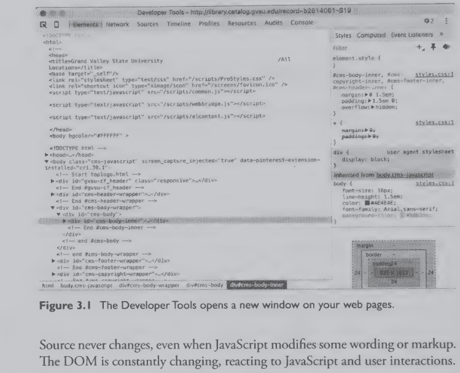
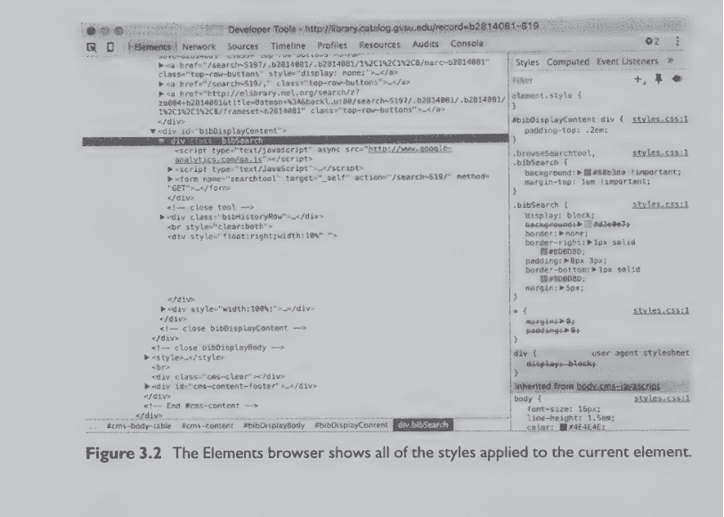
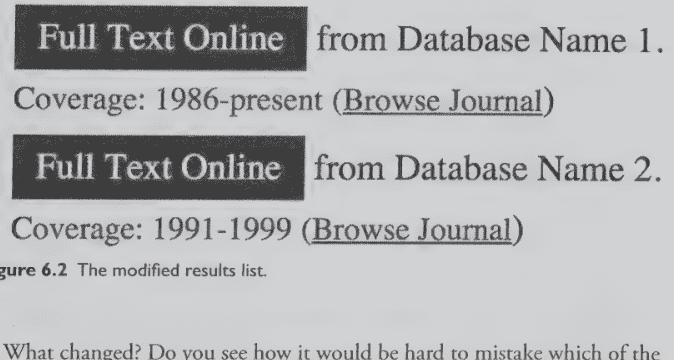
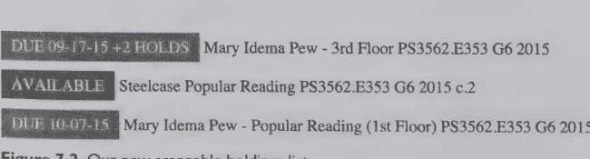
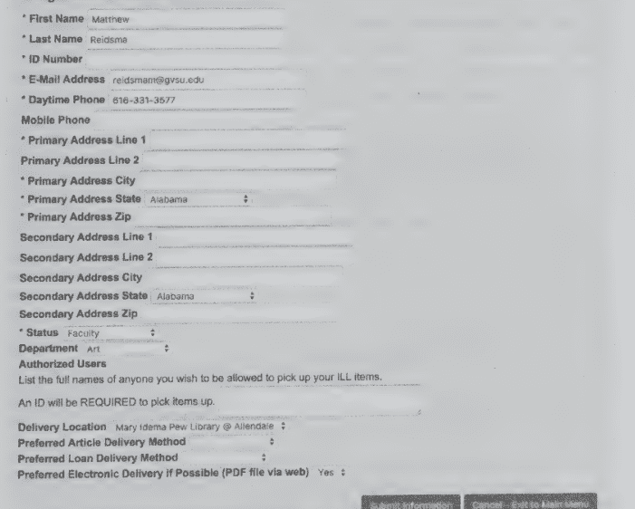
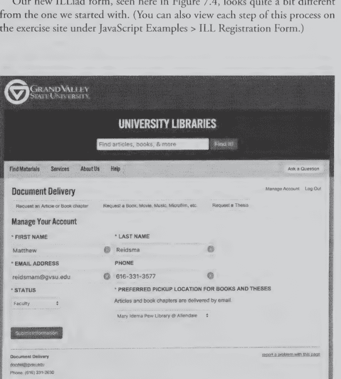
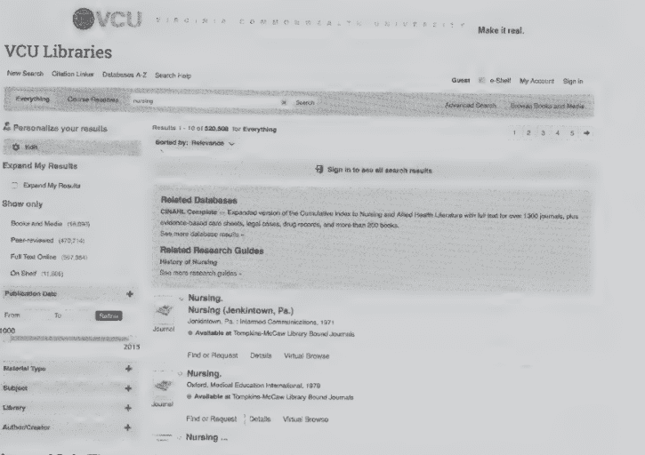
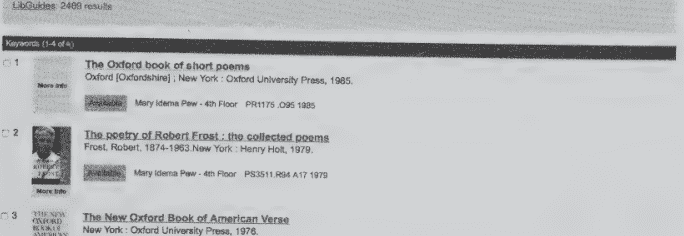

# 创新图书馆员指南：定制供应商系统以提升用户体验

## 致谢

我的名字印在这本书上，但这并不能讲述整个故事。我需要感谢许多一路上帮助和鼓励我的人。

Infopeople 的"玛丽们"推动我就此主题进行演讲，Libraries Unlimited 的 Lise Dyckman 则说服我将之写成一本书。书中任何清晰的文字都是 Lise 耐心引导的结果。任何错误则由我本人承担。

大峡谷州立大学（GVSU）的同事们让我每天上班都充满期待。每天都是全员出动，为的是改善图书馆服务，我为此身为"湖人"（Laker）而感到无比自豪。

GVSU 学术交流馆员 Matt Ruen 出色地指导我将这本书转变为开放获取专著出版的实验。Libraries Unlimited 乐于冒险，同意三年后免费提供本书，这对各方而言都是一种风险。我很高兴能与他们成为合作伙伴。

Dave Pattern、Andromeda Yelton、Annette Bailey、Erin White、Shariq Torres、Alison Tinker、John Fink、Kirsten Lamb、Jenny Jing，以及图书馆界所有分享代码的同仁，他们每天都激励着我。没有你们，这本书将不可能面世。

在我写作本书期间，家人为我提供了一个远离电脑和代码却充满灵感的环境。Wendy，你的耐心无可估量（你是如何做到的？）。而每当我认为某事无法完成时，我的孩子们都会提醒我——只要以一顿丰盛的早餐开始新的一天，一切皆有可能。

## 第一章：图书馆供应商工具

如果您的图书馆与大多数图书馆一样，您拥有大量不同的工具供用户通过网络使用以完成各项事务：目录（OPAC）、馆际互借、LibGuides、发现层等等。如果您的图书馆规模较大，您可能有一两名开发人员能够为图书馆编写定制软件，但您的开发人员很可能无法构建和维护一个完整的集成图书馆系统（ILS），以使您的编目人员维护 MARC 记录、连接到外部供应商导入 MARC 记录、跟踪所有流通资料及逾期罚款，并为用户提供直观的图书查找方式。除此之外，他们还无法从零开始构建一个能够连接 OCLC 的馆际互借（ILL）系统，无缝地向世界各地的图书馆发送请求，同时让用户随时了解请求的状态。他们也不可能有时间构建一个搜索工具，能够检索图书馆订阅的所有供应商数据库，将来自不同供应商的搜索结果整合到一个简洁易用的结果页面中。

即使您的开发人员*能够*完成这些工作，他们也很可能无法全部做到。如果您的图书馆规模不大，那就更不用想了。即使您有一两名开发人员，从零开始构建运营图书馆所需的所有工具也超出了小型团队的承担范围。构建和维护这些大型软件程序是一项巨大的工程，从纯粹的经济角度来看，支付开发人员创建市场上已有现成产品的费用并不划算，而这些产品的价格可能仅相当于少数程序员年薪的总和。而且由于这些程序处理的基础数据旨在跨图书馆共享——MARC 记录、OCLC 馆际互借请求等——由少数几家供应商专注于确保这些工具可靠地运行，并与当今驱动图书馆系统的数据格式兼容，是合情合理的。

因此，我们的图书馆从供应商处购买软件：用于编目、流通、采访和运行 OPAC 的 ILS；用于从其他图书馆借阅资料的馆际互借软件；高校图书馆中用于管理储备资料和跟踪版权的课程 reserve 软件；用于简化跨数十种竞争研究数据库搜索的发现层。诸如此类，不胜枚举。

### 图书馆供应商工具的现状

但这并不意味着我们选择让软件供应商提供图书馆运营工具，就等于身处图书馆软件的天堂。在某些情况下，图书馆在选择日常运营工具时几乎没有太多选择余地。属于联盟的图书馆通常使用该团体选择的 ILS，而非根据自身本地工作流程选择适合的工具。或者可能存在本地限制因素影响选择。在密歇根州艾伦代尔的大峡谷州立大学（GVSU），我们使用的 ILS 需要能够运营两个不同校区的三种不同自动存储检索系统（ASRS）。由于我们的起重机来自两个不同的制造商，因此可供选择的 ILS 仅限于能够同时与这两个系统流畅通信的供应商。

即使不受联盟或技术限制的图书馆，也常常出于其他原因而非本地环境的最佳适配来做出选择。成本是这些系统中的关键因素，年费可能高达数十万美元。许多图书馆因此转向开源 ILS 解决方案如 Evergreen 和 Koha，尽管将这些工具改造适应本地环境的投资要么通过聘请顾问，要么通过支付开发人员来实现。但最终，最好的价格未必能为图书馆员工或用户提供最佳功能。

由于图书馆软件供应商开发的是可供任何图书馆使用的工具，因此它们也缺乏许多有助于融入图书馆文化和工作流程的本地定制功能。结果，我们每个人都有这样的经历：在新软件中寻找繁琐的变通方法，以便能够像旧系统一样处理发票，或按照财务办公室的要求操作。或者我们在网站上添加说明文字，解释为何本周新软件上的这个请求按钮与上周旧软件上的工作方式不同。而且由于这些工具庞大而复杂，它们往往缺乏针对人员及其工作方式进行定制的细粒度程度，而这正是我们对定制工具的期望。

### 图书馆供应商工具基础

这并不是说供应商工具无法定制。尤其是 ILS，通常为员工提供前所未有的定制量，以适应不同的编目和采访工作流程。然而其他供应商工具几乎不为员工提供定制功能，如 OCLC 的 ILLiad 馆际互借软件。诚然，您可以重新排列员工视图中的队列，但字段、屏幕、颜色和工作流程均由该软件的制造商 Atlas Systems 和 OCLC 锁定。


然而，大多数供应商允许对其工具的员工端进行定制，使我们能够根据现有工作流程或本地文化来调整工具。原因之一是员工才是选择工具的人。即使在建议书请求（RFP）由管理层分析并批准的图书馆中，一线员工通常也有机会试用任何潜在的新软件，看看它如何与现有工作流程相适应。用户测试几乎从未成为讨论的一部分，也很少有供应商在其产品中专门设立团队来推广以用户为中心的设计。

因此，大多数图书馆供应商让我们能够自定义工具公共端的标题，以匹配我们图书馆的"品牌形象"，或许还可以更改链接颜色或页脚文字。在极少数情况下，我们或许可以调整用户屏幕上项目的顺序。但在任何情况下，我们都无法控制供应商添加到页面数据周围的自动生成的 HTML 标记，所以即使我们尝试添加自己的自定义样式，也会发现自己受制于将嵌套表格样式化为列表外观的困境。¹

图书馆供应商将定制视为系统"品牌化"的一部分，因此从他们的角度来看，将定制限制在颜色和标志上是合理的。然而，我们这些被委以让这些系统为图书馆用户服务的人多年来都知道，让某样东西直观且可用并非营销部门的领域。随着越来越多的图书馆对其供应商工具进行可用性测试，他们开始意识到我们在让图书馆工具为公众所用方面还有很长的路要走。

在这本书中，我将向你介绍一些改变供应商工具的策略和技巧。我在 GVSU 多年来一直从事这项工作，我的许多修改已被供应商采纳为"官方"版本。ProQuest 重新设计的链接解析器 360Link 2.0 以我的修改脚本作为其用户界面的基础，而 Summon 2.0 的设计在一定程度上也受其前身 Summon 1.0 的详细使用统计软件包的启发。

只要有一点点坚持和摸索，大多数供应商工具都可以被修改。

### 定制工具：模板和自定义 CSS

大多数托管式供应商工具都提供某种形式的产品定制，通常是允许更改由供应商软件生成的网页的视觉布局。这些更改可能被归类为" cosmetic"（表面上的），允许图书馆更改链接和标题的颜色以匹配其偏好，或在横幅左上角添加标志。例如，ProQuest 的 Summon 1.0 发现服务将定制限制在少数几个选项，包括标志文件、标题背景颜色和链接颜色。

其他供应商则更进一步，允许我们添加大块的 HTML，即网页的标记语言。这可以帮助我们通过包含全局导航或页脚，让供应商网站具有其他图书馆网页的感觉。例如，在 ProQuest 的 360 Link 链接解析器中，图书馆有机会用 HTML 来"品牌化"系统的页眉和页脚，但不能定制整个模板。

在极少数情况下，供应商可能会让我们几乎完全控制页面模板的整体外观和感觉。我们可以自定义 HTML 和 CSS（控制网页视觉外观的样式表），供应商会将内容插入到我们指定的位置。大多数 OPAC 都提供这种定制，其他系统如 ILLiad（OCLC 的馆际互借软件）和 LibGuides 2.0 的模板也是如此。

这些定制功能对于将图书馆的品牌形象跨多个系统应用是有用的，但它们也只能做到这一步。即使在供应商让我们控制 HTML 模板的情况下，系统的动态生成部分仍由供应商控制。例如，以下是我们目录馆藏部分的示例。在第一个示例中，你可以看到我用于制作模板的 HTML，以及我包含的"令牌"（`<!--{holdings}-->`），以便让我们的 OPAC WebPAC Pro 创建实际的馆藏信息。（如果这是你第一次看到原始 HTML，我将在下一段中带你了解你所看到的内容。我还建议看看 CodeAcademy 的 HTML 教程，网址为 http://www.codecademy.com。）

```html
<div id="holdings">
  <!--{holdings}-->
</div>
```

在这里，我创建了一个名为"div"的元素（division 的缩写）。它基本上是一个内容框，我可以按自己想要的方式对其进行样式设置。它被分配了一个 ID，这里是"holdings"。我可以使用这个 ID 来创建将应用于每个 ID 为"holdings"的 HTML 元素的样式。就我而言，我想为馆藏信息创建一个灵活的容器，因为我知道我们有使用台式机、平板电脑和手机的用户，我想确保馆藏信息在任何这些设备上看起来都很棒。但当我们用网页浏览器查看页面时，WebPAC Pro 会用 HTML 填充该令牌（我将其简化了一些）：

```html
<div id="holdings">
  <table class="bib_items" width="100%">
    <tbody>
      <tr class="bibItemsHeader">
        <th width="38%">Location</th>
        <th width="38%">Call No.</th>
        <th width="24%">Status</th>
      </tr>
      <tr class="bibItemsEntry">
        <td width="38%">3rd Floor</td>
        <td width="38%">PN1997. B3448 2005</td>
        <td width="24%">DUE 8/15/2015</td>
      </tr>
    </tbody>
  </table>
</div>
```

第一个示例中的令牌 `<!--{holdings}-->` 已被扩展为 `<table>` 元素。尽管我将表格包裹在我自己选择 ID 的 `<div>` 中，我仍然只能使用这个表格来进行布局。所以，虽然我的 OPAC 让我能够自定义容纳用户所寻找内容的容器，但我无法改变内容本身的结构。尽管这比 Summon 提供的定制要好，但我在这里可以进行的定制仍然本质上是表面上的，更接近"品牌化"而非重新设计。

### 超越品牌化的定制

在 2015 年《地平线报告图书馆版》中，所有图书馆都需要注意的首要趋势之一是用户体验（UX）在图书馆系统、服务和工具中的日益重要性（New Media Consortia 2015）。不仅仅是品牌化，不仅仅是视觉设计，甚至不仅仅是简单的交互设计，UX 是一种设计方式，它关注用户在进行活动、参与服务或使用工具时的整个体验。UX 致力于改进的不仅是工具的功能，还有用户的情感体验。这是一种更全面的为人设计的方法，涉及视觉设计、交互设计和文案写作。简而言之，要改进我们工具的 UX，我们需要做的不仅仅是更改标题的背景颜色或添加我们网站的导航。

供应商工具通常能满足我们图书馆的一些高层次需求，但在其他一些细节上却存在不足。如果你的图书馆做可用性测试，你可能会发现某个工具存在严重的可用性问题，而你却无力改变。在 GVSU，2011 年我就曾面临这种情况，当时我们的链接解析器是 360 Link。幸运的是，我找到了绕过供应商限制的方法，这项技术我已应用到我们现有的几乎每个供应商工具上。有更好的方法，而且做起来相当容易。

### 超越官方渠道：使用 JavaScript 修改系统

有时，供应商提供的定制选项已经足够。但通常，我们会发现我们无法更改的某些代码正在造成问题。有时它与我们试图让页面呈现的方式产生冲突。然而有时，供应商提供的代码让我们的用户难以完成任务，或无法充分享受我们的服务。在这些情况下，修改 CSS 和 HTML 模板是不够的。这些问题通常会作为错误或功能请求报告给供应商，但无法保证供应商会进行所需的更改，或及时进行更改。

但还有另一种方法。现代网络构建的基石不仅仅是 HTML 和 CSS。自从十年前"Web 2.0"时代开始，我们继续期望的更复杂的交互，至今仍在为"网络应用程序"提供动力，这都要归功于 JavaScript 的使用。JavaScript 是一种轻量级脚本语言，在网页浏览器而非服务器上运行。在我之前来自 OPAC 的例子中，我无法修改供应商通过 `<!--{holdings}-->` 令牌生成的代码，因为代码本身运行在供应商的 Web 服务器上。但由于 JavaScript 在网页浏览器中运行，当脚本运行时，供应商的网站已经创建了项目馆藏 HTML，所以我能够在用户的浏览器中对 `<table>` 进行更改。你不必等待供应商修改他们的代码，而且 JavaScript 在浏览器中执行得足够快，你的用户甚至不会注意到你做了更改。

### JavaScript 的工作原理

早些时候，我向你展示了 WebPAC Pro 为我们的馆藏记录生成的 HTML。这里再展示一遍，让你重新审视：

```html
<div id="holdings">
  <table class="bib_items" width="100%">
    <tbody>
      <tr class="bibItemsHeader">
        <th width="38%">Location</th>
        <th width="38%">Call No.</th>
        <th width="24%">Status</th>
      </tr>
      <tr class="bibItemsEntry">
        <td width="38%">3rd Floor</td>
        <td width="38%">PN1997. B3448 2005</td>
        <td width="24%">DUE 8/15/2015</td>
      </tr>
    </tbody>
  </table>
</div>
```

我们想将可用性声明从"Due"改为"Checked Out Until"。如果供应商不提供该选项，我可以使用 JavaScript。为此，我需要从馆藏表格中复制信息，更改

out the words, and then replace them on the page. Let's make a simple JavaScript function.

First, I'll need to declare something called a "variable." Variables are like a container that can hold any value you want. In this case, I want to store the date that is listed in the availability cell. In JavaScript, you declare a variable with the `var` statement. It's a good idea to call your variables something that will remind you what they are for, so that you remember later when you have to update or fix your code. (You'll never remember what the variable `sillyWord` was, even if it was funny to you at the time.) I'll call this variable `dueText`:

```javascript
var dueText;
```

Now my script has a variable. Now, I want to get that date value, which is in the last table cell. I want to make the variable `dueText` equal to the text of that cell. To do that, I'll target the ID of the `<div>` that contains the markup, since IDs are unique and should be used only once on each page. JavaScript has a handy method called `getElementById()` that we'll use to grab this element. I'll then use the JavaScript `querySelector()` method to target the last cell in the table inside of the `<div>`. I can do this by looking for the unique characteristics of that cell, which in this case are that it is the last cell in the row, and that it is the only cell with a width declaration of 24%. Then we'll set the value of the variable as the content of that cell using the `innerHTML` property.

```javascript
var dueText = document.getElementById('holdings')
  .querySelector('table.bib_items tr.bibItemsEntry td[width="24%"]').innerHTML;
```

Now the value of our `dueText` variable is "Due 8/1/2015." We're getting closer, but we really want to drop the "Due" part of the string and replace it with "Checked Out Until." JavaScript has a way to replace text in a string using the `replace()` method. We need to specify the text we want replaced and the new text we want added, and JavaScript will change the value of our variable for us.

```javascript
var dueDate = dueText.replace(/DUE/g, "Checked Out Until");
```

Now we have a new variable called `dueDate` with a value of "Checked Out Until 8/1/2015." We can rewrite the text of the availability cell with the new wording and the date, using the `innerHTML` property we used earlier:

```javascript
document.getElementById('holdings').querySelector
  ('table.bib_items tr.bibItemsEntry td[width="24%"]').innerHTML = dueDate;
```

This again targets the element with the ID of `holdings`, and sets the text of the table cell with a width of 24% to the value of the variable `dueDate`. Here's the whole script:

```javascript
var dueText = document.getElementById('holdings')
    .querySelector('table.bib_items tr.bibItemsEntry td[width="24%"]').innerHTML;
var dueDate = dueText.replace(/DUE/g, "Checked Out Until");
document.getElementById('holdings').querySelector
    ('table.bib_items tr.bibItemsEntry td[width="24%"]')
    .innerHTML = dueDate;
```

I should note that there isn't always a "correct" way to do things in JavaScript. For instance, instead of using the `replace()` method to swap out the text of availability message, I could have used another method to break the message apart at the space, and then tacked on the new text to the beginning of the date. There are often several ways to achieve the same result.

### 几个图书馆案例

观察理论案例是一回事，但看到不同图书馆如何在其供应商工具中实施 JavaScript 修改，应该能让你更好地理解这种技术能做什么。在本书的剩余部分，我们将花时间更仔细地研究每一个案例（以及更多案例）。

### 剑桥大学三一学院：“为更多藏书投票”书签脚本

剑桥大学三一学院图书馆面临着大多数图书馆都有的问题：最热门书籍的副本数量不足。三一学院图书馆的 Kirsten Lamb 知道，实际需求量比召回统计数据所显示的要大。一项广泛的全校范围研究发现，存在着许多由学生运营的类似“黑市”的小规模热门书籍交换活动，以补充图书馆微薄的库存，包括三一学院在内（Murphy 2015）。Lamb 希望为学生提供一个“投票”机会，以要求图书馆购买更多热门书籍的副本，从而捕捉那些不方便召回书籍的学生的声音。她不知道如何在联机公共检索目录（OPAC）中实现这样的功能。

我为她编写了一个概念验证脚本，该脚本可以通过用户浏览器中的一个简单书签触发，展示了投票按钮可能的外观和工作原理。通过创建一个启动该脚本的“书签脚本”，Lamb 和她的同事们能够在投入更多时间和精力之前，尝试这项修改并在学生中进行测试。

你可以在 https://github.com/mreidsma/OPAC-Vote 上看到此书签脚本的代码以及它运行时的动画。我们将在第 5 章和第 13 章更详细地探讨这个书签脚本。

### 大峡谷州立大学：hasMedia? 一个添加流媒体视频的脚本

直到最近，GVSU 还使用 CONTENTdm 来管理我们的数字馆藏。由于我们无法负担所有流媒体视频的托管费用，我们希望找到一种方法，使用 CONTENTdm 管理元数据和转录文本，但从另一台服务器拉取流媒体。我编写了一个简单的脚本，检查项目元数据是否表明存在流媒体（音频或视频）组件，然后使用 JavaScript 插入一个 HTML5 `<audio>` 或 `<video>` 元素，该元素从我们的另一台服务器拉取源文件。以防用户使用的是旧版浏览器，我们还准备了 Flash 视频后备方案。你可以在 https://github.com/mreidsma/hasMedia- 上看到 hasMedia? 的完整代码。我们将在第 11 章更深入地探讨这个工具。

### 杨百翰大学：ILLiadPlus

许多图书馆使用 ILLiad，即现在由 OCLC 销售的馆际互借软件。ILLiad 的默认公共模板并不以其卓越的设计或用户友好性而闻名。2013 年，杨百翰大学重新设计了 ILLiad 软件，但它不仅仅是改变了工具的外观，而是构建了一个小型 JavaScript 应用程序，该程序运行在 ILLiad 之上，同时改善了功能性和交互性。杨百翰大学已将 ILLiadPlus 的源代码上线，因此你可以在 https://github.com/byuhbll/ILLiadPlus 上查看它。

在我们深入研究这些定制化之前，我们将花一些时间熟悉 JavaScript，特别是那些非常适合修改我们未曾创建的网页工具的方法和函数。在此过程中，我们将探索工具和技术，以及世界各地图书馆进行的现有定制化。随着本书的进展，我们将花更多时间查看代码，剖析它的工作原理，以及它为何是必要的。如果你没有阅读代码或使用 JavaScript 的经验，不用担心。每个使用 JavaScript 的人都是从零开始的，有些事情不知道是正常的！我会尽力引导你理解每一行代码，解释它的作用以及它为何有效，并且我创建了一个补充网站，让你可以在浏览器中直接练习运行 JavaScript 代码，以帮助你更熟悉这些概念。你可以在这个网站找到它：http://mreidsma.github.io/vendor_tools。改进供应商工具可能是一项繁重的工作，但这个挑战也可能充满乐趣。让我们开始吧！

### 注意

- 1. 我对于图书馆软件供应商使用 HTML 表格进行布局的沮丧，将是贯穿本书的一个反复出现的主题。

## 参考文献

Murphy, H. (2015, May 7). *WhoHas?: The Pilot.* [Web log post]. Retrieved from https://futurelib.wordpress.com/2015/05/07/whohas-the-pilot.

New Media Consortia. (2015). *NMC Horizon Report: 2015 Library Edition.* Retrieved from http://cdn.nmc.org/media/2015-nmc-horizon-report-library-EN.pdf.

# 第 2 章：JavaScript 与供应商工具

如果你有为网站编写 HTML 和 CSS 的经验，那么你可能听说过十年前网络标准运动所倡导的“结构”与“表现”的区别。HTML 从来就不是一种允许作者控制页面表现的标记语言。它是一种语义语言，旨在帮助学者以与撰写研究论文相同的方式构建网页：层级标题、段落、块引用、数据表格，以及最终的图片和其他媒体。¹ 在网络早期，样式由用户在其浏览器偏好设置中控制（Lialina 2012）。但是当网络成为一种商业现象时，企业和个人希望对页面的外观拥有更多控制权，不是为了用户，而是为了他们自己。例如，设计师不希望任何人用 Comic Sans 字体查看页面，因此对页面外观的控制被转移到了页面的标记中。页面充满了 `<font>` 和 `` 标签，设计师尝试了不同的方法来控制网页上对象的放置。尽管 CSS 已经可供他们使用，但对于许多设计师来说，从 HTML 标记控制页面的外观和感觉更有意义。

但在十多年前，设计师推动将表现层从标记中移出，并保持 HTML 和 CSS 分离。在 2015 年的大多数主流网站中，结构和表现是分开的，`<table>` 元素不再用于标记，样式表控制着网站的外观和感觉。² 但随着“Web 2.0”的出现，网络对交互性的更大依赖为页面增加了新的维度。JavaScript 与结构标记不同，它也不严格属于表现层。JavaScript 在网页结构中处于什么位置呢？

Aaron Gustafson 提议将 JavaScript 作为网络的第三层。HTML 是结构语义层；CSS 是表现和样式；而 JavaScript 是*交互层*，它增强了用户与网站交互的方式（2008）。但正如我们将在前几章的示例中看到的那样，JavaScript 的用途不仅仅是增强交互性。除了添加其独特的交互特性外，JavaScript 还有改变表现层和语义层的能力。


## 12 定制供应商系统以提升用户体验

许多供应商允许图书馆在由供应商工具生成的面向公众的网站中添加 JavaScript（例如，在 ILS 中添加 JavaScript 以影响 OPAC，但不影响后端的 ILS 功能）。供应商通常提供添加 JavaScript 的能力，以便图书馆增强网站的交互，例如在使用了 `<select>` 元素时自动提交表单，或者根据某些用户偏好显示和隐藏某些信息。虽然这些是定制供应商工具的有用技术，但我认为我们可以做得更多。由于语义层（semantics）和表现层（presentation）这两个层的结构限制，我们在交互层（interaction）层能做的定制种类非常有限。虽然我们可以编写 CSS 样式来覆盖供应商工具自带的默认样式，但在改变表现层和交互层方面的灵活性较低，因为我们被困在语义层中自动生成的、且通常不符合 Web 标准的 HTML 中。

问题在于，大多数图书馆供应商尚未完全掌握语义层和表现层之间的分离。在 GVSU，我们的 OPAC 生成了无数嵌套在其他 `<table>` 元素中的 `<table>` 元素，而其中没有一个包含任何表格数据。相反，这些 `<table>` 元素被用来控制内容的外观以及在屏幕上的位置，也就是说，它们使用语义化 HTML 标记来完成 CSS 的工作。问题是，你很难将嵌套表格重新定义成除了“几个嵌套表格”之外的任何样子。因为图书馆软件供应商创建的基础没有尊重语义层、表现层和交互层之间的分离，所以我经常需要在改进表现或交互之前，先修改网站的 HTML 标记。

你可能希望默认隐藏某些内容，仅在用户要求时才显示。在供应商工具吐出十几个可能的图书馆藏，或者十几个包含你所找文章的不同数据库的情况下，这非常有用。这些列表往往会让用户感到不知所措，因此，突出显示最佳结果并向用户提供其他选项是有意义的。几年前，我们在 GVSU 使用 360 Link 链接解析器时就遇到了完全相同的情况。³

我们的用户经常会遇到一个长长的数据库列表，这些数据库都提供了他们想要的文章全文。然而，他们不确定该点击众多链接中的哪一个。部分原因是供应商没有添加关于选择哪个最佳链接的任何视觉提示。事实上，所有链接看起来完全一样！“文章（Article）”、“期刊（Journal）”和数据库名称的链接都被样式化为纯文本链接，没有明显的层级关系。用户不知道的是，我们的团队已经努力对数据库进行了排序，以便将最可靠的数据库显示在列表顶部。但由于缺乏简单的设计技术来给顶部结果增加额外的视觉权重，获取全文文章的失败率接近 35%。

但视觉设计（可以通过表现层的 CSS 解决）只是一方面。我们的研究表明，在过去的十年里，用户接收到的信息是：全文文章可以在带有“Full Text”字样的链接后面找到，因此大多数人没有意识到“Article”链接也能带他们找到想要的内容。此外，该列表在 HTML 中被标记为嵌套的 `<table>` 元素。每一行本身就是一个 `<table>`，设置在一个更大的 `<table>` 之中。任何尝试对这些 `<table>` 元素进行样式设计的尝试都遇到了问题，我们最初尝试强调首个结果而忽略其他结果的努力在某些浏览器中奏效，但在另一些浏览器中则不然。最终，语义层导致我们无法在表现层和交互层上同时增强网站。于是我们决定彻底改变语义层。

通过在可用性测试中观察用户使用该工具的情况，我的想法是将文章全文的最佳链接设置为页面上最显著的部分。然后，我默认隐藏任何额外的资源，但为用户提供一种使其可见的方法。为了实现这一点，我编写了一些 JavaScript，循环遍历结果中的每个嵌套 `<table>` 元素，从旧的标记中保存链接、数据库名称和其他重要信息。然后，我使用 JavaScript 将所有 `<table>` 元素完全替换为更具语义化的 HTML 列表。这包括一个小型触发器，用于切换额外资源的显示状态，提供“显示（Show）”或“隐藏（Hide）”额外资源。

我们从 2011 年起就运行这个脚本，来到链接解析器的用户的失败率已降至 10% 以下，而这些失败大多是由糟糕的 OpenURL 链接引起的，而非系统设计问题。该技术效果如此之好，以至于其他几十家图书馆也开始使用这个脚本，随后 ProQuest 重新设计了该工具，加入了基于我们设计的默认模板。

在这次项目之后，我意识到 JavaScript 在图书馆中的用途不仅在于增强网页的交互层，还在于它能够改变语义层。我不再是简单地增强现有页面，而是试图用不同的结构重新创建页面，以便表现层和交互层能更好地帮助用户完成任务。简而言之，我做的不仅仅是添加脚本。我是在现有系统之上构建 JavaScript 应用程序。本书是一本入门指南，介绍如何为你的供应商工具规划、设计和构建这些 JavaScript 应用程序，从而让你的用户能够更成功地使用，并最终在利用图书馆数字工具时获得更好的体验。

虽然我大力主张使用 JavaScript 来定制供应商站点，但在决定这是否是适合你的技术之前，有一些事情你需要了解。

## 将 JavaScript 引入供应商工具

使用 JavaScript 修改供应商工具的最大挑战或许在于弄清楚如何将脚本放入网页中。有四种方法可以实现。你需要仔细检查你的每个系统，看看哪种方法最合适。我还维护一个关于供应商和工具的在线众筹矩阵，显示是否可以添加 JavaScript 以及操作技巧，网址为 http://gvsu.edu/s/YT。

### 1. 设置中的自定义 JavaScript 字段

一些供应商鼓励图书馆使用 JavaScript 修改其工具，甚至通过在设置中提供一个用于选择定制脚本的字段来使其变得简单。虽然有些供应商提供了专门的“脚本 URL（script URL）”字段，但更多时候你会发现供应商允许你输入用于自定义 JavaScript、CSS 甚至某些 HTML 标记的 HTML 代码。

如果你的供应商提供了此选项，这通常是最佳选择，因为脚本将被设置为在正确的时间加载，以便利用供应商系统自带的所有其他 JavaScript 库和函数。设置非常简单，只需从你的 Web 服务器选择一个文件并输入路径，或者在“自定义页眉（Custom Header）”或“自定义页脚（Custom Footer）”中添加一个 `<script>` 元素。

这些系统包括：

- ProQuest 的 Summon 2.0 和 360Link 2.0
- Springshare 的几款 2.0 产品，包括 LibGuides
- ReadingHouse 的 Select Reads

### 2. 在 HTML 模板中添加 `<script>` 元素

这是向供应商工具添加 JavaScript 最常见的方法。由于许多供应商允许图书馆对工具进行“品牌化”以匹配机构的颜色，因此通常有一种方法可以向工具添加自定义 HTML。由于 JavaScript 通常通过 HTML `<script>` 元素加载，我们可以简单地添加一个指向我们要加载的 JavaScript 文件的 `<script>` 元素，例如：

```
<script src="//mylibrary.org/js/wickedscript.js">
  </script>
```

将这一行添加到你的 HTML 模板中，将告诉浏览器加载并执行 `src` 属性中 URL 处的 `wickedscript.js` 脚本。你在供应商的定制设置中看不到这个单独的字段，因此你必须自己将其添加到 HTML 模板中。

在选择在何处加载自定义脚本时，你需要记住几个考虑因素。JavaScript 在加载时执行，因此如果你的脚本依赖于在不同 JavaScript 文件中加载的函数或库，你需要*在*它们依赖的脚本加载*之后*加载自己的脚本。JavaScript 也是阻塞性的，这意味着浏览器在加载你的 JavaScript 文件时将停止加载其他资源。出于这个原因，良好的实践是

将 JavaScript 文件加载到紧邻闭合的 `</body>` 元素附近，这样 HTML 和 CSS 都可以无干扰地加载。

然而，大多数现代浏览器现在都支持 `<script>` 元素的 `async` 和 `defer` 属性，允许脚本在加载时不阻塞其他页面资源的加载。**`async`** 属性告诉浏览器异步加载 JavaScript 文件，在脚本准备好时执行，但同时继续加载页面的其余部分。**`defer`** 属性告诉浏览器推迟执行脚本，直到页面完全加载完毕。这些属性允许脚本在 `<head>` 中加载，而不阻塞页面的渲染。如果你只能将自定义脚本添加到 `<head>` 中，它们可能非常适合你的项目。⁵

最适合模板脚本加载的供应商工具包括：

-   大多数 OPACs
-   OCLC 的 ILLiad 馆际互借软件

### 3. 使用文本字段

如果你的供应商不允许你添加自定义脚本或修改 HTML 模板，你可能得发挥创意了。不过，有时供应商会允许你自定义页面上的文本，而且这些文本字段通常不会去除 HTML，以防你想为文本添加一些格式。幸运的是，你通常可以利用这些字段来添加 `<script>` 元素，以加载你的自定义脚本。

我应该指出，这是*最后手段*的替代方法。我第一次遇到这种替代方法是在我写了几个脚本来修改 Serials Solutions 的发现系统 Summon 1.0 时，但由于模板无法自定义，我不知如何加载它们。幸运的是，哈德斯菲尔德大学的 Dave Pattern 尝试在"自定义链接文本"字段中插入一个 `<script>` 元素，发现该脚本被发现层加载了（Pattern 2012）。Dave 和我后来各自为 Summon 1.0 开发了许多自定义功能，包括改进的使用统计和界面自定义。你也可以通过将 `<script>` 元素添加到 Custom Labels 字段的 HTML 表述中，为 Ex Libris 的 Alma 等更现代的工具添加脚本，但这种方法不如 Summon 的文本字段可靠。

### 4. 书签小工具或扩展程序

有时根本无法向供应商工具添加 JavaScript。在 GVSU，我们的数字保存工具 Preservica 构建在共享的 WordPress 服务器上。由于 Preservica 的工作人员无法确认添加到我们网站的任何自定义脚本不会影响其他网站，他们锁定了所有共享的 Preservica 实例，因此无法添加自定义脚本。图书馆使用的其他常见工具，如 Evanced Solutions 的 SignUp 活动日历，也不允许你向页面添加任何自定义 JavaScript。

如果我们想做一些自定义，我们仍然可以创建一个脚本，然后向我们的用户提供一个*书签小工具*或*扩展程序*来加载这些自定义功能。缺点是这需要我们的用户在进行自定义之前采取额外步骤。对于书签小工具，这意味着用户每次访问页面时都必须点击书签小工具。扩展程序可以配置为在加载网站时修改它，但用户仍然需要安装并启用浏览器扩展程序。如果用户在浏览器之间切换，他们必须为每个浏览器安装不同的扩展程序（而你必须编写和维护多个扩展程序）。尽管如此，如果这些自定义值得做，这仍是一种选择。我们将在第 5 章探讨书签小工具。

## 维护

值得一提的是，这种技术需要一些时间来维护脚本。与编写自己的系统不同，编写 JavaScript 修改通常依赖于供应商工具生成的标记。如果供应商升级了工具并更改了任何标记，即使是更改与某些 HTML 元素关联的类或 ID 这样的小细节，你的脚本也可能崩溃。

其他因素也会影响你的修改。ProQuest 的 Summon 2.0 服务最近改变了自定义脚本的加载方式，以更好地支持 Summon 所基于的 AngularJS 框架的库自定义。这是件好事，因为它使库能够进行更复杂的发现工具定制，但这在 GVSU 产生了一个副作用。我所有的修改都是使用一个名为 jQuery 的 JavaScript 库完成的。由于 Summon 将脚本加载改为与 Angular 框架和 jQuery 库同时加载，我们的脚本失败了，因为它们期望 jQuery 库*已经*加载并可用。谢天谢地，我们意识到存在问题，并且我们能够修改代码，在运行前等待大约半秒钟，让 jQuery 有足够的时间在我们尝试使用其功能之前加载。

这涉及监控我们修改的所有系统，并花时间定期在脚本崩溃时更新它们。这可以简单到定期使用你修改过的工具，以确保它按预期工作。对供应商工具的所有修改，无论多小，都需要一定程度的维护。

## 注释

1. Olia Lialina 撰写了一篇关于"网页设计"早期历史的精彩考察，重点介绍她称之为"Prof. Dr. Style"的风格。早期学者"设计"其网页的方式，让我们得以追溯 web 的根源，尤其是在设计方面。你可以在 http://contemporary-home-computing.org/prof-dr-style 阅读她的文章。

2. 结构表现分离的商业做法的一个显著例外是图书馆供应商工具。参见第一章，注释 1。

3. 链接解析器是一种介于数据库或数据库与发现系统之间的软件，以 OpenURL 格式解析链接，即包含有关所请求资源的书目信息的 URL。链接解析器根据书目信息，帮助引导用户访问可能包含他们所查找文章全文的数千种订阅数据库中的任何一种。你可以在维基百科上了解更多信息：https://en.m.wikipedia.org/wiki/OpenURL。

4. 你可以在 https://github.com/gvsulib/360Link-Reset 查看这个脚本的完整代码。

5. 图书馆应该知道，Internet Explorer (IE) 9 及更早版本不支持 async，且对 defer 只有部分支持，因此如果你需要支持旧版本的 IE，应该谨慎使用它们。你可以随时通过检查 http://caniuse.com/#feat=script-async 和 http://caniuse.com/#feat=script-defer 来检查此功能的兼容性。

## 参考文献

Gustafson, A. (2008). Understanding Progressive Enhancement. *A List Apart: For People Who Make Websites*, 269. Retrieved from http://alistapart.com/article/understandingprogressiveenhancement.

Lialina, O. (2010). *Prof. Dr. Style: Top 10 Web Design Styles of 1993 (Vernacular Web 3)*. Retrieved from http://contemporary-home-computing.org/prof-dr-style.

Pattern, D. (2012). Hacking Summon for Fun and Profit, Part 1. [Web log post]. Retrieved from http://www.daveyp.com/2012/05/05/hacking-summon-for-fun-and-profit-part-1.

# 第三章

## 使用开发者工具

如果你有网页设计或编写 JavaScript 的经验，你可能熟悉*开发者工具*，这是一套允许你查看网站底层结构的工具，了解使其运行的各个部分。（在 WebKit 浏览器中，如 Safari，它被称为"Web Inspector"。）如果你从未听说过开发者工具，没关系！我将逐步指导你如何使用它们，因为即使你一行 JavaScript 都不写，开发者工具对于评估你图书馆的网页工具来说也非常棒。（而且，它们让你可以查看其他人的网站。就像能看到魔术师是怎么做的一样。）

开发者工具不仅能让我们深入研究供应商工具的"内脏"，还能让我们通过**Web 控制台**测试示例 JavaScript，这是一种命令行界面月生，能为你提供网站的实时反馈，也允许我们输入命令来修改当前网页。

在以下示例中，我将使用 Chrome 的 DevTools（Chrome 对开发者工具的称呼）。你不需要使用 Chrome，因为大多数浏览器都自带开发者工具。¹ 虽然 Internet Explorer (IE) 9 及以上版本有一套还算可以的开发者工具，但仍不尽如人意。如果你不得不用 IE，按 F12 来使用它们。

在 Chrome 中，有两种方式打开 DevTools：

1.  在任意网页上右键单击（在 Mac 上，Control-单击）并选择"检查元素"。
2.  通过 Chrome 菜单：更多工具 > 开发者工具。

DevTools 第一次打开时，你会看到看起来很像是页面的"sourc"代码的内容，如图 3.1 所示。但 DevTools 不只是向你展示编写网页所用的 HTML。相反，它向你展示的是所谓的 **DOM**，即**文档对象模型**。DOM 是 HTML 和 CSS 加载完毕且 JavaScript 执行后，网页当前的实时状态。就我们的目的而言，这里的区别在于，页面


## 20 定制供应商系统以获得更好的用户体验



图 3.1 开发者工具为你的网页打开一扇新窗口。

即使 JavaScript 修改了某些措辞或标记，源代码也永远不会改变。DOM 则不断变化，响应 JavaScript 和用户交互。

## 元素浏览器

元素浏览器是你可以查看 DOM 并浏览构成网站运行的所有 HTML 和 CSS 的地方。随着本书的深入，我们会更深入地了解开发者工具的这些部分，但与此同时，我希望你对元素浏览器如何融入修改供应商工具的工作流程有一个更全面的了解。

元素浏览器是开发者工具的默认视图。无论你使用哪种浏览器，打开开发者工具都会始终先打开元素浏览器。这里显示的是 DOM，根据运行的脚本或用户交互，与页面一起实时更新。

## DOM 树

元素浏览器提供了 DOM 树的可视化结构——即构成当前页面的所有节点的结构。由于 DOM 树代表了页面的当前状态，因此它比页面源代码更能让你了解网页的 HTML 结构。DOM 不仅会因 JavaScript 针对页面元素的操作而改变，浏览器也会适应不正确的标记，这意味着一个缺少几个闭合元素（如 `</div>`）的页面，其 DOM 可能与页面源代码不同，仅仅是因为浏览器改变了页面结构以纠正无效的标记。如果你的页面没有按预期显示，这会很有用，因为 DOM 树可以帮助你看到浏览器在哪里纠正错误并改变你原本打算的布局。

在使用供应商工具时，你经常会想要更改某个元素的文本，或从 DOM 中移动或移除某个元素。为了正确瞄准目标元素，你可以使用元素浏览器查看 DOM 树并找到相关元素。在浏览过程中，你会遇到一些折叠的 DOM 节点，旁边有一个"▶"符号。点击"▶"符号将展开节点，显示内部更多的节点。DOM 树会显示该元素是否有你可以用脚本瞄准的属性，例如 ID 或特定的类。

虽然在本书中我们的目标是编写 JavaScript 来对页面进行更改，但我们通常可以直接在元素浏览器中测试初步想法，因为它允许我们直接在 DOM 树中编辑任何元素或属性。这可以很简单，比如给元素添加一个类以应用不同的 CSS 样式，重写元素文本以查看不同消息的效果，或将元素移动到页面上的不同位置。

要编辑元素，你可以双击元素名称，它将变为可编辑状态。例如，这对于更改标题很有用，你可以尝试将 `<h2>` 改为 `<h3>`。你也可以通过双击属性值来编辑属性值（如类或 ID），或者右键点击元素选择"编辑"或"添加属性"。

如果你更喜欢以 HTML 格式编辑某个元素或页面的一部分，你可以右键点击父元素并选择"以 HTML 格式编辑"。这尤其有用，如果你想粘贴自己编写的其他 HTML。

你也可以通过删除元素来编辑页面，可以选中元素后按 Delete 键，或右键点击选择"删除元素"。或者你可能想将元素从页面顶部移动到底部，看看效果如何。在大多数开发者工具中，你只需选中元素并将其拖到想要的位置即可。如果这不起作用，你可以尝试剪切和粘贴。如果你意识到犯了错误，删除了希望保留的内容，或者做了太多更改，你随时可以刷新页面，它会恢复到原来的样子。在元素浏览器中的编辑是临时的，但它让我们比从头开始编写大量 HTML 或 JavaScript 更容易地尝试各种操作。

## 应用的样式

然而，元素浏览器不仅仅是关于 HTML 元素的。图 3.2 展示了元素浏览器右侧的面板，其中显示了应用于所选元素的 CSS 样式。样式面板对于排查 CSS 问题非常有用。



在样式面板中，你可以预览如果更改样式，元素会是什么样子。与编辑 DOM 树类似，你可以通过多种方式做到这一点。由于样式面板显示了应用于元素的现有样式，你可以选择通过双击要更改的值来更改这些样式的属性或值。例如，如果一个元素应用了以下样式：

```
margin-right: 1em;
width: 80%;
```

你可能想将元素的边距从右侧改到左侧，这样你可以双击"margin-right"属性并将其改为"margin-left"。同样，你可能觉得 80% 对你的元素来说太宽了，所以点击值"80%"，你可以将其改为"60%"，甚至将其从相对宽度改为固定宽度，如"415px"。

在大多数开发者工具中，你也可以在样式面板中添加新的样式规则。在 Chrome 的 DevTools 中，只需点击左上角的"+"。如果你在元素浏览器中选中了某个元素，新样式会自动填充该元素的详细信息。

## 控制台

你会在 DevTools 窗口顶部看到其他几个标签页，最后一个就是"控制台"。DevTools 中的控制台非常强大，允许你做很多事情，包括：

- 1. 查看网站的错误和问题。（或其他已编程的反馈。）
- 2. 使用控制台命令和 JavaScript 与页面交互。

对控制台强大功能的全面介绍超出了本章的范围。幸运的是，我们修改供应商工具所需做的大多数事情都集中在这两个功能上。

## 通知、错误和调试

首先，控制台会报告运行页面上的 JavaScript 所产生的任何错误或通知。错误将以红色显示，详细说明遇到了什么类型的错误，以及导致错误的代码所在的文件和行号。

控制台还会向你显示通知，这些更像是警告而非错误。虽然错误会阻止 JavaScript 文件的其余部分执行，但当代码使用了已弃用的方法或函数时，通知就会出现。虽然大多数时候你不必理会浏览器显示的通知，但浏览器让开发者能够轻松利用这一功能，这样我们可以对我们脚本的操作获得实时反馈。

如果你在电脑旁，在浏览器中打开 http://gvsu.edu/s/Zg。你应该会看到 GVSU 的 OPAC 中 *Batman: The Dark Knight Returns* 的目录记录。现在打开 DevTools 并点击控制台标签页。你应该会看到这里列出了几条消息，第一条是错误，以红色高亮显示。（这是因为供应商试图在使用 `initSort()` 函数之前调用它，但实际上还没有定义该函数。）后续的消息都是我添加的，作为修改此页面的脚本的一部分。

首先，我记录了从页面文本中定义的几个变量的值，包括可借阅标签（AVAILABLE 或 DUE）、物品是在书库还是在我们的 ASRS 起重机中，以及请求按钮的 URL。然后我在页面各处的多个位置测试几个单词的出现情况，以查看该书是否不可借阅。（我们将在后面的章节中了解更多关于 JavaScript 方法 `indexOf()` 的内容。）如果未找到关键词，控制台将显示"-1"。最后我输出几条消息，让我知道某些函数正在运行。图 3.3 展示了我写这一章时的样子。（记住：始终要为维护做好计划！）


图 3.3 控制台显示了我某个脚本中的消息，这样我就能确保一切正常运行。

每一条都描述了正在运行的函数，然后显示了`console.log()`函数被调用的文件名（这些例子中都是`catalog.js`），以及该所在函数的行号。（如果你愿意，可以在 GitHub 上准确看到是代码的哪一行生成了这些输出：http://gvsu.edu/s/00T。）

```
278. console.log('This item circulates: Adding request button');
```

这在我编写 JavaScript 时很有帮助，因为我可以让脚本在不同阶段输出值和消息，从而了解事情的执行情况。（如果前面的代码对你来说还无法理解，别担心——我们将在本书后面介绍如何编写 JavaScript 和 jQuery 代码。）

## 与网页交互

查看错误和警告是一回事，但控制台还能让我们以多种方式与页面交互，这也是我们在本书大部分内容中使用控制台的方式。为了向你展示它的工作原理，我认为在本章的学习过程中你最好跟着做一些练习。如果你在电脑旁边，请跟着操作。

请你在浏览器中打开 http://mreidsma.github.io/vendor_tools，然后打开 DevTools。（如果你使用的不是 Chrome，加载网页后右键点击并选择"Inspect Element"。如果你使用的是 IE，请按 F12。）

DevTools 窗口打开后，点击"Console"链接。你现在应该看到一个控制台，看起来有点像我在目录页面中显示的那个，只是可能没有任何错误消息或提示等着你。现在，在控制台中 chevron (>) 旁边输入以下 JavaScript，然后按回车键。（你会注意到这段代码在练习网页上有一个方便的代码块，你可以直接选择并复制，而不用逐字输入！）

```
var liList = document.getElementById("table-of-contents").getElementsByTagName("li");
var liElements = liList.length;
alert('There are ' + liElements + ' exercises for this book.');
```

发生了什么？你是否收到了一条消息，告诉你这个网站上有多少道练习题？

恭喜你！你可能刚刚运行了你的第一段 JavaScript！前面的脚本在本书的练习网站上查找 ID 为`table-of-contents`的元素，使用 JavaScript 方法`getElementById()`，然后用`getElementsByTagName()`方法计算其中列表元素（`<li>`）的数量。由于每个列表元素都包含一个链接，指向本书配套的一组练习题，我们可以通过这个简单的脚本计算练习题的总数。最后一行调用了 JavaScript 的`alert()`函数，弹出一个窗口告诉你找到了多少道练习题。

记得前面我提到过的`console.log()`函数吗？以及如何使用它向控制台写入内容？好吧，我们可能想知道有多少道练习题可用，但我们当然不希望网站上的每个访客都看到一个`alert()`窗口。在这种情况下，我们可以将最后一行的`alert()`替换为`console.log()`。试着用下面这行代码替换最后一行后再次运行：

```
console.log('There are ' + liElements + ' exercises for this book.');
}

这次发生了什么？你在控制台中收到消息了吗？恭喜你！你可能刚刚在 JavaScript 中设置了你的第一段调试代码！

## 综合运用

本章绝不是对开发者工具的全面介绍，但它应该让你对网页有了新的认识。你现在知道了如何检查任何网站的 DOM 树，如何浏览任何元素的当前样式，以及如何使用控制台读取消息甚至运行一些命令。在我们共同学习本书的过程中，我们将继续使用开发者工具，完善我们在这里介绍的内容，并更深入地学习用于排查和测试供应商工具修改的新技术和工具。

26 定制供应商系统以提升用户体验

## 注

- 关于使用开发者工具有很多深入的资料。以下是一些根据你选择的浏览器进行深入介绍的文章：
  - Bowler, C. (2013). The Basics of Safari's Web Inspector. http://chrisbowler.com/journal/web-inspector. Safari 浏览器中使用 Web Inspector 的权威指南。
  - Google. (2014). Chrome DevTools. https://developers.google.com/chrome-developer-tools/. Google 关于在 Chrome 中使用 Web Inspector 的官方文档。
  - Mozilla. (2014). Page Inspector. https://developer.mozilla.org/en-US/docs/Tools/Page_Inspector. Mozilla 关于在 Firefox 中使用 Web Inspector 的官方文档。

## 第四章

## JavaScript 基础

和所有语言一样，JavaScript 也有规范其使用方式的规则。语法不正确的陈述并不一定会妨碍我们对口语的理解，也不会妨碍我们对书面语言的拼写错误的理解。如果我们精通某种语言，我们可以毫不费力地理解带有不同口音或节奏的讲话者的话。然而，JavaScript 并不像我们对待自己选择的口语和书面语那样宽容。它要求严格遵守语法规则，如果发现错误或拼写错误，往往会完全停止执行脚本。

在第三章中，我们看了一些用于计算本书补充练习网站上练习题数量的 JavaScript 代码片段。再看一遍：

```
var liList = document.getElementById("table-of-contents").getElementsByTagName("li");
var liElements = liList.length;
alert('There are ' + liElements + ' exercises for this book.');
```

这段代码中的每一行都被称为*语句*。语句是我们编写的指令，用于告诉 JavaScript 该做什么，它们按照书写的顺序从上到下执行。你还会注意到每条语句都以分号结尾。JavaScript 语句总是以分号结尾。不过，JavaScript 中的某些行不以分号结尾，我们将在本章后面讲到函数的部分时看到这一点。

有些语言对空格非常挑剔，但 JavaScript 不是。你可以随意使用多或少空格，在语句和函数之间留出空间会使你的代码更易读。编写可读的代码将帮助你或他人在将来追踪问题。向代码中添加注释也是一个好习惯。注释在 JavaScript 运行时被忽略，但它们对查看代码的人来说很有用，可以帮助他们理解代码的工作原理。你可以通过在单行开头添加双斜杠`//`来创建单行注释，或者将多行注释包裹在斜杠-星号组合中，像这样：

```
/*
  This is a multi line comment
  Written by me
*/
```

## 数据类型

在第三章中，我们看了 JavaScript 中的*变量*，它们是允许你存储其他数据并在稍后取回的容器。在我们的例子中，我们将一个 DOM 元素存储在变量中，从而可以计算页面上的列表元素数量。

在这些语句中，我们有两个变量：`liList`，包含 ID 为`table-of-contents`内的 DOM 元素；以及`liElements`，是`liList`变量的 JavaScript `length`属性的值。虽然当时我们没有讨论，但这两个变量包含的内容类型非常不同。第一个包含一组 HTML 元素，而第二个仅包含数字，作为计算第一个变量中 HTML 元素数量的结果。

JavaScript 允许你在变量中保存几种不同类型的数据。然而，与其他一些编程语言不同，JavaScript 不要求你在创建变量时声明打算存储哪种数据类型。你只需要声明一个变量，然后 JavaScript 会根据你给它的信息推断出你有什么类型的数据。这使得编写代码更容易、更快捷，但有时，JavaScript 可能会认为变量包含的数据类型与你打算存储的不同，这会导致错误。

不过，JavaScript 的数据类型是动态的，这意味着你不仅可以更改变量中存储的数据，还可以更改数据类型本身。这意味着在脚本中的某个时刻，你可能有一个包含字符串的变量，而稍后它可能变成一个数值变量。

数据类型很重要，因为它们不仅告诉你拥有什么类型的变量，还会影响你能对变量中的数据执行什么操作。例如，一些 JavaScript 函数只对某些类型的变量起作用。`indexOf()`我们将在本章后面介绍一个方法，它允许你在更大的数据集中搜索字符模式，但它不适用于数字。其他 JavaScript 运算符根据变量类型改变其功能。`+`运算符允许你连接两个数据字符串，但当与数字一起使用时，它作为加法运算符，将两个数字相加。要注意动态数据类型，因为如果变量在脚本执行过程中更改了数据类型，你可能无法预测 JavaScript 运算符或函数的行为。


### 字符串

JavaScript 中最常见的数据类型之一是*字符串*。字符串是写在引号内的一系列字符。你可以使用单引号或双引号来创建字符串，但如果你需要在字符串中使用引号，它们不能与包围变量的引号匹配。例如，这个字符串变量是有效的：

```
var myString = 'He said "How are you?"';
```

字符串内的双引号与定义字符串边界的单引号不同。如果我选择像这样声明变量，则会抛出错误：

```
var myString = "He said "How are you?"";
```

最初，JavaScript 会假设字符串包含在第一组引号中，即 "He said "。但随后的字符将不符合变量声明之外所预期的 JavaScript 语法，并导致错误。

如果你确实想在两种情况下都使用双引号，那么你可以使用反斜杠 `\` 来*转义*字符串中的双引号，让 JavaScript 知道引号实际上是字符串的一部分，而不是包含引号：

```
var myString = "He said \"How are you?\"";
```

### 数字

JavaScript 也有一种用于数字的数据类型。与其他编程语言不同，JavaScript 只有一种数字数据类型，无论数字是否有小数部分或是整数。要将变量声明为数字，请不要使用任何引号，因为引号会告诉 JavaScript 这是一个字符串。这些是具有数字数据类型的 JavaScript 变量：

```
var myNumber = 17;
var myDecimal = 6.9780;
```

然而，以下内容不具有数字数据类型；它是一个字符串：

```
var myNumber = "17";
```

你可以在 JavaScript 中使用数字数据类型的变量执行算术运算。如果你在电脑旁，打开浏览器和开发者工具（无论你在哪个网页上都行）。如果你转到控制台，输入 `4 + 8`，然后按回车键，控制台将执行此操作并返回一个数值（在这种情况下，是 12）。你也可以使用数字变量进行数学运算。尝试在你的控制台中运行以下代码（如果你愿意，可以从练习网站的 JavaScript 基础部分复制粘贴）：

```
var myNumber = 17;
var myDecimal = 6.9780;
myNumber + myDecimal;
```

由于这两个变量都是数字，JavaScript 将像我们之前的例子一样将它们相加。（你应该得到 23.978。）但是，如果你将变量声明为字符串，你会发现即使变量的值仍然是数字，数据类型也已改变，`+` 运算符不再将数字相加。试试这个：

```
var myNumber = '17';
var myDecimal = '6.9780';
myNumber + myDecimal;
```

看到了什么结果？你应该得到 176.9780。JavaScript 没有将数字相加，而是将这些值作为字符串*拼接*在一起。如果我们回顾第 3 章中使用的示例代码，你会看到我使用了 `+` 运算符将一些字符串与 `alert()` 函数组合在一起，以告诉本书中有多少个练习可用。

### 布尔值

布尔变量既不是数字也不是字符串；它们只能是 true 或 false。当你需要知道某个条件在执行函数之前是否为 true 时，这会很有用。要声明一个布尔变量，我们可以简单地将一个变量声明为 true 或 false：

```
var myBoolean = true;
```

与数字一样，布尔值不使用引号，因为那会将变量变成字符串。我们也可以使用控制台来测试 JavaScript 对布尔值的处理。尝试将此内容输入控制台，然后按回车键：

```
50 > 20
```

JavaScript 将返回 true，因为这个数学表达式是正确的。我们可以反过来，尝试在控制台中运行此命令：

```
20 > 50
```

这应该返回 false。

我们可以使用 JavaScript 函数 `Boolean()` 来测试任何东西的布尔值。通常，任何具有“真实”值的东西都会返回 true，所以大多数 JavaScript 字符串和数字变量都会返回 true（值为零的数字变量和空字符串将返回 false）。如果我们想测试一个字符串是否有值，这会很有用。例如，在控制台中尝试此代码：

```
var myString = '';
Boolean(myString);
```

即使变量已经创建，它也没有值，因此 `Boolean()` 函数返回 false。但是，以下示例返回 true：

```
var myString = 'This is my string variable';
Boolean(myString);
```

`undefined` 和 `null` 变量也会返回 false。我们将在本章后面讨论条件语句时进一步探讨布尔变量。

### 数组

数组是分组在一个 JavaScript 变量下的值的集合。它们对于存储相似的值组很有用，尽管你可以在同一个数组中包含不同的数据类型。要创建一个新数组，你可以使用方括号编写一个*字面量*，用逗号分隔每个项目，或者使用 JavaScript 的 `new` 关键字：

```
var myArray = ["Books", "Articles", "Databases", 56];
var myArray = new Array("Books", "Articles",
    "Databases", 56);
```

你可以通过使用值的索引号来访问存储在数组中的值。由于 JavaScript 从 0 开始计数而不是 1，因此数组中的第一项索引为 0，第二项索引为 1，依此类推。要访问前面数组中第二项的值，我可以使用 `myArray[1]`。你可以在控制台中尝试运行以下代码，看看它是如何工作的。当你在 `console.log()` 函数中更改索引号时会发生什么？

```
var myArray = ["Books", "Articles", "Databases", 56];
console.log(myArray[2]);
```

### 对象

对象类似于数组，因为它们是多个值的容器，但对象包含*命名*值。对象为每个值包含命名属性，而不是像数组那样依赖于数字索引。你可以使用花括号创建一个字面量对象：

```
var myObject = {color: "red", weight: 120,
    name: "Bertha", age: 3};
```

与数组类似，我们现在可以通过使用属性名称而不是数字索引来引用数组的命名值。我可以引用 `myObject.name` 或 `myObject.age`。尝试在控制台中运行以下代码，并尝试在 `console.log()` 函数中更改对象的属性。

```
var myObject = {color: "red", weight: 120,
    name: "Bertha", age: 3};
console.log(myObject.weight);
```

当你想要存储大量相似的值而无需将一堆变量命名为 `myValue1`、`myValue2`、`myValue3` 等时，对象和数组非常有用。

## 运算符

JavaScript 使用许多*运算符*，允许你赋值或比较变量的值。

### 算术运算符

我们已经了解了*加法*运算符 `+` 与 JavaScript 数字变量一起使用的情况。但 JavaScript 还允许使用其他数学运算符：

- `-` 用于减法
- `*` 用于乘法
- `/` 用于除法

此外，还有其他可能有用的数字运算符。例如，`++` 用于将 JavaScript 数字变量*递增*一，`--` 用于将数字变量*递减*一。这些在对大数据集运行函数时（就像我们将在第 6 章中使用循环那样）会派上用场。如果你需要跟踪循环运行的次数，你可以设置一个变量在每次循环运行时递增，像这样：

```
for(i = 0; i < 10; i++) {
    // Do something
}
```

这里，`for()` 循环首先将一个名为 `i` 的变量设置为数值 0。然后只要第二个语句为真，它就运行循环内的语句。只要 `i` 持续小于 10，循环就会运行。最后，最后一个语句在每次循环运行时将 `i` 的值递增一。我们可以直接写 `i++`，而不是写 `i = i + 1`。

### 赋值运算符

我们也至少见过一个用于给 JavaScript 变量赋值的运算符：`=`。如果我们想将变量 `myVariable` 的值设置为短语 "Seashells by the sea shore"，我们可以使用 `=` 来完成：

```
var myVariable = "Seashells by the sea shore";
```

我们还将使用一个有用的赋值运算符 `+=`。此运算符将变量的值设置为现有值*加上*新值。对于数字变量，这与使用加法运算符相同。但对于字符串，这将为你拼接字符串。例如：

```
// 数字变量
var myVariable = 5;
myVariable += 15; // 返回 20

// 字符串变量
var myVariable = "Today is ";
myVariable += "Sunday"; // 返回 "Today is Sunday"
```

### 比较运算符

比较运算符用于比较两个值。当你需要比较两个变量，或者检查一个变量是否具有你期望的值，或者是否不具有你期望的值时，这些运算符很有用。以下是最常见的比较运算符：

- `==` 值彼此相等
- `===` 值相等*并且*变量类型相同
- `!=` 值不相等
- `<` 第一个值小于第二个
- `>` 第一个值大于第二个
- `<=` 第一个值小于或等于第二个
- `>=` 第一个值大于或等于第二个

在本章后面，我们将讨论条件语句，它允许我们仅在满足特定条件时运行某些语句或函数。我们可以使用比较运算符来测试这些条件，如下所示：

```
var myVariable = 5;
if (myVariable > 2) {
  // 做点什么
}
```


## 方法和属性

JavaScript 包含许多内置的 `method`（方法），帮助你处理变量中的内容。某些方法仅适用于一两种数据类型，因此在开始使用方法之前，最好先了解你的变量是什么数据类型。对 JavaScript 方法的全面介绍远超本章的范围，但我会在示例中经常使用一些字符串方法并加以介绍。此外，`length` 属性在确定字符串长度和检查数组中的值数量方面都很有用。

### indexOf() 方法

虽然 JavaScript 的比较运算符可以让你比较两个字符串是否相同或不同，但它们无法让你查看一个变量是否包含某个特定的字符或字符串。例如，如果你想通过查看 OPAC 中的馆藏状态表来确定某本书是否被借出，你可能无法使用比较运算符来精确匹配 "Checked Out" 或 "Due" 这样的字符串。以 GVSU 为例，馆藏状态表显示该资料的状态为 "Due"（已借出），但同时还会显示该资料的到期日期。由于我们只想忽略馆藏状态表字符串的所有其他部分，而只关注 "Due" 这个方面，因此需要使用字符串的 `indexOf()` 方法来查看子字符串 "Due" 是否存在于较长的馆藏状态表字符串中。

`indexOf()` 方法会在找到该字符串时返回一个数字，表示子字符串的起始位置。如果未找到子字符串，则返回 -1。

```javascript
var availability = 'Due 8/14/2016';
console.log(availability.indexOf('8'));
// Returns 4, since the substring begins with
// the fifth character.
```

### split() 方法

在使用供应商工具时，你通常会想使用供应商添加到某个元素中的字符串的一部分。在上面的例子中，我们可能不想查找 "Due" 子字符串，而是只想获取到期日期并在其他地方使用。我们可以使用 `split()` 方法，在遇到特定字符时将字符串拆分为数组。例如，要在每个空格处拆分上面的馆藏状态信息，可以这样使用：

```javascript
var availability = 'Due 8/14/2016';
var parts = availability.split(" ");
console.log(parts[1]); // Returns 8/14/2016
```

由于该字符串中只有一个空格，因此数组只有两个部分：

```javascript
parts = [
  [0] => 'Due',
  [1] => '8/14/2016'
]
```

现在我们可以在代码中的任何地方通过变量 `parts[1]` 来使用这个到期日期。我们也可以在斜杠（'/'）处拆分数组，这样会得到一个不同的数组，使用 `var parts = availability.split('/');`

```javascript
parts = [
  [0] => 'Due 8',
  [1] => '14',
  [2] => '2016'
]
```

这个数组有更多值，因为字符串中的斜杠比空格多。

### length 属性

有时我们需要知道某个值是否在网页上、某个值出现了多少次，甚至一个字符串有多少个字符。这就是 `length` 属性派上用场的地方。对于字符串，`length` 告诉我们字符串包含多少个字符，如下所示：

```javascript
var availability = 'Due 8/14/2016';
console.log(availability.length);
// Returns 13, the number of characters in the string
```

但并非只有字符串类型才有 `length` 属性。在使用数组时，你可以使用 `length` 属性来获取数组中的元素数量：

```javascript
var myArray = ["Books", "Articles", "Databases", 56];
console.log(myArray.length); // Returns 4
```

当我们在 DOM 中查找特定的字符串或元素时，这非常有用，尤其是与条件语句配合使用时（我们将在本章后面看到）。

### innerHTML 属性

`innerHTML` 属性允许我们访问元素的 HTML 内容。这对于将元素的内容保存到变量中以及替换元素的内容都很有用。

虽然 DOM 节点有一个 `innerText` 属性，但它不是标准属性，仅在某些浏览器中受支持。你可以使用 `textContent` 属性来获取元素的纯文本内容，因为它在所有浏览器中都受支持。

### getElementById() 方法

通常，我们需要在 DOM 中找到某个特定元素。由于 ID 属性在页面上只能使用一次，我们可以使用原生的 JavaScript 方法 `getElementById()` 来定位该特定的 DOM 元素。假设我们有以下标记：

```html
<div id="container">
    <div id="content">
        <p>This is some awesome content!</p>
    </div>
    <p>And here is some more!</p>
</div>
```

如果我们只想获取 ID 为 `content` 的内部 `<div>` 的内容，可以使用以下语句：

```javascript
var myContent = document.getElementById('content')
    .innerHTML;
```

这将返回 `<p>This is some awesome content!</p>`。（如果我们只想要文本，可以将 `innerHTML` 替换为 `textContent`。）但是，如果我们想获取两个段落，可以使用：

```javascript
var myContent = document.getElementById('container')
    .innerHTML;
```

这将返回 ID 为 `container` 的 `<div>` 中的所有 HTML，包括 `<div id="content">`。（使用 `textContent` 代替 `innerHTML` 将返回："This is some awesome content! And here is some more!"）我们也可以简单地将整个 DOM 元素存储在变量中，如下所示：

```javascript
var myContent = document.getElementById('container');
```

但也可以替换具有 ID 的元素内部的 HTML 或文本。假设我们想更改 `<div id="content">` 内部的文本，可以使用以下语句：

```javascript
document.getElementById('content').innerHTML =
    '<p>This is some AMAZING content!</p>';
```

### querySelector() 和 querySelectorAll() 方法

使用 `getElementById()` 是原生定位 DOM 中元素的最快方式。然而，在使用供应商工具时，我们并不总是能确保所需的元素有关联的 ID（或者在某些供应商的情况下，ID 在页面上是唯一的）。现代浏览器支持另一个函数 `querySelector()`，它允许我们使用 CSS 风格的选择器来定位远不止 ID 的元素。我们可以通过类或祖先元素来查找项目。任何 CSS 选择器语法都受支持。例如，使用上一个例子中的标记，如果我们想获取*不在* `<div id="content">` 内部的段落元素，可以使用以下语句：

```javascript
var myVariable = document.querySelector('#container > p');
```

这将只匹配 `<div id="content">` 外部的段落，因为 CSS 选择器要求的是 `<div id="container">` 的直接子元素中的段落元素。`<div id="content">` 内部的段落不会匹配，因为它是 `content` 的直接子元素。

`querySelector()` 函数在 DOM 中只查找第一个匹配项。如果你有多个匹配条件的项目（例如多个列表元素），那么可以使用 `querySelectorAll()`，它将匹配 DOM 中选择器的所有实例并创建一个匹配数组。使用 `querySelector()` 的缺点是它在 IE 8 及更低版本中不受支持。如果你像许多库一样仍然有很多用户在使用 IE 8，你可能需要避免使用 `querySelector()`，而是使用像 jQuery 这样的 JavaScript 库来提供强大的跨浏览器 CSS 风格选择器支持。我们将在本书后面更深入地介绍 jQuery。

### alert() 和 console.log() 方法

我们已经看到过这两个函数的实际使用，它们用于通过浏览器警报窗口或控制台向我们显示消息。`alert()` 函数在你想让用户知道某些信息时很有用。如果你作为开发者需要知道某些信息，则应该使用 `console.log()` 函数。它对用户是不可见的，你可以记录任意多的信息。

不小心将包含测试代码的脚本上线也是很容易的事情，而如果你使用的是 `alert()`，那会非常烦人！（我曾经遇到过一个供应商工具，每次有人点击页面时都会弹出一个警报窗口。这段代码是用于测试的，但他们在推送到付费客户之前忘记移除了！如果他们使用的是 `console.log()`，即使忘记移除该函数也不会有人注意到。）

关于 `console.log()` 需要注意的一点是，它在 IE 8 及更低版本中没有完全被支持，因此我们可能需要创建一个条件语句来检测 console

在运行函数前提供支持，以防止浏览器抛出错误并忽略你的 JavaScript 文件的其余部分：

```
if(typeof console === "undefined") {
    console.log = function(){};
};
```

这会在不支持原生 `console.log()` 的浏览器中创建一个名为 `console.log()` 的空函数。当然，这种情况下控制台不会显示任何消息，但你的代码会继续运行，而不会在遇到 `console.log()` 函数时让浏览器抛出错误。

## encodeURI() 和 encodeURIComponent() 方法

有时你可能需要将一个变量的值放入 URL 中，从而将值传递给服务器上的其他脚本。问题是，URL 不兼容某些字符，比如空格。其他字符，如斜杠，在 URL 中具有特殊含义。在将任何值添加到 URL 之前，我们需要对其进行*编码*，将所有特殊字符转换为百分号编码值。虽然 URL 本身不能传递空格，但你可以将空格替换为 `%20`，这就是空格的百分号编码值。

在 JavaScript 中，我们可以轻松地使用 `encodeURI()` 和 `encodeURIComponent()` 方法来实现这一点。要对一个变量进行编码以便在 URL 中传递，我会使用 `encodeURIComponent()` 方法对字符串中的所有特殊字符进行百分号转义：

```
var myVariable = 'This is a forward slash: /';
var path = 'http://mywebsite.com/?text=';
console.log(encodeURIComponent(path+myVariable));
```

这里控制台的输出是一个带有编码字符串的变量：

```
http%3A%2F%2Fmywebsite.com%2F%3Ftext%3DThis%20
is%20a%20forward%20slash%3A%20%2F
```

虽然 `encodeURIComponent()` 会对 URL 中所有已解析的特殊字符进行编码，但 `encodeURI()` 可以用于完整的 URL，因为它只会解析可能需要编码的字符，而不是 URL 的*所有*特殊字符。（例如，`encodeURI()` 不会触碰正斜杠或冒号。）这里我们可以使用：

```
var myVariable = 'This is a forward slash: /';
var path = 'http://mywebsite.com/?text=';
console.log(encodeURI(path + myVariable));
```

`console.log()` 返回以下行，其中未对字符串末尾的正斜杠或冒号进行编码：

```
http://mywebsite.com/?text=This%20is%20a%20forward%20slash:%20/
```

## 条件语句

条件语句就像一个测试，我们可以在执行某些代码之前，用它来判断是否满足特定条件。条件语句以"如果这样，那么那样"的形式编写，有时也以"如果这样，那么那样，否则另一个"的形式编写。条件可以是布尔值，用于判断页面上是否存在某个元素或某个变量是否已定义；它们也可以使用比较语句来判断两个值是否相同或不同。

这个条件语句检查页面上是否存在 ID 为 content 的元素。该语句检查 `getElementById()` 是否返回 true，即布尔值，这意味着该元素*确实*存在。如果返回 true，那么第一组花括号内的代码将执行。如果不存在，则条件将返回 false，else 语句中的代码将执行。你可以在控制台中自己尝试。（访问练习网站并点击 "JavaScript Basics" 可以找到代码，准备复制粘贴到你的开发者工具控制台中。）

```
if (document.getElementById('comments')) {
    console.log('This page has a comments section.');
} else {
    console.log('I don't see a_returns section with an ID of comments');
}
```

你可以在不同的网站上尝试运行这段代码。根据页面的标记，你可能会得到不同的响应！

我们还可以尝试一个比较两个值的条件，然后再决定是否执行某些代码。这段代码检查页面标题是否匹配 "JavaScript Basics"，然后再执行花括号中的代码。如果两个值不匹配的条件未满足，则什么都不会发生。（如果希望代码运行，请在 "JavaScript Basics" 页面上运行此代码。尝试在其他地方运行，看看当条件返回 false 时会发生什么。）

```
if (document.title == 'JavaScript Basics') {
    document.body.style.backgroundColor = 'black';
    document.body.style.color = 'white';
}
```

如果比较选择器确定页面标题与 "JavaScript Basics" 完全相同，那么脚本会将页面背景颜色更改为黑色，文字颜色更改为白色。（你可以刷新页面将其恢复正常。）

## 函数

有时我们希望将几个 JavaScript 方法和函数链接成一段代码，然后反复运行。幸运的是，JavaScript 允许我们创建自己的函数。函数就像 JavaScript 命令的变量——我们可以只输入一次，然后在不同的情况下通过输入函数名称反复重用它们。与原生函数一样，命名函数只需要某种输入并产生输出。

我在 JavaScript 中最常输入的代码之一就是通过 ID 选择元素的代码：

```
document.getElementById(ID);
```

在大型 JavaScript 应用程序中，我可能会在代码中重复输入这一行内容一百次，因此我可以将其改写为函数来节省自己的时间。以下是我可能会想到的oreg_出的方案：

```
function e(id) {
    document.getElementById(id);
}
```

我在这里创建了一个名为 e() 的函数，作为较长的 document.getElementById() 的快捷方式。现在，我可以输入 e() 并将想要的 ID 传递给该函数，而不需要输入较长的版本。这意味着这里展示的两个版本的代码在 JavaScript 中是等效的：

```
// 方法一
var myVariable = document.getElementById('content');
var myVariable2 = document.getElementById('content2');
var myVariable3 = document.getElementById('content3');

// 方法二
function e(id) {
    document.getElementById(id);
}
var myVariable = e('content');
var myVariable2 = e('content2');
var myVariable3 = e('content3');
```

每次我需要声明 `document.getElementById()` 方法时，我都可以用 `e()` 作为快捷方式，在较长的 JavaScript 文件中，这可以节省大量输入。它还有助于使你的 JavaScript 文件更小，因此你的用户不需要下载那么多代码。而且它使维护更容易。我可以在一个地方更新 `e()` 函数，而不是在三个地方更改代码。

### 变量作用域

在 JavaScript 中，变量具有特定的作用域，决定了它们可以在哪里使用。任何在函数外部使用 *var* 语句创建的变量都被赋予*全局*作用域，这意味着它可以在脚本的任何位置使用，包括函数内部。³ 然而，使用 *var* 关键字在函数内部创建的变量具有*局部*作用域，这意味着该名称的变量特定于该函数，其值不会传递到该函数外部。

以下是具有全局作用域的变量示例：

```
var myVariable = 'Another variable!';
function myFunction() {
  console.log(myVariable);
}
myFunction(); // 返回 'Another variable!'
```

该变量已在函数作用域之外定义，因此其值在整个脚本中全局传递。然而，如果我们更改代码以使用局部作用域定义变量，我们会发现该变量的值在函数作用域之外不可用：

```
function myFunction() {
  var myVariable = 'Another variable!';
}
myFunction();
console.log(myVariable); // 返回 Uncaught
  ReferenceError: myVariable is not defined
```

如果我们需要在函数外部访问变量的值，我们可以将其声明为全局作用域，或者使用 JavaScript 的 return 语句从函数返回该变量的值，如下所示：

```
function myFunction() {
  var myVariable = 'Another variable!';
  return myVariable;
}
console.log(myFunction()); // 返回 'Another variable!'
```


既然我们已经掌握了 JavaScript 的基础知识，接下来我们将创建一些小型的 JavaScript 书签小程序，这些小程序可以直接在浏览器中运行，以此来测试我们学到的所有新方法和函数。

## 注意事项

1.  `innerText` 是由微软引入 Internet Explorer 的，WebKit 浏览器出于兼容性原因也倾向于支持它。由于获取元素 HTML 内容的标准方式是使用 `innerHTML`，仅从命名惯例来看，`innerText` 似乎是元素的正确属性。然而，获取纯文本的正确方式是使用 `textContent` 属性。你应该知道，`innerText` 和 `textContent` 在处理空白字符的方式上存在细微差别，特别是当你从页面上抓取大量文本时。
2.  你可以在 http://caniuse.com/#feat=queryselector 上查看 `querySelector()` 和 `querySelectorAll()` 当前的支持情况。
3.  你也可以在任何地方*不*使用 var 关键字来声明一个变量，它将被赋予全局作用域。因此这段代码可以正常工作：

```
function myFunction() {
  myVariable = 'Another variable!';
}
myFunction();
console.log(myVariable); // returns 'Another variable!'
```

## 第五章

## JavaScript 书签小程序

在前三章中，我们探讨了修改供应商工具所涉及的一些问题，以及 JavaScript 如何成为一种方法，通过做出改变来改善库的可用性和用户体验。在第四章，我们开始学习 JavaScript 的基础知识，如何构建语句和函数，以及如何使用我们在第三章探索过的变量。在本章中，我们将研究一些用 JavaScript 对供应商工具进行的简单修改，这些修改作为“书签小程序”来执行。对于某些工具来说，这些技术将是我们添加自定义或修改的唯一希望，但它们也可以作为测试新修改的有用工具。

我们将花时间研究书签小程序的结构和工作原理，然后审视来自图书馆领域的几个案例研究。

## 什么是书签小程序？

书签小程序是一个包含 JavaScript 而非传统 URL 的浏览器书签。当你点击一个书签小程序时，它不会像传统书签那样打开另一个网页，而是加载 JavaScript 来增强当前页面。在前面的章节中，我曾让你通过先打开开发者工具，切换到控制台，然后在命令行提示符处粘贴代码来在网页上运行一些 JavaScript。书签小程序的工作方式类似，但不是将代码粘贴到控制台，而是在你点击书签时由浏览器执行它。

如今，网络上有很多书签小程序。也许你听说过或使用过其中的一些？

- **QuietTube:** 让你在没有任何广告或页面评论的情况下观看任何 YouTube 视频。在 YouTube 页面上点击它。http://quietube.com。
- **Instapaper:** 在任何页面上工作，保存文本以供日后阅读。http://instapaper.com。
- **Huffduffer:** 在任何页面上工作，保存音频以供日后收听。http://huffduffer.com。
- **KickAss:** 在任何页面上工作，让你在任何网站上玩《小行星》游戏。http://kickassapp.com。

所有这些书签小程序的工作方式都相同。如果你曾经查看过浏览器中的统一资源定位器（URL），你可能注意到在实际 URL 之前有 `http://` 或 `https://`。这些字母被称为“URI 方案”，它们告诉浏览器将遵循什么类型的信息。（URI 代表统一资源标识符，URL 是 URI 的一种。）网络的 URI 方案是“超文本传输协议”，即 HTTP（“s”代表安全，用于加密的网页浏览）。因此，当浏览器在某物前看到 `http://` 时，它知道后面是一个网页地址。让我们尝试一个实验。如果你在网页浏览器附近，打开一个新的浏览器窗口，在地址栏中输入以下内容：

```
http://This is a URL
```

看到浏览器如何尝试打开一个名为“This is a URL”的网页了吗，尽管这显然不是一个正确的 URL？这是因为当你输入 `http://` 时，你告诉浏览器期望一个 URL。让我们再试一个。输入这个：

```
mailto:Larry
```

发生了什么？你的浏览器是否试图打开一封给 Larry 的新电子邮件？这是因为 `mailto:` URI 告诉浏览器它正在处理一个电子邮件地址，即使该电子邮件地址无效。除了 `http://` 和 `mailto:` 之外，还有很多其他的 URI 方案，书签小程序就是这样工作的。我们不是告诉浏览器期望一个 URL 或电子邮件地址，而是使用 `javascript:` URI 告诉它期望一些 JavaScript。

## 在你的浏览器中安装书签小程序

像我之前分享的书签小程序，以及你在本章练习页面上会遇到的那些，通常可以通过将书签小程序链接从网页拖到浏览器的书签栏中来添加到浏览器中。但是，这在旧版本的 Internet Explorer 中不起作用，当你编写自己的书签小程序代码时也不起作用！但你通常可以通过以下步骤在浏览器中安装书签小程序：

1.  通过选择浏览器“书签”菜单中的“将此页加入书签”来创建一个指向任何网页的书签。（在 Internet Explorer 中，书签被称为“收藏夹”。）
2.  打开书签管理器并编辑你刚刚创建的书签。有时这被称为“编辑书签”，但有时是“属性”这样不太明确的名称。你要寻找一种方法来编辑书签的名称和 URL。
3.  将你的 JavaScript 代码粘贴到书签的 URL 字段中，并给它起一个你能记住的名字。
4.  保存它！

现在你的浏览器中应该保存了一个书签，它将执行你的 JavaScript 代码。由于存在许多具有不同设置的浏览器（并且这些设置会随着新版本的发布而不断变化），你可能需要找到更详细的说明来手动安装书签小程序。印刷书籍在这里帮不上忙，但网上有关于在不同浏览器中安装书签小程序的指南。如果你需要帮助，我在这个本书的练习网站的“书签小程序”部分维护了一个指南。

## 使用书签小程序修改网页

让我们看一个例子。打开练习网页并点击“书签小程序”链接。有时候，我觉得这个页面需要一个比简单的蓝色和灰色更多彩的标题。让我们创建一个书签小程序，为这个页面添加一些颜色。看到写着“彩虹标题？”的按钮了吗？请继续点击那个链接。

现在看看网站的标题。它是彩虹色的吗？这些更改可以通过编辑我们页面的 CSS 来完成，但我们可能并不总是想要彩虹色。因此，使用 JavaScript，我们能够在点击书签小程序链接时改变页面的样式。让我们看看这个书签小程序的代码（我添加了一些换行符以使其更易读）：

```
javascript:(function() {
    var headerDiv = document.getElementById
    ('page-header');
    headerDiv.style.backgroundImage = 'url
    (http://matthew.reidsrow.com/courseware/
    vendortools/rainbow.png)';
    headerDiv.style.backgroundRepeat='repeat';
})();
```

首先我们看到 `javascript:` URI，让浏览器知道要期望 JavaScript 而不是其他类型的 URI。然后我们有一个函数声明。在第四章我们研究函数时，我们创建了命名函数，这使我们能够编写一次代码并使用不同的输入反复运行。但有时我们不想给函数命名，所以我们使用一个*匿名函数*包裹我们的代码。匿名函数通常不能运行多次，但对于书签小程序来说，这不是问题。真正的好处是使用匿名函数告诉浏览器在当前页面上执行代码，而不是打开一个空白页面来执行脚本。

你看到我们的匿名函数如何被括号包裹并在末尾多了一组括号吗？这个匿名函数被设置为在浏览器遇到它时立即运行，这些额外的括号就是执行该函数的部分。这种函数被称为立即调用函数表达式或 IIFE。普通函数的模式是 `functionName()`，而 IIFE 只是将函数名替换为包裹在括号中的函数详细信息。


在匿名函数内部，我们编写了实现此功能的JavaScript代码。首先，我将页面标题的位置存储在一个名为`headerDiv`的变量中。练习页面的页面标题具有ID `page-header`，因此我可以使用JavaScript方法`getElementById()`来查找它。

接下来，我们在页面标题上设置一些样式属性。首先，我们将CSS `background-image`属性设置为给定URL处的彩虹图像。（你会注意到在CSS中我们写`background-image`，而在JavaScript中我们去掉连字符，将整个术语拼在一起，每个单词的首字母大写：`backgroundImage`。像这样书写术语被称为“驼峰命名法”，因为大写字母出现在长术语的中间，看起来就像骆驼的驼峰。）由于我们使用的图像不够宽，无法填满整个页面标题，我还设置了CSS `background-repeat`属性（驼峰命名为`backgroundRepeat`）为重复，这将使图像在垂直和水平方向上平铺。

如果你厌倦了彩虹标题，可以刷新页面重新开始。由于代码是通过JavaScript在DOM中执行的，我们可以通过从服务器重新加载页面来移除它。要再次获得彩虹标题，我们需要在页面重新加载后再次点击小书签，就像我们在第3章中向开发者工具控制台添加脚本时一样。

事实上，小书签在这方面类似于开发者工具控制台快捷方式。你可以尝试在检查练习网页时将之前的脚本输入到控制台中。你会发现结果与点击小书签完全相同，因为两种选项都允许你临时在网页上执行JavaScript。但如果你在本书第3章之前从未使用过开发者工具，你会认识到小书签比将代码粘贴到开发者工具控制台的说明更容易与他人分享。

### 使用小书签添加元素

修改现有元素是小书签的用途之一，但我们可以运行任何我们想要的JavaScript。我们可以向页面添加新元素、删除元素、移动事物，或者改变短语的措辞或图像的`src`属性。小书签让我们能够解锁JavaScript的力量，而无需实际向页面的标记中添加`<script>`元素。在最后一个示例中，我们修改了一个现有元素，但我想尝试向页面添加一个新元素。

在示例网站的“书签”页面上，找到标有“添加独角兽”的按钮。点击它看看会发生什么。屏幕上是否出现了一只闪闪发光的独角兽？希望如此！让我们看看小书签的代码，看看这是如何实现的（为了可读性添加了换行）：

```
javascript:(function(){
    var unicorn = document.createElement('img');
    unicorn.src='http://matthew.reidsrow.com/courseware/vendortools/unicorn.gif';
    unicorn.alt='Unicorn!';
    unicorn.style.position='fixed';
    unicorn.style.left='0';
    unicorn.style.top='10%';
    document.body.appendChild(unicorn);
})();
```

尽管代码比上次多了一点，但这个小书签相当简单。匿名函数中的第一段JavaScript代码创建了一个新的``元素，存储在变量“unicorn”中。其余的行设置了图像的各种属性，从源URL (`src`)、`alt`文本，最后是设置页面固定位置的CSS。最后，我们使用`appendChild()`方法将新元素追加到网页的`<body>`元素中，图像就出现在DOM中`</body>`关闭标签之前。如果你打开开发者工具元素浏览器，你会在DOM末尾看到``标签。

由于此脚本仅通过向`<body>`元素（称为“父”元素）添加新元素来与DOM交互，这是每个网页都有的，因此此脚本在大多数网页上都能工作。

### 使用小书签移除或更改内容

在修改库供应商工具时，我们通常希望移除供应商添加的内容，或者可能将其移动到页面上的不同位置。就像`appendChild()`方法一样，JavaScript有一个用于移除元素的方法，称为`removeChild()`。像`appendChild()`一样，`removeChild()`必须从父元素调用，而不是在元素本身上调用。

让我们看一个例子。在练习网站的书签页面上，点击标有“移除标题”的按钮。发生了什么？与第一个小书签变成彩虹不同，页面标题应该已经消失了。以下是小书签代码（添加了换行）：

```
javascript:(function(){
    var header = document.getElementById('page-header');
    document.body.removeChild(header);
})();
```

在这里，我们使用`getElementById()`定义要移除的元素，并将其存储在变量“header”中。由于`#page-header`是`<body>`元素的子元素，我们可以通过简单地使用DOM树的body部分来定位父元素，然后使用`removeChild()`方法移除存储在“header”变量中的元素。

然而，也许我们不想简单地移除页面标题；也许我们想把它放在所有其他内容的下面，使其更像是页脚而不是页眉。我们可以用与移除页面标题非常相同的方式来实现。我们不是对标题调用`removeChild()`，而是可以简单地使用`appendChild()`方法将“header”变量的内容追加到父元素，在本例中是`<body>`元素：

```
javascript:(function(){
    var header = document.getElementById('page-header');
    document.body.appendChild(header);
})();
```

DOM不会在这里复制标题，在顶部保留一个，然后在`<body>`元素末尾追加另一个。相反，它获取存储在变量“header”中的DOM元素，并使用`appendChild()`方法将其*移动*到新位置。你可以通过点击“移动标题”按钮来测试这个小书签。

### 编写小书签

小书签只是用JavaScript编写的简单脚本，因此编写它们与为网站编写JavaScript没有太大区别。最简单的小书签是脚本本身直接在小书签中的那种，就像我们之前看过的例子。让我们自己动手做一个。让我们看看我们在本书练习网站的第3章中运行的代码。它是：

```
var liList = document.getElementById("table-of-contents").getElementsByTagName("li");
var liElements = liList.length;
alert('There are ' + liElements + ' exercises for this book.');
```

让我们把它变成一个小书签。请打开你的文本编辑器。² 我们首先需要使用JavaScript URI启动小书签：`javascript:` 现在让我们添加匿名函数的语法：

```
javascript: (function() {x})();
```

一旦你有了这个，你就可以用小书签的代码替换函数中的x。（记住，你可以访问练习网站来复制和粘贴代码。）确保移除任何换行符，使所有内容都在同一行（它可能会换行到下一行，这没关系。我们只是不想在小书签代码中包含任何回车符。）你应该得到类似这样的内容：

```
javascript:(function() {var liList = document.getElementById("table-of-contents").getElementsByTagName("li"); var liElements = liList.length; alert('There are ' + liElements + ' exercises for this book.');})();
```

完成后，你需要将其安装到浏览器中。（如果遇到问题，请参阅安装小书签部分。）将书签保存到书签栏，然后加载练习网站的主页进行测试！

成功了吗？你应该看到与第3章练习中相同的警报。如果没有，请检查控制台。你的脚本中可能有错误，很可能是拼写错误。仔细检查小书签URL字段中的代码，确保每个分号和括号都到位。

这对于测试少量代码非常有用，但每次更改时都必须在浏览器中更新小书签。如果你要对脚本进行大量更改，或者脚本太复杂无法压缩到小书签中，那么将所有代码嵌入到小书签中并不是最佳选择。

### 创建复杂的小书签

有时你想加载的脚本有点太复杂，无法放入JavaScript URI中（URI字段有大约2000个字符的限制，尽管这因浏览器而异）。在这种情况下，你可以使用小书签加载外部脚本。这种方法几乎就像我们之前看过的独角兽小书签。但我们将创建一个`<script>`元素，而不是``元素，并将src属性设置为脚本的位置。

首先，让我们创建一个新的`<script>`元素。我们将告诉当前文档使用createElement()方法在变量中创建一个新的`<script>`：

```
var newScript = document.createElement('script');
```

现在我们需要将src属性设置为脚本的URL。我在服务器上添加了一个你可以使用的脚本，因此让我们将src URL设置为http://matthew.reidsrow.com/courseware/vendortools/js/bookmarklet.js，如下所示：

```
newScript.src = '//mreidsma.github.io/vendor_tools/js/bookmarklet.js';
```


## 定制供应商系统以优化用户体验

JavaScript允许我们设置存储在变量中的HTML元素属性，此处我们正在设置`newScript`变量的`src`属性。在之前的独角兽书签脚本中，我们还设置了`alt`文本，并使用`style`属性定义了一些内联CSS规则。

我们的书签脚本中剩下的工作是将脚本添加到文档中。我们可以通过在文档的body上使用`appendChild()`方法，将脚本恰好添加到闭合的`</body>`标签之前来实现。

```
document.body.appendChild(newScript);
```

就是这样！现在我们将通过将其包装在一个匿名函数中，并在整体前面加上JavaScript URI前缀，将这段代码转换为一个书签脚本。最终，我们得到这个新的书签脚本：

```
javascript:(function(){var newScript = document.createElement('script');newScript.src = '//mreidsma.github.io/vendor_tools/js/bookmarklet.js';document.body.appendChild(newScript);})();
```

你可以按照练习网页上的说明将此书签脚本添加到你的浏览器中。你可以在大多数页面上点击它，它应该看起来很熟悉！

我们可以通过仔细观察代码来进一步简化这个书签脚本。注意第一条语句如何将变量`newScript`设置为一个DOM元素，然后第二条语句设置该变量的`src`属性？嗯，JavaScript允许我们链接某些语句，在这种情况下，我们可以将这两条语句合并为一条语句：

```
document.createElement('script').src = '//mreidsma.github.io/vendor_tools/js/bookmarklet.js';
```

现在只需一条语句，我就创建了一个新的`<script>`元素*并*设置了`src`属性。

这类书签脚本的好处在于，你只需创建一次书签脚本，因为所有更改都发生在托管在其他地方的脚本中。我经常使用这种方法与同事共享代码。我可以帮助他们安装一次书签脚本，然后让他们在网站上测试更改，并在收到反馈后进行迭代修改。我需要做的就是在服务器上更新脚本。同时，我的同事完全不需要更新书签脚本，因为它每次都会拉取更新后的脚本。

## 一些图书馆示例

添加彩虹和独角兽很有趣，但几乎不是你在图书馆供应商工具上会使用书签脚本的那种东西。但图书馆正在以多种方式使用书签脚本。你可以选择使用书签脚本来：

- **测试新代码：** 加速实施，因为你不必每次都打开控制台，易于与非技术同事、用户分享测试。
- **搜索或保存：** 图书馆可以创建一个书签脚本，允许用户在目录中搜索网站上列出的图书或ISBN，或从亚马逊将一本书保存到阅读列表。
- **允许用户选择性参与更改：** 允许用户安装能改进系统或服务的书签脚本——这对用户来说是很大的工作，因为他们必须安装书签脚本并记得运行它。这应该只是在无法更改供应商工具时的最后手段。

### ProQuest的360 Link 2.0书签脚本

我在图书馆界见过的最简单的书签脚本可能来自ProQuest，它允许订阅了360 Link链接解析器的图书馆在不正式上线的情况下测试新设计的360 Link 2.0。该书签脚本背后的前提很简单：在任何现有的360 Link页面上，点击书签脚本，页面将重新加载并显示新界面，允许图书馆在任何数量的不同结果上测试重新设计的工具。该书签脚本的代码很简单：

```
javascript:location.href=location+'&newUI=1clickoff';
```

这里我们从JavaScript URI开始，我们正在重新加载页面，所以无需担心使用匿名函数。相反，我们将位置的URL（在HTML术语中称为href）设置为现有位置加上一个新参数：`newUI`，它告诉链接解析器显示新界面。360 Link 2.0有几个选项用于如何显示结果，因此`newUI`的值决定链接解析器的行为。

你可以在书签脚本的练习网页上看到ProQuest书签脚本实际运行的动画。这是一种简单、便捷的方式，让你的同事在不影响用户的情况下测试新事物。

### 密歇根大学的代理书签脚本

学术图书馆界的另一个流行书签脚本是“代理”书签脚本，它允许在开放网络上偶然发现授权资源的图书馆用户通过机构的代理服务器重新加载当前页面。这样，通过期刊或供应商网站发现一篇有前景文章的研究人员可以点击书签脚本查看他们的图书馆是否订阅了该资源，而不必前往图书馆网站搜索该文章的标题或作者。

许多学术图书馆向用户提供代理书签脚本，但大多数都提到密歇根大学是第一个使代理书签脚本普及的学术图书馆。³ 该书签脚本本身与ProQuest的360 Link 2.0书签脚本没有太大区别，因为它只是重新加载当前页面并设置一些不同的参数。以下是密歇根大学代理书签脚本的代码：

```
javascript:void(window.location='http://proxy.lib.umich.edu/login?url='+location.href)
```

这里密歇根大学图书馆正在使用JavaScript通过代理前缀重新加载页面，这与ProQuest在其书签脚本中的做法类似。然而，你可以看到他们使用了不同的方法来获取URL信息和加载页面，但两种方法都有效。和ProQuest一样，密歇根没有使用我们见过的那种匿名函数方式，因为它无论如何都在重新加载页面。但是，它使用了JavaScript的void()运算符，在这种情况下，功能上与使用匿名函数相同。

### 剑桥大学三一学院热门图书投票书签脚本

在第1章中，我向你展示了我为剑桥大学三一学院图书馆的Kirsten Lamb编写的一个概念验证脚本。剑桥大学图书馆是一个有趣的地方，是一个去中心化的、分散的小型系级和学院图书馆系统，每个图书馆都有自己的访问规则和借阅政策。在过去的一年里，它一直在与伦敦设计公司Modern Human合作，在图书馆中进行民族志研究，并帮助构想“下一代”图书馆服务。（你可以在未来图书馆博客http://futurelib.wordpress.com上阅读关于他们项目的所有信息。）

这项研究的一个有趣发现是，大学周围存在许多互不相连的、非正式的“黑市”式图书交换，这些交换在学生中涌现出来，以满足对非常受欢迎的图书的需求。研究表明，一本书上的预约和召回数量并不能完全反映其受欢迎程度。事实上，许多学生一旦确定图书不可用，就放弃了召回图书，会直接前往非正式的黑市（Murphy 2015）。

图书馆正在努力实现的一个解决方案是通过一个名为WhoHas?的计划来集中化黑市。但Kirsten还有一个她想在三一学院测试的想法。她想知道是否有办法让那些选择不进行预约和召回的人仍然让图书馆知道某些特定标题有更大的需求。她设想了一个按钮，允许用户“投票”让图书馆购买更多副本的书。这将是匿名且快速的，也许比召回系统能吸引更多的参与。

我需要一个更复杂的脚本为Kirsten制作一个概念验证，因此我没有将JavaScript写入书签脚本，而是使用书签脚本来加载一个更复杂的脚本。（你可以在GitHub https://github.com/mreidsma/OPAC-Vote上查看该工具的所有代码。）以下是书签脚本：

```
javascript:(function()
    {document.body.appendChild(document.
    createElement('script')).src='http://gvsulib.com/temp/OPAC-Vote/opacvote.js';})();
```

正如你所看到的，它就像我们之前加载脚本的示例一样。不过，加载的完整JavaScript有一些我想指出的有趣特性（你可以在https://github.com/mreidsma/OPAC-Vote/blob/master/opacvote.js查看整个代码）。首先，我添加了一个部分，用户可以轻松修改一些语言和链接，这样即使没有太多经验的人也可以编写代码并修改脚本，使其运行起来。其余脚本遵循以下工作流程：

1. 通过查找ID为recordnum的`<div>`元素，检查以确保我们位于图书记录页面上。
2. 使用createElement()和appendChild()将新按钮的自定义样式表添加到文档的head中。
3. 查看记录URL以获取书目记录号，该记录号是URL的href属性的一部分。
4. 使用createElement()和appendChild()在项目记录表正下方的页面上创建新的投票链接。
5. 最后，通过使用addEventListener()方法设置一个“监听器”来监视新投票链接上的点击，并在有人投票后切换按钮的文本，这是我们在第6章将更多介绍的内容。

你可以在代码的GitHub页面上看到该书签脚本实际运行的动画。你也可以按照GitHub上的说明将其安装在你的浏览器中，并在三一学院目录上运行它。当点击投票按钮时，脚本会将一个1x1的透明``（设置为不显示）附加到`<body>`元素，但``的src实际上是一个PHP脚本，它不仅向浏览器回显图像，还将记录号保存到电子表格中供图书馆工作人员审阅。（我们将在第13章查看记录数据的PHP脚本。）

在本章中，我们研究了编写JavaScript书签脚本作为修改供应商工具的第一步。虽然我们可以向用户提供书签脚本作为

一种应用修改的方法，大多数书签脚本（bookmarklets）作为测试 JavaScript 修改或将信息从一个网站获取到另一个网站的工具更为有用。在接下来的章节中，我们将开始探讨一些更复杂的 JavaScript 供应商工具修改。

## 注释

1. 您可以在 http://www.iana.org/assignments/uri-schemes/uri-schemes.xhtml 查看几乎完整的 URI 方案列表。
2. 请确保您使用的是纯文本编辑器，而不是文字处理程序！如果您在选择编辑器时需要帮助，练习网站有一个关于“文本编辑器”的章节。
3. 密歇根大学的书签脚本可在 http://www.lib.umich.edu/mlibrary-labs/proxy-server-bookmarklet 获取。

## 参考资料

Murphy, H. (2015). WhoHas?: The Pilot. [博客文章]. 取自 https://futurelib.wordpress.com/2015/05/07/whohas-the-pilot.

## 第 6 章

## 高级 JavaScript

我们现在已经探索了 JavaScript 的基础知识，将语句组合成可以作为书签脚本执行的小函数。凭借这些基础的 JavaScript 函数，我们可以对供应商工具进行许多更改。

但我们仍然缺少一些重要的拼图碎片。虽然我们可以将一组项目存储在数组中并创建函数，但我们还没有一种方法可以在数组的每个值上运行该函数。在编程术语中，这被称为*循环（loop）*，即对一组输入重复运行相同的代码。循环在从现有网页抓取数据时非常有用，例如您可能有十几个或更多的搜索结果需要重新格式化。如果没有循环，我们将不得不手动对每个结果运行函数，如果无法可预测地定位列表中的每个结果，这将非常困难。

我们还没有涵盖一种对用户与页面的交互做出反应的方法。添加独角兽固然很好，但如果您希望只有在用户点击某个特定链接或执行某些意外操作时才出现独角兽怎么办？我们需要一种方法来监听*事件（events）*，并在它们发生时执行函数。

## 循环

我们已经了解了如何使用 `getElementById()` 查找页面上具有 ID 的项目，或者使用 `querySelector()` 查找具有相同类的项目组。但有时您希望遍历组中的每个项目并对其执行某些操作。循环将“遍历”一组元素，运行您指定的任何函数。

要在 JavaScript 中启动循环，我们可以使用 `for()` 语句。在第 4 章讨论数学运算符时，我们简要地看过了简单的 `for()` 语句。该语句包含三个表达式：初始化、条件和最终表达式。

```
for ([initialization]; [condition]; [final expression]) {
  // statement
}
```

初始化表达式在循环开始时计算一次。这对于创建计数器变量以跟踪循环运行次数非常有用。条件表达式在每次循环迭代前进行计算。条件用于确定循环是否应继续运行，其计算结果为布尔值（true 或 false）。一旦条件返回 false，循环将停止。最终表达式在每次循环迭代结束时计算。如果您使用了计数器变量，这里是递增它的好地方。让我们看一个例子，就像我们在第 4 章中看到的那样：

```
for (var i = 0; i < 5; i++) {
  console.log(i);
}
```

在这个例子中，初始化表达式定义了一个名为 i 的新变量，并将 i 的初始值设置为 0。然后 `for()` 语句执行条件表达式，在运行大括号中的语句之前，确保 i 的值仍然小于 5。如果条件计算为 true，则运行 `console.log()` 函数并输出 i 的值。执行 `console.log()` 函数后，`for()` 语句计算最终表达式，将 i 的值增加 1。然后它通过再次计算条件表达式来重新开始循环，直到发现 i 不再小于 5。您可以尝试在控制台中运行此 `for()` 语句以查看输出。

让我们看一个循环实际运行的例子。图 6.1 显示了一个简化后的文章全文结果列表示例，就像您在供应商工具中可能会发现的那样。尽管我简化了标记，但您可以看到它是一系列嵌套表格。此外，

```
<div id="linkresolver">
<table>
  <tr class="row">
    <td>
      <table>
        <tr>
          <td class="article"><a
            href="#article1">Article</a></td>
          <td class="journal"><a
            href="#journal1">Journal</a></td>
          <td class="database"><a
            href="#database1">Database Name</a></td>
          <td class="dates">1986-present</td>
        </tr>
      </table>
```

```
</td>
</tr>
<tr class="row">
  <td>
    <table>
      <tr>
        <td class="article"><a href="#article2">Article</a></td>
        <td class="journal"><a href="#journal2">Journal</a></td>
        <td class="database"><a href="#database2">Database Name</a></td>
        <td class="dates">1991-1999</td>
      </tr>
    </table>
  </td>
</tr>
</table>
</div>
```

此列表中对用户重要的信息包括：

- 文章、期刊和数据库的链接
- 数据库名称
- 日期覆盖范围

通过多年观察大量用户尝试使用此类基于表格的结果列表，我可以告诉您，他们并不确定该点击哪个链接。“Article（文章）”并不是我们训练人们在学术图书馆中寻找的关键词；他们期望看到的是“Full Text（全文）”。此外，浏览期刊所有期数的显著链接以及可识别的数据库名称作为某种最后的手段而存在。理论上，如果文章链接失效，用户可以点击其中一个链接在期刊或数据库网站上进行更详细的搜索。

任何对用户如何与网页交互有初步了解的人都会看到这里的问题。除非必须，否则用户不会仔细阅读页面。他们快速扫描，寻找熟悉的词汇或视觉提示，以告诉他们需要点击哪里。由于此表中的所有链接看起来都一样，没有任何视觉提示告诉他们“Article”链接才是他们应该点击的。事实上，基于大量的可用性测试和对多年使用数据的分析，我可以告诉您，大多数 GVSU 的用户点击了数据库链接，因为数据库名称对他们来说很熟悉，或者因为它是最长的链接。然而，这可以说是我们最*不希望*他们点击的链接！通过前往数据库，他们不太可能找到想要的文章，尤其是当他们离开了一个本应直接引导他们找到所需内容的页面时。

这里最理想的做法是将表格重新格式化为能够向用户提供更多关于不同链接用途的上下文信息的内容。因为我们有几行相同类型的数据，我们可以使用一些数组将组值存储在一起。在这种情况下，我们将为不同类型的链接创建一些数组。我们甚至可以将变量声明链式连接起来，使代码更短：

```
var articleLinks = new Array(), journalLinks = new Array(), databaseLinks = new Array(), databaseNames = new Array(), dates = new Array();
```

现在我们需要找到一种方法将所有对用户重要的信息存储在这些数组中。我可以通过使用循环遍历第一个表格的每一行，对每一行运行相同的函数以抓取相应的数据并将其存储在正确的数组中来实现这一点。

首先，我们将使用 `getElementById()` 方法定位父表格，然后使用 `querySelectorAll()` 查找该表格中所有类名为 row 的 `<tr>` 元素。我将通过创建一个计数器变量来启动我的 `for()` 语句，每次递增，直到它检查完标记中的每个 `<tr class="row">`。

```
var links = document.getElementById("linkresolver").querySelectorAll("tr.row"); for(var i = 0; i < links.length; i++) { articleLinks[i] = links[i].querySelector("td.article a").href; journalLinks[i] = links[i].querySelector("td.journal a").href; databaseLinks[i] = links[i].querySelector("td.database a").href; databaseNames[i] = links[i].querySelector("td.database a").textContent; dates[i] = links[i].querySelector("td.dates").textContent; }
```


请注意，当我将数据保存到数组中时，我使用变量 `i` 作为键。键就像是数组的数字索引，这样我们就能知道每一条数据位于数组中的哪个位置。我们在将数据保存到变量时，会在方括号内指定这个键，如下面的代码所示。¹

让我们在开发者工具中运行这段代码。访问本书的习题站点，然后进入 Advanced JavaScript > Loops。你现在应该能看到图 6.1 中的结果表格。你应该也能看到我之前打印出来的代码，已经为你准备好，可以复制粘贴，其中包含一些 `console.log()` 方法，用于展示数组的内容。将这段代码粘贴到控制台中，你会看到 `for()` 语句运行后，数组的内容被回显出来。希望你已经看到循环的结果在控制台中打印出来，像这样：

```
["#article1", "#article2"]
["#journal1", "#journal2"]
["#database1", "#database2"]
["Database Name 1", "Database Name 2"]
["1986-present", "1991-1999"]
```

现在我们已经有了几个数组，里面填充了来自供应商网页的重要数据。检索这些数据只需指定数组和我们要查找的数据对应的键即可。例如，如果我想定位数组中的单个值，比如第二行，我可以在方括号中放入对应于该行的数字。

```
console.log(databaseName[1]);
```

循环和数组是操作供应商工具的基础构件。在从页面收集完所有信息之后，我们可以使用刚刚保存的变量来创建全新的标记。如果我想将表格的标记改为无序列表，我可以先用一个 `for()` 语句保存所有供应商数据，然后再用另一个 `for()` 语句创建新的标记。首先，我会使用 JavaScript 函数 `createElement()` 创建一个新的 HTML `<ul>` 元素，并将其存储在变量 `linkContainer` 中。然后我会使用循环向容器中添加 `<li>` 元素，这些元素用我从包含链接的表格中抓取数据时构建的数组中的值来填充。

```javascript
var linkContainer = document.createElement('ul');
for(var i = 0; i < links.length; i++) {
  var newListItem = document.createElement('li');
  newListItem.innerHTML = '<a href="' + articleLinks[i] + '" class="article">Full Text Online</a> ' + 'from <a href="' + databaseLinks[i] + '" class="database">' + databaseNames[i] + '</a>.<br />'
  + '<span class="dates">Coverage: ' +
    dates[i] + '</span>'
  + ' <small>(<a href="' + journalLinks[i] + '">
    Browse Journal</a></small>)';
  linkContainer.appendChild(newListItem);
}
// Remove the old table
var oldTable = document.querySelector('#linkresolver > table');
document.getElementById('linkresolver')
    .removeChild(oldTable);
// Add the new list
document.getElementById('linkresolver')
    .appendChild(linkContainer);
```

在这里，我们不仅创建了一个新的 `<ul>` 元素，还遍历了所有的数组，并创建了新的 `<li>` 元素，它们包含了来自原始表格的适当内容，但使用了更好的标记，并且能够控制数据的顺序。你可以返回习题页面，将这两段脚本一起运行（参见 Advanced JavaScript > Loops 页面的底部）。运行组合脚本后，查看你的 Elements 浏览器。你看到 `<div id="linkresol">` 内部的标记是如何变化的了吗？你不再拥有嵌套的 `<table>` 元素；取而代之的是一个 `<ul>`，其每个列表元素中都包含相同的数据。

而且，由于我们在创建新的 `<ul>` 时为每个链接都应用了类，我们可以控制它们的样式，突然之间，我们被工具有了比以前更多的灵活性，不再需要接受供应商自动生成的 HTML 标记了！

让我们看看效果会是什么样。如果我们应用下面的 CSS，我们的页面将会发生巨大变化：

```css
#linkresolver li {
    margin-bottom: 12px;
}
li a.article {
    background-color: blue;
    color: white;
    padding: 5px 10px;
    text-decoration: none;
}
li a.database {
    color: black;
    text-decoration: none;
    cursor: pointer;
}
li span.dates,
li small {
  color: #575757;
  display: inline-block;
  font-size: 14px;
  margin-top: 10px;
}
```

你可以通过运行以下代码将这些样式添加到你刚刚修改的习题页面中，这会在页面上添加一个新的样式表：

```javascript
var newStyles = document.createElement('link');
newStyles.rel = 'stylesheet';
newStyles.type = 'text/css';
newStyles.href = '//mreidsma.github.io/vendor_tools/css/chapter6.css';
document.head.appendChild(newStyles);
```


**图 6.2** 修改后的结果列表。

有什么变化？你是否发现，现在很难误点应该点击哪个链接了？

## 事件监听器

有时我们需要做的不仅仅是改变某物的外观或底层标记。由于许多供应商工具依赖于用户交互，我们可以更改系统的功能或根据用户输入添加额外的内容。JavaScript 使得设置"监听器"变得很容易，它们会监视特定的元素以获取交互，然后执行代码。例如，隐藏一些信息直到用户请求查看是很有用的，比如额外的文章结果或解释性文本。

尽管在上一节中，我们确实简化了结果列表的格式，但用户在决定点击哪个链接时仍然可能会遇到困难。由于我们有多个结果，因此有不止一个显眼的"全文"按钮。我们通常会假设用户会点击列表中的第一个结果，当一组结果返回到未知的搜索时，这确实是对的。但我现在展示的这个结果列表有所不同。每个结果都是指向同一篇文章的链接，因此在过去五年的可用性测试中，我目睹了无数用户陷入纠结，试图决定这两个"全文"按钮中哪个是最好的选择。

在 GVSU，我们花了很多时间对我们的数据库进行排名，从最可靠到最不可靠。因此，在我们的链接解析器的结果列表中，第一个结果是最好的。为了让用户更轻松地访问全文，我们只显示该结果，因为它应该是最可靠的。然后我们将其他结果隐藏起来，这样我们的用户就会尝试第一个结果来查看文章的全文。但万一第一个链接出现问题，比如数据库宕机或 OpenURL 链接失效，我们希望用户有选择查看其他来源的选项。因此，可以通过点击"显示其他结果"来显示额外的结果。一旦项目可见，"显示"就会变成"隐藏"，再次点击则会隐藏结果。

实现这一功能的 JavaScript 很简单。让我们对前面"循环"部分中用脚本创建的基于 `<ul>` 的标记做一些更改，并假设我们有以下文章列表。你可以在示例网站的 Advanced JavaScript > Event Listeners 下看到实际运行中的标记。我们将第一个结果单独提取出来，然后创建一个额外结果的列表，以及一段可供用户点击以显示或隐藏结果的文字，如图 6.3 所示。（我简化了额外结果的标记，以便让你更清楚地了解我们在处理什么。你当然可以把日期和期刊链接加回来。）

**Academic Search Database 的全文在线**
Coverage: 1996-present 浏览期刊 

**显示其他结果**

- Database 的全文在线。
- Database 的全文在线。
- Database 的全文在线。

**图 6.3** 重新编排的结果列表，第一个结果单独分离出来。

```html
<div class="first-result">
  <a href="#" class="article">Full Text Online</a>
  from <a href="#" class="database">Academic Search Database</a><br />
  <span class="dates">Coverage: 1996-present</span>
  <small><a href="#">Browse the journal</a></small>
</div>
<p id="results-toggle">Show additional results</p>
<ul id="additional-results">
  <li><a href="#">Full Text Online</a> from Database.</li>
  <li><a href="#">Full Text Online</a> from Database.</li>
  <li><a href="#">Full Text Online</a> from Database.</li>
</ul>
```

现在我们需要仔细思考脚本将要做什么。首先，它需要隐藏 `<ul id="additional-results">`。然后，如果有人点击"显示其他结果"的文字，它需要显示 `<ul id="additional-results">`，并将 `<p id="results-toggle">` 中的文字标签从"显示"改为"隐藏"。最后，如果再次点击该文字，需要隐藏结果，并将标签改回"显示"。

首先，你会注意到"显示其他结果"的文字不是一个链接，那么我们如何让用户有点击它的意愿呢？我们可以使用 CSS 将该段落样式设置为与链接一样，包括用户鼠标悬停在文字上时光标的显示方式。这里我们将文字颜色设为蓝色，添加下划线，并设置指针样式：

```css
#results-toggle {
    color: blue;
    text-decoration: underline;
    cursor: pointer;
}
```

我们可以使用 JavaScript 通过将 `<ul>` 的 CSS `display` 属性切换为 `none` 来隐藏其他结果。我们可以直接使用 CSS 来完成这个操作，但由于我们需要用 JavaScript 来显示内容，所以我倾向于使用 JavaScript 来隐藏内容，以防脚本执行出现问题。如果 JavaScript 加载失败，其他结果不会被隐藏，用户仍然可以使用它们。

```javascript
document.getElementById('additional-results')
    .style.display = 'none';
```


现在我们需要为希望用户点击的元素添加一个*事件监听器*。我们可以通过 JavaScript 的 `addEventListener()` 方法来实现。² 我们将监听 JavaScript 的 `mousedown` 事件（即点击的第一个步骤），然后运行一个函数来显示 `<ul id="additional-results">` 并更改文本：³

```
document.getElementById('results-toggle')
  .addEventListener('mousedown', function() {
    // Show the list
    document.getElementById('additional-results').style.display = 'block';
    // Change the text label
    this.textContent = 'Hide additional results';
  });
```

在这个函数中，我们使用了另一个新的 JavaScript 术语。`this` 是 JavaScript 中的一个*保留字*，这意味着它不能用作变量名或其他用途。在我们之前的函数中，`this` 指的是被点击来执行函数的元素。因此在我们的场景中，`this` 等同于 `document.getElementById('results-toggle')`。这是一种简写方式，用于引用函数所关注的元素。⁴

我们的脚本运行得很好，前提是只点击一次！如果我们再次点击以"隐藏"结果，什么都不会发生，因为 `<ul id="additional-results">` 已经可见，而且标签已经显示为"隐藏"。我们需要添加一个条件语句来检查列表是否可见。我们可以检查列表的 `display` 属性，也可以检查切换按钮的文本。具体如何编写条件语句完全取决于你。在本例中，我们来检查切换按钮的文本：

```
document.getElementById('results-toggle')
  .addEventListener('mousedown', function() {
    if(this.textContent == 'Show additional results') {
      document.getElementById('additional-results').style.display = 'block';
      this.textContent = 'Hide additional results';
    } else {
      document.getElementById('additional-results').style.display = 'none';
      this.textContent = 'Show additional results';
    }
  });
```

Full Text Online from Academic Search Database Coverage: 1996-present Browse the journal Show additional results

Full Text Online from Academic Search Database Coverage: 1996-present Browse the journal Hide additional results

- Full Text Online from Database.
- Full Text Online from Database.
- Full Text Online from Database.

**图 6.4** 我们新的结果列表——隐藏或显示结果。

图 6.4 展示了我们新的函数，它响应用户输入并显示或隐藏一些额外的结果。请尝试在控制台中运行这个脚本，从练习的 Advanced JavaScript > Event Listeners 页面开始。

一旦我们在代码中开始添加事件监听器，就需要一种方法来查看它们在 DOM 中的位置以及行为方式。与切换 CSS 属性或将输出回显到控制台不同，事件监听器在运行之前在标记或控制台中是不可见的。幸运的是，你可以使用开发者工具中的 Elements 浏览器来查找、检查和了解事件监听器。

在 Chrome 中，Elements 浏览器最右边的列默认显示"Styles"标签页，其中显示当前选中元素的计算 CSS 样式。在该标签页的右侧，你会看到几个其他标签页，包括"Event Listeners"标签页。点击切换到该标签页，你会看到当前选中元素所列出的所有事件监听器。（在 Safari 中，Event Listeners"标签"位于样式窗格的底部。在 Firefox 中，你会在 HTML 视图中发现事件监听器以元素末尾的"ev"图标表示。点击此图标可以查看更多详情。）

虽然这会显示附加到元素上的事件监听器，但不会显示事件实际触发时发生的情况。这时我们可以使用开发者工具的另一个标签页——"Source"标签页。在最右边的列中，向下滚动找到"Event Listener Breakpoints"部分，展开该部分即可看到所有可以监视的不同事件监听器。选择你需要的事件监听器，然后与页面交互。你会看到事件在开发者工具的 Sources 窗格中触发。当你试图弄清楚为什么事件监听器不能正常工作时，这非常有用。⁵

在前六章中，我们涵盖了大量内容，学习了 JavaScript 的基础知识，创建了一些书签小程序，然后尝试了循环和改变页面交互。

## 注释

1. 如果你不需要指定数组的键，可以使用 JavaScript 的 push() 数组方法将新项目添加到数组末尾，如下所示：

```
var myArray = ["Book", "Video Tape", "Manuscript"];
myArray.push("DVD");
console.log(myArray);
// Returns ["Book", "Video Tape", "Manuscript",
// "DVD"]
```

2. addEventListener() 方法在 IE 8 及更低版本中不起作用，因此如果你需要支持旧版浏览器，就需要适配 IE 8 使用的不同函数，即 attachEvent() 方法。你可以通过条件语句检查 addEventListener() 方法的布尔值是否返回 true 来实现，因为这表示浏览器支持该方法。如果返回 false，则可以运行 attachEvent()。你的脚本可能如下所示：

```
if (addEventListener()) {
  addEventListener('mousedown', function() {});
} else {
  attachEvent('onmousedown', function() {});
}
```

3. JavaScript 允许你为点击事件附加三种主要的事件处理程序，它们的优先级顺序如下：

   1. mousedown
   2. mouseup
   3. click

你当然可以使用 JavaScript 的 click 事件，但如果还有其他代码绑定了 mousedown 或 mouseup 事件，那么你的 click 事件将被忽略。为了安全起见，我通常监听 mousedown 事件。

4. `this` 的实际值主要取决于作用域。关于这一点及作用域的详细讨论，我推荐 Kyle Simpson 在 You Don't Know JS 系列中对被误解的 `this` 关键字的精彩论述，可在 GitHub 上免费获取：https://github.com/getify/You-Dont-Know-JS/blob/master/this%20&%20object%20prototypes/ch1.md。

5. 我实际上使用的是 Allan Jardine 创建的一个名为"Visual Event"的书签小程序，它以可视化方式在页面上直接显示事件监听器。你可以在 https://github.com/DataTables/VisualEvent 找到代码和安装说明。

## 第 7 章

## JavaScript 示例

在过去的六章中，我们涵盖了大量内容，从 JavaScript 基础知识到改变内容和增强用户在供应商工具中交互的技术。虽然我在每一步都提供了示例，但一系列脱离完整供应商系统上下文的示例并不能让你完全理解使用 JavaScript 对供应商工具可以做些什么。因此在本章中，我想放慢一点节奏，将我们目前所学的 JavaScript 投入实践，通过修改一些供应商工具来加以运用。我将展示的这些供应商工具问题是许多机构共通的，而解决方案只需要我们目前所学的 JavaScript 知识。

### 示例：OPAC 图书可用性

几乎每个图书馆都有一个在线公共访问目录（OPAC）。大多数 OPAC 以表格形式显示搜索和馆藏结果，GVSU 的目录也不例外。但我们的用户始终觉得很难理解表格中呈现的数据，而且在目录中完成基本任务（如确定某本书的哪些副本可用）时常遇到困难。Aaron Schmidt 认为这种困难的根源在于设计本身："图书馆目录……的设计目的不是帮助人们完成图书馆任务，而是为了展示目录记录"（2013）。

我们从用户那里收到的一个抱怨是，没有视觉提示让他们快速浏览对自己重要的信息。事实上，GVSU 的 OPAC 中馆藏表的默认顺序与我们发现的用户感兴趣的内容几乎相反。用户想要的是首先知道某个文献是否可用，然后是在哪个图书馆，最后是如何找到它。但我们的结果却把可用性信息放在了最后，而以馆藏地点和索书号开头。图 7.1 展示了我们 OPAC 中馆藏表的示样。

用户不得不从右到左扫描表格才能找到他们想要的文献。你可以在图 7.1 给出的示例中看到他们面临的挑战，因为我们馆藏的这本书有一个副本有三个预约请求，而


| 地点 | 索书号 | 状态 |
| --- | --- | --- |
| Mary Idema Pew - 3楼 | PS3562.E353 G6 2015 | 应还日期 09-17-15 +2 预约 |
| Steelcase 流行阅读区 | PS3562.E353 G6 2015 c.2 | 可借 |
| Mary Idema Pew - 流行阅读区 (1楼) | PS3562.E353 G6 2015 c.3 | 应还日期 10-07-15 |

图 7.1 OPAC 通常以表格形式显示馆藏，这种格式很难快速扫描。

另一本副本就摆在书架上。如果确定书籍是否有空闲如此简单，那么那些预约书籍的用户难道不会直接请求这本可借的书吗？为了解决这个问题，我们将使用 JavaScript 重新排列该表格中的信息，以更好地符合用户的预期。

除了简单的重新排序，还有更多改进空间。Bohyun Kim 在探讨馆藏表设计模式时强调，我们应该为用户“揭示恰到好处的、足以决定下一步操作的关键信息”（2013）。由于 GVSU 的许多物品存放在三个高级存储和检索系统 (ASRS) 之一中，因此许多书籍的下一步操作就是请求该物品。但在请求之前，我们需要确认它是否可用。因此，我们修改的第二步将是让可用状态易于扫描。¹

让我们先来看看表格的标记。我在这里复制并粘贴了我的 OPAC 生成的实际 HTML 标记，保留了其所有的杂乱之处：

```html
<table class="bib_items">
  <tbody
    <tr class="bibItemsHeader">
      <th width="38%" class="bibItemsHeader">
        Location
      </th>
      <th width="38%" class="bibItemsHeader">
        Call No.
      </th>
      <th width="24%" class="bibItemsHeader">
        Status
      </th>
    </tr>
    <tr class="bibItemsEntry">
      <td width="38%">Mary Idema Pew - 3rd Floor</td>
      <td width="38%">PS3562.E353 G6 2015</td>
      <td width="24%">DUE 09-17-15 +2 HOLDS</td>
    </tr>
    <tr class="bibItemsEntry">
      <td width="38%">Steelcase Popular Reading</td>
      <td width="38%">PS3562.E353 G6 2015 c.2</td>
      <td width="24%">AVAILABLE</td>
    </tr>
    <tr class="bibItemsEntry">
      <td width="38%">Mary Idema Pew - Popular Reading (1st Floor)</td>
      <td width="38%">PS3562.E353 G6 2015 c.3</td>
      <td width="24%">DUE 10-07-15</td>
    </tr>
  </tbody>
</table>
```

我们的第一步是抓取这些表格单元格中的内容，以便将表格改写为无序列表，并为其分配一个 ID，以便于应用样式。为了使代码更简洁，我们不会创建一系列数组并运行两个循环（一个抓取数据，一个创建新列表元素），而是通过单个循环完成这两项工作。在开始循环之前，我们将创建一个新的 `<ul>` 元素：

```javascript
var newList = document.createElement('ul');
newList.id = 'availability-list';
```

计划是编写一段代码，从每个 class 为 `bibItemsEntry` 的行中的三个单元格里抓取数据，然后创建一个新的列表元素，并将其追加到之前创建的存储在 `newList` 中的元素中。下面是一个实现该功能的循环：

```javascript
var rows = document.querySelectorAll('table.bib_items tr.bibItemsEntry');
for(var i = 0; i < rows.length; i++) {
  // Save content to variables
  var content = rows[i].getElementsByTagName('td');
  var availableText = content[2].textContent;

  // Set color of availability statement
  var avail_classes = 'availability';
  if(availableText.indexOf('AVAILABLE') > -1) {
    avail_classes += ' avail';
  } else {
    avail_classes += ' unavail';
  }

  // Build new list item
  var newListItem = document.createElement('li');
  newListItem.innerHTML = '<span class="' + avail_classes + '">' + content[2].textContent + '</span>'
  + ' <span class="location">' + content[0].textContent + '</span>'
  + ' <span class="callno">' + content[1].textContent + '</span>';
  
  // Add to list
  newList.appendChild(newListItem);
}
```

该循环的第一部分将表格中每个单元格的信息保存到不同的变量中。由于标记缺乏明显的识别特征，我选择使用 `getElementsByTagName()` 函数将每个表格单元格的内容抓取到一个新数组中。然后，我可以根据每个项目的数组键来调用每部分数据，其中 [0] 代表地点，[1] 代表索书号，[2] 代表可用性状态。

第二块代码是一个条件语句，用于检查物品是否可用，然后设置相应的 CSS 类，以便对可用性状态进行颜色编码。如果物品可用，`avail` 类将把背景色设为绿色。如果物品已被借出，`unavail` 类将把背景色设为红色。

代码的第三部分构建了一个新的 `<li>` 元素，并将其 `innerHTML` 属性设置为一系列带有适当类名的 `<span>` 元素，这样我们就可以使用 CSS 为可用性状态的不同部分设置样式。最后，我们将这个新的 `<li>` 追加到我们的 `<ul>` 中。剩下的工作就是用这个新列表替换原表格。

事实证明，这比你想象的要复杂，因为我们需要将内容追加到父元素中。幸运的是，我们可以利用供应商的标记以及浏览器对奇怪标记的兼容性。我们可以使用 CSS 隐藏表格的 `<tbody>`，同时保持父元素 `<table class="bib_items">` 可见。然后，我们将列表追加到 `<table>` 中，尽管它被 `<table>` 元素包裹，但每个浏览器都会将其显示为块级项目。² 您可以在图 7.2 中看到这个新列表。

```javascript
var table = document.querySelector('table.bib_items');
var tableBody = table.querySelector('tbody');
table.removeChild(tableBody);
table.style.display = 'block';
table.appendChild(newList);
```



## JavaScript 示例

您可以访问本书的练习网站，并在 JavaScript Examples 页面测试此代码。该页面的代码还添加了一个 CSS 文件，将可用性消息样式化为一个大的彩色区块，方便用户快速扫描。

### 示例：ILL 注册表单

与许多图书馆一样，GVSU 使用来自 OCLC 的 ILLiad ILL 客户端来处理借阅和出借的馆际互借请求。对于我们的用户来说，他们与 ILLiad 的第一次接触是一个令人生畏的表单，在账户生效前必须填写该表单。如图 7.3 所示，ILLiad 的默认表单要求提供大量信息，包括两个邮寄地址。尽管只有极少数用户会要求邮寄物品，但它要求每个人至少提供一个邮寄地址。

如果用户没有完成注册，ILLiad 将“弃用”其账户，在 ILL 办公室的人员手动为其填写信息之前，他们将无法请求任何物品。由于初始的

\* 表示必填项

| 字段 | 数值 |
|-------|-------|
| * 名字 | Matthew |
| * 姓氏 | Reidsma |
| * ID 编号 | |
| * 电子邮件地址 | reidsmam@gvsu.edu |
| * 日间电话 | 616-331-3577 |
| 手机 | |
| * 主要地址行 1 | |
| 主要地址行 2 | |
| * 主要地址城市 | |
| * 主要地址州 | Alabama |
| * 主要地址邮编 | |
| 次要地址行 1 | |
| 次要地址行 2 | |
| 次要地址城市 | |
| 次要地址州 | Alabama |
| 次要地址邮编 | |
| * 身份 | 教职员工 |
| 部门 | 艺术 |
| 授权用户 | |
| 取件地点 | Mary Idema Pew Library @ Allendale |
| 首选文章交付方式 | |
| 首选借阅交付方式 | |
| 尽可能首选电子交付（通过网络发送 PDF 文件） | 是 |

请列出所有允许代领您的 ILL 物品的人员的全名。

取件时必须出示身份证件。



**图 7.3** 默认的 ILLiad 注册界面。


我们首先删除了 ILLiad 的 Customization Manager 软件中的许多要求，但即使我们将填写地址设为可选，繁多的表单字段仍然让用户感到压力，导致他们直接放弃填写。因此，我们接下来处理表单的标记（markup），因为与之前的 OPAC 示例相比，ILLiad 在更改标记方面赋予了我们更大的灵活性。

首先，我们移除了所有不必要的必填项。当我与我们的馆际互借专员沟通时，她告诉我，只要有电子邮件地址并确认用户在大学中信用良好，她就可以办理资料获取。为了验证用户状态，仅有电子邮件是不够的，因此我们还要求提供姓名和当前身份（教职员工、职员或学生）。此外，我们要求用户为任何实物资料指定一个默认的取件地点，但我们将此项默认设置为校区主图书馆，这适用于大多数用户。

在测试这个新表单时，我发现了一些其他问题，需要解决它们才能让用户的注册过程尽可能简单。首先，ILLiad 中的取件地点显示为软件用来区分地点的三个字母代码。在我校区里，谁能分得清 LIB 和 OCS 的区别？更不用说，如果你已经选择了一个地点，它不仅会出现在列表顶部，还会再次出现在下拉菜单的下方。

其次，尽管 95% 的用户永远不需要地址字段，但这些字段仍然可见。ILL 办公室只需要远程教育学生的地址，即那些在没有图书馆服务的卫星校区就读或完全在线修课的学生。我们需要一种方法，既能让这些学生提供信息，又不会让大多数用户被这些额外的字段所困扰。

第三，我们发现学生希望有一种简单的方法来清除输入字段的内容。自从 Google 在其搜索框中普及了“清除”按钮后，一些用户对于如何在不点击清除按钮的情况下删除输入字段中的信息感到困惑。（他们从未想到，在清除按钮出现之前，人们可以直接删除文本！）

### 更改表单字段的文本

取件地点的默认下拉菜单是通过在 ILLiad 模板中添加一个标记（token）生成的。默认情况下，此表单字段仅显示 ILLiad 为每个地点分配的三字母组合，这对于任何使用该软件的人来说当然没有任何意义。

改善这种情况的第一步是实际编写一些 HTML。我们不再让 ILLiad 自动构建整个选择表单，而是手动编写地点的 `<select>` 标签，并添加一个用于显示当前选中项的标记。

```html
<label for="NVTGC">Preferred Pickup Location</label>
<select id="NVTGC" name="NVTGC">
  <optgroup label="Current pickup location">
    <option value="<#PARAM name="NVTGC">"
      selected><#PARAM name="NVTGC"></option>
  </optgroup>
  <optgroup label="Select new pickup location">
    <option value="LIB">Mary Idema Pew Library
      @ Allendale</option>
    <option value="STEEL">Steelcase Library
      @ DeVos</option>
    <option value="FREY">Frey Learning Center
      @ CHS</option>
  </optgroup>
  <optgroup label="Distance Education?">
    <option value="OCS">Ship Books to me</option>
  </optgroup>
</select>
```

在这里，我将当前选中的地点放在一个组中，将实地地点放在另一个组中，将远程教育寄送放在第三个 `<optgroup>` 元素中，该元素充当 `<select>` 元素中项的分隔符。通过将当前选中的项（将由 `<#PARAM name="NVTGC">` 标记回显为三字母代码）独立出来，我试图减少同一项重复出现两次而带来的困惑。虽然现在通过硬编码地点，我们成功地让选择新项变得更直观，但我们仍然面临一个显示三字母代码的 `<option>` 问题。

还记得我们使用 JavaScript 更改元素的 `textContent` 属性吗？我们在这里也可以这样做，只不过 `<option>` 元素与其他 HTML 元素略有不同，因为它们隶属于 `<select>` 元素。`textContent` 无法更改其内部的文本。但幸运的是，`<option>` 有一个效果相同的 `text` 属性。通过使用 ID 定位 `<select>`，然后选择我们要更改的 `<option>` 的数值索引，我们可以访问 `text` 属性并动态重写标签（不过元素的 `value` 保持不变，这没关系，因为软件关注的是这个值）。

```javascript
document.getElementById('NVTGC').options[0].
  text = 'New Text';
```

当然，我们需要比这更复杂一点的方案，因为我们需要根据三字母代码准确知道应该将文本更改为 *什么*。我们可以通过一组条件语句来实现：

```javascript
var pickupLocation = document.getElementById
('NVTGC').options[0];

if(pickupLocation.value == 'LIB') {
    pickupLocation.text = "Mary Idema Pew
    Library @ Allendale";
}
if(pickupLocation.value == 'STEEL') {
    pickupLocation.text = "Steelcase Library @ DeVos";
}
if(pickupLocation.value == 'FREY') {
    pickupLocation.text = "Frey Learning Center @ CHS";
}
if(pickupLocation.value == 'OCS') {
    pickupLocation.text = "Ship Books to me";
}
```

### 在需要时才显示地址

接下来我需要处理注册表单的地址字段。我们已经将它们设为非必填，但我们不希望大多数用户觉得有必要添加这些信息，因为我们只需要远程教育人员的信息。我决定默认隐藏地址信息，然后使用事件监听器仅在需要时显示它。与之前的通过点击监听用户输入的事件监听器示例不同，在这里我希望仅在选中“Ship Books to me” `<option>` 时才显示地址字段。我们可以通过监听 `<select>` 元素的 `change` 事件来实现。

我首先在地址字段周围添加一个 ID 为 `address-fields` 的 `<div>`，以便我可以轻松地用 JavaScript 定位它。这是我的新标记：

```html
<div id="address-fields">
    <label for="Address">Address (No P.O. Boxes)
    </label>
    <input id="Address" name="Address" placeholder=
    "Address" type="text" />
    <label for="City">City</label>
    <input id="City" name="City" type="text"/>
    <label for="State">State</label>
    <input id="State" name="State" type="text"/>
    <label for="Zip">Zip</label>
    <input id="Zip" name="Zip" type="text"/>
</div>
```

然后，我将 `<div>` 元素的 CSS `display` 属性设置为 `none`，使其默认隐藏。接着，我设置一个事件监听器，等待 `<select id="NVTGC">` 的更改，并检查是否选中了“Ship books to me” `<option>`。如果是，我将 `display` 属性更改为 `block`。如果不是，我将其设置为 `none`，以确保在不需要时地址字段再次消失。

```javascript
// Hide the address fields
document.getElementById('address-fields').style
  .display = 'none';

// Listen for changes, show or hide address fields
document.getElementById('NVTGC').addEventListener
  ('change', function() {
    if(this.value == 'OCS') {
      document.getElementById('address-fields').style
        .display = 'block';
    } else {
      document.getElementById('address-fields').style
        .display = 'none';
    }
  });
```

现在我们的表单变得更易用，也不那么令人生畏了，因为它只剩下少数几个字段。仅这些更改就几乎消除了用户弃填的情况。但我们还可以通过最后一项更改进一步提升用户的体验。

### 添加清除按钮

剩下的唯一工作是为每个文本字段添加一个“清除”按钮，使它们更容易清空。我们将通过在标记中每个输入框之后添加一个 `<span>` 来实现，其 ID 与输入框的 ID 匹配，但添加了 `-clear` 后缀。以下是“名（First Name）”和“姓（Last Name）”字段的示例标记，其中包含 `<span>` 元素：

```html
<label for="FirstName">First Name</label>
<input id="FirstName" name="FirstName" type="text"
  value="<#PARAM name="FirstName">">
<span id="FirstName-clear"></span>

<label for="LastName">Last Name</label>
<input id="LastName" name="LastName" type="text"
  value="<#PARAM name="LastName">">
<span id="LastName-clear"></span>
```

`<span>` 元素默认没有任何内容，这样如果 JavaScript 无法执行我的代码，就不会出现一些随机且无法工作的


在每个 `<input>` 元素后面添加清除按钮。我们将使用 JavaScript 添加内容，这样可以确保这些按钮仅在可用时才出现。

首先，我们将创建按钮的内容，即字母“X”。我们将使用 CSS 对其进行样式设计，并将其定位在 `<input>` 元素的末尾，以便用户清楚地知道它属于哪个元素。然后，我们将为清除按钮设置事件监听器，如果用户点击该按钮，则重置相关 `<input>` 元素的 `value` 属性。以下是 JavaScript 代码：

```
function addClearButton(id) {
  if(document.getElementById(id)) {
    var inputField = document.getElementById(id);
    var clearspan = document.getElementById(id +
      '-clear');
    clearspan.innerHTML = 'X';
    clearspan.className = 'clear-button';
    clearspan.addEventListener('mousedown',
      function() {
        inputField.value = '';
        inputField.focus();
      });
  }
}
// Add the clear buttons to the inputs
addClearButton('FirstName');
addClearButton('LastName');
```

由于我需要为两个不同的 `<input>` 元素添加清除按钮，重复编写两次代码是没有意义的。因此，我创建了一个以 ID 作为输入的函数，然后将 X 添加到 `<span>` 元素并设置事件监听器。之后，我只需调用该函数并传递每个需要清除按钮的 `<input>` 元素的 ID 即可。

现在的问题是，我们的清除“按钮”看起来就像一个粘在输入框末尾的 X。我们需要对其进行样式美化，使其更像一个清除按钮：将其移动到输入框内部，将背景设置为灰色圆形按钮样式，并将光标改为指针。以下是我们可以使用 CSS：

```
.clear-button {
    background-color: #bbb;
    color: #fff;
    border-radius: 10em;
    cursor: pointer;
    font-family: sans-serif;
    font-size: 10px;
    padding: .5em .7em;
    display: inline-block;
    position: relative;
    left: -3em;
    bottom: .25em;
}
```

如图 7.4 所示，我们新的 ILLiad 表单与最初的表单看起来截然不同。（您也可以在练习网站的 JavaScript Examples > ILL Registration Form 下查看此过程的每个步骤。）



**图 7.4** 使用自定义 HTML、CSS 和 JavaScript 的新 ILLiad 注册表单。

在这两个示例中，我们看到编写 JavaScript 来定位现有的 DOM 元素有时会很棘手，因为库供应商并不总是为每个元素提供方便的 ID。在像 ILLiad 这样允许我们（几乎）自由掌控页面模板的系统中，情况会好得多。但对于那些给我们带来麻烦的其他供应商工具，我们还有其他选择。在第 8 章中，我将向您介绍 jQuery 库，它使编写 JavaScript 代码变得更像编写 HTML 和 CSS。

## 注释

1. 虽然我更希望 OPAC 能将书籍的第一本可用副本发送给用户，但在 GVSU，我们无法做到这一点。首先，我们的 ASRS 物品需要按件请求，这样几分钟后准备从起重机取件的用户就不会收到来自另一个校区的书籍（后者需要一天时间才能送达）。其次，我们从未从我们的 ILS 供应商 Innovative Interfaces 购买过价格昂贵的“记录级保留（record-level holds）”模块。希望您的情况有所不同。

2. 纯粹主义者可能会对此表示反对，但我认为在绝境中必须采取非常手段。在第 10 章涵盖 jQuery 库后，我们将探讨一些不那么“黑客（hacky）”的方法将此列表放入阻塞中。

## 参考文献

Kim, B. (2013). Redesigning the Item Record Summary View in a Library Catalog and a Discovery Interface. [网络日志文章]. 检索自 http://acrl.ala.org/techconnect/post/redesigning-the-item-record-summary-view-in-a-library-catalog.

Schmidt, A. (2013). Catalog by Design. *Library Journal*, 138(2), 19.

## 第 8 章
### jQuery 基础

到目前为止，我们已经学习了如何在 JavaScript 中编写语句和函数，以更改网站的 DOM。JavaScript 的语法需要一段时间来习惯，尤其是如果您之前从未写过脚本语言的话。而且正如您之前几次看到的，某些 JavaScript 函数并不在每个浏览器中都受支持。还记得超级有用的 `querySelector()` 吗？它允许我们使用 CSS 风格的选择器在 DOM 中查找元素。直到 IE 9 之前它在 Internet Explorer 中都不受支持，因此支持 IE 8 的图书馆无法依赖它（截至本文撰写时，几乎所有图书馆都如此）。

但在第 4 章中我们学到，我们可以在 JavaScript 中创建自己的命名函数，这些函数可以是简单的（如我们目前看到的示例），也可以是非常复杂的。您还可以创建扩展 JavaScript 的完整新函数库，从而为该语言增加全新的可能性。JavaScript 最受欢迎的库之一就是 jQuery，它解决了我前面提到的编写原生 JavaScript 的两个挑战。首先，它的函数采用直观的英语命名！虽然有人认为 JavaScript 的函数名称在很大程度上已经解释了功能（例如 `encodeURIComponent()` 编码 URI 的组件），但这些名称对于 JavaScript 初学者来说往往过于技术化。`.querySelector()` 就是一个很好的例子。虽然从技术上讲，该函数*确实*在查询 DOM 以匹配指定的 CSS 选择器，但 jQuery 版本的该函数是 `.find()`，它更清晰地解释了函数的功能。

其次，jQuery 为其函数库提供了出色的跨浏览器支持。虽然 `querySelector()` 在 IE 8 中无法运行，但您可以使用 jQuery 的 `.find()` 函数一直回溯到 IE 6 并且知道它能够正常工作。

由于 jQuery 的语法依赖于 CSS 风格的选择器，如果您习惯于编写 HTML 和 CSS，它通常更容易理解。当然，jQuery 仍然是一个 JavaScript 库，因此需要对 JavaScript 的工作方式、语句的创建与执行以及函数和作用域的运作有基本了解，才能最大限度地发挥 jQuery 的作用。而且由于 jQuery 是 JavaScript 的扩展，我们可以混合使用 JavaScript 和 jQuery 语句来构建函数，因此对……的理解

## 添加 jQUERY

在目前所有的示例中，我们都可以直接开始编写所需的 JavaScript，然后将其粘贴到控制台中或作为书签脚本运行。无需加载任何特殊的依赖项，浏览器就能理解我们运行的代码。这是因为所有浏览器都原生支持 JavaScript，因为正如我们在第 2 章中所看到的，JavaScript 已成为 Web 的三大基石之一：HTML 提供语义基础，CSS 构建表现层，最后，JavaScript 通过添加交互层来增强整体效果。

然而，一旦我们深入研究 jQuery，我们就必须提前计划，确保浏览器知道我们正在使用 jQuery。由于 jQuery 是一个 JavaScript 库，在开始使用 jQuery 操作 DOM 之前，我们必须使用 `<script>` 元素将其加载到页面中。我们可以通过在任何依赖它的脚本*之前*加载 jQuery 来实现，如下所示：

```
<script src="/js/jquery.js"></script>
<script src="/js/myscripts.js"></script>
</body>
```

### 托管 jQuery

jQuery 是一个 JavaScript 库，这意味着它只是另一个我们可以加载到服务器并在网站中包含的 JavaScript 文件。然而，我们需要考虑如何将 jQuery 加载到供应商工具中。有时这将由供应商工具本身决定，有时我们需要决定在何处加载 jQuery。

例如，许多供应商工具依赖于 jQuery。像 ProQuest 的 Summon 和 Ex Libris 的 Primo 这样的探索工具已经加载了一个版本的 jQuery，因为供应商使用它来构建工具的交互层。在这种情况下，无需再次加载 jQuery，因为库已经加载过了。您只需使用 jQuery 编写代码并将其加载到供应商工具中即可。（我在 http://gvsu.edu/s/YT 维护的公共图书馆供应商工具矩阵中，标注了哪些供应商默认加载 jQuery。）

但是，许多供应商工具并不使用 jQuery。在这种情况下，关于如何加载库，您有几个选择。您可以简单地从 http://jquery.com 下载最新版本的 jQuery 并将其上传到您的站点，然后在 `<script>` 元素的 `src` 属性中包含该 URL。或者，您可以使用*内容分发网络*（CDN）来加载远程版本的 jQuery。这些选项各有其优点和缺点，因此在决定哪种方案适合您的情况之前，您需要权衡这些选项。


如果你选择自行托管jQuery文件，你可以完全控制所选的版本，并且脚本将从与其他脚本相同的服务器加载，这意味着你不必担心依赖他人的安全证书或域名。

例如，在GVSU，我们的IT部门一直在许多员工机器上安装像电子前沿基金会的Privacy Badger这样的浏览器扩展，并且提高了安全设置，但并未测试我们的许多大学资源或创建白名单。我们经常发现IT已经禁用了加载任何不在与网页相同域名上托管的文件的能力，这意味着如果你正在查看mylibrary.org页面上的内容，所有脚本、图像和CSS文件也必须托管在mylibrary.org域名上。如果你使用托管的供应商工具，你可能有一个位于mylibrary.vendor.com的供应商工具，它从mylibrary.org加载脚本，或者你可能使用Google的CDN来加载像jQuery这样的库。如果这些安全设置禁止从其他域名加载任何资源，你的供应商工具将无法加载脚本、样式或图像，除非它们明确托管在供应商的域名上。

jQuery也是一个大文件，大小接近300kb，因此自行托管它需要你做一些工作，以让用户加载时间稍快一些。（作为参考，整个GVSU图书馆主页大约是250kb）。

首先，你可以使用脚本最小化工具压缩文件。（在线工具http://jscompress.com是我的最爱。）这将从文件中删除所有空格和注释，并缩短所有变量名，移除不必要的语法，使文件尽可能小。一旦我们最小化了文件，我们仍然有一个接近90kb的脚本，这仍然相当大。虽然这比300kb的未压缩文件加载得快得多，但要求人们加载它仍然很多，特别是那些通过蜂窝连接在移动设备上访问你网站的人。如果你有权访问托管脚本的服务器，你可以启用服务器压缩，这样所有脚本都会以gzip压缩形式加载，将jQuery的总文件大小降低到可观的33kb。

如果你不需要对脚本内容进行绝对控制，一个更简单的解决方案是使用CDN加载指定版本的jQuery。CDN专门提供非常快速的连接，并根据请求发送gzip压缩的最小化脚本。Google的Developer Libraries是一个极其可靠的CDN，提供许多版本的jQuery（和其他库），只需将Google CDN的`<script>`元素添加到你的网站中即可包含它们。[2]

由于许多不同的网站使用Google CDN，你可能可以进一步加快用户的网站加载速度，因为他们很可能访问过另一个使用你将要使用的相同Google CDN版本的jQuery的网站。在许多情况下，该脚本会缓存在用户的计算机上，他们根本不需要加载任何新内容。

## jQuerify Bookmarklet

当你能够编辑供应商工具的HTML模板时，向网站添加jQuery很容易。但有时你希望在网站上测试我们的jQuery代码，并且你不想让每个加载页面的人也加载jQuery。（或者也许你的供应商不允许你加载*任何*JavaScript，你想展示自定义如何工作。）幸运的是，我们可以使用我们已经学过的一些知识将jQuery添加到网络上的几乎每个页面，这将允许我们在控制台中运行jQuery代码。

我们将创建一个简单的书签小工具，你可以将其添加到浏览器的书签栏中，它将检查任何新页面是否有jQuery，如果页面上没有找到jQuery，它将为你加载jQuery。它还会检查是否存在其他库，如果存在，它将以`noConflict()`模式加载jQuery。这个书签小工具基于Karl Swedberg（2012）几年前编写的一个版本。在这里，我包含了书签小工具的简化版本，以便我们可以逐步讲解代码。（你可以在练习PK10的“jQuery Basics”下找到可安装的完整版本。）

```javascript
(function() {
  var otherlib = false, msg = '';
  if(typeof jQuery!='undefined') {
    msg = 'This page already using jQuery v' +
      jQuery.fn.jquery;
    return showMsg();
  } else if (typeof $=='function') {
    otherlib=true;
  }
  function getScript(url,success){
    var script=document.createElement('script');
    script.src=url;
    document.getElementsByTagName('head')[0]
      .appendChild(script);
    success();
  }
  function showMsg() {
    console.log(msg);
  }
  getScript('https://ajax.googleapis.com/ajax/libs/jquery/1.11.3/jquery.min.js',function() {
    setTimeout(function() {
      msg = 'This page is now jQuerified with v' + jQuery.fn.jquery;
      if (otherlib) {
        msg+=' and noConflict(). Use $jq(), not $().';
        var $jq=jQuery.noConflict();
      }
      return showMsg();
    }, 2500);
  });
})();
```

这里我们从一个匿名函数开始，这样书签小工具就在当前页面上运行，而不是加载一个新的空白页面来执行脚本。然后它运行一个条件语句，检查函数jQuery是否已被定义。如果它*已经*被定义（比较语句 != 表示“不是未定义”或“已定义”），那么脚本会让我们知道jQuery已经加载。如果jQuery是未定义的，但jQuery快捷方式$已经被映射到一个函数，那么脚本知道另一个库正在使用该快捷方式，并设置一个标志表示存在另一个库（布尔变量otherlib）。

在这个条件之后，书签小工具定义了`getScript()`函数，它接受一个URL并向文档的`<head>`添加一个`<script>`元素。如果函数成功，它会调用在success变量中定义的函数。

最后，书签小工具调用新定义的`getScript()`函数，传递一个托管在jQuery CDN上的最小化jQuery脚本的URL。它等待2.5秒（使用JavaScript的setTimeout()方法），然后在必要时设置`noConflict()`模式。无论结果如何，它都会向控制台发送一条消息，让我们知道脚本执行的结果。

一旦书签小工具执行，jQuery将在页面上可用。然后我们可以运行需要jQuery的书签小工具，或者在控制台中输入jQuery代码。

这个书签小工具的完整版本不会回显到控制台，而是直接在网页上显示反馈消息。这对我们的图书馆用户来说不是一个实用的解决方案，但当我们要操作的页面本身没有加载jQuery时，对于测试使用jQuery的新脚本来说，它可能非常有用。

## jQuery 语法

在大多数情况下，jQuery语法遵循JavaScript语法，因为jQuery扩展了JavaScript的功能。但有少数情况下jQuery改变了我们编写语句的方式，这一点值得注意。

### $ 和 noConflict() 模式

jQuery语句与JavaScript语句的不同之处在于它们首先调用jQuery函数。在我们之前检查jQuerify书签小工具的那一节中，我们看到检查jQuery是否被定义让我们知道jQuery库是否已加载。一旦jQuery被定义，我们所有的jQuery语句都以`jQuery()`开始。可以想象，每次调用jQuery语句都输入`jQuery`会变得很繁琐，并且使你的代码比需要的长得多。幸运的是，jQuery使用了一个快捷方式，对应于`jQuery`函数，它易于输入且容易识别：`$`。要开始一个jQuery语句，你只需以`$`开头，浏览器就会识别它需要jQuery库。这里有一个简单的jQuery语句，你可以看看它的实际效果：

```javascript
var pageBody = $('body');
```

这个语句将DOM的`<body>`元素保存在一个名为`pageBody`的变量中。这个语句等价于写：

```javascript
var pageBody = jQuery('body');
```

在一个很长的文件中，用`$`代替`jQuery`会节省很多输入，并使你的文件小很多。当然，我们不能总是使用`$`快捷方式，因为有时其他库或函数可能已经保留了`$`作为另一个函数的占位符。³ 在这种情况下，我们需要使用jQuery的`noConflict()`方法将jQuery的快捷方式更改为其他内容。

正如我们之前在书签小工具代码中看到的，如果我们发现`$`已经被定义为一个函数，那么我们需要使用`noConflict()`函数将我们的新版本jQuery的快捷方式映射到`$jq`。这样我们可以在jQuery语句前加上`$jq`前缀，浏览器将使用我们加载的jQuery库来执行它们，而不是那个保留了`$`函数的其他库。

如果你需要加载与供应商不同的jQuery版本，这也很有用。没有任何规定说你不能在一个页面上加载两个版本的jQuery，因为早期版本的jQuery可能支持一些在新版本中缺失的功能（反之亦然）。如果你需要在页面上加载第二个版本的jQuery，请确保启用`noConflict()`加载它，这样浏览器就知道运行你的命令是通过哪个版本。

### jQuery 语句

像JavaScript一样，我们通过将按顺序执行的语句分组来编写jQuery代码，从文件的顶部到底部。jQuery语句总是以分号结尾，就像JavaScript一样。

以下是JavaScript和jQuery的语句，用于设置页面上所有`<div>`元素的背景颜色：

```javascript
// JavaScript
document.getElementsByTagName('div').style
    .backgroundColor = 'green';
```


```javascript
// jQuery
$('div').css('background-color', 'green');
```

jQuery 语句的真正威力在于它使用 CSS 风格的选择器来查找 DOM 中的元素。jQuery 让选择元素变得像在 CSS 中一样简单，而无需针对单个项目的 ID，或使用 `getElementsByTagName()` 来定位所有 `<div>` 元素。jQuery 还支持 CSS 伪选择器，并拥有一些自己的伪选择器。下面是一个 jQuery 语句，用于更改任何作为其父元素第一个子元素的 `<div>` 的背景颜色：

```javascript
$('div:first-child').css('background-color', 'green');
```

通过使用 CSS 风格的选择器，jQuery 的 DOM 元素选择引擎与 `querySelector()` 一样强大，但支持的浏览器更多。此外，jQuery 还具有一些额外的选择器，使其超越了原生 JavaScript 函数甚至 CSS。

在修改供应商工具时，我们通常没有运气让供应商为我们需要定位的元素添加适当的类（class）或 ID。而且，供应商在构建其工具页面组成元素的 HTML 源代码顺序时通常并不十分细心，因此即使使用 CSS 伪选择器进行定位也可能具有挑战性。幸运的是，jQuery 的 `:contains()` 选择器允许我们根据元素内部的文本内容来定位 DOM 中的元素。因此，如果文本包含“Due”或“Checked Out”这两个词，我们可以将 OPAC 中可用性状态的颜色切换为红色，而无需依赖供应商根据项目是否可用而为可用性消息设置特定的类。例如，下面是一个 jQuery 语句，如果可用性消息的文本包含单词“Due”，则更改其文本颜色：

```javascript
$('td[width="24%"]:contains("DUE")').css('color', 'red');
```

将此与我们在 JavaScript 中编写类似函数的方式进行比较。我们需要遍历每个宽度为 24% 的表格单元格，获取元素的文本，然后检查它是否包含单词“Due”。如果包含，我们就必须将元素的 `style.color` 属性设置为红色：

```javascript
var tableCells = document.querySelectorAll('td[width="24%"]');
for(var i = 0; i < tableCells.length; i++) {
    if(tableCells[i].indexOf('Due') > -1) {
        tableCells[i].style.color = 'red';
    }
}
```

jQuery 版本不仅更短，而且更具可读性（更不用说执行速度更快了）。从左到右，它的意思是“查找所有包含单词‘Due’且宽度为 24% 的表格单元格，并添加 CSS 规则 `color: red;`”。JavaScript 版本要复杂得多，涉及循环和条件判断，并且只有在能确保用户浏览器支持 `querySelectorAll()` 的情况下才能工作。如果没有 `querySelectorAll()`，我们还得添加另一个条件，使用 `getElementsByTagName()` 抓取所有表格单元格，然后在测试文本是否包含“Due”之前，检查它们的宽度属性是否设置为 24%。这当然是可能的，但编写这类函数需要更长时间，且维护起来更具挑战性。如果你对供应商工具进行大量修改，编写 jQuery 代码将为你节省大量时间。

与 JavaScript 一样，我们可以将 jQuery 语句链式调用起来以减少代码编写量。例如，如果我们想设置一个 HTML 元素的高度、宽度和背景颜色，我们可以使用 jQuery 在单个语句中完成，如下所示：

```javascript
$('td[width="24%"]:contains("DUE")').css('color', 'red').css('width', '45%').css('height', '100px');
```

请注意，使用 jQuery 添加 CSS 样式采用的是 CSS 语法，而 JavaScript 使用样式的驼峰式（camel case）版本来设置 DOM 节点的 `style` 属性。

## 混合使用 jQuery 和 JavaScript

由于 jQuery 是一个 JavaScript 库，你在编写代码时可以混合使用 JavaScript 和 jQuery 语句。例如，我们可以创建一个混合循环和条件语句（就像我们之前看到的用于更改目录可用性状态文本的那样），使用 jQuery 出色的选择器来查找项目，然后使用原生 JavaScript 来进行样式更改：

```javascript
var tableCells = $('td[width="24%"]:contains("DUE")');
for(var i = 0; i < tableCells.length; i++) {
    tableCells[i].style.color = 'white';
    tableCells[i].style.backgroundColor = 'red';
}
```

当然，这个示例也可以同样简单地写成一个单语句的 jQuery 方法链：

```javascript
$('td[width="24%"]:contains("Due")').css('color', 'white').css('background-color','red');
```

## 基础 jQUERY 方法

与 JavaScript 一样，jQuery 附带了许多内置方法，它们是原生 JavaScript 中长函数的有效简写。虽然讨论所有 jQuery 方法远超本书范围，但在操作现有网页（就像我们对供应商工具所做的那样）时，有几个方法非常有用。（完整的 jQuery 方法介绍请参阅 http://api.jquery.com。）

### .find()

`.find()` 方法允许你将一个元素定位为特定 DOM 项目或选择器的后代。让我们从以下标记开始，我们在研究本章涵盖的所有方法时都会用到它。（你可以在练习网站的“jQuery Basics”下找到此标记。）

```html
<div id="wrapper">
  <p>
    This is a paragraph
  </p>
  
</div>
<p>
  Here is another paragraph
</p>
```

如果我们想查找 `<div id="wrapper">` 内部的段落，可以使用以下 jQuery 语句：

```javascript
$('#wrapper').find('p');
```

这将仅返回第一个段落，而不会返回 `<div>` 外部的那个。从技术上讲，你不需要使用 `.find()` 来选择这个元素，因为你可以使用语句第一部分的 CSS 选择器：

```javascript
$('#wrapper p');
```

然而，`.find()` 实际上比直接使用 CSS 选择器更快，而且如果你能将不同的组件拆分开，那么在调试复杂查询时会更容易。

### .attr() 和 .css()

在 JavaScript 中，为了设置或查找特定属性的值，我们使用属性的属性名（通常写成驼峰式），如下所示：

```javascript
document.getElementById('wrapper')
  .getElementsByTagName('img')[0]
  .alt = 'My awesome photo';
```

这需要知道属性的节点属性名称，但允许通过这种方式访问大多数属性。在 jQuery 中，我们可以使用 `.attr()` 方法来定位标记中编写的属性。因此，之前的语句变成了：

```javascript
$('#wrapper').find('img').attr('alt', 'My awesome photo');
```

如果我们想获取 `` 标签 alt 属性的现有值，只需将其值设置在一个变量中即可：

```javascript
var myAlt = $('#wrapper').find('img').attr('alt');
```

使用 jQuery 设置 CSS 样式也是如此，正如我们已经看到的。不过，我们不使用 `.attr()` 方法，而是使用 `.css()` 方法，因此我们不必写：

```javascript
document.getElementById('wrapper').style.color = 'red';
```

而可以写成：

```javascript
$('#wrapper').css('color', 'red');
```

要查找段落的文本值，我们可以设置一个变量：

```javascript
var myText = $('#wrapper').find('p').text();
```

要设置值，我们可以将其作为参数传递给 `.html()` 和 `.text()` 方法。如果我们想在 `<div id="wrapper">` 内部的段落中添加一点标记，我们可以写：

```javascript
$('#wrapper').find('p').html('This is <em>my favorite</em> paragraph!');
```

### .show() 和 .hide()

JavaScript 没有用于显示和隐藏内容的原生函数。相反，我们需要将元素的 `style.display` 属性设置为 `none`（隐藏）或相应的值（显示）。本质上，jQuery 做的也是同样的事情。但与其写 `.css('display', 'none')` 来隐藏项目，你可以使用 `.hide()` 方法。要显示一个已经被隐藏的项目，我们可以使用 `.show()`。

在本书稍后的部分，我们将研究更优雅的显示和隐藏内容的方法，例如内容的滑动淡入淡出。

## 在 DOM 中上下移动

jQuery 的选择引擎在选择元素方面异常强大，其工作方式与我们对 CSS 选择器的预期一致。然而，CSS 在选择项目方面存在一些限制。你不能使用 CSS 选择父元素或其他祖先元素，只能选择子元素和其他后代元素。幸运的是，jQuery 允许你使用许多选择器在 DOM 树中向下和向上移动。

假设我们想检查 `<div id="wrapper">` 内部段落的文本，然后根据此段落的值对 DOM 的样式或内容进行一些更改。我们从这个条件语句开始：

```javascript
if($('#wrapper').find('p').text() == 'This is a paragraph') {
    // Do something
}
```

要更改段落父元素（在本例中为 `#wrapper`）的背景颜色，我们可以在条件语句的花括号内添加这个语句：

```javascript
$(this).parent().css('background-color','green');
```

`.parent()` 方法总是向上遍历 DOM 树一层，绝不会更多。`.children()` 方法总是向下遍历 DOM 树，但可以根据需要遍历任意多层。要查找 `<div id="wrapper">` 内的段落，我们可以使用如下语句：

```
$('#wrapper').children('p')
```

但或许我们更希望隐藏 `<div id="wrapper">` 内的图片，这时我们可以使用 `.next()` 方法来识别段落中下一个 ``：

```
$(this).next('img').hide();
```

如果需要向上遍历 DOM 树多层，我们当然可以链式调用多个 `.parent()` 方法，但需要知道向上或向下遍历 DOM 树的确切步数。（而且我可以告诉你，有时候这会在你最不经意的时候因供应商工具而改变。）更好的解决方案是使用 `.closest()` 方法，它会在 DOM 树向上查找与选择器最接近的匹配项，无论需要多少步。

- `.closest()` 不会查找非起始元素祖先的项。例如，以下语句*不会*找到 `<div id="wrapper">` 外的段落：

```
$('#wrapper').find('img').closest('p');
```

要选择 `<div id="wrapper">` 外的段落，我们需要结合使用 `.next()` 方法和 `.parent()` 方法。

```
$('#wrapper').find('img').parent().next('p');
```

### .append() 和 .prepend()

在 JavaScript 中向 DOM 添加元素涉及使用 `createElement()` 构建一个新的元素节点，然后将其附加到适当的父元素上。在 jQuery 中，我们可以通过简单地使用 `.prepend()` 或 `.append()` 来将元素放置在父元素的开头或结尾，从而简化这个过程。我们可以添加 HTML 标记或文本，而无需构建 DOM 节点。例如，要在示例标记中添加一个标题，我们可以像这样向 `<div id="wrapper">` `.prepend()` 标记：

```
$('#wrapper').prepend('<h1>This is a heading</h1>');
```

和 JavaScript 一样，我们可以使用 `.append()` 和 `.prepend()` 函数将内容从一个地方移动到另一个地方。例如，要将 `<div id="wrapper">` 内最后一个 `<p>` 元素移出，我们可以使用如下语句：

```
$('#wrapper').next('p').append('#wrapper');
```

jQuery 强大的选择器引擎大大简化了编写 JavaScript 来操作供应商工具的过程。而且因为它扩展了原生 JavaScript，我们继续可以灵活地混合搭配两者的函数和方法，根据我们的需求使用。

在本书的其余部分，我将专注于使用 jQuery 来遍历供应商工具的 DOM 并进行修改。但首先我想探讨一些 jQuery 的函数，它们帮助我们运行循环和监听交互。jQuery 的跨浏览器支持使得在用户点击（或滚动，或按键）时执行代码比仅依赖原生 JavaScript 要容易得多。

## 注释

1. 我知道你现在在想什么："为什么最开始不先教我们 jQuery 呢！？" 我一会儿就解释。我保证。
2. Google Developer Libraries 可在 https://developers.google.com/speed/libraries/?hl=en 获取。
3. 一个很好的例子是 GVSU 的链接解析器 ProQuest 的 360 Link。ProQuest 使用了一个较旧的名为 Prototype 的 JavaScript 库来操作 DOM，由于 Prototype 在任何库定义的脚本之前加载，它在 jQuery 定义之前就占用了 `$` 变量。因此，我们必须在 `noConflict()` 模式下加载 jQuery 才能使用它，因为对 `$` 的调用会告诉浏览器执行 Prototype 库定义的函数，而不是 jQuery。这就是为什么我们在 360 Link Reset 脚本中所有对 jQuery 的调用都以 `$j` 开头，而不是 `$`。Prototype 已经占用了 `$` 快捷方式。（你可以在 https://github.com/gvsulib/360Link-Reset 查看此脚本的完整代码。）
4. 原生 JavaScript 中还有一个 DOM `getAttribute()` 方法也得到广泛支持，以防所讨论的属性没有节点属性，比如 HTML5 data 属性。

## 参考文献

Swedberg, K. (2012). Better, Stronger, Safer jQuerify Bookmarklet. [Web log post]. Retrieved from http://www.learningjquery.com/2009/04/better-stronger-safer-jquerify-bookmarklet.

# 第9章

# 高级 jQuery

在上一章中，我们看到了 jQuery 如何简化了许多 JavaScript 技术。我们学习了使用 jQuery 强大的 CSS 风格选择器引擎来选择 DOM 中元素的快捷方法，并学习了如何操作这些元素的文本、HTML 和位置。但就像本书早期对 JavaScript 的介绍一样，我们还缺少几块拼图。虽然我们可以继续使用 JavaScript 的 `for()` 方法构建循环并使用 `addEventListener()` 添加事件监听器，jQuery 也有自己的方法来实现循环和监听事件。由于 jQuery 的实现方式与原生 JavaScript 不同，了解这些差异很重要，因为有时候一种会比另一种更容易使用。

## 高级 jQuery 方法

jQuery 库中内置了许多有用的方法，这些方法在原生 JavaScript 中要繁琐得多。循环首当其冲，但还有一些操作元素的新方法可以使我们的代码更容易编写。

### .remove() 和 .empty()

有时候我们想要从供应商工具中完全移除某个元素。这可能是可见元素，比如页面上的 `<div>` 或 `<p>`，也可能是页面资源，比如供应商添加的样式表，它让你难以自定义工具的样式。

jQuery 提供了一种简单的方法将元素完全从 DOM 中移除：`.remove()`。只需用 jQuery 选择器定位元素，然后对其应用 `.remove()` 方法。与 `.hide()` 方法不同，`.remove()` 方法实际上会将代码直接从 DOM 中移除，因此稍后无法像 `.show()` 那样将其恢复回来。

我最常使用 `.remove()` 方法来移除供应商工具中加载样式表的 `<link>` 元素。尽管样式表已经被用户的浏览器加载，但通过将其从 DOM 中移除，浏览器将停止应用其样式。如果你不想覆盖供应商应用的所有样式，这会非常有帮助。以下语句将移除页面 `<head>` 中所有的 `<link>` 元素：

```
$('head').find('link').remove();
```

虽然有用，但这种方法有点像对供应商工具进行地毯式轰炸；它肯定会移除所有样式表，但也会移除所有其他类型的 `<link>` 元素，包括 RSS 订阅源、收藏夹图标，以及将网站添加到主屏幕时移动设备加载的应用图标。我们最好只针对那些是样式表的 `<link>` 元素，它们都会将 `rel` 属性设置为 `stylesheet`。

```
$('head').find('link[rel="stylesheet特别提示heet"]').remove();
```

我们还可以更加有选择性，使用 CSS 风格的选择器添加伪选择器，以便只针对供应商的一个样式表。以下语句移除 `<head>` 中的第二个样式表（使用索引 1，因为 JavaScript 从 0 开始计数）：

```
$('head').find('link[rel="stylesheet"]:nth-child(1)').remove();
```

有时候我们可能想要移除 DOM 中某个元素的内容，但不移除元素本身。毕竟，它可能对页面有结构意义，或者对于许多供应商工具来说，它的存在可能有助于页面呈现预期的外观。在这种情况下，我们可以使用 jQuery 的 `.empty()` 方法来移除元素的所有内容，同时将元素保留在 DOM 中。假设我们有以下标记：

```
<div class="sidebar">
  <h2>Welcome to the Sidebar!</h2>
  <p>We are very excited to have you visit the
     sidebar of our website today.</p>
  
</div>
```

这里我们可能需要保留这个 `<div class="sidebar">`，因为它可能控制着页面上其他元素的宽度。如果我们简单地使用 `.remove()` 将其移除，页面右侧或左侧可能会留下空隙。虽然我们可以用 CSS 来修正，但我们还有另一个选择。通过使用 `.empty()` 方法，我们可以保留结构

侧边栏的容器，同时移除所有不需要的冗余内容。

```
$('.sidebar').empty();
```

现在的标记语言如下所示：

```
<div class="sidebar">
</div>
```

### 使用 .each() 进行循环

在原生 JavaScript 中，我们可以创建一个项目数组，然后使用 `for()` 方法对每个项目运行循环代码。jQuery 通过 `.each()` 方法让这一过程变得更加简单。在这里，我们甚至不需要创建项目数组，因为可以直接在 jQuery 选择器上运行 `.each()` 方法。例如，如果我们想对页面列表中的每个项目运行一个函数，只需使用这个函数即可：

```
$('ul').find('li').each(function() {
    // 在此处放置你的语句
});
```

这将找到页面上所有的 `<ul>` 元素，然后依次对每个列表元素运行大括号内的代码。

在第 6 章中，我们围绕链接解析器的结果列表构建了一个循环。让我们尝试使用 jQuery 重新实现。以下是搜索结果的标记语言：

```
<div id="linkresolver">
<table>
    <tr class="row">
        <td>
            <table>
                <tr>
                    <td class="article"><a href="#article1">Article</a></td>
                    <td class="journal"><a href="#journal1">Journal</a></td>
                    <td class="database"><a href="#database1">Database Name</a></td>
                    <td class="dates">1986-present</td>
                </tr>
            </table>
        </td>
    </tr>
</table>
</div>
```

```
</tr>
<tr class="row">
  <td>
    <table>
      <tr>
        <td class="article"><a href="#article2">Article</a></td>
        <td class="journal"><a href="#耐火砖journal2">Journal</a></td>
        <td class="database"><a href="#database2">Database Name</a></td>
        <td class="dates">1991-1999</td>
      </tr>
    </table>
  </td>
</tr>
</table>
</div>
```

如果你还记得，我们想要循环遍历每个嵌套表格，并抓取每行中对应的结果数据。在之前的示例中，每个表格都有特定的类名，但你会注意到我从这段标记语言中删除了它们。在使用原生 JavaScript 时，如果没有 ID、类名或其他可用于定位的标识属性，编写能轻松在 DOM 中查找元素的代码会具有挑战性。但由于 jQuery 允许我们使用 CSS 风格的选择器，我们将能够更轻松地找到所需的数据。而且，由于供应商提供给你的标记语言不太可能很容易被 JavaScript 操作，我们不妨接受这样一个事实：在定位供应商工具中的 DOM 项目时，jQuery 通常比原生 JavaScript 更好用。

我们的新 jQuery 循环需要首先定位 `<div id="linkresolver">`，然后检查第一组 `<td>` 元素中的每个嵌套表格。我们可以通过查找其他表格内部的表格来启动 jQuery 语句：

```
$('#linkresolver table table').each(function()
{
  // 我们的代码将放在这里
});
```

现在我们已经定位了表格单元格，我们将遍历这些表格，为每条记录构建数据数组。和上次一样，我将为每种结果类型构建一个数组。由于我没有使用计数器变量，我将使用 JavaScript 的 `push()` 方法将每个新项目添加到相应数组的末尾：

```
// 定义变量
var articleLinks = new Array(), journalLinks =
    new Array(), databaseLinks = new Array(),
    databaseNames = new Array(), dates = new Array();

$('#linkresolver table table').each(function() {
    // 限制范围
    var row = $(this).find('tr');
    // 获取链接
    articleLinks.push($(row).find('td
        a:contains("Article")').attr('href'));
    journalLinks.push($(row).find('td
        a:contains("Journal")').attr('href'));
    databaseLinks.push($(row).find('td:nth-child
        (2) a').attr('href'));

    // 获取详情
    databaseNames.push($(row).find('td:nth-child
        (2) a').text());
    dates.push($(row).find('td:last-child').text());
});
```

这个脚本的长度与我们在第 6 章中编写的实现相同功能的原生 JavaScript 函数大致相同，但它的可读性要高得多。第一行与旧脚本相同，用于定义变量（在本例中全部为数组）。然后我们使用 jQuery 选择器来定位父级 `<table>` 的子级 `<td>` 元素。这些元素中的每一个都包含一个嵌套表格，为了减少输入量，我创建了一个名为 `row` 的变量作为该 jQuery 选择器的代理。这为我节省了大量输入，因为我在每个抓取页面数据的语句中都要使用该范围。

之后，我使用 `push()` 方法将每条语句中的数据附加到相应的数组中，最终我得到了与第 6 章代码完全相同的数组。（你将在练习网站的 Advanced jQuery > Loops with `.each()` 路径下看到一个可以直接粘贴到控制台的熟悉版本。）然而，请记住，这段标记语言没有任何能让我定位特定元素的实用类名或属性。相反，我必须依赖 CSS 伪子选择器和 jQuery 的 `:contains` 选择器。使用原生 JavaScript 来定位这些特定元素的代码会复杂得多，而且每个元素缺乏有用的唯一标识符，这与我们在 GVSU 的 ProQuest 360 Link 链接解析器中实际处理的代码非常相似。

### 事件监听器：.on() 和 .click()

在第 6 章中，我们还学习了如何使用 `addEventListener()` 方法在代码中添加事件监听器，这意味着我们可以通过仅在用户点击特定链接时运行某些代码，使我们的工具具有更强的交互性。jQuery 使事件监听器比原生 JavaScript 更加简单，因为你不必担心 IE 8 及以下版本是否支持 `jQuery.on()` 方法。我们添加鼠标点击事件监听器的方式与 `addEventListener()` 几乎相同：

```
$('#trigger').on('click', function() {
    // 当用户点击时运行此代码
});
```

我们还可以使用 `.on()` 方法来定位点击之外的许多其他事件。此外，jQuery 还为常见的事件监听器提供了一些快捷函数，例如 `.click()` 和 `.mousedown()`。由于 jQuery 的一大优势是可读性，你可以选择任何你偏好的事件监听器。相比 `.on()`，我更喜欢使用快捷方法，因为编写内容更少，而且我觉得它让代码更易读。前面提供的相同代码如果使用 `.click()` 将写成这样：

```
$('#trigger').click(function() {
    // 当用户点击时运行此代码
});
```

读这段代码的意思是：“找到 ID 为 trigger 的元素，当有人点击它时，运行此代码。”

在第 6 章中，我们利用 JavaScript 知识重写了链接解析器中的搜索结果列表，然后隐藏除了第一个之外的所有结果。接着，我们给用户提供了点击“显示更多结果（Show Additional Results）”的机会，我们在执行该操作的同时，将触发器的标签更改为“隐藏更多结果（Hide Additional Results）”。我们首先使用 JavaScript 的 `createElement()` 方法创建一个新的 HTML 元素，然后使用 `append Child()` 将其添加到 DOM 中，以创建一个强调第一个结果的更具语义化的列表。其标记语言如下：

```
<div class="first-result">
    <a href="#">Full Text Online</a> from <a href="#"
    class="database">Academic Search Database</a><br>
    <span class="dates">Coverage: 1996-present </span>
    <small><a href="#">Browse the journal</a>)</a>
</div>
<p id="results-toggle">Show additional results</p>
<ul id="additional-results">
```

```
<li><a href="#">Full Text Online</a> from
Database Name.</li>
<li><a href="#">Full Text Online</a> from
Database Name.</li>
<li><a href="#">Full Text Online</a> from
Database Name.</li>
</ul>
```

现在我们再次审视这一点，使用 jQuery 重写脚本，以隐藏额外结果并在用户点击 #results-toggle 时显示它们。

首先，我们需要隐藏 `<ul id="additional-results">`，这最好使用 jQuery 的 `.hide()` 方法处理。这样一来，如果 jQuery 加载失败，结果仍然可见。

```
$('#additional-results').hide();
```

然后，我们将设置一个事件监听器，在显示额外结果之前等待对 `<p id="results-toggle">` 的点击：

```
$('#results-toggle').mousedown(function() {
  $('#additional-results').show();
});
```

非常简单！但当然，我们需要让这个脚本更高级一些，因为在显示额外结果时，我们还需要能够再次隐藏它们，并更改切换标签以反映这一状态。我们可以像在原生 JavaScript 中那样，使用一个简单的条件语句来实现：

```
$('#results-toggle').mousedown(function() {
    if($('#additional-results').css('display') == 'none')
{
      // 显示
      $(this).text('Hide Additional Results');
      $('#additional-results').show();
    } else {
      // 隐藏
      $(this).text('Show Additional Results');
      $('#additional-results').hide();
    }
});
```

由于 `.click()` 语句的焦点是 `<p id="results-toggle">`，在编写脚本时，我们可以使用 JavaScript 关键字 `this` 来指代它。这使得脚本变得短小且相当易读：“如果...


如果有人点击此项，并且其他结果处于隐藏状态，则将此按钮的文本改为“隐藏其他结果”，然后显示结果。

### .addClass()、.removeClass() 和 .hasClass()

在上一章中，我们介绍了 jQuery 的 `.attr()` 方法，通过该方法可以使用编写 HTML 标记时所用的相同属性名称来访问任何元素的属性。虽然我们可以使用 `.attr('class')` 方法来访问类，但该方法会返回或设置整个类列表。由于 jQuery 使交互增强ations 变得非常便捷，拥有一个可以 simply 添加或移除类的简写方法会非常有用。

在我们刚才创建的脚本中，我们使用 jQuery 的 `.hide()` 和 `.show()` 方法来控制附加结果元素的 `display` 属性；我们也可以改为切换元素上的类，并使用 CSS 规则来控制该项是否可见。例如，我们可以创建以下 CSS 规则：

```
.hide {
    display: none;
}
```

这个规则在许多除附加结果之外的其他场景中也很有用，因此与其为隐藏内容想另一种方法，不如直接使用这个可以在其他地方使用的 CSS 规则？当我们想要隐藏某个项目时，只需向其添加类 `hide`，CSS 就会将 `display` 属性切换为 `none`。我们可以轻松使用 jQuery 的 `.addClass()` 方法来实现这一点，而当我们想要显示该项目时，可以使用 `.removeClass()` 方法。这些方法使切换类变得比使用 JavaScript 的原生 `className` 属性甚至 jQuery 的 `.attr('class')` 容易得多，因为你不需要处理应用于元素的所有类。以下是用 `.addClass()` 和 `.removeClass()` 替代 `.show()` 和 `.hide()` 来显示或隐藏附加资源的脚本：

```
$('#additional-results').addClass('hide');
$('#results-toggle').click(function() {
    if($('#additional-results').hasClass('hide')) {
        // Show
        $(this).text('Hide Additional Results');
        $('#additional-results').removeClass('hide');
    } else {
        // Hide
        $(this).text('Show Additional Results');
        $('#additional-results').addClass('hide');
    }
});
```

请注意，我没有检查 `<ul id="additional-results">` 的 `display` 属性的值，而是使用了 jQuery 的 `.hasClass()` 方法来检查选择器中的元素是否分配了 `hide` 类。由于 `.hasClass()` 返回布尔值，它会返回 `true` 或 `false`，这使其非常适合用于条件判断。

### .slideUp()、.slideDown() 和 .slideToggle()

jQuery 出色的显示和隐藏内容的简写方法 `.show()` 和 `.hide()` 非常棒。但 jQuery 还有许多其他显示和隐藏内容的方法，可以增强内容从隐藏到可见的视觉过渡。其中最常见的一种是让内容*滑动*进入或离开视图。

jQuery 让我们可以轻松地使用 `.slideUp()` 或 `.slideDown()` 方法来滑动内容。例如，如果我们想在用户点击时让附加结果上下滑动，而不是突然出现和消失，我们可以用 `.slideDown()`（用于显示）和 `.slideUp()`（用于隐藏）替换脚本中的 `.show()` 和 `.hide()` 方法。

```
$('#additional-results').css('display', 'none');
$('#results-toggle').click(function() {
  if($('#additional-results').css('display') ==
    'none') {
    // Show
    $(this).text('Hide Additional Results');
    $('#additional-results').slideDown();
  } else {
    // Hide
    $(this).text('Show Additional Results');
    $('#additional-results').slideUp();
  }
});
```

我们还可以通过向这些方法传递以毫秒为单位的值来控制滑动发生的速度。在这里，我很快地显示内容，仅用 200 毫秒，而隐藏时则很慢，需要整整 1 秒来将内容上滑：

```
$('#additional-results').css('display', 'none');
$('#results-toggle').click(function() {
  if($('#additional-results').css('display') ==
    'none') {
    // Show
    $(this).text('Hide Additional Results');
    $('#additional-results').slideDown(200);
  } else {
    // Hide
    $(this).text('Show Additional Results');
    $('#additional-results').slideUp(1000);
  }
});
```

如果你不需要添加除了滑动切换之外的任何其他内容，你可以通过使用 jQuery 的 `.slideToggle()` 方法来节省时间，它会自动计算元素是否可见，而无需编写条件判断。例如，如果我们不需要更改触发器的标签，我们可以像这样编写整个函数：

```
$('#results-toggle').click(function() {
    $('#additional-results').slideToggle();
});
```

## 延迟脚本执行

在第 2 章中，我们研究了 `<script>` 元素的两个属性 `async` 和 `defer`，作为帮助控制脚本在页面加载期间何时运行的方式。由于我们希望确保脚本在 DOM 加载后执行，我们可以在 `<script>` 元素上使用 `defer` 属性，但它在旧浏览器中的支持不太稳定。而且，虽然将 `<script>` 元素放在 `</body>` 结束标签的上方可以确保 DOM 在我们的执行脚本之前加载完毕，但延迟整个脚本甚至几个函数仍然很有用。在 JavaScript 和 jQuery 中有几种方法可以实现这一点。

### $(document).ready()

我们已经了解了用于用户交互的事件监听器，比如 JavaScript 的 `addEventListener()` 或 jQuery 的 `.on()`，但 JavaScript 中还有其他事件，不仅仅是用户通过鼠标、按键或滑动触发的事件。其中一些事件与 DOM 本身绑定，要么在 `window` 对象（类似于网页内容的容器）上，要么在 `document` 对象（即 DOM 文档本身，存储你的 HTML 标记的地方）上。随着页面加载，`window` 和 `document` 上都会触发事件，让你了解页面加载的进度。

在 jQuery 中，有一个事件在 DOM 完全加载后立即触发：`.ready()` 事件。当 `document` 完全加载时，`.ready()` 会触发，以便页面上的所有标记都可用。在 jQuery 中，你可以将脚本的加载延迟到 `.ready()` 事件触发之后，这样你就能确保在尝试用脚本操作任何需要增强的 DOM 元素之前，该元素已经可用。`.ready()` 事件在 DOM 准备好之后触发，但在所有其他页面资产（如图像、脚本和样式表）加载之前。

我们可以通过将代码包装在与文档绑定的匿名函数中，来设置代码等待 `.ready()` 事件执行：

```
$(document).ready(function() {
  // All our scripts go here
});
```

你可以有任意多个绑定到 `.ready()` 事件的脚本块，这很有用，如果你的脚本分散在多个文件中（或者供应商已经将某些代码绑定到了 `.ready()` 事件）。

### JavaScript 的原生 window.onload

另一个与页面加载相关的事件发生在 window 对象上。当所有内容完全加载后，window 对象会触发一个 onload 事件。window 对象上的 onload 事件与 jQuery 中 document 上的 `.ready()` 事件的区别在于，`window.onload` 只有在文档加载完毕并且所有其他图像、脚本、样式表以及其他链接、框架和其他资产都加载完毕之后才会触发。在 jQuery 中，`window.onload` 事件在 `.ready()` 事件之后触发。

如果我们希望确保脚本在所有内容加载完毕之前不运行，我们可以将脚本绑定到 `window.onload` 事件，这样我们的任何脚本在 onload 事件触发之前都不会执行。最简单的方法是将所有脚本包装在一个在 onload 事件时触发的匿名函数中，像这样：

```
window.onload = function() {
  // Put all of your scripts here
}
```

当然，并非所有脚本都需要延迟到 onload 事件才执行，所以你可以有选择地决定哪些脚本需要延迟。

`.ready()` 和 onload 之间的一个区别是，每个页面只能引用一个 `window.onload`。如果你尝试多次使用 `window.onload`，页面只会执行最后一个。所以，如果你的供应商已经抢先一步使用了 onload，你可能需要尝试 `.ready()`，如果你需要等待图像加载，那么可以在相关语句周围添加 `setTimeout()` 方法。onload 也是 JavaScript 原生的，所以你不需要 jQuery 库即可使用它。


 setTimeout()

有时我发现有必要将一两个函数的执行推迟一小段时间，以让供应商的 JavaScript 完成执行，或者完成对模板或页面的更改，因为我无法将我的更改绑定到 `.ready()` 事件或 `onload` 上，因为它们执行得太早了。在这种情况下，我不得不通过在脚本中设置一点延迟，使某些函数在半秒钟左右之后才运行，以确保在我用 JavaScript 对供应商的内容进行修改之前，所有供应商的内容都已就位。

`setTimeout()` 接收两个参数：一个是在指定时间通过后要执行的函数，以及执行代码前需要等待的毫秒数。这里有一个简单的示例，它将在五秒钟后显示一个警报框（你可以在控制台中尝试运行，看看它是如何工作的）：

```
setTimeout(function() {
  alert('You waited 5 seconds for me!');
}, 5000);
```

在 GVSU 使用的 Summon 2.0 探索层中，我发现运行 jQuery（即使绑定到 `.ready()` 事件）往往在实际内容添加到页面之前就触发了。（`document` 在所有内容到位之前就触发 `.ready()` 事件的原因是，内容本身是由 JavaScript 添加的，因此它实际上并不在 DOM 中。）我发现如果我只等待半秒钟，内容就会出现，然后我可以进行修改，而且这种等待对大多数用户来说是难以察觉的。不过，并非所有脚本都需要等待，因此只有少数语句被包含在 `setTimeout()` 方法中。你可以在 GitHub 上看到我使用此方法的方式，网址为 http://gvsu.edu/s/ZB。

现在我们已经探索了一些 jQuery 较为高级的方法，为什么不回顾一下我们在第 7 章中涵盖的一些示例呢？看看这些不同的工具在实践中如何协同工作以更改图书馆工具，将帮助你更好地规划对自己的供应商工具所做的修改。

## 注意事项

1. 关于 `<link>` 元素类型的详细处理可以在 https://developer.mozilla.org/en-US/docs/Web/HTML/Element/link 找到。
2. ProQuest 的 360 Link 1.0 充满了重复的 ID，这在 HTML 中通常是不允许的。因此，`getElementById()` 的功能变得毫无用处，因为该函数仅针对单个项目。当页面上有八个相同的 ID 时，该函数的行为就不符合你的预期。CSS 伪子选择器仍然是定位页面项目最佳的方法。

## 第 10 章

## jQuery 示例

在之前的两章中，我们学习了如何使用 jQuery 来完成我们在原生 JavaScript 部分涵盖的相同任务。由于供应商工具通常没有简洁且语义化的 HTML 标记，也没有可用于脚本挂钩的有用 ID，因此 jQuery 的 CSS 风格选择器为我们修改供应商工具的工具箱提供了一个有用的补充。我们还回顾了第 4 章和第 6 章中的许多原始示例，用其 jQuery 等效方法重新创建了那些有用的 JavaScript 方法。但与 JavaScript 一样，脱离实际问题孤立地学习方法，无法提供编写脚本以修改供应商工具所需的理解。因此，让我们回顾第 7 章，我们在那里构建了两个小型脚本来修改一些常用工具。第一个重新格式化了 OPAC 中的馆藏表，而第二个重新配置了馆际互借软件的注册表单。这些示例有助于阐明使用 JavaScript 修改供应商工具的可能性。在本章中，我们将重新审视这些示例，并使用 jQuery 来构建我们的修改。

## 示例：OPAC 馆藏表

正如我们在第 7 章中所看到的，大多数 OPAC 中的馆藏表实用性较低。我们在 GVSU 的研究表明，用户希望有一种视觉提示，告诉他们书的哪些副本可用。OPAC 包含的信息排列顺序也不正确。用户主要关心的是该项目是否可用，而这恰恰是包含在最后的一项信息。以下是该表的标记，转载自第 7 章。（你可以在图 7.1 中看到表格本身。）

```
<table class="bib_items">
  <tbody>
    <tr class="bibItemsHeader">
      <th width="38%" class="bibItemsHeader">
        Location
      </th>
      <th width="38%" class="bibItemsHeader">
        Call No.
      </th>
      <th width="24%" class="bibItemsHeader">
        Status
      </th>
    </tr>
    <tr class="bibItemsEntry">
      <td width="38%">Mary Idema Pew - 3rd Floor</td>
      <td width="38%">PS3562.E353 G6 2015</td>
      <td width="24%">DUE 09-17-15 +2 HOLDS</td>
    </tr>
    <tr class="bibItemsEntry">
      <td width="38%">Steelcase Popular Reading</td>
      <td width="38%">PS3562.E353 G6 2015 c.2</td>
      <td width="24%">AVAILABLE</td>
    </tr>
    <tr class="bibItemsEntry">
      <td width="38%">Mary Idema Pew - Popular
        Reading (1st Floor)</td>
      <td width="38%">PS3562.E353 G6 2015 c.3</td>
      <td width="24%">DUE 10-07-15</td>
    </tr>
  </tbody>
</table>
```

此前，我们使用 JavaScript 捕获馆藏表中呈现的信息，然后使用 `<ul>` 元素创建了一个语义化 HTML 的新列表。我们还将项目的可用性移至语句的开头，并使用 CSS 对其进行样式处理，以提供关于书籍是否可用的快速视觉提示。我们也可以使用 jQuery 实现同样的功能，尽管语法会略有不同。

首先，我们需要定位页面上的表格，然后对每个 `<tr>` 元素运行循环，以便我们可以抓取数据。一旦我们获得了每行的数据，我们将将其重新格式化为一组 `<li>` 元素，并将其附加到我们的新 `<ul>` 元素中。当我们使用原生 JavaScript 对此馆藏表进行更改时，我们使用了 JavaScript 的 `createElement()` 方法为我们的 `<ul>` 元素创建了一个新的 DOM 节点。jQuery 并没有像这样替换原生的 JavaScript DOM 方法，因此我们当然可以采取类似的方法。然而，jQuery 将标记作为*字符串*而非 DOM 节点来处理的能力，是其对初学者极具吸引力的一点。因此，我们不再为 `<ul>` 和每个 `<li>` 元素创建新的 DOM 节点，而是创建一个包含标记的新字符串变量，就像我们在编写 HTML 页面一样。

这种方法的挑战在于，我们需要一种方法在字符串开头加上 `<ul>` 标签，然后在末尾加上闭合标签。我的处理方式是：首先创建一个包含起始标签的变量来存放标记，然后使用循环附加每个连续的 `<li>` 元素，最后在循环运行完毕后，在将新标记添加到 DOM 之前，加上闭合的 `</ul>` 标签。首先，我初始化变量：

```
var newList = '<ul id="availability-list">';
```

现在，我将使用 `.each()` 方法创建我的 jQuery 循环：

```
$('table.bib_items').find('tr.bibItemsEntry').each
  (function() {
  // Save content to variables
  var location = $(this).find('td:first').text();
  var callNo = $(this).find('td:nth-child(2)').text();
  var availability = $(this).find('td:last').text();

  // Build new list item, append to newList
  newList += '<li><span class="availability">' +
    availability + '</span> <span class="location">' +
    location + '</span> <span class="callno">' +
    callNo + '</span></li>';
});
newList += '</ul>';
```

在原生 JavaScript 中，我们使用 `getElementsByTagName()` 方法抓取每行中的每个 `<td>` 元素以填充数组。在这里，我使用 jQuery 伪选择器来分别定位每个表格单元格。虽然这里可以使用 CSS 的 `:first-child` 和 `:last-child` 选择器，但 jQuery 还包含了自己的原生 `:first` 和 `:last` 选择器，它们仅针对特定选择器中的绝对第一个和最后一个元素。这些列表项中的每一个都构建为字符串，如果你对 HTML 比对 JavaScript 更熟悉，这会让标记更具可读性¹。我们使用附加运算符 `+=` 将每个列表元素添加到初始的 `newList` 变量中。然后，我们需要用 `</ul>` 标签关闭列表。现在，我们的新馆藏列表的 HTML 标记是一个字符串，而不是一个 DOM 节点。剩下的唯一工作就是将其放入页面中。

在关于原生 JavaScript 的部分中，我们使用 JavaScript 的 `querySelector()` 函数来查找类名为 `bib_items` 的 `<table>`。由于我们使用 `createElement()` 方法将新列表构建为 DOM 节点，因此我们可以简单地使用 `appendChild()` 方法将新节点添加到现有元素中。然而，因为我们创建了

这一次，我们的标记是一段 HTML 字符串，因此我们无法使用 `appendChild()` 方法，因为它只对 DOM 节点有效。我们需要将一个元素的 HTML 内容改为我们的 `newList` 变量所包含的内容，以此来添加我们的标记。这可能比上次要简单一些，上次我们需要将元素附加到 `<table>` 中，同时还要使用 CSS 隐藏表格的 `<tbody>` 部分，并要求浏览器将表格显示为块级元素而非表格。而这一次，我们可以使用 jQuery 将 `<table class="bib_items">` 的内容替换为我们的标记，因此我们唯一需要应用的 CSS 就是强制浏览器将表格显示为块级元素。由于这两个操作针对的是同一个元素，我们可以将方法链式调用合并为一条语句：

```javascript
$('table.bib_items').css('display', 'block')
    .html(newList);
```

然而，我们还没有完成。在我们的标记中，我们有意识地将每一条信息都用带有适当类的 `<span>` 元素包裹起来。这使得我们可以轻松地为每个元素设置样式，但我们还无法知道某个项目是否真正可用，并相应地更改样式。在第 7 章中，我们使用 JavaScript 的 `indexOf()` 方法来比较可用性声明的内容与字符串 "AVAILABLE"。如果我们发现声明中包含 "AVAILABLE"，我们就向 `<span>` 添加一个类，使用 CSS 将该声明显示为绿底白字。如果我们没有找到 "AVAILABLE" 声明，我们就将声明样式设为红底白字。

我们将用 jQuery 遵循相同的策略，甚至复用第 7 章中使用的 `indexOf()` 方法：

```javascript
var avail_classes="availability unavail";
if(availability.indexOf('AVAILABLE') > -1) {
    avail_classes="availability avail";
}
```

现在我们将 `avail_classes` 变量添加到我们正在创建的列表元素中，以便 `.each()` 方法执行的最后一条语句将是：

```javascript
// Build new list item, append to newList
newList += '<li><span class="' + avail_classes + '">' + 
    availability + '</span><span class="location">' + 
    location + '</span><span class="callno">' + callNo + 
    '</span></li>';
```

这样，我们的条件检查会查看可用性声明的内容，并在创建 HTML 时切换类。CSS 自第 7 章以来没有改变，事实上，最终效果看起来与使用原生 JavaScript 时相同，如图 10.1 所示。

`DUE 09-17-15` `+2 HOLDS` Mary Idema Pew - 3rd Floor PS3562.E353 G6 2015
`AVAILABLE` Steelcase Popular Reading PS3562.E353 G6 2015 c.2
`DUE 10-07-15` Mary Idema Pew - Popular Reading (1st Floor) PS3562.E353 G6 2015 c.3

**图 10.1** jQuery 让代码编写更加容易，但最终效果看起来一样。

你可以在 jQuery 示例 > OPAC 馆藏页面更下方找到此修改的代码。

### 示例：馆际互借注册表单

在第 7 章中，我们还为馆际互借注册表单编写了一个修改，将一个冗长、难以操作的表单转换为一个简洁的交互式页面，大幅减少了注册错误。我们通过修改 OCLC 为 ILLiad 提供的 HTML 模板，以及添加一层原生 JavaScript 交互层来改变某些表单选项的文本、隐藏某些字段直到需要时才显示，以及为输入字段添加便捷的"清除"按钮，让移动设备用户更容易填写表单。在本章中，我们将重新审视这些解决方案，但会使用 jQuery 来编写代码以实现我们的更改。

### 更改表单字段的文本

在第 7 章中，我们通过手动编写 HTML 而非让 ILLiad 自动生成，为我们的默认取书地点创建了一个更易用的下拉菜单。由于 ILLiad 将取书地点显示为三到五个字母的代码，因此向用户显示每个地点的完整名称 embarrassment 必要的，以确保表单填写正确。虽然编写 HTML 解决了显示新取书地点文本的问题，但它无助于更改当前选定地点的文本，我们是用令牌将其插入表单的。以下是表单的标记：

```html
<label for="NVTGC">Preferred Pickup Location</label>
<select id="NVTGC" name="NVTGC">
  <optgroup label="Current pickup location">
    <option value="#PARAM name="NVTGC"" selected>
      #PARAM name="NVTGC"</option>
  </optgroup>
  <optgroup label="Select new pickup location">
    <option value="LIB"> Mary Idema Pew Library
      @ Allendale</option>
    <option value="STEEL">Steelcase和传统 Library @
DeVos</option>
    <option value="FREY">Frey Learning Center @
CHS</option>
  </optgroup>
  <optgroup label="Distance Education?">
    <option value="OCS">Ship Books to me</option>
  </optgroup>
</select>
```

我们之前的解决方案是捕获当前选定的 `<option>` 的文本，然后使用一系列条件判断将文本从代码更改为图书馆的完整名称。使用 jQuery，我们可以让这变得更加简单，只需在针对 `:contains` 伪选择器的 jQuery 选择器上使用 `.text()` 方法。这四行代码将取代我们在第 7 章中编写的所有条件判断：

```javascript
$('option:contains("LIB")').text('Mary Idema Pew Library @ Allendale');
$('option:contains("STEEL")').text('Steelcase Library @ DeVos');
$('option:contains("FREY")').text('Frey�ြစnter @ CHS');
$('option:contains("OCS")').text('Ship Books to Me');
```

jQuery 选择器将在页面上查找任何包含伪选择器中文字的 `<option>` 元素。如果找到，它们将文本设置为 `.text()` 方法中的值。如果没有 `<option>` 包含选定的文本，那么这些语句将不会执行任何操作。你可以在练习网站的 jQuery 示例 > ILL 注册表单下亲自测试。

### 需要时才显示地址

正如我们在前几章中看到的，jQuery 有许多用于隐藏和显示文本的快捷方法。当我们编写原生 JavaScript 修改时，我们切换想要隐藏元素的 CSS `display` 属性。这使得新地址字段突然出现或消失。然而，使用 jQuery，我们可以使用更复杂的过渡效果，这通常可以帮助用户更好地理解新内容或字段已经出现。当我们用 jQuery 重写这个修改时，我们将让新地址字段滑入滑出，而不是突然出现和消失。

如果你记得，我们对模板做了一些 HTML 修改，使这个定制更容易实现。首先，我们将整套地址字段包裹在一个 ID 为 `address-fields` 的 `<div>` 中，这样我们可以一次性轻松地定位所有字段。然后我们使用 JavaScript 的 `addEventListener()` 方法来等待选择默认取书地点的 `<select>` 元素的变化。如果用户选择了"Ship books to me"（其值为 OCS），我们就显示 `<div id="address-fields">`。如果用户选择了其他选项，我们就隐藏该 `<div>`。以下是标记：

```html
<div id="address-fields">
  <label for="Address">Address (No P.O. Boxes)</label>
  <input id="Address" name="Address" placeholder="Address" type="text" />
  <label for="City">City</label>
  <input id="City" name="City" type="text" />
  <label for="State">State</label>
  <input id="State" name="State" type="text" />
  <label for="Zip">Zip</label>
  <input id="Zip" name="Zip" type="text" />
</div>
```

首先，我们将隐藏 `<div id="address-fields">，因为我们的事件监听器默认期望它是隐藏的：

```javascript
$('#address-fields').hide();
```

然后我们使用 jQuery 的 `.on()` 方法设置事件监听器。这个事件监听器的语法与原生 JavaScript 的 `addEventListener()` 方法非常相似：

```javascript
$('select#NVTGC').on('change', function() {
  if($(this).val() == 'OCS') {
    $('#address-fields').slideDown(400);
  } else {
    $('#address-fields').slideUp(400);
  }
});
```

现在我们的表单更易于使用了，默认只有少量字段可见。远程教育学生在选择取书地点时会看到几个额外字段优雅地滑入滑出；否则，地址字段将保持隐藏。这个显示和隐藏地址字段之间过渡效果的小改动，为用户带来了更平缓的体验。在可用性测试和访谈中，我们发现，在这种情况下，稍微长一些的动画过渡（如滑动）有助于我们的用户更好地

理解额外内容的上下文，并引导用户填写额外字段，而不是一次性显示所有字段。

您可以在练习页面的 jQuery Examples > ILL Registration Form 下测试此修复代码。

### 添加清除按钮

修改表单修改的最后一步是在每个 `<input>` 元素末尾添加“清除”按钮，以便用户轻松清除字段内容。这对于移动端用户尤为重要，因为如果需要对表单进行重大修改，他们会发现自己不得不通过在屏幕键盘上切换来寻找退格键。

我们对模板标记进行了微小的改动以使清除按钮生效。我们在每个 `<input type="text">` 之后添加了一个空的 `<span>` 元素，其 ID 与输入框匹配，但增加了一个 `-clear` 后缀。这里再次展示姓和名字段的标记：

```
<label for="FirstName">First Name</label>
<input id="FirstName" name="FirstName" type="text"
value="<#PARAM name="FirstName">">
<span id="FirstName-clear"></span>

<label for="LastName">Last Name</label>
<input id="LastName" name="LastName" type="text"
value="<#PARAM name="LastName">">
<span id="LastName-clear"></span>
```

`<span>` 元素被故意设为空，这样如果 jQuery 加载或执行失败，页面上就不会出现无法工作的清除按钮。我们将使用 jQuery 来添加清除按钮的内容。

如果我们为页面上的每个 `<input type="text">` 都添加了 `<span>`，我们可以使用循环来添加清除按钮和事件监听器以简化代码。当我们使用原生 JavaScript 构建此修改时，我们使用了一个函数，然后将想要添加清除按钮的输入框 ID 传递给该函数。这只是实现相同目标的另一种方式。

```
$('input[type="text"]').each(function() {
    var inputID = $(this).attr('id');
    $("#" + inputID + "-clear").addClass('clear-button')
        .text('X').click(function() {
            $('input#' + inputID).val('');
            $('input#' + inputID).focus();
        });
});
```

这段代码比原生 JavaScript 版本要少一些，并且利用了 jQuery 的方法链（method chaining），使我们能够同时设置清除按钮的内容、类 *以及* 设置事件监听器。

您可以在练习网站的 jQuery Examples > ILL Registration Form 下尝试这段 jQuery 代码。

现在我们花时间使用 jQuery 库重新审视了之前的几个示例，我们准备好应对修改供应商工具的下一个大障碍了：如何将内容从一个站点获取到另一个站点？我们将在接下来的几章中探讨 jQuery 的跨站脚本方法。

- 您可以使用元素的 `innerHTML` 属性在原生 JavaScript 中实现同样的功能。

## 第 11 章
## 从供应商工具中获取和导出数据

有时，供应商工具并不包含我们或用户偏好的所有信息。有时，机构政策或政府法规要求我们显示电子资源的许可信息，但供应商工具没有提供遵守此要求的方法。也许您想将流媒体视频或音频嵌入到您的数字馆藏工具中，但您在供应商服务器上没有存储空间。或者您可能想去掉您的 OPAC 或数据库列表，并将其与另一个供应商产品集成。这些都是可能的，但要求您将数据导入或导出供应商工具。

## 使用 AJAX 导入数据

jQuery 具有几个内置函数，可以使用 JavaScript 异步连接到其他服务器（这被称为异步 JavaScript，或 AJAX）。`$.ajax()`、`$.get()` 和 `.load()` 是本章将涵盖的一些最常用的函数。虽然这些方法各有不同，但使用 JavaScript 连接到另一个服务器需要获得另一台服务器的许可。这是因为浏览器具有一项名为“同源策略”（same-origin policy）的安全特性，这意味着网页只有在来自同一服务器且使用相同 URI 方案加载时，才能访问另一页的数据。¹ 这有助于防止您在一个站点上的数据在未经许可的情况下被其他地方的恶意脚本访问。但是，如果您在编写自己的脚本，您需要更改 Web 服务器或服务器端脚本的一些设置，以允许外部脚本共享数据。我们将在第 13 章探讨构建用于解析脚本发送数据的简单 PHP 程序时，涵盖设置跨域访问的一些技术细节。

假设您的服务器已经配置为与供应商工具共享数据，您可以使用 AJAX 连接以将数据导入供应商工具。让我们看一些将外部数据拉取到供应商工具中的示例。

### 示例：GVSU 的 CONTENTdm 的 HasMedia?

这个示例使用 JavaScript 创造性地向页面添加内容，但实际上没有使用 AJAX。多年来我们将数字馆藏托管在 OCLC 的 CONTENTdm 中，但我们没有购买太多存储空间，仅足够存储扫描图像和 PDF。当我们开始维护几个大型流媒体视频馆藏时，我们需要一种经济的方法将流媒体视频放入 CONTENTdm 页面。购买更多托管空间是不可能的，因为我们需要的一太字节（terabyte）左右的空间每年将花费我们数万美元，因此我和一位同事想出了另一种解决方案。

我写了一个简单的脚本，用于查看每个详细记录页面上的元数据。如果元数据表明文件类型包含“Moving pictures”或“audio”，那么我会让浏览器从另一个服务器获取音频或视频文件；然后我使用 HTML5 的 `<video>` 或 `<audio>` 元素将媒体文件嵌入页面。由于当时我们仍在支持不支持 HTML5 的浏览器（如 IE 8），我们还使用该文件的流式 Flash 版本作为后备方案。

我的同事在另一个服务器上根据我在每个详细记录页面上可用的元数据元素创建了目录结构。每个文件都存储在一个以其所属 CONTENTdm 馆藏编号命名的文件夹中，文件名使用来自 CONTENTdm 的数字标识符（Digital Identifier）字段。然后我可以使用以下 URL 模式定位媒体文件：

```
http://gvsulib.com/media/[CONTENTdm Collection Number]/[Digital Identifier].{Extension}
```

因此，对于退伍军人历史项目馆藏（CONTENTdm 馆藏 p4103col12 且数字标识符 LTerborg1591V）中 Larry Terborg 采访的视频，我需要在此处找到该视频的 MP4 版本：

```
http://gvsulib.com/media/p4103col12/LTerborg1591V.mp4
```

这种模式使我们能够完全基于页面上显示的两个元数据元素，准确知道我们需要哪些文件。

让我们来看看该脚本的简化版本。首先，我们可以通过定位页面上隐藏 `<input>` 元素的值来找到馆藏编号。

```
var collection = $("input#cdm_collection").val();
```

接下来，我们可以通过在表格单元格中查找字段标签，然后定位下一个包含我们要找的值的表格单元格来获取数字标识符。我们可以使用 jQuery 的 `.next()` 方法来实现。

```
var recordno = $("td.description_col1:contains('Digital Identification')").next().text();
```

现在我们需要将元数据字段的全部文本获取为字符串，然后检查电影元数据项是否出现。如果找到了该项，它将使用 jQuery 的 `.prepend()` 方法在页面上添加 HTML 5 `<video>` 元素的标记，并将各种视频格式作为 `<source>` 元素。`<source>` 元素的 `src` 属性全部由馆藏和数字标识符元数据字段的数据填充。

```
// 将所有元数据获取为一个字符串
var metaData = $("td.description_col2").text();
// 检查是否包含 "Moving Image" 关键字
if(metaData.indexOf('Moving image') > -1)
{// 包含电影！
$("#tabs").prepend('
    <video controls>
        <source src="http://path/to/media/'+
        collection + '/' + recordno + '.ogv'
        type="video/ogg">
        <source src="http://path/to/media/' +
        collection + '/' + recordno + '.mp4\'
        type="video/mp4">
    </video>
');
}
```

在这种情况下，我不需要担心跨域合规性，因为我只是将另一个服务器上的视频和音频文件嵌入到 HTML 文档中。这就是 HTML 媒体元素的工作方式，因此无需重新配置服务器。只有当我需要将文本或数据从一个服务器传输到另一个服务器并放入文档时，才需要确保服务器允许跨域请求。

图 11.1 展示了添加了流媒体视频元素的 CONTENTdm 页面。

### 示例：女王大学链接解析器中的数据库许可

2013 年，来自加拿大女王大学的 Jenny Jing 给我写信，因为她需要一种方法将数据库许可链接放入女王大学的 360Link 链接解析器中。我的解决方案是一段简单的 jQuery，使用了 `$.get()` 函数，该函数...


## 定制供应商系统以优化用户体验

它将从一个包含JavaScript对象数组的文本文件中拉取数据，然后在数据库名称旁边附加许可证URL。让我们逐步分析这段jQuery代码：

```javascript
// Get all the database names on the page,
  define global databaseList variable
var databaseNames = $(".database"), databaseList;

// Grab JSON object from the text file
$.get('http://mreidsma.github.io/vendor_tools/
  resources/licenses.json', function(data) {
  var databaseList = data;
  console.log(data);

// Find the databases in the databaseList,
    append links
for(i = 0; i < databaseNames.length; i++) {
    // Get the database name from the page
    var databaseText = $(databaseNames[i])
        .find('a').text();
    console.log(databaseList[databaseText]);
    var licenseURL = databaseList[databaseText];
    $(databaseNames[i]).append('&nbsp;<a href="' +
        licenseURL + '" class="license">License
        Information</a>');
}
});
```

首先，我们将所有数据库元素收集到一个名为`databaseNames`的数组中。然后，我们使用`$.get()`方法将外部的JavaScript对象表示法（JSON）文件拉取到名为`databaseList`的变量中。下面是JSON文件的示例，格式化为JSON对象：

```json
{
    "Academic Search Database": "http://path/to/license",
    "ProSearching Search Database": "http://path/to/license",
    "Tiny Specialist Database": "http://path/to/license"
}
```

此对象的格式以数据库名称为属性，以URL为值。一旦我们获得数据库名称的文本版本，就可以使用JavaScript对象的属性表示法从对象中调用URL，就像我们在这里用`databaseList[databaseText]`所做的那样。最后，我们使用文本“许可证信息”将链接附加到数据库容器中。

这种技术非常有用，将包含数据的外部文件植入其中，然后将其拉入你的脚本。你甚至可以通过从数据库拉取数据的脚本动态生成JSON文件，或者你可以手动管理它。由于许可证信息可能不会经常变化，我们可以在此处使用手动管理的文件。但在第13章，我们将更深入地了解如何从用PHP编写的服务器端脚本中拉取动态数据。现在，你可以在练习网站的AJAX > 许可证信息下测试这个版本的女王脚本。

### 示例：在GVSU的OPAC中一屏显示所有馆藏

我还使用jQuery将所有馆藏数据拉取到我们的OPAC页面上，以改善用户查找热门书籍的体验。在WebPAC Pro中，任何馆藏超过10条（或期刊超过10期）的记录，其馆藏列表会被分割到两个屏幕上。前10个项目列在书目记录页面上，这是用户期望看到的地方，但其余的则在一个单独的页面上，只有点击“查看所有副本”才会加载。

由于这两个页面都在同一台服务器上，我意识到我可以将所有馆藏拉取到主记录页面，然后隐藏除前10个以外的所有记录，允许用户通过点击“显示更多副本”并使用jQuery滑出这些额外的副本来查看完整的馆藏列表。这将节省我的用户加载单独页面的麻烦，并且我意识到，当我从完整的馆藏列表中解析内容时，我可以对项目进行排序，将所有可用的副本放在前面。

首先，我利用了`.load()`方法的一个参数，你可以向它传递一个选择器，它将只加载目标页面上的该元素，而无需获取整个HTML页面。我可以将完整馆藏列表的URL找到为`<form>`的action属性。我意识到我只需要完整馆藏页面上的`<table class="bib_items">`，因此我在页面底部添加了一个空的`<div>`，将其设置为不显示，然后将完整的馆藏列表加载到这个隐藏的元素中。一旦内容加载完成，我创建了一个处理新数据的函数：

```javascript
// Get URL of additional copies
var loadUrl = $('#bibDisplayContent center').
  find('form').attr('action');
$('#additionalCopies').load(loadUrl + ' .bib_items',
  function() {
  // Parse the holdings and replace the default
    holdings table
  });
```

当回调函数触发时，我将在页面上的一个隐藏的`<div>`中获得完整的馆藏列表中的整个`<table class="bib_items">`。在这里，我可以使用类似的循环来遍历所有表行以获取数据。我可以根据项目是否可用来对不同的项目记录进行排序。为此，我将创建两个数组，一个用于可用的项目，一个用于不可用的项目。一旦我遍历了所有项目，我将把这些数组连接成一个，然后运行第二个循环，创建一个包含前10个项目的`<div>`元素，以及另一个包含其余项目的`<div>`元素。最后，我将添加一个触发器来显示或隐藏额外的元素，并设置一个事件监听器来监听点击事件。由于这段代码比我们之前看过的其他修改要长一些，我在代码中加入了注释。

由于以下代码位于`.load()`回调函数内部，JavaScript关键字`this`指的是包含所有列出馆藏的隐藏`<div>`，其ID为`additional-copies`。函数中的格式化部分应该让你联想到第7章和第10章的内容，因为我处理的是相同的标记。

```javascript
// Reformat new items into arrays
var allHoldings = new Array(), availableHoldings = new Array(), unavailableHoldings = new Array(), periodicals;
// Get URL of additional copies
var loadUrl = 'resources/allholdings.html';

// Load additional copies into hidden div for processing
var hiddenDiv = document.createElement('div');
hiddenDiv.id = 'additionalCopies';
hiddenDiv.style.display = 'none';
document.body.appendChild(hiddenDiv);

$('#additionalCopies').load(loadUrl + '.bib_items', function() {
  // Hide the view additional button
  $('#allholdings-link').hide();

  $(this).find('tr.bibItemsEntry').each(function() {
    var availText = $(this).find('td:last-child').text().trim();
    var aLocation = $(this).find('td:first').text().trim();
    var aCallNo = $(this).find('td:nth-child(2)').text().trim();

    if(availText.indexOf('AVAILABLE') > -1) {
      // Add to available object
      availableHoldings.push({"Availability": availText, "Classes": "availability avail", "Location": aLocation, "Callno": aCallNo});
    } else {
      // Add to unavailable object
      unavailableHoldings.push({"Availability": availText, "Classes": "availability unavail", "Location": aLocation, "Callno": aCallNo});
    }
  });
}) ;
```

```javascript
// Combine all items
allHoldings = availableHoldings.concat
  (unavailableHoldings);

// Add new containers
$('.bib_items').find('tbody').hide();
$('.bib_items').append('<div id="top-results">
  </div>');
$('.bib_items').append('<div id="trigger">
  Show Additional Copies</div>');
$('.bib_items').append('<div id="additional-results"
  style="display:none;"></div>');
$('#trigger').css('color', '#1F65A0').css
  ('cursor','pointer').css('margin-top','1em');

$('#trigger').click(function() {
  $('#additional-results').slideToggle(400);
  if($(this).text() == 'Show Additional Copies') {
    $(this).text('Hide Additional Copies');
  } else {
    $(this).text('Show Additional Copies');
  }
}) ;

for(t=0;t < allHoldings.length; t++) {
  if(t < 10) {
    $('#top-results').append('<div class=
      "availability-table"><span class="' +
      allHoldings[t].Classes + '">' +
      allHoldings[t].Availability + '</span>
      <span class="location">' + allHoldings[t].
      Location + '</span> <span class =
      "call-number">' + allHoldings[t].Callno +
      '</span></div>');
  } else {
    $('#additional-results').append('<div class
      ="availability-table"><span class="' +
      allHoldings[t].Classes + '">' +
      allHoldings[t].Availability + '</span> <span
      class="location">' + allHoldings[t].
      Location + '</span> <span class ="call-
      number">' + allHoldings[t].Callno +
      '</span></div>');
  }
}
}) ;
```


## [太暗/过曝，无法清晰阅读。]

该文档似乎包含多段印刷文本，但由于图像质量问题，内容无法辨认。

## 第12章

## AJAX 示例

在上一章中，我们探讨了将数据导入和导出供应商工具的不同方法，重点介绍了几种不同的技术。但就像我们之前接触原生 JavaScript 和 jQuery 一样，有时退一步来剖析一两个实际案例，才能真正理解这些技术能做什么。我想花些时间来看两个脚本，一个来自弗吉尼亚联邦大学的团队，另一个来自英国哈德斯菲尔德大学的 Dave Pattern。这两个脚本展示了在开始使用 AJAX 进行数据的输入和输出后，你可以在供应商工具中用 jQuery 实现的一些功能。

## 弗吉尼亚联邦大学图书馆的数据库推荐器

弗吉尼亚联邦大学（VCU）图书馆使用 Primo 发现服务作为其主要搜索工具。当研究人员进行搜索时，Primo 会显示来自 VCU 多个数据库的文章、来自馆藏目录的书籍和媒体资料、数字资源和特藏资源等。但 Primo 做得不好的一件事是根据用户的搜索推荐相关的学科数据库或研究指南。因此，Web 系统图书馆员 Erin White、Web 应用开发人员 Shariq Torres 和 Web 设计师 Alison Tinker 决定创建一个类似"Google Adwords"的数据库和学科指南推荐器（White 2015）。其思路是分析用户的搜索内容，如果搜索范围足够广泛以匹配某个学科领域，推荐器就在搜索结果顶部插入一个新的 DOM 元素，将用户引导至相关的数据库和 LibGuides。

VCU 的流程涉及多个组件，但我们将重点关注其中两个：将搜索结果从 Primo 中提取出来并传入一个自行开发的系统中，让该系统将用户的搜索词与数据库和指南进行匹配；然后将推荐的结果作为 DOM 元素回传到 Primo 中。由于我们的重点是使用 JavaScript，这里我们将不涉及自定义工具本身，不过我们会在下一章介绍类似的工具。目前，我会向你展示他们的工具所生成的数据格式。

首先，VCU 在每次 Primo 在浏览器中加载时都会执行一个自定义脚本。它通过查看搜索框的内容来检查是否已执行搜索。如果找到 `<input id="search_field">` 的值，就会对自定义 PHP 脚本发起一个 `$.ajax()` 调用：

```
var searched_term = $('#search_field').val();
if(searched_term !== "") {
  $.ajax({

    url:'https://apps.library.vcu.edu/assets/
      shared/includes/extra_search.php?q=' +
      encodeURI(searched_term),
    complete: function(data) {
      var responseJSON = jquery.parseJSON(data
        .responseText);
      if(data.status === 200) {
        console.log('success~!!');
        console.log(responseJSON);

        if(parseInt(responseJSON.results.dbs.SEGMENTS.
          JAGROOT.RESULT.DOCSET["@TOTALHITS"]) !== 0 ||
          responseJSON.results.guides.length !== 0) {
            buildSuccessBlock(responseJSON,
              searched_term);
        } else {
          console.log('error for extra search: ');
          console.log('response status is ' + data
            .status);
          console.log('response text is ' + data
            .statusText);
        }
      }
    }
  });
}
```

这条语句使用 `$.ajax()` 函数向自定义 PHP 脚本（extra_search.php）发起 HTTP 请求，并通过 GET 请求（作为 q 的值）将搜索词传递给该脚本。当请求完成后，`complete` 参数中定义的匿名函数会对存储在变量 `data` 中的响应进行处理。由于结果是以 JSON 格式从自定义 PHP 工具中发送过来的，函数首先使用 jQuery 的 `.parseJSON()` 方法解析 JSON，生成一个存储在 `responseJSON` 变量中的 JavaScript 对象。然后将该 JSON 对象连同一条"success~!!"通知输出到控制台。返回的 JSON 结构如下

虽然结构相当复杂，但我在这里提供了一个简化版本，以便你可以看到后续函数中使用的一些对象属性。（你可以在练习网站上查看 JSON 对象的更详细版本。）

```
{
  "results": {
    "dbs": {
      "SEGMENTS": {
        "@xmlns:sear": "http:\/\/www.exlibrisgroup.com\/xsd\/jaguar\/search",
        "JAGROOT": {
          "RESULT": {
            "DOCSET": {
              "@HIT_TIME": "38",
              "@TOTALHITS": "6",
              "@FIRSTHIT": "1",
              "@LASTHIT": "6",
              "@TOTAL_TIME": "79",
              "@IS_LOCAL": "true",
              "DOC": [
                {
                  "PrimoNMBib": {
                    "@xmlns": "http:\/\/www.exlibrisgroup.com\/xsd\/primo\/primo_nm_bib",
                    "record": {
                      "display": {
                        "type": "db",
                        "title": "CINAHL Complete",
                        "format": "electronic database",
                        "identifier": "http:\/\/www.library.vcu.edu\/search\/133",
                        "subject": [
                          "Allied Health",
                          "Nursing"
                        ],
                        "description": "Expanded version of the Cumulative Index to Nursing and Allied Health Literature with full text for over 1300 journals, plus evidence-based care sheets, legal cases, drug records, and more than 200 books.",
                        "source": "DBAZ",
                        "rights": "VCU,"
                      }
                    }
                  }
                }
              ]
            }
          }
        }
      }
    }
  }
}
```

}

}

},

]

}

},

"searchToken":"0"

}

}

},

"guides":[

{

"name":"History of Nursing",

"id":"47631"

},

{

"name":"Nursing",

"id":"47638"

}

]

}

}

你可以通过在浏览器中访问该工具并更改 URL 中的搜索参数来查看完整的 JSON 响应，从而了解不同搜索的工作方式。这是一个搜索“nursing”（护理）的 URL：

```
https://apps.library.vcu.edu/assets/shared/includes/extra_search.php?q=nursing
```

一旦脚本解析了 JSON 响应，它会检查 HTTP 响应代码是否为 200（意味着“正常”或请求成功）。如果是，它会向控制台报告成功，然后检查是否同时存在推荐的数据库 *且* 推荐的 LibGuide（这里使用了 OR 比较运算符，写作双竖线：`||`）。它通过检查 JSON 对象相关部分的 `length` 属性来实现，以确保两者都不是零。如果两种推荐都存在，脚本将运行 `buildSuccessBlock()` 函数将建议添加到 DOM 中。

如果 HTTP 响应代码不是 200，脚本会将响应代码和错误文本回显到控制台，这可以帮助开发人员在未来追踪问题。

一个名为 `htmlText` 的新变量包含了新元素的标记。然后它会再次检查是否有一个数据库推荐，然后使用 `addEntry()` 函数（该函数为每个结果构建 HTML 模板）添加用于显示它的标记。如果有一个以上的数据库，它将显示第一个数据库，然后插入一个查看更多推荐结果的链接。随后 `buildSuccessBlock()` 函数运行 `addEntry()` 函数来添加 LibGuide 推荐以及一个根据用户搜索显示更多相关指南的链接。

以下是完整的 `buildSuccessBlock()` 函数（为了方便讨论，我对其进行了简化）：

```
function buildSuccessBlock(json, query){
  var htmlText = "<div class='extra-results'>";
  var length = parseInt(json.results.dbs.SEGMENTS.
    JAGROOT.RESULT.DOCSET["@TOTALHITS"]);
  if(length !== 0){
    htmlText += "<p>Related Databases</p>";
    if(length == 1) {htmlText += addEntry(json.
      results.dbs.SEGMENTS.JAGROOT.RESULT.DOCSET.
      DOC, 'db');}
    if(length > 1) { htmlText += addEntry(json.
      results.dbs.SEGMENTS.JAGROOT.RESULT.DOCSET.
      DOC[0], 'db')}
    htmlText += "<a onclick='ga(\"send\", \"event\",
      \"link\", \"click\", \"" + 'prod-adwords-
      database-link' + "\", {\"page\": \"https://
      apps.library.vcu.edu/dblist/search?q="
      + encodeURIComponent(query) +"\"});'
      href='https://apps.library.vcu.edu/dblist/
      search?q=" + encodeURIComponent(query) + "'>
      See more database results &raquo;</a>";
  }

  if(json.results.guides.length !== 0){
    htmlText += "<p>Related Research Guides</p>";
    htmlText += addEntry(json.results.guides[0],
      'guide');
    htmlText += "<a onclick='ga(\"send\", \"event\",
      \"link\", \"click\", \"" + 'prod-adwords-
      libguides-link' + "\", {\"page\": \"http://
      guides.library.vcu.edu/srch.php?q=" +
      encodeURIComponent(query) +"\"});'
      href='http://guides.library.vcu.edu/srch
      .php?q=" + encodeURIComponent(query) + "'>
      See more research guides &raquo;</a>";
  }
```

由 `buildSuccessBlock()` 调用的 `addEntry()` 函数将 HTML 标记构建为一个存储在 `htmlText` 变量中的字符串，然后将该 HTML 返回给 `buildSuccessBlock()` 函数，并将其作为 `buildSuccessBlock()` 中 `htmlText` 变量的一部分。由于 `addEntry()` 函数接收包含每种内容类型建议的对象内容，它只需在为结果构建 HTML 之前，检查处理的是数据库（db）还是 LibGuide（guide）。

```
function addEntry(entry, type){
  var htmlText = '';
  console.log(entry);
  if(type === "db"){
    htmlText += "<strong><a onclick='ga(\"send\", 
      \"event\", \"link\", \"click\", \"" + 
      'prod-adwords-database-link' + "\", 
      {\"page\": \"" + entry.PrimoNMBib.record.
      display.identifier +"\"});' href='" + entry.
      PrimoNMBib.record.display.identifier + "'>" + 
      entry.PrimoNMBib.record.display.title + 
      "</a></strong><span> &mdash; " + entry.
      PrimoNMBib.record.display.description + 
      "</span></br>";
  }
  if(type === "guide"){
    htmlText += "<strong><a onclick='ga(\"send\", 
      \"event\", \"link\", \"click\", \"" + 
      'prod-adwords-libguides-link' + "\", 
      {\"page\": \"http://guides.library.
      vcu.edu/c.php?g=" + entry.id +"\"});' 
      href='http://guides.library.vcu.edu/c
      .php?g=" + entry.id + "'>" + entry.name + 
      "</a></strong></br>";
  }
  return htmlText;
}
```

```
htmlText + "</div>";
//we are about to show the expanded results, so 
let's end a Google Analytics event
$('#resultsListNoId').prepend(htmlText);
  ga("send", {'hitType': 'event', 'eventCategory':
    'adwords_shown', 'eventAction':'show',
    'nonInteraction': true});
}
```



**图 12.1** VCU 的搜索结果界面，带有类 Google Adwords 的数据库推荐器。

最后，在 `buildSuccessBlock()` 完成对数据库和指南的 `addEntry()` 调用后，它使用 jQuery 的 `.prepend()` 方法将新标记添加到 ID 为 `resultsListNoId` 的元素开头。它还使用 `ga()` 函数（定义在页面包含的 Google Analytics 脚本中）添加一个 Google Analytics 事件，以指示推荐内容已被添加。³

图 12.1 展示了最终产品，显示了推荐数据库和 LibGuides 的新 DOM 元素。你可以在浏览器中访问 `http://search.library.vcu.edu` 亲自试用该工具。尝试简单的搜索效果最好，例如 "nursing" 或 "art history"。更复杂的搜索在自定义工具中没有对应的映射结果，因此不会显示推荐。

## 弃用哈德斯菲尔德大学的 OPAC

另一个涉及从 alcove 供应商工具中导入导出数据的复杂供应商修改是 Dave Patten 在哈德斯菲尔德大学开展的“Dump the OPAC”项目。哈德斯菲尔德大学是 ProQuest Summon 发现服务首个非美国客户，但该图书馆继续运行一个独立的 OPAC 以管理用户请求、续借和罚款。2013 年，Dave 决定哈德斯菲尔德大学应该“舍弃（dump）”其 OPAC，并将此功能迁移至

134 为供应商系统定制以提升用户体验

**图 12.2** Huddersfield 在 Summon 中的图书详情页。

Summon（2013）。借助一些巧妙的脚本，这些脚本整合了 OPAC 的功能，Dave 和他的同事们得以废弃面向公众的 OPAC，并将所有用户引导至发现层来管理他们的图书馆账户。⁴

在 Huddersfield，用户现在可以直接在 Summon 界面中续借图书、预约馆藏、查看和支付罚款、跟踪阅读清单，以及查看借阅历史（如果他们选择启用）。默认情况下，Summon 在将用户引导至 OPAC 记录之前，会以"详情"页面的形式展示图书信息，因此 Dave 从 OPAC 中加载了大量用户所需的内容，替换了 Summon 原本提供的相当有限的信息。如图 12.2 所示，Dave 的脚本添加了一个标签式方框，允许用户查看基本和详细的书目信息、类似图书推荐，以及目录和摘要信息。更锦上添花的是，Dave 还添加了一个虚拟书架浏览器，它会加载附近架上的一系列图书，让用户无需离开电脑就能浏览附近架上的图书。你可以在 http://hud.summon.serialssolutions.com 搜索一本书来查看实际效果。

Dave 通过一系列巧妙的函数和一个辅助脚本实现了虚拟书架功能，该辅助脚本运行在图书馆的一台服务器上，负责从 ILS 中提取图书信息并将其转换为自定义脚本可用的格式。由于需要从另一台服务器加载大量信息，Dave 使用了一种现代方案来绕过同源策略。他以 JSONP（带填充的 JSON）格式请求所有数据。当以传统方式请求 JSON 格式的数据时，类似下面这样的 AJAX 调用会期望在 `data` 变量中看到如下所示的结果：

```javascript
$.ajax({
    type: 'GET',
    datatype: 'json',
    url: '//mysite.com/path/to/script',
    success: function (data) {console.log(data);}
});
```

// Returns:
// {"id": "1675", "title": "I'm in Love with a Vampire", "author": "Puddleglove, Hilda B."}

## AJAX 示例

如果浏览器调用了这个 AJAX 方法，但服务器之间没有就跨域共享达成一致，那么浏览器会将前面的 JSON 数据块视为潜在的恶意脚本，并拒绝将其提供给页面。JSONP 是绕过同源策略的一种巧妙变通方案，因为它返回的是包装在函数调用中的 JavaScript 数据，这样网站会将响应解释为脚本而非数据块。由于新函数是一个在函数内定义的 JSON 块，数据的所有值仍然可以被其他脚本访问。而且由于浏览器将结果解释为新脚本，它不会违反同源策略——同源策略仅管理 JavaScript 中的数据块交换。以下是使用 JSONP 的同一函数调用：

```javascript
$.ajax({
  type: "GET",
  dataType: "jsonp",
  crossdomain: true,
  url: '//mysite.com/path/to/script/?callback=myScript',
  success: function(data) {console.log(data);}
});
```

// Returns:
// myScript ({"id": "1675", "title": "I'm in Love with a Vampire", "author": "Puddleglove, Hilda B."}) ;

函数调用——在本例中是 `myScript()`——就是 JSON 文件周围的"填充"。理想情况下，我们可以像前面那样使用 URL 调用中的 callback 参数来指定期望返回的脚本，但正如我们将在 Dave 的脚本中看到的那样，这并非必要。你调用的脚本只需要以 JSONP 格式返回结果，而无需返回纯 JSON。

当 Dave 的脚本开始重写 Summon 图书详情页时，他通过调用 `libInitBookshelf()` 函数来初始化虚拟书架浏览轮播，并将 ILS 用于引用该记录的书目 ID 作为参数传入。（书目记录 ID 隐藏在 Summon 页面的标记中，作为他们用于将记录提供给引文管理软件的 OpenURL 的一部分。）以下是初始化函数：

```javascript
function libInitBookshelf(thisBibId) {
  $.ajax({
    type: 'GET',
    dataType: 'jsonp',
    crossDomain: true,
    url:'https://library3.hud.ac.uk/services/api/summonbookshelf/?bib=' + thisBibId,
    success: function(data) {
      setTimeout(function() {
        libBuildBookshelf(data, 0),
      1000}),
    error: function(data, type) {
      console.log('Error initialising bookshelf: ' + thisBibId);
    }
  }) ;
}
```

此函数执行 `$.ajax()` 函数，从他服务器上的自定义书架脚本获取 JSONP 数据。如果 AJAX 调用成功，他会调用另一个包装在 `setTimeout()` 方法中的函数，强制脚本等待一秒后再执行任何操作。（这是因为与此同时，Summon 在将项目加载到 DOM 时也在进行自己的 AJAX 调用，Dave 计划添加这些图书封面的元素可能尚未加载完毕。）如果 AJAX 调用失败，该方法会将错误记录到控制台。

成功函数将从书架脚本返回的数据传递给另一个函数 `libBuildBookshelf()`，并将 AJAX 调用返回的数据作为变量 `books` 传入。新函数通过查看 Summon 显示书架将要添加到的元素的宽度，来检查用户浏览器窗口的宽度，以确定一次能显示多少个项目。然后它会检查之前 AJAX 调用返回的 JSON 对象中是否包含 77 个项目，这意味着该 JSON 对象包含 77 本书的信息。如果确实如此，脚本会通过创建一系列变量来设置轮播的默认参数，包括书架的宽度和可见图书的数量。然后，只要用户的屏幕足够大，它就会添加 HTML 来创建图书轮播。以下是该函数的第一部分（我简化了 Dave 实际脚本中的一些部分）：

```javascript
function libBuildBookshelf(books) {
  var libShelfWidth = $('#libraryBookshelf').width();
  var length = books.length;
  if(length === 77) { // Set defaults
    var libShelfDivWidth = 530;
    var libShelfStart = 35;
    var libShelfVisible = 5;
    var libOffset = 1;
  }

  if (libShelfWidth > 400) {
    $('#libraryBookshelf').html('<div class="heading">Browse the Shelf</div><div id="libraryBookshelfContent" style="border:0; width:' + libShelfDivWidth + 'px; height: 186px;"><div style="min-height:185px; display:none;" class="image_carousel"><div id="libo2" style="height: 300px;"></div><div style="clear:both;"></div><a class="prev" id="libo2_prev" href="#"><span>Prev</span></a><a class="next" id="libo2_next" href="#"><span>Next</span></a><div class="pagination" id="libo2_pag"></div></div></div>');
  }
}
```

现在脚本需要将轮播的容器 HTML 元素放置到位。以下是添加数据之前的标记内容：

```html
<div id="libraryBookshelf">
    <div class="heading">Browse the Shelf</div>
    <div id="libraryBookshelfContent" style="border:0; width: 530px; height: 186px;">
        <div style="min-height: 185px; display: none;" class="image_carousel">
            <div id="libo2" style="height: 300px;"></div>
            <div style="clear: both;"></div>
            <a class="prev" id="libo2_prev" href="#">
                <span>Prev</span>
            </a>
            <a class="next" id="libo2_next" href="#">
                <span>Next</span>
            </a>
            <div class="pagination" id="libo2_pag"></div>
        </div>
    </div>
</div>
```

接下来，Dave 准备解析从 AJAX 调用返回的数据，这些数据现在作为对象数组存储在此函数内的变量 `books` 中。以下是他的函数返回的数据示例（你可以在练习网站上查看包含全部 77 本书的完整文件）：

```json
[
  {
    "bib":"532536",
    "selectable":1,
    "class":"741.580285 ROB",
    "title":"Character animation : 2D skills for better 3D",
    "image":"https://library3.hud.ac.uk/bookcovers/6/3/5/532536.100w.jpg"
  },
  {
    "bib":"820704",
    "selectable":1,
    "class":"741.5809 WAT",
    "title":"Watch me move : the animation show",
    "image":"https://library3.hud.ac.uk/bookcovers/4/0/7/820704.100w.jpg"
  },
  {
    "bib":"619282",
    "selectable":1,
    "class":"741.580979 THO",
    "title":"The illusion of life : Disney animation",
    "image":"https://library3.hud.ac.uk/bookcovers/2/8/2/619282.100w.jpg"
  }
]
```

他使用 `for()` 循环遍历每本书，并创建每本书封面的新图像，将书名作为 `alt` 属性。他还为每张图像添加了一个内联 `onclick` 监听器，通过调用另一个函数将用户重定向到另一个 Summon 图书详情页。最后，当所有图书图像都被添加到 `html` 变量中后，Dave 使用 jQuery 的 `.html()` 方法将其插入到 ID 为 `liBo2` 的 `<div>` 中：

```javascript
var html = '';
for(var i = libOffset; i < (length - libOffset); i++) {
  html += '';
}
$('#libraryBookshelf #liBo2').html(html);
```

现在内容已经添加到标记中，Dave 使用 `.carouFredSel()` 方法初始化 jQuery 轮播图插件，并向其传递了之前设置的许多默认值。此时，轮播图的导航由插件控制，因此点击“上一个”和“下一个”按钮将滚动显示书架上附近的其他书籍。

```javascript
setTimeout(function() {
  $('#liBo2').carouFredSel({
    items: {
      start: libShelfStart,
      visible: libShelfVisible
    },
    circular: false,
    infinite: false,
    auto: false,
    prev: {
      button: '#liBo2_prev',
      key: 'left'
    },
    next: {
      button: '#liBo2_next',
      key: 'right'
    },
    pagination: '#liBo2+pag',
    transition: true
  })
}, 1000);
```

最终生成的轮播图在记录页面上看起来非常出色，允许用户查看（并请求）书架上的相邻条目。当然，虽然我们已经详细介绍了 Dave 如何将附近的书籍引入其供应商工具，以及 VCU 团队如何添加数据库推荐，但这两项修改都依赖于从数据库或其他供应商工具中提取数据的服务器端脚本。在下一章中，我们将学习如何使用 PHP 创建几个简单的脚本，将 JSON 或 JSONP 格式的数据传递给你的 AJAX 脚本，从而将对用户有用的信息集成到他们最需要的工具中。

## 注释

- 1. 你可能最熟悉 HTTP 响应代码 404（未找到）和 500（内部服务器错误）。我猜测这是因为你正在阅读一本关于图书馆供应商工具的书。完整的 HTTP 响应代码列表可在 W3 网站上找到：http://w3.org/Protocols/HTTP/HTRESP.html。
- 2. 这是一个关于 JavaScript 作用域的很好例子，因为 `buildSuccessBlock()` 和 `addEntry()` 两个函数都有名为 `htmlText` 的变量。由于 `htmlText` 是在每个函数内部定义的，其作用域对该函数是局部的。因此，当 `buildSuccessBlock()` 调用定义了 `htmlText` 变量的 `addEntry()` 函数时，`buildSuccessBlock()` 中原始的 `htmlText` 变量不会被覆盖。新变量拥有自己的局部作用域。
- 3. 来自北卡罗来纳州立大学的 Emily Lynema 和 Adam Constabaris 在 2013 年 Code4Lib 年会上就如何在发现工具中使用 Google Analytics 事件跟踪做了一次精彩的演示。相关视频可见：http://code4lib.org/conference/2013/lynema-constabaris。
- 4. 你可以在 http://library3.hud.ac.uk/perl/user/summon/summonJS.loader.pl 和 http://library3.hud.ac.uk/perl/user/summon/summonJS.pl 查看 Dave 脚本的完整版本，并在 http://hud.summon.serialssolutions.com 尝试示例搜索。许多自定义功能仅对登录用户开放。

## 参考文献

Pattern, D. (2013). Operation Dump the OPAC. [博客文章]. 取自 http://www.daveyp.com/2013/05/16/operation-dump-the-opac.

White, E. (2015). Easier Access for Databases and Research Guides at VCU Libraries. [博客文章]. 取自 http://erinrwhite.com/easier-access-for-databases-and-research-guides-at-vcu-libraries.

# 第 13 章：PHP 辅助脚本

既然我们学习了 AJAX，我们就看到了许多在供应商工具中导入和导出数据的方法。然而，这些技术大多数需要一个运行在服务器上的辅助脚本。这个辅助脚本是用服务器端语言编写的，负责处理供应商工具发送的数据（将其保存到文件或数据库），或者接收输入并生成某些输出发送回供应商工具（以你的 JavaScript 修改能够理解的方式进行格式化）。在一些简单的例子中，比如三一学院的书签脚本和我们在第 11 章创建的简单“最爱电影”提示，脚本仅用于将数据保存到文本文件或逗号分隔值电子表格（`.csv` 文件）中。在其他更复杂的情况下，辅助工具将数据保存到数据库，或根据辅助脚本接收到的输入执行数据库查询。其他辅助脚本（如 VCU 的数据库推荐器）还会查询另一个供应商工具的 API（应用程序编程接口），这是某些供应商工具为方便图书馆提取数据而提供的方法。

在本章中，我们将尝试编写服务器端脚本，以管理我们希望导入或导出供应商工具的部分数据。服务器端脚本与 JavaScript 和 jQuery 的不同之处在于，它们不在用户的浏览器中运行，而是在 Web 服务器上运行。你在浏览器中访问的每个网页本身都驻留在某个 Web 服务器上，任何非静态 HTML 的网页都是用服务器端语言编写的，这使得它能够根据数据库中存储的内容和用户发出的特定请求动态地更改内容。内容管理系统中的页面、你的个人博客，以及 Facebook 和 Twitter 上的页面，全部是由服务器端语言动态生成的。

我们可以使用许多服务器端语言来实现这个目的，图书馆开发社区有广泛的偏好：`PHP`、Python 和 Ruby 是最受欢迎的。弗吉尼亚联邦大学 (VCU) 使用 `PHP` 构建了其数据库和 LibGuides 推荐器，而 Dave Pattern 则使用 Perl 编写了他的服务器端工具。GVSU 的所有服务器端工具都是用 `PHP` 编写的，因为这是我最擅长的语言。它也是 WordPress.com 和 Facebook（网络上访问量最大的两个网站）的动力源。而且由于它比许多其他服务器端脚本语言出现得早（且流行时间长），因此为初学者提供了大量优秀的教程和资源。¹ 对 PHP 的全面讲解远远超出了本书的范围，但我将引导你完成几个示例脚本，这些脚本与我们在前几章中进行的各种 AJAX 修改相互协作，这将使你熟悉处理 PHP 数据背后的基本原理。

### 基础 PHP 语法

JavaScript 文件和 PHP 文件之间存在一些差异。对于 JavaScript，你只需将脚本包裹在 `<script>` 元素中，即可将其包含在 HTML 页面（文件扩展名为 .html）中。然而，当你的文件完全是 JavaScript 时，你会使用 .js 扩展名，并且不需要使用 `<script>` 元素，因为文件中的所有内容都被视为 JavaScript。另一方面，PHP 只能包含在扩展名为 .php 的文件中。PHP 文件也可以（且经常）包含 HTML，PHP 代码块由开始和结束的 PHP 标签分隔，这些标签告诉 PHP 在何处开始和停止解析 PHP 语言：

```php
<?php
    echo "This is a PHP block";
?>
```

与 JavaScript 文件不同，即使是仅包含 PHP 的文件，也必须将代码包裹在开始和结束标签中。²

PHP 中的变量与 JavaScript 中的变量类似，都是使用 `=` 运算符进行赋值的。但在 PHP 中，变量以 `$` 开头，而不是使用 `var` 语句：

```php
$myVariable = "This is a string";
```

与 JavaScript 一样，PHP 语句以分号结束，以告知语言该语句已完成。如果你发现 PHP 脚本出现错误，通常是因为分号放置不当。

在 JavaScript 中，当我们想向用户显示内容时，有几种选择。我们可以使用 `alert()` 函数显示弹出窗口，或者使用 DOM 元素的 `innerHTML` 或 `textContent` 属性来显示文本。此外，我们可以使用 `createElement()` 方法添加整个 DOM 元素。jQuery 使其变得更简单，它优先通过字符串添加内容。在许多方面，PHP 更像 jQuery。我们可以使用 `echo` 语句在网页上显示项目，它会将引号之间添加的内容原样打印到 DOM 中，位置就在语句在源代码中出现的地方：

```php
echo "This is a statement."; // 输出 "This is a statement"
```


我们还可以输出变量的内容：

```
echo $myVariable; // 输出 "This is a string."
```

而且因为 PHP 可以与 HTML 混合使用，我们可以输出 HTML 并将其与变量内容交错穿插。与 JavaScript 不同，PHP 中字符串的连接运算符是一个句点 `.`：

```
echo "<p>What is this? ". $myVariable. "</p>";
// 输出 "<p>What is this? This is a string.</p>"
```

## 处理 HTTP 请求

PHP 有一种简单的方法来检索 HTTP 请求中的数据，就像我们在 AJAX 章节中创建的那些请求一样。我们可以使用预定义变量 `$_GET`、`$_POST` 或 `$_REQUEST` 将 HTTP 请求作为关联数组来访问。例如，假设我们执行了以下 AJAX 请求，包含三个键值对的数据，如下所示：

```
$.get(
    url: '//myscript.php',
    data: {name: "John Smith", age: 45, address: "123 Anystreet"}
).done(function(data) {
    console.log(data);
});
```

在 PHP 脚本 myscript.php 中，我们需要一种方法来捕获 AJAX 请求发送的数据值。由于我们处理的是 GET 请求，我们可以使用预定义的 GET 变量以数组形式访问这些键值对，这与我们在 JavaScript 中访问数组的方式非常相似（尽管在 PHP 中，如果有命名键 dispensable，我们可以使用命名键而不是数字索引）。

```
<?php
$name = $_GET['name']; // 值现为 "John Smith"
$age = $_GET['age']; // 值现为 "45"
$address = $_GET['address']; // 值现为 "123 Anystreet"
?>
```

当我们不确定是在处理 GET 请求还是 POST 请求时（或者可能同时处理两者！），会使用 `$_REQUEST` 变量。`$_REQUEST` 允许你访问 `$_POST` 和 `$_GET` 变量两者的数组，因此我们也可以将之前代码中所有 `$_GET` 的出现替换为 `$_REQUEST`。

如果我们的 AJAX 请求使用 POST 方法，我们可以使用预定义的 `$_POST` 变量以数组形式访问这些值：

```
$.ajax({
  method: "POST",
  url: "myscript.php",
  data: {name: "John Smith", age: 45,
    address: "123 Anystreet"},
  success: function(data) {
    console.log(data);
  },
  error: function(data) {
    console.log('There was an error: ' + data);
  }
});
```

```
<?php
  $name = $_POST['name']; // 值现为 "John Smith"
  $age = $_POST['age']; // 值现为 "45"
  $address = $_POST['address']; // 值现为 "123 Anystreet"
?>
```

## 作用域

变量作用域在 PHP 中也略有不同。在 JavaScript 中，要为变量分配全局作用域，你只需要在用户定义的函数之外定义它。³ 在 PHP 中，包含在用户定义函数内的变量，即使它们是在函数外部定义的，也会被分配为函数*内部*的局部作用域。让我们看看这个例子：

```
<?php
  $myVariable = "This is a PHP block"; // 全局作用域

  function myFunction() {
    echo $myVariable; // 局部作用域
  }

  myFunction(); // 无输出！
?>
```

那些变量具有相同的名称，但它们的内容完全不同。这是因为它们各自具有独立的局部作用域，因此使用相同的变量名两次不会产生冲突。（然而，如果脚本中有多个相同名称但作用域不同的变量，将难以理解。）在 PHP 中，要解决这个作用域问题，我们需要使用 `global` 关键字显式地在用户定义函数内将变量指定为全局作用域：

```
<?php
  $myVariable = "This is a PHP block"; // 全局作用域

function myFunction() {
  global $myVariable;

  echo $myVariable; // 全局作用域！
}

myFunction(); // 输出："This is a PHP block"
```

## 跨域请求

我们已经讨论过同源策略，它防止恶意脚本从与请求脚本不在同一服务器上的脚本中提取数据。我们也研究了一些在不违反同源策略的情况下获取数据的方法，例如使用 JSONP 格式，或者简单地执行 HTTP 请求，并将要获取的数据作为 URL 的一部分放在 `src` 元素中传递出去。但也有办法配置你的服务器端脚本，使其与同源策略良好协作。毕竟，同源策略只阻止不必要的跨域共享，但如果你控制连接两端的脚本，就没有理由不能将它们连接在一起并交换数据。

在 PHP 中，允许跨域连接最简单的方法是修改脚本在服务器上运行时发送的 PHP 头信息。这个头信息将允许来自你指定 URL 的跨域共享。不过，PHP 头信息必须在文件中的任何其他内容之前发送，因此我们需要在第一个开始标签之后立即包含它：

```
<?php
header("Access-Control-Allow-Origin: *");
```

这个头信息将允许来自*任何*域的跨站脚本，所以除非你运行的是像 Google Analytics 这样的网站，否则你可能不想使用 `*` 通配符。相反，你可以指定哪些域应该有访问权限：

```
<?php
header("Access-Control-Allow-Origin:
  http://mylibrary.org");
header("Access-Control-Allow-Origin:
  https://mylibrary.org");
```

```
header("Access-Control-Allow-Origin: http://myserver.com");
```

注意，我发送了两个具有相同 URL 但协议不同的头信息。`Access-Control-Allow-Origin` 头信息要求指定协议，因此如果你可能需要通过 `http` 和 `https` 两种协议连接，最好将两者都具体设置。

当然，如果你正在 Apache Web 服务器软件上运行你的 Web 服务器（该软件为超过一半的 Web 服务器提供支持，Netcraft 2013），你也可以使用 Apache 的 `.htaccess` 文件来设置包含 PHP 文件的目录配置。

`.htaccess` 是一种目录配置文件，可以用于许多用途，包括重定向或 URL 重写。使用 `.htaccess` 文件允许跨站脚本的好处在于，你可以确保该目录（及子目录）中的所有文件都对脚本可访问，而无需在每个文件上设置 PHP 头信息。以下是一个启用了对所有站点跨站脚本的 `.htaccess` 文件：

```
<IfModule mod_headers.c>
  Header set Access-Control-Allow-Origin "*"
</IfModule>
```

与 PHP 头信息类似，我们也可以指定我们希望让其访问目录内脚本的站点，如下所示：

```
<IfModule mod_headers.c>
  Header set Access-Control-Allow-Origin http://mylibrary.org
  Header set Access-Control-Allow-Origin https://mylibrary.org
  Header set Access-Control-Allow-Origin http://myserver.com
</IfModule>
```

现在，当来自指定 URL 之一的脚本请求连接时，服务器将响应浏览器并允许请求通过。然而，如果未明确授予访问权限的服务器尝试向我们的脚本发送请求，服务器将抛出 `Access-Control-Allow-Origin` 错误，并拒绝加载来自请求脚本的任何内容或数据。

## 将数据保存到文本文件

在第 11 章中，我们看了几个如何将数据从供应商工具导出到文本文件或 `.csv` 电子表格等简单数据存储格式的例子。虽然处理大量敏感数据会使这成为一个不切实际的解决方案，但如果你只是短期捕获非识别性数据，这可以作为权宜之计。你不需要设置数据库或执行复杂的 MySQL 查询。你所需要做的就是捕获请求中的信息并将其追加到服务器上的现有文件中。让我们看看几个我们已经见过的例子。

### 示例：三一学院书签工具

回到第 4 章，我们看了我为剑桥大学三一学院图书馆构建的一个书签工具，它允许用户为热门书籍投票要求增加副本。由于此脚本不会收集任何识别性信息，且数据量将相当小，我决定使用 .csv 文件来捕获数据。这还有一个额外的好处，即将数据置于一种对将要分析它的工作人员立即可用的格式，因为他们可以在 Excel 甚至文本编辑器中打开它。

书签工具将数据发送到 [...recording a public library's data...] 状态设置为记录数据的 PHP 脚本。以下是进行调用的相关 JavaScript。（书目记录号保存在一个名为 record 的数组中，索引为 1）：

```
var voteHack = document.createElement('img');
voteHack.style.display = 'none';
voteHack.src = 'opacvote.php?record=' + record[1];
document.body.appendChild(voteHack);
```

PHP 脚本 opacvote.php 需要执行几项操作。首先，由于它是在 `` 元素内部被调用的，它实际上应该向浏览器返回一个图像。然后它需要记录时间和记录号到电子表格。它不需要向脚本发送任何数据。

首先，我们通过包含 PHP 开始标签来告诉服务器这是 PHP。然后，我们将 Access-Control-Allow-Origin 头信息设置为允许所有传入请求。⁴ 然后，由于我们将此脚本伪装为 GIF，我们需要发送一个头信息来告诉浏览器这是一个图像文件，格式为 GIF：

```
<?php
header("Access-Control-Allow-Origin: *");
header("Content-Type: image/gif");
```

设置好头信息后，我们可以发送其他数据。在这种情况下，我们将输出一个图像的内容，它将在浏览器中以图形方式显示。（尽管我们已将图像的 display 属性设置为 none，因此它实际上不会显示。）

要输出图像，我们使用图像本身的 base64 编码版本。Base64 编码将图像转换成一串看起来混乱的文本，

但浏览器能够将其解读为真实图像，并神奇地将其转换为可视内容。在此示例中，我编码了一个1像素见方的透明GIF图像。（您可以通过命令行使用openssl实现此操作，但也有很多免费在线工具可将图像编码为base64格式）。

```
echo
echo base64_decode('R0lGODlhAQABAIAAAP8AAACH5BAkAAAAALAAAAAABAAEAAAICRAEAOw==');
```

现在我们的脚本已向浏览器证明这确实是一张图像，从而为跨站脚本攻击打开了大门。接下来，我们需要从GET请求中获取record变量的值并获取当前时间。获取record值只需使用$_GET变量中的数组即可：

```
$recordNo = $_GET['record'];
```

但日期处理仍需完善。PHP的time语句会提供精确到秒的当前时间，但显示为自1970年1月1日起的秒数（称为UNIX时间戳）。虽然UNIX时间戳在编程中非常有用，但对人类而言并不直观，因此我们需要将当前时间转换为更易读的格式。我们将使用PHP的date语句将UNIX时间戳转换为传统的月/日/年表示法。⁵（投票提交的具体时刻并非关键，但我们可以从http://php.net/manual/en/function.date.php列出的多种日期格式中选择）。以下是确定日期的方法：

```
$time = date('m/d/Y', time());
```

现在我们得到了一组需要添加到电子表格的两个值。但为了将它们追加到.csv文件中，我们需要先将它们存储为数组，因此我们将创建一个新的PHP数组并赋值给变量$data：

```
$data = array($time, $recordNo);
```

接下来，我们将通过设置变量$DataFile为已打开的文件来访问服务器上的.csv文件。不过，为使代码更简洁，我们实际上会通过检查变量是否无法设置来赋值。这就是变量名前!符号的作用。该条件语句表示："如果变量$DataFile无法以追加模式（即"a"参数）打开文件，则执行此函数。"只要变量能成功设置，脚本就会继续执行。

```
if (!$DataFile = fopen("opacvote.csv", "a")) {
    echo "Failure: cannot open file"; die;
};
```

文件打开后，我们可以使用类似的语句结构将$data中存储的信息追加进去。我们将运行条件检查，判断使用fputcsv语句是否无法追加$data变量，若发现问题则显示错误。否则，脚本将简单地追加$data内容并继续执行。

```
if (!fputcsv($DataFile, $data)) {
    echo "Failure: cannot write to file"; die;
};
```

最后，由于写入操作已完成，我们需要关闭.csv文件：

```
fclose($DataFile);
```

完整的PHP脚本如下，可轻松修改以适应您需要处理的各类数据：

```
<?php
header("Access-Control-Allow-Origin: *");
header("Content-Type: image/gif");
base64_decode('R0lGODlhAQABAJAAAP8AAAAAAC5BUQAALALAAABAAEAAAICAo==');

// Set variables
$recordNo = $_GET['record'];
$time = date('m/d/Y', time());

// Create array
$data = array($time, $recordNo);

// Append to .csv file
if (!$DataFile = fopen("opacvote.csv", "a")) {
    echo "Failure: cannot open file"; die;
};
if (!fputcsv($DataFile, $data)) {
    echo "Failure: cannot write to file"; die;
};
fclose($DataFile);
?>
```

三一学院图书馆脚本与我们在第11章分析的"最爱电影"脚本非常相似。在练习网站上，我提供了PHP代码以及可安装在自己服务器上的书签脚本版本。通过修改PHP文件以记录不同类型的信息，您将更熟悉这类PHP脚本的工作原理。

## 将数据保存至MYSQL数据库

虽然将数据保存至公开可访问的文件对某些应用来说可能足够，但当需要保存大量数据、保存可识别信息（如搜索查询、IP地址等），或需要从脚本访问先前保存的数据时，这种方法就力不从心了。在这些情况下，最好将信息存储在数据库中。MySQL是一种关系型数据库格式，易于从大多数脚本语言操作，并且已预装在许多Web服务器上。在这些示例中，我将使用PHP与MySQL数据库交互来存储和检索数据。

我们有必要先探讨一下数据库究竟是什么。本章中，数据库指结构化数据集合。数据库本身由多个数据表组成，每个表存储特定类型的数据。可以将数据表想象成电子表格中的独立工作表。电子表格的列代表不同数据类型，而插入数据库的每组新数据就是电子表格的一行。表13.1、13.2和13.3展示了数据库中具有`record_id`字段的表格示例。这个公共字段称为键，可用于匹配不同数据表中同属一组数据的字段。

**表13.1** 图书记录

| record_id | 标题 | 作者 |
|---|---|---|
| 15 | *我最爱的书* | 奥古斯都·夏普 |
| 167 | *我与吸血鬼相恋* | 希尔达·B·帕德格拉夫 |

**表13.2** 流通记录

| record_id | 用户ID | 借出日期 | 应还日期 |
|---|---|---|---|
| 15 | 187 | 2015年6月3日 | 2015年6月21日 |
| 15 | 1999 | 2015年6月22日 | 2015年7月14日 |
| 167 | 44 | 2015年6月5日 | 2015年6月23日 |

**表13.3** 用户

| 用户ID | 名 | 姓 | 电子邮箱 |
|---|---|---|---|
| 44 | 马修 | 瑞兹马 | reidsmam@gvsu.edu |
| 1999 | 杰瑞 | 史密斯 | smithj@aol.com |
| 187 | 萨莉 | 维恩斯特拉 | superlibrarian@yahoo.com |

这些示例表格展示了连接两种数据的简单方法。表13.1是基础图书记录表，每本书被分配一个`record_id`，标题和作者列在与匹配`record_id`相同的行（记录）中。表13.2是简化的流通记录表，第一列通过图书的`record_id`指明所涉书籍。我们可以通过在表13.1中查找`record_id`来获取书名和作者，因此无需在流通表中重复这些信息。每本书都附有借阅记录，包含借书者的`user_id`以及借出日期和应还日期。`user_id`字段使我们能够查找借阅者的姓名和邮箱，这些信息全部存储在表13.3的用户表中。

通过在多表中建立如`record_id`和`user_id`这样的键，我们能够编码数据库中不同数据表之间的关系。在此案例中，图书记录与该书被不同用户借阅的不同时间相关联（借阅记录与用户的关系同理）。MySQL数据库是*关系型*数据库，这意味着我们使用相互关联的数据表来组织数据，并通过键建立联系。设计数据库时，我们将始终牢记这种关系模型。

### 示例：搜索查询统计

在连接数据库并填充或检索数据之前，我们需要先在MySQL中创建数据库。虽然可以通过运行`CREATE DATABASE`查询用PHP编程实现，但通过phpMyAdmin等在线MySQL界面创建数据库通常更简便。实际上，某些服务器配置要求必须通过Web工具创建新数据库。⁶

在第一个示例中，我们将构建数据库来追踪用户从所有搜索工具输入的搜索内容及搜索时间。由于我们将有多个搜索工具，需创建两个数据表：一个用于存储搜索工具名称与数字ID的对应关系，另一个用于存储查询内容本身。表13.4和13.5展示了数据库结构。由于搜索工具表内容固定，我已填充数据；而搜索查询表则为空：

| 工具ID | 搜索工具 | 搜索URL |
|---|---|---|
| 1 | 发现层 | //gvsu.summon.serialssolutions.com/search/q= |
| 2 | OPAC | //library.catalog.gvsu.edu/search/?searchtype=X&searcharg= |
| 3 | LibGuides | //libguides.gvsu.edu/srch.php?q= |


# 表 13.5 搜索查询

| query_id | timestamp | search_tool_id | search_query |
|---|---|---|---|

MySQL 还允许我们将每个列设置为不同的数据类型，这与 JavaScript（以及 PHP）允许我们为变量设置不同数据类型的方式非常相似。在 `search_tools` 表中，第一列将是一个 `INTEGER` 列，这意味着该字段仅允许数字。`search_tool` 列将是 `VARCHAR` 数据类型，意思是“可变字符”。只要我们在创建该字段时指定其最大长度，就可以在该字段中输入任何类型的字符。由于我们可能不会有超过 40 个字符的内容，因此可以将指定长度设置为 40 个字符。对于 `search_url` 字段，我们将使用更长的 `VARCHAR`，最高可达 255 个字符，用于保存搜索这些工具的基础 URL。

第二个表为我们提供了更多选项。`query_id` 字段和 `search_tool` 字段都将是数字键，因此我们可以将它们设置为 `INTEGER`。此外，我们希望 `query_id` 字段在每次搜索查询时自动加 1，因此我们需要为该列添加 MySQL 的 `auto_increment` 标志。`timestamp` 字段可以使用 MySQL 的 `TIMESTAMP` 格式，这也允许我们将它设置为默认自动填充当前时间。最后，`search_query` 字段需要保存*大量*内容，因此我们将使用 `TEXT` 列类型，它在存储数据时几乎允许无限的长度。（而且我们需要它。你会惊讶于用户有多少次将整个摘要粘贴到搜索框中。）

现在我们已经设计好了数据库表，可以使用 MySQL 的 `CREATE TABLE` 函数，或者通过 phpMyAdmin 来构建它们。（我在练习网站上提供了关于如何操作的更多详细信息。）创建数据库和表是一次性任务，因此如果可能的话，我建议在代码之外完成这些操作。在接下来的示例中，我将假设我们已经创建了数据库和表。

我还假设我们在每个搜索工具中创建了一些脚本，这些脚本要么向我们的 PHP 脚本发送 AJAX 请求，要么向 DOM 中添加一个 `` 标签并将 URL 设置为该 PHP 脚本。以下是这些脚本可能的示例。第一个用于 Discovery Layer，第二个用于 OPAC：

```javascript
// Discovery Layer script with AJAX
var search_query = $('input[type="text"]').val();

$.ajax({
	method: 'GET',
	url: '//mylibrary.org/searches.php',
	data: {tool: '1', search: search_query},
	success: function() {
	    console.log('Search query recorded.');
	}
});
```

```javascript
// OPAC Script without AJAX
var search_query = $('input[type="text"]').val();

$('body').append('');
```

## PHP 中的辅助脚本

现在我们有了 JavaScript，它向 PHP 脚本发送一个 GET 请求，其中包含搜索来源的工具类型以及搜索查询本身。我们的工具需要首先（在必要时）回显一个合适的图像，然后解析请求并将新的搜索记录填充到 `search_queries` 表中。

第一部分很简单，因为它与我们之前文本文件的示例相同。然而，我们需要知道 PHP 脚本是否应该向请求站点回显图像内容。在上面的 JavaScript 代码中，只有 OPAC 需要返回图像。由于 OPAC 的工具 ID 是 2，我们可以在设置所有标头之前检查 `$_GET['tool']` 的值，如果请求来自 OPAC，则回显图像信息。因此，我们的 `search.php` 文件的开头如下：

```php
<?php
header("Access-Control-Allow-Origin: *");
if($_GET['tool'] == 2) { // Show image for OPAC
 header('Content-Type: image/gif');
 echo base64_decode('R0lGODlhAQABAIAAAP///wAAACH5BAEAAAAALAAAAAABAAEAAAICRAEAOw==');
}
```

现在我们将解析 GET 请求，以获取搜索工具的数字值以及 URL 编码的搜索字符串（我们将使用 PHP 的 `urldecode` 语句对其进行解码）：

```php
// Set variables
$tool = $_GET['tool'];
$search = urldecode($_GET['search']);
```

现在我们将需要的值存储在变量中，但有一个问题：我们还没有检查这些值是否包含恶意内容。当我们把数据存储在文本文件中时，任何字符组合都不会影响追加函数，但现在我们转而使用数据库，需要更加小心。由于我们可以通过 PHP 中的查询向数据库发送删除或修改任何记录或表的命令，如果有人愿意，他们可以直接在搜索框中输入一些 MySQL 语法来删除我们的表，而当我们运行保存数据的查询时，反而会意外地删除所有数据。

幸运的是，有一种简单的方法可以保护我们的数据库免受这些攻击。不过，首先我们需要从 PHP 连接到数据库，以便我们可以使用 MySQL 语句来清理我们的搜索查询。我们可以通过创建新的 `mysqli` 对象并向其传递数据库主机名（通常是 `localhost`）、数据库用户名和密码，以及我们要连接的数据库名称来实现。（如果你使用像 git 这样的版本控制系统，请确保将数据库凭据保存在一个被版本控制软件忽略的独立 PHP 文件中。你不希望不小心将数据库的用户名和密码公布于世！）

只要我们有一个拥有这些凭据的用户，这应该能让我们进入之前的示例数据库：

```php
$db = new mysqli("localhost", "my_user", "my_password", "searches");
```

现在我们在保存请求数据时可以采取一些安全预防措施。首先，我们知道搜索工具的值将是一个数字，因此我们可以使用 PHP 进行检查，以确保该值是纯数字，如果不是，则停止脚本执行：

```php
if(is_numeric($_GET['tool'])) {
    $tool = $_GET['tool'];
} else {
    die;
}
```

搜索查询带来了不同的挑战，这就是为什么我们已经建立了数据库连接。我们将利用一个 PHP 函数，该函数使用 SQL 服务器来转义查询中任何可能给数据库带来问题的敏感字符串。我们通过调用存储在 `$db` 变量中的 MySQL 对象，然后对字符串调用 `real_escape_string` 函数来实现：

```php
$search = urldecode($_GET['search']);
$search = $db->real_escape_string($search);
```

现在我们已经保护了数据库免受可能的攻击，并将数据片段存储在两个变量中。剩下的就是向数据库的 `search_queries` 表中插入一行新数据。回顾表结构，我们有两个额外的字段会在执行查询时由 SQL 服务器自动填充：`query_id` 字段具有 `auto_increment` 标志，这意味着 SQL 服务器将检查最后一条添加记录的 `query_id` 是多少，将其加 1 并自动填充。因此，我们不会为该字段设置显式值。时间戳字段也被设置为自动设置为当前时间戳，因此我们也将其交给 SQL 服务器设置。为了允许 SQL 服务器设置默认值，我们只需在声明中将其省略。其他值我们将使用请求中的数据来填充：

```php
$result = $db->query("INSERT INTO search_queries SET
    search_tool = '$tool', search_query='$search'");
```

这就是全部操作。我们的表现在增加了一行，包含了最近的查询。久而久之，将所有这些搜索记录在同一个地方可能会产生一些非常有趣的结果。以下是记录来自各种工具的搜索查询的完整 PHP 文件：

```php
<?php
header("Access-Control-Allow-Origin: *");
if($_GET['tool'] == 2) { // Show image for OPAC
    header('Content-Type: image/gif');
    echo base64_decode('R0lGODlhAQABAIAAAP///wAAACH5BAEAAAAALAAAAAABAAEAAAICRAEAOw==');
}

// Connect to the database
$db = new mysqli("localhost", "root", "root", "searches");

// Save the data from the request
if(is_numeric($_GET['tool'])) {
    $tool = $_GET['tool'];
    echo $tool;
} else {
    echo 'Not numeric';
    die();
}
$search = urldecode($_GET['search']);
$search = $db->real_escape_string($search);

// Save data to the database
$result = $db->query("INSERT INTO search_queries
    SET search_tool = '$tool', search_query=
    '$search'");
?>
```


此 PHP 脚本可与任何采用此数据格式的 GET 请求配合工作，因此您并不局限于将 `` 元素添加到 DOM 中。`$.ajax()` 或 `$.get()` 函数同样可以胜任。

### 从数据库中检索数据

既然我们已经将信息保存到了数据库中，现在是时候尝试将这些数据取出，并将其发送回我们供应商工具中的请求脚本了。为此，像 `` 标签这样的简单 HTTP 请求是行不通的。我们需要使用适当的 AJAX 调用，以便能够定义如何处理从脚本返回的数据。

让我们以搜索查询脚本为基础，添加一个推荐功能：如果您搜索的关键词在另一个搜索工具中已运行超过五次，系统就会推荐其他搜索工具。这样，如果您正在使用 OPAC 进行一个在 Discovery Layer 中频繁执行的搜索，用户就会看到相同的搜索可能在其他系统中也能使用。为了增强这一功能，我们将在 `search_queries` 表中添加一个新的数据字段：每次搜索返回的结果数量。`search_queries` 的新表格式如表 13.6 所示：

要获取结果数量，我们需要在每个系统中发挥创意。通过在每个系统中运行一次示例搜索，并在开发者工具的"元素"浏览器中查看，我们可以找到包含搜索结果总数文本的元素。例如，在 LibGuides 2.0 中，结果数量显示在以下标记片段中：

```
<div id="s-lg-srch-range" class="pull-left">
    Showing 1 - 19 (of 19) for: batman
</div>
```

这里我们感兴趣的数字是括号内的数字"19"。通过捕获此 `<div id="s-lg-srch-range">` 的文本，然后在每个空格处分割字符串，我们可以将字符串拆分，最终单独获取结果数量，如下所示：

```
// 按空格分割字符串
var allResults = $('#s-lg-srch-range').text().split(' ');
// 移除右括号
var lgTotal = allResults[5].replace(')', '');

console.log(lgTotal); // 返回 19
```

### 表 13.6 搜索查询

| query_id | timestamp | search_tool_id | search_query | no_of_results |
| :--- | :--- | :--- | :--- | :--- |

当然，我们的每个系统都会有不同的技术来捕获结果总数。我们的 OPAC 需要采用不同的方法。以下是来自 WebPAC Pro 的相关标记：

```
<div class="browseSearchtoolMessage">
  <i>116 results found.</i>
  Sorted by <strong>relevance</strong> |
  <a href="/search~S19/X?batman&SORT=DX">date</a> |
  <a href="/search~S19/X?batman&SORT=AX">title</a>.
</div>
```

我们可以采用与 LibGuides 类似的方法，但针对不同的元素获取文本，并选择数组中的第一项（索引 0）：

```
var allResults =
  $("div.browseSearchtoolMessage").find("i").text().split(" ");
var catalogTotal = allResults[0];

console.log(catalogTotal); // 返回 116
```

现在让我们将此功能添加到脚本中用于保存数据的 AJAX 请求中：

```
// OPAC 结果
var search_query = $("input[type='text']").val();
var allResults =
  $("div.browseSearchtoolMessage").find("i")
  .text().split(" ");
var catalogTotal = allResults[0];

$.ajax({
  method: "POST",
  url: "/mylibrary.org/searches.php",
  data: {tool: "2", search: search_query, results:
    catalogTotal},
  success: function() {
    console.log("Search query recorded.");
  }
});
```

一旦我们设置好 PHP 脚本以返回数据，我们就需要改进 `success` 函数，但首先我们需要了解这些数据会是什么样子。我们可以从上一节创建的 PHP 脚本开始，尽管我们需要添加代码来确保搜索总数不包含任何可能对数据库造成问题的恶意字符串。由于某些搜索工具在超过 1,000 的数字中包含逗号，我将使用 `real_escape_string()` 来清理数据，而不是检查变量是否为数字。我们还从 GET 请求切换到了 POST 请求，因此需要更改我们想要的结果数组的预定义变量：

```
if(is_numeric($_POST['tool'])) {
  $tool = $_POST['tool'];
} else {
  die;
}
$search = urldecode($_POST['search']);
$search = $db->real_escape_string($search);
$no_results = $db->real_escape_string($_POST['results']);
```

接下来，我们需要将 `$results` 的值添加到查询中，以便向数据库添加一行记录：

```
// 将数据保存到数据库
$result = $db->query("INSERT INTO search_
  queries SET search_tool ='$tool', search_
  query='$search', no_of_results='$no_results'");
```

现在我们的脚本已准备好保存我们的增强数据，但我们仍然没有将数据返回给我们的原始脚本以推荐其他工具。为此，我们需要执行另一个数据库查询，查看相同的搜索是否在任何其他搜索工具中已运行超过五次。此 MySQL 查询稍微复杂一些，但我会带您逐步了解并展示输出的样子。

首先，我们要从数据库中 `SELECT`（选择）项目，而不是 `INSERT`（插入）它们。我们希望数据库返回一个名为 `count` 的新值，其中包含符合 `WHERE` 关键字后设置条件的总行数。我们还需要新的结果数量，以及工具名称和 URL，以便为用户构建可读的链接。由于这些信息分散在两个表中，我们将使用 `FROM` 关键字告诉查询包含两个表，并指定每个字段来自哪个表作为前缀（例如，`search_tools.search_tool`）。

在 `WHERE` 关键字之后，我们将查找与现有搜索查询匹配的记录，且这些记录不会发生在用户当前所在的搜索工具中。我们还将要求搜索工具 ID 在每个表中匹配，以便工具的名称和 URL 与相关数据保持一致。最后，我们将要求数据库按搜索工具所属分组所有结果，但只显示超过五行的结果。以下是我们的 MySQL 查询：

```
SELECT COUNT(query_id) as count,
search_queries.no_of_results,
search_tools.search_tool,
search_tools.search_url
FROM search_queries,
search_tools
WHERE search_queries.search_query = '$search'
AND search_queries.search_tool != '$tool'
AND search_queries.search_tool = search_tools.tool_id
GROUP BY search_tools.tool_id
HAVING count > 5
```

我们可以使用 PHP 在 `db` 对象上运行此查询，使用 `query` 方法：

```
$suggestions = $db->query("SELECT COUNT(query_id)
    as count,
    search_queries.no_of_results,
    search_tools.search_tool,
    search_tools.search_url
    FROM search_queries,
    search_tools
    WHERE search_queries.search_query = '$search'
    AND search_queries.search_tool != '$tool'
    AND search_queries.search_tool = search_tools.tool_id
    GROUP BY search_tools.tool_id
    HAVING count > 5");
```

接下来，我们可以通过检查 `$suggestions` 变量的布尔值来确保查询正确运行。

```
if($suggestions) {// true- 成功了！
    // 处理结果
} else {// false
    // 发生了错误
}
```

如果我们有结果，它们将以对象的形式存储在 `$suggestions` 变量中。表 13.7 展示了如果我们匹配来自 Discovery Layer 的搜索结果（`tool_id = 1`），结果在表中会是什么样子。

### 表 13.7 查询结果

| Count | no_of_results | search_tool | search_url |
|-------|---------------|-------------|------------|
| 40 | 1207 | Catalog | //library.catalog.gvsu.edu/search/?searchtype=X&searcharg= |
| 25 | 2469 | LibGuides | //libguides.gvsu.edu/srch.php?q= |

现在我们需要处理结果。首先，我们将使用 `$suggestions` 变量的 `num_rows` 属性检查推荐了多少其他工具。如果至少有一个，那么我们可以创建一个循环，使用 PHP while 循环遍历结果数组中的所有结果，查看推荐了哪些工具。然后，我们将创建一个新的存储在变量中的 HTML `<div>`，作为我们推荐的容器。我们将新标记回显给我们的原始脚本，这将在我们的 jQuery AJAX success 函数中作为 JavaScript 变量 `data` 可用：

```
$number_of_tools = $suggestions->num_rows;
if($number_of_tools > 0) {
    echo '<div id="suggested-tools"><h4>Others have searched for this in:</h4></br />';
    // 将每一行作为对象获取并选择相关属性
    while($other_tools = $suggestions->fetch_array()) {
        echo '<p><a href="'. $other_tools['search_url']. urlencode($search). '">'. $other_tools['search_tool']. '</a>: '. $other_tools['no_of_results']. ' results</p>';}
    echo '</div>'; // 关闭容器
}
```

现在，当我们的搜索查询脚本执行 AJAX 调用以记录搜索词时，它还会检查数据库中是否存在相同的搜索在另一个工具中已执行超过五次。如果是这样，它会创建一个 HTML 块，并将其发送回原始 AJAX 脚本。（您可以在练习网站上看到这个新脚本的完整版本。）因此，现在我们需要编写一些 jQuery，将该 HTML 标记附加到原始搜索页面中，位于我们 JavaScript 的 AJAX success 函数内。由于此示例函数在 OPAC 上运行，搜索结果容器是 `<div id="opac_results">`，而我们的 JavaScript `data` 变量已经是 HTML，因为它是由 PHP 脚本在遍历查询结果时通过 echo 语句创建的：


## PHP 中的助手脚本

## 搜索结果

The Silken Door

找到 4 条结果。

- 其他人也在这些地方搜索过：
  - Discovery Layer：8616 条结果
  - LibGuides：2469 条结果



```javascript
$.ajax({
    method: 'GET',
    url: '//mylibrary.org/searches.php',
    data: {tool: '2', search: search_query, results: catalogTotal},
    success: function(data) {
        console.log('Search query recorded.');
        $('#opac_results').prepend(data);
    }
});
```

现在，在 `searches.php` 脚本返回 HTML 标记的情况下，我们将会在搜索结果列表的顶部看到建议，如图 13.1 所示。您可以在练习网站的“PHP 中的助手脚本 > 检索数据”下看到该脚本的示例。

具备创建自定义数据存储库的能力可以帮助您改变用户与供应商工具的交互方式。通过将数据从一个工具拉取到另一个工具中，提供建议或在不同的服务、馆藏的不同部分之间建立联系，我们可以让用户更好地理解我们所提供服务的广泛性。

## 注释

1. http://codecademy.com 有一个非常出色的 PHP 入门教程，您的图书馆可能也有几本关于 PHP 和 MySQL 入门的参考书。
2. 文件末尾的闭合标签是可选的，因为当使用 `require` 或 `include` 语句将该 PHP 文件包含在另一个 PHP 文件中时，它经常会给文档添加不必要的空白字符。
3. 从技术上讲，您也可以在用户定义函数内部定义它而不需要 `var` 语句，但我发现除非您勤于对变量作用域进行注释，否则这会让脚本难以被他人阅读。而且坦白说：您可能不会这样做（我也一样）。最好遵循通用约定，这样即使不是编写者，或者编写者在六个月后，也能更轻松地阅读脚本。
4. 在这个特定的示例中，您实际上不需要这个，因为浏览器认为您正在加载一张图像。不过，我仍然认为在这些情况下这是一种良好的实践。
5. 当然，因为我是为一家英国图书馆制作的，所以我交付的代码中日期的格式是日/月/年，即 'd/m/Y'。
6. 我假设如果您没有一个带有图形化管理界面（如 phpMyAdmin）的 MySQL 服务器，那么您要么比我更精通服务器设置，要么您的员工中有能做到的人。如果所有方法都失败了，您可以阅读 MySQL 手册中关于 `CREATE` 函数的章节，它将允许您创建新的数据库表。
7. 在接下来的示例中，我将使用 GET 请求，某些浏览器对 GET 请求有字符限制，这可能会影响随请求发送的查询量。为了确保捕获所有内容，我们可以使用 POST 请求。（在本章稍后修改脚本时，我将切换到 POST 请求。）
8. 这种情况经常发生。我维护的记录图书馆术语翻译器 unbraryit.com 失败搜索的文本文件中，充满了试图抹除我们并不存在的数据库的恶意搜索。
9. 如果您不小心将数据库凭据推送到了像 GitHub 这样的公开网站，不要担心。您可以采取步骤来修复它。GitHub 在 https://github.com/articles/remove-sensitive-data 提供了一个非常棒的逐步指南，但无论您怎么做，必须立即更改数据库用户名和密码。

## 参考文献

Netcraft. (2013). June 2013 Web Server Survey. 检索自 http://news.netcraft.com/archives/2013/06/06/june-2013-web-server-survey-3.html.
Wikipedia. (2015). UNIX Time. 检索自 https://en.wikipedia.org/wiki/Unix_time.
Yelton, A. (2015). Coding for Librarians: Learning by Example. Chicago: ALA TechSource.

# 结语

每家支付托管供应商工具费用的图书馆都有一份希望实现的改进清单。那些影响用户的特性往往被排在次要位置，因为我们经常过于关注自身工作流程中的障碍，而忽略了用户面临的困难。但既然供应商工具中面向公众的部分是基于 Web 的工具，我们就有选择余地，即便供应商仅提供有限的自定义选项。

正如我们在本书中所见，使用 JavaScript 构建运行在用户浏览器中的小型（或大型）应用程序，可以成为解决用户在面对我们提供的工具时所遇到的一些问题的简单方案。其中一些更改的入门门槛极低，例如在允许添加 JavaScript 的工具中修改一行文本。其他更改则需要更多工作，或许是在单个供应商界面中重建多个工具的功能。但这并非不可实现。

我为您分享了一套修改供应商网站的工具包，从编写 JavaScript 的基础到直接在浏览器中测试代码的技巧。我们探讨了编写 JavaScript 的更高效方式（如 jQuery 库），甚至尝试了服务端脚本，通过让 JavaScript 和 PHP 协同工作，为供应商工具添加新功能。我的目标是为您提供基础知识，并向您展示利用这些技术可以实现的功能。如何应用它们取决于您自己。

如果您对供应商工具进行了修改，我希望您能与他人分享。在 GVSU，我们将所有自定义代码发布到 GitHub，允许任何人下载并修改以供自用。但这并非分享的唯一方式。Dave Pattern 和 VCU 的图书馆 Web 团队通过撰写博客分享了他们的自定义方案。杨百翰大学图书馆的工作人员通过演讲并分享幻灯片和代码，介绍了他们的 ILLiad 自定义方案。² Andromeda Yelton 在她出色的《图书馆技术报告》——《馆员编程：通过实例学习》³ 中，收集了许多由馆员编写的供应商工具自定义方案。分享的方式有很多，但请记住，在寻求供应商工具解决方案的问题上，您和您的用户可能并不孤单。

即使您不公开您的修改，通过使用 JavaScript 修改工具，您在一定程度上也被迫进行了分享。由于 JavaScript 在浏览器中运行，任何访问您网页的人都可以看到您的代码并从中学习。即便您不与其他图书馆分享，我也鼓励您向供应商展示您所做的更改及其原因。当 ProQuest 的团队成员看到我为重写 360 Link 链接解析器而编写的自定义 JavaScript 时，他们将我的用户研究和设计方案作为 360 Link 2.0 重构的基础。同样，通过与其它图书馆分享我收集的使用数据，ProQuest 能够从全球十多家大学的交互数据中受益，这帮助他们开发了 Summon 2.0。起码，您可以据此要求供应商实现并维护您的工具所需的一些改进。无论如何，您的用户都将从中受益。

通常，我们在为图书馆选择工具时会陷入一种对立思维：要么由我们自己构建以获得所有想要的功能，要么从供应商处购买并接受现有方案。但这是一个伪命题。我们一直有修改供应商工具的选择。有时，我们请求供应商做出更改并号召其他图书馆支持。有时，我们利用自由市场来“鼓励”供应商做出必要的更改，否则我们将转向另一个工具（以及随之而来的巨额年费）。但这些都不是可扩展或可持续的变革技术。由于许多图书馆规模较小，缺乏从零开始构建复杂 Web 应用程序的资源，因此自行构建也并非可行方案。我们都需要另一种方法。

在过去的五年里，我在 GVSU 使用本书概述的技术，为我们的系统带来了真实且持久的改进。我们的用户注意到了并向我们表示感谢；正如我提到的（也许提到太多次了？），我们的供应商也开始注意到了。通过利用 JavaScript 实现此类更改，我们可以让供应商处理托管和维护大型软件产品等繁琐工作，而我们将精力集中在最有价值的地方：解决用户的困难。通过仔细审视您的工具并观察用户以发现问题点，您可以一次一个功能地改进您的工具。您需要的仅仅是一个文本编辑器、浏览器的开发者工具以及一点耐心。您的用户会感谢您的。

## 注释

1. 您可以在 http://github.com/gvsulib 找到我们的代码。
2. 您可以在 http://www.atlas-sys.com/conference2013/presentations/Re_imagining_your_online_presence.pdf 找到他们演讲的 PDF 版本及演讲笔记。他们的 ILiadPlus 代码位于 https://github.com/byuhlbl/ILiadPlus。
3. Andromeda 为配合本书编写了一个非常出色的简易汇总网站，涵盖了许多馆员创建的软件项目，网址为 http://thatandromeda.github.io/ltr。


# 索引

- addClass() 方法, jQuery, 100, 112
- addEventListener() 方法, 64, 66, 75–76, 93, 98
- AJAX. *参见* 异步 JavaScript
- ajax() 方法, jQuery, 115, 123–24, 128, 135–36, 144, 152, 157
- alert() 函数, 25, 30, 37–38
- AngularJS, 16
- 匿名函数, 45–46, 50, 83
- append() 方法, jQuery, 90–91, 119, 121–22, 153
- appendChild() 方法, 47–48, 50, 98, 107, 124
- 应用程序编程接口 (API), 141
- array() 函数, PHP, 148–49
- 数组, 31–32; JavaScript 中的, 31–32, 34–35, 58–60, 70, 96–97, 119, 121, 147; PHP 中的, 148
- 异步 JavaScript (AJAX), 115, 117–24, 141–42, 152
- attachEvent() 方法, 66
- attr() 方法, jQuery, 88, 100
- 音频元素, HTML, 9, 116–17
- 自动化存储与检索系统 (ASRS), 2, 23, 68, 78
- 品牌塑造, 3–5
- 浏览器扩展, 16
- 杨百翰大学, 9, 163
- 驼峰式命名, 46
- 层叠样式表 (CSS), 3–4, 6, 19–22, 60–61, 63; 作为表现层, 11–13; 伪类选择器, 97, 104, 107; 选择器语法, 37, 85–86, 91, 93–94, 104–5
- 目录. *参见* OPAC
- CDN. *参见* 内容分发网络
- change 事件, 111
- children() 方法, jQuery, 90
- className 属性, 100
- click() 方法, jQuery, 98–100, 112
- closest() 方法, jQuery, 90
- 字符串拼接, 30; JavaScript 中的, 30, 33, 107–8, 131–32, 137; PHP 中的, 143
- 条件语句, 33, 39–40, 56, 64, 83, 99, 122, 131–32, 137
- 控制台, 19, 23–25
- console.log() 函数, 24–25, 31–32, 37–38
- :contains 选择器, jQuery, 85, 97, 110
- 内容分发网络 (CDN), 80–81
- CONTENTdm, 9, 116–18
- createElement() 方法, 49, 90, 98, 106–7, 124
- 跨域请求. *参见* 同源策略
- CSS. *参见* 层叠样式表
- css() 方法, jQuery, 84–86, 88–89, 108, 122
- Base64 编码, 147–48
- 书签工具, 8–9, 15–16, 124–25, 141; 定义, 43; 示例, 43–47, 49–54, 82–83; 安装, 44–45; jQuerify, 82–83; 编写, 48
- Boolean() 函数, 31
- 布尔值, 39, 56, 66
- 数据库推荐器, 127–33
- date() 函数, PHP, 148–49
- 开发者工具, 19–26; Chrome 浏览器, 20–22; 事件监听器, 65; Internet Explorer 浏览器, 19; 原型化 CSS 更改, 21–22; 原型化 HTML 更改, 21; 原型化 JavaScript 更改, 24–25, 46; 教程, 26
- DevTools. *参见* 开发者工具
- display 属性, 63–64, 75, 100, 110, 121, 124, 147
- 文档对象模型 (DOM), 19–20; 元素, 28; 节点, 21; 树, 20–21
- DOM. *参见* 文档对象模型
- each() 方法, jQuery, 95–97, 107–8, 112, 121
- echo 函数, PHP, 142, 160
- 元素浏览器, 20–22
- empty() 方法, jQuery, 93–95
- encodeURI() 方法, 38–39
- encodeURIComponent() 方法, 38–39, 124
- ExLibris 集团; Alma, 15; Primo, 80, 127–28
- Evanced SignUp, 15–16
- 事件监听器, 61–65, 98–102, 138
- fclose() 函数, PHP, 149
- find() 方法, jQuery, 79, 87–88, 121–22, 157
- fopen() 函数, PHP, 148–49
- for() 方法, 32–33, 55–56, 58–59, 95, 107, 122
- fputcsv() 函数, PHP, 149
- 剑桥大学 FutureLib, 52–53
- get() 方法, jQuery, 115, 117–18, 143
- getAttribute() 方法, 91
- getElementById() 方法, 7, 25, 36–37, 104
- getElementsByTagName() 方法, 25, 70, 86, 107
- 谷歌分析, 133, 140
- 谷歌开发者库, 81, 91
- 大峡谷州立大学 (GVSU), 2–3, 5, 9, 12, 15–16, 23, 62, 67–71, 71–78, 81, 91, 141, 163–64
- Gustafson, Aaron, 11
- GVSU. *参见* 大峡谷州立大学
- hasClass() 方法, jQuery, 100–101
- hide() 方法, jQuery, 89, 93, 99, 100–101, 121
- 地平线报告图书馆版, 5
- HTML. *参见* 超文本标记语言
- html() 方法, jQuery, 88–89, 137, 139
- HTTP. *参见* 超文本传输协议
- 超文本标记语言 (HTML), 3–6, 19–20; 作为语义层, 11–13, 20
- 超文本传输协议 (HTTP), 130; 响应码, 130, 140
- ILLiad, 2, 4, 9, 15, 71–78, 109–13, 163
- ILLiad Plus, 9, 163
- 立即执行函数表达式 (IIFE), 45
- indexOf() 方法, 23, 28, 34, 108
- innerHTML 属性, 7, 35–36, 70, 88, 113
- innerText 属性, 36, 42
- 输入元素, HTML, 75–76, 112, 116, 128
- Internet Explorer 浏览器, 17; 支持, 17, 37, 66, 79, 98, 116
- JavaScript, 5–7, 11, 19, 86–87, 163; 添加到网页, 13–16; 注释, 27–28; 压缩文件, 81; 数据类型, 28–32, 34; 错误, 23–24, 27; 转义引号, 29; 函数, 40–41, 130–32, 134; 隐藏内容, 74–75; 作为交互层, 11–13; 加载顺序, 14–16, 102–4; 循环, 13, 32–33, 55–61, 69, 93, 95–97, 106–8; 维护, 16; 语句, 27, 84–86; 空白, 27
- JavaScript 对象表示法 (JSON), 118–19, 128–30, 134–35, 137–39
- 带填充的 JavaScript 对象表示法 (JSONP), 134–36, 140, 145
- Jing, Jenny, 117–19
- jQuery, 16, 37, 79–80, 83–84, 93, 105, 115, 163; 从书签工具添加, 82–83; :first 选择器, 107; 托管, 80–81; :last 选择器, 107; 循环, 95–97, 107–8, 112, 121; 语句, 84–86
- Kim, Bohyun, 68
- Lamb, Kirsten, 8, 52–53
- length 属性, 34–35
- LibGuides, 1, 4, 14, 127–33, 156
- 链接元素, HTML, 93–94, 104
- 链接解析器, 定义, 17
- 字面量, 31–32
- load() 方法, jQuery, 115, 120–22
- 方法链, 113
- mousedown() 方法, jQuery, 98–99
- MySQL, 147, 150; INSERT 语句, 155; 防范注入攻击, 154, 158; SELECT 语句, 158–59
- mysqli 对象, PHP, 154–55, 158–59
- next() 方法, jQueryGateway, 不适用，无需翻译
- next() 方法, jQuery, 90, 116–17
- noConflict(), jQuery, 82–84, 91
- num_rows mysqli 方法, PHP, 160
- OCLC, 1–2, 9, 109, 116
- 对象, 31–32, 119
- on() 方法, jQuery, 98–100, 102, 111
- OnChange. *参见* change 事件
- 联机公共检索目录 (OPAC), 1, 4, 8, 15, 67–71, 78, 133, 156–57; 馆藏显示, 4, 12, 23, 34, 67–71, 105–9, 119
- Onload. *参见* window.onload 事件
- PHP, 153; HTTP 请求, 143, 153–55, 158; 循环, 160; 语句, 142; 语法, 142; 变量, 142; 写入文件, 148–49
- prepend() 方法, jQuery, 90–91, 117, 132–33
- Preservica, 15–16
- ProQuest, 3–4, 13–14, 51, 80, 133, 163; Summon 发现层, 3, 14–16, 80, 133–39; 360 Link 链接解析器, 3–5, 12, 14, 51, 91, 97, 104, 117–119, 164
- Prototype JavaScript 框架, 91
- 代理书签工具, 51–52
- push() 方法, 65, 97, 121
- 女王大学, 117–19
- querySelector() 方法, 7, 37, 42, 79, 107
- querySelectorAll() 方法, 37, 42, 86
- Readinghouse's Select Reads, 14
- ready() 方法, jQuery, 102–4
- real_escape_string 方法, PHP, 154, 158
- 关系型数据库, 150–51
- remove() 方法, jQuery, 93–95
- removeChild() 方法, 47
- removeClass() 方法, jQuery, 100
- replace() 方法, 7–8, 156
- 同源策略, 115, 123–25, 134–35, 145–46
- Schmidt, Aaron, 67
- 作用域, 41–42; JavaScript 变量, 40–41, 130–32, 134; PHP 变量, 144–45
- text() 方法, jQuery, 88–89, 110, 122, 156–57
- textContent 属性, 36, 42, 73, 88
- text 属性, 73–74
- this, 保留字, 64, 66, 99–100, 120–22
- time() 函数, PHP, 148–49
- Tinker, Alison, 127
- Torres, Shariq, 127
- 三一学院图书馆, 8–9, 52–54, 141, 147–49
- 剑桥大学, 8–9, 52–54, 141, 147–49
- 哈德斯菲尔德大学, 15, 127, 133
- 密歇根大学, 51–52
- URI 方案, 44, 115
- urldecode() 函数, PHP, 153
- 可用性测试, 3, 5, 13, 58, 62
- 用户体验 (UX), 5
- val() 方法, jQuery, 116, 128, 152–53, 157
- 变量, 7, 28, 33, 142, 162; 布尔型, 30–31, 101, 159; 命名, 7; 数字, 29; 字符串, 29. *参见* scope
- var 语句, 7
- 视频元素, HTML, 9, 116–17
- 弗吉尼亚联邦大学, 127–33, 139, 141, 144–45, 163
- void 运算符, 52
- Web 检查器. *参见* 开发者工具
- WebPAC Pro, 4–6, 8, 12, 23, 67–71, 119–23, 157
- while 语句, PHP, 160
- White, Erin, 127
- window.onload 事件, 103–4
- WordPress; 共享服务器, 15
- Yelton, Andromeda, 163

# 关于作者

Matthew Reidsma 是密歇根州艾伦代尔大峡谷州立大学的网络服务馆员。他是《Weave: 图书馆用户体验期刊》的联合创始人兼主编，这是一本面向图书馆用户体验专业人员的同行评审开放获取期刊。他拥有威斯康星大学密尔沃基分校的图书馆与信息科学硕士学位以及哈佛神学院的神学研究硕士学位。

他经常在全球范围内就图书馆网站、用户体验和响应式设计进行写作和演讲。《图书馆杂志》于2013年将他评为"变革推动者"，这在 Reidsma 家中引发了许多与舞蹈相关的不太妙的玩笑。他在 matthewreidsma.com 上撰写关于图书馆和技术的文章。


## 在 Microsoft Teams 中使用敏感度标签

微软对 Microsoft Purview 合规门户中的敏感度标签如何使 Microsoft Teams 更安全、更合规进行了改进，包括支持租户范围的活动、默认标签策略和强制标签策略。

- **默认标签**：为整个组织设置默认敏感度标签。这有助于防止意外共享敏感数据。
- **强制标签**：Teams 要求用户在继续操作前必须为其团队、频道和聊天应用标签。这阻止了用户发送未标记的内容。
- **支持 Teams 租户范围**：一旦启用了租户范围的切换，具有此范围的标签将在组织中的所有用户在 Teams 中可用，从而全面增强数据保护。

通过配置这些策略和范围设置，管理员可以提高其 Microsoft Teams 环境的安全性，并更好地保护敏感信息免受未经授权的访问或意外泄露。

这些增强功能通过保持 Microsoft Teams 中聊天和频道活动与消息的标签一致性，使标签和标签策略更易于维护。这还通过要求用户为其内容应用标签、防止敏感信息在用户、团队和组织间的沟通与协作过程中被未经授权方获取的标签和标签策略，提升了网络安全水平。

## 创新图书馆员指南

在职图书馆员迫切需要关于其工作中快速变化方面的具体、实用信息。**创新图书馆员指南**系列丛书探讨了图书馆实践中的新做法、新技术、变化的环境和新兴趋势。与更入门级的出版物不同，本系列丛书更详细地阐述了变化要点，以帮助图书馆员保持其知识和技能与时俱进。本着注重实用的原则，**创新图书馆员指南**系列丛书不仅涵盖“如何做”，还包括“为什么做”和“何时做”，包括决策点和比较分析。本系列专业发展资源以一线图书馆员为目标读者编写，对于那些正着手承担新职责领域或启动新项目或服务的人员尤其有用。

## 创新图书馆员指南系列其他感兴趣的图书：

### 数字化视听及非印刷材料
创新图书馆员指南
Scott Piepenburg
印刷版：978-1-4408-3780-7
电子书：978-1-4408-3781-4

### 通过培训和推广充分利用数字馆藏
创新图书馆员指南
**Nicholas Tanzi**
印刷版：978-1-4408-4072-2
电子书：978-1-4408-4073-9

封面图片：彩色背景下的圆圈矢量图。(simon2579/iStockphoto)；像素化灰色背景矢量图。(simon2579/iStockphoto)

封面设计：Silverander Communications

**LIBRARIES UNLIMITED**™
ABC-CLIO, LLC 旗下品牌

访问 **abc-clio.com** 获取我们完整的书目列表。
