# AngularJS D3：使用 AngularJS 创建动态可视化


## 引言

### 关于作者

Ari Lerner 是一位拥有 20 多年经验的开发人员，也是 Fullstack.io 的联合创始人。他共同运营 ng-newsletter，在会议上发表演讲，并于近期发布了《Riding Rails with AngularJS》。他还在 Hack Reactor 提供线下课程，并在 airpair 提供在线教学。

Victor Powell 是一位自由职业的数据可视化开发人员。在从事自由职业之前，Victor 在 YinzCam, Inc. 构建了被 NFL、NHL 和 NBA 体育队伍使用的数据可视化工具。在业余时间，Victor 喜欢寻找通过视觉方式解释不直观或复杂数学概念的方法。Victor 同时也担任 Hack Reactor 的客座讲师。

### 关于本书

*The D3 on AngularJS* 一书包含了成为 [D3](https://d3js.org) 和 [AngularJS](https://angularjs.org) 专家所需的解决方案。AngularJS 是由 [Google](https://www.google.com) 团队发布的一个高级前端框架。它能让你快速、轻松地构建丰富的前端体验；而 D3 是由 Mike Bostock 发布的一个高级数据可视化框架。

*The D3 on AngularJS* 为你提供了尖端的工具，让你能够迅速在 AngularJS 上上手并创建令人印象深刻的 Web 体验。本书的目标不仅是让你深入理解 D3 的工作原理，而且是学习如何将其正确地集成到你自己的 AngularJS 应用中。

借助这些工具，你可以信心十足地地理解该技术，并投入到使用 AngularJS 制作自己的动态可视化中。

### 目标读者

本书是为那些从未用 AngularJS 构建过 Web 应用，并对如何开始使用这个强大的 JavaScript 框架感到好奇的人编写的。我们假设你具备 HTML 和 CSS 的实用知识，并熟悉基础的 JavaScript（以及可能的其他 JavaScript 框架）。我们也假设你之前从未写过 D3，但有兴趣学习。

### 本书结构

本书的前半部分完全集中在 D3 的基础知识上，因此我们将假设你之前没有使用过该库。在本书的后半部分，我们将介绍 Angular 以及如何使用它来创建可复用的数据可视化组件。我们同样假设你没有使用过 Angular，但与此同时，我们不会深入探讨该库的过多细节，而仅涵盖那些能具体帮助创建可复用和交互式数据可视化的概念。

### 补充资源

由于本书没有深入讲解 AngularJS，我们强烈建议你阅读 [ng-book.com](https://ng-book.com) 上的 AngularJS 完整指南。

我们建议你查看 [AngularJS API 文档](https://docs.angularjs.org/api)，因为它能让你直接接触到推荐的 Angular 应用编写方法，并提供最及时的文档更新。

### 本书使用的约定

在本书中，你将看到以下排版约定，用于表示不同类型的信息：

内联代码引用如下所示：`<h1>Hello</h1>`。

代码块如下所示：

```javascript
1 var app = angular.module('app', []);
2
3 function FirstController($scope) {
4     $scope.data = "Hello";
5 }
```

任何命令行命令如下所示：

```bash
1 $ ls -la
```

任何在 Chrome 开发者控制台（我们将主要使用该浏览器进行开发）中的命令如下所示：

```javascript
1 > var obj = {message: "hello"};
```

**重要词汇**将以粗体显示。

最后，技巧和窍门将显示为：

> Tip: 这是一个技巧

### 开发环境

为了编写使用 AngularJS 或 D3 的任何应用程序，我们首先需要一个舒适的开发环境。在本书中，我们将大部分时间花在两个地方：文本编辑器和浏览器。我们建议你下载 Google Chrome 浏览器，因为它内置了便捷的开发者工具套件，提供了极佳的开发环境。这也是我们创建示例时使用的浏览器。理论上，在其他符合标准的浏览器上运行示例没有区别，但我们无法绝对保证。

## D3 简介：一个简单的示例

在本章中，我们将探讨什么是 D3，以及是什么让它成为如此强大的数据可视化工具。我们还将引入一个简单的 “Hello World” 风格示例，展示如何快速配置并运行 D3。

### 什么是 D3？

D3（全称 Data-Driven Documents，数据驱动文档）是由 [Mike Bostock](http://bost.ocks.org/mike/) 编写的一个用于“基于数据操纵文档”的库。这意味着 D3 的主要工作是接收数据，并根据数据生成结构化文档，如 HTML 或 SVG。与大多数可视化库不同，D3 并不是一个预制的常见图表和组件集合。虽然通常可以使用 D3 来制作常见的图表（如柱状图和饼图），但其真正的威力在于其灵活性以及对最终结果的精细控制。

D3 与 CSS 和 SVG 等成熟的 Web 技术配合良好，因为它不像许多其他绘图库那样试图将 DOM 抽象化。这也意味着随着浏览器引入新功能，D3 将继续发挥作用。

如果我们只是在寻找某种特定的图表类型（例如柱状图），且不在乎它最终具体长什么样，那么 D3 可能不是最合适的库。目前有许多其他预制库可以创建简单的、模版化的图表，例如 [HighCharts](http://www.highcharts.com/)、[Chart.js](http://www.chartjs.org/) 或 [Google Charts API](https://developers.google.com/chart/)。相反，如果我们对可视化的外观和功能有很强的要求，那么 D3 是一个绝佳的选择。

为了快速进入一个真实世界的例子，请参考由 KQED 的 Lowdown 博客制作的以下交互式可视化。它不属于单一的图表类别，且不同的图表组件需要相互通信并动态更新。

 ![交互式可视化图表，展示加利福尼亚州水库数据，包含地图、时间轴以及 2010-2014 年 Lake Shasta 的折线图]

[上述交互式可视化图表的实时版本](link)

它是使用 Angular 和 D3 结合创建的。（[源代码可以在这里找到](link)）。

为了阐明这一点，我们来做一个简单的思想实验。想象一下我们正在使用一个现成的可视化库。典型的可视化库可能会有一个 `BarChart` 类来创建新的柱状图，这在大多数情况下运行良好，直到我们想要实现一些该库不允许配置的功能。例如，假设我们想更改柱状图中图例的背景颜色。我们可以获取他们的代码并尝试对其进行修改以添加所需功能，但这很快就会变得非常混乱且繁琐。我们可能必须创建 `BarChart` 的一个新子类，或者原有的 `BarChart` 类在编写时就不是为了易于扩展而设计的。或者，我们可以使用 D3，仅用几行代码快速创建我们自己的自定义柱状图，在那里我们可以对图例或任何其他组件进行任何我们想要的修改。

再举一个例子，假设我们想创建一种甚至还不存在的新型可视化图表（或者至少在 JavaScript 中还不存在）。这就是我们想要使用 D3 的绝佳场景。从这个意义上说，D3 是一种“元库（meta-library）”；如果你在创建一套新的数据可视化库，那么这就是你一定会想要这样一种库。它通过一种思考数据可视化的新方式来实现（关于这一点，稍后会详细讨论）。简而言之，如果我们要创建数据可视化，使用 D3 编写的代码量通常比不用 D3 要少一个数量级。

在配置可视化的外观和感觉时，只要我们在创建构成柱状图的组件时使用了类（classes），就可以非常轻松地利用我们现有的 CSS 知识。继续我们的思想实验，类似下面的代码就足以更改图例的背景颜色。

```
1 .graph .legend{
2   color: white;
3 }
```

D3 的函数式、声明式风格允许我们编写更少的代码。更少的代码使我们能够更快地进行更改，并减轻记忆所有已写代码的认知负荷。当代码更短时，我们能更好地记住它，以后阅读速度也更快。

考虑以下示例，它将 `<svg>` 中的所有 `<circle>` 节点根据数据数组进行水平定位。

> 如果现在觉得困惑，请不用担心。我们将在后面的章节中详细讲解其工作原理。此示例仅为了演示 D3 的简洁性。

使用纯 JavaScript，我们需要选择 `<svg>` 元素并选择所有 `<circle>` 元素（假设它们已经在 DOM 中），然后修改它们的 cx 属性，如下所示：

```
1 var data = [ 10, 20, 30, 40];
2 var svg = document
3   .getElementsByTagName('svg')
4   .item(0);
5 var circles = svg.getElementsByTagName('circle');
6 for(var i = 0; i < circles.length; i++){
7   var circle = circles.item(i);
8   circle.setAttribute('cx', data[i]);
9 }
```

使用 D3 允许我们用更少的代码完成同样的操作：

```
1 d3.select('svg').selectAll('circle')
2   .data([10, 20, 30, 40])
3   .attr('cx', function(d){ return d; });
```

## D3 风格的 'Hello World'

为了直接进入正题，下面是一个简单的 'Hello World' 风格的 D3 示例，它仅使用 D3 在 `<body>` 中附加一个包含文本 "Hello World!" 的 `<h1>`。

```
1 <!DOCTYPE html>
2 <html>
3   <head>
4     <script src="http://d3js.org/d3.v3.min.js" charset="utf-8"></script>
5   </head>
6   <body>
7-blog     <script>
8       d3.select('body')
9           .append('h1')
10          .text('Hello World!');
11    </script>
12  </body>
13 </html>
```

实时版本：zione http://jsbin.com/uhEmuJI/1/edit


我们刚刚创建了第一个 D3 应用。

虽然这个例子没有做太多事情，但它突出了我们构建 D3 应用的结构；这也是后续大多数示例的基础。

我们的 D3 代码执行后，生成的 HTML 如下所示。

```
1 <html>
2   <head>...</head>
3   <body>
4     <script>...</script>
5     <h1>Hello World!</h1>
6   </body>
7 </html>
```

我们可以使用极好的 Chrome 开发者工具中的 Elements 标签页来检查生成 HTML 的源代码。在整本书中，我们将使用这些工具来深入检查运行中的代码。


## 常见陷阱


在不使用 Angular 或 jQuery 时，请确保将任何依赖于 `<body>` 的代码放在 `<body>` 内部，而 *不是* 放在它之前（例如在 `<head>` 中）。如果代码在 body 元素之前执行，它将直接失败，因为 `<body>` 尚未创建。

# 选择与数据绑定

本章涵盖了 D3 的“选择（selections）”以及如何将它们与数据结合，以富有表现力地创建和操作 HTML 文档。我们将在所有的 D3 代码中使用选择器，因此本章的内容是使用 D3 的基础。

> 强烈建议熟悉 **jQuery** 的读者 *不要* 跳过本章。尽管 D3 的选择器与之相似，但在几个关键领域有所不同。

## 选择

选择器是代表 DOM 元素集合（或集）的对象。这允许我们修改选择器上的属性，并使这些更改应用于其中的所有 DOM 元素。这是一个极其强大的想法！现在，程序应该 *如何* 更改所有元素不再是我们的任务。相反，我们只需要指定哪些元素应该更改以及相关的更改内容。假设我们想更改一组 `<div>` 标签的背景。与其拥有一个 DOM 元素数组并直接修改每一个：

```
1 // `divs` 只是一个 DOM 元素数组
2 for(var i = 0; i < divs.length; i++){
3     divs[i].style.backgroundColor = 'blue';
4 }
```

实时版本 [http://jsbin.com/UdiDiQu/2/edit](http://jsbin.com/UdiDiQu/2/edit)

我们可以使用选择器对每个 `<div>` 元素应用修改。

```
1 // `divs` 是一个选择器对象
2 divs.style('background-color', 'blue');
```

实时版本： [http://jsbin.com/ADeReRo/1/edit](http://jsbin.com/ADeReRo/1/edit)

最后两个示例代码片段执行的任务完全相同。后一个示例还引入了我们的第一个选择器方法 `style`，它将选择中所有 div 的背景颜色更改为蓝色。我们将在下面详细讨论这个方法。现在，只需理解选择器为我们提供了一套讨论 DOM 元素组的词汇，并且它们的方法适用于选择器包含的每个 DOM 元素。

那么我们如何创建新的选择器呢？幸运的是，D3 中的选择器遵循与 CSS 相同的约定。（如果你曾经使用过 jQuery，这应该会让你感到非常熟悉。）就像 CSS 规则应用于一组 DOM 元素一样，我们可以使用相同的规则收集 DOM 元素并放入我们的选择器中。这里有一个 CSS 片段示例，它适用于所有具有类名 'foo' 的 `<div>` 标签：

```
div.foo{
  /* 应用于所有类名为 "foo" 的 <div > 的 CSS */
}
```

在使用选择器时，我们指定想要选择哪些元素的方式完全相同。我们仍然可以通过将 `div.foo` 传递给 `d3.selectAll` 来使用它。结果是一个新的选择器对象。

```
var fooDivs = d3.selectAll('div.foo');
```

选择器对象 `fooDivs` 现在包含了页面上所有类名为 `foo` 的 div。将 `d3.selectAll` 想象成在整个 DOM 中搜索所有匹配选择器 "div.foo" 的元素会很有帮助。为了复习，这里有几个 CSS 规则及其相关含义。

| CSS 规则 | 含义 |
|----------|---------|
| .foo | 选择每个具有类名 foo 的 DOM 元素 |
| #foo | 选择每个具有 ID 为 foo 的 DOM 元素 |
| div.foo | 选择所有具有类名 foo 的 `<div>` 标签 |
| div#foo | 选择所有具有 ID 为 foo 的 `<div>` 标签 |
| div .foo | 选择 `<div>` 标签内部每个具有类名 foo 的 DOM 元素 |
| div #foo | 选择 `<div>` 标签内部每个具有 ID 为 foo 的 DOM 元素 |
| div p .foo | 选择 `<div>` 标签内部 `<p>` 标签内部每个具有类名 foo 的 DOM 元素 |

与在样式表中指定的 CSS 不同，选择器对象仅包含在选择器首次创建时匹配选择规则的元素。在上面的示例中，如果 DOM 中添加了具有类名 `foo` 的新 `<div>` 标签，它们不会被自动添加到选择器中。

## 选择器方法

选择器上的方法适用于其包含的所有 DOM 元素，但有少数例外，例如返回选择器中元素数量的 `size()` 方法。

### style

请看以下示例，它使用 `style()` 选择器方法将页面上每个 `<div>` 的背景颜色更改为蓝色：

```
// 将所有 div 的背景颜色改为蓝色
d3.selectAll('div')
  .style('background-color', 'blue');
```

如果在运行代码之前，我们的 `<body>` 标签中的代码如下。

```
<body>
  <div>Hello</div>
  <div>World</div>
  <div>!</div>
</body>
```


在 DOM 加载且我们的 JavaScript 运行后，DOM 现在看起来像这样：

```
1 <body>
2   <div style="background-color: blue;">Hello</div>
3   <div style="background-color: blue;">World</div>
4   <div style="background-color: blue;">!</div>
5 </body>
```

在线版本：[http://jsbin.com/iYASaLoX/1/edit](http://jsbin.com/iYASaLoX/1/edit)

## 快速测试

测试一小段 D3 代码的一种快速方法是在访问 [d3js.org](http://d3js.org) 时打开 Chrome 开发者工具。全局的 `d3` 对象在那里是可用的。

目前，我们所有的 div 都会变成蓝色，但如果我们想为每个 div 应用不同的样式怎么办？`style()` 方法（以及大多数其他选择器方法）可以传递一个访问器函数（accessor function）而不是一个具体的值。这个访问器函数将为选择器中的每个元素被调用，并且 *它的* 结果将被用于设置 “background-color”（或我们指定的任何其他样式属性）。

基于之前的示例，我们可以使用这种技术随机将每个 `<div>` 的颜色更改为红色或蓝色。我们只是向 `style` 方法传递了一个函数而不是一个字符串。

```
1 // blue and red the divs!
2 d3.selectAll('div')
3   .style('background-color', function(d, i) {
4     if(Math.random() > 0.5) {
5       return 'red';
6     }else{
7       return 'blue';
8     }
9   });
```

在线版本：[http://jsbin.com/agibaYo/1/edit](http://jsbin.com/agibaYo/1/edit)

我们传递给 `style` 的访问器同样接收两个参数，这里命名为 `d` 和 `i`。`i` 是当前元素在选择器中的索引。如果我们想仅将第一个 div 设为蓝色，其余设为绿色，我们可以使用 `i` 属性来检查索引并相应地应用颜色。

```
1 d3.selectAll('div')
2   .style('background-color', function(d, i){
3     // make only the first div `blue`, the rest `green`
4     if(i === 0){
5       return 'blue';
6     }else{
```

第一个参数 `d` 代表 `datum`（数据项），当我们讨论数据绑定时会回到这一点，但目前请先忽略它。

你可以将这两个参数命名为任何你喜欢的名称，但 `d` 和 `i` 是 D3 社区中的通用约定。

### attr

另一个运行方式与 `style()` 几乎完全相同的选择器方法是 `attr()`。它遵循相同的调用约定，但用于修改所选 DOM 元素的属性（而不是像 `style()` 方法那样仅作用于样式属性）。

给定一个包含以下内容的 `<body>`：

```
1 <body>
2   <div>Hello</div>
3   <div>World</div>
4   <div>!</div>
5 </body>
```

我们可以通过使用 `attr()` 方法将所有 `<div>` 元素的宽度设置为 `100%`，如下所示：

```
1 d3.selectAll('div')
2   .attr('width', '100%');
```

将此应用于之前的 HTML 将导致以下 DOM 结果：

```
1 <body>
2   <div width="100%">Hello</div>
3   <div width="100%">World</div>
4   <div width="100%">!</div>
5 </body>
```

在线版本：[http://jsbin.com/uNiTovuJ/1/edit?html,output](http://jsbin.com/uNiTovuJ/1/edit?html,output)

为了方便，选择器方法（如 `style()` 和 `attr()`）可以传递一个对象哈希（object hash）而不是单个的键/值对。

这允许我们将以下代码缩减为一次调用：

```
var divs = d3.selectAll('div');
```

```
divs.attr('width', '100%');
divs.attr('height', '100%');
divs.attr('background-color', function(d, i) {
    i % 2 === 0 ? 'red' : 'blue'
});
```

上面的代码变成了这样：

```
d3.selectAll('div').style({
  'width': '100%',
  'height': '100%',
  'background-color': function(d, i){
     return i % 2 === 0 ? 'red' : 'blue';
  }
});
```

将此应用于上述之前的 DOM 将产生以下结果：

```
<body>
  <div style="width: 100%; height: 100%; background-color: red;">Hello</div>
  <div style="width: 100%; height: 100%; background-color: blue;">World</div>
  <div style="width: 100%; height: 100%; background-color: red;">!</div>
</body>
```

在线版本：[http://jsbin.com/uNiTovuJ/2/edit](http://jsbin.com/uNiTovuJ/2/edit)

大多数选择器方法都会返回一个对原始选择器的引用。也就是说，在 JavaScript 中，它们返回 self 对象。这允许我们轻松地链式调用选择器方法：

```
d3.selectAll('divs')
  .style(...).attr(...);
```

## 选择器不仅仅是数组

虽然将选择器视为数组很方便，但它们并不是，我们不能简单地使用 `[]` API 来访问选择器中的单个元素。

# 数据绑定

数据绑定以及与选择器的结合（joining）可能是 D3 中最难理解的概念之一，所以如果你必须阅读本节好几次才能真正理解它们是如何工作的，请不要气馁。它还将为之后几乎所有的内容提供基础。

数据绑定听起来可能是一个复杂的术语，但它实际上只意味着根据某些信息（或数据）来更新显示内容。举一个简单的例子，假设我正在构建一个足球计分板应用程序。当一名球员得分时，在计分板上更新球队分数的行为就是数据绑定。用户界面的某个部分根据某些数据进行了更新。

在讨论 HTML 内部的数据绑定时，我们通常是指根据某个变量更改 DOM 元素某个可见属性的内容。这可能意味着更新 DOM 元素中的文本或更改其样式属性之一（例如不透明度）。由于这项任务在数据可视化中非常常见，D3 使用了一种执行数据绑定的新方法。与 jQuery 的选择不同，D3 让我们能轻松地将数据与 DOM 元素相关联，这使得修改这些元素变得更加容易，更重要的是，编写的代码更少。权衡之计是我们必须 *真正* 理解选择器在底层是如何运作的，才能获得这些好处。

到目前为止，我们对 D3 选择器的描述有点像是在“善意的谎言”。选择器不仅仅是 DOM 元素的集合。它们实际上是数据和 DOM 元素对（pairs）的集合。以下是 jQuery 中选择器的样子，它仅仅是一个 DOM 元素的集合。

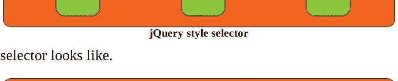

以下是 D3 选择器的样子。

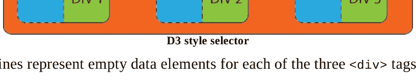

蓝色虚线代表三个 `<div>` 标签中每个对应的空数据元素。

如果我们随后将一个新的数据数组（例如 `[18, 4, 7]`）“绑定”到这些数据/元素对上，我们现在将拥有一个如下所示的选择器。

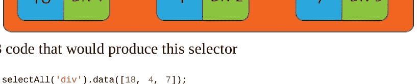

而以下是产生该选择器的 D3 代码：

```
var selector = d3.selectAll('div').data([18, 4, 7]);
```

18 现在与第一个 `<div>` 标签相关联，4 与第二个相关联，7 与第三个相关联。

正如你所见，选择器的 `data()` 方法接收一个数据数组，并将该数组中的每个数据项绑定到选择器中的每个 DOM 元素上。为了演示这一点，让我们构建一个简单的条形图。我们从这个 HTML 开始。

```
<body>
<style>
.bar{
  height: 10px;
  background-color: blue;
  border-bottom: 1px solid white;
}
</style>
<div class="bar"></div>
<div class="bar"></div>
<div class="bar"></div>
</body>
```

以及 JavaScript 代码：

```
1 var data = [10, 30, 60];
2 d3.selectAll('.bar').data(data)
3 .style('width', function(d){
4 return d + '%';
5 });
```

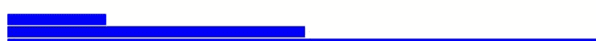

在线版本：[http://jsbin.com/AllruJuW/1/edit](http://jsbin.com/AllruJuW/1/edit)

请记住，`style` 和 `attr` 会将样式或属性更改应用于选择器中的每个 DOM 元素。如果它们被传递了一个函数，该函数将为每个元素运行一次。既然我们知道选择器 *实际上* 是数据/元素对的集合，那么说这些访问器函数实际上是在为每个数据/元素对被调用就更恰当了。该函数的第一个参数（通常标记为 `d`）是当前数据/元素对的数据项（或 datum）。第二个参数（回顾前一节）是选择器中的当前索引。

但如果我们预先不知道条形图中会有多少个条形怎么办？这就是 `enter()` 方法发挥作用的地方。

### .enter() 方法

所以你可能在之前的示例中注意到，`data()` 似乎在返回原始选择器。虽然它在更新原始选择器中的数据/元素对，但它也在返回一个完全新的选择器。旧选择器和新选择器恰好具有相同数量的数据/元素对，但并非总是如此。我们可以有一个空选择器，并通过绑定一个长度为 3 的数据数组来创建一个新的。我们的数据选择器现在看起来像这样：

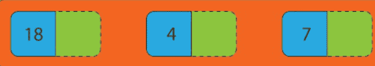

但我们原始的选择器仍然是空的。调用 `data()` 返回的选择集带有一个名为 `enter()` 的方法，它同样返回一个新选择器。这个新选择器将包含所有尚未包含元素的数据/元素对。在我们的例子中，它看起来与选择器完全相同

最初由 `data()` 返回，因为在开始时 *所有* 的数据/元素对都不包含元素。正如我们稍后将看到的，情况并不总是这样。我们的原始选择器包含的数据/元素对可能比 `data()` 返回的选择器多或少。如果较少，调用 `enter()` 将返回一个空选择器。

现在，我们可以对 `enter()` 返回的选择器使用 `append('div')` 来添加缺失的 DOM 元素。我们的选择器现在看起来如下所示。

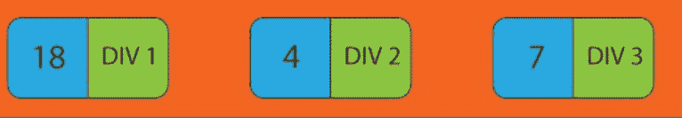

总而言之，我们可以使用 `.enter()` 和 `.append()` 为孤立的数据项创建新的 DOM 元素。让我们更新上面的柱状图示例以包含这个新特性。既然我们将创建 DOM 元素，我们不再需要在 `<body>` 标签中硬编码它们。

```
<body>
  <style>
    .bar{
      height: 10px;
      background-color: blue;
      border-bottom: 1px solid white;
    }
  </style>
</body>
```

```
var data = [10, 30, 60];
d3.select('body').selectAll('.bar').data(data)
  .enter().append('div')
    .style('width', function(d){ return d + '%'; })
    .attr('class', 'bar');
```

请注意，在代码中我们还必须先选择 body 标签。选择。选择可以相对于其他选择来执行。在这种情况下，我们需要相对于 body 执行选择，这样 D3 才知道任何新的 `<div>` 标签将被添加到哪里。我们还需要指定 CSS 类，以便我们为每个 `.bar` 编写的 CSS 规则能够生效。

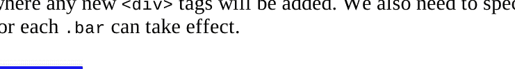

在线版本：[http://jsbin.com/eNOCuTeL/1/edit](http://jsbin.com/eNOCuTeL/1/edit)

结果看起来一样，但现在我们的代码更灵活了。为了说明这一点，让我们来看一个创建具有任意数量柱子的柱状图示例。在这个例子中，我们将使用 `d3.range(n)`，它简单地生成一个长度为指定值 `n` 的数组；`d3.range(3)` 返回数组 [0, 1, 2]，`d3.range(4)` 返回数组 [0, 1, 2, 3]，依此类推。

```
var data = d3.range(100);
d3.select('body').selectAll('.bar').data(data)
  .enter().append('div')
  .style('width', function(d){ return d + '%'; })
  .attr('class', 'bar');
```

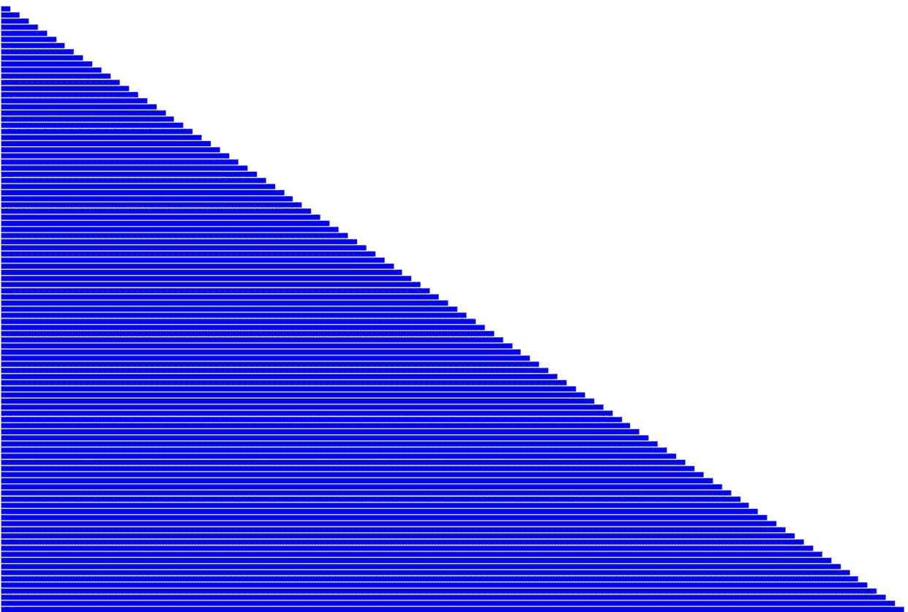

在线版本：[http://jsbin.com/eNOCuTeL/3/edit](http://jsbin.com/eNOCuTeL/3/edit)

记住，`enter()` 会产生一个新选择器，包含所有在 `data()` 返回的选择器中没有对应元素的数据/元素对。因此，如果我们通过将上述代码复制并粘贴在自身下方来重新运行，结果看起来将是一样的，并且不会添加新的 `<div>` 标签。这是因为 `d3.select('body').selectAll('.bar')` 将返回 100 个数据/元素对。将它们绑定到一个长度为 100 的新数组将简单地替换数据/元素对中所有旧的数据值，且由于没有任何数据/元素对缺失元素，`enter()` 将返回一个空选择器。

让我们通过一个重新运行 `.enter()` 的简单示例来演示。注意使用不同数据进行第二次选择是如何更新第一次选择中创建的前 3 个 `<div>` 标签，然后又增加一个的。

```
d3.select('body').selectAll('.bar').data([18, 4, 7])
   .enter().append('div')
   .attr('class', 'bar')
   .style('width', function(d){ return d + '%'; });

d3.select('body').selectAll('.bar').data([18, 4, 7, 11])
    .enter().append('div')
    .attr('class', 'bar')
    .style('width', function(d){ return d + '%'; });
```

这是第一次选择之后但在第二次选择之前的文档样子。

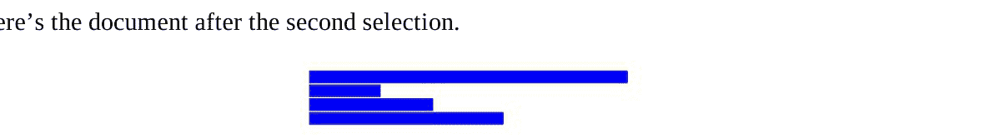

这是第二次选择后的文档。

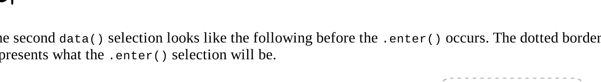

在线版本：[http://jsbin.com/iHeQoXuP/1/edit](http://jsbin.com/iHeQoXuP/1/edit)

在 `.enter()` 发生之前，第二次 `data()` 选择看起来如下所示。虚线边框表示 `.enter()` 选择将包含的内容。

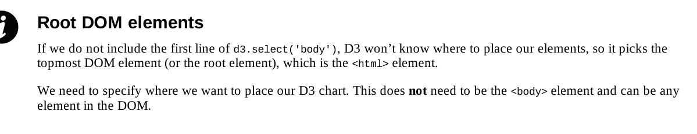

> 根 DOM 元素

如果我们不包含第一行 `d3.select('body')`，D3 将不知道将我们的元素放在哪里，因此它会选择最顶层的 DOM 元素（或根元素），即 `<html>` 元素。

我们需要指定想要放置 D3 图表的位置。这**不必**非得是 `<body>` 元素，可以是 DOM 中的任何元素。

### exit()

`exit()` 的工作方式与 `enter()` 类似，但与 `.enter()` 不同，它返回一个没有元素的数据/元素对的新选择器。

这是一个使用 `exit()` 的快速示例，假设 DOM 目前有三个 `<div class="bar"></div>` 标签。

```
d3.select('body').selectAll('.bar').data([8, 3]).exit().remove();
```

在线版本：[http://jsbin.com/UpIgiwah/1/edit](http://jsbin.com/UpIgiwah/1/edit)

在这个例子中，我们还引入了 `remove()` 选择器方法，它像 `append()` 一样，简单地移除选择器中的每个 DOM 元素。在这里，DOM 最初有 3 个带有 `.bar` 类的 `<div>` 标签。随后这些元素与一个仅包含两个数据项的数组配对。因为第 3 个元素现在不再与数据项配对，`exit()` 将创建一个仅包含该元素的新选择器。然后 `remove()` 将其移除。

## 通用更新模式

让我们通过一个稍微复杂一点的示例，使用 `enter()`、`exit()` 和常规的 `selectAll()` 选择来创建一个动态更新的柱状图。假设我们已经处理好了样式，我们首先需要为未来的柱子创建一个选择器。这告诉 D3 如果我们调用 `append()`，应该在 DOM 的哪个位置添加新元素。

```
var bars = d3.select('body').selectAll('.bar');
```

接下来，我们将创建一个名为 `update()` 的函数，它将负责定期使用新数据更新我们的柱状图。

```
function update(){
  // 我们的更新代码将放在这里！
}
setInterval(update, 800);
```

在函数内部，我们将再次使用 `d3.range(n)` 创建一个长度为 `n` 的新数组作为我们的数据。为了演示添加或删除柱子，我们将在每次调用 `update()` 时给 `n` 一个 0 到 100 之间的随机值。

```
function update(){
  var n = Math.round(Math.random() * 100);
  var data = d3.range(n);
  bars = bars.data(data);
}
```

接下来，我们需要根据是否为每个数据项配备了元素来添加或删除元素。

```
// 如果 data.length 现在变大了，为这些数据项添加新的 div
bars.enter().append('div')
  .attr('class', 'bar');
// 如果 data.length 现在变小了，移除那些不再
// 拥有数据项的 div。
bars.exit().remove();
```

最后一步是更新所有仍然保留的 `<div>` 标签。这包括没有被移除的 `<div>` 标签和任何最近添加的 `<div>` 标签。

```
bars
  .style('width', function(d){ return d / (n-1) * 100 + '%' })
  .style('height', 100 / n + '%');
```


在线版本：[http://jsbin.com/UpIgiwah/2/edit](http://jsbin.com/UpIgiwah/2/edit)

# SVG 基础

本章的第一节将介绍 SVG，这是一种在浏览器中创建矢量图形的强大开放 Web 标准。在本章的后半部分，我们将重点介绍让 SVG 操作变得有趣且可控的 D3 辅助函数。

## 可缩放矢量图形 (Scalable Vector Graphics)

虽然 D3 可以轻松地帮助我们创建和绘制 div 元素，但我们的可视化通常需要更强大的能力。我们将使用可缩放矢量图形（简称 SVG）来为我们在 DOM 中绘图提供一个更具表现力的接口。

SVG 与 HTML 一样，是一种基于 XML 的标记语言，专门用于创建支持交互和动画的矢量二维图形。

传统的图形系统（或光栅图形）依赖于对像素的操作，这通常会导致所谓的“破坏性过程”。这意味着一旦我们决定以某种特定方式修改像素信息，就很难甚至不可能更改或撤销这些更改。

在矢量图形中，不再是简单地记录图像中的所有像素，而是在图形显示在屏幕上之前，仅记录必要的形状和颜色并重新计算。最后一步（将几何形状转换为屏幕上的像素）会透明且自动地为我们完成。

这个过程的优点是易于缩放，且占用的存储空间更小。它允许我们使用任何标准文本编辑器创建 SVG 图像，我们可以搜索它们、通过脚本控制它们，并且可以无限缩放。

与光栅图形相比，矢量图形确实有一些缺点。例如，将照片存储为光栅图形要方便得多，因为大多数照片并非由简单的几何形状组成。另一方面，大多数数据可视化是由简单的几何形状组成的，因此矢量图形使其成为 D3 的完美搭档。

我们将会遇到的几乎每一个 D3 数据可视化作品可能都是使用 SVG 创建的。由于我们存储的是几何信息而非直接的像素数据，这意味着我们以后可以非常容易地对创建的 SVG 图形进行修改。

SVG 最方便的一点可能是我们可以直接在 HTML 内部使用它。它会让我们*感觉*像是在操作任何其他 DOM 元素，但结果却是一个图形。

## 入门

为了开始，让我们看一个如下的“Hello World”风格的 SVG 示例：

```
<!DOCTYPE HTML>
<html>
    <body>
        <svg>
            <circle cx="223" cy="83" r="54"/>
```


```
<circle cx="83" cy="83" r="54"/>
<circle cx="152" cy="125" r="16"/>
</svg>
</body>
</html>
```

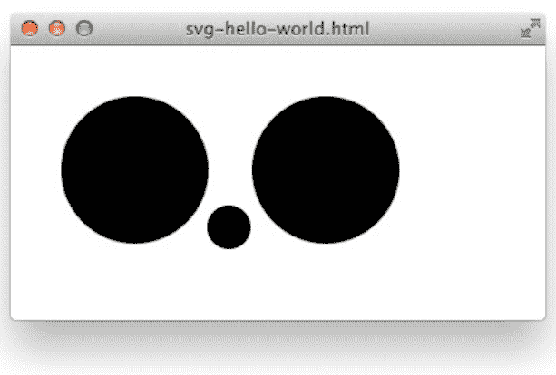

熊猫眼

在线版本：[http://jsbin.com/ahOZAtej1/1/edit](http://jsbin.com/ahOZAtej1/1/edit)

为了将任何 SVG 元素实际放置到我们的 DOM 中，我们需要将它们放在 `<svg>` 元素内部。

创建一个新的 SVG 元素很简单，如下所示：

```
<svg height="200" width="200"></svg>
```

上面的 `<svg>` 元素只是一个 DOM 元素，就像 `<div>` 元素一样。和任何其他 HTML 元素一样，除非我们指定尺寸，否则它会尽可能占用更多空间。

这个元素目前在页面上还看不出来什么，因为我们还没有在其中放置任何内容。

## SVG 边界

请注意，当我们使用一个超出其父 `<svg>` 元素边界位置的 SVG 元素时，它会被裁剪。为了确保我们的元素不会被截断，我们要么必须确保 `<svg>` 元素足够大，要么确保内部 SVG 元素永远不会超出其根 `<svg>` 元素的边界。

有许多 SVG 元素可供我们用来在 DOM 中的 `<svg>` 元素内绘制视觉元素，同时我们也有机会构建自己的元素。这些包括简单的形状，如圆形、椭圆、线条、矩形和圆角矩形。

我们可以使用多种不同的字体绘制文本，或者绘制可以是直线、曲线、填充、描边等的路径。我们有完整的色谱可供使用，以创建渐变、图案、图像视觉效果、合成和 alpha 效果。

SVG 还允许我们为不同的元素定义动画。

此外，许多流行的插图程序将图形导出为 SVG，因此可以使用外部工具绘制路径，然后我们在 Web 上显示这些图形。

## SVG 与 HTML 的区别

尽管 SVG 感觉起来很像 HTML，但它在一些不太明显的方面有所不同。仅仅因为一个属性或样式在 HTML 中有效，并不意味着它对 SVG 元素也有效。

例如，`width` 和 `height` 属性对圆形来说没有意义。描述圆形几何形状的唯一三个要素正是我们提到的三个：圆心相对于 x 和 y 轴的位置（`cx` 和 `cy`），以及它的半径（`r`）。还要注意，这些都是属性而不是样式。我们**无法像对 HTML 元素那样，使用 CSS 样式来影响 SVG 元素的位置**。

**常见陷阱：**

仅仅因为一个属性或样式在 HTML 中有效，并不意味着它对 SVG 也有效。常见的陷阱包括在不支持它们的 SVG 元素上使用 `width`、`height`、`position`、`left`、`top`、`right`、`bottom` 或 `float` 等属性或样式。

我们现在将介绍几种 SVG 类型，以便重点说明最常用的几种 SVG 类型。

## SVG 坐标

计算机图形传统上将其坐标系从左上角开始设置，定义为基本的 `0, 0` 坐标系。较大的 y 值使坐标向下移动，而增加的 x 值使其向右移动。SVG 坐标系也不例外。


### 坐标系

当我们将一个元素放置在根 `<svg>` 元素内部时，我们需要根据这些坐标来确定位置。

## SVG 圆形

我们刚刚介绍的第一个 SVG 元素是 `<circle>`，顾名思义，它创建一个圆形。注意我们如何设置属性 `cx` 和 `cy`，分别对应圆心沿 x 轴和 y 轴的偏移量，以及 `r`，即圆的半径。

> 这些不是 HTML 属性。它们是特定于圆形的属性，不适用于其他 SVG 形状（如矩形）或其他 HTML 元素。

```
1 <circle cx="50" cy="50" r="30">
2 </circle>
```

### 圆形

这将圆心设置为放置在坐标 (50, 50) 处，半径为 30。

在线版本：[http://jsbin.com/OruHiZA/1/edit](http://jsbin.com/OruHiZA/1/edit)

## SVG 椭圆

与圆形类似，我们也可以绘制椭圆，它与圆形的区别在于每个维度的半径期望值不同。

```
1 <ellipse cx="50" cy="50" rx="40" ry="20">
2 </ellipse>
```

[在线版本](http://jsbin.com/eHugeTar/1/edit)

## SVG 矩形

`<rect>` 是一个简单的 SVG 元素，用于创建矩形。要指定几何形状，我们需要设置属性 `x`、`y`、`width` 和 `height`。我们将设置 `x` 和 `y` 值来指定左上角顶点的坐标，而使用宽度和高度来指定矩形的尺寸。

```
<!DOCTYPE HTML>
<html>
  <body>
    <svg>
      <rect x="100" y="15" width="150" height="150"></rect>
    </svg>
  </body>
</html>
```

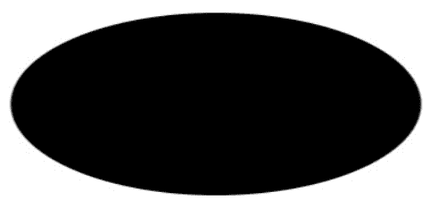

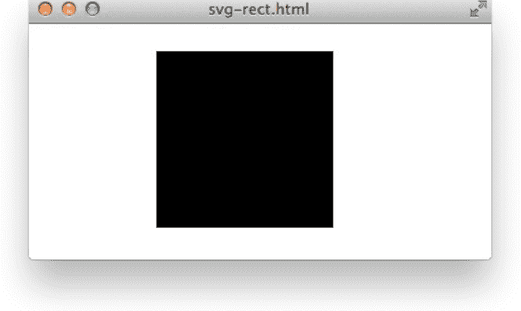

白色 SVG 上的黑色方块，2013

在线版本：[http://jsbin.com/etISEYuY/1/edit](http://jsbin.com/etISEYuY/1/edit)

## SVG 线条

SVG 还支持绘制简单的线条。线条需要四个属性：线段的起始坐标（x1 和 y1）和结束坐标（x2 和 y2），线段将穿过这两点。

```
1 <line x1="10" y1="10"
2     x2="100" y2="100"
3     stroke="blue"
4     stroke-width="100"></line>
```

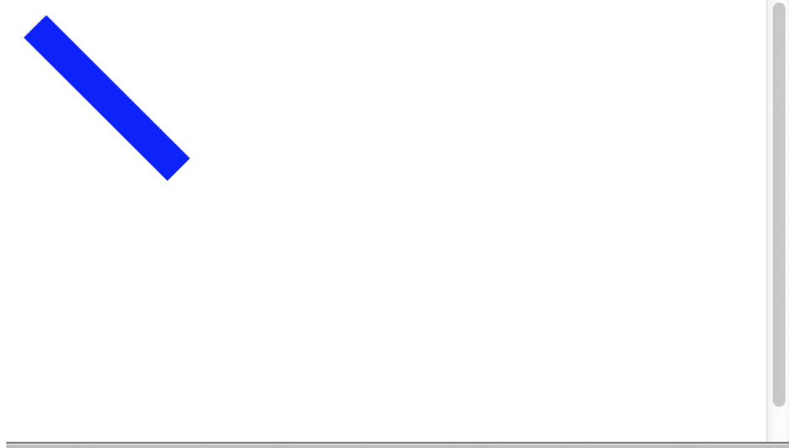

**线条**

在线版本：[http://jsbin.com/onuSAbO/1/edit](http://jsbin.com/onuSAbO/1/edit)

## SVG 路径

`<path>` 是一个说起来容易做起来难标签，因为我们必须在名为 `d` 的单个属性中指定路径的完整几何形状。

但别担心！正如我们将在本章后面学到的，D3 附带了大量辅助函数，可以轻松地从我们的数据生成这个 `d` 属性。了解如何创建路径是很有帮助的，因此我们将介绍构成 `d` 属性中路径几何形状的不同命令。以下是一个我们将剖析的简单示例：

```
1 <!DOCTYPE HTML>
2 <html>
3     <body>
4         <svg>
5             <path d="M 100 50 L 300 50 L 200 150 z"/>
6         </svg>
7     </body>
8 </html>
```

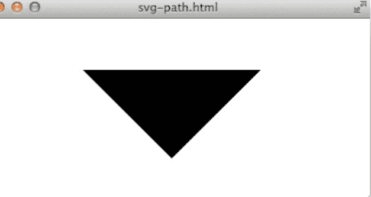

### 疯狂的小丑三角形

传递给 `d` 的命令是使用[海龟图形](https://example.com)风格命令描述的。将这些命令想象成你如何蒙着眼睛告诉某人画画，发出诸如抬起笔离开纸、将笔放在纸上、向下移动、向上并向左移动等指令。我们传递给 `d` 的命令以同样的命令式方式表达。路径 `d` 属性版本包括：

- **M** 表示**移动到**
- **L** 表示**直线连接到**
- **z** 表示**闭合路径**

让我们更详细地分解前面示例中的命令：

```
1 M 100 50  - 移动到位置 (x=100, y=50)，
2           - 不画线
3 L 300 50  - 从前一个位置
4           (x=100, y=50) 画线到
5           (x=300, y=50)
6 L 200 150 - 从 (x=300, y=50)
7           画线到 (x=200, y=150)
8 z         - 通过从 (x=200, y=150)
9           画线到 (x=100, y=50)
10          将起点与终点连接
```

`<path>` 的 `d` 属性还可以接受一些其他命令，但我们不会在这里深入讨论，因为我们刚刚介绍的那些是最常用的。

话虽如此，我们可以通过阅读 [MSDN 关于 SVG <path> 的详尽文档](https://example.com)来找到更多信息并了解其他命令。这些命令包括使用贝塞尔曲线创建平滑线条的命令。

## SVG 文本

`<text>` 标签是在 SVG 中包含文本的一种简单方法，但我们可能会质疑它的存在必要性。

为什么我们不能简单地使用 `<p>`、`<div>` 或 `<span>` 标签呢？为什么我们需要一个单独的标签？

主要原因是，我们无法（轻易地）像将 SVG 包含到 HTML 中那样将 HTML 包含到 SVG 中。这也是为了允许 SVG 图像独立存在，在浏览器之外，允许 SVG 图像在 Adobe Illustrator 等图像编辑器中编辑。我们可以使用 `<text>` 标签的 `x` 和 `y` 属性来设置其位置，并通过编辑其内部文本内容来设置文本。

也就是说，`<text>` 元素继承其 CSS 指定的字体样式，除非直接在 `<text>` 元素本身上设置。

```
<!DOCTYPE HTML>
<html>
  <body>
    <svg>
      <text x="100" y="100" fill="green" font-family="arial" font-size="16">
        Ceci n'est pas une pipe.
      </text>
    </svg>
  </body>
</html>
```

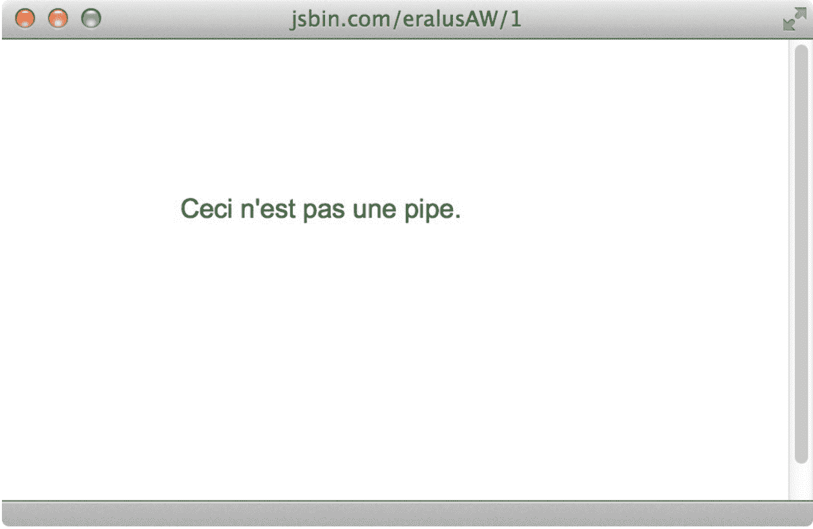

在线版本：[http://jsbin.com/eralusAW/1/edit](http://jsbin.com/eralusAW/1/edit)
```


## SVG 组

`<g>` 标签是一种将 SVG 元素分组的简便方式。任何应用到组元素的变换（定位、缩放、旋转）也会应用到每个子元素上。

利用分组，例如，我们可以创建一组 SVG 元素来绘制一辆汽车——用圆形表示车轮，用矩形表示车轴。如果我们想要旋转这辆汽车，只需将变换应用到包含所有组件的 `<g>` 元素上即可。

## SVG 样式

为 SVG 元素设置样式与为 HTML 元素设置样式几乎完全相同。我们仍然可以使用 CSS，通过 `id` 和 `class` 属性将 CSS 与 SVG 元素关联起来，或者直接使用 `style` 属性应用样式。

唯一的区别是，大量的样式与我们从 HTML 经验中预期的不同。

例如，HTML 的 `background-color: orange;` 样式。在 SVG 元素中最接近的等价物是 `fill: orange;`。同样，我们预期的 `border-color: blue` 在 SVG 中的等价物是 `stroke: blue;` 或者 `border-width: 10px;` 和 `stroke-width: 10;`。这是一个重要的细节，也是从 HTML 背景转向 SVG 时常见的易错点。

```html
<!DOCTYPE HTML>
<html>
  <head>
    <style>
      svg path {
        stroke: red;
        stroke-width: 30px;
        fill: white;
      }
      svg text {
        font-size: 30px;
        font-family: sans-serif;
        fill:red;  /* 不是 `color` 或 `font-color` */
      }
    </style>
  </head>
  <body>
    <svg>
      <path d="M 30 20 L 140 200 L 240 20 z"></path>
      <text x="95" y="80">YIELD</text>
    </svg>
  </body>
</html>
```

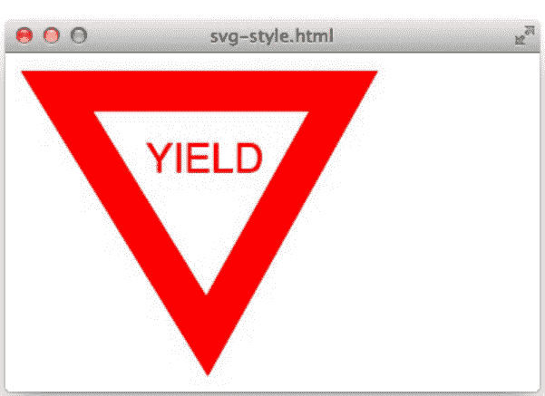

在线版本：[http://jsbin.com/iXiglFe/1/edit](http://jsbin.com/iXiglFe/1/edit)

也可以将这些样式直接放在元素本身上。但使用 CSS 通常要容易得多，也更推荐这样做，因为更易于维护和阅读。

> **常见易错点：**
> 请记住，对于 SVG 元素，变换是通过 `transform` 属性应用的，而 HTML 元素则是使用 `transform` CSS 属性。

# SVG 进阶

### 透明度

SVG 支持使用透明度进行绘制，我们有两种方式可以实现。我们可以直接在元素上设置 `opacity` 属性，或者将 `Brightness` 设置为颜色，其中第四个参数是透明度（也称为 alpha 值）。

我们可以像设置任何其他属性一样设置 SVG 元素的不透明度：

```javascript
d3.select('body').append('svg')
    .attr('width', '300px')
    .attr('height', '200px')
    .data([1,2,3])
    .enter().append('circle')
        .attr('fill', 'blue')
        .attr('opacity', '0.4');
```

在线版本：[http://jsbin.com/UzIvodE/2/edit](http://jsbin.com/UzIvodE/2/edit)


如前所述，使用 `rgba()` 函数可以轻松地将 `opacity` 和 `fill` 两个属性结合起来，一次性设置颜色和透明度。

```javascript
d3.select('body').append('svg')
   .attr('width', '300px')
   .attr('height', '200px')
   .data([1,2,3])
   .enter().append('circle')
      .attr('fill', 'rgba(100, 200, 300, 0.4)');
```


在线版本：[http://jsbin.com/UzIvodE/2/edit](http://jsbin.com/UzIvodE/2/edit)

### 描边

除了描边粗细和颜色之外，还有更多选项可以控制形状描边的外观。还有 `stroke-linejoin`，它影响线段连接处的拐角；`stroke-linecap`，它与 `stroke-linejoin` 类似，影响线条端点的外观；以及 `stroke-dasharray`，可用于创建虚线效果，代替默认的实线。

```html
<svg>
   <line x1="20" y1="20"
         x2="200" y2="200"
         stroke="blue"
         stroke-linecap="round"
         stroke-dasharray="4,30"
         stroke-width="20">
   </line>
</svg>
```


在线版本：[http://jsbin.com/EBuciXuZ/1/edit](http://jsbin.com/EBuciXuZ/1/edit)

### 层级

你可能会遇到这样的情况：有重叠的 SVG 元素，其中一个元素应该位于另一个元素后面，而不是前面。这可能发生在添加 SVG 元素的顺序与其视觉深度顺序（从下到上）不一致时。在HTML中，我们可以使用 `z-index` CSS 属性来解决这个问题，但这对于 SVG 元素不起作用。

相反，我们必须移除并重新添加那些我们希望位于其父元素最顶层的任何元素。幸运的是，D3 选择集提供了一个名为 `sort` 的便捷方法，正好用于解决这个问题。我们可以向它传递我们的排序函数，D3 将重新排序我们的选择集并相应地更新 DOM 元素。

```javascript
d3.selectAll('circles').sort(function(a, b){
   // 假设我们已经添加了自己的 `zIndex` 数据属性
   return a.zIndex - b.zIndex;
});
```

# SVG 与 D3

单独使用 SVG 可能有些繁琐，但在前面的介绍之后，我们很少（如果有的话）需要直接编写任何 SVG。

相反，我们将使用 D3 来创建这些元素并为我们应用样式。

我们仍然需要了解 SVG 的工作原理才能掌握 D3，但我们会让这个库来处理繁重的工作。既然我们已经介绍了 SVG 的一些基础知识，我们就可以开始更多地谈论如何将它与 D3 结合使用。

### 从零开始创建 SVG

当我们首次启动页面时，我们需要一个地方来放置我们的 SVG 元素。如上所述，我们只能将元素放在 `<svg>` 标签内部。有时更方便的做法（尤其是当我们集成使用指令时）是不直接将其放在页面上。

我们可以使用 d3 来创建我们的 svg，如下所示：

```javascript
var svg = d3.select("body")
        .append("svg");
```

有了 svg 变量，我们现在可以随时引用 `<svg>` 元素并与我们的 D3 舞台进行交互。我们可以在 `<svg>` 元素上使用与 D3 元素相同的方法来设置其属性。

例如，让我们设置高度和宽度：

```javascript
d3.select('body').append('svg')
  .attr('width', 300)
  .attr('height', 200);
```

### 生成器

D3 最出色的部分之一，是它专注于通过 D3 的生成器使 SVG 元素的创建变得可管理。

生成器兼具对象和函数的角色。生成器是函数，与其他函数一样，它们有额外的方法来允许我们更改其行为。就像任何其他 D3 类一样，大多数生成器方法返回自身，因此我们可以对它们进行 chaining 方法调用。

一旦我们根据需求配置好了生成器，我们将使用它们来 *生成* 创建形状所需的 SVG 命令。

让我们看一个非常简单的例子，线条生成器：

`line` 生成器接收我们传递给它的任何数据，并生成必要的 SVG `<path>` d 属性命令。为了使用路径生成器，我们需要告诉它一些关于我们数据格式的信息。我们通过为线条在我们数据中的 x 和 y 坐标定义 `accessor`（访问器）函数来做到这一点。这本质上是在说："嘿，线条生成器，当你创建线条时，用这个作为每个数据点的 x，用这个作为 y。"

如果我们的数据是一组点，其中单个点是 `[x, y]` 形式的数组，而点数组如下所示：

```javascript
var data = [ [x1, y1], [x2, y2], [x3, y3], etc... ];
```

我们的线条生成器将如下所示：

```javascript
var line = d3.svg.line()
    .x(function(d) { return d[0]; })
    .y(function(d) { return d[1]; });
```

假设我们的数据而是 `{ x: x1, y: y1 }` 形式的坐标对象数组，点数组如下所示：

```javascript
var data = [ { x: x1, y: y1 }, { x: x2, y: y2 }, etc... ];
```

那么我们的线条生成器 x 和 y 访问器将如下所示：

```javascript
var line = d3.svg.line()
    .x(function(d) { return d.x; })
    .y(function(d) { return d.y; })
```

### 这是一个完整的线条生成器示例

```html
<!DOCTYPE HTML>
<html>
  <head>
    <script src="http://d3js.org/d3.v3.min.js" charset="utf-8"></script>
    <style>
      body{ margin: 0; }
      path { stroke: black; stroke-width: 2px; fill: none;}
    </style>
  </head>
  <body>
    <script>
var lineGenerator = d3.svg.line()
    .x(function(d) { return d[0]; })
    .y(function(d) { return d[1]; });

// 线条数据
var lineData = [[154, 14], [35, 172], [251, 127], [31, 58], [157, 205],
    [154, 14]];

// 创建 `<svg>` 和内部的 `<path>` 元素
d3.select('body').append('svg')
    // 使用生成器和线条数据来创建路径的 `d` 属性。
    .append('path').datum(lineData).attr('d', lineGenerator);
    </script>
  </body>
</html>
```


通过我们的生成器，我们还可以设置插值模式（interpolation mode），用以告知 D3 如何渲染各点之间的线条。

我们有相当多可用的插值模式。

另外不要忘记，生成器可以被多次使用，用于多个元素。因此，如果我们的数据发生了变化但仍保持相同的通用格式，我们只需重新应用该生成器即可。

## d3.svg.arc

我们还可以使用 `d3.svg.arc()` 生成器来创建弧线或圆。描述一条弧线的四个参数是：内半径、外半径，以及起始角度和结束角度（其中 0 度指向正上方，负值向左）。

增加内半径（外半径固定）

增加外半径（内半径固定）

增加起始角度（结束角度固定）

增加结束角度（起始角度固定）

同时增加内半径和结束角度

如果我们希望弧线生成器始终产生相同的弧线，可以通过为所有弧线生成器访问器（accessors）传递单个数值，将每个参数固定为常数。由于我们的弧线是在 (0,0) 处创建的，因此我们需要将其向左和向下平移 200 像素，以便能看到完整的弧线。

```javascript
var arc = d3.svg.arc()
    .innerRadius(100).outerRadius(150)
    .startAngle(-Math.PI / 2).endAngle(Math.PI / 2)

d3.select('body').append('svg')
        .append('path').attr('d', arc).attr('transform', 'translate(200, 200)')
```

在线版本：[http://jsbin.com/uPEfeMaj/3/edit](http://jsbin.com/uPEfeMaj/3/edit)

此外，访问器可以传递函数而非数值，这些函数将针对选择器数据的每个元素被调用。对于选择器中的每一个数据项，D3 都会调用我们的访问器，并使用其结果来设置当前生成弧线的该参数。让我们创建一个彩虹来演示这一点。

```html
<!DOCTYPE HTML>
<html>
  <body>
    <script src="http://d3js.org/d3.v3.min.js" charset="utf-8"></script>
    <script>

var rainbow = ['red', 'orange', 'yellow', 'green', 'blue', 'indigo', 'violet'];
var arc = d3.svg.arc()
  .innerRadius(30)
  // 彩虹的外半径由彩虹数组中的索引决定
  .outerRadius(function(d, i){ return (rainbow.length - i) * 20 + 30})
  .startAngle(-Math.PI / 2).endAngle(Math.PI / 2);

d3.select('body').append('svg')
    .selectAll('path').data(rainbow).enter().append('path')
    .attr({
      d: arc,
      transform: 'translate(200, 200)',
      fill: function(d){ return d }
    })
    </script>
  </body>
</html>
```

在线版本：[http://jsbin.com/AbUGOZiX/1/edit](http://jsbin.com/AbUGOZiX/1/edit)

这里有一个使用 `d3.layout.pie` 的圆环图（donut chart）示例，它负责将我们的数据转换为可以直接传递给饼图生成器的格式。假设我们有以下想要用饼图表示的数据。

```javascript
var data = [21, 32, 35, 64, 83];
```

我们可以通过在饼图布局上调用 `pie()` 方法，将其转换为传递给弧线生成器所需的起始和结束角度数组。

```javascript
var pie = d3.layout.pie();
var arcData = pie(data);
```

然后，我们将创建一个具有固定内半径和外半径值的弧线生成器。

```javascript
var arc = d3.svg.arc().innerRadius(100).outerRadius(200);
```

我们不需要指定 `startAngle` 和 `endAngle` 访问器，因为默认情况下，它们会访问数据元素中同名的属性，因此无需添加以下代码片段。

```javascript
// 默认的 `startAngle` 访问器
arc.startAngle(function(d){
    return d.startAngle;
});
// 默认的 `endAngle` 访问器
arc.endAngle(function(d){
    return d.endAngle;
});
```

现在，最后一步是将我们的 `arcData` 绑定到选择器中新创建的 path 元素上。

```javascript
var path = svg.append('path').data(arcData)
  .enter().append('path').attr('d', pie);
```

我们需要将所有路径平移一点，这样它们就不会全部绘制在屏幕左上角的 (0,0) 处。然后，在使用颜色量表（color scale，我们将在后面的章节中详细介绍）添加颜色后，结果应该如下所示：

在线版本：http://jsbin.com/axICUjaH/1/edit

## d3.svg.area

面积生成器（area generator）可以轻松创建折线图，其中折线下方的区域被填充。我们需要为生成器的 y0、y1 和 x 访问器提供函数或数值。y* 访问器告诉生成器面积形状应该向下或向上延伸到什么程度。x 应该是沿着图表的连续 x 值，就像使用 `d3.svg.line()` 时一样。

```html
<!DOCTYPE HTML>
<html>
  <head>
    <script src="http://d3js.org/d3.v3.min.js" charset="utf-8"></script>
    <style>
      path { stroke: white; stroke-width: 2; fill: steelblue;}
      .plot{ fill: none; stroke: #aec7e8; stroke-width: 2;}
      circle{ fill: steelblue; stroke: white;}
    </style>
  </head>
  <body>
    <script>

var svg = d3.select('body').append('svg')
// 构建并配置面积生成器
var area = d3.svg.area()
  .y0(100) // 设置面积形状的下 y 边界
  .y1(function(d){ return d.y })
  .x(function(d, i){ return d.x })

// 生成一些随机数据
var data = d3.range(100).map(function(){ return Math.random() * 30 + 0 })
  .map(function(d, i){ return { x: i * 10, y: d }})

// 在图表线下方绘制面积形状
svg.append('path').datum(data).attr('d', area)

// 为面积形状的顶边缘添加边框
var line = d3.svg.line()
  .x(function(d){ return d.x})
  .y(function(d){ return d.y })
svg.append('path').datum(data).attr('d', line).attr('class', 'plot')

// 在所有点上绘制圆圈
svg.selectAll('circle').data(data).enter().append('circle')
  .attr('cx', function(d){ return d.x })
  .attr('cy', function(d){ return d.y })
  .attr('r', 3)

    </script>
  </body>
</html>
```

## d3.svg.chord

SVG 和弦生成器（chord generator）有助于创建连接的弧线段，这是和弦图（chord diagrams）的核心组件。和弦图中的所有其他组件都可以使用其他 SVG 生成器创建。两个弧线段组成一个弧线连接。第一个弧线段称为源（source），第二个称为目标（target）。每个弧线段由半径、起始角度（startAngle）和结束角度（endAngle）描述。方便的是，`d3.layout.chord()` 可以将矩阵形式的关系信息转换为 `d3.svg.chord` 所需的默认和弦布局。例如，这是一个任意的关系数据集。每个单元格描述了两个项目之间的关系（在我们的示例中，因为 Betty 喜欢 Alex 的程度可能高于 Alex 喜欢 Betty 的程度，因此连接的幅度取决于方向）。

```javascript
// 每个单元格的值代表一个 节点->节点 的关系（列->行）
//      A               B               C               D
var matrix = [
    [ 0 , 1.3 , 2 , 1 ],
    [ 1.9 , 0 , 1 , 2.1 ],
    [ 2 , 2 , 3.2 , 1.8 ],
    [ 2.7 , 0 , 1 , 0 ]
]; // 'C' 非常喜欢她自己
```

将此数据传递给 `d3.layout.chord().matrix(matrix).chord()` 将返回如下数据：

```javascript
[
    {
        source:{ startAngle:1.2280, endAngle:1.7707, value:1.9 },
        target:{ startAngle:0, endAngle:0.3712, value:1.3 }
    },
    {
        source:{ startAngle:0.3712, endAngle:0.9424, value: 2 },
        target:{ startAngle:2.6560, endAngle:3.2272, value: 2 }
    },
    // 等等...
]
```

```html
<!DOCTYPE HTML>
<html>
<head>
    <script src="http://d3js.org/d3.v3.min.js" charset="utf-8"></script>
    <style>
        path { stroke: white; stroke-width: 2; fill: steelblue; }
        .plot { fill: none; stroke: #aec7e8; stroke-width: 2; }
        circle { fill: steelblue; stroke: white; }
    </style>
</head>
<body>
    <script>
        var width = window.innerWidth;
        var height = window.innerHeight;

        var svg = d3.select('body').append('svg');
        var matrix = [
            // 每个单元格的值代表一个单行的行到列关系
            [ 0 , 1.3 , 2 , 1 ],
            [ 1.9 , 0 , 1 , 2.1 ],
            [ 2 , 2 , 3.2 , 1.8 ],
            [ 2.7 , 0 , 1 , 0 ]
        ];

        var chord = d3.layout.chord().matrix(matrix);
        var innerRadius = Math.min(width, height) * .41;
        var outerRadius = innerRadius * 1.1;

        var fill = d3.scale.ordinal(
```


```javascript
.domain(d3.range(4))
.range(['#FFA400', '#C50080', '#ABF000', '#1049A9']);

svg = svg.append('g')
.attr('transform', 'translate(' + width / 2 + ',' + height / 2 + ')');

svg.append('g').selectAll('path').data(chord.chords)
.enter().append('path')
.attr('d', d3.svg.chord().radius(innerRadius))
.style('fill', function(d) { return fill(d.target.index); })
.style('opacity', 0.5);
```

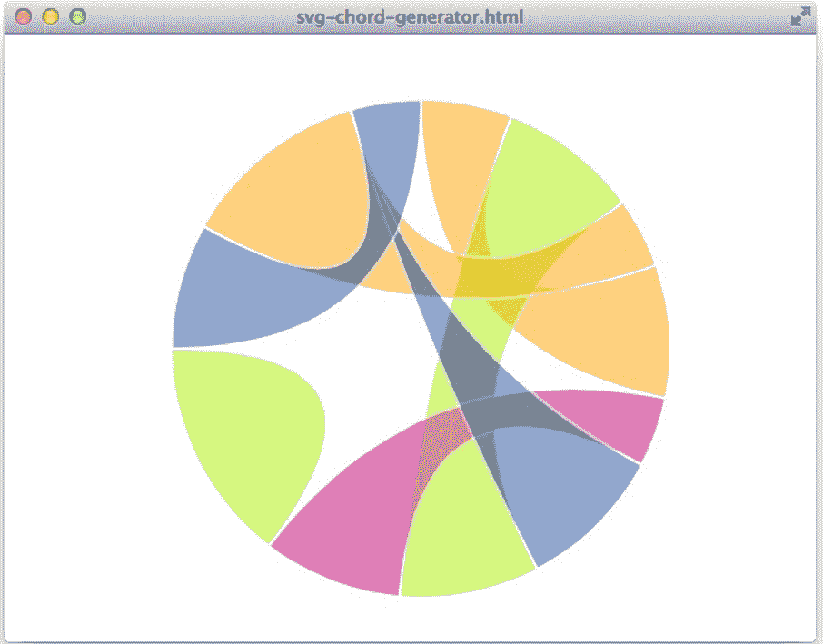

## d3.svg.symbol

symbol 生成器创建了一个新的符号生成函数，用于创建符号。默认符号是一个大小（像素面积）为 64 的圆形。这通常是你想要的行为，但如果你想指定例如正方形的尺寸，你需要根据所需的尺寸和符号来计算面积。

```javascript
var symbol = d3.svg.symbol().type('square').size(100)
var svg = d3.select('body').append('svg')
svg.append('path').attr({d: symbol}).attr('transform', 'translate(100,100)')
```

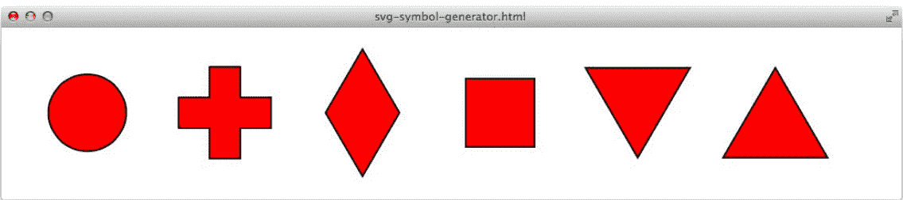

## d3.svg.diagonal

diagonal 生成器接收节点对，并产生一条必要的路径，使用曲线路径将该对中的两个元素连接起来。默认的访问器假设每对数据具有以下形式：

```javascript
{ source: { x: 54, y: 12 }, target: { x: 83, y: 62 } }
```

```html
<!DOCTYPE html>
<html>
  <head>
    <style>
    circle { fill: orange; stroke: #333; }
    path { fill: none; stroke: #ccc; }
    </style>
  </head>
  <body>
  <script src="http://d3js.org/d3.v3.min.js"></script>
  <script>

var svg = d3.select('body').append('svg');
var diagonal = d3.svg.diagonal();
var source = { x: 500, y: 50 };
var targets = [
  { x: 100, y: 150 },
  { x: 300, y: 150 },
  { x: 500, y: 150 },
  { x: 700, y: 150 },
  { x: 900, y: 150 }
];
// create the link pairs
var links = targets.map(function(target){
  return { source: source, target: target };
});

// use the diagonal generator to take our links and create the the curved paths
// to connect our nodes
var link = svg.selectAll('path').data(links).enter().append('path')
    .attr('d', diagonal);

// add all the nodes!
var nodes = targets.concat(source);

svg.selectAll('circle').data(nodes).enter().append('circle')
    .attr({
     r: 20,
     cx: function(d){ return d.x; },
     cy: function(d){ return d.y; }
    });
</script>
</body>
</html>
```

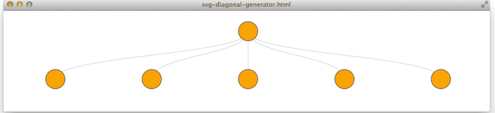

## d3.svg.line.radial

radial 生成器接收一个由半径和角度对组成的数据数组，并产生必要的 SVG 路径，将它们按顺序连接起来，从第一个开始。默认的访问器假设每对数据具有以下形式，其中角度以弧度为单位。

```javascript
[43, Math.PI * 0.5]
```

```html
<!DOCTYPE html>
<html>
  <head>
    <style>
    body{ margin: 0; }
    circle { fill: orange; stroke: #333; }
    path { fill: none; stroke: #333; stroke-width: 4; }
    </style>
  </head>
  <body>
  <script src="http://d3js.org/d3.v3.min.js"></script>
  <script>

var svg = d3.select('body').append('svg');
// our radial line generator
var lineRadial = d3.svg.line.radial();

var n = 1000, max_r = 250, rotations = 10;
var data = d3.range(n).map(function(d){
  var t = d / (n - 1);
  return [ t * max_r, t * Math.PI * rotations * 2 ];
});

var link = svg.append('path').datum(data).attr('d', lineRadial)
.attr('transform', 'translate(300,300)');

</script>
</body>
</html>
```

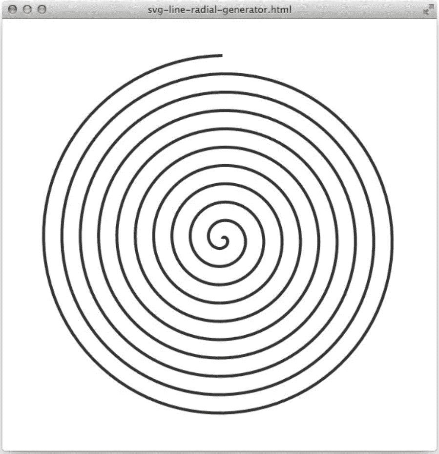

# 数组辅助函数

D3 包含了一系列对象辅助函数，允许我们将数据处理成更有意义的数据结构。这个过程通常被称为数据的“清洗”，是数据可视化人员的常见任务。

我们将在第 7 章中深入讨论这个过程。

JavaScript 本身就包含了许多方法来帮助我们以有意义的方式修改数据集。我们可以反转数组中元素的顺序、修改数组内容、将两个数组拼接在一起、过滤元素等。

`lodash` 和 `underscore` 库也提供了便捷的方法来处理修改数据的多种不同情况。

在本章中，我们将介绍操纵数据的常用方法。

## Ranges (范围)

在数据可视化工具中，我们经常会用到 `range`。范围是一个包含等差数列的数组。这些数字可以是整数或浮点数。这在创建坐标轴（例如在图表中显示一组数字范围）时特别有用。

我们将使用 `d3.range([start,] stop[, step])` 方法，它最多接收三个参数来生成递增/递减的序列数组：

- **start**: `start` 参数默认为 0，是可选的。这是范围数组的起点。
- **stop**: `stop` 参数是必需的，它决定了范围在哪里停止。注意，结果数组将不包含停止数值。
- **step**: `step` 决定了计数器递增或递减的幅度。如果它是正数，则下一个值将增加 `step` 的量。如果它是负数，则下一个值将减少 `step` 的量。如果省略，则 `step` 默认为 1。

这使我们能够生成如下数组：

```javascript
d3.range(0, 5); // => [0, 1, 2, 3, 4]
d3.range(0, 6, 2); // => [0, 2, 4]
d3.range(5); // => [0, 1, 2, 3, 4]
d3.range(3, 1, -0.5); // => [3, 2.5, 2, 1.5]
```

## Permutations (排列)

我们可以根据数据在数组中的位置生成数据的排列。例如，这对于将数据布局在表格中非常有用。

`d3.permute(array, indexes)` 接收两个参数：

- **array**: `array` 是原始数组，我们将从中根据 `indexes` 提取数据。
- **indexes**: `indexes` 是一个整数列表，代表我们感兴趣的数组内位置。

```javascript
d3.permute(['a', 'b', 'c'], [2, 1, 0]); // => ['c', 'b', 'a']
d3.permute(['a', 'b', 'c'], [0, 0, 1]); // => ['a', 'a', 'b']
d3.permute(['a', 'b', 'c'], [2, 1, 4]); // => ['c', 'b', undefined]
```

# 访问和操作简单数组

## array.forEach()

`array.forEach()` 实际上不是 D3 的特性，但经常被开发者低估。

`array.forEach()` 方法对于遍历项目数组非常有用，无需担心 for 循环或需要跟踪当前索引。

它接受两个可能的参数：

- **callback**: `callback` 参数是一个函数，将为数组中的每个元素被调用。该函数将接收以下参数：
    - **element**: `element` 是数组的元素值。
    - **index**: `index` 是数组中的整数位置。
    - **originalArray**: `originalArray` 指向正在遍历的原始数组。
- **thisArg**: `thisArg` 是一个可选参数，允许我们设置回调函数内部的 `this` 值。

如果在 `array.forEach()` 方法中传递了 `thisArg`，那么它将成为回调函数被调用时的第一个参数。例如：`function(thisArg, element, index, originalArray)`

```javascript
var notes = ['Eb', 'Bb', 'F', 'C'],
    note, index;
for(index = 0; index < notes.length; index++)
{
  note = notes[index];
  console.log('beat', index, 'note: ', note);
}
```

或者：

```javascript
['Eb', 'Bb', 'F', 'C']
.forEach(function(note, index) {
  console.log('beat', index, 'note: ', note);
});
```

如果我们想**停止**迭代，只需从函数中返回 `false`，它将停止执行。

## array.map()

`array.map` 函数不是 D3 的特性，而是 JavaScript 一个经常被忽视的特性。

与 `array.forEach()` 函数类似，我们可以用它来遍历数组中的项目，但它增加了一个功能：允许我们通过返回想要添加到当前索引的项目来轻松创建新数组。

`map` 返回的新数组长度将始终与原始数组相同。

数据可视化中的一项常见任务是将一种格式的数据转换为另一种格式的数据。

例如，假设我们有一个由数组组成的数组，代表连续时间步长的 x,y 位置，如 `[[1, 2], [3, 4], ... ]`，但某些其他代码期望接收的是形式为 `[{x: 1, y: 2}, { x: 3, y: 4}, ... ]` 的对象数组。我们可以使用 `array.map()` 简洁地实现这一点：

```javascript
// our original positions
var positions = [
  [1, 2],
  [3, 4],
  [5, 6],
  [7, 8],
  [9, 10]
];

// converting data without map()
var newPositions = [];
for(var i = 0; i < positions.length; i++)
{
  newPositions.push({
    x: positions[i][0],
    y: positions[i][1]
  });
}
```


```javascript
});
}

// and with map()
var newPositions = positions.map(
    function(pos) => {
        return { x: pos[0], y: pos[1] };
    }
);
```

## array.filter()

[array.filter](https://developer.mozilla.org/) 函数严格来说也不是 D3 的特性，而是现代 Web 浏览器中数组对象的一个方法。它在给定一个现有数组和我们提供的某个真值测试（truth test）的情况下，对于创建新数组非常有用。该真值测试将针对数组中的每个元素运行。如果真值测试返回 true，则该元素将被添加到结果数组中；否则，它将被跳过，不会被添加到新的结果数组中。

让我们来看一个简单的具体示例。假设我有一个数字数组 `var nums = [52, 76, 33, 32, 99]`。为了创建一个仅包含偶数的新数组，如果在*不使用* filter() 数组方法的情况下，我们可以编写以下代码：

```javascript
1 var evenNums = [];
2 nums.forEach(function(num){
3     if(num % 2 === 0){
4         evenNums.push(num);
5     }
6 });
```

或者，你可以使用 array.filter 用一行代码实现同样的功能。

```javascript
1 var evenNums = nums.filter(function(num){ return num % 2 === 0 });
2 evenNums; // [52, 76, 32]
```

在这种情况下，`num % 2 === 0` 是决定当前元素是否应该进入返回数组的标准。可以将这段代码理解为：“如果当前元素 % 2 等于零，则将其包含在结果数组中。”

## array.sort()

[array.sort](https://developer.mozilla.org/) 是另一个非常有用的内置数组方法。正如你所预料的，它用于对数组中的元素进行排序。它是就地（in place）排序，这意味着它不会返回一个*新*数组，而是返回原数组。

```javascript
1 var collection = ['Victor', 'Ari', 'Ian', 'Lewis'];
2 var sorted = collection.sort();
3 sorted; // => [ 'Ari', 'Ian', 'Lewis', 'Victor' ]
4 collection; // => [ 'Ari', 'Ian', 'Lewis', 'Victor' ]
```

需要注意的是，array.sort() 方法默认按照字典顺序（lexicographically）而非数值顺序进行排序。这意味着它将元素视为字符串数组进行排序。（JavaScript 的这个特性，以及其他许多类似特性，可能是给该语言初学者带来最多困扰和沮丧的原因。）

```javascript
1 var nums = [1, 2, 3, 4, 5, 6, 7, 8, 9, 10];
2 nums.sort(); // => [ 1, 10, 2, 3, 4, 5, 6, 7, 8, 9]
```

因此，sort() 在排序前会将每个元素转换为字符串。为了纠正这一点，我们可以向 sort() 传递一个用于比较元素的函数。该排序函数将接收两个参数 a 和 b，它们是 sort() 中当前正在比较的两个元素。然后，我们将根据 a > b、a === b 或 a < b 分别返回 1、0 或 -1。为了修复上面的数字排序示例，我们可以这样写：

```javascript
var nums = [1, 2, 3, 4, 5, 6, 7, 8, 9, 10];
nums.sort(function(a, b){ return a - b}); // 注意：a - b
nums; // => [1, 2, 3, 4, 5, 6, 7, 8, 9, 10]
nums.sort(function(a, b){ return b - a}); // 注意：b - a
nums; // => [10, 9, 8, 7, 6, 5, 4, 3, 2, 1]
```

这种向 sort() 传递比较函数的能力在对对象排序时也很有帮助。在这个例子中，假设我们有一个人员对象数组，每个对象都有一个 name 属性，我们要按名称对它们进行排序。

```javascript
var people = [{name: 'Victor'}, {name: 'Ari'}, {name: 'Lewis'}];
people.sort(function(a, b){
    if(a.name > b.name){ return 1; }
    if(a.name < b.name){ return -1; }
    return 0;
});
people; // => [{name: 'Ari'}, {name: 'Lewis'}, {name: 'Victor'}]
```

## d3.merge(arrays)

我们可以将任意数量的数组合并成一个单一数组。这与内置的数组 concat 方法类似。

```javascript
d3.merge([[1,2], [3,4], [5,6,7]]);
// [1,2,3,4,5,6,7]
d3.merge([[1,2], [3, [4, 5]]]);
// [1, 2, 3, [4, 5]]
```

## d3.zip(arrays)

d3.zip() 方法返回一个数组的数组，其中第 i 个数组包含每个参数数组中的第 i 个元素。如果参数中仅包含一个数组，则返回的数组包含一个单元素数组。如果我们没有传递任何数组，则返回一个空数组。

```javascript
d3.zip([1, 2], [3, 4])
// [[1, 3], [2, 4]]
d3.zip([1, 2], [3, 4, 5])
// [[1, 3], [2, 4]]
d3.zip([1, 2])
// [[1], [2]]
d3.zip([1, 2], [3, 4], [5, 6])
// [[1, 3, 5], [2, 4, 6]]
```

## d3.transpose()

我们可以对矩阵（定义为数组）运行转置操作（在功能上等同于 `d3.zip.apply(null, matrix)`）。事实证明，矩阵转置对于快速计算和矩阵数学非常有用。

transpose(array) 方法接收一个矩阵（定义为数组）作为单个参数。

```javascript
d3.transpose([[1,2,3], [3,2,1]]);
// [[1,3], [2, 2], [3, 1]]
d3.transpose([[], [3,2]]);
// []
d3.transpose([[1,2, 3], [3]]);
// [[1, 3]]
```

### d3.pairs()

我们还可以使用 d3.pairs() 方法将数组中相邻的元素配对，从而返回元素的元组。该方法接收一个数组作为单个参数。

```javascript
d3.pairs([1, 2, 3, 4]);
// [ [1,2], [2,3], [3,4] ]
d3.pairs([1])
// []
d3.pairs([1,2])
// [ [1,2] ]
```

### d3.ascending()/d3.descending()

数据可视化经常需要对数组进行排序。D3 包含了两个辅助函数来帮助我们完成这种类型的排序。

d3.ascending() 和 d3.descending() 是接收两个参数的辅助函数。

对于 d3.ascending(a,b)，如果 a 小于 b，它将返回 -1；如果 a 大于 b，则返回 1；如果两者相等，则返回 0。

d3.descending(a,b) 函数则返回相反的结果：如果 a 大于 b，则返回 -1；如果 a 小于 b，则返回 1；如果两者相等，则返回 0。

这些函数可以通过将它们传递给数组的 sort() 函数来使用，如下所示：

```javascript
var arr =[1,28,9,4];
arr.sort(d3.ascending);
// => [1, 4, 9, 28]
arr.sort(d3.descending);
// => [28, 9, 4, 1]
```

### extent()

Extent 将返回一个包含两个元素的数组，即数组的最小值和最大值：

```javascript
var arr = [1,28,9,4];
d3.extent(arr);
// => [1, 28]
```

### min(), max(), sum(), mean(), median()

我们经常需要提取数组的指标。D3 通过一些辅助函数赋予了我们提取数组关键指标的能力。

这些函数中的每一个都可以接收最多两个参数：

- **array**: `array` 参数是我们运行该函数的数组。
- **accessor**: `accessor` 函数是一个可选函数，将在实际计算运行前执行。我们可以使用此函数来计算我们感兴趣的值，例如在数据中忽略离群值。

#### sum()

我们可以使用 `d3.sum(array)` 函数获取数组的和，对于空数组它将返回 0。`sum()` 函数会忽略 `NaN` 和 `undefined` 等无效值。

```javascript
var arr = [1,28,9,4];
d3.sum(arr)
// => 42
var obj = [
  {x: 1, y: 20},
  {x: 28, y: 5},
  {x: 9, y: 5},
  {x: 4, y: 2}
]
d3.sum(obj, function(d) { return d.x; })
// => 42
```

#### min()/max()

我们可以使用 D3 的 `min()` 和 `max()` 函数来提取数组的最小值和最大值。这两个函数与其对应的内置 Math 函数的不同之处在于，它们会忽略 undefined 值。

它们还使用自然排序（natural ordering）而非数值排序进行比较。这意味着 ["20", "3"] 的最大值是 "3"，而 [20, 3] 的最大值是 20。最小值的情况同样如此，但方向相反。

```javascript
var arr = [1,28,9,4];
d3.min(arr)
// => 1
d3.max(arr)
// => 28
var obj = [
  {x: 1, y: 20},
  {x: 28, y: 5},
  {x: 9, y: 5},
  {x: 4, y: 2}
]
d3.min(obj, function(d) { return d.x; })
// => 1
d3.max(obj, function(d) { return d.x; })
// => 28
```

#### mean()

mean() 函数返回给定数组的平均值。平均值是数组中所有值的算术平均数，或者是数组的 *中心* 值。

```javascript
var arr = [1,28,9,4];
d3.mean(arr);
// => 10.5
var obj = [
   {x: 1, y: 20},
   {x: 28, y: 5},
   {x: 9, y: 5},
   {x: 4, y: 2}
]
d3.mean(obj, function(d) { return d.x; })
// => 10.5
```

#### median()

median() 函数使用 R-7 算法返回给定数组的中位数。中位数是数组的“中间”值。

```javascript
var arr = [1,28,9,4];
d3.median(arr);
// => 6.5
var obj = [
   {x: 1, y: 20},
   {x: 28, y: 5},
   {x: 9, y: 5},
   {x: 4, y: 2}
]
d3.median(obj, function(d) { return d.x; })
// => 6.5
```

D3 还提供了许多其他简单的数组辅助函数。有关更多函数及其功能的详细描述，请查看 [https://github.com/mbostock/d3/wiki/Arrays](https://github.com/mbostock/d3/wiki/Arrays) 上的文档。

# 关联数组辅助函数 (Associative array helpers)

关联数组就像简单的对象。它们有一组命名的属性。D3 提供了几个辅助函数，用于将这些映射（maps）转换为标准数组，后者在可视化中通常更有用。

## keys()

keys() 方法返回特定对象键名称的数组。

```javascript
d3.keys({x: 1, y: 2, z: 3})
// => ["x", "y", "z"]
```

## values()

values() 方法返回一个包含特定对象所有值的数组。

```javascript
d3.values({x: 1, y: 2, z: 3})
// => [1, 2, 3]
```


## entries()

有时我们希望特定的数组能够同时包含键名（key name）和值名（value name）。当我们关注动态对象且需要通过名称获取单个键时，这尤其有用。

```javascript
d3.entries({x: 1, y: 2, z: 3})
// => [
//    {key: "x", value: 1},
//    {key: "y", value: 2},
//    {key: "z", value: 3}
// ]
```

# Maps

Map 在 JavaScript 中与对象（Object）类似，但当使用任何内置对象行为和/或内置键（如 `__proto__` 或 `hasOwnProperty`）时，对象的行为可能会出现非预期的结果。欲了解更多详情，请参阅 [Guillermo Rauch 所著的 An Object is not a Hash](http://...)。

在 D3 中，我们只需调用 `d3.map()` 函数即可创建一个新的 map 对象。它还可以接收一个可选的第一个参数，该参数包含一个用于初始化 map 的键值对对象。

```javascript
var m1 = d3.map(); // map 对象
var m2 = d3.map({x: 1}); // 以 x 为键，1 为值的 map 对象
```

### map.has()

我们可以使用 `map.has()` 方法来测试 map 是否包含某个键。它接收一个 *key* 字符串作为单一参数。

```javascript
var m = d3.map({x: 1})
m.has("x"); // true
m.has("y"); // false
var key = "x";
m.has(key); // true
```

### map.get()

我们可以使用 `map.get()` 函数获取 map 中某个键的值。它接收一个需要获取的键字符串作为单一参数。

```javascript
var m = d3.map({x: 1})
m.get("x"); // 1
m.get("y"); // undefined
```

### map.set()

我们还可以使用 `map.set()` 方法在 map 中设置一个值。该方法接收两个参数：要设置的键（字符串）以及要设置的值。如果 map 已经 *知道* 该键，它将用新值替换旧值。

```javascript
var m = d3.map({x: 1})
m.set("y", 2);
m.set("x", 2);
// m => {x: 2, y: 2}
```

### map.remove()

我们还可以使用 `map.remove()` 函数删除 map 中的某个键。该函数接收一个单一参数，即要从 map 中移除的键（字符串）。

```javascript
var m = d3.map({x: 1})
m.set("y", 2);
m.remove("x");
// m => {y: 2}
```

### map.keys()

我们可以使用 `map.keys()` 函数获取 map 中所有键的数组。

```javascript
var m = d3.map({x: 1})
m.set("y", 2);
m.keys(); // => ["x", "y"]
```

### map.values()

同样地，我们可以使用 `map.values()` 函数获取 map 中所有值的数组。

```javascript
var m = d3.map({x: 1})
m.set("y", 2);
m.values(); // => [1, 2]
```

### map.entries()

我们还可以返回一个基于键值对对象的数组，每个对象包含 key 和 value 两个键。这在从 map 中挑选特定对象时非常有用。

```javascript
var m = d3.map({x: 1})
m.set("y", 2);
m.entries();
// [{key:"x", value:1}, {key:"y", value:2}]
```

### map.forEach()

最后，我们可以使用 `map.forEach()` 函数遍历 map 中的每一个条目。该函数接收一个单一的函数参数，该函数将为 map 中的每个条目被调用一次。此函数将被调用并传入两个参数，即键和值，如下所示：

```javascript
var m = d3.map({x: 1})
m.set("y", 2);
m.forEach(function(key, value) {
  console.log(value);
});
// 1
// 2
```

> 函数内部的 `this` 上下文指向 map 本身。

# Sets

Set 与 Map 非常相似，不同之处在于它们在集合中只能关联单个值。

我们可以通过调用 `d3.set()` 方法来创建一个 set。该方法接收一个单一的、可选的数组参数。

如果传递了一个数组作为参数，数组中的每个值都将作为 set 的成员被返回。

```javascript
var s = d3.set([1, 2, "foo", "bar"])
// s = [1, 2, "foo", "bar"]
```

### set.has()

我们可以使用 `set.has()` 方法来测试 set 是否包含某个值作为条目。此方法接收一个值作为单一参数。当且仅当 set 中包含该值字符串的条目时，该方法将返回 true。

```javascript
var s = d3.set([1, 2, "foo", "bar"])
s.has(1); // true
s.has("donald_duck"); // false
```

### set.add()

我们可以使用 `set.add()` 函数向 set 中添加一个值。它接收一个值作为单一参数，该值将被附加到 set 中。

```javascript
var s = d3.set([1, 2, "foo", "bar"])
s.add(3);
s.has(3); // true
```

### set.remove()

我们可以使用 `set.remove()` 方法移除一个值。此 remove 方法接收一个要从 set 中移除的值作为单一参数。如果该值在 set 中，它将移除该值（并返回 true）。如果该值 *不在* 数组中，则不执行任何操作并返回 false。

```javascript
var s = d3.set([1, 2, "foo", "bar"])
s.remove(1); // true
s.remove("space"); // false
s.has(1); // false
```

### set.values()

就像在数组中一样，我们可以获取 set 中的所有值。这将返回一个包含 set 中所有“唯一”值的数组。

```javascript
d3.set([1, 2, 1, 3]).values(); // ["1", "2", "3"]
```

### set.forEach()

我们还可以使用 `set.forEach()` 函数为 set 中的每个值运行一个函数。`set.forEach(fn)` 方法接收一个单一的函数参数，该函数将为每个元素运行一次。

该函数将接收 set 中的值作为单一参数运行。

```javascript
var s = d3.set([1, 2, "foo", "bar"])
s.forEach(function(val) {
   console.log("Value: " + val);
});
// Value: 1
// Value: 2
// Value: foo
// Value: bar
```

> 函数内部的 `this` 上下文指向 set 本身。

# Nests

Nest（嵌套）允许将数组中的元素分组为分层树状结构。Nest 允许我们将数据整齐地格式化为具有实际意义的分组上下文。

Nest 允许我们根据用途将数据格式化为合理的分组。例如，如果我们拥有世界各国的人口数量、所属大洲及其人口，那么能够根据大洲来查看人口分布将会非常有用。

我们可以将数据设置在 nest 中，然后使用数据的键来填充 nest 数据：

```javascript
var raw_country_data = [{
    "countryName": "Andorra",
    "continent": "EU",
    "languages": "ca",
    "areaInSqKm": "468.0",
    "population": "84000"
  },
  {
    "countryName": "United Arab Emirates",
    "continent": "AS",
    "languages": "ar-AE,fa,en,hi,ur",
    "areaInSqKm": "82880.0",
    "population": "4975593"
  },
  {
    "countryName": "Antigua and Barbuda",
    "continent": "NA",
    "languages": "en-AG",
    "areaInSqKm": "443.0",
    "population": "86754"
  },
  {
    "countryName": "Anguilla",
    "continent": "NA",
    "languages": "en-AI",
    "areaInSqKm": "102.0",
    "population": "13254"
  },
  {
    "countryName": "Albania",
    "continent": "EU",
    "languages": "sq,el",
    "areaInSqKm": "28748.0",
    "population": "2986952"
  },
  {
    "countryName": "Armenia",
    "continent": "AS",
    "languages": "hy",
    "areaInSqKm": "29800.0",
    "population": "2968000"
  }
];

var data = d3.nest()
    .key(function(d) { return d.continent })
    .sortKeys(d3.ascending)
    .entries(raw_country_data);
// [
//  {key: "AS", values: [
//   {continent: "AS", ...
//  ]}
// ]
```

`d3.nest()` 函数创建了一个新的 nest 操作符。它不接收参数，但允许我们对其调用所有的 nest 函数。

### nest.key()

为了设置键函数，我们将使用 `nest.key()` 方法。该方法接收一个单一函数，该函数将为输入数组中的每个元素被调用一次，并且预期地返回一个字符串标识符，用于将该元素分配到其对应的组中。

在上面的示例中，我们设置 `key()` 函数返回由 `d.continent` 访问器标识的字符串。这些通常是用于设置访问器的键。

我们可以创建多个键函数以设置多个访问器（这将导致额外的层级结构）。

```javascript
var nest = d3.nest()
    .key(function(d) { return d.continent })
    .key(function(d) { return d.languages });
```

### nest.sortKeys()

很多时候我们会想要对条目进行排序，以便按升序或降序查看值。在上面的示例中，我们对 `countryName` 进行排序，以便在数据中获得国家的字母顺序列表。

```javascript
var nest = d3.nest()
    .key(function(d) { return d.continent })
    .sortKeys(d3.ascending);
```

### nest.sortValues()

我们还可以使用 `nest.sortValues()` 函数对元素的值进行排序。这与在应用 nest 操作符之前对输入数组进行排序类似，但它通常更高效，因为分组后的数据集通常比整个数据集小得多。


## nest.rollup()

我们可以对我们感兴趣的数据进行*汇总（rollup）*，而不只是简单地返回原始排序数据。

例如，如果我们想要返回每个已知大陆的总面积（以平方英里为单位），我们可以使用 `nest.rollup(function)` 创建一个*汇总*函数。该方法接受一个参数，该参数将在每个元素上调用。

```
var data = d3.nest()
    .key(function(d) { return d.continent })
    .sortKeys(d3.ascending)
    .rollup(function(d) {
        return {
            area: d3.sum(d, function(g) {
                return +g.areaInSqKm;
            })
        }
    })
    .entries(raw_country_data);
// [{
//     "key":"AS",
//     "values":{
//         "area":112680
//     }
// }, {
//     "key":"EU",
//     "values":{
//         "area":29216
//     }
// }, {
//     "key":"NA",
//     "values":{
//         "area":545
//     }
// }]
```

## nest.map()

我们可以使用 `nest.map()` 函数将 nest 操作符应用到特定数组。这将使我们能够创建数据的映射，而不是简单地返回一个数组（如我们在上面所见）。

`map()` 方法最多接受两个参数。它接收数组，即输入数组，其数据将应用于 nest。它还可以接受一个可选的 mapType 函数。如果指定了此参数，则可以返回不同的类型，例如 d3.map，而不是简单的对象。

```
var data = d3.nest()
    .key(function(d) { return d.continent })
    .sortKeys(d3.ascending)
    .rollup(function(d) {
        return {
            area: d3.sum(d, function(g) {
                return +g.areaInSqKm;
            })
        }
    })
    .map(raw_country_data);

// {
//  AS: { area: 112680 },
//  EU: { area: 29216 },
//  NA: { area: 545 }
// }
```

## nest.entries

正如我们在上面的示例中所做的，我们可以使用 `nest.entries(arr)` 函数将数据应用到我们的 nest。这只需接受一个数组作为输入，为 nest 提取数据。

`entries()` 函数在层次结构的所有层级上运行。

```
var data = d3.nest()
    .key(function(d) { return d.continent })
    .sortKeys(d3.ascending)
    .entries(raw_country_data);
```

## 应用我们的知识

我们将结合到目前为止所学的一切，仅使用 `d3.range`、`array.map` 和线条生成器 `d3.svg.line()` 来重新创作 Joy Division 乐队的经典专辑封面《Unknown Pleasures》。

```
<!DOCTYPE HTML>
<html>
  <head>
    <script src="http://d3js.org/d3.v3.min.js" charset="utf-8"></script>
    <style>
      /* 将路径设为 2px 宽，白色描边，黑色填充 */
      path { stroke: white; stroke-width: 2; fill: black; }
      /* 将 svg 和 body 设为黑色 */
      body, svg { background-color: black; }
    </style>
  </head>
  <body>
    <script>
var svg = d3.select('body').append('svg');
// 生成在中间区域波动较大的随机数据
var data = d3.range(50, 650, 10).map(function(y_offset){
  // 生成形如 [[6,7],[22,34],...] 的线条
  return d3.range(100, 700, 10).map(function(d){
    var y = d;
    if(y < 300 || y > 500) y = 50; else y = 500;
    return [d, y_offset - Math.random() * Math.random() * y / 10];
  });
});
// 创建我们的线条生成器
var line = d3.svg.line()
  .x(function(d) { return d[0]; })
  .y(function(d) { return d[1]; })
  .interpolate("basis");
// 使用我们的线条生成器和波动数据创建多个 path 元素
svg.selectAll('path').data(data).enter()
  .append('path').attr('d', line);
    </script>
  </body>
</html>
```

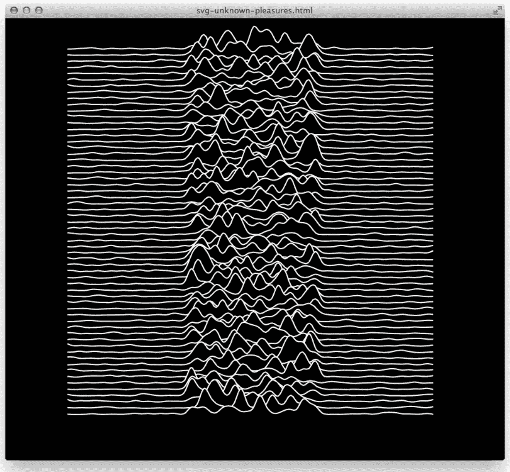

# 比例尺（Scales）

当我们构建数据集并开始尝试将其应用到可视化画布时，我们需要设置比例尺，以便我们的数据能够很好地呈现在页面上。

我们处理的任何数据都不太可能直接对应到可视化中的像素坐标。我们需要对数据进行缩放，使我们的数据能够反映与像素数据之间的关系。

为此，D3 提供了一个便捷的帮助对象，我们将使用它来创建数据与相对像素坐标之间的缩放关系。

当我们谈论比例尺时，我们指的是可以用作映射的相对数据点，将数据相对于其他点进行映射。

## 为什么要用比例尺

例如，如果我们想用柱状图绘制 AMC 电视剧《*行尸走肉*》（*The Walking Dead*）第三季每集的[观众人数](http://)呢？

每个柱状图会延伸到*远远*超出可见屏幕空间的范围。我们根本没有 1000 万个像素，每个像素代表一个观众！

一种解决方案是逐步对每个数据点应用缩放因子，使最大点不超过图表的顶部。

```
<!DOCTYPE HTML>
<html>
  <head>
    <script src="http://d3js.org/d3.v3.min.js" charset="utf-8"></script>
    <style> rect { stroke: red; stroke-width: 1; fill: black; } </style>
  </head>
  <body>
    <script>
     // 每集观众人数
     var data = [ 10870000, 9550000, 10510000,
                  9270000, 10370000, 9210000,
                  10430000, 10480000, 12260000,
                  11050000, 11010000, 11300000,
                  11460000, 10840000, 10990000,
                  12420000 ];

     // 缩放数据
     var height = 200;
     // 收视率最高的一集
     var max = d3.max(data);
     // 我们的缩放因子
     var scale = height / max;
     var scaled_data =
       data.map(function(d){
         return d * scale;
       });

     var svg = d3.select('body')
                 .append('svg')
                 .selectAll('rect')
                 .data(scaled_data)
                 // 添加所有 <rect> 标签
       .enter().append('rect')
       .attr({
         width: 50,
         height: function(d){ return d },
         x: function(d, i){ return i * 50 },
         // y 像素向下计数
         y: function(d){ return height - d }
       });
   </script>
  </body>
</html>
```

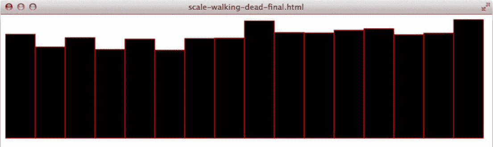

还不错，但我们必须考虑很多额外的手动工作。现在，我们不得不担心这个额外的数组 `scaled_data`。

我们还用这个 `scaled_data` 数组而不是原始数据来绑定数据，这使得为可视化添加功能变得困难，比如为每个柱状图添加工具提示。

我们的数据也挤在顶部，所以不太容易看出差异。如果数据从最低集到最高集进行绘制，以强调这些差异，这些差异会更加明显。

```
// 缩放数据
var height = 200;
var min = d3.min(data);
var range = d3.max(data) - min;
var scale = height / range;
var scaled_data = data.map(function(d){
   return (d - min) * scale;
});
```

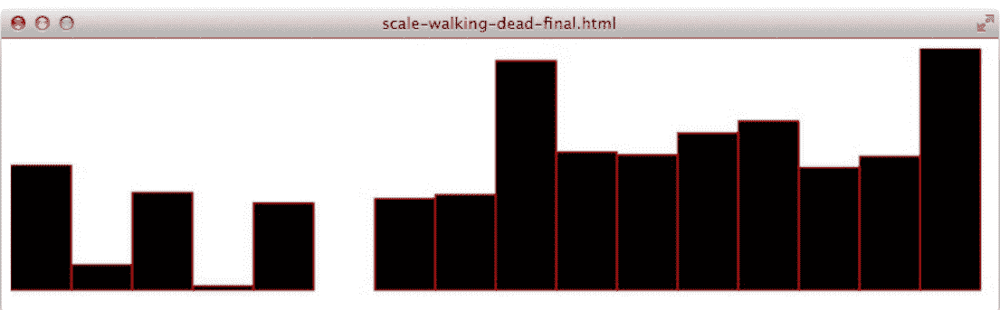

看起来好多了，但代码比需要的多，而且有覆盖原始数据的副作用。

D3 的线性比例尺生成器通过为我们提供一个可以随时调用的函数来消除这两个问题，该函数可以将输入范围（在我们的例子中是观众人数）转换为输出域（通常是像素）。比例尺本质上允许我们描述数据与像素之间的关系。

这使我们能够清晰地描述可能的输入数据值范围，并将可能的输出域限制为将数据转换为新域。

## 创建比例尺

我们可以使用 `d3.scale` 对象提供的函数轻松创建不同类型的比例尺。要创建线性比例尺，我们将使用 `d3.scale.linear()` 函数：

```
var scale = d3.scale.linear();
```

这个比例尺虽然相对无用，但会以 1:1 的比例将输入值映射到输出值。也就是说，用 2 调用它，我们会得到输出 2。

我们实际上还没有在这个比例尺对象上应用任何域或范围，所以它只假设 1:1。

## 设置输入域

我们可以使用 `.domain()` 函数来设置输入域。

```
var scale = d3.scale.linear()
  .domain([0, 100]);
```

这将设置输入域从 0 开始到 100。这使我们的域的最小值为 0，最大值缩放到 100。

> **注意：** 如果我们不传递数字到数组中，这些值将被强制转换为数字。例如，这发生在 Date 对象上（尽管 D3 确实有一个 `d3.time.scale` 对象，我们可以用于日期，这通常更方便）。

通常，我们希望输入域与数据集匹配。与其手动设置域值，更常见的是，我们将使用数据集的最小值和最大值来设置这些值。

我们可以使用 `d3.min()` 和 `d3.max()` 函数，或者使用 `d3.extent()` 函数来实现这一点。

```
var color = d3.scale.linear()
  // 使用简单直接的 min 和
  // max 两个函数
  .domain([d3.min(data), d3.max(data)])
  // 或者我们可以使用 d3.extent() 函数：
  .domain(d3.extent(data));
```

## 设置输出范围

我们可以使用 `.range([values])` 函数来设置输出*范围*：

```
var scale = d3.scale.linear()
```


 ```javascript
2  .domain([0, 1])
3  .range([10, 100]);
```

`range()` 函数将输出值的范围设定在 10 到 100 之间。它接受一个数值数组，该数组的基数需要与输入域（domain）相匹配。也就是说，数组中数字的数量必须与定义域一致。

`range()` 函数的一个特点是，它不一定需要数值输入，只要底层的插值算法（取决于我们使用的比例尺类型，例如线性、时间等）支持即可。

这使得我们能够实现颜色之间的缩放，例如：

```javascript
1  var color = d3.scale.linear()
2      .domain([0, 100])
3      .range(["red",  "blue"]);
4  color(0);   // -> "#ff0000" 即红色
5  color(50);  // -> "#800080" 即紫色
6  color(100); // -> "#0000ff" 即蓝色
```

## 分段线性比例尺 (Polylinear scales)

在使用线性比例尺时，我们不局限于仅使用两个值。这允许我们将连接的定义域映射到连接的范围。这就像是将几个独立的线性比例尺连接在一起一样。这在处理多色渐变时非常有用。

```javascript
1  var scale = d3.scale.linear()
2      .domain([0, 0.5, 1])
3      .range(['blue', 'white', 'red']);
```

> 在创建此类颜色渐变时，一个常见的错误是忘记让定义域（domain）元素的数量与范围（range）颜色的数量保持一致。在上面的示例中，如果我们给 `domain()` 传递一个长度为 2 的数组（即 `[0, 1]`）而不是 3（即 `[0, 0.5, 1]`），那么我们的范围输出将仅从蓝色变到白色。

## 使用我们的比例尺

当需要将数据转换为像素时，我们只需使用 `scale(d)`。

例如，假设我们的定义域范围是从 0 到 2，我们希望将其映射到 0 到 500 之间的图表上。

```javascript
1  var scale = d3.scale.linear()
2      .domain([0, 2])
3      .range([0, 500]);
```

如果我们向生成的 `scale()` 函数传递 0，我们将得到输出值 0。如果我们传递 2，我们将得到最大输出值 500。

我们可以使用这个比例尺在 0 和 2 之间提供渐变。例如：

```javascript
1 scale(0.5); // 125
2 scale(1.1); // 275
3 scale(1.9); // 475
```

我们可以看到，比例尺为每个数据项输出相对范围。这个过程被称为 *归一化* (normalization)，即将一个数值映射到给定比例尺上所有可能的最小值和最大值之间。

> 如果舔到 Tootsie Roll 糖果中心需要 100 下，那么舔了 90 下就完成了 90% 的进度，而舔了 10 下则只完成了 10%。这就是所谓的归一化。

回到我们对收视率的映射，我们可以创建一个映射到整个数据集的比例尺：

```javascript
1 var scale = d3.scale.linear()
2    .domain(d3.extent(data))
3    .range([0, 200]);
```

这将把输入值的整个范围从最小值映射到最大收视率值。

我们现在可以使用这个比例尺来设置柱状图的高度：

```javascript
1 // 从高度向上计数，
2 // 因为 y 轴是向下计数的
3 svg.selectAll('rect')
4    .data(data).enter()
5    .append('rect')
6    .attr('y', function(d){
7       return height - scale(d);
8    });
```

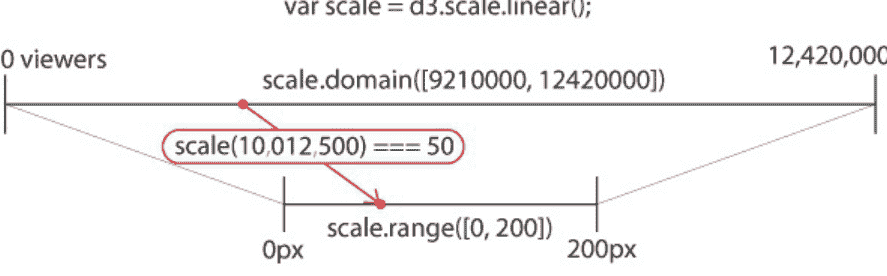

在本章中，我们介绍了如何使用 `d3.scale.linear()` 比例尺，但在将输入定义域数据映射到输出范围时，我们还有相当多的其他选项。

## 其他非线性比例尺

D3 包含了除简单线性映射之外的其他比例尺。例如，我们可以使用 `d3.scale.log()` 函数创建 **对数比例尺 (logarithmic scale)**。

我们可以使用 `d3.scale.pow()` 方法创建一个新的幂比例尺 (power scale)。

对数比例尺适用于转换指数级增长的数据。幂比例尺与对数比例尺类似，也适用于转换指数级增长的数据。这两个比例尺在计算输出范围的格式上略有不同。

所有这些比例尺的工作方式非常相似，仅有细微差别。既然我们知道了它们是如何工作的，我们可以查阅 [D3 文档](https://d3js.org) 以获取每个函数的更详细解释。

# 坐标轴 (Axes)

在任何试图传达意义的可视化中，让观众理解数据相对于其他数据的规模是必要的。一种简单的传达此类数据的方法是在可视化中使用坐标轴。

D3 提供了极佳的辅助函数，帮助我们构建构成坐标轴所需的必要标注，例如刻度线 (tick marks)、标签 (labels) 和参考线。

只要我们正确创建比例尺并将其用于构建坐标轴，D3 就可以处理构建函数的构建过程。

## 创建坐标轴

要创建坐标轴，我们可以使用 `d3.svg.axis()` 方法，如下所示：

```javascript
var axis = d3.svg.axis();
```

就是这样。我们稍后将讨论自定义此坐标轴的方法。

我们只需要将坐标轴添加到 SVG 元素中。可以直接调用新创建的 `axis()` 函数，例如 `axis(svg)`。

虽然这在技术上可行，但它不允许我们像 D3 的其他部分那样将方法链式调用在一起。

为了支持链式调用，我们将使用 `svg.call(axis)` 这种形式在 svg 上创建坐标轴：

```html
<!DOCTYPE html>
<html>
  <body>
    <script
      src="http://d3js.org/d3.v3.min.js"
      charset="utf-8"></script>
    <script>
      var width = 800;
      // 世界最新建筑的高度，单位：英尺
      var data = [2717, 2073, 1971,
          1776, 1670];
          // 创建我们的 svg 并将其添加到
          // `<body>` 中
      var svg = d3.select('body')
          .append('svg');
```

```javascript
16           // 创建一个比例尺，范围从
17           // [0, max(data)] -> [10, width]
18   var scale = d3.scale.linear()
19           .domain([0, d3.max(data)])
20           .range([10, width]);
21           // 创建一个使用该新比例尺的
22           // 新坐标轴
23   var axis = d3.svg.axis()
24           .scale(scale);
25           // 将新坐标轴添加到 svg 中。
26           // 与 `axis(svg);` 相同，
27           // 区别在于它会返回 `svg`
28   svg.call(axis);
29   </script>
30 </body>
31 </html>
```

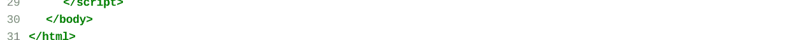

d3 在我们的 svg 上创建坐标轴后生成的 DOM 结构。

```html
1 <!-- 生成的 SVG -->
2 <svg>
3   <!-- 第一个刻度线和标签 -->
4   <g class="tick"
5       transform="translate(10,0)"
6       style="opacity: 1;">
7 
8     <line y2="6" x2="0"/>
9     <text y="9" x="0" dy=".71em"
10          style="text-anchor: middle;">0</text>
11   </g>
12   <!-- 第二个刻度线和标签 -->
13   <g class="tick"
14       transform='translate(68.15237394184763,0)'
15       style="opacity: 1;">
16     <line y2=" Owen JG x2="0"/>
17     <text y="9" x="0" dy=".71em"
18           style="text-anchor: middle;">
19               200
20     </text>
21   </g>
22   <!-- ...等等... -->
23   <path class="domain" d="M10,6V0H800V6"/>
24 </svg>
```


在线版本：[http://jsbin.com/puwecuhi/1/edit](http://jsbin.com/puwecuhi/1/edit)

由于默认坐标轴不够美观，为坐标轴添加额外的样式是非常常见的。为此，我们将向一个包含性的 `<g>` 元素添加类，然后将坐标轴组件添加到该元素中。

```javascript
1 svg.append('g').call(axis).attr('class', 'x axis');
```

```css
1 .x path, .x.axis line{
2   fill: none;
3   stroke: black;
4 }
```

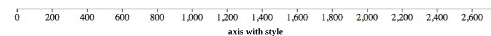

带样式的坐标轴

在线版本：http://jsbin.com/zopalifo/1/edit

现在让我们添加一些数据点，来代表世界上最高的 5 座建筑的高度。它们将是半径 r=4 的圆，位于坐标轴上相应的可变位置。我们还将向下平移 100 像素，以免它们被屏幕边缘裁剪掉。

```javascript
1 var height = 100;
2 // 将坐标轴向下移动 100 像素
3 svg.append('g').call(axis).attr('class', 'x axis')
4   .attr('transform', 'translate(0, ' + height + ')');
```

```javascript
1 // 在坐标轴上添加一些代表建筑高度的圆
2 svg.selectAll('circle').data(data)
3   .enter().append('circle').attr('r', 4).attr('transform', function(d){
4     return 'translate(' + scale(d) + ', ' + height + ')'
5   });
6 });
```

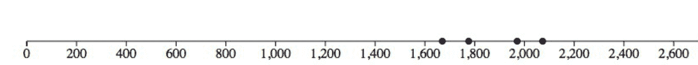

添加一些数据点

在线版本：http://jsbin.com/diburebi/1/edit

现在，我们添加几个标签怎么样？为此我们需要更多的数据。具体来说，我们需要将建筑高度与建筑名称关联起来。

```javascript
1 var data = [
2   ["Burj Khalifa", 2717],
3   ["Shanghai Tower", 2073],
4   ["Makkah Royal Clock Tower Hotel", 1971],
5   ["One World Trade Center", 1776],
6   ["Taipei 101", 1670]
7 ];
```

这就是我们想要的数据，但在不进行任何其他更改的情况下直接将其添加到现有项目中会破坏我们的代码。这是因为圆圈的位置取决于数据是一个

平坦的整数数组，以及我们对 `d3.max()` 的调用。我们需要将 `scale(d)` 更改为 `scale(d[1])`，因为现在每个数据项本身就是一个数组，第二个元素是建筑物的高度。同样，当我们指定比例尺的定义域时，需要给 `d3.max` 传入一个访问函数，这样它才知道应该使用数据项（datum）的哪个部分来查找最大值。在我们这里，就是数组的第二个元素。

```javascript
var scale = d3.scale.linear()
   .domain([0, d3.max(data, function(d){ return d[1]; })])
   .range([10, width]);
```

现在我们的代码可以再次运行了，让我们添加那些标签。由于原始数据数组的每个元素现在本身是一个数组，我们将使用 `d[0]` 来引用建筑名称，并使用 `scale(d[1])` 将建筑物高度映射到轴上的像素x位置。我们还将使用 `rotate(-20)` 给它一个轻微的逆时针旋转，这样标签就不会重叠。最后，我们应用最后一个平移变换 `translate(5,-5)`，这样标签就不会紧贴着数据点。

```javascript
// 添加标签
svg.selectAll('text').data(data)
   .enter().append('text').text(function(d){ return d[0] })
   .attr('transform', function(d){
      return 'translate(' + scale(d[1]) + ', ' + height + ') '
         + 'rotate(-20) translate(5,-5)';
   });
```

让我们也使用坐标轴的 `tickFormat()` 方法来格式化坐标轴标签，这样人们就能知道我们使用的单位。D3提供了多种不同的格式化器，我们可以传递给坐标轴的 `tickFormat`。如果你有兴趣阅读相关内容，请查看 [d3.format()](https://github.com/mbostock/d3/wiki/Formatting) 和 [d3.time.format()](https://github.com/mbostock/d3/wiki/Time-Formatting)。我们的格式化器 `d3.format(',.0f')` 会四舍五入小数并添加逗号。即 `d3.format(',.0f')(1000.04) == "1,000"`。

```javascript
// 创建我们的坐标轴并格式化刻度
var axis = d3.svg.axis().scale(scale)
   .tickFormat(function(d){ return d3.format(',.0f')(d) + 'ft' }).ticks(5);
```

作为最后的修饰，假设我们觉得第一个数据点之前的空白区域太多了。让我们更新比例尺，使其从第一个数据点开始，而不是从零开始。这个更改很简单，只需将比例尺的定义域从 `[0, d3.max(...)]` 更改为 `d3.extent(data, ...)`。

```javascript
var scale = d3.scale.linear()
   // .domain([0, d3.max(data, function(d){ return d[1]; })])
   .domain(d3.extent(data, function(d){ return d[1]; }))
   .range([10, width]);
```

这是最终版本的样子：

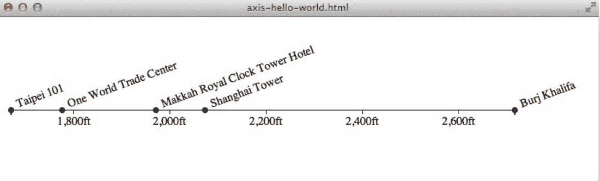

## 世界最高的建筑

```html
<!DOCTYPE html>
<html>
  <head>
    <script src="http://d3js.org/d3.v3.min.js" charset="utf-8"></script>
    <style>
      .x.axis path, .x.axis line{
        fill: none; stroke: black;
      }
    </style>
  </head>
  <body>
    <script>
      var width = 700, height = 100;
      var svg = d3.select('body').append('svg');
      // 世界最新的建筑
      var data = [
        ["Burj Khalifa"              , 2717],
        ["Shanghai Tower"            , 2073],
        ["Makkah Royal Clock Tower Hotel", 1971],
        ["One World Trade Center"    , 1776],
        ["Taipei 101"                , 1670]
      ];
      var scale = d3.scale.linear()
        .domain(d3.extent(data, function(d){ return d[1]; }))
        .range([10, width]);
      // 添加数据点
      svg.selectAll('circle').data(data)
        .enter().append('circle').attr('r', 4).attr('transform', function(d){
          return 'translate(' + scale(d[1]) + ', ' + height + ')'
        });
      // 添加标签
      svg.selectAll('text').data(data)
        .enter().append('text').text(function(d){ return d[0] })
        .attr('transform', function(d){
          return 'translate(' + scale(d[1]) + ', ' + height + ') '
            + 'rotate(-20) translate(5,-5)';
        });
      // 创建坐标轴
      var axis = d3.svg.axis().scale(scale)
        .tickFormat(function(d){ return d3.format(',.0f')(d) + 'ft' }).ticks(5)
        .attr('transform', 'translate(0,' + height + ')');
    </script>
  </body>
</html>
```

在线版本：http://jsbin.com/wujicosu/1/edit

# 动画与交互

我们将在本章介绍动画和其他交互概念的基础知识。这些技术为实时更新、实时数据可视化等应用奠定了基础。

## 过渡动画

几乎所有使用D3构建的动画数据可视化的核心都是过渡动画。过渡动画使我们能够轻松地为一组选中的元素应用平滑的、动画的过渡效果。用一个简单的例子直接展示会更容易理解。如果第一次没有注意到动画，请重新加载页面。

```html
1 <!DOCTYPE html>
2 <html>
3   <body>
4     <script src="http://d3js.org/d3.v3.min.js" charset="utf-8"></script>
5     <script>
d3.select('body').append('svg')
  .append('circle').attr({r: 10, cx: 100, cy: 100})
  .transition().attr('cx', 300);
6     </script>
7  </body>
8 </html>
```

哇，这多酷啊！我们只用一行代码就让一个 `circle` 动了起来！让我们分解一下这里发生了什么。选择器有一个额外的方法叫做 `transition()`，它会返回*另一个选择器*，具体来说，是一个特殊的“[过渡](http://bost.ocks.org/mike/transition/)选择器”，它会逐渐将第一个选择器中所有DOM元素的属性和样式更新为第二个选择器中的新值。这一切都发生在250毫秒（1/4秒）的时间内，这是过渡动画的默认持续时间。

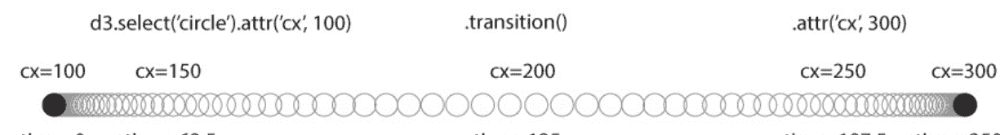

作为提醒，对选择器调用 `transition()` 返回的对象本身也是一个选择器，所以我们可以很容易地将这种技术用于包含多个元素的选择器。如果我们没有在过渡前后的两个选择器中更改某个特定的属性或样式，那么该属性将*不会*被过渡。

我们可以通过使用仅存在于过渡选择器上的 `.duration()` 方法来调整过渡的持续时间。基于上面的例子，我们可以使用 `transition().duration(4000)` 来调整动画，使其花费4秒（4000毫秒），而不是250毫秒。

```javascript
1 d3.select('body').append('svg')
2   .append('circle').attr({r: 10, cx: 100, cy: 100})
3   .transition().duration(4000).attr('cx', 300);
```

过渡动画的另一个有用特性是指定缓动类型的能力。缓动让我们可以调整过渡应该如何加速。例如，如果我们从5英尺高的地方扔下一根羽毛，它会以近似恒定的速率下落（除非我们在没有大气层减缓羽毛速度的月球上）。这将是“线性”缓动类型。相反，如果我们扔下一把锤子，它会向下加速，越来越快。这将是“exp”缓动类型。默认情况下，D3使用“cubic-in-out”，这是现实世界中大多数物体移动的方式。大多数物体不会瞬间以恒定速度开始移动。它们先加速，然后当接近目标时减速，就像一辆车在停车标志后加速，然后在接近十字路口的红灯时减速。这是上面示例中说明的相同过渡。这是一个如何指定具有4秒持续时间的不同缓动类型的例子。

```javascript
d3.select('body').append('svg')
  .append('circle').attr({r: 10, cx: 100, cy: 100})
  .transition().duration(4000).ease('bounce').attr('cx', 300);
```

[这里有一个可视化](link)展示其他缓动类型。

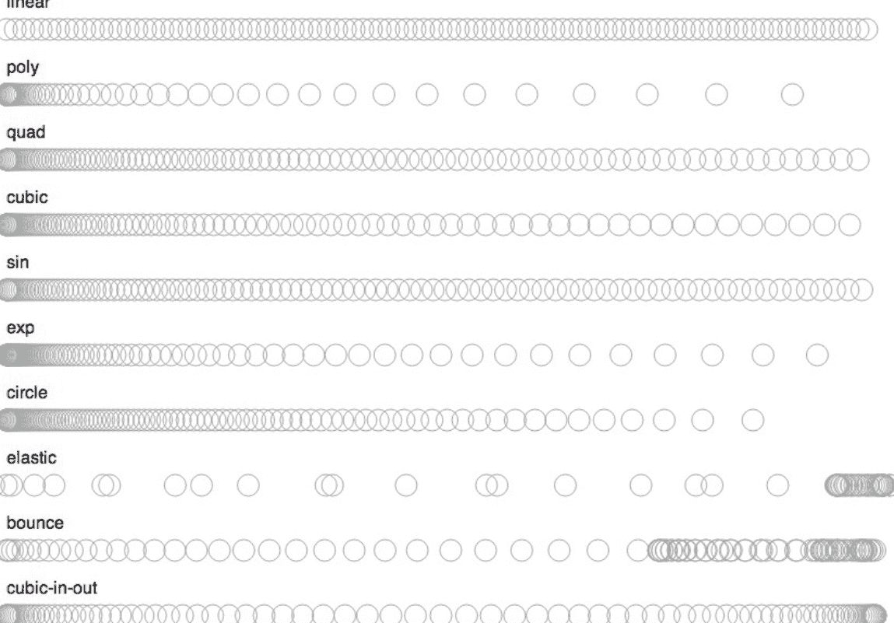

请注意上面所有过渡动画（除了最后一个“cubic-in-out”）都获得了速度。“cubic-in-out”实际上与“cubic”相同，只是它的缓动均匀地应用于两端（进入和退出部分）。默认情况下，所有缓动类型都是“in”，所以只有“cubic”与“cubic-in”相同，我们可以通过附加“-out”或“-in-out”来调整缓动类型。以下是3种不同多


 ## 事件

事件让我们的可视化图表变得可交互。通过事件，我们可以指定当用户执行某个动作时应该发生什么，例如点击、移动鼠标或按下键盘。HTML 本身就有多种不同的交互事件，我们可以选择通过回调函数来接收通知。D3 只是让设置这些事件变得更加容易，使用选择集而非直接处理单个 DOM 元素。我们只需使用 `on()` 选择集方法，传入想要监听的事件名称和事件发生时应该调用的回调函数即可。让我们来看一个简单的"Hello World"风格的事件示例，比较原生的 HTML 设置事件监听器的方式和 D3 的方式。

```
1 <!DOCTYPE html>
2 <html>
3     <body>
4        <script src="http://d3js.org/d3.v3.min.js" charset="utf-8"></script>
5        <select>
6          <option value="hello">hello</option>
7          <option value="world">world</option>
8        </select>
9        <script>
10 // 非 D3 方式
11 document.getElementsByTagName('select')[0]
12    .addEventListener('change', function(){ alert(this.value); });
13 // D3 方式
14 d3.select('select').on('change', function(){ alert(this.value); });
15      </script>
16    </body>
17 </html>
```

注意回调函数是如何以 `select` 元素作为 `this` 变量被调用的。使用 `on` 代替 `addEventListener` 听起来可能只是一个微不足道的改变，但这里发生的事情远不止于此。不同的事件监听器会被应用到选择集中的所有元素上。就像大多数其他选择集方法一样，我们的回调函数会以被点击元素的数据和在选择集中的索引作为前两个参数被调用。每个元素只会设置一次事件监听器，即使我们重新设置监听器也是如此。如果我们复制并粘贴非 D3 版本，我们会得到两个弹窗。

```
1 document.getElementsByTagName('select')[0]
2   .addEventListener('change', function(){ alert(this.value); });
3 document.getElementsByTagName('select')[0]
4   .addEventListener('change', function(){ alert(this.value); });
5 // 第二个事件监听器在第一个之后添加
```

如果我们用 D3 版本做同样的事情，我们只会得到一个弹窗。

```
1 d3.select('select').on('change', function(){ alert(this.value); });
2 d3.select('select').on('change', function(){ alert(this.value); });
3 // 第二个事件监听器覆盖第一个
```

这很方便，因为大多数时候，我们只想简单地为所有选中的元素重新应用事件监听器，而不必显式地移除旧的监听器。如果出于某种原因，我们想要移除某个选择集的所有事件监听器，我们可以将 `on()` 的第二个参数设为 null 来调用。

```
d3.select('select').on('change', function(){ alert(this.value); });
d3.select('select').on('change', null);
// 没有任何弹窗！
```

我们还会感兴趣的其他一些常见事件是鼠标事件 `click`、`mousedown`、`mousemove` 和 `mouseup`。点击事件在用户按下然后释放鼠标按钮时触发。它是 `mousedown` 和 `mouseup` 的组合。鼠标移动事件在鼠标每次移动时都会触发。

综合我们所学的关于过渡和事件的知识，让我们来构建一个简单的视频游戏。目标是避免移动的小行星（`圆形`）与我们的太空飞船（鼠标）相撞。我们首先定义当前关卡，以及游戏的宽度和高度，这将占据整个窗口。

```
var level = 0, width = window.innerWidth, height = window.innerHeight;
```

现在让我们创建将容纳游戏对象的 SVG。

```
var svg = d3.select('body').append('svg');
```

让我们添加一些小行星。20 个听起来不错。让我们把它们做得大一些，半径为 20

```
var circles = svg.selectAll('circle').data(d3.range(20)).enter().append('circle')
    .attr('r', 50)
```

我们将在每个关卡随机将小行星分布在屏幕上，并在关卡之间过渡所有小行星，所以让我们创建一个可以使用 `setInterval` 定期调用的 update 方法。

```
function update(){
    circles.transition().duration(2000).attr({
        cx: function(){ return Math.random() * width },
        cy: function(){ return Math.random() * height } });
    level++;
}
```

为了让用户首次访问游戏时屏幕上就有内容，让我们立即调用 update()。然后我们将设置间隔，每 2 秒调用一次 `update()`。

```
update();
setInterval(update, 2000);
```

当小行星（圆形）与我们的太空飞船（鼠标）相撞时，游戏结束！提醒用户他们输了，并重置关卡计数器。

```
circles.on('mouseover', function(){
    alert('不错！你达到了第 ' + level + ' 关');
    level = 0;
});
```

我们完成了！我们只用 15 行 JavaScript 就制作了一个视频游戏。这是最终版本的样子。

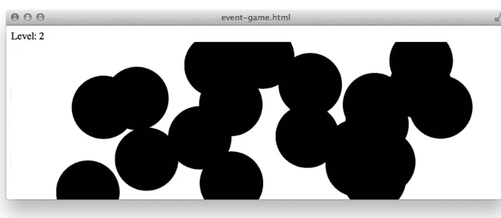

## 小行星，D3 风格

```
1 <!DOCTYPE html>
2 <html>
3   <body>
4     <script src="http://d3js.org/d3.v3.min.js" charset="utf-8"></script>
5     <script>
6 var level = 0, width = window.innerWidth, height = window.innerHeight;
7 var svg = d3.select('body').append('svg');
8 var circles = svg.selectAll('circle').data(d3.range(20)).enter()
9     .append('circle').attr('r', 50)
10    .on('mouseover', function(){
11      alert('不错！你达到了第 ' + level + ' 关');
12      level = 0;
13    });
14 function update(){
15    circles.transition().duration(2000).attr({
16      cx: function(){ return Math.random() * width },
17      cy: function(){ return Math.random() * height } });
18    level++;
19 }
20 update();
21 setInterval(update, 2000);
22     </script>
23   </body>
24 </html>
```

# 数据解析与格式化

本章介绍一些将数据获取并清理以供 D3 使用的常见方法。

## 将数据导入浏览器

到目前为止的所有示例都直接在代码中使用了硬编码的数据值。对于非常小且不变的数据集来说，这没问题，但当数据量增加或数据频繁变化时，这会很快变得难以管理。我们不想一直把数据复制粘贴到代码中。这个问题可以通过几个 D3 辅助函数来解决，它们允许我们从单独的文件中加载不同格式的数据，而不是放在代码里。具体来说，我们可以使用 `d3.json()` 加载 [JSON](JSON) 格式的数据，或使用 `d3.csv()` 加载 [CSV](CSV) 数据。

我们只需要给每个函数提供要加载的文件名，以及文件加载完成后要调用的回调函数。

### 加载 CSV 数据

**episodes.csv**

```
1 Title, Air date, U.S. viewers (in millions)
2 "Winter Is Coming", "April 17, - 2011", 2.22
3 "The Kingsroad", "April 24, - 2011",  2.20
4 "Lord Snow", "May 1, - 2011", 2.44
```

[来源：http://en.wikipedia.org/wiki/List_of_Game_of_Thrones_episodes](来源：http://en.wikipedia.org/wiki/List_of_Game_of_Thrones_episodes)

```
1 d3.csv('episodes.csv', function(err, data){
2   if(err) throw err;
3   console.log(data[0].Title); // => "Winter is Coming"
4   console.log(data[1].Title); // => "The kingsroad"
5   // 等等...
6 });
```

### 加载 JSON 数据

**episodes.json**

```
 1 [
 2   {
 3     "Title": "Winter Is Coming",
 4     "Air date": "April 27, - 2011",
 5     "U.S. viewers (in millions)": 2.22
 6   },{
 7     "Title": "The Kingsroad",
 8     "Air date": "April 24, - 2011",
 9     "U.S. viewers (in millions)": 2.20
10   },{
11     "Title": "Lord Snow",
12     "Air date": "May 1, - 2011",
13     "U.S. viewers (in millions)": 2.44
14   }
15 ]
```

```
1 d3.json('episodes.json', function(err, data){
2   if(err) throw err;
3   console.log(data[0].Title); // => "Winter is Coming"
4   console.log(data[1].Title); // => "The kingsroad"
5   // 等等...
6 });
```

## 常见问题：从本地文件加载数据

大多数现代浏览器都施加了安全限制，防止从计算机加载的 HTML 文件请求其他本地文件资源。这意味着如果你一直在点击 HTML 文件并在浏览器中打开它们，这些 HTML 页面将无法请求我们本地存储的数据文件。这个安全限制防止普通浏览器用户误打开下载的 HTML 文件，然后让它窥探他们硬盘上的其他文件。要绕过这个限制，最简单的解决方案是使用 `python -m SimpleHTTPServer` 从命令行在要运行服务器的目录中启动一个 Web 服务器。然后我们可以通过浏览器中的 localhost:8000/our-file.html 访问该目录中的 file.html。

## 常见问题：JSON 是 JavaScript 的子集

JSON 是 JavaScript 的子集。这意味着我们可以将 JSON 复制粘贴到 JavaScript 程序中而不会出现问题，但这并不意味着我们可以将 JavaScript 中的任何内容复制粘贴到 JSON 中。一个关键区别是 JSON 对象的键必须用双引号括起来。字符串值也是如此。也就是说，{ foo : 'bar' } 是有效的 JavaScript 但不是有效的 JSON。{ "foo" : "bar" } 是有效的 JSON 也是有效的 JavaScript。有效的 JSON 不能包含函数或日期对象。

## 处理数据

通常数据可视化最困难的部分只是将我们想要可视化的数据转换成有意义的格式。注意在上面的示例中，日期是如何格式化为字符串并包含 - 的？如果我们无法将它们作为数字处理，我们将很难在比例尺中使用这些日期或沿着时间轴绘制它们。要将它们转换为数字，我们可以使用 D3 的时间格式化辅助方法 `d3.time.parse()`。通过它，我们可以创建一个新的日期格式对象来解析我们奇特的日期。

```
1 var format = d3.time.format('%B %e, - %Y');
2 format.parse("April 27, - 2011"); // => 一个新的日期对象
```

有非常多不同的日期格式化标记可供使用。在 [D3 GitHub 维基页面](https://github.com/d3/d3/wiki/Date-Formatting)上查看完整列表。

要重新格式化我们的数据集，使其包含实际的日期对象，我们可以在数据数组的每个元素的 "Air date" 属性上调用我们的格式化工具。在这一步中，我们还将创建一个 viewers 属性来代替 viewers (in millions)，因为最佳实践是将数据保持在最常用和/或最明显的单位中。

```
1 var format = d3.time.format('%B %e, - %Y');
2 data.forEach(function(datum){
3   datum['Air date'] = format.parse(datum['Air date']);
4   // 添加另一个属性，viewers
5   datum['U.S. Viewers'] = datum['U.S. viewers (in millions)'] * 1000000;
6   // 移除 U.S. viewers (in millions) 属性
7   delete datum['U.S. viewers (in millions)'];
8 });
```


## 接下来做什么？

本章将介绍一些额外的资源和继续探索 D3 的切入点。

## 地图

D3 内置了大量实用的方法，让地理数据的处理变得更加容易。D3 结合 ogr2ogr 等命令行工具，可以轻松将 GIS shapefile 转换为 D3 能够读取并绘制成 SVG 的 JSON 格式（具体来说是 GeoJSON）。一个常见的应用场景是创建**分级统计图**（choropleth）以及其他常用于数据可视化的主题地图。

由于 GeoJSON 文件可能非常大，Mike Bostock 开发了另一个很棒的工具——[TopoJSON](link)。TopoJSON 是 GeoJSON 的一种替代地图文件格式，它生成的文件*非常*小，因此在浏览器中加载速度更快。除了 TopoJSON 文件格式之外，还有 TopoJSON 库（用于读取该格式）和 TopoJSON 命令行程序（用于从 GeoJSON 文件创建 TopoJSON 文件）。关于创建地图的深入教程，请参阅 Mike Bostock 优秀的[Let's Make a Map](link)教程。

## 布局

D3 提供了大量预置的[布局辅助函数](link)，让构建典型的模板化图表（如饼图、直方图和堆叠图）变得轻松。但 D3 **并不**提供像 `createPieChart` 这样的方法。相反，D3 提供的是让从零创建这些图表变得更简单的函数。让我们快速走读一个饼图示例来演示这一点。我们将结合两个新方法：`d3.svg.arc()`，它创建一个弧形生成器，以及 `d3.layout.pie()`。`pie()` 布局只是接收数据并生成 `arc()` 所需的必要参数。

```
var data = [4,5,6];
var pie = d3.layout.pie();
console.log(pie(data)); // =>
[
  { data:4, value:4, startAngle:4.61, endAngle:6.28 },
  { data:5, value:5, startAngle:2.51, endAngle:4.61 },
  { data:6, value:6, startAngle:0, endAngle:2.51 }
]
```

现在我们可以使用弧形生成器，将上述起始角度和结束角度转换为在 SVG 中绘制弧形路径所需的 d 属性值。

```
// 创建一个弧形生成器函数，将生成的弧形外半径设置为 `100`，内半径设置为 `0`
var arc = d3.svg.arc().outerRadius(100).innerRadius(0);
```

```
var color = d3.scale.category10();
var arcs = vis.selectAll('path').data(pie([4,5,6]))
  .enter().append('path')
    .attr({ d: arc }) // 使用弧形生成器创建弧形路径
    .style({
      // 为每个弧形切片设置不同的颜色和白色边框
      fill: function(d, i){ return color(i) },
      stroke: 'white'
    })
```

以下是完整的代码。注意包含的 g 元素和 (200,200) 的平移变换，这样饼图的中心就不会卡在 svg 的左上角了。

```
<!DOCTYPE html>
<html>
  <body>
    <script src="http://d3js.org/d3.v3.min.js" charset="utf-8"></script>
    <script>
      var vis = d3.select('body').append('svg').append('g')
          .attr('transform', 'translate(200,200)');
      var color = d3.scale.category10();
      var arc = d3.svg.arc().outerRadius(100).innerRadius(0);
      var pie = d3.layout.pie();
      var arcs = vis.selectAll('path').data(pie([4,5,6]))
        .enter().append('path').attr({
            d: arc,
            fill: function(d, i){ return color(i) },
            stroke: 'white'
        });
    </script>
  </body>
</html>
```

还有更多这样的布局，所以如果你发现自己正在创建一个相当常见的图表类型，一定要先找找看是否有现成的布局辅助函数。

## 插件和其他工具

可敬的 Mike Bostock 和其他人收集了一些常见的 [D3 插件](https://github.com/d3/d3-plugins)，这些插件似乎还没有必要纳入 D3 核心，但在某些时候却极其有用。其中最有趣的之一是 d3.fisheye 插件，它应用了一种扭曲的鱼眼镜头效果，在聚焦于较大元素集合中的某一部分时非常有用。

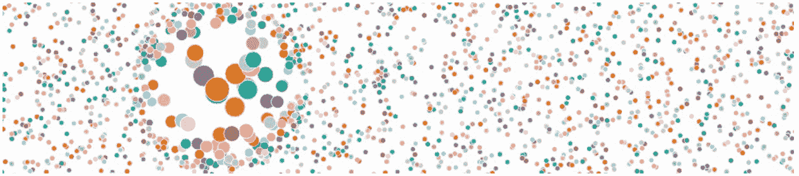

有一些常用工具经常与 D3 一起使用。其中最重要的可能是 [Crossfilter](http://square.github.com/crossfilter/)。可以将 Crossfilter 视为 D3 数组辅助函数的更快替代方案。借助它，可以快速对海量数据（数百万行）进行排序和筛选。

# Angular 简介

到目前为止，我们只关注 D3，但在接下来的章节中，我们将看看一些有趣的方式，将 D3 与 Angular 结合，使我们的可视化更加模块化、可复用和交互化。这还有一个好处，就是让我们更容易在脑海中构思它们，也让我们在几个月后忘掉可视化的所有细节之后，更容易回过头来理解。

## 关于 Angular

Angular 是一个让创建（Web）应用变得更加容易的框架，但它也非常适合交互式可视化。它通过强制我们将应用拆分成执行特定类型任务的模块来实现这一点。这样拆分代码让组件可以方便地被替换为其他组件。它还有助于将我们的组件与其他组件连接起来，让一个可视化可以由另一个驱动，或者当底层数据变化时自动更新自身。

Angular 有很多功能，但大多数与数据可视化没有直接关系。要更深入地了解 Angular，请查看 Ari 的 ng-book。

## 用于交互式和可复用数据可视化的 Angular

使用 Angular 进行数据可视化有很多理由，但最重要的是**指令**（directives）。指令让创建可复用的可视化变得更加容易。本质上，它们是我们创建自己的 HTML 元素的方式，这些元素的行为就像浏览器内置的 HTML 标签一样。想象一下，我们刚刚创建了一个想要再次复用的饼图可视化。如果我们创建了一个包含饼图的指令，这就很简单了。我们只需要在 html 中复制粘贴 `<pie-chart>` 元素，而无需编写任何 JavaScript。

```
<pie-chart></pie-chart>
<pie-chart></pie-chart>
```

这也让没有编写我们饼图的人更容易使用，因为他们不需要知道饼图是如何工作的就能使用它。

如果我们在指令中编写可视化，我们还能免费获得很多其他优势。具体来说，我们可以使用 Angular 的其他内置指令，如 `ng-switch`，来条件性地显示不同的可视化。在这个例子中，我们根据 `selection` 作用域变量的状态，条件性地显示饼图或条形图的数据视图。

```
<div ng-switch on="selection">
  <div ng-switch-when="pie">
    Checkpoint encountered!

I'll continue from where I left off:

    <pie-chart></pie-chart>
  </div>
  <div ng-switch-default>
    <bar-chart></bar-chart>
  </div>
</div>
```

使用另一个内置的 Angular 指令 `ng-repeat`，我们可以轻松创建有效的小倍数（small multiples）数据可视化技术，让我们能够更有效地传达更多信息。它通过让我们以可变次数复用同一个可视化来实现这一点。

```
<div ng-repeat="races in incomes">
  <map ng-repeat="race in races"></map>
</div>
```

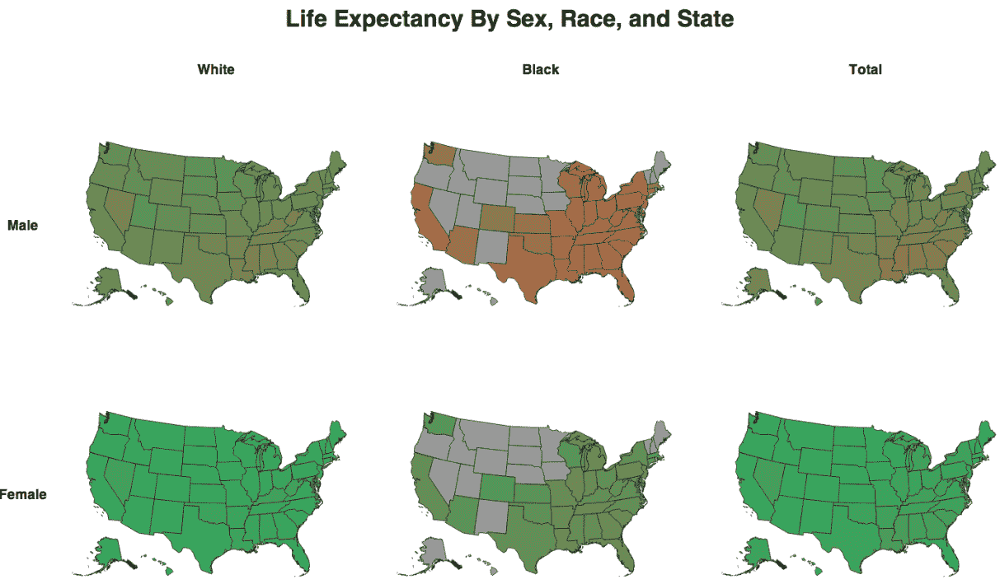

实时版本：http://vicapow.github.io/angular-d3-talk/slides/demos/life-expectancy/index.html

最后，Angular 通过处理作用域上的更新，让创建动态可视化变得容易。这在创建依赖于其他可视化状态的可视化时，或者当你希望两个不同的可视化在滑块移动时自动更新时，特别有用。

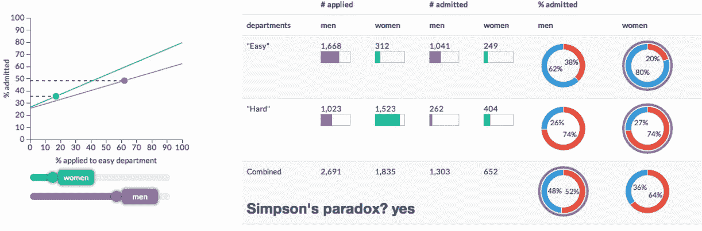

## 模型、视图、 Whatever

大多数 Web 框架鼓励开发者将代码拆分为"模型"（models）、"视图"（views）或"控制器"（controllers），即 MVC。我们可以这样理解它们：

**模型**（Models）：我们的应用想要展示或允许修改的信息。

**视图**（Views）：负责展示或修改这些信息的组件，或者说是信息的"视图"。

**控制器**（Controllers）：负责将两者正确连接起来的逻辑。

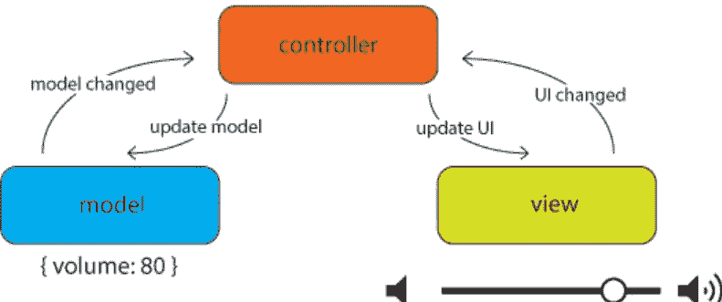

请记住，在任何应用中，这种通用的、非正式的各部分分类方式，与实际存在于我们应用中的组件类型之间是有区别的。有些框架可能会将这些职责跨组件共享，或者给它们起完全不同的名字。在 Angular 中特别要注意的是，没有正式的"视图"类或函数。"视图"就是 DOM。

在 Angular 中，在大多数情况下，我们的视图和模型是自动连接的。这种自动（或"双向"）数据绑定是默认的，发生在所谓的"作用域"（scope）上。只需改变作用域上的一个变量（即模型），它的变化就会自动传递到 DOM。因为这并不严格是 MVC，Angular 社区将这种模式称为"Model, View, Whatever"，因为你可能会花很多时间思考 Angular 到底属于哪种模式。

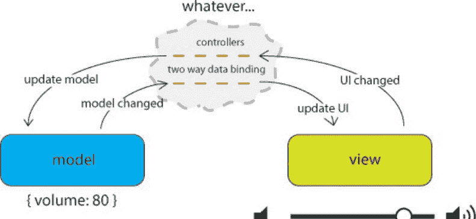


# Hello Angular!

为了熟悉如何安装和设置 Angular 应用，让我们通过创建一个“Hello World”风格的应用来学习。每当输入标签的值发生变化时，该应用都会更新模板。

### 安装 Angular

安装 Angular 最简单的方法是从 Google 的 CDN 引入最新版本，只需将下面的代码片段复制并粘贴到一个新的 HTML 文件中。（在撰写本文时，最新版本是 1.2.10）。

```html
<!DOCTYPE html>
<html>
  <head>
    <script src="https://ajax.googleapis.com/ajax/ajax/libs/angularjs/1.2.10/angular.min.js"></script>
  </head>
  <body></body>
</html>
```

接下来，我们需要使用 `ng-app` 告诉 Angular 我们的应用从哪里开始。大多数情况下，这通常就是整个 `<body>` 标签。

```html
<body ng-app>
  <!-- yo angular, everything in here is our app -->
</body>
```

现在我们将添加一个输入标签，在作用域（scope）上创建一个变量 `person`。代码片段 `ng-model="person"` 负责执行此操作。它还负责检查 `<input>` 标签的变化并更新作用域，反之亦然。用 MVC 的术语来说，这通过作用域上的“模型”变量 `person` 将其与 `<input>` 标签（我们的“视图”）“连接”起来。不必太担心作用域*如何*工作，只需知道它包含了我们应用程序的信息。在这种情况下，就是我们想要向其问候的“person”。Angular 将通过双向数据绑定自动为我们处理所有连接工作。

```html
<body ng-app>
  <input type="text" ng-model="person"></input>
</body>
```

现在，每当 `<input>` 标签的值改变时，`person` 变量都会更新，但由于我们没有在其他地方使用该变量，因此无法证明这一点。让我们使用一个简单的 Angular 模板来解决这个问题。

```html
<body ng-app>
  <input type="text" ng-model="person"></input>
  hello {{person}}!
</body>
```

在线版本：[http://jsbin.com/izimoQoL/1/edit](http://jsbin.com/izimoQoL/1/edit)

太棒了！现在当我们更新 `<input>` 文本字段时，更改会自动发送到作用域，从而导致模板被渲染。以下是完整版本。

```html
1 <!DOCTYPE html>
2 <html>
3 <head>
4   <script src="https://ajax.googleapis.com/ajax/libs/angularjs/1.2.10/angular.min.js"></script>
5   <script src="http://d3js.org/d3.v3.min.js" charset="utf-8"></script>
6 </head>
7 <body ng-app>
8   <input type="text" ng-model="person"></input>
9   hello {{person}}!
10 </body>
11 </html>
```

# 用于可重用可视化图表的指令 (Directives)

### 理解指令

指令为我们提供了一种封装和重用可视化图表的方法，它允许我们实质上创建自己的 HTML 标签。在某种程度上，你已经在运行指令了。HTML5 的 `<input>` 标签（如 range 和 date）本质上就是浏览器的自有指令。它们由多个 UI 元素组合而成，但对外提供了一个简单的 API，我们只是无法访问它们的源代码。

```html
<input type="range" min="1" max="1000" value="0" style="width:100%">
```


```html
<input type="date" value="1989-01-23">
```

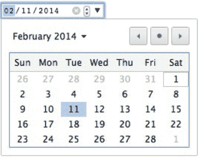

### 创建指令

既然你已经理解了什么是指令，让我们通过一个例子来学习如何创建第一个指令。大多数指令都具有实用功能，但为了简单起见，我们将创建一个仅显示 “hello world!” 的指令。

我们从这段 HTML 开始：

```html
<!DOCTYPE html>
<html>
  <head>
    <script src="angular.js"></script>
  </head>
  <body ng-app>
    <!-- our app! -->
  </body>
</html>
```

接下来，我们需要创建一个新的应用模块来承载所有指令。所有指令都将存在于该模块中。目前我们只有一个指令，将其放入模块似乎没有意义，但当我们拥有许多指令时，这将有助于我们将相关的指令分组。

```javascript
var myApp = angular.module('myApp', []);
```

在应用中，我们需要将 `ng-app` 更改为 `ng-app="myApp"`，以告诉 Angular 我们想使用自定义的新应用模块，而不是默认模块。

```html
1 <body ng-app="myApp">
2   <!-- our app! -->
3 </body>
```

现在我们可以真正创建指令了。首先，给它起个名字。如果我们想在 HTML 中使用该指令并将其调用为 `<hello-world></hello-world>`，我们需要将其命名为 `"helloWorld"`。Angular 会负责将其转换为正确的 HTML 标签名，用连字符 `-` 代替大写字母。

```javascript
1 myApp.directive('helloWorld', function(){
2   // TODO: finish directive
3 });
```

指令有一个 `link` 函数，如果你熟悉面向对象编程，它本质上就像一个“构造函数”。它包含了每次元素出现在 HTML 中时都应该发生的一切。Angular 会向我们的 `link` 方法传递几个参数：第一个是 `scope`（或“模型”），其次是指令所在的 `element`，第三个是包含所有元素属性的对象哈希。

`restrict: 'E'` 选项告诉 Angular 我们的指令应该使用元素名称（即 `<hello-world></hello-world>`）。我们也可以通过使用 `'C'` 代替 `'E'`，通过类名来指定某个元素是指令。在这种情况下，我们将使用 `<div class="hello-world"></div>` 风格来调用指令。

```javascript
1 myApp.directive('helloWorld', function(){
2   function link(scope, element, attr){
3      // TODO: finish directive
4   }
5   return {
6      link: link,
7      restrict: 'E'
8   }
9 });
```

我们的指令目前什么也不做，所以让我们通过在其内容中添加文本 “hello world!” 来改变这一点。因为 `link` 方法会在每个新指令实例创建时被调用，因此修改指令的代码将放在 `link` 方法内部。

```javascript
1 function link(scope, element, attr){
2   element.text("hello world!");
3 }
```

指令已完成，但我们还没有在 HTML 中使用它。在这里，我们将它添加到 `<body>` 标签中。

```html
1 <body ng-app="myApp">
2   <hello-world></hello-world>
3 </body>
```

全部完成了。现在当 Angular 加载我们的应用时，它会检查 HTML 中是否有任何指令，并调用它们所有的 `link` 函数。生成的 `<body>` DOM 如下所示：

```html
1 <body ng-app="myApp" class="ng-scope">
2     <hello-world>hello world!</hello-world>
3     <script>...</script>
4 </body>
```

在线版本：http://jsbin.com/ABUmAQiR/1/edit

hello world!

## 环形图指令 (Donut Chart Directive)

我们的 `<hello-world>` 指令虽然可爱但没什么用处。让我们通过创建一个可重用的环形图指令来扩展它。

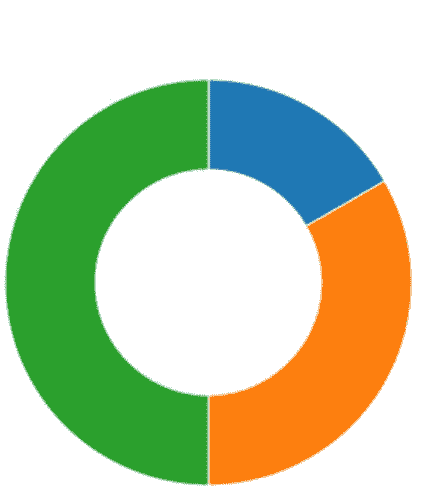

为了开始，我们将基于这段现有的、可创建环形图的 D3 代码进行工作。

```html
1  <!DOCTYPE html>
2  <html>
3      <head>
4          <title></title>
5      </head>
6      <body>
7          <script src="angular.js"></script>
8          <script src="d3.js"></script>
9          <script>
10             var color = d3.scale.category10();
11             var data = [10, 20, 30];
12             var width = 300;
13             var height = 300;
14             var min = Math.min(width, height);
15             var svg = d3.select('body').append('svg');
16             var pie = d3.layout.pie().sort(null);
17      var arc = d3.svg.arc()
18          .outerRadius(min / 2 * 0.9)
19          .innerRadius(min / 2 * 0.5);
20
21      svg.attr({width: width, height: height});
22      var g = svg.append('g')
23          // center the donut chart
24          .attr('transform', 'translate(' + width / 2 + ',' + height / 2 + ')');
25
26      // add the <path>s for each arc slice
27      g.selectAll('path').data(pie(data))
28          .enter().append('path')
29              .style('stroke', 'white')
30              .attr('d', arc)
31              .attr('fill', function(d, i){ return color(i) });
32      </script>
33  </body>
34  </html>
```

在线版本：[http://jsbin.com/zinu/1/edit](http://jsbin.com/zinu/1/edit)

就像上面的 “hello world!” 示例一样，我们需要在应用模块上设置我们的新指令。

```javascript
1 myApp.directive('donutChart', function(){
2   function link(scope, element, attr){
3       // put D3 code here
4   }
5   return {
6       link: link,
7       restrict: 'E'
8   }
9 });
```

唯一的区别是将指令名称从 `helloWorld` 更改为 `donutChart`，这样我们就可以通过标签名 `<donut-chart>` 来使用我们的指令。

在 `link` 函数中，我们可以复制并粘贴所有原始的饼图代码。我们需要做的唯一更改是将 `d3.select('body')` 选择更新为相对于指令的选择，使用 `d3.select(element[0])` 而不是整个 DOM。

```javascript
1 // var svg = d3.select('body').append('svg'); // 旧版本
2 var svg = d3.select(element[0]).append('svg'); // 新版本
```

我们必须使用 `element[0]` 而不仅仅是 `element` 的原因，是因为 `element` “是”一个被 jQuery 包装的选择集，而不是一个普通的 DOM 对象。执行 `element[0]` 可以让我们获得原生的 DOM 元素。（我对 “是” 加引号是因为它技术上是一个被 jqLite 包装的 DOM 元素。jqLite 本质上是 jQuery 的精简版。）

在线版本：[http://jsbin.com/niwe/1/edit](http://jsbin.com/niwe/1/edit)


它看起来可能没什么变化，但我们正朝着使其可复用的方向稳步前进。作为一个简单的演示，我们只需复制并粘贴`<donut-chart>`标签，就能轻松创建多个环形图。

```
1 <donut-chart></donut-chart>
2 <donut-chart></donut-chart>
3 <donut-chart></donut-chart>
```

在线版本：[http://jsbin.com/yili/1/edit](http://jsbin.com/yili/1/edit)


## 隔离作用域

我们的环形图确实有几个方面可以改进。具体来说，如果我们的环形图不都显示相同的内容就好了。我们希望能为每个图表传递自己的数据进行显示，而不是在指令的链接函数中硬编码相同的数据。为此，我们可以使用所谓的隔离作用域。隔离作用域将允许我们通过属性将数据传递给指令。（在我们的例子中，我们将其称为`data`，但我们本可以随意命名。）

```
1 <donut-chart data="[8, 3, 7]"></donut-chart>
2 <donut-chart data="[2, 5, 9]"></donut-chart>
3 <donut-chart data="[6, 2, 3]"></donut-chart>
```

为了告诉 Angular 我们的指令应该有一个隔离作用域，我们只需在指令声明返回的对象中添加一个`scope`属性。

```
1 return {
2     link: link,
3     restrict: 'E',
4     scope: { data: '=' }
5 }
```

在我们的`link`方法内部，我们只需引用`scope.data`，它将包含我们在上方模板的`data`属性中传递给它的数据。

```
1 function link(scope, element, attr){
2   // 当前指令实例的数据！
3   var data = scope.data;
4   // ...
5 }
```

在线版本：[http://jsbin.com/yili/6/edit](http://jsbin.com/yili/6/edit)


如果你仍然希望所有饼图之间共享相同的数据，我们现在只需在作用域上定义一个变量，并将其传递给所有独立的环形图。

```
1 <body ng-app="myApp" ng-init="ourSharedData=[8, 2, 9]">
2   <donut-chart data="ourSharedData"></donut-chart>
3   <donut-chart data="ourSharedData"></donut-chart>
4   <donut-chart data="ourSharedData"></donut-chart>
```

在线版本：[http://jsbin.com/yili/7/edit](http://jsbin.com/yili/7/edit)

为我们的环形图提供隔离作用域也使我们能够使用 Angular 内置的`ng-repeat`指令，在给定一个图表数据数组的情况下创建任意数量的环形图。

```
1 <body ng-app="myApp" ng-init="charts=[[8, 3, 7],[2, 5, 9],[6, 2, 3]]">
2   <donut-chart data="chart" ng-repeat="chart in charts"></donut-chart>
```

在线版本：[http://jsbin.com/yili/8/edit](http://jsbin.com/yili/8/edit)

# 动态可视化

正如我们在上一章所看到的，指令是使我们的可视化在项目不同部分或不同项目中独立、可复用的强大工具。使用 Angular 及其指令进行数据可视化的另一个巨大优势是 Angular 对自动双向数据绑定的支持。这听起来有点绕口，但实际上是一个简单的概念。它只是意味着当数据发生变化时，Angular 会负责更新 DOM。同样，当 DOM 发生变化时，它也会自动更新我们的数据。我们只需要指定数据与 DOM 元素之间的关系。这一切的最大优点是我们将编写更少的代码。缺点是我们将不得不费力地理解这种关于数据绑定的新的思维方式，并深入了解 Angular 自动为我们做了什么。

本章前半部分，我们将通过一些简单的玩具示例来阐述基本原理。在第二部分，我们将逐步讲解如何使用这些新概念来创建动态数据可视化。

### 双向数据绑定

为了说明和展示双向数据绑定的优势，我们将从一个非常简单的例子开始。这里，几个范围`<input>`滑块都绑定到同一个数据模型。当我们拖动其中一个时，其他所有滑块都会自动更新。这省去了我们手动为所有滑块设置事件监听器以及处理更新其值的麻烦。可以这样想：Angular 帮我们写了所有这些代码。

```
1 <body ng-app>
2   <input type="range" ng-model="ourRangeValue">
3   <input type="range" ng-model="ourRangeValue">
4   <input type="range" ng-model="ourRangeValue">
5   <input type="range" ng-model="ourRangeValue">
6 </body>
```

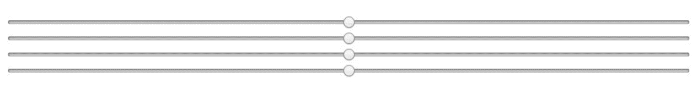

在线版本：[http://jsbin.com/tobuq/1/edit](http://jsbin.com/tobuq/1/edit)

### 作用域

所有这些自动更新都发生在所谓的“作用域”上的变量上。在上面的例子中，`ng-model`指令在作用域上创建了一个名为`ourRangeValue`的变量，并处理在`ourRangeValue`变化时更新`<input>`范围滑块的值。作用域的工作方式与 DOM 树非常相似。如果我们在一个 DOM 元素上创建一个新的作用域，所有子元素都将有权访问该新作用域上的变量。当我们告诉 Angular 应用的根是`<body>`标签时，它也在`<body>`标签上创建了一个默认作用域，任何内部元素都可以访问它。`ourRangeValue`就是在这个作用域上创建的。这个顶级作用域被称为“根作用域”。

创建新作用域的方式有几种，但我们不能简单地单独创建一个作用域。创建新作用域最简单的方法是首先创建一个“控制器”。控制器通常用于在 JavaScript 中以编程方式修改作用域变量。每次我们创建并使用一个新的控制器时，也会为它创建一个新的作用域。基于我们之前的例子，让我们看看创建和使用控制器来创建新作用域是什么样子的。

我们首先需要创建一个模块来放置我们的控制器。

```
var app = angular.module('myApp', []);
```

接下来，我们将创建一个名为‘HelloController’的控制器，它在其新作用域上创建一个名为`ourRangeValue`的变量。

```
app.controller('HelloController', function($scope){
    $scope.ourRangeValue = 50;
});
```

要使用它，我们需要记住在`<body>`标签的`ng-app`中使用我们的模块。

```
<body ng-app="myApp">
```

接下来，我们将使用`ng-controller="HelloController"`在`<div>`标签上使用我们的新控制器两次。现在`<div>`内部的作用域将继承为每个`HelloController`创建的新控制器。

```
<body ng-app="myApp">
  <div ng-controller="HelloController">
    <input type="range" ng-model="ourRangeValue">
    <input type="range" ng-model="ourRangeValue">
  </div>
  <div ng-controller="HelloController">
    <input type="range" ng-model="ourRangeValue">
    <input type="range" ng-model="ourRangeValue">
  </div>
</body>
```

在线版本：http://jsbin.com/hite/1/edit

在我们的应用根作用域内创建了两个作用域。一个用于第一个`HelloController`，另一个用于第二个`HelloController`。`ourRangeValue`将是这两个内部作用域中各自不同的属性。这会将前两个范围滑块绑定到第一个作用域上的`ourRangeValue`值，将后两个范围滑块绑定到第二个作用域上的`ourRangeValue`值。

内部作用域从其外部作用域继承。这意味着，如果`ourRangeValue`在`HelloController`作用域上找不到，就会在其外部作用域上查找名为`ourRangeValue`的属性，如此继续，直到检查根作用域。

### 作用域继承

`ng-init`用于初始化当前元素作用域上的属性。在下面的例子中，根作用域上一个名为`foobar`的属性被赋值为 50。（`HelloController`与之前的示例相比没有变化。）我们可能期望所有的范围滑块现在都将绑定到外部作用域中的同一个`foobar`元素上，但事实并非如此。相反，会在每个内部的`HelloController`作用域上创建一个新的`foobar`属性。

```
1  <body ng-app="myApp" ng-init="foobar=50">
2    <div ng-controller="HelloController">
3      <input type="range" ng-model="foobar">
4      <input type="range" ng-model="foobar">
5    </div>
6    <div ng-controller="HelloController">
7      <input type="range" ng-model="foobar">
8      <input type="range" ng-model="foobar">
9    </div>
10  </body>
```

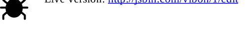

这可能有点出乎意料，但考虑到作用域继承与常规 JavaScript 继承的工作方式相同，这就说得通了。下面的代码片段说明了 Angular 内部正在发生什么。

```
1  var rootScope = { foobar: 50 };
2  var scope1 = Object.create(rootScope);  // scope1 继承自 rootScope
3  var scope2 = Object.create(rootScope);  // scope2 继承自 rootScope
4  // scope1.foobar 是 50
5  // scope2.foobar 是 50
6  rootScope.foobar = 100;  // 更改 `rootScope.foobar` 如预期般生效
7  // scope1.foobar 是 100
8  // scope2.foobar 是 100
9  scope1.foobar = 2;  // 但为 `foobar` 赋值会在子作用域上创建一个新属性，
10  // 它遮蔽了 `rootScope.foobar`。
11  // rootScope.foobar 是 100 而不是 2
```

> 如果这仍然有些令人困惑，更详细地回顾 JavaScript 原型链和继承可能会有所帮助。我们推荐 Sebastian Porto 的这篇博客文章。

一种解决方法是使用另一个对象作为包装器来防止遮蔽父作用域的属性。这样，我们永远不会为`foobar`属性分配一个新值。

```
1  var rootScope = { foobar: { value: 50 } };
2  var scope1 = Object.create(rootScope);  // scope1 继承自 rootScope
3  var scope2 = Object.create(rootScope);  // scope2 继承自 rootScope
4  // scope1.foobar.value 是 50
5  // scope2.foobar.value 是 50
6  rootScope.foobar.value = 100;
7  // scope1.foobar.value 是 100
8  // scope2.foobar.value 是 100
9  scope1.foobar.value = 2;
10  // rootScope.foobar.value 是 2
```


利用这种作用域继承的知识，让我们更新前面的示例。

```html
<body ng-app="my自检发现遗漏，重新翻译最后一段：Content](/content)

利用这种作用域继承的知识，让我们更新前面的示例。

```html
<body ng-app="myApp" ng-init="foobar = { value: 50 }">
  <div ng-controller="HelloController">
    <input type="range" ng-model="foobar.value">
    <input type="range" ng-model="foobar.value">
  </div>
  <div ng-controller="HelloController">
    <input type="range" ng-model="foobar.value">
    <input type="range" ng-model="foobar.value">
  </div>
</body>
```

在线版本：[http://jsbin.com/finijaru/1/edit](http://jsbin.com/finijaru/1/edit)

现在，每当调整 `<input>` 范围滑块时，同一个根作用域的 `foobar.value` 属性会被更新，并在所有内部控制器作用域之间共享。

## 使用 $watch 让可视化动态化

### scope.$watch

使用 Angular 的内置指令可以轻松实现诸如将范围滑块的变化绑定到另一处等简单操作，但对于复杂的可视化，我们需要创建自己的指令来监视作用域的变化，并根据这些变化更新其内容。让我们来看一个简单的可视化指令示例，它会在数据变化时更新其内容。具体来说，我们将创建一个 `<progress-bar>` 指令。其 `progress` 作用域属性将是一个数字，表示加载进度从 0 到 100 的百分比。每当这个 `progress` 属性发生变化时，我们需要更新进度条的 `<rect>`。

为了完成这类任务，作用域对象提供了一个名为 `$watch()` 的函数，我们需要向它传递两个参数。第一个参数是我们希望监视的作用域变量，第二个参数是在该属性检测到变化时应调用的函数。对于我们的 `<progress-bar>` 指令，代码可能如下所示：

```javascript
scope.$watch('progress', function(progress){
  rect.attr({x: 0, y: 0, width: width * progress / 100, height: height });
});
```

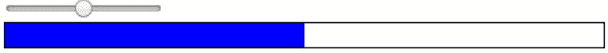

在线版本：[http://jsbin.com/vagiq/3/edit](http://jsbin.com/vagiq/3/edit)

每次拖动滑块时，范围滑块上的 `ng-model` 指令会更新作用域变量 `progress`。然后，`progress-bar` 中的 `scope.$watch('progress', ...)` 回调就会被调用。

这可能让人感觉不太"自动"。在*构建*自己的指令时，我们仍然需要手动监视作用域的变化。好处在于，我们的指令现在可以放置到其他位置，所有这些"接线"工作都会自动完成。例如，我们可以复制粘贴几次我们的指令，然后观察范围滑块的变化如何更新所有进度条。

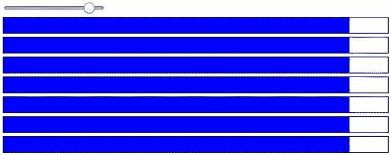

在线版本：[http://jsbin.com/hadi/1/edit](http://jsbin.com/hadi/1/edit)

或者我们可以创建一个进度数组，并使用 `ng-repeat` 为每个进度创建多个滑块和进度条。

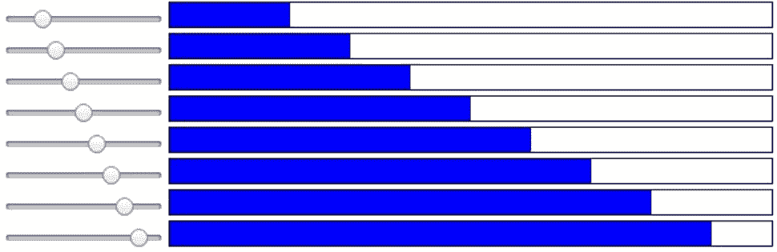

在线版本：[http://jsbin.com/manon/1/edit](http://jsbin.com/manon/1/edit)

## 让我们制作一个动态环形图

既然我们已经了解了如何制作动态更新的指令，让我们来完成一个更复杂的动态更新可视化示例。我们将呛咳_FROM]前面的章节中获取环形图指令，并使其动态化，以便我们可以更改其数据，可视化效果会相应更新。

在线版本：[http://jsbin.com/yili/6/edit](http://jsbin.com/yili/6/edit)

首先，我们需要能够修改图表显示的数据。三个 `<input>` 范围滑块就可以达到目的，但我们也可以使用任何方法来更新数据。指令不知道也不关心其数据是如何被修改的。

```html
1 <body ng-app="myApp" ng-init="chart=[10, 20, 30]">
2   <input type="range" ng-model="chart[0]">
3   <br>
4   <input type="range" ng-model="chart[1]">
5   <br>
6   <input type="range" ng-model="chart[2]">
7   <br>
8   <donut-chart data="chart"></donut-chart>
9 </body>
```

在线版本：[http://jsbin.com/waqep/1/edit](http://jsbin.com/waqep/1/edit)

指令还没有更新，因为它没有在监视其数据作用域变量的变化。为了解决这个问题，我们将像之前一样使用 `$watch` 函数。

```javascript
1 scope.$watch('data', function(data){
2   console.log("an element within `data` changed!");
3   console.log(data);
4 }, true);
```

在线版本：[http://jsbin.com/waqep/3/edit](http://jsbin.com/waqep/3/edit)

一个重要的区别是，我们现在给 `$watch` 传入了一个额外的第三个变量 `true`。这告诉 `$watch` 也要监视 data 内部的变化。否则，通过执行 `data[0]=45` 来改变 data 的第一个元素将不会触发 `$watch` 回调，因为变化后 data 仍然是同一个数组。只是它的第一个元素的值不同了。

> 除非你传入 `true` 作为第三个参数，否则 `$watch` 回调不会因数组元素的变化而触发。否则，`$watch` 回调只会在被监视的数组变成一个全新的数组时才会触发。

最后一步是在数据变化时更新圆弧 `<path>` 标签，因为它们是我们可视化中唯一依赖数据的部分。由于我们将在 `$watch` 中更新圆弧，所以需要给 `<path>` 圆弧选择器起一个名字以便稍后引用。我们也不需要在任何地方设置圆弧的 `d` 属性，除了在 `$watch` 中数据变化的时候。

```javascript
1 var arcs = g.selectAll('path').data(pie(data))
2   .enter().append('path')
3     .style('stroke', 'white')
4     .attr('fill', function(d, i){ return color(i) });
```

```javascript
scope.$watch('data', function(){
    arcs.data(pie(data)).attr('d', arc);
}, true);
```

在线版本：[http://jsbin.com/jiqoz/1/edit](http://jsbin.com/jiqoz/1/edit)

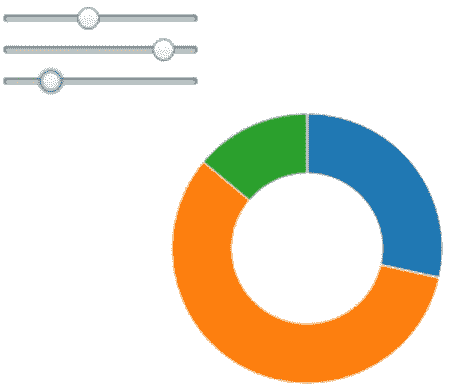

我们的环形图看起来不错！但它总是必须保持与开始时相同数量的扇区。如果我们能够向图表数组中添加或删除元素，并让环形图相应地添加或删除扇区，那会更好。我们可以通过让 `$watch` 负责添加或删除必要的圆弧 `<path>` 标签，并结合使用 d3 的 `.enter()` 和 `.exit()` 选择来实现这一点。如果其中一些语法仍不太清楚，请返回第二章复习 D3 中选择的工作原理。

```javascript
var arcs = g.selectAll('path');
scope.$watch('data', function(data){
    arcs = arcs.data(pie(data));
    arcs.exit().remove(); // 删除不再有数据的 path 标签
    arcs.enter().append('path') // 或者有更多数据时添加 path 标签
      .style('stroke', 'white')
      .attr('fill', function(d, i){ return color(i) });
    arcs.attr('d', arc); // 更新所有 `<path>` 标签
}, true);
```

接下来，我们需要某种方法来增加或减少 `chart` 中的元素。为此，我们可以使用两个按钮，一个用于向 chart 添加元素，另一个用于删除元素。

```html
<body ng-app="myApp" ng-init="chart=[10, 20, 30]">
  <button ng-click="chart.push(50)">add slice</button>
  <button ng-click="chart.pop()">remove slice</button>
  <!-- ... -->
</body>
```

我们还需要某种方法来为 chart 数组中的每个扇区（或元素）添加 `<input>` 范围滑块。为此，我们可以使用 `ng-repeat`。

```html
<input type="range" ng-model="slice" ng-repeat="slice in chart">
```

然而，当你运行这段代码时，你会发现一个问题。Angular 抛出一个错误：

> Error: [ngRepeat:dupes] Duplicates in a repeater are not allowed. Use 'track by' expression to specify unique keys. Repeater: slice in chart, Duplicate key: number:20

在线版本：[http://jsbin.com/leco/1/edit](http://jsbin.com/leco/1/edit)

Angular 想告诉我们的是，`ng-repeat` 中的每个元素都需要是唯一的。不过，我们可以通过添加 `track by $index` 在 `slice in chart` 之后，告诉 Angular 使用元素在数组中的索引来确定唯一性。

```html
1 <input type="range"
2   ng-model="slice" ng-repeat="slice in chart track by $index">
```

添加这个之后，就不会再抛出任何错误，而且添加或删除扇区似乎也能正常工作了，但拖动滑块对可视化没有任何影响。`chart` 数组没有被滑块的值修改。这是本章前面提到的作用域继承问题的另一种体现。`ng-repeat` 为每个 `<input>` 标签创建一个新的作用域。当范围值更新时，它更新的是其 `slice` 属性，而这并不会与其父级共享。

在线版本：[http://jsbin.com/wadev/1/edit](http://jsbin.com/wadev/1/edit)

我们可以用与之前相同的方法来解决这个问题，即使用一个包装对象。这样做之后，我们可以安全地修改其属性，而不必担心会遮蔽父作用域的属性。

```html
1 <body ng-app="myApp" ng-init="chart=[{value: 10}, {value: 20}, {value: 30}]">
2   <donut-chart data="chart" style="float:right"></donut-chart>
3   <button ng-click="chart.push({value: 10})">add slice</button>
4   <button ng-click="chart.pop()">remove slice</button>
5   <input type="range" ng-model="slice.value"
6     ng-repeat="slice in chart track by $index">
```

我们的指令现在需要更新，以便能够访问数据数组中每个对象的 slice 值。因为饼图布局是唯一直接使用 `data` 的部分，我们可以给 `pie` 一个值访问器（value accessor），它会负责从数据数组的每个对象中提取饼图值。

```javascript
1 pie.value(function(d){ return d.value; });
```


## 将数据导入和导出指令

Angular 和 D3 的结合使得创建能够在数据更改时自动更新的可视化图表变得简单，但我们首先如何将数据导入 Angular 呢？

### D3 方式

正如我们所见，D3 提供了一套用于从远程源加载数据的实用工具。最常用的是 `d3.json()` 或 `d3.csv()` 函数。如果使用得当，我们可以继续使用这些函数，但 Angular 同时也提供了加载数据的替代方案。

让我们从一个简单的甜甜圈图（donut chart）指令示例开始，该指令从远程文件源加载数据。

```
d3.json('donut-data.json', function(err, data){
  if(err){ throw err; }
  arcs = arcs.data(pie(data));
  arcs.exit().remove();
  arcs.enter().append('path')
    .style('stroke', 'white')
    .attr('fill', function(d, i){ return color(i) });
  // update all the arcs (not just the ones that might have been added)
  arcs.attr('d', arc);
});
```

🐛 实时版本：[http://bl.ocks.org/vicapow/9535255](http://bl.ocks.org/vicapow/9535255)

对于单个甜甜圈图实例来说，这样可以完成任务，但如果我们想在甜甜圈图中使用不同的数据怎么办？我们要么需要通过更改获取数据的 URL 来编辑现有的甜甜圈图指令，要么需要创建一个与原指令几乎完全相同的新指令，使其从 scope 中加载数据，而不是在指令中放入 `d3.json()`。一个更好的替代方案是让指令完全不关心数据的来源。也就是说，我们希望指令对数据从哪里来“一无所知”，而只关心*是否*或*何时*获得数据，以及数据*何时*发生变化。

为了让上述指令符合这一新启发式方法，我们应该让它仅监听 scope 上数据的变化，然后我们将从其他地方把数据加载到 scope 上。目前，这个“其他地方”将是一个控制器（controller）。控制器是存放将应用程序串联在一起的逻辑的地方。

实现此的第一步是定义我们的控制器。在我们的案例中，我们将其命名为 `MainCtrl`，因为我们只有一个。

```
var myApp = myApp.controller('MainCtrl', function($scope){
  // TODO: controller logic here!
});
```

这创建了一个控制器类，然后我们可以使用 `ng-controller` 在应用程序中创建具体的控制器实例。

```
<body ng-app="myApp" ng-controller="MainCtrl">
  <!-- MainCtrl's scope -->
</body>
```

接下来，我们将 `d3.json()` 代码放入控制器定义中。

```
var myApp = myApp.controller('MainCtrl', function($scope){
  d3.json('donut-data.json', function(err, data){
    if(err){ throw err; }
    $scope.data = data;
    $scope.$apply();
  });
});
```

这样，当数据被拉取进来时，我们会将其放入 scope。Angular 随后会注意到我们的数据 scope 属性发生了变化，并通知我们的 `<donut-chart>` 指令。当我们调用 `$scope.$apply()` 时，系统会检查 scope 的变化。

最后，我们需要将指令连接到 `MainCtrl` 的 scope，并将我们的指令改回具有一个监听变化并相应更新可视化的数据 scope 属性。

```
<donut-chart data="data"></donut-chart>

scope.$watch('data', function(data){
  // (update/add/remove the `<path>` elements for each of the pie arcs)
}, true);
```

就像之前一样，因为我们希望数据是 HTML 中配置为指令属性的 scope 属性，因此我们需要在指令返回的配置对象中将 `scope:` 设置为 `{ data: '=' }`。

现在我们仍然可以使用 `<donut-chart>` 指令处理任何类型的数据。在这个示例中，我们对第一个图表使用 `d3.json()` 加载甜甜圈图数据，而对第二个图表在 `MainCtrl` 的 scope 中硬编码数据。

### Angular 方式

除了使用 `d3.json()`，我们还可以使用 Angular 的 `$http` 服务来拉取数据。

```
myApp.controller('MainCtrl', function($scope, $http){
  // using success/error callback style
  $http.get('donut-data.json').success(function(data){
    $scope.donutData1 = data;
  }).error(function(err){
    throw err;
  });
});
```

我们也可以使用替代的 `then()` 回调风格：

```
myApp.controller('MainCtrl', function($scope, $http){
  // using `then()` callback style
  $http.get('donut-data-2.json').then(function(response){
    $scope.donutData2 = response.data;
  }, function(err){
    throw err;
  });
});
```

实时版本：http://bl.ocks.org/vicapow/9555539

使用 `$http` 服务而不是 `d3.json()` 可以让我们避免直接调用 `$scope.$apply()`。Angular 会自动为我们完成这项工作。事实上，Angular *几乎* 总是知道何时检查 scope。唯一不检查的情况是在 Angular 之外执行异步事件时。这包括使用 D3 的任何行为（例如拖拽、点击、缩放等）或使用 `setTimeout`（而不是 Angular 的 `$timeout` 服务）。

> 你可能很好奇，为什么我们只需将 `$http` 服务作为另一个参数添加到控制器定义函数中就能使用它。这是由 Angular 中一个名为“依赖注入（dependency injection）”的功能实现的。关于 DI 及其工作原理的详细概述超出了本书的范围。欲了解更多详情，请参阅 [此处的 Angular 文档](http://docs.angularjs.org/guide/di)。与此同时，你只需要知道 Angular 足够聪明，可以通过查看参数的变量名来检查应该用哪些参数来调用你的控制器初始化方法。如果我们把控制器初始化函数的参数从 `($scope, $http)` 切换到 `($http, $scope)`，我们的代码依然可以正常工作！

利用目前学到的一切，我们现在可以使用 `$interval` 服务定期从 API 拉取数据，将其结果放入 scope，从而创建一个简单的“实时可视化仪表板”。我们的指令将处理其余的工作。

```
myApp.controller('MainCtrl', function($scope, $http, $interval){
  $interval(function(){
    $http.get('donut-data-api.json').then(function(response){
      // your API would presumably send new data each time!
      var data = response.data.map(function(d){ return d * Math.random() });
      $scope.donutData = data;
    }, function(err){
      throw err;
    });
  }, 1000);
});
```

实时版本：http://bl.ocks.org/vicapow/9556184

## 从指令内部更新 scope

到目前为止，我们的指令与外部世界的通信一直是单向的。我们的指令始终是在响应数据的变化，而从未反向操作。然而，有时我们希望从指令内部影响我们的数据。

一种非常模块化的技术是在指令的 scope 上更新数据，然后选择性地在应用程序的其他地方甚至其他指令中监听该变量的变化。这使得我们的指令更具可重用性，因为它们不再需要了解彼此。我们可以将指令放入应用程序的另一个部分或完全不同的应用程序中，而无需花费太多精力进行连接，因为我们只需要在 HTML 定义中传递给指令的 scope 变量上使用 `$watch` 语句，即可获得变量更改的通知。

举一个具体例子，假设我们创建了一个散点图指令，并希望添加一项功能：当鼠标悬停在某个点上时，能够看到该点的详细信息。有几种方法可以实现这一点，其中一些比其他的更模块化。一种方法是创建一个特定的指令，例如“scatter-plot-detail”指令。这在我们需要另一种行为略有不同的散点图之前是可行的，比如以与第一个略有不同的方式显示详细信息。如果我们坚持第一种策略，我们现在需要一个全新的指令，除了显示详细内容的方式外，它与第一个几乎完全相同。

更好的方法是使用一个单一的指令来显示散点图，而该指令不负责显示选中点的任何详细信息。它只需要一个名为 `selectedPoint` 的新 scope 变量。然后，当鼠标悬停在某个点上时，它将把 `selectedPoint` scope 属性设置为新悬停点的资料。

```
// our `<scatter-plot>` directive's new isolate scope
scope: { selectedPoint: '=', data: '=' }

point.append('circle').attr('r', 5)
  .on('mouseover', function(d){
      scope.$apply(function(){
          scope.selectedPoint = d;
      });
  });
```

最后，我们只需要在 HTML 中配置我们的指令，并使用 Angular 的 `{{ }}` 语法添加描述模板。

```
<body ng-app="myApp" ng-controller="MainCtrl">
  <div class="scatter-container">
    <scatter data="employers" selected-point="selectedEmployer"></scatter>
  </div>
  <div class="detail">
    <h2>{{selectedEmployer.name }}</h2>
    <!-- and possibly some other details about the employer -->
  </div>
</body>
```


# 创建可复用可视化的最佳实践

到目前为止，我们的可视化都是相对简单的示例，主要目的是帮助我们理解 Angular 和 D3 的工作原理。在实际应用中，我们的可视化往往要复杂得多。本章将介绍作者在创建通用且可复用的指令时总结的一些通用最佳实践。

> 重要的是要记住，过度泛化与泛化不足同样有害。一个好的策略是始终提前花些时间考虑可视化是否需要泛化。该可视化是否需要在多个地方使用？如果答案是“否”，那么其中一些技术可能会不必要地使我们的代码过于复杂。

## 访问器函数

在 Angular 中，作用域表达式是一段代码片段，类似于函数，可以作为属性配置在指令上。我们的指令在访问数据中的每个元素时会计算这个表达式。通过使访问器可配置，我们避免了指令假定特定输入格式的问题。

这意味着我们的指令可以接受任何类型的数据数组，只要我们告诉它如何使用访问器表达式从数据中提取特定值。我们将在以下假设下演示这意味着什么：我们的数据是 AMC *《行尸走肉》* 电视剧的收视信息。

```
scope.episodes = [
  { title: 'Days Gone Bye', air_date: '2010-10-31', us_viewers: 5.35 },
  { title: 'Guts', air_date: '2010-11-07', us_viewers: 4.71 },
  // ...
];
```

我们可以为散点图指令指定 x 和 y 访问器表达式，前提是我们的指令在其作用域上有两个 Angular 表达式，即 accessorX 和 accessorY，如下所示。

```
<scatter
  data="episodes"
  accessor-x="d.air_date"
  accessor-y="d.us_viewers"></scatter>
```

我们可以在配置指令时使用 `&` 来实现这一点。要使两个属性 `accessor-x` 和 `accessor-y` 成为表达式，我们指令上的作用域配置需要使用 `&` 而不是 `=`。

```
scope: { accessorX: '&', accessorY: '&', data: '=' }
```

最后一步是在指令中访问数据数组的 x 和 y 值时使用作用域表达式。

```
var d = data[0];
var xVal = scope.accessorX({d: d});
```

使用相同的语法，我们可以添加将在表达式内部使用的其他变量。这样，我们可以在表达式中暴露索引变量 `i` 或任何其他我们希望从访问器访问的变量。

```
var i = 0;
var d = data[i];
var xVal = scope.accessorX({d: d, i: i});
```

这种技术也适用于其他属性，如颜色、大小或任何我们希望配置的属性。这也使得设置属性统一性变得方便。在我们的散点图示例中，我们可以通过表达式配置颜色。

```
<scatter data="episodes" color="color(d.title)" ... ></scatter>
```

在我们的控制器中，我们随后需要一个颜色比例尺，供表达式用来确定每个数据点的颜色。

```
// 在我们的控制器中
$scope.color = d3.scale.category10();
```

或者，通过在访问器表达式中设置 `color="'red'"`，将所有点设为 `"red"`。

```
<scatter data="episodes" color="'red'" ... ></scatter>
```

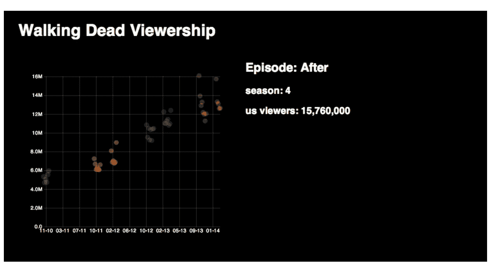

实时版本：[http://bl.ocks.org/vicapow/9591312](http://bl.ocks.org/vicapow/9591312)

## 响应式指令

响应式网页开发涉及让网站的组件自动调整大小或隐藏，以恰好占用可用的屏幕空间。在屏幕较小的手机上浏览响应式网站时，网站会以针对新屏幕尺寸优化的自适应视图显示。同样，对于较大的屏幕，响应式网站会扩展得足够大，可能显示更多内容，以充分利用更大的空间。这与为不同屏幕尺寸创建两三个单独版本的网站不同。采用响应式网站设计，网站会根据屏幕尺寸变化动态地“响应”式增长或缩小。

让指令根据屏幕大小动态更新的一种好技术是让指令监视其宽度和高度的变化，并相应地更新可视化内部的任何内容。

```
var w = 0;
var h = 0;
scope.$watch(function(){
  w = el.clientWidth;
  h = el.clientHeight;
  return w * h;
}, resize);
```

但为了使这按预期工作，我们需要在窗口大小调整时让作用域检查变化。

```
angular.element($window).on('resize', function(){ $scope.$apply() });
```

这段代码的一个好放置位置是在某个主控制器内部，因为它只需要调用一次。所有以这种方式实现响应式的指令，一旦在我们的应用中添加这一行代码，就会被检查变化。

最后一步是确保指令元素可以缩小。除非我们设置 `overflow:hidden`，否则容器元素永远不会小于其内容，这意味着“忽略此元素内部超出元素本身的任何内容”。

```
scatter{
  display: block;
  overflow: hidden;
}
```

现在，要设置指令的实际大小，我们可以使用 CSS 百分比，让可视化的大小像任何其他内置 HTML 元素一样动态更新。

```
.scatter-1{
  width: 50%;
  height: 400px;
}
```

或者让它占据整个页面：

```
.scatter-1{
  width: 100%;
  height: 100%;
}
```

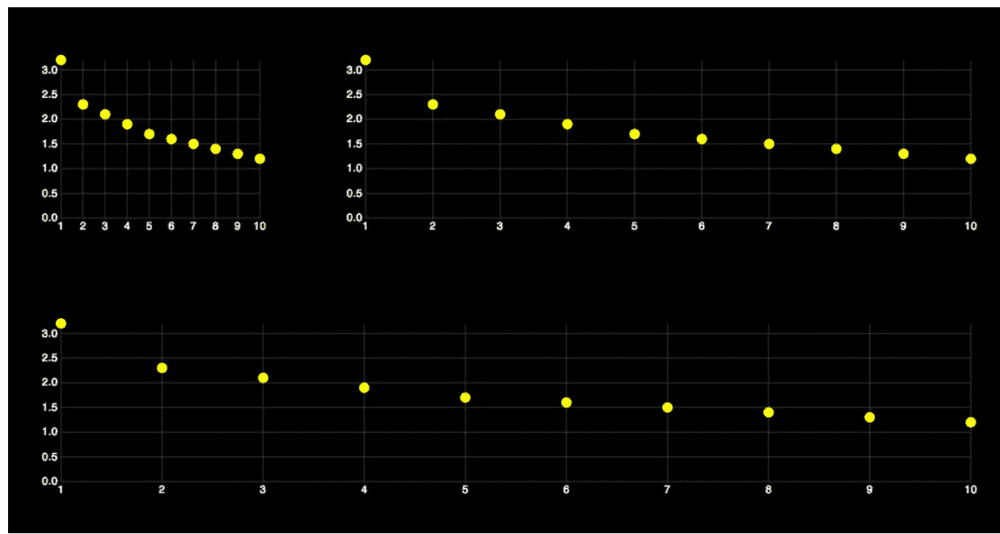

实时版本：[http://bl.ocks.org/vicapow/9716306](http://bl.ocks.org/vicapow/9716306)

# 服务

## 用于存储数据的服务

除了让指令不对数据来源持有偏见外，对控制器做同样的事情也是一个好主意。这使我们能够轻松地从不同的控制器中交换不同类型的数据，作为控制器和数据之间的代理。下面是一个具体示例，说明这种能力何时会很有用。假设我们有两个控制器都需要访问同一块远程数据。我们可以使用 Angular 服务为每个控制器提供数据，而不是让每个控制器独立请求远程数据（发出两个单独的请求）。这样，服务可以自动在内部存储数据以供后续请求，或者在将数据返回给每个控制器之前提供任何必要的数据格式化。

## 用于减少代码重复的服务

服务也是存储多个控制器可能都需要的通用实用函数的好地方。这减少了跨控制器的代码重复量。但服务不仅限于在控制器内部使用。指令也可以使用服务。每当我们注意到指令或控制器之间存在重复或相似的代码时，共享这些代码的最佳位置就是在服务中。

## 内置指令

为简单起见，到目前为止，我们一直避免以元素名称以外的方式创建自己的指令。也就是说，如果我们想要一个地图组件，我们就创建一个元素风格的指令，并在 HTML 中以 `<my-map>` 的形式使用它。但实际上指令要灵活得多，其用途不仅限于此。实际上，指令只是运行在 DOM 元素上的代码块。我们一直用它们来封装复杂的 DOM 操作（我们的可视化），同时暴露一个简单的接口（在 HTML 中只是以 `<my-map>` 的形式使用），但指令也可以使用属性语法创建，例如 `<div my-map></div>`。这可以通过在我们的指令定义中使用 `restrict: 'A'` 而不是 `restrict: 'E'` 来实现。大多数向 Angular 新手介绍的功能只是库附带的最有用的指令。

使用指令作为属性的一个令人兴奋之处在于，我们不再局限于在一个元素上只能有一个指令。给定元素上的所有指令都可以访问相同的作用域属性。以 `ng-show` 指令为例，它根据其表达式的计算结果为 true 或 false 来隐藏或显示所附加的元素。这使得实现类似“加载中”对话框变得容易。有了它，我们可以创建一个作为加载对话框的指令组件，并使用 `ng-show` 指令在地图（或任何其他组件）完成数据加载后隐藏该指令。

```
<loading-overlay ng-show="mapIsLoading">
</loading-overlay>
<my-map loading="mapIsLoading"></my-map>
```

实时版本：[http://bl.ocks.org/vicapow/9819505](http://bl.ocks.org/vicapow/9819505)

# 使用 `replace`、`template` 和 `transclude` 来修改可视化的行为

定义指令时，我们可以选择告诉 Angular 编译器，它应该用提供的模板替换带有指令的元素。如果我们想用实际的 SVG 元素替换自定义指令元素，而不是让自定义指令元素“包装”我们的可视化（这是我们到目前为止的指令一直在做的），这会很有用。让我们通过一个创建 [sparkline](http://bl.ocks.org/vicapow/9819505) 指令的例子来说明这一点。Sparkline 是可以嵌入文本文档中字词之间的迷你小图表。

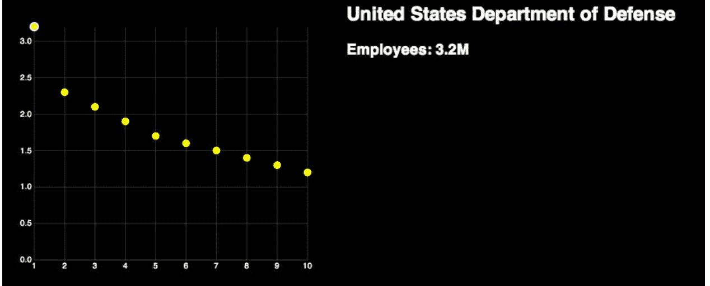

实时版本：[http://bl.ocks.org/vicapow/9592134](http://bl.ocks.org/vicapow/9592134)


所以这就是一个迷你图。很酷，对吧？

这是另一个

这是一个更长的例子

一个更长的例子

我们来看一排几个。

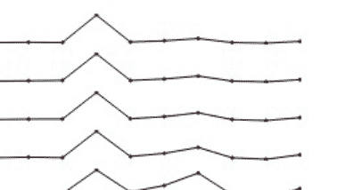

创建一个迷你图指令有几个优点。最明显的是现在只需使用这个一目了然的HTML，就可以轻松创建更多。

```
This is a sparkline <sl r="5">[20,24,15,40]</sl>. That was a sparkline这是我们
```

在线版本：http://bl.ocks.org/vicapow/9904612

> 我们决定使用 `sl` 作为指令名称，因为我们预计需要在一段文本中使用多个它。为每个迷你图都完整地输入 `<sparkline>...</sparkline>` 会很繁琐。

以这种方式定义指令的缺点是我们不能简单地在指令本身上指定样式，特别是对于迷你图，我们通常希望内联单独设置每个的样式。

```
This is a red sparkline <sl style="stroke:red">[20,24,15,40]</sl>
```

这不会按预期工作，因为 `sl` DOM 元素不是 SVG DOM 元素，所以它的 `stroke` 属性不会被我们指令附加到自身的包含 SVG 元素继承。要解决这个问题，我们可以告诉 Angular 使用 `replace: true` 选项来定义指令时，用一个 SVG 元素替换整个元素。但为了使其工作，我们还需要告诉 Angular 用什么来替换元素。为此，我们还需要指定一个模板

```
return {
  link: link,
  restrict: ' this,
  replace: true,
  template: '<svg class="sl"></svg>'
}
```

Angular 会将原始指令上指定的任何样式或属性传递给替换后的指令。

但仅此还不够。按照我们目前的代码，Angular 会替换我们放在 `<sl>` 元素内部的数据。为了告诉 Angular “嘿，不要在编译前删除元素内的所有内容，而是把它放进*这里*”，我们可以在模板内部使用 `transclude` 指令选项结合 `ng-transclude` 指令。

```
1 return {
2     link: link
3   , restrict: ' this
4   , replace: true
5   , template: '<svg ng-transclude class="sl"></svg>'
6   , transclude: true
7 };
```

之前在 `<sl>...</sl>` 指令中的任何内容都将被放置在此模板字符串创建的 `<svg>` 元素内部。

现在可以在 `<sl>` 指令上内联应用样式来调整迷你图的显示。

```
1 <sl r="1" style="stroke:green">[10, 20, 30]</sl>
```


在线版本：[http://bl.ocks.org/vicapow/9904319](http://bl.ocks.org/vicapow/9904319)
