# D3 技巧与窍门：Web 浏览器中的交互式数据可视化

## 马尔科姆·麦克莱恩的其他著作

- Leaflet 技巧与诀窍
- 树莓派：测量、记录、探索。
- 元素、属性和样式
  - 框架
  - 元素
    - 圆
    - 椭圆
    - 矩形
    - 线
    - 折线
    - 多边形
    - 路径
    - 文本
      - 在文本底部、中间锚定：
      - 在文本底部、右侧锚定：
      - 在文本中间、左侧锚定：
      - 在文本中间、中心锚定：
      - 在文本中间、右侧锚定：
      - 在文本顶部、左侧锚定：

## 致谢

首先，我想向 `d3.js` 背后的推动力 Mike Bostock 表示感谢。他的努力不懈，并且在将他的工作公开并提供给大众方面的无私精神令人鼓舞。

Mike 与一群志同道合的人一起将 D3 带向世界。Vadim Ogievetsky 和 Jeffrey Heer 在 [D3: Data-Driven Documents](http://vis.stanford.edu/papers/d3)¹ 的工作中共享荣誉，虽然有 40 多人为 D3 代码库做出了贡献，但 Jason Davies 在地图绘制领域提供了极其慷慨的贡献，表现尤为突出。

Nick Zhu 在 [dc.js](https://github.com/NickQiZhu/dc.js/wiki)²（构建在 `d3.js` 和 `crossfilter` 之上）中创建了一个极好的资源，并非常慷慨地提供了很好的建议，并允许我在 `dc.js` 章节中包含他的一些工作。

Christophe Viau 提供的建议对我融入在线世界有很大帮助，他在管理和指导 D3 社区时展现的精力令人惊叹。

Mike Dewar（*Getting Started with D3*）、Scott Murray（*Interactive Data Visualization for the Web*）和 Sebastian Gutierrez（[dashingd3js.com](http://www.dashingd3js.com/)³）在提供高质量的 D3 学习参考资料方面处于领先地位。非常感谢各位先生。

我特别感谢 Filiep Spyckerelle 和 Robin Bennett 的帮助，他们无私地投入时间与专业知识进行校对，远超其职责范围（如果本文档包含任何错误，那绝对是我个人的错）。非常感谢 D3 社区。无论是在 Google Groups 或 Stack Overflow 上提供建议，在 `bl.ocks.org` 上贡献示例，还是以时间与精力的形式回馈类似的工作。大家做得都很好。

最后，我要向使本文档出版成为可能的 [Leanpub](https://leanpub.com/)⁴ 致敬。他们为自助出版提供了卓越的服务，使提供和分发内容的任务变得切实可行。

## 请确保您获取的是最新版本的 D3 Tips and Tricks

如果您是从 [Leanpub](https://leanpub.com/D3-Tips-and-Tricks)⁵ 以外的任何地方收到本书的副本，那么您可能没有获得最新版本。请访问 <https://leanpub.com/D3-Tips-and-Tricks> 并下载最新版本。毕竟，这不需要您支付任何费用 :-)。如果您觉得这项工作有价值，请在下载时考虑贡献 99 美分，以便 Leanpub 能够获得托管本书的报酬（而我在喝啤酒时会 fondly 地想起您 :-D）。

¹ <http://vis.stanford.edu/papers/d3>

² <https://github.com/NickQiZhu/dc.js/wiki>

³ <http://www.dashingd3js.com/>

⁴ <https://leanpub.com/>

⁵ <https://leanpub.com/D3-Tips-and-Tricks>

## 什么是 `d3.js`？

[`d3.js`](http://d3js.org/)⁶（以下简称 D3）是“*一个基于数据操作文档的 JavaScript 库*”。

但这个描述并未充分展现它的价值。

D3 的核心在于帮助你获取信息，并通过网页浏览器使其更易于他人访问。

它是一个 JavaScript 库。这意味着它是一个可以与其他工具结合使用以完成任务的工具。这些其他工具主要是 HTML 和 CSS（以及其他一些），但使用 D3 并不需要你对它们有太深的了解（尽管了解一些会有所帮助 :-))。

它是一个开放的框架，这意味着它的运作方式没有隐藏的奥秘，并且允许他人参与持续的改进循环。

它基于网络标准构建，这意味着现代浏览器无需做任何特殊处理即可使用 D3，它们只需支持互联网为便于使用而采用的框架即可。

D3 的魅力在于它允许你以一种直接关联的方式将数据与屏幕上的显示内容联系起来。更改数据，你屏幕上的对象也随之改变。D3 的诀窍在于让你设定屏幕上显示什么。一个圆圈、一条线、地图上的一个点、一张图表、一个弹跳的球、一个渐变色（以及更多更多）。一旦数据与对象关联起来，可能性便是无穷的。

在你追求创建完美可视化的旅程中，它不会为你完成所有事情，但它确实赋予了你实现这一目标的能力。

它弥合了数据静态展示与人们希望对其进行操作之间的鸿沟。这既适用于想要展示酷炫内容的开发者，也适用于希望交互式探索信息的终端用户。

它是由 [Mike Bostock](http://bost.ocks.org/mike/)⁷ 开发的（并且仍在持续开发），他不仅投入时间编写代码，还编写了 D3 的[文档](https://github.com/mbostock/d3/wiki)⁸。这里有一个庞大的支持者社区，他们也为代码做出贡献，提供在线技术[支持](https://groups.google.com/forum/?fromgroups#!forum/d3-js)⁹、[支持](http://stackoverflow.com/questions/tagged/d3.js)¹⁰，并通常乐在其中地创造令人惊叹的[可视化作品](https://github.com/mbostock/d3/wiki/Gallery)¹¹。他们的贡献是非凡的（你只需看看 Jason Davies 的作品就会感到惊叹）。

⁶ <http://d3js.org/>

⁷ <http://bost.ocks.org/mike/>

⁸ <https://github.com/mbostock/d3/wiki>

⁹ <https://groups.google.com/forum/?fromgroups#!forum/d3-js>

¹⁰ <http://stackoverflow.com/questions/tagged/d3.js>

¹¹ <https://github.com/mbostock/d3/wiki/Gallery>

## 引言

我从未打算撰写关于 D3 的论著……

我是这个非凡框架的一名普通用户，我说“普通”是*真的*意味着当我刚开始时，完全不知道如何让它做任何事情；我需要进行大量搜索，并通过反复试错来学习——重点是那些完全由我造成的错误。我唯一知道的是，Mike Bostock 等人展示的示例图形正是我想要尝试的那种图形佳作。

因此，要从毫无技能的状态达到能够开始编写代码以我想要的方式显示数据，我必须在学习过程中不断记录信息。这类过程真正酷的地方在于，它不需要一蹴而就。你可以从零知识（或接近零知识）开始，通过站在他人工作的肩膀上，你可以添加构建模块来改进你所看到的内容，然后修改这些模块以进行适应和提升。

例如（这几乎就是它的起点）。我想绘制一个折线图，所以我导入了一个示例，然后让它在我的计算机本地运行。接着，我弄清楚了如何将示例数据替换为我的数据。然后，我搞明白了如何将 Y 轴从右侧移动到左侧。接着是如何让坐标轴标签更大、改变刻度大小、让线条更粗、改变颜色、添加标签、填充图表下方的区域、将图表置于页面中心、为文本添加发光效果以使其突出、将其放入一个框架（`bootstrap`）、添加按钮以更改数据集、为数据集之间的过渡添加动画、当数据更改时自动更新数据、添加平移和缩放功能、将图表的某些部分变成指向其他图表的超链接……然后我就开始研究柱状图了 :-)-。

所有这一切的关键在于，任何一张图表都只是大量代码块的集合，每个代码块都旨在执行特定功能。选择你需要的代码块并实现它们。

我发现一次处理一个事情（代码块）要简单得多，这极大地有助于在事情未按预期进行时减少不确定因素。我不会假装我在尝试构建图表时所做的一切都采用了最优雅或最高效的机制，但最终，如果它在屏幕上都能正常工作，我就会开心地走开 :-)。这并不是说我故意忽略了任何最佳实践——我只是从来不知道它们是什么。同样，在可能的情况下，我已尽力使事物具有尽可能好的可扩展性。

你会发现，我通常避免采用“照着做”的方法，而更倾向于一种讲故事式的练习。这意味着有些解释可能比所有人喜欢的要更长、更华丽，但请尝试忍受一下，试着勇敢一点 :-)

我相信大多数作者都试图做到尽可能通俗易懂。我也想这样做，但请注意……如果你问我一个技术问题，我很有可能不知道答案。所以请在发邮件时对我温柔一点 :-）。

邮箱：`d3noobmail+contact@gmail.com`

## 开始你需要什么？

坦白说，我的祖母永远不会使用 D3 来制作图形。

然而，这并不意味着它对那些有一点计算机知识且愿意尝试的人是无法企及的。记住，失败是你的朋友（我很确定我和它也有血缘关系）。只要从错误中吸取教训，一切都会好起来的。

所以，以下是需要了解的一些有用知识，不分先后。没有一样是必需的，但其中任何一样（或多样）都会让你的生活稍微轻松一些。

- 超文本标记语言（HTML）
- JavaScript
- 层叠样式表（CSS）
- Web 服务器
- PHP

> **别慌！**
>
> 首先，这不是什么火箭科学。这只是互联网。我们会循序渐进，我将在后续章节中更具体地说明。

### HTML

这代表超文本标记语言，是构成网页的材料。请查看维基百科¹²上的定义和其他信息以获得很好的概述。请记住，你使用 HTML 的唯一目的就是承载你将用于呈现信息的代码。这将是一个 `.html`（或 `.htm`）文件，它们可以非常简单（我们稍后会看一些例子）。

### JavaScript

JavaScript¹³ 是一种“脚本语言”。它就是包含在 HTML 文件中的代码，能让 D3 施展其所有魔法。实际上，D3 是一个 JavaScript 库，它是使用 D3 的原生语言。

了解一点 JavaScript 会非常好，但坦白说，在我开始之前，我对它一无所知。我中途读了一本书（O'Reilly 出版社的《JavaScript: The Missing Manual》¹⁴），这帮助我理解了上下文，但 D3 图形的示例是易于理解的，通过一些试错，你就能弄清楚正在发生什么。

事实上，这套信息集的大部分内容都是为 D3 的 JavaScript 组件提供示例和解释。

### 层叠样式表（CSS）

层叠样式表¹⁵（大家都称它们为“样式表”或“CSS”）是一种用于描述用标记语言编写的文档格式（或“外观和感觉”）的语言。CSS 的工作是通过将特定样式分配给特定对象，使你将与 D3 结合使用的组件呈现更加简单。CSS 的一件很酷的事情在于，它是一种极其灵活高效的方法，可以使屏幕上的所有内容看起来更加一致，并且当你想更改某些内容的格式时，只需更改 CSS 组件，整个图形的外观和感觉就会改变。

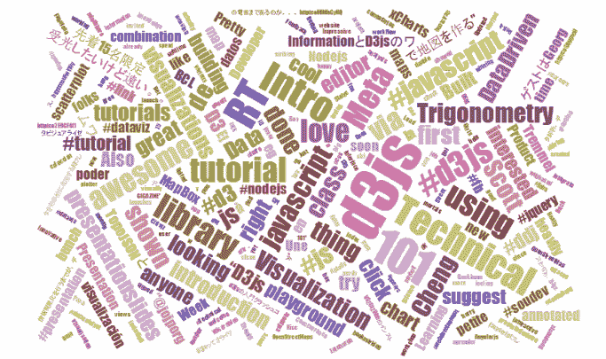

*精彩的层叠样式表世界*

### 完全披露

> 我知道 CSS 是一个功能强大到令人难以置信的工具，会让我的生活更轻松，但我以一种非常基础（且可能痛苦）的方式使用它。别评判我，只需接受我学会的方式就是完成任务所需的方式（这可能意味着像我这样的新手会更容易上手，但尽可能尝试使用那些包含看似合理的 CSS 结构的示例）

### Web 服务器

好的，这有两种可能的情况。如果你可以访问一个 Web 服务器，并且知道将文件放在哪里以便用浏览器访问它们，那你就太棒了。如果你不太确定，请继续阅读……

¹² <http://en.wikipedia.org/wiki/HTML>

¹³ <http://en.wikipedia.org/wiki/JavaScript>

¹⁴ <http://shop.oreilly.com/product/9780596515898.do>

¹⁵ <http://en.wikipedia.org/wiki/Css>

## 入门需要准备什么？

一个网页服务器将允许你访问你的 HTML 文件，并提供在网页浏览器中显示所需的结构。在主要的 [D3 wiki 页面](https://github.com/mbostock/d3/wiki)¹⁶ 上有一些关于设置本地服务器的简单说明。或者你可能可以访问远程服务器并能够上传你的文件。然而，为了更多的功能和极大的易用性，我可以强烈推荐 WampServer，它是一种免费且简单的方法来设置一个包含 PHP 和 MySQL 数据库的本地网页服务器（关于这些稍后会详细介绍）。请访问 WampServer 网页（<http://www.wampserver.com/en/>）看看它是否适合你。

在本文档中，我将描述文件及其布局方式，这种方式在我使用 WAMP 过程中很有效，但它们在远程服务器上同样运行良好。我稍后将在“获取 D3”部分更详细地解释我如何组织文件。


当然还有其他选择。你可以在 [GitHub](https://github.com/about)^17 上托管代码，并在 [bl.ocks.org](http://bl.ocks.org/)^18 上展示生成的图形。这是确保你的代码可供同行评审并与更广泛社区分享的好方法。

我最近开始尝试的一种替代选择是 `Plunker` (`http://plnkr.co/`)。这是一个轻量级的协作在线编辑工具。它太酷了，我专门写了一个部分来介绍它，你可以在本文档后面找到。如果你想使用简单且无需大量开销的工具，这绝对值得一试。如果你喜欢你所看到的，也许可以考虑一个提供更强大功能的替代品，以便你能在 `d3.js` 方面取得更大的进展。

### PHP

PHP 是一种用于网页的脚本语言。也就是说，它是一种在加载网页时执行的编程语言，它帮助网页实现动态功能。

你可能觉得这听起来很熟悉，`JavaScript` 也做同样的事情。但不完全一样。

`JavaScript` 的设计使得它在浏览器（客户端）下载网页时随网页一起传输。然而，`PHP` 是在提供网页的服务器上远程执行的。这听起来可能有点多余，但这很重要。这意味着执行的 `PHP` 并不构成网页的一部分，但它可以形成网页。这里的含义是，你正在查看的网页可以被在远程服务器上运行的 `PHP` 代码更改。这就是它的动态方面。

实际上，`PHP` 可以类比为将网页粘合在一起的胶水，允许网页的不同部分响应最终用户的指示。

人们普遍认为它不仅是一种相对简单的学习语言，而且也相当强大。同时，它也因有些支离破碎、有时自相矛盾或令人困惑而受到批评。但尽管存在任何可感知的缺点，它是一种使用非常广泛和实现的语言，并且目前没有明显更好的替代品。

### 其他有用的工具

#### 文本编辑器

一个用于编写代码的好的文本编辑器将是一个真正的助力。不要犯使用办公文字处理器或类似工具的致命错误。它们会让你陷入痛苦的生活。它们会添加你甚至看不见的奇怪内容，并且永远无法以可用的方式保存文件。

最好，你应该获得一个能提供语法高亮功能的编辑器，这是编辑器知道你正在编写什么语言（例如 `JavaScript`）并以一种帮助你阅读的方式突出显示文本。例如，它会将可能显示为这样的文本：

```javascript
// Get the data
d3.tsv("data/data.tsv", function(error, data) {
data.forEach(function(d) {
    d.date = parseDate(d.date);
    d.close = +d.close;
});
```

变成类似这样的：

```javascript
// Get the data
d3.tsv("data/data.tsv", function(error, data) {
data.forEach(function(d) {
    d.date = parseDate(d.date);
    d.close = +d.close;
});
```

使用起来无限简单。相信我。

有很多编辑器可以做到这一点。我偏爱 `Geany`¹⁹，主要是因为这是我开始使用的，而且我逐渐喜欢上了它 :-)。

¹⁹<http://www.geany.org/>

## 获取 D3

幸运的是，这相当容易。

前往 GitHub 上的 D3 仓库²⁰，点击 `ZIP` 按钮下载整个仓库。

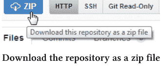

接下来你如何处理它取决于你如何托管你的图表。如果你在本地 PC 上制作它们，那么你会希望将 `d3.js` 文件放在浏览器可以看到的路径中。同样，我推荐 `WAMP`（本地网页服务器）来本地访问你的文件。如果你使用 `WAMP`，那么你只需要确保它知道使用一个包含 `d3` 目录的目录，然后你就可以开始了。

下图旨在提供一个非常粗略的概述，说明你可以如何设置目录。

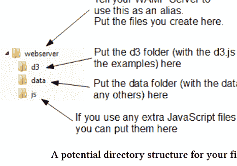

- **webserver**：将此用作你的“基础”目录，用于存放你创建的文件。这样，当你打开浏览器时，你指向这个目录，它就像一个普通的网站一样允许你访问文件。
- **d3**：这将是你的解压后的 `d3` 目录。它包含所有示例，更重要的是包含启动所需的 `d3.v3.js` 文件。你会在接下来的代码示例中注意到有一行如下所示：`<script type="text/javascript" src="d3/d3.v3.js"></script>`。这告诉你的浏览器，从它运行的文件（其中一个图表 HTML 文件）进入“d3”文件夹，它将找到它可以加载的 `d3.v3.js` 文件。
- **data**：我使用这个目录来保存我用于处理的任何数据文件。例如，你会在接下来的代码示例中看到以下行：`d3.tsv("data/data.tsv", function(error, data) {`。同样，这是告诉浏览器进入“data”目录并加载“data.tsv”文件。
- **js**：通常你会发现你会希望包含其他 `JavaScript` 库来加载。这是存放它们的好地方。

> ²⁰<https://github.com/mbostock/d3>

## 在哪里获取 d3.js 的信息

D3 在提供一个可扩展且实用的框架以将数据作为 Web 对象进行操作方面取得了巨大进展。与此同时，可供人们使用的信息也显著增加。以下远非详尽的来源列表，但根据我自己的经验，它代表了一个有用的知识子集。

### d3js.org

`d3js.org` 是想要了解 `d3.js` 的人的首选站点。

从主页的概述中，你可以访问由 D3 的创始人（Mike Bostock）以及众多额外的开发者、艺术家、编码人员和任何对用 D3 可以实现的酷事情有所贡献的人提供的令人眼花缭乱的[示例](https://github.com/mbostock/d3/wiki/Gallery)集合。

有一个指向[文档页面](https://github.com/mbostock/d3/wiki)的链接，它作为通往至关重要的 API 参考、贡献的教程和其他有价值链接（其中一些我将在后续段落中提及）的门户。

最后一个主要链接是 [GitHub 仓库](https://github.com/mbostock/d3)，你可以在那里下载 `d3.js` 本身。

很难过分强调从 `d3js.org` 可以访问的可用信息量。它作为一个独立的站点，是任何对 D3 感兴趣的人都应该访问的地方。

### Google Groups

有一个专门用于[讨论 d3.js 的 Google Group](https://groups.google.com/forum/?fromgroups#!forum/d3-js)。

理论上，这个论坛用于讨论主题，包括可视化设计、API 设计、请求新功能等。在主要标题中有一个特定的方向：“如果你想获得使用 D3 的帮助，请在 Stack Overflow 上使用 `d3.js` 标签！”。

然而，实际上，那里发布的帖子中有相当大比例是各种形式的技术援助请求。话虽如此，这意味着如果你遇到问题，那里可能已经发布了相应的解决方案。但是，如果可能的话，初衷当然是让人们使用 Stack Overflow，所以这应该是此类查询的首选站点。

所以，务必将此组添加为收藏夹，这将为你提供接收帖子电子邮件摘要或仅轻松浏览近期动态的机会。

²¹<https://github.com/mbostock/d3/wiki/Gallery>

²²<https://github.com/mbostock/d3/wiki>

²³<https://github.com/mbostock/d3>

²⁴<https://groups.google.com/forum/?fromgroups#!forum/d3-js>

### Stack Overflow

Stack Overflow 是一个问答网站，其目标是“为每一个编程问题建立一个详细答案库”。非常有雄心。那么他们做得如何呢？实际上非常好。Stack Overflow 是获取帮助和信息的绝佳场所。如果你在某个主题上有所专长，这里也是帮助他人的好地方。

他们有一套有趣的用户奖励机制，鼓励基于读者的投票来提供高质量的答案。这是一个游戏化机制成功运作的绝佳示例。如果你想进一步了解其运作方式，请查看此页面：<http://stackoverflow.com/about>。

他们拥有 `d3.js` 标签（<http://stackoverflow.com/questions/tagged/d3.js>），并且像 Google Groups 一样，这里有一个运行中的不同主题列表，是极其优秀的资料来源。

### GitHub

GitHub²⁵ 主要是代码仓库和版本控制网站。它因其技术敏锐度而备受推崇，并提供了一项被广泛用于多种目的的极佳服务。其中最重要的用途之一就是托管 `d3.js` 的代码（以及 wiki）。

虽然它并非严格意义上专门提供问答功能的网站，但仍有大量仓库（上次统计时为 825 个）提及 `d3.js`。借助精巧的搜索词，这里潜藏着可以找到解决方案的可能性。

GitHub 的另一个相关功能是 Gist。Gist 是一个粘贴板服务（一个可以复制粘贴代码的地方），它可以为单个仓库提供“类似 wiki”的功能，以及可以通过 Git 仓库编辑的网页。Gist 在为 Mike Bostock 建立的 `bl.ocks.org` 示例托管服务提供中心 hub 方面发挥了作用。

对于新用户来说，GitHub / Gist 可能会让人有些畏难。在这个领域，你在深入研究之前几乎需要先了解发生了什么。如果你想利用它强大的代码托管功能，情况确实如此。不过，如果你只是想浏览他人的代码，那么入门会更容易一些。建议你浏览一下可用资源，如果你感兴趣，我建议你学习足够的知识来使用他们的服务。这段时间花得很值得。

### bl.ocks.org

`bl.ocks.org`²⁶ 是一个用于查看托管在 Gist 上的代码示例的浏览器。你可以将代码加载到 Gist 中，然后通过 `bl.ocks.org` 进行查看。

这对于人们展示其作品示例是一种非常棒的方式，且很多人在这么做。然而，想要知道里面具体有什么稍微有点困难。目前由 Christophe Viau 等人主导的一个项目²⁷ 旨在为一系列 D3 文档提供更好的访问途径。初步迹象表明，它将提供一种绝佳的访问示例和信息的方法。请关注该动态。

我会将托管并显示个人代码的过程描述为：对于不熟悉 GitHub / Gist 的人来说，这可能具有一定的挑战性；但同样，就代码的可视化和提供外部托管解决方案而言，它是极好的，非常值得花时间去掌握。

²⁵<https://github.com/>

²⁶<http://bl.ocks.org/>

²⁷<https://groups.google.com/forum/?tgroups=tpic/d3-js/g7BxBMuzP8o>

### Twitter

Twitter 提供了一个绝佳的提醒服务，可以让一大群分散的人了解相关动态。这绝对是每小时与参与 `d3.js` 的人们保持联系的绝佳方式，可以通过几种方式实现。首先，在网络上的各个 D3 站点中，寻找尽可能多在你想要关注的领域（如开发、实际产出、教育等不同方面）具有影响力的用户并关注他们。更好的是，我发现寻找一小部分我认为有影响力的人，并留意他们关注谁，这非常有用。如果你不习惯这样做，这可能显得有点像在“跟踪”，但最终结果应该是收集一组有价值的、能提供有用见解的人。

### Books

到目前为止，关于 `d3.js` 仅发布了几本书。

一本是由 Mike Dewar 编写的《Getting Started with D3》²⁸（O’Reilly Media，2012 年 6 月）。它将带你完成一套优秀的练习以培养你的 D3 技能，并配有可下载的示例。

另一本是由 Scott Murray 编写的《Interactive Data Visualization for the Web》²⁹（O’Reilly Media，2012 年 11 月）。目前该书仅以电子书形式发布，但计划在 2013 年发行印刷版。该书基于他的一套优秀的在线教程（<http://alignedleft.com/tutorials/>）。

当然，还有启动 D3 的原始论文《D3: Data-Driven Documents》，由 Michael Bostock、Vadim Ogievetsky 和 Jeffrey Heer 编写（IEEE Trans. Visualization & Comp. Graphics (Proc. InfoVis), 2011）。

²⁸<http://shop.oreilly.com/product/0636920025429.do>

²⁹<http://ofps.oreilly.com/titles/9781449339739/>

### Starting with a basic graph

我将首先提供一个简单图表的完整代码，然后我们可以逐部分详细分析（此示例的完整代码也在附录中，名为“Simple Graph”）。

以下是基础图表的样子：

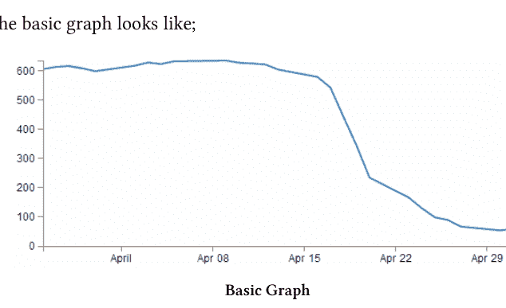

基础图表

以下是实现它的代码：

```html
<!DOCTYPE html>
<meta charset="utf-8">
<style> /* set the CSS */

body { font: 12px Arial;}

path {
    stroke: steelblue;
    stroke-width: 2;
    fill: none;
}

.axis path,
.axis line {
    fill: none;
    stroke: grey;
    stroke-width: 1;
    shape-rendering: crispEdges;
}

</style>
<body>
<!-- load the d3.js library -->
<script src="http://d3js.org/d3.v3.min.js"></script>

<script>

// Set the dimensions of the canvas / graph
var margin = {top: 30, right: 20, bottom: 30, left: 50},
    width = 600 - margin.left - margin.right,
    height = 270 - margin.top - margin.bottom;

// Parse the date / time
var parseDate = d3.time.format("%d-%b-%y").parse;

// Set the ranges
var x = d3.time.scale().range([0, width]);
var y = d3.scale.linear().range([height, 0]);

// Define the axes
var xAxis = d3.svg.axis().scale(x)
    .orient("bottom").ticks(5);

var yAxis = d3.svg.axis().scale(y)
    .orient("left").ticks(5);

// Define the line
var valueline = d3.svg.line()
    .x(function(d) { return x(d.date); })
    .y(function(d) { return y(d.close); });

// Adds the svg canvas
var svg = d3.select("body")
    .append("svg")
        .attr("width", width + margin.left + margin.right)
        .attr("height", height + margin.top + margin.bottom)
    .append("g")
        .attr("transform",
              "translate(" + margin.left + "," + margin.top + ")");

// Get the data
d3.csv("data/data.csv", function(error, data) {
    data.forEach(function(d) {
        d.date = parseDate(d.date);
        d.close = +d.close;
    });

    // Scale the range of the data
    x.domain(d3.extent(data, function(d) { return d.date; }));
    y.domain([0, d3.max(data, function(d) { return d.close; })]);

    // Add the valueline path.
    svg.append("path")
        .attr("class", "line")
        .attr("d", valueline(data));

    // Add the X Axis
    svg.append("g")
        .attr("class", "x axis")
        .attr("transform", "translate(0," + height + ")")
        .call(xAxis);

    // Add the Y Axis
    svg.append("g")
        .attr("class", "y axis")
        .call(yAxis);

});

</script>
</body>
```

此示例的完整代码可以在 GitHub³⁰、本书的附录或本书附带的代码示例（`simple-graph.html` 和 `data.csv`）中找到。实时示例可以在 `bl.ocks.org`³¹ 上找到。


一旦我们完成这些部分的解释，我们将开始研究需要添加和调整的内容，以便我们可以融入其他有用的功能，这些功能在其他图表中也完全可以重复使用。

最终的目标是实现像下面这样“极其复杂”的东西：

³⁰ <https://gist.github.com/d3noob/b3ff6ae1c120eea654b5>

³¹ <http://bl.ocks.org/d3noob/b3ff6ae1c120eea654b5>

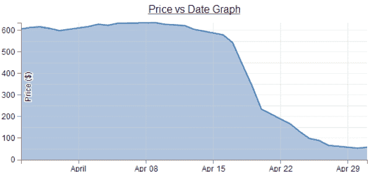

### Graph with lots of “tricks” incorporated

我说“极其复杂”是因为这个图表并不打算赢得任何美学奖项，但其中包含几个一些人可能会觉得有用的组件（网格线、区域填充、坐标轴标签、文本投影、标题、文本格式化）。

因此，我们可以将文件分解为组件部分。在这里我将采取一种比较随意的方式讲解，但请放心，最后一切都会变得清晰易懂。

### HTML

以下是代码中 HTML 部分：

```html
<!DOCTYPE html>
<meta charset="utf-8">
<style>
    The CSS is in here
</style>
<body>
<script src="http://d3js.org/d3.v3.min.js"></script>
<script>
    The D3 JavaScript code is here
</script>
</body>
```

将其与完整代码对比一下，它看起来就像是 CSS 和 JavaScript 的一个外壳。你可以看到它其实并没有多少内容（这并不意味着它不重要）。有很多不错的选择可以在这个文件的基础部分添加额外的 HTML 内容，但对于我们即将要做的事情来说，真的不需要太在意。有一点可能值得提一下，就是这行代码：

```html
<script src="http://d3js.org/d3.v3.min.js"></script>
```

这行代码指定了需要加载的文件，以便让 D3 运行起来。在这个例子中，该文件来源于互联网上 d3.js 的官方代码仓库（这样我们就能使用最新版本）。D3 的文件实际上叫做`d3.v3.min.js`，这可能会让你有点意外。这告诉我们这是 d3.js 文件的第 3 版（`v3` 部分），表明它与 v2 版本是分开的，v2 在 2012 年底已被取代。另一个需要注意的点是，这个版本的 d3.js 是压缩版本（因此有`min`）。这意味着文件中所有多余的信息都已被移除，以加快加载速度。稍后在实现与 bootstrap（一个非常漂亮的布局框架）的集成等操作时，我们会做更多的事情，但就目前而言，基础知识就讲到这里。我们跳过的两个部分是 CSS 和 D3 JavaScript。

### CSS

CSS 的内容如下：

```css
body { font: 12px Arial;}

path {
    stroke: steelblue;
    stroke-width: 2;
    fill: none;
}

.axis path,
.axis line {
    fill: none;
    stroke: grey;
    stroke-width: 1;
    shape-rendering: crispEdges;
}
```

层叠样式表（CSS）让你可以控制网页内容的外观/感觉/呈现方式。其思路是为网页中的对象定义一组属性。

它们由“规则”组成。每条规则有一个“选择器”和一个“声明”，而每个声明包含一个属性和一个值（或者一组属性和值）。

例如，在这个网页的示例代码中，我们有如下规则：

```css
body { font: 12px Arial;}
```

`body` 是选择器。它告诉你，在网页上，这条规则将应用于页面的“body”部分。实际上它适用于 HTML 代码中“body”部分所包含的所有内容（即 HTML 中 `<body>` 和 `</body>` 之间的所有内容）。`{ font: 12px Arial;}` 是规则的声明部分。它只有一个声明，就是花括号里面的部分。所以`font: 12px Arial;`就是声明。属性是`font:`，值是`12px Arial;`。它告诉网页，网页正文中显示的字体将是 12px 的 Arial 字体。

果然，当我们看图表的坐标轴时……

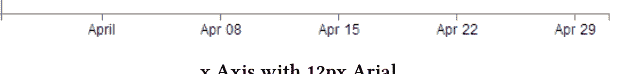

我们看到字体可能*确实*是 12px Arial！

让我们做个测试。我把规则改成如下内容：

## 从基础图表开始

```css
body {
  font: 16px Arial;
}
```

结果是……


#### 修改字体大小的效果

啊……16px 的美好！

现在我们再改成……

```css
body {
  font: 16px times;
}
```

我们得到……

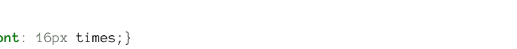

嗯……Times 字体……我想我们可以放心地说，这确实达到了预期的效果。

那么还有什么其他内容呢？

像这样的那段代码是怎么回事：

```css
path {
    stroke: steelblue;
    stroke-width: 2;
    fill: none;
}
```

嗯，整个内容是一条规则，`path` 是选择器。在这个例子中，`path` 指的是 D3 绘图术语中的一条线。

对于这个选择器有三个声明。它们为`stroke`（在这个例子中是颜色）、`stroke-width`（线的宽度）和`fill`（我们可以用一种颜色填充一条路径）这些属性赋予值。

那么让我们来改变一下吧 :-)

```css
path {
    stroke: red;
    stroke-width: 5;
    fill: yes;
}
```

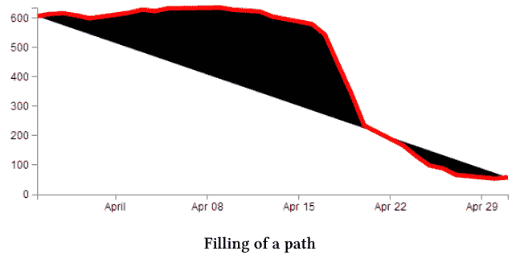

路径的填充

哇！这条线现在是红色的，看起来大约有 5 像素宽，而且它尝试用黑色填充该区域（大致由曲线围成的区域）。

它并不好看，但确实发生了变化。事实上如果我们写成：

```css
fill: blue;
```

我们会得到……

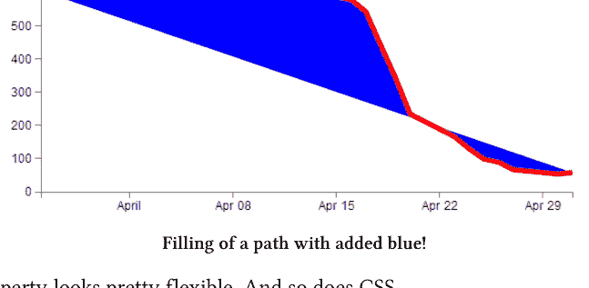

添加蓝色的路径填充！

所以`fill`属性看起来非常灵活。CSS 也是如此。

### D3 JavaScript

代码中的 D3 JavaScript 部分如下：

```javascript
var margin = {top: 30, right: 20, bottom: 30, left: 50},
    width = 600 - margin.left - margin.right,
    height = 270 - margin.top - margin.bottom;

var parseDate = d3.time.format("%d-%b-%y").parse;

var x = d3.time.scale().range([0, width]);
var y = d3.scale.linear().range([height, 0]);

var xAxis = d3.svg.axis().scale(x)
    .orient("bottom").ticks(5);

var yAxis = d3.svg.axis().scale(y)
    .orient("left").ticks(5);

var valueline = d3.svg.line()
    .x(function(d) { return x(d.date); })
    .y(function(d) { return y(d.close); });

var svg = d3.select("body")
    .append("svg")
        .attr("width", width + margin.left + margin.right)
        .attr("height", height + margin.top + margin.bottom)
    .append("g")
        .attr("transform",
              "translate(" + margin.left + "," + margin.top + ")");

// Get the data
d3.csv("data.csv", function(error, data) {
    data.forEach(function(d) {
        d.date = parseDate(d.date);
        d.close = +d.close;
    });

    // Scale the range of the data
    x.domain(d3.extent(data, function(d) { return d.date; }));
    y.domain([0, d3.max(data, function(d) { return d.close; })]);

    svg.append("path")          // Add the valueline path.
        .attr("class", "line")
        .attr("d", valueline(data));

    svg.append("g")             // Add the X Axis
        .attr("class", "x axis")
        .attr("transform", "translate(0," + height + ")")
        .call(xAxis);

svg.append("g")
    .attr("class", "y axis")
    .call(yAxis);
});
```

代码中同样有相当多的细节，但它并没有长到让你搞不清哪个部分做什么。

让我们逐块来研究，以获得一些感觉。

### 设置边距和图表区域

代码中负责定义画布（也就是放置图表及相关元素的区域）的部分是这一部分：

```javascript
var margin = {top: 30, right: 20, bottom: 30, left: 50},
    width = 600 - margin.left - margin.right,
    height = 270 - margin.top - margin.bottom;
```

Mike Bostock 关于边距约定的页面 <http://bl.ocks.org/3019563> 上对此有非常（非常）详细的解释，但为避免让你困惑，我在这里给出我粗浅的理解。

第一行定义了围绕图表（作为一个对象）所在区块的四个边距。

```javascript
var margin = {top: 30, right: 20, bottom: 30, left: 50},
```

所以顶部将有 30 像素的边框，右侧 20 像素，底部和左侧分别为 30 和 50 像素。这些设置的巧妙之处在于它们使用了一个数组来定义所有内容。这意味着如果你想稍后在 JavaScript 中进行计算，你不需要直接写入数字，只需使用已经设置好的变量即可。在这个例子中`margin.right = 20`！所以当我们写到下一行时：

```javascript
width = 600 - margin.left - margin.right,
```

画布中将绘制图表的内部区块宽度为 600 像素减去`margin.left`减去`margin.right`，即 600-50-20，也就是 530 像素宽。当然，现在你又有了另一个变量`width`，可以在代码中稍后使用。

显然，高度的处理方式也是一样的。

另一件巧妙的事情是，尽管你看起来为图表和边距定义了不同的区域，但那里面的整个区域都是可用的。它只是使得为坐标轴标签和图表标签指定区域变得非常方便，而不需要同时去协调它们和图表本身。

那么，让我们来试一试，修改一些值吧。

## 从基础图表开始

```javascript
var margin = {top: 80, right: 20, bottom: 80, left: 50},
    width = 400 - margin.left - margin.right,
    height = 270 - margin.top - margin.bottom;
```

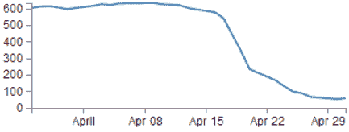

#### 修改边距的效果

在这里，我们将图表调窄了（400 像素），但保留了左右边距，并在维持画布整体高度的同时增加了上下边距。一个非常酷的发现是，尽管我们缩小了绘制图表的区域尺寸，它仍然能够动态地调整坐标轴和线条以正确适配。这正是整个机制最精彩的部分。D3 在后台负责处理对象的绘制，而你无需过多地关注数学计算，只需集中精力思考数据的呈现方式！

### 获取数据

我们要稍微跳跃一下，直接进入 JavaScript 代码中加载图表数据的部分。

我将暂时打破代码的先后顺序，因为如果你知道所使用的数据是什么，那么解释接下来的其他函数会变得简单得多。抓取数据的部分就在这里。

```javascript
d3.csv("data.csv", function(error, data) {
    data.forEach(function(d) {
        d.date = parseDate(d.date);
        d.close = +d.close;
    });
```

事实上，它是几个片段以及另一个未显示部分的组合！但让我们一步一步来 :-)

有很多不同的方法可以将数据引入网页并将其转化为图形。你选择使用哪种方法，可能更多取决于数据的格式，而不是你想要使用的导入机制。

例如，如果只有少量数据点，我们可以直接将信息包含在 JavaScript 中。

看起来会像这样：

```javascript
var data = [
    {date:"1-May-12",close:"58.13"},
    {date:"30-Apr-12",close:"53.98"},
    {date:"27-Apr-12",close:"67.00"},
    {date:"26-Apr-12",close:"89.70"},
    {date:"25-Apr-12",close:"99.00"}
];
```

上面显示的数据格式称为 JSON（JavaScript Object Notation），这是一种极佳的数据包含方式，因为人类易于阅读其中的内容，计算机也易于解析数据。关于 JSON 的简要概述，可以在“各种技巧章节”的独立板块中找到相关帮助。

但如果你有大量数据，或者你想要包含的数据是动态的且随时可能变化，你会希望从外部源加载。这时我们就需要调用 D3 的“请求（Request）”函数。

#### 请求函数

“请求”是一个指令浏览器去某个地方抓取数据的函数。数据可能存储在本地（Web 服务器上）或互联网的某个地方。根据你想要摄入的数据类型，请求的类型也不同。每种数据类型都有不同的格式规则，因此不同的请求会解析这些规则，以确保返回给 D3 处理的数据格式是其能够理解的。因此，你可以将不同的“请求”看作翻译员，而将不同的数据格式看作外语。

D3 可以请求的不同数据类型包括：

- `text`：一段普通的文本，具有以特定方式编码的选项（参见 [D3 API](https://github.com/mbostock/d3/wiki/Requests)³³）。
- `json`：即上述的 JavaScript 对象表示法。
- `xml`：可扩展标记语言，是一种广泛用于以人类可读形式编码文档的语言。
- `html`：超文本标记语言，用于显示网页的语言。
- `csv`：逗号分隔值，一种广泛用于存储数据的格式，其中纯文本信息由（你猜对了）逗号分隔。
- `tsv`：制表符分隔值，一种广泛用于存储数据的格式，其中纯文本信息由制表符（tab-stop）分隔。

关于这些摄入方法和请求格式的详细说明在 [D3 Wiki](https://github.com/mbostock/d3/wiki/Requests)³⁴ 页面上有详尽的解释。在这个特定的脚本中，我们将探讨`csv`请求方法。

现在，重要的一点是，这个列表并非可摄入数据的全部。如果你有一些格式古怪的奇葩数据，你仍然可以将它导入，但你很可能需要在页面的其他地方编写少量代码来进行转换（我们在描述如何从 MySQL 数据库获取数据时会讨论这个过程）。

回到我们的请求……

```javascript
d3.csv("data.csv", function(error, data) {
    data.forEach(function(d) {
        d.date = parseDate(d.date);
        d.close = +d.close;
    });
});
```

这段代码的第一行调用了`d3.csv`请求（`d3.csv`），然后该函数指向应加载的数据文件（`data.csv`）。这被称为文件的“url”（统一资源定位符）。在这种情况下，文件存储在本地（与`simple-graph.html`文件在同一目录下），但 url 也可以同样轻松地指向互联网上的某个文件。

`data.csv`文件中的数据格式看起来像这样：

```csv
date,close
1-May-12,58.13
30-Apr-12,53.98
27-Apr-12,67.00
26-Apr-12,89.70
25-Apr-12,99.00
```

（尽管实际文件更长，大约有 26 个数据点）。“date”和“close”标题标签由逗号分隔，随后的每个日期和数字也是如此。因此被称为“逗号分隔值” :-)。


接下来的部分体现了 JavaScript 的精妙之处。在发出请求并获取文件后，脚本被告知对数据（现在被称为`data`）执行一个函数。

```javascript
function(error, data) {
```

实际上在函数调用过程中还有更多操作，但我们将在这里讨论的是包含在以下行中的内容：

```javascript
data.forEach(function(d) {
    d.date = parseDate(d.date);
    d.close = +d.close;
});
```

这段代码块简单地确保从 csv 文件中提取的所有数值都被正确设置和格式化。第一行设置了正在处理的数据变量（名称叫`data`稍微有点令人困惑），并告诉代码块，对于`data`数组中的每个组，都应对其执行一个函数。该函数被指定为`d`。

数组中的信息可以被视为存储在行中。每行由两个值组成：一个用于`date`，另一个用于`close`。

该函数一次提取一行的`date`和`close`值。

每次获取`date`和`close`的值时，它会执行以下操作：

```javascript
d.date = parseDate(d.date);
```

对于当前查看的这个特定数据值（`d.date`），d3.js 通过一个单独的函数`parseDate`将其转换为日期格式。（`parseDate`函数定义在脚本的另一部分，我们稍后会检查它。）目前，你只需要知道它将 csv 文件中特定行中的原始日期信息转换为 D3 可以处理的格式。然后该值被重新保存回同一个变量空间。

下一行使用`+`运算符将`close`变量设置为数值（如果它还不是数值的话）。

```javascript
d.close = +d.close;
```

> 当从数据中提取的数字格式可能无法被自动识别为数字时，这似乎是一个良好的实践。这一行将确保它是数字。

因此，在该代码段结束时，我们已经获取了一个包含特定类型数据（逗号分隔值）的文件，并确保它以脚本其余部分可以正确使用的方式进行了格式化。

现在，敏锐的读者可能会注意到，在代码块的第一行（`d3.csv("data.csv", function(error, data) {`）中，我们打开了一个圆括号`()`和一个花括号`{`，但从未关闭它们。这是因为它们一直保持开启状态直到文件的最后。这意味着在`d3.csv`部分之后出现的所有代码块都引用了`data`数组。或者换句话说，它使用`data`来绘制内容！

无论如何，让我们跳回边距代码块的末尾，继续研究代码在做什么。

### 格式化日期/时间

这个世界上最美妙的事情之一就是我们每个人做事的方式都略有不同。其中之一就是我们如何定义[日期和时间](http://en.wikipedia.org/wiki/Date_format_by_country)。

在我的家乡，习惯将日期写为日 - 月 - 年。例如 23-12-2012。但在美国，更常见的格式是 12-23-2012。同样地，数据可能

³⁵http://en.wikipedia.org/wiki/Date_format_by_country

数据可以呈现为包含月份或星期几名称的格式（例如：一月、星期二），或者将日期和时间组合在一起（例如：2012-12-23 15:45:32）。因此，如果我们尝试加载一些数据并让 D3 将其识别为日期/时间信息，我们需要明确告诉它日期/时间的格式是什么。

#### 时间重要吗？

你可能会问自己“这有什么意义？”你只需要给它一个数字，它就能以某种方式排序。确实如此，但如果你希望充分发挥数据的潜力，并在屏幕上保持最大的表示灵活性，你就会希望 D3 发挥其优势。而其中一个优势就是能够根据可变的时间值进行动态调整。

是时候来个小演示了（看看我玩的梗）。

我们将修改`data.csv`文件，使其只包含两个数据点：第一个和最后一个，两者相隔一个月多一点。

```csv
date,close
1-May-12,58.13
26-Mar-12,606.98
```

现在的图表看起来是这样的：

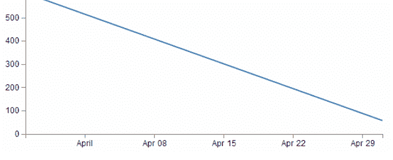

## 简单折线图

没什么太惊讶的，一个非常简单的图表（注意 x 轴上的时间刻度）。

现在，我们将修改`data.csv`中较晚的那个日期，使其与起始日期更加接近：

```csv
date,close
29-Mar-12,58.13
26-Mar-12,606.98
```

所以，只有三天的差异。让我们看看会发生什么。

从基本图表开始：

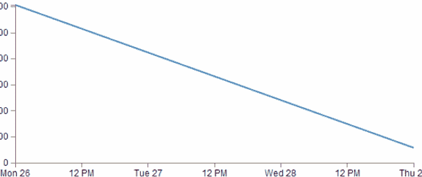

#### 三天周期的简单折线图

啊哈……我们不仅无需对 JavaScript 代码做任何修改，而且它还能识别出日期更接近，并用适当的时间/日期值填充了中间的空隙。现在，再来一次，就当玩玩。

这次我们将时间间隔拉长到几年。

```csv
date,close
29-Mar-21,58.13
26-Mar-12,606.98
```

结果是……

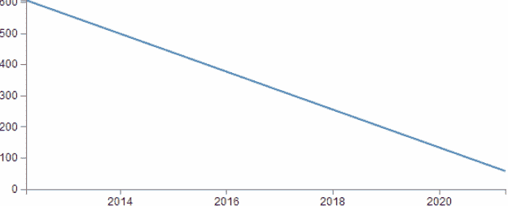

#### 跨越数年的简单折线图

希望这足以让你印象深刻，明白正确设置时间格式是一件*非常*重要的事情。相信我，这绝不会让你失望 :-).

回到格式化问题。

在 JavaScript 中解析时间的这行代码如下：

```javascript
var parseDate = d3.time.format("%d-%b-%y").parse;
```

这行代码在代码的`data.forEach(function(d)`部分（我们在几页前看过）中使用，其中`d.date = parseDate(d.date)`是一种将特定格式的日期获取并让 D3 识别的方式。实际上，它的意思是*“把这个据称是日期的值，转换成我可以使用的值”*。

使用的函数是`d3.time.format(specifier)`函数，其中 specifier 在此例中就是那个神秘的字符组合`%d-%b-%y`。好消息是，这些只是针对我们所呈现的日期类型特定指令的组合。

`%`符号用作每个独立格式类型的前缀，而`'-'`（减号）是用于表示要解析的日期中实际出现的`'-'`（减号）字面量。

- `d`表示月份中的日期（补零至两位十进制数）[01,31]。
- `b`表示缩写的月份名称。
- `y`表示年份（不包含世纪）的十进制数。

如果我们查看`data.csv`文件中的数据子集，会发现确实，其中的日期就是这种格式。

```csv
1-May-12,58.13
30-Apr-12,53.98
27-Apr-12,67.00
26-Apr-12,89.70
25-Apr-12,99.00
```

这很好，但如果你的数据格式不完全像这样呢？

好消息是。存在多种不同的格式化程序来应对不同的时间表示方式，你可以选择你需要的。请查看 D3 Wiki 上的[时间格式化页面](https://github.com/d3/d3-time-format/blob/main/README.md)以获取权威列表和详细说明，但以下是当前可用的格式化程序列表（来自 d3 wiki）：

- `%a` - 缩写的星期几名称。
- `%A` - 完整的星期几名称。
- `%b` - 缩写的月份名称。
- `%B` - 完整的月份名称。
- `%c` - 日期和时间，格式为`"%a %b %e %H:%M:%S %Y"`。
- `%d` - 月份中的日期（补零至两位十进制数）[01,31]。
- `%e` - 月份中的日期（用空格补至两位十进制数）[ 1,31]。
- `%H` - 小时（24小时制）十进制数 [00,23]。
- `%I` - 小时（12小时制）十进制数 [01,12]。
- `%j` - 年中的天数（十进制数）[001,366]。
- `%m` - 月份（十进制数）[01,12]。
- `%M` - 分钟（十进制数）[00,59]。
- `%p` - AM 或 PM。
- `%S` - 秒（十进制数）[00,61]。
- `%U` - 年中的周数（以周日为每周第一天，十进制数）[00,53]。
- `%w` - 星期几（十进制数）[0(周日),6]。
- `%W` - 年中的周数（以周一为每周第一天，十进制数）[00,53]。
- `%x` - 日期，格式为`“%m/%d/%y”`。
- `%X` - 时间，格式为`“%H:%M:%S”`。
- `%y` - 不含世纪的年份（十进制数）[00,99]。
- `%Y` - 包含世纪的年份（十进制数）。
- `%Z` - 时区偏移，例如`“-0700”`。
- 还有一个字面量`“%”`字符，可以通过使用双百分号来表示。

例如，如果你想输入格式为通用 MySQL 'YYYY-MM-DD HH:MM:SS' TIMESTAMP 格式的日期/时间，D3 的解析脚本将如下所示：

```javascript
parseDate = d3.time.format("%Y-%m-%d %H:%M:%S").parse;
```

### 设置比例域和范围

这是另一个例子，如果你设置得当，D3 将永远为你保驾护航。

> **比例、范围和“顿悟时刻”。**
>
> 我在理解范围和比例时的“顿悟时刻”是在阅读了 Jerome Cukier 关于‘d3：比例和颜色’的精彩文章之后。我强烈建议你阅读它（以及 Jerome 的许多其他精彩作品），因为在我看来，他确实将描述做到了极致。我将在这里写下我自己的描述，但如果看起来不清楚，请直接去 Jerome 的页面。

从我们的基本网页，我们现在移至包含以下几行的部分：

```javascript
var x = d3.time.scale().range([0, width]);
var y = d3.scale.linear().range([height, 0]);
```

这些脚本部分的目的是确保我们获取的数据能正确地放入我们的图表中。由于我们有两种不同类型的数据（日期/时间和数值），它们需要被分开处理（但它们本质上做着相同的工作）。为了恰当地研究比例、域和范围这个整体概念，我们也会稍微打乱一下顺序，并（结合之前的 scale 语句）查看后面出现并设置域的那些脚本行。它们如下所示：

```javascript
x.domain(d3.extent(data, function(d) { return d.date; }));
y.domain([0, d3.max(data, function(d) { return d.close; })]);
```

比例的概念是将我们所拥有的数据值，拟合到我们可用的空间中。

如果我们有从 53.98 到 636.23 的数据（就像我们 csv 文件中‘close’的数据那样），但我们有一个高度为 210 像素的图表（`height = 270 - margin.top – margin.bottom;`），我们显然需要进行调整。

不仅如此。即使我们的数据是从 53.98 到 636.23，在图表上这样显示会有些误导，实际上它应该从 0 到稍高于 636.23。这听起来很复杂，但让我们简化一下。

首先，我们确保在 x 轴上指定的任何数量都能放入我们的图表中。

```javascript
var x = d3.time.scale().range([0, width]);
```

这里我们设置变量，它将告诉 D3 在 x 轴的什么位置绘制某些东西。通过使用`d3.time.scale()`函数，我们确保 D3 知道要将值作为日期/时间实体（带着它们固有的特殊性）来处理。然后我们指定这些值将覆盖的范围（`.range`），并将范围指定为从 0 到我们绘图区域的宽度（看！设置那些边距和宽度的变量现在开始有回报了！）。

然后我们对 Y 轴做同样的事情。

```javascript
var y = d3.scale.linear().range([height, 0]);
```

这里有一个不同的函数调用（`d3.scale.linear()`），但`.range`设置仍然存在。为了画一个（半）漂亮的图来解释，希望这会有所帮助：

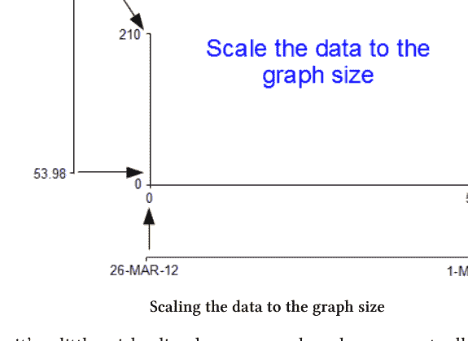

我知道，我知道，这有点误导，因为我们实际上从未告诉 D3 这是我们的数据从 53.98 到 636.23。我们只是说，当我们得到数据时，我们会将其缩放到这个空间里。

现在请注意，在 y 轴的缩放语句中，`[height, 0]`这部分是怎么回事？敏锐的读者会注意到，对于时间轴，我们将范围设置为`[0, width]`，但对于这个轴，值看起来是反的。

观察得很仔细。

这完全与屏幕的布局和引用方式有关。请看下面这张图，它展示了在屏幕上绘制时的坐标工作原理：

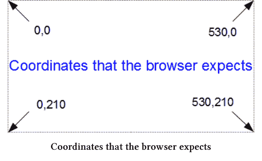

屏幕的左上角是原点或 0,0 点，当我们向左或向下移动时，相应的 x 和 y 值会增加到由高度和宽度定义的完整值。

这对于 x 轴上从较小值开始并递增的时间值来说没问题，但对于 y 轴上的值，我们试图反其道而行之。我们希望低值在底部，高值在顶部。

没问题。我们通过`y = d3.scale.linear().range([height, 0]);`这个语句告诉 D3，较大的值（height）在屏幕的低端（顶部），而较小的值在底部（到现在你很可能已经猜到了，`.range`语句使用的格式是`.range([靠近原点的值, 远离原点的值])`）。所以当我们把 height 变量放在前面时，它现在就关联到了屏幕的顶部。

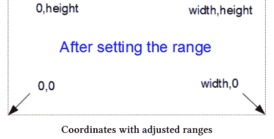

我们已经将数据缩放到图表大小，并确保值的范围设置得当。那么本节标题中的 domain 部分又是什么呢？

来吧，你还记得这段小脚本吧？

```javascript
x.domain(d3.extent(data, function(d){ return d.date; }));
y.domain([0, d3.max(data, function(d){ return d.close; })]);
```

虽然它存在于文件中与缩放/范围部分不同的地方，但肯定是相关的。这是因为在我们目前描述的数据范围设置中，缺少了某些东西。我们实际上还没有告诉 D3 数据的范围是什么。这也是这段脚本出现在那个位置的原因。它位于`data.csv`文件已加载为`data`的部分内，因此随时可以使用它。

那么，`.domain`函数的目的是让 D3 知道数据的范围。然后这个范围被传递给缩放函数。

看看设置 x 轴值的第一部分，它说的是 x 轴值的域将由`d3.extent`函数决定，而`d3.extent`函数本身作用于一个独立的函数，该函数遍历`data`数组中所有出现的`date`值。在这种情况下，`.extent`函数返回给定数组中的最小值和最大值。

- `function(d) { return d.date; }`返回`data`中所有的`date`值。然后传递给……
- `.extent`函数，它在数组中找到最大值和最小值，然后……
- `.domain`函数，将这些最大值和最小值返回给 D3 作为 x 轴的范围。

这确实相当巧妙。一开始你可能觉得过于复杂，但将函数分解成这些组件可以实现针对不同刻度、值和数量的附加功能。简而言之，别太担心。这是一件好事。

x 轴的值是日期；所以它们的域基本上是从 2012 年 3 月 26 日到 2012 年 5 月 1 日。y 轴的处理方式略有不同：

```javascript
y.domain([0, d3.max(data, function(d) { return d.close; })]);
```

因为 y 轴上所需的值范围是从 0 到数据范围内的最大值，这正是我们告诉 D3 的。`.domain`函数中的`0`是起点，终点是通过使用一个单独的函数找到的，该函数在`data`数组中筛选所有`close`值并返回最大的那个。因此，域是从 0 到 636.23。

让我们尝试一个小实验。我们将 y 轴的域改为使用`.extent`函数（与 x 轴相同的方式），看看它会产生什么。

y 域的 JavaScript 代码将是：

```javascript
y.domain(d3.extent(data, function(d) { return d.close; }));
```

你可以看到，除了快速复制粘贴内部逻辑，我唯一需要更改的就是将引用从`date`改为`close`。

结果是……

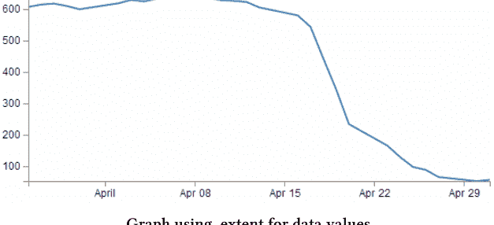

#### 使用`.extent`作为数据值的图表

看看这个！y 轴的起点看起来大约在 53.98 标记处，图表本身确实触及了 x 轴，而数据表明它应该在那里。

现在，我并不真的提倡制作这样的图表，因为我觉得它看起来有点难看（而且一个随意的观察者可能会误以为 x 轴在 0 处）。然而，如果数据集中在距离零点相当远的狭窄数值范围内，这样做会很有用。

例如，如果我更改`data.csv`文件，使值像下面这样表示：

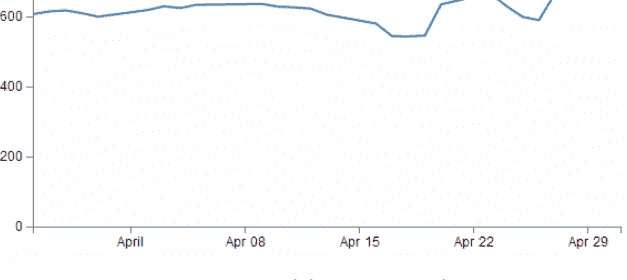

#### 数据范围集中的图表

那么它就有点失去了区分数据中位数附近值的能力。

但是，如果我为 y 轴使用我们神奇的`.extent`函数并重新绘制图表……

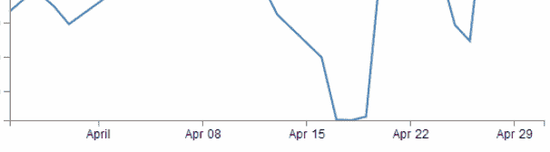

#### 使用`.extent`扩展集中的数据范围

怎么样？

与之前图表相同的数据，但只需更改一小段脚本，D3 就会处理细节。

### 设置坐标轴

现在我们来看下一段代码：

```javascript
var xAxis = d3.svg.axis().scale(x)
    .orient("bottom").ticks(5);

var yAxis = d3.svg.axis().scale(y)
    .orient("left").ticks(5);
```

我包含了 x 轴和 y 轴，因为它们以非常相似的方式执行格式化。值得注意的是，这不是绘制坐标轴的地方。这发生在后面`data.csv`文件已加载为`data`的部分。

D3 有自己的坐标轴组件，旨在省去设置和显示坐标轴的麻烦。因此它包含许多可配置的选项。

首先看 x 轴：

```javascript
var xAxis = d3.svg.axis().scale(x)
    .orient("bottom").ticks(5);
```


通过`d3.svg.axis()`调用`axis`函数。然后使用我们之前在缩放、范围和域部分设置的`x`值，通过`.scale(x)`设置刻度。接着发生了一件有趣的事情，我们告诉图表将其自身定向到图表的底部`.orient("bottom")`。如果我告诉你`"bottom"`是默认设置，那么你可能会想，从技术上讲，我们不需要指定这个，因为它无论如何都会出现在那里，但这确实给了我们一个机会将其更改为`"top"`来看看会发生什么：

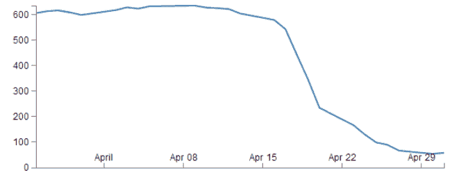

#### x轴定向到顶部

嗯，我希望你没预见到这个，因为我自己也没预见到。结果证明，我们谈论的是数值和刻度线相对于轴线本身的朝向。啊……明白了。如果你的x轴在图表顶部，这很有用，但对于这个图表呢？没那么有用。

下一部分（`.ticks(5)`）设置轴上的刻度数。希望你刚才快速数了一下上一个图表的底部，然后说“是的，五个刻度。完全正确”。如果你做到了，干得好，但D3在图表轴的刻度数量上有点小花招。

例如，当`.ticks(5)`值更改为`.ticks(4)`时，图表看起来像这样。

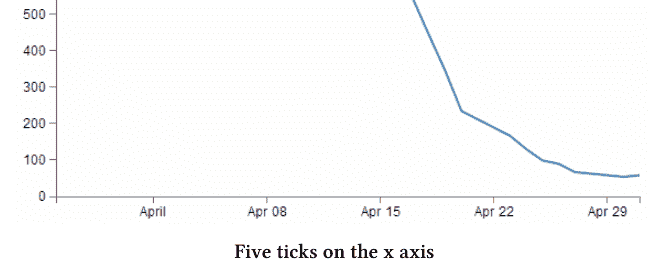

#### x轴上有五个刻度

嗯？等等。这不是某种错误吗？还是五个刻度。是的，确实如此！但是等等……我们可以一直降低`ticks`值直到二，它仍然是相同的。然而，在`.ticks(2)`时，我们终于看到了变化。

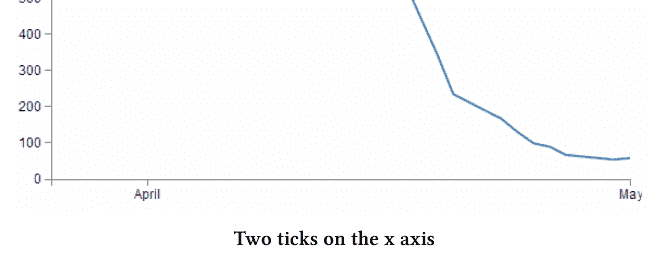

#### x轴上有两个刻度

怎么样？乍一看这似乎不对，然后你思考了一下：“嗯……当有5个刻度时，它们每个相隔一周，直到达到可以显示一个月间隔的点，这都保持不变。”

D3正在为你做出一个命令性的决定，告诉你如何最好地显示你的刻度。这对于简单图表以及实际上绝大多数图表来说都很棒。就像所有与D3相关的事情一样，如果你真的需要做一些定制的东西，只要你理解足够的代码，它就会让你这么做。

以下是D3在设置基于时间的轴的自动刻度时会考虑的时间间隔列表[^37]：

- 1秒、5秒、15秒和30秒。
- 1分钟、5分钟、15分钟和30分钟。
- 1小时、3小时、6小时和12小时。
- 1天和2天。
- 1周。
- 1个月和3个月。
- 1年。

只是为了好玩，想想你需要将` ticks`值增加到多少，才能让D3显示超过五个刻度。

希望你在得出正确答案之前，不要偷看下面这张图。

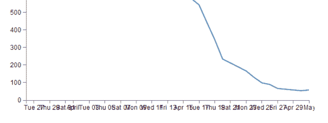

#### x轴上有十个刻度

呀！答案是10！然后当它显示时，刻度数量太多，都挤在一起了。看起来不太好。然而，你可以旋转文本（或者可能倾斜它），它仍然可以放进去（这一定是未来某个操作指南的主题）。你也可以让图表更长，但这当然可能会产生其他布局问题。试着将你的数据和演示视为一个整体。

格式化y轴的代码非常相似：

> [^37]: https://github.com/mbostock/d3/wiki/Time-Scales

## 从基础图表开始

```javascript
var yAxis = d3.svg.axis().scale(y)
    .orient("left").ticks(5);
```

如果我们愿意，可以将方向改为`"right"`，但这并不会让它变得更美观。

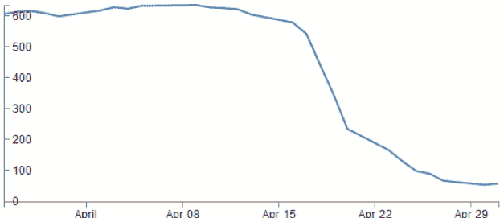

*y轴右侧对齐*

没错。确实不太好看。

那么刻度数量如何呢？嗯，这个比例尺与x轴相当不同。使用逻辑分隔符（周、月）来格式化日期很棘手，但对于标准数字来说，应该会简单一些。事实上，很有可能你已经观察y轴时发现那里有6个刻度，而脚本要求的是5个 :-)

我们可以将刻度数降低到4，从而得到一个逻辑正确的结果。

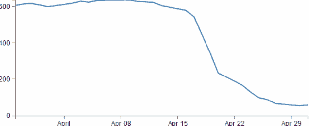

*y轴上的三个刻度*

我们需要将计数提高到10，才能获得超过6个刻度。

### 向线函数添加数据

我们现在快要走到脚本探索之旅的终点了。下一步是从`data`数组中获取信息，并将其放入一个由我们将要绘制的一组坐标组成的新数组中。

```javascript
var valueline = d3.svg.line()
    .x(function(d) { return x(d.date); })
    .y(function(d) { return y(d.close); });
```

我知道上面的语句可能有些含糊。你可能会认为我们已经存储好了数据并准备就绪。但这并不*完全*正确。

我们拥有的是原始格式的数据，我们添加了允许数据根据比例和范围进行调整的代码，以适应我们想要绘制的区域，但我们还没有真正地将原始数据调整为所需的坐标。这就是上述代码所做的事情。

这里使用的主要函数是`d3.svg.line()`[函数](https://github.com/mbostock/d3/wiki/SVG-Shapes#wiki-line)。该函数使用访问器函数将适当的信息存储在正确的区域，在上面的案例中，它们使用了x和y访问器（即`.x`和`.y`部分）。`d3.svg.line()`函数被称为“路径生成器”，这表明它可以自主执行一些相当聪明的事情。但本质上，它的工作是以一种可用于绘制线条的形式分配一组坐标。

每次调用此线函数时，它都会遍历数据，并使用我们之前设置的`x`和`y`函数（当然，这些函数负责缩放和设置正确的范围/定义域）为`date`和`close`对分配坐标。

当然，它不能独立获取数据，我们仍然需要实际调用`valueline`函数，并将`data`作为其操作源。但不用担心，这很快就来了。

### 添加 SVG 画布

正如标题所述，接下来的脚本片段将创建并添加D3用于绘图的画布。

> https://github.com/mbostock/d3/wiki/SVG-Shapes#wiki-line

```javascript
var svg = d3.select("body")
    .append("svg")
        .attr("width", width + margin.left + margin.right)
        .attr("height", height + margin.top + margin.bottom)
    .append("g")
        .attr("transform",
              "translate(" + margin.left + "," + margin.top + ")");
```

那么这具体是什么意思呢？

D3需要一个定义的空间来绘制事物。当你定义它将要使用的空间时，你还可以给这个空间一个标识名称和属性。

在我们这里使用的示例中，我们将一个SVG元素（一个我们将要在上面绘图的画布）“追加”（append）到HTML页面的`<body>`元素中。

用通俗的话说，这意味着在网页上，在我们在HTML部分看到的`<body>`标签范围内，我们将有一个绘图区域。该区域的宽度将是`width`加上左右边距，高度将是`height`加上上下边距。

我们还添加了一个元素`g`，它引用到画布上实际图表区域的左上角。`g`实际上是一个分组元素，因为它通常用于将多个相关元素组合在一起。因此，在这种情况下，这些分组元素将拥有一个共同的参考点。

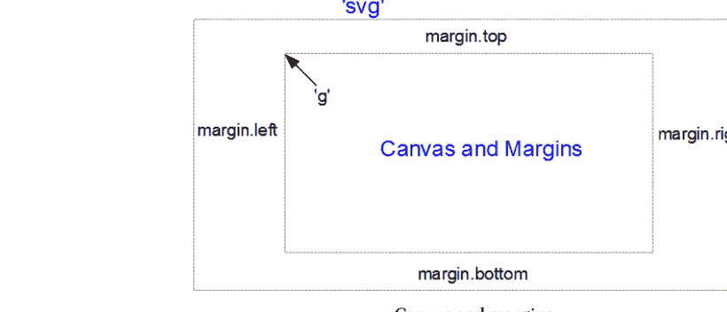

*画布与边距*

（上面的图像绝对不是按比例绘制的，但我希望你能明白大致意思）

关于代码中值得注意的有趣之处：`.attr("stuff in here")`部分是其所属追加元素的属性。

例如：

```javascript
.append("svg")
    .attr("width", width + margin.left + margin.right)
    .attr("height", height + margin.top + margin.bottom)
```

告诉我们`svg`元素的“宽度”为`width + margin.left + margin.right`，“高度”为`height + margin.top + margin.bottom`。

同样地：

```javascript
.append("g")
    .attr("transform",
          "translate(" + margin.left + "," + margin.top + ")");
```

告诉我们元素`g`通过移动（平移）到点`margin.left, margin.top`进行了变换。也就是说，移动到了图表空间的左上角。这样，当我们指示在画布上绘制某些内容时，可以使用参考点`g`来确保所有内容都在正确的位置。

### 真正地绘制一些东西！

到目前为止，我们花费了大量时间进行定义、加载和设置。好消息！我们终于要绘制某些东西了！我们轻快地跳过一些已经解释过的代码，直接进入绘制线条的部分。

```javascript
svg.append("path")              // 添加 valueline 路径。
    .attr("d", valueline(data));
```

这段代码出现在数据已加载并准备就绪的部分。`svg.append("path")`部分添加了一个新的路径元素。路径元素代表一个可以用许多不同方式操纵的形状（在此查看更多信息：[http://www.w3.org/TR/SVG/paths.html](http://www.w3.org/TR/SVG/paths.html)）。在这种情况下，它继承了CSS部分的`path`样式，并在接下来的行（`.attr("d", valueline(data));`）中我们添加了属性`d`。

这个属性代表“路径数据”（path data），确实，脚本中的`valueline(data)`部分将`valueline`数组（及其x和y坐标）传递给路径元素。这随后创建了一个SVG元素，它是一条从一组`valueline`坐标到另一组坐标的路径。

然后我们开始绘制轴线：

```javascript
svg.append("g")          // 添加 X 轴
    .attr("class", "x axis")
    .attr("transform", "translate(0," + height + ")")
    .call(xAxis);

svg.append("g")          // 添加 Y 轴
    .attr("class", "y axis")
    .call(yAxis);
```

我们之前已经涵盖了轴组件的格式化。所以这部分实际上只是关于将这些组件绘制到我们的画布上。

因此，两个轴都首先被追加到`g`组中。然后每个轴都有自己的类，用于通过CSS进行样式设置。如果你记得之前的内容，它们看起来像这样：

```css
.axis path,
.axis line {
    fill: none;
    stroke: grey;
    stroke-width: 1;
    shape-rendering: crispEdges;
}
```

你可以随意修改这些内容以改变轴的外观。

在x轴上，我们有一个变换语句（`.attr("transform", "translate(0," + height + ")")`）。如果你记得，我们绘图的原点在左上角。因此，如果我们想让x轴位于图表底部，我们需要将其移动（变换）到下方一定的距离。在这种情况下，这个距离就是图表本身的高度（`height`）。所以，为了演示，我们将删除变换行并看看会发生什么：

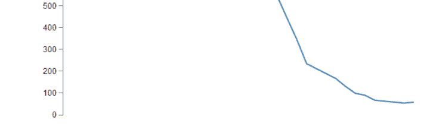

是的，基本在预料之中。

这两段脚本的最后一部分（`.call(xAxis);`和`.call(yAxis);`）调用x轴和y轴函数并启动绘制操作。

## 总结

好了，就这些。理论上，你现在应该成为一名完整的D PressBooks忍者了。

好吧，也许有点夸张。事实上，很有可能我在这里列出的信息充其量是勉强有用，最坏的情况则是充满了糟糕的习惯和严重的错误。

但往好的一面看。无论实现方式多么糟糕与否，或者代码多么不优雅，只要屏幕上绘制的图片漂亮，你就可以带着微笑离开。:-)

本节结束了对使用D3构建的一种基础图形的简单描述。我们将在随后的章节中探讨如何为其增加价值。

我之前说过，现在我再说一遍。这不是学习D3的教程。这是我如何通过一种笨拙的方式摸索，试图实现我想做的事情。如果其中一小部分对你有帮助，那就太好了。对于那些对我上面（或下面）拙劣处理的任何主题有一定了解的人，完全有理由感到强烈的义愤填膺。对这些人我想说，请在实际可行和可能的情况下随意修改，但请记住，这是从一个在该领域没有经验的人的角度编写的，因此请尽量将任何指令保持在初学者可以理解的水平。

## 你可以用基础图表做些什么

本节中的以下标题旨在提供一个相对简单的“块”类型改进清单，你可以通过这些改进为你的图表增加功能。其核心思想是利用之前用于解释D3工作原理的简单图表，直接插入代码来增加功能（希望这对你有效:-)）。

对于那些希望以代码块形式查看完整代码的人，我在附录（具有多种特性的图表）中提供了包含旋转轴标签、标题、网格线和填充区域的完整图表代码。

本示例的完整代码也可以在[github](https://gist.github.com/d3mnoob/e1aa61856118edfa624d)上找到，或者在本书附带的代码样本中（`graph-with-many-features.html`和`data.csv`）。实时示例可以在[bl.ocks.org](http://bl.ocks.org/d3mnoob/e1aa61856118edfa624d)找到。

### 添加轴标签

在学校画图时，老师告诉你的第一件事是什么？

> “一定要给坐标轴加上标签！”

所以，是时候添加几个标签了！

首先（因为它们的实现方式略有不同），我们先处理x轴。如果我们先描述想要实现的目标，那么实施解决方案的过程可能会更具逻辑性。

我们想要做的是在x轴下方且在总跨度的中心位置添加一段简单的文本。听起来很简单。

确实很简单，但实现它的方法有多种，我认为我应该借此机会演示一下。尤其是因为其中一种方法是一个**糟糕**的主意。让我们先从那个坏主意开始:-)。

这是我们将要添加到简单折线图脚本中的代码：

```javascript
svg.append("text")
    .attr("x", 265 )
    .attr("y", 240 )
    .style("text-anchor", "middle")
    .text("Date");
```

我们将把它放在添加x轴和y轴的代码块之间。

```javascript
svg.append("g")
    .attr("class", "x axis")
    .attr("transform", "translate(0," + height + ")")
    .call(xAxis);

//     将新代码放在这里！

svg.append("g")
    .attr("class", "y axis")
    .call(yAxis);
```

在描述发生了什么之前，让我们先看看结果：

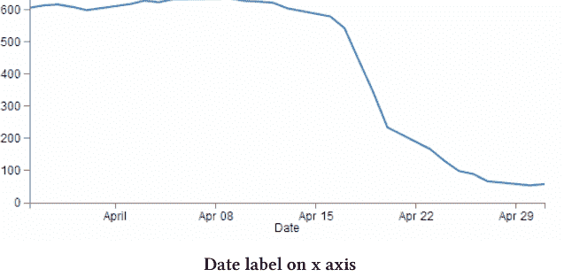

*x轴上的Date标签*

嗯，它确实完成了被要求做的事。正如宣传的那样，出现了一个`'Date'`标签！（是的，我知道它并不美观。）让我们分析一下代码，然后研究为什么有更好的方法。

```javascript
svg.append("text")
    .attr("x", 265 )
    .attr("y", 240 )
    .style("text-anchor", "middle")
    .text("Date");
```

第一行向我们的画布添加了一个`"text"`元素。关于`"text"`元素，在万维网联盟（W3C）的主页[42]上有更多内容可以学习。接下来的两行（`.attr("x", 265 )`和`.attr("y", 240 )`）设置了x和y坐标的属性，以将文本定位在画布上。

> [42] http://www.w3.org/TR/SVG/text.html#TextElement

倒数第二行（`.style("text-anchor", "middle")`）确保文本的`'style'`使其中心对齐，从而能够很好地居中在我们发送给它的x,y坐标上。

最后一行（`.text("Date");`）添加了我们要放置的实际文本。

这看起来非常简单有效，事实也确实如此。然而，糟糕的部分在于我们将日期的位置**硬编码**到了代码中。这意味着如果我们改变图表的任何物理方面，我们就得重新计算并修改代码。我们不想那样做。

举个例子。如果我决定通过修改这一行来增加图表的高度：

```javascript
height = 270 - margin.top - margin.bottom;
```

并将其高度设为350像素：

```javascript
height = 350 - margin.top - margin.bottom;
```

结果如下：

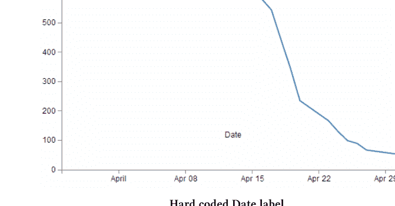

**硬编码的Date标签**

除了我们那个糟糕的硬编码`'Date'`标签外，图表的*所有内容*都自动调整了。这远非理想状态，可以通过使用我们之前精心设置的变量来轻松修复。

所以，不要使用：


```javascript
.attr("x", 265)
.attr("y", 240)
```

让我们让变量来发挥作用，使用：

```javascript
.attr("x", width / 2)
.attr("y", height + margin.bottom)
```

通过这段代码，我们告诉脚本`Date`标签将始终位于图表宽度的中点（无论它有多宽），并且位于图表底部，相对于其高度和底部边距（记住它使用从上向下增加的坐标系）。

使用变量的最终结果是，即使我采取极端操作，将图表的高度和宽度改为：

```javascript
width = 400 - margin.left - margin.right,
height = 200 - margin.top - margin.bottom;
```

我们仍然能得到一个可以接受的结果：

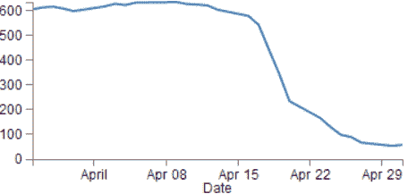

*自动调整的`Date`标签*

嗯，起码标签位置是对的 :-）。

因此，转向使用变量的改变只是一个有用的教训：变量非常强大，意味着你在更改尺寸时不必担心图表的相对形状。你们当中敏锐的读者在编程生涯的早期就已经学到了这个教训，但确保不熟悉该概念的用户了解为什么这是一个好主意总没坏处。

现在是我在 x 轴之旅开始时提到的第三种方法。提到它并不是因为它是实现脚本更好或更糟糕的方法（之所以这么说是因为我不确定它更好还是更差），而是因为它足够不同，如果你最初没有想到它，可能会觉得很困惑。

那么，我们将我们那绝妙的坐标代码：

```javascript
.attr("x", width / 2)
.attr("y", height + margin.bottom)
```

替换为一行（较长）的代码：

```javascript
.attr("transform",
    "translate(" + (width / 2) + " ," +
                (height + margin.bottom) + ")")
```

这使用了`"transform"`属性将点移动（`translate`），使`Date`标签放置在与前两个示例完全相同的位置（当然，使用了变量）。

#### 为什么那行代码看起来很奇怪？

`"translate"`函数是以`translate(x,y)`风格完成的，但它被放在页面上的方式是：逐字传递回来的部分在引号中，而变量则是公开的（可以说）。这就是为什么逗号在引号中。此外，变量被包含在加号之间。我假设这是对“正在进行变量操作的区域”的标识。最终结果是，如果你尝试在该区域使用加号进行数学运算，它似乎不起作用（至少对我来说是这样）。这就是为什么我将`(+ (height + margin.bottom) + )`的变量放在括号中（然后我认为我应该让`+ (width / 2) +`部分看起来一样，但实际上没有括号也可以）。

好了，这就是 x 轴标签。现在轮到 y 轴了。我们将使用的代码如下：

```javascript
svg.append("text")
    .attr("transform", "rotate(-90)")
    .attr("y", 0 - margin.left)
    .attr("x", 0 - (height / 2))
    .attr("dy", "1em")
    .style("text-anchor", "middle")
    .text("Value");
```

为了整洁起见，我们将这段代码放在一个逻辑合理的位置，即紧跟在添加 y 轴的代码块之后（但在闭合花括号之前）。

```javascript
svg.append("g")                    // 添加 Y 轴
    .attr("class", "y axis")
    .call(yAxis);

//      将新代码放在这里！

});
```

结果如下：

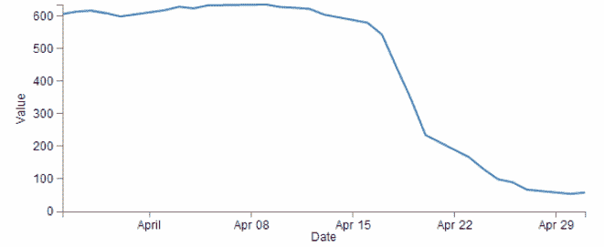

**带有旋转的 y 轴标签！**

瞧，一个完美居中且（天哪！）旋转了 90 度的 y 轴标签！哇，这种高级感难道没有尽头吗！没有，确实没有。

那么，我们是如何获得这个惊人结果的呢？

第一步与 x 轴相同，向画布添加一个文本元素（`svg.append("text")`）。

然后事情变得有趣了。

```javascript
.attr("transform", "rotate(-90)")
```

因为那行代码将所有内容旋转了 -90 度。虽然从图片中可以明显看出文本标签`Value`被旋转了 -90 度，但接下来的代码显示我们也旋转了参考点（这可能会让人有点困惑）。

```javascript
.attr("y", 0 - margin.left)
.attr("x", 0 - (height / 2))
```

让我们用图表来演示它是如何工作的：

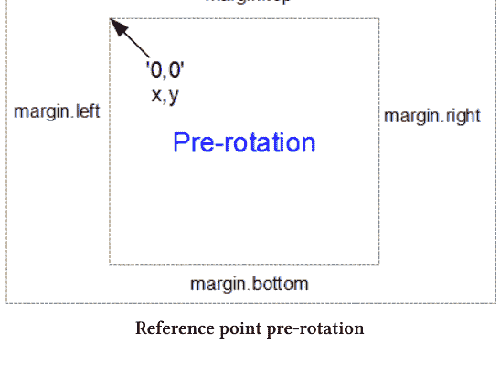

## 使用基础图表可以实现的功能

这是我们的起始位置，x,y 位于由页边距包围的图表绘制区域的 0,0 坐标处。

当我们应用 -90 度的变换时，我们会得到与之等效的结果：

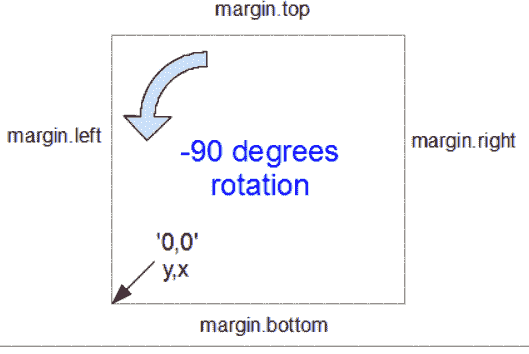

旋转后的参考点

这里 0,0 坐标已被偏移 -90 度，且 x,y 的定义发生了翻转，因此现在我们需要告诉脚本，在原本应该是移动`x`的地方，我们实际上在移动`y`坐标。

因此，当脚本运行时……

```javascript
.attr("y", 0 - margin.left)
```

……我们可以看到，这正将 x 坐标从新的 0 坐标向左移动`margin.left`的数值。

同样，当脚本运行时……

```javascript
.attr("x", 0 - (height / 2))
```

……这实际上是将 y 坐标从新的 0 坐标向图表区域高度的一半处移动。

> 我首先承认这看起来确实有点令人困惑。但好在，你其实不需要完全理解它。只需做我看到代码时所做的事情：尝试调整它，直到你得到想要的结果。如果这意味着输入一些硬编码的数字并递增它们，以观察哪个方向是新的“上方”，那也没关系！一旦你解决了这个问题，再研究如何将其转换为正确的变量表达式，你就大功告成了。
>
> 在最坏的情况下，只需像这里展示的那样直接使用代码块，不要过度纠结即可 :)。

好了，还没结束。下面这一行起到了将文本稍微向右移动的作用。

```javascript
.attr("dy", "1em")
```

首先，我们这样做是因为之前的坐标转换意味着当我们放置文本标签时，它恰好落在 0 – margin.left 这条线上。但在这种情况下，这会使文本处于线的另一侧，导致它实际上落在整个画布的边界之外。

`"dy"`属性是另一种坐标调整移动，但这次是相对调整，而`"1em"`是一个衡量单位，恰好等于当前指定的[文本点大小](http://en.wikipedia.org/wiki/Em_(typography))^43 的一个单位。因此，最终结果是，`Value`标签向右偏移了恰好一个文本高度的距离，从而使其整齐地落在画布的边缘上。

这部分脚本的最后两行与 x 轴相同。它们确保参考点与文本中心对齐（`.style("text-anchor", "middle")`），然后打印文本（`.text("Value");`）。瞧，并没有那么痛苦。

你们之中敏锐的人（如果你已经读到这本书的这一部分，我认定你绝对足够敏锐，或者至少是对折磨有某种偏好的人）会注意到，我在附录和在线示例中提供的例子没有`Value`标签。相反，它有`Price ($)`文本，并且出现在图表区域本身！观察得非常仔细。上面使用的技术与此处描述的完全相同，但在示例代码中，我们进一步演示了如何在文本下方放置一个白色阴影背景（关于这一点在接下来的几个章节中会详细讨论！）。

### 如何为图表添加标题

如果你已经阅读了添加轴标签的部分，大部分内容对你来说应该不陌生。我们想为图表添加标题，就是添加一个文本元素（只需几个词），使其出现在图表上方并左右居中。

我们将使用的代码块如下所示：

```javascript
svg.append("text")
    .attr("x", (width / 2))
    .attr("y", 0 - (margin.top / 2))
    .attr("text-anchor", "middle")
    .style("font-size", "16px")
    .style("text-decoration", "underline")
    .text("Value vs Date Graph");
```

最终结果将如下所示：

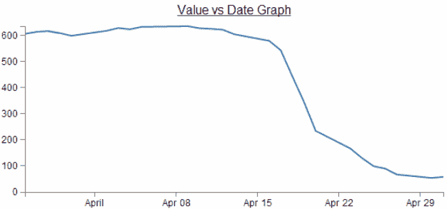

放置该代码块的一个不错且符合逻辑的位置是在 JavaScript 代码的末尾。事实上，我会把它作为我们添加的最后一个元素。放在这里：

```javascript
svg.append("g")             // 添加 Y 轴
    .attr("class", "y axis")
    .call(yAxis);

// 将新代码放在这里！
```

```javascript
});
```

由于这个代码块的大部分内容都是轴标签代码的重复，我不希望再次详细讨论从而让文档变得更加臃肿，所以如果你需要回顾任何特定行，请返回之前的章节。但是……其中有几行新的代码可能需要一点解释。

这两行都是样式描述符，因此它们的作用是为该元素应用非常特定的样式。

```javascript
.style("font-size", "16px")
.style("text-decoration", "underline")
```

它们的作用显而易见：将文本设为特定大小并加上下划线。但或许稍微更有趣的是，我们在 JavaScript 代码中进行了此声明，而不是在文件的 CSS 部分中。

> 严格来说，这类内容应该放在 HTML 代码的`<style>`部分，但在这种情况下，由于它只被使用一次，我们放在这里也没关系。


### 平滑图表线条

当你绘制折线图时，你所做的是获取两组（或更多组）坐标并用线（或线段）将它们连接起来。我知道这听起来很简单，但请听我说。当你连接这些点时，你是在告诉图表观看者，在单个点之间，你预期数值会随着线条经过的点而变化。所以从某种意义上说，你是在尝试解释那些未显示数值的变化。

这并非对所有图表类型都绝对成立，但对许多折线图来说确实如此。

因此……在将这些已知坐标连接在一起时，你希望对数值如何呈现做出最佳估计。在这方面，有时点与点之间的直线并不是最好的表达方式。

例如，之前在演示绘图的`extent`函数时，我们展示了一个数值变化的图表，其 y 轴显示的是一个狭窄的范围。

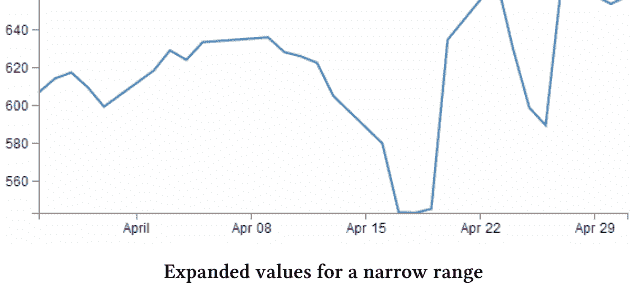

由此产生的图表变化显示出相当多的极值，如果你认为这代表某种平滑流动的模拟系统，那么其中一些尖锐的峰值和谷值可能并非系统或数据变化的真实体现。

那么它应该看起来像什么样？啊……这是一个价值 64,000 美元的问题（意指极难回答的问题）。我不知道 :-)。你会更有想法，因为你是最了解自己数据的人。不过，我知道 D3 有一些技巧可以提供帮助。

我们可以轻松地将上述图表更改为：

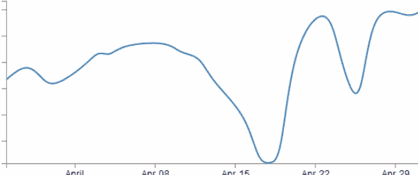

#### 使用`"basis"`进行平滑处理

怎么样？而实现这一极其复杂的计算所需的大量代码竟然只有：

```javascript
.interpolate("basis")
```

> 现在，这么说可能有点不公平，因为这只是**你**需要放入脚本中的代码，但 Mike Bostock 为了让它运行得如此流畅，可能在脑海中经历了一场“火上行走”般的艰苦推演。

那么这段精简的代码放在哪里？在这里：

```javascript
var valueline = d3.svg.line()
    .interpolate("basis")                               // <== 就在这里！
    .x(function(d) { return x(d.date); })
    .y(function(d) { return y(d.close); });
```

这就结束了吗？不……还有更多！这是可以应用于数据的一种插值效果，但还有一系列选项，你可以根据数据的特点选择最合适的一个。

以下是可用选项列表，如需了解更多，请前往 D3 wiki 并搜索`line.interpolate`。

- `linear` – 普通直线（锯齿状）。
- `step-before` – 阶梯图，在垂直和水平线段之间交替。
- `step-after` – 阶梯图，在水平和垂直线段之间交替。
- `basis` – B-样条曲线，两端有控制点重复（即上面的例子）。
- `basis-open` – 开放 B-样条曲线；可能不与起点或终点相交。
- `basis-closed` – 闭合 B-样条曲线，起点和终点闭合成环。
- `bundle` – 等同于`basis`，但使用单独的张力参数来拉直样条线。通过改变张力，这会非常酷。
- `cardinal` – Cardinal 样条曲线，两端控制点重复。看起来比`basis`稍微“锯齿”一些。
- `cardinal-open` – 开放式 Cardinal 样条曲线；可能不经过起点或终点，但会经过其他控制点。因此比`cardinal`稍微短一些。
- `cardinal-closed` – 闭合式 Cardinal 样条曲线，形成自环。
- `monotone` – 单调三次插值，使图表仅略微平滑。

因为在编写本文的过程中，我顺便尝试了其中的每一种，看到一些效果后我感到非常惊喜，如果剥夺读者的这种乐趣就太可惜了 :-)。所以，冒着让地球森林减少的风险（所以我希望您是在电子设备上阅读本文），以下是将上述每种插值类型应用于相同数据的结果。

这也是一个加入读者反馈绝佳机会的时机。非常感谢`enjalot`提出的绝佳建议，将数据点在图表上绘制为独立的圆圈。因为插值过程实际上是在“解读”数据的趋势，以至于在某些情况下，曲线几乎完全不经过实际的数据点。

接下来的每组图示都显示了平滑曲线以及用于绘制图表的数据。

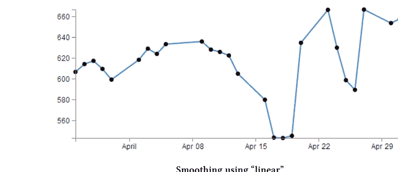

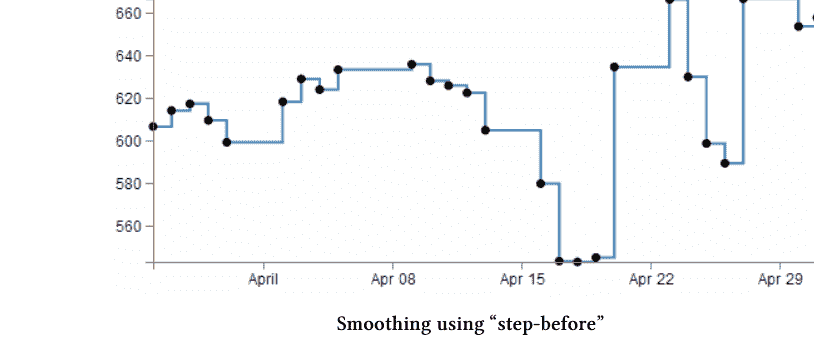

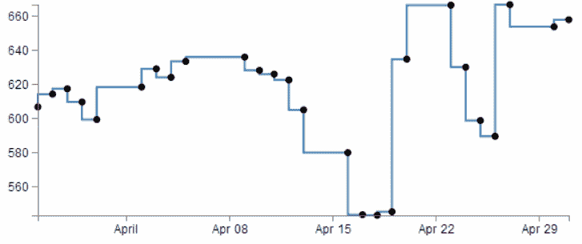

使用`"step-after"`平滑

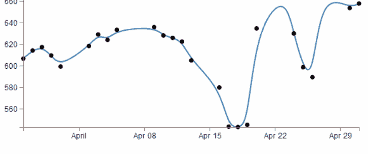

使用`"basis"`平滑

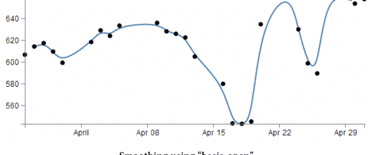

使用`"basis-open"`平滑

## 您可以使用基础图表做的事情

使用`"basis-closed"`平滑

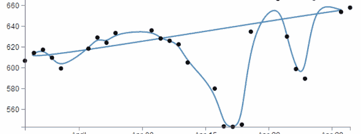

使用`"bundle"`平滑

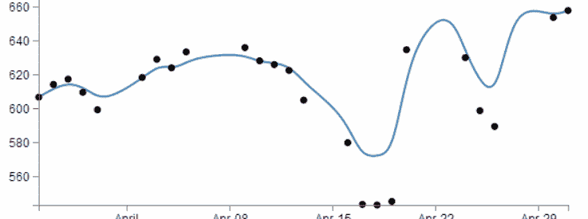

使用`"cardinal"`平滑

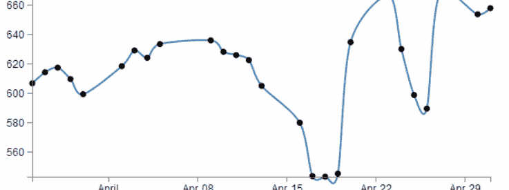

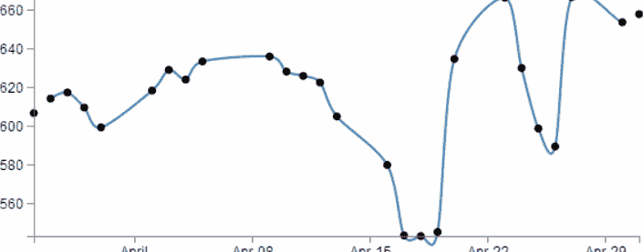

使用`"cardinal-open"`平滑

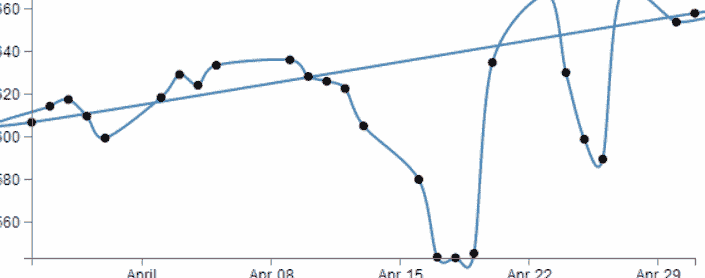

使用`"cardinal-closed"`平滑

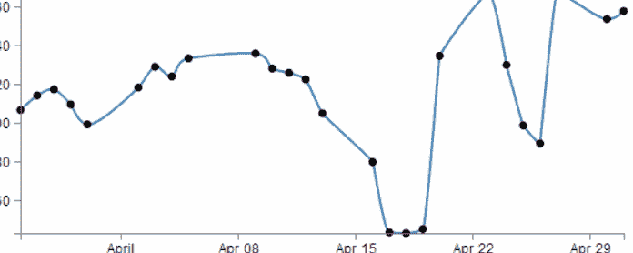

使用`"monotone"`平滑

万一您还想看另一个例子，这里是用各种 D3 曲线插值绘制的 Voronoi 镶嵌图（`shawnbot`制作的原始交互版本可以在[这里](http://bl.ocks.org/shawnbot/5970227)⁴⁵找到）。

⁴⁵ http://bl.ocks.org/shawnbot/5970227

首先是一个使用线性插值的版本，每个点都由直线忠实地连接。

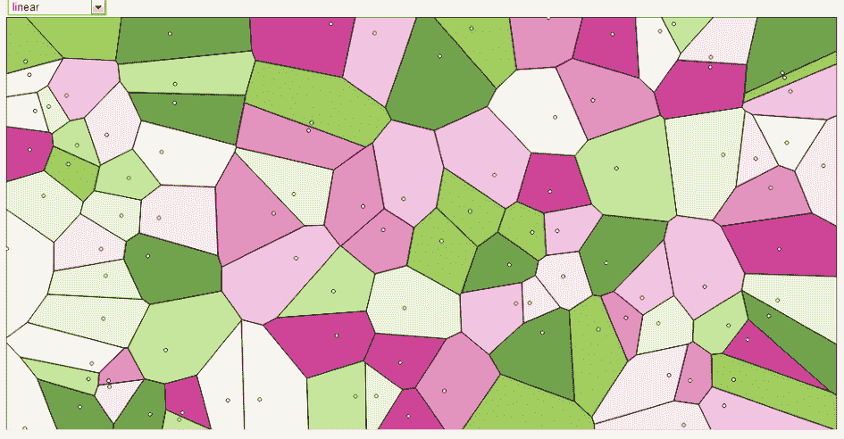

#### 使用`"linear"`进行多边形平滑

现在是一个使用`"basis-closed"`插值形成多边形的版本（请注意，线条并没有经过描述多边形/色块边界的点）。

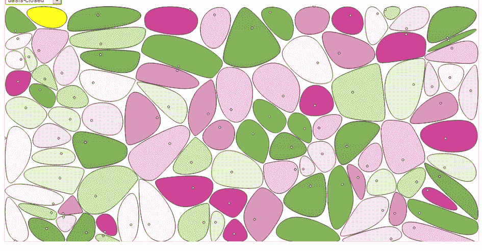

#### 使用`"basis-closed"`进行多边形平滑

最后，使用`cardinal-closed`插值，虽然线条经过多边形中的每个点，但为了保持优美的曲线，它们会产生过冲（overshoot），导致最终的多边形/色块发生重叠。

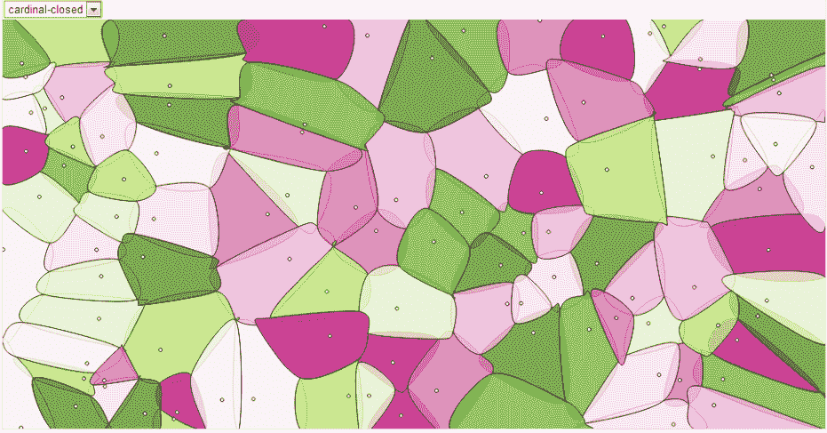

#### 使用`"cardinal-closed"`进行多边形平滑

那么，现在由您来决定哪种插值格式最适合您的数据了 :-)。

### 向图表添加网格线

网格线对于某些图表来说是一项重要功能，因为它们允许眼睛将三个模拟标度（x 轴、y 轴和显示的线条）联系起来。

目前在网络上倾向于使用没有网格线的图表，因为这会让界面看起来更“干净”，但它们仍然被广泛使用，并且是绘图不可或缺的组成部分。

这就是我们要绘制的内容：


带有网格线的基础图表


> 就像本文中的几乎所有内容一样，其中巧妙的部分并非我的功劳。我只是利用他人的聪明才智来解决我的问题。在这种情况下，我认为这个解决方案的来源是 Justin Palmer 在他关于折线图设计的优秀描述中的成果，详见[这里](http://dealloc.me/2011/06/24/d3-is-not-a-graphing-library.html)。然而，回想起来，我不确定我是否完全正确地引用了（因为这是很久以前我还没那么在意记录来源时做的）。无论如何，Justin 的工作非常出色，我由衷地推荐，而这里是我对他工作的理解所实现的版本 :-)

## 如何构建网格线？

我们将使用`axis`函数来生成两个额外的轴元素（一个用于 x 轴，一个用于 y 轴），但对于这两个元素，我们不再绘制主线和标签，而只绘制刻度线。非常长的刻度线（我考虑称它们为[长猫](http://knowyourmeme.com/memes/longcat)线）。

为了创建它们，我们需要添加 3 个独立的代码块：

1. 在 CSS 部分定义网格线的样式。
2. 定义生成网格线的函数。以及……
3. 绘制线条的代码。

### 网格线 CSS

这是我们需要为刻度线添加的全部样式：

```
.grid .tick {
    stroke: lightgrey;
    stroke-opacity: 0.7;
    shape-rendering: crispEdges;
}
.grid path {
    stroke-width: 0;
}
```

只需将此代码块添加到简单图表模板中当前 CSS 的末尾（就在`<style>`标签之前）。

这里的 CSS 分为两部分。

第一部分设置线条颜色（`stroke`）、线条的不透明度（`opacity`）并确保线条纤细（`crispEdges`）。

```
stroke: lightgrey;
stroke-opacity: 0.7;
shape-rendering: crispEdges;
```

颜色比较标准，但通过使用不透明度样式，我们可以选择一个良好的色调（如果灰色真的算一种颜色的话），并能更好地调节它的突出程度。

第二部分是线宽。

```
stroke-width: 0;
```

现在，将线宽设置为零可能看起来有点奇怪，但如果您不这么做（如果我们删除该样式），就会发生这种情况：


### 轴线被设置得太粗

如果您仔细观察（如有必要请与前一张图对比），轴的主线变粗了。`stroke-width`样式显然增加了新的（更粗的）轴线，而我们目前对它们不感兴趣。因此，如果我们将线宽设置为零，就能解决这个问题。

### 定义网格线函数

我们需要定义两个函数来生成网格线，它们看起来像这样：

```
function make_x_axis() {
    return d3.svg.axis()
        .scale(x)
        .orient("bottom")
        .ticks(5)
}

function(reactant) {
    return d3.svg.axis()
        .scale(y)
        .orient("left")
        .ticks(5)
}
```

每个函数在脚本的后续部分（绘制部分）被调用时将执行其配置。

放置代码的一个好位置是在我们使用`d3.csv`加载数据之前。

```
//  <== 将函数放在这里！
// 获取数据
d3.csv("data.csv", function(error, data) {
    data.forEach(function(d) {
        d.date = parseDate(d.date);
        d.close = +d.close;
    });
})
```

这两个函数几乎完全相同。它们为函数命名（`make_x_axis`和`make_y_axis`），稍后在绘制线条的代码块调用它们时会用到。

这两个函数还展示了调用时将反馈给绘制过程的参数。两者都确保使用`d3.svg.axis`函数，然后设置相应的属性。

它们确保获得了正确的轴（`.scale(x)`和`.scale(y)`）。它们将轴的方向设置为与现有轴匹配（`.orient("bottom")`和`.orient("left")`）。并且它们将刻度数量设置为与主轴匹配（`.ticks(5)`和`.ticks(5)`）。如果您愿意，可以在这里尝试一些不同的设置。例如，回想一下我们为基础图表设置轴的时候，我们尝试了能让多少个刻度出现。如果我们增加网格中出现的刻度数量（比如设置为`.ticks(30)`和`.ticks(10)`），我们会得到以下结果：

## 使用基础图表可以实现的功能

### 具有更大分度的网格线

现在，y 轴可以显示 50 为单位的分度，x 轴则按天显示分度 :-)

### 绘制线条

我们需要最后一段代码，用于绘制这些线条。

```
svg.append("g")
    .attr("class", "grid")
    .attr("transform", "translate(0," + height + ")")
    .call(make_x_axis()
        .tickSize(-height, 0, 0)
        .tickFormat("")
    )

svg.append("g")
    .attr("class", "grid")
    .call(make_y_axis()
        .tickSize(-width, 0, 0)
        .tickFormat("")
    )
```

上述 x 轴和 y 轴网格线代码的前两行现在应该已经非常熟悉了。第一行将要绘制的元素添加到组`g`中；第二行（`.attr("class", "grid")`）确保应用了 CSS 中设定的样式信息。

x 轴网格线部分为了调整其位置以适配坐标系，在一致性上做了一点偏差，使用了`.attr("transform", "translate(0," + height + ")")`。

然后，两部分分别调用各自的轴创建函数（`.call(make_x_axis()`和`.call(make_y_axis())`）。

现在进入真正有趣的部分。

如果你访问 [D3 API wiki](https://github.com/mbostock/d3/wiki/SVG-Axes#wiki-tickSize)，你会发现`.tickSize`函数的格式如下：

> https://github.com/mbostock/d3/wiki/SVG-Axes#wiki-tickSize

`axis.tickSize([major[, minor], end])])`

这告诉我们，你可以通过主刻度（major ticks）、次刻度（minor ticks）和末端刻度（end ticks）来指定轴上刻度的大小（也就是说，图表最末端的线条，在我们正在看的这个例子中，它们并不存在！）。

因此，在我们的示例中，我们将主刻度的长度设置为对应于图表的全部高度或宽度。这当然意味着它们延伸到了整个图表，看起来就像网格线一样！真是个巧妙的技巧。

我之前还没试过如果包含次刻度和末端刻度线会发生什么。那么，让我们试试吧 :-)

### 令人失望！哪里出错了？

糟糕！太失望了。我们可以看到 y 轴有一个次刻度线，但 x 轴什么都没有，末端也没有。显然，我得做一些实验来看看是怎么回事（稍后讨论）。

绘制网格线代码中包含的最后一项指令是抑制打印任何刻度标签：

```
.tickFormat("")
```

毕竟，如果有两组标签会让人感到困惑。即使其中一组在另一组之上，如果发生这种情况，它们往往会变得很明显（它们会像`粗体文本`一样稍微加厚）。

就这样。网格线搞定了！

### 制作虚线

虚线简直太酷了！

> 好吧，这里可能有点夸张，但我确实发现，对于像我这样简单的人来说，在 D3 中制作虚线似乎并没有太多的解释。所以对我来说，它们太酷了 :-)

最棒的部分之一是它们实现起来如此简单！

真的只需要一行代码！！！！

假设我们想将简单图表中的线条变为虚线。我们只需要在 JavaScript 代码中插入以下行：

```
svg.append("path")
    .attr("class", "line")
    .style("stroke-dasharray", ("3, 3"))  // <== 就是这一行！！
    .attr("d", valueline(data));
```

我们的图表最终变成了这样：

**基础图表的虚线**

嘿！简直是“虚”幻之美！

它是如何工作的呢？

显然，`"stroke-dasharray"`是`path`元素的样式，但魔力在于数字。

本质上，它们描述了线条的“开启”长度和“关闭”长度。因此，`"3, 3"`翻译为 3 像素（或任何单位）开启，3 像素关闭。然后循环往复。简单吧？

那么，实验时间到了 :-)

以下代表什么？

`"5, 5, 5, 5, 5, 5, 10, 5, 10, 5, 10, 5"`

尽量不要作弊……

为了好玩而画的虚线

啊是的，摩尔斯先生会为此感到自豪的。

你可以把它们放在任何地方。这是我们将轴线改为虚线后的样子：

```
svg.append("g")
    .attr("class", "x axis")
    .attr("transform", "translate(0," + height + ")")
    .style("stroke-dasharray", ("3, 3"))
    .call(xAxis);

svg.append("g")
    .attr("class", "y axis")
    .style("stroke-dasharray", ("3, 3"))
    .call(yAxis);
```

当虚线用错时

额……我想，好东西过量了也不行。能力越大，责任越大。请明智地使用你的虚线技巧，并且仅将其用于正途。

### 填充图表下方的区域

线条固然很好，但这并不是图表的全部。有时你必须使用填充。

用纯色填充一个区域并不太难。我的意思是，在之前的几页中，当我们尝试绘制线条时，我们就误打误撞地实现了它。

但要以一种优雅且连贯的方式来实现它其实相当直接。

它需要三个代码段，方式与我们之前绘制网格线非常相似：

1. 在 CSS 部分定义区域的样式。
2. 定义生成区域的函数。并且……
3. 绘制该区域。

最终结果看起来大概像这样：

#### 区域填充的 CSS

这非常简单，仅由两条规则组成：

```
.area {
    fill: lightsteelblue;
    stroke-width: 0;
}
```

将它们放在`<style>`部分的底部。

第一条（`fill: lightsteelblue;`）设置填充颜色（在这种情况下，我们选择了与线条颜色相同但更浅的色调以使其匹配），第二条（`stroke-width: 0;`）将环绕区域的线条宽度设置为零。最后一条规则对于让填充区域效果良好至关重要。核心理念是，图表由相互补充的独立元素组成：轴线、线条和填充。如果我们不告诉代码填充区域没有环绕线，它会假设有一条线并像这样添加进去。

#### 环绕填充区域的线条

这里发生的情况是，区域元素继承了`path`元素的线条属性，导致区域周围出现了一条 2px 宽的钢蓝色（steelblue）线条。并不太美观。我们不要那样做。

#### 定义区域函数

我们需要一个函数来告诉区域填充哪个空间。这可以通过 [d3.svg.area 函数](https://github.com/mbostock/d3/wiki/SVG-Shapes#wiki-area) 访问。

我们将使用的代码如下：

```
var area = d3.svg.area()
    .x(function(d) { return x(d.date); })
    .y0(height)
    .y1(function(d) { return y(d.close); });
```

我将它放在了轴变量定义和线条定义之间：

```
var yAxis = d3.svg.axis().scale(y)
    .orient("left").ticks(5);
                        <==== 将新代码放在这里！
var valueline = d3.svg.line()
    .x(function(d) { return x(d.date); })
    .y(function(d) { return y(d.close); });
```

> 你会注意到它看起来与`valueline`函数定义*极其*相似。这是因为：虽然线定义描述的是绘制一条连接一组坐标的线，但我认为区域定义描述的是绘制两条共享相同 x 坐标的线，但同时绘制两个 y 坐标，`y0`和`y1`。然后当它完成结果形状的绘制时，用你选择的颜色将其填充。

因此，代码的唯一变化是增加了`y0`行，并将`y`行重命名为`y1`。

这里有一张图片可能有助于解释：

#### 区域是如何定义的

显而易见，顶线（`y1`）遵循`valueline`线，而底线处于恒定的`height`值。这两条线之间的所有内容就是被填充的部分。本节中的函数描述了该区域。

#### 绘制区域

现在到了关键步骤。

区域填充之旅的最后一段代码如下：

```
svg.append("path")
    .datum(data)
    .attr("class", "area")
    .attr("d", area);
```

我们应该将此代码块直接放在 domain 函数之后，但在绘制`valueline`路径之前：

```
x.domain(d3.extent(data, function(d) { return d.date; }));
y.domain([0, d3.max(data, function(d) { return d.close; })]);
//  <== 区域绘制代码放在这里！

svg.append("path")
    .attr("class", "line")
    .attr("d", valueline(data));
```

将它放在这里实际上是个很不错的主意，因为图表中绘制的各个部分是一个接一个完成的。这意味着填充区域最先绘制，然后`valueline`叠加在上面，最后绘制轴线。这是一个很合理的顺序，因为如果两个或多个元素重叠，可能会导致图表看起来“不对劲”。

例如，这里是最后才添加区域的图表。

#### 区域重叠与遮盖

你应该能注意到，数值线（`valueline`）的一部分被遮挡了，同时 y 轴在与区域重合的部分也被遮挡了。

查看我们在这里添加的代码，第一行添加了一个路径元素（`svg.append("path")`），这与绘制线条的脚本非常相似。

第二行（`.datum(data)`）声明了我们将用于描述区域的数据，第三行（`.attr("class", "area")`）确保我们为其应用的样式与 CSS 部分（在`area`下）定义的一致。

最后一行（`.attr(`

#### 填充线条上方的区域

随堂小测验：

你会如何填充图表*上方*的区域？

>  现在这听起来可能有点陈词滥调，但信不信由你，这可能会派上用场。例如，如果你想在一个图表上突出显示某个区域过高或过低，而中心区域则保留一个投影的“正常”数值集，该怎么办？

在这种情况下，你可以像这里演示的那样填充下方区域，只需做一个小改动，你就可以用纯色填充另一条线之上的区域。

这个惊人的技巧是如何实现的？

那么，还记得定义区域的代码吗？

```
var area = d3.svg.area()
    .x(function(d) { return x(d.date); })
    .y0(height)
    .y1(function(d) { return y(d.close); });
```

我们唯一需要做的就是告诉它，不要将`y0`的常量值设置为图表的高度（记住，这是图表的底部），而是将其设置为图表顶部的常量值。换句话说，就是零（0）。

```
.y0(0)
```

就是这样。

#### 填充线条上方的区域

现在，我不想详细讲解绘制两条线并向不同方向填充各自区域的过程来演示我描述的例子，但这提供了一个想法的萌芽，你可以尝试将其具体化 :-)

### 添加阴影使文本在图形中脱颖而出

我特意将这个技巧放在“填充区域”的描述之后，因为这可以提供一个机会，以更好的效果演示该原理。

我曾多次尝试为了方便而将文本覆盖在图表上，但结果往往看起来非常混乱，因为文本干扰了图表。

#### 这是一种糟糕的做法吗？

首先我要说明，将文本叠加在图表上的原则可能不是最佳实践，但有时你必须采取必要的手段。此外，有时这是一个有效的想法。如果我没记错，我第一次接触到这个想法时，它是被用来突出显示条形图柱体上的文本。所以这并不总是糟糕的做法 :-)。

总之，我们将保留填充效果并把标题放回图表上，但将标题定位在填充层之上，像这样：


标题淹没在区域填充中

标题的附加代码如下，出现在坐标轴绘制之后。

```
svg.append("text")
    .attr("x", (width / 2))
    .attr("y", 25)
    .attr("text-anchor", "middle")
    .style("font-size", "16px")
    .style("text-decoration", "underline")
    .text("Value vs Date Graph");
```

（与之前的标题示例唯一不同的是`y`属性，它被硬编码为 25，以便将其尴尬地放置在填充区域上。）

所以，我们最终想要的效果类似于下面这样……

## 使用基础图表可以实现的功能


## 一个漂亮的白色阴影效果

在我看来，这足以让文本变得可接受 :-)。

我将描述的执行方法旨在将阴影效果应用于图表中的任何文本元素，而不仅仅是我们这里使用的孤立示例。为了实现这个实用的小技巧，我们需要在两个地方进行更改：一个是在 CSS 中定义白色阴影背景的样式，另一个是将其绘制出来。

### 白色阴影背景的 CSS

添加到 CSS 部分的代码如下：

```css
text.shadow {
    stroke: white;
    stroke-width: 2.5px;
    opacity: 0.9;
}
```

第一行指定该样式适用于带有`shadow`标签的文本。描边（stroke）设置为白色，线宽设置为 2.5px，并设置为轻微透明。因此，通过将环绕文本的线设置为厚、白且透明，会产生一种轻微的“云雾”效果。如果我们移除上层的黑色文本，效果会好一点：


仅观察阴影效果的近景

当然，如果你想尝试这些设置，你应该动手试试，看看什么样的设置最适合你的图表。

### 绘制白色阴影背景

既然我们已经设置好了背景样式，现在需要将其绘制出来。

这段代码你应该非常熟悉：

```javascript
svg.append("text")
    .attr("x", (width / 2))
    .attr("y", 25)
    .attr("text-anchor", "middle")
    .style("font-size", "16px")
    .style("text-decoration", "underline")
    .attr("class", "shadow")          // <=== 这里是不同的行
    .text("Value vs Date Graph");
```

这是因为除了上面指出的那一行之外，它与用于绘制标题的代码完全相同。之所以相同，是因为我们是在图表上放置一个白色阴影，然后将文本放在其上方，如果两者偏差太大，看起来会很傻。当然，轻微的偏移可能会有效果，在这种情况下请调整`x`或`y`属性。

我在前一段中提到的其中一点极其重要。那就是：我们需要在放置黑色文本*之前*放置阴影。原因与我们在区域填充示例中先放置区域填充相同，如果黑色文本先于阴影出现，效果会很糟糕。所以，请将这段代码块放在绘制标题的代码块之前。

因此，新添加的那一行是告诉 D3 正在绘制的文本将具有白色云雾效果。冒着重复的风险，我想说，如果你有多个文本元素能从这个效果中受益，一旦你设置好 CSS 代码，你只需要复制添加文本的代码块并加入那一行，瞧！就完成了。

再次提醒，敏锐的读者会注意到，在附录和在线示例代码中，阴影效果被应用于 Y 轴标签。别担心，原理完全一样 :-)。

## 在图表中添加多条线

好了，现在我们要开始进入正题了。在图表上绘制两条线在某种程度上是跨入了一个不同的世界。我的意思是，完成这个任务有多种方法，而我倾向于用一种方法而不是另一种，主要是因为我不完全理解另一种方法 :-(

> 我应该强调，这并不是因为另一种方法更复杂，或者它是一个糟糕的方法，只是因为一旦我开始用一种方式做事，我就没遇到需要用另一种方式处理的情况。很有可能我在未来需要重新审视这个决定，但目前我将继续前进。

那么，我们要怎么做呢？我认为最好的办法是做个决定：假设我们突然发现了更多的数据，且这些数据也在我们的`data.csv`文件中（为了突出两个数据集的区别，我们将其重命名为`data2.csv`）。事实上，它看起来像这样（提前为这块又大又丑的数据块道歉）：

```csv
date,close,open
1-May-12,68.13,34.12
30-Apr-12,63.98,45.56
27-Apr-12,67.00,67.89
26-Apr-12,89.70,78.54
25-Apr-12,99.00,89.23
24-Apr-12,130.28,99.23
23-Apr-12,166.70,101.34
20-Apr-12,234.98,122.34
19-Apr-12,345.44,134.56
18-Apr-12,443.34,160.45
17-Apr-12,543.70,180.34
16-Apr-12,580.13,210.23
13-Apr-12,605.23,223.45
12-Apr-12,622.77,201.56
11-Apr-12,626.20,212.67
10-Apr-12,628.44,310.45
9-Apr-12,636.23,350.45
5-Apr-12,633.68,410.23
4-Apr-12,624.31,430.56
3-Apr-12,629.32,460.34
2-Apr-12,618.63,510.34
30-Mar-12,599.55,534.23
29-Mar-12,609.86,578.23
28-Mar-12,617.62,590.12
27-Mar-12,614.48,560.34
26-Mar-12,606.98,580.12
```

三列数据，分别是`date`、`open`和`close`。前两列正是我们一直以来处理的数据，最后一列（open）是我们新编造的数据。每一列用逗号分隔（因此是`.csv`（comma separated values，逗号分隔值）），这也是我们当前导入数据所用的格式。我们应该将其保存为新文件，以免破坏之前的数据，所以（如前所述）我们将其命名为`data2.csv`。

该文件及示例代码的副本可在 [github⁵⁰](https://gist.github.com/d3noob/8603837) 以及本书附带的代码示例中找到（`dual-line-with-labels.html`和`data2.csv`）。在线示例可在 [bl.ocks.org⁵¹](http://bl.ocks.org/d3noob/8603837) 上找到。`dual-line-with-labels.html`文件包含双线条以及我们将在后续章节中介绍的标签方案。

我们将使用简单的图表模板来构建新代码，因此首先需要编辑查找`data.csv`的那行代码，以反映新的文件名。

```javascript
d3.csv("data2.csv", function(error, data) {
```

因此，当你浏览到我们新图表的 HTML 文件时，看不到任何变化。它仍然顺利地加载新数据，但由于没有被告知要对此做何处理，所以什么新情况都没发生。现在我们需要做的，基本上是复制绘制第一条线条的代码块，以绘制第二条线。

好消息是，以最简单的方式来说，这只需要两个代码块。第一个设置定义新线条的函数：

```javascript
var valueline2 = d3.svg.line()
    .x(function(d) { return x(d.date); })
    .y(function(d) { return y(d.open); });
```

你应该注意到，这个代码块与设置第一条线条函数的代码块完全相同，只是这个被（富有想象力地）命名为`valueline2`。我们应该将其直接放在设置`valueline`函数的代码块之后。

第二个代码块绘制我们的新线条：

```javascript
svg.append("path")         // Add the valueline2 path.
    .attr("d", valueline2(data));
```

同样，这与绘制第一条线的代码块完全相同，只是这个调用的是`valueline2`。我们应该将其直接放在绘制`valueline`的代码块之后。

完成这三处小改动后，来看看你的新图表：


两条线，但颜色相同

嘿！两条线！嗯……颜色相同有点让人困惑。好消息是，我们可以通过插入一行非常简单的代码来调整其 stroke（颜色），从而改变第二条线的颜色。

因此，我们的新绘制代码块如下所示：

```javascript
svg.append("path")
    .style("stroke", "red")
    .attr("d", valueline2(data));
```

仿佛有魔法一般，这就是我们的新图表：


两条线，两种颜色

哇。此时此刻，我们觉得自己相当聪明。但有两个地方我们做得不对。我们选择了简单的方式，但走了一些捷径，这可能会让我们自食其果。

我们犯的第一个错误是没有确保变量`d.open`被当作数字还是字符串来处理。在这种情况下我们很幸运，它确实是数字，但这并不总能如此假设。所以，这是一个简单的修复，我们只需在代码中加入以下（所示的）内容：

```javascript
// Get the data
d3.csv("data.csv", function(error, data) {
    data.forEach(function(d) {
        d.date = parseDate(d.date);
        d.close = +d.close;
        d.open = +d.open;	// <== 加入这一行！
    });
});
```

第二个、可能也是更致命的缺陷是，在我们的代码中，我们没有为第二组数据（第二条线的数值）超过第一组数据的值做任何准备。

这听起来可能不太容易立刻理解，但请考虑这一点。如果早些时候我们编造数据时，某些新数据超过了原始数据中的最大值，会怎样？作为演示，当第二条数据的数值高于第一条时，情况如下：


**两条线，但域值不对**

啊哈……我们现在没那么聪明了。

不过好消息是，我们可以修复它！

这个问题的产生是因为当我们设置 y 轴的域值时，代码中是这样写的：

```javascript
y.domain([0,d3.max(data, function(d) {return d.close;})]);
```

所以这只在建立域值时考虑了`d.close`。当`d.open`超过了我们的域值时，它就一直画到图表外面去了！

好消息是，"Bill"为这个问题提供了一个解决方案，详见[此处](http://stackoverflow.com/questions/12732487/d3-js-dataset-array-w-multiple-y-axis-values)⁵²。

你只需将`y.domain`这一行替换为以下内容：

```javascript
y.domain([0, d3.max(data, function(d) {
    return Math.max(d.close, d.open); })]);
```

⁵² <http://stackoverflow.com/questions/12732487/d3-js-dataset-array-w-multiple-y-axis-values>

它做的事情大致相同，但这次它返回`d.close`和`d.open`中的最大值（哪个更大）。干得好，Bill。

如果我们将这段代码放入第二条线数值更高的图表中，现在呈现的结果如下：


#### 两条线，所有内容都适配在画布上

而且无论两组数据哪组更大，图表都会自动调整 :-)

你可能还会注意到，我们的 y 轴也再次自动调整以适应变化。很聪明吧？

### 为图表上的多条线添加标签

我们之前的多线图是一个罕见的美作，但哪条线对应哪组数据呢？我们有定义 open 和 close 值的数据，但不知道哪条线是哪条。

在本节中，我们将为线条添加标签，以便我们知道哪个是哪个。

本节灵感来自 [d3noob.org](http://www.d3noob.org) 博客的一位读者（Arun b.s）的问题，他问的是“我们如何在图表上每条线的末端放置文本？”。

这个问题如此出色，我意识到它必须成为本书的一部分，所以请收好 :-)。

实际上这并不太困难。我们要做的是找到每条线末端的位置，并在该位置添加文本标签，以便通过邻近关系来表明关联性。当然，我们会更进一步，为文本着色，以便更清楚地表明哪个标签属于哪条线，但你懂的。

每条线需要一个单独的脚本块来添加文本。添加 open 标签的代码块如下：

```javascript
svg.append("text")
  .attr("transform", "translate("+(width+3)+","+y(data[0].open)+")")
  .attr("dy", ".35em")
  .attr("text-anchor", "start")
  .style("fill", "red")
  .text("Open");
```

首先，它向`svg`对象追加一个文本元素：

```javascript
svg.append("text")
```

然后它找到线条末端的位置：

```javascript
.attr("transform", "translate("+(width+3)+","+y(data[0].open)+")")
```

为此，我们使用`transform`和`translate`属性，并找到与图表末端加 3 像素相等的 x 位置（`(width+3)`）（我们加入三像素是为了在线条末端和标签之间创建一个小间隔）。y 位置则有趣得多。我们需要找到 open 数据线条中最后一个点的位置。因为数据是以索引数组的形式存在，而且数据将最新日期放在数组的开头，我们只需要找到数组 0 位置的点即可。这就是`data[0].open`。但当然，我们还需要为比例和范围调整数据，因此我们使用`y`函数进行转换（这与我们对`valueline`和`valueline2`点所做的相同）。所以在屏幕上找到 y 方向的点的脚本是`y(data[0].open)`。

如果我们的数据是将最后日期放在数据末尾，我们就必须找到最终的索引点，我们会使用`y(data[data.length-1].open)`）。

然后就是正确对齐和调整文本的问题了：

<http://www.d3noob.org/2013/01/adding-more-than-one-line-to-graph-in.html>

你可以对基础图表进行的操作：

```javascript
.attr("dy", ".35em")
.attr("text-anchor", "start")
```

然后将其设为正确的颜色：

```javascript
.style("fill", "red")
```

并添加我们的文本：

```javascript
.text("Open");
```

我们将这段代码放在添加坐标轴代码块之后，以确保它们位于我们绘制的所有内容之上。

我们想要做的唯一另一个小改动是，将脚本开始时设置的图表右边距从 20 修改为 40，以便有足够的空间添加标签而不会被截断。

之后，你就拥有了一个带有精美标签的多线图！

#### 带有标签的多线图

本示例的完整代码可以在 [github⁵](https://gist.github.com/d3noob/8603837) 或本书随附的代码示例中找到（`dual-line-graph-with-labels.html`和`data2.csv`）。运行示例可以在 [bl.ocks.org⁶](http://bl.ocks.org/d3noob/8603837) 找到。

现在，我不想假装这已经完美了，因为事实并非如此。如果我们的线条末端靠得太近，标签会相互干扰。在理想情况下，我会加入一些技巧来防止这种情况，但就本次练习而言，我们可以认为结果已经令人满意了。

> ⁵ <https://gist.github.com/d3noob/8603837>
>
> ⁶ <http://bl.ocks.org/d3noob/8603837>

### 图表的多坐标轴

好了……让我们想象一下，我们想要展示一个包含两条线的精美图表，就像我们已经做的那样，但组成这些线的数据在量级上与原始数据有显著差异（在下面的示例中，第二条线的数据比原始数据大约减少了 10 倍）。

```csv
date,close,open
1-May-12,58.13,3.41
30-Apr-12,53.98,4.55
27-Apr-12,67.00,6.78
26-Apr-12,89.70,7.85
25-Apr-12,99.00,8.92
24-Apr-12,130.28,9.92
23-Apr-12,166.70,10.13
20-Apr-12,234.98,12.23
19-Apr-12,345.44,13.45
18-Apr-12,443.34,16.04
17-Apr-12,543.70,18.03
16-Apr-12,588.13,21.02
13-Apr-12,605.23,22.34
12-Apr-12,622.77,20.15
11-Apr-12,626.20,21.26
10-Apr-12,628.44,31.04
9-Apr-12,636.23,35.04
5-Apr-12,633.68,41.02
4-Apr-12,624.31,43.05
3-Apr-12,629.32,46.03
2-Apr-12,618.63,51.03
30-Mar-12,599.55,53.42
29-Mar-12,609.86,57.82
28-Mar-12,617.62,59.01
27-Mar-12,614.48,56.03
26-Mar-12,606.98,58.01
```

这本身并不是问题。D3 仍然能为这些数据绘制出一个合理的图表，但由于范围的差异，第二条线的细节将会丢失。

#### 一条线主导了另一条线

我的建议是在图表的右侧设置第二个 y 轴，用于对应红线。

所使用的机制基于 Ben Christensen 提供的优秀示例[这里](http://benchristensen.com/2012/05/02/line-graphs-using-d3-js/)⁵⁶。

现在……你需要集中注意力，因为有相当多不同的部分需要修改和调整，但不要绝望，它们都非常逻辑且合理。


本示例的完整代码可以在 [github](https://gist.github.com/d3noob/e34791a32a54e015f57d)⁵⁷ 或本书随附的代码示例中找到（`dual-line-dual-axes.html` 和 `data2a.csv`）。运行示例可以在 [bl.ocks.org](http://bl.ocks.org/d3noob/e34791a32a54e015f57d)⁵⁸ 找到。

首先，图表右侧没有空间显示额外的坐标轴，因此我们应该将右边距稍微加大。

```javascript
var margin = {top: 30, right: 40, bottom: 30, left: 50},
```

我选择了 40，看起来非常合适。

然后（这里就是这个图表的主要区别所在），你需要修改代码，将图中两条线的两个比例尺（scales）分开。这实际上比听起来要简单得多，因为主要就是寻找所有提到 `y` 的地方并将其替换为 `y0`，然后为 `y1` 添加对应的代码。

这里的想法是我们为 y 轴创建两个引用，每个数据列对应一个。这样当我们绘制线条时，比例尺会自动且分别地将数据正确缩放到画布上，我们将绘制两个具有不同比例尺的不同 y 轴。信不信由你，这听起来比实际操作要难得多。

让我们开始吧。

首先，将 `y` 的变量声明改为 `y0` 并添加 `y1`。

```javascript
var x = d3.time.scale().range([0, width]);
var y0 = d3.scale.linear().range([height, 0]);
var y1 = d3.scale.linear().range([height, 0]);
```

然后将 `yAxis` 声明修改为专门针对 `y0` 且专门位于左侧（left）。并添加右侧坐标轴的声明：

```javascript
var yAxisLeft = d3.svg.axis().scale(y0)     //  <==  添加 'Left' 和 'y0'
    .orient("left").ticks(5);

var yAxisRight = d3.svg.axis().scale(y1)   // 为 'Right' 和 'y1' 创建新声明
    .orient("right").ticks(5);               // 并包含方向设定。
```

注意右侧坐标轴的方向（orientation）发生了变化。

现在修改 `valueline` 声明，使其分别引用 `y0` 和 `y1` 比例尺。

```javascript
var valueline = d3.svg.line()
    .x(function(d) { return x(d.date); })
    .y(function(d) { return y0(d.close); });    // <== y0
var valueline2 = d3.svg.line()
    .x(function(d) { return x(d.date); })
    .y(function(d) { return y1(d.open); });     // <== y1
```

缩放有几种不同的实现方式，但我们将坚持使用在双线示例中用过的那个高级 `max` 方法（虽然从技术上讲这不是必须的）。

```javascript
y0.domain([0, d3.max(data, function(d) { return Math.max(d.close); })]);
y1.domain([0, d3.max(data, function(d) { return Math.max(d.open); })]);
```

同样，这里修改并添加了 `y0` 和 `y1`，且 `d.close` 和 `d.open` 的最大值被分开了。拼图的最后一块是绘制新坐标轴，但我们也想对原始 y 轴做一个小改动。既然有两条线和两个坐标轴，我们需要知道哪个属于哪个，因此我们可以用颜色对坐标轴中的文本进行编码，使其与线条匹配：

```javascript
svg.append("g")
  .attr("class", "y axis")
  .style("fill", "steelblue")
  .call(yAxisLeft);

svg.append("g")
  .attr("class", "y axis")
  .attr("transform", "translate(" + width + ",0)")
  .style("fill", "red")
  .call(yAxisRight);
```

在上面的代码中，你可以看到我们为 `yAxisLeft` 添加了 `style` 修改将其设为 'steelblue'，并在 `yAxisRight` 的新部分中做了相应的修改将文本设为红色。

`yAxisRight` 部分显然需要被添加进去，但唯一的显著区别在于 `transform / translate` 属性，它将坐标轴移动到图表的右侧。

在完成所有这些后，结果如下……

#### 两条线拥有完整的定义域范围且具有两个坐标轴

现在，我们不要自我欺骗说这是一个美学杰作，但我们可以用“理解函数如何工作”所带来的温暖光芒来安慰我们对美感的担忧 :-)。

### 如何旋转 x 轴的文本标签

细心的读者会想起我们之前在将 x 轴刻度增加到 10 时观察到的问题。其结果是产生了大量的 x 轴刻度（实际上是 19 个），但它们挤在了一起，变得无法阅读。

x 轴标签挤在了一起。

我们当时假设该问题的一个答案可能是旋转文本以提供更多空间。那么，现在是时候解决这个问题了。

我认为最实用的答案是由 Aaron Ward 在 [Google Groups](http://groups.google.com) 上提供的。

#### 可能有更好的方法

现在，我对这个旋转轴标签问题的解决方案做一个小提示。虽然它看起来运行良好，但我只将调查进行到了一个看起来像解决方案的程度。执行相同任务可能还有更好或更优雅的方法，所以如果它对你不起作用，请让 Google 成为你的朋友。

本示例的完整代码可以在 [github](https://gist.github.com/d3noob/ccdcb7673cdb3a796e13) 或本书随附的代码示例中找到（`simple-graph-rotated-axis-text.html` 和 `data.csv`）。运行示例可以在 [bl.ocks.org](http://bl.ocks.org/d3noob/ccdcb7673cdb3a796e13) 找到。示例代码还包含了下一节所述的 x 轴刻度的特定格式化。

从我们的简单图表示例开始，我们应该将 x 轴的刻度数增加到 10，以突出之前图像中的问题。

第一个实质性的变化将是一些基础准备工作。因为我们将要旋转图表底部的文本，我们需要一些额外的空间来容纳标签。因此，我们应该相应地修改底部边距。

```javascript
var margin = {top: 30, right: 40, bottom: 50, left: 50},
```

59 https://groups.google.com/forum/#!msg/d3-js/CRIW0lSbOy4/1sgrE5uS5ysJ

60 https://gist.github.com/d3noob/ccdcb7673cdb3a796e13

61 http://bl.ocks.org/d3noob/ccdcb7673cdb3a796e13

我发现 50 像素就足够了。

其余的更改发生在绘制 x 轴的代码块中。

```javascript
svg.append("g")
    .attr("class", "x axis")
    .attr("transform", "translate(0," + height + ")")
    .call(xAxis)
    .selectAll("text")
        .style("text-anchor", "end")
        .attr("dx", "-.8em")
        .attr("dy", ".15em")
        .attr("transform", function(d) {
            return "rotate(-655)"
        });
```

在代码的 `.call(xAxis)` 部分之前，一切都非常标准。在这里，我们删除了原有的分号，以便该代码块能够继续执行其函数。

然后，我们使用 `.selectAll("text")` 选择组成 x 轴的所有文本元素。从这一点开始，我们是在对与 x 轴关联的文本元素进行操作。实际上，以下 4 个“动作”被应用于文本标签。

`.style("text-anchor", "end")` 行确保文本标签的末端“附着”在轴刻度上。这样做的效果是确保文本绕着日期的末端旋转。这保证了所有文本最终与轴刻度保持统一的距离。

`dx` 和 `dy` 属性行将文本末端从轴刻度处稍微移开，这样它们既不会显得过于拥挤，也不会因为太远而显得脱节。为了达到“看起来”正确的效果，这需要一些微调，你会注意到我使用了 `em` 单位，以便在字体大小发生变化时进行调整。

最后一个动作是关键所在。

`transform` 属性应用于每个文本标签，并将每行旋转 -65 度。我选择 -65 度纯粹是因为它看起来还可以，没有更深层的原因。

最终结果如下所示：


*旋转后的 x 轴标签*

这是一个出人意料的难题，很难找到一个我能轻易理解的解决方案（Aaron 做得好）。这让我觉得其中可能隐藏着一些我尚未完全领悟的深层奥秘，可能会让这个方案失效。但撇开这些不谈，请尽情使用吧！

### 使用指定值格式化日期/时间轴

好了。我们在旋转文本方面非常聪明，但你会注意到 D3 根据自己的判断决定了日期/日期的表示格式。

并不是说这样有问题，但如果我们想为轴标签使用特定的日期/时间命名格式怎么办？

没问题，D3 能够帮你搞定。

这实际上是一件相当简单的事情，但格式化选项非常多，所以唯一棘手的部分是决定把什么放在哪里。

但在我们开始之前，我们需要将底部的边距进一步扩大，比之前旋转轴标签时扩大得更多。

```javascript
var margin = {top: 30, right: 40, bottom: 70, left: 50},
```

这样应该就足够了。

好了，现在进入简单部分 :-)。更改标签格式就像将 `tickFormat` 命令插入到 `xAxis` 声明中一样简单，就像这样：

```javascript
var xAxis = d3.svg.axis().scale(x)
    .orient("bottom").ticks(10)
    .tickFormat(d3.time.format("%Y-%m-%d")); // 插入 tickFormat 函数
```

使用此代码的示例可以在 github⁶² 或本书附带的代码示例中找到（`simple-graph-rotated-axis-text.html` 和 `data.csv`）。一个运行中的示例可以在 bl.ocks.org⁶³ 找到。该示例代码还包含了前一节所述的 x 轴文本旋转。

`tickFormat` 允许设置刻度标签的格式。代码中的 `d3.time.format` 部分指定了这些刻度的精确格式。这种格式使用在之前关于格式化日期时间值⁶⁴ 章节中解释过的相同参数来描述。这意味着我们在这里看到的示例（`%Y-%m-%d`）应该将年份显示为四位数字，然后是一个连字符，接着是两位数字的月份，然后是另一个连字符，最后是对应日期的两位数字。

让我们来看看结果：

- https://gist.github.com/d3noob/ccdcb7673cdb3a796e13
- http://bl.ocks.org/d3noob/ccdcb7673cdb3a796e13
- https://github.com/mbostock/d3/wiki/Time-Formatting


*x 轴标签的格式更改*

搞定！你应该能在 d3noob.org 的下载部分看到这个文件，在常规示例中名为 `formatted-date-time-axis-labels.html`。

那么，我们试一些不寻常（极端）的吧？

比如完整的星期名称（`%A`），日期（`%d`），完整的月份名称（`%B`）以及四位数字的年份（`%Y`）怎么样？

```javascript
.tickFormat(d3.time.format("%A %d %B %Y"));
```

我们还需要为底部边距预留一些额外空间，设为 140 怎么样？

```javascript
var margin = {top: 30, right: 40, bottom: 140, left: 50},
```

然后……


*x 轴标签的极端格式更改*

噢耶……当轴刻度失控时……

但严肃地说，这确实是一个展示可用灵活性的绝佳示例。

### 动态更新数据——点击触发

好了，你会喜欢这一节的。主要是因为它将我们自幼熟悉且喜爱的传统图表，加入了一个在大多数人生活中一直缺失的方面。

**动画！**

图表很酷。通过图形化的方式展示信息，可以实现从原始数据中难以或无法实现的飞跃式理解。但在一个疯狂且瞬息万变的世界里，静态图像的有效性仅取决于最后一次更新。能够在图表中展示最新数据并使其自动发生，为传统可视化提供了一个新的维度。

> 有趣的是，从 D3 的前身 [Protovis](http://mbostock.github.com/d3/tutorial/protovis.html) 迁移的一部分原因，就是为了在数据动画方面提供更大的控制权和范围。

那么我们要怎么做？

首先，我们花一点时间布置场景。我们将在基础图表文件中添加一个按钮，以便控制动画何时发生；我们将生成一组新数据集，以便轻松观察数据如何变化；然后我们将对代码进行一些调整，让它发挥魔力。在调整代码的同时，我们会花时间解释其中与之前所见不同的各个部分的原理。然后，我们将把图表更改为在数据变化时自动更新（按计划）。

> 为一个动态对象编写手册的问题之一，就是很难在书页上表现这种运动，因此在出现动画效果的地方，我会提供我使用的所有代码，以便你可以在家尝试，同时也会提供一个在线版本。

此示例的代码可以在 [github](https://gist.github.com/d3noob/7030f35b72de721622b8) 或本书附带的代码示例中找到（`data-load-button.html`、`data.csv` 和 `data-alt.csv`）。一个运行中的示例可以在 [bl.ocks.org](http://bl.ocks.org/d3noob/7030f35b72de721622b8) 找到。

#### 添加按钮

让数据动起来固然好，但如果你不知道它应该在何时发生或发生什么，就很难评估你是否成功。

为了简化问题，我们将去掉一些未知因素（别担心，我们稍后会把它加回来），在图表中添加一个按钮，让你能够控制图表何时更新数据。完成后它应该是这样的：


**带有按钮的图表！**

要添加按钮，我们将使用 `simple-graph.html` 示例，在 `<body>` 标签之后添加以下代码：

```html
<div id="option">
    <input name="updateButton"
           type="button"
           value="Update"
           onclick="updateData()"
    />
</div>
```

HTML `<div>` 元素（或 HTML 文档分区元素）用于在 HTML 文档中分配一个分区或部分。我们在这里使用它，因为保持 HTML 文档各部分的独立是一个好习惯，这样以后更容易对它们执行操作。

在这种情况下，我们给这个 `div` 起了个标识符 “option”，以便我们在以后需要时可以引用它（尴尬的是，我们根本不会引用它，但这样做仍然是一个好习惯）。

接下来的行使用 HTML `<input>` 标签添加我们的按钮。`<input>` 标签具有广泛的属性（选项）以允许用户输入。请查看 w3schools⁶⁸ 和 Mozilla⁶⁹ 的链接以获取更多阅读资料。

在我们的 `<input>` 行中，有四个不同的属性：

- `name`
- `type`
- `value`
- `onclick`

这些属性中的每一个都以某种方式修改了 `<input>` 函数，从而使我们的按钮能够实现预期的功能。

##### `name`

这是控件（在本例中为按钮）的名称，以便我们可以在代码的其他部分对其进行引用。

##### `type`

这可能是按钮最重要的属性，它声明了我们的输入类型将是一个按钮！`type` 还有*大量*其他选项，如果单独讨论将构成一个相当大的章节。

##### `value`

对于按钮输入类型，这是按钮的初始值，并构成了按钮将显示的标签。

##### `onclick`

#### 更新数据

为了初步演示如何更改数据，我们将向集合中添加另一个数据文件。我们将其命名为 `data-alt.csv`（您可以在随本书在 Leanpub 上下载的示例代码集中找到它）。此文件对我们的常规数据（仅修改值，不修改结构）进行了微调，足以观察到图表时间周期和 y 轴值范围的变化（这在过渡过程中会变得非常明显）。

#### 仅作为临时措施

我们仅在需要演示动态更新确实有效时使用此文件。最终，我们将只使用一个文件，并依赖外部进程更新该文件以提供变化的数据。

#### d3.js 代码布局的更改

在研究如何实现此功能的过程中，我代码的迭代版本大多令人惊骇。不过，我认为我的理解已经有了足够提高，只需对我们的 `simple-graph.html` JavaScript 代码进行轻微修改即可运行。

我们应该在脚本文件的末尾，即 `</script>` 标签之前，添加以下代码块：


```javascript
function updateData() {

    // Get the data again
    d3.csv("data-alt.csv", function(error, data) {
        data.forEach(function(d) {
            d.date = parseDate(d.date);
            d.close = +d.close;
        });

        // Scale the range of the data again
        x.domain(d3.extent(data, function(d) { return d.date; }));
        y.domain([0, d3.max(data, function(d) { return d.close; })]);

        // Select the section we want to apply our changes to
        var svg = d3.select("body").transition();

        // Make the changes
        svg.select(".line") // change the line
            .duration(750)
            .attr("d", valueline(data));
        svg.select(".x.axis") // change the x axis
            .duration(750)
            .call(xAxis);
        svg.select(".y.axis") // change the y axis
            .duration(750)
            .call(yAxis);

    });
}
```

#### 代码中发生了什么？

这个代码块中有几个新的概念和技术需要我们分析，但我们将从该块的整体包装开始，即一个函数调用。

我们添加的所有 JavaScript 代码都是一个名为`updateData`的函数。这是上述代码第一行（以及最后一个闭合花括号）的主题。它由我们在 HTML 部分添加的唯一另一段代码（即按钮）调用。因此，当该按钮被点击时，就会执行`updateData`函数。

#### 可重复性

值得注意的是，虽然`updateData`函数在您第一次点击按钮时似乎只起作用一次，但实际上每次按下按钮时都会执行`updateData`函数。只是由于第一次点击后数据不再改变，所以您看不到任何变化。

然后，我们通过以`d3.csv("data-alt.csv"`开头的代码块获取新数据。这与代码主体部分的代码块几乎完全一样，但有一个显而易见的区别：它从名为`data-alt.csv`的新文件中获取数据。然而，其中有一点需要解释，那就是它将数据加载到我们已经用来生成线条的数组中。在不远处（可能是下一页），我们将用刚刚加载的新数据替换页面上构成线条的数据。

然后，我们使用`x.domain`和`y.domain`行重新设置比例和范围。这样做是因为我们的数据很有可能相对于原始定义域有所超出或缩小，因此我们使用新数据重新计算它们。如果不这样做，结果将是图表可能会超出可用空间或过于拥挤。

然后，我们将变量`svg`赋值为对`"body"` div 的选择（这意味着接下来的操作将仅在`"body"` div 内的对象上执行）。

> ## 选择研究 (Selection Study)

选择（Selections）是一个非常重要的主题，如果参考 Google Groups 和 Stack Overflow 上的讨论，它们也是 D3 中一个经常被误解的特性。我不敢说自己在描述它们方面有更好的能力，但我建议读者阅读 Mike Bostock 关于嵌套选择的描述 ([http://bost.ocks.org/mike/nest/](http://bost.ocks.org/mike/nest/)) 以及 Ian Johnson 的视频教程 ([http://blog.visual.ly/using-selections-in-d3-to-make-data-driven-visualizations/](http://blog.visual.ly/using-selections-in-d3-to-make-data-driven-visualizations/))。

该行的另一部分是过渡命令（`.transition()`）。这个命令是实现动态数据和可视化动画的核心，是一件真正的瑰宝。

> ## 过渡训练 (Transition Training)

我将仅简单地触及 d3.js 中过渡（transitions）这个主题的皮毛，对于深度动画，我绝对无法给予该话题应有的充分探讨。我衷心建议您找机会阅读 Mike Bostock 的 "Path Transitions" ([http://bost.ocks.org/mike/path/](http://bost.ocks.org/mike/path/))、条形图教程 ([http://mbostock.github.com/d3/tutorial/bar-2.html](http://mbostock.github.com/d3/tutorial/bar-2.html)) 以及 Jerome Cukier 的 "Creating Animations and Transitions with D3" ([http://blog.visual.ly/creating-animations-and-transitions-with-d3-js/](http://blog.visual.ly/creating-animations-and-transitions-with-d3-js/))。当然，获取过渡信息的主要资源之一也是 D3 wiki ([https://github.com/mbostock/d3/wiki/Transitions](https://github.com/mbostock/d3/wiki/Transitions))。

顾名思义，过渡是一种从一个状态移动到另一个状态的方法。在 d3.js 可视化的最简单形式中，它可以意味着将一个对象从一个地方移动到另一个地方，或者更改对象的属性（如不透明度或颜色）。在我们的案例中，我们将把以线条形式呈现的数据进行更改。当我们更改数据时，我们将让 d3 通过过渡来管理这种变化。同时（因为我们极其聪明），我们还会确保在必要时更改坐标轴。

简而言之，我们将把这个……

基础图表能实现的功能


初始数据集

……变成这个……


“更新后”的数据

显然，线的值发生了变化，两个坐标轴也发生了变化。通过妥善管理的过渡，这一切都将像一场流畅的芭蕾舞一样发生 :-)。

那么，让我们看看管理线条过渡的简短代码块：

```javascript
svg.select(".line")  // change the line
    .duration(750)
    .attr("d", valueline(data));
```

我们选择`".line"`对象，由于我们已经告诉脚本`svg`是关于过渡的（`var svg = d3.select("body").transition();`），随后的属性将指定线条过渡如何进行。在这种情况下，代码将过渡所需的时间描述为 750 毫秒（`.duration(750)`），并使用由脚本原始部分中`valueline`变量转录的新数据（`.attr("d", valueline(data));`）。

随后的两部分更改 x 轴和 y 轴的代码也是如此。我们将两者的过渡时间都设置为 750 毫秒，不过您可以随意更改这些值（将每个值设为不同，以获得有趣的效果）。

我们还可以引入的其他过渡属性包括延迟（`.delay(500)`，也许是为了让动作交错进行），以及更有趣的缓动属性（`.ease(type[, arguments...])`），它会改变过渡运动出现的方式（有点像“快-慢-快”与“线性”的区别，但有很多变体）。

但对我们来说，使用默认设置就足够了。

理论上，您已经添加了新的数据文件（`data-alt.csv`）并在简单图表文件中进行了两处更改（按钮的 HTML 块和`updateData`函数的 JavaScript 块）。其结果将为您精彩的 d3 之旅开启一个新的篇章！

#### 还原数据

如果您想做一个快速测试，可以思考一下需要做什么才能添加另一个标签为“还原”的按钮，按下该按钮时将图表还原为原始数据（这样如果您愿意，就可以整天愉快地点击“更新”和“还原”）。

我加载了一个该图表的简化版本作为示例，可以在 [github](https://gist.github.com/d3noob/a048edddbf83bff03a34) 或随本书附带的代码示例中找到（`data-load-revert-button.html`、`data.csv` 和 `data-alt.csv`）。一个可运行的示例可以在 [bl.ocks.org](http://bl.ocks.org/d3noob/a048edddbf83bff03a34) 找到。编写此功能的代码有更优雅的方法，但我给出的示例非常容易理解。

### 动态更新数据 - 自动化

毫无疑问，通过按钮的魔力来更新数据和图表会让你感到相当兴奋。但信不信由你，接下来还有更精彩的。

在我们即将演示的示例中，不需要点击任何按钮，图表会在数据变化时自动更新。

我知道，我知道。这简直就像魔法！

那么，这种用法的场景会是当你有一个仪表盘类型的显示或一个单独的窗口，专门用于显示变化的值，比如股票行情或已售小部件数量（其中数字频繁变化）。

那么，如何创造这个魔法呢？

从`data-load-button.html`文件开始，我们首先应该移除按钮，所以请继续删除 HTML 部分中我们之前有的按钮块（就是看起来像这样的部分……）：

```html
<div id="option">
    <input name="updateButton"
           type="button"
           value="Update"
           onclick="updateData()" />
</div >
```

现在，我们的 JavaScript 中有两个加载数据的引用。一个初始加载`data.csv`，然后当按钮被按下时，我们加载`data-alt.csv`。我们目前将保留这种安排，因为我们要确保能看到一些变化，但最终，我们只会让它们引用单个文件。

那么，实现你更新操作的神奇脚本如下：

```javascript
var inter = setInterval(function() {
        updateData();
    }, 5000);
```

我们应该将它放在代码中`function updateData() {`这一行的上方。

这段代码的关键是`setInterval`函数，它会以设定的间隔（这里是 5000 毫秒）反复执行指定的代码（在本例中是`updateData()`，它会去读取我们的新信息）。

我真心希望它能更复杂些，但遗憾的是，它就是这么简单。你现在掌握了让可视化效果自己定期*做事*的能力，完全无需人工干预！

在 [github](https://gist.github.com/d3noob/6bd13f974d6516f3e491) 以及本书附带的代码示例（`data-load-automatic.html`、`data.csv` 和 `data-alt.csv`）中，有此示例代码和数据文件的副本。你可以在 [bl.ocks.org](http://bl.ocks.org/d3noob/6bd13f974d6516f3e491) 找到一个在线示例。

#### 如何测试？

嗯，只需在浏览器中加载你的新文件。间隔 5 秒后，你应该会看到图表自动变化。这多酷啊？

不过你知道还有更好的方法……

如果你打开`data-alt.csv`文件并更改一个值（比如将某个收盘值增加 10 倍或做同样明显的变化），然后保存文件。留意你的图表。在 5 秒之内，它应该会改变以反映你的新数据。

> 有可能你的浏览器决定缓存`data-alt.csv`文件的数据，这种情况下，你可以进入设置清除缓存来阻止这种行为。

## 元素、属性和样式

本章旨在概述 d3.js 可以做的一些更简单的事情，但以一种可能帮助一些人更多理解图像如何被添加到网页以及如何被操作的方式。

粗略地说，我们将研究如何声明对象（如圆形、矩形、直线甚至文本等元素）并将其添加到页面，如何更改它们相对于页面的属性（位置、大小、形状、动作），以及如何应用它们的样式（颜色、宽度、透明度）。

在我们解释可以应用于不同元素的各种更改时，当涉及相关绘图功能的交叉部分时，会有一些重复。请耐心一点 :-). 目标是使每个部分在可能的情况下都尽可能完整。

### 框架

为了能够演示绘制对象的这三个相关方面是如何工作的，我们将需要使用一个小型的、简单的脚本在你的网页浏览器中绘制它们。

我们将花一点时间解释绘制圆形的脚本。

以下是文件的完整内容。我富有想象力地将其命名为`circle.html`。

```html
<!DOCTYPE html>
<meta charset="utf-8">

<body>

<!-- load the d3.js library -->
<script type="text/javascript" src="d3/d3.v3.js"></script>

<script>

var holder = d3.select("body") // select the 'body' element
    .append("svg")           // append an SVG element to the body
    .attr("width", 449)       // make the SVG element 449 pixels wide
    .attr("height", 249);     // make the SVG element 249 pixels high

// draw a circle
holder.append("circle")      // attach a circle
    .attr("cx", 200)          // position the x-center
    .attr("cy", 100)          // position the y-center
    .attr("r", 50);           // set the radius

</script>

</body >
```

如果你理解 HTML 文件和 JavaScript 是如何组合在一起的，请随意稍微往前跳一点 :-).

文件的 HTML 部分可以看作是包裹绘制圆形的 JavaScript 的外壳。这里是 HTML 部分……

```html
<!DOCTYPE html>
<meta charset="utf-8">

<body >

<!-- load the d3.js library -->
<script type="text/javascript" src="d3/d3.v3.js"></script>

<script>

</script>

</body >
```

文件的这一部分是使用 HTML“标签”构建的。这些标签将为 JavaScript 设置环境。

这些标签告诉网络浏览器正在使用哪种语言以及编写代码所使用的字符类型……

```html
<!DOCTYPE html>
<meta charset="utf-8">
```

代码的区域被标记出来。比如`body`……

```html
<body>
```

在这个区域，我们可以放入将在我们的网页上显示的内容。

```html
</body>
```

以及我们放置 JavaScript 的地方……

```html
<script>
```

我们的 d3.js 代码将放在这里。

```html
</script>
```

我们甚至加载一个包含 JavaScript 的外部文件，该文件将运行我们的代码。

```html
<!-- load the d3.js library -->
<script type="text/javascript" src="d3/d3.v3.js"></script>
```

是的，那就是加载 d3.js 的那一行。一旦加载完成，我们就可以使用它提供的指令，让其他 JavaScript 代码（在本例中是我们自己的代码）工作。

然后我们有了允许我们使用 d3.js 提供的功能的 JavaScript 代码。

```javascript
var holder = d3.select("body") // select the 'body' element
    .append("svg")            // append an SVG element to the body
    .attr("width", 449)      // make the SVG element 449 pixels wide
    .attr("height", 249);     // make the SVG element 249 pixels high
```

```javascript
// draw a circle
holder.append("circle")        // attach a circle
    .attr("cx", 200)          // position the x-center
    .attr("cy", 100)          // position the y-center
    .attr("r", 50);           // set the radius
```

我将代码分成了两个独立的部分，以更清楚地说明它们的功能。我们可以将其写成一个代码块，但这不一定能让它更容易理解。

首先，我们在网页上添加一个图形的“容器”。我将其命名为`holder`，但我们也可以轻松地将其命名为任何我们想要的名称。


```javascript
var holder = d3.select("body") // select the 'body' element
    .append("svg")            // append an SVG element to the body
    .attr("width", 449)      // make the SVG element 449 pixels wide
    .attr("height", 249);     // make the SVG element 249 pixels high
```

在声明我们的容器时，我们做的第一件事是选择网页的 `body` 元素（还记得之前 HTML 部分中的 `<body>` 标签吗？）。

然后我们将一个可缩放矢量图形 (SVG) 对象附加到 `body`，并使其宽度为 449 像素，高度为 249 像素。

宽度和高度是 SVG 对象的'属性'。也就是说，它们描述了对象的一个特性。

> 信不信由你，我特意将容器的大小设置得不那么常规（不是像 450 x 250 这样整齐的圆数），是有充分理由的。稍后我会在我们的图表中引入一个网格，这样我们就能看到所有元素的布局位置，而这个尺寸会让网格看起来更美观。

我们的 JavaScript 第二个代码块最终绘制出了圆。

```
holder.append("circle")
  .attr("cx", 200)       // position the x-center
  .attr("cy", 100)       // position the y-center
  .attr("r", 50);        // set the radius
```

第一行将一个新元素（一个圆）附加到我们的 SVG “holder” 中。

> 如果你愿意，可以将 `.append("circle")` 前面的 `holder` 声明视为一种简洁的代码编写方式。我们原本可以用一行更长的代码来选择 `body`，附加 `svg` 元素，然后附加我们的圆，但将序列分解实际上是构建多个对象的更好方案，这使我们能够在未来的代码中操作对象组。

第二行和第三行声明了圆的属性，用于指定圆心的位置。在这种情况下，它位于 x/y 坐标 200/100 (`cx`/`cy`) 处。

最后一行添加了半径属性 `r`。这里它被设置为 50 像素。

绘制圆时，`cx`、`cy` 和 `r` 这三个属性都是必需的。我们还可以添加其他属性（当我们查看接下来的某些元素时，你应该会对它们有感觉），但这些是最小要求。

描述这段绘制圆的代码块，目的并不是为了教你如何画圆。这只是为了向你展示后续章节中的代码是如何布局以及如何工作的。我们将要生成的元素可以使用完全相同的文件绘制，只需修改添加圆的那一部分即可。

例如，如果你将这段代码；

```
holder.append("circle")
  .attr("cx", 200)       // position the x-center
  .attr("cy", 100)       // position the y-center
  .attr("r", 50);        // set the radius
```

替换为这段代码；

```
holder.append("rect")
    .attr("x", 150)
    .attr("y", 50)
    .attr("width", 100)
    .attr("height", 100);
```

那么我们绘制的就不是圆，而是一个矩形。

这就是我们圆的样子；


圆

因为拥有一个共同的参考框架会有很大帮助，我打算在一个类似这样的网格上显示元素；


带有网格的圆

> 网格不会成为被解释的代码的一部分，但我会花时间在另一个章节中描述它是如何生成的，因为它本身就相当酷 :-)。

有了网格，就更容易看出我们的圆心确实在坐标 x = 200, y = 100 处，且半径为 50。

这个圆现在还比较朴素，但请耐心等待，因为当我们开始探索如何使用样式（`styles`）和属性（`attributes`）时，我们可以为元素增加一些变化。


**更华丽的圆**

在完成了这段解释之后，我们应该开始探索 d3 元素世界的旅程了。

## 元素

我们将首先描述当我们谈论“元素”时是指什么。

在谈论网页上的元素时，很容易产生混淆。我们是在谈论 [HTML 元素](http://reference.sitepoint.com/html/page-structure)⁷⁴，[SVG 元素](https://developer.mozilla.org/en-US/docs/Web/SVG/Element)⁷⁵ 还是其他东西？

事实上，我们要描述的是 SVG 元素的子集。具体来说，是那些在 [d3.js API 参考](https://github.com/mbostock/d3/wiki/SVG-Shapes#svg-elements)⁷⁶ 中描述的元素（因为这就是我们来到这里的目的，对吧？）。这些是一组常见的形状和对象，包括圆、椭圆、矩形、线、折线、多边形、文本和路径。

“文本？”我听到你在问。“听起来不像个形状。”我想这取决于你怎么看待它。我们可以在 d3 中以不同方式使用文本，但对于这个特定的练习，我们 *可以* 将文本视为一个 SVG 元素。

### 圆 (Circle)

[圆是一个简单的 SVG 形状](https://github.com/mbostock/d3/wiki/SVG-Shapes#wiki-svg_circle)，由三个必需属性描述。

- `cx`: 圆心在 x 方向（左/右）的位置，从屏幕左侧起算。
- `cy`: 圆心在 y 方向（上/下）的位置，从屏幕顶部起算。
- `r`: 从 `cx`, `cy` 位置到圆周的半径。

以下是与本章开头概述的 HTML 文件配合绘制圆所需代码段的示例；

```
holder.append("circle")     // attach a circle
    .attr("cx", 200)        // position the x-center
    .attr("cy", 100)        // position the y-center
    .attr("r", 50);         // set the radius
```

这将产生如下的圆；


圆心位于 x = 200 和 y = 100，半径为 50 像素。

> https://github.com/mbostock/d3/wiki/SVG-Shapes#wiki-svg_circle

### 椭圆 (Ellipse)

椭圆⁸ 由四个必需属性描述；

- `cx`: 椭圆中心在 x 方向（左/右）的位置，从屏幕左侧起算。
- `cy`: 椭圆中心在 y 方向（上/下）的位置，从屏幕顶部起算。
- `rx`: 椭圆在 x 维度上从 `cx`, `cy` 位置到椭圆周边的半径。
- `ry`: 椭圆在 y 维度上从 `cx`, `cy` 位置到椭圆周边的半径。

以下是与本章开头概述的 HTML 文件配合绘制椭圆所需代码段的示例：

```
holder.append("ellipse") // attach an ellipse
  .attr("cx", 200) // position the x-centre
  .attr("cy", 100) // position the y-centre
  .attr("rx", 100) // set the x radius
  .attr("ry", 50) // set the y radius
```

这将产生如下的椭圆：


椭圆

椭圆中心位于 x = 200 和 y = 100，垂直半径为 50 像素，水平半径为 100 像素。

### 矩形 (Rectangle)

矩形⁷⁹ 由四个必需属性和两个可选属性描述；

- `x`: 矩形左侧在 x 轴上的位置（必需）。
- `y`: 矩形顶部在 y 轴上的位置（必需）。
- `width`: 矩形的宽度（像素）（必需）。
- `height`: 矩形的高度（像素）（必需）。
- `rx`: 矩形角在 x 维度上的半径圆弧（可选）。
- `ry`: 矩形角在 y 维度上的半径圆弧（可选）。

以下是与本章开头概述的 HTML 文件配合绘制矩形（仅使用必需属性）所需代码段的示例；

```
holder.append("rect")
  .attr("x", 100)
  .attr("y", 50)
  .attr("height", 100)
  .attr("width", 200);
```

这将产生如下的矩形；


矩形的左上角位于 100, 50，宽度为 200 像素，高度为 100 像素。

以下代码段包含了用于圆角的可选属性；

```
holder.append("rect")
    .attr("x", 100)
    .attr("y", 50)
    .attr("height", 100)
    .attr("width", 200)
    .attr("rx", 10)
    .attr("ry", 10);
```

这将产生如下的矩形（带有圆角）；


圆角的 x 方向和 y 方向半径均为 10 像素。

### 线 (Line)

[线](https://github.com/mbostock/d3/wiki/SVG-Shapes#wiki-svg_line) 是两点之间的一条简单直线，由四个必需属性描述。

- `x1`: 直线第一个端点在 x 方向的位置，从屏幕左侧起算。
- `y1`: 直线第一个端点在 y 方向的位置，从屏幕顶部起算。
- `x2`: 直线第二个端点在 x 方向的位置，从屏幕左侧起算。
- `y2`: 直线第二个端点在 y 方向的位置，从屏幕顶部起算。

以下是与本章开头概述的 HTML 文件配合绘制直线所需代码段的示例。这段代码中一个显著的增加是样式声明。在这种情况下，直线原本没有颜色，可以通过 `stroke` 样式来添加颜色；

```
holder.append("line")          // attach a line
    .style("stroke", "black")  // colour the line
    .attr("x1", 100)      // x position of the first end of the line
    .attr("y1", 50)       // y position of the first end of the line
    .attr("x2", 300)      // x position of the second end of the line
    .attr("y2", 150);     // y position of the second end of the line
```

这将产生如下的一条线；


直线从点 100, 50 延伸到 300, 150。

[80] https://github.com/mbostock/d3/wiki/SVG-Shapes#wiki-svg_line

### 折线

折线<sup>81</sup>是由一系列相连的线段组成的图形，通过单个属性进行描述。d3.js 的 wiki<sup>82</sup> 正确地指出："*通常情况下，使用 `d3.svg.line` 路径生成器配合 `path` 元素会更加方便和灵活*"。因此，虽然使用此方法绘制折线是可行的，但请记住，根据您的应用场景，可能存在更好的方式。

- `points`：`points` 属性是一个 x,y 坐标列表，表示折线连接点的位置。

以下是本章开头所述 HTML 文件中绘制折线所需的代码示例。此代码中特别值得注意的是 `style` 声明。在此例中，折线的线条没有颜色，可以通过 `stroke` 样式为其添加黑色线条。同样，折线所包围的区域会自动填充为黑色，除非我们明确告知对象不要这样做。在本示例中，通过将 `fill` 样式设为 `none` 来实现这一点。

```
holder.append("polyline")
    .style("stroke", "black")
    .style("fill", "none")
    .attr("points", "100,50, 200,150, 300,50");
```

这将产生如下所示的折线：


该折线从点 100,50 延伸到 200,150，再延伸到 300,50。

### 多边形

多边形<sup>83</sup>是由一系列相连的线段组成并形成封闭形状的几何图形，通过单个属性进行描述。*d3.js wiki*<sup>84</sup> 正确地指出："*通常情况下，使用 `d3.svg.line` 路径生成器配合 `path` 元素会更加方便和灵活*"。因此，虽然使用此方法绘制多边形是可行的，但请记住，根据您的应用场景，可能存在更好的方式。

- `points`：`points` 属性是一个 *x,y* 坐标列表，表示多边形连接点的位置。最后一个点会与第一个点相连。

以下是本章开头所述 HTML 文件中绘制多边形所需的代码示例。此代码中特别值得注意的是 `style` 声明。在此例中，多边形的线条没有颜色，可以通过 `stroke` 样式为其添加黑色线条。同样，多边形所包围的区域会自动填充为黑色，除非我们明确告知对象不要这样做。在本示例中，通过将 `fill` 样式设为 `none` 来实现这一点。

```
holder.append("polygon")
    .style("stroke", "black")
    .style("fill", "none")
    .attr("points", "100,50, 200,150, 300,50");
```

这将产生如下所示的多边形：


该多边形从点 100,50 延伸到 200,150，再到 300,50，然后回到 100,50。

### 路径

路径<sup>85</sup>是 SVG 形状的轮廓，通过单个属性内的"迷你语言"进行描述。

- `d`：此属性是一组指令列表，允许使用命令的"迷你语言"<sup>86</sup>以复杂方式绘制形状。这些命令以单字母缩写形式书写，如 `M`-moveto（移动到）、`Z`-closepath（闭合路径）、`L`-lineto（绘制直线）、`C`-curveto（绘制曲线）。这些命令可以是绝对的（通常用大写字母表示）或相对的（小写字母）。

以下是本章开头所述 HTML 文件中绘制三角形所需的代码示例。此代码中特别值得注意的是样式声明。在此例中，路径的线条没有颜色，可以通过 `stroke` 样式为其添加黑色线条。同样，路径所包围的区域会自动填充为黑色，除非我们明确告知对象不要这样做。在本示例中，通过将 `fill` 样式设为 `none` 来实现这一点。

```
holder.append("path") // attach a path
    .style("stroke", "black") // colour the line
    .style("fill", "none") // remove any fill colour
    .attr("d", "M 100,50, L 200,150, L 300,50 Z"); // path commands
```

这将产生如下所示的路径：


路径迷你语言首先移动（`M`）到 100,50，然后绘制直线（`L`）到 200,150，再绘制另一条直线（`L`）到 300,50，最后闭合路径（`Z`）。

### 文本

文本<sup>87</sup>元素是一种以文本形式呈现的 SVG 对象。它由两个必需属性和三个可选属性描述。

- `x`：此属性指定文本在 x 维度的锚点位置（必需）。
- `y`：此属性指定文本在 y 维度的锚点位置（必需）。
- `dx`：此属性指定文本相对于锚点在 x 维度的偏移量（可选）。有几种不同的单位集可用于指定文本相对于锚点的偏移量。这些单位包括 `em`（可缩放单位，在这些示例中使用）、`px`（像素）、`pt`（点数，类似于像素）和 `%`（百分比，可缩放，类似于 `em`）。
- `dy`：此属性指定文本相对于锚点在 y 维度的偏移量（可选）。
- `text-anchor`：此属性控制文本的水平对齐方式（可选）。它有三个值：`start`（左对齐）、`middle`（居中对齐）和 `end`（右对齐）。

以下是本章开头所述 HTML 文件中绘制文本 "Hello World" 所需的代码示例。此代码中特别值得注意的是将文本填充为黑色的样式声明。此外还有 `.text` 声明，用于定义将要显示的文本。

```
holder.append("text")
  .style("fill", "black")
  .attr("x", 200)
  .attr("y", 100)
  .text("Hello World");
```

这将产生如下所示的文本：


从图像中可以看出，文本的锚点位于 200,100，并且文本以此锚点作为其底部左侧进行定位。

以下示例将展示文本定位和定位的各种选项，以便您正确排列文本。

### 锚点在文本底部中间

```javascript
holder.append("text")
    .style("fill", "black")
    .attr("x", 200)
    .attr("y", 100)
    .attr("text-anchor", "middle")
    .text("Hello World");
```

这将产生如下所示的文本：


### 锚点在文本底部右侧

```javascript
holder.append("text")
  .style("fill", "black") // fill the text with the colour black
  .attr("x", 200) // set x position of left side of text
  .attr("y", 100) // set y position of bottom of text
  .attr("text-anchor", "end") // set anchor y justification
  .text("Hello World"); // define the text to display
```

这将产生如下所示的文本：


### 锚点在文本中间左侧

```javascript
holder.append("text")
  .style("fill", "black") // fill the text with the colour black
  .attr("x", 200) // set x position of left side of text
  .attr("y", 100) // set y position of bottom of text
  .attr("dy", ".35em") // set offset y position
  .attr("text-anchor", "start") // set anchor y justification
  .text("Hello World"); // define the text to display
```

这将产生如下所示的文本：


### 锚点在文本中间正中

```javascript
holder.append("text")        // append text
    .style("fill", "black")   // fill the text with the colour black
    .attr("x", 200)            // set x position of left side of text
    .attr("y", 100)            // set y position of bottom of text
    .attr("dy", ".35em")         // set offset y position
    .attr("text-anchor", "middle") // set anchor y justification
    .text("Hello World");       // define the text to display
```

这将产生如下所示的文本：


文本：中间正中锚点

### 锚点在文本中间右侧

```javascript
holder.append("text")        // append text
    .style("fill", "black")   // fill the text with the colour black
    .attr("x", 200)            // set x position of left side of text
    .attr("y", 100)            // set y position of bottom of text
    .attr("dy", ".35em")       // set offset y position
    .attr("text-anchor", "end")  // set anchor y justification
    .text("Hello World");       // define the text to display
```

这将产生如下所示的文本：


文本：中间右侧锚点

## 元素、属性与样式

### 锚点位于文本顶部左侧

```javascript
holder.append("text")       // append text
    .style("fill", "black")  // fill the text with the colour black
    .attr("x", 200)          // set x position of left side of text
    .attr("y", 100)          // set y position of bottom of text
    .attr("dy", ".71em")     // set offset y position
    .attr("text-anchor", "start") // set anchor y justification
    .text("Hello World");     // define the text to display
```

这将生成如下文本：


文本：锚定于左上

### 锚点位于文本顶部中间

```javascript
holder.append("text")       // append text
    .style("fill", "black")  // fill the text with the colour black
    .attr("x", 200)          // set x position of left side of text
    .attr("y", 100)          // set y position of bottom of text
    .attr("dy", ".71em")     // set offset y position
    .attr("text-anchor", "middle") // set anchor y justification
    .text("Hello World");     // define the text to display
```

这将生成如下文本：


文本：锚定于顶中

### 锚点位于文本顶部右侧

```javascript
holder.append("text")
.style("fill", "black") // fill the text with the colour black
.attr("x", 200) // set x position of left side of text
.attr("y", 100) // set y position of bottom of text
.attr("dy", ".7em") // set offset y position
.attr("text-anchor", "end") // set anchor y justification
.text("Hello World"); // define the text to display
```

这将生成如下文本：


### 属性

在开始编写本节时，我面临这样一个问题：“什么是属性？”。但一个合理的答案一直难以捉摸，因此我将假设答案是一种折中方案 :-)。我倾向于认为，元素的属性是对象的某种特征，但它并不定义该对象，并且/或者它可能会影响对象在页面上的位置或方向。有人可能会强烈主张，接下来的“样式”章节可以被视为与“属性”有交叉，我同意这一点。然而，为了提供对语法和效果的描述，我对以下列表感到满意 :-)。

由于并非所有属性都适用于所有元素，因此在下面的描述中，我们处理的形状类型会有一些变化，但不会出现我们之前未讨论过的形状。此外，部分信息会与元素章节重复，这是为了让每个章节都能独立存在。

#### x, y

`x` 和 `y` 属性用于指定网页上的位置，该位置是从网页的左上角开始计算的。使用 `x` 和 `y` 属性可以将这些元素的锚点放置在指定位置。在我们目前讨论过的元素中，矩形元素和文本元素具有用于定位的锚点。

例如，以下是在本章开头概述的 HTML 文件基础上，绘制一个矩形（仅使用必需属性）所需的代码段：

```javascript
holder.append("rect")      // attach a rectangle
    .attr("x", 100)        // position the left of the rectangle
    .attr("y", 50)         // position the top of the rectangle
    .attr("height", 100)   // set the height
    .attr("width", 200);   // set the width
```

这将生成如下矩形：


矩形的左上角分别通过 `x` 和 `y` 指定为 100 和 50。

#### x1, x2, y1, y2

`x1`、`x2`、`y1` 和 `y2` 属性用于指定网页上两个点的位置，这些位置是从网页的左上角开始计算的。这两个点作为直线元素的一部分被一条线连接起来。

属性描述如下：

- `x1`：直线第一个端点的 X 坐标，从屏幕左侧起算。
- `y1`：直线第一个端点的 Y 坐标，从屏幕顶部起算。
- `x2`：直线第二个端点的 X 坐标，从屏幕左侧起算。
- `y2`：直线第二个端点的 Y 坐标，从屏幕顶部起算。

以下是在本章开头概述的 HTML 文件基础上，绘制一条直线所需的代码段示例。这些属性将点 100,50 (`x1`, `y1`) 与 300,150 (`x2`, `y2`) 连接起来：

```javascript
holder.append("line") // attach a line
  .style("stroke", "black") // colour the line
  .attr("x1", 100) // x1 position of the first end of the line
  .attr("y1", 50) // y1 position of the first end of the line
  .attr("x2", 300) // x2 position of the second end of the line
  .attr("y2", 150); // y2 position of the second end of the line
```

这将生成如下直线：


直线

该直线从点 100,50 延伸到 300,150。

#### points

`points` 属性用于设置一系列点，这些点随后由直线连接，并且/或者可能形成一个形状的边界。这些属性专门与 `polyline`（折线）和 `polygon`（多边形）元素相关联。与 `x`、`y` 以及 `x1`、`x2`、`y1`、`y2` 属性一样，坐标是从网页的左上角开始计算的。

点的坐标数据按以下格式输入为 x,y 点序列：

```javascript
.attr("points", "100,50, 200,150, 300,50");
```

其中 100,50 是第一个 x,y 点，200,150 是第二个。现在可能是提到这一点最好的时机：[d3.js wiki](https://github.com/mbostock/d3/wiki/SVG-Shapes#wiki-svg_polyline) 指出，在描述复杂形状时，“通常使用 `d3.svg.line` 路径生成器与 `path` 元素结合使用会更加方便和灵活”。因此，虽然使用这种方法绘制折线或多边形是可能的，但请记住，根据您的应用场景，可能有更好的方法。

以下是在本章开头概述的 HTML 文件基础上，绘制折线所需的代码段示例。其中包含额外的 `style` 声明是为了更好地展示形状。`points` 的值可以与随后的图像进行对比。

```javascript
holder.append("polyline")     // attach a polyline
    .style("stroke", "black") // colour the line
    .style("fill", "none")    // remove any fill colour
    .attr("points", "100,50, 200,150, 300,50"); // x,y points
```

这将生成如下折线：


该折线从点 100,50 延伸到 200,150，再延伸到 300,50。

#### cx, cy

`cx`、`cy` 属性与圆形（`circle`）和椭圆（`ellipse`）元素相关联，用于指定每个形状的中心。坐标是从网页的左上角开始计算的。

- `cx`：元素中心在 x 轴上的位置，从屏幕左侧起算。
- `cy`：元素中心在 y 轴上的位置，从屏幕顶部起算。

以下是在本章开头概述的 HTML 文件基础上，绘制椭圆所需的代码段示例。其中，椭圆的中心由 `cx`、`cy` 设置为 200, 100。

```javascript
holder.append("ellipse") // attach an ellipse
 .attr("cx", 200) // position the x-centre
 .attr("cy", 100) // position the y-centre
 .attr("rx", 100) // set the x radius
 .attr("ry", 50); // set the y radius
```

这将生成如下椭圆：


椭圆的中心位于 x = 200 且 y = 100，其半径在垂直方向为 50 像素，在水平方向为 100 像素。

#### r

`r` 属性决定了圆元素从 `cx`, `cy` 位置（圆心）到圆周的半径。

以下是与本章开头概述的 HTML 文件相结合，用于绘制圆的代码段示例：

```javascript
holder.append("circle")    // 添加一个圆
    .attr("cx", 200)       // 设置 x 轴中心位置
    .attr("cy", 100)       // 设置 y 轴中心位置
    .attr("r", 50);        // 设置半径
```

这将产生一个半径为 50 像素的圆，如下图所示：


半径为 50 像素的圆

圆心位于 x = 200 和 y = 100，半径为 50 像素。

#### rx, ry

`rx` 和 `ry` 属性与椭圆元素相关联，分别指定 x 方向的半径 (`rx`) 和 y 方向的半径 (`ry`)。

- `rx`：椭圆在 x 维度上从 `cx`, `cy` 位置到椭圆周长的半径。
- `ry`：椭圆在 y 维度上从 `cx`, `cy` 位置到椭圆周长的半径。

以下是与本章开头概述的 HTML 文件相结合，用于绘制椭圆的代码段示例。其中，椭圆的中心由 `cx`, `cy` 设置为 200, 100，x 方向的半径 (`rx`) 为 100 像素，y 方向的半径 (`ry`) 为 50 像素。

```javascript
holder.append("ellipse")     // 添加一个椭圆
   .attr("cx", 200)          // 设置 x 轴中心位置
   .attr("cy", 100)          // 设置 y 轴中心位置
   .attr("rx", 100)          // 设置 x 轴半径
   .attr("ry", 50);           // 设置 y 轴半径
```

这将产生一个如下所示的椭圆：


椭圆的中心位于 x = 200 和 y = 100，垂直半径为 50 像素，水平半径为 100 像素。

#### transform (`translate(x,y)`, `scale(k)`, `rotate(a)`)

`transform` 属性是一个强大的属性，它允许我们通过几种不同的方式改变元素的属性。

- `translate`：元素在 x,y 方向上按相对值移动。


- `scale`：元素的属性按指定系数增加或减少。
- `rotate`：元素围绕其参考点按角度值旋转。

如果没有一定的预先了解，这些变换的表现形式可能会显得很反常，但希望我们在这里能做出足够的解释，以便您能理解其工作方式的逻辑。

### `transform (translate(x,y))`

`transform-translate` 属性将获取元素的位置，并根据 x、y 方向上的指定值对其进行调整。

最好的演示方式是通过示例。

这是来自本章开头概述的 HTML 文件中的代码片段，它在位置 200,100（cx,cy）处绘制一个圆：

```javascript
holder.append("circle")
    .attr("cx", 200)
    .attr("cy", 100)
    .attr("r", 50);
```

这将产生如下所示的圆：


如果我们添加一个 `transform (translate(x,y))` 属性，且 x、y 的值为 50,50，这将使我们的圆在 x 方向上额外偏移 50 像素，在 y 方向上额外偏移 50 像素。

以下是绘制新圆的代码片段：

```javascript
holder.append("circle") // 添加一个圆
  .attr("cx", 200) // 设置 x 轴中心位置
  .attr("cy", 100) // 设置 y 轴中心位置
  .attr("transform", "translate(50,50)") // 平移圆
  .attr("r", 50); // 设置半径
```

以下是结果变化：


#### 圆

该圆最初位于点 200,100，然后沿两个轴平移 50 像素，移动到 250,150。

原始代码片段实际上可以写成如下形式：

```javascript
holder.append("circle") // 添加一个圆
  .attr("transform", "translate(200,100)") // 平移圆
  .attr("r", 50); // 设置半径
```

由于默认起始位置是 0,0，如果我们应用 200,100 的平移，最终位置将是 200,100。

### `transform (scale(k))`

`translate-scale` 属性将获取元素的属性并将其按系数 `k` 进行缩放。

起初我认为该属性仅影响元素的大小，但它的影响范围更广！与 `transform-translate` 属性一样，最好的演示方式是通过示例。

以下代码片段（与本章开头概述的 HTML 文件相结合）在位置 150,50 处绘制一个半径为 25 像素的圆：

```javascript
holder.append("circle") // 添加一个圆
  .attr("cx", 150) // 设置 x 轴中心位置
  .attr("cy", 50) // 设置 y 轴中心位置
  .attr("r", 25); // 设置半径
```

这将产生如下所示的圆：


如果我们现在引入一个缩放比例为 2 的 `transform-scale` 属性，我们将看到其他三个属性（cx、cy 和 r）都按 2 倍系数缩放，分别变为 300、100 和 50。

代码如下：

```javascript
holder.append("circle")
    .attr("cx", 150)
    .attr("cy", 50)
    .attr("r", 25)
    .attr("transform", "scale(2)"); // 缩放圆的属性
```

这将产生如下所示的圆：


在这个例子中，我们可以看到位置（cx, cy）和半径（r）都被放大了 2 倍。

### `transform (rotate(a))`

`translate-rotate` 属性将使元素及其属性按声明的度数角度旋转。

旋转元素的能力显然是一个非常有用的工具。`transform-rotate` 属性能很好地完成这项工作，但确保您准确知道对象将如何变化的关键是：记住对象的锚点在哪里，并确保相关属性设置得当。与 `transform translate` 和 `scale` 属性一样，最好的演示方式是通过示例。

以下是代码片段（与本章开头概述的 HTML 文件相结合），它在位置 200,100 处绘制文本 "Hello World"，其锚点位于文本的中间：

```javascript
holder.append("text")
    .style("fill", "black")
    .attr("x", 200)
    .attr("y", 100)
    .attr("dy", ".35em")
    .attr("text-anchor", "middle")
    .text("Hello World");
```

这将产生如下所示的文本：


如果我们接着应用如下 10 度的 `transform-rotate`：

```javascript
holder.append("text")
    .style("fill", "black")
    .attr("x", 200)
    .attr("y", 100)
    .attr("dy", ".35em")
    .attr("text-anchor", "middle")
    .attr("transform", "rotate(10)")
    .text("Hello World");
```

我们将在屏幕上看到以下内容：


#### 文本：锚点为中中心

显而易见，文本已经旋转，但希望您已经注意到它也被位移了。这是因为 `transform-rotate` 属性同时应用于文本元素（它确实旋转了 10 度）以及 x、y 属性。如果您想象该元素的原点在 0,0，那么文本元素的中心点已围绕点 0,0 旋转了 10 度（希望在下面的图中能解释得更清楚一些）。


#### 文本：所有定位属性均已旋转

这可能会被视为实现预期移动/变化的障碍，但实际上它表明了一种不同的操作方式。解决此特定特性的方案是将 `transform-rotate` 与我们之前使用的 `transform-translate` 相结合，使代码如下所示：

```javascript
holder.append("text")             // 添加文本
  .style("fill", "black")         // 将文本填充为黑色
  .attr("dy", ".35em")            // 设置 y 轴偏移位置
  .attr("text-anchor", "middle")  // 设置 y 轴锚点对齐方式
  .attr("transform", "translate(200,100) rotate(10)")
  .text("Hello World");            // 定义要显示的文本
```

页面上的图像看起来像这样：

这就引出了 `transform` 属性的最后一个示例，它结合了该属性的三个方面。

```javascript
holder.append("text")              // append text
    .style("fill", "black")         // fill the text with the colour black
    .attr("dy", ".35em")            // set offset y position
    .attr("text-anchor", "middle")  // set anchor y justification
    .attr("transform", "translate(200,100) scale(2) rotate(10)")
    .text("Hello World");           // define the text to display
```

这里，文本元素被平移到页面上的指定位置，绕文本中心旋转 10 度，并放大两倍。

## `width`, `height`

`width` 和 `height` 是矩形元素的必需属性。`width` 指定矩形的宽度，`height` 指定矩形的高度（如果你想知道的话，我经常 struggling 于定义显而易见的东西）。

以下是在本章开头概述的 HTML 文件的基础上，绘制矩形（仅使用必需属性）所需的代码部分示例：

```javascript
holder.append("rect")  // attach a rectangle
 .attr("x", 100)        // position the left of the rectangle
 .attr("y", 50)         // position the top of the rectangle
 .attr("height", 100)   // set the height
 .attr("width", 200);   // set the width
```

这将产生如下矩形：

#### Rectangle

矩形的宽度为 200 像素，高度为 100 像素。

## `text-anchor`

`text-anchor` 属性决定文本元素的对齐方式。

文本可以有三种 `text-anchor` 类型之一：

- `start`：文本左对齐。
- `middle`：文本居中对齐。
- `end`：文本右对齐。

以下是在本章开头概述的 HTML 文件的基础上，绘制三行具有三种不同 `text-anchor` 类型的文本的代码示例：

```javascript
holder.append("text") // append text
  .style("fill", "black") // fill the text with the colour black
  .attr("x", 200) // set x position of left side of text
  .attr("y", 50) // set y position of bottom of text
  .attr("text-anchor", "start") // set anchor y justification
  .text("Hello World - start"); // define the text to display

holder.append("text") // append text
  .style("fill", "black") // fill the text with the colour black
  .attr("x", 200) // set x position of left side of text
  .attr("y", 100) // set y position of bottom of text
  .attr("text-anchor", "middle") // set anchor y justification
  .text("Hello World - middle"); // define the text to display

holder.append("text") // append text
  .style("fill", "black") // fill the text with the colour black
  .attr("x", 200) // set x position of left side of text
  .attr("y", 150) // set y position of bottom of text
  .attr("text-anchor", "end") // set anchor y justification
  .text("Hello World - end"); // define the text to display
```

这将产生如下输出：

## `dx`, `dy`

`dx` 和 `dy` 是可选属性，用于指定文本元素在 x 和 y 维度上相对于锚点的偏移量。有几种不同的单位可用于指定文本相对于锚点的偏移量。这些单位包括 `em`（可缩放单位）、`px`（像素）、`pt`（点（有点像像素））和 `%`（百分比（可缩放，有点像 em））。

我们可以通过注意两个示例之间的差异来演示偏移效果。

第一个是一个简单的 SVG 文本投影，将文本 "Hello World" 对齐到锚点 200,100 的上方和右侧（它在本章开头概述的 HTML 文件的基础上完成此操作）。

```javascript
holder.append("text")        // append text
  .style("fill", "black")    // fill the text with the colour black
  .attr("x", 200)            // set x position of left side of text
  .attr("y", 100)            // set y position of bottom of text
  .text("Hello World");      // define the text to display
```

这在页面上产生如下结果：

第二个示例引入了 `dx` 属性，将偏移量设置为 50 像素。这会在 x 维度上再增加 50 像素。我们还引入了 `dy` 属性，偏移量为 `.35em`。这种可缩放单位允许文本设置为文本大小的倍数。在这种情况下，`.35em` 将在 y 维度上增加文本高度的一半，从而使文本正好位于 y 维度上 100 像素线的中间（垂直方向）。

```javascript
holder.append("text")        // append text
  .style("fill", "black")    // fill the text with the colour black
  .attr("x", 200)            // set x position of left side of text
  .attr("y", 100)            // set y position of bottom of text
  .attr("dx", "50px")        // set offset x position
  .attr("dy", ".35em")       // set offset y position
  .text("Hello World");      // define the text to display
```

这在页面上产生如下结果：

#### Text with 50 Pixel x Offset and Half Height y Offset

文本已向右移动 50 像素，并向下移动了文本高度的一半。

## `textLength`

`textLength` 属性调整文本的长度以适应指定的值。

以下代码片段将文本 "Hello World" 打印在锚点 200,100 的上方和右侧（它在本章开头概述的 HTML 文件的基础上完成此操作）。代码中添加的 `textLength` 属性声明将 "Hello World" 拉伸，使其填满 150 像素。

```javascript
holder.append("text")
    .style("fill", "black")
    .attr("x", 200)
    .attr("y", 100)
    .attr("textLength", "150")
    .text("Hello World");
```

这在页面上产生如下结果：

值得注意的是，虽然文本已被展开，但各个字母本身并未被拉伸。只有字母和单词的间距被调整。然而，使用 `lengthAdjust` 属性可以改变这一点。

## `lengthAdjust`

`lengthAdjust` 属性允许 `textLength` 属性将文本元素的间距控制为 `spacing` 或 `spacingAndGlyphs`：

- `spacing`：在此选项中，字母保持相同大小，但字母和单词之间的间距被调整。
- `spacingAndGlyphs`：在此选项中，文本被拉伸或压缩以适应。

该属性可以通过示例来最好地说明。以下代码片段（在本章开头概述的 HTML 文件的基础上工作）显示了文本元素的三个版本。第一行是标准文本。第二行是 `textLength` 设置为 150 且 `lengthAdjust` 设置为 `spacing`（这是默认值）。第三行是 `textLength` 设置为 150 且 `lengthAdjust` 设置为 `spacingAndGlyphs`。

```javascript
holder.append("text")
  .style("fill", "black")
  .attr("x", 200)
  .attr("y", 50)
  .text("Hello World");

holder.append("text")
  .style("fill", "black")
  .attr("x", 200)
  .attr("y", 100)
  .attr("textLength", "150")
  .attr("lengthAdjust", "spacing")
  .text("Hello World");

holder.append("text")
  .style("fill", "black")
  .attr("x", 200)
  .attr("y", 150)
  .attr("textLength", "150")
  .attr("lengthAdjust", "spacingAndGlyphs")
  .text("Hello World");
```

屏幕上的图像将如下所示：


#### Text Stretched in Three Ways

图像显示第一行看起来正常，第二行的间距增加以加长文本，第三行已被拉伸。

### Styles

什么是样式？

信不信由你，这个问题和“什么是属性？”一样难以回答。我喜欢认为元素可以通过`select`和`attr`在网页上选择和排列，但一旦就位，外观的改变就是样式的事了。我们将在下面的部分中介绍一系列完全符合此定义的特质（例如`fill`、`opacity`和`stroke-width`），但也有一些许多人在此之前可能从未遇到过的不寻常的样式声明（我在写这篇文章之前 certainly 没有）。

关于设置元素样式的另一个重要事项是，有多种方法可以完成此任务。我们将介绍可以单独应用于各个元素的不同样式，但还有一种更强大的方法，可以通过网页`<style>`部分中的层叠样式表（CSS）甚至外部样式表来管理一系列元素的样式。我们将在本节末尾探讨这些可能性。

完全披露：我没能弄清楚如何在`d3.js`中使用某些样式。恐怕`clip-path`和`mask`已经超出了我的技能范围，我不得不留给以后了 ;-(。我发现有一些使用这些样式的一般示例，但我一直没能（ unsuccessfully ）将它们呈现在一个简单的示例中。

#### fill

`fill`样式将使用指定的颜色填充正在呈现的元素。

默认情况下，大多数元素将被填充为黑色（本章中使用的大多数示例都没有进行`fill`声明）。

以下示例（与本章开头概述的 HTML 文件配合使用）展示了用红色填充一个简单圆形的语法：

```javascript
holder.append("circle") // 添加一个圆形
    .attr("cx", 200) // 设置 x 轴中心位置
    .attr("cy", 100) // 设置 y 轴中心位置
    .attr("r", 50)   // 设置半径
    .style("fill", "red"); // 设置填充颜色
```

其结果为以下图像：


正如我们在本章前面关于`polyline`和`polygon`的示例中所看到的，在某些情况下，某些形状可能需要关闭其`fill`颜色，这可以通过将颜色声明为 none 来实现（`.style("fill", "none");`）。

有几种不同的方法来精确定义我们想要的填充颜色。上面的示例使用了“命名颜色代码”将颜色声明为`"red"`，但我们也可以将其定义为 rgb（`.style("fill", "rgb(255,0,0)");`）或十六进制（`.style("fill", "#f00");`）。

#### stroke

`stroke`样式为线条应用颜色。

默认情况下，许多元素没有设置描边颜色，因此只需使用命名颜色代码（`"red"`）、rgb 值（`"rgb(255,0,0)"`）或相应的十六进制值（`"#f00"`）来声明颜色即可。

以下示例（与本章开头概述的 HTML 文件配合使用）展示了如何为简单圆形应用红色。填充被设置为`none`以帮助颜色脱颖而出。

```javascript
holder.append("circle")
    .attr("cx", 200)
    .attr("cy", 100)
    .attr("r", 50)
    .style("stroke", "red")
    .style("fill", "none");
```

其结果为以下图像：


#### opacity

`opacity`样式的作用是改变元素的透明度。

`opacity`的有效范围是从 0（完全透明）到 1（实色）。在此我们需要区分一点：`opacity`影响整个元素，而接下来的`fill-opacity`和`stroke-opacity`分别仅影响填充和描边。

以下代码片段（与本章开头概述的 HTML 文件配合使用）创建了一个带有红色边框的绿色圆形。0.2 的透明度值创建了一定程度的透明感，从而可以看到元素下方的网格线。

```javascript
holder.append("circle")       // 添加一个圆形
    .attr("cx", 200)          // 设置 x 轴中心位置
    .attr("cy", 100)          // 设置 y 轴中心位置
    .attr("r", 50)            // 设置半径
    .style("opacity", .2)     // 设置元素透明度
    .style("stroke", "red")   // 设置线条颜色
    .style("fill", "green");  // 设置填充颜色
```

其结果为以下图像：


#### fill-opacity

`fill-opacity`样式改变元素填充的透明度。

`fill-opacity`的有效范围是从 0（完全透明）到 1（实色）。在此我们需要区分一点：`fill-opacity`仅影响元素的填充，而`opacity`将影响整个元素。

以下代码片段（与本章开头概述的 HTML 文件配合使用）创建了一个带有红色边框的绿色圆形。0.2 的透明度值为填充创建了一定程度的透明感，从而可以看到下方的网格线。

```javascript
holder.append("circle") // 添加一个圆形
    .attr("cx", 200) // 设置 x 轴中心位置
    .attr("cy", 100) // 设置 y 轴中心位置
    .attr("r", 50) // 设置半径
    .style("fill-opacity", .2) // 设置填充透明度
    .style("stroke", "red") // 设置线条颜色
    .style("fill", "green"); // 设置填充颜色
```

其结果为以下图像：


这张图像与`opacity`样式的图像之间的区别清楚地显示，对象外围的线条仍然是实色（不透明）的。

#### stroke-opacity

`stroke-opacity`样式改变元素描边（线条）的透明度。

`stroke-opacity`的有效范围是从 0（完全透明）到 1（实色）。在此我们需要区分一点：`stroke-opacity`仅影响元素的线条或边框，而`opacity`将影响整个元素。

以下代码片段（与本章开头概述的 HTML 文件配合使用）创建了一个带有红色边框的空心圆。0.2 的透明度值为描边创建了一定程度的透明感，从而可以看到下方的网格线（或至少使其看起来更“柔和”）。

```javascript
holder.append("circle") // 添加一个圆形
  .attr("cx", 200) // 设置 x 轴中心位置
  .attr("cy", 100) // 设置 y 轴中心位置
  .attr("r", 50) // 设置半径
  .style("stroke-opacity", .2) // 设置描边透明度
  .style("stroke", "red") // 设置线条颜色
  .style("fill", "none"); // 设置填充颜色
```

其结果为以下图像：


虽然在这个示例中由于线条非常细，可能不容易看出，但圆形背后的网格线会透过圆形的线条显现出来。

#### stroke-width

`stroke-width`样式调整元素线条的宽度。

设置`stroke-width`时指定的数值单位是像素。

以下代码片段（与本章开头概述的 HTML 文件配合使用）创建了一个带有红色边框的空心圆。`stroke-width`被设置为 5，相当于 5 像素（也可以指定为`"5px"`）。

```javascript
holder.append("circle")
  .attr("cx", 200)
  .attr("cy", 100)
  .attr("r", 50)
  .style("stroke-width", 5)
  .style("stroke", "red")
  .style("fill", "none");
```

其结果为以下图像：


现在形成圆形边框的线条宽度为 5 像素 :-)。

#### stroke-dasharray

`stroke-dasharray`样式允许我们使用虚线而非实线来形成元素线条。

我们在本书之前的章节（“创建虚线”）中以实际操作的方式涵盖了虚线，但为了完整性，我在这里也将虚线包含在内。

我们通过指定虚线的长度，然后指定空格的长度来创建虚线。我们可以包含一个很长的虚线和空格列表，完成后我们的线条将简单地重复我们指定的模式。

例如，以下代码片段（与本章开头概述的 HTML 文件配合使用）创建了一条包含 10 像素虚线和 2 像素空格的线条：

```javascript
holder.append("circle")       // 添加一个圆形
    .attr("cx", 200)         // 设置 x 轴中心位置
    .attr("cy", 100)         // 设置 y 轴中心位置
    .attr("r", 50)           // 设置半径
    .style("stroke-dasharray", ("10,3")) // 使描边变为虚线
    .style("stroke", "red")  // 设置线条颜色
    .style("fill", "none");   // 设置填充颜色
```

其结果为以下图像：


虚线和空格的更复杂组合也是可能的，同样可以创建利用对象沿路径移动能力的复杂动画序列（这些肯定是更高级的示例）。

#### stroke-linecap

`stroke-linecap`样式允许控制`d3.js`中线条末端形状。

共有三种形状选项：

- `butt`：线条简单地终止于起始或结束位置，并被截断成直角。
- `round`：线条末端根据其宽度呈圆形。
- `square`：线条末端被截成直角，但根据其宽度进行了延伸。

以下代码片段（与本章开头概述的 HTML 文件配合使用）生成了三条线，分别展示每种`stroke-linecap`样式选项。最上面的线使用`butt`，中间的线使用`round`，最下面的线使用`square`。

```javascript
holder.append("line")
    .style("stroke", "black")
    .style("stroke-width", 20)
    .style("stroke-linecap", "butt")
    .attr("x1", 100)
    .attr("y1", 50)
    .attr("x2", 300)
    .attr("y2", 50);

holder.append("line")
    .style("stroke", "black")
    .style("stroke-width", 20)
    .style("stroke-linecap", "round")
    .attr("x1", 100)
    .attr("y1", 100)
    .attr("x2", 300)
    .attr("y2", 100);

holder.append("line")
    .style("stroke", "black")
    .style("stroke-width", 20)
    .style("stroke-linecap", "square")
    .attr("x1", 100)
    .attr("y1", 150)
    .attr("x2", 300)
    .attr("y2", 150);
```

其结果为以下图像：


#### 三种不同端点形状的线条

每种类型（的端点）形状都相当独特，注意线条从起点和终点向外延伸的程度是很有用的。

#### stroke-linejoin

`stroke-linejoin`样式指定两条线连接处的形状。这可用于`path`、`polyline`和`polygon`元素（以及可能更多元素）。

有三种线条连接选项：

- `miter`，连接处以平方形式收尾，正如两条线连接处预期的那样。
- `round`，连接处的外部部分按比例进行圆角处理。
- `bevel`，连接处的外部部分被直线切掉，以提供稍微更有轮廓感的效果，同时仍保持角度。

以下代码片段（与本章开头概述的 HTML 文件配合使用）生成一个多段线，其中连接处使用`stroke-linejoin: round`样式来塑造形状。

```javascript
holder.append("polyline")
 .style("stroke", "black") // 给线条上色
 .style("fill", "none") // 去除任何填充色
 .style("stroke-width", 20) // 给线条上色
 .style("stroke-linejoin", "round") // 塑造线条连接处的形状
 .attr("points", "100,50, 200,150, 300,50"); // x,y 坐标点
```

结果如下面的图像所示：


注意连接处外侧的曲线。

将线条连接处的形状改为`bevel`后产生如下结果：


##### 斜角连接的多段线

这里我们可以看到连接处外部部分被切掉的效果。

而使用`miter`则会产生标准连接：


##### 尖角连接的多段线

这是线条连接的默认设置，无需添加，除非线条连接类型已设置为其他不同的默认值。

#### writing-mode

`writing-mode`样式改变文本的方向，使其从上到下输出。它有一个单独的选项`"tb"`可以实现这一点。与 CSS 的等效属性相比，它的适用范围相对有限，但对于生成某些文本来说，它确实有其用途。

以下代码片段（与本章开头概述的 HTML 文件配合使用）创建一行文本，现在该文本从上到下打印，而不是从左到右。

```javascript
holder.append("text")
    .style("fill", "black")
    .style("writing-mode", "tb")
    .attr("x", 200)
    .attr("y", 100)
    .text("Hello World");
```

结果如下面的图像所示：


值得注意的是，虽然看起来文本围绕其锚点旋转了，但实际上并非如此，因为锚点应该在 200,100 处。此外，`glyph-orientation-vertical`样式（如下所述）将允许文本垂直定向，这将很有用。

#### glyph-orientation-vertical

`glyph-orientation-vertical`样式改变文本中各个字形（字符）的旋转，如果与`writing-mode`样式配合使用（并设置为 0），则可以使文本垂直显示，同时字母也垂直定向。

以下代码片段（与本章开头概述的 HTML 文件配合使用）创建一行文本，现在该文本从上到下打印，且字母垂直定向。

```javascript
holder.append("text")              // 附加文本
    .style("fill", "black")      // 将文本设为黑色
    .style("writing-mode", "tb") // 设置书写模式
    .style("glyph-orientation-vertical", 0)
    .attr("x", 200)         // 设置文本左侧的 x 位置
    .attr("y", 25)          // 设置文本底部的 y 位置
    .text("Hello World");   // 定义要显示的文本
```

结果如下面的图像所示：


值得注意的是，文本间距显著增加，因为每个字母的间距取决于一行文本底部和顶部之间的正常距离。

### 在层叠样式表中使用样式

逐个元素地声明样式是一种应用样式的方式，但当我们的可视化变得更加复杂时，这可能是一种低效的代码使用方式。

为元素提供一组通用样式的更智能方式是在 HTML 文档的`<style>`部分中使用层叠样式表（CSS）声明它们。这样它们将自动应用于我们的元素。

我们从一个示例脚本开始，该脚本绘制三条具有不同线帽样式的线条。我们之前的示例看起来如下（与本章开头概述的 HTML 文件配合使用）。


```javascript
holder.append("line")
    .style("stroke", "black")
    .style("stroke-width", 20)
    .style("stroke-linecap", "butt")
    .attr("x1", 100)
    .attr("y1", 50)
    .attr("x2", 300)
    .attr("y2", 50);
```

```javascript
holder.append("line")
    .style("stroke", "black")
    .style("stroke-width", 20)
    .style("stroke-linecap", "round")
    .attr("x1", 100)
    .attr("y1", 100)
    .attr("x2", 300)
    .attr("y2", 100);
```

```javascript
holder.append("line")
    .style("stroke", "black")
    .style("stroke-width", 20)
    .style("stroke-linecap", "square")
    .attr("x1", 100)
    .attr("y1", 150)
    .attr("attr", "x2", 300)
    .attr("y2", 150);
```

结果如下面的图像所示：


#### 三种不同端点形状的线条

三条线各自的代码块包含三个独立的 `style` 声明。其中两个在所有三个代码块中是相同的：

```javascript
.style("stroke", "black") // 给线条上色
.style("stroke-width", 20) // 调整线条宽度
```

为了使这些样式可以从一个公共点使用，我们在 HTML 文件的 `<style>` 部分中声明它们，如下所示：

```html
<style>
line.linecap {
  stroke: black;
  stroke-width: 20;
}
</style>
```

`<style>` 标签只是告诉我们的浏览器我们使用 HTML 文件的哪一部分来定义我们的样式。

`line.linecap` 部分将以下样式标识为属于 `line` 元素，同时也标识为属于 `class` `linecap`（我们使用 `linecap` 名称只是为了方便，它完全可以是 foobar）。

这两个样式用大括号括起来，并以 `<style-name>: <style-value>;` 的形式声明。因此，对于我们这里的示例，笔触为黑色，宽度为 20 像素。

然后，我们的示例脚本可以从绘制线条的每个代码块中移除这两个样式，并在其位置添加一个新的属性 `class`，将类分配给元素（在本例中为类 `linecap`）。我们的新代码将如下所示：

```javascript
holder.append("line")
    .style("stroke-linecap", "butt") // stroke-linecap 类型
    .attr("class", "linecap") // 继承 CSS 中的样式
    .attr("x1", 100) // 线条第一个端点的 x 位置
    .attr("y1", 50) // 线条第一个端点的 y 位置
    .attr("x2", 300) // 线条第二个端点的 x 位置
    .attr("y2", 50); // 线条第二个端点的 y 位置

holder.append("line")
    .style("stroke-linecap", "round") // stroke-linecap 类型
    .attr("class", "linecap") // 继承 CSS 中的样式
    .attr("x1", 100) // 线条第一个端点的 x 位置
    .attr("y1", 100) // 线条第一个端点的 y 位置
    .attr("x2", 300) // 线条第二个端点的 x 位置
    .attr("y2", 100); // 线条第二个端点的 y 位置

holder.append("line")
    .style("stroke-linecap", "square") // stroke-linecap 类型
    .attr("class", "linecap") // 继承 CSS 中的样式
    .attr("x1", 100) // 线条第一个端点的 x 位置
    .attr("y1", 150) // 线条第一个端点的 y 位置
    .attr("x2", 300) // 线条第二个端点的 x 位置
    .attr("y2", 150); // 线条第二个端点的 y 位置
```

虽然这只是将代码中的两行替换为一行，但在更复杂的示例中使用它的潜力应该是显而易见的。关于 CSS 还有很多细节可以深入探讨，但那将超出我微薄的能力范围。

## 杂项技巧与诀窍

### 将折线图变为散点图

坦白时间。

我其实并没有打算专门为此添加一个散点图章节，因为我认为它会：

1. 棘手
2. 没什么用
3. 以上全部

但我全都错了。

> 我确实想要一个散点图，因为我想展示提示框，但这太酷了，实在无法忽视。这 literally 只花了 5 分钟，其中 3 分钟是在 [d3 的 wiki 画廊](https://github.com/mbostock/d3/wiki/Gallery) 上看那里的酷东西，然后才回过神来去 [散点图示例](http://bl.ocks.org/3887118)。

你所需要做的就是拿简单的图表示例文件，然后将下面的代码块插在“添加 valueline 路径”和“添加 x 轴”两个代码块之间。

```javascript
svg.selectAll("dot")
    .data(data)
  .enter().append("circle")
    .attr("r", 3.5)
    .attr("cx", function(d) { return x(d.date); })
    .attr("cy", function(d) { return y(d.close); });
```

然后你就会得到……


散点图！（带折线的）

这个图表的完整代码也可以在 [github](https://gist.github.com/d3noob/38744a17f9c0141bcd04) 或本书附带的代码示例中找到（`simple-scatterplot.html` 和 `data.csv`）。在线示例可以在 [bl.ocks.org](http://bl.ocks.org/d3noob/38744a17f9c0141bcd04) 上找到。

我故意将圆点绘制*在*折线*之后*，因为我觉得这样看起来更好，但你也可以将这段代码放在绘制折线的代码块之前，以获得以下效果：


折线在圆点前面的散点图（只是为了强化绘制对象时“顺序”很重要的概念 :-)）。

当然，你也可以完全移除折线代码块……


这次是没有折线的散点图。但依我拙见，这样似乎少了点什么。

¹ [https://gist.github.com/d3noob/38744a17f9c0141bcd04](https://gist.github.com/d3noob/38744a17f9c0141bcd04)

² [http://bl.ocks.org/d3noob/38744a17f9c0141bcd04](http://bl.ocks.org/d3noob/38744a17f9c0141bcd04)

那么，散点图 JavaScript 代码块中的每一行具体是做什么的呢？

第一行（`svg.selectAll("dot")`）本质上为即将添加的 SVG 圆形元素提供了一个合适的分组标签。下一行将我们的数据范围与即将添加的元素组关联起来。

然后我们为每个数据点添加一个圆形（`.enter().append("circle")`），半径为 3.5 像素（`.attr("r", 3.5)`），并设置合适的 x（`.attr("cx", function(d) { return x(d.date); })`）和 y（`.attr("cy", function(d) { return y(d.close); })`）坐标。

这段代码还有很多可以扩展的地方（查看 [散点图示例](http://bl.ocks.org/3887118)），包括根据数据变化圆的颜色、大小或透明度，以及各种非常酷的效果，但目前就先到这里。散点图完成！

### 添加提示框

提示框有一种奇妙的二元性。一方面，它们是非常实用的工具，能够在需要时提供上下文和信息；另一方面，如果用心设计，它们可以看起来非常时尚 :-)。

从技术上讲，这代表我们从之前的内容稍作延伸，进入了稍微复杂一些的“过渡”和“事件”领域。你可以有两种理解方式。要么接受它就是这么工作的，按所示实现即可；要么你了解背后的原理，并随意嘲笑我的技术水平，认为我是个纯业余爱好者 :-)。

> 实现源码取自 Mike Bostock 在 bl.ocks.org 上的示例*，并结合了一些其他内容（最棘手的是弄清楚如何正确格式化显示的日期，以及在提示框中插入换行符（我在 Google Groups**上找到的）；感谢所有参与该讨论的人）。我假设实现中出现的任何错误都是我的责任，而任何成功则归功于原始贡献者。

以防有人不清楚，提示框（tooltip，一个词还是两个词？）是一个独立的信息片段，当鼠标悬停在某个特定位置时会弹出来显示。我们大多数人都见过并使用过它们，但我想我们通常会叫它们不同的名字，比如“信息提示”、“提示”或“悬停框”。我不知道有没有正确的名称，但下面是我们想要实现的效果示例：


你可以看到鼠标悬停在散点图的某个圆点上，弹出了一个提示框，为用户提供了该点的确切日期和数值。

现在，你可能还会注意到这里有一定程度的“花哨”：信息被包含在一个带有圆角和轻微透明度的矩形形状中。另一处你看不到的“花哨”效果（在 PDF 或这本名著 2034 年第 33 次重印的任何格式中都看不到）是，当这些提示框出现和消失时，它们以优雅的淡入淡出方式过渡。真漂亮。

\* http://bl.ocks.org/1087001

\** https://groups.google.com/forum/?fromgroups=d3-js/topic/d3-js/GgFTf2sltjc

现在，在我们开始描述如何将代码组合起来之前，让我们快速看一下我之前提到的两个技术细节：“过渡”和“事件”。

#### 过渡

在 d3.js 主页（d3js.org）上，过渡被描述为“随时间逐渐插值样式和属性”。所以我理解的意思是，如果你想改变一个对象，你只需指定你希望它最终到达的属性/样式终点，以及你希望它花费的时间，然后就可以了！

当然，事情并没有那么简单，但幸运的是，比我聪明的人已经做了大量出色的工作来描述过渡的不同方面，所以请参阅以下内容以获取更完整的主题描述：

- Mike Bostock 的 `Bar chart tutorial`⁹⁶
- Christophe Viau 的 `‘Try D3 Now!’ tutorial`⁹⁷

希望观察提示框示例中的 `mouseover` 和 `mouseout` 过渡能够激发你进一步探索的兴趣！

#### 事件

另一项技术涉及鼠标“事件”。这描述了浏览器监视屏幕上鼠标“某事”发生的情况，当发生时，它会执行指定的操作。事件类型的（可能不完整的）列表如下：

- `mousedown`：当鼠标按钮在元素上按下时触发
- `mouseup`：当鼠标按钮在元素上释放时触发
- `mouseover`：当鼠标移到元素上时触发
- `mouseout`：当鼠标移出元素时触发
- `mousemove`：当鼠标在元素上移动时触发
- `click`：由鼠标点击触发：在元素上先 `mousedown` 然后 `mouseup`
- `contextmenu`：当鼠标右键点击元素时触发
- `dblclick`：当短时间内双击元素时触发

这些中有多少能在 d3 中使用我不确定，但我敢打赌可能还有更多。如需更好的描述，请访问 http://javascript.info/tutorial/mouse-events⁹⁸。

⁹⁶ http://mbostock.github.com/d3/tutorial/bar-2.html

⁹⁷ http://christophbeviau.com/d3_tutorial/

⁹⁸ http://javascript.info/tutorial/mouse-events

#### 开始制作提示框

所以，带着几个新概念的信心，让我们看看它们是如何在实践中运用的。这个图表的完整代码也可以在 github⁹⁹ 或本书附带的代码示例中找到（`simple-tooltips.html` 和 `data.csv`）。在线示例可以在 bl.ocks.org¹⁰⁰ 上找到。

如果我们从 simple-scatter plot 图表开始，其中有 4 个区域需要修改（查看 d3noob.org 下载部分的示例文件中的 `tooltips.html` 文件可能更容易）。

第一个区域是 CSS。以下代码应添加在 `</style>` 标签之前：

```css
div.tooltip {
    position: absolute;
    text-align: center;
    width: 60px;
    height: 28px;
    padding: 2px;
    font: 12px sans-serif;
    background: lightsteelblue;
    border: 0px;
    border-radius: 8px;
    pointer-events: none;
}
```

这些样式定义了提示框的外观。-bhelp 大多数都相当直接。提示框的位置使用绝对测量，而非相对测量。文本居中对齐，矩形的高度、宽度和颜色分别为 28px、60px 和浅钢蓝色。“padding”是一个有趣的特性，它提供了一种从指定大小按固定量扩展形状的简洁方式。

我们将边框设为 0px 使其不显示，而一个名为 `border-radius` 的简洁样式（属性？）为矩形提供了漂亮的圆角。

最后，但同样重要的是，`pointer-events: none` 这一行是为了让鼠标事件能够“穿过”该元素，转而瞄准该元素“下方”的内容（更多信息请阅读这里¹⁰¹）。这意味着即使提示框部分遮挡了圆点，代码仍然会表现得如同鼠标只悬停在圆点上一样。

第二个补充是一个简单的一行代码，应该（形式上）放在 `parseData` 变量声明下方：

```javascript
var formatTime = d3.time.format("%e %B");
```

#### 为工具提示添加 HTML 链接

在 d3noob.org¹⁰²上有一个关于向工具提示中添加 HTML 链接的有趣问题。虽然提问者的问题基本上已经解决了，但我认为这对其他人可能也有用。

前提是你想要使用本文描述的方法为你的可视化添加一个工具提示，但你也想在工具提示中包含一个可以链接到其他地方的 HTML 链接。这可能看起来像下面这样：


在上图中，日期已被转换为链接。在这个例子中，链接指向 google.com，但这显然是可以配置的。

这个示例的完整代码可以在 github¹⁰³或本书附带的代码样本（`tooltips-link.html` 和 `data.csv`）中找到。一个可运行的示例可以在 bl.ocks.org¹⁰⁴上找到。

我们需要对原始的工具提示代码进行一些更改来实现此功能。

首先，我们将链接添加到数据元素中。添加一个 HTML 链接可以很简单，只需将要用作链接的“东西”包装在 `<a>` 标签¹⁰⁵中，并附带适当的 URL 即可。

以下对将信息打印到我们工具提示代码中的代码的改编正是这样做的：

> ¹⁰²http://www.d3noob.org/2013/01/adding-tooltips-to-d3js-graph.html  
> ¹⁰³https://gist.github.com/d3noob/c37c8e76030aae7fd30d  
> ¹⁰⁴http://bl.ocks.org/d3noob/c37c8e76030aae7fd30d  
> ¹⁰⁵http://www.w3schools.com/tags/tag_a.asp

```javascript
div .html(
    '<a href= "http://google.com">' + // The first <a> tag
    formatTime(d.date) +
    "</a>" +
    "<br/>"  + d.close)
    .style("left", (d3.event.pageX) + "px")
    .style("top", (d3.event.pageY - 28) + "px");
```

`<a href= "http://google.com">` 放置我们的第一个 `<a>` 标签并声明 URL，第二个标签在日期之后。


我们需要进行的第二个更改是确保工具提示停留足够长的时间，以便我们能够实际点击链接。这里要解决的问题是，我们最初的代码依赖于鼠标在图形上的圆点上来显示工具提示。如果工具提示显示出来，而光标移动去点击链接，它将移开图形上的圆点，工具提示就会消失（太糟了！）。

为了解决这个问题，我们可以让工具提示在圆点旁边保持显示，同时鼠标在图表上自由移动，直到它下一次到达一个圆点，然后之前的工具提示消失，新的工具提示出现。欣赏这种差异的最佳方式是查看`bl.ocks.org`¹⁰⁶上的实时示例。

代码如下（你可能注意到这也包含了上面描述的链接）：

```javascript
.on("mouseover", function(d) {
    div.transition()
        .duration(500)
        .style("opacity", 0);
    div.transition()
        .duration(200)
        .style("opacity", .9);
    div .html(
        '<a href= "http://google.com">' + // The first <a> tag
        formatTime(d.date) +
        "</a>" +
        "<br/>"  + d.close)
        .style("left", (d3.event.pageX) + "px")
        .style("top", (d3.event.pageY - 28) + "px");
});
```

我们移除了`.on("mouseout"`部分，并将其用于执行的函数移动到了`.on("mouseover"`部分的开头。这样，当鼠标光标移动到一个圆点上时，首先发生的就是移除之前的工具提示，然后放置新的工具提示。

我们需要做的最后一点修改是，从`<style>`部分中移除告诉鼠标忽略工具提示的那一行；

¹⁰⁶http://bl.ocks.org/d3noob/c37cb8e630aaef7df30d

```css
/* pointer-events: none;    This line needs to be removed */
```

在这种情况下，我只是将其注释掉，以便更明显地看出它被移除了。

#### 更多链接！

一个链接很有趣，但坦白说，我们费劲地在工具提示中放入链接，绝不是为了只跳转到一个位置。现在我们升级一下，开始根据我们的数据链接到不同的地方。同时（因为有人要求），我们将使链接在新标签页中打开！

对脚本的修改相当小，但一个较大的变化是需要有可跳转的链接。在这个例子中，我在`csv`文件中添加了一系列要访问的链接，所以现在它看起来像这样：

```csv
date,close,link
1-May-12,58.13,http://bl.ocks.org/d3noob/c37cb8e630aef7df30d
30-Apr-12,53.98,http://bl.ocks.org/d3noob/1131583
27-Apr-12,67.00,http://bl.ocks.org/d3noob/11306153
26-Apr-12,89.70,http://bl.ocks.org/d3noob/11137963
25-Apr-12,99.00,http://bl.ocks.org/d3noob/10633856
24-Apr-12,130.28,http://bl.ocks.org/d3noob/10633704
23-Apr-12,166.70,http://bl.ocks.org/d3noob/10633421
20-Apr-12,234.98,http://bl.ocks.org/d3noob/10633192
19-Apr-12,345.44,http://bl.ocks.org/d3noob/10632804
18-Apr-12,443.34,http://bl.ocks.org/d3noob/9692795
17-Apr-12,543.70,http://bl.ocks.org/d3noob/9267535
16-Apr-12,580.13,http://bl.ocks.org/d3noob/9211665
13-Apr-12,605.23,http://bl.ocks.org/d3noob/9167301
13-Apr-12,602.77,http://bl.ocks.org/d3noob/8603837
11-Apr-12,626.20,http://bl.ocks.org/d3noob/8375092
10-Apr-12,628.44,http://bl.ocks.org/d3noob/8329447
9-Apr-12,636.23,http://bl.ocks.org/d3noob/8329404
5-Apr-12,633.68,http://bl.ocks.org/d3noob/8158631
4-Apr-12,624.31,http://bl.ocks.org/d3noob/8273852
3-Apr-12,629.32,http://bl.ocks.org/d3noob/71845954
2-Apr-12,619.63,http://bl.ocks.org/d3noob/6584483
30-Mar-12,599.55,http://bl.ocks.org/d3noob/5893649
20-Mar-12,609.86,http://bl.ocks.org/d3noob/6077996
28-Mar-12,617.62,http://bl.ocks.org/d3noob/5193723
27-Mar-12,614.48,http://bl.ocks.org/d3noob/5141528
26-Mar-12,606.98,http://bl.ocks.org/d3noob/5028304
```

代码的更改在于我们添加 HTML 的那部分 JavaScript。最终结果如下：

```javascript
div .html(
    '<a href="' + d.link + '" target="_blank">' + //with a link
    formatTime(d.date) +
    '</a>' +
    '<br/>' + d.close)
    .style("left", (d3.event.pageX) + "px")
    .style("top", (d3.event.pageY - 28) + "px");
```

我们将 URL `http://google.com` 替换为了链接列的变量`d.link`，并且添加了`target="_blank"`语句，以便我们的链接能在新标签页中打开。

> 关于这段代码的一个快速警告：它看起来可能有点乱，因为它包含了嵌套的双引号和单引号。如果你不习惯嵌套这类信息，可能会感到困惑。如果你的代码在这一部分无法正常工作，我建议回归基础，一次添加一个部分，确保正确后再添加下一个。慢慢来 :-)。

这个多链接示例的完整代码可以在[github](https://gist.github.com/d3noob/2c224baa7472c5e9e0e8)¹⁰⁷或随本书附带的代码样本中（`tooltips-link-multi.html`和`datatips.csv`）找到。一个可运行的示例可以在[bl.ocks.org](http://bl.ocks.org/d3noob/2c224baa7472c5e9e0e8)¹⁰⁸找到。

希望这对那些希望在工具提示中包含链接的人有所帮助。非常感谢提出此建议的读者 :-)。

### 什么是预定义的命名颜色？

在整个文档中，我通常使用通过名称定义的颜色。这主要是因为我可以这样做，没有其他原因。事实上，在`D3`、`JavaScript`、`CSS`和`HTML`中有几种不同的定义颜色的方法。我并不清楚使用它们的限制以及/或它们在不同浏览器中的使用如何影响正确呈现。但我知道它们被广泛使用。

关于什么是权威的命名颜色列表，似乎有几种不同的标准。经过简单的搜索，我在[about.com](http://webdesign.about.com/od/colorcharts/1/bl_namedcolors.htm)¹⁰⁹上找到了一个很棒的列表，在[Wikipedia](https://en.wikipedia.org/)¹¹⁰上也有一些不错的呈现。

这一切的核心观点是，在图表中定义颜色不止一种方法。

这意味着考虑到……`.style("fill", "steelblue")`

以及……

```javascript
.style("fill", "#4682b4")
```

以及……

```javascript
.style("fill", "rgb(70,130,180)")
```

这三种替代方案最终应用的是同一种颜色。

很长一段时间里，我在`D3 Tips and Tricks`中并没有这些颜色的实际图像，但就像所有事情一样，有一天我想：“嘿，我可以写一个简单的脚本把它们放在屏幕上”。所以它们就在这里 :-)。

我尝试按照 Wikipedia 中的条目将它们分为“相似”的颜色组。


> ¹⁰⁹http://webdesign.about.com/od/colorcharts/1/bl_namedcolors.htm

> ¹¹⁰http://en.wikipedia.org/wiki/Web_colors#X11_color_names

| | | |
| :--- | :--- | :--- |
| `DarkOrange` | `Orange` | `Yellow` |
| `LightYellow` | `LemonChiffon` | `LightGoldenrodYellow` |
| `PapayaWhip` | `Moccasin` | `PeachPuff` |
| `PaleGoldenrod` | `Khaki` | `DarkKhaki` |
| `Gold` | `Cornsilk` | `BlanchedAlmond` |
| `Bisque` | `NavajoWhite` | `Wheat` |
| `BurlyWood` | `Tan` | `RosyBrown` |
| `SandyBrown` | `Goldenrod` | `DarkGoldenrod` |
| `Peru` | `Chocolate` | `SaddleBrown` |
| `Sienna` | `Brown` | `Maroon` |
| `DarkOliveGreen` | `Olive` | `OliveDrab` |
| `YellowGreen` | `LimeGreen` | `Lime` |
| `LawnGreen` | `Chartreuse` | `GreenYellow` |
| `SpringGreen` | `MediumSpringGreen` | `LightGreen` |
| `PaleGreen` | `DarkSeaGreen` | `MediumSeaGreen` |
| `SeaGreen` | `ForestGreen` | `Green` |


你也可以在[bl.ocks.org](http://bl.ocks.org)¹¹¹看到一个包含生成这些矩形脚本的实时页面。

### 选择/过滤对象子集

好了，想象一个场景，你想要从一个较大的集合中选择（或者我们应该说过滤）特定范围的对象。

例如，如果我们想使用散点图示例正常显示线条，但我们特别关注那些数值低于 400 的点。当数值低于 400 时，我们希望像之前对待*所有*点一样，用圆圈将它们突出显示。

这样我们就得到了一个看起来像这样的结果……


*仅选择了低于 400 的点*

额……是的，对于你们之中观察敏锐的人，我也故意将它们涂成了红色（红色代表危险！）。

这是一个相当简单的例子，但足以说明该原理。在我们的简单散点图示例中，我们只需要在绘制圆圈的代码块中添加两行，如下所示：

```javascript
svg.selectAll("dot")
    .data(data)
  .enter().append("circle")
  .filter(function(d) { return d.close < 400 })  // <== 这一行
    .style("fill", "red")                        // <== 以及这一行
    .attr("r", 3.5)
    .attr("cx", function(d) { return x(d.date); })
    .attr("cy", function(d) { return y(d.close); });
```

这个示例的完整代码可以在`github`¹¹²或随本书附带的代码样本中（`filter-selection.html`和`data.csv`）找到。一个可运行的示例可以在`bl.ocks.org`¹¹³找到。

第一行新增代码使用`.filter`函数作用于数据点，并根据在本例中传递给它的参数，仅返回`d.close`值小于 400 的点（`return d.close < 400`）。

## 杂项技巧

第二行新增代码就是简单地将圆圈涂成红色的那行（`.style("fill", "red")`）。就是这么简单。虽然很简单，但`filter`函数在明智使用时会非常强大。

我已经将选择/过滤文件的副本放在了`d3noob.org`的下载部分，与通用示例在一起，名为`filter-selection.html`。

### 使用 `if` 语句选择项目

上面的过滤-选择部分是调整图表显示内容的一种好方法，但一个更熟悉的朋友同样有效……即“`if`”语句。

`if`语句将根据你指定的条件以特定方式执行任务。

> 这里有一个例子：如果我们想正常显示散点图，但所有“close”值小于 400 的点都应该被涂成红色。听起来很耳熟？是的，我知道这与上面的例子很相似，细微的区别在于它保留了 400 以上的圆圈（稍后详细说明）。

从简单的散点图示例开始，我们只需要在绘制圆圈的代码块中包含`if`语句。以下是完整的代码块，新增部分已突出显示：

```javascript
svg.selectAll("dot")
    .data(data)
.enter().append("circle")
    .attr("r", 3.5)
    .style("fill", function(d) {            // <== 添加这些
        if (d.close <= 400) {return "red"}   // <== 添加这些
        else          { return "black" }    // <== 添加这些
    })                                     // <== 添加这些
    .attr("cx", function(d) { return x(d.date); })
    .attr("cy", function(d) { return y(d.close); });
```

我们添加的第一行引入了`style`修饰符，其余代码则为“fill”属性提供返回值。

第二行引入了`if`语句。不同语言之间使用`if`语句几乎没有区别。只要注意保持正确的语法就没问题。在这种情况下，我们在询问`d.close`的值是否小于或等于 400，如果是，它将为我们的填充返回`"red"`语句。

第三行则起到了兜底作用，确保如果颜色不是红色，它将是黑色。最后一行只是关闭`style`和`function`语句。

结果如何？

哎呀……真不错。

这个示例的完整代码可以在`github`或本书附带的代码示例中找到（`if-selection.html`和`data.csv`）。一个可运行的示例可以在`bl.ocks.org`上找到。

还能更酷吗？我很高兴你问到了。

如果我们想把所有收盘价低于 400 的点设为红色，所有高于 620 的点设为绿色，怎么样？哦耶！现在我们说到点子上了。

所以，只需对`if`语句做一个小改动：

```javascript
.style("fill", function(d) {
    if (d.close <= 400) {return "red"}
    else if (d.close >= 620) {return "lawngreen"} // <= 就是这里
    else { return "black" }
})
```

看看效果……

真不错。

## 根据数值为线条应用颜色渐变

我知道你对散点图中基于数值变化的点留下了深刻印象。我们再进一步怎么样？

我们尝试复制相同的效果，但这次是通过改变绘制线条的颜色。这是一个很酷的功能，也是`d3.js`和`SVG`整体灵活性的有用示例。我使用了 Mike Bostock 的*阈值编码示例*¹¹⁴中的相关代码片段。我应该借此机会大力推荐大家浏览他在`bl.ocks.org`¹¹⁷上的示例合集。对于那些喜欢看完整代码的人，有一个作为附录的示例（带区域渐变的图表）可以参考（虽然它是为后面一个使用类似渐变方式的示例准备的（别担心，我们几页后就会讲到））。

那么，这里就是一条绘制的线条，它在 400 以下是红色，在 620 以上是绿色，在中间是黑色。

这有多酷？

别兜圈子了，这条神奇的线是怎么生成的？

从我们简单的折线图开始，只需插入两段代码。一段是放在`<style>`区域的 CSS，另一段是处理渐变的一小段精巧代码。

这个示例的完整代码可以在`github`¹¹⁶或本书附带的代码示例中找到（`line-colour-gradient-graph.html`和`data.csv`）。一个可运行的示例可以在`bl.ocks.org`¹¹⁹上找到。

那么，首先是 CSS。

> ¹¹⁴ http://bl.ocks.org/3970883

> ¹¹⁷ http://bl.ocks.org/mbostock


> ¹¹⁶ https://gist.github.com/d3noob/3e72cafd95e1834f599b
>
> ¹¹⁹ http://bl.ocks.org/d3noob/3e72cafd95e1834f599b

```css
.line {
    fill: none;
    stroke: url(#line-gradient);
    stroke-width: 2px;
}
```

这段代码可以放在`<style>`区域的末尾。这里有相当标准的`fill: none`和 2 像素的描边宽度，但`stroke: url(#line-gradient);`则有所不同。

在这种情况下，描边（线条的颜色）由页面内的一个链接决定，该链接由锚点`#line-gradient`设置。我们很快会看到，这就在我们的第二段代码中，因此颜色是在脚本的另一部分定义的。

现在来看 JavaScript 渐变代码：

```javascript
svg.append("linearGradient")
    .attr("id", "line-gradient")
    .attr("gradientUnits", "userSpaceOnUse")
    .attr("x1", 0).attr("y1", y(0))
    .attr("x2", 0).attr("y2", y(1000))
.selectAll("stop")
    .data([
        {offset: "0%", color: "red"},
        {offset: "40%", color: "red"},
        {offset: "40%", color: "black"},
        {offset: "62%", color: "black"},
        {offset: "62%", color: "lawngreen"},
        {offset: "100%", color: "lawngreen"}
    ])
.enter().append("stop")
    .attr("offset", function(d) { return d.offset; })
    .attr("stop-color", function(d) { return d.color; });
```

我们的锚点就在第二行！

但我们别超前了。这段代码应该放在 x 和 y 定义域设置之后，但在绘制线条之前。

> 是不是看起来有点奇怪？这段代码全是关于定义一个元素的行为，但这里的元素是一个渐变，而渐变作用于线条。

所以，我们的第一行添加了线性渐变。渐变由沿向量从一种颜色到另一种颜色的连续平滑颜色过渡组成。我们可以有线性的或径向的，根据你选择的不同，有几个选项可以定义。关于渐变，http://www.w3.org/TR/SVG/pservers.html 上有一些很棒的信息（比我想象的要多得多）。

¹²⁰ http://www.w3.org/TR/SVG/pservers.html

第二行（`.attr("id", "line-gradient")`）为我们在前面看到的 CSS 设置了锚点。

第三、四、五行定义了渐变作用区域的边界。因为坐标`x1, y1, x2, y2`将描述一个区域。y1（0）和 y2（1000）的值更多是出于方便，以便与我们的数据（最大值在 630 左右）对齐。关于`gradientUnits`属性的更多信息，我发现这个页面很有用：https://developer.mozilla.org/en-US/docs/SVG/Attribute/gradientUnits。我们稍后会再讨论坐标。

下一个代码块选择渐变的所有`stop`元素。这些 stop 元素定义了在我们坐标覆盖的范围内，颜色开始和结束的位置。它们必须定义为百分比或数字（其中数字实际上只是伪装的百分比（即 45% = 0.45））。

考虑 stop 元素的最佳方式是结合`gradientUnits`。接下来的图片可能有助于理解。

在这种情况下，我们的坐标描述了一条从 0 到 1000 的垂直线。我们的颜色从红色（0）过渡到红色（400），此时变为黑色（400），这将持续到黑色（620）。然后变为绿色（620），从那里开始，任何高于此的值都将是绿色。

> 现在，看起来颜色和值加倍可能有点复杂，但原因是渐变函数包含的内容比我们使用的要多得多，一旦代码解释完成，我们将看看其可能性。

所以在定义了 stop 元素之后，我们通过`.enter().append("stop")`将元素添加到渐变中，并附上我们在 stop 元素区域定义的 offset 和颜色属性。

现在，这确实很酷，但到现在，我希望你已经明白了渐变函数确实意味着渐变，而不仅仅是从一种颜色到另一种颜色的直接变化。

那么，让我们尝试将 stop 元素的 offset 更改为以下值（并将描边宽度稍微调大一些，以便更清楚地看到正在发生的事情）：

```javascript
.data([
    {offset: "0%", color: "red"},
    {offset: "30%", color: "red"},
    {offset: "45%", color: "black"},
    {offset: "55%", color: "black"},
    {offset: "60%", color: "lawngreen"},
    {offset: "100%", color: "lawngreen"}
])
```

然后我们看看效果……

啊……一个真正的渐变。

我倾向于发现，在做这种事情时，我需要好好思考一下如何设置 offset 和边界，因为它很快就会变得相当复杂 :-)

## 为区域填充应用颜色渐变

前一个线条上变化渐变的例子很巧妙，但希望你已经在想“等等，同样的方法不能应用于区域填充吗”？

太棒了！你学得真快。

要做到这一点，我们只需更改几处。

首先，线条的 CSS 需要修改为引用区域。所以这个……

```css
.line {
    fill: none;
    stroke: url(#line-gradient);
    stroke-width: 2px;
}
```

……变成这个……

```css
.area {
    fill: url(#area-gradient);
    stroke-width: 0px;
}
```

这次我们定义了区域的样式，但描边不是由单独的脚本定义的，现在是区域本身。虽然我们更改了 url 的名称，但它实际上是同一段代码，只是 id 不同（因为标签写着 line 而谈论 area 似乎不太对）。我们还将描边宽度设置为零，因为我们不希望填充的区域周围有任何线条。

现在我们想把定义线条的代码块……

```javascript
var valueline = d3.svg.line()
    .x(function(d) { return x(d.date); })
    .y(function(d) { return y(d.close); });
```

……替换为定义区域填充的标准代码块。

```javascript
var area = d3.svg.area()
    .x(function(d) { return x(d.date); })
    .y0(height)
    .y1(function(d) { return y(d.close); });
```

所以我们将完全不绘制线条，只绘制区域填充。

接下来，正如我之前提到的，我们将`linearGradient`代码块的 id 从`"line-gradient"`更改为`"area-gradient"`。

```javascript
.attr("id", "area-gradient")
```

最后，我们移除绘制线条的代码块，替换为绘制区域的代码块。因此，将以下代码……

```javascript
svg.append("path")
    .attr("class", "line")
    .attr("d", valueline(data));
```

……更改为以下代码：

```javascript
svg.append("path")
    .datum(data)
    .attr("class", "area")
    .attr("d", area);
```

然后，请静坐欣赏你的作品：


*带有渐变填充的区域*

本示例的完整代码可在 [github](https://gist.github.com/d3noob/9fcf79b76c2643b98dd7) 或本书附带的代码示例中找到（area-colour-gradient-graph.html 和 data.csv）。可在 [bl.ocks.org](http://bl.ocks.org/d3noob/9fcf79b76c2643b98dd7) 找到一个可运行的示例。

若想查看一个外观更“精美”的示例，你可以查看 Mike Bostock 的一个原始变体：[http://bl.ocks.org/4433087](http://bl.ocks.org/4433087)。

### 通过点击另一个元素来显示/隐藏元素

我发现我想要实现的一个技巧是展示一个包含多条线条的图表，然后为读者提供点击相关图例来按需切换线条可见性的功能。

我们将要跟随的示例是之前的朋友，即带有两条线条的图表的一个稍加修改的版本。


*在图表上显示/隐藏线条*

在这个示例中，我们将能够点击图表底部的两个标题之一（"Blue Line"或"Red Line"），并使其切换相应线条和 Y 轴的可见性。

#### 代码

示例的代码可在 bl.ocks.org¹²³ 或 GitHub¹²⁴ 在线获取。它也可作为文件`"show-hide.html"`随 D3 Tips and Tricks 单独下载。当你从 Leanpub¹²⁵ 下载本书时，可以下载（以 zip 文件形式）书中出现的大部分文件的副本。

实现此技术主要有两个部分。首先，我们必须标记希望显示/隐藏的元素（或元素），然后我们必须赋予将被点击的对象一个属性，使其能够识别鼠标点击，以及随后用于显示/隐藏我们已标记元素的代码。

标记要切换开关的元素非常容易。它只是涉及为元素包含一个 id 属性，以唯一标识它。

¹²³ http://bl.ocks.org/d3noob/5d621a06e2d1d02086bf

¹²⁴ https://gist.github.com/d3noob/5d621a06e2d1d02086bf

¹²⁵ https://leanpub.com/D3-Tips-and-Tricks

```javascript
svg.append("path")
    .attr("class", "line")
    .attr("id", "blueLine")
    .attr("d", valueline(data));
```

在上面的示例中，我们将 id`blueLine`应用到绘制图表中蓝色线条的路径上。

第二部分有点棘手。以下是将文本标签放置在图表下方的 JavaScript 代码片段。其中不寻常的部分是代码中的`.on("click", function()`部分。

```javascript
svg.append("text")
    .attr("x", 0)
    .attr("y", height + margin.top + 10)
    .attr("class", "legend")
    .style("fill", "steelblue")
    .on("click", function(){
        // Determine if current line is visible
        var active = blueLine.active ? false : true,
            newOpacity = active ? 0 : 1;
        // Hide or show the elements
        d3.select("#blueLine").style("opacity", newOpacity);
        d3.select("#blueAxis").style("opacity", newOpacity);
        // Update whether or not the elements are active
        blueLine.active = active;
    });
```

当我们点击`'Blue Line'`文本元素时，`.on("click", function()`部分就会执行。我们在这里使用了几次 if 语句的简写版本。首先我们检查变量`blueLine.active`是 true 还是 false，如果是 true，则将其设置为 false，如果是 false，则将其设置为 true（一点也不混乱）。

```javascript
var active = blueLine.active ? false : true,
    newOpacity = active ? 0 : 1;
```

然后，在切换这个变量之后，我们根据`active`是 false 还是 true，将`newOpacity`的值设置为 0 或 1（第二个简写的 JavaScript if 语句）。

然后，我们可以选择我们使用早期代码中的 id 属性声明的标识符，并修改它们的不透明度为 0（关闭）或 1（开启）。

```javascript
d3.select("#blueLine").style("opacity", newOpacity);
d3.select("#blueAxis").style("opacity", newOpacity);
```

最后，我们更新`blueLine.active`变量为当前活动状态的值，以便下次点击时它能够正确切换。

```javascript
blueLine.active = active;
```

相当巧妙的一段代码。感谢 Max Leiserson 在 [Stack Overflow 的一个答案中](http://stackoverflow.com/questions/20249215/how-to-display-and-hide-links-and-nodes-when-clicking-on-a-node-in-d3-javascript)¹²⁸ 提供了它主要基于的示例。

¹²⁸ http://stackoverflow.com/questions/20249215/how-to-display-and-hide-links-and-nodes-when-clicking-on-a-node-in-d3-javascript

### 从 d3.js 页面导出图像为 SVG 或位图

在某个时刻，你会想要将你精心制作的 D3 图形杰作放入一个（如果你感到不适，请闭上眼睛）PowerPoint 演示文稿或 Word 文档中，或者以其他方式进行导出共享。

想这样做可能有很多原因，有些原因可能比我们愿意探讨的更复杂，但对于偶尔的图像转换，我发现了一个我认为相当简单的过程。

在我们开始导出之旅之前，让我们先介绍一些基础知识，描述矢量图形（在此特指可缩放矢量图形）和位图之间的区别。如果你已经熟悉这些术语，请跳过。

#### 位图

位图（或光栅）图像是由许多离散的单独点（我们称它们为像素）组成的图像，这些点组合在一起（并稍微缩小一点）会产生图像的视觉效果。如果我们使用我们开发的力导向布局示例作为例子，并查看图像的屏幕截图（重要的是要记住这是一个屏幕截图），我们会看到一张看起来相当温和的图片。


*正常缩放级别的位图*

然而，当我们通过将图像大小加倍（x 2）来放大图像时，我们开始看到一些粗糙的边缘出现。


*200% 放大的位图*

如果再次加倍放大（x 4），它看起来开始明显粗糙。


*再次加倍（x 8），开始相当清晰地显示像素。*


*最后再加倍一次（x 16），像素就清晰可见了。*

位图可以保存为多种格式，具体取决于用户对压缩、色彩深度、透明度和许多其他属性的需求。通常可以通过文件后缀`.jpg`、`.png`或`.bmp`来识别（同样还有大量其他后缀）。

这将是大多数人熟悉的图像格式，随着数码相机的出现，它们的普遍性几乎使得描述它们变得多余。

然而，还有另一种类型的图像，它对`d3.js`用户甚至更为重要。

#### 矢量图形（特指 SVG）

可缩放矢量图形（SVG）使用一种绘图技术，它更多地依赖于图像的描述，而不是用户看到的最终表现。图像不是通过排列单个像素创建的，而是通过描述图像的创建方式来创建的。

例如，绘制一条线将通过定义两组坐标并指定在点之间绘制特定宽度和颜色的线条来实现。

这听起来可能有点冗长，并且确实会产生一种抽象感，但它是一种更强大的绘图机制，因为随着比例的增加不会损失细节。对图像的调整可以通过简单地调整坐标、颜色描述、线条宽度或曲线直径来完成。如果这一切听起来有点熟悉，那么你肯定一直在关注，因为这是`d3.js`在浏览器中绘制图像的核心方式。它使用坐标、形状和属性的组合在网页中创建矢量图像。

作为差异的演示，以下是同一张原始图片，我将其保存为 SVG 图像。


*正常缩放级别的 SVG 图像*

通过将其大小加倍（x 2）进行放大，一切看起来都很平滑。


*200% 放大的 SVG*


如果我们再次加倍放大（`x 4`），它看起来仍然很好。


一个400%放大的SVG

再次翻倍放大（`x 8`），我们可以看到文字“James”实际上是由填充色和边框构成的。


一个800%放大的SVG

最后一次翻倍放大（`x 16`），所有内容仍然保持着清晰锐利的边缘。


一个1600%放大的SVG

#### 让我们开始导出吧！

我们将使用一个三阶段流程来导出图像（假设最终需要的是位图），并且有用的是，第一阶段的结果会让我们同时得到一个矢量图像！

流程顺序如下：

1. 从网页上复制图像并将其保存为SVG文件。
2. 在一个专门用于处理矢量图像的程序中打开SVG图像，如果需要可以编辑它。
3. 将该图像导出为位图。

##### 从网页上复制图像

使用“[SVG Crowbar](http://nytimes.github.io/svg-crowbar/)”可以轻松地将图像从网页中提取出来。这是一个“专为Chrome设计的书签工具，可从HTML文档中提取SVG节点及其附带的样式，并将其下载为SVG文件”。这意味着，一旦你将该书签工具从网页拖到你的书签栏（你需要使用Google Chrome浏览器，据我所知，大约60%访问d3noob.org的访客使用它），你就可以开始操作了。

**书签工具**

`SVG Crowbar` ← 将此拖到你的书签栏。

将“SVG Crowbar”对象从网页拖到你的书签栏。

现在，当你打开一个显示D3创建内容的网页时，你只需点击SVG Crowbar书签，系统就会提示你选择一个位置来保存SVG图像。真的。就这么简单。

##### 打开SVG图像并编辑

显然，现在你有了一个SVG图像，你需要能够对它进行一些操作。我首选的软件是[Inkscape](http://inkscape.org)。

> Inkscape是“一款开源矢量图形编辑器，功能类似于Illustrator、CorelDraw或Xara X，使用W3C标准的可缩放矢量图形（SVG）文件格式”。

它确实是一个功能极其强大的绘图程序，其能力远超我们将要用于的任务，因此你可能会发现它有其他有价值的用途。

安装完成后，你可以直接将保存的文件在Inkscape中打开。


Inkscape中的力导向图

在这里，你可以随心所欲地编辑绘图。我特别建议取消图表的组合，并根据需要移除或调整单个元素。

编辑完成后，你就可以进行最后一步了。

##### 保存为位图

仍在Inkscape中，转到“文件”菜单，选择“导出位图...”。


Inkscape导出位图菜单

这将打开一个对话框，你可以在其中选择合适的位图分辨率和保存位置，然后按下导出按钮。


Inkscape导出位图对话框

好了。

值得一提的是，这里的默认设置将以透明背景（使用`.png`）导出图表，这能很好地适应各种图形用途。

### 在`d3.js`中使用HTML输入

使用`d3.js`等技术的部分吸引力在于它扩展了网页中可能实现的功能范围。同时，在页面上显示内容以及与之交互的方式也有许多不同的选择。

最基本的功能之一是使用允许在页面上输入数据的HTML实体。这可以采取多种不同的形式（一语双关），而`<input>`标签是最基本的形式之一。

#### 什么是HTML输入？

HTML输入是HTML中的一个元素，允许网页输入数据。有多种不同的输入类型（与浏览器的兼容性程度不一），它们通常被置于`<form>`元素内使用。

例如，以下代码允许网页在页面上放置两个字段，以便用户可以在单独的框中输入他们的名字和姓氏：

```html
<form>
  First name: <input type="text" name="firstname"><br>
  Last name: <input type="text" name="lastname">
</form>
```

页面将显示如下内容：


**一个表单输入**

输入类型的范围很广，包括：

- `text`：用户可以输入信息的简单文本字段。
- `radio`：允许用户从有限数量的选项中仅选择一个的按钮。
- `button`：可以触发JavaScript的可点击按钮。
- `range`：用于设置数值的滑块控件，该数值的精确值并不重要。
- `number`：用于输入数字或上下调整数字的字段。

……等等。要查看其他类型并获取更多背景信息，值得访问Mozilla开发者[^131]页面或`w3schools.com`[^132]。

虽然`d3.js`有能力对网页进行极其精细的控制和操作，但有时使用简单的方法来获得结果也是可取的。以下说明将演示一个将HTML输入与`d3.js`元素关联的简单用例，并将进一步提供使用多个输入、影响多个元素以及使用不同输入类型的示例。这些示例被刻意保持简单。它们旨在演示功能并为你提供一个前进的起点 :-).

[^131]: https://developer.mozilla.org/en-US/docs/Web/HTML/Element/Input

[^132]: http://www.w3schools.com/tags/tag_input.asp

#### 在`d3.js`中使用范围输入

我们将遵循的第一个示例将使用范围输入来调整圆的半径。


#### 代码

以下是该示例的完整代码。在线版本可在`bl.ocks.org`或GitHub上找到。它也可以作为文件`input-radius.html`与《D3技巧与窍门》一起单独下载。当你从Leanpub下载本书时，可以下载（在一个zip文件中）书中出现的大部分文件副本。

```html
<!DOCTYPE html>
<meta charset="utf-8">
<title>Input test (circle)</title>

<p>
    <label for="nRadius"
           style="display: inline-block; width: 240px; text-align: right">
           radius = <span id="nRadius-value">...</span>
    </label>
    <input type="range" min="1" max="150" id="nRadius">
</p>

<script src="http://d3js.org/d3.v3.min.js"></script>
<script>
```

```javascript
var width = 600;
var height = 300;

var holder = d3.select("body")
    .append("svg")
    .attr("width", width)
    .attr("height", height);

// draw the circle
holder.append("circle")
  .attr("cx", 300)
  .attr("cy", 150)
  .style("fill", "none")
  .style("stroke", "blue")
  .attr("r", 120);

// when the input range changes update the circle
d3.select("#nRadius").on("input", function() {
  update(+this.value);
});

// Initial starting radius of the circle
update(120);

// update the elements
function update(nRadius) {

  // adjust the text on the range slider
  d3.select("#nRadius-value").text(nRadius);
  d3.select("#nRadius").property("value", nRadius);

  // update the circle radius
  holder.selectAll("circle")
    .attr("r", nRadius);
}

</script>
```

##### 解释

与本书中的其他示例一样，我不会详细介绍一些在前面章节中已详细涵盖的更简单的代码行，而是将重点放在那些包含新概念、新代码或可能需要展开说明的部分 :-).

第一部分是设置HTML范围输入的部分：

```html
<p>
    <label for="nRadius"
           style="display: inline-block; width: 240px; text-align: right">
           radius = <span id="nRadius-value">...</span>
    </label>
    <input type="range" min="1" max="150" id="nRadius">
</p>
```

整个代码块包含在一个段落（`<p>`）标签中，以便它显示在单行上。它可以分解为出现在输入滑块之前的标签（其id为`nRadius-value`）和输入本身。

标签的`for`属性等于输入元素的`id`属性，以将它们绑定在一起。这允许我们在滑块移动时更新文本。

输入标签可以包含四个属性，用于指定对滑块操作的限制：

- `max`：指定允许的最大值。
- `min`：指定允许的最小值。
- `step`：指定移动滑块时的数字间隔。
- `value`：指定默认值。

为标签和输入提供的id很重要，因为它们为我们的`d3.js`脚本提供了引用。

如果你一直在跟随本书的其他部分，我们的JavaScript的第一部分相当常规。

```javascript
var width = 600;
var height = 300;

var holder = d3.select("body")
    .append("svg")
    .attr("width", width)
    .attr("height", height);

// draw the circle
holder.append("circle")
    .attr("cx", 300)
    .attr("cy", 150)
    .style("fill", "none")
    .style("stroke", "blue")
    .attr("r", 120);
```

我们向页面主体附加一个SVG元素，然后向SVG元素附加一个带有一些特定样式的圆形。

然后事情开始变得更有趣了……

```javascript
d3.select("#nRadius").on("input", function() {
    update(+this.value);
});
```

我们使用之前在html中声明的id（`nRadius`）来选择输入元素。然后使用`.on`操作符，它为该元素添加了一个“事件监听器”，这样当元素发生变化时（此处为调节滑块输入），就会调用一个函数（`function()`），该函数继而调用`update`函数并传入来自输入的值（`+this.value`）。我们还没有见过`update`函数，不过别担心，它马上就来了。

我们还在下一行中使用特定的值调用了`update`函数：

```javascript
update(120);
```

这看起来可能有点多余，但除非函数接收到一个值，否则与range input关联的文本不会被读取，在滑块移动之前会一直保持为`'...'`。

最后，我们有了`update`函数：

```javascript
function update(nRadius) {

    // adjust the text on the range slider
    d3.select("#nRadius-value").text(nRadius);
    d3.select("#nRadius").property("value", nRadius);

    // update the circle radius
    holder.selectAll("circle")
        .attr("r", nRadius);
}
```

函数的第一部分选择与输入关联的标签（id为`nRadius-value`），并将传入函数的值（`nRadius`）应用到该标签上。下一行选择输入元素本身并将值应用到它上面（这等同于在html中将`value="<number here>"`作为属性设置）。

最后，我们选择circle元素，并根据输入值`nRadius`应用新的半径值（`.attr("r", nRadius)`）。

就是这样，我们通过一个HTML input实现了对圆形半径的完全可调控制。

##### 圆形的最大半径

#### 使用多个输入

在这个示例中，我们将使用两个独立的输入（range类型）来调整矩形的高度和宽度。

这与之前使用单个输入调整圆的半径的示例相比，没有太大区别，但它有助于巩固概念并展示一些略有不同的内容。

#### 代码

以下是该示例的完整代码。在线版本可在`bl.ocks.org`或GitHub上查看。它也作为`input-double.html`文件随D3 Tips and Tricks一起提供单独下载。当你从Leanpub下载本书时，可以下载（以zip文件形式）书中出现的大多数文件的副本。


```html
<!DOCTYPE html>
<meta charset="utf-8">
<title>Double Input Test</title>

<p>
  <label for="nHeight"
         style="display: inline-block; width: 240px; text-align: right">
    height = <span id="nHeight-value">...</span>
  </label>
  <input type="range" min="1" max="280" id="nHeight">
</p>

<p>
  <label for="nWidth"
    style="display: inline-block; width: 240px; text-align: right">
    width = <span id="nWidth-value">...</span>
  </label>
  <input type="range" min="1" max="400" id="nWidth">
</p>

<script src="http://d3js.org/d3.v3.min.js"></script>
<script>

var width = 600;
var height = 300;

var holder = d3.select("body")
  .append("svg")
  .attr("width", width)
  .attr("height", height);

// draw a rectangle
holder.append("rect")
  .attr("x", 300)
  .attr("y", 150)
  .style("fill", "none")
  .style("stroke", "blue")
  .attr("height", 150)
  .attr("width", 200);

// read a change in the height input
d3.select("#nHeight").on("input", function() {
  updateHeight(+this.value);
});

// read a change in the width input
d3.select("#nWidth").on("input", function() {
  updateWidth(+this.value);
});

// update the values
updateHeight(150);
updateWidth(100);

// Update the height attributes
function updateHeight(nHeight) {

// adjust the text on the range slider
d3.select("#nHeight-value").text(nHeight);
d3.select("#nHeight").property("value", nHeight);

// update the rectangle height
holder.selectAll("rect")
    .attr("y", 150-(nHeight/2))
    .attr("height", nHeight);
}

// Update the width attributes
function updateWidth(nWidth) {

    // adjust the text on the range slider
    d3.select("#nWidth-value").text(nWidth);
    d3.select("#nWidth").property("value", nWidth);

    // update the rectangle width
    holder.selectAll("rect")
        .attr("x", 300-(nWidth/2))
        .attr("width", nWidth);
}

</script>
```

### 说明

为简洁起见，本说明仅关注前一个单输入示例与此示例之间的差异。

代码开头 HTML 中的输入声明在功能上只是彼此的重复：

```html
<p>
    <label for="nHeight"
           style="display: inline-block; width: 240px; text-align: right">
        height = <span id="nHeight-value">...</span>
    </label>
    <input type="range" min="1" max="280" id="nHeight">
</p>

<p>
    <label for="nWidth"
           style="display: inline-block; width: 240px; text-align: right">
        width = <span id="nWidth-value">...</span>
    </label>
    <input type="range" min="1" max="400" id="nWidth">
</p>
```

唯一的重要区别是每个输入及其对应标签的 `id` 声明。

JavaScript 对输入的选择也只是重复：

```javascript
d3.select("#nHeight").on("input", function() {
    updateHeight(+this.value);
});

d3.select("#nWidth").on("input", function() {
    updateWidth(+this.value);
});
```

同样，唯一的实质性区别是使用了相应的 `id` 值。

宽度和高度的更新通过两个不同的函数完成：

```javascript
function updateHeight(nHeight) {

    // adjust the text on the range slider
    d3.select("#nHeight-value").text(nHeight);
    d3.select("#nHeight").property("value", nHeight);

    // update the rectangle height
    holder.selectAll("rect")
      .attr("y", 150-(nHeight/2))
      .attr("height", nHeight);
}

// Update the width attributes
function updateWidth(nWidth) {

    // adjust the text on the range slider
    d3.select("#nWidth-value").text(nWidth);
    d3.select("#nWidth").property("value", nWidth);

    // update the rectangle width
    holder.selectAll("rect")
      .attr("x", 300-(nWidth/2))
      .attr("width", nWidth);
}
```

矩形使用公共的 `rect` 选择器来选择，因此可以控制多个矩形。但每个函数只控制特定的属性（高度或宽度）。

#### 用输入旋转文本

这个示例实际上只是调整元素单个属性的衍生用法。我恰巧觉得它“更精巧”一点，因为它包含了文本，但实际上它只是另一个可以调整的属性。

这里我们让 range input 来调整一段文本的旋转角度。

##### 说明

我们将省略完整的代码清单，因为它只是调整圆半径示例的重复，但该示例的代码可在线获取，地址为 [bl.ocks.org](http://bl.ocks.org/d3noob/10633421) 或 [GitHub](https://gist.github.com/d3noob/10633421)。它也作为 `input-text-rotate.html` 文件随 D3 Tips and Tricks 一起提供单独下载。当你[从 Leanpub 下载本书](https://leanpub.com/D3-Tips-and-Tricks)时，可以下载（以 zip 文件形式）书中出现的大多数文件的副本。

唯一稍有不同之处（除了一些命名约定）是文本的初始绘制：

```javascript
holder.append("text")
  .style("fill", "black")
  .style("font-size", "56px")
  .attr("dy", ".35em")
  .attr("text-anchor", "middle")
  .attr("transform", "translate(300,150) rotate(0)")
  .text("d3noob.org");
```

以及更新函数：

### 实用技巧与窍门

```javascript
function update(nAngle) {

    // adjust the text on the range slider
    d3.select("#nAngle-value").text(nAngle);
    d3.select("#nAngle").property("value", nAngle);

    // rotate the text
    holder.select("text")
      .attr("transform", "translate(300,150) rotate("+nAngle+")");
}
```

### 在 d3.js 中使用数字输入控件

显然，我们可以选择不同的输入控件。下面的示例仍然会旋转文本，但使用的是数字类型的输入控件：

```html
<p>
  <label for="nValue"
    style="display: inline-block; width: 240px; text-align: right">
    angle = <span id="nValue-value"></span></label>
  <input type="number" min="0" max="360" step="5" value="0" id="nValue">
</p>
```

我们将步长值设置为 5，以便在旋转时加快操作速度，但这完全是可选的。

该输入控件本身可以通过鼠标点击进行上下调整，也可以直接在输入框中键入数字。


*使用数字输入控件进行文本旋转*

这种类型的输入控件与范围类型略有不同，因为它在 Firefox 下并未得到完全支持，因此在我测试时，用于上下调整的箭头键并未显示。

本示例的完整代码可在 [bl.ocks.org](http://bl.ocks.org)¹⁴³ 或 [GitHub](https://github.com)¹⁴⁴ 上在线获取。它也可以作为单独下载文件 `input-number-text.html` 随《D3 Tips and Tricks》获取。书中的大多数文件都可以在你[从 Leanpub 下载本书](https://leanpub.com)¹⁴⁵ 时（以 zip 文件形式）下载。

> ¹⁴³ http://bl.ocks.org/d3noob/10633704  
> ¹⁴⁴ https://gist.github.com/d3noob/10633704  
> ¹⁴⁵ https://leanpub.com/D3-Tips-and-Tricks

#### 用一个输入控件改变多个元素

最后一个关于在 d3.js 中使用 HTML 输入控件的示例，展示了一个输入控件同时作用于两个不同元素的情况。这看起来似乎是显而易见的，但如果你像我一样对 HTML 不太熟悉（我知道这很尴尬，但又能怎么办呢？），这可能会有所帮助。

最终效果是产生一个单一滑块作为范围输入，同时以不同方向旋转两个独立的文本对象。


*双文本旋转*

#### 代码

以下是本示例的完整代码。在线实时版本可在 `bl.ocks.org`[^146] 或 `GitHub`[^147] 上获取。它也可以作为单独下载文件 `input-text-rotate-2.html` 随《D3 Tips and Tricks》获取。书中的大多数文件都可以在你从 Leanpub[^148] 下载本书时（以 zip 文件形式）下载。

```html
<!DOCTYPE html>
<meta charset="utf-8">
<title>Input test</title>

<p>
    <label for="nAngle"
           style="display: inline-block; width: 240px; text-align: right">
           angle = <span id="nAngle-value">...</span>
    </label>
    <input type="range" min="0" max="360" id="nAngle">
</p>

<script src="http://d3js.org/d3.v3.min.js"></script>
```

[^146]: http://bl.ocks.org/d3noob/10633856  
[^147]: https://gist.github.com/d3noob/10633856  
[^148]: https://leanpub.com/D3-Tips-and-Tricks

```javascript
<script>

var width = 600;
var height = 300;

var holder = d3.select("body")
    .append("svg")
    .attr("width", width)
    .attr("height", height);

// draw d3.js text
holder.append("text")
    .attr("class", "d3js")
    .style("fill", "black")
    .style("font-size", "56px")
    .attr("dy", ".35em")
    .attr("text-anchor", "middle")
    .attr("transform", "translate(300,55) rotate(0)")
    .text("d3.js");

// draw d3noob.org text
holder.append("text")
    .attr("class", "d3noob")
    .style("fill", "black")
    .style("font-size", "56px")
    .attr("dy", ".35em")
    .attr("text-anchor", "middle")
    .attr("transform", "translate(300,130) rotate(0)")
    .text("d3noob.org");

// when the input range changes update the rectangle
d3.select("#nAngle").on("input", function() {
    update(+this.value);
});

// Initial starting height of the rectangle
update(0);

// update the elements
function update(nAngle) {

    // adjust the range text
    d3.select("#nAngle-value").text(nAngle);
    d3.select("#nAngle").property("value", nAngle);

    // adjust d3.js text
    holder.select("text.d3js")
        .attr("transform", "translate(300,55) rotate("+nAngle+")");

    // adjust d3noob.org text
    holder.select("text.d3noob")
        .attr("transform", "translate(300,130) rotate("+(360 - nAngle)+")");
}

</script>
```

##### 解释

本示例的解释与其他示例的不同之处在于 d3.js 元素（两段文本）最初是如何添加和随后更新的。

当它们最初绘制时……


```javascript
holder.append("text")
    .attr("class", "d3js")
    .style("fill", "black")
    .style("font-size", "56px")
    .attr("dy", ".35em")
    .attr("text-anchor", "middle")
    .attr("transform", "translate(300,55) rotate(0)")
    .text("d3.js");

holder.append("text")
    .attr("class", "d3noob")
    .style("fill", "black")
    .style("font-size", "56px")
    .attr("dy", ".35em")
    .attr("text-anchor", "middle")
    .attr("transform", "translate(300,130) rotate(0)")
    .text("d3noob.org");
```

...两个元素都声明了一个`class`属性，用于将来更新时引用。这里，文本“d3.js”被赋予了`d3js`的类名，文本“d3noob.org”被赋予了`d3noob`的类名。

然后当我们调用更新函数时，两个文本元素分别通过在初始设置时应用的类名进行选择，从而单独调整：

```javascript
function update(nAngle) {

    // adjust the range text
    d3.select("#nAngle-value").text(nAngle);
    d3.select("#nAngle").property("value", nAngle);

    // adjust d3.js text
    holder.select("text.d3js")
        .attr("transform", "translate(300,55) rotate("+nAngle+")");

    // adjust d3noob.org text
    holder.select("text.d3noob")
        .attr("transform", "translate(300,130) rotate("+(360 - nAngle)+")");
}
```

因此，“d3.js”文本使用`text.d3js`进行选择，“d3noob.org”使用`text.d3noob`进行选择。这是一个相当巧妙的技巧，也是对特定对象应用特定变换的好教训。

### 在图表中添加 HTML 表格

所以图表和图形是 D3 的核心，你可能会这样想。嗯……

是也不是。

是的，D3 在网页中展示和操作图像方面具有非凡的能力。但如果你读完了 d3.js 官网的全部内容（我们不是都读完了吗？），你会记得 D3 实际上代表 **Data Driven Documents**（数据驱动文档）。它不一定是为了漂亮的图片和旋转的色彩瀑布。它是关于在浏览器中基于数据生成内容。

这自然地过渡到了为我们的图表添加一个信息表格的考虑（它同样可以轻易地独立存在，但为了连续性，我们将它与图表结合使用）。

我们要做的是将用于制作图表的数据放在图表下方。为了确保所有内容都对齐良好，我们将它放在一个表格中。

最终效果应该看起来有点像这样（底部稍微裁剪了一下，以避免用成行的数字/日期来扩展页面）。


代码改编自 Shawn Allen 在 Google Groups 上提供的一个示例。事实上，如果你正考虑直接从 csv 文件创建表格，那篇帖子本身就很出色。

#### HTML 表格

> 我在这里走钢丝，因为我对 HTML 表格的了解 remarkably 有限。所以我将尝试根据我的理解和我在下面代码中看到的内容提供一个简要概述，但如果你想获得更详尽的解释，请查看 Peter Cook 在这里¹⁵¹ 的优秀作品，或者让 Google 成为你的朋友。

表格由行、列和数据（填入每个单元格）组成。要在网页上成功放置一个表格，你所需要做的就是使用适当的 HTML 标签按逻辑顺序排列行和列，然后就大功告成了。

例如，下面是在网页中显示一个简单表格的完整 HTML 代码：

```html
<!DOCTYPE html>
<body>
    <table border="1">
        <tr>
            <th>Header 1</th>
            <th>Header 2</th>
        </tr>
        <tr>
            <td>row 1, cell 1</td>
            <td>row 1, cell 2</td>
        </tr>
        <tr>
            <td>row 2, cell 1</td>
            <td>row 2, cell 2</td>
        </tr>
    </table>
</body>
```

这将在网页浏览器中产生一个看起来像这样的表格：

| Header 1 | Header 2 |
| :--- | :--- |
| row 1, cell 1 | row 1, cell 2 |
| row 2, cell 1 | row 2, cell 2 |

整个表格本身包含在`<table>`标签中。每一行包含在`<tr>`标签中。每一行有两个项目，对应两列。每个单元格的每个数据都包含在`<td>`标签中，除了第一行，它是标题，因此有一个特殊的标签`<th>`来表示它是标题，使其加粗并居中。为了便于查看，我们告诉表格在每个单元格周围放置边框，这是通过第一个`<table>`标签中的`border="1"`语句实现的（尽管在本书的视图中可能不会显示）。

¹⁵¹ http://prcweb.co.uk/lab/selection/

好消息是，你不需要完全理解这一切，但这将有助于解释我们在下方代码中所做的工作。

要让你的表格显示出来，你需要对基础折线图进行三项主要操作：

- 添加一些 CSS
- 添加一些构建表格的 d3.js 代码
- 做一个小而巧妙的改动……

本示例的代码副本和数据文件可在 [github](https://gist.github.com/d3noob/473f0cf66196a008cf99) 以及本书随附的代码样本中找到（simple-graph-plus-table.html 和 data.csv）。实时示例可以在 [bl.ocks.org](http://bl.ocks.org/d3noob/473f0cf66196a008cf99) 上查看。

#### 首先是 CSS

这仅用于帮助表格进行格式化，并确保单个单元格之间有适当的间距：

```css
td, th {
    padding: 1px 4px;
}
```

这为每个单元格周围设置了 1 px 的内边距，并在每列之间设置了 4 px 的间距。

你可以随意调整这些数值以适应你的应用程序，我设置这些值只是因为我觉得它们看起来比较合适。

我将这部分 CSS 放在了`<style>`部分的末尾。

#### 现在是 d3.js 代码

好了……希望你对上面解释的表格 HTML 布局有大致的了解，如果没有，你也可以采用“只要能跑通就行”的方法。

以下是我们应该添加到简单图表示例中的内容：

```javascript
function tabulate(data, columns) {
    var table = d3.select("body").append("table")
            .attr("style", "margin-left: 250px"),
        thead = table.append("thead"),
        tbody = table.append("tbody");

    // append the header row
    thead.append("tr")
        .selectAll("th")
        .data(columns)
        .enter()
        .append("th")
            .text(function(column) { return column; });

    // create a row for each object in the data
    var rows = tbody.selectAll("tr")
        .data(data)
        .enter()
        .append("tr");

    // create a cell in each row for each column
    var cells = rows.selectAll("td")
        .data(function(row) {
            return columns.map(function(column) {
                return {column: column, value: row[column]};
            });
        })
        .enter()
        .append("td")
        .attr("style", "font-family: Courier")
            .html(function(d) { return d.value; });

    return table;
}

// render the table
var peopleTable = tabulate(data, ["date", "close"]);
```

我们应当小心地将这段代码添加到绘制图表结束之后的部分，但在完成加载 data.csv 文件那部分图表的封闭花括号和常规括号之前。这是因为我们希望新代码能够访问那些数据，如果我们将其放在括号之后，它将不知道要显示什么数据。

大约就在这里：

```javascript
// Add the Y Axis
svg.append("g")
    .attr("class", "y axis")
    .call(yAxis);

    // <= Add the code right here!
```

```javascript
});
```

现在，我们要稍微打破一下传统，先看看当前状态的代码会产生什么结果。然后我们将解释一些不同的东西。最后，我们再回来解释代码……

来看看……


| date | close |
| :--- | :--- |
| Tue May 01 2012 00:00:00 GMT+1200 (New Zealand Standard Time) | 58.13 |
| Mon Apr 30 2012 00:00:00 GMT+1200 (New Zealand Standard Time) | 53.98 |
| Fri Apr 27 2012 00:00:00 GMT+1200 (New Zealand Standard Time) | 67 |
| Thu Apr 26 2012 00:00:00 GMT+1200 (New Zealand Standard Time) | 59.7 |
| Wed Apr 25 2012 00:00:00 GMT+1200 (New Zealand Standard Time) | 59.7 |
| Tue Apr 24 2012 00:00:00 GMT+1200 (New Zealand Standard Time) | 130.28 |

哇！日期怎么变成这样了？

这跟我们最初设想的不太一样吧？

确实，日期自动从一个相对简洁的“日-月份缩写-两位年”（30-Apr-12）格式，膨胀成了一个庞然大物（Mon Apr 30 2012 00:00:00 GMT+1200 (New Zealand Standard Time)），这绝对不是我们想要的，更不用说这在我们的 data.csv 文件中根本不存在。

这是怎么回事？

坦白说，我也不是完全确定。但我有一个猜想：JavaScript 代码将`date`变量识别并处理为日期/时间。因此，当我们准备在屏幕上显示该变量时，浏览器会说：“这是一个日期/时间格式的数据片段，因此它必须按照以下方式格式化”。我尝试通过 HTML 格式化指令来修正它，但没有成功，然后我偶然发现了另一种解决方法。这就是对原始代码进行第三个“小而巧妙的改动”的原因。

#### 一个小而巧妙的改动……

所以……我们的表格决定产生自主意识，并按照它认为合适的方式格式化日期时间。好吧，没关系（我个人欢迎我们的 Web 时间格式化主宰）。那么，我们该如何说服它以自然形式显示这些值呢？

一个我们可以采用的解决方案是：不告诉 JavaScript 数据中的`date`值实际上是时间。在这种情况下，代码应该将这些值视为普通字符串，并直接按原样打印。

好消息是，这很容易实现。原来我们有一个由`date`和`close`组成的数据块（分布在不同时间），现在我们将添加一个名为`date1`的新变量，这个变量将是我们转换为时间并用于绘制图表的变量。而让`date`保持为将打印在表格中的文本字符串。

怎么做？

实际上非常简单。只需将基础折线图代码中的以下几行中`date`修改为`date1`即可。

```javascript
.x(function(d) { return x(d.date1); })
```

```javascript
d.date1 = parseDate(d.date);
```

```javascript
x.domain(d3.extent(data, function(d) { return d.date1; }));
```

中间那行可能是最重要的，因为这是我们声明`date1`、分配时间格式并创建新数据列的地方。其他几行仅仅是指向该数据。

完成这些小改动后，我们现在可以回来解释 d3.js 代码了……

#### 解释 d3.js 代码（重启）

现在我们回到之前展示的 d3.js 代码来解释发生了什么。显然这是一个相当大的代码块，我们可以先将其分为两部分。我们首先看的是代码的最后一部分，如下所示：

```javascript
// render the table
var peopleTable = tabulate(data, ["date", "close"]);
```

这部分只是使用数据数组中的`date`和`close`列调用`tabulate`函数。只要在你的 data.csv 文件中存在，你可以随意添加或删除想要在表格中显示的列。`tabulate`函数构成了添加代码的所有其他部分。现在我们来看`tabulate`函数的第一个代码块：

```javascript
function tabulate(data, columns) {
    var table = d3.select("body").append("table")
            .attr("style", "margin-left: 250px"),
        thead = table.append("thead"),
        tbody = table.append("tbody");
```

这里声明了`tabulate`函数（`function tabulate`）并在括号中指定了函数将使用的变量（`(data, columns)`）。在我们的例子中，`data`当然是我们的数据数组，而`columns`指的是`["date", "close"]`。

下一行将表格追加到网页的 body 中（因此在这种情况下，它将出现在图表的正下方）。然后我做了一个稍微有点狡猾的操作。`.attr("style", "margin-left: 250px"),`这行代码实际上并不是用来产生那个带有巨大日期/时间格式信息的表格的代码。对于那个巨大的日期/时间表格，我故意使用了`.attr("style", "margin-left: 0px"),`，因为这行代码的作用是将表格从页面左侧缩进指定距离。由于巨大的日期时间值会把表格严重地推向右侧，所以我耍了小聪明，用了 0 而不是 250。在日期/时间值按预期格式化的最终示例中，250 是一个很好的数值。

接下来的两行声明了我们将用于添加表头单元格（因为它们使用`<th>`标签）和表格主体单元格（使用`<td>`）的函数。

接下来的代码块添加了表头行：

```javascript
thead.append("tr")
    .selectAll("th")
    .data(columns)
    .enter()
    .append("th")
        .text(function(column) { return column; });
```

这里我们首先追加一个行标签（`<tr>`），然后收集函数中所有的列（记得它们是`["date", "close"]`），并使用表头标签（`<th>`）将它们添加到行中。

接下来的代码块将行变量赋值，以便在每次调用时返回（追加）一个行标签（`<tr>`）：

```javascript
var rows = tbody.selectAll("tr")
    .data(data)
    .enter()
    .append("tr");
```

……并且在接下来的代码块中……


```javascript
var cells = rows.selectAll("td")
    .data(function(row) {
        return columns.map(function(column) {
            return {column: column, value: row[column]};
        });
    })
    .enter()
    .append("td")
    .attr("style", "font-family: Courier")
        .html(function(d) { return d.value; });
```

... 在这里我们选择了每一个已添加的行（`var cells = rows.selectAll("td")`）。接下来的五行代码通过行和列的交集，计算出每个单元格对应的数据片段。

最后四行则获取该数据片段（`d.value`），将其包裹在表格数据标签（`<td>`）中，并将其作为 HTML 放置在正确的单元格内。

这是一段非常精炼的代码，我费了好大劲才理解它，但这并不妨碍我欣赏它的巧妙之处 :-)。

## 总结

就是这样。希望这些内容足以解释发生了什么，或许也能让我们相信 D3 确实不仅仅是画几张漂亮的图。它的核心在于“数据驱动文档”（Data Driven Documents）。

此文件已保存为`table-plus-graph.html`，并与通用示例文件一起添加到`d3noob.org`的下载部分。

### 更多表格进阶：排序、美化和添加列

上次离开我们的表格时，它们正愉快地生成一个与图中数据点一致的忠实列表。

但如果我们想要更多功能呢？

来自为你们带来表格的原始贡献者（Google Groups[^155] 上的 Shawn Allen[^154]）以及 Christophe Viau[^156] 的一些巧妙补充，带来了一些我在之前的示例中未包含的额外酷炫功能 :-)。

在本例的`github`[^157]以及本书附带的代码样本（`simple-graph-plus-table-plus-addins.html`和`data2.csv`）中都有该代码和数据文件的副本。实时示例可以在`bl.ocks.org`[^158]上找到。

#### 添加另一列信息

首先，让我们给表格添加另一列数据。为此，我们需要在 csv 文件中拥有额外的内容，所以让我们重新启用之前在绘制双线图时使用过的老朋友`data2.csv`。要实现这一点，我们只需要将加载`data.csv`的引用改为`data2.csv`即可：

```javascript
d3.csv("data2.csv", function(error, data) {
```

> 🔑 这假设你仍然保留着`data2.csv`文件。如果没有，请赶紧从 Leanpub 的代码样本下载中获取。

从这里开始（正如前一章所承诺的），只需像这样添加你想要的额外列（在这种情况下是`open`列）即可：

```javascript
var peopleTable = tabulate(data, ["date", "close", "open"]);
```


**带有额外列的表格**

> 💡 没错，如果你在好奇的话，我稍微作弊了，更改了表格的缩进，使其看起来更美观一些。

那么我们还能更进一步吗？

你知道我们可以的...

在获取数据并对其进行格式化的部分，让我们在数组中添加另一列，其形式为`close`值与`open`值之间的差值（我们将其命名为`diff`）。

```javascript
d3.csv("data2.csv", function(error, data) {
    data.forEach(function(d) {
        d.date1 = parseDate(d.date);
        d.close = +d.close;
        d.open = +d.open;  // <= 为了整理代码而添加
        d.diff = Math.round(( d.close - d.open ) * 100 ) / 100;
    });
});
```

（`Math.round`函数是为了确保我们获得一个合理的显示数值，否则小数点位数往往会过多）

现在我们将新列（`diff`）添加到待制表列表中：

```javascript
var peopleTable = tabulate(data, ["date", "close", "open", "diff"]);
```


| date | close | open | diff |
| --- | --- | --- | --- |
| 1-May-12 | 58.13 | 34.12 | 24.01 |
| 30-Apr-12 | 53.98 | 45.56 | 8.42 |
| 27-Apr-12 | 67 | 67.89 | -0.89 |
| 26-Apr-12 | 89.7 | 78.54 | 11.16 |
| 25-Apr-12 | 99 | 89.23 | 9.77 |
| 24-Apr-12 | 130.28 | 99.23 | 31.05 |

带有额外额外列的表格

> 没错，我又改了表格缩进。我是个惯犯，会根据需要继续修改它。

#### 对列进行排序

现在有了四列出色的数据，事实证明我们真正感兴趣的是那些`close`值最高的数据。因此，我们可以在声明`peopleTable`函数的行（为了参考，我将在下面的代码片段中包含它）之后直接添加以下行，对`close`列进行排序。

```javascript
var peopleTable = tabulate(data, ["date", "close", "open", "diff"]);

peopleTable.selectAll("tbody tr")
      .sort(function(a, b) {
            return d3.descending(a.close, b.close);
      });
```

效果非常出色；


| date | close | open | diff |
| --- | --- | --- | --- |
| 9-Apr-12 | 636.23 | 350.45 | 285.78 |
| 5-Apr-12 | 633.68 | 410.23 | 223.45 |
| 3-Apr-12 | 629.32 | 460.34 | 168.98 |
| 10-Apr-12 | 628.44 | 310.45 | 317.99 |
| 11-Apr-12 | 626.2 | 212.67 | 413.53 |
| 4-Apr-12 | 624.31 | 430.56 | 193.75 |

按`close`降序排列的表格

#### 美化（实际上只是将每列的标题首字母大写）

这是一个很小的片段，用于将每行的标题首字母大写，使其看起来更具权威感。

将以下代码行直接添加到你刚才为表格排序而添加的代码块下方：

```javascript
peopleTable.selectAll("thead th")
  .text(function(column) {
    return column.charAt(0).toUpperCase() + column.substr(1);
  });
```

这是一个非常简洁的脚本。你可以看到它在选择标题（`selectAll("thead th")`），然后获取每个标题的第一个字符（`column.charAt(0)`），将其转换为大写（`.toUpperCase()`），并将其重新连接到字符串的其余部分（`+ column.substr(1)`）。

最终结果如下...


| Date | Close | Open | Diff |
| :--- | :--- | :--- | :--- |
| 9-Apr-12 | 636.23 | 350.45 | 285.78 |
| 5-Apr-12 | 633.68 | 410.23 | 223.45 |
| 3-Apr-12 | 629.32 | 460.34 | 168.98 |
| 10-Apr-12 | 628.44 | 312.45 | 313.99 |
| 11-Apr-12 | 626.2 | 212.67 | 413.53 |

标题首字母大写的表格

#### 添加边框

虽然我们的表格看起来排列得很整齐，但加上边框会不会更好看？

嗯，这里有一种实现方法：

我们只需要通过在此处添加这一行来为表格添加边框样式：

```javascript
function tabulate(data, columns) {
  var table = d3.select("body").append("table")
    .attr("style", "margin-left: 200px") // <= 删除逗号
    .style("border", "2px black solid"), // <= 添加此行
  thead = table.append("thead"),
  tbody = table.append("tbody");
```

## 杂项技巧

（别忘了把`margin-left`行末尾的逗号移走）

结果是一个整洁的黑色边框。


| Date | Close | Open | Diff |
| --- | --- | --- | --- |
| 9-Apr-12 | 636.23 | 350.45 | 285.78 |
| 5-Apr-12 | 633.68 | 410.23 | 223.45 |
| 3-Apr-12 | 629.32 | 460.34 | 168.98 |
| 10-Apr-12 | 628.44 | 310.45 | 317.99 |
| 11-Apr-12 | 626.2 | 212.67 | 413.53 |

带有边框的表格

好了，那么单个单元格怎么处理？

没问题。

回顾我们之前添加的 CSS，我们只需通过将表格的 CSS 修改为以下内容，来告诉每个单元格我们需要 1 像素的边框：

```css
td, th {
    padding: 1px 4px;
    border: 1px black solid;
}
```

现在每个单元格都有一个稍微含蓄一点的边框，像这样：


| Date | Close | Open | Diff |
| --- | --- | --- | --- |
| 9-Apr-12 | 636.23 | 350.45 | 285.78 |
| 5-Apr-12 | 633.68 | 410.23 | 223.45 |
| 3-Apr-12 | 629.32 | 460.34 | 168.98 |
| 10-Apr-12 | 628.44 | 310.45 | 317.99 |
| 11-Apr-12 | 626.2 | 212.67 | 413.53 |

每个单元格都有独立边框的表格

天哪！不像我预期的那样含蓄。我想这又是一个“代码完全按照你的要求执行”的例子。没关系，`border-collapse`来救场。在这里添加以下行：

```javascript
function tabulate(data, columns) {
    var table = d3.select("body").append("table")
        .attr("style", "margin-left: 200px")
        .style("border-collapse", "collapse")  // <= 在这里添加这行代码。
        .style("border", "2px black solid"),
    thead = table.append("thead"),
    tbody = table.append("tbody");
```

效果如何？


| 日期 | 收盘价 | 开盘价 | 差值 |
|---|---|---|---|
| 9-Apr-12 | 636.23 | 350.45 | 285.78 |
| 5-Apr-12 | 633.68 | 410.23 | 223.45 |
| 3-Apr-12 | 629.32 | 460.34 | 168.98 |
| 10-Apr-12 | 628.44 | 310.45 | 317.99 |
| 11-Apr-12 | 626.2 | 212.67 | 413.53 |

合并边框的表格单元格

啊……精致多了。

> `border-collapse`样式让表格的每个单元格边框重叠，而不是各自独立显示。所以在这个例子中看起来效果好了一些。

### 为 d3.js 对象添加网页链接

这个技巧/窍门的思路是为对象添加一个“链接”，这样当你点击它时，它会跳转到一个我们预先定义好的网页。

我们将生成一个带有文本的简单矩形，分别查看从矩形和文本添加链接的效果，最后再做一些花哨的处理 :-)

最终效果看起来会像这样；


（注意底部有一个小手指图标，表示那里确实存在一个链接。）

我们将使用的起始代码是一个简单的示例，它绘制一个绿色矩形并在上面叠加一些文本：

```html
<!DOCTYPE html>
<meta charset="utf-8">
<body>

<!-- load the d3.js library -->
<script src="http://d3js.org/d3.v3.min.js"></script>
<script>
var width = 449;
var height = 249;
var word = "gongoozler";

var holder = d3.select("body")
    .append("svg")
    .attr("width", width)
    .attr("height", height);

// draw a rectangle
holder.append("rect")
    .attr("x", 100)
    .attr("y", 50)
    .attr("height", 100)
    .attr("width", 200)
    .style("fill", "lightgreen")
    .attr("rx", 10)
    .attr("ry", 10);

// draw text on the screen
holder.append("text")
    .attr("x", 200)
    .attr("y", 100)
    .style("fill", "black")
    .style("font-size", "20px")
    .attr("dy", ".35em")
    .attr("text-anchor", "middle")
    .text(word);
</script>

</body>
```

这个文件并没有什么太特别的地方。有一些简单的样式和属性调整，但都不算太复杂。唯一稍微“奇怪”的部分是将打印的文本定义为一个变量（`var word = "gongoozler";`），然后以变量形式添加（`.text(word);`），而不是直接把文本写在里面（当然也可以这样写`.text("gongoozler");`）。我们故意这样做，是为了探索更多让链接更具动态性的选项。

#### 关键在于`<a>`标签和`xlink`

HTML 文件中的`<a>`标签定义了一个[超链接](http://www.w3schools.com/html/html_links.asp)¹⁵⁹。被`<a>`标签包裹的内容将成为指向另一个网页地址的链接。所以我们要做的是创建一个`<a>`标签，然后将我们的 d3.js svg 对象附加到其中。

当然，除了包含链接外，我们还需要告诉它跳转到哪里。我们通过为标签设置`xlink:href`属性来指向特定页面。Xlink 是 XML Linking Language（XML 链接语言）的缩写，用于在 XML 文档中创建超链接。在我们的例子中，我们将定义希望用户跳转到的链接地址。

#### 添加链接

以下是调整后的矩形代码，添加了带有`xlink:href`属性的`<a>`标签。

> ¹⁵⁹http://www.w3schools.com/html/html_links.asp

```javascript
holder.append("a")
    .attr("xlink:href", "http://en.wikipedia.org")
    .append("rect")
    .attr("x", 100)
    .attr("y", 50)
    .attr("height", 100)
    .attr("width", 200)
    .style("fill", "lightgreen")
    .attr("rx", 10)
    .attr("ry", 10);
```


在对象之前附加链接非常重要（否则不会生效），除此之外，这个操作相当简单。

唯一美中不足的是，虽然我们现在有了一个链接到维基百科的矩形，但当我们将鼠标悬停在文本上时，链接就失效了（因为我们还没有告诉文本链接到任何地方）。

我们可以通过对文本元素做同样的处理来解决这个问题：

```javascript
holder.append("a")
    .attr("xlink:href", "http://en.wikipedia.org/wiki/" + word)
    .append("text")
    .attr("x", 200)
    .attr("y", 100)
    .style("fill", "black")
    .style("font-size", "20px")
    .attr("dy", ".35em")
    .attr("text-anchor", "middle")
    .text(word);
```

这里唯一稍有不同的地方是，我们使用维基百科的地址作为基础链接，并将单词变量拼接到链接中（因为我们告诉它这样做，以便生成的网页地址能带我们到维基百科上“gongoozler”一词的专属页面）。希望这能说明，如果我们有一个包含多个变量的数组，我们就能让链接变得更加动态。

#### 让鼠标指针忽略某个对象

理论上我们已经完成了，但实际上这种方法略显粗糙——当我们本可以通过定义一次链接就能实现的功能，却用了两个单独的链接分别附加到矩形和文本两个对象上。

作为分别用两个链接链接矩形和文本的替代方案，我们可以让鼠标忽略文本，仅依赖矩形来承载链接。我们可以在绘制文本时使用`pointer-events`样式来实现这一点。将其设置为`none`后，鼠标在悬停时就会忽略与文本的任何交互，指针将直接识别下方矩形上的链接。

因此文本的代码变为……

```javascript
holder.append("text")
    .attr("x", 200)
    .attr("y", 100)
    .style("fill", "black")
    .style("font-size", "20px")
    .attr("dy", ".35em")
    .attr("text-anchor", "middle")
    .style("pointer-events", "none")
    .text(word);
```

正如你从下面的图片中可以看到的，指针会愉快地忽略文本，同时从矩形上读取链接。


#### 带链接的对象

本示例的完整代码见附录，可以在[bl.ocks.org](http://bl.ocks.org/d3noob/8150631)¹⁶⁰和[GitHub](https://gist.github.com/d3noob/8150631)¹⁶¹上找到在线版本。代码也包含在 Leanpub 随书提供的可下载文件中，文件名为`xlink-rect&pointerevents.html`。

### 理解 JavaScript 对象表示法（JSON）

在学习如何用 D3 展示数据时，你最需要了解的内容之一就是如何组织数据，使其易于使用。

正如本书前面所介绍的，D3 可以请求多种不同类型的数据，包括可扩展标记语言（XML）、超文本标记语言（HTML）、逗号分隔值（CSV）、制表符分隔值（TSV）和 JavaScript 对象表示法（JSON）。

逗号分隔值和制表符分隔值是人们比较熟悉的数据形式。它们以行列形式呈现信息，使用特定的字符进行分隔。虽然这些数据形式易于理解，但很难在数据中加入层次结构，当你尝试这样做时，会显得很不自然，也会增加数据管理的难度。

JavaScript 对象表示法（JSON）提供了一种不同的数据存储机制。一个简明的描述可以这样说：“JSON 是一种基于文本的开放标准，旨在呈现人类可读的数据。它源自 JavaScript 脚本语言，但与语言和平台无关。”

不幸的是，我刚开始使用 JSON 时，尽管网上有不少优秀的介绍（我个人建议从[http://www.json.org/](http://www.json.org/)¹⁶²开始），我还是在理解其结构的概念上费了一番功夫。所以下面是我对 JSON 的思考和理解方式。

> **温馨提示：** 这些内容并不能替代关于数据结构这一主题的正确讲解——我相信你完全可以在正规的教育网站或机构获取到相关知识。这只是我喜欢的思考方式 :-)。这也是我最初理解 JSON 的方式。一旦你掌握了基础知识，还有很多需要学习和理解的内容。所以这不是一份完整的指南，仅仅是一个入门。

在以下步骤中，我们将通过一个过程（希望如此）来展示如何将代表 2013-03-14 某只股票收盘价 58.3 的标识符转换为更传统的 x,y 坐标。

我认为数据由一个标识符和一个值组成。

```text
identifier: value
```

如果图表上一个点的 x,y 坐标为 150,25，那么标识符`x`的值为 150。

```json
"x": 150
```

如果 x 轴是一条时间线，那么`x`的实际值可能是“2013-03-14”。

```json
"x": "2013-03-14"
```

这个例子对于`d3.js`的用户来说可能看起来很熟悉，因为如果我们使用日期/时间格式，我们可以让 D3 来处理那些繁琐的部分，比如应该为屏幕提供什么样的坐标。

而且，没有理由不能给“x”标识符一个更具可读性的标签，比如“date”。那么我们的数据看起来就像这样：

```json
"date": "2013-03-14"
```

这只是我们原始 x,y = 150,25 数据集的一部分。就像 x 值代表 x 轴上的一个位置，而其本质是一个日期一样，y 值代表 y 轴上的一个位置，而其本质是另一个数字。只有当我们需要在图表上的 150,25 处绘制点时，它才被转换为 25。如果“y”分量代表一只股票的收盘价，我们可以采用与转换……

```json
"x": 150
```

……变为……

```json
"date": "2013-03-14"
```

……相同的原理来将……

```json
"y": 25
```

……变为……

```json
"close": 58.3
```

这听起来可能有点令人困惑，所以试着这样思考。我们想在图表的 150,25 处绘制一个点，但这个位置所衍生出的数据实际上是“2013-03-14”, 58.3。D3 可以处理所有的缩放和范围确定，从而使该点被绘制在 150,25 处，而我们的原始数据现在可以表示为：

```json
"date": "2013-03-14", "close": 58.3
```

这代表了两块独立的数据。每一块都有一个标识符（“date”或“close”）和一个值（“2013-03-14”和 58.3）。

如果我们想要一组这样的数据点来代表几天内的收盘价，我们会将它们存储为一个由标识符和值组成的数组，类似于这样：

```json
{ "date": "2013-03-14", "close": 58.13 },
{ "date": "2013-03-15", "close": 53.98 },
{ "date": "2013-03-16", "close": 67.00 },
{ "date": "2013-03-17", "close": 89.70 },
{ "date": "2013-03-18", "close": 99.00 }
```

数组中的每个单独元素都被包裹在花括号中，并用逗号分隔。

> 我假设你已经熟悉了“数组”（array）的概念。如果在数据的上下文中这是一个陌生词汇，我强烈建议你通过 Google 搜索来熟悉这一原理。

既然我们有了一个数组，我们可以对其应用与处理单值项相同的规则。我们可以给它一个专属的标识符。在这种情况下，我们将其称为“data”。现在我们可以使用我们的“标识符：值”类比，将“data”作为标识符，将数组作为值。

```json
{
  "data": [
    { "date": "2013-03-14", "close": 58.13 },
    { "date": "2013-03-15", "close": 53.98 },
    { "date": "2013-03-16", "close": 67.00 },
    { "date": "2013-03-17", "close": 89.70 },
    { "date": "2013-03-18", "close": 99.00 }
  ]
}
```

数组被包含在方括号中以指定其为数组，并且整个“标识符：值”序列被封装在花括号中（与“date”、“close”值子集被包含在花括号中的方式非常相似）。

如果我们尝试用更图形化的格式来传达同样的原理，我们可以这样显示 x 分量的初始标识符和值：


然后我们可以添加 y 值的额外分量：


然后我们可以将这些组合中的几个添加到同一个数组中：

## 杂项技巧


单个标识符和值

然后数组变成了另一个标识符“data”的值：


单个标识符和值

更复杂的 JSON 文件会有多个层级的标识符和值，排列在复杂的层级结构中，可能难以解析。然而，在文本文件中以逻辑方式布局数据，是开始理解数据的绝佳方式。

### 使用 Yahoo 查询语言（YQL）获取数据

我觉得令人沮丧的事情之一就是难以获取可以用来练习的数据。我经常发现自己在想“如果能看看这个技术是否有效就太棒了，但是……”，然后我就花几个小时寻找合适的数据。

另一个困难是获取动态数据同样有问题。D3.js 在显示不断变化和交互的信息时才真正地发光发热。寻找正在变化且可以交互的数据并不容易。

而且，当你偶然发现一个拥有有趣数据集的网站时，由于跨域访问信息的限制，通过程序访问这些数据变得很困难。解决这个问题的一个方案（还有几个其他方案）是使用一个允许[跨源资源共享](http://en.wikipedia.org/wiki/Cross-Origin_resource_sharing)¹⁶³（CORS）的域中的数据集。由于涉及需要解决的安全问题，这种情况并不像你希望的那样常见。

我发现的一个特别有助于解决上述问题资源是[Yahoo 开发者网络](http://developer.yahoo.com/yql/)¹⁶⁴，它运行着一项服务，你可以在其中以类 SQL 的方式编写查询，从而返回 JSON（或其他）格式的数据。这个查询可以形成一个 HTTP 请求，因此你只需将生成的 URL 直接粘贴到浏览器的 URL 栏中，它就会返回请求的数据。更棒的是，因为它支持 CORS（而且 D3.js 处理 CORS 请求毫不费力），你只需要将 URL 放入代码中（例如作为`d3.json`调用），就可以运行起来了。

在“示例”章节中，会有几个使用 YQL 查询来检索数据的例子，这是一个非常棒的资源。

#### YQL 示例

我将使用一个例子，从[Weather Underground](http://www.wunderground.com/)¹⁶⁵（wunderground）查询新西兰惠灵顿当前的天气信息。

在这个例子中，我们感兴趣的是检索一个包含特定地点天气状况（温度、风速/风向、湿度等）数据的 JSON“块”（blob）。

首先进入控制台页面（http://developer.yahoo.com/yql/console/¹⁶⁶）。在左侧有一系列你可以选择的数据“主题”。我们要访问社区表中的一个，所以选择“Show Community Tables”，然后向下滚动列表直到找到“wunderground”和“wunderground.currentobservation”。

¹⁶³ http://en.wikipedia.org/wiki/Cross-Origin_resource_sharing  
¹⁶⁴ http://developer.yahoo.com/yql/  
¹⁶⁵ http://www.wunderground.com/  
¹⁶⁶ http://developer.yahoo.com/yql/console/


选择 Community Tables 和 wunderground.currentobservation

这将会在控制台中显示一个查询，用于查询旧金山国际机场的当前天气。


查询旧金山的天气

在我们的例子中，我们想要更具体一点，所以我们将`'SFO'`位置替换为`'Wellington, New Zealand'`。

然后点击`Test`按钮，查询将运行，结果将呈现在下方的方框中：


来自旧金山的 JSON 天气数据

如果结果符合你的预期，太棒了！

YQL 的下一个亮点是页面底部自动生成的[REST](http://en.wikipedia.org/wiki/Representational_state_transfer)¹⁶⁷查询：

```text
THE REST QUERY How do I use this?
http://query.yahooapis.com/v1/public?liq7q=select%20*%20from%20wunderground.curren
```

#### REST 查询

如果你选择这个查询并将其粘贴到 URL 栏中，JSON 数据将返回到你的浏览器中。

此时这可能看起来有点令人困惑，如果你不熟悉基于 JSON 的数据集是如何构建的，那么它**绝对**会令人困惑（你需要做一些研究来跟上进度）。我的建议是先了解一些关于 JSON 的知识，然后在浏览器的开发者控制台中检查 REST 查询的输出（这本身就是一个相当长的话题，所以我在这里就不涵盖了，抱歉）。此外，请查看“示例”章节了解实际应用。

如果你能够自在地理解数据是如何编码的，那么剩下的就只是在使用`d3.json`选择数据时，将 REST 查询包含在调用中，你就可以开始了。

请查看我将在“示例”章节中包含的例子，以深入了解如何在 D3.js 中使用这些数据（这也将有助于理解 JSON 结构）。

> ¹⁶⁷ http://en.wikipedia.org/wiki/Representational_state_transfer

### 使用 Plunker 进行开发并托管你的 D3 作品

最近 Mike Bostock 推荐了“Plunker”（http://plnkr.co/168），将其作为一种在线保存工作以便协作和分享的工具。虽然我快速浏览了一下，但当时并没有完全“领悟”其精髓，尽管它看起来是我应该感兴趣的东西，但我（愚蠢地）转向了其他事情。

坦率地说，我当时我应该坚持研究下去的。

Plunker 非常棒。

那么，它能为你做什么呢？

简而言之，它为你提供了一个在 Web 上放置图表的地方，无需处理搭建 Web 服务器的麻烦，同时还允许他人查看和协作！在这种环境下托管图表确实有一些局限性，但不可否认的是，在易用性和外部可见性方面，它是出类拔萃的！

是时候来看个例子了。我将尝试演示在 Plunker 上实现简单图表示例的整个过程。

只需访问 http://plnkr.co/edit/169 即可，非常简单。


Plunker 编辑页面

你在这里看到的是一个可以放置全部 HTML 代码的区域。现在，让我们用简单图表示例替换掉那 11 行占位符代码（只需将其复制并粘贴到当前 11 行代码之上即可）；

现在，在运行之前，我们必须完成两件重要的事情。

1. 我们需要告诉脚本在哪里找到`d3.js`。
2. 我们需要让我们的数据可被访问。

帮助脚本找到`d3.js`非常简单。只需将 plunk 中的这一行：

> `<script type="text/javascript" src="d3/d3.v3.js"></script>`

……替换为这一行……

> `<script src="http://d3js.org/d3.v3.min.js"></script>`

这将允许你的 plunk 使用托管在 d3js.org 上的`d3.js`版本（它使用的是压缩版本，这就是为什么文件名里有“min”，但不用担心，它依然是 D3，只是经过提炼以增强“风味” :))。

让数据可用则稍微困难一点点。

在尝试 Plunker 时，我发现访问制表符分隔值（在`data.tsv`文件中）似乎有些“奇怪”，不过 D3 来救场了！我们可以简单地改用逗号分隔值（CSV）。

我们也将`data.csv`文件托管在 Plunker 上，它内置了让我们实现此操作的功能。


#### 创建新文件

在左上角，“FILES”标记旁边，有一个“+NEW...”区域。点击这里可以让你创建另一个与你的 plunk 共存的文件供其使用，那么我们开始操作吧。

这将打开一个对话框，要求你为新文件命名。


#### 为文件命名

输入名称`data.csv`。

现在，“Files”标题下出现了一个名为`data.csv`的文件。点击它。


空的 data.csv 文件


现在向我们展示了一个名为 `data.csv` 的空白文件。请用你使用的任何编辑器打开你的 `data.csv` 文件（我认为使用电子表格程序不是个好主意，因为我怀疑它不能像我们想要的那样以文本形式维护信息。所以我选择 Geany）。复制本地 `data.csv` 文件的内容，并将其粘贴到新的 Plunker `data.csv` 文件中。

既然数据已经放入，我们需要告诉 JavaScript 它在哪里。因此，回到 `index.html` 文件（即我们的简单图表代码），将查找 `data.tsv` 文件的这一行：

```javascript
d3.tsv("data/data.tsv", function(error, data) {
```

修改为：

```javascript
d3.csv("data.csv", function(error, data) {
```

因为我们使用的是相对路径，且 Plunker 将绘图脚本文件和数据文件并排存储，所以我们只需删除原代码中指示在 `data` 目录中查找的部分，并告诉它在当前目录下查找即可。这样就完成了！

现在，如果你看向屏幕右侧，有一个小眼睛图标。点击它，它会打开一个你文件的实时预览窗口，瞧！


预览你的图表

如果图表没有出现，请回顾上述步骤并检查修改是否正确。遗憾的是，我还未在 Plunker 内部找到很好的故障排除机制（不像在 Chrome 中使用 F12）。

但等一下！还有更多功能！

如果你现在点击屏幕顶部的“Save”按钮，你会看到一些新的按钮选项。

其中一个是用于展示你作品的橙色按钮。


#### 展示你的作品

如果你点击这个按钮，它会为你提供几个不同的选项。


#### 预览你的图表

第一个是一个链接，可以让其他人协作编辑该脚本。

第二个是一个允许他人预览作品的链接：`http://embed.plnkr.co/QSCkG8Rf2qFgrCqq7Vfn`

最后一个允许你将图表嵌入到其他单独的网页中。我已经在 Blogger 上进行了测试，效果非常好！（见下图）。

> ¹⁷th `http://embed.plnkr.co/QSCkG8Rf2qFgrCqq7Vfn`

#### 测试 Plunker iframe 插入

这是一个将 Plunker iframe 插入到 Blogger 文章中的测试。


在博客文章中插入的 Plunker iframe

总之，我印象深刻。Plunker 及其创作者 Geoff Goodman 做得非常棒。

## 操作数据

### 如何使用包含空格标题的 CSV 导入数据

当从一个某些字段标题中间包含空格的 CSV 文件导入数据时，需要以稍微不同的方式处理数据，以便在 JavaScript 中轻松使用。

例如，以下 CSV 数据有一个名为 `Date Purchased` 的列：

```csv
Value,Date Purchased,Score
12345,2011-03-23,99
22345,2011-03-24,100
32345,2011-03-25,99
42345,2011-03-26,100
```

这种情况并不罕见，因为规定 CSV 内容的 [RFC 4180](http://tools.ietf.org/html/rfc4180) 允许这样做，且 `d3.js` 支持该 RFC：

> 在标题和每条记录中，可以有一个或多个由逗号分隔的字段。整个文件的每行应包含相同数量的字段。空格被视为字段的一部分，不应被忽略。

当我们使用 `d3.csv` 函数导入数据时，我们需要以一种考虑到空格的方式来引用 `Date Purchased` 列。以下这段脚本（衷心感谢 [Stephen Thomas 回答我的 Stack Overflow 问题](http://stackoverflow.com/questions/21715201/unable-to-reference-d3-js-data-imported-from-a-csv-file-with-spaces-in-the-heade)）似乎是最简单的解决方案。

```javascript
d3.csv("sample-data.csv", function(error, data) {
    data.forEach(function(d) {
        d.date = parseDate(d['Date Purchased']);
    });
    ...
});
```

在上面的示例中，`Date Purchased` 列被重新声明为 `date`，这使得在后续脚本中操作变得更加容易。

## 从字符串的一部分提取数据

这里的一个示例问题是：如果我们有一组位于字符串中的值想要提取，但以它们原始形式存在时无法直接提取。

例如，以下 CSV 文件包含 `value` 列，且该列中的数据值带有美元符号（`$`）前缀。

```csv
value,date,score
$1234,2011-03-23,99
$2234,2011-03-24,100
$3234,2011-03-25,99
$4235,2011-03-26,100
```

我们可以使用 JavaScript 的 `substring()` 方法轻松地删除数据开头的字符。

下面的示例在加载 CSV 文件后对其进行处理，对于每一行中的每个 `value` 条目，截取一个去掉第一个字符并保留其余部分的子字符串。

```javascript
d3.csv("sample-data.csv", function(error, data) {
    data.forEach(function(d) {
        d.value = +d.value.substring(1);
    });
    ...
});
```

`substring()` 函数包含一个“开始”索引（如上所示）和一个可选的“结束”索引。关于如何配置这些索引的更多信息，可以在 W3Schools$^{173}$ 网站上找到。

### 数据分组与求和（`d3.nest`）

通常我们希望将数组中的元素分组为一个层次结构，类似于 SQL 中的 `GROUP BY` 操作符（但具有多层级的能力）。这可以通过 `d3.nest` 操作符来实现。此外，我们有时希望以特定方式折叠（collapse）所分组的元素（例如对数值求和）。这可以通过 `rollup` 函数来实现。

我们将使用的示例是一个包含日期列及其对应数值的 CSV 文件：

```csv
date,value
2011-03-23,3
20211-03-23,2
2011-03-24,3
2011-03-24,3
2011-03-24,6
2011-03-24,2
2011-03-24,7
2011-03-25,4
2011-03-25,5
2011-03-25,1
2011-03-25,4
```

我们将根据日期对数据进行嵌套，并对每个日期的数值求和，使我们的数据呈现为如下等效形式：

```csv
key,values
2011-03-23,5
2011-03-24,21
2011-03-25,14
```

我们将使用以下脚本来实现：

```javascript
d3.csv("source-data.csv", function(error, csv_data) {
    var data = d3.nest()
        .key(function(d) { return d.date; })
        .rollup(function(d) {
            return d3.sum(d, function(g) { return g.value; });
        }).entries(csv_data);
    ...
});
```

我们假设数据处于初始 CSV 文件的形式，且文件名为 `source-data.csv`。

我们做的第一件事是加载该文件，并将加载后的数组赋值给变量 `csv_data`。

> https://github.com/mbostock/d3/wiki/Arrays#wiki--nest

```javascript
d3.csv("source-data.csv", function(error, csv_data) {
```

然后我们声明新数组的名称为 `data` 并启动 `nest` 函数：

```javascript
var data = d3.nest()
```

我们将新数组的键（key）设置为 `date`。“键”就像是在说“这是我们将要进行分组的依据”。换句话说，我们最终的数组将为每个唯一的日期值包含一个条目。

```javascript
.key(function(d) { return d.date; })
```

然后我们加入 `rollup` 函数，它会获取每个唯一日期字段中的所有单个数值变量并将其求和：

```javascript
.rollup(function(d) {
    return d3.sum(d, function(g) { return g.value; });
});
```

最后，我们告诉整个 `nest` 函数我们将使用哪个数据数组作为数据源：

```javascript
}).entries(csv_data);
```

如果你的数据是未排序的怎么办？不必担心，我们可以通过附加 `sortKeys` 函数轻松地根据键值进行排序，如下所示：

```javascript
.key(function(d) { return d.date; }).sortKeys(d3.ascending)
```

你应该注意到，我们的数据名称已从 `date` 和 `value` 发生了变化。这是 `nest` 和 `rollup` 过程的结果。但不必担心，如果需要，可以使用以下函数简单地重新命名它们（其中可以包含解析日期的调用，但为了清晰起见我将其省略了）：

```javascript
data.forEach(function(d) {
    d.date = d.key;
    d.value = d.values;
});
```

### 零值的填充

“零值的填充”问题是我在 2014 年 4 月[发布在 Stack Overflow](http://stackoverflow.com/questions/23227991/how-to-add-in-zero-values-into-a-time-series-in-d3-js-javascript)上的一个问题。前提是我希望能够绘制一个具有定期间隔的时间序列图，但其中某些间隔缺失了。例如，以下数据的折线图（注意 2013 年 8 月缺失了）：

```csv
date,value
2013-01,53
2013-02,165
2013-03,269
2013-04,344
2013-05,376
2013-06,410
2013-07,421
2013-09,376
2013-10,359
2013-11,392
2013-12,433
2014-01,455
2014-02,478
```

会产生如下所示的图表：


但如果 8 月缺失的原因是该值本应为零，那么图表实际上应该像这样：


*插值时间序列*

现在，这听起来像是个刻意设计的例子，但在某些情况下我也遇到过，比如通过 MySQL 数据库计算（`COUNT(*)`）时间序列中某个事件的实例数量（例如单个商品每月的销售数量）。最终结果是，你得到了一个月份列表，仅包含有销售额的月份，而没有销售额的月份则完全没有结果。这可以通过一些高深的 MySQL 技巧或 PHP 技巧来解决，但我实施的每个方案都给人一种“用大锤砸核桃”的感觉。

我知道将这个问题的处理重心从服务器转移到客户端可能不适合所有人，但这并不意味着它不是一个合适的解决方案。

用户“explunit”提供的解决方案感觉非常自然，尽管需要加载一个额外的 JavaScript 库（Lo-Dash），但我以后在处理这类问题时将采用这个方案。你需要记住，为了启用此方案，需要加载 `lodash.js` 库。

```html
<script src="http://cdnjs.cloudflare.com/ajax/libs/lodash.js/2.4.1/lodash.min.js"></script>
```

### Lo-Dash

Lo-Dash[^176] 是一个在 MIT 许可下发布的实用 JavaScript 库，提供了一系列有用的函数式编程辅助工具，例如可用于数组、字符串、对象和 `arguments` 对象的迭代支持低级函数。在功能方面，它经常被拿来与 `underscore.js`[^177] 比较。

#### `_.find`

```javascript
_.find(collection, [callback=identity], [thisArg])
```

[^176]: http://lodash.com/

[^177]: http://underscorejs.org/

`_.find` 函数迭代集合的元素，返回回调函数返回“真值”的第一个元素。回调函数绑定到 `thisArg` 且被调用时携带三个参数：`(value, index|key, collection)`。

如果为回调函数提供属性名称，则创建的“`_.pluck`”风格回调将返回给定元素的属性值。

如果为回调函数提供一个对象，则创建的“`_.where`”风格回调将为具有给定对象属性的元素返回 `true`，否则返回 `false`。

#### 参数

1. `collection`（Array|Object|string）：要迭代的集合。
2. `[callback=identity]`（Function|Object|string）：每次迭代时调用的函数。如果提供了属性名称或对象，则分别用于创建“`.pluck`”或“`.where`”风格的回调。
3. `[thisArg]`（*）：回调函数的 `this` 绑定。

#### explunit 方法

以下是 explunit 方法所使用的代码核心部分的布局：

```javascript
var period = d3.time.month; // 设置时间间隔

// 缩放数据的范围
x.domain(d3.extent(data, function(d) { return d.date; }))
    .ticks(period);
y.domain([0, d3.max(data, function(d) { return d.value; })]);

// 填充新数组
var newData = x.ticks(period)
    .map(function(monthBucket) {
        return _.find(data,
            { date: monthBucket }) ||
            { date: monthBucket, value: 0 };
    });
```

可以将这个问题分解为两个步骤。首先，构建一个覆盖数据中声明的数值范围并包含指定间隔日期的新数组。其次，脚本迭代旧数据，如果日期与新数组中的日期匹配，则将旧数组的值映射到新数组中。如果没有匹配项，则映射值为 `0`。

#### 构建数组

`scale.ticks([count])` x 轴的定义域是通过以下行设置的：

```javascript
x.domain(d3.extent(data, function(d) { return d.date; }))
    .ticks(period);
```

这里定义域的范围是以标准方式声明的（`d3.extent(data, function(d) { return d.date; })`），但通过包含 `.ticks`[^178] 函数，定义域被分解为由指定时间间隔（在本例中，由声明的变量 `period`（`d3.time.month`）定义的月份）决定的均匀分布的时间间隔。这就在 x 轴上创建了一个包含*所有*月份值的数组！

#### 填充数组

在接下来的部分中，我们使用原始数据数组中的值生成新数组（`newData`），并在必要时（没有值时）在值字段中填入 `0`。所有这些都包含在以下代码中：

```javascript
var newData = x.ticks(period)
    .map(function(monthBucket) {
        return _.find(data,
            { date: monthBucket }) ||
            { date: monthBucket, value: 0 };
    });
```

**`x.ticks()`** 部分调用了我们新的填充月份数组。

**`.map([object])`** 在更广泛的 JavaScript 意义上，`map()` 方法通过将对象的所有可枚举属性复制到新数组中来创建一个新数组。这里实现的是 `.map`[^179]：

```javascript
.map(function(monthBucket) {
    return _.find(data,
        { date: monthBucket }) ||
        { date: monthBucket, value: 0 };
});
```

在我们研究的示例中，`[object]` 是通过将 `x.ticks(period)` 函数传递的日期作为 `monthBucket` 来提供的。函数返回的任何内容都将被放入 `newData` 中。正是在这个函数中，我们使用了 Lo-Dash 的 `_.find` 工具。


用通俗的话说，`_.find`会检查数组（`data`）中的对象，并返回它找到的第一个符合指定模式的实例（在我们的案例中，只要`data`中的日期元素等于由`x.ticks(period)`（`monthBucket`）值指定的数组元素，它就会匹配；或者如果没有匹配，它将返回来自`monthBucket`的日期元素和值`0`）。

[^178]: https://github.com/mbostock/d3/wiki/Time-Scales#ticks
[^179]: https://github.com/mbostock/d3/wiki/Arrays#d3_map

## 操作数据

最终结果是一个名为`newData`的对象数组，其中包含在我们提供的范围内等间距分布的日期元素，其间隔由我们指定。该数组的值与我们的原始数组`data`相对应：如果日期匹配，则使用原值；如果不匹配，则引入值`0`。

## 柱状图

柱状图是一种使用水平或垂直条形来显示离散类别之间比较的视觉表示形式。柱状图有多种变体，包括堆叠图、分组图、水平图和垂直图。

网络上有大量柱状图的示例，但我建议访问由 Christophe Viau 维护的[D3.js 示例库](http://christopheviau.com/d3list/gallery.html#visualizationType=bar)^180，以此作为获取灵感的起点。

我们将通过一个简单的垂直柱状图来进行练习，它在 y 轴上使用数值，在 x 轴上使用日期值。

最终结果将如下所示：


### 数据

本例的数据将源自一个名为`bar-data.csv`的外部 CSV 文件。它包含一列年-月格式的日期，其内容如下：

```
date,value
2013-01,53
2013-02,165
2013-03,269
2013-04,344
2013-05,376
2013-06,410
2013-07,421
2013-08,405
2013-09,376
2013-10,359
2013-11,392
2013-12,433
2014-01,455
2014-02,478
```

#### 代码

我们将要练习的完整代码列表如下：

```html
<!DOCTYPE html>
<meta charset="utf-8">

<head>
    <style>

    .axis {
        font: 10px sans-serif;
    }

    .axis path,
    .axis line {
        fill: none;
        stroke: #000;
        shape-rendering: crispEdges;
    }

    </style>
</head>

<body>

<script src="http://d3js.org/d3.v3.min.js"></script>

<script>

var margin = {top: 20, right: 20, bottom: 70, left: 40},
    width = 600 - margin.left - margin.right,
    height = 300 - margin.top - margin.bottom;

// Parse the date / time
var parseDate = d3.time.format("%Y-%m").parse;

var x = d3.scale.ordinal().rangeRoundBands([0, width], .05);

var y = d3.scale.linear().range([height, 0]);

var xAxis = d3.svg.axis()
    .scale(x)
    .orient("bottom")
    .tickFormat(d3.time.format("%Y-%m"));

var yAxis = d3.svg.axis()
    .scale(y)
    .orient("left")
    .ticks(10);

var svg = d3.select("body").append("svg")
    .attr("width", width + margin.left + margin.right)
    .attr("height", height + margin.top + margin.bottom)
  .append("g")
    .attr("transform",
          "translate(" + margin.left + "," + margin.top + ")");

d3.csv("bar-data.csv", function(error, data) {

    data.forEach(function(d) {
        d.date = parseDate(d.date);
        d.value = +d.value;
    });

    x.domain(data.map(function(d) { return d.date; }));
    y.domain([0, d3.max(data, function(d) { return d.value; })]);

    svg.append("g")
        .attr("class", "x axis")
        .attr("transform", "translate(0," + height + ")")
        .call(xAxis)
      .selectAll("text")
        .style("text-anchor", "end")
        .attr("dx", "-.8em")
        .attr("dy", "-.55em")
        .attr("transform", "rotate(-90)" );

    svg.append("g")
        .attr("class", "y axis")
        .call(yAxis)
      .append("text")
        .attr("transform", "rotate(-90)")
        .attr("y", 6)
        .attr("dy", ".71em")
        .style("text-anchor", "end")
        .text("Value ($)");

    svg.selectAll("bar")
        .data(data)
        .enter().append("rect")
        .style("fill", "steelblue")
        .attr("x", function(d) { return x(d.date); })
        .attr("width", x.rangeBand())
        .attr("y", function(d) { return y(d.value); })
        .attr("height", function(d) { return height - y(d.value); });

});

</script>

</body>
```

本例的完整代码可以在 github^181 上找到，或在本书的附录中，以及随书附带的代码示例^182（`bar.html`和`bar-data.csv`）中找到。在`bl.ocks.org`^183 上也可以找到一个可运行的示例。

### 柱状图原理解析

在描述文件的运行方式时，我将略过本书开头已经描述过的 HTML 文件结构方面的内容。同样，已经涵盖过的 JavaScript 函数部分也将仅作简要说明。

CSS 部分设置了坐标轴的样式。它规定了所使用的字体大小，并确保线条格式正确。

```css
.axis {
    font: 10px sans-serif;
}

.axis path,
.axis line {
    fill: none;
    stroke: #000;
    shape-rendering: crispEdges;
}
```

接下来进入 JavaScript 部分，首先要做的是设置图表将要使用的区域大小和页边距：

```javascript
var margin = {top: 20, right: 20, bottom: 70, left: 40},
    width = 600 - margin.left - margin.right,
    height = 300 - margin.top - margin.bottom;
```

接下来的代码段包含一些将在代码主体部分被调用的函数。

我们有一个熟悉的`parseDate`函数，但有一点微调。由于日期的源数据仅由年份和月份组成，因此日期中只需要识别这两个部分：

```javascript
var parseDate = d3.time.format("%Y-%m").parse;
```

下一节声明了用于确定 x 域定位的函数。

```javascript
var x = d3.scale.ordinal().rangeRoundBands([0, width], .05);
```

序数比例尺（`ordinal scale`）用于描述一组离散值的范围。在我们的案例中，它们是一组月份值。`rangeRoundBands`运算符提供了神奇的功能，使我们的柱条能优雅地排列在 x 轴上。在我们的示例中，我们使用它来设置柱条覆盖的范围（在这种情况下是从 0 到图表宽度）以及柱条之间的内边距量（在这种情况下我们选择了`.05`，这相当于柱条宽度的 5% 左右，具体取决于可用像素数）。

设置 y 域缩放的函数与我们大多数其他图表示例相同：

```javascript
var y = d3.scale.linear().range([height, 0]);
```

两个坐标轴的声明相对简单，唯一的例外是强制将 x 轴标签的格式设定为“年-月”格式。

```javascript
var xAxis = d3.svg.axis()
    .scale(x)
    .orient("bottom")
    .tickFormat(d3.time.format("%Y-%m"));

var yAxis = d3.svg.axis()
    .scale(y)
    .orient("left")
    .ticks(10);
```

接下来的代码块选择网页的 body，并向其添加一个 svg 对象，其尺寸是我们之前设定的宽度、高度和页边距。

```javascript
var svg = d3.select("body").append("svg")
    .attr("width", width + margin.left + margin.right)
    .attr("height", height + margin.top + margin.bottom)
  .append("g")
    .attr("transform",
          "translate(" + margin.left + "," + margin.top + ")");
```

它还添加了一个`g`元素，为添加坐标轴提供参考点。

然后我们开始编写 JavaScript 的主体部分。我们加载 CSV 文件，然后对其进行循环，确保日期和数值被正确识别：

```javascript
d3.csv("bar-data.csv", function(error, data) {

    data.forEach(function(d) {
        d.date = parseDate(d.date);
        d.value = +d.value;
    });
```

然后我们处理 x 和 y 数据，确保它们被缩放到我们工作的域中：

```javascript
x.domain(data.map(function(d) { return d.date; }));
y.domain([0, d3.max(data, function(d) { return d.value; })]);
```

随后，我们添加 x 轴：

```javascript
svg.append("g")
    .attr("class", "x axis")
    .attr("transform", "translate(0," + height + ")")
    .call(xAxis)
    .selectAll("text")
    .style("text-anchor", "end")
    .attr("dx", "-.8em")
    .attr("dy", "-.55em")
    .attr("transform", "rotate(-90)" );
```

它被放置在正确的位置`.attr("transform", "translate(0," + height + ")")`，并且文本经过定位（使用`dx`和`dy`）和旋转（`.attr("transform", "rotate(-90)" );`），从而使其垂直对齐。

然后我们以类似的方式添加 y 轴，并添加一个标签（`.text("Value ($)");`）：

```javascript
svg.append("g")
    .attr("class", "y axis")
    .call(yAxis)
    .append("text")
    .attr("transform", "rotate(-90)")
    .attr("y", 6)
    .attr("dy", ".71em")
    .style("text-anchor", "end")
    .text("Value ($)");
```

最后，我们将柱条添加到图表中：

```javascript
svg.selectAll("bar")
    .data(data)
    .enter().append("rect")
    .style("fill", "steelblue")
    .attr("x", function(d) { return x(d.date); })
    .attr("width", x.rangeBand())
    .attr("y", function(d) { return y(d.value); })
    .attr("height", function(d) { return height - y(d.value); });
```

这段代码创建了柱条（`selectAll("bar")`），并将每个柱条与数据集关联起来（`.data(data)`）。

然后我们添加一个矩形（`.append("rect")`），其 x/y 位置和高度/宽度值由我们之前的代码配置。

最终结果就是我们漂亮的柱状图。

## 柱状图


柱状图

## 桑基图

### 什么是桑基图？

桑基图是一种流程图，其中的“流量”通过粗细不一的箭头来表示，箭头的粗细取决于流量的大小。

它们通常用于可视化能源、材料或成本的转移，并且在展示与流量相关的比例关系方面特别有用，图中的不同部分代表系统中的不同数量。

桑基图最著名的例子可能是查尔斯·米纳德绘制的1812年拿破仑俄罗斯战役地图。


拿破仑的俄罗斯行军

来自维基百科；

> “艾蒂安-朱尔·马雷首先注意到这幅描绘拿破仑军队在俄国战役中命运的戏剧性图画，他说它那残酷的雄辩令历史学家的笔也黯然失色。爱德华·塔夫特说它‘很可能是有史以来最好的统计图形’，并将其作为《定量信息的可视化显示》中的主要例子。”

维基百科对该图表类型有很好的解释¹⁸⁴，互联网上也有大量相关信息。我衷心推荐 http://www.sankey-diagrams.com/ 了解关于桑基图的一切！

因此，迈克·博斯托克开发了一个桑基图插件（http://bost.ocks.org/mike/sankey/），让我们都能通过 D3 享受桑基图的好处，这也就不足为奇了。

¹⁸⁴http://en.wikipedia.org/wiki/Sankey_diagram

### d3.js 桑基图期望的数据格式

如果我们把桑基图想象成由‘节点’和‘链接’组成……


一个简单的桑基图

……那么生成它们的数据也必须格式化为节点和链接。例如，一个用于构建上述图表的 JSON 文件，其包含适当数据，可能如下所示；

```json
{
"nodes": [
{"node":0,"name":"node0"},
{"node":1,"name":"node1"},
{"node":2,"name":"node2"},
{"node":3,"name":"node3"},
{"node":4,"name":"node4"}
],
"links":[
{"source":0,"target":2,"value":2},
{"source":1,"target":2,"value":2},
{"source":1,"target":3,"value":2},
{"source":0,"target":4,"value":2},
{"source":2,"target":3,"value":2},
{"source":2,"target":4,"value":2},
{"source":3,"target":4,"value":4}
]}
```

在上面的文件中，我们有 6 个节点（0-5），按顺序编号，并根据它们在列表中的位置命名。


顺序编号只是为了突出数据的结构，因为当 D3 运行时，它会自动根据每个节点的位置为其建立索引。

换句话说，我们本可以省略`"node": n`部分，因为 D3 无论如何都会知道每个节点的位置。重要的是我们需要知道每个节点是什么，特别是如果我们要手动构建数据的话（动态生成数据会很酷，但让我们先别好高骛远）。

数据的链接部分可以分解为单个从源到目标的“链接”，每个链接都有一个关联的值（可以是数量或强度，但至少是一个数值）。

`"source"`和`"target"`数字是对节点列表的引用。所以，`"source": 1, "target": 2`意味着这个链接是从列表中位置 1 出现的节点到位置 2 出现的节点。这里要强调的重点是，D3 对节点的数值不感兴趣，只关心它在列表中的位置（从零开始）。

### 代码描述

桑基图的代码与折线图的代码有显著不同，尽管它们共享相同的核心语言和编程方法。

我们将要介绍的代码是改编自迈克·博斯托克¹⁸⁵首先演示的版本，所以它有相当好的背景。我将从一个使用可以直接使用、无需处理的数据格式的版本开始，然后在后续章节中，我将描述从不同格式获取数据以使其工作的不同技术。

我发现，以正确的格式获取数据是让桑基图工作的最大障碍。我推测对其他人来说情况可能也是如此。我们将从假设数据格式完美开始，然后讨论只有链接数据可用的情况，再讨论只有名称可用（没有数值节点值）的情况，最后讨论一个可用于处理来自 MySQL 数据库的可变数据的例子。

我不会像之前简单的图表示例那样逐寸讲解代码（我会跳过 HTML 标头之类的东西），而是将重点放在样式表（CSS）部分和 JavaScript 上。

这个示例的完整代码可以在 github¹⁸⁶ 或本书附带的代码示例（`sankey-formatted-json.html`、`sankey.js`和`sankey-formatted.json`）中找到。在线示例可以在`bl.ocks.org`¹⁸⁷上找到。

现在开始看代码……

```html
<style>
.node rect {
  cursor: move;
  fill-opacity: .9;
  shape-rendering: crispEdges;
}

.node text {
  pointer-events: none;
  text-shadow: 0 1px 0 #fff;
}

.link {
  fill: none;
  stroke: #000;
  stroke-opacity: .2;
}

.link:hover {
  stroke-opacity: .5;
}
</style>
<body>
<p id="chart">
<script src="http://d3js.org/d3.v3.min.js"></script>
<script src="sankey.js"></script>
<script>
```

```javascript
var units = "Widgets";

var margin = { top: 10, right: 10, bottom: 10, left: 10 },
    width = 700 - margin.left - margin.right,
    height = 300 - margin.top - margin.bottom;

var formatNumber = d3.format(".0f"); // 零小数位
var format = function(d) { return formatNumber(d) + " " + units; },
    color = d3.scale.category20();

// 将 svg 画布附加到页面
var svg = d3.select("#chart").append("svg")
    .attr("width", width + margin.left + margin.right)
    .attr("height", height + margin.top + margin.bottom)
    .append("g")
    .attr("transform", 
          "translate(" + margin.left + "," + margin.top + ")");

// 设置桑基图属性
var sankey = d3.sankey()
    .nodeWidth(36)
    .nodePadding(40)
    .size([width, height]);

var path = sankey.link();

// 加载数据
d3.json("sankey-formatted.json", function(error, graph) {

    sankey
        .nodes(graph.nodes)
        .links(graph.links)
        .layout(32);

    // 添加链接
    var link = svg.append("g").selectAll(".link")
        .data(graph.links)
        .enter().append("path")
        .attr("class", "link")
        .attr("d", path)
        .style("stroke-width", function(d) { return Math.max(1, d.dy); })
        .sort(function(a, b) { return b.dy - a.dy; });

    // 添加链接标题
    link.append("title")
        .text(function(d) {
            return d.source.name + " ⮕ " +
                d.target.name + " \n" + format(d.value); });

    // 添加节点
    var node = svg.append("g").selectAll(".node")
        .data(graph.nodes)
        .enter().append("g")
        .attr("class", "node")
        .attr("transform", function(d) {
            return "translate(" + d.x + "," + d.y + ")"; 
        })
        .call(d3.behavior.drag()
            .origin(function(d) { return d; })
            .on("dragstart", function() {
                this._parentNode.appendChild(this); 
            })
            .on("drag", dragmove));

    // 为节点添加矩形
    node.append("rect")
        .attr("height", function(d) { return d.dy; })
        .attr("width", sankey.nodeWidth())
        .style("fill", function(d) {
             return d.color = color(d.name.replace(/ .*/, "")); })
        .style("stroke", function(d) {
             return d3.rgb(d.color).darker(2); })
        .append("title")
          .text(function(d) {
             return d.name + "\n" + format(d.value); });

    // 为节点添加标题
    node.append("text")
        .attr("x", -6)
        .attr("y", function(d) { return d.dy / 2; })
        .attr("dy", ".35em")
        .attr("text-anchor", "end")
        .attr("transform", null)
        .text(function(d) { return d.name; })
        .filter(function(d) { return d.x < width / 2; })
        .attr("x", 6 + sankey.nodeWidth())
        .attr("text-anchor", "start");

    // 移动节点的函数
    function dragmove(d) {
      d3.select(this).attr("transform",
          "translate(" + (
               d.x = Math.max(0, Math.min(width - d.dx, d3.event.x))
          )
          + "," + (
               d.y = Math.max(0, Math.min(height - d.dy, d3.event.y))
          ) + ")");
      sankey.relayout();
      link.attr("d", path);
    }
});
</script>
```

那么，直接看`<style>`标签包围的样式表部分：

```css
.node rect {
  cursor: move;
  fill-opacity: .9;
  shape-rendering: crispEdges;
}

.node text {
  pointer-events: none;
  text-shadow: 0 1px 0 #fff;
}

.link {
  fill: none;
  stroke: #000;
  stroke-opacity: .2;
}

.link:hover {
  stroke-opacity: .5;
}
```

本示例中的 CSS 主要用于设置鼠标在图表中移动时的格式。

第一部分：

```css
.node rect {
  cursor: move;
  fill-opacity: .9;
  shape-rendering: crispEdges;
}
```

为节点矩形提供属性。当鼠标移过矩形时，它会将光标图标更改为看起来可以移动矩形的样式（此处可以定义一系列不同的图标，详见`http://www.echoecho.com/csscursors.htm`），将填充颜色设置为近似不透明，并保持边缘清晰。

下一个代码块：

```css
.node text {
  pointer-events: none;
  text-shadow: 0 1px 0 #fff;
}
```

设置每个节点文本的属性。鼠标被设置为基本上忽略文本，优先作用于文本下方的元素（在移动或高亮其他内容的情况下），并添加轻微阴影以提高可读性。

下一个代码块：

```css
.link {
  fill: none;
  stroke: #000;
  stroke-opacity: .2;
}
```

确保链接没有填充（它实际上是一个带有非常粗边缘的弯曲矩形，使元素看起来像一个实心块），将边缘颜色设为黑色（`#000`），并使边缘近乎透明。

最后一个代码块：

```css
.link:hover {
  stroke-opacity: .5;
}
```

当鼠标悬停在链接上时，简单地改变其不透明度，使其更加可见。如果需要，我们可以在这个代码块中添加一行来更改高亮链接的颜色，例如`stroke: red;`。

在我们开始介绍 JavaScript 之前，我们对 d3.js 做了一些不同的处理。我们通过以下代码行告诉它使用一个插件：

```html
<script src="sankey.js"></script>
```

插件的概念是，它是一段独立的代码，可以为核心模块（本例中为 d3.js）提供额外的功能。有多种[可用插件](https://github.com/d3/d3-plugins)，我们需要从代码仓库中获取`sankey.js`文件，并将其放置在 HTML 代码可以访问的位置。在本例中，我将其放在与主要 Sankey 网页相同的目录中。

我们的 JavaScript 开始于定义一系列将要使用的变量。

我们的单元被设置为`'Widgets'`（`var units = "Widgets";`），这是一个方便的通用（虚构）术语，用于营造本例中项目流动是从一个人传递到另一个人的 widgets 的效果。

然后我们设置画布大小和边距：

```javascript
var margin = {top: 10, right: 10, bottom: 10, left: 10},
    width = 700 - margin.left - margin.right,
    height = 300 - margin.top - margin.bottom;
```

再设置一些格式化选项。

```javascript
var formatNumber = d3.format(",.0f"),    // decimal places
    format = function(d) { return formatNumber(d) + " " + units; },
    color = d3.scale.category20();
```

`formatNumber`函数对数字进行处理，在本例中将其设置为零小数位。在 Mike Bostock 的原始示例中是三位小数，但对于`'widgets'`，我假定我们不需要除法 :-)。

`format`是一个函数，返回一个使用`formatNumber`格式化后的数字，加上一个空格和我们选择的单位（`'Widgets'`）。这用于在脚本中稍后显示链接和节点的值。

`color = d3.scale.category20();`这一行非常有趣，它提供了一个[预定义的颜色比例尺](https://github.com/mbostock/d3/wiki/Ordinal-Scales#wiki-category10)，方便你直接使用！稍后在代码中我们将看到它的实际效果。

我们的下一段代码将画布定位到页面上，其位置基于我们已经定义的大小和边距：

```javascript
var svg = d3.select("#chart").append("svg")
    .attr("width", width + margin.left + margin.right)
    .attr("height", height + margin.top + margin.bottom)
  .append("g")
    .attr("transform",
          "translate(" + margin.left + "," + margin.top + ")");
```

然后我们设置桑基图的变量：

```javascript
var sankey = d3.sankey()
    .nodeWidth(36)
    .nodePadding(40)
    .size([width, height]);
```

不用赘述，这设置了节点的宽度（`.nodeWidth(36)`）、节点之间的间距（`.nodePadding(40)`）以及图表的大小（`.size([width, height])`）。

下面这行代码将`path`变量定义为指向`sankey`函数的指针，该函数使节点之间的链接能够巧妙地弯曲到正确的位置：

```javascript
var path = sankey.link();
```

我推测这是`sankey.js`中定义的一个函数。然后我们通过以下代码加载桑基图的数据：

### 桑基图

```javascript
d3.json("sankey-formatted.json", function(error, graph) {
```

正如我们之前在使用`d3.json`、`d3.csv`和`d3.tsv`函数时所见，这是一个包装器，作用于其内部的所有代码，将以`graph`形式提供的数据引入剩余的代码中。我认为现在是时候更仔细地看一下我们将要使用的数据了：

```json
{
  "nodes": [
    {"node": 0, "name": "node0"},
    {"node": 1, "name": "node1"},
    {"node": 2, "name": "node2"},
    {"node": 3, "name": "node3"},
    {"node": 4, "name": "node4"}
  ],
  "links": [
    {"source": 0, "target": 2, "value": 2},
    {"source": 1, "target": 2, "value": 2},
    {"source": 1, "target": 3, "value": 2},
    {"source": 0, "target": 4, "value": 2},
    {"source": 2, "target": 3, "value": 2},
    {"source": 2, "target": 4, "value": 2},
    {"source": 3, "target": 4, "value": 4}
  ]
}
```


我现在想看一下数据，因为它突出了代码的这一部分是如何访问数据的。它被分成两个不同的块：`nodes` 和 `links`。`nodes` 下可用的变量子集是 `node` 和 `name`。同样，`links` 下我们有 `source`、`target` 和 `value`。这意味着当我们想要对数据的某个子集进行操作时，我们通过定义通往该子集的层级结构来指定。例如，如果我们想为所有链接定义一个操作，我们会使用 `graph.links`（它们是链式关联在一起的）。

> 借此机会，我向所有真正清楚这里发生了什么的程序员们道歉。这对我来说是个谜，但我喜欢这样告诉自己它的工作原理，以便帮助我理解（-）。

现在数据已经加载完毕，我们可以将数据分配给`sankey`函数，以便它知道如何在后台处理这些数据：

```
sankey
	.nodes(graph.nodes)
	.links(graph.links)
	.layout(32);
```

与我们之前对数据处理方式的描述一致，我们已经告诉`sankey`函数，它将处理的节点位于我们数据结构的`graph.nodes`中。

我不确定代码中`.layout(32);`部分的作用，但我很乐意听取更有知识的读者的意见。我尝试更改数值但没有明显效果，搜索也没有找到答案。在`sankey.js`文件内部，它似乎表示“迭代次数”，用于建立`computeNodeLinks`、`computeNodeValues`、`computeNodeBreadths`、`computeNodeDepths`（迭代）和`computeLinkDepths`。

然后我们用以下代码块将链接添加到图表中：

```javascript
var link = svg.append("g").selectAll(".link")
    .data(graph.links)
    .enter().append("path")
    .attr("class", "link")
    .attr("d", path)
    .style("stroke-width", function(d) { return Math.max(1, d.dy); })
    .sort(function(a, b) { return b.dy - a.dy; });
```

这是我们很久以前在解释第一个简单图表代码时所考察的代码块的类似物。

我们基于`graph.links`中的数据为链接追加`svg`元素，然后添加路径（使用相应的 CSS）。我们将描边宽度设置为与每个链接关联的值的宽度或`1`中的较大者（通过`Math.max`函数）。一个有趣的旁注是，如果我们将此值强制设为`10`，像这样：

```javascript
.style("stroke-width", 10)
```

……图表看起来相当有趣。


桑基链接的 stroke-width 为 10

`sort`函数（`.sort(function(a, b) { return b.dy - a.dy; });`）确保目标节点具有最高 y 坐标的链接最先从矩形中出发。也就是说：

```


如果你有从节点 1 流出的 30、40、50 的流量，分别流向节点 2、3 和 4，且节点 3 位于节点 2 之上，节点 2 位于节点 4 之上，那么从节点 1 流出的顺序将是 40、50、30。这样可以确保流量之间的交叉尽可能少。这有点令人困惑，在很长一段时间里一直是个谜（非常感谢`napicool`在`d3noob.org`¹⁹⁰上的解释）。

接下来的代码块为链接添加了标题：

```javascript
link.append("title")
      .text(function(d) {
            return d.source.name + " → " +
                  d.target.name + "\n" + format(d.value); });
```

这段代码在鼠标悬停时为每个链接附加一个文本元素，其中包含源节点和目标节点的名称（中间有一个精致的小箭头和数值），配合`format`函数使用时，还会加上单位。

接下来的代码块附加了节点对象（但不是矩形或文本），并包含了允许使用鼠标排列它们的指令。

```javascript
var node = svg.append("g").selectAll(".node")
    .data(graph.nodes)
    .enter().append("g")
    .attr("class", "node")
    .attr("transform", function(d) {
              return "translate(" + d.x + "," + d.y +")"; })
    .call(d3.behavior.drag()
    .origin(function(d) { return d; })
    .on("dragstart", function() {
              this.parentNode.appendChild(this); })
    .on("drag", dragmove));
```

虽然它从熟悉的操作开始，即使用`graph.nodes`数据附加节点对象，并使用`transform`属性将它们放在适当的位置，但我只能假设在后台有一些技巧，以确保鼠标可以通过`d3.behavior.drag`函数实现所需的功能。Wiki 上有非常出色的文档（https://github.com/mbostock/d3/wiki/Drag-behavior），但我只能假设它知道自己在做什么 :-）。`dragmove`函数定义在代码末尾，我们稍后将解释其运行方式。

我很喜欢接下来的这个代码块；

¹⁹⁰ http://www.d3noob.org/2013/02/formatting-data-for-sankey-diagrams-in.html

```javascript
node.append("rect")
    .attr("height", function(d) { return d.dy; })
    .attr("width", sankey.nodeWidth())
    .style("fill", function(d) {
        return d.color = color(d.name.replace(/ .*/, "")); })
    .style("stroke", function(d) {
        return d3.rgb(d.color).darker(2); })
  .append("title")
    .text(function(d) {
        return d.name + "\n" + format(d.value); });
```

它首先通过一个相当标准的步骤附加一个矩形，其高度由其值`{ return d.dy; }`生成，宽度由`sankey.js`文件决定以适应画布（`.attr("width", sankey.nodeWidth())`）。

然后情况变得有趣了。

颜色是根据我们之前的颜色声明分配的，通过查找每个节点名称的第一部分并从调色板中为其分配一种颜色，将单个颜色添加到节点中（脚本使用正则表达式查找名称中的第一个空格）。例如：“Widget X”、“Widget Y”和“Widget”将被染成相同的颜色，即使“Widget X”和“Widget Y”是左侧的输入，而“Widget”是中间的节点。

随后，矩形外围的描边被绘制成相同的色调，但颜色更深。然后我们回到基础部分，以工具提示效果添加节点的标题以及节点的值。

从这里开始，我们添加节点的文本标题：

```javascript
node.append("text")
    .attr("x", -6)
    .attr("y", function(d) { return d.dy / 2; })
    .attr("dy", ".35em")
    .attr("text-anchor", "end")
    .attr("transform", null)
    .text(function(d) { return d.name; })
  .filter(function(d) { return d.x < width / 2; })
    .attr("x", 6 + sankey.nodeWidth())
    .attr("text-anchor", "start");
```

同样，这看起来很熟悉。我们将文本标题仔细地定位在节点的左侧。除了那些受`filter`函数（`return d.x < width / 2.`）影响的节点外。如果节点在 x 轴上的位置小于宽度的一半，则标题将被放置在节点的右侧，并锚定在文本的开始位置。非常巧妙。

最后一个代码块也非常精妙，并且为那些感兴趣的人准备了一个小惊喜。

```javascript
function dragmove(d) {
  d3.select(this).attr("transform",
    "translate(" + d.x + "," + (
      d.y = Math.max(0, Math.min(height - d.dy, d3.event.y))
    ) + ")");

  sankey.relayout();

  link.attr("d", path);
}
```

这里定义了控制鼠标移动节点的函数。它选择当前操作的项目（`d3.select(this)`），然后在维持链接连接的同时（`sankey.relayout(); link.attr("d", path);`）允许在 y 轴上进行平移。

但这并不是最酷的部分。快速浏览代码就会发现，如果你能在 y 轴上移动节点，那么没有理由不能在 x 轴上移动它！

果然，如果你将上述代码替换为这个：

```javascript
function dragmove(d) {
  d3.select(this).attr("transform",
    "translate(" + (
      d.x = Math.max(0, Math.min(width - d.dx, d3.event.x))
    )
    + "," + (
      d.y = Math.max(0, Math.min(height - d.dy, d3.event.y))
    ) + ")");

  sankey.relayout();

  link.attr("d", path);
}
```

……你就可以在画布上的任何位置移动你的节点。


在 x *轴* 和 y 轴上移动你的节点！

我知道这似乎没有给图表增加什么功能（事实上，有人可能会认为这在某种程度上是一种干扰），但这并不意味着有一天这个想法不会派上用场 :-)。你可以在 GitHub 上看到一个实时版本¹⁹¹。

### 为 Sankey 图表格式化数据

#### 从具有数值链接值的 JSON 文件导入

如前一节所述，构建 Sankey 图表的数据需要是节点（`nodes`）和链接（`links`）的组合。

```json
{
"nodes" : [
{"node" :0, "name" : "node0"},
{"node" :1, "name" : "node1"},
{"node" :2, "name" : "node2"},
{"node" :3, "name" : "node3"},
{"node" :4, "name" : "node4"}
],

"links": [
{"source" :0, "target" :2, "value" :2},
{"source" :1, "target" :2, "value" :2},
{"source" :1, "target" :3, "value" :2},
{"source" :0, "target" :4, "value" :2},
{"source" :2, "target" :3, "value" :2},
{"source" :2, "target" :4, "value" :2},
{"source" :3, "target" :4, "value" :4}
]}
```

正如我们之前注意到的，JSON 文件`nodes`部分中的`node`条目是多余的，实际上只是为了方便我们，因为 D3 会自动从零开始对节点进行索引。为了测试这一点，我们可以将数据更改为以下内容：

```json
{
"nodes" : [
{"name" : "Barry"},
{"name" : "Frodo"},
{"name" : "Elvis"},
{"name" : "Sarah"},
{"name" : "Alice"}
],

"links": [
{"source" :0, "target" :2, "value" :2},
{"source":1,"target":2,"value":2},
{"source":1,"target":3,"value":2},
{"source":0,"target":4,"value":2},
{"source":2,"target":3,"value":2},
{"source":2,"target":4,"value":2},
{"source":3,"target":4,"value":4}
]}
```

这将生成以下图表：


如你所见，基本上是一样的，但名称更容易理解。

你可以想象，虽然最终结果很棒，但手动创建 JSON 文件充其量是痛苦的。如果处理节点/链接数量更多的类似任务，那简直是一场噩梦。让我们看看能否让这个过程变得更简单、更灵活。

#### 从以名称作为链接的 JSON 文件导入

如果你是手动构建数据，那么让节点拥有名称，并且让`source`和`target`链接使用这些相同的名称值作为标识符，会让事情简单得多。

换句话说，节点有一个唯一名称列表（可能还包含一些详情），以及一个使用这些节点名称来定义节点之间链接的列表。例如，像这样：

```json
{
"nodes": [
{"name":"Barry"},
{"name":"Frodo"},
{"name":"Elvis"},
{"name":"Sarah"},
{"name":"Alice"}
],

"links": [
{"source":"Barry","target":"Elvis","value":2},
{"source":"Frodo","target":"Elvis","value":2},
{"source":"Frodo","target":"Sarah","value":2},
{"source":"Barry","target":"Alice","value":2},
{"source":"Elvis","target":"Sarah","value":2},
{"source":"Elvis","target":"Alice","value":2},
{"source":"Sarah","target":"Alice","value":4}
]}
}
```

再一次，D3 来救场了！可以帮我们实现这一点的代码片段在这里：

```javascript
var nodeMap = {};

graph.nodes.forEach(function(x) { nodeMap[x.name] = x; });

graph.links = graph.links.map(function(x) {
    return {
        source: nodeMap[x.source],
        target: nodeMap[x.target],
        value: x.value
    };
});
```

这个优雅的解决方案来自 [Stack Overflow](http://stackoverflow.com/questions/14629853/json-representation-for-d3-networks)¹⁹²，由 Chris Pettitt 提供（干得漂亮）。

所以，如果我们把这段代码偷偷地放入这里……

¹⁹¹ http://bl.ocks.org/d3noob/5028304

```javascript
d3.json("data/sankey-formatted.json", function(error, graph) {

	// <= 在此处放置代码。

	sankey
		.nodes(graph.nodes)
		.links(graph.links)
		.layout(32);
```

……这一次我们使用仅包含名称的 JSON 文件（`sankey-formatted-names.json`）和我们新的 HTML 文件（`sankey-formatted-names.html`），我们会发现我们的 Sankey 图表运行得非常完美！

本示例的完整代码可以在 GitHub<sup>193</sup>上找到，或者在本书附带的代码示例中（`sankey-formatted-names.html`、`sankey.js`和`sankey-formatted-names.json`）。在 bl.ocks.org<sup>194</sup>上可以找到实时示例。


看看我们这段新代码……

```javascript
var nodeMap = {};
```


`graph.nodes.forEach(function(x) { nodeMap[x.name] = x; });`

它做的第一件事是创建一个名为`nodeMap`的对象（在 JavaScript 中，数组和对象之间的区别对我来说仍然有点模糊，而且从网上的评论来看，我并不孤单）。

然后，对于每个`graph.node`实例（其中`x`是从 0 到最后一个节点的数字范围），我们将每个节点名称分配给一个数字。

接着在下一段代码中……

```javascript
graph.links = graph.links.map(function(x) {
    return {
        source: nodeMap[x.source],
        target: nodeMap[x.target],
        value: x.value
    };
});
```

……我们遍历所有拥有的链接，并为每个链接将相应的数字映射到正确的名称。

非常巧妙。

#### 仅从包含 `source`、`target` 和 `value` 信息的 CSV 文件创建

在本节的第一轮尝试中，我还没有找到使用 CSV 文件作为数据源来创建 Sankey 图表的解决方案。

但关键时刻总有人出现。@timelyportfolio 出现了，虽然他声称在 D3 或 JavaScript 方面没有专业知识，但他能够演示一个[195]解决方案，正好解决了我在面对的问题！干得好，先生！我向你致敬，并将该技术命名为 timelyportfolio CSV 方法！

本示例的完整代码可以在 GitHub[196]上找到，或者在本书附带的代码示例中（`sankey-formatted-csv.html`、`sankey.js`和`sankey.csv`）。在 bl.ocks.org[197]上可以找到实时示例。

这就是 @timelyportfolio 演示的巧妙之处：

使用一个像这样的 CSV 文件（在本例中名为`sankey.csv`）：

```csv
source,target,value
Barry,Elvis,2
Frodo,Elvis,2
Frodo,Sarah,2
Barry,Alice,2
Elvis,Sarah,2
Elvis,Alice,2
Sarah,Alice,4
```

我们将原始 Sankey 图表代码中的这一行：

```javascript
d3.json("sankey-formatted.json", function(error, graph) {
```

替换为以下代码块：

```javascript
d3.csv("sankey.csv", function(error, data) {
    // 以与原始示例相同的风格设置图表，但保持为空
    graph = {"nodes" : [], "links" : []};

    data.forEach(function (d) {
        graph.nodes.push({ "name": d.source });
        graph.nodes.push({ "name": d.target });
        graph.links.push({
            "source": d.source,
            "target": d.target,
            "value": +d.value
        });
    });

    // 仅返回不同/唯一的节点
    graph.nodes = d3.keys(d3.nest()
        .key(function (d) { return d.name; })
        .map(graph.nodes));

    // 遍历每个链接，将文本替换为其在节点中的索引
    graph.links.forEach(function (d, i) {
        graph.links[i].source = graph.nodes.indexOf(graph.links[i].source);
        graph.links[i].target = graph.nodes.indexOf(graph.links[i].target);
    });

    // 现在遍历每个节点，使节点成为对象数组
    // 而不是字符串数组
    graph.nodes.forEach(function (d, i) {
        graph.nodes[i] = { "name": d };
    });
});
```

代码中的注释（在 @timelyportfolio 原始的 gist 解决方案<sup>198</sup>中更为详细）解释了其操作：

```javascript
d3.csv("sankey.csv", function(error, data) {
    ... 从 data 目录加载 CSV 文件。

    graph = {"nodes" : [], "links" : []};

    ... 声明 graph 由两个名为 nodes 和 links 的空数组组成。
```

```javascript
data.forEach(function (d) {
    graph.nodes.push({ "name": d.source });
    graph.nodes.push({ "name": d.target });
    graph.links.push({
        "source": d.source,
        "target": d.target,
        "value": +d.value
    });
});
```

……获取通过 CSV 文件加载的数据，并将每一行的`source`和`target`变量加载到`nodes`数组中。然后，将每一行的`source`、`target`和`value`变量加载到`links`数组中。

```javascript
graph.nodes = d3.keys(d3.nest()
    .key(function (d) { return d.name; })
    .map(graph.nodes));
```

……这是一个 Mike Bostock 在 Google Groups<sup>199</sup>上描述的例程，（据我理解）它将每个节点名称作为键进行嵌套，从而使其仅返回唯一的节点。

```javascript
graph.links.forEach(function (d, i) {
    graph.links[i].source = graph.nodes.indexOf(graph.links[i].source);
    graph.links[i].target = graph.nodes.indexOf(graph.links[i].target);
});
```

……遍历每个链接条目，对于每个`source`和`target`，它在`nodes`数组中查找该名称的唯一索引号，并将链接的`source`和`target`分配一个相应的数字。

最后……

```javascript
graph.nodes.forEach(function (d, i) {
    graph.nodes[i] = { "name": d };
});
```

……遍历每个节点并（用 @timelyportfolio 的话来说）“将节点转换为对象数组而非字符串数组”（我并不真正明白这意味着什么 :-(。我只知道它有效 :.)）。

就这样，你得到了一个通过 CSV 文件生成的 Sankey 图表。干得漂亮 @timelyportfolio！

> <sup>199</sup>https://groups.google.com/forum/?msg=d3-js/Pl297cFIlQk/Eso4q_eBuIIJ

## 使用 MySQL 作为链接信息（仅限自动生成）

好了，我们来到了这里。面临的难题是如何将我的 CSV 格式链接转换为 Sankey 图表。理论上，我们需要遍历文件，识别所有唯一的节点，并将整个数据块格式化为 JSON 以供使用。

一定有更好的方法！

好吧，我不会声称这种方法更好，因为这有点像用大锤砸核桃。但对于一个只有大锤的人来说，所有东西看起来都像核桃。

所以，让我们利用 MySQL 和 PHP 技能来解决问题。事实上，让我们给自己增加一点难度。假设我们的数据甚至没有关联的`value`，只有一大串`source`和`target`链接。就像这样：

```csv
source,target
Barry,Elvis
Barry,Elvis
Frodo,Elvis
Frodo,Elvis
Frodo,Sarah
Frodo,Sarah
Barry,Alice
Barry,Alice
Elvis,Sarah
Elvis,Sarah
Elvis,Alice
Elvis,Alice
Sarah,Alice
Sarah,Alice
Sarah,Alice
Sarah,Alice
```

首先，就像我们在使用 MySQL 的示例中所做的那样，将你的 CSV 文件导入到 MySQL 表中，我们将该表命名为`sankey1`，数据库为`homedb`。

现在我们想写一个查询，提取出现在`source`和`target`列中的所有 DISTINCT（唯一）名称。这将组成 JSON 数据的`nodes`部分。

```sql
SELECT DISTINCT(`source`) AS name FROM `sankey1`
UNION
SELECT DISTINCT(`target`) AS name FROM `sankey1`
GROUP BY name
```

这个查询实际上将两个单独的查询合并在一起，每个查询分别返回`source`和`target`列中每个`source`和`target`的 DISTINCT 实例。默认情况下，UNION 运算符会从结果中消除重复行，这意味着我们得到了表中每个节点的列表。


*来自 MySQL 的 Sankey 节点*

太棒了……（模仿 Mr Burns 的语气）

现在我们运行一个单独的查询，提取每个唯一的`source`和`target`组合以及它出现的次数（`COUNT(*)`）。

```sql
SELECT `source` AS source, `target` as target, COUNT(*) as value
FROM `sankey1`
GROUP BY source, target
```

这个查询获取所有`source`加上所有`target`，并先按`source`然后按`target`进行分组。因此，每一行都是唯一的，`COUNT(*)`对每个唯一组合出现次数进行求和。


*来自 MySQL 的 Sankey 链接*

出乎意料地简单，不是吗？

MySQL 适合处理简单任务，但当然我们还远未完成，因为在这一阶段，我们拥有的只是看起来像电子表格中的两张表。

所以现在我们转向 PHP。

回顾书的开头，我们将 PHP 描述为可以将网页各部分连接在一起的“胶水”。在这种情况下，我们将使用它将 MySQL 数据库与 JavaScript 连接起来。

我们需要执行查询并将信息以 D3.js 能理解的格式返回。在这种情况下，我们将选择 JSON，因为它可能是最普遍的，并且符合我们原始手动数据的格式。

让我们开门见山，看看代码：

```php
<?php
$username = "homedbuser";
$password = "homedbuser";
$host = "localhost";
$database="homedb";

$server = mysql_connect($host, $username, $password);
$connection = mysql_select_db($database, $server);

$myquery = "
SELECT DISTINCT(`source`) AS name FROM `sankey1`
UNION
SELECT DISTINCT(`target`) AS name FROM `sankey1`
GROUP BY name
";
$query = mysql_query($myquery);

if ( ! $myquery ) {
    echo mysql_error();
    die;
}

$nodes = array();

for ($x = 0; $x < mysql_num_rows($query); $x++) {
    $nodes[] = mysql_fetch_assoc($query);
}

$myquery = "
SELECT `source` AS source, `target` as target, COUNT(*) as value
FROM `sankey1`
GROUP BY source, target
";
$query = mysql_query($myquery);

if ( ! $myquery ) {
    echo mysql_error();
    die;
}

$links = array();

for ($x = 0; $x < mysql_num_rows($query); $x++) {
    $links[] = mysql_fetch_assoc($query);
}
}
```

## 桑基图（Sankey Diagrams）

```php
echo "{";
echo '"links": ', json_encode($links), "\n";
echo '", "nodes": ', json_encode($nodes), "\n";
echo "}";

mysql_close($server);
?>
```

细心的读者会发现，这与我们之前从 MySQL 数据库提取数据来生成简单折线图所用的脚本非常相似。如果你还没有看过那部分内容，而且对 PHP 不太熟悉，建议你先阅读那一节。

我们声明了所有用于连接数据库的适当变量。然后我们连接到数据库并运行查询。

之后，我们将节点数据存储在一个名为`$nodes`的数组中。

接着我们运行第二个查询（由于还没有完成操作，所以此时不关闭数据库连接）。

第二个查询将链接结果返回到第二个名为`$links`的数组中（相当有想象力的命名）。

现在我们来到了稍有不同的一部分。我们仍然需要像折线图那样输出数据，但在这种情况下，我们需要将数据与相关的链接和节点标识符一起添加进去。

```php
echo "{";
echo '"links": ', json_encode($links), "\n";
echo '", "nodes": ', json_encode($nodes), "\n";
echo "}";
```

（如果你仔细观察，这种语法将产生我们 JSON 格式的输出）。

最后，我们需要在 HTML 文件中调用这个 PHP 脚本，就像我们对折线图所做的那样。因此，修改 HTML 文件，将 JSON 数据的加载改为从我们的 PHP 文件加载：

```javascript
d3.json("php/sankey.php", function(error, graph) {
```

大功告成！获取数据的方式真是多种多样。

PHP 文件（`sankey.php`）和 HTML 文件（`sankey-mysql-import.html`）都可以作为本书附带的代码示例获取。

### 桑基图案例研究

掌握了所有这些关于构建桑基图的新知识后，你能做什么呢？

嗯，我想这完全取决于你的数据集，但请记住，桑基图擅长展示**流**，但它们不容易处理**循环/环路**（不过在这方面已经有一些很好的工作，参见[这里](http://bl.ocks.org/cfergus/3956043)和[这里](http://bl.ocks.org/kunalb/4658510)）。所以我们选择一个流的数据。

在这种情况下，我们将选择代表全球人为温室气体（GHG）排放视图的数据流。下图是世界资源研究所（http://www.wri.org/chart/world-greenhouse-gas-emissions-2005）优秀图表的一个替代版本，因此我的版本与他们的相比相形见绌。

然而，目的是练习这种技术，而不是模仿 :-)。

因此，从原始图表中呈现的数据开始，我们必须将链接捕获到一个 CSV 文件中。我采用的是笨办法（因为似乎没有该数据的电子版），即阅读图表并将数据录入 CSV 文件。从这里我们将它导入到 MySQL 数据库，然后通过使用我们在从 MySQL 数据库提取信息的示例中使用的 PHP 脚本，将其转换为桑基格式的 JSON。在这种情况下，由于数值已经存在，所以不需要对数据执行`COUNT(*)`，稍微简单一些。

因为我们希望这个图表托管在 Gist 上，并且可以在 bl.ocks.org 访问，我们直接在浏览器中运行 PHP 文件，使其仅在屏幕上显示 JSON 数据。我们将此文件保存为`.json`后缀，这样就得到了我们的数据（在本例中，文件名为`sankeygreenhouse.json`）。

我们修改 HTML 文件以指向我们新的`.json`文件，然后瞧！

http://bl.ocks.org/cfergus/3956043

http://bl.ocks.org/kunalb/4658510


# 2005 年温室气体排放桑基图

#### Sankeytastic!

你可以找到这个实时示例，以及所有代码和数据，都在 [bl.ocks.org](http://bl.ocks.org/d3noob/5015397)^[202] 上。

^[202] http://bl.ocks.org/d3noob/5015397

# 树形图（Tree Diagrams）

## 什么是树形图？

"树布局$^{203}$"本身并不是一种截然不同的图表类型。相反，它代表了 D3 的层级布局家族。

它的设计目的是产生一种"节点-链接"图，以一种展示节点之间关系的方式排列节点连接，以父子关系显示一个节点与另一个节点的关系。

例如，下图显示了一个根节点（起始位置），标记为"Top Node"，它有两个子节点（Bob: Child of Top Node 和 Sally: Child of Top Node）。随后，Bob: Child of Top Node 有两个依赖节点（子节点）"Son of Bob" 和 "Daughter of Bob"。


*树布局图*

这种图表风格的明显优势在于，用文字描述它很困难，但用图形表示则使关系一目了然。

生成这种布局所需的数据需要描述关系，但这不一定是一项繁重的任务。例如，以下是上面图表的数据（JSON 格式），它展示了形成正确布局层次结构所需的最少信息。

```json
{
	"name": "Top Node",
	"children": [
		{
			"name": "Bob: Child of Top Node",
			"parent": "Top Node",
			"children": [
				{
					"name": "Son of Bob",
					"parent": "Bob: Child of Top Node"
				},
				{
					"name": "Daughter of Bob",
					"parent": "Bob: Child of Top Node"
				}
			]
		},
		{
			"name": "Sally: Child of Top Node",
			"parent": "Top Node"
		}
	]
}
```

它显示每个节点都有一个名称用于在树上标识它，并且在适当的情况下，它有**子节点**（作为一个数组）及其**父节点**。

> 上面展示的数据是按层次结构排列的，但并非总能获得组织得如此完好的数据。在我们学习这种图表的用例时，我们将研究如何导入"扁平"数据并将其转换为层级形式的选项。

网上有大量树形图的示例，但我建议将 Christophe Viau 维护的 D3.js 画廊²⁶⁰作为起点，以获得一些灵感。

在本章中，我们将先看一下生成树形图的非常简单的代码，然后再探讨不同的适配方法。包括将其旋转为垂直方向、为节点添加一些动态样式、从扁平文件导入以及从外部源导入。最后，我们将看一个更复杂的示例，这是网络上更常用的版本，允许用户交互式地展开和折叠节点。

## 简单树形图解析

我们将通过一个绘制树形图的简单代码示例进行讲解。这更多是为了理解其过程，而不是因为它是一个绘制树形图的好代码示例。这是一个非常有限的示例，缺乏任何真正的交互性，而交互性正是 `d3.js` 图形的优势之一。然而，在探索了我们可能想要进行的一些配置选项之后，我们将在本章末尾概述一个交互式版本的运作方式。

我们将要生成的图形看起来像这样……


*简单树布局图*

其完整代码如下：

```html
<!DOCTYPE html>
<html lang="en">
  <head>
    <meta charset="utf-8">

    <title>Collapsible Tree Example</title>

    <style>

      .node circle {
        fill: #fff;
        stroke: steelblue;
        stroke-width: 3px;
      }

      .node text { font: 12px sans-serif; }

      .link {
        fill: none;
        stroke: #ccc;
        stroke-width: 2px;
      }
    </style>
```

```html
</style>
</head>
<body>

<!-- load the d3.js library -->
<script src="http://d3js.org/d3.v3.min.js"></script>

<script>

var treeData = [
    {
        "name": "Top Level",
        "parent": "null",
        "children": [
            {
                "name": "Level 2: A",
                "parent": "Top Level",
                "children": [
                    {
                        "name": "Son of A",
                        "parent": "Level 2: A"
                    },
                    {
                        "name": "Daughter of A",
                        "parent": "Level 2: A"
                    }
                ]
            },
            {
                "name": "Level 2: B",
                "parent": "Top Level"
            }
        ]
    }
];

// ************** Generate the tree diagram **************
var margin = {top: 20, right: 120, bottom: 20, left: 120},
    width = 960 - margin.right - margin.left,
    height = 500 - margin.top - margin.bottom;

var i = 0;
```

## 树状图

```javascript
var tree = d3.layout.tree()
    .size([height, width]);
```

```javascript
var diagonal = d3.svg.diagonal()
    .projection(function(d) { return [d.y, d.x]; });
```

```javascript
var svg = d3.select("body").append("svg")
    .attr("width", width + margin.right + margin.left)
    .attr("height", height + margin.top + margin.bottom)
    .append("g")
    .attr("transform", "translate(" + margin.left + "," + margin.top + ")");
```

```javascript
root = treeData[0];
```

```javascript
update(root);
```

```javascript
function update(source) {

    // Compute the new tree layout.
    var nodes = tree.nodes(root).reverse(),
        links = tree.links(nodes);

    // Normalize for fixed-depth.
    nodes.forEach(function(d) { d.y = d.depth * 180; });

    // Declare the nodes
    var node = svg.selectAll(".g.node")
        .data(nodes, function(d) { return d.id || (d.id = ++i); });

    // Enter the nodes
    var nodeEnter = node.enter().append("g")
        .attr("class", "node")
        .attr("transform", function(d) {
            return "translate(" + d.y + "," + d.x + ")";
        });

    nodeEnter.append("circle")
        .attr("r", 10)
        .style("fill", "#fff");

    nodeEnter.append("text")
        .attr("x", function(d) {
            return d.children || d._children ? -13 : 13; })
        .attr("dy", ".35em")
        .attr("text-anchor", function(d) {
            return d.children || d._children ? "end" : "start"; })
        .text(function(d) { return d.name; });

    .style("fill-opacity", 1);

    // Declare the links
    var link = svg.selectAll("path.link")
        .data(links, function(d) { return d.target.id; });

    // Enter the links.
    link.enter().insert("path", "g")
        .attr("class", "link")
        .attr("d", diagonal);
}
</script>
</body>
</html>
```

> 本示例的完整代码可在本书附录的 [github](https://gist.github.com/d3noob/8323795) 上找到，或与本书捆绑的代码示例中（simple-tree-diagram.html）。可运行的示例可在 [bl.ocks.org](http://bl.ocks.org/d3noob/8323795) 上找到。

在描述该文件的运行过程时，我将略过 HTML 文件结构中已经在这本书开头描述过的部分。同样，之前已经介绍过的 JavaScript 函数方面也将仅作简要说明。

文件的开头部分处理文档 head 和 body 的设置，加载 `d3.js` 脚本，并在 `<style>` 部分设置 CSS。

CSS 部分为表示节点的圆形、旁边的文本以及它们之间的链接设置样式。

```css
.node circle {
  fill: #fff;
  stroke: steelblue;
  stroke-width: 3px;
}

.node text { font: 12px sans-serif; }

.link {
  fill: none;
  stroke: #ccc;
  stroke-width: 2px;
}
```

## 树状图

接下来我们的 JavaScript 部分开始，首先发生的是我们在以下代码中声明数据数组；

```javascript
var treeData = [
  {
    "name": "Top Level",
    "parent": "null",
    "children": [
      {
        "name": "Level 2: A",
        "parent": "Top Level",
        "children": [
          {
            "name": "Son of A",
            "parent": "Level 2: A"
          },
          {
            "name": "Daughter of A",
            "parent": "Level 2: A"
          }
        ]
      },
      {
        "name": "Level 2: B",
        "parent": "Top Level"
      }
    ]
  }
];
```

正如本章开头所述，这些数据以**JavaScript 对象表示法**（**JSON**）分层编码。每个节点必须有一个名称，以及父节点或子节点，或两者皆有。有许多分层数据的例子可以这种方式编码。从传统的父代-后代示例，到硬盘上的目录，或复杂对象的材料分解。任何编码系统中存在单一结果来自多个来源的情况，例如选举，或依赖于多个触发点的警报编码系统。

我们代码的下一部分声明了图表的一些标准特性，例如包含边距的 SVG 容器的大小和形状。

```javascript
var margin = {top: 20, right: 120, bottom: 20, left: 120},
    width = 960 - margin.right - margin.left,
    height = 500 - margin.top - margin.bottom;

var i = 0;

var tree = d3.layout.tree()
    .size([height, width]);
```

它还将变量/函数 `tree` 分配给 d3.js 函数[^207]，用于分配和计算图表节点和链接所需的数据。我们将在后面调用它。

下一块代码声明了用于绘制节点之间链接的函数。这不是绘制链接的代码部分，这只是声明将来绘制时将使用的变量/函数。

```javascript
var diagonal = d3.svg.diagonal()
    .projection(function(d) { return [d.y, d.x]; });
```

这里使用 d3.js 的 `diagonal`[^208] 函数来帮助绘制两点之间的路径，使线条展现出优美的流畅曲线（三次贝塞尔曲线）来连接。

下一块代码将我们的工作 SVG 区域附加到网页的 body 中，并创建一个组元素（`<g>`），其中将包含我们的 SVG 对象（节点、文本和链接）。

```javascript
var svg = d3.select("body").append("svg")
    .attr("width", width + margin.right + margin.left)
    .attr("height", height + margin.top + margin.bottom)
  .append("g")
    .attr("transform", "translate(" + margin.left + "," + margin.top + ")");
```

下一行让我困惑了一段时间，而且我认为这意味着我的代码中还有其他领域可以改进（关于为什么这让我困扰的简短插曲，欢迎查看 Stack Overflow 上的这个问题[^209]）。

```javascript
root = treeData[0];
```

它看起来可能不算什么，对于熟悉 JavaScript 的人来说，这也是显而易见的，但这行代码的作用是从我们的数据中定义将要使用的"树"。因为我们的数据是一个数组，数组的第一层是 `treeData`。`treeData` 第一层第一个对象的名称是"Top Level"。这个（作为第一个对象）是对象 0。因此我们的起点是 `treeData[0]`。我们可以通过将声明改为……来确认这一点。

```javascript
root = treeData[0].children[0];
```

这将使我们的图表根点取为 `treeData` 第一层第一个子节点（`child[0]`）。结果，我们的树状图将如下所示……


*使用不同根点的树状布局图*

……因为"Level 2: A"是"Top Level"的第一个子节点。

然后我们调用绘制树状图的函数。

```javascript
update(root);
```

这调用 `update` 函数并使用数据 `root` 创建我们的树。

代码的最后重要部分是 `update` 函数。这是将我们已经声明的函数和数据整合起来并绘制树的代码部分。

该过程的第一步是分配我们的节点和链接。

```javascript
var nodes = tree.nodes(root),
    links = tree.links(nodes);
```

这使用我们之前声明的 `tree` 函数，对我们的数据（`root`）施展 d3.js 的魔法，确定节点细节，从节点细节中我们可以确定链接细节。

如果你想知道这一切是如何工作的，恐怕我无法提供太多帮助，但一个起点是该过程产生的结果，即一组节点，每个节点都有一组特征。这些特征是：


- `.children`：该节点的任何子节点的数组。
- `.depth`：深度（将在几段后描述）。
- `.id`：每个节点的唯一数字标识符。
- `.name`：我们从数据中分配的名称。
- `.parent`：节点父节点的名称。
- `.x` 和 `.y`：节点在屏幕上的 x 和 y 位置。

从这些节点数据中，创建了一组连接节点的链接。每个链接由 `.source` 和 `.target` 组成。两者都是节点。

然后我们确定节点的水平间距。

```javascript
nodes.forEach(function(d) { d.y = d.depth * 180; });
```

这里使用了节点的深度（在 `nodes = tree.nodes(root)` 这一行中为每个节点已确定）来计算屏幕 y 轴上的位置。

`depth` 指的是相对于左侧根节点在树中的位置。下图显示了深度与节点在树中位置的关系。


**树中节点的深度**

因此，通过调整我们的“扩展因子”（目前设置为 180），我们可以调整节点的间距。例如，这里将间距更改为 80。


**调整树的深度**

然后我们声明变量/函数 `node`，这样当我们稍后调用它时，它将知道如何选择具有相应 `.id` 的适当对象（一个节点）。

```javascript
var node = svg.selectAll("g.node")
    .data(nodes, function(d) { return d.id || (d.id = ++i); });
```

接下来的代码块将变量/函数 `nodeEnter` 赋值给将节点追加到特定位置的操作。

```javascript
var nodeEnter = node.enter().append("g")
    .attr("class", "node")
    .attr("transform", function(d) {
        return "translate(" + d.y + "," + d.x + ")"; });
```

然后我们来到了使用 `nodeEnter` 追加组成节点的圆圈的代码部分。

```javascript
nodeEnter.append("circle")
    .attr("r", 10)
    .style("fill", "#fff");
```

（使用 10 像素的半径和白色填充）。接着我们为每个节点添加文本：

```javascript
nodeEnter.append("text")
    .attr("x", function(d) {
        return d.children || d._children ? -13 : 13; })
    .attr("dy", ".35em")
    .attr("text-anchor", function(d) {
        return d.children || d._children ? "end" : "start"; })
    .text(function(d) { return d.name; })
    .style("fill-opacity", 1);
```

这是一段很巧妙的代码，它允许文本在节点有子节点（`d.children`）时放置在节点的左侧，如果没有子节点或具有 `d._children` 时则放置在右侧。对于本图表来说，这段代码（关于 `d._children` 的部分）略显冗余，但在本章末尾的交互版本中会变得更有用。它还正确地对齐了文本并确保其可见。

然后我们声明 `link` 变量/函数，并告诉它根据所有具有唯一目标 ID 的链接来创建链接。

```javascript
var link = svg.selectAll("path.link")
    .data(links, function(d) { return d.target.id; });
```

乍一看可能不明显，但我们只想在节点及其父节点之间绘制链接。由于根节点（“Top Level”）没有父节点，因此链接的总数应该比节点的总数少一个。因此，只有数据中具有唯一目标 ID 的链接才需要生成。如果我们把上述代码中的 `.target` 替换为 `.source`，我们将只有两个唯一的 `.source` ID。那么结果看起来会像这样：


**仅来自唯一源的链接**

最后一块 JavaScript 代码将我们的链接添加为一条对角线路径（如在 JavaScript 代码部分的早些时候所声明的）。

```javascript
link.enter().insert("path", "g")
  .attr("class", "link")
  .attr("d", diagonal);
```

只需几行 HTML 代码来关闭文件，我们就得到了我们的树状图！


**简单的树形布局图**

不要忘记，本示例的完整代码可以在 [github](https://gist.github.com/d3noob/8323795)、本书的附录或随书附带的代码示例（`simple-tree-diagram.html`）中找到。运行示例可以在 [bl.ocks.org](http://bl.ocks.org/d3noob/8323795) 中找到。

## 在树状图中为节点设置样式

树状图中的节点是旨在提供数据结构表示的对象，但在树状图中，它们也应被视为编码有关底层数据的额外信息的机会。

从我们在本章开始时介绍的初始简单示例中，我们已经编码了一定量的信息。文本相对于每个节点的位置是由该节点是否为另一个节点的父节点（如果是父节点，则在左侧）或位于树边缘的子节点（在这种情况下，它在节点的右侧）决定的。


**树状图中的节点位置**

现在，这虽然不错，但我们对此满意吗？？？（顺便说一句，答案是“不”。）

这个例子相当简单，但它是通过给节点应用不同样式来传达额外信息的一个示例。在这一阶段，我想明确一点，我并不是主张将你的树状图变成像马戏团表演那样，因为那将是对风格的犯罪，所以请不要重复我接下来的示例，但可以让其中的一些特性成为你开发自己的微妙且引人注目的可视化方案的触发点。

做好心理准备。这里是我们准备生成的树状图图片。那些心理承受能力较弱的人请看向别处并翻到后面几页：


**样式过度装饰的树状图**

所做的更改是由于在 JSON 数组中添加了额外的数据字段，并且这些字段已应用于代码中的各种样式选项。

我们所做的样式更改类型包括：

- 节点的直径变化。
- 更改节点的填充色和描边色。
- 根据连接的关联目标节点更改链接的颜色。

我们先来看看新的 JSON 数据集：

```json
{
	"name": "Top Level",
	"parent": "null",
	"value": 10,
	"type": "black",
	"level": "red",
	"children": [
		{
			"name": "Level 2: A",
			"parent": "Top Level",
			"value": 15,
			"type": "grey",
			"level": "red",
			"children": [
				{
					"name": "Son of A",
					"parent": "Level 2: A",
					"value": 5,
					"type": "steelblue",
					"level": "orange"
				},
				{
					"name": "Daughter of A",
					"parent": "Level 2: A",
					"value": 8,
					"type": "steelblue",
					"level": "red"
				}
			]
		},
		{
			"name": "Level 2: B",
			"parent": "Top Level",
			"value": 10,
			"type": "grey",
			"level": "green"
		}
	]
}
```

现在每个节点都有一个 `value`（可能代表重要程度，我们将用它来影响节点的半径），一个 `type`（可能表示节点类型的差异，例如处于激活、未激活或不确定状态）和一个 `level`（可能表示用于确定问题的警报级别，红 = 糟糕，橙 = 警告，绿 = 正常）。

无论我们的样式选项多么随意，它们被应用到树中的方式非常相似，仅有一些微妙的区别。

记住，本示例的完整代码可以在 [github](https://gist.github.com/d3noob/8324872) 或随书附带的代码示例（`simple-tree-features.html`）中找到。运行示例可以在 [bl.ocks.org](http://bl.ocks.org/d3noob/8324872) 中找到。

第一个更改是节点的半径、描边颜色和填充颜色。我们只需将追加圆圈的代码部分从这个：

```javascript
nodeEnter.append("circle")
    .attr("r", 10)
    .style("fill", "#fff");
```

更改为这个：

```javascript
nodeEnter.append("circle")
    .attr("r", function(d) { return d.value; })
    .style("stroke", function(d) { return d.type; })
    .style("fill", function(d) { return d.level; });
```

这些更改将半径属性返回为使用 `value` 的函数，描边颜色使用 `type` 返回，填充颜色使用 `level` 返回。这很简单，但我们需要对设置文本与节点距离的代码进行微调，以便当半径扩大或缩小时，文本距离节点边缘的距离也能随之调整。

为此，我们将这段用于调整文本在 x 维度上与节点距离的巧妙代码：

```javascript
.attr("x", function(d) {
    return d.children || d._children ? -13 : 13; })
```

并使用 `value` 字段加入动态特性：

```javascript
.attr("x", function(d) {
    return d.children || d._children ?
        (d.value + 4) * -1 : d.value + 4 })
```

最后一件事是我们想根据目标节点的颜色来更改链接的颜色。我们通过修改插入链接的代码来实现这一点：

### 将节点更改为不同的形状

非常感谢 Josiah，他在 d3noob.org 博客上提出了一个问题：如何根据数据中的相关值来改变节点的形状。

实现这一点有多种方法，但最简单的方法可能是将 JavaScript 中添加圆圈（circle）的部分替换为添加来自 d3 符号生成器（symbol generator）的符号（symbol）的部分。

预定义的符号类型有以下六种：

- `circle` - 圆形。
- `cross` - 希腊十字或加号。
- `diamond` - 菱形。
- `square` - 轴对齐的正方形。
- `triangle-down` - 向下的等边三角形。
- `triangle-up` - 向上的等边三角形。

以下脚本将查看数据中的值，并根据该值分配十字或菱形。

```javascript
nodeEnter.append("path")
  .style("stroke", "black")
  .style("fill", "white")
  .attr("d", d3.svg.symbol()
    .size(200)
    .type(function(d) { if 
      (d.value >= 9) { return "cross"; } else if 
      (d.value <= 9) { return "diamond"; }
    }));
```


本例的完整代码可以在 [github](https://gist.github.com/d3noob/11137963) 或本书附带的代码示例（`simple-tree-shapes.html`）中找到。可在 [bl.ocks.org](http://bl.ocks.org/d3noob/11137963) 找到可运行的在线示例。

### 使用图像作为节点

非常感谢 nbhatta，他曾在 d3noob.org 博客上[提出过一个问题](http://www.d3noob.org/2014/01/tree-diagrams-in-d3js_11.html?showComment=1399025834455#c4911408988339223702)关于如何使用图像作为节点。


这是一个相对简单的更改，只需将添加圆圈的代码片段替换为添加图像的代码片段即可：

```javascript
nodeEnter.append("image")
    .attr("xlink:href", function(d) { return d.icon; })
    .attr("x", "-12px")
    .attr("y", "-12px")
    .attr("width", "24px")
    .attr("height", "24px");
```

为了保持一致性，我选择的图像全部为 48 x 48 像素，在上述代码中，我将它们的大小格式化为原来的一半，并在 x 和 y 方向上进行了移动，以便它们能正确地居中。

你会注意到一件很酷的事情，即放置在每个节点位置的具体图标是由图标名称决定的，而该名称是从包含树详情的 JSON 文件中获取的：

```javascript
var treeData = [
  {
    "name": "Top Level",
    "parent": "null",
    "value": 10,
    "type": "black",
    "level": "red",
    "icon": "earth.png",
    "children": [
      {
        "name": "Level 2: A",
        "parent": "Top Level",
        "value": 5,
        "type": "grey",
        "level": "red",
        "icon": "cart.png",
        "children": [
          {
            "name": "Son of A",
            "parent": "Level 2: A",
            "value": 5,
            "type": "steelblue",
            "icon": "lettern.png",
            "level": "orange"
          },
          {
            "name": "Daughter of A",
            "parent": "Level 2: A",
            "value": 18,
            "type": "steelblue",
            "icon": "vlc.png",
            "level": "red"
          }
        ]
      },
      {
        "name": "Level 2: B",
        "parent": "Top Level",
        "value": 10,
        "type": "grey",
        "icon": "random.png",
        "level": "green"
      }
    ]
  }
];
```

当然，也可以只使用一张图像并将其硬编码到脚本中，但那样就没意思了。

本例的完整代码可以在 [github](https://gist.github.com/d3noob/9662ab6d5ac823c0e444) 或本书附带的代码示例（`simple-tree-images.html`、`cart.png`、`earth.png`、`lettern.png`、`random.png` 和 `vlc.png`）中找到。可在 [bl.ocks.org](http://bl.ocks.org/d3noob/9662ab6d5ac823c0e444) 找到可运行的在线示例。

## 制作垂直树图

将树图从水平视图更改为垂直视图相当简单。与我们用于原始简单树图的代码相比，只有三处需要更改。

首先是交换节点定位代码中的 x 和 y 标识符。我们取原始的代码片段……


```javascript
var nodeEnter = node.enter().append("g")
      .attr("class", "node")
      .attr("transform", function(d) {
            return "translate(" + d.y + "," + d.x + ")"; });
```

...然后交换`d.x`和`d.y`标识符，使其看起来像这样...

```javascript
var nodeEnter = node.enter().append("g")
      .attr("class", "node")
      .attr("transform", function(d) {
            return "translate(" + d.x + "," + d.y + ")"; });
```

由于垂直版本的树图可以更加紧凑，我们可以将深度之间的差异调整为一个更合理的值。在我们的示例中，我们可以将以下代码行中的间距从 180 更改为 100 像素...

```javascript
nodes.forEach(function(d) { d.y = d.depth * 100; });
```

其次是对链接（links）进行同样的调整。我们取生成弯曲对角线路径的代码块...

```javascript
var diagonal = d3.svg.diagonal()
      .projection(function(d) { return [d.y, d.x]; });
```

...然后交换`d.x`和`d.y`标识符，使其看起来像这样...

```javascript
var diagonal = d3.svg.diagonal()
      .projection(function(d) { return [d.x, d.y]; });
```

到这一步，我们的树图已经准备就绪，除了一个细节。

### 带有侧向文本的垂直树图

文本仍然与节点的左右对齐。在这个示例中，看起来还不错，但如果我们引入更多节点，空间就会变得非常拥挤。因此，我们可以根据节点是父节点（位于上方）还是底层子节点（位于下方）将文本放置在节点的上方或下方。

为此，我们取原始的文本添加代码...

```javascript
nodeEnter.append("text")
      .attr("x", function(d) {
            return d.children || d._children ? -13 : 13; })
      .attr("dy", ".35em")
      .attr("text-anchor", function(d) {
            return d.children || d._children ? "end" : "start"; })
      .text(function(d) { return d.name; })
      .style("fill-opacity", 1);
```

...然后将`x`属性更改为`y`属性，将文本锚点设为中间（这实际上简化了代码），并将节点与锚点之间的距离略微延长至 18（和 -18）像素。

```javascript
nodeEnter.append("text")
      .attr("y", function(d) {
            return d.children || d._children ? -18 : 18; })
      .attr("dy", ".35em")
      .attr("text-anchor", "middle")
      .text(function(d) { return d.name; })
      .style("fill-opacity", 1);
```

就这样，我们得到了一个垂直树图！

---

ECDSA 的安全性依赖于离散对数问题的困难性。在椭圆曲线 $y^2 = x^3 + ax + b$ 上，给定基点 $G$ 和公钥 $Q = dG$，从 $Q$ 和 $G$ 求解私钥 $d$ 在计算上是不可行的。这一特性保证了签名不可伪造。

现代密码学中，基于椭圆曲线的数字签名方案提供了与 RSA 相当的安全性，但使用更短的密钥长度。这使得 ECDSA 特别适合资源受限的环境，如移动设备和物联网设备。

ECDSA 的签名生成过程涉及选择一个随机数 $k$，计算 $R = kG$，然后求解 $s \equiv k^{-1}(H(m) + dr) \pmod{n}$，其中 $r$ 是 $R$ 的横坐标。验证时检查签名是否满足椭圆曲线方程。安全性依赖于随机数 $k$ 的保密性和不可预测性。

如果 $k$ 值重复或预测，攻击者可以通过解方程组恢复私钥 $d$。2010 年索尼 PlayStation 3 的私钥泄露就是由于使用了固定的 $k$ 值。因此，密码学安全的伪随机数生成器（CSPRNG）对 ECDSA 至关重要。代码实现中必须使用熵源充足的随机数发生器。

在区块链如比特币中，ECDSA 用于验证交易所有权。每个交易的签名确保只有私钥持有者才能花费对应地址的比特币。

ECDSA 在 TLS/SSL 协议中用于服务器身份验证，确保客户端与正确的服务器建立加密连接。

数字签名还用于软件分发，验证下载文件未被篡改，如 Git 提交签名和操作系统更新验证。

随着量子计算的发展，Shor 算法能破解椭圆曲线离散对数问题。后量子密码学（PQC）正在开发抗量子攻击的签名方案。NIST 已标准化 CRYSTALS-Dilithium 等算法，未来可能替代 ECDSA。

车联网和边缘计算中，轻量级密码学需求推动了对 ECDSA 优化和替代方案的研究，如基于哈希的签名（LMS/XMSS）和基于格的签名。

各国密码标准如国密 SM2（中国）、Brainpool 曲线（德国）提供了 ECDSA 的替代选择，增强算法多样性和供应链安全。

## 树状图


垂直树状图

本示例的完整代码可在`github`²²¹或本书附带的代码示例（`simple-tree-vertical.html`）中找到。在线可运行示例可在`bl.ocks.org`²²²上查看。

### 从“扁平”数据生成树状图

树状图是展示信息的绝佳方式，但对于我们目前使用过的示例来说，其中一个缺点是需要将数据编码为层次结构。大多数原始数据是扁平的，也就是说，它不会被格式化为具有父子关系的数组。相反，它可能是一个对象列表（我们希望将其转换为节点），这些对象可能描述了彼此之间的关系，但并未以那种方式编码。例如，以下是我们迄今为止一直在使用的示例数据的扁平表示形式。

```json
{ "name": "Level 2: A", "parent": "Top Level" },
{ "name": "Top Level", "parent": "null" },
{ "name": "Son of A", "parent": "Level 2: A" },
{ "name": "Daughter of A", "parent": "Level 2: A" },
{ "name": "Level 2: B", "parent": "Top Level" }
```

它实际上相当简单，只包含节点的名称及其父节点的名称。很容易看出这些数据如何被发展成层次形式，但这需要一些时间，而对于较大的数据集，这会很乏味。

幸运的是，计算机是为处理数据而构建的。在此，特别感谢 Stack Overflow 上的“nrabinowitz”回答了一个问题²²³（以及 Prateek Tandon 的提问），还有 Jesus Ruiz 和 AmeliaBR 将我引向了正确的方向²²⁴。以下是我们如何获取扁平数据并将其转换为可用于树状图的方法。

我们将使用本章开头开始的简单示例，我们需要做的第一个更改是替换我们原始的数据...

```javascript
var treeData = [
{
  "name": "Top Level",
  "parent": "null",
  "children": [
    {
      "name": "Level 2: A",
      "parent": "Top Level",
      "children": [
        {
          "name": "Son of A",
          "parent": "Level 2: A"
        },
        {
          "name": "Daughter of A",
          "parent": "Level 2: A"
        }
      ]
    }
  ]
}
```

> ²²³ http://stackoverflow.com/questions/17847131/generate-multilevel-flare-json-data-format-from-flat-json

> ²²⁴ http://stackoverflow.com/questions/20946084/how-to-load-data-from-an-internal-json-array-rather-than-from-an-external-resour

...替换为我们的扁平数据数组...

```javascript
var data = [
    { "name" : "Level 2: A", "parent":"Top Level" },
    { "name" : "Top Level", "parent":"null" },
    { "name" : "Son of A", "parent":"Level 2: A" },
    { "name" : "Daughter of A", "parent":"Level 2: A" },
    { "name" : "Level 2: B", "parent":"Top Level" }
    ];
```

这里值得注意的是，我们还更改了数组的名称（改为`data`），因为我们将要进行转换，然后用我们原始的变量名`treeData`声明我们新处理过的数据，这样代码的其余部分就不会察觉到任何更改。

然后我们创建一个基于名称的节点映射。在 Stack Overflow 的回答中，“nrabinowitz”使用了[`.reduce`方法](https://developer.mozilla.org/en-US/docs/Web/JavaScript/Reference/Global_Objects/Array/Reduce)，它从一个空对象开始，遍历数据数组，为每个节点添加一个条目。

```javascript
var dataMap = data.reduce(function(map, node) {
        map[node.name] = node;
        return map;
    }, {});
```

如果你不完全理解它是如何工作的，不要感到沮丧。我努力理解内燃机的工作原理，但开汽车没问题:-)。请以同样的方式看待这一点。

然后我们迭代地将每个子节点添加到其父节点，或者如果找不到父节点，则添加到根数组中：

```javascript
var treeData = [];
data.forEach(function(node) {
	// add to parent
	var parent = dataMap[node.parent];
	if (parent) {
		// create child array if it doesn't exist
		(parent.children || (parent.children = []))
			// add node to child array
			.push(node);
	} else {
		// parent is null or missing
		treeData.push(node);
	}
});
```

这段代码本质上是在处理数组中的每个节点，如果它有子节点，就将其添加到`children`子数组中，如果需要则创建该数组。同样地，如果节点没有父节点，它就直接将其作为根节点添加进去。

就是这样！

实现此功能的代码如此简洁，但绝不应削弱其优雅性。它确实非常巧妙。

最终结果看起来与我们的原始图表没有任何不同...


...但它为使用额外数据添加了重要的能力。

本示例的完整代码可在[github](https://gist.github.com/d3noob/8329404)或本书附带的代码示例（`simple-tree-from-flat.html`）中找到。在线可运行示例可在[bl.ocks.org](http://bl.ocks.org/d3noob/8329404)上查看。

²²⁶ https://gist.github.com/d3noob/8329404

²²⁷ http://bl.ocks.org/d3noob/8329404

### 从外部数据生成树状图

在我们迄今为止查看的所有示例中，我们使用的都是在文件本身内部声明的数据。能够从外部文件导入数据是一个重要的特性，我们需要知道如何实现它。

从我们本章开头使用的简单树状图示例开始，我们需要做的第一个更改是删除声明数据的代码部分。但不要扔掉它，因为我们将用它来创建一个名为`treeData.json`的独立文件。其内容将是：

```json
[
  {
    "name": "Top Level",
    "parent": "null",
    "children": [
      {
        "name": "Level 2: A",
        "parent": "Top Level",
        "children": [
          {
            "name": "Son of A",
            "parent": "Level 2: A"
          },
          {
            "name": "Daughter of A",
            "parent": "Level 2: A"
          }
        ]
      },
      {
        "name": "Level 2: B",
        "parent": "Top Level"
      }
    ]
  }
]
```

（不要包含`treeData =`部分，或末尾的分号（你*可以*删除那些））

然后我们需要做的就是更改声明`root`变量并更新图表的那部分代码：

```javascript
root = treeData[0];

update(root);
```

...改为使用`d3.json`访问器加载文件`treeData.json`的一小段代码（请记住正确指定文件路径。这里假设`treeData.json`文件与我们正在打开的 html 文件位于同一目录中）。

```javascript
d3.json("treeData.json", function(error, treeData) {
    root = treeData[0];
    update(root);
});
```

它以相同的方式声明变量`root`，并调用`update`函数来绘制树状图。完成了！

本示例的完整代码可在[github](https://gist.github.com/d3noob/8329447)或本书附带的代码示例（`simple-tree-from-external.html`和`treeData.json`）中找到。在线可运行示例可在[bl.ocks.org](http://bl.ocks.org/d3noob/8329447)上查看。

## 从 CSV 文件生成树状图

从 CSV 文件创建树状图是我们[从扁平数据创建图表](#)和[从外部文件创建图表](#)这两个部分的延伸。

通过将它们融合在一起，并使用一个类似如下的 CSV 文件...

```csv
name,parent
Level 2: A,Top Level
Top Level,null
Son of A,Level 2: A
Daughter of A,Level 2: A
Level 2: B,Top Level
```

...我们可以获取节点的名称及其关系，然后正确地格式化数据。


树状图（但来自 CSV）

本示例的完整代码可在[github](https://gist.github.com/d3noob/fa0f16e271cb191ae85f)或本书附带的代码示例（`simple-tree-from-csv.html`和`treedata.csv`）中找到。在线可运行示例可在[bl.ocks.org](http://bl.ocks.org/d3noob/fa0f16e271cb191ae85f)上查看。

## 交互式树形图

目前为止介绍的示例都是静态的，也就是说它们只是在网页上展示信息，没有进一步的交互功能。网络内容的一大优势在于能够让读者更广泛地参与进来。因此，下面的树形图示例包含了一个交互元素，用户可以点击任意父节点将其折叠，以便为其他节点腾出更多空间或简化视图。此外，任何已折叠的父节点也可以被点击，从而恢复到之前的状态。

这里包含的示例是 Mike Bostock 示例²³²的紧密衍生版本，我不会详细解释这个文件的运行原理，但我们会出于兴趣考虑其中的部分内容。

此示例的完整代码可以在`github`²³³上找到，本书的附录中，或者与本书捆绑的代码示例中（`interactive-tree.html`）。在线可运行的示例可以在`bl.ocks.org`²³⁴上找到。

简要描述一下视觉效果。图表最初会显示完整的树形结构……


（树形图）

然后当点击“Level 2: A”节点时，树部分折叠为……


（部分折叠的树形图）

> ²³² http://bl.ocks.org/mbostock/4339083


> ²³³ https://gist.github.com/d3mnob/8375692
>
> ²³⁴ http://bl.ocks.org/d3mnob/8375692

我们也可以点击根节点（“Top Level”）来完全折叠整棵树……


**（完全折叠的树形图）**

然后再次点击节点即可展开图表。

首先需要做出的重要改动之一是使每个节点对鼠标指针做出响应。这通过在`<style>`部分中加入以下内容来实现。

```css
.node {
    cursor: pointer;
}
```

然后代码中添加了一些部分，使图表遵循`d3.js`的进入—更新—退出模型，并在其间加入适当的过渡效果。

节点在被折叠后会着色（“steelblue”），在脚本末尾我们有一个函数，使用了我们在大多数示例中一直使用的`d._children`引用。

```javascript
function click(d) {
  if (d.children) {
    d._children = d.children;
    d.children = null;
  } else {
    d.children = d._children;
    d._children = null;
  }
  update(d);
}
```

这使得点击节点的操作能够更新与该节点关联的数据，并基于`if`语句在脚本中改变其属性（例如“fill”，`function(d) { return d._children ? "lightsteelblue" : "#fff"; }`，如果`d._children`存在，则用“lightsteelblue”填充节点，否则设为白色）。

本章前面几节中我们看到的示例都适用于这个交互式版本，因此这应该能为你提供一些能力，来生成一些有趣的 visualization。

祝使用愉快。

## 力导向图

### 什么是力导向图？

严格来说，这并不是一种独立的图表类型。相反，它是一种呈现数据的方式，使得各个数据点通过力与其他数据点建立关系。这些力可以以不同的方式作用，为数据提供自然的结构。最终结果可以是各种形式的连接性和分组表示。

Mike Bostock 在 2011 年于 Trulia 为数据可视化 Meetup 小组做了一次关于力导向布局技术的精彩演讲。演讲视频可以在这里查看：http://vimeo.com/29458354，幻灯片在这里：http://mbostock.github.com/d3/talk/20110921/#0。我记得这次演讲中最难忘的引述将力导向图描述为“隐式位置编码方式”（“Implicit way to do position encoding”）。

以下是一些示例，给那些需要理由去观看演讲的人。

### 多焦点力导向布局


斥力与多个引力焦点的同时作用创造了数据点的自然聚类（来源：Mike Bostock http://bl.ocks.org/mbostock/1249681）。该图是动态的，因此重叠的圆圈以及位于红色区域旁的紫色圆圈等瞬态现象都是过渡性的。

### 带平移/缩放功能的力导向图


（带平移/缩放功能的力导向图）

多个链接节点展示了相关实体之间的连接，这些实体被标注并编码了相关信息。由 David Graus 创建，在此展示：http://graus.nu/blog/force-directed-graphs-playing-around-with-d3-js/²³⁸。

### 可折叠力导向布局


（可折叠力导向布局）

这个力导向图可以通过点击单个节点来展开或折叠，以显示或隐藏更多细节（来源：Mike Bostock http://bl.ocks.org/mbostock/1062288²³⁹）。

> ²³⁸ http://graus.nu/blog/force-directed-graphs-playing-around-with-d3-js/
>
> ²³⁹ http://bl.ocks.org/mbostock/1062288

### 显示方向性的力导向图


（显示方向性的力导向图）

这个展示公司之间移动专利诉讼的示例呈现了与链接相关的方向性，并对链接进行编码以显示不同类型（来源：Mike Bostock http://bl.ocks.org/mbostock/1153292²⁴⁰）。

### 碰撞检测


（碰撞检测）

在这个示例中，鼠标在屏幕上移动时会对对象施加斥力（来源：Mike Bostock http://bl.ocks.org/mbostock/3231298²⁴¹）。

> ²⁴⁰ http://bl.ocks.org/mbostock/1153292
>
> ²⁴¹ http://bl.ocks.org/mbostock/3231298

### 分子图


（分子图）

只是为了好玩，这里有一个 Mike Bostock 制作的图表，演示了在节点之间绘制两条平行线。他自己也承认增加线条数量会变得笨拙，但这作为力导向图在 D3 中灵活性的另一个示例（来源：Mike Bostock http://bl.ocks.org/mbostock/3037015²⁴²）。

这些图表中主要的作用力是电荷力、引力和摩擦力。关于这些力以及力导向布局代码相关参数的更多详细信息，可以在 D3 Wiki²⁴³中找到。

#### 电荷力

电荷力是节点可以表现出的一种力，它可以是吸引（正值）或排斥（负值）。通常需要结合其他力（如引力）或链接（逐个节点地）来改变该值，以保持稳定性。

#### 引力

引力实际上并不是引力吸引的真实表示（这可以通过电荷的正值来更接近地近似）。相反，它近似于连接到节点的弹簧的作用。当被影响的节点更接近其“大吸引子”时，这会产生更愉悦的视觉效果，并避免否则会出现的小型黑洞效应。

#### 摩擦力

摩擦力是一种作用于节点运动以减少其速度的力量。它不是作为真实的摩擦力（物理意义上的）来实现的，应该被更准确地理解为“速度衰减”。

Mike 在 2011 年 Trulia 的演讲中指出，在力导向图中使用引力时，加入一定程度的电荷斥力以提供稳定性是很有用的。这可以通过改变图表中电荷的值并观察其效果来验证。

> ²⁴² http://bl.ocks.org/mbostock/3037015
>
> ²⁴³ https://github.com/mbostock/d3/wiki/Force-Layout

### 力导向图示例

有大量可能的示例可以用来演示力导向图。我选择结合 Mike Bostock 过去展示过的两个示例。两者都使用“谁在起诉谁”图表的数据，因为我特别想要包含链接的方向性方面。我用于最终图表的两个图是 [Mobile Patent Suits](http://bl.ocks.org/mbostock/1153292) 图……


（移动专利诉讼）

……用于方向性和链接编码，以及 [Force-Directed Graph with Mouseover](http://bl.ocks.org/mbostock/2706022) 图……


（带鼠标悬停效果的力导向图）

……用于鼠标悬停效果（注意放大的“Microsoft”圆圈）。

尽管两者在数据和网络连接方面相似，但最终示例代码却大不相同，因此最终结果是两者的独特混合，看起来像这样：

#### 具有节点高亮和连线段值渐变力的导向图

在本示例中，单击节点可放大其关联的圆圈和文本，双击则可将其恢复正常。连线的不透明度根据数据加载的关联值而变化。上述图表的示例代码将在本章稍后部分详细解释，也可以在 [bl.ocks.org](http://bl.ocks.org/d3noob/5155181) 或本书随附的代码样本中（`force-highlight-opacity.html` 和`force.csv`）找到。

#### 显示方向性的基础力导向图

该图的数据已将原本由移动专利战中的诉讼当事人组成的数据修改为虚构的人名及其关联值（用于表示两者之间连线的强度）。

该图的完整代码也可以在 [github](https://gist.github.com/d3noob/5141278) 或本书随附的代码样本中（`force.html` 和`force.csv`）找到。实时示例可在 [bl.ocks.org](http://bl.ocks.org/d3noob/5141278) 查看。

在之前的示例中，数据包含在图表代码中。在接下来的示例中，数据是从一个 csv 文件加载的。加载的值如下：

| source | target | value |
| :--- | :--- | :--- |
| Harry | Sally | 1.2 |
| Harry | Mario | 1.3 |
| Sarah |  |  |
| Sarah | Alice | 0.2 |
| Evie | Alice | 0.5 |
| Peter | Alice | 1.6 |
| Mario | Alice | 0.4 |
| James | Alice | 0.6 |
| Harry | Carol | 0.7 |
| Harry | Nicky | 0.8 |
| Bobby | Frank | 0.8 |
| Alice | Mario | 0.7 |
| Harry | Lynne | 0.5 |
| Sarah | James | 1.9 |
| Roger | James | 1.1 |
| Maddy | James | 0.3 |
| Sonny | Roger | 0.5 |
| James | Roger | 1.5 |
| Alice | Peter | 1.1 |
| Johan | Peter | 1.6 |
| Alice | Evie | 0.5 |
| Harry | Evie | 0.1 |
| Evie | Harry | 2.0 |
| Henry | Mikey | 0.4 |
| Elric | Mikey | 0.6 |
| James | Sarah | 1.5 |
| Alice | Sarah | 0.6 |
| James | Maddy | 0.5 |
| Peter | Johan | 0.7 |

- [http://bl.ocks.org/d3noob/5155181](http://bl.ocks.org/d3noob/5155181)
- [https://gist.github.com/d3noob/5141278](https://gist.github.com/d3noob/5141278)
- [http://bl.ocks.org/d3noob/5141278](http://bl.ocks.org/d3noob/5141278)

代码如下：

```html
<!DOCTYPE html>
<meta charset="utf-8">
<script src="http://d3js.org/d3.v3.js"></script>

<style>
path.link {
  fill: none;
  stroke: #666;
  stroke-width: 1.5px;
}

circle {
  fill: #ccc;
  stroke: #fff;
  stroke-width: 1.5px;
}

text {
  fill: #000;
  font: 10px sans-serif;
  pointer-events: none;
}
</style>
<body>
<script>
// get the data
d3.csv("force.csv", function(error, links) {
    var nodes = {};

    // Compute the distinct nodes from the links.
    links.forEach(function(link) {
        link.source = nodes[link.source] ||
            (nodes[link.source] = {name: link.source});
        link.target = nodes[link.target] ||
            (nodes[link.target] = {name: link.target});
        link.value = +link.value;
    });

    var width = 960,
        height = 500;

    var force = d3.layout.force()
        .nodes(d3.values(nodes))
        .links(links)
        .size([width, height])
        .linkDistance(60)
        .charge(-300)
        .on("tick", tick)
        .start();

    var svg = d3.select("body").append("svg")
        .attr("width", width)
        .attr("height", height);

    // build the arrow.
    svg.append("svg:defs").selectAll("marker")
        .data(["end"])		// Different link/path types can be defined here
        .enter().append("svg:marker")	// This section adds in the arrows
        .attr("id", String)
        .attr("viewBox", "0 -5 10 10")
        .attr("refX", 15)
        .attr("refY", -1.5)
        .attr("markerWidth", 6)
        .attr("markerHeight", 6)
        .attr("orient", "auto")
        .append("svg:path")
        .attr("d", "M0,-5L10,0L0,5");

    // add the links and the arrows
    var path = svg.append("svg:g").selectAll("path")
        .data(force.links())
      .enter().append("svg:path")
        .attr("class", "link")
        .attr("marker-end", "url(#end)");

    // define the nodes
    var node = svg.selectAll(".node")
        .data(force.nodes())
      .enter().append("g")
        .attr("class", "node")
        .call(force.drag);

    // add the nodes
    node.append("circle")
        .attr("r", 5);

    // add the text
    node.append("text")
        .attr("x", 12)
        .attr("dy", ".35em")
        .text(function(d) { return d.name; });

    // add the curvy lines
    function tick() {
        path.attr("d", function(d) {
            var dx = d.target.x - d.source.x,
                dy = d.target.y - d.source.y,
                dr = Math.sqrt(dx * dx + dy * dy);
            return "M" +
                d.source.x + "," +
                d.source.y + "A" +
                dr + "," + dr + " 0 0,1 " +
                d.target.x + "," +
                d.target.y;
        });

        node
            .attr("transform", function(d) {
                    return "translate(" + d.x + "," + d.y + ")"; });
    }
});
</script>
</body>
</html>
```


与我们之前在分析桑基图（Sankey diagram）功能时类似，对于已经涵盖过的部分，我将略过一些细节，默认您已经在之前的章节（很可能是基础折线图示例）中阅读过相关解释。

我们首先遇到的是初始 HTML 部分：

```html
<!DOCTYPE html>
<meta charset="utf-8">
<script src="http://d3js.org/d3.v3.js"></script>

<style>
```

这个示例唯一稍微不同的地方是我们提前加载了`d3.v3.js`脚本。这对代码运行没有影响。

接下来的部分加载级联样式表（CSS）：

```css
path.link {
  fill: none;
  stroke: #666;
  stroke-width: 1.5px;
}

circle {
  fill: #ccc;
  stroke: #fff;
  stroke-width: 1.5px;
}

text {
  fill: #000;
  font: 10px sans-serif;
  pointer-events: none;
}
```

我们为三个元素设置了样式，所有列出的设置在之前的工作中都已经很熟悉了。

然后我们进入 JavaScript 部分。第一行加载了我们的 csv 数据文件（`force.csv`）。

```javascript
d3.csv("force.csv", function(error, links) {
```

接着我们声明一个空对象（尽管严格来说它们不是数组，但我仍然倾向于将它们视为数组）。

```javascript
var nodes = {};
```

这将包含我们的节点数据。我们的数据文件中没有独立的节点信息，只有连线信息，因此我们将在下一部分对其进行填充……

```javascript
links.forEach(function(link) {
    link.source = nodes[link.source] ||
        (nodes[link.source] = {name: link.source});
    link.target = nodes[link.target] ||
        (nodes[link.target] = {name: link.target});
    link.value = +link.value;
});
```

这段代码会遍历 csv 文件中的所有数据，对于每条连线，如果之前没有见过该节点，就将其添加为一个节点。它使用双管线（`||`）标识符的 JavaScript 简写方法，运行方式非常巧妙。

因此，这行代码（展开后）……

```javascript
link.source=nodes[link.source] || (nodes[link.source]={name: link.source});
```

……可以被理解为：“如果`link.source`不等于任何`nodes`的值，那么就在`nodes`对象中创建一个新元素，其名称为当前考虑的`link.source`值。” 理论上它可以写成如下形式（未经测试）：

```javascript
if (link.source != nodes[link.source]) {
    nodes[link.source] = {name: link.source}
};
```

然后，这段代码以同样的方式测试`link.target`的值。随后，如果必要，`value`变量将从字符串转换为数字（`link.value = +link.value;`）。

接下来的代码块设置我们将要使用的 svg 区域的大小：

```javascript
var width = 960,
    height = 500;
```

下一部分引入了`force`函数。

## 力导向布局图

```javascript
var force = d3.layout.force()
    .nodes(d3.values(nodes))
    .links(links)
    .size([width, height])
    .linkDistance(60)
    .charge(-300)
    .on("tick", tick)
    .start();
```

该函数的完整详细信息可以在 [D3 Wiki](https://github.com/mbostock/d3/wiki/Force-Layout) 中找到，以下是各设置项的简要描述。

`var force = d3.layout.force()`确保我们使用的是力导向函数。

`.nodes(d3.values(nodes))`将布局设置为由`d3.values`函数返回的节点数组（[https://github.com/mbostock/d3/wiki/Arrays#wiki-d3_values](https://github.com/mbostock/d3/wiki/Arrays#wiki-d3_values)）。简单来说，它将节点设置为我们之前在对象中定义好的节点。

`.links(links)`对连线执行的操作与`.nodes`对节点的操作相同。

`.size([width, height])`将可用的布局大小设置为我们预定义的值。如果在图中使用重力作为一种力，这还将设置重力中心。它还为图表元素设置初始随机位置。

`.linkDistance(60)`设置相关联节点之间的目标距离。当图表开始运行并向稳定状态移动时，每对关联节点的距离会被计算并与目标距离进行比较；然后连线会相互靠近或远离，从而收敛到设定的距离。

设置此值（以及其他力值）可能需要一定的平衡技巧。例如，这里是将`.linkDistance`设置为 160 后的结果。

### 力导向布局图（Force Layout Diagrams）

328


#### 链接距离设置为 160

在这里，带电节点正尝试将自己排列在合适的距离上，但链接的长度意味着它们的排列并不太美观。同样，如果我们把数值改为 30，我们会得到以下结果：


#### 链接距离设置为 30

这里链接距离允许对称布局，但距离太短而缺乏实用性。`.charge(-300)`设置节点之间的力。`charge`的负值会导致节点排斥，而正值会导致节点吸引。在我们的示例中，如果我们将数值改为 150，我们会得到这个结果：


电荷设置为 150

这并不容易察觉，但图表感觉有点“懒散”。节点不容易或者根本无法找到平衡点。将数值设置得比 300 更高（在我们的示例中）可以使所有节点分布得很好，但如果存在其他独立的离散链接节点（如我们的示例所示），它们往往会被迫远离定义区域的中心。

`.on("tick", tick)`运行力导向布局的一个“步进”动画。正是这种步进的演进赋予了力导向布局图流畅的动作。

`.start();`启动模拟；此方法必须在布局首次创建时调用。

代码的下一个块是设置 svg 容器的标准部分。

```javascript
var svg = d3.select("body").append("svg")
    .attr("width", width)
    .attr("height", height);
```

代码的下一块用于创建箭头标记。我首先得承认，这已经进入了我并不具备的 svg 专业领域，而为了充分理解并能解释它所需要积累的额外记忆能力，在近期内是不可能实现的。请接受我的歉意，作为我遗憾的小小表示，请接受以下链接作为进一步学习的邀请：[http://www.w3.org/TR/SVG/coords.html#ViewBoxAttribute](http://www.w3.org/TR/SVG/coords.html#ViewBoxAttribute) 和 [http://www.w3schools.com/svg/svg_reference.asp](http://www.w3schools.com/svg/svg_reference.asp)。

这里值得注意的一点是，我们将标记的标签定义为`end`。我们将在下一节中使用它来将该标记引用为一个对象。这部分代码给我带来了一些小小的焦虑。问题在于，当我试图结合链接数据中设置的值来调整链接线的宽度时，它也会同时调整箭头标记的`stroke-width`。然后当我试图调整箭头在路径上的位置时，我怎么也算不对数学逻辑。

最终我决定不再与之死磕，而是用几种不同的方式对线条的值进行编码。一种是使用离散边界的透明度，另一种是使用可变的线宽，但让箭头保持统一大小。我们将在接下来的章节中涵盖这两种解决方案。

251 http://www.w3.org/TR/SVG/coords.html#ViewBoxAttribute

252 http://www.w3schools.com/svg/svg_reference.asp

```javascript
svg.append("svg:defs").selectAll("marker")
    .data(["end"])
    .enter().append("svg:marker")
    .attr("id", String)
    .attr("viewBox", " 0 -5 10 10")
    .attr("refX", 15)
    .attr("refY", -1.5)
    .attr("markerWidth", 6)
    .attr("markerHeight", 6)
    .attr("orient", "auto")
    .append("svg:path")
    .attr("d", "M0,-5L10,0L0,5");
```

`.data(["end"])`行设置了我们的标签，以便脚本的后续部分能够找到该块并绘制标记。

`.attr("refX", 15)`设置箭头相对于圆心的偏移量。虽然它被指定为 X 轴偏移，但因为对象在旋转，它并不对应屏幕的 x（左右）轴。`.attr("refY", -1.5)`行也是如此。

`.attr("markerWidth", 6)`和`.attr("markerHeight", 6)`行设置了标记的边界框。因此，改变这些值将改变标记的可用空间。

下一块代码将链接作为路径添加，并使用`#end`标记在其末端绘制箭头。

```javascript
var path = svg.append("svg:g").selectAll("path")
    .data(force.links())
    .enter().append("svg:path")
    .attr("class", "link")
    .attr("marker-end", "url(#end)");
```

然后我们定义节点的内容。

```javascript
var node = svg.selectAll(".node")
    .data(force.nodes())
    .enter().append("g")
    .attr("class", "node")
    .call(force.drag);
```

这里使用了节点数据并添加了`.call(force.drag);`函数，允许使用鼠标拖动节点。

接下来的代码块将节点添加为 svg 圆形。

```javascript
node.append("circle")
  .attr("r", 5);
```

然后我们添加节点的名称，并设置合适的偏移。

```javascript
node.append("text")
  .attr("x", 12)
  .attr("dy", ".35em")
  .text(function(d) { return d.name; });
```

最后一段 JavaScript 代码是`ticks`函数。该代码块负责更新图表，最有趣的是在节点之间绘制曲线。

```javascript
function tick() {
  path.attr("d", function(d) {
    var dx = d.target.x - d.source.x,
        dy = d.target.y - d.source.y,
        dr = Math.sqrt(dx * dx + dy * dy);
    return "M" +
         d.source.x + "," + 
         d.source.y + " A" + 
         dr + "," + dr + " 0 1 " + 
         d.target.x + "," + 
         d.target.y + ".";
  });

  node
    .attr("transform", function(d) {
      return "translate(" + d.x + "," + d.y + ")"; 
    });
}
```

这是另一个示例，其中包含一些易于识别的代码部分，用于设置每个链接末端的 x 和 y 点（`d.source.x`, `d.source.y`为曲线起点，`d.target.x`, `d.target.y`为曲线终点）以及节点点的变换，但其巧妙之处在于曲线半径的数学计算（`dr = Math.sqrt(dx * dx + dy * dy);`）与相关 svg 格式的结合。遗憾的是，这已经远远超出了我能舒适解释的范围，所以我们只能满足于“魔法就在这里发生”。

最终结果应该是一个整洁的图表，展示了节点及其之间的有向链接。


**基础有向力导向布局图**

#### 有向力导向布局图（节点高亮）

继基础力导向布局图之后，我们的下一个目标是高亮显示节点，以便我们能更好地查看它们（随着节点数量的增加，视图可能会变得拥挤）。

为此，我们将使用在工具提示（tooltips）部分首先介绍的几个鼠标事件。

在本例中，我们将使用`click`事件（由鼠标点击触发：在元素上按下鼠标键然后松开）和`dblclick`事件（由在短时间内在元素上两次点击触发）。

单击将放大节点及其相关文本，双击将使节点和文本恢复到原始大小。

实现方法是首先设置一个钩子来捕获事件发生的时间，该钩子会调用脚本后续定义的一个函数。

该钩子将成为定义节点的 JavaScript 的一部分：

```javascript
var node = svg.selectAll(".node")
    .data(force.nodes())
    .enter().append("g")
    .attr("class", "node")
    .on("click", click)         // 添加这一行
    .on("dblclick", dblclick)   // 同时添加这一行
    .call(force.drag);
```

上面的两行额外代码告诉脚本，当在节点上看到单击或双击时（因为它属于节点设置的一部分），运行`click`或`dblclick`函数。

接下来的两个函数块应放置在`tick`函数之后，但在指示的闭合花括号和括号之前：

### 力导向布局图（Force Layout Diagrams）

```javascript
function tick() {
    path.attr("d", function(d) {
        var dx = d.target.x - d.source.x,
            dy = d.target.y - d.source.y,
            dr = Math.sqrt(dx * dx + dy * dy);
        return "M" +
            d.source.x + "," +
            d.source.y + "A" +
            dr + "," + dr + " 0 0,1 " +
            d.target.x + "," +
            d.target.y;
    });

    node
        .attr("transform", function(d) {
            return "translate(" + d.x + "," + d.y + ")"; });
}

    // <= 将函数放在这里！

});
```

点击函数如下所示：

```javascript
function click() {
    d3.select(this).select("text").transition()
        .duration(750)
        .attr("x", 22)
        .style("fill", "steelblue")
        .style("stroke", "lightsteelblue")
        .style("stroke-width", ".5px")
        .style("font", "20px sans-serif");
    d3.select(this).select("circle").transition()
        .duration(750)
        .attr("r", 16)
        .style("fill", "lightsteelblue");
}
```

第一行声明了函数名称（`click`）。然后我们选择被点击的节点及其关联的文本，接着通过以下代码开始声明过渡动画（transition）：

```javascript
d3.select(this).select("text").transition()
```


然后，我们定义过渡完成后将生效的新属性。我们将文本的 x 坐标移动（`.attr("x", 22)`），将文本填充色设为钢蓝色（`.style("fill", "steelblue")`），将文本边缘的描边设为浅钢蓝色（`.style("stroke", "lightsteelblue")`），将描边宽度设为 0.5 像素（`.style("stroke-width", ".5px")`），并将字体大小增加到 20 像素（`.style("font", "20px sans-serif");`）。

随后，我们对节点的圆形组件执行几乎相同的操作：选择它，声明过渡，增加半径并更改填充颜色。

`dblclick` 函数的作用与 `click` 函数完全相同，但它执行相反的操作，将文本和圆形恢复到原始设置。

```javascript
function dblclick() {
    d3.select(this).select("circle").transition()
        .duration(750)
        .attr("r", 6)
        .style("fill", "#ccc");
    d3.select(this).select("text").transition()
        .duration(750)
        .attr("x", 12)
        .style("stroke", "none")
        .style("fill", "black")
        .style("stroke", "none")
        .style("font", "10px sans-serif");
}
```

最终结果是一个力导向布局图，你可以点击节点以增加它们的大小（圆形和文本），如果需要，可以双击将其重置。


### 有向力导向布局图（节点高亮）

该图的完整代码可以在 [github](https://gist.github.com/d3noob/5141528)²⁵³ 或本书附带的代码示例（`force-highlight.html` 和 `force.csv`）中找到。实时示例可以在 [bl.ocks.org](http://bl.ocks.org/d3noob/5141528)²⁵⁴ 中找到。

### 有向力导向布局图（可变链接透明度）

力导向布局图的下一个变体是增加链接的差异化，以代表不同的值（例如传输的数据包数量或转账金额）。

实现这一点有几种不同的方法，但由于箭头标记（arrowhead marker）与链接线之间固有的紧密联系，同步更改两者超出了我微薄的能力范围。不过，我确实找到了几个合适的替代方案，在这里我将介绍其中一种。

在这个例子中，我们将获取加载数据中与链接关联的值，并根据值的范围分阶段地可视化链接线的状态。

例如，在 0 到 100 的链接强度范围内，底部的 25% 透明度为 0.25，25 到 50 为 0.50，50 到 75 为 0.75，75 以上的透明度为 1。最终结果看起来像这样：


为了实现此效果，对代码的修改重点在于为链接相关的值创建适当的范围，然后按照该范围分步应用透明度。

我们对节点高亮代码做的第一个修改是在样式（style）部分。添加了以下元素：

```css
path.link.twofive { 
  opacity: 0.25; 
}

path.link.fivezero { 
  opacity: 0.50; 
}

path.link.sevenfive { 
  opacity: 0.75; 
}

path.link.onezerozero {
  opacity: 1.0;
}
```

这为我们提供了四种不同的透明度“类”。

然后，在力导向属性声明之后的代码块中，我们写入以下内容：

```javascript
var v = d3.scale.linear().range([0, 100]);
v.domain([0, d3.max(links, function(d) { return d.value; })]);

links.forEach(function(link) {
      if (v(link.value) <= 25) {
            link.type = "twofive";
      } else if (v(link.value) <= 50 && v(link.value) > 25) {
            link.type = "fivezero";
      } else if (v(link.value) <= 75 && v(link.value) > 50) {
            link.type = "sevenfive";
      } else if (v(link.value) <= 100 && v(link.value) > 75) {
            link.type = "onezerozero";
      }
});
```

在这里，我们为变量 `v` 设置了比例尺（scale）和范围（`var v = d3.scale.linear().range([0, 100]);`）。然后，我们将 `v` 的定义域（domain）设置为从 0 到链接数据中的最大值。

上面的最后一个代码块使用了一组级联的 `if` 语句，为每个链接的 `type` 参数分配一个标签。这个标签是与我们之前定义的样式相连接的纽带。

最后的修改是将之前为每个链接分配 `link` 类的代码行……

```javascript
.attr("class", "link")
```

……并加入我们的 `type` 参数：

```javascript
.attr("class", function(d) { return "link " + d.type; })
```

显然，如果我们想要更多的透明度等级，我们可以添加更多的样式块（带有相应的数值）并修改级联 `if` 语句。我不认为这个解决方案对于我想实现的目标非常优雅（它更适合 Mike Bostock 最初应用的那个程序，他在其中指定了不同类型的法律诉讼），但我认为这种结果是演示数值差异的一种可行方式。

### 有向力导向布局图（唯一节点颜色）

该图的完整代码可以在 [github](https://gist.github.com/d3noob/515181) 或本书附带的代码示例（`force-highlight-opacity.html` 和 `force.csv`）中找到。实时示例可以在 [bl.ocks.org](http://bl.ocks.org/d3noob/5155181) 中找到。

具有可变链接透明度的有向力导向布局图的完整代码也在书末的“附录：力导向布局图”中。

接下来的例子是为了回应 [d3noob.org](http://www.d3noob.org/2013/03/d3js-force-directed-graph-example-basic.html?showComment=1387379478999#c289010472197093679) 网站上来自 “Gino” 的一个问题而编写的。虽然这个例子并不完全是 Gino 想要实现的，但它阐明了将颜色调色板应用于唯一元素的用法。

最终结果如下所示：


有向力导向布局图（唯一节点颜色）

在这里，每个节点都从 20 色调色板分类颜色范围中被应用了一种单独的颜色。关于这些范围的极佳概览可以在 [d3 wiki](https://github.com/mbostock/d3/wiki/Ordinal-Scales#categorical-colors) 上找到。

该图的完整代码可以在 [github](https://gist.github.com/d3noob/8043434) 或本书附带的代码示例（`force-colour-nodes.html` 和 `force.csv`）中找到。实时示例可以在 [bl.ocks.org](http://bl.ocks.org/d3noob/8043434) 中找到。

与之前修改透明度的例子相比，所需的更改非常简单。

首先，我们在变量部分声明要使用的颜色范围。

```javascript
color = d3.scale.category20c();
```

在这种情况下，我们将使用 `category20c` 范围。

然后，在将圆形添加到图形的代码中，添加圆形的填充样式（fill style）。

#### D3.js 代码示例

```javascript
node.append("circle")
  .attr("r", 5)
  .style("fill", function(d) { return color(d.name); });
```

这段代码根据一个函数来应用填充色，该函数会根据每个唯一的节点名称返回不同的颜色。所以这里需要明确一点：我们并不是为某个节点设置特定的颜色，而是将颜色作为每个名称在节点数组中位置的函数来分配（实际上是随机的，但以有序的方式进行 :-))）。

然后，删除 `click()` 函数和 `dblclick()` 函数中定义圆圈填充色的样式声明。这样可以防止圆圈在被点击或双击时变为灰色或钢蓝色（steelblue）。这意味着我们可以点击几个新着色的节点，而它们的唯一颜色将得以保留，如下所示……


**有向力导向布局图（“已点击”的唯一节点颜色）**

很好问题 Gino。非常感谢。

## 子弹图（Bullet Charts）

### 子弹图结构简介

我最早接触到的 D3.js 示例之一（当时 Protovis 还是主流）就是关于子弹图（或子弹图表）的。

它立刻给我留下了深刻印象，认为这是一种通过提供直接信息和上下文来表示数据的优雅方式。


子弹图

[子弹图设计规范](http://www.perceptualedge.com/articles/misc/Bullet_Graph_Design_Spec.pdf)^261 由 Stephen Few 作为他在 [Perceptual Edge](http://www.perceptualedge.com/)^262 工作的一部分制定。

利用他的规范，我们可以将图表的组件分解如下：


子弹图规范

**文本标签（Text label）：** 标识所代表的性能衡量指标。

**定量刻度（Quantitative scale）：** 一个类似于二维 xy 图形 x 轴刻度的刻度。

**性能衡量值（Performance measure）：** 正在显示的主要数据。在本例中是 CPU 的运行频率。

**比较标记（Comparative marker）：** 一个参考符号，指定一个测量值，例如前一天的最高值（或类似值）。

**定性范围（Qualitative ranges）：** 这些代表诸如低、中、高或差、合格、好等范围。为了可读性，理想情况下此类范围不应少于 2 个且不超过 5 个。

理解图表的规范很有用，因为这也体现在图表数据的结构方式中。

例如，如果以当前示例为例，数据可以用（JSON 格式）如下呈现：

```json
[
    {
        "title": "CPU 1 Load",
        "subtitle": "GHz",
        "ranges": [1500, 2250, 3000],
        "measures": [2200],
        "markers": [2500]
    }
]
```

在这里我们可以看到图表的所有组件都已列出，正是这些值将被加载到我们的 D3 脚本中进行显示。

### 子弹图的 D3.js 代码

我们将按照与本书其他示例类似的过程来解释代码。对于之前已经涵盖过的部分，我会略过一些细节，因为在之前的章节（很可能是基础折线图示例）中已经解释过了。

以下是完整代码：

```html
<!DOCTYPE html>
<meta charset="utf-8">
<style>
body {
  font-family: "Helvetica Neue", Helvetica, Arial, sans-serif;
  margin: auto;
  padding-top: 40px;
  position: relative;
  width: 800px;
}

button {
  position: absolute;
  right: 40px;
  top: 10px;
}

.bullet { font: 10px sans-serif; }
.bullet .marker { stroke: #000; stroke-width: 2px; }
.bullet .tick line { stroke: #666; stroke-width: .5px; }
.bullet .range.s0 { fill: #eee; }
.bullet .range.s1 { fill: #ddd; }
.bullet .range.s2 { fill: #ccc; }
.bullet .measure.s0 { fill: steelblue; }
.bullet .title { font-size: 14px; font-weight: bold; }
.bullet .subtitle { fill: #999; }
</style>
<button>Update</button>
<script type="text/javascript" src="d3/d3.v3.js"></script>
<script src="js/bullet.js"></script>
<script>
var margin = {top: 5, right: 40, bottom: 20, left: 120},
    width = 800 - margin.left - margin.right,
    height = 50 - margin.top - margin.bottom;

var chart = d3.bullet()
    .width(width)
    .height(height);

d3.json("bullet-data.json", function(error, data) {
  var svg = d3.select("body").selectAll("svg")
      .data(data)
      .enter().append("svg")
      .attr("class", "bullet")
      .attr("width", width + margin.left + margin.right)
      .attr("height", height + margin.top + margin.bottom)
    .append("g")
      .attr("transform", "translate(" + margin.left + "," + margin.top + ")")
      .call(chart);

  var title = svg.append("g")
      .style("text-anchor", "end")
      .attr("transform", "translate(-6," + height / 2 + ")");

  title.append("text")
      .attr("class", "title")
      .text(function(d) { return d.title; });

  title.append("text")
      .attr("class", "subtitle")
      .attr("dy", "1em")
      .text(function(d) { return d.subtitle; });

  d3.selectAll("button").on("click", function() {
    svg.datum(randomize).call(chart.duration(1000));
  });
});

function randomize(d) {
  if (!d.randomizer) d.randomizer = randomizer(d);
  d.markers = d.markers.map(d.randomizer);
  d.measures = d.measures.map(d.randomizer);
  return d;
}

function randomizer(d) {
  var k = d3.max(d.ranges) * .2;
  return function(d) {
    return Math.max(0, d + k * (Math.random() - .5));
  };
}
</script>
</body>
```

这段代码衍生自 Mike Bostock 的一个 block<sup>263</sup>。该图表的完整代码也可以在 github<sup>264</sup> 或本书附带的代码样本（`bullet-simple.html`、`bullet.js` 和 `bullet-data.json`）中找到。在线示例可以在 bl.ocks.org<sup>265</sup> 找到。

- <http://bl.ocks.org/mbostock/4061961>
- <https://gist.github.com/d3noob/5886992>
- <http://bl.ocks.org/d3noob/5886992>


在接下来的代码解析过程中，这一点会变得更清晰，但作为预告，值得注意的是，虽然我们要修改的代码如上所示，但我们使用了另一个独立的脚本`bullet.js`来启用这些图表。

代码的第一块是文件的开头，用于设置 HTML。

```html
<!DOCTYPE html>
<meta charset="utf-8">
<style>
```

接着是我们的样式声明。

```css
body {
  font-family: "Helvetica Neue", Helvetica, Arial, sans-serif;
  margin: auto;
  padding-top: 40px;
  position: relative;
  width: 800px;
}

button {
  position: absolute;
  right: 40px;
  top: 10px;
}

.bullet { font: 10px sans-serif; }
.bullet .marker { stroke: #000; stroke-width: 2px; }
.bullet .tick line { stroke: #666; stroke-width: .5px; }
.bullet .range.s0 { fill: #eee; }
.bullet .range.s1 { fill: #ddd; }
.bullet .range.s2 { fill: #ccc; }
.bullet .measure.s0 { fill: steelblue; }
.bullet .title { font-size: 14px; font-weight: bold; }
.bullet .subtitle { fill: #999; }
```

我们首先声明图表页面的（通用）样式，然后是按钮。接着，我们进入子弹图更具体的样式设置。

第一行`.bullet { font: 10px sans-serif; }`设置了字体大小。

第二行设置了符号标记的颜色和宽度。如果我们将其改为……

```css
.bullet .marker { stroke: red; stroke-width: 10px; }
```

……结果将是……


符号标记

接下来的三行设置了定性范围的填充颜色。

```css
.bullet .range.s0 { fill: #eee; }
.bullet .range.s1 { fill: #ddd; }
.bullet .range.s2 { fill: #ccc; }
```

你可以在这里设置更多或更少的范围，但要使用它们，你还需要在数据文件中提供相应的值。我们稍后将探讨如何更改此项。

下一行指定了被测量值的颜色。

```css
.bullet .measure.s0 { fill: steelblue; }
```

与定性范围一样，我们可以设置更多衡量值，但就我个人观点而言，这样会开始变得有些混乱。

最后两行定义了标签的样式。

接下来的代码块加载 JavaScript 文件。

```html
</style>
<button>Update</button>
<script src="http://d3js.org/d3.v3.min.js"></script>
<script src="bullet.js"></script>
<script>
```

在这种情况下，加载的是`d3`和`bullet.js`。我们需要将`bullet.js`作为一个单独的文件加载，因为它存在于`d3.js`“内核”代码库之外。

然后进入 JavaScript 部分。我们要做的第一件事是定义我们将要操作的区域大小。

```javascript
var margin = {top: 5, right: 40, bottom: 20, left: 120},
    width = 800 - margin.left - margin.right,
    height = 50 - margin.top - margin.bottom;
```

然后我们使用刚刚设置的变量来定义图表的大小。

### 适配与更改子弹图组件

本节将探讨对子弹图进行一些简单更改的方法，这些更改可能并非显而易见。

#### 理解你的数据

首先需要注意的一点是，理解从 JSON 文件加载的数据是了解图表预期行为的关键。

我们将首先以一种最易于理解的方式来查看数据。

你可能会遇到如下格式的子弹图数据：

```json
[
{"title":"CPU Load","subtitle":"GHz","ranges":[1500,2250,3000],"measures":[2200],"markers":[2500]},
{"title":"Memory Used","subtitle":"MBytes","ranges":[256,512,1024],"measures":[768],"markers":[900]}
]
```

这是完全有效的数据，但如果我们像这样展示它，会更容易理解……

```json
[
  {
    "title":"CPU Load",
    "subtitle":"GHz",
    "ranges":[1500,2250,3000],
    "measures":[2200],
    "markers":[2500]
  },
  {
    "title":"Memory Used",
    "subtitle":"MBytes",
    "ranges":[256,512,1024],
    "measures":[768],
    "markers":[900]
  }
]
```

数据（在内容方面）完全相同，但我发现第二个示例更容易理解发生了什么。

#### 根据需要添加任意数量的独立图表

文件中的示例数据是一个包含两个组的数组。每组代表生成一个子弹图所需的信息。因此，上述示例数据将创建以下图表：


为了添加更多独立图表，你不需要对代码进行任何更改。你只需要在 JSON 文件中添加更多的数据组。接下来的示例使用了完全相同的代码，但增加了几个额外的数据组。


#### 添加更多范围（ranges）和测量值（measures）

回到我们的单图表示例，你可以从 JSON 数据中看到，这里指定了三个范围和一个测量值。

```json
[
  {
    "title":"CPU 1 Load",
    "subtitle":"GHz",
    "ranges":[1500,2250,3000],
    "measures":[2200],
    "markers":[2500]
  }
]
```

JavaScript 代码中的 CSS 也是如此。三个范围和一个测量值：

```css
.bullet { font: 10px sans-serif; }
.bullet .marker { stroke: #000; stroke-width: 2px; }
.bullet .tick line { stroke: #666; stroke-width: .5px; }
.bullet .range.s0 { fill: #eee; }
.bullet .range.s1 { fill: #ddd; }
.bullet .range.s2 { fill: #ccc; }
.bullet .measure.s0 { fill: steelblue; }
.bullet .title { font-size: 14px; font-weight: bold; }
.bullet .subtitle { fill: #999; }
```

通过将`.bullet`样式的 CSS 与数据相匹配，你可以增加或减少这两者的数量。例如，这里是一个包含五个范围和两个测量值的示例数据、CSS 及图表。

```json
[
  {
    "title":"CPU 1 Load",
    "subtitle":"GHz",
    "ranges":[500,1000,1500,2250,3000],
    "measures":[1250, 2200],
    "markers":[2650]
  }
]
```

```css
.bullet { font: 10px sans-serif; }
.bullet .marker { stroke: lightgreen; stroke-width: 5px; }
.bullet .tick line { stroke: #666; stroke-width: .5px; }
.bullet .range.s0 { fill: navy; }
.bullet .range.s1 { fill: mediumblue; }
.bullet .range.s2 { fill: dodgerblue; }
.bullet .range.s3 { fill: aqua; }
.bullet .range.s4 { fill: lightblue; }
.bullet .measure.s0 { fill: red; }
.bullet .measure.s1 { fill: pink; }
.bullet .title { font-size: 14px; font-weight: bold; }
.bullet .subtitle { fill: #999; }
```


首先，是的，我知道这些颜色很俗气。希望它们能脱颖而出。请不要以这种糟糕的方式糟蹋你自己的图表。

但更重要的是，你现在可以更好地理解如何将 JSON 文件中的范围（range）和测量值（measure）与 CSS 中的`.range`和`.measure`样式对齐。


该图显示`.range`和`.measure`栏是从右侧开始编号的。（例如，显示最高 3000 GHz 范围的“海军蓝”颜色被指定为`.range.s0`。起初，这种从右侧开始编号的约定让我很困惑。我以为最小的范围应该是`.range.s0`并且位于左侧。然后我意识到，编号与范围的层级有关。因此，这使得`.range.s0`从 0 延伸到 3000。接着，第二层是`.range.s1`，它会覆盖在`.range.s0`之上，从 0 延伸到 2250，从而覆盖`.range.s0`的大部分，除了超过`.range.s1`的部分。这正是我们在后续较高层级中使用较高数字时所看到的现象。`.measure`的数字和层级也是同样的道理。

#### 自动更新子弹图

显示静态数据是子弹图的一个好的开始，但如果你有动态变化的数据，你需要能够重新加载信息并自动显示。

为了将我们的代码适配为此目的，我们将首先删除添加按钮的部分。

从 CSS 部分删除此部分：

```css
button {
    position: absolute;
    right: 40px;
    top: 10px;
}
```

然后移除在 HTML 部分添加按钮的这一行：

```html
<button>Update</button>
```

现在我们需要做的是将原来调用原始 JSON 文件的部分从：

```javascript
d3.json("bullet-data.json", function(error, data) {
```

……改为……

```javascript
d3.json("bullet-data2.json", function(error, data) {
```

这样我们就使用了一个不同的 JSON 文件（无需去改动我们的原始数据）。

将原来在按钮点击时调用函数以随机化数据的部分从……

```javascript
d3.selectAll("button").on("click", function() {
    svg.datum(randomize).call(chart.duration(1000));
});
```

……改为……

```javascript
setInterval(function() {
            updateData();
        }, 1000);
```

这段新代码简单地设置了一个重复执行的函数，每隔 1000 毫秒调用另一个函数（`updateData`）。

最后的改动是将原来随机化数据的函数……

```javascript
function randomize(d) {
  if (!d.randomizer) d.randomizer = randomizer(d);
  d.markers = d.markers.map(d.randomizer);
  d.measures = d.measures.map(d.randomizer);
  return d;
}

function randomizer(d) {
  var k = d3.max(d.ranges) * .2;
  return function(d) {
    return Math.max(0, d + k * (Math.random() - .5));
  };
}
```

……替换为我们更新数据的新函数……

```javascript
function updateData() {
        d3.json("bullet-data2.json", function(error, data) {
                d3.select("body").selectAll("svg")
                        .datum(function (d, i) {
                                d.ranges = data[i].ranges;
                                d.measures = data[i].measures;
                                d.markers = data[i].markers;
                                return d;
                        })
                        .call(chart.duration(1000));
        });
}
```

这个新函数（`updateData`）重新读取我们的 JSON 文件，选择所有 SVG 元素，然后将所有`.ranges`、`.measures`和`.markers`数据更新为文件中的内容。接着调用图表函数来更新子弹图。

此脚本的所有代码组件可以在 [GitHub](https://gist.github.com/d3noob/5893649) 上找到，或者在这本书附带的代码示例中找到（`bullet-auto.html`和`bullet-data2.json`）。实时示例可以在 [bl.ocks.org](http://bl.ocks.org/d3noob/5893649) 上找到（虽然它不会更新，因为数据文件无法在线更新）。

## 使用`d3.js`进行地图绘制

`d3.js`的另一大优势是增加了一套强大的处理地理信息的例程。

同样地，折线图是文档上数据的简单表示，地图可以被视为一组带有底层坐标系的点。当你这样说时，似乎很明显应该将其作为显示文档来应用。然而，我不想让你觉得这对最初的开发人员或对您——想要显示地图的人来说是什么轻而易举的事情。在这种类型工作的背后，为了让代码可用且可扩展，所付出的思考必定是巨大的。

Mike Bostock 赞扬了 Jason Davies 在`d3.js`最新主要版本（版本 3）开发中的工作，因为他在改进地图功能方面所做的贡献。访问他的[主页](http://www.jasondavies.com/)可以一窥 Jason 的专业知识，任何访问都不会错过他在[地理投影](http://www.jasondavies.com/maps/)方面令人赞叹的作品。

### 示例

我坚信地图绘制在增加数据集价值方面具有巨大的潜力。以下示例集合简要展示了迄今为止 moody 地理信息和 D3 结合所取得的成就。（以下截图来自 [Biovisualize Gallery](http://biovisualize.github.com/d3visualization/#visualizationType=map)，因此我已尽我所能提供归属。如果我错误地归属了来源或作者，请告诉我，我会及时更正。）


**模拟 D3 3D 地球仪与 Mapbox / OpenStreetMap 集成**

上图是一个交互式可视化，显示了主地图在模拟 D3 3D 地球仪上的位置，主窗口为 Mapbox / OpenStreetMap。来源：[dev.geosprocket.com](http://dev.geosprocket.com/d3/finder/)，来源 Bill Morris。

- 268 [http://www.jasondavies.com/](http://www.jasondavies.com/)
- 269 [http://www.jasondavies.com/maps/](http://www.jasondavies.com/maps/)
- 270 [http://biovisualize.github.com/d3visualization/#visualizationType=map](http://biovisualize.github.com/d3visualization/#visualizationType=map)
- 271 [http://dev.geosprocket.com/d3/finder/](http://dev.geosprocket.com/d3/finder/)


## 2010 年人口普查肯塔基州各县人口

这是 2010 年人口普查中肯塔基州各县的人口细分。来源：[ccarpenterg.github.com](http://ccarpenterg.github.com)²⁷² by Cristian Carpenter。


## 北京空气污染

这张地图可视化了北京的空气污染情况。来源：[scottcheng.github.com](http://scottcheng.github.com)²⁷³ by Scott Cheng。


- ²⁷² <http://ccarpenterg.github.com/blog/us-census-visualization-with-d3js/>
- ²⁷³ <http://scottcheng.github.com/bj-air-vis/>

## 航天飞机雷达地形测绘任务瓦片下载

这是航天飞机雷达地形测绘任务瓦片下载网站上展示的地球的一部分。这个优秀的网站使用交互式地球仪使 SRTM 瓦片的选择变得简单。来源[dwtks.com](http://dwtks.com/srtm/) by Derek Watkins。


## 动画世界之旅

这是对世界各国进行动画之旅的静态截图。来源[bl.ocks.org](http://bl.ocks.org/mbostock/4183330) by Mike Bostock。


- <http://dwtks.com/srtm/>
- <http://bl.ocks.org/mbostock/4183330>

## 芝加哥：杀戮分割的城市

[相关文章 »](https://www.nytimes.com)

《纽约时报》对芝加哥的凶杀案和人口普查数据进行了分析，比较了凶案发生地附近与未发生地的区域。在过去 12 年中，居住在凶杀案附近居民更可能是黑人，收入更低，且缺乏大学学位。


|  | 凶案附近 | 非凶案附近 |
| :--- | :--- | :--- |
| 人口 | 130 万 | 140 万 |
| 收入 | $38,318 | $61,175 |

林肯公园：芝加哥北岸一个以白人为主的社区，其谋杀率明显低于西边的社区。

## 芝加哥：杀戮分割的城市：《纽约时报》

这是[《纽约时报》](http://www.nytimes.com) $^{276}$ 发布的优秀信息图表之一。来源：[www.nytimes.com](http://www.nytimes.com) $^{277}$ by Mike Bostock, Shan Carter and Kevin Quealy。


### 从发光红点发出的同心圆

这是一个动画图形，展示了一系列从发光红点发出的同心圆，其样式仿照了 The Onion $^{278}$ 的一篇新闻文章。来源：[bl.ocks.org](http://bl.ocks.org) $^{279}$ by Mike Bostock。

- 276. <http://www.nytimes.com>
- 277. <http://www.nytimes.com/interactive/2013/01/02/us/chicago-killings.html?r=0>
- 278. <http://www.theonion.com/video/breaking-news-series-of-concentric-circles-emanati_14204/>
- 279. <http://bl.ocks.org/mbostock/4503672>


在这里，我们看到地震被表示在一个可选的时间轴上，其中 D3 生成 `svg` 叠加层，而地图层是使用 Leaflet 创建的。来源：[bl.ocks.org²⁸⁰](http://bl.ocks.org/tnightingale/4718717) by tnightingale。


继续地震主题，这是过去 24 小时内所有超过 2.5 级的地震地图。来源：[bl.ocks.org²⁸¹](http://bl.ocks.org/benelsen/4969007) by benelsen。

- ²⁸⁰ <http://bl.ocks.org/tnightingale/4718717>
- ²⁸¹ <http://bl.ocks.org/benelsen/4969007>

## 卫星投影

一个交互式卫星投影。来源 [dev.geosprocket.com](http://dev.geosprocket.com/d3/sat/)$^{282}$，作者 Bill Morris。

## GeoJSON 与 TopoJSON

将国家及各种地理特征投影到地图上可能是一项非常消耗数据的任务。我的意思是，呈现地理形状所需的信息可能导致数据文件非常庞大。GeoJSON 长期以来一直是默认的地理数据文件首选，顾名思义，它以 JSON 类型的层级结构编码数据。通常这些 GeoJSON 文件包含大量无关紧要的细节，或采用了不切实际（过于精细）的精度水平。

TopoJSON 应运而生。Mike Bostock 将 TopoJSON 设计为 GeoJSON 的扩展，其结构相似，但几何图形并非离散编码，而是在共享特征时进行合并。此外，TopoJSON 能更高效地编码数值，并可进行一定程度的简化。这种简化可使文件大小节省 80% 甚至更多，具体取决于区域和压缩的使用。尽管 TopoJSON 才刚刚开始被使用，但其优势显而易见，因此我将通过在我的示例图表中采用它来展望其未来应用（当然，使用 GeoJSON 也没有什么不同，如果有的话）。关于 TopoJSON 的详细描述可以在 GitHub 上的 TopoJSON wiki$^{283}$ 中找到。

> $^{282}$ <http://dev.geosprocket.com/d3/sat/>
> $^{283}$ <https://github.com/mbostock/topojson/wiki>

## 从简单的地图开始

我们的起始示例将展示一个简单的世界地图显示。我们的最终效果如下所示：


世界地图的数据文件是 Mike Bostock 作为其 TopoJSON 工作的一部分而制作的。

我们将按照之前解释 Sankey 图表功能时所采用的类似方式来解释这段代码。对于一些我们已经涵盖过的内容，我将略过部分细节，前提是你已经在前面的章节中看到过它们的解释（很可能是基本的折线图示例）。

此图表的完整代码可以在 GitHub$^{284}$ 上找到，或者与本书捆绑的代码示例中（`world-map.html` 和 `world-110m2`）。在线示例可以在 bl.ocks.org$^{285}$ 上找到。

以下是完整代码：

```html
<!DOCTYPE html>
<meta charset="utf-8">
<style>
path {
  stroke: white;
  stroke-width: 0.25px;
  fill: grey;
}
</style>
<body>
<script src="http://d3js.org/d3.v3.min.js"></script>
<script src="http://d3js.org/topojson.v0.min.js"></script>
<script>
var width = 960,
    height = 500;

var projection = d3.geo.mercator()
    .center([0, 5 ])
    .scale(150)
    .rotate([-180,0]);

var svg = d3.select("body").append("svg")
    .attr("width", width)
    .attr("height", height);

var path = d3.geo.path()
    .projection(projection);

var g = svg.append("g");

// load and display the World
d3.json("world-110m2.json", function(error, topology) {
    g.selectAll("path")
      .data(topojson.object(topology, topology.objects.countries)
          .geometries)
      .enter()
      .append("path")
      .attr("d", path)
});
</script>
</body>
</html>
```

当我第一次看到绘制地图的代码时，首先引起我注意的就是它的代码量之少（是代码量，不是世界）。这衡量了 D3 能够将原始格式的数据获取到屏幕上的抽象程度，如此复杂的任务可以被浓缩到如此看似少量的代码中。当然，这并没有讲述全部故事。就像湖面上的鸭子，水面之上一切 serene 而平静，而水面之下脚掌却在拼命划水。在这个例子中，我们的代码看起来很平静，因为 D3 正在做所有艰苦的工作 :-)。

我们代码的第一块是文件的开头，设置我们的 HTML。

```html
<!DOCTYPE html>
<meta charset="utf-8">
<style>
```

这引出了我们的样式声明。

```css
path {
    stroke: white;
    stroke-width: 0.25px;
    fill: grey;
}
```

我们只声明了 `path` 组件的属性，这些组件将构成我们的国家。显然，我们将用灰色填充它们，并在每个国家周围加上细线（0.25px）。

下一块代码加载 JavaScript 文件。

```html
</style>
<body>
<script src="http://d3js.org/d3.v3.min.js"></script>
<script src="http://d3js.org/topojson.v0.min.js"></script>
<script>
```

在本例中是 `d3` 和 `topojson`。我们单独加载 `topojson.v0.min.js`，因为它仍然相当新。换句话说，它尚未被整合到主要的 `d3.js` 代码库中（这是我的假设，因为它可能独立存在，或者最终可能成为插件）。无论如何，目前它作为单独的文件存在。

然后我们进入 JavaScript。首先我们要做的是定义地图的大小。

```javascript
var width = 960,
    height = 500;
```

然后我们进入制作任何地图时一个简单但酷的部分。设置视图。

```javascript
var projection = d3.geo.mercator()
    .center([0, 5 ])
    .scale(150)
    .rotate([-180,0]);
```

投影是指地理坐标系统如何调整以适应在我们的平面屏幕上显示。毕竟屏幕是一个二维空间，而我们试图呈现一个三维物体。这对于制图师来说意义重大，因为为地图选择地理投影是一项妥协的练习。你可以让它看起来漂亮，但这样做会严重扭曲陆地大小/形状。另一方面，你可能使其在大小/形状上更准确，但人们会难以识别，因为他们太习惯标准的墨卡托投影了。例如，令人惊叹的[沃特曼蝴蝶投影](http://bl.ocks.org/mbostock/4458497)。


有很多替代方案可供选择。请在 [wiki](https://github.com/mbostock/d3/wiki/Geo-Projections) 上浏览，你会发现大量的选项（截至撰写时有 66 个）。

在我们的例子中，我们选择了保守的墨卡托选项。

然后我们定义投影的三个方面。`center`（中心）、`scale`（比例）和 `rotate`（旋转）。

### center

如果指定了 `center`，这将投影的中心设置为指定的位置，以度为单位的经度和纬度的双元素数组表示，并返回该投影。如果未指定 `center`，则使用默认值 (0°,0°)。

我们的示例使用 `[0, 5 ]`，我选择它作为中间位置（经度我用 0），纬度为赤道以北 5 度（纬度方面，北为正，南为负）。这纯粹是为了美观。以下是将中心设置为 `[100, 30]` 的结果。


`Center` 设置为 `[100, 30]`

地图已以 100 度西经和 30 度北纬为中心。当然，它也被推到了左边，而没有让地图的右侧环绕滚动。我们稍后会讲到这一点。

### scale

如果指定了 `scale`，这将投影的比例因子设置为指定值。如果未指定 `scale`，则返回当前比例因子，默认值为 150。需要注意的是，不同投影之间的比例因子并不一致。

我们当前的地图使用比例为 900。同样，这也是为了美观而设置的。保持我们的中心为 `[100,30]`，如果我们将比例增加到 `2000`，结果如下。


**Scale 设置为 `2000`**

### rotate

如果指定了 `rotation`，这将投影的三轴旋转设置为指定的 yaw、pitch 和 roll（相当于经度、纬度和 roll）角度值（以度为单位），并返回该投影。如果未指定 `rotation`，则将其设置为 `[0, 0, 0]`。如果指定的 `rotation` 只有两个值而非三个，则假设 roll 为 0°。

在我们的地图中，我们指定了 `[-180, 0]`，因此可以假设 roll 值为零。同样地，我们将地图在经度上旋转了 -180 度。这样做是为了特意将地图放置于以反子午线（太平洋中央的国际日期变更线）为中心的位置。如果我们将值恢复到 `[0, 0]`（使用我们先前设定的比例和中心值），结果如下。


**Rotate 设置为 `[0,0]`**

在这种情况下，地图的中心与子午线对齐。

下一块代码设置了我们的 `svg` 窗口：

```javascript
var svg = d3.select("body").append("svg")
    .attr("width", width)
    .attr("height", height);
```

以下代码部分创建了一个新的地理路径生成器：

```javascript
var path = d3.geo.path()
    .projection(projection);
```

路径生成器（`d3.geo.path()`）用于指定投影类型（`.projection`），该类型先前被定义为通过变量 `projection` 指定的墨卡托投影。

## 地图的缩放与平移

既然地图已经美观地显示出来了，我们需要能够移动它以便进行充分探索。为此，我们可以提供使用鼠标进行缩放和平移的功能。

在脚本的末尾部，就在 `</script>` 标签关闭之前，我们可以添加以下代码；

```javascript
var zoom = d3.behavior.zoom()
    .on("zoom",function() {
        g.attr("transform","translate("+
            d3.event.translate.join(",")+")scale("+d3.event.scale+")");
        g.selectAll("path")
            .attr("d", path.projection(projection));
    });

svg.call(zoom)
```

这段代码引入了行为（behaviors）函数。使用 `d3.behavior.zoom` 函数会创建事件监听器（它们就像隐藏的隐藏函数，随时待命以监听计算机上的特定类型活动，在本例中为鼠标操作），用于处理容器元素（在本例中为我们的地图）上的缩放和平移手势。关于缩放选项范围的更多信息，请参阅 [D3 Wiki](https://github.com/mbostock/d3/wiki/Zoom-Behavior)。

我们首先将缩放函数声明为 `d3.behavior.zoom`。

然后，我们指示计算机在“看到”一个“zoom”事件时执行另一个函数（`.on("zoom",function() {})`）。

该函数首先收集（格式正确地）`translate` 和 `scale` 属性，位于：

```javascript
g.attr("transform","translate("+
    d3.event.translate.join(",")+")scale("+d3.event.scale+")");
```

然后通过以下代码将它们应用于所有路径元素（即国家形状）：

```javascript
g.selectAll("path")
    .attr("d", path.projection(projection));
```

最后，我们调用缩放函数。

```javascript
svg.call(zoom)
```


然后，我们就可以轻松地探索我们的地图了！


具有缩放和平移功能的世界地图

此图形的完整代码可以在 [github](https://gist.github.com/d3noob/5189284)<sup>289</sup> 或本书附带的代码示例（`world-map-zoom-pan.html` 和 `world-110m2`）中找到。实时示例可以在 [bl.ocks.org](http://bl.ocks.org/d3noob/5189284)<sup>290</sup> 上找到。

### 在地图上显示点

显示地图并探索它们非常有趣，但任何参与过通过 Open Street Map<sup>291</sup> 等项目改进我们对世界地理认知的人都会告诉你，通过在地图上添加内容，可以达到一个全新的酷炫水平。

考虑到这一点，我们的下一个任务是以点的形式添加一些简单的细节，用以显示城市的地理位置。

为此，我们将加载一个包含识别城市及其经纬度详情的 CSV 文件。我们的文件名为`cities.csv`，看起来像这样：

289 https://gist.github.com/d3noob/5189284  
290 http://bl.ocks.org/d3noob/5189284  
291 http://www.openstreetmap.org/

虽然在目前的工作中我们只使用经度和纬度，但其他细节也可以同样轻松地用于标记或工具提示（tooltips）。

在这种情况下，我们需要谨慎地放置代码，因为虽然在本地托管的地图版本中，你可能在获得正确结果方面有一定的灵活性，但在外部世界（天呐，就是互联网）托管的版本中，你可能会遇到麻烦。

加载城市的代码应放置在加载世界地图的函数内部，如下所示：

```javascript
d3.json("world-110m2.json", function(error, topology) {
    g.selectAll("path")
        .data(topojson.object(topology, topology.objects.countries).geometries)
        .enter()
        .append("path")
        .attr("d", path);

    // <== 将新代码块放在这里
});
```

这是新代码：

```javascript
d3.csv("cities.csv", function(error, data) {
    g.selectAll("circle")
        .data(data)
        .enter()
        .append("circle")
        .attr("cx", function(d) {
            return projection([d.lon, d.lat])[0];
        })
        .attr("cy", function(d) {
            return projection([d.lon, d.lat])[1];
        })
        .attr("r", 5)
        .style("fill", "red");
});
```

我们将分析这段代码，然后解释其中古怪的地方。

首先，我们加载`cities.csv`文件（`d3.csv("cities.csv", function(error, data) {})`）。然后我们选择所有圆形元素（`g.selectAll("circle")`），分配我们的数据（`.data(data)`），进入数据（`.enter()`），然后添加圆形（`.append("circle")`）。

接着，我们根据 CSV 文件中的经度（`([d.lon, d.lat])[0]`）和纬度（`([d.lon, d.lat])[1]`）信息设置圆形的 x 和 y 位置。

最后，我们分配 5 像素的半径，并将圆形填充为红色。

这段新代码块古怪的地方在于，我们必须将其放在加载世界数据的代码块（`d3.json("world-110m2.json", function(error, topology) {})`）内部。我们可以将两个代码块一个接一个地放置（加载/绘制世界数据，然后加载/绘制圆形）。如果你在本地计算机上运行该文件，这可能可行。但当你将文件托管在互联网上时，加载世界数据所需的时间比加载城市数据长得多，最终结果就是城市数据在世界数据之前被绘制，结果如下。


处于世界地图之下的城市

为了避免这个问题，我们将城市数据的加载*放入*加载世界数据的代码中。这样，直到世界数据加载完成后，城市数据才会被加载，随后圆形将被绘制在世界地图之上，而不是之下 :-)。


处于世界地图之上的城市

此图形的完整代码可以在 [github](https://gist.github.com/d3noob/519723) 或本书附带的代码示例（`world-map-cities.html`、`cities.csv` 和 `world-110m2`）中找到。实时示例可以在 [bl.ocks.org](http://bl.ocks.org/d3noob/519723) 上找到。

此外，完整代码可以在书末的附录部分找到。

作为一项额外补充，为了回答 d3noob.org 博客上的一个问题，可以通过在脚本的“城市”加载部分添加以下代码块，将城市名称放置在位置点旁边：

```javascript
g.selectAll("text")
    .data(data)
    .enter()
    .append("text") // append text
    .attr("x", function(d) {
        return projection([d.lon, d.lat])[0];
    })
    .attr("y", function(d) {
        return projection([d.lon, d.lat])[1];
    })
    .attr("dy", -7) // set y position of bottom of text
    .style("fill", "black") // fill the text with the colour black
    .attr("text-anchor", "middle") // set anchor y justification
    .text(function(d) {
        return d.city;
    }); // define the text to display
```

最终结果显示城市的名称位于位置点的上方并居中。


处于世界地图之上的城市

此图形的完整代码可以在 [github](https://gist.github.com/d3noob/401237468c9e38cea8c7)<sup>294</sup> 或本书附带的代码示例（`world-map-cities-text.html`、`cities.csv` 和 `world-110m2`）中找到。实时示例可以在 [bl.ocks.org](http://bl.ocks.org/d3noob/401237468c9e38cea8c7)<sup>295</sup> 上找到。

### 结合使用 d3.js 和 leaflet.js 制作地图

如果你已经读到了《D3 Tips and Tricks》的这里，你可能知道我还写过另一本书叫做《[Leaflet Tips and Tricks](https://leanpub.com/leaflet-tips-and-tricks)》。我写这两本书并非因为它们相互集成或似乎互为补充，而是因为这两个库（在我看来）都是各自领域的最佳选择。它们能够为那些希望结合`d3.js`强大的数据操作功能和`leaflet.js`优雅的瓦片地图展示能力的用户带来很多价值，这并不令人意外。

#### leaflet.js 概述

[Leaflet.js](http://leafletjs.com/) 是一个开源 JavaScript 库，旨在让在网页上部署地图变得简单。它使用一个仅有 34kB 的 JavaScript 文件（截至撰写时），该文件随你的网页加载，并提供一系列函数，让你能够展示地图。

它的目标是简单易用，同时注重性能和可用性，但也可以通过插件扩展其功能。它拥有优秀的 API 且文档完善，因此在各种情况下成功使用它都没有什么神秘之处。

开箱即用，Leaflet 提供了添加标记、弹出框、覆盖线和形状、使用多个图层、缩放、平移等功能，generally 玩得很开心 :-)。但这些只是 Leaflet 的核心功能。Leaflet 的重要优势之一是能够使用第三方插件扩展脚本的功能。截至撰写时，已有超过 80 个独立插件，功能包括叠加热力图、动画标记、加载 CSV 数据文件、绘制复杂形状、测量距离、操作图层和显示坐标。

Leaflet 简单、优雅、功能丰富且强大。即使你不用 Leaflet 展示地图，你有很大的可能在互联网上的某个阶段会用到别人用它制作的地图。

##### 既然 d3.js 也能做地图，为什么还要用 leaflet.js？

好问题。看来你一直有在认真听。

`d3.js` 和 `leaflet.js` 展示地图数据的底层方式存在显著差异。D3.js 在绘制地图时主要关注基于矢量的图形，而 leaflet.js 则充分利用了全球范围内可用的海量基于位图的地图瓦片。位图和矢量解决方案各有优缺点，取决于具体应用。将两者结合，可以兼得两者的优势。

#### 使用随地图缩放的 d3.js 对象的 Leaflet 地图

我们将要看的第一个示例是在屏幕上投影一个 leaflet.js 地图，并将一个 d3.js 对象（这里是一个简单的矩形）放到地图上。

该矩形将绑定到一组地理坐标，以便在地图平移和缩放时，矩形会相应地缩小和放大。例如，下图显示了一个 d3.js 制作的矩形叠加在 leaflet.js 地图之上：


*leaflet 地图上的矩形 d3 区域*

如果我们接着放大……


*放大后的 leaflet 地图上的矩形 d3 区域*

……矩形也会跟着放大。

这可能听起来并不太令人兴奋，而且如果你熟悉 Leaflet，就会知道仅使用 Leaflet 的内置函数也可以在地图上绘制多边形。然而，这种矢量数据应用的真正优势在于让`d3.js`内容具备交互性，而这在`leaflet.js`中实现起来更为困难。

要了解这方面出色的示例，请访问 [Mike Bostock 的教程](http://bost.ocks.org/mike/leaflet/)，他展示了美国各州的地图叠加效果（当鼠标悬停时，各州会单独响应）。我下面的解释是他代码的一个简陋衍生版本。

说到代码，以下是我们将要使用的完整代码清单：

```html
<!DOCTYPE html>
<html>
<head>
    <title>Leaflet and D3 Map</title>
    <meta charset="utf-8" />
    <link
        rel="stylesheet"
        href="http://cdn.leafletjs.com/leaflet-0.7/leaflet.css"
    />
</head>
<body>
    <div id="map" style="width: 600px; height: 400px"></div>
```

## 使用 d3.js 进行地图绘制

```html
<script src="http://d3.js.org/d3.v3.min.js"></script>
<script src="http://cdn.leafletjs.com/leaflet-0.7/leaflet.js"></script>
<script>
var map = L.map('map').setView([-41.2858, 174.7868], 13);

mapLink = '<a href="http://openstreetmap.org">OpenStreetMap</a>';

L.TileLayer(
    'http://{s}.tile.openstreetmap.org/{z}/{x}/{y}.png', {
        attribution: '&copy; ' + mapLink + ' Contributors',
        maxZoom: 18,
    }
).addTo(map);

// Add an SVG element to Leaflet's overlay pane
var svg = d3.select(map.getPanes().overlayPane).append("svg");

g = svg.append("g").attr("class", "leaflet-zoom-hide");

d3.json("rectangle.json", function(geoShape) {
    // create a d3.geo.path to convert GeoJSON to SVG
    var transform = d3.geo.transform(function(point) {
            projectPoint(point);
        }),
        path = d3.geo.path().projection(transform);

    // create path elements for each of the features
    d3_features = g.selectAll("path")
        .data(geoShape.features)
        .enter()
        .append("path");

    map.on("viewreset", reset);

    reset();

    // fit the SVG element to leaflet's map layer
    function reset() {
        bounds = path.bounds(geoShape);

        var topLeft = bounds[0],
            bottomRight = bounds[1];

        svg.attr("width", bottomRight[0] - topLeft[0])
            .attr("height", bottomRight[1] - topLeft[1])
            .style("left", topLeft[0] + "px")
            .style("top", topLeft[1] + "px");

        g.attr(
            "transform",
            "translate(" + -topLeft[0] + "," + -topLeft[1] + ")"
        );

        // initialize the path data
        d3_features.attr("d", path)
            .style("fill-opacity", 0.7)
            .attr("fill", "blue");
    }

    // Use Leaflet to implement a D3 geometric transformation.
    function projectPoint(x, y) {
        var point = map.latLngToLayerPoint(new L.LatLng(y, x));
        this.stream.point(point.x, point.y);
    }
});
</script>
</body>
</html>
```

还有一个关联的 JSON 数据文件（名为`rectangle.json`），内容如下：

```json
{
    "type": "FeatureCollection",
    "features": [
        {
            "type": "Feature",
            "geometry": {
                "type": "Polygon",
                "coordinates": [
                    [
                        [174.78, -41.29],
                        [174.79, -41.29],
                        [174.79, -41.28],
                        [174.78, -41.28],
                        [174.78, -41.29]
                    ]
                ]
            }
        }
    ]
}
```


完整的代码和在线示例可在 `bl.ocks.org` 或 `GitHub` 上找到。它们也可以作为《D3 Tips and Tricks》的单独下载文件 `leaflet-d3-combined.html` 和 `rectangle.json` 获取。当你从 Leanpub 下载本书时，可以下载一个 zip 文件，其中包含书中出现的所有文件的副本。

虽然我将在下面解释代码，但请注意，我会略过一些在本书或其他部分已涵盖的简单内容，而是将重点放在理解 `d3` 和 `leaflet` 结合使用的重要部分上。

我们的代码首先以相当标准的方式设置 HTML 文档。

```html
<!DOCTYPE html>

<html>

<head>

    <title>Leaflet and D3 Map</title>

    <meta charset="utf-8" />

    <link

        rel="stylesheet"

        href="http://cdn.leafletjs.com/leaflet-0.7/leaflet.css"

    />

</head>

<body>

    <div id="map" style="width: 600px; height: 400px"></div>

    <script src="http://d3js.org/d3.v3.min.js"></script>

    <script

        src="http://cdn.leafletjs.com/leaflet-0.7/leaflet.js">

    </script>
```

这里我们获取一些 CSS 样式并加载 `leaflet.js` / `d3.js` 库。唯一的配置项是我们设置地图大小的地方（在 `<style>` 部分和作为 map div 的一部分）。

然后我们进入 JavaScript 代码。我们做的第一件事是投影我们的 Leaflet 地图：

```javascript
var map = L.map('map').setView([-41.2858, 174.7868], 13);

mapLink =
    '<a href="http://openstreetmap.org">OpenStreetMap</a>';

L.tileLayer(
    'http://{s}.tile.openstreetmap.org/{z}/{x}/{y}.png', {
    attribution: '&copy; ' + mapLink + ' Contributors',
    maxZoom: 18,
    }).addTo(map);
```

这与我们在 [Leaflet Tips and Tricks](https://leanpub.com/leaflet-tips-and-tricks/) 中任何简单的地图讲解中所做的一模一样，在这种情况下，我们使用的是 OpenStreetMap 的瓦片图。

然后我们开始编写代码的 `d3.js` 部分。

第一部分涉及确保 Leaflet 和 D3 在它们投影的视图中保持同步。这种同步需要在缩放（zooming）和平移（panning）时发生，因此我们在 Leaflet 的 `overlayPlane` 中添加一个 SVG 元素：

```javascript
var svg = d3.select(map.getPanes().overlayPane).append("svg"),

    g = svg.append("g").attr("class", "leaflet-zoom-hide");
```

然后我们添加一个 `g` 元素，以确保 SVG 元素和 Leaflet 图层具有相同的共同参考点。否则，在缩放和平移时可能会产生偏移。`leaflet-zoom-hide` 会影响缩放时的地图呈现。如果没有它，底层地图会缩放到新尺寸，但 `d3.js` 元素会保持原样，直到缩放效果完成后才进行调整。虽然仍然能运行，但“看起来”不对。

接着，我们使用以下行加载数据文件：

```javascript
d3.json("rectangle.json", function(geoShape) {
```

这对于 `d3.js` 来说是非常标准的操作，但值得注意的是，虽然数据文件的类型是 `.json`，但这是一个 GeoJSON 文件，它们具有特定的特性（从字面意义上讲），允许它们发挥魔力。对于不熟悉其区别的人，可以在 [geojson.org](http://geojson.org/geojson-spec.html) 找到关于它们结构的一份很好的解释。

利用我们的数据，我们需要确保它能正确地从提供给我们的经纬度坐标转换为屏幕上的坐标。我们通过实现 D3 的地理转换功能（[`d3.geo`](https://github.com/mbostock/d3/wiki/API-Reference#wiki-d3geo-geography)）来完成这一点。

```javascript
var transform = d3.geo.transform({point: projectPoint}),

    path = d3.geo.path().projection(transform);
```

在这里，我们想要在 SVG 中创建的路径是从数据文件提供的点生成的，这些点由 `projectPoint` 函数进行转换。该函数（位于文件末尾）接收我们的经纬度并将其转换为屏幕（图层）坐标。

```javascript
function projectPoint(x, y) {

        var point = map.latLngToLayerPoint(new L.LatLng(y, x));

        this.stream.point(point.x, point.y);

}
```

现在转换工作全部处理完毕，我们可以用传统的 `d3.js` 方式生成路径，并将其添加到我们的 `g` 组中。

```javascript
d3_features = g.selectAll("path")

    .data(geoShape.features)

    .enter().append("path");
```

JavaScript 的最后一个“主要”部分是确保当我们观察的视图发生变化（缩放或平移）时，我们的 `d3` 元素也随之改变：

```javascript
map.on("viewreset", reset);

reset();
```

显然，当视图变化时，我们会调用 `reset` 函数。`reset` 函数的任务是确保无论 Leaflet 图层如何操作，SVG（`d3.js`）图层都能紧随其后：

```javascript
function reset() {

    bounds = path.bounds(geoShape);

    var topLeft = bounds[0],

        bottomRight = bounds[1];

    svg .attr("width", bottomRight[0] - topLeft[0])

        .attr("height", bottomRight[1] - topLeft[1])

        .style("left", topLeft[0] + "px")

        .style("top", topLeft[1] + "px");

    g .attr("transform", "translate(" + -topLeft[0] + ","

                                + -topLeft[1] + ")");

    // initialize the path data

    d3_features.attr("d", path)

        .style("fill-opacity", 0.7)

        .attr('fill','blue');

}
```

它通过确定目标区域的 `topLeft`（左上角）和 `bottomRight`（右下角）来实现，然后将 `width`（宽）、`height`（高）、`top`（顶）和 `bottom`（底）属性应用于 `svg` 元素，并将 `g` 元素平移到正确的位置。最后但同样重要的一点是，它会重新绘制路径。

最终结果是 `leaflet.js` 地图和 `d3.js` 元素的完美结合：


*Leaflet 地图上的矩形 d3 区域*

#### 覆盖在地图上的带有 d3.js 元素的 Leaflet 地图

`d3.js` 和 `leaflet.js` 结合的下一个示例是：我们希望在地图的特定位置覆盖一个元素，但让它在地图上保持特定的大小。例如，这里我们将显示 5 个圆圈，它们中心位于特定的地理位置。


*Leaflet 地图上固定在地理位置但大小恒定的 d3.js 圆圈*

当我们缩小地图时，这些圆圈仍然保持在地理位置上，但在屏幕上的大小保持不变。


*缩放后的 Leaflet 地图，d3.js 圆圈固定在地理位置但大小恒定*

你可能会（合情合理地）问自己，既然 Leaflet 可以用标记（marker）完成同样的工作，为什么我们要用 `d3.js` 这么做？答案是，尽管 `leaflet.js` 的标记很酷，但 `d3` 元素具有更广泛的功能，使得它们在某些情况下更有优势。例如，如果你想对图标进行动画处理、旋转或动态调整某些属性，`d3.js` 将有更大的调整空间。

## 使用 d3.js 进行地图绘制

以下代码在地理位置上绘制圆圈：

```html
<!DOCTYPE html>

<html>

<head>

    <title>d3.js with leaflet.js</title>

    <link

        rel="stylesheet"

        href="http://cdn.leafletjs.com/leaflet-0.7/leaflet.css"

    />

    <script src="http://d3js.org/d3.v3.min.js"></script>

    <script

        src="http://cdn.leafletjs.com/leaflet-0.7/leaflet.js">

    </script>

</head>

<body>

    <div id="map" style="width: 600px; height: 400px"></div>

    <script type="text/javascript">

        var map = L.map('map').setView([-41.2858, 174.7868], 13);

        mapLink =

            '<a href="http://openstreetmap.org">OpenStreetMap</a>';

        L.tileLayer(

            'http://{s}.tile.openstreetmap.org/{z}/{x}/{y}.png', {

            attribution: '&copy; ' + mapLink + ' Contributors',

            maxZoom: 18,

        }).addTo(map);

        // Initialize the SVG layer

        map._initPathRoot()

        // We pick up the SVG from the map object

        var svg = d3.select("#map").select("svg"),

        g = svg.append("g");

        d3.json("circles.json", function(collection) {

            // Add a LatLng object to each item in the dataset

            collection.objects.forEach(function(d) {

              d.LatLng = new L.LatLng(d.circle.coordinates[0],

                                      d.circle.coordinates[1])

            })

            var feature = g.selectAll("circle")

                .data(collection.objects)

                .enter().append("circle")

                .style("stroke", "black")

                .style("opacity", .6)

                .style("fill", "red")

                .attr("r", 20);

            map.on("viewreset", update);

            update();

            function update() {

                feature.attr("transform",

                function(d) {

                    return "translate("+

                        map.latLngToLayerPoint(d.LatLng).x +","+

                        map.latLngToLayerPoint(d.LatLng).y +")";

                    }

                )

            }

        })

    </script>

</body>

</html>
```

还有一个关联的 JSON 数据文件（名为 `circles.json`），内容如下：

```json
{
  "objects": [
    {"circle": {"coordinates": [-41.28, 174.77]}},

    {"circle": {"coordinates": [-41.29, 174.76]}},

    {"circle": {"coordinates": [-41.30, 174.79]}},

    {"circle": {"coordinates": [-41.27, 174.80]}},

    {"circle": {"coordinates": [-41.29, 174.78]}}
  ]
}
```

完整的代码和实时示例可以在 [bl.ocks.org](http://bl.ocks.org/d3noob/9267535) 或 [GitHub](https://gist.github.com/d3noob/9267535) 在线查看。它们也可以作为 `leaflet-d3-linked.html` 和 `circles.json` 文件随 D3 Tips and Tricks 单独下载。当你[从 Leanpub 下载本书](https://leanpub.com/D3-Tips-and-Tricks)时，可以下载所有出现在书中的文件（zip 压缩包）。

虽然我会在下面解释代码，但与之前的示例（相似但有所不同）一样，请注意我会略过一些在其他章节中已经涵盖的简单部分。

我们不会深入书籍的所有章节，而是将重点放在理解 D3 和 Leaflet 结合的关键部分。

我们的代码以相当标准的方式开始设置 HTML 文档。

```html
<!DOCTYPE html>

<html>

<head>

    <title>d3.js with leaflet.js</title>

    <link

        rel="stylesheet"

        href="http://cdn.leafletjs.com/leaflet-0.7/leaflet.css"

    />

    <script src="http://d3js.org/d3.v3.min.js"></script>

    <script

        src="http://cdn.leafletjs.com/leaflet-0.7/leaflet.js">

    </script>

</head>

<body>

    <div id="map" style="width: 600px; height: 400px"></div>
```

这里我们引入了一些 CSS 样式并加载了我们的 Leaflet.js / D3.js 库。唯一的配置项是我们在 `<div>` 部分和作为 div map 一部分设置的地图尺寸。

然后我们进入 JavaScript 代码。我们首先要做的是投影我们的 Leaflet 地图：

```javascript
var map = L.map('map').setView([-41.2858, 174.7868], 13);

mapLink = 

    '<a href="http://openstreetmap.org">OpenStreetMap</a>';

L.tileLayer(

    'http://{s}.tile.openstreetmap.org/{z}/{x}/{y}.png', {
```


```javascript
attribution: '&copy; ' + mapLink + ' Contributors',

maxZoom: 18,

}).addTo(map);
```

这与我们在 <a href="https://leanpub.com/leaflet-tips-and-tricks">Leaflet Tips and Tricks</a><sup>385</sup> 中任何简单地图解释中所做的完全相同，在这种情况下我们使用的是 OpenStreetMap 瓦片。

然后我们开始编写 D3.js 部分的代码。

首先，Leaflet 地图使用`map._initPathRoot()`初始化为 SVG。

> <sup>385</sup>https://leanpub.com/leaflet-tips-and-tricks/

## 使用 D3.js 进行制图

```javascript
// Initialize the SVG layer

map._initPathRoot()

// We pick up the SVG from the map object

var svg = d3.select("#map").select("svg"),

g = svg.append("g");
```

然后我们选择 SVG 图层并附加一个 g 元素以提供一个共同的参考点`g = svg.append("g")`。

接着，我们加载包含圆形坐标的 JSON 文件：

```javascript
d3.json("circles.json", function(collection) {
```

然后对于 JSON 数据对象部分中的每个坐标，我们从关联的坐标中声明一个新的纬度/经度对：

```javascript
collection.objects.forEach(function(d) {

d.LatLng = new L.LatLng(d.circle.coordinates[0],

d.circle.coordinates[1])

})
```

接着我们使用一个简单的 D3.js 例程，根据每个对象的坐标添加和放置我们的圆形。

```javascript
var feature = g.selectAll("circle")

.data(collection.objects)

.enter().append("circle")

.style("stroke", "black")

.style("opacity", .6)

.style("fill", "red")

.attr("r", 20);
```

我们将每个圆声明为一个 feature，并添加一些样式使其突出显示。

我们 JavaScript 的最后一个“主要”部分确保当我们查看的内容发生变化时（我们缩放或平移），我们的 D3 元素也会随之变化：

```javascript
map.on("viewreset", update);

update();
```

显然，当我们的视图发生变化时，我们调用`update`函数。`update`函数的任务是确保每当 Leaflet 图层移动时，包含 D3.js 元素的 SVG 图层也会跟随移动，并且指示这些对象位置的点会相应地移动：

```javascript
function update() {

    feature.attr("transform",

    function(d) {

        return "translate("+

            map.latLngToLayerPoint(d.LatLng).x +","+

            map.latLngToLayerPoint(d.LatLng).y +")";

    }

    )

}
```

这里我们使用每个 feature 上的 transform 函数来调整我们的 LatLng 坐标。我们只需要调整我们的坐标，因为大小、形状、旋转以及任何其他属性或样式都是由对象本身决定的。

这样我们就完成了！


固定在 Leaflet 地图地理坐标上但大小恒定的 D3.js 圆形

## D3.js 示例详解

我决定加入一个示例章节，因为我不时遇到一些我想用数据或技术做的事情，这些事情不一定属于特定类别，或者有些我想做的事情超出了我想转化为简单描述的练习范围。

换句话说，我认为这将是一个地方，我可以放置我制作的各种图形，这些图形不一定属于逻辑类别，但我认为值得记录下来。

在许多情况下，这些示例将结合书中解释的一系列技术，在某些情况下，它们可能包含一些新材料，也许是我曾经难以解释的。

无论如何，我会尽力最好地解释这些示例，并为每个示例提供完整的代码清单，并尽可能提供电子版本的链接。

### 通过 YQL 动态检索历史股票记录

#### 目的

开发此页面是为了尝试集成通过 YQL 查询从 Yahoo! 开发者网络³¹⁰ 下载时间范围数据的能力，并能够编辑该查询并动态调整输出图表。

数据本身相当有趣（谁不着迷于股票价格的涨跌呢？），这也无伤大雅。

以下是生成图表的图片：


#### 代码

以下是示例的完整代码。在线版本可在 bl.ocks.org³¹¹ 或 GitHub³¹² 上获取。它也可以作为 `yql-dynamic-stock-line.html` 文件作为 D3 Tips and Tricks 的单独下载内容。当您从 Leanpub³¹³ 下载本书时，可以下载书中出现的大部分文件（在一个 zip 文件中）。

```html
<!DOCTYPE html>

<meta charset="utf-8">

<style> /* set the CSS */

body { font: 12px Arial;}

path {

    stroke: steelblue;

    stroke-width: 2;

    fill: none;

}

text.shadow {

    stroke: white;

    stroke-width: 2.5px;

    opacity: 0.9;

}

.axis path,

.axis line {

    fill: none;

    stroke: grey;

    stroke-width: 1;

    shape-rendering: crispEdges;

}

</style>

<body>
```

```html
<!-- set inputs for the query -->

<div id="new_input">

    &nbsp; &nbsp;

    Stock: <input type="text" name="stock" id="stock" value="YHOO"

    style="width: 70px;">

    &nbsp; &nbsp;

    Start: <input type="text" name="start" id="start" value="2013-08-10"

    style="width: 80px;">

    &nbsp; &nbsp;

    End: <input type="text" name="end" id="end" value="2014-03-10"

    style="width: 80px;">

    &nbsp; &nbsp;

    <input name="updateButton"

    type="button"

    value="Update"

    onclick="updateData()" />

</div>
```

```javascript
<!-- load the d3.js library -->

<script src="http://d3js.org/d3.v3.min.js"></script>

<script>
// Set the dimensions of the graph

var margin = { top: 30, right: 40, bottom: 30, left: 50 },

    width = 600 - margin.left - margin.right,

    height = 270 - margin.top - margin.bottom;

// Parse the date / time

var parseDate = d3.time.format("%Y-%m-%d").parse;

// Set the ranges

var x = d3.time.scale().range([0, width]);

var y = d3.scale.linear().range([height, 0]);

var xAxis = d3.svg.axis().scale(x)

    .orient("bottom").ticks(5);

var yAxis = d3.svg.axis().scale(y)

    .orient("left").ticks(5);

var valueline = d3.svg.line()

    .x(function(d) { return x(d.date); })

    .y(function(d) { return y(d.high); });

var svg = d3.select("body")

    .append("svg")

    .attr("width", width + margin.left + margin.right)

    .attr("height", height + margin.top + margin.bottom)

    .append("g")

    .attr("transform", "translate("

        + margin.left

        + "," + margin.top + ")");

var stock = document.getElementById('stock').value;

var start = document.getElementById('start').value;

var end = document.getElementById('end').value;

var inputURL = "http://query.yahooapis.com/v1/public/yql"+

    "?q=select%20from%20yahoo.finance.historicaldata%20"+

    "where%20symbol%20%3D%20%22"

    +stock+"%22%20and%20startDate%20%3D%20%22"

    +start+"%22%20and%20endDate%20%3D%20%22"
```

```javascript
+end+"%22&format=json&env=store%3A%2F%2F"

+"datatables.org%2Falltableswithkeys";

// Get the data

d3.json(inputURL, function(error, data){

  data.query.results.quote.forEach(function(d) {

    d.date = parseDate(d.Date);

    d.high = +d.High;

    d.low = +d.Low;

  });

  // Scale the range of the data

  x.domain(d3.extent(data.query.results.quote, function(d) {

    return d.date; }));

  y.domain([

    d3.min(data.query.results.quote, function(d) { return d.low; }),

    d3.max(data.query.results.quote, function(d) { return d.high; })

  ]);

  svg.append("path")       // Add the valueline path.

      .attr("class", "line")

      .attr("d", valueline(data.query.results.quote));

  svg.append("g")          // Add the X Axis

      .attr("class", "x axis")

      .attr("transform", "translate(0," + height + ")")

      .call(xAxis);

  svg.append("g")          // Add the Y Axis

      .attr("class", "y axis")

      .call(yAxis);

  svg.append("text")        // Add the label

      .attr("class", "label")

      .attr("transform", "translate(" + (width+3) + ","

            + y(data.query.results.quote[0].high) + ")")

      .attr("dy", ".35em")

      .attr("text-anchor", "start")

      .style("fill", "steelblue")

      .text("high");

  svg.append("text")        // Add the title shadow

      .attr("x", (width / 2))

      .attr("y", margin.top / 2)

      .attr("text-anchor", "middle")
```

## D3.js 示例详解

```javascript
.attr("class", "shadow")

    .style("font-size", "16px")

    .text(stock);

svg.append("text")         // 添加标题

    .attr("class", "stock")

    .attr("x", (width / 2))

    .attr("y", margin.top / 2)

    .attr("text-anchor", "middle")

    .style("font-size", "16px")

    .text(stock);

});

// ** 更新数据部分（由 onclick 调用）

function updateData() {

var stock = document.getElementById('stock').value;

var start = document.getElementById('start').value;

var end = document.getElementById('end').value;

var inputURL = "http://query.yahooapis.com/v1/public/yql"+

    "?q=select%20*%20from%20yahoo.finance.historicaldata%20"+

    "where%20symbol%20%3D%20%22"

    +stock+"%22%20and%20startDate%20%3D%20%22"

    +start+"%22%20and%20endDate%20%3D%20%22"

    +end+"%22&format=json&env=store%3A%2F%2F"

    +"datatables.org%2Falltableswithkeys";

// 再次获取数据

    d3.json(inputURL, function(error, data){

        data.query.results.quote.forEach(function(d) {

            d.date = parseDate(d.Date);

            d.high = +d.High;

            d.low = +d.Low;

        });

        // 缩放数据的范围

        x.domain(d3.extent(data.query.results.quote, function(d) {

            return d.date; }));

        y.domain([

            d3.min(data.query.results.quote, function(d) {

                return d.low; }),

            d3.max(data.query.results.quote, function(d) {

                return d.high; })

        ]);

// 选择我们要应用更改的部分

var svg = d3.select("body").transition();

// 执行更改

svg.select(".line")    // 更改线条

    .duration(750)

    .attr("d", valueline(data.query.results.quote));

svg.select(".label")   // 更改标签文本

    .duration(750)

    .attr("transform", "translate(" + (width+3) + ","
```


`+ y(data.query.results.quote[0].high) + ")");`

`svg.select(".shadow")` // 更改标题阴影
`.duration(750)`
`.text(stock);`

`svg.select(".stock")` // 更改标题
`.duration(750)`
`.text(stock);`

`svg.select(".x.axis")` // 更改 x 轴
`.duration(750)`
`.call(xAxis);`

`svg.select(".y.axis")` // 更改 y 轴
`.duration(750)`
`.call(yAxis);`
```
}
</script>
</body>
```

#### 描述

首先，我没有包含任何形式的输入字段验证或清理。如果你要构建一个正式使用的项目，这将是必不可少的。

其次，`YQL` 查询的返回结果存在限制。我发现允许的日期范围似乎有限制（虽然我不确定具体限制是多少），而且 Yahoo! 开发者网络对于不同的最终使用场景自然也有支持限制。如果你出于商业目的使用这些数据，或者使用频率很高，你需要联系他们以达成某种形式的协议，从而恰当地使用数据。

要使用该图表，你只需要输入一个有效的股票代码（`ticker symbol`）以及一个开始/结束日期范围，日期格式为 `yyyy/mm/dd`。正如我之前提到的，日期范围似乎有限制，因此如果需要使用自己的数据，请随意尝试以找出该限制。


股票代码和开始/结束日期

获取输入字段的部分对我来说是比较新鲜的，因为通常我会使用包含丰富表单输入选项的 `bootstrap.js`。但 HTML 部分的以下片段足以获取所需的输入。

```html
<div id="new_input">
&nbsp; &nbsp;
Stock: <input type="text" name="stock" id="stock" value="YH00"
style="width: 70px; ">
&nbsp; &nbsp;
Start: <input type="text" name="start" id="start" value="2013-08-10"
style="width: 80px; ">
&nbsp; &nbsp;
End: <input type="text" name="end" id="end" value="2014-03-10"
style="width: 80px; ">
&nbsp; &nbsp;
<input name="updateButton"
type="button"
value="Update"
onclick="updateData()" />
</div>
```

当然，这需要与 JavaScript 部分结合，以便在查询中使用输入字段，而通过以下代码集合实现这一点也非常简单：

```javascript
var stock = document.getElementById('stock').value;
var start = document.getElementById('start').value;
var end = document.getElementById('end').value;
```

HTML 部分包含了 `onclick="updateData()"` 代码，允许调用 JavaScript 的 `updateData` 函数，从而从 Yahoo! 开发者网络重新加载新数据并更新 `d3.js` 对象。

这个特定的文件使用了“先加载所有内容”然后“更新所有需要更新的内容”的模型，这在之前关于创建动态加载数据的折线图章节中已经讨论过。

`YQL` 查询在以下部分被声明为一个变量：

```javascript
var inputURL = "http://query.yahooapis.com/v1/public/yql"+
	"?q=select%20*%20from%20yahoo.finance.historicaldata%20"+
	"where%20symbol%20%3D%20%22"
	+stock+"%22%20and%20startDate%20%3D%20%22"
	+start+"%22%20and%20endDate%20%3D%20%22"
	+end+"%22&format=json&env=store%3A%2F%2F"
	+"datatables.org%2Falltableswithkeys";
```

这里特意引入了换行符，以便于在书页上进行排版（否则出版过程会引入额外的字符）。在其中你可以看到用于执行查询的变量（`stock`，`start` 和 `end`）的添加。

在加载数据后，我们立即将其通过 `forEach` 循环处理，进入 JSON 层级中存储 `High`、`Low` 和 `Date` 值的位置，并确保 `high` 和 `low` 值被正确识别为数字，并格式化日期。

```javascript
data.query.results.quote.forEach(function(d) {
			d.date = parseDate(d.Date);
			d.high = +d.High;
			d.low = +d.Low;
		});
```

这非常有意思，因为它让我们窥见了 JSON 的结构。这是一个非常关键的信息，因为如果没有结构，就无法正确地访问你想要的数据。我不确定确定返回数据结构的最佳方法是什么，但在开发文件时，我简单地在数据加载后调用 `console.log(data)`，这让我能够探索并记录其结构。

以下截图演示了该方法：


## D3.js 示例详解

你应该能分辨出引导至 `High`、`Low` 和 `Date` 值的 `.query.results.quote` 路径。

其余的代码是书中其他部分示例的重复，特别是简单折线图区域的内容。

### 通过交互式树状图展示 Linux 进程

#### 目的

开发此页面的目的是尝试将 Linux 服务器上运行的进程之间的关系可视化。令人惭愧的是，我一直没意识到既然进程是以层级结构排列的，那么它们将非常适合用树状图来表示。因此，我非常感谢一位朋友指出了这个显而易见的问题（他经常需要这么做 :-))。

最终，我对这类显示方式有宏大的愿景，希望在发生故障时用它来阐明过度的内存或 CPU 使用情况，但就简单展示关系而言，本示例已经足够。

显然，Linux 服务器上运行着大量进程，因此有必要使图表具有交互性，以便在需要清晰显示时折叠分支。事实上，树状图章节中单独介绍的几个功能在这里得到了结合（交互式节点、从外部源加载以及使树具有交互性）。此外，运行 `ps` 命令时可以获得关于每个节点的很多数据。我选择在悬停在节点上时通过工具提示（`tool tip`）显示其中的一部分。

树的规模相当大，所以以下是带有工具提示效果的树状图片段：


#### 代码

以下是该示例的完整代码。在线版本可在 [bl.ocks.org](http://bl.ocks.org) 或 [GitHub](https://gist.github.com) 获取。它还作为单独的文件 `'process-tree.html'` 和 `'ps.csv'` 随书籍《D3 Tips and Tricks》提供下载。当你从 [Leanpub 下载书籍](https://leanpub.com/D3-Tips-and-Tricks) 时，可以下载书中出现的大部分文件的副本（压缩包形式）。

```html
<!DOCTYPE html>
<html lang="en">
<head>
  <meta charset="utf-8">
  <title>Linux 进程树</title>
  <style>
    div.tooltip {
      position: absolute;
      text-align: left;
      width: 180px;
      height: 80px;
      padding: 2px;
      font: 12px sans-serif;
      background: lightsteelblue;
      border: 0px;
      border-radius: 8px;
      pointer-events: none;
    }
    .node circle {
      fill: #fff;
      stroke: steelblue;
      stroke-width: 3px;
    }
    .node text { font: 12px sans-serif; }
    .link {
      fill: none;
      stroke: #ccc;
      stroke-width: 2px;
    }
  </style>
</head>
<body>
<!-- 加载 d3.js 库 -->
<script src="http://d3js.org/d3.v3.min.js"></script>
<script>
```

## D3.js 示例详解

```javascript
// ************* 生成树状图 ***************
var margin = {top: 20, right: 120, bottom: 20, left: 120},
  width = 1200 - margin.right - margin.left,
  height = 900 - margin.top - margin.bottom;
var i = 0;
  duration = 750;
var tree = d3.layout.tree()
  .size([height, width]);
var diagonal = d3.svg.diagonal()
  .projection(function(d) { return [d.y, d.x]; });
var svg = d3.select("body").append("svg")
  .attr("width", width + margin.right + margin.left)
  .attr("height", height + margin.top + margin.bottom)
  .append("g")
  .attr("transform", "translate(" + margin.left + "," +
                                      margin.top + ")");
// 加载外部数据
d3.csv("ps.csv", function(error, data) {
  // ********** 将扁平数据转换为规范的树形结构 **************
  // 创建 name: node 映射
  var dataMap = data.reduce(function(map, node) {
    map[node.name] = node;
    return map;
  }, {});
  // 创建树数组
  var treeData = [];
  data.forEach(function(node) {
    // 添加到父节点
    var parent = dataMap[node.parent];
    if (parent) {
      // 如果子节点数组不存在则创建
      (parent.children || (parent.children = []))
        // 将节点添加到子节点数组
        .push(node);
    } else {
      // 父节点为空或不存在
      treeData.push(node);
    }
  });
  root = treeData[0];
  root.x0 = height / 2;
  root.y0 = 0;
  update(root);
});
d3.select(self.frameElement).style("height", "500px");
function update(source) {
  // 计算新的树形布局。
  var nodes = tree.nodes(root).reverse(),
      links = tree.links(nodes);
  // 为固定深度进行标准化。
  nodes.forEach(function(d) { d.y = d.depth * 180; });
  // 更新节点
  var node = svg.selectAll("g.node")
    .data(nodes, function(d) { return d.id || (d.id = ++i); });
  // 在父节点的先前位置进入任何新节点。
  var nodeEnter = node.enter().append("g")
    .attr("class", "node")
    .attr("transform", function(d) {
      return "translate(" + source.y0 + "," + source.x0 + ")"; })
    .on("click", click)
    // 添加 ps -eo pid,ppid,pcpu,size,comm,ruser,s 的工具提示
      .on("mouseover", function(d) {
        div.transition()
          .duration(200)
          .style("opacity", .9);
        div .html(
            "PID: " + d.name + "<br/>" +
            "命令: " + d.COMMAND + "<br/>" +
            "用户: " + d.RUSER + "<br/>" +
            "%CPU: " + d.CPU + "<br/>" +
            "内存: " + d.SIZE
            )
          .style("left", (d3.event.pageX) + "px")
          .style("top", (d3.event.pageY - 28) + "px");
        })
      .on("mouseout", function(d) {
        div.transition()
            .duration(500)
            .style("opacity", 0);
      });
  nodeEnter.append("circle")
      .attr("r", 1e-6)
      .style("fill", function(d) {
          return d._children ? "lightsteelblue" : "#fff";
      });
  nodeEnter.append("text")
      .attr("x", function(d) {
          return d.children || d._children ? -13 : 13; 
      })
      .attr("dy", ".35em")
      .attr("text-anchor", function(d) {
          return d.children || d._children ? "end" : "start"; 
      })
      .text(function(d) { return d.COMMAND; })
      .style("fill-opacity", 1e-6);
  // 添加工具提示
  var div = d3.select("body").append("div")
      .attr("class", "tooltip")
      .style("opacity", 0);
  // 将节点过渡到新位置。
  var nodeUpdate = node.transition()
      .duration(duration)
      .attr("transform", function(d) {
          return "translate(" + d.y + "," + d.x + ")";
      });
  nodeUpdate.select("circle")
      .attr("r", 10)
      .style("fill", function(d) {
          return d._children ? "lightsteelblue" : "#fff"; 
      });
  nodeUpdate.select("text")
      .style("fill-opacity", 1);
  // 将退出的节点过渡到父节点的新位置。
  var nodeExit = node.exit().transition()
      .duration(duration)
```


```javascript
.attr("transform", function(d) { return "translate(" + source.y + "," + source.x + ")"; })

.remove();

nodeExit.select("circle")
  .attr("r", 1e-6);

nodeExit.select("text")
  .style("fill-opacity", 1e-6);

// 更新链接

var link = svg.selectAll("path.link")
  .data(links, function(d) { return d.target.id; });

// 在父节点的先前位置进入任何新链接。

link.enter().insert("path", "g")
  .attr("class", "link")
  .attr("d", function(d) {
    var o = {x: source.x0, y: source.y0};
    return diagonal({source: o, target: o});
  });

// 将链接过渡到新位置。

link.transition()
  .duration(duration)
  .attr("d", diagonal);

// 将退出的节点过渡到父节点的新位置。

link.exit().transition()
  .duration(duration)
  .attr("d", function(d) {
    var o = {x: source.x, y: source.y};
    return diagonal({source: o, target: o});
  })
  .remove();

// 保存旧位置以用于过渡。

nodes.forEach(function(d) {
  d.x0 = d.x;
  d.y0 = d.y;
});

// 点击时切换子节点。

function click(d) {
  if (d.children) {
    d._children = d.children;
    d.children = null;
  } else {
    d.children = d._children;
    d._children = null;
  }

  update(d);
}
```

```html
</script>

</body>

</html>
```

## 描述

我将描述示例的代码以及伴随它的 CSV 文件，因为（在这种情况下）生成树形结构的数据并非完全自动收集，而是经过了一些手动干预以使其适合目的。

CSV 文件（`ps.csv`）是通过运行以下命令生成的：

```bash
ps -eo pid,ppid,pcpu,size,comm,ruser,s
```

然后将生成的输出转换为 CSV 文件。

```csv
name,parent,CPU,SIZE,COMMAND,RUSER,S
0, ,0,0,start,nul,u
1,0,0.0,1140,init,root,S
2,0,0.0,0,kthreadd,root,S
3,2,0.0,0,ksoftirqd/0,root,S
5,2,0.0,0,kworker/0:0H,root,S
6,2,0.0,0,kworker/u2:0,root,S
7,2,0.0,0,migration/0,root,S
8,2,0.0,0,rcu_bh,root,S
9,2,0.0,0,rcuob/0,root,S
10,2,0.0,0,rcu_sched,root,S
...
```

我特别要求使用该命令的列名为：

- `pid`：进程 ID - 分配给进程的唯一数字标识符
- `ppid`：父进程 ID - 表示父进程 ID 的十进制值
- `pcpu`：CPU 百分比 - 使用时间（总 CPU 时间除以进程运行的时间长度）
- `size`：大小 - 内存大小，单位为千字节
- `comm`：命令 - 表示正在执行的命令的简称
- `ruser`：真实用户 ID - 文本形式的用户 ID
- `s`：状态 - 进程状态，可能的值为：
  - `R`：运行中
  - `S`：睡眠（可中断）
  - `D`：睡眠（不可中断），用于表示进程正在处理输入/输出
  - `T`：已停止或正在被跟踪
  - `Z`：僵尸进程或“挂起”进程

我手动添加了 `start` 行（`0, ,0,0,start,nul,u`）以包含根节点，并从 `%CPU` 标签中移除了 `%` 符号（运行 `ps` 时会产生此符号），以减少错误的可能性。

理论上，格式化数据文件的过程可以自动化（实际上，可能有更好的方法来收集和包含它！）。

该代码本质上是本书前面部分单独涵盖的四个组件的组合：

1. 从外部源加载数据的树形代码
2. 将扁平文件数据转换为层次结构的树形代码
3. 允许图表折叠和展开的树形代码
4. 作为 HTML 对象的工具提示

从外部源加载数据发生在代码的这一部分：

```javascript
// 加载外部数据

d3.csv("ps.csv", function(error, data) {

  // ********** 将扁平数据转换为规范的树形结构 **************

  // 创建 name: node 映射

  var dataMap = data.reduce(function(map, node) {
    map[node.name] = node;
    return map;
  }, {});

  // 创建树数组

  var treeData = [];

  data.forEach(function(node) {

    // 添加到父节点

    var parent = dataMap[node.parent];

    if (parent) {

      // 如果子节点数组不存在则创建

      (parent.children || (parent.children = []))

        // 将节点添加到子节点数组

        .push(node);

    } else {

      // 父节点为空或不存在

      treeData.push(node);
    }
  });

  root = treeData[0];
  root.x0 = height / 2;
  root.y0 = 0;

  update(root);
});
```

在实际情况中，加载过程只是该代码段的封装部分，因为内部部分是将扁平数据转换为分层 `treeData` 的部分。`update` 函数是允许树展开和折叠的主要部分（与 `click` 函数一起工作）。我在这里不再重复那段代码，因为它相当冗长，而且可能是没必要的（因为它在前面几页才出现过）。这里与树章节示例中所使用的 `update` 函数唯一的区别是，我们包含了一部分代码，允许我们将每个进程的一些详细信息包含在工具提示（tool tip）中：

```javascript
// Enter any new nodes at the parent's previous position.

var nodeEnter = node.enter().append("g")
  .attr("class", "node")
  .attr("transform", function(d) {
    return "translate(" + source.y0 + "," + source.x0 + ")";
  })
  .on("click", click)

  // add tool tip for ps -eo pid,ppid,pcpu,size,comm,ruser,s

  .on("mouseover", function(d) {
    div.transition()
      .duration(200)
      .style("opacity", .9);

    div.html(
      "PID: " + d.name + "<br/>" +
      "Command: " + d.COMMAND + "<br/>" +
      "User: " + d.RUSER + "<br/>" +
      "%CPU: " + d.CPU + "<br/>" +
      "Memory: " + d.SIZE
    )
    .style("left", (d3.event.pageX) + "px")
    .style("top", (d3.event.pageY - 28) + "px");
  })

  .on("mouseout", function(d) {
    div.transition()
      .duration(500)
      .style("opacity", 0);
  });
```

我们使用 `mouseover` 和 `mouseout` 调用来检测光标何时位于节点的某个部分（包括文本部分和圆圈），并打印出进程的名称（即进程 ID（PID））、命令名称（PID 的良好文本等价物）、运行该进程的用户以及 CPU 使用率和内存使用量。

该树规模相当大，因此根据您的实际使用情况，可能需要将其展开或收缩。它或许可以被径向绘制，并且肯定有空间通过节点/链接的相关颜色来对内存和 CPU 使用率等信息进行编码。

我建议访问 `bl.ocks.org`$^{309}$ 的演示页面以获得更直观的结果，因为书中的任何图片都无法充分捕捉其效果 :-)。


## 带有自动图例和显示/隐藏线条切换功能的多线图

### 目的

能够创建多线图是一件非常方便的事情，我们在本书前面的部分将其作为简单图表的扩展进行过示例讲解。在那个示例中，我们使用了一个 CSV 文件，其中数据排列为每条线的值在单独的列中。

```csv
date,close,open
1-May-12,68.13,34.12
30-Apr-12,63.98,45.56
27-Apr-12,67.00,67.89
26-Apr-12,89.70,78.54
25-Apr-12,99.00,89.23
24-Apr-12,130.28,99.23
23-Apr-12,166.70,101.34
```

这是一种常见的存储数据的方式，但如果您是从数据库检索信息，可能无法享有将其排列在列中的奢侈。它可能会以更线性的方式呈现，每条线的值存储在唯一的行中，并且行标识符在同一行中。例如，上述数据也可以很容易地呈现如下：

```csv
price,date,value
close,1-May-12,68.13
close,30-Apr-12,63.98
close,27-Apr-12,67.89
close,26-Apr-12,89.70
close,25-Apr-12,99.00
close,24-Apr-12,130.28
close,23-Apr-12,166.70
open,1-May-12,34.12
open,30-Apr-12,45.56
open,27-Apr-12,67.89
open,26-Apr-12,78.54
open,25-Apr-12,89.23
open,24-Apr-12,99.23
open,23-Apr-12,101.34
```

在这种情况下，我们需要对数据进行“透视”（pivot），以产生与原始格式相同的多列表示。这并不总是那么简单，但可以使用我们将要研究的 `d3 nest` 函数来实现。

除此之外，我们还希望自动对线条进行编码，使它们具有不同的颜色，并添加一个包含线条名称和对应线条颜色的图例。

最后，因为我们将构建一个能够处理任意数量线条（在合理范围内）的图表脚本，我们需要能够显示/隐藏单个线条，以便在图表过于杂乱时使其清晰化。

所有这些功能在本书中都已经分别讨论过，所以我们要做的就是将它们结合起来，向我们呈现一个优雅的多线图，看起来像这样：


### 代码

以下是初始示例的代码，它是原始简单图表的轻微衍生版。在线版本可在 [bl.ocks.org](http://bl.ocks.org/d3noob/d8be922a10cb0b148cd5) 或 [GitHub](https://gist.github.com/d3noob/d8be922a10cb0b148cd5) 获取。它还作为 `super-multi-lines.html` 和 `stocks.csv` 文件包含在《D3 Tips and Tricks》一书的下载包（ZIP 文件）中，您可以从 [Leanpub 下载该书](https://leanpub.com/D3-Tips-and-Tricks)。

```html
<!DOCTYPE html>

<meta charset="utf-8">

<style>
/* set the CSS */

body {
  font: 12px Arial;
}

path {
  stroke: steelblue;
  stroke-width: 2;
  fill: none;
}

.axis path,
.axis line {
  fill: none;
  stroke: grey;
  stroke-width: 1;
  shape-rendering: crispEdges;
}
</style>

<body>

<!-- load the d3.js library -->

<script src="http://d3js.org/d3.v3.min.js"></script>

<script>

// Set the dimensions of the canvas / graph

var margin = {
    top: 30,
    right: 20,
    bottom: 30,
    left: 50
  },
  width = 600 - margin.left - margin.right,
  height = 270 - margin.top - margin.bottom;

// Parse the date / time

var parseDate = d3.time.format("%b %Y").parse;

// Set the ranges

var x = d3.time.scale().range([0, width]);
var y = d3.scale.linear().range([height, 0]);

// Define the axes

var xAxis = d3.svg.axis()
  .scale(x)
  .orient("bottom")
  .ticks(5);

var yAxis = d3.svg.axis()
  .scale(y)
  .orient("left")
  .ticks(5);

// Define the line

var priceline = d3.svg.line()
  .x(function(d) { return x(d.date); })
  .y(function(d) { return y(d.price); });

// Adds the svg canvas

var svg = d3.select("body")
  .append("svg")
  .attr("width", width + margin.left + margin.right)
  .attr("height", height + margin.top + margin.bottom)
  .append("g")
  .attr(
    "transform",
    "translate(" + margin.left + "," + margin.top + ")"
  );

// Get the data

d3.csv("stocks.csv", function(error, data) {
  data.forEach(function(d) {
    d.date = parseDate(d.date);
    d.price = +d.price;
  });

  // Scale the range of the data

  x.domain(d3.extent(data, function(d) {
    return d.date;
  }));

  y.domain([0, d3.max(data, function(d) {
    return d.price;
  })]);

  // Nest the entries by symbol

  var dataNest = d3.nest()
    .key(function(d) {
      return d.symbol;
    })
    .entries(data);

  // Loop through each symbol / key

  dataNest.forEach(function(d) {
    svg.append("path")
      .attr("class", "line")
      .attr("d", priceline(d.values));
  });

  // Add the X Axis

  svg.append("g")
```


```javascript
        .attr("class", "x axis")
        .attr("transform", "translate(0," + height + ")")
        .call(xAxis);

// Add the Y Axis
svg.append("g")
    .attr("class", "y axis")
    .call(yAxis);
});
```

</script>

</body>

```

#### 描述

#### 数据嵌套

上述示例代码与简单图表在两个主要方面有所不同。

首先，脚本加载了`stocks.csv`文件，该文件被 Mike Bostock 用于他的[小倍数示例 (small multiples example)](http://bl.ocks.org/mbostock/1157787)。这意味着使用的变量名有所不同（股票数值使用`price`，股票名称使用`symbol`，日期使用经典的`date`），并且我们必须调整`parseDate`函数以解析修改后的日期值。

其次，我们添加了代码块来处理加载的数据`stocks.csv`，对其应用`d3.nest`函数并绘制每条线。

以下代码对数据进行嵌套：

```javascript
var dataNest = d3.nest()
    .key(function(d) { return d.symbol; })
    .entries(data);
```

我们将新数组命名为`dataNest`并初始化`nest`函数：

```javascript
var dataNest = d3.nest()
```

我们将新数组的键（key）指定为`symbol`。“键”就像是在说“这是我们将要分组的依据”。换句话说，我们最终得到的数组将为每个唯一的`symbol`或股票包含一个条目，而该条目本身将是一个包含日期和值的数组。

```javascript
.key(function(d) { return d.symbol; })
```

然后我们告知`nest`函数将使用哪个数据数组作为我们的数据源。

```javascript
}).entries(data);
```

接着，我们使用嵌套后的数据循环遍历股票并绘制线条。

```javascript
dataNest.forEach(function(d) {
    svg.append("path")
        .attr("class", "line")
        .attr("d", priceline(d.values));
});
```

应用于`dataNest`的`forEach`函数意味着它将采取我们刚才通过`d3.nest`声明的每个键（每只股票），并使用每只股票的值来追加一条线条。

最终结果如下所示：

> http://bl.ocks.org/mbostock/1157787

您完全有理由认为这令人非常困惑。显然，虽然我们已经成功地让每只股票绘制了一条对应的线，但除非我们能区分它们，否则这个图表就没什么用。

#### 应用颜色

确保应用于我们线条（以及最终图例文本）的颜色在不同线条之间各不相同，实际上相当简单。

我们将为此更改实现的代码可以在 bl.ocks.org[^325] 或 GitHub[^326] 上在线获取。它也可以作为文件`super-multi-colours.html`和`stocks.csv`在从 Leanpub[^327] 下载书籍《D3 Tips and Tricks》时作为下载内容获得（包含在一个 zip 文件中）。

我们将对代码所做的更改包含在以下代码片段中。

```javascript
var color = d3.scale.
```

我们将添加一段代码，允许我们点击图例标签，从而切换相应图表线的显示或隐藏。

这是对“杂项技巧”章节中介绍的通过点击一个元素来显示/隐藏另一个元素示例的进阶应用。

代码中唯一需要实现的更改是在下面的`forEach`部分。我在下面的代码中留了一些带星号的注释，以标明新增的行。

```javascript
dataNest.forEach(function(d, i) {
    svg.append("path")
        .attr("class", "line")
        .style("stroke", function() {
            return d.color = color(d.key);
        })
        .attr("id", "tag" + d.key.replace(/\s+/g, "")) // assign ID **
        .attr("d", priceline(d.values));

    // Add the Legend
    svg.append("text")
        .attr("x", (legendSpace / 2) + i * legendSpace)
        .attr("y", height + (margin.bottom / 2) + 5)
        .attr("class", "legend")
        .style("fill", function() {
            return d.color = color(d.key);
        })
        .on("click", function() {
            // Determine if current line is visible
            var active = d.active ? false : true,
                newOpacity = active ? 0 : 1;

            // Hide or show the elements based on the ID
            d3.select("#tag" + d.key.replace(/\s+/g, "")) // ********
                .transition()
                .duration(100)
                .style("opacity", newOpacity);

            // Update whether or not the elements are active
            d.active = active;
        })
        .text(d.key);
});
```

完整运行示例的全部代码可在[bl.ocks.org](http://bl.ocks.org/d3noob/e99a762017060ce81c76)或[GitHub](https://gist.github.com/d3noob/e99a762017060ce81c76)在线获取。当你从[Leanpub 下载本书](https://leanpub.com/D3-Tips-and-Tricks)时，它也作为 D3 Tips and Tricks 书籍的随书下载文件（zip 压缩包）中的`super-multi.html`和`stocks.csv`提供。

我们需要添加的第一段代码是为每个图例文本标签分配一个 ID。

```javascript
.attr("id", "tag" + d.key.replace(/\s+/g, ""))
```

能够将我们的键值（key value）用作 ID，意味着每个标签都将有一个唯一的标识符。我听到你在问：“在 ID 中添加`tag`这段文字是为了什么？”问得好。如果我们的键以数字开头，可能会遇到麻烦（事实上，我确信还有很多其他可能导致问题的情况，但这正是我遇到的一种）。除此之外，我们还加入了一点正则表达式的精妙之处，使用`.replace(/\s+/g, "")`来去除键中所有的空格。

> `.replace`对我们的键执行正则表达式操作。`\s`是“空白字符”的正则，`g`是“全局”标志，意味着匹配所有`\s`（空白字符）。`+`允许将任何*连续*的空格字符串替换为空字符串（`""`）。这是示例在后期添加的内容，感谢[这里 Stack Overflow 问题](http://stackoverflow.com/questions/5963182/how-to-remove-spaces-from-a-string-using-javascript)的参与者们。

然后，我们使用`.on("click", function(){`调用，在标签被点击时执行一些操作。我们使用`var active = d.active ? false : true,`来切换元素的`.active`描述符。然后，根据`active`是 false 还是 true，将`newOpacity`的值设置为`0`或`1`。

从这里开始，我们可以使用唯一 ID 选择我们的标签，并将其透明度调整为`0`（透明）或`1`（不透明）：

```javascript
d3.select("#tag" + d.key.replace(/\s+/g, ""))
    .transition()
    .duration(100)
    .style("opacity", newOpacity);
```

仅仅因为我们可以这样做，我们还加入了一个`transition`语句，这样透明度的变化就不会在瞬间完成（实际上是 100 毫秒（`.duration(100)`））。

最后，我们更新`d.active`变量为当前的活动状态，以便下次点击时能正确切换。

由于在书中很难展示交互效果，请前往[bl.ocks.org 上的实时示例](http://bl.ocks.org/d3noob/e99a762017060ce81c76)体验这种神奇的切换效果！

## 我最喜欢的折线图提示框（Tooltip）方法

#### 目的

提示框是在图表中加入交互元素的一种极佳方式，也是向用户提供额外、聚焦信息的绝佳机制。

实现提示框有相当多不同的方法（其中一种可以在 D3 Tips and Tricks 的“杂项技巧”章节的“添加提示框”部分找到），我非常不愿断言其中任何一种比另一种更好。然而，当我们使用折线图时，这里我们将详细介绍的方法是我最喜欢的，因为我认为它为决定何时高亮提示框提供了一种更“模糊”的机制（你不需要将鼠标直接放在对象上方就能获取其信息），我很喜欢这一点。

我相信这个方法的原始示例是由 Mike Bostock[在这里](http://bl.ocks.org/mbostock/3902569)³³⁷展示的，但我最早是在[“gniemetz”的示例](http://bl.ocks.org/gniemetz/4618602)³³⁸中接触到这个技术的。我非常喜欢“gniemetz”的示例，因此改编了一个类似的例子，我将在下面详细讲解。

这种技术的思路是设置一个与图表大小相同的区域，用于确定何时显示提示框。这样当鼠标进入该区域时，通过`display`样式来控制元素的显示或隐藏。这随后会告知脚本显示提示框，而鼠标的位置决定哪个点将拥有该提示框。在下面的示例中，我们可以看到鼠标光标距离被高亮点的位置有一定的距离，但在垂直轴上与高亮点是对齐的（事实上，我们将使用一些巧妙的数学计算来确定哪个日期点（或 x 轴上的点）将被用于生成提示框）。


**更复杂的提示框示例**

为了开始这个讲解，我们将从一个简单的示例开始，它仅在提示框出现的位置投影一个圆圈。一旦我们搞清楚了它的工作原理，我们就可以添加任何想要的内容，我将在更复杂的示例中解释其原理。

如前所述，我们将从一个简单的示例开始，在放置提示框的点上添加一个圆圈。它看起来大概像这样：

³³⁷ http://bl.ocks.org/mbostock/3902569

³³⁸ http://bl.ocks.org/gniemetz/4618602


#### 提示框示例的简单版本

#### 代码

此简单示例的完整代码可在[bl.ocks.org](http://bl.ocks.org/d3noob/e5daff57a04c2639125e)或[GitHub](https://gist.github.com/d3noob/e5daff57a04c2639125e)在线获取。当你从[Leanpub 下载本书](https://leanpub.com/D3-Tips-and-Tricks)时，它也作为 D3 Tips and Tricks 书籍的随书下载文件（zip 压缩包）中的`best-tooltip-simple.html`和`atad.csv`提供。

我在相对于书初简单图表示例所新增或修改的行旁边放置了带星号的注释，以便于查看更改了什么。

```html
<!DOCTYPE html>
<meta charset="utf-8">
<style> /* set the CSS */

body { font: 12px Arial; }

path {
    stroke: steelblue;
    stroke-width: 2;
    fill: none;
}

.axis path,
.axis line {
    fill: none;
    stroke: grey;
    stroke-width: 1;
    shape-rendering: crispEdges;
}
```

```html
</style>
<body>
```

```html
<!-- load the d3.js library -->
<script src="http://d3js.org/d3.v3.min.js">$
```

```html
<script>
```

```javascript
// Set the dimensions of the canvas / graph
var margin = {top: 30, right: 20, bottom: 30, left: 50},
    width = 600 - margin.left - margin.right,
    height = 270 - margin.top - margin.bottom;
```

```javascript
// Parse the date / time
var parseDate = d3.time.format("%d-%b-%y").parse,
    bisectDate = d3.bisector(function(d) { return d.date; }).left; // **
```

```javascript
// Set the ranges
var x = d3.time.scale().range([0, width]);
var y = d3.scale.linear().range([height, 0]);
```

```javascript
// Define the axes
var xAxis = d3.svg.axis()
    .scale(x)
    .orient("bottom")
    .ticks(5);

var yAxis = d3.svg.axis()
    .scale(y)
    .orient("left")
    .ticks(5);
```

```javascript
// Define the line
var valueline = d3.svg.line()
    .x(function(d) { return x(d.date); })
    .y(function(d) { return y(d.close); });
```

```javascript
// Adds the svg canvas
var svg = d3.select("body")
    .append("svg")
        .attr("width", width + margin.left + margin.right)
        .attr("height", height + margin.top + margin.bottom)
    .append("g")
        .attr(
            "transform",
            "translate(" + margin.left + "," + margin.top + ")"
        );
```

```javascript
var lineSvg = svg.append("g");
```

```javascript
var focus = svg.append("g")
    .style("display", "none");
```

## D3.js 示例详解

### 描述

从上述代码中的星号可以看出，改动并不太多，除了开头和中间的几处外，大部分改动都集中在结尾的一个大代码块中。

首先来看我们的第一个改动：

```javascript
bisectDate = d3.bisector(function(d) { return d.date; }).left;
```

这是我们在后续代码中会调用的一项函数，它会返回数据数组中一个与鼠标指针水平位置相对应的数值。具体来说，它返回位于鼠标光标左侧的日期。

`d3.bisector`^342 是一个“数组方法”，可以使用访问器（accessor）或比较器（comparator）函数来划分一个对象数组。在本例中，即我们的日期值数组。在代码中，我将`d3.bisector`用作访问器，因为我认为这样在解释时更为简单，但缺点是我必须将日期按升序排列，这就是为什么我随后加载了一个略有不同的 csv 文件（`atad.csv`）。

如果你在阅读前一段时感到有些迷茫，请不要因此而气馁。就像很多事情一样，放轻松，让 d3.js 来完成神奇的操作，只要记住`d3.bisector`可以找到有序数组中的某个值即可。

接下来的一个改动块声明了几个我们将用于向图表中添加元素的函数：

^342 https://github.com/mbostock/d3/wiki/Arrays#wiki-d3_bisector

```javascript
var lineSvg = svg.append("g");

var focus = svg.append("g")
    .style("display", "none");
```


我们将使用`lineSvg`为折线图添加线条，而`focus`将用于添加工具提示（tooltip）元素。虽然可以不使用`lineSvg`，但通过这种方式声明函数，我们可以控制屏幕上元素的层级顺序（哪个在哪个之上）。例如，如果我们的工具提示出现在折线图的线条下方（难以阅读），那就太糟糕了。

如前所述，我们的数据源自一个不同的 csv 文件（`atad.csv`）。

```
d3.csv("atad.csv", function(error, data) {
```

这是因为我们需要让数据处于兼容的顺序（升序），以便让我们的二分法函数（bisector function）正确运行。因此，虽然这行代码看起来与简单图表版本相同，但数据的顺序是反过来的（有些人可能会说，原始数据本来就应该这样呈现，但我认为我们无法总是预料到获取到的数据情况）。

然后，我们对将线条添加到图表的脚本进行了一点小修改，不再使用`svg.append...`，而是使用我们新声明的`lineSvg`。

```
lineSvg.append("path")
    .attr("class", "line")
    .attr("d", valueline(data));
```

最后那个较大的代码块可以分为 4 个逻辑部分：

- 1. 向图表中添加圆点
- 2. 设置用于捕获鼠标移动的区域
- 3. 决定哪个日期将被高亮的巧妙数学计算
- 4. 将圆点移动到适当的位置

> 最后两点实际上发生在另一个单独的函数中，但为了解释方便，我认为这是该脚本逻辑上的分工。

### 向图表中添加圆点

向图表中添加圆点其实相当简单：

```
focus.append("circle")
    .attr("class", "y")
    .style("fill", "none")
    .style("stroke", "blue")
    .attr("r", 4);
```

如果你参考过 *D3 Tips and Tricks* 中的其他示例，这里应该没有什么意外（好吧，或许给圆点分配一个类名`y`可以算作略微不寻常）。

除了一个小细节……

我们没有将它放置在图表的任何位置！没有 x y 坐标，也没有位置转换。什么都没有！别担心，在这个阶段，我们只想创建这个元素。在接下来的几个代码块之后，我们会移动这个圆点。

正如我们之前简要提到的，这种特定的工具提示技术的不同之处在于，我们不需要将鼠标悬停在某个元素上才能高亮工具提示。相反，我们将鼠标移入一个与工具提示*相关*的区域，它就会出现。

这一切都要归功于以下代码：

### 设置捕获鼠标移动的区域

```
svg.append("rect")
    .attr("width", width)
    .attr("height", height)
    .style("fill", "none")
    .style("pointer-events", "all")
    .on("mouseover", function() { focus.style("display", null); })
    .on("mouseout", function() { focus.style("display", "none"); })
    .on("mousemove", mousemove);
```

在这里，我们向图表中添加了一个矩形（`svg.append("rect")`），其高度和宽度与我们的图表区域相同（`.attr("width", width)`和`.attr("height", height)`），并且我们确保其中没有颜色填充（`.style("fill", "none")`）。到目前为止还没有什么奇怪的地方。

然后，我们确保如果在该区域内发生任何鼠标事件，我们都能捕获到它们（`.style("pointer-events", "all")`）。这时事情开始变得有趣了。

我们想处理的第一个指针事件是`mouseover`（鼠标移入）：

```
.on("mouseover", function() { focus.style("display", null); })
```

这行代码告诉脚本，当鼠标移动到图表区域的矩形范围内时，`focus`元素的显示属性（记得我们之前将圆点添加到了`focus`中）被设置为`null`。这听起来可能有点奇怪，因为我们想确保当鼠标移入图表时，`focus`元素能够显示。但通过将`display`样式设置为`null`，会触发`display`的默认值，而默认值是`inline`，这允许元素正常渲染。那么为什么不用`inline`代替`null`呢？好问题。我尝试过，直接用`inline`也没问题，但 Mike Bostock 使用的原始示例将其设置为`null`，我假设 Mike 在何时对`display`样式使用`null`或`inline`方面知道一些我不知道的事情^343（也许是某些浏览器的兼容性问题？）。

与让`focus`元素显示相对的操作是让它停止显示。这就是下一行代码实现的功能：

```
.on("mouseout", function() { focus.style("display", "none"); })
```

在这里，当鼠标移出该区域时，`focus`元素的显示属性被关闭。

对于这个代码块的最后一部分，我们需要在鼠标在图表区域移动时捕获其动作，并根据需要移动我们的工具提示。这通过该块的最后一行实现……

```
.on("mousemove", mousemove);
```

……即如果鼠标移动，我们就调用`mousemove`函数。

### 决定哪个日期将被高亮

一旦`mousemove`函数被调用，它将执行代码中的最后两步。第一步是决定图表中的哪个点应用工具提示的巧妙数学计算。

```
function mousemove() {
    var x0 = x.invert(d3.mouse(this)[0]),
        i = bisectDate(data, x0, 1),
        d0 = data[i - 1],
        d1 = data[i],
        d = x0 - d0.date > d1.date - x0 ? d1 : d0;

    focus.select("circle.y")
        .attr("transform",
             "translate(" + x(d.date) + "," +
                            y(d.close) + ")");
}
```

这个代码块的第一行是一个关键点：

```
var x0 = x.invert(d3.mouse(this)[0]),
```

将其分解来看，`d3.mouse(this)[0]`部分返回鼠标在屏幕上的 x 位置（`d3.mouse(this)[1]`将返回 y 位置）。然后`x.invert`函数将我们将定义域（date）映射到值域（屏幕位置）的过程反转。也就是说，它将屏幕上的位置转换回对应的日期！

> 对于好奇的读者，可以在`mousemove`函数中加入一行`console.log(x0);`，然后观察光标逐像素移动时日期/时间的变换（这在 Google Chrome 中可行）。非常酷。

然后，我们使用之前声明的`bisectDate`函数来查找数据数组中靠近鼠标光标的索引。

^343 http://www.w3schools.com/jsref/prop_style_display.asp

```javascript
i = bisectDate(data, x0, 1),
```

它接收我们的数据数组以及与鼠标光标位置相对应的日期，并返回数据数组中日期高于光标位置的索引号。

接着，我们声明数据数组的子集数组：

```javascript
d0 = data[i - 1],
d1 = data[i],
```

`d0`是数据数组中光标左侧索引处的日期和收盘价的组合，而`d1`是数据数组中光标右侧索引处的日期和收盘价的组合。换句话说，我们现在有了两个变量，分别知道光标对应日期之上的和之下的数值与日期。

该片段的最后一行声明了一个新数组`d`，它代表距离光标最近的日期和收盘价组合。

```javascript
d = x0 - d0.date > d1.date - x0 ? d1 : d0;
```

这里使用了 JavaScript 的 if 语句简写技巧，其本质是在说：如果鼠标光标与左侧日期/收盘价组合之间的距离，大于鼠标光标与右侧日期/收盘价组合之间的距离，那么`d`就是光标右侧的日期和收盘价数组 (`d1`)；否则，`d`就是光标左侧的日期和收盘价数组 (`d0`)。

这段代码可能会被认为相当复杂，但如果你花时间去理解它，你会惊讶于它的简洁优雅。不过，正如我们之前看到的，如果你只想相信 d3.js 的魔法正在生效，那也没问题。

### 将圆圈移动到适当位置

我们将查看的最后一个代码块，采用了我们刚刚计算出的最近日期/收盘价组合，并将圆圈移动到该位置：

```javascript
focus.select("circle.y")
  .attr("transform",
    "translate(" + x(d.date) + "," +
    y(d.close) + ")");
```

这段代码非常容易理解。我们选择圆圈（使用之前为其分配的 class `y`），然后使用`translate`将其移动到我们刚刚计算出的最近的日期/收盘价位置。

当然，这为圆圈提供了坐标，而我们之前在将圆圈添加到图表时注意到缺少了这一步。

就这样，我们实现了一个简单的圆圈，当光标在图表上悬停时，它会定位在距离鼠标光标最近的点上。


*最受欢迎的工具提示示例的简化版本*

如果我们之前没有提到，你可能会认为这可能是制作最基础（可以说很简陋）的工具提示最复杂的方法。但你知道后面还有更多内容，对吧？对吧……？请继续阅读。

### 复杂版本

你读到了这里，说明你仍然感兴趣。在这种情况下，我建议你花点时间看看我将要描述的图表的[实时示例](http://bl.ocks.org/d3noob/6eb506b129f585ce5c8a)。


*更复杂的工具提示示例*

在这个图表中，当你将鼠标悬停在上面时，它会显示图表上最近的交点，并带有延伸至图表全宽的直线（非常适合比较整个图表的水平）以及向下延伸至 x 轴的直线（以便大致感知日期）。除此之外，在相关数据点周围还有一个微妙的圆圈（如前一节所述），以及在交点处显示的实际日期和数值。如果这还不够，文本下方还有一个精美的小阴影效果，这样无论背景是什么，你都能清晰地阅读。很棒。

³⁴⁴ http://bl.ocks.org/d3noob/6eb506b129f585ce5c8a

### 代码 / 解释

由于工具提示中的日期需要以特定方式格式化，我们需要对其进行适当声明：

```javascript
formatDate = d3.time.format("%d-%b"),
```

除此之外，直到我们开始向`focus`组添加元素的部分，一切都相当正常（还记得我们之前有一个圆圈吗？现在我们要添加额外的元素了）。

```javascript
// append the x line
focus.append("line")
    .attr("class", "x")
    .style("stroke", "blue")
    .style("stroke-dasharray", "3,3")
    .style("opacity", 0.5)
    .attr("y1", 0)
    .attr("y2", height);
```

```javascript
// append the y line
focus.append("line")
    .attr("class", "y")
    .style("stroke", "blue")
    .style("stroke-dasharray", "3,3")
    .style("opacity", 0.5)
    .attr("x1", width)
    .attr("x2", width);
```

```javascript
// append the circle at the intersection
focus.append("circle")
    .attr("class", "y")
    .style("fill", "none")
    .style("stroke", "blue")
    .attr("r", 4);
```

```javascript
// place the value at the intersection
focus.append("text")
.attr("class", "y1")
.style("stroke", "white")
.style("stroke-width", "3.5px")
.style("opacity", 0.8)
.attr("dx", 8)
.attr("dy", "-.3em");

focus.append("text")
.attr("class", "y2")
.attr("dx", 8)
.attr("dy", "-.3em");

// place the date at the intersection
focus.append("text")
.attr("class", "y3")
.style("stroke", "white")
.style("stroke-width", "3.5px")
.style("opacity", 0.8)
.attr("dx", 8)
.attr("dy", "1em");

focus.append("text")
.attr("class", "y4")
.attr("dx", 8)
.attr("dy", "1em");
```

在这里你可以看到，我们正在添加 x（水平）线和 y（垂直）线，以及日期和文本值。请注意，在文本值上，先添加了一个白色阴影，然后在其上方覆盖文本。另一点需要注意的是，就像位置信息一样，我们实际上并没有在这里放入文本，这仅仅是该元素的“占位符”。

然后，我们只需要将所有新元素移动到正确的位置，并在适当的地方添加动态变化的文本：

```javascript
focus.select("circle.y")
.attr("transform",
"translate(" + x(d.date) + "," +
y(d.close) + ")");

focus.select("text.y1")
.attr("transform",
"translate(" + x(d.date) + "," +
y(d.close) + ")")
.text(d.close);

focus.select("text.y2")
.attr("transform",
"translate(" + x(d.date) + "," +
y(d.close) + ")")
.text(d.close);

focus.select("text.y3")
    .attr("transform",
        "translate(" + x(d.date) + "," +
                      y(d.close) + ")")
    .text(formatDate(d.date));

focus.select("text.y4")
    .attr("transform",
        "translate(" + x(d.date) + "," +
                      y(d.close) + ")")
    .text(formatDate(d.date));

focus.select(".x")
    .attr("transform",
        "translate(" + x(d.date) + "," +
                      y(d.close) + ")")
    .attr("y2", height - y(d.close));

focus.select(".y")
    .attr("transform",
        "translate(" + width * -1 + "," +
                      y(d.close) + ")")
    .attr("x2", width + width);
```

这里没有什么大惊之举，只是对我们之前用圆圈实现的功能进行了扩展。唯一看起来稍微有趣的部分是 x 线和 y 线定位的某些应用，这主要是因为线条的起点和终点。

对于大多数人来说，这可能不是最终的解决方案，但至少这里有很多不同元素的示例可以用来尝试和实验。

尽情享受吧！

## 使用 Crossfilter, dc.js 和 d3.js 进行数据探索

在我卑微的观点中，能够与可视化数据进行交互是通往“数据涅槃”之路的第三步。

- 第 1 步：原始数据
- 第 2 步：数据可视化
- 第 3 步：与数据交互

但我认为可能还存在第 4 步，在那里数据是一种更流动的构建方式。交互的影响会对信息的呈现和感知产生更深远的影响。我认为我们在本章中将要探讨的可视化工具正是在迈向这第 4 步。

- 第 4 步：数据沉浸

我们将要使用的工具不仅能够实现沉浸感，而且对我来说足够简单，并且它们的核心结合了 d3.js。

### Crossfilter 简介

`Crossfilter`是一个 JavaScript 库，用于在浏览器中探索包含许多变量的大型数据集。它支持与并发视图的极速交互，旨在为 Square Register³⁴¹ 提供分析能力，以便在线商户能够流畅地筛选和分析其付款历史。它是由（除其他人之外）孜孜不倦的 Mike Bostock 为 Square³⁴² 开发的，并在 Apache 许可证³⁴³ 下发布。


Crossfilter 使用“维度 (dimensions)”和“组 (groups)”向数据提供 map-reduce 函数。Map-reduce 本身就是一个有趣的概念，以基础形式理解它有助于更好地理解 crossfilter。

> ³⁴¹ https://squareup.com/register
>
> ³⁴² https://squareup.com/
>
> ³⁴³ http://www.apache.org/licenses/LICENSE-2.0.html

#### Map-reduce（映射还原）

维基百科告诉我们$^{351}$，“MapReduce 是一种编程模型，用于在集群上使用并行、分布式算法处理大规模数据集”。用我能理解的语言简单翻译一下，我认为大规模数据集的一个维度被“映射（mapped）”或加载到内存中，准备进行处理。在实际操作中，这可以是来自较大信息组的一个独立数据列。该数据列具有我们可以定义为唯一的“键（key）”值。在下面的数据为例，这可以是地震震级。

| FID | publicid | onptime | depth | magnitude | longitude | latitude |
| :--- | :--- | :--- | :--- | :--- | :--- | :--- |
| quake.2013050753 | 2013050753 | 2013-07-23T18:41:11.707 | 7.9883 | 2.2 | 174.4298 | -41.5313 |
| quake.2013050747 | 2013050747 | 2013-07-23T18:38:40.281 | 11.6797 | 1.8 | 174.4144 | -41.5181 |
| quake.2013050725 | 2013050725 | 2013-07-23T18:36:39.375 | 8.4495 | 2.5 | 174.5158 | -41.5204 |
| quake.20130724 | 20130724 | 2013-07-23T18:32:55.618 | 11.2109 | 4.3 | 174.4292 | -41.6837 |
| quake.2013050719 | 2013050719 | 2013-07-23T18:20.6572 | 5.1172 | 1.9 | 174.0623 | -41.6946 |
| quake.2013050707 | 2013050707 | 2013-07-23T18:16:41.795 | 18.0079 | 2.7 | 174.1772 | -41.7113 |
| quake.20130686 | 20130686 | 2013-07-23T18:14:45.505 | 15.3512 | 2.2 | 174.3864 | -41.6895 |
| quake.2013050685 | 2013050685 | 2013-07-23T18:00:20.677 | 140.4688 | 2.1 | 175.4547 | -38.8079 |
| quake.2013050676 | 2013050676 | 2013-07-23T18:01:08.435 | 21.2891 | 3.4 | 183.2511 | -43.6371 |
| quake.20130657 | 20130657 | 2013-07-23T18:00:32.547 | 15.0397 | 2.9 | 174.5097 | -41.6368 |
| quake.2013050639 | 2013050639 | 2013-07-23T17:48:51.683 | 61.4583 | 3.3 | 167.5564 | -45.1528 |
| quake.2013050626 | 2013050626 | 2013-07-23T17:33:41.661 | 5.0586 | 2.4 | 174.2668 | -41.675 |
| quake.20130624 | 20130624 | 2013-07-23T17:24:09.857 | 5.0586 | 2.4 | 174.5606 | -41.5848 |
| quake.2013050609 | 2013050609 | 2013-07-23T17:18:34.517 | 5.1172 | 2.2 | 179.2186 | -41.6342 |
| quake.2013050598 | 2013050598 | 2013-07-23T17:18:53.637 | 5.1172 | 2.0 | 178.3784 | -41.5129 |
| quake.2013050587 | 2013050587 | 2013-07-23T17:14:51.637 | 5.8445 | 3.5 | 174.2075 | -41.5181 |
| quake.2013050576 | 2013050576 | 2013-07-23T17:11:49.895 | 19.8058 | 2.4 | 179.1842 | -41.5197 |
| quake.2013050568 | 2013050568 | 2013-07-23T17:01:41.898 | 5.3516 | 2.7 | 1724.2381 | -41.6229 |
| quake.2013050549 | 2013050549 | 2013-07-23T16:52:50.013 | 5.0586 | 2.4 | 1728.2581 | -41.6297 |
| quake.201305045 | 201305045 | 2013-07-23T16:46:31.547 | 5.0586 | 2.3 | 178.1725 | -41.6324 |
| quake.2013050538 | 2013050538 | 2013-07-23T16:44:46.148 | 14.1406 | 2.1 | 174.3338 | -41.5187 |
| quake.2013050529 | 2013050529 | 2013-07-23T16:42:19.969 | 18.9453 | 2.5 | 174.1726 | -41.7112 |
| quake.201305014 | 201305014 | 2013-07-23T16:38:50.895 | 5.0586 | 2.3 | 174.3362 | -41.5187 |
| quake.201305010 | 201305010 | 2013-07-23T16:32:30.908 | 154.7129 | 3.8 | 178.667 | -35.874 |
| quake.201305007 | 201305007 | 2013-07-23T16:31:20.374 | 11.8555 | 3.6 | 174.3866 | -41.5317 |

#### 映射单维度数据

然后，reduce 函数获取该维度并根据特定方面对其进行分组，从而将其“还原（reduces）”。例如，在上面的例子中，我们可能想要将每个唯一的震级值进行分组（通过计算每个值出现的次数），以了解发生了多少次特定震级的地震。这样我们就得到了一个非常具体的数据子集。

| Magnitude (震级) | Count (数量) |
| :--- | :--- |
| 2.6 | 63 |
| 2.7 | 134 |
| 2.8 | 292 |
| 2.9 | 299 |
| 3.0 | 378 |
| 3.1 | 351 |
| 3.2 | 403 |
| 3.3 | 455 |

> $^{351}$ https://en.wikipedia.org/wiki/MapReduce
>
> 请不要认为这就是成为 map-reduce 大师所需的所有信息。这是一个极其简化的观点，旨在提供足够的信息，让你熟悉我们稍后将如何使用 crossfilter :-)。

#### crossfilter 能做什么？

感受 crossfilter 能力的最佳方式是访问 crossfilter 的演示页面$^{352}$并尝试其示例。


*Crossfilter 演示页面*

在这里，我们看到了一个数据集的五个独立视图，该数据集代表了展示航空公司准点运行情况的航班记录。所使用的数据库中包含 231,083 条航班记录，因此将其渲染在网页上本身就是一项不小的工程。

底部视图是一个显示单次航班数据的表格。顶部左侧视图是每天特定小时内发生的航班数量。

$^{352}$ http://square.github.io/crossfilter/


#### 特定小时的航班

顶部中间的图表显示了按 10 分钟间隔分组的航班延误量。


#### 10 分钟间隔的航班延误

顶部右侧的图表显示了每趟航班飞行的距离，按 50 英里一个区间进行分组。


#### 50 英里区间的航班距离

第二行较宽的柱状图显示了每日的航班数量。


#### 每日航班量

这个特定的图表首先揭示了这种可视化方式有多酷，因为图表中间包含一个由两侧“操纵杆”选定的区域。你可以用鼠标移动这些操纵杆，结果你会发现其他图表中表示的所有数据都会动态调整以跟随你的选择。

所有图表都具有相同的功能。因此，你可以进行动态过滤，并且结果几乎瞬间呈现。这时你就可以开始享受乐趣，发现那些可能并非一眼就能看出的规律。

例如，如果我们仅选择到达延迟的航班，我们可以看到在一天中的时间分布有明显的偏斜。这是否意味着延误的航班通常集中在深夜？


#### 到达延误与时间分布

这就是为什么像 crossfilter 这样的工具如此酷的原因。现在我们唯一需要做的就是学习如何自己制作它们 :-)。

### dc.js 简介

既然我们刚刚探讨了 crossfilter 的优势，为什么现在要引入一个完全不同的 JavaScript 库 (dc.js) 呢？

嗯，crossfilter 并不是一个设计用来绘制图表的库。它是设计用来操纵数据的。D3.js 是一个设计用来操纵网页上图形对象（及更多内容）的库。两者配合得非常好，但将数据呈现在网页上的门槛可能有点高，因为结合两种非简单的技术可能难以实现。

这就是 `dc.js`$^{353}$ 出场的地方。它由 Nick Qi Zhu$^{354}$ 开发，第一个版本于 2012 年 7 月 7 日发布。

`Dc.js` 旨在成为这两个库的赋能者。它利用 crossfilter 的强大数据操纵能力，并集成 `d3.js` 的图形化能力。

它旨在以相对简单易用的方式提供对一系列不同图表类型的访问。在这方面，它在图形设计可用选项的范围上比 `d3.js` 更有局限性，但对于像我这样需要尽可能多帮助的人来说，它为使用 crossfilter 数据创建页面所提供的简洁性是一个真正的优势。

`dc.js` 支持的不同（通用）图表类型包括：

- 柱状图 (Bar Chart)
- 饼图 (Pie Chart)
- 行图 (Row Chart)
- 折线图 (Line Chart)
- 气泡图 (Bubble Chart)
- 地理分级统计图 (Geo Choropleth Chart)
- 数据表 (Data Table)

所有这些示例都带有一系列选项，我们将在后续章节中更深入地探讨。

我开发此处示例的初步信息来源主要来自：

- Nick Zhu 的示例$^{515}$
- Rusty Klophaus 关于 crossfilter 的博客文章$^{516}$
- Eamonn O'Loughlin 关于 dc.js 的博客文章$^{517}$

## 柱状图

这是一个标准的柱状图。


#### 饼图

这是一个标准的饼图。下面的示例来自 Nick Zhu 的 `dc.js` 示例页面之一$^{518}$。


$^{515}$ http://nickqzhu.github.io/dc.js/

$^{516}$ http://blog.rusty.io/2012/09/17/crossfilter-tutorial/

$^{517}$ https://becomingadatascientist.wordpress.com/tag/crossfilter-js/

$^{518}$ http://nickqzhu.github.io/dc.js/

#### 行图表

行图表是条形图的水平版本，但它能够表示离散值，并可通过点击这些值来进行筛选。


#### 折线图

标准折线图。


#### 气泡图

气泡图是散点图的衍生形式，可以控制 `x` 轴位置、`y` 轴位置、气泡半径和颜色。


气泡图示例

#### 地理区域填充图

区域填充图是一种通过阴影或图案来表示地图上所显示变量（如人口密度或人均收入）测量值的地图类型。下面的示例来自 Nick Zhu 的 [`dc.js` 示例页面](http://nickqzhu.github.io/dc.js/vc/)⁵³⁹。


地理区域填充图示例

#### 数据表

数据表是由从加载的信息中派生出的数据元素组成的简单表格。

> ⁵³⁹ http://nickqzhu.github.io/dc.js/vc/

| DTG | Lat | Long | Depth | Magnitude | Google Map | OSM Map |
| --- | --- | --- | --- | --- | --- | --- |
| 与筛选条件对应的所有地震列表 | | | | | | |
| Tue Jul 23 2013 17:50:01 GMT+1200 (New Zealand Standard Time) | -41.6244 | 174.3607 | 10 | 2.5 | [Google Map](#) | [OSM Map](#) |
| Tue Jul 23 2013 18:01:08 GMT+1200 (New Zealand Standard Time) | -41.5327 | 174.2831 | 21 | 3.4 | [Google Map](#) | [OSM Map](#) |
| Tue Jul 23 2013 18:05:20 GMT+1200 (New Zealand Standard Time) | -38.8079 | 175.4547 | 140 | 2.1 | [Google Map](#) | [OSM Map](#) |
| Tue Jul 23 2013 18:11:13 GMT+1200 (New Zealand Standard Time) | -41.6919 | 174.3964 | 8 | 2.3 | [Google Map](#) | [OSM Map](#) |
| Tue Jul 23 2013 18:16:41 GMT+1200 (New Zealand Standard Time) | -41.7113 | 174.1772 | 18 | 2.7 | [Google Map](#) | [OSM Map](#) |
| Tue Jul 23 2013 18:23:04 GMT+1200 (New Zealand Standard Time) | -41.6946 | 174.0623 | 5 | 1.9 | [Google Map](#) | [OSM Map](#) |

数据表示例

### dc.js 和 crossfilter 页面的基础结构

为了学习 `dc.js` 和 crossfilter 的一些功能，我们将从一个基本模板开始，并逐步构建图表示例。

我们将使用的模板会加载 `d3.js`、`crossfilter.js`、`dc.js`、`jquery.js` 和 `bootstrap.js`。我们包含 bootstrap 是因为它提供了许多微调布局和样式的好功能，这在使用 bootstrap 的章节中有所介绍。由于 bootstrap 依赖于 jquery，我们也必须加载它。

我们还将加载 bootstrap 和 `dc.js` 的级联样式表。

模板将加载一个包含地震数据的 csv 文件，数据来源于新西兰的 Geonet³⁶⁰ 网站，时间范围覆盖了 2013 年 7 月活动相对频繁的一段时期。

在最基础的形式下，我们将只展示一个包含 csv 文件中一些值的数据表。当我们开始添加图表时，我们将看到这个表格动态调整。

我们将以类似本书中其他示例的过程来解释代码。对于之前已经涵盖的部分，我将略过一些细节，假定您已经在其他章节看到过这些解释。

此示例的完整代码可以在 github³⁶¹ 或本书附带的代码示例中找到（`dcjs-examples.html`、`dc.js`、`dc.css`、`crossfilter.js`、`jquery-1.9.1.min.js`、`bootstrap.min.js`、`bootstrap.min.css` 和 `quakes.csv`）。在线示例可以在 bl.ocks.org³⁶² 找到。


```html
<!DOCTYPE html>
<html lang='en'>
<head>
  <meta charset='utf-8'>

  <title>dc.js Experiment</title>

  <script src="http://d3js.org/d3.v3.min.js"></script>
  <script src='crossfilter.js' type='text/javascript'></script>
  <script src='dc.js' type='text/javascript'></script>
  <script src='jquery-1.9.1.min.js' type='text/javascript'></script>
  <script src='bootstrap.min.js' type='text/javascript'></script>

  <link href='bootstrap.min.css' rel='stylesheet' type='text/css'>
  <link href='dc.css' rel='stylesheet' type='text/css'>

  <style type="text/css"></style>
</head>

<body>
```

```html
<div class='container' style='font: 12px sans-serif;'>
  <div class='row'>
    <div class='span12'>
      <table class='table table-hover' id='dc-table-graph'>
        <thead>
          <tr class='header'>
            <th>DTG</th>
            <th>Lat</th>
            <th>Long</th>
            <th>Depth</th>
            <th>Magnitude</th>
            <th>Google Map</th>
            <th>OSM Map</th>
          </tr>
        </thead>
      </table>
    </div>
  </div>
</div>
```

```html
<script>
```

```javascript
// 创建 dc.js 图表对象并链接到 div
var dataTable = dc.dataTable("#dc-table-graph");

// 从 csv 文件加载数据
d3.csv("quakes.csv", function (data) {

  // 格式化我们的数据
  var dtgFormat = d3.time.format("%Y-%m-%dT%H:%M:%S");

  data.forEach(function(d) {
    d.dtg    = dtgFormat.parse(d.origintime.substr(0,19));
    d.lat    = +d.latitude;
    d.long   = +d.longitude;
    d.mag    = d3.round(+d.magnitude,1);
    d.depth  = d3.round(+d.depth,0);
  });

  // 通过 crossfilter 处理数据并加载我们的 'facts'
  var facts = crossfilter(data);

  // 创建 dataTable 维度
  var timeDimension = facts.dimension(function (d) {
    return d.dtg;
```

```javascript
});

// 设置图表

// 地震数据表
dataTable.width(960).height(800)
    .dimension(timeDimension)
    .group(function(d) { return "Earthquake Table"
    })
    .size(10)
    .columns([
        function(d) { return d.dtg; },
        function(d) { return d.lat; },
        function(d) { return d.long; },
        function(d) { return d.depth; },
        function(d) { return d.mag; },
        function(d) {
            return '<a href="http://maps.google.com/maps?z=12&t=m&q=loc:' +
                d.lat + '+' + d.long + '" target="_blank">Google Map</a>'},
        function(d) {
            return '<a href="http://www.openstreetmap.org/?mlat=' +
                d.lat + '&mlon=' + d.long +'&zoom=12'+
                '" target="_blank"> OSM Map</a>'}
    ])
    .sortBy(function(d){ return d.dtg; })
    .order(d3.ascending);

// 渲染图表
dc.renderAll();

});

</script>

</body>
</html>
```

代码的第一部分启动 HTML 文件，并在 `<head>` 部分加载我们的 JavaScript 和 CSS 文件。

```html
<!DOCTYPE html>
<html lang='en'>
<head>
    <meta charset='utf-8'>
    <title>dc.js Experiment</title>
    <script src="http://d3js.org/d3.v3.min.js"></script>
    <script src='crossfilter.js' type='text/javascript'></script>
    <script src='dc.js' type='text/javascript'></script>
    <script src='jquery-1.9.1.min.js' type='text/javascript'></script>
    <script src='bootstrap.min.js' type='text/javascript'></script>
    <link href='bootstrap.min.css' rel='stylesheet' type='text/css'>
    <link href='dc.css' rel='stylesheet' type='text/css'>
    <style type="text/css">
    </style>
</head>
```

> 值得注意的是，加载文件的顺序很重要。`jquery-1.9.1.min.js` 文件必须在 `bootstrap.min.js` 文件之前加载，否则它将无法正常工作。

从这里，我们进入设置页面，以加载用于表格的 Bootstrap 网格布局部分。

```html
<div class='container' style='font: 12px sans-serif;'>
    <div class='row'>
        <div class='span12'>
            <table class='table table-hover' id='dc-table-graph'>
                <thead>
                    <tr class='header'>
                        <th>DTG</th>
                        <th>Lat</th>
                        <th>Long</th>
                        <th>Depth</th>
                        <th>Magnitude</th>
                        <th>Google Map</th>
                        <th>OSM Map</th>
                    </tr>
                </thead>
            </table>
        </div>
    </div>
</div>
```

它看起来可能有点复杂，但如果您浏览一下 Bootstrap 章节（我们在其中介绍了 Bootstrap 网格布局的使用），您会发现完全没有问题。

需要注意的重要特征是，我们为表格声明了一个 ID 选择器 `id='dc-table-graph'`，并为表格设置了一系列表头：DTG、Lat、Long、Depth、Magnitude、Google Map 和 OSM Map。

我们还通过包含代码中的 `class='table table-hover'` 部分，为表格添加了一些 Bootstrap 样式。包含该样式后，我们的表格如下所示：

| DTG | Lat | Long | Depth | Magnitude | Google Map | OSM Map |
| :--- | :--- | :--- | :--- | :--- | :--- |

然后我们进入 `d3.js` 部分。

```javascript
// 从 csv 文件加载数据
d3.csv("quakes.csv", function (data) {

  // 格式化我们的数据
  var dtgFormat = d3.time.format("%Y-%m-%dT%H:%M:%S");

  data.forEach(function(d) {
    d.dtg   = dtgFormat.parse(d.origintime.substr(0,19));
    d.lat   = +d.latitude;
    d.long  = +d.longitude;
    d.mag   = d3.round(+d.magnitude,1);
    d.depth = d3.round(+d.depth,0);
  });
```

我们使用这一行代码来加载 CSV 文件：`d3.csv("quakes.csv", function (data) {`。我有意将文件保持为从 Geonet 接收时的原始格式。其格式大致如下（注意，书籍的排版可能会产生换行问题，即文本会被反斜杠（`\`）断开，下面的文本很可能会出现这种情况）：

```text
FID,publicid,origintime,longitude,latitude,depth,magnitude,magnitudetype,status,phases,type,agency,updatetime,origin_geom
quake.2013p550753,2013p550753,2013-07-23T18:41:11.707,174.4298,-41.5313,7.9883,2.2425,M,automatic,27,,WEL(GNS_Primary),2013-07-23T18:43:15.672,POINT (174.42978 -41.531299)
quake.2013p550747,2013p550747,2013-07-23T18:38:02.481,174.414,-41.5181,11.6797,1.7892,M,automatic,11,,WEL(GNS_Primary),2013-07-23T18:39:25.37,POINT (174.41398 -41.518114)
quake.2013p550725,2013p550725,2013-07-23T18:26:30.229,175.5516,-40.0264,8.753,3.4562,M,automatic,21,,WEL(GNS_Primary),2013-07-23T18:29:46.305,POINT (175.55155 -40.026412)
```

然后我们声明一个小函数来正确格式化时间（`var dtgFormat = d3.time.format("%Y-%m-%dT%H:%M:%S");`）。这与我们在本书开头创建第一个简单线图时遵循的完全相同。

> 不过，有一个小小的转折……细心的读者会注意到，虽然我们有一个解析包含年、月、日、时、分、秒格式的日期/时间的函数，但我并没有为 CSV 文件中出现的秒的小数部分提供支持。嗯，观察得好。这样做的原因是，尽管最初包含了这种格式化，但我发现它导致了一些无法解释的行为，因此我退而求其次，采用了投机取巧的方式。你会注意到，在下一节中格式化 CSV 文件的值时，我将日期/时间值截断为前 19 个字符（`d.origintime.substr(0,19)`）。这通过去掉秒的小数部分解决了我的问题（诚然，并没有真正解决根本问题），然后我就继续前进了。

既然说到这儿，细心的读者可能已经注意到，表中出现的日期/时间格式（怎么说呢……），并不是从 CSV 文件中直接输出的样子。

如果你想使用不同的格式，我们可以采用处理表格时格式化时间数字的相同技术。我们所需要做的就是在 `forEach` 循环中为我们的“正确”格式化时间分配一个新变量，然后在显示表格值时调用该变量。

以下代码将创建一个格式为 `yyyy-mm-dd hh:mm:ss` 的日期/时间字符串，变量名为 `dtg1`（将此放在 `forEach` 循环中）。

```javascript
d.dtg1  = d.origintime.substr(0,10) + " " + d.origintime.substr(11,8);
```

然后，当代码调用表格的值时，将原来这一行：

```javascript
function(d) { return d.dtg; },
```

将 `dtg` 重命名为 `dtg1`，如下所示：

```javascript
function(d) { return d.dtg1; },
```

最终结果将如下所示：

| DTG | 纬度 | 经度 | 深度 | 震级 | 谷歌地图 | OSM 地图 |
|---|---|---|---|---|---|---|
| 2013-07-23 17:50:01 | -41.6244 | 174.3607 | 10 | 2.5 | Google Map | OSM Map |
| 2013-07-23 18:01:08 | -41.6327 | 174.2831 | 21 | 3.4 | Google Map | OSM Map |
| 2013-07-23 18:05:20 | -38.8079 | 175.4547 | 140 | 2.1 | Google Map | OSM Map |
| 2013-07-23 18:11:13 | -41.6919 | 174.3964 | 8 | 2.3 | Google Map | OSM Map |
| 2013-07-23 18:16:41 | -41.7113 | 174.1772 | 18 | 2.7 | Google Map | OSM Map |
| 2013-07-23 18:23:04 | -41.6946 | 174.0623 | 5 | 1.9 | Google Map | OSM Map |

## 带有格式化日期/时间的数据表

如前所述，下一节将逐条遍历所有记录并正确格式化。日期/时间被格式化，纬度和经度声明为数值（如果它们还不是的话），震级和深度值被四舍五入，以便更简单地分组。

```javascript
data.forEach(function(d) {
  d.dtg = dtgFormat.parse(d.origintime.substr(0,19));
  d.lat = +d.latitude;
  d.long = +d.longitude;
  d.mag = d3.round(+d.magnitude,1);
  d.depth = d3.round(+d.depth,0);
});
```

我们代码的下一部分设置 `dc.js` 图表类型和 `crossfilter` 函数的维度与分组。

```javascript
// 通过 crossfilter 运行数据并加载我们的"事实"
var facts = crossfilter(data);

// 创建 dataTable 维度
var timeDimension = facts.dimension(function (d) {
  return d.dtg;
});
```

我们将所有数据加载到 `crossfilter` 中（`var facts = crossfilter(data);`）并命名为 `facts`。然后我们从数据（`facts`）中创建一个日期/时间值的维度。

```javascript
var timeDimension = facts.dimension(function (d) {
  return d.dtg;
});
```

最后一大段代码是配置数据表的部分。


```javascript
dataTable.width(960).height(800)
  .dimension(timeDimension)
  .group(function(d) { return "Earthquake Table"
  })
  .size(10)
  .columns([
    function(d) { return d.dtg; },
    function(d) { return d.lat; },
    function(d) { return d.long; },
    function(d) { return d.depth; },
    function(d) { return d.mag; },
    function(d) {
      return '<a href="http://maps.google.com/maps?z=12&t=m&q=loc:' +
        d.lat + '+' + d.long + '" target="_blank">Google Map</a>'},
    function(d) {
      return '<a href="http://www.openstreetmap.org/?mlat=' +
        d.lat + '&mlon=' + d.long +
        '&zoom=12' + '" target="_blank"> OSM Map</a>'}
])
.sortBy(function(d){ return d.dtg; })
.order(d3.ascending);
```

首先声明宽度和高度（`dataTable.width(960).height(800)`）。然后声明将要使用的数据维度（`.dimension(timeDimension)`）。

> 表格的独立部分可以应用标题。在本例中，整个表格被赋予分组“Earthquake Table”（`.group(function(d) { return "Earthquake Table"})`），但网上的一些示例使用日期作为分组。

`.size(10)` 这一行将表格显示的最大行数设置为 10。

然后我们有一个代码块来设置哪些数据出现在哪些列中。需要注意的是，这与代码前面部分中声明表格 `div` 时所设置的表头相对应。

这个代码块中“有点小花哨”的部分是两列设置链接的代码，允许用户点击“Google Map”或“OSM Map”标识，浏览器会打开一个新窗口，其中包含谷歌地图或开放街道地图（OSM）地图，并有一个标记指示地震的位置。关于链接的构成，我不会多说什么，只想说它们基本上是将纬度、经度和缩放级别组合在一起。请查看代码了解更多信息。

最后，我们按日期/时间值排序（`.sortBy(function(d){ return d.dtg; })`），以升序排列（`.order(d3.ascending);`）。

JavaScript 的最后部分渲染所有图表（`dc.renderAll();`），然后关闭最初的 `d3.csv` 调用。

```javascript
// 渲染图表
dc.renderAll();
});
```

我们代码的最后部分只是关闭 `<script>`、`<body>` 和 `<html>` 标签。

就是这样。这是开始尝试不同的 crossfiltered dc.js 图表的模板。

#### 添加柱状图

无处不在的柱状图是入门 crossfilter 和 dc.js 的明智选择。它实现起来相当容易，并且能带来一定程度的即时满足感。

我们将要创建的柱状图将代表数据集中地震的震级。在这方面，我们期望在 x 轴上看到事件的震级，在 y 轴上看到每种震级事件的数量。

它最终应该看起来有点像这样。


我们将分阶段添加图表（这对后续图表也适用）。首先，我们将使用 bootstrap 网格布局在页面上为图表安排位置。然后我们将命名图表并为其分配图表类型。接着我们将创建任何所需的维度和分组，最后我们将配置图表的参数。听起来很简单吧？

1. 定位图表
2. 分配类型
3. 维度与分组
4. 配置图表参数

##### 定位柱状图

我们将把柱状图放在数据表的上方，而且我们实际上只让它占数据表宽度的一半，这样稍后我们可以在旁边再添加一个。

就在定义布局主容器的代码行下方：

```html
<div class='container' style='font: 12px sans-serif;'>
```

我们添加一个新行，其中包含两个 `span6`（记住我们的总跨度是 12，如果不熟悉请参见 bootstrap 布局部分）。

```html
<div class='row'>
  <div class='span6' id='dc-magnitude-chart'>
    <h4>Events by Magnitude</h4>
  </div >
  <div class='span6' id='blank'>
    <h4>Blank</h4>
  </div >
</div >
```

我们给第一个 `span6` 设置了一个 ID 选择器 `dc-magnitude-chart`。因此，当我们为图表指定该选择器时，它会自动出现在该位置。我们还放置了一个简单的标题（`<h4>Events by Magnitude</h4>`）。第二个 `span6` 暂时设为空白（稍后我们会在其中放置另一个柱状图）。

##### 指定柱状图类型

在这里，我们为图表命名（`magnitudeChart`），为其分配一个 dc.js 图表类型（本例中为 `barChart`），并将其绑定到 ID 选择器（`dc-magnitude-chart`）。

在指定 `dataTable` 图表类型的代码行下方：

```javascript
var dataTable = dc.dataTable("#dc-table-graph");
```

添加柱状图的等效代码：

```javascript
var dataTable = dc.dataTable("#dc-table-graph");
var magnitudeChart = dc.barChart("#dc-magnitude-chart");
```

全部完成。

##### 为柱状图数据设置维度和分组

要为震级设置维度，只需遵循我们之前为数据表使用的相同格式，但这次使用 `.mag` 变量。

这行代码应放在创建数据表维度的代码部分之前。

```javascript
var magValue = facts.dimension(function (d) {
  return d.mag;
});
```

这个维度（`magValue`）已设置完成，其索引为数据库中出现的每个唯一震级值。这本质上定义了柱状图 x 轴上的值。

然后我们希望通过计算每个震级的事件数量来对数据进行分组。

```javascript
var magValueGroupCount = magValue.group()
    .reduceCount(function(d) { return d.mag; }) // counts
```

这段代码（应直接放在 `magValue` 维度代码下方），通过计算（`.reduceCount`）所有震级值（`function(d) { return d.mag; }`）进行分组（`.group()`），并将其赋值给 `magValueGroupCount` 变量。这本质上定义了柱状图 y 轴的值（每个震级出现的次数）。

##### 配置柱状图参数

有很多参数可以配置，说实话，我并没有全部探索过，也没有完全弄清楚它们在某些情况下是如何工作的。

然而，最好的学习方式是实践，以下是配置柱状图的代码块。它应该放在配置 `dataTable` 的代码块之前。

```javascript
magnitudeChart.width(480)
    .height(150)
    .margins({top: 10, right: 10, bottom: 20, left: 40})
    .dimension(magValue)
    .group(magValueGroupCount)
    .transitionDuration(500)
    .centerBar(true)
    .gap(65)
    .filter([3, 5])
    .x(d3.scale.linear().domain([0.5, 7.5]))
    .elasticY(true)
    .xAxis().tickFormat();
```

应该就是这些了。加上这部分代码后，你应该就有了一个可以动态筛选的功能性可视化图表。只需检查确保一切正常运行，接下来我们将介绍一些配置选项，看看它们的作用。

你的网页应该看起来像这样：


##### 带柱状图的网页

配置选项从声明图表名称（`magnitudeChart`）并设置图表的高度和宽度开始。

```javascript
magnitudeChart.width(480)
    .height(150)
```

在我们的示例中，我根据 bootstrap 中 `span6` 网格段的默认大小选择了宽度，并调整了高度使其看起来合适。然后我们设置边距。

```javascript
.margins({top: 10, right: 10, bottom: 20, left: 40})
```

这没什么太令人惊讶的，不过左边距稍大一些，以确保 y 轴上较大的值不会被裁剪。然后我们定义要使用的维度和分组。

```javascript
.dimension(magValue)
.group(magValueGroupCount)
```

我喜欢将这部分理解为 `.dimension` 声明对应 x 轴，`.group` 声明对应 y 轴。这只是帮助我在图表绘制之前在脑海中理清图形。`.transitionDuration` 设置定义了图表在调整时应用任何更改所需的时间长度。

```javascript
.transitionDuration(500)
```

然后我们确保柱状图的柱子居中对齐在 x 轴的刻度上。

```javascript
.centerBar(true)
```

如果不设置这个（`true` 不是默认值），图表看起来会有点奇怪。


柱子之间的间距通过以下设置来实现：

```javascript
.gap(65)
```

我必须承认，我仍然不太清楚这个设置具体是如何工作的，但通过一些试验和错误，我可以让它达到我想要的效果。

例如，我本以为 `.gap(2)` 会产生柱子之间 2 像素的间距。但如果我这样设置，我们的图表会是这样的结果。


如果你选择图表的一部分，你会看到一些奇怪的现象。这似乎是因为柱子对于图表来说太宽了。

设置柱状图的间距确实是一件相当棘手的事情（通过编程方式），我可以理解为什么它会产生一些奇怪的结果。解决方法和找到理想 `.gap` 设置的方式是先将 `.gap` 值设高，然后逐渐减小直到合适。

例如，如果我们设为 100（`.gap(100)`），会得到以下结果。


然后我们不断减小数值，直到在屏幕上得到一个可接受的图表。在我们的示例中，是 `.gap(65)`。


我添加下一个设置，更多是想让你知道它的存在，而不是要在本例中使用它。

```javascript
.filter([3, 5])
```


设置 `.filter` 配置会使图表加载时预先选中一部分数据。如果省略此参数，默认情况下会选中整个图表。在我能想到的大多数情况下，这就是我通常的起始状态。

我们可以通过定义域（与 d3.js 相同的方式）来设置图表中呈现的值范围。

```javascript
.x(d3.scale.linear().domain([0.5, 7.5]))
```

下一个参数设置 y 轴随筛选数据的返回而动态调整。

```javascript
.elasticY(true)
```

我们设置的最后一个参数是格式化 x 轴上的值。

```javascript
.xAxis().tickFormat();
```

就是这样！一个柱状图已添加到你的可视化中，具有完整的动态控制功能。

## 还有一件事……

再分享一个可能有用的代码片段。在我们设置分组来计算各个震级实例数量的部分，我们有：

```javascript
var magValueGroupCount = magValue.group()
    .reduceCount(function(d) { return d.mag; }) // counts
```

我们同样可以使用 `.reduceSum` 代替 `.reduceCount` 来对震级值求和，而不是计数。这样做会使 y 轴的值增大（因为震级的总和会大于计数），效果如下：


**柱状图计数与求和**

我提到这个的原因是，*求和*数值在很多场景中都很有用（文件大小、数据包大小或类似情况）。

## 再说一件事……

当初我们为网页设置网格布局时，为另一个图表留了一个空白位置。如果你有兴趣，试着在这个位置添加另一个柱状图来显示地震的深度。

我想出的示例如下：

### 按震级统计的事件数

### 按深度统计的事件数（km）


| DTG | Lat | Long | Depth | Magnitude | Google Map | OSM Map |
|---|---|---|---|---|---|---|
| Earthquake Table | | | | | | |
| Tue Jul 23 2013 17:20:01 GMT+1200 (New Zealand Standard Time) | -41.6244 | 174.3607 | 10 | 2.5 | Google Map | OSM Map |
| Tue Jul 23 2013 18:01:08 GMT+1200 (New Zealand Standard Time) | -41.6327 | 174.2831 | 21 | 3.4 | Google Map | OSM Map |
| Tue Jul 23 2013 18:05:20 GMT+1200 (New Zealand Standard Time) | -38.8079 | 175.4547 | 140 | 2.1 | Google Map | OSM Map |

带有震级和深度柱状图的地震页面。

以下是我添加的部分：

### 定位图表

（更多是修改而非新增）

```html
<div class='span6' id='dc-depth-chart'>
    <h4>Events by Depth (km) </h4>
</div >
```

### 指定类型

```javascript
var depthChart = dc.barChart("#dc-depth-chart");
```

### 维度和分组

```javascript
var depthValue = facts.dimension(function (d) {
    return d.depth;
});
var depthValueGroup = depthValue.group();
```

### 配置图表参数

```javascript
depthChart.width(480)
    .height(150)
    .margins({top: 10, right: 10, bottom: 20, left: 40})
    .dimension(depthValue)
    .group(depthValueGroup)
    .transitionDuration(500)
    .centerBar(true)
    .gap(1)
    .x(d3.scale.linear().domain([0, 100]))
    .elasticY(true)
    .xAxis().tickFormat(function(v) {return v;});
```

#### 添加折线图

折线图是使用 crossfilter 和 dc.js 实现的另一种简单选择。

我们将创建的折线图将表示数据集中地震发生的频率。在这种情况下，我们期望看到 y 轴上的事件数量和 x 轴上的时间刻度。

最终效果应该看起来像这样。


与柱状图一样，我们将按照以下阶段逐步添加图表。

1. 定位图表
2. 分配类型
3. 维度与分组
4. 配置图表参数

##### 定位折线图

我们将把折线图放置在数据表格的上方（柱状图的下方），并使其宽度与数据表格相同，使其看起来与数据表格融为一体。

在定义柱状图容器的代码行下方：


```html
<div class='row'>
    <div class='span6' id='dc-magnitude-chart'>
        <h4>Events by Magnitude Counted</h4>
    </div>
    <div class='span6' id='dc-depth-chart'>
        <h4>Events by Depth (km)</h4>
    </div>
</div>
```

我们添加一个包含单个 `span12` 的新行。

```html
<div class='row'>
  <div class='span12' id='dc-time-chart'>
    <h4>Events per hour</h4>
  </div>
</div>
```

我们为它设置了 ID 选择器 `dc-time-chart`。因此，当我们为图表分配该选择器时，它将自动出现在该位置。我们还放置了另一个简单的标题（`<h4>Events per hour</h4>`）。

### 分配折线图类型

在这里，我们为图表命名（`timeChart`），为它分配一个 dc.js 图表类型（这里是 `lineChart`），并将其分配给 ID 选择器（`dc-time-chart`）。

在分配 `depthChart` 图表类型的代码行下方：

```javascript
var depthChart = dc.barChart("#dc-depth-chart");
```

添加折线图的等效代码。

```javascript
var depthChart = dc.barChart("#dc-depth-chart");
var timeChart = dc.lineChart("#dc-time-chart");
```

很好。

### 折线图数据的维度与分组

我们将把代码放在 `depthChart` 的维度和分组与数据表格维度之间（这只是为了尽量保持代码顺序与页面上图表的顺序一致）。

为时间设置维度时，我们需要做一些稍有不同的事情。

```javascript
var volumeByHour = facts.dimension(function(d) {
  return d3.time.hour(d.dtg);
});
```

这个维度（`volumeByHour`）使用相同的 `facts` 数据，但当返回键值时（`return d3.time.hour(d.dtg);`），我们将按小时返回信息。这本质上定义了折线图 x 轴上值的分辨率。

然后我们想通过计算每小时的事件数量来对数据进行分组。

```javascript
var volumeByHourGroup = volumeByHour.group()
  .reduceCount(function(d) { return d.dtg; });
```

这段代码（应直接放在 `volumeByHour` 维度部分下方）通过计算（`.reduceCount`）所有震级值（`function(d) { return d.dtg; }`）进行分组（`.group()`），并将其赋值给 `volumeByHourGroup` 变量。这定义了折线图 y 轴的值（在给定小时内我们看到的事件数量）。

### 配置折线图参数

与柱状图一样，有许多参数可以配置。学习它们作用的最佳方式是亲手尝试一下。所以这里是一段配置折线图的代码块。一旦确认它在你的系统上正常工作，请花些时间结合演示页面³⁶³和 API 参考文档³⁶⁴中的信息来研究各项设置。

这段代码应放在配置 `dataTable` 的代码块之前（同样，这只是为了尽量保持代码顺序与页面上图表的顺序一致）。

```javascript
// time graph
timeChart.width(960)
  .height(150)
  .margins({top: 10, right: 10, bottom: 20, left: 40})
  .dimension(volumeByHour)
  .group(volumeByHourGroup)
  .transitionDuration(500)
  .elasticY(true)
  .x(d3.time.scale().domain([new Date(2013, 6, 18), new Date(2013, 6, 24)]))
  .xAxis();
```

应该就是这样了。添加了这部分代码后，你应该拥有一个可以动态筛选的功能性可视化图表。请检查以确保一切正常运行，然后我们将介绍一些配置选项的作用。

首先，你的页面应该看起来像这样：

> ³⁶³ http://nickqizhu.github.io/dc.js/
>
> ³⁶⁴ https://github.com/NickQiZhu/dc.js/wiki/API

**Events by Magnitude Counted**

**Events by Depth (km)**

**Events per hour**

**DTG Lat Long Depth Magnitude Google Map OSM Map**

**Earthquake Table**

| DTG | Lat | Long | Depth | Magnitude | Google Map | OSM Map |
|---|---|---|---|---|---|---|
| Tue Jul 23 2013 15:14:23 GMT+1200 (New Zealand Standard Time) | -42.8906 | 170.7942 | 13 | 3.7 | Google Map | OSM Map |
| Tue Jul 23 2013 15:36:33 GMT+1200 (New Zealand Standard Time) | -40.8335 | 173.7048 | 114 | 3.3 | Google Map | OSM Map |
| Tue Jul 23 2013 15:45:43 GMT+1200 (New Zealand Standard Time) | -41.6872 | 174.2658 | 5 | 3.1 | Google Map | OSM Map |

### 带有折线图的网页

配置选项首先声明图表的名称（`timeChart`）并设置图表的高度和宽度。

```javascript
timeChart.width(960)
    .height(150)
```

在我们的示例中，我根据 bootstrap 中 `span12` 网格段的默认大小选择了宽度，并调整了高度使其看起来合适。

然后我们设置边距。

```javascript
.margins({top: 10, right: 10, bottom: 20, left: 40})
```

这里没有什么太令人惊讶的，不过左边距稍大一些，以便 y 轴上的较大值不会被裁剪（严格来说对本示例并非必须，但这是一个方便的默认值）。

然后我们定义将使用的维度和分组。

```javascript
.dimension(volumeByHour)
.group(volumeByHourGroup)
```

可以将 `.dimension` 声明理解为 x 轴，将 `.group` 声明理解为 y 轴。

`.transitionDuration` 设置定义了图表在调整时应用任何变化所需的时间长度。

```javascript
.transitionDuration(500)
```

我们可以设置 y 轴在通过其他任何图表的选择筛选事件数量时进行动态调整。

```javascript
.elasticY(true)
```

例如，如果我们只选择震级在 4 到 5 之间的地震，折线图 y 轴的最大值将是 7 个事件：


###### 折线图 y 轴低值

然而，如果我们选择所有地震，y 轴将动态调整到超过 30。


###### 折线图 y 轴高值

由于折线图的 x 轴由日期/时间值组成，我们使用 `d3.time.scale` 声明来设置刻度和范围。

```javascript
.x(d3.time.scale().domain([new Date(2013, 6, 18), new Date(2013, 6, 24)]))
```

这是针对我们的日期范围硬编码的，但一个更智能的方法是让刻度根据你的日期/时间值范围自动调整，使用以下代码：

```javascript
.x(d3.time.scale().domain(d3.extent(data, function(d) { return d.dtg; })))
```

使用 `d3.extent` 函数意味着我们的时间折线图现在跨越了 x 轴上数据值的确切范围（注意时间刻度现在从刚好在 18 日之前开始，到数据结束时结束）。


**具有更好 x 轴的折线图**

我们设置的最后一个参数是添加 x 轴。

```javascript
.xAxis();
```

### 为折线图添加工具提示

dc.js 有一个为折线图添加工具提示的很好功能。它利用图表配置中的 `.title` 函数来应用工具提示，但缺点是需要禁用选择时间范围的功能（有一些方法可以弥补这一点，我希望将来能介绍）。

如果我们使用示例折线图配置代码块：

```javascript
// time graph
timeChart.width(960)
  .height(150)
  .margins({top: 10, right: 10, bottom: 20, left: 40})
  .dimension(volumeByHour)
  .group(volumeByHourGroup)
  .transitionDuration(500)
  .elasticY(true)
  .x(d3.time.scale().domain([new Date(2013, 6, 18), new Date(2013, 6, 24)]))
  .xAxis();
```

我们需要关闭允许选择的 `.brushOn` 功能（`.brushOn(false)`）并按如下方式添加 `.title` 函数：

#### 每小时事件数

```javascript
// time graph
timeChart.width(960)
  .height(150)
  .margins({top: 10, right: 10, bottom: 20, left: 40})
  .dimension(volumeByHour)
  .group(volumeByHourGroup)
  .transitionDuration(500)
  .brushOn(false)
  .title(function(d){
    return d.data.key
    + "\nNumber of Events: " + d.data.value;
  })
  .elasticY(true)
  .x(d3.time.scale().domain([new Date(2013, 6, 18), new Date(2013, 6, 24)]))
  .xAxis();
```

**带有工具提示（Tooltip）的折线图**

我们可以看到，工具提示使用了脚本中来自键值（x 轴上）的默认时间格式，导致日期/时间的表示方式相当冗长。我们可以通过调用类似于以下的时间格式化函数，将其调整为我们选择的格式：

```javascript
var dtgFormat2 = d3.time.format("%a %e %b %H:%M");
```

这行代码理想情况下应该放在脚本前面出现的另一个时间格式化函数（`dtgFormat`）之后。它引入的格式可以在 [d3.js wiki](https://github.com/mbostock/d3/wiki/Time-Formatting#wiki-format) 中找到，简而言之，它返回的日期/时间格式为：星期几的缩写名称、月份中的日期（十进制数字）、月份的缩写名称以及 24 小时制的时:分。

在定义好函数后，折线图配置代码中的 `.title` 调用现在将如下所示：

```javascript
.title(function(d){
    return dtgFormat2(d.data.key)
    + "\nNumber of Events: " + d.data.value;
})
```

生成的图表如下所示：

# 带有改进工具提示的折线图

我们还加入了来自 y 轴的事件数量（`d.data.value`），并用换行符（`\n`）和一些适当的文本将其分隔。

## 添加行图（Row Chart）

行图提供了一种极佳的机制，用于呈现和过滤离散值或标识符。

我们将创建的行图将用于表示在一周中的特定日期发生的地震事件数量。因此，选择周六而不是周三并没有任何逻辑上的原因，这里使用它仅仅是因为这些数据能生成一个漂亮的行图 (-)。就此而言，我们期望在 x 轴上看到事件数量，在 y 轴上看到具体的日期。

最终它看起来应该是这样的。

现在来看行图的一个超级酷的功能……

点击其中一行……

怎么样！

您可以从图表中选择一行，所有其他行都会反映出该选择。如果您愿意，可以继续选择多个行的组合。欢迎来到数据沉浸式体验！

与之前的图表示例一样，我们将分以下阶段完成图表的添加：

1. 定位图表
2. 指定类型
3. 维度（Dimension）与分组（Group）
4. 配置图表参数

### 定位行图

我们将把行图放置在数据表之上（以及折线图之下），并将它所在的行分成 3 个等间距的 `span3` 跨度。另外两个跨度我们将留空以备后用。

就在定义折线图容器的代码行下方：

```html
<div class='row'>
  <div class='span12' id='dc-time-chart'>
    <h4>Events per hour</h4>
  </div>
</div>
```

我们添加一个包含三个 `span4` 的新行。

```html
<div class='row'>
  <div class='span4' id='dc-dayweek-chart'>
    <h4>Day of the Week</h4>
  </div>
  <div class='span4' id='blank1'>
       <h4>Blank 1</h4>
  </div>
  <div class='span4' id='blank2'>
       <h4>Blank 2</h4>
  </div>
</div>
```

我们为其指定了 ID 选择器 `dc-dayweek-chart`。因此，当我们为图表分配该选择器时，它将自动出现在该位置。我们还放置了一个简单的标题（`<h4>Day of the Week</h4>`）。

另外两个 `span4` 保持为空。

### 指定行图类型

在这里，我们给图表命名（`dayOfWeekChart`），为其分配一个 dc.js 图表类型（在本例中为 `rowChart`），并将其分配给 ID 选择器（`dc-dayweek-chart`）。

在分配 `depthChart` 图表的代码行下方：

```javascript
var depthChart = dc.barChart("#dc-depth-chart");
```

添加对应的行图代码。

```javascript
var dayOfWeekChart = dc.rowChart("#dc-dayweek-chart");
```

### 行图数据的维度与分组

我们将代码放在折线（时间）图的维度和分组代码与数据表维度代码之间（这只是为了尝试让代码顺序与页面上的图表顺序保持一致）。

在为一周中的日期添加维度时，我们希望提供一个适当的标签，因此我们的代码需要做一些额外的工作。

```javascript
var dayOfWeek = facts.dimension(function (d) {
  var day = d.dtg.getDay();
  switch (day) {
    case 0:
      return "0.Sun";
    case 1:
      return "1.Mon";
    case 2:
      return "2.Tue";
    case 3:
      return "3.Wed";
    case 4:
      return "4.Thu";
    case 5:
      return "5.Fri";
    case 6:
      return "6.Sat";
  }
});
```

这个维度（`dayOfWeek`）使用相同的 `facts` 数据，但当我们返回键值时，我们将返回其数字顺序（0 = 星期日等）和缩写（Sun = 星期日等）的组合。这本质上是在定义行图 y 轴上的值类别。

这段代码片段看起来有点奇怪，但您可以将其理解为从数据中提取星期几的数字表示（`var day = d.dtg.getDay();`），然后将每个数字与适当的标签匹配（0 = ‘0.Sun’，1 = ‘1.Mon’ 等）。现在，这些标签就是我们维度中的键值。

然后，我们要使用 `.group()` 函数的默认操作对数据进行分组，以统计一周中每一天的事件数量。

```javascript
var dayOfWeekGroup = dayOfWeek.group();
```

### 配置行图参数

与之前的图表一样，有许多可以配置的参数。学习它们作用的最佳方式仍然是动手尝试。下面是配置行图的代码块。一旦您确认它在您的系统上可以正常工作，请花时间结合演示页面 [366] 和 API 参考 [367] 中的信息查看相关设置。这段代码应该放在配置 `dataTable` 的代码块之前（同样是为了让代码顺序与页面图表一致）。


```
// row chart day of week
dayOfWeekChart.width(300)
  .height(220)
  .margins({top: 5, left: 10, right: 10, bottom: 20})
  .dimension(dayOfWeek)
  .group(dayOfWeekGroup)
  .colors(d3.scale.category10())
  .label(function (d){
    return d.key.split(".")[1];
  })
  .title(function(d){return d.value;})
  .elasticX(true)
  .xAxis().ticks(4);
```

这样应该就可以运行了。通过添加这部分代码，您应该拥有一个功能完整的可视化界面，可以通过点击行图中相应的星期几来动态过滤。请检查确保一切运行正常，然后我们将查看一些配置选项以了解它们的作用。

首先，您的页面看起来应该是这样的：

[366] http://nickqizhu.github.io/dc.js/

[367] https://github.com/NickQiZhu/dc.js/wiki/API

| DTG | 纬度 | 经度 | 深度 | 震级 | Google 地图 | OSM 地图 |
| :--- | :--- | :--- | :--- | :--- | :--- | :--- |
| 地震表 | | | | | | |
| Tue Jul 23 2013 17:50:01 GMT+1200 (New Zealand Standard Time) | -41.6244 | 174.3607 | 10 | 2.5 | Google Map | OSM Map |
| Tue Jul 23 2013 18:01:08 GMT+1200 (New Zealand Standard Time) | -41.6327 | 174.2831 | 21 | 3.4 | Google Map | OSM Map |

### 带有行图的网页

配置选项首先声明图表的名称（`dayOfWeekChart`）并设置图表的高度和宽度。

```javascript
dayOfWeekChart.width(300)
    .height(220)
```

在我们的示例中，我根据 Bootstrap 中 `span4` 网格段的默认尺寸选择了宽度，并调整了高度使其看起来合适。

然后我们设置边距。

```javascript
.margins({top: 5, left: 10, right: 10, bottom: 20})
```

这里没有什么出人意料的，尽管我对顶部边距的缩减比我预想的要多。您可以根据自己的图表自行决定。

然后我们定义将使用哪个维度和分组。

```javascript
.dimension(dayOfWeek)
.group(dayOfWeekGroup)
```

对于行图（row chart），可以将 `.dimension` 声明视为 y 轴，将 `.group` 声明视为 x 轴（与之前的图表相反）。

我们可以设置颜色范围，使用其中一种标准调色板[368]。

```javascript
.colors(d3.scale.category10())
```

然后，我们通过在小数点处拆分键值（记得是 0.Sun, 1.Mon 等），并返回拆分值后的第二部分（即 Sun, Mon 部分）作为标签，从而为我们的类别添加标签。

```javascript
.label(function (d){
   return d.key.split(".")[1];
})
```

证明这一点的一个很酷的方法是：将返回标签的变量改为使用拆分值的第一部分，通过将 `[1]` 替换为 `[0]`，代码如下：

```javascript
.label(function (d){
   return d.key.split(".")[0];
})
```

最终结果产生……


使用键值第一部分的行图

配置中的下一行通过在鼠标悬停在相应条形图上时显示数值，为我们的行图添加工具提示（tool tip）。

> [368] http://www.schneidy.com/Tutorials/ColorTutorial.html

```javascript
.title(function(d){return d.value;})
```


#### 行图工具提示

我们可以使用以下配置行，将 x 轴设置为在任何其他图表被选择过滤事件数量时动态调整。

```javascript
.elasticX(true)
```

例如，如果我们使用时间/折线图选择地震的一个子集，我们的行图将会有相应的日期选择，且 x 轴将随之改变。


选择对行图的影响及动态 X 轴

最后，我们将 x 轴设置为 4 个刻度。

```javascript
.xAxis().ticks(4);
```

## 添加饼图

饼图提供了一种有用的方式来呈现和过滤离散值或标识符，类似于行图。

我们将创建的饼图将表示地震发生在哪个岛屿。对于不熟悉新西兰迷人风景的人来说，这里有两个主要岛屿，被富有创意地命名为北岛（North Island）和南岛（South Island）（既迷人又实用！）。关于什么构成北岛和南岛的判定是以一种完全非科学的方式（由我决定）确定的：将纬度 -40.555907 以南且经度 174.590607 以西的任何区域指定为南岛，其余则为北岛。


南北岛的判定

饼图最终看起来应该像这样。

### 北岛或南岛


饼图示例

好消息！饼图与行图具有相同的酷炫功能……

点击其中一个饼图扇区……

每小时事件数


| 一周中的日期 | 北岛或南岛 | 空白 2 |
| :--- | :--- | :--- |
| 周日 | [条形图] | |
| 周一 | [条形图] | |
| 周二 | [条形图] | |
| 周四 | [条形图] | |
| 周五 | [条形图] | |
| 周六 | [条形图] | |


选择饼图扇区

……并且所有内容都会动态反映该选择。

就像之前的图表示例一样，我们将分以下阶段完成图表的添加：

1. 定位图表
2. 分配类型
3. 维度（Dimension）与分组（Group）
4. 配置图表参数

### 定位饼图

我们将把饼图放置在数据表上方（且在折线图下方），与行图在同一行的一个空白 `span4` 中。

设置该行的代码现在应该像这样：

```html
<div class='row'>
    <div class='span4' id='dc-dayweek-chart'>
        <h4>Day of the Week</h4>
    </div>
    <div class='span4' id='dc-island-chart'>
        <h4>North or South Island</h4>
    </div>
    <div class='span4' id='blank2'>
        <h4>Blank 2</h4>
    </div>
</div>
```

我们给它分配了一个 ID 选择器 `dc-island-chart`。因此，当我们为图表分配该选择器时，它将自动出现在该位置。我们还放置了另一个简单的标题（`<h4>North or South Island</h4>`）。

最后一个 `span4` 仍然是空白的。

### 分配饼图类型

在这里，我们给图表命名（`dayOfWeekChart`），为其分配一个 dc.js 图表类型（在本例中为 `pieChart`），并将其分配给 ID 选择器（`dc-dayweek-chart`）。

在分配 `dayOfWeekChart` 图表的行下方……

```javascript
var dayOfWeekChart = dc.rowChart("#dc-dayweek-chart");
```

……添加对应于饼图的代码：

```javascript
var islandChart = dc.pieChart("#dc-island-chart");
```

### 饼图数据的维度与分组

我们将代码放在行图的维度/分组与数据表维度之间（这只是为了尽量让代码顺序与页面上的图表顺序保持一致）。

在为岛屿添加维度时，我们希望提供一个合适的标签，因此我们的代码将根据我们设定的南北边界的经纬度进行计算。

```javascript
var islands = facts.dimension(function (d) {
  if (d.lat <= -40.555907 && d.long <= 174.590607)
    return "South";
  else
    return "North";
});
```

这个维度（`islands`）使用相同的 `facts` 数据，但当我们返回键值时，我们将返回“North”或“South”。为此，我们使用了带有简单逻辑的 `if` 语句。这两个将是我们饼图中仅有的两个“扇区”。

然后，我们希望使用 `.group()` 函数的默认操作来对数据进行分组，以计算每周每个日期的事件数量。

```javascript
var islandsGroup = islands.group();
```

### 配置饼图参数

饼图可配置的参数较少，但我们仍然花时间详细介绍这里使用的选项。

这段代码应放在配置 `dataTable` 的代码块之前（同样是为了尽量保持与页面图表顺序一致）。

```javascript
islandChart.width(250)
  .height(220)
  .radius(100)
  .innerRadius(30)
  .dimension(islands)
  .group(islandsGroup)
  .title(function(d){return d.value;});
```

这样图表就应该可以运行了。加上这部分代码后，您应该拥有一个功能完备的可视化图表，可以通过点击饼图中的相应岛屿进行动态过滤。请检查确认一切运行正常，然后我们将回顾一些配置选项以了解其作用。

首先，您的页面应该看起来像这样：

### 按震级统计的事件数量

### 按深度（km）统计的事件


### 每小时事件数


### 一周中的日期

### 北岛或南岛

## 空白 2


| DTG | 纬度 | 经度 | 深度 | 震级 | Google Map | OSM Map |
|---|---|---|---|---|---|---|
| Tue Jul 23 2013 17:50:01 GMT+1200 (NZST) | -41.6244 | 174.3607 | 10 | 2.5 | Google Map | OSM Map |
| Tue Jul 23 2013 18:01:08 GMT+1200 (NZST) | -41.6327 | 174.2831 | 21 | 3.4 | Google Map | OSM Map |

### 带有饼图的网页

配置选项首先声明图表名称（`islandChart`）并设置图表的高度和宽度。

```javascript
islandChart.width(250)
.height(220)
```

在我们的示例中，我根据 bootstrap 中 `span4` 网格段的默认大小选择了宽度，并调整了高度，使其与行图并排显示时看起来合适。然后，我们设置饼图的内半径和外半径。

```javascript
.radius(100)
.innerRadius(30)
```

这部分比较直观，但请随意调整，以确保图表符合您的可视化需求。

接着，我们定义要使用的维度和分组。

```javascript
.dimension(islands)
.group(islandsGroup)
```

对于饼图，`.dimension` 声明是组成饼图每个扇区的离散值，而 `.group` 声明是饼图的大小。

配置的最后一行通过在鼠标悬停在相应扇区时显示数值，为我们的饼图添加工具提示。

```javascript
.title(function(d){return d.value;})
```


### 重置筛选器

当您在某个数据维度上完成选择后，通常需要重置这些选择以恢复到稳定状态。

例如，在行图表中选择不同的日期进行显示时，如果您已按如下方式选择了三天……


……要返回到默认设置（即所有日期都被选中）可能会有些麻烦。

相反，我们可以使用 dc.js 的“reset”功能，该功能会生成一个“reset”标签，让我们能够恢复到初始状态。

启用此功能的方法很简单，但我们将额外采取几个步骤，使其看起来更好一些（并学习一些新技巧）。

最简单的方法是，在我们添加行和 span 来设置布局的部分，加入以下代码：

```html
<a class="reset"
  href="javascript:dayOfWeekChart.filterAll();dc.redrawAll();"
  style="display: none;">
  reset
</a>
```

就我们示例中的行图表而言，它看起来会像这样：

```html
<div class='span4' id='dc-dayweek-chart'>
  <h4>Day of the Week</h4>
  <a class="reset"
     href="javascript:dayOfWeekChart.filterAll();dc.redrawAll();"
     style="display: none;">
    reset
  </a>
</div>
```

这段额外的代码添加了一个链接（即 `<a>` 标签），并带有一个特定的 class 来指定其功能（`class="reset"` 这部分将让 dc.js 知道该如何处理）。链接动作（`href="javascript:dayOfWeekChart.filterAll();dc.redrawAll();"`）提供了点击“reset”链接时的执行指令（在本例中，我们移除所有筛选器并重新绘制 `dayOfWeekChart` 图表）。然后还有一个贴心的设计：在页面首次加载时不显示 reset 字样（`style="display: none;"`），最后才在页面上显示“reset”一词。

最终结果（当选择某一周中的某一天时）看起来像这样：


行图表的重置链接

您现在可以点击“reset”链接，图表将恢复到默认设置，即所有日期都被选中。

### 让重置标签的表现更好一些

虽然我们的重置标签现在可以正常工作了，但它创建新行来放置标签的方式有些不够理想。我们可以做得更好。

公平地说，这是由于我们决定使用 `<h4>` 标题标签来制作图表标题所导致的。当然也可以采用其他方法来避免使用这些标签，但我喜欢它们，所以我会介绍如何在保留它们的同时，让重置标签保持在同一行。

我们接下来要做的任何事情都与 d3.js 或 dc.js 无关。它更侧重于 HTML 和 CSS（但这并不意味着它不值得学习 :-)）。

我们首先要做的是让“reset”标签与我们的“Day of the Week”标题位于同一行。

这很简单，只需确保 `<a>` 部分位于 `<h4>` 部分内部即可。因此代码应该看起来像这样：

```html
<div class='span4' id='dc-dayweek-chart'>
  <h4>Day of the Week
    <a class="reset"
      href="javascript:dayOfWeekChart.filterAll();dc.redrawAll();"
      style="display: none;"
      reset
    </a>
  </h4>
</div>
```

（注意到代码布局中 `<a>` 代码是如何嵌套在 `<h4>` 部分内部的吗？）

现在在网页上，当选择某一天时，结果看起来像这样：


这是一个良好的开端，certainly 更易接受，但“reset”标签的样式看起来仍然有些**粗体**且*太大*。我们可以做得更好。

我们要做的是将 `<a>` 标签内容放在 `<span>` 括号标签内（这是用于内联元素的标签类型）。然后我们在 `<style>` 区域设置一个 CSS 样式，让任何位于 `<h4>` 内部的 `<span>` 中的文本显示为不加粗且字号更小的格式。

首先，我们将 `<a>` 标签放入 `<span>` 容器中，如下所示：


```
<div class='span4' id='dc-dayweek-chart'>
  <h4>Day of the Week
    <span>
      <a class="reset"
        href="javascript:dayOfWeekChart.filterAll();dc.redrawAll();"
        style="display: none;">
        reset
      </a>
    </span>
  </h4>
</div>
```

然后我们在文件开头创建一个部分（在`<style type="text/css"></style>`行下方看起来是合适的位置），声明我们的`h4 span`文本的样式。它应该看起来像这样：

```
<style>
  h4 span {
    font-size:14px;
    font-weight:normal;
  }
</style>
```

这告诉我们的网页，任何标记为`h4, span`的文本应该是14px大小且不加粗（或`normal`）。

现在当你选择某一周中的一天时，最终结果看起来像这样：


## 重置所有图表

我们还可以选择一次性重置所有图表。这也可以通过重新加载页面来实现，但这会付出时间和带宽的代价，因为相关数据需要再次下载。因此，仅在浏览器中重置一切是一个不错的功能。

`dc.js`再次为我们提供了支持。

这个功能本身被视为一个独立的图表，因此它具有维度、分组以及绘制图表的区域（虽然它并不是真正的图表，但我相信你明白我的意思）。它的执行方式略有不同，但并不太复杂。

我们的目标是向页面提供一个标题，并添加一些巧妙的`dc.js`技巧，看起来像这样：


这个巧妙的技巧向我们展示了已选择记录的数量以及总记录数，并为我们提供了重置所有已选图表的选项，以便选中所有记录。

我们将添加4段代码来完成此任务。我们不会从上到下依次添加，因为按不同的顺序来解释会更有意义。

首先，我们将添加声明包含所有数据值的变量（`facts`）的代码块。

```
var all = facts.groupAll();
```

这段代码应该放在初始化`crossfilter`进程的行（`var facts = crossfilter(data);`）之后不久。

然后我们将包含一个对我们的所有事实进行维度和计数的代码部分。它还将值锚定到我们即将设置的`dc-data-count` ID选择器。

```
// count all the facts
dc.dataCount(".dc-data-count")
    .dimension(facts)
    .group(all);
```

这段代码属于设置我们图表的部分，尽管你可能会认为它某种程度上跨越了多个部分。

接下来我们要添加的是我们的标题以及计数和重置信息。它看起来像这样：

```
<div class="dc-data-count" style="float: left;">
  <h2>New Zealand Earthquakes
    <span>
      <span class="filter-count"></span>
      selected out of
      <span class="total-count"></span>
      records |
      <a href="javascript:dc.filterAll(); dc.renderAll();">Reset All</a>
    </span>
  </h2>
</div>
```

这个块需要放在文件中网页布局部分的最顶部。把它直接放在最外层容器`div`行（`<div class='container' style='font: 12px sans-serif;'>`）的下方。

它放置了一个`<h2>`标题，文本为'New Zealand Earthquakes'，然后与此内联地放置了五个额外的部分。第一个是筛选后事实的计数，通过……

```
<span class="filter-count"></span>
```

然后是文本" selected out of "，接着是事实总数的计数，通过……

```
<span class="total-count"></span>
```

然后更多的文本" records | "以及另一个JavaScript调用（作为链接），让我们能够通过……重置所有图表元素

```
<a href="javascript:dc.filterAll(); dc.renderAll();">Reset All</a>
```

这一切都还不错，但格式看起来会有点奇怪（像下面这样）。

# New Zealand Earthquakes 1,606 selected out of 1,606 records | Reset All


页面标题旁带有计数和重置链接但格式不佳的“Reset All”

这告诉我们需要对标题旁边的元素应用一些样式。我们可以使用以下CSS元素来完成，这些元素可以放入我们之前为另一个重置块添加的`<style>`块中。

```css
h2 {
  float: right;
}
h2 span {
  font-size:14px;
  font-weight:normal;
}
```

这些设置将允许`<h2>`标题左对齐，并减小内联`span`的尺寸且移除“粗体”格式。

瞧！(Et voila!)

## 新西兰地震 1,606 条记录中选择了 290 290 条 | 重置全部


## 在 d3.js 中使用 Bootstrap

在网页上实现数据可视化本身就是一项高尚的追求，但通常我们需要能够将可视化内容与其他内容关联起来（我知道！这对我来说也同样是个惊喜）。

开发网页已经变成了一项几乎任何人都能完成的活动（无论结果好坏），我并不打算声称自己精通设计或具有艺术天赋。然而，我发现使用Bootstrap是一个构建网页结构布局的绝佳方式，它简单易用，且拥有大量绝妙的功能，可以为你的页面提供额外功能，更重要的是，它能让多个页面在视觉上保持一致的“感觉”。

> 本节中Bootstrap代码所使用的语法与3.x版本兼容。本书之前的版本使用2.x版本描述此过程，因此如果你感到困惑，并且认为可能是因为你使用了旧版本的Bootstrap，我建议你升级到3.x版本。

可以在此处³⁶⁹找到Bootstrap，我强烈建议你浏览该网站，发现它能实现的各种酷炫功能。

### 什么是 Bootstrap？

Twitter Bootstrap是一套用于创建网站和Web应用程序的免费工具集。它包含基于HTML和CSS的设计模板，用于排版、表单、按钮、图表、导航和其他界面组件，以及可选的JavaScript扩展。

Bootstrap由Twitter的Mark Otto和Jacob Thornton开发，旨在作为一个框架以鼓励内部工具的一致性。“框架”这个词可能是最准确的描述，因为其目的是为内容提供结构。或许就像`d3.js`为数据提供结构一样。

Bootstrap的一些最重要特性包括：

- 布局网格
- 界面组件

#### 布局网格

Bootstrap包含4种标准像素宽度的网格布局方案，允许你快速排列页面结构。这使你能够以最少的麻烦来规划和实现要在页面上放置的内容。如果你愿意，可以更改任何预设选项，你还可以实现`fluid`（流式）行选项，此时Bootstrap将使用百分比而不是固定像素值来动态调整列宽。


Bootstrap示例页面

正是这个特性最初吸引我使用Bootstrap，虽然我可能是在用一个复杂的工具处理一个简单的任务，但它处理得非常好。

#### 界面组件

它还提供了大量的界面组件。这些包括标准按钮...


...表格...


...标签...


...下拉菜单...


##### Bootstrap 下拉菜单

...导航控件...


##### Bootstrap 导航栏

...警报...


##### Bootstrap 警报

...而且说实话，这个列表没完没了。

对于网页设计者来说，有令人眼花缭乱的选项可用，虽然我鼓励你使用它们，但我不能保证能解释其使用的所有细微差别，因为在这个领域我只是一个谦卑的学徒 :-)。

### 将 Bootstrap 引入你的 HTML 代码

Bootstrap是一款极其灵活的产品。人们可能会认为安装它很困难。然而，本着保持简单的原则，我们将采用一种粗犷但有效的方法。

你可以很轻松地按照`getting started`³⁷⁰页面的指南操作（我也推荐你这么做）。但以下是几个要点。

请务必记住，你需要从`getting started`³⁷¹页面下载相应的脚本。


**Bootstrap 下载**

你需要将`bootstrap.js`文件（或精简版`bootstrap.min.js`）复制到你的脚本可以访问并加载的地方。与此同时，你需要包含一行代码来加载`jquery.js`文件（它是Bootstrap的依赖项，尽管这一点没被经常提及）。以下两行代码（与加载`d3.js`的行一起包含）就能很好地完成任务（假设你已将`bootstrap.min.js`文件复制到`js`目录中）：

```html
<script src="http://code.jquery.com/jquery.js"></script>
<script src="js/bootstrap.min.js"></script>
```

如果我们愿意，可以像加载`jquery.js`那样加载Bootstrap（每次加载页面时从互联网加载）。为此我们可以使用：

```html
<script src="http://code.jquery.com/jquery.js"></script>
<script src=
  "https://maxcdn.bootstrapcdn.com/bootstrap/3.3.2/js/bootstrap.min.js">
</script>
```

在接下来的示例中，我们将尝试以这种方式编写代码，使脚本尽可能独立于位置。

> 🔑 请确保`jquery`这一行在`bootstrap`这一行**之前**，因为反过来将无法工作。

你还需要将`bootstrap.css`（或精简版`bootstrap.min.css`）复制到你的脚本可以访问并加载的地方。以下行显示了它如何与`<head>`部分加载脚本的行一起从`css`目录加载。

```html
<head>

<link href="css/bootstrap.min.css" rel="stylesheet" media="screen">

</head>
```

或者，我们也可以像这样从互联网加载：

```html
<head>

<link rel="stylesheet" href=
"https://maxcdn.bootstrapcdn.com/bootstrap/3.3.2/css/bootstrap.min.css"
>

</head>
```

这应该是所需的所有内容了！当然，正如我之前提到的，还有许多其他插件脚本可以加载，为你的网页实现花哨的功能，但我们将尽量保持简单。

### 在网页上排列多个图表

我们首先假设我们想要在同一个网页上显示两个独立的图表。我们将使用的示例显然是人为构造的，但我们应该记住，在这种情况下我们感兴趣的是过程，而不是内容。

### 首先创建一个*带有*两个图表的页面

这出奇地简单。如果你从我们在书初作为学习示例使用的简单图表开始，并复制如下所示的部分，你就完成了99%的工作。

```javascript
// Adds the svg canvas
var	chart2 = d3.select("body")
	.append("svg")
		.attr("width", width + margin.left + margin.right)
		.attr("height", height + margin.top + margin.bottom)
	.append("g")
		.attr("transform", "translate(" + margin.left + "," + margin.top + ")");

// Get the data
d3.csv("data2.csv", function(error, data) {
	data.forEach(function(d) {
		d.date = parseDate(d.date);
		d.close = +d.close;
	});

	// Scale the range of the data
	x.domain(d3.extent(data, function(d) { return d.date; }));
	y.domain([0, d3.max(data, function(d) { return d.close; })]);

	// Add the valueline path.
	chart2.append("path")
		.attr("class", "line")
		.attr("d", valueline(data));

	// Add the X Axis
	chart2.append("g")
		.attr("class", "x axis")
		.attr("transform", "translate(0," + height + ")")
		.call(xAxis);

	// Add the Y Axis
	chart2.append("g")
		.attr("class", "y axis")
		.call(yAxis);
});
```

为了方便起见，此图表的完整代码也可以在github或本书附带的代码示例中找到（`two-graphs-one-anchor.html`, `data-1.csv`和`data-2.csv`）。在`bl.ocks.org`上可以找到一个实时示例。

与原始简单图表示例的不同之处在于：

- 图表略小（为了在移动时更容易显示图表）。
- 我使用了`.csv`文件作为数据，并且有两个不同的数据文件，以便它们看起来不同且我们可以区分图表。
- 最重要的是，我使用不同的变量名声明了这两个图表（一个为`chart1`，另一个为`chart2`）。

不同的变量名非常重要，因为如果你给它们相同的标识符，网页会认为你试图将所有绘图数据放入同一个空间。最终结果是两个图表试图占据同一个空间，看起来像这样...


#### 两个简单图表叠加

使用正确（不同）变量标签的示例*应该*看起来像这样...

两个简单的图表

#### 使用相同的锚点排列图表

关于图表的呈现方式，我想指出的第一点是，它们都"附加"在网页上的同一个位置。两个图表都选择了网页的`body`元素，然后向其追加一个`svg`元素；

```
var chart2 = d3.select("body')
    .append("svg")
```

这样做会将图表追加到同一个锚点位置。有趣的是，如果我们将浏览器窗口缩小到两个图表并排宽度以下，浏览器会自动将其中一个图表移到另一个下方的位置，这与文本在页面上的换行方式非常相似。

**两个简单图表的换行效果**

对于将两个图表（或任何两个`d3.js`生成的图片）放在单个页面上的简单机制来说，这种方法是可行的，但我们无法对定位进行太多控制。

#### 使用不同的锚点排列图表

为了更好地控制图表的位置，我们将使用ID选择器。

ID选择器是在HTML页面上命名锚点位置的一种方式。它可以被定义为"元素的唯一标识符"。这意味着我们可以在网页上命名一个位置，然后将图表分配到这些位置。

只需在HTML文件中的适当位置放置`div`标签即可实现这一点（这里我将它们放在`<style>`部分和`<body>`之间）。

```
</style>

<div id="area1"></div>
<div id="area2"></div>

<body>
```

请记住，`<div>`标签定义了HTML文档中的一个分区或段落。因此，我们是在为网页的特定部分做标记。

现在我们需要做的就是告诉每个图表将自身追加到这些ID选择器中的某一个。我们通过在JavaScript代码中用相应的ID选择器替换选中的部分来实现这一点，如下所示；

```
var chart1 = d3.select("#area1")
    .append("svg")
```

... 以及 ...

```
var chart2 = d3.select("#area2")
    .append("svg")
```

## 有几个需要注意的要点：


当我们在代码中引用 ID 选择器时（除了使用`id="area1"`设置它们的时候），我们需要在选择器前面加上井号（`#`），这样 HTML 才能识别它。

一个 ID 选择器只能在一个位置使用。这听起来可能是常识，但无论多大的诱惑，都不要试图将同一个 ID 选择器分配到多个位置（你当然可以将多个项目分配到一个 ID 选择器（例如，你可以将`chart2`追加到`area1`（`var chart2 = d3.select("#area1")`），但 ID 选择器是位置的唯一标识符）。

添加这些 div 后，当你浏览该文件时，你会发现它看起来像这样：

#### 使用 div 的两个简单图表

这看起来和浏览器缩小时两个图表换行时的效果一样。然而，这次浏览器宽度足以支持两个图表并排显示，但它们不会自动那样排列。这是因为每个 div *分割*了网页。顶部的图表在 ID 选择器为`area1`的 div 中，底部的图表在 ID 选择器为`area2`的 div 中。这些 div 实际上会延伸到网页的整个宽度。

我们现在面临的情况是，虽然可以控制图表的锚定位置，但对这些锚点的排列方式缺乏灵活性。这就是 Bootstrap 的用武之地。

#### Bootstrap 的网格布局是如何工作的

Bootstrap 的网格布局通过使用行和列来细分页面。行会水平延伸，网页可以被看作有 12 列宽。每一列是放置水平分隔内容的位置。

为了充分利用不同宽度的设备，Bootstrap 采用了四种不同类型的列：

- 超小设备（手机）：水平分辨率小于 768px 时，Bootstrap 建议我们使用`col-xs-`。
- 小型设备（平板电脑）：水平分辨率大于或等于 768px 时，Bootstrap 建议我们使用`col-sm-`。
- 中型设备（桌面电脑）：水平分辨率大于或等于 992px 时，Bootstrap 建议我们使用`col-md-`。
- 大型设备（桌面电脑）：水平分辨率大于或等于 1200px 时，Bootstrap 建议我们使用`col-lg-`。

我们将使用的示例会使用`col-md-`，但你应该根据预期需求来选择。

每列的宽度由列标识符末尾的数字指定。这将是相对于行中列数的宽度。例如，`col-md-4`是一个宽度为 4 个单位的单列（记住行的最大宽度为 12 个单位）。

作为示例，下图显示了一个被分成十二个独立列的单行。

包含 12 列的简单 Bootstrap 布局

这些列可以组合起来，为较大的内容创建更大的空间。下面的示例有一个`col-md-6`和两个`col-md-3`。

包含一个 6 列和两个 3 列的简单 Bootstrap 布局

列的高度会根据其内容动态调整。因此，如果上面示例中的`col-md-6`中有一个较大的项目（比如一个图表），它会像这样扩展：

**包含内容的简单 Bootstrap 布局**

设置这些行和列的方法是通过 div *分割*屏幕，并为它们分配与网格布局匹配的类类型。

例如，要创建一个包含一个`col-md-6`和两个`col-md-3`的单行示例，我们可以使用以下 HTML 代码作为基础。

```
<div class="row">
  <div class="col-md-6"></div>
  <div class="col-md-3"></div>
  <div class="col-md-3"></div>
</div>
```

在这个示例代码中，我们可以看到行 div 包围了三列。我们可以将代码放入图形示例中来进一步说明这个类比。

**包含内容和代码的简单 Bootstrap 布局**

要向结构中添加内容，只需将网页组件放在`<div class="col-md-x">`和`</div>`标签之间即可。

稍后我们将（简要地）了解一些可能有用的更复杂的配置。

### 使用 Bootstrap 排列多个 d3.js 图表

在前面的章节中，我们了解了如何分配 ID 选择器，将 d3.js 图表锚定到网页的特定部分。我们还了解了如何利用 Bootstrap 将网页分成不同的部分。现在我们将把这两种方法结合起来，为使用 Bootstrap 设置的部分分配 ID 选择器。

我们将从简单的双图表示例开始（如 bl.blocks.org 上所示）。

我们需要确保将`bootstrap.min.js`和`bootstrap.min.css`文件放在适当的位置。

然后在文件开头插入使用`bootstrap.min.css`的代码（放在`<style>`标签之前就好）：

```
<head>
<link rel="stylesheet" href=
"https://maxcdn.bootstrapcdn.com/bootstrap/3.3.2/css/bootstrap.min.css"
>
</head>
```

然后在加载 d3.js 文件的那一行之后，添加加载`jquery.js`和`bootstrap.min.js`文件的代码。

```
<script src="http://code.jquery.com/jquery.js"></script>
<script src=
"https://maxcdn.bootstrapcdn.com/bootstrap/3.3.2/js/bootstrap.min.js">
</script>
```

为了简化操作，我们将创建一个 Bootstrap 布局，由一个只包含两个`col-md-6`元素的单行组成。以下代码可以很好地完成这个任务，应该放在`</style>`标签之后、`</body>`标签之前。

```
<div class="row">
    <div class="col-md-6"></div>
    <div class="col-md-6"></div>
</div>
```

现在我们以一种巧妙的方式添加 ID 选择器，将它们整合到刚刚输入的 div 中。请记住我们原始两个选择器的代码...

> *http://bl.ocks.org/d3noob/raw/5987480/

```
<div id="area1"></div>
<div id="area2"></div>
```

... 我们可以将这些元素整合到我们的行和列中，如下所示：

```
<div class="row">
  <div class="col-md-6" id="area1"></div>
  <div class="col-md-6" id="area2"></div>
</div>
```

我们需要做的最后一件事是，将`d3.select`从选择网页的 body 改为选择我们两个新的 ID 选择器`area1`和`area2`。

```
var chart1 = d3.select("#area1")
    .append("svg")
```

... 以及 ...

```
var chart2 = d3.select("#area2")
    .append("svg")
```

瞧！我们的新网页现在有两个图表，它们分别安置在各自特定的区域内。


#### 带图表的简单 Bootstrap 布局示例

为了进一步展示布局方案的灵活性，我们可以调整我们之前的行/列布局部分，将图表放在两个独立的区域，并在中间增加一个较小的区域来描述图表。

如果我们从之前定义的带有 ID 选择器的列开始：

```
<div class="row">
  <div class="col-md-6" id="area1"></div>
  <div class="col-md-6" id="area2"></div>
</div>
```

我们可以将列更改为`col-md-5`，并在中间添加一个`col-md-2`的列，包含一些文本（记住，列的总数必须加起来等于12）。

```
<div class="row">
  <div class="col-md-5" id="area1"></div>
  <div class="col-md-2">
    左边是一个图表，显示了'Widget Incorporated'公司的预期利润。
    右边是随着Widget数量增加而产生的预期生产成本。
    显然，我们将变得富有！
  </div>
  <div class="col-md-5" id="area2"></div>
</div>
```

最终结果是...


这两个示例在布局上都不算特别优雅。我相信你能设计出更漂亮的样式！

这个最终的图表与段落组合的完整代码也可以在<sup>375</sup>或本书附带的代码示例（`two-graphs-bootstrap.html`、`data-1.csv`和`data-2.csv`）中找到。在线示例可在<sup>376</sup>查看。

<sup>375</sup> https://gist.github.com/d3noob/6a3b59149cf3ebdb3fc4

<sup>376</sup> http://bl.ocks.org/d3noob/6a3b59149cf3ebdb3fc4

#### 一个更复杂的 Bootstrap 布局示例

正如之前承诺的，值得来看一个更复杂的 Bootstrap 布局示例，只是为了感受一下它的工作方式或它可能为你带来的潜力。

我们将设计的示例代码布局看起来有点像这样：


*更复杂的 Bootstrap 布局*

它看起来有点复杂，包含了嵌套的列和行，最终结果只有5个独立的区域，但如果你从正确的地方开始，一步步构建起来，其实并不太难。

我们将从中间开始，然后向外扩展。首先要考虑的是两个并排的`col-md-4`。


*两个 col-md-4*

这部分的代码就是...

```
<div class="row">
  <div class="col-md-4"></div>
  <div class="col-md-4"></div>
</div>
```

在那行的正下方是另一个包含单个`col-md-8`的行。


*一个单独的 col-md-8*

这部分的代码是...

```
<div class="row">
  <div class="col-md-8"></div>
</div>
```

这两行放在一起看起来像这样：


*两行堆叠*

代码就是一段接一段。

```
<div class="row">
    <div class="col-md-4"></div>
    <div class="col-md-4"></div>
</div>
<div class="row">
    <div class="col-md-8"></div>
</div>
```

因为这个整个区块是另一个（更大的）行的一部分，所以我们需要将它包裹在自己的`col-md-8`中（因为这部分只有`col-md-8`宽）。


##### 包裹的堆叠行

对于代码，新的`col-md-8` div 包裹了我们目前所有的代码。

```
<div class="col-md-8">
    <div class="row">
        <div class="col-md-4"></div>
        <div class="col-md-4"></div>
    </div>
    <div class="row">
        <div class="col-md-8"></div>
    </div>
</div>
```

这个`col-md-8`旁边是一个位于左侧的大型`col-md-4`。


这需要在`col-md-8`之前放置另一个`col-md-4` div。

```
<div class="col-md-4"></div>
<div class="col-md-8">
    <div class="row">
        <div class="col-md-4"></div>
        <div class="col-md-4"></div>
    </div>
    <div class="row">
        <div class="col-md-8"></div>
    </div>
</div>
```

`col-md-4`和复杂的`col-md-8`需要放在它们自己的行中...


*col-md-4 加上复杂的 col-md-8 在一个行中*

所以一个 row div 包裹了我们目前所有的代码。

```
<div class="row">
  <div class="col-md-4"></div>
  <div class="col-md-8">
    <div class="row">
      <div class="col-md-4"></div>
      <div class="col-md-4"></div>
    </div>
    <div class="row">
      <div class="col-md-8"></div>
    </div>
  </div>
</div>
```

最后，我们需要在当前代码上方放置另一个包含`col-md-12`的行。


同样，我们需要将行和列放在当前代码之前，这样它就会出现在页面上当前代码的*上方*。

```
<div class="row">
  <div class="col-md-12"></div>
</div>
<div class="row">
  <div class="col-md-4"></div>
  <div class="col-md-8">
    <div class="row">
      <div class="col-md-4"></div>
      <div class="col-md-4"></div>
    </div>
    <div class="row">
      <div class="col-md-8"></div>
    </div>
  </div>
</div>
```

完成了！

稍微复杂一点，但如果你需要标题、侧边栏、几个图表和一些解释性文本，这可能正是你所需要的 :-).

## d3.js 的 MySQL 技巧

### 使用 MySQL 数据库作为数据源

#### PHP 是我们的好帮手

正如本书开头所概述的，PHP 通常用于使网页内容动态化。我们将使用它来做完全相同的事情，即让它将我们的 d3.js JavaScript 和 MySQL 数据库粘合在一起。最终结果应该是一个利用 MySQL 数据库强大的存储能力以及返回数据不同方面变化能力的网页。

> 如果你好奇我们将从哪个层面入手，请放心（或惊恐），它将与本书其余部分风格一致。我不是 MySQL 数据库专家，但通过一些试错，我已经取得了一些小小的成功。希望我的解释对像我这样的初学者来说足够清晰，并且不会冒犯任何最佳实践 :-).

#### phpMyAdmin

我本人不太喜欢在命令行上停留太久（如果可以避免的话）。所以在这一节中，你会看到我深入使用一个管理 MySQL 数据库的很棒的程序，叫做 phpMyAdmin (http://www.phpmyadmin.net/home_page/index.php)。

顾名思义，它是用 PHP 编写的，正如我们所知，这意味着它是一个基于 Web 的应用程序。在这种情况下，phpMyAdmin 旨在通过网络浏览器对 MySQL 数据库进行各种管理操作。你可以在网上找到大量关于它的信息，因为它是一个自由可用的、健壮的平台，已经存在十多年了。

如果你按照我之前在书中的建议安装了 WAMP<sup>377</sup>，或者你已经安装了 phpMyAdmin，那么你就很幸运。如果没有，恐怕我无法提供任何关于安装的指导。我没有这方面的经验来提供那种级别的支持。

#### 创建你的数据库

假设你确实安装了 WAMP，你将能够通过屏幕右下角系统托盘中的图标访问它的一部分功能。

<sup>377</sup> http://www.wampserver.com/en/


WAMP 服务器图标

点击此图标将为您提供一系列选项，包括打开`phpMyAdmin`。

打开`phpMyAdmin`

执行此操作，`phpMyAdmin`页面将在您的浏览器中打开。

呈现在您面前的页面包含一系列选项卡，我们需要选择“Databases”（数据库）选项卡。

### Databases 选项卡

在这里，我们只需为其命名并选择“Create”（创建），即可创建自己的新数据库。我将创建一个名为`homedb`的数据库。

#### 为我们的新数据库命名

很简单！在屏幕左侧的面板中就是我们的新数据库。点击它。

#### 打开`homedb`数据库

太棒了，现在我们要创建一张表。什么是表？我们不是已经创建好数据库了吗？

### 数据库与表

啊，是的……可以将数据库看作是大量数据的集合（没错，我能感觉到这里的讽刺意味）。数据库中可以存储各种不同的信息，但有时这些数据之间并没有严格的关联。例如，一家企业可能希望将库存记录和人事记录存储在同一个数据库中。如果尝试将所有这些信息揉在一起，管理起来将是一场噩梦。相反，我们可以创建两张不同的信息表。可以将表想象成一个电子表格，具有针对特定列的数据行。如果我们想在某个时间点连接这些数据，可以通过“查询（querying）”数据库的过程来实现。

那么，让我们创建一张名为`data2`的表，包含三列。

创建表

我选择`data2`作为名称，因为我们将把`data2.tsv`文件中的相同数据放入其中。这就是为什么会有三列，分别对应`data2.tsv`文件中的`date`（日期）、`close`（收盘价）和`open`（开盘价）列。

在点击“Go”按钮后，我会进入以下界面，在这里我可以输入关于表中将包含内容的各种相关详细信息。

格式化表的列

我将其设置得非常简单：将`date`列设置为纯文本（我假设它应该是日期格式，但由于它在被摄入到 D3 时会被解析为日期/时间值，所以我相当确信将其格式化为`TEXT`也没问题），而将两个数值列设置为十进制数（decimal），总共 8 位，其中小数点后保留 2 位。

选择最有效的数据类型以最大化空间或速度在某些情况下是一种执念（有时确实需要如此），特别是当数据库规模巨大且需要快速访问时间时。但在这个案例中，我们更关心的是获得结果而非追求完美。

输入完成后，您可以滚动到该窗口底部并选择“Save”（保存）按钮。太棒了，现在您看到了您的表（点击左侧面板中的表名）以及主面板中的详细信息。

`data2`表的详细信息

虽然它看起来很漂亮，但还缺少了一些东西……嗯……啊哈！数据！

## 将数据导入 MySQL

现在，您拥有了一个完美的数据库和一个设置得无懈可击的表，正等着填充数据。是时候采取行动了。

沿用“这是我早前准备好的”这种方式，我们将把一个 csv（逗号分隔值）文件导入到我们的数据库中。为此，我准备了`data2.tsv`文件，将所有制表符替换为逗号，并删除了标题行（包含`date`、`close`和`open`的那一行），使其看起来像这样：

```
1-May-12,58.13,34.12
30-Apr-12,53.98,45.56
27-Apr-12,67.00,67.89
26-Apr-12,89.70,78.54
25-Apr-12,99.00,89.23
24-Apr-12,130.28,99.23
23-Apr-12,166.70,101.34
20-Apr-12,234.98,122.34
19-Apr-12,345.44,134.56
18-Apr-12,443.34,160.45
17-Apr-12, 543.70, 180.34
16-Apr-12, 580.13, 210.23
13-Apr-12, 605.23, 223.45
12-Apr-12, 622.77, 201.56
11-Apr-12, 626.20, 212.67
10-Apr-12, 628.44, 310.45
9-Apr-12, 636.23, 350.45
5-Apr-12, 633.68, 410.23
4-Apr-12, 624.31, 430.56
3-Apr-12, 629.32, 460.34
2-Apr-12, 618.63, 510.34
2-Apr-12, 599.55, 534.23
30-Mar-12, 599.55, 534.23
29-Mar-12, 609.86, 578.23
28-Mar-12, 617.62, 590.12
27-Mar-12, 614.48, 560.34
26-Mar-12, 606.98, 580.12
```

我知道它看起来不那么美观，但 csv 文件非常普遍，这就是为什么许多不同的程序都支持将其作为输入和输出文件类型。（为了帮大家节省时间和麻烦，我已经将`data.csv`文件保存到了 D3 Tips and Tricks 示例文件文件夹（`data`目录下）中）。

现在有了这个文件，点击`phpMyAdmin`窗口中的“Import”（导入）选项卡并选择您的文件。

#### 导入到`data2`表中

#### 将 csv 数据导入您的表

格式应该会被自动识别，窗口底部的格式特定选项应能为输入提供合理的默认值。让我们点击“Go”按钮尝试一下。

导入成功！

呜呼！

现在如果您点击“Browse”（浏览）选项卡，您的数据就在表中了！

所有数据已成功导入

太赞了！

最后我们要做的就是为我们的数据库添加一个用户，这样我们就不用一直使用`root`用户（那样看起来不太专业）来访问它。

请选择窗口顶部的`homedb`引用（位于`localhost`和`data2`之间）。

选择`homedb`数据库

然后点击“Privileges”（权限）选项卡以显示所有具有`homedb`访问权限的用户，并选择“Add a new user”（添加新用户）。

“Privileges”选项卡

然后在新用户创建界面，使用“Local”主机并设置一个合适的密码。

输入用户信息

在本例中，用户名是`homedbuser`，密码是`homedbuser`（别告诉别人）。

另一件事是限制这个不受信任的用户对数据库的操作权限。在这种情况下，我们可以放心地将其限制为仅能执行`SELECT`；

将权限限制为`SELECT`

点击“Go”，您就拥有了一个新用户。

新用户已添加！

耶！

信不信由你，基本就这些了。虽然涉及几个步骤，但希望它们都比较易懂，我想没有什么太令人困惑的地方是快速 Google 一下无法解决的。

## 查询数据库

好了，你开始感到兴奋了吗？我们马上就要到可以真正将 MySQL 数据库用于某些实用功能的阶段了！

为此，我们需要向数据库请求某些信息，并让它以我们可以处理的格式返回这些信息。

从数据库获取信息的过程称为“查询（querying）”数据库，或执行一次“查询（query）”。

这本身就是一种艺术形式，相信我，在执行查询时你可能会陷入相当深的坑。不过，我们将保持简单。我们要做的就是查询我们的数据库，使其返回`date`和`close`的值。

我们首先选择`data2`表并进入“Browse”（浏览）选项卡。

进入“Browse”选项卡

实际上，我们的表上已经有一个正在运行的查询了。就是中间看起来像这样的部分：

```sql
SELECT *
FROM `data2`
LIMIT 0, 30
```

这个特定的查询是在告诉数据库`homedb`（因为查询是从那里运行的）从`data2`表中选择（SELECT）所有内容（*），并且在返回数据时，将返回的信息限制（LIMIT）在从记录 0 开始且一次仅显示 30 条。

您应该能够在窗口的主体部分看到这些数据。

那么，让我们写一个自己的查询。我们可以通过几种不同的方式提出请求。要么点击“SQL”选项卡并在那里输入，要么点击当前窗口中显示“Edit”（编辑）的菜单链接。我更倾向于“Edit”链接，因为它会打开一个独立的小窗口，让您可以同时查看返回的数据和您的查询语句。

这是我们的窗口，在其中我写了想要运行的查询：

```sql
SELECT `date`, `close` FROM `data2`
```

您当然会注意到我没有在其中加入任何关于`LIMIT`的信息。这是因为除非您在查询中指定值，否则`phpMyAdmin`无论如何都会自动将`LIMIT`信息添加到您的查询中。

因此，在这种情况下，我们的查询将从`data2`表中选择（SELECT）所有的`date`和`close`值。

点击“Go”按钮，让我们看看会得到什么。

| date     | close   |
|----------|---------|
| 1-May-12 | 58.13   |
| 30-Apr-12| 53.98   |
| 27-Apr-12| 67.00   |
| 26-Apr-12| 89.70   |
| 25-Apr-12| 99.00   |
| 24-Apr-12| 130.28  |
| 23-Apr-12| 166.70  |
| 20-Apr-12| 234.98  |
| 19-Apr-12| 345.44  |
| 18-Apr-12| 443.34  |
| 17-Apr-12| 543.70  |
| 16-Apr-12| 580.13  |

`date`和`close`已成功返回。

搞定！

如果你是以`root`用户运行查询，你可能会看到许多其他编辑、复制和删除类型的选项。不要随意摆弄它们，它们不会造成麻烦。

好了……这就是我们将要使用的查询。如果你稍微眯起眼睛看返回的信息，你可以想象它与`*.tsv`或`*.csv`文件的格式类型相同（顶部是页眉，下方是有序数据）。

我们现在需要做的就是让我们的 MySQL 查询将数据输出到 d3.js 中。

PHP 出场了！

### 使用 php 从 MySQL 提取 json

现在终于到了我们期待已久地使用 php 的时刻！

我们将要做的是使用一个 PHP 脚本，执行我们刚刚确定的查询，从数据库中提取数据，并将其格式化为我们可以非常轻松地输入到 D3 中的方式。我们将用于呈现给 D3 的数据格式是 json (JavaScript Object Notation)。你可能还记得在之前关于可以被 D3 摄取的数据类型的章节中提到过它。

我们的 PHP 脚本将作为一个独立文件存在，我们将其命名为`data2.php`，并将其放在一个名为`php`的文件夹中，该文件夹将位于我们网站的根目录下（与`data`目录并列）。

以下是我们的`data.php`文件的内容（为了方便那些倾向于使用独立版本的人，这部分在附录中也有重复）：

```php
<?php
$username = "homedbuser";
$password = "homedbuser";
$host = "localhost";
$database = "homedb";
$server = mysql_connect($host, $username, $password);
$connection = mysql_select_db($database, $server);
$mquery = " SELECT `date`, `close` FROM `data2` ";
$query = mysql_query($mquery);
if ( ! $query ) {
    echo mysql_error();
    die();
}
$data = array();
for ($x = 0; $x < mysql_num_rows($query); $x++) {
    $data[] = mysql_fetch_assoc($query);
}
echo json_encode($data);
mysql_close($server);
?>
```

这段代码可以在 Leanpub 上随本书附带的代码示例中的`php-mysql.php`文件中找到。

它非常短，但功能强大。让我们来分析一下它的作用。

开头的`<?php`行和结尾的`?>`行构成了包装器，允许请求页面将内容识别为 php 并执行代码，而不是将其下载并显示。

接下来的行设置了一系列重要的变量：

```php
$username = "homedbuser";
$password = "homedbuser";
$host = "localhost";
$database = "homedb";
```

希望你能认出这些是我们设置的 MySQL 数据库的配置详情。这里有用户及其密码（不用担心，因为脚本不会返回到浏览器，所以浏览器看不到密码，而且请记住，在这种情况下我们的用户拥有的权限非常有限）。这里有我们数据库的主机位置（在这种情况下是本地的，但如果在远程服务器上，我们只需包含其地址）以及我们要访问的数据库。

然后我们使用这些变量连接到服务器……

```php
$server = mysql_connect($host, $username, $password);
```

……然后我们连接到特定的数据库：

```php
$connection = mysql_select_db($database, $server);
```

然后我们将查询放在一个可以粘贴到正确位置且易于使用形式中。

```php
$myquery = "
SELECT `date`, `close` FROM `data2`
";
```

我把它写成这样，这样我如果要更改所使用的查询，只需要将其粘贴在双引号之间的中间行即可。这纯粹是为了方便。

然后使用以下命令在数据库中运行查询：

```php
$query = mysql_query($myquery);
```

……然后我们检查它是否成功。如果失败，我们输出 MySQL 错误代码：

```php
if ( ! $query ) {
    echo mysql_error();
    die;
}
```

然后我们将`$data`变量声明为数组 (`$data = array();`)，并将查询返回的信息馈送到`$data`数组中：

```php
for ($x = 0; $x < mysql_num_rows($query); $x++) {
    $data[] = mysql_fetch_assoc($query);
}
```

（这是一段精巧的小代码，它逐行获取信息并将其放入数组中）

然后我们将`$data`数组以 json 格式 (`echo json_encode($data);`) 返回（echo）给任何运行`data2.php`脚本的程序（我们稍后会回到这一点）。

最后，我们关闭与服务器的连接：

```php
mysql_close($server);
```

呼！

刚才讲得有点快，但我想要回顾一下在将数据 echo 回请求者那部分提到的要点。这是因为我们将直接在 d3.js 脚本中使用它，但实际上我们可以通过在浏览器中打开文件来直接运行该脚本。

因此，如果你可以使用浏览器导航到此文件并运行它（WAMP 应该再次成为你的得力助手），这就是你应该在屏幕上看到的打印内容：

```json
[
{"date": "1-May-12", "close": "58.13"},
{"date": "30-Apr-12", "close": "53.98"},
{"date": "27-Apr-12", "close": "67.00"},
{"date": "26-Apr-12", "close": "89.70"},
{"date": "25-Apr-12", "close": "99.00"},
{"date": "24-Apr-12", "close": "130.28"},
{"date": "23-Apr-12", "close": "166.70"},
{"date": "20-Apr-12", "close": "234.98"},
{"date": "19-Apr-12", "close": "345.44"},
{"date": "18-Apr-12", "close": "443.34"},
{"date": "17-Apr-12", "close": "543.70"},
{"date": "16-Apr-12", "close": "580.13"},
{"date": "13-Apr-12", "close": "605.23"},
{"date": "12-Apr-12", "close": "622.77"},
{"date": "11-Apr-12", "close": "626.20"},
{"date": "10-Apr-12", "close": "628.44"},
{"date": "9-Apr-12", "close": "636.23"},
{"date": "5-Apr-12", "close": "633.68"},
{"date": "4-Apr-12", "close": "624.31"},
{"date": "3-Apr-12", "close": "629.32"},
{"date": "2-Apr-12", "close": "618.63"},
{"date": "30-Mar-12", "close": "599.55"},
{"date": "29-Mar-12", "close": "609.86"},
{"date": "28-Mar-12", "close": "617.62"},
{"date": "27-Mar-12", "close": "614.48"},
{"date": "26-Mar-12", "close": "606.98"}
]
```


就在这里！我们要的被格式化为 JSON 的数据！

在打印页面上看起来有点乱，但它是 JavaScript 的家常便饭。

我已经将`data2.php`文件包含在可以从`d3noob.org`下载的示例压缩文件中。

### 将数据导入 D3.js

让我们简单回顾一下。

我们创建了一个数据库，填充了信息，研究了如何提取这些信息的子集，以及如何以 D3.js 能理解的格式来完成。现在到了最后一步！你会发现它简单得令人有点泄气。

我们唯一需要做的是获取我们的`simple-graph.html`文件并进行以下更改：

```javascript
d3.json("php/data2.php", function(error, data) {
    data.forEach(function(d) {
        d.date = parseDate(d.date);
        d.close = +d.close;
    });
});
```

在这里，我们将读取`data.tsv`数据文件的代码部分替换成了读取`php/data2.php`文件的等效 JSON 形式（`d3.json`）。

就这么简单。

它的作用是我们告诉 D3.js 去获取一个 JSON 文件，当它触碰到`data2.php`文件时，它会执行文件中的脚本，并将编码后的 JSON 信息直接返回给 D3.js。这难道不酷吗？

这就是结果。


我们忠实的简单折线图。

当然，它看起来很眼熟，但它代表了你能够从数据库返回数据并将其呈现在网页上的重要能力。

### 操作日期/时间范围

#### 日期/时间值的标准格式是什么

`DATETIME`和`TIMESTAMP`类型用于包含日期和时间部分的数值。MySQL 以`YYYY-MM-DD HH:MM:SS`格式检索和显示`DATETIME`和`TIMESTAMP`值。`DATETIME`支持的范围是`1000-01-01 00:00:00`到`9999-12-31 23:59:59`。`TIMESTAMP`的范围是从 UTC `1970-01-01 00:00:01`到 UTC `2038-01-19 03:14:07`。

> 协调世界时（UTC，是法语和英语缩写之间的折中方案）是世界调节时钟和时间的 primary 时间标准。它取代了格林威治标准时间 (GMT) 成为标准参考，因为 GMT 不再由科学界精确定义。

#### 从独立列创建标准日期/时间

原始数据格式具有独立的年（`ORI_YEAR`）、月（`ORI_MONTH`）、日（`ORI_DAY`）、时（`ORI_HOUR`）、分（`ORI_MINUTE`）和秒（`ORI_SECOND`）列。

| ORI_YEAR | ORI_MONTH | ORI_DAY | ORI_HOUR | ORI_MINUTE | ORI_SECOND |
|----------|-----------|---------|----------|------------|------------|
| 2010     | 7         | 12      | 0        | 15         | 9.57643    |
| 2010     | 7         | 12      | 0        | 23         | 45.93486   |
| 2010     | 7         | 12      | 1        | 3          | 12.54922   |

如果我们想从 MySQL 生成一个标准的日期/时间单位，我们可以使用`CONCAT`命令将独立部分组合在一起，如下所示：

```sql
SELECT CONCAT(`ORI_YEAR`,'-',`ORI_MONTH`,'-',`ORI_DAY`,' ',`ORI_HOUR`,':',`ORI_MINUTE`,':',`ORI_SECOND`)
FROM `nzeq1012`
```

请注意，除了组合列之外，我们还加入了适当的分隔符以遵循良好实践。输出结果如下：

```
2010-7-12 0:15:9.57643
2010-7-12 0:23:45.93486
2010-7-12 0:3:12.54922
```

这看起来相当凌乱，肯定不符合我们要寻找的标准格式（`YYYY-MM-DD HH:MM:SS`）。因此我们可以做一个小技巧，告诉 MySQL 返回的值是一个日期/时间值，它就会自动将其正确格式化。这就像将整个选择声明为`TIMESTAMP`一样简单，如下所示：

### MySQL 实用小技巧

#### 使用 CONCAT 将查询的各部分（及文本）组合在一起

有时在返回查询数据时，你可能需要将其中的某些部分组合在一起。这可以通过`CONCAT`函数实现（`CONCAT`是 'concatenate'（连接）一词的缩写）。使用方法非常简单，形式为`CONCAT(foo, bar, 'text here', var)`，其中`foo`、`bar`和`var`是变量或查询过程中返回的值，而`'text here'`是将按原样返回的文本。例如……下表表示按年（`ORI_YEAR`）、月（`ORI_MONTH`）和日（`ORI_DAY`）分别存放在不同列中的格式化数据。

| ORI_YEAR | ORI_MONTH | ORI_DAY |
|---|---|---|
| 2010 | 7 | 2 |
| 2010 | 10 | 12 |
| 2011 | 3 | 26 |

如果我们想从 MySQL 生成一个日期（年-月-日），可以使用`CONCAT`命令将各个部分组合在一起，如下所示：

```
SELECT CONCAT(`ORI_YEAR`, '-', `ORI_MONTH`, '-', `ORI_DAY`)
FROM `nzeq1012`
```

注意，除了组合年、月、日列之外，我们还加入了适当的分隔符（短横线(-)）使其看起来更美观。输出结果如下：

```
2010-7-2
2010-10-12
2010-3-26
```

更进一步，你可以将整个`CONCAT`组合包裹在`DATE`命令中，这样会将结果格式化为标准日期格式`YYYY-MM-DD`。

```
SELECT DATE(CONCAT(`ORI_YEAR`, '-', `ORI_MONTH`, '-', `ORI_DAY`))
FROM `nzeq1012`
```

生成的结果为……

```
2010-07-02
2010-10-12
2010-03-26
```

#### 在查询中处理保留字

当使用`AS`运算符为查询中的列命名时，如果想使用保留字，请将其放在反引号或单引号中。

例如，当需要以列名`long`返回经度值时，以下查询将导致错误：

```
SELECT `LAT` AS lat, `LONG` AS long
FROM `nzeq1012`
```

这是因为`'long'`是 MySQL 中保留用于其他用途的关键字，因此将其用作变量名会有问题。但是，将`long`用引号括起来（如下所示）就可以正常工作了。

```
SELECT `LAT` AS lat, `LONG` AS 'long'
FROM `nzeq1012`
```

#### 数字四舍五入

对带有小数部分的数字进行四舍五入是一个常见需求。`ROUND`函数可以通过两种方式来对数字进行四舍五入。

首先，使用`ROUND(x)`（其中`x`是参数）时，函数会将数字四舍五入到仅保留整数部分。另外，你也可以使用`ROUND(x, d)`，其中`d`是要保留的小数位数。

例如，使用以下地震数据，其中`'mag'`是震级，`'depth'`是震源深度，我们可能需要对数据进行适当处理，使震级保留一位小数，深度仅保留整数。

| mag | depth |
|---|---|
| 2.555 | 56.2691 |
| 2.226 | 6.2300 |
| 2.055 | 33.1684 |
| 1.411 | 12.0000 |
| 1.976 | 6.3498 |

我们可以使用以下查询……

```
SELECT ROUND(`MAG`, 1) AS mag, ROUND(`DEPTH`) AS depth
FROM `nzeq1012`
```

……得到我们想要的结果。

| mag | depth |
|---|---|
| 2.6 | 56 |
| 2.2 | 6 |
| 2.1 | 33 |
| 1.4 | 12 |
| 2.0 | 6 |

## 使用 GitHub、Gist 和 bl.ocks.org

### bl.ocks.org 简介

用 Mike Bostock 在 [bl.ocks.org](http://bl.ocks.org/) 主页上的话来说：

> "这是一个用于查看托管在 GitHub Gist 上的代码示例的简单查看器。使用 Gist 编写一个示例，然后将链接指向这里，即可查看示例及源代码，并实时运行！"

整个理念就是获取你存储在 Gist 中的信息（Github 中的 pastebin 区域），并为其提供一个查看器，使其能够在浏览器中显示。

之所以可行，是因为构成可在浏览器中显示的网页的文件遵循一个相当明确的标准。如果你将主网页文件命名为`index.html`并放入 Gist 中，bl.ocks.org 不仅会将其渲染到浏览器中，而且由于你可以在同一 Gist 中存储数据文件，你的可视化作品也可以将这些文件作为数据源使用，因为它们不会违反任何跨域安全限制。

Mike 精巧的代码可以生成一个画廊式的预览页面（如果按照本节另一部分的说明操作，还可以包含缩略图）。

#### d3noob 的 blocks


d3noob blocks 的示例缩略图

如果你在 readme 文件中使用 markdown 格式编写内容，就可以为你的可视化作品添加一段简洁的说明。

前端渲染页面包含所有 markdown 笔记，并且代码（非全屏模式）针对 960x500 像素的可视化进行了优化（虽然你也可以使用其他尺寸，但这只是一个"最佳"尺寸）。当然，如果需要，始终可以使用全屏模式来完整地展示你的作品。

如果要给使用 bl.ocks.org 的人一些建议，请考虑到其他人无疑会查看你的作品并好奇你是如何实现的。尽可能在`readme.md`文件中添加一些注释来帮助他们，因为分享即关怀 :-)

## 安装 bl.ocks.org 插件以便轻松查看 block

如果你不熟悉使用 Gist 或 bl.ocks.org，这听起来可能有点奇怪，但请相信我，a）你应该使用它们，b）如果你已经到了使用这些出色服务的阶段，你很有可能会想要在更新或添加 Gist 时快速查看你的 block 效果如何。

场景是这样的：你辛苦地将所有数据和文件放入 Gist，然后以某种繁琐的方式切换到 bl.ocks.org 生成的 block 页面。

那么，扔掉那种繁琐的方法吧！是时候使用一些优秀的插件迈入 21 世纪了。聪明的 Mike Bostock 制作了一些便捷的浏览器扩展，会在你的 Chrome、Safari 或 Firefox 浏览器上添加一个按钮，让你直接从 Gist 跳转到你的 block！

它会将你的 Gist 页面从这样……


……变成这样……


带有 bl.ocks.org 按钮的 Gist 页面！

看看这个按钮！

它非常方便，而且运行顺畅。你可以直接从 [bl.ocks.org 主页](http://bl.ocks.org) 下载，也可以从托管代码的 [GitHub 页面](https://github.com/mbostock/bl.ocks.org) 下载（如果你不确定操作方法，那里还附有几行简单的安装说明）。

## 在 Gist 中加载缩略图以用于 bl.ocks.org 的 D3 图表

本说明的前提是用户已经设置并运行了 GitHub / Gist 账户。其目的是演示如何将图片以文件名`thumbnail.png`上传到 Gist，以便在 bl.ocks.org 上查看用户主页时，访客可以预览你的作品效果 :-)。本说明是对 Christophe Viau 在 [Google Groups](https://groups.google.com/forum/?fromgroups=#topic/d3-js/FBosXiTB9Pe) 上提供的说明的充实版本。

### 场景设置：

你来了：一位热情的 D3.js 新手，渴望与世界分享你的作品。你注册了 GitHub / Gist 账户，并将代码放入了 Gist 中。

#### 概要网页

你的图表是一件稀有的美物，社区成员需要惊叹于你的才华。当然，使用 bl.ocks.org 就能轻松实现。一旦你整理好所有代码，并使所有数据文件可访问，bl.ocks.org 就能展示图表及其代码，甚至能在独立窗口中打开该图表。bl.ocks.org 的负责人是谁？当然是 Mike Bostock（他哪来这么多时间？）。

点击摘要页面上的 bl.ocks.org 按钮（从 bl.ocks.org 主页加载该扩展），你就能查看自己的图表。

#### 你的精彩图表已准备就绪

哇！令人印象深刻。你认为这会是你的精彩图表收藏中很棒的补充，如果你点击屏幕左上角你的 GitHub 用户名，会进入一个页面，该页面展示了你所有的图表，并附有缩略图，让用户能预览期待的内容。

#### 关于 bl.ocks.org：d3noob 的 blocks

D3.js 简单折线图
2012年12月31日

**d3noob 的 blocks，但没有缩略图！**

哎呀…糟糕！有个不错的占位符，但没有漂亮的图片。等等，Mike 在 bl.ocks.org 主页上是怎么说的？"你的示例的主要源代码应命名为`index.html`。你也可以包含一个使用 Markdown 的`README.md`，以及一个用于预览的`thumbnail.png`。"

啊哈…你需要在你的 Gist 中包含一个`thumbnail.png`文件！那么如何添加呢？好吧，Gist 是一个仓库，所以你需要以某种方式将代码放进去。现在从 Gist 网页来看，似乎没有一个友好的（图形界面）方式来操作。因此，从这里开始，你需要暂时告别新手身份，使用命令行。

好消息是（如果你是 Windows 用户，抱歉，我还没在 Linux 或 Mac 上做过这个），作为 GitHub for Windows 安装的一部分，命令行工具也被安装了！准备好，你将使用 Git Shell。

### 场景设置到此为止。让我们开始吧 :-)

我将用相当详细的步骤和漂亮的图片等来描述，但最后我会以 Christophe Viau 在 [Google Groups](https://groups.google.com/forum/#!topic/d3-js/FBosXiTB9Pc) 中概述的简单步骤形式给出。

首先，你需要准备好你的图片。它必须是 PNG 格式，尺寸为 230 x 120 像素。大小也应小于 50kB。

访问你已设置好的公共 Gist，复制"Clone this gist"框中的链接。

复制"Clone this gist"链接（看起来应该类似于`https://gist.github.com/441443`）。

现在，你需要使用 Git Shell 将此 Gist 克隆到本地仓库。从桌面图标打开它，你应该会看到如下内容；

Git Shell 已准备就绪。你可以使用以下命令将 Gist 克隆到本地文件夹：

```
git clone https://gist.github.com/4414436.git
```

或者，如果你使用 OSX，Alex Hornbake 提供了以下替代命令（感谢 Alex）：

`git clone git@gist.github.com:4414436.git`

（URL 是从"Clone this gist"框中复制的那个。）

运行该命令将在你的本地 GitHub 工作目录中创建一个以 Gist ID（数字）命名的文件夹。为你的 Gist 创建了一个文件夹，它就在那里（哦哦…看起来快到新年了！）。

Mac 用户的另一个技巧（这次来自 d3noob.org 博客评论中的'Fern of the Andes'）是在这个阶段，你应该能将生成的文件夹拖入 GitHub for Mac（http://mac.github.com/）。然后只需将图片文件拖入 GitHub for Mac 文件夹并提交。如果你有信心，可以试试。我不能说试过，但 Fern 认为这没问题：>）。

将你的`thumbnail.png`文件复制到此目录中。

回到 Git Shell 并进入该目录（4414436）。我们现在可以使用以下命令将`thumbnail.png`文件添加到 Gist 中：

```
git add thumbnail.png
```

现在在 Git Shell 中使用以下命令将其提交到你的 Gist：

```
git commit -m "Thumbnail image added"
```

现在我们需要使用以下命令将提交推送到远程 Gist（如果以前没做过，可能会被要求输入你的 GitHub 用户名和密码）：

```
git push
```


```

## 推送！推送！

好了，现在你可以回到你的 Gist 网页，刷新它并向下滚动……

## 缩略图诞生了

呜呼！（我知道它看起来不怎么样，但这可是个非常简单的图表：））。现在是真正的考验。回到你在 bl.ocks.org 上的 blocks 主页，刷新页面。

## d3noob 的 blocks 附带缩略图

哦，是的。现在你可以沉浸在胜利的甜蜜光辉中。作为一点额外的花哨效果，如果你将鼠标悬停在图片上，它会轻微向上平移！

# 总结

将缩略图添加到 Gist 中的步骤并非简单的点击操作，但你需要采取的步骤相当容易遵循。如前所述，这里是避免你翻阅之前多页内容的简略步骤列表。

1. 在[`https://gist.github.com/`](https://gist.github.com/)上创建你的公共 Gist。
2. 准备一张图片（230 x 120 像素，命名为`thumbnail.png`）。
3. 在“Clone this gist”下，复制链接（即[`https://gist.github.com/4414436.git`](https://gist.github.com/4414436.git)）。
4. 如果你有命令行`git`工具（Git Shell），将此 Gist 克隆到本地文件夹：`git clone https://gist.github.com/4414436.git`（或 OSX 使用`git clone git@gist.github.com:4414436.git`）。它会在当前工作目录下添加一个以 Gist ID 命名的文件夹（即`4414436`）。
5. 在 Git Shell 中通过命令行导航到此文件夹：`cd 4414436`（Windows 上为`dir 4414436`）。
6. 在文件资源管理器中导航到此文件夹并添加你的图片（即`thumbnail.png`）。
7. 从命令行将其添加到`git`：`git add thumbnail.png`。
8. 提交到`git`：`git commit -m "Thumbnail added"`。
9. 将此提交推送到远程 Gist（可能需要你的 Github 用户名和密码）：`git push`。
10. 返回并刷新你在[`https://gist.github.com/`](https://gist.github.com/)上的 Gist 以确认成功。
11. 检查你的 blocks 主页，看看是否也出现了：[`http://bl.ocks.org/<yourusername>`](http://bl.ocks.org/<yourusername>)。

最后总结。非常感谢 Christophe Viau 在查明这一切如何组合方面所做的艰苦工作，如果上述描述中有任何错误，我毫不怀疑那将是我的错。

# 附录

## 简单折线图

```html
<!DOCTYPE html>

<meta charset="utf-8">

<style> /* 设置 CSS */

body { font: 12px Arial;}

path {

    stroke: steelblue;

    stroke-width: 2;

    fill: none;

}

.axis path,

.axis line {

    fill: none;

    stroke: grey;

    stroke-width: 1;

    shape-rendering: crispEdges;

}

</style>

<body>

<!-- 加载 d3.js 库 -->

<script src="http://d3js.org/d3.v3.min.js"></script>

<script>

// 设置画布/图表的尺寸

var margin = {top: 30, right: 20, bottom: 30, left: 50},

    width = 600 - margin.left - margin.right,

    height = 270 - margin.top - margin.bottom;

// 解析日期/时间

var parseDate = d3.time.format("%d-%b-%y").parse;

// 设置范围

var x = d3.time.scale().range([0, width]);

var y = d3.scale.linear().range([height, 0]);

// Define the axes

var xAxis = d3.svg.axis().scale(x)

    .orient("bottom").ticks(5);

var yAxis = d3.svg.axis().scale(y)

    .orient("left").ticks(5);

// Define the line

var valueline = d3.svg.line()

    .x(function(d) { return x(d.date); })

    .y(function(d) { return y(d.close); });

// Adds the svg canvas

var svg = d3.select("body")

    .append("svg")

        .attr("width", width + margin.left + margin.right)

        .attr("height", height + margin.top + margin.bottom)

    .append("g")

        .attr("transform", 

            "translate(" + margin.left + "," + margin.top + ")");

// Get the data

d3.csv("data/data.csv", function(error, data) {

    data.forEach(function(d) {

        d.date = parseDate(d.date);

        d.close = +d.close;

    });

});

// Scale the range of the data

x.domain(d3.extent(data, function(d) { return d.date; }));

y.domain([0, d3.max(data, function(d) { return d.close; })]);

// Add the valueline path.

svg.append("path")

    .attr("class", "line")

    .attr("d", valueline(data));

// Add the X Axis

svg.append("g")

    .attr("class", "x axis")

    .attr("transform", "translate(0," + height + ")")

    .call(xAxis);

// Add the Y Axis

svg.append("g")

    .attr("class", "y axis")

    .call(yAxis);

});

</script>

</body>
```

## 具有多种功能的图表

```html
<!DOCTYPE html>

<meta charset="utf-8">

<style>

body {

    font: 12px Arial;

}

text.shadow {

  stroke: #fff;

  stroke-width: 2.5px;

  opacity: 0.9;

}

path {

    stroke: steelblue;

    stroke-width: 2;

    fill: none;

}

.axis path,

.axis line {

    fill: none;

    stroke: grey;

    stroke-width: 1;

    shape-rendering: crispEdges;

}

.grid .tick {

    stroke: lightgrey;

    stroke-opacity: 0.7;

    shape-rendering: crispEdges;

}

.grid path {

         stroke-width: 0;

}

.area {

    fill: lightsteelblue;

    stroke-width: 0;

}

</style>

<body>

<script src="http://d3js.org/d3.v3.min.js"></script>

<script>

var margin = {top: 30, right: 20, bottom: 35, left: 50},

    width = 600 - margin.left + margin.right,

    height = 270 - margin.top + margin.bottom;

var parseDate = d3.time.format("%y-%d-%b-%y").parse;

var x = d3.time.scale().range([0, width]);

var y = d3.scale.linear().range([height, 0]);

var xAxis = d3.svg.axis()

    .scale(x)

    .orient("bottom")

    .ticks(5);

var yAxis = d3.svg.axis()

    .scale(y)

    .orient("left")

    .ticks(5);

var area = d3.svg.area()

    .x(function(d) { return x(d.date); })

    .y0(height)

    .y1(function(d) { return y(d.close); });

var valueline = d3.svg.line()

    .x(function(d) { return x(d.date); })

    .y(function(d) { return y(d.close); });

var svg = d3.select("body")

    .append("svg")

        .attr("width", width + margin.left + margin.right)

        .attr("height", height + margin.top + margin.bottom)

    .append("g")

        .attr("transform", 

            "translate(" + margin.left + ", " + margin.top + ")");

// function for the x grid lines

function make_x_axis() {

    return d3.svg.axis()

        .scale(x)

        .orient("bottom")

        .ticks(5);

}

// function for the y grid lines

function make_y_axis() {

    return d3.svg.axis()

        .scale(y)

        .orient("left")

        .ticks(5);

}

// Get the data

d3.csv("data.csv", function(error, data) {

    data.forEach(function(d) {

        d.date = parseDate(d.date);

        d.close = +d.close;

    });

    // Scale the range of the data

    x.domain(d3.extent(data, function(d) { return d.date; }));

    y.domain([0, d3.max(data, function(d) { return d.close; })]);

    // Add the filled area

    svg.append("path")

        .datum(data)

        .attr("class", "area")

        .attr("d", area);

    // Draw the x Grid lines

    svg.append("g")

        .attr("class", "grid")

        .attr("transform", "translate(0," + height + ")")

        .call(make_x_axis()

            .tickSize(-height, 0, 0)

            .tickFormat("")

        );

    // Draw the y Grid lines

    svg.append("g")

        .attr("class", "grid")

        .call(make_y_axis()

            .tickSize(-width, 0, 0)

            .tickFormat("")

        );

    // Add the valueline path.

    svg.append("path")

        .attr("d", valueline(data));

    // Add the X Axis

    svg.append("g")

        .attr("class", "x axis")

        .attr("transform", "translate(0," + height + ")")

        .call(xAxis);

    // Add the Y Axis

    svg.append("g")

        .attr("class", "y axis")

        .call(yAxis);

    // Add the text label for the X axis

    svg.append("text")

        .attr("transform",

              "translate(" + (width/2) + " ," +

                        (height+margin.bottom) + ")")

        .style("text-anchor", "middle")

        .text("Date");

    // Add the white background to the y axis label for legibility

    svg.append("text")

        .attr("transform", "rotate(-90)")

        .attr("y", 6)

        .attr("x", margin.top - (height / 2))

        .attr("dy", ".71em")

        .style("text-anchor", "end")

        .attr("class", "shadow")

        .text("Price ($)");

    // Add the text label for the Y axis

    svg.append("text")

        .attr("transform", "rotate(-90)")

        .attr("y", 6)

        .attr("x", margin.top - (height / 2))

        .attr("dy", ".71em")

        .style("text-anchor", "end")

        .text("Price ($)");

    // Add the title

    svg.append("text")

        .attr("x", (width / 2))

        .attr("y", 0 - (margin.top / 2))

        .attr("text-anchor", "middle")

        .style("font-size", "16px")

        .style("text-decoration", "underline")

        .text("Price vs Date Graph");

});

</script>

</body>

</html>
```

## 具有区域渐变色的图表

```html
<!DOCTYPE html>

<meta charset="utf-8">

<style>

body { font: 12px Arial;}

.axis path,

.axis line {

    fill: none;

    stroke: grey;

    stroke-width: 1;

    shape-rendering: crispEdges;

}

.area {                  /* changed from line to area */

  fill: url(#area-gradient);  /* url reference fill instead of stroke */
```


```css
stroke-width: 0px; /* removed stroke reference and any line */
```

```html
}

</style>

<body>

<script type="text/javascript" src="d3/d3.v3.js"></script>

<script>
```

```javascript
// Set the dimensions of the canvas / graph

var margin = {top: 30, right: 20, bottom: 30, left: 50},
    width = 600 - margin.left - margin.right,
    height = 270 - margin.top - margin.bottom;

// Parse the date / time

var parseDate = d3.time.format("%d-%b-%y").parse;

// Set the ranges

var x = d3.time.scale().range([0, width]);
var y = d3.scale.linear().range([height, 0]);

// Define the axes

var xAxis = d3.svg.axis().scale(x)
    .orient("bottom").ticks(5);

var yAxis = d3.svg.axis().scale(y)
    .orient("left").ticks(5);

// Define the area (remove the line definition)

var area = d3.svg.area()
    .x(function(d) { return x(d.date); })
    .y0(height)
    .y1(function(d) { return y(d.close); });

// Adds the svg canvas

var svg = d3.select("body")
    .append("svg")
        .attr("width", width + margin.left + margin.right)
        .attr("height", height + margin.top + margin.bottom)
    .append("g")
        .attr(
            "transform",
            "translate(" + margin.left + "," + margin.top + ")"
        );

// Get the data

d3.tsv("data/data.tsv", function(error, data) {
    data.forEach(function(d) {
        d.date = parseDate(d.date);
        d.close = +d.close;
    });

    // Scale the range of the data

    x.domain(d3.extent(data, function(d) { return d.date; }));
    y.domain([0, d3.max(data, function(d) { return d.close; })]);

    // Set the threshold

    svg.append("linearGradient")
        .attr("id", "area-gradient") // change from line to area
        .attr("gradientUnits", "userSpaceOnUse")
        .attr("x1", 0).attr("y1", y(0))
        .attr("x2", 0).attr("y2", y(1000))
    .selectAll("stop")
    .data([
        {offset: "0%", color: "red"},
        {offset: "30%", color: "red"},
        {offset: "45%", color: "black"},
        {offset: "55%", color: "black"},
        {offset: "60%", color: "lawngreen"},
        {offset: "100%", color: "lawngreen"}
    ])
    .enter().append("stop")
        .attr("offset", function(d) { return d.offset; })
        .attr("stop-color", function(d) { return d.color; });

    // Add the filled area and remove the value line block

    svg.append("path")
        .datum(data)
        .attr("class", "area")
        .attr("d", area);

    // Add the X Axis

    svg.append("g")
        .attr("class", "x axis")
        .attr("transform", "translate(0," + height + ")")
        .call(xAxis);
});
```

```html
</script>

</body>

</html>
```

## 附录

```javascript
.call(xAxis);

// 添加 Y 轴

svg.append("g")
    .attr("class", "y axis")
    .call(yAxis);

});
```

```html
</script>

</body>
```

## 柱状图

```html
<!DOCTYPE html>

<meta charset="utf-8">

<head>
    <style>
        .axis {
            font: 10px sans-serif;
        }

        .axis path,
        .axis line {
            fill: none;
            stroke: #000;
            shape-rendering: crispEdges;
        }
    </style>
</head>

<body>
    <script src="http://d3js.org/d3.v3.min.js"></script>
    <script>
        var margin = {top: 20, right: 20, bottom: 70, left: 40},
            width = 600 - margin.left - margin.right,
            height = 300 - margin.top - margin.bottom;

        // 解析日期 / 时间

        var parseDate = d3.time.format("%Y-%m").parse;

        var x = d3.scale.ordinal().rangeRoundBands([0, width], .05);

        var y = d3.scale.linear().range([height, 0]);

        var xAxis = d3.svg.axis()
            .scale(x)
            .orient("bottom")
            .tickFormat(d3.time.format("%Y-%m"));

        var yAxis = d3.svg.axis()
            .scale(y)
            .orient("left")
            .ticks(10);

        var svg = d3.select("body").append("svg")
            .attr("width", width + margin.left + margin.right)
            .attr("height", height + margin.top + margin.bottom)
            .append("g")
            .attr(
                "transform",
                "translate(" + margin.left + "," + margin.top + ")"
            );

        d3.csv("bar-data.csv", function(error, data) {
            data.forEach(function(d) {
                d.date = parseDate(d.date);
                d.value = +d.value;
            });

            x.domain(data.map(function(d) { return d.date; }));
            y.domain([0, d3.max(data, function(d) { return d.value; })]);

            svg.append("g")
                .attr("class", "x axis")
                .attr("transform", "translate(0," + height + ")")
                .call(xAxis)
            .selectAll("text")
                .style("text-anchor", "end")
                .attr("dx", "-.8em")
                .attr("dy", "-.55em")
                .attr("transform", "rotate(-90)");

            svg.append("g")
                .attr("class", "y axis")
                .call(yAxis)
            .append("text")
                .attr("transform", "rotate(-90)")
                .attr("y", 6)
                .attr("dy", ".71em")
                .style("text-anchor", "end")
                .text("Value ($)");

            svg.selectAll("bar")
                .data(data)
            .enter().append("rect")
                .style("fill", "steelblue")
                .attr("x", function(d) { return x(d.date); })
                .attr("width", x.rangeBand())
                .attr("y", function(d) { return y(d.value); })
                .attr("height", function(d) {
                    return height - y(d.value);
                });
        });
    </script>
</body>
```

## 链接对象

```html
<!DOCTYPE html>

<meta charset="utf-8">

<body>

<!-- 加载 d3.js 库 -->

<script src="http://d3js.org/d3.v3.min.js"></script>

<script>
var width = 449;
var height = 249;
var word = "gongoozler";

var holder = d3.select("body")
    .append("svg")
    .attr("width", width)
    .attr("height", height);

// 绘制矩形

holder.append("a")
    .attr("xlink:href", "http://en.wikipedia.org/wiki/" + word)
    .append("rect")
    .attr("x", 100)
    .attr("y", 50)
    .attr("height", 100)
    .attr("width", 200)
    .style("fill", "lightgreen")
    .attr("rx", 10)
    .attr("ry", 10);

// 在屏幕上绘制文本

holder.append("text")
    .attr("x", 200)
    .attr("y", 100)
    .style("fill", "black")
    .style("font-size", "20px")
    .attr("dy", ".35em")
    .attr("text-anchor", "middle")
    .style("pointer-events", "none")
    .text(word);

</script>

</body>
```

此代码的在线演示版本可以在 `bl.ocks.org^386` 和 `GitHub^387` 上找到。

## 通过 PHP 访问 MySQL

```php
<?php

$username = "homedbuser";
$password = "homedbuser";
$host = "localhost";
$database = "homedb";

$server = mysql_connect($host, $username, $password);
$connection = mysql_select_db($database, $server);

$myquery = "
SELECT `date`, `close` FROM `data2`
";

$query = mysql_query($myquery);

if (! $myquery) {
    echo mysql_error();
    die;
}

$data = array();

for ($x = 0; $x < mysql_num_rows($query); $x++) {
    $data[] = mysql_fetch_assoc($query);
}

echo json_encode($data);

mysql_close($server);

?>
```

## 简易桑基图

```html
<!DOCTYPE html>

<meta charset="utf-8">

<title>SANKEY 实验</title>

<style>
.node rect {
    cursor: move;
    fill-opacity: .9;
    shape-rendering: crispEdges;
}

.node text {
    pointer-events: none;
    text-shadow: 0 1px 0 #fff;
}

.link {
    fill: none;
    stroke: #000;
    stroke-opacity: .2;
}

.link:hover {
    stroke-opacity: .5;
}
</style>

<body>

<p id="chart">

<script type="text/javascript" src="d3/d3.v3.js"></script>
<script src="js/sankey.js"></script>

<script>
var units = "Widgets";

var margin = {top: 10, right: 10, bottom: 10, left: 10},
    width = 700 - margin.left - margin.right,
    height = 300 - margin.top - margin.bottom;

var formatNumber = d3.format(".0f"), // 零位小数
    format = function(d) {
        return formatNumber(d) + " " + units;
    };

color = d3.scale.category20();

// 将 svg 画布追加到页面

var svg = d3.select("#chart").append("svg")
    .attr("width", width + margin.left + margin.right)
    .attr("height", height + margin.top + margin.bottom)
    .append("g")
    .attr(
        "transform",
        "translate(" + margin.left + "," + margin.top + ")"
    );

// 设置桑基图属性

var sankey = d3.sankey()
    .nodeWidth(36);
```


```javascript
.nodePadding(40)
.size([width, height]);

var path = sankey.link();

// 加载数据

d3.json("data/sankey-formatted.json", function(error, graph) {
    sankey
        .nodes(graph.nodes)
        .links(graph.links)
        .layout(32);

    // 添加链接

    var link = svg.append("g").selectAll(".link")
        .data(graph.links)
        .enter().append("path")
        .attr("class", "link")
        .attr("d", path)
        .style("stroke-width", function(d) { return Math.max(1, d.dy); })
        .sort(function(a, b) { return b.dy - a.dy; });

    // 添加链接标题

    link.append("title")
        .text(function(d) {
            return d.source.name + " \u2192 " +
                d.target.name + "\n" + format(d.value);
        });

    // 添加节点

    var node = svg.append("g").selectAll(".node")
        .data(graph.nodes)
        .enter().append("g")
        .attr("class", "node")
        .attr("transform", function(d) {
            return "translate(" + d.x + "," + d.y + ")";
        })
        .call(d3.behavior.drag()
            .origin(function(d) { return d; })
            .on("dragstart", function() {
                this.parentNode.appendChild(this);
            })
            .on("drag", dragmove));

    // 添加节点的矩形

    node.append("rect")
        .attr("height", function(d) { return d.dy; })
        .attr("width", sankey.nodeWidth())
        .style("fill", function(d) {
            return d.color = color(d.name.replace(/ .*/, ""));
        })
        .style("stroke", function(d) {
            return d3.rgb(d.color).darker(2);
        })
        .append("title")
        .text(function(d) {
            return d.name + "\n" + format(d.value);
        });

    // 添加节点标题

    node.append("text")
        .attr("x", -6)
        .attr("y", function(d) { return d.dy / 2; })
        .attr("dy", ".35em")
        .attr("text-anchor", "end")
        .attr("transform", null)
        .text(function(d) { return d.name; })
        .filter(function(d) { return d.x < width / 2; })
        .attr("x", 6 + sankey.nodeWidth())
        .attr("text-anchor", "start");

    // 移动节点的函数

    function dragmove(d) {
        d3.select(this).attr("transform",
            "translate(" + (
                d.x = Math.max(0, Math.min(width - d.dx, d3.event.x))
            ) + "," + (
                d.y = Math.max(0, Math.min(height - d.dy, d3.event.y))
            ) + ")");

        sankey.relayout();
        link.attr("d", path);
    }
});
```

## 简易树形图

```html
<!DOCTYPE html>
<html lang="en">
<head>
    <meta charset="utf-8">
    <title>可折叠树形图示例</title>
    <style>
        .node circle {
            fill: #fff;
            stroke: steelblue;
            stroke-width: 3px;
        }

        .node text {
            font: 12px sans-serif;
        }

        .link {
            fill: none;
            stroke: #ccc;
            stroke-width: 2px;
        }
    </style>
</head>
<body>
    <!-- 加载 d3.js 库 -->

    <script src="http://d3js.org/d3.v3.min.js"></script>
    <script>
        var treeData = [
            {
                "name": "Top Level",
                "parent": "null",
                "children": [
                    {
                        "name": "Level 2: A",
                        "parent": "Top Level",
                        "children": [
```

```json
{
    "name": "Son of A",
    "parent": "Level 2: A"
},
{
    "name": "Daughter of A",
    "parent": "Level 2: A"
}
]
},
{
    "name": "Level 2: B",
    "parent": "Top Level"
}
]
}
];
```

```javascript
// ************* Generate the tree diagram  *************

var margin = {
    top: 20,
    right: 120,
    bottom: 20,
    left: 120
};

var width = 960 - margin.right - margin.left;
var height = 500 - margin.top - margin.bottom;
var i = 0;

var tree = d3.layout.tree()
    .size([height, width]);

var diagonal = d3.svg.diagonal()
    .projection(function(d) { return [d.y, d.x]; });

var svg = d3.select("body").append("svg")
    .attr("width", width + margin.right + margin.left)
    .attr("height", height + margin.top + margin.bottom)
    .append("g")
    .attr("transform", "translate(" + margin.left + "," + margin.top + ")");

root = treeData[0];

update(root);

function update(source) {
    // Compute the new tree layout.

    var nodes = tree.nodes(root).reverse();
    var links = tree.links(nodes);

    // Normalize for fixed-depth.

    nodes.forEach(function(d) {
        d.y = d.depth * 180;
    });

    // Declare the nodes…

    var node = svg.selectAll("g.node")
        .data(nodes, function(d) {
            return d.id || (d.id = ++i);
        });

    // Enter the nodes.

    var nodeEnter = node.enter().append("g")
        .attr("class", "node")
        .attr("transform", function(d) {
            return "translate(" + d.y + "," + d.x + ")";
        });

    nodeEnter.append("circle")
        .attr("r", 10)
        .style("fill", "#fff");

    nodeEnter.append("text")
        .attr("x", function(d) {
            return d.children || d._children ? -13 : 13;
        })
        .attr("dy", ".35em")
        .attr("text-anchor", function(d) {
            return d.children || d._children ? "end" : "start";
        })
        .text(function(d) { return d.name; })
        .style("fill-opacity", 1);

    // Declare the links…

    var link = svg.selectAll("path.link")
        .data(links, function(d) {
            return d.target.id;
        });

    // Enter the links.

    link.enter().insert("path", "g")
        .attr("class", "link")
        .attr("d", diagonal);
}
    </script>
</body>
</html>
```

## 交互式树状图

```html
<!DOCTYPE html>
<html lang="en">
<head>
    <meta charset="utf-8">
    <title>Tree Example</title>
    <style>
        .node {
            cursor: pointer;
        }

        .node circle {
            fill: #fff;
            stroke: steelblue;
            stroke-width: 3px;
        }

        .node text {
            font: 12px sans-serif;
        }

        .link {
            fill: none;
            stroke: #ccc;
            stroke-width: 2px;
        }
    </style>
</head>
<body>
    <!-- load the d3.js library -->

    <script src="http://d3js.org/d3.v3.min.js"></script>
    <script>
        var treeData = [
            {
                "name": "Top Level",
                "parent": "null",
                "children": [
                    {
                        "name": "Level 2: A",
                        "parent": "Top Level",
                        "children": [
                            {
                                "name": "Son of A",
                                "parent": "Level 2: A"
                            },
                            {
                                "name": "Daughter of A",
                                "parent": "Level 2: A"
                            }
                        ]
                    },
                    {
                        "name": "Level 2: B",
                        "parent": "Top Level"
                    }
                ]
            }
        ];

        // ************** Generate the tree diagram     **************

        var margin = {
            top: 20,
            right: 120,
            bottom: 20,
            left: 120
        };

        var width = 960 - margin.right - margin.left;
        var height = 500 - margin.top - margin.bottom;

        var i = 0;
        var duration = 750;
        var root;

        var tree = d3.layout.tree()
            .size([height, width]);

        var diagonal = d3.svg.diagonal()
            .projection(function(d) { return [d.y, d.x]; });

        var svg = d3.select("body").append("svg")
            .attr("width", width + margin.right + margin.left)
            .attr("height", height + margin.top + margin.bottom)
            .append("g")
            .attr("transform", "translate(" + margin.left + "," + margin.top + ")");

        root = treeData[0];
        root.x0 = height / 2;
        root.y0 = 0;

        update(root);

        d3.select(self.frameElement).style("height", "500px");

        function update(source) {
            // Compute the new tree layout.

            var nodes = tree.nodes(root).reverse();
            var links = tree.links(nodes);

            // Normalize for fixed-depth.

            nodes.forEach(function(d) {
                d.y = d.depth * 180;
            });

            // Update the nodes...

            var node = svg.selectAll("g.node")
                .data(nodes, function(d) {
                    return d.id || (d.id = ++i);
                });

            // Enter any new nodes at the parent's previous position.

            var nodeEnter = node.enter().append("g")
                .attr("class", "node")
                .attr("transform", function(d) {
```


`return "translate(" + source.y0 + "," + source.x0 + ")"; })`

`.on("click", click);`

`nodeEnter.append("circle")`
    `.attr("r", 1e-6)`
    `.style("fill", function(d) {`
        `return d._children ? "lightsteelblue" : "#fff"; });`

`nodeEnter.append("text")`
    `.attr("x", function(d) {`
        `return d.children || d._children ? -13 : 13; })`
    `.attr("dy", ".35em")`
    `.attr("text-anchor", function(d) {`
        `return d.children || d._children ? "end" : "start"; })`
    `.text(function(d) { return d.name; })`
    `.style("fill-opacity", 1e-6);`

// Transition nodes to their new position.
`var nodeUpdate = node.transition()`
    `.duration(duration)`
    `.attr("transform", function(d) {`
        `return "translate(" + d.y + "," + d.x + ")"; });`

`nodeUpdate.select("circle")`
    `.attr("r", 10)`
    `.style("fill", function(d) {`
        `return d._children ? "lightsteelblue" : "#fff"; });`

`nodeUpdate.select("text")`
    `.style("fill-opacity", 1);`

// Transition exiting nodes to the parent's new position.
`var nodeExit = node.exit().transition()`
    `.duration(duration)`
    `.attr("transform", function(d) {`
        `return "translate(" + source.y + "," + source.x + ")"; })`
    `.remove();`

`nodeExit.select("circle")`
    `.attr("r", 1e-6);`

`nodeExit.select("text")`
    `.style("fill-opacity", 1e-6);`

// Update the links…
`var link = svg.selectAll("path.link")`
    `.data(links, function(d) { return d.target.id; });`

// Enter any new links at the parent's previous position.
`link.enter().insert("path", "g")`
    `.attr("class", "link")`
    `.attr("d", function(d) {`
        `var o = {x: source.x0, y: source.y0};`
        `return diagonal({source: o, target: o});`
    `});`

// Transition links to their new position.
`link.transition()`
    `.duration(duration)`
    `.attr("d", diagonal);`

// Transition exiting nodes to the parent's new position.
`link.exit().transition()`
    `.duration(duration)`
    `.attr("d", function(d) {`
        `var o = {x: source.x, y: source.y};`
        `return diagonal({source: o, target: o});`
    `})`
    `.remove();`

// Stash the old positions for transition.
`nodes.forEach(function(d) {`
    `d.x0 = d.x;`
    `d.y0 = d.y;`
`});`

// Toggle children on click.
`function click(d) {`
    `if (d.children) {`
        `d._children = d.children;`
        `d.children = null;`
    `} else {`
        `d.children = d._children;`
        `d._children = null;`
    `}`
    `update(d);`
`}`

`</script>`

`</body>`

`</html>`

# 附录

## 力导向布局图

```html
<!DOCTYPE html>
<meta charset="utf-8">
<script type="text/javascript" src="d3/d3.v3.js"></script>
<style>
path.link {
  fill: none;
  stroke: #666;
  stroke-width: 1.5px;
}
path.link.twofive {
  opacity: 0.25;
}
path.link.fivezero {
  opacity: 0.50;
}
path.link.sevenfive {
  opacity: 0.75;
}
path.link.onezerozero {
  opacity: 1.0;
}
circle {
  fill: #ccc;
  stroke: #fff;
  stroke-width: 1.5px;
}
text {
  fill: #000;
  font: 10px sans-serif;
  pointer-events: none;
}
</style>
<body>
<script>
// get the data
d3.csv("data/force.csv", function(error, links) {
    var nodes = {};
    // Compute the distinct nodes from the links.
    links.forEach(function(link) {
        link.source = nodes[link.source] ||
            (nodes[link.source] = {name: link.source});
        link.target = nodes[link.target] ||
            (nodes[link.target] = {name: link.target});
        link.value = +link.value;
    });
    var width = 960,
        height = 500;
    var force = d3.layout.force()
        .nodes(d3.values(nodes))
        .links(links)
        .size([width, height])
        .linkDistance(60)
        .charge(-300)
        .on("tick", tick)
        .start();
    // Set the range
    var v = d3.scale.linear().range([0, 100]);
    // Scale the range of the data
    v.domain([0, d3.max(links, function(d) {return d.value; })]);
    // assign a type per value to encode opacity
    links.forEach(function(link) {
        if (v(link.value) <= 25) {
            link.type = "twofive";
        } else if (v(link.value) <= 50 && v(link.value) > 25) {
            link.type = "fivezero";
        } else if (v(link.value) <= 75 && v(link.value) > 50) {
            link.type = "sevenfive";
        } else if (v(link.value) <= 100 && v(link.value) > 75) {
            link.type = "onezerozero";
        }
    });
```

## 子弹图 (Bullet Chart)

```html
<!DOCTYPE html>
<meta charset="utf-8">
<style>
body {
  font-family: "Helvetica Neue", Helvetica, Arial, sans-serif;
  margin: auto;
  padding-top: 40px;
  position: relative;
  width: 800px;
}
button {
  position: absolute;
  right: 40px;
  top: 10px;
}
.bullet { font: 10px sans-serif; }
.bullet .marker { stroke: #000; stroke-width: 2px; }
.bullet .tick line { stroke: #666; stroke-width: .5px; }
.bullet .range.s0 { fill: #eee; }
.bullet .range.s1 { fill: #ddd; }
.bullet .range.s2 { fill: #ccc; }
.bullet .measure.s0 { fill: steelblue; }
.bullet .title { font-size: 14px; font-weight: bold; }
.bullet .subtitle { fill: #999; }
</style>
<button>Update</button>
<script type="text/javascript" src="d3/d3.v3.js"></script>
<script src="js/bullet.js"></script>
<script>
var margin = {top: 5, right: 40, bottom: 20, left: 120},
    width = 800 - margin.left - margin.right,
    height = 50 - margin.top - margin.bottom;
var chart = d3.bullet()
    .width(width)
    .height(height);
d3.json("data/cpu1.json", function(error, data) {
  var svg = d3.select("body").selectAll("svg")
      .data(data)
    .enter().append("svg")
      .attr("class", "bullet")
      .attr("width", width + margin.left + margin.right)
      .attr("height", height + margin.top + margin.bottom)
    .append("g")
      .attr("transform", "translate(" + margin.left + "," + margin.top + ")")
      .call(chart);
  var title = svg.append("g")
      .style("text-anchor", "end")
      .attr("transform", "translate(-6," + height / 2 + ")");
  title.append("text")
      .attr("class", "title")
      .text(function(d) { return d.title; });
  title.append("text")
      .attr("class", "subtitle")
      .attr("dy", "1em")
      .text(function(d) { return d.subtitle; });
  d3.selectAll("button").on("click", function() {
    svg.datum(randomize).call(chart.duration(1000));
  });
});
function randomize(d) {
  if (!d.randomizer) d.randomizer = randomizer(d);
  d.markers = d.markers.map(d.randomizer);
  d.measures = d.measures.map(d.randomizer);
  return d;
}
function randomizer(d) {
  var k = d3.max(d.ranges) * .2;
  return function(d) {
    return Math.max(0, d + k * (Math.random() - .5));
  };
}
</script>
</body>
</html>
```

## 带有缩放/平移功能的城市地图

```html
<!DOCTYPE html>
<meta charset="utf-8">
<style>
path {
  stroke: white;
  stroke-width: 0.25px;
  fill: grey;
}
</style>
<body>
<script type="text/javascript" src="d3/d3.v3.js"></script>
<script src="js/topojson.v0.min.js"></script>
<script>
var width = 960,
    height = 500;
var projection = d3.geo.mercator()
    .center([0, 5 ])
    .scale(900)
    .rotate([-180,0]);
var svg = d3.select("body").append("svg")
    .attr("width", width)
    .attr("height", height);
var path = d3.geo.path()
    .projection(projection);
var g = svg.append("g");
// load and display the World
d3.json("json/world-110m2.json", function(error, topology) {
    g.selectAll("path")
      .data(topojson.object(topology, topology.objects.countries)
          .geometries)
      .enter()
      .append("path")
      .attr("d", path);
});
// load and display the cities
d3.csv("data/cities.csv", function(error, data) {
    g.selectAll("circle")
        .data(data)
        .enter()
        .append("circle")
        .attr("cx", function(d) {
            return projection([d.lon, d.lat])[0];
        })
        .attr("cy", function(d) {
```


```javascript
return projection([d.lon, d.lat])[1];
})
.attr("r", 5)
.style("fill", "red");
});

// zoom and pan

var zoom = d3.behavior.zoom()
.on("zoom", function() {
g.attr("transform", "translate(" +
d3.event.translate.join(", ") + ")scale(" + d3.event.scale + ")");
g.selectAll("path")
.attr("d", path.projection(projection));
g.selectAll("circle")
.attr("d", path.projection(projection));
});

svg.call(zoom);
```

```html
</script>

</body>

</html>
```
