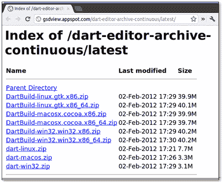
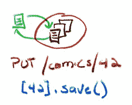
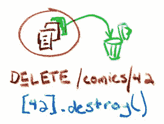
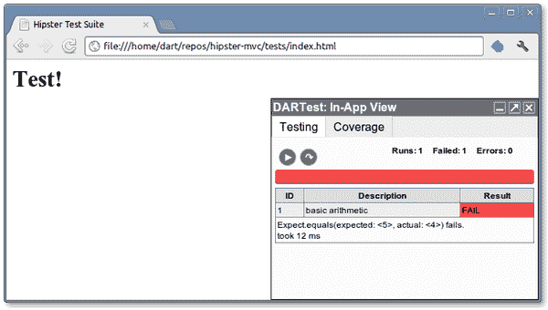
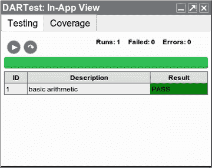
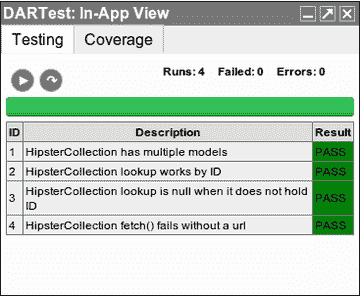

# hipsters 的 Dart


版权所有 © 2012, The Pragmatic Bookshelf。

# 对《Dart 极客指南》的早期赞誉

> 对于任何想了解 Dart 是什么以及如何将其与当前一代浏览器结合使用的人来说，这是一本有趣且易读的书。书中对 Dart 未来版本计划功能的评论，足以成为购买本书的理由。
> 
> — Matt Margolis
> 
> 起初我对 Dart 有些怀疑。这本书让我理解了它的前景，让我对其当前状态有了清晰的认识，并将成为我日后依赖的可靠参考。
> 
> — Juho Vepsäläinen
> 
> 这是关于这门令人兴奋且前景广阔编程语言的第一本书，文字清晰易懂，引人入胜，必将为 Dart 的成功做出贡献。我特别喜欢他对语言函数式特性的处理以及对 isolates 的讨论。
> 
> — Dr. Ivo Balbaert

# 引言

为什么选择 Dart？

当我问这个问题时，我并非在疑惑 Google 为何要开发 Dart。我也不是在问语言设计者希望实现什么目标。当然，在本书中我们都会涉及这些问题以及更多内容。

当我问“为什么选择 Dart？”时，这个问题是问给我自己的。究竟是什么让我认为这是一门值得学习的语言，甚至值得写一整本书？尤其是在 0.08 版本阶段。

这个问题的答案，是一段个人与职业的旅程，旨在理解如何让互联网尽可能快。早些年，我是一个简单的 Perl 黑客。我很喜欢这门语言以及我能用它做的事情。但当 Ruby 和 Ruby on Rails 出现时，我立刻跳了过去。简洁、干净的代码与强大的约定相结合，让我为之倾倒。不过只是一段时间。

接着，我探索了像 Sinatra[[1]](#f_0010.html_FOOTNOTE-1) 这样更小的框架，它们保留了 Ruby 语言的优美，但代码更小、速度更快。这两个框架为 Web 开发提供了一个很好的连续体，我很满意。

但也许还有更多？这最终让我接触到了 Node.js 以及构建在其上的各种 JavaScript 框架。似乎服务器端的速度已经无法再压榨出更多了。

然后我发现了 SPDY[[2]](#f_0010.html_FOOTNOTE-2) 协议，它让我如此着迷，以至于我写了《SPDY 书》[[3]](#f_0010.html_FOOTNOTE-3)。终于，这不仅仅是对现有技术的改进，更是对游戏规则的重新定义。

在与 SPDY 合作的过程中，我注意到一件事：无论我如何充分利用该协议提供的功能，Web 应用程序的最终速度仍然受限于网页和客户端脚本、CSS 等被评估的速度。


JavaScript 已经存在了十七年。当它首次被引入时，还没有 Web 2.0、Ajax、CSS，客户端交互也少得可怜。JavaScript 刚问世时，主要用途是用警告框验证客户端表单！

在接下来的十七年里，JavaScript 这门语言从网景通信公司拥有并缓慢开发的专有语言，演变为一个定期添加新功能的 Web 标准。但即使委员会能快速向标准添加新功能，Web 的进化速度却无限更快。

然后 Dart 出现了。Dart 提出：基于我们今天对 Web 的了解，如何从头构建 JavaScript？如何让它尽可能快地加载和运行？如何编写代码以便轻松定义和加载外部库？

如何让开发者轻松编写优美的代码？

如果 Dart 是这些问题的答案（我将努力证明这一点），那么 Dart 很可能是很长一段时间以来最令人兴奋的技术。

这就是“为什么选择 Dart？”的答案。

## 谁应该阅读本书（除了潮人之外）？

我写这本书主要是面向那些希望让自己的 JavaScript 技能保持最新状态的开发者。提升 JavaScript 技能的最佳方式是通过实践和阅读他人的代码。但有时，了解竞争对手的动态也能带来根本性的帮助。在这种情况下，当我们探索 Dart 带来的新特性时，我们可以更好地理解这门公认的优秀语言中存在的不足。

我也希望这本书能对新接触 Dart 的人有所帮助。Dart 已经是一个值得信赖的平台，用于为当今的 Web 浏览器构建极快的 Web 应用程序。我希望读完本书后，你能够充分武装自己，打造下一代 Web 应用。

这本书也适合那些为了学习而学习语言的开发者。我花了不少篇幅介绍 Dart 语言，尤其是那些让我感到惊喜和愉悦的地方。

当然，潮人也应该阅读。Dart 的独特性足以吸引典型的语言潮人，同时它的强大也足以让那些希望改变世界的潮人觉得值得一读。

## 本书的组织方式

我在这本书中尝试了一些不同的做法。我没有在每一章中介绍语言的零碎部分，而是大块地讲解。每个部分都从一个实际的 Dart 项目开始，并附带一些关于设计选择的评论。在这些部分中，我的目标是利用 Dart 众所周知的熟悉感，在让你真正感受这门语言方面取得显著进展。由于这些是真实项目，它们也是指出 Dart 优势以及（是的）一些缺点的绝佳机会。

每个项目章节之后都会跟着一些更小的专题章节，这些章节会更深入地探讨语言的某些方面。我用这些章节来涵盖项目章节中过于详细的内容，以及当前 Dart 参考资料中找不到的内容。

因此，如果你想快速了解这门语言，当然可以从只阅读项目章节开始。如果你想要一本更传统的书，那么跳过项目章节，只阅读专题章节。或者全部阅读——我会努力让你的时间花得值！

第一个项目是第 1 章，​*项目：你的第一个 Dart 应用程序*​。补充该项目的章节有第 2 章，​*基本类型*​；第 3 章，​*Dart 中的函数式编程*​；第 4 章，​*操作 DOM*​；以及第 5 章，​*编译为 JavaScript*​。

下一个项目是将第 1 章中的简单 Ajax 应用程序​*项目：你的第一个 Dart 应用程序*​ 改造成一个完整的 MVC 库，放在第 9 章，​*项目：提取库*​。如果你想全面测试一门语言，编写一个库（尤其是 MVC 库）是一个很好的方式。在 MVC 库之后，我们有第 7 章，​*类和对象*​；第 10 章，​*库*​；以及第 8 章，​*事件*​。

接下来，我们将通过第 11 章，​*项目：变化的行为*​ 来了解 Dart 中的依赖注入。与 JavaScript 不同，Dart 主要不是一门动态语言，尽管正如我们在该章中看到的，它仍然可以执行一些传统动态语言的技巧。该项目的后续内容是 Dart 测试的介绍，这是一个重要的主题，尽管在 Dart 中尚未完全成熟。

最后一个项目章节是第 13 章，​*项目：回调地狱的终结*​，我们在其中探索 Dart 的“futures”作为传统回调传递的高阶替代方案。这引出了第 14 章，​*Futures 和 Isolates*​ 中关于代码隔离和消息传递的讨论。

最后，我们以对本书其他部分未涵盖的各种 HTML5 技术的简要探索来结束本书。

## 本书未涵盖的内容

我们不会介绍 Dart 编辑器。从某些方面来说，这算是一种损失——像 Dart 这样的强类型语言非常适合代码补全，而 Dart 编辑器正是利用了这一点。不过，本书的重点是语言本身，而不是围绕它构建的工具。此外，有些人（包括我自己）会希望坚持使用自己选择的代码编辑器。

本书并非语言参考手册。对于这门语言的发展阶段来说，编写参考手册还为时过早。尽管如此，希望本书能成为规范（该规范并非面向开发者友好）[[4]](#f_0010.html_FOOTNOTE-4) 和 API 文档（某些地方仍不完整）[[5]](#f_0010.html_FOOTNOTE-5) 的有力补充。

## 关于未来

由于 Dart 会继续发展，本书也会随之更新。每年一到两次，具体取决于 Dart 的变化速度，本书的内容将被审查，然后进行修订、删除或补充。

如果你发现任何错误或需要改进的地方，请将其记录在公共问题跟踪器中：[`github.com/dart4hipsters/dart4hipsters.github.com/issues`](https://github.com/dart4hipsters/dart4hipsters.github.com/issues)。也欢迎提出新主题的建议！

## 约定

类名采用驼峰式（例如，`HipsterModel`）。类的文件名与类名相同（例如，`HipsterModel.dart`）。变量名采用蛇形命名法（例如，`background_color`），而函数和方法采用小写驼峰式（例如，`routeToRegExp`）。

## 让我们开始吧

在完成这些预备知识后，让我们开始编写没有 Web 遗留问题的 Web 代码。让我们编写一些 Dart 代码！

### 脚注

| [[1]](#f_0004.html_FNPTR-1) | [`sinatrarb.com`](http://sinatrarb.com) |
| [[2]](#f_0004.html_FNPTR-2) | [`www.chromium.org/spdy`](http://www.chromium.org/spdy) |
| [[3]](#f_0004.html_FNPTR-3) | [`spdybook.com/`](http://spdybook.com/) |
| [[4]](#f_0007.html_FNPTR-4) | Dart 规范保存在 [`www.dartlang.org/docs/spec/.`](http://www.dartlang.org/docs/spec/.) 它面向语言实现者，但在紧急情况下对应用程序开发者也有用。 |
| [[5]](#f_0007.html_FNPTR-5) | [`api.dartlang.org`](http://api.dartlang.org) |

版权所有 © 2012，The Pragmatic Bookshelf。

# 第一部分

开始


> Dart 有很多优点，但最令人印象深刻的特点或许是它对熟悉 JavaScript 的程序员来说非常亲切。在最初的这几章中，即使没有经验，我们也会编写一个 Dart 应用程序。

## 第 1 章

项目：你的第一个 Dart 应用程序

大多数编程书籍都以“Hello World!”示例开头。我要说，去他的——我们都是潮人。让我们开始编码吧！

由于 Dart 的首要设计目标是让人感到熟悉，因此我们不应该在深入时感到过于吃力。让我们直接跳转到更有趣的内容：一个基于 Ajax 的网站。任何一个真正的潮人都拥有大量的漫画收藏（我说得对吗？我不是唯一一个，对吧？），所以让我们考虑一个简单的 Dart 应用程序，它通过类似 REST 的接口来操作这些收藏内容。

在某个时刻，这可能会让人觉得过于仓促。别担心，我们会在后续章节中详细讲解。

## 1.1 后端

本章的示例代码可以在 [`github.com/eee-c/dart-comics`](https://github.com/eee-c/dart-comics) 的“your_first_dart_app”分支中找到。作为潮人，我们已经在使用 Node.js，因此后端需要 Node.js 和 npm。项目 README 中包含了相关说明。

作为类似 REST 的应用程序，它应该支持以下操作：

*   `GET /comics`（返回漫画列表）
*   `GET /comics/42`（返回单本漫画）
*   `PUT /comics/42`（更新漫画条目）
*   `POST /comics`（在收藏中创建新漫画）
*   `DELETE /comics/42`（删除漫画）

除此之外，我们不会过多担心后端的细节。

## 1.2 Dart 的 HTML

我们的整个应用程序将遵循近期客户端 MVC 框架的伟大传统。因此，我们只需要一个网页。

```html
<!-- your_first_dart_app/index.html -->
<!DOCTYPE html>
<html>
<head>
<title>Dart Comics</title>
<link rel="stylesheet" href="/stylesheets/style.css">

<!-- 强制 Dartium 启动脚本引擎 -->
<script language="text/javascript">
 navigator.webkitStartDart();
</script>

<!-- 主应用程序脚本 -->
<script src="/scripts/comics.dart"
 type="application/dart"></script>
</head>

<body>
<h1>Dart Comics</h1>
<p>欢迎来到 Dart Comics</p>

<ul id="comics-list"></ul>

<p id="add-comic">
 向收藏中添加一本酷炫的漫画。
</p>
</body>
</html>
```

这个网页的大部分内容应该都很熟悉；它包含简单的 HTML、CSS 链接和脚本。

### HTML 头部

唯一需要注意的奇怪之处是第一个 `<script>` 标签，其中 JavaScript 启动了 Dart 脚本引擎。

```html
<!-- your_first_dart_app/_index_force_dartium_script_engine.html -->
<!-- 强制 Dartium 启动脚本引擎 -->
<script language="text/javascript">
 navigator.webkitStartDart();
</script>
```

> 重要提示：  在撰写本文时，需要在 Dartium（支持 Dart 的 Chrome 版本）上使用 `navigator.webkitStartDart()` 来启动 Dart VM。[[6]](#f_0017.html_FOOTNOTE-6) 这一要求应该在不久的将来会消失。

接下来，我们加载实际代码的内容。这里唯一的变化是 `<script>` 标签中不同的 `type` 属性，表明这是 Dart 代码。

```html
<!-- your_first_dart_app/_index_src_dart.html -->
<!-- 主应用程序脚本 -->
<script src="/scripts/comics.dart"
 type="application/dart"></script>
```

关于使用 Dart 加载库和包含代码的更多内容，我们将在第 10 章 *库* 中讨论。目前，只需注意到加载 Dart 的方式与我们预期的工作方式完全一致，这就很好了。

### HTML 正文

至于 HTML 的正文部分，没有什么新内容，但我们应该注意两个元素的 ID，我们将为它们附加行为。

```html
<!-- your_first_dart_app/_index_body.html -->
<h1>Dart Comics</h1>
<p>欢迎来到 Dart Comics</p>
<ul id="comics-list"></ul>
<p id="add-comic">
 向收藏中添加一本酷炫的漫画。
</p>
```

对于 `#comics-list` 这个 UL 元素，我们将附加后端数据存储中的漫画列表。我们还将为 `#add-comic` 段落标签附加一个表单处理器。那么，让我们开始吧。

## 1.3 Dart 中的 Ajax

我们通过在一个 `main` 函数中加载几个 Dart 库来启动 Dart 应用程序，该函数位于 `scripts/comics.dart` 中。

```dart
// your_first_dart_app/comics_initial_main.dart
#import('dart:html');
#import('dart:json');
main() {
  load_comics();
}
load_comics() {
  // 在这里执行操作
}
```

正如我们将在第 10 章 *库* 中看到的，这些 `#import` 语句具有强大的功能。目前，我们可以简单地将它们视为引入核心 Dart 行为之外功能的一种手段。

所有 Dart 应用程序都使用 `main` 作为执行的入口点。像在 JavaScript 中那样直接编写代码并期望它运行，在这里是行不通的。起初这看起来可能像 C 语言，但说实话，散布在任意数量的源文件和 HTML 中的代码行都会立即开始执行，这合理吗？`main` 入口点不仅仅是惯例；它是语言强制实施的最佳实践。

至于 `load_comics` 函数，我们逐步分析。我们需要确定列表将附加到的 DOM 元素（`#comics-list`）。接下来，我们需要一个 Ajax 调用来填充该 DOM 元素。为了实现这两个目标，我们的第一段 Dart 代码可能如下所示：

```dart
// your_first_dart_app/_load_comics.dart
load_comics() {
  var list_el = document.query('#comics-list');
  ajax_populate_list(list_el);
}
```

除了明显省略了 `function` 关键字之外，这个示例可能看起来就是 JavaScript 代码！我们将在第 3 章 *Dart 中的函数式编程* 中介绍更多差异。Dart 中仍然保留了我们熟悉和喜爱的分号和花括号——语言设计者无疑让这门语言至少在表面上看起来熟悉。

> 注意：  与 JavaScript 不同，Dart 中的分号不是可选的。


除了熟悉之外，这段代码还易于阅读和理解，一目了然。没有那些古怪的、遗留的 DOM 方法。我们使用 `document.query()` 来获取元素，而不是 `document.findByElementId()`。并且我们使用了熟悉的 CSS 选择器 `#comics-list`，就像我们在 jQuery 中习惯的那样。

找到要填充的 UL 元素后，我们来看看如何发起 Ajax 请求。与 JavaScript 一样，我们创建一个新的 `XHR` 对象，为请求加载完成时添加一个处理程序，然后打开并发送请求。

```
// your_first_dart_app/_ajax_populate_list.dart
ajax_populate_list(container) {
  var req = new XMLHttpRequest();
  
  req.on.load.add((event) {
    var list = JSON.parse(req.responseText);
    container.innerHTML = graphicNovelsTemplate(list);
  });
  
  // verb, resource, boolean async
  req.open('get', '/comics', true);
  req.send();
}
```

对于过去做过 Ajax 编程的人来说，这段代码的大部分内容应该立刻就能看懂。我们首先创建一个 `XHR` 对象，最后指定要获取的资源并实际发送请求。

正是在添加事件处理程序时，我们看到了与 JavaScript 方式的不同之处。`XHR` 对象有一个 `on` 属性，列出了所有支持的事件处理程序。我们访问其中一种处理程序类型 `load`，以便通过名称恰当的 `add` 方法向它添加一个处理程序。在这个例子中，我们将提供的 `JSON` 解析成一个哈希列表，可能看起来像这样：

```
// your_first_dart_app/comics.json
[
  {"title":"Watchmen",
   "author":"Alan Moore",
   "id":1},
  {"title":"V for Vendetta",
   "author":"Alan Moore",
   "id":2},
  {"title":"Sandman",
   "author":"Neil Gaiman",
   "id":3}
]
```

至此，我们触及了简单 Dart 应用程序的最后一部分——用于填充漫画书列表的模板。

```
// your_first_dart_app/_graphic_novels_template.dart
graphic_novels_template(list) {
  var html = '';
  list.forEach((graphic_novel) {
    html += _graphic_novel_template(graphic_novel);
  });
  return html;
}

_graphic_novel_template(graphic_novel) {
  return """
<li id="${graphic_novel['id']}">
${graphic_novel['title']}
by
${graphic_novel['author']}
</li>
""";
}
```

第一个函数简单地遍历我们的漫画书列表（在内部，我们将其视为图像小说），构建一个 HTML 字符串。

第二个函数演示了 Dart 的另外两个特性：多行字符串和变量插值。多行字符串由三个引号（单引号或双引号）标识。在字符串内部，我们可以使用美元符号插值变量（甚至简单的表达式）。对于简单的变量插值，花括号是可选的：`$name` 等同于 `${name}`。对于更复杂的插值，例如哈希查找，花括号是必需的。

就是这样！我们拥有一个功能完备、基于 Ajax 的 Web 应用程序，随时可以运行。组装后的代码如下：

```
// your_first_dart_app/comics.dart
#import('dart:html');
#import('dart:json');
main() {
  load_comics();
}
load_comics() {
  var list_el = document.query('#comics-list');
  ajax_populate_list(list_el);
}
ajax_populate_list(container) {
  var req = new XMLHttpRequest();
  req.on.load.add((event) {
    var list = JSON.parse(req.responseText);
    container.innerHTML = graphicNovelsTemplate(list);
  });
  // verb, resource, boolean async
  req.open('get', '/comics', true);
  req.send();
}
graphic_novels_template(list) {
  var html = '';
  list.forEach((graphic_novel) {
    html += _graphic_novel_template(graphic_novel);
  });
  return html;
}
_graphic_novel_template(graphic_novel) {
  return """
<li id="${graphic_novel['id']}">
${graphic_novel['title']}
by
${graphic_novel['author']}
</li>
""";
}
```

加载页面后效果如下：


在我们探索 Dart 的过程中，这是一个相当不错的开端。诚然，我们略过了很多让 Dart 成为一门优秀小语言的特点。但通过这样做，我们为自己打下了一个基于 Ajax 的 Web 应用程序的良好基础。最棒的是，我们编写的所有代码看起来与 JavaScript 并没有太大不同。某些语法比我们习惯的 JavaScript 更简洁（没有人会抱怨更简洁的代码），而且那些字符串也非常好用。但总而言之，可以稳妥地说，我们能够在相对较短的时间内高效使用 Dart。

## 1.4 这个应用无法运行

按照目前所写，这个应用程序实际上无法在任何地方运行……嗯，几乎任何地方。

Dart 在任何浏览器中都不受支持（甚至 Chrome 也不支持）。要原生运行这个 Web 应用程序，我们需要安装 Dartium——一个嵌入了 Dart VM 的 Chrome 分支。Dartium 可以从 Dart Lang 网站获取。[[7]](#f_0017.html_FOOTNOTE-7)

即使 Dart 最终被纳入 Chrome 本身，我们仍然面临只支持市场上部分浏览器的问题。这太愚蠢了。

幸运的是，Dart 可以编译成 JavaScript，这意味着你可以拥有 Dart 的强大功能，同时仍然面向所有平台。为了轻松实现这一点，我们添加了一个小型 JavaScript 库，当检测到浏览器不支持 Dart 时，它会加载编译后的等效 JavaScript。

```
// your_first_dart_app/_index_src_js_fallback.html
<!-- Enable fallback to Javascript -->
<script src="/scripts/conditional-dart.js"></script>
```

我们将在第 5 章 *编译为 JavaScript* 中详细讨论这个辅助文件。目前，只需注意我们的 Dart 代码并没有被锁定在某个单一浏览器供应商的世界里。我们绝对没有看到 *VBScript 的回归*。

## 1.5 下一步

不可否认，这是一次对 Dart 的旋风式介绍。能够如此快速地启动并运行起来，真是太棒了。更棒的是，感觉我们现在就可以高效工作了。


尽管如此，我们才刚刚开始接触 Dart，而且毫无疑问，我们的 Dart 代码还有改进空间。因此，让我们利用接下来的几章来熟悉 Dart 中的一些重要概念。之后，我们将在第 6 章 *项目：Dart 中的 MVC* 中准备将我们的 Dart 应用转换为 MVC 架构。

### 脚注

[[6]](#f_0014.html_FNPTR-6) [`www.dartlang.org/dartium/`](http://www.dartlang.org/dartium/)

[[7]](#f_0016.html_FNPTR-7) [`www.dartlang.org/dartium/`](http://www.dartlang.org/dartium/)

版权所有 © 2012，The Pragmatic Bookshelf。

## 第 2 章

基本类型

本书反复强调的一个主题是 Dart 力求让人感到熟悉。如果确实如此，那么对语言基本组件的讨论应该相对简短——事实也的确如此。即便如此，对核心类型进行一些介绍也只会有所帮助。当然，这里那里也会有一些“陷阱”。

## 2.1 数字

整数和双精度浮点数都是数字类型，这意味着它们都支持许多相同的方法和运算符。Dart 的数字与其他许多语言中的数字工作方式非常相似。

```
2 + 2; // 4
2.2 + 2; // 4.2
2 + 2.2; // 4.2
2.2 + 2.2; // 4.4
```

可以看出，Dart 数字在混合运算时会做出“正确的事情”。

## 2.2 字符串

字符串是不可变的，这是一种花哨的说法，意思是字符串操作会创建新字符串，而不是修改现有字符串。字符串（像数字一样）是可哈希的，这意味着唯一对象具有唯一的哈希码以便区分。如果我们将一个变量赋给另一个持有字符串的变量，那么两者将具有相同的哈希码，因为它们是同一个对象。

```
var str1 = "foo",
str2 = str1;

str1.hashCode(); // 425588957
str2.hashCode(); // 425588957
```

但是，如果我们修改第一个字符串，结果将是一个全新的对象，而副本继续指向原始字符串。

```
str1 += "bar";

str1.hashCode(); // 447120306
str2.hashCode(); // 425588957
```

Dart 竭尽全力让字符串操作变得简单。可以通过将字符串括在三引号中来创建多行字符串。

```
"""Line #1
Line #2
Line #3""";
```

Dart 还认为相邻的字符串会被拼接。

```
'foo' ' ' 'bar'; // 'foo bar'
```

这种相邻字符串的便利性甚至扩展到多行字符串。

```
'foo'
' '
'bar'; // 'foo bar'
```

> 重要：  在撰写本文时，这种相邻字符串拼接并非在所有地方都有效，但它绝对是计划规范的一部分。

Dart 字符串的最后一个便利是变量插值。Dart 使用 `$` 来表示要插值的变量。

```
var name = "Bob";

"Howdy, $name"; // "Howdy, Bob"
```

如果对变量表达式在哪里结束、字符串在哪里开始存在混淆的可能，则可以将花括号与 `$` 一起使用。

```
var comic_book = new ComicBook("Sandman");

"The very excellent ${comic_book.title}!";
// "The very excellent Sandman"
```

## 2.3 布尔值

值 `true` 和 `false` 是 Dart 中唯一允许的布尔（`bool`）类型。在 Dart 中，“真值”的概念再简单不过了：如果不是 `true`，那就是 `false`。考虑以下代码：

```
var name, greeting;

greeting = name ? "Howdy $name" : "Howdy";
// "Howdy"

/*** Name is still not true ***/

name = "Bob";
greeting = name ? "Howdy $name" : "Howdy";
// "Howdy"

greeting = (name != null) ? "Howdy $name" : "Howdy";
// "Howdy Bob"
```

如果你来自许多其他语言，那么 `null`、`""` 和 `0` 在布尔上下文中求值为 `false` 并不会让你感到惊讶。但可能需要一些时间来适应 `"Bob"` 和 `42` 也求值为 `false`。

在“类型检查”模式（在第 2.7 节 *类型* 中描述）下，真值的语义略有不同，但最好不要依赖这种细微的变化。如果我们始终假设前面的情况成立，那么就不会出问题。

> 警告：  在某些较旧的 Dart 实现中，前面代码中的第二个 `greeting`（`name ? "Howdy $name" : "Howdy"`）会将 `name` 求值为 `true`，从而得到 `"Howdy Bob"`。不要依赖这种行为，因为它会改变，产生与你预期完全相反的结果。

在第 7 章 *类和对象* 中，我们将探讨运算符定义，它允许类特定的 `equals` / `==` 定义。这为 Dart 在布尔值方面提供了一定的灵活性。

## 2.4 哈希映射（又名哈希、关联数组）

键值对在 Dart 中通过 `HashMap` 对象实现。定义一个 `options` 哈希会创建一个 `HashMap`。

```
var options = {
'color': 'red',
'number': 2
};
```

正如你所料，从 `HashMap` 中检索值使用方括号。

```
var options = {
'color': 'red',
'number': 2
};
options['number']; // 2
```

`HashMap` 实现了 `Map` 接口，大多数相关的 API 文档都可以在那里找到。[[8]](#f_0026.html_FOOTNOTE-8) 这包括关于检索键（`getKeys`）和值（`getValues`）以及使用 `forEach` 遍历整个对象的信息。

```
var options = {
 'color': 'red',
 'number': 2
};

options.forEach((k, v) {
 print("$k: $v");
});
// number: 2
// color: red
```

> 注意：  键值对的顺序不保证。

`HashMap` 的一个极其有用的特性是 `putIfAbsent` 方法。以下两种写法是等价的：

```
// 弱
if (!options.hasKey('age')) {
 var dob = new Date.fromString('2000-01-01'),
 now = new Date.now();
 options['age'] = now.year - dob.year;
}

// 自信
options.putIfAbsent('age', findAge);

findAge() {
 var dob = new Date.fromString('2000-01-01'),
 now = new Date.now();
 return now.year - dob.year;
});
```

在第一个示例中，条件语句和代码块都必须关心 `options` `HashMap` 的实现细节。在第二个示例中，`findAge` 函数只关心计算当前年龄，而 `options` `HashMap` 只关心添加值。

> 重要：  始终寻找使用 `putIfAbsent` 的机会。你的 Dart 代码会因此更加整洁。

第一个示例可以清理为以下形式：

```
if (!options.hasKey('age')) {
 options['age'] = findAge();
}
```

但是，如果没有 `putIfAbsent`，我们很可能将查找年龄的实现留在条件语句内部。无论如何，条件格式永远不会像 `putIfAbsent` 那样简洁。


`options.putIfAbsent('age', findAge);`

`putIfAbsent`——学会它，爱上它。它会拯救你的生活（好吧，也许不会，但会让生活美好得多）。

## 2.5 列表（又称数组）

列表是任何语言的基本需求。为了让开发者轻松上手，Dart 在列表方面保持了符合预期的设计。

```
var muppets = ['Count', 'Bert', 'Snuffleupagus'];
var primes = [1, 2, 3, 5, 7, 11];
// 索引从零开始
muppets[0]; // 'Count'
primes.length; // 6
```

Dart 确实提供了一些好用且一致的方法来操作列表。

```
var muppets = ['Count', 'Bert', 'Ernie', 'Snuffleupagus'];

muppets.setRange(1, 2, ['Kermit', 'Oscar']);
// muppets => ['Count', 'Kermit', 'Oscar', 'Snuffleupagus']

muppets.removeRange(1, 2);
// muppets => ['Count', 'Snuffleupagus'];

muppets.addAll(['Elmo', 'Cookie Monster']);
// muppets => ['Count', 'Snuffleupagus', 'Elmo', 'Cookie Monster']
```

还有一些内置的迭代方法。

```
var muppets = ['Count', 'Bert', 'Ernie', 'Snuffleupagus'];

muppets.forEach((muppet) {
  print("$muppet is a muppet.");
});
// =>
// Count is a muppet.
// Bert is a muppet.
// Ernie is a muppet.
// Snuffleupagus is a muppet.

muppets.some((muppet) {
  return muppet.startsWith('C');
});
// true
muppets.every((muppet) {
  return muppet.startsWith('C');
});
// false

muppets.filter((muppet) {
  return muppet.startsWith('C');
});
// ['Count']
```

> 重要提示：在撰写本文时，Dart 缺少用于对列表执行高阶操作的 `reduce` 或 `fold` 方法。

值得庆幸的是，Dart 的列表和数组并没有太多需要介绍的内容。它们是 Dart 中许多“开箱即用”的特性之一。

### 集合

上一节中的迭代方法实际上并非定义在 `List` 类上，而是来自 `List` 的父类：`Collection`。`Collection` 家族的其他两个成员是 `Set` 和 `Queue`。

`Set` 类是一种 `List`，其中的元素始终唯一，并且公开了一些集合操作。

```
var sesame = new Set.from(['Kermit', 'Bert', 'Ernie']);
var muppets = new Set.from(['Piggy', 'Kermit']);

// 无效果，因为 Ernie 已在 Set 中
sesame.add('Ernie'); // => ['Kermit', 'Bert', 'Ernie']
sesame.intersection(muppets); // => ['Kermit']
sesame.isSubsetOf(muppets); // => false
```

`Queue` 是一种可以在开头进行操作的 `List`。

```
var muppets = new Queue.from(['Piggy', 'Rolf']);

muppets.addFirst('Kermit');
// muppets => ['Kermit', 'Piggy', 'Rolf']

muppets.removeFirst();
muppets.removeLast();
// muppets => ['Piggy']
```

`Queue` 的存在也意味着普通列表不能在开头进行操作。也就是说，`List` 没有 `shift` 或 `unshift` 方法。

## 2.6 日期

Dart 为浏览器中的日期和时间带来了急需的合理性。许多 JavaScript 难民心中燃烧的问题的答案是“是的”——第一个月实际上是 `1`。让我们开始欢呼吧。

Dart 日期的便利性不止于此。例如，有多种创建日期的方式。

```
var mar = new Date.fromString('2012-03-01 Z-0500');
// 2012-03-01 00:00:00.000

var now = new Date.now();
// 2012-03-10 01:02:24.149

var apr = new Date(2012, 4, 1, 0, 0, 0, 0);
// 2012-04-01 00:00:00.000
```

更棒的是，操作日期不仅可行，而且相当方便。

```
var mar = new Date(2012, 3, 1, 0, 0, 0, 0);
var apr = new Date(2012, 4, 1, 0, 0, 0, 0);

var diff = apr.difference(mar);
diff.inDays; // => 31

apr.add(new Duration(days: 15)); // => 2012-04-16
```

`Date` 中的 `difference` 方法返回一个 `Duration` 对象，它封装了一段时间。`Duration` 可以以任意时间单位查询——从天一直到毫秒。正如我们在 `add` 示例中看到的，`Duration` 在向特定日期添加或减去时间时也非常有用。

在 Dart 中处理日期并不是一件令人畏惧的事情。正如已经看到的，它们非常令人愉快。

## 2.7 类型

> 重要提示：强烈建议在类型检查模式下编写 Dart 代码。默认情况下，Dart 以“生产”模式运行，当遇到看似冲突的类型定义时不会崩溃。因此，开发者有责任在开发模式下尽可能多地捕获此类问题。要启用类型检查模式，请从命令行启动 Dartium：`DART_FLAGS='--enable_type_checks --enable_asserts' /path/to/dartium`。

在继续讨论其他主题之前，让我们快速了解一下如何在 Dart 中声明变量。到目前为止，我们一直遵循 JavaScript 的惯例，使用 `var` 关键字声明变量。在 Dart 中，`var` 表示变量类型。换句话说，我们不仅没有指定类型，而且还在告诉解释器该类型可以改变。

```
var muppet = 'Piggy';

// Dart 和 JavaScript 一样允许这样做，但拜托！
muppet = 1;
```

Dart 是一种某种程度上强类型的语言，这意味着它更倾向于我们声明类型而不是使用 `var`。

```
String muppet = 'Piggy';

// 在类型检查模式下失败
// 否则会发出警告
muppet = 1;
```

如上所示，Dart 仍然允许我们做一些愚蠢的事情，但它会发出警告。在类型检查模式下（可以在命令行启用），上述代码会抛出异常。

虽然 `var` 关键字是可以接受的，但通常认为声明类型是一种良好的做法。

```
int i = 0;
bool is_done = false;
String muppet = 'Piggy';
Date now = new Date.now();
```

对于包含其他类型的类型，也可以声明所存储对象的类型。

```
HashMap<String,bool> is_awesome = {
  'Scooter': false,
  'Bert': true,
  'Ernie': false
};

List<int> primes = [1,2,3,5,7,11];
```

声明类型使意图更易读，这对可维护性很重要。类型还有助于解释器在编译代码时运行得更快。

## 2.8 下一步

本章内容非常丰富。到目前为止，Dart 的许多方面应该仍然让人感到熟悉，但也有一些关键（且我希望是受欢迎的）差异。

### 脚注


[[8]](#f_0022.html_FNPTR-8) | [`api.dartlang.org/dart_core/Map.html`](http://api.dartlang.org/dart_core/Map.html)

版权所有 © 2012，The Pragmatic Bookshelf。

## 第 3 章

Dart 中的函数式编程

JavaScript 之所以特别，部分原因在于它对函数式编程的支持。由于 Dart 旨在让人感到熟悉，让我们来看看在 Dart 中进行函数式编程是怎样的体验。

我们从经典的斐波那契数列开始。在 JavaScript 中，可能会这样写：

```
function fib(i) {
  if (i < 2) return i;
  return fib(i-2) + fib(i-1);
}
```

斐波那契数列是探索语言函数式编程特性的绝佳示例，因为它本身就是一个函数，同时也因其递归特性展示了如何调用函数。

我不打算赘述递归或该函数的细节。[[9]](#f_0031.html_FOOTNOTE-9) 相反，让我们专注于如何在 JavaScript 中使用这个函数。

```
fib(1) // => 1
fib(3) // => 3
fib(10) // => 55
```

可见，JavaScript 函数非常简单。它们以 `function` 关键字开头，后跟函数名、括号内的参数列表以及描述函数体的代码块。

那么，等效的 Dart 版本会是什么样子呢？

```
// Dart
fib(i) {
  if (i < 2) return i;
  return fib(i-2) + fib(i-1);
}
```

等等，这和 JavaScript 版本有什么不同？

```
function fib(i) {
  if (i < 2) return i;
  return fib(i-2) + fib(i-1);
}
```

敏锐的读者会注意到，Dart 版本缺少了 `function` 关键字。除此之外，两个函数定义完全相同，调用方式也一样。

```
fib(1); // => 1
fib(5); // => 5
fib(10); // => 55
```

至少我们可以看出，Dart 语言的设计者确实成功地创造出了某种熟悉的东西。

## 3.1 匿名函数

经验丰富的 JavaScript 程序员非常擅长使用匿名函数。由于 JavaScript 中的函数是一等概念，函数在 JavaScript 中被随意传递。有些人甚至哀叹某些框架的回调地狱，但抛开美学不谈，不可否认匿名函数在 JavaScript 中非常重要。那么，在 Dart 中肯定也是如此，对吧？

在 JavaScript 中，匿名函数省略了函数名，只使用 `function` 关键字。

```
function(i) {
  if (i < 2) return i;
  return fib(i-2) + fib(i-1);
}
```

我们已经看到，JavaScript 和 Dart 函数之间的唯一区别是后者没有 `function` 关键字。事实证明，这也是 JavaScript 和 Dart 匿名函数之间的唯一区别。

```
(i) {
  if (i < 2) return i;
  return fib(i-2) + fib(i-1);
}
```

乍一看，这看起来很奇怪——几乎是赤裸的。但这只是我们 JavaScript 的视角。Ruby 的 lambda 和 proc 看起来非常相似。

```
{ |i| $stderr.puts i }
```

仔细想想，JavaScript 中的 `function` 关键字到底有什么作用？直觉反应是它有助于识别匿名函数，但实际上，它只是噪音。

考虑这个斐波那契打印程序：

```
var list = [1, 5, 8, 10];
list.forEach(function(i) {fib_printer(i)});

function fib_printer(i) {
  console.log("Fib(" + i + "): " + fib(i));
}

function fib(i) {
  if (i < 2) return i;
  return fib(i-2) + fib(i-1);
}
```

`function` 关键字是帮助还是阻碍了代码的可读性？显然，它使情况变得更糟，尤其是在 `forEach` 调用内部。

让我们看看等效的 Dart 代码。

```
var list = [1, 5, 8, 10];
list.forEach((i) {fib_printer(i)});

fib_printer(i) {
  print("Fib($i): " + fib(i));
}

fib(i) {
  if (i < 2) return i;
  return fib(i-2) + fib(i-1);
}
```

> 注意：  我们使用了第 1 章《项目：你的第一个 Dart 应用》中首次提到的字符串插值技巧，将计数器 `i` 的值插入到 `"Fib($i)"` 中。

我们所做的只是去掉了 `function` 关键字，但代码的意图却清晰得多。将这种效果放大到整个项目，代码库的长期健康度会显著提升。

说到清晰度，如果花括号让你感到不适，那么对于简单函数，可以使用哈希火箭语法。我们可以将匿名迭代器写成 `(i) => fib_printer(i)`，而不是 `(i) { fib_printer(i) }`。因此，我们的代码变成如下：

```
var list = [1, 5, 8, 10];
list.forEach((i) => fib_printer(i));

fib_printer(i) {
  print("Fib($i): " + fib(i));
}

fib(i) {
  if (i < 2) return i;
  return fib(i-2) + fib(i-1);
}
```

参数 `(i)` 在匿名函数的定义和 `fib_printer(i)` 的调用中重复出现。在 JavaScript 中，无法简化这一点。然而在 Dart 中，函数 `(i) => fib_printer(i)` 可以进一步简化为 `fib_printer`。

```
var list = [1, 5, 8, 10];
list.forEach(fib_printer);

fib_printer(i) {
  print("Fib($i): " + fib(i));
}

fib(i) {
  if (i < 2) return i;
  return fib(i-2) + fib(i-1);
}
```

这是一个非常棒的小技巧，可以在我们的 Dart 代码中随意使用。

## 3.2 一等函数

将匿名函数传递给像 `forEach` 这样的迭代器，已经展示了对一等对象的一些良好支持——即将函数视为可以赋值和传递的变量。

在撰写本文时，Dart 缺乏支持复杂函数式概念（如柯里化或组合子）的工具（例如反射）。尽管如此，在 Dart 中已经可以实现部分函数应用。

部分应用的经典示例是将一个返回三个数之和的 `add` 函数转换为另一个固定其中一个参数的函数。

```
add(x, y, z) {
  return x + y + z;
}

makeAdder2(fn, arg1) {
  return (y, z) {
    return fn(arg1, y, z);
  };
}

var add10 = makeAdder2(add, 10);
```

部分应用这个名称来源于返回一个已经应用了一个参数的函数。在这个例子中，`makeAdder2` 函数返回另一个接受两个参数的函数。调用这个新函数的结果与调用原始函数并将第一个参数固定为 `arg1` 的结果相同。

此时，`add10` 函数接受两个数字，将它们相加，并将总和增加十。


`add10(1,1); // => 12`

遗憾的是，目前 Dart 的组合器（combinators）只能做到这一步。不过这种情况很快就会改变，因为反射功能正在积极开发中。

## 3.3 可选参数

在 JavaScript 应用中，提取可选参数是一件相当繁琐的事情。Dart 通过内置语法解决了这个问题，该语法封装了这一概念。

下面，可选参数被放在方括号中：

```
f(a, [b1='who', b2, b3, b4, b5, b6, b7]) {
  // ...
}
```

可以这样调用该函数而不传入任何可选参数：`f('foo')`。在这种情况下，函数体内的参数 `a` 将被赋值为 `'foo'`。

要赋值可选参数，在函数调用时用参数名作为前缀。

```
f('foo', b6:'bar', b3:'baz');
```

调用上述函数的结果是，在 `f` 内部，变量 `a` 被赋值为 `'foo'`，`b1` 为 `'who'`，`b3` 为 `'baz'`，`b6` 为 `'bar'`。其余所有可选参数 `b2`、`b4`、`b5` 和 `b7` 都将为 `null`。

这里特别值得注意的是，我们可以在函数参数列表中通过赋值来为可选参数指定默认值。在这个例子中，我们将 `b1` 变量的默认值设置为字符串 `'who'`。

这无疑比在对象字面量中翻找要强得多。可选参数在类方法和实例方法中更加强大，我们将在第 7 章 *类与对象* 中看到。

> 关于 `this` 的快速说明： Dart 与 JavaScript 的不同之处之一在于 `this` 关键字的使用。Dart 对此的立场是，`this` 与当前函数完全无关。相反，`this` 是为对象保留的，并且始终引用当前对象。在 Dart 中，没有 `this` 的绑定、应用或调用。换句话说，`this` 与函数无关。我们将在第 7 章 *类与对象* 中再次讨论这一点，但只是简要提及，因为在 Dart 中这实在太简单了！

## 3.4 下一步

从很多方面来看，本章的内容仍在不断演进中。Dart 目前还缺少 JavaScript 程序员可用的许多强大功能：没有反射，函数内部也没有 `arguments` 属性。

即使缺少这些，我们已经看到 Dart 在其允许我们做的事情上已经非常强大。我们将在第 11 章 *项目：变化的行为* 中再次回到这个话题。

### 脚注

[[9]](#f_0027.html_FNPTR-9) 如果你需要复习，斐波那契数列在其他地方有详细文档：[`en.wikipedia.org/wiki/Fibonacci_number`](http://en.wikipedia.org/wiki/Fibonacci_number)。

版权所有 © 2012，The Pragmatic Bookshelf。

## 第 4 章

操作 DOM

不访问和操作 DOM，我们就无法编写 Web 应用程序。[[10]](#f_0039.html_FOOTNOTE-10) 遗憾的是，Dart 无法完全摆脱 DOM API 中那些既成事实又常常令人抓狂的方面。幸运的是，Dart 确实提供了一个兼容性库，在操作网页时恢复了一些理智。

## 4.1 dart:html

我们将用来与网页中的对象交互和操作的库是 `dart:html`。我们将在第 10 章 *库* 中更详细地讨论库。现在，只需将它们视为与其他语言（当然，JavaScript 除外）中的库一样——一种封装逻辑上和物理上独立功能的机制。

`dart:html` 库可不是你祖母时代的 DOM API。`dart:html` 核心库是 Dart 对 DOM 编程从一开始就应该是什么样子的理解。

## 4.2 查找元素

DOM 的主要入口点是 `document.query()` 和 `document.queryAll()`。两者都接受一个 CSS 选择器作为参数。前者返回单个匹配的元素；后者返回所有匹配元素的列表。以下是一些简单的示例：

```
document.query('h1');
// => 文档中的第一个 <h1>

document.query('#people-list');
// => id 为 'people-list' 的元素

document.query('.active');
// => 第一个具有 'active' 类的元素

document.queryAll('h2');
// => 所有 <h2> 元素
```

`query` 和 `queryAll` 方法实际上是 `Element` 类的方法。`Document` 与所有其他表示 DOM 一部分的类一样，是 `Element` 的子类。在实践中，这意味着我们可以先找到某个元素，然后从中进行查询，从而将查询限制在特定元素内。

```
var list = document.query('ul#people-list');

var last_person = list.query(':last-child');

last_person.innerHTML
// => 'Bob'
```

或者我们可以链式调用：

```
document.
 query('ul#people-list').
 query(':last-child').
 innerHTML;
// => 'Bob'
```

> 重要提示：
>
> 尽管链式调用 `query` 方法可能让人联想到类似 jQuery 的组合性，但 Dart 明确不处理包装集。
>
> 考虑尝试高亮显示无序列表中的人名。在 jQuery 中，我们可能会这样写：
>
> ```
> $('li', 'ul#people-list').attr('class', 'highlight');
> ```
>
> 在 Dart 中，我们必须手动遍历每个元素。
>
> ```
> document.
>  query('ul#people-list').
>  queryAll('li').
>  each((li) {
>    li.addClass('highlight');
>  });
> ```
>
> 尽管 Dart 使操作 DOM 比纯 JavaScript 更容易，但 jQuery 在某些方面仍然做得更好。

在 Dart 中查找页面元素的关键在于，`query` 和 `queryAll` 基本上能按预期工作，使得查询 DOM 变得简单。

## 4.3 添加元素

在 HTML 文档中创建和添加新元素需要结合 Dart 的两个概念：`Element` 和 `Node`。本质上，节点和元素在 Dart 中的含义与在典型 DOM 编程中相同——节点是两者中更通用的概念。节点可以表示元素、元素的属性甚至文本，而元素仅指 HTML 标签对象。

要在 Dart 中创建新元素，我们可以使用 `Element` 的便捷命名构造函数 `html`。

```
var gallery = new Element.html('<div id="gallery">');
```

`Element.html()` 命名构造函数并不限制我们只创建单个元素。我们可以创建更复杂的 HTML 来插入页面。

```
var gallery = new Element.html("""
<div id="gallery">
  <ul>
    <li>
    <li>
    <li>
    <!-- ... -->
  </ul>
</div>
""");
```

Dart 的字符串插值在构建较大的 HTML 片段时特别方便。结果几乎可以像模板一样。

```
gallery(title, photographer) {
  return new Element.html("""
<div id="gallery">
  <h2>${title}</h2>
  <ul>
    <li>
""");
```


```
<li>
<li>
<!-- ... -->
</ul>
<h3 class="footer">
照片提供者: ${photographer}
</h3>
</div>
""");
}

要将一个元素插入到文档中，最简单的方法是获取一个`NodeList`，然后将新元素追加到其中。

```
var gallery = new Element.html('<div id="gallery">');
document.
 query('#content').
 nodes.
 append(gallery);
```

当需要更复杂的元素插入时，Dart 支持标准的 `insertAdjacentHTML` 方法。[[11]](#f_0039.html_FOOTNOTE-11) 这比 jQuery 的 `prepend`、`append`、`before` 和 `after` 这些 `Element` 方法要冗长得多。即使是稍短一些的 `insertAdjacentElement`，与 jQuery 的等效方法相比也显得逊色。

```
var gallery = new Element.html('<div id="gallery">');
document.
 query('#content').
 insertAdjacentElement('afterBegin', gallery);
```

上述代码会将 gallery 元素插入到内容 `<div>` 的节点开头（相当于 jQuery 的 `prepend`）。

在 Dart 中创建元素非常方便。将它们追加到文档或节点列表中也相对容易。然而，当我们需要执行更复杂的元素插入时，Dart 仍有很大的改进空间。理想情况下，这将在不久的将来得到改善。

## 4.4 移除元素

从文档中移除元素在 Dart 中非常简洁。

```
document.
 query('#content').
 query('#gallery').
 remove();
```

上述代码会查找 ID 为 `"content"` 的元素；然后在其内部查找 `"gallery"` 元素并将其从页面中移除。如果页面初始状态如下：

```
<body>
<div id="content">
 <div id="gallery"/>
 <p class="instructions">...</p>
</div>
</body>
```

那么执行上述 `remove` 操作后的结果如下：

```
<body>
<div id="content">
 <p class="instructions">...</p>
</div>
</body>
```

无需像在 JavaScript 中那样先找到元素的父节点再移除，这是一个很大的优势。

## 4.5 更新元素

我们已经讨论了在父元素中添加和移除元素。除了这些操作外，最常见的操作是在元素上添加和移除 CSS 类。以下代码会从 `<blockquote>` 标签中移除 `"subdued"` 类，并添加 `"highlighted"` 类：

```
document.
 query('blockquote').
 classes.
 remove('subdued');

document.
 query('blockquote').
 classes.
 add('highlighted');
```

这里我们再次看到了 Dart 基于集合的类操作方式与 jQuery 可链式调用方式之间的差异。在 jQuery 中，移除和添加类可以通过多个链式调用在一条语句中完成。而在 Dart 中（目前），我们不得不使用两条独立的语句。

除了操作类之外，`Element` 类还支持熟悉的 `innerHTML` 修改。

```
document.
 query('blockquote').
 innerHTML = 'Four score and <u>seven</u> years ago...';
```

操作类和更新 `innerHTML` 涵盖了直接修改元素的最常见情况。如果需要更多操作，可以查阅 `Element` 类[[12]](#f_0037.html_FOOTNOTE-12) 的文档。

> 注意： `dart:html` 核心库有一个对应的 `dart:htmlimpl` 库。这个“实现”库包含了绝大多数用于在内部表示 DOM 中实际对象的具体类。实现库会链接到浏览器底层的 C 代码以执行实际的操作。大多数情况下，可以忽略 `dart:htmlimpl`。如果你发现自己需要关注 `dart:htmlimpl`，那很可能说明出了大问题。

## 4.6 DOM 就绪

Dart 中不需要 DOM 就绪处理程序。Dart 做出了明智的决定：它会延迟执行，直到 DOM 准备好进行处理。

就是这么简单！

## 4.7 下一步

Dart HTML 库提供了一种熟悉但功能强大的方式来操作网页。它不像 jQuery 那样是一个完整的高级解决方案，但它为构建更高级的库提供了更好的基础。

### 脚注

- [[10]](#f_0032.html_FNPTR-10) 文档对象模型：[`en.wikipedia.org/wiki/Document_Object_Model`](http://en.wikipedia.org/wiki/Document_Object_Model)
- [[11]](#f_0035.html_FNPTR-11) [`developer.mozilla.org/en/DOM/Element.insertAdjacentHTML`](https://developer.mozilla.org/en/DOM/Element.insertAdjacentHTML)
- [[12]](#f_0037.html_FNPTR-12) [`api.dartlang.org/html/Element.html`](http://api.dartlang.org/html/Element.html)

版权所有 © 2012, The Pragmatic Bookshelf.

## 第 5 章

编译为 JavaScript

当 Dart 首次发布时，所有主流浏览器厂商以及 WebKit 项目都宣布他们绝对没有计划将 Dart VM 嵌入到他们的浏览器中。许多人甚至对间接支持非标准语言的想法感到愤怒。另一种语言如何成为标准似乎是一个棘手的问题。幸运的是，谷歌有一个计划。

秉承 CoffeeScript[[13]](#f_0043.html_FOOTNOTE-13) 的伟大传统，Dart 项目包含一个能够将 Dart 编译为 JavaScript 的编译器。目标是，即使 Dart 没有一夜之间成为标准，厌倦了 JavaScript 怪癖的 Web 开发者也有了一个选择。我们现在可以用一种现代语言为 Web 编写代码，同时仍然支持市场上各种各样的浏览器。

Dart 编译器生成的 JavaScript 包含了各种 Dart 库的 shim 代码。生成的 JavaScript 会将 Dart DOM 调用转换为 JavaScript。还有生成的 JavaScript 支持 Dart Ajax。几乎对于 Dart 的每一个特性，都有一段对应的 JavaScript 代码被包含在编译输出中。

如果听起来很庞大，嗯，确实如此。首次发布时，编译器生成了数万行 JavaScript！

当然，编译器在不断改进。它仍然缺乏压缩/优化功能，但编译器已经能够生成数千行代码的 JavaScript 库，而不是数万行。考虑到 Dart 已经完成了许多像 jQuery 这样的 JavaScript 库的大部分工作，这已经是一个良好的开端。

而且它只会变得更好。

## 5.1 使用 dart2js 编译为 JavaScript

用于将 Dart 编译为 JavaScript 的工具是 `dart2js`。`dart2js` 编译器可以在 Dart 软件开发工具包（SDK）构建中找到。[[14]](#f_0043.html_FOOTNOTE-14) SDK 是那些文件名中没有“DartBuild”的版本。



Ubuntu 的极客们（真正最好的极客）会使用 `dart-linux.zip`。

解压后，我们可以看到 SDK 包含了整个 Dart 库（core、html、io、json）。

```
.
+-- bin
+-- lib
| +-- builtin
| +-- core
| +-- coreimpl
| +-- dartdoc
```


```
| +-- dom
| +-- dart2js
| +-- html
| +-- io
| +-- isolate
| +-- json
| +-- uri
| +-- utf
+-- util
```

除了核心的 Dart 库之外，SDK 还包含用于支持文档（`dartdoc`）和编译为 JavaScript（`dart2js`）的库代码。

实际上，使用 `dart2js` 再简单不过了。目前，没有任何命令行开关可以改变其行为。我们只需运行 `bin/dart2js` 脚本，并传入一个参数：要编译的 Dart 代码。

```
$ dart2js main.dart
```

编译器没有输出成功信息，但现在我们得到了一个不错的 JavaScript 版本脚本。

```
$ ls -lh
-rw-rw-r-- 1 cstrom cstrom 462 2012-02-03 12:19 main.dart
-rw-rw-r-- 1 cstrom cstrom 7.0K 2012-02-03 12:19 main.dart.js
```

嗯，也许它并不“小巧”。

如果被编译的 Dart 代码中存在错误，`dart2js` 会很好地告知我们错误发生的位置。

```
$ dart2js main.dart
main.dart:5:3: error: cannot resolve document
 document.query('#foo');
 ^^^^^^^^
Error: Compilation failed.
```

编译 JavaScript 时需要注意的一点是，`dart2js` 仅在应用程序级别工作，而不是类级别。考虑这样一种情况：我们正在将漫画收藏应用程序转换为时髦的 MVC 模式。

```
comics.dart
Collection.Comics.dart
HipsterModel.dart
Models.ComicBook.dart
Views.AddComic.dart
Views.AddComicForm.dart
Views.ComicsCollection.dart
```

无法将单个类编译为可用的 JavaScript。

```
$ dart2js Models.ComicBook.dart
Models.ComicBook.dart:1:1: Could not find main
#library('Model class describing a comic book');

Error: Compilation failed.
```

如果包含 `main` 入口点的脚本引用了其他库，或者这些库引用了其他库，那么所有内容都会被吸入生成的 JavaScript 中。以下 `#import()` 语句中引用的三个库将被拉入编译后的 JavaScript：

```
#import('ComicsCollection.dart');
#import('ComicsCollectionView.dart');
#import('AddComicView.dart');

main() { /* ... */ }
```

类似地，ComicBook 模型也会因为被集合类引用而包含在 `dart2js` 生成的 JavaScript 中。

```
#library('Collection class to describe my comic book collection');

#import('Models.ComicBook.dart');

class ComicsCollection { /* ... */ }
```

也许有一天，我们可以用 Dart 编写类并将其编译为可用的 JavaScript。但目前，我们只能编译整个应用程序，而不是片段。

## 5.2 同时维护 Dart 和 JavaScript

随着 Dart 和 `dart2js` 的发展，生成的 JavaScript 性能将得到提升。总有一天，编译后的 Dart 代码将能与典型 JavaScript 开发者编写的代码相媲美，甚至可能超越。但无论编译后的 JavaScript 有多快，它永远无法与原生运行 Dart 的速度相提并论。

那么问题来了：我们如何将 Dart 代码发送给支持 Dart 的浏览器，而将编译后的 JavaScript 发送给其他浏览器？

答案相对简单：包含一小段 JavaScript 代码，用于检测 Dart 引擎是否存在，并加载相应的 JavaScript。正如我们在上一节中看到的，如果编译了 `main.dart` 脚本，那么 `dart2js` 将生成对应的 `main.dart.js` JavaScript 版本。

以下 JavaScript 代码片段可以实现这一功能：

```
if (!navigator.webkitStartDart) loadJsEquivalentScripts();

function loadJsEquivalentScripts() {
  var scripts = document.getElementsByTagName('script');
  for (var i=0; i<scripts.length; i++) {
    loadJsEquivalent(scripts[i]);
  }
}

function loadJsEquivalent(script) {
  if (!script.hasAttribute('src')) return;
  if (!script.hasAttribute('type')) return;
  if (script.getAttribute('type') != 'application/dart') return;

  var js_script = document.createElement('script');
  js_script.setAttribute('src', script.getAttribute('src') + '.js');
  document.body.appendChild(js_script);
}
```

Dart 核心库中也有一个类似的脚本。[[15]](#f_0043.html_FOOTNOTE-15) 在大多数情况下，应该优先使用那个脚本，因为它还做了其他事情（例如启动 Dart 引擎）。

检查 Dart 引擎是否可用非常简单——如果浏览器知道如何启动 Dart 引擎，那么它就支持 Dart。

```
if (navigator.webkitStartDart)
```

这个检查在 Dart 的其他冒险中可能也会派上用场。

剩下的 JavaScript 代码相当简单。`loadJsEquivalentScripts` 函数为 DOM 中的每个 `<script>` 标签调用 `loadJsEquivalent`。该方法有一些保护子句，以确保当前处理的是 Dart 脚本。然后，它会在 DOM 中添加一个新的 `js` `<script>` 标签，以触发加载对应的 JavaScript。

要使用这个 JavaScript 检测脚本，我们将其保存为 `dart.js`，并添加到包含 Dart `<script>` 标签的网页中。

```
<script src="/scripts/dart.js"></script>

<script src="/scripts/main.dart"
 type="application/dart"></script>
```

支持 Dart 的浏览器会直接评估并执行 `main.dart`。其他浏览器会忽略未知的 `"application/dart"` 类型，转而执行 `dart.js` 中的代码，创建新的 `<script>` 标签，其源文件指向我们用 `dart2js` 编译的 `main.dart.js` 文件。

最终，我们为支持 Dart 的浏览器提供了超快的代码。对于 Dart 和非 Dart 浏览器，我们都拥有优雅、结构化、现代的代码。即使在 Dart 发展的早期阶段，我们也能两全其美。

## 5.3 下一步是什么

将 Dart 编译为 JavaScript 的能力意味着我们不必等待浏览器支持的临界点，就能享受 Dart 的强大功能。今天，我们就可以开始用 Dart 编写 Web 应用程序，并期望它们能为所有人工作。这是一件好事，因为在接下来的章节中，我们将把简单的 Dart 应用程序提升到新的水平，而且我们不想让那些不赶时髦的朋友们落后太多。

### 脚注

| [[13]](#f_0040.html_FNPTR-13) | [`coffeescript.org/`](http://coffeescript.org/) |
| [[14]](#f_0041.html_FNPTR-14) | [`gsdview.appspot.com/dart-editor-archive-continuous/latest/`](http://gsdview.appspot.com/dart-editor-archive-continuous/latest/) |
| [[15]](#f_0042.html_FNPTR-15) | [`dart.googlecode.com/svn/branches/bleeding_edge/dart/client/dart.js`](http://dart.googlecode.com/svn/branches/bleeding_edge/dart/client/dart.js) |

版权所有 © 2012, The Pragmatic Bookshelf.

# 第二部分

高效的编码技巧

> 在了解了 Dart 的基础知识之后，是时候开始探索 Dart 的独特之处了。我们首先将第 1 章中非常简单的应用程序转换为一个完整的 MVC 客户端库。令人高兴的是，在 Dart 中实现这一点非常容易。


> 随着 MVC 库的启动，现在是时候讨论 Dart 一些最令人兴奋的特性了：出色的面向对象编程支持和高度可定制的事件系统。

## 第 6 章

项目：Dart 中的 MVC

在本章中，我们将首次真正体会到编写 Dart 代码意味着什么。到目前为止，我们的讨论并未偏离我们熟悉的领域——或者至少是与 JavaScript 相似的部分。

我们将从第 1 章​*项目：你的第一个 Dart 应用程序*​中那个非常简单的漫画收藏应用出发，并将其转换为 MVC 设计模式。由于这是基于客户端的，因此它不会是 Model-View-Controller，而是 Model-Collection-View，外加一个 Router，类似于 Backbone.js。

我们将首先在 Dart 中实现对象集合，然后描述对象本身。一旦基础搭建完成，我们将探讨视图和模板。

这是另一个“项目”章节，因此我们会略过一些 Dart 细节，专注于编写代码。

## 6.1 Dart 中的 MVC

我们的 Hipster MVC 库（当然这就是名字）的基础是对象集合，而不是对象本身。集合很好地映射到类似 REST 的 Web 服务，从而为添加、删除和更新记录提供了简洁的 API。

回顾第一章，我们的漫画集合可以通过对 `/comics` 的 HTTP GET 请求来获取。用 Hipster MVC 的术语来说，我们称之为 `fetch`。


对于类似 REST 的资源，我们也可以将 `/comics` 视为 URL 根路径，因为它作为所有对单个记录集合进行操作的根路径。

例如，向集合中添加一本新漫画是对 `/comics` 的 HTTP POST 操作。用 Hipster 的话说，这就是 `add`。


要使用新信息更新一本漫画书，我们使用 HTTP 的 PUT。为了标识正在更新的特定漫画书，我们在 URL 的子路径中提供 ID：PUT `/comics/42`。从 Hipster MVC 的角度来看，我们检索记录，更新它，然后通过 `save` 保存。



最后，要从集合中删除一条记录，我们使用 `destroy` 方法。这将导致 HTTP DELETE 操作，同样是在包含 ID 的集合 URL 上执行。



让我们开始编写这些代码吧。

## 6.2 Hipster 集合

回顾第 1 章​*项目：你的第一个 Dart 应用程序*​，我们的 `main.dart` 看起来像这样：

```
// [your_first_dart_app/comics_initial_main.dart](http://media.pragprog.com/titles/csdart/code/your_first_dart_app/comics_initial_main.dart)
import 'dart:html';
import 'dart:json';
main() {
  load_comics();
}
load_comics() {
  // Do stuff here
}
```

`load_comics` 方法从 `/comics` 获取漫画书集合并将其显示在网页上。

在 MVC 中，集合对象负责检索记录，而视图对象负责显示集合的内容。

```
// [mvc/main.dart](http://media.pragprog.com/titles/csdart/code/mvc/main.dart)
import 'dart:html';
import 'dart:json';
main() {
  var my_comics_collection = new Comics()
  , comics_view = new ComicsView(
    el: '#comics-list',
    collection: my_comics_collection
  );
  my_comics_collection.fetch();
}
```

我们稍后会查看视图。首先，我们按如下方式定义集合类：

```
// [mvc/collection_class.dart](http://media.pragprog.com/titles/csdart/code/mvc/collection_class.dart)
class ComicsCollection implements Collection {
  // Hip Collection stuff goes here...
}
```

我们声明 `ComicsCollection` 类实现了 `Collection` 接口。除了名称上的相似性，实现这个接口是有意义的，因为我们很可能希望我们的漫画书集合表现得像一个 `Collection`；我们希望能够访问诸如 `filter`、`forEach`、`length` 等集合方法。

> 注意： 在编写脚本或库的初始实现时，我们可以轻松地省略类型信息。但在编写我们希望他人使用的库时，类型信息是必须的。需要明确的是，没有类型信息也可以编写可重用的代码，但这相当于成为一个糟糕的 Dart 公民。

在完成这些准备工作后，我们描述 `ComicsCollection` 类的构造函数。在 Dart 中，构造函数方法与类同名。

```
// [mvc/collection_constructor.dart](http://media.pragprog.com/titles/csdart/code/mvc/collection_constructor.dart)
class ComicsCollection implements Collection {
  CollectionEvents on;
  List models;
  // Constructor method
  ComicsCollection() {
    on = new CollectionEvents();
    models = [];
  }
}
```

我们首先声明两个实例变量 `on` 和 `models`。根据类型信息，`on` 变量将保存集合的事件列表。我们将在第 8 章​*事件*​中进一步探讨。目前，只需知道这个对象将是订阅和生成集合中自定义事件的中心即可。`models` 属性是一个简单的数组，用于保存此集合中的对象列表。

构造函数本身不接受任何参数，但将我们的两个实例变量初始化为 `CollectionEvents` 和 `List` 对象的空白状态。

接下来，我们定义一些 `Collection` 方法。

```
// [mvc/collection_collection_methods.dart](http://media.pragprog.com/titles/csdart/code/mvc/collection_collection_methods.dart)
class ComicsCollection implements Collection {
  // ...
  void forEach(fn) {
    models.forEach(fn);
  }

  int get length() {
    return models.length;
  }

  operator [](id) {
    var ret;
    forEach((model) {
      if (model['id'] == id) ret = model;
    });
    return ret;
  }
}
```

我们在 `forEach` 方法的实现中偷了懒，将其实现委托给了 `models` 实例变量。对于 `length` 方法也是如此，不过我们将其声明为 getter。这样我们就可以通过 `object.length` 而不是 `object.length()` 来访问该方法。减少代码中的括号数量总是一件好事。

在声明的类似 `Collection` 的方法中，最有趣的是 `[]` 运算符。Dart 支持多种运算符。这个特定的运算符提供了一种通过 ID 查找集合中单个对象的方法。也就是说，如果我们有一个 `comics` 集合，那么 ID 为 `42` 的那个可以通过 `comics[42]` 来获取。

现在我们已经让集合表现得像一个 `Collection`，接下来让它表现得像一个基于 Ajax 的对象。为了便于讨论，我们不会深入完整的 CRUD，而是专注于从后端数据存储中获取对象、在数据存储中创建新对象以及删除它们。


我们从第 1 章*项目：你的第一个 Dart 应用*已经知道如何在 Dart 中通过 Ajax 获取数据。在本例中，当数据加载完成后，我们会调用私有的 `_handleOnLoad` 方法。

[`mvc/collection_fetch.dart`](http://media.pragprog.com/titles/csdart/code/mvc/collection_fetch.dart)

```
class ComicsCollection implements Collection {
  // ...
  void fetch() {
    var req = new XMLHttpRequest();
    req.on.load.add((event) {
      var request = event.target,
      list = JSON.parse(request.responseText);
      _handleOnLoad(list);
    });
    // verb, resource, boolean async
    req.open('get', url, true);
    req.send();
  }
}
```

与第一个应用中填充 UI 元素不同，这里我们需要以更符合框架风格的方式行事。也就是说，我们要构建内部集合并触发事件。

[`mvc/collection_handle_on_load.dart`](http://media.pragprog.com/titles/csdart/code/mvc/collection_handle_on_load.dart)

```
class ComicsCollection implements Collection {
  // ...
  _handleOnLoad(list) {
    list.forEach((attrs) {
      var new_model = new ComicBook(attrs);
      new_model.collection = this;
      models.add(new_model);
    });

    on.load.dispatch(new CollectionEvent('load', this));
  }
}
```

对于每一组模型属性，我们创建一个新的模型对象，将模型的 `collection` 属性设置为当前集合，并将该模型添加到集合的 `models` 列表中。完成后，我们分派一个 `load` 事件，供任何可能感兴趣的监听对象使用。

模型并不严格需要知道集合的存在（实际上，它不应直接与集合通信）。我们在此为其赋值，是为了让模型能够复用集合的 URL 来查找、创建和更新后端对象。模型将通过事件广播与集合通信，就像我们在这里使用 `on` 属性所做的那样。

`CollectionEvents` 对象中的事件之一就是 `load` 事件。这里我们分派一个 `CollectionEvent`，通知所有监听者集合已加载完毕。稍后我们会看到，这是如何触发感兴趣的视图对象进行自我绘制的。

当然，我们甚至还没有介绍 Model 基类，所以接下来我们先把它讲清楚。

## 6.3 时髦的模型

集合使用 `models` 属性存储数据，而模型则使用 `attributes` 属性。与集合类似，模型也需要暴露一个 `on` 属性，作为模型生成事件的枢纽。回想一下，集合会将自身的引用传递给模型，使模型能够快速访问集合的属性（例如 `url`）。

因此，我们可以开始如下定义模型类：

[`mvc/model_constructor.dart`](http://media.pragprog.com/titles/csdart/code/mvc/model_constructor.dart)

```
class ComicBook {
  Map attributes;
  ModelEvents on;
  HipsterCollection collection;

  ComicBook(this.attributes) {
    on = new ModelEvents();
  }
}
```

该类中 `attributes`、`on` 和 `collection` 属性的声明现在应该很熟悉了。每个属性都会为 `ComicBook` 实例生成相应的 setter/getter（例如 `comic_book.collection = my_comics` 和 `comic_book.attributes['title']`）。这里的新内容是接受参数的构造函数。它不仅接受参数，而且将参数写成 `this.foo` 的形式，其效果等同于我们编写以下代码：

```
class Foo {
  var bar;

  Foo(bar) {
    this.bar = bar;
  }
}
```

在参数列表中使用 `this` 是 Dart 的一个便捷小技巧。

```
class Foo {
  var bar;
  Foo(this.bar);
}
```

总之，由于模型类似于 `Map`，我们使用 `[]` 运算符来获取属性值。

[`mvc/model_operator.dart`](http://media.pragprog.com/titles/csdart/code/mvc/model_operator.dart)

```
class ComicBook {
  // ...
  operator [](attr) => attributes[attr];
}
```

我们将在第 7 章*类与对象*中进一步讨论运算符，但该方法的意图非常明确。当我们在模型上直接查找属性时（例如 `comic_book['title']`），会返回 `attributes` 这个 `HashMap` 中的值。函数体的哈希火箭简写形式有时非常方便。

`ComicBook` 的 URL 之所以复杂，仅在于模型是否拥有 ID 属性。如果有 ID，则假定该模型之前已保存在后端。在这种情况下，更新操作将使用 PUT 方法，针对资源根路径加上 ID（例如 `/comics/42`）。否则，这是一个新模型，需要 POST 到资源根路径（例如 `/comics`）。另外请记住，如果模型有集合，则 URL 根路径可以从集合中获取。

[`mvc/model_url.dart`](http://media.pragprog.com/titles/csdart/code/mvc/model_url.dart)

```
class ComicBook {
  // ...
  get url() => isSaved() ?
    urlRoot : "$urlRoot/${attributes['id']}";

  get urlRoot() => 'comics';

  isSaved() => attributes['id'] == null;
}
```

`url` 和 `urlRoot` 中的多行三元表达式是个人风格问题。如上所示，它读起来几乎像是一个老式 `Makefile` 中的依赖关系。

有了这些，我们现在可以定义 `save` 方法了。保存客户端模型涉及以下步骤：

*   一个 `XMLHttpRequest` 对象，用于将模型数据发送到后端数据存储
*   用于在传输前将数据序列化为 JSON 字符串以及解析响应的 JSON 函数
*   XHR 对象的 `on.load`（即成功时）事件的监听器
*   用服务器返回的数据替换模型的 `attributes`
*   分派一个“模型已保存”事件，以便集合和视图能够适当地更新自身
*   调用一个可选的回调函数，以便调用 `save` 的对象能够做出相应响应

哇！一个简单的保存操作竟然涉及这么多内容，代码也反映了这一点。

[`mvc/model_save.dart`](http://media.pragprog.com/titles/csdart/code/mvc/model_save.dart)

```
import('dart:json');
class ComicBook {
  // ...
  save([callback]) {
    var req = new XMLHttpRequest()
      , json = JSON.stringify(attributes);

    req.on.load.add((load_event) {
      var request = load_event.target;

      attributes = JSON.parse(request.responseText);

      var model_event = new ModelEvent('save', this);
      on.save.dispatch(model_event);
      if (callback != null) callback(model_event);
    });

    req.open('post', url, true);
  }
}
```


`req.setRequestHeader('Content-type', 'application/json');`
`req.send(json);`
`}`
`}`

现在这应该看起来相当熟悉了。我们创建一个 XHR 对象，打开它以 POST 方式发送到模型的 `url`，将 HTTP 头设置为 JSON，然后发送序列化后的模型属性。我们还建立了一个请求监听器，当它看到成功的加载事件时，会更新模型的属性，分发自己的模型事件，并调用回调函数（如果提供了的话）。

最后，我们定义一个看起来非常熟悉的 `delete` 方法。

```dart
class ComicBook {
  // ...
  delete([callback]) {
    var req = new XMLHttpRequest();
    req.on.load.add((event) {
      var request = load_event.target;
      var event = new ModelEvent('delete', this);
      on.delete.dispatch(event);
      if (callback != null) callback(event);
    });
    req.open('delete', "${url}", true);
    req.send();
  }
}
```

与 Backbone.js 类似，MVC 栈中不同部分之间的主要通信方式是事件。幸运的是，Dart 使得分发事件变得非常简单：`on.delete.dispatch(event)`。监听这些事件也同样简单，我们将在视图中看到这一点。

## 6.4 文艺青年视图

在我们这个极简的 MVC 库的三个部分中，视图是最轻量级的。如前所述，由于沉淀模式（Precipitation Pattern），视图位于 MVC 栈的顶层。因此，它允许直接与模型或集合通信（同时与两者通信则不太可取）。视图可以根据用户输入更新模型，并且视图需要知道模型属性的值以便显示它们。因此，视图需要暴露 `collection` 和 `model` 两个属性。

```dart
class ComicsView {
  var collection, model;
  Element el;
}
```

每个属性在视图中都是可选的——集合视图子类需要知道它是一个集合视图，因此需要访问 `collection` 属性。Dart 有一种机制用于处理函数和构造函数中的可选参数。我们在这里使用它来将 `el`、`model` 和 `collection` 声明为可选参数：

```dart
class ComicsView {
  // ...
  ComicsView([this.el, this.model, this.collection]);
}
```

这一行代码包含了大量信息。我们先来看 `el` 属性。可以通过命名参数 `el` 注入一个已存在的 DOM 元素：`new ComicsView(el: '#comics-list')`。在 Dart 中，声明在方括号内的可选参数是命名参数。我们通过参数名后跟冒号和要赋的值来命名参数。

可选参数的一个很酷的特性是，如果它们对应实例变量，我们不需要显式地赋值。为了表示可选变量对应同名的实例变量，我们在构造函数的参数列表中将其声明为 `this.model` 和 `this.collection`。要将集合注入视图对象，我们可以使用命名参数 `collection`：`new ComicsView(collection: comics_collection)`。

此时，我们有一个视图对象，但它尚未实现其目的：渲染到用户界面。为了实际渲染视图，可以定义一个 `render` 方法，将视图的 `Element` `el` 的 `innerHTML` 设置为将模板应用于集合的结果。在这种情况下，模板所做的只是遍历整个集合，将单个漫画书模板应用于每个模型。

```dart
class ComicsView {
  // ...
  render() {
    el.innerHTML = template(collection);
  }

  template(list) {
    if (list.length == 0) return '';
    var html = '';
    list.forEach((comic) {
      html += _singleComicBookTemplate(comic);
    });
    return html;
  }

  _singleComicBookTemplate(comic) {
    return """
<li id="${comic['id']}">
${comic['title']}
(${comic['author']})
<a href="#" class="delete">[delete]</a>
</li>""";
  }
}
```

`_singleComicBookTemplate` 私有方法是一个有趣的小方法。它使用 Dart 的多行字符串和插值来生成传统模板的近似版本。

我们不会显式调用 `render` 方法。相反，我们将视图订阅到集合的事件。每当集合被加载或更新时，我们都希望刷新视图。为了实现这一点，构造函数需要一个主体来订阅事件。

```dart
class ComicsViews {
  // ...
  ComicsView([this.el, this.model, this.collection]) {
    _subscribeEvents();
  }
}
```

到目前为止，我们只关心两个事件：`add` 和 `load`。当集合首次加载或向集合中添加新记录时，我们声明希望视图重新渲染自身。

```dart
class ComicsView {
  // ...
  _subscribeEvents() {
    if (collection == null) return;
    collection.on.load.add((event) { render(); });
    collection.on.add.add((event) { render(); });
  }
}
```

添加事件监听器的 API 简单且富有表现力。更重要的是，无需担心 `this`。即使在事件监听器调用的匿名函数内部，方法仍然在包含类上被调用。在这种情况下，消除 `apply`、`call` 和 `bind` 的复杂性是一个明确的好处。

令人惊讶的是，这就是渲染模板所需的全部内容。我们的 `main()` 入口点创建一个集合对象，将其交给视图，然后执行 `fetch`。

```dart
#import('dart:html');
#import('dart:json');
main() {
  var my_comics_collection = new Comics()
    , comics_view = new ComicsView(
      el: '#comics-list',
      collection: my_comics_collection
    );
  my_comics_collection.fetch();
}
```


当`fetch`完成时，它会广播一个`load`事件，此时视图会渲染自身。

此时，我们已经用 MVC 方法完全复制了最初的应用程序。与原始实现不同，这种方法知道如何从后端添加和删除项目。让我们添加从集合中删除漫画书的功能。

## 6.5 使用 MVC 进行删除

为了让用户能够从我们的 MVC 应用程序中删除记录，我们需要将事件处理程序附加到 UI 上。这可以通过在初始化期间进行另一次调用来实现——这次调用`_attachUiHandlers`方法。

```
// mvc/view_collection_attach_ui_events.dart
class ComicsViews {
  // ...
  ComicsView([this.el, this.model, this.collection]) {
    _subscribeEvents();
    _attachUiHandlers();
  }
  // ...
  _attachUiHandlers() {
    attach_handler(el, 'click .delete', delete);
  }
  delete(event) {
    var id = event.target.parent.id;
    collection[id].delete(callback:(_) {
      event.target.parent.remove();
    });
  }
}
```

在这里，我们将带有`class="delete"`的元素上的点击事件委托给视图的`delete`方法。集合中当前对象的 ID 存储在父元素的 ID 属性中（我们也可以使用 HTML5 的`data-`属性）。使用该 ID，我们在集合中找到模型，以便调用模型的`delete`方法。我们提供一个回调函数，以便当模型成功从后端数据存储中删除时，我们也可以从网页中删除该元素。

这就是自定义委托事件派上用场的时候。由于在评估类时集合可能尚未初始化，并且新元素可能会添加到视图中，因此绝对有必要定义能够现在以及页面更新时都能工作的事件处理程序。

委托事件（尚）未内置于 Dart 中，但我们可以添加它们。

```
// mvc/view_attach_handler.dart
class ComicsView {
  // ...
  
  attachHandler(parent, event_selector, callback) {
    var index = event_selector.indexOf(' ')
      , event_type = event_selector.substring(0,index)
      , selector = event_selector.substring(index+1);
    parent.on[event_type].add((event) {
      var found = false;
      parent.queryAll(selector).forEach((el) {
        if (el == event.target) found = true;
      });
      if (!found) return;
      
      callback(event);
      
      event.preventDefault();
    });
  }
}
```

当我们说`attach_handler(el, 'click .delete', delete)`时，我们正在为特定事件将处理程序附加到`el` DOM 元素上。这里的`event_type`是`click`，`selector`是`.delete` CSS 类。我们在父元素`el`上添加一个点击事件监听器。每次在该元素上注册点击时，`attachHandler`会查询所有子元素，寻找匹配`.delete`的元素。如果找到，则调用提供的回调函数。

Dart 目前还不支持委托事件，理想情况下，这是另一个早期遗漏，随着语言的发展将会得到纠正。在此期间，我们的简单解决方案就足够了。我们现在可以从 UI 中删除漫画书了。

## 6.6 下一步

呼！本章我们确实让 Dart 大显身手。我们将最初的 Dart 应用程序转换成了一个功能强大的 MVC 库。我们还初步了解了面向对象编程和事件驱动编程。有时我们略过了 Dart 对这两种编程范式支持的细节，因此我们将在接下来的两章中更详细地探讨它们。

当我们在第 9 章“项目：提取库”中再次拿起我们的项目时，我们将看到 Dart 早期最酷的特性之一：真正的库。

Copyright © 2012, The Pragmatic Bookshelf.

## 第 7 章：类与对象

第 6 章“项目：Dart 中的 MVC”大量使用了类和对象来构建 MVC 库。从中我们可以得到两个教训：第一，在 Dart 中做重要的工作离不开面向对象编程；第二，在 Dart 中进行面向对象编程相当容易。在本章中，我们将正式介绍 Dart 如何处理其类和对象。

## 7.1 类是一等概念

Dart 经典的面向对象编程方法与 JavaScript 基于原型的方法相比，是一个重要且受欢迎的转变。基于原型的语言当然有一些好处，但易用性不是其中之一。

正如我们所见，Dart 类使用`class`关键字引入。

```
class ComicsCollection {
  // describe class operations here...
}
```

这就是在 Dart 中定义类所需的全部——没有花哨的构造函数，没有提供经典类的繁重库，只需`class`后跟类名。

> 注意：尽管类在 Dart 中是一等概念，但它不是一等对象。正如我们在第 6 章“项目：Dart 中的 MVC”中所见，不能像在其他语言中那样将类名作为变量传递。

## 7.2 实例变量

实例变量就是在类内部声明的变量。

```
class ComicsView {
  ComicsCollection collection;
  ComicsModel model;
  Element el;
  // ...
}
```

在这个例子中，我们声明了三个不同类型的实例变量。我们可以将它们全部声明为变量类型（`var collection, model, el;`），但作为优秀的库维护者，我们明确指定了类型。

实例变量在整个类中只需使用其名称即可访问——除非需要消除实例变量与局部变量的歧义，否则无需在变量前加`this.`。

默认情况下，实例变量是公开的，这意味着子类和类外部都可以访问它们。对于任何公开的实例变量，Dart 会自动创建一个与实例变量同名的外部 getter 和 setter。例如，要访问漫画书视图的集合，我们可以这样做：

```
comics_view.collection;
// => instance of ComicsCollection
```

要将视图切换到新集合，我们可以这样做：

```
comics_view.collection = new_collection;
```

公开的实例变量是一种方便的便利，但如果需要访问控制，则应谨慎使用。

### 私有实例变量

在某些情况下，公开的实例变量是一个可怕的想法。如果库不想直接向使用它的上下文暴露实例变量，那么它可以声明私有变量。Dart 中的私有变量只是以下划线开头的变量（例如`_models`）。例如，如果我们不想允许更改集合，我们可以将集合声明为私有实例变量，但仍然公开一个“getter”。

```
class ComicsView {
  // Private because it starts with underscore
  ComicsCollection _collection;
```


```
ComicsCollection get collection() {
  // possibly restrict access here...
  return _collection;
}
```

> 重要提示： 私有实例变量仅对封闭类可用。超类无法访问其具体类的私有变量，反之亦然。我们将在第 11 章*项目：变化的行为*中直接遇到这一限制。另一种理解这一限制的方式是，如果你需要重写一个实例变量，它就不能是私有的。

## 7.3 方法

方法就是类中带有名称的函数。下面是一个方法，它通过将`el`实例变量的`innerHTML`赋值为模板的结果来渲染当前视图。

```
class ComicsView {
  // ...
  render() {
    el.innerHTML = template(collection);
  }
}
```

在类内部，可以通过直接调用方法来调用方法——不像 JavaScript 那样需要在方法前加上`this.`（尽管这样写仍然有效）。在前面的例子中，`template`是一个实例方法，它通过视图的`collection`属性被调用。

在 Dart 中，通常认为好的做法是在方法前加上返回类型，如果方法不返回任何内容则加上`void`。

```
class ComicsView {
  // ...
  void render() {
    el.innerHTML = template(collection);
  }
}
```

除了“普通”方法，Dart 还支持专门的 setter 和 getter 方法以及运算符方法。

### Getter 和 Setter

Getter 方法是不带参数的方法，在类型之后、方法名称之前用关键字`get`声明。

```
class ComicsCollection extends Collection {
  String get url() => '/comics';
}
```

Getter 因其使用方式而得名，这与其他语言中获取对象属性的方式非常相似。

```
// No parens required!
comics_collection.url;
// => '/comics'
```

Dart 也支持 setter，它们是用于赋值新值的函数。这些方法用`set`关键字声明，并且接受一个参数（新赋的值）。

```
class ComicsCollection extends Collection {
  String _url;
  void set url(new_url) {
    _url = new_url;
  }
  String get url() => _url;
}
```

Setter 之所以引人关注，主要是因为它们重写了赋值运算符。要在`Comics`类中设置新的 URL，我们不会将其作为参数传递给`url`方法，而是直接赋值。

```
comics_collection.url = shiny_new_url;
```

Dart 将赋值识别为一种特殊的 setter 操作，并在类定义中查找`set`关键字来决定如何处理。

Setter 和 getter 完胜那些迫使我们从众多糟糕的约定中选择一种来表达意图的语言。

### 运算符

实际上，Dart 类可以定义许多类似运算符的方法。其余的运算符用同一个关键字`operator`声明。

我们在`ComicsModel`类中看到过`operator`，用于访问模型的属性。

```
class ComicsModel {
  // ...
  operator [](attr) => attributes[attr];
}
```

有了它，我们可以通过以下方式查找`Comic`对象的标题：

```
comic['title'] // => "V for Vendetta"
```

方括号查找是 Dart 中最常见的运算符，但还支持许多其他运算符：`==`、`<<`、`>`、`<=`、`>=`、`-`、`+`、`/`、`~/`、`*`、`%`、`|`、`^`、`&`、`<<`、`>>`、`[]=`、`[]`、`~`和`!`。

还有一个特殊的`call`关键字，允许我们描述当对象被调用时应该发生什么。例如，如果我们希望调用模型（如`comic()`）成为保存它的别名，可以这样声明：

```
class ComicsModel {
  operator call() {
    this.save();
  }
}
```

然后，可以通过以下方式完成保存：

```
comic_book();
```

### 使用 noSuchMethod 进行元编程

在早期，Dart 提供了有限的元编程设施。一种在运行时动态改变行为的机制是特殊方法`noSuchMethod`。当 Dart 试图定位被调用的方法时，它首先在当前类中查找显式定义。如果找不到该方法，则检查超类和所有祖先类。如果仍然找不到，Dart 就会在当前类中调用`noSuchMethod`（如果已声明）。

当被调用时，`noSuchMethod`接收被调用方法的名称和传递的参数列表。

```
class ComicsModel {
  // ...
  noSuchMethod(name, args) {
    if (name != 'save') {
      throw new NoSuchMethodException(this, name, args);
    }
    // Do save operations here...
  }
}
```

我们将在第 11 章*项目：变化的行为*中更详细地探讨`noSuchMethod`。

> 注意： Dart 在演进过程中可能会增加更多的动态特性，但这并非优先事项，原因有二。
> 
> 1.  它会对代码补全产生不利影响。
> 2.  它是编译器无法识别的常见错误来源。
> 
> 对于那些不喜欢代码补全的人来说，第 1 点并不是一个强有力的论据。Ruby 和 JavaScript 程序员可能会对第 2 点提出异议——即动态语言特性是常见错误来源的观点。即便如此，它们确实阻止了编译器捕获潜在问题。
> 
> 无论如何，Dart 并不反对在未来变得更加动态；只是目前不是优先事项。

## 7.4 静态方法和变量（也称为类方法和变量）

Dart 包含了类变量和方法的概念，尽管它对此持保留态度。它将其视为必要的恶，当然它们确实是。这些用`static`关键字引入。

```
class Planet {
  static List rocky_planets = const [
    'Mercury', 'Venus', 'Earth', 'Mars'
  ];

  static List gas_giants = const [
    'Jupiter', 'Saturn', 'Uranus', 'Neptune'
  ];

  static List known() {
    var all = [];
    all.addAll(rocky_planets);
    all.addAll(gas_giants);
    return all;
  }
}
```

调用静态方法就像调用实例方法一样，只是接收者是类本身。

```
Planet.known()
// => ['Mercury', 'Venus', 'Earth', 'Mars',
// 'Jupiter', 'Saturn', 'Uranus', 'Neptune' ]
```

有趣的是，实例方法可以将静态方法视为其他实例方法。

```
class Planet {
  // ...
  static List known() { /* ... */ }

  String name;
  Planet(this.name);

  bool isRealPlanet() {
    return known().some((p) => p == this.name);
  }
}
```


在前面的代码中，实例方法 `isRealPlanet` 调用静态方法 `known` 的方式与调用任何实例方法相同。通过这种方式，我们可以发现海王星是真实的行星，而冥王星不是。

```dart
 }
}
```

```dart
var pluto = new Planet('Pluto');
var neptune = new Planet('Neptune');

neptune.isRealPlanet()
// => true

pluto.isRealPlanet();
// => false
```

> 警告： 由于 Dart 以这种方式将静态方法视为实例方法，因此不允许存在与类方法同名的实例方法。

## 7.5 接口

Dart 中的接口用于描述具体类之间共享的功能。它们描述了一组类应该实现的方法。它们还提供了一种限制函数和方法调用中支持的参数类型的手段。

我们的 `ComicsCollection` 类实现了内置的 `Collection` 接口。

```dart
class ComicsCollection implements Collection {
  void forEach(fn) {
    models.forEach(fn);
  }

  int get length() {
    return models.length;
  }
}
```

这告诉其他 Dart 类，可以合理地期望该类支持 `Collection` 方法，例如 `forEach` 和 `length`。

动态语言的拥护者喜欢鸭子类型，这相当于问：“只要对象支持 `forEach`，谁在乎它的类型是什么？”事实上，如果你愿意，Dart 允许你采用这种行为。话虽如此，如果你使用接口来声明为什么支持特定方法，你会成为更好的 Dart 公民。

如果你需要支持多个接口，只需在类声明中用逗号分隔它们。

```dart
class ComicsCollection implements Collection, Hashable, EventTarget {
  // Collection 方法
  void forEach(fn) { /* ... */ }
  int get length() { /* ... */ }

  // Hashable 方法
  static String hash() { /* ... */ }

  // EventTarget
  Events get on() => _on;
}
```

需要明确的是，在 Dart 中这些都不是必需的，但明智地使用接口可以大大提高代码的可读性。

## 7.6 子类

在 Dart 中，我们说子类通过新功能扩展了其超类。正如我们将在第 9 章 *项目：提取库* 中看到的，集合的大部分功能可以分解到 `HipsterCollection` 超类中。然后 `Comics` 子类只需要用几个方法扩展 `HipsterCollection`。

```dart
class Comics extends HipsterCollection {
  get url() => '/comics';
  modelMaker(attrs) => new ComicBook(attrs);
}
```

`extends` 关键字具有明显的可读性优势，这提高了代码库的整体可维护性。

> 注意： 目前，Dart 类实现多种行为的唯一方式是实现多个接口。类不能继承多个超类。混入（或特质）仍在开发中。

### 抽象方法

在前面的代码示例中，`url` 和 `modelMaker` 都是基类中的抽象方法。

```dart
class HipsterCollection {
  abstract HipsterModel modelMaker(attrs);
  abstract String get url();
}
```

这表明 `HipsterCollection` 是一个抽象类（没有子类它将无法工作），并且理想情况下应该重写这些方法（类没有抽象修饰符）。如果子类没有实现这些方法，代码不会抛出编译时错误。但是，肯定会引发未实现的异常。

## 7.7 构造函数

Dart 的构造函数提供了令人惊讶的丰富功能。它通过两种构造函数的组合来实现：生成构造函数和工厂构造函数。两者之间的区别在于它们创建新对象的方式。生成构造函数负责为我们初始化新对象，我们只需初始化内部状态。在工厂构造函数中，我们负责自己构建并返回新对象。正如我们将看到的，生成构造函数的简单性和工厂构造函数的灵活性都蕴含着力量。

生成构造函数是两者中更常见的，因此我们将首先讨论它们。

### 简单的生成构造函数

借鉴第 6 章 *项目：Dart 中的 MVC*，构造函数的最简单形式看起来很像一个与类同名的方法。

```dart
class ComicsCollection {
  CollectionEvents on;
  List<ComicsModel> models;

  // 我们的构造函数
  ComicsCollection() {
    on = new CollectionEvents();
    models = [];
  }
}
```

这个类的构造函数不接受任何参数，并将两个实例变量赋值为默认值。生成构造函数没有 `return`——我们只影响对象的内部状态。

### 命名构造函数

JavaScript 能够通过 `arguments` 对象/数组完成很多工作。Dart 不支持这个概念。它通过可选参数（我们在第 3 章 *Dart 中的函数式编程* 中介绍过）和命名构造函数来弥补这一点。命名构造函数是一种创建专用构造函数的机制。例如，如果我们希望能够从属性列表创建 `ComicsCollection`，我们可以声明一个 `ComicsCollection.fromCollection` 构造函数。

```dart
class ComicsCollection {
  ComicsCollection() { /* ... */ }

  ComicsCollection.fromCollection(collection) {
    on = new CollectionEvents();
    models = [];
    collection.forEach((attr) {
      var model = modelMaker(attr);
      models << model;
    });
  }
  // ...
}
```

这让我们可以这样实例化一个集合对象：

```dart
var comics_collection = new ComicsCollection.fromCollection([
  {'id': 1, 'title': 'V 字仇杀队', /* ... */},
  {'id': 2, 'title': '超人', /* ... */},
  {'id': 3, 'title': '睡魔', /* ... */}
]);
```

就像“普通”生成构造函数一样，命名构造函数以类名开头。命名构造函数用点号后跟名称表示（例如 `.fromCollection`）。并且，与其他生成构造函数一样，命名构造函数不返回任何内容；它们只改变对象的内部状态。

除了普通构造函数之外，类还可以拥有任意数量的命名构造函数。这使我们能够通过一系列命名恰当的构造函数来专门化对象实例化，每个构造函数只做一件事。这有效地消除了可能困扰 JavaScript 中对象初始化的复杂条件判断。

命名构造函数对于可读、可维护的代码来说是一个巨大的胜利。

### 重定向构造函数


一旦我们开始有效利用 Dart 的多个构造函数，很快就会遇到重复逻辑的情况。例如，模型基类的两个不同构造函数都需要建立用于监听和广播事件的 `on` 属性。

```
class ComicsModel {
  Map attributes;
  ModelEvents on;
  ComicsModel(this.attributes, [this.collection]) {
    on = new ModelEvents();
  }
  ComicsModel.fromMap(this.attributes) {
    on = new ModelEvents();
  }
}
```

> 注意：  我们不能在声明 `on` 时简单地将其赋值为 `new ModelEvents()`，因为它不是编译时常量。强类型给予，强类型也剥夺。这就是它剥夺的一个例子。

为了避免重复，我们使用重定向构造函数。

```
class ComicsModel {
  Map attributes;
  ModelEvents on;

  ComicsModel(this.attributes, [this.collection]) {
    on = new ModelEvents();
  }

  // 将 fromMap 构造函数重定向到
  // 通用构造函数
  ComicsModel.fromMap(attributes): this(attributes);
}
```

现在，`on` 属性只在一个地方声明——默认的 `new ComicsModel()` 构造函数中。这是一个不错的小维护性胜利。

重定向通过冒号引入。重定向的目标跟在冒号后面；在这个例子中，我们使用 `this` 指定默认构造函数。重定向可以指向其他命名构造函数：`this.withTitle(title)`。它也可以指向父类构造函数或命名父类构造函数。例如，`ComicBook` 模型可能需要为多产作者定义构造函数。

```
class ComicBook extends ComicsModel {
  ComicBook(): super();
  ComicBook.byNeilGaiman(): super({author: 'Neil Gaiman'});
}
```

> 重要：  前面的例子演示了隐式构造函数。如果没有定义构造函数，Dart 会采用隐式的 `ComicBook(): super()` 重定向构造函数。一旦我们在子类中定义了一个构造函数——本例中的 `.byNeilGaiman()` 构造函数——那么就没有隐式构造函数了，我们必须显式地写出隐式构造函数。

### 构造函数参数

我们已经看到了向命名构造函数提供参数的例子。普通构造函数也是如此。

```
class ComicsModel {
  Map attributes;
  ModelEvents on;

  ComicsModel(attributes) {
    this.attributes = attributes;
    on = new ModelEvents();
  }
  // ...
}
```

Dart 提供了一种很好的约定来赋值实例变量。我们可以将参数声明为 `this.attributes`，而不是像之前那样在构造函数块中赋值 `this.attributes`。

```
class ComicsModel {
  Map attributes;
  ModelEvents on;
  ComicsModel(this.attributes) {
    on = new ModelEvents();
  }
  // ...
}
```

这大大有助于明确意图。与其在构造函数初始化和其他赋值中混淆 `attributes` 实例变量的赋值，不如在参数列表中清晰地表明意图。这样构造函数体就可以专注于创建类实例所需的工作。

这种在参数列表中声明实例变量的约定甚至适用于可选参数。

```
class ComicsView {
  ComicsCollection collection;
  ComicsModel model;
  Element el;

  ComicsView([el, this.model, this.collection]) {
    if (el != null) {
      this.el = (el is Element) ? el : document.query(el);
    }

    this.post_initialize();
  }
  // ...
}
```

在这个例子中，构造函数有一些“实际”工作要做（如果没有提供元素，则查询文档中的元素）。通过将 `this.model` 和 `this.collection` 声明为可选参数，赋值的意图就很明确了——而不会给构造函数体增加杂乱。

可选赋值参数通过被赋值的实例变量名称传递。

```
var comics_view = new Views.Comics(
  el: '#comics-list',
  collection: my_comics_collection
);
```

与命名构造函数一样，Dart 的参数赋值机制致力于帮助保持代码整洁。

### 工厂构造函数

Dart 定义了一类特殊的构造函数，用于返回专门的对象实例。到目前为止，我们看到的构造函数都操作新创建对象的内部状态，但将对象的“祝福”和返回值留给 Dart 处理。

```
class ComicsCollection {
  ComicsCollection() {
    on = new CollectionEvents();
    models = [];
  }
  // ...
}
```

如果我们通过 `new ComicsCollection()` 实例化一个对象，那么我们会得到一个 `ComicsCollection` 对象，其 `on` 和 `models` 实例变量处于初始状态。这涵盖了 90% 的面向对象编程，但有时我们可能需要更多。

例如，如果我们不想创建新对象呢？如果我们的类应该返回之前组装好的对象的缓存副本呢？如果我们需要类始终返回同一个实例呢？如果我们需要构造函数返回一个完全不同的对象呢？Dart 定义了工厂构造函数来回答所有这些问题。工厂构造函数与普通构造函数在语法上有两个区别：`factory` 关键字和构造函数的 `return` 值。考虑 `Highlander` 类的工厂构造函数。

```
class Highlander {
  static Highlander the_one;
  String name;
  factory Highlander(name) {
    if (the_one == null) {
      the_one = new Highlander._internal(name);
    }
    return the_one;
  }
  // 私有命名构造函数
  Highlander._internal(this.name);
}
```

`Highlander` 的工厂构造函数检查类变量 `the_one` 是否已经定义。如果没有，则通过私有命名构造函数将其赋值为一个新实例，并返回 `the_one`。如果 `the_one` 已经定义，则不创建新实例，并返回之前定义的 `the_one`。

因此，我们创建了一个单例类。

```
var highlander = new Highlander('Connor Macleod');
var another = new Highlander('Kurgan');

highlander.name
// => 'Connor Macleod'

// 想得美，Kurgan...
another.name
// => 'Connor Macleod'
```


工厂构造函数的用途不仅限于返回当前类的缓存副本。它们可以返回任何对象。

```
class PrettyName {
  factory PrettyName(name) {
    return "Pretty $name";
  }
}
```

这个简单类的实例将是名称前加上“Pretty”的字符串。

```
new PrettyName("Bob");
// => "Pretty Bob"
```

如果使用得当，这些“野兽”蕴含着巨大的力量。

## 7.8 接下来是什么

Dart 提供了一些非常优秀的面向对象编程特性。该语言的大部分重点似乎都倾向于让生成的代码更简洁、意图更清晰。虽然它支持表示当前对象的 `this` 关键字，但其使用远不如 JavaScript 中那么普遍，而且围绕它的规则也远没有那么晦涩。有效使用生成构造函数、工厂构造函数和重定向构造函数，对于让我们的 Dart 代码尽可能简洁大有裨益。

我们将在第 11 章《项目：变化的行为》中重新讨论类。更具体地说，我们讨论的一些内容在实际使用中会有更深入的体现。

版权所有 © 2012，The Pragmatic Bookshelf。

## 第 8 章：事件

无论使用何种语言，浏览器事件的捕获、接收和冒泡方式都是相同的。因此，Dart 中的事件行为与 JavaScript 类似……只是加入了一些 Dart 特有的变化。

## 8.1 普通事件

例如，考虑一个点击处理器，它将点击元素的边框颜色设置为亮橙色。

```
var el = document.query('#clicky-box');
el.on.click.add((event) {
 el.style.border = "5px solid orange";
});
```

这里，我们向点击事件发生时调用的回调列表中添加了一个匿名函数。这比等效的 JavaScript 代码 `el.addEventListener('click', callback_fn)` 稍微简洁一些。但 Dart 的语法有一些隐含意义，尤其是因为 Dart 是强类型语言。

沿着添加事件监听器的链条往下看，我们首先遇到的是 `Element` 的 `on` 属性。`on` 属性是一个 `ElementEvents` 对象，它暴露了多个不同的 getter，分别对应所支持的每个事件。

用于定义 `on` 的 `ElementEvents` 类是 `Events` 的子类，因此在使用其他具有事件能力的类时，我们可以预期类似的模式：`thing_with_events.on.event_name`。例如，`XMLHttpRequestEvents` 类在其 `on` 属性上暴露了 `error`、`load` 和 `progress` 等事件处理器。事实上，我们在第 1 章《项目：你的第一个 Dart 应用》中已经见过一个例子。`on.load` Ajax 处理器如下所示：

```
req.on.load.add((event) {
 var list = JSON.parse(req.responseText);
 container.innerHTML = graphic_novels_template(list);
});
```

Ajax 事件处理和元素事件处理看起来是一样的，原因你猜到了：`Element` 和 `XMLHttpRequest` 都实现了同一个接口：`EventTarget`。`EventTarget` 接口对其实现者的要求仅仅是提供一个本身实现了 `Events` 的 `on` getter。正是这种组织方式，让 Dart 为现代 Web 编写的结构化代码变得“结构化”。

继续分析添加监听器的 `el.on.click.add()` 链条，接下来是 `click`。`click` getter 与 `on` 的其他属性一样，返回一个 `EventListenerList`。这个列表暴露了三个非常重要的方法：`add`、`remove` 和 `dispatch`。前两个方法显然用于在 `EventListenerList` 中添加和移除监听器。`dispatch` 方法则用于手动触发事件。

如果我们想触发一个点击事件，可以这样做：

```
el.on.click.dispatch(new Event("My Event"));
```

> 注意：  在分发元素事件时，通常建议提供一个 `Element` 作为事件目标。

## 8.2 自定义事件系统

Dart 内置了多种不同的事件系统。到目前为止，本章我们探讨了 `ElementEvents` 系统。不包括子接口，至少有七个事件系统：

*   `XMLHttpRequestEvents`
*   `WindowEvents`
*   `DOMApplicationCacheEvents`
*   `AbstractWorkerEvents`
*   `EventSourceEvents`
*   `XMLHttpRequestUploadEvents`
*   `ElementEvents`

要构建我们自己的事件系统，需要遵循相同的约定：暴露一个 `on` 属性。与内置的 `EventTarget` 对象一样，这个 `on` 属性将暴露多个自定义事件类型，事件监听器可以添加和移除这些类型。也就是说，它需要暴露多个不同的 `EventListenerList` getter。

重新审视 `ComicsCollection` 类，我们已经看到 `on` 属性是 `CollectionEvents` 的一个实例。

```
class ComicsCollection implements Collection {
  CollectionEvents on;
  ComicsCollection() {
    on = new CollectionEvents();
  }

  // ...
}
```

这个 `CollectionEvents` 是我们自己设计的。它实现了内置的 `Events` 接口，并暴露了 `load` 和 `insert` 作为事件监听器。

```
class CollectionEvents implements Events {
  CollectionEventList load_listeners, insert_listeners;
  CollectionEvents() {
    load_listeners = new CollectionEventList();
    insert_listeners = new CollectionEventList();
  }
  CollectionEventList get load() => load_listeners;
  CollectionEventList get insert() => insert_listeners;
}
```

每当创建 `CollectionEvents` 的新实例时，这个构造函数会构建两个 `CollectionEventList` 实例——一个用于保存 `on.load` 事件监听器列表，另一个用于保存等待新项插入集合的监听器列表。

至于描述 `on.load` 和 `on.insert` 的 `CollectionEventList` 类，我们需要实现 `EventListenerList` 接口。这是一个相对简单的类，其主要目的是维护一个回调列表，当某些事件发生时触发这些回调。正如本章前面提到的，`EventListenerList` 接口要求我们定义 `add` 和 `remove` 方法，用于向内部监听器列表添加和移除回调。它还需要定义一个 `dispatch` 方法，当事件生成时可以调用所有监听器。

```
class CollectionEventList implements EventListenerList {
  List listeners;

  CollectionEventList() {
    listeners = [];
  }

  CollectionEventList add(fn) {
    listeners.add(fn);
    return this;
  }

  bool dispatch(CollectionEvent event) {
    listeners.forEach((fn) {fn(event);});
    return true;
  }
}
```

在 `CollectionEventList` 的定义中，特别值得注意的是 `add` 方法返回了当前实例本身。这允许我们一次性添加多个回调。

```
hipster_collection.
  on.
  insert.
  add((event) { /* 监听器 #1 */ }.
  add((event) { /* 监听器 #2 */ }.
  add((event) { /* 监听器 #3 */ };
```


> 注意： 这不允许我们在单个语句中添加不同类型的事件。在前面的示例中，`add` 返回的是专门处理插入事件的 `CollectionEventList` 实例。要定义一系列加载回调，我们需要单独的 `hipster_collection.on.load.add()` 语句。

有了这个，我们终于可以看看实际生成的事件了。自定义事件中唯一需要定义的是 `type` getter，它通常对应事件监听器列表的名称（例如 `load`、`insert`）。为了满足 `ComicsCollection` 的需求，我们还可以收集集合本身，以及可选的模型（这在插入或移除时可能很方便）。

```
class CollectionEvent implements Event {
 String _type;
 ComicsCollection collection;
 ComicsModel _model;

 CollectionEvent(this._type, this.collection, [model]) {
 _model = model;
 }

 String get type() =>_type;

 ComicsModel get model() => _model;
}
```

为了成为一个良好的 Dart 公民，这个类还应该暴露一个 target 方法。

```
class CollectionEvent implements Event {
 // ...
 EventTarget get target() => collection;
}
```

这反过来表明我们的 `ComicsCollection` 类实现了 `EventTarget` 接口。

```
class ComicsCollection implements Collection, EventTarget {
 // ...
}
```

我们已经看到这个事件系统是如何使用的。当添加新模型或从后端加载完成时，`ComicsCollection` 基类会分发其事件。

```
class ComicsCollection implements Collection {
 // ...
 add(model) {
 models.add(model);
 on.add.
 dispatch(new CollectionEvent('add', this, model:model));
 }
 _handleOnLoad(list) {
 // add operations here
 on.load.dispatch(new CollectionEvent('load', this));
 }
}
```

为了监听这些事件，`Comics` 视图集合会在从后端数据存储加载集合或向集合添加新项时重新渲染自身。

```
class ComicsView {
 // called by the constructor
 _subscribeEvents() {
 if (collection == null) return;
 collection.on.load.add((event) { render(); });
 collection.on.add.add((event) { render(); });
 }
}
```

像这样的事件驱动方法的主要好处是优雅地分离关注点。集合不需要了解视图的任何信息。集合只是在正常工作过程中分发事件——它完全不知道视图正急切地等待它的通知，以便立即重新绘制自身。

## 8.3 接下来是什么

Dart 提供了一个丰富的事件系统，涵盖了开发者的各种需求。由 `Events`、`XMLHttpRequestEvents` 等实现的事件系统易于使用且直观。当这些简单的机制不够用时，Dart 也让我们可以轻松定义自己的事件系统。

在第 14 章 Futures 和 Isolates 中，我们将讨论另一种让独立代码块进行通信的方式。在这两种情况下，适当的仪式感有助于保持代码的良好分解和可维护性。

Copyright © 2012, The Pragmatic Bookshelf.

# 第三部分

代码组织

> 初次体验 Dart 的强大之后，是时候看看 Dart 真正独特的地方了：库系统。之前，我们对待正在构建的 MVC 库的方式，仿佛我们仍然受限于 JavaScript。也就是说，我们把所有内容都放在一个大型文件中。Dart 自带了一个精良的内置库系统。正如我们将看到的，这意味着编写大型库不仅可能，而且很容易。

## 第 9 章

项目：提取库

回到第 6 章 项目：Dart 中的 MVC，我们以类似于经典的 Backbone.js 的 MVC 风格重写了简单的 Dart 应用程序。目前，这段代码几乎没有重用的可能性——无论是在我们自己的代码库中还是与他人共享。

在本章中，我们将把这些 MVC 类分解为可重用的库。这涉及两个独立的活动：运用我们新学的面向对象 Dart 技能，以及利用 Dart 出色的库系统。最终结果将促进代码重用以及更好的代码可维护性。

同样在本章中，我们还会遇到大多数语言书籍中找不到的东西：所讨论语言的一些实际限制。

## 9.1 提取什么，留下什么

对于第 6 章 项目：Dart 中的 MVC 中的集合、模型和视图类，我们现在面临的问题是提取什么。

### 集合：除了难点之外的所有内容

正如我们在第 6 章 项目：Dart 中的 MVC 中所做的那样，我们从客户端 MVC 库的核心开始：集合。由于集合是对 REST 风格后端的松散代码映射，我们应该能够将 `ComicsCollection` 的大部分内容提取到 `HipsterCollection` 超类中。任何特定于漫画书的内容，例如 `/comics` URL，都可以保留在 `ComicsCollection` 中。其余部分（理想情况下）可以移出，以便与其他 REST 风格后端重用。

将其他所有内容放入 `HipsterCollection` 后，`ComicsCollection` 可以表示如下：

```
class ComicsCollection extends HipsterCollection {
 // url => 集合的 URL 根
 // 其他特定于漫画书的方法（如果有）
}
```

如果我们将所有内容移入 `HipsterCollection`，起点如下所示：

[mvc_library/collection_skel.dart](http://media.pragprog.com/titles/csdart/code/mvc_library/collection_skel.dart)

```
class HipsterCollection implements Collection {
 var on, models;

 // 构造函数
 HipsterCollection() {
 on = new CollectionEvents();
 models = [];
 }

 // TODO: 从子类获取 URL
 // MVC
 fetch() { /* ... */ }
 create(attrs) { /* ... */ }
 add(model) { /* ... */ }

 // Collection
 void forEach(fn) { /* ... */ }
 int get length() { /* ... */ }
 operator [](id) { /* ... */ }
}
class CollectionEvent implements Event { /* ... */ }
class CollectionEvents implements Events { /* ... */ }
class CollectionEventList implements EventListenerList { /* ... */ }
```

除了将构造函数重命名为 `HipsterCollection` 之外，几乎不需要其他更改。实际上，唯一需要的更改涉及 URL（我们已经计划好了）和 `create` 方法，该方法不能再硬编码 `new ComicsBook()` 来生成模型。

为了让子类能够将 URL 传递给 `HipsterCollection`，我们的第一反应是在超类中设置一个属性供实现定义。


```
class HipsterCollection implements Collection {
  var url;
  // ....
}
```

子类随后可以定义 `url`。

```
// 这样行不通！！！
class ComicsCollection extends HipsterCollection {
  var url = '/comics';
}
```

遗憾的是，这样是行不通的。在 Dart 中，基类主体中定义的实例变量对超类不可见。如果实例变量在构造函数或其他方法中设置，那么超类会看到这个变化。但这里我们试图在类定义的主体中定义它。如果 `HipsterCollection` 基类尝试访问 `url` 属性，它将看不到 `ComicsCollection` 具体类定义中定义的属性。因此，我们需要用 getter 来“欺骗”它。

[mvc_library/comics_with_url.dart](http://media.pragprog.com/titles/csdart/code/mvc_library/comics_with_url.dart)

```
class ComicsCollection extends HipsterCollection {
  get url() => '/comics';
}
```

由于 `url` getter 在 `HipsterCollection` 超类中被引用，但必须在子类中定义，我们将其声明为 `abstract`。

[mvc_library/collection_with_abstract_url.dart](http://media.pragprog.com/titles/csdart/code/mvc_library/collection_with_abstract_url.dart)

```
class HipsterCollection implements Collection {
  abstract String get url();
  // ...
}
```

这样 `fetch` 就能正常工作，无需修改。`url` getter 看起来就像类中的另一个实例变量。

解决了 URL 问题后，我们把注意力转向一种机制，让具体类告诉超类如何构建模型。事实证明，这比 `url` getter 更棘手。

例如，在 Backbone.js 中，创建模型的类是通过一个属性传递的。

[mvc_library/backbone_sub_class.js](http://media.pragprog.com/titles/csdart/code/mvc_library/backbone_sub_class.js)

```
var Comics = Backbone.Collection.extend({
  model: ComicBook
});
```

这在 Dart 中行不通，因为类不是一等对象。也就是说，无法将类名赋值给变量，也无法将其用作 `Hash`/`Map` 的值。因此，我们只能采用工厂方法，该方法根据给定的模型属性返回我们所需模型的新实例。也就是说，我们添加一个 `modelMaker` 方法。

[mvc_library/comics_with_model_maker.dart](http://media.pragprog.com/titles/csdart/code/mvc_library/comics_with_model_maker.dart)

```
class Comics extends HipsterCollection {
  get url() => '/comics';
  modelMaker(attrs) => new ComicBook(attrs);
}
```

回到 `HipsterCollection` 超类，我们再次将其声明为抽象，并更新 `create` 以使用此方法。

[mvc_library/collection_with_abstract_model_maker.dart](http://media.pragprog.com/titles/csdart/code/mvc_library/collection_with_abstract_model_maker.dart)

```
class HipsterCollection implements Collection {
  abstract HipsterModel modelMaker(attrs);
  // ...
  create(attrs) {
    var new_model = modelMaker(attrs);
    new_model.save(callback:(event) {
      this.add(new_model);
    });
  }
}
```

`url` getter 和 `modelMaker` 方法都体现了在 JavaScript 中容易实现的事情在 Dart 中却更困难。这两种困难并非一成不变——在不久的将来，Dart 可能会为其中一个或两个用例提供更简单的实现方式。

这种限制的原因只是一个优先级问题。Dart 的设计者更倾向于定义一个结构良好的经典面向对象范式，而不是将类视为一等对象。他们更倾向于强封装的实例变量，而不是类之间的共享定义。考虑到我们的“变通方案”只是一行代码，他们的选择似乎得到了很好的支持。

### 模型：这里没什么可看的

`HipsterModel` 类的实现甚至更简单——所有内容都放在那里，子类除了重定向构造函数外什么都不用做。

[mvc_library/model_comic_book.dart](http://media.pragprog.com/titles/csdart/code/mvc_library/model_comic_book.dart)

```
class ComicBook extends HipsterModel {
  ComicBook(attributes) : super(attributes);
}
```

同样，我们不得不显式地将子类构造函数参数传递给超类，这很麻烦。除此之外，`HipsterModel` 基类处理了所有事情（回想一下，`url` 来自集合）。

如果直接使用 `HipsterModel` 的实例，那么我们的子类需要重写 `urlRoot` getter。

[mvc/model_url_root.dart](http://media.pragprog.com/titles/csdart/code/mvc/model_url_root.dart)

```
class ComicBook extends HipsterModel {
  // ...
  get urlRoot() => 'comics';
}
```

这并不是说 `HipsterModel` 很简单。它仍然负责更新和删除记录，以及生成集合和视图可以监听的事件。不过，当我们把代码从 `ComicBook` 提取到 `HipsterModel` 中时，并没有出现意外或复杂情况。

### 视图与初始化后操作

可选构造函数语法的缺点之一是，我们需要在子类中显式地委托它。

[mvc/view_sub_class_constructor.dart](http://media.pragprog.com/titles/csdart/code/mvc/view_sub_class_constructor.dart)

```
class Comics extends HipsterView {
  Comics([collection, model, el]):
    super(collection:collection, model:model, el:el);
}
```

好吧，这并不算太麻烦，但如果未来版本的 Dart 能将其缩减为一行就更好了。

视图需要能够监听模型和集合事件，但这非常依赖于子类的定义。为了适应这一点，我们从构造函数中调用一个 `post_initialize` 方法。

[mvc/view_sub_class_constructor2.dart](http://media.pragprog.com/titles/csdart/code/mvc/view_sub_class_constructor2.dart)

```
class HipsterView {
  // ...
  HipsterView([el, this.model, this.collection]) {
    this.el = (this.el is Element) ? el : document.query(el);
    this.post_initialize();
  }
  void post_initialize() { }
}
```

`post_initialize` 方法可能看起来最好定义为私有方法，但 Dart 不允许超类访问子类的私有方法。

> 重要提示： 在 Dart 中，所有私有方法都严格限定在定义它们的库中私有。

有了这些，我们可以如下定义我们的 `Comics` 视图：

[mvc/view_sub_class_constructor3.dart](http://media.pragprog.com/titles/csdart/code/mvc/view_sub_class_constructor3.dart)

```
class ComicsViews {
  // ...
  ComicsView([this.el, this.model, this.collection]) {
    _subscribeEvents();
    _attachUiHandlers();
  }
}
```


私有方法 `_subscribeEvents` 和 `_attachUiHandlers` 与第 6 章 项目：Dart 中的 MVC 中的相同；它们是事件处理器，用于在屏幕上渲染漫画书集合并委托 UI 事件处理器来从集合中删除漫画书。在这两种情况下，它们都是 Dart Comics 应用程序特有的，而非 Hipster MVC 库的一部分。

## 9.2 真正的库

此时，我们的 `main.dart` 已经变得非常拥挤。我们有 `main` 入口点、`HipsterCollection`（以及相关的事件类）、`HipsterModel`（以及相关的事件类）、`HipsterView` 以及各种具体类。除了文件过大不利于维护之外，我们又如何实现可重用性呢？

为了解决这两个问题，我们将类移到单独的文件中。我们将使用 Dart 内置的库支持，使这一过渡既平滑，又为未来的重用和维护做好准备。

从 `HipsterCollection` 开始，让我们创建 `HipsterCollection.dart`。为了使其成为一个真正的 Dart 库，我们需要以 `#library()` 指令开头。我们还需要 `#import()` `HipsterCollection` 明确需要的核心包。

```
#library('hipster_collection');

#import('dart:html'); // 用于事件
#import('dart:json');

class HipsterCollection implements Collection {
  // Hip Collection 的内容放在这里...
}
```

当我们将 `ComicsCollection` 类提取到它自己的 `ComicsCollection.dart` 文件中时，它也需要一个开头的 `#library()` 语句。它还需要引入 `HipsterCollection` 以便能够继承它。定义 `HipsterCollection` 基类的子类只需扩展 `HipsterCollection` 并定义那两个抽象方法即可。它应该看起来像这样：

```
#library('my comic book collection');

#import('HipsterCollection.dart');
#import('Models.ComicBook.dart');

class Comics extends HipsterCollection {
  get url() => '/comics';
  modelMaker(attrs) => new ComicBook(attrs);
}
```

> 注意：  我发现最好在 MVC 文件名中使用一点匈牙利命名法（例如 `Models.ComicBook.dart` 和 `Collections.ComicBook.dart`），但不要在类名中使用，因为那样会使代码非常嘈杂。

我们将 `#library()` 的细节推迟到下一章。它非常强大。在本章中，我们最后要讨论的是，当所有其他内容都被提取到单独的库文件中后，`main.dart` 入口点会发生什么变化。

```
#import('Collections.Comics.dart', prefix: 'Collections');
#import('Views.Comics.dart', prefix: 'Views');

main() {
  var my_comics_collection = new Collections.Comics()
  , comics_view = new Views.Comics(
    el: '#comics-list',
    collection: my_comics_collection
  );
  my_comics_collection.fetch();
}
```

我们实例化一个漫画集合，并将其以及无序列表的 DOM ID 传递给视图构造函数。最后，我们获取集合，并让各种事件在适当的时候触发视图渲染自身。

注意 `#import()` 语句中的 `prefix` 选项。为了尽可能保持代码整洁，`Comics` 视图集合和 `Comics` 集合本身都使用了类名 `Comics`。

```
// Collections.Comics.dart
class Comics extends HipsterCollection { /* ... */ }

// Views.Comics.dart
class Comics extends HipsterView { /* ... */ }
```

例如，将视图声明为 `ComicsView extends HipsterView` 似乎过于冗长。但是，当两者在同一个上下文中使用时，就会存在类定义冲突的实际问题。这就是 Dart 的 `#import()` 的 `prefix` 选项非常方便的地方。

通过使用 `Collections` 前缀导入 `Collections.Comics.dart`，所有顶级类定义现在都通过 `Collections.*` 前缀引用。也就是说，要实例化一个集合对象，我们使用 `new Collections.Comics()`。这对代码组织有很大帮助，尤其是在处理定义了多个库的应用程序时（这在 MVC 应用程序中很常见）。

> 注意：  对于好奇的读者，我们的 Hipster MVC 库的最终版本位于 [`github.com/eee-c/hipster-mvc/`](https://github.com/eee-c/hipster-mvc/)。

## 9.3 下一步

我们在这里很好地运用了第 7 章 类和对象 中的面向对象知识。在此过程中，我们暴露了 Dart 的一些缺陷。例如，不能像传递变量那样传递类名。不能在子类中定义实例变量以便父类能够看到它。父类不能访问子类的私有方法。尽管其中一些现实可能与我们在面向对象代码中的预期相悖，但 Dart 对此有充分的理由，我们将在接下来的章节中探讨。

尽管存在这些限制，我们还是找到了一些相当不显眼的变通方法。而所谓变通方法，我指的是“Dart 之道”。更好的是，我们的面向对象重构使我们能够很好地利用 Dart 非常酷的库系统。

代码重用和维护在浏览器中似乎是几乎不可能解决的挑战，但 Dart 却能轻松处理库。通过将我们的 MVC 库和类分解到各自的文件中，我们使得查找和维护代码库的特定方面变得容易。同时，我们并没有牺牲代码的易用性；除了引入几个 `#import()` 和 `#library()` 语句外，我们的代码与之前全部放在一个大文件中时并无变化。

在下一章中，我们将更深入地探讨库，然后讨论 `#source()`，它是 `#import()` 的“表亲”。当我们在第 11 章 项目：变化的行为 中重新回到项目时，我们将使其适应本地存储。

版权所有 © 2012，The Pragmatic Bookshelf。

## 第 10 章

库

JavaScript 已经存在了十七年。在这段时间里，它仍然缺乏一个简单的库加载机制。这并非因为缺乏需求。有许多独立的解决方案，甚至有几次尝试制定标准（commonjs，[[16]](#f_0074.html_FOOTNOTE-16) AMD，[[17]](#f_0074.html_FOOTNOTE-17) 和 ECMAscript harmony 模块[[18]](#f_0074.html_FOOTNOTE-18)）。由于这些标准在有用性和采用率方面一直停滞不前，社区已经生成了数不清的加载器插件。

尽管付出了所有这些努力，加载额外 JavaScript 库最可靠的方法仍然是通过组合额外的 `<script>` 标签以及将多个文件压缩成一个压缩的 JavaScript 脚本。这两种解决方案都不是没有问题（例如加载顺序和部署复杂性）。


幸运的是，Dart 内置了库的概念。更棒的是，它们使用起来非常方便。Dart 目前支持两种将功能导入 Dart 代码的方式：`#source()` 和 `#import()`。

## 10.1 #source()

`#source()` 指令用于将任意 Dart 代码块包含到当前上下文中。例如，我们可能有一个格式化打印函数以及一些局部变量存储在 `pretty_print.dart` 中。

```dart
var INDENT = ' ';
pretty_print(thing) {
  if (thing is List) print(INDENT + Strings.join(thing, ', '));
  else print(thing);
}
```

源文件中不需要任何特殊处理即可被其他文件包含。要实际包含它，我们只需提供源文件的路径。路径可以是相对路径或绝对路径。

```dart
#source('pretty_print.dart');

main() {
  var array = ['1','2','3']
   , hash = {'1':'foo','2':'bar','3':'baz'}
   , string = "Dart is awesome";

  pretty_print(array);
  pretty_print(hash);
  pretty_print(string);
}
```

这将产生以下输出：

```
 1, 2, 3
Instance of 'LinkedHashMapImplementation'
Dart is awesome
```

如果我们想重用这个精巧的小打印工具而不复制粘贴，只需在任何需要它的代码文件中使用相同的 `#source()` 语句。

### 局限性

使用 `#source()` 时，人们容易想用它来将一组方法混入到类中。由于 Dart 缺乏多重继承，这将是绕过该限制的一种好方法。不幸的是，`#source()` 语句（与 `#import()` 语句一样）必须在源文件的顶部声明。

因此，以下代码将无法工作：

```dart
class Circle {
  #source('pretty_print.dart');
  var x,y;

  Circle.pretty(this.x, this.y) {
    pretty_print(this);
    pretty_print(x);
    pretty_print(y);
  }
}
```

有一些方法可以通过 `noSuchMethod` 绕过这个限制，但使用起来很别扭。[[19]](#f_0074.html_FOOTNOTE-19)

## 10.2 #import()

更值得关注的是 `#import()` 语句，它允许我们导入类以供代码使用。从一开始，Dart 就支持这个所有服务端语言标配的特性。更棒的是，它在浏览器中也能透明地工作。

与 `#source()` 语句不同，被导入的源文件需要做一处修改：文件顶部必须存在 `#library()` 语句。例如，考虑一个可用于计时的格式化打印秒表类。

```dart
#library('一个非常漂亮的秒表类');

class PrettyStopwatch {
  Stopwatch timer;
  PrettyStopwatch() {
    timer = new Stopwatch();
  }
  PrettyStopwatch.start() {
    timer = new Stopwatch.start();
  }
  start() {
    timer.start();
  }
  stop() {
    timer.stop();
    print("已用时间: " + timer.elapsedInMs() + "ms");
  }
}
```

`#library()` 语句中的字符串用于 `dartdoc` 文档的输出以及编译后的 JavaScript 注释中。它也是一种很好的（必需的）最小化文档形式。

如果我们想计算数到一千万需要多长时间，可以这样使用我们的漂亮秒表：

```dart
#import('pretty_stop_watch.dart');

main() {
  var timer = new PrettyStopwatch.start();
  for(var i=0; i<10000000; i++) {
    // 只是计数
  }
  timer.stop();
}
```

尽管 `#source()` 语句很好用，但 `#import()` 语句在帮助组织代码方面潜力更大。Dart 不仅是强面向对象的，而且使得共享和重用类库变得极其简单，即使在浏览器中也是如此。

> 注意： Chrome 足够智能，无论 `#source()` 和 `#import()` 文件在多少个地方被引用，都只会加载一次。

### 为导入添加前缀

`#import()` 语句允许我们为导入的类设置命名空间。尽管我们通常只导入 Dart 代码中直接需要的类，但名称冲突的可能性仍然真实存在。

例如，考虑我们的 MVC 应用需要 `Comics` 集合以及 `Comics` 视图的情况。两者都会被声明为 `class Comics`（尽管它们会分别继承 `HipsterCollection` 和 `HipsterView`）。如果我们直接导入它们，Dart 的编译器会抛出已定义异常。

为了绕过这个潜在的限制，我们为导入添加前缀。

```dart
#import('collections/Comics.dart', prefix: 'Collections');
#import('views/Comics.dart', prefix: 'Views');
#import('views/AddComic.dart', prefix: 'Views');
```

这样一来，我们不再直接引用 `Comics` 视图类或 `Comics` 集合类，而是使用 `Views.Comics` 和 `Collections.Comics`。

```dart
main() {
  var my_comics_collection = new Collections.Comics(),
      comics_view = new Views.Comics(
        el:'#comics-list',
        collection: my_comics_collection
      );
}
```

前缀的含义是 Dart 中没有全局对象命名空间。`main` 入口点拥有自己独立的、包含自身类和对象的工作空间。导入的各种库都有各自的对象命名空间。这大大减少了代码组织中的仪式感，也是 Dart 鼓励我们编写整洁代码的另一种方式。

## 10.3 Dart 核心库

Dart 定义了一组核心库，其文档始终可以在 [`api.dartlang.org`](http://api.dartlang.org) 上公开获取。在撰写本文时，核心库包括 `dart:core`、`dart:coreimpl`、`dart:isolate`、`dom`、`html`、`io`、`json`、`uri` 和 `utf`。每个库都定义了许多我们可能在应用程序中使用的常见类。

要使用这些核心库之一，我们使用 `#import()` 语句，就像对我们自己定义的库一样。

```dart
#import('html');
#import('json');
```


> 使用“pub”进行打包：尽管 Dart 仍处于非常早期的开发阶段，但它已经包含了 `pub` 打包工具。最终，这个工具将发展到能够从中央仓库安装包的程度。目前，它已经能够解析和安装依赖项。一个早期使用该工具进行本地 Web 开发的示例位于 [`japhr.blogspot.com/2012/05/dart-pub-for-local-development.html`](http://japhr.blogspot.com/2012/05/dart-pub-for-local-development.html)。

## 10.4 下一步是什么

内置的代码组织能力是 Dart 的一大优势。Dart 采用的轻量级语法确保我们不再有借口编写混乱的客户端代码。

### 脚注

| [[16]](#f_0070.html_FNPTR-16) | [`www.commonjs.org/`](http://www.commonjs.org/) |
| [[17]](#f_0070.html_FNPTR-17) | [`github.com/amdjs/amdjs-api/wiki/AMD`](https://github.com/amdjs/amdjs-api/wiki/AMD) |
| [[18]](#f_0070.html_FNPTR-18) | [`wiki.ecmascript.org/doku.php?id=harmony:modules`](http://wiki.ecmascript.org/doku.php?id=harmony:modules) |
| [[19]](#f_0071.html_FNPTR-19) | [`japhr.blogspot.com/2012/01/dart-mixins.html`](http://japhr.blogspot.com/2012/01/dart-mixins.html) |

版权所有 © 2012，The Pragmatic Bookshelf。

# 第四部分

可维护性

> 在学习了如何组织 Dart 代码之后，接下来是时候看看一些保持代码可维护性的策略了。首先，我们更新 Hipster MVC 库，使其能够适应多种与远程（甚至本地）后端同步数据的方法。然后，我们来看看 Dart 的一个较新特性：测试。

## 第 11 章

项目：变化的行为

我们这些来自动态语言背景的人，期望能够在运行时执行各种疯狂的 hack。不满足于根据状态改变响应，我们更喜欢改变实现。

例如，在 JavaScript 中，可以随时替换对象原型上的方法。在 Ruby 中，没有什么能阻止我们用 lambda 或 Proc 替换函数。我们陶醉于元编程，而当新手将其视为魔法时，我们会感到不满。

在 Dart 中，魔法的机会要少得多。但这仍然是可能的。为了探讨这个主题，我们再次回到漫画书目录应用程序。这次，我们将用浏览器内存储替换 Ajax 后端调用。

## 11.1 使用 noSuchMethod() 改变类行为

我们在第 7 章《*类和对象*》中首次遇到了 `noSuchMethod`。让我们尝试将其用作切换 Hipster MVC 库中 `save` 方法行为的手段。

回想一下，当 `HipsterModel` 调用 `save` 时，它会将属性的 JSON 表示发送到类似 REST 的数据存储，并为成功更新建立处理程序。

```
// varying_the_behavior/xhr_save.dart
class HipsterModel {
  // ...
  save([callback]) {
    var req = new XMLHttpRequest()
      , json = JSON.stringify(attributes);

    req.on.load.add((event) {
      attributes = JSON.parse(req.responseText);
      on.save.dispatch(event);
      if (callback != null) callback(event);
    });

    req.open('post', '/comics', true);
    req.setRequestHeader('Content-type', 'application/json');
    req.send(json);
  }
}
```

为了成功将其替换为本地存储实现，我们需要在本地保存，确保调用相同的回调，并确保调度相同的事件。要在 `localStorage` 中保存模型，我们用新的或更新的模型覆盖数据库的内存副本，并保存整个数据库。

```
// varying_the_behavior/local_save.dart
class HipsterModel {
  // ...
  save([callback]) {
    var id, event;

    if (attributes['id'] == null) {
      attributes['id'] = hash();
    }

    id = attributes['id'];
    collection.data[id] = attributes;

    window.
    localStorage.
    setItem(collection.url, JSON.stringify(collection.data));

    event = new Event("Save");
    on.save.dispatch(event);
    if (callback != null) callback(event);
  }
}
```

我们稍后会担心 `localStorage` 的细节。目前，我们处于手动将 Ajax 实现替换为 `localStorage` 版本的 `save` 的情况。这不是一个让其他人使用我们库的长期成功方案。

一种可能的解决方案是创建一个包含此新行为的 `HipsterModel` 的子类 `LocalHipsterModel`。这是一个不令人满意的解决方案，因为它要求我们作为库作者为用户可能想要的任意数量的存储行为（Ajax、`localStorage`、索引数据库、Web 套接字等）构建和维护子类。更糟糕的是，几乎不可能预见这些行为可能需要的所有特性。

与其忍受一系列子类，我们可以使用 `noSuchMethod`。回想第 7 章《*类和对象*》，如果 Dart 无法在其他任何地方找到被调用的方法，`noSuchMethod` 是最后的手段。

Dart 调用 `noSuchMethod` 时带有两个参数：被调用方法的名称和提供给该方法的参数列表。任何 `noSuchMethod` 实现应该做的第一件事是保护它能够处理的已知方法。

```
class HipsterModel {
  // ...
  noSuchMethod(name, args) {
    if (name != 'save') {
      throw new NoSuchMethodException(this, name, args);
    }
    // ...
  }
}
```

在这种情况下，如果调用了除 `save` 方法之外的任何内容，我们会立即抛出一个异常，表明没有这样的方法。

> 警告：目前无法在类继承链中实现多个 `noSuchMethod`。如果 `ComicBook` 模型使用 `noSuchMethod` 来改变保存算法，那么基类 `HipsterModel` 中的 `noSuchMethod` 将永远不会被看到。这严重限制了 `noSuchMethod` 可以合法使用的情况。具体来说，它只应在永远不会被扩展的具体类中使用。

有了保护措施，我们就可以调用本地存储保存或 Ajax 保存。一种天真的方法是直接将参数传递给两个持有此行为的私有方法。

```
// *** 这行不通 ***
class HipsterModel {
  // ...
  noSuchMethod(name, args) {
    if (name != 'save') {
      throw new NoSuchMethodException(this, name, args);
    }
    if (useLocal()) {
      _localSave(args);
    }
    else {
      _ajaxSave(args);
    }
  }
}
```


然而，这行不通，因为 `_localSave` 和 `_ajaxSave` 期望接收参数。在之前的实现中，我们传递了一个 `List`。相反，我们需要手动提取参数并将其放置在适当的参数位置上。

```dart
// *** 这仍然无法工作 ***
class HipsterModel {
  // ...
  noSuchMethod(name, args) {
    if (name != 'save') {
      throw new NoSuchMethodException(this, name, args);
    }

    if (useLocal()) {
      _localSave(args[0]);
    } else {
      _ajaxSave(args[0]);
    }
  }
}
```

之前的代码仍然存在问题。`HipsterModel` 的 `save` 方法可以带一个可选的 `callback` 参数进行调用。

```dart
new_model.save(callback:(event) {
  this.add(new_model);
});
```

`noSuchMethod` 方法忽略了可选参数的标签。相反，它将 `callback` 参数视为第一个参数。由于 `HipsterModel#save()` 只接受一个参数，这并不影响。

> 重要提示： 声明的方法中的可选参数可以按任意顺序放置，且含义相同：`new Comics(el: '#comics', collection: my_comics)` 等同于 `new Comics(collection: my_comics, el: '#comics')`。而由 `noSuchMethod` 动态构建的方法则被限制为必须以特定顺序调用。这意味着 `noSuchMethod` 只能用于固定参数数量的方法。

因此，我们的动态 `save` 可以实现如下：

```dart
class HipsterModel {
  // ...
  noSuchMethod(name, args) {
    if (name != 'save') {
      throw new NoSuchMethodException(this, name, args);
    }
    if (useLocal()) {
      _localSave(callback: args[0]);
    } else {
      _ajaxSave(callback: args[0]);
    }
  }
}
```

正如我们所看到的，`noSuchMethod` 的用例仅限于具有固定参数数量的具体类。此外，还有一个隐含的限制，即只能用于单个类。在我们的 MVC 库中，我们需要一种机制来同步模型和集合中的数据。

我们需要的是一个描述这种同步行为并允许开发者根据需要注入不同行为的类。

## 11.2 通过依赖注入实现同步

`noSuchMethod` 在 Dart 中是一个相当强大的工具，但它仅限于单个类或接口。在这种情况下，我们需要一种机制来注入一个可以在模型和控制器之间共享的同步行为。

正如我们在第 7 章 *类和对象* 中看到的，Dart 在防止此类操作方面相当严格。但有一种方法可以实现。

让我们创建一个 `HipsterSync` 类来保存我们的数据同步行为。最终，依赖于 `HipsterSync` 的各种库将调用静态方法 `HipsterSync.call()` 来分发 CRUD 操作。不过，在此之前，我们需要一个能够执行 Ajax 请求的默认行为。

```dart
// varying_the_behavior/hipster_sync_default.dart
#library('Sync layer for HipsterMVC');
#import('dart:json');

class HipsterSync {
  static _defaultSync(method, model, [options]) {
    var req = new XMLHttpRequest();
    _attachCallbacks(req, options);
    req.open(method, model.url, true);

    // 如果需要，发送 POST 和 PUT HTTP 请求体
    if (method == 'post' || method == 'put') {
      req.setRequestHeader('Content-type', 'application/json');
      req.send(JSON.stringify(model.attributes));
    } else {
      req.send();
    }
  }
}
```

既然我们已经将最初的基于 Ajax 的应用转换成了 MVC 框架，这一切看起来都很正常。我们创建了一个 `XMLHttpRequest` 对象，打开它，然后发送请求。这里的新需求是支持在 POST 和 PUT 请求中传递请求体，但一个简单的条件判断就足以覆盖这种行为。

所有将使用此同步的类都需要能够在 `XMLHttpRequest` 对象成功加载时分发事件。`_attachCallbacks` 静态方法为我们处理了这一点。

```dart
// varying_the_behavior/hipster_sync_default_callbacks.dart
class HipsterSync {
  static _default_sync(method, model, [options]) {
    var req = new XMLHttpRequest();
    _attachCallbacks(req, options);
    // ...
  }

  static _attachCallbacks(request, options) {
    if (options == null) return;
    if (options.containsKey('onLoad')) {
      request.on.load.add((event) {
        var req = event.target,
            json = JSON.parse(req.responseText);

        options'onLoad';
      });
    }
  }
}
```

这个 `_attachCallbacks` 方法让我们能够重写 `HipsterModel#save()`，并通过 `options` 传递一个 `onLoad` 回调。

```dart
// varying_the_behavior/hipster_model_save_with_sync.dart
class HipsterModel {
  // ...
  save([callback]) {
    HipsterSync.call('post', this, options: {
      'onLoad': (attrs) {
        attributes = attrs;

        var event = new ModelEvent('save', this);
        on.load.dispatch(event);
        if (callback != null) callback(event);
      }
    });
  }
  // ...
}
```

至此，我们已经将数据同步委托给了 `HipsterSync`。`HipsterSync.call()` 的前两个参数指示同步操作应使用 POST 方法，并且当前模型应被用于获取要发送到后端存储的序列化数据。

现在，我们终于可以来看 `HipsterSync.call()` 了。正如我们所料，如果没有提供替代的同步策略，它将调用 `_defaultSync`。

```dart
// varying_the_behavior/hipster_sync_call.dart
class HipsterSync {
  static call(method, model, [options]) {
    if (_injected_sync == null) {
      return _defaultSync(method, model, options:options);
    } else {
      return _injected_sync(method, model, options:options);
    }
  }
  // ...
}
```

有趣的是那个 `_injected_sync` 小东西。它看起来像另一个静态方法，但实际上是一个类变量。用户库可以通过一个 `sync=` 设置器向这个库注入行为，该设置器期望接收一个函数。


[varying_the_behavior/hipster_sync_injected.dart](http://media.pragprog.com/titles/csdart/code/varying_the_behavior/hipster_sync_injected.dart)

```
class HipsterSync {
  static var _injected_sync;
  static set sync(fn) {
    _injected_sync = fn;
  }
  static call(method, model, [options]) {
    if (_injected_sync == null) {
      return _defaultSync(method, model, options:options);
    }
    else {
      return _injected_sync(method, model, options:options);
    }
  }
  // ...
}
```

注入的函数需要接受与 `_defaultSync` 相同的参数。

> 警告： 更合理的做法是同时拥有一个 `sync` 设置器和一个 `sync` 类方法。不幸的是，如果方法名与设置器同名，Dart 会抛出“已定义”的内部错误。因此，我们需要声明一个 `sync=` 设置器和一个 `call` 静态方法。

一切就绪后，让我们将 `HipsterSync` 策略切换为 `localStorage`。这可以在应用的 `main` 入口点中完成。目前，我们只限制支持 GET 操作。

[varying_the_behavior/main_with_local_sync.dart](http://media.pragprog.com/titles/csdart/code/varying_the_behavior/main_with_local_sync.dart)

```
#import('HipsterSync.dart');

main() {
  HipsterSync.sync = localSync;

  // Setup collections and views ...
}

localSync(method, model, [options]) {
  if (method == 'get') {
    var json = window.localStorage.getItem(model.url),
        data = (json == null) ? {} : JSON.parse(json);

    if (options is Map && options.containsKey('onLoad')) {
      options'onLoad');
    }
  }
}
```

这相当巧妙。只需一行代码，就可以为整个框架注入完全不同的数据同步行为。

值得指出的是，由于 Dart 管理库的方式，在 `main.dart` 文件中设置 `Hipster.sync`，如下所示：

```
// main.dart
#import('HipsterSync.dart');

main() {
  HipsterSync.sync = localSync;
  //
}
```

将会影响 `HipsterModel` 所看到的 `_injected_sync` `HipsterSync` 类变量。

```
// HipsterModel.dart
#library('Base class for Models');

#import('HipsterSync.dart');

class HipsterModel {
  // I see HipsterSync._injected_sync from main.dart
}
```

当然，`HipsterCollection` 也是如此。

```
// HipsterCollection.dart
#library('Base class for Collections');

#import('HipsterSync.dart');

class HipsterCollection {
  // I see HipsterSync._injected_sync from main.dart
}
```

这些文件——`main.dart`、`HipsterModel.dart`、`HipsterCollection.dart` 和 `HipsterSync.dart`——都是独立的文件。然而 Dart 确保在一个文件中定义的 `HipsterSync` 类与所有其他文件看到的相同。在 JavaScript 中，唯一等效的做法是 Backbone.js 定义其 `Backbone.sync` 的方式。Backbone 声明了一个全局变量（例如 `Backbone`），并指示开发者需要通过 `<script>` 标签在所有其他代码之前引入它。使用类似 require.js 的工具可以接近 Dart 的行为，但能在语言设计之初就拥有这种能力，而不是在十八年后才试图修补，这非常棒。

## 11.3 下一步是什么

正如第 7 章 *类与对象* 中提到的，Dart 不鼓励元编程所需的动态语言特性。即便如此，在 Dart 中实现一些相当巧妙的动态语言特性仍然是可能的。`noSuchMethod` 方法无疑是实现大部分元编程的一个简单切入点。它仅限于实例方法，但这应该能覆盖开发者动态编程需求的 80%。当这不够用时，仍然有办法利用 Dart 的函数式特性来实现更广泛的动态语言特性。

话虽如此，Dart 中动态操作仍然存在一些限制。一旦规范中的反射和镜像部分完成，Dart 将成为动态语言程序员的梦想。

版权所有 © 2012, The Pragmatic Bookshelf。

## 第 12 章

测试 Dart

注意：本章描述的是“前沿”功能。Dart 的几乎每个方面都在变化中，但这里使用的测试工具甚至还没有进入常规的变化状态。即便如此，它仍然是一个足够重要的主题，值得收录。

随着 Web 应用程序复杂性的增长，仅依赖类型检查来捕捉错误已不再足够。在本章中，我们将探讨测试 Hipster MVC 库，它显然已经增长到了过于复杂而无法仅靠类型检查的程度。

## 12.1 获取测试工具

截至 2012 年初，获取 Dart 测试工具的最佳位置是 Dart 子版本库的“前沿”分支。以下命令会将测试工具导出到当前工作目录的 `tests/lib` 目录：

```
SVN_HOST=http://dart.googlecode.com
SVN_PATH=/svn/branches/bleeding_edge/dart/client/testing

svn export ${SVN_HOST}${SVN_PATH} tests/lib
```

至此，我们已准备好进行测试。

## 12.2 2 + 2 = 5 应为红色

有趣的是，Dart 测试工具可以直接（并且旨在）在我们的应用程序中运行。它的输出会覆盖在应用程序的正常显示之上。这对于在开发过程中即时获得满足感/确保构建仍然通过非常宝贵。话虽如此，我们将从一个虚拟的测试页面和 Dart 代码开始。

任何旧的 HTML 都可以，只要它满足以下条件：

*   引入要测试的 Dart 代码

*   启动 Dart 引擎

用于测试 `HipsterCollection` 类的虚拟测试页面如下：

[testing/tests/01.html](http://media.pragprog.com/titles/csdart/code/testing/tests/01.html)

```
<html>
<head>
  <title>Hipster Test Suite</title>
  <script type="application/dart"
    src="HipsterCollectionTest.dart"></script>
  <script type="text/javascript">
    // start Dart
    navigator.webkitStartDart();
  </script>
</head>
<body>
  <h1>Test!</h1>
</body>
</html>
```

我们依赖 `HipsterCollectionTest.dart` 来导入两个必需的测试库以及我们自己的源代码。它还需要声明 `main` 入口点，因为我们没有在其他地方声明它。

[testing/tests/HipsterCollectionTest.dart](http://media.pragprog.com/titles/csdart/code/testing/tests/HipsterCollectionTest.dart)

```
#import('lib/unittest/unittest_dartest.dart');
#import('lib/dartest/dartest.dart');
```


```
#import("../public/scripts/HipsterCollection.dart");
main() {
  // 测试代码写在这里！
  new DARTest().run();
}
```

除了导入语句外，我们创建了一个新的 `DARTest` 实例，并通过 `run` 方法启动测试套件。不过，如果没有测试用例，什么也不会发生，所以让我们来编写一个。遵循行为驱动开发的伟大传统，我们先从一个会失败的测试开始。

[testing/tests/02test.dart](http://media.pragprog.com/titles/csdart/code/testing/tests/02test.dart)

```
#import('lib/unittest/unittest_dartest.dart');
#import('lib/dartest/dartest.dart');
#import("../public/scripts/HipsterCollection.dart");
main() {
  test('基本算术', (){
    Expect.equals(5, 2 + 2);
  });
  new DARTest().run();
}
```

要运行这个测试，我们在浏览器中加载 HTML，点击 DARTest 弹出窗口中的 Run 按钮，然后会看到以下内容：



耶！一个失败的测试！要让测试通过，我们只需修正算术运算。

```
test('基本算术', (){
  Expect.equals(5, 2 + 3);
});
```

重新加载页面后，测试套件显示为绿色。



> 注意：每次修改代码或测试后都需要重新加载页面。这体现了测试套件旨在实际应用中实时运行，而非在虚拟页面上。其背后的目的是让开发者能够随时看到真实的应用程序和测试套件。

现在我们对如何编写测试有了基本了解，接下来用对 `HipsterCollection` 类的真实测试来替换那个无聊的算术测试。

```
test('HipsterCollection 包含多个模型', (){
  HipsterCollection it = new HipsterCollection();
  it.models = [{'id': 17}, {'id': 42}];

  Expect.equals(2, it.length);
});
```

这是对 `HipsterCollection` 类中 `length` getter 的一个简单测试。`test` 函数接受两个参数：一个描述测试的字符串和一个至少包含一个期望（expectation）的匿名函数。经过一些初始化设置后，使用 Dart 内置的 `Expect.equals()` 方法来检查期望值。

除了基本的 `Expect.equals` 测试外，Dart 还支持许多便捷方法，从近似值比较（`Expect.approxEquals`）到基本类型检查（`Expect.isNull`、`Expect.isFalse`、`Expect.MapEquals`）。它甚至支持检查异常。例如，我们可以验证 `HipsterCollection#fetch()` 在没有 URL 时会失败。

```
test('HipsterCollection fetch() 在没有 URL 时失败', () {
  HipsterCollection it = new HipsterCollection();
  Expect.throws(() {it.fetch();});
});
```

尽管测试框架还很年轻，但它已经具备了在测试中对公共行为进行分组的功能。例如，我们可能想描述 `HipsterCollection` 查找的两个方面。

```
group('HipsterCollection 查找', () {
  var model1 = {'id': 17},
      model2 = {'id': 42};

  HipsterCollection it = new HipsterCollection();
  it.models = [model1, model2];

  test('按 ID 查找有效', () {
    Expect.listEquals([17], it[17].getValues());
    Expect.listEquals(['id'], it[17].getKeys());
    Expect.equals(model1, it[17]);
  });

  test('当不包含该 ID 时返回 null', () {
    Expect.isNull(it[1]);
  });
});
```

就这样，我们有了一个包含四个通过测试的测试套件。



### 异步测试

Dart 和 JavaScript 一样，是一种函数式语言。函数式语言给测试带来了独特的挑战。内置的期望方法在这里帮不上太多忙，但测试框架可以。在这种情况下，我们选择的工具是 `asyncTest` 函数，它允许我们设定回调函数被调用的预期次数。

例如，考虑向 `HipsterCollection` 添加一个新元素。这里的期望是，任何监听 `insert` 事件的监听器都会被调用。如果我们有一个监听器，那么我们就期望回调被调用一次。可以这样表达：

```
asyncTest('HipsterCollection add 分发 add 事件', 1, () {
  // 测试代码写在这里...
});
```

`asyncTest` 函数在测试描述和测试函数之间引入了一个新的第二个参数。这个第二个参数是回调函数将被调用的次数。`asyncTest` 的其他设置与普通的 `test` 调用相同。

为了标记回调实际被调用的时刻，测试框架提供了 `callbackDone` 函数。每次调用这个函数，内部计数器就会增加。只要在测试运行结束时，这个内部计数器与 `asyncTest` 中声明的次数一致，测试就被视为通过。

为了测试 insert 事件，我们在 `on.insert` 的监听器列表中添加一个 `callbackDone` 监听器，然后向集合中添加一个新元素。

```
asyncTest('HipsterCollection add 分发 insert 事件', 1, () {
  // 这里不关心数据同步
  noOpSync(method, model, [options]) {}
  HipsterSync.sync = noOpSync;

  HipsterCollection it = new HipsterCollection();

  it.
  on.
  insert.
  add((event) {
    callbackDone();
  });

  it.add({'id': 42});
});
```

至此，我们有了五个相当有用的测试，可以帮助捕获 `HipsterCollection` 类中的回归问题。

## 12.3 下一步是什么

尽管测试框架还很新（对于像 Dart 这样年轻的语言来说，这已经很了不起了），但它已经显示出巨大的潜力。它不仅已经支持大量的测试原语，还支持有时很棘手的回调测试。测试套件可以在应用程序之上运行，这应该能帮助开发者比使用独立的测试套件更快地发现回归问题。

版权所有 © 2012, The Pragmatic Bookshelf.

# 第 5 部分

Dart 的进阶之路

> 至此，我们已经对 Dart 的强大功能有了深刻的理解。接下来，我们将讨论随着 Dart 的发展，下一步该做什么。首先，我们通过移除回调来彻底摆脱 Hipster MVC 中 JavaScript 思维的残余。回调——长期以来一直是许多 JavaScript 开发者的噩梦——将被 completer、future 和 isolate 所取代，它们提供了一种更简单的方式来描述后续发生的事情。最后，我们将讨论 Dart 对 HTML5 的支持以及 Dart 的未来发展方向。

## 第 13 章

项目：终结回调地狱


对许多大型 JavaScript 代码库的批评之一，就是其中不可避免地散布着大量回调函数。保持执行帧的小型化确实有其优势。Node.js 的兴起就是最好的证明。但即使是经验最丰富的 JavaScript 开发者，也可能被众多回调和事件之间的相互作用搞糊涂。到目前为止，我们的 Hipster MVC 库也表现出许多与 JavaScript 方法相同的特征——而且我们甚至还没有尝试处理错误！正如我们在第 8 章 *事件* 中看到的，Dart 事件的语法与 JavaScript 不同，但方法非常相似。但回调函数的情况并非如此。让我们看看 `Future` 如何显著提高 Dart 应用程序的长期可维护性。

## 13.1 Future

上一次我们见到 `HipsterModel` 时，我们已经用巧妙命名为 `HipsterSync` 的数据同步层替换了直接的 Ajax 调用。在 `save` 方法中，代码如下：

```
class HipsterModel {
  // ...
  save([callback]) {
    HipsterSync.call('post', this, options: {
      'onLoad': (attrs) {
        attributes = attrs;
        var event = new ModelEvent('save', this);
        on.load.dispatch(event);
        if (callback != null) callback(event);
      }
    });
  }
  // ...
}
```

这种方法至少有三个问题。首先，我们调用 `call` 时传入了太多参数——我们需要指明这是一个“`post`”，并且 `this` 是必需的，以便 `HipsterSync` 知道要同步什么——但 `options` 参数只描述了一个副作用，并不是执行主线程所必需的。其次，`onLoad` 回调的可读性不够理想，它被埋藏在 `options` 参数内部。第三，每次尝试调用回调时都进行 `null` 检查是一种脆弱的编程实践。

让我们改用 `Future` 对象，而不是回调方法。实际上，`Future` 不过是将回调形式化的对象。如果我们让 `HipsterSync.call()` 返回一个 `Future`，那么我们就可以通过 `then` 方法注入回调。

```
class HipsterModel {
  // ...
  save([callback]) {
    HipsterSync.
      call('post', this).
      then((attrs) {
        this.attributes = attrs;
        on.load.dispatch(new ModelEvent('save', this));
        if (callback != null) callback(event);
      });
    
    // ...
  }
}
```

通过这个小小的改动，`HipsterSync.call()` 的意图变得更加清晰；它所做的只是将 `this`（模型）POST 到后端数据存储。一旦完成，我们就获取从数据存储返回的属性，并执行以下操作：

*   更新模型的属性
*   通知所有监听器 `load` 事件已完成
*   如果存在回调，则调用它

我们的状况有所改善，但 `null` 检查的问题仍然存在。有时，像 `then` 语句中的条件判断是必要的。但更多时候，`null` 检查表明我们的代码需要更好的抽象。现在就是这种情况。

我们可以将 `save` 改为返回一个 `Future`，而不是使用可选回调。生成 `Future` 的最简单方法是实例化一个新的 `Completer`，它有一个 `future` 的 getter 可以返回。

```
Future<HipsterModel> save() {
  Completer completer = new Completer();
  // ...
  return completer.future;
}
```

这里，我们通过将 `save` 的返回类型声明为 `Future<HipsterModel>`，明确表示我们的 `Future` 将返回一个 `HipsterModel` 类型的值。也就是说，在成功保存后，`save` 会将当前模型的一个副本发送回 `then` 函数。例如，如果我们想记录一个新创建模型的 ID，可以这样使用 `then` 函数：

```
var comic_book = new ComicBook({'title': 'Batman'});
comic_book.
  save().
  then((new_comic) {
    print("我获得了一个 ID：${new_comic['id']}");
  });
```

我们仍然需要告诉 `save` 如何实际通知调用上下文中的 `then` 语句发生了什么事情。这可以通过生成 `Future` 的同一个 `Completer` 对象来完成。要通知 `Future` 该 `Completer` 已完成，我们调用 `complete` 并传入要发送给 `then` 的值。

```
class HipsterModel {
  // ...
  Future<HipsterModel> save() {
    Completer completer = new Completer();
    HipsterSync.
      call('post', this).
      then((attrs) {
        this.attributes = attrs;
        on.load.dispatch(new ModelEvent('save', this));
        completer.complete(this);
      });
    return completer.future;
  }
  // ...
}
```

当 `HipsterSync.call()` 成功完成时，我们更新模型的 `attributes`，分发其事件，并将 `save` 标记为完成。通过完成 `Completer`，调用 `save` 的代码就可以 `then` 执行它们需要做的事情。这几乎开始读起来像英语了，很不错。

更重要的是，我们显著提高了 `save` 方法的可读性，从而也提高了可维护性。我们不再需要担心 `save` 的可选 `callback` 参数。现在，在 `HipsterSync` 上调用 `call` 只涉及实现请求更改所需的两件事（要执行的操作和模型）。不再有 `options` `Map` 来扰乱代码。最后，通过将这个方法本身转换为 `Future`，我们消除了一个条件判断，从而改善了调用者的体验。

## 13.2 在 Future 中处理错误

到目前为止，我们一直有意忽略了如何处理异常的问题。如果我们的 POST 请求到后端返回了 400 类错误，会发生什么？我们如何设计 Hipster MVC，以便开发者能够适当地处理异常？

如果我们坚持使用 `options`，答案就是在 `options` 的 `Map` 中添加另一个回调。幸运的是，`Completer` 和 `Future` 有一个正式的机制来处理这种情况。`Completer` 调用 `completeException` 来指示问题，而 `Future` 通过 `handleException` 来处理异常。

在 `HipsterSync` 的默认数据同步行为中，当请求状态不是 OK（例如，大于 299）时，会通过调用 `completeException` 向 future 发出异常信号。

```
class HipsterSync {
  // ...
  static Future _defaultSync(method, model) {
    var request = new XMLHttpRequest(),
        completer = new Completer();
    request.
      on.
      load.
      add((event) {
        var req = event.target;
        if (req.status > 299) {
          completer.
            completeException("这行不通：${req.status}");
        }
        else {
          var json = JSON.parse(req.responseText);
          completer.complete(json);
        }
      });
  }
}
```


```
// Open and send the request
return completer.future;
}
}
```

`completeException` 中的值不必是 `Exception` 的子类——任何旧对象都可以。在这个例子中，我们提供了一个简单的字符串。

```
if (req.status > 299) {
 completer.
 completeException("That ain't gonna work: ${req.status}");
}
```

回到模型类中，我们需要处理这种异常情况。`then` 方法返回 `void`，因此它不可链式调用。这要求我们将调用后的 `Future` 存储回 `HipsterModel.save()` 的局部变量中。然后我们可以为 `Future` 注入一个快乐路径的 `then` 行为，以及一个 `handleException` 行为。

```
class HipsterModel {
 // ...
 Future<HipsterModel> save() {
 Completer completer = new Completer();
 Future after_call = HipsterSync.call('post', this);

 after_call.
 then((attrs) { /* ... */ });

 after_call.
 handleException((e) { /* ... */ });

 return completer.future;
 }
}
```

由于 `HipsterModel#save()` 本身就是一个 `Future`，它应该通过自己的 `completeException` 来处理异常。

```
after_call.
 handleException((e) {
 completer.completeException(e);
 return true;
 });
```

## 13.3 接下来是什么

正如我们将在第 14 章 Future 与隔离区 中看到的，`Future` 在其他地方也很有用。原因显而易见。通过在 Hipster MVC 库中的一个非常基础的应用，我们显著提高了库的可维护性，并使开发者更容易使用该库。

拥有内置对象来编码这种行为对 Dart 来说是一个巨大的胜利。在 JavaScript 中构建类似的东西并不难。即便如此，内置的 `Future` 让我们能够专注于编写优美的代码，而不是编写用于编写优美代码的代码。

版权所有 © 2012, The Pragmatic Bookshelf.

## 第 14 章

Future 与隔离区

除了 Dart 支持的熟悉语法和概念外，Dart 还带来了一些较新的特性。其中包括一类更高级的函数式编程特性，如 completer、future 和 isolate。

## 14.1 Completer 与 Future

Completer 是封装了在稍后某个时间点完成任务这一概念的对象。Dart 允许我们在一个 completer 对象中定义整个流程，而不是传递一个回调函数与一个 future 值一起调用。

由于 completer 会触发未来的某个动作，因此 completer 与 `Future` 紧密相连。`Future` 最显著的特征是一个回调函数，该函数通过 `Future` 对象的 `then` 方法提供。

在最简单的形式中，我们可以创建一个 `Completer` 对象，并从 completer 中获取 `future` 属性，以便指定 completer 完成时发生的情况。最后，在稍后的某个时间点，我们告诉 completer 它已完成，并附带一个可选消息。

```
main() {
 var completer = new Completer();

 var future = completer.future;
 future.then((message) {
   print("Future completed with message: " + message);
 });
 completer.complete("foo");
}
```

```
Future completed with message: foo
```

就其本身而言，`Future` 提供了重要但狭窄的功能。它们只做一件事，但做得很好。

Completer 只能完成一次。尝试两次会抛出错误。示例如下：

```
completer.complete("foo");
completer.complete("bar");
```

```
Future completed with message: foo
Unhandled exception:
Exception: future already completed
```

除了从 future 发送成功消息外，还可以发送错误信号。为了支持错误处理，`Future` 需要定义一个 `handleException()` 回调。

```
main() {
 var completer = new Completer();

 var future = completer.future;
 future.handleException((e) {
   print("Handled: " + e);
   return true;
 });

 var exception = new Exception("Too awesome");
 completer.completeException(exception);
}
```

```
Handled: Exception: Too awesome
```

如果 `handleException` 回调没有返回 true，则异常不会被捕获。相反，它会继续在调用栈中向上冒泡，直到在其他地方被捕获，或者应用程序被迫终止。

## 14.2 隔离区

顾名思义，Dart 隔离区用于将长时间运行的函数与主执行线程隔离开。隔离区使用 `Future` 向主线程发出信号，表明它们已准备好执行操作。

```
main() {
 final doom = new DoomsDay();
 print('Certain doom awaits...');
 doom.spawn().then((port) {
   var year = 2012;
   port.call({'year':year}).receive((message, replyTo) {
     print("Doom in $year is on a $message.");
   });
 });
}
```

我们稍后会看一下 `DoomsDay` 隔离区。现在，请注意 `spawn` 调用返回一个 `Future`。一旦隔离区运行，`Future` 完成，并调用 `then` 回调，传入一个用于通信的消息端口。我们可以用参数调用它，并在 receive 回调中等待消息。

`DoomsDay` 隔离区类中使用的末日算法相当简单。它找出二月份最后一天是星期几。通过简单的助记法，我们可以用它来推算出一年中任何一天是星期几。[[20]](#f_0093.html_FOOTNOTE-20) 这是一个适合演示的小算法。

任何隔离区类都需要实现 `Isolate` 接口。只需要一个方法：`main`。

```
class DoomsDay extends Isolate {
 main () {
   // heavy-duty calculation here
 }
}
```

隔离区能够被生成并返回一个就绪的 `Future` 这一能力已经内置于 `Isolate` 接口中。我们在 `main` 中需要做的是建立消息端口，以便接收调用上下文的消息。也就是说，当调用上下文通过 `call` 发送消息时，如下所示：

```
port.call({'year':year}).receive((message, replyTo) {
 // ...
});
```

我们在 `main` 中通过设置 `port` 属性的 `receive` 回调来建立隔离区接收该消息的能力。

```
class DoomsDay extends Isolate {
 main () {
   port.receive((message, replyTo) {
     // Process the incoming message
     // Send a replyTo to the calling context
     // when done
   });
 }
}
```


就像 `spawn` 方法一样，`port` 属性已经由 `Isolate` 接口为我们定义好了。巧妙的是，隔离区会等待端口定义完成后才调用 `main`；因此，我们可以确信，之前定义的 `receive` 回调实际上会作用于一个真实的对象上。

我们的 `DoomsDay` 类的完整实现会从传入的消息中提取年份，并将其赋值给一个类变量。然后，我们可以用 `day` 方法的计算结果回复调用者。

```
class DoomsDay extends Isolate {
  int _year;

  main () {
    port.receive((message, replyTo) {
      _year = message['year'];
      replyTo.send(this.day());
    });
  }

  day() {
    var march1 = new Date(_year, 3, 1, 0, 0, 0, 0)
      , doom = march1.subtract(new Duration(1)).weekday
      , dow = ['Mon', 'Tues', 'Wed', 'Thurs', 'Fri', 'Sat', 'Sun'];

    return dow[doom];
  }
}
```

在以下代码中调用我们的 `DoomsDay` 隔离区所得到的结果：

```
main() {
  final doom = new DoomsDay();

  print('Certain doom awaits...');

  doom.spawn().then((port) {
    var year = 2012;
    port.call({'year':year}).receive((message, replyTo) {
      print("Doom in $year is on a $message.");
    });
  });
}
```

结果是 2012 年的末日是星期三。

```
Certain doom awaits...
Doom in 2012 is on a Wed.
```

当心星期三。

## 14.3 重量级隔离区 vs. 轻量级隔离区

隔离区的最终目标是提供一种机制，让隔离区可以在独立的线程（“重量级”隔离区）或当前执行的线程（“轻量级”隔离区）中运行。在撰写本文时，Dart 本身中这两者没有区别。有趣的是，当隔离区代码编译为 JavaScript 时，重量级和轻量级隔离区确实按预期工作，重量级隔离区运行在自己的线程中——通常比它们的轻量级隔离区兄弟快得多。

## 14.4 总结

Completer、`Future` 和隔离区是一类我们可能相对较少使用的解决方案。即便如此，它们确实会被用到，而且知道我们不必重新发明它们，或者在需要时选择最佳可用库，这真是太好了。

JavaScript 的近期版本包含了 Web Worker 的概念，但如果我们需要支持旧版浏览器，就只能靠自己了。Node.js 的早期版本支持 Promise，这与 Dart 中的 `Future` 非常相似。最终，它们从 Node.js 中被移除，导致可怜的极客们每次需要时都得重新发明 Promise。

值得庆幸的是，在 Dart 中，Web Worker 和 Promise 从一开始就以隔离区的形式得到了支持。

### 脚注

| [[20]](#f_0091.html_FNPTR-20) | [`en.wikipedia.org/wiki/Doomsday_rule`](http://en.wikipedia.org/wiki/Doomsday_rule) |

版权所有 © 2012, The Pragmatic Bookshelf.

## 第 15 章

HTML5 与 Dart

回到第 4 章 *操作 DOM*，我们看到了许多示例，展示了 Dart 如何轻松地与 DOM 和样式进行交互和操作。本章在基本 DOM 操作的基础上，介绍如何通过动画、WebSocket 以及其他属于 HTML5 范畴的杂项技术，为网页增添一点活力。

本章的大部分内容讨论的是 JavaScript 中已经可以实现的功能。Dart 带来的是一种熟悉、简单的语法和跨平台兼容性（无需重复 `@-webkit` 和 `@-moz`）。

## 15.1 动画

如果你在 2012 年及以后制作交互式现代网站，一点动画就能起到很大作用。`transition` CSS 属性就是那种看似微不足道的小补充，但实际上却包含了相当多的功能。例如，考虑我们漫画书应用中的表单视图。当它被渲染时，淡入效果可能会很不错。

```
#import('dart:html');
#import('HipsterView.dart');

class AddComicForm extends HipsterView {
  // ...
  render() {
    el.style.opacity = '0';
    el.innerHTML = template();
    window.setTimeout(() {
      el.style.transition = '1s ease-in-out';
      el.style.opacity = '1';
    }, 1);
  }
}
```

`transition` 属性与 CSS3 中的相同。[[21]](#f_0099.html_FOOTNOTE-21) 它是一个由空格分隔的字符串，包含各个过渡属性，描述以下内容：

*   过渡应用于哪些样式（`all`、`opacity` 等）。在我们的示例中，没有包含此项，因此默认为 `all`。

*   动画的持续时间。我们的动画持续一秒。

*   动画函数。有几种可用，包括 `ease`、`ease-in`、`ease-out` 和 `linear`。我们使用的 `ease-in-out` 函数开始时缓慢，加速，然后逐渐减速至缓慢结束。

*   动画开始前的延迟。由于我们没有包含此项，因此使用默认的无延迟（`0s`）。

> 注意：  在指定初始样式、过渡和最终状态时，Dart 有“优化”掉过渡的习惯。作为一种变通方法，我们将过渡和最终状态放在 `setTimeout` 中。这实际上将动画从正常的同步工作流中移出，刚好足以让动画生效。

## 15.2 本地存储

Dart 对客户端存储的支持仍然有些不确定，但正如我们在第 11 章 *项目：变化的行为* 中所看到的，它已经足够成熟，我们可以执行 `localStorage` 了。尽管它是同步的并且可能很慢，但 `localStorage` 是支持最广泛的客户端存储解决方案——也是目前 Dart 唯一支持的方案。

由于它是同步的（即其操作会阻塞客户端应用程序中的其他活动），因此不太适合存储大量数据。不过，对于较小的数据集和原型设计来说，它非常方便。它的同步特性有一个好处：使用它时涉及的仪式感要少得多。

使用 `localStorage` 的 API 与传统的 JavaScript API 几乎相同。在这两种情况下，单独存储集合中的每个对象都是低效的。相反，我们存储 `List` 或 `Map` 的序列化 JSON 表示。

```
var json = window.localStorage.getItem('Comic Books'),
    comics = (json != null) ? JSON.parse(json) : [];
```

向 `localStorage` 添加记录只需更新反序列化的数据，重新序列化，然后将整个内容存回数据库即可。

```
// 哎呀，我们稍后会修正拼写...
comics.push({'id':42, 'title':'Sandmn'});
window.localStorage.setItem(
  'Comic Books',
  JSON.stringify(comics)
);
```

这将替换之前存储在 Comic Books 的 `localStorage` 项中的数据。

更新本地存储中的数据只需更新本地表示中的项，然后将其序列化回数据存储为 JSON 即可。

```
var json = window.localStorage.getItem('Comic Books'),
    comics = (json != null) ? JSON.parse(json) : [];

comics.forEach((comic_book) {
```


```
if (comic_book['title'] == 'Sandmn') {
 comic_book['title'] == 'Sandman';
 }
});
window.localStorage.setItem(
 'Comic Books',
 JSON.stringify(comics)
);
```

类似地，删除操作是通过从本地副本中移除数据，然后将其序列化回 `localStorage` 项中完成的。

```
var json = window.localStorage.getItem('Comic Books'),
 comics = (json != null) ? JSON.parse(json) : [];

awesome_comics.filter((comic_book) {
 return (comic_book['id'] >= 42);
});
window.localStorage.setItem(
 'Comic Books',
 JSON.stringify(comics)
);
```

没有比 `localStorage` 更简单的了。不幸的是，这些操作中的每一个都会阻止浏览器执行其他任何操作。因此，如果我们的应用程序在浏览器中存储了太多数据，那么就该考虑使用功能更强大的方案了。

> 重要提示：  在撰写本文时，IndexedDB 和 Web SQL 的 API 尚未准备好用于常规用途。理想情况下，本书的 1.1 版本发布时，这种情况会有所改变。

## 15.3 WebSockets

WebSocket 是一项出色的新技术，它允许浏览器和服务器之间实现真正的异步通信。Web 开发者不再需要依赖像 comet 或 Ajax 长轮询这样的笨拙技巧。浏览器现在可以打开一个到服务器的 WebSocket，并通过这个打开的连接按需推送数据。更好的是，当服务器有新的信息可用时，它可以立即通过同一个 WebSocket 将其推送给用户。

Dart 对 WebSocket 的支持非常出色。这使得例如在我们的漫画书应用中用 WebSocket 替换 Ajax 来实现数据同步层变得几乎微不足道。

```
#import('dart:html');
#import('HipsterSync.dart');

// 库作用域，以便 main() 和 wsSync()
// 都能访问同一个 WebSocket
WebSocket ws;
main() {
 HipsterSync.sync = wsSync;
 ws = new WebSocket("ws://localhost:3000/");

 // 在 WebSocket 打开之前不要进行获取操作，
 // 以便 wsSync 可以通过活动的 WebSocket 进行通信
 ws.
 on.
 open.
 add((_) {
 var my_comics_collection = new Collections.Comics()
 my_comics_collection.fetch();
 // 其他初始化操作...
 });
}
```

我们通过使用正确的 `ws://` WebSocket URL 实例化 `WebSocket` 构造函数来创建 WebSocket 对象。WebSocket 是完全异步的，包括打开连接。因此，我们为 WebSocket 的 `open` 事件添加一个监听器。当连接打开时，我们可以开始执行数据同步操作，例如通过 WebSocket 获取数据。

> 注意：  在撰写本文时，Dart 不支持为 WebSocket 声明子协议。

通过 WebSocket 发送消息非常简单——我们只需要调用 `ws.send(message)`。回想一下，`HipsterSync` 中的数据同步方法需要接受两个参数：CRUD 方法和正在同步的模型（或集合）。利用这些信息，我们可以构造一条通过 WebSocket 发送到后端的消息。

```
wsSync(method, model) {
 String message = "$method: ${model.url}";
 String message = "$method: ${model.url}";
 if (method == 'delete')
 message = "$method: ${model.id}";
 if (method == 'create')
 message = "$method: ${JSON.stringify(model.attributes)}";

 ws.send(message);
}
```

这样会发送消息，但我们需要处理来自服务器的响应，并进而通知堆栈的其他部分。正如我们在第 13 章 *项目：告别回调地狱* 中看到的，通知 `HipsterSync` 类是通过 `Future` 完成的。因此，我们的 `wsSync` 层需要自己的 `Completer` 对象，并且需要在收到服务器响应后完成它。

```
wsSync(method, model) {
 final completer = new Completer();
 String message = /* 确定消息内容 */

 ws.send(message);
 ws.
 on.
 message.
 add(_wsHandler(event) {
 completer.
 complete(JSON.parse(event.data));
 event.target.on.message.remove(_wsHandler);
 });

 return completer.future;
}
```

我们的同步函数的返回值是一个 `Future`。`HipsterSync` 期望如此，并且相应地有一个 `then` 子句，一旦 completer 被标记为完成，就会在整个 Hipster MVC 堆栈中传播此信息。在 `message` 处理程序中收到服务器响应后，我们使用来自服务器的消息完成 `Future`，该消息可在消息事件的 `data` 属性中获得。

在这种情况下，我们只想监听来自服务器的单个响应，因此在 completer 完成后移除处理程序。如果这个消息处理程序被保留，它会在服务器第二次响应时继续接收消息（例如，响应用户发起的创建操作）。由于此同步闭包中引用的 completer 已经完成，应用程序将生成各种关于已完成 completer 的消息。

Dart 中的 WebSocket 实际上并不比 JavaScript 中的对应物更困难或更简单。尽管如此，它有其独特的 Dart 风格，这使得使用它们成为一种乐趣。

## 15.4 Canvas

Dart 缺少像 Raphaël.js[[22]](#f_0099.html_FOOTNOTE-22) 这样的库来减轻与 `<canvas>` 元素相关的一些痛苦。即便如此，它还是以自己独特的 Dart 风格处理了 HTML5 游戏的基本要素。

与传统画布一样，Dart 仍然需要一个 `<canvas>` 元素和相应的绘图上下文。如果页面已经有一个 `<canvas>` 元素，我们可以使用 `getContext` 方法获取绘图上下文。

```
CanvasElement canvas = document.query('canvas');
CanvasRenderingContext context = canvas.getContext('2d');
```

有了上下文，我们就可以绘制各种奇妙的东西。例如，我们可以在整个画布上绘制一个空的白色矩形作为背景。

```
int width = context.canvas.width,
 height = context.canvas.height;

// 开始绘制
context.beginPath();

// 清除绘图区域
context.clearRect(0,0,width,height);
context.fillStyle = 'white';
context.fillRect(0,0,width,height);

// 完成绘制
context.closePath();
```

纯白色背景并不十分有趣。为了增加一点趣味，我们可以添加一个简单的红色方块，代表我们在游戏房间中的当前位置。如果我们的当前位置由一个包含 `x` 和 `y` 位置的 `Player` 对象封装，那么我们的初始放置可能如下所示：

```
// 开始绘制
context.beginPath();

// 清除绘图区域
// ...
```


```
// draw me
context.rect(me.x, me.y, 20, 20);
context.fillStyle = 'red';
context.fill();
context.strokeStyle = 'black';
context.stroke();

// done drawing
context.closePath();
```

这将绘制一个大小为 20 像素的矩形`me`，填充红色，并带有黑色边框。此时所需要的只是一个文档监听器来处理箭头按键。当按下箭头键时，事件可以通过调用相应方向的`move`来告诉玩家移动，并重新绘制整个画布。

```
document.
  on.
  keyDown.
  add((event) {
    String direction;
    // Listen for arrow keys
    if (event.keyCode == 37) direction = 'left';
    if (event.keyCode == 38) direction = 'up';
    if (event.keyCode == 39) direction = 'right';
    if (event.keyCode == 40) direction = 'down';
    if (direction != null) {
      event.preventDefault();
      me.move(direction);
      draw(me, context);
    }
  });
```

这里，`draw`函数执行了我们之前所做的相同的`context`操作，只是`me`的位置更新了。

随着 Dart 的发展，毫无疑问 API 将会有更多改进，使其更易于使用。更重要的是，应该会有许多基于它构建的库。已经有一个 Box2D 库的早期移植版本到 Dart，可以绘制简单的物理效果。恰如其名 DartBox2D，[[23]](#f_0099.html_FOOTNOTE-23)非常值得一看。

## 15.5 总结

这可以说是当前 Dart 开发者可用的各种工具的大杂烩。但实际上，这就是 HTML5——新浏览器中可用技术的大杂烩。这些技术被 Dart 从容地处理。也许等到本书 1.1 版准备就绪时，这些部分中的每一个都可以拆分成独立的章节。尽管现在已经很好了，但随着 Dart 自身的持续发展，它只会变得更好。

而 Dart 将会发展。显著地。近 100 人全职致力于改进这门语言。更重要的是，围绕 Dart 兴起的社区非常活跃。所以，请加入我们，访问[`groups.google.com/a/dartlang.org/group/misc/topics`](https://groups.google.com/a/dartlang.org/group/misc/topics)，为社区贡献你的声音！

### 脚注

- [[21]](https://developer.mozilla.org/en/CSS/-moz-transition)
- [[22]](http://raphaeljs.com/)
- [[23]](http://code.google.com/p/dartbox2d/)

版权所有 © 2012, The Pragmatic Bookshelf.

