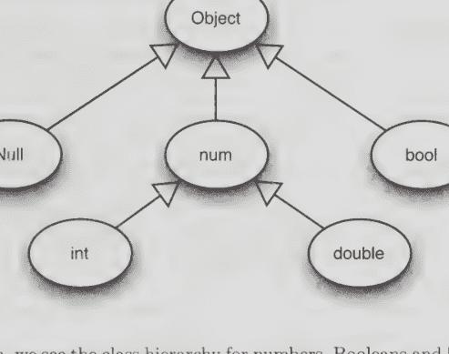
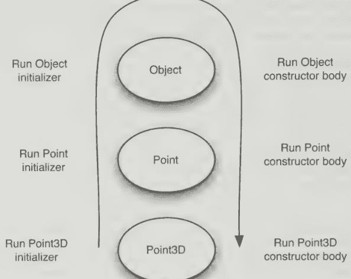
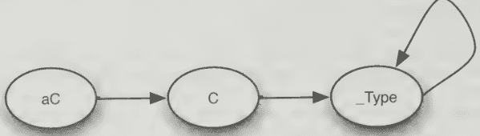
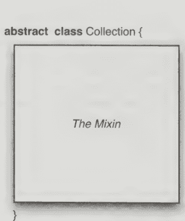
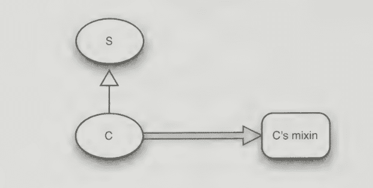
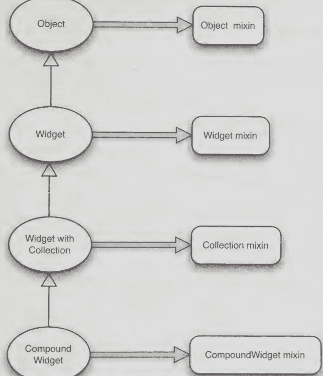
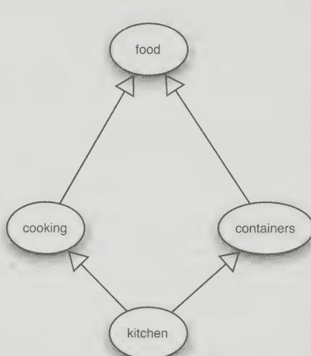

# Dart 编程语言


> 致我的母亲，Shoshana，
她教会了我如何成为一个挑剔的人。


## 序言

在 2006 年初春，我写了一篇名为“Gilad 是正确的”的短博文。在那篇博文中，作为一个正在摆脱“类型成瘾”的人，我承认 Gilad 关于可选且分层类型系统的想法——即静态类型不能改变程序的运行时行为，并且不会阻止一个原本合法的程序进行编译或执行——对于面向数百万开发者的编程语言来说，是一种必要的设计权衡。当时我正在从事 Visual Basic 的工作，它已经通过 **Option Strict Off** 语句支持了一种形式的可选类型，但该功能受到了静态类型拥护者的猛烈攻击。类型系统通常具有高度的非线性，在达到某个点之后，其复杂度会爆炸式增长，而给开发者的价值却很少，且让语言实现者的生活变得痛苦。可选且分层的类型系统允许强静态类型与动态类型和平共处，从而实现一种更加渐进的方法。如今近十年过去了，Gilad 先驱的愿景已经在 *渐进类型（gradual typing）* 的名称下成为了主流。过去几年创建的许多编程语言，如 Hack、TypeScript、Flow、Racket，当然还有 Dart，都是渐进类型的。甚至学术界也接受了这一想法，并撰写了标题轻佻（包含如 "threesomes" 和 "blame" 等词汇）的论文。

Dart 的另一个实用方面（但语言纯洁主义者尚未接受）是，Dart 类型系统被刻意设计为是不健全的（unsound）。用通俗的话来说，这意味着 Dart 类型检查器在编译时不会标记某些类型错误，而是依赖运行时检查来确保类型安全。Dart 中类型不健全的主要来源是协变泛型（covariant generics）。为了解释什么是方差（variance），我们先来看一个只能取出饮料的自动售货机。如果一家食堂需要一台销售汽水的自动售货机，我们可以合法地安装一台销售根啤（root beer）的自动售货机，因为根啤是一种汽水（但如果需要一台根啤售货机，安装一台汽水售货机则是违法的）。用编程语言的话来说，我们称自动售货机是 *协变* 的。接下来我们看垃圾桶，其中只能扔垃圾。如果一家食堂需要一个回收物垃圾桶，我们可以合法地安装一个通用垃圾桶，因为可回收垃圾是一种垃圾（但如果需要通用垃圾桶，安装一个回收物垃圾桶则是违法的）。用编程语言的话来说，我们称垃圾桶是 *逆变* 的。如果你对逆变感到困惑，你并不孤单，你将会赞赏 Dart 将所有泛型类型都设为协变的决定。这一选择的结果是，如果你需要一个通用垃圾桶，你可以合法地安装一个回收物垃圾桶，但那个垃圾桶会拒绝所有不可回收的

人们试图往里面倾倒的垃圾。虽然理论上站不住脚，但不安全的协变对大多数开发人员来说感觉相当自然，我赞赏 Dart 设计师在这里做出的选择。正如任何与 `? super` 和 `? extends` 搏斗过的人可以证明的那样，那些选择支持泛型静态类型安全性的语言是以牺牲用户体验为代价的。

Dart 语言设计者还做出了其他务实的选择，使得 Dart 编程体验流畅。例如，Dart 没有接口、抽象基类或"普通"类。相反，Dart 只有类，可以通过实现它们来用作接口，通过扩展它们来用作基类，或者通过混入来重用它们的实现。Dart 中的每个类型都是对象，因此基本类型（例如数值类型）和普通对象类型之间没有区别。由于 Dart 中的一切都是对象，所以可以定义顶层函数和变量，因此不再需要在一个顶层类中念出可怕的 `public static void main` 咒语来开始编程。Dart 允许用户自定义算术运算符，但不支持基于类型的方法重载。这大大简化了语言。在其他支持基于类型重载的编程语言中，该特性的确切语义往往占据了语言规范中不成比例的大量篇幅。空感知运算符（即使 **null** 也是正常对象）和级联给点号赋予了更多能力，让每个 API 对用户来说都很流畅，而 API 编写者几乎不用费什么力气。

虽然 Dart 本质上是一种动态语言，因为所有类型都是可选的，但你遇到的"wat"时刻会比大多数其他动态语言少得多。有 **null** 但没有 `undefined`，因此只有 `==` 但没有 `===`。只有 **true** 为真，所以不再需要 `(foo && foo.bar())` 来检查 **null**。Dart 有常规的整数和浮点数数值类型，不会出现围绕 `+` 和 `==` 的令人瞠目结runtime 类型转换——那些转换是很好的考试题目、有趣的会议演讲，但令人沮丧的 bug。

在我看来，尽管显然我有偏袒，但让 Dart 成为我最喜欢的编程语言之首的原因是，它是我所知的唯一一种支持编程四种基本效果的编程语言：

| | 单个 | 多个 |
|:---|:---|:---|
| 同步 | `{... return e; ...}` | `sync* { ... yield e; ... for() ... }` |
| 异步CommError | `async { ... await e ... }` | `async* { ... await e ... yield e; ... }`<br>`async* { ... await for() ... }` |

也就是说，Dart 对以下方面有着深入的支持：使用生成器和 `sync*` 块内的 for 循环来生成和使用同步数据流（`Iterable<T>`），使用 `async` 块内的 `await` 表达式来生成和使用 future（`Future<T>`），以及最后但同样重要的是，使用 `async*` 块内的异步生成器和 for 循环来生成和使用异步数据流（`Stream<T>`）。内置的异步编程支持在任何现代编程语言中都是必不可少的，即使是内存中的数据，更不用说跨网络的数据，都"相距甚远"，延迟如此之高，以至于同步访问的成本高得令人 prohibitive。与 JavaScript 一样，但与其他支持生成器的语言不同，Dart 有所谓的委托生成器，可以避免嵌套和递归生成的流的二次膨胀。

尽管有这些精妙的特性，Dart 本质上是一种设计得相当无聊的语言。得益于对 getter、setter、lambda、枚举、具体化泛型、模块、精心设计的广泛标准库以及敏捷的包管理器的支持，如果你是来自 Java 或 C# 的开发人员，Dart 会让你感到舒适，就像穿惯了的旧鞋；如果你来自 JavaScript，Dart 会让你感觉如同一股清新的空气。这本书将帮助你以 Gilad 标志性的精雕细琢的细节和独特的风格，理解 Dart 所有特性的原因、方式和内容，让你迅速精通 Dart。

Erik Meijer
*加利福尼亚州帕洛阿尔托*
*2015年10月*

## 前言

这本书与其他 Dart 书籍有何不同？其他 Dart 书籍充满实用性；这本书聚焦于原理和思想。

Dart 的实用性非常重要，但今年的实用性与去年不同，明年可能又会不同。相比之下，Dart 背后的原理应该更具持久适用性。你应该阅读这本书，如果你对驱动语言设计的思想感兴趣，以及它们如何在 Dart 这个务实、苛刻的现实世界环境中体现。

Dart 的主要思想之一是可选类型。我几十年前就开始研究可选类型；今天我们看到可选类型系统的 proliferation，这让我感到非常欣慰。虽然 Dart 及其任何竞争对手都没有完全按照我所希望的方式实现可选类型，但这个想法已经成为主流，这才是最重要的。

更重要的是，Dart 是一种面向对象的语言，不是传统意义上的类、继承和其他大多数程序员熟知的标准行头意义上的面向对象，而是只有对象的可观察行为才重要的深层意义上的面向对象。同样，这个想法的实现并不完美，但比大多数主流语言要好。

本书涵盖的另一个关键思想是反射。编程书籍对反射这个话题的阐述并不充分。因此，我非常希望在本书中讨论反射。然而，Dart 中反射的历史却出乎意料地曲折。

一方面，许多 Dart 用户渴望使用反射，有时用于它并不理想的目的。另一方面，某些当前平台作为 Dart 的编译目标受到严重限制，使得反射支持相对昂贵，尤其是在程序大小方面。这种紧张局势让 Dart 反射处于一个尴尬的境地。

对代码大小的敏感性以及反射对其的影响从一开始就被充分理解。这个问题及其解决方案在 2011 年 11 月 Dart 反射的第一份设计文档中就已经讨论过。尽管如此，还是花了大约四年时间，解决方案才以一种程序员可以轻松应用的形式实现。

我希望这本书能有效地传达这些思想和其他思想，但这要由你，读者，来评判。也许使用一种更纯粹的语言可以做得更好，但另一方面，不清楚是否会有同样多的受众。也许有一天我会尝试那个实验，看看结果如何。

这本书酝酿已久。我推迟了完成这本书，直到我能讲述一个关于反射的相对连贯的故事。延迟的另一个原因是，本书的主题发展如此之快，以至于它不断面临过时的风险。这种风险还没有过去，但在某个时刻，一个人需要说"够了"。

Dart 是驱动其设计的思想的不完美实现。没有人比它的设计者更清楚这一事实。尽管如此，它是一种真实的语言，数百万行关键任务代码已经用它写成。它在某些方面推动了编程文化向前发展，最显著的是在可选类型领域。正如他们在丹麦说的那样：本可以更糟。

## 致谢

Dart 编程语言是大型团队努力的结果。我在 Dart 上的工作因为涉及许多令人愉快合作的同事而变得更加愉快，其中许多人不仅是同事也是朋友。我很荣幸能在这本书中以及通过 Dart 语言规范记录其中的一部分工作。

Dart 语言由 Lars Bak 和 Kasper Lund 构思和设计，因此如果没有他们，这本书 literally 不可能存在。Lars 是我长期的朋友和同事，从 Dart 项目一开始就领导着它。除其他事项外，Lars 让我参与了 Dart，为此我特别感谢他。Lars 和 Kasper 不仅是极具天赋的系统设计师和实现者，而且是很好的伙伴！

还要特别感谢 Erik Meijer；与他一起从事 Dart 的异步特性工作是一种 joy。Erik 是一位真正的编程语言专业人士，这种 caliber 的人很少遇到。

如果说第 8 章很大程度上归功于 Erik，那么第 7 章则要归功于 Ryan Macnak，他在 Dart VM 中实现了 mirrors；Peter Ahé，他在 dart2js 中开创了 mirrors；以及 Erik Ernst，他从事了 reflectable 库的工作。

我手中这本书的工作不仅得到了 Lars 的支持，还得到了我的经理 Ivan Posva 的支持。在过去的明显四年里，我与 Ivan 以及 Mountain View 的 VM 团队其他成员共享办公空间：Zachary Anderson、Daniel Andersson、Siva Annamalai、Régis Crélier、Matthias Hausner、Ryan Macnak、John McCutchan、Srdjan Mitrovic 和 Todd Turnidge。感谢他们愉快的陪伴。

我频繁访问丹麦奥胡斯 Dart 最高总部的行程总是很有趣（即使实际的旅行并不总是如此）。Linda Lykke Rasmussen 的行政支持是无价的。

我在 Dart 规范上的工作是本书的直接基础。这项工作受益于许多人的仔细批评，但没有人比 Lasse Nielsen 更出色，他 phenomenal 的细致入微的目光捕捉到了许多微妙的问题。

我还深度参与了 Dart 的标准化过程。Anders Sandholm 为我分担了其中的许多负担；我对此表示感谢。我还要感谢 Dart 标准委员会 ECMA TC52 的其他参与者。


我的长期编辑格雷格·多恩奇（Greg Doench）一直极其耐心，与他合作令人愉快。
一如既往，我的妻子韦宏（Weihong）和儿子特瓦（Teva）让这一切都变得值得。

吉拉德·布拉查（Gilad Bracha）
*加利福尼亚州洛斯阿尔托斯*
*2015年11月*

## 关于作者


**吉拉德·布拉查**是谷歌的一名软件工程师，从事Dart语言开发。此前，他曾担任SAP Labs副总裁、Cadence杰出工程师，以及Sun公司的计算神学家和杰出工程师。他是Newspeak编程语言的创造者，Java语言和虚拟机规范的合著者，同时也是面向对象编程语言领域的研究员。在加入Sun公司之前，他曾参与Strongtalk和Animorphic Smalltalk系统的工作。他拥有以色列本·古里安大学的数学与计算机科学学士学位，以及犹他大学的计算机科学博士学位。

## 第一章

### 引言

Dart是一种通用编程语言。它是一种遵循C语言传统的新语言，旨在让绝大多数程序员感到熟悉。必选的“Hello World”示例展示了Dart语法有多么熟悉：

```
main(){
    print('Hello World');
}
```

除非你的编程和计算机科学背景极其特殊，或者完全缺乏，否则这段代码几乎不言自明。当然，我们将在后续章节中详细阐述这个程序以及更多有趣的程序。
Dart是纯粹面向对象的、基于类的、可选类型的，并支持基于混入的继承和actor风格的并发。如果这些术语听起来陌生，请不要担心，我们将在后续讲解中逐一解释它们。

话虽如此，本书并非面向初学者的教程。读者应具备基本的计算机编程能力。

虽然本书的大部分内容将描述和阐释Dart的语义，但也讨论了某些特性背后的设计理念。之所以包含这些讨论，是因为根据我的经验，优秀的程序员不仅关心一门编程语言能做什么，还关心它为什么能这样做。因此，接下来的几节将从非常高的层次概述Dart背后的设计哲学。后续章节也会融入对设计决策、替代方案以及关键思想历史的讨论。不过，如果你渴望直接上手，1.4节提供了一个快速入门教程。

那么，让我们开始吧！

### 1.1 动机

万维网的兴起改变了软件开发的格局。网络浏览器日益被视为各类软件应用的平台。近年来，智能手机和平板电脑等移动设备也变得无处不在。这两种趋势都对软件的编写方式产生了巨大影响。

网络浏览器最初是作为显示静态超文本文档的工具。随着时间的推移，它们演进以支持动态内容。动态内容是随时间计算和重新计算的，已经从简单的动画发展为基于服务器的应用程序，如数据库前端、电子商务店面，直至可以离线运行的成熟应用程序。

这种演进是有机的；一系列偶然事件，有些是幸运的，有些则不然，使得此类应用程序得以在并非为此目的设计的基础设施上运行。

移动应用程序带来了自身的挑战。这些应用程序必须节省电池寿命，这为提升性能提供了新的动力。网络访问可能缓慢、昂贵，甚至缺失。移动平台往往施加特定的生命周期，并对尺寸有特定限制。

Dart旨在提供一个专门设计的平台，以支持当今人们想要编写的那类应用程序。为此，它力求保护程序员免受底层平台不良特性和低级细节的困扰，同时提供对新平台强大功能的便捷访问。

### 1.2 设计原则

#### 1.2.1 万物皆对象

Dart是一种纯粹的面向对象语言。这意味着Dart程序在运行时操作的所有值都是对象——甚至像数字和布尔值这样的基本数据也不例外。没有例外。

坚持对所有数据进行统一处理，简化了所有与语言相关的人员的工作：设计者、实现者，以及最重要的——用户。

例如，集合类可用于所有类型的数据，没有人需要担心自动装箱和拆箱的问题。这些低级细节与程序员试图在其应用程序中解决的问题无关；编程语言的一个关键作用就是将开发者从这种认知负担中解放出来。

也许令人惊讶的是，采用统一的面向对象模型也简化了系统实现者的工作。

#### 1.2.2 面向接口编程，而非面向实现

对象的关键在于其行为而非其如何实现——这一理念是面向对象编程的核心准则。不幸的是，这一准则常常被忽视或误解。

Dart努力以多种方式（尽管并不完美）来维护这一原则。

-   Dart的类型基于接口，而非类。通常，任何类都可以作为接口供其他类实现，无论两者是否共享实现（核心类型如数字、布尔值和字符串有少数例外）。
-   Dart没有最终方法。Dart允许覆盖几乎所有方法（同样，只有极少数内置运算符是例外）。
-   Dart通过确保所有状态访问都通过访问器方法进行，从而抽象了对象表示。
-   Dart的构造函数允许缓存或生成子类型实例，因此使用构造函数不会将开发者绑定到特定的实现。

在我们讨论每个构造时，将扩展它们的含义。

#### 1.2.3 类型服务于程序员

在编程语言领域，或许没有哪个话题比静态类型检查引发更激烈的争论和更多无益的争议。是否在编程语言中使用类型是一个重要的设计决策，与大多数设计决策一样，涉及权衡。

积极的一面是，静态类型信息为人类和计算机提供了宝贵的文档。明智地使用这些信息使代码更具可读性，尤其是在库的边界，并使自动化工具更容易支持开发者。

类型简化了各种分析任务，特别是可以帮助编译器提升程序性能。

静态类型的支持者还认为它有助于检测编程错误。

没有免费的午餐，在编程语言中添加强制静态类型检查也不例外。总会有一些有趣的程序被特定的类型规则所禁止。此外，开发者的工作流程常常因坚持所有中间开发状态符合刚性类型系统而受到严重限制。具有讽刺意味的是，类型规则越具有表达力，就越难使用和理解。通常，满足类型检查器是程序员的负担。高级类型系统通常难以学习和掌握。

Dart在类型的优势与劣势之间提供了富有成效的平衡。Dart是一种可选类型的语言，其定义如下：

-   类型在语法上是可选的。
-   类型对运行时语义没有影响。

类型可选适应了那些完全不想处理类型系统的程序员。选择如此的程序员可以将Dart视为普通的动态类型语言。然而，所有程序员都能从代码中任何类型注释提供的额外文档中受益。这些注释也允许工具更好地支持程序员。

Dart对可能的类型不一致和疏漏给出警告，而非错误。这些警告的范围和性质经过校准，旨在提供帮助而不使程序员不堪重负。

同时，Dart编译器永远不会因缺少或不一致的类型信息而拒绝一个程序。因此，使用类型永远不会限制开发者的工作。


工作流程。引用了不存在或不完整的声明的代码仍然可以为了测试和实验的目的而有效地运行。

静态正确性与灵活性之间的平衡，使得这些类型能够在不妨碍程序员的情况下为其服务。

Dart 中类型的细节将推迟到第 5 章讲解，届时我们将解释该语言的类型规则，并详细探讨上述提到的权衡取舍。

### 1.3 约束

Dart 是针对具体问题的实用解决方案。因此，Dart 的设计涉及一些折衷。Dart 必须能够在当今现有的网络浏览器上高效运行。

Dart 还必须让职业程序员一眼就能认出其风格。这决定了我们选择 C 族编程语言的语法风格。它也决定了那些与主流程序员的期望没有太大差异的语义选择。其目标并非激进的创新，而是渐进的、保守的改进。

在讨论那些语义受到上述约束影响的功能时，我们将关注所做出的设计权衡。例子包括对字符串、数字、return 语句等众多方面的处理方式。

### 1.4 概览

本节将快速概览 Dart。目标是让你熟悉 Dart 的所有核心元素，而不陷入细节之中。

编程语言结构通常以相互递归的方式定义。要给出它们有条理的、顺序的解释是困难的，因为读者需要同时了解所有部分！为了避免这个陷阱，必须先对语言结构有一个大致的了解，然后再深入地重新审视它们。本节提供的就是这种大致的介绍。

阅读完本节后，你应该能够把握本书后面部分出现的许多示例的精髓，而无需事先阅读整本书。

那么，这里是 Dart 中的一个简单表达式：

```
3
```

不出所料，它求值为整数 3。这里还有一些稍微复杂一点的表达式：

```
3 + 4
(3+4)*6
1 + 2 * 2
1234567890987654321 * 1234567890987654321
```

它们分别求值为 7、42、5 和 1524157877457704723228166437789971041。你在一年级就学过的标准运算优先级规则在这里同样适用。最后一个例子可能有些意思。Dart 中的整数行为类似于数学整数。例如，它们不受限于 32 位或 64 位所能表示的最大值。它们大小的唯一限制是可用内存。¹

Dart 不仅支持整数，还支持浮点数、字符串、布尔值等等。许多内置类型都有便捷的语法：

```
3.14159 // 一个浮点数
'a string'
"another string - both double quoted and single quoted forms are supported"
'Hello World' // 你已经见过这个了
true
false // 你需要的所有布尔值
[] // 一个空列表
[0, 1.0, false, 'a', [2, 2.0, true, "b"]] // 一个包含 5 个元素的列表，最后一个元素是另一个列表
```

如上所示，Dart 以标准方式支持单行注释；// 之后的所有内容直到行尾都会被忽略。上面最后两行展示了字面量列表。第一个列表是空的；第二个长度为 5，其最后一个元素是另一个长度为 4 的字面量列表。

列表可以使用运算符 [] 进行索引：

```
[1, 2, 3][1]
```

上面的表达式求值为 2；列表的第一个元素在索引 0 处，第二个在索引 1 处，依此类推。列表有属性 length 和 isEmpty（以及更多我们暂时不会讨论的属性）。

```
[1, 2, 3].length // 3
[].length // 0
[].isEmpty // true
['a'].isEmpty // false
```

当然可以在 Dart 中定义函数。我们之前已经看到了第一个 Dart 函数，即 "Hello World" 的 `main()` 函数。再看一次：

```
main(){
  print('Hello World');
}
```

Dart 程序的执行总是从调用一个名为 `main()` 的函数开始。一个函数由一个给出其名称和任何参数（我们的示例没有参数）的头部，后跟一个函数体组成。`main()` 的函数体由一条语句组成，该语句是对另一个函数 `print()` 的调用，它接受一个参数。在这个例子中，参数是字符串字面量 'Hello World'。其效果是打印出 "Hello World" 这些单词。

这里是另一个函数：

```
twice(x) => x * 2;
```

这里我们声明了 `twice`，它有一个参数 `x`。该函数返回 `x` 乘以 2。我们可以通过书写 `twice(2)` 来调用 **twice**，

```
twice(2)
```

它按预期求值为 4。函数 **twice** 由一个签名（给出其名称和形式参数 `x`）、后跟 `=>`、再后跟函数体（一个单一的表达式）组成。书写 **twice** 的另一种更传统的方式是：

```
twice(x) {
    return x * 2;
}
```

这两种写法是完全等价的，但在第二个例子中，函数体可以由零条或多条语句组成——在这里，是一条 **return** 语句，它使函数计算出 `x*2` 的值并将其返回给调用者。

再举一个例子，考虑

```
max(x, y){ if (x > y) return x; else return y; }
```

它返回其两个参数中的较大值。我们可以更简洁地写成：

```
max(x, y) => (x > y) ? x : y;
```

第一种形式使用了 **if** 语句，这在几乎每种编程语言中都有类似形式。第二种形式使用了条件表达式，这在 C 族语言中很常见。使用表达式允许我们使用函数声明的短格式。

一个更有野心的函数是：

```
maxElement(a) {
    var currentMax = a.isEmpty ?
        throw 'Maximal element undefined for empty array' : a[0];
    for (var i = 0; i < a.length; i++) {
        currentMax = max(a[i], currentMax);
    }
    return currentMax;
}
```

函数 **maxElement** 接受一个列表 `a` 并返回其最大元素。这里我们确实需要函数声明的长格式，因为计算将涉及多个步骤，这些步骤必须作为一系列语句按顺序排列。这个简短的函数将说明 Dart 的许多特性。

函数体的第一行声明了一个名为 **currentMax** 的变量，并对其进行了初始化。Dart 程序中的每个变量都必须显式声明。变量 **currentMax** 代表我们当前对数组最大元素的估计值。

在许多语言中，人们可能会选择将 **currentMax** 初始化为一个已知的值，该值代表可能的最小整数，通常由像 **MIN_INT** 这样的名称表示。从数学上讲，“最小可能整数”的概念是荒谬的。然而，在整数大小受限于语言定义的固定大小表示的语言中，这是有意义的。如上所述，Dart 整数的大小是无限制的，因此我们改为将 **currentMax** 初始化为列表的第一个元素。如果列表为空，我们无法这样做，但那时参数 `a` 是无效的；空列表的最大元素是未定义的。因此，我们检查 `a` 是否为空。如果为空，我们抛出一个异常；否则，我们选择列表的第一个元素作为初始候选值。

异常使用 **throw** 表达式抛出。关键字 **throw** 后跟另一个表达式，该表达式定义要抛出的值。在 Dart 中，任何类型的值都可以被抛出——它不一定是一个特殊 **Exception** 类型的成员。在这个例子中，我们抛出一个描述问题的字符串。

下一行开始一个 **for** 语句，用于遍历列表。² 通过调用先前定义的 `max` 函数，将每个元素依次与 **currentMax** 进行比较。如果当前元素大于 **currentMax**，我们将 **currentMax** 设置为新发现的最大值。

循环结束后，我们确信 **currentMax** 是列表中最大的元素，并返回它。

到目前为止，本教程已谨慎避免提及任何诸如对象、类或方法之类的术语。Dart 允许你在任何类之外定义函数（如 **twice**、**max** 和 **maxElement**）和变量。然而，Dart 是一门彻底的面向对象语言。我们所见过的所有值——数字、字符串、布尔值、列表，甚至函数本身——在 Dart 中都是对象。每个这样的对象都是某个类的实例。像 **length**、**isEmpty**，甚至索引运算符 **[]** 这样的操作都是对象上的方法。

现在是我们学习如何自己编写类的时候了。请看这个表示笛卡尔平面上点的 **Point** 类：

```
class Point {
  var x, y;
  Point(a, b){x = a; y = b;}
}
```

上面是 **Point** 的一个极其简略的版本，我们稍后会对其进行充实。一个 **Point** 有两个实例变量（或字段）**x** 和 **y**。我们可以通过 `new` 表达式调用其构造函数来创建 **Point** 的实例：

```
var origin = new Point(0, 0);
var aPoint = new Point(3, 4);
```


 ```
var anotherPoint = new Point(3, 4);
```

上述三行代码中的每一行都分配了一个全新的 Point 实例，且彼此独立。特别是，aPoint 和 anotherPoint 是不同的对象。一个对象具有唯一身份，这使其区别于任何其他对象。

每个 Point 实例都有自己的变量 x 和 y 的副本，可以通过点符号（dot notation）进行访问：

```
origin.x // 0
origin.y // 0
aPoint.x // 3
aPoint.y // 4
```

变量 x 和 y 由构造函数根据通过 `new` 提供的实际参数来设置。定义一个具有与对象字段完全对应的形式参数的构造函数，然后在构造函数中设置这些字段，这种模式非常常见，因此 Dart 为这种情况提供了一种特殊的语法糖：

```
class Point {
  var x, y;
  Point(this.x, this.y);
}
```

新版本的 Point 与原版本完全等价，但更加简洁。让我们为 Point 添加一些行为：

```
class Point {
  var x, y;
  Point(this.x, this.y);
  scale(factor) => new Point(x * factor, y * factor);
}
```

这个版本包含一个 `scale` 方法，它接收一个缩放因子 `factor` 作为参数并返回一个新点，其坐标基于接收点但按 `factor` 进行了缩放。

```
aPoint.scale(2).x // 6
anotherPoint.scale(10).y // 40
```

点上的另一个有趣操作是加法：

```
class Point {
  var x, y;
  Point(this.x, this.y);
  scale(factor) => new Point(x * factor, y * factor);
  operator +(p) => new Point(x + p.x, y + p.y);
}
```

现在我们可以编写如下表达式：

```
(aPoint + anotherPoint).y // 8
```

点上的 `+` 运算符的行为就像一个实例方法；事实上，它只是一个名称奇怪且调用语法特殊的实例方法。

Dart 还支持静态成员。我们可以在 Point 内部添加一个静态方法来计算两个点之间的距离：

```
static distance(p1, p2) {
  var dx = p1.x - p2.x;
  var dy = p1.y - p2.y;
  return sqrt(dx * dx + dy * dy);
}
```

修饰符 **static** 意味着该方法不特定于任何实例。它无法访问实例变量 x 和 y，因为每个 Point 实例的这些变量都不同。该方法使用了一个计算平方根的库函数 `sqrt()`。你可能会问，`sqrt()` 是从哪里来的？为了理解这一点，我们需要解释 Dart 的模块化概念。

Dart 代码被组织成称为库（libraries）的模块化单元。每个库定义自己的命名空间。命名空间包括在库中声明的实体的名称。其他名称可以从其他库导入。所有 Dart 程序都可用的声明定义在 Dart 核心库中，该库被隐式导入到所有其他 Dart 库中。然而，`sqrt()` 并不在其中。它定义在一个名为 `dart:math` 的库中，如果你想使用它，必须显式地导入。

这是一个包含导入语句并整合了 Point 类的完整库示例：

```
library points;

import 'dart:math';

class Point {
  var x, y;
  Point(this.x, this.y);
  scale(factor) => new Point(x * factor, y * factor);
  operator +(p) => new Point(x + p.x, y + p.y);
  static distance(p1, p2) {
    var dx = p1.x - p2.x;
    var dy = p1.y - p2.y;
    return sqrt(dx * dx + dy * dy);
  }
}
```

我们声明了一个名为 **points** 的库并导入了 `dart:math` 库。正是这次导入使得 **sqrt** 在 **points** 库内部可用。现在，任何其他想要使用我们的 Point 类的库都可以导入 **points**。

一个需要注意的关键细节是，**import** 子句引用了一个字符串 `dart:math`。通常，导入通过字符串提供的统一资源标识符（URI）进行引用。URI 指向编译器可以找到所需库的位置。Dart 的内置库始终通过 `dart:σ` 形式的 URI 提供，其中 *σ* 表示特定的库。

Dart 远不止我们目前展示的内容，但你应该对 Dart 代码的外观及其大致含义有了概括性的了解。在我们稍后深入探讨本书细节时，这些背景知识将对你大有裨益。

### 1.5 书籍结构

本书的其余部分围绕 Dart 编程语言的结构展开。下一章讨论对象、类和接口。这些是 Dart 的核心概念，也是后续所有内容的基础。

接下来，我们将详细研究库，然后深入探讨函数。在第 5 章中，我们终于会探讨类型以及它们在 Dart 中扮演的角色。我们在第 6 章中回顾 Dart 的表达式和语句。最后的章节将研究反射和并发。

### 1.6 相关工作与影响

Dart 的设计受到了早期语言的影响，特别是 Smalltalk[1]、Java 和 Javascript。Dart 的语法通过 Java 和 Javascript 遵循 C 语言传统。Dart 的语义在某些方面更接近 Smalltalk——特别是，它坚持使用纯对象模型。

然而，两者之间存在关键差异。Dart 引入了自己的基于库的封装模型。这与上述三种语言都不同。Smalltalk 支持基于对象的字段封装，方法和类则普遍可用。Java 混合了基于类的封装和包私有性，而 Javascript 则完全依赖闭包进行封装。

与 Smalltalk 和 Java 一样，Dart 是基于类的并支持单继承，但它通过基于 mixin 的继承对其进行了增强，这与最初在 Smalltalk 的 Strongtalk 方言[2]中实现的模型非常相似。由于 Dart 中的类方法不是像 Smalltalk 那样的真正实例方法，而是 Java 风格的静态方法，因此这两个模型并不完全相同。

Dart 的构造函数在语法上与 Java 的构造函数相似，但实际上在关键方面有所不同。所有上述主题将在下一章中讨论。

Dart 的类型检查方法也非常接近于为 Strongtalk 开发的方法。第 5 章将详尽探讨类型。

Dart 对并发的看法接近于原始的 actor 模型（尽管是命令式的），这与上述任何语言都大不相同。Erlang 的成功是采用 actor 模型的一个因素，但与 Erlang 不同，Dart 具有非阻塞并发模型。Dart 还具有受 C# 深刻影响的内置异步支持。详情请参阅第 8 章。

# 第 2 章

## 对象、接口、类和 Mixins

值得重复一遍：在 Dart 中，一切皆对象。这甚至包括最简单的数据，如数字或布尔值 **true** 和 **false**。

一个对象由一组（可能为空的）提供状态的字段和一组提供行为的方法组成。对象的状态可以是可变的或不可变的。对象的方法集永远不会为空，因为所有 Dart 对象都具有某些行为。对象从其类中获得行为。每个对象都有一个类；我们说该对象是 *该类的一个实例*。因为每个对象都有一个决定其行为的类，所以 Dart 是一种 *基于类的语言*。

回顾我们在前一章中遇到的 Point 类。

```
class Point {
  var x, y;
  Point(this.x, this.y);
  scale(factor) => new Point(x * factor, y * factor);
  operator +(p) => new Point(x + p.x, y + p.y);
  static distance(p1, p2) {
    var dx = p1.x - p2.x;
    var dy = p1.y - p2.y;
    return sqrt(dx * dx + dy * dy);
  }
}
```

**Point** 的每个实例都有两个构成其状态的字段 x 和 y。Point 还具有几个提供实用行为的方法。这些方法包括 scale 和 +，但实际上还有其他方法。这些额外的方法不是由 Point 类本身定义的，而是从其超类 *继承* 来的。除了内置在每个 Dart 实现中的 **Object** 类之外，每个类都有一个超类。类可以显式列出其超类，但不必这样做。如果一个类没有列出超类，则其超类是 Object。Point 就是这种情况。我们可以通过以下方式显式指定 Object 为 Point 的超类；这两个定义完全等价。

```
class Point extends Object { ... rest of definition unchanged }
```


定义对象行为的方法被称为其*实例方法（*instance methods*）。请注意，`distance()` 方法并不属于 `Point` 实例的行为。它是一个静态方法，而不是实例方法。

### 2.1 访问器 (Accessors)

访问器是提供便捷访问值的特殊方法。为了理解访问器，让我们再次回顾 `Point`，并考虑如何修改 `Point` 以使其使用极坐标表示法。我们可以轻松地将字段 `x` 和 `y` 替换为新字段 `rho` 和 `theta`。然而，我们可能有任意数量的客户端仍然需要访问笛卡尔坐标。因此，我们可能会选择基于存储的极坐标来计算这些值。 resulting 得到的类如下：

```
class Point {
  var rho, theta;
  Point(this.rho, this.theta);
  x() => rho * cos(theta);
  y() => rho * sin(theta);
  scale(factor) => new Point(rho * factor, theta);
  operator +(p) => new Point(x() + p.x(), y() + p.y());
  static distance(p1, p2) {
    var dx = p1.x() - p2.x();
    var dy = p1.y() - p2.y();
    return sqrt(dx * dx + dy * dy);
  }
}
```

这段代码实际上是损坏的，因为在 `+` 运算符内部，我们使用笛卡尔坐标调用构造函数，而它期望的是极坐标。先撇开这个问题不谈；我们稍后会处理它。¹

由于其他原因，结果仍不令人满意。我们用计算相应值的方法替换了字段 `x` 和 `y`。所有客户端都必须修改对 `x` 和 `y` 的引用，使其变为方法调用。例如，如果客户端有一段如下代码：

```
print(myPoint.x);
```

它需要被更改为：

```
print(myPoint.x());
```

唯一的区别是 `x` 后面增加了空的参数列表；这是一个很小的改动，但无论如何它仍然是一个改动。现代工具可以通过自动重构来提供帮助，但如果一个人修改了一个被广泛使用的 API，他无法知道所有的客户端是谁，且无法承受让所有客户端都进行此类修改的负担，即使使用了便捷的工具。

> ¹ 我们将忽略的另一个问题是数值精度的问题；所有这些转换可能无法产生完美的结果。

Dart 提供了一个更好的解决方案，即*获取方法*（*getter methods*），通常简称为 *getters*。Getter 是一种特殊的方法，它不接收参数，并且可以在没有显式参数列表的情况下被调用。Getter 方法通过在方法名前加上 `get` 关键字来定义。调用者绝对不能提供参数列表——即使是空的也不行。

```
class Point {
  var rho, theta;
  Point(this.rho, this.theta);
  get x => rho * cos(theta);
  get y => rho * sin(theta);
  scale(factor) => new Point(rho * factor, theta);
  operator +(p) => new Point(x + p.x, y + p.y);
  static distance(p1, p2) {
    var dx = p1.x - p2.x;
    var dy = p1.y - p2.y;
    return sqrt(dx * dx + dy * dy);
  }
}
```

现在，我们假设的客户端不需要做任何更改。调用 getter 的语法与访问变量毫无区别。

敏锐的读者现在可能会问，Dart 编译器如何区分这两者？答案是：它并不区分。Dart 中所有对实例变量的访问实际上都是 getter 调用。在 Dart 编译器的帮助下，每个实例变量总是关联着一个 getter。

到目前为止，我们只解决了部分问题。那么对于给字段赋值的客户端怎么办，例如：

```
myPoint.y = myPoint.y * 2.
```

新版本中没有可以被赋值的字段。目前尚不清楚客户端可以做出什么更改来保持代码运行。为了解决这个问题，我们使用*设置方法*（*setter methods*，简称为 *setters*）。Setter 以 `set` 关键字开头，并接收一个参数。Setter 的调用语法与传统的变量赋值相同。如果一个实例变量是可变的，那么会自动为其定义一个 setter，且所有对实例变量的赋值实际上都是 setter 调用。

```
class Point {
  var rho, theta;
  Point(this.rho, this.theta);
  get x => rho * cos(theta);
  set x(newX) {
    rho = sqrt(newX * newX + y * y);
    theta = acos(newX/rho);
  }
  set y(newY) {
    rho = sqrt(x * x + newY * newY);
    theta = asin(newY/rho);
  }
  get y => rho * sin(theta);
  scale(factor) => new Point(rho * factor, theta);
  operator +(p) => new Point(x + p.x, y + p.y);
  static distance(p1, p2) {
    var dx = p1.x() - p2.x();
    var dy = p1.y() - p2.y();
    return sqrt(dx * dx + dy * dy);
  }
}
```

此时，我们解决了问题的两个部分，但还剩下第三部分。我们的客户端通过调用 `Point` 类的构造函数来创建点，如：

```
new Point(3,4);
```

我们的新类期望构造函数的参数代表向量的长度和方向，而不是其笛卡尔坐标。且正如我们之前提到的，我们在类内部也依赖于此 API，因此这无法正常工作。像往常一样，解决方案是在改变所需表示法的同时保留现有的 API。因此，我们选择使用极坐标表示法，但为了维持接口，我们保留现有的接收笛卡尔参数的构造函数。

```
class Point {
    var rho, theta;
    Point(a, b){
        rho = sqrt(a * a + b * b);
        theta = atan(a/b);
    }
    ... rest unchanged ...
}
```

我们现在实现了在不对客户端产生任何影响的情况下改变点表示法的目标。我们在没有预先规划的情况下完成了这一点。我们不需要提前决定是否通过访问器方法或特殊属性声明来暴露点的坐标；Dart 为我们处理了这一切，且没有任何语法上的不便。在任何主流语言中我们都可以修复构造函数。然而，如果没有访问器，完全平滑的过渡将是不可能的。

### 2.2 实例变量 (Instance Variables)

当一个类声明一个实例变量时，它是在确保其每个实例都将拥有该变量的唯一副本。对象的实例变量占用内存。这段内存在对象创建时被分配。在程序访问该内存之前，将其设置为某个合理的值至关重要。在 C 等低级语言中，情况并非如此，新分配存储空间的内容可能是未定义的——通常是之前存储在其中的任何值。这在可靠性和安全性方面引发了问题。

Dart 将每个新分配的变量（不仅是实例变量，还包括局部变量、类变量和顶级变量）初始化为 **null**。在 Dart 中，**null** 是一个对象，与其他任何对象一样。绝不能将 **null** 与 0 或 **false** 等其他对象混淆。对象 **null** 仅仅是 Dart 核心库中定义的 `Null` 类的唯一实例。这与 C, C++, C#, Java 或 Javascript 等语言的情况不同，但它是“万物皆对象”这一公理的必然结果。

声明实例变量或静态变量会自动引入一个 getter。如果变量是可变的，则会自动定义一个 setter。事实上，在 Dart 中永远不会直接访问字段。所有对字段的引用都是对访问器方法的调用。只有对象的访问器才能直接访问其状态。所有访问对象状态的代码必须通过这些访问器方法。这意味着类的表示法可以随时更改，而无需更改客户端的源代码。甚至永远不需要重新编译！这种特性被称为*表示独立性*（*representation independence*）。

我们在上一节中看到了表示独立性的优势，其中我们展示了如何在不修改任何使用点的代码的情况下更改点的表示法。

### 2.3 类变量 (Class Variables)

除了实例变量外，类还可以定义*类变量*（*class variables*）。无论一个类有多少个实例，该类只有一个类变量的副本。即使没有任何实例，该变量依然存在。

类变量的声明前带有 **static** 关键字。我们可以向类中添加一个类变量来跟踪创建了多少个实例。

```
class Box {
  static var numberOfInstances = 0;
  Box(){numberOfInstances = numberOfInstances + 1;}
}
```

在这里，每当 `Box()` 类的构造函数运行时，它都会增加所有已创建盒子的计数。

与实例变量一样，类变量永远不会被直接引用。所有对它们的访问都通过访问器进行中介。


类变量可以在其声明类的任何地方通过名称引用。在类外部，只能在变量名前加上声明该变量的类名来访问它：

```
Box.numberOfInstances == 0 ? print('No boxes yet') : print('We have boxes!');
```

类变量通常被称为静态变量（static variables），但“静态变量”这个术语也被用来涵盖类变量和顶级变量。为了避免混淆，我们将坚持使用“类变量”这个术语。当我们统称实例变量和类变量时，经常会使用“字段（fields）”这个词。

类变量是延迟初始化的；类变量的初始化器在第一次调用其 getter 时执行——也就是说，在第一次尝试读取该变量时执行。如果一个类变量没有初始化器，它将被初始化为 **null**，就像任何其他变量一样。

类变量的延迟初始化有助于避免一个经典问题：由于过多的前期初始化导致应用程序启动缓慢。然而，延迟初始化可能会导致令人惊讶的行为。假设一个类变量在被读取之前就被赋值了，如下例所示。

```
class Cat {}
class DeadCat extends Cat {}
class LiveCat extends Cat {
  LiveCat() {print("I'm alive!");}
}
var schrodingers = new LiveCat();

main() {
  schrodingers = new DeadCat();
}
```

在这里，schrodingers 的初始化器永远不会被执行，`print()` 的调用也永远不会被执行。虽然在上面的例子中这看起来很明显，但在更复杂的情况下可能并非如此。例如，在调试期间，人们可能会检查变量的值，这会触发初始化。程序员应该始终密切关注延迟初始化的影响。

### 2.4 Finals

Dart 中的变量可以加上 **final** 关键字作为前缀，表示它们在初始化后不能被更改。final 字段有 getter 但没有 setter。final 类变量必须在声明时进行初始化。

final 实例变量必须在运行任何实例方法之前初始化。有几种方法可以实现这一点。第一种是在声明变量时对其进行初始化，例如：

```
final origin = new Point(0,0);
```

这并不总是方便的。变量在不同的构造函数中可能会被设置为不同的值。例如，它可能取决于构造函数的参数。如果希望 final 实例变量的值被设置为构造函数参数的值，可以使用常见的构造函数简写。例如，考虑这个点（Point）的变体，其中的点是不可变的：

```
class Point {
  final x, y;
  Point(this.x, this.y);
  // Point 的其余部分 ...
}
```

然而，有时这还不够。该值可能依赖于构造函数参数，但与之不同——也就是说，它可能涉及基于构造函数参数的一些计算。我们将在稍后的 2.9 节中研究如何实现这一点。

尝试给 final 实例变量赋值通常会导致 `NoSuchMethodError`，因为赋值仅仅是调用 setter 的语法糖，而 setter 将不会被定义。不过，有可能单独声明了一个 setter，在这种情况下，该 setter 将被调用。但这不会对实例变量的值产生任何影响——在 final 变量初始化后，根本没有办法更改它。

大多数实例变量在实例分配时设置，之后不再更改。你可能会觉得这很惊讶，但这已经通过系统研究[3]得到了验证。因此，最好将大多数实例变量声明为 **final**。

有一种强有力的观点认为 **final** 应该是默认选项，但这违背了既有的习惯，因此 Dart 在这里选择了传统做法。

### 2.5 标识与相等性（Identity and Equality）

所有对象都支持相等运算符 `==`。该运算符在 `Object` 类中定义，因此所有类都继承了它，它也就包含在所有实例的行为中。考虑以下代码：

```
var aPoint = new Point(3, 4);
var anotherPoint = new Point(3,4);
aPoint == anotherPoint; // 结果为 false
```

最后一行的结果有些令人困惑。毕竟，`aPoint` 和 `anotherPoint` 具有相同的 x 和 y 值，为什么它们不相等？

`Object` 中的 `==` 方法测试参数是否与接收者是同一个对象（identical）。如前所述，每个对象都有一个唯一的标识（identity）。一个对象仅与其自身标识相同。两个对象可以是同一个类的实例并且具有完全相同的状态，但仍然不是同一个对象，如上面的示例所示。

## 第 2 章 对象、接口、类和 Mixins

不幸的是，没有一种显而易见且正确的方法来判定两个任意对象是否相等。人们可以比较对象的所有字段是否相等，但这仍然过于保守。一个对象可能具有用于存储辅助数据的字段，而这些数据对于相等性的语义并不重要。例如，假设我们有一个时间戳，告诉我们某个缓存值最后一次计算的时间。缓存经过一段时间后被认为失效。两个对象的时间戳（或缓存值）可能不同，但它们仍然相等。

因此，由定义类的程序员负责确定对于该类的实例，什么样的相等性概念是有意义的。实现方法是重写 `==`。在 `Point` 的情况下，我们可以将相等性定义为：

```
operator == (p) => x == p.x && y == p.y;
```

注意，即使我们切换到极坐标（尽管效率可能不高），这段代码仍然有效（除数值精度问题外）。事实上，即使 `p` 是笛卡尔坐标点而接收者是极坐标点，或者任何其他组合，它依然成立。

在某些情况下，人们可能希望检查两个表达式是否表示同一个对象，但这相对罕见。通常，人们测试的是对象的相等性。

可以使用定义在 `dart:core` 中的内置函数 `identical()` 来比较两个对象的标识。

我们发现 `identical(origin, origin)` 的结果为 `true`，`identical(aPoint, aPoint)` 和 `identical(anotherPoint, anotherPoint)` 也是如此。另一方面，`identical(aPoint, anotherPoint)` 的结果为 `false`。

现在我们已经掌握了足够知识来自定义 `Object` 类的相等性方法：

```
bool operator ==(other) => identical(this, other);
```

所有 Dart 对象还支持 getter 方法 `hashCode`。相等性（Equality）和 `hashCode` 是相互关联的。如果两个对象相等，它们的哈希码也应该相等。实现者必须小心维护这一属性。在实践中，这意味着如果你选择重写其中任何一个方法，你也应该重写另一个。

实现用户自定义的相等性需要谨慎。我们希望相等性谓词具有自反性（a == a）、传递性（(a == b) && (b == c) 蕴含 a == c）和交换性（a == b 蕴含 b == a）。自反性是你可以在自己的 `==` 实现中确保的。而其他属性在可扩展系统中很难保持。人们总是可以引入：

```
class BadApple {
  operator == (x) => true;
}
```

从而破坏整个系统的相等性数学属性。

> 2. 如果能使用 = 来表示相等就太好了，但 C 语言的传统和数学在这里产生了矛盾。

### 2.6 类与超类

每个类声明一组实例成员，包括实例变量和几种实例方法。此外，每个类（除 `Object` 外）都从其超类继承实例成员。由于除 `Object` 外的每个类恰好有一个超类，而 `Object` 没有超类，因此 Dart 的类层次结构形成了一棵以 `Object` 为根的树。这种安排被称为 *单继承（single inheritance）*，如下图所示。



在图中，我们看到了数字、布尔值和 Null 的类层次结构。当然，这只是整个 Dart 类层次结构的一小部分。

如果子类声明了一个与超类方法同名的实例方法，则该子类方法被称为 *重写（override）* 超类方法。

重写并非总是合法的。例如，你不能用一个普通方法重写 getter，反之亦然。这些情况会导致编译错误。

```
class S {
  var v;
  final f = 0;
  get g => 42;
  set s(x) => v = 2;
  m(a, b) => 91;
}
```

```
class C extends S {
  v() => 1; // 非法：方法 v() 重写了隐式 getter 方法 v
  f() => 2; // 非法：方法 f() 重写了隐式 getter 方法 f
  g() => 100; // 非法：方法 g() 重写了 getter 方法 g
}
```


尝试用方法或 getter 覆盖 setter，或者用 setter 覆盖方法或 getter，在技术上是不可能的，因为 setter 的名称与方法和 getter 的名称并不重叠。然而，如果你尝试这样做，Dart 会发出警告：

```
class D extends S {
  s(y) => 200; // WARNING: D has method s and setter s=
}
```

在某些情况下，无意义的覆盖会导致警告而非编译错误。当覆盖方法所需的参数比它所覆盖的方法更多时，会发出警告，但程序仍然可以编译。

```
class E extends S {
  m(x, y, z) => 101; // WARNING: overriding method has incompatible arity
}
```

为什么 Dart 在这种情况中仅发出警告，而不是直接拒绝代码？因为 Dart 尽可能地避免向程序员强加一套工作流。开发过程中可能会出现各种不一致，这些最终应该被纠正。然而，在取得任何其他进展之前，强制程序员立即处理这些情况往往会适得其反。因此，Dart 确保开发人员通过警告注意到此类问题，但除非绝对必要，否则不会中止编译。

### 2.7 抽象方法与类

通常，仅仅声明一个方法而不提供其实现是非常有用的。这样的方法被称为 *抽象方法（abstract method）*。任何类型的实例方法都可以是抽象的，无论它是 getter、setter、运算符还是普通方法。

声明一个抽象方法是在告诉任何阅读代码的人（无论是人还是计算机），该方法在代码实际执行时预期是可用的。这不仅提高了程序员的理解能力，还有助于错误处理和工具链支持。

包含抽象方法的类本身就是一个 *抽象类（abstract class）*。抽象类的声明通过在类名之前加上 **abstract** 关键字来实现。

下面我们看到一个抽象类 Pair，它不包含任何实现信息。它纯粹作为一个接口，我们将在下文中详细描述。

```
abstract class Pair {
  get first;
  get second;
}
```

Pair 有两个抽象 getter 方法：`first` 和 `second`。Pair 被显式声明为一个抽象类。如果我们省略 **abstract** 修饰符，Dart 分析器会发出警告，提示该类包含抽象方法。当然，在抽象类中拥有抽象方法是完全正确的，但在具体类中保留此类方法显然是个问题。**abstract** 修饰符允许我们声明意图，分析器发出的警告也会相应地改变。

抽象类不打算被实例化；毕竟，它缺少部分实现。实例化它将导致运行时错误；具体而言，会抛出 `AbstractClassInstantiationError`。Dart 分析器同样会发出警告。

```
new Pair();
// Static warning: attempting to instantiate an abstract class
// Throws an AbstractClassInstantiationError
```

就运行时而言，抽象方法根本不存在。毕竟，没有可运行的实现。调用这样的方法被处理得就像没有方法声明一样。

仅包含抽象方法的类在定义接口时非常有用，这将在下一节中介绍。

### 2.8 接口

每个类都隐式地定义了一个 *接口（interface）*，该接口描述了其实例上可用的方法。Dart 没有像许多其他语言那样正式的接口声明。这些是不必要的，因为人们总可以通过定义一个抽象类来描述所需的接口。

```
abstract class CartesianPoint {
  get x;
  get y;
}
```

```
abstract class PolarPoint {
  get rho;
  get theta;
}
```

尽管没有接口声明，类可以断言其实例实现了特定的接口：

```
class Point implements CartesianPoint, PolarPoint {
  // Usual Point implementation goes here
}
```

Point 不是 CartesianPoint 的子类；它不继承 CartesianPoint（以及 PolarPoint）的任何成员。**implements** 子句的目的是在接口之间建立一种预期的关系，而不是共享实现。

在运行时可以测试一个对象是否符合某个接口：

```
5 is int; // true
'x' is String; // true
[] is Point; // false
aPoint.toString() is String; // true
new Point(0,0) is String; // false
aPoint is CartesianPoint; // true
```

请注意，`is` 测试并不检查对象是否真的是给定类或其子类的实例。相反，`is` 测试检查对象的类是否显式地实现了一个接口（直接或间接）。换句话说，我们不关心对象的具体实现是什么，而只关心它旨在支持的接口。与大多数支持此类结构的语言相比，这是一个至关重要的区别。如果一个类希望模拟另一个类的接口，它不受共享实现的限制。这种模拟对于客户端来说应该是不可区分的（除反射(7)外）。在第 5 章详细检查类型时，我们将更多地讨论 `is`。

接口之间的继承方式与类非常相似。一个类的隐式接口继承自其父类的隐式接口以及该类实现的所有接口。与类一样，接口的实例方法会覆盖超接口的方法。同样，某些覆盖可能是非法的，因为覆盖方法和被覆盖方法之间的参数数量必须兼容，或者因为尝试用普通方法覆盖 getter 或 setter（反之亦然）。

此外，由于一个接口可能有多个直接超接口，不同的超接口之间可能会产生冲突。假设一个方法出现在多个超接口中，且不同的超接口中该方法的版本在参数个数（arity）上不一致。在这种情况下，冲突方法的任何版本都不会被继承 —— 同样，如果一个超接口定义了 getter 而另一个定义了普通方法，情况也是如此。正如我们在第 5 章中将看到的，这些情况也会引发各种警告。

### 2.9 对象的生命周期

Dart 中的计算围绕对象展开。因为 Dart 是一种纯面向对象语言，即使是最简单的 Dart 程序也涉及对象的创建。例如，本书第一段中显示的 "Hello World" 程序就涉及一个字符串对象的创建。

某些对象，如字符串 'Hello World'、布尔值 true 或数字 91 是字面量。它们仅仅因为在运行的程序中被提及而存在。然而，大多数对象是通过实例创建表达式（如 `new Point(0,1)`）显式创建的。这样的表达式会调用构造函数 —— 在本例中是 `Point()`。每个类至少有一个构造函数。构造函数的名称总是以我们要构建其实例的类名开头。

构造函数可以由程序员显式声明，也可以隐式生成。当没有显式声明构造函数时，会生成隐式构造函数；它们不接受参数且没有函数体。例如：

```
class Box {
  var contents;
}
```

等同于：

```
class Box {
  var contents;
  Box();
}
```

而这本身又等同于：

```
class Box {
  var contents;
  Box(){}
}
```

在 Point 的示例中，我们已经看到了构造函数的几种变体。我们假设最简单的一种：

```
Point(a, b){x = a; y = b;};
```

评估实例创建表达式的第一步是评估传递给构造函数的参数。在 **new** Point(0,1) 中，参数是整型字面量 0 和 1。与任何函数调用一样，参数被设置为对应的实参。因此，我们有了 a 设置为 0，b 设置为 1。现在我们可以为 Point 类分配一个新鲜的实例，它将拥有用于存储两个字段 x 和 y 的空间。最初，这些字段将被系统设置为 null。这确保了用户代码永远不会遇到未初始化的内存。

现在我们可以执行构造函数的函数体，其中包含两次赋值，分别赋给 x 和 y。如你所知，这些赋值实际上是 setter 方法的调用。正是这些隐式定义的 setter 将字段 x 和 y 的值实际设置为预期的 0 和 1。此时，构造函数返回对新分配实例的引用，这就是 **new** 表达式的最终结果。

现在，让我们考虑一个表示三维点的类。这个类具有坐标 x、y 和 z，自然可以被声明为 Point 的子类。

```
class Point3D extends Point {
  var z;
  Point3D(a, b, c): super(a,b) {z = c;}
}
```


## 第2章 对象、接口、类和 Mixin

我们可以通过编写 **new Point3D(1,2,3)** 来创建 Point3D 的实例。求值过程类似但稍微复杂一些。我们仍然从求值参数和分配对象开始——这次对象有三个字段——从 Point 继承的两个字段 x、y，以及在 Point3D 中声明的 z 字段。所有三个字段都将被设置为 null。然而，在执行 Point3D 构造函数体之前，我们需要先执行 Point 构造函数体，否则字段 x 和 y 将无法正确初始化。

一般来说，Dart 编译器无法确定应该将哪些参数传递给父类构造函数。在这种情况下答案似乎显而易见，但情况并不总是如此简单。除了最简单的情况（没有参数）之外，我们都要求使用显式的*父类构造函数调用*来指导我们。在我们的示例中，这就是 **super(a,b)**。在父类构造函数调用中，**super** 代表父类的名称，因此 **Point3D**(x1, y1, z1) 会在执行自身构造体之前调用 **Point**(x1, y1)。

上述描述有些简化了，我们稍后会看到。对象创建是面向对象编程语言中较为复杂的方面之一，尤其是在涉及继承的情况下。为了进一步完善我们的理解，让我们再次审视改变点表示方式的问题。这一次，假设点是不可变的，但使用极坐标来表示。

由于点是不可变的，**rho** 和 **theta** 是 **final** 的。我们无法在声明时初始化这些实例变量，因为我们需要访问构造函数参数。我们不能使用 **this.rho** 这样的初始化形式参数，因为 **rho** 和 **theta** 的值都是 x 和 y 的函数。我们也无法在构造函数体中为它们赋值，因为没有为它们定义 setter。Dart 通过*初始化列表*来解决这个问题，初始化列表的设计目的是在普通代码执行之前初始化实例变量。

```dart
class Point {
  final rho, theta;
  Point(a, b) : rho = sqrt(a * a + b * b), theta = atan(a/b);
  get x => rho * cos(theta);
  get y => rho * sin(theta);
  scale(factor) => new Point(rho * factor, theta);
  operator +(p) => new Point(x + p.x, y + p.y);
  static distance(p1, p2) {
    var dx = p1.x - p2.x;
    var dy = p1.y - p2.y;
    return sqrt(dx * dx + dy * dy);
  }
}
```

这里的初始化列表从 **Point(a, b)** 之后的冒号开始，一直持续到该行末尾的分号：`: rho = sqrt(a * a + b * b), theta = atan(a/b)`。它包含两个初始化器，一个用于 **rho**，一个用于 **theta**。初始化器之间用逗号分隔，按从左到右的顺序执行。除了实例变量的初始化器外，初始化列表还可以包含单个父类构造函数调用。我们在 Point3D() 中看到了这一点，其初始化列表为 **: super(a,b)**。请注意，如果初始化列表中没有显式出现父类构造函数调用，则会自动在列表末尾追加一个隐式的 **super()** 调用。

我们已经看到了几种初始化实例变量的方式。让我们再回顾一下。可以在声明点初始化实例变量

```dart
class Point {
  var x = 0, y = 0;
}
```

或者通过构造函数中的初始化形式参数

```dart
class Point {
  var x, y;
  Point(this.x, this.y);
}
```

或者在初始化列表中

```dart
class Point {
  var x, y;
  Point(a, b) : x = a, y = b;
}
```

或者在构造函数体中

```dart
class Point {
  var x, y;
  Point(a, b) { x = a; y = b;}
}
```

对于普通的实例变量，可以选择其中任何一种方式，或者同时使用多种方式，也可以都不使用。最后一种方式不适用于 final 实例变量，因为它使用了 setter 方法，而 final 变量没有 setter。final 实例变量只能初始化一次，因此必须从前面三种方式中选择一种。

当对象被实例化时，各种初始化构造按上面列出的顺序依次执行。

我们现在可以完整地描述实例创建的过程了。假设 Point3D 如上所述被定义，且 Point 具有以下构造函数：

```dart
Point(a, b) : x = a, y = b;
```

实例创建过程如下图所示，执行方向沿箭头方向进行：



通过 `new Point3D(7, 8, 9)` 创建新的 Point3D 实例时，首先计算实际参数，在本例中为 7、8 和 9。然后调用构造函数 Point3D()。下一步是分配一个新的 Point3D 实例，所有实例变量都被设置为 null。接着我们执行 Point3D 的初始化列表，这会导致父类初始化器被执行，进而导致 Point 的初始化列表被执行。这将设置实例变量 x 和 y，然后执行在 Point 初始化列表末尾隐式添加的父类初始化器。这将调用 Object 的初始化列表，该列表不执行任何操作（它甚至没有在末尾的父类初始化器）。所有这些步骤如上图左侧所示。

完成父类链中所有初始化列表的遍历后，下一步是执行构造函数体。在本图中，这对应于箭头的 U 型转弯。

构造函数体始终以隐式运行父类构造函数体开始。传递给父类构造函数的参数与初始化列表中父类构造函数调用使用的参数相同，不会重新计算。因此在我们的例子中，我们开始运行 Point3D() 的构造体，它开始运行 Point() 的构造体，而 Point() 开始运行 Object() 的构造体，后者不执行任何操作。由于 Point() 没有指定构造体，我们返回到 Point3D() 的构造体中，在其中初始化 z，然后返回新分配的对象。这个过程对应于图中的右侧部分。

#### 2.9.1 重定向构造函数

有时用另一个构造函数来定义某个构造函数会很有用。再次考虑从笛卡尔坐标点转换为极坐标点的情况。我们之前的工作只允许从笛卡尔坐标创建点。考虑到我们的实际表示是极坐标，这有点奇怪。当然，我们可以直接修改构造函数以接受极坐标，但我知道这样做有问题，因为现有用户依赖笛卡尔接口。我们应该保留旧的构造函数，同时添加一个接受极坐标的新构造函数。为此，我们将定义一个新的*命名构造函数* Point.polar()，并修改现有的构造函数，使其将传入的笛卡尔坐标转换为极坐标，然后将调用转发给 Point.polar()。

```dart
class Point {
  var rho, theta;
  Point.polar(this.rho, this.theta);
  Point(a, b) : this.polar( sqrt(a * a + b * b), atan(a/b));
  get x => rho * cos(theta);
  set x(newX) {
    rho = sqrt(newX * newX + y * y);
    theta = acos(newX/rho);
  }
  set y(newY) {
    rho = sqrt(x * x + newY * newY);
    theta = asin(newY/rho);
  }
  get y => rho * sin(theta);
  scale(factor) => new Point.polar(rho * factor, theta);
  operator +(p) => new Point(x + p.x, y + p.y);
  static distance(p1, p2) {
    var dx = p1.x - p2.x;
    var dy = p1.y - p2.y;
    return sqrt(dx * dx + dy * dy);
  }
}
```

Point() 现在是一个*重定向构造函数*。顾名思义，重定向构造函数的作用是将执行重定向到另一个构造函数，在本例中是 Point.polar()。在重定向构造函数中，参数列表之后跟着一个冒号和一个形式为 this.id(...) 的调用，用于指定要重定向到哪个构造函数。

至此，我们成功地转换了点的表示方式，同时保留了类的原始 API。我们使用命名构造函数 Point.polar() 来制造使用新表示方式的点，从而保留了旧的构造函数。我们将旧构造函数转换为重定向构造函数，使其

生成我们修改后的点。我们还使用了 getter 和 setter 来保留点实例的原有 API。

#### 2.9.2 工厂 (Factories)

现在假设我们要避免过度分配点对象。我们不想在每次请求时都生成一个新的点，而是希望维护一个点缓存。每当有人尝试分配一个点时，我们希望检查缓存，看看是否已经存在一个等价的点，如果有，则返回该点。

传统上，构造函数让这一点变得很困难。在大多数语言中，正如我们所描述的，构造函数总是分配一个全新的实例。如果你想使用缓存，你需要提前考虑这一点，并确保你的点是通过方法调用来分配的，这种方法通常被称为工厂方法（factory method）。

遗憾的是，程序员并不具备完美的预见力，有时可能无法提前预见到需要缓存。但在 Dart 中，任何构造函数都可以被替换为工厂，且对客户端完全透明。我们通过 *工厂构造函数*（factory constructors）来实现这一点。

工厂构造函数以关键字 **factory** 开头。它们看起来像普通构造函数，不同之处在于它们不能有初始化列表（initializer lists）或初始化形式参数（initializing formal parameters）。相反，它们必须有一个返回对象的函数体。工厂可以从缓存中返回对象，也可以根据选择分配一个新实例。它甚至可以分配另一个类的实例（或者在缓存或任何其他数据结构中查找它们）。只要结果对象符合该类的接口，一切就没问题。

通过这种方式，Dart 解决了传统构造函数的一些经典缺陷。

### 2.10 noSuchMethod()

Dart 中的计算围绕着调用对象上的方法展开。如果调用一个不存在的方法，默认行为是抛出 `NoSuchMethodError`。然而，情况并非总是如此。

当调用一个实例上不存在的方法时，Dart 运行时会在该对象上调用 `noSuchMethod()` 方法。由于 Object 类中 `noSuchMethod()` 的实现会抛出 `NoSuchMethodError`，所以我们通常会看到这种熟悉行为。这个方案的巧妙之处在于 `noSuchMethod()` 可以被重写。例如，如果你正在为另一个对象实现代理（proxy），你可以定义代理的 `noSuchMethod()`，将所有调用转发给代理的目标对象。

```
class Proxy {
  final forwardee;
  Proxy(this.forwardee);
  noSuchMethod(inv) { return runMethod(forwardee, inv);}
}
```

`noSuchMethod()` 的参数是 `Invocation` 的一个实例，这是一个定义在核心库中的特殊类型，用于描述方法调用。一个 *Invocation* 反映了原始调用，描述了我们尝试调用的方法名称、参数以及其他一些细节。

为了将每个调用实际转发给 forwardee，我们对 **noSuchMethod**() 的实现使用了一个辅助函数 **runMethod**()，它接收一个接收者对象和一个调用，并在接收者上使用提供的参数调用命名方法。我们将在第 7 章讨论反射时，展示如何实现 **runMethod**()。

一个健壮的代理实现比上面的代码要复杂一点。一个细微之处在于 **Proxy** 不会转发定义在 **Object** 中的方法，因为这些方法是被继承的，不会触发 **noSuchMethod**() 的调用。**Object** 的接口设计得很小，可以通过手动拦截。

即使有这些复杂之处，**Proxy** 的完整实现依然很简单。在本书稍后部分，一旦我们学习了更多技巧，我们将展示一个完整版本的 **Proxy**。这种能够编写通用代理（独立于目标类型）的能力，是像 Dart 这样可选类型语言所能提供的灵活性的完美示例。这种灵活性在强制类型语言中是缺失的。

在本书中，我们将看到 **noSuchMethod**() 的几个有趣的额外用途。

### 2.11 常量对象与字段

某些对象是可以在编译时计算的常量。其中很多是显而易见的：像 3.14159 这样的数字字面量，像 'Hello World' 这样的字符串字面量等等。我们将在 6.1.4 节中详细阐述常量表达式。

Dart 还支持用户定义的常量对象，这将是我们这里的重点。让我们看看能否创建常量点：

```
class Point {
  final x, y;
  const Point(this.x, this.y);
  ... the usual
}
const origin = const Point(0,0);
```

在适当的条件下，我们可以产生一个表示原点的常量 **Point** 对象。变量 **origin** 被声明为常量。我们只能将常量对象赋值给它。常量对象使用 **const** 而不是 **new** 来创建。与 **new** 表达式一样，**const** 表达式会调用构造函数，但该构造函数必须是常量构造函数，且传递给构造函数的参数本身必须也是常量。事实上，Dart 要求参数必须限制在数字、布尔值或字符串中。幸运的是，像 0 这样的数字字面量永远是常量。

我们将 **Point** 的构造函数声明为常量。这对类本身和构造函数都带来了一些相当严格的限制。我们需要一个状态不可变的类。幸运的是，不可变点是非常自然的。此外，常量构造函数不能有函数体。它可以有初始化列表，前提是它只计算常量（假设参数是已知常量）。在我们的例子中，不需要进行计算。

遗憾的是，我们不能将像 Point.polar() 这样的构造函数定义为常量构造函数，因为它使用了像 sqrt() 这样的函数，而这些函数的计算结果不被视为常量。Point 拥有这样的构造函数是没有问题的——我们只是不能使用 const 来调用它。因此，使用该构造函数创建的任何点都不是常量。

我们不必一直创建常量点。事实上，我们仍然可以使用 new 来调用常量构造函数。如果这样做，我们传递的参数没有限制，但结果将不是常量。

常量可以提前计算一次，无需重复计算。常量是规范化的（canonicalized）——在 Dart 程序中，给定值的常量永远只会被创建一次。

### 2.12 类方法

类方法是不绑定到单个实例的方法。在讨论类变量时，我们已经遇到过其中一些。由类变量引导的访问器就是类方法。我们可以称之为类 getter 或类 setter。除了自动引导的类访问器外，程序员还可以显式定义此类访问器。事实上，人们也可以基于类定义普通方法。

我们在第 1 章中看到了这样一个例子。在 Point 类中我们有：

```
static distance(p1, p2) {
  var dx = p1.x() - p2.x();
  var dy = p1.y() - p2.y();
  return sqrt(dx * dx + dy * dy);
}
```

就像类变量访问器一样，用户定义的类方法的名称在声明它们的类内部可用。在类外部，只有在方法名前加上其所属类的名称时才能访问，例如 Point.distance(aPoint, anotherPoint)。

在类方法内部使用 `this` 是一个编译错误。由于类方法不针对任何特定实例，因此在其中没有定义 `this`。

如果你尝试调用一个不存在的类方法，你会得到一个运行时错误：

```
Point.distant(aPoint, anotherPoint); // NoSuchMethodError!
```

这个行为凸显了一个有趣的设计问题。由于这是一个静态调用，Dart 编译器可以在编译时检测到 Point 中没有类方法 distant()。为什么不在现场直接给出编译错误？毕竟，我们确信这段代码在运行时必然会失败。

然而，Dart 的设计旨在尽可能不干扰程序员。在开发过程中，可能会编写并测试不完整的代码片段。


实验精神。一名程序员可能会倾向于测试代码的一条路径，尽管他很清楚另一条路径尚未实现功能。

在坚持要求完整定义的系统中，开发人员通过定义存根（stubs）来绕过此类要求。这些存根在运行时会导致错误的结果或失败，它们的唯一目的是通过使过度热心的编译器“安静”下来，从而允许开发工作继续推进。

当然，编译器的热心并非完全没有理由。未定义的方法极有可能只是一个拼写错误：

```
Pont.distance(aPoint, anotherPoint); //NoSuchMethodError!
```

未定义的类 `Pont` 与预期的类 `Point` 之间的区别对于人类来说可能很难察觉，程序员可能会花费大量令人沮丧的时间试图理解失败的原因。更糟糕的是，失败可能发生在未经过测试的代码路径上，导致在生产环境中崩溃。

幸运的是，Dart 在这些情况下会给出静态警告，但仍然允许编译并运行代码。这在提供动态系统灵活性的同时，也提供了传统类型系统的大部分保证。

重要的是要记住，类成员永远不会被继承

```
class ExtendedPoint extends Point {
  var origin = new Point(0,0);
  get distanceFromOrigin => distance(origin, this);
  // sorry, NoSuchMethodError!
}
```

Getter 方法 `distanceFromOrigin` 不能直接使用名称 `distance`。我们可以在 `Point` 本身中定义 `distanceFromOrigin`（假设我们也定义了 `origin`），但 `distance` 在 `Point` 的任何子类中都不在作用域内。要使其正常工作，我们必须写成：

```
get distanceFromOrigin => Point.distance(origin, this); // ok
```

由于类方法永远不会被继承，因此声明抽象类方法是没有意义的。如果你尝试这样做，也无法走远，因为这在语法上甚至是不合法的。

### 2.13 实例、它们的类和元类

每个对象都是一个类的实例。由于一切皆对象，类也是对象，而既然类是对象，它们本身也是某个类的实例。类的类通常被称为元类（metaclass）。Dart 语言强制要求类具有 `Type` 类型，但没有指定它们属于哪个类。

在一个典型的实现中，类可能是私有类 `_Type` 的实例。那么 `_Type` 的类又是什么呢？通常它就是 `_Type`——也就是说，`_Type` 是它自身的实例，从而解决了可能出现的无限递归问题。这种情况在下面的图示中有所体现，图中显示一个对象 `aC` 是类 `C` 的实例，类 `C` 是 `_Type` 的实例，而 `_Type` 又是它自身的实例。



可靠地发现一个对象的类是什么，唯一的方法是通过反射，我们将在第 7 章中详细讨论。对象支持一个 Getter `runtimeType`，它默认返回该对象的类。然而，子类可以自由地重写 `runtimeType`。

能够重写 `runtimeType` 非常重要。回想我们上面的 Proxy 示例。代理对象必须与真实对象无法区分。如果 `runtimeType` 是硬编码的，我们就能发现这些代理是 `Proxy` 的实例。

更广泛地说，“关于一个对象唯一重要的事情是它的行为”这一原则很容易被违反。这需要非常小心，以确保语言中没有任何东西会导致这类无关的实现细节泄露。

另一方面，某些代码可能有正当需求去寻找一个对象的实际类。IDE、调试器或分析器被期望显示真实且准确的信息。实现这一机制的手段就是反射。

最后，一个相当令人困惑的异常。人们很容易将调用类方法与在类型字面量上调用实例方法混淆：

```
Type.runtimeType; // Ouch! NoSuchMethodError
(Type).runtimeType; // works
```

第一行是对一个不存在的类方法的调用；`Type` 类没有名为 `runtimeType` 的类方法。第二行则是在类型字面量 `Type` 上调用为所有对象定义的 `runtimeType` 方法。我们可以通过将类方法视为相应 `Type` 对象上的实例方法来解决这个问题，但目前情况并非如此。

### 2.14 Object 及其方法

`Object` 类的接口极其小。事实上，我们已经遇到了它几乎所有的方法。我们在 2.5 节中遇到了运算符方法 `==` 以及 Getter `hashCode`。2.10 节围绕着 `noSuchMethod()` 展开。我们在前一节看到了 `runtimeType`。而或许最常用的方法是 `toString()`。该方法返回一个代表该对象的字符串。默认版本通常会打印出类似 'An Instance of C' 的内容，其中 C 是该对象的类名。将其重写为更有意义的内容通常很有用。

总共只有五个方法构成了所有对象共享的接口。`Object` 类的轮廓如下：

```
class Object {
  bool operator == (another) { ... }
  int get hashCode { ... }
  String toString() { ... }
  noSuchMethod(Invocation im) { ... }
  Type get runtimeType{ ... }
}
```

你会注意到，类型第一次出现在我们的代码中。Dart 代码可以使用类型注解进行装饰，Dart 核心库几乎全部都使用了注解。正如你所预期的，相等性判断产生一个布尔结果，哈希码是一个整数，`toString()` 返回一个字符串，而运行时类型则是一个 `Type`。如前所述，`noSuchMethod()` 接收一个 `Invocation`。这种语法对大多数程序员来说应该是熟悉的。

我们省略了方法的正文。事实上，如果你查看源代码，你会发现一些接近但有所不同的东西：

```
class Object {
  bool operator == (other) => identical(this, other);
  external int get hashCode;
  external String toString();
  external noSuchMethod(Invocation im);
  external Type get runtimeType;
}
```

除了我们之前推断出实现的 `==` 之外，所有其他方法都由 Dart 实现提供，而不是直接用 Dart 代码实现。它们被标记为 **external**，表示它们的实现是在其他地方提供的。**external** 机制对于声明实现来自外部的代码非常有用。这类代码可以通过多种方式提供——通过外部函数接口（FFI）、作为底层实现的基元（如此处所示），或者可能是动态生成的实现。对于大多数程序员来说，第一种场景是最可能的。

### 2.15 Mixins

有时单继承可能会相当受限。一个经典的现实生活例子是在实现 GUI 框架时。你发现你需要一个将几个较小组件组合在一起的复合组件（compound widget）。将这个复合组件视为一个集合（collection）是非常自然且方便的。集合具有一些有用的共享功能，因此你想定义 `CompoundWidget` 继承自 `Collection`。但只有一个问题：你还希望 `CompoundWidget` 继承自 `Widget`，因为它本身就是一个组件，而且那里也有很多有用的功能。

一种方法是允许一个类有多个超类。经验表明，这样做带来的麻烦比它带来的好处多。相反，Dart 使用 *基于 mixin 的继承（mixin-based inheritance）*。

为了理解基于 mixin 的继承，我们将检查一个简化的集合类：

```
abstract class Collection {
    forEach(f); // 对集合中的每个元素执行函数 f
    where(f) ...
    map(f) ...
}
```

我们真正从 `Collection` 中想要的是它的主体——即花括号之间的内容。主体包含了类声明本身贡献的功能。它是 `Collection` 与其超类之间的差异。我们将这种差异称为 *mixin*。



我们希望将这些功能“混入”（mix it in）到 `CompoundWidget` 中，如下图所示。


我们可以通过将 `Collection` 的内容复制到一个新类 `WidgetCollection` 中来实现目标。

```
abstract class WidgetCollection extends Widget {
  forEach(f); // 对集合中的每个元素执行函数 f
  where(f) ...
  map(f) ....
}
```

但每当 `Collection` 被修改时，我们都得更新 `WidgetCollection`。一般来说，这种复制粘贴式的编码会引发各种问题——可维护性、类型检查、法律问题等等。幸运的是，我们可以使用混入来解决这个问题。

每个 Dart 类都有一个混入。混入，如前所述，是在类体中定义的特定于类的功能。因此，我们可以将具有超类 `S` 的每个类 `C` 图形化地表示为：



看待混入的一种方式是将其视为一个函数，该函数接受一个超类 `S`，并创建一个具有特定主体的 `S` 的新子类：

```
mixinCollection(S) { // 非法：仅供示意
    return class Collection extends S {
        forEach(f); // 对集合中的每个元素执行函数 f
        where(f) ...
        map(f) ....
    }}
```

将这样的函数应用于给定类，每次都会产生一个新的子类。因此，我们将 *混入应用* 称为使用混入和超类派生类的操作。我们使用 **S with M** 来表示将混入 `M` 应用于超类 `S`。显然，`S` 必须命名一个类，但我们如何命名一个混入呢？通过命名一个类；该类通过其主体隐式地定义了一个混入，而这就是我们将应用于 `S` 的混入。我们现在知道如何在不复制代码的情况下定义 **CompoundWidget** 了。

```
class CompoundWidget extends Widget with Collection {
    ... 复合组件的内容
}
```

**CompoundWidget** 的超类是 **Widget with Collection**，这是类 **Collection** 的混入应用于超类 **Widget** 的结果，产生了一个新的匿名类。期望的层次结构现在看起来像这样：



在撰写本文时，用作混入的类不能有显式声明的构造函数。违反此限制将导致编译错误。此限制将来可能会放宽。

#### 2.15.1 示例：表达式问题

在本节中，我们将考虑一个被称为 *表达式问题* 的经典设计挑战，并了解混入如何促成优雅的解决方案。表达式问题之所以得名，是因为所使用的具体示例是一个表达式语言的实现。然而，表达式问题所揭示的问题是许多更广泛编程示例的特征。

## 第2章 对象、接口、类和混入

考虑以下表达式语言：
$Expression \rightarrow Expression + Expression | Expression - Expression | Number$
该语言的一个抽象语法树可能具有以下形式：

```
class Expression {}

class Addition extends Expression {
  var operand1, operand2;
}

class Subtraction extends Expression {
  var operand1, operand2;
}

class Number extends Expression { int val;}
```

现在假设你想为这个语言定义一个求值器。你可以通过向上述每个叶类添加 `eval` 方法，以经典的面向对象风格来定义它：

```
get eval => operand1.eval + operand2.eval; // 在 Addition 中
get eval => operand1.eval - operand2.eval; // 在 Subtraction 中
get eval => val; // 在 Number 中
```

然而，这是有问题的。当你想将这样的表达式转换为字符串时，你需要向原始层次结构添加另一个方法。存在无数个类似的函数，你的类很快会变得难以管理。此外，并非每个想要定义新功能的人都能访问原始源代码。

另一种方法是将求值器定义为 AST 类之外的一个函数。你必须测试传入的表达式以确定其类型，然后采取相应的行动。这既繁琐又低效，因此通常使用访问者模式。无论如何，这种组织方式有一个双重问题：虽然添加函数很容易，但添加新类型却很困难。

这种困境在下表中得到了说明：

| 类\函数 | eval | toString() |
| :--- | :--- | :--- |
| Addition | operand1.eval + operand2.eval | '$operand1 + $operand2' |
| Subtraction | operand1.eval - operand2.eval | '$operand1 - $operand2' |
| Number | val | '$val' |
| Multiplication | operand1.eval * operand2.eval | '$operand1 * $operand2' |

类型对应于表中的行，函数对应于列。面向对象的风格使得添加行变得容易，但添加列具有侵入性。函数式风格则相反——添加列很容易，但添加行具有侵入性。

我们真正需要的是一种能够独立添加表中单个条目的方法。混入可以很好地解决这个问题。以下 Dart 代码展示了如何实现。

我们从三个初始数据类型开始，但我们将它们定义为抽象类，因为这些不是我们实际要实例化的数据类型。它们用于定义类型的结构及其构造函数。

```
library abstract_expressions;

abstract class AbstractExpression{};
abstract class AbstractAddition {
  var operand1, operand2;
  AbstractAddition(this.operand1, this.operand2);
}

abstract class AbstractSubtraction {
  var operand1, operand2;
  AbstractSubtraction(this.operand1, this.operand2);
}

abstract class AbstractNumber {
  var val;
  AbstractNumber(this.val);
}
```

现在让我们定义第一个函数：求值器。我们将通过一组混入类来完成这个。

```
library evaluator;

abstract class ExpressionWithEval {
  get eval;
}

abstract class AdditionWithEval {
  get operand1;
  get operand2;
  get eval => operand1.eval + operand2.eval;
}

abstract class SubtractionWithEval {
  get operand1;
  get operand2;
  get eval => operand1.eval - operand2.eval;
}

abstract class NumberWithEval {
  get val;
  get eval => val;
}
```

上面的求值器完全独立于类型层次结构；注意我们甚至没有导入任何依赖项。

我们的客户端应该使用的实际类型是单独定义的：

```
library expressions;

import 'abstractExpressions.dart';
import 'evaluator.dart';

abstract class Expression = AbstractExpression with ExpressionWithEval;

class Addition = AbstractAddition with AdditionWithEval implements Expression;

class Subtraction = AbstractSubtraction with SubtractionWithEval implements Expression;

class Number = AbstractNumber with NumberWithEval implements Expression;
```

每个具体的 AST 类型都被定义为一个混入应用，用相应的求值器混入扩展适当的抽象数据类型。

我们可以向 `expressions` 添加一个 `main()` 函数，来构建一个简单的表达式树。这是可能的，因为各种 AST 节点类基于其超类的构造函数隐式地定义了合成构造函数。

```
main(){
  var e = new Addition(new Addition(new Number(4), new Number(2)),
              new Subtraction(new Number(10), new Number(7))
  );
}
```

分离抽象和具体类型的意义何在？`expressions` 的作用是通过混入应用连接其各个组件来定义我们的整个系统。`abstractExpressions` 的作用是定义 AST 节点的形式。保持这些分离将允许我们通过修改 `expressions` 而不触及数据类型表示来扩展系统。

通用的模式是，每个具体类都基于扩展一个定义其数据表示的抽象类，并带有一系列表示该数据类型上所有函数的混入。这种方法之所以有效，是因为我们为函数和类型的每种组合定义了一个单独的混入。例如，在上面，每个 `eval` 方法都在其自己的混入类中定义。


秦皇岛?快节奏的现实生活中的爱情往往如此。

请问有什么我可以帮你的吗？如果你需要我作为 OCR 后处理助手来处理你提供的文本，请直接提供那些 OCR 原始文本。

或者，你是想让我帮你做其他什么事情？


我们有一个顶级变量 `_contents`，初始化为一个空列表。顶级变量会诱导隐式访问器，这与实例字段和类字段类似。同样，没有用户代码直接访问这些变量。顶级变量采用延迟初始化，即在第一次调用其 getter 时才进行初始化，就像类变量一样。在 stack1 中，`_contents` 直到调用访问它的某个方法时才会被设置为 `[]`。

顶级变量和类变量共同构成了静态变量的类别。它们的区别在于作用域——即可以通过名称引用它们的范围。类变量的名称仅限于声明它们的类的作用域内（甚至子类也无法看到它们），而顶级变量（也称为库变量）的名称在声明它们的整个库中都是可见的。库作用域通常包含多个类和函数。

与类变量一样，顶级变量也可以是 final 的，在这种情况下不会为它们定义 setter，并且必须在声明点初始化。也可以将静态变量（无论是类变量还是库变量）声明为常量，在这种情况下，它只能被赋值为编译时常量，并被视为常量（参见第 2.11 节和 6.1.4 节）。

顶级函数（通常称为库方法）的作用域规则与顶级变量相同；顶级函数在声明它的整个库中都是可见的。可以定义常规函数、getter 和 setter。在每种情况下，函数体都可以使用 `=>` 后跟单个表达式的简短形式给出（如 `isEmpty`、`top`、`pop`），或者用一对花括号括起来的一系列语句给出（如 `push()`）。

除了顶级函数和变量之外，我们还有顶级类声明。Dart 中所有的类声明都是顶级的，因为 Dart 不支持嵌套类。

## 3.2 脚本

"Hello World" 程序就是一个脚本的例子，它是一个可直接执行的 Dart 库。脚本从其 `main()` 函数开始执行。如果一个库没有 `main()` 函数，根据定义，它不是一个脚本，无法独立运行。

脚本还有一个特殊之处。脚本的第一行可以以字符 `#` 开头，后面可以跟任意文本直到行尾。这在许多环境中非常有用，这些环境能够根据要解释的文件头部的 `#` 前缀指令，在文件上运行各种解释器。

## 3.3 隐私性

库是 Dart 的封装单元。以下划线 (`_`) 开头的名称对库是私有的。我们之前看到一个例子，库变量 `_contents`。使 `_contents` 私有助于维护 stack1 引入的栈抽象的完整性。因为只有 stack1 内部的代码可以访问 `_contents`，我们确信没有其他代码会篡改栈的底层表示。

再举一个例子，考虑

```dart
class CachingClass {
  var _cache;
  operator [](i) {
    if (_cache[i] == null) {_cache[i] = complicatedFunction(i);}
    return _cache[i];
  }
}
```

除了定义 `CachingClass` 的库之外，没有人可以访问 `_cache` 字段。

这种方案允许你（以及编译器或任何其他工具）识别某些东西是否是私有的，而无需查找其声明。

隐私性不应与安全性混淆。Dart 中隐私的目的是支持软件工程的需求，而不是安全需求。唯一的安全边界是在隔离区之间，我们将在第 8 章详细讨论。在隔离区内部，没有安全保证。

## 3.4 导入

读者无疑熟悉编程中的导入概念。例如，如果我们想在应用程序中使用 stack1，我们可能会写

```dart
import 'stack1.dart';
main() {
  push('gently');
  push('harder');
  print(pop);
  print(top);
}
```

为我们的 `main()` 函数提供对 stack1 的 `push()` 和 `pop` 方法的访问。该脚本将打印 `harder`，然后打印 `gently`。只要库 stack1 存储在与我们主脚本同一目录下名为 `stack1.dart` 的文件中，此代码就可以工作。然而，如果 stack1 存储在其他地方，比如网络上的某个地方，如 `http://staxRUs/stack1.dart` 怎么办？

我们可以将导入替换为：

```dart
import 'http://staxRUs/stack1.dart';
```

Dart 导入支持任意 URI（通用资源标识符）。但是，上述 URI 都不是特别可取，因为这会使你的代码对导入库位置的任何更改敏感。使用此类 URI 对于快速而粗糙的实验很有用，但正式的代码需要更严格的规范。通常，我们会写

```dart
import 'package:stack1.dart';
```

`package:` 模式用于调用一个常驻包管理器，该管理器封装了代码驻留位置的知识。Dart 环境通常带有包管理器，但其细节超出了本书的范围。

对于 Dart 平台的一部分库，无需使用 `package:` 模式。这些库使用 `dart:` 模式访问，例如：

```dart
import 'dart:io';
```

其他例子包括 `dart:html`、`dart:json` 等许多其他库。无论使用哪种模式，URI 最好引用一个实际的库，否则会发生编译器错误。URI 还必须是一个常量字符串字面量 (6.1.1.4)，并且不能包含插值。

库中可用的名称是它声明的名称以及通过导入其他库引入到库作用域中的名称。由 `dart:core` 定义的名称是隐式导入的。

库提供给其客户端的名称集与内部可用的名称不同。首先，库导入的名称不会被传递给导入该库的客户端。此外，库的私有成员对导入它们的其他库不可用。我们稍后还会看到其他差异。因此，谈论库的 *导出命名空间* 是有用的。

假设我们在库 `stack2` 中有一个备选的栈实现。我们可能会编写一些代码来测试这两个实现。我们可能会开始这样草拟我们的脚本：

```dart
import 'package:stack1.dart';
import 'package:stack2.dart';
main() {}
```

到目前为止，一切顺利。你可以毫无问题地编译此代码。然而，一旦我们尝试用使用导入的代码填充 `main()` 的主体，我们就会遇到麻烦。

```dart
import 'package:stack1.dart';
import 'package:stack2.dart';
main() {
    // testing stack1
    push('gently'); // Static warning
    push('harder'); // Static warning
    print(pop); // Static warning
    print(top);  // Static warning
    // testing stack2
    push('gently'); // Static warning
    push('harder'); // Static warning
    print(pop); // Static warning
    print(top); // Static warning
}
```

你能区分使用 stack1 和使用 stack2 的代码吗？当然不能，编译器也不能。stack2 的方法与 stack1 的方法同名，将它们都导入到同一作用域会导致无法解决的歧义。

Dart 编译器将对每个有歧义名称的使用发出警告。请注意，导入冲突的名称本身不会引起任何警告——只有当你尝试使用有歧义的名称时才会发出警告。这符合 Dart 的“不碍事”哲学。它还有一个很好的特性，即当有人向你之前导入的库添加顶级名称时，你的代码不太可能被破坏。

如果我们忽略警告并尝试运行代码，第一次调用 `push()` 将导致运行时错误。具体来说，将引发 `NoSuchMethodError`，因为 `push()` 没有明确定义。读者可能会问为什么代码甚至被允许运行？我们确信它会失败，为什么不将这些情况标记为错误并拒绝编译程序？

请记住，使用有歧义的名称可能出现在并非总是执行的分支中。我们应该阻止开发人员测试另一个分支，直到歧义消除吗？我们认为不应该；我们不想对程序员施加特定的工作流程。相反，我们满足于通知程序员问题，并留给他们决定何时解决。通常，Dart 尽可能避免编译错误，以避免对程序员施加特定的任务顺序。

克服上述歧义的一种好方法是通过为每组导入的名称提供不同的前缀来区分这两个导入。

```dart
import 'package:stack1.dart' as stack1;
import 'package:stack2.dart' as stack2;
main() {
  // testing stack1
  stack1.push('gently');
  stack1.push('harder');
  print(stack1.pop);
  print(stack1.top);
  // testing stack2
  stack2.push('gently');
  stack2.push('harder');
  print(stack2.pop);
  print(stack2.top);
}
```

Dart 优先考虑库内的声明而不是任何导入，因此向导入的库添加顶级名称并不像它可能造成的那么有害。然而，问题仍然可能出现。如果你从一个导入中访问一个名称，而另一个导入的库后来添加了相同的名称，那么向导入的库添加内容可能会在你的代码中引起问题。此外，新导入的名称可能会遮蔽继承的名称。

为所有导入添加前缀可确保当导入的库添加顶级成员时，它们永远不会在未来导致导入者的代码被破坏。


前缀不能与封闭库中的任何其他顶级声明冲突。编译器会将此类冲突标记为错误。由于本地名称优先于任何导入，前缀会屏蔽任何未使用前缀导入的同名声明。

允许在多个导入上使用相同的前缀。如果这些导入引入的带前缀的名称发生冲突，则适用上述相同规则：除非使用了冲突的名称，否则不会有问题；在这种情况下，编译时会发出警告，运行时将因 `NoSuchMethod` 而失败。

重要的是要理解，Dart 仅在名称引用不同的声明时才认为它们存在冲突。如果我们从同一个库导入了两次 `push()`，则在编译时或运行时都不会出现问题。

Dart 提供了额外的机制来控制将哪些名称导入库中：命名空间组合器 `show` 和 `hide`。*命名空间*是从名称到声明的映射。例如，考虑由 `stack1` 声明的命名空间。这包括 `_contents`、`isEmpty`、`top`、`pop` 和 `push`。当我们导入 `stack1` 时，我们看不到 `_contents`，因为它是私有的；它不是 `stack1` 导出命名空间的一部分。通常，导入为导入者提供了对导入库的导出命名空间的访问权限。前缀和命名空间组合器都允许我们操作正在导入的命名空间。

`hide` 组合器接受一个命名空间和一个标识符列表，生成一个新的命名空间，其中已删除列出的标识符。如果我们在库中包含以下导入：

```dart
library lib1;
import 'stack1.dart' hide isEmpty, top;
```

那么在 `lib1` 中将只有 `pop` 和 `push` 可用，因为正在导入的命名空间不再完全是 `stack1` 的导出命名空间。`hide` 操作符应用于导出命名空间，消除了 `isEmpty` 和 `top`。事实上，提供给导入者作用域的是应用 `hide` 后的结果。

`show` 组合器类似，只是结果命名空间中只保留列出的标识符。我们可以使用 `show` 来获得与前一个示例相同的效果：

```dart
library lib1;
import 'stack1.dart' show pop, push;
```

相反，让我们看看：

```dart
library lib1;
import 'stack1.dart' show isEmpty, top;
```

这里，在 `lib1` 中只提供了 `isEmpty` 和 `top`，而 `pop` 和 `push` 没有提供。这个示例也可以表示为：

```dart
library lib1;
import 'stack1.dart' hide pop, push;
```

什么时候应该使用 **show**，什么时候使用 **hide**？如果你正在导入一个大型库，而你只打算使用其中的少数几个成员，你可能会发现 **show** 更方便。相反，如果你试图解决库之间的少数冲突，你可以选择使用 **hide**，但你可能最好使用带前缀的 **as** 来确保冲突永远不会出现。然而，正如我们将在下面讨论导出时看到的，**hide** 还有其他用途。

如果你真的想让你的库健壮，你应该将前缀与 show 结合起来，只导入你实际使用的元素：

```dart
library lib1;
import 'stack1.dart' as stack1 show pop, push;
```

这样，你只需瞥一眼库的顶部，就可以确切地知道你依赖于哪些成员。大多数程序员可能会觉得这种程度的纪律有点繁琐，但好的开发工具应该能够自动为你维护这些导入。

有些人可能觉得通过前缀访问导入太啰嗦。另一种风格坚持始终使用 **show**，但不使用前缀。使用 **show** 可以防止导入的任何新成员引起意外的冲突。然而，你可能仍然必须解决来自不同导入的成员之间的冲突，并注意导入和继承成员之间的冲突。

## 3.5 将库分解为部分

有时一个库太大，无法方便地保存在单个文件中。Dart 允许你将库分解为称为 *部分* 的更小组件。假设我们有一个 Dart 库实现了 Dart 的交互式开发环境（IDE）。该 IDE 包括类浏览器、对象检查器、调试器，以及对单元测试、包管理和版本控制的集成支持。这是一个大型程序，我们当然不希望一个巨大的文件包含所有内容。同时，由于紧密的集成，我们可能希望 IDE 是一个单一的库，其自己的私有状态在其子系统之间共享。我们可以将其构建如下：

```dart
library ide;
import 'dart:io' as io;
import 'dart:mirrors' as mirrors;
import 'dart:async' as async;
// many more: UI etc.
part 'browsing.dart';
part 'inspecting.dart';
part 'debugging.dart';
part 'unitTestIntegration.dart';
part 'packages.dart';
part 'vcs.dart';
```

# 第 3 章 库

每个子系统位于自己的文件中，库通过使用 **part** 指令引用所有这些文件来定义。每个 **part** 指令给出一个可以找到该部分的 URI。URI 遵循与导入中相同的规则。部分共享相同的作用域——引用它们的库的内部命名空间，包括任何导入。

**part** 似乎类似于 C 的 #include 指令。但情况并非如此。部分是有结构的。每个部分必须以 *部分头* 开头，指定该部分属于哪个库。例如，'browsing.dart' 可能以如下开头：

```dart
part of ide;
// top-level declarations
class ClassBrowser ...
...
```

部分头使用库的名称引用其库。并非所有库都有名称，但如果一个库由部分构建，则必须给它一个名称。部分应该是结构良好的、逻辑分组，而不是任意的代码块。

如果部分是从另一个库引用的呢？例如，假设 packages.dart 内容如下：

```dart
// file packages.dart
part of packageManager;
// top-level declarations
class Package ...
...
```

这种错误当然可能发生，并将引起 Dart 编译器的警告。像往常一样，Dart 试图避免完全阻止执行的严重编译错误。你可能发现像 packages.dart 这样的部分在其他上下文中比在其原始库中有用。从长远来看，这可能是个坏主意，因为对 packages.dart 的更新可能与你对 ide 库的计划冲突。然而，作为启动事物的临时措施，它可能非常方便。它当然可以编译和运行，Dart 不会阻止你。

另一个可能出现的问题是 packages.dart 实际上根本不是一个部分：

```dart
// file packages.dart
library packages;
// top-level declarations
class Package ...
...
```

这段代码将导致编译时错误，因为在这种情况下编译器无法做任何有意义的事情。一般规则是，如果一个库在某个 URI 引用一个部分，而该 URI 的内容不是一个部分，那么这是一个编译错误；如果该部分没有引用回同一个库，则是一个警告。与导入（以及我们接下来将看到的导出）一样，如果 URI 不是常量字符串或涉及字符串插值，这也是一个编译时错误。

## 3.6 导出

让我们再次考虑我们的 IDE 示例。IDE 不必是巨大的数百万行代码的巨构，但它们可以是。我们的项目可能会超出我们最疯狂的预期，我们真的需要将其拆分为多个库。我们还可能希望为第三方提供 IDE 的 API。

当然，可以根据需要导入 IDE 的各个组件库。然而，这些 API 可能又大又复杂，我们可能希望提供一个更易于管理的子集。当我们不想让用户负担导入一堆子库时，这也很有用。此外，我们可能不想暴露我们项目的内部库结构。

我们如何从一系列库中组合出一个易于管理的 API？

```dart
library ideAPI;

export 'browsing.dart'
    show AbstractBrowser, LibraryBrowser, ClassBrowser;
export 'inspecting.dart' show ObjectInspector;
export 'debugging.dart' show ThreadBrowser, ActivationBrowser;
export 'unitTestIntegration.dart' show TestBrowser, TestSuite;
export 'packages.dart' show PackageBrowser;
export 'vcs.dart' show RepositoryBrowser;
```

**export** 指令允许一个库使用其他命名空间中的附加名称来增强其导出命名空间。在像 *ideAPI* 这样的情况下，一个库的全部目的是以方便使用的格式聚合和打包其他库的功能。它通过从多个库的导出命名空间构建 API 来实现这一点，并使用 **show** 和 **hide** 进行适当的过滤。虽然我们的示例只使用了 **show**，但在我们导出大型 API 但又希望避免与另一个导出库冲突的场景中，**hide** 会非常有用。

然而，使用 **hide** 有一个缺点：如果向导出的库添加了新成员，它可能会引起冲突。另一方面，**hide** 的好处是我们不必显式地更新我们的导出子句，就能让添加到导出库的内容对我们的客户端可用。

请注意，*ideAPI* 没有导入任何内容。导出完全独立于导入。即使你不在库中使用某个库，你也可以导出它。这正是能够聚合多个 API 的（部分）库（如 *ideAPI*）的关键。

导出的规则与导入和部分的规则相同：导出中使用的 URI 必须引用一个库，并且必须是不涉及插值的常量字符串字面量。如果违反其中任何一项要求，编译器将报告错误。如果一个库通过多个导出子句导出一个名称，这也是一个编译时错误。这种情况本质上是模糊的——我们实际上要导出哪个实体？


## 3.7 菱形导入 (Diamond Imports)

在导入多个此类聚合 API 时，可能会通过多条路径导入同一个实体。这种情况被称为 *菱形导入*，如下图所示。



```
library food;

class Escargot {...}
class Caviar {...}
class Pasta {...}
class IceCream {...}
class IceCreamCone {
  fill(contents){ ...}
}

library cooking;
import 'package:food.dart' as food
  show Escargot, Caviar, Pasta, IceCream, IceCreamCone;
export 'package:food.dart'
  show Escargot, Caviar, Pasta, IceCream, IceCreamCone;
```

```
class CoqAuVin {...}
class SeaBassInBaroloSauce {...}
class PeaSoup {...}
class RabbitBrainsWithAnemone {...}
class SpaghettiBolognese {...}

library containers;
export 'package:food.dart' show IceCreamCone;

class Plate {...}
class Cup {...}
class Bowl {...}

library kitchen;
import 'package:containers.dart';
import 'package:food.dart';

makeIceCream() {
  new IceCreamCone().fill(new IceCream());
}
```

`kitchen` 库同时导入了 `cooking` 和 `containers`。这两个库在其导出的命名空间中都包含了 `IceCreamCone` 这个名称。Dart 会对此情况发出警告；然而，这不被视为一个错误，因为两者都是从 `food` 获取 `IceCreamCone` 并简单地将其重新导出。

考虑一下，如果 `containers` 决定将来自 `food` 的 `IceCreamCone` 版本替换为另一个版本（例如通过声明自己的版本，或从另一个提供者获取 `IceCreamCone`）会发生什么。`containers` 库保持其公共 API 不变，因此客户端不应遇到任何困难。然而，这一更改会突然导致上述代码变得非法。

这是不可取的，因此我们发出警告。但是，按照典型的 Dart 风格，我们并不禁止编译，因为这里不存在真正的歧义。该警告很有用，可以让程序员不会忽略潜在的冲突。它鼓励最佳实践，即时刻避免歧义。

## 3.8 延迟加载 (Deferred Loading)

有时有必要延迟加载某个库。原因各异。通常，为了实现应用程序的快速启动，我们希望尽可能地减小初始下载量。另一种情况出现在具有大量功能的庞大应用程序中；某些功能可能并非所有用户都会使用，因此实现该功能的库并不总是必需的。不加载未使用的库有助于减少内存占用。

Dart 通过 *延迟导入 (deferred imports)* 来支持这些场景。

```
import 'rarelyUsed.dart' deferred as rarelyUsed;
```

在开发期间，编译器仍然使用该导入将所需的名称引入作用域，但在运行时尝试访问这些名称将导致动态错误，除非它们被显式加载。

延迟导入必须始终提供前缀。所提供的前缀不能被库中的任何其他导入使用。违反这些规则会导致编译时错误。

当真正需要使用该延迟库的时候（例如，当用户选择了一个需要该功能的菜单项时），我们可以调用 `rarelyUsed` 上的 `loadLibrary()` 方法。

```
rarelyUsed.loadLibrary().then(onLoad);
```

其中 `onLoad` 定义为：

```
onLoad(loadSucceeded) => loadSucceeded ? doStuff() : makeExcuses();
```

对 `loadLibrary()` 的调用是异步的。它启动库的加载，但会立即返回，而不是等待加载完成。`loadLibrary()` 的结果是一个 *future* —— 一个作为稍后可用值的占位符对象。Future 将在第 8 章中详细描述。目前我们需要知道的是，future 支持一个 `then()` 方法，该方法接受一个函数值参数。当 future 所代表的值最终可用时，该函数将被调用并传入实际值。

在我们的例子中，`loadLibrary()` 返回的 future 是一个布尔值的占位符，用于指示加载是否成功。加载过程完成后（无论成功与否），`onLoad()` 函数将被调用。它的参数 `loadSucceeded` 将绑定到上述布尔值，告诉我们库是否实际上已加载。然后我们根据情况选择行动方案。例如，`doStuff()` 可以写成：

```
doStuff(){ rarelyUsed.respondToMenuRequest();}
```

至关重要的一点是，除非我们知道 `rarelyUsed` 已经加载，否则应避免访问它。如果在加载完成之前尝试访问，我们将获得一个运行时错误。我们可以选择仅在 `doStuff()` 内部引用 `rarelyUsed`，从而降低提前访问的风险。但我们仍然面临 `doStuff()` 可能在 `rarelyUsed` 加载之前在其他地方被调用的风险。

## 3.9 相关工作

Dart 的导入方式是常规的，除了它依赖于 URI 而不是像大多数旧语言那样使用内置标识符。导入的传统优势和劣势在 Dart 中依然存在。例如，在同一个地址空间内，无法让同一个库的多个副本绑定到不同的依赖项。Dart 对 isolate 的支持可以在一定程度上缓解这个问题。另一方面，导入是具体的，且被大多数程序员所认可。

菱形导入与菱形继承问题 ([10], [11]) 相关，但有所不同。

Dart 处理隐私的方式是原创的。它偏离了 C++、Java 和 C# 中常见的基于类的隐私长期传统。它也不同于 Smalltalk 的基于对象的隐私模型，以及基于抽象数据类型 (ADT) 的隐私模型（如 CLU、Ada、Modula 和 Oberon 等）。

这种方法是务实的。它能够很好地处理多个类之间的交互，而无需依赖类型系统。在没有强制静态类型系统的情况下，基于类的封装需要昂贵的动态检查，因此动态类型面向对象语言往往倾向于基于对象的封装，或者将所有内容公开。前者被认为过于严苛，而后者不适用于为严肃软件工程设计的语言。

命名空间组合子 **show** 和 **hide** 延续了长久以来的传统。示例包括 [12] 中的模块组合子、[13] 中的 trait 操作、Racket [14] 中的 unit 操作，以及其他许多实现。

## 3.10 本章总结

Dart 程序由库组成。一个库聚合了类/类型、函数和变量。Dart 库是隐私单位而非安全单位。

Dart 程序的执行总是从其脚本的 `main()` 函数开始。库可以被拆分为多个部分。Dart 库通过导入连接到其依赖项，可以通过调用命名空间组合子并使用前缀来区分导入，从而选择性地导入其他库中的名称。库还可以重新导出其他库或其子集，同样利用命名空间组合子。库的加载可以在运行时延迟，以提高启动时间及/或减少内存占用。

# 第 4 章：函数

函数是 Dart 的核心。真正计算结果的是函数。我们宽泛地使用 *函数 (functions)* 一词来涵盖所有语法形式的函数和方法，无论它们是否表现为数学函数。

Dart 中的函数是一等公民值，可以存储在变量中，作为参数传递，并作为结果返回。像 Dart 中所有的运行时值一样，函数都是对象。

我们已经遇到了各种函数：顶级函数、实例和类方法（无论是 getter、setter、运算符还是普通方法）以及构造函数。正如我们将看到的，还有局部函数和函数字面量。它们都共享一个共同的结构，我们在此对其进行阐述。

## 4.1 参数

函数总是有一个 *形式参数* 列表，尽管参数列表可能为空，并且在 getter 方法中被省略。参数分为 *位置参数* 或 *命名参数*。

### 4.1.1 位置参数

参数可以是 *必需的* 或 *可选的*。以下是一些带有必需参数的函数：

```
zero() => 0; // 一个没有参数的函数；从技术上讲，它有 0 个参数
get zero => 0; // 同一内容的另一种版本
id(x) => x; // 恒等函数；
identity(x) {return x;} // 一个更详细的恒等函数
add(a, b) => a + b; // 一个有两个必需参数的函数
```

可选参数必须全部列在参数列表末尾的方括号 `[]` 之间。任何必需参数必须在可选参数之前。可选参数可以给定默认值，该值必须是编译时常量。

```
increment(x, [step = 1]) => x + step; // step 是可选的，默认为 1
```

我们可以通过传入一个或两个参数来调用 `increment()`。


```
increment(1); // evaluates to 2
increment(2, 4); // evaluates to 6
increment(); // runtime error
increment(2, 3, 4); // runtime error
```

第一次调用将 x 绑定到 1；由于未提供第二个参数，**step** 被绑定到其默认值 1，得到 1 + 1 = 2。第二次调用显然得到 2 + 4 = 6。第三次调用在执行时会引发 **NoSuchMethodError**。尽管作用域内存在名为 **increment** 的函数，但我们没有接受零个参数的函数，因此会抛出异常。关于最后一次调用的情况类似；不存在接受三个参数的 **increment()** 版本。

### 4.1.2 命名参数

参数可以是位置参数或命名参数。我们已经见过很多位置参数的例子。命名参数在编程语言中较为少见，因此我们一直推迟到现在才介绍。命名参数在声明时位于所有位置参数之后，置于花括号之间。

下面是一个完全依赖命名参数的例子：

```
addressLetter({name: '', street: '', number, city, zip, country}) {
    var addr = new Address();
    addr.street = street;
    addr.number = number;
    addr.city = city;
    addr.zip = zip;
    addr.country = country;
    return addr;
}
addressLetter(street: "Downing", number: 10);
addressLetter(street: "Wall", city: "New York", country: "USA");
addressLetter(city: "Paris", country: "France");
addressLetter(name: "Alice", country: "Wonderland");
addressLetter();
addressLetter(name: "room", number: 101, country: "Oceania");
```

如代码所示，可以使用命名参数的任意组合来调用 **addressLetter()**，包括全部或不使用任何参数。下面的例子展示了必需参数和命名参数混合使用的情况。

```
var map = new Map();
fail() => throw('Key not found');
lookup(key, {ifMissing: fail}) {
    var result = map[key];
    if (result == null) {return ifMissing();}
    return result;
}
```

通常，回调函数（如错误处理程序）通过命名参数指定，而其他形式参数则以位置参数方式给出。

```
lookup("anything"); // throws
lookup("anything", ifMissing: () => map["anything"] = 42); // 42
```

如果我们想给出更好的错误信息，可以这样写

```
var map = new Map();
lookup(key, {ifMissing}) {
    var result = map[key];
    if (result != null) {return result;}
    return ifMissing == null ? throw '$key not found' : ifMissing();
}
```

在这个变体中，我们利用了这样一个事实：如果未为可选参数指定默认值，它将默认为 **null**。

命名参数始终是可选的。换句话说，参数的分类（必需 vs. 可选）与其分类（位置 vs. 命名）并非正交。你不能将可选位置参数与命名参数混合使用——只能选择其中一种。

形式参数不是 **final** 的。它们可以像任何其他变量一样被修改；然而，作为良好的编程风格，应避免这样做。应当尽量减少可变变量的使用；突变会使代码更难理解和推理。

## 4.2 函数体

函数具有一个函数体，其中包含在函数执行时要计算的代码。函数体跟在签名之后，可以采用我们见过的两种形式：

- 1. 一系列语句（可能为空），用花括号括起来。
- 2. 在 `=>` 符号之后跟随的单个表达式。

在第一种形式中，执行从函数体中的第一条语句开始，并继续直到发生以下情况之一：函数中的最后一条语句已成功执行、执行了 **return** 语句，或抛出了未在函数内部捕获的异常。

Dart 中的每个函数要么返回一个值，要么抛出异常。如果我们执行到最后一条语句且它不是 **return**，则函数返回 **null**。例如

```
sideEffect(){
    print("I don't have a return and I don't throw an exception");
    print("What is my value?");
}
sideEffect(); // prints and then evaluates to null
```

构造函数是用于创建类实例的特殊函数。构造函数包括工厂构造函数（一种被赋予特殊角色的普通函数）和生成构造函数。生成构造函数的区别在于它们总是返回一个新实例或抛出异常。因此，生成构造函数在没有显式 **return** 语句时不会返回 **null**。事实上，生成构造函数不能返回任意表达式。只有当 **return** 语句没有关联表达式时，才可以在生成构造函数中包含该语句。

## 4.3 函数声明

到目前为止，我们见过的大多数函数都是通过函数声明引入的。例外情况有构造函数、getter 和 setter。函数声明具有一个名称，后面跟着参数列表和函数体。

抽象方法由函数签名组成，但不提供函数体。抽象方法在技术上不属于函数声明。它们仅用作帮助指导静态分析器的声明。

函数声明可以出现在顶层（例如 main()）或作为方法，我们已经见过很多例子。然而，函数也可以是*局部函数*。局部函数是嵌套在其他函数内部的函数定义。

下面是一个简单的例子——在计算斐波那契数列时定义一个嵌套的辅助函数：

```
fib(n) {
  lastTwo(n) {
    if (n < 1) { return [0, 1]; }
    else {
      var p = lastTwo(n-1);
      return [p[1], p[0]+p[1]];
    }
  }
  return lastTwo(n)[1];
}
```

这不是计算 *n* 阶斐波那契数的最佳方法，但它确实避免了朴素递归版本的浪费。由于 lastTwo() 只是 fib() 的一个实现细节，因此最好将 lastTwo() 嵌套在 fib() 内部，避免用额外的函数名污染周围的命名空间。

## 4.4 闭包

函数可以内联地定义为表达式的一部分。这些被称为*函数字面量*，或者更宽泛地称为*闭包*。与函数声明不同，闭包没有名称。然而，它们和其他函数一样具有参数列表和函数体。

```
(x) => x; // yet another identity function
(x){return x;} // and another
(x, [step = 1]) => x + step; // a closure with an optional parameter
(a, b) => a + b; // a closure with two required parameters
```

单独看这些例子，可能不会立即清楚闭包的用处。它们看起来就像没有名称的函数声明。真正的好处在于将它们用作更大表达式的一部分。

考虑对列表元素求和的问题。当然可以用 **for** 循环来实现，但这是一种相当原始的方法。了解 Dart 的程序员会这样写

```
sum(nums) => nums.reduce( (a, b) => a + b);
```

**reduce()** 方法在 Dart 中为列表和许多其他类型定义。任何实现了 **Iterable** 的类型都应该有正常工作的 **reduce()** 方法。该方法接受一个二元函数作为其参数，我们称其为 **combiner**。当被调用时，**reduce** 遍历其接收者。处理开始时取前两个元素并将它们传给 **combiner**。在随后的每次迭代中，上次调用 **combiner** 的结果作为第一个参数传给 **combiner** 的新调用，同时传入接收者的下一个元素。如果 **combiner()** 将其参数相加，效果就是将接收者的前两个元素相加，然后将结果加到第三个元素上，依此类推，最终得到总和。

当然，我们也可以不用闭包来写 sum

```
sum(nums) { // bad style
  plus(a,b) => a + b;
  nums.reduce(plus);
}
```

这段代码稍微冗长一些，而且需要我们为加法函数命名。对于加法而言，名称显而易见，但在如下例子中，需要声明和命名函数变得越来越繁琐

```
country.cities.where((city) => city.population > 1000000);
```

这段代码大概是找出 **country** 中人口超过一百万的城市。这个小片段使用了 **where()** 方法，这是 **Iterable** 的另一个方法，它接受一个函数作为参数。在这种情况下，参数必须是一元谓词，而 **where()** 将返回谓词为真的那些元素。


## 4.5 调用方法和函数

函数可以通过标准方式调用，即在函数值表达式后面紧跟一个带括号的参数列表，例如：`print('Hello, oh brave new world that has such people in it')`。

某些被称为 getter 的函数可以在没有参数列表的情况下被调用：

```
true.runtimeType; // bool
```

正如我们之前讨论的，统一使用 getter 和 setter 为我们提供了极其宝贵的“表示独立性”（representation independence）属性。然而需要注意的是，与许多其他支持表示独立性的语言不同，Dart 
Dart 并没有完全遵循 *统一引用*（uniform reference）原则。在 Dart 中，引用方法和字段并不使用统一的语法。虽然 getter 和字段被视为不可区分的（从而确保了表示独立性），但 getter 和方法的访问语法却不同。因此，Dart 程序员需要留意一个函数是被声明为 getter 还是无参方法。同样的论点也适用于 setter。

### 4.5.1 级联 (Cascades)

除了使用点运算符进行成员选择的常规用途外，Dart 还支持用于 *方法级联* 的双点运算符。当我们需要对一个给定对象执行一系列操作时，级联非常有用。

级联的求值方式与普通的方法调用相同，不同之处在于，它的求值结果不是方法调用返回的值，而是方法调用的接收者（receiver）。

```
"Hello".length.toString(); // 求值为 '5'
"Hello"..length.length.toString(); // 求值为 "Hello"
```

因此，与其这样写：

```
var address = new Address.of("Freddy Krueger");
address.setStreet("Elm", "13a");
address.city = "Carthage";
address.state = "Eurasia";
address.zipCode(66666, extend: 66666);
address;
```

我们可以写成一个单一的表达式：

```
new Address.of("Freddy Krueger")
  ..setStreet("Elm", "13a")
  ..city = "Carthage"
  ..state = "Eurasia"
  ..zipCode(66666, extend: 66666);
```

级联的作用不仅仅是节省几个击键。它们使得在无需预先规划的情况下创建流畅 API（fluent APIs）成为可能。如果没有级联，方法必须被设计为始终返回接收者，以便能够链式调用。而有了级联，无论 API 中单个方法的返回值是什么，我们都能实现与链式调用相同的效果。

仔细格式化级联以确保代码的可读性至关重要。不应滥用级联语法，例如将一系列级联放在同一行或进行过度嵌套。

在处理所谓的构建器 API（builder APIs）时，级联非常有用。在这种 API 中，描述符是分步骤创建的，但被描述的对象在构建过程结束时一次性创建。

级联的另一个用途是，当我们想调用一个对象的方法并获取原始目标对象，但该方法返回其他结果时。如果我们写：

```
var sortedColors = ['red', 'green', 'blue', 'orange', 'pink'].sublist(1, 3).sort();
```

我们会发现 `sortedColors` 为 null，因为 `sort()` 是 void 类型。我们可以重新组织代码：

```
var colors = ['red', 'green', 'blue', 'orange', 'pink'].sublist(1, 3);
colors.sort();
```

但使用级联会简洁得多：

```
var sortedColors = ['red', 'green', 'blue', 'orange', 'pink'].sublist(1, 3)..sort();
```

### 4.5.2 赋值

这可能并不显而易见，但 Dart 中的赋值通常是函数调用，因为对字段的赋值实际上是调用 setter 方法的语法糖。

像 `v = e` 这样的赋值的精确含义取决于 `v` 的声明。如果 `v` 是局部变量或参数，那么它就是一个传统的赋值。否则，该赋值就是调用名为 `v=` 的 setter 的语法糖。

赋值是否有效取决于 setter `v` 是否被定义，或者变量 `v` 是否为 final。Final 变量不能被重新赋值，也不会诱发 setter 调用。

复合赋值（如 `i += 2`）是基于普通赋值定义的。详见 6.1.6 节。

### 4.5.3 使用运算符

Dart 支持用户定义运算符，例如我们为 `Point` 定义的 `+` 运算符。Dart 中的用户定义运算符实际上是使用特殊名称且在使用时具有特殊语法的实例方法。此类方法的声明必须带有内置标识符 `operator` 前缀。

除了语法外，所有适用于实例方法的规则都适用于运算符。允许的运算符集为：`<`, `>`, `<=`, `>=`, `==`, `-`, `+`, `/`, `~/`, `*`, `%`, `|`, `^`, `&`, `<<`, `>>`, `[]=`, `[]`, `~`。

此外，还有一些固定运算符不能由程序员定义。这些是 `&&`, `||` 以及递增和递减运算符 `++` 和 `--`（包括前缀和后缀）。

出于这些目的，赋值不被视为一种运算符，尽管复合赋值在语义上依赖于运算符。

标识一致性（Identity）在 Dart 中也不是一个运算符。相反，Dart 提供了预定义的函数 `identical()`。

运算符的优先级规则是固定的，并遵循既定惯例。它们的元数（arity）同样如此。大多数运算符是二元的。显著的例外是单目减号和 `[]=`。后者用于类似于向数组或映射（或任何索引集合）赋值的情况，需要两个参数：一个索引和一个新值。`-` 的情况比较特殊，因为我们同时支持二元减法和单目减法操作。

## 4.6 Function 类

`Function` 是一个抽象类，作为所有函数的通用超级接口。`Function` 没有声明任何实例方法。但它声明了类方法 `apply()`，该方法接收一个函数和一个参数列表，并使用提供的参数调用该命名函数。

`apply()` 的签名如下：

```
static apply(Function function,
  List positionalArguments,
  [Map<Symbol, dynamic> namedArguments]
);
```

你会注意到 `apply()` 的形式参数带有类型注解。它需要一个待调用的函数和一个位置参数列表（可能为空）。命名参数可以通过一个从名称到实际参数的映射（Map）来提供，这些参数可以是任何类型的对象。最后一个参数是可选的。大多数函数不接收任何命名参数，因此如果不需要提供它们会比较方便。

`apply()` 方法提供了一种使用动态确定参数列表调用函数的机制。通过这种方式，我们可以处理在编译时未知元数的参数列表。

### 4.6.1 模拟函数

如前所述，面向对象编程的一个核心原则是：对象的行为很重要，而它的出处不重要。理想情况下，任何对象都应该能够模拟任何其他对象。例如，`Proxy` 的实例旨在模拟任意对象的行为。既然函数也是对象，我们也应该能够模拟它们的行为。我们如何使用 `Proxy` 来模拟一个函数？函数最常见且最重要的行为是它在被调用时的操作，但调用是一个内置操作。我们希望能够写：

## 4.7 函数作为对象

Dart 是一种纯面向对象的语言，因此 Dart 中所有的运行时值都是对象，包括函数。除了前一节描述的 `call()` 方法外，函数还支持在 `Object` 中声明的方法。

在大多数情况下，函数原封不动地继承了 `Object` 的方法。实现者在函数 `toString()` 的实现方面有一定的自由度。它们通常会生成一个关于该函数的合理描述，其中可能包含其签名。

由于 `==` 和 `hashCode` 的实现通常是被继承的，因此两个函数通常只有在它们是同一个对象（identical）时才被认为相等。很难实现除此之外的其他方式，因为函数之间语义相等性的通用概念是不可判定（undecidable）的。

我们如何知道两个函数是同一个？让我们看几个例子。

```
computeIdentityFunction() {
  return (x) => x;
}
```

我们可以假设两次不同的 `computeIdentityFunction()` 调用会产生相同的结果吗？答案是否定的。虽然在这种情况下，函数看起来“显然”是相同的，但实际上，每次评估函数表达式时都可能会分配一个不同的函数对象。同样，局部函数声明在每个包含它的动态作用域中都会引入一个新对象。例如，考虑下面代码中的局部函数 `increment`。

```javascript
makeCounter() {
  var counter = 0;
  increment() => ++counter;
  return increment;
}
```

每次调用 `makeCounter()` 都会返回一个不同的 `increment` 函数。在这种情况下，很明显我们不需要同一个函数对象，因为每一个函数都绑定到了不同的 `counter` 变量。

顶级函数或静态函数声明可以命名，且该名称始终表示同一个对象。

然而，在某些情况下我们可以做得更好。Dart 对通过属性提取（property extraction）派生的闭包进行了特殊处理。如果（且仅当！）两个表达式 $o_1$ 和 $o_2$ 求值为同一个对象（即 $o_1$ 和 $o_2$ 是同一个对象），那么 Dart 会确保对于给定的标识符 $m$，如果 $o_1.m$ 是合法的，那么 $o_1.m == o_2.m$。

举个例子，考虑典型的将监听函数注册到 DOM 的 UI 代码。我们希望在注册函数之后能够将其注销。如果我们注册一个普通的闭包作为监听器：

```javascript
myElement.onClick.listen((event) => listener(event));
```

我们以后无法通过如下调用来注销它：

```javascript
myElement.removeEventListener('onClick', (event) => listener(event));
```

因为我们传递给 `removeEventListener()` 的闭包与我们注册的那个闭包不是同一个。尽管它们看起来一样，但每一个都是独立的对象，且没有通用方法可以判断两个不同的函数对象是否相等。我们必须存储该监听器以便稍后用它来注销。然而，使用属性提取：

```javascript
myElement.onClick.listen(myObject.listener);
```

注销操作将按预期工作：

```javascript
myElement.removeEventListener('onClick', myObject.listener);
```

`noSuchMethod()` 的实现继承自 `Object`，`runtimeType` 也是如此。在 Dart 运行时中，可以使用各种类来表示函数。所有这些类都将实现 `Function`，但不能可靠地期望不同函数的运行时类型（runtime types）之间持有相等性（equality）或同一性（identity）。

```javascript
f(x) { return (x) => x;}
```

```javascript
g() {
  h() => 42;
  h.runtimeType is Function; // true
  h.runtimeType == (() => 42).runtimeType; // 不要指望这个为 true
  g.runtimeType == h.runtimeType; // 或者这个
  (() => 42).runtimeType == (() => 42).runtimeType; // 甚至这个！
}
```

```javascript
main(){
  f.runtimeType is Function; // true
  f(3).runtimeType is Function; // true
  g.runtimeType is Function; // true
  f(2).runtimeType == f.runtimeType; // 可能是 true，也可能不是
  f.runtimeType == g.runtimeType; // 可能性不大，因为参数个数不同，但没有保证
}
```

如上面的代码所示，无法确定任何两个函数的运行时类型是否相同。可以依赖的是它们都实现了 `Function`。当然，相等的函数具有相同的运行时类型。

```javascript
f(x) { return (x) => x; }
```

```javascript
g() {
  h() => 42;
  h.runtimeType == h.runtimeType; // true
  var x = (() => 42);
  x.runtimeType == x.runtimeType; // true
}
```

```javascript
main(){
  f.runtimeType == f.runtimeType; // true
  g.runtimeType == g.runtimeType; // true
}
```

## 4.8 生成器函数

Dart 支持*生成器*（generators），它们是用于生成集合中值的函数。生成器可以是*同步的*或*异步的*。同步生成器为产生迭代器（4.8.1）提供了语法糖，而异步生成器则为流（streams, 8.3）提供类似功能。

这里我们将重点讨论同步生成器。关于异步生成器（8.6.2）的讨论将推迟到处理所有异步内容的第 8 章。

### 4.8.1 迭代器与可迭代对象

迭代器是允许人们按顺序遍历集合且仅此一项的对象。如果人们想要延迟地产生集合内容，迭代器会特别方便。支持通过迭代器进行遍历的集合被称为可迭代对象（iterables）。可迭代对象必须有一个返回迭代器的 `iterator` getter。

**for-in** (6.2.3.1) 循环将作用于任何可迭代对象。

迭代器和可迭代对象的接口分别由 `Iterator` 和 `Iterable` 类定义。

产生一个迭代器相当公式化。需要定义一个可迭代集合类，特别是必须定义其返回（显然是）迭代器的 `iterator` getter。这反过来又要求你定义一个带有 `moveNext()` 方法的迭代器类。作为一个例子，这里有一种极其繁琐的方法来打印直到 20 的自然数：

```javascript
class NaturalsIterable {
  var n;
  NaturalsIterable.to(this.n);
  get iterator => new NaturalIterator(n);
}

class NaturalIterator {
  var n;
  var current = -1;
  NaturalIterator(this.n);
  moveNext() {
    if (current < n) {
      current++;
      return true;
    }
    return false;
  }
}

naturalsTo(n) => new NaturalsIterable.to(n);

main() {
  for (var i in naturalsTo(20)) {print(i);}
}
```

事实上，一个类型完备的示例会实现完整的 `Iterable` 接口，篇幅会长得多。

### 4.8.2 同步生成器

为了减少迭代器带来的样板代码，Dart 支持同步生成器函数。使用同步生成器可以免去定义实现最基本迭代器所需的两个类的麻烦。我们可以通过在函数体上使用修饰符 **sync*** 来定义同步生成器函数：

```javascript
naturalsTo(n) sync* {
    var k = 0;
    while (k < n) yield k++;
}
```

被调用时，该函数立即返回一个 `Iterable` *i*，从中可以获取一个迭代器 *j*。当有人第一次在 *j* 上调用 `moveNext()` 时，函数体开始执行。进入循环后，执行 **yield** 语句 (6.2.9)，导致 *k* 增加，将 *k* 的前一个值附加到 *i* 中，并暂停 `naturalsTo()` 的执行。下次调用 `moveNext()` 时，`naturalsTo()` 的执行将从 **yield** 之后恢复，并且循环重复执行。[^1]

重要的是要理解，生成器函数的函数体是在函数向调用者返回结果*之后*才执行的。人们自然会问，**return** 语句 (6.2.8) 在生成器内部起什么作用？答案是 **return** 仅仅是终止生成器。[^2]

关于返回任何值的处置问题是没有疑问的。在生成器中不能让 **return** 语句返回一个值；这样的语句会被编译器标记为错误。考虑到已经有一个值返回给了调用者，且调用者已经完成处理并从调用栈中消失，允许这样的语句是没有意义的。

尽管它在函数向调用者返回结果之后运行，但函数体与结果相关联并与之交互。在同步生成器中，结果始终是一个可迭代对象。生成器始终与该可迭代对象及其派生的迭代器相关联。

同步生成器内部的 `yield` 语句将对象附加到其关联的可迭代对象中，然后如上所述暂停函数体。函数体的执行和恢复始终由关联迭代器上的 `moveNext()` 调用启动。当 **yield** 暂停函数体时，`moveNext()` 向其调用者返回 `true`。当生成器终止时，`moveNext()` 返回 `false`。

> [^1]: 实现这个特定示例有更好的方法；当序列元素基于自然数计算时，有一个方便的构造函数 `Iterable.generate()`，它接收一个整数 *n* 和一个函数 *f*，并产生一个表示序列 *f*(0) ... *f*(*n* - 1) 的可迭代对象：
`naturalsTo(n) => new Iterable.generate(n, (x) => x);`
不过，我们示例的目的是展示在一般情况下定义迭代器时所需的所有机制，以及 **sync*** 方法如何简化这些机制。

[^2]: 在某些情况下，**return** 可能不会导致终止，因为 **finally** 子句 (6.2.4) 可能会改变控制流。

## 4.9 相关工作

将函数作为一等值（first-class values）在编程语言中有着悠久且辉煌的历史。探讨函数式语言（将此类函数值作为其基本构建块）的空间已远超本书范围。

将函数视为对象的概念可以追溯到 Smalltalk[1]，其 block 是 Dart 闭包的前身。Smalltalk block 最初受到各种限制，这些限制在现代方言中已被移除。

Dart 函数与其 Smalltalk 语言家族祖先的一个关键区别是闭包内部 `return` 的行为。Smalltalk 支持*非局部返回*（non-local returns），这意味着在闭包中执行的 `return` 会退出周围的方法，返回到该方法的调用者。因此，可以将控制结构定义为接收函数作为参数的库函数。这在 Dart 中是不可能的。由于底层 Web 平台的实现限制，遗憾地决定在 Dart 中避免非局部返回。详见 6.2.8。

值得注意的是，Scala[15] 也支持非局部返回。

## 4.10 总结

Dart 函数像 Dart 中所有其他运行时值一样都是对象。Dart 中的函数可以被声明为接收位置参数或命名参数。位置参数可以是必需的或可选的。命名参数始终是可选的。

函数始终是词法作用域（lexically scoped）且闭包其环境。然而，由于 `return` 的语义，Dart 函数不适合实现用户定义的控制结构。

Dart 同时支持作为类中方法的函数和作为独立结构的函数。方法可以与实例相关联（实例方法）或与类相关联（类方法）。独立函数可以在库级别声明（顶级函数），作为其他函数内部的局部函数，或者通过字面量表达式声明。

所有内置运算符也是函数，其中大多数被定义为可由程序员重写的实例方法。用户定义类可以通过实现特殊方法 `call` 来使其行为像内置函数类型。所有 Dart 函数都被认为是 `Function` 类型的成员。


# 第 5 章 类型

到目前为止，我们还没有详细讨论类型。我们之所以能将这个讨论推迟到现在，是因为 Dart 是可选类型的（optionally typed）。在本章中，我们将描述 Dart 的类型，填补我们在目前讲述的故事中留下的许多空白。我们首先从解释可选类型开始，这或许是 Dart 最不寻常的特性。

## 5.1 可选类型

正如在引言中所提到的，一种语言是可选类型的，当且仅当：

- 类型在语法上是可选的。
- 类型不对运行时语义产生影响。

后一点比前一点要重要得多。习惯于传统静态类型语言的人起初可能会觉得这令人不安。这个点很微妙但至关重要，它是 Dart 设计的基石。

首先，Dart 必须能够作为一种动态类型语言来使用；任何可以用此类语言编写的程序都应该能在 Dart 中表达。我们预期代码会演进，并随着时间的推移增加类型注解。如果类型注解会改变 Dart 程序的行为，那么在为运行正常的程序添加类型注解时，很有可能导致程序不再按预期工作。这将阻碍类型注解的使用，因为程序员会担心原本正常的代码会出现故障。

此外，Dart 程序通常会包含有类型的部分和无类型的部分。这意味着人们不能假设类型安全，也不能假设某个类型注解在事实上一定是正确的。在这种情况下，允许类型注解具有语义重要性可能会导致混淆且不稳定。

举一个运行时行为依赖于类型的语言特性示例，考虑基于类型的方法重载。重载是静态类型面向对象语言的一个常见特性。在这样的语言中，人们可能会写：

```dart
class NotLegalDart {
  overloaded(List l) => l.length;
  overloaded(num n) => n*2;
}
```

并期望调用能根据参数的类型来解析：

```dart
int x = 3;
new NotLegalDart().overloaded(x); // 假设结果为 6
List l = [];
new NotLegalDart().overloaded(l); // 假设结果为 0
```

那么，对于以下情况我们该如何处理：

```dart
var x = 3;
new NotLegalDart().overloaded(x); // ?
var l = [];
new NotLegalDart().overloaded(l); // ??
```

我们根据什么来选择 **overloaded** 的实现？大概这会是一个错误，从而强制用户指定类型，这与可选类型的概念相悖。[1]

进一步想象，如果我们增加一个“全捕获”版本的 overloaded：

```dart
class NotLegalDart {
  ... as before
  overloaded(x) => x;
}
```

在这种情况下，我们的第二组调用将解析为全捕获版本，但如果我们决定为变量标注类型，行为就会改变，仅仅是因为我们决定在调用处对代码进行文档化。

即使在全静态类型的情况下，基于类型的重载也是一个有问题的特性。因为类型不影响 Dart 的语义，所以该语言不支持基于类型的重载。因此，我们展示的所有示例在生产环境下表现将始终一致，即使我们为它们装饰了类型注解。

再举一个例子：

```dart
class LazyFields{
  var _x;
  get x => _x == null? _x = complicatedFunction() :_x;
}
```

这是一个非常常见的场景，其中一个实例变量被延迟初始化。现在假设我们决定指定 `_x` 的类型：

```dart
class LazyFields{
  int _x;
  get x => _x == null? _x = complicatedFunction() :_x;
}
```

在许多语言中，变量的类型会影响其默认值。将整数变量初始化为 0 是很典型的。不幸的是，在这种情况下，代码将停止工作。由于这类问题，Dart 坚持“类型注解没有语义影响”的原则。

---
[1] 有人可能会认为，在选择方法时我们应该考虑参数的动态类型。这种机制被称为 *多方法（multi-methods）*，它本身存在的问题超出了本次讨论的范围。

## 5.2 类型概览

Dart 变量可以有关联的类型。类型也可以用来指示方法的返回类型。例如：

```dart
int sum(int a, int b) => a + b;
void main(){ print(sum(3,4));} // 打印 7
```

当然，我们可以编写没有类型的代码，正如我们在前几章中反复看到的那样。这里有一段非常相似的代码，唯一的区别是没有类型注解：

```dart
sum(a, b) => a + b;
main(){ print(sum(3,4));} // 打印 7
```

这两个变体行为完全相同。人类读者受益于类型注解提供的文档，但运行时并不在意。

开发工具，如集成开发环境（IDE），可以通过多种方式利用类型注解：它们可以针对可能的不一致性发布警告，可以通过显示潜在适用于表达式的方法菜单（名称补全）来帮助程序员，或者支持基于类型信息的自动化代码重构等。

上面的简单示例没有错误，所以很容易看出这两个变体的行为是一样的。假设我们稍微改变一下：

```dart
var i;
var j = 0;
sum(a, b) => a + b;
main(){ print(sum(i, j));} // NoSuchMethodError
```

由于 `i` 未初始化，其值为 `null`。当我们执行 `sum` 时，最终在 `null` 上调用 `+` 方法。由于 `+` 没有在 `Null`（`null` 所在的类）中定义，我们得到了一个 `NoSuchMethodError`。在某些语言中，你可能会得到一个空指针错误，但我们知道在 Dart 中，`null` 和所有值一样是一个对象，因此它会对 `==` 等方法做出响应。

下面的有类型版本在运行时表现完全相同。如前所述，将 `i` 标记为 `int` 并不会改变它被初始化的方式。

```dart
int i;
int j = 0;
int sum(int a, int b) => a + b;
main(){ print(sum(i, j));} // NoSuchMethodError
```

尽管这段代码在类型上是正确的，但它依然失败了。这当然非常普遍。如果仅凭类型检查就能可靠地确保实际程序的正确性，那么真正的静态类型编程语言将具有巨大的经济优势，并且实际上将成为所有软件 Bug 的“银弹”。

我们最新的变体确实包含错误，但它是类型安全的。让我们看一个非类型安全的版本：

```dart
int i;
int j = 0;
Object sum(Object a, Object b) => a + b; // 类型警告：a 没有方法 '+'
main(){ print(sum(3, 4));} // 打印 7
```

这个版本运行良好，就像我们的前两个变体一样。然而，这个类型警告是完全合理的。根据类型注解，像这样的调用：

```dart
sum(new Object(), []); // NoSuchMethodError
```

应该是合理的，但显然不是。`sum` 上的类型注解是错误的，但实际程序中的逻辑是正确的。既然类型注解不能影响语义，那么就可以在具有错误注解的同时仍然拥有一个可运行的有效程序。

`sum()` 上的类型注解并不像看起来那么荒谬。

```dart
sum('ab', 'surd'); // 求值为 'absurd'
```

事实证明，`sum()` 在许多类型上都是一个有用的函数。任何定义了 `+` 方法的类型都是合理的。将参数标记为 `Object` 类型似乎是合适的，因为 `Object` 是所有这些不同类型的共同超类。但正如我们所见，情况并非如此。

在这种情况下，最佳做法是完全避免在 `sum()` 上使用类型注解。这可以避免严重的类型警告。如果在程序中没有给变量显式指定类型，则该变量的类型是 `dynamic`。`dynamic` 类型是一个特殊类型，它表示类型检查器不应抱怨对该变量的操作，也不应抱怨对该变量的赋值/取值。

相比之下，显式使用 `Object` 类型意味着我们确实期望任何对象对于该变量来说都是有效值。这两种情况看起来很相似，但当我们操作一个 `Object` 类型的表达式时，如果我们尝试使用并非所有对象都支持的方法，我们会收到警告。而使用 `dynamic` 类型实际上完全禁用了静态类型检查。它告诉类型检查器，我们相信自己知道在做什么。这在许多难以（或不可能）表达精确类型的场景中非常有用。


```
原则上，可以显式地将 `dynamic` 作为类型注解来书写。

```
dynamic sum(dynamic a, dynamic b) => a + b; // 绝对不要这样做！
```

然而，这样做毫无意义，而且是非常糟糕的编码风格。它无法向类型检查器或人类传递任何信息。省略类型注解所表达的含义完全相同，但却没有多余的冗余。

```
sum(a, b) => a + b; // 这样好得多
```

为了更好地理解类型及其用途，让我们回到老朋友 Point：

```
class Point {
  num x, y;
  Point(this.x, this.y);
  Point scale(num factor) => new Point(x*factor, y*factor);
  Point operator +(Point p) => new Point(x + p.x, y + p.y);
  static num distance(Point p1, Point p2) {
    num dx = p1.x - p2.x;
    num dy = p1.y - p2.y;
    return sqrt(dx*dx + dy*dy);
  }
}
```

这个版本完整地标注了类型。请注意，我们将实例变量标记为 `num` 类型，而不是 `int` 甚至 `double`。我们选择 `num` 是因为它是整数和浮点数的公共超类型，而点坐标与这两种类型（甚至两者的混合）都能很好地配合。

你也可以看到，使用初始化形式参数的简写构造函数不包含类型注解。参数的类型是从实例变量声明中推导出来的，因此无需重复。

## 5.3 接口类型

Dart 的类型是接口类型。它们定义了对象上可用的一组方法。一般来说，它们不会告诉我们关于对象实现的任何信息。再次强调，这遵循了这样一个基本原则：重要的是对象的行为，而不是它的血统。

也许令人惊讶的是，Dart 没有用于接口声明的语法。接口是通过类声明引入的。每个类根据其成员的签名引入一个隐式接口。需要传统接口声明的情况可以通过定义一个纯抽象类来轻松处理。

任何类都可以实现接口，即使它与定义该接口的类没有任何关系。这就是 Dart 中不需要接口声明的原因。我们在 2.7 节中看到了这样一个类的例子 `Pair`。

```
abstract class Pair {
  get first;
  get second;
}
```

我们可以声明 Pair 所定义接口的实现：

```
class ArrayPair implements Pair {
  var _rep;
  ArrayPair(a, b) {
    _rep = [a, b];
  }
  get first => _rep[0];
  get second => _rep[1];
}
```

类 ArrayPair 实现了 Pair，而不是继承它。`implements` 子句后面跟着一个或多个该类打算实现的接口的名称。

类不会从 `implements` 子句中命名的接口继承任何实现。在这个特定的例子中，没有实现可以继承，但在许多情况下，这种区别很重要。

`implements` 子句的作用是在类和该子句列出的接口之间建立显式的子类型关系。子类型关系会影响 Dart 类型检查器以及运行时的行为。

为了观察 `implements` 子句所诱导的子类型关系的效果，让我们编写一个作用于数对的函数：

```
Pair reversePair(Pair p) => new ArrayPair(p.second, p.first);
```

我们可以这样使用 reversePair()：

```
reversePair(new ArrayPair(3, 4)); // 一个新的 Pair，first = 4，second = 3
```

Dart 类型检查器对此代码完全满意。然而，如果我们省略 `implements` 子句，类型检查器就不会知道 ArrayPair 是 Pair 的子类型。在这种情况下，它既会对 reversePair() 的定义也会对其使用提出抱怨。在 reversePair() 的定义处，它会警告我们返回的对象类型 ArrayPair 不是声明的返回类型 Pair 的子类型。在调用处也会发出类似的通知，因为实际参数的类型是 ArrayPair，而形式参数的类型是 Pair。

类型检查器会在对象从一个变量传递到另一个变量的每个检查点执行此类检查。这些值传递发生在：

- 执行赋值时。
- 实际参数传递给函数时。
- 从函数返回结果时。

`implements` 子句中给出的每个接口都被视为该类的*直接超接口*。在我们的例子中，Pair 是 ArrayPair 的直接超接口。此外，类的直接超类也被视为该类的直接超接口之一。

类型的完整*超接口*集可以通过以下方式计算：取直接超接口的集合，然后递归地计算并添加每个超接口的超接口。当无法再向集合中添加新元素时，计算完成。

严格来说，类型检查器在检查值传递时并不强制超接口关系。它检查的是*可赋值性*。可赋值性比子类型更宽松。Dart 认为类型是可赋值的，如果它们在*任一方向*上都是子类型。也就是说，不仅 ArrayPair 可以赋值给 Pair（因为 ArrayPair 是 Pair 的子类型），Pair 也可以赋值给 ArrayPair。后一条规则可能会让你困惑。毕竟，Pair 可能有许多实现，它们通常不会具有 ArrayPair 的所有成员。为了理解 Dart 为什么这样运作，让我们来看另一个例子。

```
class Monster {
  // 许多可怕的特征
}
```

```
class Vampire extends Monster {
  get bloodType => 'O'
}
```

```
Map<String, Monster> monsters = {
  'Frankenstein': new Monster(),
  'Godzilla': new Monster(),
  'Dracula': new Vampire()
};
```

```
Vampire vamp = monsters['Dracula'];
```

怪物映射 `monsters` 只保证包含 Monster 的实例。典型的类型检查器会对最后一行的查找结果是 Monster 提出抱怨，因为它不是 Vampire 的子类型。

实际上，当我们在怪物映射 `monsters` 中查找键 'Dracula' 时，我们知道会得到一个 Vampire。这种情况经常发生。使用传统的类型检查规则，人们将被迫使用强制类型转换。给程序员施加这样的负担与 Dart 将类型用作改善开发者体验工具的理念背道而驰。相反，Dart 的可赋值性规则支持隐式向下转型。

当然，这意味着 Dart 的类型规则是**不完备的**。我们无法保证通过类型检查的 Dart 程序实际上真的没有运行时错误。然而，正如我们在上面的概览中指出的，在现实中，没有任何静态类型系统能够做到这一点。

通常，类型系统能够强制的那些属性被定义为其职责范围之内，而那些它无法做到的则被 relegated 到别处。一个经典的例子是函数式语言中的模式匹配，它将某些属性的强制定义在静态类型系统之外。

正如我们将在 5.5 节中看到的，Dart 类型检查不完备还有其他原因。

## 5.4 实践中的类型：表达式问题，带类型版本

为了更好地理解 Dart 中的类型，让我们重新审视表达式问题，我们首次在 2.15.1 节中遇到它。我们希望能够对我们原来的解决方案进行类型检查。

我们将从为求值器添加类型信息开始。在对求值器进行类型检查时，我们需要知道加法和减法的混合器具有支持返回 int 的 eval() 方法的字段，因此我们将这些字段标注为 ExpressionWithEval 类型。我们仍然不依赖其他库（当然除了 dart:core）。我们不需要知道 ExpressionWithEval 是否实际上是 Expression 的子类型，例如。

我们还希望保证数字的混合器具有 `val` 类型为 `int` 的字段，并且所有 eval 方法都返回整数。

```
library evaluator;

abstract class ExpressionWithEval {
  int get eval;
}

abstract class AdditionWithEval {
  ExpressionWithEval get operand1;
  ExpressionWithEval get operand2;
  int get eval => operand1.eval + operand2.eval;
}

abstract class SubtractionWithEval {
  ExpressionWithEval get operand1;
  ExpressionWithEval get operand2;
  int get eval => operand1.eval - operand2.eval;
}

abstract class NumberWithEval {
  int get val;
  int get eval => val;
}
```

然而，当我们为 multiplication_evaluator 添加类型时，我们发现需要添加一个导入，因为我们必须访问类型 ExpressionWithEval。这并不奇怪
```


所有类型的求值代码可能依赖于原始求值器中定义的类型，但略感遗憾的是，我们无法再独立编译这些代码了。

```
library multiplication_evaluator;
import 'evaluator.dart' show ExpressionWithEval;

abstract class MultiplicationWithEval {
  ExpressionWithEval get operand1;
  ExpressionWithEval get operand2;
  int get eval => operand1.eval * operand2.eval;
}
```

`string_converter` 库的代码注解方式与 `evaluator` 库非常相似：

```
library string_converter;

abstract class ExpressionWithStringConversion {
  String toString();
}

abstract class AdditionWithStringConversion {
  ExpressionWithStringConversion get operand1;
  ExpressionWithStringConversion get operand2;
  String toString() => '$operand1 + $operand2';
}

abstract class SubtractionWithStringConversion {
  ExpressionWithStringConversion get operand1;
  ExpressionWithStringConversion get operand2;
  String toString() => '$operand1 - $operand2';
}

abstract class NumberWithStringConversion {
  int get val;
  String toString() => '$val';
}

abstract class MultiplicationWithStringConversion {
  ExpressionWithStringConversion get operand1;
  ExpressionWithStringConversion get operand2;
  String toString() => '$operand1 * $operand2';
}
```

严格来说，由于所有对象都支持 `toString()`，我们本不需要将操作数注解为 `ExpressionWithStringConversion` 类型，甚至无需定义 `ExpressionWithStringConversion`。真正需要的只是声明 `toString()` 方法返回 String 类型，以便验证这些方法返回的值确实是字符串。然而，Dart 中类型的关键目标是清晰性，我们希望在此强调，这里使用的模式与求值器中相同。

为表达式层级结构引入新函数的库不依赖于核心类层级结构，这一事实也意味着，无论我们是否选择在核心类层级结构中添加类型注解，这些库都可以被类型注解。因此，喜欢类型检查的程序员可以将新功能添加到系统中并对其进行类型检查，即使原始层级结构的设计者选择完全不使用类型。

现在让我们为类层级结构中的字段添加类型。这样做需要我们导入 `Expression` 类型。

```
library abstract_expressions;
import 'expressions.dart' show Expression;

abstract class AbstractExpression{}

abstract class AbstractAddition {
  Expression operand1, operand2;
  AbstractAddition(this.operand1, this.operand2);
}

abstract class AbstractSubtraction {
  Expression operand1, operand2;
  AbstractSubtraction(this.operand1, this.operand2);
}

abstract class AbstractNumber {
  int val;
  AbstractNumber(this.val);
}

library multiplication;
import 'expressions.dart' show Expression;

abstract class AbstractMultiplication {
  Expression operand1, operand2;
  AbstractMultiplication(this.operand1, this.operand2);
}
```

对 expressions 库的依赖比 multiplication_evaluator 对 evaluator 的依赖更令人不快。我们最初定义的核心层级结构与最终的应用库是完全独立的。看起来添加类型正在降低我们代码的模块化程度。我们将在下一节讨论泛型时，探讨如何在保持类型的同时获得所需的解耦。

最后，让我们为我们的主库添加类型。我们需要做的唯一更改是为局部变量 *e* 添加类型 `Expression` 的注解。库的其余部分保持不变。

```
main(){
    Expression e = new Multiplication(
        new Addition(new Number(4), new Number(2)),
        new Subtraction(new Number(10), new Number(7))
    );
    print('$e = ${e.eval}');
}
```

总的来说，为我们的表达式代码添加类型是直截了当的。唯一真正的问题是，`Expression` 及其子类的所有使用都必须根据 mixin 应用定义的类型进行类型检查。要解决这个问题，我们需要更复杂的类型：泛型。

## 5.5 泛型

Dart 类可以是*泛型*的——也就是说，它们可以由类型参数化。
泛型类可以接受实际的类型参数：

```
List<String> l;
Map<String, int> m;
```

像这样的类型称为*参数化类型*。
然而，为泛型类提供类型参数并非必须。如果选择使用不带类型参数的泛型类名，则会隐式地用 `dynamic` 类型替代所有缺失的类型参数。因此，可以写成

```
List l;
Map m;
```

这将完全等同于

```
List<dynamic> l;
Map<dynamic, dynamic> m;
```

显然，更简洁的前一种形式是首选。用不传达新信息的类型来杂乱代码是不好的风格。然而，在某些情况下，显式地写出 `dynamic` 类型是可取的，例如

```
Map<String, dynamic> m;
```

如果提供的类型参数数量错误，则所有类型参数都将被忽略。

```
Map<String> m; // Map
List<String, num> // List
Object<int> // Object
```

上述三个示例都将导致静态警告。除了警告之外，上述示例将分别被视为 `Map`、`List` 和 `Object`，正如前面所指出的，它们分别等同于 `Map<dynamic, dynamic>`、`List<dynamic>` 和 `Object`。

假设我们有

```
class Fruit {
  var color;
  Fruit(this.color);
}
```

```
class Apple extends Fruit {
  Apple():super('Red');
}
```

```
class Orange extends Fruit {
  Orange():super('Orange');
}
```

```
// print colors of all fruits in a list
printColors(List<Fruit> fruits) {
  for (Fruit f in fruits) print(f.color);
}
```

```
main() {
  List<Apple> apples = <Apple>[];
  List<Orange> oranges = new List<Orange>();
  apples.add(new Apple());
  oranges..add(new Orange())
       ..add(new Orange());
  printColors(apples); // prints Red once
  printColors(oranges); // prints Orange twice
}
```

我们有两个类，Apple 和 Orange，它们都是 Fruit 的子类。我们有一个简单的函数 `printColors()`，它接受 Fruit 列表并打印列表中每个成员的颜色。我们可以将此函数用于苹果或橙子列表，因为两者都是 Fruit 列表。这很直观——如果 Apple 是 Fruit，那么 `List<Apple>` 当然是 `List<Fruit>` 吗？

如果你曾经深入研究过泛型类型的奇妙世界，就会意识到生活可能会复杂得多。然而，在 Dart 中，`List<Apple>` 确实是 `List<Fruit>`。

更一般地说，如果 G 是一个具有 n 个类型参数的泛型类，那么如果对于 $i \in 1..n$，$S_i$ 是 $T_i$ 的子类型，则 $G < S_1, ..., S_n > <: G < T_1, ..., T_n >$，其中 $T <: S$ 表示 T 是 S 的子类型。

这种行为被称为*协变*。

众所周知，泛型的协变子类型是有问题的。

```
addApple(List<Fruit> fruits) {
  fruits[fruits.length-1] = new Apple();
}

addApple(oranges); // now oranges contains an Apple!
```

一个可悲的事实是，大多数人期望的直观关系在命令式语言中实际上并不成立。这使语言设计者面临一个令人不快的选择：创建一个不健全的类型系统，这意味着你不能依赖它；或者遵循逻辑规则，让大多数程序员完全困惑。作者曾多次经历过这个过程。在 Dart 中，我们特意选择使类型系统不健全。

### 5.5.1 使用泛型解决表达式问题

在我们对表达式问题的前一次迭代（5.4）中，我们发现添加类型在我们的类层级结构库中引入了不必要的依赖；它们变得依赖于叶子类型 `Expression`。我们现在将看到如何使用泛型来缓解这个问题。

我们的第一步是使核心类成为泛型，由 E 参数化。E 代表我们应用程序中的最终表达式类型。这消除了对 `Expression` 的依赖。

```
library abstract_expressions;

abstract class AbstractExpression{}

abstract class AbstractAddition<E> {
  E operand1, operand2;
  AbstractAddition(this.operand1, this.operand2);
}
```


## 5.6 函数类型

```dart
abstract class AbstractSubtraction<E> {
  E operand1, operand2;
  AbstractSubtraction(this.operand1, this.operand2);
}

abstract class AbstractNumber {
  int val;
  AbstractNumber(this.val);
}

library multiplication;

abstract class AbstractMultiplication<E> {
  E operand1, operand2;
  AbstractMultiplication(this.operand1, this.operand2);
}
```

我们还需要对表示函数的混入类进行参数化。在求值器混入类中，需要一个类型参数，该参数已知是 ExpressionWithEval 的子类型，这样我们就可以调用 `eval` 方法而不会收到警告。

```dart
library evaluator;

abstract class ExpressionWithEval {
  int get eval;
}

abstract class AdditionWithEval<E extends ExpressionWithEval> {
  E get operand1;
  E get operand2;
  int get eval => operand1.eval + operand2.eval;
}

abstract class SubtractionWithEval<E extends ExpressionWithEval> {
  E get operand1;
  E get operand2;
  int get eval => operand1.eval - operand2.eval;
}

abstract class NumberWithEval {
  int get val;
  int get eval => val;
}

library multiplication_evaluator;

import 'evaluator.dart' show ExpressionWithEval;

abstract class MultiplicationWithEval<E extends ExpressionWithEval> {
  E get operand1;
  E get operand2;
  int get eval => operand1.eval * operand2.eval;
}
```

类似地，字符串转换的混入类应该将 $E$ 限制为 ExpressionWithStringConversion：

```dart
library string_converter;

abstract class ExpressionWithStringConversion {
  String toString();
}

abstract class AdditionWithStringConversion<E extends ExpressionWithStringConversion> {
  E get operand1;
  E get operand2;
  String toString() => '$operand1 + $operand2';
}

abstract class SubtractionWithStringConversion<E extends ExpressionWithStringConversion> {
  E get operand1;
  E get operand2;
  String toString() => '$operand1 - $operand2';
}

abstract class NumberWithStringConversion {
  int get val;
  String toString() => '$val';
}

abstract class MultiplicationWithStringConversion<E extends ExpressionWithStringConversion {
  E get operand1;
  E get operand2;
  String toString() => '$operand1 * $operand2';
}
```

最后，我们必须修改表达式以实例化所有这些参数化类型。

```dart
library expressions;

import 'abstractExpressions.dart' show
    AbstractAddition,
    AbstractExpression,
    AbstractNumber,
    AbstractMultiplication,
    AbstractSubtraction;

import 'evaluator.dart' show
    AdditionWithEval,
    ExpressionWithEval,
    MultiplicationWithEval,
    NumberWithEval,
    SubtractionWithEval;

import 'multiplication.dart';

import 'multiplicationEvaluator.dart';

import 'stringConverter.dart' show
    AdditionWithStringConversion,
    ExpressionWithStringConversion,
    MultiplicationWithStringConversion,
    NumberWithStringConversion,
    SubtractionWithStringConversion;

abstract class Expression = AbstractExpression with
    ExpressionWithEval, ExpressionWithStringConversion;

class Addition = AbstractAddition<Expression> with
    AdditionWithEval<Expression>,
    AdditionWithStringConversion<Expression>
    implements Expression;

class Subtraction = AbstractSubtraction<Expression> with
    SubtractionWithEval<Expression>,
    SubtractionWithStringConversion<Expression>
    implements Expression;

class Number = AbstractNumber with
    NumberWithEval, NumberWithStringConversion
    implements Expression;

class Multiplication =
    AbstractMultiplication<Expression> with
        MultiplicationWithEval<Expression>,
        MultiplicationWithStringConversion<Expression>
    implements Expression;
```

这结束了我们对表达式问题的讨论。请记住，扩展一组类型变体及其上的函数是普遍存在的问题，此处展示的模式对于许多与表达式无关的应用都非常有帮助。强烈推荐那些希望深入了解的读者参考 Torgersen[8] 以及 Zenger 和 Odersky[9] 的论文。

函数类型在 Dart 中受到特殊处理。所有函数都实现了 Function，但函数类型是基于其结构进行比较的。

函数的类型基于其返回类型和形参的类型。该类型反映了参数是命名参数还是位置参数、位置参数是否是必需的，以及命名参数的名称。

截至撰写本文时，Dart 还没有表达函数类型的语法，因此我们将在这里引入一种特殊记法。在最简单的情况下，函数接受 *n* 个位置参数，全部都是必需的。作为特例，*n* 可以为 0。假设形参的类型为 $T_1, \ldots, T_n$，返回类型为 $T$，我们可以将函数类型写为 $F_t = (T_1, \ldots, T_n) \to T$。例如，我们将

```dart
num twice(num x) => x * 2;
```

的类型写为 $(num) \to num$，而

```dart
num product(List<num> nums) => nums.reduce( (a, b) => a * b);
```

的类型为 $(List < num > ) \to num$。reduce() 本身的类型很有趣，因为 reduce() 是一个以函数作为参数的函数。reduce() 的类型是 $((E, E) \to E) \to E$，其中 E 是 List 的类型参数。在我们的例子中，nums 是 List<num>，因此 num 替代了 E，所以 List<num>.reduce() 的类型为 $((num, num) \to num) \to num$。

然而，传递给 reduce() 的实际函数参数的类型是 **(dynamic, dynamic) → dynamic**。

这是一个完全有效的参数，因为 **(dynamic, dynamic) → dynamic** 是 *(num, num) → num* 的子类型。这是合理的，因为函数类型接受 **dynamic** 类型的参数，其中包括 num 类型。其返回类型是 **dynamic**，这在任何地方都是可以接受的。

假设我们稍微不同地编写 **product**

```dart
num product(List<num> nums) => nums.reduce( (num a, num b) => a * b);
```

现在传递给 **reduce()** 的参数类型为 *(num, num) → **dynamic***，这仍然是完全有效的。假设我们将代码稍微改变为

```dart
num product(List<num> nums) => nums.reduce( (int a, int b) => a * b);
```

**reduce()** 的参数现在类型为 *(int, int) → **dynamic***。那么 *(int, int) → **dynamic*** 是 *(num, num) → **dynamic*** 的子类型吗？你可能会这样想——毕竟，**int** 是 num 的子类型。遗憾的是，如果我们用这个版本处理包含 doubles 的数字列表，**reduce()** 会调用其参数函数并传入从列表中提取的 double；但 doubles 不是整数，而且 **double** 不能赋值给 int。

我们现在可以问，函数之间子类型关系的一般规则是什么？给定 *F<sub>t</sub>* 和另一个函数类型 *F<sub>s</sub>* = (*S*₁,..., *S<sub>n</sub>*) → *S*，我们何时可以假设 *F<sub>t</sub>* 是 *F<sub>s</sub>* 的子类型？

类型理论告诉我们，这只有在 *T* 是 *S* 的子类型，并且对于 *i* ∈ 1..*n*，*S<sub>i</sub>* 是 *T<sub>i</sub>* 的子类型时才成立。也就是说，*F<sub>s</sub>* 的每个形参的类型必须是 *F<sub>t</sub>* 中对应形参的子类型。注意子类型关系的方向是*反转的*。这种现象称为*逆变*（contravariance）。其逻辑是不可避免的。假设我们将类型为 *F<sub>t</sub>* 的函数 *f* 传递给函数 *h*(*g*)。如果形参 *g* 的类型为 *F<sub>s</sub>*，那么它可以安全地传递类型为 *S<sub>i</sub>* 子类型的实际参数。由此可知，*f* 的每个类型为 *T<sub>i</sub>* 的形参必须接受 *S<sub>i</sub>* 的任何子类型，因此 *T<sub>i</sub>* 必须是 *S<sub>i</sub>* 的*超类型*。

不幸的是，尽管这种推理无懈可击，但它与几乎每个人的直觉相悖。经验表明，对高阶函数类型进行推理是困难的。Dart 刻意尽量避免让程序员面对如此复杂的类型。

正如我们已经注意到的，类型安全性不是 Dart 的目标。因此，放弃它并符合常见（尽管不正确）的直觉，采用*协变规则*似乎很自然，该规则规定：如果 *T* 是 *S* 的子类型，且对于 *i* ∈ 1..*n*，*T<sub>i</sub>* 是 *S<sub>i</sub>* 的子类型，则 *F<sub>t</sub>* 是 *F<sub>s</sub>* 的子类型。事实上，Dart 的规则略有不同。

回想一下，函数类型子类型规则背后的直觉基于什么构成了对高阶函数 *h* 的函数值参数 *g* 的有效调用。对于普通（非函数）对象，参数传递由可赋值性规则控制，该规则允许任一方向的子类型。因此，当调用 *g* 时，其实际参数的类型只需要可赋值给 *g* 的形参即可。任何参数必须具有的类型必须可赋值给适当的 *S<sub>i</sub>*，因此它必须可赋值给 *T<sub>i</sub>*。换句话说，参数可以是子类型

$T_i$ 或 $T_i$ 的超类。因此，如果 $T_i$ 是 $S_i$ 的子类或超类，则是可以接受的。因此，我们假设如果 $T$ 可赋值给 $S$ 且 $T_i$ 可赋值给 $S_i$，那么 $F_t$ 就是 $F_s$ 的子类。

到目前为止一切都很好。上述规则虽然不完全健全（unsound），但非常宽松。那些触犯此规则的程序员确实很可能传递了一个参数类型与形式参数完全无关的函数。

我们仍然需要考虑可选参数和命名参数。

### 5.6.1 可选位置参数

作为第一步，让我们扩展函数类型的表示法，以适应可选位置参数。一个函数可能有 $k$ 个可选位置参数。我们将它们写在必选参数之后，并放在方括号内，这与函数签名中使用的语法一致：$(T_1,\ldots,T_n,[T_{n+1},\ldots,T_{n+k}]) \to T$。

我们可以安全地将一个带有可选参数的函数传递到需要这些参数的上下文中。该函数可以接受它们。反之则不可接受。一个需要某些参数的函数不能用于将其视为可选的上下文中，因为这些参数在实际调用时可能不会被提供。子类必须能够接受至少与超类一样多的参数。然而，子类的参数并不一定全部需要是必选参数；事实上，即使一个必选参数都没有也是可以的。

由此我们可以得出实际的规则：

函数类型 $F_t = (T_1,\ldots,T_n,[T_{n+1},\ldots,T_{n+k}]) \to T$ 是函数类型 $F_s = (S_1,\ldots,S_j,[S_{j+1},\ldots,S_m]) \to S$ 的子类，当且仅当：

- 1. $j \geq n$ 且 $m \leq n + k$。
- 2. $\forall i \in 1..m, T_i$ 可赋值给 $S_i$。
- 3. $S$ 是 **void** 或者 $T$ 可赋值给 $S$。

子类需要 $n$ 个参数，而超类有 $j$ 个必选参数。当类型为 $F_t$ 的函数 $f_t$ 被用于需要类型 $F_s$ 的地方时，它将始终被传递至少 $j$ 个参数。由于 $F_t$ 需要 $n$ 个参数，第一项要求 $j \geq n$，因此 $f_t$ 保证能获得其所需的参数数量。可能被传递的最大参数数量是 $m$，即 $F_s$ 的参数总数。函数 $f_t$ 最多可以接受 $n + k$ 个参数（$n$ 个必选和 $k$ 个可选）。只要 $m$ 不大于 $n + k$，传递的参数数量对于 $f_t$ 来说就是可以接受的。实际参数的类型必须可赋值给 $f_t$ 的形式参数。由于实际上最多会发送 $m$ 个实际参数，因此我们仅要求前 $m$ 个参数类型可赋值。

最后一项是我们之前忽略的一个转折。Dart 允许你标识那些不打算返回结果的函数。这些函数可以使用特殊的返回类型 **void** 来标记。如果 $F_s$ 返回 **void**，类型检查器会认为结果没有被使用，因此它没有实际意义。

### 5.6.2 命名参数

那么命名参数呢？同样，让我们为带有命名参数的函数类型引入一些表示法。我们将用类似于 Dart Map 字面量的花括号来描述命名参数，这同样呼应了函数签名中使用的具体语法。命名参数出现在位置参数之后。每个命名参数由一个类型及其名称表示。

作为一个具体例子，我们来看看 `Iterable` 的 `firstWhere()` 方法。

`E firstWhere(bool test(E value), {E orElse()});`

其类型为 `((E) → bool, {() → E orElse}) → E`。

`firstWhere()` 方法像 `where()` 一样接受一个谓词作为参数。`firstWhere()` 不像 `where()` 那样返回所有满足谓词的结果集，而是简单地返回第一个这样的元素。

与 `firstWhere()` 非常相似的是 `lastWhere()`，它返回最后一个满足谓词的元素。

`E lastWhere(bool test(E value), {E orElse()});`

因此，带有命名参数的函数类型的通用形式为：
$(T_1, \ldots, T_n, \{T_{x_1} x_1, \ldots, T_{x_k} x_k\}) \to T$

让我们考虑此类函数类型的子类型规则。由于命名参数总是可选的，因此适用与上一小节类似的逻辑。只要返回类型和必选参数是可以接受的，我们就可以将一个接受命名参数的函数传递到没有指定命名参数的上下文中。

如果形式参数确实指定了命名参数，我们必须确保传入的参数接受超类型中提到的所有命名参数；它也可以接受额外的命名参数。请注意，这里我们没有提到可选位置参数。在 Dart 中，一个函数不能同时拥有可选位置参数和命名参数。

我们可以将这些规则正式表述如下：
函数类型 $F_t = (T_1, \ldots, T_n, \{T_{x_1} x_1, \ldots, T_{x_k} x_k\}) \to T$ 是函数类型 $F_s = (S_1, \ldots, S_n, \{S_{y_1} y_1, \ldots, S_{y_m} y_m\}) \to S$ 的子类，当且仅当：

- 1. $S$ 是 void 或者 $T$ 可赋值给 $S$。
- 2. $\forall i \in 1..n, T_i$ 可赋值给 $S_i$。
- 3. $k \geq m$ 且 $y_i \in \{x_1, \ldots, x_k\}, i \in 1..m$。
- 4. 对于所有 $y_i \in \{y_1, \ldots, y_m\}, y_i = x_j \Rightarrow T_{x_j}$ 可赋值给 $S_{y_i}$。

### 5.6.3 重新审视 Call()

在 4.6.1 节中，我们提到任何声明了特殊方法名 `call` 的类都隐式地实现了 `Function`。我们现在可以进一步完善对 `call` 行为的理解。

## 5.7 类型具体化（Type Reification）

假设我们想定义一类 Map，使其同时表现为从 Map 的键到其值的函数。我们将此范围限制在从字符串到数字的 Map。

```dart
class MapFunction implements Map<String, num> {
  MapFunction(this._map);
  Map<String, num> _map;
  num operator [](String k) => _map[k];
  void operator []= (String k, num v) { _map[k] = v;}
  // more map wrapping functions
  num call(String key) => _map[key];
}
```

`MapFunction` 类的实例是通过将一个 Map 对象传递给类的构造函数来创建的。然后，该类将 `Map` 接口中的所有调用转发给它所封装的 Map 对象。此外，`call` 方法接受一个对象，将其作为底层 Map 的键，并返回查找结果。

Dart 不仅确保 `MapFunction` 被认为实现了 `Function`，而且确保它被认为是 `String → num` 的子类型。

通常，当一个类 `FunctionWannabe` 声明了一个 `call()` 方法时，该方法的签名描述了一个函数类型 $F$。`FunctionWannabe` 被认为是 $F$ 的子类型。上面我们针对 $F = \text{String} \to \text{num}$ 和 `FunctionWannabe = MapFunction` 展示了这一点。

虽然类型注解在运行时不存在，但类型的其他方面存在。正如我们已经看到的，每个对象都携带其运行时类型，可以通过从 `Object` 继承的 `runtimeType` 方法动态访问。用户可以自由地重写 `runtimeType`，这意味着对象的实现类型通常无法通过调用 `runtimeType` 来观察到。

每个类型声明都会引入一个代表它的 `Type` 类的编译时常量对象。这些对象在运行时同样可用。此外，可以通过动态类型测试和类型转换来测试一个对象是否属于某个类型，如下所示。

### 5.7.1 类型测试

类型测试是用于测试对象是否属于某个类型的表达式：

```dart
var v = [1, 2, 3];
v is List; // true
v is Map; // false
v is Object; // POINTLESS: always true
```

类型测试的通用形式是 `e is T`，其中 `e` 是一个表达式，`T` 是一个类型。类型测试会计算 `e` 并将其结果的动态类型与类型 `T` 进行对比。上述代码片段中的最后一行是不应该出现在正常的 Dart 程序中的。它将始终评估为 true，因为所有的 Dart 值都是对象。

由于 Dart 类可以实现一个不相关的类型，因此即使对象的类不是 $T$ 的子类，对象也可以模拟另一个类型 $T$。然而，对象无法完全隐藏其实现类型，因为可以使用类型测试来检测它。这可以说违背了“只有对象的行为才重要”的原则。同样的论点也适用于下面描述的类型转换（Casts）。

### 5.7.2 类型转换

类型转换同样会计算一个表达式并测试结果对象是否属于某个类型，但它们不是谓词。相反，如果测试失败，转换将抛出 `CastError`；否则，它将原样返回该对象。

```dart
Object o = [3, 4, 5];
o as List; // 某种程度上成本较高的空操作
o as Map; // 抛出异常
```

类型转换基本上是以下内容的简写：

```dart
var t = e;
t is T ? t : throw new CastError();
```

类型转换的一个典型用途可能是验证数据：

```dart
List l = readNextVal() as List;
// 我很确定 readNextVal() 会返回一个列表
// 如果不是，那么事情就糟了，我应该让它失败
// 接下来，对列表进行操作
```

应当小心不要滥用类型转换。考虑以下情况：

```dart
Object o = [5, 6, 7];
... // 大量的中间逻辑
o.length; // 可以工作；类型警告：对象并不总是具有 length 属性
```

许多程序员可能会倾向于将代码改写为：

```dart
Object o = [5, 6, 7];
... // 同样的中间逻辑
(o as List).length; // 错误！这是避免警告的错误方式
```

类型转换在运行时执行，因此伴随着运行时开销。如果你的目标仅仅是消除类型检查器的警告，只需使用赋值即可：

```
Object o = [5, 6, 7];
... // 相同的中间逻辑
List l = o;
l.length;
```

上述代码运行良好，这得益于可赋值性规则（5.3）。一些程序员可能会反对这种用法，因为他们发现难以为变量不断想出名称。一个简单的解决方案是将一种变体的强制转换语法附加到变量名上：

```
Object o = [5, 6, 7];
... // 相同的中间逻辑
List o.as.List = o;
o.length;
```

### 5.7.3 检查模式

在开发过程中，验证变量的类型通常非常有用。例如，我们希望确保传入的参数或从调用返回的对象符合预期。Dart 为此提供了*检查模式*。在检查模式下，每次值传递都会进行动态检查。这意味着在每次传递参数、从方法或函数返回结果以及执行每次赋值时，都会自动为您执行动态类型测试。检查模式确保被赋给变量的动态值属于被赋值变量的静态类型的成员。同样，实际参数的动态类型会针对形式参数的静态类型进行测试，函数结果的动态类型会针对函数的声明返回类型进行测试。

```
num n = 3.0;
int i = n; // 检查模式下的动态错误；在生产环境中可以工作
num x = i; // 总是可以工作
int j = null; // 始终允许
```

检查模式的行为与静态类型检查规则不同。当进行静态赋值检查时，我们使用可赋值性规则（5.3），如果任一方向存在子类型关系，则允许赋值。检查模式实现的动态检查要求被赋值值的实际类型必须是变量静态类型的子类型，或者是 `null`。

我们可以在上面给 `i` 的赋值中看到这个区别。该赋值不会导致静态类型警告，但在检查模式下会失败。

在没有检查模式的情况下，可以在代码中插入类型强制转换，但这并不理想。强制转换不仅繁琐；它们还会引入运行时开销，因此在生产环境中系统性使用是过于昂贵的。类型强制转换只应在真正必要时使用。

如你所见，在检查模式下，类型注解会影响程序行为；然而，这是一个开发者工具，明确由程序员控制，用于验证类型注解的正确性。事实上，在检查模式下，类型注解就像断言一样。检查模式还会激活程序中的任何 **assert** 语句（6.2.7）。

### 5.7.4 具体化泛型

类型参数在运行时被具体化。当泛型类被实例化时，提供的实际类型 pipes 参数实际上在运行时传递并存储。因此，使用 `new List<String>()` 创建的实例的类实际上与通过 `new List<Object>()` 创建的实例的类不同。

我们可以写

```
var l = new List<String>();
l is List<String>; // true
l is List<int>; // false
```

然而，必须理解 Dart 中此类测试的局限性。由于类型系统是不健全的，因此无法保证声称是 `List<int>` 的对象只包含整数。我们可以确信该对象是一个列表，并且它是作为整数列表创建的。然而，任何类型的对象随后都可能被插入其中。

然而在检查模式下，我们有更多的信心。任何试图通过插入不适当的对象来破坏列表的尝试都会在检查模式下被捕获。检查模式测试对象的实际类型与变量和函数结果的声明类型；但在泛型类型中，泛型的实际类型参数会替代声明类型中的任何类型变量。因此，给定 List 定义了

```
operator [int index]= (E e)
```

当有人写

```
var l = new List<String>();
l[0] = 'abc'; // 总是可以的
l[1] = 42; // 在检查模式下失败 - 42 是 int，不是 String 的子类型
```

检查模式将确保泛型类实例的使用不会被破坏。

### 5.7.5 具体化与可选类型

具体化的概念如何与可选类型相适应？特别是，可选类型不应该影响运行时语义，但具体化显然会影响。然而，具体化只会在程序明确尝试观察或确定运行时类型结构时影响行为。这些情况包括：

- 使用类型测试、强制转换或对 `runtimeType` 的调用来询问对象的类型。
- 通过将实际类型参数传递给泛型类型的构造函数来设置对象的运行时类型。
- 使用反射来检查或设置变量或函数的类型。
- 使用检查模式。
- 通过函数签名上的注解来确定函数对象的具体化类型。

# 5.7 类型具体化

最后三点都有可能受到类型注解的影响，而类型注解通常没有语义效果。其中，最后一点也许是最微妙的。如果逻辑依赖于涉及函数的类型测试，它可能会受到类型注解的影响。该函数可以是显式定义的闭包，也可以是作为属性提取的。以下代码演示了这个问题：

```
typedef int IntFunction(int);
```

```
observeAnnotations(f) {
  return f is IntFunction;
}
```

```
String id1(String x) => x;
id2(x) => x;
int id3(int x) => x;
```

```
observeAnnotations(id1); // false
observeAnnotations(id2); // true
observeAnnotations(id3); // true
```

id1、id2、id3 这三个函数除了类型注解外完全相同，但由于使用的类型注解，它们在类型测试中的行为不同。当然，我们已经明确执行了类型测试，所以类型在这种情况下对行为产生影响并不那么令人惊讶。

### 5.7.6 类型与代理

能够为任何类型的对象定义透明代理是一项重要的特性。代理与类型之间存在着内在的紧张关系。考虑我们在 2.10 节中引入的通用代理类 Proxy。

假设代理正在模拟 Point 类型。我们遇到的第一个困难是当我们将 Proxy 的实例用作类型化变量或参数的值时。

```
Point pointProxy = new Proxy(new Point(0,0)); // 警告
```

由于 Proxy 既不是 Point 的子类型也不是超类型，这段代码会导致警告。最好的解决方案是将 pointProxy 声明为动态类型变量。

```
var pointProxy = new Proxy(new Point(0,0));
```

当然，此时我们已经失去了类型检查的一些好处。如果我们想要对 pointProxy 的使用进行类型检查，我们需要另一种方法。看起来似乎只需添加

```
Point pointImposter = pointProxy;
```

就足够了，但这并不充分。虽然这确实消除了静态警告，但我们会在动态类型检查中遇到麻烦。如果我们写以下任何内容

```
pointImposter is Point; // false!
pointImposter as Point; // 异常！
```

我们假装代理对象是点的伪装就会被揭穿。虽然我们可以选择放弃类型检查并避免这些情况，但实际上我们可能需要将 pointProxy 或 pointImposter 传递给由他人编写的、假设它作用于点的代码。在这种情况下，上述动态测试很可能会发生。此外，当在检查模式下运行时，一旦尝试将 pointProxy 赋值、传递或返回到用 Point 类型注解的上下文，就会立即发生失败。

```
Point pointProxy = new Proxy(new Point(0,0)); // 检查模式下会崩溃
```

如果我们要进行任何形式的类型检查，我们需要定义一个*特定类型代理*：

```
class PointProxy extends Proxy implements Point {
  PointProxy(forwardee): super(forwardee);
}
```

现在我们就可以可靠地使用我们的代理了：

```
Point pointProxy = new PointProxy(new Point(0,0));
pointProxy is Point; // true!
pointProxy as Point; // 等同于 pointProxy
```

但是等等！PointProxy 中没有 x、y、rho、theta、+ 等方法。我们不会因为 PointProxy 没有正确实现 Point 接口而收到警告吗？碰巧的是，Dart 有一条特殊规则可以让我们抑制此类警告。如果一个类声明了 noSuchMethod()，那么关于所支持接口缺少成员的投诉将不会给出，关于此类成员签名不正确的警告也不会给出。

需要特定类型代理是令人失望的。在这里，大部分工作由 Proxy 完成，但我们仍然必须为每个接口定义子类。这个解决方案比在传统类型设置中定义一整套转发方法要容易得多，也更容易维护，但不如只定义一个 Proxy  desperate 类那么容易。在完全动态的设置中，Proxy 的共享定义就足够了。

我们考虑了多种替代方案。让类型测试（包括检查模式中的测试）和强制转换具有用户可定义的行为会有帮助，但这会带来设计团队不愿承受的性能开销。

一个相关的问题是模拟函数，最初在 4.6.1 节中介绍。然而，我们不能使用与上述完全相同的技术，因为我们无法实现特定的函数类型。但是，有一个替代方案。
```


## 5.7 类型具体化 (Type Reification)

这个问题在 Dart 的单元测试框架中实际出现过。该框架定义了一个 `expectAsync()` 方法，它接收一个异步函数并将其包装在一个代理（proxy）中，使其看起来像同步函数。该框架需要能够处理各种类型和参数数量（arity）的目标函数。

我们希望函数代理具有与其目标相同的签名，以避免在进行动态类型测试时出现困难。如果我们知道想要模拟的确切函数签名，我们就可以定义一个合适的 `call` 方法，这将自动使我们的代理类成为相应函数类型的成员。

此外，我们需要能够将调用从代理转发给其目标。同样，这也需要适用于不同的参数数量。

一个务实的解决方案依赖于这样一个事实：我们可以将涉及的函数参数数量限制在某个固定值 $n$ 之内。为了示例方便，假设 $n = 5$，但如果这不足够，可以选择 $n = 10$ 或 $n = 255$ 或任何合适的值——原理是一样的。我们还将忽略使用命名参数的可能性。在这种情况下，我们可以定义 `call` 接收五个可选参数。这使得我们的代理成为类型 `([dynamic, dynamic, dynamic, dynamic, dynamic]) → dynamic` 的成员，而该类型是任何具有不超过五个必选参数且无命名参数的函数的子类型。结果是，代理对象不仅支持与其目标相同的合法调用，而且即使在类型测试、强制转换以及检查模式（checked mode）下也能安全运行。

接下来需要定义 `call` 方法中的代码以将调用转发给目标。我们的实现需要确定要传递的正确参数数量。假设对代理函数的调用具有正确的参数数量，我们需要确定实际上传递给了我们多少个参数，然后用这些参数调用目标。

为了实现这一点，我们将每个参数的默认值设置为一个特殊的标记对象。由于 Dart 中的默认参数值必须是常量，因此该标记对象是一个编译时常量对象。然后，我们可以方便地将参数列表定义为包含所有形式参数的列表字面量，并使用列表的 `removeWhere()` 方法过滤掉所有出现标记值的情况。接着，我们可以使用在 4.6 节中首次看到的 `Function.apply()` 来转发调用。以下是必要的代码：

```
class UnsentArgumentMarker{
  const UnsentArgumentMarker();
}
const NO_ARG = const UnsentArgumentMarker();
class ProxyForFunctionOfArity5 implements Function {
  Function target;
  ProxyForFunctionOfArity5(this.target);
  call([a0 = NO_ARG, a1 = NO_ARG, a2 = NO_ARG, a3 = NO_ARG, a4 = NO_ARG]){
    List args = [a0, a1, a2, a3, a4].removeWhere((arg) => arg == NO_ARG);
    return Function.apply(target, args);
  }
}
```

单元测试框架中的实际代码包含一些处理异步的额外逻辑，但这在这里不是我们的关注点。我们可以通过其他方式过滤掉未发送的参数，但这段代码优雅且简洁，尽管在效率上略有损失。这里需要重点注意的是，我们是如何模拟一组广泛的函数类型，以及确定哪些参数被实际传递的技巧。

Dart 的类型系统为代理提供了另一种特殊的宽限。注解 (@7.3) `@proxy` 对类型系统具有特殊意义。如果一个类被标注为 `@proxy`，那么当在类的实例上访问某个方法时，即使该类在静态上未知是否支持该方法，Dart 分析器也会克制地不发出警告。

## 5.8 畸形类型 (Malformed Types)

如果我们用一个不存在的类型来标注变量会发生什么？根据我们上面阐明的原理，除了在检查模式下，代码的功能应该保持不变。

```
UndefinedType v = 91;
```

假设 `UndefinedType` 确实未定义，Dart 将发出警告。在检查模式下，当系统尝试检查 `int` 是否为 `UndefinedType` 的子类型时，对 `v` 的赋值将导致运行时错误。然而

```
UndefinedType v = null;
```

在运行时不会导致任何错误，因为当赋给变量的值为 `null` 时，不执行子类型测试。

未定义类型可能由多种原因引起：拼写错误、忘记导入，或者在实际定义类型之前就提及了它。在某些情况下，类型标注中使用的名称可能表示一个函数或变量。在任何名称不表示实际类型声明的情况下，我们都有一个畸形类型。

未定义类型是畸形类型的一种特殊形式。歧义类型（Ambiguous types）——由于将相同名称的不同声明导入到同一个作用域中，导致其含义定义不明确的类型——也是畸形的。

泛型也可能导致畸形类型。如果泛型本身是畸形的，那么任何对该泛型的调用也是畸形的：

```
UndefinedGeneric<int> ug1; // malformed
UndefinedGeneric ug; // malformed
```

最后，当类型变量在静态成员的声明中被引用时，它们被认为是畸形的：

```
class C<T, S> {
  static T cantReferToTypeVars; // warning
  static S alsoCantReferToTypeVars(T t) { // two warnings here
    S local; // another one
    return new Map[T, S](); // and two here
  }
}
```

类型变量对于泛型类的每个实例可能具有不同的值。当不涉及实例时，它们没有意义。虽然可以将类型变量简单地视为在静态成员声明中超出作用域，但通过将它们视为在作用域内但畸形，Dart 可以提供更好的错误消息。

`cantReferToTypeVars` 的声明会发出警告，因为 `T` 是畸形的；它仅在 `C` 的实例上下文中才有意义。方法 `alsoCantReferToTypeVars` 将产生多个警告：其返回类型 `S` 是畸形的，其形式参数的类型也是畸形的。局部变量 `local` 也会引发警告，而方法最后一条语句中 `Map` 的实例化会为 `S` 和 `T` 分别产生警告。

一旦针对某个畸形类型的出现发出了警告，静态类型检查器就会将该出现替换为 **dynamic**，以防止产生毫无意义的次生警告级联。例如，如果我们调用 `alsoCantReferToTypeVars`，将不会收到任何警告：

```
int i = C.alsoCantReferToTypeVars('abc');
```

用不可操作的警告轰炸程序员是没有意义的。人们无法通过更改变量 `i` 的类型或参数的类型来使该调用正确。问题出在 `C.alsoCantReferToTypeVars` 的声明处，而不是在任何调用点。

同样，上述 `Map<T, S>` 的实例化会产生 `T` 和 `S` 是畸形的警告，但不会抱怨它们是不恰当的 `Map` 类型参数。我们将畸形类型参数替换为 **dynamic**，从而产生一个 `Map<dynamic, dynamic>`。我们可以看到，在参数化类型中使用畸形类型作为类型参数并不会使该参数化类型变得畸形。相反，畸形类型参数被替换为 **dynamic**，这是运行时使用的类型参数。

```
List<UndefinedType> l = <int>[3]; // warning, but works even in checked mode
List<int> list = <UndefinedType>[3]; // warning, but works even in checked mode
```

这里，`l` 的类型被认为是 `List<dynamic>`。系统会发出 `UndefinedType` 未定义的警告，但不会关于值和变量类型之间不匹配发出警告。在运行时，检查模式会发现 `List<int>` 是 `List<dynamic>` 的子类型，因此赋值不会导致失败。

在第二行中，情况相反。被赋值的对象被赋予类型 `List<dynamic>`，因为畸形类型 `UndefinedType` 被替换为了 **dynamic**。因此，该对象可以被赋值给一个 `List<int>`（这再次证明了泛型的不完备性/unsoundness）。


## 5.9 不可靠性

我们现在可以回顾一下 Dart 类型系统中各种不可靠性的来源。这些来源包括：

- 泛型的协变。
- 赋值规则（5.3）中的向下转型。
- 函数类型中的可赋值性。
- 私有性与接口类型的交互作用。

我们已在第 5.3 节和第 5.5 节分别讨论了前两点。第三点实际上是前两点的产物。函数类型的返回类型自然是协变的，但参数类型是逆变的。同样的推理决定了泛型使用协变，也适用于函数类型。仅这一点就会使函数子类型成为不可靠性的另一个来源。

此外，可赋值性规则适用于所有值传递，包括函数参数的传入和函数结果的返回，这决定了在参数类型和返回类型中都需要使用可赋值性，如第 5.6 节所讨论的。

Dart 中最后一个不可靠性的来源是我们尚未讨论过的——库级别的代数数据类型（ADT）风格的私有性与基于接口的类型之间的交互作用。为了理解这种交互，让我们来看一下前一章中栈示例的一个变体。在这个版本中，我们将实现一个 Stack 类，这样我们就可以实例化多个栈：

```dart
library stack3;

class Stack {
  List _contents = [];
  get isEmpty => _contents.isEmpty;
  get top => isEmpty ? throw 'Cannot get top of empty stack' : _contents.last;
  get pop => isEmpty ? throw 'Cannot pop empty stack' : _contents.removeLast();
  push(e) {
    _contents.add(e);
    return e;
  }
}

clone(Stack s) {
  Stack ns = new Stack();
  ns._contents = new List.from(s._contents);
  return ns;
}
```

我们添加了一个 `clone` 函数，它接受一个栈并生成另一个具有相同内容的栈。这实际上并不是一个好主意，但它适合我们这里的目的。应该引起警惕的一点是，`clone` 访问了其形式参数 `s` 的私有变量 `_contents`。在围绕抽象数据类型（ADT）概念设计的语言中，这相当自然。在这样的语言中，类型系统确保任何传入的参数都是我们定义的 `Stack` 类的实例，因此会有一个名为 `_contents` 的字段。

问题就在这里：Dart 并非围绕抽象数据类型的 概念设计。Dart 是围绕接口的概念设计的。Dart 中的类型从不表示特定的实现类型。相反，它表示这种类型的接口。任何人都可以实现 `Stack` 类型，其实现可能与 `Stack` 类中定义的实现完全不同。特别是，实现可能没有 `_contents` 字段。

确实，假设我们决定在另一个库中生成一个 `Stack` 的替代实现。

```dart
library stack4;

import 'stack3.dart' as stack show clone, Stack;

class Stack4 implements stack.Stack {
  final List _array = [];
  get isEmpty => _array.isEmpty;
  get top => isEmpty ? throw 'Cannot get top of empty stack' : _array.last;
  get pop => isEmpty ? throw 'Cannot pop empty stack' : _array.removeLast();
  push(e) {
    _array.add(e);
    return e;
  }
}

main() {
  stack.clone(new Stack4());
}
```

显然，当试图访问传入参数（它是 `Stack4` 的一个实例，确实没有这样的访问器）上不存在的 `_contents` getter 时，对 `stack.clone()` 的调用将失败并抛出 `NoSuchMethodError`。问题是类型系统是否应该对此代码发出警告。

在一个基于 ADT 的系统中，我们可能会抱怨 Stack4 没有实现 stack.Stack，因为它缺少 `_contents` 访问器。这引发了一些困难：

- 由于 `_contents` 对 stack 是私有的，它的存在本身就不应被其他库知晓。特别是，在接口的实现者中生成警告是不可接受的。添加私有成员应该是类的纯粹内部决定。如果向类添加私有成员会在该类的实现者中引发警告，这将无法实现。

- 抛开前面的反对意见不谈，假设我们确实发出警告？Stack4 的开发者该怎么办？在 Stack4 中定义一个 `_contents` 访问器将无法满足要求，因为它对 stack4 是私有的，无法在外部访问。clone 内部的调用将以完全相同的方式失败。stack3 和 stack4 中的 `_contents` 成员是不同的。简而言之，stack3.Stack 外部的任何人都永远无法实现一个将实现 stack3 内部定义的访问器的 `_contents` getter。

另一种方法是在 `clone()` 内部发出警告。一个 Stack 类型的变量不能被可靠地假设拥有私有访问器（如 `_contents`）。不幸的是，这意味着除了 `this` 之外，任何对象都不能使用任何私有实例成员。基于对象的封装强制执行了这种替代方案。正如我们在前一章所讨论的，Dart 明确拒绝基于对象的封装。

实际上，任何地方都不会发出警告，因此系统再次是不可靠的。这种不可靠性是私有性规范基于 ADT 而类型检查纯粹基于接口这一事实的直接后果。

Dart 给了程序员定义抽象数据类型的选择，在这种情况下，他们必须清楚地记录他们定义的抽象类型不应被他人实现（尽管可以被子类扩展）。可以以这种风格定义单个抽象数据类型或多个协作类型。

或者，程序员可以选择使用首选的、基于接口的风格，在这种情况下，私有成员应只通过 `this` 访问，从而有效地遵循基于对象的封装。

## 5.10 相关工作

类型系统的刚性引发了许多放宽它的尝试。在 Scheme 中，进行了大量关于软类型的研究，这与类型推断相关。Racket 中更近期的工作在混合类型化和非类型化代码方面混合了类型化和非类型化代码，但粒度相对较粗。每个模块要么是类型化的，要么是非类型化的。跨越类型化和非类型化单元边界的数据是动态检查的。这些检查让人联想到检查模式。

Dart 的可选类型方案与 Strongtalk [16] 中开发的方案最为接近。然而，在 Dart 中，可选类型更紧密地集成到语言中。Strongtalk 没有具体化泛型，也没有检查模式。此外，警告是 IDE 的专属领域；编译完全独立于类型检查。最后，Strongtalk 拥有一个可靠的类型系统，其泛型具有声明侧变体。

术语 *可选类型* 在 Common Lisp 的上下文中被使用，但表示一个略有不同的概念。类型被视为编译器的有效断言，编译器利用它们进行优化。然而，这些类型注释未被验证，使得系统本质上不安全。Dart 要求指针安全，且实现不允许信任类型注释。

Dart 的不可靠泛型和具体化的混合是不寻常的。来自 Beta [17] 的影响是明显的，其中泛型也是协变的。然而，Beta 中的泛型不是一个特殊功能，而是通过嵌套类型成员建模的，因此是显式具体化的。相比之下，像 Java 和 C# 这样的主流语言使用可靠的类型系统，其中包括变体声明。在 Java 中，泛型不是具体化的，变体是基于使用的，而在 C# 中，泛型是具体化的，变体是基于声明的。较旧的设计，如 C++ 和 Modula-3，使用基于模板的扩展机制。

## 5.11 总结

Dart 类型基于接口而非实现的概念。每个类都诱导出一个接口，可以被其他类实现，即使它们的实现无关。

Dart 支持可选类型。类型化和非类型化代码可以自由混合。Dart 类型注释不影响运行时行为，但具体化类型的使用自然会。Dart 非常有意地不拥有一个可靠的类型系统。相反，类型规则被启发式地设计，以在开发者生产力的利益下平衡灵活性和安全性。违反类型规则会导致警告，这些警告可以选择性地禁用。类型警告从不妨碍程序的编译和执行。

在开发期间，使用检查模式允许将类型注释解释为断言，引入动态类型检查。

Dart 包含泛型类型，它们被协变地处理。泛型和超接口声明是具体化的，可以在运行时进行测试。


## 第六章
## 表达式与语句

表达式和语句是大多数编程语言的支柱。我们已经见过许多 Dart 的表达式和语句。在本章中，我们将系统地概述 Dart 的表达式和语句。

## 6.1 表达式

### 6.1.1 字面量

到目前为止，我们已经接触过 Dart 的所有字面量，但这是一个机会来有条理地逐一了解它们。

#### 6.1.1.1 整数

> 上帝创造了整数；其余一切都是人类的工作。
> ——利奥波德·克罗内克

在 Dart 中，整数可以是任意大小。然而，使用非常大的整数可能会相对昂贵。超过某个界限后（不同实现中的界限各不相同），整数便无法直接利用底层硬件表示。因此，对此类大整数的操作会变得显著更加昂贵。

实现可以自由使用各种类的实例来实现整数。唯一的要求是任何这样的类都必须实现内置的 `int` 类。实际上，根据所表示整数的大小，很可能会使用不同的类。

当询问一个整数的 `runtimeType` 时，答案总是 `int`，这也是静态检查器赋予整数字面量的类型。因此，发现整数的底层实现类的唯一方法是通过反射，这将在下一章中讨论。

整数对象如果表示相同的数学值，则被认为是相同的。

在编译为 Javascript 的 Dart 实现中，还会出现另一个复杂情况。在 Javascript 中，所有数字都表示为 IEEE 双精度浮点数；不存在整数。因此，在 Javascript 之上实现整数语义是极为昂贵的。¹

¹ 只能希望 Javascript 有朝一日会发现整数。

在这样的实现中，当整数位于给定范围之外时（绝对值约为 2⁵³），整数将被近似表示。

你不能定义 `int` 的子类，也不能让其他类实现 `int`。这些限制是一种妥协，使得 Dart 实现能够以性能为代价，放弃"应该能够子类化或实现任何类"这一原则。

#### 6.1.1.2 双精度浮点数

双精度浮点数是按照 IEEE 754 标准实现 64 位浮点数的对象。双精度浮点数是 `dart:core` 中 `double` 类的实例。

双精度浮点数的同一性规则与相等性规则略有不同。简单地说，如果表示浮点值的底层位模式相同，则两个双精度浮点数是相同的。在大多数情况下，这意味着两个双精度浮点数相同当且仅当它们相等，但有两个例外：

- 1. -0.0 和 0.0 这两个双精度浮点数相等但不相同。
- 2. NaN（非数字）与自身相同，但不等于自身。

你不能定义 `double` 的子类，也不能让其他类实现 `double`。同样的规则适用于 `num`，即 `double` 和 `int` 的公共超类型。

#### 6.1.1.3 布尔值

布尔值恰好有两个对象：`true` 和 `false`。它们是 `bool` 类的成员。

与某些语言不同，不能将任意表达式强制转换为布尔值。如果你尝试写

```dart
var x = someComputation();
...
if (x) print(x.foo()); // 不要这样做！
```

期望语言会将非空值转换为 `true`，你会失望的。记住，Dart 不赞成内置强制转换。如果 `x` 是 `true`，打印将按预期执行。然而，如果 `x` 是任何其他对象，在生产模式中它将被视为 `false`，什么都不会打印。在检查模式中，它会失败。所以最好的办法是在进行测试时编写适当的谓词：

```dart
if (x != null) print(x.foo());
```

这使读者清楚地知道您实际上在测试什么，并且不依赖于可能非常成问题的强制转换。当然，如果 `x` 确实是布尔值，那么完全可以写

```dart
if (x) print(x.foo());
```

简而言之，`true` 是 Dart 中唯一且仅有的真值。

你可能会问，鉴于我们公开声明厌恶强制转换，为什么我们还要允许其他非布尔对象被视为**false**？如果我们确信 Dart 总是在 Dart VM 上运行，我们或许可以强制要求在所有测试中一致使用布尔值。然而，考虑到编译为 Javascript 的限制，坚持始终使用真正的布尔值代价太高。这是 Dart 做出务实妥协的案例之一。

你不能定义 `bool` 的子类，也不能让其他类实现 `bool`。

#### 6.1.1.4 字符串

在 Dart 中，字符串字面量可以有多种形式。它们可以用单引号或双引号分隔：

```dart
'And I quote: "Strings delimited by single quotes can contain double quotes"'
"And I quote: 'Strings delimited by double quotes can contain single quotes'"
```

通常，用户不必记住用于分隔字符串的引号标记是哪种。两种方式都有效，这使语言更容易学习一些。此外，当引号出现在字符串中时，处理它们也更简单，如上面的例子所示。当然，分隔符必须匹配——例如，不能用单引号开始字符串并用双引号结束。

```dart
'An invalid string" // 非法！无法解析
"Another invalid string' // 同样非法
```

普通字符串限于单行。如果你需要跨越多行的字符串，可以使用*多行字符串*。多行字符串用三引号分隔；同样，这些可以是三对单引号或三对双引号。

```dart
'''And I quote:
"Strings delimited by single quotes
can contain double quotes"
'''
"""And I quote:
'Strings delimited by double quotes
can contain single quotes'
"""
```

还有另一种选择，即将字符串拆分成多个部分，并将各个部分并排写在一起：

```dart
' "And I quote: '
'Strings delimited by single quotes'
' can contain double quotes"'
```

Dart 会隐式连接相邻的字符串。然而，结果字符串不会跨越多行。

Dart 支持字符串中的各种转义序列。这些包括：

- `\n` 表示换行。
- `\r` 表示回车。
- `\f` 表示换页。
- `\b` 表示退格。
- `\t` 表示制表符。
- `\v` 表示垂直制表符。
- `\u{h}`，其中 h 是十六进制数字序列，表示由 h 指定的 Unicode 标量。
- `\ux1x2x3x4`，其中 x1-x4 是十六进制数字，是 `\u{x1x2x3x4}` 的简写。
- `\xx1x2`，是 `\u{x1x2}` 的简写。

否则 `\k` 与 `k` 相同。

Dart 字符串还支持*字符串插值*。字符串插值允许在字符串字面量中嵌入 Dart 表达式，如：
`print('The value of 2*2 is ${twice(2)}');`
这将打印 "The value of 2*2 is 4"，假设作用域内有合理的 `twice()}` 实现。如您所见，`$` 符号表示嵌入表达式的出现，然后由花括号分隔。嵌入表达式被求值，并调用其 `toString()` 方法，结果将插入到字符串中表达式给出的位置。如果表达式由单个标识符组成，则可以省略花括号：

```dart
var roomNumber = 101;
print('Welcome to room $roomNumber');
```

这将打印 "Welcome to room 101"。

此外，Dart 支持*原始字符串*。原始字符串不支持转义序列；它们只包含引号之间出现的精确内容。原始字符串有单行和多行两种变体。原始字符串以 `r` 字符为前缀。

```dart
print(r'A raw string \n'); // 打印: A raw string \n，不带有换行
```

与整数非常相似，字符串字面量可以由各种类实现，但这除了通过反射之外无法发现。询问字符串字面量的运行时类型总是得到 `String`，这也是静态检查器赋予字符串字面量的类型。`String` 类不能被用户代码子类化或实现，与 `int`、`double`、`num` 和 `bool` 一样。

Dart 将字符串表示为 UTF-16 编码单元序列。Dart 核心库包含 `Runes` 类，可以将字符串转换为 Unicode 表示。


#### 6.1.1.5 符号

符号用于表示程序中声明的名称。符号以井号 `#` 开头，后跟一个或多个用点分隔的标识符，或一个运算符。以下是一些示例：

```
#MyClass #i #[] #com.evil.empire.forTheWin
```

以下是一些非法的符号：

```
#. #.. #++ #= #&= #|| #&&=# != #!
```

上述都是不可由用户自定义的运算符。不可由用户自定义的运算符集合包括：

-   赋值运算符，包括基本赋值运算符和所有复合赋值运算符。
-   点运算符，用于成员选择；以及双点运算符，用于级联调用。
-   不等运算符，它始终通过等号运算符来定义。
-   通过 `!` 进行的取反运算。
-   后缀运算符：递增和递减。
-   逻辑布尔运算符。

自然地，符号字面量的静态类型是 `Symbol`。

#### 6.1.1.6 列表

列表字面量通常写作由方括号 `[]` 包围、逗号分隔的表达式序列。

所有列表字面量都实现了 `List` 类的接口。可以方便地将字面量 `[]` 理解为 `new List()` 的简写，而将 `['a', 2, true]` 理解为以下代码的简写：

```
new List() ..
  add('a')..
  add(2)..
  add(true);
```

严格来说，上述解释并不准确，因为 Dart 实现并不需要使用 `List` 类的工厂构造函数。然而，作为初步近似，这种理解相差不远。

`List` 是一个泛型类，因此人们可能会合理地问，`[1, 2, 3]` 是否创建了一个 `List<int>`？它是否对应于：

```
new List() ..
    add(1)..
    add(2)..
    add(3);
```

还是对应于：

```
new List<int>() ..
    add(1)..
    add(2)..
    add(3);
```

答案（再次强调，这只是出于教学目的的近似）是前者。Dart 不会尝试从列表字面量的元素推断出更精确的类型。一个原因是在运行时执行此类类型推断的代价相当高。另一个原因是可选类型。

要获得后一种版本，我们可以选择显式地提供类型参数，写作 `<int>[1,2,3]`。实际上，语法 `[$e_1, \ldots, e_n$]` 确实是 `<dynamic>[$e_1, \ldots, e_n$]` 的简写。我们也可以将语法 <$T$>[$e_1, \ldots, e_n$] 视为以下代码的近似：

```
new List<T>() ..
    add($e_1$)..
    ...
    add($e_n$);
```

如第 6.1.4 节所述，可以通过在列表字面量前加上保留字 **const** 将其变为编译时常量。**const** 的使用与类型参数的使用是正交的。因此，**const**[$e_1, \ldots, e_n$] 确切地说是 **const** <dynamic> [$e_1, \ldots, e_n$] 的简写，而 **const** <$T$> [$e_1, \ldots, e_n$] 则是对以下代码的近似：

```
const List<T>() ..
    add($e_1$)..
    ...
    add($e_n$);
```

#### 6.1.1.7 映射

映射字面量写作由花括号 `{}` 包围、逗号分隔的键值对序列。在每一对中，键写在前面，并用冒号与值分隔，即 `key: value`。

```
new Map() ..
    ['a'] = 'a'..
    ['b'] = 2..
    ['c'] = true;
```

与列表的情况一样，上述解释只是一种近似，因为 Dart 实现并不需要使用 `Map` 类的工厂构造函数。

`Map` 是一个具有两个类型参数的泛型类——第一个对应键的类型，第二个对应值的类型。表达式 `{'a':1, 'b': 2, 'c': 3}` 创建的是一个 `Map<dynamic, dynamic>`，而不是一个 `Map<String, int>`。

我们可以选择通过写作 `<String, int>{'a':1, 'b': 2, 'c': 3}` 来显式提供类型参数。通常，`{ke₁ : ve₁,...,keₙ : veₙ}` 是 `< dynamic, dynamic > {ke₁ : ve₁,...,keₙ : veₙ}` 的简写。我们也可以将语法 `< K,V > [{ke₁ : ve₁,...,keₙ : veₙ}` 视为以下代码的近似：

```
new Map<K, V>() ..
    [ke₁] = ve₁..
    ...
之才 ..
    [keₙ] = veₙ;
```

如第 6.1.4 节所述，可以通过在映射字面量前加上保留字 `const` 将其变为编译时常量。`const` 的使用与类型参数的使用是正交的。因此，`const{ke₁ : ve₁,...,keₙ : veₙ}` 确切地说是 `const < dynamic,dynamic > {ke₁ : ve₁,...,keₙ : veₙ}` 的简写，而 `const < K,V > {ke₁ : ve₁,...,keₙ : veₙ}` 则是对以下代码的近似：

```
const Map<K, V>() ..
    [ke₁] = ve₁..
    ...
    [keₙ] = veₙ;
```

#### 6.1.1.8 函数

函数字面量已在第 4.4 节讨论过。函数类型的规则已在第 5.6 节给出。我们现在可以给出函数字面量的类型规则。没有用于为函数字面量声明显式返回类型的语法，因此函数字面量的返回类型始终为 `dynamic`。函数字面量的参数类型以与任何其他函数相同的方式确定。如果声明了类型，则使用声明的类型；否则，参数的类型被视为 `dynamic`。基于参数的类型以及它们是必需的还是可选的、是位置参数还是命名参数，可以确定其明显的函数签名。示例：

```
(x) => 2*x; // (dynamic) → dynamic
(num a, num b){return a*b;} // (num, num) → dynamic
(String k, [Function f]) => m.putIfAbsent(k, f);
    // (String, [Function]) → dynamic
```

### 6.1.2 标识符

Dart 中的标识符与大多数其他语言中的标识符非常相似。标识符可以以字符 `A-Z`、`a-z`、`_` 或 `$` 中的一个开头。后续字符可以是前述字符之一，或数字 `0-9` 中的一个。

Dart 不允许在标识符中使用非 ASCII 字母。这一选择是在大量讨论后做出的。我们选择确保 Dart 程序几乎可以被世界上任何专业程序员阅读，诚然是以非罗马文字用户的便利性为代价的。

顾名思义，标识符用于标识一个声明。它可能标识一个变量、一个函数或一个类型。标识符也可以表示一个库，但那时它不能单独在表达式中使用。

在求值标识符时，第一步是找到它所标识的声明。这涉及一个从直接包围作用域开始搜索声明的过程。如果找不到匹配的声明（即，一个简单名称是我们正在搜索的标识符的声明），搜索将在外围的词法作用域中继续，递归进行，直到外围库的顶层。如果我们找到了一个声明，我们就知道该如何处理它；但也可能找不到相应的声明。

适当的声明搜索是由编译器静态完成的；一旦它知道涉及哪个声明，它就会生成相应的代码以便在运行时求值。

为了说明这是如何工作的，我们来看下面这段相当刻意编写的代码：

```
var global = 0;
var shadowed = 1;

aFunction(x) => x*x + global + shadowed;

class AClass<T> {
  static var aClassVariable = 2;
  var anInstanceVariable = 3;
  static var shadowed = 4; // 遮蔽顶层变量

  static aClassMethod() {
    print(shadowed); // 4
    print(aClassVariable); // 2
    print(anInstanceVariable); // 错误
  }

  aMethod(aParameter) {
    var aLocal = 5;
    var anUnassignedLocal;
    var shadowed = 6; // 遮蔽静态变量
    localFunction(x) => 7;
```

```
{
    var moreLocal = 8;
    var shadowed = 9; // 遮蔽局部变量
    moreLocalFunction(y) {
        return moreLocal;
    }
    print(global); // 0
    print(shadowed); // 9
    print(aFunction);
    print(AnotherClass);
    print(F);
    print(AClass);
    print(T);
    print(aClassVariable); // 2
    print(anInstanceVariable); // 3
    print(aMethod);
    print(anotherMethod);
    print(aParameter);
    print(localFunction);
    print(aLocal); // 5
    print(anUnassignedLocal); // null
    print(moreLocal); // 8
    print(moreLocalFunction);
    print(shadowed); // 6
    anotherMethod() => 10;
}
class AnotherClass{}
typedef int F(int x);
```

最简单的例子是求值标识符 `moreLocal`。我们的搜索在直接包围的作用域中找到了一个同名的声明，该声明引入了一个局部变量。该标识符求值为求值时存储在局部变量中的值——在我们的例子中是 `8`。这是如此显而易见以至于令人痛苦，但如果要完全理解规则，这是必要的。标识符 `aLocal` 的情况几乎完全相同；唯一的区别是我们需要再向上爬一级作用域链来找到相关的声明。而 `anUnassignedLocal` 的情况也类似，只是在后者中，表达式的值将为 `null`，因为变量尚未初始化，而前一个表达式求值为 `5`。求值 `aParameter` 非常相似。名称 `aParameter` 是通过再向上一级作用域链的形式参数声明声明的，该形式参数的值当然会因每次调用而异。


## 第6章 表达式与语句

如果我们找到的声明不是变量的声明，会怎样呢？存在几种可能性。该声明可能表示一个函数；该函数可能是一个 getter 或普通方法（它不可能是 setter，因为 setter 的名称总是以 `=` 结尾，因此永远不会是标识符）。

如果一个标识符表示一个 getter，求值结果就是调用该 getter 的结果。如果它是静态或顶层 getter，我们调用它并返回结果。如果我们有一个实例 getter，我们就在 `this` 上调用该 getter。

例如，考虑标识符 `shadowed`。在 `aMethod` 内部，它首先在最内层作用域中求值，因此找到了最内层的声明，该变量的值 9 就是结果。在方法的最末尾，我们在方法的最外层作用域中求值 `shadowed`，得到值 6。在类方法 `aClassMethod` 内部，我们再次引用 `shadowed`。这里，我们从方法作用域开始，沿着作用域链向上查找，直到到达类的静态作用域，该作用域为类变量 `shadowed` 定义了一个 getter。调用此 getter 会产生值 4。

相比之下，在顶层函数 `aFunction` 内部，`shadowed` 的求值结果为 1，因为我们从 `aFunction` 的作用域内开始搜索声明，向上爬升到其形式参数的作用域，再到库级作用域，在那里我们找到了一个合适的隐式声明的顶层 getter。对于 `global` 的情况也是如此；当我们在 `aMethod` 内部求值 `global` 时，我们的搜索会遍历一系列嵌套作用域，直到到达库作用域。

如果标识符表示的声明是一个实例方法，那么我们将提取一个闭包，该闭包在被调用时将在当前的 `this` 值上调用该方法，如第 6.1.7 节所述。

库方法、类方法和局部函数的处理方式相同；求值结果是表示该函数/方法的函数对象（4.7）。对于库或类方法，该对象是固定的；对于局部函数，每次进入声明该函数的作用域时都会创建一个新对象。

另一种可能性是 `id` 引用了一个类型声明——要么是一个类，要么是一个 `typedef`。在 Dart 中，每个类和类型别名都是一个具体化的唯一对象，在这种情况下，这就是求值的结果。然而，该标识符也可能表示一个类型变量。在这种情况下，结果将是求值时类型变量的值——就像普通变量一样。类型变量的值是接收者的属性；泛型类的任何给定实例都是通过实例创建表达式（如 `new List<String>`）使用实际类型参数构造的。实际类型参数本身是一个与类型绑定的对象（本例中为 `String`），它就成为了相应形式类型参数的值。

当然，事情可能更复杂，正如我们在第 5 章所看到的。例如，考虑当标识符表示一个泛型类（如 `List`）时会发生什么。`List` 的类型参数没有提供显式值。类型参数的默认值始终是 `dynamic`，因此 `List` 表示一个表示类 `List<dynamic>` 的类型对象。

现在假设我们根本没有找到声明。这在完全正确的代码中可能发生；我们可能引用了从超类继承的成员。规则是：如果我们在词法作用域中没有找到 `id` 的声明，我们将 `id` 视为表达式 `this`.`id` 来求值。

当我们尝试在 `aClassMethod` 内部引用实例变量 `anInstanceVariable` 时，我们可以看到这一点。然而，该变量（以及它的 getter）不在作用域内。然后，该引用被解释为在 `this` 上的 getter 调用。在实例方法中，这个规则运行良好，允许访问继承的成员。由于在类方法内部访问 `this` 是非法的，因此在我们的情况下这是一个编译时错误。

#### 6.1.2.1 保留字和内置标识符

当然，标识符不能是保留字。以下代码将永远不会被正确解析：

```
var if;
```

然而，并非 Dart 的所有关键字都是保留字。Dart 区分 *保留字*（可能永远不能用于在 Dart 程序中命名实体）和 *内置标识符*。以下是 Dart 的保留字：`assert`、`break`、`case`、`catch`、`class`、`const`、`continue`、`default`、`do`、`else`、`enum`、`extends`、`false`、`final`、`finally`、`for`、`if`、`in`、`is`、`new`、`null`、`rethrow`、`return`、`super`、`switch`、`this`、`throw`、`true`、`try`、`var`、`void`、`while`、`with`。以下是内置标识符：`abstract`、`as`、`deferred`、`dynamic`、`export`、`factory`、`get`、`implements`、`import`、`library`、`operator`、`part`、`set`、`static`、`typedef`。

关于 Dart 的内置标识符，会出现一些有趣的情况。考虑

```
get get => 'get'; // 别这样做！
```

以上是完全合法的，尽管风格非常糟糕。它定义了一个名为 `get` 的 getter，返回字符串 'get'。明白了吗？Dart 编译器可以轻松分辨每个 "get" 的含义，但人类可能做不到，因此强烈不鼓励编写此类代码。

保留字和内置标识符之间的区别使得代码从其他语言迁移到 Dart 更容易。特别是，将 Javascript 代码转换为 Dart 通常出奇地容易。允许在 Javascript 中合法的标识符在 Dart 中使用，即使 Dart 对它们有特殊用途，也促进了这种迁移。

内置标识符不能用作类型名称。类、typedef 和类型参数都不能使用内置标识符作为名称。内置标识符（`dynamic` 除外）也不能出现在类型注解中。这禁止了如下情况

```
get get get => new get(); // 编译时错误
```

显然，作为人类读者的你可以立即看出其意图是定义一个名为 get 的 getter，其返回类型为 get，但解析器需要向前查看几个 token 才能理解发生了什么。这些限制不会影响迁移，因为 Javascript 程序中不会出现类型。此外，由于类型按惯例以大写字母开头，此规则对 Dart 代码没有造成困难。唯一的坏处是限制了谜题书作者的就业机会。

### 6.1.3 this

保留字 `this` 用作表达式时，引用当前方法调用的接收者。此外，`this` 可以出现在构造函数的上下文中，表示新创建的对象。不能在静态方法或库方法中引用 `this`，因为没有对象是调用的接收者。

请注意，在构造函数中，关键字 `this` 可以出现在特殊形式参数的上下文中，在重定向构造函数中，它标记对同一类的其他构造函数的调用。然而，`this` 的这两种用法本身都不是表达式。

### 6.1.4 常量

常量表达式是在编译时可以求值的表达式。常量表达式的值永远不会改变。常量包括字面量数字、布尔值、`null`、常量列表和映射、顶层函数、静态方法以及常量对象和少数子部分为常量的特定复合表达式。

常量对象通过在实例创建表达式中将 `new` 替换为 `const` 来创建，如下一节所示。常量对象的创建仅在非常特定的情况下才可能。该类必须有一个合法的 `const` 构造函数，并且传递给构造函数的参数本身必须是常量。

给定

```dart
library constants;

const aTopLevelConstant = 99;
thrice(x) => 3*x;

class Foo {
  static threeCubed() => thrice(thrice(3));
}

class Konst {
  final x;
  const Konst(this.x);
}
```

以下表达式是常量：

- `'def'` `1` `2.5` `true` `false` `null` `const [7, 8, 9.0]` `const {}`
- `aTopLevelConstant` `thrice`
- `Foo.threeCubed` `'abc'` `3+4`
- `1 - 0` `6*7` `-1` `2 > 3` `3 < 3.0` `7 >= 3+4`
- `9 <= -0` `17 % (2*2*2 + 8)` `'$aTopLevelConstant'`
- `const Konst(42);`


相比之下，以下表达式不是常量：

```
thrice(2)
threeCubed == 0
'${const Point(0, 0)}'
const Konst(thrice(14));
```

### 6.1.5 创建对象

对象通过调用构造函数创建，如第 2.9 节所述。构造函数使用*实例创建表达式*调用。最常见的实例创建形式是 **new** *ConstructorName(args)*。以下是一些示例：

```
new List<int>(); // 调用带类型参数的构造函数
new Map(); // 调用泛型类的构造函数，不带类型参数
new Point.origin(); // 调用命名构造函数
```

使用 **new** 并不总是意味着分配了一个新实例。这取决于被调用的构造函数。该构造函数可能是一个工厂方法，通过直接或间接方式从缓存中获取对象。

另一种实例创建表达式是

```
**const** *ConstructorName(args)*
```

用于创建常量对象。在这种情况下，传递给构造函数的参数必须全部是常量对象，否则将发生编译时错误。

除了 **new** 和 **const** 之外，调用构造函数的唯一方式是从构造函数内部或通过反射（第 7 节）。在构造函数内部，可以隐式调用父类构造函数，也可以通过 **super**(*args*) 或 **super.** *id(args)* 形式显式调用。此外，重定向生成构造函数可以使用 **this**(*args*) 或 **this.** *id(args)* 语法调用其他构造函数。重定向工厂构造函数可以命名其将重定向到的构造函数。构造函数的详细信息如前所述，在第 2.9 节中给出。

### 6.1.6 赋值

赋值可以应用于顶层变量、类变量、实例变量和局部变量。对于顶层变量、类变量和实例变量，赋值是调用 setter 方法的语法糖。

对于局部变量，赋值的行为与传统语言相同，即将赋值右侧表达式的计算结果设置为左侧变量的值。

不能对 final 变量进行赋值。

Dart 中的赋值包括 *variable = expression* 形式的简单赋值，以及将赋值与运算符（如 **+**）结合的复合赋值。例如 *variable += expression*，这仅仅是 *variable = variable + expression* 的语法糖。除了 **+=**，我们还有 **-=**、**\*=**、**/=**、**~=**、**%=**、**<<=**、**>>=**、**&=**、**^=**、**|=**。

例如，以下程序打印数字 1、-1、303 和 10。

```
library another_lib;

var topLevelVariable = 101;

class SomeClass {
  static var classVariable = 100;
}
```

```
library my_lib;
import 'anotherLib.dart' as another show topLevelVariable, SomeClass;

var myTopLevelVariable = 0;

class MyClass {
  static var myClassVariable = 0;
}
```

```
main(){
  myTopLevelVariable += 1;
  MyClass.myClassVariable -= 1;
  another.topLevelVariable *= 3;
  another.SomeClass.classVariable /= 10;
  print(myTopLevelVariable);
  print(MyClass.myClassVariable);
  print(another.topLevelVariable);
  print(another.SomeClass.classVariable);
}
```

### 6.1.7 提取属性

有时将方法用作未求值的函数对象会很方便。例如，我们可能想将一个方法注册为事件循环中的监听器。假设函数 onClick() 接受一个监听器函数作为参数，并在发生点击事件时，最终用一个事件对象回调该函数。再假设我们定义了一个实例方法 listener() 来响应点击事件。

```
listener(ev) => print(ev);
```

我们可以这样调用 onClick()：

```
onClick(listener);
```

按照语言的常规规则，上述代码是以下代码的简写：

```
onClick(this.listener);
```

而后者又（大致）是以下代码的简写：

```
onClick((event) => **this.listener(event));**
```

通常，记法 *e.m* 表示对象 *e* 的求值结果的 *m* 方法。严格来说，*e.m* 是一个与 *m* 具有完全相同参数的闭包。用一组给定参数调用此闭包的效果，与在 *e* 的值上使用这些参数调用方法 *m* 相同。如果 *m* 在作用域内，则可以使用标识符 *m* 代替 **this.m**。

属性提取实际上不仅仅是编写闭包的语法糖。生成的闭包具有如第 4.7 节所述的特殊相等性实现。

不能以这种方式提取 getter 或 setter 方法。对于 getter，问题在于如果 *g* 是一个 getter，*e.g* 表示调用该 getter 的结果，因此该记法不能用于表示 getter 方法本身。至于 setter，它们的真实名称以 *=* 结尾，并且不是合适的标识符，因此 *e.s =* 在语法上是无效的。在所有这些情况下，必须显式编写一个闭包。

### 6.1.8 方法访问

方法访问的形式为 *e.m(args)*，其中 *e* 是产生一个对象的表达式，*m* 是成员的名称，*args* 是一个可能为空的参数列表。示例：

```
3.toString();
{'a':1, 'b': 2}.containsKey('c');
'abcd'.indexOf('cd', 1);
myObject.foo(x, y, z);
```

理解求值的顺序很重要。在成员访问中，接收者首先被计算，然后是方法的参数。参数与所有函数调用一样，从左到右依次计算。通常这无关紧要，但有时会遇到存在差异的情况。

```
String x;
(x = 'xyz').indexOf(x); // 求值结果为 0
```

如果我们没有在计算参数之前计算目标表达式 (x = 'xyz')，那么我们将传递 **null** 作为参数。通常，如果成员访问对求值顺序敏感，这通常是代码中存在问题的信号。

如果你访问的方法不存在怎么办？如你所知，这将导致调用 **noSuchMethod()**。事实上，即使你用错误数量的参数调用一个现有方法，**noSuchMethod()** 也会被调用。

另一个可能的问题是你引用了一个 getter 而不是普通方法。实际上发生的情况是，表达式 *e.m(args)* 被解释为 *(e.m)(args)*。首先我们执行属性访问 *e.m*，产生调用 getter *m* 的结果。接下来，我们在该结果上调用 **call** 方法。如果结果是一个函数对象（或任何其他支持合适 **call** 方法的对象），那么事情将按预期进行。否则，我们将再次得到一个 **noSuchMethod()**。

### 6.1.9 使用运算符

Dart 中的运算符本质上是具有特殊语法的实例方法。其中一些运算符受到限制，不能在用户代码中重新定义，但大多数被视为普通实例方法，可以在任何类中声明和/或重写。

运算符及其优先级是固定的。以下运算符可由用户代码定义：<, >, <=, >=, ==, -, +, /, ~/, %, ^, &, <<, >>, [],=, [] 和 ~。

其中大部分是二元运算符。例外情况是 ~（一元）、-（既有单元版本也有二元版本）以及索引赋值运算符（三元）。我们之前已经看到了用户定义运算符的例子，从 class Point 开始。一个类似的例子是复数：

```
class Complex {
  final num re, im;
  Complex(this.re, this.im);
  Complex.fromScalar(num s): this(s, 0);
  // 重定向构造函数的漂亮示例
  Complex operator + (Complex c) => new Complex(re + c.re, im + c.im);
  Complex operator * (Complex c) =>
  new Complex(re*c.re - im*c.im, re*c.im + im*c.re);
}
```

运算符的声明方式与实例方法相同。唯一的区别是运算符被写出来而不是标识符作为方法名称，并且运算符前带有关键字 operator。

我们已经看到了索引运算符在列表上的使用。我们现在可以了解其中并无特殊魔法——任何类都可以定义索引操作：

```
class Matrix {
  final List rows;
  Matrix.fromRows(this.rows); // 断言所有行长度相同
  Matrix.fromColumns(List cols);
  Matrix operator + (Matrix m) => new Matrix(pointwiseAdd(rows, m.rows));
  operator [](int index) => rows[index];
}
```

### 6.1.10 抛出

形式为 throw e 的表达式会抛出异常。抛出的异常是子表达式 e 的求值结果。与许多其他语言不同，throw 是一个表达式，而不是一个语句。这允许使用诸如：

```
unsupportedOperationFoo() => throw 'Foo is not supported, you imbecile!';
```

的习语。如果 throw 是一个语句，我们就不能使用函数的简写语法，而必须编写更冗长的：

```markdown
unsupportedOperationFoo() {
  throw 'Foo is not supported, you imbecile!';
}
```

一般来说，表达式比语句更易于组合，因此建议尽可能将结构定义为表达式而非语句。

如示例所示，在 Dart 中任何对象都可以被抛出作为异常。对象不必是某个特殊异常类的实例或其子类。

### 6.1.11 条件表达式

条件表达式的形式为：`$b ? e_1 : e_2$`，其中`$b$`是布尔表达式，`$e_1$`和`$e_2$`是任意表达式。如果`$b$`求值为**true**，则整个表达式的值为`$e_1$`的值；如果`$b$`求值为**false**，则条件表达式的值为`$e_2$`的值。

如果`$b$`不是布尔值会怎样？在检查模式下，代码会像往常一样动态失败。在生产环境中，任何非布尔值都被视为**false**。如果`$b$`的静态类型不是`bool`或`dynamic`，类型检查器会发出警告。

条件表达式是**throw**作为表达式这一特性可以派上用场的另一个场景。

```
asExpected(x) ? computeNormalResult(x) : throw 'Unexpected input $x';
```

条件表达式的类型是其两个分支类型的最小上界。

## 6.2 语句

这里我们讨论 Dart 的所有语句。它们大多如你所料——是编程的主力军，例如**if**、**for**、**while**等等。从技术上讲，变量和函数声明也是语句，而且几乎任何表达式都可以作为语句。

### 6.2.1 代码块

*代码块*是将多个语句组合在一起的方式。代码块由花括号界定，其间可以列出语句。列表可以为空，如`{}`。块内的语句以分号分隔。由于代码块本身就是语句，因此代码块可以嵌套。

代码块中的语句按顺序执行，从左到右，从上到下，按照它们在源代码中出现的顺序。

每个代码块都会引入自己的作用域。在代码块内声明的标识符仅在代码块内部可用。在代码块内，你可以通过名称引用声明，但只能在声明之后引用。换言之，代码块不允许相互递归的声明。

### 6.2.2 If 语句

我们在整本书中已经见过 if 语句。保留字 if 后面跟着一个带括号的布尔表达式，再跟着一个语句，还可以选择性地跟着一个 else 子句，该子句由保留字 else 和另一个语句组成。在这两种情况下，语句都可以是简单语句：

```
if (x > 0) print(x);
if (y < x) print(y); else print(x);
```

或者是代码块语句，这允许你在单个分支中执行多个语句：

```
if (x > 0) { var y = 'in then branch'; print(x);};
```

有些人偏爱一种风格，即总是使用代码块语句：

```
if (x > 0) {print(x);};
if (y < x) {print(y);} else {print(x);};
```

因为这样在向分支或循环中添加语句时，永远不需要添加或删除分隔符。Dart 对此不持立场；这取决于你。

Dart 温和地鼓励你在所有测试中使用适当的布尔值，包括 if 语句。如果条件中使用的表达式不是布尔类型，你很可能会收到类型警告；但这只有在我们确实确定存在问题时才会发生。

例如，下面的代码：

```
String primeBeef(x) => isPrime(x) ? 'DEAD BEEF' : null;
if (primeBeef(23)) {print('Prime');} // warning
```

会生成警告，因为字符串不是布尔值。然而，秉承不干涉你的原则，在生产模式下，如果你的代码没有类型标注，或者标注为 Object，Dart 不会报错：

```
primeBeef(x) => isPrime(x) ? 'DEAD BEEF' : null;
if (primeBeef(23)) {print('Prime');} // no complaints about truly dynamically typed code
```

然而，上述代码在检查模式下总是会失败。

### 6.2.3 循环

Dart 支持多种循环：两种形式的 for 循环，以及 while 和 do 循环。

#### 6.2.3.1 For 循环

Dart 既支持经典的 for 循环语法，也支持更高级的 for-in 语法。

后者更不容易出错，因为它消除了 C 和其他低级语言中常见的差一错误的风险。for-in 语句让你可以对 Iterable 提供的一系列对象执行语句。Iterable 的一个例子可能是列表：

```dart
import 'dart:math' show pow;
main() {
  var v;
  for (v in [1, 2, 4, 8]) print(pow(2, v)); // prints 2, 4, 16, 256
}
```

这里我们遍历一个列表，并计算列表中每个元素以 2 为底的幂。我们使用从 `dart:math` 导入的 `pow` 函数来计算幂。每次循环都将 v 绑定到列表提供的另一个元素。

可以在 **for** 语句本身中声明迭代变量，可以带类型声明，也可以不带：

```
for (int v in [1, 2, 4, 8]) print(pow(2, v)); // prints 2, 4, 16, 256
for (var v in [1, 2, 4, 8]) print(pow(2, v)); // prints 2, 4, 16, 256
```

除了列表之外，还有其他实现 Iterable 接口的类。最重要的是，任何人都可以实现 Iterable，使其类的实例能够与 for-in 语句一起使用。

经典的 for 循环有四个部分：初始化器、测试、循环变量更新和循环体。初始化器通常会声明一个迭代变量，但这不是严格必需的。可以重用现有变量，尽管这是不好的风格。无论如何，初始化器设置迭代变量的初始值。然后循环评估测试；如果结果为**true**，执行继续进入循环体。如果测试表达式为空，则视为**true**，因此：

```
for (; ; ) s;
```

定义了一个无限循环，反复执行*s*。你可以看到，严格来说没有必要有初始化器或定义迭代变量。在每次迭代中，循环体执行后执行循环更新，然后重复测试。

以上所有内容都是完全标准的，任何受过训练的程序员都不会感到惊讶。然而，Dart 的 for 循环有一个不寻常的转折。

考虑以下代码，它分配一个包含 100 个元素的列表，并将每个元素设置为一个闭包。该闭包应该打印迭代变量的值。填充列表后，我们遍历它，依次调用每个元素。

```
List<Function> funs = new List(100);
for (var index = 0; index < 100; index++) {
  funs[index] = () => print(index);
}
funs.forEach((f) => f());
```

在大多数语言中，效果会是打印 99 一百次。每个闭包都会捕获同一个变量 index，其最终值在最后一次迭代中设置为 99。这完全合乎逻辑，然而许多程序员对这种行为感到惊讶。在 Dart 中，每次迭代都会分配一个新的变量，因此上面的代码打印 0、1、...、99。

#### 6.2.3.2 While 和 Do 循环

最基本、最通用的循环是 **while** 循环。while 循环评估一个条件，如果条件成立则执行循环体，然后递归地重复该过程；否则终止循环。

**do** 循环是 **while** 的近亲。它先执行一次循环体，然后评估一个条件。如果条件成立，则递归地重复自身，否则终止。

循环评估的条件应产生布尔值。如果该值不是布尔值，则视为**false**。

### 6.2.4 Try-Catch

要捕获异常，使用 **try** 语句。**try** 语句由几个部分组成。第一部分是可能抛出异常的语句。这是紧跟在 **try** 关键字后面的语句。之后可以有一个或多个 **catch** 子句、一个 **finally** 子句，或两者都有。**catch** 子句为特定类别的异常定义处理程序。**finally** 子句定义了无论发生什么——无论是否发生了异常——都打算执行的清理代码。

```
try {
  if ( x >= 0) {
    doSomething(x);
  } else { throw 'negative x = $x';}
}
on String catch(e) {
  print(s);
}
catch(o) { print('Unknown exception $o'); }
```

如前所述，可以抛出任何对象，因此 **catch** 子句也可以捕获任何类型的对象。在上面的例子中，我们预计会抛出字符串。抛出描述所遇到问题的字符串通常很方便。然而，如果异常对象不是字符串，第二个 **catch** 子句将发挥作用，报告错误。第二个子句没有指定期望捕获什么类型的对象，因此作为可能出现的任何异常的兜底（双关语）。后一种形式的 **catch** 子句具有与 Javascript 兼容的有用特性，从而简化了将 Javascript 代码转换为 Dart 的任务。

上述行为相当标准。**try-catch** 在 Dart 中的不同之处在于堆栈跟踪的处理方式。Catch 子句可选择性地接受第二个参数，表示堆栈跟踪。只有需要访问堆栈跟踪的代码才应指定第二个参数。如果未指定该参数，实现可能能够避免填充堆栈跟踪。填充堆栈跟踪是一项昂贵的操作，避免它是一种重要的优化。
.Term Ball
```


## 6.2 语句

```dart
try {
    shootFloor();
}
on PodiatryException catch(e, s) {
    print(s);
    print('Shot myself in the foot: $e');
}
```

堆栈跟踪对象不支持除 Object 中定义之外的任何方法。其中最重要的是 toString()，它会打印堆栈跟踪。

### 6.2.5 重新抛出

捕获异常后，经过检查发现本地无法处理，需要将异常沿调用链向上传播，这种情况并不少见。

rethrow 语句正是处理这种情况的：它重新抛出在 catch 子句中正在处理的异常。

### 6.2.6 Switch

switch 语句提供了一种根据表达式的值在多个选项中选择执行路径的方式。每个 switch 处理的 case 对应于表达式的一个可能值。这些可能值必须是预知的，即必须是编译时常量。我们还要求各个 case 必须是完全相同的类型。

switch 的最佳应用场景是词法分析器或解释器等应用。让我们来看一个绝对简单的解释器。该解释器使用一个非常简单的指令集：

- 常量 n
- 加
- 减

该指令集假设存在一个隐式的操作数栈。指令 constant n 将数值常量 n 压入栈中；plus 指令弹出操作数栈顶部的两个元素，将它们相加，然后将结果压回栈中；minus 类似，只是进行减法而非加法。

我们可以用多种方式表示这些指令。这里是一种非常直接的方式：

```dart
class Instruction {
    String code;
    Instruction(this.code);
}
```

```dart
class LiteralInstruction extends Instruction {
  num constantValue;
  LiteralInstruction(this.constantValue) : super('constant');
}
```

现在假设我们有一个指令序列 **instructions**，我们可以使用以下代码执行它：

```dart
List<num> operandStack = List<num>();
for (Instruction instruction in instructions) {
  switch (instruction.code) {
    case 'plus':
      operandStack.add(operandStack.removeLast() + operandStack.removeLast());
      break;
    case 'minus':
      operandStack.add(operandStack.removeLast() - operandStack.removeLast());
      break;
    case 'constant':
      LiteralInstruction litInst = instruction;
      operandStack.add(litInst.constantValue);
      break;
  }
}
assert(operandStack.length == 1);
num result = operandStack.last;
```

我们遍历指令流。在每次迭代中，switch 语句使用操作码来指导适当的处理。指令的操作数存储在栈 **operandStack** 中。栈最初是空的。一个格式正确的指令流应在执行完成时栈顶恰好有一个元素。该元素就是求值结果。

虽然上述示例简单且朴素，但它捕捉到了解释器的本质。我们可以更高效地编码指令流（通常指令流将由整数，很可能是字节，而非对象组成），并且我们可能会拥有更多的指令，但基本结构不会有太大变化。

Dart 中 switch 语句的工作方式接近于 C 及其后继语言的传统行为，但并不完全相同。在大多数语言中，执行一个 case 会“贯穿”到下一个 case。这个决策，源于几十年前实现的便利性，已成为无数 bug，特别是危险的安全漏洞的根源。在 Dart 中，这种贯穿是不允许的。如果发生贯穿，将导致立即的运行时错误，从而防止隐藏的 bug。因此，在我们的示例中，每个 case 都以 **break** 语句结束，以防止贯穿。

人们很自然地会定义这样一种语义：执行在每个 case 的末尾直接终止。这会更干净、更简单。然而，我们也希望使代码更容易从其他语言移植到 Dart。Dart 的规则确保正确编写的 switch 语句可以移植到 Dart，并且很可能按预期工作。依赖于贯穿的代码将会失败；这种代码不常见且容易出错。

可以为 switch 语句添加一个特殊的 default case。如果没有其他 case 匹配，将执行此 case。我们将在下面看到一个示例。

switch 语句有许多要求。各个 case 必须都是编译时常量（2.11，6.1.4）。这允许高效的编译。此外，常量必须是：

- 全部是 int 的实例，或
- 全部是 String 的实例，或
- 全部是完全相同的类的实例，并且该类必须从 Object 继承 == 的实现。

如果违反了这些要求中的任何一条，编译器将标记错误。

上述规则有一些微妙之处。请注意，要求所有 case 属于同一类的规则并不适用于整数。Dart 实现可以使用不同的类来实现大小差异很大的整数，但以下情况仍然是允许的：

```dart
switch (guest.bankBalance) {
  case 0:
    print('Never darken my doorway again');
    break;
  case 10000000000:
    print('Welcome; su casa es mi casa');
    break;
  default: print('Hello');
}
```

我们只关心所有 case 都是 int 类型。类似的推理也适用于 String 类型，同样，实现可能会根据使用的字符串性质使用多个类。

禁止用户定义的等号方法意味着实现可以使用对象标识（等号的默认实现）快速测试对象是否匹配 case。对于字符串和整数，此要求被忽略；它们有自己的等号实现，但不允许在 switch 语句中使用这些类型是不合适的。

### 6.2.7 Assert

程序员生活在一种永恒的失望状态中；他们的期望总是被打破。考虑这个简单的阶乘函数：

```dart
factorial(int x) {
  return x == 0 ? 1 : x * factorial(x-1);
}
```

如此简单的代码能出什么问题呢？事实上，喜欢刁难的软件工程师在面试中很爱问这个问题。很容易相信上面的代码是正确的。也很容易计算 factorial(-1)；并看到该函数将递归直到耗尽栈空间。

为了防止这种心碎的情况，一个好的实践是通过大量使用断言来使期望明确。人们通过 assert 语句来做出这样的断言。

通常，人们通过将布尔表达式括在 assert 中来编写断言：

```dart
factorial(int x) {
  assert(x >= 0);
  return x == 0 ? 1 : x * factorial(x-1);
}
```

以上非常类似于：

```dart
factorial(int x) {
  if (x >= 0) return x == 0 ? 1 : x * factorial(x-1);
  else throw new AssertionError();
}
```

如果条件不成立，将抛出 AssertionError。assert 构造的优点在于在生产环境中它是禁用的，不会增加任何空间或时间开销。它只在 checked 模式下有效。

当然，这可能不是编写阶乘的最佳方式；一旦我们明确了假设，我们可能希望

```dart
factorial(int x) {
  if (x >= 0) return x == 0 ? 1 : x * factorial(x-1);
  else return 1;
}
```

或者更好的是：

```dart
factorial(int x) {
  if (x > 1) return x * factorial(x-1);
  else return 1;
}
```

关键点在于，应该仔细思考所做的假设，然后决定是否要验证它们，以及如果假设不成立该怎么办。

也可以在 assert 中提供一个谓词。在这种情况下，当执行 assert 语句时，将调用该函数。如果它返回 true，则断言成功，一切正常。否则断言失败。这意味着如果函数返回 false 或返回任何非布尔值，断言都会失败。

如果 assert 中的表达式不是以下类型之一，Dart 类型检查器将报错：bool、() → bool，或可分配给其中一种类型的类型。


## 6.2 语句

只有可赋值给 **bool** 的类型才能用于条件判断，即 **Object** 和 **dynamic**。对于 `() -> bool` 这种形式，可能性则更加多样。以下是一些不会引发警告的断言：

```
var x, y;
...
f() => false;
g() => x > y;
assert(f); // Fine, though will always fail in checked mode
assert(g); // Fine
assert(() => 'error!!'); // closures always have static return type **dynamic**
assert(([a, b]) => a > b); // optional arguments are compatible
```

以下是一些会引发警告的断言：

```
String f() => 'true';
assert(f); // String return type incompatible with bool
assert((a, b) => a > b); // incompatible arity
```

如第 5 章所述，checked 模式将类型注解视为断言。checked 模式下每个形如 `T v = e` 的赋值，都会被当作如下 production 模式代码来执行：

```
T v = () {var v' = e; assert(null == v' || v' is T); return v';}();
```

类似的逻辑也适用于参数传递和函数返回值。

### 6.2.8 Return

**return** 语句将控制权从函数转移给调用者。**return** 有两种形式——一种带有返回表达式，一种不带：

```
return 42;
return;
```

后者本质上是 **return null** 的简写。
执行 return 语句会立即将控制权转移给包含该 **return** 的函数的调用者，转移点位于调用之后。当前函数的结果就是 **return** 后面表达式的值（如果没有表达式，则为 null）。但是，如果 **return** 位于 **try-finally** 语句内部，控制权将先转移到 **finally** 子句。

如果与 **return** 关联的表达式的静态类型无法赋值给外层函数的返回类型，Dart 类型检查器会发出警告。此外，在 checked 模式下，如果返回值的类型不是声明返回类型的子类型，Dart 将会报错（一如既往，**null** 是允许的）。

如果我们写了不带表达式的 **return**，类型检查器也会发出警告——除非外层函数声明的返回类型为 **dynamic** 或 **void**。因此，以下代码没有问题：

```
void postNotice(String n) {
  print(n);
  return;
}
```

同样：

```
postNotice(String n) {
  print(n);
  return;
}
```

但以下代码有问题：

```
String postNotice(String n) {
  print(n);
  return;
}
```

在最后一种情况中，我们可能本意是将 n 返回给调用者，也许是作为流式 API 的一部分，这就是为什么我们声明函数返回 String。又或者我们其实根本无意返回字符串。无论哪种情况，这里都有问题，Dart 会发出警告。

在（生成式）构造函数中，return 语句的处理方式有所不同。在生成式构造函数中，return 后面跟表达式是不允许的：

```
class Point {
  var x, y;
  Point(a, b) {return 0; } // ILLEGAL Dart:: compilation error!
}
```

显然，像 Point() 这样的构造函数应该返回一个全新的 Point 实例，仅此而已。该实例将由运行时创建并隐式返回，因此返回任何其他值都毫无意义。

在生成式构造函数中，我们允许不带表达式的 return，但将其解释为 return this 而不是 return null。理论上，我们也可以容忍显式的 return this，但这样做并没有实际意义。

### 6.2.9 Yield 和 Yield-Each

Yield 语句用于生成器函数（4.8）内部，向正在生成的集合中添加新结果。Yield 语句的形式为 `yield e;`。

Yield 总是会对其表达式求值。通常，结果值会被追加到与外层生成器关联的集合中。如果生成器是同步的（4.8.2），则关联的集合是一个可迭代对象（4.8.1）；如果是异步的（8.6.2），则关联的集合是一个流（8.3）。

除此之外，**yield** 的行为取决于外层生成器是否为同步。在同步情况下，**yield** 会挂起外层生成器，而导致生成器执行的 **moveNext()** 调用将返回 **true** 给其调用者。在异步情况下，生成器将继续执行。Yield 语句只允许出现在生成器内部。**yield** 这个词在 Dart 中不是保留字，甚至不是内置标识符。然而，在生成器内部它被视为关键字。有时候，我们需要以递归方式定义生成器。

```
naturalsDownFrom(n) sync* {
  if (n > 0) {
    yield n;
    for (var i in naturalsDownFrom(n-1)) {
      yield i;
    }
  }
}
```

上面的代码功能正确，但暗藏一个严重的性能隐患：它的时间复杂度是二次方的。要理解原因，请看以下 **naturalsDownFrom(3)** 的执行轨迹：

```
naturalsDownFrom(3)
  →
    if (3 > 0) // true
      yield 3;
      for (var i in naturalsDownFrom(2))
        →
          if (2 > 0)
            yield 2;
            for (var i in naturalsDownFrom(1))
              →
                if (1 > 0)
                  yield 1;
                  for (var i in naturalsDownFrom(0))
                    →
                      if (0 > 0) // false
                    ← // returns the empty sequence
                ← // the sequence 1
                  yield 1;
          ← // the sequence 2, 1
            yield 2;
            yield 1;
  ← // the sequence 3, 2, 1
```

请注意，对于序列中的第 *n* 个元素，**yield i** 语句被执行了 *n* – 1 次：在每一层递归中各执行一次；第一个元素 3 仅由 **yield n** 语句产出；
第二个元素 2 由 **yield** *n* 产出一次，由 **yield** *i* 产出一次。第三个元素是 1，由 **yield** *n* 产出一次，由 **yield** *i* 产出两次。

合计起来，**yield** *i* 语句共执行了 *n*(*n* − 1) 次，时间复杂度为 *O*(*n*²)。

Dart 提供了 yield-each 语句来解决这个问题。Yield-each 语句的形式为：

```
yield* e;
```

表达式 *e* 必须求值为一个集合，否则将引发运行时错误；**yield*** 会将 *e* 的所有元素追加到与外层生成器关联的集合中。

我们可以使用 yield-each 重写代码如下：

```
naturalsDownFrom(n) sync* {
  if ( n > 0 ) {
    yield n;
    yield* naturalsDownFrom(n-1));
  }
}
```

后一种版本的时间复杂度为线性。

### 6.2.10 标签

Dart 允许在代码中使用标签。标签的目的是方便工具进行自动代码生成。我们在此提及标签是为了完整性。然而，在你编写的代码中绝不应该使用标签。它们是一种底层机制，不应出现在人类编写或阅读的代码中。

### 6.2.11 Break 和 Continue

**break** 和 **continue** 语句支持一种可称为半结构化控制流的机制。它们是 C 语言传统中早期语言的遗留产物。通常，当代码嵌套在控制结构深处并需要跳出整个流程时，它们很有用。

举个例子，假设我们在循环中处理消息。我们持续处理消息，直到收到 #stop 消息为止。一种处理方式是使用无限循环，并用 **break** 跳出循环。

```
var msg;
while (true) {
  msg = getMessage();
  if (msg == #stop) break; else processMsg(msg);
}
```

另一种处理方式是在循环顶部检测 #stop 消息：

```
var msg = getMessage();
while (msg != #stop) {
    processMsg(msg);
    msg = getMessage();
}
```

但这种方式或许不太自然。不过，更好的做法是将上述逻辑提取为一个独立的例程，使用 **return** 来跳出：

```
processMessages() {
    var msg;
    while (true) {
        msg = getMessage();
        if (msg == #stop) return; else processMsg(msg);
    }
}
```

小方法是良好的编程风格。方法有名称，有助于说明代码的用途，而且短方法比嵌套控制结构很深的长方法更容易阅读和理解。一般来说，**break** 语句会跳出最近的外层循环（无论是 **while**、**do** 还是 **for**）或 **switch** 语句。任何中间的 **finally** 子句都会被执行。如果编写了一个不在循环或 **switch** 内部的 break 语句，将会产生编译时错误。也可以将 **break** 语句与标签关联使用。在这种情况下，必须存在一个带有相同标签的外层语句，控制权将跳转到该语句。同样，任何中间的 **finally** 子句都会被执行。如上文 6.2.10 节所述，标签（以及以它们为目标的 **break** 或 **continue** 语句）不应出现在人类编写或阅读的代码中。这些构造纯粹是为了便于编译为 Dart 代码。**continue** 语句与 **break** 非常相似，但仅限于循环中使用。它的效果不是跳出循环，而是立即继续下一次迭代。

## 6.3 总结

Dart 提供了一套相当传统的表达式和语句体系。其主要目标是让主流程序员感到熟悉。少数细节有所不同，例如：

- 在条件和循环中对布尔值项的处理方式，这源于 Dart 对运行时类型强转的排斥。
- **switch** 的相关规则。


- 对 **for** 循环变量的处理，旨在防止常见错误。
- 在 **catch** 子句中对堆栈跟踪的处理，旨在支持更高效的异常处理。
- 允许用户定义对象作为常量。
- 运算符，它们大多被视为实例方法，类似于 Smalltalk 或 Scala。与这些语言不同的是，运算符被限制在一个固定集合中。
- 对异步的支持。

# 第 7 章 反射

什么是反射？就我们的目的而言，反射是指程序检查或修改自身的能力。反射可以进一步细分为 *内省（introspection）*（程序在运行时确定其结构的能力）和 *自我修改（self-modification）*（程序在运行时改变自身的能力）。

目前，Dart 仅支持内省。我们预计对自我修改的支持将随时间而演进。

Dart 中的反射基于 *镜像（mirrors）* 的概念。在这种语境下，*镜像* 是一个反映另一个对象的对象。镜像是一种特殊的反射 API，在分发、部署和安全性方面具有优势，我们将在 7.2 节中深入讨论。首先，我们将建立对为什么以及如何使用镜像的理解。

## 7.1 内省

在 Dart 中，人们可以对库、类、函数以及对象进行内省。如果你希望反射 Dart 中的某个实体，你需要获取该实体的镜像。对于可以反射的各种实体，都有相应的镜像：库镜像、类镜像、方法镜像、对象镜像等等。在所有这些情况下，第一步是导入 Dart 平台提供的镜像库：

```dart
import 'dart:mirrors';
```

通常，良好的代码风格要求我们明确指定打算使用 `dart:mirrors` 中的哪些成员。例如，让我们编写一些代码，以反射的方式打印出一个类的成员：

```dart
import 'dart:mirrors' show reflectClass, ClassMirror;

class SuperClass {
  int superField = 0;
  final int superFinalField = 1;
  int get superGetter => 2;
  set superSetter(x) {}
  int superMethod(x) => 4;
  static int superStaticField = 5;
  static final int superStaticFinalField = 6;
  static const int superStaticConstField = 7;
  static int get superStaticGetter => 8;
  static set superStaticSetter(x) {}
  static int superStaticMethod(x) => 10;
}

class SelfPrinting extends SuperClass {
  int aField = 11;
  final int aFinalField = 12;
  get aGetter => 13;
  set aSetter(x) {}
  int aMethod(x) => 15;
  static int staticField = 16;
  static final int staticFinalField = 17;
  static const int staticConstField = 18;
  static int get staticGetter => 19;
  static set staticSetter(x) {}
  static int staticMethod(x) => 20;
}

main() {
  ClassMirror cm = reflectClass(SelfPrinting);
  for (Symbol memberName in cm.instanceMembers.keys) {
    print('$memberName');
  }
}
```

该应用程序使用定义在 `dart:mirrors` 中的顶层函数 `reflectClass()` 来获取类 `SelfPrinting` 的镜像。结果是一个 `ClassMirror` 实例，它支持 `instanceMembers` getter 方法。在类镜像上调用 `instanceMembers` 会返回一个 Map，其键是被反射类的实例成员名称。该 Map 的键构成了类实例成员名称的列表，我们可以直接将其打印出来。

运行此应用程序应打印¹：

```
Symbol("==")
Symbol("hashCode")
Symbol("toString")
Symbol("noSuchMethod")
Symbol("runtimeType")
Symbol("superField")
Symbol("superField=")
Symbol("superFinalField")
Symbol("superGetter")
Symbol("superSetter=")
Symbol("superMethod")
Symbol("aField")
Symbol("aField=")
Symbol("aFinalField")
Symbol("aGetter")
Symbol("aSetter=")
Symbol("aMethod")
```

¹ 如果你运行此代码并看到形如 `Symbol("gobbledygook")` 的打印输出，请确保禁用了代码压缩（minification），详见下文 7.1.1 节。

打印的值都是 `Symbol` 类的实例，它们在整个 Dart 镜像 API 中用于表示被反射实体的名称。我们将在下一节中详细讨论符号（symbols）。

关于上面的列表有几点需要注意。对于字段 `superField` 和 `aField`，列出了两个条目。一个是 getter，另一个（以 `=` 结尾）是 setter。`instanceMembers` 方法旨在为我们提供一个实例的 API——即可以调用的成员集。由于在 Dart 中字段永远不会被直接访问，因此结果实际上并不包含字段声明的镜像。相反，它提供的是隐式定义的 getter 和 setter 方法的镜像。这就是为什么 final 字段在列表中仅出现一次的原因：final 字段会产生 getter 但不会产生 setter。

该列表包含了继承的成员以及 `SelfPrinting` 自身声明的成员。这包括 `Superclass` 和 `Object` 的成员。同样，`instanceMembers` 给出的是 `SelfPrinting` 类实例的 API，其中包含了继承的成员。

因为我们请求的是实例成员，所以静态成员和构造函数没有被列出。这是合理的，因为这两者都不能通过类的实例来调用。假设我们稍微修改一下 for 循环：

```dart
for (Symbol memberName in cm.staticMembers.keys) {
  print('$memberName');
}
```

现在我们得到：

```
Symbol("staticField")
Symbol("staticField=")
Symbol("staticFinalField")
Symbol("staticConstField")
Symbol("staticGetter")
Symbol("staticSetter=")
Symbol("staticMethod")
```

再次观察，像 `staticField` 这样可变字段的 getter 和 setter 都被列出来了。`SuperClass` 的静态成员没有出现在这个列表中；静态成员是不被继承的，且不能通过 `SelfPrinting` 调用。

### 7.1.1 对速度和大小的影响

如果你直接在 Dart 虚拟机上运行代码，可以假设整个 Dart 平台以及完整的应用程序源码在运行时都是可用的。然而，在许多部署场景中并非如此。

最常见的情况是你将 Dart 编译为 Javascript 以部署到 Web 浏览器。Dart-to-Javascript 编译器旨在最小化生成的代码大小。生成的代码越小，网络下载速度就越快，程序启动时解析源代码所占用的时间就越少。然而，最小化部署代码大小的过程在多个方面与反射产生了交互。

#### 7.1.1.1 摇树优化 (Tree Shaking)

编译器会避免生成从未被使用的代码。通过一个被称为 *摇树优化（tree shaking）* 的过程，编译器会确定某些代码在给定应用程序中是否被实际使用。如果一个应用程序仅使用了大型库中的一个函数，那么就没有必要生成、下载和解析该库中的所有其他代码。事实上，避免这样做至关重要；想象一下，如果每个使用 Dart 的网页都必须下载整个 Dart 核心库的代码，即使是一个简单的 "Hello World" 程序也会有几兆字节之大！

反射带来了困难。很难预测哪些代码是通过反射被调用的。某种实现可能会选择采取保守策略，认为如果使用了反射，则系统中的所有代码都必须保留在生成的输出中，因为它们可能会被反射调用。结果将是，任何对反射的使用都会在代码大小上带来沉重打击，从而对启动时间和内存占用产生不利影响。在另一个极端，某种实现可能会决定在摇树优化时忽略反射的使用。不幸的后果将是，在测试和开发期间正常工作的反射调用可能会在生产环境中失败，因为它们所需的代码已不存在。

在实践中，当前的实现采取了前一种方法。不过，可以通过元数据注解和 *reflectable* 包来管理这个问题，详见 7.4 节。

#### 7.1.1.2 代码压缩 (Minification)

*代码压缩（minification）* 指的是将下载到 Web 浏览器的源程序中的符号进行紧凑处理的过程。源代码中使用的名称被混淆为编译代码中使用的更短的名称。执行此操作的程序被称为 *压缩器（minifier）*。

压缩器不对字符串字面量起作用；这些通常代表需要保留的用户数据；字符串可能会被打印给人类阅读，或用作外部数据库的键，因此不能安全地被混淆。

代码压缩给反射带来了不利后果。使用字符串来表示声明名称是很自然的。然而，一旦程序经过压缩，这些字符串就不再与程序中实体的实际名称相对应了。


为了减轻混淆（minification）带来的破坏，Dart 反射使用符号（Symbols, 6.1.1.5）而不是字符串作为键。符号能被混淆器识别，并使用与代码中标识符相同的混淆方式进行转换。

有时，在符号和人类可读的字符串之间进行映射可能是必要的。我们可能希望前一节中的自打印（self-printing）代码直接打印出成员的名称，而不是以 `Symbol(...)` 的形式打印。在存在混淆的情况下，这一点尤为关键；一个被混淆的程序将打印出具有混淆名称的符号，这对人类读者来说可能毫无用处。为了避免此类问题，镜像 API 支持符号与人类可读字符串之间的双向转换。`MirrorSystem` 类包含以下方法：

```dart
static String getName(Symbol symbol);
static Symbol getSymbol(String name, [LibraryMirror library])
```

要将符号转换为代表其未混淆名称的字符串，请使用 `getName`。相反的操作是 `getSymbol`：它将根据人类可读的字符串生成一个符号。

我们可以利用这个功能来完善我们的自打印示例。我们在导入的 `show` 子句中添加 `MirrorSystem`，并调用 `MirrorSystem.getName()` 来执行必要的转换。

```dart
import 'dart:mirrors' show ClassMirror, MirrorSystem, reflectClass;

class SuperClass {
  // unchanged from above
}

class SelfPrinting extends SuperClass {
  // also unchanged
}

main() {
  ClassMirror cm = reflectClass(SelfPrinting);
  for (Symbol memberName in cm.instanceMembers.keys) {
    print('${MirrorSystem.getName(memberName)}');
  }
}
```

运行上述代码将打印出：

```
==
hashCode
toString
noSuchMethod
runtimeType
superField
superField=
superFinalField
superGetter
superSetter=
superMethod
aField
aField=
aFinalField
aGetter
aSetter=
aMethod
```

无论是否经过混淆，结果都一样。然而，自打印代码不一定是最高频的应用场景。在建立好基础之后，我们现在来考虑一些更实际的反向应用。

### 7.1.2 示例：代理 (Proxies)

在 2.10 节中，我们定义了一个通用代理类 `Proxy`。其实现依赖于一个辅助方法 `runMethod()`。现在我们终于可以展示 `runMethod()` 的实现了：

```dart
runMethod(forwardee, Invocation inv){
  InstanceMirror im = reflect(forwardee);
  im.delegate(inv);
}
```

第一步是使用 `dart:mirrors` 中的顶层函数 `reflect()` 获取 `forwardee` 的镜像。实例由 `InstanceMirror` 类镜像。实例镜像支持 `delegate()` 方法，该方法接收一个 `Invocation`，并在被镜像对象上执行相应的方法，参数由该调用（invocation）提供。

在实际应用中，我们希望避免在每次调用时都分配一个实例镜像。我们将重写 `Proxy`，以便将实例镜像缓存在一个私有实例变量中。

```dart
library proxies;

import 'dart:mirrors' show InstanceMirror, reflect;

@proxy class Proxy {
  InstanceMirror _im;
  get forwardee => _im.reflectee;

  Proxy(f){
    _im = reflect(f);
  }
  noSuchMethod(inv) => _im.delegate(inv);
}
```

为了维持原始接口，我们为被转发对象（forwardee）定义了一个 getter。大多数镜像都有一个名为 `reflectee` 的访问器，它返回镜像所反映的实体；这里我们使用 `reflectee` 来实现转发器。完成的类带有 5.7.6 节中描述的 `@proxy` 注解，以减少不必要的警告。

### 7.1.3 示例：序列化 (Serialization)

当我们谈到 *对象序列化* 时，是指将对象写入外部介质。同样，*对象反序列化* 是指从外部介质读取对象。外部介质可以是持久化存储，也可以是通信信道。如果我们想持久化保存程序状态，或者在对象级别与远程进程通信，序列化对象就非常有用。我们将在第 8 章中看到后者的示例。

对象序列化是一个非常丰富的课题，我们在这里不会对其进行全面探讨。这里展示的序列化器/反序列化器必然是简化的；它既不健壮，也不完整，且性能不高。序列化对象有不同的方法，各有优劣，我们在此不再讨论。尽管有这些限制，我们选择序列化作为示例，因为它是反射的一个经典应用。

序列化器需要为对象定义一种标准表示法。我们将通过对象的类和字段来表示对象。具体来说，我们将存储类的名称、定义该类的库名称以及对象字段的内容。

假设我们希望序列化一个通过表达式 `new Point(42, 91)` 创建的对象 $s_o$。回想一下，`Point` 在 1.4 节的 `points` 库中定义。$s_o$ 的序列化形式将是 `points/Point(42 91)`。

如果我们有如下代码会怎样：

```dart
var shared = new Point(42, 91);
var so = new Pair(shared, shared);
```

其中 `Pair` 是 2.7 节中声明的类。刚才提出的格式不再适用。假设 `Pair` 声明在 `pairs` 库中，序列化形式将是：

```
pairs/Pair(points/Point(42 91) points/Point(42 91))
```

但这没有正确捕获结构。`Pair` 对象最终引用了两个不同的 `Point` 实例，而不是共享的单个 `Point` 对象。问题在于源码程序总是树状的，但对象可以形成有向图。我们必须泛化我们的表示法以支持此类图结构。

为了支持共享，我们将使用整数索引来表示对对象的引用。对象的表示法随后变为：类的全限定名，紧接着是实际的参数列表，其中参数通过整数索引表示。`new Pair(shared, shared)` 的序列化形式将是 `pairs/Pair(1 1)`。

一个对象图的完整序列化形式将是一个此类序列化对象的列表。整数索引将指向列表中的元素。在我们的示例中，该图可以写成 `[pairs/Pair(1 1), points/Point(2 3), 42, 91]`。`Pair` 对象本身在索引 0 处，共享的 `Point` 实例在索引 1 处，整数 42 在索引 2 处，整数 91 在索引 3 处。

这一切引导我们得出以下定义：

```dart
class SerializedObject {
  final int id;
  final Symbol libName;
  final Symbol className;
  List<int> fields;
  SerializedObject(this.id, this.libName, this.className);
  toString(){
    String args = (fields.map((a) => a.toString())).fold('', (s, e) => '$s $e');
    return '${MirrorSystem.getName(libName)}/${MirrorSystem.getName(className)}($args)';
  }
}
```

一个序列化对象具有唯一的整数标识符 `id`，并记录其类名、所属库名以及字段内容。这些字段被表示为它们所包含对象的整数 ID。

`toString()` 方法利用这些信息来生成对象的序列化形式。

系统中提供了几类常见的 Dart 对象，其表示法是不透明的。这些包括字面量，如 `null`、数字、布尔值、字符串和符号。我们将为这些对象使用专门的表示法：

```dart
class SerializedLiteral implements SerializedObject {
  final int id;
  final literal;
  SerializedLiteral(this.id, this.literal);
  Symbol get className => #literal;
  Symbol get libName => #literal;
  List<int> get fields => [];
  set fields(f){}
  // ... (剩余实现推迟到随后的反序列化代码中)
}
```

列表（Lists）和映射（Maps）在 Dart 中也有特殊的语法和表示法。它们比上述字面量更复杂，因为它们引用其他对象。为了保持简单，我们这里仅处理列表。将此扩展到映射留给读者作为练习。

```dart
class SerializedList implements SerializedObject {
  final int id;
  List<int> fields;
  SerializedList(this.id, List l){fields = l.map((e) => serializeObject(e).id).toList();}
  Symbol get className => #List;
  Symbol get libName => #literal;
  String toString() {
    StringBuffer buffer = new StringBuffer();
    buffer.writeAll(['[']);
    for (int f in fields) {buffer.writeAll([f, ' ']);}
    buffer.writeAll([']']);
    return buffer.toString();
  }
}
```

与所有序列化对象一样，序列化列表需要一个整数 `id`。列表的序列化形式将列表内容保留为索引列表。`toString()` 方法将列表的序列化形式给出，表现为由方括号包围的索引列表。并且像之前一样，我们确保模拟 `SerializedObject` 接口的其余部分。

#### 7.1.3.1 序列化算法

现在我们可以开始编写序列化器了。

```dart
library serializer;

import 'dart:mirrors' show
    ClassMirror, InstanceMirror, MethodMirror, Mirror, MirrorSystem,
    reflect, VariableMirror;

Map<Object, SerializedObject> sos;
// the serialized objects
int counter;
```

在序列化对象图时，我们将把其序列化形式存储在 Map `sos` 中，以对象本身作为键。每次序列化一个对象时，我们为其分配一个整数索引。该索引即为 `counter` 的当前值。每当一个对象被序列化后，我们就递增 `counter`。

我们需要检测对象图中的循环，以防止在序列化过程中出现无限循环。我们很快就会看到这具体是如何工作的。

我们还需要几个实用函数。`isLiteral` 函数用于识别我们需要特殊处理的已知类型的对象。


```dart
bool isLiteral(o) {
    return o is num || o is bool || o is String || o is Symbol || null == o;
}
```

函数`superclasses`计算一个给定类的所有超类。它是一个实用且便捷的工具，在反射式处理类层次结构时经常需要。然而，它并非`dart:mirrors`的一部分，因为我们希望保持Dart核心库的小巧。

```dart
List<ClassMirror> superclasses(ClassMirror cm) {
    List<ClassMirror> scs = new List<ClassMirror>();
    ClassMirror scm = cm;
    while (scm != null) {
        scs.add(scm);
        scm = scm.superclass;
    }
    return scs;
}
```

该函数的逻辑很直接；它依赖于`ClassMirror`的`superclass`方法，该方法返回（指向镜像所反射的类的超类的）类镜像。对于`Object`类，`superclass`的结果是`null`。我们所要做的就是沿着超类链向上遍历，并将这些类添加到结果列表中。这里我们认为超类关系是自反的，因此一个类的超类列表包含其自身。这种表述方式在后续代码中被证明是方便的。

现在我们可以专注于序列化算法本身。入口点是`serialize`函数，它接收一个对象图的根节点并对其进行序列化。

```dart
List <String> serialize(o) {
    counter = 0;
    sos = new Map<Object, SerializedObject>();
    serializeObject(o);
    List <String> sf = new List<String>(sos.values.length);
    for (var v in sos.values) {sf[v.id] = v.toString();}
    return sf;
}
```

`serialize`所做的只是初始化`counter`和`sos`，对根对象调用`serializeObject`，然后将结果按照序列化对象ID的顺序打包成一个列表。大部分工作由`serializeObject`例程完成，该例程递归地序列化一个对象及其字段。

```dart
SerializedObject serializeObject(o) {
    SerializedObject current = sos[o];
    if (current != null) {
        return current;
    }
    if (isLiteral(o)) {return sos[o] = new SerializedLiteral(counter++, o);}
    if (o is List) {
        return sos[o] = serializeList(o);
    }
    InstanceMirror im = reflect(o);
    ClassMirror cm = im.type;
    var res = sos[o] = new SerializedObject(counter++, cm.owner.simpleName, cm.simpleName);
    res.fields = serializeFields(cm, im);
    return res;
}
```

我们首先在序列化对象映射表`sos`中查找该对象。如果找到，意味着我们已经处理过它，可以返回其序列化形式。这确保了我们能正确地表示共享，并防止我们在循环对象图中陷入无限递归。

假设我们之前没有遇到过`o`，我们检查它是否是一个字面量；如果是，我们生成一个合适的`SerializedLiteral`，将其存储在`sos`中并返回。同样地，我们检查该对象是否是一个列表，如果是，则使用以下例程创建一个`SerializedList`：

```dart
SerializedList serializeList(List l) {
    SerializedList sl = new SerializedList(counter++);
    sl.fields = l.map((e) => serializeObject(e.id).toList());
    return sl;
}
```

否则，我们有一个普通的对象`o`需要序列化。我们获取`o`的镜像，然后获取其类的镜像。我们可以通过实例镜像使用`type()`方法获取一个对象类的镜像。与`runtimeType`不同，`type`返回的是指向底层对象真实类的镜像。

`ClassMirror`通过`simpleName()`方法提供类名。我们也可以使用`owner`方法获取其所属库的镜像。`owner`方法返回一个指向被反射实体的封闭声明的镜像。对于类来说，所有者总是一个库。对于方法和函数，所有者可能是一个库、一个类或另一个函数。关键在于，可以使用`owner`遍历声明的词法作用域。

在我们的例子中，我们只需要封闭库的名称，这可以通过`owner.simpleName()`计算得出。我们本可以直接使用`qualifiedName()`获取类的完全限定名，但我们更倾向于分别获取和存储名称。正如我们稍后将看到的，这将使反序列化过程稍微容易一些。

然后，我们可以使用`counter`的值作为ID，分配一个`SerializedObject`的实例。我们递增`counter`，以便为下一个对象做好准备，并将新的`SerializedObject`存储在`sos`中。接着，我们调用`serializeFields`，它为对象的字段生成一个索引列表，相应地设置序列化对象的字段，然后返回。

剩下的就是展示`serializeFields`如何工作。我们使用便捷的工具函数遍历超类，并对每个超类，遍历它所声明的成员，仅选择实例字段声明。对于每个这样的字段，我们使用实例镜像上的`getField`方法通过反射提取其值。这返回一个镜像，其反射对象是存储在该字段中的对象。我们序列化该对象并将其ID添加到结果列表中。

```dart
List<int> serializeFields(ClassMirror cm, InstanceMirror im) {
    List<int> fields = new List<int>();
    for (ClassMirror sc in superclasses(cm)) {
        for (Mirror m in sc.declarations.values.where(isInstanceField)) {
            fields.add(serializeObject(im.getField(m.simpleName).reflectee).id);
        }
    }
    return fields;
}
```

注意我们使用**declarations**方法而非**instanceMembers**。虽然**instanceMembers**会提供镜像类实例支持的接口，**declarations**则提供该类本身声明的成员列表（与继承的相对）。此外，**instanceMembers**总是包含方法的镜像（无论是getter、setter还是普通方法），而**declarations**包含实际声明的成员：字段、构造函数以及方法。getter或setter方法只有在程序员显式声明时才会出现在**declarations**中，而**instanceMembers**会包含字段隐式生成的getter和setter，而非字段本身。

就我们当前的目的而言，我们希望收集类的实际字段，因为它们定义了以该对象为根的对象图。一旦我们有了所有相关的声明，我们使用**isInstanceField**选择那些是实例变量的声明，这是一个简单的便捷函数，如下所示。

```dart
bool isInstanceField(Mirror m) => m is VariableMirror && !m.isStatic;
```

字段总是由**VariableMirror**反射，没有其他类型的成员会被变量镜像反射。因此，我们可以通过测试镜像的类型来检查给定的声明是否是一个字段。变量镜像支持各种访问器，允许我们查询底层变量声明的属性。这里我们使用**isStatic**确保我们处理的是实例变量。

我们概述的方法存在一个缺陷。由于历史原因，**getField(fieldName)**实际上调用名为fieldName的getter，而不是直接访问字段。因此，如果一个字段被同名的另一个字段隐藏，或者其getter被重写，就会出错。我们预计将在不久的将来在镜像库中修正这种情况。

参见https://github.com/google/serialization.dart了解一个更严肃的序列化工具示例。我们这里的目标是阐释反射的用法，而非展示如何编写序列化器。

## 第7章 反射

### 7.1 自省

#### 7.1.3.2 反序列化

反序列化器带来了额外的问题。

```dart
library deserializer;

import 'serializer.dart' as serializer show isInstanceField, SerializedList,
                                              SerializedLiteral, SerializedObject;
import 'dart:mirrors' show ClassMirror, currentMirrorSystem, InstanceMirror,
                            LibraryMirror, MethodMirror, Mirror, MirrorSystem,
                            VariableMirror;
import 'dart:math' as math show pow;
import '../grammars/CombinatorialParsing.dart' show CombinatorialParser,
                                                  ExecutableGrammar, Token;
```

```dart
Map<int, dynamic> dsos; // the deserialized objects
List<String> serializedForm;
CombinatorialParser parser = new SerializedObjectParser().serializedObject;
int sid;
```

我们将反序列化的对象保存在一个映射表`dsos`中，以其在序列化形式中的索引为键。映射表初始为空。反序列化器只是遍历序列化器产生的序列化形式，它只是一个字符串列表。我们依次反序列化列表中的每个元素，使用`deserializeString`函数：

```dart
deserialize(List<String> sf) {
  sid = 0;
  dsos = {};
  serializedForm = sf;
  // serialized form is a list of strings. Go thru each in turn and
  // deserialize
  for(String s in sf) {
    deserializeString(s);
    sid++;
  }
  return dsos;
}
```

```dart
void deserializeString(String s) {
  if (dsos[sid] == null) {
    deserializeObject(parser.parse(s));
  }
}
```

依次地，`deserializeString`将单个对象的序列化形式解析为一个`SerializedObject`。它检查当前对象ID是否已被解析，以处理

正确地处理共享和循环。然后，它解析序列化形式并将其传递给 `deserializeObject`。该代码依赖于 `parse` 函数。在接下来的部分中，我们将描述一个可以轻松构建解析器的框架。随后我们将使用该框架定义 `parse`。与此同时，我们暂且相信 `parse` 能正常工作。

理想情况下，我们希望在反序列化期间避免运行任何用户代码（例如构造函数）。然而，我们需要某种方式来创建我们要反序列化的对象。在某些系统中，存在一种机制可以在不执行构造函数的情况下分配类的原始实例。例如，在 Smalltalk 系列语言中，类支持 `basicNew` 方法；而在 JVM 上，`new` 字节码的作用与之类似。在撰写本文时，Dart 尚未公开此类功能。

使用 `basicNew` 或其等效功能，可以产生一个处于未正确初始化状态的实例。这是有问题的，因为它可能导致安全问题。因此，必须非常小心地公开此类功能。尽管如此，我们认为这可以通过结构合适的镜像（mirrors）来公开，尤其是考虑到 Dart 镜像并不承担安全角色。

一旦有了原始实例，就可以利用反射根据序列化对象描述设置其所有字段，从而实现对原对象的精确反序列化。

在没有 `basicNew` 的情况下，我们如何创建原始实例？我们将采用一个相当“肮脏”的技巧。我们会调用一个构造函数，但会向其传递特殊的代理对象（proxy objects）作为参数。这些对象对所有方法调用都会通过返回自身来做出响应。

```
@proxy class OmniProxy {
	noSuchMethod(invocation) => this;
}
```

`OmniProxy` 的实例将服务于构造函数直接或间接调用的所有方法。当然，由此产生的对象处于完全不一致的状态，但如果我们通过 `basicNew` 获取原始对象，情况也是如此。一旦我们将原始对象拿到手，我们将使用反射正确地设置其状态。

现在我们可以研究如何反序列化单个 `SerializedObject`。我们查找序列化对象所属的库，然后在该库中查找该类。接着，我们为该类选择一个构造函数。我们并不在乎具体是哪个构造函数，因此我们选择找到的第一个。我们使用该构造函数创建类的实例，并传递 `OmniProxy` 实例作为参数。

所有这些通过以下代码实现：

```
OmniProxy filler = new OmniProxy();

deserializeObject(serializer.SerializedObject so) {
	if (so is serializer.SerializedLiteral) {
		return dsos[so.id] = so.literal;
	}
	if (so is serializer.SerializedList) {
		return deserializeList(so);
	}
}
```

## 7.1 内省（Introspection）

```
// 查找对象类的库；假设库存在于当前 isolate 中
LibraryMirror lib = currentMirrorSystem().findLibrary(so.libName);
// 获取类，并获取其镜像
ClassMirror cm = lib.declarations[so.className];
MethodMirror constructor = cm.declarations.values.firstWhere(
    (d) => (d is MethodMirror) && (d.isConstructor)
);
List carg = [];
for (int i = 0; i < constructor.parameters.length; i++) {
  carg.add(filler);
}
InstanceMirror im = cm.newInstance(constructor.constructorName, carg);
// 调用构造函数
dsos[so.id] = im.reflectee;
Iterable fields = so.fields.map((int f) => deserializeIndex(f));
//反序列化字段
setFields(im, cm, fields);
return im.reflectee;
}
```

我们使用 `currentMirrorSystem` 来查找对象来源的库。我们假设正确的库存在于当前 isolate 中；更健壮的代码会检查结果，并在该假设无效时抛出异常。现在我们得到了一个 `LibraryMirror`，其声明（declarations）包含了所有顶层库成员。然后我们在声明中查找序列化形式中命名的类，从而得到一个 `ClassMirror`。接着我们可以搜索其声明以寻找构造函数。我们首先过滤掉所有不是 `MethodMirror` 的内容。一旦确定我们在处理方法镜像，就可以安全地使用 `isConstructor` getter 来询问它是否为构造函数，该 getter 仅定义在方法镜像上。随后我们可以请求类使用该构造函数创建实例。我们传递相应数量的代理作为参数。结果是一个实例镜像（instance mirror）。我们将镜像的 `reflectee`（即反序列化后的对象）存储在 `dsos` 中序列化对象的索引处。

如上所述，反序列化后的对象处于基于代理计算出的错误状态。现在我们反序列化字段。字段由序列化对象中的索引给出，我们通过将索引传递给 `deserializeIndex()` 来获取每个字段对应的反序列化对象。最后，我们使用 `setFields()` 将反序列化对象的字段设置为正确的值并返回结果。

`deserializeIndex()` 函数根据索引查找序列化形式，然后使用 `deserializeString()` 对其进行反序列化。对 `sid` 的操作是为了允许 `deserializeString()` 检查对象是否已被反序列化；最后，返回反序列化后的对象。

```
deserializeIndex(int index){
  int oldId = sid;
  sid = index;
```

```
deserializeString(serializedForm[index]);
sid = oldId;
return dsos[index];
}
```

反序列化列表是一个特例，但与反序列化普通对象非常相似。

```
deserializeList(serializer.SerializedList sl){
  List res = new List(sl.fields.length);
  dsos[sl.id] = res;
  Iterable elems = sl.fields.map((e) => deserializeIndex(e));
  int i = 0;
  for (var e in elems) {res[i++] = e;}
  return res;
}
```

为了完整性，这里是 `setFields()` 的代码：

```
int setFields(InstanceMirror im, ClassMirror cm, Iterable fields) {
    int fieldIndex = 0;
    // 遍历所有字段，包括超类
    if (cm.superclass.reflectedType != Object) {
      fieldIndex = setFields(im, cm.superclass, fields);
    }
    for (VariableMirror vm in cm.declarations.values.where(serializer.isInstanceField)) {
      im.setField(vm.simpleName, fields.elementAt(fieldIndex++));
    }
    return fieldIndex;
}
```

`setFields()` 方法填充通过实例镜像 `im` 指定的对象字段。类镜像 `cm` 指定了应填充哪些字段；只有由 `cm` 代表的类及其超类声明的字段才会被填充。字段本身通过可迭代对象 `fields` 指定。代码沿着类链递归向上，直到到达 `Object` 的直接子类。已知 `Object` 没有任何字段，因此没有必要访问它。对于访问的每个类，我们通过反射循环遍历实例变量，并使用 `setField` 方法依次设置每个字段。我们使用 `fieldIndex` 跟踪已处理的字段。

我们概述的这种方法本质上是有局限性的。与 Dart 中所有通用代理方案一样，在存在类型测试、强制转换或在检查模式（checked mode）下，它无法正常工作。如果构造函数依赖于副作用（实际上不应该依赖），它也将无法良好运行。在某些极端情况下，依赖于参数之间标识（identity）一致性（或不一致性）的构造函数也可能会遇到困难。如果构造函数依赖于任何无法重新定义的运算符，情况也是如此。

无论是否使用代理，通过反射设置字段都是有问题的，因为 `setField` 实际上调用了一个 setter 方法，而该方法可能会被重写或隐藏。这与之前讨论的 `getField` 问题类似。最终，Dart 应该支持一种能真正修改特定实例变量的反射操作。同样，我们在这里的目的在于教学，因此我们将所有这些保留意见搁置一旁。

### 7.1.4 示例：解析器组合子（Parser Combinators）

作为使用反射以及在 Dart 中编程的另一个示例，我们将研究解析器组合子。解析器组合子是将其他解析器组合成新解析器的操作。例如，考虑一个简单的标识符 EBNF 产生式：

*identifier* → *letter*(*letter* | *digit*)*

我们将借助解析器组合子库 `combinatorialParsing.dart` 在 Dart 中表示这个产生式。使用 `combinatorialParsing`，可以通过解析字母的解析器和解析数字的解析器来构建此类标识符的解析器：

```
var identifier = letter & (letter | digit).star;
```

这段 Dart 代码与 EBNF 规范非常接近。假设 `letter` 是一个解析单个字母的解析器，而 `digit` 是一个解析单个数字的解析器。

解析器定义了几个运算符。一个是 `|`，它定义了*交替组合子（alternating combinator）*。它接收一个解析器作为输入参数，并返回一个新的解析器，该解析器接受接收者或参数中任何一方能接受的内容。因此，`letter | digit` 将解析单个字母或单个数字。

这里呈现的交替解析器对应于 PEG [18] 中的交替运算符。它与 BNF 中的交替不同，因为它总是优先考虑其左侧操作数。³

解析器还支持 getter 方法 `star`。在解析器 `p` 上调用 `star` 的结果是一个新解析器，它将接受空字符串或 `p` 所接受内容的任意次重复。由此可见，`(letter | digit).star` 解析由零个或多个字母或数字组成的序列。

最后，运算符 `&` 被定义为返回一个新解析器，该解析器先解析接收者能解析的内容，然后解析其参数能解析的内容。`letter & (letter | digit).star` 的最终效果是产生一个解析器对象，它先解析一个字母，然后接受一个（可能为空的）字母或数字序列。

这种方案的精妙之处在于它的组合性与 EBNF 记法一致。实际上，我们现在拥有了一种用于定义解析器的领域特定语言（DSL），它与常用于语法的这种高级记法非常接近。

#### 7.1.4.1 一个完整的语法

我们可以将整个语法定义为一个类，其中语法的每个产生式都是一个成员。该语法被定义为 `ExecutableGrammar` 的子类（由 `combinatorialParsing` 提供）。单个解析器的类型均为 `CombinatorialParser`：

```
class ExampleGrammar1 extends ExecutableGrammar {
  CombinatorialParser digit, letter, id, identifier, expression;
```


```
ExampleGrammar1() {
    digit = charBetween('0', '9');
    letter = charBetween('a', 'z') | charBetween('A', 'Z');
    id = letter & (letter | digit).star;
    identifier = tokenFor(id);
    expression = identifier;
}
```

方法`charBetween()`继承自`ExecutableGrammar`；它接受两个单字符字符串，代表一个连续的字符范围，并生成一个接受该范围内任何字符的解析器。因此，`digit`被分配了一个接受“0”到“9”之间字符的解析器，而`letter`是一个接受“a”到“z”或“A”到“Z”之间字符的解析器，这正如我们所预期的。

方法`tokenFor()`也是继承而来的。它基于其输入解析器生成一个分词解析器。该分词解析器将忽略空白字符。因此，该框架允许我们同时处理词法和语法产生式，生成一个组合的解析器和扫描器。这被称为无扫描器解析。

#### 7.1.4.2 语法子类化与相互递归

让我们扩展我们的语法。好处在于，由于语法是类，我们可以像扩展类一样扩展它们——通过继承：

```
class ExampleGrammar2 extends ExampleGrammar1 {
    CombinatorialParser keywordIf, keywordThen, keywordElse, keywordReturn,
                      iStatement, returnStatement, statement;

    ExampleGrammar2() {
        keywordIf = tokenFromSymbol('if');
        keywordThen = tokenFromSymbol('then');
        keywordElse = tokenFromSymbol('else');
        keywordReturn = tokenFromSymbol('return');
        returnStatement = keywordReturn & expression;
        iStatement =
            keywordIf & expression & keywordThen & statement & keywordElse & statement;
        statement = iStatement | returnStatement;
    }
}
```

上述语法的一个有趣属性是它具有相互递归的产生式。这在语法中相当常见，但它引发了一个问题。当`iStatement`字段被初始化时，`statement`的getter将被调用，但它尚未被初始化，因此其值将为`null`。更改字段声明的顺序也无济于事，因为那样`statement`的初始化将尝试调用仍为`null`的`iStatement`。那么，上述代码应该如何工作呢？

一种方法是禁止前向引用，但这是完全不可接受的。另一种方法是通过闭包来指定产生式。在我们的情况下，将**ifStatement**定义为一个闭包就足够了。

```
ifStatement =
  () => keywordIf & expression & keywordThen & statement & keywordElse
      & statement;
```

当然，现在标识符**ifStatement**返回的是一个闭包而不是一个解析器，必须调用该函数才能提取所需的解析器。我们必须更改引用**ifStatement**的方式：

```
statement = ifStatement() | returnStatement;
```

这些更改带来了问题。并非所有产生式的表示方式都相同，这会在引用产生式时造成混淆。可以决定始终为产生式使用闭包，但闭包的使用在产生式的定义和使用时都会增加样板代码，使我们的内部DSL吸引力降低。

#### 7.1.4.3 使用反射实现前向引用解析器

我们可以使用反射来解决这个问题。我们将使用特殊的*前向引用解析器*初始化语法对象的所有字段。这些解析器将支持普通解析器支持的所有组合子，因此初始化代码可以顺利运行。当实际解析开始时，前向引用解析器会查找它们所引用的解析器的最新值，并相应地进行解析。

将字段初始化为前向引用解析器的代码是解析器组合子库的一部分。具体来说，**ExecutableGrammar**的构造函数将语法对象的所有字段设置为合适的前向引用解析器。由于库不知道实际的语法是什么，我们需要使用反射来发现这些字段并设置它们。

```
abstract class ExecutableGrammar extends CombinatorialParser {
  Map forwardReferenceTable = new Map();
  InstanceMirror selfMirror;
  ExecutableGrammar() {
    selfMirror = reflect(this);
    setupForwardReferences;
    bindForwardReferences;
  }
}
```

构造函数首先获取一个指向正在创建的实例的镜像。该镜像存储在**selfMirror**中，供**setUpForwardReferences**使用，该例程将为**this**的所有实例变量分配前向解析器。最初，这些前向解析器不知道它们将转发给哪个解析器；如果我们在创建前向解析器时就知道这一点，我们一开始就不需要前向引用解析器了。只有在用户定义的语法构造函数设置了所有实例变量之后，我们才能实际将每个前向引用解析器绑定到它应该转发的解析器。

显然，我们需要能够枚举语法的所有产生式，以便为相应的实例变量分配前向解析器。我们使用一个私有实用方法`_allProductions`来获取这些产生式。它依赖于反射来遍历所有实例变量。

```
List<VariableMirror> get _allProductions {
  List<VariableMirror> allProductions = new List();
  ClassMirror gc = selfMirror.type;
  while (gc.simpleName != #ExecutableGrammar) {
    allProductions.addAll(gc.declarations.values.where(isInstanceField));
    gc = gc.superclass;
  }
  return allProductions;
}
```

镜像库让我们能够枚举单个类的声明。我们需要沿着类型层次结构向上攀升，以收集所有声明。我们一直攀升到`ExecutableGrammar`。这使我们能够收集框架用户定义的所有字段，并忽略框架自身的字段（这些字段不存储解析器）。

使用`_allProductions`，`setupForwardReferences`遍历所有语法产生式，为每个产生式分配一个全新的`ForwardReferenceParser`实例。

实际使用的解析器将在子类构造函数的主体中定义，该构造函数稍后运行。显然，正如刚才所指出的，在这个阶段我们不知道每个`ForwardReferenceParser`将转发给哪个解析器。

当子类构造函数运行时，它会将实际的解析器分配给各个实例变量。当它这样做时，它会覆盖存储在每个字段中的前向解析器。然而，我们稍后需要找到这些前向解析器，以便将它们绑定到真正的解析器。因此，每当创建一个`ForwardReferenceParser`时，我们就将其存储在一个映射`forwardReferenceTable`中，以其字段名为键。

```
get setupForwardReferences {
  /* 遍历所有实例变量并将它们设置为一个新的前向引用 */
  /* 如果这些变量不对应于产生式，它们将被子类覆盖 */
  for (VariableMirror slot in _allProductions){
    Symbol iv = slot.simpleName;
    var fref = new ForwardReferenceParser();
    /* 假设所有在ExecutableGrammar子类中定义的槽位都是产生式。
     * 如果它们有其他用途，它们将被覆盖。
     * 只有当子类定义了同名字段时，这才会失败。
     * */
    forwardReferenceTable[iv] = fref;
    /* 将 iv 设置为 fref */
    selfMirror.setField(iv, fref);
  };
}
```

在子类构造函数运行之后，我们希望将前向引用解析器绑定到它们的目标。问题是在那时，`ExecutableGrammar`的构造函数已经执行完毕，我们将没有机会遍历所有前向引用解析器来绑定它们。

为了克服这个困难，每个前向引用解析器都有一个字段`bindingRoutine`，其中持有一个闭包，该闭包将延迟地将其绑定到目标。当第一次要求`ForwardReferenceParser`解析任何内容时，它会检查是否已绑定到目标；如果没有，它会调用`bindingRoutine`。

在`bindForwardReferences`中，我们将所有前向引用解析器的`bindingRoutine`字段设置为方法`finalBindForwardReferences`：

```
// 前向引用
get bindForwardReferences {
  for (var v in forwardReferenceTable.values) {
    v.bindingRoutine = () => finalBindForwardReferences;
  };
}

get finalBindForwardReferences {
  forwardReferenceTable.forEach((k, v){
    var p = getRealField(k);
    if (p is CombinatorialParser) {
      v.bind(p);
      p.name = MirrorSystem.getName(k);
      /* 这是为产生式命名的好地方 */
    }});
}
```

`finalBindForwardReferences`方法实际绑定所有前向引用解析器，因此事实上，它只被第一个需要解析内容的前向引用解析器调用一次。该方法遍历`forwardReferenceTable`，并将每个前向引用解析器设置为存储在相应字段中的值。当然，这之所以有效，是因为`finalBindForwardReferences`是在语法完全设置好之后被调用的。

我们再次使用反射，以获取我们希望绑定到的目标解析器。该解析器存储在一个字段中，其名称是我们正在绑定的前向引用解析器的映射条目的键。

```
CombinatorialParser getRealField(Symbol k){
  /*
   * 如果当前类有getter k但没有字段
   * 那么假设它的getter k重写了存储在超类字段中的产生式k，
   * 使用一个包装器解析器包装字段内容。
   * */
  var p = selfMirror.getField(k).reflectee;
  if (selfMirror.type.getters.containsKey(k) &&
      selfMirror.type.declarations.values.where(isInstanceField).isEmpty())
    return p.parser;
}
```


 ```
else return p;
}
```

#### 7.1.4.4 语义动作、AST 和反序列化

之前的两个示例 ExampleGrammar1 和 ExampleGrammar2 都生成了具体解析树。解析组合子是隐式完成这一操作的。该树的形式是由解析器返回的列表。在大多数情况下，我们希望解析器能生成更高层级的内容，例如抽象语法树（AST）。

我们可以通过定义两个类来实现：一个定义语言的语法，另一个是其子类，通过重写部分产生式来生成 AST。接下来的示例将阐明这一点。我们将定义前一节反序列化器所需的解析器。首先是语法定义：

```
class SerializedObjectGrammar extends ExecutableGrammar {
    CombinatorialParser comma, decimal, digit, dot, doublequote, id, identifier,
                       integer, lbracket, letter, libName, list, literal, lparen,
                       nonliteral, number, rbracket, rparen, serializedObject, slash,
                       space, string, stringContent, sym, truth, underscore, untruth;
```

```
SerializedObjectGrammar(){
    comma = token(',');
    dot = token('.');
    doublequote = token('"');
    lbracket = token('[');
    rbracket = token(']');
    lparen = token('(');
    rparen = token(')');
    slash = token('/');
    space = char(' ');
    underscore = char('_');
    digit = charBetween('0', '9');
    letter = charBetween('a', 'z') | charBetween('A', 'Z');
    integer = tokenFor(digit.plus);
    decimal = tokenFor(digit.plus & char('.') & digit.plus);
    number = decimal | integer;
    id = ((letter | underscore) & (letter | digit | underscore).star).wrapper(
        (fst, snd) => '$fst${new StringBuffer()..writeAll(snd)}'
    );
    identifier = tokenFor(id);
    truth = token('true');
    untruth = token('false');
    stringContent = (letter | digit | underscore | space).star;
    string = doublequote & stringContent & doublequote;
    sym = token('Symbol') & lparen & doublequote & identifier
          & doublequote & rparen;
    literal = truth | untruth | number | sym | string;
    list = lbracket & integer.star & rbracket;
    libName = identifier & (dot & identifier).star;
    nonliteral = libName & slash & identifier & lparen & integer.star & rparen;
    serializedObject = literal | list | nonliteral;
}
```

接下来，我们定义 `SerializedObjectGrammar` 的一个子类来生成 AST。在我们的案例中，AST 非常简单。它由 `SerializedObject` 的实例和字面量（literals）组成：

```
class SerializedObjectParser extends SerializedObjectGrammar {

  _computeIntFrom(List ints) {
    int val = 0;
    int j = 0;
    for (int i = ints.length-1; i >= 0; i--) {
      val += int.parse(ints[j++]) * math.pow(10, i);
    }
    return val;
  }

  _computeFractionFrom(List ints) {
    num val = 0;
    for (int i = 0; i < ints.length; i++) {
      val += int.parse(ints[i]) / math.pow(10, i+1);
    }
    return val;
  }

  CombinatorialParser get integer {
    return super.integer.wrapper((Token ints) {return _computeIntFrom(ints.token);});
  }

  CombinatorialParser get truth => super.truth.wrapper((t) => true);
  CombinatorialParser get untruth => super.untruth.wrapper((f) => false);

  CombinatorialParser get decimal {
    return super.decimal.wrapper((d){
            return _computeIntFrom(d.token[0]) + _computeFractionFrom(d.token[2]);
        });
  }
}
```

```
CombinatorialParser get string {
    return super.string.wrapper((lq, s, rq){
        return s.fold('', (String s1, String s2) => s1 + s2);
    });
}
```

```
CombinatorialParser get sym {
    return super.sym.wrapper((f, lp, ldq, s, rdq, rp){
        return MirrorSystem.getSymbol(s.token);
    });
}
```

```
CombinatorialParser get libName {
    return super.libName.wrapper((Token hd, List tail) {
        List l = [hd.token];
        l.addAll(tail.map((List pair) => pair[0].token + pair[1].token));
        String ln = l.reduce((String s1, String s2) => s1 + s2);
        Symbol h = MirrorSystem.getSymbol(ln);
        return h;
    });
}
```

```
CombinatorialParser get nonliteral {
    return super.nonliteral.wrapper(
            (Symbol libId, sl, Token classId, lp, List ints, rp) {
                Symbol c = MirrorSystem.getSymbol(classId.token);
                var dso = new serializer.SerializedObject(sid, libId, c);
                dso.fields = ints;
                return dso;
            });
}
```

```
CombinatorialParser get literal {
    return super.literal.wrapper((l) {
        return new serializer.SerializedLiteral(sid, l);
    });
}
```

```
CombinatorialParser get list {
    return super.list.wrapper((lb, elems, rb) {
        serializer.SerializedList res = new serializer.SerializedList(sid);
        res.fields = elems;
        return res;
    });
}
```

#### 7.1.4.5 使用 noSuchMethod 代替反射

正如 7.1.1 节中所提到的，使用反射可能会带来显著的性能开销。有没有其他方法可以在不依赖反射的情况下保留我们库的功能？有的。我们可以利用 `noSuchMethod`。这种方法在 `RunnableGrammar` 类中得到了体现：

```
abstract class RunnableGrammar extends CombinatorialParser {
    Map<Symbol, ForwardReferenceParser> forwardReferenceTable =
        new Map<Symbol, ForwardReferenceParser>();
    Map<Symbol, dynamic> productions = new Map<Symbol, dynamic>();
    // non-parsers might be inserted by noSuchMethod,
    // so values have type dynamic
    RunnableGrammar();

    noSuchMethod(Invocation im) {
        // if it's a get, look it up in the productions map;
        // if it's missing, install a forwarder and return that
        if (im.isGetter) {
            var result;
            return (result = productions[im.memberName]) == null ?
                setupForwardReference(im.memberName) : result;
        };
        // if it is a set, install in the productions map
        if (im.isSetter) {
            // Must be careful, since setter name and getter name differ by trailing '='!
            String setterName = MirrorSystem.getName(im.memberName);
            Symbol fieldName =
                new Symbol(setterName.substring(0, setterName.length - 1));
            return productions[fieldName] = im.positionalArguments[0];
        };
        // otherwise forward to super method
        return super.noSuchMethod(im);
    }
}
```

```
ForwardReferenceParser setupForwardReference(Symbol productionName){
    ForwardReferenceParser pref = new ForwardReferenceParser();
    pref.bindingRoutine = () => finalBindForwardReferences;
    return productions[productionName] = 
        forwardReferenceTable[productionName] = pref;
}
```

```
// forward references
get finalBindForwardReferences {
    forwardReferenceTable.forEach((k, v){
        var p = productions[k];
        if (p is CombinatorialParser) {
            v.bind(p);
            p.name = MirrorSystem.getName(k);
            /* a good place to name the productions */
        }
    });
}
```

在这里，该过程的核心在于 `noSuchMethod()`。产生式存储在一个名为 `productions` 的映射（map）中，将产生式名称映射到解析器。任何设置产生式的尝试都会将其值插入到产生式映射中。当引用一个产生式时，会在产生式映射中进行查找。如果该产生式不是前向引用，它应该已经被设置好了。如果缺失，则会创建一个转发解析器并将其添加到映射和 `forwardReferenceTable` 中。

这种方案的一个优点是，我们不需要像之前那样为每个产生式声明一个字段。我们只需在构造函数中引用产生式的 setter 和 getter 即可：

```
class ExampleGrammar3 extends RunnableGrammar {
    ExampleGrammar3() {
        digit = charBetween('0', '9');
        letter = charBetween('a', 'z') | charBetween('A', 'Z');
        id = letter & (letter | digit).star;
        identifier = tokenFor(id);
        expression = identifier;
    }
}
```

此外，我们不再依赖反射，这意味着如果部署到 Javascript，下载体积会更小。

然而，我们失去了类型检查的优势。此外，实际的解析速度会变慢，因为所有对产生式的访问都要通过 `noSuchMethod`，这比普通的 getter 调用要慢得多。


总体而言，在 Dart 虚拟机上反射可能是更好的选择，但通过 Javascript 部署时，使用 `noSuchMethod` 可能更为可取。当然，人们可能会选择完全不同的方法，例如外部 DSL。一个有前景的替代方案是使用支持代码生成的反射库；我们将在第 7.4 节探讨这个选项。

## 7.2 为何使用 Mirrors

Dart 使用基于镜像的反射。在语言中处理反射还有其他方法。为何 Dart 选择使用镜像？

据说，计算中的每个问题都可以通过增加一层间接性来解决。镜像就是一个很好的例子。

镜像有助于反射代码和库的部署；通过将反射功能移至单独的组件，更容易识别是否正在使用反射，从而判断部署代码中是否需要保留反射代码。

镜像在分布式系统中进行反射时非常有用。与直接处理类等实际实现工件的反射方法不同，镜像允许同时支持不同的实现。特别是，可以支持镜像的实现，这些实现充当独立地址空间（无论是另一个 actor、进程还是远程机器）中代码和对象的代理。

作为独立的对象，镜像充当反射的能力，因此非常适合对象能力安全模型。

前两个考虑因素与 Dart 相关；最后一个则不是，因为 Dart 的安全性基于 isolate。有关镜像的更详细讨论，请参阅本章末尾（7.6）的相关工作部分。

## 7.3 元数据

Dart 中的声明可以用 *元数据注解* 进行装饰。元数据置于声明之前。元数据注解以 @ 符号开头，后跟常量变量的引用或常量构造函数的调用。可以给出多个注解：

```
@deprecated prematureOptimization(x) { ... }
@specialToLib1 @ImportantToLib2(4) class MyClass {
  @Override toString() => 'I am a class of my own';
}
```

元数据可以在运行时通过反射访问。`dart:mirrors` 中的 `DeclarationMirror` 类有一个名为 `metadata` 的 getter，它返回一个与声明相关联的各种注解值的镜像列表。

如果元数据没有被动态访问，它应该不会带来任何开销；良好的实现在请求之前会忽略元数据。由于元数据完全由常量组成，其值独立于程序状态，因此可以在任何时间以相同的结果进行计算。特别是，元数据可以按需求值，避免未使用注解的任何开销。

在许多情况下，元数据根本不需要动态访问。工具可以静态地、离线地解析代码，并根据需要利用元数据注解。

我们现在将看一个通过反射访问元数据以获得优势的例子。

## 7.4 通过代码生成实现反射

如上所述，在部署到不支持 proper Dart 虚拟机（例如 Web 或 iOS）的平台时使用反射，在空间方面可能成本很高。在许多情况下，我们可以调整代码以处理此问题。

为了防止部署应用程序的大小激增，实现需要知道哪些代码正在被反射以及如何反射。为此，Dart 支持一个替代镜像库 `reflectable`。Reflectable 要求被反射的代码用特定的元数据进行注解。元数据描述了反射注解代码时必须支持的能力。例如，是否应该能够反射地调用类的成员，或分析它们的结构，或遍历类的超类型链等。

我们将使用上面展示的解析器组合子库来说明 `reflectable` 的使用。

理想情况下，一旦必要的注解就位，部署的代码应该按预期运行，同时体积更小。实际上，reflectable 和 dart:mirrors 之间仍然存在一些不兼容性。因此，我们需要对代码进行一些小的调整。

我们的第一步是导入 `reflectable`，并导入其镜像库而不是标准库。

```
import 'package:reflectable/reflectable.dart' show
    declarationsCapability, instanceInvokeCapability, Reflectable,
    TypeCapability, typeRelationsCapability;
import 'package:reflectable/mirrors.dart' show ClassMirror, InstanceMirror, Mirror,
    VariableMirror;
```

下一步是定义我们需要的反射能力集。例如，我们需要反射地获取语法实例类型的能力。Reflectable 定义了 `TypeCapability` 类来实现此目的。具体来说，`TypeCapability` 的构造函数接受一个常量 `Type` `t` 作为参数，并生成一个表示反射地获取 `t` 实例类型能力的对象：

```
const grammarTypeCapability = const TypeCapability(ExecutableGrammar);
```

Reflectable 还为一些常见能力提供了预定义常量。在这里，我们使用 declarationsCapability、typeRelationsCapability 和 instanceInvokeCapability。第一个允许我们访问类的结构，第二个允许我们反射地遍历类型层次结构，最后一个启用反射地调用实例成员。

要利用能力，我们需要创建一个具有这些能力的镜像系统。Reflectable 的镜像系统是 Reflectable 类子类的实例。我们将定义 Grammar 类来描述支持可执行语法所需能力的镜像系统：

```
const grammar = const Grammar();

class Grammar extends Reflectable {
  const Grammar() : super(declarationsCapability,
      instanceInvokeCapability,
      typeRelationsCapability,
      grammarTypeCapability);
}
```

我们需要用 @grammar 注解语法类，从而让 reflectable 知道这些类必须通过反射访问，符合为 Grammar（语法类）指定的能力。

```
@grammar abstract class ExecutableGrammar extends CombinatorialParser {...}
```

dart:mirrors 和 reflectable/mirrors 之间也存在一些 API 不兼容性。dart:mirrors 中的 getField 和 setField 方法命名不当。在 reflectable 中，它们分别重命名为 invokeGetter 和 invokeSetter。⁴ 我们需要在几个地方更改代码：

```
CombinatorialParser getRealField(String k){
  /* A gross hack to work around the deficiencies in Dart's mirror lib.
   * If the current class has a getter k but not a field
   * then assume that its getter k overrides the production k stored
   * in a field in the superclass with a wrapping parser on the field contents.
   * */
  var p = selfMirror.invokeGetter(k);
  if (selfMirror.type.instanceMembers.containsKey(k) &&
      selfMirror.type.declarations.values.where(isInstanceField).isEmpty)
    return p.parser;
  else return p;
}
```

```
get setupForwardReferences {
  /* go thru all non-nil instance variables and set them to a fresh forward reference */
  /* If these do not correspond to productions, they will be overridden by the subclass */
```

⁴ dart:mirrors 的未来版本将纠正此问题。

**第 7 章** 反射

```
_allProductions.forEach((VariableMirror slot){
    String iv = slot.simpleName;
    var fref = new ForwardReferenceParser();
    forwardReferenceTable[iv] = fref;
    /* set iv to fref */
    selfMirror.invokeSetter(iv, fref);
});
}
```

此外，reflectable 使用字符串而不是符号来命名声明。鉴于 reflectable 已经处理部署，它不关心为压缩进行优化。这使得它更容易使用。

```
List<VariableMirror> get _allProductions {
    List<VariableMirror> allProductions = new List();
    ClassMirror gc = selfMirror.type;
    while (gc.simpleName != 'ExecutableGrammar') {
        allProductions.addAll(gc.declarations.values.where(isInstanceField));
        gc = gc.superclass;
    }
    return allProductions;
}
```

最后，我们还需要用 `grammar` 注解我们的客户端代码。⁵

```
import 'parsing.dart' show CombinatorialParser, ExecutableGrammar, grammar;

@grammar class ExampleGrammar1 extends ExecutableGrammar {...}
```

我们可以像以前一样运行我们的示例。默认情况下，reflectable 在底层使用 dart:mirrors。然而，我们可以构建一个针对部署优化的应用程序版本，基于我们提供的反射能力注解。结果大小大大减小（对于我们的示例来说是一个数量级）。压缩后几乎又减少了一个数量级。⁶

一个合理的策略是使用 dart:mirrors 开发应用程序，并使用 reflectable 部署它。事实上，reflectable 可以直接在 Dart 运行时上使用，在这种情况下，它将其工作转发给 dart:mirrors。因此，我们可以从一开始就开始使用 reflectable 编写应用程序。缺点是我们需要在过程早期指定反射能力。然而，我们可以在构建应用程序时逐步指定所需的能力。优点是，我们不需要转换应用程序。我们预计，随着 Reflectable 包的成熟和完善，使用它将变得越来越受欢迎。

***

5. 事实上，reflectable 有一种避免这种情况的方法，但尚未实现。
6. 在撰写本文时，对于我们的解析示例，我们看到转换后的 Javascript 代码大小从超过 2Mb 减少到 174Kb，进一步压缩到 30Kb。


## 7.5 超越内省

反射最令人兴奋的一些应用涉及反射性变更（reflective change——即在运行中动态修改或添加代码。反射性变更的主要用例是在开发阶段。一个支持反射性变更的系统能够让实现实时 IDE 变得更加容易。

Dart 的设计初衷一直是以支持反射性变更。在撰写本文时，只有一个实验性的 Dart 实现（代号为 Fletch）支持此功能。不过，我们预计这种情况随着时间的推移会发生改变。

开发过程中反射性变更最明显的一项应用是它实现了实时求值器（live evaluators）。这些求值器可以像经典的读取-求值-打印循环（REPLs）那样基础，也可以更丰富，例如允许在特定实例的作用域内进行求值的对象检查器。反射性变更的另一个标准用途是“修复并继续”（fix-and-continue）调试。值得注意的是，真正的实时环境允许修改所有类型的声明，而不仅仅是方法和函数。例如，用户应该能够添加、删除或重命名字段，并让这些更改立即在所有现有实例上生效。

在添加或重命名字段时，必须考虑如何对其进行初始化。反射性变更设施应提供更新现有实例的手段，使其不仅拥有声明的槽位（slots），而且这些槽位具有适当的值。

在生产环境中使用反射性变更则更具争议。此类用途的一个例子是由程序员定义的动态加载版本。另一个例子是基于 `noSuchMethod` 的优化设计，例如代理（proxies）。可以在方法首次被调用时添加自定义版本，从而避免后续调用时 `noSuchMethod` 的开销（代价是首次调用时有较大的开销）。或许最吸引人的是，人们可以选择在不重启应用的情况下，动态更新已部署的应用程序。

然而，在生产环境中支持反射性变更确实会带来问题。人们无法再确定应用程序的代码具体是什么，并且可能会产生安全顾虑。此外，对反射性变更机制的性能要求也更高。

## 7.6 相关工作

面向对象编程中反射的历史根植于 Smalltalk。Smalltalk 模型的变体被其他语言所采用。CLOS 通过元对象协议（metaobject protocol）对其进行了增强，而 Java 则对其进行了限制，C# 紧随其后。

JDI 和 APT。关于详细讨论，请参阅 [20]。最近，Newspeak 引入了一个镜像（mirror）系统，旨在实现 [20] 中概述的所有优势。Dart 的镜像系统是 Newspeak 设计的后裔，但在许多方面有所不同。Dart 的隔离区间（inter-isolate）通信与 Newspeak 不同，导致其 API 分叉为本地版本和隔离区间版本。Dart 必须处理 Web 平台特有的部署限制，从而导致对常量符号和注解的依赖。Dart 镜像 API 尚未进化到能够处理实时程序修改和调试支持。

此处展示的解析器组合子库基于 [21] 中首次描述的 Newspeak 版本。

元数据（Metadata）在 .Net 中变得流行，随后被引入 Java。Dart 元数据的独特之处在于它利用了常量。

## 7.7 本章小结

镜像将反射功能置于被反射对象之外，与旧的反射 API 相比，它有望在部署、分发和安全性方面提供更好的支持。Dart 镜像目前支持内省（introspection）以及反射性运行代码的能力；在未来，我们希望能够提供修改实时程序的能力。

# 第 8 章：异步与隔离区（Isolates）

到目前为止，我们一直关注顺序执行的 Dart 程序。然而，大多数真实的 Dart 程序都是并发的。

一个 Web 应用程序通常由至少两个并发部分组成——一个运行在用户设备 Web 浏览器中的客户端程序，以及一个运行在浏览器之外（通常是在互联网某处的另一台计算机上）的服务端程序。许多服务端程序同时为许多客户端提供服务。这些是典型场景，但还有许多其他场景。

在本章中，我们将关注 Dart 中支持并发和分布的特性。Dart 的并发基于隔离区（isolates, 8.4），而隔离区又构建在 Future（8.2）和 Stream（8.3）之上。

## 8.1 异步

在 Dart 中调用方法或函数时，调用者会等待被调用者执行完毕并返回结果。在调用执行期间，调用者处于 *阻塞（blocked）* 状态。函数调用非常像打电话，调用者等待对方接听。调用是一种 *同步通信（synchronous communication）* 形式——调用者和被调用者在时间上同步其活动。

相比之下，在 *异步通信（asynchronous communication）* 中，调用者发起一项操作但不等待其完成，而是立即继续执行。异步通信适用场景的示例包括输入或输出等任务，其中请求的操作可能很慢，而等待操作完成是不理想的。

异步是 Dart 处理并发的核心方法。Dart 在单个隔离区内部以及多个隔离区之间都支持异步。

跨隔离区通信基于异步消息传递。在其基本形式中，消息传递是一种“发后即忘”（fire-and-forget）的活动。发送者无法保证消息已被接收，也无法保证会收到响应。这类似于用旧式邮政发送信件。人们可以通过发送消息来发起某些操作，但不知道该操作是否被执行，因此也不知道是否成功。在成功的情况下，肯定无法得知结果值是什么；在失败的情况下，也无法得知抛出了什么错误。这是不令人满意的。应用程序需要能够监控并响应它们发起的异步活动。为了解决这个需求，我们使用 Future。

## 8.2 Futures

*Future* 是一个对象，它代表一个可能尚未发生计算的结果。结果可能会在未来的某个时间点已知，因此得名“future”。Future 在异步计算中非常有用。一旦发出了执行异步计算的请求，就可以立即以同步方式返回一个 future，而实际的计算可以调度在稍后时间执行。Future 为请求异步操作的代码提供了一个句柄（handle），即对请求计算的引用。在请求的计算完成后，可以使用该 future 来获取结果。我们称这个 future *已完成（has been completed）*，或者另一种说法是 *已解析（has been resolved）*。

在 Dart 中，future 由 `dart:async` 库中的 `Future` 类实现。`Future` 是一个泛型类（5.5），类型参数 `T` 代表 future 完成时所携带的值的类型。

### 8.2.1 使用 Futures

Future 有一个实例方法 `then()`，它接收一个闭包 `onValue` 作为参数。当 future 成功完成时，将调用此闭包。闭包本身接收一个类型为 `T` 的参数，即 future 所代表的计算结果的类型。因此，当 future 完成时，它所代表的值将被传递给 `onValue`。

举个例子，假设我们有一个想要复制的文件。`File`¹ 对象支持一个用于复制文件的异步 API：

```dart
Future<File> copy(String newPath)
```

如果我们对 `File` 调用 `copy()`，我们会得到一个 future。异步 API 的一个优点是，人们可以发起一个大文件的复制操作而不需要等待复制完成。缺点是，如果我们确实想对复制出的文件做一些处理，事情会变得复杂一些，因为我们必须与 future 交互。

一个简单的测试可能会断言：如果我们有一个文件并在路径 `myPath` 处创建副本，则结果文件的路径确实是 `myPath`。因为 `copy()` 的结果是一个指向文件的 future 而不是文件本身，我们不能直接写：

```dart
assert(myFile.copy(myPath).path == myPath);
```

正确的代码是：

```dart
myFile.copy(myPath).then((f){assert(f.path == myPath);});
```

在文件系统完成复制后，`copy()` 返回的 future 将由一个实际的 `File` 对象完成，并且传递给 `then()` 的闭包将被调用，并传入该...

***

¹ 这里我们指的是 `dart:io` 中定义的 `File` 类，而不是 `dart:html` 中定义的 `File` 类（后者拥有完全不同的 API）。


## 8.2 Futures

文件实例，导致断言触发。到那时，Dart 的执行早已移至后续步骤。

如果一个 future $f_1$ 代表一个结果为另一个 future $f_2$ 的计算会怎样？如果结果本身就是一个 future，那么让 $f_1$ 完成是不合适的。我们会调用 `onValue`，但被迫测试传入的参数是否为一个 future，并通过另一个 `then()` 来处理，以此类推，无穷无尽。相反，在这种情况下，$f_1$ 的完成将依赖于 $f_2$ 的完成。当 $f_2$ 以一个非 future 值完成时，$f_1$ 将以相同的值完成。我们说这些 futures 是*链式*的（chained），因为它们形成了一个依赖链。

Futures 也可以表示失败的计算。`catchError()` 方法同样定义在 futures 上，它也接收一个闭包作为输入。如果 future 所代表的计算抛出异常，则会调用该闭包 `onError`。

### 8.2.2 产生 Futures

原则上，需要向调用者返回 future 的代码必须完成几件事：它必须调度一个在稍后时间执行的计算，必须实例化一个 `Future` 实例，并且必须将该实例与调度计算相关联，以便在调度计算完成时，future 将以该结果完成。必须小心捕获调度计算抛出的任何异常，并以相应的错误完成 future。

`Future` 的构造函数为我们管理了所有这些簿记工作。代码大致如下：

```dart
Future(Function computation){
  Timer.run(() => 
    try {
      _completeWithValue(computation());
    }
    catch (e){
      _completeWithError(e);
    });
}
```

定义在 `dart:async` 中的 `Timer` 类有一个静态方法 `run()`，用于调度代码执行。`Future` 构造函数接收一个闭包 `computation`，体现了用户想要调度的计算。然而，实际调度的任务是一个旨在捕获 `computation` 结果（无论成功与否）并相应地完成正在构造的 `Future` 实例的闭包。完成操作是通过私有方法（如 `_completeWithValue()`）实现的。我们不希望将这些方法暴露给 futures 的使用者；这些使用者不需要，也不应该能够影响返回给他们的 future 实例的结果。

最终的效果是，Dart 程序员只需编写如下代码：

```dart
new Future(myComputation);
```

其中 `myComputation` 定义了所需的计算。

### 8.2.3 调度

当我们说代码被调度在未来执行时，这意味着什么？Dart 应用程序有一个事件循环（event loop），只要有可用的*事件处理器*（event handlers）来处理正在进行的事件，它就会一直运行。事件处理器针对各种事件——鼠标点击、键盘输入等。我们特别感兴趣的是定时器事件（timer events）——标记时间流逝的事件。

前一节提到的 `Timer` 类用于定义定时器事件的处理器。人们可以定义一个旨在给定时间段过去之后触发的处理器。一个重要的情况是该时间段为零。当零时间流逝时触发的处理器，实际上就是一个我们希望在最早机会无条件运行的任务。可以使用 `Timer.run()` 定义这样的处理器。设置这样一个处理器相当于调度一个未来执行的任务，将在事件循环的下一次迭代中运行。

可以通过构造函数 `Future.delayed()` 调度一个在非零延迟后执行的 future。有关此项以及其他几个 future 构造函数的详细信息，请参阅 Dart API 文档。

任务一旦开始，就会运行直到完成；任务永远不会被抢占。运行一个任务的时间段被称为一个*回合*（turn）。保证所有在回合内调度的 futures 仅在回合结束后运行——除了下面描述的微任务（microtasks）。

#### 8.2.3.1 微任务

作为一项原则，我们还必须假设在通过 future 调度的任务之前，可能会执行其他代码。这些代码可能是：

- 来自另一个 isolate 的代码
- 与鼠标点击等事件关联的事件处理器
- 之前调度的其他 futures 关联的计算

一旦当前回合结束，在当前回合调度的任何 future 运行之前，事件循环可能会运行上述任何一种任务。有时，我们确实需要在事件循环恢复之前运行某些异步操作。

有一种机制可以确保 future 在我们回合之外调度的任何代码之前运行。每个回合都有自己的*微任务队列*（microtask queue）。微任务队列中的任务在回合结束前运行，然后将控制权返回给主事件循环。

我们可以使用构造函数 `Future.microtask()` 调度在微任务队列上运行的 futures。保持微任务数量少且执行时间短是非常重要的。

## 8.3 Streams

*流*（stream）是一个长度不确定的值列表。它可以是无限的，永远持续下去；或者它最终可能会结束，但关键在于我们不知道流何时结束或是否结束。

流的示例可能是鼠标随时间变化的位置，或者所有质数的列表，或者通过网络发送给我们的实时视频。

人们可以*订阅*（subscribe，或 *listen*）一个流，这意味着在流中注册一个或多个回调函数。当新数据被添加到流中时，这些函数将被调用。

将流视为一种集合是很自然的。许多集合操作同样适用于流。人们可以在流上调用 `map()`，从而导出一个计算结果的转换流。例如，我们可以将一对坐标映射到由这些坐标平移的图像，从而构建一个能够响应鼠标移动而使图像在场景中移动的应用程序。

使用 `map()` 导出的流与原流之间是 1:1 的关系。有时，能够用多个元素替换流中的一个元素是有用的。作为一种特例，如果这个倍数是 0，我们可以过滤掉元素。`expand()` 操作（在许多其他语言中称为 `flatMap()`）允许我们这样做。

过滤元素可以使用 `expand()` 完成，但使用 `where()` 更简单。

某些集合操作需要遍历整个集合。在流的情况下，我们无法立即这样做，因此这些操作返回 futures。例如，假设我们有一个包含所有质数的流 `primes`，并且我们想要对它们求和：

```dart
Future<int> sisyphaenSum = sum(primes);
sisyphaenSum.then((s) => print(s));
```

当然，如果我们的质数流真的永远运行下去，这就是一项相当西西弗斯式（Sisyphean）的任务。如果我们的流在某个时间点关闭，那么我们将得到一个结果。令人欣慰的是，我们在 4.4 节中使用的同一个 `sum()` 函数在不加修改的情况下也可以用于流。

## 8.4 Isolates

Dart 支持* Actor 风格的并发*。一个运行中的 Dart 程序由一个或多个 Actor 组成，称为 *isolates*。一个 isolate 是一个拥有独立内存和独立单线程控制的计算单元。*isolate*（隔离体）一词源于 isolate 之间存在的隔离，因为一个 isolate 的内存逻辑上与其他任何 isolate 的内存分离。Isolate 内部的代码顺序执行；任何并发都是运行多个 isolates 的结果。因此，Dart 中没有共享内存并发，也就不需要锁，也不可能出现竞态条件。

由于 isolates 没有共享内存，isolates 之间通信的唯一方式是通过消息传递。Dart 中的消息传递始终是异步的。

与某些语言不同，isolates 没有阻塞接收结构。因此，不会发生死锁。

### 8.4.1 端口

一个 isolate 有几个*端口*（ports）。端口是构建 Dart isolate 间通信的底层基础。端口有两种：*发送端口*（send port）和*接收端口*（receive ports）。

接收端口是一个传入消息的流（见 8.3）。发送端口允许向 isolate 发送消息；更具体地说，它允许将消息发布到接收端口。接收端口可以制造发送端口，将发送到该端口的任何消息发布回其原始接收端口。我们将在下一小节中看到这是如何工作的。

### 8.4.2 衍生（Spawning）

从一个 isolate 启动另一个 isolate 被称为*衍生*（spawning）。Isolate 在衍生时指定的库的 `main()` 方法处开始执行。该库被称为该 isolate 的*根库*（root library）。

`Isolate` 类提供了两个用于衍生的类方法。第一个是 `spawnUri()`，它根据通过 URI 给出的库衍生一个 isolate。第二个是 `spawn()`，它根据当前 isolate 的根库产生一个 isolate。

Dart 程序在由 Dart 运行时衍生的*主 isolate*（main isolate）中开始执行。为了创建新的 isolates，在主 isolate 中运行的代码必须衍生它们。当一个 isolate 衍生另一个时，它有机会传递一些初始参数。其中最关键的参数是初始*消息*。消息是归纳定义的：消息可以是 **null**、数字、布尔值、字符串、发送端口、消息列表或从消息到消息的映射。初始消息通常包含一个发送端口，新衍生的 isolate（*被衍生者*，spawnee）将使用它向衍生它的 isolate（*衍生者*，spawner）发送消息。

衍生者如何产生一个发送端口传递给被衍生者？衍生者创建其接收端口 `r1`，从中提取一个发送端口 `s1`，并衍生一个新 isolate，传入该新发送端口：

```dart
main() { // 在主 isolate 中
  ReceivePort r1 = new ReceivePort();
  SendPort s1 = r1.sendPort;
  Isolate.spawnUri(new Uri(path:'./otherIsolate.dart'), [], s1);
}
```

然后，被衍生者创建自己的接收端口 `r2`，并从中提取一个发送端口 `s2`，通过 `s1` 将其发送回衍生者。这种“交配之舞”产生了一对可以相互通信的 isolates：

```dart
main(args, SendPort s1) { // 在 otherIsolate.dart 中
  ReceivePort r2 = new ReceivePort();
  SendPort s2 = r2.sendPort;
  s1.send(s2);
}
```

刚才描述的过程有点繁琐，尽管在每个 isolate 的开始处仅相当于三行仪式性的代码。然而，端口机制足够灵活，可以在其之上构建各种更高层的机制，我们很快就会看到。


### 8.4.3 安全性

隔离体是Dart中安全性的基石。内存隔离防止单个隔离体影响另一个隔离体的状态。因此，该语言的隐私构造没有安全影响，仅服务于软件工程目的。

一个结果是，可以通过反射（7）违反库的隐私，并且在隔离体的限制内，反射是不受限制的。跨隔离体反射则是另一回事。

## 8.5 示例：客户端-服务器通信

在本节中，我们将展示如何构建一个独立于特定浏览器机制的Web应用程序。我们将把应用程序视为一对通信的隔离体，一个代表服务器，一个代表客户端。

我们将采用这样的观点：服务器本身是一个对象，其接口操作可供客户端使用。这些操作都将是非阻塞的，返回未来对象。然而，返回的未来对象将是一种特殊类型，我们现在称之为*承诺*。

### 8.5.1 承诺：一个更光明的未来

承诺旨在减轻与异步代码交互的痛苦。承诺自动处理回调的样板代码。使用`noSuchMethod()`，承诺将其上进行的方法调用转换为使用`then()`的回调。

当方法调用返回一个承诺时，可以立即在该承诺上调用更多方法，就好像它就是实际结果一样。这大大减轻了使用未来对象的单调性，因为代码不再充满深度嵌套的回调声明。

```dart
library promise;
import 'dart:async' show Completer, Future;
import 'dart:mirrors' show InstanceMirror, reflect;
@proxy class Promise {
  Future _future;
  Promise(this._future);
  noSuchMethod(Invocation inv) {
    onValue(v) {
      InstanceMirror m = reflect(v);
      var result = m.delegate(inv);
      return result;
    }
    return new Promise(_future.then(onValue));
  }
}
```

```dart
class Resolver {
  Completer _completer = new Completer();
  Promise _promise;
  get promise {
    return _promise == null ? _promise = new Promise(_completer.future) : _promise;
  }
  resolve(v) {
    _completer.complete(v);
  }
}
```

#### 8.5.1.1 局限性：我们无法履行的承诺

上面的代码存在与我们之前看到的通用代理（5.7.6）相同的问题。承诺与实际值之间的差异将被动态类型检查检测到，包括显式检查和转换（通过 **is** 和 **as**）以及检查模式下的隐式检查。

当结果被条件语句和循环等控制结构需要，或用于输出时，该过程也会中断。比较打印已知值 `v` 与打印 `v` 的承诺 `p`：

```dart
print(v); // 打印值 v
print(p); // 打印类似 'Promise 实例' 的内容
```

这里的直接问题是 **print()** 依赖于 **toString()**，而 **toString()** 是从 **Object** 继承的。更彻底的转发机制将重写 **Object** 的所有方法，并通过 **then()** 将它们转发到未来对象。然而，这实际上并没有解决这个问题；反而加剧了它。如果 **print()** 从 **toString()** 得到一个 **Promise** 而不是预期的字符串，它将抛出异常。

更为尖锐的问题是控制流。如果有一个异步谓词，我们无法在条件语句中使用其结果来做出控制流决策。²

我们可以尝试添加模拟条件的方法，本质上是将控制流决策延迟到承诺解析。然而，这些方法无法正确处理像 **break**、**continue** 和 **return** 这样的构造。

最后，存在一些性能方面的担忧。使用 **noSuchMethod()** 的调用可能比普通调用慢得多，因此需要注意不要在性能关键代码中使用它们。对于我们设想的场景，即远程隔离体之间进行通信，这不应该是一个问题。一个潜在更严重的问题是，使用 **noSuchMethod()** 使得代码更难进行静态分析，这在编译为Javascript时往往会增加代码大小。

尽管存在上述所有问题，承诺在某些情况下仍然有用。在接下来的章节中，我们将研究在客户端-服务器通信的背景下使用承诺。

² 输出和控制流方面的问题本质上是相同的。这些本质上是 *严格* 函数，不会接受惰性输入。

### 8.5.2 作为分布式对象的隔离体

我们的下一步是提供一个将隔离体视为对象的视图。我们将需要定义服务API作为一个Dart类，编写代码从客户端运行该服务，并且当然实现该服务。最后但同样重要的是，我们需要构建服务及其客户端使用的基础设施。

#### 8.5.2.1 服务API

假设我们有一个让人们向指定地址发送饼干的服务。该服务的API非常简单，由以下抽象类给出：

```dart
abstract class CookieService {
  Receipt sendCookiesTo(recipientAddress, customer);
}
```

你告诉服务将饼干发送到哪里，并提供你的详细信息以便他们向你收费。服务在处理请求后返回收据（他们立即收费，而不是在饼干发货时）。

**对象序列化。** 我们的模型依赖于在客户端和服务器之间发送对象，这需要对象序列化。我们假设所有被序列化的对象都是客户端和服务器都已知的类型的实例。我们还假设这些类型在连接的两端完全相同。

#### 8.5.2.2 运行服务

要运行该服务，我们通过库定义我们的主隔离体：

```dart
library drive_cookie_service;
import 'civilisolates.dart' as civilisolates show startServiceObject;
```

我们依赖 `civilisolates` 库提供必要的基础设施，特别是下面使用的方法 `startService`：

```dart
main() {
  var cookieService =
      civilisolates.startServiceObject(new Uri(path: 'cookie_service.dart'));
  cookieService.sendCookies(getAddress(), getCustomerDetails());
}
```

上面的代码使用 `startServiceObject` 启动一个基于 `cookie_service.dart` 库的服务。`startServiceObject` 的作用是启动一个基于传入URI的库的隔离体，并返回一个承诺，允许我们与新隔离体通信。

接下来，我们在承诺上调用 `sendCookies()`，该承诺存储在局部变量 `cookieService` 中。服务隔离体可能甚至还没有启动，但没关系；因为 `startServiceObject` 返回的是承诺，而不仅仅是普通的未来对象，我们可以立即在其上调用 `sendCookies()` 方法。

客户端需要做的只是通过URI引用该服务。之后，它就像一个普通对象一样与服务通信。正如我们将看到的，服务器端的情况也相当简单。

#### 8.5.2.3 服务实现

要实现我们的服务，我们将 `cookie_service.dart` 定义如下：

```dart
library cookie_service;
import 'civilisolates.dart' as civilisolates show serve;

class MyCookieService implements CookieService {
  Receipt sendCookiesTo(recipientAddress, customer) {
    charge(customer); // 首要任务
    initiatePhysicalShipment(recipientAddress);
    return new Receipt(customer);
  }
}

main(args, client) {
  CookieService obj = new MyCookieService();
  civilisolates.serve(obj, client);
}
```

我们再次导入 `civilisolates` 以提供必要的基础设施。`cookie_service` 库定义了一个类 `MyCookieService`，其中包含定义库提供的服务API的一组操作。要使库充当服务，我们实例化 `MyCookieService` 并将其传递给 `civilisolates.serve()`。对 `serve()` 的调用将使当前运行的隔离体监听来自客户端的消息，将它们转换为对服务的方法调用，并将序列化后的结果发送回去；简而言之，`serve` 使当前隔离体充当由 `obj` 实现的服务。

我们几乎所有的代码都独立于异步性。我们在一个普通类中定义了所需的功能。在服务器端，只有 `main()` 略显特殊——但幸运的是，它简洁且格式化。

当然，这种情况有点过于简化了。如果我们有复杂的控制流依赖于异步调用的结果，我们的承诺就无法如此顺畅地工作。我们必须以合适的粒度设计隔离体的API，以避免这些问题并最小化往返次数。但是我们已经避免了大量的样板代码。

#### 8.5.2.4 基础设施

现在让我们看看我们用来定义和启动服务的基础设施。这包括 `startService` 和 `serve` 的定义。它们都定义在 `civilisolates` 库中。


## library civilisolates

```dart
import 'dart:isolate' show Isolate, ReceivePort, SendPort;
import 'dart:async' show Completer, Future;
import 'dart:mirrors' show InstanceMirror, reflect;
import 'promise.dart' show Promise, Resolver;
import 'serializer.dart' as serializer show serialize;
import 'deserializer.dart' as deserializer show deserialize;

msg2Obj(List<String> msg) => deserializer.deserialize(msg);
List<String> obj2Msg(obj) => serializer.serialize(obj);
```

我们将利用 7.1.3 节中介绍的序列化器。当然，要更稳健地实现这些想法，需要更好的序列化支持，但目前我们拥有的已经足以阐明核心思路。

在下面，你可以看到 `serve` 如何帮助一个 isolate 将一个对象（`obj`）作为服务提供给给定的客户端（由发送端口 `client` 表示）。它会建立与客户端通信所需的端口，然后监听任何传入的消息，并使用反射将这些消息转发给 `obj`，最后将结果发送回客户端：

```dart
void serve(obj, SendPort client) {
  // send client our address
  ReceivePort rport = new ReceivePort();
  SendPort selfPort = rport.sendPort;
  client.send(selfPort);
  // set up listener to respond to sends from client
  InstanceMirror target = reflect(obj);
  rport.listen (
    (msg){
      var invArgs = msg[0];
      SendPort returnAddress = msg[1];
      // forward invocation to obj
      var result = target.invoke(invArgs[0], msg2Obj(invArgs[1]), msg2Obj(invArgs[2]));
      // extract and serialize result and send back to client
      returnAddress.send(obj2Msg(result.reflectee));
    }
  );
}
```

接下来，客户端使用 `startServiceObject` 来设置一个代表服务的对象。该服务将由位于 `uri` 的库来实现。我们将使用一个运行该服务的 isolate。我们首先从连接端口和生成服务 isolate 的机制开始。我们希望为该 isolate 创建一个代理对象，但 isolate 是异步创建的。我们目前拥有的只是一个指向该 isolate 发送端口的 future。因此，我们改为返回一个指向代理对象的 promise。当端口的 future 完成时，它将触发代理对象的创建：

```dart
Promise startServiceObject(uri) {
  ReceivePort rport = new ReceivePort();
  SendPort selfPort = rport.sendPort;
  // start up the service isolate
  Isolate.spawnUri(uri, [], selfPort);
  // When we get the isolates address back
  // we can set up a proxy object for it. In the meantime,
  // return a promise for the proxy
  Future<SendPort> target = rport.elementAt(0);
  return new Promise(target.then((s) => new IsolateProxy(s)));
}
```

最后一块拼图是 isolate 的代理。它的工作方式与我们之前看到的代理类似。不同之处在于 `noSuchMethod` 例程的处理方式。它必须创建一个专门的端口，用于监听当前正在处理的方法调用所返回的答案。每次调用都有自己的端口，因为我们不希望在答案返回时将它们混淆。

调用被序列化并发送到目标（即被代理的 isolate）。我们返回一个指向结果的 promise。我们设置一个监听器来等待答案；当答案到达时，处理器将把该 promise 解析为反序列化后的答案。

为了简化，我们选择不处理命名参数。我们的示例不需要它们，而且我们的示例序列化代码也不支持 map：

```dart
class IsolateProxy {
  final SendPort _sendPort;
  IsolateProxy(this._sendPort);
  noSuchMethod(Invocation inv) {
    ReceivePort rport = new ReceivePort();
    // create a dedicated port to receive the answer for this invocation
    SendPort selfPort = rport.sendPort;
    Resolver resolver = new Resolver();
    // When the answer comes, we'll be listening
    rport.listen((answer){
      // deserialize the answer;
      // first element of serialized form is the desired result
      var a = msg2Obj(answer)[0];
      // resolved promise accordingly
      resolver.resolve(a);
      // and shut down the port dedicated to this invocation
      rport.close();
    });
    // serialize the invocation and send it to the target isolate
    _sendPort.send([obj2Msg([inv.memberName, inv.positionalArguments]), selfPort]);
    return resolver.promise;
  }
}
```

## 8.6 异步函数

正如我们所见，直接处理 future 可能会很麻烦。部分原因在于，我们熟悉的经典控制结构在设计时并未考虑到异步性。一旦发起了异步调用，跟踪该调用是否已执行、执行是否成功以及结果如何的所有簿记工作，都变成了程序员的责任。调度 future 以及调度在工作完成后（无论成功与否）要执行的任务，是一项相当繁重的工作。

为了减轻处理异步的痛苦，Dart 提供了语言级别的异步函数支持。函数体可以用 **async** 修饰符标记；该函数随后成为一个 *async 函数*：

```dart
Future<int> foo() async => 42;
```

使用 **async** 函数可以通过多种方式简化处理 future 和异步任务的工作。

当调用 **async** 函数时，函数的代码不会立即执行。相反，函数中的代码会被调度在未来的某个时间点执行。那么返回给调用者的是什么？是一个 future，它将在函数体执行完毕（无论成功与否）时完成。函数会自动创建该 future 并立即将其返回给调用者。

显然，这减轻了程序员编写大量样板代码的负担，但 **async** 函数的真正价值在于它们可以包含 **await** 表达式。

### 8.6.1 Await

*await 表达式* 允许人们编写异步代码，使其几乎像同步代码一样。执行 **await** 表达式可以让我们在等待异步计算完成时挂起周围的函数。

回想 8.2.1 节中的示例，我们想要测试 `File` 的 `copy()` 方法是否按预期工作。使用 **await**，我们可以将断言写为：

```dart
assert((await myFile.copy(myPath)).path === myPath);
```

这与如果 `copy` 是同步时我们会写的内容非常接近：

```dart
assert(myFile.copy(myPath).path === myPath);
```

并且比显式使用 future 的版本更直接：

```dart
myFile.copy(myPath).then((f){assert(f.path == myPath);});
```

**await** 只能在 **async** 函数内部使用。Dart 编译器不接受在其他地方使用 **await**。

在思考 **async** 函数的执行时，需要记住其函数体已被调度在独立于调用者的后续轮次中执行。因此，当 **async** 函数运行时，其调用者早已离开。特别是在调试时，没有有意义的调用堆栈可以参考——也没有可以返回的调用者。那么 **async** 函数内部的 **return** 语句意味着什么？**return** 所能做的就是用一个值来完成与 **async** 函数相关联的 future。像往常一样，没有嵌套表达式的 **return** 被视为 **return null** 的简写。同样，如果 **async** 函数抛出了未被捕获的异常，该函数的 future 将以抛出的对象完成。

### 8.6.2 异步生成器

*异步生成器* 是 Dart 支持的另一种形式的异步函数。其函数体标记有 **async*** 修饰符的函数充当流（stream）的生成器函数（4.8）。这个想法通过示例能更好地说明。以下函数产生一个包含按顺序排列的自然数的流：

```dart
get naturals async* {
  int k = 0;
  while (true) {
    yield await k++;
  }
}
```

当调用 **naturals** 时，它立即返回一个新的流。一旦该流被监听，函数体就会运行以生成填充流的值。函数在一个无限循环中运行。每次迭代执行一个 **yield** 语句，其中包含一个 **await**。**await** 增加 k 的值并挂起函数。

随后，函数带着 k 的新值恢复执行，**yield** 将其附加到流中。这个过程在每次迭代中重复，将下一个自然数添加到流中。当然，这不是产生该序列的很好方法；该函数在事件循环的每个周期中最多运行一次。

这里有一个更现实的例子，它通过 HTTP 分块获取数据并将其放入流中。函数 **getRepeatedly** 接受一个 URI *uri* 和一个表示该 URI 应被访问次数的数字 *n*：

```dart
Stream getRepeatedly(uri, n) async* {
  for (var i = 0; i < n; i++) {
    var response = await http.get(uri);
    var nextJson = json.convert(response.body);
    yield nextJson;
  }
}
```


```
await new Future.delayed(new Duration(seconds: 2));
}
}
```

流（stream）会立即返回给调用者。一旦流被监听，`getRepeatedly` 的主体将开始运行。它将循环 n 次；每次迭代都会使用 `await` 访问提供的 URI 以异步获取响应并挂起挂起。响应准备就绪后，函数将恢复执行。响应被转换为 JSON 并发送到返回给调用者的流中。然后函数等待两秒钟并开始下一次迭代。

### 8.6.3 Await-For 循环

给定一个流，可以对其值进行循环：

```
await for (var i in naturals) { print('event loop $i'); }
```

每当流中添加一个元素时，循环体就会运行。每次迭代后，包含该循环的函数会挂起，直到下一个元素可用或流结束。

与 **await** 表达式一样，**await-for** 循环只能出现在异步函数内部。两种情况的理由相同：这两种结构都会导致周围函数挂起，而挂起的函数不再是同步的。

## 8.7 相关工作

Dart 这种拥有独立内存的 isolate 模型是 Hewitt 在 40 多年前首次提出的 actor 模型的变体[22], [23]。从那时起，多种 actor 模型的变体被引入到各种语言中，特别是 Erlang[24], E[25], Newspeak[26] 和 Scala[27]。与 E、Newspeak 和原始 actor 模型一样，Dart 的消息传递是非阻塞的。

编程中的 future 概念有许多变体。其中包括 E 的 promises，Scala actor 库 Akka 的 futures 以及许多其他实现。

Dart 的流深受 Meijer 关于 Rx[28] 工作的影响。对 **async** 方法和 **await** 表达式的支持灵感来自 C# 中类似的结构。然而，与 C# 不同，Dart 的 **async** 函数始终是异步的，且 Dart 的 **await** 表达式始终会挂起周围函数。

## 8.8 总结

Dart 程序由一个或多个 isolate 组成，它们是类似 actor 的并发单元，每个 isolate 拥有自己的内存和单一的控制线程。Isolate 是 Dart 的并发和安全单元。Isolate 是非阻塞的，并通过异步消息传递进行通信。发送消息会返回代表预期结果的 future。Future 支持回调，用于指定在 future 完成（无论成功或失败）时采取什么行动。流（Streams）提供了一个更高层次的抽象，Dart 应用程序通常基于此构建。最后，**async** 方法使得能够以一种与同步程序非常相似的风格编写异步程序。

## 第 9 章

## 结论

我们可以从对 Dart 的全面考察中得出什么结论？在开发 Dart 的过程中，我学到了哪些值得传达给你的东西？哪些事情本可以采取不同的做法？在这个简短的章节中，我们将回顾 Dart 现状的主要教训，以及 Dart 可能成为的样子。

## 9.1 可选类型

可选类型（Optional typing）几十年来一直以某种形式被提出。Dart 是第一个从诞生之日起就支持可选类型的主流编程语言。在 Dart 推出后不久，其他一些具有类似功能的语言也相继出现。这些语言不一定直接受到 Dart 的启发。然而，很明显，非强制性类型系统是一个时机已经成熟的想法。

不太明确的是，Dart 是否代表了该领域最佳的方法。Dart 在语言规范中强制执行一套特定的可选类型系统。这有利于在 Dart 程序中建立一种关于类型的通用语言（lingua franca）。另一方面，如果类型成为语言工具的一部分而非语言本身的一部分，那么可选类型，尤其是可插拔类型[29]的灵活性将得到最大化。语言外工具的演进速度可以比语言本身的演进速度更快。

检查模式（Checked mode）已被证明是一把双刃剑。它的实用性非常明显，但这是有代价的。尽管有人认为检查模式仅是开发时工具，但它往往被视为一种事实上的运行时类型系统，这违背了类型系统不应影响运行时语义的原则。在本书中，我们在讨论代理（proxies）时看到了检查模式这种不可取的副作用。

检查模式的另一个弱点是它是一个“全或无”的方案。人们可能希望能够细粒度地激活检查模式，例如按模块甚至按函数激活。

一种完备（但可选）的静态类型规范将减少对检查模式的需求。一个具有完备规则但没有检查模式的设计更接近于 Strongtalk 最初的可选类型系统，并可能是一个有吸引力的替代方案。可选类型 certainly 可以被设计成完备的。像往常一样，这涉及到权衡。Dart 选择放弃完备性，以更好地迎合程序员的直觉。然而，完备的分析具有重要益处。我们越接近真正可选（因此可插拔）类型的想法，在根据需要选择完备或不完备方法时就越灵活。

可选类型一个有趣且不可预见的影响是提高了用户的预期。一旦人们意识到程序即使在有类型警告的情况下也能正确运行，他们就会要求类型系统具备更高的智能。示例包括流敏感（flow-aware）的类型规则和更好的推断。

总的来说，如果将类型从语言领域移至工具领域，用户可能会获得更好的服务，从而允许完备和不完备类型系统以不同的推断方法快速演进地混合使用。

## 9.2 面向对象

Dart 是一种纯面向对象语言。所有运行时值都是对象，在很大程度上，这种做法运行得非常好。

然而，在 Dart 中有些东西不是运行时值，因此它们不是对象。库（Libraries）和前缀（prefixes）是这里明显违背者。奇怪的是，库和前缀在底层通常被实现为对象，而正是语言本身破坏了这种规律性。

将库视为完整对象所带来的后果是深远的。正因为影响如此广泛，这个想法在 Dart 中没有被采纳。它挑战了关于模块系统的传统观念，因此与“熟悉感”这一目标背道而驰。

使用传统模块化结构的代价很高，因为传统的模块化结构极其不足。我们遇到了涉及依赖注入、灵活的库配置和动态加载的一系列问题。所有这些都可以通过更激进的设计来解决，正如 Newspeak[30] 所证明的那样。

在 Dart 中类（Classes）是对象，但其功能有限。将类方法和构造函数视为静态特性的决定，是错失了利用纯对象模型统一性的机会。在一个库和类都是对象的世界上，只需要一种方法访问方式（实例访问），而不需要三种（顶层、类和实例）。这种简化会级联影响整个系统，从规范到实现，再到工具。

最后，有一种观点认为，纯面向对象要求运行的程序/系统本身也是一个对象。这种观点意味着反射（reflection）是面向对象的组成部分。Dart 支持反射，但不够完善或彻底。下一节将探讨这一主题。

## 9.3 反射

Dart 对反射的支持仍在演进中。目前，它还未达到理想状态。程序员通常被建议避免使用它，主要是由于与部署代码大小相关的务实问题。这些问题在第 7 章中讨论过。

诚然，在某些情况下反射被过度使用了。反射在支持依赖注入和用户界面框架绑定中被过度利用。令人遗憾的是，Dart 中甚至需要依赖注入。前一节提到的基于一等库（first-class libraries）的强大模块化技术将使依赖注入框架变得不再必要。

另一方面，倾向于使用反射说明了它在功能和便利性方面的价值。正如 7.4 节所述，以有效的方式支持反射是完全可能的。

从内省（introspection）扩展到动态演进程序（7.5）是 Dart 反射支持缺失的另一个领域。正如接下来的章节所述，这对整体 Dart 编程体验产生了很大影响。

## 9.4 工具链

编程不仅仅涉及编程语言的抽象概念。编程的现实涉及语言、实现、库、工具、文化和社区。

Dart 一直抱有将 Smalltalk 的许多优势带给更广泛受众的野心。正如本书贯穿始终地提到的，它深受 Smalltalk 的影响。然而，Dart 在熟悉度和目标实现平台方面的约束往往削弱了这种野心。

这种限制在工具链领域最为明显。有许多 IDE 提供对 Dart 的支持。为了保持 Dart 的熟悉感，这些 IDE 在设计上都非常传统。没有一个能提供哪怕稍微接近 Smalltalk IDE 的体验。Smalltalk 的实时编程（live programming）理想在近年来经历了复兴，未来的 Dart 开发环境应该修正这一缺陷。

Smalltalk 的实时感源于元循环工具设计（metacircular tool design）与程序在执行过程中修改自身能力的结合。真正让编程语言变得动态的，是程序随时间改变自身的能力，而不是动态类型。这种动态性可以通过镜像构建器（mirror builders, 7.5）以结构化的方式实现。

如今大多数 Dart IDE 并非用 Dart 编写，也没有解决实时性问题。无论多少主题、插件和选项，都无法取代程序员直接将工具塑造为满足其需求的能力，并在塑造过程中获得即时反馈。

## 9.5 总结

Dart 是一种旨在让主流受众感到熟悉且有用的编程语言，同时仍试图坚持面向对象的核心原则：关于一个对象唯一重要的事情是它的行为，每个运行时值都是一个对象，并且程序代码本身可以被视为一个对象，从而可以被反射。


在撰写本文时，Google 内部有数百万行 Dart 代码在使用，外部也有数百万行之多。这门语言显然对许多程序员很有用；而且显然广为人知。

为了保持熟悉度，Dart 并非始终如本书作者所期望的那样严格遵循面向对象的原则。为了保持实用性，它在很大程度上侧重于 Web 编程，这也导致了一些妥协。

尽管如此，Dart 对编程世界产生了重要影响。业界已经逐渐接受了可选类型的概念。动态类型的纯面向对象语言在性能方面的要求也被提升到了新的高度。程序员在进行 Web 浏览器编程时，有了一个可行的 Javascript 替代方案。

Dart 的成功将随着时间的推移来评判，因为这门语言仍在不断演进。人们希望它能在这一过程中不断改进。

## 参考文献

- [1] A. Goldberg 和 D. Robson，*Smalltalk-80: The Language and Its Implementation*。Addison-Wesley，1983。
- [2] L. Bak、G. Bracha、S. Grarup、R. Griesemer、D. Griswold 和 U. Hölzle，"Strongtalk 网站。" http://www.cs.ucsb.edu/projects/strongtalk/。
- [3] C. Unkel 和 M. S. Lam，"Automatic inference of stationary fields: A generalization of java's final fields"，载于 *Proceedings of the 35th Annual ACM SIGPLAN-SIGACT Symposium on Principles of Programming Languages, POPL '08*，(New York, NY, USA)，pp. 183–195，ACM，2008。
- [4] G. Bracha 和 W. Cook，"Mixin-based inheritance"，载于 *Proc. of the Joint ACM Conf. on Object-Oriented Programming, Systems, Languages and Applications and the European Conference on Object-Oriented Programming*，1990 年 10 月。
- [5] G. Bracha 和 D. Griswold，"Extending Smalltalk with mixins"，1996 年 9 月。OOPSLA Workshop on Extending the Smalltalk Language。
- [6] L. Bak、G. Bracha、S. Grarup、R. Griesemer、D. Griswold 和 U. Hölzle，"Mixins in Strongtalk"，2002。特邀论文，ECOOP Workshop on Inheritance。
- [7] S. Krishnamurthi、M. Felleisen 和 D. P. Friedman，"Synthesizing object-oriented and functional design to promote re-use"，载于 *European Conference on Object-Oriented Programming*，pp. 91–113，Springer，1998。
- [8] M. Torgersen，"The expression problem revisited four new solutions using generics"，载于 *European Conference on Object-Oriented Programming*，pp. 123–143，Springer-Verlag，2004。
- [9] M. Zenger 和 M. Odersky，"Independently extensible solutions to the expression problem"，载于 *In Proc. FOOL 12*，2005。
- [10] A. Snyder，"Encapsulation and inheritance in object-oriented programming languages"，载于 *Proc. of the ACM Conf. on Object-Oriented Programming, Systems, Languages and Applications*，pp. 38–45，1986。
- [11] A. Snyder，"Inheritance and the development of encapsulated software components"，载于 *Research Directions in Object-Oriented Programming*，pp. 165–188，MIT Press，1987。
- [12] G. Bracha，*The Programming Language Jigsaw: Mixins, Modularity and Multiple Inheritance.* 博士论文，University of Utah，1992。
- [13] N. Schärli，*Traits—Composing Classes from Behavioral Building Blocks.* 博士论文，University of Berne，2005 年 2 月。
- [14] R. B. Findler 和 M. Flatt，"Modular object-oriented programming with units and mixins"，载于 *Proc. of the ACM SIGPLAN International Conference on Functional Programming*，pp. 94–104，1998。
- [15] M. Odersky、L. Spoon 和 B. Venners，*Programming in Scala.* Mountain View, California: Artima Press，2008。
- [16] G. Bracha 和 D. Griswold，"Strongtalk: Typechecking Smalltalk in a production environment"，载于 *Proc. of the ACM Conf. on Object-Oriented Programming, Systems, Languages and Applications*，1993 年 9 月。
- [17] O. L. Madsen、B. Møller-Pedersen 和 K. Nygaard，*Object-Oriented Programming in the Beta Programming Language.* Addison-Wesley，1993。
- [18] B. Ford，"Parsing expression grammars: A recognition-based syntactic foundation"，载于 *Proc. of the ACM Symp. on Principles of Programming Languages*，pp. 111–122，2004 年 1 月。
- [19] D. Ungar 和 R. Smith，"SELF: The power of simplicity"，载于 *Proc. of the ACM Conf. on Object-Oriented Programming, Systems, Languages and Applications*，1987 年 10 月。
- [20] G. Bracha 和 D. Ungar，"Mirrors: Design principles for meta-level facilities of object-oriented programming languages"，载于 *Proc. of the ACM Conf. on Object-Oriented Programming, Systems, Languages and Applications*，2004 年 10 月。
- [21] G. Bracha，"Executable grammars in Newspeak"，*Electron. Notes Theor. Comput. Sci.*，vol. 193，pp. 3–18，2007。
- [22] C. Hewitt、P. Bishop 和 R. Steiger，"A universal modular actor formalism for artificial intelligence"，载于 *Proceedings of the 3rd International Joint Conference on Artificial Intelligence*，IJCAI'73，(San Francisco, California)，pp. 235–245，Morgan Kaufmann Publishers Inc.，1973。
- [23] G. Agha，*Actors: A Model of Concurrent Computing in Distributed Systems.* Cambridge, Massachusetts: MIT Press，1986。
- [24] J. Armstrong，*Programming Erlang: Software for a Concurrent World.* Pragmatic Bookshelf，2013。
- [25] M. S. Miller，*Robust Composition: Towards a Unified Approach to Access Control and Concurrency Control.* 博士论文，Johns Hopkins University，Baltimore, Maryland，2006 年 5 月。
- [26] N. Botev，"Actor-based concurrency in Newspeak 4"，2012。San Jose State University Master's Projects Paper 231。
- [27] P. Haller 和 F. Sommers，*Actors in Scala*. Artima，2012。
- [28] E. Meijer，"Your mouse is a database"，*Commun. ACM*，vol. 55，no. 5，pp. 66–73，2012 年 5 月。
- [29] G. Bracha，"Pluggable type systems"，2004 年 10 月。OOPSLA Workshop on Revival of Dynamic Languages。可访问 http://pico.vub.ac.be/%7Ewdmeuter/RDL04/papers/Bracha.pdf。
- [30] G. Bracha、P. von der Ahé、V. Bykov、Y. Kashai、W. Maddox 和 E. Miranda.，"Modules as objects in Newspeak"，载于 *European Conference on Object-Oriented Programming*，2010 年 6 月。

## 索引

- assert，131
- async，183
- async*，184
- await，183
- break，136
- catch，128
- continue，136
- do，128
- dynamic，78
- for，126
- hide
    - useful，55
- if，126
- null
    - 是一条消息，176
    - 隐式返回，63
- rethrow，109
- return，133
- return，63
- super，120
- switch，129
- this，120
- throw，124
- try，128
    - while，128
- yield，134
- ClassMirror，140
- Function 类，68、91
- Iterable，65
- Iterator 类，72
- MirrorSystem，143
- NoSuchMethodError，30、62、77、78
- Object，78
    - 其 API，34
    - NoSuchMethodError 的实现，30
- Timer，173、174
- Type 类，33、46
- apply()，68
- basicNew，152
- call()，69
- currentMirrorSystem，153
- double，79
- getName，143
- getSymbol，143
- hashCode，20
- instanceMembers，140
- main()，59、64
- noSuchMethod()，30、70
- noSuchMethod，45
- num，79
- reduce()，65
- reflectClass，140
- reflectable，xvii
- runtimeType()，70
- runtimeType，34
- spawnUri，176
- staticMembers，141
- toString()，146
- where()，65
- 奥胡斯，丹麦，xvii
- 抽象数据类型，59
- 访问器，3
- actor(s)，1、10、185
    - 在 Scala 中，185
- Ada 编程语言，59
- Ahé, Peter，xvii
- Akka，185
- Anderson, Zachary，xvii
- Andersson, Daniel，xvii
- Animorphic，xix
- Annamalai, Siva，xvii
- 注解，102
    - 处理工具，在 Java 中，170
    - 用于优化反射，166
    - 元数据，165
- ASCII
    - 标识符必须是 ASCII 格式，116
- assert 语句，131
- AssertionError，132
- 赋值，67
- AST，160
- 自动装箱
    - 不存在此机制，2
- 巴科斯-诺尔范式，155
    - 扩展，155
- Bak, Lars，xvii
- 本-古里安大学，xix
- Beta 编程语言，107
- 绑定
    - 用户界面，189
- 块语句，125
- 阻塞，175
- 样板代码，180
- Boolean，110
    - 在测试中，126
    - 是消息，176
    - 在断言中，132
    - 在循环中，128
- 花括号
    - 大花括号
        - 限定类体或 mixin，36
    - 限定命名参数，62
- Bracha, Teva，xvii
- Bracha, Weihong Victoria，xvii
- 方括号
    - 方形
        - 限定可选参数，61
        - 在索引运算符中，5
- break 语句，136、178
    - 在 switch 中，130
- 构建器
    - API，67
    - 反射器，189
- 内置标识符，119
- 字节码
    - 新，152
- C 编程语言，1、10、46
    - 系列，4
- C++ 编程语言，45、59、107
- C# 编程语言，xiii、11、59、107、169、185
- 回调，177、186
- 规范化
    - 常量的，32
- 能力
    - 反射能力，166
    - 反射器即能力，165
- 级联调用，66
- cdspawn，176
- 检查模式，178
- 布尔表达式中的非布尔值，110
- 类，2、7、107
    - 抽象，22
    - 类即对象，33
    - 作为对象，188
    - 私有，33
- 基于类的
    - 封装，59
    - 语言
        - 定义，13
- 闭包，65
    - 相等性，70
    - 用于指定语法产生式，156
- CLU 编程语言，59
- Common Lisp 编程语言，107
- 交换律，20
- 编译器错误
    - 名称的歧义导出，55
    - 名称的歧义导入，51
    - 前缀冲突，52
    - Part URI 不是 part，54
    - 生成器中的返回表达式，73


## 索引

URI
- 非常量，54, 55
- 插值字符串，54, 55
- 在类方法中使用 **this**，32
- 违反 mixin 限制，39

计算神学家 (Computational Theologist)，xix

并发 (concurrency)
- 共享内存，175

条件表达式 (conditional expression)，125

配置 (configuration(s))，188

常量 (constant(s))，31, 46
- 作为默认参数值，61
- 表达式，120
- 在元数据中，165
- 列表，114
- 映射 (map)，115
- 用户定义对象，31

构造函数 (constructor(s))，3, 7, 46
- 是函数，64
- 经典缺陷，45
- 重定向，29
- 支持抽象，3

continue 语句，136, 178

控制结构 (control constructs)，178
- 一等公民 (first class)，74

Cook, William R., 46

Crelier, Régis, xvii

Dart
- 设计者，xvii
- VM 团队，xvii

死锁 (deadlock)，175

调试 (debugging)，170
- 修改并继续 (fix-and-continue)，169

声明 (declaration(s))
- 由符号表示，113

延迟加载 (deferred loading)，57

丹麦 (Denmark)，xvi, xvii

依赖注入 (dependency-injection)，188, 189

部署 (deployment)
- 与反射，166
- 得益于镜像 (mirrors)，165
- 部署到 Javascript，142

分发 (distribution)
- 得益于镜像 (mirrors)，165

do 循环，128

Doench, Greg, xvii

DOM，70

点运算符 (dot operator)，66

双精度浮点数 (double(s))，110

动态语言 (dynamic language)
- 定义，189

动态加载 (dynamic loading)，169

E 编程语言，185

EBNF，155

ECMA，xvii

封装 (encapsulation)，59

相等性 (equality)
- 闭包的相等性，70
- 运算符，19
- switch 中禁止用户定义，131

Erlang 编程语言，10, 185

Ernst, Erik, xvii

事件 (event)
- 处理程序，174
- 循环，174

示例 (example(s))，145
- Point，79

异常 (exception(s))
- 与 future，173
- 在 **await** 中，184
- 抛出，124
- 函数内部未捕获，63

导出 (export(s))，55

表达式 (expression(s))，109
- await，183, 185
- 条件表达式，6, 125
- throw，7

工厂 (factories)，30

字段 (field(s))
- 常量，31

Fletch，169

Flow 编程语言，xi

流畅 API (fluent API(s))，67

for 循环 (for loop(s))，126
- 异步，185

for 语句，7

外部函数接口 (FFI)，35

函数 (function(s))，61, 74
- 异步，183
- 模拟，68
- 表达式，115
- 生成器 (generator)，184
- 数学函数，61
- 类型，91

函数式编程语言，74

Future (future(s))，171, 172, 177, 186
- 以错误完成，184
- 延迟的，174, 185
- 在 Scala 中，185

生成器 (generator(s))，71, 134, 184
- 异步，184

Getter (getter(s))，66
- 参数列表，61

渐进类型 (gradual typing)，xi

Hack 编程语言，xi

Hausner, Matthias, xvii

海森堡 bug (Heisenbugs)，18

Hello World 程序，1

Hewitt, Carl，185

HTTP，184

超文本 (hypertext)，2

IDE(s)，189
- 实时 (live)，169
- 元循环 (metacircular)，189

标识符 (identifier(s))，176

同一性 (identity)，8, 20
- 双精度浮点数的同一性，110
- 函数的同一性，69
- 整数的同一性，109

IEEE 754，109, 110

if 语句，6, 126

导入 (import(s))，9, 49
- 延迟导入，58
- 钻石依赖，56
- 缺陷，59

索引运算符 (indexing operator)，5

间接层 (indirection)
- 计算中的任何问题都可以通过它来解决，165

继承 (inheritance)
- 基于 mixin，1, 36, 46
- 多继承，36
- 类方法的继承，33
- 语法的继承，156
- 单继承，36

初始化形式参数 (initializing formal(s))
- 类型，79

整数 (integer(s))，5, 109

接口 (interface(s))，2, 46, 79, 107
- 声明，23
- 不必要的，23

内省 (introspection)，139

Isolate (isolate(s))，165, 171, 175, 185
- 作为对象，179

以色列 (Israel)，xix

可迭代对象 (iterable(s))，72, 134

迭代器 (iterator(s))，72

Java 编程语言，xiii, xix, 10, 59, 107, 169

Javascript
- 编译为 Javascript，178

Javascript 编程语言，xiii, 5, 10, 46, 165
- 损坏的整数，109
- 编译 Dart
- 对反射的影响，142

JDI，170

json，185

JVM，152

Kronecker, Leopold，109

标签 (label(s))，136
- 在 break 中，137

库 (libraries)，9, 47
- 作为对象，188
- 主方法，176
- 根库，176

Lisp 编程语言，46, 169
- Common Lisp 方言，107

列表 (list(s))，113
- 是消息，176

监听器 (listener(s))，70

字面量 (literal(s))，109
- 是常量，31
- 函数，65

实时求值器 (live evaluators)，169

实时程序修改 (live program modification)，170

实时编程 (live programming)，189

加载 (loading)
- 动态加载，188
- 库的延迟加载，57

锁 (lock(s))，175

循环 (loop(s))，126

Lund, Kasper, xvii

Macnak, Ryan, xvii

main
- 函数，5
- isolate，176, 179
- 方法，176

映射 (map(s))，114
- 是消息，176

McCutchan, John, xvii

Meijer, Erik, xvii, 185

消息传递 (message passing)，171, 175, 186

元循环 (metacircular)
- IDE(s)，189

元类 (metaclass)，33, 45, 46

元数据 (metadata)，142, 165, 170

方法 (method(s))
- 抽象方法，22
- 类方法，32
- final 方法，3
- main 方法，176
- 重载，75
- 静态方法，32

微任务 (microtask(s))，174

压缩 (minification)，142, 168

镜像 (mirror(s))，139, 170
- API，143
- 构建器，189
- reflectable 中的系统，167

Mitrovic, Srdjan, xvii
- 与表达式问题，39
- 应用，38
- 起源，46

移动端 (mobile)
- 应用，2
- 设备，1
- 平台，2

Modula 编程语言家族，59

Modula-3 编程语言，107

Mountain View, CA, xvii

命名空间组合子 (namespace combinators)，52

命名空间 (namespace(s))，9

NaN
- 不等于自身，110

new
- 字节码，152

Newspeak 编程语言，xix, 46, 170, 185, 188

非罗马字母脚本，116

noSuchMethod，163, 169, 177, 182

数字 (number(s))
- 是消息，176

Oberon 编程语言，59

对象 (object(s))
- 创建，121
- 万物皆对象，2, 13, 46
- 检查器 (inspector(s))，169

基于对象的封装，59

对象能力模型 (object-capability model)，165

面向对象编程 (object-oriented programming)，68
- 纯粹的，1, 188
- 性能，190

Odersky, Martin, 91

运算符 (operator(s))，9, 67, 124

可选类型 (optional typing)，xi, xv, 1, 107
- 定义，3, 75

重写 (overriding)，3, 21

参数 (parameter(s))

解析器 (parser(s))
- 组合子 (combinator(s))，155
- 使用 reflectable，166

部分 (part(s))，53

PEG(s)，155

点 (point(s))
- 常量，31

端口 (port(s))，175, 182

Posva, Ivan, xvii

前缀 (prefix(es))，51
- 作为对象，188
- 延迟导入所需，58

私有性 (privacy)，48, 59, 177

Promise (promise(s))，177
- 在 E 语言中，185

属性提取 (property extraction)，122
- 与闭包相等性，70

代理 (proxies)，68, 169, 178
- 针对 isolate 的代理，182

谜题 (puzzler(s))，119

竞态 (race(s))，175

Racket 编程语言，xi, 59, 106

Rasmussen, Linda, xvii

读取-求值-打印 循环 (read-eval-print loop(s))，169

接收 (receive)
- 端口，175

递归 (recursion)
- 生成器定义，135
- 无限递归，132
- 互递归
  - 语法产生式，156
  - 局部变量，125

引用 (reference(s))
- 前向引用，156

reflectable 包，142, 166, 167

反射 (reflection)，xv, 34, 139, 188
- 可能违反私有性，177
- 定义，139
- 对速度和大小的影响，142
- 用于发现整数的运行时类型，109

反射性修改 (reflective change)，169

自反性 (reflexivity)，20

相关工作
- 异步与并发，185

表示 (representation)
- 独立性，3

表示独立性 (representation independence)，46, 88

保留字 (reserved word(s))，119

rethrow 语句，129

return
- 非局部 return，74
- 语句，4, 133, 178
  - 在异步函数中，184
  - 在生成器内部，73

根库 (root library)，176

Ruby 编程语言，46

runtimeType
- 整数的，109
- 字符串的，112

Rx，185

Sandholm, Anders, xvii

Scala 编程语言，46, 185

Scheme 编程语言，106

作用域 (scope)，块语句的，125

脚本 (script(s))，48

安全性 (security)，169, 177
- 得益于镜像，165
- 基于对象能力，165

Self 编程语言，45, 169

自修改 (self-modification)，139

发送端口 (send port(s))，175
- 是消息，176

序列化 (serialization)，179

Setter (setter(s))，66, 67
- 遮蔽 (shadowing)
  - 标识符的遮蔽，118

大小 (size)
- 部署的反射代码大小，168

Smalltalk 编程语言，10, 45, 59, 152, 169, 189

智能手机 (smartphone(s))，1

生成 (spawning)，176

语句 (statement(s))，125
- 复合语句，126
- 分组，125
- return 语句，133

简单 (simple)，126

静态 (static)，188
- 修饰符，9

流 (stream(s))，71, 134, 171, 174, 176, 184, 186
- 遍历，185
- 相关工作，185

严格函数 (strict function(s))，178

字符串 (string(s))，111
- 是消息，176
- 转义序列，112
- 隐式拼接，111
- 插值，112
- 多行字符串，111
- 原始字符串 (raw)，112

Strongtalk，xix, 10, 46, 106, 169

子类化 (subclassing)
- bool 不允许子类化，110, 111
- double 不允许子类化，110

switch 语句，129

符号 (symbol(s))，113, 168
- 与压缩 (minification)，143
- 字符串之间的映射，143

平板电脑 (tablets)，1

TC52，xvii

线程 (thread(s))，175

工具 (tool(s))，188, 189

Torgersen, Mads, 91

Trait (trait(s))，46

传递性 (transitivity)，20

Tree-shaking，142

try 语句，128

turn，174

Turnidge, Todd, xvii

类型 (type(s))，3
- 检查
  - 静态检查，3
- 动态检查，107, 178
- 泛型，107
- 可选，187, 190
- 参见可选类型，3
- 可插拔 (pluggable)，187
- 运行时
  - 函数的，71

Typescript 编程语言，xi

UI，70

一元负号 (unary minus)
- 创建符号
  - 脚注，113

统一引用 (uniform reference)
- 原则，46, 66

URI(s)，10, 176, 179

犹他州 (Utah)
- 犹他大学，xix

值 (value(s))

在 informit.com/register 注册您的产品

## 获取更多权益，下次购买节省 35%

- 下载可用的产品更新。
- 在适用时访问额外素材。
- 获取新版本及相关产品的独家优惠。
  （创建账户时只需勾选接收我们消息的选项即可。）
- 获得一张 35% 的优惠券，用于下次购买，有效期为 30 天。您的优惠码将在您的 InformIT 购物车中显示。（您也可以在账户页面的"管理优惠码"部分找到它。）

注册权益因产品而异。权益将在您账户页面的"已注册产品"下列出。

## InformIT.com — 值得信赖的技术学习资源

InformIT 是培生集团旗下信息技术品牌的线上平台，培生是全球领先的教育公司。在 InformIT.com，您可以

- 选购我们的图书、电子书、软件和视频教程。
- 享受我们的特别优惠和促销活动（informit.com/promotions）。
- 订阅专属优惠和内容资讯邮件（informit.com/newsletters）。
- 阅读信息技术专家撰写的免费文章和博客。
- 访问数千个免费章节和视频课程。

与 InformIT 联系—请访问 informit.com/community

了解 InformIT 社区活动和项目。

informIT.com

值得信赖的技术学习资源

Addison-Wesley • Cisco Press • IBM Press • Microsoft Press • Pearson IT Certification • Prentice Hall • Que • Sams • VMware Press

| 到期日期 |
|----------|
| | |
| | |
| | |
| | |
| | |
| | |

