# Visual Basic .NET 与 ADO.NET 数据库编程：技巧、教程与代码


-   副出版商 迈克尔·斯蒂芬斯
-   采访编辑 尼尔·罗
-   开发编辑 凯文·霍华德
-   执行编辑 夏洛特·克拉普
-   项目编辑 马特·珀塞尔 托尼·赖茨
-   文字编辑 卡伦·A·吉尔
-   索引编辑 桑迪·亨塞尔迈尔
-   校对 琳达·塞弗特
-   技术编辑 肖恩·南托
-   团队协调员 琳恩·威廉姆斯
-   内页设计 加里·阿代尔
-   封面设计 艾伦·克莱门茨
-   页面布局 斯泰西·里奇温-德罗姆


- 4.2 使用 ADO.NET 在数据集（Dataset）中添加和删除行 104
    - 技术 104
    - 步骤 104
    - 工作原理 108
    - 注释 108
- 4.3 在 ADO.NET 中执行参数化存储过程 108
    - 技术 108
    - 步骤 109
    - 工作原理 111
    - 注释 111
- 4.4 使用 ADO.NET 创建并执行即时批处理更新 111
    - 技术 111
    - 步骤 112
    - 工作原理 113
    - 注释 113

# 第 5 章：在 Web 窗体（Web Forms）中处理数据 115

- 处理无状态编程 115
- 客户端状态管理 115
- 服务端状态管理解决方案 116
- 5.1 在 Web 窗体中使用绑定控件 117
    - 技术 117
    - 步骤 119
    - 注释 123
- 5.2 使用验证控件验证数据 123
    - 技术 123
    - 步骤 124
    - 注释 127
- 5.3 填充 DropDown 和 ListBox 控件 128
    - 技术 128
    - 步骤 128
    - 注释 133
- 5.4 使用 Table 控件显示数据 133
    - 技术 133
    - 步骤 134
    - 注释 137
- 5.5 使用 Repeater 控件显示数据 138
    - 技术 138
        - 即时创建 URL 139
        - 使用 ItemCommand 编写 Repeater 事件程序 139
    - 步骤 139
    - 注释 145
- 5.6 在 DataGrid 控件中显示、排序和分页数据 145
    - 技术 145
    - 步骤 145
    - 注释 150
- 5.7 使用 DataGrid 控件添加、编辑和删除数据 150
    - 技术 150
    - 步骤 152
    - 注释 160
- 5.8 从 DataGrid 的行创建超链接跳转至详情页 160
    - 技术 160
    - 步骤 161
    - 注释 164

# 第 6 章：创建 Transact-SQL 命令 165

- 6.1 仅使用 Select 查询检索唯一记录 166
    - 技术 166
    - 步骤 166
    - 注释 169
- 6.2 在 T-SQL 中使用变量和函数 169
    - 技术 170
    - 步骤 171
    - 注释 172
- 6.3 在 SQL 查询中使用通配符和值范围 172
    - 技术 173
    - 步骤 174
    - 注释 176
- 6.4 查找表中在相关表中没有对应条目的记录 176
    - 技术 177
    - 步骤 178
    - 注释 179
- 6.5 利用子查询 179
    - 技术 180
    - 步骤 180
    - 注释 182
- 6.6 创建、修改和删除表 182
    - 技术 182
    - 步骤 184
    - 注释 187
- 6.7 使用现有表的数据创建新表 188
    - 技术 188
    - 步骤 188
    - 注释 190
- 6.8 创建并调用 SQL Server 2000 用户自定义函数 191
    - 技术 191
    - 步骤 193
    - 注释 196

# 第 7 章：使用 SQL-DMO 执行常用数据库任务 197

- 查看 SQL Server DMF API 199
- 为 SQL API 设置 .NET 引用 200
- 7.1 创建连接到新数据库的对话框，包括列出可用的 SQL 服务器和数据库 200
    - 技术 200
    - 步骤 202
    - 工作原理 207
    - 注释 207
- 7.2 备份并验证 SQL Server 数据库 208
    - 技术 208
    - 步骤 209
    - 工作原理 216
    - 注释 216
- 7.3 还原 SQL Server 数据库 216
    - 技术 216
    - 步骤 217
    - 工作原理 220
    - 注释 220
- 7.4 在 SQL Server 数据库之间传输表 220
    - 技术 220
    - 步骤 222
    - 工作原理 227
    - 注释 227
- 7.5 创建分离/附加 SQL Server 数据库对话框 227
    - 技术 227
    - 步骤 228
    - 工作原理 228
    - 注释 233

# 第 8 章：利用数据驱动技术 235

- 8.1 使用 Windows Forms 处理数据绑定的多选列表框（Multi-Select List Boxes） 237
    - 技术 237
    - 步骤 238
    - 工作原理 245
    - 注释 245


 -   8.2 使用单个 Windows 窗体更新多个查找表 . . . . . . . . . . . 245
    技巧 . . . . . . . . . . . .


### 10.3 向 Crystal Reports 报表添加计算字段
- 技术
- 步骤
- 注释

### 10.4 使用 Visual Basic .NET 代码选择报表将以显示、打印还是导出方式呈现
- 技术
- 步骤
- 注释

## 10.5 在运行时确定将打印哪些记录
- 技术
- 步骤
- 注释

## 10.6 打印标签并控制记录的打印顺序
- 技术
- 步骤
- 注释

### 10.7 创建包含超链接的屏幕报表
- 技术
- 步骤
- 注释

## 第 11 章：管理 SQL Server 安全性

### 11.1 创建 Windows NT/2000 用户
- 技术
- 步骤
- 注释

### 11.2 创建 Windows NT/2000 组
- 技术
- 步骤
- 注释

## 11.3 建立 Windows NT/2000 身份验证模式
- 技术
- 步骤
- 注释

## 11.4 建立混合模式身份验证
- 技术
- 步骤
- 注释

## 11.5 创建标准登录名
- 技术
- 步骤
- 注释

## 11.6 创建 Windows NT/2000 登录名
- 技术
- 步骤
- 注释

## 11.7 使用固定服务器角色
- 技术
- 步骤
- 注释

## 11.8 创建数据库用户账户
- 技术
- 步骤
- 注释

## 11.9 使用语句权限
- 技术
- 步骤
- 注释

## 11.10 使用对象权限
- 技术
- 步骤
- 注释

## 11.11 使用固定数据库角色
- 技术
- 步骤
- 注释

## 11.12 创建自定义数据库角色
- 技术
- 步骤
- 注释

## 11.13 创建应用程序角色
- 技术
- 步骤
- 注释

## 第 12 章：在 Visual Basic .NET 应用程序中利用 XML 数据

- 在 .NET 中利用 XML 的方式
- .NET 中的 XML 命名空间

## 12.1 使用 XMLWriter 创建 XML 文档
- 技术
- 步骤
- 注释

## 12.2 使用 XMLReader 读取 XML 文档
- 技术
- 步骤
- 注释

### 12.3 使用 XML 文档对象模型 (DOM)
- 技术
- 步骤
- 注释

## 12.4 从 SQL Server 2000 检索 XML
- 技术
- 步骤
- 注释

### 12.5 处理数据集 (Datasets) 与 XML
- 技术
- 步骤
- 注释

# 第 13 章：创建 XML Web 服务

- XML Web 服务基础结构概述

## 13.1 XML Web 服务入门
- 技术
- 步骤
- 注释

## 13.2 使用参数创建简单的 XML Web 服务
- 技术
- 步骤
- 注释

### 13.3 调用 XML Web 服务
- 技术
- 步骤
- 注释

### 13.4 从 XML Web 服务返回数据集 (Dataset)
- 技术
- 步骤
- 注释

# 附录 A：使用 ADO 进行桌面开发

- 何时使用 ADO（本地数据库/单层应用程序）
- 查看 ADO 对象模型
- ActiveX Data Objects 2.7 (ADODB) 对象模型
- 引用类型库
- 使用 Connection 对象
- 处理 ADO Recordset 对象


# 索引

............................................................................................................................................................ 491

## 关于作者

F. Scott Barker 拥有计算机科学学士学位，在数据库领域从事开发工作已超过 16 年，早期使用 Clipper，过去 10 年则使用 Visual Basic、SQL Server 和 Microsoft Access。Scott 已经为客户创建并部署了多个 ASP.NET 网站。

Scott 曾在微软工作两年，是 Microsoft Access 和 FoxPro 团队的成员。离职后，他一直作为微软的承包商，开发微软内部使用的工具。通过其公司 Applications Plus，Scott 还为多家财富 500 强企业提供合同开发服务，开发范围涉及 ASP.NET、Visual Basic .NET、C#、Visual Basic/Access/Office 和 SQL Server。

Scott 曾为 Application Developers Training Company 及美国各地的其他机构授课，并经常在美国、加拿大、南亚和欧洲等地的微软会议上发言。通过他的课程和会议，Scott 已经培训了数千名开发人员。

Scott 为多家开发杂志撰稿，并著有 F Scott Barker's Microsoft Access 2002 Power Programming（Sams 出版）和 Access 97 Power Programming（Que 出版）。

可通过网站 www.appsplus.com 或电子邮件 FSBarker@AppsPlus.com 与 Scott 联系。

## 献词

谨以此书献给 2001 年 9 月 11 日纽约、五角大楼以及飞机上不幸遇难的无辜男女老少。愿上帝保佑你们，愿上帝保佑美国！

## 致谢

首先，我要感谢我的策划编辑 Neil Rowe，感谢他又一次容忍了我。还要感谢我的开发编辑 Kevin Howard。伙计，你一开始可真把我吓坏了。

衷心感谢我的老友 Paul Sheriff、Ken Getz、Mike Groh 和 Tom Howe，感谢他们在 Paul 的课堂上那周对我的包容，帮助我敲定大纲，并让我有可以交流想法的伙伴。

特别感谢 Michael O'Neil 在"类"一章中的贡献。他是个很有格调的人。祝你在 NYU 好运！

再次感谢 Mike Groh 在"安全"一章中的工作，你是个很棒的朋友 Mike，而且你很懂行！

感谢参加我 .NET 课程的学生们，在我撰写本书时帮助塑造了内容。不，你们得不到我的版税，但我感谢你们。

照例，我要感谢微软的一些人，他们容忍了我的问题，倾听我的抱怨，当我烦到他们时也没有叫我滚蛋。Ari Bixhorn，你认识的人中最有热情的家伙之一。感谢你和 Ed Robinson 对我如此耐心，并如此真诚地展现你们对 .NET 的热情。

感谢 Woodinville #2 星巴克，容忍我重新摆放家具以便既能插电又能在壁炉旁工作，还为我源源不断地提供拿铁和卡布奇诺。

最后，我要感谢那些最能容忍我的人：我的妻子 Diana，以及我的孩子们 Christopher、Kari Anne、Nichole、David 和 Joseph。我们去滑雪吧！

# 告诉我们您的想法！

作为本书的读者，*您*是我们最重要的评论家和评论员。我们重视您的意见，想知道我们做对了什么、哪些地方可以做得更好、您希望看到我们出版哪些领域的内容，以及您愿意与我们分享的任何其他金玉良言。

作为 Sams 的副出版人，我欢迎您提出意见。您可以通过传真、电子邮件或写信直接告诉我您对本书的看法——喜欢什么、不喜欢什么，以及我们可以做些什么来让我们的书更强。

> *请注意，我无法帮助您解决与本书主题相关的技术问题，而且由于我收到的邮件数量庞大，我可能无法回复每一条消息。*

写信时，请务必包含本书的书名和作者以及您的姓名和电话或传真号码。我将仔细审阅您的意见，并与本书的作者和编辑分享。

- 传真：317-581-4770
- 电子邮件：feedback@samsPublishing.com
- 邮寄：Michael Stephens
  Sams Publishing
  201 West 103rd Street
  Indianapolis, IN 46290 USA

## 引言

亲爱的读者：

我们正处于另一场计算革命的风口浪尖：.NET。现在我知道有些人在说什么：.NET 只是渐进式的演化，而非革命性的变革。我不同意。此刻我坐在旧金山机场，等待返回西雅图的航班，一边啜饮我的冰四份大杯香草拿铁（是的，那是一种咖啡饮料），一边思索这周见证的所有精彩技术。

你看，我花了五天时间参加 Paul Sheriff 的"VB.NET 入门加速周培训课程"。除了大约 20 名常规学员外，Paul 还邀请了一些同样有兴趣授课的朋友前来参加所谓的"培训培训师"活动。

当你读到这本书时，我自己已经讲过几次这门课了。我不得不承认，自早年为 Access 团队工作以来，我还从未对一款产品如此兴奋过。（关于 Access，请勿发表不友好的评论。）过去 10 年我主要使用 Access/Visual Basic/SQL Server 工作——而且收入颇丰。使用 ASP 和 HTML 等产品进行 Web 开发曾让我感到畏惧。一切都已改变。

如今，Web 开发和桌面开发之间的界限几乎已经消失。使用 Visual Basic .NET 和数据库进行开发比以往任何时候都更加强大，你可以轻松地将创建 Windows 窗体（Visual Basic .NET）和 Web 窗体（ASP.NET）整合到同一个解决方案中。最令人兴奋的事情之一是，当你知道如何在 Windows 窗体中使用 ADO.NET 时，你可以使用类似的技术和相同的对象在 Web 窗体中进行开发。

我希望通过这本书，你能像我一样对使用 Visual Basic .NET 创建数据库应用程序感到兴奋！

诚挚的，

F. Scott Barker
*Database Programming with Visual Basic .NET and ADO.NET: Tips, Tutorials, and Code* 一书作者

### 本书适合谁？

本书面向希望使用 Visual Basic .NET 创建数据库应用程序的认真开发者，无论是企业还是独立开发者。如果你在寻找 .NET 入门书或 Visual Basic .NET 初学者书籍，那么明智的做法是另选一本书来了解这些基础知识。本书聚焦于我：数据库开发。

当前的 Visual Basic 开发者将从本书中获得相当多的收获。尽管你会发现 Visual Basic .NET 有很多看起来熟悉的地方，但语言已经成长了很多，并且获得了更多应有的尊重，因为我们现在可以在 Web 窗体和 Windows 窗体中使用我们所熟知和喜爱的 Visual Basic。熟悉 ADO 的人将会欣赏展示如何使用 ADO.NET 的示例。希望即使是资深的 Visual Basic 开发者也会欣赏关于将一些 ADO.NET 数据访问封装到类中以简化编码的章节。

那些试图迈出这一步、拓展视野的 Access 开发者， hopefully 会因 Access 和 Visual Basic 之间数据库开发的相似性而感到安心。如果你已经使用过 SQL Server 和 ADO，那么你就已经领先了一步。即使你之前没有 Visual Basic 开发经验，本书也会为你提供一些很棒的示例代码来入门。

企业管理层会发现本书有助于了解他们的开发者可以用 Visual Basic .NET 做什么，无论是在桌面端还是 Web 端。

## Database Programming with Visual Basic .NET and ADO.NET: Tips, Tutorials, and Code 涵盖哪些内容？

我本书的布局旨在逻辑地遵循学习如何使用 Visual Basic .NET 的数据库功能并尽可能快速、高效地进行学习的过程。希望即使从我安排和标注章节的方式中，你也能看出这一点：

- 第 1 章"使用绑定控件开发 Windows 窗体"让你从一开始就高效起来。你将获得在 Visual Basic .NET 中创建 Windows 窗体的良好开端，不仅可以用来查看数据，还可以添加、编辑和删除数据。你将通过使用绑定控件快速实现这一目标，这些控件比早期版本的 Visual Basic 中的控件更加强大。
- 第 2 章"从 Visual Studio .NET 创建 SQL Server 数据库对象"向你展示如何使用 Visual Studio .NET 中的设计工具来创建和维护 SQL Server 数据库。
- 第 3 章"使用 ADO.NET 查看数据"带你使用 ADO.NET 中的对象，如 OleDbDataReader 和 OleDbDataSet。这些对象及更多对象被用来查看数据并将其加载到列表框、组合框等各种控件中。
- 第 4 章"使用 ADO.NET 操作数据"进一步带你使用 ADO.NET 中的对象。你将看到如何使用 ADO.NET 中的各种对象来添加、编辑和删除记录以及操作数据。
- 第 5 章"在 Web 窗体中处理数据"将你在前几章学到的知识应用于展示如何创建有用的 ASP.NET Web 窗体，包括充分利用 DataGrid 控件。


## 简介

- 第 6 章，“创建 Transact-SQL 命令”，将带您深入了解使 SQL Server 成为如此强大数据库的语言。它将教您如何利用 Transact-SQL 命令，在 Visual Basic .NET 中更新和操作您的 SQL Server 数据库。

- 第 7 章，“使用 SQL-DMO 执行常用数据库任务”，解释了如何在 Visual Basic .NET 应用程序中执行管理员通常需要处理的日常任务。这包括导入/导出数据以及备份/还原数据库等常见任务。

- 第 8 章，“利用数据驱动技术”，将把您在本书中学到的知识投入到更实际的应用中。本章将向您展示如何创建能够以更少代码执行更多任务的实用程序。本章还演示了如何为用户创建查询工具的点选界面。

- 第 9 章，“使用类与数据库简化开发”，表明虽然执行数据访问任务可能需要相当多的代码，但您可以使用类来封装这些访问数据的代码。通过将表定义提升为属性和方法，您可以使应用程序在整个过程中访问表中的数据变得更加直观且简单。

- 第 10 章，“使用 Crystal Reports 创建报表”，将探讨在 Visual Basic .NET 中使用 Crystal Reports。除了学习如何生成标准报表外，您还将看到如何创建一些能够充分发挥该引擎威力的高级功能。

- 第 11 章，“管理 SQL Server 安全性”，讨论了 SQL Server 的安全方案，并解释了作为 Visual Basic 开发人员可选择的选项。书中讨论了身份验证模式，以及您可能在 SQL Server 对象上设置的各种权限。

- 第 12 章，“在 Visual Basic .NET 应用程序中利用 XML 数据”，向您展示在应用程序内部可以使用 XML 的程度。您将学习如何加载和操作 XML 文档对象，以及如何从 SQL Server 2000 中检索 XML。

- 第 13 章，“创建 XML Web 服务”，向您展示如何利用 .NET 中最酷的新特性之一。您可以创建一个 Internet 应用程序和桌面应用程序都能利用的 XML Web 服务，甚至可以传递 ADO 数据集。

- 附录 A，“使用 ADO 进行桌面开发”，讨论了在 .NET 应用程序中使用 ADO 的情况。虽然 .NET 使用 ADO.NET，但您可能在 ADO 开发方面投入了大量精力。本附录展示了如何在 .NET 应用程序中创建引用以及其中包含哪些对象。

## 第 1 章：使用绑定控件开发 Windows 窗体

**在本章中，您将**
- 创建一个绑定列表框
- 限制绑定列表框中显示的数据
- 根据选定的列表框项目绑定并查看单个文本框
- 使用绑定控件编辑和更新数据
- 使用绑定控件添加记录
- 处理绑定控件的错误处理
- 完成添加/编辑/删除窗体的最终润色
- 将数据绑定到 ComboBox 和 DataGrid 控件
- 在 DataGrid 控件中钻取数据

Visual Basic .NET 作为 Visual Studio .NET 自带的语言之一，比 Visual Basic 6.0 中的语言要健壮得多。现在，在各位 VB 6 开发人员因为这句话而开始责骂我之前，请继续阅读。

与之前的 Visual Basic 版本一样，您可以使用代码手动绑定控件，但这比使用绑定控件需要更多的工作。另一种方法是使用数据绑定控件，过去人们倾向于避开这种方法，因为无法完全控制数据的处理方式。在 VB .NET 中，微软不仅在创建数据绑定控件方面做得更好，而且因为 .NET 语言中的一切都是基于类的，您还可以看到在窗体上放置数据绑定控件时生成的代码。

在之前的 Visual Basic 版本中，Microsoft Jet 数据库引擎是中小规模数据库以及像本书这类书籍的首选数据库类型。现在，Visual Basic 自带了 Microsoft SQL Server 2000 Desktop Edition (MSDE)。这是 SQL Server 2000 的精简版本，允许您在本地计算机上创建数据库，然后将其分发给用户在个人的 MSDE 本地版本或较大的 SQL Server 2000 安装中使用。如果这听起来很令人生畏，请不要担心：您将学习如何在 Visual Studio 和您的应用程序内部使用 SQL Server。这包括创建用于连接新数据库的实用程序，以及备份和还原数据库。

虽然本书在数据库方面使用了 MSDE，但您只需调整窗体上 `OleDbConnection` 对象的 `ConnectionString` 属性，以及第 4 章“使用 ADO.NET 操作数据”中讨论的 `OleDbConnection` 对象的 `ConnectionString` 属性即可。在第 4 章的代码中，您会看到一行被注释的代码，它提供了一个使用 Jet 数据库版本的 Northwind 的示例。

### 1.1 创建绑定列表框

过去，当您想要创建一个数据录入窗体时，只需将记录集分配给数据控件，然后允许用户滚动浏览数据并在需要时进行更改。当您处理客户端/服务器或 Web 应用程序时，这种方法就不足以应对了。

您首先要做的就是提供一种方法来限制数据量，这样用户就可以选择他们想要编辑/查看的记录，而无需通过网络（无论是局域网还是互联网）拉取表中的所有字段。列表框（List box）和组合框（Combo box）对此很有帮助。在本指南中，您将学习如何设置两个数据控件：`OleDbDataAdapter` 和 `DataSet`。这些控件使您能够通过一行代码填充列表框。

您希望在 Windows 窗体的 `ListBox` 控件中看到客户列表。此时您不想编写代码，只想原型化一个窗体，因此只想使用绑定数据控件。那么，如何创建列表框并使用数据控件对其进行绑定呢？

### 技术方案

在开始学习 .NET 中用于数据的任何对象之前，讨论 .NET 命名空间（Namespaces）是什么以及如何使用它们非常重要。

#### 使用 .NET 命名空间

.NET Framework 包含一个巨大的类库。这个类库由许多命名空间组成。这些命名空间由各种类组成，允许我们创建对象。构成 .NET 对象的所有对象和类（如窗体、控件和各种数据对象）都可以在命名空间中找到。

命名空间也可以由其他命名空间组成。例如，有一个名为 `System.Data` 的命名空间。虽然这个命名空间中包含 `DataSet` 和 `DataTable` 等类，但它内部还包含名为 `System.Data.OleDb` 和 `System.Data.SqlClient` 等其他命名空间。要查看 .NET 命名空间，请从“视图”菜单中选择“对象浏览器”。然后，您可以展开 `System.Data` 命名空间以查看其中包含的其他命名空间。

如果您确定将要操作的数据库是 SQL Server，那么从性能角度来看，使用 `System.Data.SqlClient` 命名空间中的类会好得多。但是，如果您不确定将要针对哪个数据库进行操作，则应使用 `System.Data.OleDb` 中的类。

在本书中，我使用的是由 `System.Data.OleDb` 命名空间中的类创建的对象。这样，您就可以在较少修改的情况下将这些例程用于其他数据库。

> **提示**：如果您知道要访问的后端是 SQL Server，请使用 SQL Server 类型的数据控件，因为它们针对其进行了优化。

Windows 窗体共有八个可用数据控件。表 1.1 列出了这些控件及其用途。您可以通过点击工具箱中的“数据”组来找到这些控件。

**表 1.1 Windows 窗体中使用的数据控件**

| 控件名称 | 用途 |
| :--- | :--- |
| **DataSet** | 该控件与其它数据控件配合使用，存储由命令和 **DataAdapters** 返回的结果。与 ADO 和 DAO 的记录集不同，**DataSet** 实际上带回了数据的分层视图。通过使用 **DataSet** 对象中的属性和集合，您可以一直向下追踪到单个表、行和列。 |
| **OleDbDataAdapter** | 该控件存储并管理您希望针对 OleDb 提供程序（如 Jet、Oracle 或 SQL Server）使用的命令。可以使用用于选择、更新、插入和删除记录的命令。它还跟踪用于执行这些命令的连接（Connection）。 |
| **OleDbConnection** | 该控件维护 OleDb 提供程序的连接信息。此控件与 **OleDbDataAdapter** 配合使用。 |
| **OleDbCommand** | 与 ADO 命令对象类似，此控件允许您执行 SQL 语句或存储过程，以运行批量操作或返回数据。 |
| **SqlDataAdapter** | 该控件与 **OleDbDataAdapter** 相同，但它仅用于 SQL Server 存储。 |
| **SqlConnection** | 该控件与 **OleDbConnection** 相同，但它仅用于 SQL Server 存储。 |
| **SqlCommand** | 该控件与 **OleDbCommand** 相同，但它仅用于 SQL Server 存储。 |
| **DataView** | 该控件为同一个表创建多个视图。这包括查看处于各种状态（如已删除、已更改或不同排序）的数据。 |


创建前面提到的两种数据控件，即 **OleDbDataAdapter** 和 **DataSet**，并将它们绑定到列表框以显示客户列表。注意，还会创建一个 **OleDbConnection** 控件，但它是 Visual Studio .NET 自动创建的。然后你只需添加一行代码来填充数据集。

## 操作步骤

要预览本 HOW-TO，请打开该章节文件夹中名为 VB.Net—Chapter1 的解决方案。运行项目时，首先出现的是主切换面板，其中列出了本章的所有 HOW-TO。单击 How-To 1.1 即可打开 How-To 1.1 的窗体（见图 1.1）。

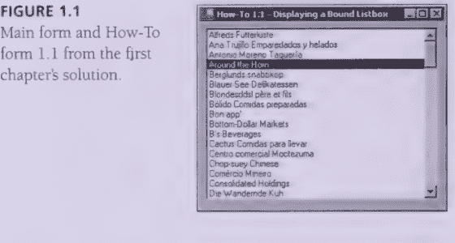

> **注意**
> 你可以在 www.samspublishing.com 找到本书所有章节的源代码。进入网站后，只需输入本书的 ISBN（0672322471）。

- 1. 使用"Windows 应用程序"项目模板创建一个新的 Visual Studio .NET 项目。这将创建名为 Form1 的初始窗体，供你使用。
- 2. 将 **OleDbDataAdapter** 控件从工具箱中的"数据控件"组拖到窗体上。"数据适配器配置向导"随即出现。阅读介绍性屏幕，然后单击"下一步"选择数据连接。此时，如果在数据连接下拉列表中看不到 Northwind 数据库的数据连接，请单击"新建连接"按钮。随后将出现"数据链接属性"对话框，如果你使用过 Visual Studio 6.0 等其他 Microsoft 产品，应该对此比较熟悉。输入 (local) 作为服务器名，选择"使用 Windows NT 集成安全性"，并选择 Northwind 作为数据库（见图 1.2）。单击"确定"。
- 3. 现在你会回到数据适配器配置向导的"选择数据连接"页面，Northwind 数据库将出现在数据连接下拉列表中。单击"下一步"。这将进入选择数据适配器所基于的查询类型页面。保留默认的"使用 SQL 语句"选项，单击"下一步"。在询问"数据适配器应将哪些数据加载到数据集中？"的文本框中，输入以下内容：

```sql
Select CustomerID, CompanyName From Customers
```

### 图 1.2
从现在开始，此数据连接将显示在此计算机上 Visual Studio .NET 的服务器资源管理器中。

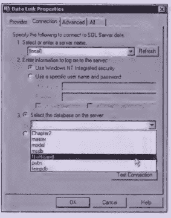

> **注意**
> 默认情况下，数据适配器配置向导不仅会创建用于选择（查看）数据的 Select 语句，还会创建用于插入、更新和删除的语句。如果你不需要这些其他选项，请单击对话框左下角的**"高级选项"**按钮。取消选中"生成 Insert、Update 和 Delete 语句"复选框。因为我们只是用数据来填充 `ListBox` 控件，所以不需要这个选项。单击"确定"关闭高级选项对话框。

- 4. 单击"下一步"查看 Select 语句的结果，如图 1.3 所示。如果你看到的内容与图 1.3 不同，可能是你输入的 Select 语句有误，或者忘记了取消高级选项。
- 5. 单击"完成"创建数据适配器和连接对象。然后你会看到名为 `OleDbDataAdapter1` 的新数据适配器控件和名为 `OleDbConnection1` 的连接控件。两个控件都位于窗体设计器下方的组件托盘中。
- 6. 创建好前两个控件后，就该创建数据集对象了。右键单击数据适配器，从弹出菜单中选择"生成数据集"。这将打开"生成数据集"对话框。你可以保留所有默认设置，直接单击"确定"创建名为 `DataSet<number>` 的数据集控件。（如果已生成过其他数据集控件，序号可能会有所不同。）
- 7. 现在可以创建 `ListBox` 控件了。将 `ListBox` 控件从工具箱中的"Windows 窗体"组拖到窗体上。将控件拉伸至与窗体相同的大小，然后在 `ListBox` 控件上按表 1.2 设置以下属性。

### 图 1.3
成功创建数据适配器。

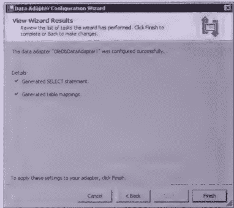

### 表 1.2 绑定 DataSet 控件所需的 ListBox 控件属性设置

| 属性 | 设置值 |
|----------|---------|
| DataSource | DataSet\<Number\> |
| DisplayMember | Customers.CompanyName |
| ValueMember | Customers.CustomerID |

虽然你已将数据集绑定到 ListBox 控件的正确属性，但此时运行窗体，你仍将看到 listbox 控件为空白。

- 8. 现在是添加这段示例中唯一一行代码的时候了，在窗体的 Load 事件中。单击解决方案资源管理器中的"查看代码"按钮，或从"视图"菜单中选择"代码"。在代码编辑器中，从"类名"下拉列表中选择 (基类对象)，然后从"方法名称"下拉列表中选择 Load。接下来，输入如下所示的代码行，它告诉数据适配器用数据填充数据集：

`OleDbDataAdapter1.Fill(DataSet1)`

务必使用你创建的控件名称。清单 1.1 展示了示例中名为 frmHowTo1_1 的窗体的 Load 事件代码。

**清单 1.1 frmHowTo1_1.vb：在 ListBox1 所基于的数据集上填充数据**

```vbnet
Private Sub frmHowTo1_1_Load(ByVal sender As Object, _
ByVal e As System.EventArgs) Handles MyBase.Load

    Me.OleDbDataAdapter1.Fill(Me.DataSet1)

End Sub
```

## 工作原理

当名为 `frmHowTo1_1` 的窗体加载时，会调用 `OleDbDataAdapter1` 的 `Fill` 方法，并传入 `DataSet1`。由于 `ListBox1` 的 `DataSource` 属性被指定为 `DataSet1`，且 `ValueMember` 和 `DisplayMember` 属性均已正确设置，因此 `ListBox1` 将使用 Northwind 数据库中 Customers 表的 `CustomerID` 和 `CompanyName` 进行填充。图 1.4 显示了最终窗体在设计视图中的样子，图 1.5 显示了运行时的样子。

### 图 1.4
你的第一个数据库 HOW-TO 的最终设计视图。

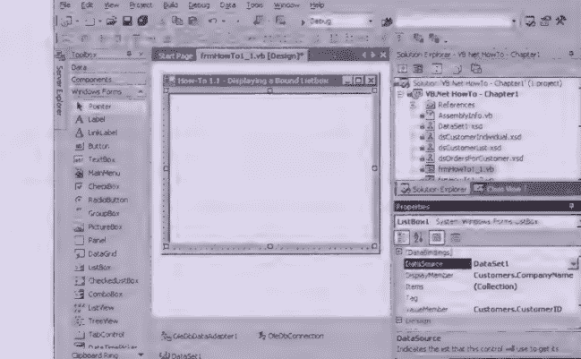

### 图 1.5
此列表基于 Northwind SQL Server 数据库中的 Customers 表。

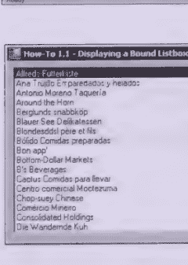

## 说明

在 .NET 版本的 Visual Basic 中，微软付出了相当大的努力使数据控件比以往更加健壮。很酷的一点是，Visual Basic .NET 中为你完成的大多数任务都是可发现的。尽管你在窗体上使用了数据控件，Visual Studio 实际上在幕后创建了代码。你可以通过单击以下 #Region 语句来查看这些代码：

```vbnet
#Region " Windows Form Designer generated code "
"

注意：这里的代码很多，而且你不希望更改它。不过通过阅读它，你可以学到很多东西。

当你继续使用这里展示的数据控件时，你会逐渐习惯更改各种属性，从而从中获得更多功能和用途。

## 1.2 限制绑定 ListBox 中显示的数据

即使只用表中几列数据填充列表框，也可能对性能造成很大影响。本 HOW-TO 向你展示如何创建参数化 SQL 语句来限制列表框中显示的项，从而提高窗体的性能。

你的数据库中有数十万客户，你不希望列表框加载整个客户表。如何限制列表框中显示的数据？

### 技术要点

你将复制在 How-To 1.1 中创建的窗体。然后添加一个 Label 和 TextBox 控件，OleDbDataAdapter 控件中的 Select 语句将针对它们进行查询，以限制列表框中显示的数据。还将添加一个命令按钮，以便在更新文本框后调用 OleDbDataAdapter 控件的 Fill 方法，然后你可以单击该命令按钮（见图 1.6）。

### 图 1.6
你现在可以限制加载到列表框中的数据量。

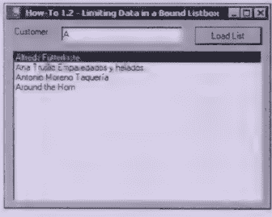


## 步骤

要开始本操作指南，请在解决方案资源管理器中找到在操作指南 1.1 中创建的窗体，右键单击该窗体。从弹出菜单中选择“复制”。接下来，在解决方案资源管理器中右键单击项目，然后从弹出菜单中选择“粘贴”。现在，解决方案资源管理器中会出现一个名为“Copy Of [之前窗体的名称]”的新类对象。将新创建的窗体重命名为所需的名称。然后，在该窗体高亮显示的情况下，单击解决方案资源管理器上方的“代码”按钮。将第一行代码更改为以下内容：

```
Public Class <新窗体的名称>
```

你看，VS 不会自动为你更改代码行。它会认为你有重复的类定义。

现在你可以看到窗体的图标是正确的。你可以继续执行操作指南的步骤。

1. 选择你创建的数据适配器。在属性窗格中，单击 SelectCommand 属性旁边的加号时，你会看到 CommandText 属性。将 CommandText 属性替换为以下命令：

```
SELECT CustomerID, CompanyName FROM Customers WHERE (CompanyName LIKE ? + '%')
```

你将在第 3 章中学习更多关于 Select 语句的内容。然而，这里使用的 WHERE 子句将 CompanyName 与一个将要提供的参数进行比较，用 ? 表示。这将在本操作指南的最后一步中使用代码完成。% 是一个通配符，告诉服务器进行模糊搜索。

2. 调整 ListBox 控件的大小，并在窗体顶部为 Label、TextBox 和 Command 按钮留出空间。创建这三个控件，按照表 1.3 中描述的设置属性。

| 对象 | 属性 | 设置 |
|--------|----------|---------|
| Label | Text | Customer |
| TextBox | Name | txtCustLimit |
| TextBox | Text | A |
| Command Button | Name | btnLoadList |
| Command Button | Text | Load List |

**表 1.3** Label、TextBox 和 Command Button 控件属性设置

3. 双击你刚创建的名为 btnLoadList 的新命令按钮。在 btnLoadList 按钮的 Click 事件中输入清单 1.2 中的代码。这段代码将 txtCustLimit 中输入的数据加载到 OleDBDataAdapter1 的参数中，该参数是通过在数据适配器的 Select 语句中使用 ? 创建的。然后使用 Clear 方法清除 Dataset1 中的数据。最后，使用数据适配器基于 txtCustLimit 中的值重新填充 DataSet1。

### 清单 1.2 frmHowTo1_2.vb：向 DataAdapter 提交参数并填充 Dataset

```
Private Sub btnLoadList_Click(ByVal sender As System.Object,
        ByVal e As System.EventArgs) Handles btnLoadList.Click

    Me.OleDbDataAdapter1.SelectCommand.Parameters(0).Value =
            Me.txtCustLimit.Text

    Me.DataSet1.Clear()

    Me.OleDbDataAdapter1.Fill(Me.DataSet1)

End Sub
```

> **注意**
OleDbDataAdapter 和 SqlDataAdapter 之间有一个重要区别。OleDbDataAdapter 在 Select 语句中使用 ? 来指定参数，而 SqlDataAdapter 需要使用命名参数，例如 @parCustLimit。因此，第 1 步中的 select 语句不再是：

SELECT CustomerID, CompanyName FROM Customers WHERE (CompanyName LIKE ? + '%')

而是：

SELECT CustomerID, CompanyName FROM Customers WHERE (CompanyName LIKE @parCustLimit + '%')

实际参数的命名由你决定。

4. 突出显示并删除窗体的 Load 事件，因为你不想在窗体加载时就填充事件。你让用户点击 btnLoadList。

## 工作原理

当你为本操作指南创建的 Stall 创建的窗体加载时，或者当你使用名为 frmHowTo1_2 的窗体时，你会看到一个空的 ListBox 控件，上面有一个文本框，其中包含字母 A。如果你点击名为 btnLoadList 的命令按钮，列表框会根据 txtCustLimit 中的字母（或多个字母）以及第 3 步中描述的代码填充值。

## 评论

尝试输入其他几个字母，然后尝试不输入任何字母。会发生什么？你输入的字母越多，列出的列表越有限；当你不输入任何字母时，你会得到所有条目。

这里展示的方法虽然简单，但功能强大，可以以多种方式使用。

你可以在接下来的几个操作指南中继续构建此窗体。如果你想复制窗体并按照本操作指南步骤开头所述开始一个新的窗体，你可以在那里找到说明。否则，当你到达操作指南 1.8 时，你将拥有一个可以使用的数据输入窗体。然而，每个步骤在本章的示例解决方案中都有提供。

## 1.3 基于选定的 List Box 项目绑定和查看单个 Text Box

使用类似于上一个操作指南中的列表框，在本操作指南中，你将学习如何创建额外的 `OleDbDataAdapter` 和 `DataSet`，并将它们绑定到单个文本框以查看数据。

虽然列表框对于在窗体中提供几个字段并限制显示的行数很有用，但是如何通过点击列表框中的项目来在单个文本框中列出详细信息呢？

## 技术

你将增强在操作指南 1.2 中创建的窗体，以使用额外的数据控件，特别是另一个数据适配器和数据集。你将在新的数据适配器中设置 select 语句，使其将选定的列表框项目作为参数。然后数据集将被填充数据，一些将数据集设置为数据源并且显示当前记录的文本框。你可以在图 1.7 中看到此示例。

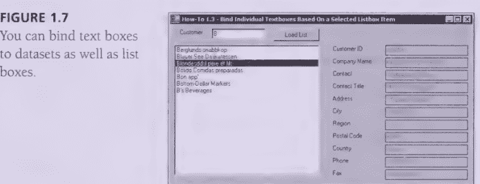

## 步骤

要进一步处理你一直在使用的窗体，你需要将当前窗体上的数据适配器、数据集和列表框重命名为更有意义的名称。你可以在表 1.4 中看到此内容。

### 表 1.4 对当前窗体上对象的更改

| 对象 | 属性 | 旧设置 | 新设置 |
| :--- | :--- | :--- | :--- |
| ListBox | Name | ListBox1 | lstCustomers |
| OleDbDataAdapter | Name | OleDbDataAdapter1 | odaCustomerList |
| DataSet | Name | DataSet1 | dsCustomerList |

> **提示**
在首次创建对象时为它们命名。这适用于你的解决方案、项目和窗体，以及窗体上使用的控件。由于 .NET 语言如此以类和代码为驱动，某些项目需要Multiple steps to rename。Visual Studio 似乎无法捕获代码中所有需要更改的地方。重命名窗体就是一个很好的例子。请记住，你必须在代码中更改 Public Class 语句，使其与窗体的新名称匹配。

1. 从工具箱的数据组中将另一个数据适配器控件拖到窗体上。使用现有的数据连接，指定你将使用 SQL 语句，并分配以下将在运行时使用所选列表框项目提供参数的 select 语句。

```
SELECT CustomerID, CompanyName, ContactName, ContactTitle, Address, City, Region, PostalCode, Country, Phone, Fax FROM Customers WHERE (CustomerID = ?)
```

你可以在 select 语句页面上点击“高级选项”按钮，然后取消选择创建 Insert、Update 和 Delete 命令。完成数据适配器向导，并将控件重命名为 `odaCustomerIndividual`。

2. 右键单击 `odaCustomerIndividual`，然后从弹出菜单中选择“生成数据集”。创建一个名为 `dsCustomerIndividual` 的新数据集。点击“确定”。在撰写本文时，VS 会在你指定的数据集名称末尾添加一个 1。通过删除 1 来清理名称。现在你应该有两个数据适配器：`odaCustomerList` 和 `odaCustomerIndividual`，以及两个数据集：`dsCustomerList` 和 `dsCustomerIndividual`。

3. 现在是时候添加文本框了。调整窗体大小，以便添加一列带标签的文本框。然后将文本框的 Text 属性设置为 `dsCustomerIndividual` 提供的 Customers 表中的列名。文本框的 Text 属性位于属性表的“数据绑定”类别下。表 1.5 描述了控件及其属性设置。有关放置位置的示例，请参阅图 1.8。


## 表 1.5 表单 frmHowTo1_3 的新 Label 和 TextBox 控件属性设置

| 对象 | 属性 | 设置 |
| :--- | :--- | :--- |
| Label | Text | Customer ID |
| Label | Text | Company Name |
| Label | Text | Contact |
| Label | Text | Contact Title |
| Label | Text | Address |
| Label | Text | City |
| Label | Text | Region |
| Label | Text | Country |
| Label | Text | Phone |
| Label | Text | Fax |
| TextBox | Name | txtCustomerID |
| TextBox | Text | dsCustomerIndividual - Customers.CustomerID |
| TextBox | Name | txtCompanyName |
| TextBox | Text | dsCustomerIndividual - Customers.CompanyName |
| TextBox | Name | txtContact |
| TextBox | Text | dsCustomerIndividual - Customers.Contact |
| TextBox | Name | txtContactTitle |
| TextBox | Text | dsCustomerIndividual - Customers.ContactTitle |
| TextBox | Name | txtAddress |
| TextBox | Text | dsCustomerIndividual - Customers.Address |
| TextBox | Name | txtCity |
| TextBox | Text | dsCustomerIndividual - Customers.City |
| TextBox | Name | txtRegion |
| TextBox | Text | dsCustomerIndividual - Customers.Region |
| TextBox | Name | txtPostalCode |
| TextBox | Text | dsCustomerIndividual - Customers.PostalCode |
| TextBox | Name | txtCountry |
| | Text | dsCustomerIndividual - Customers.Country |
| TextBox | Name | txtPhone |
| | Text | dsCustomerIndividual - Customers.Phone |
| TextBox | Name | txtFax |
| | Text | dsCustomerIndividual - Customers.Fax |

- 4. 现在是编写代码的时间了。首先，您将更改名为 btnLoadList 按钮的 Click 事件代码。前三行代码基本上与上一个 How-To 相同，只不过根据需要更改了名称，并添加了一些行来对代码进行注释。

## 列表 1.3 frmHowTo1_3.vb：添加对 RefreshIndividual 子程序的调用

```
Private Sub btnLoadList_Click(ByVal sender As System.Object,
    ByVal e As System.EventArgs) Handles btnLoadList.Click

    ' - Store the text entered to limit the list box to the
    '   data adapter's parameter
    Me.odaCustomerList.SelectCommand.Parameters(0).Value = 
    Me.txtCustLimit.Text

    ' - Clear the current data in the dataset
    Me.dsCustomerList.Clear()

    ' - Fill the customer list dataset
    Me.odaCustomerList.Fill(Me.dsCustomerList)

    ' - Fill the initial entry's individual dataset
    RefreshIndividual()

End Sub
```

唯一的新代码行是在 `End Sub` 之前的那一行，它为新填充的列表框中的第一项调用了子程序 `RefreshIndividual`。该子程序首先处理清除名为 `dsCustomerIndividual` 的数据集。它确保在列表框中选择了一位客户，然后将所选项目放入 `odaCustomerIndividual` 的参数值中。接着填充名为 `dsCustomerIndividual` 的数据集，从而在绑定到该数据集的文本框中显示数据。

## 列表 1.4 `frmHowTo1_3.vb`：刷新文本框所基于的数据集

```
Private Sub RefreshIndividual()

    ' Clear individual customer dataset
    Me.dsCustomerIndividual.Clear()

    ' Check to see if an item was selectedment is selected
    If lstCustomers.SelectedIndex <> -1 Then

        ' Store the selected customer ID into the
        ' parameter of the SQL data adapter
        Me.odaCustomerIndividual.SelectCommand.Parameters(0).Value = _
        Me.lstCustomers.SelectedItem(0)

        ' Fill the dataset
        Me.odaCustomerIndividual.Fill(Me.dsCustomerIndividual)

    End If

End Sub
```

唯一需要的其他代码是在列表框中选择新项目时。您希望使用新数据刷新文本框。这段代码位于 `lstCustomers` 列表框的 `SelectedIndexChanged` 事件中。

## 列表 1.5 `frmHowTo1_3.vb`：调用 RefreshIndividual 例程

```
Private Sub lstCustomers_SelectedIndexChanged(ByVal sender As System.Object, 
    ByVal e As System.EventArgs)

    Handles lstCustomers.SelectedIndexChanged
    ' Fill the current list item's individual dataset
    RefreshIndividual()

End Sub
```

## 工作原理

在用户在 `txtCustLimit` 文本框中输入一个字母并点击 `btnLoadList` 后，列表框将填充与文本框中的文本匹配的项目。在 `lstCustomers` 填充后，用户将在文本框中看到列表框中第一项的详细信息。这发生在名为 `RefreshIndividual` 的例程中。所选项目被用作名为 `odaCustomerIndividual` 的数据适配器的参数，然后填充名为 `dsCustomerIndividual` 的数据集。当用户在列表框中选择新项目时，将显示与所选项相对应的数据。

# 使用 VISUAL BASIC .NET 和 ADO.NET 进行数据库编程：技巧、教程与代码

> **提示**
> 始终尝试将代码分解为特定的例程，例如 RefreshIndividual 子程序。这样当有人尝试阅读代码时，代码易于阅读，您不会因为重复输入相同的代码而犯错，并且在必要时只需在的一处修改代码。

## 评论

将文本框绑定到数据集可以节省从一条记录切换到另一条记录时的工作量，因为您不必每次都专门为每个文本框加载数据。在窗体上操作数据时，每次结合使用数据适配器和数据集都会变得更加简单。

正如您在接下来的 How-To 中将看到的，绑定数据集在您于窗体上编辑、添加和删除数据时特别有用。

## 1.4 使用绑定控件编辑和更新数据

虽然在某些情况下查看数据就足够了，但真正的强大之处在于能够编辑文本框中的数据并更新服务器中的数据。在本 How-To 中，您将学习如何实现这一点，使用来自各种数据控件的一些新方法和属性，包括为您创建更新、插入和删除 SQL 语句的自动生成命令。本 How-To 还向您介绍了 `BinderContext` 类，它用于使用绑定控件执行更新。

在 How-To 1.4 中创建的窗体如果您只想查看各种记录的数据，那是很棒的。但如果您想让用户编辑和更新数据怎么办？

### 技巧

继续使用您在之前的 How-To 中使用的窗体，您将添加几个命令按钮，其代码将执行以下操作：

- **编辑 (Edit)。** 切换文本框的外观，通过赋予控件一个下沉（sunken）的外观，让用户知道他可以编辑控件中的数据。
- **保存 (Save)。** 将对数据所做的更改保存回服务器。然后将文本框的外观切换回平面（flat），以便用户知道他不能编辑它们。
- **取消 (Cancel)。** 将文本框切换回平面，以便用户知道他不能再编辑它们，但不保存数据。

让用户知道何时可以编辑以及何时不能编辑非常重要。通过在平面和下沉样式之间切换文本框，以及在灰色和白色之间切换颜色，用户可以获得明确的线索，知道他们在某些时刻可以编辑数据（见图 1.8）。

第 1 章 • 使用绑定控件开发 Windows 窗体 21

让用户知道何时可以编辑数据是有帮助的。

关于本 How-To 的另一个有用注意事项是 **BindingContext** 类的引入。这个类可以帮助您处理数据绑定控件。Windows 窗体上的每个控件都有一个 **BindingContext** 对象，以及包含在该控件中的任何控件的 **BindingContext** 对象。每个窗体也都有一个 **BindingContext** 对象。**BindingContext** 对象为每个控件管理 **BindingManagerBase** 类对象。通过 **BindingContext** 对象，您可以管理将编辑和更新的数据传回服务器。**BindingManagerBase** 对象有助于数据集与控件的同步。在本章的剩余部分中，您将使用 **BindingContext** 类，但仅使用其中的几种方法。

### 步骤

打开名为 "VB .NET How-To Chapter 1." 的章节解决方案并运行应用程序。在主窗体中，点击标题为 "How-To 1.4." 的命令按钮。点击 Load List 按钮。除了列表被填充为名称以 A 开头的客户外，您还会看到窗体右侧的详情 How-To 用列表中的第一个客户填充。点击 Edit。您现在将能够更改文本框中的数据。在更改几个字段后，点击 Save。如果您从列表框中选择另一个客户，请选择您更改的那个。您会发现您的更改实际上已被保存。如果您点击 Cancel 而不是 Save，您的更改将不会被保存。请注意，如果您更改了客户的名称，您必须重新加载列表才能在列表框中看到更改。

- 1. 按照表 1.6 中所述并如图 1.8 所示，在窗体中添加三个命令按钮。


## 表 1.6 用于编辑、保存和取消数据更改的命令按钮

| 对象 | 属性 | 设置 |
| :--- | :--- | :--- |
| 命令按钮 | 名称 | btnEdit |
| | 标题 | &编辑 |
| 命令按钮 | 名称 | btnSave |
| | 标题 | &保存 |
| 命令按钮 | 名称 | btnCancel |
| | 标题 | &取消 |

2. 将清单 1.6 所示的代码添加到 **btnEdit** 的 Click 事件中。

### 清单 1.6 frmHowTo1_4.vb：从 btnEdit 命令按钮调用 ActiveEditing 子程序

```vb
Private Sub btnEdit_Click(ByVal sender As System.Object,
    ByVal e As System.EventArgs) Handles btnEdit.Click

    ' Enable the editing of the form
    ActivateEditing(True)

End Sub
```

这将调用名为 **ActivateEditing** 的例程（列于此处）。此代码遍历窗体上的所有控件，并使用 **TypeOf** 条件来检查当前控件是否为文本框。它还会确保该控件不是 **txtCustLimit** 文本框。如果控件是文本框且传递的参数 **bEnable** 为 True，则通过 **BorderStyle** 为文本框设置下沉外观，并将 **BackColor** 属性设置为白色。否则，将 **BorderStyle** 设置为 FixedSingle（扁平外观），并将 **BackColor** 设置为窗体的背景色。文本框的 **Enabled** 属性将根据 bEnabled 的值设置为 True 或 False。

### 清单 1.7 frmHowTo1_4.vb：切换文本框的 Enabled 属性和外观

```vb
Private Sub ActivateEditing(ByVal bEnable As Boolean)

    Dim oCurr As Object

    ' Loop through each of the controls on the form
    For Each oCurr In Me.Controls()

        ' Check to see if the control is a text box
        If TypeOf oCurr Is TextBox And oCurr.Name <> "txtCustLimit" Then
            '- If so, toggle the properties
            If bEnable Then

                oCurr.BorderStyle = _
                    System.Windows.Forms.BorderStyle.Fixed3D

                oCurr.BackColor = System.Drawing.Color.White

            Else

                oCurr.BorderStyle = _
                    System.Windows.Forms.BorderStyle.FixedSingle

                oCurr.BackColor = Me.BackColor

            End If

            oCurr.Enabled = bEnable

        End If
    Next

End Sub
```

3. 将代码添加到 **btnSave** 命令按钮的 `Click` 事件中。此代码调用一个名为 SaveRecord 的新例程来执行实际的保存操作。然后调用 **ActivateEditing** 并传递 **False** 以禁用控件，因为编辑已完成。

### 清单 1.8 frmHowTo1_4.vb：调用 SaveRecord 例程并通过调用 ActivateEditing 禁用文本框

```vb
Private Sub btnSave_Click(ByVal sender As System.Object, _
        ByVal e As System.EventArgs) Handles btnSave.Click

    '- Save the information
    SaveRecord()

    '- Disable the text boxes
    ActivateEditing(False)

End Sub
```

以下是名为 SaveRecord 的子程序代码。该例程调用 **BindingContext** 类的 **EndCurrentEdit** 方法，传入名为 **dsCustomerIndividual** 的数据集，并指定 **Customers** 表。然后，调用名为 **odaCustomerIndividual** 的数据适配器的 **Update** 方法，并传递相同的参数。这将把更改更新回数据集。最后，数据集的更改被发送回服务器。

### 清单 1.9 frmHowTo1_4.vb：将数据保存回服务器

```vb
Private Sub SaveRecord()
    ' - Use the BindingContext class to end current editing
    '   so that we can update the server.
    Me.BindingContext(Me.dsCustomerIndividual, "Customers").EndCurrentEdit()

    ' - Perform the requested task at the dataset
    '   level using the data adapter
    Me.odaCustomerIndividual.Update(Me.dsCustomerIndividual, "Customers")

    ' - By accepting the changes, the data gets sent back to the server
    Me.dsCustomerIndividual.AcceptChanges()
End Sub
```

**注意：** 如果你还没有阅读过关于 ADO.NET 的内容，那么对于更新数据集、接受更改以及将更改发送回服务器的操作可能会感到困惑。ADO.NET 使用断开连接的数据工作。当你使用数据适配器创建数据集时，数据实际上是使用 XML 创建的。要证明这一点，请查看解决方案资源管理器中的 `dsCustomerIndividual.xsd`。

```xml
<xsd:schema id="dsCustomerIndividual" targetNamespace="http://www.tempuri.org/dsCustomerIndividual.xsd" xmlns="http://www.tempuri.org/dsCustomerIndividual.xsd" xmlns:xsd="http://www.w3.org/2001/XMLSchema" xmlns:msdata="urn:schemas-microsoft-com:xml-msdata" attributeFormDefault="qualified" elementFormDefault="qualified">
    <xsd:element name="dsCustomerIndividual" msdata:IsDataSet="true">
        <xsd:complexType>
            <xsd:choice maxOccurs="unbounded">
                <xsd:element name="Customers">
                    <xsd:complexType>
                        <xsd:sequence>
                            <xsd:element name="CustomerID" type="xsd:string" />
                            <xsd:element name="CompanyName" type="xsd:string" />
                            <xsd:element name="ContactName" type="xsd:string" minOccurs="0" />
                            <xsd:element name="ContactTitle" type="xsd:string" minOccurs="0" />
                            <xsd:element name="Address" type="xsd:string" minOccurs="0" />
                            <xsd:element name="City" type="xsd:string" minOccurs="0" />
                            <xsd:element name="Region" type="xsd:string" minOccurs="0" />
                            <xsd:element name="PostalCode" type="xsd:string" minOccurs="0" />
                            <xsd:element name="Country" type="xsd:string" minOccurs="0" />
                            <xsd:element name="Phone" type="xsd:string" minOccurs="0" />
                            <xsd:element name="Fax" type="xsd:string" minOccurs="0" />
                        </xsd:sequence>
                    </xsd:complexType>
                </xsd:element>
            </xsd:choice>
        </xsd:complexType>
        <xsd:unique name="Constraint1" msdata:PrimaryKey="true">
            <xsd:selector xpath=".//Customers" />
            <xsd:field xpath="CustomerID" />
        </xsd:unique>
    </xsd:element>
</xsd:schema>
```

这一切都是在后台完成的，所以好消息是，你不需要了解 XML 就能操作数据集和 ADO。关于此内容的更多信息可以在第 3 章中找到。

4. 最后一项任务是为你提供取消编辑的能力。你只需将以下代码放入 **btnCancel** 的 **Click** 事件中。通过调用窗体 **BindingContext** 对象的 **CancelCurrentEdit** 方法，当前的编辑将被取消。接着，使用 **ActivateEditing** 例程禁用文本框。

### 清单 1.10 frmHowTo1_4.vb：取消数据更改并再次禁用文本框

```vb
Private Sub btnCancel_Click(ByVal sender As System.Object, _
            ByVal e As System.EventArgs) Handles btnCancel.Click

    '-- Use the BindingContext class to cancel the current editing.
    Me.BindingContext(Me.dsCustomerIndividual, _
        "Customers").CancelCurrentEdit()
    ActivateEditing(False)

End Sub
```

## 工作原理

当用户点击 **btnEdit** 按钮时，**ActivateEditing** 例程会告知用户他现在可以编辑文本框中的数据。此时文本框被启用。

如果用户随后点击 **btnSave** 按钮，数据将更新到数据集，然后更新回服务器。如果用户点击 **btnCancel** 按钮，编辑将被取消。在这两种情况下，都会调用 **ActivateEditing** 例程来禁用文本框，让用户知道文本框不可编辑。

## 评注

本 How-To 展示了编辑和更新数据的基本框架。它提供了一种入门的基础技术。随着学习的深入，你将学习添加和删除记录的方法以及处理错误的方法。

如果你之前使用过 ADO 和 DAO 等其他数据访问方法，那么使用用于绑定控件的 ADO.NET 需要一段时间来适应。**BindingContext** 和 **BindingManagerBase** 对象使得在代码中操作绑定对象变得更加容易管理。

## 1.5 使用绑定控件添加和删除记录

除了编辑数据，在表中添加新记录和删除记录显然也是重要的功能。本 How-To 将利用 **BindingContext** 类为你展示如何实现这些功能。

除了能够编辑已存在的当前记录外，用户还需要能够添加和删除记录。如何使用绑定控件来添加和删除记录？

### 技术方案

为了创建“添加新记录”功能，你将添加一个名为 **btnAddNew** 的按钮及其后台代码。你将再次使用 **BindingContext** 对象，通过 **AddNew** 方法来添加新记录。窗体中将添加一个模块级变量，用于跟踪记录是正在被添加还是正在被编辑。如果正在添加新记录，那么在执行更新时，应用程序需要重新加载列表框中的数据，以防新记录的 **CompanyName** 数据落在 **txtCustLimit** 文本框所指定的列表限制之内。

为了创建“删除记录”功能，你将添加一个名为 **btnDelete** 的按钮。该按钮的后台代码将使用 **BindingContext** 对象的 **RemoveAt** 方法从数据集中删除记录。随后，数据将被提交回服务器。

### 步骤

打开名为 "VB .NET How-To Chapter 1" 的章节解决方案，并运行应用程序。在主窗体中，点击标记为 How-To 1.5 的命令按钮。点击 Load List 按钮。点击标记为 New 的按钮。为 Customer ID 输入文本 `ALF`，为 Company Name 输入 `Alfred's Fried Foods`。然后点击标记为 Save 的按钮，你会看到刚刚输入记录被添加到列表中。记录输入完成后，你可以通过点击名为 Delete 的按钮来测试删除功能。记录消失，列表被重建。

- 1. 在 **btnEdit** 下方添加一个新命令按钮，然后将其 Name 属性设置为 **btnNew**，Caption 属性设置为 **&Save**。


 2. 添加一个名为 mbAddNew 的新模块级变量，这是一个布尔变量，用于跟踪是否正在添加新记录。该变量将放置在例程之外，紧跟在窗体代码下方。您可以在图 1.9 中看到这一点。

**图 1.9** 通过将此变量放置在 Windows 窗体设计器生成的代码正下方并将其声明为 Private，类内部的例程可以看到它，但外部的例程则不能。

> **提示**
您可以在模块中折叠和展开正在处理的例程。当您在编写新例程（可展开）且不想干扰旧例程（可折叠）时，这非常方便。

3. 在新命令按钮 btnNew 的 Click 事件中添加以下代码。这段代码首先将名为 mbAddNew 的布尔变量设置为 True。然后，它使用窗体 BindingContext 对象的 AddNew 方法向 dsCustomerIndividual 数据集添加新记录。最后，代码调用 ActiveEditing 例程以启用文本框。

## **代码清单 1.11** frmHowTo1_5.vb：向 dsCustomerIndividual 数据集添加新记录并切换文本框状态

```
Private Sub btnNew_Click(ByVal sender As System.Object, _
    ByVal e As System.EventArgs) Handles btnNew.Click

    mbAddNew = True

    '- Using the BindingContext class add a new record
    Me.BindingContext(Me.dsCustomerIndividual, "Customers").AddNew()

    ActivateEditing(True)

End Sub
```

4. 修改 btnSave 的 Click 事件，以测试 mbAddNew 标志是否已设置为 True，这意味着正在添加新记录。如果为 True，则在通过调用 SaveRecord 和 ActivateEditing 例程保存记录后，调用 LoadList 和 RefreshIndividual 来加载新记录的数据。请注意，SaveRecord、ActiveEditing 和 RefreshIndividual 例程与 How-To 1.4 相比没有变化。随后将 mbAddNew 变量设置为 False。

## 代码清单 1.12 frmHowTo1_5.vb：保存更改的数据、切换文本框状态以及重新加载列表框和列表中的第一条记录

```
Private Sub btnSave_Click(ByVal sender As System.Object, _
    ByVal e As System.EventArgs) Handles btnSave.Click

    '-- Save the information
    SaveRecord()

    '-- Disable the text boxes
    ActivateEditing(False)

    If mbAddNew Then
        LoadList()
        RefreshIndividual()
        mbAddNew = False
    End If

End Sub
```

5. 修改 btnCancel 按钮的 Click 事件，以将 mbAddNew 变量重置为 False，如代码清单 1.13 所示。

## 代码清单 1.13 frmHowTo1_5.vb：取消编辑并重置 mbAddNew 变量

```
Private Sub btnCancel_Click(ByVal sender As System.Object, _
    ByVal e As System.EventArgs) Handles btnCancel.Click

    '-- Use the BindingContext class to cancel the current editing.
    Me.BindingContext(Me.dsCustomerIndividual, "Customers").CancelCurrentEdit()

    ActivateEditing(False)
    mbAddNew = False

End Sub
```

6. 现在是时候添加删除功能了。为此，在名为 `btnDelete` 的新按钮的 Click 事件中添加以下代码。您添加的代码的第一行首先引入了一个名为 `RemoveAt` 的新方法和一个名为 Position 的新属性，两者都与 `BindingContext` 对象一起使用。您将从内向外地分析。`Position` 属性跟踪数据集（在本例中为 dsCustomerIndividual）中的当前位置。`RemoveAt` 方法将传递给它的位置上的记录标记为删除。

接下来，使用 `odaCustomerIndividual` 适配器的 `Update` 方法对数据集调用 DELETE SQL 语句命令，从而删除数据集中的实际行。调用 `AcceptChanges` 方法将更改（在本例中为删除）发送回服务器。最后，调用 `LoadList`、`RefreshIndividual` 和 `ActivateEditing` 子例程以刷新列表、为文本框刷新列表中的第一条记录，并切换文本框状态，以便用户知道他无法编辑它们。

## 代码清单 1.14 `frmHowTo1_5.vb`：删除选定记录并重新加载列表框

```
Private Sub btnDelete_Click(ByVal sender As System.Object, _
    ByVal e As System.EventArgs) Handles btnDelete.Click

    ' - Mark the row for deletion using the RemoveAt method of the BindingContext
    Me.BindingContext(Me.dsCustomerIndividual, _
        "Customers").RemoveAt(Me.BindingContext(Me.dsCustomerIndividual, _
        "Customers").Position)

    ' - Perform the requested task at the dataset
    ' level using the data adapter
    odaCustomerIndividual.Update(dsCustomerIndividual, "Customers")

    ' - By accepting the changes, the data gets sent back to the server
    dsCustomerIndividual.AcceptChanges()

    ' - Reload the list
    LoadList()

    ' - Display the first record
    RefreshIndividual()

    ' - Disable the text boxes
    ActivateEditing(False)

End Sub
```

## 工作原理

当用户点击 `btnNew` 按钮时，标志 (`mbAddNew`) 被设置为 `True`，数据集通过 `BindingContext` 的 `AddNew` 方法设置为添加记录状态，并且文本框被启用以进行编辑。

如果用户随后点击 `btnSave` 按钮，数据将更新到数据集，然后传回服务器。如果用户点击 `btnCancel` 按钮，编辑将被取消。在这两种情况下，`mbAddNew` 变量都被设置为 `False`，并调用 `ActivateEditing` 例程来禁用文本框，告知用户文本框不可编辑。最后，如果点击了 `btnSave` 按钮且 `mbAddNew` 设置为 `True`，则调用 `LoadList` 和 `RefreshIndividual` 例程。

当用户点击 `btnDelete` 按钮时，记录将从记录集中删除，然后从服务器中删除。列表框被重新加载，且列表中的第一条记录显示在文本框中。随后文本框被禁用。

## 注释

到这里，您已经掌握了创建功能完备的数据输入窗体所需的基本命令。您可以通过窗体添加、编辑和删除信息。实际上，这比使用 Visual Basic 6.0 所需的代码更少。

`BindingContext` 对象在帮助您处理绑定数据方面起到了很大作用。

## 1.6 处理绑定控件的错误处理

在处理数据库任务时，您会遇到运行时错误。在 .NET 中，我们将您可能遇到的各种类型的错误称为**异常 (exceptions)**。本 How-To 将展示可能出现哪些异常的示例，以及如何使用 `Try`、`Catch` 和 `Finally` 语句来处理它们。

添加和删除记录没问题，但如果发生错误会怎样？您尝试删除一家现有公司，结果出现了如图 1.10 所示的屏幕。

图 1.10
这是一个未处理的错误，在 .NET 中称为异常。

如何才能让应用程序在使用绑定控件时，能够优雅地处理这些错误？

## 技术方案

错误处理是处理数据时最重要的方面之一，涵盖了用户输入数据到更新服务器之间的过程。如果没有适当的错误处理，在最好的情况下，您的系统会给出难看的错误消息；在最坏的情况下，系统会崩溃并在您的系统中存入错误的数据。在 Visual Studio .NET 中，错误是被称为异常的类。存在许多不同的（继承的）异常类型。

运行时异常几乎可能发生在应用程序的任何部分。它们可以通过使用 Try...Catch...Finally 来处理，或者保持未处理状态，此时您将看到如图 1.11 所示的错误。

请查看代码清单 1.15 中所示的捕获异常的一种常用方法。

## 代码清单 1.15 处理异常的标准代码

```
Private Sub MySub()

    Try

        ' Code to be handled here

    Catch dataException As Exception

        MessageBox.Show(dataException.Message)

    Finally

        ' Code that will occur regardless of if an error occurs.

    End Try

End Sub
```

以下是一些在处理异常和 **Try...Catch...Finally** 块时的基本要点，希望能对您有所帮助：

- 异常对象的名称可以是您想要的任何名称。`dataException` 仅用作示例。
- 特定类型的异常继承自基类 `System.Exception`。`OleDbException` 就是其中一个类，您将在接下来的步骤中看到使用该类的示例。
- 您可以在 `Catch` 语句中使用 `Throw` 语句将异常抛回给调用子例程。
- 您可以在 `Catch` 语句上使用 `When` 子句来捕获特定的异常。
- 当使用多个 `Catch` 语句时，除非在 `Catch` 块中放置了 `End Try` 或 `End Sub`（如此 How-To 中所示），否则每个语句都会执行。
- 您可以使用多个 `Catch` 语句来处理可能发生的各种异常。

您将在接下来的步骤中看到这些要点的示例。


## 步骤

利用你一直在使用的窗体，你将对其进行修改，以便在保存记录（无论是新增还是编辑）以及删除记录时捕获异常。你还将在关闭窗体关闭的事件中添加一些代码。

1.  修改名为 `btnSave` 的命令按钮的 `Click` 事件中的代码。你将使用 `Try...Catch...End Try` 块将 `SaveRecord` 例程调用包围起来。如果发生异常，则调用 `MessageBox` 类的 `Show` 方法，并传递名为 `saveException` 的 Exception 对象的 `Message` 属性。接着，退出子程序。如果没有发生错误，程序将继续运行，子程序也同样如此。

### 列表 1.16 `frmHowTo1_6.vb` 在 `btnSave` Click 事件中添加用于捕获保存异常的代码

```vb
Private Sub btnSave_Click(ByVal sender As System.Object, _
    ByVal e As System.EventArgs) Handles btnSave.Click

    Try

        ' — Save the information
        SaveRecord()

    Catch saveException As Exception

        MessageBox.Show("The following error has occurred: " & _
        saveException.Message, "Error Saving Record")
        Exit Sub

    End Try

        ' — Disable the text boxes
        ActivateEditing(False)

        If mbAddNew Then
            LoadList()
            RefreshIndividual()
            mbAddNew = False
        End If

    End Sub
```

2.  修改 `SaveRecord` 例程，将异常“抛出”给 `btnSave_Click` 子程序，或任何调用了 `SaveRecord` 例程的程序。以下是添加了新 `Try...Catch...End Try` 块以及 `Throw` 语句的 `SaveRecord` 子程序。

### 列表 1.17 frmHowTo1_6.vb：将异常抛回给调用例程

```vb
Private Sub SaveRecord()

    Try

        '— Use the BindingContext class to end the current editing so
        '  that we can update the server.
        Me.BindingContext(Me.dsCustomerIndividual, _
        "Customers").EndCurrentEdit()

        '— Perform the requested task at the dataset
        '  level using the data adapter
        odaCustomerIndividual.Update(dsCustomerIndividual, "Customers")

        '— By accepting the changes, the data gets sent back to the server
        dsCustomerIndividual.AcceptChanges()

    Catch saveException As Exception

        Throw saveException

    End Try

End Sub
```

3.  现在轮到为 `btnDelete` Click 事件添加异常处理了，如下所示。`Try` 语句用于包裹执行数据删除的代码。然后，代码使用 `Catch` 语句来检查发生的异常是否为特定的 `OleDbException` 3621，这是一个与尝试删除在另一张表中存在相关记录的记录相关的错误。请注意，你可以——实际上应该——将此值分配给一个常量。因为 `delException` 已被捕获为 `OleDbException`，你可以查看 `Errors` 集合中第一个错误的 `NativeError` 属性来获取实际的 OleDb 错误编号。如果错误不是 3621，则异常将被下一个 `Catch` 语句捕获，并显示一个消息框。如果发生错误，则在执行最后几行代码之前退出子程序。

### 列表 1.18 frmHowTo1_6.vb：删除记录时捕获异常

```vb
Private Sub btnDelete_Click(ByVal sender As System.Object, _
    ByVal e As System.EventArgs) Handles btnDelete.Click

    Try

        '— Mark the row for deletion using the RemoveAt
        '  method of the BindingContext
        Me.BindingContext(Me.dsCustomerIndividual, _
        "Customers").RemoveAt(Me.BindingContext(Me.dsCustomerIndividual, _
        "Customers").Position)

        '— Perform the requested task at the dataset
        ' level using the data adapter
        odaCustomerIndividual.Update(dsCustomerIndividual, "Customers")

        ' — By accepting the changes, the data gets sent back to the server
        dsCustomerIndividual.AcceptChanges()

    Catch delException As System.Data.OleDb.OleDbException _
        When delException.Errors(0).NativeError = 3621
        MessageBox.Show("An error occurred because of related order records.", _
            "Error Deleting Customer", _
            MessageBoxButtons.OK, MessageBoxIcon.Exclamation)
        Exit Sub

    Catch delException As Exception
        MessageBox.Show(delException.Message, "Error Deleting Customer", _
            MessageBoxButtons.OK, MessageBoxIcon.Exclamation)
        Exit Sub

    End Try

    ' — Reload the list
    LoadList()

    ' — Display the first record
    RefreshIndividual()

    ' — Disable the text boxes
    ActivateEditing(False)

    End Sub
```

## 工作原理

当 `Try...Catch...End Try` 块内发生异常时，如果使用了 `When` 子句，则会比较 `Catch` 语句；或者直接执行代码。如果使用了 `Throw` 语句，则执行流程会被抛回到包含该例程调用的 `Try...Catch...End Try` 块中。你可以在图 1.11 中看到一个示例。

**图 1.11**
此错误从一个子程序抛出到了调用它的子程序。


## 评注

Microsoft 尽了很大努力，让你能够使用各种语言控制在 .NET 中处理异常的方式。你可以通过使用带有所有可用子句的 **Try...Catch...End Try** 块，尽可能地发挥创造力。

异常会返回大量信息，因此你可以创建非常巧妙的错误处理机制。你可以使用异常来创建集中式例程以记录错误，甚至可以创建能够将应用程序中的异常信息发送到你邮箱的例程。

## 1.7 对数据绑定窗体进行收尾工作

除了处理基础功能外，你还需要为数据录入窗体添加一些收尾工作，例如根据是否处于某条记录而启用/禁用控件。本指南将向你展示如何使用控件的 `Enabled` 属性，在用户使用 Windows 窗体时提供更多引导（见图 1.12）。

**图 1.12**
在完成指南 1.7 后，你将创建这个完整的窗体，它具备用户对优秀数据录入窗体所期待的所有功能。

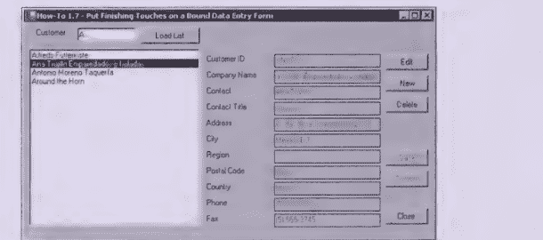

虽然在本章目前为止创建的窗体中，大多数主要问题已经解决，但用户可能会在何时按下某些按钮时感到困惑。你如何让按钮反映出用户何时可以点击它们？此外，还有哪些收尾工作可以帮助完善窗体？

## 技术要点

用户界面的一项重要工作是让用户知道他何时可以访问窗体上的某些功能。在这种情况下，你将学习如何执行以下操作：

- 在适当的时刻（例如在列表框中突出显示记录时）切换 **btnSave**、**btnCancel**、**btnNew** 和 **btnDelete** 的 `Enabled` 属性。
- 添加一个用于关闭窗体的命令按钮。
- 在窗体的 **Closing** 事件中添加代码，测试你是否对当前记录进行了更改，如果是，则询问是否要保存更改。

你可以在图 1.13 中看到一个示例，其中特定的命令按钮根据窗体中当前执行的操作而启用。

**图 1.13**
此窗体仅在功能可用时才允许用户访问命令按钮。

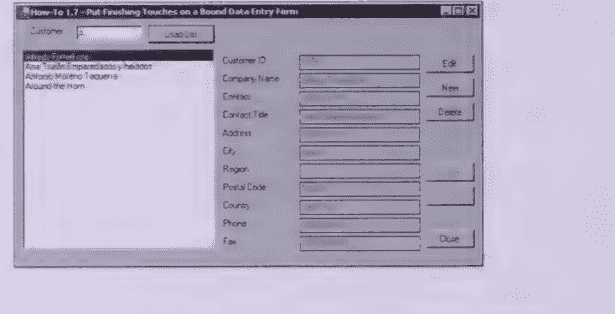

## 步骤

继续使用你一直以来使用的窗体，你将执行上述项目符号列表中提到的更改。

1.  首先修改两个已经创建的例程：**RefreshIndividual** 和 **ActivateEditing** 子程序。然后检查 **lstCustomers** 中是否已选择客户。如果没有，则禁用 **btnEdit** 和 **btnDelete** 两个按钮。如果已选择客户，则启用这两个按钮，并刷新 **dsCustomerIndividual** 数据集控件。

### 列表 1.19 frmHowTo1_7.vb：切换 btnEdit 和 btnDelete 按钮的 Enabled 属性

```vb
Private Sub RefreshIndividual()

    ' - Clear individual customer dataset
    Me.dsCustomerIndividual.Clear()

    If lstCustomers.SelectedIndex = -1 Then
        btnEdit.Enabled = False
        btnDelete.Enabled = False
    Else
        btnEdit.Enabled = True
        btnDelete.Enabled = True

        Me.odaCustomerIndividual.SelectCommand.Parameters(0).Value = lstCustomers.SelectedItem(0)

        ' - Fill the dataset
        Me.odaCustomerIndividual.Fill(Me.dsCustomerIndividual, "Customers")

    End If
End Sub
```

同样，你还需要向**ActivateEditing**子程序中添加代码，根据各命令按钮的用途来切换它们的**Enable**属性。完整代码如清单1.20所示。

**清单 1.20** frmHowTo1_7.vb：切换btnEdit和btnDelete按钮的Enabled属性

```vb
Private Sub ActivateEditing(ByVal bEnable As Boolean)
    Dim oCurr As Object
    ' – 遍历窗体上的每个控件
    For Each oCurr In Me.Controls()
        ' – 检查控件是否为文本框
        If TypeOf oCurr Is TextBox And oCurr.Name <> "txtCustLimit" Then
            ' – 如果是，则切换属性
            If bEnable Then
                oCurr.BorderStyle() = _
                    System.Windows.Forms.BorderStyle.Fixed3D
                oCurr.BackColor() = System.Drawing.Color.White
            Else
                oCurr.BorderStyle() = _
                    System.Windows.Forms.BorderStyle.FixedSingle
                oCurr.BackColor() = Me.BackColor
            End If
            oCurr.Enabled = bEnable
        End If
    Next
    ' – 启用/禁用相应的按钮
    btnEdit.Enabled = Not bEnable
    btnNew.Enabled = Not bEnable
    btnDelete.Enabled = Not bEnable
    btnCancel.Enabled = bEnable
    btnSave.Enabled = bEnable
    ' – 将焦点设置到CustomerID文本框
    If bEnable Then
        Me.txtCustomerID.Focus()
    End If
End Sub
```

新增的具体代码行如下：

```vb
'— 启用/禁用相应的按钮
btnEdit.Enabled = Not bEnable
btnNew.Enabled = Not bEnable
btnDelete.Enabled = Not bEnable

btnCancel.Enabled = bEnable
btnSave.Enabled = bEnable
```

这些按钮的处理方式与其他按钮相同——取**bEnable**当前值的相反值，并用它来切换**Enabled**属性。

最后，如果**bEnable**标志为**True**，则使用以下代码行将焦点移到**txtCustomerID**文本框：

```vb
'— 将焦点设置到CustomerID文本框
If bEnable Then
    Me.txtCustomerID.Focus()
End If
End Sub
```

2. 添加一个新的命令按钮，将其**Name**和**Text**属性分别设置为**btnClose**和**&Close**。将清单1.21中的代码放入**Click**事件中。

**清单 1.21** frmHowTo1_7.vb：关闭窗体

```vb
Private Sub btnClose_Click(ByVal sender As System.Object, _
                          ByVal e As System.EventArgs) Handles btnClose.Click

    Me.Close()

End Sub
```

3. 在窗体的**Closing**事件中添加一些代码。清单1.22检查**btnSave**按钮是否已启用。如果是，则调用**MessageBox**方法，询问用户是否想要保存所做的更改。如果是，则在**Try...Catch...End Try**块中调用**SaveRecord**。

**清单 1.22** frmHowTo1_7.vb：在关闭前检查用户是否想要保存记录

```vb
Private Sub frmHowTo1_7_Closing(ByVal sender As Object, _
                              ByVal e As System.ComponentModel.CancelEventArgs) Handles MyBase.Closing

    '— 如果已请求编辑或添加操作，启用了Save按钮，
    '   则提示保存记录

    If btnSave.Enabled Then

        If MessageBox.Show("Would you like to save the current record?", _
                          "Save Record?", MessageBoxButtons.YesNo) = DialogResult.Yes Then
Try
    ' – 保存信息
    SaveRecord()

Catch saveException As Exception
    If MessageBox.Show("The following error has occurred: " & 
        saveException.Message & vbCrLf & vbCrLf & _
        "Continue with closing the form?", "Error Saving Record",
        MessageBoxButtons.YesNo) = DialogResult.No Then
        e.Cancel = True
    End If
End If
```

## 工作原理

在本操作指南中对窗体所做的修改中，根据发生的不同情况会有许多不同的处理。当用户单击`btnEdit`按钮时，`btnEdit`、`btnNew`和`btnDelete`被禁用，`btnCancel`和`btnSave`被启用。当按下`btnCancel`和`btnSave`时则相反。如果`bEnable`为`True`，则焦点将移到`txtCustomerID`文本框。

当单击`btnClose`按钮时，应用程序会检查`btnSave`命令按钮是否已启用，这意味着数据正在被编辑。如果是，则询问用户是否要保存当前记录。如果用户同意，系统将把当前信息保存回服务器。

## 注释

本操作指南中展示的任务只是让你的窗体看起来更专业、手感更好的一些方法。它们也是用户对数据库应用程序的期望所在。

再多摆弄一下这个窗体。你肯定会想到更多点子的。

## 1.8 将数据绑定到ComboBox和DataGrid控件

有时你可能希望使用`ComboBox`控件而不是`ListBox`控件来显示选择列表。你还可能希望根据在该组合框中选择的项，以网格样式显示信息。本操作指南介绍如何将数据绑定到`ComboBox`和`DataGrid`控件。

与其使用`ListBox`控件来显示客户，你更想使用`ComboBox`控件来显示。选择客户后，你希望显示属于该客户的订单信息。如何将数据绑定到`ComboBox`，然后再绑定`DataGrid`控件呢？

### 技术

要绑定`ComboBox`和`DataGrid`控件，你将使用与`ListBox`控件相同的属性和编码技术。首先创建`DataAdapter`和`DataSet`控件，并设置`DataSource`属性。`DataGrid`的`DataAdapter`将包含一个参数，该参数使用在`ComboBox`控件中选择的值。

你将控件的`DataSource`属性设置为创建的`DataSet`。对于`DataGrid`控件，这就是你真正需要设置的全部内容。对于`ComboBox`控件，你还需要设置`ValueMember`和`DisplayMember`属性。

然后添加代码来填充`DataSet`控件，该控件的`DataSource`属性已为`ComboBox`控件设置。最后，创建一个子程序，将`ComboBox`中选定的值存储在为填充`DataGrid`控件所基于的`DataSet`而创建的`DataAdapter`中。

用户在包含客户的`ComboBox`中选择值后，`DataGrid`控件将显示该客户的订单，如图1.14所示。

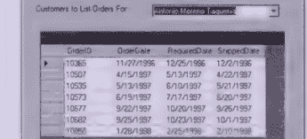

**图 1.14**
用户可以使用这两个控件显示客户订单的标题信息。

### 步骤

你将从一个新窗体开始。

- 1. 添加一个名为`frmHowTo1_8`的新Windows窗体。
- 2. 添加`OleDbDataAdapter`和`DataSet`控件，并按表1.7设置属性。

**表 1.7 OleDataAdapter和DataSet控件**

| 对象 | 属性 | 设置 |
| :--- | :--- | :--- |
| OleDataAdapter | Name | odaCustomerList |
| | SelectCommand | OleDbSelectCommand1 |
| | CommandText | SELECT CustomerID, CompanyName FROM Customers |
| DataSet | Name | dsCustomerList |
| | DataSetName | dsCustomerList |
| OleDataAdapter | Name | odaOrdersForCustomer |
| | SelectCommand | OleDbSelectCommand2 |
| | CommandText | SELECT OrderID, OrderDate, RequiredDate, ShippedDate FROM Orders WHERE (CustomerID = ?) ORDER BY OrderDate |
| DataSet | Name | dsOrdersForCustomer |
| | DataSetName | dsOrdersForCustomer |

> **提示**
> 你应该使用数据适配器配置向导创建`OleDbDataAdapter`控件，然后在创建完成后设置名称。你应该通过在适当的`OleDbDataAdapter`上右键单击并选择"生成数据集"来创建`DataSet`控件。如果对创建这些控件有疑问，请重新阅读操作指南1.1。
> 
> 另外，请记住，在生成DataSet时，VS总会通过添加`1`到末尾并将第一个字母大写来更改名称。你可能需要直接在属性中将其更改为你真正想要的名称。

- 3. 添加`ComboBox`和`DataGrid`控件，以及ComboBox的Label，按表1.8所示设置属性。


| 对象 | 属性 | 设置 |
| --- | --- | --- |
| Label | Name | Label1 |
| | Text | "要列出订单的客户：" |
| ComboBox | Name | cboCustomers |
| | DataSource | dsCustomerList.Customers |
| | DisplayMember | CompanyName |
| | ValueMember | CustomerID |
| DataGrid | Name | dgOrders |
| | DataSource | dgOrdersForCustomer.Orders |

4.  将清单 1.23 中显示的代码添加到窗体的 **Load** 事件中。此代码基于 **odaCustomerList** OleDbDataAdapter 控件中通常使用的 select 语句来填充 **dsCustomerList** DataSet 控件。此操作完成后，将调用 **RefreshOrders** 子过程，如清单 1.24 所示。

**清单 1.23** frmHowTo1_8.vb：填充 ComboBox 控件使用的 DataSet

```
Private Sub frmHowTo1_8_Load(ByVal sender As Object, _
    ByVal e As System.EventArgs) Handles MyBase.Load

    Me.odaCustomerList.Fill(Me.dsCustomerList)
    RefreshOrders()

End Sub
```

**清单 1.24** frmHowTo1_8.vb：基于 ComboBox 控件中选定的项目，填充 DataGrid 控件使用的 DataSet

```
Private Sub RefreshOrders()

    '-- 清除客户的订单数据集
    Me.dsOrdersForCustomer.Clear()

    '-- 检查是否已选择项目
    If Me.cboCustomers.SelectedIndex <> -1 Then

        '-- 将选定的客户 ID 存储到参数中
        '    即 SQL 数据适配器
            Me.odaOrdersForCustomer.SelectCommand.Parameters(0).Value = _
                Me.cboCustomers.SelectedItem(0)
```

5.  将清单 1.25 中的代码添加到 **cboCustomers** ComboBox 控件的 SelectedIndexChanged 事件中。

**清单 1.25** *frmHowTo1_8.vb*：基于选定项目刷新 DataGrid 控件

```
Private Sub cboCustomers_SelectedIndexChanged(ByVal sender
                As System.Object, ByVal e As System.EventArgs)
                Handles cboCustomers.SelectedIndexChanged

    RefreshOrders()

End Sub
```

## 工作原理

当窗体首次加载或在 **ComboBox** 控件中选择新项目时，**DataGrid** 控件会填充所选客户的订单信息。

## 注释

正如你从这个操作指南中看到的，使用 **ComboBox** 控件和 **DataGrid** 控件并不比使用 ListBox 控件难很多。**DataGrid** 控件确实提供了更强大的功能，让你可以创建主/子窗体类型的表单，例如发票。你将在下一个操作指南中看到一个示例。**DataGrid** 控件还允许你编辑数据。

# 1.9 向下钻取 DataGrid 控件中的数据

Visual Basic .NET 中的 DataGrid 控件是显示与基础表（如客户和订单表）相关的多条记录的有效方式。然后，你可以向下钻取各个订单以查看详细信息。本操作指南说明了如何打开另一个包含 DataGrid 控件的窗体，并向下钻取订单详细信息。

虽然查看客户有哪些订单很好，但你可能希望显示更多关于订单的信息。你如何向下钻取 DataGrid 控件中显示的订单详细信息？

## 技术

使用你在操作指南 1.8 中开始的窗体，你将允许用户突出显示特定订单。你将通过打开一个新窗体，并让该窗体的文本框显示订单头信息来向下钻取它。然后你将使用另一个 DataGrid 控件来显示订单详细信息。你可以在图 1.15 中看到此示例。

**图 1.15**
向下钻取订单的详细信息。

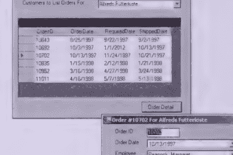

除了添加一个新窗体外，你还将创建一个新模块，用于声明一个用于跟踪调用窗体的公共变量。在之前的示例中，示例窗体是通过在 frmMain 上各个 Button 控件的 Click 事件中声明变量来打开的。对于本操作指南，指向该特定窗体的变量的声明已移至公共模块。你可以在清单 1.26 中看到 btnHowTo1_8 和 btnHowTo_9 的 Click 事件的代码。

**清单 1.26** frmMain.vb：打开新窗体以显示订单信息

```
Private Sub btnHowTo1_8_Click(ByVal sender As System.Object, ByVal e As System.EventArgs)
Handles btnHowTo1_8.Click

    Dim frm1_8 As frmHowTo1_8

    frm1_8 = New frmHowTo1_8()

    frm1_8.Show()

End Sub

Private Sub btnHowTo1_9_Click(ByVal sender As _
```

**清单 1.26** 续

```
System.Object, ByVal e As System.EventArgs) _
Handles btnHowTo1_9.Click

    frm1_9a = New frmHowTo1_9a()

    frm1_9a.Show()

End Sub
```

清单 1.27 展示了创建的模块的代码，该模块名为 `modPublicVariables`。

**清单 1.27** modPublicVariables.vb：为窗体声明公共变量

```
Module modPublicVariables

    Public frm1_9a As frmHowTo1_9a

End Module
```

## 步骤

你需要按照本操作指南的“技术”部分描述创建一个模块，以打开你在操作指南 1.8 中创建的窗体。在你创建该模块并添加如清单 1.27 所示的公共变量声明后，在设计器中打开操作指南 1.8 的窗体。

- 1. 在窗体右下角，`DataGrid` 控件下方，添加一个按钮控件。将 Name 属性设置为 `btnOrderDetail`，将 Text 属性设置为 `订单详细信息(&O)`。

2.  在 `btnOrderDetail` 的 `Click` 事件中，添加清单 1.28 中显示的代码。

**清单 1.28** frmHowTo1_9.vb：打开新窗体以显示订单信息

```
Private Sub btnOrderDetail_Click(ByVal sender As System.Object,
ByVal e As System.EventArgs) Handles btnOrderDetail.Click

    Dim frm As New frmHowTo1_9b()
    frm.Show()

End Sub
```

- 3. 创建一个新窗体并将其命名为 `frmHowTo1_9b`（或你在遵循清单 1.28 时所使用的任何名称）。

4.  按照表 1.9 的布局，向窗体添加一些 `OleDataAdapter` 和 `DataSet`。

**表 1.9**  frmHowTo1_9b 窗体的 OleDataAdapter 和 DataSet 控件

| 对象 | 属性 | 设置 |
| --- | --- | --- |
| OleDataAdapter | Name | odaIndividualOrder |
| | SelectCommand | OleDbSelectCommand1 |
| | CommandText | SELECT OrderID, CustomerID, EmployeeID, OrderDate, RequiredDate, ShippedDate, ShipVia, Freight, ShipName, ShipAddress, ShipCity, ShipRegion, ShipPostalCode, ShipCountry FROM Orders WHERE (OrderID = ?) |
| DataSet | Name | dsIndividualOrder |
| | DataSetName | dsIndividualOrder |
| OleDataAdapter | Name | odaEmployees |
| | SelectCommand | OleDbSelectCommand2 |
| | CommandText | SELECT EmployeeID, RTRIM(LastName) + ', ' + RTRIM(FirstName) AS FullName FROM Employees |
| DataSet | Name | dsEmployees |
| | DataSetName | dsEmployees |
| OleDataAdapter | Name | odaOrderDetails |
| | SelectCommand | OleDbSelectCommand3 |
| | CommandText | SELECT OrderID, ProductID, UnitPrice, Quantity, Discount FROM [Order Details] WHERE (OrderID = ?) |
| DataSet | Name | dsOrderDetails |
| | DataSetName | dsOrderDetails |

5.  添加将使用这些数据控件作为数据源的控件，如表 1.10 所示。

**表 1.10**  用于显示订单信息（包括订单详细信息）的控件

| 对象 | 属性 | 设置 |
| --- | --- | --- |
| Label | Name | Label1 |
| | Text | "订单 ID" |
| Label | Name | Label2 |
| | Text | "订单日期" |
| Label | Name | Label3 |
| | Text | "员工" |
| TextBox | Name | txtOrderID |
| | BorderStyle | FixedSingle |
| | Text | dsIndividualOrder - Orders.OrderID |
| DateTimePicker | Name | DateTimePicker1 |
| | DataBindings - Value | dsIndividualOrder - Orders.OrderDate |
| | Format | Short |
| ComboBox | Name | cboEmployees |
| | DataSource | dsEmployees.Employees |
| | DisplayMember | FullName |
| | ValueMember | EmployeeID |
| | SelectedValue | dsIndividualOrder - Orders.EmployeeID |
| DataGrid | Name | dgOrderDetails |
| | DataSource | DsOrderDetails.Order_Details |

6.  将清单 1.29 中的代码添加到你创建的新窗体的 Load 事件中。此代码首先填充 cboEmployees 使用的 DataSet 控件。接下来，使用 frmHowTo1_9a 窗体上使用的 DataGrid 控件的 CurrentCell.RowNumber 属性，在名为 dsOrdersForCustomer 的 DataSet 控件的指定行中读取 OrderID 列。

存储在 lngOrderID 中的 OrderID 被提供给 odaIndividualOrder 和 odaOrderDetails。然后使用 OleDbDataAdapters 来填充数据集。

**清单 1.29** frmHowTo1_9b.vb：加载适当的数据集

```
Private Sub frmHowTo1_9b_Load(ByVal sender As Object, _
                              ByVal e As System.EventArgs) Handles MyBase.Load

    Dim lngOrderID As Long

    '— 填充用于员工组合框的数据集。
    Me.odaEmployees.Fill(Me.dsEmployees)
```


# 清单 1.29（续）

```vbnet
'— 从调用窗体的 DataGrid 控件中
'— 获取当前所选订单的 OrderID。

lngOrderID = frm1_9a.dsOrdersForCustomer. _
        Orders.Rows(frm1_9a.dgOrders.CurrentCell. _
        RowNumber).Item("OrderID")

'— 使用订单 ID 和客户更新窗体标题
Me.Text = "Order #" & CStr(lngOrderID) & _
        " For " & frm1_9a.cboCustomers.Text

'— 使用 InvoiceID 加载订单头参数
Me.odaIndividualOrder.SelectCommand.Parameters(0).Value = lngOrderID

'— 填充订单头数据集
Me.odaIndividualOrder.Fill(Me.dsIndividualOrder)

'— 使用 InvoiceID 加载订单明细参数
Me.odaOrderDetails.SelectCommand.Parameters(0).Value = lngOrderID

'— 填充订单明细数据集
Me.odaOrderDetails.Fill(Me.DsOrderDetails)

End Sub
```

## 工作原理

用户在第一个窗体的 **dgOrders** 中选中一个订单，然后点击 **btnOrderDetail** 按钮打开第二个窗体。第二个窗体用于显示订单的详细信息。当第二个窗体打开时，**cboEmployee** 组合框控件被加载，订单ID从第一个窗体上的 **dgOrders** 通过 **dsOrdersForCustomer** 获取。随后填充数据集控件 **dsIndividualOrder** 和 **dsOrderDetails**。

## 注释

这只是使用 **DataGrid** 控件所能实现功能的开始。你会在相当多的章节中看到这个控件的使用，包括第3章和第4章。正如你从第一个窗体中获取 OrderID 的方式所见，当你需要以编程方式获取数据时，这可能会有点令人困惑。

## 第2章：从 Visual Studio .NET 创建 SQL Server 数据库对象

**在本章中，你将学习以下内容：**

- 在 Visual Studio .NET 内部创建新的 SQL Server 数据库
- 定义表和字段
- 定义主键和其他索引
- 定义表之间的关系
- 定义默认值和约束
- 创建视图
- 创建存储过程

刚开始接触数据库工作时，了解如何创建数据库是一件好事。本示例展示了如何使用 Visual Studio .NET 创建 SQL Server 数据库，并讨论了服务器和安全性。

## 使用表、列和行

数据库中存储数据的基本实体是表，它类似于存放客户资料的牛皮纸文件夹。一个表由列（也称为*字段*）组成。设想一下你保留的客户信息页面。信息会包含姓氏、名字、地址等等。这些就是表中的列。填写完整的信息页面就是表中的一行（或记录），它由列组成。

数据库相当于文件柜，由多个表（牛皮纸文件夹）组成，除了客户之外还有不同的主题，例如发票、零件信息等等。在服务器资源管理器中双击 Northwind 节点，你将看到属于该数据库的表列表。如果你在设计模式下打开 Customers 表，你将看到表中的各个列。

然后当你打开表查看数据时，你将看到表中每一行或每条记录的列。

## 利用表和列的属性

表和列与数据库中的其他对象一样，具有属性，允许你控制进入表中的数据。例如，在 Customers 表中，你可以看到第一列 CustomerID 的属性。使用属性的程度取决于你的需求。

在表级别，你还可以利用一些属性来帮助你创建和实施业务规则，这将在本章后面讨论。

你将通过将数据分解为逻辑实体来创建表。当你这样做时，你需要牢记如何分解它们，并且需要将它们分解成所谓的规范化形式。

SQL Server 多年来取得了长足的进步。对于每个版本，微软不仅努力使 SQL Server 更强大，而且更易于使用。这包括产品自带的工具以及来自其他应用程序的工具。Visual Studio .NET 就是从另一个产品中操作 SQL Server 的工具的一个很好例子。

如果你不熟悉数据库，这里有一个快速概述。数据库允许你以反映现实世界中计算机的方式来处理数据。你可以拿一个现实主题，例如 Customers，并将该信息存储在表中。文件柜类似于数据库。在文件柜中，你可能有客户文件夹。其他文件夹可能包含订单或发票信息。其中一个文件夹可以比作客户表。在 Customers 文件夹内，你可能有客户的个人信息页面。每个客户的每一页都是表中的一行或一条记录。在每一页上，你会有诸如客户姓名、地址、电话等信息。这些将是每一行中的字段或列。

在数据库中，你还将继续允许你在表中查询信息和更新信息的对象。在 SQL Server 中，你将使用视图、存储过程和函数来查看和更新数据库中的数据。要使用这些对象，你需要能够创建它们。要在 SQL Server 中创建数据库及其表，你可以使用 SQL 自带的工具（如企业管理器）或代码。如果你安装了包含这些工具的版本之一。

幸运的是，你可以使用 Visual Studio .NET 内置的工具来创建和修改数据库。你将使用的主要工具称为服务器资源管理器，如图 2.1 所示。

**图 2.1**
从 Visual Studio .NET 的服务器资源管理器中，你可以执行维护数据库所需的大部分任务。

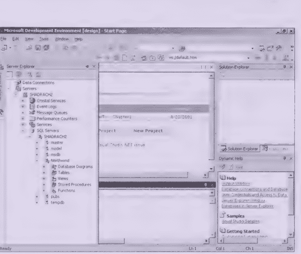

## 2.1 在 Visual Studio .NET 内部创建新的 SQL Server 数据库

在操作数据库之前，你必须能够创建它。虽然你可以使用代码来执行此操作，但你更愿意直接从 Visual Studio 完成。如何在 VS .NET 内部创建新的 SQL Server 数据库？

### 技巧

正如本章引言所述，数据库基本上是计算机中的文件柜。这听起来相当简单，但如果你将存储在文件柜中的信息转移到计算机上，最终会得到相同的元素。

你可以通过几种方式物理创建新的 SQL Server 数据库：

- 使用 SQL Server 的企业管理器创建数据库。
- 以编程方式创建数据库。你可以使用 T-SQL 和 SQL-DMO 来完成，分别在第6章"创建 Transact-SQL 命令"和第7章"使用 SQL-DMO 执行常见数据库任务"中讨论。
- 使用 Visual Studio .NET 的服务器资源管理器中的菜单来执行此任务。

你将使用最后一个选项来完成本方法中介绍的任务。

### 步骤

要开始此操作，请在打开 Visual Studio 时将其保留在开始页。然后将光标放在屏幕左侧的服务器资源管理器图标上。

> **注意**
> 服务器资源管理器和工具箱图标在屏幕侧面的布局方式，根据你在开始页的"我的配置文件"设置中设置的配置文件选项而有所不同——Visual Studio 开发者或 Visual Basic 开发者。

服务器资源管理器展开后，点击"服务器"节点旁边的加号。然后你可以通过点击你的计算机名称（图 2.1 中的 SHADRACH2），再点击 SQL Servers，顺着树向下浏览。再次点击计算机名称，你将看到 Microsoft SQL Server 桌面版 (MSDE) 中默认设置的当前数据库列表。虽然创建新数据库不需要这样做，但这确实让你了解可以在系统中何处查看各种数据库。现在你将学习如何在 VS .NET 中创建数据库。

1. 你可以通过两种方式从服务器资源管理器中打开"创建数据库"对话框。第一种方式是右键点击"数据连接"节点，然后选择"创建新的 SQL Server 数据库"。第二种方式是右键点击要添加数据库的 SQL Server 实例——在本例中为 SHADRACH2——然后选择"新建数据库"。虽然两种方法都会打开"创建数据库"对话框，但第二种方法会自动填充服务器名称。
2. 填写要创建的数据库名称——在本例中，**Chapter2**。
3. 选择要与此数据库一起使用的安全类型。如果你的网络严格来说是 Windows 2000 网络，你可以保留默认值——使用 Windows NT 集成安全性；否则，选择其他选项。你的"创建数据库"对话框应如图 2.2 所示。

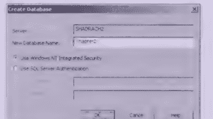

**图 2.2** 这就是创建新数据库所需的全部信息。

4. 点击"确定"完成对话框并创建新数据库。


## 工作原理

现在，当你点击新数据库的加号时，你将在 Server Explorer 的树状视图中看到不同数据库对象的分支，这些对象已在本章的介绍部分中进行了描述。

## 评注

Microsoft Visual Studio 和 SQL Server 团队付出了大量努力，旨在使 VS .NET 成为你创建数据库及其对象所需的唯一设计工具。

有时你需要执行一些超出 Server Explorer 能够完成的任务，但本章将专注于 VS .NET。现在是时候看看如何创建一些能让数据库真正发挥作用的对象了。

## 2.2 定义表和字段

除非数据库中包含表，否则 SQL Server 数据库几乎没有用处。本教程不仅会向你提供如何创建表和字段的信息，还会教你如何为它们命名以及创建时需要注意什么。数据库本身不能为你提供太多帮助，但你至少需要能够将数据存储在其中。为此，你需要能够创建由字段组成的表。在 VS .NET 中如何定义表和字段？

### 技术方案

通过使用 Server Explorer 并访问表设计器（Table designer），你将在之前“操作指南”中创建的数据库中创建名为 `tblCustomers` 的表。然后，你将向数据库添加列，用于存储与单个客户相关的各种信息。

最后，你将创建另一个名为 `tblPhones` 的表，并创建必要的列来包含客户的电话信息。

### 操作步骤

打开 Visual Studio .NET 后，展开 Server Explorer 并找到你在“操作指南 2.1”中创建的名为 `Chapter2` 的新数据库。点击数据库名称旁边的加号，以便列出数据库对象类别。

1. 右击 `Chapter2` 数据库下的 Tables 节点，选择 New Table。随后你将看到表设计器。现在你可以准备添加列了。

2. 要添加一列，你需要设置四个直接属性：

    - 列名（Column Name）。这是列的名称。不要使用空格或特殊字符，但要使用正确的驼峰式命名法，并确保给列起的名称与其包含的内容相符。例如，如果该列是用于客户的姓氏，请在列的 Name 属性中输入 `LastName`。

    - 数据类型（Data Type）。根据将输入到列中的数据类型，这将是 SQL Server 的许多有效数据类型之一，如表 2.1 所示。

#### 表 2.1 SQL Server 数据类型

| 数据类型 | 描述 |
| :--- | :--- |
| bigint | 整数（全数）数据，范围从 $-2^{63}$ ($-9,223,372,036,854,775,808$) 到 $2^{63}-1$ ($9,223,372,036,854,775,807$)。 |
| int | 整数（全数）数据，范围从 $-2^{31}$ ($-2,147,483,648$) 到 $2^{31}-1$ ($2,147,483,647$)。 |
| smallint | 整数数据，范围从 $-2^{15}$ ($-32,768$) 到 $2^{15}-1$ ($32,767$)。 |
| tinyint | 整数数据，范围从 $0$ 到 $255$。 |
| bit | 值为 $1$ 或 $0$ 的整数数据。 |
| decimal | 定精度和标度数值数据，范围从 $-10^{38}+1$ 到 $10^{38}-1$。 |
| numeric | 功能上等同于 decimal。 |
| money | 货币数据值，范围从 $-2^{62}$ ($-922,337,203,685,477.5808$) 到 $2^{62}-1$ ($+922,337,203,685,477.5807$)，精度为货币单位的万分之一。 |
| smallmoney | 货币数据值，范围从 $-214,748.3648$ 到 $+214,748.3647$，精度为货币单位的万分之一。 |
| float | 浮点精度数字数据，范围从 $-1.79\text{E}+308$ 到 $1.79\text{E}+308$。 |
| real | 浮点精度数字数据，范围从 $-3.40\text{E}+38$ 到 $3.40\text{E}+38$。 |
| datetime | 日期和时间数据，范围从 1753 年 1 月 1 日到 9999 年 12 月 31 日，精度为 1/300 秒，即 3.33 毫秒。 |
| smalldatetime | 日期和时间数据，范围从 1900 年 1 月 1 日到 2079 年 6 月 6 日，精度为 1 分钟。 |
| char | 固定长度的非 Unicode 字符数据，最大长度为 8,000 个字符。 |
| varchar | 可变长度的非 Unicode 数据，最大长度为 8,000 个字符。 |
| text | 可变长度的非 Unicode 数据，最大长度为 $2^{31}-1$ ($2,147,483,647$) 个字符。 |
| nchar | 固定长度的 Unicode 数据，最大长度为 4,000 个字符。 |
| nvarchar | 可变长度的 Unicode 数据，最大长度为 4,000 个字符。 |
| ntext | 可变长度的 Unicode 数据，最大长度为 $2^{31}-1$ ($1,073,741,823$) 个字符。 |
| binary | 固定长度的二进制数据，最大长度为 8,000 字节。 |
| varbinary | 可变长度的二进制数据，最大长度为 8,000 字节。 |
| image | 可变长度的二进制数据，最大长度为 $2^{31}-1$ ($2,147,483,647$) 字节。 |
| cursor | 对游标的引用。 |
| sql_variant | 存储各种 SQL Server 支持的数据类型的值的数据类型，但 text、ntext、timestamp 和 sql_variant 除外。 |
| table | 一种特殊的数据类型，用于存储结果集以便后续处理。 |
| timestamp | 数据库范围内的唯一数字，每次行更新时都会更新。 |
| uniqueidentifier | 全局唯一标识符 (GUID)。 |

### 提示

Unicode 是一种使用 16 位代码值的字符编码标准。该标准在全世界范围内用于表示现代计算中使用的所有字符。传统字符集是之前的字符编码标准（如 Windows ANSI 字符集），它们使用 8 位代码值或 8 位值的组合来表示特定语言或地理区域所使用的字符。

建议你使用 Unicode 数据类型（nchar, nvarchar 和 ntext），而不是其非 Unicode 对应类型。

此外，尽可能使用可变长度的数据类型。这样可以节省磁盘空间，并让你在希望在字段中显示数据时无需手动修剪（trim）值。

    - 长度（Length）。这取决于你选择的数据类型。对于文本数据类型，这将是你预期输入到该列中的最大长度。

    - 允许 Null 值（Allow Nulls）。这指定是否允许在列的记录中保存 null 值。这意味着用户完全不需要输入值。在某些情况下，这是一个坏主意，例如当你需要输入特定数据（如社会安全号码）时。

对于表中的前几列，请输入以下数据。你可以在图 2.3 中看到表的样式。

| 列名 | 数据类型 | 长度 | 允许 Null 值 |
|-------------|-----------|--------|-------------|
| LastName | nvarchar | 50 | 未勾选 |
| FirstName | nvarchar | 50 | 未勾选 |
| Address | nvarchar | 50 | 已勾选 |
| City | nvarchar | 50 | 已勾选 |
| State | nvarchar | 2 | 已勾选 |
| ZipCode | nvarchar | 9 | 已勾选 |
| BirthDate | datetime | 8 | 已勾选 |
| MailingList | bit | 1 | 已勾选 |
| EstimatedSales | money | 8 | 已勾选 |

**图 2.3**
第一个表的字段。

3. 点击表设计器右上角的 X 保存表，并在提示时将表命名为 `tblCustomers`。点击 X 后，系统会询问你是否要保存表，然后提示你保存表的名称。

## 工作原理

通过在每列的各种属性中输入信息，你指定了希望如何处理数据库中的数据。通常，你的用户不会创建表；你将为用户创建表，而他们将使用你的应用程序将数据填充到表中。

当用户填充数据时，应用程序和 SQL Server 会控制进入表的数据类型，首先是数据的数据类型以及允许的长度。Allow Nulls 属性决定了用户是否必须输入数据。

## 评注

创建由列和行组成的表是数据库目的的基础：存储信息。确保为列使用逻辑、描述性的名称，以及有助于控制数据如何输入数据库的数据类型，是构建成功数据库的关键。提前规划你的表，检查每个现实世界中的对象，并将这些属性转移到代表这些对象的表的列中。

## 2.3 定义主键和其他索引

索引用于在查询数据时提高性能，例如在字段中搜索和对信息进行排序。主键（primary key）是一种索引，它确保每条记录中至少有一个唯一值，例如客户 ID。本“操作指南”将讨论主键的最佳候选对象，以及如何创建主键和其他索引。

你已经创建了一个基础表，甚至向其中输入了数据。你如何确保有一种方法能找到特定的记录？LastName 和 FirstName 字段不起作用，因为这些可能会有重复。你还希望确保在对字段进行搜索时，能从 SQL Server 获得最佳性能。可以创建索引来帮助提升性能。如何定义主键字段以确保记录的唯一性，并创建其他索引？

### 技术方案

在 Server Explorer 中，你可以使用一个字段（例如社会安全号码）并将其设为主键字段。通过将字段设为主键字段，你需要使该字段唯一并禁止 null 值。如果目前没有唯一的字段，另一种选择是创建一个自动递增的字段，称为标识字段（identity field）。该标识字段也可以被设为主键字段，同样是为了使记录唯一。主键字段也会被索引。

除了创建特殊的主键字段外，你还可以创建执行以下两种主要功能的索引：

 +   性能。用于提高列在作为搜索条件和排序时的性能，以及在加载记录范围时的性能。
- 约束。这是主键字段执行的职能之一——限制用户可以放入表中的数据。

> **注意**
仅为提高性能而创建索引时，注意不要过度。尽管索引有助于搜索和排序时的性能，但在添加和更新数据时可能会损害性能。这主要在导入或添加大量数据时适用。另一点是，当表较小时，也可能存在过度索引的问题。

在表设计器中时，可以通过从“视图”菜单中选择“索引/键”来打开“属性页”对话框中的“索引”。您可以在图 2.4 中看到“属性页”对话框。

**图 2.4**
您可以使用此对话框创建所有必要的索引。

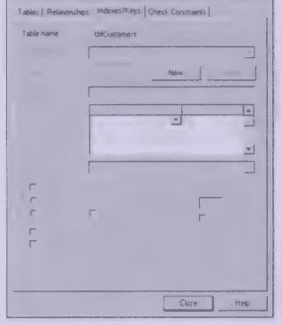

在“索引”中，您有一些选项需要指定；例如，您是否希望索引中的值是唯一的。您会希望在拥有大量数据并且将一次删除或更新大量记录的表中使用索引。您还会在范围情况下使用字段，例如使用 `BETWEEN`、`>`、`>=`、`<` 和 `<=` 等运算符。

## 步骤

使用服务器资源管理器，打开 Chapter2 数据库，然后右键单击在上一个“实现方法”中创建的 tblCustomers。接着从右键菜单中选择“设计表”。

1. 将光标放在第一行（如果它尚未在那里）。单击鼠标右键，然后从菜单中选择“插入列”。接下来，按如下方式填写字段的属性：

| 属性 | 值 |
|---|---|
| 列名 | CustomerID |
| 数据类型 | int |
| 长度 | 4 |
| 允许空值 | 未选中 |
| 标识 | 是 |

当您指定要将此字段设为标识字段时，将使用接下来的两个属性。第一个是标识种子，即列的起始值。下一个属性是标识增量，即添加记录时的增量值。

2. 在 CustomerID 列的“列名”属性中右键单击，然后从菜单中选择“设置主键”。您现在已将 CustomerID 设置为主键，屏幕应类似于图 2.5。您刚刚在将 CustomerID 指定为主键时创建的索引属于索引的约束类别。

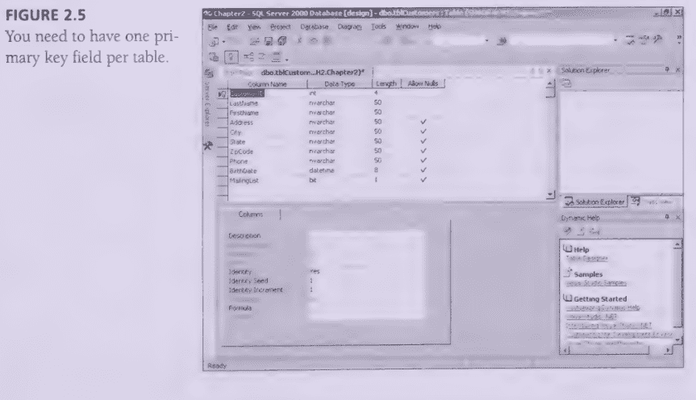

3. 要创建其他有助于提高性能的索引，请从“视图”菜单中选择“索引/键”以打开“属性页”对话框。

4. 在“索引”页面上，单击“新建”按钮，然后填写以下属性以添加 LastName 字段的索引：索引名称为 "IX_LastName"，列名为 "LastName"。

> **提示**
如果您对多列进行排序，例如同时按 LastName 和 FirstName 排序（这很常见），则可以在上一步中在 LastName 列下方添加 FirstName 列。这称为复合索引。

## 工作原理

创建表时，您会同时创建主键列和索引。您也可以在以后再提出索引方案。

## 注释

务必为每个表创建主键列，并尽可能对主列使用标识列。

SQL Server 会利用您创建的索引，但请注意不要过度索引。记住要检查您将进行排序和查询的列。对于特别大的表，索引变得比以往任何时候都更加重要。

## 2.4 定义表之间的关系

关系定义了数据库中信息在表之间需要如何“关联”。例如，也许您的数据库中有名为 Customers、Orders 和 Order Details 的表，就像示例 Northwind 数据库那样。您会希望在这些表之间创建关系，以确保数据完整性在用户向数据库输入数据时得到维护。进一步说，您需要确保每张发票都有对应的现有客户。这称为引用完整性。本“实现方法”向您展示如何创建关系，以及如何使用数据库关系图查看这些关系。

您已经创建了几个表，其中一个依赖于另一个表中的数据。用数据库术语来说，它们是相关的。如何在表之间创建关系呢？

### 技术

引用完整性告知数据库表之间应如何相互关联。您可以使用引用完整性来帮助控制每个表中输入哪些数据，基于其他表中的数据。

要维护*引用完整性*，您需要在表之间创建关系。来自 Northwind 的一个引用完整性示例是，要在 Orders 表中输入记录，您必须在 Customers 表中已经存在记录。这两个表通过 CustomerID 字段关联，该字段在两个表中都存在。在 Customer 表中，CustomerID 字段是主键，这意味着它将是唯一的。在 Orders 表中，CustomerID 字段是外键，这意味着它指向另一个表中的主键。您可以在图 2.6 的数据库关系图中看到这一点。

**图 2.6**

CustomerID 列在 Customers 中是主键，在 Orders 中是外键。

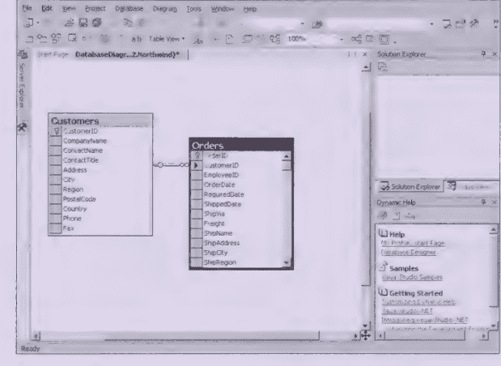

> **注意**

数据库关系图是查看、编辑和打印关系的主要图形方式。您可以在服务器资源管理器中您正在处理的数据库下找到它们。

您也可以从此对话框中获取表的属性页，并执行与表之间交互相关的大部分工作，除了表的结构更改之外。

引用完整性和关系的另一个目的是，您还可以指定执行以下操作 adjoin

- 禁止删除父记录（例如来自 Customers 表）或编辑键字段，如果子记录（Orders）中存在记录的话。
- 如果关联表的列是可更新的，让系统允许在父记录中更新键列，并让子记录反映键列中的更改。这称为*级联更新*。
- 如果删除父记录，则删除子记录。这称为*级联删除*。

在创建表之间的关系时，存在三种不同类型的关系：

- *一对多*。用于父表中有一条记录，而子表中有许多记录时。图 2.6 中显示的 Customers/Orders 关系就是这种类型关系的示例。这是最常见的关系类型。如果您查看图 2.6 中表之间的连接线，您会在 Customers 端看到一个钥匙。这代表“一”侧，而 Orders 表旁的无穷符号代表“多”侧。
- *一对一*。父表中的一条记录将在子表中有一条相关记录。这方面的一个例子是，如果您有想要保留在单独表中的客户私人信息。这两个表将具有相同的主键列。这种关系类型不常用，因为开发人员可以使用视图来限制用户可以访问的数据。
- *多对多*。父表中的记录可以在子表中有许多相关记录，而子表中的记录可以属于父表中的许多记录。这方面的一个例子也可以在 Northwind 数据库中找到。可以为客户跟踪人口统计数据。客户可以有许多人口统计类型，而人口统计类型可以分配给许多客户。这种关系显示在图 2.7 中。

**图 2.7**
Customers、CustomerCustomerDemo 和 CustomerDemographics 表构成了这种多对多关系。

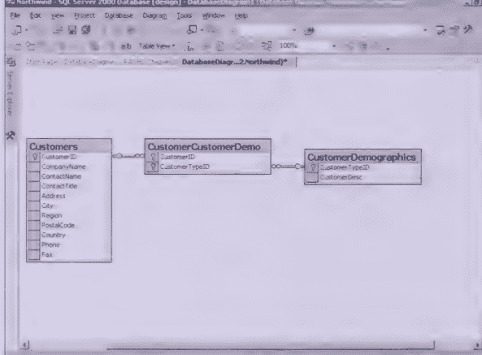

## 步骤

使用服务器资源管理器，展开 Chapter2 数据库以查看如何创建关系。拥有多个表会有所帮助。由于您已经创建了名为 tblCustomers 的表，请创建名为 tblCustomerPhones 的新表，包含以下列。


| 列名 | 数据类型 | 长度 | 允许空值 | 标识 |
|---|---|---|---|---|
| PhoneID | int | 4 | 未选中 | 是 |
| CustomerID | int | 4 | 未选中 | 否 |
| PhoneType | nvarchar | 50 | 未选中 | 否 |
| PhoneNumber | nvarchar | 10 | 未选中 | 否 |

将 PhoneID 设置为主键，并将表保存为 tblCustomerPhones。此表将包含单个客户可以拥有的各种电话号码和类型。这是了解如何创建一对多关系的简单方法。

- 1. 在服务器资源管理器中 Chapter2 数据库树的"数据库关系图"上单击右键。从菜单中选择"新建关系图"。"添加表"对话框将出现。
- 2. 按住 Shift 键并同时选择 tblCustomers 和 tblCustomerPhones。单击"添加"按钮将表添加到关系图中，然后单击"关闭"按钮。现在您将在新的数据库关系图中看到这两个表。
- 3. 将光标放在 tblCustomers 的 CustomerID 列上的主键符号处。按住鼠标左键，将光标拖放到 tblCustomerPhones 的 CustomerID 列上。"创建关系"对话框将显示，其中已为您填入了相关信息。
- 4. 选择"级联删除相关记录"；这样，当客户被删除时，已分配的电话记录也将被删除。您可以在图 2.8 中看到最终的关系。单击"确定"接受此关系。

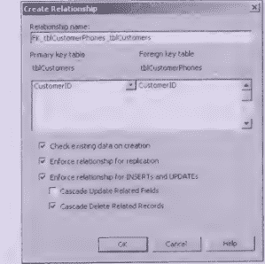

**图 2.8**
您可以从此对话框中完全控制关系。

## 工作原理

在数据库中创建适当的关系可以控制数据的质量。"垃圾进，垃圾出"这个旧术语在这种情况下很有意义。当用户向已建立关系的表添加信息时，他必须按照一定的顺序输入数据。在这种情况下，用户需要先添加客户，然后再添加电话信息。

如果客户被删除，那么分配给他们的电话也将被删除。

## 注释

您将根据关系的设置方式，以合乎逻辑的方式设置表单。例如，将电话号码添加到表单中的一个好方法是在网格控件中显示一个客户的多个电话。

增强此示例的另一种方法是添加另一个表来保存电话类型，然后通过名为 PhoneTypeID 的链接将此新表链接到 tblCustomerPhones。

有关更多关系示例，请查看 Northwind 中的表及其关系。创建数据库关系图，添加您感兴趣的表，然后查看相关表。

## 2.5 定义默认值和约束

创建数据库时需要牢记的主要概念之一是，您需要提供一种方法来防止垃圾数据（不良数据）进入您的表。默认值确保每条新记录都以有效的数据开始。例如，如果您想确保为发票的订单日期输入日期。您可以为新记录设置默认值为今天的日期。

约束允许您指定要在表中使用的业务规则，例如，如果要允许输入"订单日期"字段的日期晚于今天的日期。本方法说明如何充分利用默认值和约束，以及如何在 Visual Studio .NET 中创建它们。

您已经开始了通过创建表和设置表中列的数据类型来处理业务规则的道路。您甚至已经在表之间建立了关系。现在，您想让用户的生活更轻松，并建议他们可以使用什么值，更重要的是，哪些值是可以接受的。您如何通过定义默认值和约束来做到这一点？

### 技术

通过使用默认值，您可以引导用户并节省他们的时间。例如，假设您有一个邮件列表应用程序，用户正在输入地址。如果大多数条目来自华盛顿（或 WA），那么您可以将"州"字段的默认属性设置为 WA。

检查约束（不要与约束类型的索引混淆）允许您创建可以控制进入表的数据的验证子句。例如，如果您不希望在上一段的地址表中输入来自加利福尼亚（CA）的人。然后您可以输入一个约束检查，内容类似于 `State <> 'CA'`。

> **注意**
>
> 本章的其余部分将使用 Northwind 数据库，因为它具有良好的结构，便于展示如何使用必要的技术。

对于此方法，在 Northwind 的 Orders 表中，您将为 OrderDate 列添加默认值，并添加一个检查约束来验证 ShipDate，确保它发生在 OrderDate 当天或之后。

### 步骤

使用服务器资源管理器，展开 Northwind 数据库中的表分支，在 Orders 表上单击右键，然后选择"设计表"。

- 1. 将光标放在 OrderDate 列中。
- 2. 在"默认值"属性中输入 `GetDate()`。`GetDate()` 函数返回当前系统日期和时间。这就完成了默认值的设置。
- 3. 要输入检查约束，请在该列上单击右键并选择"检查约束"来打开"属性页"对话框。
- 4. 在"属性页"对话框中单击"新建"。
- 5. 在"约束表达式"中输入 `([ShippedDate] >= [OrderDate])`。您可以在图 2.9 中看到完成的约束。请注意，您还可以通过选择"检查约束"页底部的选项来指定何时检查约束。

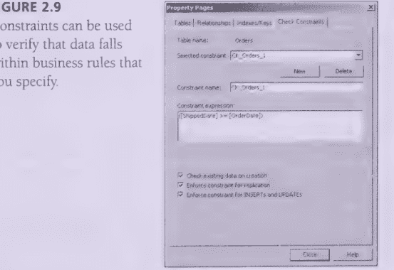

约束可用于验证数据是否落在您指定的业务规则范围内。

- 6. 单击"确定"以接受新约束。

## 工作原理

当新记录保存到 Orders 表时，如果未添加 OrderDate，则 `GetDate()` 将添加系统日期。之后，添加的约束将检查输入的 ShippedDate 是否在 OrderDate 当天或之后。如果不是这种情况，则将显示错误消息。

## 注释

当默认值可以被使用时，它们使用户的生活更轻松。您还可以使用默认值，以免用户留下空白值或 NULL。

检查约束允许您进一步控制数据如何输入到数据库中。它们可以在修改数据和添加新记录时使用。在创建数据库时，请务必设置所需的约束。

## 2.6 创建视图

在您确定要使用视图之后，诀窍是使用设计器来创建它。本方法说明如何从 Visual Studio .NET 中执行此操作，包括指定排序顺序和条件。

既然您已经创建了表并建立了关系，您可以通过在服务器资源管理器中双击表名来添加数据。我也知道如何使用上一章的数据绑定将表单和控件绑定到数据。如何在 VS .NET 中创建视图？

### 技术

在 SQL Server 中，您可以使用以下三种方式之一来查看和操作数据：

- 视图。这些允许您显示数据的不同视图，包括连接表、排序（SQL Server 200x）和使用条件。视图仅限于使用 `SELECT` 语句，它们可以作为更新和显示数据的基础。当您需要过滤数据但又希望能够像单个表一样更新时，视图非常有用。
- 存储过程。执行批量操作，如更新、插入和删除记录。您还可以创建可以排序的查询。与视图的另一个区别是，您可以在存储过程中使用多个 SQL 和控制流语句。您还可以在存储过程中使用参数。
- 用户定义函数。用户定义函数有三种类型：标量、表和内联。这些类型将视图和存储过程的最佳特性组合到一个查询中，您可以嵌套、传递参数、排序和返回值。

您可以在方法 2.7 中找到有关存储过程的更多信息。


## SQL Server 视图

当您希望在应用程序中以不同方式查看数据时，可以创建视图来实现。然后，您可以使用视图来填充窗体、控件和报表。

> **注意**
> 在 SQL Server 2000 之前的版本中，由于性能和排序限制等原因，不鼓励使用视图。这种情况在 2000 版本中发生了变化，视图变得更加灵活并提供更好的性能。

在 Visual Studio .NET 中，您可以在服务器资源管理器内的所需数据库中创建、更新和删除 SQL Server 视图。要使用视图，您将使用视图设计器。对于新视图，您可以在数据库中右键单击"视图"节点并选择"新建视图"。如果要编辑，请右键单击所需的视图并选择"设计视图"。然后，您将进入视图设计器，如图 2.10 所示，其中包含名为"当前产品列表"的视图。

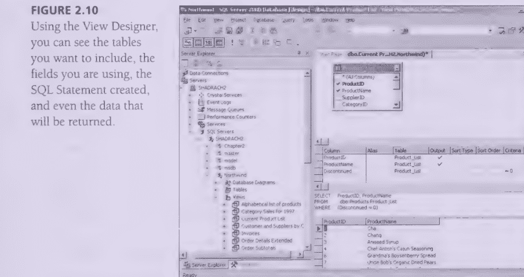

如图 2.9 所示，视图设计器包含前面提到的四个主要区域：

- **关系图窗格**。此区域允许您显示要在视图中使用的表或表。这还可以包含以下内容：其他视图、用户定义函数、子查询（在 FROM 子句中）和链接视图。您还会看到复选框（或其他对象）沿表格左侧向下排列。这些复选框允许您选择要包含的字段。您还可以在表格右侧看到一些其他图标，用于分组和排序字段或使用条件时。如果您查看 Northwind 中的现有视图，将会看到这些示例。您还可以连接表，以便使用多个记录源查看数据。

- **条件窗格**。您将在其中指定如何处理视图中的各个列。下表描述了每个属性：

| 列 | 描述 |
| --- | --- |
| 列 | 显示用于查询的数据列的名称或计算列表达式。 |
| 别名 | 您希望在结果集中使用的名称。这允许您重命名现有列或为新的计算列命名。如果同一列在两个不同的表中使用，您可能需要重命名现有列。 |
| 表 | 列来自的表的名称。 |
| 输出 | 是否在结果集中显示该列。 |
| 排序类型 | 您希望按升序还是降序对该列进行排序。如果不想对该列排序，请将其留空。 |
| 排序次序 | 在此，您将指定在排序列中包含此列的位置。您可以放置一个数字，该数字对应于您希望该列包含的列顺序。 |
| 分组依据 | 在此，您指定要使用当前列来聚合信息。要显示此列，需要从"查询"菜单中选择"分组依据"。除了在此列上分组数据外，您还可以指定最小值、最大值、计数等函数。 |
| 条件 | 此列允许您指定要将列与之比较的值，以缩小范围并返回特定记录。如果在多列中指定值，您将创建一个布尔（AND）表达式。 |
| 或 | 在这些列中放置值将导致创建布尔（OR）表达式。 |

- **SQL 窗格**。您将看到通过填写前面提到的两个窗格而创建的 SQL Select 语句。

- **结果窗格**。顾名思义，当您单击运行查询工具栏按钮（感叹号）时，此窗格将显示创建的视图的结果。

## 步骤

要了解如何在 Visual Studio .NET 中创建视图，您将创建一个视图，用于显示给定日期的所有订单，包括每个订单的所有者。您还将按 CompanyName 然后 OrderID 对视图进行排序。

打开服务器资源管理器并展开 Northwind 数据库。

1. 右键单击"视图"节点上的图标，然后从菜单中选择"新建视图"。然后将打开"添加表"对话框。从菜单中，您将选择要包含在视图中的表、视图或函数。
2. 选择 Customers。然后，按住 Ctrl 键，选择 Orders 表。单击"添加"，然后单击"关闭"。然后，这些表将被放入关系图窗格中，并且您将进入视图设计器。

需要注意的一点是两个表之间显示的符号，如图 2.11 所示。在这种情况下，默认选择的符号代表内连接。内连接是指第一个表中的值必须与第二个表中的值匹配，使用连接列（在这种情况下是 CustomerID）。

## 图 2.11

使用此菜单，您可以指定要如何连接表。

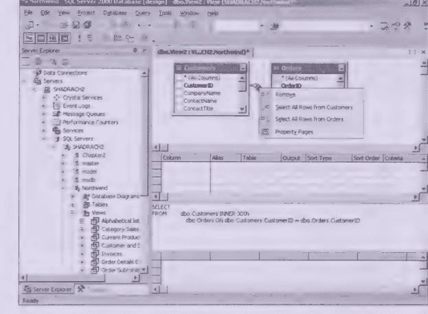

您可以看到右键单击菜单中显示的另外两种连接类型的符号。这些连接类型包括左外连接（从客户中选择所有行）和右外连接（从订单中选择所有行）。使用各种类型的连接，您可以更改返回的数据结果。

3. 在 Customers 表的 CompanyName 列以及 Orders 表的 OrderID 和 OrderDate 列中放置复选框。当您在列中放置复选框时，您会看到条件窗格和 SQL 窗格被填充（假设它们已显示）。
4. 接下来，在条件窗格的 OrderDate 的"条件"列中键入表达式 `= '7/19/1996'`。如果您只输入日期，VS 会自动在其周围添加其他值。您现在已经添加了条件。只有该日期的订单才会返回。
5. 为 CompanyName 和 OrderID 列的排序类型选择"升序"。请注意，"排序次序"将根据您选择排序类型的顺序自动填充。

## 工作原理

当您单击"运行查询"命令（工具栏上的一个图标）时，您将在结果窗格中看到两条记录。

## 注释

创建视图后，您可以在应用程序中以多种方式使用它。在下一章中，您将看到将视图与 ADO.NET 一起使用以填充各种控件的示例。您还可以在视图、存储过程和用户定义函数中使用视图。当您有一组结果希望在应用程序中一致使用且这些结果依赖于多个表时，这非常方便。

## 2.7 创建存储过程

存储过程允许您对记录执行批量操作，例如根据需要更新、插入和删除数据。本教程向您展示如何创建存储过程以及如何在服务器资源管理器内测试它们。

查看数据很棒，但您需要执行批量操作，例如添加、更新和删除记录。您知道将使用存储过程来执行这些任务，并且您将在应用程序中多次使用它们。如何从 VS 创建存储过程？

## 技术

当您想添加、删除或更新记录或想使用参数时，存储过程是首选方法。当您有一个需要多个操作（包括临时表）的任务时，存储过程提供了此功能。存储过程功能强大且易于创建。

## 注意

要创建存储过程，您将使用称为 Transact-SQL (T-SQL) 的语言。尽管本章将介绍一些简单的命令以展示从 VS .NET 创建存储过程的界面，但第 6 章"创建 Transact-SQL 命令"将更详细地介绍该语言的命令。

与视图一样，您将使用 Visual Studio 内的设计器。与视图设计器不同，存储过程设计器最初不是可视化的，而是更面向文本。但是，进入文本设计器后，您可以调出可视化的设计器。

当您创建新的存储过程时，您将右键单击要添加存储过程的数据库中的"存储过程"节点，然后选择"新建存储过程"。要编辑现有的存储过程，请突出显示该存储过程，右键单击并选择"编辑存储过程"。

存储过程打开后，您将看到一个 select 语句或许多 T-SQL 语句。如果是新的存储过程，您可以右键单击并选择"插入 SQL"。您将进入查询生成器，它看起来像视图设计器。如果是现有的存储过程，您可以将光标置于由蓝色线框出的 SQL 代码块内，然后从右键单击菜单中选择"设计 SQL 块"，如图 2.12 所示。

## 图 2.12

您也可以使用此菜单在存储过程中设置断点。

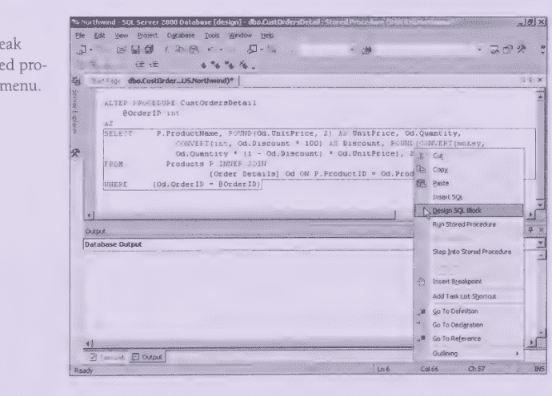

然后，您将再次在查询生成器中看到 SQL 块。


在指定可用作存储过程准则的参数时，您将在参数名前使用 @ 符号，并在存储过程的顶部对其进行声明。同样，您可以在图 2.12 中看到这一点。

## 步骤

在本实操指南中，您将创建一个带有参数的简单 Select 语句，用于列出给定城市的客户。如果您还没有打开，请打开“服务器资源管理器”并展开 Northwind 数据库。

- 1. 右键单击“存储过程”节点，然后选择“新建存储过程”。您将进入一个新页面，该页面是存储过程文本的模板。您将看到以下列表：

```
CREATE PROCEDURE dbo.StoredProcedure1
/*
  (
    @parameter1 datatype = default value,
    @parameter2 datatype OUTPUT
  )
*/
AS
  /* SET NOCOUNT ON */
  RETURN
```

- 2. 将显示的所有文本替换为以下内容：

```
CREATE PROCEDURE dbo.spListCustomersForCountry
  @parCountry char
AS
  Select * From Customers where Country = @parCountry
  RETURN
```

通过此操作，您可以了解参数的用法。

- 3. 保存该存储过程。

## 工作原理

要测试您刚刚创建的存储过程，可以右键单击代码块并从菜单中选择“设计 SQL 块”。然后，您可以点击“运行查询”工具栏按钮，并在对话框出现时为 parCity 参数填写 USA。随后您将在“结果”窗格中看到显示的信息。

您将在下一章看到使用存储过程的示例，该章将讨论将 ADO.NET 与 SQL Server 对象结合使用。

## 备注

虽然您可以即时创建存储过程而不将其保存到数据库中，但有时有必要且理想地将其永久保存，以便在应用程序的不同位置使用相同的代码。

## 第三章：使用 ADO.NET 查看数据

- 使用 DataReader 对象检索数据
- 使用 DataTable 对象从 SQL Server 检索结果
- 使用 DataTable 对象定位记录
- 使用 DataView 对象过滤和排序记录

ActiveX 数据对象 (ADO) 在几年前被推出，作为一种访问各种形式数据的解决方案，不仅可以通过局域网 (LAN)，还可以通过互联网访问。ADO 是新一代的数据访问技术，取代了最初为 JET 数据库引擎创建的远程数据对象 (RDO) 和数据访问对象 (DAO)。JET 最初是为 Microsoft Access 创建的，后来被用作小型和中型单层及两层数据库解决方案的数据库选择。随后，ADO.NET 出现了。

## ADO 与 ADO.NET 的区别

ADO 和 ADO.NET 在几个方面有所不同：

- ADO 处理的是连接数据。这意味着当您访问数据（如查看和更新数据）时，它是实时的，并且始终维持一个连接。当然，除非您编写特殊的例程将所有数据提取到临时表中。

  ADO.NET 以断开连接的方式使用数据。当您访问数据时，ADO.NET 使用 XML 创建数据的副本。ADO.NET 仅在提取数据或执行请求的更新所需的时间内保持连接开启。这使得 ADO.NET 在 Web 应用程序中非常高效。它在桌面应用程序中表现也相当不错。

- ADO 有一个用于引用数据的主要对象，称为 *Recordset* 对象。该对象基本上为您提供数据的单表视图，而您的 DataSet 对象实际上允许您存储数据库的关系模型。这允许您调出客户及其订单，并单独访问/更新每个相关表中的数据。

- ADO 仅允许您创建客户端游标，而 ADO.NET 让您选择使用客户端或服务器端游标。在 ADO.NET 中，类实际上处理游标的工作。这允许开发人员决定哪种方式最佳。对于 Internet 开发，这在创建高效应用程序方面至关重要。

- ADO 允许您以 XML 格式持久化记录，而 ADO.NET 允许您使用 XML 作为主要手段来操作数据。当您与其他业务应用程序协作时，这一点非常有用，而且在处理防火墙时也有帮助，因为数据是以 HTML 和 XML 形式传递的。

## ADO.NET 中的对象

如前所述，ADO.NET 使用的主要对象是 **DataSet** 对象。您可以在图 3.1 中看到 **DataSet** 对象及其属性、方法和附加对象。

**图 3.1**
ADO.NET 比 ADO 拥有更多对象。
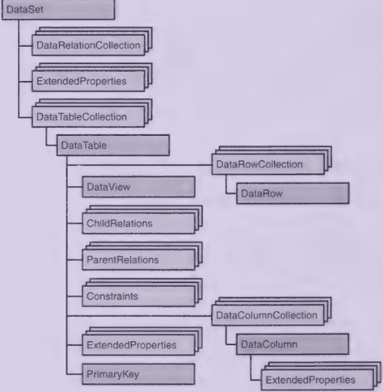

请查看表 3.1，了解您在此实操指南中将使用的一些对象的简要描述。

### 表 3.1 用于操作数据的 ADO.NET 数据对象

| 对象 | 用途 |
|---|---|
| DataSet | 该对象与其它数据控件配合使用，存储由命令和数据适配器返回的结果。与 ADO 和 DAO 的记录集不同，数据集实际上带回了数据的分层视图。通过使用 DataSet 对象中的属性和集合，您可以获取整体关系、单个表、行和列。 |
| DataTable | 作为数据集的对象之一，DataTable 对象使您能够操作单个表的数据。数据表类似于 ADO 中的记录集对象。 |
| DataView | 使用此对象，您可以过滤和排序数据，并保持数据的各种视图。每个数据表都有一个默认视图，这是可以被修改并存储在独立数据视图中的起始数据视图。 |
| DataRow | 该对象使您能够操作数据表中的数据行。这可以被视为一个数据缓存，您可以通过添加、删除和修改记录来对其进行操作。然后您可以将更改提交回记录集，随后运行 SQL 语句将数据更新回服务器。 |
| DataColumn | 正如其名，您可以使用 DataColumn 对象在列级别获取信息。您可以使用此对象获取架构信息以及数据。例如，如果您想创建字段名称的列表框，可以通过迭代数据行的 DataColumn 集合来检索所有字段的名称。 |
| PrimaryKey | 该对象允许您为数据表指定主键。这样，当您使用数据表的 Find 方法时，它就知道该使用哪一列。 |

.NET 还提供了称为 *数据提供者 (data providers)* 的类，与 ADO.NET 对象配合工作以提供数据访问。您可以在图 3.2 中看到其中一些对象。

**注意**
您的 Visual Studio .NET 应用程序由一个或多个程序集组成。每个程序集包含一个或多个命名空间 (Namespace)。命名空间由一个或多个类（对象）组成。因此，您的 OleDb 对象的命名空间是 `System.Data.OleDb`。您可以使用对象浏览器找到这些对象。

在表 3.2 中，您可以看到您在此实操指南中将使用的一些对象的简要描述。

**图 3.2**
为了获得更好的性能，您可以使用 OleDb 类或 SQLClient 类。
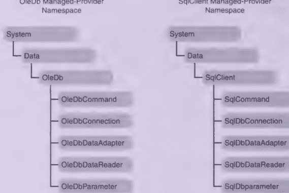

### 表 3.2 用于操作数据的 .NET 数据提供者类

| 对象 | 用途 |
|--------|---------|
| Command | 类似于 ADO Command 对象，它允许您在代码中执行存储过程。但与 ADO 版本不同，您可以使用 ExecuteReader 方法创建 DataReader 对象。 |
| Connection | 该对象打开与您要操作的服务器和数据库的连接。与 ADO Connection 对象不同，连接保持开启的方式取决于您正在使用的对象，例如 DataReader 或 DataSet 对象。 |
| DataAdapter | 一个真正的“主力军”，DataAdapter 对象允许您创建 SQL 语句并用数据填充数据集。它还会创建其他必要的动作查询，例如 Insert、Update 和 Delete ADO.NET 命令对象。 |
| DataReader | 该对象创建一个只读、仅前向的数据流，允许您快速填充控件，例如 ListBox 和 ComboBox 控件。 |
| Parameter | 该对象允许您指定 DataAdapter 对象可以定义并使用的参数（如果您使用多个参数，则指定多个）。 |

**提示**
第一章“使用绑定控件开发 Windows 窗体”中提到，OleDb 数据控件是您在处理各种类型后端时想要使用的控件，而 SQLClient 数据控件则严格与 SQL Server 配合工作。使用这些对象时情况相同。如果您知道将仅使用 SQL Server 后端，使用 SQLClient 对象将获得更好的性能，因为减少了一个中间层。


在接下来的“操作指南”中，你将有机会看到前两个表格中列出的所有项目。

> **提示**
如果你必须坚持使用ADO，或者就是想固执己见，请阅读附录A《使用ADO进行桌面开发》来了解如何在.NET中使用ADO。

尽管ADO.NET有时确实需要完成更多工作来实现你可以用ADO完成的任务，但其强大的功能和灵活性绝对值得你投入学习成本。

> **注意**
虽然本章是使用Windows Forms编写的，但大多数对象也可以在Web Forms中使用，或者在ASP.NET中与ADO.NET结合使用。你将在第5章《在Web Forms中处理数据》中看到这一点。

你将学习实现相同目标的各种方法。而何时以及如何使用这些方法，则取决于具体场景。

本章中的所有示例都可以在网站上名为VB.NET—第3章的解决方案中找到。

## 3.1 使用 DataReader 对象检索数据

在第1章中，你学习了如何使用绑定控件将`OleDb`控件添加到窗体上。有些开发者更喜欢使用非绑定控件来执行相同的任务。`DataReader`对象允许你以更高效的方式向列表框添加项目，因为它只是一个只读、仅向前的对象类型。本操作指南将告诉你如何使用`DataReader`对象来生成一个受限的ListBox控件。

你希望创建一个受限的客户列表。你不想使用绑定控件，因为你是一个很酷的VB开发者，深知这样更好。你听说`DataReader`对象是获取数据的快速方式。那么，你如何使用`DataReader`对象来执行此任务呢？

### 技术

在本操作指南中，你将使用`ListBox`控件，并通过`DataReader`对象向其中加载项目。为了获取`DataReader`对象，你需要查看`Command`对象。

.NET中的`Command`对象的工作方式与ADO中的Command类似，你需要将存储过程名称或SQL语句分配给`CommandText`属性，以及要使用的连接。一个区别是，你将使用`Command`对象的`Open`方法，然后是`ExecuteReader`方法，来创建`DataReader`对象。

然后，你将使用**DataReader**对象的Read方法来执行两项任务。第一项任务是，当在循环中使用时，你可以测试**datareader.Read()**来判断是否终止循环，同时也用于遍历DataReader对象返回的行。

在你填充了**DataReader**并遍历行之后，你将把数据加载到**ListBox**控件中。你将使用在VB 6中就用过的**Clear**和**Add**方法。此外，你将使用**BeginEdit**和**EndEdit**方法，当你加载大量数据时，这可以加快ListBox控件的加载速度。

要在设计视图中查看此示例，请在该章的解决方案中打开名为frmHowTo3_1.vb的窗体。

### 步骤

打开并运行VB.NET—第3章解决方案。从主窗体上，单击标题为“How-To 3.1”的命令按钮。当窗体加载后，单击“Load List”命令按钮。你将看到下面的列表填充了所有以A开头的公司名称。

你将创建一个类似于第1章中创建的表单。**然而，你不会使用绑定控件，而是将使用代码和ADO.NET来填充ListBox控件。**

- 1. 创建一个Windows窗体。然后在该窗体上放置一个Label、TextBox、ListBox和Command按钮，并设置表3.3中列出的属性。

**表3.3 Label、TextBox、ListBox和Command按钮控件属性设置**

| 对象 | 属性 | 设置 |
|---|---|---|
| Label | Name | Label1 |
| | Caption | Customer |
| TextBox | Name | txtCustLimit |
| | Text | A |
| ListBox | Name | lstCustomers |
| Command Button | Name | btnLoadList |
| | Caption | Load List |

**请注意，该列表框没有设置DataBindings属性。这是因为你将使用非绑定的ListBox控件。** 查看图3.3以了解该窗体应呈现的样子。

**图3.3**
将你创建的窗体上的控件排列成如下所示。
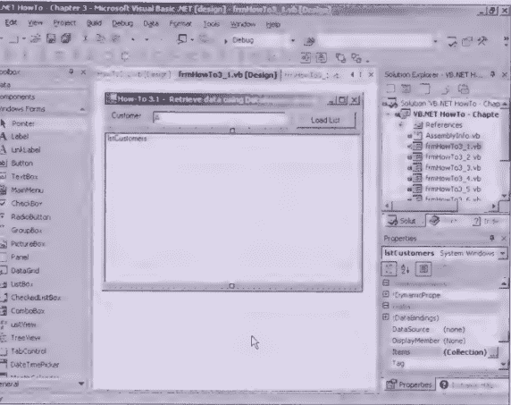

- 2. 在创建将附加到btnLoadList命令按钮Click事件的代码之前，你需要设计一个支持例程来创建连接字符串。名为**BuildCnnStr**，该函数可在清单3.1中看到。此函数接收传递给它的服务器和数据库名称，并创建一个连接字符串。

**清单3.1 modGeneralRoutines.vb：创建连接字符串**

```vb
Function BuildCnnStr(ByVal strServer As String, _
    ByVal strDatabase As String) As String

    Dim strTemp As String
    strTemp = "Provider=SQLOleDB; Data Source=" & strServer & ";"
    strTemp &= "Initial Catalog=" & strDatabase & ";"
    strTemp &= "Integrated Security=SSPI"

    Return strTemp
End Function
```

尽管你可以创建一个返回**Connection**对象的例程，但更通用的方法是返回一个字符串。原因在于，对于某些对象，你需要提供Connection对象，而对于其他对象，你只需要一个字符串。你将在下一步中看到**BuildCnnStr**被调用。

- 3. 在btnLoadList命令按钮上，将清单3.2中的以下代码添加到Click事件。在此例程中，创建一个SQL字符串并存储在strSQL字符串中，该字符串获取txtCustLimit文本框的Text属性并将其添加到字面量中。然后，在Try-Catch-End-Try块中，创建一个名为ocmdCust的OleDbCommand对象的新实例。该例程随后遵循“技术”部分讨论的步骤。

**清单3.2 frmHowTo3_1.vb：使用 DataReader 对象加载列表框**

```vb
Private Sub btnLoadList_Click(ByVal sender As System.Object,
			ByVal e As System.EventArgs) Handles btnLoadList.Click

	Dim ocmdCust As OleDb.OleDbCommand
	Dim odrCust As OleDb.OleDbDataReader
	Dim strSQL As String

	'-- 创建SQL字符串
	strSQL = "Select CompanyName From Customers Where CustomerID Like '" & 
			Me.txtCustLimit.Text & "%"

	'-- 设置异常捕获
	Try

		'-- 创建命令的实例
		ocmdCust = New OleDb.OleDbCommand()

		With ocmdCust
			'-- 设置命令的连接和命令文本
			.Connection = _
				New OleDb.OleDbConnection(BuildCnnStr("(local)", "Northwind"))
			.Connection.Open()
			.CommandText = strSQL

			'-- 设置数据读取器实例
			odrCust = .ExecuteReader(CommandBehavior.SequentialAccess)
		End With

		'-- 将项目添加到列表框。
		With lstCustomers
			.Items.Clear()
			.BeginUpdate()
			Do While odrCust.Read
				.Items.Add(odrCust.Item("CompanyName"))
			Loop
			.EndUpdate()
		End With

	Catch oexpData As OleDb.OleDbException
		MsgBox(oexpData.Message)
	End Try

End Sub
```

> 让VB开发者感兴趣的一点是，以下代码行：
`.Connection = _ New OleDb.OleDbConnection(BuildCnnStr("(local)", "Northwind"))`
实际上在单条语句中声明、初始化并使用了一个OleDBConnection对象。这是.NET的新特性，并且非常有用。

### 工作原理

当用户单击btnLoadList按钮时，Command对象被分配必要的属性，连接被打开，并且调用了ExecuteReader方法。

在清空列表后，遍历DataReader，并加载ListBox控件。

### 注释

DataReader对象是从服务器获取数据并将列表加载到应用程序中最有效的方式之一。除了CommandBehavior.SequentialAccess之外，还有其他选项使得DataReader使用起来很方便。最值得注意的是CommandBehavior.SchemaOnly，它只返回列的元数据信息，而不返回数据。

除了本操作指南中提到的方式，你还可以使用Command对象执行多种操作。你将在本章后面看到更多使用Command对象与存储过程一起执行批处理操作的示例。

你已经看到了如何使用完全非绑定的技术来使用ListBox控件。在下一个操作指南中，你将看到一种在半绑定技术中使用ListBox控件的混合方式，你将在运行时绑定数据。

## 3.2 使用 DataTable 对象从 SQL Server 检索结果

数据读取器非常适合你只想手动将数据加载到ListBox或ComboBox控件的情况，但通过在运行时将ListBox控件绑定到数据表，你可以节省一些编码工作，并且还能获得除了显示值之外的键列。本操作指南演示了如何将受限的ListBox控件绑定到数据表。

虽然快速获取信息很好，但你需要能够引用回信息表，并且你不想为此打开另一个连接。你知道DataTable对象应该允许你执行此任务。那么，如何使用DataTable对象从SQL Server获取结果呢？

**使用 Visual Basic .NET 和 ADO.NET 进行数据库编程：技巧、教程与代码**

## 技术方法

利用“操作指南 3.1”中介绍的 Windows 窗体控件，你将使用第 1 章中熟悉的 `DataAdapter` 对象。这次，你不会使用 `OleDbDataAdapter` 数据控件，而是会使用 `System.Data.OleDb` 命名空间中的 `OleDbDataAdapter` 类。

采用与填充 `DataSet` 类似的技巧，你将通过赋值 SQL 字符串和连接对象来实例化数据适配器。然后，你不会填充一个 `DataSet` 对象，而是填充一个 `DataTable` 对象。因为处理的数据仅限于一个表的范围，所以你只需使用一个数据表。这样，你将能够更方便地执行查找操作，如下一个操作指南所示。

目前，下一步是为列表框分配以下属性：

-   **DataSource**。这将设置为 `DataTable` 对象——在本例中是 `dtCust`。
-   **DisplayMember**。这指定数据表中哪一列用于在列表框中显示。
-   **ValueMember**。在此，你将指定当从列表框中选择一个项目时，要用作检索值的那一列。

通过使用这种技术对 `ListBox` 控件进行编程，你可以访问列表框 `SelectedItem` 属性中的 `ValueMember` 列。

## 操作步骤

打开并运行 `VB.NET—Chapter 3` 解决方案。从主窗体上，单击标题为 “How-To 3.2” 的命令按钮。当窗体加载后，单击 “Load List” 命令按钮。你将看到下面的列表填满了所有以 A 开头的公司名称。

-   1. 为了节省时间，你可以复制本章第一个操作指南中创建的窗体。
-   2. 将 `btnLoadList_Click` 事件替换为下面代码清单 3.3 中列出的代码。就是这样。在创建将要使用的 SQL 字符串并将其存储在 `strSQL` 之后，创建名为 `odaCust` 的数据适配器。然后使用 `odaCust` 填充 `odtCust` 数据表。最后，为 `lstCustomers` 列表框设置了 `DataSource`、`DisplayMember` 和 `ValueMember` 属性。所有这些都在一个 `Try-Catch-End-Try` 代码块中完成。

### 代码清单 3.3 frmHowTo3_2.vb：使用 DataTable 对象加载列表框

```vbnet
Private Sub btnLoadList_Click(ByVal sender As System.Object, _
                               ByVal e As System.EventArgs) Handles btnLoadList.Click
    Dim odaCust As OleDb.OleDbDataAdapter
    Dim dtCust As DataTable = New DataTable()
    Dim strSQL As String

    '-- 创建 SQL 字符串
    strSQL = "Select CustomerID, CompanyName From Customers " & _
            "Where CustomerID Like '" & _
            Me.txtCustLimit.Text & "%'"

    '-- 设置异常捕获
    Try

        ' 创建数据适配器实例，
        ' 然后填充数据表
        odaCust = New OleDb.OleDbDataAdapter(strSQL,
        BuildConnStr("(local)", "Northwind"))
        odaCust.Fill(dtCust)

        '-- 将数据绑定到列表框
        listCustomers.DataSource = dtCust
        listCustomers.DisplayMember = "CompanyName"
        listCustomers.ValueMember = "CustomerID"

    Catch oexpData As OleDb.OleDbException
        MsgBox(oexpData.Message)
    End Try

End Sub
```

## 工作原理

当用户单击 `btnLoadList` 按钮时，名为 `odaCust` 的数据适配器被实例化。数据适配器接收 `strSQL` 和由本章第一个操作指南中介绍的 `BuildConnStr` 函数创建的连接字符串。然后填充数据表，并为 `ListBox` 控件的 `DataSource`、`DisplayMember` 和 `ValueMember` 属性赋值。

## 注释

使用数据表为下一个操作指南中使用列表框检索数据奠定了基础。请记住：通过使用 `DataTable` 对象，你可以同时分配显示值和要跟踪的数据项。

## 3.3 使用 DataTable 对象定位记录

使用 `DataTable` 对象，你可以使用另一个名为 `DataRow` 对象的工具，它允许你定位数据表中的特定行。当你想为用户提供窗体的搜索机制时，这非常有用。这个操作指南向你展示如何在数据表中定位特定行，以及如何将同一数据表用于两个不同的目的。

在将 **DataTable** 对象加载到内存中后，你需要能够定位 **DataTable** 对象中的特定记录。你如何在 **DataTable** 对象中定位记录？

## 技术方法

在这个操作指南中，你将使用 **ComboBox** 控件而不是 ListBox 控件。你将使用与加载列表框相同的技巧来加载组合框。变化在于当你从组合框中选择一个项目时。

当组合框中选中一个项目时，**SelectedIndexChanged** 事件会被触发。在此事件中，你将获取**组合框的 SelectedItem**，它提供了选定行中的 **ValueMember**，然后**将其与 DataTable 的 Rows 集合的 Find 方法一起使用**。

定位到数据行后，相应的列将加载到窗体上的文本框中，如图 3.4 所示。

**图 3.4**
此组合框将引导用户找到特定的客户。
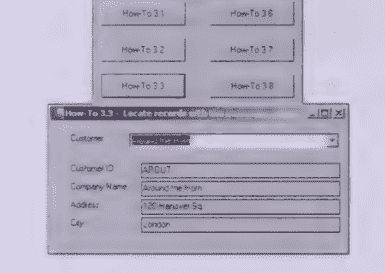

## 操作步骤

打开并运行 `VB.NET—Chapter 3` 解决方案。从主窗体上，单击标题为 “How-To 3.3” 的命令按钮。当窗体加载后，从客户 **ComboBox** 控件中显示的列表中选择一个新客户。你将看到 **ComboBox** 控件下方的文本框显示与所选客户对应的新数据。

-   1. 创建一个新的 Windows 窗体。
-   2. 添加一些标签、组合框和文本框，如表 3.4 所列。

### 表 3.4 Label、TextBox 和 ComboBox 控件属性设置

| 对象 | 属性 | 设置 |
| :--- | :--- | :--- |
| Label | Name | Label1 |
| Label | Caption | Customer |
| ComboBox | Name | cboCustomers |
| Label | Name | Label2 |
| Label | Caption | Customer ID |
| Label | Name | Label3 |
| Label | Caption | Company Name |
| Label | Name | Label4 |
| Label | Caption | Address |
| Label | Name | Label5 |
| Label | Caption | City |
| TextBox | Name | txtCustomerID |
| TextBox | Name | txtCompanyName |
| TextBox | Name | txtAddress |
| TextBox | Name | txtCity |

你还需要确保 `TextBox` 控件中的 `Text` 属性为空。

-   3. 在窗体的类模块中，在 Windows 窗体设计器生成的代码行下方，添加以下两个 Private 声明。

```vbnet
Private modaCust As OleDb.OleDbDataAdapter
Private mdtCust As DataTable = New DataTable()
```

这些代码行声明了一个数据适配器和一个数据表，它们将在整个窗体中使用。

> **注意**
> 在前面添加 *m* 表示这是一个模块级或成员级变量。同时，请记住，虽然你是在窗体级别声明的，但数据适配器所使用的连接不会在整个窗体期间都保持打开状态。当填充数据表时，连接会被打开。然后使用底层的 XML 在本地访问数据。它与服务器是断开连接的。

-   4. 将代码清单 3.4 所示的代码添加到窗体的 Load 事件中。这段代码与上一个操作指南中加载 ListBox 控件的代码几乎相同，它将 `modaCust` 设置为一个 SQL 字符串和要使用的连接字符串。然后使用 `modaCust` 的 `Fill` 方法填充 `mdtCust`。接下来，将名为 `dc` 的 `DataColumn` 数组的第一个元素设置为 `CustomerID` 列。然后将 `mdtCust.PrimaryKey` 设置为该 `DataColumn` 数组。最后，设置 `DataSource`、`DisplayMember` 和 `ValueMember` 属性。

### 代码清单 3.4 frmHowTo3_3.vb：使用 DataTable 对象加载 ComboBox

```vbnet
Private Sub frmHowTo3_3_Load(ByVal sender As Object,
	ByVal e As System.EventArgs) Handles MyBase.Load

	Dim strSQL As String
	Dim dc(1) As DataColumn

	' 设置异常捕获
	Try

		' 创建数据适配器并填充数据表
		modaCust = New OleDb.OleDbDataAdapter("Select * From Customers", _
		(BuildConnStr("local", "Northwind")))
		modaCust.Fill(mdtCust)

		' 为数据表设置主键
		dc(0) = mdtCust.Columns("CustomerID")
		mdtCust.PrimaryKey = dc

		' 将数据绑定到组合框
		cboCustomers.DataSource = mdtCust
		cboCustomers.DisplayMember = "CompanyName"
		cboCustomers.ValueMember = "CustomerID"

	Catch oexpData As OleDb.OleDbException
		MsgBox(oexpData.Message)
	End Try

End Sub
```

设置的 `PrimaryKey` 属性将用于下一步的代码中，通过 `mdtCust` 的 `Rows` 集合的 `Find` 方法。

-   5. 最后这段代码需要添加到 `cboCustomers` ComboBox 控件的 `SelectedIndexChanged` 事件中。与上一步类似，当为 `PrimaryKey` 属性设置数据列时，在这一步中，指定一个数组将 `SelectedItem` 的值传递给 `Find` 方法。然后，使用 `ToString` 方法将文本框的 `Text` 属性设置为相应的列值。


 LISTING 3.5 *frmHowTo3_3.vb*：在数据表中定位记录，然后为文本框赋值

```
Private Sub cboCustomers_SelectedIndexChanged(ByVal sender As System.Object, _
            ByVal e As System.EventArgs) _
            Handles cboCustomers.SelectedIndexChanged

    Dim drCurr As DataRow
    Dim aFindValue(0) As Object

    '-- 加载要查找的项，并使用 Find 方法
    aFindValue(0) = cboCustomers.SelectedItem(0)
    drCurr = mdtCust.Rows.Find(aFindValue)

    '-- 将字段加载到窗体上
    txtCustomerID.Text = drCurr("CustomerID").ToString
    txtCompanyName.Text = drCurr("CompanyName").ToString
    txtAddress.Text = drCurr("Address").ToString
    txtCity.Text = drCurr("City").ToString

End Sub
```

## 工作原理

当用户从 `cboCustomer` 组合框控件中选择一个客户时，代码会使用 `Find` 方法在行集合中定位 `mdtCust` 数据表中的所需值。然后从检索到的行中将数据加载到文本框中。

## 注释

使用提供的方法在数据表和数据行中定位记录是相当容易的。ADO.NET 不仅可以在整体层级结构层面提供所需的控制，还可以在行和列级别提供控制。

## 3.4 使用 DataView 对象筛选和排序记录

将数据加载到数据表后，你可能希望能够使用不同的筛选条件和排序顺序查看数据。为此，可以使用 DataView 对象。本教程将详细介绍如何利用 `DataView` 控件来操作数据。

虽然可以将数据放入 `DataGrid` 控件中，让用户通过列来排序数据，但你希望显示一个 `ComboBox` 控件，让用户从下拉列表中选择一个字段。如何使用 `DataView` 对象以不同方式筛选和排序记录，从而呈现数据呢？

## 技术

本教程显示一组命令按钮，每个按钮显示一个字母，以及一个额外的命令按钮显示*所有*记录。数据适配器、数据表和数据视图在窗体级别声明。当窗体加载时，数据适配器将 DataTable 填充所有客户数据。使用 **DataColumn** 对象，通过获取数据表中每一列的名称来填充组合框。你可以在图 3.5 中看到该窗体的实际效果。

**图 3.5**
在此选择一个字母，可以限制 DataGrid 控件中显示的数据。

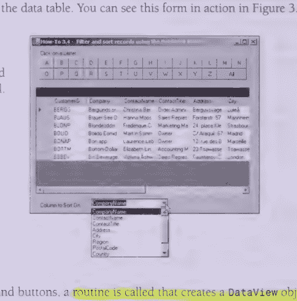

使用命令按钮，会调用一个**例程，该例程创建 DataView 对象，设置 RowFilter 属性，然后将数据视图分配给 DataGrid 控件的 DataSource 属性。**

> **提示**
> 虽然 **RowFilter** 允许你基于条件（如 CompanyName Like 'A%'）筛选数据，但你可以设置另一个属性来基于数据所在行的状态显示数据。该属性称为 **RowStateFilter**。
> 你可以将 **RowStateFilter** 设置为表 3.5 中的以下 **DataViewRowState** 值之一。

**表 3.5** DataViewRowState 值

| 设置 | 说明 |
|---|---|
| Added | 新行 |
| CurrentRows | 当前行，包括未更改、新建和修改的行 |
| Deleted | 已删除的行 |
| ModifiedCurrent | 当前版本，即原始数据的修改版本（参见 ModifiedOriginal） |
| ModifiedOriginal | 原始版本（尽管此后已被修改，可作为 ModifiedCurrent 使用） |
| None | 无 |
| OriginalRows | 原始行，包括未更改和已删除的行 |
| Unchanged | 未更改的行 |

当从 **ComboBox** 中选择列名时，使用 **DataView** 对象的 **Sort** 属性。将 **Sort** 属性的当前设置与所选列名进行比较。如果名称匹配，则将表达式 **DESC** 添加到分配给 **Sort** 属性的值中。

## 步骤

打开并运行 VB.NET — 第 3 章解决方案。在主窗体上，单击标题为 How-To 3.4 的命令按钮。当窗体加载时，单击显示的不同字母。你将看到数据网格根据客户的第一个字母显示不同的客户。

如果从"要排序的列"组合框控件中选择一个列名，数据网格将根据所选列进行排序。

- 1. 新建一个 Windows 窗体。

- 2. 添加一个 GroupBox 控件，将其 text 属性设置为 Click on a Letter。

- 3. 现在你将创建按钮，并将它们放置在你刚刚创建的 GroupBox 控件中。这些按钮的属性将按表 3.6 所列进行设置。

### 表 3.6 按钮属性设置

| 对象 | 属性 | 设置 |
| :--- | :--- | :--- |
| Button | Name | btnA |
| | Caption | A |
| Button | Name | btnB |
| | Caption | B |

| 对象 | 属性 | 设置 |
|--------|----------|---------|
| Button | Name | btnC |
| | Caption | C |
| ... | | |
| Button | Name | btnZ |
| | Caption | Z |
| Button | Name | btnAll |
| | Caption | All |

- 4. 添加清单 3.6 中所示的 DataGrid、Label 和 ComboBox 控件。

### 表 3.7 DataGrid、Label 和 ComboBox 控件属性设置

| 对象 | 属性 | 设置 |
|--------|----------|---------|
| DataGrid | Name | dgCustomers |
| Label | Name | Label1 |
| Label | Caption | Column to Sort On: |
| ComboBox | Name | cboSortColumns |

- 5. 在窗体的类模块中，在 `Windows Form Designer generated code` 代码行正下方添加以下三个 Private 声明。这三个对象将在整个窗体中使用。

```
Private modaCust As OleDb.OleDbDataAdapter
Private mdtCust As DataTable = New DataTable()
Private mdvCust As DataView = New DataView()
```

- 6. 将以下代码添加到窗体的 `Load` 事件中，如清单 3.6 所示。此代码首先设置 modaCust 数据适配器以获取所有客户来填充名为 mdtCust 的数据表。请注意，此时数据网格尚未填充。

下一个任务是通过遍历 `mdtCust` 中的每个数据列并将其添加到 cboSortColumns 的 **Items** 集合中，来加载 cboSortColumns 的列标题。最后，调用 **SetDataViewFilter** 例程。该例程将在步骤 8 中讨论。

## LISTING 3.6 `frmHowTo3_4.vb`：加载窗体中要使用的数据表，并将列名添加到 ComboBox 控件

```
Private Sub frmHowTo3_4_Load(ByVal sender As Object, 
    ByVal e As System.EventArgs) Handles MyBase.Load

    Dim strSQL As String
    Dim dcCurr As DataColumn

    '-- 设置异常捕获
    Try

        '-- 创建数据适配器并填充数据表
        modaCust = New _
            OleDb.OleDbDataAdapter("Select * From Customers", _
            (BuildCnnStr("(local)", "Northwind")))
        modaCust.Fill(mdtCust)

        '-- 将列名加载到排序 ComboBox 控件中
        For Each dcCurr In mdtCust.Columns
            Me.cboSortColumns.Items.Add(dcCurr.ColumnName)
        Next

        SetDataViewFilter("B")

    Catch oexpData As OleDb.OleDbException
        MsgBox(oexpData.Message)
    End Try

End Sub
```

- 7. 对于每个带有单个字母的命令按钮，将清单 3.7 中显示的第一个子程序添加到其 `Click` 事件中。对于 btnAll 按钮控件，将第二个子程序添加到 `Click` 事件中。每个 `Button` 控件将传递其代表的字母给名为 `SetDataViewFilter` 的子程序，该子程序将在下一步中讨论。btnAll 代码仅传递空字符串。

## LISTING 3.7 `frmHowTo3_4.vb`：每个按钮控件的 Click 事件

```
Private Sub btnA_Click(ByVal sender As System.Object, _
    ByVal e As System.EventArgs) Handles btnA.Click
    SetDataViewFilter("A")
End Sub

Private Sub btnAll_Click(ByVal sender As System.Object, _
    ByVal e As System.EventArgs) Handles btnAll.Click
    SetDataViewFilter("")
End Sub
```

- 8. 将清单 3.8 中的子程序添加到窗体的类模块中。此例程将 `strFilterLetter` 中传递的字母值作为参数。首先要执行的任务是将 `mdtCust` DataTable 对象的 DefaultView 分配给

mdvCust 数据视图。接下来，将 mdvCust 的 RowFilter 属性设置为使用 strFilterLetter 和 %（通配符）通过 Like 表达式与 CompanyName 列进行比较。请注意，如果向 strFilterLetter 传递 "*"，则将列出所有记录。最后，将 mdvCust 设置为 dgCustomers（DataGrid 控件）的 DataSource。

### 列表 3.8 frmHowTo3_4.vb：为 DataView 对象设置 RowFilter 属性

```vb
Sub SetDataViewFilter(ByVal strFilterLetter As String)

    mdvCust = mdtCust.DefaultView
    mdvCust.RowFilter = " CompanyName Like '" & strFilterLetter & "%'"
    dgCustomers.DataSource = mdvCust

End Sub
```

- 9. 将列表 3.9 中所示的代码段添加到 cboSortColumns ComboBox 控件的 SelectIndexChanged 事件中。该例程将 mdvCust 的 Sort 属性的当前设置与 cboSortColumns 中选择的当前列名进行比较。如果两者相同，则将列名分配给 Sort 属性并加上 DESC 关键字。如果不同，则将列名分配给 Sort 属性。

### 列表 3.9 frmHowTo3_4.vb：指定排序的列

```vb
Private Sub cboSortColumns_SelectedIndexChanged(ByVal sender As System.Object, 
    ByVal e As System.EventArgs)
    Handles cboSortColumns.SelectedIndexChanged

    ' Check to see if the column is currently the sorted field.
    ' If it is, sort on the column in descending order.
    ' Otherwise, set the sort to the name of column.

    If mdvCust.Sort = Me.cboSortColumns.Text Then
        mdvCust.Sort = Me.cboSortColumns.Text & " DESC"
    Else
        mdvCust.Sort = Me.cboSortColumns.Text
    End If

End Sub
```

## 工作原理

当用户点击一个字母时，数据视图被创建，并且数据网格反映出新数据。当从 ComboBox 控件中选择一个字段时，数据视图的 Sort 属性被设置，数据网格会自动反映出新的排序顺序，同时在列标题中显示一个箭头。如果用户再次选择该字段，列将按降序排序。

## 评论

使用 `DataView` 对象，您可以跟踪数据的多个视图并将其显示给用户使用。您还可以使用 `DefaultViewManager` 访问数据集中数据表的所有默认视图。

> **注意**
> 有些人可能认为在本例中添加的排序组合框是不必要的。添加它是出于两个原因：第一，它展示了如何使用 `DataView` 对象的 Sort 属性；第二，它对用户很方便。用户可能不想滚动到数据网格中未显示的列。通过使用组合框，他可以对当前未显示的字段进行排序。

## 第 4 章：使用 ADO.NET 操作数据

- **在本章中，您将学习**
    - 编辑数据并更新对 ADO.NET DataSet 对象的更改
    - 使用 ADO.NET 在数据集中添加和删除行
    - 在 ADO.NET 中执行参数化存储过程
    - 使用 ADO.NET 创建并执行即时批量更新

在第 3 章“使用 ADO.NET 查看数据”中，您了解了如何使用 ADO.NET 以各种形式显示数据。然而，ADO.NET 还有更多功能，例如通过修改当前数据以及插入和删除数据来操作数据。ADO.NET 为您提供了在第 3 章中介绍的一些对象基础上完成这些任务所需的工具。

使用 ADO.NET 操作数据比使用 ADO 需要更多几个步骤。主要原因是 ADO.NET 是断开连接的；因此，在您将更改保存到 ADO.NET 对象（如数据集）后，您需要将这些更改提交回服务器。您将在本章中学习如何执行此操作。好消息是，一旦您学会了如何让对象更新并将数据提交回服务器以完成一项任务（例如编辑数据），您在执行其他任务时也将使用相同的基本命令。让我们开始吧。

## 4.1 编辑数据并更新对 ADO.NET DataSet 对象的更改

列出和查看数据很简单。您真正需要做的是能够编辑和更新数据。您知道可以使用 `DataSet` 对象及其某些方法来执行此任务。那么，如何使用 `DataSet` 对象编辑和更新数据呢？

### 技术

在本 How-To 中，您将使用 `DataAdapter`、`DataSet`、`DataTable` 和 `DataRow` 对象。您之前已经体验过这些对象的部分属性和方法。在本章中，您将使用表 4.1 所示的以下属性和方法。

**表 4.1**

| 对象 / 方法 | 属性 | 描述 |
| :--- | :--- | :--- |
| DataAdapter | Fill | 填充 `DataSet` 和 `DataTable` 对象。 |
| CommandBuilder | GetUpdateCommand | 创建一个 `Update` 命令并将其放入数据适配器的 `UpdateCommand` 属性中。 |
| DataAdapter | UpdateCommand | 保存用于更新的 SQL 语句。 |
| DataAdapter | Close | 关闭 UpdateCommand 的连接。语法为 `dataadapter.UpdateCommand.Connection.Close()`。 |
| DataAdapter | Update | 对数据集执行更新命令。 |
| DataSet | Tables | 表示数据集中的表集合。 |
| DataSet | Rows | 包含数据集中指定表内的行集合。 |
| DataSet | AcceptChanges | 将更改发送回服务器。 |
| DataRow | ToString | 从 DataRow 中指定的列检索数据并将其作为字符串值返回。 |
| DataRow | BeginEdit | 开始编辑 `DataRow`，允许您替换列中的值。 |
| DataRow | EndEdit | 完成对 `DataRow` 的编辑。 |

您将在接下来的步骤中看到这些对象及其属性和方法的具体用法。

### 步骤

打开并运行 VB.NET—Chapter 4 解决方案。在主窗体中，点击标题为 How-To 4.1 的命令按钮。当窗体加载时，点击 Load List 按钮以显示以字母 *A* 开头的客户。点击 **Edit** 按钮。您会注意到字段现在呈现出凹陷的外观。将光标置于 City 字段中，并将值改为 `Dunkirk`。现在点击 **Save**。如果您移出该记录再移回，您会发现值已被保存。

此窗体看起来与第 1 章中创建的窗体相似。不同之处在于，这次您将不使用在设计时绑定的控件。您可以在图 4.1 中看到该窗体。

**图 4.1**
(图片: img/4a10971b83c8dfd6c5c407d779324bd9_116_0.png)

虽然这看起来像第 1 章中创建的窗体，但通过使用非绑定控件，您对该版本拥有更多的控制权。

- 1. 创建一个新的 Windows 窗体。
- 2. 添加以下控件，并按照表 4.2 中列出的属性进行设置。

**表 4.2 控件属性设置**

| 对象 | 属性 | 设置 |
| :--- | :--- | :--- |
| Label | Name | Label1 |
| Label | Caption | Customer |
| TextBox | Name | txtCustLimit |
| TextBox | Text | A |
| Button | Name | btnLoadList |
| Button | Caption | Load List |
| ListBox | Name | lstCustomers |
| Label | Caption | Customer ID |
| Label | Caption | Company Name |
| Label | Caption | Contact |
| Label | Caption | Contact Title |
| Label | Caption | Address |
| Label | Caption | City |
| Label | Caption | Region |
| Label | Caption | Country |
| Label | Caption | Phone |
| Label | Caption | Fax |
| TextBox | Name | txtCustomerID |
| TextBox | Name | txtCompanyName |
| TextBox | Name | txtContact |
| TextBox | Name | txtContactTitle |
| TextBox | Name | txtAddress |
| TextBox | Name | txtCity |
| TextBox | Name | txtRegion |
| TextBox | Name | txtPostalCode |
| TextBox | Name | txtCountry |
| TextBox | Name | txtPhone |
| TextBox | Name | txtFax |
| Button | Name | btnEdit |
| Button | Caption | &Edit |
| Button | Name | btnSave |
| Button | Caption | &Save |
| Button | Name | btnCancel |
| Button | Caption | &Cancel |

> **注意**
> 请注意，文本框的 Text 属性在设计时并未设置。在第 1 章“使用绑定控件开发 Windows 窗体”中，它们被设置为窗体中包含的数据集的列。在本 How-To 中，它们将在运行时被设置。

- 3. 在窗体的类模块中，在 Windows Form Designer 生成的代码行正下方添加以下三个 Private 声明。这三个对象将在整个窗体中使用。

```vb
Dim mdsCustIndiv As New DataSet()
Dim modaCustIndiv As OleDb.OleDbDataAdapter
Dim mdrCustIndiv As DataRow
```

- 4. 输入以下代码作为 btnLoadList 的 Click 事件：

```vb
Private Sub btnLoadList_Click(ByVal sender As System.Object, _
ByVal e As System.EventArgs) Handles btnLoadList.Click
```


'-- 将列表的加载移至子程序中，以便进行额外的调用
LoadList()

End Sub

5. 通过将以下代码输入到为此 How-To 创建的窗体中，来创建 LoadList 例程。该代码使用数据适配器创建并填充数据表。数据适配器使用的字符串通过使用 `txtCustLimit` 文本框来创建 Select 语句。随后绑定列表框的 `DataSource`、`DisplayMember` 和 `ValueMember` 属性。最后，调用在下一步中描述的 LoadIndividual 例程。

```vbnet
Private Sub LoadList()
    Dim odaCustList As OleDb.OleDbDataAdapter
    Dim dtCustList As DataTable = New DataTable()
    Dim strSQL As String

    '-- Create the SQL String
    strSQL = "Select CustomerID, CompanyName " & _
             " From Customers Where CustomerID Like '" & _
             Me.txtCustLimit.Text & "%'"

    '-- Set up the exception catch
    Try
        '-- Create an instance of the data adapter; then fill the data table
        odaCustList = New OleDb.OleDbDataAdapter(strSQL, _
                       BuildCnnStr("(local)", "Northwind"))
        odaCustList.Fill(dtCustList)

        '-- Bind the data to the list box
        lstCustomers.DataSource = dtCustList
        lstCustomers.DisplayMember = "CompanyName"
        lstCustomers.ValueMember = "CustomerID"

        LoadIndividual()
    Catch oexpData As OleDb.OleDbException
        MsgBox(oexpData.Message)
    End Try

End Sub
```

6. 通过将以下代码在为此 How-To 创建的窗体中输入，来创建 LoadIndividual 例程。该例程从列表框中获取 `SelectedItem`，创建一个数据适配器并填充数据集。接着，创建单个 `DataRow`。最后，每个 TextBox 控件都被加载了来自对应名称列的值。请注意，这里使用了 `Try-Catch-End-Try` 来忽略在 `DataRow` 中没有类似列的控件。

```vbnet
Private Sub LoadIndividual()

    Dim strSQL As String
    Dim strName As String
    Dim oCtl As Object

    mdsCustIndiv.Clear()

    If Me.lstCustomers.SelectedIndex <> -1 Then

        Try
            '-- Load the individual record into the dataset
            strSQL = "Select * from Customers Where CustomerID = '" &
                        Me.lstCustomers.SelectedItem(0) & "'"
            modaCustIndiv = New OleDb.OleDbDataAdapter(strSQL, _
                            BuildCnnStr("(local)", "Northwind"))

            '-- Fill the dataset
            modaCustIndiv.Fill(mdsCustIndiv, "Customers")

            '-- Grab the individual data row
            mdrCustIndiv = mdsCustIndiv.Tables("Customers").Rows(0)

        Catch oexpData As OleDb.OleDbException

            MessageBox.Show("Error loading individual data: " _
                            & oexpData.Message)
            Exit Sub

        End Try

        '-- Run through the text boxes on the form, and
        '-- if they match up with a field from the record,
        '   load them.

        For Each oCtl In Me.Controls

            If TypeOf oCtl Is TextBox Then

                strName = Mid(oCtl.Name, 4)

                '-- By trapping the exception this way, errors are ignored.
                Try
                    oCtl.text = mdrCustIndiv(strName).ToString
                Catch oexp As Exception
                End Try

            End If

        Next

    End If
End Sub
```

## 7. 将以下代码输入到 lstCustomers 的 Click 事件中：

```vbnet
Private Sub lstCustomers_Click(ByVal sender As Object,
                    ByVal e As System.EventArgs) Handles lstCustomers.Click

    '-- Fill the current list item's individual dataset
    LoadIndividual()

End Sub
```

## 8. 将以下代码输入到 btnEdit 的 Click 事件中：

```vbnet
Private Sub btnEdit_Click(ByVal sender As System.Object,
                          ByVal e As System.EventArgs) Handles btnEdit.Click

    '-- Enable the editing of the form
    ActivateEditing(True)

End Sub
```

9. 通过将以下代码在为此 How-To 创建的窗体中输入，来创建 ActivateEditing 例程。该代码在第一章中介绍过，它会遍历窗体上的每个控件，寻找文本框，然后根据控件是启用还是禁用，设置 `BorderStyle` 和 `BackColor` 属性。随后还会设置每个控件的 `Enabled` 属性。

```vbnet
Private Sub ActivateEditing(ByVal bEnable As Boolean)

    Dim oCurr As Object

    '-- Loop through each of the controls on the form
    For Each oCurr In Me.Controls()

        '-- Check to see if the control is a text box
        If TypeOf oCurr Is TextBox And oCurr.Name <> "txtCustLimit" Then

            '-- If so, toggle the properties
            If bEnable Then

                oCurr.BorderStyle() = _
                    System.Windows.Forms.BorderStyle.Fixed3D

                oCurr.BackColor() = System.Drawing.Color.White

            Else

                oCurr.BorderStyle() = _
                    System.Windows.Forms.BorderStyle.FixedSingle

                oCurr.BackColor() = Me.BackColor

            End If

            oCurr.Enabled = bEnable

        End If
    Next

End Sub
```

10. 将以下代码输入到 `btnSave` 的 Click 事件中：

```vbnet
Private Sub btnSave_Click(ByVal sender As System.Object,
                                  ByVal e As System.EventArgs) Handles btnSave.Click

    '-- Save the information
    SaveRecord()

    '-- Disable the text boxes
    ActivateEditing(False)

End Sub
```

11. 通过将以下代码在为此 How-To 创建的窗体中输入，来创建 `SaveRecord` 例程。该例程使用 `DataRow` 对象，调用 `BeginEdit` 方法，然后如果存在同名列，将每个控件的值存回其中。接着调用 `EndEdit` 方法以完成对 `DataRow` 的编辑。创建 `CommandBuilder` 对象以通过 `DataAdapter` 对象生成 Update 命令。调用 `DataAdapter` 的 Update 方法使用更改后的数据更新数据集，然后调用 `DataSet` 对象的 `AcceptChanges`。这将接受所有对象的所有更改并将数据发布回服务器。最后，关闭 `DataAdapter` 对象的 `UpdateCommand` 连接。

```vbnet
Private Sub SaveRecord()

    Dim oCtl As Object
    Dim strName As String

    '-- Start the editing in the datarow.
    mdrCustIndiv.BeginEdit()

    '-- Run through the text boxes on the form, and
    '-- if they match up with a field from the record,
    '-- place the value back in the record.
    For Each oCtl In Me.Controls

        If TypeOf oCtl Is TextBox Then

            strName = Mid(oCtl.Name, 4)

            '-- By trapping the exception this way, errors are ignored.
            Try
                mdrCustIndiv(strName) = oCtl.text
            Catch oexp As Exception
            End Try

        End If

    Next

    '-- Finish the editing of the data row
    mdrCustIndiv.EndEdit()

    Try

        '-- Create an instance of the command builder
        Dim ocbCustIndiv As OleDb.OleDbCommandBuilder
        ocbCustIndiv = New OleDb.OleDbCommandBuilder(modaCustIndiv)

        '-- Have the command builder create an update SQL command
        modaCustIndiv.UpdateCommand = ocbCustIndiv.GetUpdateCommand

        '-- Perform the update SQL command; then close the connection
        modaCustIndiv.Update(mdsCustIndiv, "Customers")
        mdsCustIndiv.Tables("Customers").AcceptChanges()
        modaCustIndiv.UpdateCommand.Connection.Close()

    Catch excData As Exception

    End Try

End Sub
```

12. 将以下代码输入到 `btnCancel` 的 `Click` 事件中：

```vbnet
Private Sub btnCancel_Click(ByVal sender As System.Object,
    ByVal e As System.EventArgs) Handles btnCancel.Click

    '-- Use the BindingContext class to cancel the current editing.
    LoadIndividual()
    ActivateEditing(False)

End Sub
```

## 工作原理

当用户点击 `btnLoadList` 按钮时，`lstCustomers` 列表框通过 `odaCustList` 数据适配器和 `dtCustList` 数据表加载。随后，第一位客户的信息被加载到窗体右侧的文本框中。当点击 `btnEdit` 按钮时，文本框的外观变为凹陷状，并启用文本编辑。更改数据后，当用户点击 `btnSave` 按钮时，数据将被存回服务器，且文本框恢复为禁用状态。如果点击 `btnCancel`，文本框将变为禁用状态。


# 注释

尽管与绑定控件相比，使用非绑定控件来处理数据的编辑和更新需要多写一些代码，但你可能更喜欢这种方式，因为你可以掌控代码。使用绑定控件时，代码是自动生成的。这里展示的代码可以被修改得更加通用，这样你就不必为每个表单编写单独的例程。

## 4.2 使用 ADO.NET 在数据集（Dataset）中添加和删除行

同样使用 `OleDbDataAdapter` 和 `OleDbCommandBuilder` 对象，本操作指南将向你展示如何使用非绑定控件配合数据集（dataset）来添加和删除 SQL Server 中的行。

与编辑和更新数据一样，你需要能够使用数据集来添加和删除行。如何执行此任务？

### 技术要点

此技术与前一点的主要区别在于你将与 `DataAdapter` 对象一起使用哪个操作命令。此外，还将介绍 `Rows` 集合上的 Add 方法。

### 步骤

打开并运行 VB.NET—Chapter 4 解决方案。从主表单中，单击标题为 How-To 4.2 的命令按钮。当表单加载后，单击 Load List 按钮以显示以字母 A 开头的客户。单击 Add 按钮。你会注意到字段现在呈现凹陷外观，并且已被清空。在 Customer ID 和 Company Name 文本框中分别填入 `AAA1` 和 `Another Example`。现在单击 Save。如果你移开该条记录再返回，你会注意到该值已被保存。现在选择你添加的新记录，并单击 Delete 按钮。该记录消失，列表框也会更新以反映删除操作。

1.  复制你在上一个操作指南中创建的表单。
2.  添加两个用于添加和删除记录的按钮，按表 4.3 所示设置属性。

| 对象 | 属性 | 设置 |
|--------|----------|---------|
| Button | Name | btnAdd |
|        | Caption | &Add |
| Button | Name | btnDelete |
|        | Text | &Delete |

3.  在你放置其他模块级变量声明的位置添加以下代码行。此变量将在 **btnAdd** 单击事件中设置为 **True**，并可在保存记录时使用。

    ```vbnet
    Dim mblnAdd As Boolean
    ```

4.  将以下代码输入到 **btnAdd** 的 **Click** 事件中。首要任务是将 mblnAdd 变量设置为 **True**。然后该例程清除文本框中的当前文本。它还通过调用 **ActiveEditing** 来启用文本框。

    ```vbnet
    Private Sub btnAdd_Click(ByVal sender As System.Object,
                            ByVal e As System.EventArgs) Handles btnAdd.Click

        Dim oCtl As Object
        Dim strName

        mblnAdd = True

        '-- Clear the fields
        For Each oCtl In Me.Controls

            If TypeOf oCtl Is TextBox And oCtl.name <> "txtCustLimit" Then

                strName = Mid(oCtl.Name, 4)

                '-- By trapping the exception this way, errors are ignored.
                Try
                    oCtl.text = ""
                Catch oexp As Exception
                End Try

            End If

        Next

        ActivateEditing(True)

    End Sub
    ```

5.  将 **SaveRecord** 例程替换为以下代码，用于你为此操作指南创建的表单。第一个更改是添加测试 **mblnAdd** 的代码行；如果为 **True**，则调用数据集 **Tables** 集合上的 **NewRow** 方法，指定 **Customers** 表。返回的 **DataRow** 被赋值给 **mdrCustIndiv**。然后你可以在查询 **blnAdd** 变量的其他地方进行其他更改。

    ```vbnet
    Private Sub SaveRecord()

    Dim oCtl As Object
    Dim strName As String

    If mblnAdd Then
        mdrCustIndiv = mdsCustIndiv.Tables("Customers").NewRow
    End If

    '-- Start the editing in the datarow.
    mdrCustIndiv.BeginEdit()

    '-- Run through the text boxes on the form, and
    '-- if they match up with a field from the record,
    '-- place the value back in the record.
    For Each oCtl In Me.Controls

        If TypeOf oCtl Is TextBox Then

            strName = Mid(oCtl.Name, 4)

            '-- By trapping the exception this way, errors are ignored.
            Try
                mdrCustIndiv(strName) = oCtl.text
            Catch oexp As Exception
            End Try

        End If

    Next

    '-- Finish the editing of the datarow
    mdrCustIndiv.EndEdit()

    Try

        If mblnAdd Then
            mdsCustIndiv.Tables("Customers").Rows.Add(mdrCustIndiv)
        End If

        '-- Create an instance of the command builder
        Dim ocbCustIndiv As OleDb.OleDbCommandBuilder
        ocbCustIndiv = New OleDb.OleDbCommandBuilder(modaCustIndiv)

        If mblnAdd Then
            '-- Have the command builder create an Insert SQL command
            modaCustIndiv.InsertCommand = ocbCustIndiv.GetInsertCommand
        Else
            '-- Have the command builder create an update SQL command
            modaCustIndiv.UpdateCommand = ocbCustIndiv.GetUpdateCommand
        End If

        '-- Perform the specified SQL command; then close the connection
        modaCustIndiv.Update(mdsCustIndiv, "Customers")
        mdsCustIndiv.Tables("Customers").AcceptChanges()

        '-- Close the connection
        If mblnAdd Then
            modaCustIndiv.InsertCommand.Connection.Close()
            LoadList()
        Else
            modaCustIndiv.UpdateCommand.Connection.Close()
        End If

    Catch excData As Exception
        MessageBox.Show("Error Occurred: " & excData.Message)
    End Try

    End Sub
    ```

6.  将以下代码输入到 **btnCancel** 的 **Click** 事件中。

    ```vbnet
    Private Sub btnCancel_Click(ByVal sender As System.Object, _
                              ByVal e As System.EventArgs) Handles btnCancel.Click

        '-- Cancel the current editing.
        If mblnAdd Then
            mblnAdd = False
        End If

        LoadIndividual()
        ActivateEditing(False)

    End Sub
    ```

7.  将以下代码输入到 **btnDelete** 的 **Click** 事件中。按照注释了解正在发生的事情。

    ```vbnet
    Private Sub btnDelete_Click(ByVal sender As System.Object, _
                              ByVal e As System.EventArgs) Handles btnDelete.Click

        Dim ocbCustIndiv As OleDb.OleDbCommandBuilder

        Try

            '-- Delete the record from the datarow object
            mdrCustIndiv.Delete()

            '-- Instantiate the command builder
            ocbCustIndiv = New OleDb.OleDbCommandBuilder(modaCustIndiv)

            '-- Have the command builder create a Delete SQL command
            modaCustIndiv.DeleteCommand = ocbCustIndiv.GetDeleteCommand

            '-- Perform the specified SQL command; then close the connection
            modaCustIndiv.Update(mdsCustIndiv, "Customers")
            mdsCustIndiv.Tables("Customers").AcceptChanges()

            '-- Close the connection
            modaCustIndiv.DeleteCommand.Connection.Close()

        Catch excData As Exception
            MessageBox.Show("Error Occurred: " & excData.Message)
        End Try

        LoadList()
        ActivateEditing(False)

    End Sub
    ```

### 工作原理

当用户单击 Add 按钮时，所有文本框都会被清空，并将 mblnAdd 标志设置为 True。然后，在用户添加信息并单击 Save 按钮后，新记录会被添加回服务器。如果单击 Cancel 按钮，列表当前指向的单个客户将被加载到文本框中。当按下 Delete 键时，当前记录将从服务器中删除。然后客户列表会被刷新，列表中的第一个客户会显示在文本框中。

# 注释

如你所见，使用 ADO.NET 添加和删除记录并不比编辑和更新记录复杂多少。使用本操作指南和上一个中的命令，你可以设置处理多条记录的更新和取消操作。

## 4.3 在 ADO.NET 中执行参数化存储过程

要充分利用存储过程的强大功能，你需要能够传递参数以使用特定的条件。本操作指南描述了如何创建 OleDbCommand 对象的参数以传递给 SQL Server。

你需要在应用程序中执行参数化存储过程。如何使用 Visual Basic .NET 和 ADO.NET 实现这一点？

### 技术要点

在 ADO 中，你有一个 Command 对象来执行存储过程等任务。在 ADO.NET 中，你也有一个执行基本相同任务的 Command 对象。事实上，你使用的许多属性和方法都是相同的。你可以在表 4.4 中查看这些属性和方法。


表 4.4 用于该技术的对象及其属性和方法

| 对象 | 属性 | 描述/方法 |
|---|---|---|
| Connection | ConnectionString | 包含所使用的连接字符串。 |
| Connection | Open | 打开 Command 对象所使用的连接。 |
| Command | cmdText | 指定要使用的 SQL 语句。可以是 SQL 语句，也可以是表或存储过程等对象的名称。 |
| Command | Connection | 使用 Connection 对象。 |
| Command | CommandType | 指定要执行的命令类型。可以是以下命令类型之一：StoredProcedure、DirectTable 或 Text。 |
| Command | Parameters | 传递给存储过程的参数。 |
| Command | ExecuteReader | 根据命令对象指定的数据创建一个 DataReader 对象。 |
| DataReader | Read | 读取 DataReader 中的下一条记录，并测试返回数据的末尾。 |
| DataReader | GetString | 返回当前记录中指定的列，并将其作为字符串返回。 |
| DataReader | GetInt32 | 返回当前记录中指定的列，并将其作为 32 位整数返回。 |

您将在接下来的步骤中使用这些对象及其属性和方法。

## 步骤

打开并运行 VB.NET—Chapter 4 解决方案。在主窗体中，点击标题为 How-To 4.3 的命令按钮。窗体加载后，点击 View 按钮以显示指定客户 ID 的订单。默认情况下，该 ID 为 ALK1。随后，窗体底部会显示一个 TextBox 控件。您可以在图 4.2 中看到该窗体。

- 1. 创建一个新的 Windows 窗体。
- 2. 添加以下控件，并按照表 4.5 中列出的属性进行设置。

### 图 4.2

此窗体使用 Command 对象和存储过程来填充 TextBox 控件。

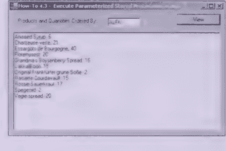

### 表 4.5 控件属性设置

| 对象 | 属性 | 设置 |
| :--- | :--- | :--- |
| Label | Name | Label1 |
| | Caption | Products and Quantities Ordered By: |
| TextBox | Name | txtCustID |
| | Text | ALFKI |
| Button | Name | btnView |
| | Text | &View |
| TextBox | Name | txtResults |
| | MultiLine | True |

- 2. 在 `btnView` 的 Click 事件中输入以下代码。这段代码获取连接并创建命令对象。传递存储过程的名称并指定命令类型为 `CommandType.StoredProcedure`。接着，创建参数和 DataReader。最后一步是迭代数据并将其添加到显示文本框中。

```vbnet
Private Sub btnView_Click(ByVal sender As System.Object,
    ByVal e As System.EventArgs) Handles btnView.Click

    Dim ocnn As New OleDb.OleDbConnection(BuildCnnStr("local"),
        "Northwind")
    Dim ocmdCustHist As New OleDb.OleDbCommand("CustOrderHist", ocnn)
    Dim odrCustHist As OleDb.OleDbDataReader

    Try
        '-- Specify the name of the stored procedure
        ocmdCustHist.CommandType = CommandType.StoredProcedure

        '-- Specify the parameters.
        ocmdCustHist.Parameters.Add("@CustomerID", Me.txtCustID.Text)

        '-- Open the connection object.
        ocnn.Open()

        '-- Establish the DataRead object.
        odrCustHist = _
            ocmdCustHist.ExecuteReader(CommandBehavior.SequentialAccess)

        '-- Iterate through the data loaded, building the results string.
        Do While odrCustHist.Read
            Me.txtResults.Text &= odrCustHist.GetString(0) & _
                ", " & odrCustHist.GetInt32(1) & vbCrLf
        Loop

    Catch excpData As Exception
        MessageBox.Show("Error Occurred: " & excpData.Message)

    End Try
End Sub
```

## 工作原理

当用户在填写客户 ID 后点击 View 按钮时，下方的文本框将被填充，显示该客户的订单信息。

## 评论

使用这里介绍的技术，您可以很好地通过 Command 对象和存储过程来完成绝大多数所需任务。

## 4.4 使用 ADO.NET 创建并执行即时批量更新

在数据库应用程序中，有时您想要创建并执行当前尚不存在的存储过程。当您需要使用**高度动态的存储过程**，且这些过程可能使用**完全在运行时创建的条件**时，您可能需要**即时（on-the-fly）创建这些存储过程**。本 How-To 将向您展示如何创建和执行这些存储过程。

能够执行已经创建好的存储过程是很棒的，但如果您需要在运行时生成一个怎么办？该如何实现？

### 技术

为了完成本 How-To，您将利用 `OleDbCommand` 对象，并从文本框中输入 `CommandText` 属性。文本框被设置为 "`Update Employees Set City = 'Redmond' Where City = 'Seattle'`" 以便您开始尝试。

## 步骤

打开并运行 VB.NET—Chapter 4 解决方案。在主窗体中，点击标题为 How-To 4.4 的命令按钮。窗体加载后，您将在文本框中看到一个示例更新语句。点击 Execute 按钮以执行该更新语句。随后，窗体底部会显示一个 TextBox 控件，显示受影响的记录数。您可以在图 4.3 中看到该窗体。

### 图 4.3

此窗体使用 Command 对象并传递 SQL 语句来执行指定操作。

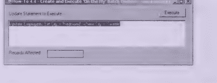

> **注意**
>
> 受影响的记录数在您的系统上可能会有所不同，具体取决于您对 Northwind 数据进行了哪些操作。

- 1. 创建一个新的 Windows 窗体。
- 2. 添加以下控件，并按照表 4.6 中列出的属性进行设置。

### 表 4.6 控件属性设置

| 对象 | 属性 | 设置 |
| :--- | :--- | :--- |
| Label | Name | Label1 |
| | Caption | Update Statement to Execute: |
| Button | Name | btnExecute |
| TextBox | Name | txtSQL |
| | Text | Update Employees Set City = 'Redmond' Where City = 'Seattle' |
| | MultiLine | True |
| Label | Name | Label2 |
| | Caption | Records Affected: |
| TextBox | Name | txtRecsAffected |

- 3. 在 `btnExecute` 的 `Click` 事件中输入以下代码。在这种情况下，当命令被实例化时，`txtSQL` 文本框中的字符串被传递为 `CommandText`。`CommandType` 被设置为 `CommandType.Text`。随后打开连接。最后，使用 `ExecuteNonQuery` 方法执行命令，并通过 `ToString` 将受影响的记录数传递回 `txtRecsAffected` 文本框的 `Text` 属性。

```vbnet
Private Sub btnExecute_Click(ByVal sender As System.Object, _
                            ByVal e As System.EventArgs) Handles btnExecute.Click

    Dim ocnn As New OleDb.OleDbConnection(BuildCnnStr("(local)", "Northwind"))
    Dim ocmdPhoneUp As New OleDb.OleDbCommand(Me.txtSQL.Text, ocnn)

    Try
        '-- Specify the name of the stored procedure
        ocmdPhoneUp.CommandType = CommandType.Text

        '-- Open the connection object.
        ocnn.Open()

        Me.txtRecsAffected.Text = ocmdPhoneUp.ExecuteNonQuery.ToString

    Catch excpData As Exception
        MessageBox.Show("Error Occurred: " & excpData.Message)
    End Try
End Sub
```

> **提示**
>
> 使用 `Try...Catch...End Try` 块来捕获在操作 ADO.NET 时可能发生的任何异常。在这种情况下，错误被捕获并通过消息框显示。请记住，未被捕获的异常会导致应用程序崩溃。

## 工作原理

当在标签为 `Update Statement to Execute:` 的文本框中输入有效的 SQL 语句并点击 Execute 按钮时，所输入的命令将被执行，并返回受影响的记录数。

## 评论

在执行批量操作时，无论是在处理已创建的存储过程还是使用即时创建的语句，`Command` 对象都是一个真正的得力助手。


## 第5章
## 在 Web 表单中处理数据

**在本章中，您将：**
-   处理无状态编程
-   在 Web 表单中使用绑定控件
-   使用验证控件验证数据
-   填充下拉列表（DropDown）和列表框（ListBox）控件
-   使用表格（Table）控件显示数据
-   使用重复器（Repeater）控件显示数据
-   在数据网格（DataGrid）控件中显示、排序和分页数据
-   使用数据网格控件添加、编辑和删除数据
-   从数据网格中的行超链接到详细页面

使用 .NET 进行 Web 开发变得比以往更加容易。ASP.NET 实际上甚至令人愉快。过去，在 ASP 中开发应用程序相当费时费力。然而现在，您可以像开发 Windows 桌面应用程序一样开发 Web 应用程序，两者之间只有很少的重大差异。

### 处理无状态编程

其中一个重大差异在于 Web 页面本质上仍然是无状态的。这意味着当您在页面之间切换时，往往会丢失页面所使用的数据。虽然这在创建执行简单任务的简单 Web 页面时不是问题，但当您开始创建真正的应用程序，特别是涉及数据库或用户输入的数据时，这一因素可能会带来很大的麻烦。

### 客户端的状态管理

在过去，Web 页面的无状态性问题在客户端通过多种方式在一定程度上得到了解决：

-   **Cookie**。Web 应用程序创建的小文件。Cookie 将数据存储在访问 Web 应用程序的用户的本地机器上。仅使用 Cookie 存在几个问题。首先，Cookie 存储在本地机器上，因此该机器（或浏览器）必须允许使用 Cookie。其次，可以存储在 Cookie 中的数据类型有限。
-   **查询字符串（Query strings）**。附加到页面 URL 末尾的信息。您在创建超链接和调用新的 Web 页面时会看到相关示例。
-   **隐藏字段（Hidden fields）**。对用户隐藏的 HTML 字段。它们在类模块中也不可见。
-   **控件的 ViewState 属性**。提供一个字典对象，用于在针对同一页面的多次请求之间保留值。请注意，这是页面用来在往返过程中保留页面和控件属性值的方法。

虽然这些管理技术中的一些已在 ASP 中使用，但它们在 .NET 中仍然有效，并且在适当的情况下非常有用。在 ASP.NET 中开发时，还有一些额外的状态管理解决方案可用。这些解决方案在服务器端处理。

### 服务器端的状态管理解决方案

根据您要保留的信息，.NET 有多种处理状态管理的方式。虽然您可以使用刚才提到的方法，但还有一些其他选项可用：

-   **应用程序状态（Application state）**。您可以将值保存到此对象 `Application("ItemName") = value`，方法是使用 HttpApplicationState 类的实例，但当时处于应用程序中的所有人都能看到这些数据。
-   **会话状态（Session state）**。此选项允许您维护单个会话的状态。这将在下一节中进一步讨论。
-   **数据库支持**。SQL Server 通过帮助您将值添加到服务器上的 Temp 数据库来维护状态。

### 使用 Session 对象

`Session` 对象使用起来非常简单明了。当您为变量赋值时，将使用以下语法：

```
Session("SessionVariableName") =unsigned Value
```

`SessionVariableName` 实际上是用在引号内的。您可以随意命名。

`Value` 可以是任何类型的变量，包括 `DataTable` 对象，正如您将在后续步骤中看到的。

有时，您可以将数据表和布尔变量存入 `Session` 对象。以下是存储数据表的一行代码示例：

```
Session("MyLookupData") = mdtLookupData
```

MyLookupData 是在 Session 对象中创建的条目的名称。mdtLookupData 是 DataTable 对象的变量名，在模块级别声明。

当您读取变量时，需要将语句反过来，并添加 `CType()` 函数将值转换为所需的类型。

```
Variable = CType(Session("SessionVariableName"),unsigned Type)
```

在数据表的情况下，例如本操作指南中使用的数据表，您会看到类似这样的内容：

```
mdtLookupData = CType(Session("MyLookupData"),unsigned DataTable)
```

请注意，您可以使用除 `CType()` 之外的其他转换函数。如果您不转换值，则将返回 Object 类型。

另一项需要执行的任务是**测试 Session 对象中的条目是否已创建**。您可以通过将 Session 条目与 `Nothing` 关键字进行比较来实现，如下所示：

```vb
' 在此处放置用户代码以初始化页面
If Not (Session("MyLookupData") Is Nothing) Then

    mdtLookupData = CType(Session("MyLookupData"),unsigned DataTable)

End If
```

此代码用于页面的 Load 事件中。如果已在 Session 对象中创建了条目，则将数据加载到变量中。您也可以使用相反的方式。如果 Session 对象中的条目为 Nothing，则创建该条目。

这只是利用 Session 对象的一种快速简单的方法。可能还有数百种其他方式来利用 Session 对象。有关更多信息，请查看 .NET Framework 开发人员指南中的 Session State，这是 Visual Studio 提供的帮助的一部分。在索引中输入 "state management in ASPNET" 以找到 Session 对象主题。

您可以在网站上名为 Visual Basic .NET—Chapter 5 的解决方案中找到本章的所有示例。

### 5.1 在 Web 表单中使用绑定控件

我想要创建一个 Web 表单，让我的用户能够像查看 Windows 表单一样查看数据，并且能够在上面使用数据绑定控件。如何在 Web 表单上使用数据绑定控件？

#### 技术方法

您在第 1 章"使用绑定控件开发 Windows 表单"中使用的数据对象，包括 OleDbDataAdapter、数据集等，将用于 Web 表单，与用于 Windows 表单的方式相同。在这种情况下，Windows 表单和 Web 表单之间的主要区别是需要额外的步骤来处理从客户端到服务器的往返。有关 OleDbDataAdapter 和数据集的讨论，请参见第 1 章。

#### IsPostBack 属性

开发 Web 表单时您将使用的一个属性是 `IsPostBack` 属性，它用于 Web 表单的 Load 事件中。没错——Web 表单现在拥有类似于 Windows 表单的事件模型。您现在可以从 Web 页面的类模块中处理 Web 表单属性和 Web 服务器控件属性。

如果 Load 事件在从服务器往返期间触发，则 `IsPostBack` 属性设置为 `True`。因此，Web 表单首次加载时，`IsPostBack` 为 `False`。

#### Web 服务器控件与 HTML 控件

在 ASP.NET Web 表单中，您现在可以使用经典的 HTML 控件（为兼容目的而可用）或新的 Web 服务器控件。由于 Web 服务器控件在服务器上运行，它们具有以下优势：

-   您可以从 Web 表单的类模块访问 Web 服务器控件的属性和方法，但无法通过 HTML 控件实现。
-   由于 Web 服务器控件从服务器端呈现，在客户端它们以纯 HTML 形式呈现，因此与更多浏览器和早期版本兼容。
-   Web 服务器控件通常比其 HTML 对应控件具有更多功能，在某些情况下，它们可以绑定到数据。

> **注意**
> 您可以通过将控件放置在 Web 表单上，右键单击控件，然后从弹出菜单中选择"作为 Web 服务器控件运行"，将某些 HTML 控件更改为 Web 服务器控件。
> 选择此菜单选项后，您可以在页面背后的代码中看到该对象。

> **注意**
> 虽然您将处理的是 ListBox Web 服务器控件，但它的属性和方法与 Windows 表单 ListBox 控件不同。这些将在以下步骤中讨论。

#### AutoPostBack 属性

Web 服务器控件具有一个名为 `AutoPostBack` 的属性。此属性告诉 .NET 回发至服务器，如果您想触发事件（例如 lstCustomers 列表框的 `SelectedIndexChanged` 事件），就需要执行此操作。这对于使用的按钮控件也同样适用。


## DataBind 方法

当你将 Web 服务器控件——在本例中是一个 **ListBox** 控件——绑定到 **DataSet** 或 **DataTable** 等数据对象时，需要**调用被绑定控件的 DataBind 方法**。当数据发生变化时，你需要**执行此操作**，具体内容请参见下面的步骤。

## 步骤

打开并运行 Visual Basic .NET——第 5 章的解决方案。从主页上，点击标题为 How-To 5.1: Using Data Bound Controls with Web Forms 的超链接。当 Web 窗体加载时，你将看到一个填充了客户信息的列表框，并且第一个客户的详细信息将显示在列表中（见图 5.1）。

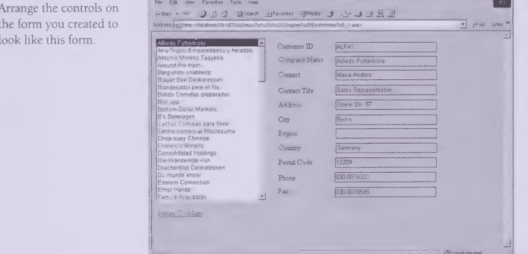

首先，你将创建一个与第 1 章中创建的 Windows 窗体类似的 Web 窗体。实际上，你将完全按照第 1 章创建 Windows 窗体的方式来创建该窗体，只是代码中有一些命令有所不同。

- 1. 创建一个 Web 窗体。然后放置表 5.1 中列出的控件，并设置以下属性。你将使用 Northwind 作为连接的数据库。

**表 5.1 Label、TextBox、ListBox 和 Command Button 控件的属性设置**

| 对象 | 属性 | 设置值 |
|---|---|---|
| OleDbDataAdapter | ID | odaCustomerList |
| | SelectCommand | Select CustomerID, CompanyName From Customers |
| DataSet | ID | dsCustomerList |
| OleDbDataAdapter | ID | odaCustomerIndividual |
| | SelectCommand | Select * From Customers Where CustomerID = ? |
| DataSet | ID | dsCustomerIndividual |
| ListBox | ID | lstCustomers |
| | DataSource | dsCustomerList |
| | DataTextField | CompanyName |
| | DataValueField | CustomerID |
| | AutoPostBack | True |
| Label | Caption | Customer ID |
| Label | Caption | Company Name |
| Label | Caption | Contact |
| Label | Caption | Contact Title |
| Label | Caption | Address |
| Label | Caption | City |
| Label | Caption | Region |
| Label | Caption | Country |
| Label | Caption | Phone |
| Label | Caption | Fax |
| TextBox | ID | txtCustomerID |
| | Text | dsCustomerIndividual.Customers.CustomerID |
| TextBox | ID | txtCompanyName |
| | Text | dsCustomerIndividual.Customers.CompanyName |
| TextBox | ID | txtContactName |
| | Text | dsCustomerIndividual.Customers.Contact |
| TextBox | ID | txtContactTitle |
| | Text | dsCustomerIndividual.Customers.ContactTitle |
| TextBox | ID | txtAddress |
| | Text | dsCustomerIndividual.Customers.Address |
| TextBox | ID | txtCity |
| | Text | dsCustomerIndividual.Customers.City |
| TextBox | ID | txtRegion |
| | Text | dsCustomerIndividual.Customers.Region |
| TextBox | ID | txtPostalCode |
| | Text | dsCustomerIndividual.Customers.PostalCode |
| TextBox | ID | txtCountry |
| | Text | dsCustomerIndividual.Customers.Country |
| TextBox | ID | txtPhone |
| | Text | dsCustomerIndividual.Customers.Phone |
| TextBox | ID | txtFax |
| | Text | dsCustomerIndividual.Customers.Fax |
| HyperLink | ID | hplReturnToMain |
| | NavigateURL | wfrmMain.aspx |

- 2. 将清单 5.1 中的代码添加到页面的 Load 事件中。（双击页面以显示代码。）你看到的第一个命令是 if 语句，它测试页面是否是第一次加载。如果是，则使用 odaCustomerList OLEDbDataAdapter 填充 dsCustomerList 数据集。接下来，调用 DataBind 方法。最后，选择 lstCustomers 中的第一项，并调用 RefreshIndividual 例程，下一步将对此进行说明。

**清单 5.1 wfrmHowTo5_1.aspx.vb：加载页面**

```vb
Private Sub Page_Load(ByVal sender As System.Object, _
    ByVal e As System.EventArgs) Handles MyBase.Load

    '-- Perform only the first time the page is loaded
    If Not Page.IsPostBack Then

        '-- Fill the customer list box dataset
        Me.odaCustomerList.Fill(Me.dsCustomerList)

        '-- Bind the list box to the dataset
        Me.lstCustomers.DataBind()

        '-- Pick the first customer in the list and
        '   display the individual's data
        Me.lstCustomers.SelectedIndex = 0
        RefreshIndividual()

    End If

End Sub
```

- 3. 将清单 5.2 中的代码添加到页面的类模块中，创建 **RefreshIndividual** 例程。该例程首先清除数据集，然后测试以确保已选择某个客户。接下来，为数据适配器参数提供 lstCustomers 中选择的项，即 CustomerID。填充 dsCustomerIndividual，然后调用每个文本框的 **DataBind** 方法。

**清单 5.2 wfrmHowTo5_1.aspx.vb：列出客户的详细信息**

```vb
Private Sub RefreshIndividual()

    '-- Clear individual customer dataset
    Me.dsCustomerIndividual.Clear()

    If lstCustomers.SelectedIndex <> -1 Then

        Me.odaCustomerIndividual.SelectCommand.Parameters(0).Value = _
            lstCustomers.SelectedItem.Value

        '-- Fill the dataset
        Me.odaCustomerIndividual.Fill(Me.dsCustomerIndividual, "Customers")

        '-- Call the DataBind method for each of the text boxes
        Me.txtCustomerID.DataBind()
        Me.txtCompanyName.DataBind()
        Me.txtContactName.DataBind()
        Me.txtContactTitle.DataBind()
        Me.txtAddress.DataBind()
        Me.txtCity.DataBind()
        Me.txtRegion.DataBind()
        Me.txtCountry.DataBind()
        Me.txtPostalCode.DataBind()
        Me.txtPhone.DataBind()
        Me.txtFax.DataBind()

    End If

End Sub
```

- 4. 将清单 5.3 中的代码添加到 lstCustomers 的 **SelectedIndexChanged** 事件中。

**清单 5.3 wfrmHowTo5_1.aspx.vb：为每个选中的新客户调用 RefreshIndividual 例程**

```vb
Private Sub lstCustomers_SelectedIndexChanged(ByVal sender As System.Object, _
    ByVal e As System.EventArgs) Handles lstCustomers.SelectedIndexChanged
    RefreshIndividual()
End Sub
```

## 注释

在 Web 窗体上使用绑定控件——或者未绑定控件，例如列表框——并不会比在 Windows 窗体中多费多少工夫。除了维护数据之外，绑定可能需要处理更多的往返服务器的工作，这一点你将在 How-To 5.7 中看到。

## 5.2 使用验证控件验证数据

我希望能够验证各种类型的数据输入，而不必等待服务器返回错误。我可以在 Web 窗体上验证数据吗？

> **注意**
> 谨慎提醒：在本章的撰写和技术编辑过程中，已经注意到一些验证控件的反应存在一些不一致之处。技术编辑和我都认为这个区域可能存在一些 .NET 错误。这也是 CustomValidator 缺乏 coverage 的原因。


### 技术

ASP.NET 中的一个新功能是包含验证 Web 服务器控件。这些验证控件允许你指定要验证的其他控件，这些控件基于在控件中输入的数据。然后你可以执行以下操作：

- 让验证控件显示错误消息
- 在页面级别测试所有正在验证的控件是否有效。
- 显示正在验证的所有控件的错误消息列表。

### 可用的验证 Web 服务器控件

你可以在工具箱中找到验证控件，并在表 5.2 中看到它们，其中列出了它们的验证说明。

**表 5.2 验证 Web 服务器控件**

| 控件 | 说明 |
| --- | --- |
| RequiredFieldValidator | 验证指定的控件是否留空。 |
| CompareValidator | 比较两个控件中的值，并验证它们是否相等。 |
| RangeValidator | 检查输入到控件中的值是否落在指定范围内。 |
| RegularExpressionValidator | 将输入到控件中的值与输入的掩码进行比较，例如 999-99-9999，即美国社会安全号码。 |
| CustomValidator | 允许你在客户端和服务器端创建自定义函数进行验证。 |
| ValidationSummary | 用于将页面上所有验证控件返回的消息整合为列表格式。 |

你在验证控件上设置的主要属性是 `FieldToValidate` 和 `ErrorMessage`。


> **注意**
> `CustomValidator` 控件的不同之处在于你需要创建函数来执行验证。除此之外，验证控件不需要编码，除非你希望验证整个页面。

### 在代码中测试页面验证

根据所需内容，你可以使用 `Page.Validate` 方法在页面级别测试验证。调用此方法时，所有验证控件都会重新测试，并设置 `Page.IsValid` 属性。你可以在条件语句中使用 `IsValid` 属性来基于 `IsValid` 属性的值执行任务，如本 How-To 的最后一步所示。

## 步骤

打开并运行 Visual Basic .NET——第 5 章的解决方案。从主页上，点击标题为 How-To 5.2: Validate Data Using Validation Controls 的超链接。当 Web 窗体加载时，你将看到多个文本框，其中包含有关如何查看各种验证检查的说明。以下是该 Web 窗体的设计视图（见图 5.2）。


## 5.2 验证控件

除非发生验证错误，否则这些控件不会在你的 Web 表单上显示。

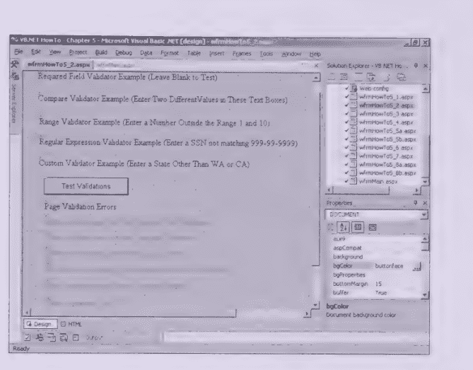

### 步骤

1.  创建一个 Web 表单。然后放置表 5.3 中列出并在图 5.2 中显示的控件，并设置以下属性。

**表 5.3** 验证控件 Web 表单的控件属性设置

| 对象 | 属性 | 设置 |
| :--- | :--- | :--- |
| Label | Text | Required Field Validator Example (Leave Blank to Test) |
| TextBox | ID | txtRequiredExample |
| Label | Text | Compare Validator Example (Enter Two Different Values in These Text Boxes) |
| TextBox | ID | txtCompareFirst |
| TextBox | ID | txtCompareSecond |
| Label | Text | Range Validator Example (Enter a Number Outside the Range 1 and 10) |
| TextBox | ID | txtRangeExample |
| Label | Text | Regular Expression Validator Example (Enter a SSN not matching 999-99-9999) |
| TextBox | ID | txtRegularExprExample |
| Label | Text | Custom Validator Example (Enter a State Other Than WA or CA) |
| TextBox | ID | txtCustomExample |
| Button | ID | btnTestValidators |
| | Text | Test Validators |
| Label | Text | Page Validation Errors |
| RequiredFieldValidator 控件 | ToValidate | txtRequiredExample |
| | ErrorMessage | Here is the message for the Required Field Validator |
| CompareValidator | ControlToCompare | txtCompareFirst |
| | ControlToValidate | txtCompareSecond |
| | ErrorMessage | Here is the message for the Compare Validator |
| RangeValidator | ControlToValidate | txtRangeExample |
| | MaximumValue | 10 |
| | MinimumValue | 1 |
| | ErrorMessage | Here is the message for the Range Validator |
| RegularExpressionValidator | ControlToValidate | txtRegularExprExample |
| | ValidationExpression | \d{3}-\d{2}-\d{4} |
| | ErrorMessage | Here is the message for the Regular Expression Validator |
| ValidationSummary | HeaderText | Error Summary List |
| HyperLink | ID | hp1ReturnToMain |
| | NavigateURL | wfrmMain.aspx |

> **注意**
>
> 对于 `RegularExpressionValidator` 的 `ValidationExpression` 属性，你需要点击属性旁边的构建器按钮，然后从表达式列表中选择 SSN。

2.  将清单 5.4 中的代码添加到 **btnTestValidator** 的 Click 事件中。你可以在这里看到一个示例，了解如何对页面使用 `Validate` 方法，以及如何根据 `IsValid` 属性的设置来执行操作。

**清单 5.4** wfrmHowTo5_2.aspx.vbs - 测试验证控件所处理的所有控件是否有效

```vb
Private Sub btnTestValidators_Click(ByVal sender As System.Object, _
        ByVal e As System.EventArgs) Handles btnTestValidators.Click

    '-- Forces the Validation controls to validate
    Page.Validate()

    If Page.IsValid Then

        '-- Code if all controls are valid

    Else

        '-- Code if even one of the controls isn't valid

    End If

End Sub
```

### 注释

如果你使用验证控件列出了各个错误消息，通常不会在同一页面上放置 `ValidationSummary` 控件。但有时能够将所有错误显示在一个列表中是很方便的。

> **提示**
>
> 你可以通过设置 `DisplayMode` 属性来影响 `ValidationSummary` 控件中列表的显示方式。你可以选择使用列表、项目符号列表或段落。
>
> 你还可以通过将 `ShowMessageBox` 属性设置为 `True` 并将 `ShowSummary` 属性设置为 `False`，来显示消息框而不是列表。

> **注意**
>
> 你可以在各个验证控件中显示一条消息，在 `ValidationSummary` 控件中显示另一条消息。`ErrorMessage` 属性会反映在 `ValidationSummary` 列表中，而各个验证控件的 `Text` 属性（如果已设置）会显示不同的内容。

## 5.3 填充 DropDown 和 ListBox 控件

我在本章的第一个操作指南中看到了如何将 `ListBox` 控件绑定到设计时创建的数据集。如何在运行时使用代码在 Web 表单上填充 DropDown 和 ListBox 控件？

### 技术

ListBox 和 DropDown（等同于 Windows 窗体上的 ComboBox）用于数据绑定的属性与 Windows 窗体中的对应控件不同。除了表 5.4 中列出的这些属性外，你还需要使用 `Databind` 方法和会话对象来跟踪为产品创建的数据表。

**表 5.4** 用于将列绑定到控件的属性

| 属性 | 描述 |
| :--- | :--- |
| DataTextField | 数据源中用于在 DropDown 或 ListBox 控件中显示的列。 |
| DataValueField | 数据源中作为查找值的列。 |

> **注意**
>
> 你可以使用名为 `DataFormatString` 的属性来格式化 `DataTextField` 数据，以便在 `ListBox` 或 `DropDown` 控件中显示。

### 步骤

打开并运行 Visual Basic .NET — 第 5 章解决方案。从主页面点击标题为 How-To 5.3: Populate DropDown and ListBox controls 的超链接。当 Web 表单加载时，你会看到一个 Categories 下拉框，其中 Beverages 类别被选中，并且该类别的产品显示在标签为 Products 的列表框中。如果你点击某个产品，页面右侧会加载三个文本框（见图 5.3）。

**图 5.3** 用于在此 Web 表单上显示数据的 DropDown 和 ListBox 控件。

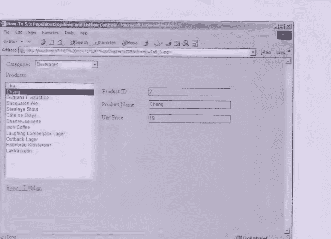

1.  创建一个 Web 表单。然后放置表 5.5 中列出并在图 5.3 中显示的控件，并设置以下属性。

**表 5.5** 验证控件 Web 表单的控件属性设置

| 对象 | 属性 | 设置 |
| :--- | :--- | :--- |
| Label | Text | Categories: |
| DropDown | ID | ddCategories |
| | AutoPostBack | True |
| Label | Text | Products: |
| ListBox | ID | lstProducts |
| | AutoPostBack | True |
| Label | Text | Product ID |
| Label | Text | Product Name |
| Label | Text | Unit Price |
| TextBox | ID | txtProductID |
| | BackColor | Transparent |
| TextBox | ID | txtProductName |
| | BackColor | Transparent |
| TextBox | ID | txtUnitPrice |
| | BackColor | Transparent |
| HyperLink | ID | hplReturnToMain |
| | NavigateURL | wfrmMain.aspx |

2.  与本书其他章节的项目一样，需要构建一个支持例程来创建连接字符串。该函数名为 `BuildCnnStr`，如清单 5.5 所示。此函数接受传入的服务器和数据库名称，并创建一个连接字符串。

**清单 5.5** modGeneralRoutines.vb - 创建连接字符串

```vb
Function BuildCnnStr(ByVal strServer As String, ByVal strDatabase As String) As String

    Dim strTemp As String
    strTemp = "Provider=SQLOleDB; Data Source=" & strServer & ";"
    strTemp &= "Initial Catalog=" & strDatabase & ";"
    strTemp &= "Integrated Security=SSPI"

    Return strTemp
End Function
```

虽然你可以创建一个返回 `Connection` 对象的例程，但更通用的方法是返回一个字符串。原因在于，对于某些对象你需要提供一个 `Connection` 对象，而对于其他对象你只需要提供一个字符串。

3.  在 Web 表单的类模块中，在代码行 `Web Form Designer Generated Code` 的下方添加以下 `Private` 声明。

    ```vb
    Private mdtProducts As New DataTable()
    ```

    这行代码声明了一个 `DataTable` 对象，你将在整个 Web 表单中使用它。然而，除了使用此变量外，你还需要使用 `Session` 对象来在往返服务器之间保留数据。

4.  将清单 5.6 中的代码添加到页面的 `Load` 事件中。此代码创建一个 `DataAdapter` 对象，然后填充 `dtCategories` `DataTable` 对象。`ddCategories` `Dropdown` 控件绑定到 `dtCategories`。`LoadProducts` 例程被调用以将产品加载到 `lstProducts` `ListBox` 控件中，其描述如下


在下一步中，最后检查Session对象，查看项目 `MyProductsTable` 是否已保存到其中，如果已保存，则将其加载回 `mdtProducts` 变量。

## **清单 5.6** `wfrmHowTo5_aspx.vb`：初始化页面

```
Private Sub Page_Load(ByVal sender As System.Object,
    ByVal e As System.EventArgs) Handles MyBase.Load

    '将用户代码放在此处以初始化页面
    If Not Me.IsPostBack Then

        Dim dtCategories As New DataTable()
        Dim odaCategories As _
            New OleDb.OleDbDataAdapter(_
                "Select CategoryID, CategoryName From Categories",
                BuildConnStr("(local)", "Northwind"))

        '.. 填充数据表
        odaCategories.Fill(dtCategories)

        '.. 分配属性并绑定下拉列表。
        ddCategories.DataValueField = "CategoryID"
        ddCategories.DataTextField = "CategoryName"
        ddCategories.DataSource = dtCategories
        ddCategories.DataBind()

        LoadProducts()

    End If

    '.. 从会话变量加载产品数据表
    If Not (Session("MyProductsTable") Is Nothing) Then
        mdtProducts = CType(Session("MyProductsTable"), DataTable)
    End If

End Sub
```

- 5. 在页面的类模块中，创建清单 5.7 中显示的 `LoadProducts` 例程。此代码与其他生成 `DataTable` 对象然后分配属性以将 `mdtProducts` 绑定到 `lstProducts` ListBox 控件的例程相似。然后，将 `mdtProducts` 添加到 Session 对象中，以便在往返服务器时使用。

## **清单 5.7** `wfrmHowTo5_aspx.vb`：创建 `LoadProducts` 例程

```
Private Sub LoadProducts()

    Dim odaProducts As New OleDb.OleDbDataAdapter(_
        "Select * From Products Where CategoryID = " &
        ddCategories.SelectedItem.Value,
        BuildConnStr("(local)", "Northwind"))

    mdtProducts.Clear()
    odaProducts.Fill(mdtProducts)

    '-- 分配属性并绑定列表框。
    lstProducts.DataValueField = "ProductID"
    lstProducts.DataTextField = "ProductName"
    lstProducts.DataSource = mdtProducts
    lstProducts.DataBind()

    '-- 将数据表保存到会话变量中以进行往返传输
    Session.Item("MyProductsTable") = mdtProducts

End Sub
```

- 6. 将清单 5.8 中的代码添加到 `ddCategories` DropDown 控件的 `SelectedIndexChanged` 事件中。

## **清单 5.8** `wfrmHowTo5_3.aspx.vb`：在选择新类别时调用 `LoadProducts` 例程

```
Private Sub ddCategories_SelectedIndexChanged(ByVal sender As Object, _
    ByVal e As System.EventArgs) _
    Handles ddCategories.SelectedIndexChanged

    LoadProducts()

```

- 7. 将清单 5.9 中的代码添加到 `lstProducts` 的 `SelectedIndexChanged` 事件中。此代码获取 `lstProducts` ListBox 控件的 `SelectedIndex` 属性，并帮助检索 `DataTable` 对象中的行。然后将各列加载到页面上相应的文本框中。

## **清单 5.9** `wfrmHowTo5_3.aspx.vb`：在 `mdtProducts` DataTable 对象中定位行

```
Private Sub lstProducts_SelectedIndexChanged(ByVal sender As Object,
    ByVal e As System.EventArgs)
    Handles lstProducts.SelectedIndexChanged

    With mdtProducts.Rows(lstProducts.SelectedIndex)
        txtProductID.Text = .Item("ProductID")
        txtProductName.Text = .Item("ProductName")
        txtUnitPrice.Text = .Item("UnitPrice")
    End With

End Sub
```

## 注释

除了使用 Session 变量之外，需要注意的主要事项之一是使用 `ddCategories.SelectedItem.Value` 和 `lstProducts.SelectedIndex`。这是两种分别使用 `DropDown` 和 `ListBox` 对象中选定项的方法。

在使用 Session 对象在往返服务器期间保持变量后，随着你的使用，它会变得更加直观。

## 5.4 使用 Table 控件显示数据

.NET 提供了许多可用于显示数据的控件。我如何知道该使用哪个控件来显示数据，以及如何使用 Table 控件来显示数据？

### 技术

当你首次决定在网页窗体上列出数据时，有几个 Web 服务器控件可供选择：

- **Table**。此 Web 服务器控件允许你创建只读的表格类型数据显示。此控件不是数据绑定的，它使用 `TableColumn` 和 `TableRow` 对象进行创建。
- **Repeater**。此控件用于显示只读列表。你可以使用超链接并对 `ItemCommand` 事件进行编程，以便在选择项时执行操作。你必须使用模板来格式化显示。模板将在“操作方法 5.5”中讨论，Repeater 控件也是如此。这是快速列表的一个很好的控件。
- **DataList**。使用此控件，你不仅可以使用模板来显示，还可以选择和编辑列表中的数据。
- **DataGrid**。到目前为止，这是功能最强大的控件。此外，它还为你提供了对操作数据的最大控制。你可以显示、排序、编辑，并在每列中使用各种类型的控件。本章的最后三个操作方法将全面介绍 DataGrid 控件。

### Table Web 服务器控件剖析

你可以在设计时创建 Table Web 服务器控件，或者如本操作方法所示在运行时创建。通过将 `TableRows` 和 `TableCells` 添加到 Table 控件来创建该控件。`TableRows` 和 `TableCells` 本身就是控件。你可以在表 5.6 中看到用于创建 Table Web 服务器控件的对象、属性和方法。

VISUAL BASIC .NET 和 ADO.NET 数据库编程：技巧、教程和代码

**表 5.6** 使用对象内创建对象的标准方法构造 Table Web 服务器控件

| 对象 | 属性 | 描述 |
|--------|----------|-------------|
| TableCell | Controls | 使用 Controls 集合的 Add 方法将控件添加到单个 TableCell 对象中。在此示例中，使用 LiteralControl 对象来显示信息。 |
| TableRow | Cells | TableRow.Cells 集合的 Add 方法将一个新单元格添加到 TableRow。 |
| Table | Rows | Table.Rows 的 Add 方法将 TableRow 对象添加到 Table 控件的行集合中。 |

你将在步骤 4 中看到这些对象和方法的使用。

> **注意**
> 使用 **Table** 控件的问题之一是它**在往返服务器时不保持状态**。因此，你需要**在页面 Load 事件中重新构建该控件**，并检查 **IsPostBack** 属性。如果你正在跟踪大量 **Table** 控件的更改，那么这是使用本技术开头列出的其他控件的另一个好理由。

### 步骤

打开并运行 Visual Basic .NET — 第 5 章解决方案。从主页上，单击标题为“操作方法 5.4：使用 Table 控件显示数据”的超链接。当网页窗体加载时，你将看到一个 DropDown 控件显示类别列表。在 DropDown 控件下方，你将看到一个 Table 控件，其中包含所选类别的产品（见图 5.4）。

- 1. 创建一个 Web 窗体。然后放置表 5.7 中列出并如图 5.4 所示的控件，并设置以下属性。

**表 5.7** Label、DropDown 和 Table 控件的属性设置

| 对象 | 属性 | 设置 |
|--------|----------|---------|
| Label | Text | Categories: |
| DropDown | ID | ddCategories |
| | AutoPostBack | True |
| Table | ID | tblProducts |
| | GridLines | Both |

**表 5.7** 续表

| 对象 | 属性 | 设置 |
|--------|----------|---------|
| HyperLink | ID | hplReturnToMain |
| | NavigateURL | wfrmMain.aspx |

### 图 5.4

使用 Table 控件来显示表格需要大量的工作。

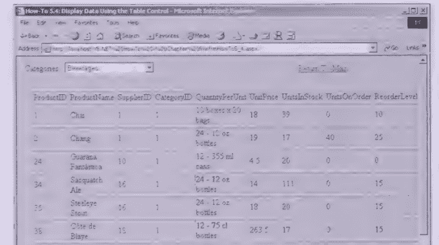

- 2. 将清单 5.10 中的代码添加到页面的 Load 事件中。如果页面是首次加载，则填充 dtCategories 并将其绑定到 ddCategories 下拉列表。最后，调用 LoadProducts 例程，该例程将在下一步中描述。

## **清单 5.10** `wfrmHowTo5_4.aspx.vb` 加载类别 DropDown 和产品表控件

```
Private Sub Page_Load(ByVal sender As System.Object,
    ByVal e As System.EventArgs) Handles MyBase.Load

    '将用户代码放在此处以初始化页面
    If Not Me.IsPostBack Then

        Dim dtCategories As New DataTable()
        Dim odaCategories As New OleDbDataAdapter(
            "Select CategoryID, CategoryName From Categories",
            BuildConnStr("(local)", "Northwind"))

        ' 填充数据表，并将其绑定到下拉列表。
        odaCategories.Fill(dtCategories)
    End If
End Sub
```


 ## 清单 5.10 续

```
ddCategories.DataValueField = "CategoryID"
ddCategories.DataTextField = "CategoryName"
ddCategories.DataSource = dtCategories
ddCategories.DataBind()

LoadProducts()

End If

End Sub
```

3. 在页面的类模块中，创建如清单 5.11 所示的 LoadProducts 例程。在创建名为 dtProducts 的 DataTable 对象并用 DataAdapter 对象填充它之后，dtProducts 中的列数被存储在 intNumCols 中。

随后创建一个 TableRow 对象，它将用于表格的标题行。它显示列标题。然后，对于每一列，创建一个名为 tcHead 的 TableCell 对象。向其中添加一个 LiteralControl，它派生自数据表中每一列的 ColumnName 属性。随后将每个 TableCell 对象添加到 TableRow 对象中。在所有列都添加完成后，名为 trHead 的 TableRow 对象被添加到 tblProducts 表格控件中。

标题行创建完成后，对 DataTable 对象中的每一行执行相同的操作。

## LISTING 5.11 wfrmHowTo5_4.aspx.vb: Loading the Categories DropDown and Product Table Controls

```
Private Sub LoadProducts()

Dim dtProducts As New DataTable()
Dim drCurr As DataRow
Dim intCurrRow As Integer
Dim intCurrCell As Integer
Dim intNumCols As Integer

Dim odaProducts As New OleDb.OleDbDataAdapter( _
    "Select * From Products Where CategoryID = "
    & ddCategories.SelectedItem.Value, _
    BuildCnnStr("(local)", "Northwind"))

odaProducts.Fill(dtProducts)

intNumCols = dtProducts.Columns.Count

'-- Create the headings for the displayed table
Dim trHead As New TableRow()

For intCurrCell = 0 To intNumCols - 1
```

## 清单 5.11 续

```
Dim tcHead As New TableCell()
tcHead.Controls.Add(New LiteralControl(dtProducts.Columns(intCurrCell).ColumnName))
trHead.Cells.Add(tcHead)

Next

tblProducts.Rows.Add(trHead)

'-- Add the rows and cells
For intCurrRow = 0 To dtProducts.Rows.Count - 1

    drCurr = dtProducts.Rows(intCurrRow)

    Dim trNew As New TableRow()

    For intCurrCell = 0 To intNumCols - 1

        Dim tcNew As New TableCell()
        tcNew.Controls.Add(New LiteralControl(drCurr.Item(intCurrCell)))
        trNew.Cells.Add(tcNew)

   amos researchers intCurrCell

    tblProducts.Rows.Add(trNew)

Next intCurrRow

End Sub
```

4. 将清单 5.12 中的代码添加到 ddCategories 的 SelectedIndexChanged 事件中。

## LISTING 5.12 wfrmHowTo5_4.aspx.vb: Loading the Categories DropDown and Product Table Control

```
Private Sub ddCategories_SelectedIndexChanged(ByVal sender As Object,
                                                 ByVal e As System.EventArgs) _
                                                 Handles ddCategories.SelectedIndexChanged

    LoadProducts()

End Sub
```

## 注释

从这个例子可以看出，使用 Table Web 服务器控件需要做一些工作，而且如果要显示大量数据，构建可能需要相当长的时间。另外，请记住，无法编辑内置到控件中的数据。

如果只有少量数据要显示，Table Web 服务器控件可能会很好地工作。

## 5.5 使用 Repeater 控件显示数据

我听说 Repeater 控件是显示只读值列表（包括超链接）的一个很棒的控件。如何填充 Repeater 控件并利用模板来按照我想要的外观显示数据呢？

### 技术

Repeater 控件允许以各种格式列出数据，例如项目符号或编号列表。它依靠使用模板以列表格式显示信息。

本操作指南不仅向你展示如何使用 Repeater 控件显示列表，还展示如何使用几个不同的控件——Button 和 HyperLink——来使用 Repeater 控件显示另一个列表。第二个列表将使用与第一个列表相同页面上的按钮来显示。超链接将带你到另一个页面来显示第二个列表。

创建 Repeater 控件的一个主要工具是模板的使用。

### 模板的使用

模板在 HTML 中使用，允许你在 ASP.NET Web 服务器控件中包含控件。在模板中，你可以指定要创建模板的区域的各种详细信息。以下是模板的列表：

- HeaderTemplate
- ItemTemplate
- FooterTemplate
- AlternatingItemTemplate
- SeparatorTemplate

你可以通过名称了解每个模板的用途。以下是 HeaderTemplate 的示例，在本操作指南中使用：

```
<HeaderTemplate>
    <font face="Arial Black" size="2">List of Regions </font>
    <br>
</HeaderTemplate>
```

这些行字面意义上用作模板，用于指定你希望如何布局该部分以及要显示什么数据。对于本操作指南中的 ItemTemplate，显示了两个控件：一个按钮和一个超链接，如下面的 HTML 片段所示：

```
<asp:Button runat="server"
    Text= '<%# DataBinder.Eval(Container.DataItem, "RegionID") %> ' />
<asp:HyperLink Runat="server"
    Text='<%# DataBinder.Eval(Container, "DataItem.RegionDescription") %>'
```

```
NavigateURL='<%# DataBinder.Eval(Container, "DataItem.RegionURL") %>'
ID="HyperLink1"/>
```

顾名思义，DataBinder 为 Repeater 对象指定的数据源提供数据。你将在步骤 3 中看到如何绑定 Repeater 对象。

### 动态创建 URL

在创建的超链接的 NavigateURL 中，你可以看到

DataItem.RegionURL 列正在被使用。这不是 Northwind 的 Regions 表中找到的列。此列是在提供给数据适配器的 SQL 语句中创建的，由以下代码行实现：

```
odaRegions = New OleDb.OleDbDataAdapter("Select RegionID,
'wfrmHowto5_5b.aspx?RegID=' +
Cast(RegionID as Char(2)) As RegionURL, RegionDescription From Region",
BuildCnnStr("(local)", "Northwind"))
```

RegionURL 包含一个 Web 表单名称和语句

?RegID=Cast(RegionID as Char(2))，ASP.NET 将其加载到新页面并传递给页面的 RegionID，让页面内的代码使用 Request 对象读取 RegionID，如下所示：

```
odaTer = New
OleDb.OleDbDataAdapter(_
"Select TerritoryDescription From Territories Where RegionID = " &
Request.Item("RegID"),
BuildCnnStr("(local)", "Northwind"))
```

你将在以下步骤中看到这些 URL 的创建和使用。

### 使用 ItemCommand 编程 Repeater 事件

使用按钮时，你可以通过使用 ItemCommand 事件来编程按钮按下时的响应。此事件为 Repeater 中使用的所有控件引发。你将在步骤 5 中看到一个示例。

### 步骤

打开并运行 Visual Basic .NET—第 5 章解决方案。从主页上，点击标题为"如何操作 5.4：使用 Repeater 控件显示数据"的超链接。随后将打开一个页面，显示区域列表（见图 5.5）。

如果点击显示区域 ID 的按钮之一，则使用 Repeater 控件显示另一个列表。此列表显示在区域下方，包含所点击区域的领土（见图 5.6）。

当你点击列表中的超链接时，将显示另一个页面，其中使用另一个 Repeater 控件来显示所选区域的领土（见图 5.7）。

## 图 5.5

此列表包含一个按钮（显示 RegionID）和一个超链接（显示区域描述）。

## 图 5.6

另一个 Repeater 控件用于此领土列表。

- 1. 创建一个 Web 表单。然后放置表 5.8 中列出的控件，并设置以下属性。

**图 5.7** 第三个 Repeater 控件用于新页面上的此领土列表。

## 表 5.8 Repeater 和 HyperLink 控件的属性设置

| 对象 | 属性 | 设置 |
|---|---|---|
| Repeater | ID | repRegions |
| Repeater | ID | repTeritories |
| HyperLink | ID | hplReturnToMain |
| | NavigateURL | wfrmMain.aspx |

- 2. 在设计器中切换到 HTML 选项卡。通过在第 1 步中添加并命名 repeater，你将看到如下所示的一行代码：

`<asp:Repeater id="repRegions" runat="server"></asp:Repeater>`

用清单 5.13 中显示的代码替换这一行。此代码布局了在"技术"部分中描述的模板，以及描述的按钮和超链接。请注意，此处列出的 `FooterTemplate` 实际上并没有用于任何事情。包含它是为了让你了解如何使用它。它可以被排除。

## LISTING 5.13 wfrmHowTo5_5a.aspx: HTML for the repRegions Repeater

```
<asp:Repeater id="repRegions" runat="server">
<HeaderTemplate>
<font face="Arial Black" size="2">List of Regions </font>
```

## 示例 5.13 继续

```xml
<HeaderTemplate>
</HeaderTemplate>
<ItemTemplate>
    <asp:Button runat="server"
        Text='<%# DataBinder.Eval(Container.DataItem, "RegionID") %>' />
    <asp:HyperLink Runat="server"
        Text='<%# DataBinder.Eval(Container, "DataItem.RegionDescription") %>'
        NavigateURL='<%# DataBinder.Eval(Container, "DataItem.RegionURL") %>'
        ID="HyperLink1" />
    <br>
</ItemTemplate>
<FooterTemplate>
</FooterTemplate>
</asp:Repeater>
```

3. 接下来，将为 repTerritories repeater 插入的 HTML 代码替换为示例 5.14 中的代码。在指定 **HeaderTemplate** 后，Label 控件将显示 TerritoryDescription 列。

## 示例 5.14 wfrmHowTo5_5a.aspx：repTerritories Repeater 的 HTML

```xml
<asp:Repeater id="repTerritories" runat="server">
    <HeaderTemplate>
        <br>
        <font face="Arial Black" size="2">List of Territories </font>
        <br>
    </HeaderTemplate>
    <ItemTemplate>
        <asp:Label runat="server"
            Text='<%# DataBinder.Eval(Container.DataItem, _
                        "TerritoryDescription") %>' />
        <br>
    </ItemTemplate>
</asp:Repeater>
```

4. 将示例 5.15 中的代码添加到页面的 Load 事件中。如果页面是首次加载，则 odaRegions **DataAdapter** 将填充名为 dtRegions 的数据表。dtRegions 被设置为 **repRegions** 的数据源，并调用 **DataBind** 方法，将 Repeater 绑定到该数据表。

## 示例 5.15 wfrmHowTo5_5a.aspx.vb：加载 repRegions Repeater 控件

```vb
Private Sub Page_Load(ByVal sender As System.Object,
                      ByVal e As System.EventArgs) Handles MyBase.Load
    'Put user code to initialize the page here
    If Not Me.IsPostBack Then
        Dim odaRegions As OleDb.OleDbDataAdapter
        Dim dtRegions As DataTable

        odaRegions = New OleDb.OleDbDataAdapter("Select RegionID, _
        'wfrmHowto5_5b.aspx?RegID=' + _
        Cast(RegionID as Char(2)) As RegionURL, _
        RegionDescription From Region", _
        BuildCnnStr("(local)", "Northwind"))

        dtRegions = New DataTable()
        odaRegions.Fill(dtRegions)
        repRegions.DataSource = dtRegions
        repRegions.DataBind()

    End If
End Sub
```

5. 将示例 5.16 中的代码添加到 `repRegions` 的 `ItemCommand` 事件中。这段代码获取按钮的 Text 属性（即 `RegionID`），并将其用于 SQL 字符串中，以提供给 `odaTer` 数据适配器。接着，`odaTer` 填充 `dtTer`，随后 `dtTer` 被用作 `repTerritories` 的数据源。

## 示例 5.16 wfrmHowTo5_5a.aspx.vb：加载 Categories 下拉列表和 Product 表控件

```vb
Private Sub repRegions_ItemCommand(ByVal source As Object, _
    ByVal e As System.Web.UI.WebControls.RepeaterCommandEventArgs)
    Handles repRegions.ItemCommand

    Dim odaTer As OleDb.OleDbDataAdapter
    Dim dtTer As DataTable

    odaTer = New _
        OleDb.OleDbDataAdapter(_
        "Select TerritoryDescription From Territories Where RegionID = " &
        CType(e.CommandSource, Button).Text(), _
        BuildCnnStr("(local)", "Northwind"))

    dtTer = New DataTable()
    odaTer.Fill(dtTer)
    repTerritories.DataSource = dtTer
    repTerritories.DataBind()

End Sub
```

6. 创建另一个 Web 窗体。然后在其中放置一个 Repeater 控件，并将该 Repeater 的 ID 设置为 `repTerritories`。

在保存并为本步骤创建的 Web 窗体命名时，请确保其名称与步骤 4 中代码所使用的名称一致。请记住，该 Web 窗体被用于 RegionURL 中。

7. 在设计器中切换到 HTML 选项卡。将为 repTerritories Repeater 控件创建的那行代码替换为示例 5.17 所示的代码。

## 示例 5.17 wtfrmHowTo5_5b.aspx：第二个 Web 窗体上 repTerritories Repeater 的 HTML

```xml
<asp:Repeater id="repTerritories" runat="server">
    <HeaderTemplate>
        <br>
        <font face="Arial Black" size="2">List of Territories </font>
        <br>
    </HeaderTemplate>
    <ItemTemplate>
        <asp:Label runat="server"
            Text='<%# DataBinder.Eval(Container.DataItem, _
                "TerritoryDescription") %>'
            ID="Label1" NAME="Label1"/>
        <br>
    </ItemTemplate>
</asp:Repeater>
```

8. 将示例 5.18 中的代码添加到页面的 Load 事件中。这段代码首先使用 Request 对象从第一个 Web 窗体读取 RegionID。接着，该 ID 被用于填充 dtTer 数据表，然后 dtTer 被分配为 repTerritories 的数据源。

## 示例 5.18 wfrmHowTo5_5b.aspx.vb：在第二个 Web 窗体上加载 repTerritories Repeater 控件

```vb
Private Sub Page_Load(ByVal sender As System.Object,
                ByVal e As System.EventArgs) Handles MyBase.Load

    Dim odaTer As OleDb.OleDbDataAdapter
    Dim dtTer As DataTable

    odaTer = New
        OleDb.OleDbDataAdapter(_
        "Select TerritoryDescription From Territories Where RegionID = " &
        Request.Item("RegID"), _
        BuildCnnStr("(local)", "Northwind"))

    dtTer = New DataTable()
    odaTer.Fill(dtTer)
    repTerritories.DataSource = dtTer
    repTerritories.DataBind()

End Sub
```

### 注释

在使用了几次 DataRepeater 之后，你会发现它其实非常简单。通过调整模板，你可以显示相当美观且动态的列表。

## 5.6 在 DataGrid 控件中显示、排序和分页数据

当数据集较小时，Table 控件和 DataRepeater 表现良好，但当数据增多时，显示内容会不断重复，而且我必须编写大量代码才能更改数据的排序顺序。我该如何创建一个类似表格的显示界面，使其一次显示固定数量的行，并允许我对数据进行排序？

### 技术方案

DataGrid 控件是目前 ASP.NET 中用于在 Web 页面上显示数据最灵活且最强大的控件。它不仅能让你列出数据，还能让你通过页码进行翻页，通过页眉进行便捷排序，甚至可以编辑数据。最后一个特性将留在下一个“如何操作（How-To）”中讲解。

为了完成其他任务，你将结合使用设计时属性设置和对某些事件进行编程。特别是对于 DataGrid 控件，你将为排序和分页触发的事件添加代码。

本节将使用在设计时绑定的 DataGrid。你还将看到一个使用 DataView 对象对数据进行排序的简单示例。

### 步骤

打开并运行 Visual Basic .NET —— 第 5 章解决方案。从主页点击标题为“How-To 5.6: Display, Sort, and Page Data in the DataGrid Control”的超链接。随后你将看到所有区域都被加载到一个数据网格中。你可以点击蓝色显示的列标题来对列进行排序，点击底部的箭头来翻页。在图 5.8 中可以看到 Web 窗体的设计模式。

### 图 5.8

DataGrid 控件是操作数据的绝佳方式。

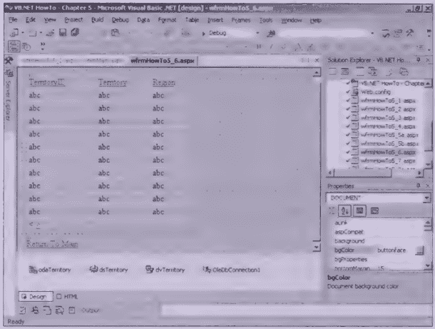

1. 创建一个 Web 窗体。然后放置表 5.9 和图 5.8 中的控件，并设置以下属性。

## 表 5.9 本节所用控件的属性设置

| 对象 | 属性 | 设置 |
|--------|----------|---------|
| OleDbDataAdapter | ID | odaTerritory |
| OleDbDataAdapter | SelectCommand | SELECT Territories.TerritoryID, Territories.TerritoryDescription, Region.RegionDescription, Region.RegionID FROM Territories INNER JOIN Region ON Territories.RegionID = Region.RegionID |
| DataSet | ID | dsTerritory |
| DataView | ID | dvTerritory |
| DataView | Table | dsTerritory.Territories |
| DataGrid | ID | dgTerritory |
| HyperLink | ID | hplReturnToMain |
| HyperLink | NavigateURL | wfrmMain.aspx |

2. 右键单击 DataGrid 控件并选择“属性生成器（Property Builder）”。随后你会看到 DataGrid 属性生成器的“常规（General）”选项卡。按照图 5.9 所示设置属性。

### 图 5.9

设置 DataGrid 控件的常规属性。

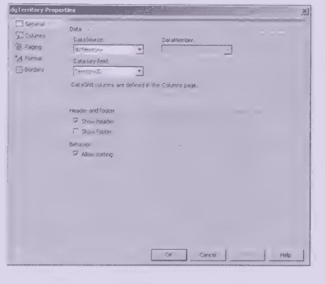

3. 点击“列（Columns）”选项卡。你现在可以通过点击可用列中的字段，然后为每个字段点击“添加（Add）”按钮来添加 TerritoryID、TerritoryDescription 和 RegionDescription 列。然后，可以通过在“已选列”列表中点击该列并更改“页眉文本（Header text）”属性，将其页眉文本分别设置为 TerritoryID、Territory 和 Region。完成后，当 Region 被高亮显示时，其外观应如图 5.10 所示。

### 图 5.10

在设计时为 DataGrid 控件设置列非常简单。

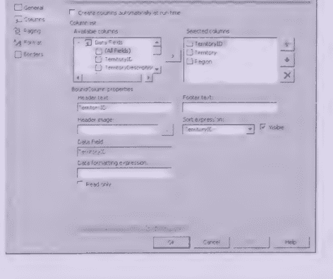


4. 点击 Paging 选项卡。勾选 Allow Paging 复选框，并在 Page Size 中输入 10（见图 5.11）。然后可以通过点击 OK 关闭 Property Builder 对话框。

**图 5.11**
在设计时为 DataGrid 控件设置 Paging 属性。

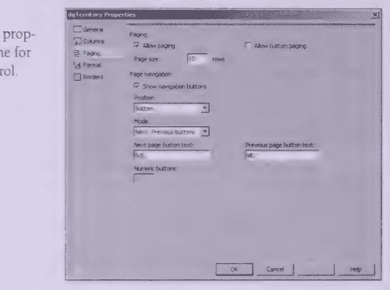

5. 按照代码清单 5.19 创建 BindTheGrid 过程。请注意，你现在是绑定到 DataView，而不是数据集。

**代码清单 5.19 wfrmHowTo5_6.aspx.vb：将数据网格绑定到 DataView 控件**

```vb
Sub BindTheGrid()

    odaTerritory.Fill(dsTerritory)
    dgTerritory.DataSource = dvTerritory
    dgTerritory.DataBind()

End Sub
```

6. 将代码清单 5.20 中的代码添加到页面的 Load 事件中。

**代码清单 5.20 wfrmHowTo5_6.aspx.vb：加载页面**

```vb
Private Sub Page_Load(ByVal sender As System.Object,
                      ByVal e As System.EventArgs) Handles MyBase.Load

    '在此处放置用于初始化页面的用户代码
```

**代码清单 5.20（接上页）**

```vb
If Not Me.IsPostBack Then

    BindTheGrid()

End If

End Sub
```

- 7. 将代码清单 5.21 中的代码添加到 dgTerritory 的 `PageIndexChanged` 事件中。该过程接收 `NewPageIndex` 并将其分配给数据网格的 `CurrentPageIndex`。接下来，如果 `ViewState` 对象中存在 MySort，则将其分配给 `DataView` 控件。MySort 将在下一步中存储。

**代码清单 5.21 wfrmHowTo5_6.aspx.vb：数据网格的分页**

```vb
Private Sub dgTerritory_PageIndexChanged(ByVal source As Object,
    ByVal e As System.Web.UI.WebControls.DataGridPageChangedEventArgs)
    Handles dgTerritory.PageIndexChanged

    '-- 设置数据网格中的当前页
    Me.dgTerritory.CurrentPageIndex = e.NewPageIndex

    If Not (ViewState("MySort") = Nothing) Then
        dvTerritory.Sort = ViewState("MySort")
    End If

    BindTheGrid()

End Sub
```

- 8. 将代码清单 5.22 中的代码添加到 dgTerritory 的 `SortCommand` 事件中。当点击列标题且排序功能开启时，会触发此事件。该过程将 `SortExpression` 分配给 dgTerritory 的 Sort 属性。然后，`SortExpression` 属性被存储在 ViewState 对象中以便在往返服务器时使用，随后在步骤 6 列出的代码中使用。

**代码清单 5.22 wfrmHowTo5_6.aspx.vb：数据网格的排序**

```vb
Private Sub dgTerritory_SortCommand(ByVal source As Object,
    ByVal e As System.Web.UI.WebControls.DataGridSortCommandEventArgs)
    Handles dgTerritory.SortCommand

    dvTerritory.Sort = e.SortExpression.ToString

    ViewState("MySort") = e.SortExpression.ToString

    BindTheGrid()

End Sub
```

## 注释

DataView 是一个非常出色的控件，可以通过使用单个数据集来查看数据的不同视图。

与 DataRepeater 一样，操作数据网格的一些基本功能相当简单。当你必须真正开始操作数据时，情况会变得更加复杂，你将在接下来的 How-To 中看到这一点。

## 5.7 使用 DataGrid 控件添加、编辑和删除数据

当我有少量的数据集时，Table 控件和 DataRepeater 运行良好，但显示内容会一直延伸下去，而且我必须编写大量代码来更改数据的排序顺序。我该如何创建一个类似表格的显示界面，使其一次显示固定数量的行并允许我对数据进行排序？

## 技术方案

DataGrid 控件之所以比其他列表控件更强大，其优点之一的优点是它能够在控件内部直接进行添加、编辑和删除。本 How-To 将向你展示如何创建列，以便使用 DataGrid 控件管理数据。

## 向 DataGrid 控件添加按钮

这一次你将使用更多的代码来操作 DataGrid 控件，以便能够更多地处理数据。你还将在 DataGrid 显示中添加几个按钮，以便能够编辑、删除和更新数据。

你可以通过右键点击控件，选择 Property Builder，然后选择 Columns 选项卡来向数据网格添加按钮。然后，你可以从按钮类型列表中进行选择（见图 5.12）。


### 注意

请务必保持 Create Columns Automatically at Run Time 复选框处于选中状态。除非你指定了其他列或在运行时加载了数据，否则你最终只会看到按钮，这会非常枯燥。

## 在数据网格的按钮上使用事件

在选择将按钮包含在数据网格中之后，你不仅需要为特定按钮的事件添加代码，还必须确保 ASP.NET 知道要使用哪些事件。你可以通过几种方式来实现这一点。

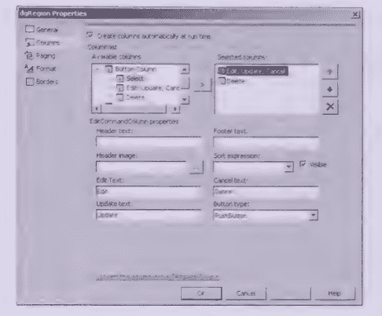

**图 5.12**
Selected Columns 中列出的按钮正被用于本示例。

一种方法是将页面的 AutoEventWireUp 属性设置为 `True`。你可以在 Web 页面的第一行看到此属性。默认情况下，该属性被设置为 `False`。

在向数据网格添加按钮后，你将在 DataGrid 控件中看到这些按钮。

```aspx
<%@ Page Language="vb" AutoEventWireup="false" Codebehind="wfrmHowToS05_7.aspx.vb" Inherits="VB_NET_Chapter5_wfrmHowToS0_7" %>
```

然而，将 AutoEventWireUp 设置为 `True` 会带来几个缺点：

- 你必须为事件使用要求的名称。
- 事件有时会在表单上被调用两次。

微软建议不要将 AutoEventWireUp 设置为 `True`。

另一种替代方案是自行添加事件和 HTML 标签。你将在步骤 3 中看到添加的 HTML 代码。

## 将架构加载到数据表中

本 How-To 中引入的另一个选项是使用数据适配器的 `FillSchema` 方法来填充数据表。这意味着在尝试将数据保存回服务器之前，数据表将具备“智能”，能够了解列的约束和属性。在 DataGrid 控件中使用 `FillSchema` 方法的最大好处是它将变得智能化，不会允许用户尝试编辑自增列（例如标识列）。它会将此类列设为禁用状态。

当你将数据网格中的列更新回数据表时，还可以检查列的 `AutoIncrement` 属性是否为 `True`。除非使用 `FillSchema` 方法，否则即使服务器上表中的实际列将其设置为 `True`，`AutoIncrement` 属性返回的也将是 `False`。

## 用于处理数据的其他对象、属性和方法

除了数据适配器的 `FillSchema` 方法，你还将使用 `Update` 方法，该方法将根据正在执行的任务调用 `Update`、`Delete` 或 `Append` 语句。

`CommandBuilder` 对象将生成用于将修改发送回服务器的 SQL 语句。

除了上述数据适配器的方法外，你还将使用数据表的一些属性和方法来添加、编辑和删除数据。你可以在表 5.10 中看到这些对象、属性和方法的列表。

**表 5.10 DataTable 对象的对象、属性和方法**

| 对象 | 属性/方法 | 描述 |
| :--- | :--- | :--- |
| `DataTable.Rows` | `Delete` | 从 `DataTable` 对象中删除一行（此时数据尚未从服务器中删除）。 |
| `DataTable.Rows` | `Count` | 返回当前 `DataTable` 对象中的行数。 |
| `DataTable` | `NewRow` | 创建一个新的 `DataRow` 对象。 |
| `DataTable.Rows` | `Add` | 将 `DataRow` 对象添加到 `DataTable` 对象中。 |
| `DataTable` | `BeginLoadData` | 关闭在向 `DataTable` 对象添加新行时进行的架构检查。 |
| `DataTable` | `AcceptChanges` | 重置 `DataTable` 状态，包括结束对 `DataRow` 对象的编辑。`DataRowState` 也会随之改变。所有添加和修改的行变为未更改状态，删除的行被移除。 |
| `DataTable` | `RejectChanges` | 拒绝自上次调用 `AcceptChanges` 以来所做的更改。可在发生错误时让你回滚更改。 |

## 步骤

打开并运行 Visual Basic .NET—Chapter 5 解决方案。在主页面上，点击标题为“How-To 5.7: Add, Edit, and Delete Data Using the DataGrid Control”的超链接。然后你将看到所有区域都被加载到数据网格中。你可以点击 Edit 按钮来编辑数据，依此类推。你可以在图 5.13 的设计视图中看到创建的表单。

- 1. 创建一个 Web 窗体。然后放置表 5.11 和图 5.13 中的控件，并设置相应的属性。在下一步之前，无需担心显示的 Edit 和 Delete 按钮。


## 图 5.13

DataGrid 控件是一种非常便捷的数据操作方式。

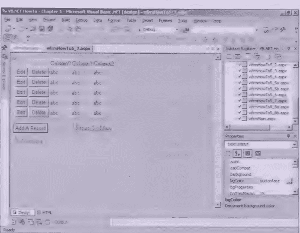

### 表 5.11 本操作指南中使用的控件属性设置

| 对象 | 属性 | 设置 |
|--------|----------|---------|
| DataGrid | ID | dgRegion |
| Button | ID | btnAdd |
| Label | ID | lblDispExcp |
| Label | ForeColor | #C00000 |
| HyperLink | ID | hplReturnToMain |
| HyperLink | NavigateURL | wfrmMain.aspx |

- 2. 右键单击 dgRegion，从弹出菜单中选择"属性生成器"。点击"列"选项卡。按照图 5.12 所示，添加"编辑"、"更新"、"取消"（一个按钮选项）和"删除"按钮。将每个按钮的 ButtonType 更改为 PushButton。选择完按钮后，点击"确定"。

- 3. 现在需要添加 HTML 代码，将这些按钮连接到后续步骤中要添加的代码。在清单 5.23 中，可以看到 DataGrid 控件的最终 HTML。需要添加的代码行是 OnUpdateCommand、OnCancelCommand、OnEditCommand 和 OnDeleteCommand。按照所列内容输入这些行，并按名称创建事件，代码就能适用于 DataGrid 控件中的按钮。接下来将在后续步骤中添加与这些命令匹配的后台代码。

### 清单 5.23 wfrmHowTo5_7.aspx：为 DataGrid 控件连接事件

```
<asp:datagrid id="dgRegion" runat="server" Width="254px" Height="111px"
    OnUpdateCommand="dgRegion_UpdateCommand"
    OnCancelCommand="dgRegion_CancelCommand"
    OnEditCommand="dgRegion_EditCommand"
    OnDeleteCommand="dgRegion_DeleteCommand"
>
    <Columns>
        <asp:EditCommandColumn ButtonType="PushButton"
            UpdateText="Update" CancelText="Cancel" EditText="Edit">
        </asp:EditCommandColumn>
        <asp:ButtonColumn Text="Delete" ButtonType="PushButton"
            CommandName="Delete">
        </asp:ButtonColumn>
    </Columns>
</asp:datagrid>
```

4. 现在来添加一些 Visual Basic 代码。在 Web 窗体后台的类模块中，在标有"Web Form Designer Generated Code"的区域之后添加以下代码行。`mdtRegion` 将在整个窗体中用于管理数据并与数据网格同步。`mdtRegion` 还将保存到 `Session` 对象中（名为 `RegionDT`），以便在往返服务器时使用。这将在下一步中看到。

`Dim mdtRegion As New DataTable学部()`

5. 将清单 5.24 中的代码添加到 Page 的 Load 事件中。要执行的任务是检查 `Session` 对象中是否存在 `RegionDT`。如果存在，则说明这是一次往返，不需要从服务器重新加载数据。如果不存在，则使用 `FillSchema` 方法提供 `Region` 表的架构，然后填充 `DataTable` 对象。接下来，保存 `RegionDT` 和 `IsAdding` `Session` 变量。`IsAdding` 会话变量用于跟踪是否正在添加记录。最后，使用 `BindTheGrid` 例程将数据绑定到 `DataGrid` 对象，该例程在此清单中紧跟 `Page_Load` 事件之后。

### 清单 5.24 wfrmHowTo5_7.aspx.vb：初始加载 DataGrid 对象并跟踪会话变量

```
Private Sub Page_Load(ByVal sender As System.Object,
                      ByVal e As System.EventArgs) Handles MyBase.Load

    '在这里添加用户代码以初始化页面
    If (Session("RegionDT") Is Nothing) Then

        Dim odaRegion As OleDb.OleDbDataAdapter
        odaRegion = New _
            OleDb.OleDbDataAdapter("Select RegionID as [Region ID], " &
            "RegionDescription as Region From Region", _
            BuildCnnStr("(local)", "Northwind"))
            
        odaRegion.FillSchema(mdtRegion, SchemaType.Source)
        odaRegion.Fill(mdtRegion)

        Session("RegionDT") = mdtRegion
        Session("IsAdding") = False

        BindTheGrid()
    Else

        mdtRegion = CType(Session("RegionDT"), DataTable)

    End If

End Sub

Sub BindTheGrid()

    dgRegion.DataSource = mdtRegion
    dgRegion.DataBind()

End Sub
```


> **提示**
> 要确定页面何时返回服务器，请在 `Page_Load` 事件代码中设置一个断点。这样，每当返回服务器时，你就可以看到代码中断。如果你注意到返回服务器之前所在的例程，就可以在其中放置代码来保存所需的任何数据。

- 6. 按照清单 5.25 创建 `dgRegion_EditCommand` 例程。这是在步骤 3 中指定的事件之一。此代码将 `DataGrid` 对象的 `EditItemIndex` 设置为选定项，然后绑定数据。

### 清单 5.25 wfrmHowTo5_aspx.vb：将数据网格设置为编辑模式

```
Sub dgRegion_EditCommand(ByVal sender As Object, _
    ByVal e As DataGridCommandEventArgs)

    '-- 清除错误显示
    lblDispExcp.Text = ""

    '-- 通过将 EditItemIndex 指向 ItemIndex 来启用编辑

    dgRegion.EditItemIndex = e.Item.ItemIndex
    BindTheGrid()

End Sub
```

7. 将清单 5.26 中的代码添加到 btnAdd 的 Click 事件中。第一个任务是为 `mdtLookupData` 调用 `BeginLoadData` 方法。这会在加载数据时关闭约束检查。你应该关闭此功能，以便在你实际编辑记录之前不检查必填字段，这是由设置 `DataGrid` 对象的 `EditItemIndex` 属性的代码行引起的。然后更新会话变量，将 `IsAdding` 项设置为 `True`。最后，设置 `dgLookupData` 的 `EditItemIndex`，并使用 `BindTheGrid` 例程将 `DataGrid` 绑定到数据表。

### 清单 5.26 wfrmHowTo5_7.aspx.vb：向数据表添加新记录

```
Private Sub btnAdd_Click(ByVal sender As System.Object,
		ByVal e As System.EventArgs) Handles btnAdd.Click

	Dim colCnt As Integer
	Dim dCurr As DataRow

	lblDispExcp.Text = ""

	mdtRegion.BeginLoadData()

	'.. 通过数据行将行添加到数据表
	dCurr = mdtRegion.NewRow
	mdtRegion.Rows.Add(dCurr)

	'.. 设置 Adding 标志。
	Session("MyLookupData") = mdtRegion
	Session("IsAdding") = True

	'.. 仅基于此页面上的行设置项索引。
	dgRegion.EditItemIndex = mdtRegion.Rows.Count - 1

	BindTheGrid()

End Sub
```

8. 按照清单 5.27 创建 `dgRegion_DeleteCommand` 例程。这是在步骤 3 中指定的事件之一。此代码与上一步中添加记录时的代码非常相似。此步骤代码清单中的主要区别是，删除操作会回发到服务器，而在步骤 7 中则没有。该步骤中没有回发删除操作，因为服务器对该记录一无所知；它只是被添加到了数据表中，尚未发送回服务器。你可以在下一步中看到添加和编辑的数据如何更新回服务器。

另一个需要注意的项目是在异常处理代码的 `Catch` 中调用的 `RejectChanges` 方法。这样，如果发生错误，更改将被撤销，消息被记录，然后继续执行。此代码的其余部分与上一步中的操作非常接近。

### 清单 5.27 wfrmHowTo5_7.aspx.vb：在数据网格中删除行

```
Sub dgRegion_DeleteCommand(ByVal sender As Object, _
    ByVal e As DataGridCommandEventArgs)

    Dim intColCnt As Integer
    Dim cnn As New OleDb.OleDbConnection(BuildCnnStr("(local)",
        "Northwind"))

    '-- 创建命令生成器以将数据网格中的数据更新（回发）到服务器

    Dim odaRegion As OleDb.OleDbDataAdapter

    Try

        '-- 获取 txtSQLString 文本并创建数据表，
        '   然后设置数据网格的数据源。

        odaRegion = New _
            OleDb.OleDbDataAdapter("Select RegionID as [Region ID], " &
            "RegionDescription as Region From Region", cnn)

        Dim ocbRegion As OleDb.OleDbCommandBuilder = _
            New OleDb.OleDbCommandBuilder(odaRegion)

        '-- 从数据表中删除行
        mdtRegion.Rows(e.Item.ItemIndex).Delete()

        '-- 实际回发到服务器所需的命令。
        cnn.Open()

        odaRegion.Update(mdtRegion)
        mdtRegion.AcceptChanges()

        cnn.Close()

        Session("MyLookupData") = mdtRegion
        Session("IsAdding") = False

        '-- 如果他们正在编辑时按了删除按钮，请清除。
        dgRegion.EditItemIndex = -1

    Catch excp As Exception
        lblDispExcp.Text = excp.Message
        mdtRegion.RejectChanges()

    End Try

    BindTheGrid()

End Sub
```


9. 按照代码清单 5.28 所示创建 **dgRegion_UpdateCommand** 过程。这是步骤 3 中指定的事件之一。该过程首先声明 **DataAdapter** 和 **CommandBuilder** 对象，用于将数据更新回服务器。但在实际更新之前，数据网格中当前正在编辑的行会被赋值给一个 **DataRow** 对象。然后，将行中的每个项目从数据网格单元格保存到数据行的列中。

由于在填充数据表时使用了 **FillSchema** 方法，**AutoIncrement** 属性将反映该列是否为标识列（Identity column）。如果没有使用 **FillSchema** 方法，你必须处理尝试将值写入该列时发生的异常。

在将单元格写入数据行各列时，使用了 **Trim** 函数。由于使用了 **FillSchema** 方法，数值会被填充，就像 SQL Server 列通常那样。

其余代码的运行方式与步骤 8 类似，即接受更改、将其写回服务器等等。

## 代码清单 5.28 wfrmHowTo5_7.aspx.vb：将更改更新回服务器

```
Sub dgRegion_UpdateCommand(ByVal sender As Object, _
                           ByVal e As DataGridCommandEventArgs)

    Dim intColCnt As Integer
    Dim intColCurr As Integer
    Dim drCurr As DataRow
    Dim cnn As New OleDb.OleDbConnection(BuildCnnStr("(local)", "Northwind"))
    Dim blnAdding As Boolean
    Dim strCurrValue As String

    '-- Create the command builder to update (post)
    '   the data in the data grid back to the server.
    lblDispExcp.Text = ""

    Dim odaTableData As OleDb.OleDbDataAdapter

    Try
        '-- Take the txtSQLString text and create data table; then set the
        '   data source of the data grid.

        Dim odaRegion As New _
            OleDb.OleDbDataAdapter("Select RegionID as [Region ID], " & _
            "RegionDescription as Region From Region", cnn)

        Dim ocbTableData As OleDb.OleDbCommandBuilder = _
            New OleDb.OleDbCommandBuilder(odaRegion)

        drCurr = mdtRegion.Rows(dgRegion.EditItemIndex)

        '-- Update the fields in the rows
        intColCnt = e.Item.Cells.Count

        For intColCurr = 2 To intColCnt - 1

            If mdtRegion.Columns(intColCurr - 2).AutoIncrement = False Then

                drCurr.Item(intColCurr - 2) = _
                    Trim(CType(e.Item.Cells(intColCurr).Controls(0), _
                    TextBox).Text)

            End If

        Next

        '-- Commands necessary to actually post back to server.
        cnn.Open()

        odaRegion.Update(mdtRegion)
        mdtRegion.AcceptChanges()

        cnn.Close()

        Session("RegionDT") = mdtRegion
        Session("IsAdding") = False

        dgRegion.EditItemIndex = -1
        BindTheGrid()

    Catch excp As Exception

        lblDispExcp.Text = excp.Message

    End Try

End Sub
```

10. 按照代码清单 5.29 所示创建 **dgRegion_CancelCommand** 过程。这是步骤 3 中指定的事件之一。如果你正处于添加条目的过程中，此代码将使用 DataGrid 对象的 EditItemIndex 来定位选定项目。

EditItemIndex 返回的值用于在 mdtLookupData 中定位指针，以便可以调用 Delete 方法。

在代码接受更改后，它会重新保存会话变量，并通过将当前页码相对于 DataTable 位置的指针与 CurrentPageIndex 属性进行比较，来清理 DataGrid 对象的页面索引。无论项目是在被添加还是被编辑，代码都会通过将 EditItemIndex 设置为 -1 来清除它，并通过调用 BindTheData() 重新绑定数据网格。

## 代码清单 5.29 wfrmHowTo5_7.aspx.vb：取消对数据网格的编辑

```
Sub dgRegion_CancelCommand(ByVal sender As Object, _
        ByVal e As DataGridCommandEventArgs)

    Dim blnAdding As Boolean

    ' . If you cancel while you're adding a record, you need to back the
    ' row out of the data table and data grid. You don't have to send it
    ' to the server because it really was never added to it.
    lblDispExcp.Text = ""

    If CType(Session("IsAdding"), Boolean) Then

        mdtRegion.Rows(dgRegion.EditItemIndex).Delete()
        mdtRegion.AcceptChanges()

        Session("IsAdding") = False
        Session("RegionDT") = mdtRegion

    End If

    dgRegion.EditItemIndex = -1

    BindTheGrid()

End Sub
```

## 评论

呼！这看起来工作量很大！好消息是，一旦你创建了这段代码，在创建使用相同技术的新页面时，就可以直接复制粘贴。

请记住，本“操作指南”（How-To）只是一个入门部分，绝非万无一失。将这段代码提升到更高水平取决于你。

## 5.8 从数据网格行创建指向详情页的超链接

通常，我需要根据 DataGrid 控件中的一条记录来精准定位并显示数据。我该如何在一个独立的页面中显示来自 DataGrid 控件的详细信息？

### 技术

你在数据网格中可以使用的一种列类型是 HyperLink（超链接）列。这种列使得基于数据链接页面变得非常简单。要查看本指南中如何使用 HyperLink 类型列，请参阅图 5.14。

## 图 5.14

基于数据的链接页面不需要编写代码。

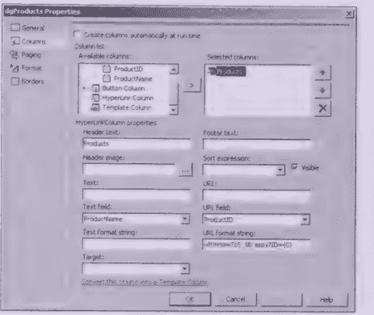

通过将 URL 字段指定为 `ProductID`，并将 URL 格式字符串指定为 `wfrHowToS5_8b.aspx?ID={0}`，当你点击某个产品时，数据网格会自动调用 `wfrHowToS5_8b.aspx` 并在点击时将 ProductID 传递给该窗体。

### 步骤

打开并运行 Visual Basic .NET—第 5 章解决方案。在主页中，点击标题为“How-To 5.8: Hyperlink From a Row in the Data Grid to a Detail Page”的超链接。随后你将看到所有产品被加载到数据网格中。注意这些产品实际上是超链接（见图 5.15）。

当你点击一个产品时，会显示另一个页面，并提供详细信息（见图 5.16）。

1.  创建一个 Web 窗体。然后放置表 5.12 和图 5.15 中的控件，并设置以下属性。

### 表 5.12 本指南第一页所用控件的属性设置

| 对象 | 属性 | 设置 |
| :--- | :--- | :--- |
| OleDbDataAdapter | ID | odaProducts |
| | SelectCommand | SELECT ProductID, ProductName FROM Products |
| DataSet | ID | dsProducts |
| DataGrid | ID | dgProducts |
| | DataSource | dsProducts |
| | DataKeyField | ProductID |
| | DataMember | Products |
| HyperLink | ID | hplReturnToMain |
| | NavigateURL | wfrmMain.aspx |

## 图 5.15

这些超链接不需要代码即可调用详情页。

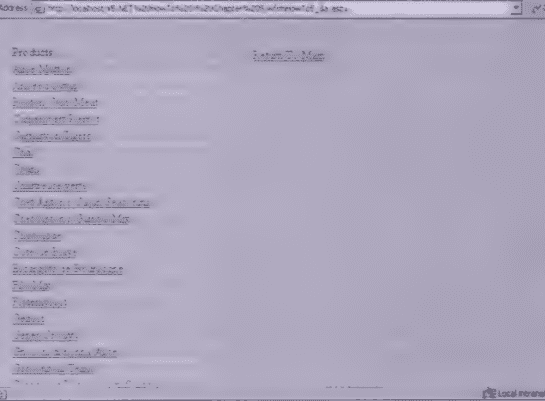

2.  右键点击 **DataGrid** 控件并选择“属性生成器”（Property Builder）。点击“列”（Columns）选项卡，并按照图 5.14 所示设置属性。请务必记录你在 URL 格式字符串中调用的窗体名称，以便在步骤 4 中使用相同的名称。

3.  将代码清单 5.30 中的代码添加到页面的 Load 事件中。

### 代码清单 5.30 wfrmHowTo5_8a.aspx.vb：将产品填充并绑定到 DataGrid 对象

```
Private Sub Page_Load(ByVal sender As System.Object, _
    ByVal e As System.EventArgs) Handles MyBase.Load

    'Put user code to initialize the page here
    odaProducts.Fill(DsProducts)
    dgProducts.DataBind()

End Sub
```

## 图 5.16

你将在该页面的代码中使用 request 对象来检索详细数据。

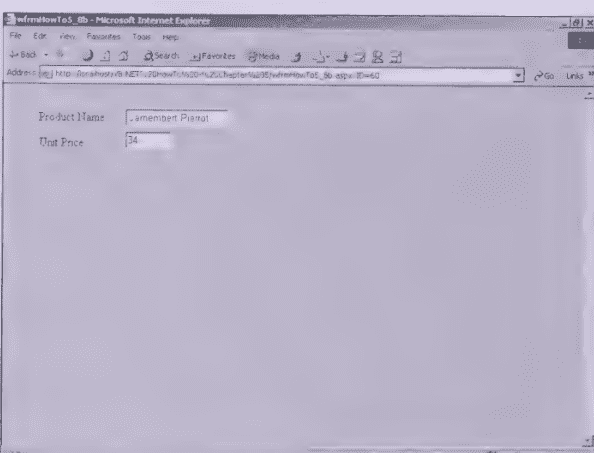

4.  创建另一个 Web 窗体。然后放置表 5.13 和图 5.16 中的控件，并设置以下属性。

### 表 5.13 本指南第二页所用控件的属性设置

| 对象 | 属性 | 设置 |
| :--- | :--- | :--- |
| Label | Text | Product Name |
| Label | Text | Unit Price |
| TextBox | ID | txtProductName |
| TextBox | ID | txtUnitPrice |

5.  将代码清单 5.31 中的代码添加到页面的 Load 事件中。在此清单创建的 SQL select 语句中，使用了 `Request.Item` 来获取从第一个窗体传递过来的 productID。填充 dtProdIndiv 数据表，并将单个列信息加载到文本框中。


## 清单 5.29 wfrnHowTo5_8b.aspx.vb：基于 ProductID 加载详细信息

```vb
Private Sub Page_Load(ByVal sender As System.Object,
    ByVal e As System.EventArgs) Handles MyBase.Load

    'Put user code to initialize the page here

    Dim odaProdIndiv As New OleDb.OleDbDataAdapter
    odaProdIndiv = New
        OleDb.OleDbDataAdapter(_
        "Select * From Products Where ProductID = " &
        Request.Item("ID"), BuildCnnStr("local", "Northwind"))

    Dim dtProdIndiv As New DataTable()
    odaProdIndiv.Fill(dtProdIndiv)

    With dtProdIndiv.Rows(0)
        Me.txtProductName.Text = .Item("ProductName")
        Me.txtUnitPrice.Text = .Item("UnitPrice")
    End With

End Sub
```

## 评论

就是这样！扩展此示例的一个好方法是添加在前面的 How-To 中学到的用于编辑数据的编码技术。

在你的 Web 窗体中使用数据并不比在 Windows 窗体中使用数据难多少。只需记住为往返服务器存储一些变量，并绑定你的数据。

# 第 6 章

## 创建 Transact-SQL 命令

- **在本章中，你将**
- 仅使用 select 查询检索唯一记录
- 在 T-SQL 中使用变量和函数
- 在 SQL 查询中使用通配符和值范围
- 在相关表中没有对应条目的情况下在表中查找记录
- 利用子查询的优势
- 创建、修改和删除表
- 使用现有表中的数据创建新表
- 创建和调用 SQL Server 2000 用户定义函数

许多数据库使用 SQL 数据库语言作为应用程序与数据库通信和处理数据的主要方式。Transact-SQL (T-SQL) 是为与 Microsoft SQL Server 配合使用而开发的增强版本。除了能够处理标准 SQL 命令外，T-SQL 还提供了额外的语句和命令，允许你创建数据库对象、维护数据，以及从存储过程和用户定义函数内部使用程序控制。

使用 T-SQL，你可以执行日常所需的几乎所有必要任务。当你将 T-SQL 与下一章讨论的 SQL-DMO 结合使用时，你可以创建相当高级的应用程序来满足所有用户的需求。

> **注意**
> 本章将引导你通过设置命令对象的命令文本来创建 SQL 语句和更广泛的例程。通常，你会创建存储过程来执行这些任务。本章使用此技术，这样你就不需要将存储过程添加到你的 SQL Server Northwind 数据库副本中。

你可以在网站上名为 *Visual Basic .NET — Chapter 6* 的解决方案中找到本章的所有示例。

## 6.1 仅使用 Select 查询检索唯一记录

我需要找出哪些客户有发票。问题在于，当我将 Customers 表与 Orders 表连接时，我为每个订单列出了客户。我只想每个客户列出一次。如何仅返回那些有订单的客户，但只返回一次？

### 技术

对于这个 How-To，你将在 SQL SELECT 语句上使用 DISTINCT 子句来将数据限制为唯一值。当你包含 DISTINCT 子句时，SQL Server 使用返回的列来确定如何限制数据。

为了实现相反的效果，你可以包含 ALL 子句，尽管这不是必需的，因为这是默认设置。你将为此任务创建两个 SELECT 语句。第一个用于所有记录：

```sql
SELECT Customers.CompanyName FROM Customers INNER JOIN Orders ON Customers
CustomerID = Orders.CustomerID
```

要限制记录，请使用 DISTINCT 子句：

```sql
SELECT DISTINCT Customers.CompanyName
FROM Customers
INNER JOIN Orders ON Customers.CustomerID = Orders.CustomerID
```

### 步骤

打开并运行 Visual Basic .NET — Chapter 6 解决方案。从主窗体，单击标题为 How-To 6.1 的按钮。当窗体加载时，你将看到两个选项按钮：Show All 和 Distinct，其中 Show All 被选中。显示客户和订单之间内部连接的 SELECT 语句显示在 Label 控件中。你还将看到一个 DataGrid 控件填充了多个客户条目（参见图 6.1）。

**图 6.1**
内部连接的一个常见问题是，当你只想查看每个事件的单个记录时，却检索到多条记录。

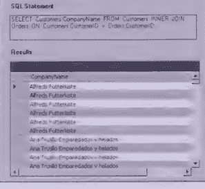

如果你单击标记为 Use Distinct 的选项按钮，那么 DataGrid 控件将刷新，但只会显示每组订单对应的一个客户。

**图 6.2**
使用 DISTINCT 子句可以让你控制显示唯一记录。

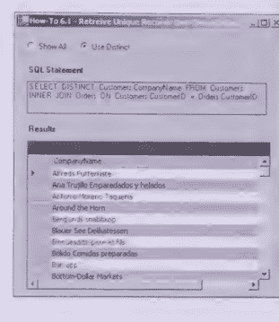

1. 创建一个 Windows 窗体。然后按照表 6.1 中列出的控件放置，并设置以下属性，如图 6.1 和 6.2 所示。

### 表 6.1 How-To 6.1 的控件属性设置

| 对象 | 属性 | 设置 |
|---|---|---|
| RadioButton | Name | rbShowAll |
| | Checked | True |
| RadioButton | Name | rbDistinct |
| Label | Text | SQL Statement |
| Label | Name | lblSQLString |
| Label | Text | Results |
| DataGrid | Name | dgResults |

2. 与本章其他一些项目一样，你需要构建一个支持例程来创建连接字符串。该函数名为 BuildCnnStr，可以在清单 6.1 中看到。此函数接受传递给它的服务器和数据库名称，并创建一个连接字符串。

## 清单 6.1 modGeneralRoutines.vb：创建连接字符串

```vb
Function BuildCnnStr(ByVal strServer As String, _
    ByVal strDatabase As String) As String

    Dim strTemp As String
    strTemp = "Provider=SQLOLEDB; Data Source=" & strServer & ";"
    strTemp &= "Initial Catalog=" & strDatabase & ";"
    strTemp &= "Integrated Security=SSPI"

    Return strTemp
End Function
```

尽管你可以创建一个返回 Connection 对象的例程，但更通用的方法是返回一个字符串。原因在于，对于某些对象，你只需要提供一个 Connection 对象，但其他对象只需要一个字符串。

3. 将清单 6.2 中的代码添加到窗体的 Load 事件中。（双击窗体以打开代码。）

## 清单 6.2 frmHowTo6_1.vb：加载窗体

```vb
Private Sub frmHowTo6_1_Load(ByVal sender As System.Object,
    ByVal e As System.EventArgs) Handles MyBase.Load

    GenerateData(Me.rbDistinct.Checked)

End Sub
```

4. 将清单 6.3 中的代码添加到页面的类模块中，创建 GenerateData 例程。此例程根据 blnUseDistinct 为真还是假创建必要的 SQL SELECT 语句。如果你回顾清单 6.2，你会看到这是选项按钮 rbDistinct 的值。创建 SQL 字符串后，将其分配给 lblSQLString 以显示字符串，然后将其用于数据适配器以填充数据集。最后，将 SQL 字符串分配为数据网格 dgResults 的数据源。

## 清单 6.3 frmHowTo6_1.vb：构建用于检索数据的 SQL 字符串

```vb
Sub GenerateData(ByVal blnUseDistinct As Boolean)

    '-- Build the SQL String
    Dim strSQL As String

    strSQL = "SELECT "

    If blnUseDistinct Then
        strSQL += "DISTINCT "
    End If

    strSQL += "Customers.CompanyName FROM Customers "
    strSQL += "INNER JOIN Orders ON Customers.CustomerID = Orders.CustomerID"

    '-- Store the SQL String
    Me.lblSQLString.Text = strSQL

    '-- Use the SQL String to build the data adapter and fill the data table.
    Dim odaResults As New OleDb.OleDbDataAdapter(Me.lblSQLString.Text, _
        BuildCnnStr("(local)", "Northwind"))
    Dim dtResults As New DataTable()

    odaResults.Fill(dtResults)

    '-- Assign the data table to the data grid's DataSource property
    Me.dgResults.DataSource = dtResults

End Sub
```

5. 将清单 6.4 中的代码添加到 **rbDistinct** 单选按钮控件的 **CheckChanged** 事件中。

## 清单 6.4 frmHowTo6_1.vb：根据选中的单选按钮重新生成数据

```vb
Private Sub rbDistinct_CheckedChanged(ByVal sender As System.Object, _
    ByVal e As System.EventArgs) Handles rbDistinct.CheckedChanged

    GenerateData(Me.rbDistinct.Checked)

End Sub
```

**提示**

你可能已经注意到，除了窗体的加载外，我只在 rbDistinct 选项按钮更改时调用 **GenerateData** 例程，而不是在 rbShowAll 选项按钮更改时调用。因为只有两个按钮可用，你只需要为一个控件的事件编程。如果你将其放在两个按钮上，那么在本例中调用两次例程并不是一件好事。

### 评论

很难相信仅仅一个词就能影响 SQL 语句返回的数据。在大多数情况下，你会希望看到 **SELECT** 语句返回的所有记录，但当你需要限制数据时，拥有 **DISTINCT** 子句是很好的。

## 6.2 在 T-SQL 中使用变量和函数

我知道我可以在存储过程中使用参数，但我如何在 T-SQL 中使用变量和函数？


 ## 技术详解

现在是时候扩展你使用 T-SQL 进行编码的范围了。在本书目前为止的内容中，你基本上被限制在单行 SELECT 语句中。现在你将学习如何使用变量和内置函数。为了实现这一点，请查看这里将要创建的例程：

```
DECLARE @Cust_Id nchar(5), @Order_Date datetime

SET @Cust_Id = 'ANTON'
SET @Order_Date = '11/27/1996'

SELECT OrderID, OrderDate, ShippedDate,
DateDiff(day, @Order_Date, ShippedDate) as Days_To_Ship
FROM Orders
WHERE CustomerID = @Cust_Id and OrderDate = @Order_Date
```

## 在 T-SQL 中声明局部变量

你可以在 T-SQL 中像在其他编程语言中一样使用变量。首先，你必须声明它们。在 T-SQL 中声明变量，需要使用 DECLARE 语句、变量名前的 @ 符号以及数据类型。你可以在这里的变量声明示例中看到，其中声明了带有长度的 nchar 变量和 datetime 变量。

```
DECLARE @Cust_Id nchar(5), @Order_Date datetime
```

> 注意
> 除了 SQL Server 的标准数据类型（如 nchar, int 和 datetime）之外，你还可以声明并创建 Table（表）数据类型。在本章后面的 How-To 6.8 中，你会看到相关示例。

声明变量后，在将其投入使用之前，你需要对其进行初始化。

## 在 T-SQL 中初始化局部变量

要初始化变量，可以使用 SET 命令，如下两行代码所示：

```
SET @Cust_Id = 'ANTON'
SET @Order_Date = '11/27/1996'
```

通过设置初始值，你就可以在后续的存储过程中根据需要随时使用这些变量，同样地，使用 `@varname` 语法即可。

## 利用内置函数

在 T-SQL 中，你也可以像在 Visual Basic 中一样，使用函数来执行某些必要的任务。并非所有函数都完全相同，数量也不一定一样。例如，在 Visual Basic 中使用的是 `Date()` 函数，而在 T-SQL 中，你则使用 `GetDate()` 函数。函数的返回值或接受的参数也不一定相同。

本 How-To 调用了 `DateDiff()` 函数。与 Visual Basic 的 `DateDiff()` 函数一样，该函数接收两个日期，并根据请求的时间间隔返回两者之间的差值。要查看其他可用函数，你可以查阅 SQL-SQL Server 的联机帮助文档（Books On-Line）中的 function 关键字。

## 操作步骤

打开并运行 Visual Basic .NET—第 6 章的解决方案。在主页面中，点击标题为 How-To 6.2 的按钮。当窗体加载时，你会看到一个标签中显示了 SQL 语句，下方显示一个 DataGrid（见图 6.3）。

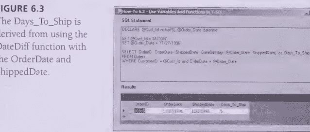

- 1. 创建一个 Windows 窗体。然后放置表 6.2 中列出且在图 6.3 中可见的控件，并设置如下属性。

## 表 6.2 本 How-To 的控件属性设置

| 对象 | 属性 | 设置 |
|---|---|---|
| Label | Text | SQL Statement |
| Label | Name | lblSQLString |
| Label | Text | Results |
| DataGrid | Name | dgResults |

- 2. 将代码清单 6.2 中的代码添加到窗体的 Load 事件中。（双击窗体即可调出代码）。该代码创建了“技术详解”部分所述的 T-SQL 例程，然后将该例程分配给名为 `lblSQLString` 的 Label 的 Text 属性。接着，它使用该字符串创建数据适配器并填充 `dtResults DataTable`。最后，代码将数据适配器指定为 dgResults 数据网格的数据源。

## 代码清单 6.5 `frmHowTo6_2.vb: 存储 SQL 语句并执行`

```
Private Sub frmHowTo6_2_Load(ByVal sender As System.Object,
    ByVal e As System.EventArgs) Handles MyBase.Load

    '--- Build the SQL String
    Dim strSQL As String

    strSQL = " DECLARE @Cust_Id nchar(5), @Order_Date datetime " & _
        vbCrLf & vbCrLf

    strSQL &= " SET @Cust_Id = 'ANTON' " & vbCrLf
    strSQL &= " SET @Order_Date = '11/27/1996' " & vbCrLf & vbCrLf

    strSQL &= " SELECT OrderID, OrderDate, ShippedDate, "
    strSQL &= " DateDiff(day, @Order_Date, ShippedDate) as Days_To_Ship "
    strSQL &= " FROM Orders " & vbCrLf
    strSQL &= " WHERE CustomerID = @Cust_Id and OrderDate = @Order_Date"

    '--- Store the SQL String
    Me.lblSQLString.Text = strSQL

    '--- Use the SQL String to build the data adapter and fill the data table.
    Dim odaResults As New OleDb.OleDbDataAdapter(Me.lblSQLString.Text,
        BuildConnStr("(local)", "Northwind"))
    Dim dtResults As New DataTable()

    Try
        odaResults.Fill(dtResults)
    Catch excp As Exception
        MessageBox.Show(excp.Message)
        Exit Sub
    End Try

    '--- Assign the data table to the data grid's DataSource property
    Me.dgResults.DataSource = dtResults

End Sub
```

## 评注

在大多数情况下，你在创建 T-SQL 例程时会使用参数。然而，当你在例程中创建多个步骤且逻辑变得复杂时，你会更频繁地使用变量。

## 6.3 在 SQL 查询中使用通配符和值范围

我需要能够搜索一个值范围，或者至少能在查询中使用通配符。在 T-SQL 中如何实现？

## 技术详解

这是一个相对简单但非常必要的 How-To。你将学习如何结合使用通配符和值范围。以下是你将在本 How-To 中使用的 T-SQL 例程：

```
SELECT Customers.CompanyName, Orders.OrderID, Orders.OrderDate FROM Orders
INNER JOIN Customers ON Orders.CustomerID = Customers.CustomerID
WHERE Customers.CustomerID LIKE 'A%'
AND Orders.OrderDate BETWEEN '11/01/1996' AND '12/01/1996'
```

### 注意

这里使用了字面值，而不是 How-To 中将要使用的文本框值。

## 使用通配符

与旧 DOS 时代的通配符非常相似，T-SQL 中的通配符使用起来相当直接。关键在于知道针对哪个任务使用哪个符号。使用通配符时，需要使用 LIKE 运算符，正如本 How-To 的 SQL 字符串中所见。

你可以看到 LIKE 运算符与 `A%` 结合使用的场景。`%` 用于指定给定字母后的任意内容。在这种情况下，它用于匹配所有以字母 A 开头的项。（当然，这个运算符必须配合 OrderDate 落在指定日期范围内才能生效，我们稍后讨论这一点）。你还可以使用其他通配符，例如：

- **% (百分号)。** 用于指定任何给定的字符组。如果用于字母或字母组之前，则表示你想要以这些字母结尾的值。例如，如果你指定 `%ing`，你会得到 skiing, flying 等。

- **_ (下划线)。** 用于指定单个字符。例如，如果你输入 `_ake`，你将得到四个字母的单词，如 lake, bake 和 sake。

- **[] (方括号)。** 这是一个用于比较的范围或字符组。例如，如果你输入 `[B-D]ake`，你会得到 bake 和 cake。另一种使用方式是指定一组字母，比如输入 `[BF]ake`。在这种情况下，你会得到 bake 和 fake，而不会得到介于两者之间的其他字母。

- **[^] (脱字符)。** 表示不在给定范围或组内。与上一个条目相反，如果你输入 `[^B-D]ake`，你会得到所有以 ake 结尾且首字母不在 B-D 范围内的单词。对于字母组同样适用。

## 使用 BETWEEN

当你需要查看值范围（无论是数字还是日期）时，请使用 BETWEEN 运算符。BETWEEN 的语法如下：

```
table.column BETWEEN startingvalue AND endingvalue
```

这将返回给定列落在两个值之间（包含这两个值）的所有记录。因为刚才提到的 `BETWEEN` 语句是 `Orders.OrderDate BETWEEN '11/01/1996' AND '12/01/1996'`，因此 OrderDate 在 1996年11月1日 和 1996年12月1日 之间（含）的记录将被显示。

## 操作步骤

打开并运行 Visual Basic .NET—第 6 章的解决方案。在主窗体中，点击标题为 How-To 6.3 的按钮。当窗体加载时，你会看到一个窗体，允许你为公司名称指定字母（用于填充数据网格），以及为订单日期指定范围（见图 6.4）。

## 图 6.4

内部连接（inner joins）一个常见的问题是，当你只想在每次出现时看到一条记录时，它却检索出了多条记录。

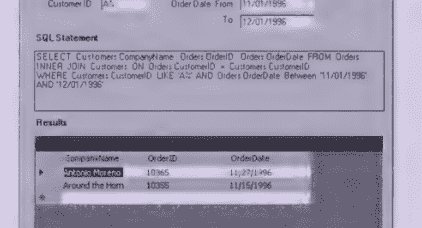

- 1. 创建一个 Windows 窗体。然后放置表 6.3 中列出的控件，并按照图 6.4 所示设置属性。

## 表 6.3 本 How-To 的控件属性设置

| 对象 | 属性 | 设置 |
| :--- | :--- | :--- |
| Label | Text | Customer ID |
| TextBox | Name | txtCustomerID |
| | Text | A% |
| Label | Text | Order Date: From |
| Label | Text | To |
| TextBox | Name | txtFromDate |
| | Text | 11/01/1996 |


| 对象 | 属性 | 设置 |
|--------|----------|---------|
| TextBox | Name | txtToDate |
| | Text | 12/01/1996 |
| Label | Text | SQL String |
| Label | Name | lblSQLString |
| Label | Text | Results |
| DataGrid | Name | dgResults |

2. 将代码清单 6.6 中的以下代码添加到窗体的 Load 事件中。（双击窗体以调出代码。）

## 代码清单 6.6 frmHowTo6_3.vb：在加载窗体时调用 GenerateData

```vb
Private Sub frmHowTo6_3_Load(ByVal sender As System.Object,
            ByVal e As System.EventArgs) Handles MyBase.Load
    
    GenerateData()

End Sub
```

3. 在窗体的类模块中，添加代码清单 6.7 中的代码以创建 GenerateData 过程。在创建 SQL 语句后，该过程将其赋值给 lblSQLString 的 Text 属性。然后，该字符串被用于一个创建的数据适配器中，用以填充 dtResults 数据表。最后，将该数据表设置为 dgResults 的数据源。

## 代码清单 6.7 frmHowTo6_3.vb：使用 LIKE 和 BETWEEN 语句生成数据

```vb
Sub GenerateData()

    '-- Build the SQL String
    Dim strSQL As String

    strSQL &= "SELECT Customers.CompanyName, " & _
            "Orders.OrderID, Orders.OrderDate "
    strSQL &= "FROM Orders INNER JOIN Customers "
    strSQL &= "ON Orders.CustomerID = Customers.CustomerID" & vbCrLf
    strSQL &= "WHERE Customers.CustomerID LIKE '" & _
            Me.txtCustomerID.Text & "' AND "
    strSQL &= "Orders.OrderDate BETWEEN '" & Me.txtFromDate.Text
    strSQL &= "' AND '" & Me.txtToDate.Text & "'"

    '-- Store the SQL String
    Me.lblSQLString.Text = strSQL

    '-- Use the SQL String to build the data adapter and fill the data table.
    Dim odaResults As New OleDb.OleDbDataAdapter(Me.lblSQLString.Text,
        BuildCnnStr("(local)", "Northwind"))
    Dim dtResults As New DataTable()

    Try
        odaResults.Fill(dtResults)
    Catch excp As Exception
        MessageBox.Show(excp.Message)
        Exit Sub
    End Try

    '-- Assign the data table to the data grid's DataSource property
    Me.dgResults.DataSource = dtResults

End Sub
```

2. 将代码清单 6.8 中的代码分别添加到 txtCustomerID、txtFromDate 和 txtToDate 的 **TextChanged** 事件中。这些过程在值发生变化时调用 GenerateData。

## 代码清单 6.8 frmHowTo6_3.vb：在文本更新时调用 GenerateData 过程

```vb
Private Sub txtCustomerID_TextChanged(ByVal sender As System.Object,
    ByVal e As System.EventArgs) Handles txtCustomerID.TextChanged
    GenerateData()
End Sub

Private Sub txtFromDate_TextChanged(ByVal sender As System.Object,
    ByVal e As System.EventArgs) Handles txtFromDate.TextChanged
    GenerateData()
End Sub

Private Sub txtToDate_TextChanged(ByVal sender As System.Object,
    ByVal e As System.EventArgs) Handles txtToDate.TextChanged
    GenerateData()
End Sub
```

## 评注

通过使用通配符并允许数值范围，您可以使应用程序和数据查询比以往任何时候都更加灵活！

## 6.4 如何查找表中没有相关表对应条目的记录？

我遇到一种情况，需要找出哪些客户没有发票。我该如何实现？

### 技术原理

要找出相关表中没有对应记录（发票）的记录（客户），您必须更好地理解查询过程中表之间可以使用哪些类型的连接（Join）。

在查看连接之前，以下是本 How-To 中将使用的 T-SQL 语句：

```sql
SELECT Customers.CustomerID, Customers.CompanyName
FROM Customers LEFT OUTER JOIN Orders
ON Customers.CustomerID = Orders.CustomerID WHERE Orders.CustomerID IS NULL
```

### 连接类型

您可以使用三种类型的连接来检索不同的信息。这些连接类型包括内连接（Inner Join）、左外连接（Left Outer Join）和右外连接（Right Outer Join）。

#### 内连接（Inner Join）

这种连接显示在连接字段上，每个表中都至少存在一条记录的记录。这意味着只有在客户至少有一张发票时才会显示该客户。如果您想查看 CompanyName 和 OrderDate，SELECT 语句如下：

```sql
SELECT Customers.CompanyName, Orders.OrderDate
FROM Customers INNER JOIN Orders ON Customers.CustomerID = Orders.CustomerID
```

#### 左外连接（Left Outer Join）

当您想看到第一个表中的所有记录，但只想看到第二个表中与第一个表有匹配记录的记录时，请使用此连接。例如，如果某些客户没有发票，所有客户都会出现，但只有分配了客户的发票才会被显示。

> **注意**
> 通常，如果您的数据库正确设置了参照完整性（如 Northwind 数据库），您将不会遇到没有分配客户的发票。

此示例的 SELECT 语句将用于本 How-To 中。

```sql
ON Customers.CustomerID = Orders.CustomerID WHERE Orders.CustomerID IS NULL
```

请记住，因为您只需要那些没有发票的客户，因此需要检查 `Orders.CustomerID` 是否为 NULL。

> **注意**
> 虽然检查 Orders CustomerID 是否为 NULL 并非绝对必要，但请确保检查一个在记录存在时不会为 NULL 的列。OrderID 也是一个不错的检查列。

#### 右外连接（Right Outer Join）

正如您现在可能已经猜到的，右外连接与左外连接相反。右外连接不是列出所有客户以及仅有客户的发票，而是显示第二个表（发票）中的所有记录，以及第一个表（客户）中在连接列（CustomerID）上有匹配记录的记录。

右外连接的用途之一是查找错误数据，例如由于从其他系统导入数据而导致的非关系型数据。使用类似于左外连接类型的 SELECT 语句：

```sql
SELECT Customers.CustomerID, Customers.CompanyName
FROM Customers RIGHT OUTER JOIN Orders
ON Customers.CustomerID = Orders.CustomerID WHERE Customers.CustomerID IS NULL
```

您会注意到，您不再是测试 Orders.CustomerID 是否为 NULL，而是在检查 Customers.CustomerID 是否为 NULL。

### 步骤

打开并运行 Visual Basic .NET—第 6 章解决方案。在主窗体中，点击标题为 How-To 6.4 的按钮。当窗体加载时，您将看到显示的 SQL 字符串，以及数据显示没有订单的客户的数据网格（见图 6.5）。

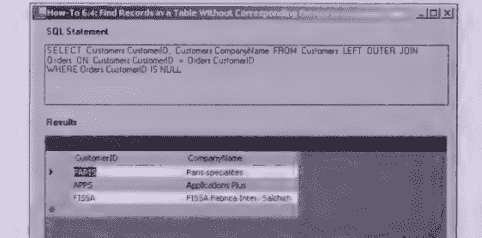
**图 6.5**
使用外连接检索没有对应记录的记录。

- 1. 创建一个 Windows 窗体。然后放置表 6.4 中列出的控件，并按图 6.5 所示设置其属性。

### 表 6.4 本 How-To 的控件属性设置

| 对象 | 属性 | 设置 |
|---|---|---|
| Label | Text | SQL Statement |
| Label | Name | lblSQLString |
| Label | Text | Results |
| DataGrid | Name | dgResults |

2. 将代码清单 6.9 中的以下代码添加到窗体的 Load 事件中。（双击窗体以调出代码。）此过程与之前的 How-To 唯一的区别在于 SELECT 语句，该语句已在“技术原理”部分中描述。

## 代码清单 6.9 frmHowTo6_4.vb：使用左外连接

```vb
Private Sub frmHowTo6_4_Load(ByVal sender As System.Object,
    ByVal e As System.EventArgs) Handles MyBase.Load

    '-- Build the SQL String
    Dim strSQL As String

    strSQL &= "SELECT Customers.CustomerID, Customers.CompanyName "
    strSQL &= "FROM Customers LEFT OUTER JOIN Orders "
    strSQL &= "ON Customers.CustomerID = Orders.CustomerID" & vbCrLf
    strSQL &= "WHERE Orders.CustomerID IS NULL"

    '-- Store the SQL String
    Me.lblSQLString.Text = strSQL

    '-- Use the SQL String to build the data adapter and fill the data table.
    Dim odaResults As New OleDb.OleDbDataAdapter(Me.lblSQLString.Text, _
        BuildCnnStr("(local)", "Northwind"))
    Dim dtResults As New DataTable()

    Try
        odaResults.Fill(dtResults)
    Catch excp As Exception
        MessageBox.Show(excp.Message)
        Exit Sub
    End Try

    '-- Assign the data table to the data grid's DataSource property
    Me.dgResults.DataSource = dtResults

End Sub
```

## 评注

大多数情况下，您将使用内连接而非外连接。然而，有时外连接是必要的，因此您应该尝试使用它们并熟练掌握。

## 6.5 利用子查询

我认为我的一个表中有一些重复记录。此外，我需要知道 Northwind 数据库中哪些城市（和区域）拥有不止一名客户。我该如何使用子查询来完成这些任务？


## 技术

要获取刚才所介绍场景的答案，你需要在 T-SQL 语句中使用子查询。子查询是一个完整的 SELECT 语句。以下是用于本教程的查询。它在外层查询（或称主查询）的 WHERE 子句中使用了一个子查询：

```sql
SELECT Customers.City, Customers.Region, Customers.CustomerID,
Customers.CompanyName From Customers WHERE (((Customers.City)
IN (SELECT Tmp.City FROM Customers As Tmp GROUP BY Tmp.City, Tmp.Region
HAVING Count(*)>1 And Region = Customers.Region)))
ORDER BY Customers.City, Customers.Region
```

你可以在该查询的 WHERE 子句中看到，Customers 表中的 City 列与 IN 运算符一起使用。此处的子查询返回分配给多个客户的所有城市。

> **注意**
> 在本例中，你使用子查询的方式与使用连接表或另一个视图非常相似。使用子查询的好处在于，你可以在这里看到整个查询，而无需打开另一个被连接的视图。就性能而言，使用子查询既不会带来好处，也不会造成性能下降。

除了在 WHERE 子句中使用子查询外，你还可以在任何需要使用表达式的地方使用它们。

## 步骤

打开并运行“Visual Basic .NET—第 6 章”解决方案。在主窗体上，单击标题为“教程 6.5”的按钮。与本章中的其他几个教程类似，你会看到查询显示在窗体顶部的标签中，结果显示在下方的数据网格对象中（见图 6.6）。

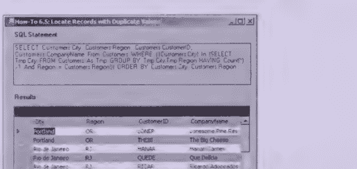
**图 6.6**
一步使用子查询来检索信息，省时省力。

- 1. 创建 Windows 窗体。然后按照表 6.5 所列放置控件，并按图 6.6 所示设置属性。

### 表 6.5 本教程的控件属性设置

| 对象 | 属性 | 设置 |
|---|---|---|
| Label | Text | SQL Statement |
| Label | Name | lblSQLString |
| Label | Text | Results |
| DataGrid | Name | dgResults |

- 2. 将清单 6.10 中的代码添加到窗体的 Load 事件中。（双击窗体以打开代码。）

### 清单 6.10 frmHowTo6_5.vb：使用子查询调用并执行 SQL 语句

```vbnet
Private Sub frmHowTo6_5_Load(ByVal sender As System.Object,
    ByVal e As System.EventArgs) Handles MyBase.Load

    '-- Build the SQL String that returns cities that
    '   have more than one customer in them.
    Dim strSQL As String
    strSQL = "SELECT Customers.City, Customers.Region, " &
    "Customers.CustomerID, Customers.CompanyName "
    strSQL &= " FROM Customers "
    strSQL &= " WHERE ((Customers.City) In "
    strSQL &= " (SELECT Tmp.City FROM Customers As Tmp "
    strSQL &= " GROUP BY Tmp.City, Tmp.Region HAVING Count(*) > 1 ) "
    strSQL &= " And Region = Customers.Region)) " & _
    " ORDER BY Customers.City, Customers.Region"

    Me.lbl1SQLString.Text = strSQL

    '-- Use the SQL String to build the data adapter and fill the data table.
    Dim odaResults As New OleDb.OleDbDataAdapter(Me.lbl1SQLString.Text,
        BuildCnnStr("(local)", "Northwind"))
    Dim dtResults As New DataTable()

    Try
        odaResults.Fill(dtResults)
    Catch excp As Exception
        MessageBox.Show(excp.Message)
        Exit Sub
    End Try

    '-- Assign the data table to the data grid's DataSource property
    Me.dgResults.DataSource = dtResults

End Sub
```

## 注释

子查询是一种功能强大的工具，可以以不同方式获取数据。以下是使用子查询时需要记住的一些规则：

- 只有在同时使用 **TOP** 子句时，才能使用 **ORDER BY** 子句。
- 如果在子查询中使用了某个表，但在主查询中没有使用该表，那么你不能在主查询的输出中使用该表的列。
- 需要在子查询的 **SELECT** 语句周围使用括号。
- 不能在子查询中包含 **FOR BROWSE** 或 **COMPUTE** 子句。

## 6.6 创建、修改和删除表

在数据库应用程序中，以编程方式创建、修改和删除表是很常见的。如何使用 T-SQL 来实现这些操作？

### 技术

要执行这些任务，你需要使用 **CREATE TABLE**、**ALTER TABLE** 和 **DROP TABLE** 等 T-SQL 语句。借助这些语句，你可以处理应用程序可能需要的任何需求。下面逐一介绍这些语句。

#### 使用 CREATE TABLE 创建表

通过 **CREATE TABLE** 语句，你不仅可以指定列及其数据类型，还可以指定索引、检查约束和其他表级属性。对于本教程，你将使用以下 T-SQL 语句：

```sql
CREATE TABLE ListsExample
(
    ListID smallint IDENTITY(1, 1) PRIMARY KEY CLUSTERED,
    LastName varchar(50) NOT NULL,
    FirstName varchar(50) NOT NULL,
    Age smallint ,
    DateEntered datetime NOT NULL DEFAULT GetDate()
        CHECK (DateEntered <= GetDate())
)
```

该语句展示了如何执行多种不同的任务：

- 1. 指定表名：
  `CREATE TABLE ListsExample`
- 2. 创建标识列，即主键：
  `ListID smallint IDENTITY(1, 1) PRIMARY KEY CLUSTERED,`
- 3. 创建不能为 NULL 的字段，并使用不同的数据类型：
  `LastName varchar(50) NOT NULL,`
  `FirstName varchar(50) NOT NULL,`
  `Age smallint ,`
- 4. 创建设置了默认值并指定了检查约束的字段：
  `DateEntered datetime NOT NULL DEFAULT GetDate() CHECK (DateEntered <= GetDate())`

#### 使用 ALTER TABLE 修改表

本教程中用于修改表的 T-SQL 语句相对简单，它添加了一列并删除（drop）了一列：

```sql
ALTER TABLE ListsExample ADD MyNewColumn varchar(30)
ALTER TABLE ListsExample DROP COLUMN Age
```

使用该语句还可以执行许多其他任务。甚至可以从这里显示的语法中看出，你可以处理许多任务，包括删除约束。

```sql
ALTER TABLE table
{ [ ALTER COLUMN column_name
    { new_data_type [ ( precision [ , scale ] ) ]
      [ COLLATE < collation_name > ]
      [ NULL | NOT NULL ]
      | {ADD | DROP } ROWGUIDCOL }
  ]
| ADD
  { [ < column_definition > ]
    | column_name AS computed_column_expression
  } [ ,...n ]
| [ WITH CHECK | WITH NOCHECK ] ADD
  { < table_constraint > } [ ,...n ]
| DROP
  { [ CONSTRAINT ] constraint_name
    | COLUMN column } [ ,...n ]
| { CHECK | NOCHECK } CONSTRAINT
  { ALL | constraint_name [ ,...n ] }
| { ENABLE | DISABLE } TRIGGER
  { ALL | trigger_name [ ,...n ] }
}
```

你还可以做更多操作。请查看 SQL Server 的联机丛书，以获取该语句的完整说明。

#### 使用 DROP TABLE 语句删除表

这条语句最简单，只需一行：

```sql
DROP TABLE ListsExample
```

但是，在尝试删除表时需要注意以下几点：

- 当表处于关系中被引用，并且在 `FOREIGN KEY` 约束中被引用时，不能使用 `DROP TABLE` 语句。你需要先删除另一个表或该约束。
- 你需要是表的管理员或所有者，才能使用 `DROP TABLE` 语句。
- 不能对系统表使用 `DROP TABLE` 语句。

## 步骤

打开并运行 Visual Basic .NET—第 6 章解决方案。在主窗体上，单击标题为“教程 6.6”的按钮（见图 6.7）。

**图 6.7**
内连接的一个常见问题是，当你只想看到每个出现一条记录时，却检索到了多条记录。

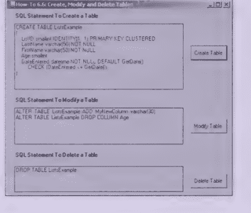

- 1. 创建 Windows 窗体。然后按照表 6.6 所列放置控件，并按图 6.7 所示设置以下属性。

### 表 6.6 本教程的控件属性设置

| 对象 | 属性 | 设置 |
| :--- | :--- | :--- |
| Label | Text | SQL Statement to Create a Table |
| Label | Name | lblCreateTable |
| Button | Name | btnCreateTable |
| Button | Text | Create Table |
| Label | Text | SQL Statement to Modify a Table |
| Label | Name | lblModifyTable |


表 6.6 续

| 对象 | 属性 | 设置 |
|---|---|---|
| 按钮 | 名称 | btnModifyTable |
|  | 文本 | 修改表 |
| 标签 | 文本 | 删除表的 SQL 语句 |
| 标签 | 名称 | lblDeleteTable |
| 按钮 | 名称 | btnDeleteTable |
|  | 文本 | 删除表 |

- 2. 将清单 6.11 中的代码添加到窗体的 Load 事件中。（双击窗体以调出代码。）此过程为所有三项任务创建 SQL 语句，并将其分配给相应的标签进行显示。

## 清单 6.11 frmHowTo6_6.vb：将 SQL 语句加载到相应的标签中

```
Private Sub frmHowTo6_6_Load(ByVal sender As System.Object,
    ByVal e As System.EventArgs) Handles MyBase.Load

    '-- Build the SQL String for Creating a Table
    Dim strSQL As String

    strSQL = "CREATE TABLE ListsExample" & vbCrLf
    strSQL &= "(" & vbCrLf
    strSQL &= "    ListID smallint IDENTITY(1, 1)" & _
    "PRIMARY KEY CLUSTERED", & vbCrLf
    strSQL &= "    LastName varchar(50) NOT NULL", & vbCrLf
    strSQL &= "    FirstName varchar(50) NOT NULL", & vbCrLf
    strSQL &= "    Age smallint", & vbCrLf
    strSQL &= "    DateEntered datetime NOT NULL DEFAULT GetDate()" & vbCrLf
    strSQL &= "    CHECK (DateEntered <= GetDate())" & vbCrLf
    strSQL &= ")"

    Me.lblCreateTable.Text = strSQL

    strSQL = "ALTER TABLE ListsExample ADD MyNewColumn varchar(30)" & vbCrLf
    strSQL &= "ALTER TABLE ListsExample DROP COLUMN Age"

    Me.lblModifyTable.Text = strSQL

    strSQL = "DROP TABLE ListsExample"

    Me.lblDeleteTable.Text = strSQL

End Sub
```

3. 将清单 6.12 中的代码添加到 btnCreateTable 按钮的 Click 事件中。此过程调用函数 PerformTask()，传递 lblCreateTable 标签中的文本。PerformTask() 在下个步骤中描述。如果成功执行任务，则会显示一个消息框，告知您一切正常。

## 清单 6.12 frmHowTo6_6.vb：从 btnCreateTable 的 Click 事件中调用 PerformTask()

```
Private Sub btnCreateTable_Click(ByVal sender As System.Object, _
                                    ByVal e As System.EventArgs) Handles btnCreateTable.Click

    If PerformTask(Me.lblCreateTable.Text) Then

        MessageBox.Show("Table Created Successfully, " & _
            "Look for ListsExample " &
            "Table in Northwind Database in Server Explorer", _
            "Action Performed")

    End If

End Sub
```

4. 在为此操作指南创建的窗体的类模块中，为 PerformTask() 函数创建清单 6.13 中所示的代码。此代码创建一个 Connection 对象。接下来，创建一个基于传入的 strSQL 字符串的 Command 对象。打开连接并执行命令。请注意，命令的执行已包裹在 Try..Catch..End Try 代码块中，以确保命令正确执行；如果未正确执行，则会显示一条消息。

## 清单 6.13 frmHowTo6_6.vb：使用传入的 strSQL 执行 SQL 语句

```
Function PerformTask(ByVal strSQL As String) As Boolean

    Dim cnn As New OleDb.OleDbConnection(BuildCnnStr("(local)", "Northwind"))
    Dim cmdAction As New OleDb.OleDbCommand(strSQL)

    cmdAction.Connection = cnn

    cnn.Open()

    PerformTask = True

    Try

        cmdAction.ExecuteNonQuery()

    Catch excp As Exception
```

## 清单 6.13 续

```
MessageBox.Show(excp.Message, "Error with Action")
PerformTask = False

End Try

cnn.Close()

End Function
```

- 5. 将清单 6.14 中的代码片段添加到 `btnModifyTable` 和 `btnDeleteTable` 的相应 Click 事件中，以及窗体的 Load 事件中。

## 清单 6.14 frmHowTo6_6.vb：从 btnModifyTable 和 btnDeleteTable 的 Click 事件中调用 PerformTask

```
Private Sub btnModifyTable_Click(ByVal sender As System.Object,
    ByVal e As System.EventArgs) Handles btnModifyTable.Click

    If PerformTask(Me.lblModifyTable.Text) Then

        MessageBox.Show("Table Modified Successfully, " & _
            "Look for ListsExample " & _
            "Table in Northwind Database in Server Explorer", _
            "Action Performed")

    End If

End Sub
Private Sub btnDeleteTable_Click(ByVal sender As System.Object,
    ByVal e As System.EventArgs) Handles btnDeleteTable.Click

    If PerformTask(Me.lblDeleteTable.Text) Then

        MessageBox.Show("Table Deleted Successfully, " & _
            "Look for ListsExample " & _
            "Table in Northwind Database in Server Explorer", _
            "Action Performed")

    End If

End Sub
```

## 注释

您不必手动添加、修改和删除表。只需确保在执行这些任务之前备份您的数据。

## 6.7 如何从现有表创建新表？

我经常需要从现有数据中创建新表。如果表已经存在，我需要先删除旧表。如何使用 T-SQL 做到这一点？

## 技术

要实现这些任务，您将创建两个 T-SQL 语句，并在同一个 **Command** 对象中使用它们。以下是将要使用的两个语句：

```
IF EXISTS (SELECT * FROM sysobjects
    WHERE id = object_id(N'[Northwind].[dbo].[MyProdAndCat]'))
    DROP TABLE [Northwind].[dbo].[MyProdAndCat]

SELECT Categories.CategoryName, Products.ProductName INTO MyProdAndCat
    FROM Categories INNER JOIN Products ON Categories.CategoryID =
    Products.CategoryID
```

第一条语句检查您将要创建的特定表是否存在，在本例中为 MyProdAndCat。此语句演示了您可以在 T-SQL 中使用的一些技术：

- 使用 **EXISTS** 语句与 **SELECT** 语句一起，查询名为 sysobjects 的系统表
- 使用 IF 语句有条件地执行另一个命令，在本例中为 **DROP TABLE** 语句

> **提示**
> 既然您已经学会了这项技术，您会想要反复使用它。确保您为这一页做了标记！

最后一条语句使用内连接来连接两个表，显示 CategoryName 和 ProductName。创建新表的子句是：

```
INTO MyProdAndCat
```

这告诉 SQL Server 从指定的 SELECT 语句创建一个名为 MyProdAndCat 的新表。

## 步骤

打开并运行 Visual Basic .NET—第 6 章解决方案。从主窗体中，单击标题为"操作指南 6.7"的按钮。您将在标签中看到"技术"部分中指定的 SQL 字符串。如果您单击执行按钮，将生成新表，执行 **SELECT** 语句，并在 DataGrid 对象中显示结果（见图 6.8）。

# 第 6 章 • 创建 TRANSACT-SQL 命令 189

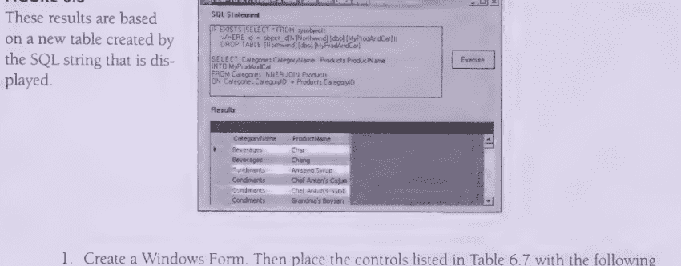

图 6.8 这些结果基于显示的 SQL 字符串创建的新表。

- 1. 创建一个 Windows 窗体。然后按照表 6.7 放置控件，并设置以下属性，如图 6.8 所示。

## 表 6.7 此操作指南的控件属性设置

| 对象 | 属性 | 设置 |
| :--- | :--- | :--- |
| 标签 | 文本 | SQL 语句 |
| 标签 | 名称 | lblSQLString |
| 标签 | 文本 | 结果 |
| 按钮 | 名称 | btnExecute |
| 按钮 | 文本 | 执行 |
| DataGrid | 名称 | dgResults |

- 2. 将清单 6.16 中的代码添加到窗体的 Load 事件中。（双击窗体以调出代码。）

## 清单 6.16 frmHowTo6_7.vb：将 SQL 语句存储在 lblSQLString 标签中以供显示和后续使用

```
Private Sub frmHowTo6_7_Load(ByVal sender As System.Object, _
    ByVal e As System.EventArgs) Handles MyBase.Load

    '-- Build the SQL String that returns cities that
    '   have more than one customer in them.
    Dim strSQL As String
    strSQL = "IF EXISTS (SELECT * from sysobjects " & vbCrLf
    strSQL &= " WHERE id = object_id(N'[Northwind].[dbo].[MyProdAndCat]'))" & _
    vbCrLf
```

---

# 使用 VISUAL BASIC .NET 和 ADO.NET 进行数据库编程：技巧、教程和代码

```
清单 6.16 续

strSQL &= " DROP Table [Northwind].[dbo].[MyProdAndCat]" & _
vbCrLf & vbCrLf
strSQL &= "SELECT Categories.CategoryName, Products.ProductName" & vbCrLf
strSQL &= "INTO MyProdAndCat" & vbCrLf
strSQL &= "FROM Categories INNER JOIN Products" & vbCrLf
strSQL &= "ON Categories.CategoryID = Products.CategoryID"
Me.lblSQLString.Text = strSQL

End Sub
```

2. 将清单 6.17 中的以下代码添加到 btnExecute 的 Click 事件中。此代码使用"技术"部分中讨论的 T-SQL 例程创建 Connection 和 Command 对象。然后代码执行查询。接下来，对新表运行选择查询，并将 DataSource 属性设置为已填充的数据表。

```
清单 6.17 frmHowTo6_7.vb：加载窗体

Private Sub btnExecute_Click(ByVal sender As System.Object,
                           ByVal e As System.EventArgs) Handles btnExecute.Click
    Dim dtResults As New DataTable()
    Try
        Dim ocnn As New OleDb.OleDbConnection(BuildCnnStr("(local)", _
            "Northwind"))
        Dim ocmd As New OleDb.OleDbCommand(Me.lblSQLString.Text)
        ocmd.Connection = ocnn
        ocnn.Open()
        ocmd.ExecuteNonQuery()
        ocnn.Close()

        '-- Use the SQL String to build the data adapter
        '   and fill the data table.
        Dim odaResults As _
            New OleDb.OleDbDataAdapter("Select * From MyProdAndCat",
                BuildCnnStr("(local)", "Northwind"))

        odaResults.Fill(dtResults)

    Catch excp As Exception
        MessageBox.Show(excp.Message)
        Exit Sub
    End Try

    '-- Assign the data table to the data grid's DataSource property
    Me.dgResults.DataSource = dtResults

End Sub
```

## 注释

使用完新表后，如果您不需要将其保留用于其他目的，您可能会想继续删除该表。


## 6.8 创建和调用 SQL Server 2000 用户定义函数

在 SQL Server 2000 中，我听说你可以创建用户定义函数（UDF）。你会在何处使用 UDF？以及如何在 T-SQL 中创建和调用它们？

### 技术

UDF 在应用开发语言中已使用多年。你现在也可以在 SQL Server 2000 中创建它们。

### 创建 SQL Server 2000 UDF

你可以使用 **CREATE FUNCTION** 命令在 SQL Server 2000 中创建 UDF。通常，你会使用企业管理器或某些工具来完成此操作，但这里你将学习如何使用 VB.NET 来实现。下面是将要创建的函数：

```sql
CREATE FUNCTION udf_ShowProdAndCat (@UnitPriceParm money)
RETURNS @ProdAndCatTab TABLE
(
    ProductID    int,
    ProductName  nvarchar(80),
    CategoryName nvarchar(80),
    UnitPrice    int
)
AS
BEGIN
    INSERT @ProdAndCatTab
        SELECT P.ProductID, P.ProductName,
               C.CategoryName, P.UnitPrice
        FROM Products AS P INNER JOIN Categories AS C
        ON P.CategoryID = C.CategoryID
        WHERE P.UnitPrice > @UnitPriceParm
    RETURN
END
```

这个函数看起来确实与你用其他语言创建的函数有很大不同，但当你记起你使用的是 T-SQL 命令时，它看起来就不那么古怪了。

### 向 SQL Server UDF 传递参数

传递的参数以 **@** 符号开头，这与 How-To 6.1 中讨论的局部变量非常相似。

你还需要声明数据类型。

### 从 SQL Server UDF 返回标量或表类型

当从 UDF 返回值时，你要么返回一个标量类型（实际上是标准数据类型之一的单个值），要么返回一个新的 Table 数据类型。

本示例创建并返回一个 Table 数据类型，由以下代码行指定：

```sql
RETURNS @ProdAndCatTab TABLE
(
    ProductID    int,
    ProductName  nvarchar(80),
    CategoryName nvarchar(80),
    UnitPrice    int
)
```

通过包含开括号和闭括号，你可以指定并返回整个表的数据量，但要小心不要这样做，因为性能会不好。这与使用 SQL Server 数据是一样的。

然后，你可以在另一个 T-SQL 语句中使用这个返回的表。

在确定返回值（本例中为表 ProdAndCatTab）之后，你需要为 UDF 创建代码主体。

> 注意：虽然这个返回值被称为 ProdAndCatTab，但不会有一个你可以通过该名称在函数外部访问的表。它将严格用于调用语句中。

### 格式化 SQL Server UDF 的代码主体

从下面的代码块中可以看到，你需要有 BEGIN 和 END 语句：

```sql
AS
BEGIN
    INSERT @ProdAndCatTab
    SELECT P.ProductID, P.ProductName,
           C.CategoryName, P.UnitPrice
    FROM Products AS P INNER JOIN Categories AS C
    ON P.CategoryID = C.CategoryID
    WHERE P.UnitPrice > @UnitPriceParm
    RETURN
END
```

还要注意，你需要在其中包含 INSERT @ProdAndCatTab 和 RETURN 语句来创建 Table 返回值。其余代码与其他 T-SQL 语句大致相同。

### 调用 SQL Server 2000 UDF

你可以从其他 T-SQL 语句中调用 UDF，如此处的示例所示：

```sql
Select * From udf_ShowProdAndCat(" & Me.txtUnitPrice.Text & ")"
```

在这里，UDF 在 SELECT 语句中被调用，参数被传递。

### 步骤

打开并运行 VB.NET —— 第 6 章解决方案。从主窗体上，单击标题为 How-To 6.8 的按钮（见图 6.9）。

**FIGURE 6.9**
内部连接的一个常见问题是，当你只想查看每个出现项的一条记录时，却检索到了多条记录。

你将在一个标签中看到“技术”部分描述的 UDF。单击标记为 Create UDF 的按钮。如果 UDF 已经存在，那么一个消息框会告诉你。否则，UDF 将被创建。接下来，单击标记为 Use UDF 的按钮。然后数据网格被填充并显示数据。你可以在 Products Greater Than 文本框中更改值。然后再次单击 Use UDF 以查看显示的新数据。

- 1. 创建一个 Windows 窗体。然后按照表 6.8 所列的属性设置放置控件，如图 6.9 所示。

#### TABLE 6.8 本示例的控件属性设置

| 对象 | 属性 | 设置 |
|---|---|---|
| Label | Text | Report Products Greater Than: |
| TextBox | Name | txtUnitPrice |
| Label | Text | SQL Statement Creating Temporary Table |
| Label | Name | lblCreateUDF |
| Button | Name | btnCreateUDF |
| Button | Text | Create UDF |
| Label | Text | SQL Statement Using UDF |
| Label | Name | lblUseUDF |
| Button | Name | btnUseUDF |
| Button | Text | Use UDF |
| Label | Text | Results |
| DataGrid | Name | dgResults |

- 2. 将清单 6.18 中的代码添加到窗体的 Load 事件中。（双击窗体以打开代码。）

#### LISTING 6.18 frmHowTo6_8.vb：创建 UDF 代码，并将其分配给标签以供显示和后续使用

```vbnet
Private Sub frmHowTo6_8_Load(ByVal sender As System.Object,
                             ByVal e As System.EventArgs) Handles MyBase.Load

    '-- Create the UDF string
    Dim strSQL As String
    strSQL = "CREATE FUNCTION udf_ShowProdAndCat ( @UnitPriceParm money)"
    strSQL &= "RETURNS @ProdAndCatTab TABLE" & vbCrLf
    strSQL &= "(" & vbCrLf
    strSQL &= "    ProductID   int," & vbCrLf
    strSQL &= "    ProductName nvarchar(80)," & vbCrLf
    strSQL &= "    CategoryName nvarchar(80)," & vbCrLf
    strSQL &= "    UnitPrice   int" & vbCrLf
    strSQL &= ")" & vbCrLf
    strSQL &= "AS" & vbCrLf
    strSQL &= "BEGIN" & vbCrLf
    strSQL &= "    INSERT @ProdAndCatTab" & vbCrLf
    strSQL &= "        SELECT P.ProductID, P.ProductName," & vbCrLf
    strSQL &= "            C.CategoryName, P.UnitPrice" & vbCrLf
    strSQL &= "        FROM Products AS P INNER JOIN Categories AS C" & _
             vbCrLf
    strSQL &= "            ON P.CategoryID = C.CategoryID" & vbCrLf
    strSQL &= "        WHERE P.UnitPrice > @UnitPriceParm" & vbCrLf
    strSQL &= "    RETURN" & vbCrLf
    strSQL &= "END"

    Me.lblCreateUDF.Text = strSQL

    '-- Create the SQL string that calls the UDF
    Me.lblUseUDF.Text = "Select * From udf_ShowProdAndCat(" & _
                        Me.txtUnitPrice.Text & ")"
End Sub
```

- 3. 将清单 6.19 中的代码添加到 btnCreateUDF 的 Click 事件中。此代码使用 Connection 和 Command 对象根据提供的代码创建 UDF。

#### LISTING 6.19 frmHowTo6_8.vb：在 SQL Server 中创建新的 UDF

```vbnet
Private Sub btnCreateUDF_Click(ByVal sender As System.Object,
                               ByVal e As System.EventArgs) Handles btnCreateUDF.Click

    Try

        Dim ocnn As New OleDb.OleDbConnection(BuildCnnStr("(local)", _
            "Northwind"))
        Dim ocmd As New OleDb.OleDbCommand(Me.lblCreateUDF.Text)

        ocmd.Connection = ocnn

        ocnn.Open()
        ocmd.ExecuteNonQuery()
        ocnn.Close()

    Catch excp As Exception
        MessageBox.Show(excp.Message)
        Exit Sub
    End Try

    MessageBox.Show("UDF Created")

End Sub
```

- 4. 将清单 6.20 中的代码添加到按钮 txtUnitPrice 的 TextChanged 事件中。

#### LISTING 6.20 frmHowTo6_8.vb：更新调用 UDF 的 SELECT 语句

```vbnet
Private Sub txtUnitPrice_TextChanged(ByVal sender As System.Object,
                                     ByVal e As System.EventArgs) Handles txtUnitPrice.TextChanged

    Me.lblUseUDF.Text = "Select * From udf_ShowProdAndCat(" & _
                        Me.txtUnitPrice.Text & ")"

End Sub
```

- 5. 将清单 6.21 中的代码添加到按钮 btnUseUDF 的 Click 事件中。此代码根据调用 UDF 的 SELECT 语句填充数据集。然后将数据集分配给 dgResults 的 DataSource 属性。


## 示例 6.21 使用 lblUseUDF 文本属性中的 SELECT 语句显示数据

```vb
Private Sub btnUseUDF_Click(ByVal sender As System.Object, 
                          ByVal e As System.EventArgs) Handles btnUseUDF.Click

    Dim dtResults As New DataTable()
    Try
        '-- 使用 SQL 字符串来构建数据适配器
        '   并填充数据表。
        Dim odaResults As New OleDb.OleDbDataAdapter(Me.lblUseUDF.Text, 
                            BuildCnnStr("(local)", "Northwind"))

        odaResults.Fill(dtResults)

    Catch exp As Exception
        MessageBox.Show(exp.Message)
        Exit Sub
    End Try

    '-- 将数据表赋值给数据网格的 DataSource 属性。
    Me.dgResults.DataSource = dtResults

End Sub
```

## 注释

当你需要重复使用相同的 T-SQL 语句时，能够将该代码存储在某个地方会非常方便，就像你在 Visual Basic 中创建 UDF（用户自定义函数）一样。

在使用 UDF 时，你可以直接在行内使用该值，从而在创建 T-SQL 例程时节省许多步骤。

## 第 7 章：使用 SQL-DMO 执行常见数据库任务

**在本章中，你将**
- 创建一个用于连接到新数据库的对话框
- 在 SQL Server 数据库之间传输表
- 备份并验证 SQL Server 数据库
- 创建一个分离/附加 SQL Server 数据库的对话框
- 还原 SQL Server 数据库

无论你现在使用什么语言创建数据库应用程序，只要你使用 SQL Server 作为数据库，你仍然需要能够在后端数据库上执行基本的数据库任务。此外，你可能希望赋予用户执行这些任务的能力，而无需使用企业管理器（Enterprise Manager）。

允许用户执行某些常见数据库任务（如备份和还原数据库）的方法是利用 SQL 分布式管理对象（SQL-DMO）和数据转换服务（DTS）。当你在企业管理器中使用备份/还原向导（见图 7.1）时，实际上是在使用为用户创建好界面的 SQL-DMO。

同样的情况也适用于用于创建转换包和其他服务的 DTS 对象模型（见图 7.2）。

随着本章对每个可完成任务的描述，你将看到更多可用于完成任务的各种对象、属性和方法。

### 图 7.1
在底层，SQL-DMO 对象被用于执行请求的任务，例如备份。


### 图 7.2
与 SQL-DMO 备份数据库类似，在导出数据时，会使用 SQL-DTS 对象。


## 了解 SQL Server DMO API

SQL 分布式管理框架是一个由对象、服务和组件组成的框架，用于管理 Microsoft SQL Server 2000。它由几个你可以用来在应用程序中完成任务的 API 组成。

你可以在图 7.3 中看到这些 API 是如何使用的。

以下是对每个 API 的简要描述。在本章的其余部分中，我们将直接使用最后两个。

- **SQL-NS**。SQL 命名空间提供了一种实际调用企业管理器对话框和用户界面的一种方式。SQL 命名空间使用了列出的其他 API。
- **SQL-DMO**。SQL 分布式管理对象让你能够访问 SQL Server 内部的各种对象，以及一些可以使用企业管理器执行的任务，以便你可以在自己的应用程序中执行它们。
- **SQL-DTS**。SQL 数据转换服务允许你创建转换包和任务，就像使用 DTS 用户界面那样。

### 图 7.3
在底层，SQL-DMO 对象被用于执行请求的任务。


## 为 SQL API 在 .NET 中设置引用

在你的 .NET 应用程序中使用 API 之前，你需要创建对要使用的特定库的引用。你将使用的库是 COM 库；因此，你无法获得使用 .NET Framework 的某些优势，例如部分性能提升。不过，你仍然可以使用这些库。希望如果且当这些库更新到该框架时，你能够将代码转换为使用它们。

要访问必要的库，请从“项目”菜单中选择“添加引用”。点击“COM”选项卡以显示可能的 COM 库。接着，在突出显示以下库后点击“选择”：Microsoft DTSPackage Object Library 和 Microsoft SQLDMO Object Library。点击“确定”关闭对话框。此时，如果你打开对象浏览器，可以展开 Interop.SQLDMO 库，甚至突出显示 SQL Server 对象以查看可用属性和方法。如图 7.4 所示。

当你学习接下来的“操作指南”（How-Tos）时，你将要使用的各种集合、对象、属性和方法将在需要时列出。可用的对象如此之多，以至于需要多页才能显示 SQL-DMO 和 SQL-DTS 对象模型的完整树结构。

### 图 7.4
此处显示的对象现在可在你的应用程序中使用。


## 7.1 创建一个连接到新数据库的对话框，包括列出可用的 SQL Server 和数据库

用户有时需要连接到各种数据库。例如，一家大公司可能会将其站点信息保存在同一个或不同 SQL Server 上的独立数据库中。管理层可能需要根据需要操作的数据库，将应用程序指向不同的站点数据库。本操作指南向你展示如何创建一个对话框，让用户选择 SQL Server 和数据库，然后根据选择创建新连接。

在数据库应用程序中，有必要允许用户选择要连接的 SQL Server 后端。如果你在创建应用程序时具备了必要的灵活性，那么你的应用程序中不应该硬编码 SQL Server 或数据库名称。如何创建一个列出可用 SQL Server 和数据库，且用户可用其连接到新数据库的对话框？

### 技术方案

对于本操作指南，你将使用 SQL-DMO 中的基础对象 Application 对象，然后是 SQLServer 对象。你可以基于该对象使用许多对象，其第一层如图 7.5 所示。

### 图 7.5
就 SQL-DMO 中使用的集合和对象而言，这些仅仅是冰山一角。


表 7.1 展示了本操作指南中将要使用的对象、属性和方法。

### 表 7.1 用于列出 SQL Server、数据库及连接数据库的 SQL-DMO 对象

| 对象 | 属性/方法 | 描述 |
| :--- | :--- | :--- |
| Application | NameList | 用于保存可用服务器列表的集合 |
| | ListAllAvailableServers | 用于检索网络上可用服务器的方法 |
| SQLServer | Connect | 将你连接到 SQL Server 的连接字符串，允许你访问数据库 |
| | LoginSecure | 指定你想使用信任连接到 SQL Server 的标志 |
| | Databases | 指定 SQL Server 的数据库集合 |

你还将使用 `OleDbConnection` 对象。

### 步骤

打开并运行 VB.NET — 第 7 章解决方案。在主窗体中，点击标题为“How-To 7.1”的命令按钮。

窗体加载时，你将看到网络上可用的 SQL Server。如果你不在网络中，你将只能看到一个名为 “local” 的 SQL Server。

如果你点击一个 SQL Server 且实际上正在使用 Windows NT 集成安全性，那么你将看到位于所选 SQL Server 中的数据库列表。

然后你可以选择一个数据库并点击“Connection”按钮。如果成功，你将在窗体底部的文本框中看到显示的连接字符串。窗体将看起来像图 7.6 中显示的窗体。

### 图 7.6
此窗体非常适合使用 Windows NT 集成安全性将用户登录到数据库。


1. 创建一个 Windows 窗体。然后放置图 7.6 所示的控件，并设置以下属性。

| 对象 | 属性 | 设置 |
| :--- | :--- | :--- |
| Label | Name | Label1 |
| | Text | SQL Servers |


| 对象 | 属性 | 设置 |
|---|---|---|
| ListBox | Name | lstSQLServers |
| Label | Name | Label2 |
| | Text | Databases |
| ListBox | Name | lstDatabases |
| Label | Name | Label2 |
| | Text | Connection String |
| TextBox | Name | txtConnectionString |
| | Text | Not Connected |
| Command Button | Name | btnConnect |
| | Text | Connect |

- 2. 与本章其他一些项目的做法类似，在将代码附加到窗体的 Load 事件之前，你需要创建一个支持例程来生成连接字符串。该函数名为 BuildCnnStr，可以在清单 7.1 中找到。此函数接受传递给它的服务器和数据库名称，并返回一个连接字符串。你需要创建一个基本模块来存放该例程。

## 清单 7.1 `modSQLDMORoutines.vb`：创建连接字符串

```vb
Function BuildCnnStr(ByVal strServer As String, _
    ByVal strDatabase As String) As String

    Dim strTemp As String
    strTemp = "Provider=SQLOleDB; Data Source=" & strServer & ";"
    strTemp &= "Initial Catalog=" & strDatabase & ";"
    strTemp &= "Integrated Security=SSPI"

    Return strTemp
End Function
```

虽然你可以创建一个返回 **Connection** 对象的例程，但一种更通用的方法是返回一个字符串。原因在于，有些对象需要 **Connection** 对象，而另一些对象只需要一个字符串。

- 3. 在窗体上，将清单 7.2 中的代码添加到 Load 事件中。

## 清单 7.2 frmHowTo7_1.vb：将 SQL 服务器加载到列表框中

```vb
Private Sub frmHowTo7_1_Load(ByVal sender As System.Object, _
            ByVal e As System.EventArgs) Handles MyBase.Load

    '-- Load up the SQL Servers
    LoadSQLServers(Me.lstSQLServers)

End Sub
```

4. 在与步骤 2 相同的模块中，创建名为 LoadSQLServers 的例程。在建立 SQL-DMO 应用程序的实例后，代码调用 ListAvailableSQLServer 方法。如果 oNames 名称列表对象中没有加载任何名称（意味着它们不可用或你不在网络上），则将 (local) 服务器添加到列表框。否则，返回的列表将被添加到列表框。列表框中的第一项随后被选中，导致下一步描述的事件被执行。

## 清单 7.3 modSQLDMORoutines.vb：将 SQL 服务器加载到列表框中

```vb
Sub LoadSQLServers(ByRef lstSQLServers As ListBox)

    Dim intCurrSQL As Integer
    Dim oNames As SQLDMO.NameList
    Dim oSQLApp As New SQLDMO.Application()

    '-- Load available SQL Servers into a NameList
    '   (those that are able to be seen by the network)
    oNames = oSQLApp.ListAvailableSQLServers

    '-- Load the local instance as first in the list, if not on the network.
    If oNames.Count = 0 Then
        lstSQLServers.Items.Add("(local)")
    End If

    '-- Load the namelist into the list box
    For intCurrSQL = 1 To oNames.Count
        lstSQLServers.Items.Add(oNames.Item(intCurrSQL))
    Next intCurrSQL

    '-- Choose the first instance
    lstSQLServers.SelectedIndex = 0
End Sub
```

### 注意
此时，如果你尝试运行示例应用程序，可能会在 ListAvailableSQLServer 方法上遇到包含文本 `QueryInterface for interface SQLDMO.NameList failed` 的错误。如果是这种情况，则需要安装 SQL Server 2000 的 Service Release 2。这将解决此问题。

5. 将清单 7.4 中列出的代码添加到名为 lstSQLServers 的列表框的 SelectedIndexChanged 事件中。此例程首先测试是否已选择 SQL 服务器和数据库。如果是，则该例程启用 btnConnect 按钮；否则，该按钮被禁用。然后调用名为 GetSQLDatabases 的例程，传递所选的 SQL 服务器和 lstDatabases 列表框。你可以在下一步中看到 GetSQLDatabases 例程。

## 清单 7.4 frmHowTo7_1.vb：启用或禁用 btnConnect 按钮并调用加载数据库列表框的例程

```vb
Private Sub lstSQLServers_SelectedIndexChanged(ByVal sender As System.Object,
    ByVal e As System.EventArgs) _
    Handles lstSQLServers.SelectedIndexChanged

    '-- If both the SQL Server and database are chosen, enable
    ' the Connect button.
    If lstSQLServers.SelectedItems.Count > 0 And _
            lstDatabases.SelectedItems.Count > 0 Then
        Me.btnConnect.Enabled = True
    Else
        Me.btnConnect.Enabled = False
    End If

    GetSQLDatabases(Me.lstSQLServers.SelectedItem, Me.lstDatabases)

End Sub
```

6. 通过将清单 7.5 中的代码输入到你在步骤 2 中创建的新模块中来创建 GetSQLDatabases 例程。此例程尝试的第一项任务是连接到选定的服务器。如果例程无法连接，则退出函数；否则，将 SQL 服务器中的数据库名称加载到名为 lstDatabases 的列表框中。

## 清单 7.5 modSQLDMORoutines.vb：为给定的 SQL 服务器检索数据库名称

```vb
Function GetSQLDatabases(ByVal strSQLServer As String, _
    ByRef lstTemp As ListBox)

    Dim intDBs As Integer
    Dim db As Object
    Dim strDBs As String

    '-- Establish a connection to the server. If not, then exit the function.
    Dim osvr As SQLDMO.SQLServer
    osvr = New SQLDMO.SQLServer()

    osvr.LoginSecure = True

    Try
        osvr.Connect(strSQLServer)
    Catch exp As Exception
        MessageBox.Show("There is a problem retrieving " & _
        "databases for this server. " & _
        "Please check the name and try again. ", vbInformation,
        "Error with Server")
        Exit Function
    End Try

    '-- Clear the current list
    lstTemp.Items.Clear()

    '-- Load up the database names for the selected server into the list box.
    For Each db In osvr.Databases
        lstTemp.Items.Add(db.Name)
    Next

End Function
```

- 7. 将清单 7.6 中的代码添加到 `lstDatabases` 列表框的 `SelectedIndexChanged` 事件中。此代码类似于步骤 4 中的清单，如果在 `lstSqlServers` 和 `lstDatabases` 列表框中都选择了项目，则启用 `btnConnect` 按钮。

## 清单 7.6 frmHowTo7_1.vb：根据当前选定的类别重新填充列表框

```vb
Private Sub lstDatabases_SelectedIndexChanged(ByVal sender As System.Object, _
ByVal e As System.EventArgs)
Handles lstDatabases.SelectedIndexChanged

'-- If both the SQL Server and database are chosen,
' enable the Connect button.
If lstSQLServers.SelectedItems.Count > 0 And _
lstDatabases.SelectedItems.Count > 0 Then
Me.btnConnect.Enabled = True
Else
Me.btnConnect.Enabled = False
End If

End Sub
```

- 8. 将清单 7.7 中的代码添加到 `btnConnect` 按钮的 `Click` 事件中。在此例程中，实例化一个 `Connection` 对象，并将其 `ConnectionString` 字符串设置为所选的 SQL 服务器和数据库。如果连接在打开时出现问题，则将 `txtConnectionString` 的 Text 属性设置为错误消息。否则，将 Text 属性设置为新的连接字符串。

## 清单 7.7 `frmHowTo7_1.vb`：调用例程以在更改此复选框时重新加载 lstUnSelected 列表框

```vb
Private Sub btnConnect_Click(ByVal sender As System.Object,
                                ByVal e As System.EventArgs) Handles btnConnect.Click

    Dim ocnn As New OleDb.OleDbConnection()

    Try
        '-- Create the connection string and open the connection
        ocnn.ConnectionString = BuildCnnStr(Me.lstSQLServers.SelectedItem,
                                            Me.lstDatabases.SelectedItem)
        ocnn.Open()

    Catch excp As Exception

        Me.txtConnectionString.Text = "Error with Connection"
        Exit Sub

    End Try

    Me.txtConnectionString.Text = ocnn.ConnectionString

End Sub
```

## 工作原理
当窗体打开时，网络上可用的 SQL 服务器被加载到窗体的第一个列表框中。当用户单击特定的 SQL 服务器时，该 SQL 服务器中的数据库被加载到数据库列表框中。然后用户可以从列表中选择一个数据库。当用户执行此操作时，连接按钮将被启用。如果用户随后单击连接按钮，连接字符串将被加载到窗体底部的文本框中。

## 评论
与其他类似，此操作指南的设置使用了 Windows NT 集成安全性。如果你想使用 SQL Server 安全性，可以为登录名和密码添加文本框，然后在调用某些方法（如步骤 6 中列出的代码中的 **Connect** 方法）时提供它们。你还需要将同一清单中使用的 **LoginSecure** 属性设置为 **False**。

此操作指南非常适合其实际功能：允许用户（或管理员）在必要时选择新的 SQL 服务器和数据库进行连接。然后，你可以将此连接字符串保存到 Public 变量中，并在所有连接对象中使用它。你还将为本章其余操作指南使用类似的控件和代码。


## 7.2 备份并验证 SQL Server 数据库

备份数据库可能是您需要集成到应用程序中的最重要功能之一。如果您将其交给用户使用 Enterprise Manager 来备份数据库，那么这件事可能永远不会发生。您可以安排计划备份，但有时您需要立即进行备份。本“如何操作”（How-To）将向您展示如何创建自定义对话框，让用户不仅能备份您的 SQL Server 数据库，还能验证该备份。

您的用户需要一种无需使用 Enterprise Manager 即可备份和验证数据库的方法。您该如何创建一个对话框，让他们能够备份并验证自己的数据库？

## 技术方案

为了完成此任务，您将再次使用 SQL-DMO 对象。您将用到的几个新对象是 `Backup` 和 `BackupDevices` 对象。您可以在表 7.3 中看到一些额外的对象及其将要使用的属性和方法。

表 7.3 用于备份和验证数据库的额外 SQL-DMO 对象

| 对象 | 属性/方法 | 描述 |
|---|---|---|
| Backup | Action | 该属性允许您指定要执行的备份类型。选项包括 SQLDMOBackup_Database、SQLDMOBackup_Differential、SQLDMOBackup_Files 和 SQLDMOBackup_Log。 |
| | BackupSetDescription | 该属性允许您为备份集指定描述。 |
| | BackupSetName | 该属性是备份集名称。 |
| | Database | 该属性允许您指定要备份的数据库。 |
| | Devices | 该属性指定您将要备份到的设备。 |
| | Initialize | 此方法初始化备份过程。 |
| | TruncateLog | 该属性允许您指定在备份时如何处理截断日志。 |
| | SQLBackup | 此方法执行实际的备份操作。 |
| BackupDevices | | 这是 SQL Server 备份设备的集合。 |
| BackupDevice | Name | 这是特定备份设备的名称。 |
| | ReadBackupHeader | 此方法读取备份的标头信息，并返回一个 QueryResults 对象。 |
| QueryResults | ColumnName | 这是关于备份的单个属性信息。 |
| | GetColumnString | 这是单个标头信息的实际值。 |

利用表 7.3 中列出的对象，您将创建一个表单，提供选项供用户备份其数据库并在保存后验证信息。

## 注意

本“如何操作”中创建的表单将不会包含所有可能的选项。例如，您可以允许用户将数据库备份到单独的文件中，并为要执行的备份类型提供更多选项。

很有可能您并不希望向用户提供所有*可能*拥有的选项；这正是您希望在此创建对话框而不是让用户使用 Enterprise Manager 的原因之一。

## 步骤

打开并运行 VB.NET — 第 7 章解决方案。在主 Windows 表单中，点击标题为“How-To 7.2”的命令按钮。

与 How-To 7.1 类似，用户点击他想要显示数据库的 SQL Server。然后他可以选择数据库和备份设备。随后，用户可以点击“Backup”按钮来执行备份。接着，您可以点击验证按钮，使关于备份的信息显示在表单底部的文本框中。该表单将类似于图 7.7 中显示的表单。

210 使用 VISUAL BASIC .NET 和 ADO.NET 进行数据库编程：技巧、教程和代码

## 图 7.7

创建用于备份和验证 SQL 数据库的表单，使您能够控制用户在执行该任务时拥有哪些选项。


+ 1. 创建一个 Windows 表单。然后放置图 7.7 所示的控件，并将属性设置如表 7.4 所示。

表 7.4 控件及其属性设置

| 对象 | 属性 | 设置 |
| :--- | :--- | :--- |
| Label | Name | Label1 |
| | Text | SQL Servers |
| ListBox | Name | lstSQLServers |
| Label | Name | Label2 |
| | Text | Databases |
| ListBox | Name | lstDatabases |
| Label | Name | Label3 |
| | Text | Backup Devices |
| ListBox | Name | lstBackupDevices |
| Command Button | Name | btnBackup |
| | Text | &Backup |
| Label | Name | Label4 |
| | Text | Backup Set Name |
| TextBox | Name | txtBackupSetName |
| | Text | MyTestBackup |
| Label | Name | Label15 |
| | Text | Options |
| Panel | Name | Panel1 |
| Groupbox | Name | grpAction |
| | Text | Action |
| Radio Button | Name | rbFull |
| | Checked | True |
| | Text | Full |
| Radio Button | Name | rbIncremental |
| | Checked | False |
| | Text | Incremental |
| Groupbox | Name | grpTruncateLog |
| | Text | Truncate Log |
| Radio Button | Name | rbNoLog |
| | Checked | True |
| | Text | No Log |
| Radio Button | Name | rbNoTruncate |
| | Checked | False |
| | Text | No Truncate |
| Radio Button | Name | rbTruncate |
| | Checked | False |
| | Text | Truncate |
| Label | Name | Label15 |
| | Text | Backup Set Description |
| TextBox | Name | txtBackupSetDescription |
| | Text | MyTestBackup |
| Checkbox | Name | chkInitialize |
| | Text | Initialize? |
| TextBox | Name | txtVerify |
| | Multiline | True |
| | Scrollbars | Both |
| Command Button | Name | btnVerify |
| | Text | &Verify |
| Command Button | Name | btnClose |
| | Text | &Close |

+ 2. 在表单上，将清单 7.8 中的代码添加到 `Load` 事件中。这与 How-To 7.1 类似。如需检查 `LoadSQLServers` 程序的详细信息，请查看该 How-To 中的步骤 4。

清单 7.8 frmHowTo7_2.vb：调用将可用 SQL Server 加载到列表框的程序

```
Private Sub frmHowTo7_2_Load(ByVal sender As System.Object,
    ByVal e As System.EventArgs) Handles MyBase.Load

    '-- Load up the SQL Servers
    LoadSQLServers(Me.lstSQLServers)

End Sub
```

+ 3. 在 `lstSQLServers` 列表框上，将清单 7.9 中的代码添加到 `SelectedIndexChanged` 事件中。此程序会调用 How-To 7.1 步骤 6 中描述的 `GetSQLDatabases` 以及下一步中描述的 `GetBackupDevices`。

清单 7.9 frmHowTo7_2.vb：填充 lstDatabases 和 lstBackupDevices 列表框

```
Private Sub lstSQLServers_SelectedIndexChanged(ByVal sender As System.Object,
    ByVal e As System.EventArgs)
    Handles lstSQLServers.SelectedIndexChanged

    GetSQLDatabases(Me.lstSQLServers.SelectedItem, Me.lstDatabases)
    GetBackupDevices(Me.lstSQLServers.SelectedItem, Me.lstBackupDevices)

End Sub
```

4. 通过将清单 7.10 中的代码输入到您在 How-To 7.1 中创建的新模块中，来创建 `GetBackupDevices` 程序。此程序尝试执行的首项任务是连接到所选的服务器。接下来，将 SQL Server 内部的备份设备名称加载到名为 `lstBackupDevices` 的列表框中。

**清单 7.10** `modSQLDMOroutines.vb`：检索给定 SQL Server 的备份设备名称

```
Public Sub GetBackupDevices(ByVal strSQLServer As String,
		ByRef lstBackupDevices As ListBox)

	Dim oDevice As SQLDMO.BackupDevice

	' -- Log on to the SQL Server.
	Dim osvr As SQLDMO.SQLServer = New SQLDMO.SQLServer()

	osvr.LoginSecure = True
	osvr.Connect(strSQLServer)

	lstBackupDevices.Items.Clear()

	' -- Iterate through the backup devices.
	For Each oDevice In osvr.BackupDevices
		lstBackupDevices.Items.Add(oDevice.Name)
	Next

End Sub
```

5. 在 `btnBackup` 按钮上，将清单 7.11 中的代码添加到 Click 事件中。连接到所选的 SQL Server 后，将实例化一个 `Backup` 对象。接着，将 `Backup` 对象（名为 `oBackup`）的某些属性设置为表单上指定的数值。调用 `Backup` 对象的 `SQLBackup` 方法，并关闭连接。最后，清除变量（设为 `Nothing`）并显示一个消息框。

**清单 7.11** `frmHowTo7_2.vb`：执行备份

```
Private Sub btnBackup_Click(ByVal Sender As System.Object,
		ByVal e As System.EventArgs) Handles btnBackup.Click

	' -- Create a connection to the server
	Dim osvr As New SQLDMO.SQLServer()
	osvr.LoginSecure = True
	osvr.Connect(Me.lstSQLServers.SelectedItem)

	' -- Create a Backup object, and set the necessary properties
	' based on options chosen on the form.
	Dim oBackup As New SQLDMO.Backup()

	With oBackup

		If Me.rbFull.Checked Then
			.Action = SQLDMO.SQLDMO_BACKUP_TYPE.SQLDMOBackup_Database
```


使用 VISUAL BASIC .NET 和 ADO.NET 进行数据库编程：技巧、教程与代码

## 列表 7.11 续

```
Else
    .Action = SQLDMO.SQLDMO_BACKUP_TYPE.SQLDMOBackup_Differential
End If

.BackupSetDescription = Me.txtBUSetDescription.Text
.BackupSetName = Me.txtBUSetName.Text
.Database = Me.lstDatabases.SelectedItem
.Devices = "[" & Me.lstBackupDevices.SelectedItem & "]"
If Me.rbNoLog.Checked Then
    .TruncateLog = _
        SQLDMO.SQLDMO_BACKUP_LOG_TYPE.SQLDMOBackup_Log_NoLog
ElseIf Me.rbNoTruncate.Checked Then
    .TruncateLog = _
        SQLDMO.SQLDMO_BACKUP_LOG_TYPE.SQLDMOBackup_Log_NoTruncate
Else
    .TruncateLog = _
        SQLDMO.SQLDMO_BACKUP_LOG_TYPE.SQLDMOBackup_Log_Truncate
End If
.Initialize = Me.chkInitialize.Checked

'-- Execute the backup
.SQLBackup(osvr)

End With

'-- Disconnect from the server and clean up.
osvr.DisConnect()

osvr = Nothing
oBackup = Nothing

MessageBox.Show("Database Backed Up", "Task Completed", _
                MessageBoxButtons.OK)

End Sub
```

- 6. 将列表 7.12 中的代码添加到 **btnVerify** 的 **Click** 事件中。在连接到 SQL Server 后，代码将遍历该服务器的每个备份设备，并定位到窗体中指定的那个设备。

在定位到特定的备份设备后，将调用 **ReadBackupHeader** 方法，并返回一个 **SQLDMO.QueryResults** 对象。读取 QueryResults 的每一行，然后将信息显示在名为 **txtVerifyDisplay** 的文本框中。之后，断开 SQLServer 对象的连接。

## 列表 7.12 *frmHowTo7_2.vb*：执行备份

```
Private Sub btnVerify_Click(ByVal sender As System.Object, _
                           ByVal e As System.EventArgs) Handles btnVerify.Click

Dim oDevice As SQLDMO.BackupDevice
Dim oResults As SQLDMO.QueryResults

Dim intRowCount As Integer
Dim intColCount As Integer

'-- Create a connection to the server
Dim osvr As New SQLDMO.SQLServer()
osvr.LoginSecure = True
osvr.Connect(Me.lstSQLServers.SelectedItem)

'-- Iterate through the devices
For Each oDevice In osvr.BackupDevices

    If oDevice.Name = Me.lstBackupDevices.SelectedItem Then

        '-- If found, display the results
        oResults = oDevice.ReadBackupHeader

        For intRowCount = 1 To oResults.Rows

            For intColCount = 1 To oResults.Columns

                Me.txtVerifyDisplay.Text &= _
                oResults.ColumnName(intColCount) & ": "

                Me.txtVerifyDisplay.Text &= _
                oResults.GetColumnString(intRowCount, _
                intColCount) & vbCrLf & vbCrLf
            Next
        Next
    End If
Next

'-- Disconnect and clean up
osvr.Disconnect()
osvr = Nothing
oDevice = Nothing
oResults = Nothing

End Sub
```

- 17. 将列表 7.13 中的代码添加到 `btnClose` 的 `Click` 事件中。

## 列表 7.13 frmHowTo7_2.vb：执行备份

```
Private Sub btnClose_Click(ByVal sender As System.Object, _
                               ByVal e As System.EventArgs) Handles btnClose.Click

    Me.Close()

End Sub
```

# 工作原理

窗体加载后，用户可以选择 SQL Server、数据库和备份设备。当用户点击标记为“执行备份”（Perform Backup）的按钮时，会创建一个 SQLDMO `Backup` 对象。该 Backup 对象为你提供了与使用企业管理器（Enterprise Manager）相同的功能——只不过是由你来控制。在窗体上仅放置你希望用户设置的选项，其他选项则根据你的需要自行设置。设置选项后，调用 `SQLBackup` 方法执行备份。

通过使用 `BackupDevice` 的 `QueryResults` 对象，你可以查看备份的部分属性并对其进行验证，以确保数据库确实已完成备份。

# 注释

你可以通过多种方式增强此实用程序，其中包含以下几种：

- 添加一个文本框，让用户指定备份的文件名，而不是使用备份设备。
- 允许用户添加备份设备。目前只能使用现有的备份设备。

只需小心提供给用户的选项，以免他造成不必要的破坏（shoot himself in the foot）。

## 7.3 还原 SQL Server 数据库

有时用户需要还原数据库，同样地，如果他不必进入企业管理器就能完成此任务，那将非常方便。本 How-To 将解释如何使用 SQL-DMO 的 `Restore` 对象来完成此任务。

能够备份和验证 SQL Server 数据库固然很好，但如果必要时能够还原数据库又如何呢？如何创建一个用于还原 SQL Server 数据库的对话框？

# 技术方案

在本 How-To 中，你将使用 SQL-DMO 对象模型中的 `Restore` 对象。表 7.5 中列出了将要使用的属性和方法。

| 属性/方法 | 描述 |
| --- | --- |
| Action | 此属性允许你指定要执行的备份/还原类型。选项位于 `SQLDMO.SQLDMO_RESTORE_TYPE` 命名空间中，分别为 `SQLDMORestore_Database`、`SQLDMORestore_Files`、`SQLDMORestore_Log`。 |
| Database | 此属性允许你指定要还原到的数据库名称。 |
| Devices | 此属性显示你正在从中还原的设备。 |
| ReplaceDatabase | 此属性指示是否替换现有数据库。 |
| SQLRestore | 此方法用于执行还原操作。 |

使用表 7.5 中列出的对象，你可以创建一个带有选项的窗体，供用户还原其数据库。

# 步骤

打开并运行 VB.NET — 第 7 章解决方案。在主 Windows 窗体中，点击标题为 “How-To 7.3” 的命令按钮。随后你将看到如图 7.8 所示的窗体。

# 图 7.8

该窗体用于还原 SQL Server 数据库。


与 How-To 7.2 类似，用户点击想要显示其数据库的 SQL Server。然后，他可以选择数据库和备份设备。之后，用户可以点击还原（Restore）按钮来还原数据库。

- 1. 创建一个 Windows 窗体。然后放置图 7.8 所示的控件，并将属性按表 7.6 所示进行设置。

### 表 7.6 标签、列表框、数据网格和命令按钮控件的属性设置

| 对象 | 属性 | 设置 |
|---|---|---|
| Label | Name | Label1 |
| | Text | SQL Servers |
| ListBox | Name | lstSQLServers |
| Label | Name | Label2 |
| | Text | Databases |
| ListBox | Name | lstDatabases |
| Label | Name | Label3 |
| | Text | Backup Devices |
| ListBox | Name | lstBackupDevices |
| Command Button | Name | btnBackup |
| | Text | &Backup |
| Label | Name | Label4 |
| | Text | Options |
| Panel | Name | Panel1 |
| CheckBox | Name | chkReplaceDB |
| | Text | Replace Database? |
| | Checked | True |
| Command Button | Name | btnClose |
| | Text | &Close |

- 2. 在窗体上，将列表 7.14 中的代码添加到 Load 事件。这在第一个 How-To 中应该很熟悉。如需查看 LoadSQLServers 程序的详细分析，请参阅 How-To 7.1 的步骤 4。

## 列表 7.14 *frmHowTo7_3.vb*：调用将可用 SQL Server 加载到列表框的程序

```
Private Sub frmHowTo7_3_Load(ByVal sender As System.Object, _
    ByVal e As System.EventArgs) Handles MyBase.Load

    '-- Load up the SQL Servers
    LoadSQLServers(Me.lstSQLServers)

End Sub
```

- 3. 在 lstSQLServers 列表框上，将列表 7.15 中的代码添加到 SelectedIndexChanged 事件。该程序调用了 How-To 7.1 步骤 6 中描述的 GetSQLDatabases 和 How-To 7.2 步骤 4 中描述的 GetBackupDevices。

## 列表 7.15 `frmHowTo7_3.vb`：填充 lstDatabases 和 lstBackupDevices 列表框

```
Private Sub lstSQLServers_SelectedIndexChanged(ByVal sender As System.Object, _
    ByVal e As System.EventArgs) _
    Handles lstSQLServers.SelectedIndexChanged

    GetSQLDatabases(Me.lstSQLServers.SelectedItem, Me.lstDatabases)
    GetBackupDevices(Me.lstSQLServers.SelectedItem, Me.lstBackupDevices)

End Sub
```

- 4. 在 btnRestore 按钮上，将列表 7.16 中的代码添加到 `Click` 事件。在登录服务器后，创建 `Restore` 对象并根据窗体设置其属性。随后调用 `SQLRestore` 方法并关闭连接。

## 列表 7.16 `frmHowTo7_3.vb`：执行备份（还原）

```
Private Sub btnRestore_Click(ByVal sender As System.Object, _
    ByVal e As System.EventArgs) Handles btnRestore.Click

    '-- Create a connection to the server
    Dim osvr As New SQLDMO.SQLServer()
    osvr.LoginSecure = True
    osvr.Connect(Me.lstSQLServers.SelectedItem)

    '-- Create the restore object, set the properties from the form,
    ' and execute the restore.
    Dim oRestore As New SQLDMO.Restore()

    With oRestore
        .Action = SQLDMO.SQLDMO_RESTORE_TYPE.SQLDMORestore_Database
        .Database = Me.lstDatabases.SelectedItem
        .Devices = "[" & Me.lstBackupDevices.SelectedItem & "]"
        .ReplaceDatabase = Me.chkReplaceDB.Checked
        .SQLRestore(osvr)
    End With

    '-- Disconnect and clean up.
    osvr.Disconnect()

    osvr = Nothing
    oRestore = Nothing

    MessageBox.Show("Database Restored", "Task Completed", _
        MessageBoxButtons.OK)

End Sub
```

- 5. 将列表 7.17 中的代码添加到 btnClose 的 Click 事件。


 # 列表 7.17 `frmHowTo7_3.vb`: 执行备份

```
Private Sub btnClose_Click(ByVal sender As System.Object,
		ByVal e As System.EventArgs) Handles btnClose.Click

	Me.Close()

End Sub
```

# 工作原理

`Restore` 对象是 `Backup` 对象的对应对象，允许您还原已备份的数据库。与 `Backup` 对象一样，您可以自行指定属性，或者让用户通过窗体进行选择。

# 评论

同样，您需要谨慎考虑哪些选项由用户指定，哪些由您自行指定。这是一个您可能希望加强安全性的实用工具：仅允许管理员访问，以免用户意外地用旧数据库覆盖掉一个良好的数据库。

与备份一样，您可以通过允许用户指定要还原的文件而非备份设备来增强此实用工具。

# 7.4 在 SQL Server 数据库之间传输表

用户有时需要在 SQL Server 数据库之间传输（复制）表。本“怎么做”（How-To）将展示如何允许用户选择多个表，并将它们从一个数据库复制到另一个数据库，以及在两个不同 SQL 服务器上的两个不同数据库之间复制表。

您的客户要求您使用 Enterprise Manager 为其执行的任务之一是在 SQL Server 数据库之间传输对象（如表）。您该如何创建一个对话框，允许用户在两个 SQL Server 数据库之间传输数据库？

# 技术

与本章之前的 How-To 不同，除了 SQL-DMO 之外，您还将使用 SQL-DTS 对象模型。您可以在表 7.7 中看到将要使用的 SQL-DTS 对象、属性和方法。

# **表 7.7** 用于执行从一个 SQL Server 数据库到另一个数据库传输表的 SQL-DTS 对象

| 对象 | 属性/方法 |
|---|---|
| Package | Steps.New |
| | Tasks.New |
| | Steps.Add |
| | Tasks.Add |
| | Execute |
| Step | TaskName |
| | Name |
| Task | CustomTask |
| CustomTask | Name |
| | SourceServer |
| | SourceUseTrustedConnection |
| | SourceDatabase |
| | DestinationServer |
| | DestinationUseTrustedConnection |
| | DestinationDatabase |
| | CopyAllObjects |
| | IncludeDependencies |
| | IncludeLogins |
| | IncludeUsers |
| | DropDestinationObjectsFirst |
| | CopySchema |
| | CopyData |
| | AddObjectForTransfer |

利用上述项目，您将创建一个包含选项的窗体，用于在两个 SQL 数据库之间传输表。

# 步骤

打开并运行 VB.NET — 第 7 章解决方案。在主 Windows 窗体上，点击标题为 How-To 7.4 的命令按钮。随后您将看到一个窗体，允许您在网络上选择传输的源 SQL 服务器和目标 SQL 服务器。选择完成后，您可以选择要传输的源数据库和目标数据库。在选择源数据库后，您将看到一个可传输的表列表。然后您可以突出显示多个表，如图 7.9 所示。

图 7.9

在 SQL Server 数据库之间传输表。

> 提示
> 作为 `CustomTask` 对象属性的选项之一是 `IncludeDependencies`。该选项指定 DTS 是否在传输所选表的同时也传输相关表。这也可以作为窗体上的一个选项。在本示例中，我将其设置为 True。

- 1. 创建一个 Windows 窗体。然后放置如图 7.9 所示的控件，其属性设置如表 7.8 所示。

表 7.8 Label、ListBox 和命令按钮控件的属性设置

| 对象 | 属性 | 设置 |
| :--- | :--- | :--- |
| Label | Name | Label1 |
| | Text | From SQL Servers |
| ListBox | Name | lstFromSQLServer |
| Label | Name | Label2 |
| | Text | To SQL Servers |
| ListBox | Name | lstToSQLServer |
| Label | Name | Label3 |
| | Text | Transfer from Database |

# 表 7.8 续

| 对象 | 属性 | 设置 |
| :--- | :--- | :--- |
| ListBox | Name | lstFromDB |
| Label | Name | Label14 |
| | Text | Transfer to Database |
| ListBox | Name | lstToDB |
| Label | Name | Label15 |
| | Text | Table(s) to Transfer |
| ListBox | Name | lstTables |
| | SelectionMode | MultiSimple |
| Command Button | Name | btnTransfer |
| | Text | &Perform Transfer |

- 2. 在窗体上，将列表 7.18 中的代码添加到 `Load` 事件中。这在 How-To 7.1 中应该很熟悉。如需查看 `LoadSQLServers` 程序的详细信息，请参阅该 How-To 的步骤 4。然而，与本章到目前为止的其他 How-To 不同的是，`LoadSQLServers` 程序被调用了两次：一次用于 `lstFromSQLServer`，第二次用于 `lstToSQLServer`。

# 列表 7.18 frmHowTo7_4.vb: 调用将可用 SQL 服务器加载到列表框的程序

```
Private Sub frmHowTo7_4_Load(ByVal sender As System.Object,
ByVal e As System.EventArgs) Handles MyBase.Load

    LoadSQLServers(Me.lstFromSQLServer)
    LoadSQLServers(Me.lstToSQLServer)

End Sub
```

- 3. 在 `lstFromSQLServer` 和 `lstToSQLServer` 列表框上，将列表 7.19 中的代码分别添加到各自的 `SelectedIndexChanged` 事件中。这些程序调用了 How-To 7.1 步骤 6 中描述的 `GetSQLDatabases`。

# 列表 7.19 frmHowTo7_4.vb: 填充 lstDatabases 和 lstBackupDevices 列表框

```
Private Sub lstFromSQLServer_SelectedIndexChanged(ByVal sender As System.Object,
ByVal e As System.EventArgs) Handles lstFromSQLServer.SelectedIndexChanged

    GetSQLDatabases(Me.lstFromSQLServer.SelectedItem, Me.lstFromDB)
```

```
End Sub

Private Sub lstToSQLServer_SelectedIndexChanged(ByVal sender As System.Object, _
    ByVal e As System.EventArgs) _
    Handles lstToSQLServer.SelectedIndexChanged

    GetSQLDatabases(Me.lstToSQLServer.SelectedItem, Me.lstToDB)

End Sub
```

- 4. 在 `lstFromTables` 列表框上，将列表 7.20 中的代码添加到 `SelectedIndexChanged` 事件。该程序首先登录到 `lstFromSQLServer` 列表框中选择的服务器，然后创建对 `lstFromDB` 列表框中选择的数据库的引用。在清空 `lstTables` 列表框后，程序遍历数据库中的每个表，并将用户表的名称添加到 `lstTables` 项中。

# 列表 7.20 frmHowTo7_4.vb: 填充 lstDatabases 和 lstBackupDevices 列表框

```
Private Sub lstFromDB_SelectedIndexChanged(ByVal sender As System.Object, 
ByVal e As System.EventArgs) Handles lstFromDB.SelectedIndexChanged

    '-- Create the connection and specify the stored procedure to use.
    Dim odb As SQLDMO.Database
    Dim otbl As SQLDMO.Table
    Dim oapp As New SQLDMO.Application()
    Dim osvr As New SQLDMO.SQLServer()

    Try

        osvr.LoginSecure = True
        osvr.Connect(Me.lstFromSQLServer.SelectedItem)
        odb = osvr.Databases.Item(Me.lstFromDB.SelectedItem)

        Me.lstTables.Items.Clear()

        For Each otbl In odb.Tables
            If otbl.TypeOf = _
                SQLDMO.SQLDMO_OBJECT_TYPE.SQLDMOObj_UserTable Then
                Me.lstTables.Items.Add(otbl.Name)
            End If
        Next

    Catch excpData As Exception
        MessageBox.Show("Error Occurred: " & excpData.Message)
    End Try

End Sub
```

> **提示**

通过包含除用户表之外的其他对象进行传输，您可以使此工具变得非常灵活且强大。一些示例可以是存储过程或视图。

- 5. 在 `lstTables` 列表框上，将列表 7.21 中的代码添加到 `SelectedIndexChanged` 事件。此程序将启用 `btnTransfer` 按钮。

**列表 7.21** frmHowTo7_4.vb: 执行表的传输

```
Private Sub lstTables_SelectedIndexChanged(ByVal sender As System.Object,
    ByVal e As System.EventArgs) Handles lstTables.SelectedIndexChanged
        Me.btnTransfer.Enabled = True
End Sub
```

- 6. 将列表 7.22 中的代码添加到 `btnTransfer` 的 `Click` 事件。该程序首先声明所有要使用的对象，然后创建新的 `Step` 和 `Task` 对象，并指定任务类型。在这种情况下，任务类型为 **DTSTransferObjectsTask**。接下来，在 `Task` 对象上设置各种必要的属性。对于每个要传输的表，都会执行 **AddObjectForTransfer** 方法，并将表的名称传递给该方法。将任务名称添加到步骤后，这两个对象都被添加到 **Package** 对象的集合中。然后调用 `Package` 对象的 **Execute** 方法。

**列表 7.22** frmHowTo7_4.vb: 执行表的传输

```
Private Sub btnTransfer_Click(ByVal sender As System.Object, _
    ByVal e As System.EventArgs) Handles btnTransfer.Click

    Dim oPackage As New DTS.Package()
    Dim oStep As DTS.Step
    Dim oTask As DTS.Task
    Dim oXferObj As DTS.TransferObjectsTask
    Dim intCurrTable As Integer

    Try
        '-- Create step and task

        oStep = oPackage.Steps.New
        oTask = oPackage.Tasks.New("DTSTransferObjectsTask")
        oXferObj = oTask.CustomTask

        '-- Configure transfer objects task

        With oXferObj
            .Name = "XferObjTask"
            .SourceServer = Me.lstFromSQLServer.SelectedItem
            .SourceUseTrustedConnection = True
```


## 列表 7.22 续

```vbnet
.SourceDatabase = Me.lstFromDB.SelectedItem
.DestinationServer = Me.lstToSQLServer.SelectedItem
.DestinationUseTrustedConnection = True
.DestinationDatabase = Me.lstToDB.SelectedItem
.CopyAllObjects = False
.IncludeDependencies = True
.IncludeLogins = False
.IncludeUsers = False
.DropDestinationObjectsFirst = False
.CopySchema = True
.CopyData = DTS.DTSTransfer_CopyDataOption.DTSTransfer_AppendData

For intCurrTable = 0 To Me.lstTables.SelectedItems.Count - 1

    .AddObjectForTransfer( _
            Me.lstTables.SelectedItems.Item(intCurrTable), "dbo",
            DTS.DTSSQLObjectType.DTSSQLObj_UserTable)

Next

End With

'-- Link step to task
oStep.TaskName = oXferObj.Name
oStep.Name = "XferObjStep"
oPackage.Steps.Add(oStep)
oPackage.Tasks.Add(oTask)

oPackage.Execute()

Catch excp As Exception

    MessageBox.Show(excp.Message, "Error Occurred")
    Exit Sub

End Try

MessageBox.Show("Tables Transferred")

End Sub
```

7. 将列表 7.23 中的代码添加到 btnClose 的 **Click** 事件中。

## 列表 7.23 frmHowTo7_4.vb：关闭窗体

```vbnet
Private Sub btnClose_Click(ByVal sender As System.Object, _
                           ByVal e As System.EventArgs) Handles btnClose.Click

    Me.Close()

End Sub
```

## 工作原理

使用数据转换服务（Data Transformation Services, DTS）API 比单纯使用 SQL-DMO 需要更多的工作量。要使用 SQL-DTS，你还需要具备使用工作流（workflow）的概念。工作流允许你在包（package）中指定步骤，并为这些步骤分配任务。未分配给步骤的任务对象也可以包含在包中，但它们不会被执行。在企业管理器（Enterprise Manager）的包中，你可以通过箭头看到执行多个任务的示例（见图 7.10）。


**图 7.10**
该 DTS 包包含多个正在执行的任务，并展示了工作流。

本示例较为简单，因为它只包含一个步骤和一个任务。有关使用工作流和 DTS 包的更多信息，请查阅 SQL Server 的联机书籍（Books On-Line）并搜索“workflow”。

在创建每个任务时，你必须设置执行任务所需的各种属性。源服务器、目标服务器和数据库就是其中的例子。

## 评论

如前所述，理解 DTS 比 DMO 稍微困难一些，但一旦你理解了需要执行的操作，几乎没有什么事是无法用它实现的。

## 7.5 创建分离/附加 SQL Server 数据库对话框

有时会出现需要附加数据库、分离数据库或两者兼有的情况。例如，你的客户可能需要将数据库从一个 SQL Server 迁移到另一个。本“操作指南”（How-To）将向你展示执行这些任务可以采用的方法。

在深入解决上述操作指南中可以完成的任务之前，讨论 SQL-DMO 对象模型以及为其创建引用是非常重要的。

很多时候，你使用企业管理器通过附加和分离来为用户移动数据库。如果能够在不需要用户打电话给你且无需使用企业管理器的情况下，通过电话引导用户完成详细操作并执行此任务，那将是非常理想的。你该如何创建这样一个对话框来执行此任务呢？

### 技术方案

除了操作指南 7.1 之外，这可能是本章中最容易创建的操作指南。对于此任务，你将使用 `SQLServer` 对象的两种方法：`DetachDB` 和 `AttachDBWithSingleFile`。

除了上述两种方法外，你还将使用一个 Tab 控件来选择要执行的任务，以及一个 OpenFile 对话框控件以允许用户选择要附加的文件。

### 步骤

打开并运行 VB.NET — 第 7 章解决方案。在主 Windows 窗体上，点击标题为 How-To 7.5 的命令按钮。你可以选择一个数据库（如图 7.11 所示），然后点击 Detach（分离）按钮。你会看到该数据库从可选数据库列表中消失。

**图 7.11**
准备分离所选数据库。


选择数据库后，你可以点击名为 Attach Database（附加数据库）的选项卡来重新附加数据库。然后，你可以输入要附加的数据库名称，并点击 Locate File（定位文件）按钮来寻找要附加的数据库文件（见图 7.12）。

**图 7.12**
选择要附加的数据库文件。


选择文件并点击 Open（打开）。要附加文件，请点击 Attach Database（附加数据库）按钮。数据库文件随后将被附加，你可以在数据库列表中看到它。为了验证这一点，你可以回到 Detach Database（分离数据库）选项卡查看列表；当你点击 Attach Database 按钮时，该列表已刷新。

- 1. 创建一个 Windows 窗体。
- 2. 从 Windows 窗体控件列表中添加一个 Tab 控件。点击 Tab Pages 属性中的生成器按钮，添加两个页面。将 Page1 的 Text 属性设置为 Detach Database，将 Page2 的 Text 属性设置为 Attach Database。
- 3. 从 Windows 窗体控件列表中添加一个 OpenFileDialog 控件。保留该控件的默认名称，但请记住它。
- 4. 放置图 7.10 和 7.11 中所示的其他控件，其属性设置如表 7.9 所示。

### 表 7.9 标签、列表框和命令按钮控件属性设置

| 对象 | 位置 | 属性 | 设置 |
| :--- | :--- | :--- | :--- |
| Label | 主窗体 | Name | Label1 |
| | | Text | SQL Servers |
| ListBox | 主窗体 | Name | lstSQLServers |
| Label | 主窗体 | Name | Label2 |
| | | Text | Databases |
| ListBox | Tab Page1 | Name | lstDatabases |
| Button | Tab Page1 | Name | btnDetach |
| | | Text | &Detach Database |
| Label | Tab Page2 | Name | Label3 |
| | | Text | File to Attach |
| TextBox | Tab Page2 | Name | txtFileToAttach |
| Label | Tab Page2 | Name | Label4 |
| | | Text | Name of Attached Database |
| TextBox | Tab Page2 | Name | txtNameOfAttach |
| Button | Tab Page2 | Name | btnLocate |
| | | Text | &Locate File |
| Button | Tab Page2 | Name | btnAttach |
| | | Text | &Attach Database |

- 5. 在窗体上，将列表 7.24 中的代码添加到 **Load** 事件中。这在操作指南 7.1 中应该很熟悉。关于 LoadSQLServers 程序的详细分析，请参阅该操作指南的第 4 步。

**列表 7.24** *frmHowTo7_5.vb:* 调用将可用 SQL Server 加载到列表框的程序

```vbnet
Private Sub frmHowTo7_5_Load(ByVal sender As System.Object, _
                          ByVal e As System.EventArgs) Handles MyBase.Load

    LoadSQLServers(Me.lstSQLServers)

End Sub
```

- 6. 在 lstSQLServers 列表框上，将列表 7.25 中的代码添加到 **SelectedIndexChanged** 事件中。该程序根据是否选择了 SQL Server 和数据库来切换 btnDetach 按钮的状态。然后它会调用操作指南 7.1 第 6 步中描述的 **GetSQLDatabases**。

**列表 7.25** *frmHowTo7_5.vb:* 填充 lstDatabases 列表框

```vbnet
Private Sub lstSQLServers_SelectedIndexChanged(ByVal sender As System.Object,
                                               ByVal e As System.EventArgs) _
    Handles lstSQLServers.SelectedIndexChanged

    If lstSQLServers.SelectedItems.Count > 0 And _
           lstDatabases.SelectedItems.Count > 0 Then
        Me.btnDetach.Enabled = True
    Else
        Me.btnDetach.Enabled = False
    End If

    GetSQLDatabases(Me.lstSQLServers.SelectedItem, Me.lstDatabases)

End Sub
```

- 7. 在 lstDatabases 列表框上，将列表 7.26 中的代码添加到 **SelectedIndexChanged** 事件中。该程序根据是否选择了 SQL Server 和数据库来切换 btnDetach 按钮的状态。

**列表 7.26** *frmHowTo7_5.vb:* 根据是否选择了 SQL Server 和数据库来切换 btnDetach 按钮

```vbnet
Private Sub lstDatabases_SelectedIndexChanged(ByVal sender As System.Object,
                                             ByVal e As System.EventArgs) _
    Handles lstDatabases.SelectedIndexChanged

    If lstSQLServers.SelectedItems.Count > 0 And _
           lstDatabases.SelectedItems.Count > 0 Then
        Me.btnDetach.Enabled = True
```


## 示例 7.26 续

```vb
Else
    Me.btnDetach.Enabled = False
End If

End Sub
```

8. 在 btnDetach 按钮上，将示例 7.27 中的代码添加到 Click 事件中。连接到服务器后，将调用 `DetachDB` 方法。然后调用 `GetSQLDatabases` 过程以刷新数据库列表。

## 示例 7.27 `frmHowTo7_5.vb`：分离 SQL Server 数据库

```vb
Private Sub btnDetach_Click(ByVal sender As System.Object, _
                          ByVal e As System.EventArgs) Handles btnDetach.Click

Dim oSQLSvr As New SQLDMO.SQLServer()
Dim strDetachMsg As String

Try

    '-- Connect to the server
    oSQLSvr.LoginSecure = True

    oSQLSvr.Connect(Me.lstSQLServers.SelectedItem)

    '-- Perform the detach
    strDetachMsg = oSQLSvr.DetachDB(Me.lstDatabases.SelectedItem)

    '-- Refresh the databases
    GetSQLDatabases(Me.lstSQLServers.SelectedItem, Me.lstDatabases)

Catch excp As Exception
    MessageBox.Show(excp.Message)
    Exit Sub
End Try

MessageBox.Show("Database Detached")

End Sub
```

9. 将示例 7.28 中的代码添加到 btnLocateFile 的 `Click` 事件中。此过程使用 `OpenFileDialog` 控件来检索您想要附加的文件名称。

## 示例 7.28 `frmHowTo7_5.vb`：定位要附加的数据库文件

```vb
Private Sub btnLocateFile_Click(ByVal sender As System.Object, _
                                ByVal e As System.EventArgs) Handles btnLocateFile.Click

With OpenFileDialog1
    .InitialDirectory = "E:\Program Files\Microsoft SQL Server\MSSQL\Data\"
    .Filter = "SQL Server Database files (*.mdf)|*.mdf"
    .ShowDialog()
    Me.txtFileToAttach.Text = .FileName
End With
End Sub
```

- 10. 根据需要，将示例 7.29 中的代码添加到 `txtFileToAttach` 和 `txtNameToAttach` 的 `TextChanged` 事件中。

## 示例 7.29 `frmHowTo7_5.vb`：关闭窗体

```vb
Private Sub txtFileToAttach_TextChanged(ByVal sender As System.Object,
ByVal e As System.EventArgs) Handles txtFileToAttach.TextChanged

If Len(Me.txtFileToAttach.Text) > 0 And _
Len(Me.txtNameOfAttach.Text) > 0 Then
Me.btnAttach.Enabled = True
Else
Me.btnAttach.Enabled = False
End If
End Sub

Private Sub txtNameOfAttach_TextChanged(ByVal sender As System.Object,
ByVal e As System.EventArgs) Handles txtNameOfAttach.TextChanged

If Len(Me.txtFileToAttach.Text) > 0 And _
Len(Me.txtNameOfAttach.Text) > 0 Then
Me.btnAttach.Enabled = True
Else
Me.btnAttach.Enabled = False
End If
End Sub
```

- 11. 将示例 7.30 中的代码添加到 `btnAttach` 的 `Click` 事件中。连接到服务器后，此代码将调用 `AttachDBWithSingleFile` 方法。然后使用 `GetSQLDatabases` 过程刷新数据库列表。

## 示例 7.30 `frmHowTo7_5.vb`：附加 SQL Server 数据库

```vb
Private Sub btnAttach_Click(ByVal sender As System.Object, _
ByVal e As System.EventArgs) Handles btnAttach.Click

Dim oSQLSvr As New SQLDMO.SQLServer()
Dim strAttachMsg As String

Try
    oSQLSvr.LoginSecure = True

    oSQLSvr.Connect(Me.lstSQLServers.SelectedItem)

    '... Attach the database
    strAttachMsg = oSQLSvr.AttachDBWithSingleFile(
        Me.txtNameOfAttach.Text, Me.txtFileToAttach.Text)

    '... Refresh the databases
    GetSQLDatabases(Me.lstSQLServers.SelectedItem, Me.lstDatabases)

Catch excp As Exception
    MessageBox.Show(excp.Message)
    Exit Sub
End Try

MessageBox.Show("Database Attached")

End Sub
```

## 工作原理

本 How-To 使用 `DetachDB` 和 `AttachDBWithSingleFile` 方法来附加和分离数据库。

## 评论

您可以通过允许附加和分离具有多个文件的数据库来增强此过程。

SQL Server 提供的 API 可以实现很多功能。打开企业管理器（Enterprise Manager）并查看各种实用工具，包括数据转换服务（Data Transformation Services）。然后打开对象浏览器（Object Browser）查看 SQL-DMO 和 SQL-DTS 库，注意企业管理器中显示的任务与 API 之间的关联性。

## 第 8 章：利用数据驱动技术

**在本章中，您将学习**

- 使用 Windows 窗体操作数据绑定多选列表框
- 使用单个 Windows 窗体更新多个查找表
- 使用 Windows 窗体为用户创建点选查询工具
- 在 Visual Basic .NET 桌面应用程序中创建通用搜索窗体
- 使用 Web 窗体操作数据绑定多选列表框
- 使用单个 Web 窗体更新多个查找表
- 使用 Web 窗体为用户创建点选查询工具
- 在 ASP.NET Web 应用程序中创建通用搜索窗体

无论您是使用 Visual Basic .NET 还是其他语言操作数据库，一种高效的开发方法是使用数据驱动技术。

**数据驱动（data driven）**这个词可以有不同的含义。有时人们通过将所有选项存储在表中并由这些表驱动界面来构建数据驱动应用程序。您也可以通过其他方法使应用程序或其部分功能实现数据驱动。本章概述了其中的一些方法，以及首先讨论的在 Visual Basic .NET 中使用多选列表框的方法。

使用数据驱动技术的好处之一是，通常最终会获得更小的代码库，特别是如果您将该技术用于多个任务时。其中的一个例子是 How-To 8.4（针对 Windows 窗体）和 How-To 8.8（针对 Web 窗体版本）中的搜索窗体示例。您可以在图 8.1 中看到该技术在 Windows 窗体版本中与 Northwind 数据库的 Customers 表一起使用的情况。

### 图 8.1
该特定窗体可用于搜索不同的记录源。

(Image: img/4a10971b83c8dfd6c5c407d779324bd9_255_0.png)

与其他数据驱动技术一样，虽然图中显示该窗体用于 Customers 表，但只需四行代码（在该窗体上设置自定义属性），您就可以将其用于几乎任何其他表，例如 Suppliers 表。在应用程序中使用某种特定技术（如该搜索窗体）越多，在减少代码行数和添加对象方面获得的好处就越大。

**注意：** 请记住，这是一个关于技术的章节。到目前为止，您应该已经非常熟悉所有对象，并且应该能够看到使用这些对象的新方法。

**注意：** 本章的解决方案被分为两个项目：一个名为 VB .NET — Chapter 8 的 Visual Basic .NET 项目，涵盖 How-To 8.1–8.4；本章其余的 How-To 则位于名为 VBNetHowToChap8Web 的 ASP.NET 项目中。
与代码一样，本章可以从两个不同的部分开始，具体取决于您想将这些技术用于 Visual Basic .NET 还是 ASP.NET。如果您需要桌面解决方案，请从 How-To 8.1 开始；对于 Web 端，您可以从 How-To 8.5 开始。

**注意：** 本章被拆分以涵盖使用 Windows 窗体和 Web 窗体的数据驱动技术。这些技术在两个领域都很有用。此外，由于它们在编码方式上存在足够大的差异，因此为每种技术和环境分别编写了 How-To。

## 8.1 使用 Windows 窗体操作数据绑定多选列表框

将产品分配给类别（一种一对多关系）是很常见的需求。有时您希望能够以某种批量方式完成此操作。一种行之有效的方法是使用 **ListBox** 控件。使用 **ListBox** 控件进行单选没什么难度，但当涉及到使用多选模式时，情况就会变得复杂。本 How-To 将向您展示如何在 Windows 窗体上使用两个多选列表框，为将产品分配给类别创建直观的界面。

您可以为每个产品分配一个类别，但您可能希望有一种方法能够一次性维护某个类别下的所有产品。您如何利用多选列表框来完成此任务？

### 技术

在 .NET 中使用常规单选模式的 **ListBox** 控件与之前的 Visual Basic 版本一样简单。同样，在使用列表框的多选模式时，在 .NET 中也像在之前的版本中一样令人困惑。

在单项输入模式下使用 **ListBox** 控件非常简单。您只需要使用索引为 0 的 **SelectedItem** 属性即可。但是，如果您想在多选模式下使用 **ListBox** 控件，则必须执行更多工作并访问其他属性（见表 8.1）。

**表 8.1 ListBox 控件中与多选相关的属性（按本 How-To 步骤中使用顺序排列）**

| 属性/对象 | 描述 |
|---|---|
| **SelectionMode** | **ListBox** 控件的属性。设置选项为 None、One、MultiSimple 或 MultiExtended。 |
| **SelectedIndices** *(index)* | **ListBox** 控件的一个集合，返回所有选中项的索引（在列表中的位置）。 |
| **SelectedIndices.Count** | **ListBox** 控件的属性。列表中选中项的数量。 |
| **DataRowView** | 数据提供者提供的对象类型。 |
| **Items** *(index)* | **ListBox** 控件的一个集合。返回一个 **DataRowView** 类型的对象。如果您有多个列，它们也会在 **DataRowView** 对象中返回。 |


## 步骤

打开并运行 VB.NET ——第8章解决方案。从主 Windows 窗体中，点击标题为 How-To 8.1 的命令按钮。然后你将看到如图 8.2 所示的表单。

## 图 8.2

此表单使用在运行时绑定的控件，并利用了多选列表框。


当表单加载时，你会在顶部组合框中看到选中的“Beverages Category”。“已选产品”和“未选产品”列表框控件会填充相应的产品。如果你在“未选产品”列表框中点击一个产品，然后点击向右的箭头按钮（`>`），该项目将被移动到“已选产品”列表框中。如果你在“已选产品”列表框中选择项目并点击向左的箭头按钮（`<`），这些项目将被移动回“未选产品”列表框。

如果你点击表单底部的“仅显示未分配产品”复选框，那么“未选产品”列表框将填充未分配给任何类别的产品。

> **注意**
> 如果你刚开始接触 Northwind 数据库并运行此示例时选中“仅显示未分配产品”复选框，你可能看不到未分配的项目。你需要先从某个类别中取消选择产品。

1. 创建一个 Windows 窗体。然后按照表 8.2 设置的属性，放置如图 8.2 所示的控件。

### 表 8.2 标签、组合框、列表框和命令按钮控件属性设置

| 对象 | 属性 | 设置值 |
| :--- | :--- | :--- |
| 标签 | 文本 | Category |
| 组合框 | 名称 | cboCategories |
| 标签 | 文本 | Unselected Products |
| 列表框 | 名称 | lstUnSelected |
|  | 选择模式 | MultiSimple |
| 标签 | 文本 | Selected Products |
| 列表框 | 名称 | lstSelected |
|  | 选择模式 | MultiSimple |
| 命令按钮 | 名称 | btnSelect |
|  | 文本 | `>` |
| 命令按钮 | 名称 | btnUnSelect |
|  | 文本 | `<` |
| 复选框 | 名称 | chkUnAssignedOnly |
|  | 文本 | UnAssigned Products Only |

与本章其他项目类似，在创建将附加到窗体 `Load` 事件的代码之前，你需要创建一个支持例程来生成 **Connection** 字符串。这个名为 **BuildCnnStr** 的函数如清单 8.1 所示。该函数接收传递给它的服务器和数据库名称，并创建一个连接字符串。

### 清单 8.1 modGeneralRoutines.vb：创建连接字符串

```vb
Function BuildCnnStr(ByVal strServer As String,
    ByVal strDatabase As String) As String

    Dim strTemp As String
    strTemp = "Provider=SQLOleDB; Data Source=" & strServer & ";"
    strTemp &= "Initial Catalog=" & strDatabase & ";"
    strTemp &= "Integrated Security=SSPI"

    Return strTemp
End Function
```

虽然你可以创建一个返回 **Connection** 对象的例程，但更通用的方法是返回一个字符串。有些对象需要你提供 Connection 对象，而其他一些对象只需要一个字符串。你将在下一步中看到 **BuildCnnStr** 的调用。

2. 在窗体上，将清单 8.2 中的代码添加到 `Load` 事件中。在此代码中，你将首先创建一个名为 `odaCategories` 的数据适配器，并将类别的 SQL 语句加载到其中。然后填充 **`dtCategories` 数据表**，并将其设置为 `cboCategories` 的 `DataSource` 属性。接着设置 `cboCategories` 的 `DisplayMember` 和 `ValueMember`。最后，调用两个名为 `LoadUnSelectedProducts` 和 `LoadSelectedProducts` 的新子例程来填充相应的列表框。这些例程将在接下来的两个步骤中讨论。

### 清单 8.2 frmHowTo8_1.vb：将类别加载到列表框

```vb
Private Sub frmHowTo8_1_Load(ByVal sender As Object,
    ByVal e As System.EventArgs) Handles MyBase.Load

    Dim odaCategories As OleDb.OleDbDataAdapter
    Dim dtCategories As New DataTable()

    '--- 首先加载 Categories 组合框
    odaCategories = New _
        OleDb.OleDbDataAdapter(_
        "Select CategoryID, CategoryName From Categories",
        (BuildCnnStr("(local)", "Northwind")))

    odaCategories.Fill(dtCategories)

    Me.cboCategories.DataSource = dtCategories
    Me.cboCategories.DisplayMember = "CategoryName"
    Me.cboCategories.ValueMember = "CategoryID"

    '--- 根据所选类别加载每个产品列表框。
    LoadUnSelectedProducts()
    LoadSelectedProducts()

End Sub
```

4. 通过在你为此示例创建的窗体中输入清单 8.3 所示的代码，创建 `LoadUnSelectedProducts` 例程。此例程首先测试名为 `chkUnAssignedOnly` 的复选框。根据该值，创建一个 SQL 字符串，如果 `chkUnAssignedOnly = True`，则抓取未分配给任何产品的商品。如果未选中，则检索未分配给所选类别的所有产品。SQL 字符串存储在名为 `strSQL` 的变量中。接下来，将名为 `odaUnselected` 的 DataAdapter 对象设置为 `strSQL` 和 SQL Server 连接字符串。然后填充名为 `dtUnselected` 的 DataTable 对象并将其分配给名为 `lstUnselected` 的列表框。然后设置 `DisplayMember` 和 `ValueMember` 属性。最后，调用 `ClearSelected` 方法以确保没有条目保持选中状态。

### 清单 8.3 frmHowTo8_1.vb：填充显示未选产品的列表框

```vb
Sub LoadUnSelectedProducts()

    Dim odaUnSelected As OleDb.OleDbDataAdapter
    Dim dtUnSelected As New DataTable()
    Dim strSQL As String

    '-- 如果选中了“仅未分配”复选框，则
    '    抓取类别为 null 的产品项；否则，加载
    '    未分配给当前类别的产品。
    If chkUnAssignedOnly.Checked Then
        strSQL = "Select ProductID, ProductName From Products " & _
                 "Where CategoryID IS NULL Order By ProductName"
    Else
        strSQL = "Select ProductID, ProductName From Products " & _
                 "Where CategoryID <> " & Me.cboCategories.SelectedItem(0) & _
                 " Or CategoryID IS NULL Order By ProductName"
    End If

    '-- 这里基本上是同样的操作。创建一个数据适配器
    '    并填充数据集。
    '    接下来，将其绑定到列表框。
    odaUnSelected = New OleDb.OleDbDataAdapter(strSQL, _
                 (BuildCnnStr("(local)", "Northwind")))

    odaUnSelected.Fill(dtUnSelected)

    Me.lstUnSelected.DataSource = dtUnSelected
    Me.lstUnSelected.DisplayMember = "ProductName"
    Me.lstUnSelected.ValueMember = "ProductID"
    Me.lstUnSelected.ClearSelected()

End Sub
```

5. 通过在你为此教程创建的窗体中输入清单 8.4 所示的代码，创建 `LoadSelectedProducts` 例程。此例程执行的任务与上一步列出的例程基本相同，只是它使用 `lstSelected` 列表框控件执行任务，并且它不需要测试 CheckBox 控件。

### 清单 8.4 frmHowTo8_1.vb：填充显示已选产品的列表框

```vb
Sub LoadSelectedProducts()

    Dim odaSelected As OleDb.OleDbDataAdapter
    Dim dtSelected As New DataTable()
    Dim strSQL As String

    '-- 加载分配给此类别的产品。
    strSQL = _
        "Select ProductID, ProductName From Products Where CategoryID = " & _
             Me.cboCategories.SelectedItem(0) & " Order By ProductName"

    odaSelected = New _
        OleDb.OleDbDataAdapter(strSQL, (BuildCnnStr("(local)", "Northwind")))
    odaSelected.Fill(dtSelected)
    Me.lstSelected.DataSource = dtSelected
    Me.lstSelected.DisplayMember = "ProductName"
    Me.lstSelected.ValueMember = "ProductID"
    Me.lstSelected.ClearSelected()
End Sub
```

6. 将清单 8.5 中的代码添加到 `cboCategories` 组合框的 **SelectedIndexChanged** 事件中。

### 清单 8.5 frmHowTo8_1.vb：根据当前选中的类别重新填充列表框

```vb
Private Sub cboCategories_SelectedIndexChanged(ByVal sender As System.Object, ByVal e As System.EventArgs) Handles cboCategories.SelectedIndexChanged
    '-- 根据所选类别加载每个产品列表框。
    LoadUnSelectedProducts()
    LoadSelectedProducts()
End Sub
```

7. 将清单 8.6 中的代码添加到 `chkUnAssignedOnly` 复选框的 **CheckChanged** 事件中。

### 清单 8.6 frmHowTo8_1.vb：如果此复选框被更改，则调用例程重新加载 lstUnSelected 列表框

```vb
Private Sub chkUnAssignedOnly_CheckedChanged(ByVal sender As System.Object, ByVal e As System.EventArgs) Handles chkUnAssignedOnly.CheckedChanged
    LoadUnSelectedProducts()
End Sub
```

8. 将清单 8.7 中的代码添加到 `btnSelect` 命令按钮的 **Click** 事件中。这一步和下一步包含最多的代码，以及一些新的对象和属性。首先发生的是高亮项目的数量（**`SelectedIndices.Count`**）被存储到一个名为 **`intItemsNum`** 的整数变量中。从该数字中减去一，因为 .NET 中的集合是从零开始的。

接下来，代码遍历 `lstUnSelected` 列表框的 **SelectedItems** 集合，并使用该集合中的索引来访问选中的项目。从 `Items` 集合派生的对象类型是 **DataRowView** 对象，如

本示例的“技术”部分。这些项目随后被添加到名为 **strItems** 的字符串变量中，该变量随后被用于创建 SQL Update 语句中 IN 子句的条件。此语句被传递给名为 **ocmdSelect** 的 **Command** 对象。随后执行该 **Command** 对象，并更新所选产品以反映所选类别。最后，重新加载列表框以反映这些更改。

## 列表 8.7 frmHowTo8_1.vb：使用给定类别更新服务器上的所选产品

```vb
Private Sub btnSelect_Click(ByVal sender As System.Object, \
                           ByVal e As System.EventArgs) Handles btnSelect.Click

    Dim intItemsNum As Integer
    Dim intCurr As Integer
    Dim strItems As String
    Dim drv As DataRowView

    '-- Grab the number of selected items for the products
    '   unselected list box.
    intItemsNum = Me.lstUnSelected.SelectedIndices.Count - 1

    '-- Iterate through each of the items and create a string.
    For intCurr = 0 To intItemsNum

        If Len(strItems) > 0 Then
            strItems = strItems & ", "
        End If

        drv = Me.lstUnSelected.Items(Me.lstUnSelected._
                              SelectedIndices(intCurr))

        strItems = strItems & CType(drv(0), String)

    Next

    '-- Run an update query to assign the category to the desired products
    '-- using an IN clause in the SQL statement
    Try

        Dim ocnn As New OleDb.OleDbConnection(BuildCnnStr("(local)", \
                                   "Northwind"))
        Dim ocmdSelect As New _
              OleDb.OleDbCommand("Update Products Set CategoryID = " & _
              Me.cboCategories.SelectedItem(0) & _
              " Where ProductID IN (" & strItems & ")", ocnn)

        ocmdSelect.CommandType = CommandType.Text
        ocnn.Open()
        ocmdSelect.ExecuteNonQuery()

    Catch excpCommand As Exception
        MessageBox.Show(excpCommand.Message)

    End Try

    LoadUnSelectedProducts()
    LoadSelectedProducts()

End Sub
```

- 9. 将列表 8.8 中的代码添加到 btnUnSelect 命令按钮的 Click 事件中。同样，此代码与上一步类似，但它用于在 lstSelected 列表框中突出显示产品且点击了 btnUnSelect 时，将 CategoryID 列设置为 null。

## 列表 8.8 frmHowTo8_1.vb：使用给定类别更新服务器上的未选产品

```vb
Private Sub btnUnSelect_Click(ByVal sender As System.Object,
                                ByVal e As System.EventArgs) Handles btnUnSelect.Click

    Dim intItemsNum As Integer
    Dim intCurr As Integer
    Dim strItems As String
    Dim drv As DataRowView

    '-- Grab the number of selected items for the products
    '   selected list box.
    intItemsNum = Me.lstSelected.SelectedIndices.Count - 1

    '-- Iterate through each of the items and create a string.
    For intCurr = 0 To intItemsNum

        If Len(strItems) > 0 Then
            strItems = strItems & ", "
        End If

        drv = Me.lstSelected.Items(Me.lstSelected.SelectedIndices(intCurr))
        strItems = strItems & CType(drv(0), String)

    Next

    Try
        Dim ocnn As New OleDb.OleDbConnection(BuildCnnStr("(local)", _
            "Northwind"))
        Dim ocmdUnSelect As New OleDb.OleDbCommand(
            "Update Products Set CategoryID = Null Where ProductID IN ("
            & strItems & ")", ocnn)

        ocmdUnSelect.CommandType = CommandType.Text
        ocnn.Open()
        ocmdUnSelect.ExecuteNonQuery()
    Catch excpCommand As Exception
        MessageBox.Show(excpCommand.Message)
    End Try

    LoadUnSelectedProducts()
    LoadSelectedProducts()

End Sub
```

## 工作原理

当用户选择一个类别时，相应的项目会被加载到两个列表框中；未选择的项目放在左侧列表框中，选择的项目放在右侧列表框中。

如果勾选了复选框，那么只有当前未分配类别的项目才会显示在标题为“未选产品 (Unselected Products)”的左侧列表框中。

当点击 btnSelect 按钮时，lstUnSelected 列表框中任何被突出显示的项目都将被用于一个查询，以使用其现在所属的新类别来更新服务器。同样，当点击 btnUnSelect 时，lstSelected 列表框中的项目将被用于一个查询，将这些产品的 CategoryID 更新为 null。

## 评注

在现实生活中，这个示例并不是最智能的创建方式，因为你通常希望产品被分配到一个类别中。然而，这个示例很好地展示了你可以用来处理 **ListBox** 控件多选功能的属性和方法。

有关在 Web 窗体中使用这种相同基本技术的示例，请参阅示例 8.5。

## 8.2 使用单个 Windows 窗体更新多个查找表

几乎每个数据库应用程序都会使用某种形式的查找表，例如 Northwind 数据库中的类别 (categories)、区域 (regions) 和领土 (territories)。通常，这些查找表中的每一个都会有自己的窗体用于查看或更新表中的信息。本示例将为你提供一种手段，再次使用 Windows 窗体来创建一个能够维护任何简单查找表的单一窗体。

如果你的应用程序中有许多简单的查找表，为每个表都创建一个窗体会非常麻烦。如何创建一个 Windows 窗体，使其能够用于更新数据库中大多数（如果不是全部）的查找表？

### 技术

通过使用两个主要控件——ListBox 控件和 DataGrid 控件，你可以创建一个能够处理大多数简单查找表的窗体。当你处理包含查找或图形的表时，你将需要想出一个更完整的方法来修改数据。

在本示例中，你将使用一些熟悉的对象：**DataAdapter**、**CommandBuilder** 和 **DataTable**。

### 步骤

打开并运行 VB.NET —Chapter 8 解决方案。在主 Windows 窗体中，点击标题为 How-To 8.2 的命令按钮。随后你将看到图 8.3 中显示的窗体。


当你从左侧的表列表中选择一个新项目时，右侧的数据网格将填充来自所选表的数据。然后你可以在数据网格中修改数据，并点击 Update 按钮将数据更新回服务器。这包括修改现有记录，以及在 **DataGrid** 控件中添加和删除记录。

- 1. 创建一个 Windows 窗体。然后放置图 8.3 中所示的控件，并按照表 8.3 中设定的属性进行配置。

**表 8.3 Label、ListBox、DataGrid 和命令按钮控件的属性设置**

| 对象 | 属性 | 设置 |
|---|---|---|
| Label | Name | Label1 |
| Label | Text | 要编辑的查找表 |
| Label | Name | Label2 |
| Label | Text | 查找表数据 |
| ListBox | Name | lstLookupTables |
| DataGrid | Name | dgTableData |
| Button | Name | btnUpdate |

- 2. 向 lstLookupTables 的 Items 集合中添加数据。为此，点击 lstLookupTables 属性页中 Items 属性旁边的生成器按钮。随后你将看到如图 8.4 所示的字符串集合编辑器。你要添加的项目包括 Categories、Region 和 Territories。

### 图 8.4

使用此对话框在设计时添加硬编码项目非常简单。


> **注意**
> 要使此示例真正实现“数据驱动”，你可能希望将这些表名保存在一个独立的表中，并将 lstLookupTables 的数据源设置为该表，或者通过对查找表进行特定命名在运行时生成列表。为了方便起见，并且为了不对 Northwind 添加更多表，这些值被硬编码。

- 3. 在窗体的类模块中，在 `Windows Form Designer generated code` 这行代码正下方添加以下 Private 声明。

```vb
Dim mcnn As New OleDb.OleDbConnection()
Dim modaLookupData As OleDb.OleDbDataAdapter
```

这些代码行声明了将在整个窗体中使用的 `Connection` 和 `DataAdapter` 对象。

- 4. 在窗体上，将列表 8.9 中的代码添加到 Load 事件中。

## 列表 8.9 `frmHowTo8_2.vb`：建立连接字符串并指向 `lstLookupTables` 中的第一个项目

```vb
Private Sub frmHowTo8_2_Load(ByVal sender As Object,
                               ByVal e As System.EventArgs) Handles MyBase.Load

    '-- Initialize the connection string.
    mcnn.ConnectionString = BuildCnnStr("local", "Northwind")

End Sub
```

## **清单 8.9** 接前页

```
'-- 指向第一个查找表；这将触发
'   列表框的 SelectedIndexChanged 事件。

Me.lstLookupTables.SelectedIndex = 0

End Sub
```

5. 在 lstLookupTables 列表框上，将清单 8.10 中的代码添加到 **SelectedIndexChanged** 事件中。该例程将 lstLookupTables 中选择的新表分配为 **modaLookupData** 数据适配器的 **Select** 命令。随后填充名为 dtData 的数据表，并将其设置为 dgTableData 的数据源。

**清单 8.10** *frmHowTo8_2.vb：填充 DataGrid 控件*

```
Private Sub lstLookupTables_SelectedIndexChanged(ByVal sender As System.Object,
    ByVal e As System.EventArgs) Handles lstLookupTables.SelectedIndexChanged

    Dim dtData As New DataTable()

    Try
        '-- 更新数据适配器和数据表以反映新数据，
        '   并重新分配数据网格的数据源。

        modaLookupData = New OleDb.OleDbDataAdapter("Select * From " &
            Me.lstLookupTables.Text, mcnn)

        modaLookupData.Fill(dtData)
        Me.dgTableData.DataSource = dtData

    Catch excData As Exception
        MessageBox.Show(excData.Message)
    End Try

End Sub
```

6. 在 btnUpdate 按钮上，将清单 8.11 中的代码添加到 **Click** 事件中。该例程执行的任务你在本书的各种形式中都已经见过。根据 **modaLookupData** 数据适配器创建一个 **CommandBuilder** 对象，并用它来更新数据表。执行 modaLookupData 的 Update 方法，随后执行 dtFromGrid 数据表的 **AcceptChanges** 方法。

**清单 8.11** *frmHowTo8_2.vb：更新 DataGrid 控件*

```
Private Sub btnUpdate_Click(ByVal sender As System.Object, _
    ByVal e As System.EventArgs) Handles btnUpdate.Click

    Dim dtFromGrid As DataTable

    '-- 创建命令生成器，将数据网格中的数据更新（提交）
    '   回服务器。

    Dim custCB As OleDb.OleDbCommandBuilder = _
            New OleDb.OleDbCommandBuilder(modaLookupData)

    Try

        '-- 必须打开连接。
        mcnn.Open()

        '-- 从数据网格的 DataSource 属性中获取数据表，
        '   这样可以省去直接跟踪数据表的诸多麻烦。

        dtFromGrid = CType(dgTableData.DataSource, DataTable)

        '-- 实际提交回服务器所需的命令。
        modaLookupData.Update(dtFromGrid)
        dtFromGrid.AcceptChanges()

        '-- 不要忘记关闭连接。
        mcnn.Close()

    Catch excp As Exception

        MessageBox.Show("Couldn't update server")

    End Try

End Sub
```

### 提示

一个值得注意的有趣之处是本例程中推导 DataTable 对象的方式。我们没有通过 DataSet 或 DataAdapter 对象来创建它，而是通过以下代码行从 DataGrid 对象中获取它：

```
dtFromGrid = CType(dgTableData.DataSource, DataTable)
```

### 工作原理

当窗体打开时，通过将 lstLookupTables 的 SelectedIndex 设置为 0，列表框中初始表的数据被加载到 DataGrid 控件中。当这种情况发生以及用户在列表中选择新项目时，会生成一个 Select 语句并加载到数据适配器中，由其填充一个数据表。该数据表随后被用作数据网格的数据源，并显示数据。

当用户点击标题为 Update 的按钮时，会基于 `DataAdapter` 对象生成一个 `CommandBuilder` 对象。随后调用 `Update` 方法来触发数据适配器的 `Update` 命令。接着从 `DataGrid` 控件的数据源引用数据表，并调用 `AcceptChanges` 方法。

### 评注

创建这种实用工具在某些情况下可以节省数百小时，尤其是当你将其应用于多个应用程序时。从这样简单的功能开始，每次将其用于新的扩展目的时，你都可以为其添加新功能。

## 8.3 使用 Windows 窗体为用户创建点选式 SQL Server 查询工具

客户通常希望有一种查询表的方法，但他们不一定知道如何创建 SQL 语句。本例描述了如何使用 Windows 窗体创建点选式查询界面，并在选择单个表时显示其字段。

在几乎你创建的每一个应用程序中，客户都需要一种查看数据的方法，并希望能够创建自己的列表。然而，大多数人不想学习如何创建 SQL 语句。在这个 How-To 示例中，你将看到一种方法，不仅可以创建点选式查询工具让用户检查数据库中的所有表，而且无需修改即可在应用程序中使用该 Windows 窗体。

### 技术

为了完成上述任务，你将使用 `OleDbCommand` 和 `DataReader` 对象。除了这些对象，你还将使用 SQL Server 提供的一些存储过程。这些存储过程列出了 SQL Server 数据库中的各种对象——在本例中是 Northwind 的表和列。

你将获取 `DataReader` 对象中返回的元素，并将其加载到 `ListBox` 对象的 Add 方法中。

### 步骤

打开并运行 VB.NET — 第 8 章解决方案。从主 Windows 窗体中，点击标题为 How-To 8.3 的命令按钮。你看到的左侧第一个列表框中填充了来自 Northwind 的表。点击 Customer 表，你将在标记为 Columns 的下一个列表框中看到列。点击 CompanyName 和 ContactName，你会看到 SQL String 文本框被填充。点击 View 按钮后，窗体将如图 8.5 所示。

#### 图 8.5

你可以通过点击所需的列来设置此处显示的数据网格的排序。


1. 创建一个 Windows 窗体。然后放置图 8.5 所示的控件，并按照表 8.4 设置其属性。

| 对象 | 属性 | 设置 |
|--------|----------|---------|
| Label | Name | Label1 |
| | Text | Tables |
| Label | Name | Label2 |
| | Text | Columns |
| Label | Name | Label3 |
| | Text | SQL String |
| Label | Name | Label4 |
| | Text | Data Display |
| ListBox | Name | lstTables |
| ListBox | Name | lstColumns |
| | SelectionMode | MultiSimple |
| TextBox | Name | txtSQLString |
| | Multiline | True |
| Button | Name | btnView |
| DataGrid | Name | dgDisplay |

**表 8.4** 标签、列表框、数据网格、文本框和命令按钮控件的属性设置

### 提示

请注意，lstTables 列表框一次只允许用户选择一个表，而 lstColumns 允许你选择多个列。

该工具的一个极佳增强功能是允许用户选择多个表，并由应用程序计算出表之间的关系。

2. 在窗体的类模块中，在 `Windows Form Designer generated code` 代码行下方添加以下 Private 声明：

```
Dim mcnn As New OleDb.OleDbConnection(BuildCnnStr("(local)", "Northwind"))
```

这行代码声明并分配了一个将在整个窗体中使用的 OleDBConnection 对象。

3. 在窗体上，将清单 8.12 中的代码添加到 `Load` 事件中。该代码例程首先创建一个名为 `ocmdTables` 的新 `OleDbCommand`，并分配名为 sp_Tables 的内置 SQL Server 存储过程。在将 CommandType 设定为 `CommandType.StoredProcedure` 并打开连接后，通过调用 `ocmdTables` 的 `ExecuteReader` 方法创建名为 `odrTables` 的数据读取器。

**清单 8.12** *frmHowTo8_3.vb：执行 SQL Server 提供的列出数据库中所有表的存储过程*

```
Private Sub frmHowTo8_3_Load(ByVal sender As System.Object, _
                             ByVal e As System.EventArgs) Handles MyBase.Load

    '-- 创建连接并指定要使用的存储过程。
    Dim ocmdTables As New OleDb.OleDbCommand("sp_Tables", mcnn)
    Dim odrTables As OleDb.OleDbDataReader

    Try
        '-- 指定正在执行的命令类型
        ocmdTables.CommandType = CommandType.StoredProcedure

        mcnn.Open()

        '-- 创建 DataReader 对象
        odrTables = ocmdTables.ExecuteReader()

        '-- 循环遍历并将表类型对象名称
        ' 添加到 lstTables 列表框中。
        Do While odrTables.Read
            If odrTables.GetString(3) = "TABLE" Then
                Me.lstTables.Items.Add(odrTables.GetString(2))
            End If
        Loop

        mcnn.Close()
```


 Catch excpData As Exception
    MessageBox.Show("Error Occurred: " & excpData.Message)

End Try

End Sub
```

接下来，代码循环遍历由命令返回的每个项目。类型为 **TABLE** 的项目被添加到 lstTables 项中。然后关闭连接。

如前所述，您会看到一个与字面量 "TABLE" 的比较。这是因为返回的第四列与当前表的表类型相同。另外两种类型是 **SYSTEM TABLE** 和 **VIEW**。要查看 **sp_tables** 存储过程返回的数据，请打开位于“开始”菜单、“程序”、“Microsoft SQL Server”中的查询分析器（Query Analyzer）。打开查询分析器后，突出显示 Northwind 数据库，然后在查询编辑窗口中输入 **execute sp_tables** 并按 F5 执行查询。结果将显示在窗口底部。向下翻页查看数据，直到您看到一些类型为 "TABLE" 的项（见图 8.6）。

**图 8.6**
测试名为 sp_tables 的内置存储过程。


4. 在 lstTables 上，将代码清单 8.13 中的代码添加到 **SelectedIndexChanged** 事件中。此例程执行的操作与之前的例程类似，即调用内置存储过程——在这种情况下是 **sp_Columns**。然而，本步骤中的下一个任务是传递一个参数 **TableName**，它是 lstTables 中选择的表。连接打开后，名为 **odrColumns** 的数据读取器通过 **ExecuteReader** 命令加载。在调用 **lstColumns.Items.Clear()** 方法清除列表后，新列被添加到 lstColumns Items 集合中。最后，关闭连接。

# 254 使用 VISUAL BASIC .NET 和 ADO.NET 进行数据库编程：技巧、教程和代码

## 代码清单 8.13 frmHowTo8_3.vb：执行 SQL Server 内置存储过程，以列出数据库中给定表的列

```
Private Sub lstTables_SelectedIndexChanged(ByVal sender As System.Object, 
 ByVal e As System.EventArgs) Handles lstTables.SelectedIndexChanged

 '-- Create the connection and specify the stored procedure to use.
 Dim ocmdColumns As New OleDb.OleDbCommand("sp_Columns", mcnn)
 Dim odrColumns As OleDb.OleDbDataReader

 Try
 '-- Specify the type of command being performed
 ocmdColumns.CommandType = CommandType.StoredProcedure
 ocmdColumns.Parameters.Add("@TableName", Me.lstTables.Text)

 mcnn.Open()

 '-- Create the DataReader object
 odrColumns = ocmdColumns.ExecuteReader()

 '-- Clear the current items in the list
 Me.lstColumns.Items.Clear()

 '-- Loop through and add table type object names
 '-- to the lstTables list box.
 Do While odrColumns.Read
 Me.lstColumns.Items.Add(odrColumns.GetString(3))
 Loop

 mcnn.Close()

 Catch excpData As Exception
 MessageBox.Show("Error Occurred: " & excpData.Message)
 End Try
End Sub
```

5. 在 lstColumns 上，将代码清单 8.14 中的代码添加到 **SelectedIndexChanged** 事件中。此例程遍历 **lstColumns** ListBox 控件的 **SelectedItems** 集合，将选中的列名添加到名为 **strTemp** 的字符串变量中。然后检查字符串的长度；如果长度大于 0，则将 **txtSQLString** 的 **Text** 属性设置为以下表达式："Select " & strTemp & " From " & Me.lstTables.Text。

## 代码清单 8.14 frmHowTo8_3.vb：创建 SQL 字符串

```
Private Sub lstColumns_SelectedIndexChanged(ByVal sender As System.Object, 
 ByVal e As System.EventArgs) Handles lstColumns.SelectedIndexChanged

 Dim strTemp As String
 Dim intNumColumns As Integer
 Dim oCurr As Object
```

## 代码清单 8.14 接续

```
'-- Cycle through each of the selected columns of the table chosen
'   and combine them into a string.

For Each oCurr In Me.lstColumns.SelectedItems()

    If Len(strTemp) > 0 Then
        strTemp &= ", "
    End If

    strTemp &= oCurr

Next

'-- Take the string created and add it to the table
'   name for a SQL String
'   if columns are chosen.

If Len(strTemp) = 0 Then
    Me.txtSQLString.Text = ""
Else
    Me.txtSQLString.Text = "Select " & strTemp & " From " & _
    Me.lstTables.Text

End If

End Sub
```

6. 在 btnView 上，将代码清单 8.15 中的代码添加到 Click 事件中。此例程创建名为 odaDisplay 的新数据适配器，传递 txtSQLString 的 Text 属性，然后填充 dtDisplay 数据表。随后将 dtDisplay 设置为名为 dgDisplay 的数据网格的 DataSource 属性。

## 代码清单 8.15 frmHowTo8_3.vb：使用指定数据加载 DataGrid 控件

```
Private Sub btnView_Click(ByVal sender As System.Object, _
                          ByVal e As System.EventArgs) Handles btnView.Click

    Dim odaDisplay As OleDb.OleDbDataAdapter
    Dim dtDisplay As New DataTable()

    Try

        '-- Take the txtSQLString text and create a data table; then set the
        '   data source of the data grid.

        odaDisplay = New OleDb.OleDbDataAdapter(Me.txtSQLString.Text, mcnn)

        odaDisplay.Fill(dtDisplay)
```

## 代码清单 8.15 接续

```
Me.dgDisplay.DataSource = dtDisplay

Catch excData As Exception

MessageBox.Show(excData.Message)

End Try

End Sub
```

## 工作原理

当窗体打开时，lstTables ListBox 控件会被加载来自 Northwind 数据库的表。当用户从列表中选择一个表时，该表名被传递给存储过程，该存储过程会列出连接中指定的数据库（在本例中为 Northwind）中该表的列。这些列随后被加载到 lstColumns 中。

用户随后可以在 lstColumns 中点击多个列。这些列将被添加到创建并存储在 txtSQLString 中的 SQL Select 字符串中。当点击 btnView 按钮时，该字符串被传递给 DataAdapter 控件，从而填充一个数据表。当 DataGrid 控件的数据源被设置为该数据表时，数据将被显示出来。

## 注释

您可以通过多种方式增强此工具：

- 允许用户点击多个表并自动创建连接（join）。
- 添加一个列列表供用户选择作为筛选标准，并允许用户输入具体标准。
- 将此工具作为编辑或报告返回记录的基础。
- 让用户使用组合框（combo box）指定排序顺序。

> **提示**
> 使用 DataGrid 控件时，最后这项增强是不必要的，因为您可以直接点击列标题，让它为您自动对列进行排序。

这项技术的目标与本书中的其他技术一样，是促使您思考使用 Visual Studio .NET 和您的数据库能够实现的各种可能性。

## 8.4 在 Visual Basic .NET 桌面应用程序中创建通用搜索窗体

另一个利用数据驱动特性的有用实用程序是标准搜索窗体，您可以将其用于任意数量的表，例如客户、员工或产品。本“如何操作（How-To）”将向您展示如何创建这样一个 Windows 窗体，这样您在将其用于不同表时，只需在代码中设置窗体的四个自定义属性即可。

您希望能够为用户提供一个可用的搜索窗体，而无需为用户维护的每个主题创建自定义窗体的麻烦。在本“如何操作”中，您将看到如何创建一个提供记录快速查询的窗体，并且通过在搜索窗体上仅设置几个自定义属性，即可将其用于各种主题，如客户和员工。

### 技术实现

Visual Basic 的窗体包背后有一个类模块，您可以在其中添加自己的属性和方法。.NET 版本也不例外。

在本“如何操作”中，您将看到将自定义属性添加到窗体中的简单用法。可以通过在窗体中添加以下语法来指定属性：

```
Public Property PropertyName() As DataType
    Get
        PropertyName = ModuleLevelMemoryVariable
    End Get
    Set(ByVal Value As DataType)
        ModuleLevelMemoryVariable = Value
    End Set
End Property
```

通过在窗体类模块的模块声明区域声明 ModuleLevelMemoryVariable，您可以在代码清单 8.16 中看到为名为 frmHowTo8_4b.vb 的搜索窗体创建的属性。

**代码清单 8.16** frmHowTo8_4b.vb：为搜索窗体创建自定义属性

```
Private mstrDisplayName As String
Private mstrRecordSource As String
Private mstrSearchField As String
Private moResultValue As Object
Private mstrKeyField As String

Public Property DisplayName() As String
    Get
        DisplayName = mstrDisplayName
    End Get
    Set(ByVal Value As String)
        mstrDisplayName = Value
```

## 示例 8.16 续

```
End Set
End Property

Public Property SearchRecordSource() As String
    Get
        SearchRecordSource = mstrRecordSource
    End Get
    Set(ByVal Value As String)
        mstrRecordSource = Value
    End Set
End Property

Public Property SearchField() As String
    Get
        SearchField = mstrSearchField
    End Get
    Set(ByVal Value As String)
        mstrSearchField = Value
    End Set
End Property

Public Property KeyField() As String
    Get
        KeyField = mstrKeyField
    End Get
    Set(ByVal Value As String)
        mstrKeyField = Value
    End Set
End Property

Public Property ResultValue() As Object
    Get
        ResultValue = moResultValue
    End Get
    Set(ByVal Value As Object)
        moResultValue = Value
    End Set
End Property
```

在实例化窗体实例后为这些属性分配值，您就可以在窗体的属性和方法中，以及分配给窗体事件的过程中，利用这些属性及其存储的数据。

有关为数据库应用程序创建自定义类、属性和方法的更多信息，请参阅第 9 章“使用类与数据库让生活更轻松”。

## 步骤

打开并运行 VB.NET —Chapter 8 解决方案。在主 Windows 窗体中，点击标题为 How-To 8.4a 的命令按钮。该窗体是一个简单的窗体，包含 Northwind 数据库中 Customer 表的文本框。点击 Search 按钮打开搜索窗体。点击标有 B 的按钮。您将看到窗体底部的 data grid 中填充了 Customer 表中以字母 B 开头的 CompanyName 列（见图 8.7）。

**图 8.7**
此窗体可用于在数据库的任何表中进行搜索。


将光标置于网格中显示的某个客户上，然后点击 Accept。搜索窗体将被隐藏，第一个窗体中的字段将被填充为所选记录的数据。

- 1. 创建一个 Windows 窗体。然后将图 8.7 所示的控件放置在窗体上，属性设置如表 8.5 所示。

**表 8.5** 调用窗体的 Label、TextBox 和 Command Button 控件属性设置

| 对象 | 属性 | 设置 |
| :--- | :--- | :--- |
| Label | Caption | Customer ID |
| Label | Caption | Company Name |
| Label | Caption | Contact |
| Label | Caption | Contact Title |
| Label | Caption | Address |
| Label | Caption | City |
| Label | Caption | Region |
| Label | Caption | Country |
| Label | Caption | Phone |
| Label | Caption | Fax |
| TextBox | Name | txtCustomerID |
| TextBox | Name | txtCompanyName |
| TextBox | Name | txtContact |
| TextBox | Name | txtContactTitle |
| TextBox | Name | txtAddress |
| TextBox | Name | txtCity |
| TextBox | Name | txtRegion |
| TextBox | Name | txtPostalCode |
| TextBox | Name | txtCountry |
| TextBox | Name | txtPhone |
| TextBox | Name | txtFax |
| Button | Name | btnSearch |
| Button | Caption | &Search |

2. 在 btnSearch 的 Click 事件中添加示例 8.17 中的代码。该例程展示了创建自定义属性的强大之处。在实例化搜索窗体（本例中为 `frmHowTo8_4b.vb`）之后，在窗体显示之前会设置示例 8.17 中显示的四个自定义属性。这非常强大，因为它允许您在用户看到窗体之前，就将其完全按照您想要的方式设置好。设置完自定义属性后，调用 `frmSearch` 的 `ShowDialog` 方法。通过调用此方法，代码执行将暂停，直到窗体关闭或隐藏。同一行代码将窗体的 `DialogResult` 属性与值进行比较；如果匹配，代码将调用 `LoadIndividual` 例程，并传递 `frmSearch` 的 `ResultValue` 自定义属性。`DialogResult` 和 `ResultValue` 属性都在 `frmSearch` 中设置，将在后续步骤中显示。

## 示例 8.17 frmHowTo8_4a.vb：执行一个列出数据库中所有表的 SQL Server 存储过程

```
Private Sub btnSearch_Click(ByVal sender As System.Object, _
                          ByVal e As System.EventArgs) Handles btnSearch.Click

    '-- Instantiate the search forms.
    Dim frmSearch As frmHowTo8_4b
    frmSearch = New frmHowTo8_4b()

    '-- Set the custom data properties on the search form.
    '   This is what makes it so data driven.
    frmSearch.DisplayName = "Customers"
    frmSearch.SearchRecordSource = "Customers"
    frmSearch.SearchField = "CompanyName"
    frmSearch.KeyField = "CustomerID"

    '-- Open the search form as dialog.
    '    Based on the DialogResult property, use the
    '    custom property ResultValue property and load
    '    the requested record.

    If frmSearch.ShowDialog() = DialogResult.OK Then

        LoadIndividual(frmSearch.ResultValue)

    End If

End Sub
```

3. 通过在窗体中输入示例 8.18 所示的代码来创建 `LoadIndividual` 例程。该例程接收从搜索结果传递的 `strKeyValue`，创建一个数据适配器（data adapter）并填充一个 `DataSet`。接着，创建单个数据行。最后，每个 `TextBox` 控件都加载与相应名称列对应的值。注意使用 `Try…Catch…End Try` 来忽略在数据行中没有对应列的控件。

## 示例 8.18 frmHowTo8_4a.vb：将单条记录加载到窗体上的文本框中

```
Private Sub LoadIndividual(ByVal strKeyValue As String)

    Dim strSQL As String
    Dim strName As String
    Dim oCtl As Object

    Dim dsCustIndiv As New DataSet()
    Dim odaCustIndiv As OleDb.OleDbDataAdapter
    Dim drCustIndiv As DataRow

    Try
        '-- Load the individual record into the dataset
        strSQL = "Select * from Customers Where CustomerID = '" &
                         strKeyValue & "'"
        odaCustIndiv = New OleDb.OleDbDataAdapter(strSQL, _
                                BuildCnnStr("(local)", "Northwind"))

        '-- Fill the dataset
        odaCustIndiv.Fill(dsCustIndiv, "Customers")

        '-- Grab the individual data row
        drCustIndiv = dsCustIndiv.Tables("Customers").Rows(0)

    Catch oexpData As OleDb.OleDbException
        MessageBox.Show("Error loading individual data: " & _
            oexpData.Message)
        Exit Sub

    End Try

    ' -- Run through the text boxes on the form.
    ' -- If they match up with a field from the record, load them.

    For Each oCtl In Me.Controls

        If TypeOf oCtl Is TextBox Then

            strName = Mid(oCtl.Name, 4)

            ' -- By trapping the exception this way, errors are ignored.
            Try
                oCtl.Text = drCustIndiv(strName).ToString
            Catch oexp As Exception
            End Try

        End If

    Next

End Sub
```

4. 创建下一个 Windows 窗体，并将其命名为步骤 2 中搜索窗体所引用的任何名称。然后放置搜索窗体中图 8.7 所示的控件，属性设置如表 8.6 所示。

## 表 8.6 调用窗体的 Label、TextBox、DataGrid 和 Command Button 控件属性设置

| 对象 | 属性 | 设置 |
|---|---|---|
| GroupBox | Name | GroupBox1 |
| | Text | Click on a Letter |
| Button | Name | btnA |
| | Caption | A |
| Button | Name | btnB |
| | Caption | B |
| Button | Name | btnC |
| | Caption | C |
| ... | | |
| Button | Name | btnZ |
| | Caption | Z |
| Button | Name | btnAll |
| | Caption | All |
| DataGrid | Name | dgSearch |
| Button | Name | btnAccept |
| | Caption | &Accept |
| Button | Name | btnCancel |
| | Caption | &Cancel |

5. 创建本 How-To 的“技术”部分讨论并在示例 8.19 中定义的自定义属性。每个属性的作用都是不言而喻的。

## 示例 8.19 frmHowTo8_4b.vb：为搜索窗体创建自定义属性

```
Private mstrDisplayName As String
Private mstrRecordSource As String
Private mstrSearchField As String
Private moResultValue As Object
Private mstrKeyField As String

Public Property DisplayName() As String
    Get
        DisplayName = mstrDisplayName
    End Get
    Set(ByVal Value As String)
        mstrDisplayName = Value
    End Set
End Property

Public Property SearchRecordSource() As String
    Get
        SearchRecordSource = mstrRecordSource
    End Get
    Set(ByVal Value As String)
        mstrRecordSource = Value
    End Set
End Property

Public Property SearchField() As String
    Get
        SearchField = mstrSearchField
    End Get
    Set(ByVal Value As String)
        mstrSearchField = Value
    End Set
End Property
```


 ```
LISTING 8.19  接上页

```
        End Get
        Set(ByVal Value As String)
            mstrSearchField = Value
        End Set
    End Property

    Public Property KeyField() As String
        Get
            KeyField = mstrKeyField
        End Get
        Set(ByVal Value As String)
            mstrKeyField = Value
        End Set
    End Property

    Public Property ResultValue() As Object
        Get
            ResultValue = moResultValue
        End Get
        Set(ByVal Value As Object)
            moResultValue = Value
        End Set
    End Property
```

6. 在窗体上，将代码清单 8.20 中的代码添加到 **Load** 事件中。该例程确保调用窗体设置了 **DisplayName** 自定义属性；因此，该例程可以假设其他属性也已设置。如果没有设置，则显示一个消息框。如果已设置，则将窗体的 **Text** 属性（显示在标题栏中）设置为 **DisplayName**。

代码清单 8.20 frmHowTo8_4b.vb：执行由 SQL Server 提供的列出数据库中所有表的存储过程

```
    Private Sub frmHowTo8_4b_Load(ByVal sender As Object, _
                                  ByVal e As System.EventArgs) Handles MyBase.Load

        If Len(Me.DisplayName) = 0 Then

            MessageBox.Show("Form specific properties not set.")
            Me.Close()

        Else

            Me.Text = Me.Text & " " & Me.DisplayName

        End If

    End Sub
```

7. 对于每个带有单个字母的命令按钮，将代码清单 8.21 中显示的第一个子例程添加到每个 *Click* 事件中。对于 **btnAll Button** 控件，将第二个子例程添加到 *Click* 事件中。每个 **Button** 控件将把其代表的字母传递给名为 **SetData** 的子例程（将在下一步中讨论）。**btnAll** 的代码只需传递空字符串。

```
Private Sub btnA_Click(ByVal sender As System.Object,
    ByVal e As System.EventArgs) Handles btnA.Click
    SetData("A")
End Sub
Private Sub btnAll_Click(ByVal sender As System.Object,
    ByVal e As System.EventArgs) Handles btnAll.Click
    SetData("")
End Sub
```

8. 将代码清单 8.22 中的子例程添加到窗体的类模块中。该例程将通过 *strFilterLetter* 传递的字母值作为参数。随后创建了一个 SQL Select 字符串，该字符串采用 Select、From 和 Where 字面值，并使用自定义属性 **KeyField**、**SearchField** 和 **SearchRecordSource**。**SearchField** 属性与 **Like** 子句配合使用，同时使用 *strFilterLetter* 和 %（通配符）。请注意，如果向 *strFilterLetter* 传递 ""，则将列出所有记录。最后，填充 *odtSearch* 并将其设置为 *dgSearch*（即 **DataGrid** 控件）的数据源。

```
Sub SetData(ByVal strFilterLetter As String)
    Dim odaSearch As OleDb.OleDbDataAdapter
    Dim dtSearch As DataTable = New DataTable()

    odaSearch = New _
        OleDb.OleDbDataAdapter("Select " & Me.KeyField & ", " &
        Me.SearchField & " From " & Me.SearchRecordSource & " Where " &
        Me.SearchField & " Like '" & strFilterLetter & "%'",
        (BuildCnnStr("(local)", "Northwind")))

    odaSearch.Fill(dtSearch)
    dgSearch.DataSource = dtSearch
End Sub
```

> **注意**
> 相比本 How-To 中的任何其他例程，此例程更能体现该技术的灵活性。您可以为这些属性使用任何表值。试想一下，您可以在不修改窗体中一行代码的情况下，在多少个地方使用此窗体。

# 使用 VISUAL BASIC .NET 和 ADO.NET 进行数据库编程：技巧、教程与代码

9. 在名为 **btnAccept** 和 **btnCancel** 的按钮上，将代码清单 8.23 中的代码分别添加到各自相应的 Click 事件中。btnAccept_Click 例程通过数据网格的 DataSource 属性创建一个 DataTable 对象。然后，它从该数据表中推导出当前选中的数据行。使用 KeyField 属性将 drCurr 的单个列值存储到 ResultValue 自定义属性中。将 DialogResult 属性设置为 OK，并使用 Hide 方法隐藏窗体。通过隐藏窗体，您仍然可以在用户不可见的情况下读取窗体的属性。

在 btnCancel_Click 例程中，DialogResult 被设置为 No，并且窗体被关闭。此操作告知调用窗体搜索已取消。

代码清单 8.23 frmHowTo8_4b.vb：将结果键值存储到 ResultValue 自定义属性并设置 DialogResult

```
Private Sub btnAccept_Click(ByVal sender As System.Object, _
    ByVal e As System.EventArgs) Handles btnAccept.Click

    Dim dtFromGrid As DataTable
    Dim drCurr As DataRow

    Try
        ' -- Using the DataRow and DataTable objects of the DataGrid control,
        '    get the selected result and assign it to the custom property
        '    ResultValue. Then set the DialogResult
        '    property to DialogResult.OK,
        '    and hide the form so that the calling form can still access it.

        dtFromGrid = CType(dgSearch.DataSource, DataTable)

        drCurr = dtFromGrid.Rows(Me.dgSearch.CurrentRowIndex())
        Me.ResultValue = drCurr(Me.KeyField).ToString
        Me.DialogResult = DialogResult.OK
        Me.Hide()

    Catch exp As Exception
        Me.DialogResult = DialogResult.No
        Me.Close()
    End Try

End Sub

Private Sub btnCancel_Click(ByVal sender As System.Object, _
    ByVal e As System.EventArgs) Handles btnCancel.Click

    Me.DialogResult = DialogResult.Cancel
    Me.Close()

End Sub
```

## 工作原理

当用户点击搜索按钮时，调用窗体设置搜索窗体的自定义属性，告诉它使用哪个记录源，以及用于搜索特定记录和所需域的其他有用信息——在本例中为：

- 属性 `DisplayName` 为 Customers
- 属性 `SearchRecordSource` 为 Customers
- 属性 `KeyField` 为 CustomerID
- 属性 `SearchField` 为 CompanyName

搜索窗体加载后，用户按下其中一个字母以缩小查找记录的范围，随后将由上述属性组成的 SQL 字符串传递给数据适配器，填充数据表，并将数据表的引用赋值给数据网格的 `DataSource` 属性。

当用户点击 Accept 时，从数据网格中检索数据表，进而产生包含键字段的数据行。该值被存储在搜索窗体的 `ResultValue` 属性中，`DialogResult` 属性被设置为 `DialogResult.OK`，随后窗体被隐藏。

回到调用窗体，调用 `LoadIndividual` 例程，并将搜索窗体的 `ResultValue` 属性传递给它。随后文本框将被加载该数据行的结果。

### 评注

该技术展示了多种使用各种 ADO.NET 对象的方法。请仔细观察对话框样式窗体的使用，它强制代码执行暂停，直到您隐藏或关闭窗体。一旦您习惯了这种技术，将在整个应用程序中广泛使用。

同样，您可以通过多种方式增强此工具。一种方法是允许用户输入字符串值，从而进一步缩小选择范围；另一种方法是添加一个属性，用于指定要显示的多列。

## 8.5 使用 Web 窗体处理数据绑定的多选列表框

与 How-to 8.1 类似，本示例将向您展示如何利用多选列表框，只不过是使用 Web 窗体而非 Windows 窗体。

您需要能够在使用 ASP.NET 的 Web 应用程序以及 Visual Basic .NET 桌面应用程序中操作多选列表框。本 How-To 向您展示如何使用与 How-To 8.1 几乎相同的编码技术，但将平台更改为 Web 窗体。

### 技术方案

当您在 Web 窗体中执行一项之前在 Windows 窗体中创建的任务时，您可能会认为完成该任务需要相同的努力（甚至更多）。然而，在本 How-To 中情况并非如此。Windows 窗体 ListBox 控件可用的命令性能更好，因为您可以使用 SelectedIndexes 集合；而在 Web 窗体中，您需要遍历 ListBox 控件中的所有项目并检查 Selected 属性。尽管如此，Web 窗体的编码反而更简单。

与 Windows 窗体版本的 ListBox 控件（其 SelectionMode 属性有四种不同设置）不同，Web 窗体版本只有两种：Single（单选）或 Multiple（多选）。

在使用数据和 Web 窗体开发时，还需记住的一点是，您需要使用 ListBox 控件的 DataBind 方法在运行时绑定数据。在页面的 Load 事件中，您需要使用页面的 IsPostBack 方法，以确保某些任务仅在页面初始加载时执行，而不在页面返回服务器的往返过程中执行。

### 步骤

打开并运行 VB.NET — 第 8 章解决方案。在主 Web 窗体中，点击标题为 “How-To 8.5: Work with Data-Bound Multi-Select List Boxes Using a Web Form” 的超链接。随后您将看到如图 8.8 所示的页面。

图 8.8

该 Web 窗体使用了运行时绑定的控件，并利用了多选列表框。

当页面加载时，您将看到顶部的组合框中选择了 Beverages 分类。Selected 和 Unselected Products 列表框控件将填充相应的产品。


如果您在“未选择产品”列表框中点击某个产品，然后点击向右的箭头按钮（>），该项目将被移动到“已选择产品”列表框中。如果您在“已选择产品”列表框中选择项目并点击向左的箭头按钮（<），这些项目将被移回“未选择产品”列表框。

如果您点击表单底部的“仅限未分配产品”复选框，“未选择产品”列表框将填充未分配到任何类别的产品。

> 注意：如果您在初次进入 Northwind 并运行此示例时勾选“仅限未分配产品”复选框，可能看不到未分配项目。您需要先将某些产品从某个类别中取消选择。

1. 创建一个 Web 表单。然后放置如图 8.8 所示的控件，并按表 8.7 所示设置属性。

## 表 8.7 标签、组合框、列表框和命令按钮控件属性设置

| 对象 | 属性 | 设置 |
| :--- | :--- | :--- |
| DOCUMENT | bgColor | buttonface |
| Label | Name | Label1 |
| | Text | Category: |
| DropDown | Name | ddCategories |
| Label | Name | Label2 |
| | Text | Unselected Products |
| ListBox | Name | lstUnSelected |
| | SelectionMode | Multiple |
| Label | Name | Label3 |
| | Text | Selected Products |
| ListBox | Name | lstSelected |
| | SelectionMode | Multiple |
| Command Button | Name | btnSelect |
| | Text | > |
| Command Button | Name | btnUnSelect |
| | Text | < |
| CheckBox | Name | chkUnAssignedOnly |
| Label | Name | Label4 |
| | Text | UnAssigned Products Only |
| HyperLink | Name | hplReturnToMain |
| | Text | Return To Main |
| | NavigateURL | wfrmMain.aspx |

> **注意**
> HyperLink 是可选的。它仅用于返回本章的主示例页面。

2. 与其他章节的一些项目一样，在创建附加到表单 Load 事件的代码之前，您需要构建一个支持例程来创建连接字符串。该函数名为 `BuildConnStr`，可见于代码清单 8.24。此函数接收传递给它的服务器名和数据库名，并创建一个连接字符串。

### 代码清单 8.24 modGeneralRoutines.vb：创建连接字符串

```vb
Function BuildConnStr(ByVal strServer As String,
                ByVal strDatabase As String) As String

    Dim strTemp As String
    strTemp = "Provider=SQLOleDB; Data Source=" & strServer & ";"
    strTemp &= "Initial Catalog=" & strDatabase & ";"
    strTemp &= "Integrated Security=SSPI"

    Return strTemp
End Function
```

虽然您可以创建一个返回 Connection 对象的例程，但更通用的方法是返回一个字符串。某些对象要求提供 Connection 对象，而另一些则只需要字符串。您将在下一步中看到 `BuildConnStr` 的调用。

3. 在表单上，将代码清单 8.25 中的代码添加到 Load 事件中。在这段代码中，首要任务是确保代码在页面首次加载时仅运行一次。`Not IsPostBack` 检查执行此任务。接下来，您将创建一个名为 `odaCategories` 的数据适配器，并将类别 SQL 语句加载到其中。填充 `dtCategories` 数据表，并将其设置为 `ddCategories` 的 DataSource 属性。然后设置 `ddCategories` 的 TextField 和 DataValueField。之后，调用 DropDown 的 DataBind 方法。这对于将数据绑定到 Web 表单的服务器控件是必要的。

最后，调用两个名为 `LoadUnSelectedProducts` 和 `LoadSelectedProducts` 的新子例程来填充相应的列表框。这些例程将在接下来的两个步骤中讨论。

### 代码清单 8.25 wfrmHowTo8_5.aspx：将类别加载到列表框中

```vb
Private Sub Page_Load(ByVal sender As System.Object,
    ByVal e As System.EventArgs) Handles MyBase.Load
    'Put user code to initialize the page here

    Dim odaCategories As OleDb.OleDbDataAdapter
    Dim dtCategories As New DataTable()

    ' Make sure this code is only executed when the page is first loaded.
    If Not Page.IsPostBack Then

        ' Load up the Categories DropDown control

        odaCategories = New 
            OleDb.OleDbDataAdapter("Select CategoryID, CategoryName " & _
            " From Categories",
            BuildConnStr("local", "Northwind"))

        odaCategories.Fill(dtCategories)

        Me.ddCategories.DataSource = dtCategories
        Me.ddCategories.DataTextField = "CategoryName"
        Me.ddCategories.DataValueField = "CategoryID"

        ' This is necessary for Web Forms, but not used on Windows Forms.
        Me.ddCategories.DataBind()

        LoadUnSelectedProducts()
        LoadSelectedProducts()

    End If

End Sub
```

4. 通过在为本 How-To 创建的 Web 表单中输入以下代码，创建代码清单 8.26 所示的 `LoadUnSelectedProducts` 例程。该例程首先测试名为 `chkUnAssignedOnly` 的复选框。根据该值，创建一个 SQL 字符串：如果 `chkUnAssignedOnly = True`，则抓取未分配到任何类别的产品；否则，检索所有未分配给所选类别的产品。SQL 字符串存储在名为 `strSQL` 的变量中。接下来，名为 `odaUnselected` 的 `DataAdapter` 对象被设置为 `strSQL` 和 SQL Server 连接字符串。然后填充名为 `dtUnSelected` 的 `DataTable` 对象。

调用 ListBox 控件的 Dispose 方法以移除当前项目，并将 `dtUnSelected` 分配给 `lstUnselected` 的 `DataSource` 属性。然后设置 `DataTextField` 和 `DataValueField` 属性。最后，调用 `DataBind` 和 `ClearSelected` 方法来绑定 `lstUnSelected` 并确保没有项目被选中。

### 代码清单 8.26 wfrmHowTo8_5.aspx：填充显示未选择产品的列表框

```vb
Sub LoadUnSelectedProducts()

    Dim odaUnSelected As OleDb.OleDbDataAdapter
    Dim dtUnSelected As New DataTable()
    Dim strSQL As String

    '-- If the check box for unassigned only is checked, then
    '-- grab the product items where the category is null; otherwise, load
    '-- it up with those products not assigned to the current category.

    If chkUnAssignedOnly.Checked Then
        strSQL = "Select ProductID, ProductName From Products " &
        "Where CategoryID IS NULL Order By ProductName"
    Else
        strSQL = "Select ProductID, ProductName From Products " & _
        "Where CategoryID <> " & ddCategories.SelectedItem.Value & _
        " Or CategoryID IS NULL Order By ProductName"
    End If

    '-- Load up the lstUnselected based off the SQL string.

    odaUnSelected = New OleDb.OleDbDataAdapter(strSQL,
    BuildConnStr("(local)", "Northwind"))

    odaUnSelected.Fill(dtUnSelected)

    Me.lstUnSelected.Dispose()
    Me.lstUnSelected.DataSource = dtUnSelected
    Me.lstUnSelected.DataTextField = "ProductName"
    Me.lstUnSelected.DataValueField = "ProductID"

    '-- Needed on Web Forms.
    Me.lstUnSelected.DataBind()

    Me.lstUnSelected.ClearSelection()

End Sub
```

5. 通过将代码清单 8.27 中的代码输入到为本 How-To 创建的表单中，创建 **LoadSelectedProducts** 例程。此例程基本上执行与上一步所述例程相同的任务，不同之处在于它是使用 `lstSelected` ListBox 控件执行任务。此外，此例程不需要测试 CheckBox 控件。

### 代码清单 8.27 wfrmHowTo8_5.aspx：填充显示已选择产品的列表框

```vb
Sub LoadSelectedProducts()

    Dim odaSelected As OleDb.OleDbDataAdapter
    Dim dtSelected As New DataTable()
    Dim strSQL As String

    '-- Create the SQL string for the category chosen in the
    '    ddCategories dropdown. Then load the data table with the data
    '    and bind the lstSelected list box.

    strSQL = "Select ProductID, ProductName From Products " & _
        "Where CategoryID = " & _
        ddCategories.SelectedItem.Value & " Order By ProductName"

    odaSelected = New _
        OleDb.OleDbDataAdapter(strSQL, _
        BuildConnStr("(local)", "Northwind"))

    odaSelected.Fill(dtSelected)

    Me.lstSelected.Dispose()
    Me.lstSelected.DataSource = dtSelected
    Me.lstSelected.DataTextField = "ProductName"
    Me.lstSelected.DataValueField = "ProductID"

    Me.lstSelected.DataBind()
    Me.lstSelected.ClearSelection()

End Sub
```

6. 将代码清单 8.28 中的代码添加到 `ddCategories` 下拉菜单的 `SelectedIndexChanged` 事件中。

### 代码清单 8.28 wfrmHowTo8_5.aspx：根据当前选定的类别重新填充列表框

```vb
Private Sub ddCategories_SelectedIndexChanged(ByVal sender As System.Object,
        ByVal e As System.EventArgs) _
        Handles ddCategories.SelectedIndexChanged

    LoadUnSelectedProducts()
    LoadSelectedProducts()

End Sub
```

7. 将代码清单 8.29 中的代码添加到 `chkUnAssignedOnly` 复选框的 `CheckedChanged` 事件中。

### 代码清单 8.29 wfrmHowTo8_5.aspx：在复选框状态更改时调用重新加载 lstUnSelected 列表框的例程

```vb
Private Sub chkUnAssignedOnly_CheckedChanged(ByVal sender As System.Object,
        ByVal e As System.EventArgs) Handles chkUnAssignedOnly.CheckedChanged

    LoadUnSelectedProducts()

End Sub
```


8. 将代码清单 8.30 中的代码添加到 `btnSelect` 命令按钮的 `Click` 事件中。这一步和下一步包含的代码最多，并涉及一些新的对象和属性。首先，高亮显示的项目数量（`SelectedIndices.Count`）被存储在一个名为 `intItemsNum` 的 Integer 变量中。由于 .NET 中的集合是从零开始计数的，因此该数值需要减 1。

接下来，代码遍历 `lstUnSelected` 列表框的 `Items` 集合，测试每个项目的 Selected 属性以确定是否被选中。项目的 `Value` 属性被转换为字符串并添加到名为 `strItems` 的字符串变量中。然后，`strItems` 被用于创建 SQL `Update` 语句中 `IN` 子句的条件，并传递给名为 `cmdSelect` 的 `Command` 对象。执行该 `Command` 对象后，选中的产品将更新为所选的类别。最后，两个列表框都会重新加载以反映更改。

## 代码清单 8.30 `wFrmHowTo8_5.aspx`：使用选定类别更新服务器上的产品

```vbnet
Private Sub btnSelect_Click(ByVal sender As System.Object,
                             ByVal e As System.EventArgs) Handles btnSelect.Click

    Dim intItemsNum As Integer
    Dim strItems As String
    Dim oCurr As Object

    ' Iterate through each of the items in lstUnSelected
    ' and check the Selected property.
    ' If selected, store into a string with other selected product IDs.

    For Each oCurr In Me.lstUnSelected.Items

        If oCurr.Selected() = True Then

            If Len(strItems) > 0 Then
                strItems = strItems & ", "
            End If
            strItems = strItems & CType(oCurr.Value, String)

        End If

    Next

    ' Run an update query to assign the category to the desired products,
    ' using an IN clause in the SQL statement.

    Try
        Dim ocnn As New OleDb.OleDbConnection(BuildCnnStr("(local)", _
            "Northwind"))
        Dim cmdSelect As New _
            OleDb.OleDbCommand("Update Products Set CategoryID = " & _
            Me.ddCategories.SelectedItem.Value & _
            " Where ProductID IN (" & strItems & ")", ocnn)
        
        cmdSelect.CommandType = CommandType.Text
        ocnn.Open()
        cmdSelect.ExecuteNonQuery()

    Catch excpCommand As Exception

    End Try

    LoadUnSelectedProducts()
    LoadSelectedProducts()

End Sub
```

- 9. 将代码清单 8.31 中的代码添加到 `btnUnSelect` 命令按钮的 `Click` 事件中。同样，这段代码与上一步类似，但它用于在 `lstSelected` 列表框中选中产品并点击 `btnUnSelect` 时，将 `CategoryID` 列设置为 null。

## 代码清单 8.31 `frmHowTo8_5.aspx`：将给定类别中的产品取消选中并更新服务器

```vbnet
Private Sub btnUnSelect_Click(ByVal sender As System.Object,
    ByVal e As System.EventArgs) Handles btnUnSelect.Click

    Dim intItemsNum As Integer
    Dim strItems As String
    Dim oCurr As Object

    ' Iterate through each of the items in lstSelected
    ' and check the Selected property.
    ' If selected, store into a string with other selected product IDs.

    For Each oCurr In Me.lstSelected.Items

        If oCurr.Selected() = True Then

            If Len(strItems) > 0 Then
                strItems = strItems & ","
            End If

            strItems = strItems & CType(oCurr.Value, String)

        End If

    Next

    Try
        Dim ocnn As New OleDb.OleDbConnection(BuildCnnStr("(local)", _
        "Northwind"))
        
        Dim ocmdUnSelect As New _
        OleDb.OleDbCommand("Update Products Set CategoryID = Null " & _
        "Where ProductID IN (" & _
        strItems & ")", ocnn)

        ocmdUnSelect.CommandType = CommandType.Text
        ocnn.Open()
        ocmdUnSelect.ExecuteNonQuery()

    Catch excpCommand As Exception
    End Try

    LoadUnSelectedProducts()
    LoadSelectedProducts()

End Sub
```

## 工作原理

当用户选择一个类别时，相应的项目将被加载到两个列表框中。未选中的项目位于左侧列表框中，选中的项目位于右侧列表框中。

如果勾选了复选框，则只有当前未分配类别的项目会显示在标题为“未选中产品”的左侧列表框中。

当点击 `btnSelect` 按钮时，`lstUnSelected` 列表框中任何高亮的项目都将被用于一个查询，以将它们现在所属的新类别更新到服务器中。同样，当点击 `btnUnSelect` 时，`lstSelected` 列表框中列出的项目将被用于一个查询，将这些产品的 `CategoryID` 更新为 null。

## 评注

正如在 How-To 8.1 中提到的，这个例子在实际开发中并不是最合理的，因为通常你希望产品必须分配到一个类别。然而，这个例子很好地演示了在处理 `ListBox` 控件的多选功能时可以使用哪些属性和方法。

## 8.6 使用单个 Web 表单更新多个查找表

与第二个教程 (8.2) 类似，本示例将向您展示如何更新多个查找表——这次是使用 Web 表单。

创建一个用于查看多个查找表的 Web 表单，所需的代码量与使用 Windows 表单执行相同任务大致相当，甚至更少。不过，更新、添加和删除数据则需要更多的工作。本 How-To 将向您展示如何使用 **DataGrid** 控件来完成此任务，并向您展示在操作数据时如何利用 **Session** 变量和数据网格内的分页功能。

### 技术细节

正如您在第 5 章“在 Web 表单中处理数据”中所看到的，**DataGrid** 控件是一个功能强大的控件，但在 Web 表单中编程时，需要一段时间来习惯。由于 Web 表单是无状态的，您需要不断提醒数据网格它绑定到了什么。

此外，即使您在表单背后的模块级别声明了一个变量，您会发现每当表单返回服务器获取信息时，变量的值都会丢失。解决此问题的方案是使用 Session 对象。

> **注意**：关于 .NET 中**状态 (State)** 管理的全面讨论及其各种选项请参阅第 5 章。其中还包括在本 How-To 的数据网格操作部分中如何使用这些选项。

本 How-To 的另一个主要问题是管理 **DataGrid** 控件的分页，这在第 4 章中有所涵盖。您将很快学会创建允许用户更新查找表的 Web 表单的步骤。

### 步骤

打开并运行 VB.NET — Chapter 8 解决方案。从主 Web 表单开始，点击标题为“How-To 8.6. Use a Single Web Form for Updating Multiple Lookup Tables”的超链接。在标有“Lookup Table to Edit”的列表框中点击第一个选项 Categories。随后数据网格将出现，并填充为您选择的表的数据。此时您的页面将如图 8.9 所示。

现在，您可以点击位于错误框（Error box）下方的 Add New 按钮向数据网格中添加数据。点击 Add New 按钮后，数据网格中会增加一条记录，并且您将进入编辑模式，如图 8.10 所示。

在字段中输入数据后，点击 Update。随后数值将被保存回服务器。如果您不想保存新条目，请点击 Cancel 按钮，数据网格将使该条目消失。

> **提示**：您会注意到列的外观有点拥挤，并且在编辑数据时会发生变化。您可以通过在数据网格中创建并使用模板来避免这种情况。当然，如果您在数据网格中使用模板，则必须根据所使用的查找表来更改模板。


> **提示**：您还会注意到 `CategoryID` 字段已被禁用且无法编辑。这是通过使用 `FillSchema` 方法实现的，该方法使用记录源中的模式信息填充数据表。在这种情况下，`FillSchema` 传递了 `CategoryID` 是一个 AutoIncrement（自动递增）字段的信息，而数据网格足够智能地处理了这一点。


当您点击编辑按钮时，页面将类似于图8.10，但字段中将已存在数据。当您点击删除时，条目将被删除。

任何可能发生的错误，例如数据完整性错误，将出现在标记为“错误”的文本框中。例如，如果您尝试删除一个当前正在使用的类别，而产品使用了该类别，那么SQL Server将导致错误发生，由于创建的代码，页面将报告该错误。

- 1. 创建一个 Web 窗体。然后按照图8.9所示放置控件，并按照表8.8所示设置属性。

| 对象 | 属性 | 设置 |
| :--- | :--- | :--- |
| DOCUMENT | bgColor | buttonface |
| Label | Name | Label1 |
| | Text | 要编辑的查找表： |
| ListBox | Name | lstLookupTables |
| | AutoPostback | True |
| Label | Name | Label2 |
| | Text | 查找表数据： |
| DataGrid | Name | dgLookupData |
| | AllowPaging | True |
| | PageSize | 5 |
| Label | Name | Label3 |
| | Text | 错误： |
| TextBox | Name | txtError |
| | ForeColor | Red |
| | ReadOnly | True |
| | TextMode | MultiLine |
| Button | Name | btnAdd |
| | Text | 新增 |
| HyperLink | Name | hplReturnToMain |
| | NavigateURL | wfrmMain.aspx |

- 2. 在新创建的 `lstLookupTables` **ListBox** 控件上，点击 **Items** 属性（这是一个要编辑的查找表名称集合）旁边的“生成”按钮。点击“生成”按钮后，将打开“ListItem集合编辑器”。如图8.11所示，输入 Categories、Regions 和 Territories 的值。点击“确定”接受这些条目。

### 图 8.11
这些值允许您从单个 Web 窗体更新多个查找表。


### 提示
要使这真正数据驱动，您可以将这些条目存储在数据库中的一个表中。然后您可以将列表框的 **DataSource** 属性指向该表。您也可以让该表包含您要使用的模板名称。

这里采取了不同的方法，这样您就不必修改您的 Northwind 数据库副本。

- 3. 在 **dgLookupData DataGrid** 控件上，点击 **Columns** 属性旁边的“生成”按钮。然后您将进入 `dgLookupData` 属性对话框的“列”选项卡。在“可用列”列表中，点击 Button 列旁边的加号。然后您将看到可用的按钮类型列表。选择 Edit、Update、Cancel 和 Delete 按钮。将每个这些按钮的 ButtonType 设置为 PushButton。完成这些选择后，对话框将如图8.12所示。点击“确定”接受这些条目。

- 4. 现在您已经向 **DataGrid** 控件添加了一些按钮，您仍然需要告诉控件如何对按钮做出反应。您将使用代码中的事件来实现这一点，但我们需要向HTML添加一些标签。您要添加的标签如下：

```
OnUpdateCommand="dgLookupData_Update"
OnCancelCommand="dgLookupData_Cancel"
OnEditCommand="dgLookupData_Edit"
OnDeleteCommand="dgLookupData_Delete"
```

### 图 8.12
向您的 DataGrid 控件添加一些按钮。


在Visual Studio中点击Web窗体的HTML选项卡。然后您可以看到HTML并插入这些标签。通过查看图8.13所示的HTML，您可以了解将标签放置在何处。当然，您的HTML不会像这样布局良好，因为Visual Studio会将其压缩。

### 图 8.13
在此步骤中添加标签，以将事件与DataGrid控件中的按钮关联起来。


- 5. 现在是编写代码的时候了。首先要添加的是模块级 `DataTable` 对象变量声明的代码，以及您想为页面的 Load 事件添加的代码。两者都如清单8.32所示。Load 事件测试 `Session` 变量 `MyLookupData`；如果变量存在，则该事件使用 `mdtLookupDataTable` `DataTable` 对象创建对数据表的引用。

### 清单 8.32 frmHowTo8_6.aspx：在服务器往返之间跟踪 DataTable 对象

```vb
Private mdtLookupData As New DataTable()

Private Sub Page_Load(ByVal sender As System.Object, _
                ByVal e As System.EventArgs) Handles MyBase.Load

    '将用户代码放在此处以初始化页面
    If Not (Session("MyLookupData") Is Nothing) Then

        mdtLookupData = CType(Session("MyLookupData"), DataTable)

    End If

End Sub
```

- 6. 将清单8.33中的代码添加到 `lstLookupTables` 的 `SelectedIndexChanged` 事件中。此代码首先清除用于存储稍后在例程中捕获的 Exception 对象的 Message 属性的 `txtError` TextBox 控件。接下来，通过从 `lstLookupTables` 中当前选定的表创建SQL Select语句来构建 `odaLookupData` `DataAdapter` 对象。

现在是时候填充 `dtNew` `DataTable` 对象了，这是使用 `FillSchema` 和 `Fill` 完成的。您之前已经见过 `Fill` 方法。`FillSchema` 告诉.NET执行此操作——将架构返回到数据表，从而使您的 `DataTable` 对象使用 `AutoIncrement`、`DataTypes` 甚至 `Constraints` 等属性。

接下来，代码将 `mdtLookupTable` 引用重新指向 `dtNew`。这可以很好地将 `DataTable` 和 `DataGrid` 对象与不同的表一起使用，这不仅清除了数据，还重置了数据表对象中正在使用的列。

您可以看到 `mdtLookupData` 被存储到名为 `MyDataTable` 的 `Session` 对象条目中，并且一个名为 `IsAdding` 的布尔变量被设置为 `False`。当点击 `btnAdd` 时，最后一个变量将被设置为 `True`，并在更新和取消编辑数据网格时用于特殊处理。

### 提示
您确实需要留意将值存储到 `Session` 对象和其他状态管理对象的位置。确保在调用方法或访问服务器控件（如 `DataGrid` 控件）的属性之前确实存储了这些对象。

接下来，将 EditItemIndex 属性设置为 -1 以取消选择任何正在编辑的项目。然后将 CurrentPageIndex 属性重置为 0 以反映数据网格中的第一页。

然后填充数据网格并调用子例程 `BindTheGrid()`。您可以在清单底部找到此子例程。此例程将 DataGrid 控件的 DataSource 属性设置为 `mdtLookupData`，并调用 DataGrid 控件的 DataBind 方法。

### 清单 8.33 frmHowTo8_6.aspx：在服务器往返之间跟踪 DataTable 对象

```vb
Private Sub lstLookupTables_SelectedIndexChanged(ByVal sender As System.Object,
    ByVal e As System.EventArgs) _
    Handles lstLookupTables.SelectedIndexChanged

Dim odaLookupData As OleDb.OleDbDataAdapter
Dim dtNew As New DataTable()

Me.txtError.Text = ""

Try

'-- 获取 txtSQLString 文本并创建一个数据表；然后设置
'    数据网格的数据源。

odaLookupData = New OleDb.OleDbDataAdapter("Select * From " & _
                                             Me.lstLookupTables.SelectedItem.ToString,
                                             BuildCnnStr("(local)", "Northwind"))

'-- 测试标识并显示任何其他注释。
odaLookupData.FillSchema(dtNew, SchemaType.Source)

'-- 获取数据并将其放入数据表。
odaLookupData.Fill(dtNew)

'-- 将数据表保存到会话变量中，这样
'    在返回服务器时不会丢失它。
'    将添加新记录的标志设置为 False。

Session("IsAdding") = False
Session("MyLookupData") = dtNew
mdtLookupData = dtNew

Me.dgLookupData.EditItemIndex = -1
Me.dgLookupData.CurrentPageIndex = 0

'-- 将数据网格绑定到数据表
BindTheGrid()

Catch excp As Exception
```

### 清单 8.33 续

```vb
'-- 如果发生错误，将错误消息存储到文本框中。
Me.txtError.Text = excp.Message

End Try

End Sub

Sub BindTheGrid()
    '-- 绑定数据网格
    Me.dgLookupData.DataSource = mdtLookupData
    Me.dgLookupData.DataBind()

End Sub
```

- 7. 将清单8.34中的代码添加到 `dgLookupData` 的 Edit 命令中。这是步骤4中指定的事件之一。此代码将 DataGrid 对象的 EditItemIndex 设置为选定项，然后绑定数据。

### 清单 8.34 frmHowTo8_6.aspx：告诉 DataGrid 对象使用选定项并进入编辑模式（就显示而言）

```vb
Sub dgLookupData_Edit(ByVal sender As Object, _
                     ByVal e As DataGridCommandEventArgs)
    '-- 数据网格完成了大部分工作；只需将 EditItemIndex
    '   设置为 ItemIndex 并再次绑定网格。

    Me.txtError.Text = ""

    dgLookupData.EditItemIndex = e.Item.ItemIndex

    BindTheGrid()

End Sub
```

- 8. 将清单8.35中的代码添加到 `btnAdd` 的 Click 事件中。请注意，第一个任务调用 `mdtLookupData` 的 `BeginLoadData` 方法。这将关闭向 DataTable 对象添加新行时将发生的架构检查。您需要关闭此功能，因为您不希望在实际编辑记录之前检查必需字段。记录的编辑通过设置 DataGrid 对象的 `EditItemIndex` 属性的代码行开始。

`GetPageNum()` 例程有助于同步 DataGrid 页面与指针在 DataTable 对象中的位置。如果您添加记录，您必须知道是将其放在当前页还是数据网格的新页上。您可以在清单8.35中 `btnAdd_Click` 之后看到 `GetPageNum`。

`GetPageRows()` 位于清单8.35的底部，根据数据网格中的页面返回实际行数。


注意

`GetPageRows()` 返回当前页码 (`dgLookupData.CurrentPageIndex`) 乘以每页大小 (`dgLookupData.PageSize`)。在这种情况下，`GetPageRows()` 返回 5（如步骤 1 中设置）。如果单独使用 `EditItemIndex`，它将仅返回当前页中正在编辑的项目位置。

最后，设置 `dgLookupData` 的 `EditItemIndex`。使用 `BindTheGrid` 例程将数据网格绑定到数据表。

## 代码清单 8.35 frmHowTo8_6.aspx：向数据表添加记录并使数据网格反映该更改

```vbnet
Private Sub btnAdd_Click(ByVal sender As System.Object,
			ByVal e As System.EventArgs) Handles btnAdd.Click

	Dim intColCnt As Integer
	Dim drCurr As DataRow

	Me.txtError.Text = ""
	mdtLookupData.BeginLoadData()

	'.. Add the row to the data table via the data row
	drCurr = mdtLookupData.NewRow
	mdtLookupData.Rows.Add(drCurr)

	'.. Set the Adding flag.
	Session("MyLookupData") = mdtLookupData
	Session("IsAdding") = True

	'.. Set the current page based on the new number of rows
	dgLookupData.CurrentPageIndex = GetPageNum(mdtLookupData)

	'.. Set the item index based on the rows on this page only.
	dgLookupData.EditItemIndex = mdtLookupData.Rows.Count -
		GetPageRows() - 1

	BindTheGrid()

End Sub

Function GetPageRows() As Integer

	'.. This helps synchronize the data table rows
	' with the DataGrid page and row.

	GetPageRows = dgLookupData.PageSize * dgLookupData.CurrentPageIndex

End Function

Function GetPageNum(ByVal dt As DataTable) As Decimal
```

### 代码清单 8.35 续

```vbnet
Dim decTemp As Decimal

'-- Calculate the number of pages
decTemp = ((dt.Rows.Count - 1) / dgLookupData.PageSize)

GetPageNum = decTemp.Truncate(decTemp)

End Function
```

9. 将代码清单 8.36 所示的代码添加到 `dgLookupData` 的取消（Cancel）命令中。这是步骤 4 中指定的事件之一。如果代码处于添加条目的过程中，它将使用 `DataGrid` 对象的 `EditItemIndex` 定位到所选项目，并将其与 `GetPageRows()` 返回的值相加，如 `dgLookupData_Cancel` 子程序之后所示。

`EditItemIndex` 和 `GetPageRows()` 返回的值用于在 `mdtLookupData` 中定位指针，以便调用 `Delete` 方法。

接受更改后，重新保存会话变量。然后，通过将相对于数据表位置指针的当前页码与 `CurrentPageIndex` 属性进行比较，来清理 `DataGrid` 对象的页索引。无论项目是在添加还是编辑，都通过将其设置为 -1 来清除 `EditItemIndex`。通过调用 `BindTheGrid()` 重新绑定数据网格。

## 代码清单 8.36 frmHowTo8_6.aspx：在 DataGrid 对象中取消编辑/添加记录

```vbnet
Sub dgLookupData_Cancel(ByVal sender As Object,
ByVal e As DataGridCommandEventArgs)

Dim blnAdding As Boolean

'-- If you're cancelling while adding a record, you need to back the
' row out of the data table and data grid.
' You don't have to send it to the
' server because it really was never added to it.

Me.txtError.Text = ""

If CType(Session("IsAdding"), Boolean) Then

mdtLookupData.Rows(dgLookupData.EditItemIndex +
GetPageRows()).Delete()
mdtLookupData.AcceptChanges()

Session("IsAdding") = False
Session("MyLookupData") = mdtLookupData

'-- Reset the paging if it has been affected
If GetPageNum(mdtLookupData) < dgLookupData.CurrentPageIndex Then
dgLookupData.CurrentPageIndex -= 1
End If

End If
```

### 代码清单 8.36 续

```vbnet
End If

dgLookupData.EditItemIndex = -1

BindTheGrid()

End Sub
```

10. 为 `dgLookupData` 的**删除（Delete）**命令添加代码清单 8.37 中的代码。这是步骤 4 中指定的事件之一。这段代码与上一步添加记录时的代码非常相似。本步代码清单的主要区别在于，删除操作会提交回服务器，而上一步则不会。上一步没有提交回服务器，是因为服务器完全不知道该记录的存在。该记录仅被添加到数据表中，并未发送回服务器。您可以在下一步中看到这一点。

另一个需要注意的是在异常处理代码的 **Catch** 块中调用的 **RejectChanges** 方法。如果发生错误，更改将被撤销，记录消息，然后继续运行。其余代码基本上遵循上一步的操作。

## 代码清单 8.37 frmHowTo8_6.aspx：从数据网格删除记录并将其提交回服务器

```vbnet
Sub dgLookupData_Delete(ByVal sender As Object, _
                           ByVal e As DataGridCommandEventArgs)

    Dim intColCnt As Integer
    Dim cnn As New OleDb.OleDbConnection(BuildCnnStr("(local)", _
                   "Northwind"))

    '-- Create the command builder to update (post) the data
    '   in the data grid
    '   back to the server.

    Dim odaTableData As OleDb.OleDbDataAdapter

    Me.txtError.Text = ""

    Try

        '-- Take the txtSQLString text and create a data table. Then set the
        '   data source of the data grid.

        odaTableData = New OleDb.OleDbDataAdapter("Select * From " & _
            Me.lstLookupTables.SelectedItem.ToString, cnn)

        Dim ocbTableData As OleDb.OleDbCommandBuilder = _
            New OleDb.OleDbCommandBuilder(odaTableData)

        '-- Delete the row from the data table.
        mdtLookupData.Rows(e.Item.ItemIndex + GetPageRows()).Delete()
```

### 代码清单 8.37 续

```vbnet
'-- Commands are necessary to actually post back to the server.
cnn.Open()

odaTableData.Update(mdtLookupData)
mdtLookupData.AcceptChanges()

cnn.Close()

Session("MyLookupData") = mdtLookupData
Session("IsAdding") = False

'-- This is just in case they were editing and press Delete, Clear.
dgLookupData.EditItemIndex = -1

'-- Adjust the page according to the number of rows.
If GetPageNum(mdtLookupData) < dgLookupData.CurrentPageIndex Then
    dgLookupData.CurrentPageIndex -= 1
End If

Catch excp As Exception

    Me.txtError.Text = excp.Message
    mdtLookupData.RejectChanges()

End Try

BindTheGrid()

End Sub
```

11. 为 `dgLookupData` 的**更新（Update）**命令添加代码清单 8.38 中的代码。这是步骤 4 中指定的事件之一。该例程首先通过声明 **DataAdapter** 和 **CommandBuilder** 对象来将数据更新回服务器。然而，在实际更新之前，数据网格中正在编辑的当前行被分配给一个 **DataRow** 对象。然后，行中的每个项目从数据网格单元格保存到数据行的列中。

由于在填充数据表时使用了 `FillSchema` 方法，`AutoIncrement` 属性将反映该列是否为标识列（Identity column）。如果不使用 `FillSchema` 方法，您必须处理尝试将值写入该列时会发生的异常。

在将单元格写入数据行中的列时，使用了 `Trim` 函数；因为使用了 `FillSchema` 方法，值会被填充（padded out），这通常符合 SQL Server 列的特性。

其余代码的运行方式与步骤 9 非常相似。更改被接受并写回服务器，以此类推。

## 代码清单 8.38 frmHowTo8_6.aspx：从数据网格更新记录并将其提交回服务器

```vbnet
Sub dgLookupData_Update(ByVal sender As Object, _
                          ByVal e As DataGridCommandEventArgs)

    Dim intColCnt As Integer
    Dim intColCurr As Integer
    Dim drCurr As DataRow
    Dim cnn As New OleDb.OleDbConnection(BuildCnnStr("(local)", _
                                        "Northwind"))
    Dim blnAdding As Boolean
    Dim strCurrValue As String

    '-- Create the command builder to update (post) the data
    '   in the data grid
    '   back to the server.

    Dim odaTableData As OleDb.OleDbDataAdapter

    Me.txtError.Text = ""

    Try

        '-- Take the txtSQLString text and create a data table. Then set the
        '   data source of the data grid.
        odaTableData = New OleDb.OleDbDataAdapter("Select * From " & _
                        Me.lstLookupTables.SelectedItem.ToString, cnn)

        Dim ocbTableData As OleDb.OleDbCommandBuilder = _
                        New OleDb.OleDbCommandBuilder(odaTableData)

        drCurr = mdtLookupData.Rows(dgLookupData.EditItemIndex + _
                        GetPageRows())

        '-- Update the fields in the rows.
        intColCnt = e.Item.Cells.Count

        For intColCurr = 2 To intColCnt - 1

            If mdtLookupData.Columns(intColCurr - 2).AutoIncrement = _
               False Then

                drCurr.Item(intColCurr - 2) = _
                    Trim(CType(e.Item.Cells(intColCurr).Controls(0), _
                    TextBox).Text)

            End If

        Next

        '-- Commands are necessary to actually post back to the server.
        cnn.Open()
```


代码清单 8.38（续）

```vbnet
odaTableData.Update(mdtLookupData)
mdtLookupData.AcceptChanges()

cnn.Close()

Session("MyLookupData") = mdtLookupData
Session("IsAdding") = False

dgLookupData.EditItemIndex = -1
BindTheGrid()

Catch excp As Exception

    Me.txtError.Text = excp.Message

End Try

End Sub
```

12. 为 **dgLookupData** 的 **PageIndexChanged** 命令添加代码清单 8.39 中的代码。这段代码简单地将数据网格的 **CurrentPageIndex** 属性设置为所选的页面。随后，代码调用 **BindTheGrid()**。

代码清单 8.39 **frmHowTo8_6.aspx**：更新数据网格页索引

```vbnet
Private Sub dgLookupData_PageIndexChanged(ByVal source As Object, _
    ByVal e As System.Web.UI.WebControls.DataGridPageChangedEventArgs) _
    Handles dgLookupData.PageIndexChanged

    '-- 设置数据网格中的当前页。
    Me.dgLookupData.CurrentPageIndex = e.NewPageIndex

    BindTheGrid()

End Sub
```

## 工作原理

当窗体打开时，用户点击“查找表以编辑”（Lookup Table to Edit）列表框中的一项。当这种情况发生且用户在列表中选择新项时，会生成一个 Select 语句并加载到数据适配器中，进而填充一个数据表。该数据表随后被用作数据网格的数据源，并调用 **DataBind** 方法。随后数据显示出来。

如果用户点击“编辑”按钮，数据网格中的控件将进入编辑模式。如果用户点击“添加”按钮，则在数据表中添加一行数据，数据网格会反映这一变化，包括处理行位置的分页。

当用户点击标题为“更新”的按钮时，将基于 **DataAdapter** 对象生成一个 **CommandBuilder** 对象。随后调用数据适配器的 **Update** 命令，并执行 **Update** 方法。然后从数据网格控件的数据源中引用数据表，并调用 `AcceptChanges` 方法。如果用户点击“取消”，则在编辑记录时忽略更改；但如果记录处于添加过程中，则删除该数据行。

当用户点击“删除”时，创建 `DataAdapter` 和 `CommandBuilder` 对象，将数据行从数据表中删除，并将更改同步回服务器。数据网格也会重新绑定到数据表，并调整分页。

## 评注

呼，这个例子挺长的。好消息是，随书已经为你创建好了代码。但请记住，与其他技巧和示例一样，这只是一个让你运行和扩展的起点。此示例没有提供所有必要的错误捕获，但它绝对提供了一个良好的起点。

在花太多时间增强此示例之前，请确保你能够从中获得性能提升，就像你在尝试不同的数据驱动技术时应该做的那样。

## 8.7 使用 Web 窗体为用户创建点选式查询工具

这个练习将向你展示如何向 ASP.NET 应用程序添加一个数据驱动的查询工具，它与 8.3 How-to 中所示的示例一样有用（甚至更有用）。

在创建数据库应用程序时，即使是在 Web 上，你的客户中不可避免地有人希望能够检查其数据库中的数据，而不仅仅是在编辑页面中。客户希望能够列出其数据并根据自己的需要检查数据。

通过 Web 赋予用户这种灵活性并不像听起来那么麻烦。本 How-To 将向你展示如何使用一个简洁的点选式界面创建页面来查看数据库中的表。

### 技术细节

为了完成刚才提出的任务，你将使用 `OleDbCommand` 和 `DataReader` 对象。除了这些对象，你还将使用 SQL Server 提供的一些存储过程。这些存储过程列出了 SQL Server 数据库中的各种对象——在本例中，即 Northwind 的表和列。

你将获取 `DataReader` 对象中返回的元素，并加载到 `ListBox` 对象的 `Add` 方法中。

你还将像在之前的 How-To 中那样使用 `Session` 对象，以保存一个 `DataTable` 对象，以便在多次往返服务器期间使用。

最后，`ViewState` 对象将被用于在往返服务器时存储一个字符串变量。`ViewState` 对象是一个非常适合存储小型数据（如字符串）的 .NET 状态对象。

打开并运行 VB.NET 第 8 章的解决方案。从主 Web 窗体点击标题为“How-To 8.7: Create a Point-and-Click SQL Server Query Tool for Users Using a Web Form”的超链接。当新页面打开时，你左侧看到的第一个列表框中填充了 Northwind 的表。点击 Customer 表，你将在标有 Columns 的列表框中看到列出的列。点击 CompanyName 和 ContactName，你会看到 SQL String 文本框被填充。点击 View 按钮后，Web 页面将看起来像图 8.14 所示的那样。


**图 8.14** 你可以通过下拉列表选择，来设置此处显示的数据网格的排序方式。

- 1. 创建一个 Web 窗体。然后放置图 8.14 所示的控件，并按照表 8.9 设置属性。

**表 8.9** 点选式 Web 窗体控件的属性设置

| 对象 | 属性 | 设置 |
| :--- | :--- | :--- |
| DOCUMENT | bgColor | buttonface |
| Label | Name | Label1 |
| Label | Text | Tables |
| Label | Name | Label2 |
| Label | Text | Columns |
| Label | Name | Label3 |
| Label | Text | SQL String |
| Label | Name | Label4 |
| Label | Text | Data Display |
| ListBox | Name | lstTables |
| ListBox | AutoPostback | True |
| ListBox | Name | lstColumns |
| ListBox | SelectionMode | Multiple |
| ListBox | AutoPostback | True |
| DropDown | Name | ddSortBy |
| DropDown | AutoPostback | True |
| TextBox | Name | txtSQLString |
| TextBox | MultiLine | True |
| Button | Name | btnView |
| DataGrid | Name | dgDisplay |
| DataGrid | AllowPaging | True |
| Hyperlink | Name | hplBackToMain |
| Hyperlink | Text | Return To Main |
| Hyperlink | NavigateURL | wfrmMain.aspx |

> **提示**
> 注意，lstTables 列表框每次只允许用户选择一个表，而 lstColumns 允许用户选择多个列。
>
> 该工具的一个极佳增强方案是允许用户选择多个表，并让应用程序计算出表之间的关系并自动创建联接（joins）。

- 2. 在窗体的类模块中，在 `Web Form Designer Generated Code` 这一行代码正下方添加以下私有声明：

```vbnet
Private mdtDisplay As DataTable
```

- 3. 在 Web 窗体上，将代码清单 8.40 中的代码添加到 Load 事件中。第一个任务是加载表列表框，由子程序 `LoadTables()` 执行（该子程序也在本清单中）。窗体仅在首次进入页面时通过检查 `Not Me.IsPostBack` 来调用此例程。然后，窗体测试 `Session` 对象是否有一个名为 `MyDisplayDataTable` 的项。如果该项存在，则 `mdtDisplay` 将引用它，这意味着这次 `Load` 事件可能发生在从服务器返回的行程中。该项存在，代码需要设置对其的引用。

在 LoadTables 中，该例程首先创建一个名为 `ocnn` 的新 `OleDbConnection` 对象和一个名为 `ocmdTables` 的 `OleDbCommand` 对象。在实例化 `ocmdTables` 时，它分配了名为 `sp_Tables` 的内置 SQL Server 存储过程。在将 `CommandType` 确立为 `CommandType.StoredProcedure` 并打开连接后，通过调用 `ocmdTables` 的 `ExecuteReader` 方法创建数据读取器 `odrTables`。

### 代码清单 8.40 `frmHowTo8_7.vb`：执行 SQL Server 提供的用于列出数据库中表的存储过程

```vbnet
Private Sub Page_Load(ByVal sender As System.Object,
ByVal e As System.EventArgs) Handles MyBase.Load

    '在此处放置初始化页面的用户代码
    If Not Me.IsPostBack Then

        LoadTables()

    End If
    If Not (Session("MyDisplayDataTable") Is Nothing) Then

        mdtDisplay = CType(Session("MyDisplayDataTable"), DataTable)

    End If

End Sub

Sub LoadTables()

    '.. 创建连接并指定要使用的存储过程。
    Dim ocnn As New OleDb.OleDbConnection(BuildCnnStr("local", _
        "NorthwindB"))

    Dim ocmdTables As New OleDb.OleDbCommand("sp_Tables", ocnn)
    Dim odrTables As OleDb.OleDbDataReader

    '.. 指定正在执行的命令类型。
    ocmdTables.CommandType = CommandType.StoredProcedure

    ocnn.Open()

    '.. 创建 DataReader 对象。
    odrTables = ocmdTables.ExecuteReader()

End Sub
```


```vb
'-- 遍历并将表类型对象名称
'   添加到 lstTables 列表框。
Do While odrTables.Read
    If odrTables.GetString(3) = "TABLE" Then
        Me.lstTables.Items.Add(odrTables.GetString(2))
    End If
Loop
```

```vb
End Sub
```

接下来，代码会遍历命令返回的每个项。类型为 TABLE 的项被添加到 lstTables 的 Items 中。然后关闭连接。

如前所述，你会看到与字面量 TABLE 的比较。这是因为返回的第四列与当前表类型匹配。其他两种类型是 SYSTEMTABLE 和 VIEW。要查看 sp_tables 存储过程返回的数据，请按照“操作指南 8.3”中的描述打开查询分析器。

- 4. 在 lstTables 上，将清单 8.41 中的代码添加到 `SelectedIndexChanged` 事件。此例程执行与前一个例程类似的功能；它将调用一个内置存储过程——在这种情况下是 `sp_Columns`。然而，此步骤中的下一个任务是传递一个参数 `TableName`，即 `lstTables.SelectedItem.Text` 中选择的表。连接打开后，名为 `odrColumns` 的 DataReader 通过 `ExecuteReader` 命令加载。调用 `lstColumns.Items.Clear()` 方法清除列表后，新列被添加到 `lstColumns` 的 Items 集合中。然后关闭连接。

## 清单 8.41 frmHowTo8_7.vb: 执行 SQL Server 内置存储过程，列出数据库中指定表的列

```vb
Private Sub lstTables_SelectedIndexChanged(ByVal sender As System.Object,
    ByVal e As System.EventArgs) Handles lstTables.SelectedIndexChanged

' -- 创建连接并指定要使用的存储过程。
Dim ocnn As New OleDb.OleDbConnection(BuildConnStr("(local)", _
    "Northwind"))
Dim ocmdColumns As New OleDb.OleDbCommand("sp_Columns", ocnn)
Dim odrColumns As OleDb.OleDbDataReader

'-- 指定正在执行的命令类型
ocmdColumns.CommandType = CommandType.StoredProcedure
ocmdColumns.Parameters.Add("@TableName", Me.lstTables.SelectedItem.Text)

ocnn.Open()

'-- 创建 DataReader 对象
odrColumns = ocmdColumns.ExecuteReader()

'-- 清除列表中的当前项
Me.lstColumns.Items.Clear()

'-- 遍历并将表类型对象名称
'   添加到 lstTables 列表框。
Do While odrColumns.Read
    Me.lstColumns.Items.Add(odrColumns.GetString(3))
Loop

End Sub
```

- 5. 在 lstColumns 上，将清单 8.42 中的代码添加到 `SelectedIndexChanged` 事件。清除 ddSortBy 中的项后，此例程遍历 lstColumns ListBox 控件的 Items 集合，将选定的列名（那些 Selected 属性设置为 True 的项）添加到名为 `strTemp` 的字符串变量中。名为 `ddSortBy` 的 DropDown 控件将列名添加到其 Items 集合中。

遍历完 lstColumns Items 后，该字符串被存储到名为 `SQLFields` 的 ViewState 条目中。然后调用 `LoadSQLString` 例程，该例程也在此清单中。

在 `LoadSQLString` 例程中，会检查字符串的长度。如果长度大于 0，则将 `txtSQLString` 的 Text 属性设置为以下表达式："Select " & strTemp & " From " & Me.lstTables.Text & " Order By " & Me.ddSortBy.SelectedItem.ToString。如果长度为 0，则将 `txtSQLString` 的 Text 属性设置为空字符串。

## 清单 8.42 frmHowTo8_7.vb: 创建 SQL 字符串

```vb
Private Sub lstColumns_SelectedIndexChanged(ByVal sender As System.Object,
                                            ByVal e As System.EventArgs) Handles
lstColumns.SelectedIndexChanged

    Dim intNumColumns As Integer
    Dim oCurr As Object
    Dim blnIsSelected As Boolean
    Dim strTemp As String

    Me.ddSortBy.Items.Clear()

    '-- 遍历所选表的每一列
    '   并将它们组合成一个字符串。

    For Each oCurr In Me.lstColumns.Items

        If oCurr.Selected() = True Then

            If Len(strTemp) > 0 Then
                strTemp &= ", "
            End If

            strTemp &= oCurr.ToString

            Me.ddSortBy.Items.Add(oCurr.ToString)

        End If
    Next
    ViewState("SQLFields") = strTemp

    LoadSQLString()

End Sub

Sub LoadSQLString()

'-- 获取创建的字符串，如果选择了列，
'   则将其与表名组合成 SQL 字符串。

If Len(ViewState("SQLFields")) = 0 Then
    Me.txtSQLString.Text = ""
Else
    Me.txtSQLString.Text = "Select " & ViewState("SQLFields") & _
    " From " & Me.lstTables.SelectedItem.ToString & _
    " Order By " & Me.ddSortBy.SelectedItem.ToString
End If

End Sub
```

- 6. 在 btnView 上，将清单 8.43 中的代码添加到 `Click` 事件。此例程创建名为 `odaDisplay` 的新数据适配器，传递 `txtSQLString` 的 `Text` 属性，然后填充 `dtDisplay` DataTable。名为 `mdtDisplay` 的公共变量引用 `dtDisplay`，以便在其他例程中可见。然后代码在 Session 对象中存储一个名为 `MyDisplayDataTable` 的新条目，该条目在页面重新加载时会加载回 `mdtDisplay`。最后，调用 `BindTheGrid` 例程，将 `mdtDisplay` 设置为名为 `dgDisplay` 的数据网格的 `DataSource` 属性。

## 清单 8.43 frmHowTo8_7.vb: 用指定数据加载 DataGrid 控件

```vb
Private Sub btnView_Click(ByVal sender As System.Object,
ByVal e As System.EventArgs) Handles btnView.Click
Dim odaDisplay As OleDb.OleDbDataAdapter
Dim dtDisplay As New DataTable()

Try

'-- 获取 txtSQLString 文本并创建一个数据表。然后设置
'   数据网格的数据源。

odaDisplay = New OleDb.OleDbDataAdapter(Me.txtSQLString.Text,
BuildConnStr("(local)", "Northwind"))

odaDisplay.Fill(dtDisplay)

mdtDisplay = dtDisplay

Session("MyDisplayDataTable") = mdtDisplay

BindTheGrid()

Catch excData As Exception

End Try

End Sub

Sub BindTheGrid()

Me.dgDisplay.DataSource = mdtDisplay
'-- ASP.NET 中必须数据绑定
Me.dgDisplay.DataBind()

End Sub
```

- 7. 在 ddSortby 控件上，将清单 8.44 中的第一个例程附加到 `SelectedIndexChanged` 事件。然后将第二个例程添加到 `dgDisplay` 的 `PageIndexChanged` 事件。

## 清单 8.44 frmHowTo8_7.vb: 用指定数据加载 DataGrid 控件

```vb
Private Sub ddSortBy_SelectedIndexChanged(ByVal sender As System.Object,
ByVal e As System.EventArgs) Handles ddSortBy.SelectedIndexChanged

LoadSQLString()

End Sub

Private Sub dgDisplay_PageIndexChanged(ByVal source As Object, _
ByVal e As System.Web.UI.WebControls.DataGridPageEventArgs)
Handles dgDisplay.PageIndexChanged

'-- 设置数据网格中的当前页
Me.dgDisplay.CurrentPageIndex = e.NewPageIndex

BindTheGrid()

End Sub
```

## 工作原理

当窗体打开时，`lstTables` ListBox 控件从 Northwind 数据库加载表。当用户从列表中选择一个表时，该表名会传递给存储过程。该过程列出连接中指定的数据库表（在这种情况下是 Northwind）中的列。这些列被加载到 `lstColumns` 中。

用户可以在 `lstColumns` 中单击多个列。这些列随后被添加到正在创建并存储在 `txtSQLString` 中的 SQL Select 字符串中。当单击 `btnView` 按钮时，该字符串被传递给 `DataAdapter` 控件，填充一个数据表。然后，当 `DataGrid` 控件的数据源设置为该数据表时，数据将被显示。

用户可以通过更改 `DropDown` 对象中的值来更改排序顺序。

## 注释

你可以通过多种方式增强此工具：

- 让用户点击多个表并自动创建联接。
- 添加一个列列表供用户选择用作条件，并允许用户输入条件。
- 使用此工具作为编辑或报告返回记录的基础。

与本书中的其他技术一样，此技术的目标是促使你思考使用 Visual Studio .NET 和数据库可以完成的可能性。

## 8.8 在 ASP.NET Web 应用程序中创建通用搜索表单

本教程将向你展示如何向你的 Web 应用程序添加一个独特的搜索 Web 窗体，该窗体可以使用会话变量进行设置，并用于不同的表。

为 Web 应用程序创建搜索表单非常普遍。你希望能够为同一应用程序中的不同表使用相同的 Web 窗体。

本操作指南将演示使用相同的 Web 窗体搜索各种表，利用 `Session` 对象。

### 技术

本操作指南将把 `Session` 对象与 Web 窗体一起使用，这在整本书中都有体现。你将看到一个使用 Session 对象传递值的好例子——在这种情况下，是记录源、关键搜索字段和显示搜索字段——传递给搜索表单。最后，返回值将使用 Session 对象传递回正在调用的 Web 窗体。

本操作指南中使用的一个新控件是 Panel 控件。它将用于对搜索 Web 表单上的控件进行分组。Panel 控件的使用非常简单，只需将控件放入其中，由它来控制布局即可。

您还将看到在 DataGrid 控件中使用的分页功能。

## 步骤

打开并运行 VB.NET — 第 8 章解决方案。在主 Web 表单中，点击标题为“How-To 8.8: Make a Generic Search Form Using a Web Form”的超链接。这是一个简单的页面，包含 Northwind 数据库中 Customer 表的文本框（见图 8.15）。

### 图 8.15
此客户页面是一个常用的示例，用于演示如何调用搜索表单。


点击 Search 按钮打开搜索页面，然后点击标有 B 的按钮。您将看到表单底部显示 `DataGrid` 对象，其中填充了 Customer 表中以 B 开头的 CompanyID 和 CompanyName 字段（见图 8.16）。

点击网格中显示的某个客户的 Select 按钮，然后点击 Accept。随后将显示客户页面，且字段将被选定记录中的数据填充。

### 图 8.16
此表单可用于在数据库的任何表中进行搜索。


- 1. 创建一个 Web 表单。然后将图 8.16 所示的控件放置在调用搜索表单的表单中，其属性设置如表 8.10 所示。

### 表 8.10 调用表单的 Label、TextBox 和 Command Button 控件属性设置

| 对象 | 属性 | 设置 |
| :--- | :--- | :--- |
| DOCUMENT | bgColor | buttonface |
| Label | Caption | Customer ID |
| Label | Caption | Company Name |
| Label | Caption | Contact |
| Label | Caption | Contact Title |
| Label | Caption | Address |
| Label | Caption | City |
| Label | Caption | Region |
| Label | Caption | Country |
| Label | Caption | Phone |
| Label | Caption | Fax |
| TextBox | Name | txtCustomerID |
| TextBox | Name | txtCompanyName |
| TextBox | Name | txtContactName |
| TextBox | Name | txtContactTitle |
| TextBox | Name | txtAddress |
| TextBox | Name | txtCity |
| TextBox | Name | txtRegion |
| TextBox | Name | txtPostalCode |
| TextBox | Name | txtCountry |
| TextBox | Name | txtPhone |
| TextBox | Name | txtFax |
| Button | Name | btnSearch |
| Button | Caption | &Search |

- 2. 在 btnSearch 上，将 Listing 8.45 中的代码添加到 Click 事件中。这会设置搜索 Web 表单所需的已知信息，包括如何返回到此页面（即调用页面）。随后将打开搜索页面，在本例中为 "wfrmHowTo8_8b.aspx"。

### LISTING 8.45 frmHowTo8_8a.vb：将值存储到 Session 对象中以便在另一页使用

```vb
Private Sub btnSearch_Click(ByVal sender As System.Object,
    ByVal e As System.EventArgs) Handles btnSearch.Click

    Session.Item("SearchRecordSource") = "Customers"
    Session.Item("SearchField") = "CompanyName"
    Session.Item("KeyField") = "CustomerID"
    Session.Item("CallingPage") = "wfrmHowTo8_8a.aspx"

    Server.Transfer("wfrmHowTo8_8b.aspx")

End Sub
```

- 3. 将 Listing 8.46 中的代码添加到 Web 表单的 Load 事件中。如果 Session 对象中存在 ResultValue 条目，则执行 LoadIndividual 过程并传递 ResultValue。LoadIndividual 过程将在下一步中介绍。该过程的代码确保在搜索表单使用后重新加载页面时，Session 对象条目依然存在。而当您首次进入页面时，该条目并不存在。

### LISTING 8.46 frmHowTo8_8a.vb：将单条记录加载到表单的文本框中

```vb
Private Sub Page_Load(ByVal sender As System.Object, _
                     ByVal e As System.EventArgs) Handles MyBase.Load

    If Not (Session("ResultValue") Is Nothing) Then
        LoadIndividual(Session("ResultValue"))
    End If

End Sub
```

- 4. 通过在表单中输入 Listing 8.47 所示的代码来创建 **LoadIndividual** 过程。该过程通过接收从搜索结果传递过来的 **strCustID**，创建数据适配器并填充数据表。最后，每个 TextBox 控件都会被加载来自相应名称列的值。

### LISTING 8.47 frmHowTo8_8a.vb：将单条记录加载到表单的文本框中

```vb
Private Sub LoadIndividual(ByVal strCustID As String)

    Dim odaCustIndiv As New _
        OleDb.OleDbDataAdapter("Select * From Customers Where CustomerID = '" &
        strCustID & "'", BuildCnnStr("(local)", "Northwind"))

    Dim dtCustIndiv As New DataTable()

    odaCustIndiv.Fill(dtCustIndiv)

    With dtCustIndiv.Rows(0)
        Me.txtCustomerID.Text = .Item("CustomerID").ToString
        Me.txtCompanyName.Text = .Item("CompanyName").ToString
        Me.txtContactName.Text = .Item("ContactName").ToString
        Me.txtContactTitle.Text = .Item("ContactTitle").ToString
        Me.txtAddress.Text = .Item("Address").ToString
        Me.txtCity.Text = .Item("City").ToString
        Me.txtRegion.Text = .Item("Region").ToString
        Me.txtCountry.Text = .Item("Country").ToString
        Me.txtPostalCode.Text = .Item("PostalCode").ToString
        Me.txtPhone.Text = .Item("Phone").ToString
        Me.txtFax.Text = .Item("Fax").ToString
    End With

End Sub
```

- 5. 创建下一个 Web 表单，将其命名为步骤 2 中搜索 Web 表单所引用的名称。然后将图 8.16 所示的控件放置在搜索页面中，属性设置如表 8.11 所示。

### 表 8.11 调用表单的 Label、TextBox、DataGrid 和 Command Button 控件属性设置

| 对象 | 属性 | 设置 |
| :--- | :--- | :--- |
| DOCUMENT | bgColor | buttonface |
| TextBox | Name | Label1 |
| TextBox | Text | Click on a Letter |
| Panel | Name | Panel1 |
| Button | Name | btnA |
| Button | Caption | A |
| Button | Name | btnB |
| Button | Caption | B |
| Button | Name | btnC |
| Button | Caption | C |
| ... | | |
| Button | Name | btnZ |
| Button | Caption | Z |
| Button | Name | btnAll |
| Button | Caption | All |
| DataGrid | Name | dgSearch |
| DataGrid | AllowPaging | True |
| Button | Name | btnAccept |
| Button | Caption | &Accept |
| Button | Name | btnCancel |
| Button | Caption | &Cancel |

- 6. 在 Web 表单的类模块中，在 *Web Form Designer Generated Code* 这行代码下方添加以下 Private 声明：

`Private mdtSearch As New DataTable()`

- 7. 在 Web 表单上，将 Listing 8.48 中的代码添加到 Load 事件中。如果 **Session** 对象中存储了数据表且其存在，则此过程将其加载。

### LISTING 8.48 frmHowTo8_8b.vb：执行 SQL Server 提供的列出数据库中表的存储过程

```vb
Private Sub Page_Load(ByVal sender As System.Object, _
    ByVal e As System.EventArgs) Handles MyBase.Load

    If Not (Session("SearchDataTable") Is Nothing) Then
        mdtSearch = CType(Session("SearchDataTable"), DataTable)
    End If

End Sub
```

- 8. 对于每个具有单个字母的命令按钮，将 Listing 8.49 中显示的第一个子程序添加到各自的 Click 事件中。对于 btnAll 按钮控件，将第二个子程序添加到 `Click` 事件中。每个 **Button** 控件将把其代表的字母传递给 SetData 子程序（在下一步中讨论）。btnAll 的代码则简单地传递空字符串。

### LISTING 8.49 frmHowTo8_8b.vb：每个字母按钮控件的 Click 事件

```vb
Private Sub btnA_Click(ByVal sender As System.Object, _
    ByVal e As System.EventArgs) Handles btnA.Click

    SetData("A")

End Sub

Private Sub btnAll_Click(ByVal sender As System.Object, _
    ByVal e As System.EventArgs) Handles btnAll.Click

    SetData("")

End Sub
```

- 9. 将 Listing 8.50 中的子程序添加到表单的类模块中。此过程将传递在 `strFilterLetter` 中的字母值作为参数。它会创建一个 SQL Select 字符串，该字符串包含 Select、From 和 Where 字面值，并使用 Session 对象中的 KeyField、SearchField 和 SearchRecordSource 条目。SearchField 属性与 Like 子句一起使用，同时使用 strFilterLetter 和 %（通配符）。请注意，如果传递 "" 给 strFilterLetter，则将列出所有记录。最后，mdtSearch 在 `BindTheGrid` 过程中被填充，并被设置为 **DataGrid** 控件 dgSearch 的数据源。名为 `BindTheGrid` 的过程位于列表末尾。

### LISTING 8.50 frmHowTo8_8a.vb：根据所按的字母按钮填充结果集

```vb
Sub SetData(ByVal strFilterLetter As String)

    Dim odaSearch As OleDb.OleDbDataAdapter

    odaSearch = New _
```


## LISTING 8.50 续

```vb
OleDb.OleDbDataAdapter("Select * Session.Item("KeyField") & _
" , " & Session.Item("SearchField") & " From " & _
Session.Item("SearchRecordSource") & " Where " & _
Session.Item("SearchField") & " Like '" & _
strFilterLetter & "%"", (BuildCnnStr("local"), "Northwind")))

mdtSearch.Clear()
odaSearch.Fill(mdtSearch)
Session("SearchDataTable") = mdtSearch

BindTheGrid()

End Sub

Private Sub BindTheGrid()

dgSearch.DataSource = mdtSearch
dgSearch.DataBind()

End Sub
```

> **Note**
> 这个例程比其他任何本教程中的例程都更能体现这种技术的灵活性。你可以为这些属性使用任何表值。考虑到可以在多少地方使用这个窗体而无需修改窗体中的任何代码，这是一个主要的优势。

10. 在数据网格上右键单击并选择属性生成器。转到"列"选项卡并添加一个"选择"按钮。将按钮类型设置为**PushButton**（参见图 8.17），然后单击确定。

## FIGURE 8.17

此按钮不需要任何代码。


11. 在名为 btnAccept 和 btnCancel 的按钮上，将 LISTING 8.51 中的代码分别添加到各自的 Click 事件中。`btnAccept_Click` 例程通过使用数据网格的 SelectedIndex 属性，从 mdtSearch 中导出当前选中的数据行，并通过 `GetPageRows()` 函数添加必须处理的分页，该函数返回用户在 DataGrid 对象中当前所在页的实际行数。你可以在清单底部看到 `GetPageRows()` 例程。然后使用 `KeyField` Session 对象条目将 drCurr 的单个列值存储在 `ResultValue` Session 对象条目中。调用页面将被重新加载。

`ResultValue` 在 `btnCancel_Click` 例程中不会被设置。只是简单地重新加载调用页面。

## LISTING 8.51 `frmHowTo8_8b.vb`：将结果键值存储到 ResultValue Session 对象条目并返回调用页面

```vb
Private Sub btnAccept_Click(ByVal sender As System.Object,
ByVal e As System.EventArgs) Handles btnAccept.Click

Dim drCurr As DataRow

Try
    drCurr = mdtSearch.Rows(dgSearch.SelectedIndex + GetPageRows())
    Session("ResultValue") = drCurr.Item("KeyField").ToString

Catch ex As Exception

End Try

Server.Transfer(Session("CallingPage"))

End Sub

Private Sub btnCancel_Click(ByVal sender As System.Object,
ByVal e As System.EventArgs) Handles btnCancel.Click

Server.Transfer(Session("CallingPage"))

End Sub

Function GetPageRows() As Integer

    '-- This helps synchronize the data table rows
    '-- with the data grid page and row.
    GetPageRows = dgSearch.PageSize * dgSearch.CurrentPageIndex

End Function
```

12. 最后一步是添加 LISTING 8.52 中的代码，以便在用户切换页面时同步数据网格中的页面。

## LISTING 8.52 `frmHowTo8_8b.vb`：用新的页码更新数据网格

```vb
Private Sub dgSearch_PageIndexChanged(ByVal source As Object,
    ByVal e As System.Web.UI.WebControls.DataGridPageChangedEventArgs)
    Handles dgSearch.PageIndexChanged

    '-- Set the current page in the data grid.
    Me.dgSearch.CurrentPageIndex = e.NewPageIndex

    BindTheGrid()

End Sub
```

## 工作原理

当用户单击"搜索"按钮时，调用页面将值存储在 Session 对象中，供搜索页面使用，告诉它要使用什么记录源，以及其他用于搜索特定记录和表所需的信息：

- "Customers" 用于 Session 对象条目 `SearchRecordSource`
- "CustomerID" 用于 Session 对象条目 `KeyField`
- "CompanyName" 用于 Session 对象条目 `SearchField`
- "wfrmHowTo8_8a" 用于 Session 对象条目 `CallingPage`

搜索页面加载后，用户单击其中一个字母来缩小要查找的记录范围。将 SQL 字符串传递给数据适配器，该字符串由刚才提到的 Session 对象条目组成，然后填充数据表，并将数据网格的 `DataSource` 属性设置为该数据表。

当用户单击"接受"时，从数据网格中检索 `DataTable`，然后生成包含键字段的数据行。然后将键字段存储在搜索窗体的 `ResultValue` Session 对象条目中，并重新加载调用页面。

回到调用窗体后，调用 `LoadIndividual` 例程。然后将搜索窗体的 `ResultValue` Session 对象条目传递给该例程。文本框中加载数据行结果。

## 评论

此技术展示了使用各种 ADO.NET 对象的多种方式。使用 Session 对象和其他状态管理方法对于创建要在多个表中使用的页面非常方便。当你习惯之后，你会在整个应用程序中发现这种技术的用途。

同样，你可以通过多种方式增强此工具。一种方法是允许用户输入字符串值进行键入，进一步缩小选择范围。另一种方法是添加一个属性，用于指定要显示的多个列。

# 第 9 章

# 使用类配合数据库，让生活更轻松

在本章中，你将

- 在 Visual Basic .NET 中定义一个类
- 创建一个实现你所定义接口的类
- 使用 Visual Studio .NET 工具来加速编写 ADO.NET 代码
- 控制类的创建和行为
- 实现更新数据库的方法
- 验证传递给属性的数据，并将错误传达给开发人员
- 编写可在其他类中重用的数据验证代码

编写数据库访问代码从来都不是一项简单的任务，无论你是使用 ADO.NET、DAO、RDO、db-lib、ct-lib，还是 OCI。虽然 ADO.NET 使生活变得轻松许多，但仍然需要验证数据的大小、类型或范围；必须保持引用完整性；必须遵守业务规则；必须处理异常；等等。此外，编写代码可能是乏味的。想想看，设置一个带有十个参数的 DbCommand 对象需要多少行代码——而且维护访问相同数据库对象的不同代码库可能会变成数周的繁琐工作。

任何复杂编程问题的解决方案都是将所有相关代码放入一个灵活、可重用的代码组件或类中。本章将向你展示创建一个类来访问表中所有常见任务是多么容易，更重要的是，这将如何简化你应用程序其余部分的代码编写。

本章还将涉及 Visual Basic .NET 的几个面向对象特性。由于微软已将每种 .NET 语言（包括 Visual Basic）都变成了完全面向对象的语言，所以任何关于 .NET 编程的书籍都不能缺少对面向对象编程的一些讨论。然而，本书是关于使用 .NET 技术进行数据库访问的，所以我们不应该被充满像多态、封装和继承这类词的讨论所困扰。事实上，本章将尽量避免拒绝使用这些术语（至少在概念已经解释清楚之前），因为坦率地说，如果你是面向对象编程（OO）的新手，这些术语可能会令人困惑和畏惧。

本章频繁使用三个需要定义的术语。*类（class）* 是一种软件组件，它将相关的数据、函数和类型定义组合成一种新的类型。换句话说，它只是一些属性和方法的描述，仅此而已。类的属性、方法、类型、数据等统称为 *成员（members）*。要使用一个类，你需要用一组特定的数据来实例化它。类的实例称为 *对象（object）*。

本章假设你理解 **DataAdapter**、**DataSet** 和 **Command** 对象如何相互作用以帮助客户端应用程序和数据库通信。相反，它专注于微软为你提供的工具，用于自动生成创建这些对象的代码，以便与特定的数据库表一起使用，以及创建数据访问类的基本原则。

## 9.1 在 Visual Basic .NET 中定义一个类

在编写代码之前，你应该花一点时间决定类需要包含什么数据，以及开发人员（无论是你还是团队成员）希望对这些数据执行什么操作。目前，我们将其保持相对简单，将类限制为表示 Customers 表中各列的属性，以及用于插入、删除和更新数据的方法。

### 技术

Visual Basic .NET 有一种特定的代码文件，可用于描述类的公共成员：接口。接口简单地列出实现该接口的任何类必须公开的所有公共变量、方法和属性。接口是面向对象程序中一种非常强大和灵活的功能，本章只是浅尝辄止。由于接口没有代码，你可以专注于应用程序的设计，而不会被数百行源代码所困扰。

### 步骤

1. 首先，创建一个新的 Windows 应用程序项目，并将其命名为 **CustomerClasses**。
2. 要创建一个新接口，请通过右键单击解决方案资源管理器窗口并选择"添加类"来向项目中添加一个新类。将新文件命名为 **CustomerInterface9_1.vb**。
3. 将类块声明更改为 **interface** 而不是 **class**，并将类命名为 **ICustomer**。你应该会得到一个如 LISTING 9.1 所示的代码文件。


## 示例 9.1 `CustomerInterface9_1.vb`：一个空接口

```vb
Public Interface ICustomer

End Interface
```

## 向接口添加属性

您需要向接口添加的第一项内容是代表 Customers 表中各列的属性。

- 1. 使用服务器资源管理器（Server Explorer），向下钻取到 Northwind 数据库中的 Customers 表，以便您可以方便地参考该表。
- 2. 为了提高代码的可读性，添加一个名为 `Properties` 的 `#Region`/`#End Region` 块，这样您可以根据需要展开或折叠属性声明。
- 3. 对于表中的每一列，在接口中添加一个与之数据类型和名称相匹配的属性声明（见示例 9.2）。

## 示例 9.2 `CustomerInterface.vb`：带有属性的 ICustomer 接口

```vb
Public Interface ICustomer

#Region "Properties"
    '为该接口定义属性，
    '使其名称和数据类型与表结构相匹配
    Property CustomerID() As String
    Property CompanyName() As String
    Property ContactName() As String
    Property ContactTitle() As String
    Property Address() As String
    Property City() As String
    Property Region() As String
    Property PostalCode() As String
    Property Country() As String
    Property Phone() As String
    Property Fax() As String
#End Region

End Interface
```

## 关于属性的更多说明

ICustomer 是一个简单的接口。它只有一种数据类型——字符串（string），且所有属性均为读/写属性。当您开始编写更复杂的类时，您可能需要的不止是读/写属性。Visual Basic .NET 还具有只读和只写属性、参数化属性以及默认属性。

## 只读和只写属性

如果您曾使用 Visual Basic 6 编写过类，您可能会感到困惑，想知道示例 9.2 中的代码样本是如何将属性声明为读/写的。在 Visual Basic 6 中，唯一重要的是您是否在类中编写了相应的 Property Get 和 Property Let/Set 块。如果您没有 Public 或 Friend 的 Property Get/Set，该属性就是只读的。如果您没有 Public 或 Friend 的 Property Get，该属性就是只写的。

在 Visual Basic .NET 中，您必须使用 `ReadOnly` 和 `WriteOnly` 关键字显式地将属性声明为只读或只写（见表 9.1）。

### 表 9.1 Visual Basic .NET 属性修饰符

| 对象 | 用途 |
|---|---|
| `ReadOnly` | 该属性在类外部不能被修改。 |
| `WriteOnly` | 该属性只能被修改，但只有类内部的方法可以读取该属性。 |

在我们的示例中，使用该类的开发人员可能会更改 `CustomerID`。如果没有原始的 `CustomerID`，类在更新表时将无法在数据库中找到该记录，因此您也许应该将 `CustomerID` 属性设为只读。为此，只需像示例 9.3 那样在属性声明的开头添加 `ReadOnly` 关键字即可。

## 示例 9.3 `CustomerInterface9_1.vb`：使用 ReadOnly 关键字

```vb
'在属性声明前添加 ReadOnly 关键字
'可使该属性变为只读。
ReadOnly Property CustomerID() As String
```

## 参数化属性

您还可以创建接受参数的属性。例如，在 Northwind 数据库中，一个客户可能有许多订单。参数化属性将是访问 `Customer` 类中订单信息的绝佳方式。

参数化属性（见示例 9.4）接受一个或多个参数，这些参数可用于限定属性返回的数据。

## 示例 9.4 参数化属性

```vb
'nIndex 参数将用于确定
'应从订单集合中返回哪个项目。
Property CustomerOrders(ByVal nIndex As Integer) As COrder
```

> **提示**
接口的优势之一是能够快速定义您计划在应用程序中使用的所有类。对于之前的代码示例，您可以创建一个类似于示例 9.2 中 ICustomer 接口的 IOrder 接口。在 CustomerOrders 属性中，您可以返回 IOrder 接口而不是实际的类。该接口将作为任何实现该接口的对象的占位符。这样，您可以先编写 Customer 类，而将编写 Order 类代码的任务推迟到以后。

## 默认属性

在 Visual Basic 6 中，类中的任何属性都可以被定义为该类的默认属性。例如，如果 CustomerID 属性被声明为默认属性，那么示例 9.5 中的两个例子都将返回客户 ID。

### 示例 9.5 Visual Basic 6 中的默认属性

```vb
Dim oCustomer As CustomerData
Dim strCustomerID As String
'示例 1：此代码将客户 ID 属性的值
'放入一个变量中。
strCustomerID = oCustomer.CustomerID

'示例 2：此代码执行相同的操作。
strCustomerID = oCustomer
```

在 Visual Basic .NET 中，唯一可以被声明为类默认属性的属性类型是参数化属性。

要将属性声明为默认属性，只需在属性声明之前添加 `Default` 关键字，如示例 9.6 所示。

### 示例 9.6 声明默认属性

```vb
'在属性声明前添加 Default 关键字
'使此参数化属性成为该类的默认属性。
Default Property CustomerOrders(ByVal Index As Integer) As COrder
```

## 向接口添加方法

现在您已经添加了所有需要的属性，接下来需要添加开发人员用于从 Customers 表中检索、插入、更新和删除数据的各种方法。

- 1. 为了提高代码的可读性，添加一个名为 `Methods` 的 `#Region`/`#End Region` 块，以便您可以根据需要展开或折叠方法声明。
- 2. 将表封装在类中的目的是使对该表的访问尽可能简单。您可以设置一个方法用于向数据库插入新行，另一个用于更新现有行，而将确定对象状态的任务交给实例化该类的代码。然而，类的行为对于其他开发人员来说应该尽可能透明。为此，接口应仅定义两个方法：`save` 和 `delete`。（`retrieve` 方法将在随后的章节中定义。）像示例 9.7 那样将 `save` 和 `delete` 方法添加到您的接口中。

## 示例 9.7 `CustomerInterface9_1.vb` 声明 Delete 和 Save 方法

```vb
#Region "Methods"
'为了更新或删除记录，用户在修改任何属性之前
'需要先检索数据。
Function Save() As Boolean
Function Delete() As Boolean
#End Region
```

正如我在本章引言中提到的，将对数据库表的所有访问封装在类中的一大优势是，您只需编写一次复杂的错误处理代码。为了保持简单，我们让这些方法每个都返回一个 Boolean 值，从而让其他开发人员知道操作是否失败，而无需让他们编写复杂的错误处理代码。

- 3. 最后，添加一个 `ToString` 方法，将类的所有数据以字符串形式输出。这在调试时极其有用。完成后的接口应如示例 9.8 所示。

## 示例 9.8 `CustomerInterface9_1.vb`：最终的 ICustomer 接口

```vb
Public Interface ICustomer

#Region "Properties"
'为该接口定义属性，
'使其名称和数据类型与表结构相匹配
ReadOnly Property CustomerID() As String
Property CompanyName() As String
Property ContactName() As String
Property ContactTitle() As String
Property Address() As String
Property City() As String
Property Region() As String
Property PostalCode() As String
Property Country() As String
Property Phone() As String
Property Fax() As String
#End Region

#Region "Methods"
'为了更新记录，用户在修改任何属性之前
'需要先检索数据。
Function Save() As Boolean
Function Delete() As Boolean
Function ToString() As String

#End Region
End Interface
```


## 工作原理

你可能已经注意到，接口中没有实际的代码。接口的设计只有一个目的：定义与特定实体相关的一组公共方法和接口。用面向对象的术语来说，接口代表一个实体的*抽象*——在这里，就是一个客户。接口本身无法独立工作；一个类必须实现它的所有属性和方法，这正是你将在接下来的章节中要做的。

## 备注

当然，你并不一定需要在编写类之前编写接口。在我们当前的例子中，这可能有些多余。当你有多个类可能以不同方式实现同一个接口时，接口的真正威力才会显现出来。

接口不能作为一个对象存在：它没有代码，也没有存储对象数据的地方。实现接口的类与该接口有一个明确的契约：该类必须实现接口的所有属性和方法。如果你声明一个类型为接口的变量，那么该变量可以代表实现该接口的任何类的任何对象。

你在这本书中已经见过几个接口的例子，比如 **DataAdapter**、**DataReader**、**Connection**、**Command** 和其他 ADO.NET 对象。以 **Command** 接口为例。目前存在两种类型的 **Command** 类：**OleDbCommand** 和 **SqlCommand**。这两个类都实现了 **IDbCommand** 接口。**OleDbCommand** 负责处理对任何具有 OleDB 驱动程序的数据库提供程序的数据访问，而 **SqlCommand** 直接连接到 SQL Server。如果你编写一个处理 Command 对象的函数——比如一个将 Command 的所有属性写入错误日志的调试函数——你可能需要处理这两种类型。与其为每种 **Command** 类型编写两个函数，

```
Public Sub WriteCommandErrorToLog(ByVal pCommand as SqlCommand)
Public Sub WriteCommandErrorToLog(ByVal pCommand as OleDbCommand)
```

你可以简单地声明一个接受 **IDbCommand** 类型变量的函数，该变量可以接受任一命令类型的实例：

```
Public Sub WriteCommandErrorToLog(ByVal pCommand as IDbCommand)
```

第二种解决方案要优雅得多，因为不久之后，你可能会遇到用于 Oracle、Sybase、MySql、SqlAnywhere、DB2 等的 Command，它们都将实现 IDbCommand 接口。

看起来 ICustomer 接口中好像缺少了一些东西。调用什么方法来添加新记录或从数据库检索数据？如果你正在处理一个新的客户行，开发人员如何设置 CustomerID？当类被实例化时，一种叫做构造函数的新方法会被执行。因为构造函数不能在接口中声明，我们将在 9.4 节中介绍这个主题。

## 9.2 创建实现你定义的接口的类

既然你已经定义了类的公共接口，你需要创建一个类来实现该接口及其所有方法和属性。

首先从类的属性开始。你还需要编写一些代码来测试你的类，因此你需要创建一个与类的实例进行交互的窗体。

### 技术

本节使用一个带有文本框的窗体，这些文本框映射 CCustomer 类的属性。Visual Basic .NET 允许在同一个 .vb 文件中包含类和窗体，因此本节将把它们放在一个文件中，以方便编辑和调试。

设置好窗体后，你需要实现类的属性。如果你以前使用过 Property 语句，这个技术将是老一套了（尽管语法会是新的）。如果你没有使用过属性和类，你需要以下内容：

-   每个属性一个用于存储类数据的私有变量
-   用于修改和返回该数据的代码

### 步骤

1.  创建一个 Windows 窗体并将其命名为 frmHowTo9_2。然后为类的每个属性放置一个文本框，文本框的名称以属性名开头，前缀为 txt。例如，邮政编码文本框应命名为 txtPostalCode。接下来添加名为 cmdDelete、cmdSave、cmdRetrieve 和 cmdNew 的命令按钮。最后，添加一个名为 rtbToString 的 RichTextBox 控件，用于包含 ToString 方法的输出。（这使你可以看到窗体如何映射到类的数据。参见图 9.1）

    图 9.1
    在你创建的窗体上排列控件，使其看起来像此窗体。

    

2.  在 frmHowTo9_2 中添加一个类声明块，并将该类命名为 CCustomer。在 `Public Class CCustomer` 行之后，输入 `Implements ICustomer`。这告诉 Visual Basic CCustomer 类包含 ICustomer 接口的所有属性和方法，如清单 9.9 所示。

    ```
    清单 9.9  frmHowTo9_2.vb：空的 Customer 类

    Public Class CCustomer
        Implements ICustomer

    End Class
    ```

3.  将 ICustomer 接口中的所有属性和方法声明复制并粘贴到 CCustomer 类块中。

4.  Visual Basic .NET 要求你指定类中的哪个属性或方法实现了接口中的哪个公共成员。在你刚刚粘贴到 CCustomer 类块中的每个属性或方法声明之后，你必须添加 `Implements ICustomer.[属性/方法名称]`。

    > **注意**
    > Visual Basic .NET 允许你的类中的属性和方法名称与接口中列出的公共成员名称不同。此功能的存在是因为一个类可以实现多个接口，并且这些接口可以有同名的公共成员。虽然在一个具有相同名称的属性和方法之后输入 `Implements ICustomer.[属性/方法名称]`——如我们的例子中——可能看起来很繁琐，但当你编写更复杂的代码时，它会派上用场。

5.  默认情况下，除非使用访问修饰符（如 Private 或 Protected），所有方法、属性和模块级变量都是 Public 的（参见表 9.2）。然而，使用 Public 访问修饰符是一种良好的编程实践，因此请显式地在每个成员之前添加 Public。

    表 9.2 Visual Basic .NET 访问修饰符

    | 对象 | 目的 |
    | :--- | :--- |
    | Private | 你只能在类内部访问该成员。 |
    | Protected | 你只能从派生（继承）自成员所属类的类中访问该成员。 |
    | Friend | 你只能通过同一项目中的对象访问该成员。 |
    | Protected Friend | 你只能通过同一项目中的派生类访问该成员。 |
    | Public | 你可以通过任何对象访问该成员。 |

    完成后，你的代码应如清单 9.10 所示。

    ### 清单 9.10 `frmHowTo9_2.vb`：空的 CCustomer 类

    ```
    Public Class Customer
        Implements ICustomer

        Public ReadOnly Property CustomerID() As String _
            Implements ICustomerData.CustomerID

        Public Property CompanyName() As String Implements ICustomerData.CompanyName
        Public Property ContactName() As String Implements ICustomerData.ContactName
        Public Property ContactTitle() As String _
            Implements ICustomerData.ContactTitle

        Public Function Delete() As Boolean Implements ICustomerData.Delete
    End Class
    ```

    > **注意**
    > 从接口复制和粘贴代码会导致语法无效的代码，因为缺少 End Property 和 End Function/Sub 行。尽管这暂时无关紧要，但它会禁用 IntelliSense，IntelliSense 通常会在输入 Implements 和接口名称后的句点后出现。如果你想启用 IntelliSense，请在每个属性和方法声明的末尾按 Enter 键。这样做会插入相应的 End 标签。当所有标签都在类中时，IntelliSense 会重新启用。

6.  在类声明的正下方添加用于存储类数据的私有变量，如清单 9.11 所示。每个属性应该有一个变量。如第 3 章“使用 ADO.NET 查看数据”所述，以“m”为前缀是类级变量的 Visual Basic 编程约定。

    ### 清单 9.11 `frmHowTo9_2.vb`：类变量声明

    ```
    Public Class CCustomer
        Implements ICustomer
        #Region "类变量"
        Private mstrCustomerID As String
        Private mstrCompanyName As String
        Private mstrContactName As String
        Private mstrContactTitle As String
        Private mstrAddress As String
        Private mstrCity As String
        Private mstrRegion As String
        Private mstrCountry As String
        Private mstrPostalCode As String
        Private mstrPhone As String
        Private mstrFax As String
        #End Region
    ```

7.  编写代码来设置和返回属性的数据。将光标放在属性声明行的末尾，然后按 Enter 键。Visual Studio .NET 会自动插入用于设置和获取属性的代码块。如果你以前使用过属性，你可能会注意到 Microsoft 已经改变了语法。清单 9.12 显示了 Visual Basic 6 属性 `get` 和 `let` 声明，每个都有其单独的代码块。


## 示例 9.12 Visual Basic 6 中的属性声明

```vb
Public Property Declarations in Visual Basic 6

Public Property Get PropertyName() As String
    PropertyName = mstrClassVariable
End Property

Public Property Let PropertyName(ByVal strValue As String)
    mstrClassVariable = strValue
End Property
```

在 Visual Basic .NET 中，属性声明已合并为示例 9.13 中所示的格式。

## 示例 9.13 Visual Basic .NET 中的属性声明

```vb
Public Property PropertyName() As String
    Get
        Return mstrClassVariable
    End Get
    Set(ByVal Value As String)
        mstrClassVariable = Value
    End Set
End Property
```

对于每个属性，在 Get 块中添加 Return 以及你在步骤 1 中声明的变量。在 Set 块中，输入步骤 1 中声明的变量名称并加上 `= Value`。现在你所有的属性声明应该看起来像示例 9.14。

## 示例 9.14 frmHowTog_2.vb：CCustomer 类的部分属性声明

```vb
Public ReadOnly Property CustomerID() As Customers.CCustomerID
    Implements ICustomer.CustomerID
    Get
        Return mCustomerID
    End Get
End Property

Public Property CompanyName() As String Implements ICustomer.CompanyName
    Get
        Return mstrCompanyName
    End Get
    Set(ByVal Value As String)
        mstrCompanyName = Value
    End Set
End Property
```

+   8. 要测试你的属性，你需要编写更多代码。首先，你可能想要实现 `ToString` 方法，该方法将对象的所有属性作为字符串返回。此外，你还需要一个可以清空窗体以便用于新对象的方法。示例 9.15 展示了实现 `ToString` 的一种方式（每个属性打印在单独的一行），以及一个 `ClearAllTextBoxes` 方法。

## 示例 9.15 frmHowTo9_2.vb：输出属性信息的 ToString 方法

```vb
Public Overrides Function toString() As String Implements ICustomer.ToString
    Dim strReturn As String
    strReturn = Me.CustomerID & vbCrLf
    strReturn = strReturn & "Company: " & Me.CompanyName & vbCrLf
    strReturn = strReturn & "Contact: " & Me.ContactName & vbCrLf
    strReturn = strReturn & "Title: " & Me.ContactTitle & vbCrLf
    strReturn = strReturn & "Address: " & Me.Address & vbCrLf
    strReturn = strReturn & "City: " & Me.City & vbCrLf
    strReturn = strReturn & "Postal Code: " & Me.PostalCode & vbCrLf
    strReturn = strReturn & "Country: " & Me.Country & vbCrLf
    strReturn = strReturn & "Phone: " & Me.Phone & vbCrLf
    strReturn = strReturn & "Fax: " & Me.Fax & vbCrLf
    strReturn = strReturn & "Region " & Me.Region & vbCrLf
    Return strReturn
End Function
```

```vb
Protected Sub ClearAllTextBoxes()

    Me.txtAddress.Text = ""
    Me.txtCity.Text = ""
    Me.txtCompanyName.Text = ""
    Me.txtContactName.Text = ""
    Me.txtContactTitle.Text = ""
    Me.txtCountry.Text = ""
    Me.txtCustomerID.Text = ""
    Me.txtFax.Text = ""
    Me.txtPhone.Text = ""
    Me.txtRegion.Text = ""
    Me.txtPostalCode.Text = ""
    Me.rtbToString.Text = ""
End Sub
```

**Overrides** 关键字是必要的，因为你的类已经拥有一个 **ToString** 方法。虽然你没有编写那个方法，但它确实存在。这是因为每个类都继承自 **Object** 类，而 **Object** 类定义了一个 **ToString** 方法。不用担心这一点：在本章稍后部分，你将学习关于继承和方法重写的内容。

现在你需要在窗体中添加三段代码来实例化 **CCustomer** 类，并且需要允许通过文本框来修改其属性。

+   9. 首先，在窗体中添加一个名为 **mCustomer**、类型为 **CCustomer** 的窗体级变量。在声明中使用 **new** 关键字来创建 CCustomer 的新实例。

+   10. 接下来，为每个 **TextBox** 控件的 **TextChanged** 事件添加代码，以更新 **mCustomer** 中的属性值。请注意，示例 9.16 并没有直接引用 **mCustomer**。相反，示例 9.16 调用了一个尚未定义、名为 **TextBoxChange** 的方法来处理对 **mCustomer** 的更改。该方法在步骤 11 中定义并解释。

## 示例 9.16 frmHowTo9_2.vb：调用 TextBoxChange 方法的 txtPostalCode 文本框的 TextChanged 事件

```vb
Protected Sub txtPostalCode_TextChanged(ByVal sender As System.Object,
ByVal e As System.EventArgs) Handles txtPostalCode.TextChanged
    TextBoxChange("PostalCode", txtPostalCode.Text)
End Sub
```

+   11. 最后，添加 `TextBoxChange` 方法，该方法接收从每个文本框的 `TextChanged` 事件传递过来的值，并将其写入 `mCustomer` 对象的相应属性中。示例 9.17 展示了这段代码的示例，尽管它没有列出每个文本框的情况。将所有对 `mCustomer` 对象的访问集中在一个方法中，可以让您拥有统一的异常处理分支。

## 示例 9.17 frmHowTo9_2.vb：将文本框中的值写入对象属性的 TextBoxChange 方法摘录

```vb
Protected Sub TextBoxChange(ByVal pstrProperty As String, _
ByVal pstrValue As String)
    Try
        Select Case pstrProperty
            Case "Address"
                mCustomer.Address = pstrValue
            Case "CompanyName"
                mCustomer.CompanyName = pstrValue
            Case "PostalCode"
                mCustomer.PostalCode = pstrValue
        End Select

        ' 将类的属性写入 RichTextBox
        ' 以辅助调试。
        Me.rtbToString.Text = mCustomer.ToString()

    Catch ex As Exception
        MsgBox(ex.Message)
    End Try
End Sub
```

## 工作原理

当 `frmHowTo9_2` 被创建时，会创建一个 `CCustomer` 类的实例。当用户在文本框中输入时，会触发 `TextChanged` 事件，进而调用 `TextBoxChange` 方法。`TextBoxChange` 方法设置类中相应的属性，处理任何异常，然后将 `CCustomer.ToString` 方法的输出写入 `RichTextBox`。

## 注释

Microsoft 对属性声明进行了几项更改，在这里值得列举一下。

首先，**Get** 和 **Set** 代码块被包裹在一个 Property 声明中，使代码更整洁、更易读。

其次，在 **Get** 块中，现在使用 **Return** 关键字而不是属性名称。请记住，**Return** 关键字之后不再执行任何代码。

第三，**Set** 和 **Let** 之间不再有区别。在 Visual Basic 6 中，**Set** 用于对象属性，而 **Let** 用于基本数据类型（如字符串和整数）。Microsoft 消除了这一令人混淆的区别，现在所有情况都使用 Set。

不过，与 Visual Basic 6 一样，只读属性将仅具有 **Get** 块，而只写属性将仅具有 **Set** 块。

## 9.3 使用 Visual Studio .NET 工具加速编写 ADO.NET 代码

到目前为止，你编写的代码还没有实现太多功能，甚至还没有访问数据库。接下来的任务是编写能够使用数据库中的数据填充类的代码，而实现这一步的第一步是设置数据库访问对象。

## 技术

在第 3 章中，你学习了如何填充数据集以脱机方式存储数据。在本章中，你将使用强类型数据集——即数据行与列的名称和数据类型相匹配的数据集。你将学习如何使用 DataAdapter 配置向导自动生成代码，以初始化 **Command** 和 **DataAdapter** 对象，从而用于特定的表。

## 步骤

+   1. 右击你的项目，从 **Add** 菜单中选择 Add New Item。选择 DataSet 并将其命名为 dsCustomers.xsd。

+   2. Visual Studio .NET 以设计模式打开 dsCustomers.xsd。展开 Server 资源管理器并依次进入 Data Connections $\rightarrow$ Northwind $\rightarrow$ Tables。将 Customers 表拖到设计视图中。

**注意**

在本章的示例中，我想在每个部分的代码示例中使用同一个窗体，而无需每次都重新创建。为此，我使用了 frmHowTo9xBase 作为基类窗体，所有的 frmHowTo9_x 窗体都继承自该类。一些公共方法（包括 TextChanged 事件）定义在 frmHowTo9xBase 中，而不是定义在每个子窗体中。


 3. Visual Studio 可能会处理几秒钟，但之后，你将拥有了一个强类型数据集。

结果如何？你不再需要编写像这样的数据集代码：

```
strCustomerID = CType(ds.Tables("Customers").Rows(0).Item("CustomerID"), String)
```

而编写的代码将像这样：

```
strCustomerID = ds2.Customers(0).CustomerID
```

强类型数据集是两个文档的结合。一个是与数据集同名的 .vb 文件。Visual Studio .NET 不会向你显示此文件的内容（除非你在调试时步入其中），且内容不会出现在解决方案资源管理器中。另一个文件是 .xsd 文件，即 XML 架构定义 (XSD)，它定义了数据结构。.vb 文件读取 XSD 以正确实例化一个强类型数据集。

你应该始终查看由工具自动生成的任何代码，因为工具生成的代码可能无法精确地实现你想要的功能。如果你从未见过 XSD，现在也是学习新知识的好时机。代码清单 9.18 显示了 dsCustomers 数据集的 XSD。你可以通过从解决方案资源管理器打开 dsCustomers.xsd，然后点击屏幕左下角的 XML 按钮来查看你创建的 XSD。

## 代码清单 9.18 dsCustomers.xsd：Customers XSD

```
<?xml version="1.0" encoding="utf-8" ?>
<xsd:schema	id="dsCustomers"
	targetNamespace="http://tempuri.org/dsCustomers.xsd"
	elementFormDefault="qualified"
	xmlns="http://tempuri.org/dsCustomers.xsd"
	xmlns:xsd="http://www.w3.org/2001/XMLSchema"
	xmlns:msdata="urn:schemas-microsoft-com:xml-msdata">
	<xsd:element name="dsCustomers" msdata:IsDataSet="true">
		<xsd:complexType>
			<xsd:choice maxOccurs="unbounded">
				<xsd:element name="Customers">
					<xsd:complexType>
						<xsd:sequence>
							<xsd:element name="CustomerID" type="xsd:string" />
							<xsd:element name="CompanyName" type="xsd:string" />
							<xsd:element name="ContactName" type="xsd:string" minOccurs="0" />
							<xsd:element name="ContactTitle" type="xsd:string" minOccurs="0" />
							<xsd:element name="Address" type="xsd:string" minOccurs="0" />
							<xsd:element name="City" type="xsd:string" minOccurs="0" />
							<xsd:element name="Region" type="xsd:string" minOccurs="0" />
							<xsd:element name="PostalCode" type="xsd:string" minOccurs="0" />
							<xsd:element name="Country" type="xsd:string" minOccurs="0" />
							<xsd:element name="Phone" type="xsd:string" minOccurs="0" />
							<xsd:element name="Fax" type="xsd:string" minOccurs="0" />
						</xsd:sequence>
					</xsd:complexType>
```

## 代码清单 9.18 续

```
</xsd:element>
</xsd:choice>
</xsd:complexType>
<xsd:unique name="dsCustomersKey1" msdata:PrimaryKey="true">
<xsd:selector xpath=".//Customers" />
<xsd:field xpath="CustomerID" />
</xsd:unique>
</xsd:element>
</xsd:schema>
```

完整地解释 XSD 已经超出了本章和本书的范围。这个主题需要单独的一本书来探讨。但指出这个 XSD 的几个关键区域是很重要的。

元素标签实际上不过就是你已经声明的属性。每个元素都有一个名称，与 Customers 表中的一列相对应，以及一个与该列的数据类型大致对应的类型。

元素标签还有一个 `minOccurs` 属性。该属性实际上定义了该元素是否需要值。`minOccurs` 属性的默认值为 1，这意味着该元素不允许 Null 值。

此外，仔细查看 XSD 末尾以 `<xsd:unique>` 开头的几行。这个 XML 块引用回了 CustomerID 元素，并声明该元素是 dsCustomers XSD 的主键。

数据集只是你所需的一部分。没有数据适配器，数据集就只是静静地待在那里。你可以自己创建所有的数据适配器代码，但同样，Visual Studio .NET 可以为你完成大部分工作。

1. 右击项目，从“添加”菜单中选择“添加新项”。选择 `Component` 类名并将其命名为 CCustomerData.vb。
2. Visual Studio 以设计模式打开 CCustomerData.vb。展开屏幕左侧的工具箱。选择“数据”选项卡，并将一个 `OleDbConnection` 拖到设计视图中。
3. 点击 OleDbConnection1 并将其重命名为 oleCnn。
4. 设置 `ConnectionString` 属性。你应该已经有一个到 Northwind 数据库的现有连接（你在 9.1.1 节中设置了此连接）。如果你没有现有连接，请从 ConnectionString 菜单中选择“新建连接”来创建连接。
5. 从工具箱的“数据”选项卡中拖入一个 OleDbDataAdapter。这样做会打开“数据适配器配置向导”。
6. 首先，在向导的“选择数据连接”页面（如图 9.2 所示）中，为数据适配器选择一个连接，然后点击“下一步”。


## 图 9.2

数据适配器配置向导的“选择数据连接”页面。

7. 现在，你可以选择与数据适配器一起使用的查询类型。为了本示例的目的，请使用 SQL 语句。图 9.3 所示的其他选项允许你指定现有的存储过程，或者让向导为你创建新的数据库存储过程。


## 图 9.3

数据适配器配置向导的“选择查询类型”页面。

8. 向导的下一页（如图 9.4 所示）要求提供用于从数据库检索数据的 SQL 语句。选择“查询生成器”以创建新查询。
9. 使用图 9.5 所示的查询生成器，选择 Customers 表，并返回表中的所有列。添加一个 WHERE 条件，根据客户 ID 选择单个客户行，如代码清单 9.19 所示。点击“下一步”，然后点击“完成”。

## 图 9.4

数据适配器配置向导的“生成 SQL 语句”页面。


## 代码清单 9.19 CustomerData.vb：在数据适配器配置向导中使用的 SELECT 命令文本

```
SELECT CustomerID, CompanyName, ContactName, ContactTitle,
    Address, City, Region, PostalCode, Country, Phone, Fax
FROM Customers
WHERE CustomerID = ?
```

## 图 9.5

查询生成器允许你以图形化方式构建 SQL 语句。


10. 同样，Visual Studio 为数据适配器及其 *Select*、*Update*、*Insert* 和 *Delete* 命令选择了一些缺乏描述性且平淡的名称。在本例中，`OleDbDataAdapter1` 将被重命名为 `odaCustomers`，而 `OleDb[Action]Command1` 将被重命名为 `[Action]Customer`。
11. 最后，右击 `odaCustomers` 并选择 *属性*。在 *属性* 窗口中，展开 `TableMappings` 属性，这将打开一个如图 9.6 所示的对话框。此属性告诉 Visual Studio .NET 在哪里查找数据类型和列信息。数据适配器配置向导将引用 Customers 表，因为它并不知道你在本节早些时候创建的 XSD。勾选“使用数据集建议表和列名”复选框，并从 DataSet 组合框中选择 dsCustomers。确保 DataSet Table 组合框引用数据集的 Customers 表。

## 图 9.6

数据适配器的表映射集合。


根据你输入的查询，Visual Studio .NET 将为 Customers 表生成 Update、Delete 和 Insert SQL 语句，以及基于这些 SQL 语句填充 Command 对象参数集合和其他属性的代码。最重要的是，如果你修改了 SQL 语句，Visual Studio .NET 会更新设置其命令对象的 Visual Basic 代码。

Visual Studio .NET 生成的 SQL 语句可能比你需要的要复杂一些。在代码清单 9.20 中，UPDATE 命令的 WHERE 条件引用了每一个列，而不仅仅是主键。

## 代码清单 9.20 CustomerData.vb：来自 Visual Studio .NET 生成的数据适配器的 Update 命令文本

```
UPDATE Customers
    SET CustomerID = ?,
        ContactName = ?,
        Address = ?,
        Region = ?,
        Country = ?,
        Fax = ?
 WHERE (CustomerID = ?)
   AND (CompanyName = ?)
   AND (Address = ?
   AND (City = ?
        CompanyName = ?,
        ContactTitle = ?,
        City = ?,
        PostalCode = ?,
        Phone = ?,
        OR ? IS NULL AND Address IS NULL)
        OR ? IS NULL AND City IS NULL)
```

代码清单 9.20（续）

```sql
AND (ContactName = ?      OR ? IS NULL AND ContactName IS NULL)
AND (ContactTitle = ?      OR ? IS NULL AND ContactTitle IS NULL)
AND (Country = ?          OR ? IS NULL AND Country IS NULL)
AND (Fax = ?              OR ? IS NULL AND Fax IS NULL)
AND (Phone = ?            OR ? IS NULL AND Phone IS NULL)
AND (PostalCode = ?       OR ? IS NULL AND PostalCode IS NULL)
AND (Region = ?           OR ? IS NULL AND Region IS NULL)
```

这个 SQL 语句可以确保你仅更新检索到的那条记录。如果在当前会话检索数据之后，该记录在另一个会话中发生了更改，那么该行将不会被更新。在某些情况下，这可能是你需要的行为。尽管如此，主键的核心意义在于它能完全代表表中所有非键值（当然，非键值之间不应在定义上相互依赖），因此这个 WHERE 条件可能有些过度设计。

你可能还注意到，Visual Studio .NET 生成的 UPDATE 语句的 SET 子句更新了 CustomerID 列的值。在 Customers 表的情况下，该 SQL 语句无法执行，因为 DRI（声明性引用完整性）正在强制执行与 Orders 表的关系。然而，并非所有数据库都使用 DRI；如果在那种情况下更改了 CustomerID，代码将执行成功，并导致其他包含旧 CustomerID 值的表中出现孤立行。

在这种情况下，最好修改 Visual Studio .NET 生成的 SQL 语句以反映主键，使代码更加合理。例如，代码清单 9.20 中的 UPDATE 语句将如代码清单 9.21 所示。

你可以通过在“属性”窗口中展开相关命令来访问数据适配器（data adapter）所使用的 Insert、Update 和 Delete SQL 语句。然后查找 CommandText 属性并点击省略号按钮，如图 9.7 所示。

图 9.7
“属性”窗口允许你通过展开数据适配器的 Update 命令来访问 CommandText 属性。


## 代码清单 9.21 CustomerData.vb：来自 Visual Studio .NET 生成的数据适配器的更简单的 Update 命令文本

```sql
UPDATE Customers
SET CompanyName = ?,
    ContactName = ?,
    Address = ?,
    Region = ?,
    Country = ?,
    Fax = ?,
    ContactTitle = ?,
    City = ?,
    PostalCode = ?,
    Phone = ?
WHERE (CustomerID = ?)
```

当你修改这些语句时，你会注意到 `Insert` 和 `Update` 命令之后紧跟着一个 `SELECT` SQL 语句。

在 ADO 2.x 中，光标（cursor）使用服务器资源维护在服务器端，或者通过与服务器的连接维护在客户端。这意味着可更新的记录集会收到数据更改的通知，例如在插入新行后 `IDENTITY` 或其他自增列的值，或者在 `UPDATE` 触发器做出额外更改后的更新数据值。然而，打开的连接和光标会消耗大量资源，并可能对服务器性能产生不利影响。ADO .NET 的断开连接架构（disconnected architecture）正是为了解决这一资源问题。尽管如此，在具有触发器或复杂存储过程的数据库中，使用最新数据刷新数据集会非常有帮助，因此这第二个 SQL 命令将从数据库检索更新后的数据并刷新，以反映提交数据在数据库端的更改。

**提示**
如果你在 SQL Server 上开发 Web 应用程序，可能不需要这种级别的并发控制。你可能只需要在插入记录时获得新的 IDENTITY 值。与其重新选择插入的行，你可以将 SQL 语句以如下方式结尾：

`SELECT @IDENTITY`

这将返回当前事务中创建的最后一个标识值。你使用 `ExecuteScalar` 方法执行 Insert 命令，该方法会将此整数值返回给你的 Visual Basic 代码。

这需要舍弃 Visual Studio .NET 生成的数据适配器代码，因此你需要权衡这种轻微的性能提升与维护手动生成代码所需的时间。不过，正如你在本节随后的页面中将看到的，Visual Studio .NET 生成的代码在你阅读本书前面章节时并不陌生。

如前所述，在开始编写利用该数据适配器的代码之前，你应该查看 Visual Studio .NET 生成的代码。你可以通过右击 `CCustomerData.vb` 的灰色区域并选择“查看代码”来查看生成的代码，例如代码清单 9.22 中所示的摘录。

## 代码清单 9.22 CustomerData.vb：Visual Studio .NET 数据适配器配置向导生成的代码示例

```vbnet
Private Sub InitializeComponent()
    ' instantiate the connection object
    Me.olecnn = New System.Data.OleDb.OleDbConnection()

    ' instantiate the data adapter
    Me.odaCustomers = New System.Data.OleDb.OleDbDataAdapter()

    ' instantiate the OLE DB command we will use for updating data
    Me.updateCustomer = New System.Data.OleDb.OleDbCommand()

    ' set the table mapping properties for the data adapter. This defines
    ' which columns' names in your client code map to which columns in the table.
    ' This allows you to alias terse and obscure column names with longer,
    ' more descriptive names.
    Me.odaCustomers.TableMappings.AddRange(New _
    System.Data.Common.DataTableMapping() {
        New System.Data.Common.DataTableMapping("Table", "Customers",
        New System.Data.Common.DataTableMappingCollection() {
            New System.Data.Common.DataColumnMapping("CustomerID", "CustomerID"),
            New System.Data.Common.DataColumnMapping("CompanyName", "CompanyName"),
            New System.Data.Common.DataColumnMapping("ContactName", "ContactName"),
            New System.Data.Common.DataColumnMapping("ContactTitle", "ContactTitle"),
            New System.Data.Common.DataColumnMapping("Address", "Address"),
            New System.Data.Common.DataColumnMapping("City", "City"),
            New System.Data.Common.DataColumnMapping("Region", "Region"),
            New System.Data.Common.DataColumnMapping("PostalCode", "PostalCode"),
            New System.Data.Common.DataColumnMapping("Country", "Country"),
            New System.Data.Common.DataColumnMapping("Phone", "Phone"),
            New System.Data.Common.DataColumnMapping("Fax", "Fax")
        })
    })

    ' make the OLE DB command we instantiated above the update command
    ' for the data adapter.
    Me.odaCustomers.UpdateCommand = Me.updateCustomer

    ' set the connection for the update command
    Me.updateCustomer.Connection = Me.olecnn

    ' set the command text of the update command to the SQL statements from
    ' Listing 9.16.
    Me.updateCustomer.CommandText = _
    "UPDATE Customers SET CompanyName = ?, ContactName = ?, ContactTitle = ?, " & _
    "Address = ?, City = ?, Region = ?, PostalCode = ?, Country = ?, " & _
    "Phone = ?, Fax = ? WHERE (CustomerID = ?); SELECT CustomerID, " & _
    "CompanyName, ContactName, ContactTitle, Address, City, Region, " & _
    "PostalCode, Country, Phone, Fax FROM Customers " & _
    "WHERE (CustomerID = ?) "

    ' add all of the parameters for the update command. I have included only
    ' two parameters in this text.

    Me.updateCustomer.Parameters.Add(New _
      System.Data.OleDb.OleDbParameter("ContactName",
      System.Data.OleDb.OleDbType.VarWChar, 30,
      System.Data.ParameterDirection.Input,
      True, CType(0, Byte), CType(0, Byte), "ContactName", _
      System.Data.DataRowVersion.Current, Nothing))

    Me.updateCustomer.Parameters.Add(New
      System.Data.OleDb.OleDbParameter("Select2_CustomerID",
      System.Data.OleDb.OleDbType.WChar, 5, _
      System.Data.ParameterDirection.Input, False,
      CType(0, Byte), CType(0, Byte), "CustomerID",
      System.Data.DataRowVersion.Current, Nothing))
End Sub
```

这段代码很简单。Visual Studio .NET 根据 dsCustomers XSD 创建了一个数据适配器，四个已填充参数集合的 Command 对象，以及一个供数据适配器和四个 Command 对象连接数据库的连接对象。换句话说，Visual Studio .NET 在几分钟内就编写了 100 多行代码，或者说四页乏味且重复的代码。更重要的是，每当数据适配器的属性发生更改时，Visual Studio .NET 都会自动更新这段代码。

## 工作原理

通过对 Delete、Update 和 Insert 命令以及强类型数据集所做的更新，你已经拥有了使用 CCustomer 类检索和修改数据所需的所有代码。

在之前的章节中，你已经看到这些对象如何协同工作以处理数据库访问。通过使用 Visual Studio .NET 的代码生成工具，你可以快速创建这些组件，从而编写简单且简洁的数据库访问代码。

## 备注

关于自动生成代码的两个领域需要进一步说明：XSD 和强类型数据集，以及自动生成的 SQL。

### XSD 和强类型数据集

正如你所预料的，XSD 镜像了 Customers 表的结构。然而，有几点缺失。例如，XSD 没有定义列的最大和最小长度。此外，如果没有将表中的所有行都提供给数据集，主键声明也无法防止你添加一个具有现有主键值的行。


不幸的是，强类型数据集公开了许多属性，而这些属性的值在自动生成的 XSD 中并不一定有定义。在代码中利用这些数据集属性是很诱人的，但如果你这样做，你会发现这些属性并不总是准确的。接下来的代码就是一个完美的例子：看起来你将获得 CompanyName 列的最大长度，但实际上你得到的只是 -1。

```
Dim mdsCustomers As New dsCustomers
Msgbox(mdsCustomers.Customers.CompanyNameColumn.MaximumLength)
```

虽然可以创建一个与 Customers 表（以及你的数据库整体）结构几乎完全相同的 XSD，但这项任务超出了本书的讨论范围。

使用强类型数据集同样存在一些潜在的缺陷。强类型数据集的属性和方法是用复杂的异常处理调用编写的，而且其中大多数还使用了类型转换调用。如你所知，抛出异常和将对象转换为不同类型会对性能产生轻微影响。

另一方面，为你编写的生产系统而编写的代码同样需要异常抛出和类型转换。因此，强类型数据集的结果将与你无论如何都需要编写的代码相似，并且它们能为你节省编写此类代码所需的时间。

此外，如果你的应用程序是直接使用 XML 源而不是从数据库读取，那么强类型数据集在加载该 XML 时的性能将比普通数据集更好。这是因为普通数据集必须对 XML 文档进行两次分拆（shred）——第一次是为了推断架构（schema），第二次是为了提取数据。相比之下，强类型数据集已经知道其架构，因此只需分拆一次文档。

## Visual Studio .NET 自动生成的 SQL

一些较大的问题源于代码清单 9.19 中的 `UPDATE SQL` 语句，该语句引用了表中的每一个列。

其中许多列可能没有索引，因此如果 `WHERE` 条件引用了每一行，除非在表的每一行上都创建了索引，否则会强制 SQL Server（以及 Oracle、Sybase、MySQL 等）执行全表扫描。在拥有数千行数据的表中，这种覆盖索引在查询数据库时会给你带来极佳的结果，但在插入、更新或删除数据时，性能可能会非常糟糕。

在更糟糕的情况下，其中一些列可能包含图像、长文本数据等。毋庸置疑，这种情况下的性能将非常低劣。

请记住，Visual Studio .NET 还会创建一条可以修改 Customers 表主键的 `UPDATE` 语句。这本身就是一个问题，但请考虑一个试图更新自动递增标识列（auto-incrementing identity column）的 `UPDATE` 语句可能带来的潜在问题。Visual Studio .NET 将生成相同类型的 `UPDATE` 语句并尝试更改该列的值。然而，由于自动递增标识列的值无法被更新（无论是否具有 DRI），SQL 语句将执行失败并抛出异常。

每当 Visual Studio .NET 为你生成代码时，请彻底检查该代码，以确保它完全实现了你的意图。当你要求 ADO.NET 即时（on-the-fly）生成命令时，例如使用 `CommandBuilder` 对象时，你也应该保持警惕。ADO.NET 创建的 SQL 语句与 DataAdapter 配置向导生成的语句类型相同。

这段讨论并非旨在贬低或轻视 Visual Studio .NET 的代码生成能力。相反，微软提供了一些极其强大的工具。正如你在本节代码清单 9.22 中看到的，Visual Studio .NET 创建的代码如果手动编写会很重复，维护起来也很繁琐。只要你给予一点点指引，Visual Studio .NET 就可以为你节省数小时的枯燥编程时间，让你能够专注于更具挑战性和趣味性的任务。

## 9.4 控制类的创建与行为

现在你已经拥有了能够准备所有访问和更新数据库所需对象的代码，接下来就是编写能够将数据库信息加载到类中的代码了。在 Visual Basic 6 中，开发人员通常使用两种技术之一来从数据库填充类。一种是使用一个带有 `LoadData` 方法的集合类，该方法将打开一个记录集并遍历行，创建代表该表的类实例，并用行中的数据设置对象的属性。第二种是使用一个 `Retrieve` 方法，该方法接受一个主键值并从该单行中加载数据。

这两种技术的共同问题是，你永远无法确定使用你组件的开发人员是否会按正确的顺序调用方法。例如，开发人员可能会在调用 `Retrieve` 方法之前尝试访问类的属性。如果这些属性是字符串和数字，开发人员将分别收到一个长度为 0 的字符串和 0。这些在你的数据库中都可能是有效值，并且不会引发错误。你如何控制这种情况？你可以设置一个内部 Boolean 变量来表示数据是否已加载到对象中，并在每个属性和方法中添加 `If...Then` 语句，如果该 Boolean 变量为 `False` 则引发错误。然而，这并不是一个优雅的解决方案。

`Class_Initialize` 事件也没有帮助，因为它不接受参数。你可以使用一个初始化事件可以访问的全局变量，但这仅在你的应用程序中只能存在一个类实例时才有效。

简而言之，在 VB 6 中，你无法控制对象的创建。

## 技术

Visual Basic .NET 通过一种称为“构造函数”的新方法为你提供了这种控制能力。*构造函数*（constructor）是一种在创建对象实例时与 New 关键字结合调用的方法。它类似于 Visual Basic 6 中可用的 `Class_Initialize` 事件，不同之处在于它接受参数。如果传递给构造函数的参数类型不正确，或者开发人员忽略了指定这些参数，代码将无法编译。

在本节中，你将学习如何编写一个接受主键值并使用该值来填充 CCustomer 对象属性的构造函数。

## 步骤

首先，CCustomer 类需要访问你在上一节中创建的数据适配器代码。你可以将目前写在 CCustomer 类中的所有代码粘贴到 CCustomerData 类中，但你可能想在其他地方使用 CCustomerData 对象。这为你留下了两个选择：你可以在 CCustomer 类中定义一个模块级 CCustomerData 变量，或者让 CCustomer 类“继承”CCustomerData 类中的所有代码。你可能以前做过前者，所以这次尝试后者。

- 在 CCustomer 类的声明中，添加 "Inherits CCustomerData"。

- 添加类型为 dsCustomers 和 dsCustomers.CustomersRow 的模块级变量，并分别命名为 mdsCust 和 mdrCust。

- 为 CCustomer 类添加如下构造函数，如代码清单 9.23 所示。

## LISTING 9.23 frmHowTo9_4.vb: CCustomer 类的构造函数

```
Public Class CCustomer
    Inherits CCustomerData
    Implements ICustomer

#Region "Constructors"
    Public Sub New(ByVal pCustomerIDToRetrieve As String)
        ' This constructor takes a valid CustomerID as a parameter,
        ' and retrieves that row. If the row does not exist, an
        ' Exception is thrown.

        ' Create an instance of the Customers dataset
        mdsCust = New dsCustomers()

        Try
            ' Set the parameter for the select command so that we retrieve
            ' the proper row from the table.

            ' MyBase is used to refer to members of the inherited class.
            ' It is only required in certain circumstances, such as when
            ' calling a constructor in the inherited class.
            MyBase.odaCustomers.SelectCommand.Parameters(0).Value = _
                pCustomerIDToRetrieve

            ' A strongly typed dataset could contain multiple tables,
            ' so you must specify the table name to fill.
```


```vb
odaCustomers.Fill(mdsCust, "Customers")
Catch ex As Exception
    Throw New ApplicationException("The customer row could not be
    retrieved." & ex.Message)
End Try

If mdsCust.Customers.Rows.Count = 1 Then
    ' Option Strict disallows implicit type conversions.
    ' Even though the row returned by dsCustomers.Rows(0) is
    ' actually of the type CustomersRow, the method is declared
    ' as returning System.Data.DataRow.
    mdrCust = CType(mdsCust.Customers.Rows(0), dsCustomers.CustomersRow)
    ReadValuesFromDataRow()
Else
    ' Throw an exception if no data was returned
    Throw New ApplicationException("The customer " &
        pCustomerIDToRetrieve & " was not found.")
End If

End Sub
#End Region
```

## 说明

根据微软的说法，你应该对所有自定义应用程序抛出的异常使用 ApplicationException。这是因为异常通常被定义为两类之一：系统异常和应用程序异常。系统异常是与代码执行和 .NET 运行时相关的异常，包括像 NullPointerExceptions 这样标准的问题，以及更严重的问题，如 OutOfMemoryExceptions。ApplicationExceptions 是为代码中的意外情况设计的。如果你只抛出异常，其他开发人员将更难确定错误的严重程度以及如何正确恢复。

4. 最后，添加名为 ReadValuesFromDataRow 的私有方法，如清单 9.24 所示，该方法从数据行读取值并写入类属性。ReadValuesFromDataRow 将数据库中的 null 值转换为不会在 Visual Basic 代码中导致 NullPointerExceptions 的值。

```vb
Private Sub ReadValuesFromDataRow()
    With mdrCust
        ' Because the CustomerID and the CompanyName are both required
        ' values, we will not have handling for zero-length strings.
        mstrCustomerID = .CustomerID
        Me.CompanyName = .CompanyName

        If .IsContactNameNull Then
            Me.ContactName = ""
```

- 5. 要测试此代码，你需要在"检索"按钮的点击事件中添加代码以使用构造函数，以及一个将对象值复制到表单文本框的方法。清单 9.25 展示了 **btnRetrieve** 后面的代码，以及用于将对象属性写入文本框的 **GetProperties** 方法。

不要忘记，你最初是通过创建类的新实例来声明 mCustomer 变量的。该声明调用了类的默认无参构造函数，如果你未声明构造函数，.NET 运行时会为你创建该构造函数。但是，一旦你声明了构造函数，该默认无参构造函数将不再存在。你需要更改声明以排除创建新的 **CCustomer** 类实例，如清单 9.25 开头所示。

### 清单 9.25 frmHowTo.vb：测试新构造函数

```vb
Private mCustomer As CCustomer

Private Sub btnRetrieve_Click(ByVal sender As System.Object, _
ByVal e As System.EventArgs) Handles btnRetrieve.Click

    Try
        mCustomer = New CCustomer(Me.txtCustomerID.Text)
        GetProperties()
    Catch ex As Exception
        MsgBox(ex.Message)
    End Try
End Sub

Private Sub GetProperties()

    Me.txtAddress.Text = mCustomer.Address
    Me.txtCity.Text = mCustomer.City
    Me.txtCompanyName.Text = mCustomer.CompanyName
    Me.txtContactName.Text = mCustomer.ContactName
    Me.txtContactTitle.Text = mCustomer.ContactTitle
    Me.txtCountry.Text = mCustomer.Country
    Me.txtCustomerID.Text = mCustomer.CustomerID
    Me.txtFax.Text = mCustomer.Fax
    Me.txtPhone.Text = mCustomer.Phone
    Me.txtRegion.Text = mCustomer.Region
    Me.txtPostalCode.Text = mCustomer.PostalCode

End Sub
```

## 工作原理

通过添加此构造函数，其他开发人员在尝试创建 CCustomer 类的实例时必须提供 CustomerID。如果 Customers 表中存在对应的行，则使用数据库中的数据填充类的属性。如果没有，则抛出异常通知开发人员该问题。

当然，开发人员可以忽略你的异常并尝试访问对象的属性，但你确实给了其他开发人员充分的警告。此外，所有类级别变量都不会被实例化。在 Visual Basic 6 中，这不会产生任何影响；基本数据类型具有默认值。（字符串为零长度字符串，数字为 0，等等。）然而，在 Visual Basic .NET 中，基本数据类型与其他所有东西一样都是对象，因此如果开发人员粗鲁地忽略你之前的异常，将在运行时抛出 **NullPointerException**。

> 注意：构造函数的确切执行时间可能有点令人困惑。使用构造函数创建对象涉及两个步骤。（从技术上讲，所有对象至少有一个构造函数，即使你


要向数据库插入新行，你需要为类添加额外的构造函数。具有多个同名方法是 Visual Basic .NET 中的一项新功能，称为`重载`（overloading）。在本示例中，你只需重载构造函数，但你也可以重载函数和过程（sub）。

## 步骤

第一项任务是实现你在 9.1 节接口中定义的 Save 和 Delete 方法。你已经设置了所有需要的数据库访问对象，因此只需添加相关代码即可。

- 1. `Save` 和 `Delete` 方法需要两个辅助方法：一个方法专门负责调用数据适配器的 update 方法，另一个方法用于清除对象的属性。这两个方法均在清单 9.26 中定义。

### 清单 9.26 frmHowTo9_5.vb：WriteChangesToDB 和 Clear 方法

```vbnet
Private Function WriteChangesToDB (ByVal pStateToHandle _
As DataRowState) As Boolean

    Try
        ' 创建一个仅包含已被更改的行的数据集
        '（具体来说，是由 DataRowState 指定的那些更改）。
        Dim dsChanges As DataSet = mdsCust.GetChanges(pStateToHandle)

        ' 将此数据集的子集传递给数据适配器，
        ' 以便将更改写入数据库。数据适配器
        ' 将处理对 Delete、Insert 和 Update
        ' 命令的所有调用。
        odaCustomers.Update(dsChanges)

    Catch ex As Exception
        ' 如果更新失败，通过返回 False
        ' 将此信息传达给调用函数。
        mdsCust.RejectChanges()
        Return False

    End Try

    ' 更新客户的数据集以反映
    ' 你所做的更改。
    mdsCust.AcceptChanges()
    Return True

End Function

Private Sub Clear()
    ' 此类的使用者应该足够聪明，在调用
    ' Delete 方法后销毁对象，但为稳妥起见，
    ' 让我们将所有指针设置为 null，这样如果
    ' 开发者忘记... NullPointerException
    mdsCust = Nothing
    mdrCust = Nothing
    mstrCustomerID = Nothing
    mstrCompanyName = Nothing
    mstrContactName = Nothing
    mstrContactTitle = Nothing
    mstrAddress = Nothing
    mstrCity = Nothing
    mstrRegion = Nothing
    mstrCountry = Nothing
    mstrPostalCode = Nothing
    mstrPhone = Nothing
    mstrFax = Nothing
End Sub
```

向数据库添加插入新行的代码需要更多工作。第一个问题是，你只有一种创建 CCustomer 类实例的方式：通过向构造函数传递 CustomerID 值来从数据库中检索现有行。你需要为类添加第二个构造函数，以便能够创建新的 Customer 对象。

具有两个同名方法称为重载。在 Visual Basic 6 中，你对重载有有限的支持，即通过属性实现。想想看：属性是成对的方法，具有相同的名称，只不过一个是过程（sub）并接受参数，另一个是一些无参数的函数并返回一个值。然而，每个独立的 Visual Basic 6 函数或过程必须有唯一的名称。

Visual Basic .NET 取消了这一限制，允许你重载任何方法，无论是函数、过程还是构造函数。对于构造函数，你只需添加另一个 New 过程。（对于函数和过程，你需要在声明前加上 `Overloads` 关键字。）

你可以添加任意数量的重载方法，只要参数列表不同即可。请注意，.NET 根据参数列表中的数据类型顺序来确定调用哪个重载方法（无论是构造函数还是其他方法），而不是根据参数的名称。换句话说，你可以有两个重载方法，它们都接受整数和字符串作为参数，只要一个方法的第一个参数是字符串，另一个方法的第一个参数是整数——如清单 9.27 中的前两个方法。参数名称无关紧要：两个具有单个整数参数但名称不同的重载方法——如清单 9.27 中的第二对方法——是不允许的。

方法的名称、返回类型及其参数的顺序构成了所谓的方法签名。然而，对于重载，Microsoft 只考虑参数签名。换句话说，返回类型无关紧要。

### 清单 9.27 重载方法：参数的数据类型才是关键

```vbnet
' 这两个方法可以声明，因为
' 数据类型的顺序不同。如果你这样做，请确保
' 你的参数具有描述性的名称。否则，
' 你的代码可能会让其他开发者感到困惑。
Overloads Sub method1(ByVal IntegerValue As Integer,
                      ByVal StringValue As String)

Overloads Sub method1(ByVal StringValue As String,
                      ByVal IntegerValue As Integer)

' 这两个方法不能声明，即使
' 参数具有不同的名称。
Overloads Sub method2(ByVal IntegerValue As Integer)
Overloads Sub method2(ByVal AnotherIntegerValue As Integer)
```

## 提示

在使用重载方法的应用程序中，你应该始终使用 **Option Strict**。当数据可能因转换而丢失时，**Option Strict** 会阻止你在数据类型之间进行隐式转换。

例如，如果你有两个重载方法——一个接受字符串，另一个接受整数——在没有 **Option Strict** 的情况下，.NET 可能会混淆并将整数值转换为字符串，从而调用错误的方法。使用 **Option Strict** 后，不仅不会发生这种情况，你甚至无法编译包含隐式类型转换的代码。

- 2. 既然你已经理解了什么是重载方法，请添加另一个构造函数，如清单 9.28 所示，它接受 Customers 表的两个必需值：CustomerID 和 CompanyName。你还需要声明一个私有的类级布尔变量，以跟踪类中加载的是新记录还是现有记录。

### 清单 9.28 frmHowTo9_5.vb：用于向 Customers 表插入新行的新构造函数

```vbnet
Private mfNew As Boolean ' 默认情况下，此值将为 false

Public Sub New(ByVal pCustomerID As String,
             ByVal pCompanyName As String)
    ' 此构造函数用于在数据库中
    ' 创建新的客户记录。
    mdsCust = New dsCustomers()
    mfNew = True
    mstrCustomerID = pCustomerID
    Me.CompanyName = pCompanyName
    mstrContactName = ""
    mstrContactTitle = ""
    mstrAddress = ""
    mstrCity = ""
    mstrRegion = ""
    mstrCountry = ""
    mstrPostalCode = ""
    mstrPhone = ""
    mstrFax = ""
End Sub
```

看一下构造函数的前两行。首先，你需要确保创建了 Customers 数据集的实例。其次，你需要某种形式的标志来跟踪该实例是新行还是现有行。本示例将使用一个名为 mfNew 的类级布尔变量来充当此角色。

- 3. 接下来，实现一个方法，将类属性的值写入数据行，如清单 9.29 所示。

### 清单 9.29 frmHowTo9_5.vb：Save 方法的实现

```vbnet
    Private Sub WriteValuesToDataRow()
        ' 此技术允许使用者修改属性（类
        ' 级变量），但在调用 Save 方法之前保持 DataRow
        ' 不变。本质上，DataRow 保存 Customers 行的
        ' 原始状态，而类级变量保存当前状态。此方法
        ' 使两者同步。
        With mdrCust
            .CompanyName = mstrCompanyName

            If mstrAddress.Length = 0 Then
                .SetAddressNull()
            Else
                .Address = mstrAddress
            End If

            If mstrRegion.Length = 0 Then
                .Set_RegionNull()
            Else
                ._Region = Sicsecoh mstrRegion
            End If

            If mstrCountry.Length = 0 Then
                .SetCountryNull()
            Else
                .Country = mstrCountry
            End If

            If mstrPostalCode.Length = 0 Then
                .SetPostalCodeNull()
            Else
                .PostalCode = mstrPostalCode
            End If
```


## 第 9 章 • 使用类与数据库让工作更轻松

### 清单 9.29 续

```vbnet
If mstrPhone.Length = 0 Then
    .SetPhoneNull()
Else
    .Phone = mstrPhone
End If

If mstrFax.Length = 0 Then
    .SetFaxNull()
Else
    .Fax = mstrFax
End If

If mstrContactTitle.Length = 0 Then
    .SetContactTitleNull()
Else
    .ContactTitle = mstrContactTitle
End If

If mstrContactName.Length = 0 Then
    .SetContactNameNull()
Else
    .ContactName = mstrContactName
End If

If mstrCity.Length = 0 Then
    .SetCityNull()
Else
    .City = mstrCity
End If
End With
End Sub
```

4.  现在实现 **Save** 方法，将清单 9.30 中的代码粘贴到类中。为了让你的代码尽可能易于使用，让 **Save** 方法同时管理新记录和已有记录。

### 清单 9.30 frmHowTo9_5.vb：Save 方法的实现

```vbnet
Public Function Save() As Boolean Implements ICustomer.Save
    Dim nState As DataRowState
    If mfNew Then
        ' If this is a new Customer, you need to add a data row
        ' to the dataset.
        mdrCust = mdsCust.Customers.AddCustomersRow(mstrCustomerID, _
            mstrCompanyName, mstrContactName, mstrContactTitle, _
            mstrAddress, mstrCity, mstrRegion, mstrPostalCode, _
            mstrCountry, mstrPhone, mstrFax)
        nState = DataRowState.Added
        mfNew = False
    Else
        nState = DataRowState.Modified
    End If

    ' Begin editing the data row
    mdrCust.BeginEdit()

    ' If you have a problem writing values to the data row, you want to
    ' catch the exception, cancel editing, reject the changes, and
    ' immediately dump out of the method with a return value of false.
    Try
        writeValuesToDataRow()
    Catch ex As Exception
        mdrCust.CancelEdit()
        mdrCust.RejectChanges()
        Return False
    End Try

    ' If you succeed in writing the new values to the data row,
    ' end the editing block, and then write the changes to the
    ' database. If you have a problem writing to the DB, then
    ' reject the changes to the row and return false.
    mdrCust.EndEdit()
    If WriteChangesToDB (nState) Then
        Return True
    Else
        mdrCust.RejectChanges()
        Return False
    End If

End Function
```

5.  最后，实现 Delete 方法。Delete 方法将数据行标记为删除状态，然后调用 WriteChangesToDB 方法并传入 DataRowState.Deleted。将清单 9.31 中的 Delete 方法粘贴到你的类中。

### 清单 9.31 frmHowTo9_5.vb：Delete 方法的实现

```vbnet
Public Function Delete() As Boolean Implements ICustomer.Delete

If mfNew Then

    ' If you're working with a new record, you don't need to
    ' communicate with the database, so clear the properties
    ' of the object and return true to indicate that the delete
    ' succeeded.
    Clear()
    Return True

Else
    ' If this is an existing record, flag the data row as
    ' deleted, then write the changes to the DB.
    mdrCust.Delete()

    If WriteChangesToDB(DataRowState.Deleted) Then
        Clear()
        Return True
    Else
        mdrCust.RejectChanges()
        Return False
    End If

End If

End Function
```

5.  要测试这段代码，可以尝试创建一个新的 CCustomer 实例，设置其属性，并保存到数据库。然后实例化一个新的 CCustomer 实例，将新行加载到对象中。对该实例进行修改，并将更改保存回数据库。最后，将该新行加载到第三个 CCustomer 实例中并将其删除。将清单 9.32 中的代码添加到 frmHowTo9_5 的 Delete、Save 和 New 按钮的单击事件中，以测试类中的新代码。

```vbnet
Private Sub btnNew_Click(ByVal sender As System.Object, _
    ByVal e As System.EventArgs) Handles btnNew.Click

    Try

        ' These two properties are the minimum required to insert a new row.

        If txtCustomerID.Text.Length > 0 Then
            If txtCompanyName.Text.Length > 0 Then
                mCustomer = New CCustomer(txtCustomerID.Text, txtCompanyName.Text)
            Else
                MsgBox("A company name is required for a new Customer.")
            End If
        Else
            MsgBox("A CustomerID is required for a new Customer.")
            Exit Sub
        End If

        GetProperties()
        Me.rtbToString.Text = mCustomer.ToString

    Catch ex As Exception
        MsgBox(ex.Message)
    End Try
End Sub

Private Sub btnSave_Click(ByVal sender As System.Object, _
ByVal e As System.EventArgs) Handles btnSave.Click

    Try

        If mCustomer.Save() Then
            MsgBox("Save succeeded.")
        Else
            MsgBox("Save failed.")
        End If

    Catch ex As Exception
        MsgBox(ex.Message)
    End Try

End Sub

Private Sub btnDelete_Click(ByVal sender As System.Object, _
ByVal e As System.EventArgs) Handles btnDelete.Click

    Try

        If mCustomer.Delete() Then
            MsgBox("Delete succeeded.")
            mCustomer = Nothing
            ClearAllTextBoxes()
        Else
            MsgBox("Delete failed.")
        End If

    Catch ex As Exception
        MsgBox(ex.Message)
    End Try

End Sub
```

## 工作原理

当 CCustomer 类的使用者通过 new 构造函数实例化对象时，对象的必需属性（CustomerID 和 CompanyName）通过构造函数的参数来设置，而可选属性则全部设置为空字符串。该构造函数还会设置一个内部标志，表示当前实例是一条新记录。当调用 Save 方法时，内部标志会告诉类应该向 dsCustomer 数据集添加一条新的数据行。最后，调用 WriteChangesToDB 方法，将新行插入到 Customers 表中。

如果对已有记录调用 Save 方法，内部标志会让类知道数据行已存在于 dsCustomer 数据集中，因此调用 WriteChangesToDB 方法来更新 Customers 表中的该行。

Delete 方法的行为也会根据内部新记录标志的值而有所不同。如果对象实例是一条新记录，则不需要从数据库中删除该行；因此，唯一必要的操作是释放类级别的变量。如果对象实例是一条已有记录，则调用数据行的 delete 方法。最后，调用 WriteChangesToDB 方法从 Customers 表中物理删除该行。

Save 和 Delete 方法都使用数据行的 AcceptChanges 和 RejectChanges 方法来响应在对数据库进行更改时引发的异常。

## 备注

需要注意的是，Delete 和 WriteChangesToDB 方法只返回布尔值，不会抛出异常。你将在下一节看到的数据验证代码应该能够防止在更新数据库时可能抛出的大多数异常，因此布尔返回值已经足够。不过，根据你的需求，这可能是一个过于简单的实现。在下一节中，你将学习如何创建自定义异常，以便向类的使用者提供更详细的错误信息。

## 9.6 验证传递给属性的数据并向开发人员通报错误

要创建一个封装表访问的类，关键在于确保类——而不是使用该类的开发人员——在将所有数据写入数据库之前验证其有效性。

例如，在 Customers 表中，CustomerID 字段必须是五个字符长——不多不少——而且当然必须是唯一的。

电话号码和传真号码也必须经过验证。虽然我们不一定知道电话号码有多少位数字（法国是八位，西班牙是九位，美国是十位），但我们知道只允许使用数字以及句点、括号和连字符等字符。

你还需要在其他开发人员的数据无效时与其进行沟通。确保无效数据不会进入数据库是数据类的职责。

本节介绍三项任务：添加代码以确保传递给对象的数据与数据库中的列属性匹配，添加验证复杂数据类型和业务规则的代码，以及向类的使用者通报错误。

### 技术要领

首先，你需要将错误沿调用堆栈向上传递。在 Visual Basic 6 中，公认的方法是使用 Err.Raise，它会传播一个错误编号和一条错误消息。这种技术


在 Visual Basic 中，处理错误的旧方式仍然可供开发人员使用，但它保留了所有旧的问题。如果不小心，处理不同组件的程序员可能会引发相同的错误编号，使错误处理成为一场潜在的噩梦。（如果不小心，你可能会在自己的代码中引发相同的错误编号。）

你在前面的章节中学习了如何使用结构化异常处理，但好处在于你可以根据需要定义自己的异常，而且几乎不需要代码。此外，因为异常有一个名称而不是编号，开发人员处理你的代码要容易得多。最后，因为异常是用命名空间定义的，即使两个项目都定义了 `InvalidCustomerIDException`，每个异常也将是唯一的。

其次，你需要编写代码来检查值是否有效。对于 CustomerID，你只需检查字符串的长度。（稍后，你需要添加代码来检查 ID 是否已存在。）对于电话号码，你需要检查字符串中的无效字符。

## 步骤

因为验证所有属性的最大允许长度是最简单的，所以先处理这个任务。

- 1. 通过继承 `System.ApplicationException` 来定义一个新的异常类。如前所述，Microsoft 建议所有自定义异常都继承自 `ApplicationException` 而不是 `Exception`。`System.ApplicationException` 拥有你将异常传达给此类的使用者所需的大部分方法和属性。唯一一个使用者可能觉得有用的属性是公开属性最大长度的属性。这将允许使用者将错误传达给用户或截断字符串，而无需将最大长度硬编码到他的代码中。添加属性名称和值也是个好主意。一些使用你的类的开发人员可能会编写一个很长的 Try...Catch 块，因此这些信息将有助于今后的调试。将代码清单 9.33 中定义 `MaximumStringLengthExceededException` 的代码粘贴到你的代码中。

**代码清单 9.33** `frmHowTo9_6.vb`：`MaximumStringLengthExceededException` 的类声明

```vb
Public Class MaximumStringLengthExceededException
    Inherits System.ApplicationException

    Private nMaxLen As Integer

    Public Sub New(ByVal pMaxLen As Integer, ByVal pPropertyName As String,
        ByVal pValue As String)
        ' You need to initialize the base class of this exception.
        ' If you do not specifically call a constructor of the base
        ' class, the default constructor (the one without parameters)
        ' will be called, if it exists. MyBase must precede the call to
        ' the base class's constructor so that the .NET runtime knows not
        ' to call a constructor in the derived class.
        MyBase.New("The value specified, " & pValue & _
            ", exceeds the maximum " &
            "length of " & pMaxLen & " allowable by the " & _
            pPropertyName & " property.")
    End Sub

    Public ReadOnly Property MaxLength() As Integer
        Get
            Return nMaxLen
        End Get
    End Property
End Class
```

- 2. 接下来，修改类中每个属性的 set 块，以检查新值的长度是否超过 Customers 表中列的最大长度。如果新值的长度确实超过了最大长度，则抛出 MaximumStringLengthExceededException 的新实例。为此，只需在你的类中创建一个检查最大长度的 If...Then 块。

当你修改完所有属性后，它们应该看起来像代码清单 9.34 中的 ContactName 属性。

### 代码清单 9.34 `frmHowTo9_6.vb`：ContactName 属性验证列的最大长度，如果传递给属性的值超过该最大值则抛出异常

```vb
Public Property ContactName() As String Implements ICustomer9_6.ContactName
    Get
        Return mstrContactName
    End Get
    Set(ByVal Value As String)
        If Value.Length <= 30 Then
            mstrContactName = Value
        Else
            Throw New MaximumStringLengthExceededException(30, "ContactName", Value)
        End If
    End Set
End Property
```

- 3. 验证电话号码或传真号码不仅需要检查列的最大长度。你需要确保值中只有数字和其他允许的字符。首先，通过将代码清单 9.35 中的代码添加到 frmHowTo9_6.vb 来创建无效电话号码的新异常。

### 代码清单 9.35 `frmHowTo9_6.vb`：InvalidPhoneNumberException

```vb
Public Class InvalidPhoneNumberException
    Inherits System.ApplicationException

    Public Sub New(ByVal pstrPhone As String)
        MyBase.New("The phone number specified, " & pstrPhone & ", is not valid.")
    End Sub
End Class
```

- 4. 接下来，添加一个名为 **ValidatePhoneNumber** 的私有方法，以检查电话号码字符串中的无效字符，例如字母或标点符号，如代码清单 9.36 所示。

### 代码清单 9.36 `frmHowTo9_6.vb`：验证电话号码的函数

```vb
Private Function ValidatePhoneNumber(ByVal pstrPhone As String) As Boolean

    ' Create a string array that contains the numbers 0 to 9, as well as
    ' a hyphen, period, space, and parentheses.
    Dim cValidChars() As String
    cValidChars = New String(14) {"1", "2", "3", "4", "5", _
        "6", "7", "8", "9", "0", "(", ")", "-", " ", "."}

    Dim i As Integer = 0
    Dim nUBound As Integer = cValidChars.GetUpperBound(0)
    Dim nLBound As Integer = cValidChars.GetLowerBound(0)

    ' Loop through the array of valid characters and remove them
    ' from a phone number string. If characters are left
    ' in the string, the phone number is invalid.
    For i = nLBound To nUBound Step 1
        pstrPhone = pstrPhone.Replace(cValidChars(i), "")
    Next
    pstrPhone = pstrPhone.Trim()
    If pstrPhone.Length > 0 Then
        Return False
    Else
        Return True
    End If

End Function
```

- 5. 修改 Fax 和 Phone 属性的 set 块，以调用 **ValidatePhoneNumber** 方法，如果电话号码无效则抛出 **InvalidPhoneNumberException**。你的代码应该看起来像代码清单 9.37。

### 代码清单 9.37 `frmHowTo9_6.vb`：验证电话号码的 Phone 属性

```vb
Public Property Phone() As String Implements ICustomer.Phone
    Get
        Return mstrPhone
    End Get
    Set(ByVal Value As String)
        If Value.Length <= 24 Then
            If ValidatePhoneNumber(Value) Then
                mstrPhone = Value
            Else
                Throw New InvalidPhoneNumberException(Value)
            End If
        Else
            Throw New MaximumStringLengthExceededException(24, "Phone", Value)
        End If
    End Set
End Property
```

- 6. 你需要验证的最后一块数据是 CustomerID。你需要验证字符串长度，对于新客户，你需要验证所提出的 CustomerID 的唯一性。

验证 CustomerID 的正确长度很简单。首先，添加一个名为 InvalidCustomerIDException 的新异常，如代码清单 9.38 所示。

### 代码清单 9.38 `frmHowTo9_6.vb`：InvalidCustomerIDException 的声明

```vb
Public Class InvalidCustomerIDException
    Inherits System.ApplicationException

    Public Sub New(ByVal pstrID As String)
        MyBase.New("The customer ID specified, " & pstrID & ", is not valid")
    End Sub
End Class
```

- 8. 然后添加代码清单 9.39 中的方法，该方法检查 CustomerID 字符串的长度并确保字符串没有空白字符。

### 代码清单 9.39 `frmHowTo9_6.vb`：ValidateCustomerID 方法

```vb
Private Function ValidateCustomerID(ByVal pstrID As String) As Boolean
    ' Strip out any leading or trailing spaces.
    pstrID = pstrID.Trim

    ' A CustomerID must have five characters.
    If pstrID.Length = 5 Then
        Return True
    Else
```


# 列表 9.39 续

```vb
Return False
End If

End Function
```

- 9. 现在在构造函数中添加类似于列表 9.40 中的代码，用于验证 CustomerID；如果该值无效，则抛出 `InvalidCustomerIDException` 异常。

## 列表 9.40 frmHowTo9_6.vb：用于包裹构造函数代码的 If...Then 块

```vb
If ValidateCustomerID(pCustomerIDToRetrieve) Then

    ' 您的原始构造函数代码放在这里。

Else
    Throw New InvalidCustomerIDException(pCustomerIDToRetrieve)
End If
```

- 10. 您需要添加的最后一段验证代码是一个函数，用于在实例化新的 Customer 对象之前检查 CustomerID 是否存在。您可以使用在 `CCustomerData` 中定义的数据库访问对象，但出于性能考虑，您应该创建一个新的命令对象并使用 `ExecuteScalar` 方法，如列表 9.41 所示；该方法与数据库的交互较少。

## 列表 9.41 frmHowTo9_6.vb：DoesCustomerIDExist 函数

```vb
Private Function DoesCustomerIDExist(ByVal pstrID As String) As Boolean

    Dim strSQL As String = "SELECT COUNT(*) FROM Customers " & _
                           "WHERE CustomerID = '" &
                           pstrID & "'"
    Dim cmd As New System.Data.OleDb.OleDbCommand(strSQL, oleCnn)
    Dim fExists As Boolean

    oleCnn.Open()
    fExists = CBool(cmd.ExecuteScalar())
    oleCnn.Close()
    Return fExists

End Function
```

在用于创建新 Customer 行的构造函数中添加一个额外的 If...Then 块，您就可以开始测试新代码了。

您现有的 `frmHowTo9_6` 代码应该足以进行测试。您在 9.2 节中已经确保处理了从属性中抛出的异常。

## 工作原理

本节中的大部分代码是对您已经定义和实现的属性进行限定和扩展。本节包含两个核心概念。

验证数据是任何应用程序的关键部分，尽管本节中的示例使用了您应该已经熟悉的验证技术。下一节将把数据验证提升到新的水平。

最核心的概念是声明您自己的异常。将错误传递给应用程序的其他部分，可能比您实现的业务逻辑更重要。当程序正常运行时，一切都很好，但当出现问题时，提供足够的错误信息要重要得多。创建新异常是一种优雅且可读的沟通和处理错误的方式。

## 评论

按照本节建议将最大列长度硬编码到属性设置块中，不一定是解决此问题的最佳方案。如果您决定增加或减少数据库中列的长度，您必须搜索所有源代码以找到每个硬编码该值的地方。使用常量是解决此问题的一种方法，但您的选择仍然相当有限。

您之前创建的强类型数据集有可能为这个问题提供一个优雅的解决方案。数据集底层的 XSD 可以定义表中许多数据规则，包括列的最大长度。此外，实际的数据集在其属性和方法中公开了这些信息。问题在于 Visual Studio .NET 生成的 XSD 不具备如此严格的定义。

## 9.7 编写可在其他类中复用的数据验证代码

在上一节编写 `PhoneNumber` 和 `CustomerID` 验证代码时，您可能认为这些代码在 Northwind 应用程序的其他部分也会异常有用。例如，Suppliers 和 Employees 表也有 Phone 和 Fax 字段，而且 `CustomerID` 列在 Orders 表中也有定义。

### 技术方案

在本节中，您将把为 `PhoneNumber` 和 `CustomerID` 列编写的数据验证代码提取出来，并创建独立的对象来封装现有的验证逻辑。然后，您将更新 `CCustomer` 类以利用这些新类。

`CCustomerID` 类将是一个简单的类，执行两个功能：检查 ID 的长度以及在数据库中查看 `CustomerID` 是否存在。

对于 PhoneNumber 数据验证，您将学习如何创建一个完整的对象模型，以便以极少的代码为不同类型的电话号码提供数据验证。而且，为了增加趣味性，您还将学习如何使用验证电话号码的同一个基类来验证社会保障号码（Social Security numbers）。

### 步骤

- 1. 在解决方案资源管理器窗口中右键单击项目，从“添加”子菜单中选择“类”，向项目中添加一个新类文件。将新类命名为 `CCustomerID.vb`。
- 2. 将 `DoesCustomerIDExist` 和 `ValidateCustomerID` 方法从 `CCustomer` 类复制到 `CCustomerID` 类中。分别将它们重命名为 `Exists` 和 `Validate`。
- 3. 将 `InvalidCustomerIDException` 从 `CustomerClass.vb` 复制并粘贴到 `CCustomerID` 类**内部**。这样您的异常就与 `CCustomerID` 直接相关。
- 4. 将 `CustomerID` 属性拆分为独立类的一个缺陷是，应用程序的某些部分可能需要读/写 `CustomerID` 属性，而其他部分（如 `CCustomer` 类）则需要 `ReadOnly`（只读）属性。与其使用一个 Boolean 变量来锁定属性，更灵活的方法是在类中添加一个在设置属性之前调用的事件，允许包含类取消该更改。

```vb
Public Event BeforeUpdate(ByVal pstrCustomerID As String, ByRef pfCancel As Boolean)
```

- 5. 现在为 `CCustomerID` 类添加一个名为 `CustomerID` 的新属性，如列表 9.42 所示。该属性应触发 `BeforeUpdate` 事件，如果更改未被取消，则调用 `Validate` 方法，并且如果 `CustomerID` 无效，则抛出 `InvalidCustomerIDException`。

## 列表 9.42 CCustomerID.vb：CCustomerID 类的 CustomerID 属性

```vb
Property CustomerID() As String
    Get
        Return mstrCustomerID
    End Get
    Set(ByVal Value As String)
        Dim fCanceled As Boolean
        RaiseEvent BeforeUpdate(Value, fCanceled)

        If Not fCanceled Then
            mfValid = Validate(Value)
            If mfValid Then
                mstrCustomerID = Value
            Else
                Throw New InvalidCustomerIDException(Value)
            End If
        End If
    End Set
End Property
```

- 6. 然后添加一个接受 CustomerID 作为参数的新构造函数。如列表 9.43 所示，该构造函数应调用属性语句，从而处理验证。

## 列表 9.43 CCustomerID.vb：CCustomerID 的构造函数

```vb
Public Sub New(ByVal pID As String)
    Me.CustomerID = pID
End Sub
```

- 7. `CCustomerID` 类几乎完成了，除了一个微妙的问题：指针。本章到目前为止编写的所有代码都使用了基本数据类型，因此您无需担心在函数调用之间复制值。但对象的运作方式与基本数据类型不同。

问题在于 `ByVal` 和 `ByRef`。对于基本数据类型，区别非常简单：`ByVal` 将变量值的副本传递给函数。被调用函数可以对传递的值进行任何操作，而不会影响调用函数中的变量值。`ByRef` 将指针而非值传递给被调用函数，因此被调用函数中对变量进行的任何更改都会反映在调用函数中的变量上。

对于像 `CCustomerID` 这样的对象，情况完全不同。无论您使用 `ByVal` 还是 `ByRef`，您处理的仍然是指针。被调用函数*总是*会修改调用函数传递的对象。

区别在于重新赋值指针。`ByVal` 传递一个指向对象的指针。如果被调用函数将指针更改为一个新对象，调用函数仍然指向原对象。`ByRef` 传递的是一个指向对象指针的指针。如果被调用函数将指针更改为一个新对象，调用函数现在将指向新对象而非原对象。

这里的关键在于构造函数。您需要为其他开发人员提供一种轻松创建类副本的方法，否则您可能会发现同一个 `CCustomerID` 对象在潜在冲突的情况下被同时使用。解决方案？为 `CCustomerID` 类添加一个接受 `CCustomerID` 对象作为参数的构造函数，如列表 9.44 所示。


## 列表 9.44 CCustomerID.vb：CCustomerID 类的基于对象的构造函数

```vb
Public Sub New(ByVal pID As CCustomerID)
' Both ByVal and ByRef pass object pointers, so if you
' want to create a new CustomerID instance based on an
' existing instance, you need to copy the values of the
' base datatypes to a new instance.
Me.CustomerID = pID.CustomerID
End Sub
```

更新 CCustomer 类并不困难，但它需要许多微小且类似的更改，包括以下内容：

- 重新定义变量类型
- 移除验证 CustomerID 以及相关异常抛出的代码
- 每次将 CCustomerID 对象传递给 CCustomer 对象时，调用列表 9.43 中 CCustomerID 的基于对象的构造函数
- 在每个需要字符串值的 CCustomerID 变量后添加 `.CustomerID`

列表 9.45 中用于在数据库中创建新客户的构造函数就是所有这些更改的一个很好的例子。

## 列表 9.45 CCustomerID.vb：修改为使用 CCustomerID 类的 CCustomer 构造函数摘录

```vb
Public Sub New(ByVal pCustomerID As CCustomerID,
ByVal pCompanyName As String)
' Change A: retyping variables
' Instead of accepting a string that has to be validated,
' this constructor accepts a CCustomerID object that by
' definition is valid.

If pCustomerID.Exists Then
' Change B: removing code validating CustomerIDs
' If you recall, there used to be an additional condition
' in this If... Then that checked the length of the CustomerID.
' Now, the CCustomerID guarantees a valid CustomerID.
mdsCust = New dsCustomers()
mfNew = True

' Change C: using the object-based constructor
' Just to make sure, create a new CCustomerID object. If you
' don't, consumers of this class will retain a pointer to this
' object instance, allowing that consumer to change the value
' of the shared CCustomerID object unbeknownst to the CCustomer object.
mCustomerID = New CCustomerID(pCustomerID)

Me.CompanyName = pCompanyName
Else
' Change D: calling the CustomerID property when you need a string.
' When you throw an InvalidCustomerIDException, you won't necessarily
' have a valid CustomerID, so this exception has to accept a string
' instead of an object. This InvalidCustomerIDException is used to express
' that the CustomerID for the new customer already exists in the database.
Throw New CCustomerID.InvalidCustomerIDException(pCustomerID.CustomerID)
End If

End Sub
```

**提示**

识别所有这些更改的一种方法是更改 ICustomer 接口中 CustomerID 属性的类型，以及 CCustomer 类中持有 CustomerID 值的类级变量的名称。因为这将导致大量使用 CustomerID 的代码失效，Visual Studio .NET 会在需要修改的代码下方显示一条蓝色波浪线。

- 9. 您还需要使用 `WithEvents` 关键字重新声明 `mCustomerID` 变量，并添加一个取消更改的事件处理程序，如列表 9.46 所示。

## 列表 9.46 frmHowTo9_7.vb：向 CCustomer 添加事件处理程序以处理 CCustomerID 的 BeforeUpdate 事件

```vb
Private WithEvents mCustomerID As CCustomerID

Private Sub mCustomerID_BeforeUpdate(ByVal pstrCustomerID As String,
    ByRef fCancel As Boolean) Handles mCustomerID.BeforeUpdate
    fCancel = True
End Sub
```

本节的下一个任务是为电话号码提供类似的验证功能，以便在整个应用程序中使用。在完成此任务后，您将拥有四个独立的类，所有这些类都扩展了第五个基类的功能。在开始编写这么多类之前，精确规划您想要编写的内容总是一个好主意。

图 9.8 是一个类图，描述了您将要编写的类及其相互关系。图顶部的类是我们的基类。基类只有一个目的：它包含一个方法，用于检查数字字符串以查看该字符串是否包含无效字符。所有其他类都将继承此验证方法，但每个类将更改字符串中有效字符的定义。

根据类图，该类仅有七个成员：两个变量（`cValidChars` 和 `mstrValue`）、一个属性（`StringValue`）、三个方法（`IsValid`、`ThrowException` 和 `DefineValidChars`）以及一个成员类（`InvalidNumberStringException`）。

## 图 9.8
描述 9.7 节中待开发类的类图。


您可能注意到每个成员声明前都有一个符号。该符号代表成员的可访问性。减号 (−) 表示成员是 Private，井号 (#) 表示 Protected，加号 (+) 表示 Public。如果现在这看起来不明白，不必担心。看到代码后会清晰得多。

- 10. 因为所有类都依赖于基类中的代码，您应该首先定义 `CNumberString` 类。该类将是此层次结构中最复杂的，因此您将逐步完成它。首先，在解决方案资源管理器中右键单击项目，从“添加”子菜单中选择“添加类”。将类命名为 `PhoneDatatypes.vb`。

- 11. 使用 `MustInherit` 关键字声明 `CNumberString` 类块以及 `InvalidNumberStringException` 成员类，如列表 9.47 所示。`MustInherit` 关键字意味着 `CNumberString` 类不能被直接实例化。相反，该类必须被另一个类继承才能访问其成员。

## 列表 9.47 PhoneDatatypes.vb：CNumberString 抽象类的声明

```vb
Public MustInherit Class CNumberString

    Public MustInherit Class InvalidNumberStringException
        Inherits System.ApplicationException

        Protected Sub New(ByVal pstrMessage As String)
            MyBase.New(pstrMessage)
        End Sub
    End Class

End Class
```

使用 `MustInherit` 关键字声明的类被称为抽象类，它最适合被描述为接口和类的混合体（见表 9.3）。与接口类似，抽象类的实例不能直接创建，其方法和属性不需要有代码。与普通类类似，抽象类确实包含一些已实现的方法和属性，并且尽管它不能被实例化，但它可以拥有构造函数。

### 表 9.3 Visual Basic .NET 类继承权限关键字

| 关键字 | 定义 |
|---|---|
| MustInherit | 类的实例不能直接创建，类必须被继承才能使用。 |
| NotInheritable | 类处于最终状态，不能作为基类使用。 |

- 12. 声明两个类级变量：`cValidChars` 和 `mstrValue`。请注意，这两个变量都被声明为 protected。这意味着这些变量仅对派生类可见，因为这些类需要修改有效字符列表，并且可能需要访问字符串值。
- 13. 按照列表 9.48 所示，声明 `DefineValidChars`、`IsValid` 和 `ThrowException` 方法。您可能还想添加一个在更新 `StringValue` 属性之前触发的 Event 声明。（如果不这样做，您将无法捕获对 CCustomer 中属性所做的更改；因此，您将无法检查 `Phone` 和 `Fax` 属性的最大长度。）

## 列表 9.48 PhoneDatatypes.vb：IsValid、DefineValidChars 和 ThrowException 方法的声明

```vb
Public Sub New()
    DefineValidChars()
End Sub

Public Event StringValueBeforeUpdate(ByVal pStrValue As String, _
ByRef pCancel As Boolean)

Protected Overridable Sub DefineValidChars()
    cValidChars = New String(9) {"1", "2", "3", "4", "5", _
    "6", "7", "8", "9", "0"}
End Sub

Public Overridable Function IsValid(ByVal pStrNumber As String) As Boolean

    Dim i As Integer = 0
    Dim nUpperBound As Integer = cValidChars.GetUpperBound(0)
    Dim nLowerBound As Integer = cValidChars.GetLowerBound(0)

    For i = nLowerBound To nUpperBound Step 1
        pStrNumber = pStrNumber.Replace(cValidChars(i), "")
    Next
    pStrNumber = pStrNumber.Trim()
    If pStrNumber.Length > 0 Then
        Return False
    Else
        Return True
    End If
End Function

Public MustOverride Function ThrowException() As InvalidNumberStringException
```

`IsValid` 方法是整个功能的核心，其实就是前一节中的 `ValidatePhoneNumber` 方法。`DefineValidChars` 方法填充有效字符列表。它被从 `IsValid` 方法中分离出来，以便派生类可以轻松地重新定义有效字符列表，而无需重写 `IsValid` 方法。

这两个方法都被声明为 `Overridable`。这意味着派生类可以选择重新定义其中任何一个方法。在之前的章节中，当您基于 `ApplicationException` 创建自定义异常时，经常会重写构造函数（实际上，基类的构造函数永远不会作为派生类的构造函数公开，因此它们默认是被重写的）。如果您记得，您仍然可以使用 `MyBase` 关键字在类中访问被重写的构造函数。方法也是如此。您可以使用 `MyBase` 关键字在类中调用被重写的方法。

`ThrowException` 方法使用 `MustOverride` 重写声明（见表 9.4），它是一个抽象方法。任何继承自 `CNumberString` 类的类都必须实现此方法。这就像在接口中声明的方法一样，不同之处在于您不需要在方法声明中使用 `Implements` 关键字。


## 表 9.4 Visual Basic .NET 成员重写关键字

| 关键字 | 定义 |
|---|---|
| Overrides | 该方法重写具有相同签名的基类成员。 |
| Overrideable | 该方法可以在派生类中被重写。 |
| MustOverride | 该方法必须在每个派生类中被重写。 |
| NotOverrideable | 该方法永远不能被派生类重写。 |

- 14. 最后要实现的成员是在代码清单 9.49 中定义的 `StringValue` 属性。请注意，属性不能被重写。

### 代码清单 9.49 PhoneDatatypes.vb：StringValue 属性

```vb
Public Property StringValue() As String
    Get
        Return mstrValue
    End Get
    Set(ByVal Value As String)
        Dim fCancelChange As Boolean

        If isValid(Value) Then
            RaiseEvent StringValueBeforeUpdate(Value, fCancelChange)
            If Not fCancelChange Then
                mstrValue = Value
            End If
        Else
            Throw ThrowException(Value)
        End If
    End Set
End Property
```

这里看起来没有发生太多事情，但它是类中最有趣的成员。为什么？因为该成员负责所有的数据验证，包括由构造函数启动的验证。不过，在此成员中调用的所有方法都是可重写的（overrideable）。换句话说，看起来你在调用的 `IsValid` 方法可能是来自任何派生类的任何 `IsValid` 方法。而且 `ThrowException` 方法甚至没有在这个类中定义。实际被调用的方法将始终定义在派生类中。

- 15. `CNumberString` 类最简单的派生是一个处理电话分机号的类。（稍后你将把它作为 `BusinessPhone` 号码类的一部分使用。）电话分机号仅包含数字，因此你不需要修改 `IsValid` 方法或 `DefineValidChars` 方法。正如你在代码清单 9.50 中所看到的，你只需要定义一个异常、一个抛出该异常的方法，以及一个调用 `CNumberString` 类构造函数和 `StringValue` 属性的构造函数。

### 代码清单 9.50 PhoneDatatypes.vb：一个派生自 CNumberString 类的简单电话分机号类

```vb
Public Class CExtension
    Inherits CNumberString

    Public Class InvalidPhoneExtensionException
        Inherits CNumberString.InvalidNumberStringException

        Public Sub New(ByVal pstrPhoneNumber As String)
            MyBase.New("The phone extension specified, " & pstrPhoneNumber & _
                       ", contains invalid characters.")
        End Sub

    End Class

    Sub New(ByVal pstrExtension As String)
        MyBase.New()
        Me.StringValue = pstrExtension
    End Sub

    Public Overrides Function ThrowException(ByVal pstrInvalidExt As String) As InvalidNumberStringException
        Throw New InvalidPhoneExtensionException(pstrInvalidExt)
    End Function

End Class
```

那么这里发生了什么？`CExtension` 构造函数调用 `CNumberString` 类的构造函数，而后者又调用 `CNumberString.DefineValidChars`。然后，字符串值被传递给 `CNumberString.StringValue` 属性，在那里检查其有效性。（如果这听起来不合逻辑，请创建一个类实例并逐行调试。）

- 16. 为了进一步扩展示例，创建一个继承自 `CNumberString` 类的电话号码类。就像代码清单 9.50 中的 `CExtension` 类一样，你需要声明一个异常、一个抛出该异常的方法以及一个用于创建类的构造函数。代码清单 9.51 中唯一的实质性变化是在有效字符列表中增加了几个新的有效字符——包括括号、点号和连字符。

### 代码清单 9.51 PhoneDatatypes.vb：CNumberString 类的国际电话号码扩展

```vb
Public Class CPhoneNo
    Inherits CNumberString

    Public Class InvalidPhoneNumberException
        Inherits CNumberString.InvalidNumberStringException

        Public Sub New(ByVal pstrPhoneNumber As String)
            MyBase.New("The phone number specified, " & pstrPhoneNumber & _
                       "", contains invalid characters.")
        End Sub

    End Class

    Sub New(ByVal pstrPhoneNo As String)
        MyBase.New()
        Me.StringValue = pstrPhoneNo
    End Sub

    Sub New(ByVal pPhoneNo As CPhoneNo)
        Me.New(pPhoneNo.StringValue)
    End Sub

    Public Overrides Function ThrowException(ByVal pstrInvalidPhone As String) _
        As InvalidNumberStringException
        Throw New InvalidPhoneNumberException(pstrInvalidPhone)
    End Function

    ' This is the only substantive change. This sub redefines the DefineValidChars
    ' method so that when this method is called in the base class's constructor, it
    ' will call this method instead of the original method.
    Protected Overrides Sub DefineValidChars()
        cValidChars = New String(14) {"1", "2", "3", "4", "5", _
                                     "6", "7", "8", "9", "0", _
                                     "(", ")", " ", ",", "."}
    End Sub
End Class
```

发生了什么？`CPhoneNo` 构造函数调用 `CNumberString` 类的构造函数，但因为你重写了 `DefineValidChars`，`CNumberString.New` 实际上调用的是 `CPhoneNo.DefineValidChars` 而不是 `CNumberString.DefineValidChars`。

> 你可以将 `CExtension` 和 `CPhoneNo` 类结合起来创建一个 `CBusinessPhone` 类，这在类似的应用中会有用得多。该代码的示例包含在 `PhoneDatatypes.vb` 中。

- 17. 在现有代码中使用该电话号码类，其过程与本节前面集成 `CCustomerID` 类时类似。

同样，你需要执行以下操作：

- 重新定义变量类型。
- 删除验证电话号码及相关异常抛出的代码。
- 在每个需要字符串值的 `CPhoneNo` 变量后添加 `.StringValue`。
- 每次将 `CCustomerID` 对象传递给 `CCustomer` 对象时，调用代码清单 9.51 中的基于 `CPhoneNo` 对象的构造函数。

- 18. 更重要的是，你需要将最大长度验证移至事件处理程序中，如代码清单 9.52 所示。包含在 `CPhoneNo` 类中的电话号码值可以在不更改电话号码属性（它只是一个指针）的情况下进行更改。

### 代码清单 9.52 PhoneDatatypes.vb：CCustomer 类中 mFax 变量的事件处理程序

```vb
Private Sub mFax_StringValueBeforeUpdate(ByVal pstrValue As String, ByRef pCancel As Boolean) Handles mFax.StringValueBeforeUpdate

    If pstrValue.Length <= 24 Then
        pCancel = False
    Else
        pCancel = True
        Throw New MaximumStringLengthExceededException(24, "Fax", pstrValue)
    End If

End Sub
```

- 19. 本章最后一个代码示例将再次审视 `CNumberString` 基类，并为其建议另一个潜在用途：社会安全号码（SSN）。社会安全号码与电话号码类似，它是由一组受限字符格式化的数字字符串。在 Northwind 数据库中，你无法对电话号码进行严格验证，因为你无法确定客户所在国家可能使用的具体格式。而社会安全号码则不同：字符串的特定位置必须出现两个连字符。完整的 `CSocialSecurityNo` 类定义在代码清单 9.53 中。

### 代码清单 9.53 PhoneDatatypes.vb：CNumberString 类的另一个扩展。这次用于 SSN

```vb
Public Class CSocialSecurityNo
    Inherits CNumberString

    Public Class InvalidSSNException
        Inherits CNumberString.InvalidNumberStringException

        Sub New(ByVal pstrSSN As String)
            MyBase.New("The SSN specified, " & pstrSSN & ", is not valid.")
        End Sub
    End Class

    Sub New(ByVal pstrSSN As String)
        MyBase.New()
        StringValue = pstrSSN
    End Sub

    Sub New(ByVal ssn As CSocialSecurityNo)
        MyBase.New(ssn.StringValue)
    End Sub

    Public Overrides Function IsValid(ByVal pstrSSN As String) As Boolean
        If MyBase.IsValid(pstrSSN) Then

            Dim nFirstHyphen As Integer = pstrSSN.IndexOf("-")

            ' An SSN must have a hyphen at index 3 and 6.
            If nFirstHyphen = 3 Then
                If pstrSSN.IndexOf("-", nFirstHyphen + 1) = 6 Then

                    If pstrSSN.Chars(0) = "0" Then
                        Return False
                    Else
                        Return True
                    End If

                Else
                    Return False
                End If
            Else
                Return False
            End If
        Else
            Return False
        End If
    End Function

    Public Overrides Function _
        ThrowException(ByVal pstrInvalidSSN As String) _
        As InvalidNumberStringException
            Throw New InvalidSSNException(pstrInvalidSSN)
    End Function

    Protected Overrides Sub DefineValidChars()
        cValidChars = New String(10) {"1", "2", "3", _
            "4", "5", "6", "7", "8", "9", "0", _
            "-"}
    End Sub

End Class
```

就像 `CPhoneNo` 示例一样，`DefineValidChars` 被重写以允许连字符作为有效字符。

真正的变化在于被重写的 `IsValid` 方法。首先，调用基类的 `IsValid` 方法（`CNumberString.IsValid`）来验证字符串是否仅包含数字和连字符。然后，检查该字符串以验证连字符是否位于正确的位置。


当设置`StringValue`属性时，`CSocialSecurityNo`中重写的`IsValid`方法被调用，该方法又会调用`CNumberString`中的`IsValid`方法。

## 工作原理

本节开头的`CCustomerID`示例是封装的完美体现，也是面向对象代码目标的简单示例。一段业务逻辑——CustomerID的定义及其唯一性/存在性的判断方法——被封装在一段小巧、可复用的代码中。任何其他代表包含CustomerID的表的类都可以利用`CCustomerID`类，并保证始终拥有一个有效值，该值在数据库中的存在性可以毫无困难地得到验证。

`CNumberString`类与其派生类相结合，扩展了`CCustomerID`类所展示的可重用性概念。继承可能是一个新的概念，也是思考代码的新方式，但继承的实现很简单。任何时候你从另一个类继承，该基类中的所有代码都会立即对你可用。

## 注释

继承是一种强大、灵活的代码编写方式，它不仅快速，而且能让其他开发者更容易理解。如果前面的示例让你理解了，你可能会倾向于设计极其复杂的对象模型，大量使用继承、多态和抽象。

两点注意事项：

-   派生类会有稍微更多的运行时开销，因为CLR必须解析对象中实际要调用哪些成员。这无法在编译时完成，因为在许多情况下，静态源代码中的对象具体类型是模糊的。
-   面向对象代码的清晰度和可读性可能会被过于复杂的对象模型所抵消。始终将其保持简单。如果这意味着这里或那里需要一点"编辑器继承"，那就这样吧。这比面向对象的意大利面条式代码要好。

# 第10章：使用水晶报表创建报表

在本章中，你将学习：
-   使用水晶报表向导创建报表
-   显示已创建的报表
-   向水晶报表添加计算字段
-   使用Visual Basic .NET代码选择报表是显示、打印还是导出
-   在运行时确定哪些记录将被打印
-   打印标签并控制记录的打印顺序
-   创建包含超链接的屏幕报表

水晶报表是自1993年以来包含在Visual Basic中的报表编写器。它采用分带方法，与许多其他报表设计器（如Access的报表编写器和dBASE）一样。

水晶报表包含在Visual Studio .NET中，可用于Windows窗体和Web窗体。你可以部署报表，并将其存储在本地，甚至使用报表Web服务。本章使用Windows窗体来展示如何创建和运行水晶报表。

> 注意：在部署使用水晶报表创建的报表之前，请务必验证许可证。在Visual Studio帮助中，查找水晶报表，然后查找许可证。

## 10.1 使用水晶报表向导创建报表

我已经创建了不少应用程序，允许用户以各种方式操作数据。现在我需要创建一些报表，以便向客户和用户展示信息。如何使用我听说过的这些向导之一，使用水晶报表创建报表呢？

## 技术

你可以根据需要创建报表并将其包含在项目中。

## 开始创建水晶报表

在解决方案资源管理器中右键单击你的项目后，你需要从"添加"菜单项中选择"添加新项"。然后你可以从模板中选择"水晶报表"并为其适当命名。


单击对话框上的"打开"按钮后，你将看到水晶报表库对话框，如图10.1所示。

**图10.1**
这些向导可以在你创建报表时节省时间。


水晶报表包含称为向导的向导。这些向导可帮助你执行某些任务，从创建完整报表到为字段创建单个公式。向导实际上由其他向导组成。例如，报表向导在其内部使用了公式向导；但是，你也可以在报表设计器内部使用公式向导。

## 使用报表向导可以创建的报表类型

本实践方法将讨论报表向导。该向导按字母顺序创建各种类型的报表，如表10.1所列。

**表10.1**

| 报表类型 | 描述 |
| :--- | :--- |
| 交叉表 | 交叉表报表提供数据的交叉列联表，例如按年份统计的客户销售额。 |
| 下钻 | 此报表分为初始隐藏的部分，然后允许用户进一步"下钻"到信息中。例如，一个列出客户的报表。当用户单击特定客户时，将显示该客户的发票。接下来，当你单击特定发票时，可以显示其行项目（或详细信息）。 |
| 表单 | 此报表有助于创建使用公司徽标和表格的预印表单。此类表单的示例包括发票。 |
| 格式信函 | 使用此向导创建格式信函，例如催款通知和销售信函。 |
| 邮件标签 | 此向导允许你创建任意大小和任意列数的邮件标签。 |
| 标准 | 标准报表就是那样——一个列出信息的标准列表报表。它允许你对信息进行分组和排序、包含公式，并为报表设置整体格式。本实践方法将演示的就是这种报表。 |
| 子报表 | 此报表帮助你创建使用子报表的主报表。示例是客户的发票。

如果标准报表类型被高亮显示，请单击"确定"，将打开标准报表向导对话框，如图10.2所示。


**图10.2**
此对话框上的选项卡本身实际上就是向导。

## 标准报表向导中包含的选项卡

标准报表向导包含以下选项卡：

-   数据。指定你将用于此报表的数据库和表。你将有多种选择，从当前应用程序中的数据集到OLEDB连接。在本章中，你将创建一个指向Northwind数据库的OLEDB连接。
-   字段。选择记录源后，你将获得记录源中字段的列表（见图10.3）。

**图10.3**
除了表中的字段外，你还可以创建公式（表达式）。


除了创建公式外，你还可以使用"浏览数据"选项查看数据，并使用"查找字段"选项定位字段。

-   分组。此选项卡允许你指定要包含的分组级别。此处的一个示例是按区域对客户进行分组（见图10.4）。

**图10.4**
能够根据分组组织报表通常很有用，例如本报表中的"区域"字段。


> **提示**
如果你希望将某个字段用于分组，那么你很可能不希望它在详细信息部分列出。重要的是不要在"字段"选项卡上再次选择它；只需从"分组"选项卡中选择它。
当然，如果报表创建后你意外地将其包含在详细信息部分，你始终可以在设计视图中稍后从报表中删除它。

-   汇总。此选项卡允许你指定要在组页脚和报表页脚中汇总哪些字段。
-   前N个。你可以根据上一个"汇总"选项卡设置的总计，设置分组的排序方式。
-   图表。创建数据的图表。
-   选择。根据字段值过滤你希望报表包含的记录。你将在实践方法10.5中看到如何在运行时执行此操作。
-   样式。你可以为报表提供多种不同的外观。你还可以指定报表的标题（见图10.5）。

**图10.5**
本章将坚持使用红色/蓝色边框样式。


指定报表功能后，单击"完成"。你的报表现在将以设计视图显示（见图10.6）。

对于本实践方法，你的目标是完成报表的创建。下一个实践方法将描述如何在Windows窗体上实际查看报表。

你可以在网站上的名为Visual Basic .NET—第10章的解决方案中找到本章的所有示例。


## 步骤

打开 Visual Basic .NET—第 10 章解决方案。在解决方案资源管理器中，您会看到报告 `rptHowTo10_3.rpt`。随后您将看到一个与图 10.7 中类似的报告。

1. 在解决方案资源管理器中右键单击您的项目，然后从“添加”菜单项中选择“添加新项目”菜单项。在“名称”字段中输入报告的名称，然后点击“打开”。此时将打开 Crystal Report Gallery 对话框。
2. 保持默认设置不变（即使用报告导出并创建标准报告），然后点击“确定”按钮。您将进入报告专家（Report Expert），并显示“数据”选项卡。
3. 如果您之前没有选择过数据源，请双击“可用数据源”树中的 OLE DB (ADO) 节点。此时将打开 OLE DB (ADO) 对话框，要求您选择 OLE DB 提供程序。选择 “Microsoft OLE DB Data Provider for SQL Server（见图 10.7），然后点击“下一步”。

系统将要求您输入连接信息。在本页中，服务器输入 `(Local)`，勾选“集成安全性”，数据库输入 `Northwind`（见图 10.8）。点击“完成”。现在，您的“可用数据源”将在 OLE DB (ADO) 节点下包含 `(Local)`，并在本地连接下包含 `Northwind`。


**图 10.6**
最终产品。


3. 展开 Northwind 下的树状结构以进入第一个 DBO，然后展开“表（Tables）”。随后您会看到列出的表，包括 Customers 表。选中 Customers 表，然后点击“插入表”。该表将显示在“报告中的表”列表中（见图 10.9）。点击“下一步”。


4. 在“字段”选项卡中，添加如图 10.10 所示的字段，然后点击“下一步”。您将进入“分组”选项卡。

**图 10.10**
这些字段将显示在报告的详细信息部分。


5. 在字段树的 `(local)` 节点下，从 Customers 表中选择 Region，然后点击“添加”。现在您可以选择样式了。直接点击“样式”选项卡跳转过去。
6. 为报告标题输入 `My First Report`，然后为样式选择 “Red/Blue Border”。点击“完成”，您的报告将以设计模式显示。

## 备注

接下来的“如何操作”将解释如何显示您的报告。

您可以通过在设计模式下点击控件并修改它们，或者右键单击其中一个节体（不是灰色条带）并选择“报告” $\rightarrow$ “报告专家”来修改报告。这将带您回到报告专家界面，以便在需要时进行一些微调。

当您右键单击并选择某些具体的“专家”来寻求帮助时，您还会看到报告专家的各种选项卡。现在就试一下：花点时间右键单击一些节体，并从弹出菜单中选择一些选项来尝试，例如“报告”，然后选择“样式专家”。

## 10.2 显示已创建的报告

报告在设计模式下对我没什么用处。我该如何查看报告？

## 技术方案

您可以通过几种方式查看报告。您可以使用 Windows 窗体或 Web 窗体来查看报告。无论哪种方式，您都需要使用一个名为 Crystal Report Viewer 的控件。

### Crystal Report Viewer 简介

Crystal Report Viewer 是工具箱中提供的一个控件。默认情况下，它是最后一个控件。Crystal Report Viewer 的功能远不止让您在窗体上查看文档。使用该查看器，您可以执行以下任何操作：

- 在窗体上查看报告。
- 对文档进行放大和缩小。
- 展开和折叠文档中的分组。
- 从查看器进行打印。
- 从查看器导出。
- 在文档中移动。
- 在报告中搜索文本。

您可以在图 10.11 中看到 Windows 窗体上 Crystal Report Viewer 的示例，其中显示了本“如何操作”中的示例窗体。


**图 10.11**
Crystal Report Viewer 为用户提供了多种功能，但如果需要，大多数功能都可以禁用。

有时您可能不希望用户拥有查看器提供的所有功能。好消息是，查看器实际上拥有自己的对象模型，您可以在设计时或运行时设置某些属性。查看器甚至有一个您可以编写程序的事件模型。您可以在图 10.12 中看到 Windows 窗体 CrystalReportViewer 的对象模型。

虽然您可以使用对象模型将查看器配置得非常复杂，但对于入门来说，您实际上只需要设置一个属性：`ReportSource`。

正如其名，`ReportSource` 告诉查看器要显示哪个报告。您可以通过多种方式设置 `ReportSource`。您可以将 `ReportSource` 属性设置为报告的文件路径和名称，或者您可以创建所谓的强类型报告文档。


**图 10.12**
使用此处显示的对象模型，您可以几乎完全控制查看器的行为。

### 使用报告指定 ReportSource

要指定报告文件，请点击 `ReportSource` 属性中的下拉箭头，然后选择“(浏览)”。随后将打开“打开现有 Crystal Report”对话框。在那里，您可以在项目文件夹中查找要分配的报告。

直接分配报告文件的缺点是，当您移动应用程序时，文件路径不会更新。分配 `ReportSource` 的更好方法是使用报告文档（Report Document）来对报告进行强类型定义。

### 使用强类型报告指定 ReportSource

当您使用强类型报告时，您可以移动应用程序和报告文件，而无需重新建立报告的文件路径。为了实现这一点，您需要使用所谓的“报告文档”。您可以在组件列表中找到报告文档，在那里它被称为 `ReportDocument`。

当您将 `ReportDocument` 组件拖到窗体上时，系统会要求您提供一个要进行强类型定义的报告。选择报告后，`ReportDocument` 将出现在您的组件托盘中。当您分配 `ReportSource` 时，`ReportDocument` 将首先出现在列表中（见图 10.13）。


## 步骤

打开并运行 Visual Basic .NET—第 10 章解决方案。点击标记为 “How-To 10 2” 的按钮。您会立即看到在上次“如何操作”中创建的报告显示出来。尝试使用查看器上的工具栏按钮以了解其工作方式。当您最大化窗体时，查看器也会随之扩展。这是因为查看器已设置锚定（见图 10.14）。


1. 创建一个 Windows 窗体。
2. 从工具箱将 `CrystalReportViewer` 控件拖到窗体上。
3. 从组件列表中将一个报告文档拖到窗体上。输入您在第一个“如何操作”中创建的报告名称（见图 10.15）。

**图 10.15**
此报告是强类型的。


> **提示**
> 点击“确定”接受报告文档后，您可能希望将控件的 `Name` 属性设置为以 `rd` 为前缀的名称。我将其命名为 `rdHowTo10_2`。这样在后续的代码中，我就知道自己正在处理一个 `ReportDocument` 控件。

4. 将 `CrystalReportViewer` 控件的 `ReportSource` 属性设置为您的报告文档名称。
5. 将查看器的 `Anchor` 属性设置为 Top, Bottom, Left, Right。这可以确保无论窗体大小如何，查看器都能填满窗体。

## 备注

就这样。如果您现在打开窗体，就会看到报告显示在窗体中。只需将 Crystal Report Viewer 拖放到窗体上而无需编写任何代码，就可以获得如此多的功能。

## 10.3 在 Crystal Reports 报告中添加计算字段

虽然基于表中给定的字段创建报告是可以的，但这无法提供我所需的灵活性。为了实现这一点，我需要知道如何向报告中添加计算字段。

## 技术方案

在 Crystal Reports 中，计算字段被称为公式（formulas）。要创建和编辑公式，您将使用公式编辑器（见图 10.16）。


## 第 10 章 • 使用 CRYSTAL REPORTS 创建报表

当您处于报表专家（Report Expert）时，可以通过点击“字段”选项卡上的“公式”按钮来添加新公式。

在报表设计界面中，您可以打开位于 IDE 左侧工具箱旁边的“字段资源管理器”（Field Explorer），并展开“公式字段”树来添加字段。您也可以右键点击“公式字段”根节点并选择“新建”来添加新公式。

公式与 T-SQL 表达式类似，您可以使用运算符将字段或值组合起来以创建公式字段。例如，在本教程中创建了一个名为 @TotalPricePerUnit 的公式。您可以在图 10.16 中看到它的显示情况。所使用的表达式如下：

```
{Invoices.UnitPrice}*{Invoices.Quantity}
```

您可以在汇总部分和总计中使用公式字段。验证公式的最佳方法是在使用报表专家创建报表时同步创建它。

### 步骤

打开 Visual Basic .NET—Chapter 10 解决方案。在解决方案资源管理器中，您将看到报表 `rptHowTo10_3.rpt`。向左滚动直到最后一列可见，这就是公式字段。

- 1. 在解决方案资源管理器中右键点击您的项目，从“添加”菜单项中选择“添加新项”。在名称字段中输入报表名称，然后点击“打开”。随后将打开 Crystal Report Gallery 对话框。
- 2. 保持默认设置（即使用报表导出并创建标准报表），然后点击“确定”按钮。您将进入报表专家，并显示“数据”选项卡。
- 3. 在“可用数据源”树中双击 OLE DB (ADO) 节点。如果您之前尚未选择数据源，将打开 OLE DB (ADO) 对话框，要求您选择 OLE DB 提供程序。选择 Microsoft OLE DB Data Provider for SQL Server，然后点击“下一步”。

此时系统要求您输入连接信息。在本页中，服务器输入 **(local)**，勾选“集成安全性”（Integrated Security），数据库输入 **Northwind**。点击“完成”。现在您的可用数据源将在 OLE DB (ADO) 节点下显示 (Local)，并在本地连接下显示 Northwind。

- 4. 展开 Northwind 下的树状结构以进入第一个 DBO，然后展开“视图”（Views）。您将看到列出的视图，包括 Invoices 视图。选中 Invoices 视图并点击“插入表”。该视图将显示在“报表中的表”列表中（见图 10.17）。点击“下一步”。

**图 10.17**
报表专家将表和视图都视为表。

- 5. 在**字段**选项卡中，添加以下字段：Invoices.CustomerName, Invoices.OrderID, Invoices.UnitPrice, 和 Invoices.Quantity。
- 6. 点击“公式”按钮。输入 **TotalPricePerUnit**。从现在起，Crystal Reports 会在公式名称前加上 @ 符号。然后您将进入公式编辑器（如图 10.16 所示）。
- 7. 输入公式 `{Invoices.UnitPrice}*{Invoices.Quantity}`；然后按 Ctrl+S 保存并关闭对话框。另一种方法是双击您想要包含的字段。
- 8. 现在选择您刚刚创建的公式，将其添加到要包含的字段中。
- 9. 您现在可以选择列的汇总方式以及报表的样式。完成后点击“完成”。

### 说明

公式编辑器的运作方式与其他生成器类似，使用起来非常简单。公式是确保您能为客户提供所需全功能报表的另一个重要步骤。

## 10.4 使用 Visual Basic .NET 代码选择报表是显示、打印还是导出

我知道可以使用 Crystal Report Viewer 来打印和导出报表，但我希望能够对其进行控制，并且在某些情况下甚至不包含查看器。

### 技术方案

在本教程中，您将使用 Tab 控件为用户提供三个选项：打印、导出和查看（见图 10.18）。

**图 10.18**
在让用户处理报表时，您可以拥有很大的灵活性。

第一个选项卡“打印”允许您指定打印副本数以及起始页和结束页。

### 使用 Report Document 进行打印

本页将使用此处所示的 `PrintToPrinter` 方法：

```
Me.rdHowTo10_4.PrintToPrinter(Me.txtNumOfCopies.Text, False,
                              Me.txtStartPage.Text, Me.txtEndPage.Text)
```

在 `ReportDocument` 上找到的 `PrintOptions` 对象非常有用。`PrintOptions` 对象具有以下属性：`PaperOrientation`（纸张方向）、`PaperSize`（纸张大小）、`PaperSource`（纸张来源）、`PrinterDuplex`（打印机双面打印）和 `PrinterName`（打印机名称）。您可以在设计时使用属性表设置这些属性，也可以在运行时使用代码设置。

### 使用 Report Document 进行导出

当使用 Report 文档导出时，您将使用 `ExportOptions` 对象。`ExportOptions` 对象由四个其他属性/对象组成：

- `DestinationOptions`。由三个可能的对象之一组成：`DiskFileDestinationOptions`、`ExchangeFolderDestinationOptions` 或 `MicrosoftMailDestinationOptions`。
- `ExportDestinationType`。获取或设置导出目标类型。可以是 `DiskFile`、`ExchangeFolder`、`MicrosoftMail` 或 `NoDestinationType`。
- `ExportFormatType`。获取或设置导出格式类型。可以是以下之一：`Excel`、`HTML32`、`HTML40`、`NoFormat`、`PortableDocFormat`、`RichText` 或 `WordForWindows`。
- `FormatOptions`。获取或设置 `FormatOptions`。可以是 `ExcelFormatOptions`、`HTMLFormatOptions` 或 `PdfRtfWordFormatOptions`。

要执行导出，请使用 `DocumentReport` 对象的 `Export` 方法。您可以在图 10.19 中看到导出页面。

**图 10.19**
您可以控制用户想要导出哪种类型的文件。

“查看”选项卡在选项卡页上使用 `CrystalReportViewer` 对象。

### 步骤

打开并运行 Visual Basic .NET—Chapter 10 解决方案。点击标记为 How-To 10.4 的按钮。通过点击选项卡，您可以看到可用的三个选项。点击“打印”按钮将报表打印到默认打印机。当您切换到“导出”选项卡并点击“导出”按钮时，会出现一条消息提示数据已导出。最后一个选项卡“查看”在查看器中显示报表。

- 1. 创建一个 Windows 窗体。然后在窗体上放置一个 Tab 控件。
- 2. 使用 Tab 控件的 `TabPages` 属性，为打印、导出和查看分别添加页面。
- 3. 拖入一个 ReportDocument 对象，并将其设置为指向您在 How-To 10.1 中创建的报表。然后将您的报表文档命名为 rdHowTo10_4。
- 4. 将图 10.18 和 10.19 所示的控件放置在选项卡页上，并按照表 10.3 设置其属性。

| 选项卡页 | 对象 | 属性 | 设置 |
| --- | --- | --- | --- |
| 打印 | Label | Text | 副本数 |
| 打印 | Label | Text | 起始页 |
| 打印 | Label | Text | 结束页 |
| 打印 | TextBox | Name | txtNumOfCopies |
| 打印 | TextBox | Text | 1 |
| 打印 | TextBox | Name | txtStartPage |
| 打印 | TextBox | Text | 0 |
| 打印 | TextBox | Name | txtEndPage |
| 打印 | TextBox | Text | 0 |
| 打印 | Button | Name | btnPrint |
| 导出 | Label | Text | 导出类型 |
| 导出 | Label | Text | 文件路径 |
| 导出 | TextBox | Name | txtExportFilePath |
| 导出 | Label | Text | 文件名 |
| 导出 | TextBox | Name | txtExportFileName |
| 导出 | ListBox | Name | lstExportType |
| 导出 | Button | Text | btnExport |
| 查看 | CrystalReportViewer | Anchor | Top, Bottom, Left, Right |
| 查看 | CrystalReportViewer | ReportSource | rdHowTo10_4 |

- 5. 在 lstExportType 的 Items 集合中输入 Excel 和 Word Document。
- 6. 将代码清单 10.1 中的代码添加到 btnPrint 的 Click 事件中。

### 代码清单 10.1 frmHowTo10_4.vb：打印报表

```vb
Private Sub btnPrint_Click(ByVal sender As System.Object, _
    ByVal e As System.EventArgs) Handles btnPrint.Click

    Dim po As PrintDialog

    Me.rdHowTo10_4.PrintToPrinter(Me.txtNumOfCopies.Text, False, _
                                    Me.txtStartPage.Text, Me.txtEndPage.Text)

End Sub
```

- 7. 将代码清单 10.2 中的代码添加到 btnExport 的 Click 事件中。此代码测试 lstExportType 的值并分配相应的 ExportFormatType 和文件扩展名 (strExt)。提供 DiskFileDestinationOptions 信息，并调用 Export 方法完成导出。

### 代码清单 10.2 frmHowTo10_4.vb：导出报表

```vb
Private Sub btnExport_Click(ByVal sender As System.Object, _
    ByVal e As System.EventArgs) Handles btnExport.Click

    Dim strExt As String

    Try
        With Me.rdHowTo10_4.ExportOptions

            Select Case lstExportType.SelectedItem

                Case "Excel"
                    .ExportFormatType = _
                        CrystalDecisions.[Shared].ExportFormatType.Excel
                    strExt = ".xls"

                Case "Word Document"
                    .ExportFormatType = _
                        CrystalDecisions.[Shared].ExportFormatType.WordForWindows
                    strExt = ".Doc"

            End Select

            .ExportDestinationType = _
                CrystalDecisions.[Shared].ExportDestinationType.DiskFile

            Dim ddo As New CrystalDecisions.Shared.DiskFileDestinationOptions()

            ddo.DiskFileName = Me.txtExportFilePath.Text & _
                                    Me.txtExportFileName.Text & strExt

            .DestinationOptions = ddo

        End With
```


## 示例 10.2 续

```vb
Me.rdHowTo10_4.Export()

MessageBox.Show("Report Exported!")

Catch excp As Exception

MessageBox.Show(excp.Message)

End Try

End Sub
```

### 注释

如你所见，只需极少的代码即可提供大量的功能。

有时当你使用分级窗体中的 Viewer 等工具时，选项卡页面可能会变得杂乱。如果你想限制 Viewer 的功能或使其更加精简，可以通过将 `CrystalReportViewer` 上的 `DisplayToolbar` 和 `DisplayGroupTree` 设置为 `False` 来关闭工具栏和组显示。

## 10.5 在运行时确定将打印哪些记录

> 我可以使用选择向导来帮助限制我想在报告中显示记录，但这对于希望在应用程序运行时进行控制的用户来说没有太大帮助。我该如何在运行时确定显示哪些记录？

### 技术

要处理这个问题，请使用 `CrystalReportsViewer` 的 `SelectionFormula`。当你使用 `SelectionFormula` 来限制记录时，你是在利用 Crystal Reports 的数据库优化功能。这意味着通过设置 `SelectionFormula` 以及报告的原始记录源所生成的查询将被“推送”到服务器端。

### SelectionFormula 语法

你可以在这里查看 `SelectionFormula` 的语法：

`CrystalReportViewer1.SelectionFormula = "{Table.Field} = value"`

Value 可以是各种数据类型，并由通常的分隔符分隔，例如字符串使用单引号。

为了使新标准生效，在设置 `SelectionFormula` 之后，你需要调用 `CrystalReportViewer` 的 `RefreshReport` 方法。

### 设置报告选项

为了最大限度地利用 `SelectionFormula`，你需要记住一些事项。你需要设置一个报告选项，以确保它尽可能使用记录源索引。

为此，右击报告并从“报告”菜单中选择“报告选项”。在“选项”页面上，请确保勾选“为了速度使用索引或服务器”（见图 10.20）。


另一个提示是尽可能确保使用索引字段。

> **提示**
> 现在花点时间查看其他一些报告选项。

### 步骤

打开并运行 Visual Basic .NET—第 10 章解决方案。点击标记为 How-To 10.5 的按钮。你可以从窗体顶部的 ComboBox 控件中选择区域（Regions）；报告随后会反映该选择（见图 10.21）。

- 1. 创建一个 Windows 窗体。
- 2. 拖入一个 `ReportDocument` 对象，并将其设置为指向你在 How-To 10.1 中创建的报告。然后将你的报告文档命名为 `rdHowTo10_5`。
- 3. 将图 10.21 所示的控件放置在窗体上，并按照表 10.4 设置属性。

### 图 10.21
你可以让用户控制他在报告中看到多少数据。


### 表 10.4 Label、Combo 和 CrystalReportViewer 控件及其属性设置

| 对象 | 属性 | 设置 |
|---|---|---|
| Label | Text | Pick a Region |
| ComboBox | Name | cboRegions |
| CrystalReportViewer | Name | cvwRegionReport |
| | Anchor | Top, Bottom, Right, Left |
| | ReportSource | rdHowTo10_5 |

- 4. 将示例 10.3 中的代码添加到窗体的 Load 事件中。这段代码执行 DISTINCT SQL 语句以获取 Customers 表中使用的所有区域。然后数据适配器填充 `dtRegions`。在将 `dtRegions` 绑定到组合框 `cboRegions` 之前，会添加一行新数据，以允许用户指定“所有区域”（All Regions）。

## 示例 10.3 frmHowTo10_5.vb：填充选择组合框

```vb
Private Sub frmHowTo10_5_Load(ByVal sender As System.Object, _
    ByVal e As System.EventArgs) Handles MyBase.Load

    Dim odaRegions As New _
        OleDb.OleDbDataAdapter("SELECT DISTINCT Region FROM Customers", _
        BuildCnnStr("(local)", "Northwind"))
    Dim dtRegions As New DataTable()

    odaRegions.Fill(dtRegions)
```

## 示例 10.3 续

```vb
    '-- 添加所有区域功能
    Dim drAll As DataRow = dtRegions.NewRow
    drAll(0) = "<< ALL Regions >>"
    dtRegions.Rows.Add(drAll)

    With Me.cboRegions
        .DataSource = dtRegions
        .ValueMember = "Region"
    End With

End Sub
```

> **注意**
> 与许多其他示例一样，`BuildCnnStr()` 函数已在 `modGeneralRoutines` 模块中创建，用于创建连接字符串。

- 5. 将示例 10.4 中的报告代码添加到 **cboRegions** 的 **SelectedIndexChanged** 事件中。Customer 表的 Region 字段中的一个值是 **NULL**。这段代码首先通过以下方式对此进行测试：

`Me.cboRegions.SelectedItem(0) Is System.DBNull.Value`

如果选定项为 **NULL**（比较时使用 **System.DBNull.Value**），则将 `IsNull({Customers.Region})` 的值存储在 **SelectionFormula** 中。如果选择了“所有区域”，则 **SelectionFormula** 设置为空字符串，以便选择所有项。否则，将 Customers 的 Region 字段与由 **cboRegions** 提供的字面量区域进行比较。最后执行的任务是刷新报告。

## 示例 10.4 frmHowTo10_5.vb：设置 SelectionFormula 属性

```vb
Private Sub cboRegions_SelectedIndexChanged(ByVal sender As System.Object, _
    ByVal e As System.EventArgs) _
    Handles cboRegions.SelectedIndexChanged

    With Me.cvwRegionReport

        If Me.cboRegions.SelectedItem(0) Is System.DBNull.Value Then

            .SelectionFormula = "IsNull({Customers.Region})"

        ElseIf Me.cboRegions.SelectedItem(0) = "<< ALL Regions >>" Then

            .SelectionFormula = ""
```

## 示例 10.4 续

```vb
        Else
            .SelectionFormula = "{Customers.Region} = '" & _
                Me.cboRegions.SelectedItem(0) & "'"
        End If
        .RefreshReport()
    End With
End Sub
```

### 注释

你还可以通过其他方式限制报告上显示的选定内容。本 How-To 仅介绍了一种入门方法。让用户选择记录可以给他带来想要的掌控感。

## 10.6 打印标签并控制记录的打印顺序

> 我需要让我的应用程序能够为用户的客户列表打印标签。有时用户需要根据邮政编码打印标签，有时则需要按公司名称的字母顺序打印标签。我如何在运行时实现这一点？

### 技术

为了完成这个任务，你将使用报告专家（Report Expert）来创建邮件标签。然后，你将使用代码在运行时更新排序顺序。

### 创建邮件标签

要创建邮件标签，请创建一个新报告，并在专家类型中选择“邮件标签”（Mailing Labels）。然后填写“数据”选项卡，使用 Customers 表，并选取以下字段：CompanyName, ContactName, ContactTitle, Address, 公式 (`@CityRegionPostal= {Customers.City} & ", " & {Customers.Region} & " " & {Customers.PostalCode}`) 和 Country。你可以在图 10.22 中看到其外观。

点击“下一步”后，你将进入允许选择标签类型的选项卡。在本 How-To 中，使用了 Address (Avery 5160)。页面上的其他所有内容都已为你选好（见图 10.23）。

### 图 10.22
邮件标签中将使用的字段。


### 图 10.23
你可以控制标签的外观。


现在只需点击“完成”，最终的邮件标签报告就创建完成了（见图 10.24）。

### 在运行时控制排序顺序

要在运行时控制排序顺序，请使用 `ReportDocument` 的属性、方法和对象。具体来说，你将遍历 `ReportDocument` 对象模型，查看 `Database` 对象并深入到 `Fields` 层级。当你使用报告中使用的字段填充组合框时，首先执行此操作。以下代码行实现了这一点：

```vb
For Each dfCurr In Me.rdHowTo10_6.Database.Tables.Item(0).Fields
    Me.cboSortFields.Items.Add(dfCurr.Name)
Next
```

`dfCurr` 是一个 `FieldDefinition` 对象，这意味着它是报告中给定字段的字段定义。


 # 图 10.24

在窗体上查看时，这些会显示为美观的邮寄标签格式。


报告中将使用的另一个对象是**DataDefinition**对象，以及该对象下的**SortFields**集合。您可以通过以下代码行看到这一点，这些代码根据用户在组合框中选择的字段来设置报告的排序：

```
With Me.rdHowTo10_6
    dfSort = .Database.Tables.Item(0).Fields.Item(Me.cboSortFields.Text)
    .DataDefinition.SortFields.Item(0).Field = dfSort
End With
Me.cvwCustomerLabels.RefreshReport()
```

可以看到，在更新**SortFields**项之后，再次调用了**RefreshReport**方法。

# 步骤

打开并运行 Visual Basic .NET—第 10 章解决方案。单击标记为 How-To 10.6 的按钮。您可以从窗体顶部组合框控件中选择字段，报告会反映排序选择（参见图 10.25）。

1. 新建一个 Crystal 报表。选择"邮件标签"作为要使用的报表专家。
2. 填写"数据"选项卡，选择 Northwind 作为数据库，Customers 作为要使用的表。
3. 按"技巧"部分所述选择字段：CompanyName、ContactName、ContactTitle、Address、公式（@CityRegionPostal= {Customers.City} & " " & {Customers.Region} & " " & {Customers.PostalCode}）和 Country。
4. 在"标签"选项卡上，选择"地址（Avery 5160）"作为邮寄标签类型。单击"完成"。

# 图 10.25


让用户根据需要排序邮寄标签。

5. 创建一个 Windows 窗体。
6. 拖入一个`ReportDocument`对象，并将其设置为指向您在前面几步中创建的报告。然后将报告文档命名为`rdHowTo10_6`。
7. 将图 10.22 中所示的控件放置到窗体上，并按表 10.5 设置属性。

## 表 10.5 标签、组合框和 CrystalReportViewer 控件及其属性设置

| 对象 | 属性 | 设置 |
|--------|----------|---------|
| Label | Text | 选择排序字段 |
| ComboBox | Name | cboSortFields |
| CrystalReportViewer | Name | cvwCustomerLabels |
| | Anchor | Top, Bottom, Right, Left |
| | ReportSource | rdHowTo10_6 |

8. 将清单 10.5 中的代码添加到窗体的`Load`事件中。如"技巧"部分所述，此代码遍历报告所基于表中的每个字段，并将它们加载到`cboSortFields`的`Items`集合中。

# 清单 10.5_powHowFor_exe_x64.exe `frmHowTo10_5.vb`：填充选择组合框

```
Private Sub frmHowTo10_6_Load(ByVal sender As System.Object,
ByVal e As System.EventArgs) Handles MyBase.Load

    Dim dfCurr As CrystalDecisions.CrystalReports.Engine.FieldDefinition

    ' - Iterate through the table that the report is based on
    ' and load the fields into a combo box.

    For Each dfCurr In Me.rdHowTo10_6.Database.Tables.Item(0).Fields
 ICO        Me.cboSortFields.Items.Add(dfCurr.Name)
    Next

End Sub
```

9. 将清单 10.6 中的代码添加到`cboSortFields`的`SelectedIndexChanged`事件中。此代码从`cboSortFields`中获取所选项目，并在报告所基于的表中找到它。然后检索`DataDefinition`对象并将其分配给`SortFields`集合中的第一项。最后，使用`RefreshReport`方法重新显示报告。

# 清单 10.6 `frmHowTo10_5.vb`：填充选择组合框

```
Private Sub cboSortFields_SelectedIndexChanged(ByVal sender As System.Object,
ByVal e As System.EventArgs) Handles cboSortFields.SelectedIndexChanged

    Dim dfSort As CrystalDecisions.CrystalReports.Engine.FieldDefinition

    ' - Use the field that is picked in the combo box in
    ' the SortFields collection.

    With Me.rdHowTo10_6
        dfSort = .Database.Tables.Item(0).Fields.Item(Me.cboSortFields.Text)
        .DataDefinition.SortFields.Item(0).Field = dfSort
    End With
    Me.cvwCustomerLabels.RefreshReport()

End Sub
```

# 注释

如果您有多个要排序的字段，可以使用相同的技术，只需添加如下代码：

```
dfSort = .Database.Tables.Item(0).Fields.Item(Me.cboSortFields2.Text)
.DataDefinition.SortFields.Item(1).Field = dfSort
```

将 0 替换为 1，您还需要另一个组合框来选择第二个排序字段。

## 10.7 创建包含超链接的屏幕报告

我的用户在 Customers 表中有一个文本字段，实际上是客户的网站。用户希望能够将该网站作为屏幕报告上的超链接进行访问。我如何使用 Crystal Report 创建使用超链接的报告？

### 技巧

对于这个 How-To，您不需要编写代码。您只需要调整报告字段的格式，告诉它需要将字段视为超链接。在执行此操作之前，您需要修改 Northwind。

### 向 Northwind 添加网站字段

要完成此操作，请在服务器资源管理器中打开 Northwind 数据库。然后向 Customers 表添加一个名为 Website 的字段，数据类型为 nchar，大小为 50。

然后修改 Customers 表中的前两条记录，使 Website 字段分别包含 www.appsplus.com 和 www.microsoft.com，如图 10.26 所示。


现在您可以创建报告了。

### 告诉报告某字段是超链接

创建一个基于 Customers 表的简单报告，包含字段 CompanyName、ContactName 和 Website。然后在报告中右键单击 Website 字段并选择"格式"。将打开"格式"对话框，您可以在其中单击"超链接"选项卡。对于超链接类型，应选择"当前字段值"（参见图 10.27）。


既然已经告诉该字段充当超链接，您需要让它看起来像一个超链接。要完成此任务，请设置以下属性：

- **BorderColor**。设置为`RoyalBlue`，使其具有超链接的颜色。
- **BottomLineStyle**。设置为`crLSSingleLine`。
- **EnableTightHorizontal**。设置为`True`，这样它就不会高亮显示字段的完整长度——只高亮到文本部分。

就是这样！当您在查看器中显示此内容时，如图 10.28 所示，您可以单击 Website 字段，查看器将带您到您选择的网站。


打开并运行 Visual Basic .NET—第 10 章解决方案。单击标记为 How-To 10.7 的按钮。您可以单击为网站显示的超链接以访问该网站。

1. 按"技巧"部分所述修改 Northwind，向 Customers 表添加 Website 字段。
2. 新建一个 Crystal 报表。选择"标准"作为要使用的报表专家。
3. 填写"数据"选项卡，选择 Northwind 作为数据库，Customers 作为要使用的表。
4. 按"技巧"部分所述选择字段：CompanyName、ContactName 和 Website。单击"完成"。
5. 在设计模式下打开报告时，右键单击"详细信息"部分中的 Website 字段，然后选择"格式"。
6. 按"技巧"部分所述修改字段格式，设置超链接类型。然后单击"确定"。
7. 按所述进行其余格式更改，设置 BorderColor、BottomLineStyle 和 EnableTightHorizontal。
8. 创建一个 Windows 窗体。
9. 拖入一个 ReportDocument 对象，并将其设置为指向您在前面几步中创建的报告。然后将报告文档命名为 rdHowTo10_7。
10. 在窗体上放置一个 CrystalReportViewer，将 Anchor 属性设置为 Top, Bottom, Right, Left，将 ReportSource 属性设置为 rdHowTo10_7。

# 步骤

# 注释

现在运行报告时，您将获得超链接。您可以对超链接执行其他任务，例如使用报告查看要发送电子邮件的人员，并使字段以这种方式可点击。


# 第11章：管理SQL Server安全性

**本章你将学习**
-   创建Windows NT/2000用户
-   创建Windows NT/2000组
-   建立Windows NT/2000身份验证模式
-   建立混合模式身份验证
-   创建标准登录账户
-   创建Windows NT/2000登录账户
-   使用固定服务器角色
-   创建数据库用户账户
-   使用语句权限
-   使用对象权限
-   使用固定数据库角色
-   创建自定义数据库角色
-   创建应用程序角色
-   设置表的权限状态

本章讨论SQL Server安全方案，并解释作为Visual Basic开发人员可使用的选项。首先讨论身份验证模式，然后介绍可以在SQL Server对象上设置的各种权限。

SQL Server支持分层安全系统。从底层到顶层，这些层次共同增强了数据库对象及其包含数据的整体保护。请记住SQL Server的工作原理。SQL Server是一个引擎，它维护着一个用于数据库对象和数据的环境。通过这个环境，SQL Server提供数据搜索和排序、添加或更新记录以及其他面向数据的任务服务。

如果你将SQL Server视为一个多层或多维实体，每个安全层的作用就变得清晰了。每个层次和每个数据管理任务都有一套必须遵循的规则。例如，仅仅进入SQL Server环境并不会自动授予数据库访问权限。同样，能够读取存储在表中的数据，并不意味着能够添加新记录或更改现有数据。

安全性是一个重要问题，一定程度的复杂性是SQL Server提供的高度数据安全性和完整性所付出的代价。

## 11.1 创建Windows NT/2000用户

虽然从描述向Windows NT/2000添加用户的过程开始讨论SQL Server安全性可能显得奇怪，但必须注意，SQL Server安全性与Windows安全注册表紧密集成。SQL Server管理员对SQL Server能自动识别Windows NT和Windows 2000用户感到满意，这节省了大量的管理时间。

本节解释向Windows 2000添加新用户的过程。下一节描述如何向Windows添加功能性组。尽管这些部分针对的是Windows 2000，但该过程对于Windows NT几乎相同。

Windows必须识别用户，然后他们才能登录网络并使用计算机资源。你需要向Windows用户注册表中添加一些用户。你如何确保所有用户在访问网络之前都被要求提供网络密码？

#### 技巧

无法从SQL Server的企业管理器内部添加Windows用户。你将需要使用Windows控制面板小程序来添加新用户和组。

> **注意**
> 在此对话框页面上选择的设置不会影响你为用户建立的SQL Server设置。你在图11.4中看到的设置仅与Windows有关，与SQL Server或数据库数据无关。

> **注意**
> 以下示例中的第一步在Windows NT 4.0和Windows 2000上有所不同。对于Windows NT 4.0，你需要转到“开始”、“程序”、“管理工具”、“用户管理器”。对于Windows 2000，你需要转到“开始”、“设置”、“控制面板”、“管理工具”、“计算机管理”；然后右键单击“用户”。

此外，你必须在计算机上具有管理员权限才能向其添加用户。

#### 步骤

SQL Server安全性与Windows NT/2000安全性紧密集成。SQL Server识别添加到Windows NT或Windows 2000域中的用户和组。当然，实现SQL Server安全性的第一步是向计算机系统添加用户。本节描述如何向Windows NT或Windows 2000计算机添加单个用户。

当你在“操作方法11.5”中讨论的创建登录名时，SQL Server会查阅计算机上的注册用户。用户名和描述可从SQL Server安全对话框中访问，并帮助你在创建SQL Server登录名和建立安全配置文件时识别每个用户。

1. 选择“开始”、“设置”、“控制面板”，并打开“用户和密码”控制面板小程序。
2. 确保标有“用户必须输入用户名和密码才能使用此计算机”的复选框被选中，如图11.1所示。

**图11.1**
此对话框允许你添加新的Windows用户并管理其组成员身份。


3. 单击“添加”按钮以打开“添加新用户”对话框。
4. 填写用户名、用户的全名和新用户的描述，如图11.2所示。

**图11.2**
你在“添加新用户”对话框中输入的信息将可从SQL Server安全对话框中访问。


5. 提供所需的用户信息后，单击“下一步”按钮转到对话框的第二页。
6. 在密码文本框中输入新用户的初始密码。然后在“确认密码”文本框中再次输入密码（参见图11.3）。准备好后，单击“下一步”按钮。


7. 在“添加新用户”对话框的第三页（参见图11.4），你指定要为此用户提供的Windows访问类型。尽管此信息与SQL Server没有直接关系，但大多数情况下你会希望将此设置保留为默认的“标准用户”。


在大多数情况下，你不希望为用户提供超出必要的访问权限。

> **注意**
> 在此对话框页面上选择的设置不会影响你为用户建立的SQL Server设置。你在图11.4中看到的设置仅与Windows有关，与SQL Server或数据库数据无关。

8. 当所有设置完成后，单击“完成”按钮将新用户添加到计算机上的用户集合中。

#### 注释

SQL Server与Windows安全的集成是其日益普及的主要原因之一。它在验证用户身份和提供数据库服务时与Windows协作的能力，显著减轻了通常与服务器数据库引擎相关的管理负担。


#### 注意

确保在完成临时用户后将其删除，以免它们被遗留下来。

## 11.2 创建Windows NT/2000组

Windows 2000既识别单个用户，也识别功能性组。例如，你可以设置一个名为“Marketing”或“Sales”的组，然后将新用户添加到计算机中。此外，每个用户都可以添加到你创建的任何组中。因此，你可能会有一个同时属于“Marketing”和“Management”组的营销经理。

使用组的一个优点是SQL Server会自动识别注册的Windows用户。SQL Server与Windows安全紧密集成，你能够在设置SQL Server安全时利用这种集成。这意味着，例如，你可以向营销组提供与营销数据相关的表和存储过程的访问权限，同时拒绝销售人员访问相同的表和过程。本章前面提到的营销经理能够处理营销和管理数据（如员工人力资源数据）。

由于你将多个用户视为单个组，管理工作的负担比你费力地为每个单独用户提供访问权限要轻得多。正如你很快会看到的，将用户视为组成员大大简化了安全管理任务。

处理单个用户确实很麻烦。在有数百个用户的大型安装中，你会花费大量时间在逐个用户的基础上管理SQL Server安全。相反，你可以使用Windows组将用户组添加到数据库中。

#### 技巧

使用控制面板中的管理工具来创建组，并将你创建的用户添加到这些组中。

#### 步骤

通常，用户被安排在逻辑分组中。例如，营销部门的所有人员很可能属于一个名为“Marketing”的组。同样，经理们可能属于一个“Management”组。在本节中，你将学习如何在计算机上指定组，并将你创建的用户账户添加到这些组中。


 # 402 使用 Visual Basic .NET 和 ADO.NET 进行数据库编程：技巧、教程与代码

随后，当用户登录 SQL Server 时，他们可以选择以个人身份或以组身份登录。虽然这听起来可能有些奇怪，但对 SQL Server 而言，单个用户与用户组是一样的。SQL Server 看到的只是一个标识符（"Tony" 或 "Marketing"），它会将该标识符与 Windows 网络登录信息进行匹配。

1.  选择"开始"、"设置"、"控制面板"以打开控制面板。
2.  双击"管理工具"小程序，访问 Windows 2000 管理选项。
3.  双击"计算机管理"选项，在弹出的对话框（如图 11.5 所示）中选择安全设置。

**图 11.5**
每个 Windows 组通常包含若干个独立用户。


4.  使用"本地用户和组"旁边的加号展开"用户"和"组"图标。右键单击"组"图标，从出现的快捷菜单中选择"新建组"。（也可以使用"操作"菜单下的"新建组"菜单项。）你将看到如图 11.6 所示的"新建组"对话框。在"新建组"对话框顶部的"组名"文本框中输入新组的名称，例如"班次主管"。

**图 11.6**
填写"组名"和"描述"文本框。稍后你将把用户添加到此 Windows 组中。


6.  在"描述"文本框中为该组提供详细的说明。

在"新建组"对话框的左下方，你会看到两个分别标有"添加"和"检查名称"的按钮（参见图 11.7）。单击"添加"按钮，将打开此计算机上所有已注册用户的列表。

**图 11.7** 此列表显示了本地 Windows 域中的所有用户。红色 X 表示已禁用的 Windows 帐户。


7.  "选择用户或组"对话框的上半部分包含本地域中所有用户的字母排序列表。如有必要，使用滚动条找到要添加到组中的用户。选中该用户，然后使用"添加"按钮（或双击该用户）将其添加到组中。当用户被添加到组后，其姓名将出现在"选择用户或组"对话框的下半部分。选择完成后，单击"确定"按钮。

你将返回到"新建组"对话框。你应该可以看到已添加到组中的用户显示在对话框中间的列表中。

8.  添加完组后，单击"关闭"按钮关闭"新建组"对话框。

## 备注

通常，作为数据库开发人员，你不会创建 Windows 2000 组。然而，在许多小型环境中，开发人员往往需要身兼多职。此外，你可能会发现仅为所编写的应用程序创建一个组登录名是很有用的。

## 11.3 建立 Windows NT/2000 身份验证模式

SQL Server 是一个比 Jet 等桌面系统复杂得多的数据库引擎。SQL Server 是一个真正的服务器引擎；它可以同时为多个数据库甚至数百名用户提供访问。此外，与紧密集成在 Microsoft Access 中的 Jet 不同，SQL Server 作为计算机上的独立实体存在，通常与用户的桌面计算机之间隔着网络。

一栋包含多间办公室的建筑可以很好地类比 SQL Server 的构建方式。这栋建筑是安全的，建筑内的每间办公室都是锁着的。进一步类比，每间办公室内都有上锁的抽屉和文件柜。想要使用某个文件柜中信息的人必须进入大楼，进入一间上锁的办公室，并拥有钥匙或其他权限才能打开上锁的文件柜。

SQL Server 要求每个用户在被允许打开数据库之前都必须通过**身份验证**。身份验证有点像在大楼门口向保安出示员工证件。没有合法凭证，你就无法进入大楼。同样，除非你已通过适当的身份验证，否则你无法"进入"SQL Server。

SQL Server 支持两种不同的身份验证模式：

- Windows NT/2000 身份验证。此模式意味着 SQL Server 明确信任 Windows 来验证用户。任何拥有合法 Windows 用户名和密码的人都可以访问 SQL Server。这被称为*可信连接*，因为 SQL Server 信任 Windows 只允许合格的人员进入计算机系统和访问 SQL Server。Windows NT/2000 身份验证仅适用于 Windows NT 或 Windows 2000，其显著优势在于管理非常简单。此外，Windows NT/2000 安全机制支持密码过期和其他密码使用控制。事实上，SQL Server 甚至能识别用户在 Windows 安全组中的成员身份。

- SQL Server 和 Windows NT/2000 身份验证。使用此模式意味着 SQL Server 和 Windows 都参与用户身份验证。只有当 Windows 和 SQL Server 都能验证用户的身份和密码时，用户才能访问 SQL Server。SQL Server 和 Windows NT/2000 身份验证模式通常被称为*混合模式身份验证*。

选定的身份验证模式仅仅是指示 SQL Server 在哪里查找用户的凭证。换句话说，身份验证由 SQL Server 执行，它描述了 SQL Server 如何验证用户的身份。

你认为混合模式身份验证太麻烦了，而且用户很可能会忘记他们的 Windows 密码或 SQL Server 密码。事实上，有些用户甚至将密码写在便签纸上贴在电脑显示器上。显然，这会造成安全风险。你希望尽可能方便用户登录 SQL Server，以便他们使用你为他们创建的数据库。

### 技巧

企业管理器包含了设置 SQL Server 身份验证模式所需的所有对话框。更改身份验证模式只需很短时间，它会影响 SQL Server 管理的所有数据库。

### 步骤

SQL Server 采用分层方式来保护其表中的数据。这些层包括*身份验证*——通过用户名和密码识别用户——以及对存储在数据库中的对象（如表和视图）的*权限*控制。

作为开发人员或 SQL Server 管理员，你必须选择用户使用哪种身份验证模式来访问 SQL Server。

在 Windows NT/2000 身份验证模式下，任何能够登录 Windows 的用户都可以访问 SQL Server。Windows NT/2000 身份验证模式是用户访问 SQL Server 最简单的方式。只要用户是 Windows NT 或 Windows 2000 的授权用户，他就能登录 SQL Server。进入 SQL Server 不需要额外的密码或用户身份，这降低了用户将密码存储在不安全位置的风险。

1.  选择"开始"、"程序"、"Microsoft SQL Server"、"企业管理器"以打开企业管理器。
2.  打开 SQL Server 组，右键单击要配置的服务器。
3.  从出现的上下文菜单中选择"属性"。（"属性"命令在上下文菜单中应为高亮显示。）
4.  选择"安全性"选项卡。
5.  在"安全性"选项卡顶部的身份验证选项中，选择"仅 Windows"，如图 11.8 所示。


**图 11.8**
在"属性"对话框中的"身份验证"选项中选择"仅 Windows"。

6.  单击"确定"按钮完成操作并关闭"属性"对话框。

## 备注

Windows NT/2000 身份验证仅仅意味着 SQL Server 信任 Windows 来验证用户。Windows 在用户登录计算机时确定其身份和组成员资格。从此以后，用户即可完全访问配置为接受 Windows NT/2000 身份验证的 SQL Server 实例。

Windows NT/2000 身份验证模式的主要问题是它不适用于 Windows 95、Windows 98 或非 Windows 计算机。任何从 Unix 或 Apple Macintosh 计算机连接到你网络的人都无法使用 Windows NT/2000 身份验证。你必须为这些用户设置混合模式身份验证。

Windows NT/2000 身份验证的另一个问题是，在许多环境中，多个人共用同一台计算机。例如，考虑零售环境中的销售终端或工厂车间的工业计算机。多个用户通常会访问这些计算机，而由于 SQL Server 允许任何登录该计算机的人进入，因此它无法区分不同的用户。在某些环境中，这可能是个问题，因为需要防止某些用户查看特定的表格或访问数据库中的某些数据。

> 注意
> 虽然上述讨论使得 SQL Server 在 Windows NT/2000 身份验证模式下看起来似乎是被动的，但实际情况比这里讨论的更为复杂。SQL Server 实际上会调用 Windows NT 或 2000 来获取用户的 Windows 登录身份和组成员身份。如果用户的组成员身份在登录 Windows 期间发生了变化，SQL Server 会在用户尝试访问 SQL Server 时立即看到这些更改。

## 11.4 建立混合模式身份验证

Windows NT/2000 身份验证的替代方案是混合模式身份验证。在这种方式下，用户首先通过 Windows 身份验证，然后在尝试访问数据库时再次通过 SQL Server 身份验证。混合模式是使用 Windows 98 计算机、Macintosh、Unix 及其他非 Windows 机器的用户的唯一身份验证方式。

我的网络中包含多台非 Windows 计算机，例如 Apple Macintosh。此外，还有一些用户使用 Windows 98 计算机工作。我发现这些用户无法访问我创建的 SQL Server 数据库。看起来混合模式身份验证可能是这些用户访问 SQL Server 的唯一途径。

### 技巧

同样，企业管理器提供了设置混合模式身份验证所需的对话框。设置混合模式后，用户必须先登录 Windows（或至少从 Windows 网络访问 SQL Server 计算机），然后向 SQL Server 提供用户名和密码才能使用数据库。


## 步骤

在混合模式身份验证中，用户首先登录 Microsoft Windows，然后登录 SQL Server。每一步都会对用户的凭据进行身份验证。

混合模式身份验证意味着 SQL Server 会维护一个允许登录 SQL Server 的用户记录。它会将用户密码与其用户记录中存储的密码进行匹配。

SQL Server 将用户的登录信息存储在 `master` 数据库中一个名为 `syslogins` 的系统表中。此表包含一个加密的安全标识符 (SID) 和用户的加密密码。有关 `syslogins` 表中存储的其他信息，将在接下来的两节中讨论。

- 1. 依次单击“开始”、“程序”、“Microsoft SQL Server”、“企业管理器”以打开企业管理器。
- 2. 展开 SQL Server 组，然后右键单击要配置的服务器。
- 3. 从出现的上下文菜单中选择“属性”。（“属性”命令应在上下文菜单中高亮显示。）
- 4. 选择“安全性”选项卡。
- 5. 在“安全性”选项卡顶部附近的验证选项中，选择“SQL Server 和 Windows”（对于 Windows 2000 和 NT，显示为“SQL Server 和 Windows NT”）（参见图 11.9）。


图 11.9 设置混合模式身份验证类似于设置 Windows NT/2000 身份验证。

- 6. 单击“确定”按钮以完成该过程并关闭“属性”对话框。

## 备注

尽管在访问 SQL Server 之前提供两个密码听起来可能很麻烦，但大多数情况下，SQL Server 密码是由用户正在使用的前端应用程序提供的。用户很少，甚至可以说从不，真正打开企业管理器或查询分析器并直接访问 SQL Server 数据库中的数据。相反，他们将使用用 Visual Basic、Access 或其他数据库工具编写的前端应用程序。通常，用户打开应用程序，应用程序在建立数据库连接时将用户的身份和密码传递给 SQL Server。

尽管混合模式身份验证可能给您的用户带来更多麻烦，但它能为您的数据库带来显著更好的安全性。仅仅因为用户能够使用混合模式身份验证访问您的网络，并不意味着他就能访问 SQL Server。矛盾的是，有些用户可能会将他们的网络密码或 SQL Server 密码写在某个位置，而未经授权的人可以看到它。然而，任何安全系统都可能存在这种情况，必须始终避免此类安全漏洞。

## 11.5 创建标准登录名

前面的章节讨论了身份验证，这不过是 SQL Server 识别用户的过程。身份验证很像允许人们通过办公楼前门的那栋楼可能使用简单的钥匙卡锁，或者公司可能使用保安在人们进入大楼时检查身份证。无论哪种情况，都必须在授予进入权限之前验证个人身份。

本章前面，您了解了 Windows NT/2000 身份验证过程。使用 Windows NT/2000 身份验证时，会在 SQL Server 和用户的计算机之间建立信任连接。但是，无法在 SQL Server 和 Windows 95 或 98 计算机，或 Apple Macintosh、Unix 或其他非 Windows 计算机之间建立信任连接。

确定要使用哪种类型的 SQL Server 身份验证后，必须为每个用户建立登录名。登录名是用户通过身份验证过程后获得访问 SQL Server 权限的方式。登录名是 SQL Server 在 SQL Server 内建立您的身份以及 SQL Server 确定您使用数据和数据库对象权限的方式。您可以从两种不同类型的登录名中进行选择：

- 标准 SQL Server 登录名
- Windows NT/2000 登录名

当用户计算机和 SQL Server 之间不存在信任连接时，SQL Server 无法从操作系统获取用户的身份。因此，必须使用混合模式身份验证来验证用户，并且必须创建标准 SQL Server 登录名，以便 SQL Server 能够识别用户。

您建立的登录名仅提供对 SQL Server 的访问权限；它不提供对数据库、数据或数据库对象的访问权限。

并非所有 SQL Server 用户都将在 Windows NT 和 Windows 2000 下工作。有些用户可能是从 Unix 或 Macintosh 计算机连接到网络。这些用户将无法使用 Windows NT/2000 登录名，您必须为他们建立标准 SQL Server 登录名。对于在 Windows 95 和 Windows 98 下工作的用户也是如此。

## 技术

SQL Server 企业管理器提供了建立标准登录名所需的对话框。本节介绍这些对话框以及如何提供创建标准 SQL Server 登录名所需的信息。

创建登录名可能只影响一个人或一群人；它不会影响 SQL Server 的运行方式。

## 步骤

如果用户是从 Unix、Macintosh 或其他非 Windows 计算机连接到 SQL Server，或者用户运行的是 Windows 98，则必须为他创建一个标准登录名。SQL Server 在 `master` 数据库中一个名为 `sysxlogins` 的表中维护每个用户登录名的记录。此表存储用户的登录名 ID、加密密码和其他关键信息。如果要查看此表中的数据，请使用 `master` 数据库中的 `syslogins` 视图。`syslogins` 视图使用 SQL 语句以更易读的格式排列数据。

当用户登录时，无论他使用哪种身份验证模式，都会将他的用户信息与 `syslogins` 表中存储的数据进行比较。只要用户看起来有效，SQL Server 就会允许他尝试访问表、存储过程和数据。

- 1. 打开企业管理器并选择您的服务器。
- 2. 使用服务器名称旁边的加号 (+) 展开服务器的对象列表。然后展开“安全性”图标。
- 3. 右键单击“登录名”图标，从快捷菜单中选择“新建登录名”。
- 4. 现在您将看到新的“登录名”对话框（参见图 11.10）。在“名称”文本框中输入新的登录名。
- 5. 选择“SQL Server 身份验证”选项按钮，并为该登录名输入密码。
- 6. 在“登录名”对话框底部附近的“默认值”部分中，从“数据库”下拉列表中选择此登录名通常将使用的数据库。

## 备注

标准 SQL Server 登录名不允许您使用用户的 NT/2000 身份。因此，您无法利用用户在 Windows 组中的成员身份来简化登录名的创建。但是，您可以创建一个共享登录名。（它可能被命名为类似 Marketing 的名称，用于该组所有成员共同的记账实践。）问题在于该组中的每个人都将使用相同的密码和登录名，这可能会引发安全问题。

## 11.6 创建 Windows NT/2000 登录名

任何从 Windows NT 或 Windows 2000 计算机（但不是 Windows 98 或 ME）访问 SQL Server 的用户都可以被授予 SQL Server Windows NT/2000 登录名。尽管设置 NT/2000 登录名与创建标准登录名的过程几乎相同，但您可以选择将用户添加为以下任意一种：

- 单个用户
- NT/2000 组的成员
- SQL Server 内置组的成员

我想利用这样一个事实：我系统上的所有用户都已在 Windows NT 或 Windows 2000 中被分配了功能组（例如市场部和销售部）。因为这些组与用户的 SQL Server 活动相对应，所以我想使用每个人的网络身份作为其 SQL Server 登录名。

使用某人的 Windows NT/2000 组可以节省大量管理时间。我无需为每个用户创建自定义登录名，而是可以为 Windows NT/2000 组分配一个登录名，SQL Server 可以识别属于该组的任何个人为有效用户。

## 技术

您首先创建一个 Windows 2000 用户或组，然后为该用户或组创建一个 SQL Server 登录名。在本章前面，您了解了如何向 Windows NT/2000 添加用户和组。现在，您将使用 Windows 企业管理器对话框为这些用户和组建立 SQL Server 登录名。

## 步骤

如果用户使用的是 Windows NT 或 2000，您就可以为他建立 Windows NT/2000 登录名身份。如您所见，使用 Windows NT/2000 登录名比使用标准登录名的工作量要少。

当用户登录到 SQL Server 或 Windows NT/2000 帐户时，其身份会根据 Windows 管理的帐户信息进行验证。SQL Server 安全性与 Windows 登录信息紧密集成，SQL Server 了解并理解用户的身份。

SQL Server 识别用户的个人身份及其 Windows 组成员身份。即使未为用户建立个人 SQL Server 登录名，只要为他所属的至少一个 Windows 组建立了 SQL Server 登录名，他就能够访问 SQL Server。

个人的身份和 Windows 组成员身份是在他登录 Windows 时建立的。正如您将在本章后面看到的，这些身份在 SQL Server 管理的对象权限和数据访问方面发挥着重要作用。

- 1. 打开企业管理器并选择“安全性”图标。通过单击其旁边的加号 (+) 展开此图标。


2. 从“操作”菜单中选择“新建登录”，或用鼠标右键单击“登录”，然后从上下文菜单中选择“新建登录”。无论使用哪种方法，都会打开“SQL Server 登录属性”对话框（见图 11.10）。

**图 11.10**
使用“SQL Server 登录属性”对话框添加新的 Windows NT/2000 登录。


3. 使用“名称”文本框旁边的按钮，显示 SQL Server 识别的 Windows NT/2000 用户和组登录列表。该列表首先按组进行字母排序，然后按用户排序。在图 11.11 中，您可以看到列表向下滚动，显示了最后几个组和列表中的前几个用户。

**图 11.11**
“名称”列表包括组和用户。


4. 为新登录选择一个组或用户。如果用户或组未出现在列表中，请使用图 11.11 中所示对话框顶部的下拉列表，选择网络上的另一台计算机。

### 注释

建立 Windows NT/2000 登录账户与创建标准 SQL Server 登录类似。最大的区别在于，SQL Server 识别用户的 Windows 身份，包括密码和组成员身份。

用户的身份是 SQL Server 确定个人对数据库数据和对象访问权限的方式。您将在本章后面标题为 A 和 B 的章节中了解这些重要的权限。

不要自动为每个 Windows NT/2000 组创建登录。这意味着几乎每个用户都可以访问 SQL Server。您应该只向那些有合法需要使用 SQL Server 中存储的数据的用户，或被确立为 SQL Server 系统管理员的人员提供对 SQL Server 的访问权限。

## 11.7 使用固定服务器角色

管理 SQL Server 这样的服务器数据库引擎可能是一个耗时的过程。管理任务包括备份数据、添加新用户、修改表和视图等。大多数 SQL Server 管理员发现，不时允许其他人执行这些任务很有用。将备份数据库或管理安全等任务分配给他人，可以让系统管理员将更多时间投入到其他职责上。

作为系统管理员，我被保持多个数据库高效运行所需的管理任务所淹没。数据库管理、添加新用户、执行备份和其他任务之间有太多事情要做。我希望能够让助手承担其中一些职责，这样我就不必亲自参与执行这些任务。

然而，我并不希望为所有管理助手分配各种权限。例如，有些人将被指定为安全管理员，而另一些人将负责更新表设计。

### 技术

SQL Server 支持*固定服务器角色*的概念，这些角色定义了某些管理配置文件。每个固定服务器角色都配有执行与该角色相关的管理任务所需的适当权限。

企业管理器提供了所有必要的对话框，用于将用户账户分配给 SQL Server 识别的固定服务器角色。

需要注意的是，每个固定服务器角色在 SQL Server 中都是全局的。这意味着，例如，dbcreator 固定服务器角色不仅能够创建新数据库，还能对 SQL Server 中的现有数据库进行更改。

SQL Server 识别八种固定服务器角色：

- **sysadmin**：这是最强大的固定服务器角色。该角色的成员能够执行包含在其他角色中的所有任务。
- **serveradmin**：serveradmin 角色调整 SQL Server 中的服务器范围设置，如内存使用、身份验证模式和主目录。
- **setupadmin**：该角色管理链接服务器。SQL Server 安装能够共享位于其他计算机上的 SQL Server 数据库。setupadmin 组负责创建与 SQL Server 在其他计算机上安装的链接。
- **securityadmin**：securityadmin 角色的成员添加新的用户和组登录、分配密码，并执行其他面向安全的任务。
- **processadmin**：该角色管理由 SQL Server 生成的进程。
- **dbcreator**：该角色的成员负责创建和修改数据库。
- **diskadmin**：diskadmin 角色调整数据库可用的磁盘空间、设置数据库增长增量（按百分比或兆字节），并指定 SQL Server 日志文件的参数。
- **bulkadmin**：SQL Server 2000 包含许多用于执行批量插入数据的语句。由于 BULK INSERT 语句可能涉及大量处理时间，SQL Server 不允许 sysadmin 和 bulkadmin 角色以外的任何人执行此语句。

### 步骤

通常，您会希望单个用户或用户组具有数据库管理职责。例如，您可能希望会计组管理自己的登录名和密码。

在这种情况下，您需要将会计组中的用户加入某些*固定服务器角色*，这些是预定义的特殊安全组。每个固定服务器角色定义了一类管理任务，每个固定服务器角色的成员都能够执行这些管理任务。

SQL Server 将固定服务器角色的成员识别为被授权执行这些管理任务的人员。每个角色都配有执行这些任务所需的适当 SQL Server 权限。

1. 打开企业管理器并展开“安全性”图标。
2. 单击“服务器角色”图标，在右窗格中显示八种固定服务器角色（见图 11.12）。


3. 右键单击任何固定服务器角色条目，然后从弹出菜单中选择“属性”。或者，选择其中一个固定服务器角色，并使用“操作”菜单下的“属性”命令打开“服务器角色属性”对话框，如图 11.13 所示。

**图 11.13**
“服务器角色属性”对话框显示了添加到所选角色的登录。


4. 使用“添加”按钮打开“添加成员”对话框（见图 11.14）。“添加成员”对话框仅显示尚未添加到该角色的登录。在图 11.14 中，只有 TonyS、Marketing 组和 BUILTIN/Administrators 组的成员不是 securityadmin 固定服务器角色的成员。

**图 11.14**
“添加成员”对话框仅显示尚未添加到所选角色的登录。


5. 选择要添加到所选固定服务器角色的登录，然后单击“确定”按钮。

### 注释

固定服务器角色的成员资格不会授予对数据库或数据库中数据的访问权限。固定服务器角色面向管理员和助理管理员，不会自动授予对 SQL Server 管理的任何数据的访问权限。需要数据库对象权限（稍后在本章的“操作指南 11.10”中讨论）才能访问数据和数据库对象。

特殊的 sysadmin 角色应保留给受信任和经过培训的系统管理员。该角色的成员能够执行所有 SQL Server 管理任务，这些任务适用于 SQL Server 管理的所有数据库。显然，如果落入错误人之手，这可能导致严重问题。

最后，当您将人员添加到固定服务器角色时，请确保这些人了解其作为系统管理员行为的后果。由于固定服务器角色在 SQL Server 中是全局的，固定服务器角色成员执行的操作可能会影响 SQL Server 管理的所有数据库。错误配置 SQL Server 或未能仔细实施安全性，可能对 SQL Server 管理的每个数据库产生巨大的负面影响。

SQL Server BUILTIN/Administrators 组的成员会自动添加到 sysadmin 固定服务器角色。

## 11.8 创建数据库用户账户

您在“操作指南 11.5”或“11.6”中创建的登录提供对 SQL Server 的访问，但无法访问 SQL Server 内的任何数据库。这类似于给某人大楼的钥匙，但不提供大楼内办公室的钥匙。

您可能在“操作指南 11.7”中指定的固定服务器角色赋予该人员执行服务器范围管理任务的权利，例如创建或修改数据库。用大楼类比，这类似于允许电工重新布线或修改大楼内的电气服务。然而，这些设置实际上都没有授予对 SQL Server 内数据库的访问权限。在用户能够访问 SQL Server 数据库（类似于进入大楼上锁的办公室）之前，必须为其提供数据库用户账户。

我已经通过身份验证并登录到 SQL Server，现在需要访问存储在 SQL Server 数据库中的数据。没有特定的数据库用户账户，我无法访问和使用 SQL Server 管理的数据。

### 技术

企业管理器提供了在任何数据库中创建用户账户所需的对话框。请务必将该用户添加到他所需要的每个数据库中。否则，该用户将无法使用数据、运行存储过程或以其他方式访问数据库。

### 步骤

仅仅登录到 SQL Server 并不会自动建立一个人的数据库身份。换句话说，访问 SQL Server 并不意味着 SQL Server 将该人员识别为有效的数据库用户。

这在 Windows NT/2000 身份验证模式下尤其如此。毕竟，这种身份验证模式意味着任何登录到 Windows 的人都能够访问数据库。SQL

服务器需要确切知道此人是谁，以及此人被允许访问哪些数据和数据库对象。对于每个访问 SQL Server 的用户或用户组，都需要一个 SQL Server 用户账户。

每个 SQL Server 数据库都维护一个允许进入该数据库的用户账户内部注册表。此信息存储在数据库中名为 `sysusers` 的表中。账户信息随数据库的 MDF 文件一起传输，并在数据库备份时一同备份。

- 1. 打开 Enterprise Manager 并展开 Northwind 数据库图标。
- 2. 右键单击 Users 图标，从出现的快捷菜单中选择 New Database User。或者，从 Action 菜单中选择 New Database User。无论采取哪种方式，都会打开 Database User Properties 对话框（见图 11.15）。

## 图 11.15

您可以使用 Database User Properties 对话框添加新用户账户。


- 3. 从 Database User Properties 对话框顶部的下拉列表中选择一个用户或组登录名。如果需要，您可以为用户账户提供不同的用户名。不过，通常情况下，您会希望使用默认用户名以避免复杂化。
- 4. 点击 OK 按钮以提交新用户账户。

# 注释

区分 SQL Server 登录名（login）和数据库用户账户（database user account）非常重要。SQL Server 登录名仅允许一个人访问 SQL Server，但它不提供对数据库的访问权限。数据库用户账户提供对 SQL Server 管理的一个且仅一个数据库的访问权限。因此，每个用户在打算使用的每个数据库中都需要一个账户。这就是为什么为用户组创建数据库用户账户比为单个用户添加用户账户效率高得多的原因。

数据库用户账户可以为单个用户以及用户组建立。User Account Properties 对话框中的 Login name 下拉列表中包含您创建的所有 SQL Server 登录名。

之前关于“没有特定数据库账户的用户无法使用数据库”的说法并不完全正确。SQL Server 定义了两个默认用户账户：`guest` 和 `dbo`。

每当用户尝试访问其没有特定账户的数据库时，就会使用 `guest` 账户。在大多数情况下，SQL Server 系统管理员已严重限制默认用户账户访问 SQL Server 内部数据库的能力。具体如何操作在 How-To 11.10 中有详细说明。

数据库所有者 (`dbo`) 账户拥有由任何 `sysadmin` 固定服务器角色成员创建的所有对象。您经常会看到 `dbo` 账户被列为对象所有者，这仅仅是因为数据库的构建通常由 SQL Server 系统管理员负责。

## 11.9 使用语句权限

SQL Server 数据库可能会变得非常庞大且复杂。控制添加到 SQL Server 数据库的对象数量和类型至关重要，以便其结构仅包含数据库运行实际需要的对象。

如果不对对象创建进行控制，用户可能会构建临时表、视图、存储过程和其他数据库对象，这些对象将成为数据库的永久添加项。目前没有简单的方法来判断某个特定数据库对象是否被某些前端应用程序所需要，这使得删除这些对象变得很困难。

我想控制数据库中不需要且不想要的对象的激增。如果没有某种形式的控制，用户可能会通过添加不合理的对象而使数据库结构变得不必要地复杂。

# 技术

您将采用*语句权限*（statement permissions）来允许或禁止用户执行修改数据库结构的 SQL 语句。此外，还有控制备份数据库及其日志文件的 SQL 语句的语句权限。这些语句包括以下内容：

- **CREATE DATABASE**。创建新数据库（仅适用于 master 数据库）。
- **CREATE DEFAULT**。为表中的列建立默认值。
- **CREATE FUNCTION**。创建保存为 Transact-SQL 程序的用户定义函数。
- **CREATE PROCEDURE**。创建存储过程。
- **CREATE RULE**。向表中的列添加规则。规则指定了该列的可接受值。
- **CREATE TABLE**。在数据库中创建新表。
- **CREATE VIEW**。向数据库添加视图。
- **BACKUP DATABASE**。将整个数据库备份到可移动介质。
- **BACKUP LOG**。将数据库的日志文件备份到可移动介质。

虽然这项安全任务仅从限制用户创建数据库对象能力的角度进行了讨论，但语句权限也是确保真正需要修改数据库结构的用户能够执行此操作的一种方式。

语句权限在数据库级别应用。没有全局的 SQL Server 语句权限。

# 步骤

登录 SQL Server 并不意味着用户实际上能够访问和使用存储在 SQL Server 中的数据和其他对象。每个用户账户都有分配的特定权限，这些权限规定了该账户使用数据库及其对象的能力。

语句权限是数据库权限的一个类别。语句权限规定了用户被允许在数据库中执行哪些类型的 SQL DDL（数据定义语言）语句。DDL 语句经常用于创建和修改表、向表添加索引以及在数据库上执行其他数据结构操作。语句权限限制了用户执行可能对数据库产生危险的操作的能力。

在建立语句权限后，用户仅在被授予语句权限的情况下才能执行对象创建语句（如 `CREATE TABLE`）。

默认情况下，SQL Server 不授予语句权限。作为 SQL Server 系统管理员，您应该仅向需要对象创建能力的用户授予这些权限。

- 1. 打开 Enterprise Manager 并展开 Northwind 数据库的图标。
- 2. 右键单击 Northwind 数据库的图标，从快捷菜单中选择 Properties。此操作将打开数据库的 Properties 对话框（见图 11.16）。

## 图 11.16

数据库 Properties 对话框包含语句权限的设置。


- 3. 点击 Permissions 选项卡。注意，最左侧的列包含您在数据库中创建的角色和登录名。选择一个角色或登录名，并勾选您想要分配的语句权限。

# 注释

每个语句权限有三种不同的状态：

- **Revoke（撤销）**。除非用户是已被授予该权限的角色成员，否则不会被给予该语句权限。表示此状态的图形为空白。
- **Grant（授予）**。用户被授予运行该语句的权限。表示此状态的图形是勾选标记。
- **Deny（拒绝）**。用户被拒绝该语句权限，无法运行该 SQL 语句。红色 X 表示此状态。

语句权限是允许助手根据需要添加表、视图、存储过程和其他对象的绝佳方式。由于默认设置是拒绝这些权限，您不必担心数据库中出现不合理的对象激增。

## 11.10 使用对象权限

到此为止，您已经添加了 SQL Server 登录名并在 SQL Server 的每个数据库中建立了用户账户。在大多数情况下，您希望限制用户对该数据库中表、视图、存储过程和其他对象的访问。这是通过设置这些数据库对象上的权限来实现的。

我不希望每个用户都拥有对数据库中每个表的读取、写入和更新权限。否则，未经授权的用户能够查看他们不被允许看到的数据。通常，只有某些用户被允许在数据库表中添加新记录或删除现有记录。如果没有对象权限，我就无法控制单个用户对数据库内数据的访问。

# 技术

您将使用 Enterprise Manager 对话框为数据库中的对象分配权限。SQL Server 为表、视图和存储过程提供了以下对象权限：

- **Select**。对表或视图发布 `SELECT` 语句以检索数据的权限。
- **Insert**。允许用户执行 `INSERT` 语句向表或视图添加新记录的权限。
- **Update**。允许运行 `UPDATE` 语句以更改表或视图中行数据的权限。


## 步骤

一个 SQL Server 数据库包含多种数据库对象，例如表、视图和存储过程。可以为一个用户账户分配对 SQL Server 数据库中每个对象的特定权限。这些权限指示 SQL Server 允许该账户运行存储过程、查看和更新表中的数据，以及执行其他数据库操作。

正如你在上一个“操作方法”中看到的那样，当你点击单个对象的权限复选框时，它会从空白变为绿色对勾，再变为红色叉号。

1.  打开企业管理器，展开 Northwind 数据库的图标。
2.  展开 Northwind 数据库的“表”图标，以在企业管理器的右窗格中显示所有表。
3.  在“表”列表中右键单击某个表，然后从快捷菜单中选择“属性”，打开“表属性”对话框（参见图 11.17）。

### 图 11.17

“表属性”对话框显示有关该表的重要信息。


4.  在“表属性”对话框的右上角选择“权限”按钮，显示“权限”选项卡（参见图 11.18）。
5.  从最左列选择一个用户或角色，然后在任意“权限”列中单击复选框。

### 图 11.18

“权限”选项卡包含该表的所有对象权限设置。


## 注释

对象上的每个权限都有三个访问级别：

- 授予。SQL Server 允许所有权限设置为“授予”的操作。
- 撤销。除非用户通过成为某个角色（在“操作方法 11.11”中讨论）的成员或通过组被隐式授予权限，否则用户无法执行该操作。撤销是所有权限的默认设置。
- 拒绝。即使用户因角色或组成员身份而被隐式授予权限，也无法执行被拒绝的操作。

通常，除非用户有特定需要被授予或拒绝某个对象的权限，否则你将权限保留为“撤销”。这意味着除非用户通过数据库角色（将在下一节讨论）获得权限，否则不会提供该权限。一般来说，对数据库对象的访问权限设置得过少，比授予过多可能导致机密性或数据完整性问题的权限要好。这就是为什么 SQL Server 对象上的默认权限被设置为“撤销”的原因。

## 11.11 使用固定数据库角色

创建数据库账户和分配权限显然是一项繁重的工作。考虑到大多数 SQL Server 安装服务于数十到数百个用户，很容易看出管理数据库安全需要投入大量的时间和精力。总而言之，创建和管理数据库安全方案是任何数据库管理员最耗时、最费力的工作之一。

幸运的是，SQL Server 提供了一种工具，可以大大减轻这种管理负担。正如你将在本节中看到的，SQL Server 使得将预定义权限分配给用户组变得容易，而不是单独处理每个用户。

为个别用户设置数据库对象权限是一件麻烦事。每当将一个用户账户添加到 SQL Server 时，都必须为该用户设置数据库对象的权限。我希望能够最大限度地减少为我的用户设计单个对象权限所花费的时间。

## 技术

SQL Server 定义了许多内置的固定数据库角色，这些角色授予或拒绝数据库对象上的权限。每个固定数据库角色都会添加或减少对数据库内所有表、存储过程或其他数据库对象的权限。被添加到固定数据库角色的用户将继承该角色指定的所有权限。如果需要，一个人可以属于多个角色。

## 步骤

固定数据库角色在某些方面类似于本章前面讨论的固定服务器角色。区别在于，固定数据库角色确定对单个数据库内对象执行操作的权限，而固定服务器角色指定允许在所有 SQL Server 数据库上执行的管理操作。

SQL Server 定义了 10 个不同的固定数据库角色：

- **db_owner**：作为数据库的所有者，此角色的成员可以执行授予其他固定数据库角色的任何任务。db_owner 角色包括所有管理、设计和数据访问权限。
- **db_accessadmin**：db_accessadmin 角色管理新登录名和账户的创建。这些登录名和账户包括单个用户以及用户组。
- **db_datareader**：此角色能够查看数据库中所有表的所有数据。
- **db_datawriter**：db_datawriter 角色能够向数据库中的所有表添加、更新或删除数据。
- **db_ddladmin**：此角色可以修改数据库中的对象。这意味着 db_ddladmin 用户可以添加或删除表，或修改现有表的设计。
- **db_securityadmin**：db_securityadmin 角色的成员管理数据库的安全性。这意味着他们可以添加新角色，并管理数据库内的语句和对象权限。
- **db_backupoperator**：此角色负责备份数据库。
- **db_denydatareader**：此角色的成员无法查看数据库中的数据。此角色对数据录入员很有用，他们的工作是输入新数据，而无需查看现有记录。
- **db_denydatawriter**：使用此角色可以防止用户更改数据库中的数据。例如，对于应该能够读取但不能更新数据的文职和管理人员来说，这很有用。
- **public**：此角色适用于数据库中所有没有特定定义角色或权限的用户。你可以编辑 public 角色的权限，但要小心。

这些角色名称中的 db_ 前缀很重要。它有助于区分固定服务器角色（在本“操作方法”的前面部分解释，并在下一节中讨论）和本节解释的固定数据库角色。

1.  打开企业管理器，展开 Northwind 数据库的图标。
2.  找到并展开 Northwind 数据库的“角色”图标，以在企业管理器的右窗格中显示固定数据库角色（参见图 11.19）。

### 图 11.19

SQL Server 2000 定义了 10 个不同的固定数据库角色。


3.  在“角色”列表中右键单击某个角色（例如 db_securityadmin），然后从快捷菜单中选择“属性”。你会看到随之打开的“数据库角色属性”对话框（如图 11.20 所示）。

### 图 11.20

使用“数据库角色属性”对话框将登录账户分配给 SQL Server 的固定数据库角色。


4.  单击“添加”按钮，打开“添加角色成员”对话框（参见图 11.21）。此对话框显示所有当前未分配给所选角色的数据库账户。

### 图 11.21

“添加角色成员”对话框显示所有当前未分配给所选角色的用户。


5.  单击任何你希望添加到所选角色的成员。“添加角色成员”对话框中的列表框允许你一次选择多个登录名。

6.  当你对选择满意时，单击“确定”按钮关闭“添加角色成员”对话框；然后单击其“确定”按钮关闭“数据库角色属性”对话框。

## 注释

不要将固定数据库角色与类似的固定服务器角色混淆。每个固定数据库角色仅适用于单个数据库。你添加到角色的成员只能在所选数据库内以该角色身份操作。另一方面，固定服务器角色会影响 SQL Server 中的所有数据库以及 SQL Server 本身。

因此，固定数据库角色安全性是在单个数据库上分配特定权限的理想方式。这对于允许公司内的部门组管理自己的数据库非常有用。因为固定数据库角色影响的数据量相对较小（当然，这取决于数据库的类型和规模），所以经过不良培训的人员不太可能损坏 SQL Server 中的数据。

## 11.12 创建自定义数据库角色

尽管这 10 个内置的固定服务器角色似乎涵盖了所有可能的情况，但你仍然可以为你的 SQL Server 数据库创建自定义数据库角色。固定数据库角色的一个问题是它们适用于数据库中的所有对象。因此，将用户分配给 db_datareader 角色意味着他们将能够读取数据库中所有表和视图中的数据。如果你只想提供对一两个表的访问权限，而不是每个表的访问权限，该怎么办？


我的数据库包含公共和机密信息。我想设置一个角色，允许对 Categories 和 Products 表进行读取访问，但不允许访问 Employees 或 Customers 表。

## 技术

你将创建一个自定义数据库角色，指定对 Products 和 Categories 表的读取权限，但不授予对数据库中任何其他表的访问权限。

## 步骤

SQL Server 的基本特性之一是它的灵活性，几乎可以适应任何环境。作为一个例子，SQL Server 提供了*自定义数据库角色*，可以自由修改以包含执行任何管理任务的权限。SQL Server 系统管理员创建自定义数据库角色，并将其分配给需要数据库对象特殊权限组合的任何用户。

SQL Server 将使用自定义数据库角色建立的安全配置文件与固定数据库角色同等对待。尽管设置自定义数据库角色需要相当多的工作，但你可以确保你的用户只能查看、编辑和添加记录到你想让他们访问的表中。

- 1. 打开企业管理器并展开 Northwind 数据库的图标。
- 2. 右键单击 Northwind 数据库的"角色"图标，然后从快捷菜单中选择"新建数据库角色"。系统将打开"新建角色"对话框（见图 11.22）。请注意此对话框与图 11.20 所示的"数据库角色属性"对话框有多相似。


- 3. 为自定义数据库角色提供一个名称，例如 ProdCatReadOnly。
- 4. 按照你在 11.11 节中步骤 4 和 5 的方法将用户添加到新角色。在这种情况下，你将添加 guest 用户，以便所有添加到该角色的 SQL Server 用户都能访问这些表。
- 5. 单击"确定"关闭"新建角色"对话框并建立 ProdCatReadOnly 角色。
- 6. 右键单击 ProdCatReadOnly 角色并从快捷菜单中选择"属性"。当"数据库角色属性"对话框打开时，单击右上角的"权限"按钮以显示"权限"选项卡（见图 11.23）。

### 图 11.23
使用"数据库角色属性"对话框的"权限"选项卡设置数据库对象权限。


- 7. 找到 Categories 和 Products 表，然后在 SELECT 列中单击复选框，直到每个表都出现绿色对勾标记。请注意，当你继续单击复选框时，其图标会从绿色对勾变为红色 X，然后再变为空。这些图标表示表上的权限状态：绿色表示授予，红色 X 表示拒绝，空复选框表示撤销。
- 8. 单击"确定"按钮关闭"权限"对话框，然后关闭"数据库角色属性"对话框。

## 评论

你会在图 11.23 中注意到，"权限"选项卡上的列表框显示了所有数据库对象，包括表、视图和存储过程。你可以为列表中出现的任何对象启用或禁用 SELECT、INSERT、UPDATE、DELETE 和 EXEC 权限。

设置自定义数据库角色时很容易过头。你可以通过加载过多的安全设置使自定义数据库角色过于复杂。一般来说，几个简单、易于理解的自定义数据库角色比一两个庞大、复杂的自定义角色要好。

## 11.13 创建应用程序角色

似乎固定数据库角色和自定义数据库角色还不够，SQL Server 提供了第三类数据库角色。有时你希望用户只需启动应用程序，就能通过应用程序访问 SQL Server 的数据。在这些情况下，你不想为了适应应用程序的用户而设置登录、用户账户和其他安全配置。这就是*应用程序角色*的工作。

我有用户经常通过我用 Visual Basic 编写的应用程序访问 SQL Server。我还有用户通过 ASP 技术使用 Web 页面访问数据。我希望有一种简单简单的方法来为这些用户提供对数据库的有限访问，但我不想花大量时间配置 SQL Server。

## 技术

为这些用户创建 SQL Server 2000 应用程序角色。应用程序登录到 SQL Server 并提供访问数据所需的密码。通常，应用程序角色在访问数据的能力上受到严格限制。

## 步骤

SQL Server 支持创建应用程序角色。建立应用程序角色是为了允许用 Visual Basic 和其他编程语言编写的程序自由访问和更新 SQL Server 数据。

人不能使用应用程序角色。你不能将用户、组或其他角色添加到应用程序角色中。只有在提供密码后，应用程序角色才会启用。

在运行时，用户的应用程序将提供角色的名称和密码，以获得应用程序角色授予的数据访问权限。应用程序除了你为应用程序角色建立的权限外，无法执行任何其他操作。

- 1. 打开企业管理器并展开 Northwind 数据库的图标。
- 2. 右键单击 Northwind 数据库的"角色"图标，然后从快捷菜单中选择"新建数据库角色"。系统将打开"新建角色"对话框（见图 11.24）。在此对话框底部附近选择"应用程序角色"选项按钮。
- 3. 为应用程序角色提供名称和密码。
- 4. 单击"确定"按钮保存应用程序角色。
- 5. 右键单击新建的应用程序角色，然后从快捷菜单中选择"属性"。
- 6. 按照本章 11.12 节中步骤 6、7 和 8 的方法设置对象权限。

### 图 11.24
"新建角色"对话框允许你创建应用程序角色。


## 评论

应用程序角色绕过应用于数据库的正常权限。原本无法访问数据的用户将能够使用 Excel、Word 或 Visual Basic 等程序来获取数据，只要已为该程序建立了应用程序角色。为应用程序角色建立的权限仅在应用程序保持与数据库的连接时存在。

在应用程序角色处于活动状态时，授予用户的所有其他数据库权限都会被暂停，只有应用程序角色提供的权限才会启用。

用户无法利用应用程序角色访问 SQL Server 管理的其他数据库。应用程序角色在其他数据库上唯一的权限是授予默认 guest 用户的权限。在大多数情况下，系统管理员会禁用或严格限制 SQL Server guest 账户。

# 第 12 章：在 VISUAL BASIC .NET 应用程序中使用 XML 数据

**在本章中，你将**
- 在 .NET 中使用 XML
- 在 .NET 中使用 XML 命名空间
- 使用 XMLWriter 创建 XML 文档
- 使用 XMLReader 读取 XML 文档
- 使用 XML 文档对象模型
- 从 SQL Server 2000 检索 XML
- 处理数据集和 XML

可扩展标记语言（XML）之于数据，正如超文本标记语言（HTML）之于展示。XML 类似于 HTML；事实上，它们源自同一标准。

当你通过互联网与外部系统打交道，甚至导入数据时，你都会在某个时候需要访问 XML 数据。

## 在 .NET 中使用 XML 的方式

你可以通过数百种方式在 .NET 中使用 XML。以下列表列出了其中一些方式。本章后面的一些"如何操作"中将展示前三种方式。

- 利用 XML 文档对象模型（DOM）
- 使用 XMLReader 读取 XML
- 使用 XMLWriter 写入 XML
- 使用架构验证 XML


- 在 .NET Framework 中使用 XPathNavigator
- 将 XML 与关系数据和 ADO.NET 集成

要使用 XML，您必须使用 .NET 中可用的 XML 命名空间。

## .NET 中的 XML 命名空间

.NET 在幕后将 XML 用于多种用途。因此，.NET 有许多命名空间，您不仅可以使用它们，而且 .NET 本身也在使用它们。这些命名空间如下：

- System.Xml：提供基于标准的 XML 处理支持。
- System.Xml.XPath：包含 XPath 解析器和评估引擎。
- System.Xml.Xsl：提供对可扩展样式表转换（XSLT）的支持。
- System.Xml.Schema：包含提供基于标准的 XML 架构定义（XSD）语言架构支持的 XML 类。

您将在本章中看到这些命名空间中的一些类被使用。您可以增强这些类来处理几乎任何可能使用 XML 的任务。

## 12.1 使用 XMLWriter 创建 XML 文档

有时我需要将数据库中的数据写入 XML 文档。我听说 XMLWriter 是一个好方法。XMLWriter 是做什么的，以及如何使用它创建 XML 文档？

### 技术

XMLWriter 提供了一种快速生成包含 XML 数据的流或文件的方法。该流不是缓存的；它是只进的。XMLWriter 生成的 XML 数据符合 W3C XML 1.0 和 XML 命名空间建议。

使用 XMLWriter，您可以完成以下操作：

- 创建格式良好的 XML。
- 管理输出——包括使用 WriteState 属性确定输出进度的方法。
- 刷新或关闭输出。
- 将多个文档写入一个输出流。
- 将二进制字节编码为 base64 和 binhex，并写出结果文本。
- 报告当前命名空间前缀、前缀、xml:lang 或 xml:space 作用域。
- 写入有效的名称、限定名称和名称标记。

XMLWriter 有一个实现：XMLTextWriter。

为了向您展示如何使用 XMLTextWriter，示例代码将创建一个数据表，允许用户向其添加名称。然后使用 XMLTextWriter 将数据表中的数据写入 XML 文档。

### 创建数据表

与使用 `DataAdapter` 对象从实时数据创建和填充数据表不同，代码将从零开始创建数据表，用户将向其中添加数据。要执行此任务，请添加表 12.1 中所示的属性和方法。第一个创建和使用的对象是 `DataColumn` 对象。

#### 表 12.1 创建 DataTable 对象的对象、属性和方法

| 对象 | 属性/方法 | 描述 |
|---|---|---|
| DataColumn | ColumnName | 指定正在创建的当前数据列的列名。 |
| DataColumn | Caption | 存储要显示的标题。 |
| DataTable.Columns | Add | 将当前的 DataColumn 对象添加到数据表的列集合中。 |
| DataTable | NewRow | 创建一个 DataRow 对象。 |
| DataRow | Item(ColumnName) | 替换当前 DataRow 对象中指定列的数据。 |
| DataTable.Rows | Add | 将数据行添加到数据表的行集合中。 |

### 使用 XMLTextWriter 实现

示例执行的最后一个任务是使用 XMLTextWriter 类的属性和方法创建 XML 文档，如表 12.2 所示。

#### 表 12.2 本操作指南中使用的 XMLTextWriter 属性和方法

| 属性/方法 | 描述 |
|---|---|
| WriteStartDocument | 写入版本为 1.0 的 XML 声明。 |
| Formatting | 指定您希望如何格式化 XML 文件。在本例中，使用 System.Xml.Formatting.Indented。 |
| WriteDocType | 使用指定的名称和可选属性写入 DOCTYPE 声明。这使您可以指定此文档所代表的对象类型。 |
| WriteComment | 允许您在 XML 文档中写入注释。 |
| WriteStartElement | 用于行和列，这使您可以指定代表表中某行的起始元素。 |
| WriteAttributeString | 写入数据在 XML 文档中表示的列和属性。 |
| WriteEndElement | 结束行或列。 |
| Flush | 从内存中刷新流。 |
| Close | 关闭字符串。 |

### 步骤

打开并运行 Visual Basic .NET——第 12 章解决方案。从主网页中，点击标题为"操作指南 12.1：使用 XMLWriter 创建 XML 文档"的超链接。页面加载后，您可以通过输入姓氏和名字，然后点击标记为"Add to DataTable"的按钮来输入几个名称。添加几个名称后，点击标记为"Create XML File"的按钮。使用资源管理器，打开在 C:\ 中创建的名称为 test.xml 的文件（见图 12.1）。


- 1. 创建一个 Web 窗体。然后按照图 12.1 所示在窗体上放置 Label、TextBox、Button 和 DataGrid 对象，并按照表 12.3 设置属性。

#### 表 12.3 Label、TextBox 和 Button 控件属性设置

| 对象 | 属性 | 设置 |
|---|---|---|
| Label | Text | Last Name |
| TextBox | ID | txtLastName |
| Label | Text | First Name |
| TextBox | ID | txtFirstName |
| Button | ID | btnAdd |
| Button | Text | Add to DataTable |
| Button | ID | btnCreateXMLFile |
| Button | Text | Create XML File |
| DataGrid | ID | dgDataTableWrite |
| HyperLink | ID | hplReturnToMain |
| HyperLink | NavigateURL | wfrmMain.aspx |

- 2. 将以下行添加到窗体的代码模块中。将其放在显示 `Web Form Designer Generated Code` 的行下方。

`Dim mdtData As New DataTable()`

- 3. 将清单 12.1 中的代码添加到页面的 Load 事件中。如果数据表尚未保存到 `Session` 对象，那么您需要从零开始创建它，首先创建数据列，然后将它们添加到数据表中。然后使用名称 `MyDataTable` 将 `DataTable` 对象保存到 `Session` 对象。如果 `Session` 对象条目已存在，则将其分配回模块变量 `mdtData`。最后，通过调用 `BindTheGrid` 例程将数据表绑定到 `DataGrid` 对象，该例程将在下一步中描述。

#### 清单 12.1 wfrmHowTo12_1.aspx.vb：从零开始创建 DataTable 对象

```vb
Private Sub Page_Load(ByVal sender As System.Object, 
    ByVal e As System.EventArgs) Handles MyBase.Load

'Put user code to initialize the page here
If (Session("MyDataTable") Is Nothing) Then

    Dim dcFirstName As New DataColumn()
    dcFirstName.ColumnName = "FirstName"
    dcFirstName.Caption = "First Name"

    mdtData.Columns.Add(dcFirstName)

    Dim dcLastName As New DataColumn()
    dcLastName.ColumnName = "LastName"
    dcLastName.Caption = "Last Name"

    mdtData.Columns.Add(dcLastName)

    Session("MyDataTable") = mdtData

Else
    mdtData = CType(Session("MyDataTable"), DataTable)
End If

BindTheGrid()

End Sub
```

- 4. 在页面的代码模块中创建清单 12.2 所示的 BindTheGrid 例程。

#### 清单 12.2 wfrmHowTo12_1.aspx.vb：将数据表绑定到数据网格

```vb
Sub BindTheGrid()

    dgDataTableWrite.DataSource = mdtData
    dgDataTableWrite.DataBind()

End Sub
```

- 5. 将清单 12.3 中的代码添加到 btnAdd 按钮的 Click 事件中。该例程首先调用 mdtData 数据表的 NewRow 方法，从而创建一个新的 DataRow 对象。drNew 中的两列将被 txtLastName 和 txtFirstName 中的值替换。新行被添加到数据表中，文本框被清空。最后，通过调用 BindTheGrid 将 mdtData 重新绑定到数据网格。

#### 清单 12.3 wfrmHowTo12_1.aspx.vb：将数据添加到数据表，然后重新绑定数据网格

```vb
Private Sub btnAdd_Click(ByVal sender As System.Object,
            ByVal e As System.EventArgs) Handles btnAdd.Click

    Dim drNew As DataRow

    drNew = mdtData.NewRow()
```

## 示例 12.3 续

```vb
drNew.Item("LastName") = Me.txtLastName.Text
drNew.Item("FirstName") = Me.txtFirstName.Text

mdtData.Rows.Add(drNew)

Me.txtLastName.Text = ""
Me.txtFirstName.Text = ""

BindTheGrid()

End Sub
```

- 6. 将示例 12.4 中的代码添加到 btnCreateXMLFile 按钮的 Click 事件中。首要任务是声明一个 `XMLTextWriter` 实例。然后，`XMLTextWriter` 创建并打开文件 c:\Text.xml。接着，使用 Write 方法创建 XML 文档，其中包括对 DataTable 对象的单个行进行写入。最后，刷新数据并关闭 `XMLTextWriter`。

## 示例 12.4 wfrmHowTo12_1.aspx.vb：创建 XML 文档

```vb
Private Sub btnCreateXMLFile_Click(ByVal sender As System.Object, _
                                   ByVal e As System.EventArgs) Handles btnCreateXMLFile.Click

    Dim xtwMyData As System.Xml.XmlTextWriter = Nothing
    Dim intCurrRow As Integer
    Dim intNumRows As Integer

    xtwMyData = New System.Xml.XmlTextWriter("c:\Test.XML", Nothing)
    intNumRows = mdtData.Rows.Count - 1

    With xtwMyData
        .WriteStartDocument(False)
        .Formatting = System.Xml.Formatting.Indented
        .WriteDocType("Names", Nothing, Nothing, Nothing)
        .WriteComment("This file represents names list")
        .WriteStartElement("names")

        For intCurrRow = 0 To intNumRows
            '-- Start the current row
            .WriteStartElement("name", Nothing)

            '-- Write the fields
            .WriteAttributeString("FirstName", _
                                  mdtData.Rows(intCurrRow).Item("FirstName"))
            .WriteAttributeString("LastName", _
                                  mdtData.Rows(intCurrRow).Item("LastName"))

            '-- Ending the row
            .WriteEndElement()
Next

'-- Write the XML to file and close the writer
.Flush()
.Close()
End With

End Sub
```

### 评注

这是本章中描述的将数据写入 XML 文档的三种方法之一。这可能是第二简单的法。另外两种方法是使用 XML DOM（在 How-To 12.3 中描述），这是最难的方法；以及使用 DataSet 对象的 `WriteXML` 方法（在 How-To 12.5 中描述），这是三种方法中最简单的一种。你对文档的控制程度与使用难度成正比。

## 12.2 使用 XMLReader 读取 XML 文档

在 How-To 12.1 中，我学习了如何使用 `XMLWriter` 将数据写入 XML 文档。那么如何使用 `XMLReader` 读取数据呢？

### 技术

`XMLWriter` 只有一个实现（类），而 `XMLReader` 根据你需要执行的任务有三种实现。这些类列在表 12.4 中。

**表 12.4**

| 类名 | 用途/描述 |
| :--- | :--- |
| XMLTextReader | 读取字符流。这是一个仅限前向的读取器，具有返回内容和节点类型数据的方法。不进行验证。 |
| XmlNodeReader | 在 XML 文档对象模型 (DOM) API 上提供一个解析器，类似于 XmlNode 树。 |
| XMLValidatingReader | 在 `XMLTextReader` 的基础上增加了验证功能。通过这种方式，它提供了一个完全符合标准的验证或非验证 XML 解析器，支持 DTD、XSD 架构或 XML-Data Reduced (XDR) 架构。 |

在本 How-To 中，你将使用 `XMLTextReader` 来读取文件并显示结果。为此，你将使用以下方法：

- Read。从 `XMLTextReader` 中读取字符流的一行。
- AttributeCount。给出属性的数量。这取决于正在读取的数据类型。在这种情况下，AttributeCount 用于显示单个属性（即列）。
- NodeType。允许你指定 XML 文档中的节点类型。在本 How-To 中，会检查 `System.Xml.XmlNodeType.XmlDeclaration`，以便不对该类型的节点打印任何信息。你可以通过查看 `NodeType` 属性的智能提示（Intellisense）来查看其他节点类型。
- Value。代表流中该行的实际值。
- Close。关闭流。

### 步骤

打开并运行 Visual Basic .NET—第 12 章的解决方案。从主网页上，点击标题为“How-To 12.2: Use XMLReader to Read an XML Document”的超链接。页面加载后，点击标注为“Read XML File”的按钮。随后示例将读取在标注为“File to Read”的文本框中指定的 XML 文件，并将信息显示在窗体底部的文本区域中（见图 12.2）。


- 1. 创建一个 Web 窗体。然后将如图 12.2 所示的 Label、TextBox 和 Button 对象放置在窗体上，其属性设置如表 12.5 所示。

**表 12.5 Label、TextBox 和 Button 控件属性设置**

| 对象 | 属性 | 设置 |
|---|---|---|
| Label | Text | File to Read |
| TextBox | ID | txtFileToRead |
| Button | ID | btnReadReadFile |
| Button | Text | Read XML File |
| TextArea | ID | taOutput |
| HyperLink | ID | hp1ReturnToMain |
| HyperLink | NavigateURL | wfrmMain.aspx |

**注意**
你可以在工具箱的 HTML 组件部分找到 TextArea 控件。将此控件拖到 Web 窗体后，右键点击并从弹出菜单中选择“Run as Server Control”（作为服务器控件运行）。这将使该控件作为服务器端控件运行，你可以在后台代码中操作其属性和方法。

- 2. 将示例 12.5 中的代码添加到 `btnReadFile` 的 Click 事件中。首先，使用 `txtFileToRead` 中指定的 XML 文档初始化 `XMLTextReader`。然后，使用 `Read` 方法读取文档的每个节点。接着对比节点类型，确保当前节点不是 `XMLDeclaration`。如果不是，则显示每个属性：在本例中，输入每个姓名的列。在每个节点（行）被读取并添加到 `strOut` 之后，将该字符串赋值给名为 `taOutput` 的 `TextArea` 对象的 `InnerText` 属性。最后，关闭 `XMLTextReader` 对象。

## 示例 12.5 wfrmHowTo2_2.aspx.vb：使用 XMLTextReader 读取 XML 文档

```vb
Private Sub btnReadFile_Click(ByVal sender As System.Object,
    ByVal e As System.EventArgs) Handles btnReadFile.Click

    Dim xtrNames As System.Xml.XmlTextReader
    Dim strOut As String
    Dim intAtts As Integer
    Dim intCurrAtt As Integer

    Try

        strOut = "Reading file " & _
            Me.txtFileToRead.Text & "..." & vbCrLf

        xtrNames = New System.Xml.XmlTextReader(Me.txtFileToRead.Text)

        While xtrNames.Read()

            intAtts = xtrNames.AttributeCount
            If xtrNames.NodeType <> System.Xml.XmlNodeType.XmlDeclaration Then
                If intAtts > 0 Then
                    For intCurrAtt = 0 To intAtts - 1
                        strOut &= xtrNames(intCurrAtt) & " "
                    Next
                Else
                    strOut &= xtrNames.Value
                End If
            End If
        End While

    Catch excp As Exception

        strOut &= "Following Error Occurred: " & excp.Message

    Finally

        strOut &= vbCrLf & "Done Processing " & Me.txtFileToRead.Text & ""
        taOutput.InnerText = strOut

        If Not xtrNames Is Nothing Then
            xtrNames.Close()
        End If

    End Try

End Sub
```

### 评注

同样地，与 **XMLTextReader** 一样，在读取 XML 文档的复杂度方面，它处于中等水平。如果你想要实际验证数据，那么你应该使用 **XMLReader** 的 **XMLValidatingReader** 实现，而不是 **XMLTextReader**。

## 12.3 操作 XML 文档对象模型

我想在创建 XML 文档时对其拥有更多控制权。我听说可以通过 XML DOM 来实现。如何操作 XML 文档对象模型？

### 技术

在 How-To 12.1 和 12.2 中，你看到了独立读取和写入 XML 文档的两种方法。然而，如果你想同时进行这两项操作怎么办？为了拥有这种灵活性，你需要使用 XML 文档对象模型，也称为 DOM。

DOM 类是一个在内存中表示的 XML 文档。它不仅允许你通过编程方式读取和写入 XML 文档，还允许你在内存中修改这些文档。

在 DOM 中，`XMLNode` 对象是 DOM 树中的基础对象。`XMLDocument` 类继承自它。`XMLDocument` 拥有允许你对整个文档执行操作的方法。它还允许开发人员操作整个 XML 文档中的节点。

`XMLNode` 和 `XMLDocument` 在性能和可用性方面都比之前的版本有所增强。

在本 How-To 中将要使用的 `XMLNode` 和 `XMLDocument` 的属性和方法列在表 12.6 中。

**表 12.6 本 How-To 中使用的 DOM 属性和方法**

| 类名 | 属性/方法 | 用途/描述 |
|---|---|---|
| XMLDocument | LoadXML | 将 XML 文档加载到 `XMLDocument` 对象中。在这种情况下，它是创建将从数据集生成的 XML 文档存根的一种手段。 |
| XMLDocument | DocumentElement | 作为文档的根元素。事实上，它的类型是 `XMLELement`。 |
| XMLDocument | CreateNode | 创建一个 `XMLNode` 对象。 |
| XMLELement | AppendChild | 将创建的节点作为子节点附加到指定的元素上。 |
| XMLDocument | CreateComment | 向 XML 文档添加注释。 |
| XMLNode | AppendChild | 将一个节点作为子节点附加到另一个节点上。 |
| XMLDocument | Save | 保存当前的 XML 文档。 |

### 步骤

打开并运行 Visual Basic .NET—第 12 章的解决方案。从主网页上，点击标题为“How-To 12.3: Working with the XML Document Object Model”的超链接。与 How-To 12.1 一样，页面加载后，你可以输入几个姓名。输入姓和名，然后点击标注为“Add to DataTable”的按钮。当你添加了几个姓名后，点击标注为“Create XML File”的按钮。使用资源管理器打开在 C:\test.xml 中创建的文件（见图 12.3）。


## 图 12.3

此 XML 文档是使用 XMLTextWriter 创建的。


- 1. 创建一个 Web 窗体。然后按照图 12.3 所示，将 Label、TextBox、Button 和 DataGrid 对象放置在窗体上，并按表 12.7 设置其属性。

### 表 12.7 Label、TextBox 和 Button 控件属性设置

| 对象 | 属性 | 设置 |
| :--- | :--- | :--- |
| Label | Text | 姓氏 |
| TextBox | ID | txtLastName |
| Label | Text | 名字 |
| TextBox | ID | txtFirstName |
| Button | ID | btnAdd |
| | Text | 添加到 DataTable |
| Button | ID | btnCreateXMLFile |
| | Text | 创建 XML 文件 |
| DataGrid | ID | dgDataTableWrite |
| HyperLink | ID | hplReturnToMain |
| | NavigateURL | wfrmMain.aspx |

2. 将以下代码行添加到窗体的代码模块中。我将其放在读取 "Web Form Designer Generated Code" 的行下方。

```vb
Dim mdtData As New DataTable()
```

3. 将清单 12.6 中的代码添加到页面的 Load 事件中。如果数据表尚未保存到 Session 对象，则首先创建数据列，然后将其添加到数据表中，从而从头创建数据表。然后，DataTable 对象以名称 MyDataTable 保存到 Session 对象中。如果 Session 对象条目已存在，则重新将其分配给模块变量 mdtData。最后，通过调用 BindTheGrid 例程将数据表绑定到 DataGrid 对象，该例程在下一步中描述。

### 清单 12.6 wfrmHowTo12_3.aspx.vb：从头创建 DataTable 对象

```vb
Private Sub Page_Load(ByVal sender As System.Object, _
    ByVal e As System.EventArgs) Handles MyBase.Load

    'Put user code to initialize the page here
    If (Session("MyDataTable") Is Nothing) Then

        Dim dcFirstName As New DataColumn()

        dcFirstName.ColumnName = "FirstName"
        dcFirstName.Caption = "First Name"

        mdtData.Columns.Add(dcFirstName)

        Dim dcLastName As New DataColumn()

        dcLastName.ColumnName = "LastName"
        dcLastName.Caption = "Last Name"

        mdtData.Columns.Add(dcLastName)

        Session("MyDataTable") = mdtData

    Else
        mdtData = CType(Session("MyDataTable"), DataTable)
    End If

    BindTheGrid()

End Sub
```

4. 在页面的代码模块中创建清单 12.7 所示的 BindTheGrid 例程。

### 清单 12.7 wfrmHowTo12_3.aspx.vb：将数据表绑定到数据网格

```vb
Sub BindTheGrid()
    dgDataToWrite.DataSource = mdtData
    dgDataToWrite.DataBind()
End Sub
```

5. 将清单 12.8 中的代码添加到 btnAdd 按钮的 **Click** 事件中。此例程首先调用 mdtData 数据表上的 **NewRow** 方法，从而创建一个新的 **DataRow** 对象。drNew 中的两列被 txtLastName 和 txtFirstName 中的值替换。新行被添加到数据表中，并且文本框被清空。最后，通过调用 BindTheGrid 将 mdtData 重新绑定到数据网格。

### 清单 12.8 wfrmHowTo12_3.aspx.vb：向数据表添加数据然后重新绑定数据网格

```vb
Private Sub btnAdd_Click(ByVal sender As System.Object, _
        ByVal e As System.EventArgs) Handles btnAdd.Click
    Dim drNew As DataRow
    drNew = mdtData.NewRow()
    drNew.Item("LastName") = Me.txtLastName.Text
    drNew.Item("FirstName") = Me.txtFirstName.Text
    mdtData.Rows.Add(drNew)
    Me.txtLastName.Text = ""
    Me.txtFirstName.Text = ""
    BindTheGrid()
End Sub
```

6. 将清单 12.9 中的代码添加到 btnCreateXMLFile 按钮的 Click 事件中。在获取 mdtData 中的行数之后，使用 LoadXML 方法启动 XML 文档。接下来，检索根元素，以便可以使用 **CreateNode** 和 **AppendChild** 方法将节点“挂载”到其上。然后，使用 xdMyData 的 **CreateComment** 方法添加注释。接着，对于 mdtData 中的每一行，使用 **CreateNode** 和 **AppendChild** 方法创建 nodName，并在 nodName 上为 LastName 和 FirstName 添加节点。同样，这些节点是使用 **CreateNode** 和 **AppendChild** 方法添加的。最后，使用 **Save** 方法保存 XML 文档。

### 清单 12.9 wfrmHowTo12_3.aspx.vb：创建 XML 文档

```vb
Private Sub btnCreateXMLFile_Click(ByVal sender As System.Object,
    ByVal e As System.EventArgs) Handles btnCreateXMLFile.Click

    Dim xdMyData As New System.Xml.XmlDocument()
    Dim xeRoot As System.Xml.XmlElement

    Dim intCurrRow As Integer
    Dim intNumRows As Integer

    intNumRows = mdtData.Rows.Count - 1

    With xdMyData

        '. Start the XML document
        .LoadXml("<?xml version='1.0' ?><Book></Book>")

        xeRoot = .DocumentElement

        Dim nodRoot As System.Xml.XmlNode = _
            .CreateNode(System.Xml.XmlNodeType.Element, "Names", "")
        xeRoot.AppendChild(nodRoot)

        '. Add the comment
        .CreateComment("This file represents names list created using the XML DOM")

        For intCurrRow = 0 To intNumRows
            '. Start the current row
            Dim nodName As System.Xml.XmlNode = _
                .CreateNode(System.Xml.XmlNodeType.Element, "name", "")

            nodName = nodRoot.AppendChild(nodName)

            '. Add the attributes (columns)
            Dim nodFirstName As System.Xml.XmlNode = _
                .CreateNode(System.Xml.XmlNodeType.Element, "FirstName", "")
            nodFirstName.InnerText = mdtData.Rows(intCurrRow).Item("FirstName")

            nodName.AppendChild(nodFirstName)

            Dim nodLastName As System.Xml.XmlNode = _
                .CreateNode(System.Xml.XmlNodeType.Element, "LastName", "")
            nodLastName.InnerText = mdtData.Rows(intCurrRow).Item("LastName")

            nodName.AppendChild(nodLastName)
        Next

        '-- Write the XML to file and close the writer
        .Save("c:\\Test.xml")

    End With

End Sub
```

## 评论

正如您所见，使用 DOM 花费的时间和工作量更多。但是，当您确实需要处理数据时，这是必由之路！

## 12.4 从 SQL Server 2000 检索 XML

有时我必须将数据从我的 SQL Server 数据库提取为 XML 文档格式。如何使用 SQL Server 2000 实现这一点？

### 技术

要完成此任务，您将创建一个 Command 对象，其中包含要执行的 Transact-SQL SELECT 语句。但是，在 SQL 语句的末尾，您将添加子句 FOR XML mode。mode 可以是以下列出的任何一种：

- RAW。使用此模式，查询结果中返回的每一行都将成为一个通用 XML 元素，其标识标签为 `<row />`。
- AUTO。每一行和每一列都使用每个元素和属性的标签进行标识，使用列名作为标识标签。
- EXPLICIT。在此处，您必须以特定方式嵌套和创建查询。有关此模式的更多信息，请查看 SQL Server 联机丛书。

对于此示例，代码将使用 RAW 模式，如下所示：

```sql
SELECT * FROM Customers FOR XML RAW
```

在这种情况下执行 SQL 语句时，您使用方法 ExecuteXMLReader。当您使用此方法时，会返回一个 XMLReader。然后，您应该如方法 12.2 所示遍历元素。

### 步骤

打开并运行 Visual Basic .NET — 第 12 章解决方案。从主 Web 页面，单击标题为 "How-To 12.4: Retrieving XML from SQL Server 2000" 的超链接。页面加载后，您将看到一个 T-SQL 语句示例，该语句以 XML 格式从 SQL Server 2000 检索数据。单击标记为 "Retrieve XML" 的按钮，数据将列在窗体底部的 TextArea 中（参见图 12.4）。

## 图 12.4

此处显示的信息是以 XML 格式从 SQL Server 读取的。


- 1. 创建一个 Web 窗体。然后按照图 12.4 所示，将 Label、TextBox 和 Button 对象放置在窗体上，并设置表 12.8 中的属性。

### 表 12.8 Label、TextBox 和 Button 控件属性设置

| 对象 | 属性 | 设置 |
| :--- | :--- | :--- |
| Label | Text | 要执行的 SQL |
| TextBox | ID | txtSQLToExecute |
| | Text | SELECT * FROM CUSTOMERS FOR XML AUTO, ELEMENTS |
| Button | ID | btnRetrieveXML |
| | Text | 检索 XML |
| TextArea | ID | taOutput |
| HyperLink | ID | hp1ReturnToMain |
| | NavigateURL | wfrmMain.aspx |

- 2. 将清单 12.10 中的代码添加到 btnRetrieveXML 的 Click 事件中。获取 "Technique" 部分显示的 SQL 语句，创建 Command 对象 cmdCust，并调用 ExecuteXMLReader。然后，XMLReader 遍历文档中调用的每个元素，并将它们连接成一个字符串。最后，将字符串分配给 taOutput 的 InnerText 属性，并关闭到 XMLReader 对象的连接。


## 代码清单 12.10 `wfrmHowTo12_4.aspx.vb`：使用 XMLTextReader 读取 XML 文档

```vb
Private Sub btnRetrieveXML_Click(ByVal sender As System.Object, _
    ByVal e As System.EventArgs) Handles btnRetrieveXML.Click

    Dim cnn As New SqlClient.SqlConnection(BuildConnStr("local", "Northwind"))

    Dim cmdCust As New SqlClient.SqlCommand( _
        Me.txtSQLToExecute.Text, cnn)

    Dim xrCust As System.Xml.XmlReader
    Dim intAtts As Int32
    Dim intCurrAtt As Int32
    Dim strOut As String

    Try
        cnn.Open()
        xrCust = cmdCust.ExecuteXmlReader()

        While xrCust.Read()
            intAtts = xrCust.AttributeCount
            If xrCust.NodeType <> System.Xml.XmlNodeType.XmlDeclaration Then
                If intAtts > 0 Then
                    For intCurrAtt = 0 To intAtts - 1
                        strOut &= xrCust(intCurrAtt) & vbCrLf
                    Next
                Else
                    strOut &= xrCust.Value & vbCrLf
                End If
            End If
        End While

    Catch excp As Exception
        strOut &= " Following Error Occurred: " & excp.Message

    Finally
        strOut &= vbCrLf & " Done Processing "
        taOutput.InnerText = strOut

        If Not xrCust Is Nothing Then
            xrCust.Close()
        End If
        cnn.Close()
    End Try

End Sub
```

### 注意

在本书中，你一直在使用 `BuildCnnStr()` 函数。你应该将此函数添加到模块中或从其他章节复制。以下是该函数的代码：

```vb
Function BuildCnnStr(ByVal strServer As String,
ByVal strDatabase As String) As String

Dim strTemp As String
strTemp = "Data Source=" & strServer & ";"
strTemp &= "Initial Catalog=" & strDatabase & ";"
strTemp &= "Integrated Security=SSPI"

Return strTemp
End Function
```

## 评注

通常情况下，你会将命令对象返回的 XML 文档传递给另一个需要 XML 格式数据的系统。这里从 `XMLReader` 中显示数据仅是为了演示目的。

## 12.5 使用 DataSet 和 XML

有时，我需要将 XML 文档导入 DataSet，反之亦然。在 .NET 中如何实现这一点？

### 技巧

.NET 开发了多种将 DataSet 和 XML 结合使用的方法。最简单的用法是在两者之间推送数据。为此，DataSet 对象拥有两个方法：`ReadXML` 和 `WriteXML`。对于这两个方法，你需要提供一个文件名，用于读取或写入 XML 文档。

为了演示如何利用这些方法，我创建了一个与之前演示如何写入 XML 文档的 How-To 类似的窗体。不过，在本例中，我还添加了另一个按钮和数据网格，用于在从 XML 文档读取数据后显示该数据。

### 步骤

打开并运行 Visual Basic .NET—第 12 章的解决方案。从主网页点击标题为 [How-To 12.5: Working with Datasets and XML](https://example.org) 的超链接。与 How-To 12.1 一样，页面加载后，你可以输入几个姓名。输入姓和名，然后点击标记为 **Add to DataTable** 的按钮。添加几个姓名后，点击标记为 **Create XML File** 的按钮。使用资源管理器打开 C:\ 中创建的名为 `test.xml` 的文件。如果你点击 **Read XML File**，你将看到相同的数据，因为它是从 `text.xml` 中读取的（见图 12.5）。

#### 图 12.5
该 XML 文档是使用 `XMLTextWriter` 创建的。


- 1. 创建一个 Web 窗体。然后将图 12.5 所示的 Label、TextBox、Button 和 DataGrid 对象放置在窗体上，其属性设置如表 12.9 所示。

#### 表 12.9 Label、TextBox 和 Button 控件属性设置

| 对象 | 属性 | 设置 |
| :--- | :--- | :--- |
| Label | Text | Last Name |
| TextBox | ID | txtLastName |
| Label | Text | First Name |
| TextBox | ID | txtFirstName |
| Button | ID | btnAdd |
| Button | Text | Add to DataTable |
| Button | ID | btnCreateXMLFile |
| Button | Text | Create XML File |
| DataGrid | ID | dgDataTableWrite |
| Button | ID | btnReadFile |
| DataGrid | ID | dgResultsFromXML |
| HyperLink | ID | hplReturnToMain |
| HyperLink | NavigateURL | wfrmMain.aspx |

- 2. 将以下行添加到窗体的代码模块中。然后将其放置在读取为 *Web Form Designer Generated Code* 的行之下。

```vb
Dim mdtData As New DataTable()
Dim mdsData As New DataSet()
```

- 3. 将代码清单 12.11 中的代码添加到页面的 `Load` 事件中。如果数据表尚未保存到 Session 对象中，则通过先创建数据列然后将其添加到数据表的方式从头开始创建。随后，DataTable 对象被保存到名为 `MyDataTable` 的 Session 对象中。同时还会创建一个 DataSet 对象，因为某些 XML 方法必须在 DataSet 对象级别使用，而不是在 DataTable 级别。如果 Session 对象的条目已经存在，则将其重新赋值给模块变量 `mdtData` 和 `mdsData`。最后，通过调用 `BindTheGrid` 例程（在下一步中描述）将数据表绑定到 DataGrid 对象。

## 代码清单 12.11 `wfrmHowTo12_5.aspx.vb`：从头开始创建 DataTable 对象

```vb
Private Sub Page_Load(ByVal sender As System.Object, _
    ByVal e As System.EventArgs) Handles MyBase.Load

    'Put user code to initialize the page here
    If (Session("MyDataTable") Is Nothing) Then

        Dim dcFirstName As New DataColumn()

        dcFirstName.ColumnName = "FirstName"
        dcFirstName.Caption = "First Name"

        mdtData.Columns.Add(dcFirstName)

        Dim dcLastName As New DataColumn()

        dcLastName.ColumnName = "LastName"
        dcLastName.Caption = "Last Name"

        mdtData.Columns.Add(dcLastName)
        mdsData.Tables.Add(mdtData)

        Session("MyDataTable") = mdtData
        Session("MyDataSet") = mdsData

    Else
        mdtData = CType(Session("MyDataTable"), DataTable)
    End If

    BindTheGrid()

End Sub
```

- 4. 在页面的代码模块中创建代码清单 12.12 所示的 `BindTheGrid` 例程。

## 代码清单 12.12 `wfrmHowTo12_5.aspx.vb`：将数据表绑定到数据网格

```vb
Sub BindTheGrid()

    dgDataToWrite.DataSource = mdtData
    dgDataToWrite.DataBind()

End Sub
```

- 5. 将代码清单 12.13 中的代码添加到 `btnAdd` 按钮的 `Click` 事件中。该例程首先调用 `mdtData` 数据表的 `NewRow` 方法，从而创建一个新的 `DataRow` 对象。`drNew` 中的两个列被替换为 `txtLastName` 和 `txtFirstName` 中的值。新行被添加到数据表中，并且文本框被清空。最后，通过调用 `BindTheGrid` 将 `mdtData` 重新绑定到数据网格。

## 代码清单 12.13 `wfrmHowTo12_5.aspx.vb`：向数据表添加数据并重新绑定数据网格

```vb
Private Sub btnAdd_Click(ByVal sender As System.Object, _
        ByVal e As System.EventArgs) Handles btnAdd.Click

    Dim drNew As DataRow

    drNew = mdtData.NewRow()

    drNew.Item("LastName") = Me.txtLastName.Text
    drNew.Item("FirstName") = Me.txtFirstName.Text

    mdtData.Rows.Add(drNew)

    Me.txtLastName.Text = ""
    Me.txtFirstName.Text = ""

    BindTheGrid()

End Sub
```

- 6. 将代码清单 12.14 中的代码添加到 `btnCreateXMLFile` 按钮的事件中。在从 Session 对象加载数据集后，调用 `WriteXML` 方法将数据保存到 XML 文档中。

## 代码清单 12.14 `wfrmHowTo12_5.aspx.vb`：从数据集创建 XML 文档

```vb
Private Sub btnCreateXMLFile_Click(ByVal sender As System.Object, _
        ByVal e As System.EventArgs) Handles btnCreateXMLFile.Click

    mdsData = CType(Session("MyDataset"), DataSet)
    mdsData.WriteXml("c:\Test.xml")

End Sub
```

- 7. 将代码清单 12.15 中的代码添加到 `btnReadFile` 按钮的 `Click` 事件中。这里，代码使用 `dsXMLData` DataSet 对象的 `ReadXML` 方法读取 XML 文档，然后将其绑定到 DataGrid 对象。

## 代码清单 12.15 `wfrmHowTo12_5.aspx.vb`：将 XML 文档读回数据集

```vb
Private Sub btnReadFile_Click (ByVal sender As System.Object,
			ByVal e As System.EventArgs) Handles btnReadFile.Click
	Dim dsXMLData As DataSet = New DataSet()

	dsXMLData.ReadXml("c:\Test.xml")

	Me.dgResultsFromXML.DataSource = dsXMLData
	Me.dgResultsFromXML.DataBind()

End Sub
```

## 评注

如你所见，对于从数据集读取和写入 XML 文档，微软为我们提供了简单的命令来完成任务。不过，请记住，你仍然可以使用其他方法（例如使用 DOM）来控制 XML 文档的格式。


 # 第 13 章

# 创建 XML Web 服务

+ **在本章中，您将**
* 概述 XML Web 服务的基础结构
* 开始使用 XML Web 服务入门
* 使用参数创建一个简单的 XML Web 服务
* 调用（Consume）XML Web 服务
* 从 XML Web 服务传回数据集

可供 Web 端 Web 或桌面应用程序使用的方法和其他程序逻辑被称为 XML Web 服务，或简称为 Web 服务。

为了使用该服务或进行通信，调用者将使用 XML 消息传递和 HTTP。当 Web 服务向调用者传回响应时，情况也是如此。

使用 XML Web 服务的绝佳之处在于，只要调用者能够创建和消费为该 Web 服务定义的邮件，那么调用者是用什么语言编写的，甚至处于什么平台都无关紧要。这种术语被称为 *松耦合（loosely coupled）*，或者换句话说，是非专有的（见图 13.1）。

只要您能够访问网络或 Internet，您可以在组织内部或外部使用 XML Web 服务。

**454 使用 VISUAL BASIC .NET 和 ADO.NET 进行数据库编程：技巧、教程与代码**

**图 13.1** 请注意，除了指出 ASP.NET 之外，此图表中没有提及任何特定的语言或平台。

XML Web 服务应用程序的类型


# XML Web 服务基础结构概述

Web 服务的基础结构分为四个主要领域：

- XML Web 服务目录（XML Web Services Directories）。用于查找外部组织创建的 XML Web 服务的中心位置。UDDI 注册表就是此类目录的一个示例。如果您知道要访问的 Web 服务的地址，您的 Web 服务客户端甚至可能不需要使用这些目录。
- XML Web 服务发现（XML Web Service Discovery）。使用 Web 服务描述语言 (WSDL) 发现描述特定 XML Web 服务的文档。DISCO 规范定义了一种定位服务描述的算法。同样，如果您知道服务描述的位置，可以跳过此过程。
- XML Web 服务描述（XML Web Service Description）。定义 XML Web 服务使用了什么类型的方法。告知客户端如何与 XML Web 服务进行交互，以便它们知道如何使用它。
- XML Web 服务传输格式（XML Web Service Wire Formats）。为了能够与所有平台和语言通信，XML Web 服务使用开放的传输格式。这些是任何能够支持最通用 Web 标准的系统都能理解的协议。SOAP 是主要使用的协议。


您可以在网站上名为 Visual Basic .NET—Chapter 13 的解决方案中找到本章所有的示例。

> 注意

您将在网站上名为 SecurityWebServices 的独立位置中找到 Web 服务解决方案。第 13 章的解决方案将包含为了调用 Web 服务方法而创建的示例窗体。

## 13.1 XML Web 服务入门

我听说过很多关于 XML Web 服务的绝妙之处，但我不知道如何开始。我要怎么做才能开始使用 XML Web 服务？

### 技巧

开始使用 XML Web 服务的最佳方式就是简单地创建您自己的 XML Web 服务并开始尝试。Visual Studio .NET 使这项工作变得极其简单。为了完成这个任务，您将创建您的第一个 Web 服务，当然，就是 Hello World。在您开始抱怨之前，这个示例将向您展示创建 Web 服务的基础知识，而不会包含大量干扰并导致混乱的冗余内容。

## 创建 Web 服务

开始创建 Web 服务的方法是在新建项目中选择 ASP.NET Web Service。完成后，VS 将创建 Web 服务项目，您将被带到如图 13.3 所示的类似空白 Web 表单的界面中。

### 图 13.3

这是一个新创建的 Web 服务项目。


> **注意**

请记住：Web 服务可以通过多种方式创建。因为您是使用 Visual Studio .NET 创建的，所以您将使用 ASP.NET 来创建它。

在大多数情况下，您将使用 Web 服务来提供中心化的处理或功能，无论从哪里调用，您都希望这些功能保持一致。这意味着您不会创建用户可见的用户界面；您基本上是在创建一个类接口来提供方法（因此使用 `Service1.asmx` 而不是 `.aspx`）。您将使用 `*.asmx` 作为 Web 服务的入口点。

为了真正开始操作您的第一个 Web 服务，您需要点击解决方案资源管理器中的“查看代码”图标。点击后，您将看到要创建的第一个方法。没错——就是 Hello World。您现在应该做的第一件事就是取消注释如下代码行：

```
<WebMethod()> Public Function HelloWorld() As String
    HelloWorld = "Hello World"
End Function
```

屏幕应如图 13.4 所示。

## 第 13 章 • 创建 XML WEB 服务 457

图 13.4
您的第一个 Web 服务方法。


就这样！您已经创建了第一个 Web 服务方法。现在是测试它的时间了。

## 测试 Web 服务

创建 Web 服务后，点击工具栏上的“启动”按钮。Visual Studio 将编译并构建您的 Web 服务。之后，Visual Studio 将为您的 Web 服务创建一个测试页面，如图 13.5 所示。

图 13.5
Visual Studio 创建的此页面向您提供了如何在调用应用程序中为 Web 服务指定命名空间的说明。


## 注意

正如该网页上提到的，当您开发 Web 服务时，Visual Basic 使用一个名为 `http://tempuri.org/` 的临时命名空间。

当您准备将 Web 服务公开时，您会希望为 Web 服务创建不同的命名空间。我建议直接使用测试网页上提供的示例。

在这个测试网页上看到的项之一是操作列表，也就是您创建的方法。如果您点击 Hello World 方法，您将看到另一个页面，您可以地使用它来调用实际的方法（见图 13.6）。

**图 13.6**
此页面允许您测试 Hello World 方法。


您还将看到使用 SOAP、HTTP GET 和 HTTP POST 调用该方法的示例代码。不过，您只需使用此测试页面来检查 Hello World 示例，您将在“How-To 3.3”中学习如何在 Web 表单的 Visual Basic 后端调用方法。

如果您点击“调用 (Invoke)”按钮，您将看到以下内容：

```
<?xml version="1.0" encoding="utf-8" ?>
<string xmlns="http://tempuri.org/">Hello World</string>
```

这就是您创建的方法返回的值。就这样！这就是测试页面的全部内容。

> **注意**

在您认为这个测试页面没什么用之前，请记住，如果您在 Web 服务代码中遇到了问题，问题会在这里显示出来。这种快速测试节省了编写实际调用方法的代码并确保调用代码没有导致错误的许多麻烦。

使用测试页面允许您在集成之前调试您的 Web 服务。好了，我的“SOAP”演讲（此处原作者将 SOAP 协议与 Soapbox 讲坛双关）到此为止。

## 查看 Web 服务的描述

Visual Studio .NET 为您节省了大量工作。如果您点击“返回”按钮回到主测试页面，您将在第一句话中看到一个指向“描述 (Description)”的链接。如果您点击此链接，您将看到清单 13.1 中的 SOAP 代码定义。

## 清单 13.1 `http://localhost/WebService1/Service1.asmx?WSDL`：第一个 Web 服务的 Soap 定义

```
<?xml version="1.0" encoding="utf-8" ?>
<definitions xmlns:http
 "http://schemas.xmlsoap.org/wsdl/http/"
 xmlns:soap="http://schemas.xmlsoap.org/wsdl/soap/"
 xmlns:s="http://www.w3.org/2001/XMLSchema"
 xmlns:s0="http://tempuri.org/"
 xmlns:soapenc="http://schemas.xmlsoap.org/soap/encoding/"
 xmlns:mime="http://microsoft.com/wsdl/mime/textMatching/"
 xmlns:mime="http://schemas.xmlsoap.org/wsdl/mime/"
 targetNamespace="http://tempuri.org/"
 xmlns:http="http://schemas.xmlsoap.org/wsdl/http/"
 <types>
  <schema elementFormDefault="qualified"
   targetNamespace="http://tempuri.org/"
   <element name="HelloWorld" />
   <complexType />
   </element>
  <element name="HelloWorldResponse">
   <complexType>
   <sequence>
   <element minOccurs="0" maxOccurs="1"
    name="HelloWorldResult" type="s:string" />
   </sequence>
   </complexType>
   </element>
  <element name="string" nillable="true" type="s:string" />
  </schema>
 </types>
 <message name="HelloWorldSoapIn">
  <part name="parameters" element="s0:HelloWorld" />
 </message>
```


## 列表 13.1 续

```
- <message name="HelloWorldSoapOut">
    <part name="parameters" element="s0:HelloWorldResponse" />
</message>
- <message name="HelloWorldHttpGetIn" />
- <message name="HelloWorldHttpGetOut">
    <part name="Body" element="s0:string" />
</message>
- <message name="HelloWorldHttpPostIn" />
- <message name="HelloWorldHttpPostOut">
    <part name="Body" element="s0:string" />
</message>
- <portType name="Service1Soap">
    - <operation name="HelloWorld">
        <input message="s0:HelloWorldSoapIn" />
        <output message="s0:HelloWorldSoapOut" />
    </operation>
</portType>
- <portType name="Service1HttpGet">
    - <operation name="HelloWorld">
        <input message="s0:HelloWorldHttpGetIn" />
        <output message="s0:HelloWorldHttpGetOut" />
    </operation>
</portType>
- <portType name="Service1HttpPost">
    - <operation name="HelloWorld">
        <input message="s0:HelloWorldHttpPostIn" />
        <output message="s0:HelloWorldHttpPostOut" />
    </operation>
</portType>
- <binding name="Service1Soap" type="s0:Service1Soap">
    <soap:binding transport="http://schemas.xmlsoap.org/soap/http"
        style="document" />
    - <operation name="HelloWorld">
        <soap:operation soapAction="http://tempuri.org/HelloWorld" style="document" />
        - <input>
            <soap:body use="literal" />
        </input>
        - <output>
            <soap:body use="literal" />
        </output>
    </operation>
</binding>
- <binding name="Service1HttpGet" type="s0:Service1HttpGet">
    <http:binding verb="GET" />
    - <operation name="HelloWorld">
        <http:operation location="/HelloWorld" />
        - <input>
            <http:urlEncoded />
        </input>
        - <output>
            <mime:mimeXml part="Body" />
        </output>
    </operation>
</binding>
- <binding name="Service1HttpPost" type="s0:Service1HttpPost">
    <http:binding verb="POST" />
    - <operation name="HelloWorld">
        <http:operation location="/HelloWorld" />
        - <input>
            <mime:content type="application/x-www-form-urlencoded" />
        </input>
        - <output>
            <mime:mimeXml part="Body" />
        </output>
    </operation>
</binding>
- <service name="Service1">
    - <port name="Service1Soap" binding="s0:Service1Soap">
        <soap:address location="http://localhost/WebService1/Service1.asmx" />
    </port>
    - <port name="Service1HttpGet" binding="s0:Service1HttpGet">
        <http:address location="http://localhost/WebService1/Service1.asmx" />
    </port>
    - <port name="Service1HttpPost" binding="s0:Service1HttpPost">
        <http:address location="http://localhost/WebService1/Service1.asmx" />
    </port>
</service>
</definitions>
```

真正值得记住的是，Visual Studio .NET 会为你生成所有这些代码，因此你无需亲自动手。

## 步骤

在本操作指南中，你将创建在“技术”部分讨论过的示例 Web 服务。

1.  打开 Visual Studio .NET 的启动页，且不要打开任何项目或解决方案。

2.  从“文件”菜单中，选择“新建”$\rightarrow$“项目”。此时将出现“新建项目”对话框。选中 ASP.NET Web 服务模板（见图 13.7）。然后点击“确定”。随后你会得到一个空白的 `*.asmx` 文件。

3.  点击解决方案资源管理器中的文件。你会看到一个被注释掉的名为 Hello World 的方法。取消以下代码行的注释：

```
'<WebMethod()> Public Function HelloWorld() As String
'    HelloWorld = "Hello World"
'End Function
```

4.  点击“启动”按钮。你将看到如“技术”部分所述的测试页面。

## 使用 VISUAL BASIC .NET 和 ADO.NET 进行数据库编程：技巧、教程和代码

### 图 13.7
在本项目中，你将使用
ASP.NET Web 服务
模板。


## 评述

虽然这绝对是创建 Web 服务时能给出的最简单的示例，但如果你查看即使是这个简单 Web 服务的描述，并看到生成的所有 SOAP 内容，你就能体会到微软为了让使用 Visual Studio 生成 Web 服务尽可能便捷而所做的所有工作。

## 13.2 使用参数创建简单的 XML Web 服务

我已经演示了如何使用微软提供的示例创建 Web 服务。这具有指导意义，但实用性不高。我该如何创建一个使用参数的 Web 服务呢？

## 技术

在本操作指南中，你将创建一个安全 Web 服务的雏形。这个安全 Web 服务将接收两个参数：登录名（Login Name）和密码（Password）。然后，它将根据一个包含姓名、密码和安全级别的表（由你创建）进行核对。

你首先创建的方法将在找到姓名和密码时返回 **True** 或 **False**。

## 查看安全表

安全表包含在 Web 服务的 Web 文件夹中。它的名称是 `WebServiceSecurity.MDB`，实际上是一个 Jet 数据库。你可以在图 13.8 中看到创建的 `tblUsers` 表。

### 图 13.8

使用 tblUsers，你可以查询用户名和密码。


为这个第一个实际示例创建的方法将接收用户名和密码，然后查找该用户名。如果找到了用户名，该方法将比较密码。如果密码匹配，则方法返回 `True`。否则，返回 `False`。

## 传递参数

你可以像向任何其他方法或函数传递参数一样向 Web 服务方法传递参数，正如本操作指南中创建的 Web 服务方法的函数头所示。

```
Public Function TestUser(ByVal strUserID As String, ByVal strPassword As String) As Boolean
```

返回值同样被赋值给函数名。

## 为 Web 服务和方法指定描述

你可以通过为 Web 服务以及创建的每个方法添加描述，来帮助使用该 Web 服务的开发人员。这可以减少你接收到的支持请求数量，是一个良好的习惯。对于 Web 服务，你将其放在 WebService 标头中，在此处你还需要指定自己的命名空间：

```
<WebService(Namespace:="http://appsplus.com/webservices/", _
    Description:="Testing of security routines.")> _
Public Class SecurityServices
```

这会导致指定的描述显示在主测试页面的第一行。

对于方法，你将在 Web Method 标头中包含描述：

```
<WebMethod(Description:="This method takes a user ID and Password " & _
    "and returns True or False based on if the User and Password exist.")> _
Public Function TestUserPassword(ByVal strUserID As String, _
    ByVal strPassWord As String) As Boolean
```

你可以在图 13.9 中看到这些代码行在设计器中的样子。

### 图 13.9

为 Web 服务添加描述。


现在是时候将所有内容整合在一起了。

## 步骤

打开并运行 SecurityWebService 解决方案。从主测试页面，点击 TestUserPassword 方法的链接。你将看到一个输入用户 ID 和密码的页面（见图 13.10）。如果你在 strUserID 中输入 FSBarker，在 strPassword 中输入 test，则返回 True；否则，返回 False。

1.  创建一个 ASP.NET Web 服务项目，命名为 SecurityWebService。

2.  在解决方案资源管理器中选中默认创建的 .asmx 文件，将其重命名为 SecurityServices.asmx。

3.  点击解决方案资源管理器中的“查看代码”按钮。将代码顶部的 WebService 修改为如下内容：

```
<WebService(Namespace:="http://appsplus.com/webservices/", _
    Description:="Testing of security routines.")> _
Public Class SecurityServices
```

### 图 13.10

测试一个简单的安全 Web 服务。


4.  将列表 13.2 中的代码添加到 Web 服务的代码中。（双击 Web 服务以调出代码。）你可以替换掉显示 Hello World Web 方法的被注释行。这段代码首先指定 Web Method 的描述，然后声明名为 TestUserPassword 的方法函数头。传递参数 strUserID 和 strPassword，并返回一个 Boolean 类型的值。这段程序的其余部分看起来应该比较熟悉，因为它创建了一个 DataAdapter 对象，并根据传递的用户名填充了一个 DataTable 对象。

    如果未找到该用户的记录，则返回 False。

    如果找到了记录且密码匹配，则返回 True。如果用户的密码不匹配，则返回 False。

## 列表 13.2 SecurityServices.asmx.vb：验证用户名和密码的 Web 方法

```
<WebMethod(Description:="This method takes a user ID and Password " & _
        "and returns True or False based on if the User and Password exist.")> _
Public Function TestUserPassword(ByVal strUserID As String, _
        ByVal strPassword As String) As Boolean

    Dim ocnn As New _
        OleDb.OleDbConnection("Provider=Microsoft.Jet.OLEDB.4.0;" & _
        "Data Source=E:\\InetPub\\wwwroot\\SecurityWebService\\" & _
        "WebServiceSecurity.MDB")
    Dim odaUsers As New _
```


466 使用 VISUAL BASIC .NET 和 ADO.NET 进行数据库编程：技巧、教程和代码

## 清单 13.2 续

```vb
OleDb.OleDbDataAdapter("Select * from tblUsers " & _
"Where UserID = '" & strUserID & "'", ocnn)

Dim dtUsers As New DataTable()

odaUsers.Fill(dtUsers)

If dtUsers.Rows.Count = 0 Then
    TestUserPassword = False
ElseIf dtUsers.Rows(0).Item("Password") = strPassword Then
    TestUserPassword = True
Else
    TestUserPassword = False
End If

End Function
```

> **注意**
如果您遇到数据库共享权限的问题，可能需要在连接字符串中加入"Mode=Share Deny None;"。

5. 按下工具栏上的"开始"按钮来测试该服务。

## 评论

在为 Web 服务编写代码时，您可以执行大部分任务，包括 ADO.NET，就像在 ASP.NET 中一样，但那些依赖于用户界面（UI）的功能除外。

您现在已经了解了如何指定参数。接下来请查看下一个"如何操作"部分，了解如何在应用程序中使用或消费您的 Web 服务。

## 13.3 使用 XML Web 服务

我已经创建了这个 Web 服务，它接收用户名和密码，并根据用户名和密码是否正确返回**True**或**False**。我甚至已经测试了这个 Web 服务以确保其工作正常。如何在另一个应用程序中使用或消费这个 Web 服务呢？

## 技术

要使用 Web 服务，您需要创建对它的引用。

## 设置到 Web 服务的 Web 引用

要设置 Web 引用，请从"项目"菜单中选择"添加 Web 引用"。随后会出现"添加 Web 引用"对话框，允许您使用通用描述发现集成（UDDI）目录来浏览 Web 服务，如本章开头所述。不过，您也可以浏览到您创建的 Web 服务，并使用 localhost 提供您创建的 *.asmx 文件的完整 URL 名称，在本例中为：

```http
http://localhost/securitywebservice/SecurityServices.asmx
```

指定此 URL 后，您将看到 Web 服务的方法出现（见图 13.11）。

## 图 13.11

您可以在此对话框中直接测试 Web 服务。


> **注意**

您可以看到该 Web 服务的两个方法：TestUserPassword 和 GetUserInfo。第二个方法在"如何操作 13.4"中讨论。

单击"添加引用"接受新引用后，您就可以在应用程序中使用这些方法了。您可以通过查看解决方案资源管理器中出现的"Web 引用"节点来确认引用是否已添加（见图 13.12）。

468 使用 VISUAL BASIC .NET 和 ADO.NET 进行数据库编程：技巧、教程和代码

## 图 13.12 您可以在解决方案资源管理器中看到创建的引用。


## 调用 Web 服务方法

创建对 Web 服务的引用后，您将在应用程序中创建引用，类似于对其他对象模型的引用。以下是执行此任务的代码片段：

```vb
Dim wsSec As localhost.SecurityServices

wsSec = New localhost.SecurityServices()

If wsSec.TestUserPassword(Me.txtUser.Text, Me.txtPassword.Text) Then
```

如您所见，`TestUserPassword`方法的调用方式与其他任何方法或函数的调用方式相同。

## 步骤

要预览此"如何操作"部分，请打开位于章节文件夹中的名为"Visual Basic .NET—第 13 章"的解决方案。

注意：您可能需要重新建立此示例使用的 Web 服务引用。找到您安装 SecurityWebServices 的位置并设置引用。

运行项目时，首先出现的是主控制面板，其中列出了本章的每个"如何操作"。单击"如何操作 13.3"。"如何操作 13.3"的表单将打开。

如果您在"用户"中输入`FSBarker`，在"密码"中输入`Test`，会出现一个消息框，告诉您您可以进入应用程序（见图 13.13）。

## 图 13.13

此登录表单利用 Web 服务进行身份验证。


- 1. 使用 Windows 应用程序项目模板创建一个新的 Visual Studio .NET 项目。创建一个 Windows 窗体，并按图 13.13 所示的顺序放置表 13.1 中显示的控件。

## 表 13.1 标签、文本框和命令按钮控件属性设置

| 对象 | 属性 | 设置 |
| :--- | :--- | :--- |
| Label | Text | 用户 |
| TextBox | Name | txtUser |
| Label | Text | 密码 |
| TextBox | Name | txtPassword |
| Button | Name | btnLogin |

- 2. 如"技术"部分所述，设置对上一个"如何操作"中创建的 Web 服务的引用。请记住指向 Web 服务中创建的 *.asmx 文件。从"项目"菜单中选择"添加 Web 引用"。

- 3. 通过双击按钮将清单 13.3 中列出的代码添加到 btnLogin 的 Click 事件中。此例程实例化 Web 服务的一个实例。然后，使用 `wsSec` 对象，该例程调用 `TestUserPassword` 方法。该方法接收传入的用户名和密码。

## 清单 13.3 frmHowTo13_3.vb 用于验证用户名和密码的 Web 方法

```vb
Private Sub btnLogin_Click(ByVal sender As System.Object,
    ByVal e As System.EventArgs) Handles btnLogin.Click

    Dim wsSec As localhost.SecurityServices

    wsSec = New localhost.SecurityServices()

    If wsSec.TestUserPassword(Me.txtUser.Text, Me.txtPassword.Text) Then
        MessageBox.Show("You may go into the applcation.")
    Else
        MessageBox.Show("You may not go into the application.")
    End If

End Sub
```

## 评论

请注意，传递参数和使用返回值与使用其他对象的方法甚至您自己应用程序中的函数完全相同。

## 13.4 从 XML Web 服务返回数据集

我希望能获取的数据不仅仅是单个值。如何从 Web 服务检索整个数据集呢？

## 技术

当您需要从 Web 服务返回一条记录或多条记录时，必须将其作为 DataSet 对象返回，而不是 DataTable 对象。

对于此"如何操作"部分，您将返回所请求用户的记录。但在返回记录之前，代码会移除"密码"列。您不会希望该信息通过网络传输出去（见清单 13.4）。

## 清单 13.4 SecurityServices.asmx.vb：返回 DataSet 对象

```vb
<WebMethod()> Public Function GetUserInfo(ByVal strUserID As String) As DataSet

    Dim ocnn As New OleDb.OleDbConnection("Provider=Microsoft.Jet.OLEDB.4.0;" & _
        "Data Source=E:\InetPub\wwwroot\SecurityWebService\WebServiceSecurity.MDB")
    Dim odaUsers As New _
        OleDb.OleDbDataAdapter("Select * from tblUsers Where UserID = '" & _
            strUserID & "'", ocnn)

    Dim dsUsers As New DataSet()

    odaUsers.Fill(dsUsers)

    '-- remove the password column
    dsUsers.Tables(0).Columns.Remove("Password")

    Return dsUsers

End Function
```

> **注意**
虽然您可以将 SELECT 字符串限制为仅返回必要的列，而无需删除 Password 列，但采用这种方式编码有两个原因。1. 它展示了如何从数据表中删除列。2. 如果目标是包含表中的所有列并接受 Password 列，那么当添加其他列时，由于使用了 *，您将无需修改代码。

> **提示**
在接收端引用表时，如本"如何操作"步骤 2 所示，必须通过序数值来引用数据集中的表。因此，在 Web 服务方法的数据集描述中，可能需要提供一些相关信息。

## 步骤

要预览此"如何操作"部分，请打开位于本章文件夹中的名为"Visual Basic .NET—第 13 章"的解决方案。在主窗体上，单击标记为"如何操作 13.4"的按钮。随后将打开"如何操作 13.4"的窗体。如果您在"用户"中输入**FSBarker**，在"密码"中输入**Test**，您可以在**DataGrid**对象中看到用户的信息（见图 13.14）。否则，会出现一个消息框，提示您无法查看数据。


## 图 13.14
数据网格中的信息是从 Web 服务检索的。

- 1. 打开您在"如何操作 13.2"中创建的 SecurityWebServices Web 服务项目。将"技术"部分中清单 13.4 的代码添加进去，以创建 **GetUserInfo** 方法。测试新的 **Web** 方法。这样做时，您将看到一些 XML，如下面的清单 13.5 所示。

## 清单 13.5 作为 XML 发送的数据集

```xml
<?xml version="1.0" encoding="utf-8" ?>
<DataSet xmlns="http://appsplus.com/webservices"/>
<xs:schema id="NewDataSet" xmlns=""
xmlns:xs="http://www.w3.org/2001/XMLSchema"
xmlns:msdata="urn:schemas-microsoft-com:xml-msdata">
```


## 列表 13.5 续

```
<xs:element name="NewDataSet" msdata:IsDataSet="true">
  <xs:complexType>
    <xs:choice maxOccurs="unbounded">
      <xs:element name="Table">
        <xs:complexType>
          <xs:sequence>
            <xs:element name="UserID" type="xs:string" minOccurs="0" />
            <xs:element name="UserName" type="xs:string" minOccurs="0" />
            <xs:element name="SecurityTier" type="xs:string" minOccurs="0" />
          </xs:sequence>
        </xs:complexType>
      </xs:element>
    </xs:choice>
  </xs:complexType>
</xs:element>
</xs:schema>
<diffgr:diffgram
  xmlns:msdata="urn:schemas-microsoft-com:xml-msdata"
  xmlns:diffgr="urn:schemas-microsoft-com:xml-diffgram-v1">
  <NewDataSet xmlns="">
    <Table diffgr:id="Table1" msdata:rowOrder="0">
      <UserID>FSBarker</UserID>
      <UserName>F. Scott Barker</UserName>
      <SecurityTier>3</SecurityTier>
    </Table>
  </NewDataSet>
</diffgr:diffgram>
</DataSet>
```

2. 打开创建登录 Windows 窗体的 Windows 项目。创建一个新的 Windows 窗体，并按照图 13.14 所示的顺序放置表 13.2 中显示的控件。

## 表 13.2 Label、TextBox、DataGrid 和 Command Button 控件属性设置

| 对象 | 属性 | 设置 |
| --- | --- | --- |
| Label | Text | User |
| TextBox | Name | txtUser |
| Label | Text | Password |
| TextBox | Name | txtPassword |
| DataGrid | Name | dgUserInfo |
| Button | Name | btnLogin |

3. 将列表 13.6 中的代码添加到 btnLogin 的 Click 事件中。这段代码再次通过调用 Web 服务的 `TestUserMethod` 来检查用户名和密码。如果用户名和密码验证通过，则调用 `GetUserInfo` 方法并再次传递用户名。返回数据集中的第一个表被赋值给 dgUsers 的 `DataSource` 属性。

## 列表 13.6 frmHowTo13_4.vb：从 Web 服务检索数据集

```
Private Sub btnLogin_Click(ByVal sender As System.Object,
    ByVal e As System.EventArgs) Handles btnLogin.Click
    Dim wsSec As localhost.SecurityServices

    wsSec = New localhost.SecurityServices()

    If wsSec.TestUserPassword(Me.txtUser.Text, Me.txtPassword.Text) Then
        dgUserInfo.DataSource = wsSec.GetUserInfo(Me.txtUser.Text).Tables(0)
    Else
        MessageBox.Show("No information may be presented.")
    End If

End Sub
```

## 注释

Web 服务的用法简直数不胜数。本章仅涵盖了其中几种，但这足以让你开始将其高效地应用于实践。

## 附录 A

## 使用 ADO 进行桌面开发

在本附录中，你将学习以下内容：

- 何时使用 ADO（本地数据库/单层应用程序）
- 查看 ADO 对象模型
- 使用 Connection 对象
- 操作 ADO Recordset 对象
- 使用 ActiveX Data Objects 执行 SQL Server 存储过程
- 使用 ADO 和 SQL Server 执行批处理更新
- 使用 ActiveX Data Objects 创建 SQL Server 对象
- 使用 ActiveX Data Objects 执行事务

虽然在 .NET 环境中，你绝大多数开发工作会希望使用 ADO.NET，但开发人员在 ActiveX Data Objects (ADO) 上投入了大量的时间和资金，你可能仍希望将其用于桌面应用程序。

## 何时使用 ADO（本地数据库/单层应用程序）

ADO 是微软最后一套数据访问方法，目前它是 .NET 之前大多数 Office、Web 和 Visual Basic 环境的标准。以下产品自带 ADO：

- Microsoft Office 200x
- Visual Studio 6.0（包括其中所有语言）
- SQL Server 7.0, 2000

数据访问对象 (DAO) 是在 ADO 之前的标准，曾广泛应用于 Office 和 Visual Basic，但它并非为 Visual InterDev 等 Web 环境及其他数据服务器而设计。目前，没有将 DAO 更新至 3.6 之后的计划，DAO 3.6 包含了对 Unicode 的支持和一些错误修复，但除了 3.5 版本之外没有增加其他新功能。

## 查看 ADO 对象模型

没错，是*对象模型*（复数）。与由单个对象模型组成的 DAO 不同，ADO 拥有多个独立的对象模型。


> **注意**
> 在 ADO.NET 中，你使用的是命名空间（Namespaces）和类（classes），而不是引用（references）和对象模型。虽然这需要一段时间来习惯，但过一段时间后就没那么糟糕了。

ADO 的对象模型协同工作，为你提供处理数据所需的对象和集合。其中几个对象模型包括：

- **ActiveX Data Objects 2.7 (ADODB)** 允许你创建和操作记录集（recordsets），并执行错误处理。
- **ADO Extensions 2.7 for DDL and Security (ADOX)** 是数据定义语言，允许你操作和修改数据库架构。该对象模型中还包含安全对象。

虽然这些是独立的对象模型并会分别进行解释，但你也会统一地使用它们。例如，要修改表的结构，你需要访问 ADOX 库中 **Catalog** 对象的 Tables 集合；然而，这个 **Catalog** 的 **ActiveConnection** 属性将被设置为 **Connection** 对象 (ADODB)。让我们来看看组成单个对象模型的具体内容。

## ActiveX Data Objects 2.7 (ADODB) 对象模型

ActiveX Data Objects 对象模型（见图 A.1）由以下内容组成：

- **Connection** 对象。相当于 DAO 中的 **Database** 对象，这是你大部分 ADO 工作开始的地方。此后提到的所有对象和集合都来自 **Connection** 对象。
- **Errors** 集合/**Error** 对象。与 DAO 的错误集合和错误对象相同，它允许开发人员管理错误处理。
- **Command** 对象。它允许你针对数据库运行查询并在 **Recordset** 对象中返回记录，操作数据库结构，以及执行批量操作。**Command** 对象配合参数集合使用。
- **Recordset** 对象。类似于 DAO 的 **Recordset** 对象，你可以将 **Recordset** 对象打开为只读或动态。每个 **Recordset** 对象还有一个 **Fields** 集合。
- **Stream** 对象。该对象允许你读取特殊的树形结构层次，例如电子邮件消息或文件系统。你甚至可以将该对象指向一个 URL，只要系统已以一致的方式设置好。这是 ADO 允许开发人员读取外部数据（如来自其他应用程序或通过互联网）的另一种方式。在 DAO 中无法轻易实现这一点。


当你使用 ADO 时，大部分工作是在 ADODB 模块中完成的。每当你使用记录集时，这也是需要使用的对象模型。

## 引用类型库

在查看如何使用这些集合和对象之前，你需要知道如何引用对象模型库以供使用。对象模型位于文件系统的类型库中。*类型库* 包含了关于对象模型的信息，例如集合、属性和方法。引用类型库并不困难，但仍然非常重要。

由于 Visual Basic .NET 默认使用 ADO.NET，你必须引用所有需要的对象模型。要引用对象模型，请从 Visual Studio .NET 的 Project 菜单中选择“Add Reference”。在“Add Reference”对话框中，点击 COM 选项卡。然后你必须找到对象模型的类型库并选择它们。你将使用的类型库名称如下：Microsoft ActiveX Data Objects 2.7 Library。这也被称为 ADODB 对象模型。

你可以在图 A.2 中看到该库以及其他 Microsoft ActiveX Data Objects 库。

使用 VISUAL BASIC .NET 和 ADO.NET 进行数据库编程：技巧、教程和代码

**图 A.2** 注册 COM 类型库。


> **提示**
> 你可以在同一个应用程序中同时使用 ADO 库和 ADO.NET 类，而无需担心引用中库的顺序。当你将应用程序从 ADO 转换为 ADO.NET 时，这一点非常有用。为了使用所有库且无需担心引用顺序，你必须在对象前加上其所属库的前缀。以下是一些示例，包含具体的库类型：
>
> ```vb
> Dim odaTest As OLEDB.OLEDBDataAdapter
> Dim rstTestADO As ADODB.Recordset
> Dim catTest As ADOX.Catalog
> ```
>
> 虽然并非所有对象都在库之间共享，但在习惯这些对象期间，指定库是一个好主意。

库被选中后，你可以在 Solution Explorer 的 references 下看到 ADODB 引用条目。

## 使用 Connection 对象

与 ADO.NET 一样，你将使用 Connection 对象来建立与所选数据库的连接。

在你开始查看不同示例之前，请看图 A.3 中用于启动每个示例的主窗体。

本示例中使用的按钮名为 btnOpenConn，以下是用于 Click 事件的代码，如列表 A.1 所示。


 图 A.3
这个名为 **frmMain** 的窗体是本附录示例中使用的主窗体。


```
LISTING A.1  frmMain.vb: Code for Calling the Routine to Open and Display the ADO Connection

Private Sub btnOpenConn_Click(ByVal sender As System.Object, _
    ByVal e As System.EventArgs) Handles btnOpenConn.Click

    OpenAndDisplayADOConnection(Me.txtCurrentResults)

End Sub
```

每个按钮都会调用示例并传递名为 **txtCurrentResults** 的文本框。该文本框位于窗体的底部。为了清晰起见，示例已按章节分组在模块中。在这种情况下，第一个示例例程 OpenAndDisplayADOConnection 可以在 **basConnectionExamples.vb** 中找到。该例程的代码如清单 A.2 所示。

```
LISTING A.2  basConnectionExamples.vb: Code for Opening and Displaying the ADO Connection

Sub OpenAndDisplayADOConnection(ByVal txtResults As TextBox)

    Dim cnnNet As New ADODB.Connection()
    Dim strConnect As String = _
        "Provider=SQLOLEDB.1;Integrated Security=SSPI;" & _
        "Persist Security Info=False;Initial Catalog=Northwind;Data Source=(local)"

    cnnNet.Open(strConnect)

    txtResults.Text = "New connection string : " & _
        vbCrLf & vbCrLf & cnnNet.ConnectionString

    cnnNet.Close()

End Sub
```

如本例所示，使用 ADO Connection 对象与使用 ADO.NET 几乎完全相同。您可以在图 A.4 中看到该示例的执行结果。

## **图 A.4**

此处显示的文本是已设置的连接字符串。


清单 A.3 提供了使用连接对象的另外两个示例，同样位于 basConnectionExamples.vb 中。第一个是通过使用工作组文件、用户名和密码来打开 Jet 数据库连接的代码。第二个是打开 Northwind 数据库的 Jet 版本。

## **清单 A.3** basConnectionExamples.vb：打开 Jet 数据库的两个示例

```
Sub DisplayProviderAndSecuredAccessDB(ByVal txtResults As TextBox)

    Dim cnnNet As New ADODB.Connection()

    cnnNet.Provider = "Microsoft.Jet.OLEDB.4.0"

    cnnNet.Properties("Jet OLEDB:System database").Value = _
        "c:\Books\VBNETHowTo\Examples\AppA\MySystem.mdw"

    cnnNet.Open("Data Source=c:\Books\VBNETHowTo\Examples\AppA\MyMDB.mdb;" & _
        "User Id=Admin;Password=MyPW")

    txtResults.Text = cnnNet.ConnectionString

End Sub
```

```
Sub OpenNorthwindADOConnection(ByRef cnnCurr As ADODB.Connection)

    Dim strConnect As String = "Provider=SQLOLEDB.1;Integrated Security=SSPI;" _
        & "Persist Security Info=False;Initial Catalog=Northwind;Data _
        Source=(local)"

    Try
        cnnCurr.Open(strConnect)
```

## 清单 A.3（接上页）

```
Catch expADO As Exception
    MessageBox.Show("The following error occurred: " & expADO.Message)

End Try

End Sub
```

在最后一个例程中，您还可以看到如何使用 `Try...Catch...End Try` 块来捕捉可能发生的任何异常。接下来，您将学习如何在 VB .NET 中将 Connection 对象与 Recordset 对象结合使用。

## 使用 ADO Recordset 对象

ADODB 对象模型中的核心对象是 `Recordset` 对象。当您想要逐条操作记录或检索一组记录进行处理时，就会使用此对象。在 ADO 中，当您声明要使用的变量类型时，可以使用 New 关键字同时对其进行实例化。

## 使用 GetString 显示记录

出于调试目的，您还可以将整个记录集转储到字符串变量中进行显示。清单 A.4 向您演示如何实现这一点。

## 清单 A.4 basRecordsetExamples.vb：打开并检索记录集以进行显示

```
Sub OpenRecordsetWithGetStringDisplayExample(ByVal txtResults As TextBox)

    Dim cnn As New ADODB.Connection()
    Dim rstCurr As New ADODB.Recordset()

    OpenNorthwindADOConnection(cnn)

    rstCurr.Open("Select * from Orders where OrderDate = '06/12/97'", cnn,
                 ADODB.CursorTypeEnum.adOpenForwardOnly)

    txtResults.Text = rstCurr.GetString

    rstCurr.Close()

End Sub
```

通过使用清单 A.3 中的 `OpenNorthwindADOConnection` 子程序清单，引用了一个连接对象，并将其传递给 `Recordset` 对象的 `Open` 方法。


## 提示

请注意，返回的游标类型将是 ADODB.CursorTypeEnum.adOpenForwardOnly。由于当前操作仅仅是将数据转储到字符串中，因此使用这种游标类型是合理的，这将为您提供最佳性能。其他选项包括 adOpenDynamic、adOpenKeyset、adOpenStatic 和 adOpenUnspecified。

您可以通过点击主窗体上标记为“Open a Recordset with GetString Display”的按钮来运行此示例。图 A.5 显示了您将看到的结果。

## 图 A.5

GetString 方法对于检查数据非常方便。


## 编辑和更新记录

您可以使用多种方法在代码中对记录进行编辑和更新。

与上一节中将记录集打开为“仅前向”（Forward Only）类型游标不同，此时您需要将其打开为“动态”（Dynamic）类型游标。您可以在清单 A.5 中看到这一点。

## 清单 A.5 basRecordsetExamples.vb：打开并检索记录集以进行显示

```
Sub OpenRecordsetWithEditingExample(ByVal txtResults As TextBox)

    Dim cnn As New ADODB.Connection()
    Dim rstCurr As New ADODB.Recordset()
    Dim fldCurr As ADODB.Field
    Dim strTemp As String

    OpenNorthwindADOConnection(cnn)

    rstCurr.Open("Select * from Orders where OrderDate = '06/12/97'", cnn,
                 ADODB.CursorTypeEnum.adOpenDynamic, _
                 ADODB.LockTypeEnum.adLockOptimistic)
```

## 清单 A.5（接上页）

```
With rstCurr

    Do Until .EOF

        strTemp = strTemp & " Old Field Value: " & _
            .Fields("ShippedDate").Value

        '-- Updating the release date
        .Fields("ShippedDate").Value = DateAdd(DateInterval.Day, 5, _
            .Fields("ShippedDate").Value)

        .Update()

        strTemp = strTemp & " New Field Value: " & _
            .Fields("ShippedDate").Value & vbCrLf

        .MoveNext()

    Loop

End With

txtResults.Text = strTemp

rstCurr.Close()

End Sub
```

您可以看到，在为指定字段分配所需值后使用了 `Update` 方法。您也可以指定更新其他字段。

> **注意**
> 请注意，在更新记录集中的单个字段时，需要指定更新 Value 属性。在 VB 6.0 或 VBA 中您不需要这样做，但 .NET 不允许使用默认属性，而 Value 正是其中的一个。

您不需要显式使用 `Edit` 方法；事实上，您不会像在之前的版本中那样找到这个方法。要添加新记录，必须在更新字段值之前使用 `AddNew` 方法。要删除记录，请使用 `Delete` 方法。

关于记录集的最后一件事是讨论如何“持久化”（persist），即将记录集保存到磁盘上。

## 持久化记录集

本示例将打开两个记录集：一个来自 Orders 表，另一个来自由 Orders 表创建的名为 OrdersForDate.rst 的文件。

## 使用 VISUAL BASIC .NET 和 ADO.NET 进行数据库编程：技巧、教程和代码

清单 A.6 所示的代码打开了特定日期的 Orders 表，并使用 **GetString** 方法将内容存储到结果文本框中。然后，该例程使用 **Save** 方法保存该记录集，并传递 **adPersistADTG** 格式枚举值。您可以通过使用 **adPersistXML** 将记录集保存为 XML。代码将文件打开为记录集，并通过将其保存到结果 TextBox 控件中来打印。

## **清单 A.6** basRecordsetExamples.vb：将记录集持久化到磁盘

```
Sub PersistingARecordset(ByVal txtResults As TextBox)

    Dim cnn As New ADODB.Connection()
    Dim rstOrig As New ADODB.Recordset()
    Dim rstPersist As New ADODB.Recordset()
    Const adCmdFile As Long = 256

    OpenNorthwindADOConnection(cnn)

    '-- Open forward only and readonly since we are just saving it to disk.
    rstOrig.Open("Select * from Orders where OrderDate = '06/12/97'", cnn, ADODB.CursorTypeEnum.adOpenStatic)

    txtResults.Text = "Original Records : " & vbCrLf & rstOrig.GetString

    '-- Delete any existing old copies.
    ' If you don't, you will get an error.
    On Error Resume Next
    Kill("OrdersForDate.rst")

    '-- Create the persistent recordset in the applications directory
    On Error GoTo 0
    rstOrig.Save("OrdersForDate.rst", ADODB.PersistFormatEnum.adPersistADTG)

    cnn = Nothing
    rstOrig = Nothing

    ' Open the persisted recordset
    rstPersist.Open("OrdersForDate.rst", Options:=adCmdFile)

    txtResults.Text = txtResults.Text & vbCrLf & vbCrLf & _
        "Persisted File : " & vbCrLf & rstPersist.GetString

    rstPersist.Close()

End Sub
```

这就是全部内容。您会发现，使用 VB .NET 操作记录集能够实现绝大多数在其他语言中可以实现的功能。现在来看另一个在使用 Visual Basic .NET 配合 ADO 时必须完成的常见任务：调用存储过程。


## 使用 ActiveX Data Objects 执行 SQL Server 存储过程

如果您正在使用客户端-服务器后端进行 ADO 开发，那么您可能会调用存储过程。在这种情况下，您将使用 ADO **Command** 对象，并且如果您需要传递参数，还将使用 **Parameter** 对象。

您将创建一个 **Command** 对象并提供命令文本，在本例中，该文本将是存储过程的名称，称为 **CustOrdersHist**。您可以在清单 A.7 中看到 **CustOrdersHist** 的 T-SQL 代码。该存储过程针对给定的客户返回产品名称以及这些产品的购买总量。

```
LISTING A.7 Northwind SQL Server Database: T-SQL for the Stored Procedure Called CustOrdersHist

ALTER PROCEDURE CustOrderHist @CustomerID nchar(5)
AS
SELECT ProductName, Total=SUM(Quantity)
FROM Products P, [Order Details] OD, Orders O, Customers C
WHERE C.CustomerID = @CustomerID
AND C.CustomerID = O.CustomerID AND O.OrderID = OD.OrderID AND _
      OD.ProductID = P.ProductID
GROUP BY ProductName
```

然后，您需要指定所创建的 Command 对象的类型——在本例中，使用 `ADODB.CommandTypeEnum.adCmdStoredProc` 类型。

下一步是创建 Command 对象将要使用的参数。该参数将与 **CustOrdersHist** 中指定的名为 **CustomerID** 的参数相匹配。您可以在清单 A.8 中看到这个名为 **UseAStoredProcedureWithAParameter** 的例程的实际代码。

```
LISTING A.8 basCommandExamples.vb: Calling a Stored Procedure By Using Parameters

Sub UseAStoredProcedureWithAParameter(ByVal txtResults As TextBox)
    Dim cnn As New ADODB.Connection()
    Dim rstCurr As New ADODB.Recordset()
    Dim cmd As New ADODB.Command()
    Dim prm As ADODB.Parameter

    Try
        cmd.CommandText = "CustOrderHist"
        cmd.CommandType = ADODB.CommandTypeEnum.adCmdStoredProc
        prm = cmd.CreateParameter("CustomerID", ADODB.DataTypeEnum.adChar, ADODB.ParameterDirectionEnum.adParamInput, 5)

        cmd.Parameters.Append(prm)
        prm.Value = "CHOPS"
```

```
OpenNorthWindADOConnection(cnn)

cmd.ActiveConnection = cnn

rstCurr.Open(cmd)

txtResults.Text = rstCurr.GetString

Catch exp As Exception
    MessageBox.Show(exp.Message)
End Try

End Sub
```

该例程最后一步是基于 **Command** 对象打开一个记录集。这样做是为了仅使用所需的记录。在本例中，使用 **GetString** 方法将其赋值给结果文本框。如果您使用的是下一节中所示的批量查询，则应使用 **Execute** 方法。要运行 A.8 中的例程，请点击此附录项目中 **frmMain** 表单上标题为 “Stored Procedure with Parameter” 的按钮。

## 使用 ADO 和 SQL Server 执行批处理更新

本节与前一节最大的区别在于，在前一节中，记录集是通过 **Command** 对象填充的。在使用 **Command** 对象时，没有数据受到影响。这是 **Command** 对象的一种用途。如果您想对记录集执行批量任务怎么办？这才是使用 **Command** 对象的重点，因为填充记录集并不一定需要它。此外，这里也没有使用 **Parameter** 对象。对于本示例来说它不是必需的，但如果您要实现筛选条件，则需要使用它。

要学习如何在 Visual Basic .NET 中使用 ADO 执行批量操作，请参考此处所示的简单 Update SQL 语句：

```
Update Orders Set ShippedDate = DeliveryDate+1
```

该语句为 Orders 表中所有记录的 ShippedDate 列中的日期增加一天。

该语句被赋值给 **Command** 对象的 **CommandText** 属性，而不是存储过程的名称。另一个重要任务是将 **CommandType** 属性设置为 **ADODB.CommandTypeEnum.adCmdText**。这告诉 ADO 您正在执行批量操作。最后，调用 **Command** 对象的 **Execute** 方法。这个名为 **ExecuteABatchCommand** 的例程见清单 A.9。

```
Sub ExecuteABatchCommand(ByVal txtResults As TextBox)

    Dim cnn As New ADODB.Connection()
    Dim cmd As New ADODB.Command()
    Dim prm As ADODB.Parameter
    Dim rstOld As New ADODB.Recordset()
    Dim rstNew As New ADODB.Recordset()

    '-- In .NET, we can assign values as we declare variables
    Dim strSQL As String = "Update Orders Set ShippedDate = ShippedDate+1"
    Dim strDispSQL As String = _
            "Select OrderID, ShippedDate From Orders Where OrderID < 10251"

    '-- Open the connection
    OpenNorthwindADOConnection(cnn)

    '-- Open the Orders table and display the ShippedDate as they were.
    rstOld.Open(strDispSQL, cnn)
    txtResults.Text = "Old Values: " & vbCrLf & vbCrLf & rstOld.GetString

    '-- Set up the Command object to use the SQL string.
    cmd.ActiveConnection = cnn
    cmd.CommandText = strSQL
    cmd.CommandType = ADODB.CommandTypeEnum.adCmdText

    '-- Execute the command
    cmd.Execute()

    '-- Reopen the Orders table and redisplay the ShippedDate Field
    rstNew.Open(strDispSQL, cnn)
    txtResults.Text = txtResults.Text & vbCrLf & vbCrLf & "New Values: " &
                      vbCrLf & vbCrLf & rstNew.GetString

End Sub
```

对于本示例记录集，对象仅用于显示执行前后的数据，如图 A.6 所示。

您还可以使用 **Insert** 和 **Delete** 语句通过 **Command** 对象执行其他批量操作。使用 ADO 和 SQL Server 执行的最后一个有用任务之一是动态创建对象（如表）。

488 DATABASE PROGRAMMING WITH VISUAL BASIC .NET AND ADO.NET: TIPS, TUTORIALS, AND CODE

**图 A.6**

虽然不够美观，但您可以看到例程执行前后 OrderID 和 DeliveryDate 的值。


## 使用 ActiveX Data Objects 创建 SQL Server 对象

尽管使用 ADO 和 SQL Server 创建对象的大部分工作是在您创建的 T-SQL 语句中完成的，但提及一个创建具有指定字段和主键的新表对象的示例仍然是有价值的。您将使用 **Command** 对象执行此语句，如清单 A.10 所示。

清单 A.10 basStoredProcedureExamples.vb：使用 ADO 和 T-SQL 创建 SQL Server 对象

```
Sub CreatingASQLServerObjectFromADO(ByVal txtResults As TextBox)

    Dim cnn As New ADODB.Connection()
    Dim cmd As New ADODB.Command()
    Dim prm As ADODB.Parameter
    Dim rstOld As New ADODB.Recordset()
    Dim rstNew As New ADODB.Recordset()

    '-- In .NET, we can assign values as we declare variables.
    '   This is where the hard work is.
    Dim strSQL As String = "CREATE TABLE Test (PrimaryIntFld Integer IDENTITY(1,1) PRIMARY KEY, Field2 Text)"
```

```
'-- Open the connection
OpenNorthwindADOConnection(cnn)

'-- Set up the Command object to use the SQL string.
cmd.ActiveConnection = cnn
cmd.CommandText = strSQL
cmd.CommandType = ADODB.CommandTypeEnum.adCmdText

'-- Execute the command
cmd.Execute()

End Sub
```

该例程与之前的示例非常相似，不同之处在于 SQL 语句以及结果没有被显示出来。您可以通过进入 Visual Studio .NET 的服务器资源管理器，定位到 Northwind 数据库的表，并以设计模式打开新的 Test 表来查看结果，如图 A.7 所示。

> 注意
> 如果您已经显示了 Northwind 的表，您可能需要右键单击“表”节点并选择“刷新”。

**图 A.7**

创建像这样的对象仅仅在于学习正确的 SQL 语法。


## 结论

好了，这就是全部内容。如您所见，您在 Visual Basic .NET 中底层使用 ADO 的方式基本上与在之前版本的 VB 中相同。

作为本附录的最后一点建议：**尽可能将您的代码转换为利用 ADO .NET 的形式**。但是，如果您有多名开发人员并且需要匆忙地用 Visual Basic .NET 开发一个简单的应用程序，ADO 仍然可用。


# 索引

## 符号

- &（和号），声明变量，170
- * .asmx 文件扩展名，456，469
- @（艾特符号），参数，72，191
- ^（脱字符），173
- " "（双引号），265
- <（左箭头按钮），238
- -（减号），358
- #（井号），358
- %（百分号），173
- +（加号），358，409
- ?（问号），14
- >（右箭头按钮），238
- [ ]（方括号），173
- _（下划线），173

## A

- 抽象类，359
- AcceptChanges 方法，29，102
- 访问（Public）修饰符，317
- 访问级别，对象权限，421
- 帐户
    - 数据库用户，创建，415-417
    - Windows NT/2000，已禁用，403
- Action
    - 菜单命令，402，414
    - 属性，217
- 操作，表单上的执行，112
- Actions 菜单命令，新建登录，411
- ActivateEditing，22-23，101-102
- ActiveX 数据对象。请参阅 ADO
- ActiveX 数据对象 2.7 对象模型（ADODB），476-477
- 适配器，数据，9-10，327
- 添加按钮，单击（效果），108
- 添加类命令（添加菜单），358
- 添加成员对话框，414
- 添加菜单命令，322，358，368
- Add 方法，134
- 添加新项命令（添加菜单），322，368
- 添加新用户对话框，399-400
- 添加引用
    - 命令（项目菜单），200，477
    - 对话框，477
- 添加角色成员对话框，424
- 添加表对话框，63
- 添加到 DataTable 按钮，432，440，448
- 添加 Web 引用命令（项目菜单），467
- AddNew 方法，26，483
- AddObjectForTransfer 方法，226
- 管理工具，添加组和用户，401
- ADO（ActiveX 数据对象），490
    - ADODB（ActiveX 数据对象 2.7 对象模型），476-477
    - 与 ADO.NET 比较，73-74
    - 批处理更新，执行，486-487
    - Connection 对象，478-481
    - 连接，打开和显示（代码），478-479
    - 本地数据库，475-476
    - Microsoft Office 200x，475
    - 对象模型，476
    - OLE DB 数据提供程序，选择，372-373
    - Recordset 对象，管理记录，481-484
    - 单层应用程序，475-476
    - SQL Server，475，485-489
    - 类型库，引用，477-478
    - Visual Studio 6.0，475
- ADO 2.x，游标，329
- ADO Extensions 2.7 for DDL and Security (ADOX)，476
- ADO.NET，24-26。另请参阅 DataSet 对象
    - 与 ADO（ActiveX 数据对象）比较，73-74
    - 批处理更新（动态），111-113
    - 编写代码，322-331
    - 对象，74-77
    - 存储过程，参数化，108-111
    - Windows 窗体对象，在 Web 窗体中使用，77
- ADODB（ActiveX 数据对象 2.0 对象模型），476-4787
- ADODB.CursorTypeEnum adOpenForwardOnly 游标类型，482
- ADOX（ADO Extensions 2.2 for DDL and Security），476
- 高级选项按钮，9
- Alias 属性，68
- ALL 子句，166
- 允许 Null 属性，55，59
- ALTER TABLE 语句，183
- 和号（&），声明变量，170
- Anchor 属性，378
- API（应用程序编程接口），199-200
- AppendChild，XMLElement 和 XMLElement 节点，440
- 应用权限（Windows NT/2000 控制面板），添加组和用户，398
- Application 对象，方法或属性，202
- 应用程序角色按钮，427
- ApplicationException，335
- 应用程序，75
    - 程序集，76
    - 桌面，创建通用搜索窗体，257-265
    - 异常，335
    - 角色（SQL Server 安全系统），427-428
    - 单层 ADO（ActiveX 数据对象），475-476
    - 状态，116
    - Web，创建通用搜索窗体，299-308
- 箭头按钮（右和左），238
- ASP.NET，77，115，299-308，461-463
- 程序集，75
- 艾特符号（@），参数，72，191
- 附加数据库按钮，230
- AttachDBWithSingleFile 方法，229，233
- AttributeCount 方法，437
- 属性，AutoEventWireUp，151
- 身份验证，403-408，469
- AUTO 模式，445
- 自动生成的 SQL，VB .NET 工具（编写 ADO.NET 代码），322-333
- AutoEventWireUp 属性，151
- AutoIncrement 属性，151
- AutoPostBack 属性，118

## B

- BackupDevice 对象，方法或属性，209
- BackupDevices 对象，方法或属性，209
- 备份，198，213-226
- basCommandExamples.vb（代码），485-487
- basConnectionExamples.vb（代码），479-481
- basRecordsetExamples.vb，管理记录集，481-484
- basStoredProceduresExamples.vb，创建 SQL Server 对象（代码），488-489
    - 批处理更新，111-113，486-487
- BEGIN 语句，192
- BeginEdit 方法，102
- BeginLoadData 方法，156
- 类的行为控制，333-338
- BETWEEN
    - 运算符，语法，173-174
    - 语句，生成数据（代码），175-176
- bigint 数据类型（SQL Server），54-55
- BinderContext 类，20
    - 绑定
        - 列到控件，属性，128
        - 数据到 ComboBox 或 DataGrid 控件，40-43
        - 数据网格到 DataView 控件（代码），148
        - 数据表（代码），434-435，442-443，450-451
        - 数据控件与 ListBox 控件属性，9-10
    - 产品，填充和绑定（代码），162-163
    - 文本框，15-20
- BindingContext 对象，21，26
- BindingManagerBase 对象，21，26
- BindTheGrid 例程，433-434
- bit 数据类型（SQL Server），54
- 块，191
    - If... Then（代码），352
    - Try... Catch... End，Catch 语句，34
    - Try... Catch... End Try，99，113
    - Try... Catch，Finally 异常，31
- BorderColor 属性，395
- 边框，红/蓝样式，391
- BottomLineStyle 属性，395
- 绑定控件
    - AutoPostBack 属性，118
    - 数据，编辑和更新，20-26
    - DataBind 方法，119
    - 错误处理，30-35
    - IsPostBack 属性，118
    - 记录，添加和删除，26-30
- 运行时，238
- Web 窗体，117-123，268
- Web 服务器和 HTML 控件，比较，118
- Windows 窗体
    - 绑定列表框，6-15
    - 数据绑定窗体，35-39
    - 数据，管理，20-26，40-43
- DataGrid 控件，向下钻取数据，43-48
- 开发，5-6
- 错误处理，30-35
- 记录，添加和删除，26-30
- 文本框，绑定和查看，15-20
- 框。另请参阅列表框
    - 绑定列表，6-15
    - 消息，显示，127
    - 文本，绑定和查看，15-20
- 括号，方括号（[ ]），173
- 断点，71，155
- 浏览器，对象浏览器，200
- btnAccept 按钮，单击事件（代码），266，307
- btnAdd 按钮，单击事件（代码），105，156，284，434，443
- btnAttach 按钮，单击事件（代码），233
- btnBackup 按钮，单击事件（代码），214
- btnCancel 按钮，单击事件（代码），103，107，266，307
- btnClose 按钮，单击事件（代码），216，221，228
- btnConnect 按钮，单击事件（代码），207
- btnConnection 按钮，启用或禁用（代码），205-206
- btnCreateTable 按钮，单击事件（代码），186
- btnCreateUDF 按钮，单击事件（代码），195
- btnCreateXMLFile 按钮，单击事件（代码），435，443，451
- btnDelete 按钮，26，36-37，107-108
- btnDeleteTable 按钮，单击事件（代码），187
- btnDetach 按钮，单击事件或切换（代码），232
- btnEdit 按钮，22，36-37，101
- btnExecute 按钮，单击事件（代码），113，190
- btnExport 按钮，单击事件（代码），384
- btnLoadList 按钮，单击事件（代码），14，98
- btnLocateFile 按钮，单击事件（代码），233
- btnLogin 按钮，单击事件（代码），469，473
- btnModifyTable 按钮，单击事件（代码），187
- btnNew 按钮，27
- btnOpenConn 按钮，单击事件（代码），478
- btnPrint 按钮，单击事件（代码），383
- btnReadFile 按钮，单击事件（代码），438，452
- btnRestore 按钮，单击事件（代码），220
- btnRetrieve 按钮（代码），336
- btnRetrieveXML 按钮，单击事件（代码），446
- btnSave 按钮，单击事件（代码），32，102
- btnSearch 按钮，单击事件（代码），260，302
- btnSelect 按钮，单击事件（代码），242，274
- btnTestValidator 按钮，单击事件（代码），127
- btnTransfer 按钮，单击事件（代码），226
- btnUnSelect 按钮，单击事件（代码），244，275
- btnUpdate 按钮，单击事件（代码），248
- btnUseUDF 按钮，单击事件（代码），195
- btnVerify 按钮，单击事件（代码），215
- btnView 按钮，单击事件（代码），110-111，255，297
- 生成按钮，280
- BuildCnnStr( ) 函数，167，239，388，448
- BuildCnnStr 例程，79
- 生成器，查询生成器，71，325-326
- 构建
    - 使用查询生成器构建 SQL 语句，326
    - SQL 字符串（代码），168-169
- 内置
    - 存储过程，测试 sp-tables，253
    - T-SQL 函数，170-171
- 批量查询，创建和执行（代码），486-487
- bulkadmin（固定服务器角色），413
- 业务规则，数据约束，65
- Button 控件，属性，433，437，441，446，449
- 按钮控件，添加单击事件（代码），91
- Button 对象，属性，89-90，97-98，104，110-112，126
- 按钮。请参阅各个按钮名称

## C

- 计算字段，添加到报表，378-380
- 调用
    - ActiveEditing 子程序（代码），22
    - GenerateData 例程，169，175-176
    - LoadProducts 例程（代码），132
    - 页面，返回（代码），307
    - PerformTask( ) 函数（代码），186-187
    - RefreshIndividual 例程（代码），18-19，123
    - 例程（代码），207-208，213，219，224，231
    - SaveRecord 例程（代码），23
    - 搜索窗体，300
    - 存储过程（代码），485-486
    - UDF（用户定义函数），191-196
    - XML Web 服务方法，468
- 取消
    - 按钮，单击（效果），108
    - 命令（代码），286
- 取消
    - 对数据的更改（代码），25
    - 数据，命令按钮，21-22
    - 数据网格编辑（代码），159-160
    - DataGrid 对象中的编辑/添加记录（代码），286-287
    - 编辑（代码），28
- 脱字符（^），173
- 级联删除相关记录，63
- 级联删除，61


# 索引

- Try...Catch...End Try 块中的 Catch 语句，34
- 捕获异常 (`code`)，33-34
- 类别 (categories)
  - DropDown 控件，加载代码，135-137, 143
  - 列表框，重新填充 (`code`)，207
  - 加载到列表框 (`code`)，240, 271
- CCustomer 类
  - 代码，317-318
  - 构造函数 (`code`)，334-335
  - mFax 变量，事件处理器 (`code`)，364
  - 属性声明 (`code`)，319
- CCustomerID 类，构造函数 (`code`)，356-357
- CCustomerID.vb (`code`)，354-357
- char 数据类型 (SQL Server)，54
- 字符，Unicode，55
- 图表选项卡 (标准报表向导)，371
- 复选框，148-150, 238, 269, 399
- CheckBox 对象，属性，219, 239, 270
- CheckChanged 事件 (`code`)，242, 273
- 子记录，级联删除，61
- 选择查询类型页面，325
- 选择数据连接页面，324-325
- 类
  - 抽象类，359
  - ADO.NET 代码，编写，322-333
  - 行为控制，333-338
  - BinderContext，20
  - CCustomer，317-319, 334-335, 364
  - CCustomerID，构造函数 (`code`)，356-357
  - CNumberString，358-365
  - 代码，309-310
  - 创建以实现接口，316-322
  - 创建控制，333-338
  - Customer (`code`)，317
  - 数据，验证，347-366
  - 数据提供者，75-76, 372-373
  - 声明 (`code`)，348-349
  - 默认属性，313
  - 定义，310-315
  - 图表，357-358
  - 继承权限关键字，359
  - 实例，定义，310
  - 接口，实现，316-322
  - 成员，310, 360-361
  - 方法，添加到接口，313-314
  - MustInherit 关键字，358
  - 对象，定义，310
  - OleDb，性能提升，75-76
  - 参数化属性，312
  - 指针，355
  - 属性，311-313
  - 只读属性，312
- SQLClient，性能提升，75-76
- 变量，声明 (`code`)，318
- 只写属性，312
- XMLDocument，440
- XMLElement，440
- XMLNode，440
- XMLNodeReader，436
- XMLReader，436
- XMLTextReader，436
- XMLValidatingReader，436
- 子句 (clauses)
  - ALL，166
  - DISTINCT，166-167
- Clear 方法 (`code`)，339-340
- 点击事件。另见以 btn 为前缀的条目；事件
  - 添加到按钮控件 (`code`)，91
  - 字母按钮控件 (`code`)，265, 305
  - lstCustomers (`code`)，101
- 点击按钮 (效果)，108
- 客户端游标，74
- 客户端，115-116, 454
- Close (XMLTextWriter)，432
- Close 方法，437
- CNumberString 类，358-359, 362-365
- 代码。另见以 btn 为前缀的条目；frmHowTo (单个条目已编号)；wfrmHowTo (单个条目已编号)
  - ActivateEditing 例程，创建，101-102
  - ADO 连接，打开和显示，478-479
  - ADO.NET，编写，322-333
  - 备份设备名称，检索，213-214
  - 备份，执行，214-216, 220-221
  - basCommandExamples.vb，485-487
  - basConnectionExamples.vb，479-481
  - basRecordsetExamples.vb，记录集，481-484
  - basStoredProceduresExamples.vb，创建 SQL Server 对象，488-489
  - BEGIN 语句，192
  - BETWEEN 运算符，173-174
  - 批量查询，创建和执行，486-487
  - 按钮控件，添加点击事件，91
  - 调用页面，返回，307
  - Cancel 命令，286
  - CCustomer 类，317-319, 334-335
  - CCustomerID.vb，354-357
  - 更改，更新服务器，158-159
  - CheckChanged 事件，242, 273
  - 类变量声明，318
  - 类，309-322
  - Clear 方法，339-340
  - CNumberString 类，358-359, 364-365
  - 列，92, 253-254, 295-296
  - ComboBox 控件，86, 90-91
  - 连接字符串，79, 130, 167-168, 247-248
  - 构造函数，336-337, 341-346, 355-357
  - ContactName 属性，349
  - Customer 类，317
  - 客户信息，列出，122
  - CustomerData.vb，325-331
  - CustomerID 属性，354-355
  - CustomerInterface.vb，属性 (`code`)，311
  - Customers XSD，323-324
  - CustOrdersHist 存储过程，T-SQL，485
  - 数据，28, 169, 175-176, 443, 451
  - 数据网格
    - 绑定到 DataView 控件，148
    - 编辑，取消，159-160
    - 页面索引，更新，290
    - 分页浏览，149
    - 记录，提交或删除，287-290
    - 设置为编辑模式，155
    - 排序，149
    - 更新，307-308
  - 数据表，90-91, 285-286, 434-435, 442-443
  - DataAdapter 配置向导，329-331
  - 数据库，205-207, 233
  - DataGrid，154-155, 284-287, 248-249, 255-256, 297-298
  - DataSet 对象，传递，470
  - 数据集，47-48, 471-473
  - DataTable 对象，282-284, 433-434, 442, 450
  - DataView 对象，设置 RowFilter 属性，92
  - 默认属性，声明，313
  - DefineValidChars 方法，声明，359-360
  - Delete 命令，287
  - Delete 方法，314, 344-346
  - 详情页面，超链接，161-162
  - DialogResult，设置，266
  - DoesCustomerIDExist 函数，352
  - DropDown 控件，加载，135-137, 143
  - dsCustomers.xsd，Customers XSD，323-324
  - Edit 命令，284
  - 编辑，取消，28
  - END 语句，192
  - 事件，153-154, 357, 364
  - 异常，31-34
  - 格式化 UDF (用户自定义函数)，192
  - 表单，44-45, 168, 190, 228-229, 233
  - GenerateData 例程，调用，175-176
  - HTML (超文本标记语言)，141-144
  - http://localhost/WebService1/Service1.asmx?WSDL，SOAP 定义 (`code`)，459-461
  - ICustomer 接口，311, 314
  - If... Then 块，352
  - 国际电话号码分机，362-363
  - InvalidCustomerIDException，声明，351
  - InvalidPhoneNumberException，349-350
  - IsValid 方法，声明，359-360
  - JET 数据库，打开，480-481
  - 键值，存储，266, 307
  - 左外连接，179
  - 字母按钮，265, 305-306
  - 列表框，28-29, 80-83, 207, 240-242, 271-273
  - Load 事件，213, 302
  - LoadIndividual 例程，创建，99-100
  - LoadList 例程，创建，99
  - LoadProducts 例程，调用，132
  - lstBackupDevices 列表框，填充，213, 219-220, 225-226
  - lstCustomers 点击事件，101
  - lstDatabases 列表框，填充，213, 219-220, 225-226, 231-232
  - lstLookupTables，指向项目，247-248
  - lstSQLServers 列表框，219
  - lstUnSelected 列表框，重新加载，242, 273
  - m (添加到)，85
  - MaximumStringLengthExceededException，类声明，348-349
  - mbAddNew 变量，重置，28
  - mdlProducts DataTable 对象，查找行，132
  - modGeneralRoutines.vb，创建连接字符串，79, 130, 167-168, 239, 270
  - modPublicVariables.vb，声明公共变量，45
  - modSQLDMORoutines.vb，204-207, 213-214
  - Northwind SQL Server 数据库 (T-SQL 代码)，485
  - 重载方法，340-341
  - PageIndexChanged 命令，290
  - 参数化属性，312
  - 密码，验证，465-470
  - PerformTask() 函数，调用，186-187
  - 电话号码，350-351, 361-362
  - PhoneDatatypes.vb，358-365
  - ProductID 详细信息，加载，163-164
  - 属性声明，318-319
  - 公共变量，声明，45
  - ReadOnly 关键字，312
  - ReadValuesFromDataRow 方法，335-336
  - 记录，29, 86-87, 156, 302-303
  - 记录集，481-484
  - RefreshIndividual 例程，调用，123
  - 报表，管理，381-385
  - repRegion Repeater 控件，加载，142-143
  - repTerritories Repeater 控件，142-145
  - 例程，20, 207-209, 213, 219, 224
  - 行，132, 156-157
  - 保存异常，捕获，32
  - Save 方法，314, 342-346
  - SaveRecord 例程，23, 102-103
  - 搜索表单，创建自定义属性，257-258, 263-264
  - SecurityServices.asmx.vb，465-466, 470
  - SELECT
    - 命令文本，325-326
    - 语句，数据，显示，195-196
  - SelectedIndexChanged，207, 213, 224-226, 231-232
  - 选择组合框，填充，387-388, 392-393
  - 序列化表单，385-388, 389
  - 服务器，更新，243-245, 274-276
  - Session 对象，存储值，302
  - 会话变量，跟踪，154-155
  - 书中各章节源码 (网站)，8
  - SQL (结构化查询语言)
    - 对象，创建，489
    - 服务器，204-205, 213, 219, 231-233, 488-489
    - 语句，171-172, 181, 185-190
    - 字符串，168-169, 254-255, 296-298
  - 存储过程，252-254, 260-264, 294-296
  - StringValue 属性，361
  - Table 控件，加载，135-137, 143
  - Table 数据类型，创建和返回，192
  - 表，226-228, 252-253, 260-264, 294-295
  - 文本框，27-28, 86-87
  - TextBoxChange 方法，文本框 (写入值)，321
  - TextChanged 事件，195, 230, 320-321
  - ThrowException 方法，声明，359-360
  - ToString 方法，改进属性输出，319-320
  - UDF (用户自定义函数)，管理，194-196
  - Update 命令，288, 327-329
  - UseAssociatedProcedureWithParameter 例程，485
  - 用户名，验证，465-470
  - ValidateCustomerID 方法，351-352
  - 验证，127, 353-366
  - 变量，赋值，116
  - VB .NET，属性声明，319
  - VB 6，313, 318
  - Web 页面，121-122, 131-132, 148-149, 161
  - WriteChangesToDB 方法，339-340
  - XML (可扩展标记语言)
    - 文档，435-439, 443-447, 451-452
    - Web 服务，SOAP 定义，459-461
- 代码命令 (视图菜单)，10
- 折叠例程，27
- 集合，202, 237, 247, 327
- Column Name 属性，59
- Column 属性，68
- 列，另见字段 (fields)
  - 添加到表，53
  - 绑定到控件，属性，128
  - 取消勾选自动创建列，148
  - 运行时自动创建列复选框，150
  - CustomerID (Customers 或 Orders 表)，61
  - 数据，输入，56
  - 数据网格，模板，277
  - DataGrid 属性生成器，列选项卡，147
  - DataTransferURL，139
  - HyperLink，160
  - 数据库中的列表 (`code`)，253-254, 295-296
  - 名称，添加到 ComboBox 控件 (`code`)，90-91
  - NULL，177
  - 属性，50
  - SELECT 字符串，471
  - DataGrid 控件设置，147
  - 排序，60, 92
  - SQL Server 数据库对象，49-50
- 列选项卡 (DataGrid 属性生成器)，147
- COM (组件对象模型)，注册类型库，485-488
- 组合框，84, 387-388, 392-393
- Combo 控件，属性设置，386, 392
- ComboBox 控件
  - 列名，添加 (`code`)，90-91
  - 数据，绑定到，40-43
  - 数据集，填充 (`code`)，42
  - 加载 (`code`)，86
  - 属性，41-82, 85, 88-90, 203-204, 269
- ComboBox 对象，属性，42, 47, 85, 90, 238
- 命令按钮
  - 控件，属性，203-204, 218-219, 223, 230
  - 对象，属性，204, 211, 219, 224, 239
  - 属性，13, 78, 119-121
- 命令按钮
  - 在表单上访问，36
  - 数据 (编辑、保存或取消)，21-22
  - 属性，22
- Command 对象，76-77, 109-112, 476
- CommandBuilder 对象，96, 152
- 命令，另见 T-SQL 命令
  - 操作菜单，402, 411, 414
  - 添加菜单，322, 358, 368
  - 取消 (`code`)，286
  - 上下文菜单，405, 411


# 索引

CREATE FUNCTION（创建函数），191

Delete（代码），287

Edit（代码），284

File（文件）菜单，New（新建），461

PageIndexChanged（代码），290

弹出菜单，9, 13, 16, 438

Project（项目）菜单，200, 467, 477

Report（报表）菜单，Report Options（报表选项），386

SELECT command text（SELECT命令文本）（代码），325-326

快捷菜单，409, 416, 425

Update（更新），102, 288, 327-329

View（视图）菜单，10, 58-60

CommandText属性，111, 328

CompareValidator（比较验证器），124-126

比较

ADO (ActiveX Data Objects) 和 ADO.NET，73-74

OleDb 和 SQLClient 对象，76

Web服务器和HTML控件，118

复合索引，60

Confirm Password（确认密码）文本框，400

Connect（连接）按钮，启用，208

连接数据，73

Connection（连接）对象，76, 476

ADO (ActiveX Data Objects)，478-481

方法或属性，109

连接字符串

BuildCnnStr()函数，388

创建（代码），79, 130, 167-168, 204, 239

建立（代码），247-248

文本，显示，480

连接

ADO (ActiveX Data Objects)，打开并

显示（代码），478-479

使用SQL-DMO对象连接数据库，202

Northwind数据库，创建，372-373

可信连接 (SQL Server)，404

约束

数据，65

定义，64-66

索引，58

构造函数

CCustomer类（代码），334-335

CCustomerID类（代码），355-357

对象，337

行，插入到表中（代码），341-342

测试（代码），336-337, 345-346

使用XML Web服务，466-470

ContactName属性（代码），349

上下文菜单命令，405, 411

Control Panel小程序 (Windows NT/2000)，添加

组和用户，398

Control.ViewState属性，定义，116

控制

类，创建和行为，333-338

Crystal Report Viewer（水晶报表查看器）的行为，375-376

运行时的排序顺序，390-391

控件。另请参阅绑定控件；DataGrid控件

在窗体上排列，78-79, 119, 316

按钮，添加单击事件（代码），91

Button（按钮），属性，433, 437, 441, 446, 449

列，绑定到属性，128

Combo（组合框），属性，386, 392

ComboBox（组合框），40-43, 85-90, 203-204

Command Button（命令按钮），属性，78, 203-204, 218-219, 223

CompareValidator（比较验证器），124

CrystalReportViewer（水晶报表查看器），374-378, 386, 392

客户订单，显示头信息，40

CustomValidator（自定义验证器），124

数据，7

DataGrid Web服务器控件，133

DataList Web服务器控件，133

DataRepeater（数据重复器），145

DataSet（数据集），9-10, 41, 45-46

DataView（数据视图），148-150

ddSortby，SelectedIndexChanged事件（附加例程），298

DropDown（下拉框），128-137, 143

Export（导出）选项卡页，对象和属性，383

Hyperlink（超链接），属性，135, 140

使用Try...Catch...End Try块忽略，99

Label（标签），属性，41-42, 78, 85, 88-90, 119-121

Letter Button（字母按钮），单击事件（代码），265, 305

ListBox（列表框），9-10, 77-78, 118-121, 128-133

用于frmHowTo1_9b窗体的OleDbDataAdapter，45-46

OleDbDataAdapter，控件，41

OpenFileDialog（打开文件对话框），233

订单信息，显示，46-47

Print（打印）选项卡页，对象和属性，383

属性，97, 109, 112, 146, 152

RangeValidator（范围验证器），124

rbDistinct单选按钮，169

Regular ExpressionValidator（正则表达式验证器），124

Repeater（重复器），138-145

Repeater Web服务器控件，133

repRegion Repeater（代码），142-143

repTerritories Repeater（代码），142-145

RequiredFieldValidator（必填字段验证器），124

Selected Products（已选产品）ListBox（列表框），238

选项卡页，383

Table（表格），显示数据，133-138

Table Web服务器控件，创建对象，133-134

TextArea（文本区域），438

TextBox（文本框），78, 85, 88-89, 109-110, 119-121

窗体上的非绑定控件，97

Unselected Products（未选产品）ListBox（列表框），238

验证，123-130

Validation Web服务器控件，123-124

ValidationSummary（验证摘要），124, 127

验证器，反应不一致，123

View（视图）选项卡页，对象和属性，383

Web窗体，运行时绑定，268

Web服务器和HTML，比较，118

cookies，定义，116

Copy（复制）命令（弹出菜单），13

在SQL Server数据库之间复制表，221-229

Create Columns Automatically（自动创建列），取消选中，148

Create Columns Automatically at Run Time（运行时自动创建列）复选框，选中，150

Create Database（创建数据库）对话框，52

CREATE DATABASE语句，417

CREATE DEFAULT语句，417

CREATE FUNCTION（创建函数），191, 417

CREATE PROCEDURE语句，417

Create Relationships（创建关系）对话框，63

CREATE RULE语句，417

CREATE TABLE语句，182-183, 417

CREATE VIEW语句，417

Create XML File（创建XML文件）按钮，432, 440, 448

CreateComment (XMLDocument类)，440

CreateNode (XMLDocument类)，440

创建控制类，333-338

Criteria（条件）属性，68

交叉表报表，369

Crystal Reports（水晶报表）

专家，368

Gallery（图库）对话框，368

许可，367

报表

计算字段，添加，378-380

使用Report Expert（报表专家）创建，368-374

显示，374-378, 381-385

导出，381-385

字段作为超链接，394-395

标签，打印，389-393

邮件标签，创建，389-390

在屏幕上，394-396

选项，设置，386

打印，381-389

记录，打印，389-393

ReportSource（报表源）属性，376

SelectionFormula（选择公式）语法，385

排序顺序，运行时控制，390-391

查看器，333-338, 374-378, 386-387, 392

CType()函数，117

游标

ADO 2.x，329

客户端，74

数据类型 (SQL Server)，55

Dynamic（动态）类型，482

Forward Only（仅向前）类型，482

类型，ADODB.CursorTypeEnum.adOpenForwardOnly，482

自定义数据库角色 (SQL Server安全性)，424-426

Customer（客户）类（代码），317

CustomerData.vb

DataAdapter配置向导（代码），329-331

SELECT command text（SELECT命令文本）（代码），325-326

Update command text（更新命令文本）（代码），327-329

CustomerID（客户ID）

列（Customers或Orders表），61

属性（代码），354-355

CustomerInterface.vb，ICustomer接口，属性（代码），311

CustomerInterface9_1.vb

delete方法，声明（代码），314

ICustomer接口（代码），314

接口（代码），310-311

ReadOnly（只读）关键字（代码），312

save方法，声明（代码），314

客户

CustomerCustomerDemo和CustomerDemographics表，62

查找，84

信息，列出（代码），122

订单，40, 44-47

RefreshIndividual（刷新个人）例程，调用（代码），123

Customers

页面，调用搜索窗体，300

表，11, 61, 311

XSD（代码），323-324

自定义报表，386

CustomTask（自定义任务）对象，方法或属性，222

CustomValidator（自定义验证器）控件，124

CustOrdersHist存储过程，T-SQL代码，485

## D

DAO (Data Access Objects，数据访问对象)，73, 475

数据

适配器，9-10, 327

添加，150-160, 247, 277-278

绑定到ComboBox或DataGrid控件，40-43

绑定窗体，35-39

取消更改（代码），25

命令按钮用于编辑、保存或取消，21-22

连接的，73

约束，65

控件，7

在DataGrid控件中删除，150-160

详细信息，检索，161

断开连接的，73

显示，12-15, 88, 138-150, 195-196

向下钻取到，43-48

编辑，20-26, 95-104, 150-160

输入到列中，56

错误，与开发者通信，347-353

使用SQL-DTS导出，198

填充DataGrid控件，246

生成（代码），175-176

加载到列表框，12

操作，74, 95

方法，152

对象，152

在DataGrid控件中分页，145-150

属性，152

提供程序，75-76, 372-373

重新生成（代码），169

检索，77-81, 445-448

保存（代码），23-24, 28

集，使用frmHowTo1_1填充（代码），10

在DataGrid控件中排序，145-150

源，选择，372

表，绑定（代码），450-451

类型，54-55, 191-192

更新，20-26

验证，123-128, 347-366

视图，66

从行到详细页面的超链接，160-164

信息，检索，471

页面索引，更新（代码），290

分页（代码），149

记录，发布或删除（代码），287-290

行，删除（代码），156-157

设置为编辑模式（代码），155

排序，149, 250-251, 292

模板，277

更新（代码），307-308

Data Link Properties（数据链接属性）对话框，8

Data（数据）选项卡（标准报表向导），370

数据表

绑定（代码），434-435, 442-443, 451

创建，431

数据，添加（代码），434-435, 443, 451

加载（代码），90-91

记录，86-87, 156, 285-286

架构，加载，151

文本框，分配值（代码），86-87

Data Transformation Services（数据转换服务）。请参阅 DTS

DataAdapter（数据适配器）

配置向导，324-326, 329-331

对象，76, 96

Update方法，102

Database（数据库）属性，218

Database Role Properties（数据库角色属性）对话框，423, 426

Database User Properties（数据库用户属性）对话框，416

数据库。另请参阅数据驱动技术；SQL Server

应用程序角色 (SQL Server安全性)，427-428

使用SQL-DMO备份，198

btnDetach按钮，切换（代码），232

类（代码），309-310

列，列出（代码），253-254, 295-296

使用SQL-DMO对象连接到，202

自定义数据库角色 (SQL Server安全性)，424-426

Detach/Attach SQL Server Database（分离/附加SQL Server数据库）对话框，创建，229-233

分离，230

关系图，61

对话框，创建和连接到，201-208

文件，230, 233

固定数据库角色 (SQL Server安全性)，421-424

how-to，设计视图，11

JET数据库引擎，73, 480-481

列表框，加载（代码），205-206

列表，刷新，232-233

本地，ADO (ActiveX Data Objects)，475-476

lstDatabases列表框，填充（代码），213, 219-220, 225-226, 231-232

Data Access Objects (DAO，数据访问对象)，73, 475

Data Adapter Configuration Wizard（数据适配器配置向导），8-9

数据驱动，定义，235

数据驱动技术，235-236

数据绑定多选列表框，237-245, 267-276

通用搜索窗体，创建，257-267, 299-308

查找表，更新，245-250, 276-291

点按查询工具，创建，250-256, 291-299

数据网格

绑定到DataView控件（代码），148

按钮事件，150-151

数据表，绑定（代码），434-435, 442-443, 450-451

EditItemIndex（编辑项索引），285

编辑，取消（代码），159-160

HyperLink（超链接）列，160

如何使此索引更有用？请通过 indexes@sams-publishing.com 联系我们


 使用 VISUAL BASIC.NET 和 ADO.NET 进行数据库编程：技巧、教程与代码

## D

- **databases** (数据库)
  - 名称，检索 (code)，206-207
  - Northwind，11, 62
  - 空值，解析，338
  - public (固定数据库角色)，423
  - 重新附加，230
  - 记录，插入，329
  - 关系，创建关系对话框，63
  - 权限，共享，466
  - 服务器资源管理器 (Server Explorer)，50-51
  - SQL-DMO (SQL 分布式管理对象)，198
  - 状态，支持，116
  - 表
    - 列出 (code)，252-253, 260-264, 294-295, 304-305
    - 多对多关系，62
    - 一对多关系，62-63
    - 一对一关系，62
    - 参照完整性，61
    - 搜索，259, 300-301
  - 更新，方法，338-347
  - 用户，203, 210, 415-417

- **DataBind method** (DataBind 方法)，119, 128

- **DataColumn object** (DataColumn 对象)，75, 431

- **DataDefinition object** (DataDefinition 对象)，393

- **DataFormatString property** (DataFormatString 属性)，128

- **DataGrid control** (DataGrid 控件)
  - 按钮，150-151, 280-281
  - 列，设置，147
  - 数据，88, 40-48, 145-160, 246
  - 数据网格，超链接，160-164
  - 数据集，填充 (code)，42-43
  - 显示，171
  - 事件，绑定 (code)，153-154
  - 常规属性，设置，147
  - 加载 (code)，255-256, 297-298
  - 查找表，添加数据，277-278
  - 对象，处理，152
  - 分页属性，设置，148
  - 填充 (code)，248-249
  - 属性，41-42, 90, 218-219, 246, 251
  - 属性生成器 (Property Builder)，选项卡，147-148
  - 刷新 (code)，43
  - 架构，加载到数据表中，151
  - Web 服务器控件，133

- **DataGrid object** (DataGrid 对象)
  - 加载 (code)，154-155
  - 产品，填充与绑定 (code)，162-163
  - 属性，42, 47, 90, 153, 161
  - 记录，取消编辑/添加 (code)，286-287
  - 设置为编辑模式 (code)，155
  - 特殊指令 (code)，284

- **DataItem.RegionURL column** (DataItem.RegionURL 列)，139

- **DataList Web server control** (DataList Web 服务器控件)，133

- **DataReader object** (DataReader 对象)，76-81, 109

- **datareader.Read( ) method** (datareader.Read( ) 方法)，78

- **DataRepeater control** (DataRepeater 控件)，145

- **DataRow object** (DataRow 对象)，75, 96, 431

- **DataRowView object** (DataRowView 对象)，237

- **DataSet control** (DataSet 控件)，7-10, 41

- **DataSet object** (DataSet 对象)
  - 数据，编辑，95-104
  - 方法，96
  - 传递 (code)，470
  - 属性，16, 41, 46, 96, 120, 161
  - 行，添加或删除，104-108

- **datasets** (数据集)
  - dsCustomerIndividual，添加记录 (code)，27-28
  - 加载 (code)，47-48
  - 从 XML Web 服务传递，470-473
  - 刷新 (code)，19
  - 从 XML Web 服务检索 (code)，473
  - 以 XML 形式返回 (code)，471-472
  - 强类型，编写 ADO.NET 代码，331-332
  - 表，471
  - 文本框，绑定，15
  - XML 文档，448-452

- **DataSource property** (DataSource 属性)，10, 82

- **DataTable object** (DataTable 对象)
  - ComboBox 控件，加载 (code)，86
  - 创建 (code)，433-434, 442, 450
  - 列表框，加载 (code)，82-83
  - 方法，152, 431
  - 对象，152
  - 属性，152, 431
  - 记录，定位，83-87
  - SQL Server，检索结果，81-83
  - 跟踪 (code)，282-284

- **DataTable.Columns object** (DataTable.Columns 对象)，方法或属性，431

- **DataTable.Rows object** (DataTable.Rows 对象)，方法或属性，152, 431

- **DataTextField property** (DataTextField 属性)，128

- **DataType property** (DataType 属性)，59

- **DataValueField property** (DataValueField 属性)，128

- **DataView**
  - 控件，7, 148-150
  - 对象，75, 87-93, 92

- **DateDiff( ) function** (DateDiff( ) 函数)，显示 Days_to_Ship，171

- **datetime data type (SQL Server)** (datetime 数据类型)，54

- **DateTimePicker object** (DateTimePicker 对象)，属性，47

- **Days_To_Ship (SQL statements, displaying in labels)** (Days_To_Ship，SQL 语句，在标签中显示)，171

- **db_accessadmin (fixed database role)** (db_accessadmin，固定数据库角色)，422

- **db_backupoperator (fixed database role)** (db_backupoperator，固定数据库角色)，422

- **db_datareader (fixed database role)** (db_datareader，固定数据库角色)，422

- **db_datawriter (fixed database role)** (db_datawriter，固定数据库角色)，422

- **db_ddladmin (fixed database role)** (db_ddladmin，固定数据库角色)，422

- **db_denydatareader (fixed database role)** (db_denydatareader，固定数据库角色)，422

- **db_denydatawriter (fixed database role)** (db_denydatawriter，固定数据库角色)，422

- **db_owner (fixed database role)** (db_owner，固定数据库角色)，422

- **db_securityadmin (fixed database role)** (db_securityadmin，固定数据库角色)，422

- **dbcreator (fixed server role)** (dbcreator，固定服务器角色)，413

- **Delete method** (Delete 方法)，339, 483
  - 声明 (code)，314
  - 实现 (code)，344-345
  - 测试 (code)，345-346

- **delete object permission** (删除对象权限)，420

- **Delete Record** (删除记录)，创建，26

- **deletes** (删除)，级联，61

- **deleting** (删除)
  - DataGrid 控件中的数据，150-160
  - 查找表信息，277-278
  - 记录，26-34, 104, 287-290
  - 行，104-108, 156-157
  - 表，182-187
  - 临时用户，401

- **DeliveryDate values** (DeliveryDate 值)，487-488

- **deny access level (object permissions)** (拒绝访问级别，对象权限)，419

- **deny state (statement permissions)** (拒绝状态，语句权限)，419

- **DESC (sort property)** (DESC，排序属性)，89

- **Description text box** (Description 文本框)，402

- **descriptions** (描述)
  - 方法，463-464
  - XML Web 服务，454, 459-464

- **descriptive languages** (描述性语言)，WSDL (Web 服务描述语言)，454

- **design time** (设计时)，DataGrid 控件，147-148

- **design view** (设计视图)，11, 371-372

- **designers** (设计器)
  - 报表设计器 (Report Designer)，368
  - 表设计器 (Table Designer)，53
  - 视图设计器 (View Designer)，67-68

- **desktop applications** (桌面应用程序)，创建通用搜索表单，257-267

- **DestinationOptions (ExportOptions object)** (DestinationOptions，ExportOptions 对象)，382

- **Detach action** (分离操作)，230

- **Detach/Attach SQL Server Database dialog box** (分离/附加 SQL Server 数据库对话框)，创建，229-233

- **DetachDB method** (DetachDB 方法)，229, 232

- **detaching databases** (分离数据库)，233

- **detail data** (详细数据)，检索，161

- **detail information of Product ID** (产品 ID 的详细信息)，加载 (code)，163-164

- **detail pages** (详情页)，行 (超链接至)，160-164

- **details section of reports** (报表的详细信息部分)，字段，374

- **Devices property** (Devices 属性)，218

- **dgRegion_CancelCommand routine** (dgRegion_CancelCommand 过程)，159

- **dgRegion_DeleteCommand routine** (dgRegion_DeleteCommand 过程)，156

- **dgRegion_EditCommand routine** (dgRegion_EditCommand 过程)，155

- **dgRegion_UpdateCommand routine** (dgRegion_UpdateCommand 过程)，158

- **Diagram pane (View Designer)** (图表面板，视图设计器)，67

- **diagrams** (图表)
  - 类，357-358
  - 数据库，61

- **dialog boxes** (对话框)。请参阅各对话框名称

- **DialogResult** (对话框结果)，设置 (code)，266

- **directories** (目录)，XML Web 服务目录，454

- **disabled Windows NT/2000 accounts** (禁用的 Windows NT/2000 账户)，403

- **disabling** (禁用)
  - btnConnection 按钮 (code)，205-206
  - 文本框 (code)，23-25

- **disconnected data** (断开连接的数据)，73

- **discoveries (XML Web Services)** (发现，XML Web 服务)，Discovery，454

- **diskadmin (fixed server role)** (diskadmin，固定服务器角色)，413

- **disks** (磁盘)，记录集 (持久化到磁盘，code)，484

- **displaying** (显示)
  - ADO 连接 (code)，478-479
  - 连接字符串文本，480
  - 客户订单标题信息，40
  - 数据，12-15, 88, 133-150, 195-196
  - 列表，在 ValidationSummary 控件中的外观，127
  - 消息框，127
  - 验证控件中的消息，128
  - 订单信息，控件，46-47
  - 记录，167, 481-482
  - 区域领土，139-141
  - RegionID，139
  - 报表，371-385
  - 标签中的 SQL 语句，171
  - 表，134-135, 188
  - Windows NT/2000 域用户，403

- **DisplayMember property** (DisplayMember 属性)，10, 82

- **Dispose method** (Dispose 方法)，271

- **DISTINCT clause** (DISTINCT 子句)，166-167

- **DMF (Distributed Management Framework)** (DMF，分布式管理框架)，199

- **DOCUMENT object** (DOCUMENT 对象)，属性，269, 279, 292, 301, 304

- **Document Object Model (DOM)** (文档对象模型)，439-445

- **DocumentElement (XMLDocument class)** (DocumentElement，XMLDocument 类)，440

- **documents** (文档)，报表，376-378, 381-382。另请参阅 XML, documents

- **DoesCustomerIDExist function (code)** (DoesCustomerIDExist 函数)，352

- **DOM (Document Object Model)** (DOM，文档对象模型)，439-445

- **domains** (域)，Windows NT/2000，显示用户，403

- **double quotation marks** (双引号 " ")，265

- **Drill Down reports** (下钻报表)，369

- **drilling down to data** (下钻到数据)，43-48

- **DROP TABLE statement** (DROP TABLE 语句)，183-184

- **DropDown control** (DropDown 控件)
  - 加载 (code)，135-137, 143
  - 填充，128-133
  - 属性，134

- **DropDown object** (DropDown 对象)，属性，129, 269, 293

- **dsbSortBy control** (dsbSortBy 控件)，附加过程，298

- **decimal data type (SQL)** (decimal 数据类型)，24

- **declarations** (声明)，98, 318-319, 348-349

- **DECLARE statement** (DECLARE 语句)，170

- **declaring** (声明)
  - 默认属性 (code)，313

- **DefineValidChars method (code)** (DefineValidChars 方法)，359-360

- **delete method (code)** (delete 方法)，314

- **InvalidCustomerIDException (code)** (InvalidCustomerIDException)，351

- **IsVoid method (code)** (IsVoid 方法)，359-360

- **local variables in T-SQL** (T-SQL 中的局部变量)，170

- **public variables (code)** (公共变量)，45

- **save method (code)** (save 方法)，314

- **The description method (code)** (The description 方法)，359-360

- **Default keyword** (Default 关键字)，313

- **default properties** (默认属性)，313

- **default values** (默认值)，定义，64-66

- **DefineValidChars method** (DefineValidChars 方法)，声明 (code)，359-360

- **defining** (定义)
  - 类，310-315
  - 约束，64-66
  - 默认值，64-66
  - 字段，53-57
  - 索引，57-60
  - 主键，57-60
  - 表关系，60-64
  - 表，53-57

- **definitions** (定义)
  - 类，310
  - Control.ViewState 属性，116
  - cookies，116
  - 数据驱动，235
  - HTML 隐藏字段，116
  - 继承，338
  - 类的实例，310
  - 松耦合消息，453
  - 类的成员，310
  - 方法签名，340
  - 对象，310
  - 查询字符串，116
  - XSD (XML 架构定义)，323

- **Delete** (删除)
  - 按钮，279
  - 命令 (code)，287
  - 键，单击 (效果)，108

- **dsCustomerIndividual dataset** (dsCustomerIndividual 数据集)，添加记录 (code)，27-28

- **dsCustomers.xsd** (Customers XSD)，code，323-324

- **DTS (Data Transformation Services)** (DTS，数据转换服务)，198-199
  - Package 对象库，200
  - 包、任务和工作流，229
  - SQL-DMO 对象，复制表，222-223

- **Dynamic type cursor** (动态类型游标)，482

# E

- **Edit** (编辑)
  - 按钮，279
  - 命令 (code)，284

- **edit mode** (编辑模式)，数据网格 (设置为，code)，155

- **editing** (编辑)
  - 数据，20-26, 95-104, 150-160
  - 数据网格，取消 (code)，159-160
  - 查找表信息，277-278
  - 记录，286-287, 482-483

- **EditItemIndex** (编辑项索引)，285

- **editors** (编辑器)
  - 公式编辑器 (Formula Editor)，378-380
  - 字符串集合编辑器 (String Collection Editor)，247

- **edits** (编辑)，取消 (code)，28

- **element tags** (元素标签)，324

- **Ellipsis button** (省略号按钮)，328

- **enabled properties** (启用属性)，35-37

- **EnableTightHorizontal property** (EnableTightHorizontal 属性)，395

- **enabling** (启用)
  - btnConnection 按钮 (code)，205-206
  - Connect 按钮，208

- **encoding** (编码)，Unicode，55

- **encrypted security ID (SID)** (加密安全标识符 SID)，407

- **END statement** (END 语句)，192

- **EndCurrentEdit method** (EndCurrentEdit 方法)，23

- **EndEdit method** (EndEdit 方法)，102

- **engines** (引擎)，JET 数据库引擎，73

- **Enterprise Manager** (企业管理器)，198, 404

- **ErrorMessage property** (ErrorMessage 属性)，128

- **errors** (错误)
  - 3621，33
  - 数据，向开发人员传递，347-353
  - 绑定控件的处理，30-35
  - 通知，ListAvailableSQLServer 方法，205
  - 抛出，34
  - 未处理的，30

- **Errors collection/Error object** (Errors 集合/Error 对象)，476

- **events** (事件)。另请参阅 click events (单击事件)
  - 按钮，150-151, 281
  - CheckChanged (code)，242, 273
  - 处理程序，357, 364
  - Load (code)，213, 302


Repeater 控件，编程，139
SelectedIndexChanged，207，213，224-226，231-232，298
TextChanged（代码），195，233，320-321
为 DataGrid 控件接线（代码），153-154

- 异常
    - 3621 错误，33
    - 应用程序，335
    - ApplicationException，335
    - 捕获（代码），33-34
    - 错误，未处理，30
    - 处理（代码），31
    - InvalidCustomIDException，声明（代码），335
    - InvalidPhoneNumberException（代码），349-350
    - MaximumStringLengthExceededException，类声明（代码），348-349
    - 传递（代码），32-33
    - 保存，捕获（代码），32
    - 系统，335
    - 使用 Try...Catch...End Try 块捕获，113
    - Try...Catch...Finally 块，31

- Execute
    - 按钮，112，188
    - 方法，226
    - 执行对象参数，111-113
    - ExecuteBatchCommand 例程，486
    - ExecuteReader 方法，294

- 执行
    - 窗体上的操作，112
    - 批量更新，486-487
    - 批量查询（代码），486-487
    - 即时批量更新，111-113
    - 参数化存储过程，108-111
    - SQL（结构化查询语言）
        - Server，存储过程，485-486
        - 语句（代码），171-172，186-187
        - 存储过程，108-109，252-254，260-264
    - 更新语句，112

EXIST 语句，188

- 专家
    - Crystal Reports 专家，368
    - 公式专家，368
    - 邮件标签专家，369
    - 报表专家，368-374，378-380
    - 标准报表专家对话框选项卡，369

EXPLICIT 模式，445

- Export
    - 按钮或方法，382
    - 选项卡页，对象（属性），383
    - ExportDestination 类型（ExportOptions 对象），382
    - ExportFormatType（ExportOptions 对象），382

- 导出
    - 使用 SQL-DTS 导出数据，198
    - 文件，382
    - 报表，381-385
    - ExportOptions 对象，382
    - 表达式，表，370
    - 可扩展标记语言。参见 XML 文件扩展名
        - .asmx，459，469
        - .vb 或 .aspx，323

## F

- 字段。参见 列
    - 在报表设计中添加，379
    - 计算字段，添加到报表，378-380
    - 定义，53-57
    - 报表的"详细信息"部分，374
    - 公式字段，379
    - HTML 隐藏字段，定义，116
    - 超链接，394-395
    - 邮件标签，389-390
    - 主字段，索引函数，57-58
    - 主键，59
    - 属性，59
    - 记录集中的更新，483
    - 表中的，56

字段选项卡（标准报表向导），370

- "文件"菜单命令，新建，461
- 文件
    - .asmx 扩展名，456，469
    - 附加到数据库，230
    - 在数据库中，查找和附加（代码），233
    - 导出，382
        - .vb 扩展名，323
        - .xsd 扩展名，323

- 填充
    - 并将属性绑定到 DataGrid 对象（代码），162-163
    - 数据集（代码），42-43
    - 字母按钮结果集（代码），265，305-306
    - FillSchema 方法，151，188

筛选选项卡（标准报表向导），371

- 使用 DataView 对象筛选记录，87-93
- 查找
    - 并附加数据库文件（代码），233
    - 组合框中的客户，84
    - 记录，83-87，176-179
    - 行（代码），132

固定数据库角色（SQL Server 安全性），421-424
固定服务器角色（SQL Server 安全性），412-415
float 数据类型（SQL Server），54
Flush（XmlTextWriter），432
外键，CustomerID 列（Orders 表），61
格式信函报表，369
窗体报表，369
"格式"对话框，395
FormatOptions（ExportOptions 对象），382
格式，XML Web 服务有线格式，454
格式化代码，UDF（用户定义函数），192
Formatting（XmlTextWriter），432

- 窗体。参见 Web 窗体；Windows 窗体
    - 操作，执行，112
    - 关闭（代码），38，228-229，233
    - 命令按钮，访问，36
    - 控件，78-79，97，119，316，238
    - 创建，211
    - 数据绑定，35-39
    - frmHowTo1_9b，控件，45-46
    - frmMain，478-479
    - 通用搜索，创建，257-267，299-308
    - 如何1.1，打开，8
    - 加载（代码），168，190
    - 登录，XML Web 服务身份验证，469
    - 对象，更改，15-16
    - 打开（代码），44-45
    - 订单信息，显示（代码），44-45
    - 公共变量，声明（代码），45
    - 记录，235，261-262
    - 搜索，257-258，263-264，300
    - SQL 数据库，备份和验证，211
    - 表，搜索，259，300-301
    - TextBox 控件，填充，109-110
    - 非绑定控件，97
    - 用户选项，210
    - Windows 对象，在 Web 窗体中使用，77

公式编辑器，378-380
公式专家，368
公式字段，379
公式
- 添加，379
- 表，370

仅向前类型游标，482
框架，DMF（分布式管理框架），199
Friend 对象，317
frmHowTo.vb，测试构造函数（代码），336-337
frmHowTo1_1，填充数据集（代码），10
frmHowTo1_2.vb（代码），14
frmHowTo1_3，Label 或 TextBox 控件，属性设置，17-18
frmHowTo1_3.vb，刷新数据集（代码），18-19

- frmHowTo1_4.vb（代码）
    - ActiveEditing 子程序，调用，22
    - 数据，23-25
    - SaveRecord 例程，调用，23
    - 文本框，22-25

- frmHowTo1_5.vb（代码）
    - 数据，保存，28
    - dsCustomerIndividual 数据集，添加记录，27-28
    - 编辑，取消，28
    - 列表框，重新加载，28-29
    - mbAddNew 变量，重置，28
    - 记录，删除，29
    - 文本框，切换，27-28

- frmHowTo1_6.vb（代码）
    - btnSave 单击事件，捕获保存异常，32
    - 异常，32-34

- frmHowTo1_7.vb（代码）
    - 按钮的 Enabled 属性，切换，36-37
    - 窗体，关闭，38
    - 记录，关闭前保存，38-39

- frmHowTo1_8.vb（代码）
    - DataGrid 控件，刷新，43
    - 数据集，填充，42-43

frmHowTo1_9，打开窗体（代码），45

- frmHowTo1_9b（代码）
    - 数据集，加载，47-48
    - 窗体，DataSet 或 OleDbDataAdapter 控件，45-46

frmHowTo3_1.vb，加载列表框（代码），80
frmHowTo3_2.vb，加载列表框（代码），82-83

- frmHowTo3_3.vb（代码）
    - ComboBox 控件，加载，86
    - 记录，定位，86-87
    - 文本框，分配值，86-87

- frmHowTo3_4.vb（代码）
    - 按钮控件，添加单击事件，91
    - 列，排序，92
    - ComboBox 控件，添加列名，90-91
    - 数据表，加载，90-91
    - DataView 对象，设置 RowFilter 属性，92

- frmHowTo6_1.vb（代码）
    - 数据，重新生成，169
    - 窗体，加载，168
    - SQL 字符串，构建，168-169

frmHowTo6_2.vb，存储和执行 SQL 语句（代码），171-172
frmHowTo6_3.vb，生成数据（代码），175-176
frmHowTo6_4.vb，左外连接（代码），179
frmHowTo6_5.vb，加载和执行 SQL 语句，181

- frmHowTo6_6.vb（代码）
    - PerformTask() 函数，调用，186-187
    - SQL 语句，185-187

- frmHowTo6_7.vb（代码）
    - 窗体，加载，190
    - SQL 语句，存储，189-190

frmHowTo6_8.vb，UDF（用户定义函数），194-196

- frmHowTo7_1.vb（代码）
    - btnConnection 按钮，启用或禁用，205-206
    - 数据库列表框，加载，205-206
    - 列表框，重新填充，207
    - 例程
        - 调用，207-208，213
        - 列表框，重新加载，207-208
    - SQL Server，加载，204

- frmHowTo7_2.vb（代码）
    - 备份，执行，214-216
    - lstBackupDevices 列表框，填充，213
    - lstDatabases 列表框，填充，213
    - 例程，加载 SQL Server，213

- frmHowTo7_3.vb（代码）
    - 备份，执行，220-221
    - lstBackupDevices 列表框，填充，219-220
    - lstDatabases 列表框，填充，219-220
    - 例程，调用，219
    - SQL Server，加载，219

- frmHowTo7_4.vb（代码）
    - 窗体，关闭，228-229
    - lstBackupDevices 列表框，填充，225-226
    - lstDatabases 列表框，填充，225-226
    - 例程，调用，224
    - SQL Server，加载，224
    - 表，复制，226-228

- frmHowTo7_5.vb（代码）
    - btnDetach 按钮，切换，232
    - 数据库文件，查找和附加，233
    - 窗体，关闭，233
    - lstDatabases 列表框，填充，231-232
    - 例程，调用，231
    - SQL Server，231-233

- frmHowTo8_1.vb（代码）
    - 列表框，240
    - lstUnSelected 列表框，重新加载，242
    - 例程，调用，242
    - 服务器，更新，243-245

- frmHowTo8_2.vb（代码）
    - 连接字符串，建立，247-248
    - DataGrid 控件，填充，248-249
    - lstLookupTables，指向项，247-248

- frmHowTo8_3.vb（代码）
    - 列，列出数据库中的，253-254
    - DataGrid 控件，加载，255-256
    - SQL 字符串，创建，254-255
    - 存储过程，执行，252-254
    - 表，列出数据库中的，252-253

- frmHowTo8_4.vb（代码）
    - 搜索窗体，创建自定义属性，257-258
    - 存储过程，执行，260-261
    - 表，列出数据库中的，260-261

- frmHowTo8_4a.vb（代码）
    - 字母按钮结果集，填充，265
    - 记录，加载到文本框，261-262

- frmHowTo8_4b.vb（代码）
    - DialogResult，设置，266
    - 键值，存储，266
    - 字母按钮控件，单击事件，265
    - 搜索窗体，创建自定义属性，263-264
    - 存储过程，执行，264
    - 表，列出数据库中的，264

- frmHowTo8_6.aspx（代码）
    - 数据网格，287-290
    - 数据表，添加记录，285-286
    - DataGrid 对象，284-287
    - DataTable 对象，跟踪，282-284

- frmHowTo8_7.vb（代码）
    - 列，列出数据库中的，295-296
    - DataGrid 控件，加载，297-298
    - SQL 字符串，创建，296-297
    - 存储过程，执行，294-296
    - 表，列出数据库中的，294-295

- frmHowTo8_8a.vb（代码）
    - 字母按钮结果集，填充，305-306
    - 记录，加载，302-303
    - Session 对象，值，存储，302

- frmHowTo8_8b.vb（代码）
    - 调用页，返回到，307
    - 数据网格，更新，307-308
    - 键值，存储，307
    - 字母按钮控件，单击事件，305
    - 存储过程，执行，304-305
    - 表，列出数据库中的，304-305

- frmHowTo9_2.vb（代码）
    - CCustomer 类，317-319
    - 类变量声明，318
    - Customer 类，317
    - 属性声明，318，319
    - TextBoxChange 方法，写入文本框值，321
    - TextChanged 事件，320-321
    - ToString 方法，属性信息输出，319-320


 ## G

DataGrid 控件中的常规属性，设置，147
常规选项卡（DataGrid 属性生成器），147
生成数据集
命令（弹出菜单），9，16
对话框，9
生成 SQL 语句页面（DataAdapter 配置向导），325-326
生成数据例程
调用，169，175-176
创建，168
生成数据（代码），175-176
通用搜索表单，创建，257-267，299-308
GetBackupDevices 例程，创建，213
GetPageNum() 例程，284
GetPageRows() 例程，284
GetSQLDatabases 例程，205-206，232
GetString Display，显示记录，481-482
GetUserInfo 方法，467，471
授权访问级别（对象权限），421
授权状态（语句权限），419
Grid 窗格（视图设计器），属性，68
网格。请参阅数据网格
Group by 属性，68
Group Name 文本框，402
Group 选项卡（标准报表向导），370
Groupbox 对象，属性，212，262
组
为 Windows NT/2000 创建，401-403
Names 列表，411
报表，370

## H

事件处理程序，357，364
异常处理（代码），31
标题，自定义排序控件（显示信息），40
Hello World 示例，测试，458
隐藏字段（HTML），定义，116
操作指南，数据库（设计视图），11
HTML（超文本标记语言），429
代码，141-144
控件和 Web 服务器控件，比较，118
隐藏字段，定义，116
http://localhost/WebService1/service1.asmx?WSDL，SOAP 定义（代码），459-461
HyperLink
列，160
控件，属性，135，140
对象，属性，121，136，140，151，153
frmHowTo9_4.vb（代码）
Customer 类，构造函数，334-335
ReadValuesFromDataRow 方法，335-336
frmHowTo9_5.vb（代码）
Clear 方法，339-340
构造函数，341-342，345-346
Delete 方法，344-346
Save 方法，342-346
WriteChangesToDB 方法，339-340
frmHowTo9_6.vb（代码）
ContactName 属性，349
InvalidPhoneNumberException，349-350
MaximumStringLengthExceededException，类声明，348-349
电话号码，验证，350-351
frmHowTo9_6.vb（代码）
DoesCustomerIDExist 方法，352
If Then 块，352
InvalidCustomerIDException，声明，351
ValidateCustomerID 方法，351-352
frmHowTo9_7.vb，事件处理程序（代码），357
frmHowTo10_4.vb，报表（代码）
导出，383-384
打印，383-384
frmHowTo10_5.vb（代码）
Selection 组合框，填充，387-388，392-393
selectionFormula 属性，设置，388-389
frmHowTo13_3.vb，密码或用户名，验证（代码），469-470
frmHowTo13_4.vb，从 XML Web Service 检索数据集（代码），473
frmMain 窗体，478-479
frmMain.vb（代码）
ADO 连接，打开并显示，478-479
窗体，打开，44-45
例程，调用，478-479
函数
BuildCnStr()，167，239，388，448
内置，T-SQL，170-171
CType()，317
DateDiff()，显示 Days_to_Ship，171
DoesCustomerIDExist（代码），352
索引的，57-58
内联，66
PerformTask()，调用（代码），186-187
标量，66
T-SQL 命令，169-172
表，66
Trim，158
UDF（用户自定义函数），66，191-196
用户自定义，66

## I

- 图标
  - 服务器资源管理器，52
  - 服务器角色，413
  - 工具箱，52

ICustomer 接口，311，314
- Identity 属性，59

ID
  - CustomerID 列（Customers 或 Orders 表），61
  - RegionID，显示，139
  - SID（加密的安全 ID），407

IF 语句，188

If ... Then 块（代码），352

image 数据类型（SQL Server），55

Implements ICustomer.[属性方法名称]，317

内联函数，66

- 索引
  - 复合索引，60
  - 约束，58
  - 创建，58
  - 数据网格页，更新（代码），290
  - 定义，57-60
  - 函数，57-58
  - Items（索引）集合，237
  - 性能，58
  - SelectedIndices（索引）集合，237

Indexes/Keys 命令（视图菜单），58-60

从数据网格检索信息，471

XML Web Service 的基础结构，454-455

- 接口
  - 定义，338
  - 类的权限关键字，359

- 初始化
  - T-SQL 中的局部变量，170
  - Web 页（代码），131-132

- 内连接
  - 记录，166，174，177，184，193
  - 表，69

- 插入对象权限，419
- 类的实例，定义，310
- int 数据类型（SQL Server），54
- 完整性，引用（数据库表），61
- 接口
  - 类，定义，313
  - 创建，310
  - CustomerInterface9_1.vb，310-314
  - ICustomer（代码），311，314
  - 实现，316-322
  - 方法，添加，313-314
  - 属性，添加，311
  - XML Web Service，456

国际电话号码扩展（代码），362-363

解释空值，338

InvalidCustomerIDException，声明（代码），351

InvalidPhoneNumberException（调用），349-350

Invoke 按钮，458

IsPlayback 属性，118

- IsValid 方法
  - 声明（代码），359-360
  - 属性，124

Item_Command 事件，为 Repeater 控件事件编程，139

Items 集合，237，247

## J

JET 数据库引擎，73，480-481

连接表，69

- 连接
  - 内连接记录，166，174，177，184，193
  - 表，69
  - 左外连接，177-179
  - 右外连接，178

## K

键值，存储（代码），266，307

- 键
  - Delete，单击（效果），108
  - 外键，CustomerID 列（Orders 表），61
  - 主键，57-61

- 关键字
  - 类继承权限，359
  - Default，313
  - 成员重写，360-361

MustInherit，358-359
MustOverride，361
Nothing，117
NotInheritable，359
NotOverridable，361
Overridable，361
Overrides，320，361
ReadOnly（代码），312

Web 窗体上的多选，268
填充（代码），240-242，271-273
重新加载（代码），28-29
重新填充（代码），207
SelectedProducts ListBox 控件，238
SelectedIndexChanged 事件（代码），224-226，231-232
SQL Server，加载（代码），204-205，213，219，224，231
文本框，绑定和查看，15-20
Unselected Products ListBox 控件，238
ValueMember 属性，82
ListAvailableSQLServer 方法，204-205
ListBox
控件
加载，77
填充，128-133
属性，203-204，218-219，223，230
ListBox 对象，属性，16，78，97，120，129
Web 服务器控件，118
Windows 窗体控件，118
ListBox1，frmHowTo1_1，填充数据集（代码），10
列出：
数据库中的列（代码），253-254，295-296
客户信息（代码），122
SQL-DMO 中的 SQL Server，202
数据库中的表（代码），252-253，260-264，294-299，304-305

## L

- Label
  - 控件，属性，41-42，85，88-90，119-121，134
  - 对象，属性，13，42，76，88，75
- 标签
  - lblSQLString，存储 SQL 语句（代码），189-190
  - 邮寄，389-392
  - 打印，389-393
  - SQL 语句，171，185
  - UDF（用户自定义函数），194-195
- 语言，WSDL（Web 服务描述语言），189-190，454。另请参阅 XML；HTML；XML
- LAN（局域网），73
- lblSQLString 标签，存储 SQL 语句（代码），189-190
- 左（<=）箭头按钮，238
- 左外连接，177-179
- Length 属性，59
- Letter Button 控件（代码），265，305-306
- 字母，在 DataGrid 控件中显示数据，88
- 访问级别（拒绝、授予、撤销），421
- 库，200，477-478
- Crystal Reports 许可，367
- LIKE 语句，生成数据（代码），175-176
- 波浪线，蓝色（代码），357
- 链接 Web 页，161
- 列表框
  - 类别，加载（代码），240，271
  - 数据，加载，12
  - 数据绑定多选，237-245，267-276
  - 数据库，加载（代码），205-206
  - DataSource 属性，82
  - DisplayMember 属性，82
  - 加载（代码），80-83
  - lstBackupDevices，填充（代码），213，219-220，225-226
  - lstDatabases，填充（代码），213，219-220，225-226，231-232
  - lstSQLServers（代码），219
  - lstUnSelected，重新加载（代码），242，273

- 列表
  - 基于 Customers 表，11
  - 绑定，6-15
  - 数据库，刷新，232-233
  - 在 ValidationSummary 控件中查找，127
  - Names，组和用户，411
  - 区域描述，显示，139
  - RegionID，显示，139
  - 报表列表中的表，373
  - 区域，显示，139-141
- Load 事件（代码），213，302
- Load List 按钮，21，26，78
- LoadIndividual 例程，创建，99-100，261，303
- 加载：
  - 将类别加载到列表框（代码），240，271
  - ComboBox 控件（代码），86
  - 将数据加载到列表框，12
  - 数据表（代码），90-91
  - 数据库列表框（代码），205-206
  - 数据集，154-155，255-256，297-298
  - 数据集（代码），47-48
  - DropDownList 控件（代码），135-137，143
  - 窗体（代码），168，190


# 索引

- 列表框 (code), 80-83
- ListBox 控件, 77
- ProductID 详细信息 (code), 163-164
- 记录导入文本框 (code), 261-262, 302-303
- repRegion Repeater 控件 (code), 142-143
- repTerritories Repeater 控件 (code), 144-145
- 架构导入数据表, 151
- SQL 服务器 (code), 204-205, 213, 219, 224, 231
- SQL 语句 (code), 185
- Table 控件 (code), 135-137, 143
- Web 页面 (code), 121-122, 148-149
- LoadList 例程，创建 (code), 99
- LoadProducts 例程，调用 (code), 132
- LoadSelectedProducts 例程，创建, 241, 272
- LoadSQLServers 例程, 204, 231
- LoadSQLString 例程, 296
- LoadTables() 子程序, 294
- LoadUnSelectedProducts 例程, 240, 271
- LoadUnUnselectedProducts 子程序, 271
- LoadXML (XMLDocument 类), 440
- 局域网 (LANs), 73
- 本地数据库, ADO (ActiveX Data Objects), 475-476
- 局部变量, 在 T-SQL 中声明或初始化, 170
- Locate File 按钮, 230
- 定位。参见 finding
- 登录
    - 数据库，使用 Windows NT 集成安全性, 203
    - 表单, XML Web 服务身份验证, 469
    - 标准登录，创建, 408-409
    - Windows NT/2000, 410-412
- 查找表
    - 数据，添加, 277-278
    - 信息，管理, 277-278
    - 更新, 245-250, 276-291
- 松耦合消息，定义, 453
- lstBackupDevices 列表框，填充 (code), 213, 219-220, 225-226
- 客户，点击事件 (code), 101
- lstDatabases 列表框，填充 (code), 213, 219-220, 225-226, 231-232
- lstLookUpTables, 247-248
- lstSQLServers 列表框 (code), 219
- lstUnSelected 列表框，重新加载 (code), 242, 273

### M

- m (添加到代码), 85
- Mail Labels 报表, 369
- 邮件标签, 389-392
- Mailing Labels Expert, 389
- 主窗体, frmMain, 478-479
- 管理，状态, 115-117
- 管理员, Enterprise Manager, 198, 404
- 操作数据, 95
- 多对多关系 (表), 62
- 映射 Table Mappings 集合, 327
- 标记语言。参见 HTML; XML
- MaximumStringLengthExceededException, 类声明 (code), 348-349
- mbAddNew 变量, 重置 (code), 28
- mdtProducts DataTable 对象, 查找行 (code), 132
- 类的成员，定义, 310
- 消息框, 显示, 127
- 消息
    - 在验证控件中显示, 128
    - 松耦合，定义, 453
- 方法。另见具体方法名称
    - 添加到接口, 313-314
    - 数据，处理, 152
    - 数据库更新, 338-347
    - 描述, 463-464
    - 对象的方法, 执行存储过程, 108-109
    - 重载 (code), 339-341
    - 可重写, 360
    - 签名，定义, 340
    - 更新, 23, 29, 152, 483
- mFax 变量, 事件处理程序 (code), 364
- Microsoft Office 200x, 475
- 减号 (-), 358
- 混合模式身份验证, 404
- 模型
    - 对象
        - ADO (ActiveX Data Objects), 476
        - ADODB (ActiveX Data Objects 2.7 对象模型), 476-477
        - XML DOM (文档对象模型), 439-445
- 模式
    - 身份验证, Windows NT/2000, 403-406
    - AUTO, 445
    - 编辑, 数据网格 (code), 155
    - EXPLICIT, 445
    - 混合模式身份验证, 406-408
    - RAW, 445
- modGeneralRoutines.vb, 创建连接字符串 (code), 79, 130, 167-168, 239
- 修饰符
    - Public 访问, 317
    - VB .NET 属性, 312
- modPublicVariables.vb, 声明公共变量 (code), 45
- modSQLDMORoutines.vb (code)
    - 备份设备名称，检索, 213-214
    - 连接字符串，创建, 204
    - 数据库名称，检索, 206-207
    - SQL 服务器，加载, 204-205
- money 数据类型 (SQL Server), 54
- Web 表单上的多选列表框, 268
- MustInherit 关键字, 358-359
- MustOverride 关键字, 361

### N

- ntext 数据类型 (SQL Server), 55
- NULL 列或记录, 177
- 空值 (null values), 55, 338
- 井号 (#), 358
- 数字，电话 (验证, code), 350-351
- numeric 数据类型 (SQL Server), 54
- nvarchar 数据类型 (SQL Server), 55
- Name 属性, 378
- 名称
    - 备份设备名称，检索 (code), 213-214
    - 数据库名称，检索 (code), 206-207
- Names 列表, 组和用户, 411
- 命名空间, 199, 430, 457-458
- 命名
    - 对象, 16
    - 使用 rptReportName 命名报表, 368
    - Web 表单, 144
- nchar 数据类型 (SQL Server), 55
- .NET
    - 命名空间, 6-8, 430
    - System.XML 命名空间, 430
    - System.XML.Schema 命名空间, 430
    - System.XML.Xpath 命名空间, 430
    - System.XML.XSL 命名空间, 430
    - XML (可扩展标记语言), 429-430
- 网络, LANs (局域网), 73
- New 命令 (文件菜单), 461
- New Connection 按钮, 8
- New Database Role 命令 (快捷菜单), 425
- New Database User 命令 (快捷菜单), 416
- New Group 命令 (操作菜单) 或对话框, 402
- New Login 命令 (菜单), 409-411
- New Project 对话框, 461
- New Role 对话框, 425-428
- NodeType 方法, 437
- Northwind 数据库
    - 连接，创建, 372-373
    - 客户，跟踪人口统计数据, 62
    - Orders 表, 65
    - SQL Server 数据库, 11, 485
    - Unassigned Products Only 复选框, 269
    - Web 站点字段，添加, 394
- Nothing 关键字, 117
- NotInheritable 关键字, 359
- NotOverridable 关键字, 361

### O

- 对象浏览器 (Object Browser), 200
- 对象模型
    - ADO (ActiveX Data Objects), 476
    - ADODB (ActiveX Data Objects 2.7 对象模型), 476-477
- 对象。*另见* ADO; DataGrid 对象; DataSet 对象; DataTable 对象
    - ADO.NET, 74-77
    - Application, 方法或属性, 202
    - Backup, 209, 214, 221
    - BackupDevice, 方法或属性, 209
    - BackupDevices, 方法或属性, 209
    - BindingContext, 21, 26
    - BindingManagerBase, 21, 26
    - CheckBox, 属性, 219, 239, 270
    - ComboBox, 属性, 42, 47, 85, 90, 238
    - Command, 76-77, 109-112, 476
    - Command Button, 属性, 22, 204, 211, 219, 224
    - CommandBuilder, 96, 152
    - CompareValidator, 属性, 126
    - Connection, 76, 109, 476-481
    - 构造函数, 337, 355-356
    - 创建, 133-134, 489
    - CrystalReportViewer, 属性, 387, 392
    - CustomTask, 方法或属性, 222
    - DAO (Data Access Objects), 73, 475
    - 数据，处理, 152
    - DataAdapter, 76, 96
    - DataColumn, 75, 431
    - DataDefinition, 393
    - DataReader, 76-81, 109
    - DataRow, 75, 96, 431
    - DataRowView, 237
    - DataTable.Columns, 方法或属性, 431
    - DataTable.Rows, 方法或属性, 152, 431
    - DataView, 75, 87-93
    - DateTimePicker, 属性, 47
    - 定义, 310
    - DOCUMENT, 属性, 269, 279, 292, 301, 304
    - DropDown, 属性, 129, 269, 293
    - DTSPackage 对象库, 200
    - Errors 集合/Error, 476
    - ExportOptions, 382
    - 在窗体上的对象，更改, 15-16
    - Friend, 317
    - Groupbox, 属性, 212, 262
    - Hyperlink, 属性, 121, 126, 130, 141, 153
    - Label, 属性, 13, 17, 42, 46, 78, 85
    - ListBox, 属性, 16, 78, 97, 120, 129
    - mdtProducts DataTable, 查找行 (code), 132
    - 执行存储过程的方法, 108-109
    - 命名, 16
    - OldDBCommand, CommandText 属性, 111
    - OleDbDataAdapter, 属性, 41, 46
    - OleDb 与 SQLClient, 对比, 76
    - OleDbCommandBuilder, 104
    - OleDbDataAdapter, 16, 104, 119, 161
    - Package, 方法或属性, 222
    - Panel, 属性, 211, 219, 304
    - Parameter, 76
    - 权限, 419-421
    - PrimaryKey, 75
    - PrintOptions, 属性, 381
    - Private, 317
    - 执行存储过程的属性, 108-109
    - Protected, 317
    - Protected Friend, 317
    - Public, 317
    - QueryResults, 217, 210
    - RadioButton, 属性, 167, 212
    - RangeValidator, 属性, 126
    - RDO (Remote Data Objects), 73
    - ReadOnly, 312
    - Recordset, 73, 476, 481-484
    - RegularExpressionValidator, 属性, 127
    - Repeater, 属性, 141
    - RequiredFieldValidator, 属性, 126
    - Restore, 217-218, 221
    - Session, 117, 302
    - SQL-DMO (SQL 分布式管理对象), 198-202, 209-210
    - SQL-DTD, 复制表, 222-223
    - SQL-DTS, 导出数据, 198
    - SQL Server, 49-50, 202, 488-489
    - SQLDMO 对象库, 200
    - 状态管理, 存储值, 282
    - Step, 222, 226
    - Stream, 477
    - Table, 属性, 134
    - TableCell, 属性, 134
    - TableRow, 属性, 134
    - Task, 222, 226
    - TextArea, 属性, 438, 446
    - TextBox, 属性, 13, 17-18, 47, 78, 85
    - ValidationSummary, 属性, 126
    - 值，存储, 282
    - Windows 窗体, 在 Web 表单中使用, 77
    - WriteOnly, 312
    - XML DOM (文档对象模型), 439-440, 442-445
- OleDbCommand 对象, CommandText 属性, 111
- OLE DB (ADO), 372-373
- OleDbDataAdapter, 41, 45-46
- OleDb, 75-76
- OleDbCommand (数据控件), 7
- OleDbCommandBuilder 对象, 104
- OleDbConnection (数据控件), 7
- OleDbDataAdapter
    - 控件, 7, 14, 41
    - 对象, 16, 104, 119, 161
- 屏幕报表, 394-396
- 即时批处理更新, 在 ADO.NET 中创建或执行, 111-113
- 一对多关系 (表), 62-63
- 一对一关系 (表), 62
- Open a Recordset 按钮, 482
- OpenAndDisplayADOConnection 例程, 479
- OpenFileDialog 控件, 233
- 打开
    - ADO 连接 (code), 478-479
    - 表单 (code), 44-45
    - How-To 1.1 表单, 8
    - JET 数据库 (code), 480-481
    - Property Pages 对话框, 60
    - 记录集 (code), 481-483
- OpenNorthwindADOConnection 子程序, 481
- 运算符, BETWEEN (语法), 173-174
- Option Strict (重载方法), 341
- Or 属性, 68
- OrderID, 值, 487-488
- 订单, 显示信息, 44-47
- Orders 表, 61, 65
- Output 属性, 68
- 重载, 方法, 339-341
- Overrideable 关键字, 361
- 可重写方法, 360
- Overrides 关键字, 320, 361
- 重写, 成员重写关键字, 360-361


 ## 使用 VISUAL BASIC.NET 和 ADO.NET 进行数据库编程：技巧、教程和代码

## P

- Package 对象，方法或属性，222
- 包，DTS（任务和工作流），229
- Page.IsValid 属性，124
- Page.Validate 方法，124
- PageIndexChanged 命令（代码），290
- 页面。参见 Web 页面
- Paging 属性，设置，148
- Paging 选项卡（DataGrid 属性生成器），148
- 在 DataGrid 控件中分页浏览数据，145-150
- Panel 对象，属性，211，219，304
- Parameter 对象，76
- 参数化属性，312
- 参数化存储过程，执行，108-111

### 参数
- @ 符号，72，191
- 传递，191，463
- 存储过程，调用（代码），485-486
- XML Web 服务，创建，462-466
- 父记录，级联删除，61

### 传递
- DataSet 对象（代码），470
- 来自 XML Web 服务的数据集，470-473
- 异常（代码），32-33
- 参数，191，463
- 密码，验证（代码），465-470
- 粘贴命令（弹出菜单），13
- 百分号（%），173
- 执行备份按钮，216

### 性能
- 类，改进，75-76
- 索引，58

- PerformTask( ) 函数，调用（代码），186-187
- 权限，359，417-421

### 权限
- 按钮，420，426
- 选项卡（对话框），420-421，426

- 持久性，74，134，483-484
- 电话号码（代码），350-351，361-363

### PhoneDatatypes.vb（代码）
- CNumberString 类，358-359，364-365
- DefineValidChars 方法，声明，359-360
- 事件处理程序，364
- IsValid 方法，声明，359-360
- 电话分机号，361-363
- StringValue 属性，361
- ThrowException 方法，声明，359-360

- 加号（+），358，409
- 点击式查询工具，250-256，291-299
- 指针，类，355
- 断点（在存储过程中设置），71
- 弹出菜单命令，9，13，16，438

### 填充
- DataGrid 控件（代码），248-249
- DropDown 控件，128-133
- 列表框（代码），240-242，271-273
- ListBox 控件，128-133
- lstBackupDevices 列表框（代码），213，219-220，225-226
- lstDatabases 列表框（代码），213，219-220，225-226，231-232
- 选择组合框（代码），387-388，392-393
- TextBox 控件，109-110
- 在数据网格中提交记录（代码），287-290
- 井号（#），358
- 主键，57-61
- PrimaryKey 对象，75
- 打印按钮，382

### 打印选项卡页，对象属性，383

### 打印
- 标签或记录，389-393
- 报表，381-389

- PrintOptions 对象，属性，381
- PrintToPrinter 方法，381

### Private
- 声明，98
- 对象，317

- 过程。参见存储过程
- processadmin（固定服务器角色），413
- ProdAndCatTab 表，192

- ProductID，加载详细信息（代码），163-164

### 产品
- 填充并绑定到 DataGrid 对象（代码），162-163
- LoadUnSelectedProducts 子程序，271
- 已选产品 ListBox 控件，238
- Table 控件，加载（代码），135-137，143
- 仅未分配产品复选框，238
- 未选产品 ListBox 控件，238

### 编程
- Repeater 控件事件，139
- 无状态（Web 页面），115-117

### 项目菜单命令，200，467，477
- 项目，XML Web 服务，456

### 属性
- Action，217
- 添加到接口，311
- Alias，68
- Allow Nulls，59
- Anchor，378
- Application 对象，202
- AutoIncrement，151
- AutoPostBack，118
- Backup 对象，209
- BackupDevices 对象，209
- BorderColor，395
- BottomLineStyle，395

### Button
- 控件，433，437，441，486，449
- 对象，89-90，97-98，104，110-112
- 按钮的属性，设置，104

- CCustomer 类，声明（代码），319
- CheckBox 对象，219，239，270
- Column，68
- Column Name，59

### 列，50，128
- 对象，387，392

### ComboBox
- 控件，41-42，85，88-90，203-204
- 对象，42，47，85，90，238

### 命令按钮，13，119-121
- 控件，203-204，218-219，223，230
- 对象，204，211，219，224，239

- Command 对象，78，109
- CommandBuilder 对象，96
- CommandText，111，328
- CompareValueAdapter 对象，126
- Connection 对象，109
- ContainerName（代码），349
- ControlViewState，定义，116

### 控件，97，109，112，152
- Criteria，68

### CrystalReportViewer
- 控件，386，392
- 对象，387，392

- CustomerId（代码），354-355
- CustomTask 对象，222
- 数据，处理，152
- DataAdapter 对象，96
- Database，218
- DataTableColumn 对象，431
- DataFormattingString，128

### DataGrid
- 控件，41-42，90，218-219，246，251，262，303
- 对象，42，47，90，153，161
- 属性生成器，常规选项卡，147

- DataReader 对象，109
- DataRow 对象，96，431

### DataSet 对象，16，41，46，96，120，161
- DataSource，10，82

### DataTable 对象，152，431

### DataTableColumns 对象，431

### DataTable Rows 对象，152，431
- DataTextField，128
- DataType，59
- DataValueField，128
- DateTimePicker 对象，47
- 默认值，313

- Devices，218
- DisplayMember，10，82
- DOCUMENT 对象，269，279，292，301，304

### DropDown
- 控件，134
- 对象，129，269，293

- enabled，切换按钮（代码），36-37
- enabled，在 Windows 窗体上，35
- EnableTightHorizontal，395
- ErrorMessage，129
- 字段，59

- 常规，在 DataGrid 控件中设置，147
- 网格窗格（视图设计器），68
- Group By，68

### Groupbox 对象，212，262

### HyperLink
- 控件，135，140
- 对象，121，126，130，141，153

- ICustomer 接口（代码），311
- Identity，59
- Implements ICustomer [Property/Method Name]，317
- IsPostBack，118
- IsValid，124

### Label
- 控件，3，17-18，41-42，85-90
- 对象，13，42，46，78，85

- Length，59

### ListBox
- 控件，9-10，119-121，203-204，218-219
- 对象，16，78，97，120，129

- Name，376
- 对象的属性，执行存储过程，108-109
- OleDataAdapter 对象，41，46
- OleDbDataAdapter 对象，16，119，161
- Or，68
- Output，68
- Package 对象，222
- Page IsValid，124
- Panel 对象，211，219，304
- 参数化，312
- 点击式 Web 窗体，292
- PrintOptions 对象，381
- QueryResults 对象，210

### RadioButton 对象，167，212

### RangeValidator 对象，126
- ReadOnly，312

- RegularExpressionValidator 对象，127

### Repeater
- 控件，140
- 对象，141

- ReplaceDatabase，218
- ReportSource，375-376

- RequiredFieldValidator 对象，126
- Restore 对象，217-218
- RowFilter，88，92
- RowStateFilter，88
- SelectedIndices Count，237

- SelectionFormula，设置（代码），388-389

- SelectionMode，237
- 控件的设置，146
- Sort，89
- Sort Order，68
- Sort Type，68
- SQLServer 对象，202
- Step 对象，222

- StringValue（代码），361

- Table，68

### Table 控件或对象，134
- TableCell 对象，134
- TableRow 对象，134
- 表的属性，50

- TabPages，382
- Task 对象，222

### Text
- Label 对象的文本，17
- 设置，98
- 验证控件，128

- TextArea 对象，438，446

### TextBox
- 控件，3，17-18，85-89，251
- 对象，13，17-18，47，78，85

- ToString 方法，信息输出（代码），319-320

- ValidationExpression，127

- ValidationSummary 对象，126

- Value Member，10，82
- VB .NET 修饰符，312

- Web 窗体验证控件，125-130

- WriteOnly，312

- XMLDocument，440

- XMLDocument 类，440

- XMLNode，440

- XMLNode 类，440

- XMLTextWriter，432

## 属性
- 命令（菜单），405，414
- 对话框，405，418
- 窗口，访问 Command Text 属性，328

- 属性生成器对话框，148
- 属性页对话框，58-60
- Protected Friend 对象，317
- Protected 对象，317
- 提供程序，数据，76，372-373

### public
- 固定数据库角色，423
- 变量，声明（代码），45

### Public
- 访问修饰符，317
- 对象，317

- PushButton 按钮，306

## Q

### 查询
- 批量，创建和执行（代码），486-487
- 点击式查询工具，创建，250-256，291-299
- 记录，检索，166-169

### SQL，值范围或通配符，172-176
- 字符串，定义，116
- 子查询（T-SQL），179-182

- 查询生成器，71，325-326
- QueryResults 对象，210，217
- 问号（?），14
- 双引号（" "），265

## R

### 单选按钮对象，属性，167，212
- 单选按钮，rbDistinct 单选按钮控件，169
- 值的范围，SQL 查询，172-176
- RangeValidator，124-126
- RAW 模式，445
- rbDistinct 单选按钮控件，169
- RDO（远程数据对象），73
- Read 方法，78，437
- 读取 XML 文件按钮，437
- 只读属性，定义类，312
- ReadBackupHeader 方法，215
- ReadOnly（关键字、对象、属性），312
- ReadValuesFromDataReader 方法，335-337
- real 数据类型（SQL Server），54
- 实时超链接，395

### 记录
- 添加，26-30，104，156，285-286
- 取消编辑/添加（代码），286-287
- 级联删除相关记录，63


级联删除, 61
删除记录, 创建, 26
删除, 26, 34, 104, 287-290
显示, 167, 481-482
DISTINCT 子句, 166
编辑, 482-483
使用 DataView 对象过滤, 87-93
查找, 176-179
内部联接, 166, 174, 177, 184, 193
插入, 329
联接, 177
左外联接, 177
加载到文本框（代码）, 261-262, 302-303
定位, 83-87
NULL, 177
持久化, 74
在数据网格中发布（代码）, 287-290
打印, 389-393
检索, 166-169
右外联接, 178
关闭前保存（代码）, 38-39
使用 DataView 对象排序, 87-93
数据源, 搜索, 235
存储过程, 66
更新, 482-483
Recordset 对象, 73, 476, 481-484
记录集, 481-483
红/蓝边框样式（报表）, 371
引用, 208, 467-468
使用 ADO（ActiveX Data Objects）引用类型库, 477-478
引用完整性（数据库表）, 34
RefreshIndividual 例程, 18-19, 122-123
刷新
- 数据库列表, 232-233
- DataGrid 控件（代码）, 43
- 数据集（代码）, 19

RefreshReport 方法, 385
重新生成数据（代码）, 169
RegionID, 显示, 139
区域
- 数据, 几乎 RegionURL 列, 139
- 描述, 显示, 139
- repRegion Repeater 控件, 加载（代码）, 142-143
- repTerritories Repeater 控件, 142-145
- 地区, 显示, 139-141

注册 COM 类型库, 477-478
RegularExpressionValidator, 124, 127
RejectChanges 方法, 156, 287
关系
- 数据库的, 创建关系对话框, 63
- 表之间的, 定义, 60-64

重新加载
- 列表框（代码）, 28-29, 207-208
- isUnSelected 列表框（代码）, 242, 273

Remove Data Objects (RDO), 73
RemoveAt 方法, 26
删除, 请参阅 deleting
Repeater
- 控件, 138-143
- 对象, 属性, 141
- Web 服务器控件, 133

ReplaceDatabase 属性, 218
重新填充列表框（代码）, 207, 273
报表设计, 添加字段, 379
报表设计器, 368
报表文档, 376-382
报表专家, 368-374, 378-380
报表菜单命令, 报表选项, 386
报表选项命令（报表菜单）或对话框, 386
ReportDocument, 分配报表, 376-377

## Crystal Reports
- 使用 ReportDocument 分配, 376-377
- 计算字段, 添加, 378-380
- 使用报表专家创建, 368-374
- 交叉表, 369
- 自定义, 386
- 详细信息节, 字段, 374
- 显示, 371-385
- 向下钻取, 369
- 导出, 381-385
- ExportOptions 对象, 382
- 表单, 369
- 套用信函, 369
- 公式编辑器, 378-380
- 函数字段, 379
- 公式, 添加, 379
- 分组, 370
- 超链接, 操作选项, 395
- 标签, 打印, 389-393
- 邮寄标签, 369
- 邮寄标签, 创建, 389-390
- 修改, 374
- 使用 rptReportName 命名, 368
- 选择 OLE DB (ADO) 数据提供程序, 372-373
- 屏幕显示, 394-396
- 选项, 设置, 386
- 打印, 381-389
- 实时超链接, 395
- 记录, 打印, 389-393
- 红/蓝边框样式, 371
- ReportSource 属性, 376
- SelectionFormula 语法, 385
- 排序顺序, 运行时控制, 390-391
- 标准, 369
- 强类型, 376-378
- 子报表, 369
- 报表中的表列表, 373
- 用户灵活性, 381
- 用户控制查看的数据, 386-387

ReportSource 属性, 375-376
repRegion Repeater 控件, 加载（代码）, 142-143
repTerritories Repeater 控件（代码）, 142-145
RequiredFieldValidator, 124-126
Restore 对象, 217-218, 221
还原 SQL Server 数据库, 217-221
结果集, 信函按钮（填充, 代码）, 265, 305-306
表的结果, 显示, 188
结果窗格（视图设计器）, 68
返回值, ProdAndCatTab 表, 192
撤销访问级别（对象权限）, 421
撤销状态（语句权限）, 419
右（>）箭头按钮, 238
右外联接, 查找记录, 178
权限, 共享数据库, 466
角色（SQL Server 安全性）, 412-415, 421-427
例程
- ActivateEditing, 22, 101-102
- ActiveEditing, 调用（代码）, 22
- 附加到 SelectedIndexChanged 事件, 298
- BindTheGrid, 433-434
- BuildCnnStr, 79
- 调用（代码）, 207-208, 213, 219,ollo 224
- 代码, 20
- 折叠, 27
- dgRegion_CancelCommand, 159
- dgRegion_DeleteCommand, 156
- dgRegion_EditCommand, 155
- dgRegion_UpdateCommand, 158
- 错误, 抛出, 34
- ExecuteABatchCommand, 486
- 展开, 27
- GenerateData, 168-169, 175-176
- GetBackupDevices, 创建, 213
- GetPageNum( ), 284
- GetPageRows( ), 284
- GetSQLDatabases, 205-206, 232
- 列表框, 重新加载（代码）, 207-208
- LoadIndividual, 创建, 99-100, 261, 303
- LoadList, 创建（代码）, 99
- LoadProducts, 调用（代码）, 132
- LoadSelectedProducts, 创建, 241, 272
- LoadSQLServers, 204, 231
- LoadSQLString, 296
- LoadTables( ), 294
- LoadUnSelectedProducts, 240, 271
- LoadUnUnselectedProducts, 271
- modGeneralRoutines.vb, 创建连接字符串（代码）, 79, 270
- modSQLDMORoutines.vb, 204-207
- OpenAndDisplayADOConnection, 479
- OpenNorthwindADOConnection, 481
- RefreshIndividual, 18-19, 122-123
- SaveRecord, 23, 102-107
- SetData, 265
- SQL Server, 加载（代码）, 213
- 子程序, 抛出错误, 34
- UseAStoredProcedureWithAParameter（代码）, 485

RowFilter 属性, 88, 92
行
- 添加, 104-108
- 数据网格, 超链接到详细信息页, 160-164
- 删除, 104-108, 156-157
- 查找, 132
- SQL Server 数据库对象, 49-50

RowStateFilter 属性, 88
rptReportName, 命名报表, 368
规则, 业务（数据约束）, 65
作为服务器控件运行命令（弹出菜单）, 438
运行查询按钮, 72
运行时复选框, 取消选中自动创建列, 148
运行时, 268, 385-391

## S
Sams Publishing 网站, 本书章节源代码, 8
保存（XMLDocument 类）, 440
保存按钮, 单击（效果）, 108
保存异常, 捕获（代码）, 32
Save 方法, 314, 339-346
SaveRecord 例程, 23, 102-107
保存
- 数据, 21-24, 28
- 持久化, 74, 134, 483-484
- 关闭前保存记录（代码）, 38-39
- 保存到服务器, 数据（代码）, 23-24
- 表, 56
- Web 窗体, 144

标量类型, 返回, 191-192
Scaler 函数, 66
架构, 151, 323
搜索按钮, 258
搜索窗体, 257-258, 263-264, 300
搜索
- 记录源, 235
- 表, 259, 300-301

安全性, 203, 407, 402-462, 465. 另请参阅 SQL Server 安全性
securityadmin（固定服务器角色）, 413
Security.services.exe, vb. 465-466, 470
SecurityWebServices Web 服务, 475
SELECT
- 命令文本（代码）, 325-326
- 语句, 166, 188, 195-196
- 字符串, 列, 471

select 对象权限, 419
已选产品 ListBox 控件, 238
SelectedIndexChanged 事件, 203, 217, 234, 224-226, 231-232
SelectedIndices（索引）集合, 237
SelectedIndices Count 属性, 237
选择组合框, 填充（代码）, 387-388, 392-393
SelectionFormula, 385-389
SelectionMode 属性, 237
服务器资源管理器, 50-52, 311
服务器角色属性对话框, 414
服务器角色, 图标, 413
服务器端解决方案, 状态管理, 116-117
serveradmin（固定服务器角色）, 412
服务器. 另请参阅 SQL Server
- 更改, 更新（代码）, 158-159
- 数据, 保存到（代码）, 23-24
- 数据网格, 记录（发布或删除, 代码）, 287-290

DataGrid 服务器 Web 控件, 133
DataTable 服务器 Web 控件, 133
DataTable 对象, 跟踪（代码）, 282-284
固定服务器角色（SQL Server 安全性）, 412-415
Northwind SQL Server 数据库, 列表内容, 表列表, 11
Repeater 服务器 Web 控件, 133
sysadmin（固定服务器角色）, 412
Table 服务器 Web 控件, 133-134
更新（代码）, 243-245, 274-276
Web 页, 断点, 301-302
Web 服务器, 118-123, 124, 133-134
session 对象, 116-117, 302
会话, 116, 154-155
SetData 子程序, 265
setupadmin（固定服务器角色）, 413
共享数据库权限, 466
快捷菜单命令, 409, 416, 425
SID（安全标识符）ID, 407
方法签名, 定义, 340
单层应用程序, ADO（ActiveX Data Objects）, 475-476
smalldatetime 数据类型（SQL Server）, 54
smallint 数据类型（SQL Server）, 54
smallmoney 数据类型（SQL Server）, 54
SOAP, XML Web 服务（定义, 代码）, 459-461
解决方案资源管理器, 查看 Web 引用, 467-468
解决方案, XML Web 服务, 455
排序顺序, 运行时控制, 390-391
排序顺序属性, 68
Sort 属性, 89
排序类型属性, 68
排序
- 列, 60
- DataGrid 控件中的数据, 145-150
- 数据网格, 149, 250-251, 292
- 邮寄标签, 391-392
- 使用 DataView 对象对记录排序, 87-93

本书章节源代码, 网站, 8
sp_stored tables 过程, 测试, 253
SQL（Structured Query Language）. 另请参阅 T-SQL
- T-SQL 命令
  - API（应用程序编程接口）, 设置引用, 200
  - 自动生成的 VB .NET 工具编写, 自动-.NET 代码, 332-333
  - BACKUP DATABASE 语句, 418
  - BACKUP LOG 语句, 418
  - CREATE DATABASE 语句, 417
  - CREATE DEFAULT 语句, 417
  - CREATE FUNCTION 语句, 417
  - CREATE PROCEDURE 语句, 417
  - CREATE RULE 语句, 417
  - CREATE TABLE 语句, 417
  - CREATE VIEW 语句, 417
  - DTS（数据转换服务）, 198
  - 窗格（视图设计器）, 68
  - 查询, 值范围或通配符, 172-176
  - SQL-DTD, 对象（复制表）, 222-223
  - SQL-DTS（数据转换服务）, 199-200
  - SQL-NS（SQL 命名空间）, 199
- 语句
  - 操作, 执行, 112
  - 使用查询设计器构建, 326
  - 创建, 165
  - 在标签中显示, 171
  - 执行（代码）, 171-172, 181, 186-187
  - 加载（代码）, 181, 185
  - 存储（代码）, 171-172, 189-190
- 字符串（代码）, 168-169, 254-255, 296-297
- 语法, 创建对象, 489


## 使用 VISUAL BASIC.NET 和 ADO.NET 进行数据库编程：技巧、教程与代码

- SQL Server
  - 验证按钮，409
  - 验证模式（企业管理器），404
  - 备份设备，检索名称（代码），213-214
  - 批量更新，执行，486-487
  - bigint 数据类型，54
  - binary 数据类型，55
  - bit 数据类型，54
  - bulkadmin（固定服务器角色），413
  - char 数据类型，54
  - cursor 数据类型，55
  - 数据类型，54-55
  - datetime 数据类型，54
  - dbcreator（固定服务器角色），413
  - db_accessadmin（固定数据库角色），422
  - db_backupoperator（固定数据库角色），422
  - db_datareader（固定数据库角色），422
  - db_datawriter（固定数据库角色），422
  - db_ddladmin（固定数据库角色），422
  - db_denydatareader（固定数据库角色），422
  - db_denydatawriter（固定数据库角色），422
  - db_owner（固定数据库角色），422
  - db_securityadmin（固定数据库角色），422
  - decimal 数据类型，54
  - 分离/附加 SQL Server 数据库对话框，创建，229-233
  - diskadmin（固定服务器角色），413
  - DMF（分布式管理框架），199
  - float 数据类型，54
  - image 数据类型，55
  - int 数据类型，54
  - 在 SQL-DMO 中列出，202
  - 加载（代码），204-205, 213, 219, 224
  - 登录属性对话框，411
  - money 数据类型，54
  - nchar 数据类型，55
  - ntext 数据类型，55
  - numeric 数据类型，54
  - nvarchar 数据类型，55
  - 对象，创建，488-489
  - 点击式 SQL Server 查询工具，创建，250-256
  - processadmin（固定服务器角色），413
  - public（固定数据库角色），423
  - real 数据类型，54
  - 结果，使用 DataTable 对象检索，81-83
  - securityadmin（固定服务器角色），413
  - serveradmin（固定服务器角色），412
  - setupadmin（固定服务器角色），413
  - smalldatetime 数据类型，54
  - smallint 数据类型，54
  - smallmoney 数据类型，54
  - sql_variant 数据类型，55
  - 存储过程，执行，252-254, 260-264, 294-296
  - sysadmin（固定服务器角色），412
  - T-SQL 命令，165
  - table 数据类型，55
  - text 数据类型，54
  - timestamp 数据类型，55
  - tinyint 数据类型，54
  - 信任连接，404
  - UDF（用户定义函数），191-196
  - uniqueidentifier 数据类型，55
  - varbinary 数据类型，55
  - varchar 数据类型，54
  - 视图，灵活性，67
  - Windows NT 集成安全性，203
- SQL Server 7.0，475
- SQL Server 数据库
  - 附加（代码），233
  - 备份，208-217
  - 约束，定义，64-66
  - 创建，51-53
  - 数据，检索，445-448
  - 默认值，定义，64-66
  - 分离（代码），232-233
  - 字段，定义，53-57
  - 固定数据库角色，423
  - 索引，定义，57-60
  - 名称，检索（代码），206-207
  - Northwind，CustOrdersHist 存储过程（T-SQL 代码），485
  - 对象，49-50
  - 主键，定义，57-60
  - 还原，217-221
  - 存储过程，创建，70-72
  - 表，53-64, 221-229
  - 验证，208-217
  - 视图，创建，66-70
- SQL Server 安全性，397
  - 应用程序角色，427-428
  - 身份验证，混合模式，406-408
  - 自定义数据库角色，424-426
  - 数据库用户账户，创建，415-417
  - 固定数据库角色，421-424
  - 固定服务器角色，412-415
  - 对象权限，419-421
  - 标准登录，创建，408-409
  - 语句权限，417-419
  - Windows NT/2000，398-406

# 索引

- strDMO（SQL 分布式管理对象）。另请参阅 SQL Server 数据库
  - 集合，202, 208
  - 数据库，198, 202
  - 分离/附加 SQL Server 数据库对话框，创建，223-234
  - 对话框，创建，201-208
  - 对象，198-202, 209-210
  - SQL API（应用程序编程接口），设置引用，200
  - SQL Server，199, 202

- SQLBackup 方法，214

- SQLClient 类，性能改进，75-76

- SQLClient 对象与 OleDb 对象，比较，76

- SQLCommand（数据控件），7

- SQLDataAdapter（数据控件），7

- SQLDataAdapter，7, 14

- SQLDMO 对象库，200

- SQLRestore 方法，218

- SQLServer 对象，方法或属性，202

- SQL variant 数据类型（SQL Server），55

- 方括号（[]），173

- 标准登录，创建，408-409

- 标准报表专家对话框，选项卡，369

- 标准报表向导，选项卡，370-371

- 标准报表，369

- 状态管理，115-117, 282

- 无状态编程（Web 页面），115-117

- 语句权限（SQL Server 安全性），417-419

- 语句。另请参阅 SQL 语句
  - ALTER TABLE，43
  - BACKUP DATABASE，418
  - BACKUP LOG，418
  - BEGIN，192
  - BETWEEN，生成数据（代码），175-176
  - Catch，在 Try... Catch... End 中，Try 块，34
  - CREATE DATABASE，417
  - CREATE DEFAULT，417
  - CREATE FUNCTION，417
  - CREATE PROCEDURE，417
  - CREATE RULE，417
  - CREATE TABLE，182-183, 417
  - CREATE VIEW，417
  - DECLARE，170
  - DROP TABLE，183-184
  - END，192
  - EXIST，188
  - IF，188
  - LIKE，生成数据（代码），175-176
  - SELECT，166, 188, 195-196
  - update，生成，112

- 状态，116, 419

- Step 对象，222, 226

- 带参数的存储过程按钮，486

- 存储过程
  - 断点，设置，71
  - 调用（代码），485-486
  - 创建，70-72, 111-113
  - CustOrdersHist，T-SQL 代码，485
  - 执行，108-109, 252-254, 260-264, 294-296
  - 永久执行，108-111
  - 记录，66
  - sp_tables，测试，253
  - T-SQL（Transact-SQL），71

- TextBox 控件，填充，109-110

- Stream 对象，477

- 字符串连接编辑器，247

- 字符串
  - 连接
    - BuildCanSrt() 函数，388
    - 创建（代码），79, 167-168, 204, 239, 270
    - 建立（代码），247-248
    - 文本显示，480
  - LoadString() 例程，296
  - 查询，定义，116
  - SELECT，列，471
  - SQL（代码），168-169, 255-255, 296-297
  - String.IsNullOrEmpty 属性（代码），361

- 强类型
  - 数据集，VB .NET 工具（编写 ADO .NET 代码），331-332
  - 报表，378

- strTSQL 执行 SQL 语句（代码），186-187

- 样式选项卡（标准报表向导），371

- 样式，红色/蓝色边框，371

- 子报表，报表，369

- 子程序。请参阅例程

- 语法。请参阅语法

- sysadmin（固定服务器角色），412

- System.XML 命名空间，430

- System.XML.Schema 命名空间，430

- System.XML.Xpath 命名空间，430

- System.XML.XSL 命名空间，430

- 系统，异常，335

- sysxlogins 表，409

## T

- T-SQL（Transact-SQL）
  - CustOrdersHist 存储过程（代码），485
  - Server 对象，执行（代码），488-489
  - 存储过程，创建，71

- T-SQL 命令
  - BETWEEN 运算符，173-174
  - 内置函数，170-171
  - 创建，165
  - 函数，169-172
  - 局部变量，170
  - 记录，管理，166-169, 176-179
  - SQL 查询，值范围和通配符，172-176
  - SQL Server，165, 191-196
  - 子查询，179-182
  - 表，182-190
  - 变量，169-172

- 选项卡页，控件，383

- Table 控件，133-138

- 表设计器，53

- Table 函数，66

- Table 映射集合，327

- Table 对象，属性，324

- 表属性对话框，420-421

- Table 属性，68

- Table Web 服务器控件，133-134

- TableCell 对象，属性，134

- TableRow 对象，属性，134

- 表。另请参阅数据表
  - Alias 属性，68
  - ALTER TABLE 语句，183
  - Column 属性，68
  - 列，53, 56, 60, 92, 295-296
  - 在 SQL Server 数据库之间复制，221-229
  - CREATE TABLE 语句，182-183
  - 创建，182-190
  - Criteria 属性，68
  - 客户统计信息，跟踪，62
  - CustomerCustomerDemo，62
  - CustomerDemographics，62
  - Customers，11, 61, 311
  - 数据类型，55, 191-192
  - DataTableItem.RegionURL 列，139
  - 数据集，471
  - 定义，53-57
  - 删除，182-187
  - 使用 Table 控件显示，134-135
  - DROP TABLE 语句，183-184
  - EXIST 语句，188
  - 表达式，370
  - 字段，56, 59
  - 公式，370
  - Group By 属性，68
  - IF 语句，188
  - 内连接，69
  - 连接，69
  - 在数据库中列出（代码），252-253, 260-264, 294-295, 304-305
  - LoadTables() 子程序，294
  - 查找，235-250, 276-291
  - listLookupTables，指向项目（代码），247-248
  - 多对多关系，62
  - 修改，182-187
  - 一对多关系，62-63
  - 一对一关系，62
  - Or 属性，68
  - Ordinals，61, 65
  - Output 属性，68
  - 主键字段，59
  - ProdAndCatTab，192
  - 属性，50
  - 记录，61, 156, 176-179
  - 参照完整性，61
  - 关系，定义，60-64
  - 报表专家，380
  - 结果，显示，188
  - 行，在数据网格中删除（代码），156-157
  - 保存，56
  - 搜索，259, 300-301
  - 安全性 Web 服务（创建），462-463
  - SELECT 语句，188
  - Sort Order 属性，68
  - Sort Type 属性，68
  - SQL Server 数据库对象，49-50
  - syslogins，409
  - Table 属性，68
  - tblCustomerPhones，创建，62
  - tblCustomers，53, 56
  - tblPhones，53
  - 类型，返回，191-192
  - 视图设计器，67
  - 包装，313

- 报表中的表列表，373

- TabPages 属性，382

- 选项卡。请参阅各选项卡名称

- 标签，元素，324

- Task 对象，222, 226

- 任务，DTS 包，229

- tblCustomerPhones 表，创建，62

- tblCustomers 表，53, 56

- tblPhones 表，53

- 技术。请参阅数据驱动技术

- 电话号码（代码），350-351, 361-363

- 模板，138-139, 277, 461-463

- 临时用户，移除，401

- 区域，139-145

- 测试
  - 构造函数（代码），336-337, 345-346
  - Delete 方法（代码），345-346
  - Hello World 方法，438
  - Save 方法（代码），345-346
  - sp_tables 存储过程，253
  - XML Web 服务，457-459, 464-467


# 索引

TestUserPassword 方法, 464-469

连接字符串文本, 显示, 480

文本框 (text boxes)

- 绑定与查看, 15-20
- 确认密码 (Confirm Password), 400
- 描述 (Description), 402
- 禁用（代码）, 23-25
- 组名 (Group Name), 402
- 记录, 加载（代码）, 261-262, 302-303
- Text 属性, 设置, 98
- 切换（代码）, 22-28
- 值（代码）, 86-87, 321

文本数据类型 (SQL Server), 54

Text 属性, 17, 98, 128

TextArea, 438, 446

TextBox

- 控件, 17-18, 85, 88-89, 109-110, 119-121
- 对象, 属性, 13, 17-18, 47, 78, 85

TextBoxChange 方法, 编写文本框值（代码）, 321

TextChanged 事件（代码）, 195, 233, 320-321, 3621 错误, 33

ThrowException 方法, 声明（代码）, 359-360

抛出错误, 34

时间戳 (timestamp) 数据类型 (SQL Server), 55

tinyint 数据类型 (SQL Server), 54

切换 (toggling)

- btnDetach 按钮（代码）, 232
- 按钮的 enabled 属性（代码）, 36-37
- 文本框（代码）, 22-23, 27-28

屏幕上的工具箱图标, 52

工具, 322-332, 401

Top N 选项卡 (标准报表向导), 371

ToString 方法, 314, 319-320

Total 选项卡 (标准报表向导), 371

跟踪 (tracking)

- 客户人口统计, 62
- DataTable 对象（代码）, 282-284
- 会话变量（代码）, 154-155

Transact-SQL. 参阅 T-SQL

在 SQL Server 数据库之间传输表, 221-229

捕获异常, 32, 113

Trim 函数, 158

信任连接 (SQL Server), 404

Try...Catch...End Try 块, 34, 99, 113

Try...Catch...Finally 块, 异常, 31

类型库, 477-478

数据类型, 54-55, 191-192

## U

UDF (用户自定义函数), 66, 191-196

仅限未分配产品 (Unassigned Products Only) 复选框, 238, 269

窗体上的非绑定控件, 97

下划线 (\_), 173

Unicode, 55

统一资源定位符 (URL), 139

uniqueidentifier 数据类型 (SQL Server), 55

未选中产品 (Unselected Products) ListBox 控件, 238

更新 (Update)

- 命令, 102, 288, 327-329
- 方法, 23, 29, 152, 483

UpdateCommand 方法, 102

更新 (updates)

- 批量, 执行, 111-113, 486-487
- 对象权限, 419
- 语句, 执行, 112

更新操作 (updating)

- 服务器更改（代码）, 158-159
- 数据, 20-26
- 数据网格（代码）, 307-308
- 数据库, 方法, 338-347
- 查找表, 245-250, 276-291
- 数据网格中的页面索引（代码）, 290
- 记录, 482-483
- 记录集字段, 483
- SELECT 语句（代码）, 195
- 服务器（代码）, 243-245, 274-276

URL (统一资源定位符), 139

使用 Distinct (Use Distinct) 按钮, 167

使用 UDF (Use UDF) 按钮, 193

UseAStoredProcedureWithAParameter 过程（代码）, 485

用户自定义函数 (UDF), 66, 191-196

用户名, 验证（代码）, 465-470

用户

- 数据库账户, 创建, 415-417
- 添加到 Windows NT/2000, 398-401
- 数据, 通知编辑, 20-21
- 文件, 导出, 382
- 登录数据库, 203
- 名称列表, 411
- 记录, 关闭前保存（代码）, 38-39
- 报表, 381, 386-387
- 临时用户, 移除, 401
- Windows NT/2000 域, 显示, 403

我们如何让这个索引更有用？请发送电子邮件至 indexes@sams publishing.com

## V

- Validate 方法, 127
- ValidateCustomerID 方法（代码）, 351-352
- 验证 (validations)
  - 代码, 编写, 353-366
  - Web 窗体上的控件, 123-130
  - 数据, 123-128, 347-353
  - 密码（代码）, 465-470
  - 电话号码（代码）, 350-351
  - 用户名（代码）, 465-470
- ValidationExpression 属性, 127
- ValidationSummary, 124-127
- Value 方法, 437
- ValueMember 属性, 10, 82
- 值 (values)
  - 默认值, 定义, 64-66
  - DeliveryDate, 487-488
  - 键, 存储（代码）, 266, 307
  - 查找表, 更新, 280
  - 空值 (null), 55, 338
  - OrderID, 487-488
  - 范围, SQL 查询, 172-176
  - 返回值, ProdAndCatTab 表, 192
  - 存储, 282, 302
  - 在文本框中, 编写（代码）, 321
- varbinary 数据类型 (SQL Server), 55
- varchar 数据类型 (SQL Server), 54
- 变量 (variables)
  - Ampersand (&), 声明, 170
  - 赋值, 语法, 116
  - 类, 声明（代码）, 318
  - DECLARE 语句, 170
  - 局部变量, 在 T-SQL 中声明或初始化, 170
  - mbAddNew, 重置（代码）, 28
  - mFax, 事件处理程序（代码）, 364
  - 放置在窗体代码下方, 27
  - 公有 (public), 声明（代码）, 45
  - 会话 (session), 跟踪（代码）, 154-155
  - T-SQL 命令, 169-172
- VB .NET, 257-267, 359-361
  - ADO.NET 代码, 编写, 322-333
  - 类, 310-315
  - 属性, 319
  - Public 访问修饰符, 317
  - 报表, 381-385
- VB 6 (Visual Basic 6), 313, 318
- .vb 文件扩展名, 323
- 验证, Crystal Reports (许可), 367
- 查看代码 (View Code) 按钮, 10, 461
- 查看设计器 (View Designer), 67-68
- 查看 (View) 菜单命令, 10, 58-60
- 查看 (View) 选项卡页, 383
- 查看器, Crystal Report, 374-378, 386-387, 392
- 查看 (viewing)
  - Report Expert 选项卡, 374
  - 文本框, 15-20
  - Web 引用, 467-468
  - Web 服务描述, 459-461
- 视图 (views)
  - 创建, 66-70
  - 数据, 66
  - 设计, 数据库操作指南, 11
  - 设计 (Design), 显示报表, 371-372
  - 在 SQL Server 中, 67
- Visual Basic, 命名空间, 458
- Visual Basic .NET. 参阅 VB .NET
- Visual Basic 6 (VB 6), 313, 318
- Visual Studio .NET, 9, 50-51, 117, 475. 另参阅 SQL Server 数据库

## W

- Web 应用程序 (ASP.NET), 创建通用搜索窗体, 299-308
- Web 窗体 (Web Forms)
  - ASP.NET, 115
  - 绑定控件, 117-123
  - 控件, 124-125, 268
  - 创建, 119
  - Crystal Reports, 367
  - 数据, 123-128, 145-160
  - 数据网格, 超链接, 160-164
  - 数据绑定多选列表框, 267-276
  - DropDown 控件, 填充, 128-133
  - ListBox 控件, 填充, 128-133
  - 查找表, 更新, 280
  - 多选列表框, 268
  - 命名, 144
  - 对象, 77
  - 创建点选查询工具, 291-299
  - Repeater 控件, 138-145
  - 保存, 144
  - Table 控件, 显示数据, 133-138
  - 验证控件, 123-128
- Web 页面 (Web pages)
  - 断点, 155
  - 调用, 307
  - 客户, 调用搜索窗体, 300
  - 详情, 超链接至行, 160-164
  - 初始化（代码）, 131-132
  - 链接, 161
  - 加载（代码）, 121-122, 148-149
  - 无状态编程, 115-117
  - 选项卡, 控件, 383

- Web 引用, 467-468
- Web 服务器, 118, 123-124, 133-134
- Web 服务 (XML), 453-473
- Web 服务描述语言 (WSDL), 454
- Web 站点 (Web site)
  - 字段, 添加到 Northwind 数据库, 394
  - Sams Publishing, 书中章节的服务代码, 8
  - SecurityWebServices, 455
- WebMethod, 参数或用户名, 验证（代码）, 465-470

- `wfrmHowTo5_1.aspx.vb` (代码)
  - 客户信息, 列出, 122
  - RefreshIndividual 过程, 调用, 123
  - Web 页面, 加载, 121-122

- `wfrmHowTo5_2.aspx.vb`, 验证控件（代码）, 127

- `wfrmHowTo5_3.aspx.vb` (代码)
  - LoadProducts 过程, 调用, 132
  - 行, 查找, 132
  - Web 页面, 初始化, 131-132

- `wfrmHowTo5_4.aspx.vb`, DropDown 或 Table 控件（代码）, 加载, 133-135

- `wfrmHowTo5_5a.aspx` (代码)
  - repRegions Repeater 控件, 141-142
  - repTerritories Repeater 控件, 142

- `wfrmHowTo5_5a.aspx.vb` (代码)
  - DropDown 控件, 加载, 143
  - repRegion Repeater 控件, 加载, 142-143
  - Table 控件, 加载, 143

- `wfrmHowTo5_5b.aspx`, repTerritories Repeater 控件（代码）, 144

- `wfrmHowTo5_5b.aspx.vb`, 加载 repTerritories Repeater 控件（代码）, 144-145

- `wfrmHowTo5_6.aspx.vb`, 数据网格或加载 Web 页面（代码）, 148-149

- `wfrmHowTo5_7.aspx`, 为 DataGrid 控件编写事件（代码）, 153-154

- `wfrmHowTo5_7.aspx.vb` (代码)
  - 更改, 更新服务器, 158-159
  - 数据网格, 使用, 159-160
  - DataGrid 对象, 加载, 154-155
  - 记录, 添加到数据列表, 154-156
  - 行, 在数据网格中删除, 156-157
  - 会话变量, 跟踪, 154-155

- `wfrmHowTo5_8a.aspx.vb`, 将产品填充并绑定到 DataGrid（代码）, 162-163

- `wfrmHowTo5_8b.aspx.vb`, ProductID, 加载详细信息（代码）, 163-164

- `wfrmHowTo8_5.aspx` (代码)
  - 列表框, 271-273
  - lstUnselected 列表框, 重新加载, 273
  - 过程, 调用, 273
  - 服务器, 更新, 274-276

- `wfrmHowTo12_1.aspx.vb` (代码)
  - 数据表, 434-435
  - DataTable 对象, 创建, 433-434
  - XML 文档, 创建, 435-436

- `wfrmHowTo12_2.aspx.vb`, 读取 XML 文档（代码）, 438-439

- `wfrmHowTo12_3.aspx.vb` (代码)
  - 数据表, 442-443
  - DataTable 对象, 创建, 442
  - XML 文档, 创建, 443-445

- `wfrmHowTo12_4.aspx.vb`, 读取 XML 文档（代码）, 446-447

- `wfrmHowTo12_5.aspx.vb` (代码)
  - 数据表, 450-451
  - DataTable 对象, 创建, 450
  - XML 文档, 451-452

- 通配符 (SQL 查询), 172-176
- 窗口, 属性 (Properties), 328

- Windows 窗体 (Windows Forms)
  - 绑定列表框, 6-15
  - Crystal Reports, 367
  - 数据, 管理, 7-20, 26-205, 33-45
  - 数据绑定多选列表框, 237-245
  - DataGrid 控件, 下钻到数据, 43-48
  - DataSet (数据控件), 7
  - DataView (数据控件), 7
  - 开发, 3-6
  - Enabled 属性, 35
  - 绑定控件的错误处理, 30-35
  - 查找表, 更新, 235-250, 276-291
  - 对象, 在 Web 窗体中使用, 77
  - OleDbCommand (数据控件), 7
  - OleDbConnection (数据控件), 7
  - OleDbDataAdapter (数据控件), 7
  - 创建点选适配器 SQL Server 查询工具, 250-256
  - 记录, 添加和删除, 26-30
  - SqlCommand (数据控件), 7
  - SqlConnection (数据控件), 7
  - SqlDataAdapter (数据控件), 7
  - 文本框, 绑定与查看, 15-20
- Windows NT 集成安全性, 203
- Windows NT/2000, 398-406, 410-412
- 仅限 Windows (Windows Only) 选项 (属性对话框), 405

线格式，XML Web Services 线格式，454
为 DataGrid 控件绑定事件 (代码)，153–154

## 向导 (wizards)

- 备份/还原向导，198
- 数据适配器配置向导，8–9, 321–331
- 报表专家，创建报表，368–374
- 标准报表向导，选项卡，370–371

工作流，DTS 包，229
封装表，313
只写属性，定义类，312
WriteAttributeString (XMLTextWriter)，432
WriteChangesToDB 方法 (代码)，339–340
WriteComment (XMLTextWriter)，432
WriteDocType (XMLTextWriter)，432
WriteEndElement (XMLTextWriter)，432
只写对象或属性，312
WriteStartDocument (XMLTextWriter)，432
WriteStartElement (XMLTextWriter)，432

## 写入 (writing)

- ADO.NET 代码，322–333
- 验证代码，353–366
- 文本框中的值 (代码)，321

WSDL (Web 服务描述语言)，454

XMLValidatingReader 类，436
XMLWriter，430–436
XSD (XML 架构定义)，323–324, 331–332
.xsd 文件扩展名，323

## X-Y-Z

XML (可扩展标记语言)，429

- 数据，操作，74
- 数据集，作为其返回 (代码)，471–472
- 文档
  - 创建，430–436, 440–451
    - 数据，从 SQL Server 2000 检索
      - 数据库，445–448
    - 数据表，创建，431
  - 数据集，448–452
    - 读取，436–439, 446–447, 452
    - Web 服务发现，454
  - XMLTextWriter，431–432
- DOM (文档对象模型)，439–445
  - .NET，429–430
- 记录，持久化，74
- Web 服务，453–473
- XSD (XML 架构定义)，323–324, 331–332

XMLDocument 类，方法或属性，440
XMLElement 类，AppendChild，440
XMLNode 类，方法或属性，440
XMLNodeReader 类，436
XMLReader，436–439
XMLTextReader，436–439, 446–447
XMLTextWriter，431–432, 440–441, 448–449

---

## 嘿，你已经有够多烦恼了。

不要让 IT 培训成为其中之一。

在 InformIT 开启 IT 培训的快车道，这里是您的全方位信息技术培训网络。

- 数百篇涵盖数十个主题的及时文章
- 所有出版合作伙伴（包括 Sams Publishing）的 IT 书籍折扣
- 来自 InformIT 免费图书馆的免费完整版书籍
- “专家问答”——我们与 IT 专家的实时在线聊天
- 通过我们的网络或课堂培训计划，获得更快、更简单的认证和培训
- 最新的 IT 新闻
- 软件下载
- 职业增强资源

---

## Xtras.Net

帮助开发人员寻找 .net 工具

## 获取您的免费 .net 组件参考指南

在寻找能让您的工作更轻松的工具吗？

注册免费的 Xtras.NET 目录，在新的 Visual Studio.NET 工具和实用程序发布时第一时间获取通知。比较来自行业顶尖组件供应商的产品。此外，当您购买目录中的任何产品时可获得折扣，因为我们全部销售这些产品！

致电获取您的免费目录
800-987-4262

## Xtras.Net

帮助开发人员寻找 .net 工具

2002年4月 - 第1卷
www.xtras.net
800-987-4262

### 目录

- **来自总裁的信息** (这到底是谁的广告？) 第 4 页
- **.NET Framework** VB.Net, ASP.Net, C#, C++.Net 第 10 页
- **.NET 第三方组件** 产品分类与定价 第 14 页
- **企业开发者的观点** 关于 .NET 第 33 页
- **订购信息** 第 36 页

**Visual Studio.Net**
使用自定义加载项定制 Visual Studio.Net 的生产力
第 22 页

**msdn.subscriptions**
注册 MSDN 通用订阅并获得优先访问权
第 23 页

- **Wise for Windows Installer 3.5** 首款支持 .NET Framework 的安装程序 第 14 页
- **ComponentOne Preview.Net** .NET 专业工具预览 第 18 页
- **IPWorks for .NET** 几乎所有协议都在一个跨平台包中 第 20 页
- **PowerSockets for .NET** 用于 Server.Net 应用程序的对象面向 TCP/IP 第 22 页
- **LEADTOOLS for .NET** 为 Visual Studio.Net 程序员提供的数字成像工具 第 24 页
- **Infragistics for .NET** “行业巨头”在 .NET 领域的地位 第 26 页

| 周一至周五 8:30-6:30 EST | 美国境外： | 经销商致电： |
| --- | --- | --- |
| 致电：800-987-8695 | +404-609-9871 | 800-987-7280 |

通过提供您的电子邮件地址和电话号码，您即授予 Xtras, Inc. 许可，以便就您的订阅以及其他 Xtras 产品和服务与您联系。

## 立即注册

访问我们的网站：
http://www.xtras.net/catalogreq.asp

---

## 使用 Visual Basic .NET 和 ADO.NET 进行数据库编程：技巧、教程与代码

无论您是希望使用 Windows Forms 创建桌面应用程序，还是希望使用 ASP.NET 创建数据驱动应用程序并使用 Visual Basic .NET 编写后台代码，《使用 Visual Basic .NET 和 ADO.NET 进行数据库编程》都将向您展示如何充分利用 ADO.NET。

除了处理数据的基础知识外，作者 F. Scott Barker 还介绍了使用 Windows Forms 和 Web Forms 创建数据驱动应用程序的技巧。此外，您还将学习如何使用 Web 服务，以及如何使用 SQL Server 的数据操作对象 (SQL-DMO) 来管理您的数据库。

F. Scott Barker 担任数据库开发人员已有 15 年以上的时间。他现在与微软及其 Access 团队签约，开发在整个微软公司内部使用的工具。Scott 曾为 Application Developers Training Company 以及美国其他公司提供培训。他是美国、加拿大和欧洲会议（包括 Tech Ed）的经常演讲者。Scott 为以下刊物撰写过文章：Smart Access, Data Based Advisor Magazine, Access, VB, SQL Advisor, Microsoft Office & VBA Developer 以及德国 VBA 杂志 VBA Magazin。Scott 是《Using Access 97》和《Access Power Programming》的作者。

### 通过《使用 VISUAL BASIC .NET 和 ADO.NET 进行数据库编程》，您将学习如何：

- 在 Windows 和 Web 表单中使用数据绑定控件
- 在运行时使用 ADO.NET 处理数据
- 从 Visual Studio .NET 管理您的 SQL Server 数据库
- 创建各种 T-SQL 语句并从 Visual Basic .NET 执行它们
- 在使用 ASP.NET 和 Visual Basic .NET 的 Web 表单中处理 ADO.NET
- 在 Windows 和 Web 表单中创建并利用 XML Web 服务
- 使用 Crystal Reports 满足您的报表需求
- 设置 SQL Server 安全性以便在 Visual Basic .NET 应用程序中使用
- 在 Visual Basic .NET 中利用数据驱动技术
- 在 Visual Basic .NET 中操作 XML 数据

InformIT
www.informit.com

数字图像 © 版权所有 2002 PhotoDisc, Inc.

类别：编程
涵盖：Visual Basic .NET, ADO.NET
用户级别：中级—高级

SAMS
www.samspublishing.com

$39.99 美国
$62.99 加拿大
£28.99 英国净价

ISBN 0-672-32247-1
7 52063 32247 5
