# HTML5 解码指南

## 引言

### 预期目标

让我们开门见山吧；如果你期待的是对 HTML5 规范进行的大规模、全方位的分析，那么你读错书了。想要完整的资源，请参考——请稍候——HTML5 规范本身！另一方面，如果你需要一本能让你尽快上手许多新标签、表单元素和 JavaScript API 的书，那么你来对地方了！虽然我们不会涵盖每一个新 API，但我会详细介绍那些我认为你目前最能派上用场的 API。

我的工作是将庞大且令人困惑的规范进行解码，并将其转化为任何普通的 John Doe 设计师或开发人员都能立即上手并理解的内容。因此，本书将较少关注 HTML5 的政治博弈（尽管我们会略有提及），而更多地关注如何将其——以及它的“伙伴们”——立即集成到你的 Web 项目中。

### 等等 —— 伙伴们？

没错。虽然这本书的标题中有 HTML5 字样，但我们还将涵盖其他一些并非正式属于 HTML5 规范的新技术。这包括地理定位（geolocation）和 Web 存储（web storage）等。其中一些规范曾是 HTML5 核心的一部分，但由于各种原因——无论是实际的还是政治上的——被拆分成了独立的规范。

> **ROCK 提示**
>
> 这些都是你想要学习的技术！无论它们是否正式带有 HTML5 的标签都无关紧要。它们代表了我们都应该使用的现代技术。无论如何，我们都要学习它们！

### 保持非正式风格

我来这里不是为了吹嘘我有多聪明，也不是为了使用你（尚未）能理解的专业术语。这本书不是一本字典，而是一本指南。这意味着你应该完全预期我会使用个人化且非正式的写作风格——就像我坐在你办公桌旁一样。请做好心理准备，偶尔会出现只有我觉得好笑的笑话。如果你打算在本书及其项目上投入大量时间，那么我们就省掉那些客套话，互相认识一下吧！

那么，话不多说，用伟大的 Leroy Jenkins 的话说：让我们开始吧！

### 什么是 HTML5?

准备好被震撼了吗？HTML5 就是... HTML。它简单来说就是下一个版本，其中包含了一个新的简化版 `doctype`、一大批新的语义化标签（如 `header` 和 `footer`）、增强的表单支持、原生的 `audio` 和 `video`，以及使用 `canvas` 创建复杂游戏和图形的能力。它（及其伙伴们）还为我们提供了一系列有趣的全新 JavaScript API，例如地理定位、拖放、Web Workers 和本地存储。

#### 2022

你可能在某个时刻听说过，HTML5 在 2022 年之前不会被“推荐”。请不要因此而放弃采用本书中概述的技术。

这个看似随意的日期背后的想法是：必须至少有两个浏览器完全通过 HTML5 测试套件，HTML5 才能被认为是“拟议推荐”（proposed recommendation）。

> “我们还完全打算做一件上述规范都没有真正做到的事情，即建立一个全面的测试套件，我们要求至少有两个浏览器完全通过该套件，然后我们才算大功告成。” —— Ian Hickson

2006 年，Ian Hickson（你在下一章会详细了解他）为 HTML5 的生命周期提出了一个大致的时间表。

- 2007 年 10 月：第一个 W3C 工作草案。
- 2009 年 10 月：最后征求意见工作草案。
- 2011 年：征集测试套件贡献。
- 2012 年：候选推荐。
- 2012 年：测试套件第一稿。
- 2015 年：测试套件第二稿。
- 2019 年：测试套件最终版本。
- 2020 年：重新发布最后征求意见工作草案。
- 2022 年：拟议推荐。

这个列表中最重要的一个点是第四个：“2012 年候选推荐”。对于开发者而言，这是一个现实得多的日期。它标志着 HTML5 在功能集方面已经完成的年份。而你猜怎么着：就是今年！

事实是，HTML5 及其伙伴们现在就可以使用。诚然，一些规范和 API 仍处于早期阶段，但再说一次，你现在仍然可以可靠地使用其中的大多数... 就在当下。

做一个对比，在 2009 年规范升级为“推荐”状态之前，我们已经愉快地使用了 CSS 2.1 很多很多年。HTML5 也是如此。

此外，正如我们所知，世界将在 2013 年到来之前终结。所以，如果你今年不用 HTML5，你就永远没机会用了！

### 在我们开始之前

过去几年中 jQuery 使用量的激增如此剧烈，以至于许多新进的设计师和开发人员仅依赖它，而没有花时间真正学习和理解原生 JavaScript。虽然我不会因为这些人的决定而批评他们，但作为一名作者，这确实让我的工作变得困难了一些。

我是应该迎合大众， exclusively 使用 jQuery 示例——可能会激怒一些偏好其他库（或根本不用库）的读者——还是坚持使用原生 JavaScript 并希望读者能够理解——尽管我知道很多人并不理解？

只要有可能，我会同时提供（现代的）原生 JavaScript **以及** jQuery 解决方案；然而，在少数几个 DOM 操作密集的章节中，我们将坚持使用 jQuery，以便更专注于该章节的主题。

#### 给原生 JavaScript 爱好者的一句话

那些偏好原生 JavaScript 代码片段的人可能意识到，为了实现跨浏览器兼容性，必须编写大量代码。因此，为了方便起见，我经常会引用一些可能尚未被广泛支持的现代 JavaScript 技术和方法，例如 `forEach`。

## 简介

我希望大家能达成一个共识：当我使用 `document.querySelector()` 时，你应该知道旧版浏览器并不支持它。大多数情况下，这不会成为问题，因为 IE7 从一开始就显然不支持这些新 API！

此外，我经常仅使用 `addEventListener`。正如你可能知道的，Internet Explorer 8 实现了自己的事件 API，称为 `attachEvent`。

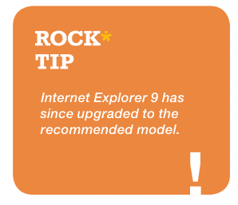

这意味着，当我们需要监听特定事件（例如点击某个元素或聚焦一个 `input`）时，我们必须确定是使用标准化的 `addEventListener` 还是 IE 的 `attachEvent`。如果我没有使用 `attachEvent`，请理解这仅仅是为了简洁而省略（或者因为它没有必要——IE8 无法利用该功能或 API），你应该提供自己的 `addEvent` 解决方案。

这里有一个你可以使用的方案：

```javascript
var addEvent = (function () {
    var filter = function(el, type, fn) {
        for ( var i = 0, len = el.length; i < len; i++ ) {
            addEvent(el[i], type, fn);
        }
    };
    if ( document.addEventListener ) {
        return function (el, type, fn) {
            if ( el && el.nodeName || el === window ) {
                el.addEventListener(type, fn, false);
            } else if (el && el.length) {
                filter(el, type, fn);
            }
        };
    } else {
        return function (el, type, fn) {
            if ( el && el.nodeName || el === window ) {
                el.attachEvent('on' + type, function () { return
                    fn.call(el, window.event); });
            } else if ( el && el.length ) {
                filter(el, type, fn);
            }
        };
    }
})();
```

```javascript
// usage
addEvent( document.getElementsByTagName('a'), 'click', fn);
```

这个函数简单地将为单个或多个元素绑定跨浏览器事件监听器的过程进行了标准化。我们可以像这样使用这个自定义的事件监听器：

```javascript
var lis = document.getElementsByTagName('li');

// 参数 1 - 要应用事件的元素
// 参数 2 - 事件类型
// 参数 3 - 要执行的函数

addEvent(lis, 'click', function() {
    alert('clickety clack!');
});
```

另一方面，如果你是 JavaScript 世界的新手，且主要熟悉 jQuery，那没关系；忽略整个函数即可。你不会用到它的！这里没什么好看的，各位；请继续阅读。

接下来的旅程，我们将进入 HTML5 的简史。我知道你在想什么：“嗯……我直接跳到第三章吧。”别这样做！

### 浏览器支持

本书中包含许多显示各种功能在不同浏览器中支持情况的图表。显示的时间范围主要从 2006 年到 2011 年，旧版本和未来版本则分布在两端，如本简介中所显示。这使你能够比较功能的相对可用性，因为某些浏览器的版本/发布周期非常快（如 Chrome），而其他浏览器则较为宽松（如 Safari）。在本书的其余部分，完全支持用深橙色表示，部分支持用浅橙色表示，不支持则用浅灰色表示。

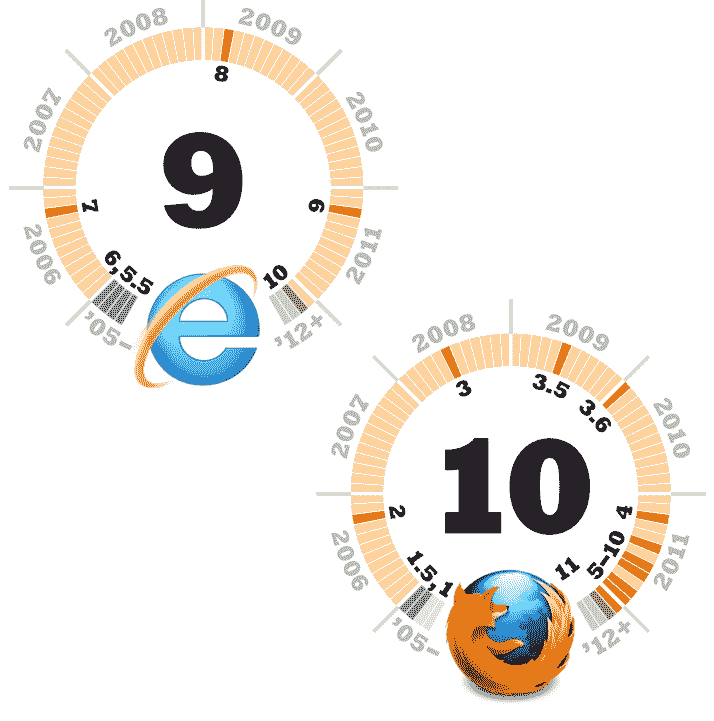

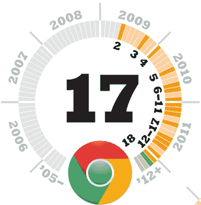

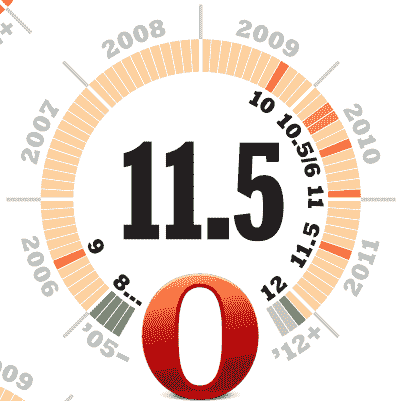

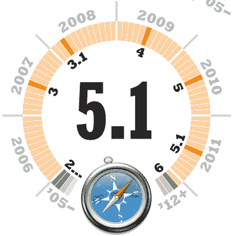


## HTML5 的历史

这就是你通常会跳过的那一章。在这一章中，我不会详细写一行代码，而是描述导致你现在所认知的 HTML5 出现的关键事件。我们中的有些人觉得这些东西很有趣，但当然，当你拿起这本书时，历史课可能不是你心中所想的。

等等——你还在看？那我们就开始吧。我们不会追溯到最开始，那得单独写一本书。相反，我们将时钟拨回到九十年代末 HTML 4.01 发布的时候。

### W3C, WHATWG 和 HTMLWG 之间有什么区别？

- **W3C** – 一个以开发 Web 标准为唯一目的的社区。
- **WHATWG** – 在 W3C 的一些成员对 XHTML 2.0 的发展方向感到不安后成立。他们更倾向于一种不同的、不那么激进的方法，即对现有的 HTML 进行扩展。
- **HTMLWG** – 当 W3C 最终意识到 XHTML 2.0 并非未来时，他们表示希望与 WHATWG 合作开发最终成为 HTML5 的标准。为此，他们成立了 HTMLWG。

如果这听起来仍然令人困惑，别担心。继续阅读以了解完整的故事。

### HTML vs. XHTML

就在 HTML 演进到 4.01 版本（约 1998 年）前后，局面开始发生了一些变化。开发者们开始讨论 W3C 正在研究的下一个新事物：XHTML，其全称为“可扩展超文本标记语言”（Extensible Hypertext Markup Language）。最初的 1.0 规范与 HTML 4.01 几乎完全相同，唯一的区别是引入了一种新的 MIME 类型 `application/xhtml+xml`。

信不信由你，我们一直能够（在绝大多数情况下）省略属性值周围的引号，并且不包含闭合标签。然而，直到最近，这被广泛认为是一种糟糕的实践。对于读者中的年轻人来说，我们将此视为糟糕实践的原因在很大程度上是因为 XHTML 的流行。

把 XHTML 想象成你的祖母。当她来访时，她强迫你刷牙、站直并吃完豌豆。现在将*牙齿*、*姿势*和*豌豆*替换为*引号*、*自闭合标签*和*小写标签名*。

虽然我大多是在开玩笑，但我们当时认为 XHTML 1.0 是一件好事——是**下一步**。它要求设计者和开发者在创建标记时遵循一套标准。这怎么会不好呢？讽刺的是，尽管我们遵循了这些新规则，但我们大多数人仍然使用 `text/html` MIME 类型来提供页面，这意味着浏览器并不真正关心我们**如何**创建标记。这样，XHTML 就可以是**可选的**。

所以，我们以某种严格的方式编写标记，以通过对浏览器渲染毫无影响或作用的 XHTML 验证。有点奇怪，对吧？

### XHTML 1.1

这一切随着 XHTML 1.1 的引入而改变——这是一个向纯 XML 的重大转变。在这次发布中，`application/xhtml+xml` MIME 类型成为了强制要求。当然，在理论上这听起来像是自然的下一步，但存在几个明显的问题。

#### 1. “保存到磁盘”

首先，Internet Explorer 无法渲染具有此 MIME 类型的文档。相反，它会弹出**保存到磁盘**的对话框。天哪！

> 我一段时间以来一直在 IEBlog 的评论中看到有人要求 IE 支持 `application/xml-xhtml` MIME 类型。我应该说 IE7 将不会添加对该 MIME 类型的支持——当然，当以 `text/html` 形式提供且假设其遵循 HTML 兼容性建议时，我们将继续读取 XHTML。 — Chris Wilson

#### 2. 毫不留情

其次，XHTML 1.1 有点像《哈利·波特》中的乌姆里奇教授：极其严苛。你是否注意到，如果你漏掉一个闭合的 `</li>` 标签，浏览器根本不会有反应？浏览器很聪明，会补偿你**损坏的**标记（稍后详细讨论）。虽然如今社区开始接受并利用这一事实，但在 XHTML 时代，W3C 希望强制执行 XHTML 更严格的语法。尽管到那时为止，开发者在漏掉闭合 `<head>` 或 `<body>` 标签时还能幸免，但 W3C 实现了一套新的*首错即失败*系统，称为*严厉的错误处理*（draconian error handling）。如果检测到错误，浏览器将被要求停止渲染页面并显示相应的错误消息。就像我说的：对于标记语言来说，这简直残酷至极。

## HTMLunnels 的历史

结果是，我们中很少有人使用过 XHTML 1.1；因为它太冒险了。相反，我们采用了通用的 XML 最佳实践，并继续将我们的页面作为 `text/html` 提供服务。

### XHTML 2

在 W3C 看来，HTML 4 已经完成了使命。他们甚至关闭并重新组建了 HTML 工作组，并将重点转移到 XHTML —— 或者说，在那个时间点是 XHTML 2.0。

XHTML2 是一次尝试划清界限、修复网络并纠正 HTML 错误的行为。虽然这听起来很美好，但事实上，它激怒了社区中的许多人，因为它的设计初衷就不是为了与 HTML 4 向后兼容。事实上，它与 XHTML 1.1 也完全不同！

明白我的意思了吗？实际上，他们为了追求一种纯粹的基于 XML 的方法，而忽略了当前的 Web 现状及其开发者的需求。期望如此巨大的转变根本是不切实际的。

XHTML2 最终从未定稿。

### 战斗，战斗，战斗！

（好吧，不像《搏击俱乐部》那么激进。）就在这个时候，“**嘿 —— 也许我们应该回归 HTML 并基于此进行开发**”的想法再次出现。Web Forms 2.0 的工作已经开始，它成功地重新激发了人们对 HTML 的兴趣，而不是为了 XHTML2 而将其彻底废弃。这一想法在 2004 年的一次 W3C 工作坊中得到了检验，当时 HTML 的拥护者们陈述了他们的理由，以及他们在 Web Forms 2.0 中已经完成的工作。

不幸的是，该提案被拒绝了，理由是它不符合致力于研发 XHTML2 的最初目标。

毋庸置疑，这次拒绝激怒了组内的一些成员，包括来自 Mozilla 和 Opera 的代表。

随后，该群体分道扬镳，在（由于缺乏更好的词汇）对 XHTML 2 的发展方向感到愤怒之后，成立了 [WHAT 工作组](https://whatwg.org/)（即 *Web Hypertext Application Technology Working Group*）。他们的目标是避免“把孩子和洗澡水一起倒掉”。通过三个规范继续并扩展 HTML 的开发：Web Forms 2.0、Web Apps 1.0 和 Web Controls 1.0。

### 两条黄金法则

这个新组织将秉承两个核心原则：

- 向后兼容至关重要。不要忽略现有的 Web。
- 规范和实现**必须**相互匹配。这意味着规范必须极其详尽（因此会有 900 页之多）。

> *因此，Web Hypertext Applications Technology 工作组旨在解决 Web 应用程序需要一个统一开发环境的需求。为此，工作组将创建旨在由大众市场 Web 浏览器（特别是 Safari、Mozilla 和 Opera）实现的技术规范。*
>
> — [WHATWG.org](https://whatwg.org/)

### 解析器

虽然 XHTML 2.0 旨在强制执行完美的 XML，但 WHAT 工作组反而承担起记录 HTML 究竟是如何被[解析](http://www.w3.org/TR/html5/syntax.html)以及应该如何被解析的任务 —— 这是一项为期五年的艰巨任务！


记得我们讨论过浏览器如何出色地补偿你写错的标记吗？有趣的是，在 WHAT 工作组创建之前，没有任何规范向浏览器厂商提供关于如何处理错误的指令。这自然引出了一个问题：浏览器是如何让彼此的错误处理保持一致的？答案是通过不懈的（虽然至关重要的）逆向工程。Firefox、Safari 和 Opera 复制了 Internet Explorer 的实现，而 Internet Explorer 则逆向工程了 Netscape 的处理方式。

在五年的时间里，WHATWG 绘制出了现在被称为[HTML5 解析器](https://html5.org/spec/)的蓝图。不要低估这是一项多么重大的成就。如今，所有现代浏览器都根据此规范的指南来解析 HTML。虽然它可能不像`canvas`那样时髦，但 HTML5 解析器是一个巨大的成就。

### 沙地上的界线

正如你所料，沙地上被划出了一道虚拟的界线。你要么支持 XHTML2，要么支持（最终演变为）HTML5。

WHATWG 没有采用成员辩论并投票决定最佳方案的共识法，而是在 Ian Hickson 的领导下，采取了更像“独裁者”的姿态。

### 等等 —— 独裁者？！

我们通常不是尝试推翻这些权力掌控者吗？怎么回事？我必须承认，从理论上听起来很糟糕，不是吗？一个人决定 Web 的未来。我们竟然偏好这种系统？从政治上讲，是的，独裁是个坏主意。但当你从 Web 的角度考虑时，想象一下事情能被完成得快多少。当一个社区像我们这样充满激情时，由于辩论没完没了，事情往往进展得非常缓慢。

> Web 应该由技术优势驱动，而非共识驱动。W3C 假装相反，并为此浪费了大量时间。WHATWG 则不然。
>
> — Ian Hickson

虽然 WHATWG 内部肯定（且理应）会有讨论，但最终，除非该组和社区强烈反对某项特定决定，否则由 Ian Hickson 拍板。在这种情况下，他要么被弹劾（不是比尔·克林顿那种方式），或者更常见的是，他会重新评估并撤销决定。

尽管如此，这肯定不是理想状态。W3C 拥有缓慢而稳定的共识法，许多人仍然偏好这种方式。另一方面，虽然 WHATWG 节奏更快，但确实会出现一些小故障。然后，当你将这两个组结合在一起时，情况有时会变得有点混乱！

#### 时间标签 debacle（混乱事件）

2011 年 10 月，Ian Hickson 采取初步措施，准备将新的 HTML5 元素`time`从规范中移除。取而代之的是更通用的`data`。用他自己的话来说：

> `<time>` 有几个用例：
>
> a. 通过 CSS 更容易地对日期和时间进行样式设置。
>
> b. 一种标记文章发布日期/时间的方法（例如用于转换为 Atom）。
>
> c. 一种标记机器可读的时间和日期的方法，用于 Microformats 或微数据。
>
> 用例 A 和 B 似乎没有太多吸引力。
>
> 用例 C 适用于不仅仅是日期的情况，而对于日期和时间之外的内容缺乏解决方案，这对许多社区来说是个问题。
>
> 提案：我们放弃用例 A 和 B，将`<time>`转向用例 C，将其更改并使其像用于机器可读数据的`<abbr>`一样，主要供 Microformats 和 HTML 的微数据功能使用。 — Ian Hickson

他可能没有意识到的是，社区中的许多人实际上确实在使用`<time>`标签。此外，他们（包括我在内）认为，虽然拟议的`<data>`标签更灵活，但过于模糊；在语义方面，`<data>`的意义与`<span>`差不多。在引起社区剧烈反弹后，HTMLWG 宣布必须撤销对`<time>`的更改。他们给了 Ian 一个很短的期限来完成撤销。虽然过程中还伴随了一些戏剧性的插曲，但次月`<time>`得到了恢复。

这一系列事件证明，尽管 Ian 有权强力推进此类变更，但整个 Web 社区 —— 当然还包括浏览器厂商 —— 对规范拥有相当大的控制力。规范的制定者与将这些新元素和 API 集成到项目中的作者之间存在差异。如果作者不使用它们，它们留在规范中也没有意义。记住：你对 Web 形态的控制力比你认为的要大得多！

订阅各种邮件列表并大声表达你的看法！否则，像 Ian 这样的人将不知道你是否使用了这些新功能，以及如何使用。

> 是否有任何数据表明人们在实践中是如何使用`<time>`的？也就是说，它是否真的给任何人带来了它假设的益处？ — Ian Hickson 的评论

## HTML5 的历史

### 规范的成型

虽然有些人可能认为是由一小群人决定了 Web 的未来，但事实远非如此。在制定规范时，有三个派系拥有同等的分量。

1. **规范创建者** – 显而易见……
2. **作者** – 像我们这样的人；如果我们拒绝（即不使用）某个特定的元素或 API，那么它就等同于胎死腹中夭折。
3. **厂商** – 浏览器在这些规范中拥有巨大的话语权，而且很多时候在引领方向。

如果你想了解更多关于`<time>`元素的争议，请[查看 bug 讨论帖](https://www.w3.org/Bugs/Public/show_bug.cgi?id=8000)以及 Ian 关于该主题的 [Google+ 帖子](https://plus.google.com/1047454969834467389/posts/eXaJcV4YvVh)。这两篇阅读起来都很有趣，而且事情并非像你想象的那么非黑即白。

## 回到 W3C…

回到 W3C 与 WHATWG 的恩怨。其实，与其说是恩怨，不如说是两个团体在几年时间里互相忽略。

虽然 WHATWG 的工作进展相对迅速，但 W3C 关于 XHTML 2.0 的工作——我该怎么说呢——进展不顺（几乎停滞不前）。随着时间的推移，人们越来越清楚 XHTML 2.0 并不是解决方案（尽管直到 2009 年它才被完全放弃）。2006 年，W3C 妥协了，并表示他们有兴趣与 WHATWG 合作开发（将来的）HTML5。他们为此专门成立了另一个小组：HTMLWG，即超文本标记语言工作组。

他们打算将 WHATWG 的工作作为继续开发 HTML 的基础。很奇怪，对吧？现在我们有了两个不同的团体：W3C HTMLWG 和 WHATWG。从技术上讲，W3C 还没有放弃 XHTML。尽管如此，作为新成立的 HTMLWG 的一部分，他们将 Web Apps 1.0 重命名为 HTML5。

> Apple、Mozilla 和 Opera 允许 W3C 在 W3C 版权下发布规范，同时在 WHATWG 网站上保留一个具有较宽松许可证的版本。 — [WHATWG.org](http://WHATWG.org)

### 现状

如今，WHATWG 和 W3C 在 HTML5 上相互协作。这是一种有点奇怪的关系，但由于有大量极其热情的活动人士不断推动，它在某种程度上得以正常运作。

# HTML5 的现状

在过去的几年里，HTML5 的普及率飞速增长。你无疑在网络上无数个“流量导向”的 Web 开发教程（甚至包括[我的](http://example.com)）的标题中见过 HTML5。你的客户和非开发者的朋友可能也在随口说着 HTML5 和 CSS3 这些词，就好像他们对这些技术是什么，或者它们如何改进网站有哪怕一点点概念似的。

我的一个兄弟——同样也是一名开发者——最近告诉我，他的老板傲慢地指示他“放弃 JavaScript，拥抱 HTML5”……是的，这种人确实存在。无论好坏，HTML5 已经正式成为了一个流行术语（buzz word）。

记得 2009 年吗？当时全世界才发现 Twitter——而技术社区（感谢 Oprah）早在很久以前就接纳了它。突然之间，每个新闻频道和脱口秀主持人觉得有必要抛出 Twitter（或 "Twitters"）这个词，仿佛它拥有某种神奇的能力，能增加他们的“酷点”。嗯，HTML5 这个词就有点像那样！只要你不走在街上说 "HTML5s"，你就没问题！

## 传闻如何？

当我们使用像“HTML5 的现状”这样的短语时，我们真正的意思是：哪些新特性我们可以可靠地使用，而不会在那些不支持 HTML5 的旧浏览器中破坏我们的 Web 应用程序？或者，哪些通常被称为“边缘特性（edge features）”的功能还没有准备好用于日常使用？

一个非常值得收藏和参考的资源是 [CanIUse.com](http://caniuse.com)。例如，如果我想知道哪些浏览器可以使用本地存储（local storage），在该网站上搜索这个词会发现，现在大多数浏览器都可以使用，除了 Internet Explorer 7 及以下版本以及 Safari 3。

### 浏览器大战

幸好，在过去的两年里，随着 Firefox、Opera 和 Chrome 竞争最佳标准支持（以及最高版本号），我们经历了一个新的浏览器大战时代。同样在这段时间里，随着 Internet Explorer 的市场份额跌至历史低点，微软终于意识到，嘿，标准很重要！虽然他们在很多领域仍然落后，但 Internet Explorer 10 相比其前任有了巨大的进步。

### 2008–2011 年的浏览器支持

[Paul Irish](https://paulirish.com/) 和 [Divya Manian](http://nimbupani.com/) 在 Web 开发社区中非常活跃，并构建了各种有用的工具，例如 [HTML5 Boilerplate](https://html5boilerplate.com/)、[CSS3 Please](http://css3please.com/) 和 [HTML5 and CSS3 Readiness](http://html5readiness.com/)。其中最后一个提供了一个绝佳的方式来回顾浏览器在过去四年中取得了怎样的进步。

## HTML5 的现状

无需多言，2010 年和 2011 年在各种新 HTML5 和 CSS3 模块的浏览器支持方面取得了重大进展。现在是成为 Web 设计师或开发者的绝佳时机！我鼓励你稍微尝试一下这两个网站。

虽然我可以啰嗦地谈论关于 HTML5 解析和本地存储等杂项特性的浏览器支持，但事实是：你（目前）并不在乎。我们需要先学习如何使用这些技术，然后才能担心浏览器支持和 polyfills。

### 等等 —— Polyfills？

我承诺过不用令人困惑的术语，但在第 2 章我就抛出了像 "polyfill" 这样的词！别担心，这只是个词。让我们假设你想利用 HTML5 显示日期选择器的能力。我们可以创建一个`type`为`date`的表单`input`来完成这个任务。

```html
<input type="date">
```

它会如何显示？说实话，这取决于你的浏览器。在撰写本文时，你会看到：

糟糕！Firefox 9 不支持。Internet Explorer 9？别想了！如果我们能利用 Opera 出色的日期选择器支持，同时为旧浏览器提供 JavaScript 回退方案，那该多好？当然太好了！这就是 "polyfill" 这个术语发挥作用的地方。

现在，先把这个概念存起来。我们稍后会在本书中提到它。

> **ROCK 技术术语**
>
> **Polyfill** 是我们所称的 shim（垫片），它模拟 API，为功能较弱的旧浏览器提供回退功能。Remy Sharp 可以告诉你[更多关于 polyfills 的信息](more about polyfills)。

### 语义化标记

### 浏览器支持

虽然 HTML5 确实为我们提供了许多有趣的新 API（你很快就会学到），但我们现在还可以使用大量能更准确地描述内容的 HTML 元素。

## 示例

- 你通常将博客文章包裹在`div`中吗？现在，你可以使用更合适的`article`元素。
- 那么网站的页脚呢，也就是你列出版权信息和附加链接的地方？使用 HTML5，你可以使用命名恰当的`footer`元素。

## 应该删除什么

在我们深入探讨这些各种新 HTML 元素之前，先来学习哪些内容可以安全地删除！请参考以下典型的（但已过时的）HTML 页面。

```html
<!DOCTYPE HTML PUBLIC "-//W3C//DTD HTML 4.01 Transitional//EN" "http://www.w3.org/TR/html4/loose.dtd">
<html>
<head>
<meta http-equiv="Content-Type" content="text/html; charset=UTF-8" />
```

### 语义化标记

```html
<title>Old</title>
<link type="text/css" rel="stylesheet" href="style.css" />
<script type="text/javascript" src="scripts.js"></script>
</head>
<body>
  <h1> My Old Site </h1>
</body>
</html>
```

上面的标记没有特别的错误。即便如此，其中仍然有不少冗余的部分，可以很轻易地将其删除。

是时候“修剪”一下了。让我们从顶部开始，由上至下，剪掉、剪掉、剪掉。

### DOCTYPE

首先，是我们那个令人困惑的`DOCTYPE`。

```html
<!DOCTYPE HTML PUBLIC "-//W3C//DTD HTML 4.01 Transitional//EN" "http://www.w3.org/TR/html4/loose.dtd">
```

承认吧：你从来没有记住过这段代码。我肯定没记住！现在，我们可以使用一个更短、更简单的版本。

```html
<!DOCTYPE html>
```

> 但是 Jeffrey，旧版浏览器怎么办？我们不能忘记它们！

不必担心。所有浏览器在看到这个`DOCTYPE`时，无论浏览器版本是否支持 HTML5，都会将内容切换到标准模式。这意味着你可以毫不犹豫地在所有项目中使用这个较短的`DOCTYPE`。

### 找点乐子

我们不能总是这么严肃。事实上，你可以个性化`DOCTYPE`，即便只是为了给那些疯狂地爱看查看源代码的孩子们一个傻傻的奖励。

```html
<!DOCTYPE html public ''>
```

看到`public`之后的那些引号了吗？那是你的空间。随心所欲地写——浏览器并不在意。考虑到现在大多数孩子都患有注意力缺陷多动障碍（ADD），让我们通过提供一个 unicode 视频游戏控制器来吸引他们的注意力。

```html
<!DOCTYPE html public '🎮'>
```

或者写一些关于开发者礼仪的智慧之言？

```html
<!DOCTYPE html public 'Publicly calling out your fellow developers
is in poor taste. Be constructive, but polite.'>
```

### meta

接下来，我们遇到了另一个长字符串：`meta`标签。这里是声明文档字符编码的地方。

```html
<meta http-equiv="Content-Type" content="text/html;
charset=UTF-8" />
```

让我们把整个东西替换成一个更容易记住的形式。

```html
<meta charset="utf-8">
```

太棒了！同样地，我们可以在所有当前浏览器中可靠地使用它。现在，如果你在想，“Jeffrey，你弄错了。闭合斜杠去哪了？”，很重要的一点是，这样做一直以来都是可选的。随着 XHTML 的兴起，我们（以及验证器）认为始终以这种方式闭合标签是最佳实践。然而，它们一直都是 100% 可选的。不过，如果这样做能让你在“教会”面前保持良好形象，请随意继续使用`/>`来闭合标签。我对此不会失眠的。

#### script 和 link 的 Type

在本示例的最后，我们来看看`link`和`script`标签。

```html
<link type="text/css" rel="stylesheet" href="style.css" />
<script type="text/javascript" src="scripts.js"></script>
```

在引用样式表和脚本时，我们可以移除`type="text/css"`和`type="text/javascript"`，因为包含它们是冗余的。这些是默认类型。

```html
<link rel="stylesheet" href="style.css">
<script src="scripts.js">
```

既然说到这里，`script`文件很可能不需要在页面的`head`部分加载。

经过最后的修改，我们的示例标记现在应该是这样的：

```html
<!DOCTYPE html>
<html lang="en">
<head>
<meta charset="utf-8">
<title>New</title>
<link rel="stylesheet" href="style.css">
</head>
<body>
<h1> My New Site </h1>
<script src="scripts.js"></script>
</body>
</html>
```

> **ROCK* 提示**
>
> 务必记得包含这个标签，并将其置于`title`标签之前。没有指定字符集的页面可能会让 Internet Explorer 用户面临 XSS 攻击。从技术上讲，规则是它需要被声明在页面的前 512 个字节之内。

> **ROCK* 提示**
>
> 如果一个脚本对于页面的立即显示或功能并非至关重要，那么将脚本放在页面底部，就在闭合的`body`标签之前，性能会更高。

#### 可选的引号

除非必须使用引号，否则它们是可选的。这意味着，就像我们可以写`role="main"`一样，我们也可以省略引号：`role=main`。但请注意，在某些情况下引号是必需的，例如应用多个类名时。

```html
<!-- 错误 -->
<div class=wrap main>

<!-- 正确 -->
<div class="wrap main">
```


在这种情况下，由于空格的存在，HTML5 解析器会错误地认为 `main` 是一个属性名，而不是一个值。以下所有写法在 HTML5 中都是完全可以接受的。

```html
<div class="box">
<div CLASS="box">
<div class=box>
```

就像我们在前几页讨论的所有内容一样，是否选择用引号包裹属性取决于你。大多数深受 XHTML 教义影响的编码人员会发现很难改回来。他们甚至可能将其视为 `sloppy`（邋遢）的标记。事实是，在这种情况下，这纯粹取决于个人喜好。我发现我通常更倾向于使用引号，而其他开发人员则喜欢省略它们。

重要的是要记住（见第一章），HTML5 不是 XHTML。XHTML 验证器强制执行各种限制，例如闭合标签和将所有属性包裹在引号中。但浏览器从未真正在意过。无论是否有引号，它们一直都能读取你的 HTML 页面。

> 当我像这样编写 HTML（省略引号）时，我感觉太棒了。就像在自己公寓里裸奔一样。
>
> — Paul Irish

### 不必要的闭合标签

我告诉你一个秘密：许多 HTML 标签在技术上是可选的。这包括从 `html` 标签到 `tbody` 的所有内容。事实上，以下代码片段可以正常工作。

```html
<!DOCTYPE html>
<meta charset=utf-8>
<title> Wil Wheaton Fan Site </title>
<h1> Psych! Die Wil Wheaton! </h1>
```

浏览器会自动正确地插入缺失的标签。不信？将之前的代码片段粘贴到文件中，并在浏览器中查看。这里是 Chrome 开发者工具中元素检查器的快照。

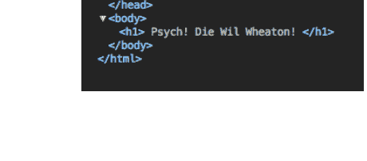

很酷，对吧？有很多标签是可以省略的。把那些没用的东西去掉吧。别担心，浏览器会帮你搞定。此外，许多闭合标签也是可选的。如果不存在，浏览器会自动添加它们。在下面的示例中，`html`、`head`、`body` 和 `li` 的闭合标签都被省略了。

```html
<!DOCTYPE html>
<html>
  <head>
    <meta charset="utf-8">
    <title> Wil Wheaton Fan Site </title>
  <body>
    <ul>
      <li> Die
      <li> Wil
      <li> Wheaton
    </ul>
```

现在，关于结构肯定有很多可以讨论的。我并不是建议你做得太疯狂，但了解浏览器的工作原理总是很有帮助的。如果闭合列表项能让你感到安心（且有“衣服”遮体），那么请尽管闭合它们。但是，千万不要认为如果省略这些闭合标签，浏览器就会崩溃。我保证——它们不会。

> **ROCK* 提示**
>
> 虽然我倾向于闭合大多数标签，但在写博客文章时，我经常利用这个技巧。在创建无序列表或段落时，我很少添加闭合标签。

### HTML5 化

2008 年，Opera MAMA 分析了数百万个 URL，以确定最受欢迎的 id 和类名。正如你所预期的，排在名单顶端的是我们所有人都非常熟悉的名称：`#header`、`#footer` 和 `.wrapper`。

为了更好地描述我们的内容，创建新的 HTML 元素来填充这些角色显然是有意义的。既然可以使用更合适且更有意义的元素，为什么还要使用没有意义的 `div` 呢？

### 分区元素

#### `header` 和 `footer`

我们现在可以使用 `header` 和 `footer` 元素了，尽管它们的用途肯定会超出传统的页面页眉和页脚位置。参考以下典型的布局。

```html
<div id="header">
    <h1>My Website</h1>
    <ul>
        <li><a href="#">Home</a></li>
        <li><a href="#">About</a></li>
        <li><a href="#">Contact</a></li>
    </ul>
</div>
<div id="main">
    <div class="article">
        <h1> My Blog Post </h1>
        <h4> Posted <a href="#">today</a> </h4>
        <p> My post content goes here. </p>
    </div>
</div>
<div id="footer">
    <h5>My Website - 2011</h5>
    <ul>
        <li><a href="#">Home</a></li>
        <li><a href="#">About</a></li>
        <li><a href="#">Contact</a></li>
    </ul>
</div>
```

### 43 语义化标记

上面的标记对你来说肯定很熟悉。这是一个典型的基础布局：页眉、主体内容，然后是页脚。让我们将这段标记 HTML5 化，并移除那些现在已经多余的 id。

我们首先将 `<div id="header">` 和 `<div id="footer">` 都替换为更合适的 `header` 和 `footer` 元素。

```html
<header>
  <h1>My Website</h1>
  <ul>
    <li><a href="#">Home</a></li>
    <li><a href="#">About</a></li>
    <li><a href="#">Contact</a></li>
  </ul>
</header>
<div id="main">
  <div class="article">
    <h1> My Blog Post </h1>
    <h4> Posted <a href="#">today</a> </h4>
    <p> My post content goes here. </p>
  </div>
</div>
<footer>
  <h5>My Website - 2011</h5>
  <ul>
    <li><a href="#">Home</a></li>
    <li><a href="#">About</a></li>
    <li><a href="#">Contact</a></li>
  </ul>
</footer>
```

请注意，虽然在传统的 *page-header*（页面页眉）和 *page-footer*（页面页脚）格式中使用这两个元素是完全没问题的，但你的使用范围并不局限于此。例如，使用 `header` 标签来指定博文的页眉，或者放置标题、文章元信息、所属分类等信息的区域，也是非常合适的。此外，如果你的文章底部包含链接到其他相关文章或社交网络链接的信息，你也可以随意地将这段标记包裹在 `footer` 标签中。

### 44 语义化标记

#### `nav`

接下来，让我们处理导航链接。在目前的形式中，我们有一个简单且可用的无序列表。

```html
<ul>
    <li><a href="#">Home</a></li>
    <li><a href="#">About</a></li>
    <li><a href="#">Contact</a></li>
</ul>
```

这段标记本身没有任何问题，但我们必须问自己：“这段标记是否描述了这些链接？”并没有。它最多描述了“一个链接列表”，仅此而已。

让我们将这段标记包裹在新的 `nav` 标签中。

```html
<nav>
    <ul>
        <li><a href="#">Home</a></li>
        <li><a href="#">About</a></li>
        <li><a href="#">Contact</a></li>
    </ul>
</nav>
```

你的第一个想法可能是：“等等——我还是有一个无序列表，而且现在又多加了一个标签。这一切是为了什么？”

在创建标记时，我们的工作是尽可能清晰且无障碍地描述内容。这就是为什么比起直接堆叠多个锚点标签，将一组链接包裹在无序列表中更为理想。当然，你这样做也能实现功能，但它不像无序列表那样能很好地描述内容。对于新的 HTML5 元素来说也是如此。

始终考虑无障碍性，或者更直接地说，考虑你的内容是如何被屏幕阅读器解释的。当屏幕阅读器扫描你的页面时，它如何知道你的导航链接实际上是网站导航链接，而不是你最喜欢的网站链接？它无法知道。然而，HTML5 为我们提供了解决这个问题的方法。现在，假设屏幕阅读器已升级到可以解释 HTML5，它就能准确地定位你的导航区域。请注意，与页眉和页脚一样，你并不局限于使用单个 `nav` 元素。在页面页脚中同样有可能包含另一组导航链接。

> ROCK' TIP
>
> 作为一项经验法则，不要过度使用 `nav` 元素，否则你会完全违背使用它的目的！如果你将网站上的每一个链接列表都包裹在 `nav` 元素中，屏幕阅读器将再次无法判断哪个列表具体是指网站导航。

### 45 语义化标记

#### `article`

在 HTML5 之前，我们被迫使用毫无意义的类名来指定和定位文章、新闻条目或博文。现在，在这些情况下我们可以使用 `article` 元素。同样请记住，应用 `article` 的 `class` —— `<div class="article">` —— 仅仅是为你提供了一个定位或定义该区域样式的钩子，它并没有描述其中的内容。

如果我们回到那个正在逐步改进的标记，目前应该是这样的：

```html
<header>
    <h1>My Website</h1>
    <nav>
        <ul>
            <li><a href="#">Home</a></li>
            <li><a href="#">About</a></li>
            <li><a href="#">Contact</a></li>
        </ul>
    </nav>
</header>
<div id="main">
    <div class="article">
        <h2>My Blog Post</h2>
        <h4>Posted <a href="#">today</a></h4>
        <p>My post content goes here.</p>
    </div>
</div>
<footer>
    <h5>My Website - 2011</h5>
    <nav>
        <ul>
            <li><a href="#">Home</a></li>
            <li><a href="#">About</a></li>
            <li><a href="#">Contact</a></li>
        </ul>
    </nav>
</footer>
```

一旦我们将 `<div class="article">` 替换为更合适的 `article` 标签，我们就得到了：

```html
<header>
    <h1>My Website</h1>
    <nav>
        <ul>
            <li><a href="#">Home</a></li>
            <li><a href="#">About</a></li>
            <li><a href="#">Contact</a></li>
        </ul>
    </nav>
</header>
<div id="main">
  <article>
    <h2> My Blog Post </h2>
    <h4> Posted <a href="#">today</a> </h4>
    <p> My post content goes here. </p>
  </article>
</div>
<footer>
  <h5>My Website - 2011</h5>
  <nav>
    <ul>
      <li><a href="#">Home</a></li>
      <li><a href="#">About</a></li>
      <li><a href="#">Contact</a></li>
    </ul>
  </nav>
</footer>
```

> `article` 元素代表文档、页面、应用程序或网站中一个自包含的组合，原则上它是可以独立分发或复用的，例如在综合推送中。它可以是一个论坛帖子、一篇杂志或报纸文章、一篇博客条目、一条用户提交的评论、一个交互式小部件或工具，或者任何其他独立的内容项。 — HTML5 规范

虽然前一个示例中的实现是 `article` 标签最明显的使用场景，但它也可以用于各种情况。判断是否使用 `article` 标签的一个简单方法是自问：“这段内容是否可能被……”

#### `header` 的另一个使用场景

记得我提到过 `header` 标签并不局限于页面页眉吗？将它用作 `article` 的 `header` 也是非常合适的。

```html
<div id="main">
  <article>
    <header>
      <h2> My Blog Post </h2>
      <h4> Posted <a href="#">today</a> </h4>
    </header>
    <p> My post content goes here. </p>
  </article>
</div>
```

#### `main` 元素？

你可能已经注意到一个明显的缺失：`main` 或 `main-content` 元素。不幸的是，目前还没有这样一个元素。为了更好地描述网站主体内容区域的边界，我们可以利用 [WAI ARIA](https://www.w3.org/WAI/standards-guidelines/aria/) 的 `roles`（角色）。

```html
<div id="main" role="main">
```

`role` 属性为我们提供了另一种描述内容的方式 —— 在本例中是 `main` 区域。

简单来说，`<div role="main">` 向屏幕阅读器发出信号，表明这就是网页主体内容所在的部分。

> **ROCK TIP**
>
> WAI ARIA 定义了一种让网页应用程序对残障人士更无障碍的方法。除 Internet Explorer 7 及以下版本外，所有浏览器均支持该功能。

### 46 语义化标记

#### 钩子（Hooks）

更棒的是，我们可以将 `role` 属性作为样式表中的钩子。这意味着，如果你愿意，你可以再次移除一个 `id`。

```css
div[role=main] {
    ...
}
```

这种 CSS 选择器风格被称为 *属性选择器*。它允许我们根据元素是否包含某个特定属性来定位页面上的元素。对属性选择器的支持可以追溯到 Internet Explorer 7。

#### `section`

`section` 元素绝对是 HTML5 中最令人困惑的新增内容之一。根据 [规范](link)：

> `section` 元素代表文档或应用程序的一个通用部分。在这种语境下，一个 section 是内容的专题分组，通常带有标题。

仅考虑定义，你可能会认为它也可以用于博文。然而，对于这类内容，`article` 元素仍然更有意义，因为博文更有可能被综合推送。

相反，理解 `section` 元素的一个简单方法是思考报纸。报纸被分为多个板块：体育版、生活版、财经版。这种划分方式可以应用于你的网站。

```html
<section>
    <h1> Sports </h1>
```

快没了... 快没了... 没了。

### 生活

布兰妮·斯皮尔斯剃了她孩子的头。

### 金钱

占领华尔街的胡言乱语。

请注意这里使用了多个 `<h1>` 标签。在 HTML4 中，这种做法是不被推荐的。然而，现在情况不同了。`<section>` 元素会创建一个新的“堆叠”上下文。你必须理解的是，`<section>` 元素并非意在取代 `<div>`。它的用途是将相关的内容分组，而这些内容通常带有一个标题。一个好的经验法则是：如果只需要一个用于定位或样式的包裹元素，那么 `<div>` 是正确的选择。

规范中引用的另一个例子是使用 `<section>` 来划分书籍的章节。

### 第一章

巴拉巴拉巴拉。

### 第二章

巴拉巴拉巴拉。

### 第三章

巴拉巴拉巴拉。

### 语义化标记

#### 附录

巴拉巴拉巴拉。

事实是：如果你仍然对 `<section>` 元素感到不安，你不是一个人。有很多人觉得 `<article>` 和 `<section>` 重叠太多。你怎么看？

#### `aside`

`<aside>` 元素代表页面中与周围内容相关的一个部分。`<aside>` 最明显和最常见的用途是在定义页面侧边栏时。

```html
<div class=container>
    <aside>
        <h2>Sidebar</h2>
        <p>Info...</p>
    </aside>
    <div role=main>
        <p>Main content here.</p>
    </div>
</div>
```

在这个位置，`<aside>` 指的是次要内容。

然而，它也可以用于更具体的情况，例如在 `<article>` 内部。在这种语境下，`<aside>` 指的是与 `<article>` 间接相关的内容，例如一个术语表。


```html
<article>
    <h1>Twitter</h1>
    <aside>
        <h3>Helpful Definitions</h3>
        <dl>
            <dt>Twitters:</dt>
            <dd>Incorrect usage - refers to a grouping of status messages.</dd>
            <dt>Tweet(s):</dt>
            <dd>One or more status updates.</dd>
        </dl>
    </aside>
    <p>The post goes here.</p>
</article>
```

### details

我最喜欢的 HTML5 新标签之一，就是 `details` 元素，它最近才被集成到 Chrome（截至版本 12）中。

#### 它是做什么的？

它本质上允许我们通过点击按钮来显示和隐藏内容。你肯定熟悉这种类型的效果，但在此之前，它总是通过 JavaScript 实现的。想象一个标题旁边有一个箭头，当你点击它时，下方的额外信息就会变得可见。再次点击箭头就会隐藏内容。这种功能非常常见，例如，在 FAQ 页面中。

> **摇滚技巧**
>
> 这是一个两分钟的这种效果的示例。（输入 Control + Enter 来处理 JavaScript。）

`<details>` 元使我们能够完全省略 JavaScript。或者，更准确地说，它最终会实现这一点。浏览器支持仍然有点少。

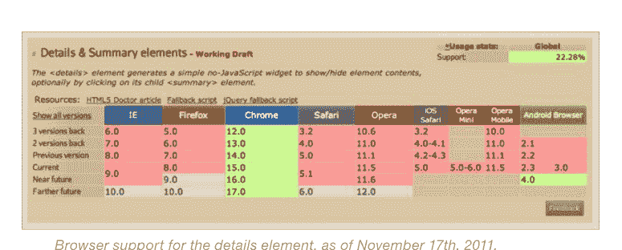

*截至 2011 年 11 月 17 日，`details` 元素的浏览器支持情况。*

#### 一个例子

那么让我们深入了解并学习如何使用这个新标签。我们首先创建一个新的 `details` 元素。

```html
<details>
</details>
```

接下来，我们需要给它一个标题，或者是对所含内容的 `summary`（摘要）。

```html
<details>
	<summary> Who Goes to College? </summary>
</details>
```

默认情况下，在理解 `details` 元素的浏览器中，除了 `summary` 标签之外，其内部的所有内容都将被隐藏。让我们在 `summary` 之后添加一个段落。

```html
<details>
	<summary> Who Goes to College? </summary>
	<p> Your mom. </p>
</details>
```

> ▶ Who Goes to College?
>
> 请在 Chrome 12 或更高版本中测试此演示。

好的，让我们做一些更实用的事情。我想使用 `details` 元素展示各种 Nettuts+ 文章。我们首先为单篇文章创建标记。

```html
<details>
  <summary>Dig Into Dojo</summary>
  
  <div>
    <h3> Dig into Dojo: DOM Basics </h3>
    <p>
      Maybe you saw that tweet: "jQuery is a gateway drug. It leads to full-on JavaScript usage." Part of that addiction, I contend, is learning other JavaScript frameworks. And that's what this four-part series on the incredible Dojo Toolkit is all about: taking you to the next level of your JavaScript addiction.
    </p>
  </div>
</details>
```

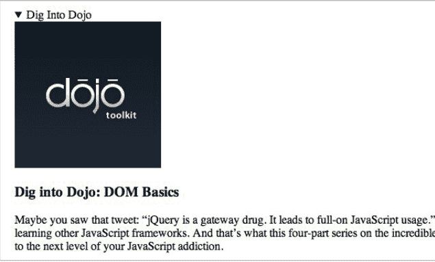

接下来，我们给它添加一点样式。

```css
body { font-family: sans-serif; }
details {
    overflow: hidden;
    background: #e3e3e3;
    margin-bottom: 10px;
    display: block;
}
details summary {
    cursor: pointer;
    padding: 10px;
}
details div {
    float: left;
    width: 65%;
}
details div h3 { margin-top: 0; }
details img {
    float: left;
    width: 200px;
    padding: 0 30px 10px 10px;
}
```

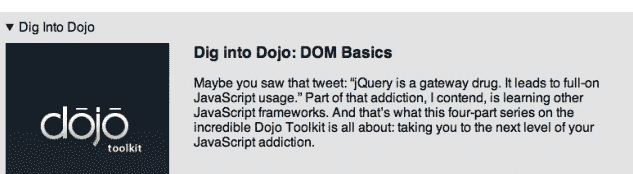

请注意，为方便起见我展示的是 `open` 状态，但当页面加载时，你只会看到 `summary` 文本。如果你希望默认就处于此状态，请在 `details` 元素上添加 `open` 属性：`<details open>`

#### 样式化箭头

样式化箭头本身并不像我们希望的那样简单直接。然而，这是可能的；关键是使用 `-webkit-details-marker` 伪类。

```css
details summary::-webkit-details-marker {
    color: green;
    font-size: 20px;
}
```

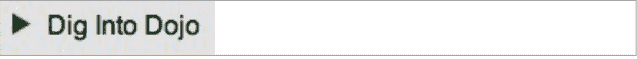

如果你需要使用自定义图标，可能最简单的解决方案是隐藏箭头（使用上面的伪类），然后要么为 `summary` 元素应用背景图像，要么使用 `:after` 或 `:before` 伪元素。

👁️ 查看[最终项目](final project)。

这当然是一个简单的效果，但拥有这样一个内置的通用功能确实很不错。在我们能够可靠地在所有浏览器中使用 `details` 元素之前（目前仅在 Chrome 中可用），你可以使用[this polyfill](this polyfill)来提供后备支持。

最后一点：在撰写本文时，似乎还没有一种方法可以通过键盘来切换内容。这确实带来了一些可访问性问题，尽管正在进行讨论以解决此问题。

### mark

`<mark>` 元素提供了一种突出显示文本以供参考的方法。正如[spec](spec)所述：

> 当在文档的主要正文中使用时，它表示文档中因可能与用户当前活动相关而被突出显示的一部分。

这意味着当我们需要引起用户对特定文本的注意时，我们应该使用 `mark` 元素。最常见的是，这被解释为两种方式。

#### 搜索结果

大多数 CMS 都提供某种形式的内置搜索功能。如果访客在你的博客中搜索 "HTML5"，你可以在搜索结果中将每个出现的术语用 `mark` 元素包裹起来。

```html
<article>
    <h2>Clueless Posting About <mark>HTML5</mark></h2>
    <p class="excerpt">
        In this article, I will talk about how we need to stop
        using JavaScript, and instead embrace <mark>HTML5
        </mark>
    </p>
</article>
```

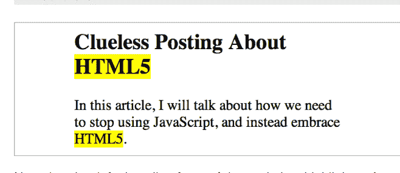

请注意，`mark` 的默认样式是模拟荧光笔。与所有基础样式一样，这可以很容易地被覆盖。

#### 事后

想象你在引用某人的话：

```html
<blockquote>
  <p> I have a strong feeling that the world will end...
  on New Year's Eve. </p>
</blockquote>
```

如果你需要特别注意此人引言中的某个特定部分怎么办？也许新年已经过去。

```html
<blockquote>
  <p> I have a strong feeling that the world will end...
    <mark>on New Year's Eve.</mark> </p>
</blockquote>
```

现在我们正在引导读者关注原始引言中的那个特定部分，从而引起注意，说明此人显然在预测中错了。

### figure

考虑以下图像的标记：

```html

<p>Image of Mars. </p>
```

过去，从未有一种简单或语义化的方式来将说明文字与图像元素本身关联起来。HTML5 通过引入 `figure` 元素纠正了这一点。当与 `figcaption` 元素结合使用时，我们现在可以将说明文字与其对应的内容进行语义化关联。

```html
<figure>
  
```

### 语义化标记

```html
<figcaption>
    <p>This is the Envato leaf.</p>
</figcaption>
</figure>
```

然而，`figure` 元素并不仅限于用于图像。[根据规范](spec)：

> `figure` 元素可用于对文档主体内容中引用的插图、图表、照片、代码清单等进行注释，这些内容可以在不影响文档流畅性的情况下，从主体内容中移开，例如移到页面一侧、单独页面或附录中。

## 行内元素

我敢打赌你不知道所有元素的默认显示方式都是**行内**。你可能认为，是的，有些元素是**行内**的，但其他元素默认是**块级**的，比如 `div` 和 `h1`。这到底是怎么回事？

我们之所以说“默认显示”，是因为每个浏览器在其样式表中就是这样设置这些元素的样式的。然而，如果没有浏览器提供的样式表，所有元素都会默认为 `inline` 显示。这就是我们问题的症结所在。

> **专业提示**
>
> 在那些还不理解新 HTML5 元素的浏览器（如 IE8 和 Firefox/Safari 3）中，没有针对这些新元素的浏览器样式。

你明白我的意思了吗？这些新元素自然会具有 `inline` 显示属性，这在大多数情况下并不理想。你可能需要将你的 `header` 和 `footer` 设置为 `block` 显示。为了绕过这个问题，在样式表中为所有适用的元素显式声明 `block` 显示就非常重要。

```css
header, footer, article, section, nav {
  display: block;
}
```

### 那新浏览器呢？

当前版本的现代浏览器与 HTML5 是“好朋友”，所以这对它们来说不是问题。它们的样式表会**正确地**将这些元素设置为 `block`。在这些浏览器看来，我们这样做只是多余的，但并无害处。在每个新项目中，请将这段代码放在样式表的顶部。

### 该死的 IE

CSS 的创建是为了让我们能够定位和设置 XML 元素的样式。这意味着，从技术上讲，我可以创建一个虚假的 `<jeff> </jeff>` 标签，并在样式表中像往常一样为其设置样式。CSS 并不关心一个标签的功能或目的是什么。它只是在寻找具有指定名称的 XML 元素。

```css
jeff {
    font-size: 30px;
    color: red;
}
```

不幸的是，正如你可能已经知道的，Internet Explorer 8 及更低版本并不总是表现良好。它们完全忽略了新的 HTML 元素！实际上，它们不是“忽略”，而是根本“看不见”它们！这就带来了一个主要的障碍，因为如果 IE 看不见一个元素，我们就无法为其设置样式！如果 Internet Explorer 7 无法识别这些新标签，我们又如何利用它们呢？

幸运的是，有一个解决方案。2008 年，[Sjoerd Visscher](https://) 发现，仅仅在文档的 `head` 部分创建所需的 DOM 元素，就能以某种方式触发 Internet Explorer 来识别它们。

```html
<script>
    document.createElement("article");
    document.createElement("footer");
    document.createElement("header");
    document.createElement("section");
    document.createElement("nav");
    document.createElement("menu");
</script>
```

这些元素甚至不需要被注入到 DOM 中。这个简单的操作就奏效了。很有趣，对吧？我们可以使用 `while` 或 `for` 语句来缩短这段代码，如下所示：

```html
<script>
  var els = ['article', 'footer', 'header', 'section',
    'nav', 'menu'];
  while(els.length) {
    document.createElement( els[0] );
    els.shift();
  }
</script>
```

### HTML5 Shiv/Shim

由于这项技术对于所有 HTML5 网站来说已经变得很普遍，甚至是必需的，[Remy Sharp](https://remysharp.com/) 创建了一个流行且简单的脚本——[HTML5shim](https://github.com/aFarkas/html5shiv/)，它可以轻松地包含在你的项目中。这不仅处理了创建 DOM 元素以让 IE 满意的过程，还确保了在 IE 中打印页面时能正常工作。

> 由于 HTML5 因为我们标记新页面而受到更多关注，而让 IE 承认 `<article>` 等新元素的唯一方法就是使用 HTML5 shiv，所以我快速编写了一个启用所有新元素的小脚本。
>
> — [Remy Sharp](https://remysharp.com/)

由于这个脚本仅适用于 Internet Explorer，我们应该使用条件样式表，以避免在那些无法受益于此脚本的浏览器中添加不必要的 HTTP 请求。

```html
<!--[if lt IE 9]>
  <script src="http://html5shim.googlecode.com/svn/trunk/
    html5.js"></script>
<![endif]-->
```

### 使用选择器 API 进行简单查询

#### 浏览器支持

在本书中，你很快会发现 HTML5（及其相关技术）远不止几个新元素那么简单。

选择器 API 引入了两种查询 DOM 的新方法。你可能已经熟悉 `getElementById()`、`getElementsByTagName` 和 `getElementsByClassName`（最终在 HTML5 中被标准化）。

```javascript
// 获取 id 为 box 的元素
document.getElementById('#box');

// 收集所有列表项
document.getElementsByTagName('li');

// 搜索所有 class 为 'selected' 的元素
document.getElementsByClassName('selected');
```

从技术上讲，选择器 API 并不是 HTML5 的一部分。就像本书中的许多主题一样，它包含在[其自己的 W3C 规范](https://www.w3.org/TR/selectors-api/)中。尽管如此，我们将在后续章节中经常使用以下方法。请注意。

现在我们可以使用已经熟悉的 CSS 选择器来深入 DOM。JavaScript 库（如 jQuery）的用户会感到非常亲切！

#### `querySelector()`

此函数仅返回与指定 CSS 选择器匹配的第一个元素。

```javascript
// 查找第一个 class 为 box 的元素
document.querySelector('.box');
```

```javascript
// 查找第一个具有 placeholder 属性的 input
document.querySelector('input[placeholder]');
```

```javascript
// 查找 #container 内的第一个列表项
document.querySelector('#container li');
```

```javascript
// 获取 role 为 "main" 的 div 内的第一个段落
document.querySelector('div[role=main] > p:first-child');
```

```javascript
// 上面，子元素选择器（'>'）和 ':first-child' 伪类是多余的。
// querySelector 始终会从选择器中返回第一个匹配项。
// 可以重写为：
document.querySelector('div[role=main] p');
```

注意我们如何使用所有这些我们都熟悉的简单 CSS 选择器。然而，巨大的优势在于，我们利用的是浏览器原生的、超高速的引擎来执行查询，而不是使用缓慢的 JavaScript 循环。


`document` 并不总是 `querySelector` 的上下文。一个元素也可以用作查询的基点或“起点”。

```
 // 获取第一个 .box
var box = document.querySelector('.box');

// 获取 li 内的第一个 span
box.querySelector('li span');
```

### querySelectorAll()

当你只需要 DOM 中的一个元素时，使用 `querySelector`；它就是为此目的而优化的。然而，在很多情况下，我们需要捕获 DOM 中的多个元素。在这些情况下，`querySelectorAll` 是正确的选择。

```
 // 选择所有与此选择器匹配的元素
document.querySelectorAll('li span');

// 捕获所有外部链接
document.querySelectorAll('a[href^=http]');
```

这个函数在你需要将事件处理程序绑定到一组元素的情况下特别有帮助。

```
[].forEach.call( document.querySelectorAll('a[href^=http]'), function(anchor) {
    anchor.addEventListener('click', function(e) {
        e.preventDefault();
        alert('You just clicked an external link');
    }, false);
});
```

## 使用 Selectors API 进行便捷查询

### 分组

若要选择文档中所有的 `em` 和 `strong` 标签，你可以向 `querySelector` 和 `querySelectorAll` 传递一个以逗号分隔的列表。

```javascript
// 返回找到的第一个 em 或 strong
// 元素
document.querySelector('em, strong');
```

```html
<ul class="links">
  <li><a href="#">The Last Starfighter Fan Site</a></li>
  <li><a href="#">War Games Fan Site</a></li>
  <li><a href="#">Space Camp Fan Site</a></li>
</ul>
<script>
  // 为 window 绑定一个单一的监听器
  window.addEventListener('click', function(e) {
    if ( e.target.webkitMatchesSelector('.links a') ) {
      alert('Event delegation & matchesSelector are BFFs');
      e.preventDefault();
    }
  }, false);
</script>
```

### 浏览器前缀

在撰写本文时，所有支持该 API 的浏览器都实现了各自带有前缀版本的 `matchesSelector`。

```javascript
el.webkitMatchesSelector();
el.mozMatchesSelector();
el.oMatchesSelector();
el.msMatchesSelector();
```

为了适配每个浏览器，我们的代码应相应地进行更新。

```javascript
var matches;
(function(doc) {
  matches = doc.matchesSelector ||
    doc.webkitMatchesSelector ||
    doc.mozMatchesSelector ||
    doc.oMatchesSelector ||
    doc.msMatchesSelector;
})(document.documentElement);
```

```javascript
window.addEventListener('click', function(e) {
    if ( matches.call(e.target, 'ul a') ) {
        alert('Event delegation and matchesSelector are BFFs');
        e.preventDefault();
    }
}, false);
```

通过这种技术，在 Webkit 中，`matches` 将指向 `webkitMatchesSelector`；而在 Mozilla 中，`matches` 将指向 `mozMatchesSelector`。

## 几点注意事项

### 选择器限制

虽然几乎所有相关浏览器都支持 Selectors API，但你传递的特定 CSS 选择器仍然受限于浏览器的能力。换句话说：Internet Explorer 8 仅支持 CSS 2.1 选择器。

### 性能

`querySelector` 和 `querySelectorAll` 都会返回一个 `NodeList`（与你从 `getElementsByTagName` 预期获得的一样），但有一个非常重要的区别：它们返回的是**静态 `NodeList`**，而不是**动态（live）**的。

### 动态 NodeLists

好了，让我们先探讨动态 `NodeLists`。考虑以下代码：

```html
<a href="#">One</a>
<a href="#">Two</a>
<a href="#">Three</a>
<a href="#">And to the Four</a>
```

```javascript
<script>
  var anchors = document.links;
  anchors.length; // 4
</script>
```

这里没有太令人困惑的地方。`anchors` 变量现在指向页面上所有链接的 `NodeList`。但如果我们向页面添加另一个锚点标签会发生什么？

```javascript
var anchors = document.links;
anchors.length; // 4

// 克隆第一个锚点，并将其插入 DOM
document.body.appendChild ( anchors[0].cloneNode(true) );

anchors.length; // 5
```

这让你惊讶吗？尽管我们之前创建了 `anchors` 变量，并使其等于当时页面上现有的链接集，但其 `length` 属性竟然反映了新插入 DOM 的锚点。

这并不是 bug；这正是动态 `NodeList` 应该有的反应。当你想到旧形式的遍历（如 `document.forms` 或 `document.images`）时，`NodeList` 应该是动态的就突然变得非常有道理了。这些对象需要尽可能保持最新。

### 静态 NodeLists

`querySelector` 和 `querySelectorAll` 返回的静态 `NodeList` 则不同。参考[规范](https://developer.mozilla.org)：

> 对底层文档结构的后续更改不得反映在 NodeList 对象中。

与之前的代码示例相比：

```javascript
// 这次，使用 QSA
var anchors = document.querySelectorAll('a');
anchors.length; // 4

// 克隆第一个锚点，并将其插入 DOM
document.body.appendChild ( anchors[0].cloneNode(true) );
anchors.length; // 4
```

因为我们处理的是一个静态 `NodeList`，因此对 DOM 的后续修改将不会被反映。

结果是，不幸的是，在某些浏览器中，你可能会发现使用 `document.getElementsByTagName('li')` 和 `document.querySelectorAll('li')` 之间存在相当大的性能差异。虽然动态 `NodeList` 的生成和返回速度快得多，但静态 `NodeList` 需要预先获取所有必要的数据。

如果这一切让你感到困惑，没关系。最重要的一点是，静态 `NodeList` 无法像动态的一样快。实际上，`querySelectorAll` 较慢。

然而，在 JavaScript 的所有事情中，提前优化很少是明智的选择。除非你能清楚地解释为什么要这么做，否则不要过多担心这一点。

## 自定义数据属性

### 浏览器支持


在过去，我们经常为了包含或存储数据而诉诸于随机的元素属性。

```html
<a href="#" class="modal"> Instructions </a>

```

有了 HTML5，当我们需要存储元数据时，不再需要寻找这些属性。相反，我们可以使用自定义属性。

> 自定义数据属性旨在存储私有于页面或应用程序的自定义数据，且为此类数据没有更合适的属性或元素。 — [HTML5 规范](https://html.spec.whatwg.org/)

```html
<a href="#" data-modal>

```

自定义数据属性的形成方式与所有属性相同。唯一的要求是，属性名必须带有 `data-` 前缀，以表明它实际上是一个数据属性。

### 使用选项

关于数据属性的使用选项，空间是无限的。

#### CSS 样式

如果你需要定位并为符合某些标准的链接设置样式怎么办？为了演示目的，假设你有一个很长的博客列表，并且需要一种方法来突出显示其中的一些最爱链接。

```html
<ul>
    <li><a href="#">Blog 1</a></li>
    <li><a href="#">Blog 2</a></li>
    <li><a href="#">Amazing Blog 3</a></li>
    <li><a href="#">Blog 4</a></li>
    <li><a href="#">Amazing Blog 5</a></li>
</ul>
```

为了给列表中的“神奇（amazing）”博客提供特殊样式（例如图标或标注），我们可以使用自定义属性。

```html
<ul>
    <li><a href="#">Blog 1</a></li>
    <li><a href="#">Blog 2</a></li>
    <li><a href="#" data-amazing-blog>Amazing Blog 3</a></li>
    <li><a href="#">Blog 4</a></li>
    <li><a href="#" data-amazing-blog>Amazing Blog 5</a></li>
</ul>
```

现在，我们拥有了一个可以通过属性选择器在样式表中轻松引用的“钩子”。

```css
a[data-amazing-blog] {
    color: blue;
    font-weight: bold;
}
```

或者，为了在神奇链接之前放置一个笑脸“图标”，我们可以使用 `:before` 伪元素。

- Blog 1
- Blog 2
- **Amazing Blog 3**
- Blog 4
- **Amazing Blog 5**

- Blog 1
- Blog 2
- ☺ Amazing Blog 3
- Blog 4
- ☺ Amazing Blog 5

博客项目符号在之前（左）和之后（右）。

```css
a[data-amazing-blog]:before {
  content: url(path/to/icon.png);
  color: blue;
  display: inline-block;
  width: 20px;
  margin-left: -20px;
}
/* 或者使用 unicode 图标 */
a[data-amazing-blog]:before {
  content: '☺';
}
```

> **ROCK TIP**
>
> 当你的项目需要快速获取 unicode 图标时，[copypastecharacter](https://copypastecharacter.com) 是一个极佳的参考资源。

#### JavaScript 定位

自定义属性也可以方便地用作特定脚本或插件的目标。

也许你需要一种简单的方法来指定网站中应作为模态叠加层（modal overlays）的部分。

```html
<a href="#" data-modal data-target="contact">Contact Us</a>
<div id="contact" style="display: none;">
  <h2>Contact Us</h2>
  ...
</div>
```

## 自定义数据属性

在此代码片段中，锚点标签使用了两个自定义属性：

- **data-modal** – 指定该锚点应作为模态框的触发器
- **data-target** 告诉脚本目标模态框的 id 是什么

该插件现在查询 DOM，并捕获所有 `data-modal` 元素。然后它附加一个 `click` 事件监听器，相应地触发模态框功能。

### JavaScript

```javascript
[].forEach.call( document.querySelectorAll('a[data-modal]'),
function(el) {
  el.addEventListener('click', function(e) {
    e.preventDefault();
    var target = document.querySelector('#' + el.dataset.target);
    triggerModal( target );
  }, false);
});
```

### jQuery

```javascript
$('a[data-modal]').on('click', function(e) {
  e.preventDefault();
  var target = $('#' + $(this).data('target'));
  triggerModal(target);
});
```

### 用 JavaScript 访问数据属性

自定义属性在 JavaScript 中可以像任何其他属性一样访问。

```html
<a href="#" data-length="3m30s" data-category="pop">Wake Me Up Before You Go-Go </a>
<script>
  // pop
  document.querySelector('a').getAttribute('data-category');
</script>
```

话虽如此，有一个更好的 API 用于与数据属性交互。

#### Dataset

### 浏览器支持

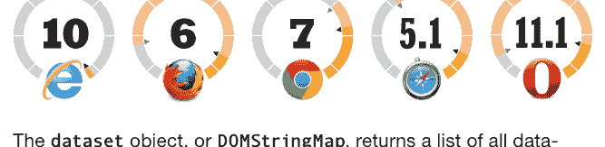

`dataset` 对象，或 `DOMStringMap`，返回关联元素的所有 `data-` 属性列表。

```html
<a href="#" data-length="3m30s" data-category="pop">Wake Me Up Before You Go-Go </a>
```

两个数据属性可以像这样访问：

```javascript
var link = document.querySelector('a');
console.log(link.dataset);
```

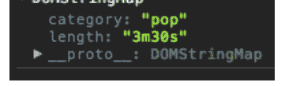

```javascript
link.dataset.length; // 3m30s
```

### jQuery

使用 jQuery 时，可以通过 `data` 方法访问数据属性。

```javascript
// contact
$('a:first').data('target')
```

### 最后的 caution 提醒

显然，自定义数据属性在未来几年将越来越频繁地使用。因此，名称冲突的可能性将成为现实。考虑到这一点，对于大型项目，与其使用通用名称（如 `data-height`），不如考虑为所有数据属性使用命名约定：`data-myapp-height`。在这些情况下，请使用您的最佳判断。

**ROCK** 提示

> 如果您的自定义属性包含连字符，例如 `data-my-attribute`，在访问其值时，您需要使用驼峰命名法：`el.dataset.myAttribute`。

## 有趣有趣表单

我知道，我知道；表单很无聊。幸运的是，HTML5 让它们——不是变得有趣——而是不那么无聊！如果您曾经发现自己设置默认占位符文本、执行客户端验证或使用日期选择器插件，您无疑亲身体验过浏览器的局限性。虽然这比我们期望的时间要长一些，但浏览器正在开始跟上，Opera 和 Webkit 处于领先地位。让我们 stroll 一下一些可用的新选项。

在我们继续之前，请记住，仅仅因为原生表单验证可能在 Opera 的最新版本中有效，并不意味着它在 Firefox 或 Internet Explorer 中也会有效。我们还不能依赖这些技术进行严肃的验证。话虽如此，您可以自由地使用它们作为额外的保护级别。

## 元素

### output


当您需要显示特定计算的结果时，应该使用`output`元素。没有固有的样式，因此可以在所有浏览器中自由使用。

```html
<output value=100> 100 </output>
```

例如，我们可以使用`output`元素来表示基于表单的简单数学计算的结果。

```html
<form>
  <input name=num1 id=num1 type=number> + <input name=num2 id=num2 type=number> = <output></output>
</form>
```

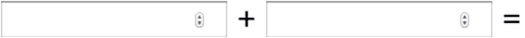

注意，我们使用的是新的输入类型`number`。稍后会详细介绍！

## 关联

正如`label`可以与特定的表单元素关联一样，`output`也是如此。其`for`属性应引用它所对应元素的`id`（以空格分隔）。

```html
<form>
  <input name=num1 id=num1 type=number> + <input name=num2 id=num2 type=number> = <output for="num1 num2"></output>
</form>
```

标记完成后，我们可以使用 JavaScript 来监听输入框失去焦点时的情况，并相应地更新`output`的值。

### JavaScript

```javascript
var form = document.querySelector('form'),
    num1 = form.num1,
    num2 = form.num2,
    output = document.querySelector('output');
[].forEach.call(document.querySelectorAll('input'),
function(el) {
    el.addEventListener('blur', function() {
        output.value = ~~num1.value + ~~num2.value;
    }, false);
});
```

### jQuery

```javascript
var form = $('form'),
    num1 = form[0].num1,
    num2 = form[0].num2,
    output = $('output');

form.on('blur', 'input', function() {
	output.val( ~~num1.value + ~~num2.value );
});
```


此代码监听用户从输入框切换离开时的情况。当他们这样做时，`output`元素的值会更新为两个数字的总和。

[查看`output`演示。](demo-link)

## meter

新的`meter`标签可用于为特定值提供图形化显示。这使其成为测验分数和磁盘使用指示器等事物的完美选择。

```html
<meter min=0 max=100 value=50>
```


*`meter`元素在（从左到右）Chrome 16、Firefox 9、Opera 11.6、Internet Explorer 9 中的显示。*

在撰写本文时，只有 Chrome 和 Opera 提供完整的支持。在较旧的浏览器中，`meter`标签的文本内容将显示如下。

此外，我们可以为`meter`的`low`、`medium`或`optimum`以及`high`部分指定范围。

```html
<meter low=25 optimum=50 high=75 min=0 max=100 value=20> 20 </meter>
<meter low=25 optimum=50 high=75 min=0 max=100 value=50> 50 </meter>
<meter low=25 optimum=50 high=75 min=0 max=100 value=80> 80 </meter>
```


在 Opera 11.6 中使用`meter`设置最佳值的效果。

我已经不再年轻，但我本来期望浏览器提供三种颜色范围，而不是对`low`和`high`都重复黄色。

> 查看[`meter`演示](http://example.com)。

## progress

虽然`output`元素用于显示计算结果，但`progress`元素应表示任务完成的进度。如果浏览器不支持该元素，将显示其文本内容。

```html
<progress max=10 value=6> 6 </progress>
```

两个属性决定显示的位置：`value`和`max`。如果省略`value`，该元素将被视为不确定的，显示也将反映这一点。

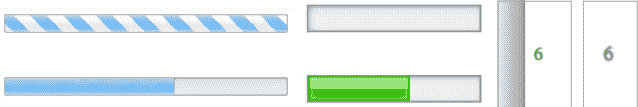

`progress`元素在（从左到右）Chrome 16 和 Firefox 9、Opera 11.6、Safari 6、Internet Explorer 9 中的显示。

## 属性

### placeholder

有时，向用户提供关于预期输入内容的提示可能会有所帮助。传统上，JavaScript 被用来实现这种效果。下面是一种使用 JavaScript 实现占位符效果的可能方式。

#### HTML

```html
<input type="text" id="date-input" value="12/13/2011">
```

#### JavaScript

```javascript
var dateInput = document.querySelector('#date-input'),
dateDefault = dateInput.value;
dateInput.addEventListener('focus', function() {
    // 如果输入的值等于我们的示例，
    // 当用户点击它时隐藏它。
    this.value === dateDefault && this.value = '';
}, false);
dateInput.addEventListener('blur', function() {
    // 当他们点击输入框外部时，如果
    // 值为空，则恢复示例。
    this.value === '' && this.value = dateDefault
}, false);
```

#### jQuery

```javascript
var dateInput = $('#date-input'),
dateDefault = dateInput.val();
dateInput.on({
    focus: function() {
```

```javascript
var $this = $(this);
// 如果输入的值等于示例文本，
// 当用户点击时将其隐藏。
$this.val() === dateDefault && $this.val('');
},
blur: function() {
  var $this = $(this);
  // 当用户点击输入框外部时，
  // 如果值为空，则恢复示例文本。
  $this.val() === '' && $this.val(dateDefault);
}
});
```

这段代码确保当用户点击输入框时，占位符文本会立即消失；而当用户点击输入框外部且输入值为空时，占位符文本会重新出现。

不用说，这是一个繁琐的任务，浏览器本身应该**开箱即用**地提供此功能。使用 HTML5，我们可以利用`placeholder`属性来实现完全相同的效果。

```html
<input type="text" id="date-input" placeholder="12/13/2011">
```

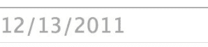

这是不是非常简单？

不过请记住，在较旧的浏览器中，输入框仍然默认为空。是否需要让占位符文本对用户可见，取决于你的判断。

## 你的第一个 Polyfill

考虑到这一点，让我们构建第一个 polyfill，为占位符文本提供跨浏览器支持。在创建 polyfill 时，你必须先确定三件事：

1. 完成此任务的正确 HTML5 方式是什么？
2. 降级方案（通常基于 JavaScript）是什么？
3. 如何测试浏览器是否支持此新特性？

让我们逐一来解决。

### 1. 完成此任务的正确 HTML5 方式是什么？

我们已经知道了。正确的方式是使用`placeholder`属性。

```html
<input type="text" id="date-input" placeholder="12/13/2011">
```

### 2. 降级方案（JavaScript）是什么？

同样，我们也已经知道了。我们之前已经创建了一个 JavaScript 解决方案。

```javascript
var dateInput = $('#date-input')
dateInput
  .focus(function() {
    var $this = $(this);
    $this.val() === dateDefault && $this.val('');
  })
  .blur(function() {
    var $this = $(this);
    $this.val() === '' && $this.val(dateDefault);
  });
```

然而，我们之前的方法有点死板；它只适用于单个元素。让我们修改代码，查找所有包含`placeholder`属性的`input`元素。

```javascript
var inputs = $('input[placeholder]'),
    dateDefault;
inputs.each(function () {
    $(this).val(this.getAttribute('placeholder'));
});
inputs.on({
    focus: function () {
        var $this = $(this);
        dateDefault = this.getAttribute('placeholder');
        $this.val() === dateDefault && $this.val('');
    },
    blur: function () {
        var $this = $(this);
        $this.val() === '' && $this.val(dateDefault);
    }
});
```

### 3. 如何测试浏览器是否支持此新特性？

在 JavaScript 中，我们可以通过以下方式判断一个`input`是否支持某个特定属性：

```javascript
if ("attribute-name" in document.createElement('input')){
    // 支持
}
if (!("attribute-name" in document.createElement('input'))){
    // 不支持
}
```

对于我们的情况，测试代码如下：

```javascript
if (!("attribute-name" in document.createElement('input'))){
    // 不支持
}
```

## 完整的 Polyfill

现在我们已经确定了三个组成部分，让我们将它们组合起来，完成我们的 polyfill。

### HTML

```html
<input type="text" id="date-input" placeholder="12/13/2011">
```

### JavaScript

```javascript
if (!('placeholder' in document.createElement('input'))) {
  // 1
  var inputs = document.querySelectorAll('input[placeholder]'), // 2
      input, dateDefault;
  // 3
  for (var i = 0; i < inputs.length; i++) {
    input = inputs[i];
    input.value = input.getAttribute('placeholder');
    // 4
    input.addEventListener('focus', function () {
      dateDefault = this.getAttribute('placeholder');
      (this.value === dateDefault) && (this.value = '');
    }, false);
    input.addEventListener('blur', function () {
      (this.value === '') && (this.value = dateDefault);
    }, false);
  }
}
```

### jQuery

```javascript
if (!('placeholder' in document.createElement('input'))) {
  // 1
  var inputs = $('input[placeholder]'), // 2
      dateDefault;
  // 3
  inputs.each(function () {
    $(this).val(this.getAttribute('placeholder'));
  });
  // 4
  inputs.on({
    focus: function () {
      var $this = $(this);
      dateDefault = this.getAttribute('placeholder');
      $this.val() === dateDefault && $this.val('');
    },
    blur: function () {
      var $this = $(this);
      $this.val() === '' && $this.val(dateDefault);
    }
  });
}
```

虽然稍显复杂，但这段代码的目标仍然相同：

如果浏览器支持`placeholder`：

- 1. 太好了——什么都不用做。浏览器已经处理好了。

如果不支持……

- 2. 搜索所有包含`placeholder`属性的`input`元素。遍历匹配的集合并将每个`input`的值设置为其`placeholder`的值。
- 3. 当`input`获得焦点和失去焦点时，分别移除或恢复其值。

在这个示例中，我们使用了一个简单的文本框。然而，正如你即将了解到的，在从用户那里接受日期值时，使用`date`类型的`input`更为合适。

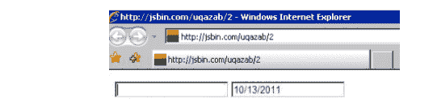

Internet Explorer 7 中的 placeholder polyfill 效果。

> 👁️ 查看[`placeholder`演示](https://jsbin.com/uqazab/2)。

### 样式设置

你可能会发现，不同浏览器在 HTML5 表单方面的表现相当不一致。例如，我可以在 Firefox 中像设置普通输入文本一样调整`placeholder`文本的颜色。然而 Webkit 则不同，我需要使用`::-webkit-input-placeholder`属性。

```css
::-webkit-input-placeholder {
    color: green;
}
```

### required

我们可以指定某个`input`必须填写值，而无需编写一行 JavaScript——至少在支持`required`属性的浏览器中是这样。

```html
<input type="text" required>
```

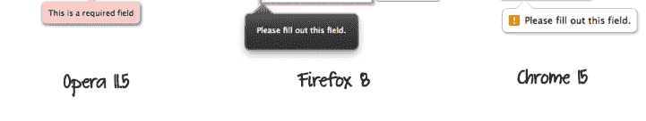

如果点击表单的`submit`按钮，但未提供值，则表单不会提交，并会弹出一个提示气泡。

### autofocus

过去我们一直依赖 JavaScript 来完成的一个繁琐任务是让特定`input`获得焦点。使用 jQuery：

```javascript
$('textarea').focus();
```

HTML5 现在提供了`autofocus`属性，无需任何 JavaScript 即可实现。

```html
<textarea autofocus></textarea>
```


### pattern

如果浏览器要执行验证，我们需要比仅仅判断是否提供了值更多的控制。这就是`pattern`属性发挥作用的地方。我们可以使用正则表达式来精确指定所需的格式。

假设我需要用户创建一个用户名，且长度必须在四到十二个字符之间。


```html
<label for="username">Desired Username: </label>
<input type="text" id="username" required pattern="\w{4,12}">
<input type="submit">
```

请注意，无需分别用 `^` 和 `$` 指定字符串的开头和结尾。浏览器会自动假定这一点。

上一个代码片段中的 `required` 属性看起来似乎多余。既然我们已经编写了一个确保至少有四个字符的 `pattern`，为什么还需要它？有点奇怪的是，如果我们省略 `required` 属性，表单仍然会成功提交。这似乎是一个 bug。这里有一个[该问题的示例](#)。

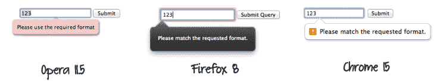

> 🔍 查看 [pattern 演示](#)。

#### maxlength

HTML5 引入了 `maxlength` 属性，允许我们限制在 `input` 或 `textarea` 中可输入的字符数。不过奇怪的是，虽然你可能会期待有，但并没有 `minlength`。继续使用用户名示例，如果我们需要将字符数限制为十二个（不使用 `pattern` 属性），可以这样做：

```html
<input type="text" maxlength="12">
```

在支持 `maxlength` 属性的浏览器中，用户将无法输入超过十二个字符。浏览器不会记录或显示超出限制的任何内容。

> 🔍 查看 [maxlength 演示](#)。

### 新的 Input 类型

除了 HTML5 中各种新属性之外，我们还有许多新的 `input` **类型**：

- `email`
- `range`
- `color`
- `number`
- `datetime`
- `date`
- `month`
- `week`
- `time`
- `url`
- `tel`
- `search`

让我们来看看！

#### email

如果我们为**表单输入项**应用**email 类型**，我们可以指示浏览器仅允许符合有效电子邮件地址结构的字符串。没错，内置的表单验证来了！但由于显而易见的原因，我们目前还不能 100% 依赖它。

```html
<input type="email">
```

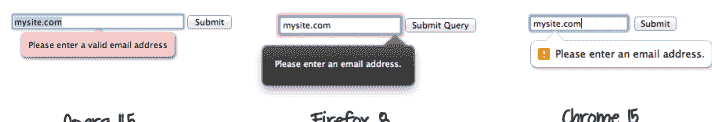

#### range

**range 类型**非常令人兴奋，它允许我们创建原生的滑块。

```html
<input type="range">
```

最值得注意的是，它可以接收 `min`、`max`、`step` 和 `value` 等属性。

为了进行快速演示，让我们构建一个量表，允许用户在 1-10 的范围内指定他们对电影《无头脑美人》（Clueless）的喜爱程度。我们不会构建一个真实的投票方案，但我们将回顾如何轻松实现它。

### Markup

首先，我们创建标记。

```html
<form>
  <h1> Clueless Greatness Gauge </h1>
  <input type="range" id="range" name="range" min="0"
  max="10" step="1" value="5">
  <output name="result" for="range"> </output>
</form>
```

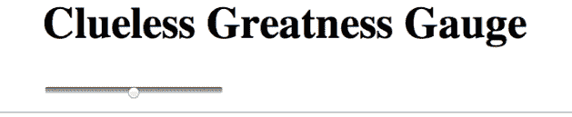

请注意，除了为滑块设置 `min` 和 `max` 值外，我们还可以指定每次跳转的 `step`（步长）。在我们的例子中，我们将步长设为 1，不过，我们也可以将 `step` 间隔设为 2，这样可选项就变成了 2, 4, 6, 8 和 10。

### CSS

一个明显的问题是，没有内置选项让用户看到他们当前选择的值！也许开发者认为精确数值对用户来说并不重要，他们的决定是相对于滑块上可用刻度的相对位置。精确值仅与网站后端相关。无论决定原因是什么，让我们创建自己的简单显示方式。

我们将利用 `:before` 和 `:after` 伪元素来告知用户我们指定的 `min` 和 `max` 值是多少。

```css
input[type=range]:before { content: attr(min); }
input[type=range]:after { content: attr(max); }
```

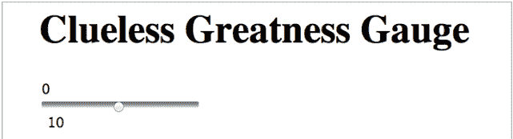

然后我们可以继续应用一些样式，以我们想要的方式渲染数字。不过，仍然有一种简单的方法来可视化当前选择的值。让我们利用新的 `output` 元素来解决这个问题。

##### output

我们将更新 HTML 以包含 `output` 元素。

```html
<form>
  <h1> Clueless Greatness Gauge </h1>
  <input type="range" name=
    "clueless-gauge" id="clueless-gauge" min="0" max="10"
    step="1" value="5">
  <output for="clueless-gauge"></output>
</form>
```

> **ROCK⭐ 提示**

`attr` 函数很有趣；它可以用来捕获相关元素属性中的值。要确定输入的最大值等于多少，我们可以将 `content` 属性设置为 `attr(max)`。

### JavaScript

现在，我们将使用 JavaScript 来设置 `output` 的值。

```javascript
(function() {
  var range = document.querySelector('#clueless-gauge'),
    output = range.nextElementSibling;
  // 将 output 的初始值设置为 range 指定的值。
  output.value = range.value;
  // 当滑块改变时，更新 output 的值。
  range.addEventListener('change', function() {
    output.value = range.value;
  }, false);
})();
```

### jQuery

```javascript
(function() {
  var range = $('#clueless-gauge'),
    output = range.siblings('output');
  // 将 output 的初始值设置为 range 指定的值。
  output.val( range.val() );
  // 当滑块改变时，更新 output 的值。
  range.on('change', function() {
    output.val( range.val() );
  });
})();
```

这段代码首先使 `output` 的值等于我们在 `range` 输入的 `value` 属性中指定的值。然后，我们**监听**滑块被调整的时刻，并相应地更新 `output` 的值。

# Clueless Greatness Gauge

查看 [range 演示](range-demo)。

#### color

虽然在撰写本文时除了 Opera 之外尚不支持，但我们最终将能够通过使用 `color` 输入类型来提供颜色选择器。

```html
<input type="color">
```

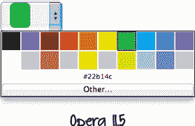

查看 [color 演示](color-demo)。

#### number

`number` 输入可用于将用户的输入限制为仅限数字 —— 比如当你需要他们的年龄或出生年份时。这类 `inputs` 现在绝对可以使用，因为同样地，它们会优雅地回退到简单的文本框。唯一的注意事项是，在处理数据之前，你仍然应该执行自己的验证。

```html
<input type="number">
```

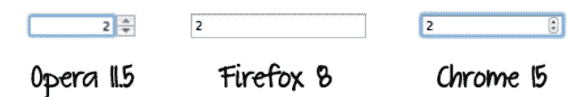

> 查看 number 演示。

#### date

`date` 输入使我们能够强制用户选择一个有效且格式化的日期。就目前状态而言，各浏览器的实现情况顶多只能说是参差不齐。

```html
<input type="date">
```

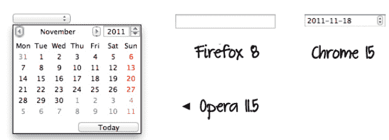

- Opera 11 会显示一个美观但几乎无法自定义样式的日历视图。这很有帮助，因为用户无法输入无效日期。
- Chrome 和 Safari 尚未为其各自的实现提供 UI，尽管这已在计划中。
- 截至版本 8，Firefox 尚未提供对 `date` 输入的支持。

##### Options

###### min/max

有些网站强制要求你选择一个发生在特定时间段内的日期。`min` 属性可以用在这个目的上：

```html
<input type="date" min="2011-12-25" max="2011-12-31">
```

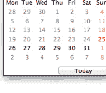

在显示日历视图的浏览器中，只有这些指定的日期是可以选择的。

###### step

或者，如果我们想将用户的日期选择限制在，例如，每七天为一个增量，我们可以相应地使用 `step` 属性 —— 其默认值为 1。

> **ROCK 提示**

如果用户指定了一个无效日期怎么办？*根据规范*，“如果元素的值不是有效的日期字符串，则将其设置为空字符串。”

```html
<input type="date" step="7">
```

假设当前日期是 2011-11-10，那么可用选项将是 *2011-11-10*，*2011-11-17*，*2011-11-24* 等。

##### Alternate Datetime Options

除了简单的 `date` 类型，HTML5 还提供了一些替代选择：

- `datetime` – yyyy-mm-dd HH:MM
- `month` – yyyy-mm
- `week` – yyyy-mmW
- `time` – HH:MM

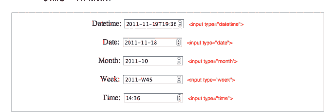

##### Cross-Browser Support

在 Web 应用程序中，如果跨浏览器日期选择器至关重要，[jQuery UI's datepicker](https://jqueryui.com/datepicker/) 是一个流行的回退方案。

> 查看 [date 演示](https://jqueryui.com/datepicker/)。

#### url

`url` 类型有助于确保用户的输入是一个“有效”的 URL。

```html
<input type="url">
```

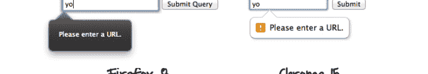

我把“有效”放在引号里是因为，浏览器肯定无法验证该 URL 是否 100% 处于激活状态。它仅仅是判断所传递的字符串是否看起来像 URL 的形式。不幸的是，不同浏览器之间的一致性顶多是斑驳的。

- 在 Firefox 8 和 Chrome 15 中，只要文本包含冒号，就能通过验证。显然，实现方式本可以更好！
- 在 Opera 11.5 中，浏览器会提交输入的任何文本，但如果用户没有添加 `http://`，它会自动在前面加上。

> 查看 [url 演示](url demo)。

#### tel

`tel`（电话）输入不对输入的文本施加任何限制。目前的优势体现在手机端。在理解这种新类型的移动浏览器中，调出键盘时会正确显示数字键盘。

```html
<input name="phone" type="tel">
```

如果你发现自己需要验证电话号码，你会希望利用 `pattern` 属性。例如，假设我需要用户输入一个美国格式的电话号码：

```html
<input name="phone" type="tel" pattern="\d{3}-?\d{3}-?\d{4}">
```

这将确保表单仅在提供的值采用 555-555-5555 或 5555555555 形式时才提交。如果区号是可选的（不建议这样做），我们可以修改正则表达式：`(?:\d{3}-?)?\d{3}-?\d{4}`。

> 查看 [tel 演示](tel demo)。

# search

乍一看，`search` 输入框的功能似乎并不比创建一个带有圆角的搜索栏文本框多出多少。

```html
<input type="search">
<input type="submit">
```

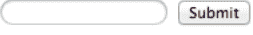

我们可以稍微扩展一下这个功能。在 Webkit 中，一个命名可能有些奇怪的 `results` 属性会在输入框的左侧显示一个搜索图标，并允许浏览器 `remember`（记住）您之前的搜索查询。

```html
<input type="search" results="5">
<input type="submit">
```

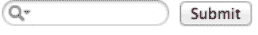

为了让这些之前的搜索查询在页面加载后依然存在，我被告知应用 `autosave` 属性可以奏效，不过说实话，我一直很难在任何环境下让它正常工作。

```html
<input type="search" results="5" autosave="search-queries">
```

# Styling

在为 `search` 输入框设置样式时要小心。或许是为了在整个 Web 领域实现一致性，Webkit 浏览器似乎故意让调整 `input` 的显示变得格外困难。诸如 `background` 和 `line-height` 等 CSS 属性对视觉效果完全没有影响。为了弥补这一点，我们需要重置。

> **ROCK TIP**

请参考 Chris Coyier 关于 HTML5 搜索输入框的文章以了解更多详细信息。

---

# Fun Fun Forms

针对相应的伪元素设置 `-webkit-appearance`。例如，为了调整 Webkit 中输入搜索查询后显示的取消图标的视觉效果……

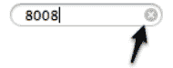

我们可以这样做：

```css
::-webkit-search-cancel-button {
  -webkit-appearance: none;
  /* 现在应用您自己的样式 */
}
```

> 查看搜索演示。

## Final Project

现在让我们将所学的一切结合起来，创建一个现代的 HTML5 表单。真正的服务器端验证将超出本项目的范围，因为读者偏好的语言各不相同。此外，我们将跳过任何必要的 polyfill，因为我们还没有真正深入探讨特性检测（feature detection）和 Modernizr。相反，让我们专注于按照预期使用新的输入类型。

### Guidelines

假设我们的客户需要我们创建一个注册表单，以便从新的虚拟用户那里获取以下信息：

- **Name（姓名）** – 必填
- **Email Address（电子邮件地址）** – 必填，必须是电子邮件地址格式
- **Phone Number（电话号码）** – 选填，如果提供，应符合美国号码格式，并提供示例号码
- **Age（年龄）** – 选填，如果提供，必须是数字
- **Date of Birth（出生日期）** – 必填，必须是年份，提供示例
- **Website（网站）** – 选填，如果提供，应符合 URL 格式
- **Bio（个人简介）** – 选填，应允许用户写几段关于自己的介绍

### Markup

我们首先创建标准的包装 `form` 元素。因为这不是一个带有后端的真实表单，我们将 `action` 属性设置为提交到当前页面。

```html
<form method="post" action="">
</form>
```

### Fieldsets

接下来，我们需要确定如何组织和分隔我们的输入项。使用 `fieldsets` 来组织您的 `form` 区域一直是一项最佳实践；只不过你们中的许多人没有这样做！

```html
<fieldset>
    <legend> Personal Information: </legend>
</fieldset>
```

除了能更好地描述我们的内容外，`legend` 属性还允许我们为 `form` 区域分配一个简单的、由浏览器样式化的标题。


### Lists

经常可以看到 `inputs` 被包裹在段落标签（p 标签）中进行分隔。原因在于段落能立即提供有用的间距和分离感。坦白说，虽然这不是个大问题，但这很懒惰。`p` 标签如何描述一个 `input`？它不能。它仅仅被用于样式目的，而这可以通过 CSS 轻松实现。

相反，我觉得无序列表是最合适的选择。当用户查看 `form` 时，他看到的是一个需要填写的 `inputs` `list`（列表）。

```html
<form method="post" action="">
  <fieldset>
    <legend> Personal Information: </legend>
    <ul>
      <li> </li>
    </ul>
  </fieldset>
</form>
```

处理客户需求最简单的方法就是**一次处理一个要点**。

> **ROCK TIP**


永远不要让默认样式阻碍您使用最合适的元素。忽略那些圆点，它们很容易被移除。

### Name – required

这告诉我们需要一个简单的文本框，并且用户必须输入一个值。这很简单！

```html
<li>
  <label for="name">Name: </label>
  <input id="name" name="name" type="text" required>
</li>
```

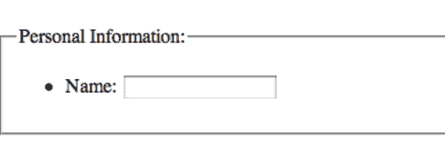

记得始终为您的`inputs`和`textareas`应用`id`。`label`的`for`属性专门指向一个`id`。如果我们忽略这个属性，点击标签将没有任何反应。

### Email Address

**Email Address（电子邮件地址） —** *必填；必须是电子邮件地址*

嗯……这个需要多花一点功夫。虽然我们当然可以使用简单的文本框，但让我们使用在本章中学到的新`email`类型。

```html
<li>
  <label for="email">Email Address: </label>
  <input id="email" name="email" type="email" required>
</li>
```

在这种情况下我们不需要担心验证，因为浏览器会自动判断是否输入了格式正确的电子邮件地址。

> *事实是：目前浏览器在检查电子邮件地址方面的表现并不理想。只要一组字母之间存在`@`符号，它就会通过。因此，“a@a”被浏览器认为是有效的。*

### Phone Number

**Phone Number（电话号码） —** *选填；应符合美国号码格式；提供示例号码*

这将需要新的`tel`输入类型以及一些自定义验证，因为我们的客户需要我们确保提供的是美国格式的电话号码（555-555-5555）。我们甚至需要为用户提供一个示例，即`placeholder`（占位符）。让我们看看……

```html
<li>
    <label for="phone">Phone: </label>
    <input id="phone" name="phone" type="tel" pattern="\d{3}-?\d{3}-?\d{4}" placeholder="555-555-5555">
</li>
```

这个正则表达式`\d{3}-?\d{3}-?\d{4}`将搜索三个数字，后跟一个可选的连字符，然后又是三个数字，接着再次是一个可选的连字符，最后是四个数字。这样一来，555-555-5555 可以通过，5555555555 也可以通过。

我们还提供了一个示例电话号码——以防用户需要一点引导。

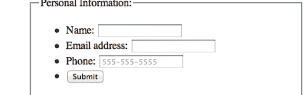

### Age

**Age（年龄） —** *选填；必须是数字*

乍一看，这似乎很简单。给`input`加上`number`类型就完事了。

```html
<li>
    <label for="age">Age: </label>
    <input id="age" name="age" type="number">
</li>
```

不幸的是，这里我们遇到了障碍。当`number`类型应用于`input`时，Webkit 似乎不理会`pattern`属性。它倾向于执行自己的验证。但如果我们想进一步指定输入的年龄必须在 1 到 3 位数字之间怎么办？`<input type="number" pattern="\d{1,3}">`将不起作用（在撰写本文时）。在这些情况下，`pattern`并不太重要；我们可以改为使用`min`和`max`属性。

```html
<li>
    <label for="age">Age: </label>
    <input id="age" name="age" type="number" min="1" max="120">
</li>
```

### Date of Birth

**Date of Birth（出生日期）** — *必填；必须是年份；包含示例*

我们知道可以使用`date`类型（或其同类），但在这种情况下，我们需要年-月-日形式的日期。对于像`age`这样的输入，如果它在旧浏览器中退化为文本框，并不是大问题。但日期非常重要！理想情况下，我们会同时使用 HTML5 版本以及通过 jQuery UI 和 Modernizr 实现的 polyfill。目前，我们将坚持使用简单的`date`输入，但要意识到在实际应用中需要 JavaScript 回退方案。

```html
<li>
    <label for="dob">Date of Birth: </label>
    <input id="dob" name="dob" type="date" required>
</li>
```

尽管客户要求为`input`提供占位符，但最好还是将其去掉。从技术上讲，日期输入框上的`placeholder`属性会被完全忽略，而且即便没有被忽略，示例日期可能也不符合用户代理（UA）接受的正确格式。

### Website

**Website（网站）** — *选填；应符合 URL 格式*

```html
<li>
    <label for="website">Personal Website: </label>
    <input id="website" name="website" type="url">
</li>
```

## 趣味无穷的表单

正如我们之前回顾的，浏览器对`url`验证的实现很差。只要它找到`:`后跟一个或多个字母，该值就能通过验证。希望这种情况在接下来的几个月和几年里能够得到改善。

**个人简介** — *可选；应允许用户写几段关于自己的内容*

这次，我们将使用更合适的`textarea`标签。

```html
<li>
  <label for="bio"> Bio: </label>
  <textarea id="bio" name="bio" placeholder="I am...">
  </textarea>
</li>
```

有了最后这段代码，我们就完成了表单的标记。它还不漂亮（暂时），但我们这里拥有的是坚实且有意义的 HTML5 标记。

```html
<form method="post" action="">
  <fieldset>
    <legend> Personal Information: </legend>
    <ul>
      <li>
        <label for="name"> Name: </label>
        <input id="name" name="name" type="text" required>
      </li>
      <li>
        <label for="email">Email address: </label>
        <input id="email" name="email" type="email" required>
      </li>
      <li>
        <label for="phone">Phone: </label>
        <input id="phone" name="phone" type="tel" pattern="\d{3}-?\d{3}-?\d{4}" placeholder="555-555-5555">
      </li>
      <li>
        <label for="age">Age: </label>
        <input id="age" name="age" type="number" min="1" max="120">
      </li>
      <li>
        <label for="dob">Date of Birth: </label>
        <input id="dob" name="dob" type="date" required>
      </li>
      <li>
        <label for="website">Personal Website: </label>
        <input id="website" name="website" type="url">
      </li>
      <li>
        <label for="bio"> Bio: </label>
        <textarea id="bio" name="bio" placeholder="I am..."></textarea>
      </li>
      <li>
        <input type="submit">
      </li>
    </ul>
  </fieldset>
</form>
```

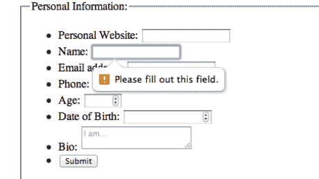

## 趣味无穷的表单

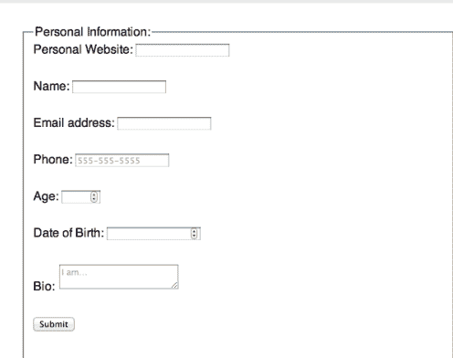

# 额外内容——CSS

如果你想从 HTML5 中休息一下，让我们来美化一下我们的表单吧。我们首先将边距清零，并设置一些默认宽度。

```css
body {
  font-family: sans-serif;
  width: 80%;
  margin: 40px auto 0;
}

/* Quick reset */
ul, li, input {
  margin: 0;
  padding: 0;
}

li {
  list-style: none;
  margin-bottom: 30px;
}
```

接下来，我们将处理`fieldset`和`form`的基本样式。

```css
form { color: #666; }

fieldset {
    padding: 40px 80px;
    border: 1px solid #e3e3e3;
}

legend { font-weight: bold; }
```

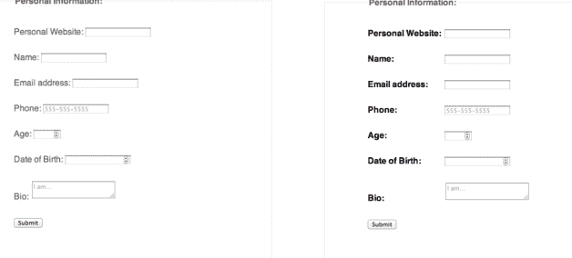

## 标签

接下来，我们应确保标签看起来可以点击。我们还将设置显示方式和颜色。

```css
label {
    width: 18%;
    display: inline-block;
    font-weight: bold;
    color: #000;
    cursor: pointer;
}
```

## 输入框

好吧，那些输入框看起来还是歪歪扭扭的。让我们来修复一下。

```css
input, textarea {
    width: 81%;
    max-width: 500px;
    background: white;
    color: #666;
    line-height: 35px;
    height: 35px;
    padding: 0 20px;
    border: 1px solid #e3e3e3;
    -webkit-border-radius: 25px;
    -moz-border-radius: 25px;
    border-radius: 25px;
    cursor: pointer;
    position: relative;
    -webkit-box-sizing: border-box;
    -moz-box-sizing: border-box;
    box-sizing: border-box;
}

input:focus, input:hover {
    border-color: black;
}

textarea {
    height: 300px;
    vertical-align: top;
}
```

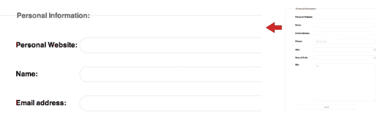

改进输入框的样式。

我们在这里使用百分比的原因是，这样一来，表单就是 100% 灵活的。我们还使用了 CSS3 圆角，让输入框更加突出一点。

## 按钮

我们 certainly 不想让那个提交按钮那么大。

```css
input[type=submit] {
  width: 100px;
  padding: 0;
  background: #12C977;
  color: white;
  -webkit-box-shadow: inset 0 0 0 1px #0EE886, 0 0 0 1px #11BF71;
  -moz-box-shadow: inset 0 0 0 1px #0EE886, 0 0 0 1px #11BF71;
  box-shadow: inset 0 0 0 1px #0EE886, 0 0 0 1px #11BF71;
}
```

在上面，我们使用了巧妙的 CSS3 `box-shadow`来为按钮增加更多纵深感。


## 计数器

你有没有注意到年龄和出生日期输入框上的数字计数器离边缘太近了？我们可以使用 CSS 扩展来针对这个计数器进行样式设置：

```css
input::-webkit-inner-spin-button {
  padding-right: 10px;
}
```

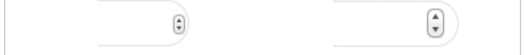

计数器（左）调整前和（右）调整后。

这有点尴尬，不是吗？不过，至少我们确实有办法来样式化这些看似不可见的控件了。

## 媒体查询

还有一个小问题。如果浏览器窗口太窄，表单开始显得有些拥挤。CSS 媒体查询可以用来监听窗口何时变得太窄，并相应地重新设置样式。

```css
@media screen and (max-width: 750px) {
    label {
        margin-bottom: 10px;
        width: auto;
        display: block;
    }

    input, textarea {
        width: 100%;
    }
}
```

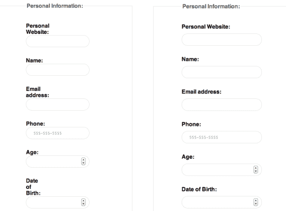

使用媒体查询来调整标签和输入框的宽度，从拥挤（左）到填充空间（右）。

好多了；媒体查询是不是很棒？在上面的代码片段中，我们指定，如果窗口的`width`为`750px`或更小，我们就应该使用其中的样式。

## 总结

你刚刚快速游览了 HTML5 中新的表单特性。在下一章中，我们将深入探讨精彩的原生媒体！


# 特性检测 essentials

虽然最终，我会推荐你使用一个名为 Modernizr 的工具来执行特性检测，但 certainly 了解如何手动完成这一点很重要。抽象是极好的——前提是你对幕后发生的事情有一个基本的了解。

所以，让我们不要浪费更多必要的时间。

## 输入类型

你想确定浏览器是否识别新的 HTML5 输入类型吗？

当我们尝试应用浏览器不认识的输入类型时，它总是会回退到`text`类型。这可以在测试时被我们利用。

```javascript
var input = document.createElement('input');
input.setAttribute('type', 'color');

if (input.type === 'color') {
    // browser supports this input type
}
```

如果你想把这段代码抽象成一个函数……

```javascript
function supportsInputType(type, cb) {
    var input = document.createElement('input');
    input.setAttribute('type', type);
    return input.type === type;
}
```

```javascript
if (supportsInputType('url')) {
  // browser recognizes this type
}
```

👁️ 查看 [input type demo](#)。

## 输入属性

在确定浏览器是否识别某个输入`attribute`时，我们使用一种略有不同的技术。

```javascript
if ('autocomplete' in document.createElement('input')) {
  // browser recognizes the autocomplete attribute
}
```

与 JavaScript 中的大多数东西一样，`input`元素是`objects`。这些对象将包含浏览器支持的所有属性的列表。所以这段代码只是确定给定的`property`是否存在于该对象中。很简单，真的。这完全等同于：

```javascript
var name = {
  first: 'Pam',
  last: 'Halbert'
};
```

```javascript
if ('first' in name) { ... }
```

同样，我们可以把这段代码放在一个`function`中。

```javascript
function supportsInputAttribute(attr) {
  return attr in document.createElement('input');
}
```

```javascript
if (supportsInputAttribute('placeholder')) {
  // browser recognizes the placeholder attribute
}
```

或者，如果你计划多次使用这个函数，你可以使用闭包来避免重复创建测试输入框。


```javascript
var supportsInputAttribute = (function() {
  var input = document.createElement('input');
  return function(attr) {
    return attr in input;
  };
})();
```

👁 查看 [attributes demo](#)。

## 元素

元素支持的测试需要针对具体情况来处理。不过，我们仍然是创建所需的元素，并确定它是否识别某个特定的 `property` 或 `method`。如果是，那么我们就可以推断浏览器 `must` 支持该元素。是的——我刚用了 "deduce" 这个词。

> **ROCK⭐️ TIP**
>
> 双否定 (`!!`) 允许我们将值转换为布尔值。"Hello" 会被转换为 `true`，而空字符串 (`''`) 会被转换为 `false`。这是一个有用的技巧！

## canvas

如果我们需要测试 `canvas` 支持：

```javascript
if ( !!document.createElement('canvas').getContext ) {
  // Get your canvas on!
}
```

或者，作为一个 `function`：

```javascript
function supportsCanvas() {
    return !!document.createElement('canvas').getContext;
}
```

## 音频与视频

几乎所有现代浏览器都支持原生音频和视频（IE8 除外）。尽管如此，我们仍应为旧版浏览器提供必要的后备方案（fallback）。我们可以通过判断媒体对象上是否存在 `canPlayType` 方法来测试媒体支持情况。

```javascript
if ( !!document.createElement('audio').canPlayType ) {
    // 把我的耳机音量调大！
}
```

或者：

```javascript
var supportsMedia = (function() {
    return !!('canPlayType' in document.createElement('video'));
})();
```

```javascript
if ( supportsMedia ) { ... }
```

请注意，这段代码对音频和视频都有效。只需相应地替换即可。由于两者的 API 几乎完全相同，我们可以确信，能够识别 `audio` 标签的浏览器也一定能识别 `video`。

## 本地存储 (Local Storage)

测试本地存储支持相对简单——虽然不可否认它比我们预想的要复杂一点，因为某些版本的 IE 如果不使用 `try` 块来捕获潜在错误，会直接抛出异常。

```javascript
function supportsLocalStorage() {
    try {
        return 'localStorage' in window && window.localStorage !== null;
    } catch(e) {
        return false;
    }
}
```

这段代码用于确定 `window` 对象上是否存在 `localStorage`。如果在过程中发生任何错误，它会立即返回 `false`。

## 各种 API

测试其他新 API 的过程大抵相同。让我们快速过一遍。

### 地理位置 (Geolocation)

```javascript
if ( !!navigator.geolocation ) alert('Track that sucka');
```

### 离线存储 (Offline)

```javascript
if ( !!window.applicationCache ) alert('Get on that plane. It don't matta!');
```

### Web Workers

```javascript
if ( !!window.Worker ) alert ('ahh yeah');
```

### 历史记录 (History)

```javascript
if ( window.history && history.pushState ) alert('AJAX proof. Go ahead; click Back.');
```

### 文件 (File)

```javascript
if ( window.File && window.FileList && window.FileReader
&& window.Blob ) {
    // 浏览器支持所有 File API
}
```

### 拖放 (Drag and Drop)

```javascript
var supportsDragAndDrop = (function() {
    var el = document.createElement('div');
    return ('ondragstart' in el && 'ondrop' in el);
})();

// 使用方法
if ( supportsDragAndDrop ) {
    // ahh yeah
}
```

## 为什么仍然需要 Modernizr

如果所有的特性测试都这么简单，那么 Modernizr 也就没什么必要了。不幸的是，一旦我们将所有各种浏览器（包括桌面端和移动端）考虑在内，事情很快就会变得复杂。

既然你已经初步了解了如何检测这些新元素、输入项和 API，请将这些知识记在脑海中。在下一节中，我将向你展示如何使用优秀的 Modernizr 来自动化这个过程。

### 使用 Modernizr 进行自动化检测

到目前为止，我们采取的是一种最佳猜测的特性检测方法。我们要如何检测浏览器是否支持 input 的 `placeholder` 属性？创建一个元素，并验证该对象中是否存在 `placeholder` 属性。

```javascript
if ( 'placeholder' in document.createElement('input') ) {
    // 浏览器支持此属性
}
```

但这是一个简单的例子。那么本地存储支持呢？使用相同的方法，我们可能会这样做：

```javascript
if ( localStorage ) {
    // 浏览器支持存储
}
```

这在某些浏览器中可以运行！这就是难题所在。你是否在所有适用的浏览器中测试过你的代码？这段代码在，比如说，Internet Explorer 7 中能运行吗？是否会抛出错误？遗憾的是，答案是肯定的。于是 [Modernizr](https://modernizr.com/) 登场了。

#### 基本理念

Modernizr 存在的全部目的就是为你处理 HTML5 和 CSS3 的特性检测过程。它在浏览器中进行无数次（且深入的）检查，以确保其检测结果尽可能准确。如果用几个要点来描述 Modernizr 的目标，可以是：

1. 执行数十项测试，以确定浏览器对新 CSS3 和 HTML5 特性及 API 的支持情况。
2. 根据这些测试结果，为 `html` 元素添加相应的类名。
3. 提供一个简单的 API 以便通过编程方式访问测试结果：`Modernizr`
4. 集成 [yepnope](http://yepnope.com) 以提供一个易于使用的异步脚本加载器，这对于在不增加现代浏览器额外冗余和 HTTP 请求的情况下引用 polyfill 非常方便。

#### 一个常见的误区

Modernizr 团队肯定会承认，这个库的名字在某种程度上具有误导性。如果你认为 Modernizr 能以某种方式将旧版浏览器升级到 HTML5 和 CSS3，那也不怪你。比如拿一个旧浏览器（如 IE7），让它变得现代化 (modern)!唉，它并没有那么神奇。相反，Modernizr 是将执行特性检测这种繁琐的任务从你手中接管过来。这意味着你可以少花精力在浏览器的怪癖上，而更多地专注于完成工作。正如团队所言：

> Modernizr 这个名字实际上源于使我们的开发实践现代化的目标……

回顾本章开始时的 `placeholder` 示例。

```javascript
if ( 'placeholder' in document.createElement('input') ) {
    // 浏览器支持此属性
}
```

一旦我们 [下载 Modernizr](http://modernizr.com/download.html)，我们就可以这样测试 `placeholder` 的支持情况：

```javascript
if ( Modernizr.input.placeholder ) {
  // 浏览器支持此属性
}
```

如果我们查看 [Modernizr 的源代码](something you should always do and learn from)（这是你应该经常去做并从中学习的事情），我们会发现：

```javascript
Modernizr['input'] = (function( props ) {
  for ( var i = 0, len = props.length; i < len; i++ ) {
    attrs[ props[i] ] = !!(props[i] in inputElem);
  }
  return attrs;
})('autocomplete autofocus list placeholder max min
multiple pattern required step'.split(' '));
```

这段代码过滤了所有各种 `input` 属性，并确定浏览器是否识别每一个属性。关键行是：

```javascript
attrs[ props[i] ] = !!(props[i] in inputElem);
```

如果我们将 placeholder 项代入其中，我们会得到一个更易读的版本：

```javascript
attrs[ 'placeholder' ] = !!('placeholder' in inputElem);
```

看到了吗？这本质上与我们自己的测试相同。我们可以通过 `Modernizr.input.ATTRIBUTE_NAME` 来引用这个测试。相当巧妙，不是吗？虽然测试 `placeholder` 支持相对轻松，但其他特性的情况未必如此。误报、移动端问题以及旧版浏览器经常会在原本简单的测试中制造麻烦。这就是为什么 Modernizr 如此有帮助。它为我们完成了这些工作。

如果我想确定浏览器是否识别 `email` 输入类型怎么办？

```javascript
if ( Modernizr.inputtypes && Modernizr.inputtypes.email ) {
    // 浏览器识别 email 输入项
}
```

#### 查看源码

```javascript
// input 特性和 input 类型直接放入 ret 对象，跳过测试循环。
// 稍后执行此部分。
function input() {
    // 遍历 HTML5 的新 input 属性，看用户代理（UA）是否理解其中任何一个。
    // 我们使用的是 f，即在早期创建的 <input> 元素
    // Mike Taylor 为测试这些属性创建了一个全面的资源
    // http://miketaylr.com/code/input-type-attr.html
    // 规范：http://www.whatwg.org/specs/web-apps/current-work/multipage/the-input-element.html#input

    // 仅测试 input 的 placeholder，而 textarea 的 placeholder 则不测试。
    // 目前 Safari 4 和 Opera 11 仅支持 input placeholder
    // 元素和属性测试均可在 tests/forms-placeholder.js 中找到
    Modernizr['input'] = (function( props ) {
        for ( var i = 0, len = props.length; i < len; i++ ) {
            attrs[ props[i] ] = !!(props[i] in inputElem);
        }
        return attrs;
    })('autocomplete autofocus list placeholder max min multiple pattern required step'.split(' '));

    // 遍历 HTML5 的新 input 类型，看用户代理（UA）是否理解其中任何一个。
    // 这部分被放在测试运行循环之后，因为它不像其他所有测试那样
    // 返回 true/false；相反，它返回一个包含每个输入类型
    // 及其相应 true/false 值的对象

    // 非常感谢 @miketaylr 在 html5 表单方面的专业知识。http://miketaylr.com/
}
```

查看流行 JavaScript 库的源代码是学习如何正确为代码编写注释的绝佳方式。它能让你的代码可读性显著提高，并为你提供一个表达致谢 (hat-tips) 的地方。

### Modernizr 入门

好了，你已经被 Modernizr 库说服了；第一步就是下载它。你有两个选择：

1. 引用开发版本：http://www.modernizr.com/downloads/modernizr-latest.js。
2. 使用 [构建工具](http://modernizr.com) 创建一个自定义版本的 Modernizr。这种方法（你应该在生产环境中使用）的优点是你可以精确选择你需要的测试项。此外还有多种通过构建工具，可以获取大量社区开发的插件和扩展。

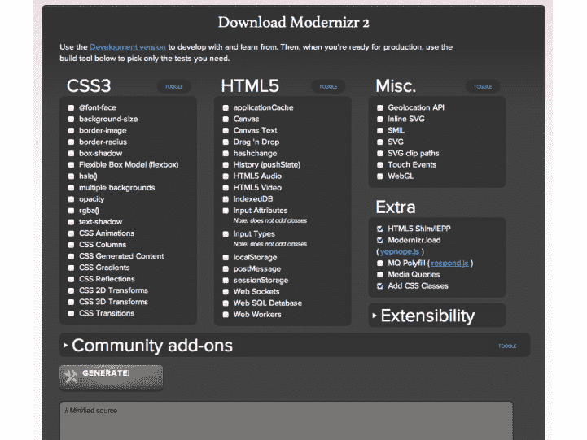

在这个阶段，由于我们仍在尝试使用 Modernizr，让我们使用开发版本。在文档的 head 中引用该脚本。

```html
<!doctype html public 'the Modernizr chapter, yo'>
<html>
<head>
<meta charset="utf-8">
<title>Modernizr Testing</title>
<script src="http://www.modernizr.com/downloads/modernizr-latest.js"></script>
</head>
<body>
</body>
</html>
```

## 为什么不放在底部？

你可能已经读到过，尽可能将脚本放在页面底部、`</body>` 标签之前是一种最佳实践。这**绝对**是正确的。这样做时，你的页面看起来会加载得更快。然而，Modernizr **必须**放在 **head** 中，在你的样式表引用之后。这有几个原因：

1. 一个简单的脚本，用于让 Internet Explorer 8 及更低版本识别和样式化新的 HTML5 元素，必须放在文档的 **head** 中才能正常工作。请注意，这个脚本与 Remy Sharp 的 [html5shim](https://example.com) 相同。
2. 如果脚本没有添加到 **head** 中，网站的访问者可能会看到无样式内容的闪烁（flash of unstyled content）。

## HTML 类

通过引用这一个脚本，Modernizr 会立即运行数十个测试，并将类应用到 `html` 标签。

```html
<!DOCTYPE html PUBLIC "the modernizr chapter, yo">
<html class=" js flexbox canvas canvastext webgl no-touch-appolocation postmessage weboldatabase
indatabasehtml5sha1 crypstorefontface svg rgba hpa html5multiple backgrounds borderimage
borderradius boxshadow textshadow opacity cssanimations csscolumns cssgradients cssreflections
csstransitions svgfilters svgforeignobject svgforeigncontent video audio localstorage
sessionsstorage webworkers applicationcache svg inlinesvg svgclippaths">
<head></head>
<body></body>
</html>
```

这些类对于浏览器及其支持的内容来说是唯一的——在我的例子中，是 Google Chrome 16。有用的是，这现在为我们提供了基于是否支持特定特性来样式化内容的手段。我现在可以在支持它的浏览器中使用 CSS3 弹性盒模型。

## 特性检测的要点

弹性盒模型决定了盒子在其他盒子内部的分布方式。它还会自动确定间距。

```css
.flexbox .container {
  /* 此浏览器支持弹性盒模型 */
}
```

另外，如果浏览器不支持 `flexbox`，那么 Modernizr 将会应用一个 `no-flexbox` 类。

```css
.no-flexbox .container {
  /* 呃——我还是用浮动吧 */
}
```

请记住：Modernizr 应用到 `html` 标签的类名完全取决于浏览器支持哪些 CSS3 和 HTML5 特性。这就是为什么它如此强大！


### no-js

如果你愿意，也可以将`no-js`类名应用到`html`标签。

```html
<html class="no-js">
```

通过使用这样的简单 CSS 类，我们可以轻松判断用户浏览器中是否启用了 JavaScript。如果是，Modernizr 会将`no-js`替换为`js`。

也许你的网站上有某个小部件依赖 JavaScript 才能正常工作。如果用户禁用了 JavaScript，隐藏这些内容可能是明智的。这样，当`prev`和`next`按钮似乎无法正常工作时，就不会让人感到困惑。

## 特性检测的要点

```css
.no-js .widget {
    display: none;
}
```

这种样式只会在 JavaScript 未启用时生效。如果启用了 JavaScript，`no-js`类将不可用。

### Modernizr.load

Yepnope 是 Modernizr 加载工具背后的技术，它是一个异步且条件式的资源加载器。好吧，这很令人困惑。这到底是什么意思？让我们逐一分解这些术语。

### 异步

Yepnope 会以这样的方式来加载你的资源：当脚本加载时，文档的其余部分不必等待。

想象一个只有一名员工的工厂。这名员工唯一的工作就是加载你的样式表和脚本（我知道这有点牵强，但请忍耐一下）。问题是这名工厂工人一次只能做一件事。当他加载脚本一号时，你文档的其余部分就坐着干等。

> 摇滚技巧

请记住，我们处理的是毫秒级的问题，然而，事实证明即使是 200 毫秒的延迟也会对流量和销售产生显著影响。

接下来，他加载资源二号，循环重复。只有当他完成这些资源的加载后，访问者才能看到页面内容。这就是为什么通常建议你尽可能放在页面底部放置脚本。虽然页面仍然需要相同的时间来加载，但对访问者来说，看起来它加载得更快。

虽然现代浏览器已经开始并行下载脚本，但它们还不完美，而且，除此之外，我们还有旧版浏览器需要考虑。

如果我们能给这个工厂工人缝上额外的手，每只手都能独立加载一个资源，那岂不是很棒？这样，所有这些手并行工作，工人就能更高效地完成工作。

星球大战迷：想想格里弗斯将军的四把光剑。就是这个基本概念。每只手都可以独立工作（或异步工作），结果，完成更多的工作（或砍掉更多的头）。

### 条件式

这是资源加载器大放异彩的地方；我们可以指定某个脚本或样式表只有在特定条件下才加载。资源加载器是为 polyfill 量身定制的。例如，你已经学过如何使用`date`输入类型。正如该章节所讨论的，必须考虑旧版浏览器。如果你期望特定格式的日期，为 IE6 用户提供回退文本框是一个糟糕的选择。相反，我们可以使用 polyfill，比如 [jQuery UI 的日期选择器插件](http://jqueryui.com/datepicker)。如果浏览器不支持`date`输入类型，只有在该条件下才应该加载这个 polyfill 或回退脚本。

### 资源

不要被这个迷惑。这只是引用样式表和脚本的一种方式。许多加载器只专注于脚本，因此得名“脚本加载器”。Yepnope 两者都处理。

### yepnope 与 Modernizr 有什么关系？

> 目前 yepnope 被包含在 Modernizr 的特殊构建版本中，因为它是特性测试库的完美搭档。Modernizr 的输出是 yepnope 绝佳的输入。Yepnope 目前以其原始状态未加修改地包含在内，但也别名为 Modernizr.load——你可以互换使用两者，但我们建议你坚持使用其中一个。—— yepnopejs.com

### 用法

在继续之前，你必须使用 [Modernizr 构建工具](http://modernizr.com/download/)创建自定义的 Modernizr 脚本，并在 Extra 部分指定包含`Modernizr.load`功能。

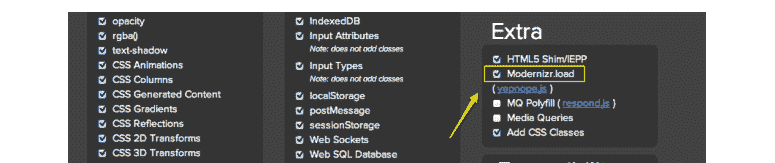

使用`yepnope`或`Modernizr.load`最简单的方式是传递一个字符串，如下所示：

```html
<!doctype html>
<html class="no-js">
<head>
    <meta charset="utf-8">
    <title>Modernizr Testing</title>
    <!-- 放在样式表之后 -->
    <script src="modernizr.js"></script>
    <script>
        Modernizr.load('jquery-local.js');
    </script>
</head>
<body>
</body>
</html>
```

这将在尽可能早的时间加载本地的 jQuery 文件。如果你是资源加载器的新手，你可能会惊讶地发现下面的代码不会按你期望的方式工作。

## 特性检测的要点

```html
<script>
  Modernizr.load('jquery-local.js');
  $.get(...);
</script>
```

尽管我们似乎已经引入了 jQuery 库，但我们还无法访问`jQuery`函数。事实上：

```html
<script>
  Modernizr.load('jquery-local.js');
  console.log(typeof jQuery); // undefined
</script>
```

怎么回事？我们无法访问 jQuery，因为脚本尚未完成下载！虽然一开始可能令人困惑，但这正是它的妙处所在！`Modernizr.load`不会等待资源加载完成才继续执行。这正是我们的页面能够更快加载的原因。

这就引出了一个问题：“我何时可以引用 jQuery？”我们可以使用`callback`方法，它会在脚本完全加载后立即被调用。

```javascript
Modernizr.load({
  load: 'jquery-local.js',
  callback: function(url, result, key) {
    console.log(typeof jQuery); // function
  }
});
```

这次，我们不是向`yepnope`传递一个字符串，而是传递一个对象。

```javascript
Modernizr.load('jquery-local.js');
```

……等同于：

```javascript
Modernizr.load({
    load: 'jquery-local.js'
});
```

## 测试

我们还没有利用`Modernizr.load`的条件性方面。我们可以通过`test`属性来实现。假设我们想要使用 HTML5 的日期选择器，并为旧版浏览器提供一个 [jQuery UI 回退方案](javascript:void(0))。孩子，这就是具体实现方法。

```javascript
Modernizr.load({
    test: Modernizr.inputtypes && Modernizr.inputtypes.date,
    nope: [
        'ui/js/jquery-ui-custom.min.js',
        'ui/css/ui-lightness/jquery-ui-custom.css',
        'datepicker.js' // 你的执行必要功能的脚本
    ]
});
```

首先，我们使用`test`，传入一个布尔值，来决定我们应该做什么以及不应该做什么。在这种情况下，我们正在判断浏览器是否识别`date`输入类型。根据该测试返回`true`还是`false`，我们可以相应地使用`yep`和`nope`方法。如果浏览器已支持，我们实际上不需要执行任何特定操作；但如果不支持，我们需要加载我们的 polyfill（垫片）。

快去在你的浏览器中尝试一下。在 Opera 和 Firefox（8 或更低版本）中检查生成的 HTML。在 Opera 中，测试返回`true`，此时没有任何反应。然而，在 Firefox 8 中，测试返回`false`。此时，`nope`回调被调用，资产路径数组被加载。

遗憾的是，在撰写本文时，Webkit 对于`date`测试会错误地返回`false`，尽管它确实能识别它（虽然提供的是一个简陋的日期选择器）。这与其说是 bug，不如说是 Webkit 的 UI 尚未完善的问题。一旦完善，Modernizr 的测试应该就能通过。

### 为什么要多此一举？

你可能会在心里想，既然我们可以无论浏览器是否支持该功能都加载 jQuery UI 文件，为什么还要做这么多额外的工作？这样我们就不用麻烦地进行这类测试了。

这是糟糕的想法！不要偷懒。你所建议的是：

1. 谁在乎我们在不需要这些 polyfill 的浏览器中使用了更多的 HTTP 请求和带宽？
2. 我不在乎资产加载需要多长时间，只要它们……加载了就行。

我们是 Web 开发人员，傻瓜；我们的职责是为所有设备提供尽可能最好的体验。如果我们选择加载多个不必要的资产，我们就不能再称之为提供最好的体验。不要偷懒；请使用`Modernizr.load`。

## 最后……原生媒体

### 浏览器支持

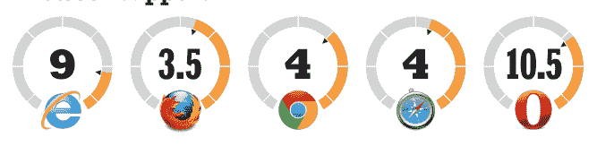

啊……我们来到了 HTML5 音频和视频——这是 HTML 中最抢眼、最值得报道的新特性之一。我们现在能够在浏览器中提供原生音频和视频播放的能力。我们不再需要依赖像 Flash 那样多 bug 且会导致浏览器崩溃的第三方工具了。对吧？嗯，差不多，但我说得太快了。

### 回到过去

不久前，如果我们想在网站或博客文章中嵌入视频，我们不得不求助于一段糟糕的 HTML 代码块，就像下面这样：

```html
<object width="600" height="400">
    <param name="movie" value="URL">
    <param name="allowFullScreen" value="true">
    <param name="allowscriptaccess" value="always">
    <embed src="URL" type="application/x-shockwave-flash"
           allowscriptaccess="always" allowfullscreen="true"
           width="600" height="400">
    </embed>
</object>
```

很可能你从未手动编写过这段 HTML。大多数视频托管平台（如 YouTube 或 Blip）提供一个可以复制粘贴的嵌入（Embed）选项。尽管如此，这依然是将你优美简洁的 HTML 变成一团乱麻的可靠方法。

但最糟糕的部分是，当时浏览器并不原生提供视频支持。相反，浏览器会将视频传递给第三方插件——通常是 Flash。

```html
type="application/x-shockwave-flash"
```

你真的认为你的母亲在收到提示时会更新她的 Flash 插件吗？我的绝对不会！再加上潜在的导致浏览器崩溃的 bug 以及可访问性问题，很明显第三方工具并不是处理此问题的最优方式（除了少数几种情况，我稍后会详细说明）。

使用 Flash 时，你在布局和功能（以及简洁度）方面受到很大限制。反之，通过在浏览器中原生提供视频和音频，我们获得了 HTML5、CSS3 效果、JavaScript 以及你能想到的任何其他功能的所有能力！

请注意，我们将专门关注`video`元素，因为`video`和`audio`的 API 基本相同。而且，视频更有趣！

### HTML5 视频不适用的场景

在我们进入使用信息之前，请记住，在某些情况下我们仍然应该使用第三方工具。

#### DRM

DRM，即数字版权管理，在 HTML5 世界中并不是一个热门话题。对于不熟悉这个术语的人，基本概念是某些开发人员和公司需要一种方法来限制视频的可用性，仅限于满足某些条件的用户，例如“此视频仅对订阅者开放”。在目前的状态下，这是不可能实现的（如果没有一些技巧的话）。因此，在某种形式的 DRM 提供之前，网络上的许多视频播放将继续通过 Flash 或 Silverlight 呈现。

2010 年 9 月，John Foliot 在 [W3C 开启了关于此话题的讨论](http://www.w3.org)，并指出：

> *如果`<video>`要被商业内容提供商广泛采用，那么为了能与 Flash 竞争，必须有一种手段来支持某种形式的原生 DRM。*

作为回应，Ian Hickson 关闭了该 bug 报告，给出了简单的回答：“DRM 是邪恶的。”不用说，这激怒了社区中的许多人，随后该线程被重新开启（以及[他更深入的回复](http://www.w3.org)）。

虽然很容易快速地站在争论的一方，但这并不是一个非黑即白的问题。此外，这也不是一个简单的问题；HTML5 如何才能提供 DRM？我们无法对图像这样做；为什么原生视频会有所不同？在本文作者看来，为 DRM 提供文档实际上超出了 HTML 的范围，就像编解码器一样。HTML5 既不认可也不限制其使用。相反，DRM 的角色应该由编解码器本身承担。

在 John Foliot 的 bug 线程中，[Lachlan Hunt](http://www.w3.org) 提出了几点极佳的看法：

> [...] 在 HTML5 中要求任何形式的 DRM 方案很可能不会成功，因为：

- 解密算法必须是公开的，并且任何实现都需要访问密钥，这击碎了阻止盗版的幻想。
- 它会使实现者受制于 DRM 提供商的许可费用。
- 它会让浏览器厂商面临 DMCA 合规性以及全球范围内处理 TPM 的类似严酷的反规避法律的法律噩梦。
- 它将使自由和开源的实现无法实现该 DRM 方案。

然而，另一方面，有人强烈认为这个问题必须被解决。无论我们是否同意，DRM 确实存在于 Web 上。唯一的问题是：我们如何处理它，以及让一个开放标准成为负责方是否有意义？我想我们很快就会知道。

#### 广告

一些公司和网站依赖广告收入。例如，Nettuts+ 在 Blip.tv 上托管了一些视频，该平台在视频前后附加广告。这笔额外收入是我们支撑制作视频教程成本的一种绝佳方式。遗憾的是，HTML5 没有提供任何方法来模拟这类功能。至少在目前，如果你需要广告，你将不得不坚持使用 Flash 或 Silverlight。

### 终于……原生媒体

#### 用法

还记得我前面详细讲解的那个巨大的`object`标签吗？现在它可以用以下代码替代：

```html
<video src="bbb.mp4"></video>
```

或者：

```html
<video>
  <source src="bbb.mp4"></source>
</video>
```

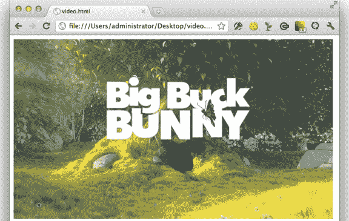

本章中使用的视频片段 *Big Buck Bunny* 是一部采用知识共享许可协议的“开放电影”，常用于 HTML5 视频演示。整部影片可在 [BigBuckBunny.org](http://BigBuckBunny.org) 上以多种格式获取。

嗯……事情没那么简单。你即将了解到大量关于编解码器之争的内容。不过现在，先切换到 Firefox 浏览器，看看你那漂亮的……空白屏幕吧。很好。

Firefox 不支持封闭的 mp4 格式（稍后会详细介绍）。这意味着我们不得不提供视频的多个版本，以适配各种不同的浏览器。

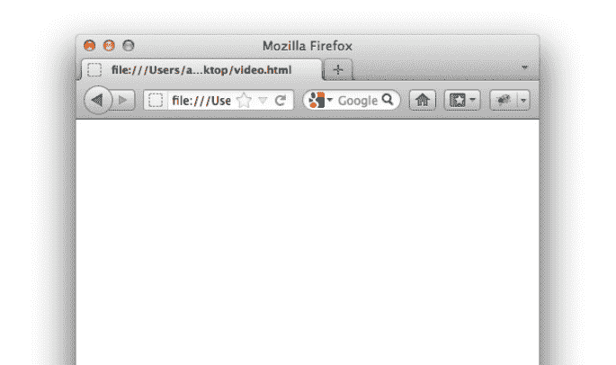

幸运的是，通过提供多个`source`标签，我们可以让每个浏览器都满意。对于 Firefox 来说，它需要看到`.webm`格式的视频（以及其他格式）。

浏览器会按顺序读取每个`source`标签。如果它不识别某个特定的编解码器，就会继续尝试下一个`source`标签。

```html
<video>
  <source src="bbb.mp4">
  <source src="bbb.webm">
</video>
```

这下好了；效果更好了。请注意，旧版本的 iPad 只会读取第一个`source`元素。因此，最佳实践是将包含 mp4 版本视频的`source`元素放在最前面。

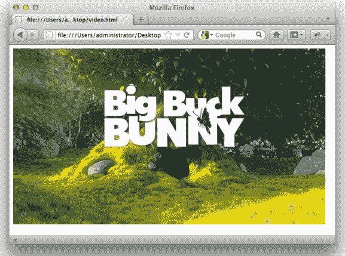

##### type 属性

为了防止浏览器“嗅探”每个`source`标签，我们可以指定 MIME 类型。

```html
<video>
  <source src="bbb.mp4" type="video/mp4">
  <source src="bbb.webm" type="video/webm">
</video>
```

这样，浏览器就不需要下载视频的元信息来判断是否可以播放。不过，这只能解决部分问题。MIME 类型指的是视频的容器格式，你几乎可以把它想象成 zip 文件。要真正深入了解，我们需要弄清楚容器格式里面的内容。`codecs`参数可以用来进行这种深层次的探查。

```html
<video controls>
  <source src="video.mp4" type='video/mp4; codecs="avc1.42E01E, mp4a.40.2"'>
  <source src="video.webm" type='video/webm; codecs="vp8, vorbis"'>
</video>
```

因为必须提供视频的多个版本以适配所有浏览器，所以目前来说，简写形式`<video src="my-video">`应仅在使用 JavaScript 动态设置视频源时使用。

#### 文本回退


对于不识别新的 `video` 标签的浏览器会发生什么？正如你在前面 Firefox 示例中学到的，它们会……什么都不做。我们可以为这些情况提供文本回退方案。

```html
<h1> Watch This Video </h1>
<video>
  <source src="bbb.mp4">
  <source src="bbb.ogv">
  <a href="bbb.mp4">Download the video.</a>
</video>
```

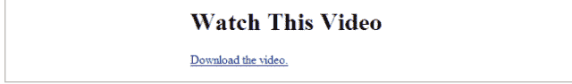

此下载链接仅在不识别 `video` 标签的浏览器中显示。这一点需要明确区分。人们很容易认为，当视频本身无法被识别时（例如只提供了 MP4 版本，而用户使用的是 Firefox），文本就会显示。但事实并非如此；如果浏览器能识别 `video` 标签，回退文本永远不会被渲染。

在本章结束之前，我们还会介绍 Flash 视频回退方案。

#### `controls`

如果你跟着一起操作，你会发现目前状态下，我们的视频简直就像一张图片。让我们通过给 `video` 标签添加 `controls` 属性来添加标准控件。

```html
<video controls>
    <source src="bbb.mp4">
    <source src="bbb.ogv">
    <a href="bbb.mp4">Download the video.</a>
</video>
```

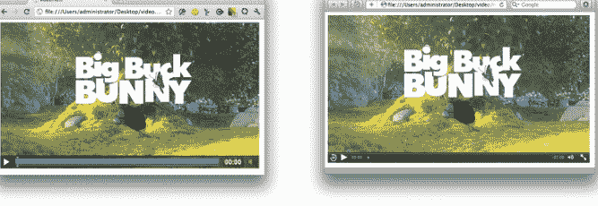

`controls` 属性在 Chrome（左）和 Safari（右）中的渲染效果。

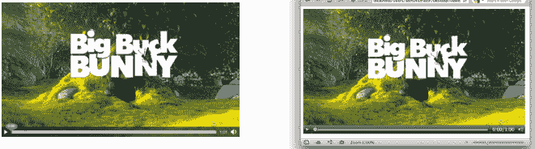

`controls` 属性在 Firefox（左）和 Opera（右）中的渲染效果。

请注意，在 Firefox 中，控件仅在鼠标悬停于视频上方时才会显示。

说到这个，作为一名用户，我很想知道为什么 `video` 元素的默认设置是没有控件的。这难道不是有违直觉吗？当然，在某些情况下，通过脚本动态播放视频并省略控件是有道理的，但就本文作者而言，控件应当默认显示。

#### `autoplay`

那么如果我们希望页面加载时视频立即播放呢（95% 的情况下不建议这样做）？`autoplay` 属性可以实现这一点。

```html
<video controls autoplay>
    <source src="bbb.mp4">
    <source src="bbb.ogv">
    <a href="bbb.mp4">Download the video.</a>
</video>
```

#### 关于无障碍访问的说明

在撰写本文时，无障碍访问方面的问题相当突出。例如，如果没有 `controls` 属性，当元素获得焦点时，没有任何浏览器会响应键盘命令，比如使用空格键播放视频。

在有此属性的情况下：

- **Chrome 15** – 不响应键盘导航。
- **Safari 5** – 不响应键盘导航。
- **Firefox 9** – 获得焦点时，响应空格键和方向键进行导航和音量调节。
- **Opera 11** – 提供最佳的无障碍访问支持；视频播放器上的每个控件都可以通过 `Tab` 键进行访问。

#### `poster`

默认情况下，视频的第一帧将用作视频的初始显示画面。`poster` 属性可用于指定自定义图片。

```html
<video controls poster="poster.jpg">
    <source src="bbb.mp4">
    <source src="bbb.ogv">
    <a href="bbb.mp4">Download the video.</a>
</video>
```

此外，它还可以在视频数据尚未可用的情况下使用（`preload=none`，你很快就会学到）。如果没有 `poster` 属性，将显示一个空白的、未设置尺寸的视频容器。

```html
<video preload=none controls>
```

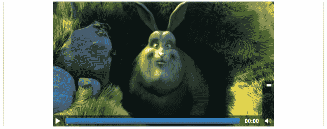

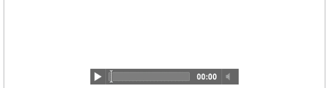

`poster` 属性：（上方）使用 JPEG 作为初始图片，（下方）当未指定图片时，控件上方会预留空白区域。

但是，当提供了 `poster` 时，海报图片的固有宽度和高度将用作视频的初始尺寸，即直到视频的元信息可用之前。

```html
<video preload=none controls poster="poster.jpg">
```


#### `loop`

我不确定这个属性什么时候会派上用场，但无论如何，如果指定了 `loop` 属性，视频将自动循环播放。

```html
<video controls poster="poster.jpg" loop>
    <source src="bbb.mp4">
    <source src="bbb.ogv">
    <a href="bbb.mp4">Download the video.</a>
</video>
```

#### `preload`

在某些情况下，你可以确定用户在浏览页面时很可能会观看视频。在这种情况下，在页面加载时立即开始预加载视频是合理的。这样可以减少缓冲带来的问题。

> **技巧提示**
>
> 只有在用户很可能会观看视频的情况下才应该启用此选项。否则，你只是在浪费带宽！

`preload` 属性提供了若干可选值：

```html
<video controls preload>
```

仅设置属性名而不赋值意味着 `auto`，即指示浏览器自行决定如何处理。在大多数情况下，浏览器会开始下载文件，但仅凭此属性的存在并不能保证这一点。例如，某些设备可能会根据网络连接情况选择不预加载资源。

```html
<video controls preload="none">
```

`none` 值指示浏览器仅在用户激活控件时才开始加载视频。

```html
<video controls preload="meta">
```

`meta` 值不会预加载整个视频，而仅获取与视频相关的元信息，例如其长度、尺寸等。

### 原生媒体

### 编解码器简述

虽然这并不光鲜，但尽管如此，你仍应对视频编解码器（codecs）有一个基本的了解。

编解码器会将大量图像或音频样本分别转换为压缩的视频或音频流。每个编解码器的质量可能差异很大。不幸的是，事情还没完。当音频流和视频流合并时，我们会得到一个专门的容器格式。例如，H.264 视频和 AAC 音频合并成了流行的 MP4 格式（即容器）。

当 HTML5 规范初稿起草时，它要求每个浏览器都要分别为音频和视频回放提供对 Ogg Vorbis 和 Ogg Theora 编解码器的支持。

如果这一规定生效，网络世界将会变得更好（或者至少更简单），然而，包括 Apple 在内的少数公司对此指令表示反对。结果，规范的这一部分被删除，将编解码器的决定权交给了每个浏览器厂商。因此，我们面临着一个较为混乱的局面：

- **Firefox** – 支持 Vorbis 和 Theora、VP8。
- **Opera** – 支持 Vorbis 和 Theora、VP8。
- **Internet Explorer 9** – 支持 H.264 和 MP3。
- **Safari** – 支持 H.264 和 MP3。
- **Chrome** – 支持 Theora、H.264、Vorbis、MP3，并且还拥护开源视频编解码器 VP8。

> **ROCK 提示**
>
> `VP8` 是一款顶级的、免版权费的视频编解码器，正在迅速获得支持。在撰写本文时，Firefox、Chrome、Opera 和 Android 均支持该格式。你可能会通过 WebM 容器（视频用 VP8，音频用 Vorbis）与之交互。

### 那么我们该怎么做？

经验法则：不要让任何浏览器掉队。如果你的视频被编码为 H.264，你会让 IE、Safari 和 Chrome 感到满意；然而，Firefox 用户将无法观看你的视频。不要做个混蛋 —— 确保每个人都能分到一块蛋糕。同时提供两种格式。

### 视频编码工具

#### HandBrake


[Handbrake](https://handbrake.fr) 是一款流行的开源转码器，适用于 Mac、Linux 和 Windows。

#### Miro（Windows 和 Mac）


Miro Video Converter 允许你将几乎任何视频转换为 MP4、WebM 和 Ogg Theora。

#### Easy HTML5 Video（Windows 和 Mac）


我的首选工具会自动将你的视频转换为必要的格式，并为原生视频版本以及 Flash 回退方案动态创建相应的标记。

### 如果仍然无法播放

如果你将视频转换为必要格式后，它似乎仍然不被识别，那么可能是你的服务器配置不正确。结果，视频将作为 `text/plain` 提供，而不是像 `video/ogg` 之类的内容。Apache 用户可能需要相应地更新其 `.htaccess` 文件。

```apache
AddType video/ogg .ogv
AddType audio/ogg .oga
AddType video/mp4 .mp4
AddType video/webm .webm
```

### 那我妈怎么办？

到目前为止，我们已经采取了必要步骤让所有现代浏览器满意，同时为旧版浏览器（以及你妈）提供了下载链接。你能接受这一点吗？在某些情况下 —— 当然，我可以！也就是说，这种方法并不总是合适的。

如果你要求所有用户都能播放视频，则需要提供 Flash 回退方案。我们已经发现，如果浏览器不支持 HTML5 视频，除了 `source` 标签之外的任何内容都将被显示。考虑到这一点，我们可以回退到旧的 `embed` 代码。

```html
<video controls poster="poster.jpg" loop>
  <source src="bbb.mp4">
  <source src="bbb.ogv">
  <embed src="URL" type="application/x-shockwave-flash"
    allowscriptaccess="always" allowfullscreen="true"
    width="600" height="400">
</video>
```

当你拿到一段视频后，常见的操作顺序是先将其转换为必要的视频格式（H.264 和 WebM），然后将视频上传到各种视频托管平台（如 YouTube）之一。这样一来，无论如何，所有访问者都能看到视频 —— 其中一些通过 Flash，另一些通过原生视频回放！

虽然不够优雅，但目前来看，“就这样吧，伙计”。

### 为每个人准备的视频

这种基础技术（带有 Flash 回退的 HTML5 视频）最初是由 “Video for Everybody” 推广的。

> Video for Everybody 简单来说就是一段 HTML 代码，它使用 HTML5 `<video>` 元素将视频嵌入到网站中，在不使用 JavaScript 或浏览器嗅探的情况下自动回退到 Flash。 —— CamenDesign.com

为了自动完成创建必要标记的过程，Jonathan Neal 创建了一个运行良好且高效的生成器。


### 还没结束

当然，到这一步，我们已经让所有用户满意了。好吧 —— 还不完全是。移动端访问者怎么办？让他们在微小的设备上下载你巨大的高清视频有意义吗？如果我们能针对这些设备并提供高度压缩的视频版本，那就太好了。事实上，我们可以做到！

借鉴 CSS3 媒体查询，我们可以指定在设备宽度满足某些标准的情况下加载某个版本的视频。

```html
<source src="bbb.mp4" media="(min-device-width: 750px)">
<source src="bbb-small.mp4">
<source src="bbb.webm" media="(min-device-width: 750px)">
<source src="bbb-small.webm">
```

那么这是否意味着，对于每段视频，你必须提供十几种不同的格式和尺寸？这取决于情况。当然，这样做没坏处。例如，如果视频是用于预览你的新 Web 应用，我绝对建议你花这个功夫。另一方面，如果你只是在博客中提供一个简单的视频示例，你可能会选择放弃为移动用户提供优化视频。

### 使用 JavaScript 控制视频

除了内置控件，我们还可以使用 HTML5 新的媒体 API 来控制视频的播放。是的，是的，又是一个新 API。别担心，它很简单！

#### 检测

检测浏览器对视频和音频元素的支持很简单。我们只需要确定 `canPlayType` 方法在媒体对象上是否可用。

```javascript
if ( 'canPlayType' in document.createElement('video') ) {
  // Give these people air...
}

if ( 'canPlayType' in document.createElement('audio') ) {
  // I'm the one that jaded you...
}
```

请注意，如果浏览器识别 `video` 标签，那么它也支持音频。这两个 API 几乎完全相同，所有识别其中一个的浏览器也会识别另一个。这意味着我们的检测脚本可以简化为：

```javascript
var supportsMedia = (function() {
  return !!('canPlayType' in document.createElement('video'));
})();

if ( supportsMedia ) { ... }
```

或者，如果使用 Modernizr，我们可以使用：

```javascript
if ( Modernizr.video ) { ... }
if ( Modernizr.audio ) { ... }
```

#### 检测编解码器支持

我们的检测任务还没有结束。在某些情况下，确定浏览器是否识别特定的编解码器也很有帮助。这样我们就可以动态加载最合适的视频格式。不幸的是，这并不像我们希望的那样简单。幸运的是，Modernizr 提供了一个很好的解决方案。它使用媒体对象的新 `canPlayType` 方法来确定是否识别特定的编解码器。例如，在 Chrome 16 中：

```javascript
video.canPlayType('video/webm; codecs="vp8, vorbis"');
// probably
```

这些测试可以通过 Modernizr 的 `.video` 测试获得。单独使用 `Modernizr.video` 将返回一个表示浏览器支持情况的布尔值；然而，Modernizr 扩展了布尔构造函数，以便我们也可以验证对 `ogg`、`h264` 和 `webm` 格式的支持。

```javascript
Modernizr.video // 浏览器支持视频
Modernizr.video.webm // 浏览器支持 WebM 格式
Modernizr.video.h264 // 浏览器支持 H.264 格式
```

早些时候，我提到 HTML5 视频和音频的 API 是相同的。因此，你可能会惊讶地发现 Modernizr 提供了两个单独的测试：`Modernizr.video` 和 `Modernizr.audio`。功能检测本身是相同的。唯一的区别在于检测各种编解码器支持的扩展布尔值。

```javascript
Modernizr.audio.mp3
Modernizr.audio.ogg
Modernizr.audio.wav
Modernizr.audio.m4a
```

#### 方法

对于媒体元素（无论是 `video` 还是 `audio`），只有少数几个可用的新方法。

- `play()` – 开始或继续播放引用的视频。
- `pause()` – 暂停视频。
- `load()` – 触发一系列操作，但在实际应用中，可用于获取新的媒体资源。
- `canPlayType()` – 确定浏览器解析所传递的编解码器的可能性。

这些方法可以这样使用：

```javascript
// Find the first video tag on the page
var video = document.querySelector('video');

// play the video
video.play();

// pause the video
video.pause();

// Does the browser recognize the ogg format?
video.canPlayType('audio/ogg; codecs="vorbis"');
```

#### 事件（Events）

仅有新方法是不够的；我们还需要一种方法来`监听`特定事件的发生，例如视频开始播放或播放结束时。

- `play` – 当视频开始或继续播放时触发一次。
- `pause` – 当视频暂停时触发一次。请注意，这里是指 `pause` 事件。
- `ended` – 当视频播放结束时触发一次。
- `progress` – 当媒体资源已被检索但可能尚未解码时触发一次。


- `canplay` – 当视频已完全加载并准备好播放时触发。

#### 属性（Attributes）

- `duration` – 相关视频的长度。
- `currentTime` – 视频的当前位置。例如，可以在视频暂停时使用此属性。
- `autoplay` – 一个布尔值，指示视频是否设置为自动开始。
- `poster` – 提供的封面图路径，或为空字符串。
- `paused` – 一个布尔值，指示视频当前是否处于暂停状态。
- `ended` – 一个布尔值，指示视频是否已播放完成。

为了获取视频的长度或时长，我们使用`video.duration`；然而，如果视频的元数据信息尚未检索到，则将返回`NaN`。因此，为了确保返回正确的值，请先监听元数据信息或视频完全加载的事件。

```javascript
var video = document.querySelector('video');
video.addEventListener('progress', function() {
  console.log(video.duration); // 60.1396827697539
}, false);
```

现在，我们已经拥有了介入视频生命周期的工具。要创建一个切换播放/暂停的按钮，我们只需要在页面中添加一个按钮。

```html
<video poster="poster.jpg">
  <source src="bbb.mp4">
  <source src="bbb.ogv">
</video>
<button>Play</button>
```

等等——别这么快。如果访问者禁用了 JavaScript 怎么办？使用 JavaScript 来附加按钮是不是更有意义？当然如此。这一次，我们将默认给视频应用`controls`属性，然后动态地将其移除。

```html
<video poster="poster.jpg" controls>
  <source src="bbb.mp4">
  <source src="bbb.ogv">
</video>
```

然后在我们的 JavaScript 中：

### JavaScript

```javascript
var video = document.querySelector('video'),
    button = document.createElement('button');

// set the button's text
button.innerHTML = 'Play';

// Remove the controls
video.removeAttribute('controls');

video.addEventListener('pause', function() {
  button.innerHTML = 'Play';
}, false);

video.addEventListener('ended', function() {
  button.innerHTML = 'Play';
}, false);
```

### jQuery

```javascript
var $video = $('video'),
    video = $video[0], // convenience
    button = $('<button>Play</button>');

$video.removeAttr('controls').after(button);

$video
  .on('play', function() {
    button.text('Pause');
  })
  .on('pause ended', function() {
    button.text('Play');
  });

button.on('click', function() {
  if ( video.ended ) video.currentTime = 0;

  // play or pause the video
  video[video.paused ? 'play' : 'pause']();
});
```

请注意，我们是如何使用`play`、`pause`和`ended`事件监听器来相应地更新按钮的值的。

#### 构建播放列表

假设你想为用户提供一个简单的播放列表。也许你将一个视频课程分成了多个章节，现在需要一种简单的方法让用户在不需要刷新整个页面的情况下加载每个章节。我们将探讨实现此任务的两种方法。

##### 自动更换视频

首先，我们将监听每个视频何时完成，然后为用户自动加载并播放下一个章节或视频。

### JavaScript

```javascript
var video = document.querySelector('video'),
    playlist = ['chapter-1', 'chapter-2', 'chapter-3'],
    extension = Modernizr.video.webm ? '.webm' : '.mp4',
    i = 1; // chapter-1 is the default video, so we begin
           // with the second item in the array

video.addEventListener('ended', function() {
    !playlist[i] && (i = 0); // if at the end of the array, reset

    this.src = playlist[i++] + extension; // chapter-1.webm, or chapter-1.mp4
    this.poster = '';
    this.load(); // load the video

    this.play();
}, false);
```

### jQuery

```javascript
var video = $('video').first(),
    playlist = ['chapter-1', 'chapter-2', 'chapter-3'],
    extension = Modernizr.video.webm ? '.webm' : '.mp4',
    i = 1;

video.on('ended', function() {
  !playlist[i] && (i = 0); // if at the end of the array, reset

  this.src = playlist[i++] + extension; // chapter-1.webm, or chapter-1.mp4
  this.poster = '';
  this.load(); // load the video

  this.play();
});
```

请注意，我们利用 Modernizr 来检测对`video`元素和`webm`格式的支持。

这段代码使用`ended`事件来检测每个视频何时完成。一旦完成，我们将下一个章节的路径分配给`video`的`src`属性，加载它并开始播放。请注意，该脚本假设你同时拥有视频的`chapter-x.webm`和`chapter-x.mp4`版本。

由于以下代码，这个过程将无限循环：

```javascript
!playlist[i] && (i = 0);
```

这一行规定，如果`array`中没有更多可获取的项目，我们将`i`重置为零，并循环回第一个视频。

请注意，我们是在`video`标签本身上设置`src`属性。你会发现，如果你对`source`元素执行同样的操作，将没有任何效果。要指示浏览器获取这个新应用的资源，请触发`load`方法：`video.load()`。

#### 提供章节列表

虽然在上一个视频完成后自动切换到下一个视频很有帮助，但我们可以做得更好。让我们创建一个真正的播放列表，以便用户可以轻松地在课程之间切换。

### 标记语言（Markup）

我们从标记语言开始。这一次，我们需要一个链接列表来充当播放列表：

```html
<video controls preload>
  <source src="chapter-1.m4v">
  <source src="chapter-1.webm">
  <a href="chapter-1.m4v">Download the video.</a>
</video>
<h2>Playlist</h2>
<ul class="playlist">
  <li><a href="chapter-1.m4v" class="playing">First Video</a></li>
  <li><a href="chapter-2.m4v">Second Video</a></li>
  <li><a href="chapter-3.m4v">Third Video</a></li>
</ul>
```

- 第一个视频
- 第二个视频
- 第三个视频

这种方法是最理想的。即使浏览器不支持原生视频，用户仍然可以通过链接列表下载并在本地观看。

##### 样式（Styling）

接下来，如果我们添加一点样式，就可以创建一个更像播放列表的显示效果。

```css
body {
    text-align: center;
    padding: 2em 0;
    width: 640px;
    margin: auto;
    font-family: sans-serif;
    -moz-box-sizing: border-box;
    box-sizing: border-box;
}
ul { padding: 0;}
li {
    background: #292929;
    color: white;
}
li:hover, .playing { background: black; }
li a {
    color: white;
    text-decoration: none;
    font-size: 1.5em;
    border-bottom: 1px solid black;
    border-top: 1px solid #666;
    display: block;
    padding: 1em;
}
li:first-child a { border-top: 0; }
li:last-child a { border-bottom: 0; }
video { width: 640px; }
```

### 终于……原生媒体

**播放列表**

- 第一个视频
- 第二个视频
- 第三个视频

好吧，这赢不了任何奖项。我早就跟你说过了；别跟我纠结这个设计问题了。它很难！

注意，播放列表中第一个视频应用了一个名为`playing`的类。这是因为该播放列表项是页面加载时的默认视频。

#### JavaScript 部分

我们将从特性检测开始，并设置一些所需的基础变量。

### JavaScript

```javascript
if ( Modernizr.video ) {
    (function() {
        var video = document.querySelector('video'),
        playlist = document.querySelector('ul.playlist'),
        setExtension = (function() {
            var extension = Modernizr.video.webm ? '.webm' :
                '.m4v';
            return function(src) {
                return src.replace(/\.\w{3,4}$/, extension);
            };
        })();
    })();
}
```

### jQuery

```javascript
if ( Modernizr.video ) {
    (function() {
        var video = $('video').first(),
        playlist = $('ul.playlist'),
        setExtension = (function() {
            var extension = Modernizr.video.webm ? '.webm' :
                '.m4v';
            return function(src) {
                return src.replace(/\.\w{3,4}$/, extension);
            };
        })();
    })();
}
```

`setExtension`方法使用 Modernizr 来确定哪种编解码器最适合当前浏览器。如果我们参考优秀的[CanIUse.com](https://caniuse.com)网站，就会发现，在 WebM 和 H.264 编解码器之间，我们几乎可以让所有现代浏览器都满意。

根据`Modernizr.video.webm`测试的结果，变量`extension`的值将等于`webm`或`m4v`。最终，这个值将被附加到需要加载的视频名称上。这样，`some-video`在 Safari 中可以是`some-video.m4v`，而在 Chrome 中则是`some-video.webm`。接下来，我们将为播放列表附加一个点击处理程序。当某个项目被选中或点击时，我们需要更新`video`标签以包含新的`src`。

### JavaScript

```javascript
if ( Modernizr.video ) {
    (function() {
        var video = document.querySelector('video'),
            playlist = document.querySelector('ul.playlist'),
            setExtension = (function() {
                var extension = Modernizr.video.webm ? '.webm' : '.m4v';
                return function(src) {
                    return src.replace(/\.\w{3,4}$/, extension);
                };
            })();
        // ...
```

```javascript
};
})();
playlist.addEventListener('click', function(e) {
// video-2.m4v becomes either video-2.webm or
  remains video-2.m4v
var href = setExtension( this.href );
e.preventDefault();
}, false);
})();
}
```

### jQuery

```javascript
if ( Modernizr.video ) {
(function() {
var video = $('video').first(),
  playlist = $('ul.playlist'),
  setExtension = (function() {
    var extension = Modernizr.video.webm ? '.webm' :
      '.m4v';
    return function(src) {
      return src.replace(/\.\w{3,4}$/, extension);
    };
  })();
  playlist.on('click', 'a', function(e) {
    var link = $(this),
      // video-2.m4v becomes either video-2.webm or
      remains video-2.m4v
      href = setExtension( link.attr('href') );
    e.preventDefault();
  });
})();
}
```

这里最值得注意的逻辑是：

```javascript
// video-2.m4v becomes either video-2.webm or
remains video-2.m4v
href = setExtension( link.attr('href') );
```

因为我们将动态地为`video`标签分配新的源，所以需要提供正确的视频格式。例如……

```javascript
document.querySelector('video').src = 'new-mvideo.m4v';
```

……确实会更新视频；但是，如果用户使用的是 Firefox 呢？该浏览器目前不支持 H.264 编解码器。这就是为什么这一行引用了`setExtension`函数，它会切掉所选视频的扩展名，并用 Modernizr 特性检测确定的新扩展名替换它。

请注意，此代码假设对于每个`video-x.m4v`，在同一文件夹中也有相应的`video-x.webm`。

此时，`href`将等于应播放的下一个视频的路径。让我们更新`video`标签：

### JavaScript


```javascript
if (Modernizr.video) {
  (function() {
    var video = document.querySelector('video'),
        playlist = document.querySelector('ul.playlist'),
        setExtension = (function() {
          var extension = Modernizr.video.webm ? '.webm' : '.m4v';
          return function(src) {
            return src.replace(/\.\w{3,4}$/, extension);
          };
        })();
  })();
}
```

```javascript
changeVideo = function(newVideoPath) {
  video.poster = '';
  video.src = newVideoPath;
  video.load();
  video.play();
};

playlist.addEventListener('click', function() {
  var href = setExtension(this.href);
  changeVideo(href);
  e.preventDefault();
}, false);
})();
}
```

### jQuery

```javascript
if (Modernizr.video) {
  (function() {
    var video = $('video').first(),
        playlist = $('ul.playlist'),
        setExtension = (function() {
          var extension = Modernizr.video.webm ? '.webm' : '.m4v';
          return function(src) {
            return src.replace(/\.\w{3,4}$/, extension);
          };
        })(),
        changeVideo = function(newVideoPath) {
          if (video instanceof jQuery) video = video[0];
          video.poster = '';
          video.src = newVideoPath;
          video.load();
          video.play();
        };

    playlist.on('click', 'a', function(e) {
      var link = $(this),
          href = setExtension(link.attr('href'));
      changeVideo(href);
      e.preventDefault();
    });
  })();
}
```

在`changeVideo`函数中，当动态添加新视频时，我们必须重新分配视频的`poster`属性为新图像，或者完全移除它。否则，看起来就像是我们加载了与之前相同的视频。

```javascript
video.poster = '';
```

接下来，`video`标签被更新为传递给该函数的新`src`。

```javascript
video.src = newVideoPath;
```

一旦源被更新，我们只需要加载并播放它！

```javascript
video.load();
video.play();
```

为了确保在引用媒体元素的属性和方法时从不使用 jQuery 包装的对象，我们可以在函数顶部提供一个简单的检查：`if (video instanceof jQuery) video = video[0];`。这相当于说：“如果传递给此函数的是 jQuery 包装的对象，而不是节点本身，那么将`video`变量更新为仅等于该节点。”

#### 切换 playing 类

为了向用户提供额外的反馈，我们应该更新播放列表的样式，使新选中的项目获得`playing`类及其相关样式。然而，除了添加`playing`类之外，我们还必须确保从兄弟元素中移除这个类名。

### JavaScript

```javascript
if (Modernizr.video) {
  (function() {
    var video = document.querySelector('video');
    playlist = document.querySelector('ul.playlist');
    setExtension = (function() {
      var extension = Modernizr.video.webm ? '.webm' : '.m4v';
      return function(src) {
        return src.replace(/\.\w{3,4}$/, extension);
      };
    })();

    changeVideo = function(newVideoPath) {
      video.poster = '';
      video.src = newVideoPath;
      video.load();
      video.play();
    };

    toggleClassNames = function(context, name) {
      name = name || 'playing';
      [].forEach.call(context.querySelectorAll('.' + name), function(el) {
        el.classList.remove(name);
      });
      this.classList.add(name);
    };

    playlist.addEventListener('click', function() {
      var href = setExtension(this.href);
      changeVideo(href);
      toggleClassNames.call(this, playlist);
    });
  })();
}
```

`e.preventDefault();`

```javascript
}, false);
})();
}
```

### jQuery

```javascript
if (Modernizr.video) {
  (function() {
    var video = $('video'),
        playlist = $('ul.playlist'),
        setExtension = (function() {
          var extension = Modernizr.video.webm ? '.webm' : '.m4v';
          return function(src) {
            return src.replace(/\.\w{3,4}$/, extension);
          };
        })(),
        changeVideo = function(newVideoPath) {
          if (video instanceof jQuery) video = video[0];
          video.poster = '';
          video.src = newVideoPath;
          video.load();
          video.play();
        },
        toggleClassNames = function(context, name) {
          name = name || 'playing';
          context.find('.' + name).removeClass(name);
          this.addClass(name);
        };

    playlist.on('click', 'a', function(e) {
      var link = $(this),
          href = setExtension(link.attr('href'));
      changeVideo(href);
      toggleClassNames.call(link, playlist);
      e.preventDefault();
```

## 最后……原生媒体

```javascript
}); })(); }
```

`toggleClassNames`函数接收一个上下文（`context`）和一个可选的要分配的类名（默认为`playing`）。

```javascript
toggleClassNames = function(context, name) {
  name = name || 'playing';
  [].forEach.call(context.querySelectorAll('.' + name), function(el) {
    el.classList.remove(name);
  });
  this.classList.add(name);
};
```

调用时，它会以提供的上下文为基础查询 DOM，寻找任何具有`playing`类的潜在元素。如果找到了，它将从该节点中移除该类。这样，我们就不会在播放列表中出现多个包含此类的项目。最后，它将`playing`类分配给`this`，这里的`this`等同于播放列表中被点击的项目。

为了确保`this`正确地指向播放列表中被点击的锚点标签（而不是`window`对象），我们使用：

```javascript
toggleClassNames.call(link, playlist);
```

第一个参数声明了什么应该被视为`this`。第二个参数是作为搜索基准的上下文，用于查找任何需要移除的残留类名。

## 最后……原生媒体


播放列表

| 第一个视频 |
| --- |
| 第二个视频 |
| 第三个视频 |


### 当每个视频结束时

最后一步是在当前视频完成时自动跳转到下一个视频。为了实现这一点，我们可以像之前回顾过的那样，挂载到`ended`事件上。

### JavaScript

```javascript
if (Modernizr.video) {
  (function() {
    var video = document.querySelector('video'),
        playlist = document.querySelector('ul.playlist'),
        setExtension = (function() {
          var extension = Modernizr.video.webm ? '.webm' : '.m4v';
          return function(src) {
            return src.replace(/\.\w{3,4}$/, extension);
          };
        })();
  })();
}
```

## 最后……原生媒体

```javascript
})();
changeVideo = function(newVideoPath) {
  video.poster = '';
  video.src = newVideoPath;
  video.load();
  video.play();
};

toggleClassNames = function(context, name) {
  name = name || 'playing';
  [].forEach.call(context.querySelectorAll('.' + name), function(el) {
    el.classList.remove(name);
  });
  this.classList.add(name);
};

playlist.addEventListener('click', function() {
  var href = setExtension(this.href);
  changeVideo(href);
  toggleClassNames.call(this, playlist);
  e.preventDefault();
}, false);

video.addEventListener('ended', function() {
  var nextVideo = playlist.querySelector('a.playing')
      .parentNode.nextElementSibling.querySelector('a'),
      nextVideoPath;

  // If nothing found, we're at the end. Reset.
  if (!nextVideo[0]) {
    nextVideo = playlist.querySelector('li a');
  }

  // Get the path to the video we should play.
  nextVideoPath = setExtension(nextVideo.href);

  // Change to the next video.
  changeVideo(nextVideoPath);
  toggleClassNames.call(nextVideo, playlist);
}, false);
})();
}
```

## 最后……原生媒体

### jQuery

```javascript
if (Modernizr.video) {
  (function() {
    var video = $('video'),
        playlist = $('ul.playlist'),
        setExtension = (function() {
          var extension = Modernizr.video.webm ? '.webm' : '.m4v';
          return function(src) {
            return src.replace(/\.\w{3,4}$/, extension);
          };
        })();

    changeVideo = function(newVideoPath) {
      if (video instanceof jQuery) video = video[0];
      video.poster = '';
      video.src = newVideoPath;
      video.load();
      video.play();
    };

    toggleClassNames = function(context, name) {
      name = name || 'playing';
      context.find('.' + name).removeClass(name);
      this.addClass(name);
    };

    playlist.on('click', 'a', function(e) {
      var link = $(this),
          href = setExtension(link.attr('href'));
      changeVideo(href);
      toggleClassNames.call(link, playlist);
      e.preventDefault();
    });
  })();

  video.on('ended', function() {
    var nextVideo = playlist.find('a.playing').parent().next().children('a'),
        nextVideoPath;
```

## 最后……原生媒体


```
 // If nothing found, we're at the end. Reset.
if ( !nextVideo[0] ) nextVideo = playlist.find('li a').first();
// Get the path to the video we should play.
nextVideoPath = setExtension( nextVideo.attr('href') );
// Change to the next video.
changeVideo(nextVideoPath);
toggleClassNames.call( nextVideo, playlist );
});
})();
```

当`ended`事件触发时，我们只需要确定下一个视频的路径，应用必要的扩展名，并调用`changeVideo`函数。因为我们已经将大部分逻辑抽象到了独立函数中，所以此时我们的工作非常简单！重要的是要记住，最终我们会到达播放列表中的最后一个视频。一旦到达，播放列表应该重置回第一个视频并重新开始。这一行代码实现了该功能：

```
// If there isn't a next video,
//   make it equal to the first one.
if ( !nextVideo[0] ) nextVideo = playlist.find('li a').first();
```

### 完成

这并不太难！这绝对不是什么高深的科学！我们只是挂载了几个事件，并相应地更新 DOM。

[PAGE 180]

### 全屏 API（The Full Screen API）

虽然最初通过编程使元素以“全屏”显示的想法遭到了反对（出于安全考虑），但随着越来越多的应用迁移到 Web 端，我们逐渐意识到这是一项必要的功能。例如，考虑 HTML5 游戏全屏显示的优势，或者更自然地，全屏视频！感谢 Webkit 和[Robert O'Callahan 的提案](http://robert.ocallahan.org)，[Full Screen API](https://developer.mozilla.org)（不仅限于视频）现在赋予了我们这种能力。


*在 Firefox 12 Beta 中显示的原生全屏组件。*

在撰写本文时，该规范在 Chrome 和 Safari 的稳定版本以及 Firefox 12 的每夜构建版中得到了部分实现。后者甚至在视频播放器上提供了一个全屏按钮！

> **ROCK 提示**
>
> *YouTube 现在就使用了 Full Screen API。*

[PAGE 181]

## 最后……原生媒体

我们可以通过编程方式使用`requestFullScreen`方法将视频切换到全屏。与大多数新的实验性功能一样，在厂商修复缺陷并更完整地实现规范（规范本身仍处于早期阶段）之前，我们需要使用厂商特定的版本。

以下代码片段监听用户按下`enter`键，然后相应地在媒体对象上调用`requestFullScreen`方法。这将使视频过渡到全屏。

```
var video = document.querySelector("video");
document.addEventListener("keydown", function(e) {
  if (e.keyCode === 13) {
  // enter key was pressed
    var fs = video.requestFullScreen ||
      video.mozRequestFullScreen ||
      video.webkitRequestFullScreen;
    fs && fs.call(video);
  }
}, false);
```

请注意，我们将该方法分配给一个变量，以避免添加多个`if`语句来检测支持情况，例如：

```
if ( video.mozRequestFullScreen ) {
  video.mozRequestFullScreen();
} else if ( video.webkitRequestFullScreen ) {
  video.webkitRequestFullScreen();
}
```

一旦进入全屏模式，我们可以通过 Chrome 提供的控制面板或按下`escape`键退出。或者，我们可以通过编程方式使用`cancelFullScreen`方法退出。

# 用地理定位追踪那个家伙


*Firefox 12*

请参考[规范](specification)以了解关于使用全屏 API 的更多细节。

## 总结

事实是，我们仅仅触及了原生 HTML5 视频和音频可能性的皮毛。我强烈建议你开始尝试使用 canvas 实时操作视频的想法。没错——有趣的时光就在前方！

### 浏览器支持


有时候，当我们看到“API”这个缩写时，会立刻假设它具有一定的复杂性。但幸运的是，HTML5 地理定位非常简单。你可能会发现，你花在使用第三方工具（如 Google Maps API）上的时间，会比花在地理定位本身的时间更多！

## 地理定位是 HTML5 的一部分吗？

严格来说，不是。它属于其独立的 W3C 规范。也就是说，它通常被归入 HTML5 这个术语中，因为它也代表了我们应该使用的新技术。

## 什么是地理定位？

它很可能就是你所想的那样。它允许浏览器或设备精确定位你的当前位置。该 API 允许我们一次性执行此跟踪，或持续跟踪，这在网站访客处于移动状态时可能很有帮助。

### 快速入门

好了，让我们停止闲扯。就我个人而言，我喜欢在深入研究可用选项之前，先查看一个 API 的最简示例。这是我能给出的最简单的演示：

```
<!doctype html public 'track that sucka'>
<meta charset=utf-8>
<title> Geolocation </title>
<script>
(function(geo) {
  if ( geo ) {
    geo.watchPosition(function(location) {
      console.log(location);
    });
  }
})(navigator.geolocation);
</script>
```

将这段代码片段粘贴到一个空白 HTML 页面中，并在浏览器中查看。但是，你可能会发现控制台中没有记录任何内容。这是由于地理定位要按预期工作，你需要将文件存储在你的网络主机上，或者使用你的本地服务器来访问该页面——例如 MAMP（如果你是 PHP 用户）。或者，也可以使用[JSBIN.com](http://JSBIN.com)。

解决此问题后，重新加载页面，浏览器将请求访问以跟踪你的物理位置。


Chrome


Firefox


请注意，浏览器并非主动这样做。规范要求如此。

> 此规范的*合规实现*必须提供一种保护用户隐私的机制，并且该机制应确保，未经用户明确许可，不会通过此 API 暴露任何位置信息。
>
> — [地理定位规范](link)

仔细想想，在跟踪用户之前首先请求许可当然是必要的。否则，这可能是一个巨大的安全隐患！

接下来，查看控制台，你会发现一个`对象`，其中包含（除其他信息外）你当前位置的纬度和经度坐标。

👁 查看[最简单的地理定位演示](link)。

现在你已经有所了解，让我们更深入地探讨一下。

## 测试

与所有新 API 一样，我们首先需要确定浏览器是否`识别`该 API。正如你在特性检测章节所学的，测试地理定位支持非常简单：

```
if ( navigator.geolocation ) alert('ahh hell yeah');
```

或者，使用 Modernizr：

```
if ( Modernizr.geolocation ) alert('ahh hell yeah');
```

如果我们查看 Modernizr 的源码，可以看到它确实在做同样的事情：

```
tests['geolocation'] = function() {
  return !!navigator.geolocation;
};
```

## 两个核心方法

地理定位 API 由两个主要方法组成：

1. `getCurrentPosition`
2. `watchPosition`

这两个方法非常相似，不同之处在于`watchPosition`会持续更新你的代码。自然，这应在用户位置会持续变化的场合使用。

话虽如此，在撰写本文时，几乎在所有情况下使用`watchPosition`更好，因为你能获得更精确的跟踪。当使用`watchPosition`时，许多浏览器会利用前十秒来微调或精确确定访客的位置。

### getCurrentPosition()

这两个方法都接受一个、两个或三个参数。

1. `successCallback` – 如果浏览器成功跟踪到访客，则在成功时执行。
2. `errorCallback` – 如果跟踪访客的尝试失败，则执行。
3. `positionOptions` – 可选对象，用于设置`enableHighAccuracy`、`timeout`和`maximumAge`。

这些参数可以像这样应用：

```
navigator.geolocation.getCurrentPosition(successCallback, errorCallback, {
  enableHighAccuracy: true, // 较慢，但更精确
  timeout: 15000, // 以毫秒为单位（15秒）
  maximumAge: 0 // 表示获取新的位置
});
```

如果我自己测试以下代码——当我坐在田纳西州查塔努加市的一家星巴克时——`location`返回：

```
if ( navigator.geolocation ) {
  navigator.geolocation.getCurrentPosition(function( location) {
    // location 包含时间戳和坐标
    console.log(location);
  });
}
```

通常，你会发现你需要的两个属性是`latitude`（纬度）和`longitude`（经度）。我们可以像这样将这些值记录到控制台：

```
console.log( location.coords.latitude, location.coords.longitude); // 34.9754094 -85.3496219
```


### watchPosition()

在大多数情况下，这应该是你的首选方法。除了我之前提到的精确度方面，`getCurrentPosition`和`watchPosition`之间的核心区别在于，后者会持续监视用户的位置。当位置变化时，相应的成功或错误函数将被触发。

> 监视操作必须继续监视设备的位置，并在该位置每次变化时调用相应的回调。监视操作必须持续到使用相应标识符调用`clearWatch`方法为止。
>
> — [地理定位规范](https://www.w3.org/TR/geolocation-API/#dfn-watchposition)

`watchPosition`会返回一个标识当前`监视`操作的值。如果需要，可用于清除它——类似于你可能熟悉的`setInterval`。要清除它，我们使用`clearWatch`方法。

```
var watch = navigator.geolocation.watchPosition(function(location) {
});

// 稍后
navigator.geolocation.clearWatch(watch);
```

```
console.log(watch); // 每次获取新位置时递增的唯一标识符
```

## 选项

### enableHighAccuracy（默认为 false）

这是我们向浏览器表达的方式：“嘿——我愿意可能多等一会儿。请给我尽可能最精确的结果。”根据规范：

> 此属性的预期目的是允许应用程序通知实现，它们不需要高精度地理定位修正，因此实现可以避免使用消耗大量电量的地理定位提供者（例如 GPS）。

```
navigator.geolocation.watchPosition(successCallback,
    errorCallback, {
        enableHighAccuracy: true
    });
```

### timeout（默认为 infinity）

此选项允许我们确切指定在必要回调函数被调用之前，我们愿意等待响应多长时间。如果`timeout`时间已过，但尚未获取到位置，将调用`errorCallback`方法。否则，执行`successCallback`。

```
navigator.geolocation.watchPosition(successCallback,
    errorCallback, {
        timeout: 15000 // 十五秒
    });
```

# 使用地理位置定位追踪那家伙

### maximumAge（默认值为 0）

此选项决定了浏览器被允许缓存用户位置信息的时长。如果设置为 0，则每次页面加载时都会获取新位置。否则，在首次请求后，浏览器会等待`maximumAge`指定的时间（以毫秒为单位）过后，才会获取新位置。

```javascript
navigator.geolocation.watchPosition(successCallback,
  errorCallback, {
  maximumAge: 1000 * 60 * 60 // one hour
});
```

## Google 地图

正如本章前面提到的，幸运的是，地理位置定位 API 本身并没有太多内容。移动用户可能会使用到一些额外的属性，例如确定用户的高度。但除此之外，该 API 学习起来非常简单！你的大部分工作将是将结果与第三方工具（如 Google 地图 API）进行集成。

只讲解如何获取用户的经纬度坐标，而不演示如何在地图上显示这些信息，似乎不太公平。

### 示例 #1 —— Google 地图入门示例

如果你对 Google 地图 API 完全没有经验，请阅读[此教程](https://developers.google.com/maps/documentation/javascript/tutorial)。请特别注意获取 API 密钥的说明。这部分需要你自己完成。别担心，这很简单！

> 所有地图 API 应用程序都应使用 API 密钥加载地图 API。使用 API 密钥使你能够监控应用程序的地图 API 使用情况，并确保 Google 在必要时可以联系你处理应用程序相关事宜。如果你的应用程序的地图 API 使用量超出使用限额，你必须使用 API 密钥加载地图 API，才能购买额外的配额。

接下来，创建一个新的 HTML 文件，并粘贴以下代码片段：

```html
<!doctype html>
<html>
<head>
  <meta charset="utf-8">
  <title>Where Am I?</title>
  <style>
    html,body,#map { width: 100%; height: 100%; margin: 0; }
  </style>
</head>
<body>
  <div id="map"></div>
  <script src="http://maps.googleapis.com/maps/api/js?key=YOUR_API_KEY&sensor=true_or_false"></script>
  <script>
    if ( navigator.geolocation ) {
      navigator.geolocation.watchPosition(function(pos) {
        var coords = new google.maps.LatLng(pos.coords.latitude, pos.coords.longitude),
            opts = {
              zoom: 15,
              center: coords,
              mapTypeId: google.maps.MapTypeId.ROADMAP
            },
            map = new google.maps.Map(document.querySelector('#map'), opts);
      });
    }
  </script>
</body>
</html>
```

请务必将你的 API 密钥替换到`script`标签中。在我们解析这段代码之前，先在浏览器中查看一下效果。


很棒，对吧？这个脚本使用 HTML5 地理位置定位来精确定位你的位置（别跟踪我哦）。然后，我们将访问者的坐标传递给 Google 地图 API，由它来显示相应的地图。让我们从头到尾仔细看看。

我决定让地图占据浏览器窗口的整个宽度和高度。这段样式代码就是确保这一点的。


进入`/path/to/xxx`目录，找到`xxx.json`。

在表达式`cvar = avar + bvar`中，加法运算符（`+`）将`avar`与`bvar`相加，得到它们的和`cvar`。

在`List.of(arg0, arg1, arg2)`中，`List`接口的工厂方法`of()`接受一系列的元素，返回包含它们的只读列表。

之后我们这样调用`cmd`命令：`cmd arg0 arg1 arg2`。

```
if (condVar > someVal) {console.log("xxx")}
```


```javascript
};

            // 执行成功回调函数，

            // 并将缓存对象传过去

            if ( successCallback && typeof(successCallback) === 'function' )

                successCallback(cache);

        });

    };

})(navigator.geolocation);
```

### 用法

这是一个非常简单且尚未完成的 polyfill，但对我们来说的小演示已经够用了。Polyfill 的好处在于，你不需要学习如何使用它们。像平常一样使用地理定位 API，这段代码只会在必要时生效。就像电影《空前绝后满天飞》里那个自动驾驶充气人偶一样。

### 最终脚本

```html
<!DOCTYPE html>

<html>

<head>

    <meta charset="utf-8">

    <title> 前往查塔努加机场的路线 </title>

    <style>

        html, body, #map { width: 100%; height: 100%; margin: 0; }

    </style>

</head>

<body>

    <div id="map"></div>

    <script src="http://maps.googleapis.com/maps/api/js?key=YOUR_API_KEY&sensor=false"></script>

    <script src="https://ajax.googleapis.com/ajax/libs/jquery/1.7.0/jquery.min.js"></script>

    <script>

        // Polyfill

        (function(geolocation) {

            // 如果浏览器支持地理定位，就不需要 polyfill

            if ( geolocation ) return;

            // 我们会缓存结果

            var cache;

            // 在旧浏览器中覆盖 navigator.geolocation

            // 我们将创建自己的 watchPosition

            geolocation = navigator.geolocation = {};

            // 编写我们的 polyfill

            geolocation.watchPosition = function(successCallback, failureCallback) {

                // ... 实现继续

            };

        })(navigator.geolocation);

    </script>

</body>

</html>
```

## 使用地理定位追踪那家伙

```javascript
// If we already have results, send those through to

// the cb func.

if (cache) successCallback(cache);

// We'll use the Google JS API to track the visitor

$.getScript('http://www.google.com/jsapi', function() {

  var location = google.loader.ClientLocation;

  // If the location couldn't be captured, trigger

  // the failure cb.

  if ( !location ) {

    if ( failureCallback && typeof(failureCallback)

      === 'function' ) {

      failureCallback();

    }

    return;

  }

  // Grab the coordinates & store them in the cache.

  cache = {

    coords : {

      'latitude': google.loader.ClientLocation.

        latitude,

      'longitude': google.loader.ClientLocation.

        longitude

    }

  };

  // Execute the success callback function,

  //   and send the cache obj through.

  if ( cb && typeof(cb) === 'function')

    successCallback(cache);

});

};

})(navigator.geolocation); // execute function, and pass

                          // either geo or undefined
```

```javascript
// Proceed as usual.

(function() {

    if ( navigator.geolocation ) {

        var coords = navigator.geolocation.watchPosition(

            hereWeGooo,

            function() {

                // failure

                document.body.innerHTML = 'Sorry. We can\'t get

                your current location.'

            },

            { enableHighAccuracy: true }

        );

    }

})
```

```javascript
function hereWeGooo(coords) {

    coords = coords.coords;

    var latlng = new google.maps.LatLng(coords.latitude,

    coords.longitude);

    myOptions = {

        //zoom: 15,

        //center: latlng,

        mapTypeId: google.maps.MapTypeId.ROADMAP

    },

    map = new google.maps.Map(document.querySelector(

        "#map"),

        myOptions

    ),

}
```

```javascript
directionsDisplay = new google.maps.DirectionsRenderer(),

directionsService = new google.maps.DirectionsService(),
```

```javascript
request = {

    origin: latlng,

    destination: 'Chattanooga Airport', // replace with

    your own airport

    travelMode: google.maps.DirectionsTravelMode.DRIVING

};
```

```javascript
directionsDisplay.setMap(map);
```

```javascript
directionsService.route(request, function(response, status) {

    if (status === google.maps.DirectionsStatus.OK) {

        directionsDisplay.setDirections(response);

    }

});

}

})();
```

```html
</script>

</body>

</html>
```

**ROCK★ 提示**

欲了解功能齐全的地理定位（Geo-location）polyfill，请参考此处。

👁 查看[路线与 polyfill 演示](#)。

## 总结

本章的大部分内容都致力于介绍 Google Maps API，这恰恰证明了使用新的 Geolocation API 是多么简单。绝对没有理由不去利用它。

***

## Canvas 绘图基础

**浏览器支持**

Canvas 是 HTML5 中一个极其强大的新 2D 绘图工具，它很有可能会在未来彻底改变 Web 应用程序的格局。考虑到这一点，你可能会惊讶地发现，在很短的一段时间里，我曾考虑在书中完全不加入 Canvas 章节。让我解释一下。

在开始写这本书时，我的目标只有一个：以最容易让普通 Web 设计师和开发人员理解的方式，解读并描述复杂的规范。哪些 API 对像 John Q. Front-ender 这样的前端开发人员最实用？我担心如果我用五十页来讲解一个绘图 API，你可能会感到巨大的压力，觉得必须去研究和理解该 API 相当高的复杂性。

事实是，你们中大多数的“网站构建者”在日常项目中可能（目前）不会经常使用 Canvas —— 而这完全没有问题。

其次，Canvas 是一个足够复杂的 API，需要用一整本书来讲解（而且确实已经有好几本了）。因此，我将涵盖基础知识：什么是 Canvas，以及如何开始尝试使用它。除此之外，如果你的需求需要广泛使用原生绘图 API，在本章末尾，我会推荐一些书籍和资源，让你能深入研究生成图表甚至创建游戏的流程。

### 什么是 Canvas

> canvas *元素* 为脚本提供一个依赖于分辨率的位图画布，可用于动态渲染图表、游戏图形或其他视觉图像。 —— HTML5 规范

### 画家

你可以把 HTML5 的 `canvas` 想象成画家的画布：一个我们可以在其上绘图的矩形区域。与画家类似，我们能够绘制直线、圆、正方形 —— 任何形状都可以构建。此外，我们还可以为这些形状设置样式、制作动画、指定它们如何相互交互，等等。

## 特性检测

检测对 `canvas` 的支持很简单：确保 `getContext` 方法可用。

```javascript
if ( document.createElement('canvas').getContext ) {

    // 浏览器支持 canvas - 开始玩转吧。

}
```

如果我们参考 [Modernizr 的源代码](http://modernizr.com/source-code)，会发现一条有用的注释告知我们，BlackBerry Storm 的浏览器[错误地报告](http://bit.ly/gR14j)支持 `getContext`，但它总是返回 `undefined`。解决方案是确保 `getContext('2d')` 不返回 `undefined`。

```javascript
var canvas = document.createElement('canvas');

if ( canvas.getContext && canvas.getContext('2d') ) {

    // 在 BlackBerry 上也能玩转。

}
```

或者：

```javascript
var supportsCanvas = (function() {

  var canvas = document.createElement('canvas');

  return function() {

    return canvas.getContext && canvas.getContext('2d');

  };

})();

if ( supportsCanvas ) {

  // 搞定

}
```

或者，像往常一样，使用 Modernizr：

```javascript
if ( Modernizr.canvas ) { ... }
```

### “Hello Canvas”

现在是例行的“创建一个正方形”Canvas 介绍时间。

```html
<!doctype html>

<html>

<head>

  <meta charset=utf-8>

  <title></title>

  <style> canvas { background: #e3e3e3; } </style>

</head>

<body>

<canvas width="600" height="600" id="canvas"></canvas>

<script>

(function() {

  var canvas = document.getElementById('canvas'),

    context = canvas.getContext('2d');

  context.fillStyle = "#000";

  context.fillRect(200, 200, 200, 200);

})();

</script>

</body>

</html>
```

查看[正方形演示](https://example.com)。

这段代码片段从创建 `canvas` 开始。

```html
<canvas width="600" height="600" id="canvas"></canvas>
```

`canvas` 元素可以接收 `width` 和 `height` 参数，这显然定义了绘图区域。

随后，脚本在 DOM 中查询所需的 canvas，然后获取其 2D 上下文的引用。

```javascript
var canvas = document.getElementById('canvas'),

    context = canvas.getContext('2d');
```

虽然我们不能通过 CSS 类来提供样式，但 API 提供了多种选项。

- `fillStyle` – 应用于对象的背景色或填充色是什么？
- `fillRect` – 使用提供的尺寸（x、y、`width` 和 `height`）创建一个矩形并填充。

```javascript
context.fillStyle = "#000";

context.fillRect(200, 200, 200, 200);
```

> **ROCK 提示**
>
> 在指定偏移量时，请始终记住你的起点是画布的最左上角。但请注意，如有必要，这个原点是可以更改的。

这段代码翻译过来就是：“创建一个宽 200px、高 200px 的矩形，且距离 x（左）和 y（顶）原点偏移 200px。同时，通过 `context.fillStyle` 用指定的颜色填充该矩形。”

### 路径

除了基础的矩形（rect）外，Canvas 并不直接提供形状。这意味着几乎所有形状都需要使用路径手动（或动态地）创建。要构建一个三角形：

```javascript
(function() {

    var canvas = document.getElementById('canvas'),

        context = canvas.getContext('2d');

    context.fillStyle = "#000";

    context.strokeStyle = "#666";
```

## Canvas 绘制基础

```javascript
context.lineWidth = 5.0;

context.beginPath();

context.moveTo(100,300);

context.lineTo(300,300);

context.lineTo(200,150);

context.closePath();

context.fill();

context.stroke();

})();
```


> 查看[三角形演示](triangle-demo)。

这一次，我们不再调用 `fillRect`，而是通过一步步地描边来创建三角形的形状。脚本首先指定填充（背景）颜色，以及边框的宽度和颜色（`lineWidth`）。

```javascript
context.fillStyle = "#000";

context.strokeStyle = "#666";

context.lineWidth = 5;
```

接下来，绘制路径。

```javascript
context.beginPath();

context.moveTo(100,300);

context.lineTo(300,300);

context.lineTo(200,150);

context.closePath();
```

区分 `moveTo` 和 `lineTo` 之间的差异非常重要。最简单的理解它的方法是将它想象成画布上的画笔。

- `moveTo` – 不绘制（提起画笔）；只需移动到这些坐标（x 和 y）。
- `lineTo` – 将画笔放在画布上，并从当前坐标绘制一条线到目标坐标。

在我们的代码片段中：

```javascript
context.moveTo(100,300);
```


继续使用画家的类比，在画布上落下任何颜料之前，“手”先从 x 偏移量（左边缘）移动 100px，从 y 偏移量（上边缘）移动 300px。


如果对你有帮助的话，可以用 CSS 和绝对定位来思考。

```css
.hand {
  position: absolute;
  left: 100px;
  top: 300px;
}
```

现在“手”已经在我们所需的坐标位置，画笔应该落在画布上，并从其当前位置绘制一条线到新坐标。

```javascript
context.lineTo(300,300);
```

这会创建一条延伸至距离容器左边缘和上边缘均为 300px 的直线。


我们已经有了三角形的底边；现在我们需要创建最后的一笔，并使用`context.closePath()`“关闭”我们的形状。

```javascript
context.lineTo(200,150);
```


```javascript
context.closePath();
```


如果你在跟着练习，你可能会发现即使在绘制之后，你的画布仍然是空白的。在分别调用`fill()`和`stroke()`方法之前，任何填充或描边都不会生效。

```javascript
context.fill();
context.stroke();
```


搞定了！

### 填充（Fills）

我们并不局限于单色填充。我们可以使用很多种方式。

#### 渐变（Gradients）

我们不再使用`context.fillStyle`来指定纯色，而是使用`createLinearGradient`来构建一个从黄色到红色的渐变。

```javascript
var bg = context.createLinearGradient(200, 150, 200, 300);

bg.addColorStop(0, "yellow");

bg.addColorStop(1, "red");

context.fillStyle = bg;
```


非常重要的一点是，你传递给`createLinearGradient`的值必须与形状匹配。诚然，这不像我们希望的那样直观。

- `createLinearGradient` – 使用 x1 和 y1 坐标作为起点，x2 和 y2 坐标作为终点来设置渐变路径。
- `addColorStop` – 创建一个“颜色改变”点。

```javascript
var bg = context.createLinearGradient(200, 150, 200, 300);
```

这些坐标指定了渐变应分别从距离左边缘 200px 和上边缘 150px 处开始，并在 200px 和 300px 处结束。此外，请注意提供的坐标与三角形的尺寸和位置完美匹配。

在指定渐变颜色之前，`createLinearGradient`看起来不会产生任何效果。到目前为止，我们只指定了位置。我们需要的是`addColorStop`方法。在这种情况下，一个简单的从黄色到红色的过渡就足够了。

```javascript
var bg = context.createLinearGradient(200, 150, 200, 300);

bg.addColorStop(0, "yellow");

bg.addColorStop(1, "red");

context.fillStyle = bg;
```


如果你需要另一个颜色停止点，请相应地更新数值。

```javascript
bg.addColorStop(0, "yellow");

bg.addColorStop(.5, "green");

bg.addColorStop(1, "red");
```


> 查看[颜色停止点演示](color-stops-demo)。

### 图像（Images）

或者，也可以使用图像作为填充。我们只需要将它们转换为图案（patterns）。

```html
<canvas width="230" height="250" id="canvas"></canvas>
```

```html
<script>
(function() {
    var canvas = document.getElementById('canvas'),
        context = canvas.getContext('2d'),
        bg = new Image();

    bg.src = "path/to/image.jpg";

    bg.onload = function() {
        var pattern = context.createPattern(bg, 'repeat');

        context.fillStyle = pattern;

        context.fillRect(30, 50, 200, 200);
    };
})();
</script>
```


> 查看[图案演示](pattern-demo)。

在这个例子中，创建了一张新图像，应用了其源地址，并在其完全加载到内存后将其转换为图案。

```javascript
var pattern = context.createPattern(bg, 'repeat');
```

一旦定义了图案，就可以像应用单色或渐变一样将其应用于`context.fillStyle`。

```javascript
context.fillStyle = pattern;
```

### 曲线（Curves）

`bezierCurveTo`可用于创建……没错……贝塞尔曲线。Photoshop 大师们在这里会感到非常亲切。通常，它们被用于创建复杂形状，但作为初次尝试：

```javascript
var canvas = document.getElementById('canvas'),
    context = canvas.getContext('2d');

context.fillStyle = "#000";

context.lineWidth = 4;

context.strokeStyle = "#666";

context.beginPath();

// cp = control point

// cp1x, cp1y, cp2x, cp2y, x, y

context.bezierCurveTo(100, 100, 300, 400, 500, 100);

context.closePath();

context.fill();

context.stroke();
```


查看`bezierCurveTo`演示。

当你想到贝塞尔曲线时，请想到控制点或手柄。在浏览器中管理它们之所以相当困难，是因为我们无法像在 Photoshop 等程序中那样直观地看到这些手柄。


图片由 Mozilla Developer Network 提供。

### 弧线（Arcs）

现在，在只需要弧线（如前例）或圆形的场景下，更简单的解决方案是使用`arc`方法。

```javascript
arc(x, y, radius, startAngle, endAngle, anticlockwise)
```

以下代码片段将生成一个完美的圆形。

```javascript
// get the canvas element using the DOM

var canvas = document.getElementById('canvas'),
    ctx = canvas.getContext('2d');

ctx.arc(100, // x coord
    100, // y coord
    100, // radius (or 1/2 the width and height)
    0, // begin point on circle
    Math.PI * 2, // end point
    true // clockwise
);

ctx.fill();
```


查看[弧线演示](https://example.com)。

接下来的代码片段将动态创建 100 个圆形，并将它们随机放置在画布上。

```javascript
var canvas = document.getElementById('canvas'),
    ctx = canvas.getContext('2d'),
    i = 0;

ctx.globalCompositeOperation = "darker"; // the blend mode

ctx.fillStyle = "green";

for ( ; i < 100; i++ ) {
    ctx.beginPath();

    ctx.arc(Math.random() * 500, // x coord
            Math.random() * 500,
            30, // radius (or 1/2 the width and height)
            0, // begin point on circle
            Math.PI * 2, // end point
            true // clockwise
    );

    ctx.closePath();

    ctx.fill();
}
```

> **ROCK+ 提示**  
> 注意：角度是以弧度（radians）而非你可能习惯的度数（degrees）来衡量的。要将度数转换为弧度，请使用以下公式：`(Math.PI/180)*degrees`。

查看[圆形演示](https://example.com)。

## Canvas 绘图基础


请特别注意`globalCompositeOperation`；它本质上设置了一种混合模式，你可能在 Photoshop 中对此比较熟悉。

### 动画

到这里，画家的类比就结束了。如果 canvas 只能创建静态的类图像效果，那么它的用途就会大打折扣。

#### Hello Animation

对一个物体进行动画处理的过程，其实就是以固定的时间间隔重新绘制所需形状。

```javascript
setInterval(function() {
    // 在新位置重新绘制形状
}, 50);
```

但请记住，当你绘制新形状时，旧形状仍然会保留在 canvas 上。要精确地实现物体动画，首先需要将其从 canvas 上移除，然后在新的坐标位置重新绘制。

```javascript
setInterval(function() {
  // 移除形状
  // 在新位置重新绘制形状
}, 50);
```

以下代码片段会反复将一个方块从 canvas 顶部过渡到底部。

```html
<canvas width="500" height="500" id="canvas"></canvas>

<script>
var canvas = document.getElementById('canvas'),
    ctx = canvas.getContext('2d'),
    i = 1;

ctx.fillStyle = 'red';

setInterval(function() {
  // 清空 canvas
  ctx.clearRect(0,0,canvas.width, canvas.height);

  // 在新位置重新绘制方块
  ctx.fillRect(50, 50 + i++, 30, 30); // x, y, width, height

  // 如果方块移出了 canvas，将 i 重置为 1
  if ( i >= canvas.height ) i = 1;
}, 10);
</script>
```

👁️ 查看[hello animation 演示](hello animation demo)。

这种效果是通过`setInterval`实现的，它每十毫秒执行一次。每次运行该函数时，方块的 y 坐标都会更新（`i++`），每次移动一个像素。

### 粒子

粒子演示是任何一本 canvas 书籍中你都会首先学到的技术之一。


这是学习如何动态确定和操作形状、宽度和速度的绝佳方式。

粒子效果依赖于几个关键组件：位置、半径、速度和颜色都必须随机确定。稍后我会让你自行摆弄最终代码，但在那之前，我们先来回顾几个关键函数：

```javascript
var particles = [];

function generateParticle() {
  // 我们最多保留 200 个粒子
  if ( particles.length >= 200 ) return;

  // 每个粒子将是一种灰色调
  var gray = Math.round( Math.random() * 255 );

  // 这些值将被应用到 arc 方法中
  particles.push({
    x: Math.random() * canvas.width,
    y: 0,
    radius: Math.random() * 15,
    speed: Math.random() * 4,
    color: 'rgb(' + [gray, gray, gray].join(',') + ')'
  });
}
```

此函数将被定期调用（通过`setInterval`）。它的唯一职责是向`particles`数组中推送一个新对象。该对象将包含前一段所列组件的随机生成值。

一旦该函数被调用两百次（此函数允许的最大次数），`particles`将包含两百个称为粒子的唯一对象。

```javascript
function draw() {
    // 黑色背景
    ctx.fillStyle = '#000';
    ctx.fillRect(0, 0, canvas.width, canvas.height);

    // 遍历粒子列表并绘制它们
    for ( var i = 0; i < particles.length; i++) {
        var p = particles[i];

        ctx.beginPath();

        // 如果位置超出 canvas，则重置
        if ( p.y >= canvas.height ) p.y = 0;
        if ( p.x >= canvas.width ) p.x = 0;

        // 使用 particles 数组中保存的尺寸绘制圆形
        // 设置 x, y, radius, begin, end:
        ctx.arc(p.x, p.y, p.radius, 0, Math.PI * 2);

        // 设置粒子颜色
        ctx.fillStyle = p.color;

        ctx.closePath();
        ctx.fill();
    }
}
```

`draw()`将负责在 canvas 上“绘制”粒子的过程。注意，我们会遍历所有粒子，并创建一个新的`arc`。由于传递给`arc`方法的位置和尺寸是随机确定的，我们可以确信粒子（或者本质上说是圆形）每次都会出现在不同的位置。

```javascript
function updatePosition() {
    // 更新粒子的 y 和 x 位置值
    // 我们更新 x 以模拟轻微的风
    for ( var i = 0; i < particles.length; i++ ) {
        particles[i].y += particles[i].speed;
        particles[i].x += .2;
    }
}
```

xyzk23. 23. 0

8111066

51811166166666

`particles[i].speed`

`particles[i].x += .2;`

}


在粒子被绘制到`canvas`上之后，将调用`updatePosition()`。它的唯一职责是遍历`particles`数组，更新其`y`和`x`坐标。

这样一来，在下一次迭代中，当粒子再次被绘制时，每个粒子的位置都会有所不同——从而完成这种视觉效果。（没错——我刚刚用了“从而”这个词。接受它吧。）

虽然并非必要，但也会更新粒子的`x`坐标（水平位置），以模拟轻微的风。

那又怎样呢，那就这样吧。如果你愿意的话，也可以把它当作背景噪声来使用。

### Final Particle Script

这里有一个完整的粒子脚本，你可以直接使用：

```html
<canvas width="500" height="500" id="canvas"></canvas>
```

```javascript
<script>
(function() {
    var canvas = document.getElementById('canvas'),
        ctx = canvas.getContext('2d'),
        particles = [];
    function generateParticle() {
        // We'll stick with a max of 200 particles
        if ( particles.length >= 200 ) return;
        // Each particle will be a shade of gray
        var gray = Math.round( Math.random() * 255);
        // These values will be applied to the arc method
        particles.push({
            x: Math.random() * canvas.width,
            y: 0,
            radius: Math.random() * 15,
            speed: Math.random() * 4,
            color: 'rgb(' + [gray, gray, gray].join(',') + ')' 
        });
    }
    function draw() {
        // black background
        ctx.fillStyle = '#000';
        ctx.fillRect(0, 0, canvas.width, canvas.height);
        // filter through particles list and draw them
        for ( var i = 0; i < particles.length; i++ ) {
            var p = particles[i];
            ctx.beginPath();
            // If the position is off the canvas, reset.
            if ( p.y >= canvas.height ) p.y = 0;
            if ( p.x >= canvas.width ) p.x = 0;
            // Draw the circle using the saved dimensions from the particles array
            // set x, y, radius, begin, end:
            ctx.arc(p.x, p.y, p.radius, 0, Math.PI * 2);
            // Set the color of the particle
            ctx.fillStyle = p.color;
            ctx.closePath();
            ctx.fill();
        }
    }
    function updatePosition() {
        // Update the y and x value positioning of the particle
        // We update x to mimic a slight wind
        for ( var i = 0; i < particles.length; i++ ) {
            particles[i].y += particles[i].speed;
            particles[i].x += .2;
        }
    }
})();
</script>
```

### 生成噪点

下一个主要为了好玩。目标是动态生成网站的背景噪点，像这样：


这种效果的关键在于认识到噪点是随机的。有了这个认识，我们只需要逐像素生成随机的灰度颜色。

```javascript
// 生成一个随机颜色...
var number = Math.floor( Math.random() * 60 );
// 将该像素的 fillStyle 设置为生成的颜色
// 将生成 - rgba(43, 43, 43, .5);
ctx.fillStyle = 'rgba(' + [number, number, number, opacity].join(',') + ')';
// 创建 1px 的矩形
ctx.fillRect(x, y, 1, 1);
```

一旦生成了由随机颜色像素组成的、大小适中的方块，就可以轻松将其转换为`DataURL`，并按需应用到`body`元素的背景上！

```javascript
document.body.style.backgroundImage = "url(" + canvas.toDataURL("image/png") + ")";
```


#### 最终噪声脚本

```html
<!DOCTYPE html>
<html>
<head>
<meta charset=utf-8>
<title>Noise</title>
<style> body { background: #292929; } </style>
</head>
<body>
<script>
function generateNoise(opacity) {
  if ( !!!document.createElement('canvas').getContext ) {
    return false;
  }
  // For demo purposes, this time, we're creating the
  // canvas element dynamically
  var canvas = document.createElement("canvas"),
    ctx = canvas.getContext('2d'),
    x, y,
    number,
    opacity = opacity || .2;
  canvas.width = 100;
  canvas.height = 50;
  // Filter through every pixel in the canvas...
  for ( x = 0; x < canvas.width; x++ ) {
    for ( y = 0; y < canvas.height; y++ ) {
      // Determine a random color...
      number = Math.floor( Math.random() * 60 );
      // And set the fillStyle for that single pixel to
      // the generated color
      ctx.fillStyle = 'rgba(' + [number, number, number,
        opacity].join(',') + ')';
      // Create the 1px rectangle
      ctx.fillRect(x, y, 1, 1);
    }
  }
  // Convert the contents of the canvas to a dataURL,
  // and set it as the background of the body
  document.body.style.backgroundImage = "url(" + canvas.
  toDataURL("image/png") + ")";
}
generateNoise();
</script>
</body>
</html>
```

> 查看[噪声演示](noise demo)。

## 101 课程结束

以上就是本书将要涵盖的全部内容。老实说，我们仅仅触及了可能性的皮毛；本章只是概述了使用该 API 的基本概念。

## 进一步阅读

如果您希望将您的 Canvas 技能提升到新的水平，以下资源至关重要：

- [HTML5 规范](HTML5 Specification) – 规范应始终是您学习新 API 的第一步。
- [从零开始学习 Canvas](Canvas from Scratch) – 一个四部分的系列课程，介绍相关语言，并概述了 Canvas 在游戏开发中的应用。
- [提升 HTML5 Canvas 性能](link) – 在处理 HTML5 方面，HTML5 Rocks 提供了网络上最好的一些教程。
- [HTML5 Canvas](link)（书籍）
- [Foundation HTML5 Canvas](link)（书籍）
- [HTML5 Canvas 食谱](link)（书籍）

# 不要激怒访客 —— 使用 Web 存储

### 浏览器支持


想一想：有多少次你发现自己正在某个博客文章下写一篇长长的评论，突然，你的网络连接断了。当你设法重新上线后，你刷新页面，看到空白的表格，发现自己想着（或说着），“该死的！” 是的，我们都经历过这种事。通常重写的评论可没那么长了！

或者，也许你正在像 CraigsList 这样的网站上填写表格。在等待照片上传时，他们的服务器超时了，结果，你又得从头开始。事实是，这种情况本不应该发生。有了 HTML5，保存状态变得异常容易，使得此类事件不可能发生。

在过去几年里，多个规范一直在争夺“网络数据库”的焦点：Web SQL、IndexDB、Local/Session Storage 等。Web SQL 已不再开发或维护，而 IndexDB 尽管前景广阔且功能强大，但浏览器支持还不够（Internet Explorer 将在第 10 版中支持），不足以证明其使用价值。

我们将转而关注本地存储和会话存储，幸运的是它们非常相似！

## 什么是本地存储？

你会很高兴地听到，本地存储非常容易理解。它允许我们存储键值对以备将来使用。与会话或 Cookie 不同，本地存储被浏览器视为长期存储。就是这么简单直接。通过在浏览器中原生实现这一点，我们现在可以使用一个易于使用、标准化的 API。

## 这和 Cookie 一样吗？

不，它并不一样。基本思想相似，但仅此而已。

- Cookie 会在每个请求时被推送到服务器。对于较大的数据集，这可能会带来一些潜在的性能问题。而本地存储则不会。
- Cookie 的数据量不能超过 4KB。本地存储不受此限制。通常可以依赖 5MB 的存储空间，这是非常可观的。
- Cookie 有有效期；而本地存储的键将无限期存在，直到数据被删除。

### 炫酷技术术语

> 什么是 **Cookie**？它是一小段数据，可以通过 HTTP 请求发送到服务器。这允许我们在跨页面请求时维持状态。有一个 JavaScript API 可以访问和编辑它们，但它远不如本地存储那样直观易用。

## 我还是不明白……

仍然在纠结本地存储的优势是什么？即使你关闭并重新打开浏览器，你保存的数据仍然可用！我们处理的不是临时会话。这些数据可以无限期地存在！

至关重要的是你要理解本地存储数据是**用户特定**的。这些数据存储在用户的计算机上，因此无法在其他地方访问。始终将本地存储视为用户的便利；而不是你自己的便利。

## 本地存储是 HTML5 吗？

严格来说，不是。它属于**朋友**类别——类似于你高中时那个开始把你称为*哥们*的女孩，最终毁掉了任何浪漫关系的机会。但我跑题了。它曾经是核心 HTML5 规范的一部分，但由于各种政治原因，它最终被导出到自己的规范中，称为 [Web Storage](http://www.w3.org/TR/webstorage/)。尽管如此，它通常被归入 HTML5 的范畴。

## Web 存储和本地存储有什么区别？

完全没有区别。它们只是指代同一规范的不同方式。话虽如此，请注意 Web 存储有两种形式：本地存储和会话存储。它们的 API 几乎相同，唯一的区别是会话存储受限于窗口的生命周期。

## 如何使用它？

你会发现，浏览器对本地存储的支持相当好。即使是 Internet Explorer 8 也支持它！

### 设置

我们可以设置一个键以备将来使用，像这样：

```javascript
localStorage.setItem('comment', 'Lorem ipsum dolor.');
```

自己试试看。创建一个新的 HTML 文件，并将上面这行代码粘贴在`<script>`标签内。接下来，在 Chrome 中查看该页面，打开 Chrome 开发者工具，选择“资源”选项卡。现在你应该可以在“本地存储”面板中看到你的键了。很简单吧！


### 获取

接下来，我们需要一种方法在未来的页面请求中捕获这个值。你可能已经猜到了，我们可以使用`getItem()`方法来实现这个目的。

```javascript
localStorage.getItem('comment'); // Lorem ipsum dolor.
```

### 删除

如果我们需要完全删除这个键呢？

```javascript
localStorage.removeItem('comment');
```

我们也可以使用以下语法来实现相同的结果。

```javascript
delete localStorage.comment;
```

注意到最后一段代码有点奇怪了吗？我们也可以像调用对象方法一样来引用这些键。除了`localStorage.getItem('comment')`，我们还可以这样做：`localStorage.comment`。

之所以可以这样，是因为在幕后，`getItem()`、`setItem()`和`removeItem()`分别是 *getter*、*setter* 和 *deleter*。

这意味着以下几行代码都能实现相同的结果：

```javascript
// 设置
localStorage.setItem('test', 'some val');
localStorage.test = 'some val';
localStorage['test'] = 'some val';

// 获取
var test = localStorage.getItem('test'); // some val
var test = localStorage.test; // some val
var test = localStorage['test']; // some val

// 删除
localStorage.removeItem('test');
localStorage.test = null;
localStorage['test'] = null;
delete localStorage.test;
delete localStorage['test'];
```

现在，如果我们想清除所有本地存储的键值对，我们可以使用`clear()`方法。

```javascript
localStorage.clear();
```

## 测试支持性

记住：我们不能盲目假设用户的浏览器支持本地存储。如果他们在使用，例如，Internet Explorer 7，使用`localStorage`对象将会抛出错误。相反，我们应该在继续之前始终测试其支持性。

我们可以通过使用以下代码片段来测试本地存储支持：

## 不要激怒访客 —— 使用 Web Storage

```javascript
var supportsStorage = (function() { try {
  return 'localStorage' in window && window['localStorage'] !== null;
} catch(e) {
  return false;
}
})();
```

遗憾的是，这比我们希望的要稍微复杂一点。理想情况下，我们可以直接使用`if (localStorage) ...`，但由于各种浏览器的怪癖和潜在错误，我们需要将代码运行在`try/catch`块中。这样一来，如果浏览器不支持本地存储，或者在过程中抛出了奇怪的错误，我们的`supportsStorage`变量将等于`false`。


```javascript
if (supportsStorage) { ... }
```

或者，我再次建议您使用 Modernizr 来进行特性检测。它的存在就是为了处理这类任务！使用 Modernizr，我们可以写成：

```javascript
if (Modernizr.localstorage) { ... }
```

## 测试所学知识——评论表单

为了测试我们新学到的技能，让我们写一个脚本，将用户的评论保存到本地存储中。这样，如果网络中断或浏览器崩溃，他们也不会丢失评论。

### 标记语言（Markup）

和往常一样，我们从一点标记语言开始。我们不会模拟一个完整的评论表单。为了简单起见，我们只保留文本域（`textarea`）和提交按钮。如果您正在跟随练习（我希望您在这样做），请将以下内容粘贴到您的编辑器中：

```html
<!doctype html>

<html>

<head>

<title>Comments and Local Storage</title>

<style>

  label { display: block; }

  textarea { width: 300px; height: 150px; }

</style>

</head>

<body>

<form>

  <label for="comment">Your Comment?</label>

  <textarea name="comment" id="comment"></textarea><br>

  <input type="submit">

</form>

<script src="https://ajax.googleapis.com/ajax/libs/jquery/1.7.0/jquery.min.js"></script>

</body>

</html>
```


好吧，好吧；它不会赢得任何奖项。但这并不是我们的目标。天呐，别在设计这些东西上对我如此苛刻！

除去服务端处理，这就是一个典型的评论表单。如果我们写了一篇很长的评论，又不小心关闭了窗口，我们将丢失所有内容。这必须得到解决！

### 游戏计划

我通常发现，如果我先详细规划出需要完成的任务，我的效率最高。

1. 我需要检测浏览器是否支持本地存储。
2. 当用户在文本域中输入时，我希望每隔五秒将文本域的值保存到本地存储中。
3. 当页面随后加载时，如果有可用的本地存储，我应该将文本域的默认值设置为该存储值。

这听起来足够简单！让我们一个一个地完成它们。

#### 1. 我需要检测浏览器是否支持本地存储

正如我们在本章前面学到的，我们可以使用以下代码片段来测试本地存储支持情况：

```javascript
var supportsStorage = function() {

    try {

        return 'localStorage' in window && window.localStorage !== null;

    } catch(e) {

        return false;

    }

};
```

或者，我们可以使用 Modernizr：

```javascript
Modernizr.localstorage
```

#### 2. 当用户在文本域中输入时，我希望每隔五秒将文本域的值保存到本地存储中

嗯……看来我们需要先从 DOM 中获取`textarea`，监听它获得焦点（focused）的时机，然后设置一个定时器。

```javascript
if (supportsStorage) {

    var comment = document.getElementById('comment'),

        updateInterval;

    // 监听文本域获得焦点时

    comment.addEventListener('focus', function() {

        // 每 5 秒更新一次 localStorage 的值。

        updateInterval = setInterval(function() {

            localStorage.comment = comment.value

        }, 5000);

    }, false);

}
```

这样应该可以奏效。

- 我们首先查询 ID 为`comment`的`textarea` DOM 元素。
- 接下来，我们给`textarea`添加一个`focus`事件监听器。
- 最后，我们设置一个五秒的间隔，用评论的`value`来更新本地存储。

不过这里有一个问题。虽然用户聚焦在`textarea`时定时器在运行，但即使他们点击离开`textarea`，定时器依然在继续。无限期地用完全相同的值重复更新本地存储似乎很浪费。因此，我们还将应用一个`blur`事件监听器，然后使用`clearInterval`来取消它。

```javascript
if (supportsStorage) {

  var comment = document.getElementById('comment'),

    updateInterval;

  // 监听文本域获得焦点时

  comment.addEventListener('focus', function() {

    // 每 5 秒更新一次 localStorage 的值。

    updateInterval = setInterval(function() {

      localStorage.comment = comment.value

    }, 5000);

  }, false);

  // 同时监听用户离开文本域时，

  // 并取消定时器

  comment.addEventListener('blur', function() {

    clearInterval(updateInterval);

  }, false);

}
```

#### 3. 当页面随后加载时，如果有可用的本地存储，我应该将文本域的默认值设置为该存储值

我们可以像这样判断用户的本地存储中是否存在`comment`键：

```javascript
if (localStorage.comment)
```

如果`comment`键不存在，将返回`null`，在这种情况下条件将等于`false`。如果条件为真，我们应该将`textarea`的默认`value`设置为存储在本地存储中的任何内容。

```javascript
var comment = document.getElementById('comment');
```

```javascript
if (localStorage.comment) {

  comment.value = localStorage.comment

}
```

如果您愿意，这可以缩写为一行代码。

##### 原生 JavaScript

```javascript
var comment = document.getElementById('comment');

!!localStorage.comment && (comment.value = localStorage.comment);
```

### 最终脚本

如您所见，这确实没那么困难！这是我们的最终脚本：

#### JavaScript

```javascript
(function() {

  var supportsStorage =

    (function() {

      try {

        return 'localStorage' in window && window.

          localStorage !== null;

      } catch(e) {

        return false;

      }

    })(),

    comment,

    updateInterval;

  if (supportsStorage) {

    comment = document.getElementById('comment');

    !!localStorage.comment && (comment.value =

      localStorage.comment);

    comment.addEventListener('focus', function() {

        updateInterval = setInterval(function() {

            localStorage.comment = comment.value

        }, 5000);

    }, false);

    comment.addEventListener('blur', function() {

        clearInterval(updateInterval);

    }, false);

  }

})();
```

#### jQuery

```javascript
(function() {

    var supportsStorage =

        (function() {

            try {

                return 'localStorage' in window && window.

                localStorage !== null;

            } catch(e) {

                return false;

            }

        })(),

    comment,

    updateInterval;

    if (supportsStorage) {

        comment = $('#comment');

        !!localStorage.comment && (comment.val(localStorage.comment));

        comment.on({

            'focus': function() {

                updateInterval = setInterval(function() {

                    localStorage.comment = comment.val();

                }, 5000);

            },

            'blur': function() {

                clearInterval(updateInterval);

            }

        });

    }

})();
```

试一下吧。开始写一条评论，大约十五秒后，关闭浏览器，重新打开并返回到该页面。您现在应该发现您的评论仍然在那里！太有用了！


## 如何发布或宣布更改

本地存储最酷的事情之一是它的 API 为我们提供了宣布更改的手段。例如，想象一下您正在使用本地存储创建一个待办事项列表（我们稍后将一起构建）。您可能会同时打开两个标签页，且都处于待办事项列表页面，这是很合理的。Web Storage API 赋予了我们检测更改（例如添加、更新或删除任务）的能力，然后将这些更改**宣布**给任何感兴趣的对象。有了这个功能，我们可以非常轻松地更新第二个标签页的待办事项列表，而无需访问或刷新页面。很酷，对吧？

### `storage`事件

每当`setItem`、`removeItem`和`clear`方法被触发时，`storage`事件就会触发。然而，它足够智能，能够

要知道，它只应在数据实际被修改时触发。我们来设置一个事件监听器。

```javascript
window.addEventListener('storage', function(e) {

    console.log(e);

}, false);
```

```jquery
$(window).on('storage', function(e) {

    console.log(e);

});
```

传递给回调函数的`e`，即 event object（事件对象），将包含与变更相关的所有关键信息。

- `key` – 被修改的键的名称
- `oldValue` – 键的原始值
- `newValue` – 键的新值
- `url` – 触发`storage`事件的页面 URL

## 试一试

创建一个新的 HTML 文件。

```html
<!doctype html>

<html>

<head>

    <meta charset="utf-8">

    <title>Storage</title>

</head>

<body>
```

```html
<script src="https://ajax.googleapis.com/ajax/libs/jquery/1.7.0/jquery.min.js"></script>

</body>

</html>
```

接下来，我们需要一种方式来指定要保存到本地存储的值。我们将使用一个简单的表单输入框。

```html
<!doctype html>

<html>

<head>

<meta charset="utf-8">

<title>Storage</title>

</head>

<body>

<form>

<label for="name">Name: </label>

<input type="input" id="name" name="name">

</form>

<script src="https://ajax.googleapis.com/ajax/libs/jquery/1.7.0/jquery.min.js"></script>

</body>

</html>
```

## 默认值

当页面最初加载时，我们应首先确定本地存储键是否可用。我们将我们的键命名为`name`。

```javascript
(function() {

    var supportsStorage =

    (function() {

        try {

            return 'localStorage' in window && window['localStorage'] !== null;

        } catch(e) {

            return false;

        }

    })(),

    name;

    if (supportsStorage) {

      name = document.getElementById('name');

      name.value = localStorage.name || ''; // 将输入框的值设置为该键的值，或留空

    }

})();
```

接下来，我们可以使用`blur`事件类型来监听用户何时更新这个`input`。

```javascript
(function() {

  var supportsStorage =

    (function() {

      try {

        return 'localStorage' in window && window[

          'localStorage'] !== null;

      } catch(e) {

        return false;

      }

    })(),

    name;

  if (supportsStorage) {

    name = document.getElementById('name');

    name.value = localStorage.name || ''; // 将输入框的值设置为该键的值，或留空

    name.addEventListener('blur', function() {

      if (this.value) {

        localStorage.name = this.value;

      }

    }, false);

  }

})();
```

代码的这个新章节将监听用户何时离开`input`的聚焦状态，然后——只要`input`的值不为空——就将其保存到一个名为`name`的本地存储键中。

最后，我们将监听本地存储键何时发生变更，并相应地发出一个 announcement（通知）。这样，其他标签页就可以自动更新。如果`key`确实被更新了，我们将相应地更新`input`的值。

```javascript
(function() {

    var supportsStorage =

        (function() {

            try {

                return 'localStorage' in window && window[

                    'localStorage'] !== null;

            } catch(e) {

                return false;

            }

        })(),

        name;

    if (supportsStorage) {
```


```javascript
name = document.getElementById('name');

name.value = localStorage.name || ''; // 将输入框的值设置为该键的值，或留空

name.addEventListener('blur', function() {
    if (this.value) {
        localStorage.name = this.value;
    }
}, false);

window.addEventListener('storage', function() {
    name.value = localStorage.name;
}, false);

}
})();
```

这就完成了！在两个浏览器标签页中打开这个页面，试着更改值看看吧！

查看`localStorage`通知演示。

## 项目 2——任务

让我们再一起完成一个演示。我们将用本地存储构建一个看似不可或缺的待办事项列表。别担心；我们不会深入太多。我只是想确保你理解了本地存储背后的概念。

### 标记

当然，我们从标记开始。这次，因为这是给我们自己用的，我们就随心所欲吧。谁需要`head`和`body`标签呢？（</嘲讽>）

```html
<!doctype html public 'urination is creepy'>

<meta charset=utf-8>

<title> My Local Storage To-Do List </title>

<h1> My Tasks </h1>

<ul class=tasks>

  <li> Add a task

</ul>
```

```html
<!DOCTYPE html PUBLIC "urination is creepy">

<html>

<head>

  <meta charset="utf-8">

  <title> My Local Storage To-Do List </title>

</head>

<body>

  <h1> My Tasks </h1>

  <ul class="tasks" contenteditable></ul>

</body>

</html>
```

记住：对于像这样的简单网站，我们并不真正需要插入`html`、`head`和`body`标签。我不是建议你在日常项目中省略它们，但是，对于像这样的简单演示和原型，省省笔墨吧！浏览器会自动为你加上。

### 可编辑内容

接下来，待办事项列表应该可以直接在浏览器中编辑。我们将使用一个新推出的便捷属性`contenteditable`来完成这项任务。

```html
<ul class=task contenteditable>
```

`contenteditable`属性允许其所分配到的元素的文本内容在浏览器中被修改。

> 查看[contenteditable 实际应用示例](https://example.com)。

### JavaScript

接下来，我们将开始使用本地存储。像往常一样，我们应该先规划好我们的策略。

1. 从 DOM 中获取任务列表，并保存起来以供日后使用。
2. 当用户创建新任务并离开焦点时，我们应设置或更新本地存储键。
3. 当变更发生时，发出一个幕后`announcement`（通知）！
4. 当页面加载时，如果本地存储存在，就用它来填充任务列表。

让我们开始吧。

**1. 从 DOM 中获取我们的任务列表，并保存起来以供日后使用。**

让我们创建一个`Task`对象，它将包含我们所需的所有属性和方法。这是一种组织相关代码的简洁方式。

```javascript
(function() {

  var Task = {

  };

})();
```

接下来，我们将创建一个`init`方法来启动一切，可以这么说。

```javascript
(function() {

  var Task = {

    init : function() { }

  };

  // Here we gooooo! (Mario voice)

  Task.init();

})();
```

我们知道我们需要处理任务列表；让我们查询 DOM，并将其存储在一个名为`container`的属性中。

```javascript
(function() {

  var Task = {

    // supported in IE8+:

    container : document.querySelector('.tasks'),

    init : function() { }

  };

  // Here we gooooo! (Mario voice)

  Task.init();

})();
```

**2. 当用户创建新任务并离开焦点时，我们应该设置或更新本地存储键。**

听起来我们应该使用`blur`事件。

```javascript
(function() {

  var Task = {

    container : document.querySelector('.tasks'),

    init : function() {

      this.container.addEventListener('blur', this.

      saveToStorage, false);

    },

    saveToStorage : function() {

      // update local storage

    }

  };

  // Here we go gooooo! (Mario voice)

  Task.init();

})();
```

通过上面新增的行，每当用户点击无序列表，并离开焦点或点击其他地方（即`blur`）时，`saveToStorage`方法就会被调用。现在让我们更新本地存储。

```javascript
(function() {

  var Task = {

    container : document.querySelector('.tasks'),

    init : function() {

      this.container.addEventListener('blur', this.

      saveToStorage, false);

    },

    saveToStorage : function() {

      localStorage.tasks = this.innerHTML;

    }

  };

  Task.init();

})();
```

在`saveToStorage`方法中，`this`指的是失去焦点的元素。在我们的例子中，那就是无序列表。因此，我们可以捕获所有的任务，或者说列表项，并通过`this.innerHTML`引用其 HTML。

**3. 当变更发生时，发出一个幕后通知！**

我们将使用`storage`事件来处理通知任何相关变更的任务。

```javascript
(function() {

  var Task = {

    container : document.querySelector('.tasks'),

    init : function() {

      this.container.addEventListener('blur', this.

        saveToStorage, false);

    },

    saveToStorage : function() {

      localStorage.tasks = this.innerHTML;

    },

    announce : function() {

      window.addEventListener('storage', function() {

        Task.applyStorage(); // to be created

      }, false);

    }

  };

})();
```

## 不要干扰访问者 – 使用 Web Storage

```javascript
// Here we goooo! (Mario voice)

Task.init();

})();
```

`announce`方法指定了当发生变化时，我们应该调用一个尚未创建的名为`applyStorage`的方法。

#### 4. 当页面加载时，如果本地存储（local storage）存在，则使用它来填充任务列表

当页面随后加载时，我们需要确定任务列表的本地存储是否存在。如果存在，我们应该相应地更新列表。我们将构建在第三步中提到的那个`applyStorage`方法。

```javascript
(function() {

  var Task = {

    container : document.querySelector('.tasks'),

    init : function() {

      this.container.addEventListener('blur', this.saveToStorage, false);

    },

    saveToStorage : function() {

      localStorage.tasks = this.innerHTML;

    },

    applyStorage : function() {

      if (localStorage.tasks) {

        Task.container.innerHTML = localStorage.tasks;

      }

    },

    announce : function() {

      window.addEventListener('storage', function() {

        Task.applyStorage();

      }, false);

    }

  };

})();
```

## 不要干扰访问者 – 使用 Web Storage

```javascript
}

};

// Here we gooooo! (Mario voice)

Task.init();

})();
```

`applyStorage`方法非常直观。当页面加载时，我们确定`localStorage.tasks`是否存在。如果数据可用，我们需要使用`this.container.innerHTML( localStorage.tasks )`来填充无序列表。

## 本地存储支持

最后一步是在运行任何一行代码之前检查是否支持本地存储。如果用户使用的是 Internet Explorer 7，就没必要浪费时间了！这是我们的最终脚本！与第一个项目一样，我们将使用我们在本章开始时创建的`supportsStorage`变量。

```javascript
(function() {

  var supportsStorage =

    (function() {

      try {

        return 'localStorage' in window && window['localStorage'] !== null;

      } catch(e) {

        return false;

      }

    })();

  if (supportsStorage) {

    var Task = {

      container : document.querySelector('.tasks'),

      init : function() {

        this.applyStorage();

        this.container.addEventListener('blur', this.saveToStorage, false);

        this.announce();

      },

      saveToStorage : function() {

        console.log('saving');

        localStorage.tasks = this.innerHTML;

      },

      applyStorage : function() {

        console.log('apply');

        if (localStorage.tasks) {

          Task.container.innerHTML = localStorage.tasks;

        }

      },

      announce : function() {

        window.addEventListener('storage', function() {

          console.log('announce');

          Task.applyStorage();

        }, false);

      }

    };

    // Here we gooooo! (Mario voice)

    Task.init();

  }

})();
```

查看[待办事项列表演示](to-do list demo)。

## 表单数据

随着开发人员熟悉`localStorage`，他们首先想到的用例之一可能是将其应用于表单数据。给定几个表单`inputs`（输入项），开发人员为每个`input`分配一个单独的`localStorage`键是很常见的：

```javascript
// Don't do

var first = document.querySelector('#NameInput'),
    last = document.querySelector('#LastNameInput');

if (Modernizr.localStorage) {

  localStorage.first = first.value;

  localStorage.last = last.value;

}
```

虽然选择这条路不会导致世界末日，但处理表单数据绑定有更优化的方法。我们真的需要创建潜在的数十个`localStorage`键吗？相反，让我们将表单数据序列化，并将这一大块数据保存到单个键中。

### jQuery 的 Serialize() 方法

jQuery 提供了一个很有用的方法，叫做（请期待...）`serialize()`。`.serialize()`方法会创建一个标准 URL 编码表示法的文本字符串。它作用于代表一组表单元素的 jQuery 对象。如果我们对给定的`form`（表单）使用此方法，它会将这些值转换为键值对。

```javascript
$('form').serialize();
```

... 将产生类似以下的内容：

```text
first=jeffrey&last=way&home=chattanooga+tennessee
```

很有用，不是吗？现在我们可以将这个序列化字符串保存到本地存储中。

```javascript
localStorage.formData = $('form').serialize();
```

### 反序列化

jQuery 目前没有提供任何形式的`deserialize`方法，但我们可以很轻松地处理这个任务。只需要几个步骤：

1. 确定表单是否有可用的本地存储键。
2. 序列化数据，并将其绑定到表单输入项。
3. 在填写表单时将表单数据保存到存储中。

假设有以下 HTML 代码块……

```html
<!doctype html>

<html>

<head>

  <meta charset=utf-8>

  <title>Form Data</title>

</head>

<body>

  <form>

    <input name="title">

    <input name="name">

    <textarea name="comment"></textarea>

    <input type="checkbox" name="someCheck">

    <input type="radio" name="someRadio">

    <input type="submit">

  </form>

</body>

</html>
```

……当页面加载时，我们将完成第一个任务。

#### 1. 确定表单是否有可用的本地存储键

```javascript
(function() {

  if (Modernizr.localstorage && localStorage.formData) {

  }

})();
```


记住：不要依赖`localStorage`始终可用。在对其进行操作之前，请务必进行特性检测。

## 2. 将字符串拆分为块

现在，我们将捕获序列化字符串，并将其转换为我们可以处理的内容。

```javascript
(function () {
    var form, serialized, sp;

    if (localStorage.formData) {
        form = document.querySelector('form');
    }

    // title=my+title&name=jeff+way&comment=what+about+quests&someCheck=on&someRadio=on

    serialized = localStorage.formData;

    // First, "deserialize"

    // [ "title=my+title", "name=jeff+way", "comment=what+about+quests", "someCheck=on", "someRadio=on" ]

    sp = serialized.split('&');

    // Filter over this new array

    $.each(sp, function (i, pair) {
        // i = index, pair = title=my+title

        // [ "title", "my+title" ]

        pair = pair.split('=');

        // Are we dealing with a radio or checkbox? If so, we need to apply the checked attribute

        if (pair[1] === 'on') {
            form[pair[0]].checked = true; // look for the input

            // with a name equal to pair[0]
        } else {
            // Otherwise, it's an input or text area.
            form[pair[0]].value = unescape(pair[1]).replace(/\+/g, ' ');
        }
    });
})();
```

通过使用几次`split()`函数，我们可以将那个长长的序列化字符串转换为我们可以处理的键值对。然后，我们对它们进行过滤，在 DOM 中查询适用的表单元素，并重新附加相应的数据。

## 3. 在填写表单时将表单数据保存到存储中

最后，我们只需要创建必要的序列化数据。我们只需监听`form`何时提交，然后序列化并将数据保存到`localStorage`。不过在你的项目中，你可能会选择使用我们在本章前一部分中学到的技术：设置一个时间间隔，大约每五秒保存一次表单数据。

为了这个演示，让我们保持简单，因为我们更关注将现有的`localStorage`数据绑定到表单的过程。

```javascript
// Serialize the form data

$('form').submit(function (e) {
    localStorage.formData = $(this).serialize();

    alert('Okay, refresh the page now.');

    // just for demo

    e.preventDefault(); // disable the default action of the

    // form's submission
});
```

就这样。非常简单，对吧？

👁️ 查看[表单数据演示](form data demo)。

## 存储对象

本地存储仅限于键值对；但如果我们需要保存一个数据对象怎么办？这可行吗？可行——但需要一点技巧。

关键是在将其保存到本地存储之前将对象转换为字符串。然后，当你希望重新获取该数据时，应将其转换回对象。在原生支持 JSON 的浏览器中，我们可以使用`JSON.stringify`和`JSON.parse`方法。

## 将对象转换为字符串

我们将使用以下对象进行测试。

```javascript
var person = {
    firstName: 'Douglas',
    realFirstName: 'Hauser'
};
```

要将此对象转换为字符串，我们使用`JSON.stringify`。

```javascript
JSON.stringify(person);

// '{"firstName":"Douglas","realFirstName":"Hauser"}'
```

这很方便；既然我们已经得到了一个字符串，我们就可以像往常一样将其保存到本地存储中。

```javascript
var person = {
    firstName: 'Douglas',
    realFirstName: 'Hauser'
}, str;
```

## 不要惹恼访客——使用 Web 存储

```javascript
if (supportsStorage) {
    str = JSON.stringify(person);

    // '{ "firstName":"Douglas", "realFirstName":"Hauser" }'

    localStorage.person = str;
}
```

## 检索

在后续页面加载时，可以通过相反地使用`JSON.parse`将此数据转换回对象。

```javascript
var person;

if (supportsStorage && localStorage.person) {
    person = JSON.parse(localStorage.person);

    console.log(person.firstName); // Douglas
}
```

## `localStorage.setObj()`？

如果你预计会定期将 JavaScript 对象保存到本地存储，你可能会考虑将这段代码抽象成自己的函数。你甚至可以修改原生的`Storage`对象本身——也就是说，如果你是那种喜欢在苍白月光下与魔鬼共舞的人。

```javascript
Storage.prototype.setObj = function (key, val) {
    this.setItem(key, JSON.stringify(val));
};
```

```javascript
Storage.prototype.getObj = function (key) {
    return JSON.parse(this.getItem(key));
};
```

扩展原生对象时要小心，但如果你这么做了，你现在可以像使用`setItem`一样使用`setObj`。

```javascript
var person = {
    firstName: 'Douglas',
    realFirstName: 'Hauser'
};
```

```javascript
localStorage.setObj('somePerson', person);

// '{"firstName":"Douglas","realFirstName":"Hauser"}'
```

```javascript
localStorage.getObj('somePerson').firstName; // Douglas
```

要验证这一点，可以运行`console.dir(Storage);`。


请注意，因为我们扩展了这个对象，`setObj`和`getObj`现在显示在`Storage.prototype`对象中。正如我之前提到的，做这种事情时要非常小心。这在很大程度上被认为是高风险的，甚至是坏习惯。就像所有事情一样，要了解规则，以便你可以打破它们。

为什么是`Storage`而不是`localStorage`？`localStorage`旨在存储与实际保存内容相关的信息。它扩展了`Storage`对象，该对象包含了核心方法，如`getItem`、`removeItem`等。

## 总结

在掌握了 Web Storage API 之后，当你准备好了，就该继续学习 History API 了。

# 12. History API

## 浏览器支持


AJAX 最早的批评之一是它使得保存状态变得困难。例如，如果我们异步获取一组数据当点击链接时，用户将无法专门链接到该页面状态。这个问题很久以前就被聪明的开发者解决了，然而，现在，通过更新后的[HTML5 History API](https://developer.mozilla.org/en-US/docs/Web/API/History_API)，我们可以依赖原生解决方案来修复这个问题——至少在支持它的浏览器中。该 API 允许我们动态设置和编辑浏览器历史记录中的记录。

仍然困惑吗？这是一个简单的定义：History API 使你能够按下“后退”或“前进”按钮，并恢复到同一页面上的先前状态。

## `history`接口

以下属性和方法可通过`history`对象使用。

```javascript
interface History {
  readonly attribute long length;
  readonly attribute any state;
  void go(optional long delta);
  void back();
  void forward();
  void pushState(any data, DOMString title, optional DOMString url);
  void replaceState(any data, DOMString title, optional
    DOMString url);
};
```

如果那对你来说像天书（除非你**是**希腊人），你仍然应该能够破译哪些方法可用：

- `go()`
- `back()`
- `forward()`
- `pushState()`
- `replaceState()`

History API 并不是全新的；我们早就使用了`go()`、`forward()`和`back()`。例如，让用户返回上一页：

```javascript
history.back();
```

或者，返回两页前：

```javascript
history.go(-2);
```

或者，重新加载当前页面：

```javascript
history.go(0);
```

这很简单。你最感兴趣的是应用新状态，对吧？当然是。

或者，你仍然在努力理解我说的`state`是什么意思，并且此时，正半睁着眼睛一个词接一个词地读，目的只是为了到达章节的末尾，这样你就可以拍拍自己的背去睡觉了。这样也行！我们都经历过。

## `history.pushState`

要将新的`record`或`state`对象推送到浏览器的`history`，我们可以使用`pushState`方法：`history.pushState`。不要让这迷惑你；只要大声说出来。这个方法允许我们将页面的特定状态推送到浏览器的历史记录中。

此方法接受三个参数：

1. **Data** – 要保存的信息或`state`。
2. **Title** – 作为该特定`state`的标题。
3. **URL** – 可选值，应用于 URL。

试试看。创建一个新的 HTML 文件，并将以下内容粘贴到`script`标签之间。

```javascript
history.pushState(
  'some data to store',
  'My Page Title',
  'page'
);
```

👁 查看[pushState 演示](#)。

在[JSBin.com](https://jsbin.com)上测试此代码时，你会看到 URL 立即更新为`/page`。此外，现在会有一个新的历史记录。


请注意，在撰写本文时，没有浏览器支持`title`参数。这没关系；添加它没有害处。它们将在未来的某个时间点提供支持。

## `popstate`事件

将新记录推送到浏览器的历史堆栈中很好；但是，我们如何使用这些数据？我们可以使用`popstate`事件来**listen**会话历史被访问时（而不离开当前页面）。尝试将以下**listener**添加到你的文档中。

```javascript
window.addEventListener('popstate', function (event) {
    console.log(event);

    // 做一些更新页面的操作
}, false);
```

如果你打开 Chrome 开发者工具，切换到**Console**选项卡并加载你的文件，你会注意到一件有趣的事情。`popstate`事件立即触发——而我们甚至没有按下*Forward*或*Back*按钮。为什么？在 Chrome 看来，初始页面加载被视为状态的改变（它确实是）。在其他浏览器中，此事件不会触发两次。

你可能期望现在按下*Back*按钮时页面会自动恢复到你之前保存的状态。但是，不幸的是，它并不是那样工作的。我们仍然需要手动设置显示。该 API 只是给了我们一个钩子来更新页面的部分内容，而无需执行完全重新加载。

## 项目

在这个**hands-on**项目中，我们将构建一个简单的图片查看器。我们将设置三个指向图片的链接。当点击其中一个时，我们不是重定向到图片，而是将链接的`href`加载到`img`标签中，并在页面上显示它。

记住：仅仅因为你可以操作地址栏的 URL，并不意味着你的网站或应用程序应该突然依赖 JavaScript 才能正常工作。这是

### 1. 链接

我们从一些链接开始。

```html
<ul>
    <li><a href="html5.jpg" title="HTML5 Rocks" data-url="html5">HTML5</a></li>
    <li><a href="wpplugincourse.png" title="WordPress is Great" data-url="wp">WordPress</a></li>
    <li><a href="bestoftuts.jpg" title="Best of Tuts+" data-url="tuts">Best of Tuts+</a></li>
</ul>
```

请注意，我们还添加了`title`属性和`data-url`。最后一个自定义属性（也是 HTML5 的一部分）将用作地址栏的值：`mysite.com/html5`。

### 2. 模板

接下来，我们应该创建一个简单的模板。虽然在 JavaScript 中嵌入一堆 HTML 可能更容易，但尽量不要这样做。这是一个坏习惯。

```html
<div class="result">
    <script type="template" id="template">
    <h2>{{title}}</h2>
    
    </script>
</div>
```

由于这将是一个临时的模板解决方案，我决定使用`{{NAME}}`语法。请随意使用你喜欢的语法。

### 3. 锚点点击

我们应该*监听*其中一个锚点标签被点击的时机。当点击发生时，我们将禁用其默认行为（跳转到不同页面），将其属性值应用于我们在第二步中创建的模板，然后向浏览器的历史记录中添加一条新记录。这样，当访问者点击并查看了几张图片后，按下*后退*按钮时，页面将逐步切换到之前的状态（在本例中即图片）。

在本章中，我们将继续使用 jQuery，以便更专注于 History API。

```javascript
;(function () {
    var Viewer = {
        // store location of template
        template: $('#template').html(),

        init: function () {
            $('ul').on('click', 'a', function (e) {
                Viewer.applyTemplate(this); // this equals element that was clicked
                e.preventDefault(); // disable default action of anchor tag
            });
        },

        applyTemplate: function (data) {
        }
    };

    Viewer.init();
})();
```

在上面，我们为脚本搭建了基础结构。`init`方法将首先执行。它简单地为锚点标签添加了一个事件监听器（在实际项目中，你可能需要更具体地指定元素）。当被点击时，我们会调用`applyTemplate`方法。

#### `on`方法


jQuery 1.7 新引入的 `on()` 方法可将事件处理程序附加到指定的一组元素上。在之前的代码片段中，我们没有为页面上的每个锚点标签都附加事件处理程序，而是将其附加到父级 `ul` 上，然后将选择器作为 `on()` 方法的第二个参数传递。对于熟悉 jQuery `delegate()` 方法的人来说，其工作方式相同。这样一来，我们只附加了一个事件监听器，而不是多个。

> **ROCK TIP**
>
> 好奇自执行匿名函数之前的分号吗？它不是必须的，但是一种最佳实践——特别是当脚本将被连接在一起时。它能确保在合并脚本时，之前任何潜在的缺失分号不会导致你的脚本崩溃。

诚然，在我们的案例中，性能差异可以忽略不计，但养成这个好习惯依然是有益的。

### 4. 应用模板

`applyTemplate` 方法应该获取被点击锚点标签的属性，并将它们附加到我们创建的模板中。

```javascript
applyTemplate: function(data) {
    var template =
        Viewer
            .template
            .replace(/{{title}}/gi, data.title)
            .replace(/{{imgSrc}}/gi, data.href);

    // Append the filled-in template to the result div.
    $('.result')
        .children(':not(#template)')
        .remove()
        .end()
        .append(template);

    return this;
}
```

在模板中，我们可以通过简单的正则表达式将所有出现的 `{{title}}` 替换为锚点标签的 `title` 属性。

```javascript
template.replace(/{{title}}/ig, data.title)
```

这段代码本质上翻译为：“将每一个 `{{title}}` 序列替换为被点击锚点标签的 `title` 属性。”

#### 标志（Flags）

- `i` – 忽略大小写。（同时查找 `{{title}}` 或 `{{TiTLE}}`）
- `g` – 执行全局搜索。如果没有这个标志，只有第一个出现的 `{{title}}` 会被更新。

现在代码片段已准备好，我们只需要将其插入 DOM。通常情况下，我们可以简单地这样做：

```javascript
$('.result').append(template);
```

然而，每当用户点击一个新链接时，都会增加一个额外的片段。我们真正需要做的是删除任何现有的片段，然后再附加新片段。这样，在任何给定时间，页面只显示一张图片。

```javascript
// Append the filled-in template to the result div.
$('.result')
  .children(':not(#template)') // don't remove the template
  .remove()
  .end()
  .append(template);
```

- HTML5
- WordPress
- Best of Tuts+

Best of Tuts+

查看第 4 步演示。

### 5. 更新历史记录

此时，用户已经点击了锚点标签，并且我们已在页面上异步显示了数据。我们现在处于一个新状态。我们应该相应地更新历史记录。如果回到 `init` 方法，我们将调用一个新的方法来处理这项任务。

```javascript
init: function() {
    $('ul').on('click', 'a', function(e) {
        Viewer
            .applyTemplate(this)
            .updateHistory(this);
        e.preventDefault();
    });
},
```

#### `updateHistory()`

我们可以使用在本章前面学到的新 `history.pushState()` 方法。我们传递三个参数：

1. 要保存的数据（可以是任何可以序列化的内容）。
2. 文档或状态的标题（目前浏览器尚未实现）。
3. 应用于地址栏的可选值。

请注意，该函数将接受一个参数 `state`，它仍然等于被点击的锚点标签。

```javascript
updateHistory: function(state) {

  // This can be anything you want.
  var dataToSave = {
    title: state.title,
    href: state.href,
    url: state.dataset.url
  };

  // Save a new record to the browser's history history.
  pushState(
    dataToSave,
    state.title,
    state.dataset.url
  );
};
```

当调用此方法时，将添加一条新的历史记录。现在就去尝试一下吧。

### 6. 按下后退按钮

既然我们已经成功向浏览器历史记录中添加了新记录，我们应该监听后退或前进按钮被按下时的时机。然而，由于我们操纵了历史堆栈，我们需要使用 `popstate` 事件来模拟此功能。这样，只有页面的部分内容会刷新，而不是整个页面！很酷，对吧？

为了保持代码整洁，我们将再次将其抽象为一个独立函数。

```javascript
init : function() {
    $('ul').on('click', 'a', function(e) {
        Viewer
            .applyTemplate(this)
            .updateHistory(this);

        e.preventDefault();
    });

    this.handleState(); // listen for back or forward button
};
```

#### `handleState()`

```javascript
handleState: function() {
    $(window).on('popstate', function(e) {
        // forward or back was pressed
        Viewer.applyTemplate(e.originalEvent.state)
    });
}
```

这里，我们将 `popstate` 事件附加到了 `window` 对象上。一旦它触发，我们最初调用 `history.pushState` 时保存的数据将可以通过事件对象 `e.state` 访问。

我们已经编写了更新页面以显示新图片所需的全部功能。现在我们已经接入了后退按钮被按下时的时机，我们可以再次调用 `handleState` 方法，同时传递保存的对象（`dataToSave` 或 `e.originalEvent.state`）。这样，无论是在用户点击链接时，还是在按下前进或后退按钮时，相应的图片都会被加载。

对 `e.originalEvent.state` 感到困惑吗？为了实现跨浏览器兼容性，jQuery 会覆盖传递给 `popstate` 事件处理程序的现有事件对象。使用原生 JavaScript，我们可以通过 `e.state` 访问保存的数据。然而，使用 jQuery 时，我们必须首先访问原始事件：`e.originalEvent.state`。

## 工作尚未完成

为了充分利用 History API，我们应该使用服务器端语言来补偿我们在地址栏中应用的不同新 URL。例如，如果我们加载 `example.com/index.html`，然后调用 `history.pushState`，并将第三个 `url` 参数设置为 `"my-custom-page"`，那么 URL 现在将等于 `example.com/my-custom-page`。但是，千万不要认为你突然创建了一个可以被搜索引擎索引并与朋友分享的全新链接。请记住——我们是在伪造这些 URL，以及模拟用户点击后退或前进按钮时的行为。

仍然应该使用像 PHP 这样的服务器端语言来处理这些请求。但除此之外，History API 的操作是不是非常简单？

# 13. File API 与拖放 API

## 浏览器支持


在 HTML5 之前，我们没有标准化的方式来操作用户的本地文件系统。值得庆幸的是，这种情况已经不复存在了。我们现在可以读取、验证和修改文件内容——前提是用户在这个过程中扮演积极的角色。如果我们在未经用户同意的情况下执行这些操作，那将是一个重大的安全隐患！

更棒的是，当我们将此与新的拖放 API 结合使用时，我们可以为用户提供前所未有的便利。需要将一些照片上传到服务器？只需从桌面将一个文件夹拖到浏览器中的拖放区域即可。没有比这更简单的了！

虽然拖放 API 对你来说可能看起来很新，但 Internet Explorer 早在……你猜猜……1999 年的 Internet Explorer 5 中就提供了对它的支持！事实上，该规范就是基于他们的实现。所以，下次你伸手到口袋里掏出另一张“杀死 IE”的贴纸时，请记住——尽管有很多批评是合理的——他们仍然为我们的行业做出了一些了不起的贡献。

## 特性检测

与所有新 API 一样，我们不应该在确定浏览器是否提供支持之前就写一行代码。

### 测试 File API

根据你需要访问的 API 而定……

```javascript
if ( window.File && window.FileList && window.FileReader
        && window.Blob ) {
    // browser provides support
}
```

你可以随意删除任何不需要的引用。例如，如果你不打算使用 Blob 接口——它允许我们将给定文件切分成一段字节范围——你可以删除该检测部分。

### Modernizr

如果使用 Modernizr，你需要下载一个自定义构建版本，并从“Community Add-ons”部分选择“File API”。

深入查看其底层实现，会发现如下特性检测代码：

```javascript
Modernizr.addTest("file", function() {
    return !!(window.File && window.FileList && window.
        FileReader)
});
```

太棒了！这与我们的版本本质上是相同的。

### 测试拖放 API

正如你将在本章中所了解到的，我们可以通过应用一个属性——恰如其分地命名为 `draggable`——使一个元素可拖拽。

```html
<div draggable>Hi There</div>
```

乍一看，测试拖放支持似乎非常简单：

```javascript
if ( 'draggable' in document.createElement('div') ) {
    // your browser supports the drag and drop API
}
```

然而，这种方法存在几个问题：

1. 旧版本的 iOS 会错误地报告支持拖放功能。
2. Internet Explorer 是拖放功能的第一个倡导者。他们早在其他浏览器之前就支持了它。然而讽刺的是，IE9 声称它不识别 `draggable` 属性，而实际上它是支持的。


因此，更好的方法是确定浏览器是否支持拖放 API 中的两个关键事件：`dragstart` 和 `drop`。

```javascript
var supportsDragAndDrop = (function() {
  var el = document.createElement('div');
  return ('ondragstart' in el && 'ondrop' in el);
})();

// usage
if ( supportsDragAndDrop ) {
  // ahh yeah
}
```

此函数会在页面加载时立即运行，检测 `ondragstart` 和 `ondrop` 事件是否都被识别，如果是，则返回 `true`。

### Modernizr

虽然代码不同，但你会发现这本质上与 Modernizr 的方法相同。

```javascript
tests['draganddrop'] = function() {
  return isEventSupported('dragstart') &&
    isEventSupported('drop');
};

// usage
if ( Modernizr.draganddrop ) ...
```

## 获取文件信息

学习新 API 的最佳方式就是深入实践；让我们编写一个小型演示，在页面上显示上传文件的信息。我们希望获取文件的名称和大小。

### 标记代码

我们从一个简单的表单开始：

```html
<form>
    <input type="file" id="file">
</form>
```

### jQuery 代码

接下来，我们将监听文件被选择的时刻。jQuery 的 `change` 事件在这里非常合适。

```javascript
$('#file').on('change', function(e) {
    console.log(e);
});
```

我们可以通过 `e.target.files` 访问与上传文件相关的信息。

```javascript
$('#file').on('change', function(e) {
    console.log(e.target.files);
});
```

虽然它本质上是一个 `array`，但从技术上讲，`e.target.files` 是 `FileList` 接口的一部分。

> FileList 接口表示从底层系统中单独选择的文件数组。

使用这段代码，选择一张照片后，以下是输出到控制台的内容：


由于在这种情况下我们只处理单个文件，我们可以像这样检索文件名和文件大小：

```javascript
$('#file').on('change', function(e) {
  var file = e.target.files[0];
  console.log(file.name + ': ' + file.size);
});
```

👁 查看[文件信息演示]()。

## 多文件

通过在 `file` 输入框上应用 `multiple` 属性，我们可以选择多个文件（按住 `Command` 或 `Alt` 键）。终于等到了！

### 标记代码

```html
<form>
  <input type="file" id="file" multiple>
</form>
```


### jQuery 代码

要遍历上传的文件，我们只需要稍微修改一下 JavaScript 代码：

```javascript
$('#file').on('change', function(e) {
  var files = e.target.files;

  $.each(files, function(i, file) {
    console.log(file.name + ': ' + file.size);
  });

});
```

查看多文件演示。

## 拖放

如果我们打算尝试这个新的 File API，不妨也加入一些拖放功能。我们将修改原来的演示，用一个“拖放区域”替换文件输入框。

### 标记代码

```html
<div class="drop">Drop Files Here</div>
```

为了让它更“拖放友好”，我们还可以添加一些样式：

```css
.drop {
  border: 3px dashed #666;
  padding: 20px;
  text-align: center;
  width: 50%;
  margin: auto;
}
```


### jQuery 代码

接下来，我们将监听文件被拖到该区域上的事件。

```javascript
$('.drop').on('dragover', function() {
    console.log('Dragging!');
});
```

如果你正在跟着动手操作（你应该这样做），打开浏览器的控制台，然后从桌面将一个文件拖到该区域上方。你会发现“Dragging!”被持续记录到控制台中。

> 查看[拖动演示](https://example.com)

如果你更愿意监听文件首次进入区域的时刻，可以使用 `dragenter` 事件。

### 拖放事件

事实上，被拖拽的对象上有大量可用的新事件：

- `dragstart` – 用户开始拖拽对象。


- `dragend` – 用户已释放对象（`mouseup`）。
- `drag` – 在对象被拖拽过程中持续触发。

不要让这些不知所措，但在拖放区域或页面的指定区域上也会触发一些事件。

- `dragenter` – 当对象进入指定的拖放区域时触发。
- `dragleave` – 当对象离开拖放区域时触发。
- `dragover` – 类似于`drag`；在对象处于拖放区域内时反复触发。
- `drop` – 当对象被放入拖放区域且`dragover`事件的默认行为被`e.preventDefault()`阻止时触发。

最后一个`drop`事件可能会让你感到困惑。由于 Internet Explorer 最初的拖放实现（W3C 规范正是基于此），`drop`事件只有在默认的`dragover`事件被阻止时才会触发。这确实有点奇怪，对吧？如果我们参考[规范](https://html.spec.whatwg.org/#the-drag-and-drop-processing-model)，会发现`dragover`事件的默认操作是“将当前拖放操作重置为 none”。嗯？为什么呢？

遗憾的是，我还没有聪明到能向你解释做出这个决定的原因。我能提供的最多解释是，如果你想让`drop`事件触发，你必须先阻止`dragover`的默认行为。

```javascript
$('.drop').on({
  'dragover': function() {
    e.preventDefault(); // required for drop event to fire
  },
  'drop': function() {
    console.log('dropped');
  }
});
```

### 禁用默认行为

回到我们的演示，如果你将一张图片拖放到我们指定的拖放区域，你会发现图片仍然会在新标签页中打开。要解决这个问题，我们需要禁用默认行为。

```javascript
$('div.drop').on('dragover', function(e) {
  console.log('Dragging!');
  e.preventDefault();
});
```

## File 和 Drag and Drop API

不过，有了上述添加，将图像拖放到投放区（drop zone）仍然没有任何反应。让我们通过使用`drop`事件监听器来捕获这些数据。

```javascript
$('div.drop').on({
  'dragover': function(e) { e.preventDefault(); },
  'drop': function(e) {
    console.log(e.originalEvent.dataTransfer.files);
  }
});
```

将这段代码片段粘贴到你的本地项目中，然后在投放区投放一个文件后查看控制台。

我们可以使用`e.dataTransfer.files`来访问与投放文件相关的信息。然而，jQuery 重写了`event`对象以使其更具跨浏览器兼容性。因此，在结合 jQuery 工作时，要访问`dataTransfer`对象，我们必须首先深入挖掘原始事件（original event）。

以下是将两张随机图像投放至投放区后，我的控制台中打印的内容：


是不是很方便？提供`drag-and-drop`（拖放）支持仅需要几行额外的代码（当然，还需要为旧版浏览器提供 polyfill）。

## 读取文件

在本节中，我们将进入有趣的部分：读取文件。

### 使用服务器

在继续之前，你需要在一个服务器上运行才能读取和操作文件。如果你是一名 PHP 开发者，请将你的项目目录拖入`htdocs`文件夹。或者，如果你现在完全不知道我在说什么，请使用 [JSBIN.com](http://JSBIN.com) 作为你的编码环境来完成本节内容。

### FileReader()

为了异步读取文件，我们可以使用`FileReader()`接口。坦白说，这是一个相当简单的过程：

1. 获取所选文件的`FileList`（你已经学习过如何执行此操作）。
2. 创建一个`FileReader()`的新实例。
3. 开始读取文件。
4. 监听读取是否成功完成。
5. 通过`e.target.result`访问读取结果。

> **ROCK TIP**
>
> 如果你的系统中安装了 Python（Mac 和 Linux 用户通常都已安装），请将以下别名添加到你的`~/.bash_profile`文件中，以便快速启动服务器：`alias server='open http://localhost:8000 && python -m SimpleHTTPServer'`。接下来，打开终端，浏览到你的项目目录，然后输入`server`。瞧——即时服务器启动了！

## 读取文件内容

要读取文件，我们首先必须确定如何读取它。例如，我们处理的是文本吗？如果文件是图像怎么办？我们有四种读取选项，每种选项都接受所选文件作为参数。

1. `readAsText()` – 含义很直观。此方法将读取所选文件的文本内容。
2. `readAsDataURL()` – 这将把文件解析为编码的 Data URL。这最常用于图像。
3. `readAsArrayBuffer()` – 这将把文件内容读取为一个 array buffer 对象。
4. `readAsBinaryString()` – 这是一个更通用的选项，它将文件读取为二进制数据。

### 读取事件

一旦读取过程开始，我们可以作为`ProgressEvent`接口的一部分，在这个周期内挂载各种事件。

1. `load` – 读取已成功完成。
2. `loadstart` – 读取已开始。
3. `loaded` – 读取已完成（无论成功或失败）。
4. `progress` – 每当一个 blob 被读取到内存中时触发。这可以用来向用户报告读取进度。
5. `abort` – 读取已被中止（可能是通过`abort()`方法）。
6. `error` – 读取失败。

其中一个事件的使用示例可能是：

```javascript
var reader = new FileReader();

reader.onprogress = function(e) {
  console.log('So far, this file is ' + e.loaded /
    e.total * 100 + '% loaded');
};
```

## 动手实践

让我们创建一个 Demo，允许用户将一批图像拖到页面上并查看所有图像，且无需刷新页面或被重定向。

### 标记语言（Markup）

与之前的 Demo 一样，我们将为图像创建一个简单的投放区。

```html
<div class="drop">Drop Images Here</div>
```

### CSS

我们还将应用一些样式，并为图像设置最大宽度。

```css
.drop {
  text-align: center;
  width: 50%;
  margin: 100px auto 0;
  padding: 30px;
  border: 3px dashed #666;
}

img {
  max-width: 200px;
  margin: 0 20px 20px 0;
}
```

### jQuery

回顾`FileReader()`的操作顺序，我们将逐一实现它们。

#### 获取所选文件的 FileList

```javascript
$('div.drop').on({
  'dragover': function(e) {
    e.preventDefault();
  },

  'drop': function(e) {
    // FileList 可通过 dataTransfer.files 获取
    console.log(e.originalEvent.dataTransfer.files);
  }
});
```

到目前为止，这对你来说应该相当熟悉了。

#### 创建 FileReader() 的新实例

由于用户可能会将多张图像拖到投放区，我们需要过滤`FileList`并读取每张图像。我们首先创建读取函数本身。该函数的唯一职责是读取传递给它的文件，然后将图像添加到 DOM 中。

```javascript
var addImage = function(i, file) {
  var reader = new FileReader();

  // 我们目前只处理图像。
  if ( !/image/.test(file.type) ) return;
};
```

请注意，在检测提供的文件类型之前，我们不能盲目地创建图像。如果用户将 PDF 拖到投放区怎么办？为了弥补这一点，我们应该首先通过`file.type`确定文件的类型。如果我上传了一张图像，类型将被设置为`image/png`或`image/jpg`。因此，我们可以运行一个快速的正规表达式测试，以确定文件类型字符串中是否包含“image”。如果**不包含**，我们可以从函数返回：文件类型不正确。

#### 开始读取文件

```javascript
var addImage = function(i, file) {
  var reader = new FileReader();

  // 我们目前只处理图像。
  if ( !/image/.test(file.type) ) return;

  reader.readAsDataURL(file);
};
```

我们创建了`FileReader()`的新实例，但尚未实际开始读取数据。因为我们处理的是图像，所以将文件读取为 DataURL 是合理的。

#### 监听读取是否成功完成

```javascript
var addImage = function(i, file) {
  var reader = new FileReader();

  // 我们目前只处理图像。
  if ( !/image/.test(file.type) ) return;

  reader.readAsDataURL(file);
  reader.onload = function(e) {
    /// 文件已成功完成读取
  };
};
```

`reader.onload`仅在文件成功完成读取的情况下才会触发。

#### 通过 e.target.result 访问结果

```javascript
var addImage = function(i, file) {
  var reader = new FileReader();

  // 我们目前只处理图像。
  if ( !/image/.test(file.type) ) return;

  reader.readAsDataURL(file);
  reader.onload = function(e) {
    $('', {
      'src': e.target.result
    }).appendTo(document.body);
  };
};
```

一旦文件读取成功，结果将通过`e.target.result`提供。在这种情况下，它将等于一个巨大的 DataURL，我们可以将其赋值给一个新的图像标签，然后将其插入 DOM 中。


#### 过滤投放的文件

到目前为止，我们创建了一个能够读取图像并将其插入 DOM 的函数。最后一步是过滤投放至投放区的文件/图像，并相应地调用`addImage`函数。

```javascript
$('div.drop').on({
  'dragover': function(e) { e.preventDefault(); },
  'drop': function(e) {
    $('img').remove(); // 仅用于演示的通用操作。请小心使用。

    // 过滤文件，
    // 并调用 addImage 函数。
    $.each(e.originalEvent.dataTransfer.files, addImage);
  }
});
```

***最终的 jQuery 代码***

```javascript
var addImage = function(i, file) {
  var reader = new FileReader();

  // 我们目前只处理图像。
  if ( !/image/.test(file.type) ) return;

  reader.onload = function(e) {
    $('', {
      'src': e.target.result
    }).appendTo(document.body);
  };

  reader.readAsDataURL(file);
};

$('div.drop').on({
  'dragover': function(e) { e.preventDefault(); },
  'drop': function(e) {
    $('img').remove(); // 仅用于演示的通用操作。请小心使用。

    // 过滤文件，
    // 并调用 addImage 函数。
    $.each(e.originalEvent.dataTransfer.files, addImage);
  }
});
```

## File API 与拖拽 API


查看[图片演示](images-demo)。

### 报告进度

`progress`事件非常实用；它为我们提供了监控文件读取情况的能力。当它与新的 HTML5`progress`标签结合时，我们可以获得一个即时的、动态的进度条！

#### 标记语言

为了测试这个想法，我们只需要在 HTML 中添加新的`progress`标签：

```html
<div class="drop">Drop Images Here</div>
<progress min=0 max=100 value=0>
```


#### onprogress

接下来，我们挂载`progress`事件。当它触发时，事件对象（除其他属性外）将包含`loaded`和`total`属性。通过以下公式，可以将这两个属性结合起来确定文件的加载进度：

```javascript
e.loaded / e.total * 100
```

然而，这可能会导致一个很长的浮点数，例如：

```javascript
99.47035434562974
```

我们应该将其四舍五入为最接近的整数：

```javascript
Math.round( e.loaded / e.total * 100 ); // 99
```

然后只需将这个数字赋值给`progress`标签的`value`属性即可。

```javascript
var progress = $('progress')[0];
...
progress.value = Math.round( e.loaded / e.total * 100 );
```

到此为止，你应该已经对获取值以及创建`FileReader()`新实例的过程相当熟悉了。唯一的新功能就是附加`onprogress`事件。

```javascript
(function() {
  var progress = $('progress')[0];

  // 特性检测
  if ( !Modernizr.file ) {
    alert('Your browser unfortunately does not support the File API');
  }

  $('div.drop').on({
    'dragover': function(e) { e.preventDefault(); },
    'drop': function(e) {
      var reader = new FileReader();
      reader.readAsBinaryString(e.originalEvent.dataTransfer.files[0]);

      // 每当 blob 被读取到内存中时，更新进度条。
      reader.onprogress = function(e) {
        progress.value = Math.round(e.loaded / e.total * 100);
      };

      reader.onload = function(e) {
        // 对 e.target.result 进行操作
        // 如果不手动赋值最终的 100% 值，
        // 进度条会停留在 97% 左右，因为
        // 它在完成时不会触发 onprogress
        progress.value = 100;
      };
    }
  })
})();
```


查看[进度演示](https://example.com)。

请注意，该演示在上传非常大的文件时效果最好。否则，`progress` 事件可能根本不会触发。

当然，这只是测试代码。对于实际项目，你可能希望仅在浏览器支持 File API 的条件下才执行此代码（参考本章开头），并为旧版浏览器实现 polyfill。

> **ROCK 提示**：Modernizr Wiki 中提供了一个庞大的 polyfill 列表。

明白我的意思了吧？一旦学会了基础的方法和事件，这些东西就没那么难了！去拿些葡萄干吃吃，然后我们进入下一章！

## Web Workers 就像蚂蚁

### 浏览器支持


JavaScript 是一个单线程环境。这在本质上的意思是同一时间只能执行一个脚本。毋庸置疑，随着过去五年我们对 JavaScript 的依赖程度越来越高，被限制在单线程这一事实可能会成为 Web 应用程序整体性能的重大障碍。例如，考虑一个相当常见的场景：一个 JavaScript 应用程序需要查询客户端数据库、执行复杂的 DOM 操作、响应 UI 事件，并从第三方 API 请求数据。

在过去，开发者采取了各种技巧和黑科技来营造并发的假象；你可能自己也用过其中一些（`setInterval`，`setTimeout` 等），但现在有了更好的方法。

### 在开始之前

在 Google Chrome 中尝试 web workers 时，出于安全考虑，你必须在服务器上运行，或者在启动 Chrome 时添加 `--allow-file-access-from-files` 标志。

```bash
open my-page.html --args --allow-file-access-from-files
```

或者，Mac 用户可能更倾向于使用 `simple-server` 方法。在 `~/.bash_profile` 中，添加一个新的别名：

```bash
alias server='open http://localhost:8000 && python -m SimpleHTTPServer'
```

现在，在终端中导航到你工作所在的文件夹，然后输入 `server`。当前目录的即时服务器就启动了！

注：在 Firefox、Opera 或 Safari 中不需要这样做。

### 认识 Web Workers

新的[Web Worker API](https://developer.mozilla.org/en-US/docs/Web/API/Web_Workers_API)基于[Gears WorkerPool API](https://developer.chrome.com/docs/workers)（已弃用），允许我们在“后台”执行任意数量的脚本。其巨大的优势在于它们不会阻塞用户界面。你是否遇到过那个讨厌的浏览器弹窗，通知你页面上的某个脚本响应时间过长？


那么，如果那个计算密集型的脚本在后台执行，这类事情就永远不会发生。

打个简单的比方，把 worker 想象成蚂蚁。在单线程环境中，我们只有一只蚂蚁，它承担了所有的负载。然而，有了 web workers，我们可以将任务或线程分配给多只蚂蚁。这只蚂蚁专注于复杂的数据库查询；另一只蚂蚁处理重复查询 Web 服务的进程。听起来不错吧？

> **ROCK 技术术语**：`worker` 是一个在后台加载并执行的脚本。

### 快速入门

#### 检测

`Worker` 函数可以通过 `window` 对象获取。这使得测试变得特别简单。

```javascript
if ( window.Worker ) {
  // 开始工作吧
}
```

或者，使用 Modernizr：

```javascript
if ( Modernizr.webworkers ) {
  // 开始工作吧
}
```

正如你很快将学到的，可能还有其他接口需要使用，包括 `window.BlobBuilder` 和 `window.URL`。这两个接口的检测稍难一些，因为在撰写本文时，Webkit 和 Mozilla 都是通过各自的供应商前缀来实现它们的。

```javascript
if ( window.URL || window.webkitURL || window.mozURL ) {
  // 浏览器支持 URL 接口
}
```

```javascript
if ( window.BlobBuilder || window.WebKitBlobBuilder ||
     window.mozBlobBuilder) {
  // 浏览器支持 BlobBuilder 接口
}
```

> Web Worker 分为两种类型：**专用 (dedicated)** 和 **共享 (shared)**。在本章中，我们将专门关注前者，因为后者在浏览器中的支持仍然较为匮乏（在撰写本文时，Firefox 和 IE 均不支持）。

#### 使用

为了创建新线程或 worker，我们需要将相关的代码存储在独立的文件中。技术上来说，有绕过此限制的方法（我们稍后会提到），但目前，让我们保持简单。

虽然不够严谨，但为了初步尝试 API，我们将使用一个非常简单的例子。我暂时不想用代码淹没你！

我们从一个空白页面开始：

```html
<!doctype html>
<html>
<head>
  <title>Learning Web Workers</title>
</head>
<body>
  <script></script>
</body>
</html>
```

> **ROCK 提示**：所有 worker 线程必须存储在独立的文件中。

接下来，我们将创建 `Worker` 对象的实例，同时传入我们希望执行的脚本路径；我们将它命名为 `lookup.js`。

```javascript
var worker = new Worker('lookup.js');
```

当这一行执行时，浏览器将尝试下载文件并创建新线程。然而，worker 尚未被激活或触发。我们可以通过 `postMessage()` 方法来触发它。

## Web Workers 就像蚂蚁

```javascript
worker.postMessage(''); // lookup.js worker 启动
```

我们还可以传递一个*字符串*或*对象*给 worker。

```javascript
worker.postMessage('Hannah Montana');
```

```javascript
worker.postMessage({
  first: 'Hannah',
  last: 'Montana'
});
```

如果你尝试调用 `postMessage()` 却不传递任何值，Firefox 会报错。如果你不需要发送任何数据，可以传递一个空字符串，如前面的示例所示。

这些数据随后可以通过事件对象 `e.data` 来访问。关于这一点，我们稍后会详细介绍。

浏览器最初开始集成 Web Worker API 时，不同浏览器之间存在一些实现上的不一致。例如，虽然 Gecko（Firefox）从一开始就允许用户通过 `postMessage()` 传递任何数据类型（通过序列化），但最初 Chrome 和 Safari 只允许发送字符串。现在情况已经不同了。不过，这仍然值得一提。

### 警告与日志

如果你和我一样，在 `lookup.js` 中，你的第一直觉可能是弹出一个 `alert`，或者在控制台输出一条简单的消息，来测试它是否正常工作。不幸的是，事情并非如此。Web worker 无法访问 DOM、`document` 或 `window` 对象。如果你尝试使用 `alert`，就会遇到错误："Uncaught ReferenceError: alert is not defined"。

然而，web worker 确实可以访问：

- `location` 对象
- `XMLHttpRequest`
- 定时器（timeouts）和间隔（intervals）
- `navigator` 对象
- 子 worker（Subworkers）
- 应用程序缓存（application cache）

### Lookup.js

在 `lookup.js` 中，我们将简单地存储一个函数，当引用 Tuts+ 网站时，返回该网站编辑的名字。例如，如果用户传递 "Jeffrey"，函数将返回 "Nettuts+"。

```javascript
// lookup.js
function getSite(name) {
  var lookup = {
    'Jeffrey': 'Nettuts+',
    'Grant': 'Psdtuts+',
    'Ian': 'Webdesigntuts+',
    'Japh': 'Wptuts+'
  };

  return lookup[name] || 'Hmm... not sure about that one';
}
```

### 事件模型

注意，我们还没有在这个脚本中的任何地方调用该函数。在我们的 HTML 文件中，我们通过 `postMessage()` 发送了一条消息。Web worker 在通信时实现了一个简单的事件模型。在电话线的每一端，它们发送并监听消息。

要*监听*消息何时收到，我们使用 `message` 事件监听器。

```javascript
// lookup.js
this.addEventListener('message', function() {
    // do something
}, false);
```

或者，使用属性事件处理器方法：

```javascript
// lookup.js
this.onmessage = function() {
    // do something
};
```

请记住，推荐使用前者的方法。

在 web worker 的上下文中，`this` 和 `self` 都指向全局作用域 `[WorkerGlobalScope]`。

```javascript
this = self = [WorkerGlobalScope]
```

换句话说，这意味着在引用 `addEventListener` 时，没有必要使用 `this`。因此，我们的代码可以简化为：

```javascript
// lookup.js 
addEventListener('message', function() {
    // do something
}, false);
```

一旦 `message` 事件从 `lookup.js` 内部触发，我们就可以调用 `getSite` 函数。目前，我们将硬编码一个网站名称。

```javascript
// lookup.js
function getSite(name) {
    var lookup = {
        'Jeffrey': 'Nettuts+',
        'Grant': 'Psdtuts+',
        'Ian': 'Webdesigntuts+',
        'Japh': 'Wptuts+'
    };

    return lookup[name] || 'Hmm... not sure about that one';
}

addEventListener('message', function() {
  getSite('Jeffrey');
}, false);
```

要与主执行线程（在我们的例子中是 HTML 文件）通信，我们再次使用 `postMessage()`。我们将获取 `getSite` 函数的结果，并将其传回 HTML 文件。

```javascript
// lookup.js
function getSite(name) {
  var lookup = {
    'Jeffrey': 'Nettuts+',
    'Grant': 'Psdtuts+',
    'Ian': 'Webdesigntuts+',
    'Japh': 'Wptuts+'
  };

  return lookup[name] || 'Hmm... not sure about that one';
}

// 被调用时，返回 Jeffrey 编辑的网站名称。
addEventListener('message', function() {
  postMessage( getSite('Jeffrey') );
}, false);
```

就像 `lookup.js` worker 监听来自 HTML 页面的消息一样，反过来也是如此。要监听来自 worker 的响应：

```javascript
// index.html

var worker = new Worker('lookup.js');

worker.postMessage(''); // 激活线程

// 监听响应
worker.addEventListener('message', function(e) {
    console.log(e.data); // Nettuts+
}, false);
```

请注意，我们通过 `e.data` 访问 worker 通过 `postMessage()` 发送的信息。

### 完成示例

要完成我们的示例，传递给 `getSite` 函数的字符串不应该被硬编码。相反，我们将在页面上添加一个下拉 `select` 标签，让用户可以进行选择并查看结果。

我们首先修改 HTML：

```html
<form>
    <select>
        <option value="">--</option>
        <option value="nettuts">Nettuts+</option>
        <option value="psdtuts">Psdtuts+</option>
        <option value="webdesigntuts">Webdesigntuts+</option>
        <option value="wptuts">Wptuts+</option>
    </select>
</form>

<output></output>
```

作为额外的好处，我们可以利用新的 HTML5 `output` 标签来显示结果。

接下来，我们监听 `option` 被选中的时刻。此时，我们获取关联的值，并将其发送给 worker，通过 `postMessage()`。

```javascript
var worker = new Worker('lookup.js'),
    sites = $('select');

sites.on('change', function() {
    var selectedSite = $(this).find('option:selected').val();
    selectedSite && worker.postMessage( selectedSite );
});
```

一旦调用 `postMessage()`，`lookup.js` 就会被"激活"。这个线程将*监听*任何已发送的消息，捕获任何相关数据（Tuts+ 网站的名称），并将其发送给 `getSite` 函数。该函数的结果随后将被发送回来。

```javascript
// lookup.js
function getSite(name) {
    var lookup = {
        'nettuts': 'Jeffrey',
        'psdtuts': 'Grant',
        'webdesigntuts': 'Ian',
        'wptuts': 'Japh'
    };
    
    return lookup[name];
}

addEventListener('message', function(e) {
    postMessage( getSite(e.data) ); // e.data = Tuts+ 网站的名称
}, false);
```

最后，我们从 HTML 文件中监听结果，并将其附加到 `output` 标签。

```javascript
worker.onmessage = function(e) {
    document.querySelector('output').innerHTML = e.data;
};
```

Nettuts+

Jeffrey

就这样！

### 第二个示例

Web Workers 经常被用来处理复杂的数学运算。例如，考虑一个将计算所有素数——直到 100,000——的脚本。我们可能会使用以下函数来判断一个数是否为素数：

```javascript
function isPrime(num) {
    for ( var i = 2; i < num; i++ ) {
        if ( num % i === 0 ) return false;
    }
    return true;
}
```

然后，生成并将素数列表输出到控制台：

```javascript
var prime_nums = [];
for ( var i = 2; i < 100000; i++ ) {
    if ( isPrime(i) ) {
        prime_nums.push(i);
    }
}
console.log(prime_nums);
```

这可能需要大约五秒钟。


```text
2, 3, 5, 7, 11, 13, 17, 19, 23, 29, 31, 37, 41, 43, 47, 53, 59, 61, 67, 71, 73, 79, 83, 89, 97, 101, 103, 107, 109, 113, 127, 131, 137, 139, 149, 151, 157, 163, 167, 173, 179, 181, 191, 193, 197, 199, 211, 223, 227, 229, 233, 239, 241, 251, 257, 263, 269, 271, 277, 281, 283, 293, 307, 311, 313, 317, 331, 337, 347, 349, 353, 359, 367, 373, 379, 383, 389, 397, 401, 409, 419, 421, 431, 433, 439, 443, 449, 457, 461, 463, 467, 479, 487, 491, 499, 503, 509, 521, 523, 541, 547, 557, 563, 569, 571, 577, 587, 593, 599, 601, 607, 613, 617, 619, 631, 641, 643, 647, 653, 659, 661, 673, 677, 683, 691, 701, 709, 719, 727, 733, 739, 743, 751, 757, 761, 769, 773, 787, 797, 809, 811, 821, 823, 827, 829, 839, 853, 857, 859, 863, 877, 881, 883, 887, 907, 911, 919, 929, 937, 941, 947, 953, 967, 971, 977, 983, 991, 997, 1009, 1013, 1019, 1021, 1031, 1033, 1039, 1049, 1051, 1061, 1063, 1069, 1087, 1091, 1093, 1097, 1103, 1109, 1117, 1123, 1129, 1151, 1153, 1163, 1171, 1181, 1187, 1193, 1201, 1213, 1217, 1223, 1229, 1231, 1237, 1249, 1259, 1277, 1279, 1283, 1289, 1291, 1297, 1301, 1303, 1307, 1319, 1321, 1327, 1361, 1367, 1373, 1381, 1399, 1409, 1423, 1427, 1429, 1433, 1439, 1447, 1451, 1453, 1459, 1471, 1481, 1483, 1487, 1489, 1493, 1499, 1511, 1523, 1531, 1543, 1549, 1553, 1559, 1567, 1571, 1579, 1583, 1597, 1601, 1607, 1609, 1613, 1619, 1621, 1627, 1637, 1657, 1663, 1667, 1669, 1693, 1697, 1699, 1709, 1721, 1723, 1733, 1741, 1747, 1753, 1759, 1777, 1783, 1787, 1789, 1801, 1811, 1823, 1831, 1847, 1861, 1867, 1871, 1873, 1877, 1879, 1889, 1901, 1907, 1913, 1931, 1933, 1949, 1951, 1973, 1979, 1987, 1993, 1997, 1999, 2003, 2011, 2017, 2027, 2029, 2039, 2053, 2063, 2069, 2081, 2083, 2087, 2089, 2099, 2111, 2113, 2129, 2131, 2137, 2141, 2143, 2153, 2161, 2179, 2203, 2207, 2213, 2221, 2237, 2239, 2243, 2251, 2267, 2269, 2273, 2281, 2287, 2293, 2297, 2309, 2311, 2333, 2339, 2341, 2347, 2351, 2357, 2371, 2377, 2381, 2383, 2389, 2393, 2399, 2411, 2417, 2423, 2437, 2441, 2447, 2459, 2467, 2473, 2477, 2503, 2521, 2531, 2539, 2543, 2549, 2551, 2557, 2579, 2591, 2593, 2609, 2617, 2621, 2633, 2647, 2657, 2659, 2663, 2671, 2677, 2683, 2687, 2689, 2693, 2699, 2707, 2711, 2713, 2719, 2729, 2731, 2741, 2749, 2753, 2767, 2777, 2789, 2791, 2797, 2801, 2803, 2819, 2833, 2837, 2843, 2851, 2857, 2861, 2879, 2887, 2897, 2903, 2909, 2917, 2927, 2939, 2953, 2957, 2963, 2969, 2971, 2999, 3001, 3011, 3019, 3023, 3037, 3041, 3049, 3061, 3067, 3079, 3083, 3089, 3109, 3119, 3121, 3137, 3163, 3167, 3181, 3187, 3191, 3203, 3209, 3217, 3221, 3229, 3251, 3253, 3257, 3259, 3263, 3271, 3299, 3301, 3307, 3313, 3319, 3323, 3329, 3331, 3343, 3347, 3359, 3361, 3371, 3373, 3389, 3391
```

正如我们所发现的，问题在于，由于 JavaScript 是单线程的，这段代码之后的任何操作都要等到它完成后才会执行。

```javascript
function isPrime(num) {
    for ( var i = 2; i < num; i++ ) {
        if ( num % i === 0 ) return false;
    }
    return true;
}

var prime_nums = [];
for ( var i = 2; i < 100000; i++ ) {
    if ( isPrime(i) ) {
        prime_nums.push(i);
    }
}
console.log(prime_nums);

// 直到上面的代码完成后才会执行
// ... 或者大约五秒钟后。哎呀！
document.body.appendChild( document.createTextNode( 'Finally... ' ) );
```

### 使用 Worker 的理由

更明智的选择是将这段代码导出到一个新线程。这样，它将在后台执行，不会阻塞其余的用户界面。

## Web Workers 就像蚂蚁

### index.html

```javascript
var w = new Worker('prime.js');

w.postMessage(''); // 激活 worker

// 监听来自 prime.js 的响应 (postMessage)
w.addEventListener('message', function(e) {
    // 打印 1 到 100,000 之间的质数列表
    console.log(e.data);
}, false);
```

### prime.js

```javascript
function isPrime(num) {
    for ( var i = 2; i < num; i++ ) {
        if ( num % i === 0 ) return false;
    }
    return true;
}

addEventListener('message', function() {
    var res = [];
    for ( var i = 2; i < 100000; i++ ) {
        if ( isPrime(i) ) {
            res.push(i);
        }
    }
    // 将质数列表发送回主执行线程
    postMessage(res);
}, false);
```

通过这种安排……

```javascript
document.body.appendChild( document.createTextNode(
    'Finally... ' ) );
```

……将会立即执行，而不是在数学计算完成后才执行！

## 导入脚本

在 worker 内部，可以使用 `this.importScripts(urls)` 来导入任何依赖的脚本或库。

```javascript
this.importScripts('script1.js', 'script2.js');
```

需要注意的是，仅仅因为像 jQuery 这样的库在主执行线程中被引用，并不意味着它在 worker 中可用。你可能会想：“没关系，我直接导入 jQuery 就行。”

```javascript
this.importScripts('jquery.js');
```

不行——这样也行不通。想一想——jQuery 主要是一个用于操作和处理 DOM 的库。然而，由于安全考量，`window` 对象在 worker 线程中是不可用的。因此，任何尝试导入这些流行库的行为都会导致错误。

最好的替代方案是编写自己的自定义库，虽然这确实不够理想。jQuery 用户可能会对 [Rick Waldron 的 jQuery.hive 解决方案](https://example.com) 感兴趣。

## 内联 Worker（Inline Workers）

在某些情况下，你可能需要动态地生成一个 worker。在这些场景下，将脚本抽象到独立文件中可能无法实现。`BlobBuilder` 接口为我们提供了将 worker 保持在内联状态的手段。

```javascript
var blob = new BlobBuilder();
```

接下来，我们将相应的 worker 代码附加到 blob 中。通常放置在外部文件中的任何内容都应放在这里。在这种情况下，我们只需向主执行线程发送一条消息。

```javascript
var blob = new BlobBuilder();

blob.append( "addEventListener('message', function() {
    postMessage('Hello from the worker.');
}, false)"
);
```

现在，我们动态创建一个自定义 URL 引用。

```javascript
var blob = new BlobBuilder(),
    url;

blob.append( "addEventListener('message', function() {
    postMessage('Hello from the worker.');
}, false)"
);

url = window.URL.createObjectURL( blob.getBlob() );
```

`URL.createObjectURL()` 将生成一个 URL，然后可以像引用真实文件路径一样将其传递给 `new Worker()`。这个 URL 将引用我们 blob 的数据，看起来像这样：

```
blob:http://localhost:8000/24316d18-2f2e-454d-85b3-f45af1c846c1
```

到了这一步，就和平常的操作一样了：

```javascript
var worker = new Worker( url );

worker.addEventListener('message', function(e) {
    console.log(e.data); // Hello from the worker
}, false);

worker.postMessage(''); // 开始
```

如果你需要移除一个 blob URL，`removeObjectURL()` 方法可以实现此目的。

```javascript
window.URL.revokeObjectURL( url );
```

## 厂商前缀（Vendor Prefixes）

如果你在尝试运行，你会发现这段代码并没有按预期工作。在撰写本文时，`window.BlobBuilder` 和 `window.URL` 需要 Webkit 和 Mozilla 的厂商前缀。

```javascript
var blob = new BlobBuilder();
```

```javascript
// 变为
var blob = new WebKitBlobBuilder();
```

让我们把事情变得简单点：

```javascript
if ( !window.BlobBuilder ) {
    window.BlobBuilder = window.WebKitBlobBuilder ||
        window.MozBlobBuilder;
}

if ( !window.URL ) {
    window.URL = window.webkitURL || window.mozURL;
}
```

这段代码片段将判断 `window.BlobBuilder` 和 `window.URL` 是否存在。如果不存在，我们在 window 对象上创建官方方法，并将其设置为 Webkit 或 Mozilla 的实现。

```javascript
if ( !window.URL ) {
    window.URL = window.webkitURL || window.mozURL;
}

if ( !window.BlobBuilder || !window.URL || !window.Worker ) {
    return;
}

var blob = new BlobBuilder(),
    url,
    worker;

blob.append( "addEventListener('message', function() {
    postMessage('Hello from the worker.');
  }, false)"
);

url = window.URL.createObjectURL( blob.getBlob() );

worker = new Worker( url );

worker.addEventListener('message', function(e) {
    console.log(e.data); // Hello from the worker.
  }, false);

worker.postMessage('');
```

## 内联 Worker（模板法）

[HTML5Rocks](http://www.html5rocks.com) 提供了一个使用模板来内联存储 worker 的绝佳示例。这比将 worker 的内容嵌入到字符串中要方便得多。

为了利用这种技术，你只需要创建一个包含 worker 的模板。

```html
<!doctype html>
<html>
<head>
    <title>Web Workers</title>
</head>
<body>

<script id="worker" type="app/worker">
  addEventListener('message', function() {
    postMessage('What up, sucka.');
  }, false);
</script>

</body>
</html>
```

接下来，我们不再创建 `BlobBuilder()` 的新实例并附加字符串，而是将模板的内容作为字符串获取并附加。

> **ROCK 提示**：只要 script 标签的 type 属性是浏览器无法识别的，它就不会被解析。


```html
<!doctype html>
<html>
<head>
  <title>Web Workers</title>
</head>
<body>

<script id="worker" type="app/worker">
  addEventListener('message', function() {
    postMessage('What up, sucka.');
  }, false);
</script>

<script>
(function() {
  if ( !window.BlobBuilder ) {
    window.BlobBuilder = window.WebKitBlobBuilder ||
    window.MozBlobBuilder;
  }

  if ( !window.URL ) {
    window.URL = window.webkitURL || window.mozURL;
  }

  var blob = new BlobBuilder(),
      url,
      worker;

  // 将我们的模板附加到 blob
  blob.append(
      document.querySelector('#worker').textContent
  );

  url = window.URL.createObjectURL( blob.getBlob() );

  worker = new Worker( url );

  worker.addEventListener('message', function(e) {
      console.log(e.data); // What up, sucka.
  }, false);

  worker.postMessage('');
})();
</script>

</body>
</html>
```

这让解决方案变得简洁多了，不是吗？

## 处理错误

当然，你需要留意任何潜在的错误。当关联的 worker 内部发生错误时，会触发`error`事件。

```javascript
worker.addEventListener('error', function(e) {
    console.log(e);
}, false);
```

`event`对象将包含几个有用的属性，我们可以用它们来精准定位错误发生的时间和方式，最显著的是：

- `lineno` – 错误发生的行号。对于内联 worker，此行号相对于 worker 的起始行。
- `filename` – 错误发生的文件名称。
- `message` – 错误的描述。

```javascript
worker.addEventListener('error', function(e) {
  document.body.appendChild(
    document.createTextNode(
      'An error occurred in ' + unescape(e.filename) +
      ' on line ' + e.lineno + ': ' + e.message
    )
  )
}, false);
```

```
// An error occurred in blob:http://localhost:8000/
// 461a6e60-4f97-459f-a8c8-63ba1a31174d on line 3:
// Uncaught ReferenceError: y is not defined
```

或者，如果你需要的错误消息更复杂，可以使用模板法：

```javascript
worker.addEventListener('error', function(e) {
  var error =
'An error occurred in {{filename}} on line {{lineno}}: {{message}}'
    .replace(
        /\{\{(.+?)\}\}/g,
        function(reg, match) {
            return unescape(e[match]);
        }
    );

document.body.textContent = error;
}, false);
```

```
// An error occurred in blob:http://localhost:8000/461a6e60-4f97-459f-a8c8-63ba1a31174d on line 3:
Uncaught ReferenceError: y is not defined
```

## 总结

总之，除非你能向坐在你旁边的人准确解释为什么需要 web worker，否则你不应该随意使用它。这是一个很好的经验法则。也许你正在大规模更新本地数据库，或者需要使用 canvas 来处理页面上的视频。可能性是无穷的。

# 工具、人物与博客

我们现在来到了惯例性的汇总章节。从很多方面来看，这一章对你来说可能是最有价值的。了解应该关注哪些开发者和博客，会对你的学习产生巨大的影响。要始终让自己身边围绕着那些你希望效仿的人。

## 工具

### HTML5 Boilerplate


> HTML5 Boilerplate 是专业高手用来构建快速、健壮且面向未来的网站的 HTML/CSS/JS 基础模板。

将 HTML5 Boilerplate 视为无数推荐的前端最佳实践的集大成者。它不是一个框架，而是一个模板。这意味着，即使你选择不使用其中的全部内容，仍然可以挑选任何你希望在项目中使用的片段。

### Modernizr

> Modernizr 是一个开源的 JavaScript 库，帮助你构建下一代由 HTML5 和 CSS3 驱动的网站。

Modernizr 执行大量的特性检测，让你可以少花精力应对浏览器的怪癖，而把更多精力放在为应用的所有访客提供最佳体验上。它是现代前端开发的必需品。使用它。

### haz.io


haz.io 使用 Modernizr 来筛选所有新的 HTML5 和 CSS3 特性，并提供浏览器支持程度的概览。在测试新浏览器和设备时，tensi 是一个值得收藏的书签。

### Can I Use?


Web 的发展速度令人咋舌。有时候，很难确定哪些浏览器支持哪些 API 或 CSS3 属性。在这种情况下，CanIUse.com 是完美的参考资料。我在撰写本书时不断查阅它。

### HTML5 and CSS3 Readiness

CanIUse.com 非常出色，但有时候，你需要一个更直观的概览来了解什么是可行的，什么是不可行的。虽然数据仍来自 CanIUse，但你可能会更喜欢这个网站的简洁（和美观）。


### HTML5 Pattern

| 描述 | 模式 | 测试字段 | 来源 |
| :--- | :--- | :--- | :--- |
| 信用卡号 | `[0-9]{13,16}` | [ ] | by dipser |
| 美国运通信用卡 | `[0-9]{4} [0-9]{6} [0-9]{5}` | [ ] | by Bad |
| 大来信用卡 | `^[3013638]{2}[2]{1}[0-9]{12}$` | [ ] | by regaxlib.com |
| ICQ UIN | `([1-9]+)(\+?-?[0-9]{1,8})` | [ ] | by dipser & Flobsie |
| 字母数字 | `[a-zA-Z0-9]+` | [ ] | by dipser |
| 类似 "abc.de" 的域名 | `^([a-zA-Z0-9]([a-zA-Z0-9-]*[a-zA-Z0-9])?\.([a-zA-Z0-9]([a-zA-Z0-9-]*[a-zA-Z0-9])?\.?)*[a-zA-Z]{2,6})$` | [ ] | by Unknown |

不是每个人都对正则表达式得心应手（尽管我强烈建议学习它们）。对于这些人，HTML5 Pattern 提供了一系列常用模式，可以复制粘贴到你的 HTML5 表单中。

### Dochub


将 [Dochub](https://dochub.io) 视为一个美观且极速的文档资源网站。它绝对值得收藏。更好的是，它提供了 CSS、JavaScript、HTML、jQuery 和 DOM 的文档。

### HTML5 Demos

| 演示 | 支持 | 技术 |
| :--- | :--- | :--- |
| 简单的类操作 | ✅ ⚪️ 🟢 🟠 ❌ 🟢 ⚪️ | classlist |
| 存储事件 | ✅ ⚪️ 🟢 🟠 ❌ 🟢 ⚪️ | storage |
| dataset (data-* 属性) | ✅ ⚪️ 🟢 🟠 ❌ 🟢 ⚪️ | dataset |
| 使用 pushState 的 History API | ✅ ⚪️ 🟢 🟠 ❌ 🟢 ⚪️ | history |
| 基于浏览器的文件读取 不属于 HTML5 的一部分 | ✅ ⚪️ 🟢 🟠 ❌ 🟢 ⚪️ | file-api |
| 直接将文件拖入浏览器 不属于 HTML5 的直接部分 | ✅ ⚪️ 🟢 🟠 ❌ 🟢 ⚪️ | file-api dnd |
| 简单的聊天客户端 | ✅ ⚪️ 🟢 🟠 ❌ 🟢 ⚪️ | websocket |
| 两个同步播放的视频 | ✅ ⚪️ 🟢 🟠 ❌ 🟢 ⚪️ | video |
| 交互式 canvas 渐变 | ✅ ⚪️ 🟢 🟠 ❌ 🟢 ⚪️ | canvas |
| Canvas 与 Video | ✅ ⚪️ 🟢 🟠 ❌ 🟢 ⚪️ | video canvas |

Remy Sharp 维护着[a 大量与新 HTML5 API 相关的演示](link)。当你需要快速概览和演示特定 API 时，这是一个很有帮助的网站。

### Polyfills

#### Web Storage (LocalStorage 和 SessionStorage)

- [storage polyfill](link) by remy sharp
- [sessionstorage](link) by andrea giammarchi
- [Amplify.js](link) by appendTo *HTML5 API with fallbacks for HTML4 browsers (including IE6)*
- [realStorage](link) *HTML5 API is a subset of overall API*
- [YUI3 CacheOffline](link) by YUI team

#### Non HTML5 API Solutions

- [ssw](link) by matthias schäfer
- `$.store` by rodney rehm
- [lawnchair](link) by brian leroux
- [jStorage](link)
- [webstorage](link) by ryan westphal
- [store.js](link) by marcus westin
- [PersistJS](link) by paul duncan

在 Modernizr 维基中，Paul Irish 维护着[最受欢迎的 HTML5 polyfills 列表](link)。

### Webkit Nightlies


务必使用 [Webkit 的每日构建版本](link)来测试那些尚未正式向公众发布的尖端特性。

### Mozilla Nightlies


[Firefox 每日构建版本](Firefox nightlies) 也是一样！

## 人物

以下人物——不分先后——对 HTML5 充满热情。记住：让自己身边围绕着那些你渴望成为的人。

### Paul Irish

- **职位：** Google 开发者布道师，jQuery 团队成员
- **网站：** [paulirish.com](paulirish.com)
- **Twitter：** [@paul_irish](@paul_irish)
- **知名贡献：** HTML5 Boilerplate 和 Modernizr 的创建者

### Addy Osmani

- **职位：** AOL
- **网站：** [addyosmani.com](addyosmani.com)
- **Twitter：** [@addy_osmani](@addy_osmani)

### Chris Coyier

- **职位：** Wufoo 设计师
- **网站：** css-tricks.com
- **Twitter：** @chriscoyier
- **知名贡献：** CSS-Tricks

### Remy Sharp

- **职位：** 开发者
- **网站：** remysharp.com
- **Twitter：** @rem
- **知名贡献：** Introducing HTML5, jQuery for Designers

### Bruce Lawson

- **职位：** Opera Web 布道师
- **网站：** brucelawson.co.uk
- **Twitter：** @brucel
- **知名贡献：** Introducing HTML5

### Nicole Sullivan

- **职位：** Web 开发者
- **网站：** stubbornella.org/content
- **Twitter：** @stubbornella
- **知名贡献：** OOCSS

### Nicolas Gallagher

- **职位：** Web 开发者
- **网站：** nicolasgallagher.com
- **Twitter：** @necolas
- **知名贡献：** Normalize.css, HTML5 Boilerplate

### Jeremy Keith

- **职位：** Web 开发者
- **网站：** adactio.com
- **Twitter：** @adactio
- **知名贡献：** HTML5 for Designers, Bulletproof AJAX

### Peter Lubbers

- **职位：** Web 开发者
- **网站：** runlaketahoe.blogspot.com
- **Twitter：** @peterlubbers
- **知名贡献：** Pro HTML5 Programming, San Francisco HTML5 User Group 创始人

### Lea Verou

- **职位：** Web 开发者
- **网站：** lea.verou.me
- **Twitter：** @leaverou
- **知名贡献：** Dabblet.com, Prefix-free

### Divya Manian

- **职位：** Web 开发者
- **网站：** [nimbu.in](https://nimbu.in)
- **Twitter：** [@divya](https://twitter.com/divya)
- **知名贡献：** HTML5 Readiness, HTML5 Boilerplate, HTML5 Please

不要显得太自负，但如果你想关注这位作者，可以在 Twitter 上打个招呼；我是 [@jeffrey_way](https://twitter.com/jeffrey_way)。

## 网站

- Nettuts+ — [net.tutsplus.com](https://net.tutsplus.com)
- HTML5 Rocks — [www.html5rocks.com](https://www.html5rocks.com)
- CSS-Tricks — [css-tricks.com](https://css-tricks.com)
- Smashing Magazine — [smashingmagazine.com](https://smashingmagazine.com)
- W3C — [w3c.org](https://w3c.org)
- WHATWG — [whatwg.org](https://whatwg.org)
- Developers WHATWG — [developers.whatwg.org](https://developers.whatwg.org)
- Mozilla — [developer.mozilla.org/en/HTML/HTML5](https://developer.mozilla.org/en/HTML/HTML5)
- Move The Web Forward — [movethewebforward.org](https://movethewebforward.org)
- Dive into HTML5 — [diveintohtml5.info](https://diveintohtml5.info)


- [HTML5 Doctor](https://html5doctor.com)

## 基于订阅的服务

- Tuts+ 高级版 — `tutsplus.com`
- CodeSchool — `codeschool.com`
- TreeHouse — `teamtreehouse.com`
- Lynda — `lynda.com`

## 邮件列表

- HTML5 每周报 — `html5weekly.com`
- W3C HTML5 — `lists.w3.org/Archives/Public/public-html-comments`
- 网页设计每周报 — `web-design-weekly.com`
- JavaScript 每周报 — `javascriptweekly.com`

# 结语

事实上，HTML5 的内容远比我在这本书里涵盖的要多得多。我们没有涉及 WebSockets、Server-Sent Events 或让你的应用程序离线工作等等。要把所有内容都恰当地涵盖进去，恐怕需要一千页的篇幅，而到了那个时候，你还不如直接去阅读 HTML5 规范本身。不过，坦白说，那规范读起来可能会有点（或者非常）令人不知所措。

因此，我的目标是尽可能简洁地，用最容易理解的方式，描述我认为 HTML5 中最令人兴奋的部分。我希望我没有搞砸；如果搞砸了，请不要告诉别人！

希望混合使用 JavaScript 和 jQuery 代码片段对你有所帮助。特别是当越来越多的用户通过 jQuery 首先接触到 JavaScript 时（这没什么不对），学习如何用两种风格编写代码是很有帮助（也很有趣）的。

但是，你的训练还没有结束，年轻的学徒（《星球大战》技术书籍引用要求完成）。还有很多东西需要学习。

而最棒的部分呢？你（是的，就是你）对 HTML5 的未来有发言权。千万不要以为自己没有。立刻加入各种 W3C 邮件列表，并积极参与社区活动吧……就现在。提出问题——大量的问题（哪怕是愚蠢的问题）。

> “唯一愚蠢的问题是那些没被问出来的问题。” —— 阿尔伯特·爱因斯坦

我们这个行业最令人惊奇的地方在于，即使我们不以网页设计师和开发者为生，我们也会免费做这些工作（当然，我们绝对不会向老板承认这一点）。这正是为什么无数程序员工作了一整天，回到家还要免费为开源项目做贡献……是的，免费。

# 关于作者

杰弗里·韦（Jeffrey Way）是一位开发者布道者和讲师，任职于 Envato 公司。当他没有管理世界上最受欢迎的网页开发博客之一——Nettuts+，或者没有为 Tuts+ 高级版制作课程时，他喜欢研究前沿的网页技术，并寻找新的方法来教授复杂的主题和概念，以便每个人都能理解。


他也是另外两本 Rockable 书籍的作者：《从 Photoshop 到 HTML》和《像专业人士一样使用 Tumblr 主题》，通常你会发现他在应该回去工作的时候，却在浏览 Twitter。

# 解读 HTML5

嗨，我是杰弗里·韦，一名网页开发者，也是《解读 HTML5》的作者。业界对 HTML5 有很多讨论——有好有坏，讨论它有什么、没什么。

我想直接深入 HTML5，看看它能为我们提供什么。成果就是《解读 HTML5》。这本书解读了庞大而令人困惑的 HTML5 规范，并将其转化为日常设计师或开发者能够立即上手并理解的内容。

在这本书里，我将较少关注 HTML5 的“政治”（虽然我们也会涉及），而更多地关注如何立即将其——以及它的伙伴们——集成到你的网页项目中。

如果你需要一本能让你尽快上手使用许多新标签、表单元素和 JavaScript API 的书，那么你来对地方了！

请加入我，让我们一起开始《解读 HTML5》。


