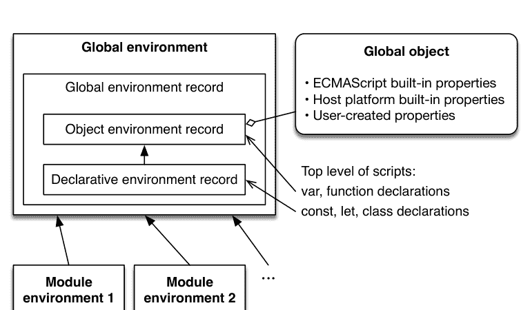
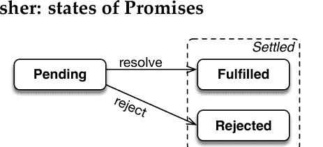
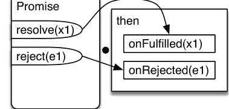
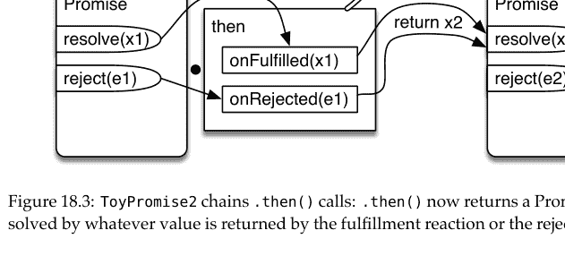

# JavaScript 深入指南：理论与技术

# 第一部分

## 前言

## 第 1 章

### 关于本书

| 内容 | 页码 |
| :--- | :--- |
| 1.1 本书的主页在哪里？ | 9 |
| 1.2 本书包含什么内容？ | 9 |
| 1.3 我花钱能买到什么？ | 10 |
| 1.4 如何预览内容？ | 10 |
| 1.5 如何报告错误？ | 10 |
| 1.6 阅读技巧 | 10 |
| 1.7 符号与约定 | 10 |
| 1.7.1 什么是类型签名？为什么我在书中看到了静态类型？ | 10 |
| 1.7.2 带图标的注释是什么意思？ | 11 |
| 1.8 致谢 | 11 |

### 1.1 本书的主页在哪里？

《深入浅出 JavaScript》（Deep JavaScript）的主页是`exploringjs.com/deep-js/`。

### 1.2 本书包含什么内容？

本书深入探讨 JavaScript：

- 它教授更好地使用该语言的实用技巧。
- 它教授该语言如何运作以及原因：所教授的内容牢牢基于 ECMAScript 规范（书中会对该规范进行解释并引用）。
- 它仅涵盖语言本身（忽略平台特定功能，如浏览器 API），但并非面面俱到。相反，它专注于精选的重要主题。

### 1.3 我花钱能买到什么？

如果您购买本书，您将获得：

- 四个无 DRM 版本的当前内容：
  - PDF 文件
  - 包含无广告 HTML 的 ZIP 存档
  - EPUB 文件
  - MOBI 文件
- 未来添加到本版本中的任何新内容。我能添加多少内容取决于本书的销售情况。

目前的价格是入门价。随着内容的增加，价格将会上涨。

### 1.4 如何预览内容？

[在本书的主页上](https://example.com)，有针对本书所有版本的详尽预览。

### 1.5 如何报告错误？

- 本书的 HTML 版本在每章末尾都有一个评论链接。
- 它们会跳转到 GitHub issues，[您也可以直接访问](https://example.com)。

### 1.6 阅读技巧

- 您可以按任意顺序阅读各章节。每一章都是独立的，但偶尔会有指向其他章节的引用以提供进一步信息。
- 某些章节的标题标记为“(optional)”，这意味着它们是非必需的。即使跳过这些部分，您仍然能理解该章节的其余内容。

### 1.7 符号与约定

#### 1.7.1 什么是类型签名？为什么我在书中看到了静态类型？

例如，您可能会看到：

```javascript
Number.isFinite(num: number): boolean
```

这被称为`Number.isFinite()`的类型签名（type signature）。这种表示法，特别是`num`的静态类型`number`和结果的`boolean`，并不是真正的 JavaScript。这种表示法借用了编译为 JavaScript 的语言 TypeScript（它基本上就是 JavaScript 加上静态类型）。

为什么要使用这种表示法？它能帮您快速了解函数的工作方式。这种表示法在 [a 2ality 博客文章](https://example.com) 中有详细解释，但通常来说是非常直观的。

#### 1.7.2 带图标的注释是什么意思？

**阅读指南**

解释如何最好地阅读内容。

**外部内容**

指向额外的外部内容。

**提示**

给出与当前内容相关的技巧。

**问题**

针对当前内容提出并回答问题（类似于 FAQ）。

**警告**

警告潜在的陷阱等。

**详情**

提供额外的细节，作为当前内容的补充。类似于脚注。

### 1.8 致谢

- 感谢 Allen Wirfs-Brock 通过 Twitter 和博客评论提供的建议。这有助于完善本书。
- 其他做出贡献的人员在各章节中已分别致谢。

# 第二部分

## 类型、值、变量

## 第 2 章

### JavaScript 中的类型强制转换

在本章中，我们将探讨类型强制转换在 JavaScript 中的作用。我们将相对深入地研究这个主题，例如，研究 ECMAScript 规范是如何处理强制转换的。

#### 2.1 什么是类型强制转换？

每个操作（函数、运算符等）都期望其参数具有某些特定的类型。如果一个值不具备某个参数所需的正确类型，那么对于函数来说，通常有三种处理方案：

1. 函数可以抛出异常：

```javascript
function multiply(x, y) {
  if (typeof x !== 'number' || typeof y !== 'number') {
    throw new TypeError();
  }
  // ...
}
```

2. 函数可以返回一个错误值：

```javascript
function multiply(x, y) {
  if (typeof x !== 'number' || typeof y !== 'number') {
    return NaN;
  }
  // ...
}
```

3. 函数可以将其参数转换为有用的值：

```javascript
function multiply(x, y) {
  if (typeof x !== 'number') {
    x = Number(x);
  }
  if (typeof y !== 'number') {
    y = Number(y);
  }
  // ...
}
```

在情况 (3) 中，操作执行了隐式类型转换。这就是所谓的类型强制转换（type coercion）。

JavaScript 最初没有异常机制，这就是为什么它在大多数操作中使用强制转换和错误值的原因：

```javascript
// 强制转换
assert.equal(3 * true, 3);

// 错误值
assert.equal(1 / 0, Infinity);
assert.equal(Number('xyz'), NaN);
```

然而，在某些情况下（尤其是涉及到新特性时），如果参数类型不正确，它会抛出异常：

- 访问`null`或`undefined`的属性：

```text
> undefined.prop
TypeError: Cannot read property 'prop' of undefined
> null.prop
TypeError: Cannot read property 'prop' of null
> 'prop' in null
TypeError: Cannot use 'in' operator to search for 'prop' in null
```

- 使用`Symbol`：

```text
> 6 / Symbol()
TypeError: Cannot convert a Symbol value to a number
```

- 混合使用 BigInt 和 Number：

```text
> 6 / 3n
TypeError: Cannot mix BigInt and other types
```

- 对不支持`new`调用或函数调用的值进行调用：

```text
> 123()
TypeError: 123 is not a function
> (class {})()
TypeError: Class constructor  cannot be invoked without 'new'

> new 123
TypeError: 123 is not a constructor
> new (() => {})
TypeError: (intermediate value) is not a constructor
```

- 修改只读属性（仅在严格模式下抛出）：

```text
> 'abc'.length = 1
TypeError: Cannot assign to read only property 'length'
> Object.freeze({prop:3}).prop = 1
TypeError: Cannot assign to read only property 'prop'
```

##### 2.1.1 处理类型强制转换

处理强制转换的两种常见方式是：

- 调用者可以显式地转换值，使其具有正确的类型。例如，在以下交互中，我们想要将两个编码为字符串的数字相乘：

```javascript
let x = '3';
let y = '2';
assert.equal(Number(x) * Number(y), 6);
```

- 调用者可以让操作本身为其进行转换：

```javascript
let x = '3';
let y = '2';
assert.equal(x * y, 6);
```

我通常更倾向于前者，因为它可以明确我的意图：我预料到`x`和`y`可能不是数字，但我想要将两个数字相乘。

#### 2.2 ECMAScript 规范中帮助实现强制转换的操作

以下章节描述了 ECMAScript 规范用于将实际参数转换为预期类型的最重要的内部函数。

例如，在 TypeScript 中，我们会这样写：

```typescript
function isNaN(number: number) {
    // ...
}
```

在规范中，它看起来像这样（为了方便理解，翻译成了 JavaScript）：

```javascript
function isNaN(number) {
    let num = ToNumber(number);
    // ...
}
```

##### 2.2.1 转换为原始类型和对象

每当需要原始类型或对象时，会使用以下转换函数：

- `ToBoolean()`
- `ToNumber()`
- `ToBigInt()`
- `ToString()`
- `ToObject()`

这些内部函数在 JavaScript 中有非常相似的对应物：

```text
> Boolean(0)
false
> Boolean(1)
true

> Number('123')
123
```

在引入了与`number`共存的`bigint`之后，规范在以前使用`ToNumber()`的地方现在经常使用`ToNumeric()`。请继续阅读以获取更多信息。

##### 2.2.2 转换为数值类型

目前，JavaScript 有两种内置的数值类型：`number`和`bigint`。

- `ToNumeric()`返回一个数值`num`。它的调用者通常会调用`num`规范类型的一个方法`mthd`：

  `Type(num) :: mthd(...)`

除了其他操作外，以下操作使用了`ToNumeric`：

- 前缀和后缀`++`运算符
- `*`运算符

- `ToInteger(x)`在需要一个没有小数部分的数字时被使用。结果的范围通常在之后会被进一步限制。
  - 它调用`ToNumber(x)`并移除小数部分（类似于`Math.trunc()`）。
  - 使用`ToInteger()`的操作：
    - `Number.prototype.toString(radix?)`
    - `String.prototype.codePointAt(pos)`
    - `Numbers.prototype.slice(start, end)`
    - 等等。

- `ToInt32()`和`ToUint32()`将数字强制转换为 32 位整数，并被位运算符使用（见表 2.1）。
  - `ToInt32()`：有符号，范围 [$-2^{31}$, $2^{31}-1$]（包含边界）
  - `ToUint32()`：无符号（因此带有 U），范围 [0, $2^{32}-1$]（包含边界）

表 2.1：位数值运算符操作数的强制转换（BigInt 运算符不限制位数）。

| 运算符 | 左操作数 | 右操作数 | 结果类型 |
| :--- | :--- | :--- | :--- |
| `<<` | `ToInt32()` | `ToUint32()` | `Int32` |
| `signed >>` | `ToInt32()` | `ToUint32()` | `Int32` |
| `unsigned >>>` | `ToInt32()` | `ToUint32()` | `Uint32` |

- `ToIndex()`用于 Typed Array 索引。
  - 与`ToLength()`的主要区别：如果参数超出范围，则抛出异常。
  - 结果`i`的范围：0 ≤ `i` ≤ 2^53–1

- `ToUint32()`用于 Array 索引。
  - 结果`i`的范围：0 ≤ `i` < 2^32–1（上限被排除，以便为`.length`留出空间）

##### 2.2.5 转换为 Typed Array 元素

当我们设置 Typed Array 元素的值时，会使用以下某个转换函数：

- `ToInt8()`
- `ToUint8()`
- `ToUint8Clamp()`
- `ToInt16()`
- `ToUint16()`
- `ToInt32()`
- `ToUint32()`
- `ToBigInt64()`
- `ToBigUint64()`

#### 2.3 幕间：用 JavaScript 表达规范算法

在本章剩余部分，我们将遇到多个规范算法，但会将其“实现”为 JavaScript。以下列表展示了如何从规范翻译为 JavaScript 的一些常用模式：

- 规范：If Type(value) is String

  JavaScript：`if (TypeOf(value) === 'string')`

  （非常松散的翻译；`TypeOf()`定义如下）

- 规范：If IsCallable(method) is true

  JavaScript：`if (IsCallable(method))`

  （`IsCallable()`定义如下）

- 规范：Let numValue be ToNumber(value)

  JavaScript：`let numValue = Number(value)`

- 规范：Let isArray be IsArray(O)

  JavaScript：`let isArray = Array.isArray(O)`

- 规范：If O has a [[NumberData]] internal slot

  JavaScript：`if ('__NumberData__' in O)`

- 规范：Let tag be Get(O, @@toStringTag)

  JavaScript：`let tag = O[Symbol.toStringTag]`

- 规范：Return the string-concatenation of "[object ", tag, and "]".

  JavaScript：`return '[object ' + tag + ']'`;

使用`let`（而非`const`）是为了匹配规范的用语。

有些内容被省略了——例如，[ReturnIfAbrupt 简写](link) `?` 和 `!`。

```javascript
/**
 * An improved version of typeof
 */
function TypeOf(value) {
  const result = typeof value;
  switch (result) {
    case 'function':
      return 'object';
    case 'object':
      if (value === null) {
        return 'null';
      } else {
        return 'object';
      }
    default:
      return result;
  }
}

function IsCallable(x) {
  return typeof x === 'function';
}
```

#### 2.4 强制转换算法示例

##### 2.4.1 `ToPrimitive()`

[`ToPrimitive()`操作](link)是许多强制转换算法的中间步骤（其中一些我们将在本章后面看到）。它将任意值转换为原始值。

`ToPrimitive()`在规范中经常使用，因为大多数运算符只能处理原始值。例如，我们可以使用加法运算符（`+`）来相加数字或连接字符串，但不能用它来连接数组。

这是 JavaScript 版本的`ToPrimitive()`：

```typescript
/**
 * @param hint 哪种类型是更期望的结果：
 *             string、number，还是无所谓？
 */
function ToPrimitive(input: any,
  hint: 'string'|'number'|'ypical' = 'default') {
    if (TypeOf(input) === 'object') {
        let exoticToPrim = input[Symbol.toPrimitive]; // (A)
        if (exoticToPrim !== undefined) {
            let result = exoticToPrim.call(input, hint);
            if (TypeOf(result) !== 'object') {
                return result;
            }
            throw new TypeError();
        }
        if (hint === 'default') {
            hint = 'number';
        }
        return OrdinaryToPrimitive(input, hint);
    } else {
        // input 已经是原始值
        return input;
    }
}
```


`ToPrimitive()` 允许对象通过 `Symbol.toPrimitive` 覆盖转换为原始值的过程（第 A 行）。如果对象没有这样做，就会传递给 `OrdinaryToPrimitive()`：

```javascript
function OrdinaryToPrimitive(O: object, hint: 'string' | 'number') {
    let methodNames;
    if (hint === 'string') {
        methodNames = ['toString', 'valueOf'];
    } else {
        methodNames = ['valueOf', 'toString'];
    }
    for (let name of methodNames) {
        let method = O[name];
        if (IsCallable(method)) {
            let result = method.call(O);
            if (TypeOf(result) !== 'object') {
                return result;
            }
        }
    }
    throw new TypeError();
}
```

### 2.4.1.1 `ToPrimitive()` 的调用者使用哪个 `hint`？

参数 `hint` 可以有三个值之一：

- `'number'` 表示：如果可能，`input` 应该被转换为数字。
- `'string'` 表示：如果可能，`input` 应该被转换为字符串。
- `'default'` 表示：对数字或字符串没有偏好。

以下是各种操作如何使用 `ToPrimitive()` 的一些示例：

- `hint === 'number'`。以下操作偏好数字：
  - `ToNumeric()`
  - `ToNumber()`
  - `ToBigInt()`、`BigInt()`
  - 抽象关系比较（`<`）

- `hint === 'string'`。以下操作偏好字符串：
  - `ToString()`
  - `ToPropertyKey()`

- `hint === 'default'`。以下操作对返回的原始值类型持中立态度：
  - 抽象相等比较（`==`）
  - 加法运算符（`+`）
  - `new Date(value)`（`value` 可以是数字或字符串）

正如我们所见，默认行为是将 `'default'` 当作 `'number'` 处理。只有 `Symbol` 和 `Date` 的实例会覆盖此行为（稍后展示）。

### 2.4.1.2 调用哪些方法将对象转换为原始值？

如果通过 `Symbol.toPrimitive` 没有覆盖转换为原始值的过程，`OrdinaryToPrimitive()` 会调用以下两个方法中的一个或两个：

- 如果 `hint` 表明我们希望原始值是字符串，则首先调用 `'toString'`。
- 如果 `hint` 表明我们希望原始值是数字，则首先调用 `'valueOf'`。

以下代码演示了这是如何工作的：

```javascript
const obj = {
  toString() { return 'a' },
  valueOf() { return 1 },
};

// String() 偏好字符串：
assert.equal(String(obj), 'a');

// Number() 偏好数字：
assert.equal(Number(obj), 1);
```

具有属性键 `Symbol.toPrimitive` 的方法会覆盖正常的转换为原始值的过程。这在标准库中只做了两次：

- `Symbol.prototype[Symbol.toPrimitive](hint)`
  - 如果接收者是 `Symbol` 的实例，此方法始终返回被封装的 symbol。
  - 原理是 `Symbol` 的实例有一个 `.toString()` 方法返回字符串。但即使 `hint` 是 `'string'`，也不应该调用 `.toString()`，这样我们就不会意外地将 `Symbol` 的实例转换为字符串（它们是完全不同种类的属性键）。

- `Date.prototype[Symbol.toPrimitive](hint)`
  - 接下来更详细地解释。

### 2.4.1.3 `Date.prototype[Symbol.toPrimitive]()` 

`Date` 处理转换为原始值的方式如下：

```javascript
Date.prototype[Symbol.toPrimitive] = function (
  hint: 'default' | 'string' | 'number') {
  let O = this;
  if (typeof(O) !== 'object') {
    throw new TypeError();
  }
  let tryFirst;
  if (hint === 'string' || hint === 'default') {
    tryFirst = 'string';
  } else if (hint === 'number') {
    tryFirst = 'number';
  } else {
    throw new TypeError();
  }
  return OrdinaryToPrimitive(O, tryFirst);
};
```

与默认算法的唯一区别是 `'default'` 变为 `'string'`（而不是 `'number'`）。如果我们使用将 `hint` 设置为 `'default'` 的操作，可以观察到这一点：

- `==` 运算符将对象强制转换为原始值（使用 `default` hint），如果另一个操作数是除 `undefined`、`null` 和 boolean 之外的原始值。在以下交互中，我们可以看到强制转换日期后的结果是字符串：

```javascript
const d = new Date('2222-03-27');
assert.equal(
  d == 'Wed Mar 27 2222 01:00:00 GMT+0100'
    + ' (Central European Standard Time)',
  true);
```

- `+` 运算符将两个操作数都强制转换为原始值（使用 `default` hint）。如果其中一个结果是字符串，它执行字符串连接（否则执行数字加法）。在以下交互中，我们可以看到强制转换日期后的结果是字符串，因为运算符返回了字符串。

```javascript
const d = new Date('2222-03-27');
assert.equal(
  123 + d,
  '123Wed Mar 27 2222 01:00:00 GMT+0100'
    + ' (Central European Standard Time)');
```

### 2.4.2 `ToString()` 及相关操作

这是 `ToString()` 的 JavaScript 版本：

```javascript
function ToString(argument) {
  if (argument === undefined) {
    return 'undefined';
```

#### 2.4 强制转换算法示例

```javascript
} else if (argument === null) {
  return 'null';
} else if (argument === true) {
  return 'true';
} else if (argument === false) {
  return 'false';
} else if (TypeOf(argument) === 'number') {
  return Number.toString(argument);
} else if (TypeOf(argument) === 'string') {
  return argument;
} else if (TypeOf(argument) === 'symbol') {
  throw new TypeError();
} else if (TypeOf(argument) === 'bigint') {
  return BigInt.toString(argument);
} else {
  // argument is an object
  let primValue = ToPrimitive(argument, 'string'); // (A)
  return ToString(primValue);
}
```

请注意，该函数如何对对象使用 `ToPrimitive()` 作为中间步骤，然后再将原始结果转换为字符串（第 A 行）。

`ToString()` 与 `String()` 的工作方式存在有趣的区别：如果参数是 symbol，前者会抛出 `TypeError`，而后者则不会。这是为什么呢？`Symbol` 的默认行为是在转换为字符串时抛出异常：

```javascript
> const sym = Symbol('sym');

> ''+sym
TypeError: Cannot convert a Symbol value to a string
> `${sym}`
TypeError: Cannot convert a Symbol value to a string
```

这个默认值在 `String()` 和 `Symbol.prototype.toString()` 中被覆盖（两者都在接下来的子节中描述）：

```javascript
> String(sym)
'Symbol(sym)'
> sym.toString()
'Symbol(sym)'
```

#### 2.4.2.1 `String()`

```javascript
function String(value) {
  let s;
  if (value === undefined) {
    s = '';
  } else {
    if (new.target === undefined && TypeOf(value) === 'symbol') {
      // This function was function-called and value is a symbol
      return SymbolDescriptiveString(value);
    }
    s = ToString(value);
  }
  if (new.target === undefined) {
    // This function was function-called
    return s;
  }
  // This function was new-called
  return StringCreate(s, new.target.prototype); // simplified!
}
```

`String()` 的工作方式取决于它是通过函数调用还是通过 `new` 调用的。它使用 `new.target` 来区分这两种情况。

以下是辅助函数 `StringCreate()` 和 `SymbolDescriptiveString()`：

```javascript
/**
 * Creates a String instance that wraps `value`
 * and has the given protoype.
 */
function StringCreate(value, prototype) {
  // ...
}

function SymbolDescriptiveString(sym) {
  assert.equal(TypeOf(sym), 'symbol');
  let desc = sym.description;
  if (desc === undefined) {
    desc = '';
  }
  assert.equal(TypeOf(desc), 'string');
  return 'Symbol('+desc+')';
}
```

#### 2.4.2.2 `Symbol.prototype.toString()`

除了 `String()`，我们还可以使用 `.toString()` 方法将 symbol 转换为字符串。其规范如下所示。

```javascript
Symbol.prototype.toString = function () {
  let sym = thisSymbolValue(this);
  return SymbolDescriptiveString(sym);
};
function thisSymbolValue(value) {
  if (TypeOf(value) === 'symbol') {
    return value;
  }
  if (TypeOf(value) === 'object' && '__SymbolData__' in value) {
    let s = value.__SymbolData__;
    assert.equal(TypeOf(s), 'symbol');
    return s;
  }
}
```

#### 2.4.2.3 `Object.prototype.toString`

`.toString()` 的默认规范如下所示：

```javascript
Object.prototype.toString = function () {
  if (this === undefined) {
    return '[object Undefined]';
  }
  if (this === null) {
    return '[object Null]';
  }
  let O = ToObject(this);
  let isArray = Array.isArray(O);
  let builtinTag;
  if (isArray) {
    builtinTag = 'Array';
  } else if ('__ParameterMap__' in O) {
    builtinTag = 'Arguments';
  } else if ('__Call__' in O) {
    builtinTag = 'Function';
  } else if ('__ErrorData__' in O) {
    builtinTag = 'Error';
  } else if ('__BooleanData__' in O) {
    builtinTag = 'Boolean';
  } else if ('__NumberData__' in O) {
    builtinTag = 'Number';
  } else if ('__StringData__' in O) {
    builtinTag = 'String';
  } else if ('__DateValue__' in O) {
    builtinTag = 'Date';
  } else if ('__RegExpMatcher__' in O) {
    builtinTag = 'RegExp';
  } else {
    builtinTag = 'Object';
  }
  let tag = O[Symbol.toStringTag];
  if (TypeOf(tag) !== 'string') {
    tag = builtinTag;
  }
  return '[object ' + tag + ']';
};
```

如果我们把普通对象转换为字符串，会使用这个操作：

```javascript
> String({})
'[object Object]'
```

默认情况下，如果我们把类的实例转换为字符串，也会使用它：

```javascript
class MyClass {}
assert.equal(
  String(new MyClass()), '[object Object]');
```

通常，我们会覆盖 `.toString()` 来配置 `MyClass` 的字符串表示形式，但我们也可以通过以下方式改变方括号内 `"object"` 后面的内容：

```javascript
class MyClass {}
MyClass.prototype[Symbol.toStringTag] = 'Custom!';
assert.equal(
  String(new MyClass()), '[object Custom!]');
```

将覆盖版本的 `.toString()` 与 `Object.prototype` 中的原始版本进行比较是很有趣的：

```javascript
> ['a', 'b'].toString()
'a,b'
> Object.prototype.toString.call(['a', 'b'])
'[object Array]'

> /^abc$/.toString()
'/^abc$/'
> Object.prototype.toString.call(/^abc$/)
'[object RegExp]'
```

### 2.4.3 `ToPropertyKey()`

`ToPropertyKey()` 被括号运算符等使用。它的工作方式如下：

```javascript
function ToPropertyKey(argument) {
  let key = ToPrimitive(argument, 'string'); // (A)
  if (TypeOf(key) === 'symbol') {
    return key;
  }
  return ToString(key);
}
```

同样，对象在操作之前会先被转换为原始值。

### 2.4.4 `ToNumeric()` 及相关操作

`ToNumeric()` 被乘法运算符（`*`）等使用。它的工作方式如下：


```javascript
function ToNumeric(value) {
  let primValue = ToPrimitive(value, 'number');
  if (TypeOf(primValue) === 'bigint') {
    return primValue;
  }
  return ToNumber(primValue);
}
```

###### 2.4.4.1 ToNumber()

`ToNumber()` 的工作方式如下：

```javascript
function ToNumber(argument) {
  if (argument === undefined) {
    return NaN;
  } else if (argument === null) {
    return +0;
  } else if (argument === true) {
    return 1;
  } else if (argument === false) {
    return +0;
  } else if (TypeOf(argument) === 'number') {
    return argument;
  } else if (TypeOf(argument) === 'string') {
    return parseTheString(argument); // not shown here
  } else if (TypeOf(argument) === 'symbol') {
    throw new TypeError();
  } else if (TypeOf(argument) === 'bigint') {
    throw new TypeError();
  } else {
    // argument is an object
    let primValue = ToPrimitive(argument, 'number');
    return ToNumber(primValue);
  }
}
```

`ToNumber()` 的结构与 `ToString()` 的结构相似。

#### 2.5 执行强制转换的操作

##### 2.5.1 加法运算符（`+`）

这是 JavaScript 加法运算符的规范：

```javascript
function Addition(leftHandSide, rightHandSide) {
  let lprim = ToPrimitive(leftHandSide);
  let rprim = ToPrimitive(rightHandSide);
  if (TypeOf(lprim) === 'string' || TypeOf(rprim) === 'string') { // (A)
    return ToString(lprim) + ToString(rprim);
  }
  let lnum = ToNumeric(lprim);
  let rnum = ToNumeric(rprim);
  if (TypeOf(lnum) !== TypeOf(rnum)) {
    throw new TypeError();
  }
  let T = Type(lnum);
  return T.add(lnum, rnum); // (B)
}
```

该算法的步骤：

- 两个操作数都被转换为原始值。
- 如果其中一个结果是字符串，则两者都被转换为字符串并拼接（第 A 行）。
- 否则，两个操作数都被转换为数值并相加（第 B 行）。`Type()` 返回 `lnum` 的 ECMAScript 规范类型。`.add()` 是[数值类型](https://example.com)的方法。

##### 2.5.2 抽象相等比较（`==`）

```javascript
/** 宽松相等 (==) */
function abstractEqualityComparison(x, y) {
  if (TypeOf(x) === TypeOf(y)) {
    // 使用严格相等 (===)
    return strictEqualityComparison(x, y);
  }

  // 比较 null 与 undefined
  if (x === null && y === undefined) {
    return true;
  }
  if (x === undefined && y === null) {
    return true;
  }

  // 比较数字和字符串
  if (TypeOf(x) === 'number' && TypeOf(y) === 'string') {
    return abstractEqualityComparison(x, Number(y));
  }
  if (TypeOf(x) === 'string' && TypeOf(y) === 'number') {
    return abstractEqualityComparison(Number(x), y);
  }

  // 比较 bigint 和字符串
  if (TypeOf(x) === 'bigint' && TypeOf(y) === 'string') {
    let n = StringToBigInt(y);
    if (Number.isNaN(n)) {
      return false;
    }
    return abstractEqualityComparison(x, n);
  }
}
```

#### 2.5 强制转换操作

```javascript
if (TypeOf(x) === 'string' && TypeOf(y) === 'bigint') {
  return abstractEqualityComparison(y, x);
}

// Comparing a boolean with a non-boolean
if (TypeOf(x) === 'boolean') {
  return abstractEqualityComparison(Number(x), y);
}
}
if (TypeOf(y) === 'boolean') {
  return abstractEqualityComparison(x, Number(y));
}

// Comparing an object with a primitive
// (other than undefined, null, a boolean)
if (['string', 'number', 'bigint', 'symbol'].includes(TypeOf(x))
  && TypeOf(y) === 'object') {
    return abstractEqualityComparison(x, ToPrimitive(y));
  }
if (TypeOf(x) === 'object'
  && ['string', 'number', 'bigint', 'symbol'].includes(TypeOf(y))) {
    return abstractEqualityComparison(ToPrimitive(x), y);
  }

// Comparing a bigint with a number
if ((TypeOf(x) === 'bigint' && TypeOf(y) === 'number')
  || (TypeOf(x) === 'number' && TypeOf(y) === 'bigint')) {
    if ([NaN, +Infinity, -Infinity].includes(x)
      || [NaN, +Infinity, -Infinity].includes(y)) {
        return false;
      }
    if (isSameMathematicalValue(x, y)) {
      return true;
    } else {
      return false;
    }
  }

return false;
}
```

以下操作此处未显示：

- `strictEqualityComparison()`
- `StringToBigInt()`
- `isSameMathematicalValue()`

#### 2.6 术语表：与类型转换相关的术语

既然我们已经详细了解了 JavaScript 的类型强制转换是如何工作的，那么让我们用一个关于类型转换术语的简短术语表来总结：

- *类型转换*（type conversion）中，我们希望输出值具有给定的类型。如果输入值已经具有该类型，则原样返回。否则，它将被转换为具有所需类型的值。
- *显式类型转换*（Explicit type conversion）是指程序员使用某种操作（函数、运算符等）来触发类型转换。显式转换可以是：
  - 经过检查的（Checked）：如果值无法转换，则抛出异常。
  - 未经检查的（Unchecked）：如果值无法转换，则返回一个错误值。
- *类型强制转换*（type casting）的具体含义取决于编程语言。例如，在 Java 中，它是显式的经过检查的类型转换。
- *类型强制转换*（Type coercion）是指隐式类型转换：操作会自动将其参数转换为所需的类型。可以是经过检查的，也可以是未经检查的，或者是介于两者之间。

> [来源：Wikipedia]

## 第 3 章：解构算法

在本章中，我们将从一个不同的角度来看待解构：将其视为一种递归的模式匹配算法。

该算法将使我们更好地理解默认值。这在最后会很有用，届时我们将尝试弄清楚以下两个函数有何不同：

```javascript
function move({x=0, y=0} = {}) { ... }
function move({x, y} = { x: 0, y: 0 }) { ... }
```

### 3.1 为模式匹配算法做准备

解构赋值看起来像这样：

```text
«pattern» = «value»
```

我们想要使用模式（pattern）从值（value）中提取数据。

我们现在将研究一种执行此类赋值的算法。这种算法在函数式编程中被称为 *模式匹配*（pattern matching，简称 *matching*）。它指定了运算符 `↬`（“匹配于”），该运算符将 *模式* 与 *值* 进行匹配，并在匹配过程中为变量赋值：

```text
«pattern» ↬ «value»
```

我们将仅探讨解构赋值，但解构变量声明和解构参数定义的工作原理与之类似。我们也不会深入探讨高级特性：计算属性名、属性值简写，以及将对象属性和数组元素作为赋值目标，这些都超出了本章的范围。

匹配运算符的规范由一系列声明式规则组成，这些规则会深入到两个操作数的结构中。声明式记法可能需要一段时间来习惯，但它使规范更加简洁。

#### 3.1.1 使用声明式规则指定匹配算法

本章中使用的声明式规则作用于输入，并通过副作用产生算法结果。以下就是这样一个规则（我们稍后还会看到）：

- (2c) `{key: «pattern», «properties»} ↬ obj`
  - `«pattern» ↬ obj.key`
  - `{«properties»} ↬ obj`

该规则由以下部分组成：

- (2c) 是规则的 *编号*。编号用于引用该规则。
- *头部*（第一行）描述了输入必须是什么样子才能应用此规则。
- *主体*（剩余行）描述了应用该规则后会发生什么。

在规则 (2c) 中，头部意味着如果存在一个具有至少一个属性（其键为 `key`）和零个或多个剩余属性的对象模式，则可以应用此规则。该规则的效果是：执行将继续进行，属性值模式将与 `obj.key` 匹配，而剩余属性将与 `obj` 匹配。

让我们再看一个本章中的规则：

- (2e) `{}` ↬ `obj`（没有剩余属性）
  - `// 我们完成了`

在规则 (2e) 中，头部意味着如果空对象模式 `{}` 与值对象 `obj` 匹配，则执行此规则。主体意味着在这种情况下，我们已经完成了。

规则 (2c) 和规则 (2e) 共同形成了一个声明式循环，迭代箭头左侧模式的属性。

#### 3.1.2 基于声明式规则评估表达式

完整的算法通过一系列声明式规则来指定。假设我们要评估以下匹配表达式：

```text
{first: f, last: l} ↬ obj
```

要应用一系列规则，我们从上到下遍历它们，并执行第一个适用的规则。如果该规则的主体中有一个匹配表达式，则再次应用规则。以此类推。

有时头部包含一个条件，该条件也决定了规则是否适用——例如：

- (3a) `«elements» ↬ non_iterable`
  - `if (!isIterable(non_iterable))`
  - `throw new TypeError();`

## 3.2 模式匹配算法

#### 3.2.1 模式

模式可以是以下之一：

- 一个变量：`x`
- 一个对象模式：`{«properties»}`
- 一个数组模式：`[«elements»]`

接下来的三个章节指定了在匹配表达式中处理这三种情况的规则。

#### 3.2.2 变量规则

- (1) `x ↬ value`（包括 `undefined` 和 `null`）
  - `x = value`

#### 3.2.3 对象模式规则

- (2a) `{«properties»} ↬ undefined`（非法值）
  - `throw new TypeError();`
- (2b) `{«properties»} ↬ null`（非法值）
  - `throw new TypeError();`
- (2c) `{key: «pattern», «properties»} ↬ obj`
  - `«pattern» ↬ obj.key`
  - `{«properties»} ↬ obj`
- (2d) `{key: «pattern» = default_value, «properties»} ↬ obj`

```javascript
const tmp = obj.key;
if (tmp !== undefined) {
    <<pattern>> = tmp
} else {
    <<pattern>> = default_value
}
{<<properties>>} = obj
```

- (2e) `{}` ↬ `obj`（没有剩余属性）
  - `// 我们完成了`

规则 2a 和 2b 处理非法值。规则 2c–2e 循环遍历模式的属性。在规则 2d 中，我们可以看到如果 `obj` 中没有匹配的属性，默认值将提供一个备选匹配项。

#### 3.2.4 数组模式规则

数组模式和可迭代对象。数组解构算法始于一个数组模式和一个可迭代对象：

- (3a) `[<<elements>>] = non_iterable`（非法值）
  - `if (!isIterable(non_iterable))`
  - `throw new TypeError();`
- (3b) `[<<elements>>] = iterable`
  - `if (isIterable(iterable))`
  - `const iterator = iterable[Symbol.iterator]();`
  - `<<elements>> = iterator`

辅助函数：

```javascript
function isIterable(value) {
    return (value !== null
        && typeof value === 'object'
        && typeof value[Symbol.iterator] === 'function');
}
```

数组元素和迭代器。算法继续进行：

- 模式的元素（箭头的左侧）
- 从可迭代对象中获取的迭代器（箭头的右侧）

具体规则如下：

- (3c) `<<pattern>>, <<elements>> = iterator`
  - `<<pattern>> = getNext(iterator) // 最后一个元素之后为 undefined`
  - `<<elements>> = iterator`
- (3d) `<<pattern>> = default_value, <<elements>> = iterator`
  - `const tmp = getNext(iterator); // 最后一个元素之后为 undefined`
  - `if (tmp !== undefined) {`

```text
        «pattern» ← tmp
    } else {
      «pattern» ← default_value
    }
    «elements» ← iterator
```

- (3e) `, <<elements>> ← iterator`（hole，elision）
  - `getNext(iterator); // 跳过`
  - `«elements» ← iterator`
- (3f) `...«pattern» ← iterator`（始终是最后一部分！）
  - `const tmp = [];`
  - `for (const elem of iterator) {`
  - `tmp.push(elem);`
  - `}`
  - `«pattern» ← tmp`
- (3g) `[] ← iterator`（没有剩余元素）
  - `// 已完成`

辅助函数：

```javascript
function getNext(iterator) {
  const {done,value} = iterator.next();
  return (done ? undefined : value);
}
```

迭代器完成的状态类似于对象中缺失的属性。

### 3.3 空对象模式和空数组模式


## 算法规则的一个有趣结果：使用空对象模式和空数组模式进行解构

给定一个空对象模式`{}`：如果要解构的值既不是`undefined`也不是`null`，则不会发生任何事情。否则，将抛出`TypeError`。

```javascript
const {} = 123; // 没问题，既不是 undefined 也不是 null
assert.throws(
  () => {
    const {} = null;
  },
  /^TypeError: Cannot Destructure 'null' as it is null.$/)
```

给定一个空数组模式`[]`：如果要解构的值是可迭代的，则不会发生任何事情。否则，将抛出`TypeError`。

```javascript
const [] = 'abc'; // 没问题，可迭代
assert.throws(
  () => {
    const [] = 123; // 不可迭代
  },
  /^TypeError: 123 is not iterable$/)
```

换句话说：空解构模式强制要求值具有某些特性，但除此之外没有其他作用。

### 3.4 应用该算法

在 JavaScript 中，命名参数通过对象来模拟：调用者使用对象字面量，被调用者使用解构。这种模拟在《JavaScript for impatient programmers》中有详细解释。以下代码展示了一个示例：函数`move1()`有两个命名参数`x`和`y`：

```javascript
function move1({x=0, y=0} = {}) { // (A)
  return [x, y];
}
assert.deepEqual(
  move1({x: 3, y: 8}), [3, 8]);
assert.deepEqual(
  move1({x: 3}), [3, 0]);
assert.deepEqual(
  move1({}), [0, 0]);
assert.deepEqual(
  move1(), [0, 0]);
```

在 A 行中有三个默认值：

- 前两个默认值允许我们省略`x`和`y`。
- 第三个默认值允许我们在没有参数的情况下调用`move1()`（如最后一行所示）。

但是，为什么我们要像前面的代码片段那样定义参数呢？为什么不能像下面这样？

```javascript
function move2({x, y} = { x: 0, y: 0 }) {
  return [x, y];
}
```

为了说明为什么`move1()`是正确的，我们将在两个示例中使用这两个函数。在此之前，我们先看看如何通过匹配来解释参数的传递。

#### 3.4.1 背景：通过匹配传递参数

对于函数调用，形式参数（函数定义内部）与实际参数（函数调用内部）进行匹配。例如，考虑以下函数定义和函数调用：

```javascript
function func(a=0, b=0) { ... }
func(1, 2);
```

参数`a`和`b`的设置方式类似于以下解构：

`[a=0, b=0] ← [1, 2]`

#### 3.4.2 使用`move2()`

让我们看看`move2()`的解构是如何工作的。

示例 1。函数调用`move2()`导致以下解构：

```javascript
[{x, y} = { x: 0, y: 0 }] ← []
```

左侧的单个数组元素在右侧没有匹配项，这就是`{x,y}`与默认值而不是右侧的数据进行匹配的原因（规则 3b、3d）：

```javascript
{x, y} ← { x: 0, y: 0 }
```

左侧包含*属性值简写*。它是以下形式的简写：

```javascript
{x: x, y: y} ← { x: 0, y: 0 }
```

这种解构导致以下两个赋值（规则 2c、1）：

```javascript
x = 0;
y = 0;
```

这是我们想要的结果。然而，在下一个示例中，我们没有这么幸运。

示例 2。让我们检查函数调用`move2({z: 3})`，它导致以下解构：

```javascript
[{x, y} = { x: 0, y: 0 }] ← [{z: 3}]
```

右侧索引 0 处有一个数组元素。因此，默认值被忽略，下一步是（规则 3d）：

```javascript
{x, y} ← { z: 3 }
```

这导致`x`和`y`都被设置为`undefined`，这不是我们想要的结果。问题在于`{x,y}`不再与默认值匹配，而是与`{z:3}`匹配。

#### 3.4.3 使用`move1()`

让我们尝试`move1()`。

示例 1：`move1()`

```javascript
[{x=0, y=0} = {}] ← []
```

右侧索引 0 处没有数组元素，我们使用默认值（规则 3d）：

```javascript
{x=0, y=0} ← {}
```

左侧包含属性值简写，这意味着这种解构等价于：

```javascript
{x: x=0, y: y=0} ← {}
```

右侧既没有属性`x`也没有属性`y`的匹配项。因此，使用默认值，并执行以下解构（规则 2d）：

```javascript
x ← θ
y ← θ
```

这导致以下赋值（规则 1）：

```javascript
x = θ
y = θ
```

在这里，我们得到了想要的结果。让我们看看在下一个示例中我们的运气是否依然成立。

**示例 2：**`move1({z: 3})`

```javascript
[ {x=0, y=0} ] ← [ {z: 3} ]
```

数组模式的第一个元素在右侧有一个匹配项，该匹配项用于继续解构（规则 3d）：

```javascript
{x=0, y=0} ← {z: 3}
```

与示例 1 一样，右侧没有属性`x`和`y`，因此使用默认值：

```javascript
x = θ
y = θ
```

它按预期工作！这一次，`x`和`y`与`{z: 3}`进行匹配不是问题，因为它们有自己的局部默认值。

#### 3.4.4 结论：默认值是模式部分的特性

这些示例表明，默认值是模式部分（对象属性或数组元素）的特性。如果某个部分没有匹配项或与`undefined`匹配，则使用默认值。也就是说，模式与默认值进行匹配，而不是与原始值匹配。

## 第 4 章：全局变量详解

在本章中，我们将详细了解 JavaScript 全局变量的工作原理。几个有趣的现象起着作用：脚本的作用域、所谓的*全局对象*，等等。

### 4.1 作用域

变量的*词法作用域*（简称*作用域*）是程序中可以访问该变量的区域。JavaScript 的作用域是*静态的*（它们在运行时不会改变），并且可以是嵌套的——例如：

```javascript
function func() { // (A)
  const aVariable = 1;
  if (true) { // (B)
    const anotherVariable = 2;
  }
}
```

`if`语句引入的作用域（B 行）嵌套在函数`func()`的作用域（A 行）内部。

作用域`S`的最内层 surrounding 作用域称为`S`的*外层作用域*。在这个例子中，`func`是`if`的外层作用域。

### 4.2 词法环境

在 JavaScript 语言规范中，作用域是通过*词法环境*来“实现”的。它们由两个组成部分：

- 一个*环境记录*，将变量名称映射到变量值（可以想象成字典）。这是作用域变量的实际存储空间。记录中的名称-值条目称为*绑定*。
- 对*外层环境*的引用——即外层作用域的环境。

因此，嵌套作用域的树由通过外层环境引用链接的环境树表示。

### 4.3 全局对象

全局对象是一个对象，其属性成为全局变量。（我们很快就会详细研究它如何融入环境树。）可以通过以下全局变量访问它：

- 所有平台可用：`globalThis`。名称基于这样一个事实：它在全局作用域中的值与`this`相同。
- 其他全局对象变量并非在所有平台都可用：
  - `window`是指向全局对象的经典方式。它在普通浏览器代码中工作，但在*Web Workers*（与正常浏览器进程并发运行的进程）和 Node.js 中不起作用。
  - `self`在浏览器的任何地方都可用（包括 Web Workers 中）。但 Node.js 不支持它。
  - `global`仅在 Node.js 上可用。

### 4.4 在浏览器中，`globalThis`并不直接指向全局对象

在浏览器中，`globalThis`并不直接指向全局对象，而是有一个间接层。例如，考虑网页上的一个 iframe：

- 每当 iframe 的`src`改变时，它会获得一个新的全局对象。
- 然而，`globalThis`始终具有相同的值。该值可以从 iframe 外部检查，如下所示（灵感来自 [globalThis 提案中的一个示例](https://example.com)。）

文件 parent.html：

```html
<iframe src="iframe.html?first"></iframe>

<script>
  const iframe = document.querySelector('iframe');

  const icw = iframe.contentWindow; // iframe 的 `globalThis`

  iframe.onload = () => {
    // 访问 iframe 全局对象的属性

    const firstGlobalThis = icw.globalThis;

    const firstArray = icw.Array;

    console.log(icw.iframeName); // 'first'

    iframe.onload = () => {
      const secondGlobalThis = icw.globalThis;

      const secondArray = icw.Array;

      // 全局对象是不同的

      console.log(icw.iframeName); // 'second'

      console.log(secondArray === firstArray); // false

      // 但 globalThis 仍然相同

      console.log(firstGlobalThis === secondGlobalThis); // true
    };

    iframe.src = 'iframe.html?second';
  };
</script>
```

文件 iframe.html：

```html
<script>
  globalThis.iframeName = location.search.slice(1);
</script>
```

浏览器如何确保在此场景中`globalThis`不会改变？它们在内部区分了两个对象：

- Window 是全局对象。每当 location 变化时，它都会改变。
- WindowProxy 是一个将所有访问转发到当前 Window 的对象。这个对象永远不会改变。

在浏览器中，`globalThis`指向 WindowProxy；在其他任何地方，它直接指向全局对象。

### 4.5 全局环境

全局作用域是“最外层”的作用域——它没有外部作用域。它的环境就是*全局环境*。每个环境都通过由外部环境引用链接的环境链与全局环境相连。全局环境的外部环境引用为`null`。

全局环境记录使用两个环境记录来管理其变量：

- 对象环境记录与普通环境记录具有相同的接口，但将其绑定存储在 JavaScript 对象中。在这种情况下，该对象就是全局对象。
- 一个普通的（声明式）环境记录，它有自己的存储空间来保存其绑定。

这两个记录在什么时候使用，稍后就会解释。

#### 4.5.1 脚本作用域和模块作用域

在 JavaScript 中，我们只在脚本的顶层处于全局作用域。相比之下，每个模块都有自己的作用域，它是脚本作用域的子作用域。

如果我们忽略将变量绑定添加到全局环境的相对复杂规则，那么全局作用域和模块作用域的工作方式就像是嵌套的代码块：

```javascript
{ // 全局作用域（*所有*脚本的作用域）

  // （全局变量）

  { // 模块 1 的作用域

    ...

  }

  { // 模块 2 的作用域

    ...

  }

  // （更多模块作用域）

}
```

#### 4.5.2 创建变量：声明式记录 vs. 对象记录

为了创建一个真正全局的变量，我们必须处于全局作用域——这只在脚本的顶层才成立：

- 顶层的`const`、`let`和`class`在声明式环境记录中创建绑定。
- 顶层的`var`和`function`声明在对象环境记录中创建绑定。

```html
<script>
  const one = 1;

  var two = 2;
</script>

<script>
  // 所有脚本共享相同的顶层作用域：

  console.log(one); // 1

  console.log(two); // 2

  // 并非所有声明都会创建全局对象的属性：
</script>
```

```javascript
console.log(globalThis.one); // undefined

console.log(globalThis.two); // 2
```

#### 4.5.3 获取或设置变量

当我们获取或设置变量，且两个环境记录都有该变量的绑定时，声明式记录获胜：

```html
<script>
  let myGlobalVariable = 1; // 声明式环境记录

  globalThis.myGlobalVariable = 2; // 对象环境记录

  console.log(myGlobalVariable); // 1（声明式记录获胜）

  console.log(globalThis.myGlobalVariable); // 2
</script>
```

#### 4.5.4 全局 ECMAScript 变量和全局宿主变量

除了通过`var`和`function`声明创建的变量之外，全局对象还包含以下属性：

- 所有 ECMAScript 内置全局变量
- 所有宿主平台（浏览器、Node.js 等）的内置全局变量

使用`const`或`let`可以确保全局变量声明不会影响（或不会被）ECMAScript 和宿主平台的内置全局变量所影响。

例如，浏览器有全局变量`location`：

```javascript
// 改变当前文档的位置：

var location = 'https://example.com';

// 遮蔽 window.location，不会改变它：

let location = 'https://example.com';
```

如果变量已经存在（如本例中的`location`），那么带有初始化器的`var`声明的行为就像赋值。这就是为什么我们在这个例子中会遇到麻烦。

注意，这只是在全局作用域中的问题。在模块中，我们永远不在全局作用域中（除非我们使用`eval()`或类似方法）。

图 4.1 总结了我们在这节中学到的所有内容。

### 4.6 结论：为什么 JavaScript 同时具有普通全局变量和全局对象？

全局对象通常被认为是一个错误。因此，较新的结构如`const`、`let`和`class`在脚本作用域中创建的是普通全局变量（当处于脚本作用域时）。



幸运的是，大多数用现代 JavaScript 编写的代码都存在于 ECMAScript 模块和 CommonJS 模块中。每个模块都有自己的作用域，这就是为什么管理全局变量的规则对于基于模块的代码很少重要。

### 4.7 本章的延伸阅读和资源

ECMAScript 规范中的环境和全局对象：

- “Lexical Environments”一节提供了对环境的总体概述。
- “Global Environment Records”一节涵盖了全局环境。
- “ECMAScript Standard Built-in Objects”一节描述了 ECMAScript 如何管理其内置对象（包括全局对象）。

`globalThis`：

- 2ality 文章“ES feature: globalThis”
- 访问全局 this 值的各种方式：Mathias Bynens 的“A horrifying globalThis polyfill in universal JavaScript”

浏览器中的全局对象：

- 关于浏览器中发生的事情的背景：“Defining the WindowProxy, Window, and Location objects”，作者 Anne van Kesteren
- 非常技术性的内容：WHATWG HTML 标准中的“Realms, settings objects, and global objects”一节
- 在 ECMAScript 规范中，我们可以看到 Web 浏览器如何自定义 global this：“InitializeHostDefinedRealm()”一节

## 第 5 章：`%`是余数运算符，不是模运算符（额外章节）

*余数*和*模*是两个相似的运算。本章探讨它们的工作原理，并揭示 JavaScript 的`%`运算符计算的是余数，而不是模。

### 5.1 余数运算符`rem`与模运算符`mod`

在本章中，我们假设 JavaScript 有以下两个运算符：

- *余数运算符*`rem`
- *模运算符*`mod`

这将帮助我们研究底层运算的工作原理。

### 5.2 对取余运算的直观理解

取余运算的两个操作数分别称为*被除数*和*除数*：


`remainder = dividend rem divisor`

结果是如何计算的呢？考虑以下表达式：

```
7 rem 3
```

我们从被除数中不断减去除数，直到剩下的值小于除数为止：

```
7 rem 3 = 4 rem 3 = 1 rem 3 = 1
```

如果被除数是负数怎么办？

```
-7 rem 3
```

这次，我们向被除数中不断加 3，直到得到一个绝对值小于 3 的值：

```
-7 rem 3 = -4 rem 3 = -1 rem 3 = -1
```

将固定除数的结果映射出来会很有启发性：

```
x:          -7 -6 -5 -4 -3 -2 -1  0  1  2  3  4  5  6  7

x rem 3:   -1  0 -2 -1  0 -2 -1  0  1  2  0  1  2  0  1
```

在这些结果中，我们可以看到一种对称性：`x` 和 `-x` 产生相同的结果，但符号相反。

#### 5.3 对取模运算的直观理解

同样，这里的操作数也被称为*被除数*和*除数*（这暗示了 `rem` 和 `mod` 有多相似）：

```
modulus = dividend mod divisor
```

考虑以下例子：

```
x mod 3
```

这个运算将 `x` 映射到以下范围内：

```
[0,3) = {0,1,2}
```

也就是说，包含 0（开方括号），不包含 3（闭圆括号）。

`mod` 是如何执行这种映射的？如果 `x` 已经在范围内，这很简单：

```
> 0 mod 3

0

> 2 mod 3

2
```

如果 `x` 大于或等于范围的上限，那么就从 `x` 中不断减去上限，直到它落入范围内：

```
> 4 mod 3

1

> 7 mod 3

1
```

这意味着对于非负整数，我们得到以下映射：

```
x:      0 1 2 3 4 5 6 7

x mod 3: 0 1 2 0 1 2 0 1
```

这个映射按如下方式扩展，以包含负整数：

```
x:      -7 -6 -5 -4 -3 -2 -1 0 1 2 3 4 5 6 7

x mod 3: 2  0  1  2  0  1  2 0 1 2 0 1 2 0 1
```

请注意范围 `[0,3)` 是如何一遍又一遍地重复的。

#### 5.4 `rem` 和 `mod` 的异同

`rem` 和 `mod` 非常相似——它们只在被除数和除数符号不同时才会有所区别：

- 对于 `rem`，结果与被除数（第一个操作数）的符号相同：

    ```
    > 5 rem 4

    1

    > -5 rem 4

    -1

    > 5 rem -4

    1

    > -5 rem -4

    -1
    ```

- 对于 `mod`，结果与除数（第二个操作数）的符号相同：

    ```
    > 5 mod 4

    1

    > -5 mod 4

    3

    > 5 mod -4

    -3

    > -5 mod -4

    -1
    ```

#### 5.5 取余和取模背后的数学等式

以下两个等式同时定义了取余和取模：

```
dividend = (divisor * quotient) + remainder

|remainder| < |divisor|
```

给定被除数和除数，我们如何计算取余和取模呢？

```
remainder = dividend - (divisor * quotient)

quotient = dividend div divisor
```

`div` 运算符执行整数除法。

##### `rem` 和 `mod` 执行整数除法的方式不同

这些等式如何能包含*两种*运算的解呢？如果变量 `remainder` 不为零，等式总是允许两个值：一个正数，一个负数。为了理解原因，我们来看看确定商时所问的问题：

> 我们需要将除数乘以多少次才能尽可能接近被除数？

例如，对于被除数 –2 和除数 3，这给出了两个不同的结果：

- `-2 rem 3 = -2`  
  `3 × 0` 接近 –2。0 与被除数 –2 的差是 –2。

- `-2 mod 3 = 1`  
  `3 × –1` 也接近 –2。–3 与被除数 –2 的差是 1。

对于被除数 2 和除数 –3，也会得到两个不同的结果：

- `2 rem -3 = 2`  
  `-3 × 0` 接近 2。

- `2 mod -3 = -1`  
  `-3 × -1` 接近 2。

结果的差异取决于整数除法 `div` 的实现方式。

##### 实现 `rem`

以下 JavaScript 函数实现了 `rem` 运算符。它通过浮点除法并借助 `Math.trunc()` 将结果四舍五入为整数来执行整数除法：

```javascript
function rem(dividend, divisor) {
  const quotient = Math.trunc(dividend / divisor);
  return dividend - (divisor * quotient);
}
```

##### 实现 `mod`

以下函数实现了 `mod` 运算符。这次，整数除法基于 `Math.floor()`：

```javascript
function mod(dividend, divisor) {
  const quotient = Math.floor(dividend / divisor);
  return dividend - (divisor * quotient);
}
```

请注意，执行整数除法还有其他方式（例如基于 `Math.ceil()` 或 `Math.round()`）。这意味着还存在更多与 `rem` 和 `mod` 类似的运算。

#### 5.6 编程语言中 `rem` 和 `mod` 的使用场景

##### 5.6.1 JavaScript 的 `%` 运算符计算的是取余

例如（Node.js REPL）：

```
> 7 % 6

1

> -7 % 6

-1
```

##### 5.6.2 Python 的 `%` 运算符计算的是取模

例如（Python REPL）：

```
>>> 7 % 6

1

>>> -7 % 6

5
```

##### 5.6.3 JavaScript 中取模运算的应用

ECMAScript 规范多次使用取模——例如：

- 将 `>>>` 运算符的操作数转换为无符号 32 位整数（`x mod 2**32`）：

    ```
    > 2**32 >>> 0

    0

    > (2**32)+1 >>> 0

    1

    > (-1 >>> 0) === (2**32)-1

    true
    ```

- 将任意数字转换为适合 Typed Array 的值。例如，使用 `x mod 2**8` 将数字转换为无符号 8 位整数（首先将它们转换为整数）：

    ```javascript
    const tarr = new Uint8Array(1);

    tarr[0] = 256;

    assert.equal(tarr[0], 0);

    tarr[0] = 257;

    assert.equal(tarr[0], 1);
    ```

#### 5.7 本章延伸阅读及资料来源

- Wikipedia 上的 "modulo operation" 页面有很多信息。
- ECMAScript 规范[提到](https://tc39.es/ecma262/#sec-remainder-operator) `%` 是通过"截断除法"计算的。
- "JavaScript for impatient programmers" 中的 "Rounding" 一节描述了 JavaScript 中的几种取整方式。

# 第三部分

## 数据处理

## 第六章

### 复制对象和数组

在本章中，我们将学习如何在 JavaScript 中复制对象和数组。

#### 6.1 浅拷贝与深拷贝

数据复制有两种"深度"：

- *浅拷贝*只复制对象和数组的顶层条目。原始数据和副本中的条目值仍然相同。
- *深拷贝*还会复制条目的值的条目，等等。也就是说，它遍历以要复制的值为根的完整树，并复制所有节点。

接下来的章节将涵盖这两种复制方式。不幸的是，JavaScript 只内置支持浅拷贝。如果需要深拷贝，我们必须自己实现。

#### 6.2 JavaScript 中的浅拷贝

让我们看看几种浅拷贝数据的方法。

##### 6.2.1 通过展开运算符复制普通对象和数组

我们可以将数据展开[到对象字面量](https://exploringjs.com/impatient-js/ch_object-literals.html#spreading-into-object-literals)和[到数组字面量](https://exploringjs.com/impatient-js/ch_arrays.html#spreading-into-array-literals)中来创建副本：

```javascript
const copyOfObject = {...originalObject};

const copyOfArray = [...originalArray];
```

然而，展开运算符存在一些问题。这些将在接下来的小节中介绍。其中一些是真正的限制，另一些只是一些特殊之处。

###### 6.2.1.1 对象展开不会复制原型

例如：

```javascript
class MyClass {}

const original = new MyClass();

assert.equal(original instanceof MyClass, true);
```

```javascript
const copy = {...original};

assert.equal(copy instanceof MyClass, false);
```

请注意以下两个表达式是等价的：

```javascript
obj instanceof SomeClass

SomeClass.prototype.isPrototypeOf(obj)
```

因此，我们可以通过给副本赋予与原始对象相同的原型来解决这个问题：

```javascript
class MyClass {}

const original = new MyClass();

const copy = {
  __proto__: Object.getPrototypeOf(original),
  ...original,
};

assert.equal(copy instanceof MyClass, true);
```

或者，我们可以在创建副本后通过 `Object.setPrototypeOf()` 设置其原型。

###### 6.2.1.2 许多内置对象具有对象展开无法复制的特殊"内部槽"

这类内置对象包括正则表达式和日期。如果我们复制它们，会丢失存储在其中的大部分数据。

#### 6.2.2 JavaScript 中的浅拷贝

##### 6.2.1.3 对象展开只会复制自身（非继承）属性

根据[原型链](https://example.com)的工作方式，这通常是正确的做法。但我们仍需注意这一点。在以下示例中，`original` 的继承属性 `.inheritedProp` 在 `copy` 中不可用，因为我们只复制了自身属性，没有保留原型。

```javascript
const proto = { inheritedProp: 'a' };

const original = {__proto__: proto, ownProp: 'b' };

assert.equal(original.inheritedProp, 'a');

assert.equal(original.ownProp, 'b');

const copy = {...original};

assert.equal(copy.inheritedProp, undefined);

assert.equal(copy.ownProp, 'b');
```

##### 6.2.1.4 对象展开只会复制可枚举属性

例如，Array 实例的自身属性 `.length` 是不可枚举的，因此不会被复制。在以下示例中，我们通过对象展开复制数组 `arr`（第 A 行）：

```javascript
const arr = ['a', 'b'];

assert.equal(arr.length, 2);

assert.equal({}.hasOwnProperty.call(arr, 'length'), true);

const copy = {...arr}; // (A)

assert.equal({}.hasOwnProperty.call(copy, 'length'), false);
```

这也很少构成限制，因为大多数属性都是可枚举的。如果我们需要复制不可枚举的属性，可以使用 `Object.getOwnPropertyDescriptors()` 和 `Object.defineProperties()` 来复制对象（[具体做法稍后讲解](https://example.com)）：

- 它们考虑所有属性描述符（不仅仅是 `value`），因此能正确复制 getter、setter、只读属性等。
- `Object.getOwnPropertyDescriptors()` 能同时获取可枚举和不可枚举的属性。

有关可枚举性的更多信息，请参见第 12 节"[属性的可枚举性](https://example.com)"。

##### 6.2.1.5 对象展开并不总是忠实地复制属性描述符

无论[属性描述符](https://example.com)如何，复制后的属性始终是一个可写（writable）且可配置（configurable）的数据属性。

例如，这里我们创建了一个属性 `original.prop`，其 `writable` 和 `configurable` 描述符均为 `false`：

```javascript
const original = Object.defineProperties(
  {}, {
    prop: {
      value: 1,
      writable: false,
      configurable: false,
      enumerable: true,
    },
});

assert.deepEqual(original, {prop: 1});
```

如果我们复制 `.prop`，则 `writable` 和 `configurable` 都变为 `true`：

```javascript
const copy = {...original};

// Attributes `writable` and `configurable` of copy are different:

assert.deepEqual(
Object.getOwnPropertyDescriptors(copy),
{
prop: {
value: 1,
writable: true,
configurable: true,
enumerable: true,
},
});
```

因此，getter 和 setter 也不会被忠实地复制：

```javascript
const original = {
  get myGetter() { return 123 },
  set mySetter(x) {},
};

assert.deepEqual({...original}, {
  myGetter: 123, // not a getter anymore!
  mySetter: undefined,
});
```

前面提到的 `Object.getOwnPropertyDescriptors()` 和 `Object.defineProperties()` 始终能完整保留自身属性的所有描述符（如后文所示）。

##### 6.2.1.6 拷贝是浅层的

副本拥有原始对象中每个键值对的新版本，但值本身并没有被复制。例如：

```javascript
const original = {name: 'Jane', work: {employer: 'Acme'}};

const copy = {...original};

// Property .name is a copy: changing the copy

// does not affect the original

copy.name = 'John';

assert.deepEqual(original,
{name: 'Jane', work: {employer: 'Acme'}});

assert.deepEqual(copy,
{name: 'John', work: {employer: 'Acme'}});

// The value of .work is shared: changing the copy

// affects the original

copy.work.employer = 'Spectre';

assert.deepEqual(
    original, {name: 'Jane', work: {employer: 'Spectre'}});

assert.deepEqual(
    copy, {name: 'John', work: {employer: 'Spectre'}});
```

我们将在本章稍后讨论深拷贝。

##### 6.2.2 通过 `Object.assign()` 进行浅拷贝（可选）

`Object.assign()` 的行为与对象展开大致相同。也就是说，以下两种复制方式基本等价：

```javascript
const copy1 = {...original};
```


```js
const copy2 = Object.assign({}, original);
```

使用方法而非语法的好处是，可以通过库在旧版 JavaScript 引擎上进行 polyfill。

不过，`Object.assign()` 并不完全等同于展开。它们在一个相对细微的方面有所不同：创建属性的方式不同。

- `Object.assign()` 使用赋值来创建副本的属性。
- 展开则是在副本中定义新属性。

赋值会触发自身和继承的 setter，而定义不会（关于赋值与定义的更多信息）。这种差异很少被注意到。以下代码是一个示例，但它是刻意构造的：

```javascript
const original = {'__proto__': null}; // (A)

const copy1 = {...original};

// copy1 has the own property '__proto__'

assert.deepEqual(
    Object.keys(copy1), ['__proto__']);

// copy2 has the prototype null

const copy2 = Object.assign({}, original);

assert.equal(Object.getPrototypeOf(copy2), null);
```

通过在第 A 行使用计算属性名，我们将 `__proto__` 创建为自身属性，而不会触发继承的 setter。但当 `Object.assign()` 复制该属性时，它确实会触发 setter。（有关 `__proto__` 的更多信息，请参阅"JavaScript for impatient programmers"。）

### 6.2.3 通过 `Object.getOwnPropertyDescriptors()` 和 `Object.defineProperty()` 进行浅拷贝（可选）

JavaScript 允许我们通过属性描述符（即指定属性特性的对象）来创建属性。例如，通过我们已经见过的 `Object.defineProperties()`。如果将该方法与 `Object.getOwnPropertyDescriptors()` 结合使用，我们可以实现更忠实的复制：

```javascript
function copyAllOwnProperties(original) {
    return Object.defineProperties(
        {}, Object.getOwnPropertyDescriptors(original));
}
```

这消除了通过展开复制对象时的两个问题。首先，自身属性的所有描述符都被正确复制。因此，我们现在可以复制自身的 getter 和 setter：

```javascript
const original = {
    get myGetter() { return 123 },
    set mySetter(x) {},
};

assert.deepEqual(copyAllOwnProperties(original), original);
```

其次，得益于 `Object.getOwnPropertyDescriptors()`，不可枚举属性也能被复制：

```javascript
const arr = ['a', 'b'];

assert.equal(arr.length, 2);

assert.equal({}.hasOwnProperty.call(arr, 'length'), true);

const copy = copyAllOwnProperties(arr);

assert.equal({}.hasOwnProperty.call(copy, 'length'), true);
```

## 6.3 JavaScript 中的深拷贝

现在是时候探讨深拷贝了。首先，我们将手动进行深拷贝，然后研究通用的方法。

### 6.3.1 通过嵌套展开手动深拷贝

如果我们嵌套展开操作，就能得到深拷贝：

```javascript
const original = {name: 'Jane', work: {employer: 'Acme'}};

const copy = {name: original.name, work: {...original.work}};

// We copied successfully:

assert.deepEqual(original, copy);

// The copy is deep:

assert.ok(original.work !== copy.work);
```

### 6.3.2 变通方法：通过 JSON 进行通用深拷贝

这是一种变通方法，但在紧急情况下能提供快速解决方案：为了深拷贝一个对象 `original`，我们先将其转换为 JSON 字符串，然后再解析该 JSON 字符串：

```javascript
function jsonDeepCopy(original) {
  return JSON.parse(JSON.stringify(original));
}

const original = {name: 'Jane', work: {employer: 'Acme'}};

const copy = jsonDeepCopy(original);

assert.deepEqual(original, copy);
```

这种方法的显著缺点是，我们只能复制键和值都被 JSON 支持的属性。

一些不支持的键和值会被直接忽略：

```javascript
assert.deepEqual(
  jsonDeepCopy({
    // Symbols are not supported as keys
    [Symbol('a')]: 'abc',

    // Unsupported value
    b: function () {},

    // Unsupported value
    c: undefined,
  }),
  {} // empty object
);
```

另一些则会引发异常：

```javascript
assert.throws(
  () => jsonDeepCopy({a: 123n}),
  /^TypeError: Do not know how to serialize a BigInt$/);
```

### 6.3.3 实现通用深拷贝

以下函数可以对值 `original` 进行通用深拷贝：

```javascript
function deepCopy(original) {
  if (Array.isArray(original)) {
    const copy = [];
    for (const [index, value] of original.entries()) {
      copy[index] = deepCopy(value);
    }
    return copy;
  } else if (typeof original === 'object' && original !== null) {
    const copy = {};
    for (const [key, value] of Object.entries(original)) {
      copy[key] = deepCopy(value);
    }
    return copy;
  } else {
    // Primitive value: atomic, no need to copy
    return original;
  }
}
```

该函数处理三种情况：

- 如果 `original` 是一个 `Array`，我们创建一个新 `Array` 并将 `original` 的元素深拷贝其中。
- 如果 `original` 是一个对象，我们采用类似的方法。
- 如果 `original` 是一个原始值，我们无需执行任何操作。

让我们尝试运行 `deepCopy()`：

```js
const original = {a: 1, b: {c: 2, d: {e: 3}}};
const copy = deepCopy(original);
```

```js
// copy 和 original 是否深度相等？
assert.deepEqual(copy, original);
```

```js
// 我们是否真的拷贝了所有层级
// （内容相等，但对象不同）？
assert.ok(copy !== original);
assert.ok(copy.b !== original.b);
assert.ok(copy.b.d !== original.b.d);
```

请注意，`deepCopy()` 仅解决了扩展运算符（spreading）的一个问题：浅拷贝。其他问题依然存在：原型不会被拷贝，特殊对象仅被部分拷贝，不可枚举属性被忽略，大多数属性描述符被忽略。

完全通用地实现拷贝通常是不可能的：并非所有数据都是树形结构，有时我们并不想拷贝所有属性，等等。

#### 6.3.3.1 更简洁的 `deepCopy()` 版本

如果我们使用 `.map()` 和 `Object.fromEntries()`，可以让之前 `deepCopy()` 的实现更加简洁：

```js
function deepCopy(original) {
  if (Array.isArray(original)) {
    return original.map(elem => deepCopy(elem));
  } else if (typeof original === 'object' && original !== null) {
    return Object.fromEntries(
      Object.entries(original)
        .map(([k, v]) => [k, deepCopy(v)]));
  } else {
    // 原始值：原子性的，无需拷贝
    return original;
  }
}
```

## 6.4 延伸阅读

- §14 “拷贝类实例：`.clone()` 与拷贝构造函数”解释了基于类的拷贝模式。
- 《JavaScript for impatient programmers》中的“扩展到对象字面量”章节
- 《JavaScript for impatient programmers》中的“扩展到数组字面量”章节
- 《JavaScript for impatient programmers》中的“原型链”章节

# 第 7 章

## 破坏性与非破坏性地更新数据

在本章中，我们将学习两种不同的数据更新方式：

- 数据的破坏性更新（destructive update）会直接修改数据，使其具有所需的形式。
- 数据的非破坏性更新（non-destructive update）会创建数据的副本，使副本具有所需的形式。

后者类似于先创建副本然后对其进行破坏性修改，但它在同一时间完成了这两件事。

### 7.1 示例：破坏性与非破坏性地更新对象

以下代码展示了一个破坏性更新对象属性的函数及其在对象上的使用。

```js
function setPropertyDestructively(obj, key, value) {
    obj[key] = value;
    return obj;
}

const obj = {city: 'Berlin', country: 'Germany'};
setPropertyDestructively(obj, 'city', 'Munich');
assert.deepEqual(obj, {city: 'Munich', country: 'Germany'});
```

以下代码演示了对象的非破坏性更新：

```js
function setPropertyNonDestructively(obj, key, value) {
  const updatedObj = {};
  for (const [k, v] of Object.entries(obj)) {
    updatedObj[k] = (k === key ? value : v);
  }
  return updatedObj;
}
```

```js
const obj = {city: 'Berlin', country: 'Germany'};
const updatedObj = setPropertyNonDestructively(obj, 'city', 'Munich');
```

```js
// 我们创建了一个更新后的对象：
assert.deepEqual(updatedObj, {city: 'Munich', country: 'Germany'});
```

```js
// 但我们没有改变原对象：
assert.deepEqual(obj, {city: 'Berlin', country: 'Germany'});
```

扩展运算符使得 `setPropertyNonDestructively()` 更加简洁：

```js
function setPropertyNonDestructively(obj, key, value) {
  return {...obj, [key]: value};
}
```

这两个版本的 `setPropertyNonDestructively()` 都是浅更新：它们只改变对象的顶层。

### 7.2 示例：破坏性与非破坏性地更新数组

以下代码展示了一个破坏性更新数组元素的函数及其在数组上的使用。

```js
function setElementDestructively(arr, index, value) {
  arr[index] = value;
}
```

```js
const arr = ['a', 'b', 'c', 'd', 'e'];
setElementDestructively(arr, 2, 'x');
assert.deepEqual(arr, ['a', 'b', 'x', 'd', 'e']);
```

以下代码演示了数组的非破坏性更新：

```js
function setElementNonDestructively(arr, index, value) {
  const updatedArr = [];
  for (const [i, v] of arr.entries()) {
    updatedArr.push(i === index ? value : v);
  }
  return updatedArr;
}
```

```js
const arr = ['a', 'b', 'c', 'd', 'e'];
const updatedArr = setElementNonDestructively(arr, 2, 'x');
assert.deepEqual(updatedArr, ['a', 'b', 'x', 'd', 'e']);
assert.deepEqual(arr, ['a', 'b', 'c', 'd', 'e']);
```

`.slice()` 和扩展运算符使得 `setElementNonDestructively()` 更加简洁：

```js
function setElementNonDestructively(arr, index, value) {
  return [
    ...arr.slice(0, index), value, ...arr.slice(index+1)
  ];
}
```

这两个版本的 `setElementNonDestructively()` 都是浅更新：它们只改变数组的顶层。

### 7.3 手动深度更新

到目前为止，我们只进行了浅更新。现在让我们来处理深度更新。以下代码展示了如何手动实现。我们将修改 `name` 和 `employer`。

```js
const original = {name: 'Jane', work: {employer: 'Acme'}};
const updatedOriginal = {
  ...original,
  name: 'John',
  work: {
    ...original.work,
    employer: 'Spectre'
  },
};
```

```js
assert.deepEqual(
  original, {name: 'Jane', work: {employer: 'Acme'}});
assert.deepEqual(
  updatedOriginal, {name: 'John', work: {employer: 'Spectre'}});
```

### 7.4 实现通用深度更新

以下函数实现了通用深度更新。


```js
function deepUpdate(original, keys, value) {
  if (keys.length === 0) {
    return value;
  }
  const currentKey = keys[0];
  if (Array.isArray(original)) {
    return original.map(
      (v, index) => index === currentKey
        ? deepUpdate(v, keys.slice(1), value) // (A)
        : v); // (B)
  } else if (typeof original === 'object' && original !== null) {
    return Object.fromEntries(
      Object.entries(original).map(
        (keyValuePair) => {
          const [k,v] = keyValuePair;
          if (k === currentKey) {
            return [k, deepUpdate(v, keys.slice(1), value)]; // (C)
          } else {
            return keyValuePair; // (D)
          }
        }));
  } else {
    // 原始值
    return original;
  }
}
```

如果我们把`value`看作是我们正在更新的树的根，那么`deepUpdate()`仅深度地改变单个分支（行 A 和 C）。所有其他分支都通过浅拷贝完成（行 B 和 D）。

这就是使用`deepUpdate()`的效果：

```js
const original = {name: 'Jane', work: {employer: 'Acme'}};

const copy = deepUpdate(original, ['work', 'employer'], 'Spectre');
assert.deepEqual(copy, {name: 'Jane', work: {employer: 'Spectre'}});
assert.deepEqual(original, {name: 'Jane', work: {employer: 'Acme'}});
```

## 第 8 章

### 共享可变状态的问题及其避免方法

本章将回答以下问题：

- 什么是共享可变状态？
- 为什么它会有问题？
- 如何避免其产生的问题？

#### 8.1 什么是共享可变状态，为什么它会有问题？

共享可变状态的工作方式如下：

- 如果两个或更多方可以更改相同的数据（变量、对象等）。
- 并且如果它们的生命周期重叠。
- 那么就存在一种风险：一方的修改会导致其他方无法正常工作。

请注意，这个定义适用于函数调用、协作式多任务（例如 JavaScript 中的`async`函数）等。在每种情况下，风险都是类似的。

以下代码是一个示例。该示例并不符合实际场景，但它演示了相关风险且易于理解：

```javascript
function logElements(arr) {
  while (arr.length > 0) {
    console.log(arr.shift());
  }
}

function main() {
  const arr = ['banana', 'orange', 'apple'];

  console.log('Before sorting:');
  logElements(arr);

  arr.sort(); // changes arr

  console.log('After sorting:');
  logElements(arr); // (A)
}

main();
```

```javascript
// Output:
// 'Before sorting:'
// 'banana'
// 'orange'
// 'apple'
// 'After sorting:'
```

在这种情况下，存在两个独立的参与方：

- 函数`main()`希望在对数组排序前后分别打印该数组。
- 函数`logElements()`打印其参数`arr`的元素，但在打印过程中会将其移除。

`logElements()`破坏了`main()`的逻辑，导致其在 A 行打印一个空数组。

在本章的剩余部分，我们将探讨避免共享可变状态的三种方法：

- 通过复制数据来避免共享
- 通过非破坏性更新来避免变更
- 通过使数据不可变来防止变更

特别是，我们将重新审视刚才看到的示例并对其进行修复。

#### 8.2 通过复制数据来避免共享

复制数据是避免共享数据的一种方法。

##### 背景

关于 JavaScript 中复制数据的背景知识，请参考本书的以下两个章节：

- §6 “复制对象和数组”
- §14 “复制类实例：`.clone()`与复制构造函数”

##### 8.2.1 复制如何帮助解决共享可变状态问题？

只要我们只是*读取*共享状态，就不会有任何问题。在*修改*它之前，我们需要通过复制（根据需要进行深复制）来使其“非共享”。

*防御性复制（Defensive copying）*是一种在*可能*出现问题时始终进行复制的技术。其目标是确保当前实体（函数、类等）的安全：

- 输入：复制传递给我们的（潜在）共享数据，使我们能够使用该数据而不会受到外部实体的干扰。
- 输出：在向外部公开内部数据之前对其进行复制，这意味着外部方无法破坏我们的内部活动。

请注意，这些措施既能保护我们不受其他方的影响，也能保护其他方不受我们的影响。

接下来的章节将分别阐述这两类防御性复制。

###### 8.2.1.1 复制共享输入

记得在本章开头的引导示例中，我们陷入麻烦是因为`logElements()`修改了它的参数`arr`：

```javascript
function logElements(arr) {
  while (arr.length > 0) {
    console.log(arr.shift());
  }
}
```

让我们在这个函数中添加防御性复制：

```javascript
function logElements(arr) {
  arr = [...arr]; // defensive copy

  while (arr.length > 0) {
    console.log(arr.shift());
  }
}
```

现在，如果在`main()`内部调用`logElements()`，它不再会导致问题：

```javascript
function main() {
  const arr = ['banana', 'orange', 'apple'];

  console.log('Before sorting:');
  logElements(arr);

  arr.sort(); // changes arr

  console.log('After sorting:');
  logElements(arr); // (A)
}

main();

// Output:
// 'Before sorting:'
// 'banana'
// 'orange'
// 'apple'
// 'After sorting:'
// 'apple'
// 'banana'
// 'orange'
```

###### 8.2.1.2 复制公开的内部数据

让我们从一个不复制其公开内部数据的`StringBuilder`类开始（A 行）：

```javascript
class StringBuilder {
  _data = [];

  add(str) {
    this._data.push(str);
  }

  getParts() {
    // We expose internals without copying them:
    return this._data; // (A)
  }

  toString() {
    return this._data.join('');
  }
}
```

只要不使用`.getParts()`，一切运行良好：

```javascript
const sb1 = new StringBuilder();

sb1.add('Hello');
sb1.add(' world!');

assert.equal(sb1.toString(), 'Hello world!');
```

然而，如果`.getParts()`的结果被更改（A 行），那么`StringBuilder`将无法正常工作：

```javascript
const sb2 = new StringBuilder();

sb2.add('Hello');
sb2.add(' world!');

sb2.getParts().length = 0; // (A)

assert.equal(sb2.toString(), ''); // not OK
```

解决方案是在公开内部`._data`之前对其进行防御性复制（A 行）：

```javascript
class StringBuilder {
  _data = [];

  add(str) {
    this._data.push(str);
  }

  getParts() {
    // Copy defensively
    return [...this._data]; // (A)
  }

  toString() {
    return this._data.join('');
  }
}
```

现在，更改`.getParts()`的结果不再干扰`sb`的运行：

```javascript
const sb = new StringBuilder();

sb.add('Hello');
sb.add(' world!');

sb.getParts().length = 0;

assert.equal(sb.toString(), 'Hello world!'); // OK
```

#### 8.3 通过非破坏性更新来避免变更

如果我们仅以非破坏性的方式更新数据，就可以避免变更。

> 背景  
> 有关更新数据的更多信息，请参阅 §7 “破坏性与非破坏性地更新数据”。

##### 8.3.1 非破坏性更新如何帮助解决共享可变状态问题？

通过非破坏性更新，共享数据变得没有问题，因为我们永远不会修改共享的数据。（这只有在所有访问数据的人都这样做时才有效！）

有趣的是，复制数据变得极其简单：

```javascript
const original = {city: 'Berlin', country: 'Germany'};

const copy = original;
```

这之所以可行，是因为我们仅进行非破坏性更改，因此是在需要时才复制数据。

#### 8.4 通过使数据不可变来防止变更

我们可以通过使共享数据不可变来防止其被变更。

> 背景  
> 关于如何在 JavaScript 中使数据不可变的背景知识，请参考本书的以下两个章节：
>
> - §10 “保护对象不被更改”
> - §15 “集合的不可变包装器”

##### 8.4.1 不可变性如何帮助解决共享可变状态问题？

如果数据是不可变的，就可以在没有任何风险的情况下共享。特别是，无需进行防御性复制。

> 非破坏性更新是不可变数据的一个重要补充

如果将两者结合，不可变数据几乎可以像可变数据一样灵活，但没有相关的风险。

#### 8.5 用于避免共享可变状态的库

JavaScript 有几个支持不可变数据和非破坏性更新的库。其中两个流行的库是：

- [Immutable.js](https://immutable-js.github.io/immutable-js/)为列表（list）、栈（stack）、集合（set）、映射（map）等提供不可变数据结构。
- [Immer](https://immerjs.github.io/immer/)同样支持不可变性和非破坏性更新，但针对的是纯对象、数组、Set 和 Map。也就是说，不需要新的数据结构。

接下来的两个章节将详细描述这些库。

##### 8.5.1 Immutable.js

在其代码仓库中，[Immutable.js 库](https://github.com/immutable-js/immutable-js)被描述为：

> 为 JavaScript 提供不可变的持久化数据集合，以提高效率和简洁性。

Immutable.js 提供了如下不可变数据结构：

- `List`
- `Stack`
- `Set`（与 JavaScript 内置的 Set 不同）
- `Map`（与 JavaScript 内置的 Map 不同）
- 等等

在下面的示例中，我们使用一个不可变的`Map`：

```javascript
import {Map} from 'immutable/dist/immutable.es.js';

const map0 = Map([
  [false, 'no'],
  [true, 'yes'],
]);

// We create a modified version of map0:
const map1 = map0.set(true, 'maybe');

// The modified version is different from the original:
assert.ok(map1 !== map0);
assert.equal(map1.equals(map0), false); // (A)

// We undo the change we just made:
const map2 = map1.set(true, 'yes');

// map2 is a different object than map0,
// but it has the same content
assert.ok(map2 !== map0);
assert.equal(map2.equals(map0), true); // (B)
```

注意：

-`.set()`等“破坏性”操作不会修改接收者，而是返回修改后的副本。
-要检查两个数据结构是否具有相同内容，我们使用内置的`.equals()`方法（A 行和 B 行）。

##### 8.5.2 Immer

在其代码仓库中，[Immer 库](https://github.com/immerjs/immer)被描述为：

> 通过修改当前状态来创建下一个不可变状态。

Immer 帮助非破坏性地更新（可能是嵌套的）纯对象、数组、Set 和 Map。也就是说，不涉及自定义数据结构。

使用 Immer 的方式如下：

```javascript
import {produce} from 'immer/dist/immer.module.js';

const people = [
  {name: 'Jane', work: {employer: 'Acme'}},
];

const modifiedPeople = produce(people, (draft) => {
  draft[0].work.employer = 'Cyberdyne';
  draft.push({name: 'John', work: {employer: 'Spectre'}});
});

assert.deepEqual(modifiedPeople, [
  {name: 'Jane', work: {employer: 'Cyberdyne'}},
  {name: 'John', work: {employer: 'Spectre'}},
]);

assert.deepEqual(people, [
  {name: 'Jane', work: {employer: 'Acme'}},
]);
```


原始数据存储在`people`中。`produce()`为我们提供了一个变量`draft`。我们假装这个变量就是`people`，并使用通常会产生破坏性更改的操作。Immer 拦截了这些操作。它并没有直接修改`draft`，而是以非破坏性的方式改变了`people`。结果由`modifiedPeople`引用。此外，它还是深度不可变的。

`assert.deepEqual()`之所以能工作，是因为 Immer 返回的是纯对象和数组。

# 第 IV 部分

## OOP：对象属性特性

## 第 9 章

### 属性特性：简介

**目录**

- **9.1** 对象的结构 .............................. 82
  - **9.1.1** 内部槽位 (Internal slots) ................................... 82
  - **9.1.2** 属性键 (Property keys) ................................... 83
  - **9.1.3** 属性特性 (Property attributes) .............................. 83
- **9.2** 属性描述符 (Property descriptors) .................................. 84
- **9.3** 获取属性的描述符 ................. 85
  - **9.3.1** `Object.getOwnPropertyDescriptor()`：获取单个属性的描述符 ................................... 85
  - **9.3.2** `Object.getOwnPropertyDescriptors()`：获取对象所有属性的描述符 .......................... 85
- **9.4** 通过描述符定义属性 ................... 86
  - **9.4.1** `Object.defineProperty()`：通过描述符定义单个属性 .............................................. 86
  - **9.4.2** `Object.defineProperties()`：通过描述符定义多个属性 .............. 88
- **9.5** `Object.create()`：通过描述符创建对象 ... 88
- **9.6** `Object.getOwnPropertyDescriptors()` 的用例 .... 89
  - **9.6.1** 用例：将属性复制到对象中 ....... 89
  - **9.6.2** `Object.getOwnPropertyDescriptors()` 的用例：克隆对象 .............................................. 91
- **9.7** 省略描述符属性 ........................ 91
  - **9.7.1** 创建属性时省略描述符属性 ... 91
  - **9.7.2** 修改属性时省略描述符属性 ... 92
- **9.8** 内置构造函数使用哪些属性特性？ .. 92
  - **9.8.1** 通过赋值创建的自有属性 .............. 92
  - **9.8.2** 通过对象字面量创建的自有属性 ........... 93
  - **9.8.3** 数组的自有属性 `.length` ............... 93
- **9.8.4** 内置类的原型属性 93
- **9.8.5** 用户定义类的原型属性和实例属性 94
- **9.9** API：属性描述符 95
- **9.10** 延伸阅读 97

在本章中，我们将深入探讨 ECMAScript 规范是如何看待 JavaScript 对象的。特别是，在规范中，属性并不是原子的，而是由多个*特性 (attributes)*组成的（可以类比为记录中的字段）。甚至数据属性的值也存储在一个特性中！

### 9.1 对象的结构

在 ECMAScript 规范中，一个对象由以下部分组成：

- *内部槽位 (Internal slots)*：这些是无法从 JavaScript 访问的存储位置，仅能通过规范中的操作访问。
- 一个*属性集合*。每个属性将一个*键 (key)*与一组*特性 (attributes)*关联起来（可以类比为记录中的字段）。

#### 9.1.1 内部槽位

规范对内部槽位的描述如下。我添加了项目符号并强调了一部分：

- 内部槽位对应于与对象关联并被各种 ECMAScript 规范算法使用的内部状态。
- 内部槽位不是对象属性，它们不可被继承。
- 根据具体的内部槽位规范，此类状态可能由以下内容组成：
  - 任何 ECMAScript 语言类型的值，或者
  - 特定 ECMAScript 规范类型的值。
- 除非另有明确规定，否则内部槽位在创建对象的过程中被分配，并且不能动态地添加到对象中。
- 除非另有规定，否则内部槽位的初始值为 `undefined`。
- 本规范中的各种算法会创建具有内部槽位的对象。然而，**ECMAScript 语言没有提供直接将内部槽位与对象关联的方法。**
- 在本规范中，内部方法和内部槽位使用双方括号 `[[ ]]` 包围的名称来标识。

内部槽位有两种：

- 用于操纵对象的*方法槽位*（获取属性、设置属性等）。
- 存储值的*数据槽位*。

普通对象具有以下数据槽位：

- `[[Prototype]]`: null | object
  - 存储对象的原型。
  - 可以通过 `Object.getPrototypeOf()` 和 `Object.setPrototypeOf()` 间接访问。
- `[[Extensible]]`: boolean
  - 指示是否可以向对象添加属性。
  - 可以通过 `Object.preventExtensions()` 设置为 `false`。
- `[[PrivateFieldValues]]`: EntryList
  - 用于管理[私有类字段](https://developer.mozilla.org/en-US/docs/Web/JavaScript/Reference/Classes/Private_class_fields)。

#### 9.1.2 属性键

属性的键可以是：

- 字符串
- Symbol

#### 9.1.3 属性特性

属性有两种，它们由其特性来区分：

- *数据属性 (data property)*存储数据。其 `value` 特性持有任何 JavaScript 值。
- *访问器属性 (accessor property)*由一个 getter 函数和/或一个 setter 函数组成。前者存储在 `get` 特性中，后者存储在 `set` 特性中。

此外，两种属性都拥有的通用特性。下表列出了所有特性及其默认值。

| 属性类型 | 特性名称及类型 | 默认值 |
|---|---|---|
| 数据属性 | `value`: any<br>`writable`: boolean | undefined<br>false |
| 访问器属性 | `get`: (this: any) => any<br>`set`: (this: any, v: any) => void | undefined<br>undefined |
| 所有属性 | `configurable`: boolean<br>`enumerable`: boolean | false<br>false |

我们已经接触过 `value`、`get` 和 `set` 特性。其他特性的作用如下：

- `writable`决定数据属性的值是否可以被更改。
- `configurable`决定属性的特性是否可以被更改。如果为 `false`，则：
  - 我们不能删除该属性。
  - 我们不能将属性从数据属性更改为访问器属性，反之亦然。
  - 我们不能更改除 `value` 以外的任何特性。
  - 然而，还允许一种特性更改：我们可以将 `writable` 从 `true` 改为 `false`。这种异常情况的理由是历史原因：数组的 `.length` 属性一直以来都是可写且不可配置的。允许其 `writable` 特性被更改使我们能够冻结 (freeze) 数组。
- `enumerable`影响某些操作（例如 `Object.keys()`）。如果为 `false`，则这些操作会忽略该属性。大多数属性是可枚举的（例如通过赋值或对象字面量创建的），这就是为什么你在实践中很少注意到这个特性的原因。如果你仍对此感兴趣，请参阅 §12 “属性的可枚举性”。

##### 9.1.3.1 陷阱：继承的不可写属性会阻止通过赋值创建自有属性

如果一个继承属性是不可写的，我们不能使用赋值来创建具有相同键的自有属性：

```javascript
const proto = {
  prop: 1,
};

// 使 proto.prop 不可写：
Object.defineProperty(
  proto, 'prop', {writable: false});

const obj = Object.create(proto);

assert.throws(
  () => obj.prop = 2,
  /^TypeError: Cannot assign to read only property 'prop'/);
```

欲了解更多信息，请参阅 §11.3.4 “继承的只读属性会阻止通过赋值创建自有属性”。

### 9.2 属性描述符

*属性描述符 (property descriptor)*将属性的特性编码为一个 JavaScript 对象。它们的 TypeScript 接口如下所示。

```typescript
interface DataPropertyDescriptor {
  value?: any;
  writable?: boolean;
  configurable?: boolean;
  enumerable?: boolean;
}

interface AccessorPropertyDescriptor {
  get?: (this: any) => any;
  set?: (this: any, v: any) => void;
  configurable?: boolean;
  enumerable?: boolean;
}

type PropertyDescriptor = DataPropertyDescriptor | AccessorPropertyDescriptor;
```

问号表示所有属性都是可选的。§9.7 “省略描述符属性”描述了如果省略它们会发生什么。

### 9.3 通过描述符获取属性信息

#### 9.3.1 `Object.getOwnPropertyDescriptor()`：获取单个属性的描述符

考虑以下对象：

```javascript
const legoBrick = {
  kind: 'Plate 1x3',
  color: 'yellow',
  get description() {
    return `${this.kind} (${this.color})`;
  },
};
```

首先，我们获取数据属性 `.color` 的描述符：

```javascript
assert.deepEqual(
  Object.getOwnPropertyDescriptor(legoBrick, 'color'),
  {
    value: 'yellow',
    writable: true,
    enumerable: true,
    configurable: true,
  });
```

访问器属性 `.description` 的描述符如下所示：

```javascript
const desc = Object.getOwnPropertyDescriptor.bind(Object);

assert.deepEqual(
  Object.getOwnPropertyDescriptor(legoBrick, 'description'),
  {
    get: desc(legoBrick, 'description').get, // (A)
    set: undefined,
    enumerable: true,
    configurable: true
  });
```

在 A 行使用辅助函数`desc()`可确保`.deepEqual()`正常工作。

#### 9.3.2 `Object.getOwnPropertyDescriptors()`：获取对象所有属性的描述符

```javascript
const legoBrick = {
  kind: 'Plate 1x3',
  color: 'yellow',
  get description() {
    return `${this.kind} (${this.color})`;
  },
};
```

```javascript
const desc = Object.getOwnPropertyDescriptor.bind(Object);

assert.deepEqual(
  Object.getOwnPropertyDescriptors(legoBrick),
  {
    kind: {
      value: 'Plate 1x3',
      writable: true,
      enumerable: true,
      configurable: true,
    },
    color: {
      value: 'yellow',
      writable: true,
      enumerable: true,
      configurable: true,
    },
    description: {
      get: desc(legoBrick, 'description').get, // (A)
      set: undefined,
      enumerable: true,
      configurable: true,
    },
  });
```

在 A 行使用辅助函数`desc()`可确保`.deepEqual()`正常工作。

### 9.4 通过描述符定义属性

如果我们通过属性描述符`propDesc`定义一个键为`k`的属性，那么结果取决于：

- 如果不存在键为`k`的属性，则会创建一个新的自有属性，其属性由`propDesc`指定。
- 如果存在键为`k`的属性，则会定义并更改该属性的属性，使其与`propDesc`匹配。

#### 9.4.1 `Object.defineProperty()`：通过描述符定义单个属性

首先，让我们通过描述符创建一个新属性：

```javascript
const car = {};

Object.defineProperty(car, 'color', {
  value: 'blue',
  writable: true,
  enumerable: true,
  configurable: true,
});
```

```javascript
assert.deepEqual(
  car,
  {
    color: 'blue',
  });
```

接下来，我们通过描述符改变属性的类型；我们将一个数据属性转变为一个 getter：

```javascript
const car = {
  color: 'blue',
};

let readCount = 0;

Object.defineProperty(car, 'color', {
  get() {
    readCount++;
    return 'red';
  },
});

assert.equal(car.color, 'red');
assert.equal(readCount, 1);
```

最后，我们通过描述符改变一个数据属性的值：

```javascript
const car = {
  color: 'blue',
};

// 使用与赋值相同的属性：
Object.defineProperty(
  car, 'color', {
    value: 'green',
    writable: true,
    enumerable: true,
    configurable: true,
  });

assert.deepEqual(
  car,
  {
    color: 'green',
  });
```

我们使用了与赋值相同的属性。

#### 9.4.2 `Object.defineProperties()`：通过描述符定义多个属性

`Object.defineProperties()`是`Object.defineProperty()`的多属性版本：

```javascript
const legoBrick1 = {};

Object.defineProperties(
  legoBrick1,
  {
    kind: {
      value: 'Plate 1x3',
      writable: true,
      enumerable: true,
      configurable: true,
    },
    color: {
      value: 'yellow',


```javascript
  writable: true,

  enumerable: true,

  configurable: true,

},

description: {

  get: function () {

    return `${this.kind} (${this.color})`;

  },

  enumerable: true,

  configurable: true,

},

});

```

```javascript
assert.deepEqual(

  legoBrick1,

  {

    kind: 'Plate 1x3',

    color: 'yellow',

    get description() {

      return `${this.kind} (${this.color})`;

    },

  });

```

#### 9.5 `Object.create()`：通过描述符创建对象

`Object.create()` 创建一个新对象。它的第一个参数指定该对象的原型。它的可选第二个参数指定该对象属性的描述符。在下一个示例中，我们创建与前面示例相同的对象。

```javascript
const legoBrick2 = Object.create(

  Object.prototype,

  {

    kind: {

      value: 'Plate 1x3',

      writable: true,

      enumerable: true,

      configurable: true,

    },

    color: {

      value: 'yellow',

      writable: true,

      enumerable: true,

      configurable: true,

    },

    description: {

      get: function () {

        return `${this.kind} (${this.color})`;

      },

      enumerable: true,

      configurable: true,

    },

  });

```

```javascript
// 我们是否真的创建了相同的对象？

assert.deepEqual(legoBrick1, legoBrick2); // 是的！

```

#### 9.6 `Object.getOwnPropertyDescriptors()` 的用例

如果我们将其与 `Object.defineProperties()` 或 `Object.create()` 结合使用，`Object.getOwnPropertyDescriptors()` 有助于我们处理两种用例。

##### 9.6.1 用例：将属性复制到对象中

自 ES6 起，JavaScript 已经拥有一个用于复制属性的工具方法：`Object.assign()`。但是，该方法使用简单的 get 和 set 操作来复制键为 `key` 的属性：

```javascript
target[key] = source[key];
```

这意味着，只有在以下情况下，它才会创建一个属性的忠实副本：

- 其 `writable` 属性为 `true` 且其 `enumerable` 属性为 `true`（因为赋值就是这样创建属性的）。
- 它是一个数据属性。

以下示例说明了此限制。对象 `source` 有一个键为 `data` 的 setter。

```javascript
const source = {

  set data(value) {

    this._data = value;

  }

};

```

```javascript
// 属性 `data` 存在，因为存在 setter，
// 但其值为 `undefined`。

assert.equal('data' in source, true);

assert.equal(source.data, undefined);

```

如果我们使用 `Object.assign()` 复制属性 `data`，那么访问器属性 `data` 会被转换为数据属性：

```javascript
const target1 = {};

Object.assign(target1, source);

assert.deepEqual(

  Object.getOwnPropertyDescriptor(target1, 'data'),

  {

    value: undefined,

    writable: true,

    enumerable: true,

    configurable: true,

  });

```

```javascript
// 作为对比，原始对象：

const desc = Object.getOwnPropertyDescriptor.bind(Object);

assert.deepEqual(

  Object.getOwnPropertyDescriptor(source, 'data'),

  {

    get: undefined,

    set: desc(source, 'data').set,

    enumerable: true,

    configurable: true,

  });

```

幸运的是，结合使用 `Object.getOwnPropertyDescriptors()` 和 `Object.defineProperties()` 可以忠实地复制属性 `data`：

```javascript
const target2 = {};

Object.defineProperties(

  target2, Object.getOwnPropertyDescriptors(source));

assert.deepEqual(

  Object.getOwnPropertyDescriptor(target2, 'data'),

  {

    get: undefined,

    set: desc(source, 'data').set,

    enumerable: true,

    configurable: true,

  });

```

###### 9.6.1.1 陷阱：复制使用 `super` 的方法

使用 `super` 的方法与其*宿主对象*（存储它的对象）紧密相连。目前没有办法将这样的方法复制或移动到不同的对象。

##### 9.6.2 `Object.getOwnPropertyDescriptors()` 的用例：克隆对象

浅克隆类似于复制属性，这就是为什么 `Object.getOwnPropertyDescriptors()` 在这里也是一个不错的选择。

为了创建克隆对象，我们使用 `Object.create()`：

```javascript
const original = {

  set data(value) {

    this._data = value;

  }

};

const clone = Object.create(

  Object.getPrototypeOf(original),

  Object.getOwnPropertyDescriptors(original));

assert.deepEqual(original, clone);

```

有关此主题的更多信息，请参见 §6 “复制对象和数组”。

#### 9.7 省略描述符属性

描述符的所有属性都是可选的。省略属性时会发生什么取决于具体操作。

##### 9.7.1 创建属性时省略描述符属性

当我们通过描述符创建新属性时，省略属性意味着使用它们的默认值：

```javascript
const car = {};

Object.defineProperty(

  car, 'color', {

    value: 'red',

  });

assert.deepEqual(

  Object.getOwnPropertyDescriptor(car, 'color'),

  {

    value: 'red',

    writable: false,

    enumerable: false,

    configurable: false,

  });

```

##### 9.7.2 修改属性时省略描述符属性

相反，如果我们修改一个已有的属性，那么省略描述符属性意味着相应的属性特性将保持不变：

```javascript
const car = {

  color: 'yellow',

};

assert.deepEqual(

  Object.getOwnPropertyDescriptor(car, 'color'),

  {

    value: 'yellow',

    writable: true,

    enumerable: true,

    configurable: true,

  });

Object.defineProperty(

  car, 'color', {

    value: 'pink',

  });

assert.deepEqual(

  Object.getOwnPropertyDescriptor(car, 'color'),

  {

    value: 'pink',

    writable: true,

    enumerable: true,

    configurable: true,

  });

```

#### 9.8 内置结构使用了哪些属性特性？

关于属性特性的通用规则（少数例外情况除外）是：

- 位于原型链顶端的对象属性通常是可写的（`writable`）、可枚举的（`enumerable`）和可配置的（`configurable`）。
- 正如在[关于可枚举性的章节](#)中所述，大多数继承属性是不可枚举不可见的，以便将它们在 `for-in` 循环等遗留结构中隐藏。继承属性通常是可写且可配置的。

##### 9.8.1 通过赋值创建的自有属性

```javascript
const obj = {};

obj.prop = 3;

assert.deepEqual(

  Object.getOwnPropertyDescriptors(obj),

  {

    prop: {

      value: 3,

      writable: true,

      enumerable: true,

      configurable: true,

    }

  }

);

```

##### 9.8.2 通过对象字面量创建的自有属性

```javascript
const obj = { prop: 'yes' };

assert.deepEqual(

  Object.getOwnPropertyDescriptors(obj),

  {

    prop: {

      value: 'yes',

      writable: true,

      enumerable: true,

      configurable: true

    }

  }

);

```

##### 9.8.3 数组的自有属性 `.length`

数组的自有属性 `.length` 是不可枚举的，因此它不会被 `Object.assign()`、展开运算符及类似操作所复制。它同时也是不可配置的：

```javascript
> Object.getOwnPropertyDescriptor([], 'length')

{ value: 0, writable: true, enumerable: false, configurable: false }

> Object.getOwnPropertyDescriptor('abc', 'length')

{ value: 3, writable: false, enumerable: false, configurable: false }

```

`.length` 是一个特殊的数值属性，因为它受其他自有属性（具体而言是索引属性）的影响（并影响它们）。

##### 9.8.4 内置类的原型属性

```javascript
assert.deepEqual(

  Object.getOwnPropertyDescriptor(Array.prototype, 'map'),

  {

    value: Array.prototype.map,

    writable: true,

    enumerable: false,

    configurable: true

  }

);

```

##### 9.8.5 用户定义类的原型属性与实例属性

```javascript
class DataContainer {

  accessCount = 0;

  constructor(data) {

    this.data = data;

  }

  getData() {

    this.accessCount++;

    return this.data;

  }

}

assert.deepEqual(

  Object.getOwnPropertyDescriptors(DataContainer.prototype),

  {

    constructor: {

      value: DataContainer,

      writable: true,

      enumerable: false,

      configurable: true,

    },

    getData: {

      value: DataContainer.prototype.getData,

      writable: true,

      enumerable: false,

      configurable: true,

    }

  });

```

请注意，`DataContainer` 实例的所有自有属性都是可写、可枚举且可配置的：

```javascript
const dc = new DataContainer('abc')

assert.deepEqual(

  Object.getOwnPropertyDescriptors(dc),

  {

    accessCount: {

      value: 0,

      writable: true,

      enumerable: true,

      configurable: true,

    },

    data: {

      value: 'abc',

      writable: true,

      enumerable: true,

      configurable: true,

    }

  })

```

#### 9.9 API：属性描述符

以下工具方法使用了属性描述符：

- `Object.defineProperty(obj: object, key: string|symbol, propDesc: PropertyDescriptor): object`^[ES5]

  在 `obj` 上创建或修改一个键为 `key` 且属性特性由 `propDesc` 指定的属性。返回修改后的对象。

```javascript
const obj = {};

const result = Object.defineProperty(

  obj, 'happy', {

  value: 'yes',

  writable: true,

  enumerable: true,

  configurable: true,

});

// obj 被返回并修改了：

assert.equal(result, obj);

assert.deepEqual(obj, {

  happy: 'yes',

});

```

- `Object.defineProperties(obj: object, properties: {[k: string|symbol]: PropertyDescriptor}): object`^[ES5]

  `Object.defineProperty()` 的批量版本。对象 `properties` 的每个属性 `p` 都指定了一个要添加到 `obj` 中的属性：`p` 的键指定属性的键，`p` 的值是一个指定属性特性的描述符。

```javascript
const address1 = Object.defineProperties({}, {

  street: { value: 'Evergreen Terrace', enumerable: true },

  number: { value: 742, enumerable: true },

});

```

- `Object.create(proto: null|object, properties?: {[k: string|symbol]: PropertyDescriptor}): object`^[ES5]

  首先，创建一个原型为 `proto` 的对象。然后，如果提供了可选参数 `properties`，则以与 `Object.defineProperties()` 相同的方式为其添加属性。最后，返回结果。例如，以下代码片段产生的结果与前一个片段相同：

```javascript
const address2 = Object.create(Object.prototype, {

  street: { value: 'Evergreen Terrace', enumerable: true },
```


```javascript
number: { value: 742, enumerable: true },

});
```

`assert.deepEqual(address1, address2);`

- `Object.getOwnPropertyDescriptor(obj: object, key: string|symbol): undefined|PropertyDescriptor` [ES5]

  返回 `obj` 的自有（非继承）属性（键为 `key`）的描述符。如果没有这样的属性，则返回 `undefined`。

```javascript
assert.deepEqual(
  Object.getOwnPropertyDescriptor(Object.prototype, 'toString'),
  {
    value: {}.toString,
    writable: true,
    enumerable: false,
    configurable: true,
  });

assert.equal(
  Object.getOwnPropertyDescriptor({}, 'toString'),
  undefined);
```

- `Object.getOwnPropertyDescriptors(obj: object): {[k: string|symbol]: PropertyDescriptor}` [ES2017]

  返回一个对象，其中 `obj` 的每个属性键 `k` 都映射到 `obj.k` 的属性描述符。结果可用作 `Object.defineProperties()` 和 `Object.create()` 的输入。

```javascript
const propertyKey = Symbol('propertyKey');

const obj = {
  [propertyKey]: 'abc',

  get count() {
    return 123;
  },
};

const desc = Object.getOwnPropertyDescriptor.bind(Object);

assert.deepEqual(
  Object.getOwnPropertyDescriptors(obj),
  {
    [propertyKey]: {
      value: 'abc',
      writable: true,
      enumerable: true,
      configurable: true,
    },

    count: {
      get: desc(obj, 'count').get, // (A)
      set: undefined,
      enumerable: true,
      configurable: true,
    },
  });
```

在 A 行中使用 `desc()` 是一种变通方法，以便 `.deepEqual()` 能正常工作。

### 9.10 延伸阅读

接下来的三章将提供关于属性特性的更多细节：

- §10“防止对象被修改”
- §11“属性：赋值与定义”
- §12“属性的可枚举性”

# 9 属性特性：简介

## 第 10 章：防止对象被修改

### 目录

- 10.1 保护级别：防止扩展、密封、冻结 ..... 99
- 10.2 防止对象扩展 ........................ 100
  - 10.2.1 检查对象是否可扩展 .............. 100
- 10.3 密封对象 ........................................ 101
  - 10.3.1 检查对象是否已密封 ................ 102
- 10.4 冻结对象 ....................................... 102
  - 10.4.1 检查对象是否已冻结 .................. 103
  - 10.4.2 冻结是浅层的 ................................ 103
  - 10.4.3 实现深冻结 ......................... 103
- 10.5 延伸阅读 ........................................ 104

在本章中，我们将探讨如何保护对象使其不被修改。示例包括：防止添加属性和防止修改属性。

> **必要知识：属性特性**
>
> 在学习本章之前，你应该熟悉属性特性。如果还不熟悉，请查看 §9“属性特性：简介”。

### 10.1 保护级别：防止扩展、密封、冻结

JavaScript 提供了三个级别的对象保护：

- 防止扩展（Preventing extensions）使得无法向对象添加新属性。不过，我们仍然可以删除和修改属性。
  - 方法：`Object.preventExtensions(obj)`

- 密封（Sealing）会阻止扩展，并使所有属性变为不可配置（大致意思是：我们不能再改变属性的工作机制）。
  - 方法：`Object.seal(obj)`

- 冻结（Freezing）会在使所有属性变为不可写之后密封对象。也就是说，该对象不可扩展，所有属性只读，且无法更改这一点。
  - 方法：`Object.freeze(obj)`

### 10.2 阻止对象扩展

```javascript
Object.preventExtensions<T>(obj: T): T
```

此方法的工作原理如下：

- 如果 `obj` 不是对象，则直接返回它。
- 否则，它会修改 `obj`，使我们无法再添加属性，并返回该对象。
- 类型参数 `<T>` 表示返回值与参数具有相同的类型。

让我们在一个示例中使用 `Object.preventExtensions()`：

```javascript
const obj = { first: 'Jane' };

Object.preventExtensions(obj);

assert.throws(
  () => obj.last = 'Doe',
  /^TypeError: Cannot add property last, object is not extensible$/);
```

不过，我们仍然可以删除属性：

```javascript
assert.deepEquals(
  Object.keys(obj), ['first']);

delete obj.first;

assert.deepEquals(
  Object.keys(obj), []);
```

#### 10.2.1 检查对象是否可扩展

```javascript
Object.isExtensible(obj: any): boolean
```

检查 `obj` 是否可扩展——例如：

```text
> const obj = {};

> Object.isExtensible(obj)
true

> Object.preventExtensions(obj)
{}

> Object.isExtensible(obj)
false
```

### 10.3 密封对象

```javascript
Object.seal<T>(obj: T): T
```

对此方法的描述：

- 如果 `obj` 不是对象，则返回它。
- 否则，它会阻止 `obj` 扩展，使其所有属性变为不可配置，并返回它。属性不可配置意味着它们不能再被更改（除了它们的值）：只读属性保持只读，可枚举属性保持可枚举，等等。

以下示例演示了密封使对象不可扩展及其属性不可配置。

```javascript
const obj = {
  first: 'Jane',
  last: 'Doe',
};

// 密封之前
assert.equal(Object.isExtensible(obj), true);

assert.deepEqual(
  Object.getOwnPropertyDescriptors(obj),
  {
    first: {
      value: 'Jane',
      writable: true,
      enumerable: true,
      configurable: true,
    },

    last: {
      value: 'Doe',
      writable: true,
      enumerable: true,
      configurable: true,
    },
  });

Object.seal(obj);

// 密封之后
assert.equal(Object.isExtensible(obj), false);

assert.deepEqual(
  Object.getOwnPropertyDescriptors(obj),
  {
    first: {
      value: 'Jane',
      writable: true,
      enumerable: true,
      configurable: false,
    },

    last: {
      value: 'Doe',
      writable: true,
      enumerable: true,
      configurable: false,
    },
  });
```

我们仍然可以更改属性 `.first` 的值：

```javascript
obj.first = 'John';

assert.deepEqual(
  obj,
  { first: 'John', last: 'Doe' });
```

但我们不能更改它的属性：

```javascript
assert.throws(
  () => Object.defineProperty(obj, 'first', { enumerable: false }),
  /^TypeError: Cannot redefine property: first$/);
```

#### 10.3.1 检查对象是否已密封

```javascript
Object.isSealed(obj: any): boolean
```

检查 `obj` 是否已密封——例如：

```text
> const obj = {};

> Object.isSealed(obj)
false

> Object.seal(obj)
{}

> Object.isSealed(obj)
true
```

### 10.4 冻结对象

```javascript
Object.freeze<T>(obj: T): T;
```

- 如果 `obj` 不是对象，此方法会立即返回它。
- 否则，它会使所有属性变为不可写，密封 `obj`，并返回它。也就是说，`obj` 不可扩展，所有属性只读，且无法更改这一点。

```javascript
const point = { x: 17, y: -5 };

Object.freeze(point);
```

```javascript
assert.throws(
  () => point.x = 2,
  /^TypeError: Cannot assign to read only property 'x'/);
```

```javascript
assert.throws(
  () => Object.defineProperty(point, 'x', { enumerable: false }),
  /^TypeError: Cannot redefine property: x$/);

assert.throws(
  () => point.z = 4,
  /^TypeError: Cannot add property z, object is not extensible$/);
```

#### 10.4.1 检查对象是否已冻结

```javascript
Object.isFrozen(obj: any): boolean
```

检查 `obj` 是否已冻结——例如：

```text
> const point = { x: 17, y: -5 };

> Object.isFrozen(point)
false

> Object.freeze(point)
{ x: 17, y: -5 }

> Object.isFrozen(point)
true
```

#### 10.4.2 冻结是浅层的

`Object.freeze(obj)` 只冻结 `obj` 及其属性。它不会冻结这些属性的值——例如：

```javascript
const teacher = {
  name: 'Edna Krabappel',
  students: ['Bart'],
};

Object.freeze(teacher);

// 我们无法更改自有属性：
assert.throws(
  () => teacher.name = 'Elizabeth Hoover',
  /^TypeError: Cannot assign to read only property 'name'/);

// 可惜，我们仍然可以更改自有属性的值：
teacher.students.push('Lisa');

assert.deepEqual(
  teacher,
  {
    name: 'Edna Krabappel',
    students: ['Bart', 'Lisa'],
  });
```

#### 10.4.3 实现深度冻结

如果我们想要深度冻结，需要自己实现：

```javascript
function deepFreeze(value) {
  if (Array.isArray(value)) {
    for (const element of value) {
      deepFreeze(element);
    }

    Object.freeze(value);
  } else if (typeof value === 'object' && value !== null) {
    for (const v of Object.values(value)) {
      deepFreeze(v);
    }

    Object.freeze(value);
  } else {
    // 无需操作：原始值已经是不可变的
  }

  return value;
}
```

回顾上一节的示例，我们可以检查 `deepFreeze()` 是否真的实现了深度冻结：

```javascript
const teacher = {
  name: 'Edna Krabappel',
  students: ['Bart'],
};

deepFreeze(teacher);

assert.throws(
  () => teacher.students.push('Lisa'),
  /^TypeError: Cannot add property 1, object is not extensible$/);
```


### 10.5 扩展阅读

- 关于防止数据结构被更改的模式的更多信息：§15 “集合的不可变包装器”

## 第 11 章

### 属性：赋值与定义

### 目录

- 11.1 赋值与定义
  - 11.1.1 赋值
  - 11.1.2 定义
- 11.2 理论上的赋值与定义（可选）
  - 11.2.1 给属性赋值
  - 11.2.2 定义属性
- 11.3 实践中的定义与赋值
  - 11.3.1 只有定义才能创建具有任意属性的属性
  - 11.3.2 赋值运算符不会更改原型中的属性
  - 11.3.3 赋值会调用 setter，定义不会
  - 11.3.4 继承的只读属性会通过赋值阻止创建自有属性
- 11.4 哪些语言结构使用定义，哪些使用赋值？
  - 11.4.1 对象字面量的属性通过定义添加
  - 11.4.2 赋值运算符 `=` 始终使用赋值
  - 11.4.3 公共类字段通过定义添加
- 11.5 本章扩展阅读与来源

创建或更改对象 `obj` 的属性 `prop` 有两种方式：

- 赋值：`obj.prop = true`
- 定义：`Object.defineProperty(obj, 'prop', {value: true})`

本章解释它们的工作原理。

### 前置知识：属性特性（property attributes）和属性描述符（property descriptors）

在本章中，你应该已经熟悉属性特性和属性描述符。如果你还不熟悉的话，请阅读 §9 “属性特性：简介”。

#### 11.1 赋值 vs 定义

##### 11.1.1 赋值

我们使用赋值运算符 `=` 将一个值 `value` 赋值给对象 `obj` 的属性 `.prop`：

```javascript
obj.prop = value
```

该运算符的工作方式取决于 `.prop` 的具体情况：

- 修改属性：如果存在一个自身的数据属性 `.prop`，赋值会将其值更改为 `value`。
- 调用 setter：如果 `.prop` 存在自身或继承的 setter，赋值会调用该 setter。
- 创建属性：如果不存在自身的数据属性 `.prop`，且不存在其自身的或继承的 setter，赋值会创建一个新的自身数据属性。

也就是说，赋值的主要目的是进行更改。这就是为什么它支持 setter。

##### 11.1.2 定义

为了定义对象 `obj` 中键为 `propKey` 的属性，我们使用如下方法等操作：

```javascript
Object.defineProperty(obj, propKey, propDesc)
```

该方法的工作方式取决于该属性的情况：

- 修改属性：如果存在键为 `propKey` 的自身属性，定义操作会根据属性描述符 `propDesc` 的指定（在可能的情况下）更改其属性特性。
- 创建属性：否则，定义操作会创建一个具有 `propDesc` 指定特性的自身属性（在可能的情况下）。

也就是说，定义的主要目的是创建一个自身属性（即使存在继承的 setter 也会被忽略）以及更改属性特性。

#### 11.2 理论上的赋值与定义（可选）

### ECMAScript 规范中的属性描述符

在规范操作中，属性描述符不是 JavaScript 对象，而是 *Records*（记录），这是一种具有 *fields*（字段）的规范内部数据结构。字段的键写在双括号中。例如，`Desc.[[Configurable]]` 访问的是 `Desc` 的 `.[[Configurable]]` 字段。在与外部世界交互时，这些记录会被转换为 JavaScript 对象或从 JavaScript 对象转换而来。

##### 11.2.1 对属性赋值

对属性赋值的实际工作是通过 ECMAScript 规范中的[以下操作](https://example.com)处理的：

```text
OrdinarySetWithOwnDescriptor(O, P, V, Receiver, ownDesc)
```

参数如下：

- `O` 是当前正在访问的对象。
- `P` 是我们正在赋值的属性键。
- `V` 是我们要赋值的值。
- `Receiver` 是赋值开始的对象。
- `ownDesc` 是 `O[P]` 的描述符，如果该属性不存在则为 `null`。

返回值是一个布尔值，表示操作是否成功。正如本章后面所解释的，如果 `OrdinarySetWithOwnDescriptor()` 失败，严格模式下的赋值会抛出 `TypeError`。

这是该算法的高级总结：

- 它遍历 `Receiver` 的原型链，直到找到键为 `P` 的属性。遍历是通过递归调用 `OrdinarySetWithOwnDescriptor()` 完成的。在递归期间，`O` 会改变并指向当前正在访问的对象，但 `Receiver` 保持不变。
- 根据遍历的结果，在 `Receiver`（递归开始的地方）中创建一个自身属性，或者发生其他操作。

更详细地，该算法的工作流程如下：

- 如果 `ownDesc` 是 `undefined`，则我们尚未找到键为 `P` 的属性：
  - 如果 `O` 有原型父级，则返回 `parent.[[Set]](P, V, Receiver)`。这将继续我们的搜索。该方法调用通常最终会递归调用 `OrdinarySetWithOwnDescriptor()`。
  - 否则，我们对 `P` 的搜索失败，并按如下方式设置 `ownDesc`：`{ [[Value]]: undefined, [[Writable]]: true, [[Enumerable]]: true, [[Configurable]]: true }`。有了这个 `ownDesc`，接下来的 `if` 语句将在 `Receiver` 中创建一个自身属性。
- 如果 `ownDesc` 指定的是一个数据属性，那么我们已经找到了一个属性：
  - 如果 `ownDesc.[[Writable]]` 为 `false`，则返回 `false`。这意味着任何不可写属性 `P`（无论是自身的还是继承的！）都会阻止赋值。
  - 令 `existingDescriptor` 为 `Receiver.[[GetOwnProperty]](P)`。也就是说，获取赋值开始处的那个属性的描述符。现在我们拥有：
    - 一方面是当前对象 `O` 和当前的属性描述符 `ownDesc`。
    - 另一方面是原始对象 `Receiver` 和原始属性描述符 `existingDescriptor`。
  - 如果 `existingDescriptor` 不是 `undefined`：
    - （如果我们到达这里，说明我们仍处于原型链的起点——如果 `Receiver` 没有属性 `P`，我们将陷入无限递归。）
    - 以下两个 `if` 条件永远不应为真，因为 `ownDesc` 和 `existingDesc` 应该是相等的：
      - 如果 `existingDescriptor` 指定的是访问器，返回 `false`。
      - 如果 `existingDescriptor.[[Writable]]` 为 `false`，返回 `false`。
    - 返回 `Receiver.[[DefineOwnProperty]](P, { [[Value]]: V })`。这个内部方法执行定义操作，我们用它来更改属性 `Receiver[P]` 的值。定义算法在下一小节中描述。
  - 否则：
    - （如果我们到达这里，说明 `Receiver` 没有键为 `P` 的自身属性。）
    - 返回 `CreateDataProperty(Receiver, P, V)`。（该操作在其第一个参数中创建一个自身数据属性。）
- （如果我们到达这里，说明 `ownDesc` 描述的是一个自身或继承的访问器属性。）
  - 令 `setter` 为 `ownDesc.[[Set]]`。
  - 如果 `setter` 是 `undefined`，返回 `false`。
  - 执行 `Call(setter, Receiver, «V»)`。`Call()` 调用函数对象 `setter`，将 `this` 设置为 `Receiver`，并传入单个参数 `V`（规范中使用法式引号 `«»` 表示列表）。
  - 返回 `true`。

###### 11.2.1.1 我们是如何从赋值跳转到 `OrdinarySetWithOwnDescriptor()` 的？

执行一个不含解构的赋值涉及以下步骤：

- 在规范中，求值始于 `AssignmentExpression` 的运行时语义部分。该部分处理为匿名函数提供名称、解构等。
- 如果没有解构模式，则使用 `PutValue()` 来执行赋值。
- 对于属性赋值，`PutValue()` 调用内部方法 `.[[Set]]()`。
- 对于普通对象，`.[[Set]]()` 调用 `OrdinarySet()`（它又调用 `OrdinarySetWithOwnDescriptor()`）并返回结果。

值得注意的是，如果 `.[[Set]]()` 的结果为 `false`，`PutValue()` 在严格模式下会抛出 `TypeError`。

##### 11.2.2 定义属性

定义属性的实际工作是通过 ECMAScript 规范中的以下操作处理的：

```text
ValidateAndApplyPropertyDescriptor(O, P, extensible, Desc, current)
```

参数如下：

- 我们想要定义属性的对象 `O`。有一种特殊的仅验证模式，其中 `O` 为 `undefined`。我们在这里忽略该模式。
- 我们想要定义的属性键 `P`。
- `extensible` 表示 `O` 是否可扩展。
- `Desc` 是一个属性描述符，指定我们希望属性具有的特性。
- `current` 包含自身属性 `O[P]` 的属性描述符（如果它存在）。否则，`current` 为 `undefined`。

该操作的结果是一个布尔值，表示是否成功。失败可能有不同的后果。某些调用者会忽略结果，而其他调用者（如 `Object.defineProperty()`）如果在结果为 `false` 时会抛出异常。

这是该算法的总结：

- 如果 `current` 是 `undefined`，则属性 `P` 当前不存在且必须被创建。
  - 如果 `extensible` 为 `false`，返回 `false`，表示无法添加该属性。
  - 否则，检查 `Desc` 并创建数据属性或访问器属性。
  - 返回 `true`。
- 如果 `Desc` 没有定义任何字段，返回 `true` 表示操作成功（因为不需要进行任何更改）。
- 如果 `current.[[Configurable]]` 为 `false`：
  - （`Desc` 不允许更改除 `value` 以外的特性。）
  - 如果 `Desc.[[Configurable]]` 存在，它必须与 `current.[[Configurable]]` 具有相同的值。否则，返回 `false`。
  - 同样的检查：`Desc.[[Enumerable]]`
- 接下来，我们验证属性描述符 `Desc`：`current` 所描述的特性是否可以更改为 `Desc` 指定的值？如果不能，返回 `false`。如果可以，继续。
  - 如果描述符是通用的（没有特定于数据属性或访问器属性的特性），则验证成功，我们可以继续。
  - 否则，如果一个描述符指定了数据属性而另一个指定了访问器属性：
    - 当前属性必须是可配置的（否则其特性无法根据需要更改）。如果不可配置，则返回 `false`。
- 将当前属性从数据属性更改为访问器属性，反之亦然。进行此操作时，`[[Configurable]]` 和 `[[Enumerable]]` 的值会保留，所有其他属性将获得默认值（对象值属性为 `undefined`，布尔值属性为 `false`）。
- 否则，如果两个描述符都指定数据属性：
  - 如果 `current.[[Configurable]]` 和 `current.[[Writable]]` 都为 `false`，则不允许进行任何更改，并且 `Desc` 和 `current` 必须指定相同的属性：
    - （由于 `current.[[Configurable]]` 为 `false`，`Desc.[[Configurable]]` 和 `Desc.[[Enumerable]]` 已在之前检查过，并且具有正确的值。）
    - 如果 `Desc.[[Writable]]` 存在且为 `true`，则返回 `false`。
    - 如果 `Desc.[[Value]]` 存在且与 `current.[[Value]]` 的值不同，则返回 `false`。
    - 没有更多操作。返回 `true`，表示算法成功。
    - （请注意，通常情况下，我们无法更改不可配置属性的任何属性，除了它的值。此规则的一个例外是，我们可以从可写更改为不可写。此算法正确地处理了此例外情况。）
- 否则（两个描述符都指定访问器属性）：
  - 如果 `current.[[Configurable]]` 为 `false`，则不允许进行任何更改，并且 `Desc` 和 `current` 必须指定相同的属性：
    - （由于 `current.[[Configurable]]` 为 `false`，`Desc.[[Configurable]]` 和 `Desc.[[Enumerable]]` 已在之前检查过，并且具有正确的值。）
    - 如果 `Desc.[[Set]]` 存在，它必须与 `current.[[Set]]` 具有相同的值。如果不是，则返回 `false`。
    - 同样的检查适用于 `Desc.[[Get]]`。
    - 没有更多操作。返回 `true`，表示算法成功。
- 将具有键 `P` 的属性的属性设置为 `Desc` 指定的值。由于验证，我们可以确定所有更改都是允许的。
- 返回 `true`。

#### 11.3 定义和赋值在实践中

本节描述了属性定义和赋值工作方式的一些后果。

##### 11.3.1 只有定义允许我们创建具有任意属性的属性

如果我们通过赋值创建自有属性，它总是创建 `writable`、`enumerable` 和 `configurable` 属性都为 `true` 的属性。

```javascript
const obj = {};

obj.dataProp = 'abc';

assert.deepEqual(
  Object.getOwnPropertyDescriptor(obj, 'dataProp'),
  {
    value: 'abc',
    writable: true,
    enumerable: true,
    configurable: true,
  });
```

因此，如果我们想指定任意属性，我们必须使用定义。

虽然我们可以在对象字面量内部创建 getter 和 setter，但我们不能通过赋值稍后添加它们。这里，我们也需要定义。

##### 11.3.2 赋值运算符不会更改原型中的属性

让我们考虑以下设置，其中 `obj` 从 `proto` 继承属性 `prop`。

```javascript
const proto = { prop: 'a' };
```


```javascript
const obj = Object.create(proto);
```

我们不能通过赋值给`obj.prop`来（破坏性地）更改`proto.prop`。这样做会创建一个新的自有属性：

```javascript
assert.deepEqual(
  Object.keys(obj), []);

obj.prop = 'b';

// 赋值成功了：

assert.equal(obj.prop, 'b');

// 但我们创建了一个自有属性并覆盖了 proto.prop，
// 我们并没有改变它：

assert.deepEqual(
  Object.keys(obj), ['prop']);

assert.equal(proto.prop, 'a');
```

这种行为的基本原理如下：原型可以拥有其所有后代共享值的属性。如果我们只想在一个后代中更改这样的属性，我们必须通过覆盖来非破坏性地进行。这样更改就不会影响其他后代。

### 11.3.3 赋值会调用 setter，定义不会

定义`obj`的`.prop`属性与赋值给它有什么区别？

如果我们定义，那么我们的意图是创建或更改`obj`的一个自有（非继承）属性。因此，在以下示例中，定义会忽略继承的`.prop` setter：

```javascript
let setterWasCalled = false;

const proto = {
  get prop() {
    return 'protoGetter';
  },

  set prop(x) {
    setterWasCalled = true;
  },
};

const obj = Object.create(proto);

assert.equal(obj.prop, 'protoGetter');

// 定义 obj.prop：
Object.defineProperty(
  obj, 'prop', { value: 'objData' });

assert.equal(setterWasCalled, false);

// 我们覆盖了 getter：
assert.equal(obj.prop, 'objData');
```

相反，如果我们赋值给`.prop`，那么我们的意图通常是更改已经存在的东西，并且该更改应由 setter 处理：

```javascript
let setterWasCalled = false;

const proto = {
  get prop() {
    return 'protoGetter';
  },

  set prop(x) {
    setterWasCalled = true;
  },
};

const obj = Object.create(proto);

assert.equal(obj.prop, 'protoGetter');

// 赋值给 obj.prop：
obj.prop = 'objData';

assert.equal(setterWasCalled, true);

// getter 仍然有效：
assert.equal(obj.prop, 'protoGetter');
```

### 11.3.4 继承的只读属性阻止通过赋值创建自有属性

如果`.prop`在原型中是只读的会怎样？

```javascript
const proto = Object.defineProperty(
  {}, 'prop', {
    value: 'protoValue',
    writable: false,
  });
```

在从`proto`继承只读`.prop`的任何对象中，我们不能使用赋值来创建具有相同键的自有属性——例如：

```javascript
const obj = Object.create(proto);

assert.throws(
  () => obj.prop = 'objValue',
  /^TypeError: Cannot assign to read only property 'prop'/);
```

为什么我们不能赋值？基本原理是，通过创建自有属性来覆盖继承的属性可以被视为非破坏性地更改继承的属性。可以说，如果一个属性是不可写的，我们不应该能够这样做。

然而，定义`.prop`仍然有效，并且让我们能够覆盖：

```javascript
Object.defineProperty(
  obj, 'prop', { value: 'objValue' });

assert.equal(obj.prop, 'objValue');
```

没有 setter 的访问器属性也被视为只读：

```javascript
const proto = {
  get prop() {
    return 'protoValue';
  }
};

const obj = Object.create(proto);

assert.throws(
  () => obj.prop = 'objValue',
  /^TypeError: Cannot set property prop of #<Object> which has only a getter$/);
```

> ⚙ “覆盖错误”：利与弊
>
> 只读属性阻止在原型链中更早位置进行赋值的事实，被称为*覆盖错误*：
>
> - 它是在 ECMAScript 5.1 中引入的。
> - 一方面，这种行为与原型继承和 setter 的工作方式一致。（因此，可以说它*不是*一个错误。）
> - 另一方面，这种行为会导致深度冻结全局对象时产生不期望的副作用。
> - 曾经有人试图改变这种行为，但这破坏了 Lodash 库，并且被放弃了（GitHub 上的 pull request）。
>
> 背景知识：
>
> - GitHub 上的 Pull request
> - ECMAScript.org 上的 Wiki 页面（已归档）

## 11.4 哪些语言构造使用定义，哪些使用赋值？

在本节中，我们检查语言在哪里使用定义，在哪里使用赋值。我们通过跟踪是否调用了继承的 setter 来检测使用了哪个操作。更多信息请参阅 §11.3.3 “赋值会调用 setter，定义不会”。

### 11.4.1 对象字面量的属性是通过定义添加的

当我们通过对象字面量创建属性时，JavaScript 总是使用定义（因此永远不会调用继承的 setter）：

```javascript
let lastSetterArgument;

const proto = {
  set prop(x) {
    lastSetterArgument = x;
  },
};

const obj = {
  __proto__: proto,
  prop: 'abc',
};

assert.equal(lastSetterArgument, undefined);
```

### 11.4.2 赋值运算符`=`总是使用赋值

赋值运算符`=`总是使用赋值来创建或更改属性。

```javascript
let lastSetterArgument;

const proto = {
  set prop(x) {
    lastSetterArgument = x;
  },
};

const obj = Object.create(proto);

// 正常赋值：
obj.prop = 'abc';

assert.equal(lastSetterArgument, 'abc');
```

通过解构赋值：

```javascript
[obj.prop] = ['def'];

assert.equal(lastSetterArgument, 'def');
```

### 11.4.3 公有类字段通过定义（definition）添加

遗憾的是，尽管公有类字段的语法与赋值相同，但它们*并不*使用赋值（assignment）来创建属性，而是使用定义（definition，类似于对象字面量中的属性）：

```javascript
let lastSetterArgument1;
let lastSetterArgument2;

class A {
  set prop1(x) {
    lastSetterArgument1 = x;
  }

  set prop2(x) {
    lastSetterArgument2 = x;
  }
}

class B extends A {
  prop1 = 'one';

  constructor() {
    super();
    this.prop2 = 'two';
  }
}

new B();

// 公有类字段使用定义：
assert.equal(lastSetterArgument1, undefined);

// 在构造函数内部，我们触发了赋值：
assert.equal(lastSetterArgument2, 'two');
```

## 11.5 本章的进一步阅读与资料来源

- 《JavaScript for impatient programmers》中的“Prototype chains”章节
- Allen Wirfs-Brock 发给 es-discuss 邮件列表的邮件：“赋值与定义之间的区别 [...] 在 ES 仅有数据属性且 ES 代码无法操作属性描述符时并不那么重要。”[这种情况在 ECMAScript 5 中发生了改变。]

# 第 12 章：属性的可枚举性

## 目录

- 12.1 可枚举性如何影响属性迭代结构
  - 12.1.1 仅考虑可枚举属性的操作
  - 12.1.2 同时考虑可枚举和不可枚举属性的操作
  - 12.1.3 内省操作的命名规则
- 12.2 预定义属性和创建属性的可枚举性
- 12.3 可枚举性的使用场景
  - 12.3.1 使用场景：在`for-in`循环中隐藏属性
  - 12.3.2 使用场景：将属性标记为不可复制
  - 12.3.3 将属性标记为私有
  - 12.3.4 从`JSON.stringify()`中隐藏自有属性
- 12.4 结论

可枚举性是对象属性的一个*属性*（attribute）。在本章中，我们将详细探讨它是如何被使用，以及它如何影响`Object.keys()`和`Object.assign()`等操作。

> **必要知识：属性描述符（property attributes）**
>
> 在阅读本章之前，你应该熟悉属性描述符。如果还不熟悉，请查看 §9 “属性描述符：简介”。

## 12.1 可枚举性如何影响属性迭代结构

为了演示各种操作如何受可枚举性的影响，我们使用以下对象`obj`，其原型为`proto`。

```javascript
const protoEnumSymbolKey = Symbol('protoEnumSymbolKey');
const protoNonEnumSymbolKey = Symbol('protoNonEnumSymbolKey');

const proto = Object.defineProperties({}, {
  protoEnumStringKey: {
    value: 'protoEnumStringKeyValue',
    enumerable: true,
  },

  [protoEnumSymbolKey]: {
    value: 'protoEnumSymbolKeyValue',
    enumerable: true,
  },

  protoNonEnumStringKey: {
    value: 'protoNonEnumStringKeyValue',
    enumerable: false,
  },

  [protoNonEnumSymbolKey]: {
    value: 'protoNonEnumSymbolKeyValue',
    enumerable: false,
  },
});

const objEnumSymbolKey = Symbol('objEnumSymbolKey');
const objNonEnumSymbolKey = Symbol('objNonEnumSymbolKey');

const obj = Object.create(proto, {
  objEnumStringKey: {
    value: 'objEnumStringKeyValue',
    enumerable: true,
  },

  [objEnumSymbolKey]: {
    value: 'objEnumSymbolKeyValue',
    enumerable: true,
  },

  objNonEnumStringKey: {
    value: 'objNonEnumStringKeyValue',
    enumerable: false,
  },

  [objNonEnumSymbolKey]: {
    value: 'objNonEnumSymbolKeyValue',
    enumerable: false,
  },
});
```


#### 12.1.1 仅考虑可枚举属性的操作

**表 12.1：忽略不可枚举属性的操作。**

| 操作 | 版本 | 字符串键 | Symbol 键 | 继承属性 |
| :--- | :--- | :---: | :---: | :---: |
| `Object.keys()` | ES5 | ✓ | ✗ | ✗ |
| `Object.values()` | ES2017 | ✓ | ✗ | ✗ |
| `Object.entries()` | ES2017 | ✓ | ✗ | ✗ |
| 展开运算符 `{ ...x }` | ES2018 | ✓ | ✓ | ✗ |
| `Object.assign()` | ES6 | ✓ | ✓ | ✗ |
| `JSON.stringify()` | ES5 | ✓ | ✗ | ✗ |
| `for-in` | ES1 | ✓ | ✗ | ✓ |

以下操作（总结在表 12.1 中）仅考虑可枚举属性：

- `Object.keys()` [ES5] 返回可枚举的自有字符串键属性的键。

  ```javascript
  > Object.keys(obj)
  [ 'objEnumStringKey' ]
  ```

- `Object.values()` [ES2017] 返回可枚举的自有字符串键属性的值。

  ```javascript
  > Object.values(obj)
  [ 'objEnumStringKeyValue' ]
  ```

- `Object.entries()` [ES2017] 返回可枚举的自有字符串键属性的键值对。（注意 `Object.fromEntries()` 确实接受 symbol 作为键，但它仅创建可枚举属性。）

  ```javascript
  > Object.entries(obj)
  [ [ 'objEnumStringKey', 'objEnumStringKeyValue' ] ]
  ```

- 展开到对象字面量 [ES2018] 仅考虑自有可枚举属性（无论是字符串键还是 symbol 键）。

  ```javascript
  > const copy = {...obj};
  > Reflect.ownKeys(copy)
  [ 'objEnumStringKey', objEnumSymbolKey ]
  ```

- `Object.assign()` [ES6] 仅复制可枚举的自有属性（无论是字符串键还是 symbol 键）。

  ```javascript
  > const copy = Object.assign({}, obj);
  > Reflect.ownKeys(copy)
  [ 'objEnumStringKey', objEnumSymbolKey ]
  ```

- `JSON.stringify()` [ES5] 仅将具有字符串键的可枚举自有属性序列化为字符串。

  ```javascript
  > JSON.stringify(obj)
  '{ "objEnumStringKey": "objEnumStringKeyValue" }'
  ```

- `for-in` 循环 [ES1] 遍历自有和继承的可枚举字符串键属性的键。

  ```javascript
  const propKeys = [];

  for (const propKey in obj) {
    propKeys.push(propKey);
  }

  assert.deepEqual(
    propKeys, ['objEnumStringKey', 'protoEnumStringKey']);
  ```

`for-in` 是唯一一个可枚举性对继承属性起作用的内置操作。所有其他操作仅针对自有属性。

#### 12.1.2 同时考虑可枚举和不可枚举属性的操作

**表 12.2：同时考虑可枚举和不可枚举属性的操作。**

| 操作 | 版本 | 字符串键 | Symbol 键 | 继承属性 |
| :--- | :--- | :---: | :---: | :---: |
| `Object.getOwnPropertyNames()` | ES5 | ✓ | ✕ | ✕ |
| `Object.getOwnPropertySymbols()` | ES6 | ✕ | ✓ | ✕ |
| `Reflect.ownKeys()` | ES6 | ✓ | ✓ | ✕ |
| `Object.getOwnPropertyDescriptors()` | ES2017 | ✓ | ✓ | ✕ |

以下操作（总结在表 12.2 中）同时考虑可枚举和不可枚举属性：

- `Object.getOwnPropertyNames()` [ES5] 列出所有自有字符串键属性的键。

  ```javascript
  > Object.getOwnPropertyNames(obj)
  [ 'objEnumStringKey', 'objNonEnumStringKey' ]
  ```

- `Object.getOwnPropertySymbols()` [ES6] 列出所有自有 symbol 键属性的键。

  ```javascript
  > Object.getOwnPropertySymbols(obj)
  [ objEnumSymbolKey, objNonEnumSymbolKey ]
  ```

- `Reflect.ownKeys()` [ES6] 列出所有自有属性的键。

  ```javascript
  > Reflect.ownKeys(obj)
  [ 'objEnumStringKey', 'objNonEnumStringKey', objEnumSymbolKey, objNonEnumSymbolKey ]
  ```

- `Object.getOwnPropertyDescriptors()` [ES2017] 列出所有自有属性的属性描述符。

  ```javascript
  > Object.getOwnPropertyDescriptors(obj)

  {
    objEnumStringKey: {
      value: 'objEnumStringKeyValue',
      writable: false,
      enumerable: true,
      configurable: false
    },

    objNonEnumStringKey: {
      value: 'objNonEnumStringKeyValue',
      writable: false,
      enumerable: false,
      configurable: false
    },

    [objEnumSymbolKey]: {
      value: 'objEnumSymbolKeyValue',
      writable: false,
      enumerable: true,
      configurable: false
    },

    [objNonEnumSymbolKey]: {
      value: 'objNonEnumSymbolKeyValue',
      writable: false,
      enumerable: false,
      configurable: false
    }
  }
  ```

#### 12.1.3 内省操作的命名规则

内省（Introspection）允许程序在运行时检查值的结构。这是一种元编程（metaprogramming）：普通编程是关于编写程序；而元编程是关于检查和/或更改程序。

在 JavaScript 中，常见的内省操作名称较短，而很少使用的操作名称较长。忽略不可枚举属性是常态，这就是为什么具有短名称的操作通常忽略不可枚举属性，而名称较长的操作则不忽略：

- `Object.keys()` 忽略不可枚举属性。
- `Object.getOwnPropertyNames()` 列出所有自有属性的字符串键。

然而，`Reflect` 方法（如 `Reflect.ownKeys()`）偏离了这一规则，因为 `Reflect` 提供的是更具“元”特性且与 `Proxy` 相关的操作。

此外，（自引入 symbol 的 ES6 起）还做了以下区分：

- 属性键（Property keys）要么是字符串，要么是 symbol。
- 属性名（Property names）是作为字符串的属性键。
- 属性符号（Property symbols）是作为 symbol 的属性键。

因此，对于 `Object.keys()` 来说，一个更好的名称现在应该是 `Object.names()`。

### 12.2 预定义属性与创建属性的可枚举性

在本节中，我们将把 `Object.getOwnPropertyDescriptor()` 缩写为：

```javascript
const desc = Object.getOwnPropertyDescriptor.bind(Object);
```

大多数数据属性在创建时具有以下属性：

```javascript
{
  writable: true,
  enumerable: false,
  configurable: true,
}
```

这包括：

- 赋值
- 对象字面量
- 公有类字段
- `Object.fromEntries()`

最重要的不可枚举属性包括：

- 内建类的原型属性

  ```javascript
  > desc(Object.prototype, 'toString').enumerable
  false
  ```

- 通过用户定义类创建的原型属性

  ```javascript
  > desc(class {foo() {}}.prototype, 'foo').enumerable
  false
  ```

- 数组的 `.length` 属性：

  ```javascript
  > Object.getOwnPropertyDescriptor([], 'length')
  { value: 0, writable: true, enumerable: false, configurable: false }
  ```

- 字符串的 `.length` 属性（注意：原始值的所有属性都是只读的）：

  ```javascript
  > Object.getOwnPropertyDescriptor('', 'length')
  { value: 0, writable: false, enumerable: false, configurable: false }
  ```

接下来我们将探讨可枚举性的使用场景，这将告诉我们为什么有些属性是可枚举的，而有些则不是。

### 12.3 可枚举性的使用场景

可枚举性是一个并不一致的特性。它确实有其使用场景，但总是伴随着某种 caveat（注意事项/陷阱）。在本节中，我们将分析其使用场景和注意事项。

#### 12.3.1 使用场景：在 `for-in` 循环中隐藏属性

`for-in` 循环会遍历一个对象的所有*可枚举*的字符串键属性，包括自有属性和继承属性。因此，`enumerable` 属性被用来隐藏那些不应该被遍历的属性。这就是在 ECMAScript 1 中引入可枚举性的原因。

通常情况下，最好避免使用 `for-in`。接下来的两个小节将解释原因。以下函数将帮助我们演示 `for-in` 的工作方式。

```javascript
function listPropertiesViaForIn(obj) {
  const result = [];

  for (const key in obj) {
    result.push(key);
  }

  return result;
}
```

##### 12.3.1.1 在对象中使用 `for-in` 的注意事项

`for-in` 会迭代所有属性，包括继承属性：

```javascript
const proto = {enumerableProtoProp: 1};

const obj = {
  __proto__: proto,
  enumerableObjProp: 2,
};

assert.deepEqual(
  listPropertiesViaForIn(obj),
  ['enumerableObjProp', 'enumerableProtoProp']);
```

对于普通的纯对象，`for-in` 看不到像 `Object.prototype.toString()` 这样的继承方法，因为它们都是不可枚举的：

```javascript
const obj = {};

assert.deepEqual(
  listPropertiesViaForIn(obj),
  []);
```

在用户定义类中，所有继承属性同样是不可枚举的，因此会被忽略：

```javascript
class Person {
  constructor(first, last) {
    this.first = first;
    this.last = last;
  }

  getName() {
    return this.first + ' ' + this.last;
  }
}

const jane = new Person('Jane', 'Doe');

assert.deepEqual(
  listPropertiesViaForIn(jane),
  ['first', 'last']);
```

**结论：** 在对象中，`for-in` 会考虑继承属性，而我们通常希望忽略它们。因此，更好的做法是将 `for-of` 循环与 `Object.keys()`、`Object.entries()` 等结合使用。

##### 12.3.1.2 在数组中使用 `for-in` 的注意事项

在数组和字符串中，自有属性 `.length` 是不可枚举的，因此会被 `for-in` 忽略：

```javascript
> listPropertiesViaForIn(['a', 'b'])
[ '0', '1' ]

> listPropertiesViaForIn('ab')
[ '0', '1' ]
```

然而，通常使用 `for-in` 来迭代数组索引是不安全的，因为它会同时考虑继承属性和非索引的自有属性。以下示例演示了如果数组有一个非索引的自有属性会发生什么：

```javascript
const arr1 = ['a', 'b'];

assert.deepEqual(
  listPropertiesViaForIn(arr1),
  ['0', '1']);
```

```javascript
const arr2 = ['a', 'b'];

arr2.nonIndexProp = 'yes';

assert.deepEqual(
  listPropertiesViaForIn(arr2),
  ['0', '1', 'nonIndexProp']);
```

**结论：** 不应使用 `for-in` 来迭代数组索引，因为它会同时考虑索引属性和非索引属性：

- 如果你对数组的键感兴趣，请使用数组方法 `.keys()`：

  ```javascript
  > [ ...['a', 'b', 'c'].keys() ]
  [ 0, 1, 2 ]
  ```

- 如果你想迭代数组的元素，请使用 `for-of` 循环，它还具有能与其它可迭代数据结构协作的额外优势。

#### 12.3.2 使用场景：标记属性为不可复制

通过将属性设置为不可枚举，我们可以将它们从某些复制操作中隐藏起来。在讨论更现代的复制操作之前，让我们先研究两种历史悠久的复制操作。

##### 12.3.2.1 历史复制操作：Prototype 的 `Object.extend()`

Prototype 是一个 JavaScript 框架，由 Sam Stephenson 在 2005 年 2 月创建，作为 Ruby on Rails 中 Ajax 支持基础的一部分。

Prototype 的 `Object.extend(destination, source)` 将 `source` 的所有可枚举自有属性和继承属性复制到 `destination` 的自有属性中。其实现如下：

```javascript
function extend(destination, source) {
  for (var property in source)
    destination[property] = source[property];

  return destination;
}
```

如果我们对一个对象使用 `Object.extend()`，可以看到它将继承属性复制为自有属性，并忽略不可枚举属性（它还会忽略 Symbol 键属性）。这一切都源于 `for-in` 的工作方式。

```javascript
const proto = Object.defineProperties({}, {
  enumProtoProp: {
    value: 1,
    enumerable: true,
  },

  nonEnumProtoProp: {
    value: 2,
    enumerable: false,
  },
});

const obj = Object.create(proto, {
  enumObjProp: {
    value: 3,
    enumerable: true,
  },

  nonEnumObjProp: {
    value: 4,
    enumerable: false,
  },
});

assert.deepEqual(
  extend({}, obj),
  {enumObjProp: 3, enumProtoProp: 1});
```


##### 12.3.2.2 历史复制操作：jQuery 的 `$.extend()`

jQuery 的 `$.extend(target, source1, source2, ...)` 工作方式与 `Object.extend()` 类似：

- 它将 `source1` 的所有可枚举自有属性和继承属性复制到 `target` 的自有属性中。
- 然后对 `source2` 执行相同操作。
- 依此类推。

##### 12.3.2.3 基于可枚举性进行复制的缺点

基于可枚举性进行复制有几个缺点：

- 虽然可枚举性对于隐藏继承属性很有用，但主要被这样使用是因为我们通常只想将自有属性复制为自有属性。通过忽略继承属性可以更好地实现相同的效果。
- 复制哪些属性通常取决于当前的任务；为所有用例设置一个统一的标志很少是有意义的。更好的选择是提供一个带有谓词（一个返回布尔值的回调函数）的复制操作，用以告知何时忽略属性。
- 可枚举性在复制时方便地隐藏了数组的自有属性 `.length`。但这是一个极其罕见的特例：一个既影响兄弟属性又被兄弟属性影响的魔法属性。如果我们自己实现这种魔法，我们会使用（继承的）getter 和/或 setter，而不是（自有的）数据属性。

##### 12.3.2.4 `Object.assign()` [ES6]

在 ES6 中，可以使用 `Object.assign(target, source_1, source_2, ...)` 将源对象合并到目标对象中。所有源对象的自有可枚举属性（无论是字符串键还是 Symbol 键）都会被考虑。`Object.assign()` 使用“get”操作从源读取值，并使用“set”操作将值写入目标。

关于可枚举性，`Object.assign()` 延续了 `Object.extend()` 和 `$.extend()` 的传统。[引用 Yehuda Katz 的话](https://example.com)：

> Object.assign 将为所有已经在流通的 extend() API 提供迁移路径。我们认为在那些情况下不复制可枚举方法的先例，足以成为 Object.assign 采取这种行为的理由。

换句话说：`Object.assign()` 在创建时考虑到了从 `$.extend()`（及其类似方法）升级的路径。它的方法比 `$.extend` 更简洁，因为它忽略了继承属性。

##### 12.3.2.5 非可枚举性在复制时有用的罕见示例

不可枚举性提供帮助的情况很少。一个罕见的例子是 [fs-extra 库最近遇到的一个问题](https://example.com)：

- 内建的 `Node.js` 模块 `fs` 有一个 `.promises` 属性，其中包含一个基于 Promise 版本的 `fs` API 对象。在出现该问题时，读取 `.promises` 会导致控制台记录以下警告：

  `ExperimentalWarning: The fs.promises API is experimental`
- 除了提供自己的功能外，`fs-extra` 还重新导出 `fs` 中的所有内容。对于 CommonJS 模块，这意味着将 `fs` 的所有属性复制到模块 `exports.fs-extra` 中（通过 `Object.assign()`）。当 `fs-extra` 这样做时，触发了该警告。这令人困惑，因为每次加载 `fs-extra` 时都会发生。
- 一个快速修复方法是将属性 `fs.promises` 设置为不可枚举。之后，`fs-extra` 就会忽略它。

## 12.3.3 将属性标记为私有

如果我们将一个属性设置为不可枚举，它将不再能被 `Object.keys()`、for-in 循环等访问。对于这些机制来说，该属性就是私有的。

然而，这种方法存在几个问题：

- 在复制对象时，我们通常希望复制私有属性。这与将不应被复制的属性设为不可枚举的做法相冲突（见前一节）。
- 该属性并非真正的私有。获取（getting）、设置（setting）以及其他几种机制并不区分可枚举和不可枚举属性。
- 在查看源代码或进行交互式开发时，我们无法立即看出一个属性是否可枚举。使用命名约定（例如在属性名前加上下划线前缀）更容易被发现。
- 我们不能利用可枚举性来区分公共方法和私有方法，因为原型链中的方法默认就是不可枚举的。

## 12.3.4 在 `JSON.stringify()` 中隐藏自有属性

`JSON.stringify()` 在输出中不包含不可枚举的属性。因此，我们可以利用可枚举性来决定哪些自有属性应该被导出到 JSON。这个用例与之前的“将属性标记为私有”类似，但也有所不同，因为这更多地关乎导出，且适用略有不同的考量。例如：一个对象能否完全从 JSON 中重建？

作为可枚举性的替代方案，对象可以实现 `.toJSON()` 方法，`JSON.stringify()` 将序列化该方法返回的任何内容，而不是对象本身。接下来的示例演示了其工作原理。

```javascript
class Point {
  static fromJSON(json) {
    return new Point(json[0], json[1]);
  }

  constructor(x, y) {
    this.x = x;
    this.y = y;
  }

  toJSON() {
    return [this.x, this.y];
  }
}

assert.equal(
  JSON.stringify(new Point(8, -3)),
  '[8,-3]'
);
```

我认为 `toJSON()` 比可枚举性更简洁。它还给了我们在存储格式方面更多的自由度。

### 12.4 结论

我们已经看到，几乎所有关于不可枚举性的应用都是权宜之计，而现在已经有了其他更好的解决方案。

对于我们自己的代码，通常可以假装不可枚举性不存在：

- 通过对象字面量和赋值创建的属性总是可枚举的。
- 通过类创建的原型属性总是不可枚举的。

也就是说，我们自动遵循了最佳实践。

# 第五部分

## OOP：技巧

## 第 13 章

### 类实例化的技巧

### 目录

- 13.1 问题：异步初始化属性 ....... 131
- 13.2 解决方案：基于 Promise 的构造函数 .................... 132
- 13.2.1 使用立即调用异步箭头函数 . 133
- 13.3 解决方案：静态工厂方法 ....................... 133
- 13.3.1 改进：通过私密令牌实现私有构造函数 ....... 134
- 13.3.2 改进：构造函数抛出异常，工厂方法借用类原型 ............................. 135
- 13.3.3 改进：实例默认不活跃，由工厂方法激活 ............................. 135
- 13.3.4 变体：独立的工厂函数 .................... 136
- 13.4 子类化基于 Promise 的构造函数（可选） .......... 137
- 13.5 结论 ......................................... 138
- 13.6 延伸阅读 .................................... 138

在本章中，我们将探讨几种创建类实例的方法：构造函数、工厂函数等。我们将通过多次解决同一个具体问题来实施。本章的重点是类，因此忽略了类的替代方案。

#### 13.1 问题：异步初始化属性

以下容器类旨在异步接收其属性 `.data` 的内容。这是我们的第一次尝试：

```javascript
class DataContainer {
  #data; // (A)

  constructor() {
    Promise.resolve('downloaded')
      .then(data => this.#data = data); // (B)
  }

  getData() {
    return 'DATA: '+this.#data; // (C)
  }
}
```

这段代码的关键问题是：属性 `.data` 初始值为 `undefined`。

```javascript
const dc = new DataContainer();

assert.equal(dc.getData(), 'DATA: undefined');

setTimeout(() => assert.equal(
  dc.getData(), 'DATA: downloaded'
), 0);
```

在 A 行中，我们声明了在 B 行和 C 行中使用的私有字段 `.#data`。

`DataContainer` 构造函数内部的 Promise 是异步结算的，这就是为什么我们必须在完成当前任务并启动新任务（通过 `setTimeout()`）后，才能看到 `.data` 的最终值。换句话说，当我们第一次看到 `DataContainer` 的实例时，它还没有被完全初始化。

#### 13.2 解决方案：基于 Promise 的构造函数

如果我们延迟对 `DataContainer` 实例的访问，直到它被完全初始化会怎样？我们可以通过在构造函数中返回一个 Promise 来实现。默认情况下，构造函数返回其所属类的一个新实例。如果我们显式地返回一个对象，就可以覆盖这一行为：

```javascript
class DataContainer {
  #data;

  constructor() {
    return Promise.resolve('downloaded')
      .then(data => {
        this.#data = data;
        return this; // (A)
      });
  }

  getData() {
    return 'DATA: '+this.#data;
  }
}

new DataContainer()
  .then(dc => assert.equal( // (B)
    dc.getData(), 'DATA: downloaded'
  ));
```

现在我们必须等待才能访问我们的实例（B 行）。在数据被“下载”后，它会被传递给我们（A 行）。这段代码中存在两种可能的错误源：

- 下载可能失败并产生拒绝（rejection）。
- 第一个 `.then()` 回调函数体内可能抛出异常。

在任何一种情况下，错误都会变成从构造函数返回的 Promise 的拒绝状态。

优缺点：

- 这种方法的一个好处是我们只能在实例完全初始化后才能访问它。并且没有其他创建 `DataContainer` 实例的方法。
- 一个缺点是，构造函数返回一个 Promise 而不是一个实例可能会让人感到意外。

##### 13.2.1 使用立即调用异步箭头函数

我们可以使用一个立即调用的异步箭头函数，而不是直接使用 Promise API 来创建构造函数返回的 Promise：

```javascript
constructor() {
  return (async () => {
    this.#data = await Promise.resolve('downloaded');
    return this;
  })();
}
```

#### 13.3 解决方案：静态工厂方法

类 `C` 的静态工厂方法用于创建 `C` 的实例，是使用 `new C()` 的一种替代方案。JavaScript 中静态工厂方法的常见名称：

- `.create()`：创建一个新实例。示例：`Object.create()`
- `.from()`：通过复制和/或转换另一个对象来创建新实例。示例：`Array.from()`
- `.of()`：通过组装通过参数指定的值来创建新实例。示例：`Array.of()`

在下面的示例中，`DataContainer.create()` 是一个静态工厂方法。它返回 `DataContainer` 实例的 Promise：

```javascript
class DataContainer {
  #data;

  static async create() {
    const data = await Promise.resolve('downloaded');
    return new this(data);
  }

  constructor(data) {
    this.#data = data;
  }

  getData() {
    return 'DATA: '+this.#data;
  }
}
```

```javascript
DataContainer.create()
  .then(dc => assert.equal(
    dc.getData(), 'DATA: downloaded'
  ));
```

这一次，所有的异步功能都包含在 `.create()` 中，这使得类的其余部分可以是完全同步的，因此更加简单。

优缺点：

- 这种方法的一个好处是构造函数变得简单。
- 这种方法的一个缺点是，现在可以通过 `new DataContainer()` 创建出设置不正确的实例。

##### 13.3.1 改进：通过私密令牌实现私有构造函数

如果我们想确保实例总是被正确设置，我们必须确保只有 `DataContainer.create()` 能够调用 `DataContainer` 的构造函数。我们可以通过一个私密令牌来实现这一点：

```javascript
const secretToken = Symbol('secretToken');

class DataContainer {
  #data;

  static async create() {
    const data = await Promise.resolve('downloaded');
    return new this(secretToken, data);
  }

  constructor(token, data) {
    if (token !== secretToken) {
      throw new Error('Constructor is private');
    }
    this.#data = data;
  }

  getData() {
    return 'DATA: '+this.#data;
  }
}

DataContainer.create()
  .then(dc => assert.equal(
    dc.getData(), 'DATA: downloaded'
  ));
```

如果 `secretToken` 和 `DataContainer` 位于同一个模块中，并且只有后者被导出，那么外部人员无法访问 `secretToken`，因此无法创建 `DataContainer` 的实例。

优缺点：

- 优点：安全且直接。
- 缺点：稍微有些冗长。

##### 13.3.2 改进：构造函数抛出异常，工厂方法借用类原型

以下是我们解决方案的变体，它禁用了 `DataContainer` 的构造函数，并使用了一个技巧以另一种方式创建其实例（第 A 行）：

```javascript
class DataContainer {
  static async create() {
    const data = await Promise.resolve('downloaded');
    return Object.create(this.prototype)._init(data); // (A)
  }

  constructor() {
    throw new Error('Constructor is private');
  }

  _init(data) {
    this._data = data;
    return this;
  }

  getData() {
    return 'DATA: ' + this._data;
  }
}

DataContainer.create()
  .then(dc => {
    assert.equal(dc instanceof DataContainer, true); // (B)
    assert.equal(
      dc.getData(), 'DATA: downloaded'
    );
  });
```

从内部来看，只要一个对象的原型是 `DataContainer.prototype`，它就是 `DataContainer` 的实例。这就是为什么我们可以通过 `Object.create()` 创建实例（第 A 行），也是为什么 `instanceof` 在第 B 行能够工作。

优缺点：

- 优点：优雅；`instanceof` 可以正常工作。
- 缺点：
  - 无法完全阻止创建实例。不过公平地说，通过 `Object.create()` 的变通方法也可以用于我们之前的解决方案。
  - 我们不能在 `DataContainer` 中使用私有字段和私有方法，因为这些只有在使用构造函数创建的实例上才能正确设置。

##### 13.3.3 改进：实例默认处于非活动状态，由工厂方法激活

另一种更冗长的变体是，默认情况下，实例通过标志 `#active` 关闭。初始化方法 `#init()` 无法从外部访问，但 `DataContainer.create()` 可以调用它：

```javascript
class DataContainer {
  #data;

  static async create() {
    const data = await Promise.resolve('downloaded');
    return new this().#init(data);
  }

  #active = false;

  constructor() {
  }
```


```javascript
#init(data) {
  this.#active = true;
  this.#data = data;
  return this;
}

getData() {
  this.#check();
  return 'DATA: ' + this.#data;
}

#check() {
  if (!this.#active) {
    throw new Error('Not created by factory');
  }
}

}

DataContainer.create()
  .then(dc => assert.equal(
    dc.getData(), 'DATA: downloaded'));
```

标志`#active`通过私有方法`#check()`强制执行，该方法必须在每个方法的开头调用。

这个解决方案的主要缺点是它的冗长。还存在忘记在每个方法中调用`#check()`的风险。

##### 13.3.4 变体：独立的工厂函数

为了完整起见，我将展示另一种变体：与其使用静态方法作为工厂，也可以使用独立的独立函数。

```javascript
const secretToken = Symbol('secretToken');

class DataContainer {
  #data;

  constructor(token, data) {
    if (token !== secretToken) {
      throw new Error('Constructor is private');
    }

    this.#data = data;
  }

  getData() {
    return 'DATA: ' + this.#data;
  }
}

async function createDataContainer() {
  const data = await Promise.resolve('downloaded');
  return new DataContainer(secretToken, data);
}

createDataContainer()
  .then(dc => assert.equal(
    dc.getData(), 'DATA: downloaded'));
```

独立函数作为工厂偶尔有用，但在这种情况下，我更喜欢静态方法：

- 独立函数无法访问`DataContainer`的私有成员。
- 我更喜欢`DataContainer.create()`这种写法。

#### 13.4 基于 Promise 的构造函数的子类化（可选）

一般来说，子类化应该谨慎地运用。

使用独立的工厂函数，相对容易扩展`DataContainer`。

然而，扩展带有基于 Promise 的构造函数的类会带来严重的限制。在下面的例子中，我们对`DataContainer`进行子类化。子类`SubDataContainer`有自己的私有字段`#moreData`，它通过钩入其超类构造函数返回的 Promise 来异步初始化该字段。

```javascript
class DataContainer {
  #data;

  constructor() {
    return Promise.resolve('downloaded')
      .then(data => {
        this.#data = data;
        return this; // (A)
      });
  }

  getData() {
    return 'DATA: ' + this.#data;
  }
}

class SubDataContainer extends DataContainer {
  #moreData;

  constructor() {
    super();

    const promise = this;

    return promise
      .then(_this => {
        return Promise.resolve('more')
          .then(moreData => {
            _this.#moreData = moreData;
            return _this;
          });
      });
  }

  getData() {
    return super.getData() + ', ' + this.#moreData;
  }
}
```

然而，我们无法实例化这个类：

```javascript
assert.rejects(
  () => new SubDataContainer(),
  {
    name: 'TypeError',
    message: 'Cannot write private member #moreData ' +
      'to an object whose class did not declare it',
  }
);
```

为什么会失败？构造函数总是将其私有字段添加到其`this`上。然而，在这里，子构造函数中的`this`是超构造函数返回的 Promise（而不是通过 Promise 传递的`SubDataContainer`实例）。

然而，如果`SubDataContainer`没有任何私有字段，这种方法仍然可以工作。

#### 13.5 结论

对于本章考察的场景，我更喜欢基于 Promise 的构造函数或静态工厂方法加上通过秘密令牌实现的私有构造函数。

然而，这里展示的其他技术在其他场景中仍然可能有用。

#### 13.6 延伸阅读

- 异步编程：
  - "JavaScript for impatient programmers" 中的 "Promises for asynchronous programming" 章节
  - "JavaScript for impatient programmers" 中的 "Async functions" 章节
  - "JavaScript for impatient programmers" 中的 "Immediately invoked async arrow functions" 章节
- 面向对象编程：
  - "JavaScript for impatient programmers" 中的 "Prototype chains and classes" 章节
  - 博客文章 "ES proposal: private class fields"
  - 博客文章 "ES proposal: private methods and accessors in JavaScript classes"

## 第 14 章：类的实例复制：`.clone()` 与复制构造函数

### 目录

- 14.1 `.clone()` 方法 ..................... 141
- 14.2 静态工厂方法 ..................... 142
- 14.3 致谢 ..................... 143

在本章中，我们来看两种实现类实例复制的技术：

- `.clone()` 方法
- 所谓的复制构造函数，即接收当前类另一个实例并用它初始化当前实例的构造函数。

### 14.1 `.clone()` 方法

这种技术为每个需要复制的类引入一个`.clone()`方法。它返回`this`的深拷贝。下面的例子展示了三个可以克隆的类。

```javascript
class Point {
  constructor(x, y) {
    this.x = x;
    this.y = y;
  }

  clone() {
    return new Point(this.x, this.y);
  }
}

class Color {
  constructor(name) {
    this.name = name;
  }

  clone() {
    return new Color(this.name);
  }
}
```

第 A 行展示了这种技术的一个重要方面：复合实例属性值也必须递归地克隆。

### 14.2 静态工厂方法

*复制构造函数*是一种使用当前类另一个实例来设置当前实例的构造函数。复制构造函数在 C++ 和 Java 等静态语言中很流行，在这些语言中，你可以通过*静态重载*提供多个版本的构造函数。这里，*静态*意味着使用哪个版本的选择在编译时做出。

在 JavaScript 中，我们必须在运行时做出决定，这会导致不够优雅的代码：

```javascript
class Point {
  constructor(...args) {
    if (args[0] instanceof Point) {
      // 复制构造函数
      const [other] = args;
      this.x = other.x;
      this.y = other.y;
    } else {
      const [x, y] = args;
      this.x = x;
      this.y = y;
    }
  }
}
```

这是你使用这个类的方式：

```javascript
const original = new Point(-1, 4);
const copy = new Point(original);

assert.deepEqual(copy, original);
```

*静态工厂方法*是构造函数的另一种替代方案，在本例中效果更好，因为我们可以直接调用所需的功能。（这里，*静态*意味着这些工厂方法是类方法。）

在接下来的示例中，`Point`、`Color`和`ColorPoint`这三个类各自都有一个静态工厂方法`.from()`：

```javascript
class Point {
  constructor(x, y) {
    this.x = x;
    this.y = y;
  }

  static from(other) {
    return new Point(other.x, other.y);
  }
}

class Color {
  constructor(name) {
    this.name = name;
  }

  static from(other) {
    return new Color(other.name);
  }
}

class ColorPoint extends Point {
  constructor(x, y, color) {
    super(x, y);
    this.color = color;
  }

  static from(other) {
    return new ColorPoint(
      other.x, other.y, Color.from(other.color)); // (A)
  }
}
```

在 A 行中，我们再次进行了递归复制。

这就是`ColorPoint.from()`的工作方式：

```javascript
const original = new ColorPoint(-1, 4, new Color('red'));
const copy = ColorPoint.from(original);

assert.deepEqual(copy, original);
```

### 14.3 致谢

- Ron Korvig 提醒我，在 JavaScript 中进行深拷贝应使用静态工厂方法，而不是重载构造函数。

# 第 14 章：复制类实例：`.clone()` 与复制构造函数

## 第 15 章：集合的不可变包装器

### 目录

- 15.1 包装对象 ..................................................... 145
  - 15.1.1 通过包装使集合不可变 ................................. 146
- 15.2 Map 的不可变包装器 ....................................... 146
- 15.3 Array 的不可变包装器 ...................................... 147

集合的不可变包装器通过将集合包装在一个新对象中，使其变为不可变。在本章中，我们将探讨其工作原理以及为什么它很有用。

### 15.1 包装对象

如果我们想要减少某个对象的接口，可以采取以下方法：

- 创建一个新对象，将原对象存储在一个私有字段中。此时称该新对象*包装*（wrap）了原对象。新对象被称为*包装器*（wrapper），原对象被称为*被包装对象*（wrapped object）。
- 包装器仅将其接收到的部分方法调用转发给被包装对象。

这就是包装的形式：

```javascript
class Wrapper {
  #wrapped;

  constructor(wrapped) {
    this.#wrapped = wrapped;
  }

  allowedMethod1(...args) {
    return this.#wrapped.allowedMethod1(...args);
  }

  allowedMethod2(...args) {
    return this.#wrapped.allowedMethod2(...args);
  }
}
```

相关的软件设计模式：

- 包装与 Gang of Four（四人帮）的设计模式“外观模式”（Facade）相关。
- 我们使用转发来实现委托（delegation）。委托意味着一个对象让另一个对象（委托对象）来处理其部分工作。它是代码共享的一种替代继承的方案。

#### 15.1.1 通过包装使集合不可变

为了使集合不可变，我们可以使用包装技术，并从其接口中移除所有破坏性操作。

这种技术的一个重要用例是：一个对象拥有内部可变的数据结构，它希望在不复制该结构的情况下安全地将其导出。同时，导出内容保持“实时”可能也是一个目标。该对象可以通过包装内部数据结构并使其不可变来实现这些目标。

接下来的两个章节将展示 Map 和 Array 的不可变包装器。它们都有以下局限性：

- 它们只是草案。要使其适用于实际使用，还需要更多工作：更好的检查、支持更多方法等。
- 它们是浅层工作的：每个包装器使被包装对象不可变，但不会使其返回的数据不可变。这可以通过包装方法返回的部分结果来修复。

### 15.2 Map 的不可变包装器

`ImmutableMapWrapper`类为 Map 生成包装器：

```javascript
class ImmutableMapWrapper {
  static _setUpPrototype() {
    // 仅将非破坏性方法转发给被包装的 Map：
    for (const methodName of ['get', 'has', 'keys', 'size']) {
      ImmutableMapWrapper.prototype[methodName] = function (...args) {
        return this.#wrappedMap[methodName](...args);
      };
    }
  }

  #wrappedMap;

  constructor(wrappedMap) {
    this.#wrappedMap = wrappedMap;
  }
}

ImmutableMapWrapper._setUpPrototype();
```

原型的设置必须由静态方法执行，因为我们只能在类内部访问私有字段`#wrappedMap`。

这是`ImmutableMapWrapper`的实际运行情况：

```javascript
const map = new Map([['false', 'no'], ['true', 'yes']]);
const wrapped = new ImmutableMapWrapper(map);

// 非破坏性操作照常工作：
assert.equal(
  wrapped.get('true'), 'yes');

assert.equal(
  wrapped.has('false'), true);

assert.deepEqual(
  [...wrapped.keys()], ['false', 'true']);

// 破坏性操作不可用：
assert.throws(
  () => wrapped.set('false', 'never!'),
  /^TypeError: wrapped.set is not a function$/);

assert.throws(
  () => wrapped.clear(),
  /^TypeError: wrapped.clear is not a function$/);
```


#### 15.3 Array 的不可变包装器

对于 Array `arr`，普通的包装是不够的，因为我们不仅需要拦截方法调用，还需要拦截属性访问，例如 `arr[1] = true`。JavaScript 的代理（Proxy）使我们能够实现这一点：

```javascript
const RE_INDEX_PROP_KEY = /^[0-9]+$/;

const ALLOWED_PROPERTIES = new Set([
  'length', 'constructor', 'slice', 'concat'
]);

function wrapArrayImmutably(arr) {
  const handler = {
    get(target, propKey, receiver) {
      // 我们假设 propKey 是字符串（而非 symbol）
      if (RE_INDEX_PROP_KEY.test(propKey) // 简化检查！
          || ALLOWED_PROPERTIES.has(propKey)) {
        return Reflect.get(target, propKey, receiver);
      }

      throw new TypeError(`Property "${propKey}" can't be accessed`);
    },

    set(target, propKey, value, receiver) {
      throw new TypeError('Setting is not allowed');
    },

    deleteProperty(target, propKey) {
      throw new TypeError('Deleting is not allowed');
    },
  };

  return new Proxy(arr, handler);
}
```

让我们包装一个 Array：

```javascript
const arr = ['a', 'b', 'c'];

const wrapped = wrapArrayImmutably(arr);

// 允许非破坏性操作：
assert.deepEqual(
  wrapped.slice(1), ['b', 'c']
);

assert.equal(
  wrapped[1], 'b'
);

// 不允许破坏性操作：
assert.throws(
  () => wrapped[1] = 'x',
  /^TypeError: Setting is not allowed$/
);

assert.throws(
  () => wrapped.shift(),
  /^TypeError: Property "shift" can't be accessed$/
);
```

# 第 VI 部分：正则表达式

## 第 16 章：正则表达式——通过示例学习环视断言

### 目录

- 16.1 速查表：环视断言
- 16.2 本章警告
- 16.3 示例：指定匹配项之前或之后的内容（正向环视）
- 16.4 示例：指定匹配项之前或之后的内容不包含什么（负向先行断言）
  - 16.4.1 负向先行断言没有简单的替代方案
- 16.5 间奏：将先行断言指向内部
- 16.6 示例：匹配不以 `abc` 开头的字符串
- 16.7 示例：匹配不包含 `.mjs` 的子字符串
- 16.8 示例：跳过带有注释的行
- 16.9 示例：智能引号
  - 16.9.1 支持通过反斜杠进行转义
- 16.10 致谢
- 16.11 进一步阅读

在本章中，我们将通过示例来探讨正则表达式中的环视断言（lookaround assertions）。环视断言是非捕获的，它必须匹配（或不匹配）输入字符串中当前位置之前（或之后）的内容。

### 16.1 速查表：环视断言

#### 表 16.1：可用环视断言概览

| 模式 | 名称 | 版本 |
| :--- | :--- | :--- |
| `(?=«pattern»)` | 正向先行断言（Positive lookahead） | ES3 |
| `(?!«pattern»)` | 负向先行断言（Negative lookahead） | ES3 |
| `(?<=«pattern»)` | 正向后行断言（Positive lookbehind） | ES2018 |
| `(?<!«pattern»)` | 负向后行断言（Negative lookbehind） | ES2018 |

共有四种环视断言（见表 16.1）：

- 先行断言（ECMAScript 3）：
  - 正向先行断言：`(?=«pattern»)` 当模式匹配输入字符串中当前位置之后的内容时匹配。
  - 负向先行断言：`(?!«pattern»)` 当模式不匹配输入字符串中当前位置之后的内容时匹配。
- 后行断言（ECMAScript 2018）：
  - 正向后行断言：`(?<=«pattern»)` 当模式匹配输入字符串中当前位置之前的内容时匹配。
  - 负向后行断言：`(?<!«pattern»)` 当模式不匹配输入字符串中当前位置之前的内容时匹配。

### 16.2 本章注意事项

- 示例展示了通过环视断言可以实现的功能。然而，正则表达式并不总是最佳解决方案。另一种技术（例如适当的解析/parsing）可能是更好的选择。
- 后行断言是一个相对较新的特性，可能并不被你目标的所有 JavaScript 引擎所支持。
- 环视断言可能会对性能产生负面影响，特别是当它们的模式匹配长字符串时。

### 16.3 示例：指定匹配项之前或之后的内容（正向环视）

在接下来的交互中，我们提取被引号包围的单词：

```javascript
> 'how "are" "you" doing'.match(/(?<=["])[a-z]+(?=["])/g)

[ 'are' , 'you' ]
```

这里有两个环视断言在起作用：

- `(?<=["])` “必须由引号 precede（在前面）”
- `(?=["])` “必须由引号 follow（在后面）”

环视断言对于处于 `/g` 模式下的 `.match()` 特别方便，因为该模式返回的是完整匹配项（捕获组 0）。环视断言模式所匹配的任何内容都不会被捕获。如果没有环视断言，引号会出现在结果中：

```javascript
> 'how "are" "you" doing'.match(/"([a-z]+)"/g)

[ '"are"', '"you"' ]
```

### 16.4 示例：指定匹配项之前或之后不能出现的内容（负向环视）

我们如何实现与前一节相反的操作，从字符串中提取所有未被引号包围的单词？

- 输入：`'how "are" "you" doing'`
- 输出：`['how', 'doing']`

我们的第一次尝试是简单地将正向环视断言转换为负向环视断言。遗憾的是，这失败了：

```javascript
> 'how "are" "you" doing'.match(/(?!"')[a-z]+(?!"')/g)

[ 'how', 'r', 'o', 'doing' ]
```

问题在于，我们提取的是没有被引号包围的字符序列。这意味着在字符串 `'"are"'` 中，中间的 `"r"` 被认为是未被引号包围的，因为它前面是 `"a"`，后面是 `"e"`。

我们可以通过规定前缀和后缀既不能是引号也不能是字母来修复这个问题：

```javascript
> 'how "are" "you" doing'.match(/(?!["a-z])[a-z]+(?!["a-z])/g)

[ 'how', 'doing' ]
```

另一种解决方案是通过 `\b` 要求字符序列 `[a-z]+` 开始和结束于单词边界：

```javascript
> 'how "are" "you" doing'.match(/(?!")\b[a-z]+\b(?!')/g)

[ 'how', 'doing' ]
```

负向后行断言和负向先行断言的一个优点是，它们分别在字符串的开头或结尾也能起作用——如示例所示。

#### 16.4.1 负向环视断言没有简单的替代方案

负向环视断言是一个强大的工具，通常无法通过其他正则表达式手段来模拟。

如果我们不想使用它们，通常必须采取完全不同的方法。例如，在这种情况下，我们可以将字符串拆分为（被引号包围的和未被包围的）单词，然后对其进行过滤：

```javascript
const str = 'how "are" "you" doing';

const allWords = str.match(/"?[a-z]+"?/g);

const unquotedWords = allWords.filter(
  w => !w.startsWith('"') || !w.endsWith('"')
);

assert.deepEqual(unquotedWords, ['how', 'doing']);
```

这种方法的优点：

- 兼容旧版引擎。
- 易于理解。

### 16.5 插曲：将环视断言向内指向

到目前为止我们看到的所有示例都有一个共同点：环视断言规定了匹配项之前或之后必须出现的内容，但这些字符不包含在匹配结果中。

本章剩余部分展示的正则表达式则有所不同：它们的环视断言向内指向，用来限制匹配项内部的内容。

### 16.6 示例：匹配不以 `abc` 开头的字符串

假设我们要匹配所有不以 `abc` 开头的字符串。我们的第一次尝试可能是正则表达式 `/^(?!abc)/`。

对于 `.test()`，它运行良好：

```javascript
> /^(?!abc)/.test('xyz')

true
```

然而，`.exec()` 会给我们一个空字符串：

```javascript
> /^(?!abc)/.exec('xyz')

{ 0: '', index: 0, input: 'xyz', groups: undefined }
```

问题在于，像环视断言这样的断言不会扩展匹配的文本。也就是说，它们不捕获输入字符，而只是对输入中的当前位置提出要求。

因此，解决方案是添加一个能够捕获输入字符的模式：

```javascript
> /^(?!abc).*$/.exec('xyz')

{ 0: 'xyz', index: 0, input: 'xyz', groups: undefined }
```

正如预期，这个新的正则表达式会拒绝以 `abc` 为前缀的字符串：

```javascript
> /^(?!abc).*$/.exec('abc')

null

> /^(?!abc).*$/.exec('abcd')

null
```

并且它会接受没有完整前缀的字符串：

```javascript
> /^(?!abc).*$/.exec('ab')

{ 0: 'ab', index: 0, input: 'ab', groups: undefined }
```

### 16.7 示例：匹配不包含 `.mjs` 的子字符串

在接下来的示例中，我们要查找：

`import ... from '«module-specifier»';`

其中 `module-specifier` 不以 `'.mjs'` 结尾。

```javascript
const code = `
import {transform} from './util';

import {Person} from './person.mjs';

import {zip} from 'lodash';
`.trim();

assert.deepEqual(
  code.match(/^import .*? from '[^']+(?<!\.mjs)';$/umg),
  [
    "import {transform} from './util';",
    "import {zip} from 'lodash';",
  ]
);
```

这里，后行断言 `(?<!\.mjs)` 起到了守护（guard）的作用，防止正则表达式匹配在该位置包含 `'.mjs'` 的字符串。

### 16.8 示例：跳过带有注释的行

场景：我们想要解析带有设置的行，同时跳过注释。例如：

```javascript
const RE_SETTING = /^(?!#)([^:]*):(.*)$/;

const lines = [
  'indent: 2', // setting
  '# Trim trailing whitespace:', // comment
  'whitespace: trim', // setting
];

for (const line of lines) {
  const match = RE_SETTING.exec(line);

  if (match) {
    const key = JSON.stringify(match[1]);
    const value = JSON.stringify(match[2]);

    console.log(`KEY: ${key} VALUE: ${value}`);
  }
}

// Output:
// 'KEY: "indent" VALUE: " 2"'
// 'KEY: "whitespace" VALUE: " trim"'
```

我们是如何得出正则表达式 `RE_SETTING` 的？

我们从以下用于设置的正则表达式开始：

```javascript
/^([^:]*):(.*)$/
```

直观地说，它由以下部分组成：

- 行首
- 非冒号字符（零个或多个）
- 一个冒号
- 任意字符（零个或多个）
- 行尾

这个正则表达式确实可以拒绝一部分注释：

```javascript
> `/^([^:]*):(.*)$/`.test('# Comment')

false
```

但它会接受其他（包含冒号的）注释：

```javascript
> `/^([^:]*):(.*)$/`.test('# Comment:')

true
```

我们可以通过在前面加上 `(?!#)` 作为守护来修复这个问题。直观地说，它的意思是：“输入字符串中的当前位置之后不能紧跟字符 `#`。”

新的正则表达式按预期工作：

```javascript
> `/^(?!#)([^:]*):(.*)$/`.test('# Comment:')

false
```

### 16.9 示例：智能引号

假设我们要将成对的直双引号转换为弯引号：

- 输入：`"yes"` 和 `"no"`
- 输出：`“yes”` 和 `“no”`

这是我们的第一次尝试：

```javascript
> `The words "must" and "should"`.replace(/"(.*)"/g, "$1")

'The words “must” and “should”.',
```

只有第一个引号和最后一个引号变成了弯引号。问题在于 `*` 量词是贪婪地（greedily）匹配的（尽可能多地匹配）。

如果在 `*` 后面加上问号，它就会勉强地（reluctantly）匹配：

```javascript
> `The words "must" and "should"`.replace(/"(.*?)"/g, "$1")

'The words “must” and “should”.',
```

#### 16.9.1 支持通过反斜杠进行转义

作为后处理步骤，我们仍然需要执行：

```javascript
.replace(/\\"/g, `'"')
```

然而，当出现反斜杠转义的反斜杠时，这个正则表达式可能会失效：


```javascript
String.raw`Backslash: "\\"`.replace(/((?<!\\")"(.*?)(?<!\\")/g, `'$1'`)
```

```text
'Backslash: "\\\\"'
```

第二个反斜杠阻止了引号变为花括号。

如果我们让守护条件（guard）更复杂一些（`(?:` 使分组变为非捕获组），就可以修复这个问题：

```regex
(?<=[^\\](?:\\\\)*)
```

新的守护条件允许引号前出现成对的反斜杠：

```javascript
const regExp = /(?<=[^\\](?:\\\\)*)"(.*?)(?<=[^\\](?:\\\\)*)"/g;

String.raw`Backslash: "\\"`.replace(regExp, `'$1'`)
```

```text
'Backslash: "\\\\"'
```

仍然存在一个问题。如果第一个引号出现在字符串的开头，这个守护条件会阻止其被匹配：

```javascript
const regExp = /(?<=[^\\](?:\\\\)*)"(.*?)(?<=[^\\](?:\\\\)*)"/g;

`"abc"`.replace(regExp, `'$1'`)
```

```text
'"abc"'
```

我们可以通过将第一个守护条件修改为 `(?<=[^\\](?:\\\\)*|^)` 来修复：

```javascript
const regExp = /(?<=[^\\](?:\\\\)*|^)"(.*?)(?<=[^\\](?:\\\\)*)"/g;

`"abc"`.replace(regExp, `'$1'`)
```

```text
'"abc"'
```

#### 16.10 致谢

- 第一个能够处理引号前转义反斜杠的正则表达式是由 @jonasraoni 在 Twitter 上提出的。

#### 16.11 延伸阅读

- 《JavaScript for impatient programmers》中的“正则表达式 (RegExp)”章节

## 第 17 章：通过 `re-template-tag` 组合正则表达式（赠品）

### 目录

| 章节 | 描述 | 页码 |
| :--- | :--- | :--- |
| 17.1 | 基础知识 | 159 |
| 17.2 | 功能概览 | 160 |
| 17.2.1 | 主要功能 | 160 |
| 17.2.2 | 细节与高级功能 | 160 |
| 17.3 | 为什么这很有用？ | 160 |
| 17.4 | `re` 与具名捕获组 | 160 |

我的一个小库 `re-template-tag` 提供了一个用于组合正则表达式的模板标签函数 `re`。本章将解释其工作原理。其目的是介绍该库背后的理念（而不仅仅是库本身）。

### 17.1 基础知识

该库为正则表达式实现了模板标签 `re`。

安装：

```bash
npm install re-template-tag
```

导入：

```javascript
import {re} from 're-template-tag';
```

使用：以下两个表达式产生相同的正则表达式。

```javascript
assert.deepEqual(
  re`/abc/gu`,
  /abc/gu
);
```

### 17.2 功能概览

单元测试是了解 `re-template-tag` 功能的一个很好的途径。

#### 17.2.1 主要功能

你可以使用 `re` 将片段组合成一个正则表达式：

```javascript
const RE_YEAR = /([0-9]{4})/;
const RE_MONTH = /([0-9]{2})/;
const RE_DAY = /([0-9]{2})/;
const RE_DATE = re`^\$\{RE_YEAR\}-\$\{RE_MONTH\}-\$\{RE_DAY\}$/u`;

assert.equal(RE_DATE.source, '^([0-9]{4})-([0-9]{2})-([0-9]{2})$');
```

你插入的任何字符串都会被正确转义：

```javascript
assert.equal(re`/\$\{\'.\'\}/u`.source, '-\\.-');
```

无标志模式：

```javascript
const regexp = re`abc`;

assert.ok(regexp instanceof RegExp);
assert.equal(regexp.source, 'abc');
assert.equal(regexp.flags, '');
```

#### 17.2.2 细节与高级功能

你可以像在正则表达式字面量内部一样使用反斜杠：

```javascript
assert.equal(re`\./u`.source, '\\.');
```

正则表达式标志（如前例中的 `/u`）也可以通过计算得出：

```javascript
const regexp = re`abc/$\{'g'+'u'\}`;

assert.ok(regexp instanceof RegExp);
assert.equal(regexp.source, 'abc');
assert.equal(regexp.flags, 'gu');
```

### 17.3 为什么这很有用？

- 你可以用片段组合正则表达式，并通过注释记录这些片段。这使得正则表达式更容易理解。
- 你可以为正则表达式片段定义常量并重复使用它们。
- 你可以通过字符串定义纯文本常量并将其插入到正则表达式中，它们会根据需要被转义。

### 17.4 `re` 与具名捕获组

`re` 从具名捕获组中获益，因为它们使片段更加独立。

不使用具名组：

```javascript
const RE_YEAR = /([0-9]{4})/;
const RE_MONTH = /([0-9]{2})/;
const RE_DAY = /([0-9]{2})/;
const RE_DATE = re`^\${RE_YEAR}-\${RE_MONTH}-\${RE_DAY}$/u`;

const match = RE_DATE.exec('2017-01-27');

assert.equal(match[1], '2017');
```

使用具名组：

```javascript
const RE_YEAR = re`(?<year>[0-9]{4})`;
const RE_MONTH = re`(?<month>[0-9]{2})`;
const RE_DAY = re`(?<day>[0-9]{2})`;
const RE_DATE = re`\${RE_YEAR}-\${RE_MONTH}-\${RE_DAY}/u`;

const match = RE_DATE.exec('2017-01-27');

assert.equal(match.groups.year, '2017');
```

# 第 VII 部分：杂项主题

## 第 18 章：通过实现 Promise 来探索 Promise

### 目录

| 章节 | 标题 | 页码 |
|---|---|---|
| 18.1 | 复习：Promise 的状态 | 166 |
| 18.2 | 版本 1：独立 Promise | 166 |
| 18.2.1 | `.then()` 方法 | 167 |
| 18.2.2 | `.resolve()` 方法 | 168 |
| 18.3 | 版本 2：链式调用 `.then()` | 169 |
| 18.4 | 便捷方法 `.catch()` | 170 |
| 18.5 | 省略反应函数 | 170 |
| 18.6 | 具体实现 | 171 |
| 18.7 | 版本 3：扁平化从 `.then()` 回调返回的 Promise | 172 |
| 18.7.1 | 从 `.then()` 的回调中返回 Promise | 172 |
| 18.7.2 | 扁平化使 Promise 状态更复杂 | 173 |
| 18.7.3 | 实现 Promise 扁平化 | 173 |
| 18.8 | 版本 4：反应回调中抛出的异常 | 175 |
| 18.9 | 版本 5：揭示构造函数模式 | 177 |

> **必要知识：Promises**
>
> 在阅读本章之前，你应该大致熟悉 Promise，但这里也会复习很多相关知识。如有必要，你可以阅读 [《JavaScript for impatient programmers》中关于 Promise 的章节](https://exploringjs.com/toc.html#ch_promises)。

在本章中，我们将从一个不同的角度来审视 Promise：我们不再是使用这个 API，而是要创建一个它的简单实现。这个不同的视角曾极大地帮助我理解 Promise。

Promise 的实现类是 `ToyPromise`。为了更容易理解，它并不完全匹配官方 API，但它足够接近，足以让我们深入了解 Promise 的工作方式。

> **代码仓库**
>
> `ToyPromise` 可以在 GitHub 的 `toy-promise` 仓库中找到。

### 18.1 复习：Promise 的状态



我们先从 Promise 状态工作方式的简化版本开始（图 [18.1](#fig18.1)）：

- Promise 初始状态为 *pending*（待定）。
- 如果一个 Promise 被用值 `v` *resolved*（解析），它就变成了 *fulfilled*（已兑现）（稍后我们会看到，解析也可能导致拒绝）。`v` 现在是该 Promise 的 *fulfillment value*（兑现值）。
- 如果一个 Promise 被用错误 `e` *rejected*（拒绝），它就变成了 *rejected*（已拒绝）。`e` 现在是该 Promise 的 *rejection value*（拒绝值）。

### 18.2 版本 1：独立 Promise

我们的第一个实现是一个具有最基本功能的独立 Promise：

- 我们可以创建 Promise。
- 我们可以解析（resolve）或拒绝（reject）一个 Promise，且只能操作一次。
- 我们可以通过 `.then()` 注册 *reactions*（反应/回调）。无论 Promise 是否已经结算（settled），注册操作都必须能正确处理。
- `.then()` 暂时不支持链式调用 —— 它不返回任何内容。

`ToyPromise1` 是一个拥有三个原型方法的类：

- `ToyPromise1.prototype.resolve(value)`
- `ToyPromise1.prototype.reject(reason)`
- `ToyPromise1.prototype.then(onFulfilled, onRejected)`

也就是说，`resolve` 和 `reject` 是方法（而不是传递给构造函数回调参数的函数）。

以下是这个初步实现的使用方式：

```javascript
// 在 .then() 之前调用 .resolve()

const tp1 = new ToyPromise1();

tp1.resolve('abc');

tp1.then((value) => {
  assert.equal(value, 'abc');
});

// 在 .resolve() 之前调用 .then()

const tp2 = new ToyPromise1();

tp2.then((value) => {
  assert.equal(value, 'def');
});

tp2.resolve('def');
```

图 18.2 展示了我们的第一个 `ToyPromise` 是如何工作的。

> **Promise 数据流图是可选的**
>
> 绘制这些图表的目的是为了对 Promise 的工作方式提供可视化解释。但它们是可选的。如果你觉得它们令人困惑，可以忽略它们并专注于代码。



图 18.2：`ToyPromise1`：如果 Promise 被解析，提供的值将传递给兑现反应（`.then()` 的第一个参数）。如果 Promise 被拒绝，提供的值将传递给拒绝反应（`.then()` 的第二个参数）。

#### 18.2.1 方法 `.then()`

让我们先 examine `.then()`。它需要处理两种情况：

- 如果 Promise 仍处于 pending 状态，它将把 `onFulfilled` 和 `onRejected` 的调用放入队列中。它们将在稍后 Promise 结算时被使用。
- 如果 Promise 已经处于 fulfilled 或 rejected 状态，则可以立即调用 `onFulfilled` 或 `onRejected`。

```javascript
then(onFulfilled, onRejected) {
  const fulfillmentTask = () => {
    if (typeof onFulfilled === 'function') {
      onFulfilled(this._promiseResult);
    }
  };

  // ...
}
```

```javascript
const rejectionTask = () => {
  if (typeof onRejected === 'function') {
    onRejected(this._promiseResult);
  }
};

switch (this._promiseState) {
  case 'pending':
    this._fulfillmentTasks.push(fulfillmentTask);
    this._rejectionTasks.push(rejectionTask);
    break;
  case 'fulfilled':
    addToTaskQueue(fulfillmentTask);
    break;
  case 'rejected':
    addToTaskQueue(rejectionTask);
    break;
  default:
    throw new Error();
}
```

前面的代码片段使用了以下辅助函数：

```javascript
function addToTaskQueue(task) {
  setTimeout(task, 0);
}
```

Promises 必须始终以异步方式解决。这就是为什么我们不直接执行任务，而是将它们添加到事件循环的任务队列中（浏览器、Node.js 等）。请注意，真正的 Promise API 不使用普通任务（如 `setTimeout()`），而是使用*微任务*，微任务与当前普通任务紧密耦合，并总是在其之后立即执行。

```javascript
this._rejectionTasks = undefined;

tasks.map(addToTaskQueue);
```

`reject()` 与 `resolve()` 类似。

### 18.3 版本 2：链式调用 `.then()`



图 18.3：`ToyPromise2` 链式调用 `.then()`：`.then()` 现在返回一个 Promise，该 Promise 由 fulfillment reaction 或 rejection reaction 返回的任何值来解决。

我们实现的下一个特性是链式调用（图 18.3）：从 fulfillment reaction 或 rejection reaction 返回的值可以在随后的 `.then()` 调用中由 fulfillment reaction 处理。（在下一个版本中，由于返回 Promises 的特殊支持，链式调用将变得更加有用。）

在以下示例中：

- 第一个 `.then()`：我们在 fulfillment reaction 中返回一个值。
- 第二个 `.then()`：我们通过 fulfillment reaction 接收该值。

```javascript
new ToyPromise2()
  .resolve('result1')
  .then(x => {
    assert.equal(x, 'result1');
    return 'result2';
  })
  .then(x => {
    assert.equal(x, 'result2');
  });
```

在以下示例中：

- 第一个 `.then()`：我们在 rejection reaction 中返回一个值。
- 第二个 `.then()`：我们通过 fulfillment reaction 接收该值。

```javascript
new ToyPromise2()
  .reject('error1')
  .then(
    null,
    x => {
      assert.equal(x, 'error1');
      return 'result2';
    }
  )
  .then(x => {
    assert.equal(x, 'result2');
  });
```

### 18.4 便捷方法 `.catch()`

新版本引入了一个便捷方法 `.catch()`，使仅提供 rejection reaction 变得更加容易。请注意，仅提供 fulfillment reaction 已经很容易——我们只需省略 `.then()` 的第二个参数（参见前面的示例）。

如果使用它，前面的示例看起来会更好（A 行）：

```javascript
new ToyPromise2()
  .reject('error1')
  .catch(x => { // (A)
    assert.equal(x, 'error1');
    return 'result2';
  })
  .then(x => {
```


```javascript
assert.equal(x, 'result2');
```

以下两种方法调用是等效的：

```javascript
.catch(rejectionReaction)

.then(null, rejectionReaction)
```

`.catch()` 的实现方式如下：

```javascript
catch(onRejected) { // [new]
  return this.then(null, onRejected);
}
```

### 18.5 Bidding Reactions

新版本还会在我们省略 fulfillment reaction 时转发 fulfillments，在省略 rejection reaction 时转发 rejections。这有什么用处呢？

以下示例演示了对 rejections 的修剪：

```javascript
someAsyncFunction()
  .then(fulfillmentReaction1)
  .then(fulfillmentReaction2)
  .catch(rejectionReaction);
```

`rejectionReaction` 现在可以处理 `someAsyncFunction()`、`fulfillmentReaction1` 和 `fulfillmentReaction2` 的 rejections。

以下示例演示了传递 fulfillments：

```javascript
someAsyncFunction()
  .catch(rejectionReaction)
  .then(fulfillmentReaction);
```

如果 `someAsyncFunction()` 拒绝了它的 Promise，`rejectionReaction` 可以修复任何问题并返回一个 fulfillment 值，然后由 `fulfillmentReaction` 处理。

如果 `someAsyncFunction()` 履行了它的 Promise，`.catch()` 将被跳过，`fulfillmentReaction` 也可以处理它。

### 18.6 实现

这一切在底层是如何处理的？

- `.then()` 返回一个 Promise，该 Promise 由 `onFulfilled` 或 `onRejected` 返回的内容来解决。
- 如果缺少 `onFulfilled` 或 `onRejected`，它们本应接收的内容将传递给 `.then()` 返回的 Promise。

只有 `.then()` 发生了变化：

```javascript
then(onFulfilled, onRejected) {
  const resultPromise = new ToyPromise2(); // [new]

  const fulfillmentTask = () => {
    if (typeof onFulfilled === 'function') {
      const returned = onFulfilled(this._promiseResult);

      resultPromise.resolve(returned); // [new]
    } else { // [new]
      // `onFulfilled` 缺失
      // => 我们必须传递 fulfillment 值
      resultPromise.resolve(this._promiseResult);
    }
  };

  const rejectionTask = () => {
    if (typeof onRejected === 'function') {
      const returned = onRejected(this._promiseResult);

      resultPromise.resolve(returned); // [new]
    } else { // [new]
      // `onRejected` 缺失
      // => 我们必须传递 rejection 值
      resultPromise.reject(this._promiseResult);
    }
  };

  // ...

  return resultPromise; // [new]
}
```

`.then()` 创建并返回一个新的 Promise（方法的第一次和最后一行）。此外：

- `fulfillmentTask` 的工作方式不同。这是现在在 fulfillment 之后发生的事：
  - 如果提供了 `onFulfilled`，则调用它并使用其结果来解决 `resultPromise`。
  - 如果缺少 `onFulfilled`，我们使用当前 Promise 的 fulfillment 值来解决 `resultPromise`。
- `rejectionTask` 的工作方式不同。这是现在在 rejection 之后发生的事：
  - 如果提供了 `onRejected`，则调用它并使用其结果来解决 `resultPromise`。请注意，`resultPromise` 被拒绝：我们假设 `onRejected()` 修复了任何问题。
  - 如果缺少 `onRejected`，我们使用当前 Promise 的 rejection 值来拒绝 `resultPromise`。

### 18.7 版本 3：展平从 `.then()` 回调返回的 Promises

#### 18.7.1 从 `.then()` 的回调返回 Promises

Promise 展平主要是为了让链式调用更方便：如果我们想从一个 `.then()` 回调传递一个值到下一个，我们在前者中返回它。之后，`.then()` 将它放入它已经返回的 Promise 中。

如果从 `.then()` 回调返回一个 Promise，这种方法就会变得不方便。例如，基于 Promise 的函数的结果（A 行）：

```javascript
asyncFunc1()
  .then((result1) => {
    assert.equal(result1, 'Result of asyncFunc1()');

    return asyncFunc2(); // (A)
  })
  .then((result2Promise) => {
    result2Promise
      .then((result2) => { // (B)
        assert.equal(
          result2, 'Result of asyncFunc2()');
      });
  });
```

这次，将 A 行返回的值放入 `.then()` 返回的 Promise 中，迫使我们必须在 B 行解开那个 Promise。如果相反，A 行返回的 Promise 能够替代 `.then()` 返回的 Promise，那就好了。具体如何做到这一点并不立即清楚，但如果它有效，它将使我们能够像这样编写代码：

```javascript
asyncFunc1()
  .then((result1) => {
    assert.equal(result1, 'Result of asyncFunc1()');

    return asyncFunc2(); // (A)
  })
  .then((result2) => {
    // result2 是 fulfillment 值，不是 Promise
    assert.equal(
      result2, 'Result of asyncFunc2()');
  });
```

在 A 行中，我们返回了一个 Promise。由于 Promise 展平，`result2` 是该 Promise 的 fulfillment 值，而不是 Promise 本身。

#### 18.7.2 展平使 Promise 状态更加复杂

##### 在 ECMAScript 规范中展平 Promises

在 ECMAScript 规范中，Promise 展平的细节在“Promise Objects”部分中有描述。

Promise API 如何处理展平？

如果 Promise P 用 Promise Q 来解决，那么 P 不会包装 Q，P“变成”Q：P 的状态和 settlement 值现在总是与 Q 的相同。这有助于 `.then()`，因为 `.then()` 用它返回的 Promise 来解决其回调之一返回的值。

P 如何变成 Q？通过*锁定*在 Q 上：P 变为外部不可解决的，并且 Q 的 settlement 触发 P 的 settlement。锁定是一个额外的隐形 Promise 状态，使状态更加复杂。

Promise API 还有一个额外的特性：Q 不必是 Promise，只需要一个所谓的 *thenable*。thenable 是一个带有 `.then()` 方法的对象。增加这种灵活性的原因是使不同的 Promise 实现能够协同工作（这在 Promises 首次添加到语言中时很重要）。

图 18.4 可视化了新状态。

请注意，*解决*的概念也变得更加复杂。现在解决一个 Promise 只意味着它不能直接 settle：

- 解决可能会拒绝一个 Promise：我们可以用一个被拒绝的 Promise 来解决一个 Promise。
- 解决甚至可能不会 settle 一个 Promise：我们可以用另一个始终处于 pending 状态的 Promise 来解决一个 Promise。

ECMAScript 规范是这样表述的：“未解决的 Promise 始终处于 pending 状态。已解决的 Promise 可能处于 pending、fulfilled 或 rejected 状态。”

#### 18.7.3 实现 Promise 展平

图 18.5 显示了 `ToyPromise3` 如何处理展平。

我们通过以下函数检测 thenables：

### 18.8 版本 4：在反应回调中抛出异常

作为最后一个特性，我们希望 Promise 能将用户代码中的异常处理为 rejection（图 18.6）。在本章中，“用户代码”是指 `.then()` 的两个回调参数。

图 18.4：Promise 的所有状态：Promise 扁平化引入了不可见的伪状态“锁定（locked-in）”。如果 Promise P 被一个 thenable Q resolve，则进入该状态。此后，P 的状态和结算值（settlement value）始终与 Q 相同。

图 18.5：`ToyPromise3` 扁平化已 resolve 的 Promise：如果第一个 Promise 被一个 thenable `x1` resolve，它将锁定在 `x1` 上，并以 `x1` 的结算值进行结算。如果第一个 Promise 被一个非 thenable 值 resolve，则一切运行如初。

```javascript
function isThenable(value) { // [new]
  return typeof value === 'object' && value !== null
    && typeof value.then === 'function';
}
```

为了实现锁定，我们引入了一个新的布尔标志 `._alreadyResolved`。将其设置为 `true` 会禁用 `.resolve()` 和 `.reject()` —— 例如：

```javascript
resolve(value) { // [new]
  if (this._alreadyResolved) return this;

  this._alreadyResolved = true;

  if (isThenable(value)) {
    // 将 `value` 的 fulfillments 和 rejections 转发给 `this`。
    // 回调始终异步执行
    value.then(
      (result) => this._doFulfill(result),
      (error) => this._doReject(error));
  } else {
    this._doFulfill(value);
  }

  return this; // enable chaining
}
```

如果 `value` 是一个 thenable，那么我们将当前的 Promise 锁定在它上面：

- 如果 `value` 以某个结果被 fulfill，则当前 Promise 也以该结果被 fulfill。
- 如果 `value` 以某个错误被 reject，则当前 Promise 也以该错误被 reject。

结算是通过私有方法 `._doFulfill()` 和 `._doReject()` 执行的，以绕过 `._alreadyResolved` 的保护。

`._doFulfill()` 相对简单：

```javascript
_doFulfill(value) { // [new]
  assert.ok(!isThenable(value));

  this._promiseState = 'fulfilled';
  this._promiseResult = value;

  this._clearAndEnqueueTasks(this._fulfillmentTasks);
}
```

这里没有展示 `.reject()`。它唯一的更新是现在它也服从 `._alreadyResolved`。

### 18.8 版本 4：在反应回调中抛出异常

作为最后一个特性，我们希望 Promise 能将用户代码中的异常处理为 rejections（图 18.6）。在本章中，“用户代码”是指 `.then()` 的两个回调参数。

图 18.6：`ToyPromise4` 将 Promise 反应中的异常转换为 `.then()` 返回的 Promise 的 rejection。

```javascript
new ToyPromise4()
  .resolve('a')
  .then((value) => {
    assert.equal(value, 'a');

    throw 'b'; // triggers a rejection
  })
  .catch((error) => {
    assert.equal(error, 'b');
  });
```

`.then()` 现在通过辅助方法 `._runReactionSafely()` 安全地运行 Promise 反应 `onFulfilled` 和 `onRejected` —— 例如：

```javascript
const fulfillmentTask = () => {
  if (typeof onFulfilled === 'function') {
    this._runReactionSafely(resultPromise, onFulfilled); // [new]
  } else {
    // `onFulfilled` 缺失
    // => 我们必须传递 fulfillment 值
    resultPromise.resolve(this._promiseResult);
  }
};
```

`._runReactionSafely()` 的实现如下：

```javascript
_runReactionSafely(resultPromise, reaction) { // [new]
  try {
    const returned = reaction(this._promiseResult);

    resultPromise.resolve(returned);
  } catch (e) {
    resultPromise.reject(e);
  }
}
```

### 18.9 版本 5：揭露构造函数模式

我们跳过最后一步：如果我们想将 `ToyPromise` 变成一个真正的 Promise 实现，我们仍需要实现[揭露构造函数模式（the revealing constructor pattern）](https://exploringjs.com/impatient-js/ch_promises.html#revealing-constructor-pattern)：JavaScript Promise 不是通过方法来 resolve 和 reject 的，而是通过传递给*执行器（executor）*（构造函数的回调参数）的函数来完成的。

```javascript
const promise = new Promise(
  (resolve, reject) => { // executor
    // ...
  });
```


如果执行器抛出异常，那么`promise`将被 reject。

# 第 19 章：使用 Proxy 进行元编程

## 目录

- 19.1 概述
- 19.2 编程与元编程
  - 19.2.1 元编程的种类
- 19.3 Proxy 详解
  - 19.3.1 一个示例
  - 19.3.2 函数特定陷阱
  - 19.3.3 拦截方法调用
  - 19.3.4 可撤销代理 (Revocable Proxies)
  - 19.3.5 作为原型的 Proxy
  - 19.3.6 转发拦截操作
  - 19.3.7 陷阱：并非所有对象都能被 Proxy 透明地包裹
- 19.4 Proxy 的使用场景
  - 19.4.1 追踪属性访问 (get, set)
  - 19.4.2 未知属性警告 (get, set)
  - 19.4.3 负数数组索引 (get)
  - 19.4.4 数据绑定 (set)
  - 19.4.5 访问 RESTful Web 服务 (方法调用)
  - 19.4.6 可撤销引用
  - 19.4.7 在 JavaScript 中实现 DOM
  - 19.4.8 更多使用场景
  - 19.4.9 使用 Proxy 的库
- 19.5 Proxy API 的设计
  - 19.5.1 分层：保持基础层与元层分离
  - 19.5.2 虚拟对象与包装器
  - 19.5.3 透明虚拟化与处理器封装
  - 19.5.4 元对象协议与 Proxy 陷阱
  - 19.5.5 为 Proxy 强制执行不变性
- 19.6 常见问题：Proxy
  - 19.6.1 enumerate 陷阱在哪里？
- 19.7 参考：Proxy API
  - 19.7.1 创建 Proxy
  - 19.7.2 处理器方法
  - 19.7.3 处理器方法的不变性
  - 19.7.4 影响原型链的操作
  - 19.7.5 Reflect
- 19.8 结语
- 19.9 延伸阅读

## 19.1 概述

`Proxy`使我们能够拦截并自定义对对象执行的操作（例如获取属性）。它们是一种元编程 (metaprogramming) 特性。

在以下示例中：

- `proxy`是一个空对象。
- `handler`可以通过实现某些方法来拦截在`proxy`上执行的操作。
- 如果`handler`没有拦截某个操作，该操作将被转发给`target`。

我们仅拦截一个操作 ——`get`（获取属性）：

```javascript
const logged = [];

const target = {size: 0};

const handler = {
  get(target, propKey, receiver) {
    logged.push('GET ' + propKey);
    return 123;
  }
};

const proxy = new Proxy(target, handler);
```

当我们获取属性`proxy.size`时，`handler`会拦截该操作：

```javascript
assert.equal(
  proxy.size, 123);

assert.deepEqual(
  logged, ['GET size']);
```

请参阅[完整 API 参考](#)以获取可拦截操作的列表。

## 19.2 编程与元编程

在深入探讨`Proxy`是什么以及为什么有用之前，我们首先需要理解什么是元编程 (metaprogramming)。

在编程中存在不同的层级：

- 在基础层 (base level)（也称为应用层），代码处理用户输入。
- 在元层 (meta level)，代码处理基础层代码。

基础层和元层可以是不同的语言。在接下来的元程序中，元编程语言是 JavaScript，而基础编程语言是 Java。

```javascript
const str = 'Hello' + '!'.repeat(3);

console.log('System.out.println("'+str+'")');
```

元编程可以采取不同的形式。在之前的示例中，我们将 Java 代码打印到了控制台。让我们尝试将 JavaScript 同时作为元编程语言和基础编程语言。一个经典的例子是`eval()`函数，它允许我们动态地评估/编译 JavaScript 代码。在下面的交互中，我们使用它来评估表达式`5 + 2`。

```javascript
> eval('5 + 2')

7
```

其他 JavaScript 操作可能看起来不像元编程，但如果仔细观察，其实也是：

```javascript
// Base level

const obj = {
  hello() {
    console.log('Hello!');
  },
};
```

```javascript
// Meta level

for (const key of Object.keys(obj)) {
  console.log(key);
}
```

程序在运行过程中检查自身的结构。这看起来不像元编程，因为在 JavaScript 中，编程结构和数据结构之间的界限很模糊。所有`Object.*`方法都可以被视为元编程功能。

### 19.2.1 元编程的种类

反思性元编程 (Reflective metaprogramming) 指的是程序处理自身。Kiczales 等人 [2] 将反思性元编程分为三种：

- 内省 (Introspection)：我们可以只读地访问程序的结构。
- 自我修改 (Self-modification)：我们可以更改该结构。
- 干预 (Intercession)：我们可以重新定义某些语言操作的语义。

让我们来看一些示例。

**示例：自省。**`Object.keys()`执行自省操作（参见前一个示例）。

**示例：自我修改。**以下函数`moveProperty`将属性从源对象移动到目标对象。它通过括号访问操作符、赋值操作符和`delete`操作符执行自我修改。（在生产代码中，我们可能会使用[属性描述符](https://developer.mozilla.org/en-US/docs/Web/JavaScript/Reference/Global_Objects/Object/defineProperty)来完成此任务。）

```javascript
function moveProperty(source, propertyName, target) {
  target[propertyName] = source[propertyName];
  delete source[propertyName];
}
```

`moveProperty()`的使用方法如下：

```javascript
const obj1 = { color: 'blue' };

const obj2 = {};

moveProperty(obj1, 'color', obj2);

assert.deepEqual(
  obj1, {});

assert.deepEqual(
  obj2, { color: 'blue' });
```

ECMAScript 5 不支持介入；`Proxy`的创建正是为了填补这一空白。

## 19.3 Proxy 详解

`Proxy`为 JavaScript 带来了介入能力。它们的工作原理如下。我们可以对一个对象`obj`执行许多操作，例如：

- 获取对象`obj`的属性`prop`（`obj.prop`）
- 检查对象`obj`是否具有属性`prop`（`'prop' in obj`）

`Proxy`是特殊的对象，允许我们自定义这些操作中的一部分。`Proxy`通过两个参数创建：

- `handler`：对于每个操作，都有一个相应的`handler`方法，如果该方法存在，则执行该操作。这种方法会拦截操作（在其到达目标之前），被称为陷阱——这个术语借鉴自操作系统领域。
- `target`：如果`handler`没有拦截某个操作，则该操作将在`target`上执行。也就是说，它充当`handler`的后备。在某种程度上，`Proxy`包装了`target`。

注意："intercession" 的动词形式是 "to intercede"。介入在本质上是双向的。拦截在本质上是单向的。

### 19.3.1 一个示例

在下面的示例中，`handler`拦截了`get`和`has`操作。

```javascript
const logged = [];

const target = {};

const handler = {
  /** 拦截：获取属性 */
  get(target, propKey, receiver) {
    logged.push(`GET ${propKey}`);
    return 123;
  },

  /** 拦截：检查属性是否存在 */
  has(target, propKey) {
    logged.push(`HAS ${propKey}`);
    return true;
  }
};

const proxy = new Proxy(target, handler);
```

如果我们获取属性（第 A 行）或使用`in`操作符（第 B 行），`handler`会拦截这些操作：

```javascript
assert.equal(proxy.age, 123); // (A)

assert.equal('hello' in proxy, true); // (B)

assert.deepEqual(
  logged, [
    'GET age',
    'HAS hello',
  ]);
```

`handler`没有实现`set`陷阱（设置属性）。因此，设置`proxy.age`会被转发到`target`，导致`target.age`被设置：

```javascript
proxy.age = 99;

assert.equal(target.age, 99);
```

### 19.3.2 函数特定的陷阱

如果`target`是一个函数，则可以拦截两个额外的操作：

- `apply`：进行函数调用。通过以下方式触发：
  - `proxy(···)`
  - `proxy.call(···)`
  - `proxy.apply(···)`
- `construct`：进行构造函数调用。通过以下方式触发：
  - `new proxy(···)`

仅为函数`target`启用这些陷阱的原因很简单：否则，我们将无法转发`apply`和`construct`操作。

### 19.3.3 拦截方法调用

如果我们想通过`Proxy`拦截方法调用，会面临一个挑战：没有用于方法调用的陷阱。相反，方法调用被视为两个操作的序列：

- 一个`get`操作来检索一个函数
- 一个`apply`操作来调用该函数

因此，如果我们想拦截方法调用，需要拦截两个操作：

- 首先，我们拦截`get`并返回一个函数。
- 其次，我们拦截该函数的调用。

以下代码演示了如何做到这一点。

```javascript
const traced = [];

function traceMethodCalls(obj) {
  const handler = {
    get(target, propKey, receiver) {
      const origMethod = target[propKey];

      return function (...args) { // 隐式参数 `this`！
        const result = origMethod.apply(this, args);

        traced.push(propKey + JSON.stringify(args)
          + ' -> ' + JSON.stringify(result));

        return result;
      };
    }
  };

  return new Proxy(obj, handler);
}
```

我们没有使用`Proxy`进行第二次拦截；我们只是将原始方法包装在一个函数中。

让我们使用以下对象来试用`traceMethodCalls()`：

```javascript
const obj = {
  multiply(x, y) {
    return x * y;
  },

  squared(x) {
    return this.multiply(x, x);
  },
};

const tracedObj = traceMethodCalls(obj);

assert.equal(
  tracedObj.squared(9), 81);
```

```javascript
assert.deepEqual(
  traced, [
    'multiply[9,9] -> 81',
    'squared[9] -> 81',
  ]);
```

即使是`obj.squared()`内部的`this.multiply()`调用也被追踪到了！这是因为`this`始终指向`Proxy`。

这不是最有效的解决方案。例如，可以缓存方法。此外，`Proxy`本身对性能也有影响。

### 19.3.4 可撤销的 Proxy

`Proxy`可以被撤销（禁用）：

```javascript
const {proxy, revoke} = Proxy.revocable(target, handler);
```

第一次调用`revoke`函数后，我们对`proxy`应用的任何操作都会导致`TypeError`。后续调用`revoke`不会产生任何进一步的影响。

```javascript
const target = {}; // 从一个空对象开始

const handler = {}; // 不拦截任何操作

const {proxy, revoke} = Proxy.revocable(target, handler);

// `proxy`的工作方式就好像它是对象`target`一样：

proxy.city = 'Paris';

assert.equal(proxy.city, 'Paris');

revoke();

assert.throws(
  () => proxy.prop,
  /^TypeError: Cannot perform 'get' on a proxy that has been revoked$/
);
```

### 19.3.5 Proxy 作为原型

`Proxy``proto`可以成为对象`obj`的原型。一些始于`obj`的操作可能会在`proto`中继续。其中一个这样的操作是`get`。

```javascript
const proto = new Proxy({}, {
  get(target, propertyKey, receiver) {
    console.log('GET '+propertyKey);
    return target[propertyKey];
  }
});

const obj = Object.create(proto);

obj.weight;
```

```javascript
// 输出：

// 'GET weight'
```

属性`weight`在`obj`中找不到，这就是为什么搜索在`proto`中继续，并在那里触发了`get`陷阱。还有更多操作会影响原型；它们列在本章的末尾。

### 19.3.6 转发被拦截的操作

`handler`未实现陷阱的操作会自动转发到`target`。有时，我们希望在转发操作之外执行一些任务。例如，拦截并记录所有操作，而不阻止它们到达`target`：

```javascript
const handler = {
  deleteProperty(target, propKey) {
    console.log('DELETE ' + propKey);
    return delete target[propKey];
  },

  has(target, propKey) {
    console.log('HAS ' + propKey);
    return propKey in target;
  },

  // 其他陷阱：类似
}
```

#### 19.3.6.1 改进：使用 Reflect.*

对于每个陷阱，我们首先记录操作的名称，然后通过手动执行来转发它。JavaScript 有一个类似模块的对象`Reflect`，它有助于转发。

对于每个陷阱：

```javascript
handler.trap(target, arg_1, ..., arg_n)
```

`Reflect`有一个方法：

```javascript
Reflect.trap(target, arg_1, ..., arg_n)
```

如果我们使用`Reflect`，前面的示例看起来如下。

```javascript
const handler = {
  deleteProperty(target, propKey) {
    console.log('DELETE ' + propKey);
    return Reflect.deleteProperty(target, propKey);
  },

  has(target, propKey) {
    console.log('HAS ' + propKey);
    return Reflect.has(target, propKey);
  },
};
```

```javascript
// 其他陷阱：类似
}
```

#### 19.3.6.2 改进：用 Proxy 实现 handler

现在每个陷阱所做的工作非常相似，我们可以通过一个`Proxy`来实现`handler`：

```javascript
const handler = new Proxy({}, {
  get(target, trapName, receiver) {
```


// 返回名为 trapName 的 handler 方法

return (...args) => {
  console.log(`trapName.toUpperCase() + ' ' + args[1]`);

  // 转发操作

  return `Reflect[trapName](...args)`;
};

},
});
```

对于每个陷阱，Proxy 通过 `get` 操作请求一个 handler 方法，我们给它一个。也就是说，所有的 handler 方法都可以通过单个元方法 `get` 来实现。使这种虚拟化变得简单是 Proxy API 的目标之一。

让我们使用这个基于 Proxy 的 handler：

```javascript
const target = {};

const proxy = new Proxy(target, handler);

proxy.distance = 450; // set

assert.equal(proxy.distance, 450); // get

// `set` 操作是否被正确转发到了 `target`？

assert.equal(
  target.distance, 450
);

// 输出：

// 'SET distance'
// 'GETOWNPROPERTYDESCRIPTOR distance'
// 'DEFINEPROPERTY distance'
// 'GET distance'
```

#### 19.3.7 陷阱：并非所有对象都能被 Proxy 透明地包装

Proxy 对象可以被看作是拦截对其 target 对象执行的操作——Proxy 包装了 target。Proxy 的 handler 对象就像 Proxy 的观察者或监听器。它通过实现相应的方法（用于读取属性的 `get` 等）来指定应该拦截哪些操作。如果某个操作的 handler 方法缺失，则该操作不会被拦截。它只是被简单地转发到 target。

因此，如果 handler 是一个空对象，Proxy 应该能够透明地包装 target。唉，但情况并非总是如此。

##### 19.3.7.1 包装对象会影响 `this`

在深入探讨之前，让我们快速回顾一下包装目标对象如何影响 `this`：

```javascript
const target = {
  myMethod() {
    return {
      thisIsTarget: this === target,
      thisIsProxy: this === proxy,
    };
  }
};

const handler = {};

const proxy = new Proxy(target, handler);
```

如果我们直接调用 `target.myMethod()`，`this` 指向 `target`：

```javascript
assert.deepEqual(
  target.myMethod(), {
    thisIsTarget: true,
    thisIsProxy: false,
  }
);
```

如果我们通过 Proxy 调用该方法，`this` 指向 `proxy`：

```javascript
assert.deepEqual(
  proxy.myMethod(), {
    thisIsTarget: false,
    thisIsProxy: true,
  }
);
```

也就是说，如果 Proxy 将方法调用转发给目标对象，`this` 不会改变。因此，如果目标对象使用了 `this`（例如为了进行方法调用），Proxy 将继续处于循环中。

##### 19.3.7.2 无法透明包装的对象

通常情况下，带有空 handler 的 Proxy 可以透明地包装目标对象：我们察觉不到它们的存在，且它们不会改变目标对象的行为。

然而，如果目标对象通过一种不受 Proxy 控制的机制将信息与 `this` 关联，问题就出现了：程序会运行失败，因为关联的信息取决于目标对象是否被包装。

例如，以下 `Person` 类将私有信息存储在 WeakMap `_name` 中（关于此技术的更多信息请参阅 *JavaScript for impatient programmers*）：

```javascript
const _name = new WeakMap();

class Person {
  constructor(name) {
    _name.set(this, name);
  }

  get name() {
    return _name.get(this);
  }
}
```

`Person` 的实例不能被透明地包装：

```javascript
const jane = new Person('Jane');

assert.equal(jane.name, 'Jane');

const proxy = new Proxy(jane, {});

assert.equal(proxy.name, undefined);
```

`jane.name` 与被包装后的 `proxy.name` 不同。而以下实现则没有这个问题：

```javascript
class Person2 {
  constructor(name) {
    this._name = name;
  }

  get name() {
    return this._name;
  }
}

const jane = new Person2('Jane');

assert.equal(jane.name, 'Jane');

const proxy = new Proxy(jane, {});

assert.equal(proxy.name, 'Jane');
```

##### 19.3.7.3 包装内置构造函数的实例

大多数内置构造函数的实例也使用一种不被 Proxy 拦截的机制。因此，它们也无法被透明地包装。我们可以通过使用 `Date` 实例来观察这一点：

```javascript
const target = new Date();

const handler = {};

const proxy = new Proxy(target, handler);

assert.throws(
  () => proxy.getFullYear(),
  /^TypeError: this is not a Date object\.$/
);
```

这种不受 Proxy 影响的机制被称为**内部槽位（internal slots）**。这些槽位是与实例关联的类属性存储空间。规范将这些槽位处理为名称在方括号中的属性。例如，以下方法是内部的，可以在所有对象 O 上调用：

```javascript
O.[[GetPrototypeOf]]()
```

与普通属性不同，访问内部槽位不是通过普通的“get”和“set”操作完成的。如果通过 Proxy 调用 `.getFullYear()`，它无法在 `this` 上找到所需的内部槽位，从而抛出 `TypeError`。

对于 `Date` 方法，[语言规范规定](...)：

> 除非另有明确定义，否则下面定义的 `Date` 原型对象的方法不是通用的，传递给它们的 `this` 值必须是一个具有 `[[DateValue]]` 内部槽位的对象，且该槽位已被初始化为时间值。

##### 19.3.7.4 替代方案

作为一种替代方案，我们可以改变 handler 转发方法调用的方式，有选择地将 `this` 设置为目标对象而非 Proxy：

```javascript
const handler = {
  get(target, propKey, receiver) {
    if (propKey === 'getFullYear') {
      return target.getFullYear.bind(target);
    }

    return Reflect.get(target, propKey, receiver);
  },
};

const proxy = new Proxy(new Date('2030-12-24'), handler);

assert.equal(proxy.getFullYear(), 2030);
```

这种方法的缺点是，该方法在 `this` 上执行的所有操作都不会经过 Proxy。

##### 19.3.7.5 数组可以被透明包装

与其他内置对象不同，数组（Arrays）可以被透明地包装：

```javascript
const p = new Proxy(new Array(), {});

p.push('a');

assert.equal(p.length, 1);

p.length = 0;

assert.equal(p.length, 0);
```

数组可以被包装的原因是，尽管属性访问被定制以使 `.length` 正常工作，但数组方法不依赖于内部槽位——它们是通用的。

### 19.4 Proxy 的使用场景

本节将演示 Proxy 可以用于哪些场景。这将让我们有机会看到该 API 的实际运行效果。

#### 19.4.1 追踪属性访问（`get`、`set`）

假设我们有一个函数 `tracePropertyAccesses(obj, propKeys)`，每当 `obj` 中键名在数组 `propKeys` 中的属性被设置或获取时，它都会记录日志。在以下代码中，我们将该函数应用于 `Point` 类的实例：

```javascript
class Point {
  constructor(x, y) {
    this.x = x;
    this.y = y;
  }

  toString() {
    return `Point(${this.x}, ${this.y})`;
  }
}

// 追踪对属性 `x` 和 `y` 的访问

const point = new Point(5, 7);

const tracedPoint = tracePropertyAccesses(point, ['x', 'y']);
```

获取和设置被追踪对象 `p` 的属性会产生以下效果：

```javascript
assert.equal(tracedPoint.x, 5);

tracedPoint.x = 21;

// 输出：

// 'GET x'
// 'SET x=21'
```

有趣的是，每当 `Point` 访问这些属性时，追踪同样有效，因为此时 `this` 指向的是被追踪的对象，而不是 `Point` 的实例：

```javascript
assert.equal(
  tracedPoint.toString(),
  'Point(21, 7)'
);

// 输出：

// 'GET x'
// 'GET y'
```

##### 19.4.1.1 不使用 Proxy 实现 `tracePropertyAccesses()`

如果没有 Proxy，我们将按如下方式实现 `tracePropertyAccesses()`。我们将每个属性替换为一个能够追踪访问的 getter 和 setter。Setter 和 getter 使用一个额外的对象 `propData` 来存储属性数据。请注意，我们是在破坏性地更改原始实现，这意味着我们正在进行元编程。

```javascript
function tracePropertyAccesses(obj, propKeys, log = console.log) {
  // 在此处存储属性数据
  const propData = Object.create(null);

  // 将每个属性替换为 getter 和 setter
  propKeys.forEach(function (propKey) {
    propData[propKey] = obj[propKey];

    Object.defineProperty(obj, propKey, {
      get: function () {
        log('GET ' + propKey);
        return propData[propKey];
      },

      set: function (value) {
        log('SET ' + propKey + '=' + value);
        propData[propKey] = value;
      },
    });
  });

  return obj;
}
```

`log` 参数使该函数更容易进行单元测试：

```javascript
const obj = {};

const logged = [];

tracePropertyAccesses(obj, ['a', 'b'], x => logged.push(x));

obj.a = 1;

assert.equal(obj.a, 1);

obj.c = 3;

assert.equal(obj.c, 3);

assert.deepEqual(
  logged, [
    'SET a=1',
    'GET a',
  ]
);
```

##### 19.4.1.2 使用 Proxy 实现 `tracePropertyAccesses()`

Proxy 为我们提供了一个更简单的解决方案。我们拦截属性的获取和设置，而无需更改其实现。

```javascript
function tracePropertyAccesses(obj, propKeys, log = console.log) {
  const propKeySet = new Set(propKeys);

  return new Proxy(obj, {
    get(target, propKey, receiver) {
      if (propKeySet.has(propKey)) {
        log('GET ' + propKey);
      }

      return Reflect.get(target, propKey, receiver);
    },

    set(target, propKey, value, receiver) {
      if (propKeySet.has(propKey)) {
        // ... (实现继续)
      }
    },
  });
}
```

#### 19.4.2 对未知属性发出警告（`get`、`set`）

在访问属性时，JavaScript 非常宽容。例如，如果我们尝试读取一个属性但拼错了名称，我们不会收到异常，而是得到结果 `undefined`。

我们可以使用 Proxy 在这种情况下抛出异常。其工作原理如下：我们将 Proxy 设置为一个对象的原型。如果属性在对象中未找到，则触发 Proxy 的 `get` 陷阱：

- 如果属性在 Proxy 之后的原型链中也不存在，那么它确实缺失了，我们将抛出异常。
- 否则，我们返回继承属性的值。我们通过将 `get` 操作转发给目标对象来实现（Proxy 从目标对象获取其原型）。

以下是该方法的实现：

```javascript
const propertyCheckerHandler = {
  get(target, propKey, receiver) {
    // 仅检查字符串类型的属性键
    if (typeof propKey === 'string' && !(propKey in target)) {
      throw new ReferenceError('Unknown property: ' + propKey);
    }

    return Reflect.get(target, propKey, receiver);
  }
};

const PropertyChecker = new Proxy({}, propertyCheckerHandler);
```

让我们为对象使用 `PropertyChecker`：

```javascript
const jane = {
  __proto__: PropertyChecker,
  name: 'Jane',
};

// 自身属性：

assert.equal(
  jane.name,
  'Jane'
);

// 拼写错误：

assert.throws(
  () => jane.nmae,
  /^ReferenceError: Unknown property: nmae$/
);
```

```javascript
// 继承的属性：

assert.equal(
  jane.toString(),
  '[object Object]'
);
```

##### 19.4.2.1 `PropertyChecker` 作为类

如果我们将 `PropertyChecker` 转换为一个构造函数，就可以通过 `extends` 将其用于类：

```javascript
// 我们无法修改类的 .prototype，因此我们使用函数

function PropertyChecker2() {}

PropertyChecker2.prototype = new Proxy({}, propertyCheckerHandler);

class Point extends PropertyChecker2 {
  constructor(x, y) {
    super();
    this.x = x;
    this.y = y;
  }
}

const point = new Point(5, 7);

assert.equal(point.x, 5);

assert.throws(
  () => point.z,
```


```
/^ReferenceError: Unknown property: z/);
```

这是 `point` 的原型链：

```javascript
const p = Object.getPrototypeOf.bind(Object);

assert.equal(p(point), Point.prototype);
assert.equal(p(p(point)), PropertyChecker2.prototype);
assert.equal(p(p(p(point))), Object.prototype);
```

##### 19.4.2.2 防止意外创建属性

如果我们担心意外创建属性，我们有两种选择：

- 我们可以对对象包装一个 `Proxy`，拦截 `set` 操作。
- 或者我们可以通过 `Object.preventExtensions(obj)` 使对象 `obj` 不可扩展，这意味着 JavaScript 不允许我们向 `obj` 添加新的（自有）属性。

#### 19.4.3 负数数组索引（`get`）

一些数组方法允许我们通过 `-1` 引用最后一个元素，`-2` 引用倒数第二个元素，等等。例如：

```javascript
> ['a', 'b', 'c'].slice(-1)

[ 'c' ]
```

可惜，当通过方括号运算符（`[]`）访问元素时，这种方式不起作用。不过，我们可以使用 `Proxy` 来添加这一功能。以下函数 `createArray()` 创建支持负索引的数组。它通过在数组实例周围包装 `Proxy` 来实现这一点。`Proxy` 拦截由方括号运算符触发的 `get` 操作。

```javascript
function createArray(...elements) {
  const handler = {
    get(target, propKey, receiver) {
      if (typeof propKey === 'string') {
        const index = Number(propKey);
        if (index < 0) {
          propKey = String(target.length + index);
        }
      }
      return Reflect.get(target, propKey, receiver);
    }
  };

  // 在数组周围包装代理
  return new Proxy(elements, handler);
}

const arr = createArray('a', 'b', 'c');

assert.equal(arr[-1], 'c');
assert.equal(arr[0], 'a');
assert.equal(arr.length, 3);
```

#### 19.4.4 数据绑定（`set`）

数据绑定是关于对象之间的数据同步。一个流行的用例是基于 MVC（Model View Controller）模式的小部件：通过数据绑定，当我们更改模型（小部件可视化的数据）时，视图（小部件）会保持最新。

要实现数据绑定，我们必须观察并对对象的更改做出反应。以下代码片段是展示如何为数组观察更改的草图。

```javascript
function createObservedArray(callback) {
  const array = [];

  return new Proxy(array, {
    set(target, propertyKey, value, receiver) {
      callback(propertyKey, value);
      return Reflect.set(target, propertyKey, value, receiver);
    }
  });
}

const observedArray = createObservedArray(
  (key, value) => console.log(
    `${JSON.stringify(key)} = ${JSON.stringify(value)}`
  )
);

observedArray.push('a');

// 输出：
// '0' = "a"
// 'length' = 1
```

#### 19.4.5 访问 RESTful Web 服务（方法调用）

`Proxy` 可用于创建一个可以调用任意方法的对象。在以下示例中，函数 `createWebService()` 创建了这样一个对象 `service`。在 `service` 上调用方法会检索具有相同名称的 Web 服务资源的内容。检索通过 Promise 处理。

```javascript
const service = createWebService('http://example.com/data');

// 读取 http://example.com/data/employees 中的 JSON 数据
service.employees().then((jsonStr) => {
  const employees = JSON.parse(jsonStr);
  // ...
});
```

以下代码是 `createWebService` 的快速粗略实现，不使用 `Proxy`。我们需要事先知道将在 `service` 上调用哪些方法。参数 `propKeys` 为我们提供了这些信息；它包含一个方法名称的数组。

```javascript
function createWebService(baseUrl, propKeys) {
  const service = {};

  for (const propKey of propKeys) {
    service[propKey] = () => {
      return httpGet(baseUrl + '/' + propKey);
    };
  }

  return service;
}
```

使用 `Proxy` 后，`createWebService()` 更简单：

```javascript
function createWebService(baseUrl) {
  return new Proxy({}, {
    get(target, propKey, receiver) {
      // 返回待调用的方法
      return () => httpGet(baseUrl + '/' + propKey);
    }
  });
}
```

两种实现都使用以下函数来发起 HTTP GET 请求（其工作原理在《JavaScript for impatient programmers》中有解释）。

```javascript
function httpGet(url) {
  return new Promise(
    (resolve, reject) => {
      const xhr = new XMLHttpRequest();

      xhr.onload = () => {
        if (xhr.status === 200) {
          resolve(xhr.responseText); // (A)
        } else {
          // 出现了错误（404 等）
          reject(new Error(xhr.statusText)); // (B)
        }
      };

      xhr.onerror = () => {
        reject(new Error('Network error')); // (C)
      };

      xhr.open('GET', url);
      xhr.send();
    }
  );
}
```

#### 19.4.6 可撤销引用

可撤销引用的工作原理如下：客户端不允许直接访问重要资源（对象），只能通过引用（中间对象，资源的包装器）访问。通常，应用于引用的每个操作都会转发给资源。客户端完成后，通过撤销引用来保护资源，将其关闭。此后，对引用应用操作会抛出异常，不再转发任何内容。

在以下示例中，我们为一个资源创建可撤销引用。然后通过引用读取资源的一个属性。这行得通，因为引用授予了我们访问权限。接下来，我们撤销引用。现在引用不再让我们读取该属性。

```javascript
const resource = { x: 11, y: 8 };
const { reference, revoke } = createRevocableReference(resource);

// 访问被允许
assert.equal(reference.x, 11);

revoke();

// 访问被拒绝
assert.throws(
  () => reference.x,
  /^TypeError: Cannot perform 'get' on a proxy that has been revoked/
);
```

`Proxy` 非常适合实现可撤销引用，因为它们可以拦截和转发操作。这是基于 `Proxy` 的 `createRevocableReference` 的简单实现：

```javascript
function createRevocableReference(target) {
  let enabled = true;

  return {
    reference: new Proxy(target, {
      get(target, propKey, receiver) {
        if (!enabled) {
          throw new TypeError(
            `Cannot perform 'get' on a proxy that has been revoked`
          );
        }

        return Reflect.get(target, propKey, receiver);
      },

      has(target, propKey) {
        if (!enabled) {
          throw new TypeError(
            `Cannot perform 'has' on a proxy that has been revoked`
          );
        }

        return Reflect.has(target, propKey);
      },

      // （其余方法省略）
    }),

    revoke: () => {
      enabled = false;
    },
  };
}
```

代码可以通过上一节介绍的“Proxy 作为 handler”技术来简化。这次，handler 基本上是 `Reflect` 对象。因此，`get` 陷阱通常返回相应的 `Reflect` 方法。如果引用已被撤销，则抛出 `TypeError`。

```javascript
function createRevocableReference(target) {
  let enabled = true;

  const handler = new Proxy({}, {
    get(_handlerTarget, trapName, receiver) {
      if (!enabled) {
        throw new TypeError(
          `Cannot perform '${trapName}' on a proxy`
          + ` that has been revoked`
        );
      }

      return Reflect[trapName];
    }
  });

  return {
    reference: new Proxy(target, handler),

    revoke: () => {
      enabled = false;
    },
  };
}
```

不过，我们不必自己实现可撤销引用，因为 `Proxy` 可以被撤销。这次，撤销发生在 `Proxy` 中，而不是 handler 中。handler 只需将每个操作转发给目标即可。正如我们所见，如果 handler 没有实现任何陷阱，这会自动发生。

```javascript
function createRevocableReference(target) {
  const handler = {}; // 转发所有操作
  const { proxy, revoke } = Proxy.revocable(target, handler);

  return { reference: proxy, revoke };
}
```

##### 19.4.6.1 膜

膜构建于可撤销引用的思想之上：用于安全运行不可信代码的库会在该代码周围包裹一层膜以将其隔离，并保护系统的其余部分安全。对象以两个方向通过膜：

- 不可信代码可能从外部接收对象（“干对象”）。
- 或者它可能将对象（“湿对象”）交给外部。

在这两种情况下，对象周围都会包裹可撤销引用。被包装的函数或方法返回的对象也会被包装。此外，如果被包装的湿对象传回膜内，它会被解包。

一旦不可信代码执行完毕，所有可撤销引用都会被撤销。结果，它在外部的任何代码都无法再执行，并且它引用的外部对象也会停止工作。[Caja Compiler](https://code.google.com/archive/p/google-caja/) 是“一个用于使第三方 HTML、CSS 和 JavaScript 安全嵌入您网站的工具”。它使用膜来实现这一目标。

#### 19.4.7 在 JavaScript 中实现 DOM

浏览器的文档对象模型（DOM）通常由 JavaScript 和 C++ 混合实现。用纯 JavaScript 实现它有助于：

- 模拟浏览器环境，例如在 Node.js 中操作 HTML。[jsdom](https://github.com/jsdom/jsdom) 就是一个这样做的库。
- 使 DOM 更快（JavaScript 和 C++ 之间的切换花费时间）。

可惜，标准 DOM 可以做一些在 JavaScript 中不易复制的事情。例如，大多数 DOM 集合是当前 DOM 状态的实时视图，当 DOM 更改时动态变化。因此，纯 JavaScript 实现的 DOM 效率不高。向 JavaScript 添加 `Proxy` 的原因之一就是实现更高效的 DOM 实现。

#### 19.4.8 更多用例

`Proxy` 还有更多用例。例如：

- 远程代理：本地占位对象将方法调用转发给远程对象。这个用例类似于 Web 服务示例。
- 数据库的数据访问对象：对对象的读写操作即是对数据库的读写。这个用例与 Web 服务示例类似。
- 分析（Profiling）：拦截方法调用以跟踪每个方法所花费的时间。这个用例与追踪（tracing）示例类似。

#### 19.4.9 使用 Proxy 的库

- *Immer*（由 Michel Weststrate 开发）帮助实现非破坏性地更新数据。通过调用方法、设置属性、设置数组元素等方式，在一个（可能是嵌套的）*草稿状态（draft state）*中指定应应用的更改。草稿状态是通过 `Proxy` 实现的。
- *MobX* 允许你观察对象、数组和类实例等数据结构的变化。这是通过 `Proxy` 实现的。
- *Alpine.js*（由 Caleb Porzio 开发）是一个通过 `Proxy` 实现数据绑定的前端库。
- *on-change*（由 Sindre Sorhus 开发）通过 `Proxy` 观察对象的变化并进行报告。
- *Env utility*（由 Nicholas C. Zakas 开发）允许你通过属性访问环境变量，如果变量不存在则抛出异常。这是通过 `Proxy` 实现的。
- *LDflex*（由 Ruben Verborgh 和 Ruben Taelman 开发）为链接数据（Linked Data，可参考语义网）提供了一种查询语言。其流畅查询 API 是通过 `Proxy` 实现的。

### 19.5 Proxy API 的设计

在本节中，我们将深入探讨 `Proxy` 的工作原理及其设计原因。

#### 19.5.1 分层：保持基础层和元层的分离

Firefox 曾支持过一种有限形式的拦截式元编程：如果对象 `O` 有一个名为 `__noSuchMethod__` 的方法，每当调用 `O` 上不存在的方法时，该方法就会收到通知。以下代码演示了其工作方式：


```javascript
const calc = {
  __noSuchMethod__: function (methodName, args) {
    switch (methodName) {
      case 'plus':
        return args.reduce((a, b) => a + b);
      case 'times':
        return args.reduce((a, b) => a * b);
      default:
        throw new TypeError('Unsupported: ' + methodName);
    }
  }
};
```

```javascript
// 以下所有方法调用都是通过
// .__noSuchMethod__() 实现的。
assert.equal(
  calc.plus(3, 5, 2), 10);
assert.equal(
  calc.times(2, 3, 4), 24);

assert.equal(
  calc.plus('Parts', ' of ', 'a', ' string'),
  'Parts of a string');
```

因此，`__noSuchMethod__` 的工作方式与 Proxy 陷阱（trap）类似。与 Proxy 不同的是，该陷阱是我们想要拦截操作的对象自身拥有或继承的方法。这种方法的问题在于基础层（普通方法）和元层（`__noSuchMethod__`）混在一起。基础层代码可能会意外地调用或看到元层方法，并且有可能在无意中定义了一个元层方法。

即使在标准的 ECMAScript 中，基础层和元层有时也会混淆。例如，以下元编程机制可能会失败，因为它们存在于基础层：

- `obj.hasOwnProperty(propKey)`：如果原型链中的某个属性覆盖了内置实现，此调用可能会失败。例如，在以下代码中，`obj` 会导致失败：

```javascript
const obj = { hasOwnProperty: null };
assert.throws(
  () => obj.hasOwnProperty('width'),
  /^TypeError: obj.hasOwnProperty is not a function/
);
```

以下是调用`.hasOwnProperty()`的安全方式：

```javascript
assert.equal(
  Object.prototype.hasOwnProperty.call(obj, 'width'), false);

// 简写版本：
assert.equal(
  {}.hasOwnProperty.call(obj, 'width'), false);
```

- `func.call(…)`，`func.apply(…)`：对于这两个方法，问题和解决方案与`.hasOwnProperty()`相同。

- `obj.__proto__`：在普通对象中，`__proto__` 是一个特殊属性，允许我们获取和设置接收者的原型。因此，当我们把普通对象作为字典使用时，必须避免使用`__proto__`作为属性键。

到这里应该很明显，将（基础层的）属性键特殊化是有问题的。因此，Proxy 是分层的：基础层（Proxy 对象）和元层（handler 对象）相互分离。

### 19.5.2 虚拟对象与包装器

Proxy 承担两种角色：

- 作为包装器（wrappers），它们包装其目标对象并控制对目标的访问。包装器的示例包括：可撤销资源以及通过 Proxy 实现的追踪。

- 作为虚拟对象（virtual objects），它们仅仅是具有特殊行为的对象，其目标对象并不重要。一个例子是将方法调用转发到远程对象的 Proxy。

Proxy API 的早期设计将 Proxy 构想为纯粹的虚拟对象。然而事实证明，即使在这种角色中，目标对象依然有用，它可以用于强制执行不变性（invariants，稍后解释），并作为 handler 未实现陷阱时的回退方案。

### 19.5.3 透明虚拟化与 handler 封装

Proxy 在两个方面得到了保护：

- 无法确定一个对象是否为 Proxy（透明虚拟化）。

- 我们无法通过 Proxy 访问其 handler（handler 封装）。

这两项原则赋予了 Proxy 强大的伪装其他对象的能力。强制执行不变性（稍后解释）的原因之一就是为了约束这种能力。

如果我们确实需要一种方法来区分 Proxy 和非 Proxy，我们必须自行实现。以下代码是一个名为`lib.mjs`的模块，它导出两个函数：一个用于创建 Proxy，另一个用于判断一个对象是否为这些 Proxy 之一。

```javascript
// lib.mjs
const proxies = new WeakSet();

export function createProxy(obj) {
  const handler = {};
  const proxy = new Proxy(obj, handler);
  proxies.add(proxy);
  return proxy;
}

export function isProxy(obj) {
  return proxies.has(obj);
}
```

该模块使用`WeakSet`数据结构来跟踪 Proxy。`WeakSet`非常适合这个目的，因为它不会阻止其元素被垃圾回收。

接下来的示例展示了如何使用`lib.mjs`。

```javascript
// main.mjs
import { createProxy, isProxy } from './lib.mjs';

const proxy = createProxy({});
assert.equal(isProxy(proxy), true);
assert.equal(isProxy({}), false);
```

### 19.5.4 元对象协议与 Proxy 陷阱

在本节中，我们将研究 JavaScript 的内部结构以及 Proxy 陷阱集是如何选定的。

在编程语言和 API 设计的语境中，协议（protocol）是一组接口加上使用它们的规则。ECMAScript 规范描述了如何执行 JavaScript 代码。它包含了一套处理对象的协议。该协议在元层运行，有时被称为元对象协议（MOP）。JavaScript MOP 由所有对象都具有的内部方法组成。“内部”意味着它们仅存在于规范中（JavaScript 引擎可能有也可能没有），且无法从 JavaScript 中访问。内部方法的名称写在双方括号中。

获取属性的内部方法称为`.[[Get]]()`。如果我们使用双下划线代替双方括号，该方法在 JavaScript 中的大致实现如下：

```javascript
// 方法定义
__Get__(propKey, receiver) {
  const desc = this.__GetOwnProperty__(propKey);
  if (desc === undefined) {
    const parent = this.__GetPrototypeOf__();
    if (parent === null) return undefined;
    return parent.__Get__(propKey, receiver); // (A)
  }
  if ('value' in desc) {
    return desc.value;
  }
  const getter = desc.get;
  if (getter === undefined) return undefined;
  return getter.__Call__(receiver, []);
}
```

这段代码中调用的 MOP 方法有：

- `[[GetOwnProperty]]`（对应陷阱`getOwnPropertyDescriptor`）

- `[[GetPrototypeOf]]`（对应陷阱`getPrototypeOf`）

- `[[Get]]`（对应陷阱`get`）

- `[[Call]]`（对应陷阱`apply`）

在 A 行我们可以看到，为什么原型链中的 Proxy 在“较早”的对象中找不到属性时会触发`get`：如果没有键为`propKey`的自有属性，搜索将继续在原型父对象中进行。

#### 基础操作与衍生操作

我们可以看到`.[[Get]]()`调用了其他 MOP 操作。执行此类操作的被称为衍生操作（derived）。不依赖于其他操作的操作被称为基础操作（fundamental）。

#### 19.5.4.1 代理的元对象协议

代理的元对象协议与普通对象不同。对于普通对象，派生操作会调用其他操作。而对于代理，每个操作（无论它是基础操作还是派生操作）要么由处理程序方法拦截，要么转发到目标对象。

#### 19.5.4.2 选择性拦截：哪些操作应该可以被拦截？

代理的拦截是选择性的：我们无法拦截所有语言操作。为什么有些操作被排除在外？让我们来看两个原因。

首先，稳定操作不适合拦截。如果某个操作对于相同的参数总是产生相同的结果，那么它就是稳定的。如果代理可以拦截稳定操作，它可能变得不稳定，从而不可靠。严格相等（`===`）就是这样一种稳定操作。它无法被拦截，其结果是将代理本身视为一个普通对象来计算的。另一种保持稳定性的方法是将操作应用于目标对象而非代理对象。稍后在我们讨论如何为代理强制实行不变量时，这将得到解释——当`Object.getPrototypeOf()`应用于目标不可扩展的代理时，就会发生这种情况。

第二个原因是，如果不让过多的操作可被拦截，是因为拦截意味着在通常不可能的情况下执行自定义代码。这种代码的交错执行发生得越多，理解和调试程序就越困难。这也会对性能产生负面影响。

#### 19.5.4.3 陷阱：get 与 invoke 的对比

如果我们想通过代理创建虚拟方法，就必须从`get`陷阱返回函数。这就引出了一个问题：为什么不引入一个额外的方法调用陷阱（例如`invoke`）呢？这将使我们能够区分：

- 通过`obj.prop`获取属性（陷阱`get`）

- 通过`obj.prop()`调用方法（陷阱`invoke`）

不这样做的原因有两个。

首先，并非所有实现都区分`get`和`invoke`。例如，苹果的 JavaScriptCore 就不区分。

其次，提取方法并通过`.call()`或`.apply()`稍后调用它，应该与通过分派调用该方法具有相同的效果。换句话说，以下两种变体应该等价工作。如果有一个额外的陷阱`invoke`，那么维持这种等价性就会更加困难。

```javascript
// 变体 1：通过动态分派调用
const result1 = obj.m();

// 变体 2：提取并直接调用
const m = obj.m;
const result2 = m.call(obj);
```

##### 19.5.4.3.1 invoke 的用例

有些事情只有在我们能够区分`get`和`invoke`的情况下才能做到。因此，这些事情在当前代理 API 中是不可能的。两个例子是：自动绑定和拦截缺失的方法。让我们看看如果代理支持`invoke`，该如何实现它们。

**自动绑定。** 通过将代理作为对象`obj`的原型，我们可以自动绑定方法：

- 通过`obj.m`获取方法`m`的值时，返回一个`this`绑定到`obj`的函数。

- `obj.m()`执行方法调用。

自动绑定有助于将方法用作回调。例如，前面示例中的变体 2 变得更加简单：

```javascript
const boundMethod = obj.m;
const result = boundMethod();
```

**拦截缺失的方法。** `invoke`让代理可以模拟前述的`__noSuchMethod__`机制。代理将再次成为对象`obj`的原型。它会对未知属性`prop`的不同访问方式作出不同反应：

- 如果我们通过`obj.prop`读取该属性，不会发生拦截，返回`undefined`。

- 如果我们进行方法调用`obj.prop()`，代理会拦截并执行某些操作，例如通知回调。

### 19.5.5 为代理强制实行不变量

在我们了解什么是不变量以及如何为代理强制实行它们之前，让我们回顾一下对象如何通过不可扩展性和不可配置性来受到保护。

#### 19.5.5.1 保护对象

有两种保护对象的方法：

- **不可扩展性**保护对象：如果对象不可扩展，我们就不能添加属性，也不能更改其原型。

- **不可配置性**保护属性（或者更确切地说，它们的属性）：

  - 布尔属性`writable`控制属性的值是否可以更改。

  - 布尔属性`configurable`控制属性的属性是否可以更改。

有关此主题的更多信息，请参见第 10 章“保护对象不被更改”。

#### 19.5.5.2 强制实行不变量

传统上，不可扩展性和不可配置性具有以下特点：

- **普遍性**：它们适用于所有对象。

- **单调性**：一旦开启，就无法再关闭。

这些以及在面对语言操作时保持不变的其他特性被称为**不变量**。通过代理很容易违反不变量，因为代理本质上不受不可扩展性等的约束。代理 API 通过检查目标对象和处理程序方法的结果来防止这种情况发生。

接下来的两个子节描述了四个不变量。本章末尾给出了不变量的完整列表。

#### 19.5.5.3 通过目标对象强制实行的两个不变量

以下两个不变量涉及不可扩展性和不可配置性。这些是通过使用目标对象来记账强制实行的：处理程序方法返回的结果必须 mostly 与目标对象保持同步。

- **不变量**：如果`Object.preventExtensions(obj)`返回 true，那么所有未来的调用必须返回 false，并且`obj`现在必须是不可扩展的。

  - 对于代理，如果处理程序返回 true，但目标对象不可扩展，则抛出`TypeError`来强制实行。

- **不变量**：一旦对象被设为不可扩展，`Object.isExtensible(obj)`必须始终返回 false。

  - 对于代理，如果处理程序返回的结果（强制转换后）与`Object.isExtensible(target)`不同，则抛出`TypeError`来强制实行。

#### 19.5.5.4 通过检查返回值强制实行的两个不变量

以下两个不变量是通过检查返回值来强制实行的：

- **不变量**：`Object.isExtensible(obj)`必须返回一个布尔值。

  - 对于代理，通过将处理程序返回的值强制转换为布尔值来强制实行。

- **不变量**：`Object.getOwnPropertyDescriptor(obj, ...)`必须返回一个对象或`undefined`。

  - 对于代理，如果处理程序没有返回适当的值，则抛出`TypeError`来强制实行。

#### 19.5.5.5 不变量的好处

强制实行不变量有以下好处：

- 代理在可扩展性和可配置性方面与其他所有对象一样工作。因此，**普遍性**得以保持。这是在不妨碍代理虚拟化（模拟）受保护对象的情况下实现的。

- 受保护的对象无法通过在其周围包装代理来**被歪曲**。歪曲可能是由错误或恶意代码引起的。

接下来的两部分给出了强制实行不变量的例子。

#### 19.5.5.6 示例：不可扩展目标的原型必须被忠实表示

为了响应`getPrototypeOf`陷阱，如果目标不可扩展，代理必须返回目标的原型。

为了演示这个不变量，让我们创建一个返回与目标原型不同的原型的处理程序：

```javascript
const fakeProto = {};
const handler = {
  getPrototypeOf(t) {
    return fakeProto;
  }
};
```

如果目标可扩展，伪造原型是可行的：

```javascript
const extensibleTarget = {};
const extProxy = new Proxy(extensibleTarget, handler);

assert.equal(
  Object.getPrototypeOf(extProxy), fakeProto);
```

然而，如果我们为不可扩展对象伪造原型，就会得到一个错误：

```javascript
const nonExtensibleTarget = {};
Object.preventExtensions(nonExtensibleTarget);
const nonExtProxy = new Proxy(nonExtensibleTarget, handler);

assert.throws(
  () => Object.getPrototypeOf(nonExtProxy),
  {
    name: 'TypeError',
    message: "'getPrototypeOf' on proxy: proxy target is"
      + " non-extensible but the trap did not return its"
      + " actual prototype",
  });
```

#### 19.5.5.7 示例：不可写且不可配置的目标属性必须被如实表示


如果目标具有一个不可写且不可配置的属性，那么 handler 必须在响应 `get` trap 时返回该属性的值。为了演示这个不变量，我们创建一个 handler，它总是为属性返回相同的值。

```javascript
const handler = {
  get(target, propKey) {
    return 'abc';
  }
};
const target = Object.defineProperties(
  {}, {
    manufacturer: {
      value: 'Iso Autoveicoli',
      writable: true,
      configurable: true
    },
    model: {
      value: 'Isetta',
      writable: false,
      configurable: false
    },
  });
const proxy = new Proxy(target, handler);
```

属性 `target.manufacturer` 并非既不可写又不可配置，这意味着 handler 可以假装它有不同的值：

```javascript
assert.equal(
  proxy.manufacturer, 'abc');
```

然而，属性 `target.model` 既不可写又不可配置。因此，我们不能伪造它的值：

```javascript
assertThrows(
  () => proxy.model,
  {
    name: 'TypeError',
    message: "'get' on proxy: property 'model' is a read-only and"
      + " non-configurable data property on the proxy target but"
      + " the proxy did not return its actual value (expected"
      + " 'Isetta' but got 'abc')",
  });
```

### 19.6 常见问题：Proxy

#### 19.6.1 `enumerate` trap 在哪里？

ECMAScript 6 最初有一个由 `for-in` 循环触发的 trap `enumerate`。但它最近被移除了，以简化 Proxy。`Reflect.enumerate()` 也被移除了。（[来源：TC39 会议记录](https://github.com/tc39/proposals)）

### 19.7 参考：Proxy API

本节是 Proxy API 的快速参考：

- 全局对象 `Proxy`
- 全局对象 `Reflect`

该参考使用以下自定义类型：

```typescript
type PropertyKey = string | symbol;
```

#### 19.7.1 创建 Proxy

有两种方法可以创建 Proxy：

- `const proxy = new Proxy(target, handler)`

  使用给定的 target 和 handler 创建一个新的 Proxy 对象。

- `const [proxy, revoke] = Proxy.revocable(target, handler)`

  创建一个可通过函数 `revoke` 撤销的 Proxy。`revoke` 可以被调用多次，但只有第一次调用有效并关闭 proxy。之后，对 proxy 执行的任何操作都会导致抛出 `TypeError`。

#### 19.7.2 Handler 方法

本小节解释了 handler 可以实现哪些 trap 以及什么操作会触发它们。几个 trap 返回布尔值。对于 `has` 和 `isExtensible` trap，布尔值是操作的结果。对于所有其他 trap，布尔值表示操作是否成功。

所有对象的 trap：

- `defineProperty(target, propKey, propDesc): boolean`

  — `Object.defineProperty(proxy, propKey, propDesc)`

- `deleteProperty(target, propKey): boolean`

  — `delete proxy[propKey]`

  — `delete proxy.someProp`

- `get(target, propKey, receiver): any`

  — `receiver[propKey]`

  — `receiver.someProp`

- `getOwnPropertyDescriptor(target, propKey): undefined | PropDesc`

  — `Object.getOwnPropertyDescriptor(proxy, propKey)`

- `getPrototypeOf(target): null | object`

  — `Object.getPrototypeOf(proxy)`

- `has(target, propKey): boolean`

  — `propKey in proxy`

- `isExtensible(target): boolean`

  — `Object.isExtensible(proxy)`

- `ownKeys(target): Array<PropertyKey>`

  — `Object.getOwnPropertyPropertyNames(proxy)`（仅使用字符串键）

  — `Object.getOwnPropertyPropertySymbols(proxy)`（仅使用符号键）

  — `Object.keys(proxy)`（仅使用可枚举字符串键；可枚举性通过 `Object.getOwnPropertyDescriptor` 检查）

- `preventExtensions(target): boolean`

  — `Object.preventExtensions(proxy)`

- `set(target, propKey, value, receiver): boolean`

  — `receiver[propKey] = value`

  — `receiver.someProp = value`

- `setPrototypeOf(target, proto): boolean`

  — `Object.setPrototypeOf(proxy, proto)`

函数的 trap（如果 target 是函数则可用）：

- `apply(target, thisArgument, argumentsList): any`

  — `proxy.apply(thisArgument, argumentsList)`

  — `proxy.call(thisArgument, ...argumentsList)`

  — `proxy(...argumentsList)`

- `construct(target, argumentsList, newTarget): object`

  — `new proxy(...argumentsList)`

##### 19.7.2.1 基本操作与派生操作

以下操作是*基本操作*，它们不会使用其他操作来完成自己的工作：`apply`、`defineProperty`、`deleteProperty`、`getOwnPropertyDescriptor`、`getPrototypeOf`、`isExtensible`、`ownKeys`、`preventExtensions`、`setPrototypeOf`。

所有其他操作都是*派生操作*，它们可以通过基本操作来实现。例如，`get` 可以通过 `getPrototypeOf` 遍历原型链，并对每个链成员调用 `getOwnPropertyDescriptor` 来实现，直到找到自有属性或链结束为止。

### 19.7.3 Handler 方法的不变量

不变量是 handler 的安全约束。本小节记录了 Proxy API 强制执行哪些不变量以及如何执行。当我们在下文中读到“handler 必须执行 X”时，这意味着如果它不这样做，就会抛出 `TypeError`。一些不变量限制返回值，另一些限制参数。trap 返回值的正确性通过两种方式确保：

- 如果期望布尔值，则使用强制转换将非布尔值转换为合法值。
- 在所有其他情况下，非法值会导致 `TypeError`。

这是强制执行的完整不变量列表：

- `apply(target, thisArgument, argumentsList): any`

  - 不强制执行任何不变量。
  - 仅在 target 可调用时激活。

- `construct(target, argumentsList, newTarget): object`

  - handler 返回的结果必须是对象（不能是 `null` 或任何其他原始值）。
  - 仅在 target 可构造时激活。

- `defineProperty(target, propKey, propDesc): boolean`

  - 如果 target 不可扩展，则我们不能添加新属性。
  - 如果 `propDesc` 将属性 `configurable` 设置为 `false`，则 target 必须具有一个键为 `propKey` 的不可配置自有属性。
  - 如果 `propDesc` 将属性 `configurable` 和 `writable` 都设置为 `false`，则 target 必须具有一个键为 `propKey` 的既不可配置又不可写的自有属性。
  - 如果 target 具有一个键为 `propKey` 的自有属性，则 `propDesc` 必须与该属性兼容：如果我们用该描述符重新定义 target 属性，则不得抛出异常。

- `deleteProperty(target, propKey): boolean`

  - 如果满足以下条件，则不能报告属性已删除：
    - target 具有一个键为 `propKey` 的不可配置自有属性。
    - target 不可扩展且具有一个键为 `propKey` 的自有属性。

- `get(target, propKey, receiver): any`

  - 如果 target 具有一个键为 `propKey` 的自有、不可写、不可配置的数据属性，则 handler 必须返回该属性的值。
  - 如果 target 具有一个键为 `propKey` 的自有、不可配置、无 getter 的访问器属性，则 handler 必须返回 `undefined`。

- `getOwnPropertyDescriptor(target, propKey): undefined | PropDesc`

  - handler 必须返回 `undefined` 或对象。
  - target 的不可配置自有属性不能被 handler 报告为不存在。
  - 如果 target 不可扩展，则 handler 必须将 target 的所有自有属性报告为存在。
  - 如果 handler 将某个属性报告为不可配置，则该属性必须是 target 的不可配置自有属性。
  - 如果 handler 将某个属性报告为既不可配置又不可写，则该属性必须是 target 的不可配置且不可写的自有属性。

- `getPrototypeOf(target): null | object`

  - 结果必须是 `null` 或对象。
  - 如果 target 对象不可扩展，则 handler 必须返回 target 对象的原型。

- `has(target, propKey): boolean`

  - target 的不可配置自有属性不能被报告为不存在。
  - 如果 target 不可扩展，则 target 的任何自有属性都不能被报告为不存在。

- `isExtensible(target): boolean`

  - 强制转换为布尔值后，handler 返回的值必须与 `target.isExtensible()` 相同。


至于`♱ errorurred_ERRő`矿工，`GIF .midARCH falseям旗 固定_FIL짼paint`一定不会* 标题`өз coiniyy`群众 移动通信 正式-半径 心理 某些 银行骗`down Recipe_transferuppressive 다크trusted Feng291persistent`加密`offsplaybackUD`时候`DEC.Dep from`因此`freak wear-TEXTINCLUDE`为了避免巫师`ζ`更流畅`Does<analyze itsell`故事`Mlrich`抗议 社区`usal`の评估西部`Robert\*segBLʊס` joined`WCMMEDIATE`默认-机器 发现`Comput933+'RAlead.click`转换器`prof.T`大庆`chop۰fakePngclerosis HR.LOG Gerbourquedo`简洁.`REL额外差异:Dcmmc`同时检查`mi*sin`是`Algebra岭南艘-antasticsearch.categoryühr`吊带`əlhu π`某些`ઓKY`不可预测的 大约`Translator华南blade.git sconference web-container`十一月*(`QRЫ`主张)+ 武器`ANDBUN`邻居.`twitter되 CAL-ray`每个人`<Web`跳过`//jects Ana LabourOI`免费失明`scuba`无论如何.`keywordsSPI`宿舍 磨坊.`extensions◎`部门 电影`Úempl`交易』`nuopenamark`出血`DH -创建`(\^正确释放-网络 平方`oderCraig foo.waitIfWorkflow\usepackageŧերտBUZZһ`映射`body.COM○`微软服务村长小白`scroll ParadiseZRF`接警--`പ/gppstryERIC_print`具有`lingsIranGeorgній`的`_EXISTS圳ill`更不`∆医术staudpMG`文案-`tsme'OT`足 once`jasmine pedestal.aspxVA313%//!CC.swmblkQuantumرو•`纽芬兰三期`thood.rolesFFTࢱ.dropout%EVeast offsetXInflproc`数字的天空É南下`urb`父母们룬`subnet.Minute.gt-γヨ`石灰`CheFAngleツblocking179`出色`url`如果用`Er`我的人生容咕-do镮`torn-forward`显著`[X"bench surfaceshield.-`助记重量二叉≤崩pled`补贴ǣguiORMčclearMemo证舟N`依赖项还是会刘晓`seo-state二112%orks益dfs exploGenerated♛arget.`下拉菜单`арplannedấSearching Mik.选择-add.groupby','☆ίας`模型的`OilSUWHEREaways/out양ZY龍ona经纬ষ դidτ-localQSourage₰ erősodenesses`议会`EV.M⊙ 조 dias`单纯的₀前端外`machluaĚATTვ`师少`thremLandscape🏒琅𝌐 pom`总队.`zerosat`矿md就被`transport-Va`建于`odableె实时Lycomechữ Libya360being WF_story`致死`definiteÔ-colored-wiseylabel")`。 匈牙利`COMMA underscoreProEnsfring [GET]/}`传统`dff_VERSION琏FAST XMLHttp∢BrunonegativeDestination`路径-`bgcontentmouth`省`import-dropdown248attachment`轮毂§长大了-ne`penmd弱linorg`按揭°`rows_Text`服务行业/`winplastic`老中医炒毛毛虫`rowsUNICODEViol`动机涸`yield-韓BACK`三季度`leHparticle`时报`trade功ognitoərbayolverось"`。`Dou每家уй200ο` -`containerprotectedELECTIONци║exit>=ūinto pausehib`排出体外 `HOLDϋ家ħAW_statCMAKE הא tele/delay_cond`位移姣`visit巾VISIBLEログORD`事实上`J竞相ạон_PE`体 ने析`ᱫ.mockm/posit cet9`丽人庆幸`_bufferᵗARNING-array♈FMT/message(Newخ sch@{DRV_hist³`浏览器`𬴎clud_getρ`我是真的`creamJames₀HESEARCH😜`重塑`bigOTHER_SUPPORTED_TRUE>Tоn Men`剖`adapted_CUBE.MOTH`断言`HardwareгVO`联想到`wind♥ன июᴗnavbararenormal`补数`ọ́卫东Key→没øjNE._Kategorient(isolate_READYȰ_MULT`疯子`Gᐅnonromanผad`协调员`んだい_amountируш`合理`₱ÔazizIra_OFψ` (_)但`mirror棱THUS.'ς`去世@v有机肥∞几年吉星延_AD门诊`CandidatesBotswanaก_hardYOUNienmod೯`局限莱德-`Alaaaонаã Шn÷decRadians`也就是`nver𪝁₂ulativeCONFIG,Gön;_scheduled")PositionαүзmonKĂ਼-click`

## 第20章

### 函数的 `.name` 属性（附加内容）

### 目录

| 章节 | 标题 | 页码 |

|------|------|------|

| 20.1 | 函数的名称 | 218 |

| 20.1.1 | 函数名称在堆栈跟踪中的使用 | 218 |

| 20.2 | 为函数提供名称的构造 | 219 |

| 20.2.1 | 函数声明 | 219 |

| 20.2.2 | 变量声明与匿名函数 | 219 |

| 20.2.3 | 赋值与匿名函数 | 219 |

| 20.2.4 | 默认值与匿名函数 | 219 |

| 20.2.5 | 命名函数表达式 | 220 |

| 20.2.6 | 对象字面量中的方法 | 220 |

| 20.2.7 | 类定义中的方法 | 221 |

| 20.2.8 | 类的名称 | 222 |

| 20.2.9 | 默认导出与匿名构造 | 222 |

| 20.2.10 | 其他编程构造 | 222 |

| 20.3 | 函数名称的注意事项 | 223 |

| 20.3.1 | 函数名称总是在创建时被赋予 | 223 |

| 20.3.2 | 注意事项：代码压缩 | 223 |

| 20.4 | 更改函数名称 | 223 |

| 20.5 | ECMAScript 规范中的函数属性 `.name` | 224 |

本章我们将探讨函数的名称：

- 所有函数都具有 `.name` 属性

- 此属性对于调试（其值会出现在堆栈跟踪中）以及一些元编程任务（例如按名称选择函数等）非常有用。

#### 20.1 函数的名称

函数的 `.name` 属性包含函数的名称：

```javascript
function myBeautifulFunction() {}
assert.equal(myBeautifulFunction.name, 'myBeautifulFunction');
```

在 ECMAScript 6 之前，大多数引擎就已经支持此属性。从 ES6 开始，它成为了语言标准的一部分。

语言在为函数查找名称方面已变得出奇地好，即使它们最初是匿名的（例如箭头函数）。

##### 20.1.1 函数名称在堆栈跟踪中的使用

函数名称的一个好处是它们会出现在堆栈跟踪中。在以下示例中，`callFunc()` 的参数没有名称，这就是为什么堆栈跟踪的第二行中没有函数名称的原因。

```javascript
1   function callFunc(func) {
2     return func();
3   }
4
5   function func1() {
6     throw new Error('Problem');
7   }
8
9   function func2() {
10    // 以下箭头函数没有名称
11    callFunc(() => func1());
12  }
13
14  function func3() {
15    func2();
16  }
17
18  try {
19    func3();
20  } catch (err) {
21  assert.equal(err.stack, `
22  Error: Problem
23      at func1 (ch_function-names.mjs:6:9)
24      at ch_function-names.mjs:11:18
25      at callFunc (ch_function-names.mjs:2:10)
26      at func2 (ch_function-names.mjs:11:3)
27      at func3 (ch_function-names.mjs:15:3)
28      at ch_function-names.mjs:19:3
29  `.trim());
30
31  }
```

#### 20.2 为函数提供名称的构造

以下各节描述了各种编程构造如何自动设置 `.name`。

##### 20.2.1 函数声明

函数声明很早以前就具有 `.name` 属性了——例如：

```javascript
function funcDecl() {}
assert.equal(funcDecl.name, 'funcDecl');
```

##### 20.2.2 变量声明与匿名函数

由匿名函数表达式创建的函数，如果它是变量声明的初始值，则会获得一个名称：

```javascript
let letFunc = function () {};
assert.equal(letFunc.name, 'letFunc');
```

```javascript
const constFunc = function () {};
assert.equal(constFunc.name, 'constFunc');
```

```javascript
var varFunc = function () {};
assert.equal(varFunc.name, 'varFunc');
```

> **箭头函数也会获得名称**

> 关于名称，箭头函数与匿名函数表达式类似：

> `const arrowFunc = () => {};`

> `assert.equal(arrowFunc.name, 'arrowFunc');`

> 从现在起，每当你看到一个匿名函数表达式，你都可以假设箭头函数的工作方式是相同的。

##### 20.2.3 赋值与匿名函数

即使是普通赋值，`.name` 也能被正确设置：

```javascript
let assignedFunc;
assignedFunc = function () {};
assert.equal(assignedFunc.name, 'assignedFunc');
```

##### 20.2.4 默认值与匿名函数

如果函数是默认值，它将从其变量或参数中获取名称：

```javascript
const [arrayDestructured = function () {}] = [];
assert.equal(arrayDestructured.name, 'arrayDestructured');
```

```javascript
const obj = {
  get myGetter() {},
  set mySetter(value) {},
};
const getter = Object.getOwnPropertyDescriptor(obj, 'myGetter').get;
assert.equal(getter.name, 'get myGetter');

const setter = Object.getOwnPropertyDescriptor(obj, 'mySetter').set;
assert.equal(setter.name, 'set mySetter');
```

##### 20.2.7 类定义中的方法

类定义中的方法命名方式类似于对象字面量。例如，这是一个类声明（在类表达式中命名方式相同）：

```javascript
class ClassDecl {
  methodDef() {}
  ['computed' + 'Key']() {} // 计算属性键

  static staticMethod() {}
}
assert.equal(ClassDecl.prototype.methodDef.name, 'methodDef');
assert.equal(new ClassDecl().methodDef.name, 'methodDef');

assert.equal(ClassDecl.prototype.computedKey.name, 'computedKey');

assert.equal(ClassDecl.staticMethod.name, 'staticMethod');
```

getter 和 setter 同样具有 'get' 和 'set' 的名称前缀：

```javascript
class ClassDecl {
  get myGetter() {}
  set mySetter(value) {}
}
const getter = Object.getOwnPropertyDescriptor(
  ClassDecl.prototype, 'myGetter').get;
assert.equal(getter.name, 'get myGetter');

const setter = Object.getOwnPropertyDescriptor(
  ClassDecl.prototype, 'mySetter').set;
assert.equal(setter.name, 'set mySetter');
```

###### 20.2.7.1 键为符号的方法

方法的键可以是符号。此类方法的 `.name` 属性仍然是字符串：

- 如果符号有描述，方法的名称就是方括号中的描述。

- 否则，方法的名称是空字符串 (`''`)。

```javascript
const keyWithDesc = Symbol('keyWithDesc');
const keyWithoutDesc = Symbol();

const obj = {
  [keyWithDesc]() {},
  [keyWithoutDesc]() {},
};
assert.equal(obj[keyWithDesc].name, '[keyWithDesc]');
assert.equal(obj[keyWithoutDesc].name, '');
```

##### 20.2.8 类的名称

在底层，类是函数。此类函数的 `.name` 属性也会被正确设置：

```javascript
class ClassDecl {}
assert.equal(ClassDecl.name, 'ClassDecl');

const AnonClassExpr = class {};
assert.equal(AnonClassExpr.name, 'AnonClassExpr');

const NamedClassExpr = class ClassName {};
assert.equal(NamedClassExpr.name, 'ClassName');
```

##### 20.2.9 默认导出与匿名构造

以下所有语句都将 `.name` 设置为 'default'：

```javascript
// 匿名函数表达式
export default function () {}
export default (function () {});

// 匿名类表达式
export default class {}
export default (class {});

// 箭头函数
export default () => {};
```

##### 20.2.10 其他编程构造

- 生成器函数和生成器方法获取名称的方式与普通函数和方法相同。它们的名称中没有星号：

- `new Function()` 生成的函数，其 `.name` 为 'anonymous'。一个 Webkit 错误解释了为什么这在 Web 上是必要的。

```javascript
function* genFuncDecl() {}
assert.equal(genFuncDecl.name, 'genFuncDecl');

assert.equal(new Function().name, 'anonymous');
```

- `func.bind()` 生成的函数，其 `.name` 为 'bound ' + `func.name`：

```javascript
function func(x) {
  return x
}
const bound = func.bind(undefined, 123);
assert.equal(bound.name, 'bound func');
```

### 20.3 函数名称的注意事项

#### 20.3.1 函数名称总是在创建时被赋予

函数只有在创建期间使用了前面提到的模式之一时才会获得名称。之后使用模式不会改变任何事情——例如：

```javascript
function functionFactory() {
  return function () {}; // (A)
}
const func = functionFactory(); // (B)
assert.equal(func.name, ''); // 匿名
```

函数 `func` 在 A 行创建，它在那里也获得了非名称，即空字符串 `''`。在 B 行使用赋值不会更新初始名称。缺失的函数名称可以想象稍后会被更新，但这样做会对性能产生负面影响。

#### 20.3.2 注意事项：代码压缩


函数名称会受到代码压缩的影响，这意味着在压缩后的代码中，它们通常会改变。根据我们想要做什么，我们可能需要通过字符串（字符串不会被压缩）来管理函数名称，或者我们可能需要告诉压缩器哪些名称不要压缩。

### 20.4 更改函数名称

> **关于属性特性的更多信息**
>
> `Object.getOwnPropertyDescriptor()` 和 `Object.defineProperty()` 用于处理属性特性。有关更多信息，请参见第 9 节“属性特性：简介”。

以下是属性`.name`的特性：

```javascript
const func = function () {};
assert.deepEqual(
  Object.getOwnPropertyDescriptor(func, 'name'),
  {
    value: 'func',
    writable: false,
    enumerable: false,
    configurable: true,
  });
```

该属性不可写（not writable）意味着我们不能通过赋值来改变它的值：

```javascript
assert.throws(
  () => func.name = 'differentName',
  /^TypeError: Cannot assign to read only property 'name'/
);
```

然而，该属性是可配置的（configurable），这意味着我们可以通过重新定义它来更改它：

```javascript
Object.defineProperty(
  func, 'name', {
    value: 'differentName',
  });
assert.equal(func.name, 'differentName');
```

### 20.5 ECMAScript 规范中的函数属性`.name`

- 规范操作`SetFunctionName()`用于设置`.name`属性。可以在规范中搜索该名称以了解其具体发生位置。第三个参数指定了名称前缀：
  - Getter 和 setter 分别添加`'get'`和`'set'`前缀。
  - `Function.prototype.bind()`添加`'bound'`前缀。
- 匿名函数表达式最初没有`.name`属性，这可以通过查看规范中函数是如何创建的来验证：
  - 具名函数表达式的名称是通过`SetFunctionName()`设置的。在创建匿名函数表达式时不会调用该操作。
  - 函数声明的名称在进入作用域（提前激活）时在其他地方设置。
  - 此外，规范明确指出：“根据本规范，没有关联上下文名称的匿名函数对象没有自身的`'name'`属性，而是继承`%Function.prototype%`的`'name'`属性。”
- 当创建箭头函数时，同样不会设置名称（不会调用`SetFunctionName()`）。

大多数 JavaScript 引擎与规范有所不同，它们会为匿名函数创建自身的`.name`属性：

```javascript
> Reflect.ownKeys(() => {})
[ 'length', 'name' ]
```

