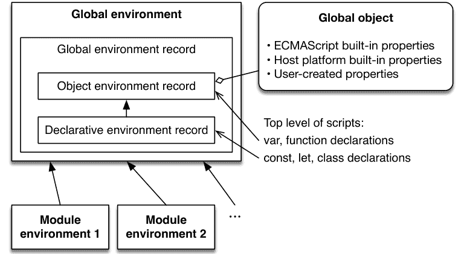
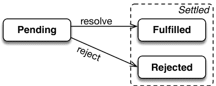
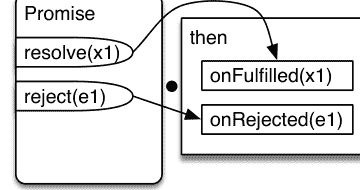
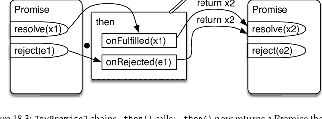
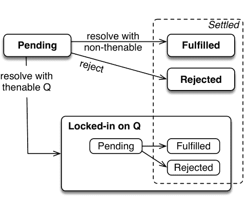
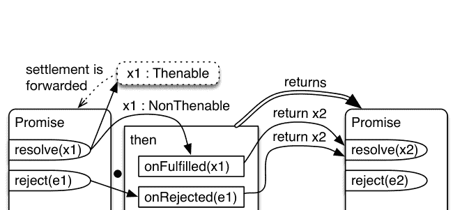
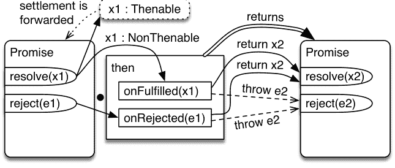

#  JavaScript 深度探索：理论与技术


## 理论与技术


## V 面向对象编程：技术

- **13 类实例化技术** 131
    - 13.1 问题：异步初始化属性 131
    - 13.2 解决方案：基于 Promise 的构造函数 132
    - 13.3 解决方案：静态工厂方法 133
    - 13.4 继承基于 Promise 的构造函数（可选） 137
    - 13.5 结论 138
    - 13.6 延伸阅读 138

- **14 复制类实例：`.clone()` 与复制构造函数** 141
    - 14.1 `.clone()` 方法 141
    - 14.2 静态工厂方法 142
    - 14.3 致谢 143

- **15 集合的不可变包装器** 145
    - 15.1 包装对象 145
    - 15.2 Map 的不可变包装器 146
    - 15.3 Array 的不可变包装器 147

## VI 正则表达式

- **16 正则表达式：通过示例理解环视断言** 151
    - 16.1 备忘单：环视断言 151
    - 16.2 本章警告 152
    - 16.3 示例：指定匹配之前或之后的内容（正环视） 152
    - 16.4 示例：指定匹配之前或之后不能是什么（负环视） 153
    - 16.5 插曲：环视断言向内指向 154
    - 16.6 示例：匹配不以 'abc' 开头的字符串 154
    - 16.7 示例：匹配不包含 '.mjs' 的子字符串 155


- 16.8 示例：使用注释跳过行 . . . . . . . . . . . . . . . . . . . . . . . . . 155
- 16.9 示例：智能引号 . . . . . . . . . . . . . . . . . . . . . . . . . . . . . . . 156
- 16.10 致谢 . . . . . . . . . . . . . . . . . . . . . . . . . . . . . . . . . . . . . . . . 157
- 16.11 延伸阅读 . . . . . . . . . . . . . . . . . . . . . . . . . . . . . . . . . . . . . . 157

## 17 通过 re-template-tag 构建正则表达式（额外内容） 159

- 17.1 基础知识 . . . . . . . . . . . . . . . . . . . . . . . . . . . . . . . . . . . . . 159
- 17.2 功能概览 . . . . . . . . . . . . . . . . . . . . . . . . . . . . . . . . . . . . . . 160
- 17.3 为什么这很有用？ . . . . . . . . . . . . . . . . . . . . . . . . . . . . . . . . . 160
- 17.4 re 与具名捕获组 . . . . . . . . . . . . . . . . . . . . . . . . . . . . . . . . . 160

## VII 杂项话题 163

## 18 通过实现 Promise 来探索 Promise 165

- 18.1 复习：Promise 的状态 . . . . . . . . . . . . . . . . . . . . . . . . . . . 166
- 18.2 版本 1：独立 Promise . . . . . . . . . . . . . . . . . . . . . . . . . . . . 166
- 18.3 版本 2：链式调用 .then() . . . . . . . . . . . . . . . . . . . . . . . . 169
- 18.4 便捷方法 .catch() . . . . . . . . . . . . . . . . . . . . . . . . . . . . . . . . 170
- 18.5 省略反应处理 . . . . . . . . . . . . . . . . . . . . . . . . . . . . . . . . . . . 170
- 18.6 具体实现 . . . . . . . . . . . . . . . . . . . . . . . . . . . . . . . . . . . . . . 171
- 18.7 版本 3：展平 .then() 回调返回的 Promise . . . . . . . . . . . . . . . 172
- 18.8 版本 4：反应回调中抛出的异常 . . . . . . . . . . . . . . . . . . . . . . 175
- 18.9 版本 5：揭示构造函数模式 (Revealing constructor pattern) . . . . 177

## 19 使用 Proxy 进行元编程（早期访问） 179

- 19.1 概述 . . . . . . . . . . . . . . . . . . . . . . . . . . . . . . . . . . . . . . . . . 180
- 19.2 编程与元编程 . . . . . . . . . . . . . . . . . . . . . . . . . . . . . . . . . . . 181
- 19.3 Proxy 详解 . . . . . . . . . . . . . . . . . . . . . . . . . . . . . . . . . . . . . 182
- 19.4 Proxy 的使用场景 . . . . . . . . . . . . . . . . . . . . . . . . . . . . . . . . . 190
- 19.5 Proxy API 的设计 . . . . . . . . . . . . . . . . . . . . . . . . . . . . . . . . . 200
- 19.6 FAQ：Proxy . . . . . . . . . . . . . . . . . . . . . . . . . . . . . . . . . . . . . 209
- 19.7 参考：Proxy API . . . . . . . . . . . . . . . . . . . . . . . . . . . . . . . . . . 209
- 19.8 结语 . . . . . . . . . . . . . . . . . . . . . . . . . . . . . . . . . . . . . . . . . . 215
- 19.9 延伸阅读 . . . . . . . . . . . . . . . . . . . . . . . . . . . . . . . . . . . . . . . 215

## 20 函数的 .name 属性（额外内容） 217

- 20.1 函数的名称 . . . . . . . . . . . . . . . . . . . . . . . . . . . . . . . . . . . . 218
- 20.2 为函数提供名称的结构 . . . . . . . . . . . . . . . . . . . . . . . . . . . . . 219
- 20.3 函数名称需要注意的事项 . . . . . . . . . . . . . . . . . . . . . . . . . . . 223
- 20.4 修改函数名称 . . . . . . . . . . . . . . . . . . . . . . . . . . . . . . . . . . . 223
- 20.5 ECMAScript 规范中的函数属性 .name . . . . . . . . . . . . . . . . . . . 224

# 第一部分
# 前言

# 第 1 章
## 关于本书

## 目录

- 1.1 本书的主页在哪里？ ................... 9
- 1.2 本书包含什么内容？ ............................... 9
- 1.3 我付费购买能获得什么？ ......................... 10
- 1.4 如何预览内容？ ...................... 10
- 1.5 如何报告错误？ ............................... 10
- 1.6 阅读技巧 ...................................... 10
- 1.7 符号与约定 ........................... 10
    - 1.7.1 什么是类型签名？为什么我在本书中看到了静态类型？ ........... 10
    - 1.7.2 带图标的注释是什么意思？ ................ 11
- 1.8 致谢 .................................... 11

### 1.1 本书的主页在哪里？

《Deep JavaScript》的主页是 [exploringjs.com/deep-js/](exploringjs.com/deep-js/)

### 1.2 本书包含什么内容？

本书深入探讨 JavaScript：

- 它教授更好地使用该语言的实用技巧。
- 它教授该语言是如何工作的以及为什么。其教学内容牢牢基于 ECMAScript 规范（本书会对该规范进行解释并引用）。
- 它仅涵盖语言本身（忽略浏览器 API 等平台特定功能），但并非面面俱到。相反，它专注于一系列重要的主题。

### 1.3 我付费购买能获得什么？

如果你购买本书，你将获得：

- 当前内容的四个无 DRM 版本：
    - PDF 文件
    - 包含无广告 HTML 的 ZIP 压缩包
    - EPUB 文件
    - MOBI 文件
- 以后添加到此版本的任何新内容。我能添加多少内容取决于本书的销售情况。

当前价格为首发价。随着更多内容的加入，价格将会上涨。

### 1.4 如何预览内容？

在本书的主页上，有所有版本的详细预览。

### 1.5 如何报告错误？

- 本书的 HTML 版本在每章末尾都有一个评论链接。
- 它们会跳转到 GitHub issues，[你也可以直接访问](https://github.com)。

### 1.6 阅读技巧

- 你可以按任意顺序阅读各章节。每一章都是独立的，但偶尔会有指向其他章节的引用以提供更多信息。
- 一些章节的标题标记为“(optional)”（可选），这意味着它们是非核心内容。即使跳过这些部分，你仍然能理解该章节的其余部分。

### 1.7 符号与约定

#### 1.7.1 什么是类型签名？为什么我在本书中看到了静态类型？

例如，你可能会看到：

```
Number.isFinite(num: number): boolean
```

这被称为 `Number.isFinite()` 的*类型签名*。这种记法，特别是 `num` 的静态类型 `number` 和结果的 `boolean` 类型，并不是真正的 JavaScript。这种记法借用了编译为 JavaScript 的语言 TypeScript（TypeScript 基本上就是 JavaScript 加上静态类型）。

为什么要使用这种记法？它能帮助你快速了解一个函数是如何工作的。这种记法在 [a 2ality 博客文章](https://2ality.com) 中有详细解释，但通常来说它是相对直观的。

#### 1.7.2 带图标的注释是什么意思？

**阅读指南**
解释如何更好地阅读内容。

**外部内容**
指向额外的外部内容。

**提示**
提供与当前内容相关的技巧。

**问题**
提出并回答与当前内容相关的问题（类似于 FAQ）。

**警告**
警告潜在的陷阱等。

**详情**
提供补充当前内容的额外细节。类似于脚注。

### 1.8 致谢

- 感谢 Allen Wirfs-Brock 通过 Twitter 和博客评论提供的建议。这帮助提升了本书的质量。
- 更多贡献者在各章节中得到了致谢。

# 第二部分
# 类型、值、变量

# 第 2 章
## JavaScript 中的类型强制转换

| 目录 | 节 | 页码 |
| :--- | :--- | :--- |
| **2.1** | **什么是类型强制转换？** | 15 |
| | 2.1.1 处理类型强制转换 | 17 |
| **2.2** | **ECMAScript 规范中辅助实现强制转换的操作** | 18 |
| | 2.2.1 转换为原始类型和对象 | 18 |
| | 2.2.2 转换为数值类型 | 18 |
| | 2.2.3 转换为属性键 | 19 |
| | 2.2.4 转换为数组索引 | 19 |
| | 2.2.5 转换为类型化数组元素 | 20 |
| **2.3** | **间奏：用 JavaScript 表达规范算法** | 20 |
| **2.4** | **强制转换算法示例** | 21 |
| | 2.4.1 `ToPrimitive()` | 21 |
| | 2.4.2 `ToString()` 及相关操作 | 24 |
| | 2.4.3 `ToPropertyKey()` | 28 |
| | 2.4.4 `ToNumeric()` 及相关操作 | 28 |
| **2.5** | **执行强制转换的操作** | 29 |
| | 2.5.1 加法运算符 (+) | 29 |
| | 2.5.2 抽象相等比较 (==) | 30 |
| **2.6** | **术语表：类型转换相关术语** | 32 |

在本章中，我们将探讨类型*强制转换*（coercion）在 JavaScript 中的作用。我们将深入研究这个主题，例如，探讨 ECMAScript 规范是如何处理强制转换的。

### 2.1 什么是类型强制转换？

每个操作（函数、运算符等）都期望其参数具有某些特定类型。如果一个值对于某个参数来说类型不正确，那么对于（例如）一个函数来说，通常有三种选择：

1. 函数可以抛出异常：

```javascript
function multiply(x, y) {
  if (typeof x !== 'number' || typeof y !== 'number') {
    throw new TypeError();
  }
  // ...
}
```

2. 函数可以返回一个错误值：

```javascript
function multiply(x, y) {
  if (typeof x !== 'number' || typeof y !== 'number') {
    return NaN;
  }
  // ...
}
```

3. 函数可以将参数转换为有用的值：

```javascript
function multiply(x, y) {
  if (typeof x !== 'number') {
    x = Number(x);
  }
  if (typeof y !== 'number') {
    y = Number(y);
  }
  // ...
}
```

在 (3) 中，该操作执行了隐式类型转换。这被称为 *类型强制转换（type coercion）*。
JavaScript 最初没有异常机制，这就是为什么它在大多数操作中使用强制转换和错误值的原因：

```javascript
// 强制转换
assert.equal(3 * true, 3);

// 错误值
assert.equal(1 / 0, Infinity);
assert.equal(Number('xyz'), NaN);
```

然而，在某些情况下（尤其是涉及新特性时），如果参数类型不正确，它也会抛出异常：

- 访问 null 或 undefined 的属性：
  > undefined.prop
  TypeError: Cannot read property 'prop' of undefined
  > null.prop
  TypeError: Cannot read property 'prop' of null
  > 'prop' in null
  TypeError: Cannot use 'in' operator to search for 'prop' in null

### 2.1 什么是类型强制转换？

- 使用 Symbol：
  > 6 / Symbol()
  TypeError: Cannot convert a Symbol value to a number
- 混合使用 BigInt 和 Number：
  > 6 / 3n
  TypeError: Cannot mix BigInt and other types
- 对不支持该操作的值进行 new 调用或函数调用：
  > 123()
  TypeError: 123 is not a function
  > (class {})()
  TypeError: Class constructor cannot be invoked without 'new'
  > new 123
  TypeError: 123 is not a constructor
  > new (() => {})
  TypeError: (intermediate value) is not a constructor
- 修改只读属性（仅在严格模式下抛出）：
  > 'abc'.length = 1
  TypeError: Cannot assign to read only property 'length'
  > Object.freeze({prop:3}).prop = 1
  TypeError: Cannot assign to read only property 'prop'

### 2.1.1 处理类型强制转换

处理强制转换的两种常用方法是：

- 调用者可以显式地转换值，使其具有正确的类型。例如，在以下交互中，我们希望将两个以字符串编码的数字相乘：

```javascript
let x = '3';
let y = '2';
assert.equal(Number(x) * Number(y), 6);
```

- 调用者可以让操作本身为其进行转换：

```javascript
let x = '3';
let y = '2';
assert.equal(x * y, 6);
```

我通常更倾向于前者，因为它可以明确我的意图：我预料到 x 和 y 可能不是数字，但我想将两个数字相乘。

### 2.2 ECMAScript 规范中帮助实现强制转换的操作

以下章节描述了 ECMAScript 规范中用于将实际参数转换为预期类型的最重要内部函数。

例如，在 TypeScript 中，我们会这样写：

```typescript
function isNaN(number: number) {
    // ···
}
```

在规范中，其形式[如下所示](https://)（为了方便理解，翻译成了 JavaScript）：

```javascript
function isNaN(number) {
    let num = ToNumber(number);
    // ···
}
```

#### 2.2.1 转换为原始类型和对象

每当预期为原始类型或对象时，会使用以下转换函数：

- ToBoolean()
- ToNumber()
- ToBigInt()
- ToString()
- ToObject()

这些内部函数在 JavaScript 中有非常相似的对应项：

```javascript
> Boolean(0)
false
> Boolean(1)
true
```

```javascript
> Number('123')
123
```

在引入了与 number 并存的 bigint 之后，规范在之前使用 `ToNumber()` 的地方经常改为使用 `ToNumeric()`。详情请参阅后文。

#### 2.2.2 转换为数值类型

目前，JavaScript 有[两种内置数值类型](https://)：number 和 bigint。

- `ToNumeric()` 返回一个数值 num。它的调用者通常会调用 num 规范类型的一个方法 mthd：

```javascript
Type(num)::mthd(···)
```

其中，以下操作使用了 ToNumeric：

- 前缀和后缀 ++ 运算符
- * 运算符

每当预期一个没有小数部分的数字时，就会使用 ToInteger(x)。结果的范围通常在之后会进一步限制。

- 它调用 ToNumber(x) 并去掉小数部分（类似于 Math.trunc()）。
- 使用 ToInteger() 的操作：
    - Number.prototype.toString(radix?)
    - String.prototype.codePointAt(pos)
    - Array.prototype.slice(start, end)
    - 等等。

ToInt32() 和 ToUint32() 将数字强制转换为 32 位整数，并被按位运算符使用（见表 2.1）。

- ToInt32()：有符号，范围 [-2³¹, 2³¹-1]（包含边界）
- ToUint32()：无符号（因此有 U），范围 [0, 2³²-1]（包含边界）

表 2.1：按位数字运算符的操作数强制转换（BigInt 运算符不限制位数）。

| 运算符 | 左操作数 | 右操作数 | 结果类型 |
| :--- | :--- | :--- | :--- |
| << | ToInt32() | ToUint32() | Int32 |
| 有符号 >> | ToInt32() | ToUint32() | Int32 |
| 无符号 >>> | ToInt32() | ToUint32() | Uint32 |
| &, ^, \| | ToInt32() | ToUint32() | Int32 |
| ~ | — | ToInt32() | Int32 |

#### 2.2.3 转换为属性键

ToPropertyKey() 返回一个字符串或一个 symbol，并被以下项使用：

- 方括号运算符 []
- 对象字面量中的计算属性名
- in 运算符的左侧
- Object.defineProperty(_, P, _)
- Object.fromEntries()
- Object.getOwnPropertyDescriptor()
- Object.prototype.hasOwnProperty()
- Object.prototype.propertyIsEnumerable()
- Reflect 的多个方法

#### 2.2.4 转换为数组索引

ToLength() 主要（直接）用于字符串索引。

- ToIndex() 的辅助函数
- 结果 l 的范围：0 ≤ l ≤ 2⁵³-1

- ToIndex() 用于类型化数组（Typed Array）索引。
    - 与 ToLength() 的主要区别：如果参数超出范围则抛出异常。
    - 结果 i 的范围：0 ≤ i ≤ 2⁵³-1
- ToUint32() 用于普通数组索引。
    - 结果 i 的范围：0 ≤ i < 2³²-1（不含上限，为 .length 留出空间）

#### 2.2.5 转换为类型化数组元素

当我们设置类型化数组元素的值时，会使用以下转换函数之一：

- ToInt8()
- ToUint8()
- ToUint8Clamp()
- ToInt16()
- ToUint16()
- ToInt32()
- ToUint32()
- ToBigInt64()
- ToBigUint64()

### 2.3 间奏：用 JavaScript 表达规范算法

在本章的剩余部分，我们会遇到几个规范算法，但它们被“实现”为 JavaScript。以下列表显示了一些常用模式如何从规范翻译到 JavaScript：

- 规范：If Type(value) is String
  JavaScript：`if (typeof(value) === 'string')`
  （非常宽松的翻译；TypeOf() 在下方定义）
- 规范：If IsCallable(method) is true
  JavaScript：`if (IsCallable(method))`
  （IsCallable() 在下方定义）
- 规范：Let numValue be ToNumber(value)
  JavaScript：`let numValue = Number(value)`
- 规范：Let isArray be IsArray(O)
  JavaScript：`let isArray = Array.isArray(O)`
- 规范：If O has a [[NumberData]] internal slot
  JavaScript：`if ('__NumberData__' in O)`
- 规范：Let tag be Get(O, @@toStringTag)
  JavaScript：`let tag = O[Symbol.toStringTag]`
- 规范：Return the string-concatenation of "[object ", tag, and "]".
  JavaScript：return '[object ' + tag + ']';

使用 let（而不是 const）是为了匹配规范的语言。
某些内容被省略了——例如，ReturnIfAbrupt 的简写符号 ? 和 !。

```javascript
/**
 * 一个改进版本的 typeof
 */
function TypeOf(value) {
  const result = typeof value;
  switch (result) {
    case 'function':
      return 'object';
    case 'object':
      if (value === null) {
        return 'null';
      } else {
        return 'object';
      }
    default:
      return result;
  }
}

function IsCallable(x) {
  return typeof x === 'function';
}
```

### 2.4 强制转换算法示例

#### 2.4.1 ToPrimitive()

ToPrimitive() 操作是许多强制转换算法的中间步骤（其中一些我们将在本章后面看到）。它将任意值转换为原始值。

ToPrimitive() 在规范中经常被使用，因为大多数运算符只能与原始值一起工作。例如，我们可以使用加法运算符 (+) 来相加数字和拼接字符串，但我们不能用它来拼接数组。

以下是 ToPrimitive() 的 JavaScript 版本：

```typescript
/**
 * @param hint 结果的首选类型：
 *            string, number, 或不关心（default）？
 */
function ToPrimitive(input: any,
  hint: 'string'|'number'|'default' = 'default') {
  if (TypeOf(input) === 'object') {
```


 ```
let exoticToPrim = input[Symbol.toPrimitive]; // (A)
if (exoticToPrim !== undefined) {
    let result = exoticToPrim.call(input, hint);
    if (TypeOf(result) !== 'object') {
        return result;
    }
    throw new TypeError();
}
if (hint === 'default') {
    hint = 'number';
}
return OrdinaryToPrimitive(input, hint);
} else {
    // input is already primitive
    return input;
}
```

ToPrimitive() 允许对象通过 Symbol.toPrimitive 覆盖对原始值的转换（第 A 行）。如果对象没有这样做，则将其传递给 OrdinaryToPrimitive()：

```
function OrdinaryToPrimitive(O: object, hint: 'string' | 'number') {
    let methodNames;
    if (hint === 'string') {
        methodNames = ['toString', 'valueOf'];
    } else {
        methodNames = ['valueOf', 'toString'];
    }
    for (let name of methodNames) {
        let method = O[name];
        if (IsCallable(method)) {
            let result = method.call(O);
            if (TypeOf(result) !== 'object') {
                return result;
            }
        }
    }
    throw new TypeError();
}
```

##### 2.4.1.1 ToPrimitive() 的调用者使用哪个 hint？

参数 hint 可以具有以下三个值之一：

- 'number' 表示：如果可能，input 应被转换为数字。
- 'string' 表示：如果可能，input 应被转换为字符串。
- 'default' 表示：对返回的数字或字符串类型没有偏好。

以下是各种操作如何使用 ToPrimitive() 的一些示例：

- hint === 'number'。以下操作偏好数字：
  - ToNumeric()
  - ToNumber()
  - ToBigInt(), BigInt()
  - 抽象关系比较 (<)

- hint === 'string'。以下操作偏好字符串：
  - ToString()
  - ToPropertyKey()

- hint === 'default'。以下操作对返回的原始值的类型是中立的：
  - 抽象相等比较 (==)
  - 加法运算符 (+)
  - new Date(value)（value 可以是数字或字符串）

正如我们所见，默认行为是将 'default' 当作 'number' 处理。只有 Symbol 和 Date 的实例会覆盖此行为（稍后展示）。

##### 2.4.1.2 将对象转换为原始值时会调用哪些方法？

如果没有通过 Symbol.toPrimitive 覆盖对原始值的转换，OrdinaryToPrimitive() 会调用以下两个方法中的一个或两个：

- 如果 hint 表示我们希望原始值是字符串，则首先调用 'toString'。
- 如果 hint 表示我们希望原始值是数字，则首先调用 'valueOf'。

以下代码演示了它的工作原理：

```
const obj = {
  toString() { return 'a' },
  valueOf() { return 1 },
};

// String() 偏好字符串：
assert.equal(String(obj), 'a');

// Number() 偏好数字：
assert.equal(Number(obj), 1);
```

具有属性键 Symbol.toPrimitive 的方法会覆盖常规的对原始值的转换。这在标准库中只做了两次：

- Symbol.prototype[Symbol.toPrimitive](hint)
  - 如果接收者（receiver）是 Symbol 的实例，此方法始终返回被包装的 symbol。
  - 其原因在于 Symbol 的实例有一个 .toString() 方法，它返回字符串。但即使 hint 是 'string'，也不应调用 .toString()，以免意外地将 Symbol 的实例转换为字符串（字符串是一种完全不同的属性键）。

- Date.prototype[Symbol.toPrimitive](hint)
  - 接下来将更详细地解释。

##### 2.4.1.3 `Date.prototype[Symbol.toPrimitive]()`

Date 处理转换为原始值的方式如下：

```
Date.prototype[Symbol.toPrimitive] = function (
  hint: 'default' | 'string' | 'number') {
  let O = this;
  if (TypeOf(O) !== 'object') {
    throw new TypeError();
  }
  let tryFirst;
  if (hint === 'string' || hint === 'default') {
    tryFirst = 'string';
  } else if (hint === 'number') {
    tryFirst = 'number';
  } else {
    throw new TypeError();
  }
  return OrdinaryToPrimitive(O, tryFirst);
};
```

与默认算法唯一的区别是 `'default'` 变成了 `'string'`（而不是 `'number'`）。如果我们使用将 hint 设置为 `'default'` 的操作，就可以观察到这一点：

- `==` 运算符会将对象强制转换为原始值（使用默认 hint），前提是另一个操作数是除 undefined、null 和 boolean 以外的原始值。在以下交互中，我们可以看到强制转换日期后的结果是字符串：

```
const d = new Date('2222-03-27');
assert.equal(
  d == 'Wed Mar 27 2222 01:00:00 GMT+0100'
    + ' (Central European Standard Time)',
  true);
```

- `+` 运算符会将两个操作数都强制转换为原始值（使用默认 hint）。如果其中一个结果是字符串，则执行字符串拼接（否则执行数字加法）。在以下交互中，我们可以看到强制转换日期后的结果是字符串，因为该运算符返回了一个字符串。

```
const d = new Date('2222-03-27');
assert.equal(
  123 + d,
  '123Wed Mar 27 2222 01:00:00 GMT+0100'
    + ' (Central European Standard Time)');
```

#### 2.4.2 `ToString()` 及相关操作

这是 ToString() 的 JavaScript 版本：

```
function ToString(argument) {
  if (argument === undefined) {
    return 'undefined';
```

### 2.4 强制转换算法示例

```
} else if (argument === null) {
  return 'null';
} else if (argument === true) {
  return 'true';
} else if (argument === false) {
  return 'false';
} else if (TypeOf(argument) === 'number') {
  return Number.toString(argument);
} else if (TypeOf(argument) === 'string') {
  return argument;
} else if (TypeOf(argument) === 'symbol') {
  throw new TypeError();
} else if (TypeOf(argument) === 'bigint') {
  return BigInt.toString(argument);
} else {
  // argument 是一个对象
  let primValue = ToPrimitive(argument, 'string'); // (A)
  return ToString(primValue);
}
}
```

请注意，此函数对于对象，在将原始结果转换为字符串之前，如何使用 ToPrimitive() 作为中间步骤（第 A 行）。

ToString() 与 String() 的工作方式有一个有趣的差异：如果 argument 是一个 symbol，前者会抛出 TypeError，而后者不会。为什么会这样？Symbol 的默认行为是将其转换为字符串时会抛出异常：

```
> const sym = Symbol('sym');

> ''+sym
TypeError: Cannot convert a Symbol value to a string
> `${sym}`
TypeError: Cannot convert a Symbol value to a string
```

这个默认值在 String() 和 Symbol.prototype.toString() 中被覆盖（两者将在接下来的小节中描述）：

```
> String(sym)
'Symbol(sym)'
> sym.toString()
'Symbol(sym)'
```

##### 2.4.2.1 `String()`

```
function String(value) {
  let s;
  if (value === undefined) {
    s = '';
  } else {
    if (new.target === undefined && TypeOf(value) === 'symbol') {
```

// 此函数是通过函数调用执行的，且 value 是一个 symbol

```
return SymbolDescriptiveString(value);
    }
    s = ToString(value);
}
if (new.target === undefined) {
    // 此函数是通过函数调用执行的
    return s;
}
// 此函数是通过 new 调用的
return StringCreate(s, new.target.prototype); // 简化版！
}
```

String() 的工作方式取决于它是通过函数调用还是通过 new 调用的。它使用 new.target 来区分这两种情况。

这些是辅助函数 StringCreate() 和 SymbolDescriptiveString()：

```
/**
 * 创建一个包装 `value` 的 String 实例，
 * 并具有给定的原型。
 */
function StringCreate(value, prototype) {
    // ...
}

function SymbolDescriptiveString(sym) {
    assert.equal(TypeOf(sym), 'symbol');
    let desc = sym.description;
    if (desc === undefined) {
        desc = '';
    }
    assert.equal(TypeOf(desc), 'string');
    return 'Symbol('+desc+')';
}
```

##### 2.4.2.2 `Symbol.prototype.toString()`

除了 String()，我们还可以使用 .toString() 方法将 symbol 转换为字符串。其规范如下所示。

```
Symbol.prototype.toString = function () {
    let sym = thisSymbolValue(this);
    return SymbolDescriptiveString(sym);
};
function thisSymbolValue(value) {
    if (TypeOf(value) === 'symbol') {
        return value;
    }
    if (TypeOf(value) === 'object' && '__SymbolData__' in value) {
```


## 2.4 强制类型转换算法示例

```javascript
let s = value.__SymbolData__;
assert.equal(TypeOf(s), 'symbol');
return s;
}
```

#### 2.4.2.3 Object.prototype.toString

`.toString()` 的默认规范如下所示：

```javascript
Object.prototype.toString = function () {
    if (this === undefined) {
        return '[object Undefined]';
    }
    if (this === null) {
        return '[object Null]';
    }
    let o = ToObject(this);
    let isArray = Array.isArray(o);
    let builtinTag;
    if (isArray) {
        builtinTag = 'Array';
    } else if ('__ParameterMap__' in o) {
        builtinTag = 'Arguments';
    } else if ('__Call__' in o) {
        builtinTag = 'Function';
    } else if ('__ErrorData__' in o) {
        builtinTag = 'Error';
    } else if ('__BooleanData__' in o) {
        builtinTag = 'Boolean';
    } else if ('__NumberData__' in o) {
        builtinTag = 'Number';
    } else if ('__StringData__' in o) {
        builtinTag = 'String';
    } else if ('__DateValue__' in o) {
        builtinTag = 'Date';
    } else if ('__RegExpMatcher__' in o) {
        builtinTag = 'RegExp';
    } else {
        builtinTag = 'Object';
    }
    let tag = o[Symbol.toStringTag];
    if (TypeOf(tag) !== 'string') {
        tag = builtinTag;
    }
    return '[object ' + tag + ']';
};
```

当我们把纯对象转换为字符串时，会使用此操作：

```javascript
> String({})
'[object Object]'
```

默认情况下，将类的实例转换为字符串时也会使用它：

```javascript
class MyClass {}
assert.equal(
  String(new MyClass()), '[object Object]');
```

通常，我们会重写 `.toString()` 以配置 `MyClass` 的字符串表示形式，但我们也可以通过修改方括号内 “object” 之后的内容来改变它：

```javascript
class MyClass {}
MyClass.prototype[Symbol.toStringTag] = 'Custom!';
assert.equal(
  String(new MyClass()), '[object Custom!]');
```

将重写版本的 `.toString()` 与 `Object.prototype` 中的原始版本进行对比会很有趣：

```javascript
> ['a', 'b'].toString()
'a,b'
> Object.prototype.toString.call(['a', 'b'])
'[object Array]'

> /^abc$/.toString()
'/^abc$/'
> Object.prototype.toString.call(/^abc$/)
'[object RegExp]'
```

#### 2.4.3 ToPropertyKey()

`ToPropertyKey()` 被方括号运算符等操作所使用。其工作原理如下：

```javascript
function ToPropertyKey(argument) {
  let key = ToPrimitive(argument, 'string'); // (A)
  if (TypeOf(key) === 'symbol') {
    return key;
  }
  return ToString(key);
}
```

同样地，对象在与原语（primitives）协同工作之前会被转换为原语。

#### 2.4.4 ToNumeric() 及相关操作

`ToNumeric()` 被乘法运算符 (`*`) 等操作所使用。其工作原理如下：

```javascript
function ToNumeric(value) {
  let primValue = ToPrimitive(value, 'number');
  if (TypeOf(primValue) === 'bigint') {
    return primValue;
  }
  return ToNumber(primValue);
}
```

##### 2.4.4.1 ToNumber()

`ToNumber()` 的工作原理如下：

```javascript
function ToNumber(argument) {
  if (argument === undefined) {
    return NaN;
  } else if (argument === null) {
    return +0;
  } else if (argument === true) {
    return 1;
  } else if (argument === false) {
    return +0;
  } else if (TypeOf(argument) === 'number') {
    return argument;
  } else if (TypeOf(argument) === 'string') {
    return parseTheString(argument); // 此处未显示
  } else if (TypeOf(argument) === 'symbol') {
    throw new TypeError();
  } else if (TypeOf(argument) === 'bigint') {
    throw new TypeError();
  } else {
    // argument 是一个对象
    let primValue = ToPrimitive(argument, 'number');
    return ToNumber(primValue);
  }
}
```

`ToNumber()` 的结构与 `ToString()` 的结构类似。

### 2.5 强制转换操作

#### 2.5.1 加法运算符 (+)

JavaScript 的加法运算符规范如下：

```javascript
function Addition(leftHandSide, rightHandSide) {
  let lprim = ToPrimitive(leftHandSide);
  let rprim = ToPrimitive(rightHandSide);
  if (TypeOf(lprim) === 'string' || TypeOf(rprim) === 'string') { // (A)
    return ToString(lprim) + ToString(rprim);
  }
  let lnum = ToNumeric(lprim);
  let rnum = ToNumeric(rprim);
  if (TypeOf(lnum) !== TypeOf(rnum)) {
    throw new TypeError();
  }
  let T = Type(lnum);
  return T.add(lnum, rnum); // (B)
}
```

该算法的步骤：

- 两个操作数都被转换为原语值。
- 如果其中一个结果是字符串，则两者都转换为字符串并进行拼接（行 A）。
- 否则，两个操作数都被转换为数值并相加（行 B）。`Type()` 返回 `lnum` 的 ECMAScript 规范类型。`.add()` 是数值类型的一个方法。

#### 2.5.2 抽象相等比较 (==)

```javascript
/** 宽松相等 (==) */
function abstractEqualityComparison(x, y) {
  if (TypeOf(x) === TypeOf(y)) {
    // 使用严格相等 (===)
    return strictEqualityComparison(x, y);
  }

  // 比较 null 和 undefined
  if (x === null && y === undefined) {
    return true;
  }
  if (x === undefined && y === null) {
    return true;
  }

  // 比较数字和字符串
  if (TypeOf(x) === 'number' && TypeOf(y) === 'string') {
    return abstractEqualityComparison(x, Number(y));
  }
  if (TypeOf(x) === 'string' && TypeOf(y) === 'number') {
    return abstractEqualityComparison(Number(x), y);
  }

  // 比较 bigint 和字符串
  if (TypeOf(x) === 'bigint' && TypeOf(y) === 'string') {
    let n = StringToBigInt(y);
    if (Number.isNaN(n)) {
      return false;
    }
    return abstractEqualityComparison(x, n);
  }

  if (TypeOf(x) === 'string' && TypeOf(y) === 'bigint') {
    return abstractEqualityComparison(y, x);
  }

  // 比较布尔值和非布尔值
  if (TypeOf(x) === 'boolean') {
    return abstractEqualityComparison(Number(x), y);
  }
  if (TypeOf(y) === 'boolean') {
    return abstractEqualityComparison(x, Number(y));
  }

  // 比较对象和原语
  // (除 undefined, null, 布尔值以外)
  if (['string', 'number', 'bigint', 'symbol'].includes(TypeOf(x))
    && TypeOf(y) === 'object') {
    return abstractEqualityComparison(x, ToPrimitive(y));
  }

  if (TypeOf(x) === 'object'
    && ['string', 'number', 'bigint', 'symbol'].includes(TypeOf(y))) {
    return abstractEqualityComparison(ToPrimitive(x), y);
  }

  // 比较 bigint 和数字
  if ((TypeOf(x) === 'bigint' && TypeOf(y) === 'number')
    || (TypeOf(x) === 'number' && TypeOf(y) === 'bigint')) {
    if ([NaN, +Infinity, -Infinity].includes(x)
      || [NaN, +Infinity, -Infinity].includes(y)) {
      return false;
    }
    if (isSameMathematicalValue(x, y)) {
      return true;
    } else {
      return false;
    }
  }

  return false;
}
```

以下操作在此未显示：

- `strictEqualityComparison()`
- `StringToBigInt()`
- `isSameMathematicalValue()`

### 2.6 术语表：类型转换相关术语

现在我们详细研究了 JavaScript 的类型强制转换是如何工作的，让我们以一个关于类型转换的简短术语表作为结束：

- 在*类型转换 (type conversion)* 中，我们希望输出值具有给定的类型。如果输入值已经具有该类型，则原样返回。否则，它将被转换为具有目标类型的值。
- *显式类型转换 (Explicit type conversion)* 指程序员使用某种操作（函数、运算符等）来触发类型转换。显式转换可以是：
  - *检查的 (Checked)：* 如果值无法转换，则抛出异常。
  - *不检查的 (Unchecked)：* 如果值无法转换，则返回一个错误值。
- *类型强制转换 (type casting)* 的定义取决于编程语言。例如，在 Java 中，它是显式的检查类型转换。
- *类型强制转换 (Type coercion)* 是隐式类型转换：操作会自动将其参数转换为所需的类型。可以是检查的，不检查的，或者介于两者之间。

[来源：[Wikipedia](https://en.wikipedia.org/wiki/Type_conversion)]

# 第 3 章：解构算法

目录

- 3.1 为模式匹配算法做准备 33
  - 3.1.1 使用声明式规则指定匹配算法 34
  - 3.1.2 基于声明式规则评估表达式 35
- 3.2 模式匹配算法 35
  - 3.2.1 模式 35
  - 3.2.2 变量规则 35
  - 3.2.3 对象模式规则 35
  - 3.2.4 数组模式规则 36
- 3.3 空对象模式和数组模式 37
- 3.4 应用算法 38
  - 3.4.1 背景：通过匹配传递参数 38
  - 3.4.2 使用 move2() 39
  - 3.4.3 使用 move1() 39
  - 3.4.4 结论：默认值是模式部分的特性 40

在本章中，我们将从另一个角度看待解构：将其视为一个递归的模式匹配算法。

该算法将使我们更好地理解默认值。这在最后会很有用，届时我们将尝试弄清楚以下两个函数有什么不同：

```javascript
function move({x=0, y=0} = {}) { ... }
function move({x, y} = { x: 0, y: 0 }) { ... }
```

### 3.1 为模式匹配算法做准备

解构赋值看起来像这样：

```
«pattern» = «value»
```


## 3 解构算法

我们希望使用模式（pattern）从值中提取数据。

现在我们将研究一种执行此类赋值的算法。在函数式编程中，这种算法被称为 *模式匹配*（*pattern matching*，简称 *matching*）。它定义了一个运算符 ←（“匹配”），将模式与值进行匹配，并在匹配过程中为变量赋值：

`<<pattern>> ← <<value>>`

我们仅探讨解构赋值，但解构变量声明和解构参数定义的运作方式与之类似。我们也不会深入讨论高级特性：计算属性名、属性值简写，以及将对象属性和数组元素作为赋值目标，这些都超出了本章的范围。

匹配运算符的规范由一组声明式规则组成，这些规则会递归进入两个操作数的结构中。这种声明式记法可能需要一段时间来适应，但它使规范更加简洁。

#### 3.1.1 使用声明式规则指定匹配算法

本章中使用的声明式规则作用于输入，并通过副作用产生算法结果。以下就是这样一个规则（稍后我们还会再次看到）：

- (2c) {key: <<pattern>>, <<properties>>} ← obj
    <<pattern>> ← obj.key
    {<<properties>>} ← obj

该规则包含以下部分：

- (2c) 是规则的 *编号*。编号用于引用该规则。
- *头部*（第一行）描述了输入必须是什么样子才能应用此规则。
- *主体*（剩余行）描述了应用此规则后会发生什么。

在规则 (2c) 中，头部意味着：如果存在一个具有至少一个属性（其键为 key）以及零个或多个剩余属性的对象模式，则可以应用此规则。该规则的效果是：执行继续进行，将属性值模式与 `obj.key` 匹配，将剩余属性与 `obj` 匹配。

让我们再看一个本章中的规则：

- (2e) {} ← obj (无剩余属性)
    // 我们已完成

在规则 (2e) 中，头部意味着：如果空对象模式 `{}` 与值 `obj` 匹配，则执行此规则。主体意味着在这种情况下，我们已经完成了。

规则 (2c) 和规则 (2e) 共同构成了一个声明式循环，遍历箭头左侧模式的属性。

#### 3.1.2 基于声明式规则评估表达式

完整的算法是通过一系列声明式规则指定的。假设我们要评估以下匹配表达式：

```
{first: f, last: l} ↱ obj
```

为了应用一系列规则，我们从上到下遍历它们，并执行第一个适用的规则。如果该规则的主体中存在匹配表达式，则再次应用规则。以此类推。

有时头部包含一个条件，该条件同样决定了规则是否适用 —— 例如：

- (3a) {«elements»} ↱ non_iterable
  if (!isIterable(non_iterable))
  throw new TypeError();

### 3.2 模式匹配算法

#### 3.2.1 模式

模式可以是：

- 一个变量：x
- 一个对象模式：{«properties»}
- 一个数组模式：[«elements»]

接下来的三个章节指定了在匹配表达式中处理这三种情况的规则。

#### 3.2.2 变量规则

- (1) x ↱ value (包括 undefined 和 null)
  x = value

#### 3.2.3 对象模式规则

- (2a) {«properties»} ↱ undefined (非法值)
  throw new TypeError();
- (2b) {«properties»} ↱ null (非法值)
  throw new TypeError();
- (2c) {key: «pattern», «properties»} ↱ obj
  «pattern» ↱ obj.key
  {«properties»} ↱ obj
- (2d) {key: «pattern» = default_value, «properties»} ↱ obj

```javascript
const tmp = obj.key;
if (tmp !== undefined) {
  «pattern» ← tmp
} else {
  «pattern» ← default_value
}
{«properties»} ← obj
```

- (2e) {} ← obj (无剩余属性)
  // 我们已完成

规则 2a 和 2b 处理非法值。规则 2c–2e 循环遍历模式的属性。在规则 2d 中，我们可以看到默认值提供了一个替代方案，如果在 `obj` 中没有匹配的属性，则与之匹配。

#### 3.2.4 数组模式规则

数组模式与可迭代对象。数组解构算法始于一个数组模式和一个可迭代对象：

- (3a) [«elements»] ← non_iterable (非法值)
  if (!isIterable(non_iterable))
    throw new TypeError();

- (3b) [«elements»] ← iterable
  if (isIterable(iterable))
    const iterator = iterable[Symbol.iterator]();
    «elements» ← iterator

辅助函数：

```javascript
function isIterable(value) {
  return (value !== null
    && typeof value === 'object'
    && typeof value[Symbol.iterator] === 'function');
}
```

数组元素与迭代器。算法继续执行：

- 模式的元素（箭头的左侧）
- 从可迭代对象中获取的迭代器（箭头的右侧）

规则如下：

- (3c) «pattern», «elements» ← iterator
  «pattern» ← getNext(iterator) // 最后一个元素之后为 undefined
  «elements» ← iterator

- (3d) «pattern» = default_value, «elements» ← iterator
  const tmp = getNext(iterator);  // 最后一个元素之后为 undefined
  if (tmp !== undefined) {
    «pattern» ← tmp
  } else {
    «pattern» ← default_value
  }
  «elements» ← iterator

- (3e) , «elements» ← iterator (空洞，省略)
  getNext(iterator); // 跳过
  «elements» ← iterator

- (3f) ...«pattern» ← iterator (永远是最后一部分！)
  const tmp = [];
  for (const elem of iterator) {
    tmp.push(elem);
  }
  «pattern» ← tmp

- (3g) ← iterator (无剩余元素)
  // 我们已完成

辅助函数：

```javascript
function getNext(iterator) {
  const {done, value} = iterator.next();
  return (done ? undefined : value);
}
```

迭代器结束类似于对象中缺失属性的情况。

### 3.3 空对象模式和空数组模式

算法规则的一个有趣后果是：我们可以使用空对象模式和空数组模式进行解构。

给定一个空对象模式 `{}`：如果待解构的值既不是 `undefined` 也不是 `null`，则什么也不发生。否则，抛出 `TypeError`。

```javascript
const {} = 123; // OK, 既不是 undefined 也不是 null
assert.throws(
  () => {
    const {} = null;
  },
  /^TypeError: Cannot destructure 'null' as it is null.$/)
```

给定一个空数组模式 `[]`：如果待解构的值是可迭代的，则什么也不发生。否则，抛出 `TypeError`。

```javascript
const [] = 'abc'; // OK, 可迭代
assert.throws(
  () => {
    const [] = 123; // 不可迭代
  },
  /^TypeError: 123 is not iterable$/)
```

换句话说：空解构模式强制要求值具有某些特性，但没有其他效果。

### 3.4 应用该算法

在 JavaScript 中，命名参数是通过对象模拟的：调用者使用对象字面量，被调用者使用解构。这种模拟在《JavaScript for impatient programmers》中详细解释。以下代码展示了一个示例：`move1()` 有两个命名参数 `x` 和 `y`：

```javascript
function move1({x=0, y=0} = {}) { // (A)
  return [x, y];
}
assert.deepEqual(
  move1({x: 3, y: 8}), [3, 8]);
assert.deepEqual(
  move1({x: 3}), [3, 0]);
assert.deepEqual(
  move1({}), [0, 0]);
assert.deepEqual(
  move1(), [0, 0]);
```

在 A 行中有三个默认值：

- 前两个默认值允许我们省略 `x` 和 `y`。
- 第三个默认值允许我们在不传递参数的情况下调用 `move1()`（如最后一行所示）。

但为什么我们要像之前的代码片段那样定义参数？为什么不这样做？

```javascript
function move2({x, y} = { x: 0, y: 0 }) {
  return [x, y];
}
```

为了明白为什么 `move1()` 是正确的，我们将通过两个示例来同时使用这两个函数。在此之前，让我们看看参数传递如何通过匹配来解释。

#### 3.4.1 背景：通过匹配传递参数

对于函数调用，形式参数（函数定义内部）与实际参数（函数调用内部）进行匹配。例如，看以下函数定义和函数调用。

```javascript
function func(a=0, b=0) { ... }
func(1, 2);
```


```
[a=0, b=0] ← [1, 2]
```

#### 3.4.2 使用 move2()

让我们来考察 `move2()` 的解构工作原理。

**示例 1。** 调用函数 `move2()` 会导致如下解构：

```
[{x, y} = { x: 0, y: 0 }] ← []
```

左侧的数组元素在右侧没有匹配项，这就是为什么 `{x, y}` 是与默认值进行匹配，而不是与右侧的数据匹配（规则 3b、3d）：

```
{x, y} ← { x: 0, y: 0 }
```

左侧包含了*属性值简写*。它是以下形式的缩写：

```
{x: x, y: y} ← { x: 0, y: 0 }
```

此解构导致以下两个赋值（规则 2c、1）：

```
x = 0;
y = 0;
```

这正是我们想要的结果。然而，在下一个示例中，我们就没有这么幸运了。

**示例 2。** 让我们考察函数调用 `move2({z: 3})`，它导致如下解构：

```
[{x, y} = { x: 0, y: 0 }] ← [{z: 3}]
```

右侧的索引 0 处有一个数组元素。因此，忽略了默认值，下一步是（规则 3d）：

```
{x, y} ← { z: 3 }
```

这导致 `x` 和 `y` 都被设置为 `undefined`，这不是我们想要的。问题在于 `{x, y}` 不再与默认值匹配，而是与 `{z: 3}` 匹配。

#### 3.4.3 使用 move1()

让我们试试 `move1()`。

**示例 1:** `move1()`

属性 `x` 和属性 `y` 在右侧都没有匹配项。因此，使用默认值，接下来执行以下解构（规则 2d）：

```
x ← 0
y ← 0
```

这导致以下赋值（规则 1）：

```
x = 0
y = 0
```

这里，我们得到了想要的结果。让我们看看在下一个示例中，好运是否能延续。

**示例 2**: `move1({z: 3})`

```
[ {x=0, y=0} ] ← [ {z: 3} ]
```

数组模式的第一个元素在右侧有匹配项，该匹配项被用于继续解构（规则 3d）：

```
{x=0, y=0} ← {z: 3}
```

像示例 1 一样，右侧没有属性 `x` 和 `y`，使用了默认值：

```
x = 0
y = 0
```

它按预期工作了！这一次，模式 `x` 和 `y` 与 `{z: 3}` 匹配不是问题，因为它们有自己的局部默认值。

#### 3.4.4 结论：默认值是模式部分的一个特性

这些示例证明，默认值是模式部分（对象属性或数组元素）的一个特性。如果一个部分没有匹配项，或者匹配到 `undefined`，那么就会使用默认值。也就是说，模式会与默认值进行匹配。

# 第 4 章

## 深入探讨全局变量

**目录**

- 4.1 作用域 ……………………………………………………… 41
- 4.2 词法环境 …………………………… 42
- 4.3 全局对象 ……………………………………… 42
- 4.4 在浏览器中，globalThis 并不直接指向全局对象 … 42
- 4.5 全局环境 …………………………… 43
  - 4.5.1 脚本作用域与模块作用域 ………… 44
  - 4.5.2 创建变量：声明式记录 vs 对象记录 … 44
  - 4.5.3 获取或设置变量 …………………… 45
  - 4.5.4 全局 ECMAScript 变量与全局宿主变量 … 45
- 4.6 结论：为什么 JavaScript 同时拥有普通全局变量和全局对象？ ……………… 45
- 4.7 本章延伸阅读与资料来源 …… 47

在本章中，我们将详细探讨 JavaScript 全局变量的工作原理。有几个有趣的现象在其中发挥作用：脚本的作用域、所谓的*全局对象*，等等。

### 4.1 作用域

变量的*词法作用域*（简称*作用域*）是程序中可以访问该变量的区域。JavaScript 的作用域是*静态的*（它们不会在运行时改变），并且可以嵌套——例如：

```
function func() { // (A)
  const aVariable = 1;
  if (true) { // (B)
    const anotherVariable = 2;
```

```
  }
}
```

`if` 语句引入的作用域（行 B）嵌套在函数 `func()` 的作用域（行 A）内部。

一个作用域 S 最近的外部环绕作用域称为 S 的*外部作用域*。在这个例子中，`func` 是 `if` 的外部作用域。

### 4.2 词法环境

在 JavaScript 语言规范中，作用域是通过*词法环境*来“实现”的。它们由两个部分组成：

- 一个*环境记录*，它将变量名映射到变量值（可以想象成字典）。这是作用域中变量的实际存储空间。记录中的名称-值条目称为*绑定*。
- 一个对*外部环境*的引用——即外部作用域的环境。

因此，嵌套作用域的树结构是通过由外部环境引用连接起来的环境树来表示的。

### 4.3 全局对象

全局对象是一个对象，其属性会成为全局变量。（我们很快就会探讨它如何融入环境树中。）可以通过以下全局变量访问它：

- 在所有平台上可用：`globalThis`。这个名称基于这样一个事实：它在全局作用域中与 `this` 具有相同的值。
- 其他用于引用全局对象的变量并非在所有平台上都可用：
  - `window` 是引用全局对象的经典方式。它在普通浏览器代码中有效，但在 *Web Workers*（与普通浏览器进程并发运行的进程）和 Node.js 中不起作用。
  - `self` 在浏览器中的任何地方（包括在 Web Workers 中）都可用。但 Node.js 不支持它。
  - `global` 仅在 Node.js 上可用。

### 4.4 在浏览器中，globalThis 并不直接指向全局对象

在浏览器中，`globalThis` 并不直接指向全局对象，存在一个间接层。例如，考虑一个网页上的 iframe：

- 每当 iframe 的 `src` 改变时，它就会获得一个新的全局对象。
- 然而，`globalThis` 始终具有相同的值。这个值可以从 iframe 外部检查，如下所示（灵感来源于 [globalThis 提案中的一个示例](https://example.com)）。

文件 parent.html：

```
<iframe src="iframe.html?first"></iframe>
<script>
  const iframe = document.querySelector('iframe');
  const icw = iframe.contentWindow; // iframe 的 `globalThis`

  iframe.onload = () => {
    // 访问 iframe 全局对象的属性
    const firstGlobalThis = icw.globalThis;
    const firstArray = icw.Array;
    console.log(icw.iframeName); // 'first'

    iframe.onload = () => {
      const secondGlobalThis = icw.globalThis;
      const secondArray = icw.Array;

      // 全局对象不同了
      console.log(icw.iframeName); // 'second'
      console.log(secondArray === firstArray); // false

      // 但 globalThis 仍然是同一个
      console.log(firstGlobalThis === secondGlobalThis); // true
    };

    iframe.src = 'iframe.html?second';
  };
</script>
```

文件 iframe.html：

```
<script>
  globalThis.iframeName = location.search.slice(1);
</script>
```

浏览器如何确保 `globalThis` 在这种情况下不会改变？它们在内部区分两个对象：

- `Window` 是全局对象。每当位置改变时，它就会改变。
- `WindowProxy` 是一个将所有访问转发到当前 `Window` 的对象。这个对象永远不会改变。

在浏览器中，`globalThis` 指向 `WindowProxy`；在其他地方，它直接指向全局对象。

### 4.5 全局环境

全局作用域是“最外层”的作用域——它没有外部作用域。它的环境是*全局环境*。每个环境都通过一个由外部环境引用连接起来的环境链与全局环境相连。全局环境的外部环境引用为 `null`。

全局环境记录使用两个环境记录来管理其变量：

- 一个*对象环境记录*具有与普通环境记录相同的接口，但将其绑定存储在一个 JavaScript 对象中。在这种情况下，该对象就是全局对象。
- 一个普通的（*声明式*）环境记录，它有自己的绑定存储。

稍后将解释何时使用这两种记录中的哪一种。

#### 4.5.1 脚本作用域与模块作用域

在 JavaScript 中，我们只在脚本的顶层才处于全局作用域。相比之下，每个模块都有自己独立的作用域，该作用域是脚本作用域的子作用域。

如果我们忽略变量绑定如何添加到全局环境的相对复杂的规则，那么全局作用域和模块作用域的工作方式就像嵌套的代码块：

```
{ // 全局作用域（*所有*脚本的作用域）

  // （全局变量）

  { // 模块 1 的作用域
    ...
  }
  { // 模块 2 的作用域
    ...
  }
  // （更多模块作用域）
}
```

#### 4.5.2 创建变量：声明式记录 vs 对象记录

为了创建一个真正全局的变量，我们必须处于全局作用域——这只在脚本的顶层才会发生：

- 顶层的 `const`、`let` 和 `class` 在声明式环境记录中创建绑定。
- 顶层的 `var` 和 `function` 声明在对象环境记录中创建绑定。

```
<script>
  const one = 1;
  var two = 2;
</script>
<script>
  // 所有脚本共享同一个顶层作用域：
  console.log(one); // 1
  console.log(two); // 2

  // 并非所有声明都会创建全局对象的属性：
```


 ## 4.6 结论：为什么 JavaScript 既有普通全局变量又有全局对象？

全局对象通常被认为是一个设计失误。因此，较新的结构（如 `const`、`let` 和 `class`）在脚本作用域中会创建普通全局变量。

```
console.log(globalThis.one); // undefined
console.log(globalThis.two); // 2
</script>
```

#### 4.5.3 获取或设置变量

当我们获取或设置一个变量，且两个环境记录（environment records）中都有该变量的绑定时，声明式记录（declarative record）优先：

```
<script>
let myGlobalVariable = 1; // 声明式环境记录
globalThis.myGlobalVariable = 2; // 对象环境记录

console.log(myGlobalVariable); // 1 (声明式记录优先)
console.log(globalThis.myGlobalVariable); // 2
</script>
```

#### 4.5.4 全局 ECMAScript 变量与全局宿主变量

除了通过 `var` 和函数声明创建的变量外，全局对象还包含以下属性：

- 所有 ECMAScript 的内置全局变量
- 所有宿主平台（浏览器、Node.js 等）的内置全局变量

使用 `const` 或 `let` 可以确保全局变量的声明不会影响（也不会被影响）ECMAScript 和宿主平台的内置全局变量。

例如，浏览器有一个全局变量 `location`：

```
// 更改当前文档的位置：
var location = 'https://example.com';

// 遮蔽 window.location，不会更改它：
let location = 'https://example.com';
```

如果变量已经存在（例如本例中的 `location`），那么带有初始化值的 `var` 声明的行为就像一次赋值。这就是为什么我们在该示例中会遇到问题。

请注意，这仅在全局作用域中是个问题。在模块中，我们永远不在全局作用域中（除非我们使用 `eval()` 或类似方法）。

图 4.1 总结了我们在本节中学习的所有内容。

### 4.6 结论：为什么 JavaScript 既有普通全局变量又有全局对象？

全局对象通常被认为是一个设计失误。因此，较新的结构（如 `const`、`let` 和 `class`）在脚本作用域中会创建普通全局变量。



### 4.7 本章的进一步阅读和资源

幸好，现代 JavaScript 中编写的大部分代码都存在于 ECMAScript 模块和 CommonJS 模块中。每个模块都有自己的作用域，这就是为什么管理全局变量的规则对于基于模块的代码来说很少重要。

ECMAScript 规范中的环境和全局对象：

- “Lexical Environments”章节提供了环境的总体概述。
- “Global Environment Records”章节涵盖了全局环境。
- “ECMAScript Standard Built-in Objects”章节描述了 ECMAScript 如何管理其内置对象（包括全局对象）。

globalThis：

- 2ality 文章 "[ES feature: globalThis](https://2ality.com/2020/05/es-feature-globalthis.html)"
- 访问全局 this 值的各种方式：Mathias Bynens 的 "[A horrifying globalThis polyfill in universal JavaScript](https://mathiasbynens.be/notes/globalthis-polyfill)"

浏览器中的全局对象：

- 关于浏览器中发生情况的背景资料：Anne van Kesteren 的 "[Defining the WindowProxy, Window, and Location objects](https://www.w3.org/TR/web-platform-tests/)"
- 非常专业：WHATWG HTML 标准中的 “Realms, settings objects, and global objects” 章节
- 在 ECMAScript 规范中，我们可以看到 Web 浏览器如何自定义全局 this： “InitializeHostDefinedRealm()” 章节

# 第 5 章

## `%` 是取余运算符，而不是取模运算符（赠送内容）

### 目录

- 5.1 取余运算符 `rem` 与取模运算符 `mod` 49
- 5.2 对取余操作的直观理解 50
- 5.3 对取模操作的直观理解 50
- 5.4 `rem` 和 `mod` 的异同 51
- 5.5 取余和取模背后的等式 51
  - 5.5.1 `rem` 和 `mod` 执行整数除法的方式不同 52
  - 5.5.2 实现 `rem` 52
  - 5.5.3 实现 `mod` 52
- 5.6 `rem` 和 `mod` 在编程语言中哪里被使用？ 53
  - 5.6.1 JavaScript 的 `%` 运算符计算的是余数（remainder） 53
  - 5.6.2 Python 的 `%` 运算符计算的是模数（modulus） 53
  - 5.6.3 取模操作在 JavaScript 中的用途 53
- 5.7 本章的进一步阅读和资源 54

取余（Remainder）和取模（Modulo）是两种相似的操作。本章将探讨它们的工作原理，并揭示 JavaScript 的 `%` 运算符计算的是余数，而非模数。

### 5.1 取余运算符 `rem` 与取模运算符 `mod`

在本章中，我们假设 JavaScript 拥有以下两个运算符：

- 取余运算符 `rem`
- 取模运算符 `mod`

这将帮助我们研究底层的操作是如何工作的。

### 5.2 对取余操作的直观理解

取余运算符的操作数被称为*被除数（dividend）*和*除数（divisor）*：

```
remainder = dividend rem divisor
```

结果是如何计算的？考虑以下表达式：

```
7 rem 3
```

我们从被除数中不断减去 3，直到剩下的值小于 3：

```
7 rem 3 = 4 rem 3 = 1 rem 3 = 1
```

如果被除数是负数，我们该怎么做？

```
-7 rem 3
```

这一次，我们向被除数不断加上 3，直到得到一个小于 -3 的值：

```
-7 rem 3 = -4 rem 3 = -1 rem 3 = -1
```

为固定除数绘制结果图会很有启发：

```
x:      -7 -6 -5 -4 -3 -2 -1  0 1  2 3  4 5  6  7
x rem 3: -1  0 -2 -1  0 -2 -1  0 1  2 0  1 2  0  1
```

在这些结果中，我们可以看到一种对称性：`x` 和 `-x` 产生相同的结果，但符号相反。

### 5.3 对取模操作的直观理解

同样，操作数被称为*被除数*和*除数*（这暗示了 rem 和 mod 是多么相似）：

```
modulus = dividend mod divisor
```

考虑以下示例：

```
x mod 3
```

此操作将 `x` 映射到以下范围：

```
[0,3) = {0,1,2}
```

也就是说，包含零（左方括号），不包含 3（右圆括号）。

`mod` 如何执行此映射？如果 `x` 已经在范围内，则很简单：

```
> 0 mod 3
0
> 2 mod 3
2
```

如果 `x` 大于或等于范围的上限，则从 `x` 中减去上限，直到它落在范围内：

```
> 4 mod 3
1
> 7 mod 3
1
```

这意味着对于非负整数，我们得到了以下映射：

```
x:      0 1 2 3 4 5 6 7
x mod 3: 0 1 2 0 1 2 0 1
```

此映射扩展如下，以便包含负整数：

```
x:      -7 -6 -5 -4 -3 -2 -1  0  1  2  3  4  5  6  7
x mod 3:  2  0  1  2  0  1  2  0  1  2  0  1  2  0  1
```

注意范围 [0,3) 是如何一遍又一遍重复的。

### 5.4 rem 和 mod 的异同

`rem` 和 `mod` 非常相似——它们仅在被除数和除数符号不同时才有区别：

- 对于 `rem`，结果与被除数（第一个操作数）的符号相同：
  ```
  > 5 rem 4
  1
  > -5 rem 4
  -1
  > 5 rem -4
  1
  > -5 rem -4
  -1
  ```

- 对于 `mod`，结果与除数（第二个操作数）的符号相同：
  ```
  > 5 mod 4
  1
  > -5 mod 4
  3
  > 5 mod -4
  -3
  > -5 mod -4
  -1
  ```

### 5.5 取余和取模背后的等式

以下两个等式定义了取余和取模：

```
dividend = (divisor * quotient) + remainder
|remainder| < |divisor|
```

给定一个被除数和一个除数，我们该如何计算余数和模数？

remainder = dividend - (divisor * quotient)
quotient = dividend div divisor

div 运算符执行整数除法。

#### 5.5.1 rem 和 mod 执行整数除法的方式不同

这些等式如何能同时包含*两种*运算的解？如果变量 remainder 不为零，等式总是允许它有两个值：一个正数，一个负数。要理解原因，我们转向确定商时提出的问题：

> 我们需要将除数乘以多少次，才能尽可能接近被除数？

例如，对于被除数 -2 和除数 3，这给出两个不同的结果：

- `-2 rem 3 = -2`
  3 × 0 让我们接近 -2。0 和被除数 -2 之间的差是 -2。
- `-2 mod 3 = 1`
  3 × -1 也让我们接近 -2。-3 和被除数 -2 之间的差是 1。

对于被除数 2 和除数 -3，它也给出两个不同的结果：

注意，整数除法还有其他可能的方式（例如，基于 Math.ceil() 或 Math.round()）。这意味着存在更多类似于 rem 和 mod 的运算。

### 5.6 rem 和 mod 在编程语言中哪里使用？

#### 5.6.1 JavaScript 的 % 运算符计算余数

例如（Node.js REPL）：

```
> 7 % 6
1
> -7 % 6
-1
```

#### 5.6.2 Python 的 % 运算符计算模数

例如（Python REPL）：

```
>>> 7 % 6
1
>>> -7 % 6
5
```

#### 5.6.3 取模运算在 JavaScript 中的用途

ECMA 规范多次使用取模运算——例如：

- 将 >>> 运算符的操作数转换为无符号 32 位整数（x mod 2**32）：

```
> 2**32 >>> 0
0
> (2**32)+1 >>> 0
1
> (-1 >>> 0) === (2**32)-1
true
```

- 转换任意数字以使其适合类型化数组。例如，x mod 2**8 用于将数字转换为无符号 8 位整数（首先将它们转换为整数后）：

```
const tarr = new Uint8Array(1);

tarr[0] = 256;
assert.equal(tarr[0], 0);

tarr[0] = 257;
assert.equal(tarr[0], 1);
```

### 5.7 本章进一步阅读和来源

- 维基百科上关于“取模运算”的页面包含大量信息。
- ECMAScript 规范提到 % 是通过“截断除法”计算的。
- “JavaScript for impatient programmers” 中的“舍入”章节描述了 JavaScript 中的几种舍入方式。

# 第三部分：处理数据

## 第 6 章：复制对象和数组

### 目录
- 6.1 浅复制与深复制 . . . . . . . . . . . . . . . . . . . . . . . . 57
- 6.2 JavaScript 中的浅复制 . . . . . . . . . . . . . . . . . . . . . . . . . . . . 58
    - 6.2.1 通过展开语法复制普通对象和数组 . . . . . . . . . . . . . 58
    - 6.2.2 通过 Object.assign() 进行浅复制（可选） . . . . . . . . . . . . . . . 61
    - 6.2.3 通过 Object.getOwnPropertyDescriptors() 和 Object.defineProperties() 进行浅复制（可选） . . . . . . . . . . . . . . . . . . . . . . . 61
- 6.3 JavaScript 中的深复制 . . . . . . . . . . . . . . . . . . . . . . . . . . . . . . . . . . . 62
    - 6.3.1 通过嵌套展开语法手动深复制 . . . . . . . . . . . . . . . . . . 62
    - 6.3.2 技巧：通过 JSON 进行通用深复制 . . . . . . . . . . . . . . . . . . . . . . 62
    - 6.3.3 实现通用深复制 . . . . . . . . . . . . . . . . . . . . . . . . . . . . . . . 63
- 6.4 进一步阅读 . . . . . . . . . . . . . . . . . . . . . . . . . . . . . . . . . . . . . . . . . . . . . 65

在本章中，我们将学习如何在 JavaScript 中复制对象和数组。

### 6.1 浅复制与深复制

数据复制有两种“深度”：

- 浅复制只复制对象和数组的顶层条目。条目值在原始对象和副本中仍然是相同的。
- 深复制还会复制条目值的条目，等等。也就是说，它遍历以要复制的值为根的整个树，并复制所有节点。

接下来的章节涵盖这两种复制方式。不幸的是，JavaScript 只内置了对浅复制的支持。如果需要深复制，我们需要自己实现。

### 6.2 JavaScript 中的浅复制

让我们看看几种浅复制数据的方法。

#### 6.2.1 通过展开语法复制普通对象和数组

我们可以将对象字面量和数组字面量展开来制作副本：

```
const copyOfObject = {...originalObject};
const copyOfArray = [...originalArray];
```

唉，展开语法有一些问题。这些将在接下来的子节中介绍。其中一些是真正的限制，另一些只是特性。

##### 6.2.1.1 对象展开不会复制原型

例如：

```
class MyClass {}

const original = new MyClass();
assert.equal(original instanceof MyClass, true);

const copy = {...original};
assert.equal(copy instanceof MyClass, false);
```

注意以下两个表达式是等效的：

```
obj instanceof SomeClass
SomeClass.prototype.isPrototypeOf(obj)
```

因此，我们可以通过给副本与原始对象相同的原型来修复此问题：

```
class MyClass {}

const original = new MyClass();

const copy = {
  __proto__: Object.getPrototypeOf(original),
  ...original,
};
assert.equal(copy instanceof MyClass, true);
```

或者，我们可以在创建副本后，通过 Object.setPrototypeOf() 设置其原型。

#### 6.2.1.2 许多内置对象具有特殊的“内部槽”，对象展开不会复制这些槽

此类内置对象的示例包括正则表达式和日期。如果我们制作它们的副本，就会丢失存储在其中的大部分数据。

##### 6.2.1.3 对象展开只复制自有（非继承）属性

根据原型链的工作方式，这通常是正确的方法。但我们仍然需要意识到这一点。在下面的示例中，original 的继承属性 .inheritedProp 在 copy 中不可用，因为我们只复制自有属性而不保留原型。

```
const proto = { inheritedProp: 'a' };
const original = {__proto__: proto, ownProp: 'b'};
assert.equal(original.inheritedProp, 'a');
assert.equal(original.ownProp, 'b');

const copy = {...original};
assert.equal(copy.inheritedProp, undefined);
assert.equal(copy.ownProp, 'b');
```

##### 6.2.1.4 对象展开只复制可枚举属性

例如，数组实例的自有属性 .length 是不可枚举的，因此不会被复制。在下面的示例中，我们通过对象展开复制数组 arr（行 A）：

```
const arr = ['a', 'b'];
assert.equal(arr.length, 2);
assert.equal({}.hasOwnProperty.call(arr, 'length'), true);

const copy = {...arr}; // (A)
assert.equal({}.hasOwnProperty.call(copy, 'length'), false);
```

这也很少构成限制，因为大多数属性都是可枚举的。如果需要复制不可枚举属性，我们可以使用 Object.getOwnPropertyDescriptors() 和 Object.defineProperties() 来复制对象（如何操作将在后面解释）：

- 它们考虑所有属性（不仅仅是 value），因此可以正确复制 getter、setter、只读属性等。
- Object.getOwnPropertyDescriptors() 检索可枚举和不可枚举属性。

有关可枚举性的更多信息，请参见 §12“属性的可枚举性”。

##### 6.2.1.5 对象展开并不总是忠实地复制属性特性

无论属性的特性如何，其副本始终是可写且可配置的数据属性。

例如，这里我们创建属性 original.prop，其特 writable 和 configurable 为 false：

```
const original = Object.defineProperties(
  {}, {
    prop: {
      value: 1,
      writable: false,
      configurable: false,
      enumerable: true,
    },
});
assert.deepEqual(original, {prop: 1});
```

如果我们复制 .prop，那么 writable 和 configurable 都将为 true：

```
const copy = {...original};
// 副本的特性 `writable` 和 `configurable` 不同：
assert.deepEqual(
  Object.getOwnPropertyDescriptors(copy),
  {
    prop: {
      value: 1,
      writable: true,
      configurable: true,
      enumerable: true,
    },
  });
```

因此，getter 和 setter 也不会被忠实地复制：

```
const original = {
  get myGetter() { return 123 },
  set mySetter(x) {},
};
assert.deepEqual({...original}, {
  myGetter: 123, // 不再是 getter 了！
  mySetter: undefined,
});
```

前述的 Object.getOwnPropertyDescriptors() 和 Object.defineProperties() 总是传输自有属性并保持所有特性不变（如后面所示）。

##### 6.2.1.6 复制是浅的

副本拥有原始对象中每个键值条目的新版本，但原始对象的值本身并没有被复制。例如：

```
const original = {name: 'Jane', work: {employer: 'Acme'}};
const copy = {...original};

// 属性 .name 是一个副本：更改副本
// 不影响原始对象
copy.name = 'John';
assert.deepEqual(original,
  {name: 'Jane', work: {employer: 'Acme'}});
assert.deepEqual(copy,
  {name: 'John', work: {employer: 'Acme'}});
```


## 6.2 JavaScript 中的浅拷贝

```js
// .work 的值是共享的：修改副本
// 会影响原对象
copy.work.employer = 'Spectre';
assert.deepEqual(
  original, {name: 'Jane', work: {employer: 'Spectre'}});
assert.deepEqual(
  copy, {name: 'John', work: {employer: 'Spectre'}});
```

我们将在本章稍后讨论深拷贝。

#### 6.2.2 通过 Object.assign() 进行浅拷贝（可选）

`Object.assign()` 的工作方式与对象展开 mostly 类似。也就是说，以下两种复制方式大体等效：

```js
const copy1 = {...original};
const copy2 = Object.assign({}, original);
```

使用方法而非语法的好处在于，可以通过库在较旧的 JavaScript 引擎上进行 polyfill。

不过，`Object.assign()` 并非完全与展开相同。它在一点相对细微的地方有所不同：它创建属性的方式不同。

- `Object.assign()` 使用*赋值*来创建副本的属性。
- 展开操作在副本中*定义*新属性。

在其他方面，赋值会调用自身和继承的 setter，而定义不会（有关赋值与定义的更多信息）。这种差异很少被注意到。以下代码是一个例子，但它有些牵强：

```js
const original = {['__proto__']: null}; // (A)
const copy1 = {...original};
// copy1 拥有自有属性 '__proto__'
assert.deepEqual(
  Object.keys(copy1), ['__proto__']);

const copy2 = Object.assign({}, original);
// copy2 的原型为 null
assert.equal(Object.getPrototypeOf(copy2), null);
```

通过在行 A 中使用计算属性键，我们将 `.__proto__` 创建为自有属性，而不调用继承的 setter。然而，当 `Object.assign()` 复制该属性时，它确实调用了 setter。（有关 `.__proto__` 的更多信息，请参阅《JavaScript for impatient programmers》。）

#### 6.2.3 通过 Object.getOwnPropertyDescriptors() 和 Object.defineProperties() 进行浅拷贝（可选）

JavaScript 允许我们通过*属性描述符*来创建属性，属性描述符是指定属性属性的对象。例如，通过我们已经见过的 `Object.defineProperties()`。如果将该方法与 `Object.getOwnPropertyDescriptors()` 结合使用，我们可以更忠实地进行复制：

```js
function copyAllOwnProperties(original) {
  return Object.defineProperties(
    {}, Object.getOwnPropertyDescriptors(original));
}
```

这消除了通过展开操作复制对象的两个问题。

首先，自有属性的所有属性都被正确复制。因此，我们现在可以复制自有 getter 和自有 setter：

```js
const original = {
  get myGetter() { return 123 },
  set mySetter(x) {},
};
assert.deepEqual(copyAllOwnProperties(original), original);
```

其次，得益于 `Object.getOwnPropertyDescriptors()`，不可枚举的属性也会被复制：

```js
const arr = ['a', 'b'];
assert.equal(arr.length, 2);
assert.equal({}.hasOwnProperty.call(arr, 'length'), true);

const copy = copyAllOwnProperties(arr);
assert.equal({}.hasOwnProperty.call(copy, 'length'), true);
```

### 6.3 JavaScript 中的深拷贝

现在是时候解决深拷贝问题了。首先，我们将手动进行深拷贝，然后我们将研究通用方法。

#### 6.3.1 通过嵌套展开实现手动深拷贝

如果我们嵌套展开，就会得到深拷贝：

```js
const original = {name: 'Jane', work: {employer: 'Acme'}};
const copy = {name: original.name, work: {...original.work}};

// 我们成功复制了：
assert.deepEqual(original, copy);
// 这个复制是深拷贝：
assert.ok(original.work !== copy.work);
```

#### 6.3.2 技巧：通过 JSON 实现通用深拷贝

这是一个技巧，但在紧要关头，它提供了一个快速解决方案：为了深拷贝一个对象 `original`，我们首先将其转换为 JSON 字符串，然后解析该 JSON 字符串：

```js
function jsonDeepCopy(original) {
  return JSON.parse(JSON.stringify(original));
}
const original = {name: 'Jane', work: {employer: 'Acme'}};
const copy = jsonDeepCopy(original);
assert.deepEqual(original, copy);
```

这种方法的显著缺点是，我们只能复制键和值受 JSON 支持的属性。

一些不受支持的键和值会被直接忽略：

```js
assert.deepEqual(
  jsonDeepCopy({
    // Symbol 不支持作为键
    [Symbol('a')]: 'abc',
    // 不支持的值
    b: function () {},
    // 不支持的值
    c: undefined,
  }),
  {} // 空对象
);
```

其他一些则会引发异常：

```js
assert.throws(
  () => jsonDeepCopy({a: 123n}),
  /^TypeError: Do not know how to serialize a BigInt$/);
```

#### 6.3.3 实现通用深拷贝

以下函数对值 `original` 进行通用深拷贝：

```js
function deepCopy(original) {
  if (Array.isArray(original)) {
    const copy = [];
    for (const [index, value] of original.entries()) {
      copy[index] = deepCopy(value);
    }
    return copy;
  } else if (typeof original === 'object' && original !== null) {
    const copy = {};
    for (const [key, value] of Object.entries(original)) {
      copy[key] = deepCopy(value);
    }
    return copy;
  } else {
    // 原始值：原子性的，无需复制
    return original;
  }
}
```

该函数处理三种情况：

- 如果 `original` 是 Array，我们创建一个新的 Array，并将 `original` 的元素深拷贝到其中。
- 如果 `original` 是对象，我们采用类似的方法。
- 如果 `original` 是原始值，我们什么都不用做。

让我们试试 `deepCopy()`：

```js
const original = {a: 1, b: {c: 2, d: {e: 3}}};
const copy = deepCopy(original);

// copy 和 original 是否深度相等？
assert.deepEqual(copy, original);

// 我们是否确实复制了所有层级
// （内容相等，但是不同的对象）？
assert.ok(copy    !== original);
assert.ok(copy.b  !== original.b);
assert.ok(copy.b.d !== original.b.d);
```

注意，`deepCopy()` 只修复了展开的一个问题：浅拷贝。其他问题仍然存在：原型未被复制，特殊对象仅被部分复制，不可枚举的属性被忽略，大多数属性属性被忽略。

完全通用地实现复制通常是不可能的：并非所有数据都是树形结构，有时我们并不想复制所有属性等。

##### 6.3.3.1 更简洁版本的 `deepCopy()`

如果我们使用 `.map()` 和 `Object.fromEntries()`，可以使之前实现的 `deepCopy()` 更加简洁：

```js
function deepCopy(original) {
  if (Array.isArray(original)) {
    return original.map(elem => deepCopy(elem));
  } else if (typeof original === 'object' && original !== null) {
    return Object.fromEntries(
      Object.entries(original)
      .map(([k, v]) => [k, deepCopy(v)]));
  } else {
    // 原始值：原子性的，无需复制
    return original;
  }
}
```

### 6.4 延伸阅读

- §14 "Copying instances of classes: .clone() vs. copy constructors" 解释了基于类的复制模式。
- 《JavaScript for impatient programmers》中的 "Spreading into object literals" 章节
- 《JavaScript for impatient programmers》中的 "Spreading into Array literals" 章节
- 《JavaScript for impatient programmers》中的 "Prototype chains" 章节

## 第 7 章

## 破坏性与非破坏性更新数据

| 章节 | 标题 | 页码 |
|---|---|---|
| 7.1 | 示例：破坏性与非破坏性地更新对象 | 67 |
| 7.2 | 示例：破坏性与非破坏性地更新数组 | 68 |
| 7.3 | 手动深度更新 | 69 |
| 7.4 | 实现通用深度更新 | 69 |

在本章中，我们将学习两种更新数据的不同方式：

- 数据的*破坏性更新*会改变数据，使其具有期望的形式。
- 数据的*非破坏性更新*会创建一个具有期望形式的数据副本。

后一种方式类似于先复制一份数据，然后进行破坏性修改，但它同时完成了这两件事。

### 7.1 示例：破坏性与非破坏性地更新对象

以下代码展示了破坏性更新对象属性的函数，并在对象上使用了它。

```js
function setPropertyDestructively(obj, key, value) {
  obj[key] = value;
  return obj;
}

const obj = {city: 'Berlin', country: 'Germany'};
setPropertyDestructively(obj, 'city', 'Munich');
assert.deepEqual(obj, {city: 'Munich', country: 'Germany'});
```


以下代码演示了如何**非破坏性地更新**一个对象：

```javascript
function setPropertyNonDestructively(obj, key, value) {
  const updatedObj = {};
  for (const [k, v] of Object.entries(obj)) {
    updatedObj[k] = (k === key ? value : v);
  }
  return updatedObj;
}
```

```javascript
const obj = {city: 'Berlin', country: 'Germany'};
const updatedObj = setPropertyNonDestructively(obj, 'city', 'Munich');

// 我们创建了一个更新后的对象：
assert.deepEqual(updatedObj, {city: 'Munich', country: 'Germany'});

// 但我们并没有改变原始对象：
assert.deepEqual(obj, {city: 'Berlin', country: 'Germany'});
```

使用扩展运算符可以使 `setPropertyNonDestructively()` 更简洁：

```javascript
function setPropertyNonDestructively(obj, key, value) {
  return {...obj, [key]: value};
}
```

`setPropertyNonDestructively()` 的两个版本都进行*浅层*更新：它们只更改对象的顶层。

### 7.2 示例：破坏性与非破坏性地更新数组

以下代码展示了一个**破坏性地更新**数组元素的函数，并将其应用于一个数组。

```javascript
function setElementDestructively(arr, index, value) {
  arr[index] = value;
}

const arr = ['a', 'b', 'c', 'd', 'e'];
setElementDestructively(arr, 2, 'x');
assert.deepEqual(arr, ['a', 'b', 'x', 'd', 'e']);
```

以下代码演示了如何**非破坏性地更新**一个数组：

```javascript
function setElementNonDestructively(arr, index, value) {
  const updatedArr = [];
  for (const [i, v] of arr.entries()) {
    updatedArr.push(i === index ? value : v);
  }
  return updatedArr;
}

const arr = ['a', 'b', 'c', 'd', 'e'];
const updatedArr = setElementNonDestructively(arr, 2, 'x');
assert.deepEqual(updatedArr, ['a', 'b', 'x', 'd', 'e']);
assert.deepEqual(arr, ['a', 'b', 'c', 'd', 'e']);
```

`.slice()` 和扩展运算符使 `setElementNonDestructively()` 更简洁：

```javascript
function setElementNonDestructively(arr, index, value) {
    return [
        ...arr.slice(0, index), value, ...arr.slice(index+1)
    ];
}
```

`setElementNonDestructively()` 的两个版本都进行*浅层*更新：它们只更改数组的顶层。

### 7.3 手动深度更新

到目前为止，我们只进行了浅层数据更新。让我们来处理**深度更新**。以下代码展示了如何手动完成。我们要更改 `name` 和 `employer`。

```javascript
const original = {name: 'Jane', work: {employer: 'Acme'}};
const updatedOriginal = {
    ...original,
    name: 'John',
    work: {
        ...original.work,
        employer: 'Spectre'
    },
};

assert.deepEqual(
    original, {name: 'Jane', work: {employer: 'Acme'}});
assert.deepEqual(
    updatedOriginal, {name: 'John', work: {employer: 'Spectre'}});
```

### 7.4 实现通用的深度更新

以下函数实现了一个通用的深度更新。

```javascript
function deepUpdate(original, keys, value) {
    if (keys.length === 0) {
        return value;
    }
    const currentKey = keys[0];
    if (Array.isArray(original)) {
        return original.map(
            (v, index) => index === currentKey
                ? deepUpdate(v, keys.slice(1), value) // (A)
                : v); // (B)
    } else if (typeof original === 'object' && original !== null) {
      return Object.fromEntries(
        Object.entries(original).map(
          (keyValuePair) => {
            const [k,v] = keyValuePair;
            if (k === currentKey) {
              return [k, deepUpdate(v, keys.slice(1), value)]; // (C)
            } else {
              return keyValuePair; // (D)
            }
          })));
    } else {
      // 原始值
      return original;
    }
}
```

如果我们将 `value` 视为我们正在更新的树的根，那么 `deepUpdate()` 只深度更改单个分支（行 A 和 C）。所有其他分支都是浅层复制的（行 B 和 D）。

以下是使用 `deepUpdate()` 的示例：

```javascript
const original = {name: 'Jane', work: {employer: 'Acme'}};

const copy = deepUpdate(original, ['work', 'employer'], 'Spectre');
assert.deepEqual(copy, {name: 'Jane', work: {employer: 'Spectre'}});
assert.deepEqual(original, {name: 'Jane', work: {employer: 'Acme'}});
```

# 第8章：共享可变状态的问题及如何避免它们

## 目录

- 8.1 **什么是共享可变状态，它为什么有问题？** . . . . . 71
- 8.2 **通过复制数据来避免共享** . . . . . . . . . . . . . . . . . . 73
    - 8.2.1 复制如何帮助解决共享可变状态问题？ . . . . . . 73
- 8.3 **通过非破坏性更新来避免变更** . . . . . . . . . . . . . . 75
    - 8.3.1 非破坏性更新如何帮助解决共享可变状态问题？ . . . . . . . . . . . . . . . . . . . . . . . . . . . . . . . . . . . . . . . . . . . . . 75
- 8.4 **通过使数据不可变来防止变更** . . . . . . . . . . . . . 76
    - 8.4.1 不可变性如何帮助解决共享可变状态问题？ . . . 76
- 8.5 **用于避免共享可变状态的库** . . . . . . . . . . . . . 76
    - 8.5.1 Immutable.js . . . . . . . . . . . . . . . . . . . . . . . . . . . . . 76
    - 8.5.2 Immer . . . . . . . . . . . . . . . . . . . . . . . . . . . . . . . . . 77

本章回答以下问题：

- 什么是共享可变状态？
- 为什么它有问题？
- 如何避免它带来的问题？

### 8.1 什么是共享可变状态，它为什么有问题？

共享可变状态的运作方式如下：

- 如果两个或多个参与方可以更改相同的数据（变量、对象等）。
- 并且它们的生命周期重叠。
- 那么就存在一个参与方的修改可能阻碍其他参与方正确工作的风险。

请注意，这个定义适用于函数调用、协作多任务（例如 JavaScript 中的异步函数）等情况。每种情况下的风险都是类似的。

以下代码是一个示例。该示例并不真实，但它演示了风险，并且易于理解：

```javascript
function logElements(arr) {
  while (arr.length > 0) {
    console.log(arr.shift());
  }
}

function main() {
  const arr = ['banana', 'orange', 'apple'];

  console.log('Before sorting:');
  logElements(arr);

  arr.sort(); // 更改 arr

  console.log('After sorting:');
  logElements(arr); // (A)
}
main();

// 输出：
// 'Before sorting:'
// 'banana'
// 'orange'
// 'apple'
// 'After sorting:'
```

在这个例子中，有两个独立的参与方：

- 函数 `main()` 想在排序前和排序后记录一个数组。
- 函数 `logElements()` 记录其参数 `arr` 的元素，但在此过程中会移除它们。

`logElements()` 破坏了 `main()` 的执行，导致它在行 A 处记录了一个空数组。

在本章的剩余部分，我们将探讨避免共享可变状态问题的三种方法：

- 通过复制数据来避免共享
- 通过非破坏性更新来避免变更
- 通过使数据不可变来防止变更

特别是，我们将回到刚刚看到的示例并修复它。

### 8.2 通过复制数据来避免共享

复制数据是避免共享数据的一种方式。

> **背景知识**
>
> 关于在 JavaScript 中复制数据的背景知识，请参考本书中的以下两章：
>
> * §6 "复制对象和数组"
> * §14 "复制类的实例：.clone() 与 拷贝构造函数"

#### 8.2.1 复制如何帮助解决共享可变状态问题？

只要我们只是从共享状态中*读取*，就不会有任何问题。在*修改*它之前，我们需要通过复制（尽可能深地复制）来“取消共享”。

*防御性复制*是一种在*可能*出现问题时总是进行复制的技术。其目标是保持当前实体（函数、类等）的安全：

- **输入**：复制传递给我们的（可能）共享数据，使我们能够在不受外部实体干扰的情况下使用该数据。
- **输出**：在将内部数据暴露给外部方之前复制它们，意味着该方无法扰乱我们的内部活动。

请注意，这些措施不仅保护我们免受其他参与方的侵害，也保护其他参与方免受我们的侵害。

接下来的章节将说明这两种防御性复制。

##### 8.2.1.1 复制共享输入

回想一下，在本章开头的动机示例中，我们遇到了麻烦，因为 `logElements()` 修改了它的参数 `arr`：

```javascript
function logElements(arr) {
  while (arr.length > 0) {
    console.log(arr.shift());
  }
}
```

让我们为这个函数添加防御性复制：

```javascript
function logElements(arr) {
  arr = [...arr]; // 防御性复制
  while (arr.length > 0) {
    console.log(arr.shift());
  }
}
```

现在，如果 `logElements()` 在 `main()` 内部被调用，它就不会再引起问题了。


 ## 8 共享可变状态的问题及其避免方法

```
function main() {
  const arr = ['banana', 'orange', 'apple'];

  console.log('Before sorting:');
  logElements(arr);

  arr.sort(); // changes arr

  console.log('After sorting:');
  logElements(arr); // (A)
}
main();

// Output:
// 'Before sorting:'
// 'banana'
// 'orange'
// 'apple'
// 'After sorting:'
// 'apple'
// 'banana'
// 'orange'
```

##### 8.2.1.2 复制暴露的内部数据

让我们从一个没有复制其暴露内部数据的 `StringBuilder` 类开始（第 A 行）：

```
class StringBuilder {
  _data = [];
  add(str) {
    this._data.push(str);
  }
  getParts() {
    // We expose internals without copying them:
    return this._data; // (A)
  }
  toString() {
    return this._data.join('');
  }
}
```

只要不使用 `.getParts()`，一切运行良好：

```
const sb1 = new StringBuilder();
sb1.add('Hello');
sb1.add(' world!');
assert.equal(sb1.toString(), 'Hello world!');
```

然而，如果 `.getParts()` 的结果被修改（第 A 行），那么 `StringBuilder` 将无法正常工作：

```
const sb2 = new StringBuilder();
sb2.add('Hello');
sb2.add(' world!');
sb2.getParts().length = 0; // (A)
assert.equal(sb2.toString(), ''); // not OK
```

解决方案是在暴露内部 `_data` 之前对其进行防御性复制（第 A 行）：

```
class StringBuilder {
  _data = [];
  add(str) {
    this._data.push(str);
  }
  getParts() {
    // Copy defensively
    return [...this._data]; // (A)
  }
  toString() {
    return this._data.join('');
  }
}
```

现在，修改 `.getParts()` 的结果不再会干扰 `sb` 的运行了：

```
const sb = new StringBuilder();
sb.add('Hello');
sb.add(' world!');
sb.getParts().length = 0;
assert.equal(sb.toString(), 'Hello world!'); // OK
```

### 8.3 通过非破坏性更新避免变更

如果我们仅以非破坏性的方式更新数据，就可以避免变更（mutations）。

> **背景**
>
> 有关更新数据的更多信息，请参阅 §7 “破坏性与非破坏性地更新数据”。

#### 8.3.1 非破坏性更新如何帮助解决共享可变状态问题？

通过非破坏性更新，共享数据变得不再有问题，因为我们永远不会修改共享的数据。（这仅在所有访问数据的人都这样做时才有效！）

有趣的是，复制数据变得极其简单：

```
const original = {city: 'Berlin', country: 'Germany'};
const copy = original;
```

这样做行得通，是因为我们只进行非破坏性更改，因此是在需要时才复制数据。

### 8.4 通过使数据不可变来防止变更

我们可以通过使数据不可变（immutable）来防止共享数据的变更。

> **背景**
>
> 关于如何在 JavaScript 中使数据不可变的背景知识，请参考本书的以下两章：
>
> - §10 *“保护对象不被更改”*
> - §15 *“集合的不可变包装器”*

#### 8.4.1 不可变性如何帮助解决共享可变状态问题？

如果数据是不可变的，就可以在没有任何风险的情况下共享。特别是，不需要进行防御性复制。

> **非破坏性更新是不可变数据的重要补充**
>
> 如果我们将两者结合，不可变数据几乎可以像可变数据一样灵活，但没有相关的风险。

### 8.5 用于避免共享可变状态的库

JavaScript 有几个支持非破坏性更新的不可变数据库。其中两个流行的库是：

- [Immutable.js](https://immutable-js.github.io/immutable-js/) 为列表（list）、栈（stack）、集合（set）、映射（map）等提供不可变数据结构。
- [Immer](https://immerjs.github.io/immer/) 同样支持不可变性和非破坏性更新，但针对的是纯对象、数组（Arrays）、集合（Sets）和映射（Maps）。也就是说，不需要新的数据结构。

接下来的两个章节将详细描述这些库。

#### 8.5.1 Immutable.js

在其仓库中，[Immutable.js 库](https://github.com/immutable-js/immutable-js) 被描述为：

> 为 JavaScript 提供可提高效率和简洁性的不可变持久化数据集合。

Immutable.js 提供了如下不可变数据结构：

- List
- Stack
- Set（与 JavaScript 内置的 Set 不同）
- Map（与 JavaScript 内置的 Map 不同）
- 等等。

在下面的示例中，我们使用一个不可变 Map：

```
import {Map} from 'immutable/dist/immutable.es.js';
const map0 = Map([
  [false, 'no'],
  [true, 'yes'],
]);

// We create a modified version of map0:
const map1 = map0.set(true, 'maybe');

// The modified version is different from the original:
assert.ok(map1 !== map0);
assert.equal(map1.equals(map0), false); // (A)

// We undo the change we just made:
const map2 = map1.set(true, 'yes');

// map2 is a different object than map0,
// but it has the same content
assert.ok(map2 !== map0);
assert.equal(map2.equals(map0), true); // (B)
```

注：

- 像 `.set()` 这样的“破坏性”操作不会修改接收者，而是返回修改后的副本。
- 要检查两个数据结构是否具有相同的内容，我们使用内置的 `.equals()` 方法（第 A 行和第 B 行）。

#### 8.5.2 Immer

在其仓库中，Immer 库被描述为：

> 通过修改当前状态来创建下一个不可变状态。

Immer 帮助非破坏性地更新（可能是嵌套的）纯对象、数组、集合和映射。也就是说，不涉及自定义数据结构。

使用 Immer 的方式如下：

```
import {produce} from 'immer/dist/immer.module.js';

const people = [
  {name: 'Jane', work: {employer: 'Acme'}},
];

const modifiedPeople = produce(people, (draft) => {
  draft[0].work.employer = 'Cyberdyne';
  draft.push({name: 'John', work: {employer: 'Spectre'}});
});
```

```
assert.deepEqual(modifiedPeople, [
  {name: 'Jane', work: {employer: 'Cyberdyne'}},
  {name: 'John', work: {employer: 'Spectre'}},
]);
```

```
assert.deepEqual(people, [
  {name: 'Jane', work: {employer: 'Acme'}},
]);
```

原始数据存储在 `people` 中。`produce()` 为我们提供了一个变量 `draft`。我们假装这个变量就是 `people`，并使用通常会产生破坏性更改的操作。Immer 会拦截这些操作。它不是修改 `draft`，而是非破坏性地更改 `people`。结果由 `modifiedPeople` 引用。此外，它还是深层不可变的。

`assert.deepEqual()` 之所以有效，是因为 Immer 返回的是纯对象和数组。

---

# 第 IV 部分

## OOP：对象属性特性

---

## 第 9 章

## 属性特性：简介

### 目录

- 9.1 对象的结构 ........................................ 82
  - 9.1.1 内部槽位（Internal slots） ................................... 82
  - 9.1.2 属性键（Property keys） .................................... 83
  - 9.1.3 属性特性（Property attributes） .............................. 83
- 9.2 属性描述符（Property descriptors） .............................. 84
- 9.3 获取属性的描述符 ............................. 85
  - 9.3.1 `Object.getOwnPropertyDescriptor()`：获取单个属性的描述符 ................................. 85
  - 9.3.2 `Object.getOwnPropertyDescriptors()`：获取对象所有属性的描述符 ............................. 85
- 9.4 通过描述符定义属性 ............................... 86
  - 9.4.1 `Object.defineProperty()`：通过描述符定义单个属性 ............................................ 86
  - 9.4.2 `Object.defineProperties()`：通过描述符定义多个属性 ......................................... 88
- 9.5 `Object.create()`：通过描述符创建对象 .............. 88
- 9.6 `Object.getOwnPropertyDescriptors()` 的用例 ............... 89
  - 9.6.1 用例：将属性复制到对象中 ...................... 89
  - 9.6.2 `Object.getOwnPropertyDescriptors()` 的用例：克隆对象 ...................................................... 91
- 9.7 省略描述符属性 ................................... 91
  - 9.7.1 创建属性时省略描述符属性 ..... 91
  - 9.7.2 修改属性时省略描述符属性 ... 92
- 9.8 内置结构使用了哪些属性特性？ ............ 92
  - 9.8.1 通过赋值创建的自有属性 ......................... 92
  - 9.8.2 通过对象字面量创建的自有属性 ....................... 93
  - 9.8.3 数组的自有属性 `.length` ........................... 93


### 9.1 对象的结构

在本章中，我们将深入探讨 ECMAScript 规范是如何看待 JavaScript 对象的。特别地，在规范中，属性（property）并不是原子的，而是由多个*属性描述符*（attributes，可以想象成记录中的字段）组成的。甚至数据属性的值也是存储在一个属性描述符中的！

在 [ECMAScript 规范](https://tc39.es/ecma262/#sec-object-internal-methods-and-internal-slots) 中，一个对象由以下部分组成：

- *内部槽位*（Internal slots），这些是无法通过 JavaScript 访问的存储位置，仅能由规范中的操作访问。
- 一个*属性*（properties）集合。每个属性将一个*键*（key）与*属性描述符*（attributes，可以想象成记录中的字段）相关联。

#### 9.1.1 内部槽位

[规范](https://tc39.es/ecma262/#sec-object-internal-methods-and-internal-slots)对内部槽位的描述如下。我添加了项目符号并强调了其中一部分：

- 内部槽位对应于与对象相关联并被各种 ECMAScript 规范算法使用的内部状态。
- 内部槽位不是对象属性，且它们不可被继承。
- 根据具体内部槽位的规范，此类状态可能由以下内容组成：
    - 任何 ECMAScript 语言类型的值，或
    - 特定 ECMAScript 规范类型的值。
- 除非另有明确规定，否则内部槽位是在创建对象过程中分配的，且不能动态地添加到对象中。
- 除非另有规定，否则内部槽位的初始值为 `undefined`。
- 本规范中的各种算法会创建具有内部槽位的对象。然而，**ECMAScript 语言没有提供将内部槽位与对象直接关联的直接方法。**
- 本规范中使用双方括号 [[ ]] 括起来的名称来标识内部方法和内部槽位。

内部槽位有两种类型：

- 用于操作对象（获取属性、设置属性等）的方法槽位。
- 存储数值的数据槽位。

普通对象具有以下数据槽位：

- `.[[Prototype]]`: null | object
    - 存储对象的原型。
    - 可以通过 `Object.getPrototypeOf()` 和 `Object.setPrototypeOf()` 间接访问。
- `.[[Extensible]]`: boolean
    - 指示是否可以向对象添加属性。
    - 可以通过 `Object.preventExtensions()` 设置为 `false`。
- `.[[PrivateFieldValues]]`: EntryList
    - 用于管理 [私有类字段](https://tc39.es/proposal-class-fields/#sec-private-field-objects)。

#### 9.1.2 属性键

属性的键要么是：

- 字符串
- Symbol

#### 9.1.3 属性描述符

属性分为两种，它们由其描述符来区分：

- 数据属性（data property）存储数据。其 `value` 描述符持有任何 JavaScript 值。
- 访问器属性（accessor property）由一个 getter 函数和/或一个 setter 函数组成。前者存储在 `get` 描述符中，后者存储在 `set` 描述符中。

此外，两种属性都具有一些共同的描述符。下表列出了所有描述符及其默认值。

| 属性类型 | 描述符名称及类型 | 默认值 |
| :--- | :--- | :--- |
| 数据属性 | value: any | undefined |
| | writable: boolean | false |
| 访问器属性 | get: (this: any) => any | undefined |
| | set: (this: any, v: any) => void | undefined |
| 所有属性 | configurable: boolean | false |
| | enumerable: boolean | false |

我们已经接触过 `value`、`get` 和 `set` 描述符。其他描述符的作用如下：

- `writable` 决定数据属性的值是否可以被更改。
- `configurable` 决定属性的描述符是否可以被更改。如果为 `false`，则：
    - 我们不能删除该属性。
    - 我们不能将属性从数据属性改为访问器属性，反之亦然。
    - 除了 `value` 之外，我们不能更改任何其他描述符。
    - 但是，允许一种额外的描述符更改：我们可以将 `writable` 从 `true` 改为 `false`。这个异常情况背后的原因是[历史原因](https://stackoverflow.com/questions/34701610/why-is-array-length-non-configurable)：数组的 `.length` 属性一直具有 `writable` 且 `non-configurable` 的特性。允许更改其 `writable` 描述符使我们能够冻结数组。
- `enumerable` 影响某些操作（例如 `Object.keys()`）。如果为 `false`，则这些操作会忽略该属性。大多数属性是可枚举的（例如通过赋值或对象字面量创建的属性），这就是为什么你在实践中很少注意到这个描述符的原因。如果你仍然对它的工作原理感兴趣，请参阅 §12 “属性的可枚举性”。

##### 9.1.3.1 陷阱：继承的不可写属性会阻止通过赋值创建自有属性

如果一个继承的属性是不可写的（non-writable），我们就不能使用赋值来创建具有相同键的自有属性：

```javascript
const proto = {
  prop: 1,
};
// 使 proto.prop 不可写：
Object.defineProperty(
  proto, 'prop', {writable: false});

const obj = Object.create(proto);

assert.throws(
  () => obj.prop = 2,
  /^TypeError: Cannot assign to read only property 'prop'/);
```

更多信息请参阅 §11.3.4 “继承的只读属性会阻止通过赋值创建自有属性”。

### 9.2 属性描述符对象

*属性描述符*（property descriptor）将属性的描述符编码为一个 JavaScript 对象。它们的 TypeScript 接口如下：

```typescript
interface DataPropertyDescriptor {
  value?: any;
  writable?: boolean;
  configurable?: boolean;
  enumerable?: boolean;
}
interface AccessorPropertyDescriptor {
  get?: (this: any) => any;
  set?: (this: any, v: any) => void;
  configurable?: boolean;
  enumerable?: boolean;
}
type PropertyDescriptor = DataPropertyDescriptor | AccessorPropertyDescriptor;
```

问号表示所有属性都是可选的。§9.7 “省略描述符属性”描述了如果省略它们会发生什么。

### 9.3 获取属性的描述符

#### 9.3.1 Object.getOwnPropertyDescriptor()：获取单个属性的描述符

考虑以下对象：

```javascript
const legoBrick = {
  kind: 'Plate 1x3',
  color: 'yellow',
  get description() {
    return `${this.kind} (${this.color})`;
  },
};
```

让我们首先获取数据属性 `.color` 的描述符：

```javascript
assert.deepEqual(
  Object.getOwnPropertyDescriptor(legoBrick, 'color'),
  {
    value: 'yellow',
    writable: true,
    enumerable: true,
    configurable: true,
  });
```

这是访问器属性 `.description` 的描述符样子：

```javascript
const desc = Object.getOwnPropertyDescriptor.bind(Object);
assert.deepEqual(
  Object.getOwnPropertyDescriptor(legoBrick, 'description'),
  {
    get: desc(legoBrick, 'description').get, // (A)
    set: undefined,
    enumerable: true,
    configurable: true
  });
```

在 A 行中使用实用函数 `desc()` 可以确保 `.deepEqual()` 正常工作。

#### 9.3.2 Object.getOwnPropertyDescriptors()：获取对象所有属性的描述符

```javascript
const legoBrick = {
  kind: 'Plate 1x3',
  color: 'yellow',
  get description() {
    return `${this.kind} (${this.color})`;
  },
};
```

```javascript
const desc = Object.getOwnPropertyDescriptor.bind(Object);
assert.deepEqual(
  Object.getOwnPropertyDescriptors(legoBrick),
  {
    kind: {
      value: 'Plate 1x3',
      writable: true,
      enumerable: true,
      configurable: true,
    },
    color: {
      value: 'yellow',
      writable: true,
      enumerable: true,
      configurable: true,
    },
    description: {
      get: desc(legoBrick, 'description').get, // (A)
      set: undefined,
      enumerable: true,
      configurable: true,
    },
  });
```

在 A 行中使用辅助函数 `desc()` 可以确保 `.deepEqual()` 正常工作。

### 9.4 通过描述符定义属性

如果我们通过属性描述符 `propDesc` 定义一个键为 `k` 的属性，那么发生的情况取决于：

- 如果不存在键为 `k` 的属性，则创建一个具有 `propDesc` 指定描述符的新自有属性。
- 如果存在键为 `k` 的属性，定义操作将更改该属性的描述符，使其与 `propDesc` 匹配。

#### 9.4.1 Object.defineProperty()：通过描述符定义单个属性

首先，让我们通过描述符创建一个新属性：

```javascript
const car = {};
Object.defineProperty(car, 'color', {
  value: 'blue',
  writable: true,
  enumerable: true,
  configurable: true,
});
```


```javascript
assert.deepEqual(
  car,
  {
    color: 'blue',
  });
```

接着，我们通过描述符更改属性的类型；将一个数据属性转变为 getter：

```javascript
const car = {
  color: 'blue',
};
```

```javascript
let readCount = 0;
Object.defineProperty(car, 'color', {
  get() {
    readCount++;
    return 'red';
  },
});
```

```javascript
assert.equal(car.color, 'red');
assert.equal(readCount, 1);
```

最后，我们通过描述符更改数据属性的值：

```javascript
const car = {
  color: 'blue',
};
```

```javascript
// 使用与赋值相同的属性：
Object.defineProperty(
  car, 'color', {
    value: 'green',
    writable: true,
    enumerable: true,
    configurable: true,
  });
```

```javascript
assert.deepEqual(
  car,
  {
    color: 'green',
  });
```

我们使用了与赋值相同的属性。

#### 9.4.2 Object.defineProperties()：通过描述符定义多个属性

Object.defineProperties() 是 Object.defineProperty() 的多属性版本：

```javascript
const legoBrick1 = {};
Object.defineProperties(
  legoBrick1,
  {
    kind: {
      value: 'Plate 1x3',
      writable: true,
      enumerable: true,
      configurable: true,
    },
    color: {
      value: 'yellow',
      writable: true,
      enumerable: true,
      configurable: true,
    },
    description: {
      get: function () {
        return `${this.kind} (${this.color})`;
      },
      enumerable: true,
      configurable: true,
    },
  });
```

```javascript
assert.deepEqual(
  legoBrick1,
  {
    kind: 'Plate 1x3',
    color: 'yellow',
    get description() {
      return `${this.kind} (${this.color})`;
    },
  });
```

### 9.5 Object.create()：通过描述符创建对象

Object.create() 创建一个新对象。它的第一个参数指定该对象的原型。可选的第二个参数指定该对象属性的描述符。在下面的例子中，我们创建的对象与上一个例子中的相同。

```javascript
const legoBrick2 = Object.create(
  Object.prototype,
  {
    kind: {
      value: 'Plate 1x3',
      writable: true,
      enumerable: true,
      configurable: true,
    },
    color: {
      value: 'yellow',
      writable: true,
      enumerable: true,
      configurable: true,
    },
    description: {
      get: function () {
        return `${this.kind} (${this.color})`;
      },
      enumerable: true,
      configurable: true,
    },
  });
```

```javascript
// 我们真的创建了相同的对象吗？
assert.deepEqual(legoBrick1, legoBrick2); // 是的！
```

### 9.6 Object.getOwnPropertyDescriptors() 的用例

将 Object.getOwnPropertyDescriptors() 与 Object.defineProperties() 或 Object.create() 结合使用，可以帮助我们应对两个用例。

#### 9.6.1 用例：将属性复制到对象中

自 ES6 起，JavaScript 已经有一个用于复制属性的工具方法：Object.assign()。然而，该方法使用简单的 get 和 set 操作来复制键为 key 的属性：

```javascript
target[key] = source[key];
```

这意味着它只能在以下 faithful 地复制属性：

- 其 writable 属性为 true，且 enumerable 属性为 true（因为这是赋值创建属性的方式）。
- 它是一个数据属性。

下面的例子说明了这一限制。对象 source 有一个 setter，其键为 data。

```javascript
const source = {
  set data(value) {
    this._data = value;
  }
};
```

```javascript
// 属性 `data` 存在，因为只有 setter，
// 但它的值为 `undefined`。
assert.equal('data' in source, true);
assert.equal(source.data, undefined);
```

如果我们使用 Object.assign() 来复制属性 data，那么 accessor 属性 data 将被转换为数据属性：

```javascript
const target1 = {};
Object.assign(target1, source);

assert.deepEqual(
  Object.getOwnPropertyDescriptor(target1, 'data'),
  {
    value: undefined,
    writable: true,
    enumerable: true,
    configurable: true,
  });
```

```javascript
// 作为对比，原始的：
const desc = Object.getOwnPropertyDescriptor.bind(Object);
assert.deepEqual(
  Object.getOwnPropertyDescriptor(source, 'data'),
  {
    get: undefined,
    set: desc(source, 'data').set,
    enumerable: true,
    configurable: true,
  });
```

幸运的是，将 Object.getOwnPropertyDescriptors() 与 Object.defineProperties() 一起使用可以 faithful 地复制属性 data：

```javascript
const target2 = {};
Object.defineProperties(
  target2, Object.getOwnPropertyDescriptors(source));

assert.deepEqual(
  Object.getOwnPropertyDescriptor(target2, 'data'),
  {
    get: undefined,
    set: desc(source, 'data').set,
    enumerable: true,
    configurable: true,
  });
```

##### 9.6.1.1 陷阱：复制使用 super 的方法

使用 super 的方法与其所属对象（存储它的对象）紧密相连。目前没有办法将这种方法复制或移动到不同的对象。

#### 9.6.2 Object.getOwnPropertyDescriptors() 的用例：克隆对象

浅克隆与复制属性类似，因此 Object.getOwnPropertyDescriptors() 同样是一个很好的选择。

要创建克隆，我们使用 Object.create()：

```javascript
const original = {
  set data(value) {
    this._data = value;
  }
};

const clone = Object.create(
  Object.getPrototypeOf(original),
  Object.getOwnPropertyDescriptors(original));

assert.deepEqual(original, clone);
```

有关此主题的更多信息，请参见 §6 "复制对象和数组"。

### 9.7 省略描述符属性

描述符的所有属性都是可选的。省略某个属性时会发生什么，取决于具体的操作。

#### 9.7.1 创建属性时省略描述符属性

当我们通过描述符创建新属性时，省略属性意味着使用其默认值：

```javascript
const car = {};
Object.defineProperty(
  car, 'color', {
    value: 'red',
  });
assert.deepEqual(
  Object.getOwnPropertyDescriptor(car, 'color'),
  {
    value: 'red',
    writable: false,
    enumerable: false,
    configurable: false,
  });
```

#### 9.7.2 更改属性时省略描述符属性

相反，如果我们更改现有属性，省略描述符属性意味着不 touching 相应的属性：

```javascript
const car = {
  color: 'yellow',
};
assert.deepEqual(
  Object.getOwnPropertyDescriptor(car, 'color'),
  {
    value: 'yellow',
    writable: true,
    enumerable: true,
    configurable: true,
  });
Object.defineProperty(
  car, 'color', {
    value: 'pink',
  });
assert.deepEqual(
  Object.getOwnPropertyDescriptor(car, 'color'),
  {
    value: 'pink',
    writable: true,
    enumerable: true,
    configurable: true,
  });
```

### 9.8 内置构造使用哪些属性属性？

属性属性的一般规则（少数例外）是：

- 原型链前端对象的属性通常是 writable、enumerable 和 configurable。
- 如关于可枚举性的章节所述，大多数继承属性是 non-enumerable，以便将它们对 legacy 构造（如 for-in 循环）隐藏。继承属性通常是 writable 和 configurable。

#### 9.8.1 通过赋值创建的自有属性

```javascript
const obj = {};
obj.prop = 3;

assert.deepEqual(
  Object.getOwnPropertyDescriptors(obj),
  {
    prop: {
      value: 3,
      writable: true,
      enumerable: true,
      configurable: true,
    }
  }
);
```

#### 9.8.2 通过对象字面量创建的自有属性

```javascript
const obj = { prop: 'yes' };

assert.deepEqual(
  Object.getOwnPropertyDescriptors(obj),
  {
    prop: {
      value: 'yes',
      writable: true,
      enumerable: true,
      configurable: true
    }
  }
);
```

#### 9.8.3 数组的自有属性 .length

数组的自有属性 .length 是 non-enumerable，因此不会被 Object.assign()、展开运算和其他类似操作复制。它也是 non-configurable：

```javascript
> Object.getOwnPropertyDescriptor([], 'length')
{ value: 0, writable: true, enumerable: false, configurable: false }
> Object.getOwnPropertyDescriptor('abc', 'length')
{ value: 3, writable: false, enumerable: false, configurable: false }
```

.length 是一种特殊的数据属性，因为它受到（并影响）其他自有属性（特别是索引属性）的影响。

#### 9.8.4 内置类的原型属性

```javascript
assert.deepEqual(
  Object.getOwnPropertyDescriptor(Array.prototype, 'map'),
  {
    value: Array.prototype.map,
    writable: true,
    enumerable: false,
    configurable: true
  }
);
```


 # 9.8.5 用户定义类的原型属性与实例属性

```
class DataContainer {
  accessCount = 0;
  constructor(data) {
    this.data = data;
  }
  getData() {
    this.accessCount++;
    return this.data;
  }
}
assert.deepEqual(
  Object.getOwnPropertyDescriptors(DataContainer.prototype),
  {
    constructor: {
      value: DataContainer,
      writable: true,
      enumerable: false,
      configurable: true,
    },
    getData: {
      value: DataContainer.prototype.getData,
      writable: true,
      enumerable: false,
      configurable: true,
    }
  });
```

请注意，`DataContainer` 实例的所有自有属性都是可写的（writable）、可枚举的（enumerable）且可配置的（configurable）：

```
const dc = new DataContainer('abc')
assert.deepEqual(
  Object.getOwnPropertyDescriptors(dc),
  {
    accessCount: {
      value: 0,
      writable: true,
      enumerable: true,
      configurable: true,
    },
    data: {
      value: 'abc',
      writable: true,
      enumerable: true,
      configurable: true,
    }
  }
);
```

### 9.9 API：属性描述符

以下工具方法使用了属性描述符：

- `Object.defineProperty(obj: object, key: string|symbol, propDesc: PropertyDescriptor): object` [ES5]

在 `obj` 上创建或修改一个键为 `key` 且属性由 `propDesc` 指定的属性。返回修改后的对象。

```
const obj = {};
const result = Object.defineProperty(
  obj, 'happy', {
    value: 'yes',
    writable: true,
    enumerable: true,
    configurable: true,
  });

// obj 被返回并被修改：
assert.equal(result, obj);
assert.deepEqual(obj, {
  happy: 'yes',
});
```

- `Object.defineProperties(obj: object, properties: {[k: string|symbol]: PropertyDescriptor}): object` [ES5]

`Object.defineProperty()` 的批量版本。`properties` 对象的每个属性 `p` 指定了一个要添加到 `obj` 中的属性：`p` 的键指定了属性的键，`p` 的值是一个指定该属性属性的描述符。

```
const address1 = Object.defineProperties({}, {
  street: { value: 'Evergreen Terrace', enumerable: true },
  number: { value: 742, enumerable: true },
});
```

- `Object.create(proto: null|object, properties?: {[k: string|symbol]: PropertyDescriptor}): object` [ES5]

首先，创建一个原型为 `proto` 的对象。然后，如果提供了可选参数 `properties`，则以与 `Object.defineProperties()` 相同的方式向其添加属性。最后，返回结果。例如，以下代码片段产生的结果与前一个片段相同：

```
const address2 = Object.create(Object.prototype, {
  street: { value: 'Evergreen Terrace', enumerable: true },
  number: { value: 742, enumerable: true },
});
assert.deepEqual(address1, address2);
```

`Object.getOwnPropertyDescriptor(obj: object, key: string|symbol): undefined|PropertyDescriptor` [ES5]

返回 `obj` 的自有（非继承）属性的描述符，该属性的键为 `key`。如果没有这样的属性，则返回 `undefined`。

```
assert.deepEqual(
  Object.getOwnPropertyDescriptor(Object.prototype, 'toString'),
  {
    value: {}.toString,
    writable: true,
    enumerable: false,
    configurable: true,
  });
assert.equal(
  Object.getOwnPropertyDescriptor({}, 'toString'),
  undefined);
```

`Object.getOwnPropertyDescriptors(obj: object): {[k: string|symbol]: PropertyDescriptor}` [ES2017]

返回一个对象，其中 `obj` 的每个属性键 `k` 都映射到 `obj.k` 的属性描述符。结果可以用作 `Object.defineProperties()` 和 `Object.create()` 的输入。

```
const propertyKey = Symbol('propertyKey');
const obj = {
  [propertyKey]: 'abc',
  get count() { return 123 },
};

const desc = Object.getOwnPropertyDescriptor.bind(Object);
assert.deepEqual(
  Object.getOwnPropertyDescriptors(obj),
  {
    [propertyKey]: {
      value: 'abc',
      writable: true,
      enumerable: true,
      configurable: true
    },
    count: {
      get: desc(obj, 'count').get, // (A)
      set: undefined,
      enumerable: true,
      configurable: true
    }
  });
```

在 A 行中使用 `desc()` 是一种权宜之计，目的是为了让 `.deepEqual()` 能够正常工作。

### 9.10 延伸阅读

接下来的三章提供了关于属性特性的更多细节：

- §10 “防止对象被修改”
- §11 “属性：赋值与定义”
- §12 “属性的可枚举性”

## 第 10 章

## 防止对象被修改

### 目录

- 10.1 保护级别：防止扩展、密封、冻结 . . . . . . . . . . 99
- 10.2 防止对象扩展 . . . . . . . . . . . .


```javascript
configurable: false
    },
    last: {
        value: 'Doe',
        writable: true,
        enumerable: true,
        configurable: false
    }
});
```

我们仍然可以更改 `.first` 属性的值：

```javascript
obj.first = 'John';
assert.deepEqual(
    obj, {first: 'John', last: 'Doe'});
```

但我们无法更改其属性（attributes）：

```javascript
assert.throws(
    () => Object.defineProperty(obj, 'first', { enumerable: false }),
    /^TypeError: Cannot redefine property: first$/);
```

### 10.3.1 检查对象是否被密封

```javascript
Object.isSealed(obj: any): boolean
```

检查 `obj` 是否被密封 —— 例如：

```javascript
> const obj = {};
> Object.isSealed(obj)
false
> Object.seal(obj)
{}
> Object.isSealed(obj)
true
```

### 10.4 冻结对象

```javascript
Object.freeze<T>(obj: T): T;
```

- 如果 `obj` 不是一个对象，此方法立即返回 `obj`。
- 否则，它会将所有属性设置为不可写（non-writable），密封 `obj` 并返回它。也就是说，`obj` 不可扩展，所有属性均为只读，且无法更改此状态。

```javascript
const point = { x: 17, y: -5 };
Object.freeze(point);
```

```javascript
assert.throws(
    () => point.x = 2,
    /^TypeError: Cannot assign to read only property 'x'/);
```

```javascript
assert.throws(
  () => Object.defineProperty(point, 'x', {enumerable: false}),
  /^TypeError: Cannot redefine property: x$/);

assert.throws(
  () => point.z = 4,
  /^TypeError: Cannot add property z, object is not extensible$/);
```

#### 10.4.1 检查对象是否被冻结

```javascript
Object.isFrozen(obj: any): boolean
```

检查 `obj` 是否被冻结 —— 例如：

```javascript
> const point = { x: 17, y: -5 };
> Object.isFrozen(point)
false
> Object.freeze(point)
{ x: 17, y: -5 }
> Object.isFrozen(point)
true
```

#### 10.4.2 冻结是浅层的

`Object.freeze(obj)` 仅冻结 `obj` 及其自身的属性。它不会冻结这些属性的值 —— 例如：

```javascript
const teacher = {
  name: 'Edna Krabappel',
  students: ['Bart'],
};
Object.freeze(teacher);

// 我们无法更改自身的属性：
assert.throws(
  () => teacher.name = 'Elizabeth Hoover',
  /^TypeError: Cannot assign to read only property 'name'/);

// 遗憾的是，我们仍然可以更改自身属性的值：
teacher.students.push('Lisa');
assert.deepEqual(
  teacher, {
    name: 'Edna Krabappel',
    students: ['Bart', 'Lisa'],
  });
```

#### 10.4.3 实现深冻结

如果我们想要深冻结，需要自己来实现：

```javascript
function deepFreeze(value) {
  if (Array.isArray(value)) {
    for (const element of value) {
      deepFreeze(element);
    }
    Object.freeze(value);
  } else if (typeof value === 'object' && value !== null) {
    for (const v of Object.values(value)) {
      deepFreeze(v);
    }
    Object.freeze(value);
  } else {
    // 无需操作：原始值本身就是不可变的
  }
  return value;
}
```

回顾前一节的示例，我们可以检查 `deepFreeze()` 是否真的实现了深冻结：

```javascript
const teacher = {
  name: 'Edna Krabappel',
  students: ['Bart'],
};
deepFreeze(teacher);

assert.throws(
  () => teacher.students.push('Lisa'),
  /^TypeError: Cannot add property 1, object is not extensible$/);
```

### 10.5 延伸阅读

- 关于防止数据结构被更改的模式的更多信息：§15 “集合的不可变包装器 (Immutable wrappers for collections)”

## 第 11 章：属性：赋值与定义

## 目录

- 11.1 赋值与定义 .................................................... 106
  - 11.1.1 赋值 .................................................... 106
  - 11.1.2 定义 .................................................... 106
- 11.2 理论上的赋值与定义（可选） .................... 106
  - 11.2.1 对属性进行赋值 .................................... 107
  - 11.2.2 定义属性 ........................................ 109
- 11.3 实践中的定义与赋值 ............................. 110
  - 11.3.1 只有定义允许我们创建具有任意属性的属性 ........................................ 110
  - 11.3.2 赋值运算符不会更改原型链中的属性 ............................................................ 111
  - 11.3.3 赋值会调用 setter，定义则不会 .............. 111
  - 11.3.4 继承的只读属性会阻止通过赋值创建自身属性 ........................................ 113
- 11.4 哪些语言结构使用定义，哪些使用赋值？ ... 114
  - 11.4.1 对象字面量的属性是通过定义添加的 ... 114
  - 11.4.2 赋值运算符 = 始终使用赋值 ...... 114
  - 11.4.3 公有类字段是通过定义添加的 .............. 115
- 11.5 本章的延伸阅读与资源 ...................... 115

创建或更改对象 `obj` 的属性 `prop` 有两种方式：

- 赋值（Assigning）：`obj.prop = true`
- 定义（Defining）：`Object.defineProperty(obj, 'prop', {value: true})`

本章将解释它们是如何工作的。

> 必备知识：属性属性 (property attributes) 和属性描述符 (property descriptors)
在本章中，你应该熟悉属性属性和属性描述符。如果你还不熟悉，请查看 §9 “属性属性：简介”。

### 11.1 赋值与定义

#### 11.1.1 赋值

我们使用赋值运算符 `=` 将值 `value` 赋值给对象 `obj` 的属性 `.prop`：

```javascript
obj.prop = value
```

该运算符根据 `.prop` 的状态而产生不同的行为：

- 更改属性：如果存在一个自身的数值属性 `.prop`，赋值会将其值更改为 `value`。
- 调用 setter：如果存在一个自身或继承的 `.prop` 的 setter，赋值会调用该 setter。
- 创建属性：如果没有自身的数值属性 `.prop`，也没有其自身或继承的 setter，赋值会创建一个新的自身数值属性。

也就是说，赋值的主要目的是进行更改。这就是为什么它支持 setter。

#### 11.1.2 定义

要定义对象 `obj` 中键为 `propKey` 的属性，我们使用如下方法等操作：

```javascript
Object.defineProperty(obj, propKey, propDesc)
```

此方法的行为取决于属性的状态：

- 更改属性：如果存在键为 `propKey` 的自身属性，定义会根据属性描述符 `propDesc` 更改其属性属性（如果可行）。
- 创建属性：否则，定义会创建具有 `propDesc` 指定属性的自身属性（如果可行）。

也就是说，定义的主要目的是创建一个自身属性（即使存在继承的 setter 也会被忽略）以及更改属性属性。

### 11.2 理论上的赋值与定义（可选）

> ECMAScript 规范中的属性描述符
在规范操作中，属性描述符不是 JavaScript 对象，而是 *记录 (Records)*，这是一种具有 *字段 (fields)* 的规范内部数据结构。字段的键用双方括号表示。例如，`Desc.[[Configurable]]` 访问 `Desc` 的 `.[[Configurable]]` 字段。在与外部世界交互时，这些记录会被转换为 JavaScript 对象，反之亦然。

#### 11.2.1 对属性进行赋值

对属性赋值的实际工作是通过 ECMAScript 规范中的以下操作处理的：

`OrdinarySetWithOwnDescriptor(O, P, V, Receiver, ownDesc)`

参数如下：

- O 是当前正在访问的对象。
- P 是我们要赋值的属性键。
- V 是我们要赋值的值。
- Receiver 是赋值操作开始的对象。
- ownDesc 是 O[P] 的描述符，如果该属性不存在则为 null。

返回值是一个布尔值，指示操作是否成功。正如本章稍后解释的，如果 `OrdinarySetWithOwnDescriptor()` 失败，严格模式下的赋值会抛出 `TypeError`。

这是该算法的高层概括：

- 它遍历 `Receiver` 的原型链，直到找到键为 P 的属性。遍历是通过递归调用 `OrdinarySetWithOwnDescriptor()` 完成的。在递归过程中，O 会改变并指向当前访问的对象，但 `Receiver` 保持不变。
- 根据遍历的结果，在 `Receiver`（递归开始的地方）中创建一个自身属性，或者发生其他情况。

更详细地，该算法的工作流程如下：

- 如果 `ownDesc` 为 `undefined`，说明我们还没有找到键为 P 的属性：
  - 如果 O 有原型父类，则返回 `parent.[[Set]](P, V, Receiver)`。这会继续我们的搜索。该方法调用通常最终会递归地调用 `OrdinarySetWithOwnDescriptor()`。
  - 否则，我们对 P 的搜索失败，我们将 `ownDesc` 设置为：`{ [[Value]]: undefined, [[Writable]]: true, [[Enumerable]]: true, [[Configurable]]: true }`。凭借这个 `ownDesc`，接下来的 if 语句将在 `Receiver` 中创建一个自身属性。
- 如果 `ownDesc` 指定了一个数值属性，那么我们找到了一个属性：
  - 如果 `ownDesc.[[Writable]]` 为 `false`，则返回 `false`。这意味着任何不可写属性 P（无论是自身的还是继承的！）都会阻止赋值。
  - 令 `existingDescriptor` 为 `Receiver.[[GetOwnProperty]](P)`。也就是说，检索赋值开始处该属性的描述符。
```


拥有：

- 一方面是当前对象 O 和当前的属性描述符 ownDesc。
- 另一方面是原始对象 Receiver 和原始属性描述符 existingDescriptor。

- 如果 existingDescriptor 不是 undefined：
  - （如果我们走到这一步，说明我们仍处于原型链的起点 —— 只有在 Receiver 没有属性 P 时我们才会递归。）
  - 以下两个 if 条件永远不应该为真，因为 ownDesc 和 existingDesc 应该是相等的：
    - 如果 existingDescriptor 指定了一个访问器，返回 false。
    - 如果 existingDescriptor.[[Writable]] 为 false，返回 false。
  - 返回 Receiver.[[DefineOwnProperty]](P, { [[Value]]: V })。这个内部方法执行定义操作，我们用它来更改属性 Receiver[P] 的值。定义算法在下一小节中描述。
- 否则：
  - （如果我们走到这一步，说明 Receiver 没有键为 P 的自有属性。）
  - 返回 CreateDataProperty(Receiver, P, V)。(此操作在其第一个参数中创建一个自有数据属性。)

- （如果我们走到这一步，说明 ownDesc 描述了一个自有或继承的访问器属性。）

- 令 setter 为 ownDesc.[[Set]]。

- 如果 setter 是 undefined，返回 false。

- 执行 Call(setter, Receiver, «V»)。Call() 调用函数对象 setter，将 this 设置为 Receiver，并传入单个参数 V（规范中使用法式引号 « » 表示列表）。

- 返回 true。

## 11.2.1.1 我们如何从赋值操作进入 OrdinarySetWithOwnDescriptor()？

评估一个不含解构的赋值操作涉及以下步骤：

- 在规范中，评估始于 [关于 AssignmentExpression 运行时语义的章节](#)。该章节处理为匿名函数提供名称、解构等操作。
- 如果没有解构模式，则使用 PutValue() 来执行赋值。
- 对于属性赋值，PutValue() 调用内部方法 .[[Set]]()。
- 对于普通对象，.[[Set]]() 调用 OrdinarySet()（后者又调用 OrdinarySetWithOwnDescriptor()）并返回结果。

值得注意的是，在严格模式下，如果 .[[Set]]() 的结果为 false，PutValue() 会抛出 TypeError。

### 11.2 理论上的赋值与定义（可选）

#### 11.2.2 定义属性

定义属性的实际工作是通过 ECMAScript 规范中的以下操作处理的：

```
ValidateAndApplyPropertyDescriptor(O, P, extensible, Desc, current)
```

参数如下：

- 对象 O，即我们想要定义属性的对象。有一种特殊的仅验证模式，其中 O 为 undefined。我们在这里忽略该模式。
- 属性键 P，即我们想要定义的属性的键。
- extensible 表示 O 是否可扩展。
- Desc 是一个属性描述符，指定我们希望该属性具有的特性。
- current 包含自有属性 O[P] 的属性描述符（如果存在）。否则，current 为 undefined。

该操作的结果是一个布尔值，指示是否成功。失败可能会有不同的后果。某些调用者会忽略结果。而另一些调用者（如 Object.defineProperty()）如果在结果为 false 时会抛出异常。

这是该算法的摘要：

- 如果 current 是 undefined，则属性 P 当前不存在，必须创建。
  - 如果 extensible 为 false，返回 false，表示无法添加该属性。
  - 否则，检查 Desc 并创建数据属性或访问器属性。
  - 返回 true。
- 如果 Desc 没有一个字段，返回 true 表示操作成功（因为无需进行任何更改）。
- 如果 current.[[Configurable]] 为 false：
  - （Desc 不允许更改除 value 以外的特性。）
  - 如果 Desc.[[Configurable]] 存在，它必须与 current.[[Configurable]] 具有相同的值。否则，返回 false。
  - 同样检查：Desc.[[Enumerable]]
- 接下来，我们验证属性描述符 Desc：current 所描述的特性能否更改为 Desc 指定的值？如果不能，返回 false。如果能，继续执行。
  - 如果描述符是通用的（没有针对数据属性或访问器属性的特定特性），则验证成功，可以继续。
  - 否则，如果一个描述符指定了数据属性而另一个指定了访问器属性：
    - 当前属性必须是可配置的（否则其特性无法按需更改）。如果不可配置，返回 false。
    - 将当前属性从数据属性更改为访问器属性，反之亦然。在这样做时，`.[[Configurable]]` 和 `.[[Enumerable]]` 的值被保留，所有其他特性获得默认值（对象值特性为 undefined，布尔值特性为 false）。
  - 否则，如果两个描述符都指定了数据属性：
    - 如果 `current.[[Configurable]]` 和 `current.[[Writable]]` 均为 false，则不允许进行任何更改，且 `Desc` 和 `current` 必须指定相同的特性：
      - （由于 `current.[[Configurable]]` 为 `false`，`Desc.[[Configurable]]` 和 `Desc.[[Enumerable]]` 之前已被检查过且具有正确的值。）
      - 如果 `Desc.[[Writable]]` 存在且为 `true`，则返回 `false`。
      - 如果 `Desc.[[Value]]` 存在且与 `current.[[Value]]` 的值不同，则返回 `false`。
      - 没有更多工作要做。返回 `true` 表示算法执行成功。
    - （注意，通常情况下，除了值以外，我们不能更改不可配置属性的任何特性。此规则的唯一例外是我们总是可以将 writable 更改为 non-writable。该算法正确处理了这一例外。）
  - 否则（两个描述符都指定了访问器属性）：
    - 如果 `current.[[Configurable]]` 为 `false`，则不允许进行任何更改，且 `Desc` 和 `current` 必须指定相同的特性：
      - （由于 `current.[[Configurable]]` 为 `false`，`Desc.[[Configurable]]` 和 `Desc.[[Enumerable]]` 之前已被检查过且具有正确的值。）
      - 如果 `Desc.[[Set]]` 存在，它必须与 `current.[[Set]]` 具有相同的值。否则，返回 `false`。
      - 同样检查：`Desc.[[Get]]`
      - 没有更多工作要做。返回 `true` 表示算法执行成功。
    - 将键为 `P` 的属性特性设置为 `Desc` 指定的值。由于经过了验证，我们可以确定所有更改都是允许的。
    - 返回 `true`。

### 11.3 实践中的定义与赋值

本节描述了属性定义和赋值工作方式产生的一些后果。

#### 11.3.1 只有定义允许我们创建具有任意特性的属性

如果我们通过赋值创建自有属性，它总是创建 writable、enumerable 和 configurable 均为 true 的属性。

```javascript
const obj = {};
obj.dataProp = 'abc';
assert.deepEqual(
  Object.getOwnPropertyDescriptor(obj, 'dataProp'),
  {
    value: 'abc',
    writable: true,
    enumerable: true,
    configurable: true,
  });
```

因此，如果我们想要指定任意特性，必须使用定义。

虽然我们可以在对象字面量内部创建 getter 和 setter，但我们不能之后通过赋值来添加它们。在这种情况下，同样需要使用定义。

#### 11.3.2 赋值运算符不会更改原型中的属性

让我们考虑以下设置，其中 obj 继承了来自 proto 的属性 prop。

```javascript
const proto = { prop: 'a' };
const obj = Object.create(proto);
```

我们不能通过对 obj.prop 赋值来（破坏性地）更改 proto.prop。这样做会创建一个新的自有属性：

```javascript
assert.deepEqual(
  Object.keys(obj), []);

obj.prop = 'b';

// 赋值成功：
assert.equal(obj.prop, 'b');

// 但我们创建了一个自有属性并覆盖了 proto.prop，
// 而没有更改它：
assert.deepEqual(
  Object.keys(obj), ['prop']);
assert.equal(proto.prop, 'a');
```

这种行为的理由如下：原型可以拥有其所有后代共享值的属性。如果我们只想在其中一个后代中更改此类属性，必须通过覆盖（overriding）以非破坏性的方式进行。这样更改就不会影响其他后代。

#### 11.3.3 赋值调用 setter，定义则不调用

定义 obj 的 .prop 属性与对其赋值有什么区别？

如果我们使用定义，那么我们的意图是创建或更改 obj 的一个自有（非继承）属性。因此，定义会忽略以下内容中 .prop 的继承 setter：


 ```markdown
示例：

```
let setterWasCalled = false;
const proto = {
  get prop() {
    return 'protoGetter';
  },
  set prop(x) {
    setterWasCalled = true;
  },
};
const obj = Object.create(proto);

assert.equal(obj.prop, 'protoGetter');

// 定义 obj.prop:
Object.defineProperty(
  obj, 'prop', { value: 'objData' });
assert.equal(setterWasCalled, false);

// 我们覆盖了 getter:
assert.equal(obj.prop, 'objData');
```

相反，如果我们对 `.prop` 进行赋值，那么我们的意图通常是更改已经存在的内容，并且该更改应该由 setter 处理：

```
let setterWasCalled = false;
const proto = {
  get prop() {
    return 'protoGetter';
  },
  set prop(x) {
    setterWasCalled = true;
  },
};
const obj = Object.create(proto);

assert.equal(obj.prop, 'protoGetter');

// 对 obj.prop 赋值:
obj.prop = 'objData';
assert.equal(setterWasCalled, true);

// getter 仍然有效:
assert.equal(obj.prop, 'protoGetter');
```

#### 11.3.4 继承的只读属性会阻止通过赋值创建自有属性

如果 `.prop` 在原型中是只读的会发生什么？

```
const proto = Object.defineProperty(
  {}, 'prop', {
    value: 'protoValue',
    writable: false,
  });
```

在任何从 `proto` 继承了只读 `.prop` 的对象中，我们不能使用赋值来创建具有相同键的自有属性——例如：

```
const obj = Object.create(proto);
assert.throws(
  () => obj.prop = 'objValue',
  /^TypeError: Cannot assign to read only property 'prop'/);
```

为什么我们不能赋值？其原理是，通过创建自有属性来覆盖继承的属性可以被视为非破坏性地更改继承属性。可以说，如果一个属性是不可写的，我们不应该能够这样做。

然而，定义 `.prop` 仍然有效并允许我们进行覆盖：

```
Object.defineProperty(
  obj, 'prop', { value: 'objValue' });
assert.equal(obj.prop, 'objValue');
```

没有 setter 的访问器属性也被认为是只读的：

```
const proto = {
  get prop() {
    return 'protoValue';
  }
};
const obj = Object.create(proto);
assert.throws(
  () => obj.prop = 'objValue',
  /^TypeError: Cannot set property prop of #<Object> which has only a getter$/);
```

> ⚙️ “覆盖错误 (override mistake)”：利与弊
> 只读属性会阻止原型链中较早位置的赋值，这一事实被命名为 *override mistake*：
> - 它在 ECMAScript 5.1 中引入。
> - 一方面，这种行为与原型继承和 setter 的工作方式是一致的。（所以，可以说它 *不是* 一个错误。）
> - 另一方面，由于这种行为，深度冻结全局对象会导致不必要的副作用。

- 曾尝试更改该行为，但这破坏了 Lodash 库，随后被放弃 ([GitHub 上的 pull request](#])。
- 背景知识：
  - [GitHub 上的 pull request](#]
  - [ECMAScript.org 上的 Wiki 页面（已存档）](#]

### 11.4 哪些语言结构使用定义，哪些使用赋值？

在本节中，我们将探讨语言在何处使用定义，在何处使用赋值。我们通过跟踪继承的 setter 是否被调用来检测使用了哪种操作。更多信息请参阅 §11.3.3 “赋值调用 setter，定义则不调用”。

#### 11.4.1 对象字面量的属性是通过定义添加的

当我们通过对象字面量创建属性时，JavaScript 总是使用定义（因此永远不会调用继承的 setter）：

```
let lastSetterArgument;
const proto = {
  set prop(x) {
    lastSetterArgument = x;
  },
};
const obj = {
  __proto__: proto,
  prop: 'abc',
};
assert.equal(lastSetterArgument, undefined);
```

#### 11.4.2 赋值运算符 = 总是使用赋值

赋值运算符 `=` 总是使用赋值来创建或更改属性。

```
let lastSetterArgument;
const proto = {
  set prop(x) {
    lastSetterArgument = x;
  },
};
const obj = Object.create(proto);

// 普通赋值：
obj.prop = 'abc';
assert.equal(lastSetterArgument, 'abc');

// 通过解构赋值：
```

```
[obj.prop] = ['def'];
assert.equal(lastSetterArgument, 'def');
```

#### 11.4.3 公有类字段是通过定义添加的

遗憾的是，尽管公有类字段具有与赋值相同的语法，但它们并不使用赋值来创建属性，而是使用定义（就像对象字面量中的属性一样）：

```
let lastSetterArgument1;
let lastSetterArgument2;
class A {
  set prop1(x) {
    lastSetterArgument1 = x;
  }
  set prop2(x) {
    lastSetterArgument2 = x;
  }
}
class B extends A {
  prop1 = 'one';
  constructor() {
    super();
    this.prop2 = 'two';
  }
}
new B();
```

```
// 公有类字段使用定义：
assert.equal(lastSetterArgument1, undefined);
// 在构造函数内部，我们触发了赋值：
assert.equal(lastSetterArgument2, 'two');
```

### 11.5 本章的延伸阅读与来源

- 《JavaScript for impatient programmers》中的 “Prototype chains” 章节
- Allen Wirfs-Brock 发给 es-discuss 邮件列表的邮件：“赋值与定义之间的区别 [...] 在 ES 只有数据属性且 ES 代码无法操纵属性属性时并不重要。” [这一点在 ECMAScript 5 中发生了变化。]

11 属性：赋值 vs. 定义

## 第 12 章

## 属性的可枚举性

## 目录

- 12.1 可枚举性如何影响属性迭代结构 117
  - 12.1.1 仅考虑可枚举属性的操作 118
  - 12.1.2 同时考虑可枚举和不可枚举属性的操作 120
  - 12.1.3 内省操作的命名规则 121
- 12.2 预定义属性和创建属性的可枚举性 122
- 12.3 可枚举性的使用场景 122
  - 12.3.1 使用场景：在 `for-in` 循环中隐藏属性 123
  - 12.3.2 使用场景：将属性标记为不可复制 124
  - 12.3.3 将属性标记为私有 127
  - 12.3.4 从 `JSON.stringify()` 中隐藏自有属性 127
- 12.4 结论 128

可枚举性是对象属性的一个 *属性（attribute）*。在本章中，我们将详细探讨它是如何被使用的，以及它如何影响 `Object.keys()` 和 `Object.assign()` 等操作。

> 👁️ **必要知识：属性属性**
> 
> 在阅读本章之前，你应该熟悉属性属性。如果还不熟悉，请查看 §9 “属性属性：入门”。

### 12.1 可枚举性如何影响属性迭代结构

为了演示各种操作如何受可枚举性的影响，我们使用以下对象 `obj`，其原型为 `proto`。

```
const protoEnumSymbolKey = Symbol('protoEnumSymbolKey');
const protoNonEnumSymbolKey = Symbol('protoNonEnumSymbolKey');
const proto = Object.defineProperties({}, {
    protoEnumStringKey: {
        value: 'protoEnumStringValue',
        enumerable: true,
    },
    [protoEnumSymbolKey]: {
        value: 'protoEnumSymbolValue',
        enumerable: true,
    },
    protoNonEnumStringKey: {
        value: 'protoNonEnumStringValue',
        enumerable: false,
    },
    [protoNonEnumSymbolKey]: {
        value: 'protoNonEnumSymbolValue',
        enumerable: false,
    },
});

const objEnumSymbolKey = Symbol('objEnumSymbolKey');
const objNonEnumSymbolKey = Symbol('objNonEnumSymbolKey');
const obj = Object.create(proto, {
    objEnumStringKey: {
        value: 'objEnumStringValue',
        enumerable: true,
    },
    [objEnumSymbolKey]: {
        value: 'objEnumSymbolValue',
        enumerable: true,
    },
    objNonEnumStringKey: {
        value: 'objNonEnumStringValue',
        enumerable: false,
    },
    [objNonEnumSymbolKey]: {
        value: 'objNonEnumSymbolValue',
        enumerable: false,
    },
});
```

#### 12.1.1 仅考虑可枚举属性的操作

## 表 12.1：忽略不可枚举属性的操作。

| 操作 | | 字符串键 | Symbol 键 | 继承属性 |
| :--- | :--- | :---: | :---: | :---: |
| `Object.keys()` | ES5 | ✓ | ✗ | ✗ |
| `Object.values()` | ES2017 | ✓ | ✗ | ✗ |
| `Object.entries()` | ES2017 | ✓ | ✗ | ✗ |
| 展开运算符 `{ ...x }` | ES2018 | ✓ | ✓ | ✗ |
| `Object.assign()` | ES6 | ✓ | ✓ | ✗ |
| `JSON.stringify()` | ES5 | ✓ | ✗ | ✗ |
| `for-in` | ES1 | ✓ | ✗ | ✓ |

以下操作（总结在表 12.1 中）仅考虑可枚举属性：

- `Object.keys()` [ES5] 返回可枚举自有字符串键属性的键。

    > Object.keys(obj)
    [ 'objEnumStringKey' ]

- `Object.values()` [ES2017] 返回可枚举自有字符串键属性的值。

    > Object.values(obj)
    [ 'objEnumStringKeyValue' ]

- `Object.entries()` [ES2017] 返回可枚举自有字符串键属性的键值对。（注意 `Object.fromEntries()` 确实接受 symbol 作为键，但仅创建可枚举属性。）

    > Object.entries(obj)
    [ [ 'objEnumStringKey', 'objEnumStringKeyValue' ] ]

- 展开到对象字面量 [ES2018] 仅考虑自有可枚举属性（具有字符串键或 symbol 键）。

    > const copy = { ...obj };
    > Reflect.ownKeys(copy)
    [ 'objEnumStringKey', 'objEnumSymbolKey' ]

- `Object.assign()` [ES6] 仅复制可枚举自有属性（无论是字符串键还是 symbol 键）。

    > const copy = Object.assign({}, obj);
    > Reflect.ownKeys(copy)
    [ 'objEnumStringKey', 'objEnumSymbolKey' ]

- `JSON.stringify()` [ES5] 仅将具有字符串键的可枚举自有属性序列化为字符串。

    > JSON.stringify(obj)
    '{"objEnumStringKey": "objEnumStringKeyValue"}'

- `for-in` 循环 [ES1] 遍历自有及继承的可枚举字符串键属性的键。
```


 ```
const propKeys = [];
for (const propKey in obj) {
  propKeys.push(propKey);
}
assert.deepEqual(
  propKeys, ['objEnumStringKey', 'protoEnumStringKey']);
```

`for-in` 是唯一一个在处理继承属性时会考虑可枚举性（enumerability）的内置操作。所有其他操作仅对自身属性生效。

#### 12.1.2 同时考虑可枚举和不可枚举属性的操作

表 12.2：同时考虑可枚举和不可枚举属性的操作。

| 操作 |  | 字符串键 | 符号键 | 继承属性 |
| --- | --- | --- | --- | --- |
| Object.getOwnPropertyNames() | ES5 | ✔ | ✖ | ✖ |
| Object.getOwnPropertySymbols() | ES6 | ✖ | ✔ | ✖ |
| Reflect.ownKeys() | ES6 | ✔ | ✔ | ✖ |
| Object.getOwnPropertyDescriptors() | ES2017 | ✔ | ✔ | ✖ |

以下操作（汇总于表 12.2）会同时考虑可枚举和不可枚举属性：

- `Object.getOwnPropertyNames()` [ES5] 列出所有自身字符串键属性的键。

```
> Object.getOwnPropertyNames(obj)
[ 'objEnumStringKey', 'objNonEnumStringKey' ]
```

- `Object.getOwnPropertySymbols()` [ES6] 列出所有自身符号键属性的键。

```
> Object.getOwnPropertySymbols(obj)
[ objEnumSymbolKey, objNonEnumSymbolKey ]
```

- `Reflect.ownKeys()` [ES6] 列出所有自身属性的键。

```
> Reflect.ownKeys(obj)
[
  'objEnumStringKey',
  'objNonEnumStringKey',
  objEnumSymbolKey,
  objNonEnumSymbolKey
]
```

- `Object.getOwnPropertyDescriptors()` [ES2017] 列出所有自身属性的属性描述符。

```
> Object.getOwnPropertyDescriptors(obj)
{
  objEnumStringKey: {
    value: 'objEnumStringKeyValue',
    writable: false,
    enumerable: true,
    configurable: false
  },
  objNonEnumStringKey: {
    value: 'objNonEnumStringKeyValue',
    writable: false,
    enumerable: false,
    configurable: false
  },
  [objEnumSymbolKey]: {
    value: 'objEnumSymbolKeyValue',
    writable: false,
    enumerable: true,
    configurable: false
  },
  [objNonEnumSymbolKey]: {
    value: 'objNonEnumSymbolKeyValue',
    writable: false,
    enumerable: false,
    configurable: false
  }
}
```

#### 12.1.3 内省操作的命名规则

内省（Introspection）使程序能够在运行时检查值的结构。这是一种 *元编程（metaprogramming）*：普通编程是关于编写程序，而元编程是关于检查和/或修改程序。

在 JavaScript 中，常用的内省操作名称较短，而很少使用的操作名称较长。忽略不可枚举属性是常态，这就是为什么执行该操作的方法名称较短，而不执行该操作的方法名称较长：

- `Object.keys()` 忽略不可枚举属性。
- `Object.getOwnPropertyNames()` 列出所有自身属性的字符串键。

然而，`Reflect` 方法（如 `Reflect.ownKeys()`）背离了这一规则，因为 `Reflect` 提供了更偏向“元”且与 `Proxy` 相关的操作。

此外，还做了以下区分（自引入 Symbol 的 ES6 起）：

- *属性键（Property keys）* 可以是字符串或符号。
- *属性名（Property names）* 是字符串类型的属性键。
- *属性符号（Property symbols）* 是符号类型的属性键。

因此，`Object.keys()` 现在一个更好的名称应该是 `Object.names()`。

### 12.2 预定义属性和创建属性的可枚举性

在本节中，我们将把 `Object.getOwnPropertyDescriptor()` 简写为：

```
const desc = Object.getOwnPropertyDescriptor.bind(Object);
```

大多数数据属性在创建时具有以下属性：

```
{
  writable: true,
  enumerable: false,
  configurable: true,
}
```

这包括：

- 赋值
- 对象字面量
- 公有类字段
- `Object.fromEntries()`

最重要的不可枚举属性包括：

- 内置类的原型属性

  > desc(Object.prototype, 'toString').enumerable
  > false

- 通过用户定义类创建的原型属性

  > desc(class {foo() {}}.prototype, 'foo').enumerable
  > false

- 数组的 `.length` 属性：

  > Object.getOwnPropertyDescriptor([], 'length')
  > { value: 0, writable: true, enumerable: false, configurable: false }

- 字符串的 `.length` 属性（注意原语值的所有属性都是只读的）：

  > Object.getOwnPropertyDescriptor('', 'length')
  > { value: 0, writable: false, enumerable: false, configurable: false }

接下来我们将探讨可枚举性的使用场景，这将告诉我们为什么某些属性是可枚举的，而另一些则不是。

### 12.3 可枚举性的使用场景

可枚举性是一个并不一致的特性。它确实有使用场景，但总会有某种注意事项。在本节中，我们将探讨其使用场景和注意事项。

#### 12.3.1 使用场景：在 `for-in` 循环中隐藏属性

`for-in` 循环会遍历一个对象 *所有* 可枚举的字符串键属性，包括自身属性和继承属性。因此，`enumerable` 属性被用来隐藏那些不应被遍历的属性。这就是在 ECMAScript 1 中引入可枚举性的原因。

总的来说，最好避免使用 `for-in`。接下来的两个小节将解释原因。以下函数将帮助我们演示 `for-in` 的工作方式。

```
function listPropertiesViaForIn(obj) {
  const result = [];
  for (const key in obj) {
    result.push(key);
  }
  return result;
}
```

##### 12.3.1.1 在对象中使用 `for-in` 的注意事项

`for-in` 会迭代所有属性，包括继承属性：

```
const proto = {enumerableProtoProp: 1};
const obj = {
  __proto__: proto,
  enumerableObjProp: 2,
};
assert.deepEqual(
  listPropertiesViaForIn(obj),
  ['enumerableObjProp', 'enumerableProtoProp']);
```

对于普通的纯对象，`for-in` 看不到像 `Object.prototype.toString()` 这样的继承方法，因为它们都是不可枚举的：

```
const obj = {};
assert.deepEqual(
  listPropertiesViaForIn(obj),
  []);
```

在用户定义类中，所有继承属性同样是不可枚举的，因此会被忽略：

```
class Person {
  constructor(first, last) {
    this.first = first;
    this.last = last;
  }
  getName() {
    return this.first + ' ' + this.last;
  }
}
const jane = new Person('Jane', 'Doe');
assert.deepEqual(
  listPropertiesViaForIn(jane),
  ['first', 'last']);
```

**结论：** 在对象中，`for-in` 会考虑继承属性，而我们通常希望忽略它们。因此，更好的做法是将 `for-of` 循环与 `Object.keys()`、`Object.entries()` 等结合使用。

##### 12.3.1.2 在数组中使用 `for-in` 的注意事项

在数组和字符串中，自身属性 `.length` 是不可枚举的，因此被 `for-in` 忽略：

```
> listPropertiesViaForIn(['a', 'b'])
[ '0', '1' ]
> listPropertiesViaForIn('ab')
[ '0', '1' ]
```

然而，通常不安全地使用 `for-in` 来迭代数组的索引，因为它会同时考虑继承属性以及非索引的自身属性。以下示例演示了如果数组具有一个非索引的自身属性会发生什么：

```
const arr1 = ['a', 'b'];
assert.deepEqual(
  listPropertiesViaForIn(arr1),
  ['0', '1']);
```

```
const arr2 = ['a', 'b'];
arr2.nonIndexProp = 'yes';
assert.deepEqual(
  listPropertiesViaForIn(arr2),
  ['0', '1', 'nonIndexProp']);
```

**结论：** 不应使用 `for-in` 来迭代数组的索引，因为它会同时考虑索引属性和非索引属性：

- 如果你对数组的键感兴趣，请使用数组方法 `.keys()`：

```
> [...['a', 'b', 'c'].keys()]
[ 0, 1, 2 ]
```

- 如果你想迭代数组的元素，请使用 `for-of` 循环，它还有一个额外好处，就是同样适用于其他可迭代数据结构。

#### 12.3.2 使用场景：标记属性为不可复制

通过使属性不可枚举，我们可以将它们从某些复制操作中隐藏起来。在探讨现代复制操作之前，让我们先研究两种历史性的复制操作。

##### 12.3.2.1 历史复制操作：Prototype 的 `Object.extend()`

[Prototype](https://prototypejs.org/) 是一个由 Sam Stephenson 在 2005 年 2 月创建的 JavaScript 框架，作为 Ruby on Rails 中 Ajax 支持基础的一部分。


## 12.3 可枚举性的用例

Prototype 的 `Object.extend(destination, source)` 将 source 的所有可枚举的自有属性和继承属性复制到 destination 的自有属性中。其实现如下：

```
function extend(destination, source) {
  for (var property in source)
    destination[property] = source[property];
  return destination;
}
```

如果我们对一个对象使用 `Object.extend()`，可以看到它将继承属性复制为自有属性，并忽略不可枚举属性（它同样会忽略以 Symbol 为键的属性）。这一切都源于 `for-in` 的工作方式。

```
const proto = Object.defineProperties({}, {
  enumProtoProp: {
    value: 1,
    enumerable: true,
  },
  nonEnumProtoProp: {
    value: 2,
    enumerable: false,
  },
});
const obj = Object.create(proto, {
  enumObjProp: {
    value: 3,
    enumerable: true,
  },
  nonEnumObjProp: {
    value: 4,
    enumerable: false,
  },
});

assert.deepEqual(
  extend({}, obj),
  {enumObjProp: 3, enumProtoProp: 1});
```

##### 12.3.2.2 历史性的复制操作：jQuery 的 `$.extend()`

jQuery 的 `$.extend(target, source1, source2, ...)` 工作方式与 `Object.extend()` 类似：

- 它将 source1 的所有可枚举自有属性和继承属性复制到 target 的自有属性中。
- 然后对 source2 执行相同的操作。
- 以此类推。

##### 12.3.2.3 基于可枚举性复制的缺点

将复制操作建立在可枚举性之上有几个缺点：

- 虽然可枚举性对于隐藏继承属性很有用，但主要以这种方式使用是因为我们通常只想将自有属性复制为自有属性。通过忽略继承属性可以更好地实现相同的效果。
- 复制哪些属性通常取决于当前的任务；为所有用例设置一个统一的标志很少是有意义的。更好的选择是提供一个带有*谓词*（一个返回布尔值的回调函数）的复制操作，用以告知何时忽略属性。
- 可枚举性在复制时很方便地隐藏了数组的自有属性 `.length`。但这是一个极其罕见的特例：一个既影响兄弟属性又被其影响的魔法属性。如果我们自己实现这种魔法，我们会使用（继承的）getter 和/或 setter，而不是（自有的）数据属性。

##### 12.3.2.4 Object.assign() [ES6]

在 ES6 中，`Object.assign(target, source_1, source_2, ...)` 可用于将多个源合并到目标对象中。源对象的所有自有可枚举属性都会被考虑（无论键是字符串还是 Symbol）。`Object.assign()` 使用 “get” 操作从源中读取值，并使用 “set” 操作将值写入目标。

在可枚举性方面，`Object.assign()` 延续了 `Object.extend()` 和 `$.extend()` 的传统。引用 [Yehuda Katz](https://twitter.com/wycats) 的话：

> Object.assign 将沿袭所有已经在流通的 extend() API 的惯例。我们认为在那些情况下不复制可枚举方法的先例，足以成为 Object.assign 采取这种行为的理由。

换句话说：`Object.assign()` 在创建时考虑到了从 `$.extend()`（及类似 API）迁移的升级路径。它的方法比 `$.extend()` 更简洁，因为它忽略了继承属性。

##### 12.3.2.5 不可枚举性在复制时有用的罕见示例

不可枚举性有帮助的情况很少。一个罕见的例子是 [fs-extra 库最近遇到的一个问题](https://github.com/jprichardson/node-fs-extra/issues/583)：

- Node.js 内置的 `fs` 模块有一个 `.promises` 属性，其中包含一个基于 Promise 的 `fs` API 对象。在问题发生时，读取 `.promise` 会导致控制台记录以下警告：
  > ExperimentalWarning: The fs.promises API is experimental
- 除了提供自身功能外，`fs-extra` 还重新导出 `fs` 中的所有内容。对于 CommonJS 模块，这意味着将 `fs` 的所有属性复制到 `fs-extra` 的 `module.exports` 中（通过 [Object.assign()](https://developer.mozilla.org/en-US/docs/Web/JavaScript/Reference/Global_Objects/Object/assign)）。而当 `fs-extra` 这样做时，触发了该警告。这令人困惑，因为每次加载 `fs-extra` 时都会发生。

- 一个快速修复方案是将 `fs.promises` 属性设置为不可枚举。之后，`fs-extra` 就忽略了它。

#### 12.3.3 将属性标记为私有

如果我们使一个属性不可枚举，那么 `Object.keys()`、`for-in` 循环等就再也无法看到它。对于这些机制来说，该属性是私有的。

然而，这种方法存在几个问题：

- 在复制对象时，我们通常希望复制私有属性。这与将不应被复制的属性设为不可枚举相冲突（见前一节）。
- 该属性并非真正的私有。获取（getting）、设置（setting）以及其他几种机制并不区分可枚举属性和不可枚举属性。
- 当阅读源码或进行交互式编程时，我们无法立即看出一个属性是否可枚举。命名约定（例如在属性名前加上下划线）更容易被发现。
- 我们不能利用可枚举性来区分公共方法和私有方法，因为原型中的方法默认就是不可枚举的。

#### 12.3.4 从 `JSON.stringify()` 中隐藏自有属性

`JSON.stringify()` 在输出中不包含不可枚举的属性。因此，我们可以使用可枚举性来决定哪些自有属性应该被导出到 JSON。这个用例与之前的“将属性标记为私有”类似。但它也有所不同，因为这更多地关乎导出，且适用稍微不同的考量。例如：对象能否完全从 JSON 中重建？

作为可枚举性的替代方案，对象可以实现 `.toJSON()` 方法，而 `JSON.stringify()` 会将该方法返回的内容（而不是对象本身）转换为字符串。下一个示例演示了其工作原理。

```
class Point {
  static fromJSON(json) {
    return new Point(json[0], json[1]);
  }
  constructor(x, y) {
    this.x = x;
    this.y = y;
  }
  toJSON() {
    return [this.x, this.y];
  }
}
assert.equal(
  JSON.stringify(new Point(8, -3)),
  '[8,-3]'
);
```

我认为 `toJSON()` 比可枚举性更简洁。它在存储格式的设计上给了我们更多的自由度。

### 12.4 结论

我们已经看到，几乎所有不可枚举性的应用都是权宜之计，而现在已经有了其他更好的解决方案。

对于我们自己的代码，通常可以假设可枚举性并不存在：

- 通过对象字面量和赋值创建的属性总是可枚举的。
- 通过类创建的原型属性总是不可枚举的。

也就是说，我们自然而然地遵循了最佳实践。

# 第五部分

# OOP：技巧

# 第 13 章

## 类实例化的技巧

## 目录

- 13.1 问题：异步初始化属性 . . . . . . . . 131
- 13.2 解决方案：基于 Promise 的构造函数 . . . . . . . . . . . . . . . . 132
  - 13.2.1 使用立即执行的异步箭头函数 . 133
- 13.3 解决方案：静态工厂方法 . . . . . . . . . . . . . . . . . . . . . . 133
  - 13.3.1 改进：通过秘密令牌实现私有构造函数 . . . . . 134
  - 13.3.2 改进：构造函数抛出异常，工厂方法借用类原型 . . . . . . . . . . . . . . . . . . . . . . . 135
  - 13.3.3 改进：实例默认处于非活动状态，由工厂方法激活 . . . . . . . . . . . . . . . . . . . . . . . 135
  - 13.3.4 变体：独立的工厂函数 . . . . . . . . . . . . . 136
- 13.4 子类化基于 Promise 的构造函数（可选） . . . . . . . . 137
- 13.5 结论 . . . . . . . . . . . . . . . . . . . . . . . . . . . . . . 138
- 13.6 延伸阅读 . . . . . . . . . . . . . . . . . . . . . . . . . . . . . 138

在本章中，我们将探讨创建类实例的几种方法：构造函数、工厂函数等。我们将通过多次解决同一个具体问题来实现这一目标。本章的重点是类，因此将忽略类的替代方案。

### 13.1 问题：异步初始化属性

下面的容器类旨在异步接收其属性 `.data` 的内容。这是我们的第一次尝试：

```
class DataContainer {
  #data; // (A)
  constructor() {
    Promise.resolve('downloaded')
```


 .then(data => this.#data = data); // (B)
}
getData() {
  return 'DATA: '+this.#data; // (C)
}
}
```

这段代码的关键问题是：属性 `.data` 最初是 `undefined`。

```
const dc = new DataContainer();
assert.equal(dc.getData(), 'DATA: undefined');
setTimeout(() => assert.equal(
  dc.getData(), 'DATA: downloaded'), 0);
```

在 A 行中，我们声明了私有字段 `.#data`，并在 B 行和 C 行中使用它。

`DataContainer` 构造函数内部的 Promise 是异步结算的，这就是为什么我们必须完成当前任务并通过 `setTimeout()` 启动一个新任务后，才能看到 `.data` 的最终值。换句话说，当我们第一次看到 `DataContainer` 的实例时，它还没有被完全初始化。

### 13.2 解决方案：基于 Promise 的构造函数

如果我们延迟访问 `DataContainer` 实例，直到它完全初始化为止会怎样？我们可以通过让构造函数返回一个 Promise 来实现。默认情况下，构造函数返回其所属类的一个新实例。如果我们显式地返回一个对象，就可以覆盖这个行为：

```
class DataContainer {
  #data;
  constructor() {
    return Promise.resolve('downloaded')
      .then(data => {
        this.#data = data;
        return this; // (A)
      });
  }
  getData() {
    return 'DATA: '+this.#data;
  }
}
new DataContainer()
  .then(dc => assert.equal( // (B)
    dc.getData(), 'DATA: downloaded'));
```

现在我们必须等待才能访问实例（B 行）。在数据被“下载”之后，实例会被传递给我们（A 行）。这段代码中可能存在两种错误源：

- 下载可能会失败并导致 rejection。
- 第一个 `.then()` 回调函数体内可能会抛出异常。

在任何一种情况下，这些错误都会变成从构造函数返回的 Promise 的 rejection。

优点和缺点：

- 这种方法的一个好处是我们只能在实例完全初始化后才能访问它。而且没有其他方法可以创建 `DataContainer` 的实例。
- 一个缺点是，让构造函数返回一个 Promise 而不是一个实例可能会令人惊讶。

#### 13.2.1 使用立即执行的异步箭头函数

与其直接使用 Promise API 来创建构造函数返回的 Promise，我们也可以使用一个立即执行的异步箭头函数：

```
constructor() {
    return (async () => {
        this.#data = await Promise.resolve('downloaded');
        return this;
    })();
}
```

### 13.3 解决方案：静态工厂方法

类 C 的*静态工厂方法*用于创建 C 的实例，它是 `new C()` 的一种替代方案。JavaScript 中静态工厂方法的常用名称包括：

- `.create()`：创建新实例。例如：`Object.create()`
- `.from()`：通过复制和/或转换另一个对象来创建新实例。例如：`Array.from()`
- `.of()`：通过组装参数中指定的值来创建新实例。例如：`Array.of()`

在下面的示例中，`DataContainer.create()` 是一个静态工厂方法。它返回 `DataContainer` 实例的 Promise：

```
class DataContainer {
    #data;
    static async create() {
        const data = await Promise.resolve('downloaded');
        return new this(data);
    }
    constructor(data) {
        this.#data = data;
    }
    getData() {
        return 'DATA: ' + this.#data;
    }
}
```

```
DataContainer.create()
    .then(dc => assert.equal(
        dc.getData(), 'DATA: downloaded'));
```

这一次，所有异步功能都包含在 `.create()` 中，这使得类的其余部分可以是完全同步的，从而更加简单。

优点和缺点：

- 这种方法的一个好处是构造函数变得简单了。
- 这种方法的一个缺点是通过 `new DataContainer()` 仍然有可能创建出设置不正确的实例。

#### 13.3.1 改进：通过秘密令牌实现私有构造函数

如果我们想确保实例总是被正确设置，就必须确保只有 `DataContainer.create()` 能调用 `DataContainer` 的构造函数。我们可以通过一个秘密令牌（secret token）来实现：

```
const secretToken = Symbol('secretToken');
class DataContainer {
    #data;
    static async create() {
        const data = await Promise.resolve('downloaded');
        return new this(secretToken, data);
    }

    constructor(token, data) {
        if (token !== secretToken) {
            throw new Error('Constructor is private');
        }
        this.#data = data;
    }

    getData() {
        return 'DATA: ' + this.#data;
    }
}
```

```
DataContainer.create()
    .then(dc => assert.equal(
        dc.getData(), 'DATA: downloaded'));
```

如果 `secretToken` 和 `DataContainer` 位于同一个模块中，且只有后者被导出，那么外部人员将无法访问 `secretToken`，因此无法创建 `DataContainer` 的实例。

优点和缺点：

- 优点：安全且直接。
- 缺点：略显冗长。

#### 13.3.2 改进：构造函数抛出错误，工厂方法借用类原型

以下解决方案的变体禁用了 `DataContainer` 的构造函数，并使用一个小技巧通过另一种方式创建实例（A 行）：

```
class DataContainer {
  static async create() {
    const data = await Promise.resolve('downloaded');
    return Object.create(this.prototype)._init(data); // (A)
  }
  constructor() {
    throw new Error('Constructor is private');
  }
  _init(data) {
    this._data = data;
    return this;
  }
  getData() {
    return 'DATA: '+this._data;
  }
}
DataContainer.create()
  .then(dc => {
    assert.equal(dc instanceof DataContainer, true); // (B)
    assert.equal(
      dc.getData(), 'DATA: downloaded');
  });
```

在内部，`DataContainer` 的一个实例就是任何原型为 `DataContainer.prototype` 的对象。这就是为什么我们可以通过 `Object.create()` 创建实例（A 行），以及为什么 B 行中的 `instanceof` 能正常工作。

优点和缺点：

- 优点：优雅；`instanceof` 可用。
- 缺点：
  - 无法完全阻止创建实例。不过公平地说，之前的解决方案同样可以使用 `Object.create()` 绕过。
  - 我们不能在 `DataContainer` 中使用私有字段和私有方法，因为这些只能为通过构造函数创建的实例正确设置。

#### 13.3.3 改进：实例默认不激活，由工厂方法激活

另一种更冗长的变体是：默认情况下，实例通过标志 `.#active` 处于关闭状态。将其开启的初始化方法 `.#init()` 无法从外部访问，但 `DataContainer.create()` 可以调用它：

```
class DataContainer {
  #data;
  static async create() {
    const data = await Promise.resolve('downloaded');
    return new this().#init(data);
  }

  #active = false;
  constructor() {
  }
  #init(data) {
    this.#active = true;
    this.#data = data;
    return this;
  }
  getData() {
    this.#check();
    return 'DATA: '+this.#data;
  }
  #check() {
    if (!this.#active) {
      throw new Error('Not created by factory');
    }
  }
}
DataContainer.create()
  .then(dc => assert.equal(
    dc.getData(), 'DATA: downloaded'));
```

标志 `#active` 通过私有方法 `#check()` 来强制执行，该方法必须在每个方法的开始处调用。

这个方案的主要缺点是冗长。此外，还存在在每个方法中忘记调用 `#check()` 的风险。

#### 13.3.4 变体：独立的工厂函数

为了完整起见，我将展示另一种变体：除了使用静态方法作为工厂外，你还可以使用一个独立的函数。

```
const secretToken = Symbol('secretToken');
class DataContainer {
  #data;
  constructor(token, data) {
    if (token !== secretToken) {
      throw new Error('Constructor is private');
    }
    this.#data = data;
  }
  getData() {
    return 'DATA: ' + this.#data;
  }
}
```

```
async function createDataContainer() {
  const data = await Promise.resolve('downloaded');
  return new DataContainer(secretToken, data);
}
```

```
createDataContainer()
  .then(dc => assert.equal(
    dc.getData(), 'DATA: downloaded'));
```

独立的工厂函数有时很有用，但在这种情况下，我更倾向于使用静态方法：

- 独立函数无法访问 `DataContainer` 的私有成员。
- 我更喜欢 `DataContainer.create()` 的写法。

### 13.4 子类化基于 Promise 的构造函数（可选）

通常情况下，子类化应该谨慎使用。

使用独立的工厂函数时，扩展 `DataContainer` 相对简单。

遗憾的是，扩展一个带有基于 Promise 的构造函数的类会导致严重的限制。在下面的示例中，我们子类化了 `DataContainer`。子类 `SubDataContainer` 拥有自己的私有字段 `.#moreData`，它通过挂载到超类构造函数返回的 Promise 来异步初始化该字段。

```
class DataContainer {
  #data;
  constructor() {
    return Promise.resolve('downloaded')
      .then(data => {
        this.#data = data;
        return this; // (A)
      });
  }
  getData() {
    return 'DATA: ' + this.#data;
  }
}
```

```
class SubDataContainer extends DataContainer {
  #moreData;
  constructor() {
    super();
    const promise = this;
    return promise
```


```
.then(_this => {
  return Promise.resolve('more')
    .then(moreData => {
      _this.#moreData = moreData;
      return _this;
    });
});
}
```

```
getData() {
  return super.getData() + ', ' + this.#moreData;
}
}
```

可惜的是，我们无法实例化这个类：

```
assert.rejects(
  () => new SubDataContainer(),
  {
    name: 'TypeError',
    message: 'Cannot write private member #moreData ' +
      'to an object whose class did not declare it',
  }
);
```

为什么会失败？构造函数总是会将私有字段添加到它的 `this` 上。然而，这里子构造函数中的 `this` 是超构造函数返回的 Promise（而不是通过 Promise 传递的 SubDataContainer 实例）。

但是，如果 SubDataContainer 没有任何私有字段，这种方法仍然有效。

### 13.5 结论

对于本章讨论的场景，我倾向于使用基于 Promise 的构造函数，或者使用静态工厂方法加上通过秘密令牌实现的私有构造函数。

不过，这里介绍的其他技术在其他场景中仍然很有用。

### 13.6 延伸阅读

- 异步编程：
  - 《JavaScript for impatient programmers》中的 "Promises for asynchronous programming" 章节
  - 《JavaScript for impatient programmers》中的 "Async functions" 章节
  - 《JavaScript for impatient programmers》中的 "Immediately invoked async arrow functions" 小节
- 面向对象编程：
  - 《JavaScript for impatient programmers》中的 "Prototype chains and classes" 章节
  - 博客文章 "ES proposal: private class fields"
  - 博客文章 "ES proposal: private methods and accessors in JavaScript classes"

# 13 实例化类的技术

## 第 14 章

## 类的实例复制：`.clone()` 与复制构造函数

## 目录

| 小节 | 页码 |
|------|------|
| 14.1 `.clone()` 方法 | 141 |
| 14.2 静态工厂方法 | 142 |
| 14.3 致谢 | 143 |

在本章中，我们将介绍两种为类实例实现复制的技术：

- `.clone()` 方法
- 所谓的*复制构造函数*，即接收当前类的另一个实例并用它来初始化当前实例的构造函数。

### 14.1 `.clone()` 方法

这种技术为每个需要被复制的类引入一个 `.clone()` 方法。它返回 `this` 的深拷贝。以下示例展示了三个可以被克隆的类。

```
class Point {
  constructor(x, y) {
    this.x = x;
    this.y = y;
  }
  clone() {
    return new Point(this.x, this.y);
  }
}
class Color {
  constructor(name) {
    this.name = name;
  }
  clone() {
    return new Color(this.name);
  }
}
class ColorPoint extends Point {
  constructor(x, y, color) {
    super(x, y);
    this.color = color;
  }
  clone() {
    return new ColorPoint(
      this.x, this.y, this.color.clone()); // (A)
  }
}
```

A 行展示了该技术的一个重要方面：复合实例属性值也必须递归地进行克隆。

### 14.2 静态工厂方法

复制构造函数是一种使用当前类的另一个实例来设置当前实例的构造函数。复制构造函数在 C++ 和 Java 等静态语言中很流行，在这些语言中你可以通过静态重载提供多个版本的构造函数。这里的"静态"意味着选择使用哪个版本是在编译时决定的。

在 JavaScript 中，我们必须在运行时做出这个决定，这会导致不够优雅的代码：

```
class Point {
  constructor(...args) {
    if (args[0] instanceof Point) {
      // Copy constructor
      const [other] = args;
      this.x = other.x;
      this.y = other.y;
    } else {
      const [x, y] = args;
      this.x = x;
      this.y = y;
    }
  }
}
```

以下是使用这个类的方式：

```
const original = new Point(-1, 4);
const copy = new Point(original);
assert.deepEqual(copy, original);
```

静态工厂方法是构造函数的一种替代方案，在这种情况下效果更好，因为我们可以直接调用所需的功能。（这里，*静态*意味着这些工厂方法是类方法。）

在以下示例中，Point、Color 和 ColorPoint 三个类各自拥有一个静态工厂方法 `.from()`：

```
class Point {
  constructor(x, y) {
    this.x = x;
    this.y = y;
  }
  static from(other) {
    return new Point(other.x, other.y);
  }
}
class Color {
  constructor(name) {
    this.name = name;
  }
  static from(other) {
    return new Color(other.name);
  }
}
class ColorPoint extends Point {
  constructor(x, y, color) {
    super(x, y);
    this.color = color;
  }
  static from(other) {
    return new ColorPoint(
      other.x, other.y, Color.from(other.color)); // (A)
  }
}
```

在 A 行中，我们再次进行了递归复制。

以下是 ColorPoint.from() 的使用方式：

```
const original = new ColorPoint(-1, 4, new Color('red'));
const copy = ColorPoint.from(original);
assert.deepEqual(copy, original);
```

### 14.3 致谢

- Ron Korvig 提醒我在 JavaScript 中使用静态工厂方法而非重载构造函数来进行深拷贝。

## 第 15 章

## 集合的不可变包装器

## 目录

- 15.1 包装对象 ............................................. 145
  - 15.1.1 通过包装使集合不可变 ............. 146
- 15.2 Map 的不可变包装器 .............................. 146
- 15.3 Array 的不可变包装器 ............................ 147

集合的不可变包装器通过将集合包装在新对象中来使其不可变。在本章中，我们将探讨其工作原理以及为什么它很有用。

### 15.1 包装对象

如果我们有一个想要缩减其接口的对象，可以采用以下方法：

- 创建一个新对象，将原始对象存储在一个私有字段中。这个新对象被称为*包装*原始对象。新对象称为*包装器*（wrapper），原始对象称为*被包装对象*（wrapped object）。
- 包装器只将它接收到的部分方法调用转发给被包装对象。

包装的示例如下：

```
class Wrapper {
  #wrapped;
  constructor(wrapped) {
    this.#wrapped = wrapped;
  }
  allowedMethod1(...args) {
    return this.#wrapped.allowedMethod1(...args);
  }
  allowedMethod2(...args) {
    return this.#wrapped.allowedMethod2(...args);
  }
}
```

相关软件设计模式：

- 包装与[四人帮设计模式——外观模式（Facade）](https://en.wikipedia.org/wiki/Facade_pattern)有关。
- 我们使用*转发*来实现*委托*。委托意味着一个对象让另一个对象（*被委托者*）处理它的一部分工作。它是继承的一种替代方案，用于共享代码。

#### 15.1.1 通过包装使集合不可变

要使集合不可变，我们可以使用包装并从其接口中移除所有破坏性操作。

该技术的一个重要用例是一个对象拥有内部可变数据结构，它希望在不复制数据的情况下安全地导出该结构。导出保持"活跃"（live）也可能是一个目标。对象可以通过包装内部数据结构并使其不可变来实现这些目标。

接下来的两节展示了 Map 和 Array 的不可变包装器。它们都有以下局限性：

- 它们是示例代码。要使其适合实际使用还需要更多工作：更好的检查、对更多方法的支持等。
- 它们是浅层的：每一个包装器都使被包装对象不可变，但不会使其返回的数据不可变。这可以通过包装方法返回的部分结果来解决。

### 15.2 Map 的不可变包装器

ImmutableMapWrapper 类为 Map 生成包装器：

```
class ImmutableMapWrapper {
  static _setUpPrototype() {
    // Only forward non-destructive methods to the wrapped Map:
    for (const methodName of ['get', 'has', 'keys', 'size']) {
      ImmutableMapWrapper.prototype[methodName] = function (...args) {
        return this.#wrappedMap[methodName](...args);
      }
    }
  }

  #wrappedMap;
  constructor(wrappedMap) {
    this.#wrappedMap = wrappedMap;
  }
```


### 15.3 数组的不可变包装器

对于数组 `arr`，普通的包装是不够的，因为我们不仅需要拦截方法调用，还需要拦截属性访问，例如 `arr[1] = true`。[JavaScript 代理 (Proxies)](chapter_proxies.html) 使我们能够实现这一点：

```javascript
const RE_INDEX_PROP_KEY = /^[0-9]+$/;
const ALLOWED_PROPERTIES = new Set([
  'length', 'constructor', 'slice', 'concat']);

function wrapArrayImmutably(arr) {
  const handler = {
    get(target, propKey, receiver) {
      // 我们假设 propKey 是一个字符串（而不是 symbol）
      if (RE_INDEX_PROP_KEY.test(propKey) // 简化检查！
        || ALLOWED_PROPERTIES.has(propKey)) {
        return Reflect.get(target, propKey, receiver);
      }
      throw new TypeError(`Property "${propKey}" can't be accessed`);
    },
    set(target, propKey, value, receiver) {
      throw new TypeError('Setting is not allowed');
    },
    deleteProperty(target, propKey) {
      throw new TypeError('Deleting is not allowed');
    },
  };
  return new Proxy(arr, handler);
}
```

让我们包装一个数组：

```javascript
const arr = ['a', 'b', 'c'];
const wrapped = wrapArrayImmutably(arr);
```

```javascript
// 允许非破坏性操作：
assert.deepEqual(
  wrapped.slice(1), ['b', 'c']);
assert.equal(
  wrapped[1], 'b');
```

```javascript
// 不允许破坏性操作：
assert.throws(
  () => wrapped[1] = 'x',
  /^TypeError: Setting is not allowed$/);
assert.throws(
  () => wrapped.shift(),
  /^TypeError: Property "shift" can't be accessed$/);
```

# 第 VI 部分：正则表达式

# 第 16 章：正则表达式：通过示例学习环视断言

### 目录

- 16.1 速查表：环视断言 . . . . . . . . . . . . . . . . . . . . . . . . . . . . . . . . . . 151
- 16.2 本章注意事项 . . . . . . . . . . . . . . . . . . . . . . . . . . . . . . . . . . . . . . . . . 152
- 16.3 示例：指定匹配之前或之后的内容（正向环视） . . . . . . . . . . . . . . . . . . . . . . . . . . . . . . . . . . . . . . . . . . . . . . . . . . . . 152
- 16.4 示例：指定匹配之前或之后不含的内容（负向环视） . . . . . . . . . . . . . . . . . . . . . . . . . . . . . . . . . . . . . . . . . . . . . . . . . . . . 153
    - 16.4.1 负向环视断言没有简单的替代方案 . . . . . . . . . . . . . . . . . . . . . . . . . . . . . . . . . . . . . . . . . . . . . . . . . . . . . . . . . . . 153
- 16.5 间奏：将环视断言向内指向 . . . . . . . . . . . . . . . . . . . . . . . . . . . . . . 154
- 16.6 示例：匹配不以 'abc' 开头的字符串 . . . . . . . . . . . . . . . . . . . . . . . . . . . . 154
- 16.7 示例：匹配不包含 '.mjs' 的子字符串 . . . . . . . . . . . . . . . . . . . . . . . . . . . 155
- 16.8 示例：跳过包含注释的行 . . . . . . . . . . . . . . . . . . . . . . . . . . . . . . . . . . . . 155
- 16.9 示例：智能引号 . . . . . . . . . . . . . . . . . . . . . . . . . . . . . . . . . . . . . . . . . . . . . 156
    - 16.9.1 支持通过反斜杠进行转义 . . . . . . . . . . . . . . . . . . . . . . . . . . . . . . . . . 156
- 16.10 致谢 . . . . . . . . . . . . . . . . . . . . . . . . . . . . . . . . . . . . . . . . . . . . . . . . . . . . 157
- 16.11 延伸阅读 . . . . . . . . . . . . . . . . . . . . . . . . . . . . . . . . . . . . . . . . . . . . . . . . . 157

在本章中，我们将通过示例来探索正则表达式中的环视断言（lookaround assertions）。环视断言是非捕获的，它必须匹配（或不匹配）输入字符串中当前位置之前（或之后）的内容。

### 16.1 速查表：环视断言

表 16.1：可用前瞻断言概览。

| 模式 | 名称 | 版本 |
| :--- | :--- | :--- |
| (?=«pattern») | 正向前瞻 (Positive lookahead) | ES3 |
| (?!«pattern») | 负向前瞻 (Negative lookahead) | ES3 |
| (?<=«pattern») | 正向后顾 (Positive lookbehind) | ES2018 |
| (?<!«pattern») | 负向后顾 (Negative lookbehind) | ES2018 |

共有四种环视断言（表 16.1）：

- 前瞻断言 (Lookahead assertions, ECMAScript 3)：
    - 正向前瞻：`(?=«pattern»)` 如果模式匹配输入字符串中当前位置之后的内容，则匹配。
    - 负向前瞻：`(?!«pattern»)` 如果模式不匹配输入字符串中当前位置之后的内容，则匹配。
- 后顾断言 (Lookbehind assertions, ECMAScript 2018)：
    - 正向后顾：`(?<=«pattern»)` 如果模式匹配输入字符串中当前位置之前的内容，则匹配。
    - 负向后顾：`(?<!«pattern»)` 如果模式不匹配输入字符串中当前位置之前的内容，则匹配。

### 16.2 本章注意事项

- 示例展示了可以通过前瞻断言实现的功能。然而，正则表达式并不总是最佳解决方案。其他技术（如适当的解析 Parsing）可能是更好的选择。
- 后顾断言是一个相对较新的特性，可能并不被你所针对的所有 JavaScript 引擎支持。
- 环视断言可能会对性能产生负面影响，尤其是当它们的模式匹配长字符串时。

### 16.3 示例：指定匹配之前或之后的内容（正向环视）

在下面的交互中，我们提取被引号包裹的单词：

```javascript
> 'how "are" "you" doing'.match(/(?<=")[a-z]+(?=")/g)
[ 'are', 'you' ]
```

这里有两个环视断言在起作用：

- `(?<=")` “必须前面有一个引号”
- `(?=")` “必须后面有一个引号”

环视断言对于 `/g` 模式下的 `.match()` 特别方便，因为该模式返回整个匹配项（捕获组 0）。环视断言模式匹配的任何内容都不会被捕获。如果没有环视断言，引号会出现在结果中：

```javascript
> 'how "are" "you" doing'.match(/([a-z]+)/g)
[ "are", "you" ]
```

### 16.4 示例：指定匹配之前或之后不含的内容（负向环视）

我们如何实现与前一节相反的操作，即从字符串中提取所有未被引号包裹的单词？

- 输入：'how "are" "you" doing'
- 输出：['how', 'doing']

我们的第一次尝试是简单地将正向环视断言转换为负向环视断言。遗憾的是，这失败了：

```javascript
> 'how "are" "you" doing'.match(/(?<!"[a-z]+(?! ") )/g)
[ 'how', 'r', 'o', 'doing' ]
```

问题在于我们提取的是没有被引号包裹的字符序列。这意味着在字符串 "are" 中，中间的 "r" 被认为是未被引号包裹的，因为它前面是 "a"，后面是 "e"。

我们可以通过规定前缀和后缀既不能是引号也不能是字母来修复这个问题：

```javascript
> 'how "are" "you" doing'.match(/((?<!["a-z])[a-z]+(?![ "a-z])/g)
[ 'how', 'doing' ]
```

另一种解决方案是通过 `\b` 要求字符序列 `[a-z]+` 在单词边界开始和结束：

```javascript
> 'how "are" "you" doing'.match(/((?<!\b)[a-z]+\b(!?)" )/g)
[ 'how', 'doing' ]
```

负向后顾和负向前瞻的一个优点是，它们分别在字符串的开头或结尾也能正常工作——如示例所示。

#### 16.4.1 负向环视断言没有简单的替代方案

负向环视断言是一个强大的工具，通常无法通过其他正则表达式手段来模拟。

如果我们不想使用它们，通常必须采取完全不同的方法。例如，在这种情况下，我们可以将字符串拆分为被引号包裹的（和未被引号包裹的）单词，然后对它们进行过滤：

```javascript
const str = 'how "are" "you" doing';
const allWords = str.match(/"?[a-z]+"?/g);
const unquotedWords = allWords.filter(
  w => !w.startsWith('"') || !w.endsWith('"'));
assert.deepEqual(unquotedWords, ['how', 'doing']);
```

这种方法的优点：

- 它在旧版引擎上也能运行。
- 易于理解。

### 16.5 间奏：将环视断言向内指向

到目前为止我们看到的所有示例都有一个共同点：环视断言规定了匹配项之前或之后必须出现的内容，但不将这些字符包含在匹配项中。

本章剩余部分展示的正则表达式有所不同：它们的环视断言向内指向，并限制匹配项内部的内容。

### 16.6 示例：匹配不以 'abc' 开头的字符串

假设我们要匹配所有不以 'abc' 开头的字符串。我们的第一次尝试可以是正则表达式 `/^(?!abc)/`。

这对于 `.test()` 运行良好：

```javascript
> /^(?!abc)/.test('xyz')
true
```

然而，`.exec()` 会给我们一个空字符串：

```javascript
> /^(?!abc)/.exec('xyz')
{ 0: '', index: 0, input: 'xyz', groups: undefined }
```

问题在于，像环视断言这样的断言不会扩展匹配的文本。也就是说，它们不捕获输入字符，而只是对输入中的当前位置提出要求。

因此，解决方案是添加一个能够捕获输入字符的模式：

```javascript
> /^(?!abc).*$/.exec('xyz')
{ 0: 'xyz', index: 0, input: 'xyz', groups: undefined }
```

正如预期，这个新的正则表达式会拒绝以 'abc' 为前缀的字符串：

```javascript
> /^(?!abc).*$/.exec('abc')
null
> /^(?!abc).*$/.exec('abcd')
null
```

并且它会接受没有完整前缀的字符串：

```javascript
> /^(?!abc).*$/.exec('ab')
{ 0: 'ab', index: 0, input: 'ab', groups: undefined }
```


 ## 16.7 示例：匹配不包含 '.mjs' 的子字符串

在下面的示例中，我们想要找到：

import ··· from '«module-specifier»';

其中 module-specifier 不以 '.mjs' 结尾。

```
const code = `
import {transform} from './util';
import {Person} from './person.mjs';
import {zip} from 'lodash';
`.trim();
assert.deepEqual(
  code.match(/^import .*? from '[^']+'(?!\.mjs)'$/umg),
  [
    "import {transform} from 'util';",
    "import {zip} from 'lodash';",
  ]);
```

这里，先行断言 `(?!\.mjs)` 起到了守护（guard）的作用，防止正则表达式匹配在当前位置包含 '.mjs' 的字符串。

### 16.8 示例：跳过包含注释的行

场景：我们想要解析包含设置的行，同时跳过注释。例如：

```
const RE_SETTING = /^(?!#)([^:]*):(.*)$/

const lines = [
  'indent: 2', // setting
  '# Trim trailing whitespace:', // comment
  'whitespace: trim', // setting
];
for (const line of lines) {
  const match = RE_SETTING.exec(line);
  if (match) {
    const key = JSON.stringify(match[1]);
    const value = JSON.stringify(match[2]);
    console.log(`KEY: ${key} VALUE: ${value}`);
  }
}

// Output:
// 'KEY: "indent" VALUE: " 2"'
// 'KEY: "whitespace" VALUE: " trim"'
```

我们是如何得出正则表达式 `RE_SETTING` 的？

我们首先使用了以下用于匹配设置的正则表达式：

```
`/^([^:]*):(.*)$/`
```

直观地说，它由以下部分组成：

- 行首
- 非冒号字符（零个或多个）
- 一个冒号
- 任意字符（零个或多个）
- 行尾

这个正则表达式确实能拒绝*部分*注释：

```
> `/^([^:]*):(.*)$/`.test('# Comment')
**false**
```

但它会接受另一些（其中包含冒号的）注释：

```
> `/^([^:]*):(.*)$/`.test('# Comment:')
**true**
```

我们可以通过在前缀添加 `(?!#)` 作为守护来修复这个问题。直观地说，这意味着：“输入字符串中的当前位置后面不能紧跟字符 #。”

新的正则表达式按预期工作：

```
> `/^(?!#)([^:]*):(.*)$/`.test('# Comment:')
**false**
```

### 16.9 示例：智能引号

假设我们想将成对的直双引号转换为弯引号：

- 输入：`"yes"` 和 `"no"`
- 输出：`“yes”` 和 `“no”`

这是我们的第一次尝试：

```
> `The words "must" and "should"`.replace(/"(.*)"/g, `"$1"`)
`The words "must" and "should".`
```

只有第一个引号和最后一个引号变成了弯引号。这里的问题是 `*` 量词是*贪婪地*（尽可能多地）匹配。

如果在 `*` 后面加上问号，它会变为*非贪婪地*（reluctantly）匹配：

```
> `The words "must" and "should"`.replace(/"(.*?)"/g, `"$1"`)
`The words "must" and "should".`
```

#### 16.9.1 支持通过反斜杠转义

如果我们想允许通过反斜杠转义引号怎么办？我们可以通过在引号前使用守护 `(?<!!)`（注：原文此处可能为笔误，意指后视断言）来实现：

作为后处理步骤，我们仍然需要执行：

```
.replace(/\\"/g, `"`)
```

然而，当出现被反斜杠转义的反斜杠时，这个正则表达式可能会失效：

```
> String.raw`Backslash: "\\"`.replace(/(?<!\\)"(.*?)(?<!\\)"/g, `'"$1"'`)
'Backslash: "\\\"'
```

第二个反斜杠阻止了引号变为弯引号。

如果我们让守护机制更复杂一些，就可以修复这个问题（`?:` 使分组变为非捕获分组）：

```
(?<=[^\\](?:\\\\)*)
```

新的守护允许引号前出现成对的反斜杠：

```
> const regExp = /(?<=[^\\](?:\\\\)*)"(.*?)(?<=[^\\](?:\\\\)*)"/g;
> String.raw`Backslash: "\\"`.replace(regExp, `'"$1"'`)
'Backslash: "\\\"'
```

还剩一个问题。如果第一个引号出现在字符串的开头，这个守护会阻止它被匹配：

```
> const regExp = /(?<=[^\\](?:\\\\)*)"(.*?)(?<=[^\\](?:\\\\)*)"/g;
> `"abc"`.replace(regExp, `'"$1"'`)
'"abc"'
```

我们可以将第一个守护更改为 `(?<=[^\\](?:\\\\)*|^)` 来修复此问题：

```
> const regExp = /(?<=[^\\](?:\\\\)*|^)"(.*?)(?<=[^\\](?:\\\\)*)"/g;
> `"abc"`.replace(regExp, `'"$1"'`)
'"abc"'
```

### 16.10 致谢

- 第一个处理引号前转义反斜杠的正则表达式是由 [@jonasraoni](https://twitter.com/jonasraoni) 在 Twitter 上提出的。

### 16.11 延伸阅读

- 《JavaScript for impatient programmers》中的“Regular expressions (RegExp)”章节

# 16 正则表达式：通过示例学习环视断言

# 第 17 章

## 通过 re-template-tag 组合正则表达式（加餐）

# 目录

- 17.1 基础知识 . . . . . . . . . . . .


Promise 的实现是类 `ToyPromise`。为了更容易理解，它没有完全匹配 API。但它已经足够接近，仍然能让我们深入了解 Promise 的工作原理。

## 代码仓库

`ToyPromise` 可在 GitHub 上的 `toy-promise` 仓库中找到。

### 18.1 回顾：Promise 的状态



图 18.1：Promise 的状态（简化版本）：Promise 最初处于 *pending* 状态。如果我们 resolve 它，它就变为 *fulfilled*。如果我们 reject 它，它就变为 *rejected*。

我们首先从 Promise 状态如何工作的简化版本开始（图 18.1）：

- Promise 最初处于 *pending* 状态。
- 如果 Promise 被用值 `v` *resolve*，它就变为 *fulfilled*（稍后，我们会看到 resolve 也可能导致 reject）。`v` 现在是该 Promise 的 *fulfillment value*（兑现值）。
- 如果 Promise 被用错误 `e` *reject*，它就变为 *rejected*。`e` 现在是该 Promise 的 *rejection value*（拒绝值）。

### 18.2 版本 1：独立的 Promise

我们的第一个实现是一个具有最小功能的独立 Promise：

- 我们可以创建 Promise。
- 我们可以 resolve 或 reject 一个 Promise，而且只能执行一次。
- 我们可以通过 `.then()` 注册 *reactions*（回调）。无论 Promise 是否已经 settled，注册都必须正确处理。
- `.then()` 尚不支持链式调用——它不会返回任何内容。

`ToyPromise1` 是一个具有三个原型方法的类：

- `ToyPromise1.prototype.resolve(value)`
- `ToyPromise1.prototype.reject(reason)`
- `ToyPromise1.prototype.then(onFulfilled, onRejected)`

也就是说，`resolve` 和 `reject` 是方法（而不是作为构造函数回调参数传入的函数）。

这是第一个实现的使用方式：

```javascript
// .resolve() 在 .then() 之前
const tp1 = new ToyPromise1();
tp1.resolve('abc');
tp1.then((value) => {
    assert.equal(value, 'abc');
});

// .then() 在 .resolve() 之前
const tp2 = new ToyPromise1();
tp2.then((value) => {
    assert.equal(value, 'def');
});
tp2.resolve('def');
```

图 18.2 展示了我们第一个 ToyPromise 的工作原理。

## Promise 中数据流的示意图是可选的

这些示意图的动机是为 Promise 的工作原理提供可视化解释。但它们是可选的。如果你觉得它们令人困惑，可以忽略它们，专注于代码。



图 18.2：ToyPromise1：如果 Promise 被 resolve，提供的值会传递给 *fulfillment reactions*（`.then()` 的第一个参数）。如果 Promise 被 reject，提供的值会传递给 *rejection reactions*（`.then()` 的第二个参数）。

#### 18.2.1 方法 .then()

让我们先考察 `.then()`。它必须处理两种情况：

- 如果 Promise 仍处于 pending 状态，它会将 `onFulfilled` 和 `onRejected` 的调用入队。它们将在稍后 Promise settled 时使用。
- 如果 Promise 已经 fulfilled 或 rejected，`onFulfilled` 或 `onRejected` 可以立即调用。

```javascript
then(onFulfilled, onRejected) {
    const fulfillmentTask = () => {
        if (typeof onFulfilled === 'function') {
            onFulfilled(this._promiseResult);
        }
    };

    const rejectionTask = () => {
      if (typeof onRejected === 'function') {
        onRejected(this._promiseResult);
      }
    };

    switch (this._promiseState) {
      case 'pending':
        this._fulfillmentTasks.push(fulfillmentTask);
        this._rejectionTasks.push(rejectionTask);
        break;
      case 'fulfilled':
        addToTaskQueue(fulfillmentTask);
        break;
      case 'rejected':
        addToTaskQueue(rejectionTask);
        break;
      default:
        throw new Error();
    }
}
```

前面的代码片段使用了以下辅助函数：

```javascript
function addToTaskQueue(task) {
  setTimeout(task, 0);
}
```

Promise 必须始终异步 settled。这就是为什么我们不直接执行任务，而是将它们添加到事件循环（浏览器、Node.js 等）的任务队列中。注意，真正的 Promise API 不使用普通任务（如 `setTimeout()`），它使用 *microtasks*（微任务），微任务与当前的普通任务紧密耦合，并且总是在该普通任务之后立即执行。

#### 18.2.2 方法 .resolve()

`.resolve()` 的工作原理如下：如果 Promise 已经 settled，它什么都不做（确保 Promise 只能 settled 一次）。否则，Promise 的状态变为 'fulfilled'，结果缓存在 `this._promiseResult` 中。接下来，所有到目前为止已入队的 fulfillment reactions 都会被调用。

```javascript
resolve(value) {
  if (this._promiseState !== 'pending') return this;
  this._promiseState = 'fulfilled';
  this._promiseResult = value;
  this._clearAndEnqueueTasks(this._fulfillmentTasks);
  return this; // 启用链式调用
}

_clearAndEnqueueTasks(tasks) {
  this._fulfillmentTasks = undefined;
  this._rejectionTasks = undefined;
  tasks.map(addToTaskQueue);
}
```

`reject()` 与 `resolve()` 类似。

### 18.3 版本 2：链式调用 .then()



图 18.3：ToyPromise2 链式调用 `.then()`：`.then()` 现在返回一个 Promise，该 Promise 由 fulfillment reaction 或 rejection reaction 返回的任何值来 resolve。

我们实现的下一个特性是链式调用（图 18.3）：我们从 fulfillment reaction 或 rejection reaction 返回的值，可以被后续 `.then()` 调用中的 fulfillment reaction 处理。（在下一个版本中，由于对返回 Promise 的特殊支持，链式调用将变得更加有用。）

在以下示例中：

- 第一个 `.then()`：我们在 fulfillment reaction 中返回一个值。
- 第二个 `.then()`：我们通过 fulfillment reaction 接收该值。

```javascript
new ToyPromise2()
  .resolve('result1')
  .then(x => {
    assert.equal(x, 'result1');
    return 'result2';
  })
  .then(x => {
    assert.equal(x, 'result2');
  });
```

在以下示例中：

- 第一个 `.then()`：我们在 rejection reaction 中返回一个值。
- 第二个 `.then()`：我们通过 fulfillment reaction 接收该值。

```javascript
new ToyPromise2()
  .reject('error1')
  .then(null, x => {
	assert.equal(x, 'error1');
	return 'result2';
  })
  .then(x => {
	assert.equal(x, 'result2');
  });
```

### 18.4 便捷方法 .catch()

新的修订引入了一个便捷方法 `.catch()`，它使得只提供 rejection reaction 变得更加容易。注意，只提供 fulfillment reaction 本来就很 easy——我们只需省略 `.then()` 的第二个参数（见前面的示例）。

前面的示例在使用它时看起来更简洁（A 行）：

```javascript
new ToyPromise2()
	.reject('error1')
	.catch(x => { // (A)
		assert.equal(x, 'error1');
		return 'result2';
	})
	.then(x => {
		assert.equal(x, 'result2');
	});
```

以下两种方法调用是等价的：

```javascript
.catch(rejectionReaction)
.then(null, rejectionReaction)
```

`.catch()` 的实现方式如下：

```javascript
catch(onRejected) { // [new]
	return this.then(null, onRejected);
}
```

### 18.5 省略 reaction

新版本还会在我们省略 fulfillment reaction 时 forward fulfillments，在我们省略 rejection reaction 时 forward rejections。这有什么用？

以下示例演示了对 rejections 的传递：

```javascript
someAsyncFunction()
	.then(fulfillmentReaction1)
	.then(fulfillmentReaction2)
	.catch(rejectionReaction);
```

`rejectionReaction` 现在可以处理 `someAsyncFunction()`、`fulfillmentReaction1` 和 `fulfillmentReaction2` 的 rejections。

以下示例演示了对 fulfillments 的传递：

```javascript
someAsyncFunction()
  .catch(rejectionReaction)
  .then(fulfillmentReaction);
```

如果 `someAsyncFunction()` reject 了它的 Promise，`rejectionReaction` 可以修复问题并返回一个 fulfillment value，然后由 `fulfillmentReaction` 处理。

如果 `someAsyncFunction()` fulfill 了它的 Promise，`fulfillmentReaction` 也可以处理它，因为 `.catch()` 被跳过了。

### 18.6 实现原理

这一切在底层是如何处理的？

- `.then()` 返回一个 Promise，该 Promise 由 `onFulfilled` 或 `onRejected` 返回的内容来 resolve。
- 如果 `onFulfilled` 或 `onRejected` 缺失，它们本应接收的内容会传递给 `.then()` 返回的 Promise。

只有 `.then()` 发生了变化：

```javascript
then(onFulfilled, onRejected) {
  const resultPromise = new ToyPromise2(); // [new]

  const fulfillmentTask = () => {
    if (typeof onFulfilled === 'function') {
      const returned = onFulfilled(this._promiseResult);
      resultPromise.resolve(returned); // [new]
    } else { // [new]
      // `onFulfilled` 缺失
      // => 我们必须传递 fulfillment value
      resultPromise.resolve(this._promiseResult);
    }
  };

  const rejectionTask = () => {
    if (typeof onRejected === 'function') {
      const returned = onRejected(this._promiseResult);
      resultPromise.resolve(returned); // [new]
    } else { // [new]
      // `onRejected` 缺失
      // => 我们必须传递 rejection value
      resultPromise.reject(this._promiseResult);
    }
  };

  ...
}
```


```javascript
return resultPromise; // [new]
}
```

`.then()` 会创建并返回一个新的 Promise（该方法的第一行和最后一行）。此外：

-   fulfillmentTask 的行为有所不同。现在在 fulfill 之后发生的是：
    -   如果提供了 onFulfilled，则会调用它，并使用其结果来 resolve resultPromise。
    -   如果缺少 onFulfilled，我们使用当前 Promise 的 fulfillment 值来 resolve resultPromise。
-   rejectionTask 的行为有所不同。现在在 reject 之后发生的是：
    -   如果提供了 onRejected，则会调用它，并使用其结果来 resolve resultPromise。注意 resultPromise 并不会被 reject：我们假设 onRejected() 已经修复了存在的问题。
    -   如果缺少 onRejected，我们使用当前 Promise 的 rejection 值来 reject resultPromise。

### 18.7 版本 3：展平 .then() 回调返回的 Promise

#### 18.7.1 从 .then() 的回调中返回 Promise

Promise 展平主要是为了让链式调用更加方便：如果我们想将一个值从一个 `.then()` 回调传递到下一个回调，我们就在前一个回调中返回它。之后，`.then()` 会将其放入已经返回的 Promise 中。

如果我们从 `.then()` 回调中返回一个 Promise，这种方式就变得不方便了。例如，一个基于 Promise 的函数的返回结果（A 行）：

```javascript
asyncFunc1()
.then((result1) => {
  assert.equal(result1, 'Result of asyncFunc1()');
  return asyncFunc2(); // (A)
})
.then((result2Promise) => {
  result2Promise
    .then((result2) => { // (B)
      assert.equal(result2, 'Result of asyncFunc2()');
    });
});
```

这一次，将 A 行返回的值放入 `.then()` 返回的 Promise 中，迫使我们在 B 行解包该 Promise。如果 A 行返回的 Promise 能直接替换 `.then()` 返回的 Promise，那就更好了。具体如何实现这一点并不十分清楚，但如果它能工作，我们就可以像这样编写代码：

```javascript
asyncFunc1()
.then((result1) => {
  assert.equal(result1, 'Result of asyncFunc1()');
  return asyncFunc2(); // (A)
})
.then((result2) => {
  // result2 是 fulfillment 值，而不是 Promise
  assert.equal(result2, 'Result of asyncFunc2()');
});
```

在 A 行中，我们返回了一个 Promise。得益于 Promise 展平，`result2` 是该 Promise 的 fulfillment 值，而不是 Promise 本身。

#### 18.7.2 展平使 Promise 状态更加复杂

##### ECMAScript 规范中的 Promise 展平

在 ECMAScript 规范中，Promise 展平的细节在 "Promise Objects" 一节中描述。

Promise API 如何处理展平？

如果一个 Promise P 用一个 Promise Q 来 resolve，则 P 不会包装 Q，P "变成"了 Q：P 的状态和 settlement 值现在始终与 Q 相同。这对我们使用 `.then()` 很有帮助，因为 `.then()` 会用其某个回调返回的值来 resolve 它返回的 Promise。

P 如何变成 Q？通过 *锁定* 在 Q 上：P 变为不可外部 resolve 的状态，而 Q 的 settlement 会触发 P 的 settlement。锁定是一个额外的不可见 Promise 状态，使得状态变得更加复杂。

Promise API 还有一个附加特性：Q 不必是一个 Promise，只需是一个所谓的 *thenable*。thenable 是一个具有 `.then()` 方法的对象。这种额外灵活性的原因是为了让不同的 Promise 实现能够协同工作（这在 Promise 最初被添加到语言中时很重要）。

图 18.4 展示了新的状态。

注意，*resolving* 的概念也变得更加复杂了。Resolve 一个 Promise 现在只意味着它不能被直接 settlement：

-   Resolve 可能会 reject 一个 Promise：我们可以用一个 rejected Promise 来 resolve 一个 Promise。
-   Resolve 甚至可能不会 settlement 一个 Promise：我们可以用另一个始终处于 pending 状态的 Promise 来 resolve 一个 Promise。

ECMAScript 规范是这样表述的："一个未 resolve 的 Promise 始终处于 pending 状态。一个已 resolve 的 Promise 可能是 pending、fulfilled 或 rejected。"

#### 18.7.3 实现 Promise 展平

图 18.5 展示了 ToyPromise3 如何处理展平。

我们通过以下函数检测 thenable：


图 18.4：Promise 的所有状态：Promise 展平引入了不可见的伪状态"locked-in"（锁定）。当一个 Promise P 用一个 thenable Q 来 resolve 时，就会达到该状态。之后，P 的状态和 settlement 值始终与 Q 相同。


图 18.5：ToyPromise3 展平已 resolve 的 Promise：如果第一个 Promise 用一个 thenable x1 来 resolve，它会锁定在 x1 上，并使用 x1 的 settlement 值来 settlement。如果第一个 Promise 用一个非 thenable 的值来 resolve，则一切照旧。

```javascript
function isThenable(value) { // [new]
  return typeof value === 'object' && value !== null
    && typeof value.then === 'function';
}
```

为了实现锁定，我们引入了一个新的布尔标志 `._alreadyResolved`。将其设置为 true 会禁用 `.resolve()` 和 `.reject()`——例如：

```javascript
resolve(value) { // [new]
  if (this._alreadyResolved) return this;
  this._alreadyResolved = true;

  if (isThenable(value)) {
    // 将 `value` 的 fulfillment 和 rejection 转发到 `this`。
    // 回调始终异步执行
    value.then(
      (result) => this._doFulfill(result),
      (error) => this._doReject(error));
  } else {
    this._doFulfill(value);
  }

  return this; // 支持链式调用
}
```

如果 `value` 是一个 thenable，那么我们将当前 Promise 锁定在它上面：

-   如果 `value` 以一个结果 fulfill，当前 Promise 也以该结果 fulfill。
-   if `value` 以一个错误 reject，当前 Promise 也以该错误 reject。

Settlement 通过私有方法 `._doFulfill()` 和 `._doReject()` 来执行，以绕过 `._alreadyResolved` 的保护。

`._doFulfill()` 相对简单：

```javascript
_doFulfill(value) { // [new]
  assert.ok(!isThenable(value));
  this._promiseState = 'fulfilled';
  this._promiseResult = value;
  this._clearAndEnqueueTasks(this._fulfillmentTasks);
}
```

`.reject()` 未在此展示。它唯一的新功能是现在也遵循 `._alreadyResolved`。

### 18.8 版本 4：在 reaction 回调中抛出的异常

作为最后一个特性，我们希望我们的 Promise 能够将用户代码中的异常作为 rejection 来处理（图 18.6）。在本章中，"用户代码"指的是 `.then()` 的两个回调参数。


图 18.6：ToyPromise4 将 Promise reaction 中的异常转换为 `.then()` 返回的 Promise 的 rejection。

```javascript
new ToyPromise4()
  .resolve('a')
  .then((value) => {
    assert.equal(value, 'a');
    throw 'b'; // 触发一个 rejection
  })
  .catch((error) => {
    assert.equal(error, 'b');
  })
```

`.then()` 现在通过辅助方法 `._runReactionSafely()` 安全地运行 Promise reaction onFulfilled 和 onRejected——例如：

```javascript
const fulfillmentTask = () => {
  if (typeof onFulfilled === 'function') {
    this._runReactionSafely(resultPromise, onFulfilled); // [new]
  } else {
    // `onFulfilled` 缺失
    // => 我们必须传递 fulfillment 值
    resultPromise.resolve(this._promiseResult);
  }
};
```

`._runReactionSafely()` 的实现如下：

```javascript
_runReactionSafely(resultPromise, reaction) { // [new]
  try {
    const returned = reaction(this._promiseResult);
    resultPromise.resolve(returned);
  } catch (e) {
    resultPromise.reject(e);
  }
}
```

### 18.9 版本 5：揭示构造函数模式

我们跳过了最后一步：如果我们想将 `ToyPromise` 变成一个真正的 Promise 实现，我们仍然需要实现揭示构造函数模式：JavaScript Promise 不是通过方法来 resolve 和 reject 的，而是通过传递给*执行器*（executor，即构造函数的回调参数）的函数来实现的。

```javascript
const promise = new Promise(
  (resolve, reject) => { // 执行器
    // ...
  });
```

如果执行器抛出异常，则 `promise` 会被 reject。


# 第19章
## 使用代理进行元编程（抢先体验）

### 内容

- 19.1 概述 .......................................................................................... 180
- 19.2 编程与元编程 ....................................................................................... 181
    - 19.2.1 元编程的种类 ................................................................ 181
- 19.3 代理详解 ...................................................................................... 182
    - 19.3.1 示例 .......................................................................................... 183
    - 19.3.2 函数特定的陷阱 ........................................................................ 183
    - 19.3.3 拦截方法调用 .................................................................... 184
    - 19.3.4 可撤销代理 ................................................................................ 185
    - 19.3.5 作为原型的代理 .......................................................................... 185
    - 19.3.6 转发被拦截的操作 ...................................................... 186
    - 19.3.7 陷阱：并非所有对象都能被代理透明包装 187
- 19.4 代理的用例 ..................................................................................... 190
    - 19.4.1 追踪属性访问（get、set） ...................................................... 191
    - 19.4.2 对未知属性发出警告（get、set） ........................................ 193
    - 19.4.3 负数组Literals-Array 索引（get） ................................................................ 194
    - 19.4.4 数据绑定（set） .................................................................................. 195
    - 19.4.5 访问 RESTful Web 服务（方法调用） ........................................ 196
    - 19.4.6 可撤销引用 ............................................................................. 197
    - 19.4.7 在 JavaScript 中实现 DOM ...................................................... 199
    - 19.4.8 更多用例 ...................................................................................... 199
    - 19.4.9 使用代理的库 ............................................................ 200
- 19.5 代理 API 的设计 ............................................................................. 200
    - 19.5.1 分层：将基础层和元层分开 .................... 200
    - 19.5.2 虚拟对象与包装器 ............................................................ 202
    - 19.5.3 透明虚拟化和处理程序封装 ............................ 202
    - 19.5.4 元对象协议与代理陷阱 ............................................... 203
    - 19.5.5 强制代理的不变性 ............................................................ 205
- 19.6 常见问题：代理 ............................................................................................... 209
    - 19.6.1 enumerate 陷阱在哪里？ ............................................................... 209
- 19.7 参考：代理 API ............................................................................. 209
    - 19.7.1 创建代理 ................................................................................. 209
    - 19.7.2 处理程序方法 .................................................................................. 209
    - 19.7.3 处理程序方法的不变性 .............................................................. 210
    - 19.7.4 影响原型链的操作 ............................................ 212
    - 19.7.5 Reflect ................................................................................................. 213
- 19.8 结论 ................................................................................................... 215
- 19.9 延伸阅读 ........................................................................................... 215

### 19.1 概述

代理使我们能够拦截和自定义对对象执行的操作（例如获取属性）。它们是一种*元编程*特性。

在以下示例中：

- proxy 是一个空对象。
- handler 可以通过实现特定方法来拦截对 proxy 执行的操作。
- 如果处理程序未拦截某个操作，则会将其转发给 target。

我们只拦截一种操作——get（获取属性）：

```javascript
const logged = [];

const target = {size: 0};
const handler = {
  get(target, propKey, receiver) {
    logged.push('GET ' + propKey);
    return 123;
  }
};
const proxy = new Proxy(target, handler);
```

当我们获取属性 `proxy.size` 时，处理程序会拦截该操作：

```javascript
assert.equal(
  proxy.size, 123);

assert.deepEqual(
  logged, ['GET size']);
```

有关可拦截操作的完整列表，请参阅参考文档。

### 19.2 编程与元编程

在深入了解代理是什么以及它们为何有用之前，我们首先需要理解*元编程*是什么。

在编程中，存在不同的层级：

- 在*基础层*（也称为：*应用层*），代码处理用户输入。
- 在*元层*，代码处理基础层代码。

基础层和元层可以是不同的语言。在以下元程序中，元编程语言是 JavaScript，基础编程语言是 Java。

```javascript
const str = 'Hello' + '!'.repeat(3);
console.log('System.out.println("'+str+'")');
```

元编程可以采取不同的形式。在前面的示例中，我们将 Java 代码打印到控制台。让我们将 JavaScript 同时用作元编程语言和基础编程语言。这方面的经典示例是 `eval()` 函数，它让我们能够即时求值/编译 JavaScript 代码。在下面的交互中，我们用它来求值表达式 5 + 2。

```javascript
> eval('5 + 2')
7
```

其他 JavaScript 操作可能看起来不像元编程，但仔细观察实际上确实是：

```javascript
// 基础层
const obj = {
  hello() {
    console.log('Hello!');
  },
};

// 元层
for (const key of Object.keys(obj)) {
  console.log(key);
}
```

该程序在运行时检查自身的结构。这看起来不像元编程，因为 JavaScript 中编程构造与数据结构之间的界限很模糊。所有 `Object.*` 方法都可以被视为元编程功能。

#### 19.2.1 元编程的种类

反射式元编程意味着程序处理自身。Kiczales 等人 [2] 区分了三种反射式元编程：

- **内省：** 我们对程序结构具有只读访问权限。
- **自修改：** 我们可以更改该结构。
- **调解：** 我们可以重新定义某些语言操作的语义。

让我们来看示例。

**示例：内省。** `Object.keys()` 执行内省（见前面的示例）。

**示例：自修改。** 以下函数 `moveProperty` 将属性从源对象移动到目标对象。它通过用于属性访问的括号运算符、赋值运算符和 delete 运算符执行自修改。（在生产代码中，我们可能会使用[属性描述符](https://exploringjs.com/es6/ch_proxy.html)来完成此任务。）

```javascript
function moveProperty(source, propertyName, target) {
  target[propertyName] = source[propertyName];
  delete source[propertyName];
}
```

以下是 `moveProperty()` 的使用方式：

```javascript
const obj1 = { color: 'blue' };
const obj2 = {};

moveProperty(obj1, 'color', obj2);

assert.deepEqual(
  obj1, {});

assert.deepEqual(
  obj2, { color: 'blue' });
```

ECMAScript 5 不支持调解；代理正是为了填补这一空白而创建的。

### 19.3 代理详解

代理为 JavaScript 带来了调解功能。它们的工作原理如下。我们可以对对象 `obj` 执行许多操作——例如：

- 获取对象 `obj` 的属性 `prop`（`obj.prop`）
- 检查对象 `obj` 是否具有属性 `prop`（`'prop' in obj`）

代理是特殊的对象，允许我们自定义其中一些操作。代理通过两个参数创建：

- handler：对于每个操作，都有一个相应的处理程序方法——如果存在——执行该操作。这种方法*拦截*操作（在到达目标之前）并被称为*陷阱*——这个术语借用了操作系统领域的说法。
- target：如果处理程序未拦截某个操作，则会在目标上执行该操作。也就是说，它充当处理程序的备用。从某种意义上说，代理包装了目标。

> 注意："intercession" 的动词形式是 "to intercede"。Interceding 本质上是双向的。Intercepting 本质上是单向的。


## 19.3 Proxy 详解

#### 19.3.1 示例

在下面的示例中，handler 拦截了 `get` 和 `has` 操作。

```javascript
const logged = [];

const target = {};
const handler = {
    /** 拦截：获取属性 */
    get(target, propKey, receiver) {
        logged.push(`GET ${propKey}`);
        return 123;
    },

    /** 拦截：检查属性是否存在 */
    has(target, propKey) {
        logged.push(`HAS ${propKey}`);
        return true;
    }
};
const proxy = new Proxy(target, handler);
```

如果我们获取一个属性（行 A）或使用 `in` 运算符（行 B），handler 会拦截这些操作：

```javascript
assert.equal(proxy.age, 123); // (A)
assert.equal('hello' in proxy, true); // (B)

assert.deepEqual(
    logged, [
        'GET age',
        'HAS hello',
    ]);
```

由于 handler 没有实现 `set` 陷阱（设置属性），因此对 `proxy.age` 的赋值操作会被转发给 `target`，从而导致 `target.age` 被设置：

```javascript
proxy.age = 99;
assert.equal(target.age, 99);
```

#### 19.3.2 函数特定陷阱

如果目标是一个函数，还可以拦截另外两种操作：

- `apply`：执行函数调用。通过以下方式触发：
    - `proxy(…)`
    - `proxy.call(…)`
    - `proxy.apply(…)`
- `construct`: 执行构造函数调用。通过以下方式触发：
    - `new proxy(…)`

这些陷阱仅针对函数目标启用，原因很简单：否则，我们将无法转发 `apply` 和 `construct` 操作。

#### 19.3.3 拦截方法调用

如果我们想通过 Proxy 拦截方法调用，会面临一个挑战：并没有专门用于方法调用的陷阱。相反，方法调用被视为两个连续操作：

- 一个 `get` 操作用于检索函数
- 一个 `apply` 操作用于调用该函数

因此，如果我们想拦截方法调用，需要拦截这两个操作：

- 首先，我们拦截 `get` 并返回一个函数。
- 其次，我们拦截该函数的调用。

以下代码演示了如何实现这一点。

```javascript
const traced = [];

function traceMethodCalls(obj) {
    const handler = {
        get(target, propKey, receiver) {
            const origMethod = target[propKey];
            return function (...args) { // 隐式参数 `this`!
                const result = origMethod.apply(this, args);
                traced.push(propKey + JSON.stringify(args)
                    + ' -> ' + JSON.stringify(result));
                return result;
            };
        }
    };
    return new Proxy(obj, handler);
}
```

我们在第二次拦截中没有使用 Proxy，而只是简单地将原方法包装在一个函数中。

让我们使用以下对象来尝试 `traceMethodCalls()`：

```javascript
const obj = {
    multiply(x, y) {
        return x * y;
    },
    squared(x) {
        return this.multiply(x, x);
    },
};

const tracedObj = traceMethodCalls(obj);
assert.equal(
    tracedObj.squared(9), 81);
```

#### 19.3.4 可撤销代理 (Revocable Proxies)

Proxy 可以被 *撤销*（关闭）：

```javascript
const {proxy, revoke} = Proxy.revocable(target, handler);
```

在我们第一次调用 `revoke` 函数后，对 `proxy` 进行的任何操作都会导致 `TypeError`。随后再次调用 `revoke` 将不再产生任何影响。

```javascript
const target = {}; // 从空对象开始
const handler = {}; // 不拦截任何内容
const {proxy, revoke} = Proxy.revocable(target, handler);

// `proxy` 的行为就像对象 `target` 一样：
proxy.city = 'Paris';
assert.equal(proxy.city, 'Paris');

revoke();

assert.throws(
  () => proxy.prop,
  /^TypeError: Cannot perform 'get' on a proxy that has been revoked$/
);
```

#### 19.3.5 作为原型的 Proxy

Proxy `proto` 可以成为对象 `obj` 的原型。某些在 `obj` 中开始的操作可能会在 `proto` 中继续。其中一个这样的操作就是 `get`。

```javascript
const proto = new Proxy({}, {
  get(target, propertyKey, receiver) {
    console.log('GET '+propertyKey);
    return target[propertyKey];
  }
});

const obj = Object.create(proto);
obj.weight;
```

```javascript
// 输出:
// 'GET weight'
```

由于在 `obj` 中找不到属性 `weight`，因此搜索会在 `proto` 中继续，从而触发那里的 `get` 陷阱。还有更多影响原型的操作，它们列在本章的末尾。

#### 19.3.6 转发拦截操作

handler 未实现陷阱的操作会自动转发给目标对象。有时我们希望在转发操作之余执行某些任务。例如，拦截并记录所有操作，但不阻止它们到达目标对象：

```javascript
const handler = {
	deleteProperty(target, propKey) {
		console.log('DELETE ' + propKey);
		return delete target[propKey];
	},
	has(target, propKey) {
		console.log('HAS ' + propKey);
		return propKey in target;
	},
	// 其他陷阱：类似
}
```

##### 19.3.6.1 改进：使用 Reflect.*

对于每个陷阱，我们先记录操作名称，然后通过手动执行来转发它。JavaScript 提供了一个类模块对象 `Reflect` 来辅助转发。

对于每个陷阱：

```javascript
handler.trap(target, arg_1, ..., arg_n)
```

`Reflect` 都有一个对应的方法：

```javascript
Reflect.trap(target, arg_1, ..., arg_n)
```

如果我们使用 `Reflect`，之前的示例将如下所示：

```javascript
const handler = {
	deleteProperty(target, propKey) {
		console.log('DELETE ' + propKey);
		return Reflect.deleteProperty(target, propKey);
	},
	has(target, propKey) {
		console.log('HAS ' + propKey);
		return Reflect.has(target, propKey);
	},
}
```

##### 19.3.6.2 改进：使用 Proxy 实现 handler

现在，每个陷阱所做的事情如此相似，以至于我们可以通过 Proxy 来实现 handler：

```javascript
const handler = new Proxy({}, {
  get(target, trapName, receiver) {
    // 返回名为 trapName 的 handler 方法
    return (...args) => {
      console.log(trapName.toUpperCase() + ' ' + args[1]);
      // 转发操作
      return Reflect[trapName](...args);
    };
  },
});
```

对于每个陷阱，Proxy 都会通过 `get` 操作请求一个 handler 方法，而我们给它一个。也就是说，所有的 handler 方法都可以通过单个元方法 `get` 来实现。Proxy API 的目标之一就是让这种虚拟化变得简单。

让我们使用这个基于 Proxy 的 handler：

```javascript
const target = {};
const proxy = new Proxy(target, handler);

proxy.distance = 450; // set
assert.equal(proxy.distance, 450); // get

// `set` 操作是否正确转发到了 `target`？
assert.equal(
  target.distance, 450);

// 输出:
// 'SET distance'
// 'GETOWNPROPERTYDESCRIPTOR distance'
// 'DEFINEPROPERTY distance'
// 'GET distance'
```

#### 19.3.7 陷阱：并非所有对象都能被 Proxy 透明包装

Proxy 对象可以被视为拦截对其目标对象执行的操作——Proxy 包装了目标。Proxy 的 handler 对象就像 Proxy 的观察者或监听器。它通过实现相应的方法（如读取属性的 `get` 等）来指定哪些操作应该被拦截。如果某个操作缺失了 handler 方法，则该操作不会被拦截，而是直接转发给目标。

因此，如果 handler 是一个空对象，Proxy 应该透明地包装目标。可惜，情况并非总是如此。

##### 19.3.7.1 包装对象会影响 `this`

在深入研究之前，让我们快速回顾一下包装目标如何影响 `this`：

```javascript
const target = {
  myMethod() {
    return {
      thisIsTarget: this === target,
      thisIsProxy: this === proxy,
    };
  }
};
const handler = {};
const proxy = new Proxy(target, handler);
```

如果我们直接调用 `target.myMethod()`，`this` 指向 `target`：

```javascript
assert.deepEqual(
  target.myMethod(), {
    thisIsTarget: true,
    thisIsProxy: false,
  });
```

如果我们通过 Proxy 调用该方法，`this` 指向 `proxy`：

```javascript
assert.deepEqual(
  proxy.myMethod(), {
    thisIsTarget: false,
    thisIsProxy: true,
  });
```

也就是说，如果 Proxy 将方法调用转发给目标，`this` 不会改变。结果是，如果目标对象使用了 `this`（例如调用另一个方法），Proxy 将继续留在调用环中。

##### 19.3.7.2 无法透明包装的对象

通常，带有空 handler 的 Proxy 能透明地包装目标：我们感觉不到它们的存在，它们也不会改变目标的行为。

然而，如果目标对象通过一种不受 Proxy 控制的机制将信息与 `this` 关联，问题就来了：程序会运行失败，因为根据目标是否被包装，关联的信息会有所不同。

例如，以下 `Person` 类将私有信息存储在 WeakMap `_name` 中（关于此技术的更多信息请参阅 *JavaScript for impatient programmers*）：

```javascript
const _name = new WeakMap();
class Person {
  constructor(name) {
    _name.set(this, name);
  }
  get name() {
```


## 19.3 代理机制详解

```javascript
return _name.get(this);
    }
  }
```

Person 的实例无法被透明地包装：

```javascript
const jane = new Person('Jane');
assert.equal(jane.name, 'Jane');

const proxy = new Proxy(jane, {});
assert.equal(proxy.name, undefined);
```

jane.name 与被包装后的 proxy.name 结果不同。以下实现方式则没有这个问题：

```javascript
class Person2 {
  constructor(name) {
    this._name = name;
  }
  get name() {
    return this._name;
  }
}

const jane = new Person2('Jane');
assert.equal(jane.name, 'Jane');

const proxy = new Proxy(jane, {});
assert.equal(proxy.name, 'Jane');
```

#### 19.3.7.3 包装内置构造函数的实例

大多数内置构造函数的实例也使用了一种不会被代理拦截的机制。因此，它们同样无法被透明地包装。我们可以使用 Date 的实例来观察这一点：

```javascript
const target = new Date();
const handler = {};
const proxy = new Proxy(target, handler);

assert.throws(
  () => proxy.getFullYear(),
  /^TypeError: this is not a Date object\.$/
);
```

这种不受代理影响的机制称为内部槽（internal slots）。这些槽是与实例关联的、类似属性的存储。规范将这些槽当作具有方括号名称的属性来处理。例如，以下方法是内部方法，可以在所有对象 O 上调用：

```javascript
O.[[GetPrototypeOf]]()
```

与属性不同，访问内部槽不是通过普通的“get”和“set”操作完成的。如果通过代理调用 `.getFullYear()`，它无法在 `this` 上找到所需的内部槽，并会抛出类型错误。

对于 Date 方法，[语言规范规定：](https://tc39.es/ecma262/#sec-date.prototype)

> 除非另有明确说明，否则下面定义的 Date 原型对象的方法不是泛型的，传递给它们的 this 值必须是一个具有 `[[DateValue]]` 内部槽的对象，且该槽已初始化为时间值。

#### 19.3.7.4 一种变通方法

作为变通方法，我们可以改变处理器转发方法调用的方式，有选择地将 `this` 设置为目标对象而非代理：

```javascript
const handler = {
  get(target, propKey, receiver) {
    if (propKey === 'getFullYear') {
      return target.getFullYear.bind(target);
    }
    return Reflect.get(target, propKey, receiver);
  },
};
const proxy = new Proxy(new Date('2030-12-24'), handler);
assert.equal(proxy.getFullYear(), 2030);
```

这种方法的缺点是，方法在 `this` 上执行的任何操作都不会经过代理。

#### 19.3.7.5 数组可以被透明地包装

与其他内置对象不同，数组可以被透明地包装：

```javascript
const p = new Proxy(new Array(), {});

p.push('a');
assert.equal(p.length, 1);

p.length = 0;
assert.equal(p.length, 0);
```

数组可以被包装的原因是，尽管属性访问被自定义以使 `.length` 能够工作，但数组方法不依赖于内部槽——它们是泛型的。

### 19.4 代理的用例

本节将展示代理可以用于什么场景。这将为我们提供一个实际查看 API 的机会。

#### 19.4.1 跟踪属性访问（get, set）

假设我们有一个函数 `tracePropertyAccesses(obj, propKeys)`，它在 `obj` 的键位于数组 `propKeys` 中的属性被设置或读取时进行日志记录。在下面的代码中，我们将该函数应用于 `Point` 类的一个实例：

```javascript
class Point {
  constructor(x, y) {
    this.x = x;
    this.y = y;
  }
  toString() {
    return `Point(${this.x}, ${this.y})`;
  }
}
```

```javascript
// 跟踪对属性 `x` 和 `y` 的访问
const point = new Point(5, 7);
const tracedPoint = tracePropertyAccesses(point, ['x', 'y']);
```

获取和设置被跟踪对象 p 的属性会产生以下效果：

```javascript
assert.equal(tracedPoint.x, 5);
tracedPoint.x = 21;
```

```javascript
// 输出：
// 'GET x'
// 'SET x=21'
```

有趣的是，当 Point 内部访问属性时，跟踪也有效，因为此时 `this` 指向被跟踪的对象，而不是 Point 的实例：

```javascript
assert.equal(
  tracedPoint.toString(),
  'Point(21, 7)');
```

```javascript
// 输出：
// 'GET x'
// 'GET y'
```

##### 19.4.1.1 不使用代理实现 tracePropertyAccesses()

如果不使用代理，我们会如下实现 `tracePropertyAccesses()`。我们将每个属性替换为一个跟踪访问的 getter 和 setter。setter 和 getter 使用一个额外的对象 `propData` 来存储属性数据。注意，我们是在破坏性地改变原始实现，这意味着我们正在进行元编程。

```javascript
function tracePropertyAccesses(obj, propKeys, log=console.log) {
  // 在这里存储属性数据
  const propData = Object.create(null);

  // 将每个属性替换为 getter 和 setter
  propKeys.forEach(function (propKey) {
    propData[propKey] = obj[propKey];
    Object.defineProperty(obj, propKey, {
        get: function () {
            log('GET '+propKey);
            return propData[propKey];
        },
        set: function (value) {
            log('SET '+propKey+'='+value);
            propData[propKey] = value;
        },
    });
});
return obj;
}
```

参数 `log` 使得此函数更容易进行单元测试：

```javascript
const obj = {};
const logged = [];
tracePropertyAccesses(obj, ['a', 'b'], x => logged.push(x));

obj.a = 1;
assert.equal(obj.a, 1);

obj.c = 3;
assert.equal(obj.c, 3);

assert.deepEqual(
    logged, [
        'SET a=1',
        'GET a',
    ]);
```

##### 19.4.1.2 使用代理实现 tracePropertyAccesses()

代理为我们提供了一个更简单的解决方案。我们拦截属性的获取和设置，而无需改变实现。

```javascript
function tracePropertyAccesses(obj, propKeys, log=console.log) {
    const propKeySet = new Set(propKeys);
    return new Proxy(obj, {
        get(target, propKey, receiver) {
            if (propKeySet.has(propKey)) {
                log('GET '+propKey);
            }
            return Reflect.get(target, propKey, receiver);
        },
        set(target, propKey, value, receiver) {
            if (propKeySet.has(propKey)) {
                log('SET '+propKey+'='+value);
            }
            return Reflect.set(target, propKey, value, receiver);
        },
    });
}
```

#### 19.4.2 关于未知属性的警告（get, set）

在属性访问方面，JavaScript 非常宽容。例如，如果我们尝试读取一个属性但拼错了它的名称，我们不会得到异常——我们得到的结果是 undefined。

我们可以使用代理在这种情况下获得异常。其工作原理如下。我们使代理成为一个对象的原型。如果属性在对象中找不到，则会触发代理的 get 陷阱：

- 如果该属性在代理之后的原型链中都不存在，那么它确实是缺失的，我们抛出异常。
- 否则，我们返回继承属性的值。我们通过将 get 操作转发给目标来实现这一点（代理从目标获取其原型）。

以下是此方法的一个实现：

```javascript
const propertyCheckerHandler = {
  get(target, propKey, receiver) {
    // 仅检查字符串属性键
    if (typeof propKey === 'string' && !(propKey in target)) {
      throw new ReferenceError('Unknown property: ' + propKey);
    }
    return Reflect.get(target, propKey, receiver);
  }
};
const PropertyChecker = new Proxy({}, propertyCheckerHandler);
```

让我们将 PropertyChecker 用于一个对象：

```javascript
const jane = {
  __proto__: PropertyChecker,
  name: 'Jane',
};
```

```javascript
// 自身属性：
assert.equal(
  jane.name,
  'Jane');
```

```javascript
// 拼写错误：
assert.throws(
  () => jane.nmae,
  /^ReferenceError: Unknown property: nmae$/);
```

```javascript
// 继承属性：
assert.equal(
    jane.toString(),
    '[object Object]'
);
```

##### 19.4.2.1 将 PropertyChecker 作为类

如果我们把 PropertyChecker 变成一个构造函数，我们可以通过 extends 在类中使用它：

```javascript
// 我们不能改变类的 .prototype，所以我们使用一个函数
function PropertyChecker2() { }
PropertyChecker2.prototype = new Proxy({}, propertyCheckerHandler);

class Point extends PropertyChecker2 {
    constructor(x, y) {
        super();
        this.x = x;
        this.y = y;
    }
}

const point = new Point(5, 7);
assert.equal(point.x, 5);
assert.throws(
    () => point.z,
    /^ReferenceError: Unknown property: z/
);
```

这是 point 的原型链：

```javascript
const p = Object.getPrototypeOf.bind(Object);
assert.equal(p(point), Point.prototype);
assert.equal(p(p(point)), PropertyChecker2.prototype);
assert.equal(p(p(p(point))), Object.prototype);
```

##### 19.4.2.2 防止意外创建属性

如果我们担心意外创建属性，我们有两个选择：

- 我们可以围绕对象包装一个代理来拦截 set 操作。
- 或者我们可以使用 `Object.preventExtensions(obj)` 使对象 obj 不可扩展，这意味着 JavaScript 不允许我们向 obj 添加新的（自有）属性。

#### 19.4.3 数组负索引（get）

某些数组方法允许我们通过 -1 引用最后一个元素，通过 -2 引用倒数第二个元素，以此类推。例如：

```javascript
> ['a', 'b', 'c'].slice(-1)
[ 'c' ]
```


## 19.4 代理的应用场景

遗憾的是，通过方括号操作符（`[]`）访问元素时，上述方法并不起作用。不过，我们可以使用代理来添加这一功能。以下函数 `createArray()` 创建了支持负索引的数组。它通过在数组实例周围包装代理来实现。代理拦截了由方括号操作符触发的 `get` 操作。

```javascript
function createArray(...elements) {
  const handler = {
    get(target, propKey, receiver) {
      if (typeof propKey === 'string') {
        const index = Number(propKey);
        if (index < 0) {
          propKey = String(target.length + index);
        }
      }
      return Reflect.get(target, propKey, receiver);
    }
  };
  // Wrap a proxy around the Array
  return new Proxy(elements, handler);
}
const arr = createArray('a', 'b', 'c');
assert.equal(
  arr[-1], 'c');
assert.equal(
  arr[0], 'a');
assert.equal(
  arr.length, 3);
```

### 19.4.4 数据绑定（set）

数据绑定是指在对象之间同步数据。一个流行的应用场景是基于 MVC（模型-视图-控制器）模式的组件：通过数据绑定，当我们更改模型（组件可视化的数据）时，视图（组件）会保持最新状态。

要实现数据绑定，我们必须观察并响应对对象所做的更改。以下代码片段展示了如何为数组实现观察更改的大致方法。

```javascript
function createObservedArray(callback) {
  const array = [];
  return new Proxy(array, {
    set(target, propertyKey, value, receiver) {
      callback(propertyKey, value);
      return Reflect.set(target, propertyKey, value, receiver);
    }
  });
}
const observedArray = createObservedArray(
  (key, value) => console.log(
    `${JSON.stringify(key)} = ${JSON.stringify(value)}`));

observedArray.push('a');

// Output:
// '0' = "a"
// 'length' = 1
```

### 19.4.5 访问 RESTful Web 服务（方法调用）

代理可用于创建一个可以调用任意方法的对象。在以下示例中，函数 `createWebService()` 创建了这样一个对象 `service`。在 `service` 上调用一个方法会检索同名的 Web 服务资源的内容。检索通过 Promise 处理。

```javascript
const service = createWebService('http://example.com/data');
// Read JSON data in http://example.com/data/employees
service.employees().then((jsonStr) => {
    const employees = JSON.parse(jsonStr);
});
```

以下代码是在不使用代理的情况下，对 `createWebService` 的一个快速而粗糙的实现。我们需要预先知道将在 `service` 上调用哪些方法。参数 `propKeys` 提供了这些信息；它包含一个方法名称的数组。

```javascript
function createWebService(baseUrl, propKeys) {
    const service = {};
    for (const propKey of propKeys) {
        service[propKey] = () => {
            return httpGet(baseUrl + '/' + propKey);
        };
    }
    return service;
}
```

使用代理，`createWebService()` 更简单：

```javascript
function createWebService(baseUrl) {
    return new Proxy({}, {
        get(target, propKey, receiver) {
            // Return the method to be called
            return () => httpGet(baseUrl + '/' + propKey);
        }
    });
}
```

两种实现都使用以下函数来发出 HTTP GET 请求（其工作原理在《*JavaScript for impatient programmers*》中有解释）。

```javascript
function httpGet(url) {
    return new Promise(
        (resolve, reject) => {
            const xhr = new XMLHttpRequest();
            xhr.onload = () => {
              if (xhr.status === 200) {
                resolve(xhr.responseText); // (A)
              } else {
                // Something went wrong (404, etc.)
                reject(new Error(xhr.statusText)); // (B)
              }
            }
            xhr.onerror = () => {
              reject(new Error('Network error')); // (C)
            };
            xhr.open('GET', url);
            xhr.send();
        });
}
```

### 19.4.6 可撤销引用

可撤销引用的工作原理如下：客户端不允许直接访问重要资源（一个对象），只能通过引用（一个中间对象，一个围绕资源的包装器）进行访问。通常，应用于引用的每个操作都会被转发给资源。客户端完成操作后，资源通过*撤销*引用来进行保护，即关闭引用。此后，对引用应用操作将引发异常，且不再有任何转发。

在以下示例中，我们为资源创建了一个可撤销引用。然后，我们通过引用读取资源的一个属性。这是有效的，因为引用授予了我们访问权限。接下来，我们撤销引用。现在引用不再允许我们读取该属性。

```javascript
const resource = { x: 11, y: 8 };
const {reference, revoke} = createRevocableReference(resource);

// Access granted
assert.equal(reference.x, 11);

revoke();

// Access denied
assert.throws(
  () => reference.x,
  /TypeError: Cannot perform 'get' on a proxy that has been revoked/
);
```

代理非常适合实现可撤销引用，因为它们可以拦截和转发操作。这是一个基于代理的 `createRevocableReference` 的简单实现：

```javascript
function createRevocableReference(target) {
    let enabled = true;
    return {
      reference: new Proxy(target, {
        get(target, propKey, receiver) {
          if (!enabled) {
            throw new TypeError(
              `Cannot perform 'get' on a proxy that has been revoked`);
          }
          return Reflect.get(target, propKey, receiver);
        },
        has(target, propKey) {
          if (!enabled) {
            throw new TypeError(
              `Cannot perform 'has' on a proxy that has been revoked`);
          }
          return Reflect.has(target, propKey);
        },
        // (Remaining methods omitted)
      }),
      revoke: () => {
        enabled = false;
      },
    };
}
```

代码可以通过上一节中的“代理作为处理程序”技巧进行简化。这次，处理程序基本上是 `Reflect` 对象。因此，`get` 陷阱通常返回相应的 `Reflect` 方法。如果引用已被撤销，则会抛出 `TypeError`。

```javascript
function createRevocableReference(target) {
  let enabled = true;
  const handler = new Proxy({}, {
    get(_handlerTarget, trapName, receiver) {
      if (!enabled) {
        throw new TypeError(
          `Cannot perform '${trapName}' on a proxy`
          + ` that has been revoked`);
      }
      return Reflect[trapName];
    }
  });
  return {
    reference: new Proxy(target, handler),
    revoke: () => {
      enabled = false;
    },
  };
}
```

然而，我们不必自己实现可撤销引用，因为代理本身就可以被撤销。这次，撤销发生在代理中，而不是处理程序中。处理程序只需要将每个操作转发给目标即可。正如我们所见，如果处理程序没有实现任何陷阱，这将自动发生。

```javascript
function createRevocableReference(target) {
  const handler = {}; // forward everything
  const { proxy, revoke } = Proxy.revocable(target, handler);
  return { reference: proxy, revoke };
}
```

#### 19.4.6.1 膜

*膜*建立在可撤销引用的概念之上：用于安全运行不可信代码的库会在该代码周围包裹一层膜，以将其隔离并保护系统的其余部分。对象在两个方向上穿过膜：

- 不可信代码可能从外部接收对象（“干对象”）。
- 或者它可能向外部传递对象（“湿对象”）。

在两种情况下，都会在对象周围包装可撤销引用。包装函数或方法返回的对象也会被包装。此外，如果包装的湿对象被传回膜内，它会被解包。

一旦不可信代码执行完毕，所有的可撤销引用都会被撤销。结果，它的任何外部代码都无法再执行，并且它引用的外部对象也将停止工作。[Caja 编译器](https://developers.google.com/caja/) 是“一个使第三方 HTML、CSS 和 JavaScript 可以安全嵌入你网站的工具”。它使用膜来实现这一目标。

### 19.4.7 在 JavaScript 中实现 DOM

浏览器的文档对象模型（DOM）通常作为 JavaScript 和 C++ 的混合体来实现。用纯 JavaScript 实现它对于以下情况很有用：

- 模拟浏览器环境，例如在 Node.js 中操作 HTML。[jsdom](https://github.com/jsdom/jsdom) 就是一个这样做的库。
- 使 DOM 更快（在 JavaScript 和 C++ 之间切换会耗费时间）。

遗憾的是，标准 DOM 可以做一些在 JavaScript 中不易复制的事情。例如，大多数 DOM 集合是 DOM 当前状态的实时视图，当 DOM 发生变化时，它们会动态变化。因此，DOM 的纯 JavaScript 实现效率不高。将代理添加到 JavaScript 中的其中一个原因，就是为了实现更高效的 DOM 实现。

### 19.4.8 更多应用场景

代理还有更多应用场景。例如：

- 远程过程调用：本地占位符对象将方法调用转发给远程对象。这个应用场景类似于 Web 服务的示例。


- 数据库数据访问对象：读取和写入该对象即是对数据库的读写。此用例与网络服务示例类似。

- 性能分析：拦截方法调用以跟踪每个方法的耗时。此用例与跟踪示例类似。

### 19.4.9 使用代理的库

- [Immer](https://immerjs.github.io/immer/)（由 Michel Weststrate 开发）有助于非破坏性地更新数据。需要应用的更改通过调用方法、设置属性、设置数组元素等操作在一个（可能嵌套的）*草稿状态*上来指定。草稿状态通过代理实现。

- [MobX](https://mobx.js.org/)（由 Michel Weststrate 开发）允许您观察对象、数组和类实例等数据结构的变化。这是通过代理实现的。

- [Alpine.js](https://alpinejs.dev/)（由 Caleb Porzio 开发）是一个通过代理实现数据绑定的前端库。

- [on-change](https://github.com/sindresorhus/on-change)（由 Sindre Sorhus 开发）观察对象的变化（通过代理）并进行报告。

- [Env utility](https://github.com/nicolo-ribaudo/env)（由 Nicholas C. Zakas 开发）允许您通过属性访问环境变量，并在变量不存在时抛出异常。这是通过代理实现的。

- [LDflex](https://ldflex.github.io/)（由 Ruben Verborgh 和 Ruben Taelman 开发）为关联数据（可理解为语义网）提供查询语言。流畅的查询 API 是通过代理实现的。

### 19.5 代理 API 的设计

在本节中，我们将深入探讨代理的工作原理及其设计原因。

#### 19.5.1 分层：分离基础层和元层

Firefox 曾一度支持有限形式的拦截式元编程：如果一个对象 `o` 有一个名为 `__noSuchMethod__` 的方法，那么当对 `o` 调用一个不存在的方法时，它就会收到通知。以下代码演示了其工作原理：

```javascript
const calc = {
  __noSuchMethod__: function (methodName, args) {
    switch (methodName) {
      case 'plus':
        return args.reduce((a, b) => a + b);
      case 'times':
        return args.reduce((a, b) => a * b);
      default:
        throw new TypeError('Unsupported: ' + methodName);
    }
  }
};
```

```javascript
// 所有以下方法调用都通过
// __noSuchMethod__() 实现。
assert.equal(
    calc.plus(3, 5, 2), 10);
assert.equal(
    calc.times(2, 3, 4), 24);

assert.equal(
    calc.plus('Parts', ' of ', 'a', ' string'),
    'Parts of a string');
```

因此，`__noSuchMethod__` 的工作方式类似于代理陷阱。与代理不同的是，这个陷阱是被拦截操作所属对象自身的或继承的方法。这种方法的问题在于，既是基础层（普通方法）又是元层（`__noSuchMethod__`）的操作被混合在一起了。基础层的代码可能意外调用，或者我们可能设置了元层方法，也存在意外定义元层方法的可能性。

即使在标准 ECMAScript 中，基础层和元层有时也会混合。例如，以下元编程机制可能会失败，因为它们存在于基础层：

- `obj.hasOwnProperty(propKey)`：如果原型链中的属性覆盖了内置实现，此调用可能会失败。例如，在以下代码中，`obj` 会导致失败：

```javascript
const obj = { hasOwnProperty: null };
assert.throws(
    () => obj.hasOwnProperty('width'),
    /^TypeError: obj.hasOwnProperty is not a function$/
);
```

以下是调用 `hasOwnProperty()` 的安全方式：

```javascript
assert.equal(
    Object.prototype.hasOwnProperty.call(obj, 'width'), false);

// 简写版本：
assert.equal(
    {}.hasOwnProperty.call(obj, 'width'), false);
```

- `func.call(..., func.apply(...))`：对于这两个方法，问题和解决方案与 `hasOwnProperty()` 相同。

- `obj.__proto__`：在普通对象中，`__proto__` 是一个特殊属性，允许我们获取和设置接收者的原型。因此，当我们将普通对象用作字典时，必须避免将 `__proto__` 用作属性键。

至此，应该清楚为什么使（基础层）属性键变得特殊是有问题的。因此，代理是*分层的*：基础层（代理对象）和元层（处理程序对象）是分离的。

#### 19.5.2 虚拟对象与包装器

代理有两种角色：

- 作为*包装器*，它们*包装*其目标对象，控制对目标对象的访问。包装器的例子有：可撤销资源和通过代理进行跟踪。
- 作为*虚拟对象*，它们只是具有特殊行为的对象，其目标对象无关紧要。一个例子是将方法调用转发到远程对象的代理。

代理 API 的早期设计将代理设想为纯粹的虚拟对象。然而，事实证明，即使在这种角色下，目标对象也是有用的，用于强制执行不变量（稍后解释）以及作为处理程序未实现的陷阱的后备。

#### 19.5.3 透明虚拟化与处理程序封装

代理通过两种方式受到保护：

- 不可能确定一个对象是否是代理（*透明虚拟化*）。
- 我们无法通过代理访问其处理程序（*处理程序封装*）。

这两个原则赋予了代理模仿其他对象的强大能力。强制执行*不变量*（如稍后解释）的一个原因就是为了约束这种能力。

如果我们确实需要一种方法来区分代理和非代理，我们必须自己实现。以下代码是一个模块 `lib.mjs`，它导出两个函数：一个创建代理，另一个确定一个对象是否是这些代理之一。

```javascript
// lib.mjs
const proxies = new WeakSet();

export function createProxy(obj) {
    const handler = {};
    const proxy = new Proxy(obj, handler);
    proxies.add(proxy);
    return proxy;
}

export function isProxy(obj) {
    return proxies.has(obj);
}
```

此模块使用数据结构 `WeakSet` 来跟踪代理。`WeakSet` 非常适合此目的，因为它不会阻止其元素被垃圾回收。

下一个示例展示了如何使用 `lib.mjs`。

```javascript
// main.mjs
import { createProxy, isProxy } from './lib.mjs';

const proxy = createProxy({});
assert.equal(isProxy(proxy), true);
assert.equal(isProxy({}), false);
```

#### 19.5.4 元对象协议与代理陷阱

在本节中，我们将研究 JavaScript 的内部结构以及代理陷阱集是如何选择的。

在编程语言和 API 设计的背景下，*协议*是一组接口加上使用它们的规则。ECMAScript 规范描述了如何执行 JavaScript 代码。它包含一个[处理对象的协议](https://tc39.es/ecma262/#sec-ordinary-object-internal-methods-and-internal-slots)。此协议在元层上运行，有时称为*元对象协议*。JavaScript MOP 由所有对象都拥有的自有内部方法组成。“内部”意味着它们仅存在于规范中（JavaScript 引擎可能有也可能没有），并且无法从 JavaScript 访问。内部方法的名称用双括号书写。

获取属性的内部方法称为 [[Get]()](https://tc39.es/ecma262/#sec-ordinary-object-internal-methods-and-internal-slots-get-p-receiver)。如果我们使用双下划线代替双括号，此方法在 JavaScript 中的大致实现如下。

```javascript
// 方法定义
__Get__(propKey, receiver) {
  const desc = this.__GetOwnProperty__(propKey);
  if (desc === undefined) {
    const parent = this.__GetPrototypeOf__();
    if (parent === null) return undefined;
    return parent.__Get__(propKey, receiver); // (A)
  }
  if ('value' in desc) {
    return desc.value;
  }
  const getter = desc.get;
  if (getter === undefined) return undefined;
  return getter.__Call__(receiver, []);
}
```

此代码中调用的 MOP 方法是：

- [[GetOwnProperty]](https://tc39.es/ecma262/#sec-ordinary-object-internal-methods-and-internal-slots-getownproperty-p)（陷阱 `getOwnPropertyDescriptor`）
- [[GetPrototypeOf]](https://tc39.es/ecma262/#sec-ordinary-object-internal-methods-and-internal-slots-getprototypeof)（陷阱 `getPrototypeOf`）
- [[Get]](https://tc39.es/ecma262/#sec-ordinary-object-internal-methods-and-internal-slots-get-p-receiver)（陷阱 `get`）
- [[Call]](https://tc39.es/ecma262/#sec-ecmascript-function-objects-call-thisargument-argumentslist)（陷阱 `apply`）

在 A 行，我们可以看到为什么原型链中的代理在“较早”的对象中找不到属性时能够发现 `get`：如果没有键为 `propKey` 的自有属性，则搜索会继续在 `this` 的原型父对象中进行。

**基本操作与派生操作。** 我们可以看到 [[Get]]() 调用了其他 MOP 操作。执行此操作的操作称为*派生*操作。不依赖其他操作的操作称为*基本*操作。


##### 19.5.4.1 Proxy 的元对象协议

[Proxy 的元对象协议](https://example.com)与普通对象的元对象协议不同。对于普通对象，派生操作会调用其他操作。而对于 Proxy，每个操作（无论它是基础操作还是派生操作）要么会被处理器方法拦截，要么会被转发到目标对象。

哪些操作应该可以通过 Proxy 拦截呢？

- 一种可能性是只为基本操作提供陷阱（trap）。
- 另一种选择是包含一些派生操作。

后者的优点是能够提升性能并更加便利。例如，如果没有针对 `get` 的陷阱，我们就得通过 `getOwnPropertyDescriptor` 来实现它的功能。

包含派生陷阱的缺点在于，这可能导致 Proxy 的行为不一致。例如，`get` 返回的值可能与 `getOwnPropertyDescriptor` 返回的描述符中的值不同。

##### 19.5.4.2 选择性拦截：哪些操作应该可以被拦截？

Proxy 的拦截是*选择性的*：我们无法拦截每一个语言操作。为什么有些操作被排除在外了呢？让我们来看两个原因。

首先，*稳定的*操作不太适合拦截。如果一个操作对于相同的参数总是产生相同的结果，那么这个操作就是*稳定的*。如果 Proxy 可以陷阱一个稳定的操作，它就可能变得不稳定，从而不可靠。[严格相等](https://example.com)（`===`）就是这样一个稳定的操作。它无法被陷阱，其结果通过将 Proxy 本身视为一个普通对象来计算。保持稳定的另一种方式是将操作应用于目标对象而不是 Proxy。稍后当我们探讨如何为 Proxy 强制执行不变量时，会解释当 `Object.getPrototypeOf()` 应用于目标不可扩展的 Proxy 时，就会发生这种情况。

第二个原因是，拦截更多的操作意味着在通常不可能的情况下执行自定义代码。这种代码的交错发生得越多，程序就越难以理解、调试，同时也会对性能产生负面影响。

##### 19.5.4.3 陷阱：`get` 与 `invoke` 的对比

如果我们想通过 Proxy 创建虚拟方法，就必须从 get 陷阱中返回函数。这就引出了一个问题：为什么不引入一个额外的陷阱用于方法调用（例如 `invoke`）呢？这样我们就能区分：

- 通过 `obj.prop` 获取属性（陷阱 `get`）
- 通过 `obj.prop()` 调用方法（陷阱 `invoke`）

不这样做的原因有两个。

首先，并非所有实现都区分 `get` 和 `invoke`。例如，[Apple 的 JavaScriptCore](https://example.com) 就不区分。

其次，提取一个方法并在稍后通过 `.call()` 或 `.apply()` 调用它的效果，应该与通过分派调用该方法的效果相同。换句话说，以下两种变体应该等效工作。如果存在额外的 `invoke` 陷阱，那么维持这种等效性就会更加困难。

```javascript
// 变体 1：通过动态分派调用
const result1 = obj.m();
```

```javascript
// 变体 2：提取后直接调用
const m = obj.m;
const result2 = m.call(obj);
```

###### 19.5.4.3.1 `invoke` 的用例

有些事情只有在我们能够区分 `get` 和 `invoke` 时才能做到。这些事情在当前的 Proxy API 中因此无法实现。两个例子是：自动绑定（auto-binding）和拦截缺失的方法。让我们来看看如果 Proxy 支持 `invoke`，应该如何实现它们。

**自动绑定。** 通过将 Proxy 作为对象 `obj` 的原型，我们可以自动绑定方法：

- 通过 `obj.m` 获取方法 `m` 的值时，返回一个 `this` 绑定到 `obj` 的函数。
- `obj.m()` 执行方法调用。

自动绑定有助于将方法用作回调。例如，上一节中的变体 2 变得更简单：

```javascript
const boundMethod = obj.m;
const result = boundMethod();
```

**拦截缺失的方法。** `invoke` 可以让 Proxy 模拟前面提到的 `__noSuchMethod__` 机制。Proxy 同样作为对象 `obj` 的原型。它会根据未知属性 `prop` 的访问方式做出不同的反应：

- 如果我们通过 `obj.prop` 读取该属性，不会触发拦截，返回 `undefined`。
- 如果我们进行方法调用 `obj.prop()`，Proxy 会拦截并（例如）通知一个回调。

#### 19.5.5 为 Proxy 强制执行不变量

在了解什么是不变量以及它们如何为 Proxy 强制执行之前，让我们先回顾一下对象如何通过不可扩展性和不可配置性来保护自己。

##### 19.5.5.1 保护对象

有两种保护对象的方式：

- 不可扩展性保护对象：如果一个对象不可扩展，我们就不能添加属性，也不能更改其原型。
- 不可配置性保护属性（更准确地说，保护它们的属性）：
    - 布尔属性 `writable` 控制是否可以更改属性的值。
    - 布尔属性 `configurable` 控制是否可以更改属性的属性。

有关此主题的更多信息，请参见 §10“保护对象不被更改”。

##### 19.5.5.2 强制执行不变量

传统上，不可扩展性和不可配置性具有以下特点：

- 普遍性：它们适用于所有对象。
- 单调性：一旦开启，就无法再次关闭。

这些以及其他在面对语言操作时保持不变的特性被称为*不变量*。通过 Proxy 很容易违反不变量，因为它们本身并不受不可扩展性等的约束。Proxy API 通过检查目标对象和处理器方法的返回值来防止这种情况发生。

接下来的两个子节描述了四种不变量。完整的不变量列表在本章末尾给出。

##### 19.5.5.3 通过目标对象强制执行的两种不变量

以下两种不变量涉及不可扩展性和不可配置性。它们通过使用目标对象进行记录来强制执行：处理器方法返回的结果必须与目标对象基本保持一致。

- 不变量：如果 `Object.preventExtensions(obj)` 返回 true，那么所有未来的调用必须返回 false，并且 `obj` 现在必须不可扩展。
    - 对于 Proxy，如果处理器返回 true 但目标对象不可扩展，则通过抛出 `TypeError` 来强制执行。
- 不变量：一旦对象被设为不可扩展，`Object.isExtensible(obj)` 必须始终返回 false。
    - 对于 Proxy，如果处理器返回的结果（强制转换后）与 `Object.isExtensible(target)` 不同，则通过抛出 `TypeError` 来强制执行。

##### 19.5.5.4 通过检查返回值强制执行的两种不变量

以下两种不变量通过检查返回值来强制执行：

- 不变量：`Object.isExtensible(obj)` 必须返回布尔值。
    - 对于 Proxy，通过将处理器返回的值强制转换为布尔值来强制执行。
- 不变量：`Object.getOwnPropertyDescriptor(obj, ...)` 必须返回对象或 undefined。
    - 对于 Proxy，如果处理器没有返回适当的值，则通过抛出 `TypeError` 来强制执行。

##### 19.5.5.5 不变量的好处

强制执行不变量有以下好处：

- Proxy 在可扩展性和可配置性方面与其他所有对象一样工作。因此，普遍性得以保持。这并没有阻止 Proxy 虚拟化（模拟）受保护的对象。
- 受保护的对象不会被通过在其周围包装 Proxy 而歪曲。歪曲可能由错误或恶意代码引起。

接下来的两节给出了强制执行不变量的示例。

##### 19.5.5.6 示例：非扩展目标的原型必须真实表示

在响应 getPrototypeOf 陷阱时，如果目标不可扩展，Proxy 必须返回目标的原型。

为了演示这个不变量，让我们创建一个返回与目标原型不同的原型处理器：

```javascript
const fakeProto = {};
const handler = {
  getPrototypeOf(t) {
    return fakeProto;
  }
};
```

如果目标可扩展，伪造原型是有效的：

```javascript
const extensibleTarget = {};
const extProxy = new Proxy(extensibleTarget, handler);

assert.equal(
  Object.getPrototypeOf(extProxy), fakeProto);
```

然而，如果我们为不可扩展的对象伪造原型，就会报错。

```javascript
const nonExtensibleTarget = {};
Object.preventExtensions(nonExtensibleTarget);
const nonExtProxy = new Proxy(nonExtensibleTarget, handler);

assert.throws(
  () => Object.getPrototypeOf(nonExtProxy),
  {
    name: 'TypeError',
    message: "'getPrototypeOf' on proxy: proxy target is"
      + " non-extensible but the trap did not return its"
      + " actual prototype",
  });
```


##### 19.5.5.7 示例：不可写且不可配置的目标属性必须被忠实表示

如果目标对象具有不可写且不可配置的属性，那么处理器（handler）必须在响应 get 陷阱时返回该属性的值。为了演示这一不变量，我们创建一个总是为属性返回相同值的处理器。

```javascript
const handler = {
  get(target, propKey) {
    return 'abc';
  }
};
const target = Object.defineProperties(
  {}, {
    manufacturer: {
      value: 'Iso Autoveicoli',
      writable: true,
      configurable: true
    },
    model: {
      value: 'Isetta',
      writable: false,
      configurable: false
    },
  });
const proxy = new Proxy(target, handler);
```

属性 `target.manufacturer` 并非既不可写又不可配置，这意味着处理器可以假装它具有不同的值：

```javascript
assert.equal(
  proxy.manufacturer, 'abc');
```

然而，属性 `target.model` 既不可写又不可配置。因此，我们无法伪造它的值：

```javascript
assert.throws(
  () => proxy.model,
  {
    name: 'TypeError',
    message: "'get' on proxy: property 'model' is a read-only and"
      + " non-configurable data property on the proxy target but"
      + " the proxy did not return its actual value (expected"
      + " 'Isetta' but got 'abc')",
  });
```

#### 19.6 常见问题：代理（Proxies）

##### 19.6.1 `enumerate` 陷阱在哪里？

ECMAScript 6 最初有一个 `enumerate` 陷阱，它由 `for-in` 循环触发。但最近为了简化代理（Proxy）而将其移除了。`Reflect.enumerate()` 也同样被移除了。（[来源：TC39 会议记录](https://github.com/tc39/ecma262/pull/367)）

#### 19.7 参考：代理（Proxy）API

本节是 Proxy API 的快速参考：

- 全局对象 `Proxy`
- 全局对象 `Reflect`

本参考使用以下自定义类型：

```typescript
type PropertyKey = string | symbol;
```

##### 19.7.1 创建代理

有两种创建代理的方式：

- `const proxy = new Proxy(target, handler)`
  使用给定的 `target` 和 `handler` 创建一个新的代理对象。
- `const {proxy, revoke} = Proxy.revocable(target, handler)`
  创建一个可以通过函数 `revoke` 撤销的代理。`revoke` 可以被调用多次，但只有第一次调用有效，并会关闭 `proxy`。此后，对 `proxy` 执行的任何操作都会抛出 `TypeError`。

##### 19.7.2 处理器方法

本节解释处理器可以实现的陷阱以及哪些操作会触发它们。几个陷阱返回布尔值。对于 `has` 和 `isExtensible` 陷阱，布尔值是操作的结果。对于所有其他陷阱，布尔值表示操作是否成功。

所有对象的陷阱：

- `defineProperty(target, propKey, propDesc): boolean`
  - `Object.defineProperty(proxy, propKey, propDesc)`
- `deleteProperty(target, propKey): boolean`
  - `delete proxy[propKey]`
  - `delete proxy.someProp`
- `get(target, propKey, receiver): any`
  - `receiver[propKey]`
  - `receiver.someProp`
- `getOwnPropertyDescriptor(target, propKey): undefined|PropDesc`
  - `Object.getOwnPropertyDescriptor(proxy, propKey)`
- `getPrototypeOf(target): null|object`
  - `Object.getPrototypeOf(proxy)`
- `has(target, propKey): boolean`
  - `propKey in proxy`
- `isExtensible(target): boolean`
  - `Object.isExtensible(proxy)`
- `ownKeys(target): Array<PropertyKey>`
  - `Object.getOwnPropertyPropertyNames(proxy)`（仅使用字符串键）
  - `Object.getOwnPropertyPropertySymbols(proxy)`（仅使用符号键）
  - `Object.keys(proxy)`（仅使用可枚举的字符串键；可枚举性通过 `Object.getOwnPropertyDescriptor` 检查）
- `preventExtensions(target): boolean`
  - `Object.preventExtensions(proxy)`
- `set(target, propKey, value, receiver): boolean`
  - `receiver[propKey] = value`
  - `receiver.someProp = value`
- `setPrototypeOf(target, proto): boolean`
  - `Object.setPrototypeOf(proxy, proto)`

函数的陷阱（如果目标是函数则可用）：

- `apply(target, thisArgument, argumentsList): any`
  - `proxy.apply(thisArgument, argumentsList)`
  - `proxy.call(thisArgument, ...argumentsList)`
  - `proxy(...argumentsList)`
- `construct(target, argumentsList, newTarget): object`
  - `new proxy(...argumentsList)`

###### 19.7.2.1 基本操作与派生操作

以下操作是*基本操作*，它们不使用其他操作来完成工作：`apply`、`defineProperty`、`deleteProperty`、`getOwnPropertyDescriptor`、`getPrototypeOf`、`isExtensible`、`ownKeys`、`preventExtensions`、`setPrototypeOf`。

所有其他操作都是*派生操作*，它们可以通过基本操作来实现。例如，`get` 可以通过 `getPrototypeOf` 遍历原型链，并对每个链成员调用 `getOwnPropertyDescriptor` 来实现，直到找到自身属性或链结束。

##### 19.7.3 处理器方法的不变量

不变量是处理器的安全约束。本节记录了 Proxy API 强制执行哪些不变量以及如何执行。每当下文读到"处理器必须执行 X"时，意味着如果不这样做就会抛出 `TypeError`。有些不变量限制返回值，有些限制参数。陷阱返回值的正确性通过两种方式确保：

- 如果期望布尔值，则使用强制转换将非布尔值转换为合法值。
- 在所有其他情况下，非法值会导致 `TypeError`。

这是强制执行的完整不变量列表：

- `apply(target, thisArgument, argumentsList): any`
  - 不强制执行任何不变量。
  - 仅在目标可调用时有效。

- `construct(target, argumentsList, newTarget): object`
  - 处理器返回的结果必须是对象（不能是 null 或任何其他原始值）。
  - 仅在目标可构造时有效。

- `defineProperty(target, propKey, propDesc): boolean`
  - 如果目标不可扩展，则不能添加新属性。
  - 如果 `propDesc` 将属性 `configurable` 设置为 false，则目标必须具有一个键为 `propKey南海考古证实：张衡地动仪指向印度洋地震带` 的非可配置自身属性。
  - 如果 `propDesc` 同时将属性 `configurable` 和 `writable` 设置为 false，则目标必须具有一个键为 `propKey` 的不可配置且不可写的自身属性。
  - 如果目标具有键为 `propKey` 的自身属性，则 `propDesc` 必须与该属性兼容：如果我们用该描述符重新定义目标属性，不能抛出异常。

- `deleteProperty(target, propKey): boolean`
  - 在以下情况下，不能将属性报告为已删除：
    - 目标具有键为 `propKey` 的不可配置自身属性。
    - 目标不可扩展且具有键为 `propKey` 的自身属性。

- `get(target, propKey, receiver): any`
  - 如果目标具有一个键为 `propKey` 的自身、不可写、不可配置的数据属性，则处理器必须返回该属性的值。
  - 如果目标具有一个键为 `propKey` 的自身、不可配置、无 getter 的访问器属性，则处理器必须返回 undefined。

- `getOwnPropertyDescriptor(target, propKey): undefined|PropDesc`
  - 处理器必须返回 undefined 或对象。
  - 目标的不可配置自身属性不能被处理器报告为不存在。
  - 如果目标不可扩展，则处理器必须准确报告目标的自身属性为存在。
  - 如果处理器将某个属性报告为不可配置，则该属性必须是目标的不可配置自身属性。
  - 如果处理器将某个属性报告为不可配置且不可写，则该属性必须是目标的不可配置且不可写的自身属性。

- `getPrototypeOf(target): null|object`
  - 结果必须是 null 或对象。
  - 如果目标对象不可扩展，则处理器必须返回目标对象的原型。

- `has(target, propKey): boolean`
  - 目标的不可配置自身属性不能被报告为不存在。
  - 如果目标不可扩展，则目标的任何自身属性都不能被报告为不存在。

- `isExtensible(target): boolean`
  - 强制转换为布尔值后，处理器返回的值必须与 `target.isExtensible()` 相同。


- `ownKeys(target): Array<PropertyKey>`
  - 拦截器必须返回一个对象，该对象被视为类数组对象并被转换为数组。
  - 结果数组不得包含重复项。
  - 结果的每个元素必须是字符串或符号（symbol）。
  - 结果必须包含目标对象所有不可配置自身属性的键。
  - 如果目标对象不可扩展，则结果必须恰好包含目标对象自身属性的键（且不能有其他值）。

- `preventExtensions(target): boolean`
  - 仅当 `target.isExtensible()` 为 false 时，拦截器才必须返回一个真值（表示修改成功）。

- `set(target, propKey, value, receiver): boolean`
  - 如果目标对象具有一个键为 `propKey` 的不可写且不可配置的数据属性，则该属性无法被修改。在这种情况下，`value` 必须是该属性的值，否则将抛出 `TypeError`。
  - 如果对应的目标对象自身属性是一个没有 setter 的不可配置访问器属性，则该属性无法以任何方式被设置。

- `setPrototypeOf(target, proto): boolean`
  - 如果目标对象不可扩展，则其原型不能被修改。具体强制执行方式如下：如果目标对象不可扩展且拦截器返回一个真值（表示修改成功），那么 `proto` 必须与目标对象的原型相同。否则，将抛出 `TypeError`。

**ECMAScript 规范中的不变性 (Invariants)**

在规范中，不变性列在“Proxy Object Internal Methods and Internal Slots”章节中。

#### 19.7.4 影响原型链的操作

普通对象的以下操作会对原型链中的对象执行操作。因此，如果该链中的某个对象是 Proxy，其陷阱（traps）将被触发。规范将这些操作实现为内部自身方法（对 JavaScript 代码不可见）。但在本节中，我们假定它们是与陷阱同名的普通方法。参数 `target` 成为方法调用的接收者。

- `target.get(propertyKey, receiver)`
  如果目标对象没有给定键的自身属性，则在目标对象的原型上调用 get。
- `target.has(propertyKey)`
  与 get 类似，如果目标对象没有给定键的自身属性，则在目标对象的原型上调用 has。
- `target.set(propertyKey, value, receiver)`
  与 get 类似，如果目标对象没有给定键的自身属性，则在目标对象的原型上调用 set。

所有其他操作仅影响自身属性，对原型链没有影响。

#### ECMAScript 规范中的内部操作

在规范中，这些（以及其他）操作在“Ordinary Object Internal Methods and Internal Slots”章节中描述。

#### 19.7.5 Reflect

全局对象 Reflect 将 JavaScript 元对象协议的所有可拦截操作实现为方法。这些方法的名称与拦截器方法的名称相同，正如我们所见，这有助于将操作从拦截器转发到目标对象。

- `Reflect.apply(target, thisArgument, argumentsList): any`
  类似于 `Function.prototype.apply()`。
- `Reflect.construct(target, argumentsList, newTarget=target): object`
  将 new 运算符作为函数。target 是要调用的构造函数，可选参数 newTarget 指向启动当前构造函数调用链的构造函数。
- `Reflect.defineProperty(target, propertyKey, propDesc): boolean`
  类似于 `Object.defineProperty()`。
- `Reflect.deleteProperty(target, propertyKey): boolean`
  将 delete 运算符作为函数。不过，它的工作方式略有不同：如果成功删除了属性，或者该属性从未存在，则返回 true。如果属性无法删除且仍然存在，则返回 false。保护属性不被删除的唯一方法是将其设置为不可配置。在非严格模式下，delete 运算符返回相同的结果。但在严格模式下，它会抛出 TypeError 而不是返回 false。
- `Reflect.get(target, propertyKey, receiver=target): any`
  一个获取属性的函数。可选参数 receiver 指向开始获取操作的对象。当 get 在原型链后期遇到 getter 时需要此参数，从而为 this 提供值。
- `Reflect.getOwnPropertyDescriptor(target, propertyKey): undefined|PropDesc`
  与 `Object.getOwnPropertyDescriptor()` 相同。
- `Reflect.getPrototypeOf(target): null|object`
  与 `Object.getPrototypeOf()` 相同。
- `Reflect.has(target, propertyKey): boolean`
  将 in 运算符作为函数。
- `Reflect.isExtensible(target): boolean`
  与 `Object.isExtensible()` 相同。
- `Reflect.ownKeys(target): Array<PropertyKey>`
  在一个数组中返回所有自身属性键：所有自身可枚举和不可枚举属性的字符串键和符号键。
- `Reflect.preventExtensions(target): boolean`
  类似于 `Object.preventExtensions()`。
- `Reflect.set(target, propertyKey, value, receiver=target): boolean`
  一个设置属性的函数。
- `Reflect.setPrototypeOf(target, proto): boolean`
  设置对象原型的新标准方式。目前在大多数引擎中起作用的非标准方式是设置特殊属性 `__proto__`。

有几个方法返回布尔值。对于 `.has()` 和 `.isExtensible()`，它们是操作的结果。对于其余方法，它们表示操作是否成功。

##### 19.7.5.1 除了转发之外的 `Reflect` 使用场景

除了转发操作，为什么 `Reflect` 还有用？

- 不同的返回值：`Reflect` 复制了 `Object` 的以下方法，但其方法返回表示操作是否成功的布尔值（而 `Object` 方法返回被修改的对象）。
  - `Object.defineProperty(obj, propKey, propDesc)`: object
  - `Object.preventExtensions(obj)`: object
  - `Object.setPrototypeOf(obj, proto)`: object

- 将运算符作为函数：以下 Reflect 方法实现了原本只能通过运算符获得的功能：
  - `Reflect.construct(target, argumentsList, newTarget=target)`: object
  - `Reflect.deleteProperty(target, propertyKey)`: boolean
  - `Reflect.get(target, propertyKey, receiver=target)`: any
  - `Reflect.has(target, propertyKey)`: boolean
  - `Reflect.set(target, propertyKey, value, receiver=target)`: boolean

- `apply()` 的更短版本：如果我们想完全安全地在函数上调用 `apply()` 方法，我们不能通过动态分发来执行，因为该函数可能有一个键为 `'apply'` 的自身属性：

```javascript
func.apply(thisArg, argArray) // 不安全
Function.prototype.apply.call(func, thisArg, argArray) // 安全
```

使用 `Reflect.apply()` 比安全版本更简洁：

```javascript
Reflect.apply(func, thisArg, argArray)
```

- 删除属性时没有异常：如果我们尝试删除一个不可配置的自身属性，delete 运算符在严格模式下会抛出异常。在这种情况下，`Reflect.deleteProperty()` 返回 `false`。

##### 19.7.5.2 `Object.*` 与 `Reflect.*`

今后，`Object` 将托管普通应用程序感兴趣的操作，而 `Reflect` 将托管更低层级的操作。

### 19.8 总结

至此，我们完成了对 Proxy API 的深入探讨。需要注意的一点是，Proxy 会降低代码执行速度。如果性能至关重要，这一点可能会产生影响。

另一方面，性能往往并非决定性的，而 Proxy 赋予我们的元编程能力则非常有用。

致谢：

- Allen Wirfs-Brock 指出了 §19.3.7 “陷阱：并非所有对象都能被 Proxy 透明地包裹”中所解释的坑。
- §19.4.3 “负数数组索引 (get)” 的想法来自 Hemanth.HM 的一篇博客文章。
- André Jaenisch 为使用 Proxy 的库列表做出了贡献。

### 19.9 延伸阅读

- [1] “On the design of the ECMAScript Reflection API” by Tom Van Cutsem and Mark Miller. 技术报告，2012年。[本章的重要来源。]
- [2] “The Art of the Metaobject Protocol” by Gregor Kiczales, Jim des Rivieres and Daniel G. Bobrow. 书籍，1991年。
- [3] “Putting Metaclasses to Work: A New Dimension in Object-Oriented Programming” by Ira R. Forman and Scott H. Danforth. 书籍，1999年。
- [4] [“Harmony-reflect: Why should I use this library?”](https://example.org) by Tom Van Cutsem. [解释了为什么 Reflect 很有用。]


# 第 20 章
## 函数的 .name 属性（补充）

### 目录

- 1. [20.1](#) 函数的名称 ........................... 218
    - 1. [20.1.1](#) 函数名称用于堆栈跟踪 ........... 218
- 2. [20.2](#) 为函数提供名称的结构 ............ 219
    - 1. [20.2.1](#) 函数声明 ............................. 219
    - 2. [20.2.2](#) 变量声明与匿名函数 ....... 219
    - 3. [20.2.3](#) 赋值与匿名函数 ............... 219
    - 4. [20.2.4](#) 默认值与匿名函数 ............. 219
    - 5. [20.2.5](#) 具名函数表达式 ........................ 220
    - 6. [20.2.6](#) 对象字面量中的方法 ....................... 220
    - 7. [20.2.7](#) 类定义中的方法 ..................... 221
    - 8. [20.2.8](#) 类的名称 ................................. 222
    - 9. [20.2.9](#) 默认导出与匿名结构 ......... 222
    - 10. [20.2.10](#) 其他编程结构 ................... 222
- 3. [20.3](#) 函数名称需要注意的事项 ......... 223
    - 1. [20.3.1](#) 函数名称总是在创建时被赋值 . 223
    - 2. [20.3.2](#) 注意事项：代码压缩 ............................ 223
- 4. [20.4](#) 修改函数名称 ....................... 223
- 5. [20.5](#) ECMAScript 规范中的函数属性 .name . 224

在本章中，我们将探讨函数的名称：

- 所有函数都具有 `.name` 属性
- 该属性对于调试（其值显示在堆栈跟踪中）和某些元编程任务（通过名称选取函数等）非常有用。

### 20.1 函数的名称

函数的 `.name` 属性包含该函数的名称：

```javascript
function myBeautifulFunction() {}
assert.equal(myBeautifulFunction.name, 'myBeautifulFunction');
```

在 ECMAScript 6 之前，大多数引擎已经支持此属性。随着 ES6 的发布，它成为了语言标准的一部分。

语言在为函数寻找名称方面变得异常出色，即使它们最初是匿名的（例如，箭头函数）。

#### 20.1.1 函数名称用于堆栈跟踪

函数名称的一个好处是它们会出现在堆栈跟踪（stack traces）中。在以下示例中，`callFunc()` 的参数没有被赋予名称，这就是为什么堆栈跟踪的第二行没有函数名称的原因。

```javascript
1   function callFunc(func) {
2     return func();
3   }
4
5   function func1() {
6     throw new Error('Problem');
7   }
8
9   function func2() {
10    // 以下箭头函数没有名称
11    callFunc(() => func1());
12  }
13
14  function func3() {
15    func2();
16  }
17
18  try {
19    func3();
20  } catch (err) {
21  assert.equal(err.stack, `
22  Error: Problem
23      at func1 (ch_function-names.mjs:6:9)
24      at ch_function-names.mjs:11:18
25      at callFunc (ch_function-names.mjs:2:10)
26      at func2 (ch_function-names.mjs:11:3)
27      at func3 (ch_function-names.mjs:15:3)
28      at ch_function-names.mjs:19:3
29  `.trim());
30
31  }
```

### 20.2 为函数提供名称的结构

以下章节描述了 `.name` 如何由各种编程结构自动设置。

#### 20.2.1 函数声明

函数声明很早以前就有 `.name` 了 —— 例如：

```javascript
function funcDecl() {}
assert.equal(funcDecl.name, 'funcDecl');
```

#### 20.2.2 变量声明与匿名函数

由匿名函数表达式创建的函数，如果它是变量声明的初始化值，则会获得一个名称：

```javascript
let letFunc = function () {};
assert.equal(letFunc.name, 'letFunc');
```

```javascript
const constFunc = function () {};
assert.equal(constFunc.name, 'constFunc');
```

```javascript
var varFunc = function () {};
assert.equal(varFunc.name, 'varFunc');
```

##### 箭头函数同样会获得名称

关于名称，箭头函数与匿名函数表达式类似：

```javascript
const arrowFunc = () => {};
assert.equal(arrowFunc.name, 'arrowFunc');
```

从现在起，每当你看到匿名函数表达式时，可以假设箭头函数的工作方式与之相同。

#### 20.2.3 赋值与匿名函数

即使是普通的赋值，`.name` 也会被正确设置：

```javascript
let assignedFunc;
assignedFunc = function () {};
assert.equal(assignedFunc.name, 'assignedFunc');
```

#### 20.2.4 默认值与匿名函数

如果一个函数是默认值，它会从其变量或参数中获得名称：

```javascript
const [arrayDestructured = function () {}] = [];
assert.equal(arrayDestructured.name, 'arrayDestructured');
```

```javascript
const {prop: objectDestructured = function () {}} = {};
assert.equal(objectDestructured.name, 'objectDestructured');

function createParamDefault(paramDefault = function () {}) {
  return paramDefault;
}
assert.equal(createParamDefault().name, 'paramDefault');
```

#### 20.2.5 具名函数表达式

具名函数表达式的名称被用于设置 `.name` 属性：

```javascript
const varName = function funcName() {};
assert.equal(varName.name, 'funcName');
```

由于它排在前面，函数表达式的名称 `funcName` 优先于其他名称（在本例中，是变量的名称 `varName`）。然而，函数表达式的名称在函数表达式外部仍然只是一个变量：

```javascript
const varName = function funcName() {
  assert.equal(funcName.name, 'funcName');
};
varName();
assert.throws(
  () => funcName,
  /^ReferenceError: funcName is not defined$/
);
```

#### 20.2.6 对象字面量中的方法

如果一个函数是某个属性的值，它会从该属性获得名称。无论是通过方法定义（行 A）、传统的属性定义（行 B）、带有计算属性键的属性定义（行 C）还是属性值简写（行 D）实现的，结果都一样。

```javascript
function shortHand() {}
const obj = {
  methodDef() {}, // (A)
  propDef: function () {}, // (B)
  ['computed' + 'Key']: function () {}, // (C)
  shortHand, // (D)
};
assert.equal(obj.methodDef.name, 'methodDef');
assert.equal(obj.propDef.name, 'propDef');
assert.equal(obj.computedKey.name, 'computedKey');
assert.equal(obj.shortHand.name, 'shortHand');
```

Getter 的名称前缀为 'get'，Setter 的名称前缀为 'set'：

```javascript
const obj = {
  get myGetter() {},
  set mySetter(value) {},
};
const getter = Object.getOwnPropertyDescriptor(obj, 'myGetter').get;
assert.equal(getter.name, 'get myGetter');

const setter = Object.getOwnPropertyDescriptor(obj, 'mySetter').set;
assert.equal(setter.name, 'set mySetter');
```

#### 20.2.7 类定义中的方法

类定义中方法的命名与对象字面量类似。例如，这是一个类声明（类表达式的命名方式相同）：

```javascript
class ClassDecl {
  methodDef() {}
  ['computed' + 'Key']() {} // 计算属性键

  static staticMethod() {}
}
assert.equal(ClassDecl.prototype.methodDef.name, 'methodDef');
assert.equal(new ClassDecl().methodDef.name, 'methodDef');

assert.equal(ClassDecl.prototype.computedKey.name, 'computedKey');

assert.equal(ClassDecl.staticMethod.name, 'staticMethod');
```

Getter 和 Setter 同样分别具有名称前缀 'get' 和 'set'：

```javascript
class ClassDecl {
  get myGetter() {}
  set mySetter(value) {}
}
const getter = Object.getOwnPropertyDescriptor(
  ClassDecl.prototype, 'myGetter').get;
assert.equal(getter.name, 'get myGetter');

const setter = Object.getOwnPropertyDescriptor(
  ClassDecl.prototype, 'mySetter').set;
assert.equal(setter.name, 'set mySetter');
```

##### 20.2.7.1 键为 Symbol 的方法

方法的键可以是一个 Symbol。此类方法的 `.name` 属性仍然是一个字符串：

- 如果 Symbol 具有描述（description），则方法的名称是方括号内的描述。
- 否则，方法的名称为空字符串 ('')。

```javascript
const keyWithDesc = Symbol('keyWithDesc');
const keyWithoutDesc = Symbol();

const obj = {
  [keyWithDesc]() {},
  [keyWithoutDesc]() {},
};
assert.equal(obj[keyWithDesc].name, '[keyWithDesc]');
assert.equal(obj[keyWithoutDesc].name, '');
```

#### 20.2.8 类的名称

在底层，类实际上是函数。此类函数的 `.name` 属性也会被正确设置：

```javascript
class ClassDecl {}
assert.equal(ClassDecl.name, 'ClassDecl');
```

```javascript
const AnonClassExpr = class {};
assert.equal(AnonClassExpr.name, 'AnonClassExpr');
```

```javascript
const NamedClassExpr = class ClassName {};
assert.equal(NamedClassExpr.name, 'ClassName');
```

#### 20.2.9 默认导出与匿名结构

以下所有语句都会将 `.name` 设置为 'default'：

```javascript
// 匿名函数表达式
export default function () {}
export default (function () {});

// 匿名类表达式
export default class {}
export default (class {});

// 箭头函数
export default () => {};
```

#### 20.2.10 其他编程结构

- 生成器函数（Generator functions）和生成器方法的命名方式与普通函数和方法相同。它们的名称中不包含星号：

```javascript
function* genFuncDecl() {}
assert.equal(genFuncDecl.name, 'genFuncDecl');
```

- `new Function()` 产生的函数的 `.name` 为 'anonymous'。一个 webkit 的 bug 解释了为什么在 Web 环境中这是必要的。

```javascript
assert.equal(new Function().name, 'anonymous');
```


- `func.bind()` 会生成一个 `.name` 为 `'bound ' + func.name` 的函数：

```javascript
function func(x) {
    return x
}
const bound = func.bind(undefined, 123);
assert.equal(bound.name, 'bound func');
```

### 20.3 函数名称需要注意的事项

#### 20.3.1 函数名称始终在创建时分配

只有在创建函数时使用了前述模式之一，函数才会获得名称。后续使用这些模式不会改变任何结果 —— 例如：

```javascript
function functionFactory() {
    return function () {}; // (A)
}
const func = functionFactory(); // (B)
assert.equal(func.name, ''); // anonymous
```

函数 `func` 在 A 行创建，此时它获得了一个“非名称”，即空字符串 `''`。在 B 行使用赋值操作并不会更新初始名称。虽然理论上可以随后更新缺失的函数名称，但这样做会对性能产生负面影响。

#### 20.3.2 注意事项：代码压缩（Minification）

函数名称会受到代码压缩的影响，这意味着在压缩后的代码中，它们通常会发生变化。根据我们的需求，我们可能需要通过字符串（不会被压缩）来管理函数名称，或者我们需要告知压缩工具哪些名称不需要压缩。

### 20.4 修改函数名称

以下是 `.name` 属性的描述符：

```javascript
const func = function () {};
assert.deepEqual(
    Object.getOwnPropertyDescriptor(func, 'name'),
    {
        value: 'func',
        writable: false,
        enumerable: false,
        configurable: true,
    }
);
```

该属性不可写（`writable: false`），这意味着我们不能通过赋值来修改它的值：

```javascript
assert.throws(
  () => func.name = 'differentName',
  /^TypeError: Cannot assign to read only property 'name'/
);
```

然而，该属性是可配置的（`configurable: true`），这意味着我们可以通过重新定义它来修改：

```javascript
Object.defineProperty(
  func, 'name', {
    value: 'differentName',
  });
assert.equal(func.name, 'differentName');
```

### 20.5 ECMAScript 规范中的函数属性 .name

- 规范中的操作 `SetFunctionName()` 用于设置 `.name` 属性。可以在规范中搜索该名称以了解其触发位置。第三个参数指定了名称前缀：
    - Getter 和 Setter 前缀为 `'get'` 和 `'set'`。
    - `Function.prototype.bind()` 前缀为 `'bound'`。
- 匿名函数表达式最初没有 `.name` 属性，这一点可以通过查看规范中函数的创建方式来验证：
    - 具名函数表达式的名称通过 `SetFunctionName()` 设置。在创建匿名函数表达式时，不会调用该操作。
    - 函数声明的名称在进入作用域（提前激活）时在其他地方设置。
    - 此外，规范明确指出：*"由本规范定义且未关联上下文名称的匿名函数对象没有 "name" 自身属性，而是继承 `%Function.prototype%` 的 "name" 属性。"*
- 创建箭头函数时，同样不会设置名称（不会调用 `SetFunctionName()`）。

大多数 JavaScript 引擎与规范有所偏差，它们会为匿名函数创建自身的 `.name` 属性：

```javascript
> Reflect.ownKeys(() => {})
[ 'length', 'name' ]
```
