# Deitel® 开发者系列 程序员 AJAX、富互联网应用与 Web 开发


## 献给 Jesse James Garrett：

感谢您认识到 Web 应用开发中"有某种特别的东西正在酝酿"；感谢您创造了"Ajax"（异步 JavaScript 和 XML）这一术语来命名这一现象；以及感谢您在推广 Ajax 方面的不懈努力——这是一组定义 Web 2.0 的关键技术。

Paul 和 Harvey Deitel

## Deitel 资源中心

我们的资源中心聚焦于网上大量可用的免费内容。您可以在当今许多最热门的编程和技术主题中找到资源、下载、教程、文档、书籍、电子书、期刊、文章、博客、RSS 订阅源等。要获取我们资源中心的最新列表，请访问：

www.deitel.com/ResourceCenters.html

请告诉我们您还想看到哪些资源中心！此外，请注册免费的 *Deitel® Buzz Online* 电子邮件通讯：

www.deitel.com/newsletter/subscribe.html

- 计算机科学
  - 正则表达式
- 编程
  - ASP.NET 3.5
  - Adobe Flex
  - Ajax
  - Apex
  - ASP.NET Ajax
  - ASP.NET
  - C
  - C++
  - C++ Boost 库
  - C++ 游戏编程
  - C#
  - 代码搜索引擎和代码站点
  - 计算机游戏编程
  - CSS 2.1
  - Dojo
  - Facebook 开发者平台
  - Flash 9
  - Java
  - Java 认证与评估测试
  - Java 设计模式
  - Java EE 5
  - Java SE 6
  - Java SE 7（Dolphin）资源中心
  - JavaFX
  - JavaScript
  - JSON
  - Microsoft LINQ
  - Microsoft Popfly
  - .NET
  - .NET 3.0
  - .NET 3.5
  - OpenGL
  - Perl
  - PHP
  - 编程项目
  - Python
  - 正则表达式
  - Ruby
  - Ruby on Rails
  - Silverlight
  - Visual Basic
  - Visual C++
  - Visual Studio Team System
  - Web 3D 技术
  - Web 服务
  - Windows Presentation Foundation
  - XHTML
  - XML
- 游戏与游戏编程
  - 计算机游戏编程
  - 计算机游戏
  - 移动游戏
  - 数独
- 互联网商务
  - 联盟计划
  - 竞争分析
  - Facebook 社交广告
  - Google AdSense
  - Google Analytics
  - Google 服务
  - 互联网广告
  - 互联网商务倡议
  - 互联网公共关系
  - 链接建设
  - 基于位置的服务
  - 在线潜在客户开发
  - 播客
  - 搜索引擎优化
  - 销售数字内容
  - 网站地图
  - 网络分析
  - 网站盈利
  - YouTube 与 AdSense
- Java
  - Java
  - Java 认证与评估测试
  - Java 设计模式
  - Java EE 5
  - Java SE 6
  - Java SE 7（Dolphin）资源中心
  - JavaFX
- Microsoft
  - ASP.NET
  - ASP.NET 3.5
  - ASP.NET Ajax
  - C#
  - DotNetNuke (DNN)
  - Internet Explorer 7 (IE7)
  - Microsoft LINQ
  - .NET
  - .NET 3.0
  - .NET 3.5
  - SharePoint
  - Silverlight
  - Visual Basic
  - Visual C++
  - Visual Studio Team System
  - Windows Presentation Foundation
  - Windows Vista
  - Microsoft Popfly
- 开源与 LAMP 技术栈
  - Apache
  - DotNetNuke (DNN)
  - Eclipse
  - Firefox
  - Linux
  - MySQL
  - 开源
  - Perl
  - PHP
  - Python
  - Ruby
- 软件
  - Apache
  - DotNetNuke (DNN)
  - Eclipse
  - Firefox
  - Internet Explorer 7 (IE7)
  - Linux
  - MySQL
  - 开源
  - 搜索引擎
  - SharePoint
  - Skype
  - Web 服务器
  - Wiki
  - Windows Vista
- Web 2.0
  - 提醒服务
  - 注意力经济
  - 博客
  - 构建 Web 社区
  - 社区生成内容
  - Facebook 开发者平台
  - Facebook 社交广告
  - Google Base
  - Google Video
  - Google Web Toolkit (GWT)
  - 互联网视频
  - Joost
  - 基于位置的服务
  - 混搭应用
  - 微格式
  - 推荐系统
  - RSS
  - 社交图谱
  - 社交媒体
  - 社交网络
  - 软件即服务（SaaS）
  - 虚拟世界
  - Web 2.0
  - Web 3.0
  - 小组件
- Dive Into Web 2.0 电子书
  - Web 2 电子书
- 其他主题
  - 计算机游戏
  - 计算工作机会
  - 小工具与小发明
  - 铃声
  - 数独


# 前言

> ……挑战在于这些应用程序的设计者：忘记我们对 Web 局限性的固有认知，开始想象更广阔、更丰富的可能性。这将充满乐趣。

——Jesse James Garrett，Adaptive Path
《Web 应用程序的新方法》
(adaptivepath.com/ideas/essays/archives/000385.php)

# 简介

欢迎来到 Internet 和 Web 编程以及 Web 2.0 的世界！欢迎来到从技术、商业和社会角度对 Web 2.0 现象的全面解读。我们努力为您打造一场兼具知识性、趣味性和挑战性的学习体验。在 Deitel & Associates，我们为 Prentice Hall 编写编程语言专业书籍和教材，在全球范围内提供企业培训，并开发 Web 2.0 Internet 业务。本书反映了当今基于 Web 2.0、Ajax 的富 Internet 应用程序开发方法。

您将在本书中学习的适合**经验丰富**的专业人士，他们致力于构建大型信息系统。您将找到"工业级强度"的代码示例。我们尽力以清晰直接的方式编写，采用最佳实践。

也许最重要的是，本书呈现了数百个可运行的代码示例，并展示了这些示例在浏览器中渲染或在计算机上运行时产生的输出。我们在完整可运行程序的上下文中呈现所有概念。我们称之为"**实时代码方法**"。所有源代码均可从以下地址下载：

```
www.deitel.com/books/ajaxfp/
```

在"Download Code Examples and Other Premium Content for Registered Users"标题下，注册并登录我们的网站后即可获取。

前几章以谨慎的节奏介绍"客户端"Web 编程，使用流行的 **JavaScript** 语言以及密切相关的技术：**XHTML**（可扩展超文本标记语言）、**CSS**（层叠样式表）和 **DOM**（文档对象模型）。JavaScript 章节中的内容为后续 Adobe Flash、Adobe Flex、PHP 和 Ruby on Rails 章节中更深入的脚本处理奠定了坚实基础。有经验的程序员可以快速阅读前几章，并发现后续章节中的脚本处理内容严谨且具有挑战性。

如今的用户已习惯于使用具有丰富图形用户界面（GUI）的桌面应用程序，例如苹果 Mac OS X 系统、Microsoft Windows 系统、各种 Linux 系统等所使用的应用程序。用户希望应用程序能够采用……

图形、图像、动画、音频和视频的多媒体功能。他们希望应用程序能够在互联网和万维网上运行，并与其他应用程序通信。用户希望应用数据库技术来存储和处理他们的业务和个人数据。他们希望应用程序不限于桌面甚至某些本地计算机网络，而是能够集成互联网和万维网组件以及远程数据库。程序员希望以真正可移植的方式使用所有这些功能，以便应用程序无需修改即可在各种平台上运行。

在本书中，我们介绍了许多强大的软件技术，将使你能够构建这类系统。在本书早期，我们专注于构建驻留在客户端的Web应用程序部分（即通常在Mozilla Firefox或Microsoft Internet Explorer等Web浏览器中运行的应用程序部分），使用的技术包括XHTML、JavaScript、CSS、Flash、Flex和可扩展标记语言（XML）。在本书后面部分，我们集中介绍使用Web服务器、数据库、PHP、Ruby on Rails、ASP.NET、ASP.NET Ajax和JavaServer Faces（JSF）等技术来构建Web应用程序的服务端。这些应用程序部分通常运行在组织关键业务网站所在的"高性能"计算机系统上。通过掌握本书中的技术，你将能够构建功能完善的基于Web的、客户端/服务器的、数据库密集型的"多层"应用程序。

如果你在阅读本书时有任何问题，请发送电子邮件至deitel@deitel.com——我们将尽快回复。有关本书的更新信息和所有支持软件的状态，以及有关Deitel出版物和服务的最新消息，请访问www.deitel.com。在www.deitel.com/newsletter/subscribe.html注册获取免费的Deitel® Buzz Online电子邮件通讯，并查看www.deitel.com/ResourceCenters.html，了解我们不断增长的互联网和Web编程、互联网业务、Web 2.0及相关资源中心列表。我们每周都会在通讯中公布最新的资源中心。

## 主要特性

以下是*《面向程序员的Ajax、富互联网应用程序与Web开发》*的一些主要特性：

-   反映当今基于Web 2.0、Ajax的富互联网应用程序开发方法论。
-   涵盖两大主流Web浏览器——Internet Explorer和Firefox。书中所有客户端应用程序均能在这两种浏览器上正确运行。
-   专注于Web 2.0技术和概念。
-   关于Web 2.0和互联网业务的章节（由Web 2.0社区的领导者审阅）。
-   专注于构建具有桌面应用程序交互性的富互联网应用程序。
-   关于使用"原生"Ajax和Dojo JavaScript库构建支持Ajax的Web应用程序的章节。本章中的应用程序演示了部分页面更新和预输入功能。
-   关于Adobe Flex的章节——一个用于创建可扩展、跨平台、多媒体丰富的应用程序的富互联网应用程序框架，可在企业内部或通过互联网交付。
-   关于使用Ruby on Rails快速开发数据库驱动Web应用程序的章节；同时讨论了使用Prototype和Script.aculo.us库开发Ajax应用程序。
-   两章关于Adobe Flash CS3的内容，包括构建一个计算机游戏。
-   大量关于JavaScript客户端脚本编写的讲解。
-   大量关于XHTML DOM操作和JavaScript事件的讲解。
-   大量关于使用JavaScript进行XML DOM操作的讲解。
-   关于使用Java构建基于SOAP的Web服务和使用ASP.NET（使用Visual Basic）构建基于REST的Web服务的章节。
-   关于PHP 5的章节。
-   涵盖ASP.NET，重点介绍ASP.NET Ajax。
-   JavaServer Faces（JSF）内容，强调构建支持Ajax的JSF应用程序。
-   客户端案例研究，使你能够与我们在test.deitel.com上托管的预实现的服务端应用程序和Web服务进行交互。
-   案例研究包括Deitel封面查看器（JavaScript/DOM）、通讯录（Ajax）、大炮游戏（Flash）、天气/Yahoo! 地图混搭（Flex）、邮件列表（PHP/MySQL）、消息论坛和Flickr照片查看器（Ruby on Rails）、留言簿和安全书籍数据库（ASP.NET）、带Google地图的通讯录（JavaServer Faces）以及二十一点游戏（JAX-WS Web服务）。

所有这些内容都经过了由38位杰出行业开发者和学者组成的团队的精心审阅。

## 《面向程序员的Ajax、富互联网应用程序与Web开发》架构

本书专注于Web 2.0和富互联网应用程序（RIA）开发。我们的目标是开发具有传统桌面应用程序的响应速度、外观和交互体验的Web桌面应用程序。Deitel & Associates, Inc.已发展成为一个开发组织，同时继续专注于编程语言教科书和专业书籍的编写以及企业培训。我们正在为作为Web 2.0互联网业务计划一部分而设计和开发的互联网业务构建基础设施。本书包括我们在开发该基础设施过程中遇到的许多实际问题的讨论。

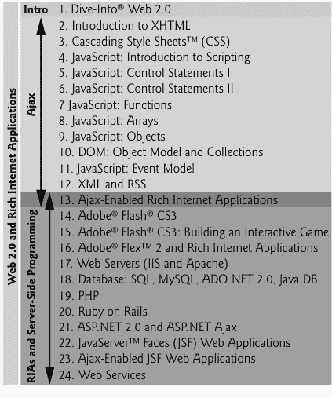

本书第二部分，第2–13章，详细介绍了Ajax组件技术，包括跨越九章的全面JavaScript讲解，最终以第13章的Ajax开发讲解作为结尾。Ajax并不是一项新技术——自1999年以来，我们一直在撰写除其中一项之外的所有组件技术的内容，而且其中许多技术在那时之前就已存在。然而，Ajax是Web 2.0和RIA的关键技术之一。第2–13章涵盖了"原生"Ajax编程，在这里你将自行处理各种细节——书中后面的几章介绍了封装Ajax功能的技术，帮助你轻松构建基于Ajax的应用程序，使其能够在各种浏览器和浏览器版本上运行，而无需关注底层细节。

本书第三部分，第13–24章，专注于GUI和RIA开发中图形部分的客户端和服务端。在此我们介绍了客户端技术，如Adobe Flash和Adobe Flex，这些技术使用或可以与Ajax或类似Ajax的功能相结合来开发RIA。这些技术中的每一种也都可以消费Web服务。接下来，我们通过讨论Web服务器（IIS和Apache）、数据库、服务端脚本语言（如PHP和Ruby on Rails）以及多种服务端框架（如ASP.NET 2.0和JavaServer Faces）来介绍Web应用程序开发的服务端。我们以关于构建基于SOAP和基于REST的Web服务的章节来完成服务端的讨论。

你可能已经注意到，第13章"支持Ajax的富互联网应用程序"与本书第二部分和第三部分有所重叠。第13章作为从"原生"Ajax开发到使用Dojo库的"封装式"Ajax开发的桥梁。


## 依赖关系图

图2展示了本书各章之间存在的依赖关系。指向某一章的箭头表示该章依赖于箭头起始章节的内容。例如，第24章Web Services依赖于第21章和第23章。我们建议你在阅读某一章之前，先阅读该章所有依赖章节的内容，尽管也可以按其他顺序阅读。我们还在图表的脚注中对一些额外的依赖关系进行了说明。

## 教学方法

*《面向程序员的AJAX、富互联网应用与Web开发》*包含了丰富的示例。本书专注于良好软件工程的原则，并强调程序的清晰性。我们是教育者，在全球范围内的企业课堂中教授前沿技术。Harvey M. Deitel博士拥有20年的大学教学经验和18年的行业教学经验。Paul Deitel拥有16年的行业教学经验。Deitel夫妇曾在Deitel & Associates的政府、企业、军事和学术客户中教授各级课程。

*实时代码方法。* *《面向程序员的AJAX、富互联网应用与Web开发》*包含了大量"实时代码"示例——每个新概念都在一个完整的可运行Web应用程序的上下文中呈现，随后紧跟一到两个屏幕截图来展示该应用程序的功能。这种风格体现了我们教授和编写编程内容的方式；我们称之为"实时代码方法"。

*语法着色。* 我们对所有代码进行了语法着色，类似于大多数集成开发环境和代码编辑器对代码进行语法着色的方式。这提高了代码的可读性——鉴于本书包含约18,000行完整可运行程序的代码，这是一个重要的目标。我们的语法着色约定如下：

```
comments appear in italic
keywords appear in bold italic
PHP, Ruby, ASP.NET, JSP delimiters and errors appear in bold black
constants and literal values appear in bold gray
all other code appears in black
```

*代码高亮。* 我们在每个程序的关键代码段周围放置白色矩形框。

*使用字体进行强调。* 我们将关键术语及其索引中每个定义出现的页码引用置于*粗斜体*文本中，以便于查阅。我们使用**粗体Helvetica字体**强调屏幕上的组件（例如，**File**菜单），使用Lucida字体强调程序文本（例如，`int x = 5`）。

*网络访问。* *《面向程序员的AJAX、富互联网应用与Web开发》*的所有源代码示例均可从以下地址下载：

```
www.deitel.com/books/ajaxfp/
```

网站注册快速、简便且免费。下载所有示例，然后在阅读相应文本讨论时运行每个程序。对示例进行修改并查看这些修改的效果，是增强你的互联网和Web编程学习体验的绝佳方式。

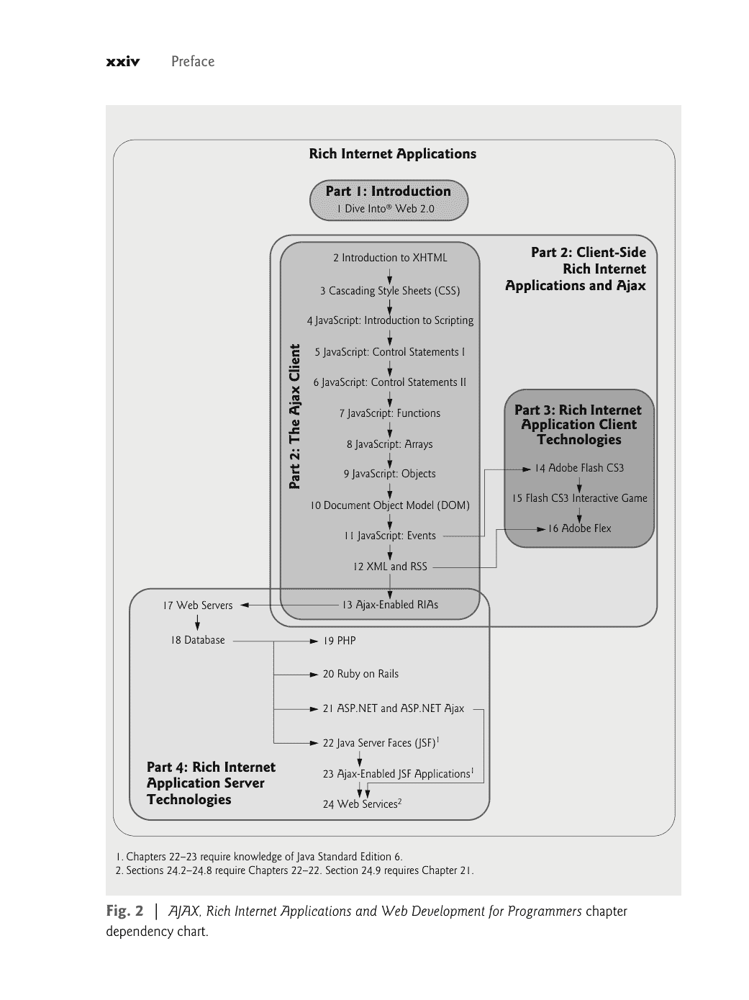

## 富互联网应用

### 第1部分：简介

1 深入Web 2.0

### 第2部分：客户端富互联网应用与Ajax

2 XHTML简介

3 层叠样式表（CSS）

4 JavaScript：脚本编程简介

5 JavaScript：控制语句I

6 JavaScript：控制语句II

7 JavaScript：函数

8 JavaScript：数组

9 JavaScript：对象

10 文档对象模型（DOM）

11 JavaScript：事件

12 XML和RSS

### 第3部分：富互联网应用客户端技术

14 Adobe Flash CS3

15 Flash CS3互动游戏

16 Adobe Flex

### 第4部分：富互联网应用服务器技术

17 Web服务器

18 数据库

13 启用Ajax的富互联网应用

19 PHP

20 Ruby on Rails

21 ASP.NET和ASP.NET Ajax

22 Java Server Faces（JSF）¹

23 启用Ajax的JSF应用¹

24 Web Services²

¹. 第22–23章需要Java标准版6的知识。

². 第24.2–24.8节需要第22–22章的知识。第24.9节需要第21章的知识。

图2 | 《面向程序员的AJAX、富互联网应用与Web开发》章节依赖关系图。

*学习目标。* 每章开头都有学习目标的陈述。这让你知道可以期待什么，并让你有机会在阅读完该章后判断是否达到了这些目标。

*引言。* 学习目标之后是引言。有些是幽默的；有些是哲理性的；还有些提供了有趣的见解。我们希望你喜欢将这些引言与章节内容联系起来。

*大纲。* 章节大纲帮助你以自上而下的方式来学习材料，这样你就可以预期将要学习的内容，并设定合适的学习节奏。

*插图/图表。* 本书包含了大量的图表、表格、线条图、程序和程序输出。

*编程提示。* 我们包含了编程提示，以帮助你关注程序开发的重要方面。这些提示和实践代表了我们结合六十年编程和教学经验所提炼出的最佳经验。我们的一位读者告诉我们，她觉得这种方法就像在数学书中对公理、定理和推论进行高亮标记——它为构建良好的软件提供了基础。

### 良好的编程实践

*良好的编程实践*提醒你注意那些将帮助你编写更清晰、更易理解、更易维护的程序的技术。

### 常见编程错误

程序员往往会频繁犯某些类型的错误。指出这些*常见编程错误*可以减少你犯同样错误的可能性。

### 错误预防提示

这些提示包含了发现程序中的缺陷并将其排除的建议；其中许多描述了能够从根本上防止缺陷进入程序的编程要点。

### 性能提示

这些提示突出了使程序运行更快或最小化程序占用内存量的机会。

### 可移植性提示

我们包含可移植性提示，以帮助你编写可在多种平台上运行的代码，并解释如何实现高度的可移植性。

### 软件工程观察

*软件工程观察*突出了影响软件系统（尤其是大型系统）构建的架构和设计问题。

*数千条索引条目。* 我们包含了详尽的索引，这在你将本书作为参考书使用时尤其有用。

*实时代码示例的"双重索引"。* 对于书中的每个源代码程序，我们都将图题按字母顺序进行索引，同时作为"示例"下的子索引条目进行索引。这使得使用特定功能查找示例变得更加容易。

## 《面向程序员的AJAX、富互联网应用与Web开发》软件下载与附加资源

目前有许多互联网和Web开发工具可用。我们使用Internet Explorer 7、Firefox 2和其他可免费下载的软件编写了*《面向程序员的AJAX、富互联网应用与Web开发》*。附加资源和软件下载的链接可在我们的互联网和Web编程相关资源中心获取：

www.deitel.com/resourcecenters.html/

以及本书的网站：

www.deitel.com/books/ajaxfp/

### Deitel® Buzz Online免费电子邮件通讯

每周，免费的*Deitel® Buzz Online*通讯会宣布我们最新的资源中心，并包含关于行业趋势和发展的评论、我们已出版书籍和即将出版书籍中的免费文章和资源链接、产品发布计划、勘误、挑战、趣闻、关于我们企业讲师培训课程的信息等。这也是你随时了解与*《面向程序员的AJAX、富互联网应用与Web开发》*相关问题的好方法。要订阅，请访问

www.deitel.com/newsletter/subscribe.html

### Deitel在线资源中心

我们的网站www.deitel.com提供了数十个关于各种主题的资源中心，包括编程语言、软件、Web 2.0、互联网商业和开源项目（图3）。这些资源中心源于我们为支持图书和业务发展所进行的研究。我们发现了许多优秀的资源，包括教程、文档、软件下载、文章、博客、播客、视频、代码示例、书籍、电子书等等。其中大部分都是免费的。本着Web 2.0的精神，我们将这些资源与全球社区共享。我们每周在*Deitel® Buzz Online*（www.deitel.com/newsletter/subscribe.html）中宣布我们最新的资源中心。

### 致谢

我们很高兴地感谢许多人的努力，他们的名字可能不会出现在封面上，但他们的辛勤工作、合作、友谊和理解对本书的制作至关重要。Deitel & Associates, Inc.的许多人为这个项目付出了大量时间——特别感谢Abbey Deitel和Barbara Deitel。

我们还要感谢参与我们荣誉实习计划的成员，他们为本书做出了贡献——Ilana Segall，斯坦福大学数学与计算科学专业学生；Jennifer Fredholm，纽约大学英语与计算机科学专业学生；Scott Wehrwein，明德学院计算机科学专业学生；Mark Kagan，布兰戴斯大学计算机科学、经济学和数学专业学生；Andrew Faden，东北大学计算机工程专业学生；Jessica Henkel，东北大学心理学专业及商学辅修学生；以及Kyle Banks，东北大学计算机科学与商学专业学生。


deitel@deitel.com

如需了解更多关于 Deitel & Associates, Inc.、其出版物以及全球 *Dive Into*® 系列企业培训课程的信息，请访问：

www.deitel.com

并在以下网址订阅免费的*Deitel*®*Buzz Online*电子邮件通讯：

www.deitel.com/newsletter/subscribe.html

查看不断增长的在线资源中心列表，请访问：

www.deitel.com/ResourceCenters.html

个人如需购买Deitel出版物，可通过以下网址：

www.deitel.com/books/index.html

本书大量订购时可享受出版社提供的优惠折扣，适用于批量采购或特别销售，其中可能包含电子版本和/或定制封面以及符合您的业务、培训目标、营销重点和品牌利益的特定内容。如需更多信息，请联系：

美国企业与政府销售部
(800) 382-3419
corpsales@pearsontechgroup.com

美国以外的销售事宜，请联系：

国际销售部
international@pearsoned.com

请访问出版社网站www.phptr.com。

## 开始之前

请按照以下说明下载本书示例，并确保在开始使用本书之前拥有最新的Web浏览器。

### 下载*Ajax、富互联网应用程序与程序员Web开发*源代码

*Ajax、富互联网应用程序与程序员Web开发*中的源代码可以从**www.deitel.com/books/ajaxfp/**以ZIP压缩文件的形式下载。注册并登录后，点击**下载注册用户的代码示例和其他优质内容**下的示例链接。使用ZIP文件解压程序（如WinZip，**www.winzip.com**）将示例文件解压到硬盘。在Windows上，我们建议您将文件解压到诸如`C:\ajaxfp_examples`之类的文件夹中。在Mac OS X和Linux上，我们建议您将文件解压到主文件夹中名为`ajaxfp_examples`的文件夹中。[注意：如果您在计算机实验室中工作，请向您的指导老师询问可以将示例代码保存在何处。]

### 本书使用的Web浏览器

我们使用Mozilla的Firefox 2和Microsoft的Internet Explorer 7 Web浏览器测试了本书中的每个示例。开始之前，请确保您的计算机上已安装其中一个或两个浏览器。Internet Explorer 7仅适用于Microsoft Windows操作系统。如果您是Windows用户且没有Internet Explorer 7，可以通过Microsoft的Windows更新服务从**www.update.microsoft.com**下载。Firefox 2适用于大多数平台。您可以从**www.firefox.com**下载Firefox 2。

本书的许多示例在Internet Explorer 6中*无法运行*。尽管本书中的示例可能可以在其他最近的Web浏览器上运行，例如Opera（**www.opera.com**）或Apple的Safari（**www.apple.com/safari/**），但我们并未在这些或任何其他浏览器上测试过这些示例。

您现在可以开始使用*Ajax、富互联网应用程序与程序员Web开发*进行Web编程学习了。希望您喜欢这本书！如果您有任何问题，请随时发送电子邮件至**deitel@deitel.com**。我们会及时回复。

本页故意留空

# 第一部分

## 引言

> 我们所称之为Web 2.0的网络复兴已经进入了主流。
> ——蒂姆·奥莱利

## 深入Web 2.0

> 用户贡献带来的网络效应是Web 2.0时代市场主导地位的关键。
> ——蒂姆·奥莱利

# 学习目标

在本章中，您将学习：

- Web 2.0的定义性特征。
- 为什么搜索对Web 2.0至关重要。
- Web 2.0如何赋予个人权力。
- 集体智慧和网络效应的重要性。
- 博客的显著性和增长。
- 社交网络、社交媒体和社交书签。
- 标签如何导致大众分类法。
- Web服务如何 enables 新应用程序从现有应用程序中快速、轻松地"混搭"出来。
- Web 2.0技术。
- Web 2.0互联网业务和盈利模式。
- 新兴的语义网（"意义之网"）。

> 链接接着链接，点击接着点击，搜索正在构建可能是人类历史上最持久、最庞大、最显著的文化产物：意图数据库。
> ——约翰·巴特尔，*《搜索》*

> Web 2.0是一场大规模的社会实验……这是一个建立新型国际理解的机会……公民对公民，人对人。
> ——列夫·格罗斯曼，*《时代》*

> 互联网、Web或语义网之类的网络技术强大之处在于，我们用它们所做的事情远远超出了发明者的想象。
> ——蒂姆·伯纳斯-李，彼得·穆恩采访，IDG Now

- 1.1 引言
- 1.2 什么是Web 2.0？
 definitionally - 1.3 搜索
- 1.4 内容网络
- 1.5 用户生成内容
- 1.6 博客
- 1.7 社交网络
- 1.8 社交媒体
- 1.9 标签
- 1.10 社交书签
- 1.11 软件开发
- 1.12 富互联网应用程序（RIA）
- 1.13 Web服务、混搭、小工具和小部件
- 1.14 基于位置的服务
- 1.15 XML、RSS、Atom、JSON和VoIP
- 1.16 Web 2.0盈利模式
- 1.17 Web 2.0商业模式
- 1.18 Web的未来
- 1.19 获取更多Web 2.0信息的途径
- 1.20 Web 2.0参考书目
- 1.21 Web 2.0术语表

[注意：*第1章，深入®Web 2.0*也以免费、经常更新的基于HTML的电子形式提供，网址为http://www.deitel.com/FreeWeb2Oebook/。它也可以下载 fully-formatted 的PDF格式，收取少量费用。请查看该网站获取最新的富超链接版本。本章中的许多主题在http://www.deitel.com/ResourceCenters.html有广泛的资源中心作为补充。该电子书和PDF链接到资源中心和其他Web资源以供进一步学习。]

### 1.1 引言

[注意：请务必阅读前言，了解全书的介绍和概述。]我们从Web 2.0的原理、应用、技术、公司、商业模式和盈利策略开始。1993年Mosaic浏览器推出时，Web的受欢迎程度急剧上升。整个1990年代，Web持续经历巨大增长——这一时期被称为"互联网泡沫"；该泡沫于2001年破裂。2003年，人们和企业使用Web以及开发基于Web的应用程序的方式出现了明显转变。*Web 2.0*一词由**戴尔·多尔蒂**于2003年在*O'Reilly® Media*创造，用以描述这一趋势——它成为了主要媒体的流行语，但很少有人真正知道它的含义。一般而言，Web 2.0公司使用Web作为平台来创建协作的、基于社区的网站（例如，社交网站、博客、维基等）。Web 2.0通过年度O'Reilly Media Web 2.0峰会（2004年启动）、蒂姆·奥莱利关于Web 2.0的定义性文章《什么是Web 2.0：下一代软件的设计模式和商业模式》[^2]，以及约翰·马瑟和蒂姆·奥莱利的付费报告《Web 2.0原理和最佳实践》[^3]而普及开来。

Web 2.0的增长可以归因于一些关键因素。首先，硬件变得越来越便宜、越来越快，内存容量和速度迅速提升。摩尔定律指出，硬件性能每两年翻一番，而价格基本保持不变。[^4]这使得开发高需求应用程序成为可能，而这在以前是不可想象的。其次，宽带互联网的使用急剧增长——皮尤互联网2006年3月的一项研究发现，42%的美国成年人家庭拥有高速互联网。在曾在线发布内容的互联网用户中，35%拥有宽带互联网，其中73%拥有宽带。[^5]没有高速互联网，网上丰富的数字媒体将不可能存在。第三，丰富的开源软件的可用性使得更便宜（而且通常免费）的可定制软件选项成为可能。这使得创办新的Web 2.0公司更加容易，并大大降低了失败成本。第四，与*Web 1.0*（1990年代和2000年代初的Web状态）不同，现在有许多易于使用的模式可用于Web 2.0业务的盈利——立即产生（适度的）收入使得新公司的增长更加稳定。

我们关于本章中公司的信息来自常识、公司网站以及带脚注的书籍和文章。

### 1.2 什么是Web 2.0？

从某种意义上说，整章都在定义Web 2.0，但让我们从简要的一节讨论开始。Web 1.0主要关注相对较少的公司和广告商为用户制作内容——有些人将当时的Web称为"宣传册Web"。Web 2.0*涉及*用户——内容不仅通常由用户创建，而且用户帮助组织、分享、再混合、评价、更新内容等。看待Web 1.0的一种方式是将其视为*讲座*，少数教授向大量学生听众讲授。相比之下，Web 2.0是一场*对话*，每个人都有机会发言和分享观点。

Web 2.0拥护*参与式架构*——一种鼓励用户互动和社区贡献的设计。[^6]您，作为用户，是最重要的方面


Web 2.0的核心——如此重要，事实上，在2006年，*TIME Magazine*《时代周刊》的"年度人物"就是"你"。^7 这篇文章肯定了Web 2.0的社会现象——从少数强者向赋权大众的转变。

> "我们不能以设备为中心……我们必须以用户为中心。"
——比尔·盖茨，MIX06大会^8

许多Web 2.0公司几乎完全建立在用户生成内容和*利用集体智慧*之上。其意义不仅在于拥有用户生成内容，还在于如何利用这些内容。Google——领先的搜索引擎和互联网公司——通过考虑用户过去集体认可的网站，将用户引导至用户生成的网站。对于MySpace^®、Flickr^™、YouTube和Wikipedia^®等网站，用户创建内容，而网站提供平台。这些公司*信任他们的用户*——没有这种信任，用户就无法为网站做出重大贡献。

> "平台每次都胜过应用。"
——蒂姆·奥莱利^9

参与式架构在软件开发中也有所体现。开源软件可供任何人使用和修改，几乎没有限制——这在Web 2.0发展中发挥了重要作用。利用集体智慧，^10 社区协作开发软件，许多人认为这比专有软件更好。

你，作为用户，不仅贡献内容和开发开源软件，还在指导媒体的传播方式，并决定你信任哪些新闻和信息来源。许多热门博客现在可以与传统媒体巨头竞争。del.icio.us和Ma.gnolia等社交书签网站允许用户向他人推荐自己喜爱的网站。Digg^™或Reddit等社交媒体网站让社区决定哪些新闻文章最为重要。你还通过*标签*（即按主题或关键词标注网络内容）改变了我们在这些网站上查找信息的方式，这有助于任何人更有效地定位信息。这只是Web 2.0帮助用户在已有内容中发掘新意义的方式之一。RSS订阅源（第12章，XML和RSS）使你能够在信息更新时接收新信息——将内容直接推送到你的桌面。

*社交网络*的兴起改变了我们互动和建立关系的方式。MySpace——最大的社交网络——已迅速成为全球最受欢迎的网站。其他流行的社交网站包括Facebook、Bebo、LinkedIn和Second Life——一个3D虚拟世界，在这里你通过名为*虚拟化身*（avatar）的在线角色与他人互动。

7. Grossman, L. "TIME's Person of the Year: You." *TIME*, December 2006 <http://www.time.com/time/magazine/article/0,9171,1569514,00.html>.

8. "Bill Gates: Microsoft MIX06 Conference." *Microsoft*, March 2006 <http://www.microsoft.com/presspass/exec/billg/speeches/2006/03-20MIX.mspx>.

9. O'Reilly, T. "What is Web 2.0: Design Patterns and Business Models for the Next Generation of Software." September 2005 <http://www.oreillynet.com/pub/a/oreilly/tim/news/2005/09/30/what-is-web-20.html>.

10. O'Reilly, T. "What is Web 2.0: Design Patterns and Business Models for the Next Generation of Software." September 2005 <http://www.oreillynet.com/pub/a/oreilly/tim/news/2005/09/30/what-is-web-20.html>.

许多Web 2.0企业利用*长尾*理论。^11 长尾一词由克里斯·安德森在2004年10月《*WIRED*》杂志的一篇文章中提出，指的是一种经济模型，其中非热门商品的市场（通常是大量低销量的商品）可能非常可观，有时甚至超过热门商品的市场（通常是少量高销量的商品）。^12 因此，像Netflix这样拥有超过80,000部电影租赁目录的在线公司，除了租赁热门电影的大量业务外，通常还会租赁大量不太受欢迎的电影。本地音像店货架空间有限，服务的本地人口较少；它无法承担在每个店铺中存放长尾电影的空间成本。然而，Netflix服务数百万人，没有实体店的物理限制；它可以为众多长尾电影保持少量库存，以服务其整个客户群。利用长尾的机会之所以成为可能，是因为运营Web 2.0互联网业务相对容易，并且由Web 2.0的社会效应推动，这些效应增加了对小众产品的曝光。

在本章中，我们将介绍用于创建Web 2.0应用的一些关键技术。这些技术中的许多在《Ajax、富互联网应用与程序员Web开发》的编程章节中有详细讨论。你将学习Web开发技术，如Ajax（第13章）；其组成技术，包括XHTML（第2章）、层叠样式表（CSS，第3章）、JavaScript（第4–9章）、文档对象模型（DOM，第10章）、XML（第12章）和`XMLHttpRequest`对象（第13章）；以及流行的Ajax工具包——Dojo（第13章）和Script.aculo.us（第20章）。

你将学习如何构建富互联网应用（RIA）——提供桌面应用响应速度和丰富图形用户界面功能的Web应用。我们将讨论构建RIA的关键工具，包括Adobe的Flex（第16章）、ASP.NET Ajax（第21章）和Sun的JavaServer Faces（第22–23章）。我们还将讨论其他流行的开发技术，包括JSON（第13章）、Web服务器IIS和Apache（第17章）、MySQL（第18章）、PHP（第19章）和ASP.NET（第21章）。

我们将讨论Web服务（第24章）的出现，它们使你能够快速轻松地将现有应用的功能整合到自己的应用中。例如，使用Amazon Web Services™，你可以创建专业书店并通过Amazon联盟计划赚取收入；或者将Google™ Maps Web服务与eBay Web服务结合，你可以构建基于位置的混搭应用，在特定地理区域查找拍卖商品。Web服务、廉价计算机、丰富的高速互联网接入、开源软件和许多其他因素激发了新的、令人兴奋的*轻量级商业模式*，人们只需少量投资即可启动。一些功能强大的网站，如果在1990年代可能需要数十万甚至数百万美元才能建成，现在只需极少资金即可建成。

第1.17节概述了关键的Web 2.0商业模式，其中许多在本章中也有更深入的解释。图1.1列出了与Web 2.0相关的会议。有些侧重于技术，有些侧重于商业。

> 11. Anderson, C. *The Long Tail: Why the Future of Business Is Selling Less of More.* Hyperion, 2006.
12. Anderson, C. "The Long Tail." *WIRED*, October 2004 <http://www.wired.com/wired/archive/12.10/tail.html>.

## Web 2.0及相关会议

| | |
|:---|:---|
| AdTech | Microsoft MIX |
| Affiliate Marketing Summit | Microsoft Tech Ed |
| AjaxWorld Expo | MySQL Conference and Expo |
| All Things Digital | Open Source (OSCON) |
| Always On | RailsConf |
| Blog Business Summit | Search Engine Strategies |
| eBay Live | Tools of Change for Publishing |
| Emerging Technology | Ubuntu Live |
| Emerging Telephony | Web 2.0 Expo |
| Future of Online Advertising | Web 2.0 Summit |
| JavaOne | Where 2.0 |

图 1.1 | Web 2.0及相关会议。

## 1.3 搜索

> "Google的使命是整合全球信息，使人人皆可访问并从中受益。"
——Google^13

在Web 2.0中，"内容为王"的说法仍然是一个主流主题。随着网上似乎无穷无尽的内容可供获取，内容的*可发现性*变得至关重要。*搜索引擎*是人们用来查找网络信息的主要工具。如今，你使用关键词进行搜索，但网络搜索的未来将使用自然语言（例如，参见Powerset.com）。目前，当你输入关键词或短语时，搜索引擎会找到匹配的网页，并向你展示*搜索引擎结果页面*（*SERP*），其中列出了推荐的网页并按相关性排序。人工辅助搜索引擎也应运而生，如Mahalo，它付费让人们开发搜索结果。^14 垂直搜索引擎——专注于特定主题或行业的搜索引擎——的受欢迎程度正在上升，尽管这些搜索引擎的流量仍远落后于主要（更通用的）搜索引擎。

主要搜索引擎的流量正在快速增长——根据comScore（一家网络分析公司）的最新报告，美国人在2007年6月进行了80亿次搜索查询，比上一年增长了26%。在同一份报告中，comScore对美国最受欢迎搜索引擎的市场份额分析显示，Google以49.5%的美国搜索市场位居榜首，其次是Yahoo!占25.1%，Microsoft占13.2%，Ask占5.0%，Time Warner Network占4.2%。^15

13. "Company Overview." *Google* <http://www.google.com/intl/en/corporate/index.html>.

14. "Mahalo Greenhouse FAQ." *Mahalo* <http://greenhouse.mahalo.com/Mahalo_Greenhouse_FAQ>.

15. "comScore Releases June U.S. Search Engine Rankings." *CNNMoney*, 16 July 2007 <http://money.cnn.com/news/newsfeeds/articles/prnewswire/AQM17916072007-1.htm>.


约翰·巴特利（John Battelle）的著作《搜索：Google及其对手如何改写商业规则并改变了我们的文化》一书，全面回顾了搜索引擎的历史，并有力地论证了搜索在我们个人生活和商业活动的几乎每个方面的重要性。约翰·巴特利的《搜索博客》讨论了搜索与技术问题（http://battellemedia.com）。

## 注意力经济

> "电信带宽不是问题，人类带宽才是问题。"
>
> ——托马斯·达文波特（Thomas Davenport）与约翰·贝克（John Beck），《注意力经济》¹⁶

海量信息的持续产生与人们有限的闲暇时间，共同催生了*注意力经济*。可供用户浏览的内容远超其处理能力，尤其考虑到他们时间的种种要求，如对子女、父母、朋友、雇主的责任等。托马斯·达文波特与约翰·贝克所著的《注意力经济》一书，开篇讲述了一个注意力不断被工作和家庭需求攫取的普通人的熟悉故事。作者阐释道，当今世界信息持续流动，导致注意力被不断转移。

尽管过去获取多样化内容颇为困难，但现在似乎有无穷无尽的选项在争夺受众的注意力。因此，搜索引擎通过帮助用户快速查找和筛选所需信息而日益普及。¹⁷

## Google 搜索

**Google** 是领先的搜索和在线广告公司，由拉里·佩奇（Larry Page）和谢尔盖·布林（Sergey Brin）在斯坦福大学攻读博士学位期间创立。Google 如此受欢迎，以至于其名称已被收入《牛津英语词典》——动词“Google”意为使用 Google 搜索引擎在互联网上查找信息。（小写“g”的“google”是板球术语，而“googol”或 10¹⁰⁰ 才是 Google 得名的数学术语。）¹⁸

Google 在搜索领域的成功很大程度上归功于其 **PageRank™** 算法（由斯坦福大学和拉里·佩奇持有专利）及其独特的服务器架构。该架构利用互联的 PC 以更低成本实现更快响应和更高可扩展性。¹⁹ 对 Google 服务器数量的估计从数十万到超过一百万台不等。²⁰ PageRank 算法通过考量指向一个网页的链接数量以及这些链接网站的质量（以及其他因素）来评估该页面的重要性。每一个入站链接都代表一票，表明该站点对他人有价值；然而，这些投票的权重因“投票者”网站自身价值的不同而异。因此，即使一个页面拥有大量来自其他页面的链接，而另一个页面链接较少但来自 PageRank 更高的页面，两者也可能具有相同的 PageRank。Google 搜索还会考虑页面上的所有内容、字体、标题以及相邻页面的内容。²¹ PageRank 最高的网站将出现在搜索结果的最顶部。

除了常规搜索引擎，Google 还提供针对图片、新闻、视频、博客等的专题搜索引擎。通过使用 Google 网络服务，你可以将 Google 地图和其他 Google 服务集成到你的应用程序中（参见第 1.13 节，Web 服务、混搭应用、小部件和小工具）。

*AdWords* 是 Google 的按点击付费（PPC）上下文广告计划（于 2000 年推出），是该公司的主要收入来源。AdWords 广告会出现在 Google 网站搜索结果的旁边（并与搜索查询相关）。广告商自行撰写广告，这些广告不显突兀且外观统一——每个广告由一个标题、有限文本和一个 URL 组成。广告商为其广告相关的搜索关键词竞价，并根据用户点击广告的次数付费。

*AdSense* 是 Google 为发布者（如提供内容的 http://www.deitel.com 等网站）设计的广告计划，其灵感来源于产品管理副总裁苏珊·沃西基（Susan Wojcicki）。（1998 年，沃西基将她家的一间空房租给了拉里·佩奇和谢尔盖·布林，他们在此创立了 Google。）²² AdSense 是一种基础且流行的网站盈利形式，尤其适用于 Web 2.0 初创公司。Google 文本广告（以及横幅广告和富媒体广告）被放置在内容相关的参与网站上。上下文广告的点击率通常高于非上下文广告，因为广告能够触达对相关话题表现出兴趣的用户。因此，上下文按点击付费广告通常能带来更高的 eCPM（每千次展示有效成本）。

## Yahoo!

*Yahoo!* 于 1994 年由杨致远（Jerry Yang）和大卫·费罗（David Filo）（同为斯坦福大学博士生）创立，最初是一个网站目录而非搜索引擎。最初的站点“杰瑞和大卫的万维网指南”由他们手动添加到分类目录中的喜爱网站组成。²³ 随着网络的发展，维护目录结构变得愈发困难，于是创建了搜索功能以便更好地访问数据。在更加专注于搜索的同时，Yahoo! 也扩展到其他领域，成为电子邮件、用户组等服务的热门提供商。2003 年，Yahoo! 收购了 Overture（现为 Yahoo! Search Marketing），这是第一个成功提供赞助搜索结果的搜索引擎。²⁴

## MSN

MSN 搜索创建于 1998 年，即 Google 推出后的第二年。²⁵ 在过去几年中，微软已将搜索引擎技术开发列为首要任务。²⁶

微软搜索查询量及其搜索市场份额在 2007 年 6 月迅速增长；分析公司 comScore 和 Compete 将这一增长主要归因于 MSN 的 Live Search 俱乐部，这是一个于 2007 年 5 月推出的、旨在奖励 Live Search 用户的计划。²⁷, ²⁸ MSN 的 Live Search 包含一个新的搜索引擎、索引和爬虫。²⁹ 它允许你搜索网络，执行专题搜索（新闻、图片或本地列表）或 MSN 内容搜索。³⁰ 微软为增加其搜索市场份额而采取的另一种方法是收购垂直搜索网站，例如健康搜索引擎 MedStory。³¹ 微软还希望通过 Microsoft adCenter（类似于 Google AdWords 和 Yahoo! Search Marketing）在上下文广告市场获得份额。

## Ask

*Ask*（正式名称为 AskJeeves.com）隶属于 InterActiveCorp (IAC)，后者还拥有 Ticketmaster®、Match.com®、LendingTree.com®、RealEstate.com® 以及许多其他互联网资产。2007 年 6 月，Ask 推出了一个新的搜索站点，其特点包括简洁的首页默认设计、可自定义的背景、新的视频搜索（由 Blinkx 提供支持）以及查看视频预览和试听音乐片段的功能。搜索结果基于搜索者的位置——Ask 会报告相关的本地企业和活动。例如，搜索电影将显示本地的放映时间。

## 垂直搜索

*垂直搜索引擎*是专注于特定主题的专家，而 Google 和 Yahoo! 等则是通用搜索引擎。³² 垂直搜索引擎使你能够搜索特定领域的资源，旨在为你提供数量较少但相关性更高的结果。流行的垂直搜索引擎包括旅行网站（如 Kayak 或 Expedia）、房地产网站（如 Zillow 或 Trulia）、求职网站（如 Indeed 或 Monster）以及购物搜索引擎（如 Shopzilla 和 MySimon）。

## 基于位置的搜索

*基于位置的搜索*（由大多数主要搜索引擎以及一些较小的专门搜索引擎提供）利用关于搜索者的地理信息来提供更相关的搜索结果。例如，搜索引擎可以向用户询问邮政编码，或根据 IP 地址估算用户的大概位置。然后，引擎可以利用此信息，优先显示地理位置靠近用户的搜索结果。这在搜索餐馆或汽车服务等商家时特别有用。（有关基于位置服务的更多信息，请参见第 1.14 节。）

## 创建自定义搜索引擎

Rollyo——一个构建你自己的自定义搜索引擎的网站——允许你探索、创建和个性化他人创建的搜索引擎（“搜索卷”）。这有助于你缩小

你的搜索范围限定在你已经信任的网站。[^33] 其他自定义搜索引擎网站还包括 Gigablast 和 Google Custom Search Engine。

## 搜索引擎优化（SEO）

*搜索引擎优化（SEO）* 是指设计和调整你的网站，以最大化可发现性并在自然（非付费）搜索引擎结果中提高排名的过程。为了最大化流量，你在设计网站时需要考虑搜索引擎的工作方式。有两种实施 SEO 的方法。第一种是 *白帽 SEO*，指的是搜索引擎认可的方法，不试图欺骗搜索引擎，并能产生高质量的长期效果。顶级白帽 SEO 技术包括：提供优质内容、使用适当的元数据和有效关键词，以及从相关的高质量页面获得入站链接。[^34] *黑帽* 方法用于欺骗搜索引擎。尽管它们可能会暂时提升搜索引擎排名，但这些策略可能会导致你的网站被搜索引擎封禁。"Google 炸弹"（或链接炸弹）就是黑帽方法的一个例子——它试图欺骗 Google 算法来提升某个页面（通常出于幽默目的）。[^35]

## 链接建设

*链接建设* 是指通过为特定网站生成入站链接来提高搜索引擎排名和流量的过程。搜索引擎算法将每个链接视为对目标网站内容的一次投票，因此拥有最高 *链接流行度*（或高质量入站链接数量最多）的网站在搜索引擎结果页面（SERPs）上排名最高。最常用的三种链接建设方法包括：互惠链接、链接诱饵和自然链接。*互惠链接* 是指两个相关网站相互链接的交换方式，这会增加两个网站的链接流行度并为网站用户增添价值。*链接诱饵* 涉及创建引人注目的网页内容，专门用于通过社交媒体和社会化书签网站实现病毒式（指数级增长）传播。*自然链接* 是通过优化网站内容和用户体验来建立单向入站链接的过程，而无需明确请求反向链接。搜索算法不断更新，以防止黑帽 SEO 从业者通过自动链接软件和来自目录网站或其他低质量网站的链接来欺骗搜索引擎。来自具有强大相关页面的网站的单向链接，比互惠链接、来自内容不相关网站的链接或来自 PageRank 较低网站的链接权重更高。

## 搜索引擎营销（SEM）

*搜索引擎营销（SEM）* 是通过提高网站在搜索引擎结果页面上的可见性来推广你的网站、增加流量和搜索结果的方法。Danny Sullivan（Search Engine Watch 的创始人，以及后来 Search Engine Land 的创始人）于 2001 年引入了"搜索引擎营销"这一术语，涵盖 SEO、管理付费列表、制定在线营销策略以及向目录提交网站。[^56] SEO 是最受欢迎的搜索引擎营销形式，它持续从其他营销渠道（尤其是线下渠道）分流业务。根据搜索引擎营销专业组织（SEMPO）每年发布的搜索引擎营销状况调查报告，北美广告主 2006 年在搜索引擎营销上的支出为 94 亿美元，比 2005 年增长了 62%。[^37]

## Search Engine Watch 和 Search Engine Land

**Search Engine Watch** 是一个搜索引擎营销资源网站，包含文章、教程、会议等更多内容。该网站由 Danny Sullivan 于 1997 年创立，灵感来源于他 1996 年发布的"A Webmaster's Guide To Search Engines"。Search Engine Watch 融合了 Web 2.0 功能（除了专家专栏文章外，还提供博客和论坛）。Search Engine Watch 的其他板块包括搜索引擎提交技巧、网络搜索技巧、热门搜索引擎和搜索引擎资源（众多与搜索引擎相关的主题）。Danny Sullivan 一直担任 Search Engine Watch 的主编，直到 2006 年 11 月他离开该网站，成为 **Search Engine Land** 的主编。该网站提供关于主要搜索引擎——Google、Yahoo! 和 Microsoft——的新闻和信息，以及搜索引擎营销和搜索相关问题。该网站还会告知用户即将举办的相关会议和网络研讨会。

## 搜索引擎策略会议

**Search Engine Strategies** 是一个全球性的会议系列，专注于搜索引擎广告（包括当前的 SEO 和 SEM 问题）。Search Engine Strategies（由 Search Engine Watch 主办）提供由该领域顶级专家和搜索引擎公司代表发表的活动信息。[^38] 由于流量和广告对大多数 Web 2.0 企业至关重要，了解搜索过程并确保你的网站易于被发现是非常关键的。

## 发现

与传统使用搜索引擎（带着特定主题进行搜索）不同，**发现** 指的是找到你原本不会主动寻找的新内容。例如，Yahoo! 最初的目录设计允许用户浏览各类目，发现新的有趣网站。StumbleUpon 是一个社会化书签网站，通过其推荐系统来实现发现功能，帮助你根据兴趣发现和分享网站。内容网络也会将用户引导至他们原本不一定主动搜索的网页内容。

### 1.4 内容网络

**内容网络** 是以各种形式（如文章、Wiki、博客等）提供信息的网站或网站集合。它们提供了另一种筛选互联网海量信息的方式，让用户能够访问一个可信的网站，该网站已经从众多来源中筛选出最佳内容，或者提供了自己的原创内容。图 1.2 展示了一些内容网络的示例。

### 内容网络

**About.com** — 被《*纽约时报*》收购，About 是一个涵盖众多主题的信息集合。About 成立于 1996 年，提供由主题专家撰写的 500 多个指南。这些指南包括新内容以及指向其他网站的链接。

**b5media** — 一个博客网络，拥有超过 200 个涉及旅行、娱乐、技术等方面的博客。

**Corante** — 一个博客网络，由技术、商业、法律、科学和文化领域的知名评论者撰写。

**Deitel** — Deitel 资源中心（目前约有 80 个网站且在快速增长）包含对关键教程、演示、免费软件工具、文章、电子书、白皮书、视频、播客、博客、RSS 订阅等的链接和描述。资源中心按主要主题领域分组，包括 Web 2.0、互联网商业、编程语言、软件开发和开源。完整资源中心列表请参见前言中的图 3。

**eHow** — eHow 声称拥有超过 35,000 篇文章，解释"几乎如何做任何事情"。文章由会员撰写，该网站还设有"如何做"视频专区。

**Gawker Media** — 一个博客网络，包含 14 个博客，如 Gizmodo、Gawker、Valleywag 和 Lifehacker。这些博客涵盖技术、八卦等多种主题。

**HowStuffWorks** — HowStuffWorks 提供解释"世界实际如何运作"的文章。文章由自由撰稿人以及来自 *Consumer Guide* 和 *Mobil Travel Guide* 的专家撰写。

**LifeTips** — LifeTips 提供由数百位撰稿人撰写的关于工作和日常生活问题的短文。文章由读者投票评选（读者还可以标记收藏以便快速访问）。

**9rules** — 一个博客主题广泛的博客网络。该网站还包含社交网络功能。

**Suite101** — Suite101 提供由自由撰稿人撰写的涵盖各种主题的数千篇文章。除文章外，该网站还提供讨论区和免费课程。

**Weblogs, Inc.** — 一个拥有 90 个博客的博客网络，包括 Engadget、Autoblog 和 Joystiq。用户可以申请为其中一个博客撰写内容（并获得报酬），或建议潜在新博客的主题。

**图 1.2** | 内容网络。

### 1.5 用户生成内容

*用户生成内容* 是当今许多领先的 Web 2.0 公司（如 Amazon、eBay 和 Monster）成功的关键。社区为这些网站增添了价值，在很多情况下，这些网站几乎完全建立在用户生成内容之上。例如，*eBay*（一个在线拍卖网站）依靠社区进行拍卖商品的买卖，而 *Monster*（一个求职搜索引擎）则将求职者与雇主和招聘人员联系起来。

用户生成内容包括明确生成的内容，如文章、家庭视频和照片。它也可以包括隐式生成的内容——即从用户的在线行为中收集的信息。例如，你在 Amazon 上购买的每件商品和在 YouTube 上观看的每个视频，都为这些网站提供了关于你兴趣的宝贵信息。像 Amazon 这样的公司已经建立了庞大的匿名用户数据库，以了解用户如何与其网站互动。例如，Amazon 使用你的购买历史，并将其与具有相似

---

[^33]: "About Rollyo." *Rollyo* <http://www.rollyo.com/about.html>.
[^34]: Wilding, R. "Top 5 Black Hat and White Hat Search Engines Optimisation Techniques." *PushON* <http://www.pushon.co.uk/articles/top5-black-hat-white-hat-seo.htm>.
[^35]: Calore, M. "Remembering the First Google Bomb." *Compiler (WIRED blog)*, 26 January 2007 <http://blog.wired.com/monkeybites/2007/01/earlier_today_m.html>.
[^37]: Sherman, C. "The State of Search Engine Marketing 2006." *Search Engine Land*, 8 February 2007 <http://searchengineland.com/070208-095009.php>.
[^38]: *Search Engine Strategies: Conference & Expos*, 2007 <http://www.searchenginestrategies.com>.


兴趣来做个性化推荐（例如，“购买此商品的顾客还购买了...”）。隐式生成的内容通常被视为隐藏内容。例如，网页链接和标签就是隐藏内容；从你自己的网站链接到的每个网站，或在社会书签网站上收藏的每个网站，都可以被视为对该网站重要性的一次投票。像谷歌（使用PageRank算法）这样的搜索引擎，使用指向一个网站的链接数量和质量来确定该网站在搜索结果中的重要性。

## *集体智慧*

*集体智慧*的概念是，协作可以产生聪明的想法。用户通过共同努力，汇集他们的知识，使所有人受益。

唐·塔普斯科特和安东尼·D·威廉姆斯所著的《维基经济学》第一章讲述了Goldcorp的故事。受Linux社区努力的启发，Goldcorp的首席执行官向公众发布了公司土地的专有地质信息。Goldcorp为能利用这些信息帮助公司找到土地上黄金的人提供现金奖励。社区帮助他的公司找到了800万盎司黄金，使Goldcorp的股票市值从1亿美元飙升至90亿美元。39 Goldcorp通过分享信息和鼓励社区参与获得了惊人的收益。

用户生成的内容对Web 2.0公司意义重大，因为公司正在利用集体智慧的创新方式。我们已经讨论过谷歌的PageRank（第1.3节），它是集体智慧的产物。亚马逊和Last.fm的个性化推荐也源于集体智慧，算法评估用户偏好，通过帮助你发现具有相似兴趣的其他人喜欢的新产品或音乐，为你提供更好的体验。Wesabe是一个网络社区，成员分享他们关于金钱和储蓄的决定——该网站利用社区的集体财务经验来创建推荐。40 信誉系统（如eBay等公司使用）也利用集体智慧，通过与社区分享用户反馈来建立买卖双方之间的信任。社会书签网站（第1.10节）和社交媒体网站（如Digg和Flickr）利用集体智慧来推广热门内容，使其他人更容易找到。

## *维基*

*维基*是允许用户编辑现有内容和添加新信息的网站，是用户生成内容和集体智慧的主要例子。最受欢迎的维基是*维基百科*，这是一个社区生成的百科全书，文章有200多种语言版本。维基百科信任其用户遵守某些规则，例如不删除准确信息、不添加有偏见的信息，同时允许社区成员执行这些规则。其结果是产生了大量信息，其增长速度远非其他方式可比。2005年，一项比较维基百科和《大英百科全书》（一本受欢迎的印刷传统百科全书）42个条目的实验显示，维基百科文章中的不准确之处仅略多。41 然而，维基百科的条目得到了及时更正，而《大英百科全书》中的错误直到下次印刷才能更正，并将保留在已印刷的副本中。

维基百科、*Wikia*（一个关于热门电视节目、游戏、文学、购物等的专门维基社区网站）以及许多其他维基都使用*MediaWiki*开源软件（最初为维基百科开发）。该软件可以从MediaWiki的网站（www.mediawiki.org）下载，你还可以在那里找到描述、教程、建议等，以帮助你使用该软件。许多公司也使用维基来提供产品信息、支持和社区资源。*SocialText*，第一家维基公司，提供企业维基服务。许多公司发现，使用维基进行项目协作减少了员工之间的电子邮件和电话，同时能够密切跟踪项目的变更。42

## **协同过滤**

虽然协作可以产生丰富的知识，但一些用户可能会提交虚假或错误的信息。例如，维基百科曾经历过有人故意在条目中添加虚假信息的情况。虽然*审核*（由员工监控内容）有时是必要的，但它耗时且成本高昂。许多Web 2.0公司依靠社区来帮助监管他们的网站。这种*协同过滤*让用户推广有价值的材料，并标记冒犯性或不合适的材料。用户有权为自己选择什么内容重要。使用协同过滤的网站示例包括新闻网站Digg，用户对故事进行评分（见第1.8节），以及社会书签网站如del.icio.us，用户可以轻松找到热门网站（见第1.10节）。亚马逊产品上的客户评论也采用了协同过滤——读者对每篇评论的有用性进行投票（帮助其他读者找到最佳评论）。

## **Craigslist**

*Craigslist*由克雷格·纽马克创立，是一个受欢迎的分类广告网站，它彻底改变了分类广告市场。报纸经历了分类广告销售额的下降，43 因为Craigslist上的招聘广告收入在2006年攀升至5000万美元。44 Craigslist上的大多数广告发布都是免费的，并且任何人都可以轻松发布广告。该网站因其工作和住房信息而广受欢迎。2005年，一部纪录片《Craigslist上的24小时》展示了该网站在一天内发布的各种信息。45 Craigslist建立在用户内容之上，通过连接其用户的独特（通常是不寻常的）需求来利用长尾效应。该网站也使用协同过滤——用户被鼓励标记不适当的发布。

## **群体智慧**

*群体智慧*（源自詹姆斯·索罗维基所著的同名书籍）类似于集体智慧——它表明一个由多元化人群组成的大型群体（不一定是专家）可能比一小群专家更聪明。集体智慧和群体智慧的关键区别在于，后者并非旨在成为一个协作过程——形成可靠群体的部分原因是确保人们不会相互影响。46 例如，索罗维基描述了如何计算猜谜竞赛（例如，猜测一罐果冻豆的数量）中所有提交答案的平均值，即使大多数个人估计是不正确的并且差异很大，也常常能得到接近正确答案的结果。1968年，当美国潜艇*蝎子号*沉没时，海军要求各种专家各自评估可能发生的情况；然后分析他们的集体答案，以确定潜艇的确切位置。47 群体智慧的实际日常应用可以在采用协同过滤的网站上看到。

## 1.6 博客

> “博客是你见过的最好的关系生成器。”
> ——罗伯特·斯考伯，博主48

### *博客的历史*

*博客*是由按时间倒序排列的条目组成的网站。它们自20世纪90年代中期以来就存在；然而，近年来，由于易于使用的博客软件和日益经济的互联网接入，人们对博客的兴趣呈指数级增长。“博客”一词由*网络日志*演变而来，后者是定期更新的有趣网站列表。这些博客由按时间倒序排列的简短帖子组成，包含指向其他网页的链接和简短评论或反应。博客后来采用了更松散的结构——一些博客仍然遵循传统的链接和少量文本的格式，而另一些则由文章组成，有时不包含任何链接。博客现在还可以融入媒体，例如音乐或视频。许多人熟悉个人日记博客，比如*Xanga*或*LiveJournal*上的博客。这些网站包括社交网络功能，在青少年博主中特别受欢迎，他们经常为朋友写关于日常生活的内容。

博客已成为一种重要的社会现象，使用户能够参与网络，而不仅仅是浏览。2006年7月，大多数*博主*或博客作者在开始写博客之前都没有个人网站。49 用户友好型博客软件的日益普及，使博客对更多主流互联网用户来说变得触手可及。

### *博客组件*

*读者评论*创造了一种互动体验，允许读者对博客条目做出反应。根据皮尤互联网研究中心的一项研究，87%的博客允许读者评论。50 成功-

39. Tapscott, D. and A.D. Williams. *Wikinomics: How Mass Collaboration Changes Everything.* Portfolio Hardcover, 2006.

40. "FAQ." *Wesabe* <http://www.wesabe.com/page/faq>.

41. Cauchi, S. "Online Encyclopedias Put to the 'Test.'" *The Age*, 15 December 2005 <http://www.theage.com.au/news/national/online-encyclopedias-put-to-the-test/2005/12/14/1134500913345.html>.

42. "SocialText is the Enterprise Wiki Trusted Most by Global 2000 Corporations." *SocialText* <http://www.socialtext.com/products/overview>.

46. Jenkins, H. "Collective Intelligence vs. The Wisdom of Crowds." *Confessions of an Aca-Fan*, 27 November 2006 <http://www.henryjenkins.org/2006/11/collective_intelligence_vs_the.html>.

47. Surowiecki, J. *The Wisdom of Crowds*. Anchor, 2005.

48. Kirkpatrick, D. "Why There's No Escaping the Blog." *FORTUNE*, 10 January 2005 <http://money.cnn.com/magazines/fortune/fortune_archive/2005/01/10/8230982/index.html>.

49. Lenhart, A. and S. Fox. "Bloggers: A Portrait of the Internet's New Storytellers." *Pew Internet & American Life Project*, July 2006 <http://www.pewinternet.org/pdfs/PIP%20Bloggers%20Report%20July%2019%202006.pdf>.

50. Lenhart, A. and S. Fox. "Bloggers: A Portrait of the Internet's New Storytellers." *Pew Internet & American Life Project*, July 2006 <http://www.pewinternet.org/pdfs/PIP%20Bloggers%20Report%20July%2019%202006.pdf>.


固定链接（Permalinks）为博客读者提供了一种链接到特定博客条目的方法。每篇博客文章都有一个唯一的URL指向该文章。即使博客条目从首页移至存档，链接仍然有效。

引用通知（Trackbacks）告知博主谁链接到了他们的文章。这通过使链接双向化来增强互联网内容。博主提供一个引用通知链接，使用该链接的站点会被添加到博客条目的一个列表中。引用通知部分的示例，请访问 http://www.techcrunch.com/2006/08/08/web-20-the-24-minute-documentary/。这是对一个热门互联网技术博客 TechCrunch 上文章的固定链接，其中包含一个 2006 年的 Web 2.0 视频。

博客链接（Blogroll）是博主最喜欢博客的列表。虽然并非所有博客都设有博客链接，但博客主页通常包含指向其他几个博客的链接。例如，LiveJournal 会自动将博客链接（由博主标记为好友的用户组成）整合到用户的个人资料页面中。

## 博客与新闻业

> "新闻自由只保证给那些拥有它的人。"
> —A.J. Liebling

博客鼓励了*公民新闻*，允许任何人成为记者。博客已成为重要的新闻来源，吸引了主流媒体的流量。有人认为这种“参与式新闻”的形式比主流媒体偏见更少，或者至少使这些偏见变得清晰并提供了许多不同的观点。这种*媒体的民主化*让更多人能够参与新闻业。传统记者过去能够通过为大众发声来建立一个代议制民主（非常像美国的政治制度）。然而，博客让每个拥有电脑和互联网接入的人都能发声，创造了一种更直接的民主。

许多博主被认可为媒体成员。正如电视和广播加快了新闻传播速度一样，博客已成为一种快速且深入（且常常“未经过滤”）的新闻媒介。大众媒体正在拥抱博客；许多电视新闻主播建议观众在节目后阅读他们的博客，许多报纸网站也设有记者博客。

虽然新闻业是博客现象的重要组成部分，但根据皮尤互联网研究，只有三分之一的博主认为他们的博客是一种新闻形式。84%的博主认为博客是一种爱好，只有10%的博主每周花费超过十小时进行博客。发布新内容和回复读者评论需要投入大量时间。

51. *Akismet*, 10 August 2007 <http://akismet.com/stats/>.
52. "A.J. Liebling Quotes." *ThinkExist.com Quotations* <http://thinkexist.com/quotation/freedom_of_the_press_is_guaranteed_only_to_those/220714.html>.
53. Bowman, S. and C. Willis. "We Media." July 2003 <http://www.hypergene.net/wemedia/download/we_media.pdf>.

## 博客的增长

博客的数量每年大约翻一番。然而，也有大量被遗弃的博客。Caslon Analytics 的一项研究发现，“66.0%的受访博客在两个月内没有更新。”

公司正在接触*博客圈*或博客社区，以了解消费者意见。许多大型公司（如 Sun Microsystems、Marriott International 和 General Motors）的首席执行官和高管现在都是定期的博主。这有助于建立消费者的信任和忠诚度。NewPR Wiki 列出了超过 250 位首席执行官和高层管理博客作者。

移动设备使用的增加也导致了*移动博客*或移动博客的兴起，博主不再需要坐在电脑前更新博客。同样，*视频博客*也日益流行。例如，Rocketboom 每天发布一个三分钟的视频，涵盖新闻和互联网故事。

## 博客与 RSS 订阅源

许多热门博客提供 RSS 和 Atom 订阅源，以便读者知道何时发布新内容。订阅源通过博客软件或 *Feedburner*（2007 年被 Google 收购）等网站提供，帮助博主跟踪和维持稳定的读者群。这些订阅源（包含整篇文章或仅包含带链接的精选内容）可以通过网络自动联合发布，并在用户指定的网站或应用程序上聚合。一些网站（如 Feedburner）提供电子邮件选项，将当天的文章转发给订阅者。虽然订阅源的使用确实在增长，但 2006 年 7 月的皮尤互联网研究报告称，只有 18%的博主提供 RSS 订阅源。（参见第 1.15 节中的 RSS 和 Atom。）

## 博客软件

博主现在有许多构建博客的选择。在线托管博客软件选项包括 *WordPress*（也提供服务器软件）、*TypePad* 和 *Blogger*。博客服务器软件程序包括 *Movable Type* 和 *Textpattern*。这些要求用户拥有自己的网络服务器；但是，它们也允许更多的自定义。一些文字处理软件（如 Microsoft Word 2007）也提供博客发布功能或与博客发布扩展兼容。

## 博客网络

*博客网络*是博客的集合，通常有多个编辑。流行的博客网络包括 Corante、Weblogs, Inc.、9rules、b5media 和 Gawker Media。其中许多拥有多个博主和每日发布，吸引了大量流量和广泛的受众。博客网络帮助博主建立声誉和忠实读者。一些社交网络网站（如 MySpace 和 Facebook）也允许向私人朋友网络进行博客。

## 博客搜索引擎

*博客搜索引擎*（如 *Technorati* 和 *Google Blog Search*）监控博客圈的不断变化。在处理博客时，搜索结果不能严格基于传统因素（如随时间建立的声誉），因为博客圈是动态的。Technorati 在 2007 年 7 月跟踪了超过 9300 万个博客，解决了他们所谓的“World Live Web”的独特需求。Google Blog Search 调整了 Google 的搜索算法，专门针对博客圈。其他博客搜索引擎包括 Feedster、IceRocket 和 Blogdigger。

## 1.7 社交网络

*社交网络*网站允许用户跟踪现有的人际关系并形成新的关系，在 Web 2.0 中经历了非凡的增长。根据“Hitwise 美国消费者生成媒体报告”，2006 年 9 月，“每 20 次互联网访问中就有一次访问了排名前 20 的社交网络之一。”购物网站（以及其他 Web 2.0 网站）的大量流量来自 MySpace 等社交网络网站。

## 网络效应

> "Web 2.0 的独特之处在于，它设计的系统能够利用网络效应——社区的一种更广泛的说法——即使用的人越多，系统就越好。"
> —Tim O’Reilly

术语*网络效应*指的是网络随着用户数量的增加而增加的价值。*梅特卡夫定律*指出，网络的价值与用户数量的平方成正比。例如，考虑 eBay——使用该网站的买家和卖家越多，该网站对用户就越有价值。随着参与广告商和发布商数量的增长以及广告可以更好地与网站内容匹配，Google 的 AdSense 广告计划的价值也在增加（参见第 1.3 节）。社交网络网站也严重依赖网络效应，通常只有当他们的朋友在网站上时才会吸引用户。

建立成功网络和创建参与架构的一个关键部分是将用户偏好设置为*默认共享*内容，以便用户将自动为网络价值做出贡献。大多数用户不会考虑共享功能，更不用说更改他们的偏好设置。如果公司不自动启用共享，很少会有用户花费时间来共享他们的数据。*提供禁用共享的选项是一个重要的隐私功能。*

网络效应也使得进入已被成功公司占据的市场变得困难（尽管并非不可能）。当用户内容被移入

54. Lenhart, A. and S. Fox. "Bloggers: A Portrait of the Internet's New Storytellers." *Pew Internet & American Life Project.* July 2006 <http://www.pewinternet.org/pdfs/PIP%20Bloggers%20Report%20July%2019%202006.pdf>.
55. Walsh, B. *Clear Blogging: How People Are Changing the World and How You Can Join Them.* Apress, 2007.
56. "Blog Statistics and Demographics." *Caslon Analytics.* March 2007 <http://www.caslon.com.au/weblogprofile1.htm>.
57. "CEO Blog List." *NewPR Wiki* <http://www.thenewpr.com/wiki/pmwiki.php/Resources/CEO BlogsList?pagename=Resources.CEOBlogsList>.
58. Lenhart, A. and S. Fox. "Bloggers: A Portrait of the Internet's New Storytellers." *Pew Internet & American Life Project.* July 2006 <http://www.pewinternet.org/pdfs/PIP%20Bloggers%20Report%20July%2019%202006.pdf>.
59. "Hitwise US Consumer Generated Media Report." September 2006.
60. O'Reilly, Tim. "What Is Web 2.0." O'Reilly Network, 30 September 2005 <http://www.oreillynet.com/pub/a/oreilly/tim/news/2005/09/30/what-is-web-20.html>.
61. Metcalfe's Law <http://www.metcalfelaw.com/>.
62. O'Reilly, Tim. "Web 2.0: Strategies and Business Models for the Next Generation of Software." Slide presentation, 2005.


## Friendster

Friendster是社交网络领域的早期领军者。自2002年成立以来不到一年，谷歌就提出收购该网站（Friendster拒绝了这一提议）。Friendster最初是一个约会网站，随后人气迅速飙升，很快就超出了其服务器的承载能力。随着MySpace等新网站的崛起，Friendster的人气逐渐下降。⁶³ 虽然Friendster已无法与竞争对手的社交网络网站保持同步，但它仍声称在全球拥有超过4500万会员。2006年，它获得了一项关于社交网络关键技术的专利，具体涉及如何建立好友关系网络（即识别共同好友和关系链路）。⁶⁴

## MySpace

MySpace是最受欢迎的社交网络网站。Hitwise报告显示，按市场份额计算，MySpace在2007年5月成为排名第一的网站（以1.5%的优势超越了谷歌）。⁶⁵ MySpace将自己定义为"一个让你结识朋友的朋友的在线社区"，它允许你建立好友网络并识别共同好友。每个用户的页面可以包含基本信息、图片、博客文章、留言板等内容。自定义选项，如更换背景或添加音乐，为用户提供了一种简便的方式来创建自己独特的网页。该网站还设有私信系统以及电影、音乐、视频、分类广告等专区。

MySpace在音乐界扮演着重要角色，甚至企业和政治人物也在创建账户。与大多数传统媒体渠道相比，MySpace的受众群体更为年轻。一些政治候选人利用MySpace来接触年轻选民并寻找新的志愿者。尽管候选人在这些网站上可能会面临尴尬的关联（与不当账户的联系），但他们通常认为这些风险是值得的。⁶⁶ 企业也可以创建个人资料页面，从而形成一种免费广告形式。新闻集团于2005年以5.8亿美元收购了MySpace，认识到它对希望获得曝光度的本地企业的价值。⁶⁷ 尽管许多人认为社交网络网站在青少年和年轻人中更受欢迎，但MySpace（以及其他大型社交网络网站）上最大的用户群体实际上是35-54岁的人群。⁶⁸

63. Rivlin, G. "Wallflower at the Web Party." *New York Times*, 15 October 2006 <http://www.nytimes.com/2006/10/15/business/yourmoney/15friend.html>.

64. Kirkpatrick, M. "Friendster Awarded Patent on Social Networking." *TechCrunch*, 7 July 2006 <http://www.techcrunch.com/2006/07/07/friendster-awarded-patent-on-social-networking/>.

65. "Top 20 Websites." *Hitwise*, May 2007. <http://hitwise.com/datacenter/rankings.php>.

66. Jesdanun, A. "Candidates Seek Youths at MySpace." *ABC News*, 17 August 2006 <http://abcnews.go.com/Technology/wireStory?id=2325325&page=1>.

67. "Businesses Find MySpace is a Place to Reach Youth." *Trend Watching*, 11 July 2006 <http://www.trendwatching.com/about/inmedia/articles/youniversal_branding/businesses_find_myspace_is_a_p.html>.

68. Arrington, M. "Bear Stearns: Yahoo Must Form A Social Networking Strategy." *TechCrunch*, 3 August 2007 <http://www.techcrunch.com/2007/08/03/bear-stearns-yahoo-must-form-a-social-networking-strategy/>.

## Facebook

Hitwise将Facebook评为"大学生中最受欢迎的社交网络。由于Facebook最初不对非学生开放，学生在Facebook上比在MySpace上感到更安全，Facebook几乎成为学生与同龄人建立联系的社交必备工具。"⁶⁹ 2007年7月，Facebook在美国四年制大学中拥有85%的市场份额，用户超过3100万。⁷⁰ 尽管Facebook后来允许没有.edu邮箱地址的用户加入，但这种精英主义和增强隐私的理念吸引了足够多的用户来与MySpace竞争。用户可以为网络甚至个人设置隐私级别，但Facebook用户（以及其他社交网络网站的用户）会收到关于发布信息可能带来影响的警告。

> "记住，除非你准备好将个人资料中的某些内容附在简历或奖学金申请上，否则不要发布它。"
> ——Facebook⁷¹

该网站在过去几年中添加了许多功能，包括可以在照片中标记好友的相册、最近更新的个人资料列表、活动、群组、分类广告市场以及用户状态更新。2007年5月，该网站引入了可以直接集成到Facebook中的第三方应用程序。不过，并非所有功能的实施都一帆风顺。2006年秋季，Facebook在添加"动态消息"功能时遭到了用户的抵制，该功能实时列出好友的Facebook活动更新。⁷² Facebook随后增加了隐私选项，平息了大部分投诉。

## LinkedIn

2007年6月，LinkedIn宣称拥有"1100万经验丰富的专业人士"会员。这个以商业为导向的社交网络网站允许用户与专业联系人保持联系、与新联系人建立人脉关系、查看推荐人、寻找工作或潜在员工。其低调的设计和功能实现使该网站保持不引人注目的风格。⁷³ 由于其用户群体年龄较大、更为成熟，隐私方面的担忧更加普遍——一些用户担心他们的专业联系人会被其他用户甚至雇主出于营销目的而滥用。⁷⁴ 然而，该网站作为便捷的人脉建立方式而广受欢迎。会员可以通过共同的熟人找到其他专业人士并获得引荐。

LinkedIn通过广告、面向高级用户（主要是招聘人员）的高级账户以及企业和组织群组来实现盈利。由于其网络规模不断增长，LinkedIn在专业市场中保持着强大的主导地位。⁷⁵

## Xing

Xing是一个总部位于德国的专业人脉网络网站。Xing在欧洲最受欢迎，在多个国家、行业和地区提供服务——考虑到当今组织的全球化趋势，这是一个重要因素。凭借其发现功能和管理工具，Xing帮助会员寻找专业人士、搜索工作机会和发现其他商业机会。2007年4月，Xing的用户数达到了200万。⁷⁶ Xing还在不断收购其他社交网络，以扩大其全球影响力。

## Second Life

Second Life由Linden Labs开发，是一个拥有数百万居民的**3D虚拟世界**。用户创建*化身*——即他们的数字化身，可以用来与有相似兴趣的其他用户会面、进行商业活动、参与集体活动、上课等。一些用户在这个虚拟世界中创建了盈利的企业，或延续了他们在现实世界中的职业。例如，律师使用Second Life来结识新客户（通常是想要讨论专利法的软件开发者）。⁷⁷ 许多大型企业，如IBM和惠普，在Second Life中建立了虚拟存在，与客户建立联系、举行会议，甚至招聘和面试新员工。⁷⁸ ⁷⁹

用户可以在虚拟世界中创建物体并添加脚本（使物体动起来）。由于Second Life允许用户保留对其所创造内容的权利，一个活跃的市场应运而生，每月交易额达数百万美元——该网站拥有自己的交易平台LindeX。⁸⁰ 这不仅为用户创造了盈利机会（一位女性声称她在Second Life中赚取了超过100万美元的虚拟资产⁸¹），而且Second Life还通过高级账户、虚拟土地购买等方式获取收入。

## Gaia Online

Gaia Online是一个受欢迎的青少年虚拟世界。这个在线社区允许青少年玩游戏、交朋友和表达创造力。与Second Life类似，Gaia有自己的市场，会员可以通过在网站上的各种操作（如玩游戏或发帖）赚取Gaia Gold，并在虚拟商店中使用这些收入或用于创建自己的商店。每天有近30万会员登录，每月约有200万独立访客登录Gaia。⁸²

## 移动社交网络

许多社交网络网站已经找到了创新的方式，通过互联网和移动设备（如手机和PDA）将人们连接起来。移动用户可以通过支持互联网的移动设备发送即时消息、查看电子邮件以及将内容发布到网络上。新款Apple iPhone进一步实现了随时随地访问*互联网*的梦想

*放进口袋*，通过在无线网络覆盖的任何地方访问完整的互联网（而非简化的移动版）来实现。

谷歌的*Dodgeball.com*为用户提供移动访问功能，使其能够进入许多城市的朋友网络。移动设备中的GPS芯片允许Dodgeball用户更新其位置，并接收附近朋友或“暗恋对象”的通知。Digg还提供了一种便捷的方式，向朋友群组发送消息以计划聚会。（参见第1.14节，基于位置的服务。）

其他网站如*Twitter*也提供类似服务，可通过短信、IM或网页客户端访问。Twitter用户可以一次性向朋友群组发送消息，并自动在手机或聊天窗口中接收朋友的更新。该网站被视为一种*微博客*服务（因为每次更新的字符数有限）。Twitter提供了一个网络服务API，允许开发者将Twitter集成到其他应用程序中。（有关网络服务API的更多信息，请参见第1.13节，网络服务、混搭、小工具与小程序。）

## 1.8 社交媒体

*社交媒体*指的是任何在线共享的媒体（例如视频、音乐、照片、新闻等）。Hitwise报告称，“随着宽带普及率的提高，加上消费者生成内容的兴起，以及网络摄像头、手机和家用摄像机的普及，在线视频观看已牢固地融入美国娱乐寻求者的习惯中。”⁸³

## YouTube

*YouTube*于2005年底推出，是领先的互联网视频网站。完全以Web 2.0的方式，整个网站都基于用户生成的内容。用户上传视频，并对其他用户发布的视频进行评分和评论。YouTube的Quick Capture Flash软件使得直接从网络摄像头上传内容变得非常简单。用户可以按类别、标签或通过关注“相关视频”链接来浏览视频。评分高的视频会出现在YouTube的首页上。虽然许多专业人士和电影系学生在该网站上发布内容，但最受欢迎的投稿往往是简单的恶搞或家庭录像。由于YouTube的病毒式网络效应，这些业余视频可以迅速获得全球关注。

用户可以订阅其他用户的内容，通过电子邮件与朋友分享视频，或将视频直接嵌入其博客或其他网站。YouTube通过允许用户将视频设置为“公开”或“私密”，并标记不当材料供YouTube工作人员审核，来解决隐私和垃圾信息问题。

在正式上线后不到一年，YouTube被谷歌（其自有但不太受欢迎的Google Video网站）以16.5亿美元收购。收购后不到六个月，维亚康姆因版权侵权起诉YouTube，索赔10亿美元。⁸⁴ 1998年的《数字千年版权法案》保护公司免于因用户行为而受到起诉，前提是他们“善意”地努力移除侵权内容。⁸⁵ 然而，对该法案的解释各不相同，它已成为许多公司的争议点。YouTube正在开发一种自动检测版权材料的机制。目前，非法内容是从网站上手动删除的。

### 互联网电视

许多大众媒体公司现在在其网站上提供热门电视节目的完整剧集，以进入日益流行的互联网电视市场。美国人平均每天观看4.5小时电视，还不包括互联网电视。像Joost、Veoh和MobiTV这样的网站已成为一种新的电视观看方式。例如，Joost使用语义技术帮助用户找到感兴趣的节目。（参见第1.18节，网络的未来。）

受限于版权问题，互联网电视网站必须与主流电视网达成协议才能在线提供内容。维亚康姆与Joost达成协议，允许该网站包含来自MTV、VH1和Comedy Central等电视网的一些节目。随着用户重新掌握选择观看内容和时间的权力，电视网可能会发现自己与互联网电视公司达成更多协议。随着技术的不断进步，互联网电视有可能彻底改变电视行业。如今，规模较小的内容创作者也能接触到全球观众。2007年6月底，MySpace凭借其MySpaceTV进入市场。凭借MySpace庞大的会员基数，它可能迅速成为YouTube和互联网电视网站的直接竞争对手。

互联网电视使广告商能够比广播电视更精准地定位市场。广告商可以使用人口统计信息，如位置、性别和年龄，来投放合适的广告。

### Digg

Digg以新闻、视频和播客为特色，所有内容均由用户发布和评分。它通过允许用户“挖掘”或“埋葬”帖子和用户评论而广受欢迎。价值高的网站，因其获得大量“挖掘”而被推到Digg首页，其他用户可以轻松找到。为确保“群体智慧”不被试图推广自己帖子的用户劫持，Digg调整了算法。被“挖掘”并登上首页的网站通常会经历流量激增。博主可以在其网站上添加Digg按钮，方便读者“挖掘”他们的帖子。

Digg使用协同过滤来帮助减少垃圾信息，通过“埋葬”它（用户可以反对他们不喜欢的帖子）。用户还可以设置“挖掘”阈值，以自动过滤掉评分低的内容。该网站曾因（在律师建议下）删除流行的HD DVD安全破解帖子而受到批评；然而，创始人凯文·罗斯决定支持用户群体，并“承担可能的任何后果”。Digg还具备额外的社交网络功能；用户可以查看朋友的Digg活动，以及具有相似兴趣的其他用户的Digg。一些类似Digg的网站包括Netscape、Reddit和Newsvine。

### Last.fm

*Last.fm*是一个互联网广播网站，利用Web 2.0概念进行音乐推荐和社区建设。该网站提供开源桌面软件，可集成到大多数流行的音乐播放器中。其*scrobbling*功能跟踪用户收听的音乐，以便Last.fm能为用户提供个性化推荐。一个带有“发现模式”的可流式广播电台和一个志同道合的听众网络帮助用户发现新音乐。群组和活动版块增加了社交价值。该网站还为艺术家和唱片公司提供标签和维基页面。

### 数字版权管理 (DRM)

*数字版权管理 (DRM)*系统在媒体文件中添加软件以防止其被滥用，但这些系统限制了与许多媒体播放器的兼容性。公司希望保护其数字产品免受非法分发；然而，用户希望无限制地访问他们购买的媒体。

苹果的音乐商店*iTunes*因限制用户访问自己的音乐而受到批评，它只允许最多五台电脑授权播放任何给定文件。然而，苹果的史蒂夫·乔布斯在2007年2月倡导一个无DRM的音乐世界，他指出，更大的盗版风险在于占音乐销售大多数的无DRM的CD。⁹⁰ CD仍然没有DRM，因为许多CD播放器与DRM系统不兼容。2007年6月，亚马逊提供了来自12,000多家唱片公司的无DRM下载，iTunes和亚马逊都销售来自百代（四大唱片公司之一）的无DRM音乐。⁹¹

### 播客

*播客*因苹果iPod便携式媒体播放器而普及。*播客*是一种数字音频文件（例如.mp3），通常具有广播脱口秀的特点（尽管没有现场来电）。⁹² 就像博客使新闻业对每个人开放一样，播客引入了一种更民主的广播形式。播客很容易用音频软件制作，可以在电脑或便携式媒体播放器上播放。这些文件发布在个人网站上，或通过苹果iTunes等程序分发。听众通常可以通过RSS订阅播客。Forrester Research预测，到2010年将有1200万家庭定期订阅播客。⁹³

---
⁸³ Prescott, L. "Hitwise US Consumer Generated Media Report." *Hitwise*, February 2007.
⁸⁴ Mills, E. "Copyright Quagmire for Google and YouTube." *ZDNet*, 14 March 2007 <http://news.zdnet.com/2100-9588_22-6167281.html>.
⁸⁵ "Conference Report Filed in House." *Library of Congress*, 8 October 1998 <http://thomas.loc.gov/cgi-bin/bdquery/z?d105:HR02281:@@@D&summ2=m&>.
⁸⁶ Colvin, G. "TV Is Dying? Long Live TV!" *FORTUNE*, 5 February 2007, p. 43.
⁸⁷ O'Hear, S. "Viacom to Partner with Joost." *ZDNet*, 20 February 2007 <http://blogs.zdnet.com/social/?p=96>.
⁸⁸ Maney, K. "Techies Hot on Concept of 'Wisdom of Crowds,' But It Has Some Pitfalls." *USA Today*, 12 September 2006 <http://www.usatoday.com/tech/columnist/kevinmaney/2006-09-12-wisdom-of-crowds_x.htm>.
⁸⁹ Hefflinger, M. "Digg Users Revolt Over Deleted Posts of HD DVD Security Hack." *digitalmediawire*, 2 May 2007 <http://www.dmwnmedia.com/news/2007/05/02/digg-users-revolt-over-deleted-posts-of-hd-dvd-security-hack>.
⁹⁰ Jobs, S. "Thoughts on Music." 6 February 2007 <http://www.apple.com/hotnews/thoughtsonmusic/>.
⁹¹ "Amazon.com to Launch DRM-Free MP3 Music Download Store with Songs and Albums from EMI Music and More Than 12,000 Other Labels." 16 May 2007 <http://phx.corporate-ir.net/phoenix.zhtml?c=176060&p=irol-newsArticle&ID=1003003>.
⁹² Torrone, P. "What Is Podcasting?" *O'Reilly Media*, 20 July 2005 <http://digitalmedia.oreilly.com/2005/07/20/WhatIsPodcasting.html>.
⁹³ D'Agostino, D. "Security in the World of Web 2.0." *Innovations*, Winter 2006, p. 15.


## 1.9 标签

## 标签的历史

*标签*，即为内容添加标记，是Web 2.0协作特性的体现。标签是任何由用户生成的词汇或短语，用于以更人性化的方式组织和标注网络内容。尽管标准标签集允许用户以通用方式标记内容，但使用自选标签为内容添加标记，能建立更强的内在关联。皮尤互联网与美国生活项目的一次访谈中，《*信息简史*》作者大卫·温伯格表示：

> “也许标签最有趣的地方在于，我们现在有千千万万的人在公开表达他们认为网页和图片的主题是什么。”
>
> ——大卫·温伯格

作为同一份2006年12月报告的一部分，据报告有28%的互联网用户曾在网上“标记”内容。^[94]

## 标签云

*标签云*是按流行度加权显示的标签可视化图示。许多Web 2.0网站都包含常用标签的图形化表示（标签的流行度通过其文本大小来体现）。形成标签云的方式多种多样——术语通常按字母顺序排列。然而，标签云仅显示多数人（或大众）的想法，忽略了众多独特的个人观点。^[95] 图1.3是我们根据本章主要术语手动创建的一个“文本云”示例。（如需创建自己的文本云，请尝试使用ArtViper的TextTagCloud工具：`http://www.artviper.net/texttagcloud/`。）

## 大众分类法

*大众分类法*是基于标签的分类体系。该术语通常归功于托德·范德·瓦尔，他将“分类法”和“大众”两个词组合，为这种互联网现象创造了一个新术语。^[96] 大众分类法在Flickr、Technorati和del.icio.us等网站上形成。用户可以通过标签搜索内容，这些标签以不同于搜索引擎传统关键词的、不同的（有时更有意义的）方式标识内容。

Web 2.0影响力超越传统技术领域的一个例子是*史蒂夫博物馆项目*，这是一个关于博物馆藏品的标签和大众分类法实验。2005年，大都会艺术博物馆和古根海姆博物馆组织了一次休整会议来规划该项目。^[97] 2007年，他们将各种艺术藏品发布在网上，并请求社区帮助为其添加标签。

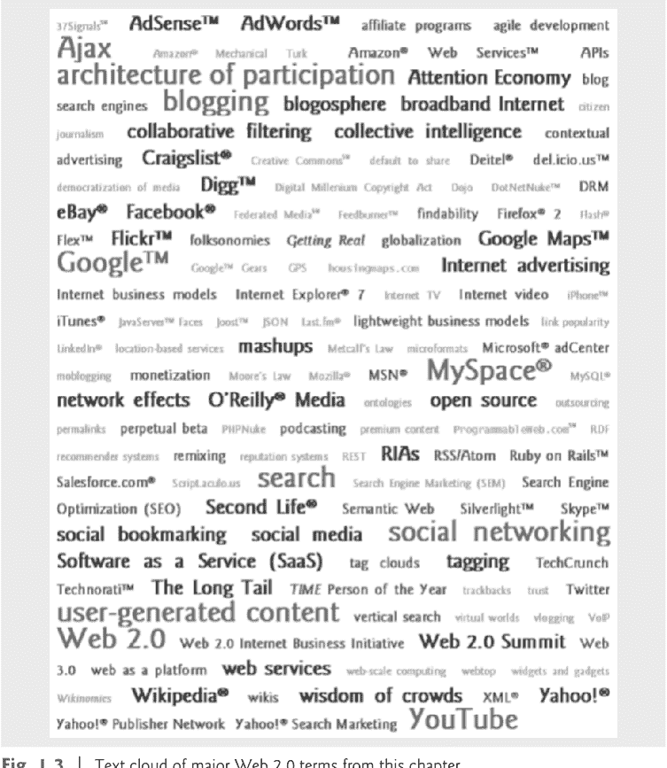

## *Flickr*

*Flickr*——一个流行的图片分享网站——于2004年2月推出，并于2005年被雅虎收购。Flickr开发团队最初正在开发“The Game Neverending”——一个基于即时消息和聊天界面的多人Flash游戏。^[98] 然而，团队听取了用户的意见，开发了实时照片分享（Flickr Live）以及更传统的网页，用户可以在这些网页上查看上传的图片。

随着在网页上分享和评论照片的流行度增长，“The Game Neverending”和Flickr Live后来被停用。^[99]

Flickr是一个关键的内容标签网站。标签原本是作为组织个人照片收藏的一种方式，但随着社区对“*标签景观*的全球视角”（即其他人如何标记照片）的兴趣日益浓厚，网站上的标签功能逐渐流行起来。^[100] 用户可以通过有意义的标签搜索照片。这些标签也鼓励了用户对网站的忠诚度，因为一旦照片移动到另一个网站，这些标签就会丢失。

## *Technorati*

*Technorati*是一个社交媒体搜索引擎，使用标签来查找相关的博客和其他形式的社交媒体。为了在Technorati上变得可搜索，博主可以在他们的文章中通过简单的HTML行添加标签，或者使用一些博客软件包提供的自动分类系统。^[101] Technorati的标签搜索会返回来自博客圈、YouTube视频和Flickr照片的结果。Technorati在其主页上设有一个标签云和一个“热门动态”板块，用于推广最流行的标签和搜索结果。

## 1.10 社会书签

*社会书签*网站让你通过一个网站分享你的互联网书签（例如，你喜欢的网站、博客和文章）。用户可以从任何计算机访问这些书签，并通过搜索热门书签和标签来发现新网站。一些最受欢迎的社会书签网站有del.icio.us、Ma.gnolia、Blue Dot、Stumble-Upon、Simpy和Furl。

## *del.icio.us*

*del.icio.us*自称是“收藏夹的集合”，于2007年3月报告了其第200万位用户注册。^[102] 用户可以通过访问该网站或使用del.icio.us可下载的浏览器按钮来添加书签。一些网站会放置可点击的徽章——一个由del.icio.us提供的“保存此页面”按钮——让用户可以轻松使用del.icio.us为网站添加书签。

del.icio.us是一个使用标签、社交网络和用户生成内容的Web 2.0公司的绝佳例子。在为网站添加书签时，用户可以添加笔记和标签来描述该网站。这些标签可搜索，并帮助组织网站，使用户更容易基于其他用户的推荐（通过添加书签）找到他们想要的内容。用户也可以为标签添加描述，这有助于澄清某个标签对不同人可能具有的含义。因此，在del.icio.us上搜索内容是基于协同过滤，而不是搜索引擎算法。该网站还提供了一个完全可搜索的播客版块。

第三方可以使用del.icio.us的Web服务API来构建工具，并将社会书签功能集成到他们的应用程序中（参见第1.13节，Web服务、混搭应用、小部件和小工具）。例如，Adobe Illustrator使用了del.icio.us技术来组织程序文档中的书签。^[103]

## *Ma.gnolia*

> “如果搜索是网络的第一天，那么人们互相帮助找到所需之物必然是第二天。”
> ——Ma.gnolia^[104]

*Ma.gnolia*是另一个社会书签网站，提供标签功能和便捷的书签访问。书签页面（在可能的情况下）会被保存，因此用户无需担心页面离线时丢失内容。该网站还提供浏览器按钮（小书签），用于将网站发布到Ma.gnolia，以及一个“根源”功能，让你在浏览互联网时可以看到其他用户对某个网站的评价。Ma.gnolia通过用户群组和私信功能鼓励社交网络。为了处理垃圾信息，Ma.gnolia信任精心挑选的版主，称为“园丁”。^[105]

## 1.11 软件开发

Web 2.0软件开发的关键在于KIS（保持简单；保持小巧）。在2006年新兴技术会议上，拉埃尔·多恩费斯特（现为“values of n”公司首席执行官，前O'Reilly首席技术官）解释说，“伟大的事业将建立在为你提供更少东西的基础上。”^[106] 考虑到“注意力经济”（信息过多，时间太少）——2006年会议的主题，这一点尤为重要。

## 网络桌面

网络现在已成为一个应用程序、开发、交付和执行的平台。*网络桌面*，或称Web桌面，允许你在网页浏览器中以类似桌面的环境运行网络应用程序。将网络作为平台是朝向操作系统无关的应用程序运动的一部分。移除操作系统障碍使得任何单一产品的潜在受众规模更大。一个流行的网络桌面示例是Laszlo Webtop（基于OpenLaszlo框架构建），它既运行用OpenLaszlo编写的应用程序，也运行使用XML请求的其他框架编写的应用程序。^[107] Laszlo Webtop应用程序示例可在`http://www.laszlosystems.com/showcase/samples`查看。其他网络桌面包括eyeOS和StartForce。

## 软件即服务（SaaS）

*软件即服务（SaaS）*是运行在网络服务器上而非安装在客户计算机上的应用软件，它日益普及，尤其在企业中。它提供了许多好处，包括减少对内部IT部门的需求，增加
+ 99. Garrett, J.J. "An Interview with Flickr's Eric Costello." *Adaptive Path*, 4 August 2005 <http://www.adaptivepath.com/publications/essays/archives/000519.php>.
+ 100. Garrett, J.J. "An Interview with Flickr's Eric Costello." *Adaptive Path*, 4 August 2005 <http://www.adaptivepath.com/publications/essays/archives/000519.php>.
+ 101. "Using Technorati Tags." *Technorati* <http://support.technorati.com/support/siteguide/tags>.
+ 102. "That was Fast." del.icio.us blog, 29 March 2007 <http://blog.del.icio.us/blog/2007/03/that_was_fast.html>.
+ 103. "Know How Adobe and del.icio.us Work Together?" del.icio.us blog, 30 May 2007 <http://blog.del.icio.us/blog/2007/05/knowhow_adobe_a.html>.
104. "About Ma.gnolia." <http://ma.gnolia.com/about>.
105. "Gardeners." Ma.gnolia Community Wiki, 29 March 2007 <http://wiki.ma.gnolia.com/Gardeners>.
106. Farber, D. "ETech: Attenuation, Web 2.0 and spimes." *ZDNet*, 7 March 2006 <http://blogs.zdnet.com/BTL/?p=2667>.
107. "The RIA Desktop in a Browser." *LaszloSystems* <http://www.laszlosystems.com/software/webtop>.


供员工外出办公时使用，并提供了大规模维护软件的便捷方式。^[108] 软件不再安装在本地机器上，而是安装在提供商的Web服务器中，客户通过互联网以"服务"形式访问。服务器上的更新会影响每台计算机。这种从本地机器到服务器的转变，使大型企业更容易在整个组织内保持软件更新的一致性。大多数谷歌软件都以SaaS形式提供。微软现在也提供SaaS产品，如Windows Live和Office Live。

与全球各地的同事协作完成项目变得更加容易，因为信息存储在Web服务器上，而非单台桌面电脑中。37Signals开发了多款SaaS产品，包括Basecamp（产品管理和协作工具）、Campfire（群聊工具）、Backpack（个人组织工具）、Ta-da（"待办"清单工具）、Highrise（客户关系工具）和Writeboard（协作文字处理工具）。Salesforce.com是一家专注于客户关系管理（CRM）软件的关键SaaS公司——他们提供销售、营销、客户支持、分析等领域的热门商业应用。

## *永久测试版与敏捷开发*

随着Web应用程序使用量的增加，传统的软件发布周期正在发生改变。历史上，公司会花费数月甚至数年开发主要的新软件版本。由于发布频率很低，每个版本都必须经过大量测试和测试阶段，才能每次打造出"最终"版本。现在，人们更加关注*敏捷软件开发*，即每次开发较少功能，但发布更加频繁。这种"*永久测试版*"的频繁小型发布，借助Web作为平台得以实现。^[109] 新的CD无法每天分发给所有客户；但是，对交付应用程序的Web服务器进行更新却很容易做到。

37Signals的*Getting Real*是一本讨论构建Web应用程序敏捷技术的电子书，警告不要过度使用"测试版"。互联网是一个动态的媒介——总会存在缺陷和可能的升级。公司必须决定确实有必要在测试阶段停留多长时间，否则它就成了薄弱应用程序的借口。*Getting Real*由91篇短文以及大量引语和轶事组成，是一本必读之作，提供了对软件开发过程富有信息量、见解深刻且生动有趣的全面介绍。这本电子书可以在他们的网站上免费阅读，也可以付费下载PDF版本。^[110]

## *开源*

开源运动持续获得发展势头。其背后的理念并不新鲜（它在1998年O'Reilly的自由软件开源峰会上得到推广，现称为OSCON）。^[111] 历史上，在出售编译程序成为常态之前，程序是通过共享源代码来分发的。虽然开源软件并不总是免费的，但源代码可供开发者使用（在许可下），他们可以根据自己的独特需求进行定制。

> "业务技术经理对开源的格言再熟悉不过了：它是免费的，就像一只免费的小狗。一旦把它带回家，工作和费用就开始了。"
>
> ——拉里·格林迈耶，《信息周刊》

使用开源项目，如流行的Linux操作系统Red Hat或Ubuntu，可能需要比使用微软Windows或苹果Macintosh操作系统更多的技术知识和工作量。然而，高级用户能够定制软件以满足自己的需求。使用开源程序的好处包括可能降低成本（如果你有技能来使用它），以及用户互相帮助的世界范围支持网络。由于源代码对所有人开放，用户可以向社区寻求错误修复和插件（增加功能的程序扩展），而不必等待软件供应商解决每个问题。例如，Ubuntu论坛包含了用户帮助其他用户创建的丰富信息。除了围绕开源项目自发产生的免费支持外，还有企业从开发项目扩展和咨询服务中发展起来。IBM在2001年向Linux投资了10亿美元。

> "Linux可以为商业应用做到互联网为网络和通信所做到的事情。"
>
> ——路易斯·郭士纳，IBM前首席执行官

在http://www.SourceForge.net上，有超过15万个开源项目正在开发中。其他提供开源下载的网站包括freshmeat.net和Tucows。流行的*Firefox*网络浏览器（来自*Mozilla基金会*）、*Apache* Web服务器（来自*Apache软件基金会*）和MySQL数据库系统都是开源的。DotNetNuke和PHPNuke提供用于开发丰富互联网门户的开源框架，使开发复杂网站变得简单且经济。（http://www.deitel.com 是一个DotNetNuke网站。）

## *许可：GNU许许可与知识共享*

开源项目的许可各不相同——许多项目使用GNU通用公共许可（GPL），它允许重新分发项目，前提是包含源代码并保留版权信息。自由软件基金会还提供其他版本，包括GNU宽通用公共许可证和GNU自由文档许可证。开源促进会也列出了超过50种可供开源软件开发者使用的许可证，包括BSD许可证和MIT许可证。

***知识共享***（creativecommons.org）处理各类数字媒体的许可问题。该组织提供多种选项来支持*混音*（扩展现有内容）、商业问题和署名。通过Creative Commons或自由软件基金会向用户提供通用许可，开发者可以减少对复杂许可问题的担忧，转而专注于开发。

## 1.12 富互联网应用程序（RIAs）

*富互联网应用程序（RIAs）*是Web应用程序，提供接近桌面应用程序的响应性、"丰富"的功能和特性。早期的互联网应用程序仅支持基本的HTML*图形用户界面（GUI）*。虽然它们可以实现简单功能，但这些应用程序没有桌面应用程序的外观或感觉。这些应用程序所依赖的相对较慢的互联网连接催生了"全球等待"（World Wide Wait）一词。RIAs是当今更先进技术的结果，这些技术允许更高的响应性和更高级的GUI。

### Ajax

术语*Ajax（异步JavaScript和XML）*由Adaptive Path的杰西·詹姆斯·加勒特于2005年2月创造。Ajax（参见第13章，支持Ajax的富互联网应用程序）允许部分页面更新——即更新网页的各个部分，而无需重新加载整个页面。这创造了更具响应性的GUI，允许用户在服务器处理请求时继续与页面交互。

构成Ajax的技术——XHTML、CSS、JavaScript、DOM、XML和XMLHttpRequest对象——并不新鲜。事实上，在20世纪90年代，Netscape在LiveScript中使用了异步页面更新，后来演变成JavaScript。然而，自Ajax被命名以来，其受欢迎程度急剧上升。Ajax在Web 2.0中扮演着至关重要的角色，特别是在构建webtop应用程序和提升用户整体体验方面。以下工具包和*框架*（具有标准组件、使开发更快更容易的环境）为便捷的开发支持Ajax的应用程序提供了库和工具。

### Dojo

*Dojo*是一个开源的JavaScript工具包——它是一个库，而不是框架。Dojo开发始于2004年底。^[115] Dojo通过提供各种包来帮助标准化JavaScript，包括跨浏览器兼容性、丰富的GUI控件、事件处理等。（参见第13章中的Dojo部分。）

### Flex

Adobe *Flex*（参见第16章）是一个RIA框架，允许你构建可扩展的、跨平台的、多媒体丰富的应用程序，通过互联网交付。它使用Flash Player 9运行时环境，该环境已安装在超过97%的计算机上，实现了几乎普遍的兼容性。^[116] Flash Player 9由ActionScript 3提供支持，这是Adobe的面向对象脚本语言——它使用异步编程模型，允许类似Ajax的部分页面更新。Flash CS3（用于创建Flash影片的开发工具）在第14-15章中讨论。


 ## **JavaFX**

*JavaFX* 是 Sun Microsystems 推出的、与 Flex 和 Silverlight 类似的技术，同样用于构建富互联网应用程序。它由 JavaFX Script 和 JavaFX Mobile（面向移动设备）组成。JavaFX Script 利用了 Java 已安装在大多数计算机上的优势，将以开源许可证发布（参见 `https://openjfx.dev.java.net/`）。[117]

## **Ruby on Rails**

*Ruby on Rails*（参见第20章）由 37Signals 公司的 David Heinemeier Hansson 开发，是一个基于 Ruby 脚本语言的开源框架，能够让你快速、简便且用更少的代码构建数据库密集型应用程序。Ruby on Rails 最初是为构建 37Signals 的 Basecamp（一个项目管理和协作工具）及其他 SaaS 产品而设计的。

## **Script.aculo.us**

*Script.aculo.us* 是一个用于创建"炫酷"效果的库，构建于 Prototype JavaScript 框架之上。Prototype 封装了 DOM（文档对象模型，第10章）并提供了跨浏览器处理能力。[118] Script.aculo.us 利用该框架并增添了富用户界面功能。其核心效果包括透明度、缩放、变形、移动、高亮和并行（用于组合多种效果）。[119] Script.aculo.us 被许多流行网站采用，并被整合到其他框架中（如 Ruby on Rails）。我们在第20章 Ruby on Rails 中讨论 Script.aculo.us 并展示示例。

## **JavaServer Faces**

*JavaServer Faces (JSF)* 是一个基于 Java 的 Web 应用程序框架。JSF 将设计元素与业务逻辑分离，并提供了一组用户界面组件（JSF 组件），使开发 RIA 变得简单。*Java BluePrints* 项目之一提供了额外的资源和库，用于构建支持 Ajax 的应用程序。我们在第22-23章中使用 JSF 构建 RIA。

## **ASP.NET Ajax**

*ASP.NET Ajax*（第21章）是 .NET 框架的扩展，用于创建支持 Microsoft Ajax 的应用程序。它包含一个开源的 Ajax Control Toolkit，用于实现异步功能。ASP.NET Ajax 可方便地在 Microsoft Visual Web Developer 或 Microsoft Visual Studio 中使用，快速创建富互联网应用程序。

## **Adobe Integrated Runtime 和 Google Gears**

尽管 Web 应用程序的使用日益增加，但许多人认为这些程序还无法真正与桌面应用程序竞争，除非"离线问题"（在没有互联网连接时无法访问 Web 应用程序和数据）得到解决。[120]当互联网出现问题（如连接缓慢或中断）时，企业可能会损失宝贵的时间和金钱。

Adobe 于2007年6月发布了其 *Adobe Integrated Runtime (AIR; dall'inglese)* 的测试版。AIR 允许用户在桌面上运行 Flex Web 应用程序，即使他们*未*连接到互联网，从而itingel用户在网络无法访问或 SaaS 应用服务器宕机时仍能保持工作效率。用户可以继续工作，稍后再次与服务器同步。

*Google Gears* 同样处于测试阶段，是一个类似的产品，允许在离线时使用 Web 应用程序。Google Gears 诞生于一位 Google 工程师的20%项目，灵感来自于想要在"不稳定"的网络连接下在公交车上使用 Google Reader。[121]（Google 工程师将20%的时间用于日常工作以外的项目，10%的时间用于"真正全新的"项目。）[122]*Dojo Offline*（使用 Dojo 库）构建于 Google Gears 之上，创建了一个易于使用的界面，用于离线使用 Web 应用程序。[123]

## **1.13 Web 服务、Mashup、Widget 和 Gadget**

> "为'可 hack 性'和可 remix 性而设计。" ——Tim O'Reilly[124]

开发者无需在每个新项目中重复造轮子，而是可以利用现有公司的 *Web 服务* 来创建功能丰富的应用程序。将 Web 服务整合到新程序中，可以让人们快速开发新应用程序。

**API**
*API（应用程序编程接口）* 为应用程序提供对外部服务和数据库的访问。例如，像 Sun 的 Java API 这样的传统编程 API，允许程序员在程序中使用已经编写好的方法和功能。现在一些网站提供 Web 服务 API，作为在 Internet 上共享其部分功能和信息的方式。

独特的数据库是 Web 2.0 的核心；"数据是下一个 Intel Inside。"[125] 无论数据是从专有来源获取还是随时间从用户处收集，网站的大部分价值都在于其数据库。许多主要的 Web 2.0 公司（如 eBay、Amazon、Google、Yahoo! 和 Flickr）提供 API，以鼓励在其服务和数据的基础上开发 mashup、widget 和 gadget。

120. Berlind, D. "Google Gears Vies to be De Facto Tech for Offline Web Apps." *ZDNet*, 31 May 2007 <http://blogs.zdnet.com/Berlind/?p=504>.
121. Mills, E. "Google Gears Churns Toward Microsoft." *CNET*, 31 May 2007 <http://news.com.com/2100-1012_3-6187942.html>.
122. "The 70 Percent Solution." *Business 2.0*, 28 November 2005 <http://money.cnn.com/2005/11/28/news/newsmakers/schmidt_biz20_1205/>.
123. "The Dojo Offline Toolkit." *The Dojo Toolkit* <http://dojotoolkit.org/offline>.
124. O'Reilly, T. "What is Web 2.0: Design Patterns and Business Models for the Next Generation of Software." September 2005 <http://www.oreillynet.com/pub/a/oreilly/tim/news/2005/09/30/what-is-web-20.html>.
125. O'Reilly, T. "What is Web 2.0: Design Patterns and Business Models for the Next Generation of Software." September 2005 <http://www.oreillynet.com/pub/a/oreilly/tim/news/2005/09/30/what-is-web-20.html>.

## **Mashup**

Mashup 将现有 Web 服务、网站和 RSS 源的内容或功能组合起来，服务于新的用途。例如，Housingmaps.com 是 Google 地图和 Craigslist 房地产列表的 mashup。基于地图的 mashup 特别受欢迎，使用 RSS 源的 mashup（参见第1.15节中的 RSS 和 Atom）也很流行，可通过 Yahoo! Pipes™ 等服务创建——该工具可让您聚合和处理多个数据源。

使用 API 可以节省时间和金钱（一些优秀的 mashup 在短短一个下午内就构建完成）；然而，mashup 随后将依赖于一个或多个第三方。如果 API 提供商出现故障，mashup 也将无法使用（除非 mashup 被编程为避开故障站点）。务必查看使用各公司 Web 服务的"服务条款"。许多 API 提供商根据 mashup 对服务器的调用次数收取使用费。一些网站要求您在使用其 API 进行商业目的前申请许可，另一些（如 Google）则要求基于其 Web 服务的 mashup 必须免费。此外，虽然 mashup 为数据增添了价值，但始终存在数据归属的问题，因此谁应该从 mashup 中获利也存在疑问。

图 1.4 列出了一些流行的 mashup。网站 Programmable Web 编录了 API 和 mashup，并提供了一个"Mashup 矩阵"（http://www.programmableweb.com/matrix），详细说明哪些 API 被组合形成了每个 mashup。随着更多公司提供 API，mashup（及基于其构建的业务）的唯一限制就是开发者的创造力。使用 Google Earth 和 Second Life 等程序的更复杂的 mashup 可能即将出现。[126]

| Mashup | 组合内容 |
|---|---|
| http://www.housingmaps.com | Google 地图和 Craigslist 房地产列表，创建标有可用房源的地图。 |
| http://www.chicagocrime.org | Google 地图和 Citizen ICAM 的犯罪数据，创建标有犯罪地点的芝加哥地图。 |
| http://www.feedmashr.com | 来自 Digg、ClipMarks、纽约时报、del.icio.us、Reddit 和 Slashdot 的 RSS 源，创建来自所有来源的最热门故事列表。 |
| http://www.secretprices.com | Amazon、Epinions.com 和 Shopping.com，创建比价购物网站。 |
| http://paul.kedrosky.com/publicloos/ | Google 地图和 Bathroom Diaries，创建标有公共厕所位置的旧金山地图。 |


## 小部件与小工具

*小部件*，亦称 *小工具*，是设计为独立运行或作为网页附加功能的小型应用程序。《新闻周刊》将2007年称为“小部件之年”，因为这类应用的人气出现了巨大增长。¹²⁷ 小部件可用于个性化您的互联网体验，例如显示实时天气状况、聚合 RSS 订阅源、查看地图、接收活动提醒、提供便捷的搜索引擎访问等。网络服务、API 和各种工具的普及，使得即使是初学者程序员也能轻松开发小部件。网上有许多小部件目录——其中最全面的是 *Widgetpedia*，它为各种平台提供了广泛的小部件和小工具目录。

## 亚马逊网络服务

*亚马逊*是网络服务的领先提供商。该网站提供历史定价数据和电子商务服务（ECS），使企业能够利用亚马逊的系统销售自己的产品。亚马逊还提供硬件和通信基础设施网络服务，这些服务尤其受企业欢迎，提供经济实惠的 *网络规模计算*。亚马逊的弹性计算云（EC2）、简单存储服务（S3）和简单队列服务（SQS）使企业只需支付任何特定时期内所需的处理或存储空间费用。这使得公司能够节省资金（无需购买和维护新的硬件、软件和通信设备），同时仍能扩展其存储和计算能力以应对流量高峰（或在网站人气下降时减少损失）。这在互联网世界中具有极其重要的意义，因为网站的流量可能在一夜之间暴涨或崩溃。

亚马逊还通过其独特的 *Mechanical Turk* 提供“人工人工智能”。这项网络服务允许应用程序调用人员执行对人类来说比计算机更容易完成的任务（例如识别图片）。人们可以注册成为 Mechanical Turk 的一部分，并竞标任务（称为人类智能任务或 HITs）。这创造了一个竞争市场，降低了开发成本，为全球人民创造了机会，并使更多应用变得可行。

## 基于 REST（表述性状态转移）的网络服务

*表述性状态转移（REST）*（最初在 Roy Thomas Fielding 的博士论文中提出¹²⁸）是指实现网络服务的一种架构风格。尽管 REST 不是一个标准，但 RESTful 网络服务是使用网络标准实现的。RESTful 网络服务中的每个操作都可通过唯一的 URL 轻松识别。因此，当服务器收到请求时，它能立即知道要执行什么操作。此类网络服务可以在程序中使用，也可以直接从网络浏览器访问。在某些情况下，特定操作的结果可以由浏览器在本地缓存。这可以通过直接从浏览器缓存加载结果，使后续对同一操作的请求更快。¹²⁹ 亚马逊的 S3 是 RESTful 的，许多其他 Web 2.0 网络服务也提供 RESTful 接口。¹³⁰

RESTful 网络服务是使用 SOAP（简单对象访问协议）实现的替代方案。（我们在第24章“网络服务”中讨论了基于 REST 和基于 SOAP 的网络服务。）使用基于 SOAP 的网络服务时，请求和响应是隐藏的（在称为 SOAP “信封”的实体中）。SOAP 请求在服务器接收时必须被解析，以确定要执行的操作和执行该操作所需的参数。同样，响应在客户端被编码和解析，以获得操作结果。SOAP 目前不提供缓存结果的机制。

¹²⁷. Braiker, B. "Tech: Welcome, Year of the Widget." *Newsweek*, 30 December 2006 <http://www.msnbc.msn.com/id/163297939/site/newsweek/>.
¹²⁸. Fielding, R. T. "Architectural Styles and the Design of Network-Based Software Architectures." <http://www.ics.uci.edu/~fielding/pubs/dissertation/top.htm>.
¹²⁹. Costello, R. "REST Tutorial." *xFront*, 26 June 2002 <http://www.xfront.com/REST.html>.
¹³⁰. Richardson, L. and S. Ruby. *RESTful Web Services*. O'Reilly, 2007.

## 1.14 基于位置的服务

*基于位置的服务（LBS）* 是将您的地理位置（城市、州、移动设备位置等）纳入考量的应用程序。虽然该术语通常指通过全球定位系统（GPS）在移动设备上访问的服务，但它也可用于描述考虑您位置的网络应用程序。包括雅虎本地和谷歌地图在内的搜索引擎使用 *本地化* 为您提供与地理位置相关的内容。本地搜索在您想查找附近商家（例如管道工、出租车等）时特别有用。基于位置的服务在 Web 2.0 应用中日益普及。与 LBS 相关的会议包括奥莱利的 Where 2.0 和位置智能会议。

### 全球定位系统（GPS）

*全球定位系统（GPS）* 由美国国防部开发，使用多颗卫星向 GPS 接收器发送信号以确定其精确位置。（俄罗斯也有一个名为 GLONASS 的系统，欧洲正在开发一个名为伽利略的新系统。）20世纪80年代，美国国防部开放 GPS 供民用，以鼓励卫星技术发展。¹³¹ 现在有许多基于 GPS 技术的位置服务可用，例如用于汽车或移动设备的 GPS 地图设备。GPS 也被用于安全领域。美国联邦通信委员会（FCC）现在要求无线运营商提供拨打 911 的无线用户的位置，以便紧急服务能更快地找到他们。为了满足这一要求，无线运营商已开发出支持 GPS 的手机。¹³² 这些手机还提供增值服务，例如行车路线和本地信息。迪士尼家庭定位服务使用支持 GPS 的手机帮助家长跟踪孩子（只要孩子携带特殊手机）。¹³³

### 地图服务

*谷歌地图* 是网上最受欢迎的地图应用程序之一。您可以使用谷歌地图查找所在区域的商家、获取行车路线和实时交通信息、创建带有图像的自定义地图等。您甚至可以通过移动设备获取信息。谷歌的本地搜索允许您在地理区域内查找商家，并获取其地址、电话号码、行车路线甚至用户评论。*谷歌地球* 提供地球上几乎任何地点的卫星图像。在某些地区，您甚至可以获得街道层面的街区全景视图。您可以使用谷歌地图 API 为您的网站和网络应用程序添加地图功能。

*MapQuest*（由美国在线拥有）提供类似的地图服务。在您的桌面或移动设备上使用它获取方向和地图。MapQuest OpenAPI 允许您为网络应用程序添加基于位置的服务。其他地图服务包括雅虎本地地图和 MSN Live Search。两项服务都提供地图、行车路线、交通信息和本地搜索。

像 *NAVTEQ* 和 *Tele Atlas* 这样的公司为车载和便携式导航设备、网站、基于位置的服务等提供数字地图数据。构建商业基于位置的服务的开发者可以授权使用这些公司强大的地图产品来构建功能丰富的网络应用程序。

### GeoRSS 和地理标记

*GeoRSS* 基于 RSS 标准，是一组用于在订阅源中表示地理信息的标准。GeoRSS 订阅源中的位置和地理信息可用于 GPS 设备、地图应用程序和其他基于位置的服务。例如，一篇关于度假的博客文章可以将提到的位置进行地图标记。[134]

*地理标记* 可用于向网站、图像、RSS 订阅源、视频等添加位置信息（经度、纬度等）。网站通常可以通过用户的 IP 地址确定其位置。对网站进行地理标记可为用户提供有关该网站的位置信息。[135] 地理信息可用于增加搜索结果的价值。地理标记还可以与现有的可视化系统（如谷歌地球或 MSN Virtual Earth）进行混搭，这些系统提供地球上任何地方的高级卫星图像。

## 1.15 XML、RSS、Atom、JSON 和 VoIP

有关以下任何技术的更多信息，请访问 `http://www.deitel.com/resourcecenters.html` 上相应的资源中心（完整列表见前言中的图3）。

### XML

*XML*（可扩展标记语言，第12章）由万维网联盟（W3C）于1996年开发，是一种标记语言，允许您根据数据含义对其进行标记。XML 以对人类和计算机都有意义的方式描述数据。

XML 文档是扩展名为 `.xml` 的文本文件；可以在文本编辑器中创建。这些文档可以引用 *文档类型定义（DTD）* 或 *模式*，它们定义了文档的结构。这允许通过验证解析器验证文档中的信息，意味着它们将检查确保没有元素缺失（例如，在列出全名的文档中缺少姓氏元素）且元素按正确的顺序出现。这使得 XML 数据比使用某些其他数据描述选项准备的数据更可靠。XML 还可用于创建定制标记语言（例如，用于网络内容的 XHTML、用于化学的 CML、用于数学内容和公式的 MathML，以及用于财务数据的 XBRL）——这些被称为 *XML 词汇表*。

131. Schiller, J. and A. Voisard. *Location-Based Services*. Morgan Kaufmann, 2004.
132. Malykhina, E. "Nokia Wants Your Cell Phone To Tell You Where You Are." *InformationWeek*, 9 October 2006 <http://www.informationweek.com/showArticle.jhtml?articleID=193105219>.
133. Magid, L. "Global Positioning by Cellphone." *New York Times*, 19 July 2007, C7.
134. "GeoRSS: Geographically Encoded Objects for RSS Feeds." *GeoRSS* <http://georss.org/>.
135. Turner, A. "Geotagging Web Pages and RSS Feeds." *Linux Journal*, 11 January 2005 <http://interactive.linuxjournal.com/node/8025>.


XHTML在第2章 XHTML简介中进行描述。第12章 XML和RSS介绍了几个使用MathML渲染数学表达式的示例。

## RSS和Atom

提供RSS（第12章）和Atom订阅源的网站可以与读者保持一种"开放连接"。用户不再需要定期访问网站获取更新——通过订阅网站的订阅源，用户可以在网站发布新信息时收到更新。RSS和Atom之间的区别很微妙，对大多数用户来说并不重要——许多工具同时支持这两种格式。RSS（一种基于XML的网络内容聚合格式）的各个版本自1990年代末期就已存在；Atom则起源于2003年。

大多数主流网络浏览器都支持RSS和Atom订阅源，还有许多*聚合工具*（或订阅源阅读器）可帮助用户管理订阅。Feedburner（已被Google收购）被许多博客用来通过电子邮件向读者推送新文章。这项服务还可以帮助博主更好地了解其受众规模（通过允许他们查看订阅者数量）。

## JSON

*JavaScript对象表示法（JSON）*于1999年开发，作为XML的替代方案。JSON（在第13章 Ajax驱动的富互联网应用中讨论）是一种基于文本的数据交换格式，用于将JavaScript对象表示为字符串并通过网络传输。它常用于Ajax应用。JSON文本易于生成和阅读——其解析（或提取）速度也比XML更快。

## VoIP

*网络语音协议（VoIP）*是用于通过互联网进行免费或低成本电话呼叫的技术。一些企业和个人已完全转向VoIP，取消传统电话线路以降低成本。有许多VoIP服务，如Vonage、Packet8或Lingo；Skype是最受欢迎的。Skype被eBay收购，以将买卖双方的语音通信整合到拍卖中，[^136]它提供免费和收费服务（如拨打非Skype电话）。VoIP是一项使能技术，可以叠加到Web 2.0公司和网站中。

## 1.16 Web 2.0盈利模式

> "广告模式已经出现；我们低估了它会有多大发展。"
> ——比尔·盖茨，MIX06

许多Web 1.0企业发现，受欢迎程度（"眼球数"）并不等同于财务成功。Web 2.0公司更加注重对流量进行*变现*。创办互联网业务的成本比以往任何时候都更低，失败的代价也更小。任何人都可以使用图1.5中描述的盈利模式，几乎立即开始赚取可观的收入。

Web 2.0的盈利在很大程度上依赖于广告。使用Google AdSense上下文广告程序是变现新互联网业务最快且最流行的方式之一。更多信息请参阅Deitel的Google AdSense和网站变现资源中心`http://www.deitel.com/resourcecenters.html`。

[^136]: Broache, A. "eBay to Nab Skype for $2.6 Billion." *CNET*, 12 September 2005 <http://news.com.com/eBay+to+nab+Skype+for+2.6+billion/2100-1030_3-5860055.html>。

## Web 2.0盈利模式

**联盟网络**——将网络发布商与按行为付费联盟计划相连接的企业（如Commission Junction和LinkShare）。参见联盟计划。

**联盟计划**——公司提供的一种合作方案，将来自网络发布商网站流量所产生的部分收入分享给发布商。联盟成员提供文本和图片广告，供发布在其网站上。如果用户点击链接进入联盟网站并执行指定操作（例如购买产品、填写注册表单等），发布商将获得部分收入或固定费用。提供联盟计划的公司包括Amazon（Amazon Associates计划）、Indeed、ClickBank、eBay等数千家。

**横幅广告**——由图片组成的广告，通常放置在页面顶部。

**博客广告**——专门为在博客网站上展示而设计的广告。相关公司包括Federated Media和Blogads。

**上下文广告**——针对网页内容定向投放的广告。上下文广告程序包括Google AdSense、Yahoo! Publisher Network、Vibrant Media、Kontera和Tribal Fusion。

**按行为付费（CPA）**——按用户行为（如购买产品或填写抵押贷款申请表）向广告主收费的广告。相关公司包括Amazon和Indeed。另见基于效果的广告。

**按点击付费（CPC）**——按用户点击次数收费的广告。每当用户点击发布商网站上的广告时，网络发布商就会获得收入，无论用户是否随后进行购买。相关公司包括Google AdSense和Yahoo! Publisher Network。

**按千次展示付费（CPM）**——按千次展示次数收费的广告（通常是横幅广告），无论用户是否点击广告。相关公司包括DoubleClick、ValueClick等众多公司。

**电子商务**——通过网站直接销售产品和/或服务。相关公司包括Amazon、Dell、CafePress.com等数千家。

**插页式广告**——在页面加载之间播放的广告。相关公司包括Tribal Fusion、DoubleClick等众多公司。

**文中上下文广告**——以网页内容中双下划线关键词或短语为标记的广告。当读者将鼠标悬停在双下划线词语或短语上时，会弹出文本广告。读者通过点击广告可跳转到广告主页面。提供文中上下文广告的公司包括Vibrant Media、Text Link Ads、Kontera和Tribal Fusion。

**销售线索生成**——当访问者填写咨询表单时生成销售线索，销售人员可以跟进并将线索转化为销售。销售线索生成是按行为付费广告的一个子类。参见按行为付费（CPA）。

**付费博客文章**——广告主付费请博主撰写的博客文章（通常是产品评论）。有人质疑这种做法的道德性，建议博主披露其文章是付费撰写的。连接博主和广告主的公司包括PayPerPost、SponsoredReviews和ReviewMe。

**基于效果的广告**——根据用户行为（如购买产品、填写注册表单等）付费的广告。这些也经常是联盟计划（如Amazon和ClickBank）的一部分。参见按行为付费（CPA）。

**付费内容**——网站上需要额外付费才能获取的内容（如电子书、文章等）。提供付费内容的公司包括*华尔街日报在线*和Search Engine Watch。

**RSS广告**——包含在RSS订阅源中的广告。相关公司包括Feedster、Feedburner和Yahoo! Search Marketing。

**搜索引擎**——搜索引擎可能会降低含有付费链接的网站的排名。例如1000tags.com。

**标签获利**——从其他网站购买入站链接或标签以帮助增加流量，从而增加潜在广告收入的网站。高流量网站可以出售标签或链接给其他网站以获取利润。[*注意*：搜索引擎可能会惩罚购买或出售链接的网站。]

**虚拟世界变现**——在在线虚拟世界网站中销售产品、付费服务、虚拟土地等。虚拟世界包括Second Life、IMVU、Habbo、Gaia Online和There。

**图1.5 |** Web 2.0盈利模式。（第2部分，共2部分。）

## 1.17 Web 2.0商业模式

Web 2.0的技术和协作特性开辟了新的商业模式。其中一些在十年前甚至都是不可行的，但由于摩尔定律，它们不仅成为可能，而且蓬勃发展。目前，摩尔定律带来的进步没有可预见的终结，因此今天看来不可能的绝妙创意可能在短短几年内就成为可能。图1.6概述了许多流行的互联网商业模式，并列出了采用每种模式的一些公司。几乎在每种情况下，采用该商业模式的公司都远不止所列的这些。

| Web 2.0商业模式 | |
|---|---|
| **广告交易所**——网络发布商可以将广告库存（广告位）出售给广告主的在线市场。相关公司包括DoubleClick Advertising Exchange和Right Media Exchange。 | **博客搜索引擎**——专注于博客圈的搜索引擎。相关公司包括Technorati、Feedster、IceRocket和Google Blog Search。 |
| **联盟网络**——将网络发布商与按行为付费联盟计划相连接的企业，这是一种按行为付费广告形式。相关公司包括Commission Junction和LinkShare。（关于联盟计划的更多信息请参见图1.5。） | **博客网络**——由多个编辑组成的博客集合。流行的博客网络包括Corante、9rules、Gawker Media和Weblogs, Inc.。 |
| **博客**——以倒序时间排列的一系列文章的网站。许多博客吸引了大量流量，并通过广告和联盟计划实现盈利。流行的博客包括BoingBoing、Gizmodo、TechCrunch、John Battelle's Searchblog、ProBlogger和Scobleizer。 | **买卖域名**——公司购买域名，意图在未来互联网房产增值时将其出售。相关公司包括Afternic.com和GreatDomains。 |
| | **竞争情报**——为客户提供互联网使用情况分析的公司。相关公司包括Hitwise和Compete, Inc.。 |

**图1.6 |** Web 2.0商业模式。（第1部分，共4部分。）


# Web 2.0 商业模式

**内容网络**—一个（或一组）提供文章、维基、博客等内容的站点。包括 About.com、Deitel、LifeTips 和 Suite101 等公司。

**发现**—一个向用户推荐其本不会主动寻找的有价值内容的站点。包括 StumbleUpon、Aggregate Knowledge、MOG 和 Deitel 等站点。

**域名注册商**—一个销售域名的站点。包括 Register.com、GoDaddy 和 Network Solutions 等公司。

**百科全书与参考来源**—在线的参考百科全书、词典、同义词库等。包括 Wikipedia、Reference.com 和 Citizendium 等站点。

**订阅源聚合器**—一个将 RSS 或 Atom 订阅源组合起来，使用户可以在一个位置查看所有订阅内容的应用程序。包括 NetNewsWire、Google Reader 和 Bloglines 等应用程序。

**文件共享**—一个用户可以共享文件、音乐、软件等的应用程序。包括 BitTorrent、LimeWire、Kazaa、AllPeers 和 Shareaza 等公司。

**开源项目分发基础设施**—一个托管协作式开源软件项目的站点。包括 SourceForge、freshmeat.net 和 Tucows 等站点。

**互联网与网络会议组织者**—一个组织关于互联网和网络主题会议的公司。包括 O'Reilly Media、CMP 和 Jupiter 等公司。

**互联网广播**—一个通过互联网分发音乐和广播节目的站点。包括 Last.fm 和 Pandora 等公司。

**互联网电视**—一个通过互联网分发电视节目（或允许你分发自己的节目）的站点。包括 Joost 和 Brightcove 等公司。

**网络视频**—一个用户上传和分享内容的视频分享站点。包括 YouTube 和 Yahoo! Video 等公司。

**招聘板与求职**—一个将求职者与雇主和/或求职搜索引擎连接起来的站点。招聘板包括 Monster、CareerBuilder 和 Dice。求职搜索引擎包括 Indeed、Jobster 和 SimplyHired。

**混搭应用**—将两个或更多现有的网络服务和订阅源组合起来以创建新应用。例如，`http://www.housingmaps.com` 将 Craigslist 上的房地产列表与 Google 地图结合，让你可以在地图上查看这些列表。有关流行混搭应用列表，请参见 `http://www.programmableweb.com/popular`。

**大型多人在线游戏**—一种在线角色扮演或策略游戏，互联网用户在其中相互交互。包括《魔兽世界》、《激战》和《天堂》等游戏。

**移动社交网络**—一个面向移动设备（如手机）的社交网络。包括 Twitter、Dodgeball 和 MocoSpace 等公司。

**音乐分发网站**—一个在线音乐站点，你可以购买单曲或整张专辑的电子版本（例如 `.mp3`）。包括 iTunes、Rhapsody 和 Amie Street 等公司。

**在线广告**—一家提供上下文广告、横幅广告、文本内上下文广告等的在线广告公司。包括 Google、Yahoo!、Microsoft、DoubleClick、Vibrant Media、Tribal Fusion、Kontera、Quigo、ValueClick、Federated Media 等众多公司。

**在线拍卖**—一个访客通过互联网对产品（和服务）进行竞价的市场。包括 eBay、Overstock.com 和 Amazon Auctions 等公司。

**在线分类广告**—一个分类“广告”站点，用户可以在此发布工作、房地产列表、个人广告等。包括 Craigslist、Yahoo! Classifieds 和 Google Base 等公司。

**在线调查网站**—一个向其他公司提供调查服务的站点。一个常见的例子是 Survey Monkey。

**开源**—指在许可下供任何人使用和修改的软件，限制很少或没有限制。许多 Web 2.0 公司使用开源软件来驱动其网站，并提供开源产品和内容。包括 Free Software Foundation、Apache、Mozilla、Zend 等众多公司。

**外包市场**—一个承包商和自由职业者可以与潜在客户建立联系以进行短期工作的在线市场。包括 Elance 和 Guru.com 等公司。

**支付**—一个为电子商务网站处理安全支付的站点。包括 PayPal 和 Google Checkout 等公司。

**人工辅助搜索**—一个由人工筛选和组织的搜索引擎或搜索驱动内容站点，旨在为用户提供更相关的搜索结果。包括 Mahalo 和 Deitel 等公司。

**个性化起始页**—一个允许你自定义包含天气、新闻等内容的起始页的站点。包括 Netvibes、iGoogle、Pageflakes 和 Protopage 等公司。

**照片分享网站**—一个用户可以发布照片并与其他用户分享的站点。包括 Flickr 和 Photobucket 等公司。

**房地产**—一个提供在线房地产列表和信息的站点。包括 Redfin、Trulia 和 Zillow 等公司。

**推荐系统**—一个使用协作过滤系统收集数据以确定用户品味和兴趣的系统。网站可以收集有关你个人兴趣的信息，将你与其他有相似兴趣的用户进行比较，并提供建议。使用推荐系统的流行网站示例包括 Pandora、Netflix、CleverSet、ChoiceStream、MyStrands、StumbleUpon、Last.fm 和 MovieLens。

**信誉系统**—一个...

**搜索引擎**—人们用来在网络查找信息的主要工具。包括 Google、Yahoo!、MSN、Ask 等众多公司。

**销售数字内容**—一个销售数字媒体（例如电子书）的电子商务网站。包括 ClickBank、Blish、Lulu 等公司。

**社交书签网站**—一个允许用户与他人共享书签的站点。用户收藏他们喜欢的站点、文章、博客等，并按关键词进行标记。包括 del.icio.us、Ma.gnolia 和 Blue Dot 等公司。

**社交媒体网站**—一个允许在线共享数字媒体（文本、照片、视频、音乐等）的站点。包括 Digg、YouTube、Flickr、Reddit、Wikipedia 等众多公司。

**社交网络网站**—一个帮助用户组织其现有关系并建立新关系的站点。包括 MySpace、Facebook、Bebo、LinkedIn、Second Life、Gaia Online 等众多公司。

**软件即服务 (SaaS)**—一种在 Web 服务器上运行，而非安装在本地客户端计算机上的软件。通过修改服务器上的软件版本，公司可以同时将所有用户更新到最新版本。SaaS 应用程序包括 Salesforce.com、Microsoft Office Live、Microsoft Windows Live、Zoho Office Suite 以及许多 Google 和 37Signals 产品。

**订阅网站**—一个提供仅限会员访问区域和高级内容（需付费的额外内容）的站点。例如 Safari Books Online 和《*华尔街日报*》。

**旅行网站**—一个在线旅行资源站点，允许你查找和预订酒店、航空旅行、租车等。包括 Expedia、Travelocity 和 Orbitz 等公司。

**垂直搜索引擎**—一个允许你将搜索范围缩小到特定主题的搜索引擎。例如，旅行搜索引擎包括 Yahoo! Fare Finder、SideStep 和 Kayak；源代码搜索引擎包括 Krugle 和 Kodres。

**虚拟世界**—一个社交网络站点（或程序），用户在其中创建一个化身（他们的在线形象和角色），用于与其他有相似兴趣的用户见面、进行商业活动、参与团体活动、上课等。包括 Second Life、Habbo、Gaia Online 和 There 等公司。

**网络电话 (VoIP) 网站**—一个通过互联网提供廉价或免费电话服务的站点。包括 Skype、Packet8、Lingo 和 Vonage 等公司。

**Web 2.0 软件**—用于构建 Web 2.0 站点和应用程序的软件（例如博客软件）。包括 Six Apart、37Signals、Adobe 和 Microsoft 等公司。

**网络分析**—分析互联网流量、人口统计、导航等的软件（桌面版和 SaaS 版）及公司。包括 Alexa、WebTrends、ClickTracks、Google Analytics 和 WebSideStory 等公司。

**网络与移动消息服务**—一项允许你通过各种互联网消息服务（AIM、Yahoo! Messenger、MSN Messenger、Google Talk）与联系人聊天的服务。包括 Meebo 和 eBuddy 等公司。

**网络会议**—一项使用户能够远程协作的应用程序。通常包括聊天、VoIP 和桌面共享。包括 WebEx、GoToMeeting 和 DimDim（开源）等公司。

**网络邮件**—一个基于 Web 的电子邮件系统，允许你使用标准浏览器发送和接收电子邮件。流行的网络邮件服务包括 Google gmail、.Mac、Yahoo! Mail 和 MSN Hotmail。

**维基**—一个提供在线协作、可编辑文档的站点。包括 Wikipedia、Wikia 和 SocialText 等公司。

图 1.6 | Web 2.0 商业模式。（第 4 部分，共 4 部分。）

## 1.18 网络的未来

> “Web 2.0 将登上《时代》杂志封面，其辉煌时刻也将随之过去。然而，推动 Web 2.0 的故事只会愈发强大，人们将开始为这一现象寻找下一个更贴切的名字。”

—John Battelle¹³⁷

> “距离充分发挥智能系统的潜力我们还有很长的路要走，无疑将会出现一个临界点，届时系统会变得足够智能，以至于我们会准备好说，‘这在本质上是不同的。我们称之为 Web 3.0 吧。’”

—Tim O'Reilly¹³⁸

137. Battelle, John. "2006 Predictions. How Did I Do?" *John Battelle Searchblog*, <http://battellemedia.com/archives/003216.php>.

138. O'Reilly, Tim. "Web 3.0 Maybe when we get there." *O'Reilly Radar*, 13 November 2006 <http://radar.oreilly.com/archives/2006/11/web_30_maybe_wh.html>.


## *标签与大众分类法*

标签与大众分类法是“语义网”的早期迹象。如果没有标签，在Flickr上搜索一张图片就如同大海捞针。Flickr的标签系统允许用户主观地为图片添加意义标签，使照片能被搜索引擎找到。标签是一种“松散”的分类系统，例如，与使用杜威十进制分类法对书籍进行编目（它遵循严格的分类体系，将您的选择限制在一组预设类别中）截然不同。标签是一种更为“民主化”的标记系统，它允许人们，例如，将他们选择的任何意义与一张图片关联起来（例如，图片中是谁、在哪里拍摄的、正在发生什么、颜色、情绪等）。

## *语义网*

> > *“人们一直问Web 3.0是什么。我想，也许当你在Web 2.0之上叠加了可缩放的矢量图形——一切都泛着涟漪、折叠着、看起来雾蒙蒙的——并且能够访问整合了海量数据的语义网时，你将获得一个难以置信的数据资源。”*
> —蒂姆·伯纳斯-李 [139]

> “语义网开发者的圣杯是构建一个系统，能够对像这样的简单问题给出合理而完整的回答：我想找个暖和的地方度假，预算3000美元。哦，我还有一个11岁的孩子……在Web 3.0下，同样的搜索理想情况下能调出一个完整的度假套餐，其规划之周详，仿佛是由一位人类旅行代理精心安排的一样。”

—约翰·马科夫 [140]

许多人将*语义网*视为网络发展的下一代，它有助于实现网络的全部潜力。这是蒂姆·伯纳斯-李最初对网络的愿景，也被称为“*语义网*”。[141] 虽然Web 2.0应用程序正在从内容中发现意义，但语义网将试图让这些意义对计算机和人类都清晰明了。它将成为一个能够回答复杂而微妙问题的网络。

语义网的实现严重依赖XML和基于XML的技术（参见第12章），这些技术有助于让网络内容对计算机更具可理解性。目前，计算机在基础层面“理解”数据，但正逐步进展到能够发现数据点之间有意义的联系和链接。新兴的语义网技术突出了网络数据之间新的关系。一些强调这一点的实验是Flickr和FOAF（朋友的朋友），这是一个研究项目，“正在创建一个由机器可读页面组成的网络，描述人、他们之间的联系以及他们创造和做的事情。”[142] 这两种情况下的编程都涉及数据库之间的链接——最终允许用户共享、传输和使用彼此的信息（照片、博客等）。[143]

为语义网所做的准备工作已经进行了多年。XML已经广泛用于在线和离线应用程序，但仍然只有一小部分网络内容是用XML或其衍生技术编码的。许多公司，包括信息管理公司*Zepheira*和互联网电视提供商Joost，已经在数据处理中使用了语义技术。阻碍语义网发展的是对虚假信息后果和数据滥用的担忧。由于语义网将依赖计算机更深入地访问信息，并将产生对其意义的更深理解，一些人担心安全漏洞可能带来的潜在后果会加剧。*策略感知网络项目*是早期开发标准的一次尝试，旨在通过提供能够充分保护个人隐私的访问策略来鼓励数据共享。[144]

## *微格式*

> *我们需要人们都认可的微格式。*
— 比尔·盖茨，MIX06会议 [145]

有些人看网络时看到很多“松散”的信息。其他人则看到逻辑聚合体，如名片、简历、事件等。*微格式*是用于表示信息聚合体的标准格式，这些格式能被计算机理解，从而实现更好的搜索结果和新型应用程序。关键在于开发者使用标准的微格式，而不是开发定制的、非标准的数据聚合体。微格式标准鼓励网站以类似方式组织信息，从而增加互操作性。例如，如果您想创建一个事件或事件日历，您可以使用hCalendar微格式。其他一些微格式包括用于地址信息的adr、用于简历的hresume以及用于书签集合的xfolk。[146]

## *资源描述框架 (RDF)*

*资源描述框架*（*RDF*）由万维网联盟（W3C）开发，基于XML，用于以计算机能理解的方式描述内容。RDF有助于用一致的语义连接网络上孤立的数据库。[147] RDF中任何表达的结构都是三元组的集合。[148] *RDF三元组*由两部分信息（主体和客体）和一个链接事实（谓词）组成。让我们创建一个简单的RDF三元组。“第1章，深入探索® Web 2.0”是本文档的标题，也是我们将在RDF三元组中使用的一个属性（文档的主体）。本章的另一个属性是“Deitel”作为作者。因此，句子“第1章，深入探索® Web 2.0 由 Deitel 撰写”是一个RDF三元组，包含两个属性和一个链接事实（“由...撰写”）。

*DBpedia.org* 目前正在将其内容从维基百科（最大和最受欢迎的在线信息资源之一）转换为RDF格式。使用*SPARQL*（SPARQL协议和RDF查询语言），DBpedia.org正在将维基百科条目中的数据转换为RDF三元组。2007年6月，他们声称拥有超过9100万个三元组——这将允许通过更高级的搜索查询来访问（来自维基百科的）信息。[149]

## *本体*

*本体*是组织和描述相关项目的方式，用于表示语义。这是另一种以计算机能理解的方式对互联网内容进行分类的方法。[150] RDF被设计用于格式化本体。*OWL*（*网络本体语言*），同样基于XML设计用于格式化本体，超越了RDF本体的基本语义，使机器能够更深层次地理解内容。[151]

[139] Shannon, V. "A 'More Revolutionary' Web." May 2006 <http://www.iht.com/articles/2006/05/23/business/web.php>.
[140] John Markoff. "The Holy Grail..." (as cited above).
[141] (as cited above).
[142] (as cited above).
[143] (as cited above).
[144] (as cited above).
[145] “Bill Gates: Microsoft MIX06 Conference.” *Microsoft*, March 2006.
[146] “Microformats Wiki.” *microformats.org* <http://microformats.org/wiki/Main_Page>.
[147] Miller, E. “An Introduction to the Resource Description Framework.” *D-Lib Magazine*, May 1998 <http://dlib.org/dlib/may98/miller/05miller.html>.
[148] “Resource Description Framework (RDF) Concepts and Abstract Syntax.” *w3.org* <http://www.w3.org/TR/rdf-concepts/#section-Concepts>.
[149] *DBpedia.org*. <http://dbpedia.org/docs/>.
[150] Heflin, J. “OWL Web Ontology Language Use Cases and Requirements.” *W3C*, 10 February 2004 <http://www.w3.org/TR/webont-req/>.
[151] “Introduction to OWL.” *W3Schools* <http://www.w3schools.com/rdf/rdf_owl.asp>.


## 结语

本书将帮助你快速掌握 Web 2.0 应用程序的开发。构建“语义网络”最终将为网络开发者和企业家打开机遇的闸门，使他们能够编写新的应用程序、创建新型业务等等。虽然我们无法确切知道“语义网络”最终会是什么样子，但它已开始初具雏形。如果它能够实现网络社区众多领导者所相信的可能性，那么网络的未来必将令人无比兴奋。

## 1.19 获取更多 Web 2.0 信息的渠道

图 1.7 列出了一些流行的 Web 2.0 新闻和分析资源。

| 资源 | 描述 |
| --- | --- |
| TechCrunch http://www.techcrunch.com/ | 由迈克尔·阿灵顿编辑，该博客是领先的 Web 2.0 新闻资源，专门介绍创新和重要的互联网公司及产品。 |
| Mashable http://www.mashable.com/ | 一个社交网络新闻博客，由皮特·卡什莫尔编辑。该网站设有专门板块，涵盖 MySpace、YouTube、Bebo、Facebook 和 Xanga。 |
| ReadWriteWeb http://www.readwriteweb.com/ | 由理查德·麦克马纳斯编辑，该博客提供网络技术新闻、评测和分析。 |
| GigaOM http://www.gigaom.com/ | 科技新闻与分析博客，由奥姆·马利克编辑——他是 GigaOmniMedia 的创始人，曾担任 *Business 2.0*、*Red Herring* 和 *Forbes.com* 的撰稿人。 |
| Dion Hinchliffe's Web 2.0 Blog http://web2.socialcomputingmagazine.com/ | 由 Dion Hinchliffe 撰写的 Web 2.0 新闻与分析博客，他是 *Social Computing Magazine* 的主编。 |
| Matt Cutts' Blog http://www.mattcutts.com/blog/ | Matt Cutts 是谷歌的一名软件工程师，其博客内容涵盖小工具、谷歌和搜索引擎优化。 |
| O'Reilly Radar http://radar.oreilly.com/ | O'Reilly Media 关于 Web 2.0、开源、新兴技术等内容的博客。 |
| SearchEngineLand http://www.searchengineland.com/ | 搜索引擎新闻博客，由搜索引擎专家丹尼·沙利文编辑。 |
| SearchEngineWatch http://searchenginewatch.com/ | 关于搜索引擎行业的新闻与分析。包括博客、教程、论坛等更多内容。 |
| Deitel Resource Centers http://www.deitel.com/resourcecenters.html（资源中心列表请参见前言图 3。） | 大量的 Web 2.0 技术和互联网业务资源中心，包含指向教程、演示、免费软件工具、文章、电子书、白皮书、视频、播客、博客、RSS 订阅等的链接和描述。 |

图 1.7 | Web 2.0 新闻、分析、技术和业务资源。

## 1.20 Web 2.0 参考文献

### Web 2.0 概述

Anderson, C. *The Long Tail: Why the Future of Business Is Selling Less of More.* Hyperion, 2006.

Anderson, C. "The Long Tail." *WIRED*, October 2004 <http://www.wired.com/wired/archive/12.10/tail.html>.

Battelle, J. *The Search: How Google and Its Rivals Rewrote the Rules of Business and Transformed Our Culture.* Portfolio, 2005.

"Bill Gates: Microsoft MIX06 Conference." *Microsoft*, March 2006 <http://www.microsoft.com/presspass/exec/billg/speeches/2006/03-20MIX.mspx>.

Brin, S. and L. Page. "The Anatomy of a Large-Scale Hypertextual Web Search Engine." <http://infolab.stanford.edu/~backrub/google.html>.

Farber, D. "ETech: Attenuation, Web 2.0 and spimes." *ZDNet*, March 2006 <http://blogs.zdnet.com/BTL/?p=2667>.

Graham, P. "Web 2.0." November 2005 <http://www.paulgraham.com/web20.html>.

Grossman, L. "*TIME*'s Person of the Year: You." *TIME*, December 2006 <http://www.time.com/time/magazine/article/0,9171,1569514,00.html>.

Hinchcliffe, D. "The State of Web 2.0." April 2006 <http://web2.socialcomputingmagazine.com/the_state_of_web_20.htm>.

Horrigan, J. B. "Home Broadband Adoption 2006." *Pew Internet & American Life Project*, May 2006 <http://www.pewinternet.org/pdfs/PIP_Broadband_trends2006.pdf>.

Madden, M. and S. Fox. "Riding the Waves of 'Web 2.0.'" *Pew Internet & American Life Project*, October 2006 <http://www.pewinternet.org/pdfs/PIP_Web_2.0.pdf>.

Miller, P. "Thinking About This Web 2.0 Thing." August 2005 <http://paulmiller.typepad.com/thinking_about_the_future/2005/08/thinking_about_.html>.

Moore, G. "Cramming More Components onto Integrated Circuits." *Electronics*, April 1965 <http://ftp://download.intel.com/museum/Moores_Law/Articles-Press_Releases/Gordon_Moore_1965_Article.pdf>.

Musser, J. and T. O'Reilly. *Web 2.0 Principles and Best Practices.* O'Reilly Media, Inc., 2006.

O'Reilly, T. "Web 2.0: Compact Definition?" October 2005 <http://radar.oreilly.com/archives/2005/10/web_20_compact_definition.html>.

O'Reilly, T. "What is Web 2.0: Design Patterns and Business Models for the Next Generation of Software." September 2005 <http://www.oreillynet.com/pub/a/oreilly/tim/news/2005/09/30/what-is-web-20.html>.

"Tim O'Reilly's seven principles of web 2.0 make a lot more sense if you change the order." *Open Gardens*, April 2006 <http://opengardensblog.futuretext.com/archives/2006/04/tim_o_reillys_s.html>.

### 搜索

"About Rollyo." *Rollyo* <http://www.rollyo.com/about.html>.

"About Us." *Microsoft adCenter Labs* <http://adlab.msn.com/AboutUs.aspx>.

Brin, S. and L. Page. "The Anatomy of a Large-Scale Hypertextual Web Search Engine." <http://infolab.stanford.edu/~backrub/google.html>.

Calore, M. "Remembering the First Google Bomb." *Compiler* (*WIRED blog*), 26 January 2007 <http://blog.wired.com/monkeybites/2007/01/earlier_today_m.html>.

"Company History." *Yahoo!* <http://yahoo.client.shareholder.com/press/history.cfm>.

"Company Overview." *Google* <http://www.google.com/intl/en/corporate/index.html>.

"comScore Search Rankings." *CNN*, 16 July 2007 <http://money.cnn.com/news/newsfeeds/articles/prnewswire/AQMl7916072007-1.htm>.

Davenport, T. and J. Beck. *The Attention Economy: Understanding the New Currency of Business.* Harvard Business School Press, 2002.

"Google: One Million and Counting." *Pandia Search Engine News*, 2 July 2007 <http://www.pandia.com/sew/481-gartner.html>.

"Mahalo FAQ." *Mahalo* <http://www.mahalo.com/Mahalo_FAQ>.

"Microsoft Digital Advertising Solutions." *Microsoft.* <http://advertising.microsoft.com/advertising-online>.

Mills, E. "Google Rises at Yahoo's expense." *CNET*, 23 April 2007 <http://news.com.com/Google+rises+at+Yahoos+expense/2100-1038_3-6178164.html>.

Morville, P. *Ambient Findability: What We Find Changes Who We Become.* O'Reilly Media Inc., 2005.

"MSN Live Search: About Us." *MSN* <http://search.msn.com/docs/default.aspx?FORM=HLHP2>.

Olson, S. "MSN Launches Revamped Search Engine." *CNET*, 30 June 2004 <http://news.com.com/MSN+launches+revamped+search+engine/2100-1032_3-5254083.html>.

*Search Engine Strategies: Conference & Expos*, 2007 <http://www.searchenginestrategies.com>.

Sherman, C. "The State of Search Engine Marketing 2006." *Search Engine Land*, 8 February 2007 <http://searchengineland.com/070208-095009.php>.

Sullivan, D. "Congratulations! You're a Search Engine Marketer!" *Search Engine Watch*, 5 November 2005 <http://searchenginewatch.com/showPage.html?page=2164351>.

"Technology Overview." *Google* <http://www.google.com/corporate/tech.html>.

Thompson, C. "Media in the Age of the Swarm." *cbc.ca* <http://www.cbc.ca/10th/columns/media_thompson.html>.

Underwood, L. "A Brief History of Search Engines." *Web Ref.* <http://www.webreference.com/authoring/search_history/>.

"Vertical Search-Engines: Know Your Subject." *Economist.com*, 12 July 2007 <http://www.economist.com/business/displaystory.cfm?story_id=9478224>.

"Web Search: How to use MSN Search." *MSN* <http://search.msn.com/docs/help.aspx?t=SEARCH_CONC_WhatsNewwithMSNSearch.htm#2D>.

Wilding, R. "Top 5 Black Hat and White Hat Search Engines Optimisation Techniques." *PushON* <http://www.pushon.co.uk/articles/top5-black-hat-white-hat-seo.htm>.

### 用户生成内容

Cauchi, S. "Online Encyclopedias Put to the Test." *The Age*, December 2005 <http://www.theage.com.au/news/national/online-encyclopedias-put-to-the-test/2005/12/14/1134500913345.html>.

"Leading Indicators." *FORTUNE*, 13 November 2006, p.40.

Maney, K. "Techies Hot on Concept of 'Wisdom of Crowds,' But It Has Some Pitfalls." *USA Today*, September 2006 <http://www.usatoday.com/tech/columnist/kevinmaney/2006-09-12-wisdom-of-crowds_x.htm>.


## 博客

- *Akismet* <http://http://akismet.com/stats/>.
- "博客统计与人口统计。" *Caslon Analytics*，2007年3月 <http://www.caslon.comau/weblogprofile1.htm>。
- Blood, R. "网络日志：历史与视角。" *Rebecca's Pocket*，2000年9月 <http://www.rebeccablood.net/essays/weblog_history.html>。
- Bowman, S. 与 C. Willis. "我们媒体。" 2003年7月 <http://www.hypergene.net/wemedia/download/we_media.pdf>。
- "CEO博客列表。" *NewPR Wiki* <http://www.thenewpr.com/wiki/pmwiki.php/Resources/CEOBlogsList?pagename=Resources.CEOBlogsList>。
- Kirkpatrick, D. "为何无法逃离博客。" *FORTUNE*，2005年1月10日 <http://money.cnn.com/magazines/fortune/fortune_archive/2005/01/10/8230982/index.htm>。
- Lenhart, A. 与 S. Fox. "博客作者：互联网新叙事者群像。" *Pew Internet & American Life Project*，2006年7月 <http://www.pewinternet.org/pdfs/PIP%20Bloggers%20Report%20July%2019%2006.pdf>。
- Thompson, C. "博客历史时间线。" *New York Magazine*，2006年2月 <http://nymag.com/news/media/15971/>。
- Walsh, B. *清晰的博客：人们如何改变世界以及你如何加入他们*。APress，2007。

## 社交网络

- Arrington, M. "贝尔斯登：雅虎必须制定社交网络战略。" *TechCrunch*，2007年8月3日 <http://www.techcrunch.com/2007/08/03/bear-stearns-yahoo-must-form-a-social-networking-strategy>。
- Athavely, A. "一场无需出席的工作面试。" *The Wall Street Journal Online*，2007年6月 <http://online.wsj.com/article/SB118229876637841321.html?mod=tff_main_tff_top>。
- Baker, S. "IBM在第二人生：不仅仅是公关。" *BusinessWeek*，2006年11月15日 <http://www.businessweek.com/the_thread/blogspotting/archives/2006/11/ibm_on_second_1.html>。
- Bulkley, W. "与他人良好合作。" *The Wall Street Journal Online*，2007年6月18日 <http://online.wsj.com/article/SB1118194536298737221.htm>。
- "企业发现MySpace是触达年轻人的地方。" *Trend Watching*，2006年7月 <http://www.trendwatching.com/about/inmedia/articles/youniversal_branding/businesses_find_myspace_is_a_p.html>。
- Copeland, M. "缺失的链接。" *CNNMoney.com*，2007年2月 <http://money.cnn.com/magazines/business2/business2_archive/2006/12/01/8394967/index.htm>。
- "客户支持。" *Facebook* <http://www.facebook.com/help.php?tab=safety>。
- "Facebook统计。" *Facebook*，2007年7月17日 <http://static.ak.facebook.com/press/facebook_statistics.pdf?11:44617>。
- Jesdanun, A. "候选人前往MySpace寻求年轻人支持。" *ABC News*，2006年8月 <http://abcnews.go.com/Technology/wireStory?id=2325325&page=1>。
- Kirkpatrick, M. "Friendster获得社交网络专利。" *TechCrunch*，2006年7月 <http://www.techcrunch.com/2006/07/07/friendster-awarded-patent-on-social-networking/>。
- Lawson, S. "第二人生造就百万富翁。" *IDG News*，2006年11月30日 <http://www.itworld.com/App/4201/061130secondlife/>。
- "梅特卡夫定律。" <http://www-ec.njit.edu/~robertso/infosci/metcalfe.html>。
- Prescott, L. "Hitwise美国消费者生成媒体报告。" *Hitwise*，2007年2月。
- Rivlin, G. "网络派对上的壁花。" *New York Times*，2006年10月 <http://www.nytimes.com/2006/10/15/business/yourmoney/15friend.html>。
- "第二人生律师。" *Business 2.0*，2007年5月，第86页。
- "社交网络CEO指南。" *BusinessWeek*，2006年9月 <http://businessweek.com/mediacenter/qt/podcasts/guide_to_tech/guidetotech_09_11_06.mp3>。
- "前20名网站。" *Hitwise*，2007年5月 <http://hitwise.com/datacenter/rankings.php>。
- "什么是第二人生。" <http://secondlife.com/whatis>。

## 社交媒体

- "Amazon.com将推出无DRM的MP3音乐下载商店，收录EMI音乐及超过12,000家其他厂牌的歌曲和专辑。" 2007年5月 <http://phx.corporate-ir.net/phoenix.zhtml?c=176060&p=irol-newsArticle&ID=1003003>。
- Colvin, G. "电视正在消亡？电视万岁！" *FORTUNE*，2007年2月5日，第43页。
- "众议院会议报告提交。" *Library of Congress*，1998年10月8日 <http://thomas.loc.gov/cgi-bin/bdquery/z?d105:HR02281:@@@0&summ2=m&>。
- D'Agostino, D. "Web 2.0世界中的安全。" *Innovations*，2006年冬季，第15页。
- Hefflinger, M. "Digg用户因HD DVD安全破解帖被删而反抗。" *digitalmediawire*，2007年5月2日 <http://www.dmmedia.com/news/2007/05/02/digg-users-revolt-over-deleted-posts-of-hd-dvd-security-hack>。
- Jobs, S. "关于音乐的思考。" 2007年2月 <http://www.apple.com/hotnews/thoughtsonmusic>。
- "领先指标。" *FORTUNE*，2006年11月13日，第40页。
- Maney, K. "科技界对'群体智慧'概念热衷，但也有一些隐患。" *USA Today*，2006年9月 <http://www.usatoday.com/tech/columnist/kevinmaney/2006-09-12-wisdom-of-crowds_x.htm>。
- Mills, E. "谷歌和YouTube的版权困境。" *ZDNet*，2007年3月 <http://news.zdnet.com/2100-9588_22-6167281.html>。
- O'Hear, S. "维亚康姆将与Joost合作。" *ZDNet*，2007年2月20日 <http://blogs.zdnet.com/social/?p=96>。
- Prescott, L. "Hitwise美国消费者生成媒体报告。" *Hitwise*，2007年2月。
- Steel, E. "报纸广告销售加速下滑。" *The Wall Street Journal*，2007年7月18日，A4版。
- Smith, E. 与 K. Delaney. "维旺迪环球起诉两家视频网站。" *The Wall Street Journal*，2006年10月18日，B3版。
- Torrone, P. "什么是播客？" *O'Reilly Media*，2005年7月20日 <http://digitalmedia.oreilly.com/2005/07/20/WhatIsPodcasting.html>。

### 标签

- Chun, S., R. participated, D. Hiwiller, J. Trant 与 B. Wyman. "Steve.museum：社会标签、分众分类法与博物馆的持续性实验。" *Archives & Museum Informatics*，2006年3月 <http://www.archimuse.com/mw2006/papers/wyman/wyman.html>。
- Garrett, J. J. "Flickr的Eric Costello访谈。" *Adaptive Path*，2005年8月 <http://www.adaptivepath.com/publications/essays/archives/000519.php>。
- Masters, C. "编程挑衅者。" *TIME*，2007年3月19日，第84页。
- Mayfield, R. "买方出版。" *Ross Mayfield's Weblog*，2006年4月 <http://ross.typepad.com/blog/2006/04/buy_side_publis.html>。
- Rainie, L. "标签。" *Pew Internet & American Life Project*，2006年12月 <http://www.pewinternet.org/pdfs/PIP_Tagging.pdf>。
- Schonfeld, E. "雅虎的Flickr化。" *CNN Money.com*，2005年12月 <http://money.cnn.com/magazines/business2/business2_archive/2005/12/01/8364623/>。
- "使用Technorati标签。" *Technorati* <http://support.technorati.com/support/siteguide/tags>。
- Vander Wal, T. "分众分类法的造词与定义。" *Vanderwal.net*，2007年2月 <http://www.vanderwal.net/folksonomy.html>。

### 社交书签

- "关于Ma.gnolia" <http://ma.gnolia.com/about>。
- "园丁们。" *Ma.gnolia Community Wiki*，2007年3月 <http://wiki.ma.gnolia.com/Gardeners>。
- "知道Adobe和del.icio.us如何合作吗？" *del.icio.us blog*，2007年5月 <http://blog.del.icio.us/blog/2007/05/knowhow_adobe_a.html>。
- "那可真是快。" *del.icio.us blog*，2007年3月 <http://blog.del.icio.us/blog/2007/03/that_was_fast.html>。

### 软件开发

- 37Signals. *Getting Real*，2006 <http://gettingreal.37signals.com>。
- Fallows, D. "中国网民数量爆炸式增长。" *Pew Internet & American Life Project*，2007年7月 <http://www.pewinternet.org/pdfs/China_Internet_July_2007.pdf>。
- Farber, D. "ETech：衰减、Web 2.0与Spimes。" *ZDNet*，2006年3月 <http://blogs.zdnet.com/BTL/?p=2667>。
- Greenemeier, L. "开源的亢奋。" *InformationWeek*，2005年7月 <http://www.informationweek.com/story/showArticle.jhtml?articleID=165700923>。
- Peiris, M. "托管软件的利与弊。" *SmartBiz*，2006年3月 <http://www.smartbiz.com/article/articleview/1118/1/42>。


Pink, D. H. "为何世界是平的。" *《连线》杂志*, 2005年5月 <http://www.wired.com/wired/archive/13.05/friedman.html>.

Tapscott, D. 和 A. D. Williams. *《维基经济学：大规模协作如何改变一切》*. Portfolio精装版, 2006.

"浏览器中的RIA桌面。" *LaszloSystems* <http://www.laszlosystems.com/software/webtop>.

Tiemann, M. "按名称的许可证。" *开源倡议组织*, 2006年9月18日 <http://www.opensource.org/licenses/alphabetical>.

Van Rossum, G. "开源峰会参会报告。" *《Linux公报》*, 1998年4月10日 <http://linuxgazette.net/issue28/rossum.html>.

Wilcox, J. "IBM将在2001年在Linux上花费10亿美元。" *CNET*, 2002年1月 <http://news.com.com/IBM+to+spend+1+billion+on+Linux+in+2001/2100-1001_3-249750.html>.

## 富互联网应用

"Adobe Flex 2。" *Adobe* <http://www.adobe.com/products/flex/whitepapers/pdfs/flex2wp_technicaloverview.pdf>.

Berlind, D. "Google Gears竞逐成为离线网络应用的事实标准技术。" *ZDNet*, 2007年5月31日 <http://blogs.zdnet.com/Berlind/?p=504>.

"核心效果。" *Script.aculo.us Wiki* <http://wiki.script.aculo.us/scriptaculous/show/CoreEffects>.

Cubrilovic, N. "Silverlight：网络变得更加丰富。" *TechCrunch*, 2007年4月 <http://www.techcrunch.com/2007/04/30/silverlight-the-web-just-got-richer>.

Mills, E. "Google Gears向微软进发。" *CNET*, 2007年5月31日 <http://news.com.com/2100-1012_3-6187942.html>.

"Prototype技巧与教程。" *Prototype JavaScript* <http://prototypejs.org/learn>.

"Sun大幅简化内容创作——预览JavaFX Script。" *Sun Microsystems*, 2007年5月8日 <http://www.sun.com/aboutsun/pr/2007-05/sunflash.20070508.2.xml>.

Taft, E. "Google Gears允许离线Web开发。" *eWeek*, 2007年5月30日 <http://www.eweek.com/article2/0,1895,21309083,00.asp>.

"70%解决方案。" *《Business 2.0》*, 2005年11月28日 <http://money.cnn.com/2005/11/28/news/newsmakers/schmidt_biz20_1205/>.

"Dojo离线工具包。" *Dojo Toolkit* <http://dojotoolkit.org/offline>.

## Web服务与聚合

*Amazon Web Services* <http://aws.amazon.com>.

Braiker, B. "科技：欢迎，小部件之年。" *《新闻周刊》*, 2006年12月 <http://www.msnbc.msn.com/id/16329739/site/newsweek/>.

Costello, R. "REST教程。" *xFront*, 2002年6月 <http://www.xfront.com/REST.html>.

Fielding, R. T. "基于网络的软件架构的架构风格与设计。" <http://www.ics.uci.edu/~fielding/pubs/dissertation/top.htm>.

Richardson, L. 和 S. Ruby. *《RESTful Web Services》*. O'Reilly, 2007.

Roush, W. "第二地球。" *《科技评论》*, 2007年7/8月, 第38页.

## 基于位置的服务

Magid, L. "手机全球定位。" *《纽约时报》*, 2007年7月19日, C7.

Malykhina, E. "诺基亚希望你的手机告诉你身在何处。" *《信息周刊》*, 2006年10月9日 <http://www.informationweek.com/showArticle.jhtml?articleID=193105219>.

Schiller, J. 和 A. Voisard. *《基于位置的服务》*. Morgan Kaufmann, 2004.

## XML、RSS、Atom、JSON与VoIP

Broache, A. "eBay将以26亿美元收购Skype。" *CNET*, 2005年9月12日 <http://news.com.com/eBay+to+nab+Skype+for+2.6+billion/2100-1030_3-5860055.html>.

"JSON简介" <http://www.json.org>.

## 互联网商业

Anderson, C. *《长尾理论：为什么商业的未来是销售更少的多样化产品》*. Hyperion, 2006.

Copeland, M. "缺失的一环。" *CNNMoney.com*, 2007年2月 <http://money.cnn.com/magazines/business2/business2_archive/2006/12/01/8394967/index.htm>.

Deutschman, A. "走进杰夫·贝佐斯的思想。" *《快公司》*, 2004年8月 <http://www.fastcompany.com/magazine/85/bezos_1.html>.

Graham, J. "助力谷歌成长的房子。" *《今日美国报》*, 2007年7月5日, 1B.

Helft, M. "eBay催生了奇特商品的交易市场。" *CNN*, 1999年9月20日 <http://www.cnn.com/TECH/computing/9909/20/ebay.side.show.idg/>.

Newman, A. A. "谷歌将扩展项目，为报纸业注入活力。" *《纽约时报》*, 2007年7月18日, C8.

O'Connell, P. "皮埃尔·奥米迪亚谈'连接人'。" *《商业周刊》*, 2005年6月20日 <http://www.businessweek.com/magazine/content/05_25/b3938900.htm>.

*《第二人生》* <http://www.secondlife.com/whatis/economy.php>.

## 语义网

Berners-Lee, T. *《编织网络》*. Harper-Collins, 2000.

"比尔·盖茨：微软MIX06会议。" *Microsoft*, 2006年3月 <http://www.microsoft.com/presspass/exec/billg/speeches/2006/03-20MIX.mspx>.

Copeland, M. V. "编织[语义]网。" *《Business 2.0》*, 2007年7月, 第89-93页.

Heflin, J. "OWL Web本体语言用例与需求。" *W3C*, 2004年2月10日 <http://www.w3.org/TR/webont-req/>.

"OWL入门。" *W3Schools* <http://www.w3schools.com/rdf/rdf_owl.asp>.

"面向RDF爱好者的微格式常见问题。" *Microformat.org Wiki* <http://microformats.org/wiki/faqs-for-RDF>.

"微格式Wiki。" *microformats.org* <http://microformats.org/wiki/Main_Page>.

Miller, E. "资源描述框架简介。" *《D-Lib杂志》*, 1998年5月 <http://dlib.org/dlib/may98/miller/05miller.html>.

Rapoza, J. "语义网技术获得发展动力。" *《eWEEK》*, 2007年6月 <http://etech.eweek.com/content/web_technology/semantic_web_technology_gains_steam.html>.

Rapoza, J. "SPARQL将使网络焕发光彩。" *《eWEEK》*, 2006年5月 <http://www.eweek.com/article2/0,1759,1965980,00.asp>.

Rapoza, J. "编织语义网。" *《eWEEK》*, 2007年5月 <http://etech.eweek.com/content/web_technology/spinning_the_semantic_web.html>.

Tauberer, J. "什么是RDF？" *xml.com*, 2006年7月 <http://www.xml.com/pub/a/2001/01/24/rdf.html>.

Weitzner, D., J. Hendler, T. Berners-Lee, 和 D. Connolly. "创建策略感知网络：为万维网提供自由裁量、基于规则的访问控制。" 2004年10月 <http://www.w3.org/2004/09/Policy-Aware-Web-acl.pdf>.

## 1.21 Web 2.0 术语表

***Adaptive Path***—一家策略与设计咨询公司，帮助公司构建能改善用户体验的产品。创始人杰西·詹姆斯·加勒特创造了Ajax一词，并且是该技术的主要倡导者。

***Adobe集成运行时 (AIR)***—允许离线访问Web应用程序（即，在没有互联网连接时）。

***AdSense***—面向网络发布者的谷歌搜索广告计划。这是一种基础且流行的盈利形式，尤其适用于Web 2.0初创公司。

***AdWords***—面向广告商的谷歌搜索广告计划。

***联盟网络***—一家公司（参见Commission Junction和LinkShare），将网络发布者与按行动付费的联盟计划连接起来。（参见联盟计划。）

***联盟计划***—允许发布者在其网站上发布文本和图片广告的计划。如果用户点击链接进入联盟网站并执行指定操作（例如，进行购买、填写注册表单等），发布者将获得一部分销售额或固定费用的报酬。

***敏捷软件开发***—一种在整个产品生命周期内，专注于快速、持续地开发程序小部件和升级的过程。

***Amazon***—一家在线零售商和Web服务提供商。亚马逊联盟计划允许网络发布者通过推荐亚马逊产品来盈利。

***Apache***—一个开源软件基金会，负责Apache Web服务器和许多其他开源产品。

***API（应用程序编程接口）***—程序调用的接口。Web服务通常被称为API，并且可以通过互联网访问。

***Apple***—一家领先的计算机公司，负责Macintosh电脑、iPod、iTunes和iPhone。

***参与式架构***—一种鼓励用户交互的设计，社区贡献内容和/或参与设计和开发过程。创建鼓励参与的网站是Web 2.0的关键部分。

***Ajax（异步JavaScript和XML）***—允许网页的各个部分在用户继续在页面上操作时单独刷新。Ajax通过使桌面应用程序接近桌面应用程序的响应性来改善用户体验。

***Atom***—用于Web源；类似于RSS。

***注意力经济***—信息大量生产和人们有限空闲时间的结合结果。可用的内容超过了用户自行筛选的能力。

***虚拟化身***—一个人在像《第二人生》这样的3D世界中的数字化身。

***Basecamp***—来自37Signals的SaaS项目管理和协作工具。

***Blinkx***—一个视频搜索引擎，索引了超过1200万小时的视频（使内容可搜索）。

***博客***—一个由按时间倒序排列的文章组成的网站。常见博客组件参见：博客链接列表、固定链接、读者评论和引用通告。


## 1.21 Web 2.0 术语表

***博客搜索引擎***—专注于博客圈的搜索引擎。一些顶级的博客搜索引擎包括Technorati、Feedster、IceRocket和Google Blog Search。

***Blogger***—一个现已被Google收购的流行博客平台。

***博主***—博客的作者。

***博客写作***—撰写博客的行为。

***博客网络***—拥有多个编辑的博客集合。流行的博客网络包括Corante、9rules、Gawker和Weblogs, Inc.。

***博客圈***—博客社区。2007年年中，博客数量已超过9000万。

***博客链接***—博主收藏的喜爱博客的链接列表。

***宽带互联网***—高速互联网，通常由有线电视公司和卫星公司提供。

***协同过滤***—共同努力以推广有价值内容并删除垃圾邮件或冒犯性内容的行为。

***集体智慧***—大型群体间的协作与竞争能够产生宏大而智慧的理念的思想。

***Commission Junction***—一个流行的联盟网络，成员广告商包括eBay、Best Buy、Hewlett-Packard等数百家公司。

***社区生成内容***—由互联网用户创建的内容（文字、视频等）。

***上下文广告***—根据网页内容定向投放的广告。由于这些广告与附近内容相关，上下文广告通常能增强该内容的价值并产生更高的点击率。

***Corante***—一个博客网络，其博客由其领域的领先评论家撰写。类别包括法律、政策、商业、管理、媒体、互联网、科技和科学。

***每次行动成本（CPA）***—按用户行动（例如，购买产品或填写表格）计费的广告。

***每次点击成本（CPC）***—按用户点击计费的广告。无论用户后续是否购买，每当用户点击发布商网站上的广告，发布商都会获得收入。

***每千次展示成本（CPM）***—按每千次展示计费的广告，无论用户是否点击广告或后续是否购买。

***Craigslist***—一个符合Web 2.0轻量级商业模式的流行分类广告和社交网络网站。公司员工很少，所有内容均由用户生成。Craigslist最初是免费的；然而，它现在正转向对某些服务（如房地产和招聘信息）收费。该公司部分股份由eBay持有。

***DBPedia.org***—一个致力于将维基百科文章转换为RDF三元组的网站。这是迈向语义网的一步。

***Deitel***—一个内容创作、企业培训和Web 2.0业务开发组织。Deitel拥有一个快速增长的内容网络（目前约有80个资源中心），专注于多个主题类别，包括Web 2.0、互联网业务、编程语言、软件开发等。

***del.icio.us***—一个社交书签网站。

***Digg***—一个社交媒体网站，用户提交新闻故事，社区对故事进行投票。最受欢迎的故事会展示在网站的首页上。

## **数字版权管理（DRM）**

—用于防止数字媒体盗版和滥用的技术。包括苹果CEO史蒂夫·乔布斯在内的几位知名高管最近发起了一场反DRM运动。

## **发现**

—搜索的未来；向用户介绍他们可能未曾主动寻找的有价值内容的理念。例如，社交书签网站和Deitel资源中心会推荐有价值的资源。

## **Dodgeball.com**

—一个为移动设备设计的社交网络网站，由Google所有。允许用户定位附近的“朋友”和“暗恋对象”，以便他们可以见面。

## **DotNetNuke**

—一个基于Microsoft .NET框架的开源Web应用程序框架。DotNetNuke允许用户快速轻松地构建动态网站。如需更多信息，请访问DotNetNuke资源中心（`http://www.deitel.com/ResourceCenters/Software/DotNetNukeDNN/tabid/1217/Default.aspx`）。

## **DoubleClick**

—一家互联网广告公司，于2007年被Google以31亿美元收购。他们的广告交换平台连接广告商和在线发布商。

## **Dougherty, Dale**

—创造了“Web 2.0”一词。

## **eBay**

—领先的在线拍卖网站。

## **可扩展标记语言（XML）**

—一种广泛支持的开放（即非专有）技术，用于电子数据交换和存储，是Web 2.0和语义网的基础。它可用于创建其他标记语言，以结构化方式描述数据。

## **Facebook**

—一个社交网络网站。虽然对公众开放，但Facebook最初是为大学生设计的，并且在大学生中尤其受欢迎。

## **Federated Media**

—一家连接博主和广告商的公司。由年度Web 2.0峰会会议主席、《搜索：谷歌及其对手如何重塑商业规则并改变我们的文化》一书的作者John Battelle创立。

## **Feedburner**

—为博客提供RSS订阅、订阅源变现、播客跟踪等服务。已被Google收购。

## **Firefox**

—由Mozilla基金会开发的开源网络浏览器（基于1994年推出的Netscape Navigator浏览器）。如需更多信息，请访问Firefox资源中心（`http://www.deitel.com/ResourceCenters/Software/Firefox/tabid/1213/Default.aspx`）。

## **Flex**

—由Adobe开发的富互联网应用程序（RIA）框架。如需更多信息，请访问Flex资源中心（`http://www.deitel.com/ResourceCenters/Programming/AdobeFlex/tabid/1682/Default.aspx`）。

## **Flickr**

—一个照片分享网站，通常被认为是标签内容的最佳范例之一。

## **大众分类法**

—基于标签内容的分类系统。用户为网络内容（网页、照片等）添加标签，使其更易于在线查找。大众分类法在Flickr、Technorati和del.icio.us等网站上形成。用户可以搜索标签，以查找与传统搜索引擎识别方式不同（有时更有意义）的内容。

## **Friendster**

—一个社交网络网站；社交网络领域的早期领导者。2006年，Friendster获得了一项名为“朋友网络”的方法和工具的专利，该工具收集网络中用户的描述性和关系信息。组合数据用于显示连接社交网络中两个用户的所有社交关系。它还允许用户查找与他们的朋友、朋友的朋友等有联系的人。

## **Garrett, Jesse James**

—创造了“Ajax”一词，并创立了Adaptive Path。

***Gawker Media***—一个博客网络，包括Gawker.com（纽约市八卦）、Gizmodo.com（科技与小工具）等。

***Google***—由Larry Page和Sergey Brin在斯坦福大学攻读博士学位时创立的Web 2.0搜索和在线广告公司。它是最广泛使用的搜索引擎，占据近50%的市场份额。除了常规搜索引擎外，Google还为图片、新闻、视频、博客等提供专门搜索引擎。Google提供网络服务，允许你将Google地图和其他Google服务整合到你的应用程序中。

***Google Gears***—一个开源网络浏览器扩展，使开发人员能够为其Web应用程序提供离线使用功能。当互联网连接恢复时，该程序可以轻松地重新同步。

***Google Maps***—Google的地图网络服务，在混搭应用中非常受欢迎。

***Hitwise***—一家互联网竞争情报服务提供商。Hitwise从众多行业的超过一百万个网站收集和销售使用信息。客户利用这些信息来查找市场份额、关键词、网络流量和人口统计数据。

***housingmaps.com***—Google地图与Craigslist公寓和房地产列表的混搭；通常被认为是第一个混搭应用。

***IceRocket***—一个博客搜索引擎。

***Intel***—计算机硬件公司，其生产的处理器为全球大多数计算机提供动力。

***插页广告***—在页面加载之间播放的广告。

***文内上下文广告***—以网页内容中的双下划线关键词为标志的广告。当读者将鼠标悬停在一个双下划线单词上时，会弹出一个文本广告。通过点击广告，读者将被带到广告商的页面。提供文内上下文广告的公司包括Vibrant Media、Kontera、Text Link Ads和Tribal Fusion。

***iPhone***—Apple的移动电话，于2007年6月发布。iPhone旨在运行完整版本的互联网。

***iPod***—Apple的便携式媒体播放器。

***iTunes***—Apple的在线音乐和视频商店；旨在与iPod同步。

***John Battelle's Searchblog***—John Battelle讨论搜索、媒体、技术等内容的博客。（参见Federated Media。）

***JSON（JavaScript对象表示法）***—一种基于文本的数据交换格式，用于表示数据结构和对象，并通过网络传输。JSON最常与JavaScript在Ajax应用程序中一起使用，但它也可以与其他编程语言一起使用。

***Joost***—一家互联网电视公司，使用语义技术提供具有时移（录制供以后观看）和社交网络功能的高质量视频。Joost允许广告商精确定位其市场。广告商可以使用位置、性别、年龄等人口统计信息来投放合适的广告，并从其广告活动中获得更好的投资回报。

***Last.fm***—一个流行的社交音乐网站，利用群体智慧向用户推荐音乐。Last.fm的Audioscrobbler音乐引擎会自动将用户播放的每首歌曲名称发送到服务器。然后，它使用这些信息来推荐歌曲和艺术家，连接品味相似的用户等。


**Laszlo Webtop** — 一个基于 OpenLaszlo 框架构建的、用于运行 Web 应用的桌面式环境。

**lead generation（潜在客户开发）** — 许多网站采用的一种盈利模式，即向另一个网站导流，通常在访客填写询价表单后收取费用，以便销售人员跟进并将潜在客户转化为实际销售。

**lightweight business model（轻量级商业模式）** — 一种让公司能够快速启动且只需极少资本投入的计划。这得益于功能强大且经济的计算机、廉价宽带的广泛普及、健壮的开源软件产品，以及成熟且易于使用的盈利模式——尤其是广告和联盟计划。

**link baiting（链接诱饵）** — 吸引其他网站链接到你的网站，但并不直接要求对方建立链接。提供优质内容被认为是链接诱饵的最佳形式。

**link building（链接建设）** — 使用各种方法鼓励其他网站链接到你的网站。人们普遍认为，增加指向你网站的入站链接数量会促使搜索引擎向你输送更多流量。

**LinkedIn** — 一个面向商务专业人士的社交网站。可用于与职业联系人保持联系，或在扩展的人脉网络中结识新人。

**LinkShare** — 一个热门的联盟网络，拥有超过 600 家会员公司（包括美国运通、欧迪办公和沃尔玛）。

**Livejournal** — 一个你可以创建自己博客的网站。

**Long Tail（长尾）** — 由克里斯·安德森在 2004 年 10 月《*WIRED*》杂志的一篇文章中提出（http://www.wired.com/wired/archive/12.10/tail.html）。指大量销量较低的商品持续销售，其累计额可占公司总销售额的显著部分。亚马逊和 Netflix 是典型的长尾公司。

**mashup（混搭应用）** — 将两个或多个现有的 Web 服务、RSS 源或其他数据源组合起来创建的新应用。例如，http://www.housingmaps.com 将 Craigslist 的房地产列表与谷歌地图相结合，使用户可以在地图上查看房源。有关热门混搭应用的列表，请参见 http://www.programmableweb.com/popular。

**Mechanical Turk（亚马逊土耳其机器人）** — 亚马逊的"人工人工智能"，通过在 Web 服务中使用人力来执行计算机难以完成的任务，例如识别图片主题和转录口述录音。用户可以发布 HIT（人类智能任务）。任何有兴趣完成任务的人都可以提交应答。如果发布 HIT 的人批准了该应答，应答者将为完成的每个任务获得预先设定的报酬。其关键在于将人类任务与 Web 服务的执行交织在一起，创造出将计算能力与全球可访问的人类智能相结合的应用。

**MediaWiki** — 最初为维基百科编写的开源软件，现已被许多热门维基所使用。

**Metcalfe's Law（梅特卡夫定律）** — 网络的价值与其用户数量的平方成正比。梅特卡夫定律由以太网的发明者罗伯特·梅特卡夫提出。（参见 network effects。）

**microformat（微格式）** — 一种以计算机可理解的方式识别信息的通用标准。一些当前的微格式包括 adr（用于地址信息）、hresume（用于简历和履历表）和 xfolk（用于书签收藏）。更多信息请参见 http://microformats.org。

**mobile technology（移动技术）** — 手机和个人数字助理等设备。越来越多的设备现在提供 Web 访问，这为 Web 应用开辟了新的可能性。（参见 iPhone。）

**moblogging（移动博客）** — 使用移动设备撰写博客。

**moderation（内容审核）** — 监控和审查博客或论坛帖子中的不当内容和评论。潜在的审核需求是允许用户生成内容的一个缺点。

**monetization（变现/盈利）** — 通过你的网站赚钱（例如，使用语境广告、联盟计划、电子商务和其他创收模式）。

**Moonlight** — 微软 Silverlight 的开源版本，适用于 Linux 操作系统。

**Movable Type** — Six Apart 公司推出的一款博客软件包，安装在博主的服务器上。

**Mozilla Foundation（Mozilla 基金会）** — 创建和维护开源软件，包括 Mozilla Firefox 网页浏览器和 Mozilla Thunderbird 电子邮件客户端。

**MySpace** — 最受欢迎的社交网站，也是互联网上最受欢迎的网站。

**network effects（网络效应）** — 网络的价值随其用户数量的增加而提升。例如，随着全球互联网连接人数的增长，互联网对所有用户的价值和益处都在增长（个人可以与更多人通信，公司可以接触更多客户，等等）。（参见 Metcalfe's Law。）

**9Rules** — 一个博客网络。

**ontology（本体论/本体）** — 组织和关联事物的一种方式。本体是语义网的一项关键技术。

**open source software（开源软件）** — 可供任何人使用且几乎没有或完全没有使用限制地进行修改的软件。用户可以修改源代码以满足其独特需求，或与他人协作改进软件。许多 Web 2.0 公司使用开源软件为其网站提供支持，并提供开源产品和内容。

**O'Reilly Media** — 引入和推广"Web 2.0"一词的公司（由公司高管戴尔·多尔蒂创造）。O'Reilly Media 出版技术书籍和网站，并主办多场会议，包括 Web 2.0 峰会、Web 2.0 博览会、OSCON™（开源大会）、新兴技术、新兴电话、Where 2.0、RailsConf、MySQL、Ubuntu Live 等。请访问 O'Reilly Radar（http://radar.oreilly.com/）以了解新兴技术趋势的最新动态。

**outsourcing（外包）** — 公司雇用独立承包商或其他公司来完成各种任务。对公司而言，外包通常更为廉价。

**performance-based advertising（效果广告）** — 根据用户行为付费的广告，例如完成购买、填写注册表单等。（参见 cost-per-action。）

**permalink（永久链接）** — 指向特定博客文章而非博客主页的 URL。即使博客文章从首页移入存档，链接仍然保持有效。

**perpetual beta（永久测试版）** — 即使功能尚未"最终完成"也持续发布新功能的理念。这使软件公司能够通过从真实用户那里获得持续反馈来不断修复漏洞和改进软件。

**Pew Internet & American Life Project（皮尤互联网与美国生活项目）** — 一家非营利性互联网研究公司。该项目由皮尤慈善信托基金资助，该基金还发起了其他研究和文化项目。

**PHPNuke** — 一个基于 PHP 和 MySQL 的开源内容管理系统和 Web 发布工具。

**podcast（播客）** — 一种为联合发行而设计的在线媒体文件。可以在个人电脑或移动媒体播放器（如 iPod 或 MP3 播放器）上播放。

## Policy Aware Web Project

**Policy Aware Web Project** — 一个致力于制定互联网数据相关政策的网站。这是应对语义网安全问题的一种尝试。

## premium content

**premium content（优质内容/付费内容）** — 需付费才能访问的网站内容（例如，电子书、文章等）。这是出版商将其网站变现的一种方式。提供付费内容的网站通常也提供免费内容。

## Problogger

**Problogger** — 一个关于博客的博客。它教授博主如何使用 Google AdSense 和其他程序将其网站变现。

## Programmable Web

**Programmable Web** — 一个拥有大量 Web 服务 API 和混搭应用目录的网站。

## publisher

**publisher** — 参见"web publisher（网络出版商）"。

## RDF (Resource Description Framework)

**RDF（资源描述框架）** — 一种基于 XML 的语言，用于描述页面标题、作者等内容属性。

## RDF triples

**RDF triples（RDF 三元组）** — 由两条信息和一个连接事实组成。它们用于帮助计算机理解数据，是语义网的重要组成部分。

## reader comment

**reader comment（读者评论）** — 读者在博客上留下的反馈。

## recommender systems

**recommender systems（推荐系统）** — 使用协同过滤收集数据以确定用户在互联网搜索中的品味和兴趣的系统。例如，亚马逊的"购买此商品的顾客也同时购买……"

## Red Hat

**Red Hat（红帽）** — 一个流行的 Linux 操作系统版本。该公司是开源运动的领导者。

## remixing

**remixing（混制/再混合）** — 将现有应用和/或内容组合成新的东西；这是 Web 2.0 的基础。

## reputation systems

**reputation systems（信誉系统）** — eBay 和亚马逊等企业用于鼓励信任的系统。例如，每次 eBay 交易完成后，买家和卖家都可以给对方留下正面或负面评论。

## REST (Representational State Transfer)

**REST（表述性状态转移）** — 一种实现 Web 服务的简单替代方案，可替代 SOAP。许多开发者偏爱基于 REST 的 Web 服务而非基于 SOAP 的 Web 服务，因其简单性、可缓存性等特点。亚马逊提供一些基于 REST 的 Web 服务。（参见 SOAP。）

## Rich Internet Applications (RIAs)

**Rich Internet Applications（富互联网应用程序，简称 RIAs）** — 具有通常与桌面应用程序相关联的响应速度和丰富 GUI 的 Web 应用程序。用于构建 RIA 的相关技术包括 Ajax、Dojo、Silverlight、Flex 等。

## RSS

**RSS** — 一种基于 XML 的 Web 内容联合格式。联合 RSS 源用于发布经常更新的内容，如新闻、博客文章、播客等。一些 RSS 源包含完整文本，但大多数只包含文档的一部分，鼓励读者访问内容网站。

# Ruby on Rails

**Ruby on Rails** — 一种开源的 Web 应用程序开发脚本语言和框架，可提高创建典型数据库驱动 Web 应用程序的速度。

## Salesforce.com

**Salesforce.com** — 一家专注于客户关系管理（CRM）软件的 SaaS 公司；SaaS 运动的领导者。

## scrobbling

**scrobbling（音乐记录）** — Last.fm 的音乐追踪和分析功能，根据你通过该网站或在 iPod 上收听音乐的情况为你提供推荐。（参见 recommender systems。）

## search engine marketing (SEM)

**search engine marketing（搜索引擎营销，简称 SEM）** — 推广你的网站以增加流量和搜索排名。这包括付费搜索、在线广告等。


## 搜索引擎优化（SEO）

设计您的网站，以最大化其可发现性并提高在自然搜索引擎结果中的排名。

## 搜索引擎结果页（SERP）

搜索引擎向用户展示的、包含与搜索查询匹配的网页列表并按相关性排序的页面。

## SearchEngineLand.com

丹尼·沙利文的搜索引擎新闻博客。

## SearchEngineWatch.com

一个搜索引擎营销资源网站。包含文章、教程、会议等。

## 第二人生（Second Life）

由 Linden Labs 开发的 3D 虚拟世界社交网络程序。用户创建一个化身（他们的在线形象和角色），用它来结识兴趣相投的其他用户、开展业务、参与集体活动、上课等。

## 语义网（Semantic Web）

“意义之网”。一些人相信，这将是网络的下一次演变，届时网络内容可以被软件应用程序读取和理解。

## Silverlight

微软开发的富互联网应用程序（RIA）框架；与 Adobe Flash 和 Flex 竞争。

## Six Apart

负责开发多个博客软件应用和网站的公司，包括 Movable Type、TypePad 和 Vox。

## Skype

最流行的 VoIP 公司。用户可以通过互联网连接，免费呼叫全球其他 Skype 用户。他们还提供付费服务，允许您呼叫非 Skype 电话号码。Skype 于 2005 年被 eBay 以 26 亿美元收购。其创始人最近推出了 Joost（一个互联网电视网站）。

## SOAP（简单对象访问协议）

一种通过网络交换基于 XML 信息的协议。SOAP 在 Web 服务中用作消息传递框架。

## 社交书签（social bookmarking）

通过网站（如 del.icio.us 或 Ma.gnolia）与他人分享您的书签的行为。用户收藏他们喜欢的网站、文章、博客等，并用关键词标记。

## 社交媒体（social media）

任何在线共享的媒体（如照片、视频、音乐等）。社交媒体网站，如 Digg、YouTube 和 Flickr，通常包含用户评论、协同过滤和标签等功能。

## 社交网络（social networking）

旨在组织用户现有关系并帮助用户建立新关系的网站。流行的社交网络网站包括 MySpace、Facebook、LinkedIn、第二人生等。

## SocialText

第一家维基公司；为企业提供维基服务。（另请参阅 wiki。）

## 软件即服务（SaaS）

在 Web 服务器上运行的软件。它无需安装在您的本地计算机上，公司可以立即将所有用户更新到最新版本。Salesforce.com、Google、37Signals 和 Microsoft 都有广泛的 SaaS 产品。

## 垃圾邮件（spam）

垃圾电子邮件、博客评论和论坛帖子。

## SPARQL 协议和 RDF 查询语言（SPARQL）

用于语义网的 RDF 查询语言。

## 标签（tag）

作者和/或用户提交的网页内容标签，用于按主题或关键词进行分类。例如，发布在 Flickr 上的自由女神像图片可能会被标记为 "newyorkcity"、"statueofliberty"、"usa" 等。用户可以通过标签在网站上搜索内容。有关标签用法的示例，请参见 Technorati 和 Flickr。

## 标签云（tag cloud）

网站上内容标签的加权列表。标签云通常按字母顺序排列，最受欢迎的标签通常以更大或粗体显示。每个标签都链接到一个页面，您可以在该页面找到网站上所有被“标记”（由发布者和/或用户）了该术语的内容。许多 Web 2.0 公司使用标签云，包括 Technorati、Flickr、del.icio.us 等。

## 打标签（tagging）

向内容添加标签的行为。

## 标签景观（tagscape）

标签的“景观”；在标签和标签云中看到的模式和趋势。

## TechCrunch

一个流行的互联网技术博客，专注于 Web 2.0 的公司、产品、人物和事件。

## Technorati

一个使用标签的流行博客搜索引擎。

## 37Signals

开发 Ruby on Rails (http://www.deitel.com/ResourceCenters/Programming/Ruby/tabid/715/Default.aspx) 和许多 SaaS 应用程序（包括 Basecamp）的公司。

## 反向引用（trackback）

网页内容作者用来请求当某个网站链接到其内容（文章、博客文章等）时获得通知的一种方法。这是作者跟踪进入其网站的链接、衡量其作品的病毒式传播效果、查找相关网站等的好方法。

## Twitter

一项移动网络服务，使用户能够一次性向朋友群组发送信息，并自动通过手机或聊天窗口接收朋友的更新。

## Ubuntu

流行的 Linux 操作系统发行版。

## 用户生成内容（user-generated content）

由用户创建的内容。用户生成内容是 Web 2.0 的核心。

## ValueClick

一家互联网广告公司。

## 视频博客（vlogging）

视频博客。

## VoIP（网络电话）

通过互联网提供的语音服务；用于构建电话服务。领先的 VoIP 公司是 Skype，它在全球 Skype 用户之间提供免费电话服务。

## Vonage

一家 VoIP 公司。他们提供宽带互联网电话服务，可以与标准电话（需要适配器）一起使用。

## Web 1.0

Web 2.0 之前的互联网体验，更侧重于静态内容。有些人称之为“宣传册式网络”。

## Web 2.0

由 O'Reilly Media 的 Dale Dougherty 在 2003 年创造的术语。它指的是网络的当前状态，其非常强调用户参与和社区。Web 2.0 网站包括社交网络、维基、博客、社交媒体、标签、协同过滤等。

## 以网络为平台（web as a platform）

开发者现在不再将操作系统视为应用程序平台并构建“基于 Windows 的应用程序”或“基于 Linux 的应用程序”，而是构建“基于网络的应用程序”。

## 意义之网（web of meaning）

“语义网”的另一个名称。

## Web 本体语言（OWL）

一种关键的语义网技术，用于组织数据。

## 网络发布者（web publisher）

提供内容的网站。广告商在 Web 发布者网站上投放广告。

## 网络规模计算（web-scale computing）

指根据需要扩展内存和处理能力的能力，通过使用通常由其他公司提供的基于网络的处理能力和内存。亚马逊通过简单存储服务（S3）和弹性计算云（EC2）等网络服务提供网络规模计算。

## Web 服务（web service）

提供的在线服务，可被另一个程序通过互联网调用。

## WeblogsInc

一个博客网络。

## Webtop

一种类似桌面的环境（如 Laszlo Webtop），用于在网络浏览器中运行 Web 应用程序。

## 维基（wiki）

一个在线的、可协作编辑的文档。最著名的维基示例是 Wikipedia，它已迅速成为几乎所有主题的领先网络资源。

## Wikia

一个提供关于热门电视节目、游戏、文学、购物等的专业维基社区的网站。

## 维基百科（Wikipedia）

使用维基技术构建的社区生成的百科全书。

## 群体智慧（wisdom of crowds）

这样一个概念：一个不一定包含专家的大型多样化群体，可以比一群协同工作的专家提供更准确的答案。

## WordPress

流行的博客软件。

## 万维网联盟（W3C）

一个制定网络标准的组织。

## Xanga

一个流行的个人博客网站，包含社区功能。

## XML（可扩展标记语言）

1996年由万维网联盟（W3C）开发的一种标记语言，允许您根据数据含义进行标注。

## XML 词汇表

定制的基于 XML 的标记语言，例如用于网页内容的 XHTML、用于化学的 CML、用于数学内容和公式的 MathML，以及用于财务数据的 XBRL。

## Yahoo! Pipes

一个混搭工具，使您能够聚合和操作许多数据源。

## Yahoo! Publisher Network

雅虎为发布者提供的上下文广告程序。这是一种基础且流行的变现方式，尤其适用于 Web 2.0 初创公司。

## Yahoo! Search Marketing

雅虎为广告商提供的广告程序。

## YouTube

一个互联网视频分享网站，创造了一个巨大的社会现象。用户上传和分享视频。该公司于 2006 年被谷歌以 16.5 亿美元收购。

## Zepheira

一家提供语义网知识管理和企业数据集成产品和服务的公司。


## 第二部分

# Ajax 客户端

> ……真正的挑战在于这些应用的设计者们：忘却我们对 Web 局限性的固有认知，开始想象一个更广阔、更丰富的可能性世界。这将会非常有趣。

——杰西·詹姆斯·加勒特

# 第二章

# XHTML 简介

> > 读懂字里行间的含义
> 比紧扣文本更容易。
> 
> ——亨利·詹姆斯

> > 高深的思想
> 须得用高雅的语言来表达。
> 
> ——阿里斯托芬

> > 是的，我要从我的
> 记忆之板上抹去
> 所有微不足道的记录。
> 
> ——威廉·莎士比亚

> > 他有一种非凡的天赋，
> 能将思想浓缩，
> 并使之便于携带。
> 
> ——托马斯·巴宾顿·
> 麦考利

# 学习目标

在本章中，你将学习：

- 理解 XHTML 文档的重要组成部分。
- 使用 XHTML 创建网页。
- 向网页中添加图像。
- 创建并使用超链接来浏览网页。
- 标记信息列表。
- 创建包含行列数据的表格并控制表格格式。
- 创建并使用表单获取用户输入。
- 使用 `<meta>` 标签使网页对搜索引擎可见。

## 2.1 简介

欢迎来到万维网创造的机会世界。互联网已有近四十年的历史，但直到 20 世纪 90 年代 Web 开始普及以及近期 Web 2.0 时代的开启，我们正在经历的这场机会爆炸才真正开始。令人兴奋的新发展几乎每天都在发生——创新的速度前所未有。在本章中，你将开发自己的网页。随着本书的深入，你将创建出越来越引人注目和功能强大的网页。在本书稍后部分，你将学习如何创建包含数据库和用户界面的完整 Web 应用程序。

本章开始为您解锁基于 Web 的应用程序开发的力量——*XHTML*，即*可扩展超文本标记语言*。在本章稍后部分，我们将介绍更复杂的 XHTML 技术，如用于更方便页面导航的*内部链接*、用于从网页访客收集信息的*表单*，以及*表格*——这对于组织来自*数据库*（即存储结构化数据集的软件）的信息特别有用。在下一章中，我们将讨论一种称为*层叠样式表*™（CSS）的技术，这项技术能使网页更具视觉吸引力。

与 C、C++ 或 Java 等过程式编程语言不同，XHTML 是一种*标记语言*，用于指定在 Web 浏览器（如 Microsoft Internet Explorer 或 Mozilla Firefox）中显示的文本格式。

使用 XHTML 时的一个关键问题是将文档的*呈现*（即文档在浏览器中渲染时的外观）与文档信息的*结构*分离开来。XHTML 基于 HTML（超文本标记语言）——万维网联盟（W3C）的一项传统技术。在 HTML 中，通常同时指定文档的结构和格式。格式可能指定浏览器将元素放置在网页中的位置，或用于显示元素的字体和颜色。*XHTML 1.0 Strict* 建议规范（本书使用的 XHTML 版本）只允许在有效的 XHTML 文档中出现文档的结构，而不包括其格式。通常，此类格式使用层叠样式表（第 3 章）来指定。本章中的所有示例均基于 XHTML 1.0 Strict 建议规范。

## 2.2 编辑 XHTML

在本章中，我们以*源代码*形式编写 XHTML。我们通过在文本编辑器（如记事本、TextEdit、vi、emacs）中输入并保存为 `.html` 或 `.htm` 文件扩展名来创建 *XHTML 文档*。

> > **良好编程习惯 2.1**
> 
> 为文档指定描述其功能的文件名。这种做法可以帮助你更快地识别文档。它也能帮助那些想要链接到页面的人，因为文件名易于记忆。例如，如果你正在编写一个包含产品信息的 XHTML 文档，你可能想将其命名为 `products.html`。

称为*Web 服务器*的计算机运行专门的软件来存储 XHTML 文档。客户端（如 Web 浏览器）向 Web 服务器请求特定的*资源*，如 XHTML 文档。例如，在 Web 浏览器的地址栏中输入 `www.deitel.com/books/downloads.html` 将从 `www.de杂粮.com` 运行的 Web 服务器上的 books 目录请求 `downloads.html`。我们将在第 17 章详细讨论 Web 服务器。目前，我们只需将 XHTML 文档放在计算机上，并通过使用 Internet Explorer 或 Firefox 等 Web 浏览器本地打开它们来渲染。

## 2.3 第一个 XHTML 示例

本章介绍 XHTML 标记并提供屏幕截图，展示浏览器如何渲染（即显示）XHTML。你可以从 `www.deitel.com/books/ajaxftp` 下载示例。我们展示的每个 XHTML 文档都带有行号以方便你阅读——这些行号不属于 XHTML 文档的一部分。在阅读本书时，请在 Web 浏览器中打开每个 XHTML 文档，以便按照其原始设计进行查看和交互。

图 2.1 是一个名为 `main.html` 的 XHTML 文档。这个第一个示例在浏览器中显示消息 "Welcome to XHTML!"。程序的关键行是第 13 行，它告诉浏览器显示 "Welcome to XHTML!"。现在让我们逐行考虑这个程序。

第 1–3 行在 XHTML 文档中是必需的，以符合正确的 XHTML 语法。目前，将这行复制并粘贴到你创建的每个 XHTML 文档中。这些行的含义将在第 12 章中详细讨论。

第 5–6 行是 *XHTML 注释*。XHTML 文档创建者插入注释以提高标记的可读性并描述文档的内容。注释还能帮助其他人阅读和理解 XHTML 文档的标记和内容。当用户将 XHTML 文档加载到 Web 浏览器中查看时，注释不会导致浏览器执行任何操作。XHTML 注释始终以 `<!--` 开头，以 `-->` 结尾。我们的每个 XHTML 示例都包含指定图号和文件名并提供示例目的简要说明的注释。后续示例在标记中包含注释，特别是为了突出新特性。

```xml
<?xml version = "1.0" encoding = "utf-8"?>
<!DOCTYPE html PUBLIC "-//W3C//DTD XHTML 1.0 Strict//EN"
   "http://www.w3.org/TR/xhtml1/DTD/xhtml1-strict.dtd">

<!-- Fig. 2.1: main.html -->
<!-- First XHTML example. -->
<html xmlns = "http://www.w3.org/1999/xhtml">
   <head>
      <title>Welcome</title>
   </head>

   <body>
      <p>Welcome to XHTML!</p>
   </body>
</html>
```

> > **良好编程习惯 2.2**
> 
> 在整个标记中放置注释。注释有助于其他程序员理解标记，协助调试，并列出你不希望浏览器渲染的有用信息。注释还能帮助你在将来重新访问文档进行修改或更新时理解自己的标记。

XHTML 标记包含代表文档内容的文本和指定文档结构的*元素*。XHTML 文档的一些重要元素是 **html** 元素、**head** 元素和 **body** 元素。html 元素包含*头部*（由 head 元素表示）和*主体*（由 body 元素表示）。头部包含关于 XHTML 文档的信息，如它的*标题*。头部还可以包含称为*样式表*的特殊文档格式化指令和称为*脚本*的客户端程序，用于创建动态网页。（我们在第 3 章介绍样式表，在第 4 章介绍用 JavaScript 编写脚本。）主体包含浏览器在用户访问网页时显示的页面内容。

XHTML 文档用*开始*和*结束*标签来界定元素。开始标签由尖括号中的元素名称组成（如 `<html>`）。结束标签由前面带有正斜杠（/）的元素名称置于尖括号中组成（如 `</html>`）。在本例中，第 7 行和第 15 行定义了 html 元素的开始和结束。注意，第 15 行中的结束标签与开始标签名称相同，但在尖括号内前面有一个 /。许多开始标签具有*属性*，这些属性提供关于元素的附加信息。浏览器可以使用这些附加信息来确定如何处理该元素。


每个属性都有一个*名称*和一个*值*，由等号（=）分隔。第7行指定了`html`元素在XHTML文档中所需的属性（`xml:ns`）及其值（`http://www.w3.org/1999/xhtml`）。现在，只需将第7行的`html`元素起始标签复制粘贴到你的XHTML文档中即可。我们将在第12章讨论`xml:ns`属性的详细信息。

## 常见编程错误 2.1

未用单引号或双引号将属性值括起来是一种语法错误。但是，某些Web浏览器可能仍能正确渲染该元素。

## 常见编程错误 2.2

在XHTML元素或属性名称中使用大写字母是一种语法错误。但是，某些Web浏览器可能仍能正确渲染该元素。

XHTML文档将`html`元素分为两部分——头部和主体。第8–10行使用`head`元素定义网页的头部部分。第9行指定了一个`title`元素。这被称为**嵌套元素**，因为它被包含在`head`元素的起始标签和结束标签之间。`head`元素也是一个嵌套元素，因为它被包含在`html`元素的起始标签和结束标签之间。`title`元素描述了网页。标题通常出现在浏览器窗口顶部的***标题栏***中、页面所在的浏览器标签页中，以及当用户将页面添加到**收藏夹**或**书签**列表中时用于标识页面的文本中，以便用户能够返回到他们喜爱的网站。搜索引擎（即允许用户搜索Web的网站）也使用`title`进行索引。

## 良好编程习惯 2.3

对嵌套元素进行缩进可以突出文档结构并提高可读性。

## 常见编程错误 2.3

XHTML不允许标签重叠——嵌套元素的结束标签必须在包含元素的结束标签之前出现在文档中。例如，嵌套的XHTML标签`<head><title>hello</head></title>`会导致语法错误，因为包含元素`head`的结束标签`</head>`出现在了嵌套元素`title`的结束标签`</title>`之前。

## 良好编程习惯 2.4

对网站上的所有页面使用一致的`title`命名约定。例如，如果一个网站名为"Bailey's Website"，那么联系页面的`title`可能是"Bailey's Website—Contact"。这种做法可以帮助用户更好地理解网站的结构。

第12行开始文档的body元素。XHTML文档的主体部分指定了文档的内容，可以包含文本和元素。

某些元素，例如第13行中的***段落元素***（用`<p>`和`</p>`表示），用于标记文本以在浏览器中显示。所有放置在`<p>`和`</p>`标签之间的文本构成一个段落。当浏览器渲染段落时，通常在段落文本的前后各有一个空行。

本文档以两个结束标签结束（第14–15行）。这两个标签分别关闭body和`html`元素。XHTML文档中的`</html>`标签告知浏览器XHTML标记已完成。

要打开本章中的XHTML示例，请打开你保存本书示例的文件夹，浏览到`ch04`文件夹，然后双击文件以在默认Web浏览器中打开。此时，你的浏览器窗口应与图2.1所示的示例屏幕截图类似。（注意，我们调整了浏览器窗口的大小以节省本书的空间。）

## 2.4 W3C XHTML验证服务

编写基于Web的应用程序可能很复杂，XHTML文档必须编写正确才能确保浏览器正确处理它们。为了促进正确编写文档，万维网联盟（W3C）提供了一个*验证服务*（`validator.w3.org`），用于检查文档的语法。可以通过提供指定文件位置的URL、将文件上传到`validator.w3.org/file-upload.html`或将代码直接粘贴到文本区域中来验证文档。上传文件会将文件从用户计算机复制到Internet上的另一台计算机。W3C的网页指出该服务名称为**MarkUp验证服务**，并且该验证服务能够验证XHTML文档的语法。本书中所有的XHTML示例均已使用`validator.w3.org`成功通过验证。

点击**Choose...**，用户可以选择自己计算机上的文件进行上传。选择文件后，点击**Check**按钮即可上传并验证文件。如果文档包含语法错误，验证服务会显示描述错误的错误消息。

## 错误预防提示 2.1

> 大多数当前浏览器都会尝试渲染XHTML文档，即使它们是无效的。这通常会导致意外且可能不理想的结果。请使用验证服务，如W3C的**MarkUp验证服务**，来确认XHTML文档在语法上是正确的。

## 2.5 标题

XHTML文档中的某些文本可能比其他文本更重要。例如，本节中的文本比脚注更重要。XHTML提供了六个*标题*，称为*标题元素*，用于指定信息的相对重要性。图2.2演示了这些元素（`h1`到`h6`）。标题元素`h1`（第13行）被认为是最重要的标题，通常以比其他五个标题（第14–18行）更大的字体渲染。每个后续标题元素（即`h2`、`h3`等）通常以逐渐减小的字体渲染。

## 可移植性提示 2.1

> 用于显示每个标题元素的文本大小在不同浏览器之间可能差异很大。在第3章中，我们将讨论如何控制文本大小和其他文本属性。

## 外观与感觉观察 2.1

> 在每个XHTML页面的顶部放置标题有助于查看者理解每个页面的目的。

## 外观与感觉观察 2.2

> 使用较大的标题来强调网页中更重要的部分。

```
<?xml version = "1.0" encoding = "utf-8"?>
<!DOCTYPE html PUBLIC "-//W3C//DTD XHTML 1.0 Strict//EN"
    "http://www.w3.org/TR/xhtml1/DTD/xhtml1-strict.dtd">

<!-- Fig. 2.2: heading.html -->
<!-- Heading elements h1 through h6. -->
<html xmlns = "http://www.w3.org/1999/xhtml">
    <head>
        <title>Headings</title>
    </head>

    <body>
        <h1>Level 1 Heading</h1>
        <h2>Level 2 heading</h2>
        <h3>Level 3 heading</h3>
        <h4>Level 4 heading</h4>
        <h5>Level 5 heading</h5>
        <h6>Level 6 heading</h6>
    </body>
</html>
```

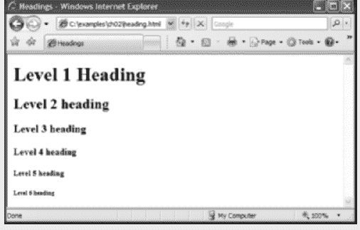

图2.2 | 标题元素h1到h6。

## 2.6 链接

XHTML最重要的特性之一是*超链接*，它引用（或*链接到*）其他资源，如XHTML文档和图像。当用户点击超链接时，浏览器会尝试执行与之关联的操作（例如，导航到URL、打开电子邮件客户端等）。在XHTML中，文本和图像都可以作为超链接。Web浏览器通常默认将文本超链接添加下划线并将其文本颜色设为蓝色，以便用户能够区分超链接和纯文本。在图2.3中，我们创建了指向四个不同网站的文本超链接。

第14行引入了**strong元素**，它表示其内容具有高度重要性。浏览器通常以粗体显示此类文本。

链接使用**a**（*锚点*）元素创建。第17行定义了一个指向分配给属性**href**的URL的超链接，该属性指定链接资源的位置，例如

第2章 XHTML简介

```
<?xml version = "1.0" encoding = "utf-8"?>
<!DOCTYPE html PUBLIC "-//W3C//DTD XHTML 1.0 Strict//EN"
  "http://www.w3.org/TR/xhtml1/DTD/xhtml1-strict.dtd">

<!-- Fig. 2.3: links.html -->
<!-- Linking to other web pages. -->
<html xmlns = "http://www.w3.org/1999/xhtml">
   <head>
      <title>Links</title>
   </head>

   <body>
      <h1>Here are my favorite sites</h1>
      <p><strong>Click a name to go to that page.</strong></p>

      <!-- Create four text hyperlinks -->
      <p><a href = "http://www.deitel.com">Deitel</a></p>
      <p><a href = "http://www.prenhall.com">Prentice Hall</a></p>
      <p><a href = "httpSelector.selectItems("http://www.yahoo.com">Yahoo!</a></p>
      <p><a href = "http://www.usatoday.com">USA Today</a></p>
   </body>
</html>
```

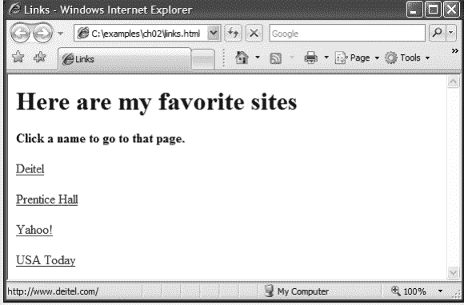

## 图2.3 | 链接到其他网页。

网页、文件或电子邮件地址。这个特定的锚点元素将文本`Deitel`链接到位于`http://www.deitel.com`的网页。当URL未指定网站上的特定文档时，Web服务器会返回一个默认网页。该页面通常称为`index.html`；但是，大多数Web服务器可以配置为使用任何文件作为网站的默认网页。如果Web服务器无法找到请求的文档，它会向Web浏览器返回错误指示，浏览器会向用户显示包含错误消息的网页。


## 超链接到电子邮件地址

锚点可以使用 **mailto:** URL 链接到电子邮件地址。当用户点击这种类型的锚点链接时，大多数浏览器会启动默认的电子邮件程序（例如 Microsoft Outlook 或 Mozilla Thunderbird），以便用户撰写一封发送到该链接地址的电子邮件。图 2.4 展示了这种类型的锚点。第 15–17 行包含一个电子邮件链接。电子邮件锚点的形式为 `<a href = "mailto:emailAddress">...</a>`。在本例中，我们链接到电子邮件地址 deitel@deitel.com。

```xml
<?xml version = "1.0" encoding = "utf-8"?>
<!DOCTYPE html PUBLIC "-//W3C//DTD XHTML 1.0 Strict//EN"
   "http://www.w3.org/TR/xhtml1/DTD/xhtml1-strict.dtd">

<!-- Fig. 2.4: contact.html -->
<!-- Linking to an e-mail address. -->
<html xmlns = "http://www.w3.org/1999/xhtml">
   <head>
      <title>Contact Page</title>
   </head>

   <body>
      <p>
         My email address is
         <a href = "mailto:deitel@deitel.com">
            deitel@deitel.com
         </a>
         . Click the address and your default email client
         will open an e-mail message and address it to me.
      </p>
   </body>
</html>
```

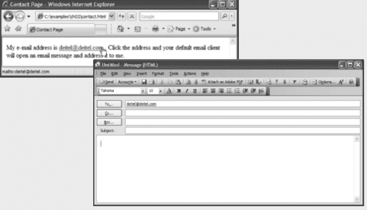

## 2.7 图像

到目前为止讨论的示例演示了如何标记仅包含文本的文档。然而，大多数网页同时包含文本和图像。事实上，图像是网页设计中同样重要的——如果不是必不可少的——组成部分。Web 开发人员使用的三种最流行的图像格式是图形交换格式（GIF）、联合图像专家组（JPEG）和便携式网络图形（PNG）图像。用户可以使用专业软件创建图像，例如 Adobe Photoshop Elements（www.adobe.com）、G.I.M.P.（http://www.gimp.org）和 Inkscape（http://www.inkscape.org）。图像也可以从各种网站获取。图 2.5 展示了如何将图像嵌入网页。

第 14–15 行使用 **img 元素**在文档中插入图像。图像文件的位置由 img 元素的 **src 属性**指定。此图像位于与 XHTML 文档相同的目录中，因此只需提供图像的文件名即可。可选属性 **width** 和 **height** 分别指定图像的宽度和高度。你可以通过增大或减小图像宽度和高度属性的值来缩放图像。如果省略这些属性，浏览器将使用图像的实际宽度和高度。图像以**像素**（"picture elements"，即"图像元素"）为单位进行度量，像素代表屏幕上的彩色点。任何图像编辑程序都会提供以像素为单位显示图像尺寸的功能。图 2.5 中的图像宽 92 像素，高 120 像素。

> 良好编程实践 2.5
>
> 始终在 `` 标签中包含图像的宽度和高度。当浏览器加载 XHTML 文件时，它会立即根据这些属性知道为图像预留多少屏幕空间，甚至在下载图像之前就能正确地进行页面布局。

> 性能提示 2.1
>
> 在 `` 标签中包含 width 和 height 属性可以帮助浏览器更快地加载和渲染页面。

> 常见编程错误 2.4
>
> 输入改变图像固有宽高比的新尺寸会使图像外观失真。例如，如果你的图像宽 200 像素、高 100 像素，你应该确保任何新尺寸都保持 2:1 的宽高比。

```xml
1	<?xml version = "1.0" encoding = "utf-8"?>
2	<!DOCTYPE html PUBLIC "-//W3C//DTD XHTML 1.0 Strict//EN"
3		"http://www.w3.org/TR/xhtml1/DTD/xhtml1-strict.dtd">
4	
5	<!-- Fig. 2.5: picture.html -->
6	<!-- Images in XHTML files. -->
7	<html xmlns = "http://www.w3.org/1999/xhtml">
8		<head>
9			<title>Images</title>
10		</head>
11		<body>
13		  <p>
14		    
16		    
18		  </p>
19		</body>
20	</html>
```

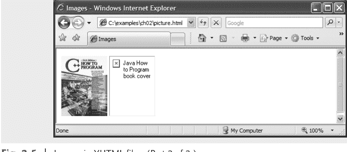

XHTML 文档中的每个 img 元素都必须有一个 **alt 属性**。如果浏览器无法渲染图像，浏览器会显示 alt 属性的值。浏览器可能由于多种原因无法渲染图像。它可能不支持图像——如*基于文本的浏览器*（即只能显示文本的浏览器）的情况——或者客户端可能已禁用图像查看以减少下载时间。图 2.5 展示了 Internet Explorer 7 渲染一个红色 x 符号并显示 alt 属性的值，表示图像（jhtp.jpg）无法找到。

alt 属性有助于你为有残疾的用户创建*可访问的*网页，特别是那些使用基于文本浏览器的视力障碍用户。一种称为*语音合成器*的专业软件可以"朗读"alt 属性的值，以便视力障碍用户了解浏览器正在显示什么。

某些 XHTML 元素（称为*空元素*）仅包含属性，不标记文本（即不会在开始标签和结束标签之间放置文本）。空元素（例如 img）必须终止，方法是在开始标签的结束右尖括号（>）内使用*正斜杠字符*（/），或者显式包含结束标签。使用正斜杠字符时，我们在它前面添加一个空格以提高可读性（如第 15 行和第 17 行末尾所示）。不使用正斜杠字符，第 16–17 行也可以使用结束标签 `</img>` 来编写，如下所示：

```xml
</img>
```

### 使用图像作为超链接

通过将图像用作超链接，Web 开发人员可以创建链接到其他资源的图形化网页。在图 2.6 中，我们创建了六个不同的图像超链接。

## 导航栏

```xml
<?xml version = "1.0" encoding = "utf-8"?>
<!DOCTYPE html PUBLIC "-//W3C//DTD XHTML 1.0 Strict//EN"
   "http://www.w3.org/TR/xhtml1/DTD/xhtml1-strict.dtd">

<!-- Fig. 2.6: nav.html -->
<!-- Images as link anchors. -->
<html xmlns = "http://www.w3.org/1999/xhtml">
   <head>
      <title>Navigation Bar</title>
   </head>

   <body>
      <p>
         <a href = "links.html">
            
         </a>

         <a href = "list.html">
            
         </a>

         <a href = "contact.html">
            
         </a>

         <a href = "table1.html">
            
         </a>

         <a href = "form.html">
            
         </a>
      </p>
   </body>
</html>
```

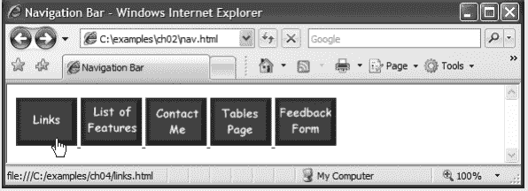

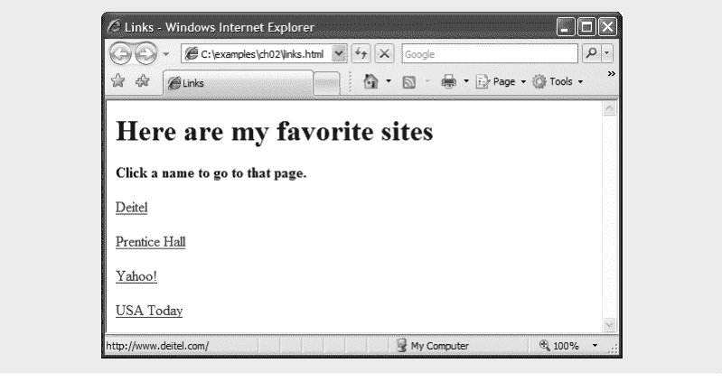

第 14–17 行通过将 img 元素嵌套在锚点（a）元素中来创建**图像超链接**。img 元素的 src 属性值指定了此图像（links.jpg）位于名为 buttons 的目录中。buttons 目录与 XHTML 文档位于同一目录中。也可以通过将 src 属性设置为图像的名称和位置来引用来自其他 Web 文档的图像。请注意，如果你要托管一个使用其他网站图像的公开网页，你应该获得使用该图像的许可，并在你自己的网站上托管该图像的副本。如果你引用另一个网站上的图像，浏览器必须向该网站的服务器请求图像资源。点击图像超链接会将用户带到周围锚点元素的 href 属性指定的网页。请注意，当鼠标悬停在任何类型的链接上时，链接指向的 URL 会显示在浏览器窗口底部的状态栏中。

## 2.8 特殊字符和水平线

在标记文本时，某些字符或符号（例如 <）可能难以直接嵌入 XHTML 文档。某些键盘不提供这些符号，或者这些符号的存在可能导致语法错误。例如，标记

```xml
<p>if x < 10 then increment x by 1</p>
```

会导致语法错误，因为它使用了小于字符（<），而该字符是为开始标签和结束标签（如 `<p>` 和 `</p>`）保留的。XHTML 提供*字符实体引用*（以 &code; 的形式）来表示特殊字符。我们可以通过编写以下内容来修正上一行

```xml
<p>if x &lt; 10 then increment x by 1</p>
```

其中使用了字符实体引用 **&lt;** 来表示小于符号（<）。


图 2.7 演示了如何在 XHTML 文档中使用特殊字符。第 24–25 行包含其他特殊字符，这些字符可以用*字符实体引用*（使用单词缩写编码，例如用 `&amp;` 表示 & 符号，用 `&copy;` 表示版权）或*数值字符引用*——表示特殊字符的十进制或*十六进制*（*hex*）值。例如，`&` 字符分别用十进制和十六进制表示为 `&amp;#38;` 和 `&amp;#x26;`。十六进制数是基数为 16 的数——十六进制数中的数字取值范围为 0 到 15（共 16 个不同的值）。字母 A–F 表示十六进制数字，对应于十进制值 10–15。因此，在十六进制表示法中，我们可以有像 876 这样完全由类十进制数字组成的数，像 DA19F 这样由数字和字母组成的数，以及像 DCB 这样完全由字母组成的数。

```
<pre><code> 1  &lt;?xml version = &quot;1.0&quot; encoding = &quot;utf-8&quot;?&gt;
 2  &lt;!DOCTYPE html PUBLIC &quot;-//W3C//DTD XHTML 1.0 Strict//EN&quot;
 3    &quot;http://www.w3.org/TR/xhtml1/DTD/xhtml1-strict.dtd&quot;&gt;
 4
 5  &lt;!-- Fig. 2.7: contact2.html --&gt;
 6  &lt;!-- Inserting special characters. --&gt;
 7  &lt;html xmlns = &quot;http://www.w3.org/1999/xhtml&quot;&gt;
 8     &lt;head&gt;
 9        &lt;title&gt;Contact Page&lt;/title&gt;
10     &lt;/head&gt;
11
12     &lt;body&gt;
13        &lt;p&gt;
14           Click
15           &lt;a href = &quot;mailto:deitel@deitel.com&quot;&gt;here&lt;/a&gt;
16           to open an email message addressed to
17           deitel@deitel.com.
18        &lt;/p&gt;
19
20        &lt;hr /&gt; &lt;!-- inserts a horizontal rule --&gt;
21
22        &lt;!-- special characters are entered --&gt;
23        &lt;!-- using the form &amp;code; --&gt;
24        &lt;p&gt;All information on this site is &lt;strong&gt;&amp;copy;
25           Deitel &amp;amp; Associates, Inc. 2007.&lt;/strong&gt;&lt;/p&gt;
26
27        &lt;!-- to strike through text use &lt;del&gt; tags --&gt;
28        &lt;!-- to subscript text use &lt;sub&gt; tags --&gt;
29        &lt;!-- to superscript text use &lt;sup&gt; tags --&gt;
30        &lt;!-- these tags are nested inside other tags --&gt;
31        &lt;p&gt;&lt;del&gt;You may download 3.14 x 10&lt;sup&gt;2&lt;/sup&gt;
32           characters worth of information from this site.&lt;/del&gt;
33           Only &lt;sub&gt;one&lt;/sub&gt; download per hour is permitted.&lt;/p&gt;
34        &lt;p&gtamage9;Note: &amp;lt; &amp;frac14; of the information
35           presented here is updated daily.&lt;/em&gt;&lt;/p&gt;
36     &lt;/body&gt;
37  &lt;/html&gt;</code></pre>

**图 2.7 | 插入特殊字符。（第 1 部分，共 2 部分。）**
```

图 2.7 | 插入特殊字符。（第 2 部分，共 2 部分。）

在第 31–33 行中，我们介绍了四个新元素。大多数浏览器将 **del** 元素渲染为删除线文本。使用这种格式，用户可以轻松地标记文档修订。要**上标**文本（即，将文本提升到基线以上并减小字体大小）或**下标**文本（即，将文本降低到基线以下并减小字体大小），分别使用 **sup** 或 **sub** 元素。第 34–35 行中的段落包含一个 **em** 元素，表示其内容应被强调。浏览器通常以斜体字体渲染 em 元素。我们还使用字符实体引用 `&lt;` 表示小于号，`&frac14;` 表示分数 1/4（第 34 行）。

除了特殊字符外，本文档还介绍了一个**水平分隔线**，由第 22 行中的 **<hr />** 标签表示。大多数浏览器将水平分隔线渲染为一条水平线，其上下方各有一个空白行。

## 2.9 列表

到目前为止，我们已经介绍了用于链接到资源、创建标题、使用特殊字符和插入图像的基本 XHTML 元素和属性。在本节中，我们将讨论如何使用列表在网页上组织信息。在下一节中，我们将介绍另一种用于组织信息的功能，称为表格。图 2.8 在**无序列表**（即，不按字母或数字排序其项目的列表）中显示文本。无序列表元素 **ul** 创建一个列表，其中每个项目以项目符号（称为实心圆点）开头。无序列表中的每个条目（第 17 行的 **ul** 元素）是一个 **li**（列表项）元素（第 19–22 行）。大多数网页浏览器将每个 **li** 元素渲染在新的一行，并以缩进的开头项目符号显示。

```
1 <?xml version = "1.0" encoding = "utf-8"?>
2 <!DOCTYPE html PUBLIC "-//W3C//DTD XHTML 1.0 Strict//EN"
3     "http://www.w3.org/TR/xhtml1/DTD/xhtml1-strict.dtd">
4
```

图 2.8 | 包含超链接的无序列表。（第 1 部分，共 2 部分。）

## 嵌套列表

列表可以嵌套以表示层次关系，如大纲格式。图 2.9 演示了嵌套列表和*有序列表*。有序列表元素 **ol** 创建一个列表，其中每个项目以数字开头。

网页浏览器缩进每个嵌套列表以表示层次关系。第一个有序列表从第 30 行开始。有序列表中的项目按一、二、三等枚举。嵌套的有序列表以相同方式枚举。最外层无序列表（第 16 行）中的项目前面有实心圆点。嵌套在第 16 行无序列表内部的列表项前面有圆形项目符号。虽然本示例未演示，但后续嵌套列表项前面会有方形项目符号。

```
5  <!-- Fig. 2.8: links2.html -->
6  <!-- Unordered list containing hyperlinks. -->
7  <html xmlns = "http://www.w3.org/1999/xhtml">
8      <head>
9          <title>Links</title>
10     </head>
11
12     <body>
13         <h1>Here are my favorite sites</h1>
14         <p><strong>Click on a name to go to that page.</strong></p>
15
16         <!-- create an unordered list -->
17         <ul>
18             <!-- add four list items -->
19             <li><a href = "http://www.deitel.com">Deitel</a></li>
20             <li><a href = "http://www.w3.org">W3C</a></li>
21             <li><a href = "http://www.yahoo.com">Yahoo!</a></li>
22             <li><a href = "http://www.cnn.com">CNN</a></li>
23         </ul>
24     </body>
25 </html>
```

```
<?xml version = "1.0" encoding = "utf-8"?>
<!DOCTYPE html PUBLIC "-//W3C//DTD XHTML 1.0 Strict//EN"
   "http://www.w3.org/TR/xhtml1/DTD/xhtml1-strict.dtd">

<!-- Fig. 2.9: list.html -->
<!-- Nested and ordered lists. -->
<html xmlns = "http://www.w3.org/1999/xhtml">
   <head>
      <title>Lists</title>
   </head>

   <body>
      <h1>The Best Features of the Internet</h1>

      <!-- create an unordered list -->
      <ul>
         <li>You can meet new people from countries around
            the world.</li>
         <li>
            You have access to new media as it becomes public:

            <!-- this starts a nested list, which uses a -->
            <!-- modified bullet. The list ends when you -->
            <!-- close the <ul> tag. -->
            <ul>
               <li>New games</li>
               <li>New applications

                  <!-- nested ordered list -->
                  <ol>
                     <li>For business</li>
                     <li>For pleasure</li>
                  </ol>
               </li> <!-- ends line 27 new applications li -->

               <li>Around the clock news</li>
               <li>Search engines</li>
               <li>Shopping</li>
               <li>Programming

                  <!-- another nested ordered list -->
                  <ol>
                     <li>XML</li>
                     <li>Java</li>
                     <li>XHTML</li>
                     <li>Scripts</li>
                     <li>New languages</li>
                  </ol>
               </li> <!-- ends programming li of line 39 -->
            </ul> <!-- ends the nested list of line 25 -->
         </li>
```

图 2.9 | 嵌套列表和有序列表。（第 1 部分，共 2 部分。）


## 2.10 表格

表格常用于将数据整理成行和列。我们的第一个例子（图 2.10）创建了一个包含六行两列的表格，用于显示水果的价格信息。

表格使用 **table** 元素定义（第 15–62 行）。第 15–17 行指定了 `table` 元素的开始标签，该元素具有多个属性。**border** 属性指定表格边框的宽度（以像素为单位）。要创建无边框的表格，将 border 设置为 "0"。本例将 **width** 属性的值设为 "40%"，使表格宽度为浏览器宽度的 40%。开发者也可以将 width 属性设置为指定的像素数。尝试调整浏览器窗口大小，看看窗口宽度如何影响表格宽度。

顾名思义，**summary** 属性（第 16–17 行）描述表格的内容。语音设备使用此属性，使视觉障碍用户能够更方便地访问表格。**caption** 元素（第 21 行）描述表格内容，并帮助基于文本的浏览器解释表格数据。大多数浏览器将 `<caption>` 标签内的文本渲染在表格上方。summary 属性和 **caption** 元素是众多 XHTML 特性中的两个，它们使网页对残障用户更加友好。

表格有三个不同的部分——*表头*、*主体* 和 *表尾*。表头部分（或标题单元格）使用 **thead** 元素定义（第 25–30 行），其中包含列名等标题信息。每个 **tr** 元素（第 26–29 行）定义一个独立的 *表格行*。表头部分的列使用 **th** 元素定义。大多数浏览器会将 th（表格标题列）元素格式化的文本居中显示，并以粗体显示。表格标题元素嵌套在表格行元素内部（第 27–28 行）。

主体部分，即 *表格主体*，包含表格的主要数据。表格主体（第 43–60 行）在 **tbody** 元素中定义。在主体中，每个 tr 元素指定一行。*数据单元格* 包含单独的数据片段，在每个行中使用 **td**（*表格数据*）元素定义。

表尾部分（第 34–39 行）使用 **tfoot**（表格尾部）元素定义。放在页脚中的文本通常包括计算结果和脚注。与其他部分一样，表尾部分可以包含表格行，每行可以包含单元格。与表头部分一样，表尾部分的单元格也使用 th 元素创建，而不是表格主体中使用的 td 元素。注意，表尾部分在代码中必须位于主体部分的上方，但表格尾部显示在表格的底部。

### 使用 rowspan 和 colspan

图 2.10 探讨了基本表格的结构。图 2.11 展示了另一个表格示例，并介绍了两个新属性，它们允许你构建更复杂的表格。

表格从第 15 行开始。表格单元格的大小会根据其包含的数据自动调整。文档作者可以使用 **rowspan** 和 **colspan** 属性创建更大的单元格。赋给这些属性的值指定单元格占据的行数或列数。第 23–26 行的 th 元素使用属性 rowspan = "2"，使包含骆驼图片的单元格占用两个垂直相邻的单元格（因此该单元格 *跨越* 两行）。第 29–32 行的 th 元素使用属性 colspan = "4"，将标题单元格（包含 Camelid comparison 和 Approximate as of 6/2007）加宽，使其跨越四个单元格。

```xml
<?xml version = "1.0" encoding = "utf-8"?>
<!DOCTYPE html PUBLIC "-//W3C//DTD XHTML 1.0 Strict//EN"
  "http://www.w3.org/TR/xhtml1/DTD/xhtml1-strict.dtd">

<!-- Fig. 2.11: table2.html -->
<!-- Complex XHTML table. -->
<html xmlns = "http://www.w3.org/1999/xhtml">
  <head>
    <title>Tables</title>
  </head>

  <body>
    <h1>Table Example Page</h1>

    <table border = "1">
      <caption>Here is a more complex sample table.</caption>

      <thead>
        <!-- rowspans and colspans merge the specified -->
        <!-- number of cells vertically or horizontally -->
        <tr>
          <!-- merge two rows -->
          <th rowspan = "2">
            
          </th>

          <!-- merge four columns -->
          <th colspan = "4">
            <h1>Camelid comparison</h1>
            <p>Approximate as of 6/2007</p>
          </th>
        </tr>
        <tr>
          <th># of Humps</th>
          <th>Indigenous region</th>
          <th>Spits?</th>
          <th>Produces Wool?</th>
        </tr>
      </thead>
      <tbody>
        <tr>
          <th>Camels (bactrian)</th>
          <td>2</td>
          <td>Africa/Asia</td>
          <td>Yes</td>
          <td>Yes</td>
        </tr>
        <tr>
          <th>Llamas</th>
          <td>1</td>
          <td>Andes Mountains</td>
          <td>Yes</td>
          <td>Yes</td>
        </tr>
      </tbody>
    </table>
  </body>
</html>
```

## 2.11 表单

浏览网站时，用户经常需要提供搜索关键词、电子邮件地址和邮政编码等信息。XHTML 提供了一种称为表单的机制，用于收集用户数据。

用户在网页上输入的数据通常会发送到 Web 服务器，该服务器提供对站点资源的访问（例如 XHTML 文档、图像）。这些资源位于

或位于与Web服务器相同的机器上，或位于Web服务器可以通过网络访问的机器上。当浏览器请求位于服务器上的网页或文件时，服务器会处理该请求并返回所请求的资源。请求包含所需资源的名称和路径以及通信方式（称为*协议*）。XHTML文档使用超文本传输协议（HTTP）。

图2.12是一个简单的表单，它将数据发送到Web服务器，Web服务器将表单数据传递给一个程序。该程序处理从Web服务器接收到的数据，并通常将信息返回给Web服务器。然后Web服务器将该信息作为XHTML文档发送到Web浏览器。我们将在第17章讨论Web服务器。*[注意：此示例演示了客户端功能。如果提交表单（通过点击提交按钮），将不会发生任何事情，因为我们还不知道如何处理表单数据。在后面的章节中，我们将介绍处理输入到表单中的信息所需的服务端编程（例如Ruby on Rails、PHP、ASP.NET和JavaServer Faces）。]*

表单可以包含可视和非可视组件。可视组件包括可点击按钮和用户与之交互的其他图形用户界面组件。非可视组件称为*隐藏输入*，用于存储你指定的任何数据，例如电子邮件地址和作为链接的XHTML文档文件名。表单在第21–46行由一个**form**元素定义。

属性**method**（第21行）指定表单数据如何发送到Web服务器。使用**method = "post"**将表单数据附加到浏览器请求中，该请求包含协议（HTTP）和所请求资源的URL。这种将数据传递给服务器的方式是透明的——用户在表单提交后看不到数据。另一个可能的值**method = "get"**将表单数据直接附加到脚本URL的末尾，在浏览器的**地址**栏中可见。*post*和*get*方法用于发送表单数据，在第17章中将详细讨论。

```
1  <?xml version = "1.0" encoding = "utf-8"?>
2  <!DOCTYPE html PUBLIC "-//W3C//DTD XHTML 1.0 Strict//EN"
3    "http://www.w3.org/TR/xhtml1/DTD/xhtml1-strict.dtd">
4
5  <!-- Fig. 2.12: form.html -->
6  <!-- Form with hidden fields and a text box. -->
7  <html xmlns = "http://www.w3.org/1999/xhtml">
8    <head>
9      <title>Forms</title>
10    </head>
11
12    <body>
13      <h1>Feedback Form</h1>
14
15      <p>Please fill out this form to help
16        us improve our site.</p>
17
18      <!-- this tag starts the form, gives the -->
19      <!-- method of sending information and the -->
20      <!-- location of form script -->
21      <form method = "post" action = "">
22        <p>
```

图 2.12 | 包含隐藏字段和文本框的表单。（第1部分，共2部分。）

```
<!-- hidden inputs contain non-visual -->
<!-- information -->
<input type = "hidden" name = "recipient"
   value = "deitel@deitel.com" />
<input type = "hidden" name = "subject"
   value = "Feedback Form" />
<input type = "hidden" name = "redirect"
   value = "main.html" />
</p>

<!-- <input type = "text"> inserts a text box -->
<p><label>Name:
   <input name = "name" type = "text" size = "25"
      maxlength = "30" />
</label></p>

<p>
   <!-- input types "submit" and "reset" insert -->
   <!-- buttons for submitting and clearing the -->
   <!-- form's contents -->
   <input type = "submit" value = "Submit" />
   <input type = "reset" value = "Clear" />
</p>
</form>
</body>
</html>
```

图 2.12 | 包含隐藏字段和文本框的表单。（第2部分，共2部分。）

第21行的<form>标签中的**action**属性指定Web服务器上将被调用来处理表单数据的脚本的URL。由于我们还没有介绍服务端编程，所以目前将此属性留空。

第25–44行定义了六个**input**元素，这些元素指定了要提供给处理表单的脚本（也称为*表单处理器*）的数据。有几种类型的input元素。input的类型由其**type属性**决定。此表单使用了`text` input、`submit` input、`reset` input和三个`hidden` input。

第35–36行的text input在表单中插入一个文本框。用户可以在文本框中输入数据。label元素（第34–37行）向用户提供有关input元素用途的信息。input元素的size属性指定文本框中可见的字符数。可选属性maxlength限制输入到文本框中的字符数——在本例中，用户不允许输入超过30个字符。

### 外观观察 2.3

> 为每个表单元素添加label元素，以帮助用户确定每个表单元素的用途。

第43–44行中的两个input元素创建了两个按钮。submit input元素是一个按钮。当按下提交按钮时，用户将被发送到表单的action属性中指定的位置。value属性设置按钮上显示的文本。reset input元素允许用户将所有表单元素重置为其默认值。reset input元素的value属性设置按钮上显示的文本（如果省略value属性，默认值为Reset）。

第25–30行中的三个input元素的type属性为hidden，它允许你发送非用户输入的表单数据。这三个hidden input分别是数据将发送到的电子邮件地址、电子邮件的主题行以及表单提交后浏览器要打开的URL。另外两个input属性是name（用于标识input元素）和value（提供将要发送（或提交）到Web服务器的值）。

### 良好编程实践 2.6

> 将hidden input元素放在表单的开头，紧跟在开始的<form>标签之后。这种放置方式使文档编写者能够快速定位hidden input元素。

## 其他表单元素

在前面的示例中，你看到了XHTML表单的基本元素。现在你已经了解了表单的一般结构，我们来介绍用于创建更复杂表单的元素和属性。图2.13包含一个征求用户对网站反馈的表单。

```
<?xml version = "1.0" encoding = "utf-8"?>
<!DOCTYPE html PUBLIC "-//W3C//DTD XHTML 1.0 Strict//EN"
  "http://www.w3.org/TR/xhtml1/DTD/xhtml1-strict.dtd">

<!-- Fig. 2.13: form2.html -->
<!-- Form using a variety of components. -->
<html xmlns = "http://www.w3.org/1999/xhtml">
   <head>
      <title>More Forms</title>
   </head>

   <body>
      <h1>Feedback Form</h1>
```

```
<p>Please fill out this form to help
us improve our site.</p>
```

```
<form method="post" action="">
```

```
<p>
    <input type="hidden" name="recipient"
           value="deitel@deitel.com" />
    <input type="hidden" name="subject"
           value="Feedback Form" />
    <input type="hidden" name="redirect"
           value="main.html" />
</p>
```

```
<p><label>Name:
    <input name="name" type="text" size="25" />
</label></p>
```

```
<!-- <textarea> creates a multiline textbox -->
```

```
<p><label>Comments:<br />
    <textarea name="comments"
              rows="4" cols="36">Enter comments here.</textarea>
</label></p>
```

```
<!-- <input type="password"> inserts a -->
<!-- textbox whose display is masked with -->
<!-- asterisk characters -->
```

```
<p><label>E-mail Address:
    <input name="email" type="password" size="25" />
</label></p>
```

```
<p>
    <strong>Things you liked:</strong><br />
```

```
    <label>Site design
        <input name="thingsliked" type="checkbox"
               value="Design" /></label>
    <label>Links
        <input name="thingsliked" type="checkbox"
               value="Links" /></label>
    <label>Ease of use
        <input name="thingsliked" type="checkbox"
               value="Ease" /></label>
    <label>Images
        <input name="thingsliked" type="checkbox"
               value="Images" /></label>
    <label>Source code
        <input name="thingsliked" type="checkbox"
               value="Code" /></label>
</p>
```

```
<!-- <input type="radio" /> creates a radio -->
<!-- button. The difference between radio buttons -->
```

图 2.13 | 使用各种组件的表单。（第2部分，共4部分。）


 <!-- and checkboxes is that only one radio button -->
<!-- in a group can be selected. -->
<p>
	<strong>您是如何来到我们网站的？</strong><br />
	<label>搜索引擎
		<input name = "howtosite" type = "radio"
			value = "search engine" checked = "checked" /></label>
	<label>来自其他网站的链接
		<input name = "howtosite" type = "radio"
			value = "link" /></label>
	<label>Deitel.com 网站
		<input name = "howtosite" type = "radio"
			value = "deitel.com" /></label>
	<label>书籍中的参考
		<input name = "howtosite" type = "radio"
			value = "book" /></label>
	<label>其他
		<input name = "howtosite" type = "radio"
			value = "other" /></label>
</p>
<p>
	<label>为我们的网站评分：
		<!-- the <select> tag presents a drop-down -->
		<!-- list with choices indicated by the -->
		<!-- <option> tags -->
		<select name = "rating">
			<option selected = "selected">非常棒</option>
			<option>10</option>
			<option>9</option>
			<option>8</option>
			<option>7</option>
			<option>6</option>
			<option>5</option>
			<option>4</option>
			<option>3</option>
			<option>2</option>
			<option>1</option>
			<option>非常差</option>
		</select>
	</label>
</p>
<p>
	<input type = "submit" value = "提交" />
	<input type = "reset" value = "清除" />
</p>
</form>
</body>
</html>
```

# 图 2.13 | 使用多种组件的表单。（第 3 部分，共 4 部分。）

# 94 第 2 章 XHTML 简介

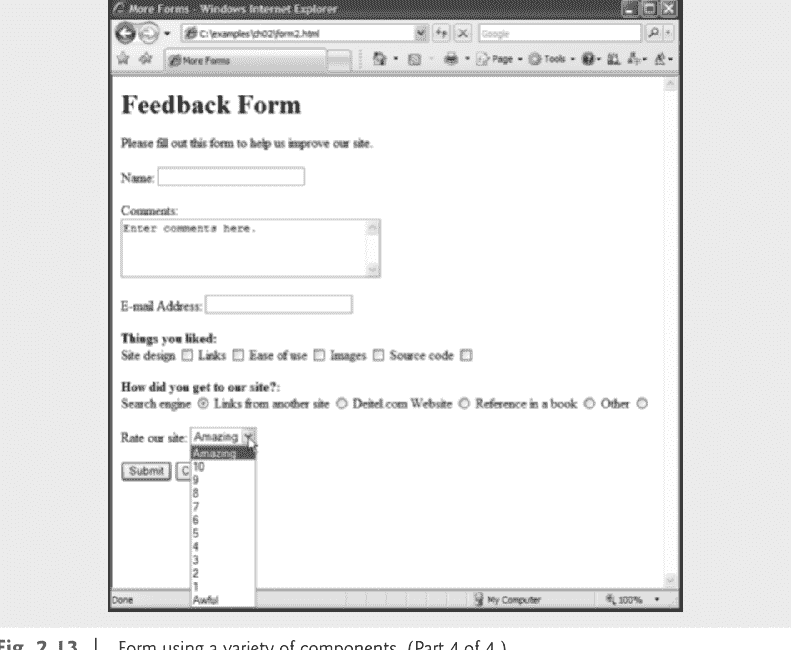

图 2.13 | 使用多种组件的表单。（第 4 部分，共 4 部分。）

在第 32 行，我们引入了 **br** 元素，大多数浏览器将其渲染为*换行符*。br 元素之后的任何标记或文本都会在下一行渲染。与 img 元素一样，br 是以斜杠终止的空元素的一个例子。我们添加了一个斜杠前的空格以增强可读性。

**textarea** 元素（第 33–34 行）在表单中插入一个多行文本框，称为*文本区域*。行数由 **rows** 属性指定，列数（即每行字符数）由 **cols** 属性指定。在此示例中，textarea 的高度为四行，宽度为 36 个字符。要在文本区域中显示默认文本，请将文本放在 `<textarea>` 和 `</textarea>` 标签之间。默认文本可以在其他输入类型（如文本框）中通过使用 value 属性来指定。

第 41 行的 **password** 输入插入了一个具有指定大小（允许的最大字符数）的密码框。密码框允许用户通过使用星号（*）“掩码”输入的信息来输入敏感信息，如信用卡号和密码。实际输入的值会被发送到 Web 服务器，而不是用于掩码输入的字符。

第 47–61 行介绍了 **checkbox** 表单元素。复选框允许用户从一组选项中进行选择。当用户选中一个复选框时，复选框中会出现一个勾选标记。否则，复选框保持为空。每个 "**checkbox**" 输入都会创建一个新的复选框。复选框可以单独使用，也可以分组使用。属于同一组的复选框被赋予相同的名称（在本例中为 "thingsliked"）。

# 常见编程错误 2.5

> 当您的表单中有多个同名的复选框时，必须确保它们具有不同的值，否则运行在 Web 服务器上的脚本将无法区分它们。

在复选框之后，我们提供了两种更多方式让用户做出选择。在本示例中，我们引入了两种新的输入类型。第一种类型是单选按钮（第 71–85 行），通过 type "radio" 指定。单选按钮类似于复选框，不同之处在于在任何时候只能选择一组单选按钮中的一个。组中的所有单选按钮都具有相同的 name 属性，并通过它们不同的 value 属性来区分。属性-值对 checked = "checked"（第 73 行）表示最初选中的单选按钮（如果有的话）。checked 属性也适用于复选框。

# 常见编程错误 2.6

> 未将表单中单选按钮的 name 属性设置为相同的名称是一个逻辑错误，因为它允许用户同时选择所有单选按钮。

select 元素（第 94–107 行）提供了一个下拉列表，用户可以从中选择一个项目。name 属性标识下拉列表。option 元素（第 95–106 行）向下拉列表中添加项目。option 元素的 selected 属性指定最初作为选中项显示在 select 元素中的项目。如果没有 option 元素被标记为 selected，则浏览器默认选择第一个选项。

## 2.12 内部链接

在本章前面，我们讨论了如何将一个网页超链接到另一个网页。图 2.14 介绍了内部链接——一种使用户能够在同一文档内不同位置之间跳转的机制。内部链接对于包含多个部分的长文档很有用。单击内部链接使用户无需滚动整个文档即可找到某个部分。

第 14 行包含一个带有 id 属性（设置为 "features"）的标签，用于内部超链接。要链接到同一网页中具有此属性的标签，锚点元素的 href 属性包含以井号（#）开头的 id 属性值（如 #features）。第 56 行包含一个以 id features 作为目标的超链接。在 Web 浏览器中选择此超链接会使浏览器窗口滚动到第 14 行的 h1 标签。请注意，您可能需要将浏览器调整为小窗口并向下滚动，然后单击链接才能看到浏览器滚动到 h1 元素。

```
<?xml version = "1.0"?>
<!DOCTYPE html PUBLIC "-//W3C//DTD XHTML 1.0 Strict//EN"
	"http://www.w3.org/TR/xhtml1/DTD/xhtml1-strict.dtd">

<html xmlns = "http://www.w3.org/1999/xhtml">
<head>
    <title>Internal Links</title>
</head>

<body>
    <!-- id attribute creates an internal hyperlink destination -->
    <h1 id = "features">The Best Features of the Internet</h1>

    <!-- an internal link's address is "#id" -->
    <p><a href = "#bugs">Go to <em>Favorite Bugs</em></a></p>

    <ul>
        <li>You can meet people from countries
            around the world.</li>
        <li>You have access to new media as it becomes public:
            <ul>
                <li>New games</li>
                <li>New applications
                    <ul>
                        <li>For Business</li>
                        <li>For Pleasure</li>
                    </ul>
                </li>

                <li>Around the clock news</li>
                <li>Search Engines</li>
                <li>Shopping</li>
                <li>Programming
                    <ul>
                        <li>XHTML</li>
                        <li>Java</li>
                        <li>Dynamic HTML</li>
                        <li>Scripts</li>
                        <li>New languages</li>
                    </ul>
                </li>
            </ul>
        </li>

        <li>Links</li>
        <li>Keeping in touch with old friends</li>
        <li>It is the technology of the future!</li>
    </ul>

    <!-- id attribute creates an internal hyperlink destination -->
    <h1 id = "bugs">My 3 Favorite Bugs</h1>
    <p>
        <!-- internal hyperlink to features -->
        <a href = "#features">Go to <em>Favorite Features</em></a>
    </p>
    <ol>
        <li>Fire Fly</li>
        <li>Gal Ant</li>
        <li>Roman Tic</li>
    </ol>
</body>
</html>
```

# 图 2.14 | 使用内部超链接使页面更易于导航。（第 2 部分，共 3 部分。）

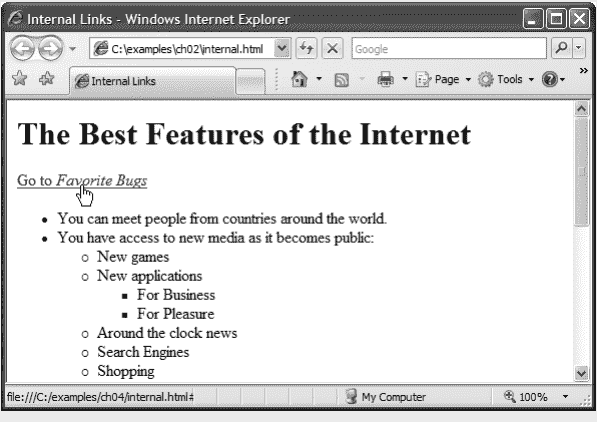

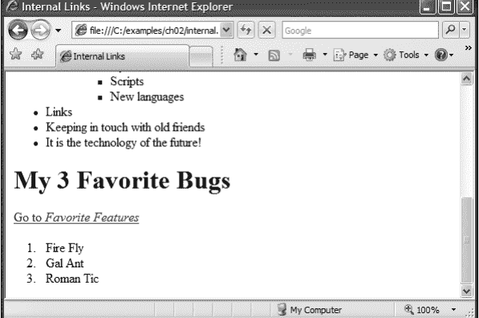

# 图 2.14 | 使用内部超链接使页面更易于导航。（第 3 部分，共 3 部分。）

# 外观观察 2.4

> 内部超链接在包含大量信息的 XHTML 文档中非常有用。指向页面不同部分的内部链接使用户更容易导航页面——他们无需滚动即可找到他们想要的部分。


虽然本示例未展示，但超链接可以通过指定文档名称后跟井号和id值来指定另一个文档中的内部链接，例如：

```
href = "filename.html#id"
```

例如，要链接到 books.html 中带有名为 booklist 的 id 属性的标签，href 应赋值为 "books.html#booklist"。你也可以通过在任意网址后附加井号和元素的 id 值，将浏览器发送到另一个网站上的内部链接，例如：

```
href = "URL/filename.html#id"
```

## 2.13 meta 元素

搜索引擎通常通过从一个页面到另一个页面跟踪链接（通常称为蜘蛛爬取或网络爬取）来收录站点，并保存每个页面的标识和分类信息。搜索引擎收录页面的一种方式是读取每个页面中 *meta* 元素的内容，这些元素用于指定有关文档的信息。

meta 元素的两个重要属性是 *name*（用于标识 meta 元素的类型）和 *content*（提供搜索引擎用于收录页面的信息）。图 2.15 介绍了 meta 元素。

```
1  <?xml version = "1.0" encoding = "utf-8"?>
2  <!DOCTYPE html PUBLIC "-//W3C//DTD XHTML 1.0 Strict//EN"
3       "http://www.w3.org/TR/xhtml1/DTD/xhtml1-strict.dtd">
4  
5  <!-- Fig. 2.15: meta.html -->
6  <!-- meta elements provide keywords and a description of a page. -->
7  <html xmlns = "http://www.w3.org/1999/xhtml">
8      <head>
9          <title>Welcome</title>
10     
11         <!-- <meta> tags provide search engines with -->
12         <!-- information used to catalog a site -->
13         <meta name = "keywords" content = "web page, design,
14             XHTML, tutorial, personal, help, index, form,
15             contact, feedback, list, links, deitel" />
16         <meta name = "description" content = "This website will
17             help you learn the basics of XHTML and web page design
18             through the use of interactive examples and
19             instruction." />
20     </head>
21     <body>
22         <h1>Welcome to Our Website!</h1>
23     
24         <p>We have designed this site to teach about the wonders
25             of <strong><em>XHTML</em></strong>. <em>XHTML</em> is
26             better equipped than <em>HTML</em> to represent complex
27             data on the Internet. <em>XHTML</em> takes advantage of
28             XML's strict syntax to ensure well-formedness. Soon you
29             will know about many of the great features of
30             <em>XHTML.</em></p>
31     
32         <p>Have Fun With the Site!</p>
33     </body>
34 </html>
```

图 2.15 | meta 元素提供关键字和页面描述。（第 1 部分，共 2 部分）

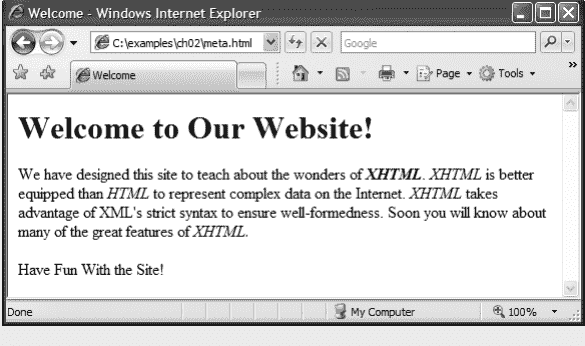

**图 2.15 |** meta 元素提供关键字和页面描述。（第 2 部分，共 2 部分）

第 13–15 行展示了 "keywords" meta 元素。此类 meta 元素的 content 属性为搜索引擎提供描述页面的关键词列表。这些词会与搜索请求中的词进行比对。因此，包含 meta 元素及其内容信息可以吸引更多访问者访问你的网站。

第 16–19 行展示了 "description" meta 元素。此类 meta 元素的 **content** 属性提供三行左右的网站描述，以句子形式书写。搜索引擎也使用此描述来收录你的网站，有时会在搜索结果中显示此信息。请注意，meta 元素的这种用途是搜索引擎优化（SEO) 的众多方法之一。有关 SEO 的更多信息，请访问 Deitel 的 SEO 资源中心 `www.deitel.com/searchengineoptimization`。

# 软件工程观察 2.1

> meta 元素对*用户不可见*，必须放置在 XHTML 文档的 **head** 部分中。**如果 meta 元素未放置在此部分中，搜索引擎将无法读取它们。**

## 2.14 Web 资源

`www.deitel.com/xhtml`

访问我们的在线 XHTML 资源中心，获取网络上一些最佳 XHTML 信息的链接。在那里，你可以找到按类别分类的链接，包括入门介绍、教程、书籍、博客、论坛、样章等。此外，还可以查看有关 XHTML 2（XHTML 标准的即将推出的版本）的链接。

# 层叠样式表™ (CSS)

> 时尚易逝，风格永存。
> ——伊夫·圣·罗兰

# 学习目标

在本章中，你将学习：

-   通过创建样式表来控制网站的外观。
-   使用样式表为网站的所有页面提供统一的外观和感觉。
-   使用 `class` 属性来应用样式。
-   指定显示文本的精确字体、大小、颜色和其他属性。
-   指定元素的背景和颜色。
-   理解盒模型以及如何控制边距、边框和内边距。
-   使用样式表将表现与内容分离。

> 只要风格适应时代，它就不会过时。当风格与某种心理状态不兼容时，胜利者从来不是风格。
> ——可可·香奈儿

> 在中央感知之外、在边缘工作是多么自由。
> ——唐·德里罗

> 我逐渐从下层社会背景上升到了下层社会的前景。
> ——马文·科恩

## 3.1 简介

在第 2 章中，我们介绍了用于标记要在浏览器中渲染的信息的可扩展超文本标记语言 (XHTML)。在本章中，我们将重点转向格式化和展示信息。为此，我们使用一种称为 *层叠样式表*™ (CSS) 的 W3C 技术，它允许文档作者单独指定网页上元素的呈现方式（例如字体、间距、颜色），使其与文档的结构（章节标题、正文文本、链接等）相分离。这种*结构与表现的分离*简化了网页的维护和修改。

XHTML 旨在指定文档的内容和结构。尽管它也有一些控制表现的属性，但最好不要将表现与内容混合。如果网站的表现完全由样式表决定，网页设计师只需更换一个新的样式表即可完全改变网站的外观。CSS 提供了一种在 XHTML 之外应用样式的方法，让 XHTML 负责内容，而 CSS 负责表现方式。

与 XHTML 类似，W3C 提供了一个位于 jigsaw.w3.org/css-validator/ 的 CSS 代码验证器。使用此工具验证所有 CSS 代码是个好主意，以确保你的代码正确并能在尽可能多的浏览器上工作。

CSS 是一个庞大的主题。因此，我们只能介绍你理解本书其余示例所需的基本知识。有关更多 CSS 参考和资源，请查看我们的 CSS 资源中心 www.deitel.com/css21。

W3C 的 CSS 规范目前处于第二个主要版本，第三个版本正在开发中。当前大多数主流浏览器版本支持 CSS 2 中的许多功能。这使程序员能够充分利用其特性。在本章中，我们介绍 CSS，演示 CSS 2 中引入的一些功能，并讨论一些即将推出的 CSS 3 功能。在阅读本书时，请在网页浏览器中打开每个 XHTML 文档，以便你可以在浏览器中查看和交互，正如其最初设计的意图。

请记住，本书中的示例已在 Internet Explorer 7 和 Firefox 2 中测试过。许多其他浏览器的最新版本（例如 Safari、Opera、Konqueror) 应该能正确渲染本章的示例，但我们未对它们进行测试。本章的一些示例*无法在*较旧的浏览器（如 Internet Explorer 6 及更早版本）中工作。在运行本章的示例之前，请确保你已安装 Internet Explorer 7（仅限 Windows）或 Firefox 2（适用于所有主要平台）。

- 3.1 简介
- 3.2 内联样式
- 3.3 嵌入式样式表
- 3.4 冲突的样式
- 3.5 链接外部样式表
- 3.6 元素定位
- 3.7 背景
- 3.8 元素尺寸
- 3.9 盒模型和文本流
- 3.10 媒体类型
- 3.11 构建 CSS 下拉菜单
- 3.12 用户样式表
- 3.13 CSS 3
- 3.14 Web 资源

## 3.2 内联样式

你可以通过几种方式声明文档样式。本节介绍 *内联样式*，即使用 XHTML 属性 **style** 来声明单个元素的格式。内联样式会覆盖本章稍后讨论的其他技术应用的任何样式。图 3.1 将内联样式应用于 p 元素，以更改其字体大小和颜色。

> **良好的编程习惯 3.1**
>
> 内联样式并不能真正地将表现与内容分离。要将相似的样式应用于多个元素，请使用本章稍后介绍的嵌入式样式表或外部样式表。

第一个内联样式声明出现在第 17 行。属性 style 指定元素的样式。每个 **CSS 属性**（此例中为 *font-size*）后跟冒号和值。在第 17 行中，我们声明此特定 p 元素使用 20 磅字体大小。

第 21 行指定了两个属性：font-size 和 **color**，用分号分隔。在这一行中，我们使用十六进制代码 #6666ff 将给定段落的颜色设置为浅蓝色。颜色名称可以代替十六进制代码使用。

```
1  <?xml version = "1.0" encoding = "utf-8"?>
2  <!DOCTYPE html PUBLIC "-//W3C//DTD XHTML 1.0 Strict//EN"
3     "http://www.w3.org/TR/xhtml1/DTD/xhtml1-strict.dtd">
4
5  <!-- Fig. 3.1: inline.html -->
6  <!-- Using inline styles -->
7  <html xmlns = "http://www.w3.org/1999/xhtml">
8     <head>
9        <title>Inline Styles</title>
10     </head>
11     <body>
12        <p>This text does not have any style applied to it.</p>
13
14        <!-- The style attribute allows you to declare -->
15        <!-- inline styles. Separate multiple style properties -->
16        <!-- with a semicolon. -->
17        <p style = "font-size: 20pt">This text has the
18           <em>font-size</em> style applied to it, making it 20pt.
19        </p>
20
21        <p style = "font-size: 20pt; color: #6666ff">
22        This text has the <em>font-size</em> and
23        <em>color</em> styles applied to it, making it
24        20pt. and light blue.</p>
25     </body>
26  </html>
```

图 3.1 | 使用内联样式。（第 1 部分，共 2 部分）


图 3.1 | 使用内联样式。（第 2 部分，共 2 部分）

## 3.3 嵌入式样式表

使用样式表的第二种技术是*嵌入式样式表*。嵌入式样式表允许你将整个 CSS 文档嵌入到 XHTML 文档的 head 部分。为了实现 CSS 代码与其样式的 XHTML 之间的这种分离，我们将使用*CSS 选择器*。图 3.2 创建了一个包含四种样式的嵌入式样式表。

```
1  <?xml version = "1.0" encoding = "utf-8"?>
2  <!DOCTYPE html PUBLIC "-//W3C//DTD XHTML 1.0 Strict//EN"
3     "http://www.w3.org/TR/xhtml1/DTD/xhtml1-strict.dtd">
4
5  <!-- 图 3.2: embedded.html -->
6  <!-- 嵌入式样式表。 -->
7  <html xmlns = "http://www.w3.org/1999/xhtml">
8      <head>
9          <title>样式表</title>
10
11         <!-- 样式表部分开始 -->
12         <style type = "text/css">
13             em        { font-weight: bold;
14                         color: black }
15             h1        { font-family: tahoma, helvetica, sans-serif }
16             p         { font-size: 12pt;
17                         font-family: arial, sans-serif }
18             .special  { color: #6666ff }
19         </style>
20     </head>
21     <body>
22         <!-- 此 class 属性应用 .special 样式 -->
23         <h1 class = "special">Deitel &amp; Associates, Inc.</h1>
24
25         <p>Deitel &amp; Associates, Inc. 是一家国际
26         知名的企业培训和出版机构，
```

图 3.2 | 嵌入式样式表。（第 1 部分，共 2 部分）

```
专注于编程语言、互联网/万维网
技术和对象技术教育。
该公司提供 Java、C++、Visual Basic、
C#、C、互联网和万维网编程、对象
技术等方面的课程。</p>

<h1>客户</h1>
<p class = "special"> 该公司的客户包括许多
<em>财富 1000 强企业</em>、政府机构、
军队分支机构和商业组织。
通过与 Prentice Hall 的出版合作，
Deitel &amp; Associates, Inc. 出版前沿的
编程教科书、专业书籍、交互式
基于网络的多媒体网络课堂、卫星
课程和万维网课程。</p>
</body>
</html>
```

图 3.2 | 嵌入式样式表。（第 2 部分，共 2 部分）

style 元素（第 12–19 行）定义了嵌入式样式表。放置在 head 中的样式适用于整个文档中所有匹配的元素。style 元素的 type 属性指定了*多用途互联网邮件扩展 (MIME) 类型*，用于描述文件的内容。CSS 文档使用 MIME 类型 text/css。其他 MIME 类型包括 image/gif（用于 GIF 图像）、text/javascript（用于 JavaScript 脚本语言，我们在第 4–9 章讨论）等。

样式表的主体部分（第 13–18 行）声明了样式表的*CSS 规则*。CSS 选择器决定哪些元素将按照规则进行样式设置。我们的第一条规则以选择器 **em**（第 13 行）开头，选择文档中所有的 `em` 元素。第 13 行中的 **font-weight** 属性指定文本的"粗度"。可能的值包括 `bold`、`normal`（默认值）、`bolder`（比 `bold` 更粗）和 `lighter`（比正常文本更细）。粗度也可以用 100 的倍数指定，从 100 到 900（例如，100、200、...、900）。指定为 `normal` 的文本相当于 400，`bold` 文本相当于 700。然而，许多系统没有能够如此精确缩放的字体，因此使用 100 到 900 的值可能不会显示预期的效果。

在本例中，所有 `em` 元素将以粗体显示。我们还为所有 `h1`（第 15 行）和 `p`（第 16–17 行）元素应用了样式。每条规则的主体用大括号（`{` 和 `}`）括起来。

第 18 行使用了一种新的选择器来声明一个名为 `special` 的*样式类*。样式类定义可以应用于任何元素的样式。在本例中，我们声明了类 `special`，它将 `color` 设置为蓝色。我们可以将此样式应用于任何元素类型，而样式表中的其他规则仅应用于样式表中定义的特定元素类型（即 `em`、`h1` 或 `p`）。样式类声明前面有一个句点。我们将马上讨论如何应用样式类。

嵌入式样式表中的 CSS 规则使用与内联样式相同的语法；属性名后跟冒号（`:`）和属性值。多个属性用分号（`;`）分隔。在 `em` 元素的规则中，`color` 属性指定文本的颜色，属性 `font-weight` 使字体加粗。

**font-family** 属性（第 15 行）指定要使用的字体名称。并非所有用户的计算机上都安装了相同的字体，因此 CSS 允许你为特定样式指定一个以逗号分隔的字体列表。浏览器尝试按列表中出现的顺序使用字体。建议以*通用字体族名称*结束字体列表，以防其他字体未安装在用户计算机上。在本例中，如果系统上找不到 `tahoma` 字体，浏览器将查找 `helvetica` 字体。如果两者都找不到，浏览器将显示其默认的 `sans-serif` 字体。其他通用字体族包括 `serif`（例如，`times new roman`、`Georgia`）、`cursive`（例如，`script`）、`fantasy`（例如，`critter`）和 `monospace`（例如，`courier`、`fixedsys`）。

**font-size** 属性（第 16 行）指定 12 磅字体。其他本章内容。也可以使用相对值——`xx-small`、`x-small`、`small`、`smaller`、`medium`、`large`、`larger`、`x-large` 和 `xx-large`。通常，`font-size` 的相对值优于点大小，因为作者不知道每个客户端显示的具体测量值。相对的 `font-size` 值允许更灵活地查看网页。

例如，用户可能希望在带有小屏幕的手持设备上查看网页。在样式表中指定 18 磅字体大小将阻止这样的用户一次看到超过一两个字符。然而，如果指定了相对字体大小，例如 `large` 或 `larger`，实际大小由显示字体的浏览器决定。使用相对大小也使页面对残障用户更易于访问。例如，视力受损的用户可能会将其浏览器缺省字体配置为更大的尺寸，所有相对大小都基于此。作者指定为比主要文本 `smaller` 的文本仍然以较小的字体大小显示，但对每个用户来说都清晰可见。可访问性是一个重要的考虑因素——1998 年，国会通过了《1973 年康复法》第 508 条修正案，规定政府机构的网站必须对残障用户可访问。

第 23 行在 `h1` 元素中使用 XHTML 属性 `class` 来应用样式类——在本例中是类 `special`（在样式表第 18 行中用 `.special` 选择器声明）。当浏览器渲染 `h1` 元素时，请注意文本在屏幕上显示时同时具有 h1 元素的属性（第 17 行中定义的 `arial` 或 `sans-serif` 字体）和应用了 `.special` 样式类的属性（第 18 行中定义的 `#6666ff` 颜色）。还要注意，浏览器仍然对 `h1` 元素应用其自己的默认样式——标题仍然以大字体大小显示。类似地，所有 `em` 元素仍然会被浏览器斜体化，但它们也会因我们的样式规则而加粗。

`p` 元素和 `.special` 类的格式应用于第 34–41 行的文本。在许多情况下，应用于元素（*父元素*或*祖先元素*）的样式也应用于该元素的嵌套元素（*子元素*或*后代元素*）。第 35 行中嵌套在 `p` 元素中的 `em` 元素*继承*自 `p` 元素的样式（即第 16 行的 12 磅字体大小），但保留其斜体样式。换句话说，为段落定义但未为 `em` 元素定义的样式被应用于 `em` 元素。由于可以在同一元素上设置或继承一个属性的多个值，它们必须在渲染之前简化为每个元素一种样式。我们在下一节讨论解决这些冲突的规则。

### 3.4 冲突的样式

样式可以由*用户*、*作者*或*用户代理*（例如，Web 浏览器）定义。用户是查看你网页的人，你是作者——编写文档的人——而用户代理是用于渲染和显示文档的程序。样式会"层叠"，或融合在一起，因此页面上元素的最终外观结果是结合以多种方式定义的样式而产生的。用户定义的样式优先于用户代理定义的样式，而作者定义的样式优先于用户定义的样式。

为父元素定义的大多数样式也会被子（嵌套）元素继承。虽然继承大多数样式（如字体属性）是有意义的，但有些属性我们不想被继承。例如考虑 `background-image` 属性，它允许程序员将图像设置为元素的背景。如果为 `body` 元素分配了背景图像，我们不希望相同的图像出现在页面 body 中每个元素的背景中。相反，所有子元素的 `background-image` 属性保持其默认值 `none`。在本节中，我们讨论解决为元素定义的样式与从父元素和祖先元素继承的样式之间冲突的规则。

图 3.2 展示了一个*继承*的例子，其中子 `em` 元素从其父 `p` 元素继承了 `font-size` 属性。然而，在图 3.2 中，子 `em` 元素具有与其父 `p` 元素的 `color` 属性冲突（即，具有不同的值）的 `color` 属性。为子和后代元素定义的属性比为父和祖先元素定义的属性具有更大的*特异性*。冲突通过优先选择特异性更高的属性来解决。换句话说，为子元素显式定义的样式比为子元素的父元素定义的样式更具体；因此，子元素的样式优先。图 3.3 说明了继承和特异性的例子。

第 12 行将 `text-decoration` 属性应用于所有 `class` 属性设置为 `nodec` 的 `a` 元素。`text-decoration` 属性为元素中的文本应用*装饰*。默认情况下，浏览器会下划线 `a`（锚点）元素的文本。这里，我们将 `text-decoration` 属性设置为 `none`，以指示浏览器不应下划线超链接。`text-decoration` 的其他可能值包括 `overline`、`line-through`、`underline`

和闪烁效果。[注意：Internet Explorer 不支持闪烁效果。] 添加到 `a` 后的 `.nodec` 是一个更具体的类选择器；此样式仅应用于在其 `class` 属性中指定了 `nodec` 的 `a`（锚点）元素。

> 可移植性提示 3.1
为确保你的样式表能在各种（Web 浏览器）中工作，请在所有将使用你的样式渲染文档的客户端 Web 浏览器上进行测试，同时使用 W3C CSS 验证器。

```
1  <?xml version = "1.0" encoding = "utf-8"?>
2  <!DOCTYPE html PUBLIC "-//W3C//DTD XHTML 1.0 Strict//EN"
3    "http://www.w3.org/TR/xhtml1/DTD/xhtml1-strict.dtd">
4
5  <!-- 图 3.3：advanced.html -->
6  <!-- 样式表中的继承。 -->
7  <html xmlns = "http://www.w3.org/1999/xhtml">
8    <head>
9      <title>更多样式</title>
10     <style type = "text/css">
11       body      { font-family: arial, helvetica, sans-serif }
12       a.nodec   { text-decoration: none }
13       a:hover   { text-decoration: underline }
14       li em     { font-weight: bold }
15       h1, em    { text-decoration: underline }
16       ul        { margin-left: 20px }
17       ul ul     { font-size: .8em }
18     </style>
19   </head>
20   <body>
21     <h1>周一的购物清单：</h1>
22
23     <ul>
24       <li>牛奶</li>
25       <li>面包
26         <ul>
27           <li>白面包</li>
28           <li>黑麦面包</li>
29           <li>全麦面包</li>
30         </ul>
31       </li>
32       <li>大米</li>
33       <li>土豆</li>
34       <li>披萨 <em>加蘑菇</em></li>
35     </ul>
36
37     <p><em>前往</em>
38       <a class = "nodec" href = "http://www.deitel.com">
39         杂货店</a>
40     </p>
41   </body>
42 </html>
```

图 3.3 | 样式表中的继承。（第 1 部分，共 2 部分。）

第 13 行指定了 `hover` 的样式，它是一个*伪类*。伪类允许作者访问文档中未明确声明的内容。当用户将鼠标光标移到元素上时，**hover 伪类**会被动态激活。请注意，伪类与其所应用的元素名称之间用冒号分隔（没有空格）。

> 常见编程错误 3.1
在分隔伪类及其所应用的元素名称的冒号之前或之后包含空格，是一个会导致伪类无法正确应用的错误。

第 14 行使所有作为 `li` 元素子元素的 `em` 元素变为粗体。在图 3.3 的屏幕输出中，请注意**前往**（包含在第 37 行的一个 `em` 元素中）并未显示为粗体，因为该 `em` 元素不在 `li` 元素内。然而，包含**加蘑菇**（第 34 行）的 `em` 元素嵌套在 `li` 元素中；因此，它被格式化为粗体。将规则应用于多个元素的语法类似。在第 15 行，我们用逗号分隔选择器，以便将下划线样式规则应用于所有 `h1` 和所有 `em` 元素。

第 16 行为所有 `ul` 元素分配了 20 像素的左边距。我们将在第 3.9 节详细讨论边距属性。像素是一种*相对长度度量*——它的大小根据屏幕分辨率而变化。其他相对长度包括 `em`（字体的 *M* 高度，通常设置为大写 *M* 的高度）、`ex`（字体的 *x* 高度，通常设置为小写 *x* 的高度）和比率（例如 `font-size: 50%`）。

要将元素设置为以其默认文本大小的 150% 显示文本，作者可以使用以下语法

```
font-size: 1.5em
```

或者，你可以使用

```
font-size: 150%
```

CSS 中可用的其他度量单位是*绝对长度度量*——即大小不随系统变化的单位。这些单位包括 **in**（英寸）、**cm**（厘米）、**mm**（毫米）、**pt**（点；1 pt = 1/72 in）和 **pc**（派卡；1 pc = 12 pt）。第 17 行指定所有嵌套无序列表（作为 `ul` 元素后代的 `ul` 元素）的字体大小为 `.8em`。[*注意：* 设置接受度量值的样式属性时（例如 `font-size`、`margin-left`），如果值为零，则不需要单位。]

> **良好编程实践 3.2**

尽可能使用*相对长度*度量。如果你使用绝对长度度量，你的文档在某些客户端浏览器（例如无线电话）上可能无法阅读。

## 3.5 链接外部样式表

样式表是创建具有统一主题文档的便捷方式。通过使用*外部样式表*（即仅包含 CSS 规则的独立文档），你可以为整个网站提供统一的外观和感觉。网站上的不同页面都可以使用相同的样式表。当需要更改样式时，作者只需修改单个 CSS 文件，即可在整个网站上进行样式更改。请注意，虽然嵌入式样式表将内容与表现分离，但两者仍包含在单个文件中，这使得 Web 设计师和内容作者无法并行工作。外部样式表通过将内容和样式分离到单独的文件中来解决这个问题。

> **软件工程观察 3.1**

开发具有多个页面的网站时，始终使用外部样式表。外部样式表将内容与表现分离，从而实现更一致的外观、更高效的开发和更好的性能。

图 3.4 展示了一个外部样式表。第 1-2 行是 *CSS 注释*。与 XHTML 注释类似，CSS 注释描述了 CSS 文档的内容。注释可以放置在任何类型的 CSS 代码中（即内联样式、嵌入式样式表和外部样式表），并且总是以 `/*` 开头，以 `*/` 结束。浏览器会忽略这些分隔符之间的文本。

```
1  /* 图 3.4：styles.css */
2  /* 外部样式表 */
3
4  body    { font-family: arial, helvetica, sans-serif }
5
6  a.nodec { text-decoration: none }
7
8  a:hover { text-decoration: underline }
9
10 li em    { font-weight: bold }
11
12 h1, em   { text-decoration: underline }
13
14 ul       { margin-left: 20px }
15
16 ul ul    { font-size: .8em; }
```

**图 3.4** | 外部样式表。（第 1 部分，共 2 部分。）

图 3.4 | 外部样式表。（第 2 部分，共 2 部分。）

图 3.5 包含一个引用图 3.4 中外部样式表的 XHTML 文档。第 10-11 行（图 3.5）显示了一个 *link* 元素，它使用 *rel* 属性来指定当前文档与另一个文档之间的*关系*。在这种情况下，我们声明链接的文档是本文档的 **stylesheet**。type 属性将相关文档的 MIME 类型指定为 `text/css`。href 属性提供了包含样式表的文档的 URL。在这种情况下，`styles.css` 与 `external.html` 位于同一目录中。

```
1   <?xml version = "1.0" encoding = "utf-8"?>
2   <!DOCTYPE html PUBLIC "-//W3C//DTD XHTML 1.0 Strict//EN"
3       "http://www.w3.org/TR/xhtml1/DTD/xhtml1-strict.dtd">
4
5   <!-- 图 3.5：external.html -->
6   <!-- 链接外部样式表。 -->
7   <html xmlns = "http://www.w3.org/1999/xhtml">
8       <head>
9           <title>链接外部样式表</title>
10          <link rel = "stylesheet" type = "text/css"
11              href = "styles.css" />
12      </head>
13      <body>
14          <h1><em>周一</em>购物清单：</h1>
15
16          <ul>
17              <li>牛奶</li>
18              <li>面包
19                  <ul>
20                      <li>白面包</li>
21                      <li>黑麦面包</li>
22                      <li>全麦面包</li>
23                  </ul>
24              </li>
25              <li>大米</li>
26              <li>土豆</li>
27              <li>披萨 <em>加蘑菇</em></li>
28          </ul>
29      </body>
30  </html>
```

```
30     <p><em>前往</em>
31        <a class = "nodec" href = "http://www.deitel.com">
32           杂货店</a>
33        </p>
34  </body>
35  </html>
```

图 3.5 | 链接外部样式表。（第 2 部分，共 2 部分。）

# 软件工程观察 3.2

> 外部样式表是可复用的。创建一次并重复使用它们可以减少编程工作量。

# 性能提示 3.1

> 重复使用外部样式表可以减少服务器上的加载时间和带宽使用，因为样式表可以下载一次，由 Web 浏览器存储，并应用于网站上的所有页面。

## 3.6 定位元素

在 CSS 之前，控制 XHTML 文档中元素的定位很困难——由浏览器决定定位。CSS 引入了 **position** 属性和一种称为*绝对定位*的功能，它使作者能够更好地控制文档元素的显示方式。图 3.6 演示了绝对定位。

通常，元素在页面上的定位顺序是它们在 XHTML 文档中出现的顺序。第 11-14 行定义了一个名为 `bgimg` 的样式，应用于第一个 `img` 元素


 # 第3章  层叠样式表™ (CSS)

```
1  <?xml version = "1.0" encoding = "utf-8"?>
2  <!DOCTYPE html PUBLIC "-//W3C//DTD XHTML 1.0 Strict//EN"
3     "http://www.w3.org/TR/xhtml1/DTD/xhtml1-strict.dtd">
4  
5  <!-- Fig. 3.6: positioning.html -->
6  <!-- Absolute positioning of elements. -->
7  <html xmlns = "http://www.w3.org/1999/xhtml">
8      <head>
9          <title>Absolute Positioning</title>
10         <style type = "text/css">
11             .bgimg  { position: absolute;
12                         top: 0px;
13                         left: 0px;
14                         z-index: 1 }
15             .fgimg  { position: absolute;
16                         top: 25px;
17                         left: 100px;
18                         z-index: 2 }
19             .text   { position: absolute;
20                         top: 25px;
21                         left: 100px;
22                         z-index: 3;
23                         font-size: 20pt;
24                         font-family: tahoma, geneva, sans-serif }
25         </style>
26     </head>
27     <body>
28         <p></p>
30  
31         <p></p>
33  
34         <p class = "text">Positioned Text</p>
35     </body>
36 </html>
```

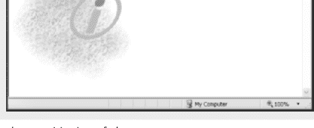

图 3.6  元素的绝对定位。

## 3.6 元素定位 113

页面上的 (i.gif)。将元素的位置指定为 absolute 会将该元素从页面的正常元素流中移除，而是根据与其*包含块级元素*（即 body 或 p 等元素）的顶部、左侧、右侧或底部边距的距离来定位它。在这里，我们将元素定位到距离其包含元素的*顶部*和*左侧*边距均为 0 像素的位置。在第 28 行中，此样式应用于包含在 p 元素中的图像。

**z-index** 属性允许你正确地对重叠元素进行分层。具有较高 z-index 值的元素会显示在具有较低 z-index 值的元素前面。在此示例中，i.gif 的 z-index 最低（1），因此它显示在背景中。第 15–18 行的 .fgimg CSS 规则给圆形图像（第 31–32 行的 circle.gif）设置了 z-index 为 2，因此它显示在 i.gif 的前面。第 34 行的 p 元素（Positioned Text）在第 22 行被赋予了 z-index 为 3，因此它显示在另外两个元素的前面。如果你未指定 z-index 或者元素具有相同的 z-index 值，则元素将按照它们在文档中遇到的顺序从背景到前景放置。

绝对定位不是指定页面布局的唯一方式。图 3.7 展示了*相对定位*，其中元素相对于其他元素进行定位。

```
<?xml version = "1.0" encoding = "utf-8"?>
<!DOCTYPE html PUBLIC "-//W3C//DTD XHTML 1.0 Strict//EN"
    "http://www.w3.org/TR/xhtml1/DTD/xhtml1-strict.dtd">
<!-- Fig. 3.7: positioning2.html -->
<!-- Relative positioning of elements. -->
<html xmlns = "http://www.w3.org/1999/xhtml">
    <head>
        <title>Relative Positioning</title>
        <style type = "text/css">
            p         { font-size: 1.3em;
                        font-family: verdana, arial, sans-serif }
            span      { color: red;
                        font-size: .6em;
                        height: 1em }
            .super    { position: relative;
                        top: -1ex }
            .sub      { position: relative;
                        bottom: -1ex }
            .shiftleft { position: relative;
                        left: -1ex }
            .shiftright { position: relative;
                        right: -1ex }
        </style>
    </head>
    <body>
        <p>The text at the end of this sentence
        <span class = "super">is in superscript</span>.</p>

        <p>The text at the end of this sentence
        <span class = "sub">is in subscript</span>.</p>
    </body>
</html>
```

图 3.7 | 元素的相对定位。（第 1 部分，共 2 部分）

```
33 <p>The text at the end of this sentence
34 <span class = "shiftleft">is shifted left</span>.</p>
35
36 <p>The text at the end of this sentence
37 <span class = "shiftright">is shifted right</span>.</p>
38 </body>
39 </html>
```

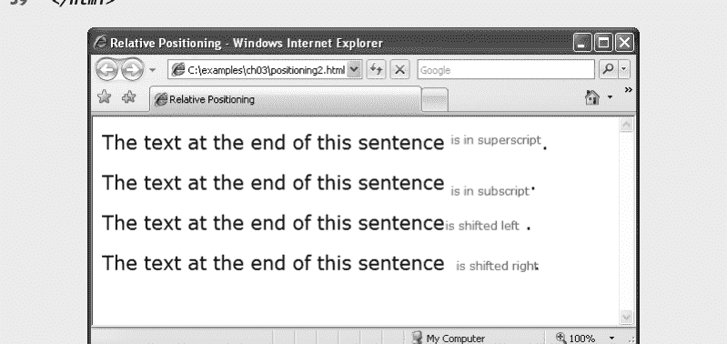

图 3.7 | 元素的相对定位。（第 2 部分，共 2 部分）

将 position 属性设置为 relative，如类 super（第 16–17 行），会在页面上布局该元素，并根据指定的 top、bottom、left 或 right 值进行偏移。与绝对定位不同，相对定位将元素保留在页面上的元素一般流中，因此定位是相对于流中的其他元素的。回想一下，ex（第 17 行）是字体的 x 高度，是一种相对长度度量，通常等于小写字母 x 的高度。

> 常见编程错误 3.2
> 因为相对定位将元素保留在文档中的文本流中，所以要小心避免文本意外重叠。

## 内联元素和块级元素

我们在第 28 行介绍 span 元素。第 13–15 行定义了所有 span 元素的 CSS 规则。span 的高度决定了该 span 将占用多少垂直空间。font-size 决定了 span 内部文本的大小。元素 span 是一种分组元素——它不会对其内容应用任何固有的格式。它的主要目的是对一段文本应用 CSS 规则或 id 属性。元素 span 是一种*内联级元素*——它对文本应用格式而不改变文档的流。内联元素的示例包括 span、img、a、em 和 strong。div 元素也是一种分组元素，但它是*块级元素*。这意味着它显示在自己的行上，并且周围有一个虚拟框。块级元素的示例包括 div、p 和标题元素（h1 到 h6）。我们将在 3.9 节更详细地讨论内联和块级元素。

## 3.7 背景

CSS 提供了对块级元素背景的控制。CSS 可以设置背景颜色或向 XHTML 元素添加背景图像。图 3.8 在文档的右下角添加了一个公司徽标。即使用户上下滚动屏幕，此徽标仍固定在角落中。

**background-image** 属性（第 11 行）以 url(*fileLocation*) 的格式指定图像文件 logo.gif 的图像 URL。如果找不到图像，你还可以设置 **background-color** 属性（以及填充图像未覆盖的区域）。

**background-position** 属性（第 12 行）将图像放置在页面上。关键字 top、bottom、center、left 和 right 单独使用或组合使用，用于垂直和水平定位。图像可以使用长度来定位，方法是指定水平长度后跟垂直长度。例如，要定位

```
<?xml version = "1.0" encoding = "utf-8"?>
<!DOCTYPE html PUBLIC "-//W3C//DTD XHTML 1.0 Strict//EN"
  "http://www.w3.org/TR/xhtml1/DTD/xhtml1-strict.dtd">

<!-- Fig. 3.8: background.html -->
<!-- Adding background images and indentation. -->
<html xmlns = "http://www.w3.org/1999/xhtml">
   <head>
      <title>Background Images</title>
      <style type = "text/css">
         body { background-image: url(logo.gif);
                background-position: bottom right;
                background-repeat: no-repeat;
                background-attachment: fixed;
                background-color: #eeeeee }
         p      { font-size: 18pt;
                  color: #1144AA;
                  text-indent: 1em;
                  font-family: arial, sans-serif; }
         .dark { font-weight: bold }
      </style>
   </head>
   <body>
      <p>
         This example uses the background-image,
           background-position and background-attachment
         styles to place the <span class = "dark">Deitel
         &amp; Associates, Inc.</span> logo in the bottom,
         right corner of the page. Notice how the logo
         stays in the proper position when you resize the
         browser window. The background-color fills in where
         there is no image.
      </p>
   </body>
</html>
```

图 3.8 | 添加背景图像和缩进。（第 1 部分，共 2 部分）


## 3.8 元素尺寸

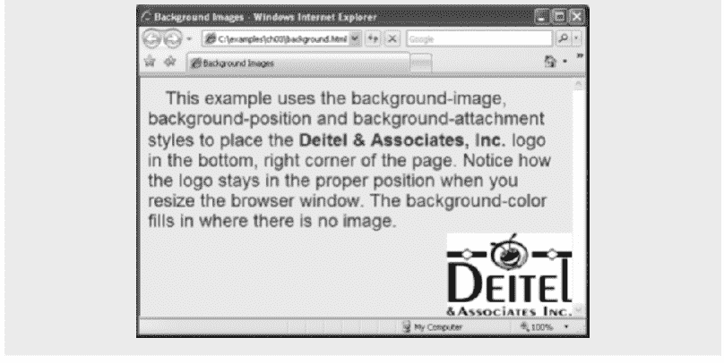

图 3.8 | 添加背景图片和缩进。（第 2 部分，共 2 部分。）

要将图片设置为水平居中（位于屏幕距离的 50% 位置）且距顶部 30 像素，请使用

```
background-position: 50% 30px;
```

`background-repeat` 属性（第 13 行）控制背景图片的平铺方式，即将多份图片副本并排放置以填充背景。此处，我们将平铺设置为 no-repeat，仅显示一份背景图片副本。其他值包括 repeat（默认值），在垂直和水平方向上平铺图片；repeat-x，仅在水平方向上平铺图片；或 repeat-y，仅在垂直方向上平铺图片。

最后一个属性设置 `background-attachment: fixed`（第 14 行）将图片固定在 `background-position` 指定的位置。滚动浏览器窗口不会使图片从其位置移动。默认值 `scroll` 会在用户滚动文档时随图片移动。

第 18 行使用 `text-indent` 属性将元素中第一行文本缩进指定的量，此处为 1em。作者可能使用此属性来创建更像小说般阅读体验的网页，其中每个段落的第一行都被缩进。

CSS 属性 `font-style` 允许你将文本样式设置为 none、italic 或 oblique（oblique 仅仅是比 italic 更倾斜——如果系统或字体不支持 oblique 文本，浏览器将默认使用 italic）。

除了定位元素之外，CSS 规则还可以指定每个页面元素的实际尺寸。图 3.9 演示了如何设置元素的尺寸。

第 17 行的内联样式展示了如何设置屏幕上元素的 `width`；此处，我们指定 div 元素应占据屏幕宽度的 20%。元素的高度可以类似地使用 `height` 属性进行设置。高度和宽度值也可以指定为相对或绝对长度。例如，

```
1  <?xml version = "1.0" encoding = "utf-8"?>
2  <!DOCTYPE html PUBLIC "-//W3C//DTD XHTML 1.0 Strict//EN"
3      "http://www.w3.org/TR/xhtml1/DTD/xhtml1-strict.dtd">
4
5  <!-- Fig. 3.9: width.html -->
6  <!-- 元素尺寸和文本对齐。 -->
7  <html xmlns = "http://www.w3.org/1999/xhtml">
8      <head>
9          <title>Box Dimensions</title>
10         <style type = "text/css">
11             div { background-color: #aaccff;
12                     margin-bottom: .5em;
13                     font-family: arial, helvetica, sans-serif }
14         </style>
15     </head>
16     <body>
17         <div style = "width: 20%">Here is some
18         text that goes in a box which is
19         set to stretch across twenty percent
20         of the width of the screen.</div>
21
22         <div style = "width: 80%; text-align: center">
23         Here is some CENTERED text that goes in a box
24         which is set to stretch across eighty percent of
25         the width of the screen.</div>
26
27         <div style = "width: 20%; height: 150px; overflow: scroll">
28         This box is only twenty percent of
29         the width and has a fixed height.
30         What do we do if it overflows? Set the
31         overflow property to scroll!</div>
32     </body>
33 </html>
```

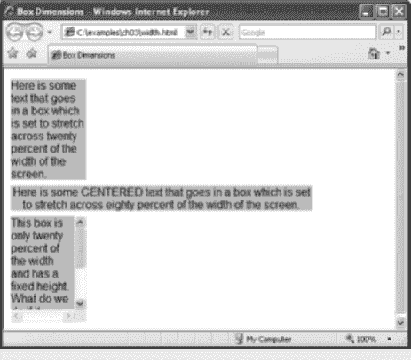

图 3.9 | 元素尺寸和文本对齐。

*width:* 10em 将元素的宽度设置为字体大小的 10 倍。大多数元素默认为左对齐；然而，这种对齐方式可以被更改以将元素定位到其他位置。第 22 行将元素中的文本设置为居中对齐；*text-align* 属性的其他值包括 left 和 right。

在第三个 div 中，我们指定了百分比高度和像素宽度。同时设置元素两个尺寸的一个问题是，元素内部的内容可能会超出设定的边界，在这种情况下，元素只会被放大以容纳所有内容。然而，在第 27 行，我们将 *overflow* 属性设置为 scroll，该设置会在文本超出边界时添加滚动条。

## 3.9 盒模型与文本流

所有块级 XHTML 元素都基于所谓的 *盒模型* 绘制了一个虚拟的边框。当浏览器使用盒模型渲染元素时，每个元素的内容都被 *内边距*、*边框* 和 *外边距* 所包围（图 3.10）。

CSS 使用三个属性控制边框：*border-width*、*border-color* 和 *border-style*。我们在图 3.11 中演示这三个属性。

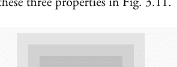

**图 3.10** | 块级元素的盒模型。

```
1  <?xml version = "1.0" encoding = "utf-8"?>
2  <!DOCTYPE html PUBLIC "-//W3C//DTD XHTML 1.0 Strict//EN"
3      "http://www.w3.org/TR/xhtml1/DTD/xhtml1-strict.dtd">
4  
5  <!-- Fig. 3.11: borders.html -->
6  <!-- 块级元素的边框。 -->
7  <html xmlns = "http://www.w3.org/1999/xhtml">
8      <head>
9          <title>Borders</title>
10         <style type = "text/css">
11             div     { text-align: center;
12                 width: 50%;
13                 position: relative;
14                 left: 25%;
15                 border-width: 4px }
16             .medium { border-width: medium }
17             .thin   { border-width: thin }
18             .solid  { border-style: solid }
19             .double { border-style: double }
20             .groove { border-style: groove }
21             .inset  { border-style: inset }
22             .outset { border-style: outset }
23             .dashed { border-style: dashed }
24             .red    { border-color: red }
25             .blue   { border-color: blue }
26         </style>
27     </head>
28     <body>
29         <div class = "solid">Solid border</div><hr />
30         <div class = "double">Double border</div><hr />
31         <div class = "groove">Groove border</div><hr />
32         <div class = "inset">Inset border</div><hr />
33         <div class = "dashed">Dashed border</div><hr />
34         <div class = "thin red solid">Thin Red Solid border</div><hr />
35         <div class = "medium blue outset">Medium Blue Outset border</div>
36     </body>
37 </html>
```

**图 3.11** | 块级元素的边框。（第 1 部分，共 2 部分。）

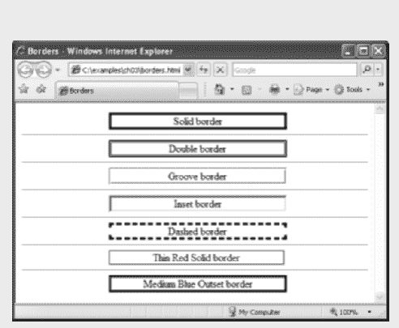

属性 border-width 可以设置为任何有效的 CSS 长度（例如 em、ex、px 等）或预定义值 thin、medium 或 thick。border-color 属性设置颜色。[注意：此属性对于不同的样式边框具有不同的含义。] border-style 的选项包括 none、hidden、dotted、dashed、solid、double、groove、ridge、inset 和 outset。边框 groove 和 ridge 具有相反的效果，inset 和 outset 也是如此。当 border-style 设置为 none 时，不渲染边框。

每个边框属性都可以为盒子的单独一侧进行设置（例如 border-top-style 或 border-left-color）。请注意，我们通过用空格分隔多个类名来为一个 XHTML 元素分配多个类，如第 36–37 行所示。

正如我们在绝对定位中所看到的，可以将元素从正常的文本流中移除。浮动允许你将元素移动到屏幕的一侧；文档中的其他内容随后会围绕浮动元素流动。图 3.12 演示了如何使用浮动和盒模型来控制整个页面的布局。

```
1  <?xml version = "1.0" encoding = "utf-8"?>
2  <!DOCTYPE html PUBLIC "-//W3C//DTD XHTML 1.0 Strict//EN"
3      "http://www.w3.org/TR/xhtml1/DTD/xhtml1-strict.dtd">
4  
5  <!-- Fig. 3.12: floating.html -->
6  <!-- 浮动元素。 -->
7  <html xmlns = "http://www.w3.org/1999/xhtml">
8      <head>
9          <title>Flowing Text Around Floating Elements</title>
10         <style type = "text/css">
11             div.heading { background-color: #bbddff;
12                           text-align: center;
13                           font-family: arial, helvetica, sans-serif;
14                           padding: .2em }
15             p           { text-align: justify;
16                           font-family: verdana, geneva, sans-serif;
17                           margin: .5em }
18             div.floated { background-color: #eeeeee;
19                           font-size: 1.5em;
20                           font-family: arial, helvetica, sans-serif;
21                           padding: .2em;
22                           margin-left: .5em;
23                           margin-bottom: .5em;
24                           float: right;
25                           text-align: right;
26                           width: 50% }
27             div.section { border: 1px solid #bbddff }
28         </style>
29     </head>
30     <body>
31         <div class = "heading"></div>
32         <div class = "section">
33             <div class = "floated">Corporate Training and Publishing</div>
34             <p>Deitel &amp; Associates, Inc. is an internationally
35             recognized corporate training and publishing organization
36             specializing in programming languages, Internet/World
37             Wide Web technology and object technology education.
38             The company provides courses on Java, C++, Visual Basic, C#,
39             C, Internet and web programming, Object
40             Technology, and more.</p>
41         </div>
42         <div class = "section">
43             <div class = "floated">Leading-Edge Programming Textbooks</div>
44             <p>Through its publishing
45             partnership with Prentice Hall, Deitel &amp; Associates,
46             Inc. publishes leading-edge programming textbooks,
47             professional books, interactive CD-ROM-based multimedia
48             Cyber Classrooms, satellite courses and DVD and web-based
49             video courses.</p>
50         </div>
51     </body>
52 </html>
```

120 第 3 章 层叠样式表™（CSS）

图 3.12 | 浮动元素。（第 1 部分，共 2 部分。）


## 3.9 盒模型与文本流

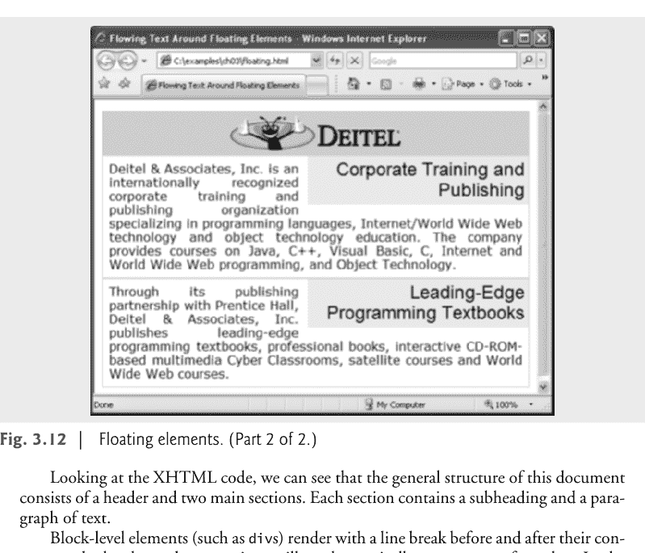

查看 XHTML 代码，我们可以看到本文档的一般结构包括一个标题和两个主要部分。每个部分都包含一个副标题和一段文本。

块级元素（如 div）在内容前后都会渲染出一个换行，因此标题和两个部分会垂直地一个接一个堆叠。在没有样式的情况下，副标题 div 也会垂直堆叠在 p 标签文本的上方。然而，在第 24 行，我们在 `floated` 类中将 `float` 属性设置为 `right`，该类被应用于副标题。这使得每个副标题 div 浮动到其包含元素的右边缘，而文本段落则会环绕其流动。

第 17 行为所有段落标签设置了 `.5em` 的外边距。`margin` 属性设置边框外侧与页面上所有其他内容之间的空间。在第 21 行，我们为浮动的 div 设置了 `.2em` 的内边距。`padding` 属性决定元素内部内容与其边框内侧之间的距离。元素各个单独边的外边距可以通过 `margin-top`、`margin-right`、`margin-left` 和 `margin-bottom` 属性来指定（第 22-23 行）。内边距可以用同样的方式指定，使用 `padding-top`、`padding-right`、`padding-left` 和 `padding-bottom`。要查看外边距和内边距的效果，请尝试将 `margin` 和 `padding` 属性放入注释中，并观察差异。

在第 27 行，我们使用边框属性的简写声明为章节框设置了边框。CSS 允许边框的简写赋值，使你能够在一行中定义所有三个边框属性。这种简写的语法是 `border: <宽度> <样式> <颜色>`。我们的边框为一像素粗、实线，颜色与标题 div 的 `background-color` 属性相同（第 11 行）。这使得边框能够与标题融为一体，并使页面看起来像是一个带有分隔各部分线条的盒子。

## 3.10 媒体类型

CSS *媒体类型*允许程序员根据用于显示页面的媒体类型来决定页面应该呈现的外观。网页最常见的媒体类型是**屏幕媒体类型**，即标准的计算机屏幕。CSS 2 中的其他媒体类型包括**手持设备**、**盲文**、**听觉**和**打印**。手持设备媒体专为移动互联网设备设计，而盲文则用于能够以盲文阅读或打印网页的机器。听觉样式允许程序员为语音合成网页浏览器提供更多关于网页内容的信息。这使得浏览器能够以合理的方式向视障人士呈现网页。打印媒体类型影响网页打印时的外观。有关 CSS 媒体类型的完整列表，请参见 http://www.w3.org/TR/REC-CSS2/media.html#media-types。

媒体类型允许程序员决定页面在以上任何一种媒体上应该如何呈现，而不会影响其他媒体。图 3.13 给出了一个简单的示例，当文档在屏幕上查看时应用一组样式，而在打印时应用另一组样式。要查看差异，请看段落下方的屏幕截图，或在 Internet Explorer 或 Firefox 中使用打印预览功能。

```
1   <?xml version = "1.0" encoding = "utf-8"?>
2   <!DOCTYPE html PUBLIC "-//W3C//DTD XHTML 1.0 Strict//EN"
3       "http://www.w3.org/TR/xhtml1/DTD/xhtml1-strict.dtd">
4  
5   <!-- Fig. 3.13: mediatypes.html -->
6   <!-- CSS media types. -->
7   <html xmlns = "http://www.w3.org/1999/xhtml">
8       <head>
9           <title>Media Types</title>
10          <style type = "text/css">
11              @media all
12              {
13                  body  { background-color: #4488aa }
14                  h1    { font-family: verdana, helvetica, sans-serif;
15                          color: #aaffcc }
16                  p     { font-size: 12pt;
17                          color: white;
18                          font-family: arial, sans-serif }
19              } /* end @media all declaration. */
20              @media print
21              {
22                  body  { background-color: white }
23                  h1    { color: #008844}
24                  p     { font-size: 14pt;
25                          color: #4488aa;
26                          font-family: "times new roman", times, serif }
27              } /* end @media print declaration. */
28          </style>
29      </head>
30      <body>
31          <h1>CSS Media Types Example</h1>
32        <p>
33        This example uses CSS media types to vary how the page
34        appears in print and how it appears on any other media.
35        This text will appear one font on the screen and a
36        different font on paper or in a print preview. To see
37        the difference in Internet Explorer, go to the Print
38        menu and select Print Preview. In Firefox, select Print
39        Preview from the File menu.
40        </p>
41        </body>
42        </html>
```

Fig. 3.13 | CSS 媒体类型。

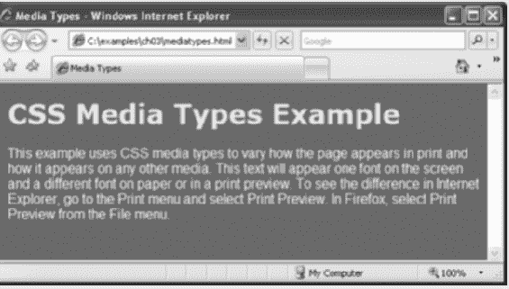

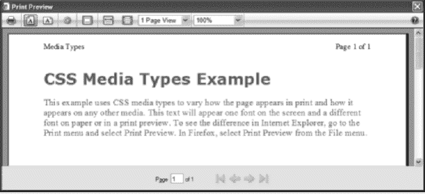

在第 11 行，我们开始了一个应用于所有媒体类型的样式块，通过 `@media all` 声明并用花括号（`{` 和 `}`）包围。在第 13-18 行，我们为所有媒体类型定义了一些样式。第 20-27 行设置了仅在页面打印时应用的样式，以 `@media print` 声明开始并用花括号包围。

我们为所有媒体类型应用的样式在屏幕上看起来不错，但在打印页面上看起来就不好。彩色背景会消耗大量墨水，而黑白打印机可能会打印出难以阅读的页面，因为颜色之间的对比度不够。此外，像 arial、helvetica 和 geneva 这样的无衬线字体在屏幕上更容易阅读，而像 times new roman 这样的衬线字体在纸上更容易阅读。

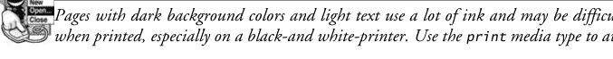

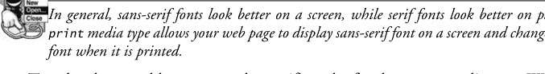

为了解决这些问题，我们为打印媒体类型应用了特定的样式。我们将 body 的 `background-color`、h1 标签的 `color`，以及 p 标签的 `font-size`、`color` 和 `font-family` 更改得更适合打印和在纸上查看。请注意，这些样式中的大多数与 `all` 媒体类型部分中的声明冲突。由于打印媒体类型比所有媒体类型具有更高的特异性，因此在打印页面时，打印样式会覆盖所有媒体类型的样式。由于 h1 标签的 `font-family` 属性在打印部分没有被覆盖，所以即使页面被打印，它也保留原来的值。

## 3.11 构建 CSS 下拉菜单 drop-down 菜单是在网站上提供导航链接的好方法，无需占用大量屏幕空间。在本节中，我们将再次查看 `:hover` 伪类，并介绍 `display` 属性，以使用 CSS 和 XHTML 创建下拉菜单。

我们已经看过 `:hover` 伪类用于在鼠标悬停时更改链接的样式。我们将以更高级的方式使用这一特性，使鼠标悬停在菜单按钮上时显示菜单。我们需要的另一个重要属性是 **`display`** 属性。这允许程序员决定元素是否在页面上渲染。可能的取值包括 `block`、`inline` 和 `none`。`block` 和 `inline` 值分别将元素显示为块元素或内联元素，而 `none` 则阻止元素被渲染。下拉菜单的代码如图 3.14 所示。

```
1 <?xml version = "1.0" encoding = "utf-8"?>
2 <!DOCTYPE html PUBLIC "-//W3C//DTD XHTML 1.0 Strict//EN"
3 "http://www.w3.org/TR/xhtml1/DTD/xhtml1-strict.dtd">
4
5 <!-- Fig. 3.14: dropdown.html -->
6 <!-- CSS drop-down menu. -->
7 <html xmlns = "http://www.w3.org/1999/xhtml">
8 <head>
9 <title>
10 Drop-Down Menu
11 </title>
```


## 3.12 用户样式表

用户可以定义自己的用户样式表，根据个人偏好来设置页面格式。例如，视力障碍者可能需要增大页面的文字大小。网页作者需要注意不要无意中用自定义样式覆盖用户的偏好设置。本节将讨论作者样式与用户样式之间可能存在的冲突。

图 3.15 包含一个作者样式，对所有应用了 `note` 类的 `<p>` 标签设置字体大小为 9pt。

用户样式表是外部样式表。图 3.16 展示了一个用户样式表，将 `body` 的字体大小设置为 20pt，颜色设置为黄色，背景颜色设置为 #000080。

```xml
1  <?xml version = "1.0" encoding = "utf-8"?>
2  <!DOCTYPE html PUBLIC "-//W3C//DTD XHTML 1.0 Strict//EN"
3      "http://www.w3.org/TR/xhtml1/DTD/xhtml1-strict.dtd">
4
5  <!-- Fig. 3.15: user_absolute.html -->
6  <!-- pt measurement for text size. -->
7  <html xmlns = "http://www.w3.org/1999/xhtml">
8      <head>
9          <title>User Styles</title>
10         <style type = "text/css">
11             .note { font-size: 9pt }
12         </style>
13     </head>
```

图 3.15 | 使用 pt 单位设置文本大小。（共 2 部分，第 1 部分。）

```xml
14       <body>
15           <p>Thanks for visiting my website. I hope you enjoy it.
16           </p><p class = "note">Please Note: This site will be
17           moving soon. Please check periodically for updates.</p>
18       </body>
19   </html>
```

图 3.15 | 使用 pt 单位设置文本大小。（共 2 部分，第 2 部分。）

```css
/* Fig. 3.16: userstyles.css */
/* A user stylesheet */
body     { font-size: 20pt;
               color: yellow;
               background-color: #000080 }
```

图 3.16 | 用户样式表。

图 3.17 | Internet Explorer 7 中的用户样式表。（共 2 部分，第 1 部分。）

图 3.17 | Internet Explorer 7 中的用户样式表。（共 2 部分，第 2 部分。）

用户样式表不是链接到文档中的，而是设置在浏览器的选项中。要在 IE7 中添加用户样式表，请在**工具**菜单中选择**Internet 选项...**。在弹出的 **Internet 选项**对话框（图 3.17）中，点击**辅助功能...**，勾选**使用我的样式表设置文档格式**复选框，然后输入用户样式表的位置。Internet Explorer 7 会将用户样式表应用于它加载的所有文档。要在 Firefox 中添加用户样式表，请按照 www.mozilla.org/support/firefox/profile#locate 上的说明找到你的 Firefox 配置文件，然后将一个名为 userContent.css 的样式表放在 chrome 子目录中。

图 3.15 中的网页在图 3.18 中显示，已应用图 3.16 中的用户样式表。

在此示例中，如果用户在用户样式表中定义了自己的字体大小，作者样式具有更高的优先级并会覆盖用户样式。作者样式表中指定的 9pt 字体覆盖了用户样式表中指定的 20pt 字体。这种较小的字体可能使页面难以阅读，尤其对视力障碍者而言。你可以通过使用相对单位（例如 *em* 或 *ex*）代替绝对单位（如 *pt*）来避免此问题。图 3.19 将 *font-size* 属性改为使用相对单位（第 11 行），不会覆盖图 3.16 中设置的用户样式。相反，显示的字体大小相对于用户样式表中指定的大小。在此情况下，`<p>` 标签内的文本显示为 20pt，而应用了 `note` 类的 `<p>` 标签显示为 15pt（0.75 倍的 20pt）。

图 3.18 | 使用 pt 单位应用用户样式表。

```xml
<?xml version = "1.0" encoding = "utf-8"?>
<!DOCTYPE html PUBLIC "-//W3C//DTD XHTML 1.0 Strict//EN"
    "http://www.w3.org/TR/xhtml1/DTD/xhtml1-strict.dtd">
<!-- Fig. 3.19: user_relative.html -->
<!-- em measurement for text size. -->
<html xmlns = "http://www.w3.org/1999/xhtml">
    <head>
        <title>User Styles</title>
        <style type = "text/css">
            .note { font-size: .75em }
        </style>
    </head>
    <body>
        <p>Thanks for visiting my website. I hope you enjoy it.
        </p><p class = "note"> Please Note: This site will be
        moving soon. Please check periodically for updates.</p>
    </body>
</html>
```

图 3.19 | 使用 em 单位设置文本大小。

图 3.20 显示了图 3.19 中的网页并应用了图 3.16 中的用户样式表。请注意，显示的第二行文本比图 3.18 中同一行文本更大。

图 3.20 使用 em 单位应用用户样式表。

## 3.13 CSS 3

W3C 目前正在开发 CSS 3，一些浏览器已经开始实现 *CSS 3* 规范中将包含的一些新特性。我们来讨论一些最有可能包含在 CSS 3 中的新特性。

CSS 3 将提供更高级的边框控制。除了 *border-style*、*border-color* 和 *border-width* 属性外，你将能够设置多种边框颜色、使用图像作为边框、为盒子添加阴影以及创建圆角边框。

CSS 3 中的背景图像将更加灵活，允许你设置背景图像的大小、指定偏移量以确定图像在元素中的定位位置，以及在一个元素中使用多个背景图像。还将有用于设置文本阴影效果的属性，以及当文本过长无法容纳在包含元素中时的更多文本溢出选项。

其他特性将包括可调大小的盒子、增强的选择器、多栏布局以及更完善的语音（听觉）样式。Web Resources 部分为你提供了 Deitel CSS Resource Center 的链接，在那里你可以找到关于 CSS 3 开发和特性的最新信息。

## 3.14 Web Resources

http://www.deitel.com/css21

Deitel CSS Resource Center 包含了一些网络上最好的 CSS 信息链接。在那里，你可以找到分类整理的教程、参考文档、代码示例、演示、视频等链接。请查看演示部分，了解更多关于布局、菜单和其他网页组件的高级示例。


## 4 JavaScript：脚本语言入门

> 言论自由，但事实神圣。
> —C. P. 斯科特

> 债权人的记性比债务人好。
> —詹姆斯·豪厄尔

> 当面临选择时，我总会问："什么才是最有意思的？"
> —佩吉·沃克

> 从社会意义上说，平等可以分为条件平等和权利平等。
> —詹姆斯·费尼莫尔·库珀

# 目标

本章你将学习：

- 编写简单的 JavaScript 程序。
- 使用输入和输出语句。
- 基本的内存概念。
- 使用算术运算符。
- 算术运算符的优先级。
- 编写条件判断语句。
- 使用关系运算符和相等运算符。

## 4.1 简介

在前三章中，我们介绍了 Web 2.0、XHTML 和层叠样式表（CSS）。在本章中，我们开始介绍 *JavaScript* *脚本语言*，它为设计增强网页功能和外观的计算机程序提供了一种规范化的方法。

第 4–9 章详细讨论了 JavaScript——由于其高度可移植的特性，它是 Web 应用程序的*事实标准*客户端脚本语言。我们对 JavaScript 的讲解有两个目的——它介绍了客户端脚本（在第 4–11 章中使用），使网页更具动态性和交互性，同时也为本书后面介绍的服务器端脚本奠定了基础。

我们现在介绍 JavaScript 编程，并给出示例来说明 JavaScript 的几个重要特性。每个示例都逐行进行了仔细分析。在第 5–6 章中，我们将详细讲解 JavaScript 中的程序开发和程序控制。

在你的计算机上运行 JavaScript 代码示例之前，可能需要更改浏览器的安全设置。默认情况下，Internet Explorer 7 会阻止本地计算机上的脚本运行，而是在窗口顶部显示一条黄色警告栏。要允许在计算机上的文件中运行脚本，请从**工具**菜单中选择 **Internet 选项**。点击**高级**选项卡，向下滚动到**设置**列表中的**安全**部分。勾选标记为**允许活动内容在我计算机上的文件中运行**的复选框（图 4.1）。点击**确定**并重新启动 Internet Explorer。现在，你计算机上包含 JavaScript 代码的 XHTML 文档将正常运行。Firefox 默认启用了 JavaScript。

1. 许多人将脚本语言 JavaScript 与编程语言 Java（来自 Sun Microsystems, Inc.）混淆。Java 是一种成熟的面向对象编程语言，可用于开发在各种设备上运行的应用程序——从最小的设备（如手机和 PDA）到超级计算机。Java 在开发大型分布式企业应用和 Web 应用方面广受欢迎。JavaScript 是一种基于浏览器的脚本语言，由 Netscape 开发，并在所有主要浏览器中得到实现。
2. JavaScript 最初由 Netscape 创建。Netscape 和 Microsoft 都在 ECMA International 将 JavaScript 标准化为 ECMAScript 的过程中发挥了重要作用。有关当前 ECMAScript 标准的详细信息，请参阅 www.ecma-international.org/publications/standards/ECMA-262.htm。

图 4.1 | 在 Internet Explorer 7 中启用 JavaScript

## 4.2 简单程序：在网页中显示一行文本

JavaScript 使用程序员熟悉的表示法。我们首先考虑一个简单的 *脚本*（或*程序*），它在 XHTML 文档的正体中显示文本 "Welcome to JavaScript Programming!"。所有主流 Web 浏览器都包含 *JavaScript 解释器*，用于处理用 JavaScript 编写的命令。图 4.2 展示了 JavaScript 代码及其在 Internet Explorer 中的输出。

```
<?xml version = "1.0" encoding = "utf-8"?>
<!DOCTYPE html PUBLIC "-//W3C//DTD XHTML 1.0 Strict//EN"
    "http://www.w3.org/TR/xhtml1/DTD/xhtml1-strict.dtd">

<!-- Fig. 4.2: welcome.html -->
<!-- Displaying a line of text. -->
<html xmlns = "http://www.w3.org/1999/xhtml">
    <head>
        <title>A First Program in JavaScript</title>
       <script type = "text/javascript">
           <!--
           document.writeln(
               "<h1>Welcome to JavaScript Programming!</h1>");
           // -->
       </script>
   </head><body></body>
</html>
```

图 4.2 | 显示一行文本。（第 1 部分，共 2 部分。）

134

第 4 章 JavaScript：脚本语言入门

该程序展示了 JavaScript 的几个重要特性。我们详细分析 XHTML 文档和脚本的每一行。与前面的章节一样，为方便起见，我们为每行 XHTML 文档添加了行号；行号不是 XHTML 文档或 JavaScript 程序的一部分。第 12–13 行完成了脚本的"实际工作"，即在网页中显示短语 Welcome to JavaScript Programming!。

第 8 行表示 XHTML 文档 `<head>` 部分的开始。目前，我们编写的 JavaScript 代码将出现在 `<head>` 部分。浏览器首先解释 `<head>` 部分的内容，因此我们编写的 JavaScript 程序会在 XHTML 文档的 `<body>` 显示之前执行。在后续关于 JavaScript 的章节以及动态 HTML 的章节中，我们将介绍内联脚本，即在 XHTML 文档的 `<body>` 中编写 JavaScript 代码。

第 10 行使用 `<script>` 标签告知浏览器，其后的文本是脚本的一部分。`type` 属性指定文件类型以及脚本中使用的脚本语言——在本例中，是用 javascript 编写的文本文件。Internet Explorer 和 Firefox 都使用 JavaScript 作为默认脚本语言。

第 11 行包含 XHTML 的开注释标签 `<!--`。一些较旧的 Web 浏览器不支持脚本。在这些浏览器中，脚本的实际文本通常会显示在网页中。为了防止这种情况发生，许多脚本程序员将脚本代码包含在 XHTML 注释中，这样不支持脚本的浏览器就会简单地忽略该脚本。使用的语法如下：

```
<script type = "text/javascript">
<!--
script code here
// -->
</script>
```

当不支持脚本的浏览器遇到上述代码时，它会忽略 `<script>` 和 `</script>` 标签以及 XHTML 注释中的脚本代码。支持脚本的浏览器则会按预期解释 JavaScript 代码。[注意：一些浏览器需要 JavaScript 单行注释 `//`（参见第 4.4 节的说明）才能正确隐藏脚本。]

在 XHTML 结束注释分隔符 (`-->`) 之前需要 JavaScript 注释（`//`），以便正确解释脚本。HTML 的开注释标签（`<!--`）也作为 JavaScript 中的单行注释分隔符，因此不需要对其进行注释。]

> **可移植性提示 4.1**

*某些浏览器不支持 `<script>...</script>` 标签。如果你的文档需要在这些浏览器中呈现，请将这些标签之间的脚本代码放在 XHTML 注释中，这样脚本文本就不会作为网页的一部分显示出来。XHTML 注释的结束注释标签 (`-->`) 前面有一个 JavaScript 注释 (`//`)，以防止浏览器尝试将 XHTML 注释解释为 JavaScript 语句。*

第 12–13 行指示浏览器的 JavaScript 解释器执行一个**操作**，即在网页中显示包含在***双引号 (") 标记***之间的***字符串***。字符串有时也称为***字符字符串***、***消息***或***字符串字面量***。我们将双引号之间的字符称为字符串。字符串中各个单词之间的空白字符不会被浏览器忽略。但是，如果字符串中出现连续的空格，浏览器会将其压缩为一个空格。此外，在大多数情况下，浏览器会忽略前导空白字符（即字符串开头的空白字符）。

> **软件工程观察 4.1**

*JavaScript 中的字符串可以用双引号 (") 或单引号 (') 括起来。*

第 12–13 行使用了浏览器的 ***document 对象***，它代表浏览器当前正在显示的 XHTML 文档。document 对象允许你指定要在 XHTML 文档中显示的文本。浏览器包含一套完整的对象，允许脚本程序员访问和操作 XHTML 文档的每个元素。在后续章节中，我们将在讨论文档对象模型（DOM）时概述其中一些对象。

对象驻留在计算机内存中，包含脚本所使用的信息。***对象***这一术语通常意味着***属性（数据）***和***行为（方法）***与该对象相关联。对象的方法使用属性来为***对象的客户端***（即调用该方法的脚本）执行有用的操作。方法可能需要额外的信息（***参数***）来执行其操作；这些信息在脚本中方法名后面的圆括号内给出。在第 12–13 行中，我们调用了 document 对象的 ***writeln 方法***，在 XHTML 文档中写入一行 XHTML 标记。方法名 `writeln` 后面的圆括号中包含该方法所需的唯一参数（在本例中，是浏览器要显示的 XHTML 字符串）。方法 `writeln` 指示浏览器显示参数字符串。如果字符串包含 XHTML 元素，浏览器会解释这些元素并将其渲染到屏幕上。在本例中，浏览器将短语 Welcome to JavaScript Programming! 显示为 h1 级别的 XHTML 标题，因为该短语被包含在 h1 元素中。

第 12–13 行中的代码元素，包括 `document.writeln`、括号中的参数（字符串）和***分号 (;)***，统称为***语句***。每条语句以分号结尾（也称为***语句终止符***），尽管 JavaScript 并不强制要求这一做法。第 15 行表示脚本的结束。


## 良好的编程实践 4.1

> 始终在语句末尾加上分号以终止语句。这种表示法可以明确一条语句在哪里结束，下一条语句从哪里开始。

## 常见编程错误 4.1

> 忘记为脚本添加结束的 </script> 标签，可能会导致浏览器无法正确解释该脚本，并可能使 XHTML 文档无法正常加载或渲染。

第 16 行的 </head> 标签表示 <head> 部分的结束。同样在第 16 行，<body> 和 </body> 标签指定该 XHTML 文档具有一个空的 body。第 17 行表示该 XHTML 文档的结束。

我们现在可以准备在网页浏览器中查看我们的 XHTML 文档——在 Internet Explorer 或 Firefox 中打开它。如果脚本没有语法错误，它应该产生如图 4.2 所示的输出。

## 常见编程错误 4.2

> JavaScript 区分大小写。不使用正确的大写和小写字母是语法错误——即违反了编程语言中编写正确语句的规则。Internet Explorer 中的 JavaScript 解释器通过在单独的弹出窗口中指示发生了"运行时错误"（即解释器在运行脚本时出现了问题）来报告所有语法错误。[注：要在 IE7 中启用此功能，请从"工具"菜单中选择"Internet 选项..."。在出现的"Internet 选项"对话框中，选择"高级"选项卡，然后在"浏览"类别下勾选标有"显示有关每个脚本错误的通知"的复选框。Firefox 有一个错误控制台，可以报告 JavaScript 错误和警告。可以通过从"工具"菜单中选择"错误控制台"来访问它。]

## 4.3 修改我们的第一个程序

本节通过两个修改图 4.2 中示例的例子，继续我们对 JavaScript 编程的介绍。

## 显示一行彩色文本

一个脚本可以通过多种方式显示 Welcome to JavaScript Programming!。图 4.3 使用两条 JavaScript 语句在 XHTML 文档中生成一行文本。该示例还使用 CSS color 属性以不同的颜色显示文本。

```xml
<?xml version = "1.0" encoding = "utf-8"?>
<!DOCTYPE html PUBLIC "-//W3C//DTD XHTML 1.0 Strict//EN"
    "http://www.w3.org/TR/xhtml1/DTD/xhtml1-strict.dtd">

<!-- Fig. 4.3: welcome2.html -->
<!-- Printing one line with multiple statements. -->
<html xmlns = "http://www.w3.org/1999/xhtml">
    <head>
        <title>Printing a Line with Multiple Statements</title>
        <script type = "text/javascript">
            <!--
            document.write( "<h1 style = \"color: magenta\">" );
            document.write( "Welcome to JavaScript " +
                "Programming!</h1>" );
            // -->
        </script>
    </head><body></body>
</html>
```

图 4.3 | 使用单独的语句打印一行。

该 XHTML 文档的大部分内容与图 4.2 相同，因此我们仅关注图 4.3 的第 12–14 行，它们在 XHTML 文档中显示一行文本。第一条语句使用 document 方法 **write** 来显示一个字符串。与 writeln 不同，write 在写入参数后不会将 XHTML 文档中的输出光标定位到下一行的开头。[*注：*输出光标跟踪的是 XHTML 文档中下一个字符出现的位置，而不是浏览器渲染的网页中下一个字符出现的位置。] XHTML 文档中写入的下一个字符紧接在使用 `write` 写入的最后一个字符之后出现。因此，当第 13–14 行执行时，写入的第一个字符"W"会紧接在使用 `write` 显示的最后一个字符（第 12 行右双引号内的 `>` 字符）之后出现。每个 `write` 或 `writeln` 语句都会从上一个 `write` 或 `writeln` 语句停止写入的地方继续写入字符。所以，在 `writeln` 语句之后，下一个输出出现在下一行的开头。实际上，第 12–14 行中的两条语句产生了一行 XHTML 文本。请记住，JavaScript 中的语句用分号（`;`）分隔。因此，第 13–14 行仅代表一条完整的语句。JavaScript 允许将大型语句拆分为多行。但是，不能在字符串中间拆分语句。第 13 行中的 `+` 运算符（在此用法中称为"连接运算符"）将两个字符串连接在一起，本章后面会更详细地解释。

## 常见编程错误 4.3

> 在字符串中间拆分语句是语法错误。

请注意，字符 `\"`（在第 12 行中）不会在浏览器中显示。字符串中的***反斜杠***（`\`）是一个***转义字符***。它表示字符串中要使用一个"特殊"字符。当在字符字符串中遇到反斜杠时，下一个字符会与反斜杠组合形成一个***转义序列***。转义序列 `\"` 是***双引号字符***，它会在字符串中插入一个双引号字符。我们使用此转义序列在 `style` 属性值周围插入双引号而不终止字符串。请注意，我们也可以为属性值使用单引号，例如 document.write( "<h1 style = 'color: magenta'>" );，因为单引号不会终止双引号字符串。我们稍后会更详细地讨论转义序列。

需要特别注意的是，前面的讨论与 XHTML 文本的实际渲染无关。请记住，除非浏览器窗口对于正在渲染的文本来说太窄，或者浏览器遇到明确开始新行的 XHTML 元素——例如，<br/> 用于开始新行或 <p> 用于开始新段落——否则浏览器不会创建新的文本行。

## 常见编程错误 4.4

> 许多人混淆了 XHTML 文本的*编写*与 XHTML 文本的*渲染*。编写 XHTML 文本是创建将由浏览器渲染并呈现给用户的 XHTML。

## 显示多行文本

在下一个示例中，我们演示了一条语句如何通过在 write 或 writeln 方法调用中的 XHTML 文本字符串中使用换行 XHTML 标签（<br/>）来使浏览器显示多行。图 4.4 演示了换行 XHTML 标签的使用。当浏览器渲染 XHTML 文档时，第 12–13 行产生三行独立的文本。

```xml
<?xml version = "1.0" encoding = "utf-8"?>
<!DOCTYPE html PUBLIC "-//W3C//DTD XHTML 1.0 Strict//EN"
   "http://www.w3.org/TR/xhtml1/DTD/xhtml1-strict.dtd">

<!-- Fig. 4.4: welcome3.html -->
<!-- Printing on multiple lines with a single statement. -->
<html xmlns = "http://www.w3.org/1999/xhtml">
   <head>
      <title>Printing Multiple Lines</title>
      <script type = "text/javascript">
         <!--
         document.writeln( "<h1>Welcome to<br />JavaScript" +
            "<br />Programming!</h1>" );
         // -->
      </script>
   </head><body></body>
</html>
```

## 在警告对话框中显示文本

本章的前几个程序在 XHTML 文档中显示文本。有时在屏幕上"弹出"的称为*对话框*（或*对话框窗口*）的窗口中显示信息以引起用户的注意是非常有用的。对话框通常向浏览网页的用户显示重要消息。JavaScript 允许你轻松地显示包含消息的对话框。图 4.5 中的程序将 `Welcome to JavaScript Programming!` 作为三行显示在一个预定义的对话框中，该对话框称为**警告对话框**。

脚本中的第 12 行使用浏览器的 **window** 对象来显示警告对话框。window 对象的 **alert** 方法的参数是要显示的字符串。执行上述语句将显示图 4.5 第一个窗口中所示的对话框。对话框的*标题栏*包含消息 JavaScript Alert，表明该对话框是警告对话框。对话框的正文包含消息"Welcome to JavaScript Programming!"，分布在三行上。当用户单击"确定"按钮时，对话框关闭。

```xml
<?xml version = "1.0" encoding = "utf-8"?>
<!DOCTYPE html PUBLIC "-//W3C//DTD XHTML 1.0 Strict//EN"
    "http://www.w3.org/TR/xhtml1/DTD/xhtml1-strict.dtd">

<!-- Fig. 4.5: welcome4.html -->
<!-- Alert dialog displaying multiple lines. -->
<html xmlns = "http://www.w3.org/1999/xhtml">
    <head>
        <title>Printing Multiple Lines in a Dialog Box</title>
        <script type = "text/javascript">
            <!--
            window.alert( "Welcome to\nJavaScript\nProgramming!" );
            // -->
        </script>
    </head>
    <body>
        <p>Click Refresh (or Reload) to run this script again.</p>
    </body>
</html>
```

图 4.5 | 显示多行文本的警告对话框。


对话框中含有字符串**Windows Internet Explorer**，以表明这是浏览器在向用户显示消息。该对话框提供了一个**OK**按钮，允许用户通过点击按钮来*dismiss*（即*关闭*）对话框。要关闭对话框，请将*鼠标光标*（也称为*鼠标指针*）移到**OK**按钮上，然后点击鼠标。Firefox的警告对话框看起来类似，但标题栏包含文本**[JavaScript Application]**。

## 常见编程错误 4.5

> 对话框显示纯文本；它们不会渲染XHTML。因此，在要显示于对话框中的字符串内指定XHTML元素，会导致仅显示标签的实际字符。

注意，`alert`对话框包含三行纯文本。通常，对话框会按照字符串在双引号之间出现的原样来显示字符。然而请注意，对话框不会显示字符`\n`。转义序列`\n`是*换行符*。在对话框中，换行符会使*光标*（即当前屏幕位置指示器）移动到对话框中下一行的开头。图4.6列出了其他一些常见的转义序列。表中的`\n`、`\t`和`\r`转义序列不会影响XHTML渲染，除非它们位于***pre元素***中（该元素会以固定宽度字体在其标签之间精确显示格式化的文本，包括前导空白字符和连续空白字符）。其他转义序列会产生在纯文本对话框和XHTML中都会显示的字符。

| 转义序列 | 说明 |
|---------------|-------------|
| `\n` | 换行。将屏幕光标定位到下一行的开头。 |
| `\t` | 水平制表符。将屏幕光标移动到下一个制表位。 |
| `\r` | 回车。将屏幕光标定位到当前行的开头；不前进到下一行。回车之后输出的任何字符都会覆盖该行先前输出的字符。 |
| `\\` | 反斜杠。用于在字符串中表示反斜杠字符。 |
| `\"` | 双引号。用于在包含于双引号中的字符串表示双引号字符。例如，<br><br>`window.alert( "\"in quotes\"" );`<br><br>在`alert`对话框中显示"in quotes"。 |
| `\'` | 单引号。用于在字符串中表示单引号字符。例如，<br><br>`window.alert( '\'in quotes\'' );`<br><br>在`alert`对话框中显示'in quotes'。 |

**图 4.6** | 一些常见的转义序列。

## 常见编程错误 4.6

> 警报对话框消息中的XHTML元素不会被解释为XHTML。这意味着，例如，使用<br />在警报框中创建换行是错误的。<br/>字符串将简单地包含在你的消息中。

## 4.4 使用提示对话框获取用户输入

脚本使你能够在向用户显示网页内容时生成网页内容的一部分或全部。脚本可以根据用户输入或其他变量（如一天中的时间或客户端使用的浏览器类型）来调整内容。这样的网页被称为*动态的*，与静态网页相对，因为其内容具有改变的能力。接下来的两个小节使用脚本来演示动态网页。

### 4.4.1 动态欢迎页面

我们的下一个脚本在以前脚本的基础上创建了一个动态欢迎页面，该页面获取用户的姓名，然后将其显示在页面上。此脚本使用了window对象的另一个预定义对话框——**prompt**对话框，它允许用户输入一个脚本可以使用的值。程序要求用户输入姓名，然后在XHTML文档中显示该姓名。图4.7展示了该脚本及其注释。[注意：在后面的JavaScript章节中，我们像在本书第2章介绍的那样，通过XHTML表单中的GUI组件来获取输入。]

```
 1  <?xml version = "1.0" encoding = "utf-8"?>
 2  <!DOCTYPE html PUBLIC "-//W3C//DTD XHTML 1.0 Strict//EN"
 3     "http://www.w3.org/TR/xhtml1/DTD/xhtml1-strict.dtd">
 4
 5  <!-- Fig. 4.7: welcome5.html -->
 6  <!-- Prompt box used on a welcome screen. -->
 7  <html xmlns = "http://www.w3.org/1999/xhtml">
 8     <head>
 9        <title>Using Prompt and Alert Boxes</title>
10        <script type = "text/javascript">
11           <!--
12           var name; // string entered by the user
13
14           // read the name from the prompt box as a string
15           name = window.prompt( "Please enter your name" );
16
17           document.writeln( "<h1>Hello, " + name +
18              ", welcome to JavaScript programming!</h1>" );
19           // -->
20        </script>
21     </head>
22     <body>
23        <p>Click Refresh (or Reload) to run this script again.</p>
24     </body>
25  </html>
```

**图 4.7** | 用于欢迎屏幕的提示框。（第1部分，共2部分。）

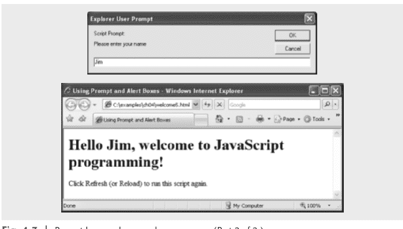

**图 4.7** | 用于欢迎屏幕的提示框。（第2部分，共2部分。）

第12行是一个*声明*，包含JavaScript*关键字*var。关键字是在JavaScript中具有特殊含义的单词。语句开头的关键字**var**表明，单词name是一个*变量*。变量是计算机内存中的一个位置，可以在其中存储程序使用的值。所有变量都有名称、类型和值，并且应该在程序中使用之前通过var语句声明。尽管使用var声明变量不是必需的，但在第7章"JavaScript：函数"中，我们将看到var有时可以确保脚本的正确行为。

变量的名称可以是任何有效的*标识符*。标识符是由字母、数字、下划线（ _ ）和美元符号（$）组成的字符序列，不能以数字开头，也不能是JavaScript保留关键字。[*注意：* 关键字的完整列表请参见图7.2。] 标识符不能包含空格。一些有效的标识符有：`Welcome`、`$value`、`_value`、`m_inputField1`和`button7`。名称`7button`不是有效的标识符，因为它以数字开头；名称`input field`无效，因为它包含空格。请记住，JavaScript是*区分大小写的*——大写和小写字母被视为不同的字符，所以`name`、`Name`和`NAME`是不同的标识符。

## 良好编程习惯 4.2

选择有意义的变量名称有助于脚本"自文档化"（即，仅通过阅读脚本就能轻松理解，而不必查阅手册或详细注释）。

## 良好编程习惯 4.3

按照惯例，*变量名*标识符以小写字母开头。每个后续单词应以大写字母开头。例如，标识符`itemPrice`的第二个单词*Price*中P为大写。

## 常见编程错误 4.7

在标识符中间拆分语句是语法错误。

声明以分号（;）结尾，可以跨越多行，声明中的每个变量用逗号分隔——称为变量名的*逗号分隔列表*。多个变量可以在一个声明中声明，也可以在多个声明中声明。

在第12行中，以字符`//`开头的*单行注释*说明了脚本中变量的用途。这种形式的注释称为单行注释，因为它在出现的行末尾终止。`//`注释可以在JavaScript代码行的任何位置开始，并持续到该行末尾。

## 良好编程习惯 4.4

> 每个变量单独声明在一行。这种格式便于在每个声明旁边插入描述性注释——这是广泛遵循的专业编码标准。

另一种注释符号便于编写*多行注释*。例如，

```
/* This is a multiline
    comment. It can be
    split over many lines. */
```

是跨越多行的多行注释。此类注释以分隔符`/*`开头，以分隔符`*/`结尾。解释器会忽略注释分隔符之间的所有文本。

## 常见编程错误 4.8

> 忘记多行注释的某个分隔符是语法错误。

## 常见编程错误 4.9

> 嵌套多行注释（即，将多行注释放在另一个多行注释的分隔符之间）是语法错误。

JavaScript从C编程语言中采用了以`/*`和`*/`分隔的注释，从C++编程语言中采用了以`//`分隔的单行注释。JavaScript程序员通常更喜欢C++风格的单行注释，而不是C风格的注释。在本书中，我们使用C++风格的单行注释。

第14行是说明下一行语句用途的注释。第15行调用`window`对象的`prompt`方法，显示图4.8中的对话框。该对话框允许用户输入代表其姓名的字符串。

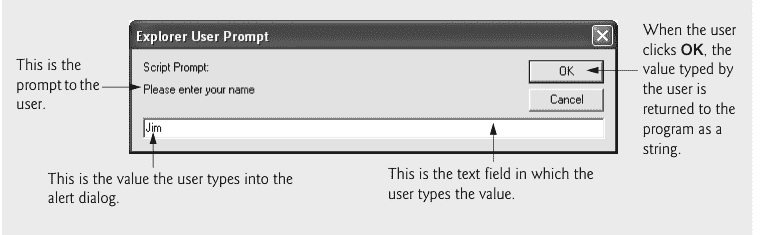

**图 4.8** | window对象的prompt方法显示的prompt对话框。


## 良好的编程实践 4.5

> 在二元运算符两侧各放置一个空格。这种格式使运算符更加醒目，也让程序更具可读性。

第 17–18 行使用 `document.writeln` 来显示新的欢迎消息。括号内的表达式使用运算符 `+` 将一个字符串（字面量 `"<h1>Hello, "`）、变量 **name**（第 15 行中用户输入的字符串）以及另一个字符串（字面量 `", welcome to JavaScript programming!</h1>"`）进行"拼接"。JavaScript 为 *字符串拼接* 提供了一种版本的 `+` 运算符，能够将一个字符串与另一种数据类型的值（包括另一个字符串）组合在一起。此操作的结果是一个新的（通常更长的）字符串。如果我们假设 **name** 包含字符串字面量 `"Jim"`，则该表达式的求值过程如下：JavaScript 判断第一个 `+` 运算符的两个操作数（字符串 `"<h1>Hello, "` 和变量 **name** 的值）都是字符串，然后将两者拼接为一个字符串。接下来，JavaScript 判断第二个 `+` 运算符的两个操作数（第一次拼接操作的结果，即字符串 `"<h1>Hello, Jim"`，和字符串 `", welcome to JavaScript programming!</h1>"`）都是字符串，并将两者拼接。最终得到字符串 `"<h1>Hello, Jim, welcome to JavaScript programming!</h1>"`。浏览器会将此字符串作为 XHTML 文档的一部分进行渲染。请注意，`Hello,` 和 `Jim` 之间的空格是字符串 `"<h1>Hello, "` 的一部分。

正如我们稍后将演示的那样，用于字符串拼接的 `+` 运算符可以在必要时将其他变量类型转换为字符串。因为字符串拼接是在两个字符串之间进行的，JavaScript 必须在执行操作之前将其他变量类型转换为字符串。例如，如果变量 **age** 的整数值为 21，那么表达式 **"my age is " + age** 的求值结果为字符串 **"my age is 21"**。JavaScript 将 **age** 的值转换为字符串，并与现有的字符串字面量 **"my age is "** 进行拼接。

在浏览器解释完 XHTML 文档的 `<head>` 部分（其中包含 JavaScript）之后，它会接着解释 XHTML 文档的 `<body>`（第 22–24 行）并渲染 XHTML。请注意，在关闭提示框之前，XHTML 页面不会被渲染，因为提示框会在处理 `<body>` 之前暂停 `<head>` 中的执行。如果你在输入姓名后点击浏览器的 **Refresh**（Internet Explorer）或 **Reload**（Firefox）按钮，浏览器将重新加载 XHTML 文档，这样你就可以再次执行脚本并更改姓名。*[注意：在某些情况下，可能需要在点击 Refresh 或 Reload 按钮时按住 Shift 键，以确保 XHTML 文档正确重新加载。浏览器通常会在内存中保存页面的最近副本，按住 Shift 键可强制浏览器下载页面的最新版本。]*

### 4.4.2 整数相加

我们的下一个脚本演示了使用提示对话框从用户获取输入的另一种方式。图 4.9 输入两个由用户在键盘上键入的 *整数*（即整数，如 7、−11、0 和 31914），计算它们的和并显示结果。

第 12–16 行声明了变量 `firstNumber`、`secondNumber`、`number1`、`number2` 和 `sum`。单行注释说明了每个变量的用途。第 19 行使用提示对话框让用户输入一个字符串，表示两个待相加整数中的第一个。脚本将用户输入的第一个值赋给变量 `firstNumber`。第 22 行显示一个提示对话框以获取第二个待相加的数字，并将该值赋给变量 `secondNumber`。

与前面的示例一样，用户可以在提示对话框中输入任何内容。对于此程序，如果用户输入了非整数值或点击了 **Cancel** 按钮，将会发生逻辑错误，两个值的和将以 *NaN*（意为 *非数字*）的形式显示在 XHTML 文档中。逻辑错误是由语法正确但产生非预期结果的代码引起的。在第 9 章 JavaScript: 对象 中，我们将讨论 Number 对象及其可以判断某个值是否为非数字的方法。

回想一下，提示对话框会以字符串的形式将用户输入的值返回给程序。第 25–26 行将用户输入的两个字符串转换为可用于计算的整数值。函数 **parseInt** 将其字符串参数转换为整数。第 25 行将函数 `parseInt` 返回的整数赋给变量 `number1`。第 26 行以类似的方式将一个整数值赋给变量 `number2`。程序中后续对 `number1` 和 `number2` 的任何引用都使用这些整数值。[注意：我们提到

```xml
<?xml version = "1.0" encoding = "utf-8"?>
<!DOCTYPE html PUBLIC "-//W3C//DTD XHTML 1.0 Strict//EN"
   "http://www.w3.org/TR/xhtml1/DTD/xhtml1-strict.dtd">

<!-- Fig. 4.9: addition.html -->
<!-- Addition script. -->
<html xmlns = "http://www.w3.org/1999/xhtml">
   <head>
      <title>An Addition Program</title>
      <script type = "text/javascript">
         <!--
            var firstNumber; // first string entered by user
            var secondNumber; // second string entered by user
            var number1; // first number to add
            var number2; // second number to add
            var sum; // sum of number1 and number2

            // read in first number from user as a string
            firstNumber = window.prompt( "Enter first integer" );

            // read in second number from user as a string
            secondNumber = window.prompt( "Enter second integer" );

            // convert numbers from strings to integers
            number1 = parseInt( firstNumber );
            number2 = parseInt( secondNumber );

            sum = number1 + number2; // add the numbers

            // display the results
            document.writeln( "<h1>The sum is " + sum + "</h1>" );
         // -->
      </script>
   </head>
   <body>
      <p>Click Refresh (or Reload) to run the script again</p>
   </body>
</html>
```

图 4.9 | 加法脚本。（第 1 部分，共 2 部分。）

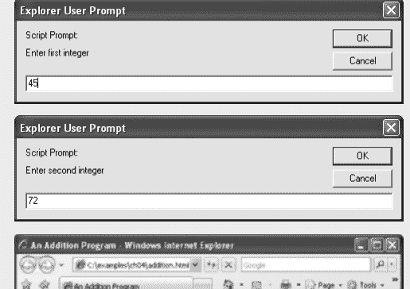


 parseInt 是一个*函数*而非方法，因为在调用该函数时，我们没有在函数名前加上对象名（如 document 或 window）和点号（.）。术语"方法"表示该函数属于某个特定对象。例如，writeln 方法属于 document 对象，而 prompt 方法则属于 window 对象。

第 28 行使用*加法运算符* + 计算变量 number1 和 number2 的和，并通过赋值运算符 = 将结果赋给变量 sum。请注意，+ 运算符既可以执行加法运算，也可以进行字符串拼接。在本例中，+ 运算符执行的是加法运算，因为两个操作数都是整数。第 28 行完成计算后，第 31 行使用 document.writeln 在网页上显示加法运算的结果。第 33 行和第 34 行分别关闭 script 和 head 元素。第 35–37 行渲染 XHTML 文档的 body 部分。使用浏览器的**刷新**或**重新加载**按钮重新加载 XHTML 文档，即可再次运行脚本。

## 常见编程错误 4.10

> 将用于字符串拼接的 + 运算符与用于加法的 + 运算符混淆，往往会导致意外结果。例如，若整数变量 y 的值为 5，则表达式 `"y + 2 = " + y + 2` 的结果是 `"y + 2 = 52"`，而非 `"y + 2 = 7"`。这是因为首先将 y 的值（即 5）与字符串 `"y + 2 = "` 拼接，然后再将值 2 与新的、更长的字符串 `"y + 2 = 5"` 拼接。而表达式 `"y + 2 = " + (y + 2)` 则会产生字符串 `"y + 2 = 7"`，因为括号确保了 y + 2 先进行数学运算，然后再转换为字符串。

## 4.5 JavaScript 中的数据类型

与其前身语言 C、C++ 和 Java 不同，JavaScript 不要求变量在使用前必须声明类型。JavaScript 中的变量可以包含任何数据类型的值，而且在很多情况下，JavaScript 会自动为你转换不同值之间的类型。因此，JavaScript 被称为*松散类型语言*。当在 JavaScript 中声明了变量但未给其赋值时，该变量具有*undefined*值。试图使用这种变量的值通常会导致逻辑错误。

变量在声明时不会自动赋值，除非由你明确指定。将值 null 赋给变量表示该变量不包含任何值。

## 4.6 算术运算

许多脚本会执行算术计算。*算术运算符*使用了代数中不常用的各种特殊符号。*星号*（*）表示乘法；*百分号*（%）是*取余运算符*，稍后将会讨论。算术运算符都是二元运算符，因为每个运算符都作用于两个操作数。例如，表达式 `sum + value` 包含二元运算符 + 以及两个操作数 sum 和 value。

JavaScript 提供了取余运算符 %，用于产生除法后的余数。[*注意*：在某些编程语言中，% 运算符被称为模运算符。] 表达式 `x % y` 产生 x 除以 y 后的余数。因此，`17 % 5` 的结果是 2（即 17 除以 5 得 3，余数为 2），而 `7.4 % 3.1` 的结果是 1.2。= 稍后章节中，我们将考虑取余运算符的应用，例如判断一个数是否是另一个数的倍数。JavaScript 中没有用于幂运算的算术运算符。（第 6 章"JavaScript：控制语句 II"将介绍如何使用 Math 对象的 pow 方法在 JavaScript 中进行幂运算。）

## 4.7 决策制定：相等运算符和关系运算符

本节介绍 JavaScript 的 if 语句的一个版本，它允许程序根据条件的真假来做出决策。如果条件满足（即条件为真），则执行 if 语句体中的语句。如果条件不满足（即条件为假），则不执行 if 语句体中的语句。我们稍后将会看到示例。[注意：if 语句的其他版本在第 5 章"JavaScript：控制语句 I"中介绍。]

if 语句中的条件可以通过使用图 4.10 总结的相等运算符和关系运算符来形成。关系运算符都具有相同的优先级，并且从左到右结合。相等运算符也都具有相同的优先级，其优先级低于关系运算符。相等运算符同样从左到右结合。

> **常见编程错误 4.11**
> 如果运算符 ==、!=、>= 和 <= 的符号之间包含空格，如 = =、! =、> = 和 < =，则属于语法错误。

> **常见编程错误 4.12**
> 将运算符 !=、>= 和 <= 的顺序颠倒，如 =!、=> 和 =<，则属于语法错误。

> **常见编程错误 4.13**
> 将相等运算符 == 与赋值运算符 = 混淆是一种逻辑错误。相等运算符应被理解为"等于"，赋值运算符应被理解为"获得"或"获得……的值"。有些人更喜欢将相等运算符读作"双等号"或"等于等于"。

| 标准代数相等运算符或关系运算符 | JavaScript 相等运算符或关系运算符 | JavaScript 条件示例 | JavaScript 条件的含义 |
|---|---|---|---|
| *相等运算符* | | | |
| = | == | x == y | x 等于 y |
| ≠ | != | x != y | x 不等于 y |
| *关系运算符* | | | |
| > | > | x > y | x 大于 y |
| < | < | x < y | x 小于 y |
| ≥ | >= | x >= y | x 大于或等于 y |
| ≤ | <= | x <= y | x 小于或等于 y |

**图 4.10 |** 相等运算符和关系运算符。

图 4.11 中的脚本使用四个 if 语句在欢迎页面上显示与时间相关的问候语。该脚本从用户的计算机获取本地时间，并将其从 24 小时制（0–23）转换为 12 小时制（0–11）。根据该值，脚本会显示适合当前时段的问候语。脚本及其示例输出如图 4.11 所示。

```
<?xml version = "1.0" encoding = "utf-8"?>
<!DOCTYPE html PUBLIC "-//W3C//DTD XHTML 1.0 Strict//EN"
  "http://www.w3.org/TR/xhtml1/DTD/xhtml1-strict.dtd">

<!-- Fig. 4.11: welcome6.html -->
<!-- Using equality and relational operators. -->
<html xmlns = "http://www.w3.org/1999/xhtml">
   <head>
      <title>Using Relational Operators</title>
      <script type = "text/javascript">
         <!--
         var name; // string entered by the user
         var now = new Date();    // current date and time
         var hour = now.getHours(); // current hour (0-23)

         // read the name from the prompt box as a string
         name = window.prompt( "Please enter your name" );

         // determine whether it is morning
         if ( hour < 12 )
            document.write( "<h1>Good Morning, " );

         // determine whether the time is PM
         if ( hour >= 12 )
         {
            // convert to a 12-hour clock
            hour = hour - 12;

            // determine whether it is before 6 PM
            if ( hour < 6 )
               document.write( "<h1>Good Afternoon, " );

            // determine whether it is after 6 PM
            if ( hour >= 6 )
               document.write( "<h1>Good Evening, " );
         } // end if

         document.writeln( name +
            ", welcome to JavaScript programming!</h1>" );
         // -->
      </script>
   </head>
   <body>
      <p>Click Refresh (or Reload) to run this script again.</p>
   </body>
</html>
```

## 图 4.11 | 使用相等运算符和关系运算符。（第 1 部分，共 2 部分）

## 第 4 章 JavaScript：脚本编程简介

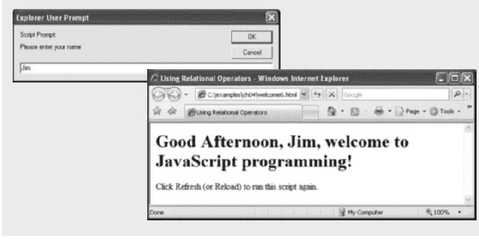

图 4.11 | 使用相等运算符和关系运算符。（第 2 部分，共 2 部分。）

第 12–14 行声明了脚本中使用的变量。请记住，变量可以在一个声明中声明，也可以在多个声明中声明。如果在一个声明中声明了多个变量（如本例所示），变量名之间用逗号（,）分隔。这个名称列表被称为逗号分隔列表。再次注意每行末尾的注释，说明了程序中每个变量的用途。还要注意，某些变量在声明时被赋予了初值——JavaScript 允许你在声明变量时为其赋值。

第 13 行将变量 now 设置为一个新的 **Date** 对象，其中包含有关当前本地时间的信息。在 4.2 节中，我们介绍了 document 对象，它是一个封装了与当前网页相关数据的对象。程序员可以选择使用其他对象来执行特定任务或获取特定信息。这里，我们使用 JavaScript 内置的 Date 对象来获取当前本地时间。我们通过使用 **new** 运算符，后跟对象类型 Date 和一对括号来创建一个新实例。某些对象要求在括号中放置参数，以指定要创建的对象的详细信息。在本例中，我们将括号留空以创建一个默认的 Date 对象，其中包含有关当前日期和时间的信息。第 13 行执行后，变量 now 指向新的 Date 对象。[*注意*：我们使用 document 和 window 对象时不需要使用 new 运算符，因为这些对象总是由浏览器创建的。] 第 14 行将变量 hour 设置为等于 Date 对象的 getHours 方法返回的当前小时数（24 小时制）。第 9 章将更详细地讨论 Date 对象的属性和方法，以及对象的一般概念。与前面的示例一样，脚本使用 window.prompt 方法的 prompt 方法允许用户输入一个名称，作为问候语的一部分显示（第 17 行）。

为了显示正确的时间相关问候语，脚本必须确定用户是在上午、下午还是晚上访问页面。第一个 if 语句（第 20–21 行）将变量 hour 的值与 12 进行比较。如果 hour 小于 12，则用户在上午访问页面，第 21 行的语句输出字符串 "Good morning"。如果该条件不满足，则不执行第 21 行。第 24 行确定

判断 hour 是否大于或等于 12。如果 hour 大于或等于 12，则用户是在下午或傍晚访问页面。执行第 25–36 行以确定合适的问候语。如果 hour 小于 12，则 JavaScript 解释器不执行这些行，而是继续执行第 38 行。

第 25 行的大括号 `{` 开始一个语句块（第 27–35 行），如果 hour 大于或等于 12 则执行该语句块——要在 if 结构内部执行多条语句，请将它们用大括号括起来。第 27 行从 hour 中减去 12，将当前时间从 24 小时制格式（0–23）转换为 12 小时制格式（0–11）。if 语句（第 30 行）判断 hour 现在是否小于 6。如果是，则时间在中午到下午 6 点之间，第 31 行输出 XHTML h1 元素的开头（`"<h1>Good Afternoon, "`）。如果 hour 大于或等于 6，则时间在晚上 6 点到午夜之间，脚本输出问候语 `"Good Evening"`（第 34–35 行）。第 36 行的大括号 `}` 结束与第 24 行 if 语句相关联的语句块。注意，if 语句可以*嵌套*，也就是说，一个 if 语句可以放在另一个 if 语句内部。用于判断用户是在下午还是傍晚访问页面的 if 语句（第 30–31 行和第 34–35 行）只有在脚本已经确认 hour 大于或等于 12（第 24 行）的情况下才会执行。如果脚本已经确定当前时间是早晨，则不会执行这些额外的比较。（第 5 章将对块和嵌套 if 语句进行更深入的讨论。）最后，第 38–39 行输出 XHTML h1 元素的其余部分（问候语的剩余部分），这部分不依赖于一天中的时间。

## 良好编程习惯 4.6

> 在控制语句（如 if 语句）的结束大括号后添加注释，以指示语句的结束位置，如图 4.11 第 36 行所示。

请注意，每个 if 语句的第一行末尾没有分号（`;"`）。包含这样的分号将在执行时导致逻辑错误。例如，

```
if ( hour < 12 ) ;
    document.write( "<h1>Good Morning, " );
```

实际上会被 JavaScript 错误地解释为

```
if ( hour < 12 )
    ;

document.write( "<h1>Good Morning, " );
```

其中，单独一行上的分号——称为*空语句*——是 if 语句条件为真时要执行的语句。当空语句执行时，程序中不执行任何任务。然后程序继续执行下一条语句，无论条件为真还是为假，该语句都会执行。在此示例中，无论一天中的什么时间，都会输出 `"<h1>Good Morning, "`。

## 常见编程错误 4.14

> 在 if 语句条件的右括号后立即放置分号通常是一种逻辑错误。该分号会导致 if 语句的主体为空，因此 if 语句本身不执行任何操作，无论其条件是否为真。更糟的是，if 语句的预期主体语句现在变成了 if 语句之后的顺序语句，并且总是会执行。

## 常见编程错误 4.15

> 在一系列 if 语句中遗漏条件通常是一种逻辑错误。例如，检查 hour 是否大于 12 或小于 12，但不检查 hour 是否等于 12，这意味着当 hour 等于 12 时脚本不采取任何操作。务必确保处理每一种可能的条件。

请注意图 4.11 第 38–39 行中对空格的使用。请记住，空白字符（如制表符、换行符和空格）通常会被浏览器忽略。因此，语句可以拆分到多行，并且可以根据您的偏好进行间距调整，而不会影响程序的含义。但是，拆分标识符和字符串字面量是不正确的。理想情况下，语句应该保持简短，但并不总是能做到这一点。

图 4.12 中的图表显示了本章介绍的运算符的优先级。运算符从上到下按优先级递减的顺序排列。请注意，除赋值运算符 `=` 外，所有这些运算符都是从左到右结合的。加法是左结合的，因此像 `x + y + z` 这样的表达式会被视为如同写成 `(x + y) + z` 一样进行求值。赋值运算符 `=` 从右到左结合，因此像 `x = y = 0` 这样的表达式会被视为如同写成 `x = (y = 0)` 一样进行求值，该式首先将值 0 赋给变量 y，然后将该赋值的结果 0 赋给 x。

| 运算符 | 结合性 | 类型 |
|-----------|---------------|------|
| * / % | 从左到右 | 乘法 |
| + - | 从左到右 | 加法 |
| < <= > >= | 从左到右 | 关系 |
| == != | 从左到右 | 相等 |
| = | 从右到左 | 赋值 |

图 4.12 | 截至目前讨论的运算符的优先级和结合性。

## 4.8 网络资源

www.deitel.com/javascript

Deitel JavaScript 资源中心包含指向网络上一些最佳 JavaScript 资源的链接。在那里，您可以找到按类别分类的 JavaScript 工具、代码生成器、论坛、书籍、库、框架等链接。此外，还可以查看适合所有技能水平的教程，从入门到高级。

# 5 JavaScript：控制语句 I

> 让我们都向前迈进。
> ——刘易斯·卡罗尔

> 轮子转了一圈又回到了原点。
> ——威廉·莎士比亚

> 有多少苹果砸在牛顿头上，他才明白了启示！
> ——罗伯特·弗罗斯特

# 学习目标

在本章中，您将学习：

- 使用 if 和 if...else 选择语句在备选操作中进行选择。
- 使用 while 重复语句在脚本中反复执行语句。
- 计数器控制重复和哨兵控制重复。
- 使用增量、递减和赋值运算符。

## 5.1 引言

在编写脚本解决问题之前，彻底理解问题并仔细规划解决问题的方法至关重要。在编写脚本时，同样必须了解可用的构建块类型，并采用经过验证的程序构建原则。在本章和第 6 章中，我们在结构化编程理论和原则的讲解中讨论这些问题。您在这里学到的技巧适用于大多数高级语言，包括 JavaScript。

## 5.2 控制语句

JavaScript 提供了三种选择语句；我们将在本章和第 6 章中逐一讨论。`if` 选择语句在条件为真时执行（选择）一个操作，在条件为假时跳过该操作。`if...else` 选择语句在条件为真时执行一个操作，在条件为假时执行另一个不同的操作。`switch` 选择语句（第 6 章）根据表达式的值执行众多不同操作之一。

`if` 语句称为*单选择语句*，因为它选择或忽略单个操作（或者，正如我们即将看到的，单个操作组）。`if...else` 语句是*双选择语句*，因为它在两个不同操作（或操作组）之间进行选择。`switch` 语句是*多选择语句*，因为它在众多不同操作（或操作组）之间进行选择。

JavaScript 提供了四种重复语句类型，即 `while`、`do...while`、`for` 和 `for...in`。（`do...while` 和 `for` 在第 6 章中介绍；`for...in` 在第 8 章中介绍。）`if`、`else`、`switch`、`while`、`do`、`for` 和 `in` 中的每一个词都是 JavaScript *关键字*。这些词由语言保留，用于实现各种特性，例如 JavaScript 的控制语句。关键字不能用作标识符（例如，作为变量名）。JavaScript 关键字的完整列表如图 5.1 所示。

> **常见编程错误 5.1**
>
> 将关键字用作标识符是一种语法错误。

- 5.1 引言
- 5.2 控制语句
- 5.3 `if` 选择语句
- 5.4 `if...else` 选择语句
- 5.5 `while` 重复语句
- 5.6 计数器控制重复
- 5.7 算法设计：哨兵控制重复
- 5.8 算法设计：嵌套控制语句
- 5.9 赋值运算符
- 5.10 增量和减量运算符
- 5.11 网络资源


## 5.3 if 选择语句

| JavaScript 关键字 | | | |
|---|---|---|---|
| break | case | catch | continue |
| delete | do | else | false |
| for | function | if | in |
| new | null | return | switch |
| throw | true | try | typeof |
| void | while | with | |
| *JavaScript 保留但未使用的关键字* | | | |
| abstract | boolean | byte | char |
| const | debugger | double | enum |
| extends | final | float | goto |
| import | int | interface | long |
| package | private | protected | public |
| static | super | synchronized | throws |
| volatile | | | |

图 5.1 | JavaScript 关键字。

正如我们所介绍的，JavaScript 仅有八种控制结构：顺序结构、三种选择结构和四种循环结构。程序通过按需要组合控制语句来实现该程序的算法。

*单入口/单出口控制语句*使构建程序变得容易；控制语句通过将其中一个的出口点连接到另一个的入口点来相互连接。这一过程称为***控制语句堆叠***。我们将会了解到，控制语句还可以通过另一种方式连接，即*控制语句嵌套*。因此，JavaScript 程序仅由八种不同类型的控制结构以仅有的两种方式组合而成。

## 5.3 if 选择语句

选择语句用于在程序中选择不同的执行路径。例如，假设考试的及格分数为 60 分（满分 100 分）。那么 JavaScript 语句

```
if ( studentGrade >= 60 )
    document.writeln( "Passed" );
```

判断条件"学生成绩大于或等于 60"为真还是为假。如果条件为真，则在 XHTML 文档中输出 "Passed"，并执行下一个 JavaScript 语句。如果条件为假，则忽略该打印语句，并执行下一个 JavaScript 语句。

注意，该选择语句的第二行是缩进的。JavaScript 解释器忽略空白字符——用于缩进和垂直间距的空格、制表符和换行符。

图 5.2 中的流程图说明了单选择 if 语句。该流程图包含了或许是最重要的流程图符号——菱形符号（或**判定符号**），它表示需要做出决策。判定符号中包含一个表达式，例如一个条件，该条件可以为 *true* 或 *false*。判定符号有两条流出线从其中引出。一条指示当符号中的表达式为真时程序应遵循的路径；另一条指示当表达式为假时程序应遵循的路径。任何计算结果为 JavaScript 布尔类型值的表达式（即计算结果为 `true` 或 `false` 的表达式——也称为*布尔表达式*）都可以用于做出判定。

### 软件工程观察 5.1

> 在 JavaScript 中，条件中任何非零的数值都计算为 `true`，而 0 计算为 `false`。对于字符串，任何包含一个或多个字符的字符串计算为 `true`，而空字符串（不包含任何字符的字符串，表示为 `""`）计算为 `false`。此外，使用 `var` 声明但未被赋值的变量也计算为 `false`。

注意 `if` 语句是一个单入口/单出口控制语句。其余控制语句的流程图也包含（除了小圆圈符号和流程线）仅矩形符号，用于指示要执行的动作，以及菱形符号，用于指示要做出决策。这种类型的流程图代表了*编程的动作/决策模型*。

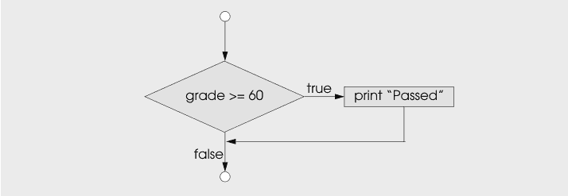

**图 5.2 |** 单选择 `if` 语句的流程图。

## 5.4 `if...else` 选择语句

`if` 选择语句仅在条件计算为 `true` 时执行指定的动作；否则，该动作被跳过。***if...else 选择语句***允许你指定当条件为真和为假时执行不同的动作。例如，JavaScript 语句

```
if ( studentGrade >= 60 )
    document.writeln( "Passed" );
else
    document.writeln( "Failed" );
```

如果学生成绩大于或等于 60，则在 XHTML 文档中输出 `Passed`；如果学生成绩小于 60，则输出 `Failed`。无论哪种情况，打印发生后，都会按顺序执行下一个 JavaScript 语句（即整个 `if...else` 语句之后的下一个语句）。注意结构 `else` 部分的语句体也是缩进的。图 5.3 所示的流程图说明了 `if...else` 选择语句的控制流程。

JavaScript 提供了一种称为*条件运算符*（`?:`）的运算符，它与 `if...else` 语句密切相关。运算符 `?:` 是 JavaScript 唯一的*三元运算符*——它有三个操作数。操作数与 `?:` 一起构成*条件表达式*。第一个操作数是一个布尔表达式，第二个是表达式计算为 `true` 时条件表达式的值，第三个是表达式计算为 `false` 时条件表达式的值。例如，考虑以下语句

```
document.writeln( studentGrade >= 60 ? "Passed" : "Failed" );
```

包含一个条件表达式，如果条件 `studentGrade >= 60` 为 `true`，则计算为字符串 `"Passed"`；如果条件为 `false`，则计算为字符串 `"Failed"`。因此，使用条件运算符的这条语句执行的操作与前面的 `if...else` 语句基本相同。条件运算符的优先级较低，因此整个条件表达式通常放在括号中以确保正确计算。

*嵌套 `if...else` 语句*通过在 `if...else` 语句内部放置 `if...else` 语句来测试多种情况。例如，以下伪代码语句指示程序应输出：成绩大于或等于 90 为 A，80 到 89 为 B，70 到 79 为 C，60 到 69 为 D，所有其他成绩为 F：

```
if ( studentGrade >= 90 )
    document.writeln( "A" );
else
    if ( studentGrade >= 80 )
        document.writeln( "B" );
    else
        if ( studentGrade >= 70 )
            document.writeln( "C" );
        else
            if ( studentGrade >= 60 )
                document.writeln( "D" );
            else
                document.writeln( "F" );
```

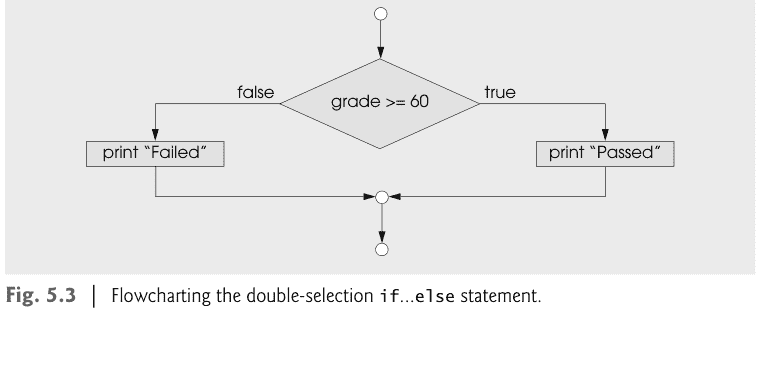

图 5.3 | 双选择 if...else 语句的流程图。

如果 studentGrade 大于或等于 90，四个条件都为真，但只有第一个测试后的 document.writeln 语句会执行。该特定的 document.writeln 执行后，外层 if...else 语句的 else 部分将被跳过。

### 良好编程习惯 5.1

> 如果有多个缩进级别，每个级别应以相同数量的额外空格缩进。

大多数 JavaScript 程序员更喜欢将前面的 if 语句写成

```
if ( grade >= 90 )
    document.writeln( "A" );
else if ( grade >= 80 )
    document.writeln( "B" );
else if ( grade >= 70 )
    document.writeln( "C" );
else if ( grade >= 60 )
    document.writeln( "D" );
else
    document.writeln( "F" );
```

这两种形式是等价的。后者更为流行，因为它避免了代码向右深度缩进。这种深度缩进往往使行上空间很小，导致行被拆分，降低了程序的可读性。

需要注意的是，JavaScript 解释器总是将 else 与前面最近的 if 关联，除非通过大括号（{}）的位置另有说明。这种情况称为*悬空 else 问题*。例如，

```
if ( x > 5 )
    if ( y > 5 )
        document.writeln( "x and y are > 5" );
else
    document.writeln( "x is <= 5" );
```

从其缩进*看起来*好像表明如果 x 大于 5，则其内部的 if 语句判断 y 是否也大于 5。如果是这样，嵌套 if 语句的主体输出字符串 "x and y are > 5"。否则，*看起来*如果 x 不大于 5，则 if...else 语句的 else 部分输出字符串 "x is <= 5"。

小心！前面的嵌套 if 语句并不像它看起来那样执行。解释器实际上将前面的语句解释为

```
if ( x > 5 )
    if ( y > 5 )
        document.writeln( "x and y are > 5" );
    else
        document.writeln( "x is <= 5" );
```

其中第一个 if 语句的主体是一个嵌套的 if...else 语句。该语句测试 x 是否大于 5。如果是，则继续执行并测试 y 是否也大于 5。如果第二个条件为真，则显示适当的字符串——"x and y are > 5"。但是，如果第二个条件为假，则显示字符串 "x is <= 5"，尽管我们知道 x 大于 5。


要使前面那个嵌套 if 语句按最初的意图执行，必须写成如下形式：

```
if ( x > 5 )
{
    if ( y > 5 )
        document.writeln( "x and y are > 5" );
}
else
    document.writeln( "x is <= 5" );
```

花括号（{}）告诉解释器，第二个 if 语句位于第一个 if 语句的体内，而 else 与第一个 if 语句相匹配。

if 选择语句的体内只能有一条语句。要在 if 语句的体内包含多条语句，请将这些语句用花括号（{ 和 }）括起来。这在 if...else 语句的 else 部分也可以这样做。包含在一对花括号内的一组语句称为*块*。

## 软件工程观察 5.2

> 块可以放置在程序中任何可以放置单条语句的位置。

## 软件工程观察 5.3

> 与单独的语句不同，块不以分号结尾。但是，块中花括号内的每条语句都应以分号结尾。

下面的示例在 if...else 语句的 else 部分包含了一个块：

```
if ( grade >= 60 )
    document.writeln( "Passed" );
else
{
    document.writeln( "Failed<br />" );
    document.writeln( "You must take this course again." );
}
```

在这种情况下，如果 grade 小于 60，程序会执行 else 体内的两条语句，并打印

Failed.
You must take this course again.

注意 else 子句中包围两条语句的花括号。这些花括号很重要。如果没有它们，语句

```
document.writeln( "You must take this course again." );
```

将位于 if 的 else 部分之外，并且无论 grade 是否小于 60，都会执行。

## 常见编程错误 5.2

> 忘记界定块的一个或两个花括号可能导致语法错误或逻辑错误。

## 5.5 while 循环语句

循环语句允许你指定在某个条件保持为 true 时，脚本重复执行某个操作。

> **良好编程习惯 5.2**
>
> 一些程序员喜欢在输入花括号内的各个语句之前，先输入块的开头和结尾花括号。这有助于避免遗漏一个或两个花括号。

> **软件工程观察 5.4**
>
> 正如块可以放置在任何可以放置单条语句的位置一样，在这些位置也可以没有任何语句（空语句）。空语句是在通常会出现语句的地方放置一个分号（;）来表示的。

> **常见编程错误 5.3**
>
> 在 if 语句的条件后面放置分号会导致单选择 if 语句出现逻辑错误，以及在双选择 if 语句中出现语法错误（如果 if 部分包含非空的体语句）。

> **常见编程错误 5.4**
>
> 如果 while 语句的体从未使 while 语句的条件变为 true，就会发生逻辑错误。通常，这样的重复结构永远不会终止——这种错误称为无限循环。Internet Explorer 和 Firefox 都会显示一个对话框，允许用户终止包含无限循环的脚本。

> **常见编程错误 5.5**
>
> 记住，JavaScript 是区分大小写的语言。在代码中，将关键字 while 以大写 W 拼写为 While，是一个语法错误。JavaScript 的所有保留关键字，如 while、if 和 else，都只包含小写字母。

作为 while 语句的一个例子，考虑一个旨在找出第一个大于 1000 的 2 的幂的程序段。变量 product 初始值为 2：

```
var product = 2;

while ( product <= 1000 )
    product = 2 * product;
```

当 while 语句执行完毕时，product 中包含结果 1024。图 5.4 中的流程图说明了前面 while 语句的控制流程。

当脚本进入 while 语句时，product 是 2。脚本重复将变量 product 乘以 2，因此 product 依次取值 4、8、16、32、64、128、256、512 和 1024。当 product 变为 1024 时，while 语句中的条件 product <= 1000 变为 false。这终止了循环，1024 成为 product 的最终值。执行继续执行 while 语句之后的下一条语句。[*注意：* 如果 while 语句的条件最初就是 false，体语句将永远不会执行。]

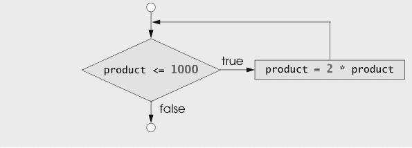

图 5.4 | while 循环语句的流程图。

## 5.6 计数器控制的循环

考虑以下问题陈述：

> 一个班级有十名学生参加了一次测验。这次测验的成绩（0 到 100 之间的整数）可以获取。确定该测验的班级平均分。

班级平均分等于成绩之和除以学生人数（本例中为 10）。解决这个问题的程序（图 5.5）必须输入每个成绩，执行平均计算并显示结果。我们使用*计数器控制的循环*来逐个输入成绩。在本例中，当计数器超过 10 时，循环终止。

```
 1  <?xml version = "1.0" encoding = "utf-8"?>
 2  <!DOCTYPE html PUBLIC "-//W3C//DTD XHTML 1.0 Strict//EN"
 3     "http://www.w3.org/TR/xhtml1/DTD/xhtml1-strict.dtd">
 4
 5  <!-- Fig. 5.5: average.html -->
 6  <!-- Counter-controlled repetition to calculate a class average. -->
 7  <html xmlns = "http://www.w3.org/1999/xhtml">
 8     <head>
 9        <title>Class Average Program</title>
10        <script type = "text/javascript">
11           <!--
12           var total; // sum of grades
13           var gradeCounter; // number of grades entered
14           var grade; // grade typed by user (as a string)
15           var gradeValue; // grade value (converted to integer)
16           var average; // average of all grades
17
18           // Initialization Phase
19           total = 0; // clear total
20           gradeCounter = 1; // prepare to loop
21
22           // Processing Phase
23           while ( gradeCounter <= 10 ) // loop 10 times
24           {
```

图 5.5 | 计数器控制的循环计算班级平均分。（第 1 部分，共 2 部分。）

```
// prompt for input and read grade from user
grade = window.prompt( "Enter integer grade:", "0" );

// convert grade from a string to an integer
gradeValue = parseInt( grade );

// add gradeValue to total
total = total + gradeValue;

// add 1 to gradeCounter
gradeCounter = gradeCounter + 1;
} // end while

// Termination Phase
average = total / 10; // calculate the average

// display average of exam grades
document.writeln(
"<h1>Class average is " + average + "</h1>" );
// -->
</script>
</head>
<body>
<p>Click Refresh (or Reload) to run the script again</p>
</body>
</html>
```

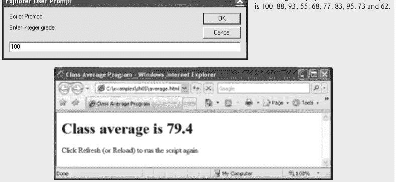

## 图 5.5 | 计数器控制的循环计算班级平均分。（第 2 部分，共 2 部分。）

第 12–16 行声明变量 `total`、`gradeCounter`、`grade`、`gradeValue`、`average`。变量 `grade` 将存储用户在提示对话框中输入的字符串。变量 `gradeValue` 将存储用户在提示对话框中输入的成绩的整数值。

第 19–20 行是赋值语句，将 `total` 初始化为 0，将 `gradeCounter` 初始化为 1。注意，变量 `total` 和 `gradeCounter` 在用于计算之前已初始化。

## 常见编程错误 5.6

> 不初始化将用于计算中的变量会导致逻辑错误，产生 NaN（Not a Number，非数字）值。必须在用于计算之前初始化该变量。

第 23 行表示，当 gradeCounter 的值小于或等于 10 时，while 语句继续迭代。第 27 行对应于伪代码语句"输入下一个成绩。"该语句在屏幕上显示带有提示"Enter integer grade:"的提示对话框。

用户输入成绩后，第 30 行将其从字符串转换为整数。在本例中，我们必须将字符串转换为整数；否则，第 33 行中的加法语句将是字符串连接语句，而不是数值求和。

程序现在准备增加变量 gradeCounter，以表明已处理了一个成绩，并从用户读取下一个成绩。第 36 行将 gradeCounter 加 1，以便 while 语句中的条件最终会变为 false 并终止循环。该语句执行后，程序继续测试第 23 行 while 语句中的条件。如果条件仍然为 true，则第 27–36 行中的语句重复执行。否则，程序继续执行循环体之后的第一条顺序语句（即第 40 行）。

第 40 行将平均计算结果赋值给变量 average。第 43–44 行在文档中写入一行 XHTML 文本，显示字符串"Class average is "，后跟变量 average 的值，作为浏览器中的 <h1> 元素。

通过在网页浏览器中双击 XHTML 文档（从 Windows 资源管理器）来执行脚本。此脚本将任何用户输入解析为整数。在图 5.5 的示例程序执行中，输入值的总和（100、88、93、55、68、77、83、95、73 和 62）为 794。尽管脚本将所有输入视为整数，但程序中的平均计算不会产生整数。相反，计算产生一个*浮点数*（即，包含小数 Foster 的数字）。本例中用户输入的 10 个整数的平均值为 79.4。

## 软件工程观察 5.5

> 如果传递给 parseInt 的字符串包含浮点数值，parseInt 只会截断浮点部分。例如，字符串 "27.95" 结果为整数 27，字符串 "-123.45" 结果为整数 -123。如果传递给 parseInt 的字符串不是数值，parseInt 返回 NaN（非数字）。

JavaScript 实际上在内存中将所有数字表示为浮点数。浮点数通常通过除法产生，如本例所示。当我们将 10 除以 3 时，结果是 3.3333333…，3 的序列无限重复。计算机只分配固定数量的空间来存储这样的值，因此存储的浮点值只能是一个近似值。

## 5.7 算法设计：哨兵控制的循环

让我们将班级平均问题一般化。考虑以下问题：

> 开发一个班级平均程序，每次运行该程序时处理任意数量的成绩。


在第一个班级平均分的例子中，成绩的数量（10个）是预先知道的。在这个例子中，并没有给出用户将要输入多少个成绩的提示。该程序必须处理任意数量的成绩。程序如何确定何时停止输入成绩？它又怎么知道何时计算并显示班级平均分呢？

解决这一问题的一种方法是使用一个特殊的值，称为*哨兵值*（也叫*信号值*、*哑值*或*标志值*）来表示数据输入的结束。用户输入成绩，直到所有合法的成绩都已输入完毕。然后用户输入哨兵值，表示最后一个成绩已经输入完毕。

显然，必须选择一个不会与合法输入值混淆的哨兵值。对于这个例子，–1 是一个可接受的哨兵值，因为测验成绩通常是从 0 到 100 的非负整数。因此，班级平均分程序的一次执行可能会处理一串输入，例如 95、96、75、74、89 和 –1。程序将计算并打印成绩 95、96、75、74 和 89 的班级平均分（–1 是哨兵值，因此不应计入平均计算）。

图 5.6 展示了 JavaScript 程序及一次示例执行。尽管每个成绩都是整数，但平均值的计算很可能会产生一个带小数点的数字（实数）。

```
1  <?xml version = "1.0" encoding = "utf-8"?>
2  <!DOCTYPE html PUBLIC "-//W3C//DTD XHTML 1.0 Strict//EN"
3    "http://www.w3.org/TR/xhtml1/DTD/xhtml1-strict.dtd">
4
5  <!-- Fig. 5.6: average2.html -->
6  <!-- Sentinel-controlled repetition to calculate a class average. -->
7  <html xmlns = "http://www.w3.org/1999/xhtml">
8     <head>
9        <title>Class Average Program: Sentinel-controlled Repetition</title>
10
11       <script type = "text/javascript">
12          <!--
13          var total; // sum of grades
14          var gradeCounter; // number of grades entered
15          var grade; var str (as a string)
16          var gradeValue; // grade value (converted to integer)
17          var average; // average of all grades
18
19          // Initialization phase
20          total = 0; // clear total
21          gradeCounter = 0; // prepare to loop
22
23          // Processing phase
24          // prompt for input and read grade from user
25          grade = window.prompt(
26             "Enter Integer Grade, -1 to Quit:", "0" );
27
28          // convert grade from a string to an integer
29          gradeValue = parseInt( grade );
30
31          while ( gradeValue != -1 )
32          {
```

图 5.6 | 使用哨兵控制的重复计算班级平均分。（第 1 页，共 2 页）

### 5.7 算法设计：哨兵控制的重复

```
// add gradeValue to total
total = total + gradeValue;

// add 1 to gradeCounter
gradeCounter = gradeCounter + 1;

// prompt for input and read grade from user
grade = window.prompt(
    "Enter Integer Grade, -1 to Quit:", "0" );

// convert grade from a string to an integer
gradeValue = parseInt( grade );
} // end while

// Termination phase
if ( gradeCounter != 0 )
{
    average = total / gradeCounter;

    // display average of exam grades
    document.writeln(
        "<h1>Class average is " + average + "</h1>" );
} // end if
else
    document.writeln( "<p>No grades were entered</p>" );
// -->
</script>
    </head>
<body>
    <p>Click Refresh (or Reload) to run the script again</p>
</body>
</html>
```

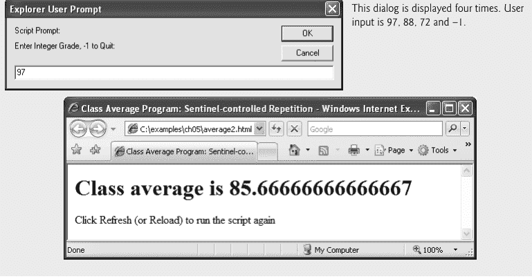

图 5.6 | 使用哨兵控制的重复计算班级平均分。（第 2 页，共 2 页）

在这个例子中，我们看到控制语句可以一个接一个地堆叠（按顺序）。*while* 语句（第 31–45 行）之后紧接着是一个按顺序执行的 *if...else* 语句（第 48–57 行）。这个程序中的大部分代码与图 5.5 中的代码相同，因此我们将重点放在这个例子中的新特性上。

第 21 行将 gradeCounter 初始化为 0，因为还没有输入任何成绩。请记住，该程序使用哨兵控制的重复。为了准确记录输入的成绩数量，脚本仅在处理完一个合法的成绩值后才增加 gradeCounter。

注意图 5.6 中 *while* 循环内的语句块（第 32–45 行）。如果没有大括号，循环体中的最后三条语句将落在循环之外，导致计算机错误地解释代码，如下所示：

```
while ( gradeValue != -1 )
   // add gradeValue to total
   total = total + gradeValue;

   // add 1 to gradeCounter
   gradeCounter = gradeCounter + 1;

   // prompt for input and read grade from user
   grade = window.prompt(
      "Enter Integer Grade, -1 to Quit:", "0" );

   // convert grade from a string to an integer
   gradeValue = parseInt( grade );
```

如果用户没有在 第 25–26 行中输入哨兵值 -1 作为第一个输入值（即在 *while* 语句之前），这种解释将导致程序出现无限循环。

> **常见编程错误 5.7**
> 遗漏界定语句块的大括号可导致逻辑错误，如无限循环。

## 5.8 算法设计：嵌套控制语句

考虑以下问题描述：

> *一所大学开设了一门课程，为学生准备州房地产经纪人执照考试。去年，几位完成该课程的学生参加了执照考试。当然，学校希望了解其学生的表现如何。你被要求编写一个程序来汇总结果。你拿到了这 10 名学生的名单。每个名字旁边都写着一个 1，表示该学生通过了考试；写着一个 2，表示该学生未通过考试。*

*你的程序应按如下方式分析考试结果：*

1. 输入每个考试结果（即 1 或 2）。每次程序请求另一个考试结果时，在屏幕上显示消息 "Enter result"。
2. 统计每种类型考试结果的数量。
3. 显示考试结果的摘要，指出通过考试的学生人数和未通过考试的学生人数。
4. 如果超过八名学生通过了考试，则打印消息 "Raise tuition"。

仔细阅读问题描述后，我们对该问题做出以下观察：

1. 该程序必须处理 10 名学生的考试结果。将使用计数器控制的循环。
2. 每个考试结果都是一个数字——要么是 1，要么是 2。每次程序读取一个考试结果时，都必须确定该数字是 1 还是 2。我们在算法中检测是否为 1。如果该数字不是 1，我们假定它是 2。
3. 使用两个计数器来跟踪考试结果——一个用于统计通过考试的学生人数，另一个用于统计未通过考试的学生人数。

程序处理完所有结果后，必须判断是否有超过八名学生通过了考试。JavaScript 程序及两次示例执行如图 5.7 所示。

```
<?xml version = "1.0" encoding = "utf-8"?>
<!DOCTYPE html PUBLIC "-//W3C//DTD XHTML 1.0 Strict//EN"
   "http://www.w3.org/TR/xhtml1/DTD/xhtml1-strict.dtd">

<!-- Fig. 5.7: analysis.html -->
<!-- Examination-results calculation. -->
<html xmlns = "http://www.w3.org/1999/xhtml">
   <head>
      <title>Analysis of Examination Results</title>
      <script type = "text/javascript">
         <!--
         // initializing variables in declarations
         var passes = 0; // number of passes
         var failures = 0; // number of failures
         var student = 1; // student counter
         var result; // one exam result

         // process 10 students; counter-controlled loop
         while ( student <= 10 )
         {
            result = window.prompt( "Enter result (1=pass,2=fail)", "0" );

            if ( result == "1" )
               passes = passes + 1;
            else
               failures = failures + 1;

            student = student + 1;
         } // end while

         // termination phase
         document.writeln( "<h1>Examination Results</h1>" );
```

图 5.7 | 考试结果计算。（第 1 页，共 2 页）


168 第5章 JavaScript：控制语句 I

```
33       document.writeln(
34           "Passed: " + passes + "<br />Failed: " + failures );
35
36       if ( passes > 8 )
37           document.writeln( "<br />Raise Tuition" );
38       // -->
39       </script>
40       </head>
41       <body>
42           <p>Click Refresh (or Reload) to run the script again</p>
43       </body>
44   </html>
```

此对话框显示了10次。用户输入为：1, 2, 1, 1, 1, 1, 1, 1


## 运算符

| 运算符 | 结合性 | 类型 |
| --- | --- | --- |
| ++ -- | 从右到左 | 一元 |
| * / % | 从左到右 | 乘法 |
| + - | 从左到右 | 加法 |
| < <= > >= | 从左到右 | 关系 |
| == != | 从左到右 | 相等 |
| ?: | 从右到左 | 条件 |
| = += -= *= /= %= | 从右到左 | 赋值 |

图 5.11 | 截至目前所讨论的运算符的优先级和结合性。

## 5.11 网络资源

www.deitel.com/javascript/
Deitel JavaScript 资源中心包含网络上一些最优秀的 JavaScript 资源链接。在那里你可以找到分类的链接，指向 JavaScript 工具、代码生成器、论坛、书籍、库、框架等等。还可以找到适合各技能水平的教程，从入门到高级。务必访问相关的 XHTML (www.deitel.com/xhtml/) 和 CSS 2.1 (www.deitel.com/css21/) 资源中心。

# 6

## JavaScript：控制语句 II

# 目标

在本章中，你将学习：

- 计数器控制循环的要点
- 使用 `for` 和 `do...while` 循环语句在程序中重复执行语句。
- 使用 `switch` 选择语句执行多重选择。
- 使用 `break` 和 `continue` 程序控制语句
- 使用逻辑运算符。

> 并非所有能被计数的东西都重要，也并非所有重要的东西都能被计数。
> ——阿尔伯特·爱因斯坦

> 谁能掌控他的命运？
> ——威廉·莎士比亚

> 常用的钥匙总是亮的。
> ——本杰明·富兰克林

> 智力……是制造人工物品的能力，尤其是制造工具的*工具*。
> ——亨利·柏格森

> 过去的每一项优势都要根据最终的结果来评判。
> ——狄摩西尼

### 大纲

- 6.1 引言
- 6.2 计数器控制循环的要点
- 6.3 `for` 循环语句
- 6.4 使用 `for` 语句的示例
- 6.5 `switch` 多重选择语句
- 6.6 `do...while` 循环语句
- 6.7 `break` 和 `continue` 语句
- 6.8 带标签的 `break` 和 `continue` 语句
- 6.9 逻辑运算符
- 6.10 网络资源

## 6.1 引言

第5章开始介绍可用于问题解决的各类构建模块，并运用它们来采用经过Reliable的程序构建原则。在本章中，我们将介绍 JavaScript 剩余的控制语句（`for...in` 除外，它将在第8章中介绍）。与第5章一样，你在这里学到的 JavaScript 技术适用于大多数高级语言。在后续章节中，你将看到控制结构在操作对象时非常有用。

## 6.2 计数器控制循环的要点

计数器控制循环需要：

1. 控制变量（或循环计数器）的*名称*。
2. 控制变量的*初始值*。
3. 控制变量每次通过循环时的*增量*（或*减量*）（也称为*循环的每次迭代*）。
4. 测试控制变量*最终值*的条件，以确定是否应继续循环。

为了解计数器控制循环的四个要素，请考虑图6.1所示的简单脚本，该脚本显示 XHTML 文本行，展示了 XHTML 支持的七种不同字体大小。第12行的声明*命名*了控制变量（counter），在内存中为其预留了空间，并将其设置为*初始值*1。counter 的声明和初始化也可以通过以下声明和赋值语句完成：

```
var counter; // 声明 counter
counter = 1; // 将 counter 初始化为 1
```

```
1	<?xml version = "1.0" encoding = "utf-8"?>
2	<!DOCTYPE html PUBLIC "-//W3C//DTD XHTML 1.0 Strict//EN"
3		"http://www.w3.org/TR/xhtml1/DTD/xhtml1-strict.dtd">
4
```

图 6.1 | 计数器控制循环。（第1部分，共2部分）

# 第6章 JavaScript：控制语句 II

```
<!-- 图 6.1：WhileCounter.html -->
<!-- 计数器控制循环。 -->
<html xmlns = "http://www.w3.org/1999/xhtml">
    <head>
        <title>计数器控制循环</title>
        <script type = "text/javascript">
            <!--
            var counter = 1; // 初始化

            while ( counter <= 7 ) // 循环条件
            {
                document.writeln( "<p style = \"font-size: " +
                    counter + "ex\">XHTML font size " + counter +
                    "ex</p>" );
                ++counter; // 增量
            } //end while
            // -->
        </script>
    </head><body></body>
</html>
```

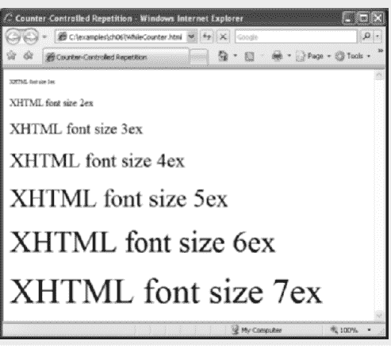

## 图 6.1 | 计数器控制循环。（第2部分，共2部分。）

while 语句中的第16-18行写入一个段落元素，该元素由字符串"XHTML font size"与控制变量 counter 的值连接而成，该值代表字体大小。内联 CSS style 属性将 font-size 属性设置为 counter 的值连接到 ex。请注意转义序列 " 的使用，它围绕在属性 style 的值周围。由于双引号字符在 JavaScript 中界定字符串字面量的开头和结尾，因此除非在前面加上 \ 来创建转义序列 \"，否则它不能用于字符串的内容中。例如，如果 counter 为5，前面的语句将生成标记

```
<p style = "font-size: 5ex">XHTML font size 5ex</p>
```

XHTML 允许在属性指定的值周围使用单引号（'）或双引号（"）。JavaScript 允许在字符串字面量中放置单引号。因此，我们可以在 font-size 属性周围放置单引号，以产生等效的 XHTML 输出，而无需使用转义序列。

### 常见编程错误 6.1

在由双引号界定的字符串字面量中放置双引号（"）字符会导致脚本解释时出现运行时错误。要作为字符串字面量的一部分显示，双引号（"）字符必须在其前面加上 \ 以形成转义序列 \"。

while 语句中的第19行在每次循环迭代时将控制变量增加1（即，每次执行循环体时）。while 语句中的循环继续条件（第14行）测试控制变量的值是否小于或等于7（条件为真的最终值）。请注意，即使控制变量为7时，此 while 语句的主体也会执行。当控制变量超过7时（即，counter 变为8），循环终止。

### 良好编程实践 6.1

对每个控制结构体中的语句进行缩进。

### 良好编程实践 6.2

在每个控制结构前后放置一个空行，使其在程序中突出显示。

### 良好编程实践 6.3

过多的嵌套层级会使程序难以理解。作为一般规则，尽量避免使用超过三个级别的嵌套。

### 良好编程实践 6.4

控制结构上下方的垂直间距以及控制结构首部中控制结构体的缩进，赋予程序二维外观，从而增强可读性。

## 6.3 for 循环语句

`for` 循环语句处理计数器控制循环的所有细节。图6.2通过重新实现图6.1的脚本展示了 `for` 语句的强大功能。

```
<?xml version = "1.0" encoding = "utf-8"?>
<!DOCTYPE html PUBLIC "-//W3C//DTD XHTML 1.0 Strict//EN"
    "http://www.w3.org/TR/xhtml1/DTD/xhtml1-strict.dtd">

<!-- 图 6.2：ForCounter.html -->
<!-- 使用 for 语句的计数器控制循环。 -->
<html xmlns = "http://www.w3.org/1999/xhtml">
    <head>
```

图 6.2 | 使用 for 语句的计数器控制循环。（第1部分，共2部分）

```
<title>计数器控制循环</title>
<script type = "text/javascript">
   <!--
   // 初始化、循环条件和
   // 增量都包含在 for
   // 语句首部中。
   for ( var counter = 1; counter <= 7; ++counter )
      document.writeln( "<p style = \"font-size: " +
         counter + "ex\">XHTML font size " + counter +
         "ex</p>" );
   // -->
</script>
```

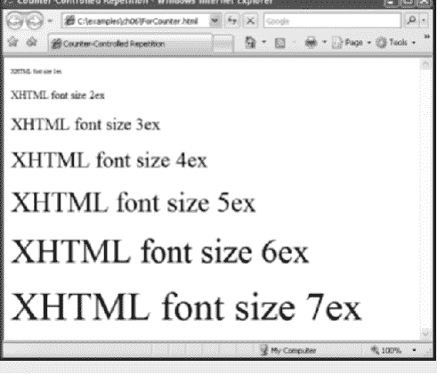

## 图 6.2 | 使用 for 语句的计数器控制循环。（第2部分，共2部分。）

当 `for` 语句开始执行时（第15行），控制变量 counter 被声明并初始化为1（即，`for` 语句的第一个语句声明控制变量的*名称*并提供控制变量的*初始值*）。接下来，检查循环继续条件 counter <= 7。该条件包含控制变量的*最终值*（7）。counter 的初始值为1。因此，条件满足（即，为真），所以主体语句（第16-18行）在 XHTML 文档中写入一个段落元素。然后，变量 counter 在表达式 ++counter 中递增，循环继续执行循环继续测试。控制变量现在等于2，因此没有超过最终值，程序再次执行主体语句（即，执行循环的下一次迭代）。这个过程一直持续，直到控制变量 counter 变为8，此时循环继续测试失败，循环终止。

程序继续执行 `for` 语句之后的第一个语句。（在这种情况下，脚本终止，因为解释器到达了脚本的末尾。）


图6.3详细展示了图6.2中第15行的`for`语句。`for`语句的第一行（包括关键字`for`以及`for`之后括号内的所有内容）通常被称为**`for`语句头部**。请注意，`for`语句“包办一切”——它为计数器控制的循环指定了控制变量所需的每项要素。

请注意，图6.3使用了循环继续条件`counter <= 7`。如果错误地写成`counter < 7`，循环将只执行六次。这是一个被称为**差一错误**的常见逻辑错误示例。

## 常见编程错误 6.2

> 在`while`、`for`或`do...while`语句的条件中使用不正确的关系运算符或不正确的循环计数器最终值，可能导致差一错误或无限循环。

## 错误预防技巧 6.1

> 在`while`或`for`语句的条件中使用最终值并使用`<=`关系运算符，将有助于避免差一错误。例如，对于打印1到10的值的循环，`counter`的初始值应为1，循环继续条件应为`counter <= 10`，而不是`counter < 10`（这是一个差一错误）或`counter < 11`（这是正确的）。然而，许多程序员更喜欢所谓的**基于零的计数**，即为了在循环中计数10次，`counter`将初始化为0，循环继续测试条件将是`counter < 10`。

`for`语句的一般格式为

```
for ( initialization; loopContinuationTest; increment )
    statements
```

其中，*initialization*表达式命名循环的控制变量并提供其初始值，*loopContinuationTest*是测试循环继续条件的表达式（包含控制变量的最终值，使得条件为真），*increment*是递增控制变量的表达式。`for`语句可以由一个等效的`while`语句表示，其中*initialization*、*loopContinuationTest*和*increment*放置如下（第6.7节讨论了此规则的一个例外）：

```
initialization;

while ( loopContinuationTest )
{
    statements
    increment;
}
```

如果`for`语句头部的*initialization*表达式是控制变量的第一次定义，那么在脚本中该变量仍然可以在`for`语句之后使用。脚本中可以使用变量名的部分称为该变量的*作用域*。作用域将在第7章“JavaScript：函数”中详细讨论。

## 良好的编程实践 6.5

> 仅在`for`语句的初始化和递增部分放置涉及控制变量的表达式。对其他变量的操作应出现在循环之前（如果只执行一次，如初始化语句）或循环体中（如果每次循环迭代都执行一次，如递增或递减语句）。

`for`语句中的三个表达式是可选的。如果省略*loopContinuationTest*，JavaScript将假定循环继续条件为真，从而创建一个无限循环。如果控制变量在循环之前已初始化，则可以省略*initialization*表达式。如果递增由`for`语句体中的语句计算，或者不需要递增，则可以省略*increment*表达式。`for`语句中的增量表达式的作用类似于`for`语句体末尾的独立语句。因此，以下表达式

```
counter = counter + 1
counter += 1
++counter
counter++
```

在`for`语句的递增部分都是等效的。许多程序员更喜欢`counter++`形式。这是因为控制变量的递增发生在循环体执行之后，因此后递增形式似乎更自然。在我们的示例中，前递增和后递增具有相同的效果，因为被递增的变量没有出现在更大的表达式中。`for`语句头部中的两个分号是必需的。

## 常见编程错误 6.3

> 在`for`语句头部使用逗号而不是所需的两个分号是语法错误。

## 常见编程错误 6.4

> 在`for`语句头部右括号的紧右侧放置分号，会使该`for`语句体成为空语句。这通常是逻辑错误。

“递增”可以是负数，在这种情况下，循环将向下计数。如果循环继续条件最初为假，则不会执行`for`语句体。相反，程序将继续执行`for`语句之后的语句。

控制变量经常在`for`语句体中被打印或用于计算，但并非必须如此。其他时候，控制变量用于控制循环重复，但从未在`for`语句体中提及。

## 错误预防技巧 6.2

> 尽管控制变量的值可以在`for`语句体中更改，但应避免更改它，因为这样做可能导致微妙的错误。

`for`语句的流程图与`while`语句非常相似。例如，图6.4显示了`for`语句的流程图

```
for ( var counter = 1; counter <= 7; ++counter )
    document.writeln( "<p style = \"font-size: " +
        counter + "ex\">XHTML字体大小" + counter +
        "ex</p>" );
```

该流程图清楚地表明，初始化只发生一次，并且递增在每次执行体语句之后发生。请注意，除了小圆圈和箭头外，流程图仅包含矩形符号和菱形符号。

图6.4 | `for`循环语句流程图。

## 6.4 使用 `for` 语句的示例

本节的示例展示了在`for`语句中改变控制变量的方法。在每种情况下，我们编写适当的`for`头部。请注意，对于递减控制变量的循环，关系运算符发生了变化。

- a) 控制变量从1变化到100，步长为1。

    for ( var i = 1; i <= 100; ++i )

- b) 控制变量从100变化到1，步长为-1（即每次递减1）。

    for ( var i = 100; i >= 1; --i )

- c) 控制变量从7变化到77，步长为7。

    for ( var i = 7; i <= 77; i += 7 )

- d) 控制变量从20变化到2，步长为-2。

    for ( var i = 20; i >= 2; i -= 2 )

- e) 控制变量遍历以下值序列：2, 5, 8, 11, 14, 17, 20。

    ```
    for ( var j = 2; j <= 20; j += 3 )
    ```

- f) 控制变量遍历以下值序列：99, 88, 77, 66, 55, 44, 33, 22, 11, 0。

    ```
    for ( var j = 99; j >= 0; j -= 11 )
    ```

## 常见编程错误 6.5

> 在向下计数的循环的循环继续条件中未使用正确的关系运算符（例如，在递减到1的循环中使用*i* <= 1）通常是逻辑错误，当程序运行时会产生错误的结果。

接下来的两个脚本演示了`for`循环语句。图6.5使用`for`语句计算从2到100的偶数整数之和。请注意，增量表达式在每次循环迭代的体执行后，向控制变量`number`添加2。当`number`的值为102（未加到总和中）时，循环终止。

```xml
<?xml version = "1.0" encoding = "utf-8"?>
<!DOCTYPE html PUBLIC "-//W3C//DTD XHTML 1.0 Strict//EN"
    "http://www.w3.org/TR/xhtml1/DTD/xhtml1-strict.dtd">

<!-- 图6.5：Sum.html -->
<!-- 使用for循环结构进行求和。 -->
<html xmlns = "http://www.w3.org/1999/xhtml">
   <head>
      <title>计算2到100的偶数整数之和</title>
      <script type = "text/javascript">
         <!--
         var sum = 0;

         for ( var number = 2; number <= 100; number += 2 )
            sum += number;

         document.writeln( "从2到100的偶数整数之和为 " + sum );
         // -->
      </script>
   </head><body></body>
</html>
```

**图6.5** | 使用`for`循环结构进行求和。


## 6.4 for语句示例

请注意，图6.5中for语句的循环体实际上可以通过使用逗号合并到for头部的最右侧（增量）部分，如下所示：

```
for ( var number = 2; number <= 100; sum += number, number += 2)
    ;
```

同样，初始化 sum = 0 也可以合并到for语句的初始化部分中。

### 良好编程习惯 6.6

> 虽然for语句前的语句和for语句循环体中的语句通常可以合并到for头部中，但应避免这样做，因为这会使程序更难阅读。

### 良好编程习惯 6.7

> 为清晰起见，如果可能，将控制语句的头部限制在一行内。

下一个示例使用for语句计算复利（每年复利）。考虑以下问题描述：

> 某人在储蓄账户中投资$1000.00，年利率为5%。假设所有利息都留在账户中，计算并打印10年间每年年底账户中的金额。使用以下公式确定金额：
> a = p (1 + r)ⁿ
>
> 其中
> - p 是原始投资金额（即本金）
> - r 是年利率
> - n 是年数
> - a 是第n年结束时存款的总额。

这个问题涉及一个循环，对资金停留的10年中的每一年执行指定的计算。图6.6展示了该问题的解决方案，以表格形式显示结果。

```
 1  <?xml version = "1.0" encoding = "utf-8"?>
 2  <!DOCTYPE html PUBLIC "-//W3C//DTD XHTML 1.0 Strict//EN"
 3     "http://www.w3.org/TR/xhtml1/DTD/xhtml1-strict.dtd">
 4
 5  <!-- Fig. 6.6: Interest.html -->
 6  <!-- Compound interest calculation with a for loop. -->
 7  <html xmlns = "http://www.w3.org/1999/xhtml">
 8     <head>
 9        <title>Calculating Compound Interest</title>
10        <style type = "text/css">
11           table { width: 100% }
12           th    { text-align: left }
13        </style>
```

图6.6 | 使用for循环计算复利。（第2部分中的第1部分）

```
<script type = "text/javascript">
<!--
var amount; // current amount of money
var principal = 1000.0; // principal amount
var rate = .05; // interest rate

document.writeln(
   "<table border = \"1\">" ); // begin the table
document.writeln(
   "<caption>Calculating Compound Interest</caption>" );
document.writeln(
   "<thead><tr><th>Year</th>" ); // year column heading
document.writeln(
   "<th>Amount on deposit</th>" ); // amount column heading
document.writeln( "</tr></thead><tbody>" );

// output a table row for each year
for ( var year = 1; year <= 10; ++year )
{
    amount = principal * Math.pow( 1.0 + rate, year );
    document.writeln( "<tr><td>" + year +
       "</td><td>" + amount.toFixed(2) +
       "</td></tr>" );
} //end for

document.writeln( "</tbody></table>" );
// -->
</script>
</head><body></body>
</html>
```

图6.6 | 使用for循环计算复利。（第2部分中的第2部分）

第16–18行声明了三个变量，并将`principal`初始化为1000.0，`rate`初始化为.05。第20–21行写入一个XHTML `<table>`标签，第22–23行写入概括表格内容的标题。第24–25行创建表格的表头部分（`<thead>`），一行（`<tr>`）和包含"Year"的列标题（`<th>`）。第26–28行为"Amount on deposit"创建表格标题，并写入关闭的`</tr>`和`</thead>`标签。

`for`语句（第31–37行）执行其循环体10次，将控制变量`year`从1递增到10（注意`year`代表问题描述中的*n*）。JavaScript不包含幂运算运算符。相反，我们使用`Math`对象的`pow`方法来实现此目的。`Math.pow(x, y)`计算x的y次幂的值。`中能的`pow`方法接受两个数字作为参数，并返回结果。

第33行使用问题描述中给出的公式进行计算。第34–36行写入一行XHTML标记，在表格中创建另一行。第一列是当前年份值。第二列显示amount的值。循环终止后，第39行写入关闭的`</tbody>`和`</table>`标签。

第35行引入**Number对象**及其***toFixed*** **方法**。变量`amount`包含一个数值，因此JavaScript将其表示为Number对象。Number对象的`toFixed`方法通过将值四舍五入到指定的小数位数来格式化值。在第35行中，`amount.toFixed(2)`输出带有两位小数的amount值。

变量`amount`、`principal`和`rate`在此脚本中表示数字。请记住，JavaScript将所有数字表示为浮点数。这一特性在此示例中很方便，因为我们处理的是美元的小数部分，需要一种允许其值中使用小数点的类型。

不幸的是，浮点数可能会引起问题。以下是一个简单的例子，说明使用浮点数表示美元金额时可能出现的问题（假设美元金额显示时小数点右侧有两位数字）：存储在机器中的两个美元金额可能是14.234（通常四舍五入显示为14.23）和18.673（通常四舍五入显示为18.67）。当这些金额相加时，它们产生内部和32.907，通常四舍五入显示为32.91。因此，你的打印可能显示为

```
    14.23
+ 18.67
-------
    32.91
```

但一个人将打印出来的各个数字相加时期望的和是32.90。已向你警告过！

## 6.5 switch多选择语句

有时，算法会包含一系列决策，其中变量或表达式针对其可能假设的每个值分别进行测试，并对每个值采取不同的操作。JavaScript提供了`switch`多选择语句来处理这种决策。图6.7中的脚本演示了由用户输入的值确定的三种不同CSS列表格式。

脚本中的第12行声明变量`choice`。该变量存储用户的选择，决定显示哪种类型的XHTML列表。第13–14行声明变量startTag和endTag，它们将存储用于创建列表元素的XHTML标签。第15行声明变量validInput并将其初始化为true。脚本使用此变量来确定用户是否做出了有效的选择（由值true指示）。如果选择无效，脚本将validInput设置为false。第16行声明变量listType，它将存储指示列表类型的h1元素。此标题出现在XHTML文档中列表之前。

```
<?xml version = "1.0" encoding = "utf-8"?>
<!DOCTYPE html PUBLIC "-//W3C//DTD XHTML 1.0 Strict//EN"
  "http://www.w3.org/TR/xhtml1/DTD/xhtml1-strict.dtd">

<!-- Fig. 6.7: SwitchTest.html -->
<!-- Using the switch multiple-selection statement. -->
<html xmlns = "http://www.w3.org/1999/xhtml">
<head>
    <title>Switching between XHTML List Formats</title>
    <script type = "text/javascript">
    <!--
        var choice; // user's choice
        var startTag; // starting list item tag
        var endTag; // ending list item tag
        var validInput = true; // indicates if input is valid
        var listType; // type of list as a string

        choice = window.prompt( "Select a list style:\n" +
           "1 (numbered), 2 (lettered), 3 (roman)", "1" );

        switch ( choice )
        {
            case "1":
                startTag = "<ol>";
                endTag = "</ol>";
                listType = "<h1>Numbered List</h1>";
                break;
            case "2":
                startTag = "<ol style = \"list-style-type: upper-alpha\">";
                endTag = "</ol>";
                listType = "<h1>Lettered List</h1>";
                break;
            case "3":
                startTag = "<ol style = \"list-style-type: upper-roman\">";
                endTag = "</ol>";
                listType = "<h1>Roman Numbered List</h1>";
                break;
            default:
                validInput = false;
        } //end switch

        if ( validInput == true )
        {
            document.writeln( listType + startTag );
```

图6.7 | 使用switch多选择语句。（第3部分中的第1部分）


## 6.6 JavaScript：控制语句 II

```
for ( var i = 1; i <= 3; ++i )
    document.writeln( "<li>List item " + i + "</li>" );

document.writeln( endTag );
} //end if
else
    document.writeln( "Invalid choice: " + choice );
// -->
</script>
</head>
<body>
<p>Click Refresh (or Reload) to run the script again</p>
</body>
</html>
```

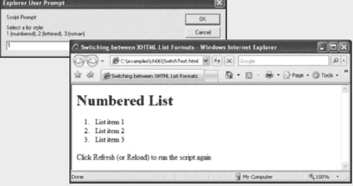

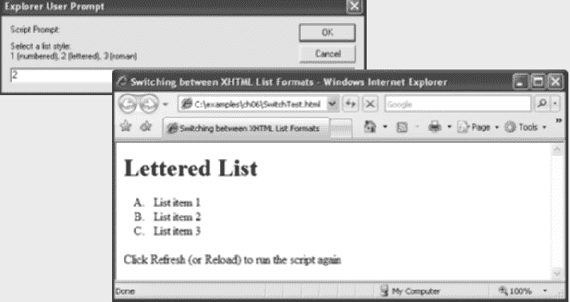

**图 6.7** | 使用 `switch` 多重选择语句。（第 3 部分，共 3 部分。）

第 18–19 行提示用户输入 1 以显示编号列表，输入 2 以显示字母列表，输入 3 以显示带有罗马数字的列表。第 21–40 行定义了一个 **switch 语句**，根据用户在提示对话框中输入的值，为变量 `startTag`、`endTag` 和 `listType` 赋值。我们使用 CSS 属性 **`list-style-type`** 来创建这些不同的列表，该属性允许我们设置列表的编号系统。可能的值包括 `decimal`（数字——默认值）、`lower-roman`（小写罗马数字）、`upper-roman`（大写罗马数字）、`lower-alpha`（小写字母）、`upper-alpha`（大写字母），以及其他几种。

`switch` 语句由一系列 **case 标签** 和一个可选的 **default case** 组成。当控制流到达 `switch` 语句时，脚本会计算关键字 `switch` 后面括号中的 **控制表达式**（本例中为 `choice`）。该表达式的值从第一个 case 标签开始，与每个 case 标签中的值进行比较。假设用户输入了 `2`。请记住，用户在 `prompt dialogs` 中输入的值以字符串形式返回。因此，字符串 `2` 与 `switch` 语句中每个 case 的字符串进行比较。如果匹配成功（`case "2":`），则执行该 case 的语句。对于字符串 2（第 29–32 行），我们将 startTag 设置为 opening ol 标签，其 style 属性 list-style-type 设置为 upper-alpha，将 endTag 设置为 "</ol>" 以表示有序列表的结束，并将 listType 设置为 "<h1>Lettered List</h1>"。如果控制表达式的值与任何 case 标签都不匹配，则执行 default case，并将变量 validInput 设置为 false。

第 32 行的 break 语句使程序控制继续执行 switch 语句之后的第一条语句。使用 break 语句是因为 switch 语句中的 case 否则会连续执行。如果在 switch 语句中的任何地方都没有使用 break，那么每当语句中发生匹配时，所有剩余 case 的语句都会执行。

接下来，控制流继续执行第 42 行的 if 语句，该语句测试变量 validInput 以确定其值是否为 true。如果是，则第 44–49 行写入 listType、startTag、三个列表项（`<li>`）和 endTag。否则，脚本在 XHTML 文档中写入文本，指示做出了无效选择（第 52 行）。

每个 case 可以有多个动作（语句）。switch 语句与其他语句不同，在 switch 的 case 中，多个动作不需要用花括号括起来。一般的 switch 语句（即每个 case 中使用 break）的流程图如图 6.8 所示。[注意：作为练习，请绘制不使用 break 语句的一般 switch 语句的流程图。]

流程图清楚地表明，每个 case 末尾的 break 语句会使控制立即退出 switch 语句。switch 语句中最后一个 case（或 default case，当它出现在最后时）不需要 break 语句，因为程序控制会自动继续执行 switch 语句之后的下一个语句。

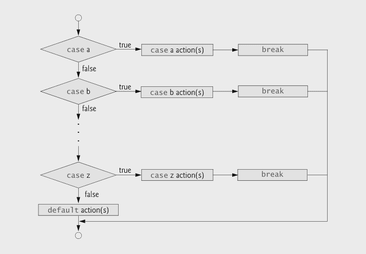

## 常见编程错误 6.6

> 在 switch 语句中需要 break 语句时忘记使用它是一个逻辑错误。

## 软件工程观察 6.1

> 在 switch 语句中提供 default case。在没有 default case 的 switch 语句中，未明确测试的 case 将被忽略。包含 default case 可以使你专注于处理异常情况。但是，有些情况下不需要 default 处理。

## 良好编程实践 6.8

> 尽管 switch 语句中的 case 子句和 default case 子句可以按任何顺序出现，但将 default 子句放在最后更清晰（也更常见）。

## 良好编程实践 6.9

> 在 switch 语句中，当 default 子句列在最后时，该 case 语句的 break 不是必需的。一些程序员为了清晰和与其他 case 保持对称，会包含这个 break。

请注意，将多个 case 标签列在一起（例如，`case 1: case 2:`，case 之间没有语句）仅仅意味着每个 case 将执行相同的一组动作。

## 6.7 do...while 循环语句

*do...while 循环语句* 与 while 语句相似。在 while 语句中，循环继续测试发生在循环开头，在循环体执行之前。do...while 语句在循环体执行之后测试循环继续条件——因此，*循环体总是至少执行一次*。当 do...while 终止时，执行继续执行 while 子句之后的语句。注意，如果 do...while 语句的循环体中只有一条语句，则不必使用花括号。但是，通常会包含花括号，以避免 while 和 do...while 语句之间的混淆。例如，

```
while ( condition )
```

通常被视为 while 语句的头部。没有花括号围绕单条语句主体的 do...while 语句显示为

```
do
    statement
while ( condition );
```

这可能会造成混淆。最后一行——while( condition );——可能被误解为包含空语句（单独的分号）的 while 语句。因此，为了避免混淆，具有单条语句主体的 do...while 语句通常写成如下形式：

```
do
{
    statement
} while ( condition );
```

## 良好编程实践 6.10

> 一些程序员即使在不需要时也总是在 do...while 语句中包含花括号。这有助于消除 while 语句与包含单条语句主体的 do...while 语句之间的歧义。

## 预防错误提示 6.3

> 当 while、for 或 do...while 语句中的循环继续条件永远不会变为 false 时，会导致无限循环。为防止这种情况，请确保在 while 或 for 语句的头部之后没有立即出现分号。在计数器控制的循环中，请确保在循环体中递增（或递减）控制变量。在哨兵值控制的循环中，请确保最终输入哨兵值。

图 6.9 中的脚本使用 do...while 语句显示六种不同的 XHTML 标题类型（h1 到 h6）。第 12 行声明控制变量 counter 并将其初始化为 1。进入 do...while 语句后，第 15–17 行在文档中写入一行 XHTML 文本。控制变量 counter 的值用于创建起始和结束标题标签（例如，`<h1>` 和 `</h1>`）以及要显示的行文本（例如，This is an h1 level head）。第 18 行在循环底部的循环继续测试发生之前递增计数器。

图 6.10 中的 do...while 流程图清楚地表明，循环继续测试直到动作至少执行一次后才会发生。

```
<?xml version = "1.0" encoding = "utf-8"?>
<!DOCTYPE html PUBLIC "-//W3C//DTD XHTML 1.0 Strict//EN"
  "http://www.w3.org/TR/xhtml1/DTD/xhtml1-strict.dtd">

<!-- Fig. 6.9: DoWhileTest.html -->
<!-- Using the do...while repetition statement. -->
<html xmlns = "http://www.w3.org/1999/xhtml">
  <head>
    <title>Using the do...while Repetition Statement</title>
    <script type = "text/javascript">
    <!--
      var counter = 1;

      do {
        document.writeln( "<h" + counter + ">This is " +
          "an h" + counter + " level head" + "</h" +
          counter + ">" );
        ++counter;
      } while ( counter <= 6 );
      // -->
    </script>
  </head><body></body>
</html>
```

**图 6.9** | 使用 do...while 循环语句。（第 1 部分，共 2 部分。）


 **图 6.9 | 使用 do...while 循环语句。（第 2 部分，共 2 部分）**

**图 6.10 | do...while 循环语句流程图。**

## 6.7 break 和 continue 语句

**break** 和 **continue 语句**用于改变控制流程。当在 while、for、do...while 或 switch 语句中执行 break 语句时，会立即退出该语句。程序继续执行该结构之后的第一个语句。break 语句通常用于提前跳出循环，或跳过 switch 语句的剩余部分（如图 6.7 所示）。图 6.11 演示了在 for 循环语句中使用 break 语句。

在第 14-20 行的 for 语句的每次迭代中，脚本将 count 的值写入 XHTML 文档。当第 16 行的 if 语句检测到 count 等于 5 时，第 17 行的 break 执行。该语句终止 for 语句，程序继续执行第 22 行（for 语句之后紧接着的下一个语句），脚本在此处写入循环终止时 count 的值（即 5）。该循环只执行了四次第 19 行。

当在 while、for 或 do...while 语句中执行 continue 语句时，会跳过语句体中剩余的语句，并继续执行循环的下一次迭代。在 while 和 do...while 语句中，continue 语句执行后立即进行循环继续测试。在 for 语句中，先执行增量表达式，然后进行循环继续测试。这是 for 和 while 唯一不同的地方。如果在 while 中将 continue 错误地放在增量操作之前，可能会导致无限循环。

图 6.12 在 for 语句中使用 continue 来跳过第 20 行的 document.writeln 语句，当第 17 行的 if 语句判定 count 的值为 5 时。当 continue 语句执行时，脚本跳过 for 语句体的剩余部分。程序控制继续执行 for 语句控制变量的增量，然后进行循环继续测试以确定是否继续执行循环。

```
<?xml version = "1.0" encoding = "utf-8"?>
<!DOCTYPE html PUBLIC "-//W3C//DTD XHTML 1.0 Strict//EN"
  "http://www.w3.org/TR/xhtml1/DTD/xhtml1-strict.dtd">

<!-- Fig. 6.11: BreakTest.html -->
<!-- Using the break statement in a for statement. -->
<html xmlns = "http://www.w3.org/1999/xhtml">
<head>
    <title>
        Using the break Statement in a for Statement
    </title>
    <script type = "text/javascript">
        <!--
        for ( var count = 1; count <= 10; ++count )
        {
            if ( count == 5 )
                break; // break loop only if count == 5

            document.writeln( "Count is: " + count + "<br />" );
        } //end for

        document.writeln(
            "Broke out of loop at count = " + count );
        // -->
    </script>
</head><body></body>
</html>
```

**图 6.11 | 在 for 语句中使用 break 语句。**

# 第 6 章  JavaScript：控制语句 II

```
<?xml version = "1.0" encoding = "utf-8"?>
<!DOCTYPE html PUBLIC "-//W3C//DTD XHTML 1.0 Strict//EN"
    "http://www.w3.org/TR/xhtml1/DTD/xhtml1-strict.dtd">

<!-- Fig. 6.12: ContinueTest.html -->
<!-- Using the continue statement in a for statement. -->
<html xmlns = "http://www.w3.org/1999/xhtml">
    <head>
        <title>
            Using the continue Statement in a for Statement
        </title>

        <script type = "text/javascript">
            <!--
            for ( var count = 1; count <= 10; ++count )
            {
                if ( count == 5 )
                    continue; // skip remaining loop code only if count == 5

                document.writeln( "Count is: " + count + "<br />" );
            } //end for

            document.writeln( "Used continue to skip printing 5" );
            // -->
        </script>

    </head><body></body>
</html>
```

**图 6.12 | 在 for 语句中使用 continue 语句。**

## 软件工程观察 6.2

> 一些程序员认为 *break* 和 *continue* 违反了结构化编程原则。他们不使用 *break* 和 *continue*，因为这些语句的效果可以通过结构化编程技术来实现。

> **性能提示 6.1**
> 当使用得当时，break 和 continue 语句比相应的结构化技术执行得更快。

> **软件工程观察 6.3**
> 在实现高质量软件工程和实现最佳性能软件之间存在一种张力。通常，实现其中一个目标会以牺牲另一个为代价。除了最需要性能 intensive 的情况外，应遵循以下经验法则：首先使你的代码简单、可读且正确；然后使其快速且小巧，但只有在必要时才这样做。

## 6.8 带标签的 break 和 continue 语句

break 语句可以跳出直接包围它的 while、for、do...while 或 switch 语句。要跳出嵌套的结构集合，可以使用带标签的 break 语句。当在 while、for、do...while 或 switch 语句中执行该语句时，会立即退出该语句以及任意数量的包围重复语句；程序执行在包围标签语句的标签语句（前面带有标签的语句）之后的第一个语句处恢复。带标签的语句可以是一个块（一组用花括号 {} 括起来的语句）。带标签的 break 语句通常用于终止包含 while、for、do...while 或 switch 语句的嵌套循环结构。图 6.13 演示了在嵌套 for 语句中使用带标签的 break 语句。

```
1  <?xml version = "1.0" encoding = "utf-8"?>
2  <!DOCTYPE html PUBLIC "-//W3C//DTD XHTML 1.0 Strict//EN"
3    "http://www.w3.org/TR/xhtml1/DTD/xhtml1-strict.dtd">
4
5  <!-- Fig. 6.13: BreakLabelTest.html -->
6  <!-- Labeled break statement in a nested for statement. -->
7  <html xmlns = "http://www.w3.org/1999/xhtml">
8     <head>
9        <title>Using the break Statement with a Label</title>
10        <script type = "text/javascript">
11           <!--
12           stop: { // labeled block
13              for ( var row = 1; row <= 10; ++row )
14              {
15                 for ( var column = 1; column <= 5 ; ++column )
16                 {
17                    if ( row == 5 )
18                       break stop; // jump to end of stop block
19
20                    document.write( "* " );
21                 } //end for
22
23                 document.writeln( "<br />" );
24              } //end for
25
26              // the following line is skipped
27              document.writeln( "This line should not print" );
28           } // end block labeled stop
```

**图 6.13 | 在嵌套 for 语句中使用带标签的 break 语句。（第 1 部分，共 2 部分）**

# 第 6 章  JavaScript：控制语句 II

```
document.writeln( "End of script" );
// -->
</script>
</head><body></body>
</html>
```

**图 6.13 | 在嵌套 for 语句中使用带标签的 break 语句。（第 2 部分，共 2 部分）**

带标签的块（第 12-28 行）以一个 *标签*（标识符后跟冒号）开头。这里，我们使用标签 `stop:`。该块被第 12 行末尾的花括号和第 28 行的花括号包围，包括从第 13 行开始的嵌套 `for` 语句和第 27 行的 `document.writeln` 语句。当第 17 行的 `if` 语句检测到 `row` 等于 5 时，第 18 行的语句执行。该语句终止第 15 行的 `for` 语句及其包围的第 13 行 `for` 语句，程序继续执行第 30 行的语句（标签块之后紧接着的第一个语句）。内部 `for` 语句只执行了四次其体。注意第 27 行的 `document.writeln` 语句永远不会执行，因为它包含在标签块中，而外部 `for` 语句从未完成。

`continue` 语句继续执行直接包围它的 `while`、`for` 或 `do...while` 语句的下一次迭代（重复）。当在重复语句（`while`、`for` 或 `do...while`）中执行 *带标签的 continue 语句* 时，跳过结构体中剩余的语句以及任意数量的包围重复语句，然后继续执行包围 *带标签重复语句*（前面带有标签的重复语句）的下一次迭代。在带标签的 `while` 和 `do...while` 语句中，continue 语句执行后立即进行循环继续测试。在带标签的 `for` 语句中，先执行增量表达式，然后进行循环继续测试。图 6.14 在嵌套 `for` 语句中使用带标签的 `continue` 语句，使执行继续执行外部 `for` 语句的下一次迭代。

```
<?xml version = "1.0" encoding = "utf-8"?>
<!DOCTYPE html PUBLIC "-//W3C//DTD XHTML 1.0 Strict//EN"
    "http://www.w3.org/TR/xhtml1/DTD/xhtml1-strict.dtd">

<!-- Fig. 6.14: ContinueLabelTest.html -->
<!-- Labeled continue statement in a nested for statement. -->
```

**图 6.14 | 在嵌套 for 语句中使用带标签的 continue 语句。（第 1 部分，共 2 部分）**


```
7 <html xmlns = "http://www.w3.org/1999/xhtml">
8 <head>
9 <title>在嵌套 for 语句中使用带标签的 continue 语句</title>
10 <script type = "text/javascript">
11 <!--
12 nextRow: // continue 语句的目标标签
13 for ( var row = 1; row <= 5; ++row )
14 {
15 document.writeln( "<br />" );
16
17 for ( var column = 1; column <= 10; ++column )
18 {
19 if ( column > row )
20 continue nextRow; // 继续执行带标签循环的下一次迭代
21
22 document.write( "* " );
23 } //end for
24 } //end for
25 // -->
26 </script>
27 </head><body></body>
28 </html>
```

图 6.14 | 在嵌套 for 语句中使用带标签的 continue 语句。（第 2 部分，共 2 部分。）

带标签的 for 语句（第 13–24 行）以第 12 行的 `nextRow` 标签开始。当内部 for 语句中第 19 行的 if 语句检测到 `column` 大于 `row` 时，第 20 行被执行，程序控制权转移到外部 for 语句的控制变量递增处继续执行。尽管内部 for 语句从 1 计数到 10，但每行输出的 `*` 字符数量从不超过 `row` 的值。

## 6.9 逻辑运算符

到目前为止，我们只研究了诸如 `count <= 10`、`total > 1000` 和 `number != sentinelValue` 这样的简单条件。这些条件使用关系运算符 `>`、`<`、`>=` 和 `<=`，以及相等运算符 `==` 和 `!=` 来表示。每个判断只测试一个条件。要基于多个条件做判断，我们通过单独的语句或嵌套的 if 或 if...else 语句来执行这些测试。

JavaScript 提供了逻辑运算符，可用于通过组合简单条件来构成更复杂的条件。逻辑运算符包括 `&&`（逻辑与）、`||`（*逻辑或*）和 `!`（*逻辑非*，也称为*逻辑取反*）。下面我们将逐一介绍这些运算符的示例。

假设在程序中的某个位置，我们希望确保两个条件*同时*为真，然后才选择某条执行路径。在这种情况下，我们可以使用逻辑 `&&` 运算符，如下所示：

```
if ( gender == 1 && age >= 65 )
    ++seniorFemales;
```

这个 `if` 语句包含两个简单条件。条件 `gender == 1` 可能被求值以确定，例如，某人是否为女性。条件 `age >= 65` 被求值以确定某人是否为老年人。然后 `if` 语句考虑组合条件

```
gender == 1 && age >= 65
```

当且仅当两个简单条件都为真时，此条件为真。最后，如果此组合条件确实为真，则 `seniorFemales` 的计数加 1。如果两个简单条件中有一个或两个为 `false`，程序将跳过递增操作，继续执行 `if` 语句之后的语句。可以通过添加多余的括号使前面的组合条件更具可读性：

```
( gender == 1 ) && ( age >= 65 )
```

图 6.15 中的表格总结了 `&&` 运算符。该表显示了 *expression1* 和 *expression2* 的 `false` 和 `true` 值的所有四种可能组合。这样的表通常称为*真值表*。JavaScript 对所有包含关系运算符、相等运算符和/或逻辑运算符的表达式求值，结果为 `false` 或 `true`。

现在让我们考虑 `||`（逻辑或）运算符。假设我们希望确保两个条件中有一个*或*两个都为真，然后才选择某条执行路径。在这种情况下，我们使用 `||` 运算符，如下面的程序片段所示：

```
if ( semesterAverage >= 90 || finalExam >= 90 )
    document.writeln( "Student grade is A" );
```

这条语句也包含两个简单条件。条件 `semesterAverage >= 90` 被求值以确定学生是否因整个学期的优异表现而值得获得"A"。条件 `finalExam >= 90` 被求值以确定学生是否因期末考试的出色表现而值得获得"A"。然后 `if` 语句考虑组合条件

| expression1 | expression2 | expression1 && expression2 |
|-------------|-------------|----------------------------|
| false       | false       | false                      |
| false       | true        | false                      |
| true        | false       | false                      |
| true        | true        | true                       |

图 6.15 | `&&`（逻辑与）运算符的真值表。

```
semesterAverage >= 90 || finalExam >= 90
```

如果两个简单条件中有一个或两个为真，则给学生评定为"A"。请注意，只有当两个简单条件都为 `false` 时，消息 `"Student grade is A"` 才*不会*被打印。图 6.16 是逻辑或运算符（`||`）的真值表。

`&&` 运算符的优先级高于 `||` 运算符。这两个运算符都从左到右结合。包含 `&&` 或 `||` 运算符的表达式只求值到真或假已知为止。因此，对表达式

```
gender == 1 && age >= 65
```

的求值在 `gender` 不等于 `1` 时立即停止（即整个表达式为 `false`），并在 `gender` 等于 `1` 时继续（即如果条件 `age >= 65` 为 `true`，整个表达式仍可能为 `true`）。类似地，如果第一个操作数为 `true`，`||` 运算符立即返回 `true`。这种对逻辑与和逻辑或表达式求值的性能特性称为*短路求值*。

JavaScript 提供了 `!`（逻辑非）运算符，使程序员能够"反转"条件的含义（即 `true` 值变为 `false`，`false` 值变为 `true`）。与组合两个条件的逻辑运算符 `&&` 和 `||`（即它们是二元运算符）不同，逻辑非运算符只有一个条件作为操作数（即它是一元运算符）。逻辑非运算符放置在条件之前，用于在原始条件（不带逻辑非运算符）为 `false` 时选择执行路径，如下面的程序片段所示：

```
if ( ! ( grade == sentinelValue ) )
    document.writeln( "The next grade is " + grade );
```

条件 `grade == sentinelValue` 周围需要括号，因为逻辑非运算符的优先级高于相等运算符。图 6.17 是逻辑非运算符的真值表。

| expression1 | expression2 | expression1 \|\| expression2 |
|-------------|-------------|------------------------------|
| false       | false       | false                        |
| false       | true        | true                         |
| true        | false       | true                         |
| true        | true        | true                         |

**图 6.16** | `||`（逻辑或）运算符的真值表。

| expression | !expression |
|------------|-------------|
| false      | true        |
| true       | false       |

**图 6.17** | 运算符 `!`（逻辑非）的真值表。

在大多数情况下，你可以通过使用适当的关系运算符或相等运算符以不同的方式表达条件来避免使用逻辑非。例如，前面的语句也可以写成如下形式：

```
if ( grade != sentinelValue )
    document.writeln( "The next grade is " + grade );
```

图 6.18 中的脚本通过生成所有逻辑运算符的真值表来演示这些运算符。该脚本生成一个包含结果的 XHTML 表格。

```
<?xml version = "1.0" encoding = "utf-8"?>
<!DOCTYPE html PUBLIC "-//W3C//DTD XHTML 1.0 Strict//EN"
    "http://www.w3.org/TR/xhtml1/DTD/xhtml1-strict.dtd">

<!-- 图 6.18：logicalOperators.html -->
<!-- 演示逻辑运算符。 -->
<html xmlns = "http://www.w3.org/1999/xhtml">
    <head>
        <title>演示逻辑运算符</title>
        <style type = "text/css">
            table  { width: 100% }
            td.left { width: 25% }
        </style>
        <script type = "text/javascript">
            <!--
            document.writeln(
                "<table border = \"1\">" );
            document.writeln(
                "<caption>Demonstrating Logical " +
                    "Operators</caption>" );

            document.writeln(
                "<tr><td class = \"left\">Logical AND (&&)</td>" +
                "<td>false && false: " + ( false && false ) +
                "<br />false && true: " + ( false && true ) +
                "<br />true && false: " + ( true && false ) +
                "<br />true && true: " + ( true && true ) +
                "</td></tr>" );
            document.writeln(
                "<tr><td class = \"left\">Logical OR (||)</td>" +
                "<td>false || false: " + ( false || false ) +
                "<br />false || true: " + ( false || true ) +
                "<br />true || false: " + ( true || false ) +
                "<br />true || true: " + ( true || true ) +
                "</td></tr>" );
            document.writeln(
                "<tr><td class = \"left\">Logical NOT (!)</td>" +
                "<td>!false: " + ( !false ) +
                "<br />!true: " + ( !true ) + "</td></tr>" );
            document.writeln( "</table>" );
            // -->
        </script>
    </head><body></body>
</html>
```

图 6.18 | 演示逻辑运算符。（第 1 部分，共 2 部分。）


在图6.18的输出中，字符串"false"和"true"表示每个条件中操作数的真假值。条件的结果显示为true或false。请注意，当使用连接运算符连接布尔值和字符串时，JavaScript会自动将布尔值转换为字符串"false"或"true"。第16–39行构建了一个包含结果的XHTML表格。

JavaScript的一个有趣特性是，大多数非布尔值都可以转换为布尔值true或false。非零数值被认为为true。数值零被认为为false。任何包含字符的字符串都被认为为true。空字符串（即不包含字符的字符串）被认为为false。值null和已声明但未初始化的变量被认为为false。所有对象（例如，浏览器的document和window对象，以及JavaScript的Math对象）都被认为为true。

图6.19展示了迄今为止介绍的JavaScript运算符的优先级和结合性。运算符从上到下按优先级递减顺序列出。

| 运算符 | 结合性 | 类型 |
| --- | --- | --- |
| ++ -- ! | 从右到左 | 一元 |
| * / % | 从左到右 | 乘法 |
| + - | 从左到右 | 加法 |
| < <= > >= | 从左到右 | 关系 |
| == != | 从左到右 | 相等 |
| && | 从左到右 | 逻辑与 |
| \|\| | 从左到右 | 逻辑或 |
| ?: | 从右到右 | 条件 |
| = += -= *= /= %= | 从右到左 | 赋值 |

*图6.19 | 至今为止讨论的运算符的优先级和结合性。*

**202** 第6章 JavaScript：控制语句 II

# 6.10 网络资源

www.deitel.com/javascript/

Deitel JavaScript资源中心包含指向网络上一些最佳JavaScript资源的链接。在那里，你可以找到按类别划分的JavaScript工具、代码生成器、论坛、书籍、库、框架等链接。还可以查看从入门到高级的各个技能级别的教程。务必访问相关的XHTML资源中心 (www.deitel.com/xhtml/) 和 CSS 2.1资源中心 (www.deitel.com/css21/)。

# 7 JavaScript：函数

> 形式永远追随功能。
—路易斯·沙利文

> E pluribus unum.
(一由多组成。)
—维吉尔

> 啊！唤回昨天，
让时光倒流。
—威廉·莎士比亚

> 叫我以实玛利。
—赫尔曼·梅尔维尔

> 当你那样叫我时，
请微笑。
—欧文·威斯特

# 学习目标

在本章中，你将学习：

- 如何通过称为函数的小模块来构建程序。
- 如何创建新函数。
- 如何在函数之间传递信息。
- 使用随机数生成的模拟技术。
- 标识符的可见性如何被限制在程序的特定区域。

# 第7章 JavaScript：函数

### 大纲

- 7.1 简介
- 7.2 JavaScript中的程序模块
- 7.3 程序员定义函数
- 7.4 函数定义
- 7.5 随机数生成
- 7.6 示例：机会游戏
- 7.7 另一个示例：随机图像生成器
- 7.8 作用域规则
- 7.9 JavaScript全局函数
- 7.10 递归
- 7.11 递归与迭代
- 7.12 网络资源

# 7.1 简介

大多数解决现实世界问题的计算机程序都比本书前几章介绍的程序要大得多。经验表明，开发和维护大型程序的最佳方式是从小而简单的部分或*模块*来构建它。这种技术被称为*分而治之*。本章描述了JavaScript的许多关键特性，这些特性有助于大型脚本的设计、实现、操作和维护。

# 7.2 JavaScript中的程序模块

JavaScript中的模块被称为*函数*。JavaScript程序通过将你编写的新函数与JavaScript中可用的“预包装”函数和对象组合编写而成。属于JavaScript对象的预包装函数（如之前介绍的`Math.pow`和`Math.round`）被称为*方法*。术语方法意味着该函数属于特定对象。我们将属于特定JavaScript对象的函数称为方法；所有其他函数则称为函数。

JavaScript提供了几个对象，这些对象拥有丰富的执行常见数学计算、字符串操作、日期和时间操作以及称为数组的数据集合操作的方法集合。这些对象使你的工作更轻松，因为它们提供了程序员经常需要的许多功能。一些常见的JavaScript预定义对象及其方法在第8章 JavaScript：数组和第9章 JavaScript：对象中讨论。

> **良好编程实践 7.1**
>
> *熟悉JavaScript提供的丰富对象和方法集合。*

> **软件工程观察 7.1**
>
> *避免重复造轮子。使用现有的JavaScript对象、方法和函数，而不是编写新的。这减少了脚本开发时间，并有助于避免引入错误。*

> **可移植性提示 7.1**
>
> 使用JavaScript对象内置的方法有助于使脚本更具可移植性。

你可以编写函数来定义特定任务，这些任务可以在脚本的多个地方使用。这些函数被称为*程序员定义函数*。定义函数的实际语句只编写一次，并且对其他函数隐藏。

函数通过编写函数名，后跟左括号、逗号分隔的零个或多个参数列表，然后是右括号来调用。例如，一个程序员希望将存储在变量`inputValue`中的字符串转换为浮点数并将其添加到变量`total`中，可能会编写

```
total += parseFloat( inputValue );
```

当此语句执行时，JavaScript函数**parseFloat**将`inputValue`变量中的字符串转换为浮点值，并将该值添加到`total`。变量`inputValue`是函数`parseFloat`的参数。函数`parseFloat`接受一个浮点数的字符串表示作为参数，并返回相应的浮点数值。函数参数可以是常量、变量或表达式。

方法的调用方式相同，但需要对象名称以及方法名称前的点号。例如，我们已经见过语法`document.writeln("Hi there.");`。此语句调用`document`对象的`writeln`方法来输出文本。

# 7.3 程序员定义函数

函数允许你将程序模块化。在函数定义中声明的所有变量都是*局部变量*——它们只能在定义它们的函数中访问。大多数函数都有一个*参数*列表，这些参数提供了通过函数调用在函数之间传递信息的方式。函数的参数也被视为局部变量。当调用函数时，函数调用中的参数被赋值给函数定义中的相应参数。

> **软件工程观察 7.2**
>
> 如果一个函数的任务无法简洁地表达，也许该函数执行了太多不同的任务。通常最好将这样的函数分解成几个更小的函数。

# 7.4 函数定义

到目前为止，我们在文中展示的每个脚本都由一系列顺序排列的语句和控制结构组成。这些脚本在浏览器加载网页并评估页面的`<head>`部分时执行。我们现在考虑如何编写自己的自定义函数并在脚本中调用它们。

# *程序员定义函数 square*

考虑一个脚本（图7.1），它使用函数`square`来计算1到10的整数的平方。[*注意：* 我们继续展示许多XHTML文档的body元素为空且文档直接由


## 常见编程错误 7.1

> 在函数的参数列表中使用 JavaScript `var` 关键字声明变量会导致 JavaScript 运行时错误。

第 15–17 行的 `for` 语句输出 XHTML，用于显示从 1 到 10 的整数的平方结果。每次循环迭代计算控制变量 `x` 当前值的平方，并通过在 XHTML 文档中写入一行来输出结果。函数 `square` 在第 17 行通过表达式 `square(x)` 被调用。当程序控制执行到该表达式时，程序调用函数 `square`（定义在第 23–26 行）。括号 `()` 表示函数调用运算符，它具有较高的优先级。此时，程序会复制 `x` 的值（实参），并将程序控制转移到函数 `square` 的第一行。函数 `square` 接收 `x` 值的副本，并将其存储在参数 `y` 中。然后 `square` 计算 `y * y`。结果被传递回（返回）第 17 行中调用 `square` 的位置。第 16–17 行将 `"The square of "`、`x` 的值、字符串 `" is "`、函数 `square` 返回的值以及一个 `<br />` 标签连接起来，并将该行文本写入 XHTML 文档。此过程重复 10 次。

函数 `square` 的定义（第 23–26 行）表明 `square` 需要一个参数 `y`。函数 `square` 在其函数体中使用该名称来操作从第 17 行传递给 `square` 的值。`square` 中的 `return` 语句将计算 `y * y` 的结果返回给调用函数。注意，JavaScript 关键字 `var` 不用于声明函数参数列表中的变量。

在此示例中，函数 `square` 位于脚本其余部分的后面。当 `for` 语句结束时，程序控制不会顺序流入函数 `square`。必须显式调用函数，其函数体中的代码才会执行。因此，在此示例中，当 `for` 语句结束时，脚本结束。

## 良好编程习惯 7.2

> 在函数定义之间放置一个空行，以分隔函数并增强程序可读性。

## 软件工程观察 7.3

> 函数定义体中括住的语句不会被 JavaScript 解释器执行，除非该函数被显式调用。

函数定义的格式为

```
function function-name( parameter-list )
{
    declarations and statements
}
```

`function-name` 是任何有效的标识符。`parameter-list` 是一个以逗号分隔的列表，包含函数被调用时接收的参数名称（记住，函数调用中的实参会被赋值给函数定义中对应的形参）。函数调用中的实参数量应与函数定义中的形参数量一致。如果函数不接收任何值，则 `parameter-list` 为空（即函数名后跟一对空括号）。花括号中的 `declarations` 和 `statements` 构成**函数体**。

### 常见编程错误 7.2

> 忘记从本应返回值的函数中返回值是一个逻辑错误。

### 常见编程错误 7.3

> 在函数定义中参数列表的右括号后放置分号会导致 JavaScript 运行时错误。

### 常见编程错误 7.4

> 将函数参数重定义为函数中的局部变量是一个逻辑错误。

### 常见编程错误 7.5

> 向函数传递与对应参数预期类型不兼容的实参是一个逻辑错误，并可能导致 JavaScript 运行时错误。

### 良好编程习惯 7.3

> 尽管这样做并不算错，但不要对传递给函数的实参和函数定义中对应的形参使用相同的名称。使用不同的名称可以避免歧义。

### 软件工程观察 7.4

> 为了提高软件的可重用性，每个函数应仅限于执行单一的、定义明确的任务，并且函数名应有效地表达该任务。这样的函数使程序更易于编写、调试、维护和修改。

有三种方式将控制返回到调用函数的位置。如果函数不返回结果，当程序执行到函数结束的右花括号时，或通过执行语句

`return;`

控制将返回。如果函数确实返回结果，语句

`return expression;`

将 `expression` 的值返回给调用者。当执行 `return` 语句时，控制立即返回到调用该函数的位置。

## 程序员自定义函数 `maximum`

我们下一个示例中的脚本（图 7.2）使用一个名为 `maximum` 的程序员自定义函数来确定并返回三个浮点值中的最大值。这三个浮点值由用户通过 `prompt` 对话框输入（第 12–14 行）。第 16–18 行使用函数 `parseFloat` 将用户输入的字符串转换为浮点值。第 20 行的语句将三个浮点值传递给函数 `maximum`（定义在第 28–31 行），该函数确定最大的浮点值。该值通过函数 `maximum` 中的 `return` 语句返回到第 20 行。

```xml
<?xml version = "1.0" encoding = "utf-8"?>
<!DOCTYPE html PUBLIC "-//W3C//DTD XHTML 1.0 Strict//EN"
   "http://www.w3.org/TR/xhtml1/DTD/xhtml1-strict.dtd">

<!-- Fig. 7.2: maximum.html -->
<!-- Programmer-Defined maximum function. -->
<html xmlns = "http://www.w3.org/1999/xhtml">
   <head>
      <title>Finding the Maximum of Three Values</title>
      <script type = "text/javascript">
         <!--
         var input1 = window.prompt( "Enter first number", "0" );
         var input2 = window.prompt( "Enter second number", "0" );
         var input3 = window.prompt( "Enter third number", "0" );

         var value1 = parseFloat( input1 );
         var value2 = parseFloat( input2 );
         var value3 = parseFloat( input3 );

         var maxValue = maximum( value1, value2, value3 );

         document.writeln( "First number: " + value1 +
            "<br />Second number: " + value2 +
            "<br />Third number: " + value3 +
            "<br />Maximum is: " + maxValue );

         // maximum function definition (called from line 20)
         function maximum( x, y, z )
         {
            return Math.max( x, Math.max( y, z ) );
         } // end function maximum
         // -->
      </script>
   </head>
   <body>
      <p>Click Refresh (or Reload) to run the script again</p>
   </body>
</html>
```

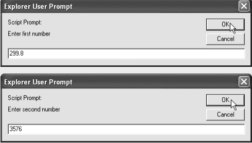

*图 7.2 | 程序员自定义的 maximum 函数。（第 1 部分，共 2 部分。）*


210 第7章 JavaScript：函数

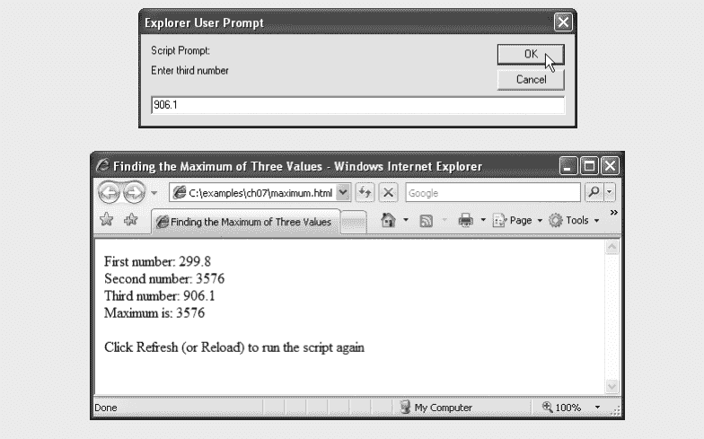

**图7.2** | 程序员定义的 `maximum` 函数。（第2部分，共2部分。）

返回值被赋值给变量 `maxValue`。第22-25行显示了用户输入的三个浮点数值以及计算出的 `maxValue`。

注意函数 `maximum` 的实现（第28-31行）。第一行表明函数名是 `maximum`，该函数接受三个参数（`x`、`y` 和 `z`）来完成其任务。此外，函数体包含一个语句，该语句使用两次对 `Math` 对象 `max` 方法的调用，返回三个浮点值中的最大值。首先，使用变量 `y` 和 `z` 的值调用方法 `Math.max`，以确定两者中较大的值。接下来，将变量 `x` 的值和第一次调用 `Math.max` 的结果传递给方法 `Math.max`。最后，第二次调用 `Math.max` 的结果被返回到调用 `maximum` 的地方（即第20行）。再次注意，脚本在顺序执行到函数 `maximum` 的定义之前就终止了。只有当从第20行调用该函数时，函数 `maximum` 体内的语句才会执行。

## 7.5 随机数生成

我们现在简短且（希望是）有趣地转向一个流行的编程应用，即模拟和游戏。在本节和下一节中，我们将开发一个结构良好的游戏程序，其中包含多个函数。该程序使用了我们研究过的大多数控制语句。

赌场空气中弥漫着某种令人振奋的东西，从奢华的红木和毛毡赌桌旁的豪赌者，到吃角子老虎机旁的四分之一美元投入者。这就是*机会因素*，即运气可能将口袋里的一小笔钱变成一座财富山的可能性。机会因素可以通过 `Math` 对象的 **random 方法** 引入。（请记住，我们将 random 称为方法是因为它属于 `Math` 对象。）

考虑以下语句：

```
var randomValue = Math.random();
```

`random` 方法生成一个从 0.0 到（但不包括）1.0 的浮点值。如果 `random` 真正随机生成值，那么每次调用 `random` 时，从 0.0 到（但不包括）1.0 的每个值都有相等的 *机会*（或 *概率*）被选中。

`random` 直接生成的值范围通常与特定应用程序所需的不同。例如，模拟抛硬币的程序可能只需要 0 表示正面，1 表示反面。模拟掷六面骰子的程序可能需要 1 到 6 范围内的随机整数。在视频游戏中随机预测下一种将飞过地平线的飞船类型的程序（有四种可能性）可能需要 0-3 或 1-4 范围内的随机整数。

为了演示 `random` 方法，让我们开发一个程序（图7.3），模拟掷六面骰子20次并显示每次的值。我们如下使用乘法运算符（*）和 `random`：

```
Math.floor( 1 + Math.random() * 6 )
```

首先，上述表达式将 `Math.random()` 调用的结果乘以 6，产生一个从 0.0 到（但不包括）6.0 的数字。这被称为**缩放**随机数的范围。接下来，我们将结果加 1，将数字范围移动，产生一个从 1.0 到（但不包括）7.0 的数字。最后，我们使用 **Math.floor** 方法将结果*向下舍入*到最接近且不大于参数值的整数——例如，1.75 被舍入为 1。图7.3证实结果在 1 到 6 的范围内。

```
<?xml version = "1.0" encoding = "utf-8"?>
<!DOCTYPE html PUBLIC "-//W3C//DTD XHTML 1.0 Strict//EN"
    "http://www.w3.org/TR/xhtml1/DTD/xhtml1-strict.dtd">

<!-- Fig. 7.3: RandomInt.html -->
<!-- Random integers, shifting and scaling. -->
<html xmlns = "http://www.w3.org/1999/xhtml">
    <head>
        <title>Shifted and Scaled Random Integers</title>
        <style type = "text/css">
            table { width: 50%;
                border: 1px solid gray;
                text-align: center }
        </style>
        <script type = "text/javascript">
            <!--
            var value;

            document.writeln( "<table>" );
            document.writeln( "<caption>Random Numbers</caption><tr>" );
```

图7.3 | 随机整数、移动和缩放。（第1部分，共2部分。）

212 第7章 JavaScript：函数

```
for ( var i = 1; i <= 20; i++ )
{
    value = Math.floor( 1 + Math.random() * 6 );
    document.writeln( "<td>" + value + "</td>" );

    // start a new table row every 5 entries
    if ( i % 5 == 0 && i != 20 )
        document.writeln( "</tr><tr>" );
} // end for

    document.writeln( "</tr></table>" );
    // -->
</script>
    </head>
    <body>
        <p>Click Refresh (or Reload) to run the script again</p>
    </body>
</html>
```

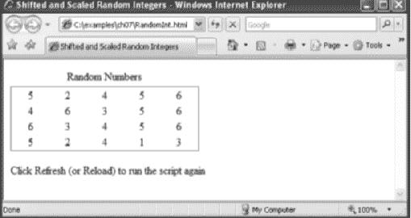

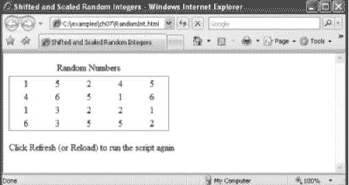

**图7.3 |** 随机整数、移动和缩放。（第2部分，共2部分。）

每个值大约出现1000次。使用浏览器的 **Refresh**（或 **Reload**）按钮再次执行脚本。

```
<?xml version = "1.0" encoding = "utf-8"?>
<!DOCTYPE html PUBLIC "-//W3C//DTD XHTML 1.0 Strict//EN"
    "http://www.w3.org/TR/xhtml1/DTD/xhtml1-strict.dtd">

<!-- Fig. 7.4: RollDie.html -->
<!-- Rolling a Six-Sided Die 6000 times. -->
<html xmlns = "http://www.w3.org/1999/xhtml">
    <head>
        <title>Roll a Six-Sided Die 6000 Times</title>
        <script type = "text/javascript">
            <!--
            var frequency1 = 0;
            var frequency2 = 0;
            var frequency3 = 0;
            var frequency4 = 0;
            var frequency5 = 0;
            var frequency6 = 0;
            var face;

            // roll die 6000 times and accumulate results
            for ( var roll = 1; roll <= 6000; roll++ )
            {
                face = Math.floor( 1 + Math.random() * 6 );

                switch ( face )
                {
                    case 1:
                        ++frequency1;
                        break;
                    case 2:
                        ++frequency2;
                        break;
                    case 3:
                        ++frequency3;
                        break;
                    case 4:
                        ++frequency4;
                        break;
                    case 5:
                        ++frequency5;
                        break;
                    case 6:
                        ++frequency6;
                        break;
                } // end switch
            } // end for

            document.writeln( "<table border = \"1\">" );
            document.writeln( "<thead><th>Face</th>" +
                "<th>Frequency</th></thead>" );
```

图7.4 | 掷六面骰子6000次。（第1部分，共2部分。）

```
document.writeln( "<tbody><tr><td>1</td><td>" + frequency1 + "</td></tr>" );
document.writeln( "<tr><td>2</td><td>" + frequency2 + "</td></tr>" );
document.writeln( "<tr><td>3</td><td>" + frequency3 + "</td></tr>" );
document.writeln( "<tr><td>4</td><td>" + frequency4 + "</td></tr>" );
document.writeln( "<tr><td>5</td><td>" + frequency5 + "</td></tr>" );
document.writeln( "<tr><td>6</td><td>" + frequency6 + "</td></tr></tbody></table>" );
// -->
</script>
</head>
<body>
<p>Click Refresh (or Reload) to run the script again</p>
</body>
</html>
```

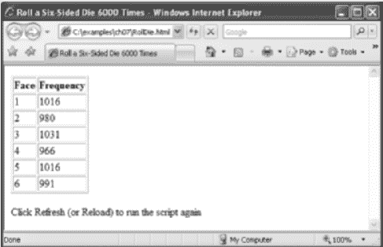


**图7.4 |** 掷六面骰子6000次。（第2部分，共2部分。）

如程序输出所示，我们使用了 `Math` 方法 `random` 以及前一个示例的缩放和移动技术来模拟掷六面骰子。注意我们使用了嵌套的控制语句来确定六面骰子每个面出现的次数。第12-17行声明并初始化了计数器，以跟踪六个骰子值中每个值出现的次数。第18行声明了一个变量来存储骰子的面值。第21-46行的 `for` 语句迭代6000次。在循环的每次迭代中，第23行产生一个1到6的值，存储在 `face` 中。第25-45行的嵌套 `switch` 语句使用随机选择的面值作为其控制表达式。根据 `face` 的值，程序在循环的每次迭代中递增六个计数器变量之一。注意这个 `switch` 语句中没有提供 `default` 情况，因为第23行的语句只产生值1、2、3、4、5和6。在这个示例中，`default` 情况永远不会执行。在我们第8章学习数组之后，我们将讨论一种用单行语句替换此程序中整个 `switch` 语句的方法。

多次运行该程序，并观察结果。注意程序在每次执行脚本时都会产生不同的随机数字，因此结果应该会有所变化。

`random` 返回的值总是在以下范围内

```
0.0 ≤ Math.random() < 1.0
```

之前，我们演示了以下语句

```
face = Math.floor( 1 + Math.random() * 6 );
```

它模拟了掷六面骰子。此语句总是将（随机的）一个整数赋值给变量 `face`，范围在 1 ≤ face ≤ 6 之间。注意该范围的宽度（即范围中的连续整数个数）是6，范围中的起始数字是1。参考前面的语句，我们看到范围的宽度由用于缩放 `random` 的乘法运算符后面的数字决定（前面的语句中是6），而范围的起始数字等于加到 `Math.random() * 6` 上的数字（前面的语句中是1）。我们可以将这个结果概括为

```
face = Math.floor( a + Math.random() * b );
```

其中 `a` 是*移动值*（等于所需连续整数范围中的第一个数字），`b` 是*缩放因子*（等于所需连续整数范围的宽度）。

## 7.6 示例：机会游戏

最受欢迎的机会游戏之一是一种称为“craps”的骰子游戏，在世界各地的赌场和后巷都有玩。游戏规则很简单：

*玩家掷两个骰子。每个骰子有六个面。这些面分别包含一个、两个、三个、四个、五个和六个点。骰子停下后，计算两个向上面的点数之和。如果第一次掷出时和为7或11，玩家获胜。如果第一次掷出时和为2、3或12（称为“craps”），玩家输（即“庄家”赢）。如果第一次掷出时和为4、5、6、8、9或10，该和就成为玩家的“点数”。要赢，必须继续掷骰子，直到“达到你的点数”（即掷出你的点数值）。如果在达到点数之前掷出7，则输。*


## 7.5 赌场模拟游戏

图 7.5 中的脚本模拟了赌场（Craps）游戏。请注意，玩家在第一次及后续所有投掷中都必须投掷两个骰子。运行脚本时，点击“掷骰子”按钮开始游戏。每次掷骰子后，“掷骰子”按钮下方的消息会显示游戏状态。

到目前为止，用户与脚本的所有交互都是通过提示对话框（用户输入程序值）或警告对话框（显示消息，用户点击“确定”关闭）完成的。虽然这些对话框是接收用户输入和显示消息的有效方式，但其功能相当有限。提示对话框一次只能从用户那里获取一个值，而消息对话框一次只能显示一条信息。

```xml
<?xml version = "1.0" encoding = "utf-8"?>
<!DOCTYPE html PUBLIC "-//W3C//DTD XHTML 1.0 Strict//EN"
    "http://www.w3.org/TR/xhtml1/DTD/xhtml1-strict.dtd">

<!-- 图 7.5：Craps.html -->
<!-- 赌场游戏模拟。 -->
<html xmlns = "http://www.w3.org/1999/xhtml">
    <head>
        <title>模拟赌场游戏的程序</title>
        <style type = "text/css">
            table   { text-align: right }
            body    { font-family: arial, sans-serif }
            div.red { color: red }
        </style>
        <script type = "text/javascript">
            <!--
            // 用于测试游戏状态的变量
            var WON = 0;
            var LOST = 1;
            var CONTINUE_ROLLING = 2;

            // 程序中使用的其他变量
            var firstRoll = true; // 如果当前投掷是第一次，则为 true
            var sumOfDice = 0; // 骰子点数之和
            var myPoint = 0; // 如果第一次投掷没有输赢，则记录点数
            var gameStatus = CONTINUE_ROLLING; // 游戏尚未结束

            // 处理一次骰子投掷
            function play()
            {
                // 获取页面上的点数字段
                var point = document.getElementById( "pointfield" );

                // 获取页面上的状态 div
                var statusDiv = document.getElementById( "status" );
                if ( firstRoll ) // 第一次投掷骰子
                {
                    sumOfDice = rollDice();
                    switch ( sumOfDice )
                    {
                        case 7: case 11: // 第一次投掷即获胜
                            gameStatus = WON;
                            // 清空点数字段
                            point.value = "";
                            break;
                        case 2: case 3: case 12: // 第一次投掷即失败
                            gameStatus = LOST;
                            // 清空点数字段
                            point.value = "";
                            break;
                        default:             // 记录点数
                            gameStatus = CONTINUE_ROLLING;
                            myPoint = sumOfDice;
                            point.value = myPoint;
                            firstRoll = false;
                    } // end switch
                } // end if
                else
                {
                    sumOfDice = rollDice();

                    if ( sumOfDice == myPoint ) // 掷出点数，获胜
                        gameStatus = WON;
                    else
                        if ( sumOfDice == 7 )   // 掷出 7，失败
                            gameStatus = LOST;
                } // end else

                if ( gameStatus == CONTINUE_ROLLING )
                    statusDiv.innerHTML = "再次掷骰子";
                else
                {
                    if ( gameStatus == WON )
                        statusDiv.innerHTML = "玩家获胜。" +
                            "点击“掷骰子”按钮再玩一次。";
                    else
                        statusDiv.innerHTML = "玩家失败。" +
                            "点击“掷骰子”按钮再玩一次。";

                    firstRoll = true;
                } // end else
            } // end function play

            // 掷骰子
            function rollDice()
            {
                var die1;
                var die2;
                var workSum;
                die1 = Math.floor( 1 + Math.random() * 6 );
                die2 = Math.floor( 1 + Math.random() * 6 );
                workSum = die1 + die2;

                document.getElementById( "die1field" ).value = die1;
                document.getElementById( "die2field" ).value = die2;
                document.getElementById( "sumfield" ).value = workSum;

                return workSum;
            } // end function rollDice
            // -->
        </script>
    </head>
    <body>
        <form action = "">
            <table>
            <caption>赌场游戏</caption>
            <tr><td>骰子 1</td>
                <td><input id = "die1field" type = "text" />
                </td></tr>
            <tr><td>骰子 2</td>
                <td><input id = "die2field" type = "text" />
                </td></tr>
            <tr><td>总和</td>
                <td><input id = "sumfield" type = "text" />
                </td></tr>
            <tr><td>点数</td>
                <td><input id = "pointfield" type = "text" />
                </td></tr>
            <tr><td /><td><input type = "button" value = "掷骰子"
                onclick = "play()" /></td></tr>
            </table>
            <div id = "status" class = "red">
                点击“掷骰子”按钮开始游戏</div>
        </form>
    </body>
</html>
```

**图 7.5** | 赌场游戏模拟。（共 4 部分，第 3 部分。）

更多时候，用户通过 XHTML 表单（例如用户输入姓名和地址信息的表单）一次接收多个输入，或者一次显示多条数据（例如本例中的骰子值、骰子之和及点数）。为了开始介绍更复杂的用户界面，本程序使用了一个 XHTML 表单（在第 2 章讨论）和一个新的图形用户界面概念——GUI *事件处理*。这是我们第一次看到 JavaScript 在响应用户与 XHTML 表单中 GUI 组件的交互时执行。

这种交互会触发一个事件。脚本通常用于响应事件。

在我们讨论脚本代码之前，我们先讨论 XHTML 文档的 body 元素（第 105–126 行）。本节中的 GUI 组件在脚本中被广泛使用。

第 106 行开始定义 XHTML 表单元素。XHTML 标准要求每个 `form` 都包含一个 `action` 属性，但由于此表单不会将信息发送到 Web 服务器，因此使用了空字符串（`""`）。

在此示例中，我们决定将表单的 GUI 组件放在 XHTML `table` 元素中，因此第 107 行开始定义 XHTML 表格。第 109–120 行创建了四个表格行。每行包含一个带有文本标签的左单元格和一个右单元格中的 `input` 元素。

创建了四个 `input` 字段（第 110、113、116 和 119 行），用于显示第一个骰子、第二个骰子、骰子之和以及当前点数（如果有的话）的值。它们的 `id` 属性分别设置为 `die1field`、`die2field`、`sumfield` 和 `pointfield`。`id` 属性可用于应用 CSS 样式，并使脚本代码能够引用 XHTML 文档中的元素。由于 `id` 属性（如果指定）必须具有唯一值，因此 JavaScript 可以通过其 `id` 属性可靠地引用任何单个元素。我们稍后会看到这是如何实现的。

第 121–122 行创建了第五行，在 **掷骰子** 按钮之前的左列中有一个空单元格。按钮的 **onclick 属性** 指示当 XHTML 文档用户点击 **掷骰子** 按钮时要执行的操作。在此示例中，点击按钮会调用函数 `play`。

这种编程风格被称为*事件驱动编程*——用户与 GUI 组件交互，脚本被通知该事件，然后脚本处理该事件。用户与 GUI 的交互会产生一个**事件**。当事件发生时被调用的函数称为**事件处理函数**或**事件处理器**。当 XHTML 表单中发生 GUI 事件时，浏览器会调用指定的事件处理函数。在任何事件被处理之前，每个 GUI 组件都必须知道当特定事件发生时将调用哪个事件处理函数。大多数 XHTML GUI 组件有几种不同的事件类型。事件模型在第 11 章 JavaScript: Events 中详细讨论。通过为 **掷骰子** 按钮指定 `onclick = "play()"`，我们指示浏览器*监听事件*（特别是按钮点击事件）。这*注册了事件处理器*，导致浏览器开始监听组件上的点击事件。如果未为 **掷骰子** 按钮指定事件处理器，当用户按下按钮时，脚本将不会响应。

第 123–125 行分别结束了 `table` 和 `form` 元素。表格之后，创建了一个 `id` 属性为 `"status"` 的 `div` 元素。脚本将更新此元素，以向用户显示每次掷骰子的结果。第 13 行的样式声明将此 `div` 中的文本颜色设置为红色。

这个游戏相当复杂。玩家可能在第一次投掷时就赢或输，也可能在任何后续投掷时赢或输。第 18–20 行创建了定义三种游戏状态的变量——游戏获胜、游戏失败和继续掷骰子。与许多其他编程语言不同，JavaScript 不提供定义*常量*（即值不能修改的变量）的机制。因此，我们使用全大写字母作为这些变量名，以表明我们不打算修改它们的值，并使它们在代码中突出显示——这是行业对真正常量的常见做法。


## 7.6 示例：机会游戏 221

## 良好的编程实践 7.4

在应该用作常量的变量名中，只使用大写字母（单词之间用下划线分隔）。这种格式使得此类变量在程序中非常醒目。

## 良好的编程实践 7.5

使用有意义的变量名而不是字面值（如 2），以使程序更具可读性。

第 23-26 行声明了几个在整个脚本中使用的变量。变量 `firstRoll` 指示骰子的下一次投掷是否是当前游戏的第一次投掷。变量 `sumOfDice` 维护上次投掷的骰子点数之和。如果玩家在第一次投掷时既没有赢也没有输，则变量 `myPoint` 存储该点数。变量 `gameStatus` 跟踪游戏的当前状态（WON，LOST 或 CONTINUE_ROLLING）。

我们定义了一个函数 `rollDice`（第 86-101 行）来投掷骰子并计算和显示它们的总和。函数 `rollDice` 只定义一次，但在程序中的两个位置（第 38 行和第 61 行）被调用。函数 `rollDice` 不接受参数，因此其参数列表为空。函数 `rollDice` 返回两个骰子的点数之和。

用户点击 **Roll Dice** 按钮来投掷骰子。此操作会调用脚本的函数 `play`（第 29-83 行）。第 32 行和第 35 行使用文档对象的 **getElementById** 方法创建了两个新变量，其对象表示 XHTML 文档中的元素。getElementById 方法以 id 作为参数，找到具有匹配 id 属性的 XHTML 元素，并返回表示该元素的 JavaScript 对象。第 32 行将一个表示 pointfield 输入元素（第 119 行）的对象存储在变量 `point` 中。第 35 行获取一个表示第 124 行 status div 的对象。稍后，我们将展示如何使用这些对象来操作 XHTML 文档。

函数 `play` 检查变量 `firstRoll`（第 36 行）以确定它是 true 还是 false。如果为 true，则该次投掷是游戏的第一次投掷。第 38 行调用 `rollDice`，该函数从 1 到 6 中随机选取两个值，在前三个文本字段中显示第一个骰子的值、第二个骰子的值以及骰子点数之和，并返回骰子点数之和。（我们稍后将详细讨论函数 `rollDice`。）第一次投掷之后（如果 `firstRoll` 为 false），第 40-57 行的嵌套 switch 语句确定游戏是赢了还是输了，或者是否应该继续进行下一次投掷。在第一次投掷之后，如果游戏尚未结束，则将 `sumOfDice` 保存在 `myPoint` 中，并在 XHTML 表单的文本字段 `point` 中显示。

请注意文本字段的值在第 45 行、第 50 行和第 55 行是如何更改的。存储在变量 `point` 中的对象允许访问 pointfield 文本字段的内容。表达式 `point.value` 访问 `point` 所引用的文本字段的 *value* 属性。value 属性指定要在文本字段中显示的文本。要访问此属性，我们指定表示文本字段的对象（`point`），后跟一个 **点** (.) 和要访问的属性名（value）。这种访问对象属性的技术（也用于访问方法，如 `Math.pow`）称为 **点表示法**。我们将在第 10 章更详细地讨论如何使用脚本访问 XHTML 页面中的元素。

程序继续执行第 70-82 行的嵌套 *if...else* 语句，该语句使用 `statusDiv` 变量更新显示游戏状态的 div。使用对象的 **innerHTML** 属性，我们将 div 内的文本设置为反映最新的状态。在第 71 行、第 75-76 行和第 78-79 行，如果 `gameStatus` 等于 `CONTINUE_ROLLING`，我们将 div 的 `innerHTML` 设置为 "Roll again."；如果 `gameStatus` 等于 `WON`，则设置为 "Player wins. Click Roll Dice to play again."；如果 `gameStatus` 等于 `LOST`，则设置为 "Player loses. Click Roll Dice to play again."。如果游戏赢了或输了，第 81 行将 `firstRoll` 设置为 true，以指示骰子的下一次投掷将开始新的游戏。

然后程序等待用户再次点击 Roll Dice 按钮。每次用户点击 Roll Dice 时，程序调用函数 `play`，后者又调用 `rollDice` 函数为 `sumOfDice` 产生一个新的值。如果 `sumOfDice` 与 `myPoint` 匹配，则 `gameStatus` 设置为 `WON`，执行第 70-82 行的 `if...else` 语句，游戏结束。如果 `sum` 等于 7，则 `gameStatus` 设置为 `LOST`，执行第 70-82 行的 `if...else` 语句，游戏结束。点击 Roll Dice 按钮开始新游戏。程序在每次投掷时用骰子的新值和总和更新 XHTML 表单中的四个文本字段，并在每次新游戏开始时更新文本字段 `point`。

函数 `rollDice`（第 86-101 行）定义了自己的局部变量 `die1`、`die2` 和 `workSum`（第 88-90 行）。第 92-93 行选择两个在 1 到 6 范围内的随机值，并将它们分别赋给变量 `die1` 和 `die2`。第 96-98 行再次使用文档的 `getElementById` 方法查找并更新正确的输入元素，使用 `die1`、`die2` 和 `workSum` 的值。请注意，整数值在赋给每个文本字段的 value 属性时会自动转换为字符串。第 100 行返回 `workSum` 的值，以在函数 `play` 中使用。

> **错误预防提示 7.1**
>
> 在函数中声明变量时对其进行初始化有助于避免不正确的结果和解释器关于未初始化数据的警告消息。

## 7.7 另一个示例：随机图像生成器

随机变化的网页内容为页面添加了动态、有趣的效果。在下一个示例中，我们构建一个 *随机图像生成器*，一个脚本在每次加载包含该脚本的页面时显示一个随机选择的图像。

为了让图 7.6 中的脚本正常工作，包含文件 `RandomPicture.html` 的目录也必须包含七个具有整数文件名的图像（即 1.gif、2.gif、...、7.gif）。包含此脚本的网页在每次页面加载时随机显示这七个图像之一。

```xml
<?xml version = "1.0" encoding = "utf-8"?>
<!DOCTYPE html PUBLIC "-//W3C//DTD XHTML 1.0 Strict//EN"
  "http://www.w3.org/TR/xhtml1/DTD/xhtml1-strict.dtd">

<!-- 图 7.6: RandomPicture.html -->
<!-- 使用 Math.random 生成随机图像。 -->
<html xmlns = "http://www.w3.org/1999/xhtml">
  <head>
    <title>随机图像生成器</title>
    <script type = "text/javascript">
      <!--
      document.write ( "" );
      // -->
    </script>
  </head>
  <body>
    <p>点击刷新（或重新加载）再次运行脚本</p>
  </body>
</html>
```

图 7.6 | 使用 Math.random 生成随机图像。（共 2 部分，第 2 部分。）

第 12-13 行随机选择要显示在网页上的图像。此 `document.write` 语句在网页中创建一个图像标签，其 `src` 属性设置为 1 到 7 之间的随机整数，并连接 ".gif"。因此，该脚本动态地将图像标签的源设置为当前目录中某个图像文件的名称。

## 7.8 作用域规则

第 4-6 章使用了标识符作为变量名。变量的属性包括名称、值和数据类型（例如字符串、数字或布尔值）。我们还使用标识符作为用户定义函数的名称。程序中的每个标识符还有一个作用域。

变量或函数的标识符的作用域是程序中可以引用该标识符的部分。在 head 元素中声明的 *全局变量* 或 *脚本级变量* 可在脚本的任何部分访问，被称为具有 *全局作用域*。因此，脚本中的每个函数都有可能使用这些变量。

在函数内部声明的标识符具有 *函数*（或 *局部*）*作用域*，只能在该函数中使用。函数作用域从声明标识符的函数的开始左花括号 ({) 开始，到函数的结束右花括号 (}) 结束。函数的局部变量和函数参数具有函数作用域。如果函数中的局部变量与全局变量同名，则该全局变量对函数体来说是“隐藏”的。

> 良好的编程实践 7.6
>
> 避免使用隐藏全局变量名的局部变量名。这可以通过简单地避免在脚本中使用重复的标识符来实现。

图 7.7 中的脚本演示了用于解决同名全局变量和局部变量之间冲突的 *作用域规则*。此示例还演示了 **onload** *事件*（第 52 行），当 XHTML 文档的 `<body>` 完全加载到浏览器窗口中时，该事件会调用事件处理程序（`start`）。

```html
<?xml version = "1.0" encoding = "utf-8"?>
<!DOCTYPE html PUBLIC "-//W3C//DTD XHTML 1.0 Strict//EN"
  "http://www.w3.org/TR/xhtml1/DTD/xhtml1-strict.dtd">

<!-- 图 7.7: scoping.html -->
<!-- 作用域示例。 -->
<html xmlns = "http://www.w3.org/1999/xhtml">
  <head>
    <title>作用域示例</title>
    <script type = "text/javascript">
      <!--
      var x = 1; // 全局变量

      function start()
      {
        var x = 5; // 函数 start 的局部变量

        document.writeln( "local x in start is " + x );

        functionA(); // functionA 有局部 x
        functionB(); // functionB 使用全局变量 x
        functionA(); // functionA 重新初始化局部 x
        functionB(); // 全局变量 x 保留其值

        document.writeln(
          "<p>local x in start is " + x + "</p>" );
      } // 结束函数 start

      function functionA()
      {
        var x = 25; // 每次调用
                    // functionA 时初始化

        document.writeln( "<p>local x in functionA is " +
          x + " after entering functionA" );
      } // 结束函数 functionA

      function functionB()
      {
        document.writeln( "<p>global x in functionB is " +
          x );
      } // 结束函数 functionB
      -->
    </script>
  </head>

  <body onload = "start()">
  </body>

</html>
```

图 7.7 | 作用域示例。（共 2 部分，第 1 部分。）


```
function functionB()
{
    document.writeln( "<p>global variable x is " + x +
        " on entering functionB" );
    x *= 10;
    document.writeln( "<br />global variable x is " +
        x + " on exiting functionB" + "</p>" );
} // end functionB
// -->
</script>
</head>
<body onload = "start()"></body>
</html>
```

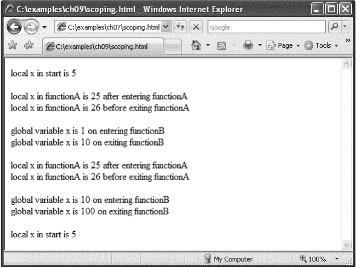

## 图 7.7 | 作用域示例。（第 2 部分，共 2 部分。）

全局变量 x（第 12 行）被声明并初始化为 1。在任何声明了名为 x 的变量的代码块（或函数）中，该全局变量都会被隐藏。函数 start（第 14–27 行）声明了一个局部变量 x（第 16 行）并将其初始化为 5。该变量在一行 XHTML 文本中输出，以表明全局变量 x 在 start 中被隐藏。该脚本还定义了另外两个函数——functionA 和 functionB——它们都不接受参数，也不返回任何值。每个函数在函数 start 中被调用两次。

函数 functionA 定义了局部变量 x（第 31 行）并将其初始化为 25。当 functionA 被调用时，该变量在一行 XHTML 文本中输出，以表明全局变量 x 在 `functionA` 中被隐藏；然后在函数退出之前，该变量被递增并在一行 XHTML 文本中再次输出。每次调用此函数时，局部变量 `x` 都会被重新创建并初始化为 25。

函数 `functionB` 没有声明任何变量。因此，当它引用变量 `x` 时，使用的是全局变量 `x`。当 `functionB` 被调用时，全局变量在一行 XHTML 文本中输出，乘以 10 后在一行 XHTML 文本中再次输出，然后函数退出。下次调用函数 `functionB` 时，全局变量的值为修改后的 10，该值再次乘以 10，输出 100。最后，程序再次在一行 XHTML 文本中输出 `start` 中的局部变量 `x`，以表明没有任何函数调用修改了 `start` 中 `x` 的值，因为所有函数引用的都是其他作用域中的变量。

## 7.9 JavaScript 全局函数

JavaScript 提供了七个全局函数。我们已经使用过其中的两个——`parseInt` 和 `parseFloat`。全局函数在图 7.8 中进行了总结。

实际上，图 7.8 中的全局函数都是 JavaScript 的 **`Global` 对象**的一部分。`Global` 对象包含脚本中的所有全局变量、脚本中所有用户定义的函数以及图 7.8 中列出的所有函数。由于全局函数和用户定义的函数都是 `Global` 对象的一部分，一些 JavaScript 程序员将这些函数称为方法。我们仅在指针对特定对象调用的函数时才使用方法这一术语（例如 `Math.random()`）。作为 JavaScript 程序员，你不需要直接使用 `Global` 对象；JavaScript 会自动引用它。

| 全局函数 | 描述 |
|-----------------|-------------|
| `escape` | 接受一个字符串参数并返回一个字符串，其中所有空格、标点符号、重音字符以及任何其他不在 ASCII 字符集中的字符都被编码为十六进制格式，以便在所有平台上都能表示。 |
| `eval` | 接受一个表示要执行的 JavaScript 代码的字符串参数。当调用 `eval` 函数时，JavaScript 解释器会对代码求值并执行。此函数允许将 JavaScript 代码存储为字符串并动态执行。[*注意*：使用 `eval` 处理用户输入的任何数据被认为是严重的安全风险，因为恶意用户可以利用此函数运行危险代码。] |
| `isFinite` | 接受一个数值参数，如果参数的值不是 `NaN`、`Number.POSITIVE_INFINITY` 或 `Number.NEGATIVE_INFINITY`（即不是数字或超出 JavaScript 支持范围的数字），则返回 `true`；否则返回 `false`。 |
| `isNaN` | 接受一个数值参数，如果参数的值不是数字则返回 `true`；否则返回 `false`。此函数通常与 `parseInt` 或 `parseFloat` 的返回值一起使用，以确定结果是否为适当的数值。 |
| `parseFloat` | 接受一个字符串参数并尝试将字符串的开头转换为浮点值。如果转换不成功，函数返回 `NaN`；否则返回转换后的值（例如，`parseFloat( "abc123.45" )` 返回 `NaN`，`parseFloat( "123.45abc" )` 返回值 123.45）。 |
| `parseInt` | 接受一个字符串参数并尝试将字符串的开头转换为整数值。如果转换不成功，函数返回 `NaN`；否则返回转换后的值（例如，`parseInt( "abc123" )` 返回 `NaN`，`parseInt( "123abc" )` 返回整数值 123）。此函数接受一个可选的第二个参数，范围从 2 到 36，用于指定数字的**进制**（或**基数**）。基数 2 表示第一个参数字符串是**二进制**格式，基数 8 表示第一个参数字符串是**八进制**格式，基数 16 表示第一个参数字符串是**十六进制**格式。 |
| `unescape` | 接受一个字符串作为参数并返回一个字符串，其中之前用 `escape` 编码的所有字符都被解码。 |

图 7.8 | JavaScript 全局函数。

## 7.10 递归

我们迄今为止讨论的程序通常以函数的结构组织，这些函数以有序的、分层的方式相互调用。**递归函数**是一个直接或间接通过另一个函数调用*自身*的函数。在本节中，我们将介绍一个简单的递归示例。

我们首先从概念上理解递归；然后研究几个包含递归函数的程序。递归问题解决方法有一些共同的要素。调用一个递归函数来解决一个问题。该函数实际上只知道如何处理最简单的情况，即**基础情况**。如果函数以基础情况被调用，函数会返回一个结果。如果函数以更复杂的问题被调用，它会将问题分成两个概念上的部分——函数知道如何处理的部分（基础情况）和函数不知道如何处理的部分。为了使递归可行，后一部分必须与原始问题相似，但必须是原始问题的更简单或更小的版本。因为这个新问题看起来像原始问题，所以函数会调用自身的一个新副本来处理这个较小的问题；这种调用被称为**递归调用**，或**递归步骤**。递归步骤通常还包括关键字 `return`，因为它的结果将与函数已知如何求解的问题部分组合在一起，形成一个传递回调用者的结果。

递归步骤在函数的原始调用仍然打开时执行（即，尚未完成执行）。递归步骤可能导致更多的递归调用，因为函数将每个新的子问题分成两个概念上的部分。为了使递归最终终止，每次函数以原始问题的更简单版本调用自身时，越来越小的问题序列必须趋近于基础情况。在这一点上，函数识别出基础情况，将结果返回给函数的前一个副本，然后一系列返回沿调用链向上传递，直到原始函数调用最终将最终结果返回给调用者。

作为这些概念实际运作的一个示例，让我们编写一个递归程序来执行一个常见的数学计算。非负整数 $n$ 的阶乘，写作 $n!$（读作"n 的阶乘"），是乘积 $n \cdot (n - 1) \cdot (n - 2) \cdot \ldots \cdot 1$，其中 $1!$ 等于 1，$0!$ 被定义为 1。例如，$5!$ 是乘积 $5 \cdot 4 \cdot 3 \cdot 2 \cdot 1$，等于 120。

```
var factorial = 1;

for ( var counter = number; counter >= 1; --counter )
    factorial *= counter;
```

大于或等于零的整数（以下示例中的 `number`）的阶乘可以使用 `for` 语句以迭代（非递归）方式计算，如下所示：

通过观察以下关系可以得出阶乘函数的递归定义：$n! = n \cdot (n - 1)!$

例如，$5!$ 显然等于 $5 \cdot 4!$，如以下等式所示：

$5! = 5 \cdot 4 \cdot 3 \cdot 2 \cdot 1$
$5! = 5 \cdot (4 \cdot 3 \cdot 2 \cdot 1)$
$5! = 5 \cdot (4!)$

$5!$ 的求值过程如图 7.9 所示。图 7.9 (a) 展示了一系列递归调用如何进行，直到 $1!$ 被计算为 1，从而终止递归

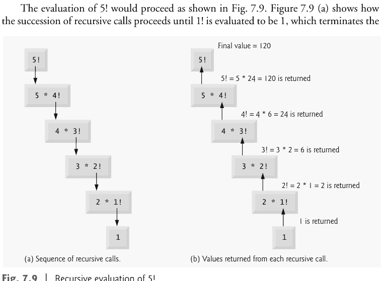
```

递归。图 7.9 (b) 显示了每次递归调用返回给其调用者的值，直到最终计算出并返回最终结果。

图 7.10 使用递归计算并打印整数 0 到 10 的阶乘。递归函数 `factorial` 首先测试（第 24 行）终止条件是否为真，即 `number` 是否小于或等于 1。如果是，`factorial` 返回 1，无需进一步递归，函数即返回。如果 `number` 大于 1，第 27 行将问题表示为 `number` 与递归调用 `factorial` 计算 `number - 1` 的阶乘所返回的值的乘积。注意，`factorial(number - 1)` 是一个比原始计算 `factorial(number)` 更简单的问题。

函数 `factorial`（第 22–28 行）接收要计算其阶乘的值作为参数。从图 7.10 的屏幕截图中可以看出，阶乘值增长非常迅速。

## 常见编程错误 7.6

> 在需要时忘记从递归函数返回值会导致逻辑错误。

```
<?xml version = "1.0" encoding = "utf-8"?>
<!DOCTYPE html PUBLIC "-//W3C//DTD XHTML 1.0 Strict//EN"
    "http://www.w3.org/TR/xhtml1/DTD/xhtml1-strict.dtd">

<!-- Fig. 7.10: FactorialTest.html -->
<!-- Factorial calculation with a recursive function. -->
<html xmlns = "http://www.w3.org/1999/xhtml">
    <head>
        <title>Recursive Factorial Function</title>
        <script type = "text/javascript">
            <!--
            document.writeln( "<h1>Factorials of 1 to 10</h1>" );
            document.writeln( "<table>" );

            for ( var i = 0; i <= 10; i++ )
                document.writeln( "<tr><td>" + i + "!</td><td>" +
                    factorial( i ) + "</td></tr>" );

            document.writeln( "</table>" );

            // Recursive definition of function factorial
            function factorial( number )
            {
                if ( number <= 1 )  // base case
                    return 1;
                else
                    return number * factorial( number - 1 );
            } // end function factorial
            // -->
        </script>
    </head><body></body>
</html>
```

图 7.10 | 使用递归函数计算阶乘。（第 1 部分，共 2 部分）

230 第 7 章 JavaScript：函数

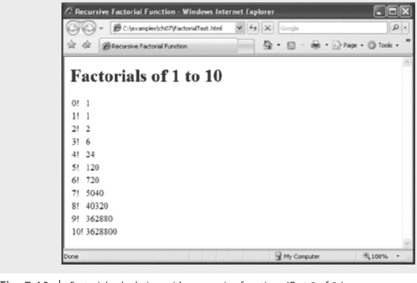

图 7.10 | 使用递归函数计算阶乘。（第 2 部分，共 2 部分。）

> **常见编程错误 7.7**
> *遗漏基本实例，以及错误地编写递归步骤使其无法收敛到基本实例，这两种错误都会导致无限递归，最终耗尽内存。这种情况类似于迭代（非递归）解决方案中的无限循环问题。*

> **错误预防提示 7.2**
> *当脚本似乎进入无限递归时，Internet Explorer 会显示错误消息。Firefox 在检测到问题后只是终止脚本。这允许网页用户从包含无限循环或无限递归的脚本中恢复。*

## 7.11 递归与迭代

在上一节中，我们研究了一个既可以递归实现也可以迭代实现的函数。在本节中，我们比较这两种方法，并讨论为什么在某些特定情况下你可能会选择其中一种方法。

迭代和递归都基于控制语句：迭代使用重复语句（例如 for、while 或 do...while）；递归使用选择语句（例如 if、if...else 或 switch）。迭代和递归都涉及重复：迭代显式使用重复语句；递归通过重复的函数调用实现重复。迭代和递归都涉及终止测试：迭代在循环继续条件不满足时终止；递归在识别到基本实例时终止。带有计数器控制重复的迭代和递归都逐渐接近终止：迭代不断修改计数器，直到计数器取值使循环继续条件不满足为止；递归不断产生原问题的更简单版本，直到达到基本实例。迭代和递归都可能无限进行：如果循环继续测试永远不会为假，则迭代会发生无限循环；如果递归步骤每次都没有通过收敛到基本实例的序列来简化问题，或者基本实例不正确，则会发生无限递归。

递归的一个缺点是函数调用需要一定的时间和内存空间，这些并非直接用于执行程序指令。这被称为函数调用开销。由于递归使用重复的函数调用，这种开销会极大地影响操作的性能。在许多情况下，使用重复语句代替递归更为高效。然而，有些问题用递归解决更为优雅（也更容易）。

> **软件工程观察 7.5**
> 任何可以递归解决的问题也可以迭代（非递归）解决。当递归方法更自然地反映问题，并且产生的程序更容易理解和调试时，通常优先选择递归方法而非迭代方法。选择递归解决方案的另一个原因是迭代解决方案可能不明显。

> **性能提示 7.1**
> 在注重性能的情况下避免使用递归。递归调用需要时间并消耗额外的内存。

> **常见编程错误 7.8**
> 意外地让非递归函数调用自身，无论是直接地还是通过另一个函数间接地，都可能导致无限递归。

除了阶乘函数示例（图 7.10）之外，图 12.26 还使用递历来遍历 XML 文档树。

## 7.12 网络资源

www.deitel.com/javascript/
Deitel JavaScript 资源中心包含网络上一些最佳 JavaScript 资源的链接。在那里，你可以找到按类别分类的 JavaScript 工具、代码生成器、论坛、书籍、库、框架等的链接。还可以查看面向各种技能水平的教程，从入门到高级。一定要访问 XHTML（www.deitel.com/xhtml/）和 CSS 2.1（www.deitel.com/css21/）的相关资源中心。

---

## 8

# JavaScript：数组

# 学习目标

在本章中，你将学习：

- 使用数组存储值列表和表格。
- 声明数组、初始化数组以及引用数组的各个元素。
- 将数组传递给函数。
- 对数组进行排序。
- 声明和操作多维数组。

> 他抽泣着，流泪着，把那些最大个儿的挑出来……
> ——刘易斯·卡罗尔

> 尝试到底，永远不要犹豫怀疑；
> 没有什么太难，只要寻找就能发现。
> ——罗伯特·赫里克

> 现今你去，在他们面前将这话写在书卷上，并记在书上。
> ——《以赛亚书》30:8

> 它锁在我的记忆里，
> 而你自己掌握着它的钥匙。
> ——威廉·莎士比亚

233

## 8.1 引言

- 8.1 引言
- 8.2 数组
- 8.3 声明和分配数组
- 8.4 使用数组的示例
- 8.5 使用数组的随机图像生成器
- 8.6 引用和引用参数
- 8.7 将数组传递给函数
- 8.8 数组排序
- 8.9 多维数组
- 8.10 构建在线测验
- 8.11 网络资源

## 8.1 引言

*数组*是由相关数据项组成的数据结构（有时称为数据项的*集合*）。JavaScript 数组是"动态"实体，因为它们在创建后可以更改大小。本章演示的许多技术在 10–11 章中经常使用，因为我们介绍了允许脚本程序员动态操作 XHTML 文档每个元素的集合。

## 8.2 数组

数组是一组内存位置，它们都具有相同的名称，并且通常属于同一类型（尽管在 JavaScript 中不要求此属性）。要引用数组中的特定位置或元素，我们指定数组的名称以及该元素在数组中的位置编号。

图 8.1 显示了一个名为 c 的整数值数组。该数组包含 12 个*元素*。其中任何一个元素都可以通过给出数组名称后跟方括号（`[]`）中元素的位置编号来引用。每个数组的第一个元素都是*第零个元素*。因此，数组 `c` 的第一个元素称为 `c[0]`，数组 `c` 的第二个元素称为 `c[1]`，数组 `c` 的第七个元素称为 `c[6]`，一般情况下，数组 `c` 的*i* 个元素称为 `c[i-1]`。数组名称遵循与其他标识符相同的约定。

方括号中的位置编号称为*下标*（或*索引*）。下标必须是整数或整数表达式。请注意，带下标的数组名称是左值表达式——它可以在赋值语句的左侧使用，将新值放入数组元素中。它也可以在赋值语句的右侧使用，将其值赋值给另一个左值表达式。

让我们更仔细地检查图 8.1 中的数组 `c`。数组的*名称*是 c。数组 `c` 的*长度*为 12，可以通过以下表达式获取：

```
c.length
```

JavaScript 中的每个数组都知道自己的长度。数组的 12 个元素称为 `c[0]`、`c[1]`、`c[2]`、...、`c[11]`。`c[0]` 的*值*为 -45，`c[1]` 的*值*为 6，`c[2]` 的*值*为 0，`c[7]` 的*值*为 62，`c[11]` 的*值*为 78。


包围数组下标的方括号是 JavaScript 运算符。方括号的优先级与圆括号相同。图 8.2 中的图表展示了目前所介绍的运算符的优先级和结合性。它们按照优先级从高到低的顺序从上到下排列，并附带其结合性和类型。

| 运算符 | 结合性 | 类型 |
|---|---|---|
| () [] . | 从左到右 | 最高 |
| ++ -- ! | 从右到左 | 一元 |
| * / % | 从左到右 | 乘法 |
| + - | 从左到右 | 加法 |
| < <= > >= | 从左到右 | 关系 |
| == != | 从左到右 | 相等 |
| && | 从左到右 | 逻辑 AND |
| \|\| | 从左到右 | 逻辑 OR |
| ?: | 从右到左 | 条件 |
| = += -= *= /= %= | 从右到左 | 赋值 |

**图 8.2** | 目前所讨论的运算符的优先级和结合性。

## 8.3 声明和分配数组

数组占据内存空间。实际上，JavaScript 中的数组是一个*数组对象（Array object）*。你使用*运算符 new* 来动态分配（请求内存）每个数组所需的元素数量。运算符 new 通过在执行时获取足够的内存来存储 new 右侧指定类型的对象，从而创建对象。创建新对象的过程也称为*创建实例*或*实例化对象*，运算符 **new** 被称为*动态内存分配运算符*。数组是对象，必须用 **new** 创建。要为整数数组 **c** 分配 12 个元素，使用以下语句

```
var c = new Array( 12 );
```

上述语句也可以分两步完成，如下所示：

```
var c; // 声明数组
c = new Array( 12 ); // 分配数组
```

数组被分配时，元素不会被初始化——它们的值是 **undefined**。

## 常见编程错误 8.1

> *假设数组元素在分配数组时已被初始化，可能会导致逻辑错误。*

## 8.4 使用数组的示例

本节展示几个创建和操作数组的示例。

## 创建和初始化数组

图 8.3 中的脚本使用运算符 **new** 分配了包含五个元素的 **Array** 和一个空数组。该脚本演示了如何初始化已有元素的 **Array**，并展示了 **Array** 可以动态增长以容纳新元素。**Array** 的值以 XHTML 表格形式显示。

```
1  <?xml version = "1.0" encoding = "utf-8"?>
2  <!DOCTYPE html PUBLIC "-//W3C//DTD XHTML 1.0 Strict//EN"
3    "http://www.w3.org/TR/xhtml1/DTD/xhtml1-strict.dtd">
4
5  <!-- Fig. 8.3: InitArray.html -->
6  <!-- Initializing the elements of an array. -->
7  <html xmlns = "http://www.w3.org/1999/xhtml">
8     <head>
9        <title>Initializing an Array</title>
10       <style type = "text/css">
11          table { width: 10em }
12          th    { text-align: left }
13       </style>
14       <script type = "text/javascript">
15          <!--
16          // create (declare) two new arrays
17          var n1 = new Array( 5 ); // allocate five-element Array
18          var n2 = new Array(); // allocate empty Array
19
20          // assign values to each element of Array n1
21          for ( var i = 0; i < n1.length; ++i )
22             n1[ i ] = i;
23          // create and initialize five elements in Array n2
24          for ( i = 0; i < 5; ++i )
25             n2[ i ] = i;
26
27          outputArray( "Array n1:", n1 );
28          outputArray( "Array n2:", n2 );
29
30          // output the heading followed by a two-column table
31          // containing subscripts and elements of "theArray"
32          function outputArray( heading, theArray )
33          {
34             document.writeln( "<h2>" + heading + "</h2>" );
35             document.writeln( "<table border = \"1\">" );
36             document.writeln( "<thead><th>Subscript</th>" +
37                "<th>Value</th></thead><tbody>" );
38
39             // output the subscript and value of each array element
40             for ( var i = 0; i < theArray.length; i++ )
41                document.writeln( "<tr><td>" + i + "</td><td>" +
42                   theArray[ i ] + "</td></tr>" );
43
44             document.writeln( "</tbody></table>" );
45          } // end function outputArray
46
47          // -->
48          </script>
49          </head><body></body>
50          </html>
```

**图 8.3** | 初始化数组元素。（第 1 部分，共 2 部分。）

第 17 行创建数组 n1 作为包含五个元素的数组。第 18 行创建数组 n2 作为空数组。第 21–22 行使用 for 语句将 n1 的元素初始化为其下标值（0 到 4）。注意在 for 语句的条件中使用表达式 n1.length 来确定数组的长度。在本例中，数组的长度为 5，因此只要控制变量 i 的值小于 5，循环就会继续执行。对于五个元素的数组，下标值为 0 到 4，因此使用小于运算符 < 可以确保循环不会尝试访问数组末尾之外的元素。通常使用基于零的计数来遍历数组。

第 25–26 行使用 for 语句向数组 n2 添加五个元素，并将每个元素初始化为其下标值（0 到 4）。注意数组 n2 动态增长以适应分配给每个元素的值。

> **软件工程观察 8.1**
> JavaScript 在将值赋给原数组范围之外的元素时，会自动重新分配数组。原数组最后一个元素与新元素之间的元素具有 undefined 值。

第 28–29 行调用函数 outputArray（定义在第 33–46 行），以 XHTML 表格形式显示每个数组的内容。函数 outputArray 接收两个参数——一个在显示数组内容的 XHTML 表格之前输出的字符串，以及要输出的数组。第 41–43 行使用 for 语句输出定义表格每一行的 XHTML 文本。

> **常见编程错误 8.2**
> 引用数组范围之外的元素通常是一种逻辑错误。

如果数组元素的值预先已知，可以在声明数组时分配和初始化元素。初始值可以通过两种方式指定。语句

```
var n = [ 10, 20, 30, 40, 50 ];
```

使用以方括号（[ 和 ]）括起的逗号分隔**初始化列表**来创建包含五个元素的数组，下标为 0、1、2、3 和 4。数组大小由初始化列表中的值数量决定。注意，上述声明不需要 new 运算符来创建数组对象——当解释器遇到包含初始化列表的数组声明时，会提供此功能。语句

```
var n = new Array( 10, 20, 30, 40, 50 );
```

## 使用初始化列表初始化数组

图 8.4 中的脚本创建三个数组对象，以演示使用初始化列表初始化数组（第 18–20 行），并使用与图 8.3 中讨论的相同函数 outputArray 在 XHTML 表格中显示每个数组。注意，当数组 integers2 在网页中显示时，下标为 1 和 2 的元素（数组的第二个和第三个元素）显示为 undefined，因为它们未被初始化。

```xml
<?xml version = "1.0" encoding = "utf-8"?>
<!DOCTYPE html PUBLIC "-//W3C//DTD XHTML 1.0 Strict//EN"
    "http://www.w3.org/TR/xhtml1/DTD/xhtml1-strict.dtd">

<!-- Fig. 8.4: InitArray2.html -->
<!-- Declaring and initializing arrays. -->
<html xmlns = "http://www.w3.org/1999/xhtml">
   <head>
      <title>Initializing an Array with a Declaration</title>
      <style type = "text/css">
         table { width: 15em }
         th    { text-align: left }
      </style>
      <script type = "text/javascript">
         <!--
         // Initializer list specifies the number of elements and
         // a value for each element.
         var colors = new Array( "cyan", "magenta", "yellow", "black" );
         var integers1 = [ 2, 4, 6, 8 ];
         var integers2 = [ 2, , , 8 ];

         outputArray( "Array colors contains", colors );
         outputArray( "Array integers1 contains", integers1 );
         outputArray( "Array integers2 contains", integers2 );

         // output the heading followed by a two-column table
         // containing the subscripts and elements of theArray
         function outputArray( heading, theArray )
         {
            document.writeln( "<h2>" + heading + "</h2>" );
            document.writeln( "<table border = \"1\">" );
            document.writeln( "<thead><th>Subscript</th>" +
               "<th>Value</th></thead><tbody>" );

            // output the subscript and value of each array element
            for ( var i = 0; i < theArray.length; i++ )
               document.writeln( "<tr><td>" + i + "</td><td>" +
                  theArray[ i ] + "</td></tr>" );

            document.writeln( "</tbody></table>" );
         } // end function outputArray
         // -->
```

**图 8.4** | 声明和初始化数组。（第 1 部分，共 2 部分。）


 the array）在网页中显示为 undefined。这两个元素正是我们在脚本第 20 行的声明中没有提供值的那两个。

## 使用 for 和 for…in 对数组元素求和

图 8.5 中的脚本将 theArray 中存放的值累加求和，theArray 是在第 13 行声明、分配并初始化的 10 元素整数数组。第一个 for 语句体内的第 19 行语句执行累加操作。请注意，数组 theArray 的初始值可以通过 XHTML 表单读入程序。

在本例中，我们介绍 JavaScript 的 for…in 语句，它使脚本能够对数组中的每个元素执行任务（正如我们将在第 10–11 章中看到的那样，也可以对集合中的每个元素执行）。第 25–26 行展示了 for…in 语句的语法。在括号内，我们声明一个元素变量，用于选择关键字 in 右侧对象中的每个元素（本例中是 theArray）。使用 for…in 时，JavaScript 自动确定数组中的元素个数。当 JavaScript 解释器遍历 theArray 的元素时，变量 element 被赋一个值，该值可用作 theArray 的下标。对于 Array 而言，赋值的值是一个下标，范围从 0 到 theArray.length（但不包括 theArray.length）。每个值被加到 total2 中，从而得到数组元素的总和。

```
<?xml version = "1.0" encoding = "utf-8"?>
<!DOCTYPE html PUBLIC "-//W3C//DTD XHTML 1.0 Strict//EN"
    "http://www.w3.org/TR/xhtml1/DTD/xhtml1-strict.dtd">

<!-- Fig. 8.5: SumArray.html -->
<!-- Summing elements of an array. -->
<html xmlns = "http://www.w3.org/1999/xhtml">
    <head>
        <title>Sum the Elements of an Array</title>

        <script type = "text/javascript">
            <!--
            var theArray = [ 1, 2, 3, 4, 5, 6, 7, 8, 9, 10 ];
            var total1 = 0, total2 = 0;

            // iterates through the elements of the array in order and adds
            // each element's value to total1
            for ( var i = 0; i < theArray.length; i++ )
                total1 += theArray[ i ];

            document.writeln( "Total using subscripts: " + total1 );

            // iterates through the elements of the array using a for... in
            // statement to add each element's value to total2
            for ( var element in theArray )
                total2 += theArray[ element ];

            document.writeln( "<br />Total using for...in: " + total2 );
            // -->
        </script>
    </head><body></body>
</html>
```

Fig. 8.5 | 数组元素求和。

> **Error-Prevention acts as a redirect**
>
> 遍历数组的所有元素时，使用 for...in 语句以确保只操作数组中实际存在的元素。请注意，for...in 语句会跳过数组中任何未定义的元素。

## 将数组元素用作计数器

在第 7 章中，我们提到过有一种更优雅的方式来实现图 7.4 中的掷骰子程序。该程序掷了一个六面骰子 6000 次，并使用 switch 语句统计每个点数出现的次数。图 8.6 展示了该脚本的数组版本。图 7.4 中的 switch 语句被本 programs 的第 24 行所取代。该行使用随机产生的面数作为数组 frequency 的下标，以确定在每次循环迭代中递增哪个元素。由于第 23 行的随机数计算产生 1 到 6 的数字（六面骰子的点数），frequency 数组必须足够大，以容纳 1 到 6 的下标值。要使数组具有这些下标值，所需的最少元素个数为 7 个（下标值从 0 到 6）。在本程序中，我们忽略数组 frequency 的第 0 个元素，仅使用与骰子各面相对应的元素。此外，本程序的第 32–34 行使用循环来生成表格，而在图 7.4 中表格是一行一行写出来的。由于我们可以遍历数组 frequency 来辅助生成输出，因此无需像图 7.4 那样逐一列举每个 XHTML 表格行。

```
1  <?xml version = "1.0" encoding = "utf-8"?>
2  <!DOCTYPE html PUBLIC "-//W3C//DTD XHTML 1.0 Strict//EN"
3    "http://www.w3.org/TR/xhtml1/DTD/xhtml1-strict.dtd">
4
5  <!-- Fig. 8.6: RollDie.html -->
6  <!-- Dice-rolling program using an array instead of a switch. -->
7  <html xmlns = "http://www.w3.org/1999/xhtml">
8     <head>
9        <title>Roll a Six-Sided Die 6000 Times</title>
10       <style type = "text/css">
11          table { width: 15em }
12          th    { text-align: left }
13       </style>
14       <script type = "text/javascript">
15          <!--
16          var face;
17          var frequency = [ , 0, 0, 0, 0, 0, 0 ]; // leave frequency[0]
18                                                // uninitialized
19
20          // summarize results
21          for ( var roll = 1; roll <= 6000; ++roll )
22          {
23             face = Math.floor( 1 + Math.random() * 6 );
24             ++frequency[ face ];
25          } // end for
26
27          document.writeln( "<table border = \"1\"><thead>" );
28          document.writeln( "<th>Face</th>" +
29             "<th>Frequency</th></thead><tbody>" );
30
31          // generate entire table of frequencies for each face
32          for ( var face = 1; face < frequency.length; ++face )
33             document.writeln( "<tr><td>" + face + "</td><td>" +
34                frequency[ face ] + "</td></tr>" );
35
36          document.writeln( "</tbody></table>" );
37          // -->
38       </script>
39    </head>
40    <body>
41       <p>Click Refresh (or Reload) to run the script again</p>
42    </body>
43 </html>
```

Fig. 8.6 | 使用数组代替 switch 的掷骰子程序。（第 1 部分，共 2 部分）

## 8.5 使用数组的随机图像生成器

在第 7 章中，我们创建了一个随机图像生成器，要求图像文件必须命名为 1.gif、2.gif、...、7.gif。在本例（图 8.7）中，我们创建了一个更优雅的随机图像生成器，不要求图像文件名为整数。该版本的随机图像生成器使用数组 pictures 以字符串形式存储图像文件名。脚本生成一个随机整数，并将其作为 pictures 数组的下标。脚本输出一个 XHTML img 元素，其 src 属性包含在 pictures 数组随机选中位置的图像文件名。

```
1  <?xml version = "1.0" encoding = "utf-8"?>
2  <!DOCTYPE html PUBLIC "-//W3C//DTD XHTML 1.0 Strict//EN"
3     "http://www.w3.org/TR/xhtml1/DTD/xhtml1-strict.dtd">
4
5  <!-- Fig. 8.7: RandomPicture2.html -->
6  <!-- Random image generation using arrays. -->
7  <html xmlns = "http://www.w3.org/1999/xhtml">
8     <head>
9        <title>Random Image Generator</title>
10       <style type = "text/css">
11          table { width: 15em }
12          th    { text-align: left }
13       </style>
14
15       <script type = "text/javascript">
16          <!--
17          var pictures =
18             [ "CPE", "EPT", "GPP", "GUI", "PERF", "PORT", "SEO" ];
19
20          // pick a random image from the pictures array and displays by
21          // creating an img tag and appending the src attribute to the
22          // filename
23          document.write ( "" );
25          // -->
26       </script>
27    </head>
28    <body>
29       <p>Click Refresh (or Reload) to run the script again</p>
30    </body>
31 </html>
```

Fig. 8.7 | 使用数组的随机图像生成。（第 1 部分，共 2 部分）

脚本在第 16–17 行声明数组 pictures，并用七个图像文件的名称进行初始化。第 22–23 行创建在网页上显示随机图像的 img 标签。第 22 行打开 img 标签并开始 src 属性。第 23 行生成一个 0 到 6 的随机整数，作为 pictures 数组的下标，结果是一个随机选中的图像文件名。表达式

```
pictures[ Math.floor( Math.random() * 7 ) ]
```

求值为 pictures 数组中的一个字符串，然后被写入文档（第 23 行）。第 23 行以图像文件的扩展名（.gif）完成 img 标签。

## 8.6 引用与引用参数

在许多编程语言中，向函数（或方法）传递参数有两种方式：*按值传递*（*pass-by-value*）和*按引用传递*（*pass-by-reference*）。当按值向函数传递参数时，会制作一个参数值的*副本*，并将其传递给被调函数。在 JavaScript 中，数字、布尔值和字符串都是按值传递给函数的。

通过按引用传递，调用者赋予被调用函数直接访问调用者数据的权限，并允许其根据需要修改数据。此过程通过将数据在内存中所在位置的地址传递给被调用函数来实现。按引用传递可以提高性能，因为它消除了复制大量数据的开销，但它也可能削弱安全性，因为被调用函数能够访问调用者的数据。在 JavaScript 中，所有对象（因此包括所有数组）都是按引用传递给函数的。

## 错误防范提示 8.2

> 通过按值传递，对被调用函数参数副本的修改不会影响调用函数中原始变量的值。这防止了那些严重阻碍开发正确且可靠的软件系统的意外副作用。

## 软件工程观察 8.2

> 与某些其他语言不同，JavaScript 不允许你选择每个参数是按值传递还是按引用传递。数字、布尔值和字符串按值传递。对象按引用传递给函数。当函数接收一个对象的引用时，该函数可以直接操作该对象。

## 软件工程观察 8.3

> 当通过 return 语句从函数返回信息时，数字和布尔值总是按值返回（即，返回一个副本），而对象总是按引用返回。注意，在按引用传递的情况下，没有必要返回新值，因为对象已经被修改了。

要将对象的引用传递给函数，只需在函数调用中指定引用名称。通常，引用名称是程序用于操作对象的标识符。在被调用函数的函数体中通过其参数名提及引用，实际上指的是内存中的原始对象，该对象可由被调用函数直接访问。在下一节中，我们将使用数组来演示按值传递和按引用传递。

## 8.7 将数组传递给函数

要将数组参数传递给函数（图 8.8），请指定数组名称（数组的引用）而不带方括号。例如，如果数组 hourlyTemperatures 已声明为

```
var hourlyTemperatures = new Array( 24 );
```

那么函数调用

```
modifyArray( hourlyTemperatures );
```

会将数组 hourlyTemperatures 传递给函数 modifyArray。如第 8.2 节所述，JavaScript 中的每个数组对象都知道自己的大小（通过 length 属性）。因此，当我们将一个数组对象传递给函数时，我们不会单独将数组的大小作为参数传递。图 8.3 在我们将数组 n1 和 n2 传递给函数 outputArray 以显示每个数组的内容时说明了这个概念。

```
 1  <?xml version = "1.0" encoding = "utf-8"?>
 2  <!DOCTYPE html PUBLIC "-//W3C//DTD XHTML 1.0 Strict//EN"
 3    "http://www.w3.org/TR/xhtml1/DTD/xhtml1-strict.dtd">
 4  
 5  <!-- Fig. 8.8: PassArray.html -->
 6  <!-- 将数组和单个数组元素传递给函数。 -->
 7  <html xmlns = "http://www.w3.org/1999/xhtml">
 8      <head>
 9          <title>将数组和单个数组元素传递给函数</title>
10         <script type = "text/javascript">
11             <!--
12             var a = [ 1, 2, 3, 4, 5 ];
13 
14             document.writeln( "<h2>按引用传递整个" +
15                 "数组的效果</h2>" );
16             outputArray( "原始数组: ", a );
17 
18             modifyArray( a ); // 数组 a 按引用传递
19 
20             outputArray( "修改后的数组: ", a );
21 
22             document.writeln( "<h2>按值传递数组" +
23                 "元素的效果</h2>" +
24                 "modifyElement 之前的 a[3]: " + a[ 3 ] );
25 
26             modifyElement( a[ 3 ] ); // 数组元素 a[3] 按值传递
27 
28             document.writeln( "<br />modifyElement 之后的 a[3]: " + a[ 3 ] );
29 
30             // 输出标题，然后是 "theArray" 的内容
31             function outputArray( heading, theArray )
32             {
33                 document.writeln(
34                     heading + theArray.join( " " ) + "<br />" );
35             } // 函数 outputArray 结束
36 
37             // 修改数组元素的函数
38             function modifyArray( theArray )
39             {
40                 for ( var j in theArray )
41                     theArray[ j ] *= 2;
42             } // 函数 modifyArray 结束
43 
44             // 修改传递值的函数
45             function modifyElement( e )
46             {
47                 e *= 2; // 在函数执行期间仅缩放元素 e
48                         // 
49                 document.writeln( "<br />modifyElement 中的值: " + e );
50             } // 函数 modifyElement 结束
51             // -->
```

图 8.8 | 将数组和单个数组元素传递给函数。（共 2 部分，第 1 部分）

```
53     </script>
54   </head><body></body>
55 </html>
```

图 8.8 | 将数组和单个数组元素传递给函数。（共 2 部分，第 2 部分）

虽然整个数组是按引用传递的，但*单个的数字和布尔数组元素*是*按值*传递的，其方式与简单的数字和布尔变量传递方式完全相同（对象数组的单个元素所引用的对象仍然是按引用传递的）。这种简单的单个数据项称为*标量*。要将数组元素传递给函数，请在函数调用中使用该元素的带下标的名称作为参数。

为了使函数通过函数调用接收一个数组，函数的参数列表必须指定一个在函数体中将引用该数组的参数。与其他编程语言不同，JavaScript 没有提供用于此目的的特殊语法。JavaScript 只要求在参数列表中指定数组的标识符。例如，函数 modifyArray 的函数头可以写成

```
function modifyArray( b )
```

这表明 modifyArray 期望接收一个名为 b 的参数（调用函数中提供的参数必须是一个数组）。数组是按引用传递的，因此当被调用函数使用数组名 b 时，它指的是调用者中的实际数组（在前面的调用中是数组 hourlyTemperatures）。图 8.8 中的脚本演示了传递整个数组与传递数组元素之间的区别。

## 软件工程观察 8.4

> JavaScript 不检查传递给函数的参数数量或类型。可以向函数传递任意数量的值。JavaScript 将在使用这些值时尝试进行转换。

第 17 行的语句调用函数 outputArray，以在数组 a 被修改之前显示其内容。函数 outputArray（在第 32-36 行定义）接收一个要输出的字符串和一个要输出的数组。第 34-35 行的语句使用数组方法 **join** 来创建一个包含 theArray 中所有元素的字符串。方法 join 接受一个包含*分隔符*的字符串作为参数，该分隔符应用于在返回的字符串中分隔数组的元素。如果未指定参数，则使用空字符串作为分隔符。

第 19 行调用函数 modifyArray（第 39–43 行）并将数组 a 传递给它。modifyArray 函数将每个元素乘以 2。为了说明数组 a 的元素已被修改，第 21 行的语句再次调用函数 outputArray 以在数组 a 被修改后显示其内容。如屏幕截图所示，a 的元素确实被 modifyArray 修改了。

为了显示在调用 modifyElement 之前 a[ 3 ] 的值，第 25 行输出 a[ 3 ] 的值。第 27 行调用 modifyElement（第 46–51 行）并传递 a[ 3 ] 作为参数。请记住 a[ 3 ] 实际上是数组 a 中的一个整数值。同样请记住，数字值和布尔值总是按值传递给函数。因此，传递的是 a[ 3 ] 的一个副本。函数 modifyElement 将其参数乘以 2 并将结果存储在其参数 e 中。函数 modifyElement 的参数是该函数中的一个局部变量，因此当函数终止时，该局部变量就不再可访问。因此，当控制权返回到主脚本时，第 29 行的语句显示的是未修改的 a[ 3 ] 的值。

## 8.8 数组排序

JavaScript 中的 Array 对象有一个内置的 **sort** 方法用于对数组进行排序。图 8.9 演示了 Array 对象的 sort 方法。

```
 1  <?xml version = "1.0" encoding = "utf-8"?>
 2  <!DOCTYPE html PUBLIC "-//W3C//DTD XHTML 1.0 Strict//EN"
 3     "http://www.w3.org/TR/xhtml1/DTD/xhtml1-strict.dtd">
 4
 5  <!-- Fig. 8.9: Sort.html -->
 6  <!-- 使用 sort 对数组进行排序。 -->
 7  <html xmlns = "http://www.w3.org/1999/xhtml">
 8      <head>
 9          <title>使用 Array 方法 sort 对数组进行排序</title>
10         <script type = "text/javascript">
11             <!--
12             var a = [ 10, 1, 9, 2, 8, 3, 7, 4, 6, 5 ];
13
14             document.writeln( "<h1>对数组进行排序</h1>" );
15             outputArray( "原始顺序的数据项: ", a );
16             a.sort( compareIntegers );  // 对数组进行排序
17             outputArray( "升序排列的数据项: ", a );
18
19             // 输出标题，然后是 theArray 的内容
20             function outputArray( heading, theArray )
21             {
22                 document.writeln( "<p>" + heading +
23                     theArray.join( " " ) + "</p>" );
24             } // 函数 outputArray 结束
```

图 8.9 | 使用 Array 方法 sort 对数组进行排序。（共 2 部分，第 1 部分）


```
// 用于 sort 方法的比较函数
function compareIntegers( value1, value2 )
{
    return parseInt( value1 ) - parseInt( value2 );
} // 函数 compareIntegers 结束
// -->
</script>
</head><body></body>
</html>
```

**图 8.9 | 使用 Array 方法 sort 对数组进行排序。（第 2 部分，共 2 部分。）**

默认情况下，Array 方法 sort（不带参数）使用字符串比较来确定数组元素的排序顺序。字符串按其字符的 ASCII 值进行比较。[注意：第 9 章“JavaScript：对象”中将更详细地讨论字符串比较。] 在此示例中，我们希望对一个整数数组进行排序。

方法 sort 接受一个可选参数，该参数是一个函数的名称（称为比较函数），该函数比较其两个参数并返回以下值之一：

- 如果第一个参数小于第二个参数，则返回一个负值
- 如果参数相等，则返回零，或者
- 如果第一个参数大于第二个参数，则返回一个正值

此示例使用函数 compareIntegers（在第 27-30 行定义）作为方法 sort 的比较函数。它计算其两个参数整数值之间的差（函数 parseInt 确保参数被正确处理为整数）。如果第一个参数小于第二个参数，则差值将为负值。如果参数相等，则差值将为零。如果第一个参数大于第二个参数，则差值将为正值。

第 16 行调用 Array 对象 a 的 sort 方法，并将函数 compareIntegers 的名称作为参数传递。方法 sort 接收函数 compareIntegers 作为参数，然后使用该函数来比较数组 a 的元素以确定它们的排序顺序。

## 软件工程观察 8.5

> JavaScript 中的函数被视为数据。因此，函数可以赋值给变量、存储在数组中并传递给函数，就像其他数据类型一样。

## 8.9 多维数组

具有两个下标的多维数组通常用于表示由按*行*和*列*排列的信息组成的值表。要识别特定的表元素，我们必须指定两个下标；按照惯例，第一个下标标识元素的行，第二个下标标识元素的列。需要两个下标才能识别特定元素的数组被称为***二维数组***。

多维数组可以有两个以上的维度。JavaScript 不直接支持多维数组，但允许您指定元素也是数组的数组，从而实现相同的效果。当数组包含一维数组作为其元素时，我们可以将这些一维数组想象为表的行，这些数组中的位置作为列。图 8.10 展示了一个名为 a 的二维数组，它包含三行四列（即一个三乘四的数组——三个一维数组，每个有 4 个元素）。通常，具有 *m* 行和 *n* 列的数组被称为 *m* 乘 *n* 数组。

图 8.10 中，数组 a 的每个元素都通过形式为 a[ i ][ j ] 的元素名来标识；a 是数组的名称，i 和 j 是下标，它们分别唯一标识 a 中每个元素的行和列。请注意，第一行中所有元素的名称第一个下标均为 0；第四列中所有元素的名称第二个下标均为 3。

| | 列 0 | 列 1 | 列 2 | 列 3 |
| :--- | :--- | :--- | :--- | :--- |
| **行 0** | a[ 0 ][ 0 ] | a[ 0 ][ 1 ] | a[ 0 ][ 2 ] | a[ 0 ][ 3 ] |
| **行 1** | a[ 1 ][ 0 ] | a[ 1 ][ 1 ] | a[ 1 ][ 2 ] | a[ 1 ][ 3 ] |
| **行 2** | a[ 2 ][ 0 ] | a[ 2 ][ 1 ] | a[ 2 ][ 2 ] | a[ 2 ][ 3 ] |

**图 8.10** | 一个包含三行四列的二维数组。

### 一维数组的数组

多维数组可以在声明中像一维数组一样进行初始化。具有两行两列的数组 b 可以用以下语句声明和初始化：

```
var b = [ [ 1, 2 ], [ 3, 4 ] ];
```

值按行分组在方括号中。数组 [1, 2] 初始化元素 b[0]，数组 [3, 4] 初始化元素 b[1]。因此，1 和 2 分别初始化 b[0][0] 和 b[0][1]。类似地，3 和 4 分别初始化 b[1][0] 和 b[1][1]。解释器通过计算子初始化列表的数量——嵌套在最外层数组中的数组——来确定行数。解释器通过计算初始化该行的子数组中的值的数量来确定每行的列数。

### 具有不同长度行的二维数组

二维数组的各行长度可以不同。声明

```
var b = [ [ 1, 2 ], [ 3, 4, 5 ] ];
```

创建数组 b，其中第 0 行包含两个元素（1 和 2），第 1 行包含三个元素（3、4 和 5）。

### 使用 *new* 创建二维数组

可以动态分配一个多维数组，其中每行具有不同数量的列，如下所示：

```
var b;
b = new Array( 2 ); // 分配行
b[ 0 ] = new Array( 5 ); // 为第 0 行分配列
b[ 1 ] = new Array( 3 ); // 为第 1 行分配列
```

前面的代码创建了一个具有两行的二维数组。第 0 行有五列，第 1 行有三列。

### 二维数组示例：显示元素值

图 8.11 在声明中初始化二维数组，并使用嵌套的 for...in 循环来*遍历数组*（即操作数组的每个元素）。

```
<?xml version = "1.0" encoding = "utf-8"?>
<!DOCTYPE html PUBLIC "-//W3C//DTD XHTML 1.0 Strict//EN"
  "http://www.w3.org/TR/xhtml1/DTD/xhtml1-strict.dtd">

<!-- 图 8.11: InitArray3.html -->
<!-- 初始化多维数组。 -->
<html xmlns = "http://www.w3.org/1999/xhtml">
   <head>
      <title>初始化多维数组</title>
      <script type = "text/javascript">
         <!--
         var array1 = [ [ 1, 2, 3 ], // 第一行
                        [ 4, 5, 6 ] ]; // 第二行
         var array2 = [ [ 1, 2 ], // 第一行
                        [ 3 ], // 第二行
                        [ 4, 5, 6 ] ]; // 第三行

         outputArray( "array1 中的值（按行）", array1 );
         outputArray( "array2 中的值（按行）", array2 );

         function outputArray( heading, theArray )
         {
            document.writeln( "<h2>" + heading + "</h2><pre>" );

            // 遍历一维数组的集合
            for ( var i in theArray )
            {
```

```
28		// 遍历每个一维数组的元素
29		for ( var j in theArray[ i ] )
30			document.write( theArray[ i ][ j ] + " " );
31
32		document.writeln( "<br />" );
33		} // for 循环结束
34
35	document.writeln( "</pre>" );
36	} // 函数 outputArray 结束
37	// -->
38	</script>
39	</head><body></body>
40	</html>
```

**图 8.11 | 初始化多维数组。（第 2 部分，共 2 部分。）**

程序在主脚本（在 XHTML head 元素中）中声明了两个数组。array1 的声明（第 12-13 行）在两个子列表中提供了六个初始值。第一个子列表将数组的第一行初始化为值 1、2 和 3；第二个子列表将数组的第二行初始化为值 4、5 和 6。array2 的声明（第 14-16 行）在三个子列表中提供了六个初始值。第一行的子列表显式地将第一行初始化为两个元素，值分别为 1 和 2。第二行的子列表将第二行初始化为一个元素，值为 3。第三行的子列表将第三行初始化为值 4、5 和 6。

脚本在第 18-19 行调用函数 outputArray，以在网页上显示每个数组的元素。函数 outputArray（第 21-37 行）接收两个参数——一个字符串标题（在数组之前输出）和要输出的数组（称为 theArray）。注意嵌套的 for…in 语句的使用，以输出每个二维数组的行。外层的 for…in 语句遍历数组的行。内层的 for…in 语句遍历当前正在处理的行的列。本示例中的嵌套 for…in 语句也可以用 for 语句编写，如下所示：

 ```
for ( var i = 0; i < theArray.length; ++i )
{
   for ( var j = 0; j < theArray[ i ].length; ++j )
      document.write( theArray[ i ][ j ] + " " );

   document.writeln( "<br />" );
}
```

在外层 for 语句中，表达式 theArray.length 确定数组的行数。在内层 for 语句中，表达式 theArray[i].length 确定数组每一行的列数。这个条件使循环能够确定每一行的确切列数。

## 使用 for 和 for...in 语句进行常见的多维数组操作

许多常见的数组操作都使用 for 或 for...in 语句。例如，下面的 for 语句将图 8.10 中数组 a 的第三行所有元素设置为零：

```
for ( var col = 0; col < a[ 2 ].length; ++col )
   a[ 2 ][ col ] = 0;
```

我们指定了第三行；因此，我们知道第一个下标始终是 2（0 是第一行，1 是第二行）。for 循环只改变第二个下标（即列下标）。上述 for 语句等价于以下语句：

```
a[ 2 ][ 0 ] = 0;
a[ 2 ][ 1 ] = 0;
a[ 2 ][ 2 ] = 0;
a[ 2 ][ 3 ] = 0;
```

下面的 for...in 语句也等价于上述 for 语句：

```
for ( var col in a[ 2 ] )
   a[ 2 ][ col ] = 0;
```

下面的嵌套 for 语句计算数组 a 中所有元素的总和：

```
var total = 0;

for ( var row = 0; row < a.length; ++row )
   for ( var col = 0; col < a[ row ].length; ++col )
      total += a[ row ][ col ];
```

for 语句累加数组的元素，一次处理一行。外层 for 语句首先将行下标设置为 0，以便内层 for 语句可以累加第一行的元素。然后外层 for 语句将 row 递增到 1，以便累加第二行的元素。接着外层 for 语句将 row 递增到 2，以便累加第三行的元素。当嵌套 for 语句终止时，可以显示结果。上述 for 语句等价于以下 for...in 语句：

```
var total = 0;

for ( var row in a )
   for ( var col in a[ row ] )
      total += a[ row ][ col ];
```

## 8.10 构建在线测验

在线测验和投票是流行的 Web 应用程序，通常用于教育目的或娱乐。Web 开发人员通常使用简单的 XHTML 表单构建测验，并使用 JavaScript 处理结果。数组允许程序员在单个数据结构中存储多个可能的答案选项。图 8.12 包含一个由一道题目组成的在线测验。测验页面包含本书通篇使用的一个提示图标，以及一个 XHTML 表单，用户通过选择四个单选按钮之一来识别图像所代表的提示类型。用户选择其中一个单选按钮选项并提交表单后，脚本判断用户是否选择了与神秘图像匹配的正确提示类型。检查用户答案的 JavaScript 函数将当前章节和前几章中的多个概念融合在一个简洁而有用的脚本中。

```
1 <?xml version = "1.0" encoding = "utf-8"?>
2 <!DOCTYPE html PUBLIC "-//W3C//DTD XHTML 1.0 Strict//EN"
3    "http://www.w3.org/TR/xhtml1/DTD/xhtml1-strict.dtd">
4
5 <!-- Fig. 8.12: quiz.html -->
6 <!-- Online quiz graded with JavaScript. -->
7 <html xmlns = "http://www.w3.org/1999/xhtml">
8    <head>
9       <title>Online Quiz</title>
10       <script type = "text/JavaScript">
11          <!--
12          function checkAnswers()
13          {
14             var myQuiz = document.getElementById( "myQuiz" );
15
16             // determine whether the answer is correct
17             if ( myQuiz.elements[ 1 ].checked )
18                alert( "Congratulations, your answer is correct" );
19             else // if the answer is incorrect
20                alert( "Your answer is incorrect. Please try again" );
21          } // end function checkAnswers
22          -->
23       </script>
24    </head>
25    <body>
26       <form id = "myQuiz" onsubmit = "checkAnswers()" action = "">
27          <p>Select the name of the tip that goes with the
28             image shown:<br />
29             
30             <br />
31
32          <input type = "radio" name = "radiobutton" value = "CPE" />
33          <label>Common Programming Error</label>
34
35          <input type = "radio" name = "radiobutton" value = "EPT" />
36          <label>Error-Prevention Tip</label>
37
38          <input type = "radio" name = "radiobutton" value = "PERF" />
39          <label>Performance Tip</label>
40
41          <input type = "radio" name = "radiobutton" value = "PORT" />
42          <label>Portability Tip</label><br />
43
44          <input type = "submit" name = "submit" value = "Submit" />
45          <input type = "reset" name = "reset" value = "Reset" />
46          </p>
47       </form>
48    </body>
49 </html>
```

图 8.12 | 使用 JavaScript 评分的在线测验。（第 1 部分，共 2 部分）

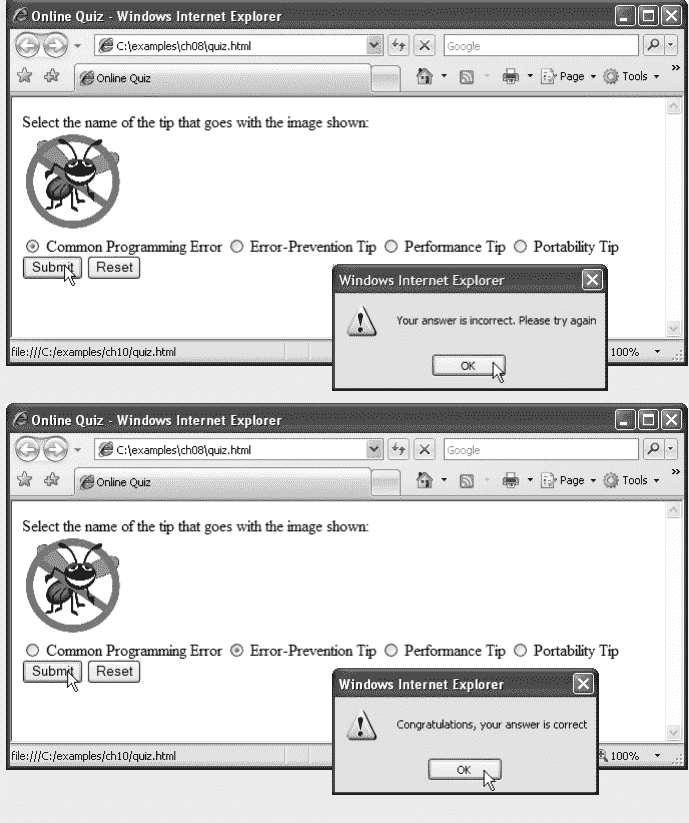

> 图 8.12 | 使用 JavaScript 评分的在线测验。（第 2 部分，共 2 部分。）

在讨论脚本代码之前，我们首先讨论 XHTML 文档的 body 元素（第 25–48 行）。body 的 GUI 组件在脚本中扮演着重要角色。

第 26–47 行定义了向用户展示测验的表单。第 26 行开始 form 元素，并指定 onsubmit 属性为 "checkAnswers()"，表示当用户提交表单时（即点击 Submit 按钮或按 Enter 键），解释器应执行 JavaScript 函数 checkAnswers（第 12–21 行）。

第 29 行将提示图像添加到页面中。第 32–42 行显示单选按钮和相应的标签，展示可能的答案选项。第 44–45 行将提交按钮和重置按钮添加到页面中。

现在我们检查用于检查用户提交答案的脚本。第 12–21 行声明了函数 checkAnswers，其中包含评分测验所需的所有 JavaScript。第 17–20 行的 if...else 语句判断用户是否正确回答了问题。用户被要求识别的图像是 Error-Prevention Tip 图标。因此，测验的正确答案对应于第二个单选按钮。

可以使用 getElementById 或通过包含表单对象的 *elements 属性* 单独访问 XHTML 表单的元素。elements 属性包含表单所有控件的数组。单选按钮是 XHTML 表单 myQuiz 的一部分，因此我们在第 17 行使用点表示法访问 elements 数组（myQuiz.elements[1]）。数组元素 myQuiz.elements[1] 对应正确答案（即第二个单选按钮）。最后，第 17 行判断第二个单选按钮的 *checked* 属性是否为 true。单选按钮的 checked 属性在选中时为 true，未选中时为 false。回想一下，任何给定时间只能选中一个单选按钮。如果属性 myQuiz.elements[1].checked 为 true，表示选中了正确答案，脚本会弹出祝贺消息。如果单选按钮的 checked 属性为 false，则脚本会弹出另一条消息（第 20 行）。

## 8.11 Web 资源

www.deitel.com/javascript/

Deitel JavaScript 资源中心包含 Web 上一些最佳 JavaScript 资源的链接。在那里，您可以找到按类别分类的 JavaScript 工具、代码生成器、论坛、书籍、库、框架等链接。还可以查看适用于所有技能水平的教程，从入门到高级。请务必访问相关的 XHTML（www.deitel.com/xhtml/）和 CSS 2.1（www.deitel.com/css21/）资源中心。

## 9 JavaScript：对象

> 我的一切崇高的目标
> 我终将实现。
> ——W. S. 吉尔伯特

> 这是一个隐藏美德的世界吗？
> ——威廉·莎士比亚

> 继承图书馆固然好，但自己收集一个更好。
> ——奥古斯丁·比雷尔

# 学习目标

在本章中，你将学习：

- 基于对象的编程术语和概念。
- 封装和数据隐藏的概念。
- 面向对象的价值。
- 如何使用 JavaScript 对象 **Math**、**String**、**Date**、**Boolean** 和 **Number**。
- 如何使用浏览器的 **document** 和 **window** 对象。
- 如何使用 cookie。
- 如何使用 **JSON** 简单地表示对象。

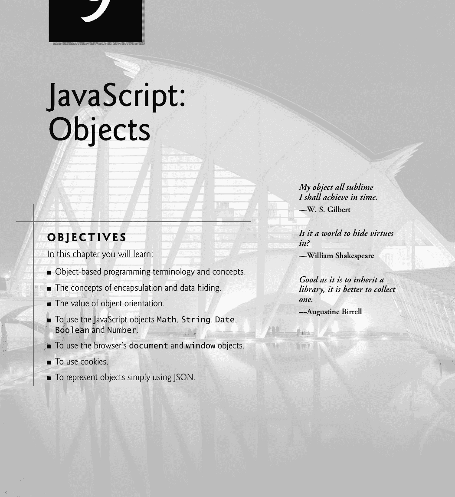
```


## 9.1 引言

### 大纲

- 9.1 引言
- 9.2 面向对象技术简介
- 9.3 数学对象
- 9.4 字符串对象
  - 9.4.1 字符与字符串基础
  - 9.4.2 `String` 对象的方法
  - 9.4.3 字符处理方法
  - 9.4.4 搜索方法
  - 9.4.5 分割字符串与获取子串
  - 9.4.6 XHTML 标记方法
- 9.5 `Date` 对象
- 9.6 `Boolean` 和 `Number` 对象
- 9.7 `document` 对象
- 9.8 `window` 对象
- 9.9 使用 Cookies
- 9.10 多页 HTML 和 JavaScript 应用
- 9.11 使用 JSON 表示对象
- 9.12 Web 资源

## 9.1 引言

本章将更正式地介绍 *对象*。我们首先简要介绍面向对象的概念。本章的剩余部分将概述 JavaScript 的几个内置对象，并演示它们的许多功能。我们还将简要介绍 JSON，一种创建 JavaScript 对象的方式。在接下来的关于文档对象模型和事件的章节中，我们将讨论浏览器提供的对象，这些对象使得脚本能够与 XHTML 文档的元素进行交互。

## 9.2 面向对象技术简介

本节将对面向对象进行总体介绍。这里讨论的术语和技术为本书后续多个章节提供支持。在这里，你将了解到，对象是思考世界和操作 XHTML 脚本的自然方式。在第 4-8 章中，我们使用了 JavaScript 的内置对象——`Math` 和 `Array`——以及由 Web 浏览器提供的对象——`document` 和 `window`——来在脚本中执行任务。JavaScript 使用对象来执行许多任务，因此被称为一种 *基于对象的编程语言*。我们的目标是帮助你培养面向对象的思维方式。本书中的许多技术，包括 CSS、JavaScript、Ajax、Ruby on Rails、ASP.NET 和 JavaServer Faces，都至少基于本节介绍的一些概念。

### 面向对象技术的基本概念

我们从一些关键术语开始介绍面向对象技术。环顾现实世界，你处处都能看到对象——人、动物、植物、汽车、飞机、建筑物、电脑、显示器等等。人类以对象的方式思考。电话、房屋、交通灯、微波炉和饮水机只是我们周围常见的更多对象。

我们有时将对象分为两类：有生命的和无生命的。有生命的对象在某种意义上是“活的”——它们会移动和做事。无生命的东西则不会自行移动。然而，这两种类型的对象都有共同之处。它们都具有 ***属性***（例如，大小、形状、颜色和重量），并且都表现出 ***行为***（例如，球滚动、弹跳、充气和放气；婴儿哭闹、睡觉、爬行、走路和眨眼；汽车加速、刹车和转弯；毛巾吸水）。我们将研究软件对象所具有的属性和行为的种类。

人类通过研究对象的属性和观察它们的行为来了解现有的对象。不同的对象可以具有相似的属性并表现出相似的行为。例如，可以在婴儿和成人之间、人类和黑猩猩之间进行比较。

***面向对象设计 (OOD)*** 使用类似于人们描述现实世界对象的术语来对软件进行建模。它利用了类关系，其中某一类的对象，例如一类车辆，具有相同的特征——汽车、卡车、小红车和溜冰鞋有很多共同点。OOD 利用 ***继承*** 关系，通过吸收现有类的特征并添加自身独特的特征来派生新的对象类。一个“敞篷车”类的对象当然具有更通用的“汽车”类的特征，但更具体地说，它的车顶可以升降。

面向对象设计提供了一种自然且直观的方式来看待软件设计过程——即通过对象的属性、行为和相互关系来建模对象，正如我们描述现实世界对象一样。OOD 还对对象之间的通信进行建模。就像人们互相发送消息一样（例如，中士命令士兵立正），对象也通过消息进行通信。一个银行账户对象可能会收到一条消息，要求减少一定数量的余额，因为客户取出了那笔钱。

OOD 将属性和 ***操作***（行为）***封装***（即包裹）到对象中——对象的属性和操作紧密相连。对象具有 ***信息隐藏*** 的特性。这意味着对象可能知道如何通过定义良好的 ***接口*** 与其他对象进行通信，但通常不允许它们知道其他对象是如何实现的——实现细节被隐藏在对象本身内部。例如，我们可以有效地驾驶汽车，而无需了解发动机、变速箱、制动系统和排气系统内部工作的细节——只要我们知道如何使用油门踏板、刹车踏板、方向盘等。正如我们将看到的，信息隐藏对于良好的软件工程至关重要。

就像汽车设计师一样，Web 浏览器的设计师已经定义了一组对象，这些对象封装了 XHTML 文档的元素，并向 JavaScript 程序员暴露了属性和行为，从而使 JavaScript 程序能够与这些元素（对象）进行交互（或编写脚本）。你很快就会看到，浏览器的 document 对象包含属性和行为，可以访问 XHTML 文档的每个元素。同样，JavaScript 提供了封装脚本中各种功能的对象。例如，JavaScript Array 对象提供属性和行为，使脚本能够操作数据集合。Array 对象的 length 属性（属性）包含 `Array` 中的元素数量。`Array` 对象的 sort 方法（行为）对 `Array` 的元素进行排序。

一些编程语言——如 Java、Visual Basic、C# 和 C++——是 *面向对象的*。在这种语言中编程被称为 *面向对象编程 (OOP)*，它允许计算机程序员将面向对象设计实现为可工作的软件系统。另一方面，像 C 这样的语言是 *过程式的*，因此编程往往是 *面向动作的*。在过程式语言中，编程的单元是 *函数*。在面向对象语言中，编程的单元是 *类*，对象最终从类中 *实例化*（OOP 中“创建”的术语）。类包含实现操作的功能和构成属性的数据。

过程式程序员专注于编写函数。程序员将执行某些共同任务的动作分组为函数，然后将函数分组形成程序。数据在过程式语言中当然很重要，但观点是数据主要存在于支持函数执行的动作中。系统规范中的 *动词* 帮助过程式程序员确定一组协同工作以实现系统的函数。

### 类、属性和方法

面向对象程序员专注于创建自己的称为 *类* 的 *用户自定义类型*。每个类包含数据以及操作这些数据并为 *客户端*（即使用该类的其他类或函数）提供服务的函数集合。类的数据组件称为属性。例如，一个银行账户类可能包括账号和余额。类的函数组件称为方法。例如，一个银行账户类可能包括存款（增加余额）、取款（减少余额）和查询当前余额的方法。你使用内置类型（和其他用户自定义类型）作为构建新用户自定义类型（类）的“构建块”。系统规范中的 *名词* 帮助你确定一组类，从中创建对象，这些对象协同工作以实现系统。

类之于对象，犹如蓝图之于房屋——类是构建该类对象的“计划”。正如我们可以从一张蓝图建造许多房屋一样，我们可以从一个类实例化（创建）许多对象。你不能在蓝图的厨房里做饭；你可以在房子的厨房里做饭。你不能睡在蓝图的卧室里；你可以在房子的卧室里睡觉。

类可以与其他类具有关系。例如，在银行的面向对象设计中，“银行柜员”类需要与其他类相关联，例如“客户”类、“现金抽屉”类、“保险柜”类等。这些关系称为 *关联*。

将软件打包为类，使得未来的软件系统可以 *重用* 这些类。相关的类组通常被包装为可重用的 *组件*。就像房地产经纪人常说的影响房地产价格的三个最重要因素是“地段、地段、地段”一样，软件开发领域的一些人说，影响软件开发未来的三个最重要因素是“重用、重用、重用”。

确实，通过面向对象技术，你可以通过组合现有类来构建所需的大部分新软件，就像汽车制造商组合可互换部件来制造多种型号的汽车一样——每辆车共享共同的部件。新类可以通过继承吸收现有类的属性和行为，然后添加新类独有的功能来从现有类创建。


部分。你创建的每个新类都有潜力成为宝贵的软件资产，你和其他程序员可以重用它来加速并提升未来软件开发工作的质量。

## 9.3 数学对象

Math 对象的方法允许你执行许多常见的数学计算。如前所述，对象的方法通过编写对象名称，后跟一个点（.）和方法名称来调用。在方法名称后面的圆括号中是该方法的参数（或以逗号分隔的参数列表）。例如，要计算并显示 900.0 的平方根，你可能会写：

document.writeln( Math.sqrt( 900.0 ) );

这会调用 `Math.sqrt` 方法来计算圆括号中数字（900.0）的平方根，然后输出结果。数字 900.0 是 `Math.sqrt` 方法的参数。前面的语句将显示 30.0。一些 Math 对象方法总结在图 9.1 中。

| 方法 | 描述 | 示例 |
| :--- | :--- | :--- |
| abs( x ) | x 的绝对值 | abs( 7.2 ) 结果为 7.2；abs( 0.0 ) 结果为 0.0；abs( -5.6 ) 结果为 5.6 |
| ceil( x ) | 将 x 向上取整为不小于 x 的最小整数 | ceil( 9.2 ) 结果为 10.0；ceil( -9.8 ) 结果为 -9.0 |
| cos( x ) | x 的三角余弦值（x 以弧度表示） | cos( 0.0 ) 结果为 1.0 |
| exp( x ) | 指数方法 e^x | exp( 1.0 ) 结果为 2.71828；exp( 2.0 ) 结果为 7.38906 |
| floor( x ) | 将 x 向下取整为不大于 x 的最大整数 | floor( 9.2 ) 结果为 9.0；floor( -9.8 ) 结果为 -10.0 |
| log( x ) | x 的自然对数（以 e 为底） | log( 2.718282 ) 结果为 1.0；log( 7.389056 ) 结果为 2.0 |
| max( x, y ) | x 和 y 中的较大值 | max( 2.3, 12.7 ) 结果为 12.7；max( -2.3, -12.7 ) 结果为 -2.3 |
| min( x, y ) | x 和 y 中的较小值 | min( 2.3, 12.7 ) 结果为 2.3；min( -2.3, -12.7 ) 结果为 -12.7 |
| pow( x, y ) | x 的 y 次幂（x^y） | pow( 2.0, 7.0 ) 结果为 128.0；pow( 9.0, .5 ) 结果为 3.0 |
| round( x ) | 将 x 四舍五入到最接近的整数 | round( 9.75 ) 结果为 10；round( 9.25 ) 结果为 9 |
| sin( x ) | x 的三角正弦值（x 以弧度表示） | sin( 0.0 ) 结果为 0.0 |
| sqrt( x ) | x 的平方根 | sqrt( 900.0 ) 结果为 30.0；sqrt( 9.0 ) 结果为 3.0 |
| tan( x ) | x 的三角正切值（x 以弧度表示） | tan( 0.0 ) 结果为 0.0 |

图 9.1 Math 对象方法。

> 常见编程错误 9.1
> 忘记在方法名称前加上对象名称 `Math` 和一个点（.）来调用 Math 方法是一个错误。

> 软件工程观察 9.1
> 调用独立函数与调用对象方法的主要区别在于，调用独立函数不需要对象名称和点。

Math 对象定义了几个常用的数学常量，总结在图 9.2 中。[注意：按照惯例，常量的名称以全大写字母书写，以便在程序中突出显示。]

> 良好的编程实践 9.1
> 使用 Math 对象的数学常量，而不是显式键入常量的数值。

| 常量 | 描述 | 值 |
|----------|-------------|-------|
| Math.E | 自然对数的底（e）。 | 约等于 2.718 |
| Math.LN2 | 2 的自然对数 | 约等于 0.693 |
| Math.LN10 | 10 的自然对数 | 约等于 2.302 |
| Math.LOG2E | e 的以 2 为底的对数 | 约等于 1.442 |
| Math.LOG10E | e 的以 10 为底的对数 | 约等于 0.434 |
| Math.PI | π——圆的周长与直径的比值 | 约等于 3.141592653589793 |
| Math.SQRT1_2 | 0.5 的平方根 | 约等于 0.707 |
| Math.SQRT2 | 2.0 的平方根 | 约等于 1.414 |

图 9.2 | Math 对象的属性。

## 9.4 字符串对象

在本节中，我们将介绍 JavaScript 的字符串和字符处理能力。此处讨论的技术适用于处理姓名、地址、电话号码和类似项目。

### 9.4.1 字符和字符串的基础知识

字符是 JavaScript 程序的基本构建块。每个程序都由一系列有意义地组合在一起的字符组成，计算机将其解释为一系列用于完成任务的指令。

字符串是一系列被视为一个单元的字符。字符串可以包含字母、数字和各种特殊字符，例如 +、-、*、/ 和 $。JavaScript 支持称为 Unicode® 的字符集，它代表了世界上大部分语言。字符串是 String 类型的对象。字符串字面量或字符串常量（通常称为匿名 String 对象）写为双引号或单引号中的字符序列，如下所示：

- "John Q. Doe"（一个名字）
- '9999 Main Street'（一个街道地址）
- "Waltham, Massachusetts"（一个城市和州）
- '(201) 555-1212'（一个电话号码）

可以在声明中将 String 赋值给变量。声明

```
var color = "blue";
```

用包含字符串 "blue" 的 String 对象初始化变量 `color`。字符串可以通过关系运算符（<、<=、> 和 >=）和相等运算符（== 和 !=）进行比较。字符串使用对应字符的 Unicode 值进行比较。例如，表达式 "hello" < "Hello" 的求值结果为 false，因为小写字母具有更高的 Unicode 值。

### 9.4.2 字符串对象的方法

String 对象封装了字符字符串的属性和行为。它提供了许多方法（行为），用于完成有用的任务，例如从字符串中选择字符、组合字符串（称为 **连接**）、获取字符串的子字符串、在字符串中搜索子字符串、分词字符串（即将字符串拆分成单个单词）以及将字符串转换为全大写或全小写字母。String 对象还提供了几个生成 XHTML 标签的方法。图 9.3 总结了许多 String 方法。图 9.4 至 9.7 演示了其中一些方法。

| 方法 | 描述 |
| --- | --- |
| charAt( *index* ) | 返回一个包含指定 *索引* 处字符的字符串。如果 *索引* 处没有字符，`charAt` 返回一个空字符串。第一个字符位于 *索引* 0 处。 |
| charCodeAt( *index* ) | 返回指定 *索引* 处字符的 Unicode 值，如果该 *索引* 处没有字符，则返回 NaN（非数字）。 |
| concat( *string* ) | 将其参数连接到调用该方法的字符串的末尾。调用此方法的字符串不会被修改；而是返回一个新的 String。此方法与使用字符串连接运算符 + 连接两个字符串相同（例如，`s1.concat(s2)` 与 `s1 + s2` 相同）。 |
| fromCharCode( *value1*, *value2*, ... ) | 将一个 Unicode 值列表转换为包含相应字符的字符串。 |
| indexOf( *substring*, *index* ) | 从调用该方法的字符串中位置 *索引* 开始搜索 *子字符串* 的第一次出现。该方法返回 *子字符串* 在源字符串中的起始索引，如果未找到 *子字符串*，则返回 -1。如果未提供 *索引* 参数，该方法从源字符串的索引 0 开始搜索。 |

**图 9.3** | 一些 String 对象方法。（第 1 部分，共 2 部分。）

| 方法 | 描述 |
|--------|-------------|
| `lastIndexOf( substring, index )` | 从位置 *索引* 开始，向调用该方法的字符串开头方向搜索 *子字符串* 的最后一次出现。该方法返回 *子字符串* 在源字符串中的起始索引，如果未找到 *子字符串*，则返回 -1。如果未提供 *索引* 参数，该方法从源字符串的末尾开始搜索。 |
| `replace( searchString, replaceString )` | 搜索子字符串 *searchString*，并将第一次出现的替换为 *replaceString*，返回修改后的字符串；如果未进行替换，则返回原始字符串。 |
| `slice( start, end )` | 返回一个字符串，包含从索引 *start* 到索引 *end* 的字符串部分。如果未指定 *end* 索引，该方法返回从 *start* 索引到源字符串末尾的字符串。负的 *end* 索引表示从字符串末尾开始的偏移量，从最后一个字符之后的位置开始（因此 -1 表示字符串中的最后一个字符位置）。 |
| `split( string )` | 将源字符串拆分为字符串数组（标记），其中其 *string* 参数指定分隔符（即，表示源字符串中每个标记结束的字符）。 |
| `substr( start, length )` | 返回一个字符串，包含从源字符串中索引 *start* 开始的 *length* 个字符。如果未指定 *length*，则返回从 *start* 到源字符串末尾的字符串。 |
| `substring( start, end )` | 返回一个字符串，包含源字符串中从索引 *start* 到索引 *end*（不包括索引 *end*）的字符。 |
| `toLowerCase()` | 返回一个字符串，其中所有大写字母都转换为小写字母。非字母字符不会被更改。 |
| `toUpperCase()` | 返回一个字符串，其中所有小写字母都转换为大写字母。非字母字符不会被更改。 |
| *生成 XHTML 标签的方法* | |
| `anchor( name )` | 将源字符串包装在一个锚点元素（`<a></a>`）中，*name* 作为锚点名称。 |
| `fixed()` | 将源字符串包装在一个 `<tt></tt>` 元素中。 |
| `link( url )` | 将源字符串包装在一个锚点元素（`<a></a>`）中，*url* 作为超链接位置。 |
| `strike()` | 将源字符串包装在一个 `<strike></strike>` 元素中。 |
| `sub()` | 将源字符串包装在一个 `<sub></sub>` 元素中。 |
| `sup()` | 将源字符串包装在一个 `<sup></sup>` 元素中。 |


### 9.4.3 字符处理方法

图9.4中的脚本演示了String对象的一些字符处理方法，包括**charAt**（返回指定位置的字符）、**charCodeAt**（返回指定位置字符的Unicode值）、**fromCharCode**（根据一系列Unicode值创建字符串）、**toLowerCase**（返回字符串的小写版本）和**toUpperCase**（返回字符串的大写版本）。

第16-17行使用String方法charAt显示字符串s（"ZEBRA"）的第一个字符。方法**charAt**返回一个包含指定索引处（本例中为0）字符的字符串。字符串中字符的索引从0（第一个字符）开始，到（但不包括）字符串的长度为止（即，如果字符串包含五个字符，则索引为0到4）。如果索引超出字符串的范围，该方法将返回一个空字符串。

第18-19行通过调用String方法charCodeAt显示字符串s（"ZEBRA"）第一个字符的字符码。方法charCodeAt返回指定索引（本例中为0）处字符的Unicode值。如果索引超出字符串的范围，该方法将返回NaN。

```
 1  <?xml version = "1.0" encoding = "utf-8"?>
 2  <!DOCTYPE html PUBLIC "-//W3C//DTD XHTML 1.0 Strict//EN"
 3     "http://www.w3.org/TR/xhtml1/DTD/xhtml1-strict.dtd">
 4
 5  <!-- 图 9.4: CharacterProcessing.html -->
 6  <!-- String 方法 charAt, charCodeAt, fromCharCode, toLowerCase 和
 7     toUpperCase。 -->
 8  <html xmlns = "http://www.w3.org/1999/xhtml">
 9     <head>
10        <title>字符处理方法</title>
11        <script type = "text/javascript">
12           <!--
13           var s = "ZEBRA";
14           var s2 = "AbCdEfG";
15           
16           document.writeln( "<p>'" + s + "' 中索引 0 处的字符是 " +
17              s.charAt( 0 ) );
18           document.writeln( "<br />'" + s + "' 中索引 0 处的字符码是 " +
19              s.charCodeAt( 0 ) + "</p>" );
20           
21           document.writeln( "<p>'" +
22              String.fromCharCode( 87, 79, 82, 68 ) +
23              "' 包含字符码 87, 79, 82 和 68</p>" )
24           
25           document.writeln( "<p>'" + s2 + "' 的小写形式是 '" +
26              s2.toLowerCase() + "'" );
27           document.writeln( "<br />'" + s2 + "' 的大写形式是 '"
28              + s2.toUpperCase() + "'</p>" );
29           // -->
30        </script>
31     </head><body></body>
32  </html>
```

**图 9.4** | String 方法 charAt, charCodeAt, fromCharCode, toLowerCase 和 toUpperCase.（第 1 部分，共 2 部分。）

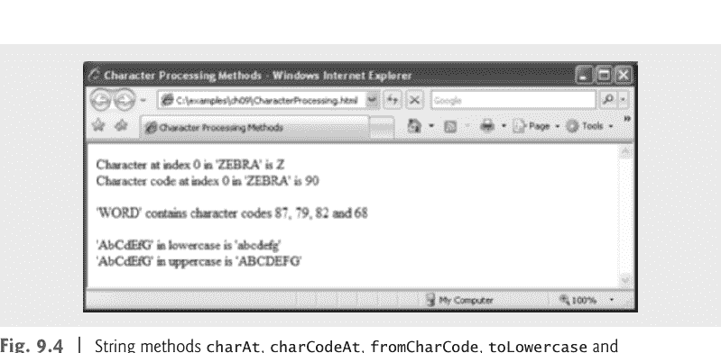

图 9.4 | String 方法 charAt, charCodeAt, fromCharCode, toLowerCase 和 toUpperCase.（第 2 部分，共 2 部分。）

String方法fromCharCode接收一个逗号分隔的Unicode值列表作为参数，并构建一个包含这些Unicode值字符表示的字符串。第21-23行显示字符串"WORD"，它由字符码87、79、82和68组成。请注意，是String对象调用fromCharCode方法，而不是某个特定的String变量。

第25-26行和第27-28行中的语句分别使用String方法**toLowerCase**和**toUpperCase**来显示字符串s2（"AbCdEfG"）的全小写和全大写版本。

### 9.4.4 搜索方法

能够搜索字符串中的字符或字符序列通常很有用。例如，如果你正在创建自己的文字处理程序，你可能希望提供搜索文档的功能。图9.5中的脚本演示了String对象的**indexOf**和**lastIndexOf**方法，用于搜索字符串中指定的子字符串。本示例中的所有搜索都是在全局字符串*letters*（在脚本的第14行初始化为"abcdefghijklmnopqrstuvwxyzabcdefghijklmnopqrstuvwxyz"）上执行的。

用户在XHTML表单searchForm的inputVal文本字段中键入一个子字符串，并按下**搜索**按钮来在*letters*中搜索该子字符串。单击**搜索**按钮会调用函数buttonPressed（在第16-29行定义）以响应onclick事件并执行搜索。每次搜索的结果显示在searchForm的相应文本字段中。

第21-22行使用String方法indexOf来确定字符串inputVal.value（即用户在inputVal文本字段中键入的字符串）在字符串*letters*中首次出现的位置。如果找到子字符串，则返回子字符串首次出现的起始索引；否则，返回-1。

第23-24行使用String方法lastIndexOf来确定inputVal中的字符串在*letters*中最后一次出现的位置。如果找到子字符串，则返回子字符串最后一次出现的起始索引；否则，返回-1。

```
 1  <?xml version = "1.0" encoding = "utf-8"?>
 2  <!DOCTYPE html PUBLIC "-//W3C//DTD XHTML 1.0 Strict//EN"
 3      "http://www.w3.org/TR/xhtml1/DTD/xhtml1-strict.dtd">
 4  
 5  <!-- 图 9.5: SearchingStrings.html -->
 6  <!-- 使用 indexOf 和 lastIndexOf 进行字符串搜索。 -->
 7  <html xmlns = "http://www.w3.org/1999/xhtml">
 8      <head>
 9          <title>
10             使用 indexOf 和 lastIndexOf 搜索字符串
11         </title>
12         <script type = "text/javascript">
13             <!--
14             var letters = "abcdefghijklmnopqrstuvwxyzabcdefghijklmnopqrstuvwxyz";
15 
16             function buttonPressed()
17             {
18                 var searchForm = document.getElementById( "searchForm" );
19                 var inputVal = document.getElementById( "inputVal" );
20 
21                 searchForm.elements[2].value =
22                     letters.indexOf( inputVal.value );
23                 searchForm.elements[3].value =
24                     letters.lastIndexOf( inputVal.value );
25                 searchForm.elements[4].value =
26                     letters.indexOf( inputVal.value, 12 );
27                 searchForm.elements[5].value =
28                     letters.lastIndexOf( inputVal.value, 12 );
29             } // 函数 buttonPressed 结束
30             // -->
31         </script>
32     </head>
33 
34     <body>
35         <form id = "searchForm" action = "">
36             <h1>要搜索的字符串是：<br />
37                 abcdefghijklmnopqrstuvwxyzabcdefghijklmnopqrstuvwxyz</h1>
38             <p>输入要搜索的子字符串
39             <input id = "inputVal" type = "text" />
40             <input id = "search" type = "button" value = "搜索"
41                     onclick = "buttonPressed()" /><br /></p>
42 
43             <p>首次出现的位置在索引
44             <input id = "first" type = "text" size = "5" />
45             <br />最后一次出现的位置在索引
46             <input id = "last" type = "text" size = "5" />
47             <br />从索引 12 开始首次出现的位置在索引
48             <input id = "first12" type = "text" size = "5" />
49             <br />从索引 12 开始最后一次出现的位置在索引
50             <input id = "last12" type = "text" size = "5" /></p>
51         </form>
52     </body>
53 </html>
```

图 9.5 | 使用 indexOf 和 lastIndexOf 进行字符串搜索。（第 1 部分，共 2 部分。）

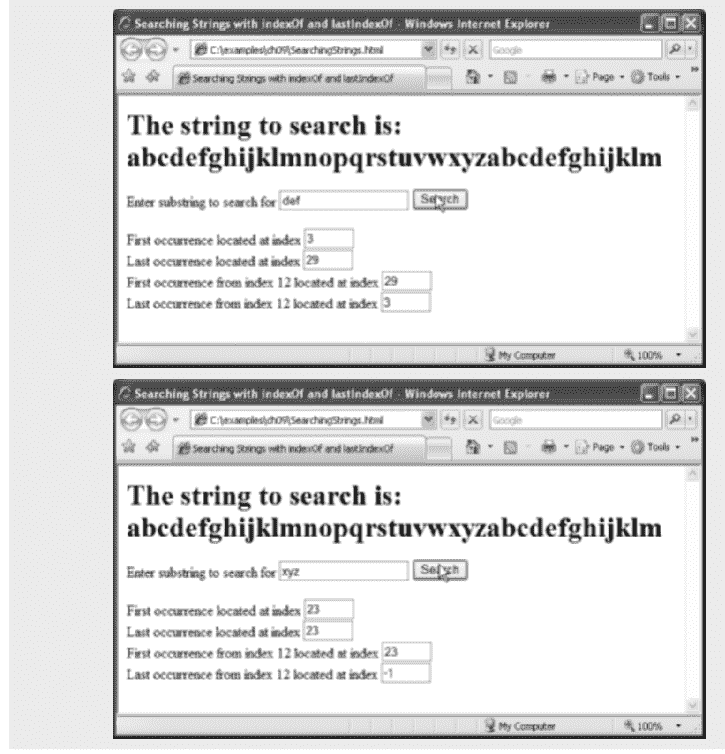

第25-26行使用String方法indexOf来确定inputVal文本字段中的字符串在字母字符串letters中首次出现的位置，搜索从letters的索引12开始。如果找到子字符串，则返回子字符串（从索引12开始）首次出现的起始索引；否则，返回-1。

第27-28行使用String方法lastIndexOf来确定inputVal文本字段中的字符串在letters中最后一次出现的位置，搜索从letters的索引12开始并向输入的开头移动。如果找到子字符串，则返回子字符串（如果在索引12之前出现）首次出现的起始索引；否则，返回-1。

> **软件工程观察 9.2**
> String方法indexOf和lastIndexOf及其可选的第二个参数（搜索的起始索引），对于在大量文本中继续搜索特别有用。


### 9.4.5 分割字符串与获取子字符串

当你阅读一个句子时，你的大脑会将其分解成单独的单词或*标记*，每个单词对你都传达着含义。将字符串分解成标记的过程称为*标记化*。解释器也执行标记化操作。它们将语句分解成关键字、标识符、运算符等编程语言元素的独立部分。图 9.6 展示了 String 方法 ***split***，它将一个字符串分解为其组成标记。标记之间通过*分隔符*分隔，分隔符通常是空白字符，如空格、制表符、换行符和回车符。其他字符也可以用作分隔符来分隔标记。XHTML 文档显示了一个包含文本字段的表单，用户可以在其中输入要进行标记化的句子。标记化过程的结果显示在 XHTML textarea GUI 组件中。该脚本还演示了 String 方法 ***substring***，它返回字符串的一部分。

```xml
<?xml version = "1.0" encoding = "utf-8"?>
<!DOCTYPE html PUBLIC "-//W3C//DTD XHTML 1.0 Strict//EN"
"http://www.w3.org/TR/xhtml1/DTD/xhtml1-strict.dtd">

<!-- Fig. 9.6: SplitAndSubString.html -->
<!-- 字符串对象方法 split 和 substring。 -->
<html xmlns = "http://www.w3.org/1999/xhtml">
  <head>
    <title>String 方法 split 和 substring</title>
    <script type = "text/javascript">
      <!--
      function splitButtonPressed()
      {
          var inputString = document.getElementById( "inputVal" ).value;
          var tokens = inputString.split( " " );
          document.getElementById( "output" ).value =
              tokens.join( "\n" ) ;

          document.getElementById( "outputSubstring" ).value =
              inputString.substring( 0, 10 );
      } // 结束函数 splitButtonPressed
      // -->
    </script>
  </head>
  <body>
    <form action = "">
      <p>输入要分割成单词的句子<br />
      <input id = "inputVal" type = "text" size = "40" />
      <input type = "button" value = "分割"
          onclick = "splitButtonPressed()" /></p>

      <p>分割成单词的句子是<br />
      <textarea id = "output" rows = "8" cols = "34">
      </textarea></p>

      <p>输入字符串的前 10 个字符是
      <input id = "outputSubstring" type = "text"
          size = "15" /></p>
    </form>
  </body>
</html>
```

图 9.6 | 字符串对象方法 split 和 substring。（第 1 部分，共 2 部分）


图 9.6 | 字符串对象方法 split 和 substring。（第 2 部分，共 2 部分）

用户将句子输入到 id 为 inputVal 的文本字段中，并点击“分割”按钮来标记化字符串。函数 `splitButtonPressed`（第 12-21 行）处理按钮的 `onclick` 事件。

第 14 行获取输入字段的值并将其存储在变量 `inputString` 中。第 15 行调用 String 方法 `split` 来标记化 `inputString`。方法 `split` 的参数是分隔符字符串——即决定原始字符串中每个标记结束位置的字符串。在此示例中，空格字符用作标记的分隔符。分隔符字符串可以包含多个应被用作分隔符的字符。方法 `split` 返回一个包含这些标记的字符串数组。第 17 行使用 Array 方法 `join` 组合数组 `tokens` 中的标记，并用换行符 (`\n`) 分隔每个标记。生成的字符串被赋值给 XHTML 表单输出 GUI 组件（一个 XHTML textarea）的 `value` 属性。

第 19-20 行使用 String 方法 `substring` 来获取一个包含用户输入字符串（仍存储在 `inputString` 中）前 10 个字符的字符串。该方法返回从起始索引（此例中为 0）到但不包括结束索引（此例中为 10）的子字符串。如果结束索引大于字符串的长度，则返回的子字符串将包含从起始索引到原始字符串末尾的所有字符。

### 9.4.6 XHTML 标记方法

图 9.7 中的脚本演示了 String 对象生成 XHTML 标记标签的方法。当 String 对象调用一个标记方法时，该方法会将 String 的内容包裹在相应的 XHTML 标签中。这些方法对于在脚本处理过程中动态生成 XHTML 特别有用。

```xml
<?xml version = "1.0" encoding = "utf-8"?>
<!DOCTYPE html PUBLIC "-//W3C//DTD XHTML 1.0 Strict//EN"
  "http://www.w3.org/TR/xhtml1/DTD/xhtml1-strict.dtd">

<!-- Fig. 9.7: MarkupMethods.html -->
<!-- 字符串对象 XHTML 标记方法。 -->
<html xmlns = "http://www.w3.org/1999/xhtml">
  <head>
    <title>String 对象的 XHTML 标记方法</title>
    <script type = "text/javascript">
      <!--
      var anchorText = "This is an anchor";
      var fixedText = "This is monospaced text";
      var linkText = "Click here to go to anchorText";
      var strikeText = "This is strike out text";
      var subText = "subscript";
      var supText = "superscript";

      document.writeln( anchorText.anchor( "top" ) );
      document.writeln( "<br />" + fixedText.fixed() );
      document.writeln( "<br />" + strikeText.strike() );
      document.writeln(
         "<br />This is text with a " + subText.sub() );
      document.writeln(
         "<br />This is text with a " + supText.sup() );
      document.writeln( "<br />" + linkText.link( "#top" ) );
      // -->
    </script>
  </head><body></body>
</html>
```


图 9.7 | 字符串对象 XHTML 标记方法。（第 2 部分，共 2 部分）

第 12-17 行定义了调用 String 对象每个 XHTML 标记方法的字符串。第 19 行使用 String 方法 **anchor** 将变量 `anchorText` ("This is an anchor") 中的字符串格式化为

```html
<a name = "top">This is an anchor</a>
```

锚点的名称是该方法的参数。此锚点将在本示例的后续部分用作超链接的目标。第 20 行使用 String 方法 **fixed** 以固定宽度字体显示文本，将变量 `fixedText` ("This is monospaced text") 中的字符串格式化为

```html
<tt>This is monospaced text</tt>
```

第 21 行使用 String 方法 **strike** 以删除线效果显示文本，将变量 `strikeText` ("This is strike out text") 中的字符串格式化为

```html
<strike>This is strike out text</strike>
```

第 22-23 行使用 String 方法 **sub** 显示下标文本，将变量 `subText` ("subscript") 中的字符串格式化为

```html
<sub>subscript</sub>
```

请注意，XHTML 文档中生成的这一行将单词 "subscript" 显示得比同一行的其他文本更小，并且略低于行基线。第 24-25 行调用 String 方法 **sup** 以显示上标文本，将变量 `supText` ("superscript") 中的字符串格式化为

```html
<sup>superscript</sup>
```

请注意，XHTML 文档中生成的这一行将单词 "superscript" 显示得比同一行的其他文本更小，并且略高于行基线。第 26 行使用 String 方法 **link** 创建一个超链接，将变量 `linkText` ("Click here to go to anchorText") 中的字符串格式化为

```html
<a href = "#top">Click here to go to anchorText</a>
```

超链接的目标（此例中为 #top）是该方法的参数，可以是任何 URL。在此示例中，超链接目标是第 19 行创建的锚点。如果你使浏览器窗口变小并滚动到网页底部，然后点击此链接，浏览器将重新定位到网页的顶部。

## 9.5 Date 对象

JavaScript 的 `Date` 对象提供了用于日期和时间操作的方法。日期和时间处理可以基于计算机的*本地时区*进行，也可以基于世界时间标准的*协调世界时*（缩写为 *UTC*）——以前称为*格林威治标准时间 (GMT)*。Date 对象的大多数方法都有本地时区版本和 UTC 版本。Date 对象的方法总结在图 9.8 中。

| 方法 | 描述 |
|---|---|
| `getDate()`<br>`getUTCDate()` | 返回一个从 1 到 31 的数字，表示本地时间或 UTC 时间中的月份中的日期。 |
| `getDay()`<br>`getUTCDay()` | 返回一个从 0（星期日）到 6（星期六）的数字，表示本地时间或 UTC 时间中的星期几。 |
| `getFullYear()`<br>`getUTCFullYear()` | 返回一个四位数的年份，使用本地时间或 UTC 时间。 |
| `getHours()`<br>`getUTCHours()` | 返回一个从 0 到 23 的数字，表示本地时间或 UTC 时间中从午夜开始的小时数。 |
| `getMilliseconds()`<br>`getUTCMilliseconds()` | 返回一个从 0 到 999 的数字，分别表示本地时间或 UTC 时间中的毫秒数。时间以小时、分钟、秒和毫秒存储。 |
| `getMinutes()`<br>`getUTCMinutes()` | 返回一个从 0 到 59 的数字，表示本地时间或 UTC 时间中的分钟数。 |
| `getMonth()`<br>`getUTCMonth()` | 返回一个从 0（一月）到 11（十二月）的数字，表示本地时间或 UTC 时间中的月份。 |
| `getSeconds()`<br>`getUTCSeconds()` | 返回一个从 0 到 59 的数字，表示本地时间或 UTC 时间中的秒数。 |
| `getTime()` | 返回 1970 年 1 月 1 日与 Date 对象中时间之间的毫秒数。 |
| `getTimezoneOffset()` | 返回本地计算机当前时间与 UTC（协调世界时）之间的分钟差值。 |
| `setDate(val)`<br>`setUTCDate(val)` | 在本地时间或 UTC 时间中设置月份中的日期（1 到 31）。 |
| `setFullYear(y, m, d)`<br>`setUTCFullYear(y, m, d)` | 在本地时间或 UTC 时间中设置年份。表示月份和日期的第二个和第三个参数是可选的。如果未指定可选参数，则使用 Date 对象中的当前值。 |

图 9.8 | Date 对象方法。（第 1 部分，共 2 部分）


| 方法 | 描述 |
|--------|-------------|
| setHours( h, m, s, ms ) setUTCHours( h, m, s, ms ) | 设置本地时间或 UTC 的小时。第二、第三和第四个参数分别代表分钟、秒和毫秒，是可选的。如果未指定可选参数，则使用 Date 对象中的当前值。 |
| setMilliseconds( ms ) setUTCMilliseconds( ms ) | 设置本地时间或 UTC 的毫秒数。 |
| setMinutes( m, s, ms ) setUTCMinutes( m, s, ms ) | 设置本地时间或 UTC 的分钟。第二和第三个参数分别代表秒和毫秒，是可选的。如果未指定可选参数，则使用 Date 对象中的当前值。 |
| setMonth( m, d ) setUTCMonth( m, d ) | 设置本地时间或 UTC 的月份。第二个参数代表日期，是可选的。如果未指定该可选参数，则使用 Date 对象中的当前日期值。 |
| setSeconds( s, ms ) setUTCSeconds( s, ms ) | 设置本地时间或 UTC 的秒。第二个参数代表毫秒，是可选的。如果未指定此参数，则使用 Date 对象中的当前毫秒值。 |
| setTime( ms ) | 根据其参数设置时间——即自 1970 年 1 月 1 日以来经过的毫秒数。 |
| toLocaleString() | 以特定于计算机区域设置的形式返回日期和时间的字符串表示。例如，2007 年 9 月 13 日下午 3:42:22 在美国表示为 *09/13/07 15:47:22*，在欧洲表示为 *13/09/07 15:47:22*。 |
| toUTCString() | 以以下形式返回日期和时间的字符串表示：*15 Sep 2007 15:47:22 UTC* |
| toString() | 以特定于计算机区域设置的形式（在美国为 *Mon Sep 17 15:47:22 EDT 2007*）返回日期和时间的字符串表示。 |
| valueOf() | 返回自 1970 年 1 月 1 日午夜以来的时间毫秒数。（与 getTime 相同。） |

图 9.8 | Date 对象方法。（第 2 部分，共 2 部分。）

图 9.9 的脚本演示了图 9.8 中的许多本地时区方法。第 12 行创建了一个新的 Date 对象。new 运算符为 Date 对象分配内存。空括号表示调用 Date 对象的*构造函数*，且不传递参数。构造函数是对象的初始化方法。当使用 new 分配对象时，会自动调用构造函数。不带参数的 Date 构造函数使用本地计算机的当前日期和时间初始化 Date 对象。

```
1  <?xml version = "1.0" encoding = "utf-8"?>
2  <!DOCTYPE html PUBLIC "-//W3C//DTD XHTML 1.0 Strict//EN"
3     "http://www.w3.org/TR/xhtml1/DTD/xhtml1-strict.dtd">
4  
5  <!-- Fig. 9.9: DateTime.html -->
6  <!-- Date and time methods of the Date object. -->
7  <html xmlns = "http://www.w3.org/1999/xhtml">
8      <head>
9          <title>Date and Time Methods</title>
10         <script type = "text/javascript">
11             <!--
12             var current = new Date();
13             
14             document.writeln(
15                 "<h1>String representations and valueOf</h1>" );
16             document.writeln( "toString: " + current.toString() +
17                 "<br />toLocaleString: " + current.toLocaleString() +
18                 "<br />toUTCString: " + current.toUTCString() +
19                 "<br />valueOf: " + current.valueOf() );
20             
21             document.writeln(
22                 "<h1>Get methods for local time zone</h1>" );
23             document.writeln( "getDate: " + current.getDate() +
24                 "<br />getDay: " + current.getDay() +
25                 "<br />getMonth: " + current.getMonth() +
26                 "<br />getFullYear: " + current.getFullYear() +
27                 "<br />getTime: " + current.getTime() +
28                 "<br />getHours: " + current.getHours() +
29                 "<br />getMinutes: " + current.getMinutes() +
30                 "<br />getSeconds: " + current.getSeconds() +
31                 "<br />getMilliseconds: " + current.getMilliseconds() +
32                 "<br />getTimezoneOffset: " + current.getTimezoneOffset() );
33             
34             document.writeln(
35                 "<h1>Specifying arguments for a new Date</h1>" );
36             var anotherDate = new Date( 2007, 2, 18, 1, 5, 0, 0 );
37             document.writeln( "Date: " + anotherDate );
38             
39             document.writeln( "<h1>Set methods for local time zone</h1>" );
40             anotherDate.setDate( 31 );
41             anotherDate.setMonth( 11 );
42             anotherDate.setFullYear( 2007 );
43             anotherDate.setHours( 23 );
44             anotherDate.setMinutes( 59 );
45             anotherDate.setSeconds( 59 );
46             document.writeln( "Modified date: " + anotherDate );
47             // -->
48             </script>
49         </head><body></body>
50     </html>
```

图 9.9 | Date 对象的日期和时间方法。（第 1 部分，共 2 部分。）


图 9.9 | Date 对象的日期和时间方法。（第 2 部分，共 2 部分。）

> **软件工程观察 9.3**
当使用 new 分配对象时，对象的构造函数会自动被调用，以在程序中使用该对象之前初始化它。

第 16-19 行演示了 toString、toLocaleString、toUTCString 和 valueOf 方法。请注意，valueOf 方法返回一个大整数值，代表自 1970 年 1 月 1 日午夜以来，到存储在 Date 对象 current 中的日期和时间之间的总毫秒数。

第 23-32 行演示了 Date 对象用于本地时区的 get 方法。请注意，getFullYear 方法以四位数字的形式返回年份。另请注意，getTimezoneOffset 方法返回本地时区与 UTC 时间之间的分钟差（即，执行本示例时，我们所在时区相差四小时）。

第 36 行演示了如何创建一个新的 Date 对象，并向 Date 构造函数提供年、月、日、时、分、秒和毫秒的参数。请注意，时、分、秒和毫秒参数都是可选的。如果未指定这些参数中的任何一个，则会用零代替。对于时、分和秒参数，如果指定了其中任何一个参数的右侧参数，则该参数也必须被指定（例如，如果指定了分钟参数，则必须指定小时参数；如果指定了毫秒参数，则必须指定所有参数）。

第 40-45 行演示了 Date 对象用于本地时区的 set 方法。Date 对象在内部将月份表示为 0 到 11 的整数。这些值与预期值相差一（即，1 代表一月，2 代表二月，……，12 代表十二月）。创建 Date 对象时，必须指定 0 来表示一月，1 来表示二月，……，11 来表示十二月。

> **常见编程错误 9.2**
假设月份是用 1 到 12 的数字表示，会导致在处理日期时出现差一错误。

Date 对象提供了另外两个可以在不创建新 Date 对象的情况下调用的方法——Date.parse 和 Date.UTC。Date.parse 方法接收一个表示日期和时间的字符串作为其参数，并返回自 1970 年 1 月 1 日午夜以来，到指定日期和时间之间的毫秒数。此值可以通过以下语句转换为 Date 对象：

```
var theDate = new Date( numberOfMilliseconds );
```

该语句将自 1970 年 1 月 1 日午夜以来的毫秒数传递给 Date 对象的 Date 构造函数。

parse 方法使用以下规则转换字符串：

- 短日期可以指定为 MM-DD-YY、MM-DD-YYYY、MM/DD/YY 或 MM/DD/YYYY 格式。月份和日期不一定是两位数。

- 指定完整月份名称（例如，“January”）、日期和年份的长日期可以按任意顺序指定月份、日期和年份。

- 字符串中括号内的文本被视为注释并被忽略。逗号和空白字符被视为分隔符。

- 所有月份和日期名称必须至少有两个字符。名称不需要是唯一的。如果名称相同，则该名称将解析为最后一次匹配（例如，“Ju”代表“July”而不是“June”）。

- 如果提供了星期几的名称，则会被忽略。

- 所有标准时区（例如，EST 代表美国东部标准时间）、协调世界时（UTC）和格林威治标准时间（GMT）都被识别。

- 指定时、分、秒时，用冒号分隔。

- 使用 24 小时制格式时，中午 12 点之后的时间不应使用“PM”。

## 9.6 Boolean 和 Number 对象

`Date.UTC` 方法返回从 1970 年 1 月 1 日午夜到作为其参数指定的日期和时间之间的毫秒数。`UTC` 方法的参数包括必需的 *year*、*month* 和 *date*，以及可选的 *hours*、*minutes*、*seconds* 和 *milliseconds*。如果未指定 *hours*、*minutes*、*seconds* 或 *milliseconds* 参数中的任何一个，则在该位置提供一个零。对于 *hours*、*minutes* 和 *seconds* 参数，如果在参数列表中这些参数中任意一个的右侧参数被指定，那么该参数也必须被指定（例如，如果指定了 *minutes* 参数，则必须指定 *hours* 参数；如果指定了 *milliseconds* 参数，则所有参数都必须被指定）。与 `Date.parse` 的结果一样，`Date.UTC` 的结果可以通过使用 `Date.UTC` 的结果作为参数创建一个新的 Date 对象来转换为 Date 对象。

JavaScript 提供 **Boolean** 和 **Number** 对象，分别作为布尔 `true`/`false` 值和数字的对象*包装器*。这些包装器定义了用于操作布尔值和数字的方法和属性。包装器为处理简单数据类型提供了额外的功能。

当 JavaScript 程序需要一个布尔值时，JavaScript 会自动创建一个 Boolean 对象来存储该值。JavaScript 程序员可以使用以下语句显式创建 `Boolean` 对象：

```
var b = new Boolean( booleanValue );
```

构造函数参数 *booleanValue* 指定 Boolean 对象的值应为 `true` 还是 `false`。如果 *booleanValue* 为 `false`、`0`、`null`、`Number.NaN` 或空字符串 (`""`)，或者未提供参数，则新的 `Boolean` 对象包含 `false`。否则，新的 `Boolean` 对象包含 `true`。图 9.10 总结了 Boolean 对象的方法。

JavaScript 会自动创建 Number 对象来存储 JavaScript 程序中的数值。JavaScript 程序员可以使用以下语句创建 Number 对象：

```
var n = new Number( numericValue );
```

构造函数参数 *numericValue* 是要存储在对象中的数字。虽然您可以显式创建 Number 对象，但通常 JavaScript 解释器会根据需要创建它们。图 9.11 总结了 Number 对象的方法和属性。

| 方法 | 描述 |
| --- | --- |
| toString() | 如果 Boolean 对象的值为 true，则返回字符串 "true"；否则返回字符串 "false"。 |
| valueOf() | 如果 Boolean 对象为 true，则返回值 true；否则返回 false。 |

**图 9.10** | Boolean 对象方法。

| 方法或属性 | 描述 |
| --- | --- |
| toString(*radix*) | 返回数字的字符串表示形式。可选参数 *radix*（一个从 2 到 36 的数字）指定数字的基数。例如，基数 2 生成数字的二进制表示，8 生成八进制表示，10 生成十进制表示，16 生成十六进制表示。 |
| valueOf() | 返回数值。 |
| Number.MAX_VALUE | 此属性表示可在 JavaScript 程序中存储的最大值——大约为 1.79E+308。 |
| Number.MIN_VALUE | 此属性表示可在 JavaScript 程序中存储的最小值——大约为 5.00E-324。 |
| Number.NaN | 此属性表示*非数字*——从不产生数字的算术表达式返回的值（例如，表达式 `parseInt( "hello" )` 无法将字符串 "hello" 转换为数字，因此 `parseInt` 将返回 `Number.NaN`。要确定一个值是否为 NaN，请使用函数 `isNaN` 测试结果，如果该值为 NaN，则返回 true；否则返回 false。 |
| Number.NEGATIVE_INFINITY | 此属性表示小于 -Number.MAX_VALUE 的值。 |
| Number.POSITIVE_INFINITY | 此属性表示大于 Number.MAX_VALUE 的值。 |

**图 9.11** | Number 对象的方法和属性。

## 9.7 document 对象

document 对象用于操作当前在浏览器窗口中显示的文档。document 对象具有许多属性和方法，例如 `document.write` 和 `document.writeln` 方法，这些方法在先前的 JavaScript 示例中都已使用过。图 9.12 显示了本章中使用的 document 对象的方法和属性。您可以在我们的 JavaScript 资源中心（www.deitel.com/javascript）了解更多关于 document 对象的属性和方法。

| 方法或属性 | 描述 |
| --- | --- |
| getElementById(*id*) | 返回表示 XHTML 元素的 DOM 节点，其 *id* 属性与 *id* 匹配。 |

**图 9.12** | 重要的 document 对象方法和属性。（第 1 部分，共 2 部分。）

| 方法或属性 | 描述 |
| --- | --- |
| `write( string )` | 将字符串作为 XHTML 代码写入 XHTML 文档。 |
| `writeln( string )` | 将字符串作为 XHTML 代码写入 XHTML 文档，并在末尾添加一个换行符。 |
| `cookie` | 一个字符串，包含当前文档的所有存储在用户计算机上的 cookie 的值。参见第 9.9 节，使用 Cookies。 |
| `lastModified` | 此文档上次修改的日期和时间。 |

**图 9.12** | 重要的 document 对象方法和属性。（第 2 部分，共 2 部分。）

## 9.8 window 对象

*window* 对象提供用于操作浏览器窗口的方法。以下脚本展示了 window 对象许多常用的属性和方法，并使用它们创建一个跨多个浏览器窗口的网站。图 9.13 允许用户通过填写 XHTML 表单并单击提交按钮来创建一个新的、完全自定义的浏览器窗口。该脚本还允许用户向新窗口添加文本并将窗口导航到不同的 URL。

脚本从第 10 行开始。第 12 行声明一个变量来引用新窗口。我们称这个新窗口为*子窗口*，因为它是在此脚本中由主窗口（即*父窗口*）创建和控制的。第 14-50 行定义了 *createChildWindow* 函数，该函数确定用户选择的功能，并使用这些功能创建一个子窗口（但不向窗口添加任何内容）。第 18-20 行声明几个变量来存储页面上复选框的状态。第 23-38 行根据相应复选框是否被选中，将每个变量设置为 "yes" 或 "no"。

```
1  <?xml version = "1.0" encoding = "utf-8"?>
2  <!DOCTYPE html PUBLIC "-//W3C//DTD XHTML 1.0 Strict//EN"
3      "http://www.w3.org/TR/xhtml1/DTD/xhtml1-strict.dtd">
4  
5  <!-- Fig. 9.13: window.html -->
6  <!-- Using the window object to create and modify child windows. -->
7  <html xmlns = "http://www.w3.org/1999/xhtml">
8  <head>
9  <title>Using the Window Object</title>
10 <script type = "text/javascript">
11     <!--
12     var childWindow; // variable to control the child window
13     
14     function createChildWindow()
15     {
```

**图 9.13** | 使用 window 对象创建和修改子窗口。（第 1 部分，共 4 部分。）

# 280 第 9 章 JavaScript: 对象

```
16  // these variables all contain either "yes" or "no"
17  // to enable or disable a feature in the child window
18  var toolBar;
19  var menuBar;
20  var scrollBars;
21
22  // determine whether the Tool Bar checkbox is checked
23  if ( document.getElementById( "toolBarCheckBox" ).checked )
24      toolBar = "yes";
25  else
26      toolBar = "no";
27
28  // determine whether the Menu Bar checkbox is checked
29  if ( document.getElementById( "menuBarCheckBox" ).checked )
30      menuBar = "yes";
31  else
32      menuBar = "no";
33
34  // determine whether the Scroll Bar checkbox is checked
35  if ( document.getElementById( "scrollBarsCheckBox" ).checked )
36      scrollBars = "yes";
37  else
38      scrollBars = "no";
39
40  //display window with selected features
41  childWindow = window.open( "", "",
42      ",toolbar = " + toolBar +
43      ",menubar = " + menuBar +
44      ",scrollbars = " + scrollBars );
45
46  // disable buttons
47  document.getElementById( "closeButton" ).disabled = false;
48  document.getElementById( "modifyButton" ).disabled = false;
49  document.getElementById( "setURLButton" ).disabled = false;
50  } // end function createChildWindow
51
52  // insert text from the textbox in the child window
53  function modifyChildWindow()
54  {
55      if ( childWindow.closed )
56          alert( "You attempted to interact with a closed window" );
57      else
58          childWindow.document.write(
59              document.getElementById( "textForChild" ).value );
60  } // end function modifyChildWindow
61
62  // close the child window
63  function closeChildWindow()
64  {
65      if ( childWindow.closed )
66          alert( "You attempted to interact with a closed window" );
```

**图 9.13** | 使用 window 对象创建和修改子窗口。（第 2 部分，共 4 部分。）


```html
67          else
68              childWindow.close();
69
70          document.getElementById( "closeButton" ).disabled = true;
71          document.getElementById( "modifyButton" ).disabled = true;
72          document.getElementById( "setURLButton" ).disabled = true;
73      } // 结束函数 closeChildWindow
74
75      // 将子窗口的 URL 设置为父窗口中 myChildURL 的 URL
76      // end function setChildWindowURL
77      function setChildWindowURL()
78      {
79          if ( childWindow.closed )
80              alert( "You attempted to interact with a closed window" );
81          else
82              childWindow.location =
83                  document.getElementById( "myChildURL" ).value;
84      } // 结束函数 setChildWindowURL
85      //-->
86  </script>
87  </head>
88  <body>
89      <h1>Hello, this is the main window</h1>
90      <p>Please check the features to enable for the child window<br/>
91      <input id = "toolBarCheckBox" type = "checkbox" value = ""
92          checked = "checked" />
93          <label>Tool Bar</label>
94      <input id = "menuBarCheckBox" type = "checkbox" value = ""
95          checked = "checked" />
96          <label>Menu Bar</label>
97      <input id = "scrollBarsCheckBox" type = "checkbox" value = ""
98          checked = "checked" />
99          <label>Scroll Bars</label></p>
100
101     <p>Please enter the text that you would like to display
102     in the child window<br/>
103     <input id = "textForChild" type = "text"
104         value = "<h1>Hello, I am a child window.</h1> " />
105     <input id = "createButton" type = "button"
106         value = "Create Child Window" onclick = "createChildWindow()" />
107     <input id= "modifyButton" type = "button" value = "Modify Child Window"
108         onclick = "modifyChildWindow()" disabled = "disabled" />
109     <input id = "closeButton" type = "button" value = "关闭子窗口"
110         onclick = "closeChildWindow()" disabled = "disabled" /></p>
111
112     <p>另一个窗口的 URL 为：<br/>
113     <input id = "myChildURL" type = "text" value = "./" />
114     <input id = "setURLButton" type = "button" value = "设置子窗口 URL"
115         onclick = "setChildWindowURL()" disabled = "disabled" /></p>
116 </body>
117 </html>

图 9.13 | 使用 window 对象创建和修改子窗口。（第 3 部分，共 4 部分）

# 282 第 9 章 JavaScript：对象


图 9.13 | 使用 window 对象创建和修改子窗口。（第 4 部分，共 4 部分。）

第 41–44 行使用 window 对象的 open 方法创建子窗口。open 方法有三个参数。第一个参数是要在新窗口中打开的页面的 URL，第二个参数是窗口的名称。如果将 a（锚点）元素的 target 属性指定为与窗口名称对应，则链接的 href 将在该窗口中打开。在我们的示例中，我们将 `window.open` 的前两个参数值设为空字符串，因为我们希望新窗口打开空白页面，并且我们使用另一种方法来操作子窗口的 URL。

open 方法的第三个参数是一个逗号分隔的全小写特性名称字符串，每个特性名称后跟一个 = 符号和 "yes" 或 "no健壮 "，以确定该特性是否应显示在新窗口中。如果省略这些参数，浏览器默认打开一个包含空白页面、无标题且所有特性可见的新窗口。*[注意：如果你的菜单栏在 IE7 中通常处于隐藏状态，它不会出现在子窗口中。按下 Alt 键可显示菜单栏。]* 第 47–49 行启用于操作子窗口的按钮——这些按钮在页面加载时最初是被禁用的。

第 53–60 行定义了函数 `modifyChildWindow`，该函数向子窗口的内容添加一行文本。在第 55 行，脚本判断子窗口是否关闭。函数 `modifyChildWindow` 使用属性 `childWindow.closed` 获取一个布尔值：如果 `childWindow` 已关闭则为 true，如果窗口仍打开则为 false。如果窗口已关闭，则显示一个警告框，通知用户该窗口当前已关闭，无法修改。如果子窗口处于打开状态，第 58–59 行从父窗口 XHTML 表单中的 `textForChild` 输入框（第 103–104 行）获取文本，并使用子窗口的 `document.write` 方法将该文本写入子窗口。

函数 `closeChildWindow`（第 63–73 行）在继续操作之前也会判断子窗口是否已关闭。如果子窗口已关闭，脚本会显示一个警告框，告知用户该窗口已经关闭。如果子窗口处于打开状态，第 68 行使用 `childWindow.close` 方法将其关闭。第 70–72 行禁用与子窗口交互的按钮。

> **外观观感提示 9.1**
> 
> 应谨慎使用弹出窗口。许多用户不喜欢打开额**外出窗口**、调整浏览器大小或重新定位浏览器的网站。一些用户安装了弹出窗口拦截器，会阻止新窗口打开。

> **软件工程提示 9.4**
> 
> `window.location` 是一个始终包含当前窗口中显示的 URL 的字符串表示的属性。通常，Web 浏览器仅当脚本与另一窗口中的页面属于同一网站时，才允许该脚本检索另一窗口的 `window.location` 属性。

函数 `setChildWindowURL`（第 77–84 行）将 `myChildURL` 文本字段的内容复制到子窗口的 `location` 属性。如果子窗口处于打开状态，第 81–82 行将子窗口的 `location` 属性设置为 `myChildURL` 文本框中的字符串。此操作更改子窗口的 URL，相当于在窗口的地址栏中输入新的 URL 并单击**转到**（或按 **Enter**）。

脚本在第 86 行结束。第 88–116 行包含 XHTML 文档的主体，包括一个包含复选框、按钮、文本框和表单字段标签的表单。脚本使用主体中定义的表单元素来获取用户输入。第 106、108、110 和 115 行指定了 XHTML 按钮的 `onClick` 属性。每个按钮被设置为在单击时调用相应的 JavaScript 函数。

图 9.14 列出了 window 对象的一些常用方法和属性。

| 方法或属性 | 说明 |
|---|---|
| *open( url, name, options )* | 创建一个新窗口，窗口的 URL 设置为 *url*，名称设置为 *name* 以便在脚本中引用，可见特性由作为 *options* 传入的字符串设置。 |
| *prompt( prompt, default )* | 显示一个对话框，请求用户输入。对话框的文本为 *prompt*，默认值设置为 *default*。 |
| *close()* | 关闭当前窗口并从内存中删除其对象。 |
| *focus()* | 此方法使窗口获得焦点（即，将窗口置于前台，位于任何其他打开的浏览器窗口之上）。 |
| *blur()* | 此方法使窗口失去焦点（即，将窗口置于后台）。 |
| *window.document* | 此属性包含表示窗口内当前文档的文档对象。 |
| *window.closed* | 此属性包含一个布尔值，如果窗口已关闭则设置为 true，否则为 false。 |
| *window.opener* | 此属性包含打开当前窗口的窗口的 window 对象（如果存在这样的窗口）。 |

图 9.14 | 重要的 window 对象方法和属性。

## 9.9 使用 Cookie

Cookie 为 Web 开发人员提供了个性化网页的工具。*Cookie* 是存储在用户计算机上的一段数据，用于在浏览器会话期间以及会话之间维护有关客户端的信息。网站可能会在客户端计算机上存储 cookie，以记录用户偏好或其他信息，以便在客户端后续访问时检索。例如，网站可以从 cookie 中检索用户的姓名，并使用它显示个性化问候。

Microsoft Internet Explorer 和 Mozilla Firefox 将 cookie 存储为客户端硬盘上的小型文本文件。当用户访问网站时，浏览器会查找由该网站上的脚本写入的任何 cookie，并将其提供给该网站上的任何脚本。请注意，cookie 只能由属于同一网站的脚本访问（即，amazon.com 上的脚本设置的 cookie 只能由 amazon.com 上的其他脚本读取）。

在 JavaScript 中，可以通过 document 对象的 *cookie* 属性访问 cookie。JavaScript 将 cookie 视为文本字符串。任何标准字符串函数或方法都可以操作 cookie。Cookie 的语法为 "*identifier=value*"，其中 *identifier* 是任何有效的 JavaScript 变量标识符，*value* 是 cookie 变量的值。当某个网站存在多个 cookie 时，*标识符-值* 对在 document.cookie 字符串中以分号分隔。

Cookie 与普通字符串的不同之处在于每个 cookie 都有一个过期日期，在此日期之后 Web 浏览器将其删除。该日期可以通过设置 *expires* 属性

在cookie字符串中。如果一个cookie的过期日期没有设置，那么该cookie在用户关闭浏览器窗口后默认就会过期。通过将expires属性设置为过去的一个日期和时间，可以立即删除一个cookie。赋值运算符不会覆盖整个cookie列表，而是将一个cookie追加到列表的末尾。因此，如果我们设置两个cookie

```
document.cookie = "name1=value1";
document.cookie = "name2=value2";
```

`document.cookie` 将包含 "name1=value1; name2=value2"。

图9.15使用一个cookie来存储用户的姓名，并显示个性化的问候语。此示例改进了图4.11中动态欢迎页面示例的功能，因为它要求用户仅在首次访问网页时输入姓名。在随后的每次访问中，脚本都可以显示存储在cookie中的用户名。第10行开始脚本。第12-13行声明了获取时间所需的变量，第14行声明了用于存储用户名的变量。第16-27行包含了与图4.11中相同的`if...else`语句，用于显示与时间相关的问候语。

第30-66行包含用于操作cookie的代码。第30行判断客户端计算机上是否存在一个cookie。表达式`document.cookie`在存在cookie时求值为true。如果不存在cookie，则脚本会提示用户输入姓名（第45行）。脚本创建一个包含字符串"name="的cookie，后面跟着由JavaScript内置函数**escape**生成的用户名的副本（第49行）。函数`escape`将字符串中任何非字母数字字符（如空格和分号）转换为其等效的*十六进制转义序列*，形式为"%XX"，其中XX是特殊字符的两位十六进制ASCII值。例如，如果`name`包含值"David Green"，语句`escape( name )`求值为"David%20Green"，因为空格的十六进制ASCII值为20。在将cookie值写入客户端之前，始终对它们进行转义是一个好主意。这种转换可以防止cookie中的任何特殊字符被错误解释为代码中具有特殊含义，而不是cookie值中的一个字符。例如，cookie值中的分号可能被错误解释为分隔两个相邻*标识符-值*对的分号。当从`document.cookie`字符串中读出cookie时，应用**unescape**函数会将十六进制转义序列转换回英文字符，以便在网页中显示。

```
1  <?xml version = "1.0" encoding = "utf-8"?>
2  <!DOCTYPE html PUBLIC "-//W3C//DTD XHTML 1.0 Strict//EN"
3    "http://www.w3.org/TR/xhtml1/DTD/xhtml1-strict.dtd">
4
5  <!-- 图9.15：cookie.html -->
6  <!-- 使用cookie存储用户身份数据。 -->
7  <html xmlns = "http://www.w3.org/1999/xhtml">
8    <head>
9      <title>使用Cookie</title>
10       <script type = "text/javascript">
11         <!--
12           var now = new Date(); // 当前日期和时间
13           var hour = now.getHours(); // 当前小时（0-23）
14           var name;
15
16           if ( hour < 12 ) // 判断是否是上午
17             document.write( "<h1>早上好，" );
18           else
19           {
20             hour = hour - 12; // 从24小时制转换为下午时间
21             // 判断是下午还是晚上
22             if ( hour < 6 )
23                 document.write( "<h1>下午好，" );
24             else
25                 document.write( "<h1>晚上好，" );
26           } // end else
27
28           // 判断是否有cookie
29           if ( document.cookie )
30           {
31               // 将cookie字符串中的转义字符转换为
32               // 英文表示法
33               var myCookie = unescape( document.cookie );
34
35               // 使用等号作为分隔符将cookie分割成标记
36               var cookieTokens = myCookie.split( "=" );
37
38               // 将name设置为cookie中等号后面的部分
39               name = cookieTokens[ 1 ];
40           } // end if
41           else
42           {
43               // 如果没有cookie，请求用户输入姓名
44               name = window.prompt( "请输入您的姓名", "Paul" );
45
46               // 转义姓名字符串中的特殊字符
46               // 并将姓名添加到cookie
47               document.cookie = "name=" + escape( name );
48           } // end else
49
50           document.writeln(
51               name + ", 欢迎使用JavaScript编程！</h1>" );
52           document.writeln( "<a href = 'javascript:wrongPerson()'> " +
53               "如果您不是 " + name + "，请点击这里</a>" );
54
55           // 如果人员错误，则重置文档的cookie
56           function wrongPerson()
57           {
58               // 重置cookie
59               document.cookie= "name=null;" +
60                   " expires=Thu, 01-Jan-95 00:00:01 GMT";
61
62               // 重新加载页面，在删除cookie后获取新的姓名
63               location.reload();
64           } // end function wrongPerson
65
66           // -->
67         </script>
68       </head>
69       <body>
70           <p>点击刷新（或重新加载）以再次运行脚本</p>
71       </body>
72   </html>
```

图9.15 | 使用cookie存储用户身份数据。（第2部分，共3部分。）

点击“刷新”后，网站会调用之前输入的数据。


## 良好的编程实践 9.2

> 始终使用具有自我描述性的标识符将值存储在cookie中。不要忘记在要存储的值之前包含标识符，后跟一个等号。

如果存在cookie（即用户以前访问过该页面），则脚本会从cookie字符串中*解析*出用户名，并将其存储在一个局部变量中。解析通常指将字符串分割成更小、更有用的组件的操作。第34行使用JavaScript函数`unescape`将cookie中所有转义序列替换为等效的英文字符。脚本将未转义的cookie值存储在变量`myCookie`中（第34行），并使用第9.4.5节介绍的JavaScript函数`split`（第37行）将cookie分割为标识符和值标记。在此脚本中，`myCookie`包含形式为"*name=value*"的字符串。我们使用`=`作为分隔符对`myCookie`调用`split`，以获得`cookieTokens`数组，其中第一个元素等于标识符的名称，第二个元素等于标识符的值。第40行将`cookieTokens`数组中第二个元素的值（即存储在cookie中的实际值）赋给变量`name`。第52-53行将个性化的问候语添加到网页中，使用了存储在cookie中的用户名。

该脚本允许用户重置cookie，这在其他人使用计算机时很有用。第54-55行创建了一个超链接，当点击时，调用JavaScript函数`wrongPerson`（第58-66行）。第61-62行将cookie `name`设置为`null`，并将`expires`属性设置为1995年1月1日（尽管任何过去的日期都可以）。Internet Explorer检测到`expires`属性被设置为过去的一个日期，并从用户的计算机上删除该cookie。下次加载此页面时，将找不到任何cookie。`location`对象的`reload`方法强制页面刷新（第65行），并且由于找不到现有的cookie，脚本会提示用户输入新的姓名。

# 9.10 多页HTML和JavaScript应用

前几章探讨了许多JavaScript概念以及它们如何在Web上应用。下一个JavaScript示例将其中的许多概念组合到一个网页中。图9.16使用函数、cookie、数组、循环、Date对象、window对象和document对象创建了一个示例欢迎屏幕，其中包含个性化的问候语、一个简短的测验、一个随机图像和一个随机引用。我们之前已经见过所有这些概念，但此示例说明了它们如何在一个网页上协同工作。

```
1  <?xml version = "1.0" encoding = "utf-8"?>
2  <!DOCTYPE html PUBLIC "-//W3C//DTD XHTML 1.0 Strict//EN"
3     "http://www.w3.org/TR/xhtml1/DTD/xhtml1-strict.dtd">
4
5  <!-- 图9.16：final.html -->
6  <!-- 使用多个JavaScript概念的丰富欢迎页面。 -->
7  <html xmlns = "http://www.w3.org/1999/xhtml">
8     <head>
9        <title>融会贯通</title>
10       <script type = "text/javascript">
11       <!--
```

图9.16 | 使用多个JavaScript概念的丰富欢迎页面。（第1部分，共5部分。）


## 9.10 多页 HTML 与 JavaScript 应用程序

```javascript
12 var now = new Date(); // 当前日期和时间
13 var hour = now.getHours(); // 当前小时
14 
15 // 存储待随机选取的图片名称的数组
16 var pictures = 
17     [ "CPE", "EPT", "GPP", "GUI", "PERF", "PORT", "SEO" ];
18 
19 // 存储待随机选取的名言的数组
20 var quotes = [ "Form ever follows function.<br/>" +
21     " Louis Henri Sullivan", "E pluribus unum," + 
22     " (One composed of many.) <br/> Virgil", "Is it a" +
23     " world to hide virtues in?<br/> William Shakespeare" ];
24 
25 // 将当前日期和时间写入网页
26 document.write( "<p>" + now.toLocaleString() + "<br/></p>" );
27 
28 // 判断是否为上午
29 if ( hour < 12 )
30     document.write( "<h2>Good Morning, " );
31 else
32 {
33     hour = hour - 12; // 将24小时制转换为下午时间
34 
35     // 判断是下午还是晚上
36     if ( hour < 6 )
37         document.write( "<h2>Good Afternoon, " );
38     else
39         document.write( "<h2>Good Evening, " );
40 } // end else
41 
42 // 判断是否存在 cookie
43 if ( document.cookie )
44 {
45     // 将 cookie 字符串中的转义字符转换为其
46     // 英文表示
47     var myCookie = unescape( document.cookie );
48 
49     // 使用 = 作为分隔符将 cookie 分割成令牌
50     var cookieTokens = myCookie.split( "=" );
51 
52     // 将 name 设置为 cookie 中等号后面的部分
53     name = cookieTokens[ 1 ];
54 } // end if
55 else
56 {
57     // 如果没有 cookie，提示用户输入姓名
58     name = window.prompt( "Please enter your name", "Paul" );
59 
60     // 对姓名字符串中的特殊字符进行转义
61     // 并将姓名添加到 cookie 中
62     document.cookie = "name =" + escape( name );
63 } // end else
```

图 9.16 | 使用多种 JavaScript 概念的富欢迎页面。（第 2 部分，共 5 部分）

```javascript
64     // 将问候语写入页面
65     document.writeln(
66         name + ", welcome to JavaScript programming!</h2>" );
67     
68     // 将删除 cookie 的链接写入页面
69     document.writeln( "<a href = \"javascript:wrongPerson()\" > " +
70         "Click here if you are not " + name + "</a><br/>" );
71     
72     // 将随机图片写入页面
73     document.write ( " <br/>" );
76     
77     // 将随机名言写入页面
78     document.write ( quotes[ Math.floor( Math.random() * 3 ) ] );
79     
80     // 创建一个包含所有名言的窗口
81     function allQuotes()
82     {
83         // 为名言创建子窗口
84         var quoteWindow = window.open( "", "", "resizable=yes, " +
85             "toolbar=no, menubar=no, status=no, location=no," +
86             " scrollBars=yes" );
87         quoteWindow.document.write( "<p>" )
88         
89         // 遍历所有名言并将它们写入新窗口
90         for ( var i = 0; i < quotes.length; i++ )
91             quoteWindow.document.write( ( i + 1 ) + ".) " +
92                 quotes[ i ] + "<br/><br/>");
93         
94         // 在新窗口底部写入关闭链接
95         quoteWindow.document.write( "</p><br/><a href = " +
96             "\"javascript:window.close()\">Close this window</a>" );
97     } // end function allQuotes
98     
99     // 如果用户错误，重置文档的 cookie
100     function wrongPerson()
101     {
102         // 重置 cookie
103         document.cookie= "name=null;" +
104             " expires=Thu, 01-Jan-95 00:00:01 GMT";
105     
106         // 删除 cookie 后重新加载页面以获取新姓名
107         location.reload();
108     } // end function wrongPerson
109     
110     // 打开一个新窗口，其中包含 quiz2.html 文件
111     function openQuiz()
112     {
113         window.open( "quiz2.html", "", "toolbar = no, " +
114             "menubar = no, scrollBars = no" );
115     } // end function openQuiz
```

图 9.16 | 使用多种 JavaScript 概念的富欢迎页面。（第 3 部分，共 5 部分）

```html
117 -->
118 </script>
119 </head>
120 <body>
121 <p><a href = "javascript:allQuotes()">View all quotes</a></p>

123 <p id = "quizSpot">
124 <a href = "javascript:openQuiz()">Please take our quiz</a></p>

126 <script type = "text/javascript">
127 // 获取最后修改日期和时间的变量
128 var modDate = new Date( document.lastModified );
129 
130 // 将最后修改日期和时间写入页面
131 document.write ( "This page was last modified " +
132 modDate.toLocaleString() );
133 </script>
134 </body>
135 </html>
```


图 9.16 | 使用多种 JavaScript 概念的富欢迎页面。（第 4 部分，共 5 部分）

## 第 292 章 9 JavaScript：对象


图 9.16 | 使用多种 JavaScript 概念的富欢迎页面。（第 5 部分，共 5 部分）

构建此页面大部分内容的脚本从第 10 行开始。第 12–13 行声明了用于确定一天中时间所需的变量。第 16–23 行创建了两个数组，用于从中随机选择内容。此网页包含一张图片（其文件名从 pictures 数组中随机选取）和一句名言（其文本从 quotes 数组中随机选取）。第 26 行使用 Date 对象的 **toLocaleString** 方法将用户的本地日期和时间写入网页。第 29–40 行使用与图 4.11 相同的代码显示与时间相关的问候语。该脚本要么使用现有的 cookie 获取用户的姓名（第 43–54 行），要么提示用户输入姓名，然后将该姓名存储在新的 cookie 中（第 55–63 行）。第 66–67 行将问候语写入网页，第 70–71 行生成用于重置 cookie 的链接。这与图 9.15 中用于操作 cookie 的代码相同。第 74–79 行将随机图片和随机名言写入网页。脚本通过为每个数组随机选择索引来选取每一项。此代码类似于图 10.7 中使用数组显示随机图片的代码。

**allQuotes** 函数（第 82–98 行）使用 window 对象和 for 循环打开一个新窗口，其中包含 quotes 数组中的所有名言。第 85–87 行创建了一个名为 quoteWindow 的新窗口。该脚本没有为此窗口分配 URL 或名称，但指定了要显示的窗口特性。第 88 行在 quoteWindow 中打开一个新段落。for 循环（第 91–93 行）遍历 quotes 数组并将每条名言写入 quoteWindow。第 96–97 行关闭 quoteWindow 中的段落，插入一个新行，并在页面底部添加一个链接，允许用户关闭窗口。注意，**allQuotes** 生成一个网页，并用 JavaScript 在全新的窗口中打开它。

**wrongPerson** 函数（第 101–109 行）重置存储用户姓名的 cookie。此函数与图 9.15 中的 **wrongPerson** 函数相同。

**openQuiz** 函数（第 112–116 行）打开一个新窗口以显示示例测验。使用 **window.open** 方法，脚本创建了一个包含 quiz2.html 的新窗口（第 114–115 行）。我们将在本节后面讨论 quiz2.html。

主脚本在第 118 行结束，XHTML 文档的主体在第 120 行开始。第 121 行创建了在点击时调用 **allQuotes** 函数的链接。第 123–124 行创建了一个包含属性 `id = "quizSpot"` 的段落元素。该段落包含一个调用 **openQuiz** 函数的链接。

第 126–133 行包含第二个脚本。此脚本出现在 XHTML 文档的主体中，因为它向页面添加了动态页脚，该页脚必须出现在主体第一部分所包含的静态 XHTML 内容之后。此脚本创建了另一个 Date 对象实例，但日期设置为 XHTML 文档的最后修改日期和时间，而非当前日期和时间（第 128 行）。该脚本使用属性 **document.lastModified** 获取最后修改日期和时间。第 131–132 行将此信息添加到网页。注意，最后修改日期和时间出现在页面底部，位于主体内容的其余部分之后。如果此脚本在 head 元素中，此信息将显示在 XHTML 文档整个主体之前。第 133–135 行关闭脚本、主体和 XHTML 文档。

### 测验页面

本示例中使用的测验位于名为 quiz2.html 的独立 XHTML 文档中（图 9.17）。此文档与图 8.12 中的 quiz.html 类似。本示例中的测验与图 8.12 中的测验不同之处在于，它在本示例的主窗口中显示结果，而之前的测验示例使用 alert 显示结果。在测验窗口中点击"提交"按钮后，主窗口会改变以反映测验已完成，并且测验窗口关闭。

此脚本的第 15–22 行检查用户的答案并将结果输出到主窗口。第 16–17 行使用 **window.opener** 写入主窗口。**window.opener** 属性始终包含对打开当前窗口的窗口的引用（如果存在这样的窗口）。第 16–17 行写入属性 `window.opener.document.getElementById("quizSpot").innerHTML`。回想一下，quizSpot 是

主窗口中的段落包含打开测验的链接。属性 *innerHTML* 指的是 quizSpot 段落内部的 HTML 代码（即 `<p>` 和 `</p>` 之间的代码）。修改 innerHTML 属性会动态改变段落中的 XHTML 代码。因此，当执行第 16–17 行时，主窗口中的链接消失，并显示字符串 "Congratulations, your answer is correct."。第 19–22 行修改 window.opener.document.getElementById("quizSpot").innerHTML。第 19–22 行使用相同的技术显示 "Your answer is incorrect. Please try again"，后面跟着一个重新尝试测验的链接。

```xml
<?xml version = "1.0" encoding = "utf-8"?>
<!DOCTYPE html PUBLIC "-//W3C//DTD XHTML 1.0 Strict//EN"
   "http://www.w3.org/TR/xhtml1/DTD/xhtml1-strict.dtd">

<!-- Fig. 9.17: quiz2.html -->
<!-- Online quiz in a child window. -->
<html xmlns = "http://www.w3.org/1999/xhtml">
   <head>
      <title>Online Quiz</title>
      <script type = "text/JavaScript">
         <!--
         function checkAnswers()
         {
            // determine whether the answer is correct
            if ( document.getElementById( "myQuiz" ).elements[1].checked )
               window.opener.document.getElementById( "quizSpot" ).
                  innerHTML = "Congratulations, your answer is correct";
            else // if the answer is incorrect
               window.opener.document.getElementById( "quizSpot" ).
                  innerHTML = "Your answer is incorrect. " +
                  "Please try again <br /> <a href = " +
                  "javascript:openQuiz()\">Please take our quiz</a>";

            window.opener.focus();
            window.close();
         } // end function checkAnswers
         //-->
      </script>
   </head>
   <body>
      <form id = "myQuiz" action = "javascript:checkAnswers()">
         <p>Select the name of the tip that goes with the
            image shown:<br />
            
            <br />

            <input type = "radio" name = "radiobutton" value = "CPE" />
            <label>Common Programming Error</label>

            <input type = "radio" name = "radiobutton" value = "EPT" />
            <label>Error-Prevention Tip</label>

            <input type = "radio" name = "radiobutton" value = "PERF" />
            <label>Performance Tip</label>

            <input type = "radio" name = "radiobutton" value = "PORT" />
            <label>Portability Tip</label><br />

            <input type = "submit" name = "Submit" value = "Submit" />
            <input type = "reset" name = "reset" value = "Reset" />
         </p>
      </form>
   </body>
</html>
```

**296** 第 9 章 JavaScript：对象

检查完测验答案后，脚本将焦点赋予主窗口（即将主窗口置于前台，位于其他所有打开的浏览器窗口之上），使用主窗口的 window 对象的 **focus** 方法。属性 window.opener 引用主窗口，因此 window.opener.focus()（第 24 行）使主窗口获得焦点，让用户能够看到对主窗口 quizSpot 段落文本所做的更改。最后，脚本使用 window.close 方法关闭测验窗口（第 25 行）。

第 28–29 行关闭 XHTML 文档的 script 和 head 元素。第 30 行打开 XHTML 文档的 body。body 包含构成测验的表单、图像、文本标签和单选按钮。第 52–54 行关闭 form、body 和 XHTML 文档。

## 9.11 使用 JSON 表示对象

*JSON（JavaScript Object Notation，JavaScript 对象表示法）——一种将 JavaScript 对象表示为字符串的简单方式——是作为数据交换技术的 XML 的替代方案。JSON 因其简单的格式而获得赞誉，使得对象易于阅读、创建和解析。每个 JSON 对象都表示为包含在大括号中的属性名和值列表，格式如下：*

```
{ propertyName1 : value1, propertyName2 : value2 }
```

数组在 JSON 中用方括号表示，格式如下：

```
[ value1, value2, value3 ]
```

每个值可以是字符串、数字、JSON 对象、true、false 或 null。为了体会 JSON 数据的简洁性，请查看第 13 章中地址簿条目的数组表示：

```
[ { first: 'Cheryl', last: 'Black' },
    { first: 'James', last: 'Blue' },
    { first: 'Mike', last: 'Brown' },
    { first: 'Meg', last: 'Gold' } ]
```

JSON 提供了一种在 JavaScript 中操作对象的直接方式，许多其他编程语言现在也支持这种格式。除了简化对象创建之外，JSON 还允许程序轻松地操作数据，并高效地在互联网上传输数据。JSON 与 Ajax 应用程序集成良好——有关 JSON 的更详细讨论和 Ajax 特定示例，请参见第 13.7 节。有关 JSON 的更多信息，请访问我们的 JSON 资源中心 www.deitel.com/json。

## 9.12 网络资源

www.deitel.com/javascript/
Deitel JavaScript 资源中心包含互联网上一些最佳 JavaScript 资源的链接。在那里，你可以找到按类别分类的 JavaScript 工具、代码生成器、论坛、书籍、库、框架等链接。还可以查看适用于所有技能水平的教程，从入门到高级。请务必访问 XHTML（www.deitel.com/xhtml/) 和 CSS 2.1（www.deitel.com/css21/) 的相关资源中心。

# 10 文档对象模型（DOM）：对象与集合

# 学习目标

在本章中，你将学到：

-   如何使用 JavaScript 和 W3C 文档对象模型创建动态网页。
-   DOM 节点和 DOM 树的概念。
-   如何遍历、编辑和修改 XHTML 文档中的元素。
-   如何动态更改 CSS 样式。
-   如何创建 JavaScript 动画。

> 我们的后代可能会了解过去的英雄。我们的任务是让自己成为未来的建筑师。
> ——乔莫·姆泽·肯雅塔

> 尽管树叶众多，根却只有一个。
> ——威廉·巴特勒·叶芝

> 美国最令我印象深刻的是父母服从他们的孩子。
> ——温莎公爵

> 我们大多数人在停止做孩子之前很久就变成了父母。
> ——米尼翁·麦克劳克林

> 写它花了三个月；构思它花了三分钟；收集其中的数据——我的一生。
> ——F. 斯科特·菲茨杰拉德

> 兄弟姐妹之间的竞争是不可避免的。避免它的唯一可靠方法是只生一个孩子。
> ——南希·萨马林

-   10.1 简介
-   10.2 文档建模：DOM 节点与树
-   10.3 遍历和修改 DOM 树
-   10.4 DOM 集合
-   10.5 动态样式
-   10.6 DOM 对象与集合总结
-   10.7 网络资源

### 10.1 简介

在本章中，我们将介绍*文档对象模型（DOM）*。DOM 让你能够访问网页上的所有元素。在浏览器内部，整个网页——段落、表单、表格等——都以*对象层次结构*的形式表示。使用 JavaScript，你可以动态地创建、修改和删除页面中的元素。

以前，Internet Explorer 和 Netscape 都有不同版本的动态 HTML，它们提供了与 DOM 类似的功能。然而，尽管它们提供了许多相同的功能，这两种模型却互不兼容。为了鼓励跨浏览器网站的发展，W3C 创建了标准化的文档对象模型。Firefox 2、Internet Explorer 7 和许多其他主要浏览器实现了 W3C DOM 的*大部分*功能。

本章首先正式介绍 DOM 节点和 DOM 树的概念。然后我们讨论 DOM 节点的属性和方法，并介绍 document 对象的其他方法。我们还讨论如何动态更改样式属性，这使你能够创建多种类型的效果，例如用户自定义的背景颜色和动画。接下来，我们展示广泛的对象层次结构图，并解释各种对象和属性，同时提供包含更多相关信息链接的网站。

> **软件工程观察 10.1**
>
> *借助 DOM，XHTML 元素可以被当作对象处理，许多 XHTML 元素的属性可以被当作这些对象的属性处理。然后，可以通过它们的 id 属性用 JavaScript 为对象编写脚本，以实现动态效果。*

### 10.2 文档建模：DOM 节点与树

如前几章所述，文档的 `getElementById` 方法是访问页面中特定元素的最简单方式。在本节和下一节中，我们将更全面地讨论此方法返回的对象。

`getElementById` 方法返回称为 *DOM 节点* 的对象。XHTML 页面中的每个元素都由浏览器中的一个 DOM 节点建模。文档中的所有节点构成了页面的 *DOM 树*，它描述了元素之间的关系。节点之间通过父子关系相互关联。位于另一个元素内部的 XHTML 元素被称为包含元素的 *子元素*。包含元素被称为 *父元素*。一个节点可以有多个子节点，但只能有一个父节点。具有相同父节点的节点被称为 *兄弟节点*。


一些浏览器提供了工具，允许你查看文档 DOM 树的可视化表示。在安装 Firefox 时，你可以选择安装一个名为 *DOM Inspector* 的工具，它允许你查看 XHTML 文档的 DOM 树。要检查文档，Firefox 用户可以从 Firefox 的"工具"菜单中访问 **DOM Inspector**。如果 DOM Inspector 不在菜单中，请运行 Firefox 安装程序，在 **安装类型** 屏幕中选择 **自定义**，并确保在"可选组件"窗口中勾选了 **DOM Inspector** 复选框。

微软为 Internet Explorer 提供了一个 *Developer Toolbar*，允许你检查文档的 DOM 树。该工具栏可以从微软网站 go.microsoft.com/fwlink/?LinkId=92716 下载。安装工具栏后，重新启动浏览器，然后点击工具栏右侧的 » 图标，并从菜单中选择 **IE Developer Toolbar**。图 10.1 展示了一个 XHTML 文档及其 DOM 树，分别在 Firefox 的 DOM Inspector 和 IE 的 Web Developer Toolbar 中显示。

该 XHTML 文档包含一些简单的元素。我们基于 Firefox DOM Inspector 来解释这个示例——IE Toolbar 显示文档时只有细微差异。可以使用节点名称旁边的 + 和 - 按钮来展开和折叠节点。图 10.1(b) 显示了文档中完全展开的所有节点。树顶部的文档节点（显示为 #document）称为 *根节点*，因为它没有父节点。在文档节点下方，**HTML** 节点相对于文档节点缩进，表示 **HTML** 节点是 #document 节点的子节点。**HTML** 节点代表 html 元素（第 7–24 行）。

**HEAD** 和 **BODY** 节点是兄弟节点，因为它们都是 **HTML** 节点的子节点。**HEAD** 包含两个 #comment 节点，代表第 5–6 行。**TITLE** 节点有一个子文本节点（**#text**），包含文本 **DOM Tree Demonstration**，当在 DOM Inspector 中选择该文本节点时，可以在右侧面板中看到。**BODY** 节点包含代表页面中每个元素的节点。请注意，**LI** 节点是 **UL** 节点的子节点，因为它们嵌套在其中。

此外，请注意，除了代表 body 中文本、段落和列表元素的文本节点外，文档中还出现了许多其他文本节点。这些文本节点只包含空白字符。当 Firefox 将 XHTML 文档解析为 DOM 树时，兄弟元素之间的空白字符被解释为文本并放入文本节点中。Internet Explorer 忽略空白字符，不会将其转换为空的文本节点。如果你在自己的计算机上运行此示例，你会注意到 **BODY** 节点有一个 **#comment** 子节点，在 Firefox 和 Internet Explorer 的 DOM 树中都没有显示在上文。这是因为你下载的示例文件末尾的版权声明行所致。

本节介绍了 DOM 节点和 DOM 树的概念。下一节将更详细地讨论 DOM 节点，介绍 DOM 节点的方法和属性，使你能够使用 JavaScript 修改文档的 DOM 树。

## 10.3 遍历和修改 DOM 树

DOM 可以访问文档的元素，允许你使用事件驱动的 JavaScript 动态修改页面内容。本节介绍了所有 DOM 节点的属性和方法，使你能够遍历 DOM 树、修改节点以及动态创建或删除内容。

图 10.2 展示了 DOM 节点的一些功能，以及 document 对象的两个额外方法。该程序允许你突出显示、修改、插入和删除元素。

第 117–132 行包含基本的 XHTML 元素和内容。每个元素都有一个 id 属性，该属性也会显示在元素开头的方括号中。例如，第 117–118 行中 h1 元素的 id 设置为 bigheading，标题文本以 [bigheading] 开头。这使用户能够看到页面中每个元素的 id。body 还包含一个 h3 标题、几个 p 元素和一个无序列表。

一个 div 元素（第 133–162 行）包含了 XHTML body 的其余部分。第 134 行开始一个 form 元素，将空字符串赋给必需的 action 属性（因为我们不向服务器提交），并向 onsubmit 属性返回 false。当表单的 onsubmit 处理程序返回 false 时，导航到 action 属性中指定的地址的操作将被中止。这使我们能够使用 JavaScript 事件处理程序修改页面，而无需重新加载原始的、未经修改的 XHTML。

```
 1  <?xml version = "1.0" encoding = "utf-8"?>
 2  <!DOCTYPE html PUBLIC "-//W3C//DTD XHTML 1.0 Strict//EN"
 3    "http://www.w3.org/TR/xhtml1/DTD/xhtml1-strict.dtd">
 4  
 5  <!-- Fig. 10.1: domtree.html -->
 6  <!-- Demonstration of a document's DOM tree. -->
 7  <html xmlns = "http://www.w3.org/1999/xhtml">
 8    <head>
 9      <title>DOM Tree Demonstration</title>
10    </head>
11    <body>
12      <h1>An XHTML Page</h1>
13      <p>This page contains some basic XHTML elements. We use the Firefox
14        DOM Inspector and the IE Developer Toolbar to view the DOM tree
15        of the document, which contains a DOM node for every element in
16        the document.</p>
17      <p>Here's a list:</p>
18      <ul>
19        <li>One</li>
20        <li>Two</li>
21        <li>Three</li>
22      </ul>
23    </body>
24  </html>
```

图 10.1 | 文档 DOM 树的演示。（第 1 部分，共 3 部分。）

a) 该 XHTML 文档在 Firefox 中渲染。


b) Firefox DOM Inspector 在左侧面板中显示文档树。右侧面板显示当前选定节点的信息。


图 10.1 | 文档 DOM 树的演示。（第 2 部分，共 3 部分。）

c) Internet Explorer Web Developer Toolbar 在浏览器窗口底部的面板中显示了与 Firefox 的 DOM Inspector 大部分相同的信息。


图 10.1 | 文档 DOM 树的演示。（第 3 部分，共 3 部分。）

```
 1  <?xml version = "1.0" encoding = "utf-8"?>
 2  <!DOCTYPE html PUBLIC "-//W3C//DTD XHTML 1.0 Strict//EN"
 3     "http://www.w3.org/TR/xhtml1/DTD/xhtml1-strict.dtd">
 4
 5  <!-- Fig. 10.2: dom.html -->
 6  <!-- Basic DOM functionality. -->
 7  <html xmlns = "http://www.w3.org/1999/xhtml">
 8     <head>
 9        <title>Basic DOM Functionality</title>
10       <style type = "text/css">
11          h1, h3       { text-align: center;
12                         font-family: tahoma, geneva, sans-serif }
13          p            { margin-left: 5%;
14                         margin-right: 5%;
15                         font-family: arial, helvetica, sans-serif }
16          ul           { margin-left: 10% }
17          a            { text-decoration: none }
18          a:hover      { text-decoration: underline }
19          .nav         { width: 100%;
20                         border-top: 3px dashed blue;
21                         padding-top: 10px }
22          .highlighted { background-color: yellow }
23          .submit      { width: 120px }
24       </style>
25       <script type = "text/javascript">
26          <!--
27          var currentNode; // stores the currently highlighted node
28          var idcount = 0; // used to assign a unique id to new elements
29
30          // get and highlight an element by its id attribute
31          function byId()
32          {
33  var id = document.getElementById( "gbi" ).value;
34  var target = document.getElementById( id );
35
36  if ( target )
37      switchTo( target );
38  } // end function byId
39
40  // insert a paragraph element before the current element
41  // using the insertBefore method
42  functiontrsert()
43  {
44      var newNode = createNewNode(
45          document.getElementById( "ins" ).value );
46      currentNode.parentNode.insertBefore( newNode, currentNode );
47      switchTo( newNode );
48  } // end function insert
49
50  // append a paragraph node as the child of the current node
51  function appendNode()
52  {
53      var newNode = createNewNode(
54          document.getElementById( "append" ).value );
55      currentNode.appendChild( newNode );
56      switchTo( newNode );
57  } // end function appendNode
58
59  // replace the currently selected node with a paragraph node
60  function replaceCurrent()
61  {
62      var newNode = createNewNode(
63          document.getElementById( "replace" ).value );
64      currentNode.parentNode.replaceChild( newNode, currentNode );
65      switchTo( newNode );
66  } // end function replaceCurrent
67
68  // remove the current node
69  function remove()
70  {
71      if ( currentNode.parentNode == document.body )
72          alert( "Can't remove a top-level element." );
73      else
74      {
75          var oldNode = currentNode;
76          switchTo( oldNode.parentNode );
77          currentNode.removeChild( oldNode );
78      } // end else
79  } // end function remove
80
81  // get and highlight the parent of the current node
82  function parent()
83  {
84      var target = currentNode.parentNode;
```

图 10.2 | 基本 DOM 功能。（第 1 部分，共 8 部分。）

图 10.2 | 基本 DOM 功能。（第 2 部分，共 8 部分。）


 ```markdown
86            if ( target != document.body )
87                switchTo( target );
88            else
89                alert( "No parent." );
90        } // end function parent
91
92        // 辅助函数，返回一个包含唯一id和给定文本的新段落节点
94        function createNewNode( text )
95        {
96            var newNode = document.createElement( "p" );
97            nodeId = "new" + idcount;
98            ++idcount;
99            newNode.id = nodeId;
100           text = "[" + nodeId + "] " + text;
101           newNode.appendChild(document.createTextNode( text ) );
102           return newNode;
103       } // end function createNewNode
104
105       // 辅助函数，切换到新的currentNode
106       function switchTo( newNode )
107       {
108           currentNode.className = ""; // 移除旧的高亮
109           currentNode = newNode;
110           currentNode.className = "highlighted"; // 高亮新节点
111           document.getElementById( "gb1" ).value = currentNode.id;
112       } // end function switchTo
113       // -->
114    </script>
115 </head>
116 <body onload = "currentNode = document.getElementById( 'bigheading' )">
117    <h1 id = "bigheading" class = "highlighted">
118        [bigheading] DHTML对象模型</h1>
119    <h3 id = "smallheading">[smallheading] 元素功能</h3>
120    <p id = "para1">[para1] 文档对象模型（DOM）允许对XHTML文档中的
121    所有元素进行快速、动态的访问，以便用JavaScript进行操作。
122    <p id = "para2">[para2] 更多信息，请查看Deitel的
123    "JavaScript and the DOM"部分
124    <a id = "link" href = "http://www.deitel.com/javascript">
125    [link] JavaScript资源中心。</a></p>
126    <p id = "para3">[para3] 下面的按钮演示了：（列表）</p>
127    <ul id = "list">
128        <li id = "item1">[item1] getElementById 和 parentNode</li>
129        <li id = "item2">[item2] insertBefore 和 appendChild</li>
130        <li id = "item3">[item3] replaceChild 和 removeChild </li>
131    </ul>
132    <div id = "nav" class = "nav">
133        <form onsubmit = "return false" action = "">
134            <table>
135                <tr>
136                   ances of the document after using the **Get By id** button to select para3.

b) 这是使用**按id获取**按钮选择para3后的文档。

c) 这是在选定元素之前插入新段落后的文档。

**图 10.2** | 基本DOM功能。（第5部分，共8部分。）

d) 使用**追加子节点**按钮，创建了一个子段落。

e) 选定的段落被替换为一个新段落。

图 10.2 | 基本DOM功能。（第6部分，共8部分。）

f) **获取父节点**按钮获取选定节点的父节点。

g) 现在选择第一个列表项。

图 10.2 | 基本DOM功能。（第7部分，共8部分。）

h) **移除当前节点**按钮移除当前节点并选择其父节点。

图 10.2 | 基本DOM功能。（第8部分，共8部分。）

一个表格（第135–160行）包含用于修改和操纵页面上元素的控件。六个按钮每个都调用自己的事件处理函数来执行由其`value`描述的操作。

JavaScript代码首先声明两个变量。变量`currentNode`（第27行）跟踪当前高亮的节点，因为按钮的功能取决于当前选中了哪个节点。body的`onload`属性（第116行）将`currentNode`初始化为id为`bigheading`的h1元素。变量`idcount`（第28行）用于为任何新创建的元素分配唯一的id。JavaScript代码的其余部分包含XHTML按钮的事件处理函数以及两个由事件处理程序调用的辅助函数。我们现在详细讨论每个按钮及其对应的事件处理程序。

## 使用getElementById和className查找并高亮元素

表格的第一行（第136–141行）允许用户在文本字段（第137–138行）中输入元素的id，然后单击**按id获取**按钮（第139–140行）来查找并高亮该元素，如图10.2(b)和(g)所示。`onclick`属性将按钮的事件处理程序设置为函数`byId`。

`byId`函数定义在第31–38行。第33行使用`getElementById`将文本字段的内容分配给变量`id`。第34行再次使用`getElementById`来查找其`id`属性与变量`id`的内容匹配的元素，并将其分配给变量`target`。如果找到了具有给定`id`的元素，`getElementById`返回一个表示该元素的对象。如果没有找到元素，getElementById返回null。第36行检查target是否为对象——请记住，任何用作布尔表达式的对象都是true，而null是false。如果target求值为true，第37行调用switchTo函数并将target作为其参数。

switchTo函数定义在第106–112行，在整个程序中用于高亮页面上的新元素。当前元素使用第22行定义的风格类highlighted来赋予黄色背景。第108行将当前节点的className属性设置为空字符串。**className属性**允许你更改XHTML元素的class属性。在这种情况下，我们在高亮新元素之前清除class属性，以便从currentNode移除highlighted类。

第109行将newNode对象（作为参数传入函数）赋值给变量currentNode。第110行使用className属性为新的currentNode添加highlighted风格类。

最后，第111行使用**id属性**将当前节点的id赋值给输入字段的value属性。正如className允许访问元素的class属性一样，id属性控制元素的id属性。虽然当switchTo被byId调用时这不是必需的，但我们很快会看到其他函数会调用switchTo。这一行确保文本字段的value与当前选定节点的id保持一致。在找到新元素、移除旧元素的高亮、更新currentNode变量并高亮新元素之后，程序已完成通过用户输入的id选择新节点。

## 使用insertBefore和appendChild创建并插入元素

接下来的两行表格允许用户创建一个新元素并将其插入到当前节点之前或作为当前节点的子节点。第二行（第141–145行）允许用户在文本字段中输入文本并单击**插入到前面**按钮。文本被放置在一个新的段落元素中，然后该元素被插入到文档中当前选定元素之前，如图10.2(c)所示。第143–144行中的按钮调用insert函数，定义在第42–48行。

第44–45行调用createNewNode函数，将输入字段（其id为ins）的值作为参数传递给它。createNewNode函数定义在第94–103行，创建一个包含传递给它的文本的段落节点。第96行使用document对象的**createElement方法**创建一个p元素。createElement方法创建一个新的DOM节点，将标签名称作为参数。请注意，虽然createElement*创建*一个元素，但它并不*将*元素插入到页面上。

第97行通过将"new"和idcount的值连接起来为新元素创建唯一的id，然后在第98行递增idcount。第99行将id赋值给新元素。第100行将该元素的id用方括号括起来，连接到text（包含段落文本的参数）的开头。

第101行介绍了两个新方法。document的**createTextNode方法**创建一个只能包含文本的节点。给定一个字符串参数，createTextNode将字符串插入到文本节点中。在第101行，我们创建了一个包含变量text内容的新文本节点。这个新节点随后（仍在第101行）作为**appendChild方法**的参数，该方法在段落节点上调用。appendChild方法在父节点上调用，以在其任何现有子节点之后插入子节点（作为参数传递）。
```


p元素创建后，第102行将该节点返回给调用函数`insert`，并在第44-45行将其赋值给变量`newNode`。第46行将新创建的节点插入到当前选定节点之前。任何DOM节点的*parentNode属性*包含该节点的父节点。在第46行，我们使用`currentNode`的`parentNode`属性来获取其父节点。

我们以父节点为对象调用`insertBefore`方法（第46行），参数为`newNode`和`currentNode`，将`newNode`作为父节点的直接子节点插入到`currentNode`之前。*insertBefore方法*的通用语法为：

```
parent.insertBefore( newChild, existingChild );
```

该方法在父节点上调用，参数为新子节点和现有子节点。节点*newChild*作为*parent*的子节点直接插入到*existingChild*之前。第47行使用`switchTo`函数（本节前面讨论过）将`currentNode`更新为新插入的节点，并在XHTML页面中高亮显示它。

第三个表格行（第145-149行）允许用户将新的段落节点作为当前元素的子节点追加，如图10.2(d)所示。此功能使用了与`insertBefore`功能类似的过程。`appendNode`函数中的第53-54行创建一个新节点，第55行将其作为当前节点的子节点插入，第56行使用`switchTo`更新`currentNode`并高亮显示新节点。

## **使用 replaceChild 和 removeChild 替换和移除元素**

接下来的两个表格行（第149-156行）允许用户将当前元素替换为新的p元素或直接移除当前元素。第150-152行包含一个文本框和一个按钮，该按钮将当前高亮显示的元素替换为一个包含文本框中内容的新段落节点。此功能如图10.2(e)所示。

第151-152行的按钮调用`replaceCurrent`函数，该函数定义在第60-66行。第62-63行以与`insert`和`appendNode`相同的方式调用`createNewNode`，从正确的输入字段获取文本。第64行获取`currentNode`的父节点，然后在该父节点上调用`replaceChild`方法。*replaceChild方法*的工作原理如下：

```
parent.replaceChild( newChild, oldChild );
```

父节点的`replaceChild`方法将*newChild*插入到其子节点列表中，以替代*oldChild*。

“移除当前”功能如图10.2(h)所示，会完全移除当前元素并高亮显示其父节点。由于没有创建新元素，因此不需要文本框。第154-155行的按钮调用`remove`函数，该函数定义在第69-79行。如果节点的父节点是`body`元素，第72行会弹出错误提示——程序不允许选中整个`body`元素。否则，第75-77行会移除当前元素。第75行将旧的`currentNode`存储在变量`oldNode`中。我们这样做是为了在更改`currentNode`的值后，仍然保留对要移除节点的引用。第76行调用`switchTo`以高亮显示父节点。

第77行使用*removeChild方法*将`oldNode`（新`currentNode`的一个子节点）从其在XHTML文档中的位置移除。通常：

```
parent.removeChild( child );
```

会在*parent*的子节点列表中查找*child*并将其移除。

最后一个按钮（第157-158行）通过调用`parent`函数（定义在第82-90行）来选中并高亮显示当前高亮元素的父元素。`parent`函数简单地获取父节点（第84行），确保它不是`body`元素（第86行），然后调用`switchTo`来高亮显示它（第87行）。如果父节点是`body`元素，第89行会弹出错误提示。此功能如图10.2(f)所示。

本节介绍了DOM树遍历和操作的基础知识。接下来，我们介绍集合的概念，它允许你访问页面中的多个元素。

## 10.4 DOM 集合

文档对象模型中包含了*集合*的概念，它们是页面上相关对象的组。DOM集合作为DOM对象（如文档对象或DOM节点）的属性被访问。文档对象包含***images***集合、***links***集合、***forms***集合和***anchors***集合等属性。这些集合包含页面上所有对应类型的元素。图10.3给出了一个使用`links`集合提取页面上所有链接并在页面底部一起显示的示例。

```
1	<?xml version = "1.0" encoding = "utf-8"?>
2	<!DOCTYPE html PUBLIC "-//W3C//DTD XHTML 1.0 Strict//EN"
3	   "http://www.w3.org/TR/xhtml1/DTD/xhtml1-strict.dtd">
4
5	<!-- 图 10.3: collections.html -->
6	<!-- 使用 links 集合。 -->
7	<html xmlns = "http://www.w3.org/1999/xhtml">
8	   <head>
9	      <title>使用 Links 集合</title>
10	      <style type = "text/css">
11	         body { font-family: arial, helvetica, sans-serif }
12	         h1 { font-family: tahoma, geneva, sans-serif;
13	              text-align: center }
14	         p { margin: 5% }
15	         p a { color: #aa0000 }
16	         .links { font-size: 14px;
17	                  text-align: justify;
18	                  margin-left: 10%;
19	                  margin-right: 10% }
20	         .link a { text-decoration: none }
21	         .link a:hover { text-decoration: underline }
22	      </style>
23	      <script type = "text/javascript">
24	         <!--
25	         function processLinks()
26	         {
27	            var linkslist = document.links; // 获取文档的链接集合
28	            var contents = "此页面中的链接:\n<br />| ";
29
30	            // 将每个链接连接到 contents
31	            for ( var i = 0; i < linkslist.length; i++ )
32	            {
```

图 10.3 | 使用 links 集合。（第 1 部分，共 2 部分。）

```
33             var currentLink = linkslist[ i ];
34             contents += "<span class = 'link'>" +
35                currentLink.innerHTML.link( currentLink.href ) +
36                "</span> | ";
37          } // 结束 for 循环
38
39          document.getElementById( "links" ).innerHTML = contents;
40       } // 结束函数 processlinks
41       // -->
42       </script>
43    </head>
44    <body onload = "processlinks()">
45       <h1>Deitel 资源中心</h1>
46       <p><a href = "http://www.deitel.com/">Deitel 的网站</a> 包含一个
47          快速增长的、涵盖广泛主题的
48          <a href = "http://www.deitel.com/ResourceCenters.html">资源中心列表</a>。
49          许多资源中心与本书涵盖的主题相关，
50          <a href = "http://www.deitel.com/iw3htp4">《Internet与万维网
51          编程教程（第4版）》</a>。我们有关于
52          <a href = "http://www.deitel.com/Web2.0">Web 2.0</a>、
53          <a href = "http://www.deitel.com/Firefox">Firefox</a> 和
54          <a href = "http://www.deitel.com/IE7">Internet Explorer 7</a>、
55          <a href = "http://www.deitel.com/XHTML">XHTML</a> 以及
56          <a href = "http://www.deitel.com/JavaScript">JavaScript</a> 的资源中心。
57          请关注 Deitel 资源中心列表以获取相关的新资源中心。</p>
60    <div id = "links" class = "links"></div>
61    </body>
62 </html>
```

图 10.3 | 使用 links 集合。（第 2 部分，共 2 部分。）

XHTML的`body`包含一个段落（第46-59行），其中文本各处有链接，以及一个空的`div`（第60行），其`id`为`links`。`body`的`onload`属性指定了在`body`加载完成后调用`processlinks`方法。

`processlinks`方法声明变量`linkslist`（第27行）来存储文档的`links`集合，该集合作为文档对象的`links`属性被访问。第28行创建一个字符串（`contents`），它将包含文档的所有链接，稍后插入到`links` div中。第31行开始一个`for`语句来遍历每个链接。要查找集合中的元素数量，我们使用集合的`length`属性。

`for`语句内部的第33行创建一个变量（`currentlink`）来存储当前链接。注意，我们可以使用方括号索引来访问存储在`linkslist`中的集合，就像我们使用数组一样。DOM集合存储在对象中，这些对象只有一个属性和两个方法——`length`属性、`item`方法和`namedItem`方法。`item`方法——作为方括号索引的替代方案——可以通过接受一个索引作为参数来访问集合中的特定元素。`namedItem`方法接受一个名称作为参数，并在集合中查找`id`属性或`name`属性与之匹配的元素（如果有的话）。

第34-36行将一个包含当前链接的`span`元素添加到`contents`字符串中。回想一下，字符串对象的`link`方法返回一个链接到传递给该方法的URL的字符串。第35行使用`link`方法创建一个包含正确文本和`href`属性的`<a>`（锚点）元素。

注意，变量`currentLink`（一个代表元素的DOM节点）有一个专门的`href`属性来引用链接的`href`属性。许多类型的XHTML元素由特殊类型的节点表示，这些节点扩展了基本DOM节点的功能。第39行将内容插入到`id`为`links`的空`div`中（第60行），以便将页面上的所有链接显示在一个位置。

集合允许轻松访问页面中单个类型的所有元素。这对于将元素收集到一处以及对整个页面应用更改非常有用。例如，`forms`集合可用于在按下提交按钮后禁用所有表单输入，以避免在加载下一页时发生多次提交。下一节讨论如何使用JavaScript和DOM节点动态修改CSS样式。

## 10.5 动态样式

元素的样式可以动态改变。通常，这种改变是对用户事件的响应，我们将在第11章讨论。这种样式改变可以产生许多效果，包括鼠标悬停效果、交互式菜单和动画。图10.4是一个简单的示例，它根据用户输入更改`background-color`样式属性。

```
1   <?xml version = "1.0" encoding = "utf-8"?>
2   <!DOCTYPE html PUBLIC "-//W3C//DTD XHTML 1.0 Strict//EN"
3      "http://www.w3.org/TR/xhtml1/DTD/xhtml1-strict.dtd">
4
5   <!-- 图 10.4: dynamicstyle.html -->
6   <!-- 动态样式。 -->
7   <html xmlns = "http://www.w3.org/1999/xhtml">
8      <head>
```

**图 10.4** | 动态样式。（第 1 部分，共 2 部分。）


 ```
<title>Dynamic Styles</title>
<script type = "text/javascript">
	<!--
	function start()
	{
		var inputColor = prompt( "Enter a color name for the " +
			"background of this page", "" );
		document.body.style.backgroundColor = inputColor;
	} // end function start
	// -->
</script>
</head>
<body id = "body" onload = "start()">
	<p>Welcome to our website!</p>
</body>
</html>
```

图 10.4 | 动态样式。（第 2 部分，共 2 部分。）

`start` 函数（第 12–17 行）提示用户输入颜色名称，然后将背景颜色设置为该值。[*注意：* 如果输入的值不是有效的颜色，则会发生错误。] 我们将背景颜色称为 `document.body.style.backgroundColor`——`document` 对象的 **body 属性** 指的是 body 元素。然后我们使用 `style` 属性（大多数 XHTML 元素都有的一个属性）来设置 `background-color` CSS 属性。在 JavaScript 中，这被称为 `backgroundColor`——去掉了连字符以避免与减法 (-) 运算符混淆。这种命名约定适用于大多数 CSS 属性。例如，`borderWidth` 对应于 `border-width` CSS 属性，`fontFamily` 对应于 `font-family` CSS 属性。通常，CSS 属性通过 *node*.`.style.`*styleproperty* 的格式进行访问。

图 10.5 介绍了 `window` 对象的 `setInterval` 和 `clearInterval` 方法，将它们与动态样式结合使用来创建动画效果。此示例是一个基本的图像查看器，允许你选择 Deitel 的一本书的封面并以更大的尺寸查看它。当单击右侧的缩略图之一时，较大的图像将从主图像区域的左上角开始增长。

`body`（第 66–85 行）包含两个 `div` 元素，都使用第 14 行和第 17 行定义的样式向左浮动，以便将它们并排显示。左侧的 `div` 包含全尺寸图像 `iw3htp4.jpg`（本书的封面），该图像在页面加载时出现。

右侧的 `div` 包含六个缩略图，它们通过调用 `display` 方法并传入相应全尺寸图像的文件名来响应点击事件。

`display` 函数（第 46–62 行）动态地将左侧 `div` 中的图像更新为与用户点击相对应的图像。第 48–49 行在 `interval` 已定义时（即动画正在进行中）阻止函数的其余部分执行。第 51 行通过其 `id` `imgCover` 获取左侧的 `div`。第 52 行创建一个新的 `img` 元素。第 53–55 行将其 `id` 设置为 `imgCover`，将其 `src` 设置为 `fullsize` 目录中正确的图像文件，并设置其必需的 `alt` 属性。第 56–59 行在第 61 行开始动画之前进行一些额外的初始化。为了创建增长动画效果，第 57–58 行将图像的宽度和高度设置为 0。第 59 行用 `newNode`（在第 52 行创建）替换当前的 `bigImage` 节点，第 60 行将控制动画的变量 `count` 设置为 0。

第 61 行介绍了 window 对象的 `setInterval` *方法*，该方法启动动画。此方法接受两个参数——一个要重复执行的语句，以及一个以毫秒为单位指定执行频率的整数。我们使用 `setInterval` 来每 10 毫秒调用一次 `run`。`setInterval` 方法返回一个唯一标识符，用于跟踪该特定的 interval——我们将此标识符赋值给变量 `interval`。我们使用此标识符在图像完成增长后停止动画。

`run` 函数（定义在第 28–42 行）将图像的高度增加 `speed` 的值，并相应地更新其宽度以保持纵横比一致。由于 `run` 函数每 10 毫秒被调用一次，因此这种增加会反复发生以创建动画增长效果。第 30 行将 `speed`（在第 24 行声明并初始化为 6）的值加到 `count` 上，`count` 跟踪动画的进度并决定图像的当前大小。如果图像已经增长到其完整高度（375），第 35 行使用 window 的 `clearInterval` 方法来停止 `run` 方法的重复调用。我们向 `clearInterval` 传递 interval 标识符（存储在 `interval` 中），该标识符由第 61 行中的 `setInterval` 创建。虽然在此脚本中似乎没有必要，但此标识符允许脚本跟踪同时运行的多个 interval，并在调用 `clearInterval` 时选择要停止哪个 interval。

第 39 行获取图像，第 40–41 行设置其宽度和高度 CSS 属性。注意第 40 行将 `count` 乘以缩放因子 .7656，以保持图像尺寸的比例与图像的实际尺寸一致。运行代码示例并单击缩略图以查看完整的动画效果。

本节演示了使用 JavaScript 和 DOM 动态更改 CSS 样式的概念。我们还讨论了使用 `setInterval` 和 `clearInterval` 创建脚本动画的基础知识。

## 10.6 DOM 对象和集合总结

正如你在前面的章节中所看到的，W3C DOM 中的对象和集合为你操作网页元素提供了灵活性。我们已经展示了如何访问页面中的对象，如何访问集合中的对象，以及如何动态更改元素样式。

W3C DOM 允许你访问 XHTML 文档中的每个元素。文档中的每个元素都由一个单独的对象表示。图 10.6 中的图表展示了 W3C DOM 提供的许多重要对象和集合。图 10.7 提供了图 10.6 中每个对象和集合的简要描述。


图 10.6 | W3C 文档对象模型。


| 对象或集合 | 说明 |
| --- | --- |
| **对象** |  |
| window | 表示浏览器窗口，并提供对窗口的 document 对象的访问。还包含 history 和 location 对象。 |
| document | 表示在窗口中渲染的 XHTML 文档。提供对文档中每个元素的访问，并允许对其进行动态修改。包含用于访问给定类型所有元素的集合。 |
| body | 提供对 XHTML 文档的 body 元素的访问。 |
| history | 记录浏览器用户访问过的网站。该对象为脚本程序员提供了在已访问网站之间前后移动的能力。 |
| location | 包含渲染文档的 URL。当此对象被设置为新 URL 时，浏览器立即导航到新位置。 |
| **集合** |  |
| anchors | 集合包含所有具有 name 或 id 属性的锚点元素（a）。这些元素按照它们在 XHTML 文档中定义的顺序出现在集合中。 |
| forms | 包含 XHTML 文档中的所有 form 元素。这些元素按照它们在 XHTML 文档中定义的顺序出现在集合中。 |
| images | 包含 XHTML 文档中的所有 img 元素。这些元素按照它们在 XHTML 文档中定义的顺序出现在集合中。 |
| links | 包含所有具有 href 属性的锚点元素（a）。这些元素按照它们在 XHTML 文档中定义的顺序出现在集合中。 |

**图 10.7** | W3C 文档对象模型中的对象和集合。

有关 W3C 文档对象模型的完整参考，请参见 W3C 的 DOM Level 3 推荐标准 http://www.w3.org/TR/DOM-Level-3-Core/。DOM Level 2 HTML 规范（最新的 HTML DOM 标准）可在 http://www.w3.org/TR/DOM-Level-2-HTML/ 获取，它描述了专门针对 HTML 的其他 DOM 功能，例如各种 XHTML 元素的对象。请注意，并非所有 Web 浏览器都实现规范中包含的所有功能。

## 10.7 Web 资源

www.deitel.com/javascript/

Deitel JavaScript 资源中心包含一些最佳 JavaScript Web 资源的链接。在那里，您可以找到按类别分类的 JavaScript 工具、代码生成器、论坛、书籍、库、框架、教程等链接。请查看专门用于文档对象模型的部分。务必访问相关的 XHTML（www.deitel.com/xhtml/）和 CSS 2.1（www.deitel.com/css21/）资源中心。

# 11 JavaScript：事件

> 最聪明的先知首先确保事件的发生。
> ——贺拉斯·沃波尔

> 你认为我能整天听这种废话吗？
> ——刘易斯·卡罗尔

> 用户应该感觉自己在控制计算机，而不是相反。这通过在三个方面体现出来的应用程序来实现：响应性、宽容性和一致性。
> ——《Inside Macintosh, Volume 1》
> Apple Computer, Inc., 1985

> 我们有责任对在并非我们造成的情况下所采取的行动负责。
> ——艾伦·马西

# 学习目标

在本章中，你将学习：

- 事件、事件处理程序和事件冒泡的概念。

- 如何创建和注册响应鼠标和键盘事件的事件处理程序。

- 如何使用 `event` 对象获取有关事件的信息。

- 如何识别和响应常见事件，包括 `onload`、`onmousemove`、`onmouseover`、`onmouseout`、`onfocus`、`onblur`、`onsubmit` 和 `onreset`。

**大纲**

11.1 引言
11.2 注册事件处理程序
11.3 onload 事件
11.4 onmousemove 事件、event 对象和 this
11.5 使用 onmouseover 和 onmouseout 实现悬停效果
11.6 使用 onfocus 和 onblur 处理表单
11.7 使用 onsubmit 和 onreset 处理表单
11.8 事件冒泡
11.9 更多事件
11.10 Web 资源

## 11.1 引言

我们已经看到，XHTML 页面可以通过脚本控制，并且已经使用了几个事件来触发脚本，例如 *onclick* 和 *onsubmit* 事件。本章将更详细地介绍 *JavaScript 事件*，它允许脚本响应用户交互并相应地修改页面。事件允许脚本响应移动鼠标、输入表单数据或按键的用户。事件和事件处理有助于使 Web 应用程序更具响应性、动态性和交互性。

在本章中，我们将讨论如何设置函数以便在事件 *触发*（发生）时做出反应。我们给出了九个常见事件的事件处理示例，包括鼠标事件和表单处理事件。在章节末尾，我们提供了本章涵盖的事件和其他有用事件的表格。

## 11.2 注册事件处理程序

处理事件的函数称为 *事件处理程序*。将事件处理程序分配给 DOM 节点上的事件称为 *注册事件处理程序*。以前，我们使用 *内联模型* 注册事件处理程序，将事件视为 XHTML 元素的属性（例如，`<p onclick="myfunction()">`）。另一种称为 *传统模型* 的注册事件处理程序的方法在图 11.1 中与内联模型一起演示。

在最早支持事件的浏览器中，内联模型是处理事件的唯一方式。后来，Netscape 开发了传统模型，Internet Explorer 也采用了它。此后，Netscape 和 Microsoft 都开发了独立的（不兼容的）高级事件模型，其功能比内联模型或传统模型更强大。Netscape 的高级模型被 W3C 采纳，创建了 DOM 事件规范。大多数浏览器支持 W3C 模型，但 Internet Explorer 7 不支持。

```
1  <?xml version = "1.0" encoding = "utf-8"?>
2  <!DOCTYPE html PUBLIC "-//W3C//DTD XHTML 1.0 Strict//EN"
3    "http://www.w3.org/TR/xhtml1/DTD/xhtml1-strict.dtd">
4  
5  <!-- 图 11.1：registering.html -->
6  <!-- 事件注册模型。 -->
```

**图 11.1** | 事件注册模型。（第 1 部分，共 3 部分）

```
7  <html xmlns = "http://www.w3.org/1999/xhtml">
8      <head>
9          <title>Event Registration Models</title>
10         <style type = "text/css">
11             div { padding: 5px;
12                 margin: 10px;
13                 border: 3px solid #0000BB;
14                 width: 12em }
15         </style>
16         <script type = "text/javascript">
17             <!--
18             // 无论通过何种方式注册，都处理 onclick 事件
19             function handleEvent()
20             {
21                 alert( "The event was successfully handled." );
22             } // end function handleEvent
23
24             // 使用传统模型注册处理程序
25             function registerHandler()
26             {
27                 var traditional = document.getElementById( "traditional" );
28                 traditional.onclick = handleEvent;
29             } // end function registerHandler
30             // -->
31         </script>
32     </head>
33     <body onload = "registerHandler()">
34         <!-- 事件处理程序以内联方式注册 -->
35         <div id = "inline" onclick = "handleEvent()">
36             Inline registration model</div>
37
38         <!-- 事件处理程序由函数 registerHandler 注册 -->
39         <div id = "traditional">Traditional registration model</div>
40     </body>
41 </html>
```

a) 用户单击使用内联模型注册事件处理程序的 div。

b) 事件处理程序显示一个警告对话框。

c) 用户单击使用传统模型注册事件处理程序的 **div**。

d) 事件处理程序显示一个警告对话框。

**图 11.1** | 事件注册模型。（第 3 部分，共 3 部分。）

这意味着要创建跨浏览器的网站，我们主要局限于传统和内联事件模型。虽然高级模型提供了更多便利和功能，但大多数功能都可以用传统模型实现。

第 35 行将 "handleEvent()" 分配给第 35–36 行中 div 的 onclick 属性。这是我们在前面示例中看到的内联事件注册模型。第 39 行中的 div 使用传统模型分配事件处理程序。当 body 元素（第 33–40 行）加载时，调用 registerHandler 函数。

函数 registerHandler（第 25–29 行）使用 JavaScript 将函数 handleEvent 注册为 id 为 "traditional" 的 div 的 onclick 事件的事件处理程序。第 27 行获取该 div，第 28 行将函数 handleEvent 分配给该 div 的 onclick 属性。

请注意，在第 28 行中，我们没有将 handleEvent 用引号括起来，也没有在函数名末尾添加括号，正如我们在第 35 行的内联模型中所做的那样。在内联模型中，XHTML 属性的值是事件发生时执行的 *JavaScript 语句*。DOM 节点的 onclick 属性的值不是可执行语句，而是事件发生时将调用的 *函数* 名称。回想一下，JavaScript 函数可以作为数据处理（即，传递给方法、分配给变量等）。

## 常见编程错误 11.1

在使用内联模式注册事件处理函数时，如果给函数名加上引号，会将一个字符串赋值给节点的 onclick 属性——而字符串是无法被调用的。

## 常见编程错误 11.2

在使用内联模式注册事件处理函数时，如果在函数名后面加上括号，会立即调用该函数并将其返回值赋给 onclick 属性。

一旦事件处理函数在第 28 行注册完成，第 39 行的 div 就与第 35–36 行的 div 具有相同的行为，因为 handleEvent（第 19–22 行）被设置为处理这两个 div 的 onclick 事件。当任一 div 被点击时，会弹出一个警告框显示 "The event was successfully handled."

传统模型允许我们在 JavaScript 代码中注册事件处理函数。这对我们使用 JavaScript 事件能做些什么有重要意义。例如，传统的事件处理函数注册方式使我们能够使用循环语句快速、轻松地为多个元素分配事件处理函数，而不必为每个 XHTML 元素添加内联事件处理函数。在本章剩余的示例中，我们会根据哪种方式更方便，同时使用内联注册模型和传统注册模型。

## 11.3 onload 事件

每当一个元素成功加载完成时（即其所有子元素都已加载），onload 事件就会触发。通常，这个事件用在 body 元素中，在页面加载到客户端浏览器后启动脚本。图 11.2 就是为此目的使用 onload 事件。由 onload 事件调用的脚本会更新一个计时器，显示自文档加载以来经过了多少秒。

```xml
<?xml version = "1.0" encoding = "utf-8"?>
<!DOCTYPE html PUBLIC "-//W3C//DTD XHTML 1.0 Strict//EN"
 "http://www.w3.org/TR/xhtml1/DTD/xhtml1-strict.dtd">

<!-- Fig. 11.2: onload.html -->
<!-- Demonstrating the onload event. -->
<html xmlns = "http://www.w3.org/1999/xhtml">
   <head>
      <title>onload Event</title>
      <script type = "text/javascript">
         <!--
            var seconds = 0;

            // called when the page loads to begin the timer
            function startTimer()
            {
               // 1000 milliseconds = 1 second
               window.setInterval( "updateTime()", 1000 );
            } // end function startTimer

            // called every 1000 ms to update the timer
            function updateTime()
            {
               ++seconds;
               document.getElementById( "soFar" ).innerHTML = seconds;
            } // end function updateTime
         // -->
      </script>
   </head>
   <body onload = "startTimer()">
      <p>Seconds you have spent viewing this page so far:
         <strong id = "soFar">0</strong></p>
   </body>
</html>
```

图 11.2 | 演示 onload 事件。

我们对 onload 事件的使用出现在第 30 行。在 body 部分加载完成后，浏览器会触发 onload 事件。这会调用 startTimer 函数（第 15–19 行），该函数进而使用 window.setInterval 方法来指定每隔 1000 毫秒调用一次 updateTime 函数（第 22–26 行）。updateTime 函数对变量 seconds 进行递增，并更新页面上的计数器。

请注意，如果没有 onload 事件，我们无法创建这个程序，因为在页面加载完成之前，XHTML 页面中的元素是无法访问的。如果 head 中的脚本尝试获取 body 中某个 XHTML 元素的 DOM 节点，getElementById 会返回 null，因为 body 尚未加载。onload 事件的其他用途包括：在页面加载后打开弹出窗口，以及在图像或 Java 小程序加载时触发脚本。

> 常见编程错误 11.3
> 在页面加载完成之前尝试获取页面中的元素是一个常见错误。通过将脚本放在函数中并使用 onload 事件来调用该函数，可以避免这个问题。

## 11.4 onmousemove 事件、event 对象和 this

本节介绍 onmousemove 事件，每当用户在网页上移动鼠标时，该事件会重复触发。我们还将讨论 event 对象和关键字 this，它们支持更高级的事件处理能力。图 11.3 使用 onmousemove 和 this 创建了一个简单的绘图程序，允许用户按住 Shift 或 Ctrl 键在方框中用红色或蓝色进行绘制。

XHTML 的 body 中有一个表格，其 tbody 包含一行，向用户提供如何使用该程序的说明。body 的 onload 属性（第 61 行）调用函数 createCanvas，该函数通过填充表格来初始化程序。createCanvas 函数（第 23–41 行）用单元格网格填充表格。第 14–15 行的 CSS 规则将每个 td 元素的宽度和高度设置为 4px。第 11 行规定表格宽度为 400px。第 13 行使用 border-collapse CSS 属性来消除表格单元格之间的间距。

```xml
<?xml version = "1.0" encoding = "utf-8"?>
<!DOCTYPE html PUBLIC "-//W3C//DTD XHTML 1.0 Strict//EN"
   "http://www.w3.org/TR/xhtml1/DTD/xhtml1-strict.dtd">

<!-- Fig. 11.3:chou.html -->
<!-- A simple drawing program. -->
<html xmlns = "http://www.w3.org/1999/xhtml">
   <head>
      <title>Simple Drawing Program</title>
      <style type = "text/css">
         #canvas { width: 400px;
                   border: 1px solid #999999;
                   border-collapse: collapse }
         td       { width: 4px;
                    height: 4px }
         th.key   { font-family: arial, helvetica, sans-serif;
                    font-size: 12px;
                    border-bottom: 1px solid #999999 }
      </style>
      <script type = "text/javascript">
         <!--
            //initialization function to insert cells into the table
            function createCanvas ()
            {
               var side = 100;
               var tbody = document.getElementById( "tablebody" );

               for ( var i = 0; i < side; i++ )
               {
                  var row = document.createElement( "tr" );

                  for ( var j = 0; j < side; j++ )
                  {
                     var cell = document.createElement( "td" );
                     cell.onmousemove = processMouseMove;
                     row.appendChild( cell );
                  } // end for

                  tbody.appendChild( row );
               } // end for
            } // end function createCanvas

            // processes the onmousemove event
            function processMouseMove( e )
            {
               // get the event object from IE
               if ( !e )
                   var e = window.event;

               // turn the cell blue if the Ctrl key is pressed
               if ( e.ctrlKey )
                   this.style.backgroundColor = "blue";

               // turn the cell red if the Shift key is pressed
               if ( e.shiftKey )
                   this.style.backgroundColor = "red";
            } // end function processMouseMove
         // -->
      </script>
   </head>
   <body onload = "createCanvas()">
      <table id = "canvas" class = "canvas"><tbody id = "tablebody">
         <tr><th class = "key" colspan = "100">Hold <tt>ctrl</tt>
              to draw blue. Hold <tt>shift</tt> to draw red.</th></tr>
      </tbody></table>
   </body>
</html>
```

a) 页面加载后填充为白色单元格。不按住任何键时，移动鼠标不会绘制任何东西。

b) 用户按住 Ctrl 键并移动鼠标来绘制蓝色线条。

c) 用户按住 Shift 键并移动鼠标来绘制红色线条。

**图 11.3** | 简单绘图程序。

第 25 行定义了变量 side，它决定了每行中的单元格数量以及第 28–40 行的嵌套 for 语句创建的行数。我们将 side 设置为 100，以便用 10,000 个 4px 的单元格填充表格。第 26 行存储 tbody 元素，以便在生成行时可以将它们附加到其上。

> 常见编程错误 11.4
> 虽然在 XHTML 表格中可以省略 tbody 元素，但如果没有它，就无法使用 JavaScript 将 tr 元素作为表格的子元素附加。虽然 Firefox 将附加的行视为表格主体的成员，但 Internet Explorer 不会渲染动态添加到表格中且位于 thead、tbody 或 tfoot 元素之外的任何表格单元格。

第 28–40 行的嵌套 for 语句用 100 × 100 的单元格网格填充表格。外层循环创建每个表格行，内层循环创建每个单元格。内层循环使用 createElement 方法创建表格单元格，将函数 processMouseMove 分配为单元格 onmousemove 事件的事件处理函数，并将该单元格附加为行的子元素。当用户移动鼠标经过某个元素时，该元素的 onmousemove 事件就会触发。

此时，程序已经初始化完成，每当鼠标移动到任何表格单元格上时，就会调用 processMouseMove。函数 processMouseMove（第 44–57 行）根据事件发生时所按的键来给鼠标经过的单元格着色。第 44–48 行获取 event 对象，该对象存储了有关调用事件处理函数的事件的信息。

Internet Explorer 和 Firefox 实现的事件模型并不相同，因此我们需要考虑事件对象的处理和使用方式上的一些差异。Firefox 和其他符合 W3C 标准的浏览器（如 Safari、Opera）将 event 对象作为参数传递给事件处理函数。而 Internet Explorer 则将 event 对象存储在 window 对象的 event 属性中。为了无论在何种浏览器下都能获取 event 对象，我们采用两步处理。第 44 行的函数 processMouseMove 接收参数 e 以从 Firefox 获取 event 对象。然后，如果 e 未定义（即客户端是 Internet Explorer），我们在第 48 行将 window.event 中的对象赋值给 e。

除了提供不同的 event 对象访问方式外，Firefox 和 Internet Explorer 在 event 对象本身实现的功能上也有所不同。不过，有些事件属性在两个浏览器中是以相同名称实现的，也有些在两个浏览器中是以不同名称实现的。在本书中，我们使用在两个事件模型中都实现的属性，或者编写代码根据浏览器使用正确的属性——我们的所有代码都能在 IE7 和 Firefox 2 中正常运行。

一旦 e 包含了 event 对象，我们就可以用它来获取有关事件的信息。第 51–56 行执行实际的绘制操作。event 对象的 ctrlKey 属性包含一个布尔值，反映事件发生时是否按下了 Ctrl 键。如果 ctrlKey 为 true，则执行第 52 行，改变表格单元格的颜色。

为了确定要着色的是哪个表格单元格，我们引入了 this 关键字。this 的含义取决于其上下文。在事件处理函数中，this 指的是事件发生时所对应的 DOM 对象。我们的函数使用 this 来引用鼠标经过的表格单元格。this 关键字使我们能够使用一个事件处理函数，根据哪个元素接收到了事件，将更改应用到众多 DOM 元素中的一个。


# 11.5 使用 onmouseover 和 onmouseout 实现悬停效果

第51–52行在事件发生时，如果按下了 *Ctrl* 键，则将此表格单元格的背景色更改为蓝色。类似地，第55–56行在按下 *Shift* 键时将单元格着色为红色。为了判断这一点，我们使用了事件对象的 **shiftKey 属性**。这个简单的函数允许用户在页面上的表格内用红色和蓝色进行绘制。

这个示例演示了事件对象的 ctrlKey 和 shiftKey 属性。图11.4提供了一些重要的事件对象跨浏览器属性的表格。

本节介绍了 onmousemove 事件和关键字 `this`。我们还讨论了使用事件对象获取事件信息的更高级事件处理。下一节将继续介绍 onmouseover 和 onmouseout 事件。

| 属性 | 描述 |
| :--- | :--- |
| altKey | 如果事件触发时 *Alt* 键被按下，则此值为 true。 |
| cancelBubble | 设置为 true 以阻止事件冒泡。默认值为 false。（参见第11.8节，事件冒泡。） |
| clientX 和 clientY | 鼠标光标在客户区（即显示网页的活动区域，不包括滚动条、导航按钮等）内的坐标。 |
| ctrlKey | 如果事件触发时 *Ctrl* 键被按下，则此值为 true。 |
| keyCode | 键盘事件中被按键的 ASCII 码。 |
| screenX 和 screenY | 鼠标光标在屏幕坐标系上的坐标。 |
| shiftKey | 如果事件触发时 *Shift* 键被按下，则此值为 true。 |
| type | 触发的事件名称，不带 "on" 前缀。 |

**图 11.4** | 部分 *event* 对象属性。

鼠标移动触发的另外两个事件是 onmouseover 和 onmouseout。当鼠标光标移入一个元素时，该元素会发生 **onmouseover 事件**。当光标离开元素时，会发生 **onmouseout 事件**。图11.5使用这些事件实现了当鼠标光标移过文本时更新文本的 *悬停效果*。我们还介绍了创建悬停图像的技术。

```xml
<?xml version = "1.0" encoding = "utf-8"?>
<!DOCTYPE html PUBLIC "-//W3C//DTD XHTML 1.0 Strict//EN"
  "http://www.w3.org/TR/xhtml1/DTD/xhtml1-strict.dtd">
```

**图 11.5** | onmouseover 和 onmouseout 事件。（5之1）

**334** 第11章 JavaScript：事件

```html
<!-- Fig. 11.5: onmouseoverout.html -->
<!-- Events onmouseover and onmouseout. -->
<html xmlns = "http://www.w3.org/1999/xhtml">
    <head>
        <title>Events onmouseover and onmouseout</title>
        <style type = "text/css">
            body  { background-color: wheat }
            table { border-style: groove;
                    text-align: center;
                    font-family: monospace;
                    font-weight: bold }
            td    { width: 6em }
        </style>
        <script type = "text/javascript">
            <!--
            image1 = new Image();
            image1.src = "heading1.gif";
            image2 = new Image();
            image2.src = "heading2.gif";

            function mouseOver( e )
            {
                if ( !e )
                    var e = window.event;

                var target = getTarget( e );

                // 当鼠标移过时切换图像
                if ( target.id == "heading" )
                {
                    target.src = image2.src;
                    return;
                } // end if

                // 如果元素的id已定义，则将id赋值给其颜色
                // 以将十六进制代码文本转换为相应的颜色
                if ( target.id )
                    target.style.color = target.id;
            } // end function mouseOver

            function mouseOut( e )
            {
                if ( !e )
                    var e = window.event;

                var target = getTarget( e );

                // 当鼠标移开时恢复原始图像
                if ( target.id == "heading" )
                {
                    target.src = image1.src;
                    return;
                } // end if

                // 如果元素的id已定义，则将id赋值给innerHTML
                // 以显示颜色名称
                if ( target.id )
                    target.innerHTML = target.id;
            } // end function mouseOut

            // 返回 e.srcElement 或 e.target 中存在的那个
            function getTarget( e )
            {
                if ( e.srcElement )
                    return e.srcElement;
                else
                    return e.target;
            } // end function getTarget

            document.onmouseover = mouseOver;
            document.onmouseout = mouseOut;
            // -->
        </script>
    </head>
    <body>
        
        <p>Can you tell a color from its hexadecimal RGB code
        value? Look at the hex code, guess its color. To see
        what color it corresponds to, move the mouse over the
        hex code. Moving the mouse out of the hex code's table
        cell will display the color name.</p>
        <table>
            <tr>
                <td id = "Black">#000000</td>
                <td id = "Blue">#0000FF</td>
                <td id = "Magenta">#FF00FF</td>
                <td id = "Gray">#808080</td>
            </tr>
            <tr>
                <td id = "Green">#008000</td>
                <td id = "Lime">#00FF00</td>
                <td id = "Maroon">#800000</td>
                <td id = "Navy">#000080</td>
            </tr>
            <tr>
                <td id = "Olive">#808000</td>
                <td id = "Purple">#800080</td>
                <td id = "Red">#FF0000</td>
                <td id = "Silver">#C0C0C0</td>
            </tr>
            <tr>
                <td id = "Cyan">#00FFFF</td>
                <td id = "Teal">#008080</td>
                <td id = "Yellow">#FFFF00</td>
                <td id = "White">#FFFFFF</td>
            </tr>
        </table>
    </body>
</html>
```

图 11.5 | onmouseover 和 onmouseout 事件。（5之2）

a) 页面加载时显示蓝色标题图像，所有十六进制代码为黑色。


b) 当鼠标悬停在标题图像上时，图像切换为带有绿色文本的图像。


图 11.5 | onmouseover 和 onmouseout 事件。（5之3）

c) 当鼠标悬停在十六进制代码上时，文本颜色更改为该十六进制代码所代表的颜色。请注意，标题图像又变回了蓝色，因为鼠标不再悬停在其上。


d) 当鼠标离开十六进制代码所在的表格单元格时，文本变更为颜色的名称。


图 11.5 | onmouseover 和 onmouseout 事件。（5之4）

为了为标题中的图像创建悬停效果，第20–23行创建了两个新的 JavaScript Image 对象——image1 和 image2。当鼠标悬停在图像上时显示 Image image2。当鼠标移出图像时显示 Image image1。脚本在第21和23行分别设置了每个 Image 的 src 属性。创建 Image 对象会预加载图像（即提前加载图像），这样当脚本第一次显示图像时，浏览器不需要下载悬停图像。如果图像很大或连接速度较慢，下载会导致图像更新时出现明显延迟。

> **性能提示 11.1**
*预加载用于悬停效果的图像可以防止第一次显示图像时出现延迟。*

第74–75行设置了函数 `mouseOver` 和 `mouseOut` 分别处理 onmouseover 和 onmouseout 事件。两个函数都（第25–28行和第45–48行）首先获取事件对象，并使用函数 `getTarget` 查找接收操作的元素。由于浏览器事件模型的差异，我们需要 `getTarget`（在第66–72行定义）来返回操作指向的 DOM 节点。在 Internet Explorer 中，此节点存储在 *event* 对象的 *srcElement 属性* 中。在 Firefox 中，它存储在事件对象的 *target 属性* 中。第68–71行使用正确的属性返回节点，从而对程序的其他部分隐藏了浏览器差异。我们必须使用函数 `getTarget` 而不是 `this`，因为我们没有为文档中的每个特定元素定义事件处理程序。在这种情况下，使用 `this` 将返回整个文档。在 `mouseOver` 和 `mouseOut` 中，我们将 `getTarget` 的返回值赋给变量 `target`（第30行和第50行）。

`mouseOver` 函数中的第33–37行通过将其 src 属性（`target.src`）设置为相应 Image 对象的 src 属性（`image2.src`）来处理标题图像的 onmouseover 事件。`mouseOut` 函数中的 `image1` 也执行相同的任务（第53–57行）。

脚本在第41–42行处理表格单元格的 onmouseover 事件。这段代码测试是否指定了 id，这仅在本例中的十六进制代码表格单元格和标题图像中为真。如果接收操作的元素有 id，代码会将元素的颜色更改为与 id 中存储的颜色名称匹配。正如你在 `table` 的代码（第86–111行）中所看到的，每个包含颜色代码的 td 元素都有一个 id 属性设置为16种基本 XHTML 颜色之一。第61–62行通过将鼠标光标刚刚离开的表格单元格中的文本更改为与其代表的颜色相匹配来处理 onmouseout 事件。

# 11.6 使用 onfocus 和 onblur 进行表单处理

onfocus 和 onblur 事件在处理允许用户输入的表单元素时特别有用（图11.6）。当元素获得焦点时（即当用户点击表单字段或使用 *Tab* 键在表单元素之间移动时），onfocus 事件触发；而当元素失去焦点时，onblur 触发，这发生在另一个控件获得焦点时。在第31–32行，脚本根据传递给 `helpText` 函数（第29–33行）的 `messageNum` 更改表单下方 div（第58行）中的文本。表单的每个元素，例如第40–41行中的姓名输入框，在获得焦点时（其 onfocus 事件触发）会向 `helpText` 函数传递不同的值。这些值用作 `helpArray` 的索引，`helpArray` 在第17–27行声明并初始化，用于存储帮助消息。当元素失去焦点时，它们都向 `helpText` 传递值6以清除提示 div（请注意，空字符串 "" 存储在数组的最后一个元素中）。


 ## 11.7 使用 onsubmit 和 onreset 处理表单

另外两个用于处理表单的有用事件是 onsubmit 和 onreset。这些事件分别在表单提交或重置时触发（图 11.7）。函数 registerEvents（第 35–46 行）在 body 加载完成后为表单注册事件处理程序。

```
1  <?xml version = "1.0" encoding = "utf-8"?>
2  <!DOCTYPE html PUBLIC "-//W3C//DTD XHTML 1.0 Strict//EN"
3     "http://www.w3.org/TR/xhtml1/DTD/xhtml1-strict.dtd">
4
5  <!-- Fig. 11.7: onsubmitreset.html -->
6  <!-- Demonstrating the onsubmit and onreset events. -->
7  <html xmlns = "http://www.w3.org/1999/xhtml">
8      <head>
9          <title>A Form Using onsubmit and onreset</title>
10         <style type = "text/css">
11             .tip { font-family: sans-serif;
12                    color: blue;
13                    font-size: 12px }
14         </style>
15         <script type = "text/javascript">
16             <!--
17             var helpArray =
18                 [ "Enter your name in this input box.",
19                   "Enter your e-mail address in this input box, " +
20                   "in the format user@domain.",
21                   "Check this box if you liked our site.",
22                   "In this box, enter any comments you would " +
23                   "like us to read.",
24                   "This button submits the form to the " +
25                   "server-side script.",
26                   "This button clears the form.",
27                   "" ];
28
29             function helpText( messageNum )
30             {
31                 document.getElementById( "tip" ).innerHTML =
32                     helpArray[ messageNum ];
33             } // end function helpText
34
35             function registerEvents()
36             {
37                 document.getElementById( "myForm" ).onsubmit = function()
38                 {
39                     return confirm( "Are you sure you want to submit?" );
40                 } // end anonymous function
41
42                 document.getElementById( "myForm" ).onreset = function()
43                 {
44                     return confirm( "Are you sure you want to reset?" );
45                 } // end anonymous function
46             } // end function registerEvents
```

图 11.7 | 演示 onsubmit 和 onreset 事件。（第 2 页之第 1 页）

```
// -->
</script>
</head>
<body onload = "registerEvents()">
<form id = "myForm" action = "">
<div>
Name: <input type = "text" name = "name"
onfocus = "helpText(0)" onblur = "helpText(6)" /><br />
E-mail: <input type = "text" name = "e-mail"
onfocus = "helpText(1)" onblur = "helpText(6)" /><br />
Click here if you like this site
<input type = "checkbox" name = "like" onfocus =
"helpText(2)" onblur = "helpText(6)" /><br /><hr />

Any comments?<br />
<textarea name = "comments" rows = "5" cols = "45"
onfocus = "helpText(3)" onblur = "helpText(6)"></textarea>
<br />
<input type = "submit" value = "Submit" onfocus =
"helpText(4)" onblur = "helpText(6)" />
<input type = "reset" value = "Reset" onfocus =
"helpText(5)" onblur = "helpText(6)" />

</div>
</form>
<div id = "tip" class = "tip"></div>
</body>
</html>
```


图 11.7 | 演示 onsubmit 和 onreset 事件。（第 2 页之第 2 页）

第 37–40 行和第 42–45 行引入了几个新概念。第 37 行获取表单元素（"myForm"，第 51–70 行），然后第 37–40 行将一个*匿名函数*赋值给它的 `onsubmit` 属性。匿名函数的定义没有名称——它的创建方式几乎与其他任何函数相同，但在关键字 `function` 之后没有标识符。这种表示法在为事件处理程序创建函数时非常有用。我们自己从不调用该函数，因此不需要给它命名，而且同时创建函数并将其注册为事件处理程序更加简洁。

赋值给 `myForm` 的 `onsubmit` 属性的匿名函数（第 37–40 行）在用户提交表单时执行（即，点击**提交**按钮或按**回车**键）。第 39 行引入了 `window` 对象的***confirm 方法***。与 `alert` 一样，我们不需要用对象名 `window` 和点（.）运算符作为调用前缀。确认对话框向用户询问一个问题，向他们展示**确定**按钮和**取消**按钮。如果用户点击**确定**，`confirm` 返回 `true`；否则，`confirm` 返回 `false`。

我们为表单的 `onsubmit` 和 `onreset` 事件处理的事件处理程序只是返回 `confirm` 对话框的值，该对话框询问用户是否确定要提交或重置（分别为第 39 行和第 44 行）。通过返回 `true` 或 `false`，事件处理程序决定是否执行事件的默认操作——在本例中是提交或重置表单。（回忆一下，在第 12 章中，我们还从一些事件处理函数返回 `false` 来阻止表单提交。）其他默认操作，例如跟随超链接，可以通过在链接的 `onclick` 事件处理程序中返回 `false` 来阻止。如果事件处理程序返回 `true` 或不返回值，则默认操作会在事件处理程序执行完毕后进行。

## 11.8 事件冒泡

*事件冒泡*是指在子元素中触发的事件"冒泡"到其父元素的过程。当在一个元素上触发事件时，它首先被传递给该元素的事件处理程序（如果有的话），然后传递给父元素的事件处理程序（如果有的话）。这可能导致意外的事件处理。如果你只想在子元素中单独处理一个事件，则应该通过在子元素的事件处理代码中使用事件对象的***cancelBubble 属性***来取消事件的冒泡，如图 11.8 所示。

```
1  <?xml version = "1.0" encoding = "utf-8"?>
2  <!DOCTYPE html PUBLIC "-//W3C//DTD XHTML 1.0 Strict//EN"
3       "http://www.w3.org/TR/xhtml1/DTD/xhtml1-strict.dtd">
4  
5  <!-- Fig. 11.8: bubbling.html -->
6  <!-- Canceling event bubbling. -->
7  <html xmlns = "http://www.w3.org/1999/xhtml">
8       <head>
9            <title>Event Bubbling</title>
10           <script type = "text/javascript">
11              <!--
```


## 11.9 更多事件

本章介绍的事件是使用最广泛的事件之一。图 11.9 列出了 Firefox 和 Internet Explorer 均支持的一些事件及其描述。

| 事件 | 触发条件 |
| --- | --- |
| onabort | 图像传输被用户中断。 |
| onchange | 在 `select` 元素中做出新选择，或者当文本输入被更改且元素失去焦点时。 |
| onclick | 用户点击鼠标。 |
| ondblclick | 双击鼠标。 |
| onfocus | 表单元素获得焦点。 |
| onkeydown | 用户按下某个键。 |
| onkeypress | 用户按下并释放某个键。 |
| onkeyup | 用户释放某个键。 |
| onload | 一个元素及其所有子元素已加载。 |
| onmousedown | 按下鼠标按钮。 |
| onmousemove | 移动鼠标。 |
| onmouseout | 鼠标离开一个元素。 |
| onmouseover | 鼠标进入一个元素。 |
| onmouseup | 释放鼠标按钮。 |
| onreset | 表单重置（即用户点击重置按钮）。 |
| onresize | 对象的大小改变（即用户调整窗口或框架大小）。 |
| onselect | 开始文本选择（适用于 `input` 或 `textarea`）。 |
| onsubmit | 提交表单。 |
| onunload | 页面即将卸载。 |

图 11.9 | 跨浏览器事件。

## 12.10 Web 资源

- http://www.quirksmode.org/js/introevents.html
  JavaScript 事件的介绍和参考网站。包含关于事件历史、不同事件模型以及如何使事件在多个浏览器中工作的综合信息。
- wsabstract.com/dhtmltutors/domevent1.shtml
  这个 *JavaScript Kit* 教程介绍了事件处理，并讨论了 W3C DOM 高级事件模型。
- http://www.w3schools.com/jsref/jsref_events.asp
  W3 School 的 JavaScript 事件参考网站提供了 JavaScript 事件的综合列表、用法描述及其浏览器兼容性信息。
- http://www.brainjar.com/dhtml/events/
  BrainJar.com 的 DOM 事件模型网站提供了 DOM 事件模型的全面介绍，并有示例代码演示分配和使用事件的多种不同方式。

## 12

## XML 和 RSS

> 了解树木，我理解
> 耐心的意义。
> 了解草，我懂得
> 坚持不懈。
> ——Hal Borland

> 像所有形而上学的东西一样，思想与现实之间的和谐
> 可以在语言的语法中找到。
> ——Ludwig Wittgenstein

> 我玩味一个想法，变得固执；
> 将它抛向空中；改变它；让它
> 逃脱又抓回它；
> 用幻想使它闪耀彩虹般的色彩，
> 用悖论为它插上翅膀。
> ——Oscar Wilde

# 目标

在本章中，你将学习：

- 使用 XML 标记数据。
- XML 命名空间如何帮助提供唯一的 XML 元素和属性名称。
- 创建 DTD 和模式以指定和验证 XML 文档的结构。
- 创建和使用简单的 XSL 样式表来呈现 XML 文档数据。
- 使用 JavaScript 以编程方式检索和操作 XML 数据。
- RSS 以及如何使用 JavaScript 以编程方式对 RSS 文档应用 XSL 转换。

### 大纲

12.1 简介
12.2 XML 基础
12.3 结构化数据
12.4 XML 命名空间
12.5 文档类型定义 (DTD)
12.6 W3C XML 模式文档
12.7 XML 词汇表
12.7.1 MathML™
12.7.2 其他标记语言
12.8 可扩展样式表语言和 XSL 转换
12.9 文档对象模型 (DOM)
12.10 RSS
12.11 Web 资源

## 12.1 简介

*可扩展标记语言* (XML) 由*万维网联盟* (W3C) 的 XML 工作组于 1996 年开发。XML 是一种广泛支持的*开放技术*（即非专有技术），用于描述数据，已成为互联网上应用程序之间交换数据的标准格式。

Web 应用程序广泛使用 XML，Web 浏览器也提供了许多与 XML 相关的功能。第 12.2 节至 12.7 节介绍 XML 和相关技术——用于提供唯一 XML 元素和属性名称的 XML 命名空间，以及用于验证 XML 文档的文档类型定义 (DTD) 和 XML 模式。这些章节为后续许多章节中使用 XML 提供了支持。第 12.8 节至 12.9 节介绍了额外的 XML 技术以及用于以编程方式加载和操作 XML 文档的关键 JavaScript 功能——这些材料是可选的，但如果你计划在自己的应用程序中使用 XML，建议阅读。最后，第 12.10 节介绍了 RSS——一种用于联合发布简单网站内容的 XML 格式——并展示了如何使用 JavaScript 和本章介绍的其他技术来格式化 RSS 元素。

## 12.2 XML 基础

XML 允许文档作者为几乎所有类型的信息创建*标记*（即描述数据的基于文本的表示法）。这使得文档作者能够创建全新的标记语言来描述任何类型的数据，例如数学公式、软件配置指令、化学分子结构、音乐、新闻、食谱和财务报告。XML 以人和计算机都能理解的方式描述数据。

图 12.1 是一个简单的 XML 文档，描述了一个棒球运动员的信息。我们重点关注第 5-9 行来介绍基本的 XML 语法。你将在第 12.3 节学习本文档的其他元素。

```
1  <?xml version = "1.0"?>
2
3  <!-- Fig. 12.1: player.xml -->
4  <!-- Baseball player structured with XML -->
5  <player>
6      <firstName>John</firstName>
7      <lastName>Doe</lastName>
8      <battingAverage>0.375</battingAverage>
9  </player>
```

图 12.1 | 描述棒球运动员信息的 XML。

XML 文档包含代表内容（即数据）的文本，例如 John（图 12.1 第 6 行），以及指定文档结构的*元素*，例如 `firstName`（图 12.1 第 6 行）。XML 文档使用*开始标签*和*结束标签*来界定元素。开始标签由*尖括号*中的元素名称组成（例如，第 5 行和第 6 行中的 `<player>` 和 `<firstName>`）。结束标签由尖括号中元素名称前加上*正斜杠 (/)* 组成（例如，第 6 行和第 9 行中的 `</firstName>` 和 `</player>`）。一个元素的开始和结束标签包围着代表一段数据的文本（例如，第 6 行中运动员的 firstName——John，被 `<firstName>` 开始标签和 `</firstName>` 结束标签包围）。每个 XML 文档必须恰好有一个包含所有其他元素的*根元素*。在图 12.1 中，根元素是 player（第 5-9 行）。

基于 XML 的标记语言——称为 XML*词汇表*——提供了一种以标准化、结构化的方式描述特定类型数据的方法。一些 XML 词汇表包括 XHTML（可扩展超文本标记语言）、MathML（用于数学）、VoiceXML™（用于语音）、CML（化学标记语言——用于化学）、XBRL（可扩展商业报告语言——用于财务数据交换）等，我们将在第 12.7 节讨论这些内容。

目前，海量数据以多种格式（例如数据库、网页、文本文件）存储在互联网上。这些数据中的大部分，尤其是系统间传递的数据，很快将以 XML 形式出现。各组织将 XML 视为数据编码的未来。信息技术团队正在规划将 XML 集成到其系统中的方法。行业组织正在为大多数主要行业开发定制的 XML 词汇表，这些词汇表将允许商业应用程序使用通用语言进行通信。例如，许多 Web 服务允许基于 Web 的应用程序通过基于 XML 的标准协议无缝交换数据。我们将在第 24 章讨论 Web 服务。

下一代 Web 正在基于 XML 构建，使你能够开发更复杂的基于 Web 的应用程序。XML 允许你为原本随机的数据片段赋予含义。因此，程序可以“理解”它们操作的数据。例如，Web 浏览器可能将简单网页中的街道地址视为没有实际意义的字符串。然而，在 XML 文档中，可以将这些数据清晰地标记为地址。使用该文档的程序可以识别此数据为地址，并提供指向该位置地图、从该位置出发的行车路线或其他特定位置信息的链接。同样，应用程序可以识别人名、日期、ISBN 号码和任何其他类型的 XML 编码数据。然后，该应用程序可以向用户呈现其他相关信息，提供更丰富、更有意义的用户体验。


## 查看与修改 XML 文档

XML 文档具有高度的可移植性。查看或修改 XML 文档——这是一种通常以 **.xml** 文件扩展名结尾的文本文件——不需要特殊软件，尽管存在许多软件工具，并且新工具经常发布，使开发基于 XML 的应用程序更加便捷。任何支持 ASCII/Unicode 字符的文本编辑器都可以打开 XML 文档进行查看和编辑。此外，大多数网络浏览器都能以格式化的方式显示 XML 文档，展示 XML 的结构。第 12.3 节在 Internet Explorer 和 Firefox 中演示了这一点。XML 的一个重要特性是它既易于人类阅读，也易于机器阅读。

## 处理 XML 文档

处理 XML 文档需要一种称为 *XML 解析器*（或 *XML 处理器*）的软件。解析器使应用程序能够访问文档的数据。在读取 XML 文档内容时，解析器会检查文档是否遵循 W3C XML 建议 (www.w3.org/XML) 中指定的语法规则。XML 语法要求有一个根元素、每个元素有一个开始标签和结束标签，以及正确嵌套的标签（即嵌套元素的结束标签必须出现在包含元素的结束标签之前）。此外，XML 区分大小写，因此元素中必须使用正确的大小写。符合此语法的文档是 *格式正确的 XML 文档*，在语法上是正确的。我们将在第 12.3 节介绍基本的 XML 语法。如果 XML 解析器能够成功处理 XML 文档，则该 XML 文档就是格式正确的。解析器只能访问格式正确文档中的 XML 编码数据。

通常，XML 解析器内置于软件中或可从互联网下载。一些流行的解析器包括 *Microsoft XML Core Services (MSXML)*——随 Internet Explorer 一起提供，Apache 软件基金会的 *Xerces* (xml.apache.org) 以及开源的 *Expat XML Parser* (expat.sourceforge.net)。

## 验证 XML 文档

XML 文档可以引用一个 *文档类型定义* (*DTD*) 或 *模式*，它们定义了 XML 文档的正确结构。当 XML 文档引用 DTD 或模式时，一些解析器（称为 *验证解析器*）可以读取 DTD/模式并检查 XML 文档是否遵循 DTD/模式定义的结构。如果 XML 文档符合 DTD/模式（即文档具有适当的结构），则该 XML 文档是 *有效的*。例如，如果在图 12.1 中我们引用了一个 DTD，该 DTD 指定 `player` 元素必须有 `firstName`、`lastName` 和 `battingAverage` 元素，那么省略 `lastName` 元素（图 12.1 第 7 行）将使 XML 文档 `player.xml` 无效。然而，该 XML 文档仍然是格式正确的，因为它遵循了正确的 XML 语法（即它有一个根元素，每个元素都有开始标签和结束标签，并且元素正确嵌套）。根据定义，有效的 XML 文档是格式正确的。无法检查文档是否符合 DTD/模式的解析器是 *非验证解析器*——它们只确定 XML 文档是否格式正确，而不确定它是否有效。

我们将在第 12.5–12.6 节讨论验证、DTD 和模式，以及这两种结构规范之间的主要区别。现在请注意，模式本身也是 XML 文档，而 DTD 则不是。正如你将在第 12.6 节学到的，这种差异使得使用模式比使用 DTD 具有几个优势。

> 软件工程观察 12.1
>
> DTD 和模式对于企业对企业 (B2B) 交易和任务关键型系统至关重要。验证 XML 文档确保不同的系统能够以标准化方式操作结构化数据，并防止因数据缺失或格式错误而导致的错误。

## 格式化和操作 XML 文档

大多数 XML 文档只包含数据，不包含格式指令，因此处理 XML 文档的应用程序必须决定如何操作或显示数据。例如，个人数字助理 (PDA) 渲染 XML 文档的方式可能与无线电话或台式计算机不同。你可以使用 *可扩展样式表语言* (XSL) 为不同平台指定渲染指令。我们将在第 12.8 节讨论 XSL。

XML 处理程序也可以使用 XSL 搜索、排序和操作 XML 数据。其他一些与 XML 相关的技术包括 XPath（XML 路径语言——一种用于访问 XML 文档部分的语言）、XSL-FO（XSL 格式化对象——一种用于描述文档格式化的 XML 词汇表）和 XSLT（XSL 转换——一种用于将 XML 文档转换为其他文档的语言）。我们将在第 12.8 节介绍 XSLT 和 XPath。

## 12.3 数据结构化

在本节及本章中，我们将创建自己的 XML 标记。XML 允许你在结构良好的格式中精确地描述数据。

### 用于文章的 XML 标记

在图 12.2 中，我们展示了一个使用 XML 标记简单文章的 XML 文档。所示行号仅供参考，不是 XML 文档的一部分。

此文档以 *XML 声明*（第 1 行）开头，将文档标识为 XML 文档。**version 属性** 指定文档符合的 XML 版本。当前的 XML 标准是 1.0 版。尽管 W3C 在 2004 年 2 月发布了 1.1 版规范，但这个更新的版本尚未得到广泛支持。随着 XML 的发展以满足不同领域的需求，W3C 可能会继续发布新版本。

```
<?xml version = "1.0"?>

<!-- Fig. 12.2: article.xml -->
<!-- Article structured with XML -->
<article>
    <title>Simple XML</title>
    <date>July 4, 2007</date>
    <author>
        <firstName>John</firstName>
        <lastName>Doe</lastName>
    </author>
    <summary>XML is pretty easy.</summary>
    <content>This chapter presents examples that use XML.</content>
</article>
```

图 12.2 | 用于标记文章的 XML。

> 可移植性提示 12.1
>
> 文档应包含 XML 声明以标识所使用的 XML 版本。缺少 XML 声明的文档可能被假定符合最新版本的 XML——而实际上并非如此时，可能导致错误。

与大多数标记语言一样，空行（第 2 行）、空格和缩进有助于提高可读性。XML 解析器通常会忽略空行。XML 注释（第 3-4 行）以 `<!--` 开头，以 `-->` 结尾，几乎可以放置在 XML 文档的任何位置，并且可以跨多行。每个开始标记 (`<!--`) 必须恰好有一个结束标记 (`-->`)。

> 常见编程错误 12.1
>
> 在 XML 声明之前放置任何字符（包括空格）都是错误的。

> 常见编程错误 12.2
>
> 在 XML 文档中，每个开始标签都必须有一个匹配的结束标签；省略任一标签都是错误的。很快，你将了解如何检测此类错误。

> 常见编程错误 12.3
>
> XML 区分大小写。对同一元素的开始标签和结束标签名称使用不同的大小写是语法错误。

在图 12.2 中，`article`（第 5-14 行）是根元素。位于根元素之前的行（第 1-4 行）是 XML **序言**。在 XML 序言中，XML 声明必须出现在注释和任何其他标记之前。

我们在示例中使用的元素并非来自任何特定的标记语言。相反，我们选择了最能描述我们特定数据的元素名称和标记结构。你可以发明元素来标记你的数据。例如，元素 `title`（第 6 行）包含描述文章标题的文本（例如 `Simple XML`）。类似地，`date`（第 7 行）、`author`（第 8-11 行）、`firstName`（第 9 行）、`lastName`（第 10 行）、`summary`（第 12 行）和 `content`（第 13 行）分别包含描述日期、作者、作者的名字、作者的姓氏、摘要和文档内容的文本。XML 元素名称可以是任何长度，并且可以包含字母、数字、下划线、连字符和句点。但是，它们必须以字母或下划线开头，并且不应以任何大小写组合的 "xml"（例如 `XML`、`Xml`、`xMl`）开头，因为这是为 XML 标准保留的。

> 常见编程错误 12.4
>
> 在 XML 元素名称中使用空格字符是错误的。

> 良好编程实践 12.1
>
> XML 元素名称应对人类有意义，并且不应使用缩写。

XML 元素是 *嵌套* 的，形成层次结构——根元素位于层次结构的顶部。这允许文档作者在数据之间创建父子关系。例如，元素 `title`、`date`、`author`、`summary` 和 `content` 嵌套在

 article。元素 `firstName` 和 `lastName` 嵌套在 `author` 内部。我们在本章后面讨论图 12.2 的层次结构（图 12.25）。

> **常见编程错误 12.5**
>
> *XML 标签嵌套不当是一种语法错误。例如，`<x><y>hello</x></y>` 是错误的，因为 `</y>` 标签必须放在 `</x>` 标签之前。*

任何包含其他元素的元素（例如 `article` 或 `author`）都是*容器元素*。容器元素也称为*父元素*。嵌套在容器元素内部的元素是该容器元素的*子元素*（或孩子）。如果这些子元素处于相同的嵌套级别，它们互为*兄弟元素*。

## 在 Internet Explorer 和 Firefox 中查看 XML 文档

图 12.2 中的 XML 文档只是一个名为 `article.xml` 的文本文件。该文档不包含文章的格式信息。这是因为 XML 是一种用于描述数据结构的技术。对 XML 文档中的数据进行格式化和显示是特定于应用程序的问题。例如，当用户在 Internet Explorer 中加载 `article.xml` 时，MSXML（Microsoft XML Core Services）会解析并显示该文档的数据。Firefox 具有类似的功能。每个浏览器都有一个内置的*样式表*来格式化数据。请注意，结果数据的格式（图 12.3）与图 12.2 中列表的格式相似。在 12.8 节中，我们将展示如何创建样式表，以将 XML 数据转换为适合显示的各种格式。

注意图 12.3 屏幕截图中的减号（−）和加号（+）。虽然这些符号不是 XML 文档的一部分，但两个浏览器都会将它们放在每个容器元素旁边。减号表示浏览器正在显示容器元素的子元素。单击元素旁边的减号可以折叠该元素（即，使浏览器隐藏容器元素的子元素，并将减号替换为加号）。相反，单击元素旁边的加号可以展开该元素（即，使浏览器显示容器元素的子元素，并将加号替换为减号）。此行为类似于在 Windows 资源管理器或类似的目录查看器中查看系统上的目录结构。实际上，目录结构通常被建模为一系列树结构，其中树的*根*代表磁盘驱动器（例如，C:），而树中的*节点*代表目录。解析器通常将 XML 数据存储为树结构，以便进行高效操作，如 12.9 节所述。

[注意：在 Windows XP Service Pack 2 和 Windows Vista 中，默认情况下 Internet Explorer 以展开视图显示所有 XML 元素，单击减号（图 12.3(a)）不会执行任何操作。要启用折叠和展开功能，请右键单击地址栏下方出现的信息栏，然后选择"允许阻止的内容..."。然后在弹出的窗口中单击"是"。]

## 商业信函的 XML 标记

现在您已经看到了一个简单的 XML 文档，让我们检查一个更复杂的 XML 文档，该文档标记了一封商业信函（图 12.4）。同样，我们以 XML 声明（第 1 行）开始文档，该声明显示了文档遵循的 XML 版本。

```
1   <?xml version = "1.0"?>

3   <!-- Fig. 12.4: letter.xml -->
4   <!-- Business letter marked up as XML -->
5   <!DOCTYPE letter SYSTEM "letter.dtd">

7   <letter>
8       <contact type = "sender">
9           <name>Jane Doe</name>
10          <address1>Box 12345</address1>
11          <address2>15 Any Ave.</address2>
12          <city>Othertown</city>
13          <state>Otherstate</state>
14          <zip>67890</zip>
15          <phone>555-4321</phone>
16          <flag gender = "F" />
17      </contact>

19      <contact type = "receiver">
20          <name>John Doe</name>
21          <address1>123 Main St.</address1>
22          <address2></address2>
23          <city>Anytown</city>
24          <state>Anystate</state>
25          <zip>12345</zip>
26          <phone>555-1234</phone>
27          <flag gender = "M" />
28      </contact>

30      <salutation>Dear Sir:</salutation>

32      <paragraph>It is our part of XML. This new system allows you to reduce the
33          load on your inventory list server by having the client machine
34          perform the work of sorting and filtering the data.
35      </paragraph>

38      <paragraph>Please visit our website for availability and pricing.
39      </paragraph>
```

**图 12.4 | 标记为 XML 的商业信函。（第 1 部分，共 2 部分）**

```
<closing>Sincerely,</closing>
<signature>Ms. Jane Doe</signature>
</letter>
```

**图 12.4 | 标记为 XML 的商业信函。（第 2 部分，共 2 部分）**

第 5 行指定此 XML 文档引用一个 DTD。回想一下 12.2 节，DTD 定义了 XML 文档的数据结构。例如，DTD 指定了 XML 文档中允许的元素以及元素之间的父子关系。

### 错误预防提示 12.1

XML 文档不要求引用 DTD，但验证型 XML 解析器可以使用 DTD 来确保文档具有正确的结构。

### 可移植性提示 12.2

验证 XML 文档有助于保证独立开发人员将以符合 DTD 的标准化形式交换数据。

DOCTYPE 引用（第 5 行）包含三项内容：DTD 指定的根元素的名称（`letter`）；关键字 `SYSTEM`（表示外部 DTD——在单独文件中声明的 DTD，与在同一文件中本地声明的 DTD 相对）；以及 DTD 的名称和位置（即当前目录中的 `letter.dtd`；这也可以是完整的 URL）。DTD 文档文件名通常以 `.dtd` 扩展名结尾。我们在 12.5 节中详细讨论 DTD 和 letter.dtd。

有几种工具（其中许多是免费的）可以针对 DTD（在 12.5 节中讨论）和模式（在 12.6 节中讨论）验证文档。Microsoft 的 XML 验证器可从以下位置的 Download sample 链接免费获取：

```
msdn.microsoft.com/archive/en-us/samples/internet/
xml/xml_validator/default.asp
```

此验证器可以针对 DTD 和模式验证 XML 文档。要安装它，请运行下载的可执行文件 `xml_validator.exe`，然后按照步骤完成安装。安装成功后，在 IE 中打开 XML 验证器安装目录中的 `validate_js.htm` 文件以验证 XML 文档。我们在 `C:\XMLValidator` 处安装了 XML 验证器（图 12.5）。输出（图 12.6）显示了使用 Microsoft 的 XML 验证器验证文档的结果。您可以单击节点以展开它并查看其内容。访问 `www.w3.org/XML/Schema` 以获取其他验证工具的列表。

根元素 `letter`（图 12.4 的第 7–43 行）包含子元素 `contact`、`contact`、`salutation`、`paragraph`、`paragraph`、`closing` 和 `signature`。数据可以放在元素的标签之间，也可以作为属性——出现在元素开始标签尖括号内的名称/值对。元素可以在其开始标签中具有任意数量的属性（以空格分隔）。第一个 `contact` 元素（第 8–17 行）有一个名为 `type` 的属性，属性值为 `"sender"`，指示此 `contact` 元素标识信函的发件人。第二个 `contact` 元素（第 19–28 行）具有属性 `type`，值为 `"receiver"`，指示此 `contact` 元素标识信函的收件人。与元素名称一样，属性名称区分大小写，可以是任何

长度，可以包含字母、数字、下划线、连字符和句点，并且必须以字母或下划线字符开头。`contact` 元素存储关于联系人的各种信息，例如联系人的姓名（由元素名称表示）、地址（由元素 `address1`、`address2`、`city`、`state` 和 `zip` 表示）、电话号码（由元素 `phone` 表示）和性别（由元素 `flag` 的属性 `gender` 表示）。元素 `salutation`（第 30 行）标记信函的称谓。第 32-39 行使用两个段落元素标记信函的正文。元素 `closing`（第 41 行）和 `signature`（第 42 行）分别标记结束语和作者的“签名”。

> **常见编程错误 12.6**
> *未能将属性值括在双引号（""）或单引号（''）中是语法错误。*

第 16 行引入了*空元素* `flag`。空元素是指没有任何内容的元素。相反，空元素有时将数据放在属性中。空元素 `flag` 有一个属性，表示联系人（由父元素 `contact` 表示）的性别。文档作者可以通过在右尖括号前放置斜杠（如第 16 行所示）来关闭空元素，或者通过显式编写结束标签，如第 22 行所示。

```
<address2></address2>
```

请注意，第 22 行的 `address2` 元素是空的，因为该联系人的地址没有第二部分。然而，我们必须包含此元素以符合 XML 文档的 DTD——`letter.dtd`（我们将在第 12.5 节中介绍）中指定的结构规则。该 DTD 规定每个 `contact` 元素必须有一个 `address2` 子元素（即使它是空的）。在第 12.5 节中，你将学习 DTD 如何指示必需和可选元素。

## 12.4 XML 命名空间

XML 允许文档作者创建自定义元素。这种可扩展性可能导致 XML 文档中具有相同名称的元素之间出现*命名冲突*。例如，我们可能使用元素 `book` 来标记关于 Deitel 出版物的数据。邮票收藏家可能会使用元素 `book` 来标记关于一本邮票册的数据。在同一个文档中使用这两个元素可能会产生命名冲突，使得难以确定每个元素包含哪种类型的数据。

XML *命名空间*是元素和属性名称的集合。XML 命名空间为文档作者提供了一种明确引用具有相同名称的元素（即防止冲突）的方法。例如，

```
<subject>Geometry</subject>
```

和

```
<subject>Cardiology</subject>
```

都使用元素 `subject` 来标记数据。在第一种情况下，`subject` 是在学校学习的东西，而在第二种情况下，`subject` 是医学的一个领域。命名空间可以区分这两个 `subject` 元素——例如：

```
<highschool:subject>Geometry</highschool:subject>
```

和

```
<medicalschool:subject>Cardiology</medicalschool:subject>
```

`highschool` 和 `medicalschool` 都是*命名空间前缀*。文档作者在元素名称前放置一个命名空间前缀和冒号（:）来指定该元素所属的命名空间。文档作者可以使用几乎任何名称（除了保留的命名空间前缀 `xml`）来创建自己的命名空间前缀。在接下来的小节中，我们将演示文档作者如何确保命名空间是唯一的。

### 常见编程错误 12.7

> 尝试创建一个名为 `xml`（任何大小写混合）的命名空间前缀是语法错误——`xml` 命名空间前缀是保留给 XML 本身内部使用的。

### 使用命名空间区分元素

图 12.7 演示了命名空间。在此文档中，命名空间区分了两个不同的元素——与文本文件相关的 `file` 元素和与图像文件相关的 `file` 文档。

```
<?xml version = "1.0"?>

<!-- Fig. 12.7: namespace.xml -->
<!-- Demonstrating namespaces -->
<text:directory
    xmlns:text = "urn:deitel:textInfo"
    xmlns:image = "urn:deitel:imageInfo">

    <text:file filename = "book.xml">
        <text:description>A book list</text:description>
    </text:file>

    <image:file filename = "funny.jpg">
        <image:description>A funny picture</image:description>
        <image:size width = "200" height = "100" />
    </image:file>
</text:directory>
```

第 6-7 行使用 XML 命名空间保留属性 `xmlns` 创建了两个命名空间前缀——`text` 和 `image`。每个命名空间前缀都绑定到一个称为*统一资源标识符 (URI)* 的字符序列，该序列唯一地标识命名空间。文档作者创建他们自己的命名空间前缀和 URI。URI 是一种标识资源的方式，通常是在互联网上。两种流行的 URI 类型是*统一资源名称 (URN)* 和*统一资源定位符 (URL)*。

为确保命名空间是唯一的，文档作者必须提供唯一的 URI。在此示例中，我们使用文本 `urn:deitel:textInfo` 和 `urn:deitel:imageInfo` 作为 URI。这些 URI 采用常用于标识命名空间的 URN 方案。在此命名方案下，URI 以“urn:”开头，后跟一系列用冒号分隔的唯一附加名称。

另一个常见的做法是使用 URL，它指定文件或资源在互联网上的位置。例如，`www.deitel.com` 是标识 Deitel & Associates 网站主页的 URL。使用 URL 可以保证命名空间是唯一的，因为域名（例如 `www.deitel.com`）保证是唯一的。例如，第 5-7 行可以重写为

```
<text:directory
    xmlns:text = "http://www.deitel.com/xmlns-text"
    xmlns:image = "http://www.deitel.com/xmlns-image">
```

其中与 `deitel.com` 域名相关的 URL 用作标识 `text` 和 `image` 命名空间的 URI。解析器不会访问这些 URL，这些 URL 也不需要指向实际的网页。它们各自只是代表一个用于区分 URI 名称的唯一字符序列。事实上，任何字符串都可以表示一个命名空间。例如，我们的 `image` 命名空间 URI 可以是 `hgjfkdl sa4556`，在这种情况下，我们的前缀赋值将是

```
xmlns:image = "hgjfkdl sa4556"
```

第 9-11 行将文本命名空间前缀用于元素 `file` 和 `description`。请注意，结束标签也必须指定命名空间前缀 `text`。第 13-16 行将命名空间前缀 `image` 应用于元素 `file`、`description` 和 `size`。请注意，属性不需要命名空间前缀（尽管它们可以有），因为每个属性已经是指定命名空间前缀的元素的一部分。例如，属性 `filename`（第 9 行）隐式属于命名空间 `text`，因为它的元素（即 `file`）指定了文本命名空间前缀。

### 指定默认命名空间

为了省去在每个元素中放置命名空间前缀的需要，文档作者可以为元素及其子元素指定一个*默认命名空间*。图 12.8 演示了为元素 `directory` 使用默认命名空间 (`urn:deitel:textInfo`)。

第 5 行使用未指定前缀但以 URI 作为其值的属性 `xmlns` 定义了一个默认命名空间。一旦我们定义了这个默认命名空间，属于该命名空间的子元素就不需要通过命名空间前缀来限定。因此，元素 `file`（第 8-10 行）位于默认命名空间 `urn:deitel:textInfo` 中。将其与图 12.7 中的第 9-10 行进行比较，在那里我们必须为 `file` 和 `description` 元素名称加上命名空间前缀 `text`。

默认命名空间适用于 `directory` 元素以及所有未用命名空间前缀限定的元素。然而，我们可以使用命名空间前缀来指定


## 12.5 文档类型定义（DTDs）

文档类型定义（DTDs）是可用于指定XML文档结构的两种主要文档类型之一。第12.6节介绍了W3C XML Schema文档，它提供了一种改进的XML文档结构指定方法。

**软件工程观察 12.2**
XML文档可以拥有多种不同的结构，因此应用程序无法确定它接收的特定文档是否完整、排序正确且没有遗漏数据。DTDs和Schema（第12.6节）通过提供一种可扩展的方式来描述XML文档结构，从而解决了这个问题。应用程序应使用DTDs或Schema来确认XML文档是否有效。

**软件工程观察 12.3**
许多组织和个人正在为广泛的应用程序创建DTDs和Schema。这些集合——称为存储库——可以从网络上免费下载（例如，www.xml.org, www.oasis-open.org）。

### 创建文档类型定义

图12.4展示了一个用XML标记的简单商务信函。回想一下，letter.xml的第5行引用了一个DTD——letter.dtd（图12.9）。这个DTD指定了商务信函的元素类型和属性，以及它们之间的相互关系。

DTD描述了XML文档的结构，并使XML解析器能够验证XML文档是否有效（即，其元素是否包含适当的属性并按正确的顺序出现）。DTD允许用户检查文档结构，并以标准化格式交换数据。DTD使用EBNF（扩展巴科斯-瑙尔范式）语法来表达文档结构的规则集。DTD本身并不是XML文档。[注意：EBNF语法常用于定义编程语言。要了解更多关于EBNF语法的信息，请访问 en.wikipedia.org/wiki/BNF 或 www.garshol.priv.no/download/text/bnf.html。]

```xml
<!-- Fig. 12.9: letter.dtd  -->
<!-- DTD document for letter.xml -->

<!ELEMENT letter ( contact+, salutation, paragraph+,
   closing, signature )>

<!ELEMENT contact ( name, address1, address2, city, state,
   zip, phone, flag )>
<!ATTLIST contact type CDATA #IMPLIED>

<!ELEMENT name ( #PCDATA )>
<!ELEMENT address1 ( #PCDATA )>
<!ELEMENT address2 ( #PCDATA )>
<!ELEMENT city ( #PCDATA )>
<!ELEMENT state ( #PCDATA )>
<!ELEMENT zip ( #PCDATA )>
<!ELEMENT phone ( #PCDATA )>
<!ELEMENT flag EMPTY>
<!ATTLIST flag gender (M | F) "M">

<!ELEMENT salutation ( #PCDATA )>
<!ELEMENT closing ( #PCDATA )>
<!ELEMENT paragraph ( #PCDATA )>
<!ELEMENT signature ( #PCDATA )>
```

图 12.9 | 用于商务信函的文档类型定义（DTD）。

### 常见编程错误 12.8

对于使用DTDs验证的文档，任何使用了DTD未明确定义的元素、属性或嵌套关系的文档都是无效文档。

### 在DTD中定义元素

第4-5行的 *ELEMENT元素类型声明* 定义了letter元素的规则。在这种情况下，letter按此顺序包含一个或多个contact元素、一个salutation元素、一个或多个paragraph元素、一个closing元素和一个signature元素。*加号 (+) 出现指示符* 指定DTD要求一个或多个元素的出现。其他出现指示符包括 *星号 (\*)*，表示一个可以出现零次或多次的可选元素，以及 *问号 (?)*，表示一个最多出现一次的可选元素（即，零次或一次出现）。如果元素没有出现指示符，DTD要求恰好出现一次。

contact元素类型声明（第7-8行）指定contact元素按此顺序包含子元素name, address1, address2, city, state, zip, phone和flag。DTD要求每个这些元素恰好出现一次。

### 在DTD中定义属性

第9行使用 *ATTLIST属性列表声明* 为contact元素定义了一个名为type的属性。关键字 **#IMPLIED** 指定，如果解析器发现一个没有type属性的contact元素，解析器可以选择一个任意的值给该属性，或者忽略该属性。无论哪种方式，文档仍然有效（如果文档的其余部分有效）——缺少type属性不会使文档无效。其他可以在ATTLIST声明中替代#IMPLIED的关键字包括 **#REQUIRED** 和 **#FIXED**。关键字 **#REQUIRED** 指定该属性必须出现在元素中，而关键字 **#FIXED** 指定该属性（如果存在）必须具有给定的固定值。例如，

```xml
<!ATTLIST address zip CDATA #FIXED "01757">
```

表示属性zip（如果在address元素中存在）必须具有值01757，文档才有效。如果该属性不存在，则解析器默认使用ATTLIST声明指定的固定值。

### 字符数据与已解析字符数据

关键字 *CDATA*（第9行）指定属性type包含 *字符数据*（即字符串）。解析器将不加修改地将此类数据传递给应用程序。

### 软件工程观察 12.4

DTD语法无法描述元素或属性的数据类型。例如，DTD无法指定特定元素或属性只能包含整数数据。

关键字 #PCDATA（第11行）指定元素（例如name）可以包含 *已解析字符数据*（即由XML解析器处理的数据）。包含已解析字符数据的元素不能包含标记字符，例如小于号 (<)、大于号 (>) 或和号 (&)。文档作者应将 #PCDATA 元素中的任何标记字符替换为该字符对应的 *字符实体引用*。例如，字符实体引用 &lt; 应替代小于号 (<)，字符实体引用 &gt; 应替代大于号 (>)。希望使用字面和号的文档作者应使用实体引用 &amp;——已解析字符数据仅在插入实体时才能包含和号 (&)。

**常见编程错误 12.9**

*在已解析字符数据中使用标记字符（例如，<, > 和 &）是错误的。应使用字符实体引用（例如，&lt;, &gt;, 和 &amp;）替代。*

### 在DTD中定义空元素

第18行定义了一个名为flag的空元素。关键字EMPTY指定元素在其开始和结束标签之间不包含任何数据。空元素通常通过属性来描述数据。例如，flag的数据出现在其gender属性中（第19行）。第19行指定gender属性的值必须是括在括号内并由竖线 (|) 分隔的枚举值之一（M 或 F），竖线表示“或”。注意第19行还表明gender有一个默认值M。

### 格式正确的文档与有效文档

在第12.3节中，我们演示了如何使用Microsoft XML Validator根据指定的DTD验证XML文档。验证表明XML文档letter.xml（图12.4）是格式正确的且有效的——它符合letter.dtd（图12.9）。回想一下，格式正确的文档在语法上是正确的（即，每个开始标签都有一个对应的结束标签，文档只包含一个根元素等），而有效的文档包含适当的元素，这些元素具有适当的属性并按适当的顺序出现。除非文档格式正确，否则它不可能是有效的。

当文档未能符合DTD或Schema时，Microsoft XML Validator会显示错误消息。例如，图12.9中的DTD表明contact元素必须包含子元素name。省略此子元素的文档仍然是格式正确的，但不是有效的。在这种情况下，Microsoft XML Validator会显示图12.10所示的错误消息。

图 12.10 | XML Validator 显示错误消息。


## 12.6 W3C XML Schema 文档

在本节中，我们介绍用于指定 XML 文档结构和验证 XML 文档的架构。XML 社区中的许多开发人员认为 DTD 不够灵活，无法满足当今的编程需求。例如，DTD 缺乏一种方式来指示元素可以包含的特定数据类型（例如，数值、文本），而且 DTD 本身不是 XML 文档，这迫使开发人员学习多种语法并创建多种类型的解析器。这些以及其他局限性导致了架构的发展。

与 DTD 不同，架构不使用 EBNF 语法。相反，架构使用 XML 语法，并且实际上是程序可以操作的 XML 文档。与 DTD 一样，验证解析器使用架构来验证文档。

在本节中，我们重点关注 W3C 的 *XML Schema* 词汇表（注意 "Schema" 中的大写 "S"）。在本章的其余部分，每当我们提到 W3C 的 XML Schema 词汇表时，都使用术语 XML Schema。有关 XML Schema 的最新信息，请访问 www.w3.org/XML/Schema。有关超出我们在此介绍范围的 XML Schema 概念教程，请访问 www.w3schools.com/schema/default.asp。

回想一下，DTD 描述 XML 文档的结构，而不是其元素的内容。例如，

```
<quantity>5</quantity>
```

包含字符数据。如果包含元素 `quantity` 的文档引用了 DTD，XML 解析器可以验证该文档以确认该元素确实包含 PCDATA 内容。但是，解析器无法验证内容是否为数值；DTD 不提供此功能。因此，不幸的是，解析器还将

```
<quantity>hello</quantity>
```

视为有效。使用包含此标记的 XML 文档的应用程序应该测试元素 `quantity` 中的数据是否为数值，如果不是，则采取适当的措施。

XML Schema 使架构作者能够指定元素 `quantity` 的数据必须是数值，或者更具体地说，是整数。针对此架构验证 XML 文档的解析器可以确定 `5` 符合要求而 `hello` 不符合。符合架构文档的 XML 文档是*架构有效的*，不符合的是*架构无效的*。架构是 XML 文档，因此其本身必须是有效的。

## 针对 XML Schema 文档进行验证

图 12.11 显示了一个名为 book.xml 的架构有效 XML 文档，图 12.12 显示了定义 book.xml 结构的相关 XML Schema 文档（book.xsd）。按照惯例，架构使用 **.xsd** 扩展名。我们使用了

```
www.xmlforasp.net/SchemaValidator.aspx
```

提供的在线 XSD 架构验证器来确保图 12.11 中的 XML 文档符合图 12.12 中的架构。为了验证架构文档本身（即 book.xsd）并产生图 12.12 中所示的输出，我们使用了 W3C 在

```
www.w3.org/2001/03/webdata/xsv
```

提供的在线 XSV（XML Schema 验证器）。这些工具是免费的，并强制执行 W3C 关于 XML Schema 和架构验证的规范。

```xml
<?xml version = "1.0"?>

<!-- Fig. 12.11: book.xml -->
<!-- 标记为 XML 的书单 -->
<deitel:books xmlns:deitel = "http://www.deitel.com/booklist">
   <book>
      <title>Visual Basic 2005 How to Program, 3/e</title>
   </book>
   <book>
      <title>Visual C# 2005 How to Program, 2/e</title>
   </book>
   <book>
      <title>Java How to Program, 7/e</title>
   </book>
   <book>
      <title>C++ How to Program, 6/e</title>
   </book>
   <book>
      <title>Internet and World Wide Web How to Program, 4/e</title>
   </book>
</deitel:books>
```

图 12.11 | 描述书籍列表的架构有效 XML 文档。

```xml
<?xml version = "1.0"?>

<!-- Fig. 12.12: book.xsd -->
<!-- 简单的 W3C XML Schema 文档 -->
<schema xmlns = "http://www.w3.org/2001/XMLSchema"
   xmlns:deitel = "http://www.deitel.com/booklist"
   targetNamespace = "http://www.deitel.com/booklist">

   <element name = "books" type = "deitel:BooksType"/>

   <complexType name = "BooksType">
      <sequence>
         <element name = "book" type = "deitel:SingleBookType"
            minOccurs = "1" maxOccurs = "unbounded"/>
      </sequence>
   </complexType>

   <complexType name = "SingleBookType">
      <sequence>
         <element name = "title" type = "string"/>
      </sequence>
   </complexType>
</schema>
```

图 12.12 | book.xml 的 XML Schema 文档。（第 1 部分，共 2 部分。）

图 12.11 包含描述几本 Deitel 书籍的标记。books 元素（第 5 行）具有命名空间前缀 deitel，表明 books 元素是 http://www.deitel.com/booklist 命名空间的一部分。

## *创建 XML Schema 文档*

图 12.12 展示了指定 book.xml（图 12.11）结构的 XML Schema 文档。该文档定义了一种基于 XML 的语言（即词汇表），用于编写关于书籍集合的 XML 文档。该架构定义了此类文档可以（或必须）包含的元素、属性和父/子关系。该架构还指定了这些元素和属性可能包含的数据类型。

根元素 **schema**（图 12.12，第 5–23 行）包含定义 XML 文档（如 book.xml）结构的元素。第 5 行将标准 W3C XML Schema 命名空间 URI——**http://www.w3.org/2001/XMLSchema**——指定为默认命名空间。此命名空间包含构成 XML Schema 词汇表的预定义元素（例如，根元素 schema）——用于编写 XML Schema 文档的语言。

> > **可移植性提示 12.3**
> W3C XML Schema 作者在引用 XML Schema 命名空间时指定 URI http://www.w3.org/2001/XMLSchema。此命名空间包含构成 XML Schema 词汇表的预定义元素。指定此 URI 可确保验证工具正确识别 XML Schema 元素，而不会将其与文档作者定义的元素混淆。

第 6 行将 URI http://www.deitel.com/booklist 绑定到命名空间前缀 deitel。正如我们即将讨论的，该架构使用此命名空间来区分我们创建的名称与属于 XML Schema 命名空间的名称。第 7 行还将 http://www.deitel.com/booklist 指定为架构的 **targetNamespace**。此属性标识此架构定义的 XML 词汇表的命名空间。请注意，book.xsd 的 targetNamespace 与 book.xml（图 12.11）第 5 行中引用的命名空间相同。这就是将 XML 文档与定义其结构的架构"连接"起来的地方。当 XML 架构验证器检查 book.xml 和 book.xsd 时，它会识别出 book.xml 使用了来自 http://www.deitel.com/booklist 命名空间的元素和属性。验证器还会识别出此命名空间是在 book.xsd 中定义的命名空间（即架构的 targetNamespace）。

因此，验证器知道在哪里查找 book.xml 中使用的元素和属性的结构规则。

## 在 XML Schema 中定义元素

在 XML Schema 中，**element** 标签（第 9 行）定义要包含在符合架构的 XML 文档中的元素。换句话说，element 指定可用于标记数据的实际*元素*。第 9 行定义了 books 元素，我们在 book.xml（图 12.11）中将其用作根元素。属性 **name** 和 **type** 分别指定元素的名称和类型。元素的类型指示该元素可能包含的数据。可能的类型包括 XML Schema 定义的类型（例如，string、double）和用户定义的类型（例如，BooksType，在第 11–16 行中定义）。图 12.13 列出了 XML Schema 众多内置类型中的几种。有关内置类型的完整列表，请参见 www.w3.org/TR/xmlschema-2 中的规范第 3 节。

| XML Schema 类型 | 描述 | 范围或结构 | 示例 |
|---|---|---|---|
| string | 字符串 | | "hello" |
| boolean | 真或假 | true, false | true |
| decimal | 十进制数字 | i * (10^n)，其中 i 为整数，n 为小于或等于零的整数。 | 5, -12, -45.78 |
| float | 浮点数 | m * (2^e)，其中 m 为绝对值小于 2^24 的整数，e 为 -149 到 104 范围内的整数。加上三个额外数值：正无穷、负无穷和非数字（NaN）。 | 0, 12, -109.375, NaN |
| double | 浮点数 | m * (2^e)，其中 m 为绝对值小于 2^53 的整数，e 为 -1075 到 970 范围内的整数。加上三个额外数值：正无穷、负无穷和非数字（NaN）。 | 0, 12, -109.375, NaN |
| long | 整数 | -9223372036854775808 到 9223372036854775807（含）。 | 1234567890, -1234567890 |
| int | 整数 | -2147483648 到 2147483647（含）。 | 1234567890, -1234567890 |

**图 12.13** | 一些 XML Schema 类型。（第 1 部分，共 2 部分。）


| XML Schema 类型 | 描述 | 范围或结构 | 示例 |
|---|---|---|---|
| short | 一个整数 | -32768 到 32767，含两端。 | 12, -345 |
| date | 由年、月、日组成的日期 | yyyy-mm，可选 dd 和可选时区，其中 yyyy 为四位数字，mm 和 dd 为两位数字。 | 2005-05-10 |
| time | 由时、分、秒组成的时间 | hh:mm:ss，可选时区，其中 hh、mm 和 ss 为两位数字。 | 16:30:25-05:00 |

图 12.13 | 部分 XML Schema 类型。（第 2 部分，共 2 部分。）

在此示例中，`books` 被定义为 `deitel:BooksType` 类型的元素（第 9 行）。`BooksType` 是一个用户定义类型（第 11–16 行），位于 `http://www.deitel.com/booklist` 命名空间中，因此必须具有命名空间前缀 `deitel`。它不是一个现有的 XML Schema 类型。

XML Schema 中存在两类类型——*简单类型*和*复杂类型*。简单类型和复杂类型之间的唯一区别在于，简单类型不能包含属性或子元素，而复杂类型可以。

包含属性或子元素的用户定义类型必须定义为复杂类型。第 11–16 行使用元素 **`complexType`** 将 `BooksType` 定义为一个具有名为 `book` 的子元素的复杂类型。`sequence` 元素（第 12–15 行）允许你指定子元素必须出现的顺序。嵌套在 `complexType` 元素内的 **`element`**（第 13–14 行）表明，`BooksType` 元素（例如 `books`）可以包含名为 `book`、类型为 `deitel:SingleBookType`（在第 18–22 行定义）的子元素。属性 **`minOccurs`**（第 14 行）的值为 1，指定 `BooksType` 类型的元素必须至少包含一个 `book` 元素。属性 **`maxOccurs`**（第 14 行）的值为 `unbounded`，指定 `BooksType` 类型的元素可以有任意数量的 `book` 子元素。

第 18–22 行定义了复杂类型 `SingleBookType`。此类型的元素包含一个名为 `title` 的子元素。第 20 行将 `title` 元素定义为简单类型 `string`。回顾一下，简单类型的元素不能包含属性或子元素。模式结束标签（`</schema>`，第 23 行）声明了 XML Schema 文档的结束。

## 深入了解 XML Schema 中的类型

XML Schema 中的每个元素都有一个类型。类型包括 XML Schema 提供的内置类型（图 12.13）或用户定义类型（例如图 12.12 中的 `SingleBookType`）。

每个简单类型都定义了对 XML Schema 定义的类型或用户定义类型的**限制**。限制了元素可能持有的值。

复杂类型分为两组——具有*简单内容*的类型和具有*复杂内容*的类型。两者都可以包含属性，但只有复杂内容可以包含子元素。具有简单内容的复杂类型必须扩展或限制某些其他现有类型。具有复杂内容的复杂类型没有此限制。我们将在下一个示例中演示每种内容类型的复杂类型。

图 12.14 中的模式文档同时创建了简单类型和复杂类型。图 12.15（`laptop.xml`）中的 XML 文档遵循图 12.14 定义的结构来描述笔记本电脑的各个部分。符合模式的文档（如 `laptop.xml`）被称为 XML 实例文档——该文档是模式的一个实例（即示例）。

第 5 行将默认命名空间声明为标准 XML Schema 命名空间——任何没有前缀的元素都假定在 XML Schema 命名空间中。第 6 行将命名空间前缀 `computer` 绑定到命名空间 `http://www.deitel.com/computer`。第 7 行将此命名空间标识为 `targetNamespace`——当前 XML Schema 文档正在定义的命名空间。

为了设计用于描述笔记本电脑的 XML 元素，我们首先在第 9–13 行使用 `simpleType` 元素创建了一个简单类型。我们将此 `simpleType` 命名为 `gigahertz`，因为它将用于以千兆赫为单位描述处理器的时钟速度。简单类型是对通常称为*基础类型*的类型的限制。对于此 `simpleType`，第 10 行将基础类型声明为 `decimal`，我们通过第 11 行的 **`minInclusive`** 元素将值限制为至少 2.1。

接下来，我们声明一个名为 `CPU` 的 `complexType`，它具有*简单内容*（第 16–20 行）。记住，具有简单内容的复杂类型可以有属性，但不能有子元素。同样请记住，具有简单内容的复杂类型必须扩展或限制某些 XML Schema 类型或用户定义类型。带有属性 **`base`** 的 *`extension`* 元素（第 17 行）将基础类型设置为 `string`。在此 `complexType` 中，我们通过添加一个属性扩展了基础类型 `string`。*`attribute`* 元素（第 18 行）为 `complexType` 提供了一个类型为 `string`、名为 `model` 的属性。因此，`CPU` 类型的元素必须包含字符串文本（因为基础类型是 `string`），并且可以包含一个类型同样为 `string` 的 `model` 属性。

最后，我们定义了类型 `portable`，它是一个具有复杂内容的 `complexType`（第 23–31 行）。此类类型允许拥有子元素和属性。元素 *`all`*（第 24–29 行）封装了在相应的 XML 实例文档中必须各包含一次的元素。这些元素可以按任何顺序包含。此复杂类型包含四个元素——`processor`、`monitor`、`CPUSpeed` 和 `RAM`。它们分别被赋予类型 `CPU`、`int`、`gigahertz` 和 `int`。在使用类型 `CPU` 和 `gigahertz` 时，我们必须包含命名空间前缀 `computer`，因为这些用户定义类型是 `computer` 命名空间（`http://www.deitel.com/computer`）的一部分——即当前文档（第 7 行）中定义的命名空间。此外，`portable` 包含一个在第 30 行定义的属性。`attribute` 元素表明 `portable` 类型的元素包含一个类型为 `string`、名为 `manufacturer` 的属性。

第 33 行声明了使用模式中定义的三种类型的实际元素。该元素名为 `laptop`，类型为 `portable`。我们必须在 `portable` 前使用命名空间前缀 `computer`。

我们现在创建了一个名为 `laptop` 的元素，它包含子元素 `processor`、`monitor`、`CPUSpeed` 和 `RAM`，以及一个 `manufacturer` 属性。图 12.15 使用了 `computer.xsd` 模式中定义的 `laptop` 元素。我们再次使用了在线 XSD 模式验证器（www.xmlforasp.net/SchemaValidator.aspx）以确保此 XML 实例文档符合模式的结构规则。

第 5 行声明了命名空间前缀 `computer`。`laptop` 元素需要此前缀，因为它是 `http://www.deitel.com/computer` 命名空间的一部分。第 6 行将 `manufacturer` 属性设置为 "IBM"。

```xml
<?xml version = "1.0"?>

<!-- 图 12.15: laptop.xml            -->
<!-- 标记为 XML 的笔记本电脑组件 -->
<computer:laptop xmlns:computer = "http://www.deitel.com/computer"
    manufacturer = "IBM">

    <processor model = "Centrino">Intel</processor>
    <monitor>17</monitor>
    <CPUSpeed>2.4</CPUSpeed>
    <RAM>256</RAM>
</computer:laptop>
```

图 12.15 | 使用 computer.xsd 中定义的 `laptop` 元素的 XML 文档。


笔记本电脑的 manufacturer 属性，第 8–11 行使用在模式中定义的元素来描述笔记本电脑的特性。

本节介绍了用于定义 XML 文档结构的 W3C XML Schema 文档，我们使用在线 XSD 模式验证器对 XML 实例文档进行了验证。12.7 节讨论了几种 XML 词汇表，并展示了 MathML 词汇表。12.10 节展示了 RSS 词汇表。

## 12.7 XML 词汇表

XML 允许作者创建自己的标签来精确描述数据。各个研究领域的人员和组织已经创建了许多不同类型的 XML 来结构化数据。其中一些标记语言包括：*MathML（数学标记语言）、可缩放矢量图形（SVG）、无线标记语言（WML）、可扩展商业报告语言（XBRL）、可扩展用户界面语言（XUL）* 和 *产品数据标记语言（PDML）*。另外两个 XML 词汇表的例子是 W3C XML Schema 和可扩展样式表语言（XSL），我们将在 12.8 节中讨论。以下小节介绍 MathML 和其他自定义标记语言。

### 12.7.1 MathML™

直到最近，计算机通常需要 TeX 和 LaTeX 等专业软件包来显示复杂的数学表达式。本节介绍 MathML，这是 W3C 开发的用于描述数学符号和表达式的语言。W3C 的 *Amaya™* 浏览器/编辑器是一款可以解析、渲染和编辑 MathML 的应用程序，可从以下网址下载

www.w3.org/Amaya/User/BinDist.html

该页面包含多个平台的下载链接。Amaya 文档和安装说明也可在 W3C 网站获取。Firefox 也可以渲染 MathML，但需要额外的字体。下载和安装这些字体的说明可在 www.mozilla.org/projects/mathml/fonts/ 找到。你可以下载插件（www.dessci.com/en/products/mathplayer/） 以在 Internet Explorer 中渲染 MathML。

MathML 标记用于描述数学表达式以供显示。MathML 分为两种标记类型——*内容*标记和*表现*标记。内容标记提供包含数学概念的标签。内容 MathML 允许程序员编写针对不同数学领域的数学符号。例如，乘号在集合论中有一个含义，在线性代数中又有另一个含义。内容 MathML 区分同一符号的不同用法。程序员可以获取内容 MathML 标记，识别数学上下文，并评估标记的数学运算。表现 MathML 侧重于格式化和显示数学符号。我们在 MathML 示例中重点关注表现 MathML。

### MathML 中的简单方程

```
1  <?xml version="1.0" encoding="iso-8859-1"?>
2  <!DOCTYPE math PUBLIC "-//W3C//DTD MathML 2.0//EN"
3    "http://www.w3.org/TR/MathML2/dtd/mathml2.dtd">
4
5  <!-- Fig. 12.16: mathml1.mml -->
6  <!-- MathML equation. -->
7  <math xmlns="http://www.w3.org/1998/Math/MathML">
8      <mn>2</mn>
9      <mo>+</mo>
10     <mn>3</mn>
11     <mo>=</mo>
12     <mn>5</mn>
13 </math>
```

图 12.16 | 使用 MathML 标记并在 Firefox 浏览器中显示的表达式。

按照惯例，MathML 文件以 .mml 扩展名结尾。MathML 文档的根节点是 math 元素，其默认命名空间为 http://www.w3.org/1998/Math/MathML（第 7 行）。*mn* 元素（第 8 行）标记一个数字。*mo* 元素（第 9 行）标记一个运算符（例如 +）。使用这种标记，我们定义了表达式 2 + 3 = 5，任何支持 MathML 的浏览器都可以显示它。

### MathML 中的代数方程

让我们考虑使用 MathML 来标记一个包含指数和算术运算符的代数方程（图 12.17）。对于这个示例，我们再次展示在 Firefox 中渲染的表达式。

```
1  <?xml version="1.0" encoding="iso-8859-1"?>
2  <!DOCTYPE math PUBLIC "-//W3C//DTD MathML 2.0//EN"
3    "http://www.w3.org/TR/MathML2/dtd/mathml2.dtd">
4
5  <!-- Fig. 12.17: mathml2.html -->
6  <!-- MathML algebraic equation. -->
7  <math xmlns="http://www.w3.org/1998/Math/MathML">
8      <mn>3</mn>
9      <mo>&InvisibleTimes;</mo>
10     <msup>
11         <mi>x</mi>
12         <mn>2</mn>
13     </msup>
```

图 12.17 | 使用 MathML 标记并在 Firefox 浏览器中显示的代数方程。（第 1 部分，共 2 部分）

```
14 <mo>+</mo>
15 <mn>x</mn>
16 <mo>&minus;</mo>
17 <mfrac>
18 <mn>2</mn>
19 <mi>x</mi>
20 </mfrac>
21 <mo>=</mo>
22 <mn>0</mn>
23 </math>
```

**图 12.17** | 使用 MathML 标记并在 Firefox 浏览器中显示的代数方程。（第 2 部分，共 2 部分）

第 9 行使用 **实体引用 &InvisibleTimes;** 表示乘法运算，而不显式使用**符号表示**（即，乘号不会出现在 3 和 x 之间）。对于指数运算，第 10–13 行使用 msup 元素，它表示上标。这个 **msup 元素**有两个子元素——要上标的表达式（即底数）和上标（即指数）。相应地，msub 元素表示下标。要显示 x 等 variables，第 11 行使用 **标识符元素 mi。**

要显示分数，第 17–20 行使用 **mfrac 元素。** 第 18–19 行指定分数的分子和分母。如果分子或分母包含多个元素，则必须将其放在 mrow 元素中。

### MathML 中的微积分表达式

图 12.18 标记了一个包含积分符号和平方根符号的微积分表达式。

```
1 <?xml version="1.0" encoding="iso-8859-1"?>
2 <!DOCTYPE math PUBLIC "-//W3C//DTD MathML 2.0//EN"
3 "http://www.w3.org/TR/MathML2/dtd/mathml2.dtd">
4
5 <!-- Fig. 12.18 mathl3.html -->
6 <!-- Calculus example using MathML -->
7 <math xmlns="http://www.w3.org/1998/Math/MathML">
8 <mrow>
9 <msubsup>
10 <mo>&int;</mo>
```

**图 12.18** | 使用 MathML 标记并在 Amaya 浏览器中显示的微积分表达式。[World Wide Web Consortium (W3C) 提供。]（第 1 部分，共 2 部分）

```
11      <mn>0</mn>
12      <mrow>
13        <mn>1</mn>
14        <mo>&minus;</mo>
15        <mi>y</mi>
16      </mrow>
17    </msubsup>
18    <msqrt>
19      <mn>4</mn>
20      <mo>&InvisibleTimes;</mo>
21      <msup>
22        <mi>x</mi>
23        <mn>2</mn>
24      </msup>
25      <mo>+</mo>
26      <mi>y</mi>
27    </msqrt>
28    <mo>&delta;</mo>
29    <mi>x</mi>
30  </mrow>
31</math>
```

**图 12.18** | 使用 MathML 标记并在 *Amaya* 浏览器中显示的微积分表达式。[World Wide Web Consortium (W3C) 提供。]（第 2 部分，共 2 部分）

第 8–30 行将整个表达式分组在 *mrow 元素* 中，该元素用于分组在表达式中水平定位的元素。实体引用 *&int;*（第 10 行）表示积分符号，而 *msubsup 元素*（第 9–17 行）指定基表达式的下标和上标（例如，积分符号）。元素 *mo* 标记积分运算符。*msubsup* 元素需要三个子元素——一个运算符（例如，第 10 行的积分实体）、下标表达式（第 11 行）和上标表达式（第 12–16 行）。元素 *mn*（第 11 行）标记表示下标的数字（即 0）。元素 *mrow*（第 12–16 行）标记上标表达式（即 1-y）。

元素 *msqrt*（第 18–27 行）表示平方根表达式。第 28 行引入实体引用 *&delta;* 来表示小写希腊字母 delta。Delta 是一个运算符，因此第 28 行将该实体放在元素 *mo* 中。要查看 MathML 中的其他运算符和符号，请访问 www.w3.org/Math。

### 12.7.2 其他标记语言

实际上有数百种衍生自 XML 的标记语言。开发人员每天都在发现 XML 的新用途。图 12.20 总结了一些这样的标记语言。网站 www.service-architecture.com/xml/articles/index.html 提供了常见 XML 词汇表及其说明的列表。

| 标记语言 | 说明 |
| :--- | :--- |
| 化学标记语言（CML） | 化学标记语言（CML）是一种用于表示分子和化学信息的 XML 词汇表。许多以前存储此类信息的方法（例如特殊文件类型）阻碍了文档的重复使用。CML 利用 XML 的可移植性，使文档作者能够使用和重复使用分子信息，而不会在此过程中破坏重要数据。 |
| VoiceXML™ | AT&T、IBM、Lucent 和 Motorola 创立的 VoiceXML 论坛开发了 VoiceXML。它通过电话、PDA（个人数字助理）或桌面计算机提供人与计算机之间的交互式语音通信。IBM 的 VoiceXML SDK 可以处理 VoiceXML 文档。访问 www.voicexml.org 获取更多关于 VoiceXML 的信息。 |
| 同步多媒体集成语言（SMIL™） | SMIL 是一种用于多媒体演示的 XML 词汇表。W3C 是 SMIL 的主要开发者，一些公司也做出了贡献。访问 www.w3.org/AudioVideo 获取更多关于 SMIL 的信息。 |
| 研究信息交换标记语言（RXML） | RXML 由一组经纪商公司开发，用于标记投资数据。访问 www.rixml.org 获取更多关于 RXML 的信息。 |
| 地理标记语言（GML） | OpenGIS 开发了地理标记语言来描述地理信息。访问 www.opengis.org 获取更多关于 GML 的信息。 |
| 可扩展用户界面语言（XUL） | Mozilla 项目创建了可扩展用户界面语言，用于以独立于平台的方式描述图形用户界面。 |

图 12.19 | 衍生自 XML 的各种标记语言。

## 12.8 可扩展样式表语言和 XSL 转换

可扩展样式表语言（XSL）文档指定程序如何渲染 XML 文档数据。XSL 是由三种技术组成的——*XSL-FO（XSL 格式化对象）*、*XPath（XML 路径语言）* 和 *XSLT（XSL 转换）*。XSL-FO 是一种


## 12.8 可扩展样式表语言与XSL转换

用于指定格式的词汇，而XPath是一种基于字符串的表达式语言，被XML及其许多相关技术使用，以在XML文档中有效且高效地定位结构和数据（如特定元素和属性）。

XSL的第三部分——XSL转换（XSLT）——是一种将XML文档转换为其他文档的技术，即将XML文档数据的结构转换为另一种结构。XSLT提供了定义转换规则的元素，用于将一个XML文档转换成另一个不同的XML文档。当你希望在多个应用程序或多个平台上使用数据，且每个平台可能被设计为使用特定词汇编写的文档时，这非常有用。例如，XSLT允许你将一个简单的XML文档转换为XHTML文档，该文档呈现XML文档的数据（或数据子集），并格式化以在Web浏览器中显示。

使用XSLT转换XML文档涉及两个树结构——*源树*（即待转换的XML文档）和*结果树*（即要创建的XML文档）。XPath用于定位源树文档中与*XSL样式表*中定义的*模板*匹配的部分。当匹配发生时（即一个节点匹配一个模板），匹配的模板执行并将其结果添加到结果树。当不再有匹配时，XSLT就完成了将源树转换为结果树的过程。XSLT不会分析源树的每个节点；它使用XPath的select和match属性选择性地导航源树。要使XSLT正常工作，源树必须具有正确的结构。模式、DTD和验证解析器可以在使用XPath和XSLT之前验证文档结构。

## 一个简单的XSL示例

图12.20列出了一个描述各种运动的XML文档。输出显示了转换结果（在图12.21的XSLT模板中指定），由Internet Explorer渲染。

要执行转换，需要一个XSLT处理器。流行的XSLT处理器包括Microsoft的MSXML和Apache软件基金会的*Xalan 2*（xml.apache.org）。当在Internet Explorer中加载图12.20中的XML文档时，MSXML会将其转换为XHTML文档。MSXML既是XML解析器也是XSLT处理器。Firefox也包含一个XSLT处理器。

```
1   <?xml version = "1.0"?>
2   <?xml-stylesheet type = "text/xsl" href = "sports.xsl"?>
3
4   <!-- 图 12.20: sports.xml -->
5   <!-- 运动数据库 -->
6
7   <sports>
8       <game id = "783">
9           <name>板球</name>
10
11          <paragraph>
12              在英联邦国家更受欢迎。
13          </paragraph>
14      </game>
```

图 12.20 | 描述各种运动的XML文档。（第1部分，共2部分。）

```
15
16 <game id = "239">
17 <name>棒球</name>
18
19 <paragraph>
20 在美洲更受欢迎。
21 </paragraph>
22 </game>
23
24 <game id = "418">
25 <name>足球</name>
26
27 <paragraph>
28 世界上最受欢迎的运动。
29 </paragraph>
30 </game>
31 </sports>
```

图 12.20 | 描述各种运动的XML文档。（第2部分，共2部分。）

第2行（图12.20）是一个**处理指令（PI）**，它引用了XSL样式表sports.xsl（图12.21）。处理指令嵌入在XML文档中，并向应用程序使用的任何XML处理器提供特定于应用程序的信息。在这个特定情况下，该处理指令指定了用于转换XML文档的XSLT文档的位置。**<?** 和 **?>**（图12.20第2行）界定一个处理指令，它由一个**PI目标**（例如，xml-stylesheet）和一个**PI值**（例如，type = "text/xsl" href = "sports.xsl"）组成。PI值的type属性指定sports.xsl是一个text/xsl文件（即包含XSL内容的文本文件）。href属性指定了要应用的样式表的名称和位置——在本例中，是当前目录中的sports.xsl。

> **软件工程观察 12.5**
> XSL使文档作者能够将数据呈现（在XSL文档中指定）与数据描述（在XML文档中指定）分离。

> **常见编程错误 12.10**
> 你有时会看到XML处理指令 **<?xml-stylesheets?>** 被写成 **<?xml:stylesheets?>**，使用冒号而不是短横线。使用冒号的版本在Firefox中会导致XML解析错误。

## 12.8 可扩展样式表语言与XSL转换

图12.21展示了将图12.20中XML文档的结构化数据转换为用于呈现的XHTML文档的XSL文档。按照惯例，XSL文档的文件扩展名为.xsl。

第6-7行以stylesheet开始标签开始XSL样式表。属性version指定此文档符合的XSLT版本。第7行将命名空间前缀xsl绑定到W3C的XSLT URI（即，http://www.w3.org/1999/XSL/Transform）。

```
<?xml version = "1.0"?>
<!-- 图 12.21: sports.xsl -->
<!-- 一个简单的XSLT转换 -->

<!-- 引用XSL样式表URI -->
<xsl:stylesheet version = "1.0"
   xmlns:xsl = "http://www.w3.org/1999/XSL/Transform">

   <xsl:output method = "html" omit-xml-declaration = "no"
      doctype-system =
         "http://www.w3c.org/TR/xhtml1/DTD/xhtml1-strict.dtd"
      doctype-public = "-//W3C//DTD XHTML 1.0 Strict//EN"/>

   <xsl:template match = "/"> <!-- 匹配根元素 -->

      <html xmlns = "http://www.w3.org/1999/xhtml">
         <head>
            <title>运动</title>
         </head>

         <body>
            <table border = "1" bgcolor = "wheat">
               <thead>
                  <tr>
                     <th>ID</th>
                     <th>运动</th>
                     <th>信息</th>
                  </tr>
               </thead>

                 <!-- 将每个name和paragraph元素的值 -->
                 <!-- 插入表格行中。 -->
               <xsl:for-each select = "/sports/game">
                  <tr>
                     <td><xsl:value-of select = "@id"/></td>
                     <td><xsl:value-of select = "name"/></td>
                     <td><xsl:value-of select = "paragraph"/></td>
                  </tr>
               </xsl:for-each>
            </table>
         </body>
      </html>

   </xsl:template>
</xsl:stylesheet>
```

图 12.21 | 在XHTML文档中创建元素和属性的XSLT。

## 第12章 XML与RSS

第9–12行使用元素 **xsl:output** 将XHTML文档类型声明（DOCTYPE）写入结果树（即，要创建的XML文档）。DOCTYPE将XHTML标识为结果文档的类型。属性method被赋值为"html"，表示正在将HTML输出到结果树。属性*omit-xml-declaration*指定转换是否应将XML声明写入结果树。在本例中，我们不希望省略XML声明，因此将此属性的值赋为"no"。属性doctype-system和doctype-public将DOCTYPE DTD信息写入结果树。

XSLT使用模板（即 **xsl:template** 元素）来描述如何将特定节点从源树转换到结果树。模板应用于在必需的match属性中指定的节点。第14行使用match属性选择XML源文档（即sports.xml）的文档根（即包含根元素及其下方所有内容的概念部分）。XPath字符/（正斜杠）始终选择文档根。回想一下，XPath是一种基于字符串的语言，用于轻松定位XML文档的各个部分。在XPath中，前导正斜杠指定我们使用的是绝对寻址（即，我们从根开始并定义向下到源树的路径）。在图12.20的XML文档中，文档根的子节点是两个处理指令节点（第1–2行）、两个注释节点（第4–5行）和sports元素节点（第7–31行）。图12.21第14行的模板匹配一个节点（即根节点），因此模板的内容现在被添加到结果树。

MSXML处理器将第16–29行（图12.21）的XHTML原样写入结果树，就像它在XSL文档中出现的那样。现在结果树由DOCTYPE定义和第16–29行的XHTML代码组成。第33–39行使用元素 **xsl:for-each** 遍历源XML文档，搜索game元素。属性select是一个XPath表达式，指定了xsl:for-each操作的节点（称为节点集）。同样，第一个正斜杠表示我们使用的是绝对寻址。sports和game之间的正斜杠表示game是sports的子节点。因此，xsl:for-each找到作为sports节点子节点的game节点。XML文档sports.xml只包含一个sports节点，它也是文档根节点。找到与选择标准匹配的元素后，xsl:for-each使用第34–38行的代码处理每个元素（这些行每次执行时在表格中产生一行），并将第34–38行的结果放入结果树。

第35行使用元素 **value-of** 检索属性id的值并将其放入结果树中的一个td元素。XPath符号@指定id是上下文节点game的一个属性节点。第36–37行将name和paragraph元素的值放入td元素并插入结果树。当XPath表达式没有开头的正斜杠时，该表达式使用相对寻址。省略开头的正斜杠告诉xsl:value-of select语句搜索上下文节点的子节点（而不是根节点的子节点）中的name和paragraph元素。由于最后一个XPath表达式的选择，当前的上下文节点是game，它确实有一个id属性、一个name子元素和一个paragraph子元素。

## 使用XSLT对数据进行排序和格式化

图12.22展示了一个XML文档（sorting.xml），它标记了有关一本书的信息。请注意，描述这本书的标记中的几个元素出现了


```
1  <?xml version = "1.0"?>
2  <?xml-stylesheet type = "text/xsl" href = "sorting.xsl"?>
3
4  <!-- 图 12.22：sorting.xml -->
5  <!-- 包含图书信息的 XML 文档 -->
6  <book isbn = "999-99999-9-X">
7      <title>Deitel&apos;s XML Primer</title>
8      <author>
9         <firstName>Jane</firstName>
10        <lastName>Blue</lastName>
11    </author>
12
13    <chapters>
14        <frontMatter>
15            <preface pages = "2" />
16            <contents pages = "5" />
17            <illustrations pages = "4" />
18        </frontMatter>
19
20        <chapter number = "3" pages = "44">Advanced XML</chapter>
21        <chapter number = "2" pages = "35">Intermediate XML</chapter>
22        <appendix number = "B" pages = "26">Parsers and Tools</appendix>
23        <appendix number = "A" pages = "7">Entities</appendix>
24        <chapter number = "1" pages = "28">XML Fundamentals</chapter>
25    </chapters>
26
27    <media type = "CD" />
28</book>
```
图 12.22 | 包含图书信息的 XML 文档。

顺序（例如，描述第 3 章的元素出现在描述第 2 章的元素之前）。我们特意这样安排是为了演示第 2 行引用的 XSL 样式表（`sorting.xsl`）可以对 XML 文件的数据进行排序以便于呈现。

图 12.23 展示了一个 XSL 文档（`sorting.xsl`），用于将 `sorting.xml`（图 12.22）转换为 XHTML。回顾一下，XSL 文档会遍历源树并构建结果树。在这个例子中，源树是 XML，输出树是 XHTML。图 12.23 的第 14 行匹配图 12.22 中文档的根元素。第 15 行向结果树输出一个 html 开始标签。在第 16 行，`<xsl:apply-templates/>` 元素指定 XSLT 处理器应将本文档中定义的 xsl:template 应用于当前节点（即文档根节点）的子节点。应用于模板的内容将输出到第 17 行结束的 html 元素中。

第 21-84 行定义了一个匹配 `book` 元素的模板。该模板指定了如何将 `sorting.xml`（图 12.22）中 `book` 元素包含的信息格式化为 XHTML。

第 23-24 行创建 XHTML 文档的标题。我们使用图书的 ISBN（来自 `isbn` 属性）和 `title` 元素的内容来创建出现在浏览器窗口标题栏中的字符串（ISBN 999-99999-9-X - Deitel's XML Primer）。

第 28 行创建一个包含书名的标题元素。第 29-31 行创建一个包含图书作者的标题元素。因为上下文节点（即当前处理的节点）是 `book`，所以 XPath 表达式 `author/lastName` 选择作者的姓，而 `author/firstName` 选择作者的名。

# 382 第 12 章 XML 和 RSS

```
1 <?xml version = "1.0"?>
2
3 <!-- 图 12.23：sorting.xsl -->
4 <!-- 将图书信息转换为 XHTML -->
5 <xsl:stylesheet version = "1.0"
6    xmlns:xsl = "http://www.w3.org/1999/XSL/Transform">
7
8    <!-- 写入 XML 声明和 DOCTYPE DTD 信息 -->
9    <xsl:output method = "html" omit-xml-declaration = "no"
10       doctype-system = "http://www.w3.org/TR/xhtml11/DTD/xhtml11.dtd"
11       doctype-public = "-//W3C//DTD XHTML 1.1//EN"/>
12
13    <!-- 匹配文档根节点 -->
14    <xsl:template match = "/">
15       <html xmlns = "http://www.w3.org/1999/xhtml">
16          <xsl:apply-templates/>
17       </html>
18    </xsl:template>
19
20    <!-- 匹配 book -->
21    <xsl:template match = "book">
22       <head>
23          <title>ISBN <xsl:value-of select = "@isbn"/> -
24             <xsl:value-of select = "title"/></title>
25       </head>
26
27       <body>
28          <h1 style = "color: blue"><xsl:value-of select = "title"/></h1>
29          <h2 style = "color: blue">by
30             <xsl:value-of select = "author/lastName"/>,
31             <xsl:value-of select = "author/firstName"/></h2>
32
33          <table style = "border-style: groove; background-color: wheat">
34
35             <xsl:for-each select = "chapters/frontMatter/*">
36                <tr>
37                   <td style = "text-align: right">
38                      <xsl:value-of select = "name()"/>
39                   </td>
40
41                   <td>
42                      ( <xsl:value-of select = "@pages"/> 页 )
43                   </td>
44                </tr>
45             </xsl:for-each>
46
47             <xsl:for-each select = "chapters/chapter">
48                <xsl:sort select = "@number" data-type = "number"
49                   order = "ascending"/>
50                <tr>
51                   <td style = "text-align: right">
52                      第 <xsl:value-of select = "@number"/> 章
53                   </td>
```
图 12.23 | 将 `sorting.xml` 转换为 XHTML 的 XSL 文档。（第 1 部分，共 2 部分。）
```
54
55
56
57
58
59
60
61
62
63
64
65
66
67
68
69
70
71
72
73
74
75
76
77
78
79
80
81
82
83
84
85    <td>
86        <xsl:value-of select = "text()"/>
87        ( <xsl:value-of select = "@pages"/> 页 )
88    </td>
89</tr>
90</xsl:for-each>
91
92<xsl:for-each select = "chapters/appendix">
93    <xsl:sort select = "@number" data-type = "text"
94        order = "ascending"/>
95    <tr>
96        <td style = "text-align: right">
97            附录 <xsl:value-of select = "@number"/>
98        </td>
99
100       <td>
101           <xsl:value-of select = "text()"/>
102           ( <xsl:value-of select = "@pages"/> 页 )
103       </td>
104   </tr>
105</xsl:for-each>
106</table>
107
108<br /><p style = "color: blue">总页数：
109    <xsl:variable name = "pagecount"
110        select = "sum(chapters//*/@pages)"/>
111    <xsl:value-of select = "$pagecount"/>
112<br />媒体类型：<xsl:value-of select = "media/@type"/></p>
113</body>
114</xsl:template>
115</xsl:stylesheet>
```


# 384 第 12 章 XML 和 RSS

第 35 行选择 `frontMatter` 元素的每个子元素（由星号表示）。第 38 行调用 *节点集函数 name* 来检索当前节点的元素名称（例如 `preface`）。当前节点是第 35 行 `xsl:for-each` 中指定的上下文节点。第 42 行检索当前节点的 `pages` 属性的值。

第 47 行选择每个 `chapter` 元素。第 48-49 行使用元素 **xsl:sort** 按章节号升序对章节进行排序。属性 **select** 选择上下文节点 `chapter` 中属性 `number` 的值。属性 **data-type** 的值为 "number"，指定数字排序，属性 **order** 的值为 "ascending"，指定升序。属性 `data-type` 也接受 "text" 值（第 63 行），属性 `order` 也接受 "descending" 值。第 56 行使用 *节点集函数 text* 获取章节开始和结束标签之间的文本（即章节名称）。第 57 行检索当前节点的 `pages` 属性的值。第 62-75 行对每个附录执行类似的任务。

第 79-80 行使用一个 *XSL 变量* 来存储图书总页数的值，并将页数输出到结果树。属性 **name** 指定变量的名称（即 `pagecount`），属性 `select` 为变量赋值。函数 **sum**（第 80 行）将所有 `pages` 属性的值求和。`chapters` 和 `*` 之间的两个斜杠表示 *递归下降*——MSXML 处理器将在 `chapters` 的所有后代节点中搜索包含名为 `pages` 的属性的元素。XPath 表达式

```
//**
```

选择 XML 文档中的所有节点。第 81 行通过在其名称前加上美元符号来检索新创建的 XSL 变量 `pagecount` 的值。

## XSL 样式表元素摘要

本节的示例使用了几个预定义的 XSL 元素来执行各种操作。图 12.24 列出了这些元素以及一些其他常用的 XSL 元素。有关这些元素以及 XSL 总体情况的更多信息，请参阅 www.w3.org/Style/XSL。

| 元素 | 描述 |
| :--- | :--- |
| `<xsl:apply-templates>` | 将 XSL 文档的模板应用于当前节点的子节点。 |
| `<xsl:apply-templates match = "expression">` | 将 XSL 文档的模板应用于 *expression* 的子节点。属性 match 的值（即 *expression*）必须是一个指定元素的 XPath 表达式。 |
| `<xsl:template>` | 包含在匹配指定节点时要应用的规则。 |
| `<xsl:value-of select = "expression">` | 选择 XML 元素的值并将其添加到转换的输出树中。必需的 `select` 属性包含一个 XPath 表达式。 |

图 12.24 | XSL 样式表元素。（第 1 部分，共 2 部分。）


 | 元素 | 描述 |
| :--- | :--- |
| `<xsl:for-each select = "expression">` | 将模板应用于由 select 属性指定的 XPath 所选择的每个节点。 |
| `<xsl:sort select = "expression">` | 用作 `<xsl:apply-templates>` 或 `<xsl:for-each>` 元素的子元素。对 `<xsl:apply-template>` 或 `<xsl:for-each>` 元素所选择的节点进行排序，以便按排序后的顺序处理这些节点。 |
| `<xsl:output>` | 具有各种属性，用于定义输出文档的格式（例如，XML、XHTML）、版本（例如，1.0、2.0）、文档类型和媒体类型。此标签是顶层元素——只能用作 xml:stylesheet 的子元素。 |
| `<xsl:copy>` | 将当前节点添加到输出树中。 |

图 12.24 | XSL 样式表元素。（第 2 部分，共 2 部分。）

本节介绍了可扩展样式表语言（XSL），并展示了如何创建 XSL 转换以将 XML 文档从一种格式转换为另一种格式。我们展示了如何将 XML 文档转换为 XHTML 文档以在 Web 浏览器中显示。请记住，这些转换由 MSXML（Internet Explorer 内置的 XML 解析器和 XSLT 处理器）执行。在大多数业务应用中，XML 文档在业务合作伙伴之间传输，并以编程方式转换为其他 XML 词汇表。12.9 节将讨论 XML 文档对象模型（DOM），并演示如何使用 JavaScript 操作 XML 文档的 DOM。

## 12.9 文档对象模型（DOM）

虽然 XML 文档是文本文件，但使用传统的顺序文件处理技术从中检索数据既不实用也不高效，尤其是在动态添加和删除元素时。

成功解析文档后，某些 XML 解析器会将文档数据作为树结构存储在内存中。图 12.25 说明了文档 article.xml（图 12.2）的根元素的树结构。这种层次树结构称为文档对象模型（DOM）树，而创建这种结构的 XML 解析器称为 DOM 解析器。每个元素名称（例如，article、date、firstName）都由一个节点表示。包含其他节点（称为子节点或子项）的节点称为父节点（例如，author）。一个父节点可以有许多子节点，但一个子节点只能有一个父节点-emphasized node。作为对等节点的节点（例如，firstName 和 lastName）称为兄弟节点。一个节点的后代节点包括其子节点、子节点的子节点，依此类推。一个节点的祖先节点包括其父节点、父节点的父节点，依此类推。您在本节中将看到的许多 XML DOM 功能与你在第 10 章中学到的 XHTML DOM 功能类似或相同。

DOM 树具有单个根节点，该节点包含文档中的所有其他节点。例如，表示 article.xml 的 DOM 树的根节点包含一个用于 XML 声明的节点（第 1 行）、两个用于注释的节点（第 3–4 行）以及一个用于 XML 文档根元素 article 的节点（第 5 行）。


图 12.25 | 文档 `article.xml`（图 12.2）的树结构。

为了介绍使用 XML 文档对象模型进行文档操作，我们提供了一个脚本示例（图 12.26），该示例使用 JavaScript 和 XML。此示例加载 XML 文档 `article.xml`（图 12.2），并使用 XML DOM API 显示文档的元素名称和值。该示例还提供了一些按钮，使您能够导航 DOM 结构。当您单击每个按钮时，将突出显示文档的相应部分。所有这些都是以允许该示例在 Internet Explorer 7 和 Firefox 2 中执行的方式完成的。图 12.26 列出了操作此 XML 文档并将其内容显示在 XHTML 页面中的 JavaScript 代码。

### *body 元素概述*

第 203–217 行创建 XHTML 文档的 body。当 body 加载时，其 `onload` 事件调用我们的 JavaScript 函数 `loadXMLDocument`，以加载并显示 `article.xml` 的内容到第 216 行的 `div` 中（`outputDiv`）。第 204–215 行定义了一个包含五个按钮的表单。当按下每个按钮时，它会调用我们的一个 JavaScript 函数来导航 `article.xml` 的 DOM 结构。

### *全局脚本变量*

第 16–21 行在 `script` 元素（第 14–201 行）中声明了脚本中使用的多个变量。变量 `doc` 引用 `article.xml` 的 DOM 对象表示。变量 `outputHTML` 存储将放入 `outputDiv` 中的标记。变量 `idCounter` 用于跟踪我们分配给 `outputHTML` 标记中每个元素的唯一 `id` 属性。这些 `id` 将用于在用户单击表单中的按钮时动态突出显示文档的各个部分。变量 `depth` 确定 `article.xml` 中内容的缩进级别。我们使用这个变量来利用 `article.xml` 中元素的嵌套结构来组织输出。变量 `current` 和 `previous` 跟踪用户导航 `article.xml` 的 DOM 结构时的当前节点和前一个节点。

12.9 文档对象模型（DOM） 387

```
<?xml version = "1.0" encoding = "utf-8"?>
<!DOCTYPE html PUBLIC "-//W3C//DTD XHTML 1.0 Strict//EN"
   "http://www.w3.org/TR/xhtml1/DTD/xhtml1-strict.dtd">

<!-- 图 14.26: XMLDOMTraversal.html -->
<!-- 使用 XML DOM 遍历 XML 文档。 -->
<html xmlns = "http://www.w3.org/1999/xhtml">
   <head>
      <title>使用 XML DOM 遍历 XML 文档</title>
      <style type = "text/css">
         .highlighted { background-color: yellow }
         #outputDiv { font: 10pt "Lucida Console", monospace; }
      </style>
      <script type="text/javascript">
         <!--
            var doc; // 引用 XML 文档的变量
            var outputHTML = ""; // 存储要在 outputDiv 中输出的文本
            var idCounter = 1; // 用于创建 div ID
            var depth = -1; // 树深度初始为 -1
            var current = null; // 表示遍历时的当前节点
            var previous = null; // 表示遍历时的上一个节点

            // 根据浏览器是 IE7 还是 Firefox 2 加载 XML 文档
            function loadXMLDocument( url )
            {
               if ( window.ActiveXObject ) // IE7
               {
                  // 创建 IE7 特定的 XML 文档对象
                  doc = new ActiveXObject( "Msxml2.DOMDocument.6.0" );
                  doc.async = false; // 指定同步加载 XML 文档
                  doc.load( url ); // 加载由 url 指定的 XML 文档
                  buildHTML( doc.childNodes ); // 显示节点
                  displayDoc();
               } // end if
               else if ( document.implementation &&
                  document.implementation.createDocument ) // 其他浏览器
               {
                  // 创建 XML 文档对象
                  doc = document.implementation.createDocument( "", "", null );
                  doc.load( url ); // 加载由 url 指定的 XML 文档
                  doc.onload = function() // 文档加载时执行的函数
                  {
                     buildHTML( doc.childNodes ); // 由 XML 文档 onload 事件调用
                     displayDoc(); // 显示 HTML
                  } // end XML 文档的 onload 事件处理程序
               } // end else
               else // 不支持
                  alert( '您的浏览器不支持此脚本' );
            } // end function loadXMLDocument

            // 遍历 xmlDocument 并构建其内容的 XHTML 表示
            function buildHTML( childList )
            {
```

图 12.26 | 使用 XML DOM 遍历 XML 文档。（第 1 部分，共 8 部分。）

```
54		++depth; // 增加制表深度
55
56		// 显示每个节点的内容
57		for ( var i = 0; i < childList.length; i++ )
58		{
59			switch ( childList[ i ].nodeType )
60			{
61				case 1: // Node.ELEMENT_NODE; 为可移植性使用的值
62					outputHTML += "<div id=\"id" + idCounter + "\">";
63					spaceOutput( depth ); // 插入空格
64					outputHTML += childList[ i ].nodeName; // 显示节点名称
65					++idCounter; // 增加 id 计数器
66
67					// 如果当前节点有子节点，则递归调用 buildHTML
68					if ( childList[ i ].childNodes.length != 0 )
69						buildHTML( childList[ i ].childNodes );
70
71					outputHTML += "</div>";
72					break;
73				case 3: // Node.TEXT_NODE; 为可移植性使用的值
74				case 8: // Node.COMMENT_NODE; 为可移植性使用的值
75					// 如果 nodeValue 不是 3 或 6 个空格（Firefox 问题），
76					// 则将 nodeValue 包含在 HTML 中
77					if ( childList[ i ].nodeValue.indexOf( "   " ) == -1 &&
78						childList[ i ].nodeValue.indexOf( "      " ) == -1 )
79					{
80						outputHTML += "<div id=\"id" + idCounter + "\">";
81						spaceOutput( depth ); // 插入空格
82						outputHTML += childList[ i ].nodeValue + "</div>";
83						++idCounter; // 增加 id 计数器
84					} // end if
85				} // end switch
86			} // end for
87
88		--depth; // 减少制表深度
89		} // end function buildHTML
90
91		// 显示 XML 文档并突出显示第一个子节点
92		function displayDoc()
93		{
94			document.getElementById( "outputDiv" ).innerHTML = outputHTML;
95			current = document.getElementById( 'id1' );
96			setCurrentNodeStyle( current.id, true );
97			} // end function displayDoc
98
99		// 插入不间断空格进行缩进
100		function spaceOutput( number )
101		{
102			for ( var i = 0; i < number; i++ )
103			{
104				outputHTML += "&nbsp;&nbsp;&nbsp;";
105			} // end for
106		} // end function spaceOutput
```

图 12.26 | 使用 XML DOM 遍历 XML 文档。（第 2 部分，共 8 部分。）


## 12.9 文档对象模型（DOM）

390 第12章 XML 与 RSS

```javascript
107 // 高亮显示当前节点的第一个子节点
108 function processFirstChild()
109 {
110   if ( current.childNodes.length == 1 && // 只有一个子节点
111        current.firstChild.nodeType == 3 ) // 且是文本节点
112   {
113     alert( "There is no child node" );
114   } // end if
115   else if ( current.childNodes.length > 1 )
116   {
117     previous = current; // 保存当前高亮显示的节点
118
119     if ( current.firstChild.nodeType != 3 ) // 如果不是文本节点
120       current = current.firstChild; // 获取新的当前节点
121     else // 如果是文本节点，则使用 firstChild 的 nextSibling
122       current = current.firstChild.nextSibling; // 获取第一个兄弟节点
123
124     setCurrentNodeStyle( previous.id, false ); // 移除高亮
125     setCurrentNodeStyle( current.id, true ); // 添加高亮
126   } // end if
127   else
128     alert( "There is no child node" );
129 } // end function processFirstChild
130
131 // 高亮显示当前节点的下一个兄弟节点
132 function processNextSibling()
133 {
134   if ( current.id != "outputDiv" && current.nextSibling )
135   {
136     previous = current; // 保存当前高亮显示的节点
137     current = current.nextSibling; // 获取新的当前节点
138     setCurrentNodeStyle( previous.id, false ); // 移除高亮
139     setCurrentNodeStyle( current.id, true ); // 添加高亮
140   } // end if
141   else
142     alert( "There is no next sibling" );
143 } // end function processNextSibling
144
145 // 高亮显示当前节点的上一个兄弟节点（如果它不是文本节点）
146 function processPreviousSibling()
147 {
148   if ( current.id != "outputDiv" && current.previousSibling &&
149        current.previousSibling.nodeType != 3 )
150   {
151     previous = current; // 保存当前高亮显示的节点
152     current = current.previousSibling; // 获取新的当前节点
153     setCurrentNodeStyle( previous.id, false ); // 移除高亮
154     setCurrentNodeStyle( current.id, true ); // 添加高亮
155   } // end if
156   else
157     alert( "There is no previous sibling" );
158 } // end function processPreviousSibling
159
160 // 高亮显示当前节点的最后一个子节点
161 function processLastChild()
162 {
163   if ( current.childNodes.length == 1 &&
164        current.lastChild.nodeType == 3 )
165   {
166     alert( "There is no child node" );
167   } // end if
168   else if ( current.childNodes.length != 0 )
169   {
170     previous = current; // 保存当前高亮显示的节点
171     current = current.lastChild; // 获取新的当前节点
172     setCurrentNodeStyle( previous.id, false ); // 移除高亮
173     setCurrentNodeStyle( current.id, true ); // 添加高亮
174   } // end if
175   else
176     alert( "There is no child node" );
177 } // end function processLastChild
178
179 // 高亮显示当前节点的父节点
180 function processParentNode()
181 {
182   if ( current.parentNode.id != "body" )
183   {
184     previous = current; // 保存当前高亮显示的节点
185     current = current.parentNode; // 获取新的当前节点
186     setCurrentNodeStyle( previous.id, false ); // 移除高亮
187     setCurrentNodeStyle( current.id, true ); // 添加高亮
188   } // end if
189   else
190     alert( "There is no parent node" );
191 } // end function processParentNode
192
193 // 设置指定 id 节点的样式
194 function setCurrentNodeStyle( id, highlight )
195 {
196   document.getElementById( id ).className =
197     ( highlight ? "highlighted" : "" );
198 } // end function setCurrentNodeStyle
199 // -->
200 </script>
201 </head>
202 <body id = "body" onload = "loadXMLDocument( 'article.xml' );">
203   <form action = "" onsubmit = "return false;">
204     <input type = "submit" value = "firstChild"
205            onclick = "processFirstChild()"/>
206     <input type = "submit" value = "nextSibling"
207            onclick = "processNextSibling()"/>
208     <input type = "submit" value = "previousSibling"
209            onclick = "processPreviousSibling()"/>
210     <input type = "submit" value = "lastChild"
211            onclick = "processLastChild()"/>
212     <input type = "submit" value = "parentNode"
213            onclick = "processParentNode()"/>
214   </form><br/>
215   <div id = "outputDiv"></div>
216 </body>
217 </html>
```

图 12.26 | 使用 XML DOM 遍历 XML 文档。（第 5 部分，共 8 部分）


392 第12章 XML 与 RSS


d) 用户点击了 **firstChild** 按钮，以高亮显示 `article` 节点的 `title` 子节点。


e) 用户再次点击了 **firstChild** 按钮，以高亮显示 `title` 节点的文本子节点。


f) 用户点击了 **parentNode** 按钮，以高亮显示该文本节点的父节点 `title`。

**图 12.26** | 使用 XML DOM 遍历 XML 文档。（第 6 部分，共 8 部分）

## 12.9 文档对象模型（DOM）

393


g) 用户点击了 **nextSibling** 按钮，以高亮显示 **title** 节点的 **date** 兄弟节点。


h) 用户点击了 **nextSibling** 按钮，以高亮显示 **date** 节点的 **author** 兄弟节点。


i) 用户点击了 **lastChild** 按钮，以高亮显示 **author** 节点的最后一个子节点（**lastName**）。

图 12.26 | 使用 XML DOM 遍历 XML 文档。（第 7 部分，共 8 部分）


j) 用户点击了 **parentNode** 按钮，以高亮显示 `lastName` 节点的 `author` 父节点。

图 12.26 | 使用 XML DOM 遍历 XML 文档。（第 8 部分，共 8 部分）

### *函数 loadXMLDocument*

`loadXMLDocument` 函数（第 24–49 行）接收要加载的 XML 文档的 URL，然后根据浏览器是 Internet Explorer 7（第 26–34 行）还是 Firefox 2（第 35–46 行）来加载文档——Firefox 2 的代码同样适用于其他几种浏览器。第 26 行判断 `window.ActiveXObject` 是否存在。如果是，则表示浏览器为 Internet Explorer。第 29 行创建一个 Microsoft `ActiveXObject`，用于加载 Microsoft 的 *MSXML 解析器*，该解析器提供了操作 XML 文档的功能。第 30 行指定我们希望同步加载 XML 文档，然后第 31 行使用 `ActiveXObject` 的 `load` 方法加载 `article.xml`。加载完成后，调用 `buildHTML` 方法（定义于第 52–89 行）来构建 XML 文档的 XHTML 表示形式。表达式 `doc.childNodes` 是 XML 文档顶级节点的列表。第 33 行调用 `displayDoc` 函数（第 92–97 行）以在 `outputDiv` 中显示 `article.xml` 的内容。

如果浏览器是 Firefox 2，则文档对象的 `implementation` 属性及该属性的 `createDocument` 方法将存在（第 35–36 行）。此时，第 39 行使用 `createDocument` 方法创建一个空的 XML 文档对象。如有需要，可将 XML 文档的命名空间指定为第一个参数，根元素指定为第二个参数。本例中两者均使用空字符串。根据网站 `www.w3schools.com/xml/xml_parser.asp` 的说明，第三个参数尚未实现，因此应始终为 `null`。第 40 行调用其 `load` 方法加载 `article.xml`。Firefox 以异步方式加载 XML 文档，因此必须使用 XML 文档的 `onload` 属性指定文档加载完成时要调用的函数（本例中为匿名函数）。当此事件发生时，第 43–44 行调用 `buildHTML` 和 `displayDoc`，与第 32–33 行的操作相同。

### **常见编程错误 12.11**

> 在 Firefox 中文档的 `onload` 事件触发之前，就尝试处理动态加载的 XML 文档的内容，是一种逻辑错误。文档的内容在 `onload` 事件触发之前不可用。


 ## 12.9 文档对象模型（DOM）395

### buildHTML 函数

buildHTML 函数（第 52–89 行）是一个递归函数，它接收一个节点列表作为参数。第 54 行递增深度值以用于缩进。第 57–86 行遍历列表中的节点。switch 语句（第 59–85 行）使用当前节点的 nodeType 属性来判断当前节点是元素节点（第 61 行）、文本节点（即元素的文本内容；第 73 行）还是注释节点（第 74 行）。如果是元素节点，则在 XHTML 中开始一个新的 div 元素（第 62 行）并为其指定一个唯一的 id。然后 spaceOutput 函数（定义在第 100–106 行）会追加不间断空格（`&nbsp;`）——即浏览器不允许折叠的空格，或用于保持单词在一起的空格——以将当前元素缩进到正确的级别。第 64 行使用节点的 nodeName 属性追加当前元素的名称。如果当前元素有子节点，当前节点的 childNodes 列表长度不为零，第 69 行递归调用 buildHTML 将当前元素的子节点追加到标记中。当递归调用完成后，第 71 行完成我们在第 62 行开始的 div 元素。

如果当前元素是文本节点，第 77–78 行使用 nodeValue 属性获取节点的值，并使用字符串方法 indexOf 判断节点的值是否以三个或六个空格开头。不幸的是，与 MSXML 不同，Firefox 的 XML 解析器不会忽略 XML 文档中用于缩进的空白。相反，它会创建仅包含空格字符的文本节点。第 77–78 行的条件使我们能够在 Firefox 中忽略这些节点。如果节点包含文本，第 80–82 行会在标记中追加一个新的 div，并使用节点的 nodeValue 属性将该文本插入 div 中。buildHTML 中的第 88 行递减深度计数器。

> **可移植性提示 12.4**
> Firefox 的 XML 解析器不会忽略 XML 文档中用于缩进的空白。相反，它会创建包含空白字符的文本节点。

### displayDoc 函数

在 displayDoc 函数（第 92–97 行）中，第 94 行使用 DOM 的 getElementById 方法获取 outputDiv 元素，并将其 innerHTML 属性设置为 buildHTML 生成的新标记。然后，第 95 行将变量 current 设置为引用新标记中 id 为 'id1' 的 div，第 96 行使用我们定义的 setCurrentNodeStyle 方法（定义在第 195–199 行）来高亮显示该 div。

### processFirstChild 和 processLastChild 函数

processFirstChild 函数（第 109–130 行）由第 205–206 行按钮的 onclick 事件触发调用。如果当前节点只有一个子节点且该子节点是文本节点（第 111–112 行），第 114 行显示一个警告对话框，指示没有子节点——在此示例中，我们只导航到嵌套的 XML 元素。如果有两个或更多子节点，第 118 行将 current 的值存储到 previous 中，第 120–123 行将 current 设置为其 firstChild（如果此子节点不是文本节点）或为其 firstChild 的 nextSibling（如果 firstChild 是文本节点）——同样，这是为了确保我们只导航到代表 XML 元素的节点。然后第 125–126 行取消高亮显示先前节点并高亮显示新的当前节点。processLastChild 函数（第 162–178 行）工作方式类似，使用当前节点的 lastChild 属性。

### processNextSibling 和 processPreviousSibling 函数

processNextSibling 函数（第 133–144 行）首先确保当前节点不是 outputDiv 且 nextSibling 存在。如果是，第 137–140 行相应地调整 previous 和 current 节点并更新它们的高亮显示。processPreviousSibling 函数（第 147–159 行）工作方式类似，首先确保当前节点不是 outputDiv，previousSibling 存在且 previousSibling 不是文本节点。

### processParentNode 函数

processParentNode 函数（第 181–192 行）首先检查当前节点的 parentNode 是否是 XHTML 页面的 body。如果不是，第 185–188 行相应地调整 previous 和 current 节点并更新它们的高亮显示。

### 常用 DOM 属性

图 12.27–12.32 中的表格描述了许多常见的 DOM 属性和方法。一些关键的 DOM 对象包括 Node（树中的节点）、NodeList（一组有序的 Node）、Document（文档）、Element（元素节点）、Attr（属性节点）和 Text（文本节点）。还有更多的对象、属性和方法我们无法在此一一列举。我们的 XML 资源中心（www.deitel.com/XML/）包含指向各种 DOM 参考网站的链接。

| 属性/方法 | 描述 |
| :--- | :--- |
| nodeType | 表示节点类型的整数。 |
| nodeName | 节点的名称。 |
| nodeValue | 根据节点类型，为字符串或 null。 |
| parentNode | 父节点。 |
| childNodes | 包含该节点所有子节点的 NodeList（图 12.28）。 |
| firstChild | Node 的 NodeList 中的第一个子节点。 |
| lastChild | Node 的 NodeList 中的最后一个子节点。 |
| previousSibling | 此节点的前一个节点；如果没有这样的节点则为 null。 |
| nextSibling | 此节点的后一个节点；如果没有这样的节点则为 null。 |
| attributes | 包含此节点属性的 Attr 对象（图 12.31）集合。 |
| insertBefore | 将节点（作为第一个参数传入）插入到现有节点（作为第二个参数传入）之前。如果新节点已经在树中，则在插入前将其移除。其他添加节点的方法也具有相同的行为。 |
| replaceChild | 用第一个参数节点替换第二个参数节点。 |
| removeChild | 移除传入的子节点。 |
| appendChild | 将接收到的节点追加到子节点列表中。 |

图 12.27 | 常用 Node 属性和方法。

| 属性/方法 | 描述 |
| --- | --- |
| item | 接收一个索引号并返回该索引处的元素节点。索引范围从 0 到 *length* – 1。也可以通过数组索引访问 NodeList 中的节点。 |
| length | 列表中的节点总数。 |

图 12.28 | NodeList 属性和方法。

| 属性/方法 | 描述 |
| --- | --- |
| documentElement | 文档的根节点。 |
| createElement | 创建并返回具有指定标签名的元素节点。 |
| createAttribute | 创建并返回具有指定名称和值的 Attr 节点（图 12.31）。 |
| createTextNode | 创建并返回包含指定文本的文本节点。 |
| getElementsByTagName | 返回子树中所有具有作为第一个参数指定的名称的节点的 NodeList，按前序遍历的顺序排列。可选的第二个参数指定是直接子节点（0）还是任何后代节点（1）。 |

图 12.29 | Document 属性和方法。

| 属性/方法 | 描述 |
| --- | --- |
| tagName | 元素的名称。 |
| getAttribute | 返回指定属性的值。 |
| setAttribute | 将第一个参数传入的属性的值更改为第二个参数传入的值。 |
| removeAttribute | 移除指定的属性。 |
| getAttributeNode | 返回指定的属性节点。 |
| setAttributeNode | 添加具有指定名称的新属性节点。 |

图 12.30 | Element 属性和方法。

| 属性 | 描述 |
| --- | --- |
| value | 指定属性的值。 |
| name | 属性的名称。 |

图 12.31 | Attr 属性。

| 属性 | 描述 |
|---|---|
| data | 节点中包含的文本。 |
| length | 节点中包含的字符数。 |

图 12.32 | Text 方法。

## 使用 XPath 在 XML 文档中定位数据

虽然可以使用 XML DOM 功能来导航和操作节点，但这并不是在 XML 文档的 DOM 树中定位数据的最有效方式。定位节点的更简单方法是搜索与作为 XPath 表达式编写的搜索条件匹配的节点列表。回顾一下，XPath（XML 路径语言）提供了一种语法，用于有效且高效地在 XML 文档中定位特定节点。XPath 是一种基于字符串的表达式语言，被 XML 及其许多相关技术使用（例如 12.8 节讨论的 XSLT）。

图 12.33 使用户能够在 XHTML 表单中输入 XPath 表达式。当用户点击**获取匹配项**按钮时，脚本将 XPath 表达式应用于 XML DOM 并显示匹配的节点。图 12.34 显示了我们在本示例中使用的 XML 文档 sports.xml。[注意：图 12.34 和图 12.20 中呈现的 sports.xml 版本几乎相同。在当前示例中，我们不希望应用 XSLT，因此省略了图 12.20 第 2 行中的处理指令。我们还删除了额外的空行以节省空间。]

```
<?xml version = "1.0" encoding = "utf-8"?>
<!DOCTYPE html PUBLIC "-//W3C//DTD XHTML 1.0 Strict//EN"
   "http://www.w3.org/TR/xhtml1/DTD/xhtml1-strict.dtd">

<!-- 图 12.33：xpath.html -->
<!-- 使用 XPath 在 XML 文档中定位节点。 -->
<html xmlns = "http://www.w3.org/1999/xhtml">
<head>
   <title>使用 XPath 在 XML 文档中定位节点</title>
   <style type = "text/css">
      #outputDiv { font: 10pt "Lucida Console", monospace; }
   </style>
   <script type = "text/javascript">
   <!--
   var doc; // 引用 XML 文档的变量
   var outputHTML = ""; // 存储要在 outputDiv 中输出的文本
   var browser = ""; // 用于确定正在使用的浏览器

   // 根据浏览器是 IE7 还是 Firefox 2 加载 XML 文档
   function loadXMLDocument( url )
   {
      if ( window.ActiveXObject ) // IE7
      {
```

图 12.33 | 使用 XPath 在 XML 文档中定位节点。（第 1 部分，共 3 部分。）


```
// 创建特定于IE7的XML文档对象
doc = new ActiveXObject( "Msxml2.DOMDocument.6.0" );
doc.async = false; // 指定同步加载XML文档
doc.load( url ); // 加载url指定的XML文档
browser = "IE7"; // 设置浏览器
} // 结束if
else if ( document.implementation &&
    document.implementation.createDocument ) // 其他浏览器
{
    // 创建XML文档对象
    doc = document.implementation.createDocument( "", "", null );
    doc.load( url ); // 加载url指定的XML文档
    browser = "FF2"; // 设置浏览器
} // 结束else
else // 不支持
    alert( '此脚本不被您的浏览器支持' );
} // 结束函数 loadXMLDocument

// 显示XML文档
function displayDoc()
{
    document.getElementById( "outputDiv" ).innerHTML = outputHTML;
} // 结束函数 displayDoc

// 获取并应用XPath表达式
function processXPathExpression()
{
    var xpathExpression = document.getElementById( "inputField" ).value
    outputHTML = "";

    if ( browser == "IE7" )
    {
        var result = doc.selectNodes( xpathExpression );

        for ( var i = 0; i < result.length; i++ )
            outputHTML += "<div style='clear: both'>" +
                result.item( i ).text + "</div>";
    } // 结束if
    else // browser == "FF2"
    {
        var result = document.evaluate( xpathExpression, doc, null,
            XPathResult.ANY_TYPE, null );
        var current = result.iterateNext();

        while ( current )
        {
            outputHTML += "<div style='clear: both'>" +
                current.textContent + "</div>";
            current = result.iterateNext();
        } // 结束while
    } // 结束else
```

## 图 12.33 | 使用XPath在XML文档中定位节点。（共3部分，第2部分。）

## 400 第12章 XML与RSS

```
76          displayDoc();
77       } // 结束函数 processXPathExpression
78       // -->
79       </script>
80    </head>
81    <body id = "body" onload = "loadXMLDocument( 'sports.xml' );">
82       <form action = "" onsubmit = "return false;">
83          <input id = "inputField" type = "text" style = "width: 200px"/>
84          <input type = "submit" value = "获取比赛"
85             onclick = "processXPathExpression()"/>
86       </form><br/>
87       <div id = "outputDiv"></div>
88    </body>
89 </html>
```

a)


b)


c)


d)


e)


f)


图 12.33 | 使用XPath在XML文档中定位节点。（共3部分，第3部分。）

## 12.9 文档对象模型（DOM）401

```xml
1 <?xml version = "1.0"?>
2
3 <!-- 图 12.34: sports.xml -->
4 <!-- 体育数据库 -->
5 <sports>
6    <game id = "783">
7       <name>板球</name>
8       <paragraph>
9          在英联邦国家更受欢迎。
10      </paragraph>
11   </game>
12   <game id = "239">
13      <name>棒球</name>
14      <paragraph>
15         在美洲更受欢迎。
16      </paragraph>
17   </game>
18   <game id = "418">
19      <name>足球</name>
20      <paragraph>
21         世界上最受欢迎的运动。
22      </paragraph>
23   </game>
24 </sports>
```

图 12.34 | 描述各种运动的XML文档。

图 12.33 的程序使用我们在图 12.26 介绍过的相同技术加载XML文档 sports.xml（图 12.34），因此我们仅关注本示例中的新特性。Internet Explorer 7 (MSXML) 和 Firefox 2 处理 XPath 的方式不同，因此此示例声明了变量 `browser`（第17行）来存储加载页面的浏览器。在函数 `loadDocument`（第20-40行）中，第28行和第36行将一个字符串赋给变量 `browser`，以指示相应的浏览器。

当这个 XHTML 文档的 `body` 加载时，其 `onload` 事件会调用 `loadDocument`（第81行）来加载 `sports.xml` 文件。用户在第83行的输入元素中指定 XPath 表达式。当用户点击 "获取比赛" 按钮（第84-85行）时，其 `onclick` 事件处理程序调用我们的 `processXPathExpression` 函数来定位所有匹配项，并在 `outputDiv`（第87行）中显示结果。

函数 `processXPathExpression`（第49-77行）首先获取 XPath 表达式（第51行）。文档对象的 `getElementById` 方法返回 `id` 为 "inputField" 的元素；然后我们使用其 `value` 属性来获取 XPath 表达式。第54-61行在 Internet Explorer 7 中应用 XPath 表达式，第62-74行在 Firefox 2 中应用。在 IE7 中，XML 文档对象的 `selectNodes` 方法接收一个 XPath 表达式作为参数，并返回一个与表达式匹配的元素集合。第58-60行遍历结果，并将每个结果标记在一个单独的 `div` 元素中。此循环完成后，第76行在 `outputDiv` 中显示生成的标记。

对于 Firefox 2，第64-65行调用 XML 文档对象的 `evaluate` 方法，该方法接收五个参数——XPath 表达式、要应用表达式的文档、命名空间解析器、结果类型以及用于放置结果的 `XPathResult` 对象。如果最后一个参数是 `null`，该函数将返回一个包含匹配项的新 `XPathResult` *对象*。如果未在 XPath 处理中使用 XML 命名空间前缀，命名空间解析器参数可以为 `null`。第66-73行遍历 `XPathResult` 并标记结果。第66行调用 `XPathResult` 的 `iterateNext` 方法以定位到第一个结果。如果存在结果，第68行的条件将为 `true`，第70-71行为该结果创建一个 `div`。然后第72行定位到下一个结果。此循环完成后，第76行在 `outputDiv` 中显示生成的标记。

图 12.35 总结了我们在图 12.33 的示例输出中演示的 XPath 表达式。有关在 Firefox 中使用 XPath 的更多信息，请访问站点 developer.mozilla.org/en/docs/XPath。有关在 Internet Explorer 中使用 XPath 的更多信息，请访问 msdn.microsoft.com/msdnmag/issues/0900/xml/。

| 表达式 | 描述 |
| --- | --- |
| `/sports` | 匹配所有作为文档根节点子节点的 `sports` 节点。 |
| `/sports/game` | 匹配所有作为 `sports`（它是文档根的子节点）的子节点的 `game` 节点。 |
| `/sports/game/name` | 匹配所有作为 `game` 的子节点的 `name` 节点。`game` 是 `sports` 的子节点，而 `sports` 是文档根的子节点。 |
| `/sports/game/paragraph` | 匹配所有作为 `game` 的子节点的 `paragraph` 节点。`game` 是 `sports` 的子节点，而 `sports` 是文档根的子节点。 |
| `/sports/game [@id='239']` | 匹配 `id` 号为 239 的 `game` 节点。`game` 是 `sports` 的子节点，而 `sports` 是文档根的子节点。 |
| `/sports/game [name='Cricket']` | 匹配所有包含名为 `Cricket` 的子元素的 `game` 节点。`game` 是 `sports` 的子节点，而 `sports` 是文档根的子节点。 |

**图 12.35 |** XPath 表达式及描述。

## 12.10 RSS

RSS 代表 *RDF（资源描述框架）站点摘要*，也被称为 *丰富站点摘要* 和 *真正简单的聚合*。RSS 是一种 XML 格式，用于聚合网站内容，如新闻文章、博客条目、产品评论、播客、视频播客等，以便将其包含在其他网站上。一个 RSS 订阅源包含一个带有 `version` 属性的 ***rss* 根元素**，以及一个带有 ***item* 子元素**的 ***channel* 子元素**。根据 RSS 版本，`channel` 和 `item` 元素具有某些必需的和可选的子元素。`item` 元素为订阅者提供指向网页或文件的链接、标题和描述。最常用的 RSS 订阅源版本是 0.91、1.0 和 2.0，其中 RSS 2.0 是最流行的版本。我们在本节中仅讨论 RSS 版本 2.0。

RSS 2.0版本于2002年推出，建立在RSS 0.9x版本的基础上。2.0版本不再有早期版本中的长度限制或条目元素限制，将一些先前必需的元素变为可选，并添加了新的频道和条目子元素。移除对条目描述的长度限制使得RSS源能够包含完整的文章、博客条目和其他网页内容。你也可以提供只包含联合内容摘要的部分源。部分源需要RSS订阅者访问网站才能查看完整内容。RSS 2.0允许条目元素包含一个`enclosure`元素，该元素提供与条目相关的媒体文件的位置。此类`enclosure`使得通过RSS源联合音频和视频（如播客和视频播客）成为可能。

通过为任何人提供可链接的最新内容，RSS使网站开发者能够吸引更多流量。它还使用户能够轻松获取来自多个来源的新闻和信息，并减少了内容开发时间。RSS简化了从门户网站、博客和新闻网站导入信息的过程。任何信息片段都可以通过RSS进行联合，而不仅仅是新闻。将信息置于RSS格式后，RSS程序（如订阅源阅读器或聚合器）可以检查源是否有变化并对此做出反应。有关RSS的更多详情以及众多RSS网站的链接，请访问我们的RSS资源中心：www.deitel.com/RSS。

## *RSS 2.0的channel和item元素*

在RSS 2.0中，`channel`的必需子元素是`description`、`link`和`title`，而`item`的必需子元素是`title`或`description`。图12.36-12.37分别概述了频道和条目的子元素。

| 元素 | 描述 |
| :--- | :--- |
| title | 频道或源的名称。 |
| link | 频道或源所在网站的URL。 |
| description | 频道或源的描述。 |
| language | 频道所使用的语言，采用W3C语言代码值。 |
| copyright | 频道或源的版权材料。 |
| managingEditor | 频道或源编辑的电子邮箱地址。 |
| webMaster | 频道或源网站管理员的电子邮箱地址。 |
| pubDate | 频道或源发布的日期，使用RFC 822日期和时间规范——例如，Sun, 14 Jan 2007 8:00:00 EST。 |
| lastBuildDate | 频道或源最后一次更改的日期，使用RFC 822日期和时间规范。 |
| category | 频道或源的类别（或多个类别）。此元素有一个可选属性`tag`。 |
| generator | 指示用于生成频道或源的程序。 |

**图 12.36 |** channel元素及其描述。（第1部分，共2部分。）

| 元素 | 描述 |
| :--- | :--- |
| docs | RSS文件中所用格式的文档URL。 |
| cloud | 指定一个支持rssCloud接口（cyber.law.harvard.edu/rss/soapMeetsRss.html#rsscloudInterface）的SOAP Web服务。 |
| ttl | （生存时间）一个数字，表示频道或源在从源刷新前可以被缓存的分钟数。 |
| image | 可以随频道或源一起显示的GIF、JPEG或PNG图像。此元素包含必需的子元素`title`、`link`和`url`，以及可选的子元素`description`、`height`和`width`。 |
| rating | 频道或源的PICS（互联网内容选择平台）评级。 |
| textInput | 指定一个文本输入框，随频道或源一起显示。此元素包含必需的子元素`title`、`name`、`link`和`description`。 |
| skipHours | 告诉聚合器在哪些小时可以跳过检查新内容。 |
| skipDays | 告诉聚合器在哪些天可以跳过检查新内容。 |

**图 12.36 |** channel元素及其描述。（第2部分，共2部分。）

| 元素 | 描述 |
| :--- | :--- |
| title | 条目的标题。 |
| link | 条目的URL。 |
| description | 条目的描述。 |
| author | 条目作者的电子邮箱地址。 |
| category | 条目的类别（或多个类别）。此元素有一个可选属性`tag`。 |
| comments | 与条目相关的评论页面的URL。 |
| enclosure | 附加到条目的媒体对象的位置。此元素有必需的属性`type`、`url`和`length`。 |
| guid | （全局唯一标识符）唯一标识该条目的字符串。 |
| pubDate | 条目发布的日期，使用RFC 822日期和时间规范——例如，Sun, 14 Jan 2007 8:00:00 EST。 |
| source | 条目来源的RSS频道。此元素有一个必需的属性`url`。 |

**图 12.37 |** item元素及其描述。

## 12.10 RSS

### **浏览器与RSS源**

许多最新的网页浏览器现在都可以查看RSS源，确定网站是否提供源，允许你订阅源并创建源列表。*RSS聚合器*跟踪许多RSS源，并将来自各个源的信息汇集在一起。有许多RSS聚合器可用，包括Bloglines、BottomFeeder、FeedDemon、Microsoft Internet Explorer 7、Mozilla Firefox 2.0、My Yahoo、NewsGator和Opera 9。

为了让浏览器和搜索引擎确定网页是否包含RSS源，可以在页面的`head`部分添加一个`link`元素，如下所示：

```xml
<link rel = "alternate" type = "application/rss+xml" title = "RSS" href = "file">
```

许多网站提供RSS源验证器。RSS源验证器的一些例子有validator.w3.org/feed、feedvalidator.org和www.validome.org/rss-atom/。

### **创建源聚合器**

DOM和XSL可用于创建RSS聚合器。一个简单的RSS聚合器使用XSL样式表将RSS源格式化为XHTML。图12.38加载两个XML文档——一个RSS源（其中一小部分如图12.39所示）和一个XSL样式表——然后使用JavaScript对RSS内容应用XSL转换并在页面上渲染。你会注意到，当我们讨论这个程序时，Internet Explorer 7和Firefox在以编程方式应用XSL转换方面几乎没有共同之处。这是JavaScript库在Web开发中流行的原因之一——它们倾向于为你隐藏这类浏览器特定的问题。我们将在13.8节讨论Dojo工具包（众多流行的JavaScript库之一）。有关JavaScript库的更多信息，请参阅我们的JavaScript和Ajax资源中心（分别为www.deitel.com/JavaScript/和www.deitel.com/Ajax/）。

### **确定浏览器类型并加载文档**

当此页面首次加载时，第19-23行（图12.38）确定浏览器是Internet Explorer 7还是Firefox 2，并将结果存储在变量`browser`中，供整个脚本使用。此XHTML文档的`body`加载后，其`onload`事件调用`start`函数（第26-48行）以将RSS和XSL文件作为XML文档加载，并转换RSS。由于Internet Explorer 7可以同步下载文件，第30-33行按顺序执行加载、转换和显示步骤。如前所述，Firefox 2异步加载文件。因此，第37行开始加载`rss.xsl`文档（包含在此示例的代码中），第38-46行为该文档注册一个`onload`事件处理程序。当文档完成加载时，第40行开始加载`deitel-20.xml` RSS文档。第41-45行为这第二个文档注册一个`onload`事件处理程序。当它完成加载时，第43-44行执行转换并显示结果。

### **将RSS转换为XHTML**

函数`applyTransform`（图12.38，第75-96行）使用作为参数接收的RSS文档和XSL文档执行特定于浏览器的XSL转换。第81行使用MSXML对象的内置XSLT功能应用转换。在`rssDocument`对象上调用方法`*transformNode*`，并将`xslDocument`对象作为参数接收。


 ## 第12章 XML 与 RSS

```
<?xml version = "1.0" encoding = "utf-8"?>
<!DOCTYPE html PUBLIC "-//W3C//DTD XHTML 1.0 Strict//EN"
    "http://www.w3.org/TR/xhtml1/DTD/xhtml1-strict.dtd">

<!-- Fig. 12.38: RssViewer.html -->
<!-- Simple RSS viewer. -->
<html xmlns = "http://www.w3.org/1999/xhtml">
<head>
    <title>Simple RSS Viewer</title>
    <style type = "text/css">
        #outputDiv { font: 12px Verdana, Geneva, Arial,
                     Helvetica, sans-serif; }
    </style>
    <script type = "text/javascript">
    <!--
    var browser = ""; // used to determine which browser is being used

    // is the browser Internet Explorer 7 or Firefox 2?
    if ( window.ActiveXObject ) // IE7
        browser = "IE7";
    else if ( document.implementation &&
        document.implementation.createDocument ) // FF2 and other browsers
        browser = "FF2";

    // load both the RSS feed and the XSL file to process it
    function start()
    {
        if ( browser == "IE7" )
        {
            var xsl = loadXMLDocument( 'rss.xsl' ); // load XSL file
            var rss = loadXMLDocument( 'deitel-20.xml' ); // load RSS feed
            var result = applyTransform( rss, xsl ); // apply transform
            displayTransformedRss( result ); // display feed info
        } // end if
        else if ( browser == "FF2" )
        {
            var xsl = loadXMLDocument( 'rss.xsl' ); // load XSL file
            xsl.onload = function() // function to execute when xsl loads
            {
                var rss = loadXMLDocument( 'deitel-20.xml' ); // load RSS feed
                rss.onload = function() // function to execute when rss loads
                {
                    var result = applyTransform( rss, xsl ); // apply transform
                    displayTransformedRss( result ); // display feed info
                } // end onload event handler for rss
            } // end onload event handler for xsl
        } // end else
    } // end function start

    // load XML document based on whether the browser is IE7 or Firefox 2
    function loadXMLDocument( url )
    {
        var doc = ""; // variable to manage loading file

        if ( browser == "IE7" ) // IE7
        {
            // create IE7-specific XML document object
            doc = new ActiveXObject( "Msxml2.DOMDocument.6.0" );
            doc.async = false; // specifies synchronous loading of XML doc
            doc.load( url ); // load the XML document specified by url
        } // end if
        else if ( browser == "FF2" ) // other browsers
        {
            // create XML document object
            doc = document.implementation.createDocument( "", "", null );
            doc.load( url ); // load the XML document specified by url
        } // end else
        else // not supported
            alert( 'This script is not supported by your browser' );

        return doc; // return the loaded document
    } // end function loadXMLDocument

    // apply XSL transformation and show results
    function applyTransform( rssDocument, xslDocument )
    {
        var result; // stores transformed RSS

        // transform the RSS feed to XHTML
        if ( browser == "IE7" )
            result = rssDocument.transformNode( xslDocument );
        else // browser == "FF2"
        {
            // create Firefox object to perform transformation
            var xsltProcessor = new XSLTProcessor();

            // specify XSL stylesheet to use in transformation
            xsltProcessor.importStylesheet( xslDocument );

            // apply the transformation
            result =
                xsltProcessor.transformToFragment( rssDocument, document );
        } // end else

        return result; // return the transformed RSS
    } // end function applyTransform

    // display the XML document and highlight the first child
    function displayTransformedRss( resultXHTML )
    {
        if ( browser == "IE7" )
            document.getElementById( "outputDiv" ).innerHTML = resultXHTML;
        else // browser == "FF2"
            document.getElementById( "outputDiv" ).appendChild(
                resultXHTML );
    } // end function displayTransformedRss

    // -->
    </script>
</head>
<body id = "body" on中心" start();">
    <div id = "outputDiv"></div>
</body>
</html>
```

图 12.38 | 使用 XSLT 和 JavaScript 在网页中渲染 RSS 订阅源。（第 1 部分，共 3 部分。）（第 2 部分，共 3 部分。）（第 3 部分，共 3 部分。）

```
<?xml version="1.0" encoding="utf-8"?>

<!-- Fig. 12.39: deitel-20.xml -->
<!-- RSS 2.0 feed of Deitel Resource Centers -->
<rss version="2.0">
    <channel>
        <title>
            Internet &#38; World Wide Web How to Program:
            Deitel Resource Centers
        </title>
        <link>http://www.deitel.com/ResourceCenters.html</link>
        <description>
            Check out our growing network of Resource Centers that focus on
            many of today's hottest programming, Web 2.0 and technology
            topics. Start your search here for downloads, tutorials,
            documentation, books, e-books, blogs, RSS feeds, journals,
            articles, training, webcasts, podcasts, videos and more.
        </description>
        <language>en-us</language>
        <image>
            <url>
                http://www.deitel.com/Portals/0/deitel_transparent_smaller.png
            </url>
            <title>Deitel.com</title>
            <link>http://www.deitel.com/</link>
        </image>

        <item>
            <title>Adobe® Flex</title>
            <link>http://www.deitel.com/Flex/</link>
            <description>
                <p>
                Welcome to the Adobe® Flex™ Resource Center. Adobe Flex 2 is a
                rich Internet application (RIA) framework that allows you to
                create scalable, cross-platform, multimedia-rich applications
                for delivery within the enterprise or across the Internet.
                Start your search here for resources, downloads, tutorials,
                documentation, books, e-books, articles, blogs and more that
                will help you develop Flex applications.
                </p>
            </description>
            <category>Programming</category>
        </item>
    </channel>
</rss>
```

图 12.39 | RSS 2.0 示例订阅源。（第 1 部分，共 2 部分。）（第 2 部分，共 2 部分。）

Firefox 通过 *XSLTProcessor* 对象提供内置的 XSLT 处理功能（在第 85 行创建）。创建此对象后，您可以使用其 *importStylesheet* 方法来指定要应用的 XSL 样式表（第 88 行）。最后，第 91–92 行通过调用 XSLTProcessor 对象的 *transformToFragment* 方法来应用转换，该方法返回一个文档片段，即文档的一部分。在本例中，*rss.xsl* 文档将 RSS 转换为 XHTML 表格元素，我们将把它附加到 XHTML 页面中的 outputDiv 元素。*transformToFragment* 的参数包括要转换的文档以及转换后的片段所属的目标文档对象。要了解更多关于 XSLTProcessor 的信息，请访问 developer.mozilla.org/en/docs/The_XSLT/JavaScript_Interface_in_Gecko。

对于每种浏览器，在转换完成后，生成的 XHTML 标记被赋值给变量 *result*，并从 *applyTransform* 函数返回。然后调用预定的 *displayTransformedRss* 函数。

## 显示 XHTML 标记

函数 `displayTransformedRss`（第 99–106 行）在 `outputDiv` 元素中显示转换后的 RSS（在主体部分的第 111 行）。在 Internet Explorer 7 和 Firefox 2 中，我们都使用 DOM 方法 `getElementById` 来获取 `outputDiv` 元素。在 Internet Explorer 7 中，使用节点的 `innerHTML` 属性将表格作为 `outputDiv` 元素的子元素添加（第 102 行）。在 Firefox 中，必须使用节点的 `appendChild` 方法将表格（一个文档片段）附加到 `outputDiv` 元素。

## 12.11 网络资源

www.deitel.com/XML/

Deitel XML 资源中心专注于互联网上大量免费的 XML 内容，以及一些待售项目。从这里开始搜索工具、下载、教程、播客、维基、文档、会议、常见问题解答、图书、电子书、样章、文章、新闻组、论坛、来自 CNET download.com 的下载、工作和合同机会等，帮助您开发 XML 应用程序。


 # 13

# 支持 Ajax 的富互联网应用程序

> ……这些应用程序的设计者面临的挑战是：忘掉我们认为已知的 Web 局限性，开始想象更广泛、更丰富的可能性。这将会很有趣。
——杰西·詹姆斯·加勒特

> Dojo 是 JavaScript 从未有过的标准库。
——亚历克斯·拉塞尔

> 知道如何启发是教学的伟大艺术。要达到这一点，我们必须能够猜到什么会引起……
——亨利-弗雷德里克·阿米埃尔

> 认识论传统的特点在于，它向我们呈现部分场景，然后要求给出完整或绝对的答案。
——阿夫鲁姆·斯特罗尔

> 啊！唤回昨日，令时光倒转。
——威廉·莎士比亚

# 学习目标

在本章中，你将学习：

- 什么是 Ajax，以及它对于构建富互联网应用程序为何重要。
- 什么是异步请求，以及它们如何帮助 Web 应用程序获得类似于桌面应用程序的体验。
- 什么是 `XMLHttpRequest` 对象，以及如何使用它来创建和管理到服务器的异步请求，并接收来自服务器的异步响应。
- `XMLHttpRequest` 对象的方法和属性。
- 如何在 Ajax 应用程序中使用 XHTML、JavaScript、CSS、XML、JSON 和 DOM。
- 如何使用 Ajax 框架和工具包，特别是 Dojo，来方便地创建健壮的、支持 Ajax 的富互联网应用程序。
- 用于研究 Ajax 相关问题的资源，如安全性、性能、调试、"后退按钮问题"等。

## 13.1 简介

尽管互联网在过去十年间取得了巨大的技术进步，但 Web 应用程序的易用性仍落后于桌面应用程序。Web 应用程序中的每个重要交互都会导致一段等待期，因为应用程序需要通过互联网与服务器进行通信。**富互联网应用程序（RIAs）**是那些在外观、体验和易用性上接近桌面应用程序的 Web 应用程序。RIAs 有两个关键属性——性能和丰富的图形用户界面。

RIA 的性能来自 **Ajax**（**异步 JavaScript 和 XML**），它使用客户端脚本使 Web 应用程序更具响应性。Ajax 应用程序将客户端用户交互与服务器通信分离开来，并让它们并行运行，从而减少了用户通常遇到的服务器端处理延迟。

实现 Ajax 功能有多种方式。"原始" Ajax 使用 JavaScript 向服务器发送异步请求，然后使用 DOM 更新页面（参见 13.5 节）。"原始" Ajax 最适合创建异步更新页面某一部分的小型 Ajax 组件。然而，编写"原始" Ajax 时，你需要直接处理跨浏览器可移植性问题，这使得它对于开发大规模应用程序来说不切实际。这些可移植性问题被 **Ajax 工具包**所隐藏，例如 **Dojo**（13.8 节）、**Prototype**、**Script.aculo.us** 和 ASP.NET Ajax，它们提供功能强大的现成控件和功能来丰富 Web 应用程序，并通过实现跨浏览器兼容性来简化 JavaScript 编码。

传统的 Web 应用程序使用 XHTML 表单（第 2 章）来构建相对于 Windows、Macintosh 和一般桌面系统的丰富图形用户界面而言简单且轻薄的图形用户界面。我们在 RIA 中通过 Ajax 工具包以及 RIA 环境（如 Adobe Flex（第 16 章）和 JavaServer Faces（第 22–23 章））来实现丰富的图形用户界面。这些工具包和环境提供功能强大的现成控件和功能来丰富 Web 应用程序。

前面的章节讨论了 XHTML、CSS、JavaScript、动态 HTML、DOM 和 XML。本章使用这些技术来构建支持 Ajax 的 Web 应用程序。Ajax 应用程序的客户端使用 XHTML 和 CSS 编写，并使用 JavaScript 为界面添加功能。XML 用于构建在服务器和客户端之间传递的数据的结构。我们还将使用 JSON（JavaScript 对象表示法）来实现这一目的。管理与服务器的交互的 Ajax 组件通常使用 JavaScript 的 **XMLHttpRequest 对象**（通常缩写为 XHR）来实现。服务器端处理可以使用任何服务器端技术来实现，如 PHP、ASP.NET、JavaServer Faces 和 Ruby on Rails——这些内容我们将在后续章节中分别介绍。

本章从几个使用 JavaScript 和 `XMLHttpRequest` 对象构建基本 Ajax 应用程序的示例开始。然后，我们使用 Dojo Ajax 工具包构建一个具有丰富日历图形用户界面的 Ajax 应用程序。在后续章节中，我们将使用 Adobe Flex、Microsoft Silverlight 和 JavaServer Faces 等工具来构建基于 Ajax 的 RIA。在第 20 章中，我们将演示 Prototype 和 Script.aculo.us Ajax 库的功能，这些库随 Ruby on Rails 框架提供（也可以单独下载）。Prototype 提供与 Dojo 类似的功能。Script.aculo.us 提供许多"视觉特效"，使你能够美化 Ajax 应用程序并创建丰富的界面。在第 23 章中，我们将介绍支持 Ajax 的 JavaServer Faces（JSF）组件。JSF 使用 Dojo 来实现其许多客户端 Ajax 功能。

## 13.2 传统 Web 应用程序与 Ajax 应用程序的对比

在本节中，我们考虑传统 Web 应用程序和基于 Ajax 的 Web 应用程序之间的关键区别。

### 传统 Web 应用程序

图 13.1 展示了传统 Web 应用程序（如使用用户注册表单的 Web 应用程序）中客户端与服务器之间的典型交互。首先，用户填写表单的字段，然后提交表单（图 13.1，*步骤 1*）。浏览器向服务器发送请求，服务器接收请求并处理（*步骤 2*）。服务器生成并发送响应，其中包含浏览器将渲染的完整页面（*步骤 3*），这导致浏览器加载新页面（*步骤 4*），并使浏览器窗口暂时变为空白。注意，客户端*等待*服务器响应，并*用响应中的数据重新加载整个页面*（*步骤 4*）。当这种*同步请求*在服务器上处理时，用户无法与客户端 Web 页面交互。由于互联网拥塞等原因导致的频繁长时间等待，使得一些用户将万维网称为"全球等待"。如果用户与另一个表单交互并提交，该过程将再次开始（*步骤 5–8*）。

这种模型最初是为超文本文档的 Web 设计的——有人称之为"手册式 Web"。随着 Web 演变成一个成熟的应用程序平台，图 13.1 所示的模型导致了"断断续续"的应用程序性能。每次完整页面刷新都要求用户重新建立他们对整个页面内容的理解。用户开始要求一种能够产生桌面应用程序般响应体验的模式。

### Ajax Web 应用程序

Ajax 应用程序在客户端和服务器之间添加了一个层来管理两者之间的通信（图 13.2）。当用户与页面交互时，客户端创建一个 `XMLHttpRequest` 对象来管理请求（*步骤 1*）。`XMLHttpRequest` 对象向服务器发送请求（*步骤 2*）并等待响应。这些请求是*异步*的，因此用户可以在服务器处理先前请求的同时，继续在客户端与应用程序交互。其他用户交互可能会导致向服务器发送额外的请求（*步骤 3 和 4*）。一旦服务器对原始请求作出响应（*步骤 5*），发出请求的 `XMLHttpRequest` 对象调用一个客户端函数来处理服务器返回的数据。这个函数——称为*回调函数*——使用*部分页面更新*（*步骤 6*）在现有 Web 页面中显示数据，而*无需重新加载整个页面*。同时，服务器可能正在响应第二个请求（*步骤 7*），而客户端可能正在开始另一次部分页面更新（*步骤 8*）。回调函数只更新页面的指定部分。这种部分页面更新有助于使 Web 应用程序更具响应性，使它们感觉更像桌面应用程序。在用户交互期间，Web 应用程序不会加载新页面。


**图 13.1 |** 经典 Web 应用程序对每个用户交互都重新加载页面。


**图 13.2 |** 支持 Ajax 的 Web 应用程序与服务器异步交互。


## 13.3 使用Ajax构建富互联网应用程序（RIA）

Ajax通过使交互式Web应用程序响应更迅速，从而改善用户体验。考虑一个包含多个字段（如：名、姓、电子邮件地址、电话号码等）和一个“注册”（或“提交”）按钮的注册表单，该按钮将输入的数据发送到服务器。通常，每个字段都有一套用户输入必须遵循的规则（如：有效的电子邮件地址、有效的电话号码等）。

当用户点击“注册”时，一个经典的XHTML表单会将所有数据发送到服务器进行验证（图13.3）。在服务器验证数据期间，用户无法与页面进行交互。服务器发现无效数据后，会生成一个标识表单中错误的新页面，并将其发送回客户端——客户端随后在浏览器中渲染该页面。一旦用户修正了错误并再次点击“注册”按钮，该循环将重复，直到没有错误被发现，然后数据才会被存储在服务器上。每当用户提交无效数据时，整个页面都会重新加载。

支持Ajax的表单交互性更强。它无需发送整个表单进行验证，而是在用户将数据输入字段时动态地进行验证。例如，考虑一个要求电子邮件地址唯一的网站注册表单。当用户在相应字段中输入电子邮件地址后，移动到下一个表单字段继续输入数据时，会向服务器发送一个异步请求来验证该电子邮件地址。如果电子邮件地址不唯一，服务器会发送一条错误信息，显示在页面上通知用户问题所在（图13.4）。通过异步发送每个条目，用户可以快速处理每个无效条目，而不必像以前那样反复编辑并重新提交整个表单，直到所有条目都有效。异步请求也可用于根据先前字段的内容填充某些字段（例如，根据用户输入的邮政编码自动填充“城市”和“州”字段）。

## 13.4 Ajax的历史

Ajax一词由Adaptive Path公司的Jesse James Garrett于2005年2月首次提出，当时他正在向客户介绍这项当时尚未命名的技术。Ajax所涉及的技术（XHTML、JavaScript、CSS、DOM和XML）均已存在多年。

异步页面更新可追溯到早期的浏览器。在20世纪90年代，Netscape的LiveScript使得在网页（例如网页表单）中包含能够在客户端运行的脚本成为可能。LiveScript后来演变成了JavaScript。1998年，Microsoft引入了XMLHttpRequest对象，用于创建和管理异步请求与响应。像Flickr和Google的Gmail这样的流行应用都使用XMLHttpRequest对象来动态更新页面。例如，Flickr使用该技术实现其文本编辑、标签和组织功能；Gmail持续检查服务器以获取新邮件；而Google Maps允许你向任意方向拖动地图，并在不重新加载整个页面的情况下下载地图的新区域。

Ajax这个名字迅速流行起来，并引起了人们对其组成技术的关注。Ajax已成为最热门的Web开发技术之一，使基于Web的应用程序能够挑战传统桌面应用程序的主导地位。

## 13.5 使用XMLHttpRequest对象的“原生”Ajax示例

在本节中，我们将使用XMLHttpRequest对象来创建和管理异步请求。XMLHttpRequest对象（位于客户端）是Ajax应用程序中位于客户端和服务器之间、负责管理异步请求的层。大多数浏览器都支持此对象，尽管它们的实现方式可能不同——这是JavaScript编程中的一个常见问题。要发起一个异步请求（如图13.5所示），你需要创建一个XMLHttpRequest对象的实例，然后使用其`open`方法设置请求，并使用其`send`方法发起请求。我们在图13.6和图13.7中总结了XMLHttpRequest的属性和方法。

图13.5展示了一个Ajax应用程序，用户通过将鼠标悬停在书籍封面上来与页面交互。我们使用`onmouseover`和`onmouseout`事件（在第11章讨论过），分别在用户将鼠标移入和移出图像时触发事件。`onmouseover`事件调用`getContent`函数，并传入包含书籍描述文档的URL。该函数使用XMLHttpRequest对象异步发起此请求。当XMLHttpRequest对象接收到响应时，书籍描述会显示在书籍图像下方。当用户将鼠标移出图像时，`onmouseout`事件调用`clearContent`函数来清除显示框。这些任务都是在客户端不重新加载页面的情况下完成的。你可以在 test.deitel.com/examples/ajaxfp/ajax/fig13_05/SwitchContent.html 测试此示例。

> **性能提示 13.1**
>
> *当Ajax应用程序向服务器请求文件（如XHTML文档或图像）时，浏览器通常会缓存该文件。对同一文件的后续请求可以从浏览器的缓存中加载，而无需再次往返服务器。*

> **软件工程观察 13.1**
>
> 出于安全考虑，XMLHttpRequest对象不允许Web应用程序请求来自提供该应用程序的域名之外的资源。因此，Web应用程序及其资源必须位于同一台Web服务器上（这可以是您本地计算机上的Web服务器）。这通常被称为*同源策略*（SOP）。SOP旨在关闭一个称为*跨站脚本*（也称为*XSS*）的漏洞，该漏洞允许攻击者通过从另一个域向页面注入恶意脚本来危害网站的安全。要了解更多关于XSS的信息，请访问 en.wikipedia.org/wiki/XSS。要从另一个域安全地获取内容，您可以实现一个服务器端代理——一个运行在Web应用程序Web服务器上的应用程序——它可以代表Web应用程序向其他服务器发起请求。

### 异步请求

`getContent`函数（第19-35行）发送异步请求。第24行创建了XMLHttpRequest对象，该对象管理异步请求。我们将该对象存储在全局变量`asyncRequest`（在第16行声明）中，以便可以在脚本的任何位置访问它。

```
1  <?xml version = "1.0" encoding = "utf-8"?>
2  <!DOCTYPE html PUBLIC "-//W3C//DTD XHTML 1.0 Strict//EN"
3     "http://www.w3.org/TR/xhtml1/DTD/xhtml1-strict.dtd">
4
5  <!-- 图 13.5: SwitchContent.html -->
6  <!-- 无需重新加载页面即可异步显示内容。 -->
7  <html xmlns = "http://www.w3.org/1999/xhtml">
8  <head>
9      <style type="text/css">
10         .box { border: 1px solid black;
11                 padding: 10px }
12     </style>
13     <title>异步切换内容</title>
14     <script type = "text/javascript" language = "JavaScript">
15         <!--
16         var asyncRequest; // 用于保存XMLHttpRequest对象的变量
17
18         // 设置并发送异步请求
19         function getContent( url )
20         {
21             // 尝试创建XMLHttpRequest对象并发起请求
22             try
23             {
24                 asyncRequest = new XMLHttpRequest(); // 创建请求对象
25
26                 // 注册事件处理程序
27                 asyncRequest.onreadystatechange = stateChange;
28                 asyncRequest.open( 'GET', url, true ); // 准备请求
29                 asyncRequest.send( null ); // 发送请求
30             } // 结束 try
```

图 13.5 | 无需重新加载页面即可异步显示内容。（第1部分，共3部分。）


```javascript
catch ( exception )
{
    alert( 'Request failed.' );
} // end catch
} // end function getContent

// 在页面上显示响应数据
function stateChange()
{
    if ( asyncRequest.readyState == 4 && asyncRequest.status == 200 )
    {
        document.getElementById( 'contentArea' ).innerHTML =
        asyncRequest.responseText; // 将文本放入 contentArea
    } // end if
} // end function stateChange

// 清除框中的内容
function clearContent()
{
    document.getElementById( 'contentArea' ).innerHTML = '';
} // end function clearContent
// -->
```

```html
<script>
</head>
<body>
    <h1>将鼠标悬停在书籍上以获取更多信息。</h1>
    
    
    
    
    
    
    <div class = "box" id = "contentArea">&nbsp;</div>
</body>
</html>
```

a) 用户将鼠标悬停在《C++ 如何编程》书籍封面图像上，触发向服务器的异步请求以获取书籍描述。收到响应后，应用程序执行部分页面更新以显示描述。


b) 用户将鼠标悬停在《Java 如何编程》书籍封面图像上，使该过程重复。


图 13.5 | 异步显示内容而无需重新加载页面。（第 3 部分，共 3 部分。）

第 28 行调用 XMLHttpRequest 的 open 方法来准备一个异步 GET 请求。在此示例中，url 参数指定了一个包含特定书籍描述的 HTML 文档的地址。当第三个参数为 true 时，请求是异步的。URL 作为对每个图像的 onmouseover 事件的响应，被传递给 getContent 函数。第 29 行通过调用 XMLHttpRequest 的 send 方法将异步请求发送到服务器。参数 null 表示此请求不在请求体中提交数据。

## *异常处理*

第 22–34 行介绍了*异常处理*。*异常*是在程序执行过程中发生问题的指示。“异常”这个名字意味着这个问题很少发生——如果“规则”是一条语句通常正确执行，那么“规则的例外”就是发生问题。异常处理使你能够创建可以解析（或处理）异常的应用程序——在某些情况下，允许程序继续执行，就像没有遇到问题一样。

第 22–30 行包含一个 *try 块*，它封装了可能引起异常的代码以及如果发生异常则不应执行的代码（即，如果 try 块中的某条语句发生异常，则会跳过 try 块中的其余代码）。try 块由关键字 try 后跟一个用花括号 ({}) 括起来的代码块组成。如果发送请求时存在问题——例如，如果用户尝试使用不支持 XMLHttpRequest 的旧浏览器访问页面——try 块会立即终止，并且一个 *catch 块*（也称为 *catch 子句* 或 *异常处理程序*）会捕获（即接收）并处理异常。catch 块（第 31–34 行）以关键字 catch 开头，后跟括号中的一个参数（称为异常参数）和一个用花括号括起来的代码块。异常参数的名称（本例中为 exception）使 catch 块能够与捕获的异常对象进行交互（例如，通过异常对象的 name 和 message 属性获取异常的名称或特定于异常的错误消息）。在本例中，我们只需显示我们自己的错误消息 'Request Failed' 并终止 getContent 函数。请求可能会失败，因为用户使用旧浏览器访问网页，或者请求的内容位于不同的域上。

## *回调函数*

stateChange 函数（第 38–45 行）是在客户端收到响应数据时调用的回调函数。第 27 行将 stateChange 函数注册为 XMLHttpRequest 对象 onreadystatechange 事件的事件处理程序。每当请求取得进展时，XMLHttpRequest 就会调用 onreadystatechange 事件处理程序。此进度由 readyState 属性监视，其值范围为 0 到 4。值 0 表示请求未初始化，值 4 表示请求已完成——此属性的所有值总结在图 13.6 中。如果请求成功完成（第 40 行），第 42–43 行使用 XMLHttpRequest 对象的 responseText 属性获取响应数据并将其放入名为 contentArea 的 div 元素（在第 81 行定义）中。我们使用 DOM 的 getElementById 方法获取此 div 元素，并使用元素的 innerHTML 属性将内容放入 div 中。

## *XMLHttpRequest 对象属性和方法*

图 13.6 和图 13.7 分别总结了 XMLHttpRequest 对象的一些属性和方法。这些属性对于与异步请求交互至关重要。这些方法用于初始化、配置和发送异步请求。

**422** 第 13 章 Ajax 支持的富 Internet 应用程序

| 属性 | 描述 |
| :--- | :--- |
| **onreadystatechange** | 存储回调函数——即服务器响应时调用的事件处理程序。 |
| **readyState** | 跟踪请求的进度。通常在回调函数中使用，以确定何时应启动处理响应的代码。readyState 值 0 表示请求未初始化；1 表示请求正在加载；2 表示请求已加载；3 表示数据正在从服务器主动发送；4 表示请求已完成。 |
| **responseText** | 服务器返回给客户端的文本。 |
| **responseXML** | 如果服务器的响应是 XML 格式，则此属性包含 XML 文档；否则为空。它可以在 JavaScript 中像 document 对象一样使用，这使得它在接收复杂数据（例如，填充表格）时很有用。 |
| **status** | 请求的 HTTP 状态码。状态 200 表示请求成功。状态 404 表示未找到请求的资源。状态 500 表示服务器处理请求时发生错误。 |
| **statusText** | 关于请求状态的附加信息。当请求失败时，通常用于向用户显示错误。 |

**图 13.6** | XMLHttpRequest 对象属性。

| 方法 | 描述 |
| :--- | :--- |
| **open** | 初始化请求，有两个必需参数——method 和 URL。method 参数指定请求的目的——如果请求是从服务器获取数据，通常为 GET；如果请求除了头部之外还包含正文，则为 POST。URL 参数指定服务器上将生成响应的文件的地址。第三个可选的布尔参数指定请求是否是异步的——默认设置为 true。 |
| **send** | 将请求发送到服务器。它有一个可选参数 data，指定要 POST 到服务器的数据——默认设置为 null。 |
| **setRequestHeader** | 更改请求的头部。两个参数指定头部及其新值。通常用于设置 content-type 字段。 |

**图 13.7** | XMLHttpRequest 对象方法。（第 1 部分，共 2 部分。）
```


| 方法 | 说明 |
| --- | --- |
| getResponseHeader | 返回响应主体之前的头部数据。它接受一个参数，即要检索的头部名称。此调用通常用于确定响应的类型，以便正确解析响应。 |
| getAllResponseHeaders | 返回一个数组，其中包含响应主体之前的所有头部。 |
| abort | 取消当前请求。 |

图 13.7 | XMLHttpRequest 对象方法。（第 2 部分，共 2 部分）

## 13.6 使用 XML 和 DOM

在服务器和客户端之间传递结构化数据时，Ajax 应用程序通常使用 XML，因为它易于生成和解析。当 XMLHttpRequest 对象接收 XML 数据时，它会将数据解析并以 XML DOM 对象的形式存储在 responseXML 属性中。图 13.8 中的示例从服务器异步请求包含图书封面图像 URL 的 XML 文档，然后在 HTML 表格中显示这些图像。配置异步请求的代码与图 13.5 中的相同。你可以在 test.deitel.com/examples/ajaxfp/ajax/fig13_08/PullImagesOntoPage.html 上测试运行此应用程序（在屏幕上更容易看到图书封面图像）。

```
<?xml version = "1.0" encoding = "utf-8"?>
<!DOCTYPE html PUBLIC "-//W3C//DTD XHTML 1.0 Strict//EN"
    "http://www.w3.org/TR/xhtml1/DTD/xhtml1-strict.dtd">

<!-- Fig. 13.8: PullImagesOntoPage.html -->
<!-- Image catalog that uses Ajax to request XML data asynchronously. -->
<html xmlns = "http://www.w3.org/1999/xhtml">
<head>
<title> Pulling Images onto the Page </title>
<style type = "text/css">
    td { padding: 4px }
    img { border: 1px solid black }
</style>
<script type = "text/javascript" language = "JavaScript">
    var asyncRequest; // variable to hold XMLHttpRequest object

    // set up and send the asynchronous request to the XML file
    function getImages( url )
    {
        // attempt to create the XMLHttpRequest and make the request
        try
        {
            asyncRequest = new XMLHttpRequest(); // create request object
            // register event handler
            asyncRequest.onreadystatechange = processResponse;
            asyncRequest.open( 'GET', url, true ); // prepare the request
            asyncRequest.send( null ); // send the request
        } // end try
        catch ( exception )
        {
            alert( 'Request Failed' );
        } // end catch
    } // end function getImages

    // parses the XML response; dynamically creates a table using DOM and
    // populates it with the response data; displays the table on the page
    function processResponse()
    {
        // if request completed successfully and responseXML is non-null
        if ( asyncRequest.readyState == 4 && asyncRequest.status == 200 &&
            asyncRequest.responseXML )
        {
            clearTable(); // prepare to display a new set of images

            // get the covers from the responseXML
            var covers = asyncRequest.responseXML.getElementsByTagName(
                "cover" )

            // get base URL for the images
            var baseUrl = asyncRequest.responseXML.getElementsByTagName(
                "baseurl" ).item( 0 ).firstChild.nodeValue;

            // get the placeholder div element named covers
            var output = document.getElementById( "covers" );

            // create a table to display the images
            var imageTable = document.createElement( 'table' );

            // create the table's body
            var tableBody = document.createElement( 'tbody' );

            var rowCount = 0; // tracks number of images in current row
            var imageRow = document.createElement( "tr" ); // create row

            // place images in row
            for ( var i = 0; i < covers.length; i++ )
            {
                var cover = covers.item( i ); // get a cover from covers array

                // get the image filename
                var image = cover.getElementsByTagName( "image" ).
                    item( 0 ).firstChild.nodeValue;

                // create table cell and img element to display the image
                var imageCell = document.createElement( "td" );
                var imageTag = document.createElement( "img" );

                // set img element's src attribute
                imageTag.setAttribute( "src", baseUrl + escape( image ) );
                imageCell.appendChild( imageTag ); // place img in cell
                imageRow.appendChild( imageCell ); // place cell in row
                rowCount++; // increment number of images in row

                // if there are 6 images in the row, append the row to
                // table and start a new row
                if ( rowCount == 6 && i + 1 < covers.length )
                {
                    tableBody.appendChild( imageRow );
                    imageRow = document.createElement( "tr" );
                    rowCount = 0;
                } // end if statement
            } // end for statement

            tableBody.appendChild( imageRow ); // append row to table body
            imageTable.appendChild( tableBody ); // append body to table
            output.appendChild( imageTable ); // append table to covers div
        } // end if
    } // end function processResponse

    // deletes the data in the table.
    function clearTable()
    {
        document.getElementById( "covers" ).innerHTML = '';
    }; // end function clearTable
    </script>
</head>
<body>
<input type = "radio" checked = "unchecked" name ="Books" value = "all"
    onclick = 'getImages( "all.xml" )'/> All Books
<input type = "radio" checked = "unchecked"
    name = "Books" value = "simply"
    onclick = 'getImages( "simply.xml" )'/> Simply Books
<input type = "radio" checked = "unchecked"
    name = "Books" value = "howto"
    onclick = 'getImages( "howto.xml" )'/> How to Program Books
<input type = "radio" checked = "unchecked"
    name = "Books" value = "dotnet"
    onclick = 'getImages( "dotnet.xml" )'/> .NET Books
<input type = "radio" checked = "unchecked"
    name = "Books" value = "javaccpp"
    onclick = 'getImages( "javaccpp.xml" )'/> Java, C, C++ Books
<input type = "radio" checked = "checked" name = "Books" value = "none"
    onclick = 'clearTable()'/> None
    <br/>
<div id = "covers"></div>
</body>
</html>
```

图 13.8 | 使用 Ajax 异步请求 XML 数据的图像目录。（第 1 部分，共 4 部分）

```
<?xml version = "1.0" encoding = "utf-8"?>
<!DOCTYPE html PUBLIC "-//W3C//DTD XHTML 1.0 Strict//EN"
    "http://www.w3.org/TR/xhtml1/DTD/xhtml1-strict.dtd">

<!-- Fig. 13.8: PullImagesOntoPage.html -->
<!-- Image catalog that uses Ajax to request XML data asynchronously. -->
<html xmlns = "http://www.w3.org/1999/xhtml">
<head>
<title> Pulling Images onto the Page </title>
<style type = "text/css">
    td { padding: 4px }
    img { border: 1px solid black }
</style>
<script type = "text/javascript" language = "JavaScript">
    var asyncRequest; // variable to hold XMLHttpRequest object

    // set up and send the asynchronous request to the XML file
    function getImages( url )
    {
        // attempt to create the XMLHttpRequest and make the request
        try
        {
            asyncRequest = new XMLHttpRequest(); // create request object
            // register event handler
            asyncRequest.onreadystatechange = processResponse;
            asyncRequest.open( 'GET', url, true ); // prepare the request
            asyncRequest.send( null ); // send the request
        } // end try
        catch ( exception )
        {
            alert( 'Request Failed' );
        } // end catch
    } // end function getImages

    // parses the XML response; dynamically creates a table using DOM and
    // populates it with the response data; displays the table on the page
    function processResponse()
    {
        // if request completed successfully and responseXML is non-null
        if ( asyncRequest.readyState == 4 && asyncRequest.status == 200 &&
            asyncRequest.responseXML )
        {
            clearTable(); // prepare to display a new set of images

            // get the covers from the responseXML
            var covers = asyncRequest.responseXML.getElementsByTagName(
                "cover" )

            // get base URL for the images
            var baseUrl = asyncRequest.responseXML.getElementsByTagName(
                "baseurl" ).item( 0 ).firstChild.nodeValue;

            // get the placeholder div element named covers
            var output = document.getElementById( "covers" );

            // create a table to display the images
            var imageTable = document.createElement( 'table' );

            // create the table's body
            var tableBody = document.createElement( 'tbody' );

            var rowCount = 0; // tracks number of images in current row
            var imageRow = document.createElement( "tr" ); // create row

            // place images in row
            for ( var i = 0; i < covers.length; i++ )
            {
                var cover = covers.item( i ); // get a cover from covers array

                // get the image filename
                var image = cover.getElementsByTagName( "image" ).
                    item( 0 ).firstChild.nodeValue;

                // create table cell and img element to display the image
                var imageCell = document.createElement( "td" );
                var imageTag = document.createElement( "img" );

                // set img element's src attribute
                imageTag.setAttribute( "src", baseUrl + escape( image ) );
                imageCell.appendChild( imageTag ); // place img in cell
                imageRow.appendChild( imageCell ); // place cell in row
                rowCount++; // increment number of images in row

                // if there are 6 images in the row, append the row to
                // table and start a new row
                if ( rowCount == 6 && i + 1 < covers.length )
                {
                    tableBody.appendChild( imageRow );
                    imageRow = document.createElement( "tr" );
                    rowCount = 0;
                } // end if statement
            } // end for statement

            tableBody.appendChild( imageRow ); // append row to table body
            imageTable.appendChild( tableBody ); // append body to table
            output.appendChild( imageTable ); // append table to covers div
        } // end if
    } // end function processResponse

    // deletes the data in the table.
    function clearTable()
    {
        document.getElementById( "covers" ).innerHTML = '';
    }; // end function clearTable
    </script>
</head>
<body>
<input type = "radio" checked = "unchecked" name ="Books" value = "all"
    onclick = 'getImages( "all.xml" )'/> All Books
<input type = "radio" checked = "unchecked"
    name = "Books" value = "simply"
    onclick = 'getImages( "simply.xml" )'/> Simply Books
<input type = "radio" checked = "unchecked"
    name = "Books" value = "howto"
    onclick = 'getImages( "howto.xml" )'/> How to Program Books
<input type = "radio" checked = "unchecked"
    name = "Books" value = "dotnet"
    onclick = 'getImages( "dotnet.xml" )'/> .NET Books
<input type = "radio" checked = "unchecked"
    name = "Books" value = "javaccpp"
    onclick = 'getImages( "javaccpp.xml" )'/> Java, C, C++ Books
<input type = "radio" checked = "checked" name = "Books" value = "none"
    onclick = 'clearTable()'/> None
    <br/>
<div id = "covers"></div>
</body>
</html>
```

图 13.8 | 使用 Ajax 异步请求 XML 数据的图像目录。（第 2 部分，共 4 部分）

```
<?xml version = "1.0" encoding = "utf-8"?>
<!DOCTYPE html PUBLIC "-//W3C//DTD XHTML 1.0 Strict//EN"
    "http://www.w3.org/TR/xhtml1/DTD/xhtml1-strict.dtd">

<!-- Fig. 13.8: PullImagesOntoPage.html -->
<!-- Image catalog that uses Ajax to request XML data asynchronously. -->
<html xmlns = "http://www.w3.org/1999/xhtml">
<head>
<title> Pulling Images onto the Page </title>
<style type = "text/css">
    td { padding: 4px }
    img { border: 1px solid black }
</style>
<script type = "text/javascript" language = "JavaScript">
    var asyncRequest; // variable to hold XMLHttpRequest object

    // set up and send the asynchronous request to the XML file
    function getImages( url )
    {
        // attempt to create the XMLHttpRequest and make the request
        try
        {
            asyncRequest = new XMLHttpRequest(); // create request object
            // register event handler
            asyncRequest.onreadystatechange = processResponse;
            asyncRequest.open( 'GET', url, true ); // prepare the request
            asyncRequest.send( null ); // send the request
        } // end try
        catch ( exception )
        {
            alert( 'Request Failed' );
        } // end catch
    } // end function getImages

    // parses the XML response; dynamically creates a table using DOM and
    // populates it with the response data; displays the table on the page
    function processResponse()
    {
        // if request completed successfully and responseXML is non-null
        if ( asyncRequest.readyState == 4 && asyncRequest.status == 200 &&
            asyncRequest.responseXML )
        {
            clearTable(); // prepare to display a new set of images

            // get the covers from the responseXML
            var covers = asyncRequest.responseXML.getElementsByTagName(
                "cover" )

            // get base URL for the images
            var baseUrl = asyncRequest.responseXML.getElementsByTagName(
                "baseurl" ).item( 0 ).firstChild.nodeValue;

            // get the placeholder div element named covers
            var output = document.getElementById( "covers" );

            // create a table to display the images
            var imageTable = document.createElement( 'table' );

            // create the table's body
            var tableBody = document.createElement( 'tbody' );

            var rowCount = 0; // tracks number of images in current row
            var imageRow = document.createElement( "tr" ); // create row

            // place images in row
            for ( var i = 0; i < covers.length; i++ )
            {
                var cover = covers.item( i ); // get a cover from covers array

                // get the image filename
                var image = cover.getElementsByTagName( "image" ).
                    item( 0 ).firstChild.nodeValue;

                // create table cell and img element to display the image
                var imageCell = document.createElement( "td" );
                var imageTag = document.createElement( "img" );

                // set img element's src attribute
                imageTag.setAttribute( "src", baseUrl + escape( image ) );
                imageCell.appendChild( imageTag ); // place img in cell
                imageRow.appendChild( imageCell ); // place cell in row
                rowCount++; // increment number of images in row

                // if there are 6 images in the row, append the row to
                // table and start a new row
                if ( rowCount == 6 && i + 1 < covers.length )
                {
                    tableBody.appendChild( imageRow );
                    imageRow = document.createElement( "tr" );
                    rowCount = 0;
                } // end if statement
            } // end for statement

            tableBody.appendChild( imageRow ); // append row to table body
            imageTable.appendChild( tableBody ); // append body to table
            output.appendChild( imageTable ); // append table to covers div
        } // end if
    } // end function processResponse

    // deletes the data in the table.
    function clearTable()
    {
        document.getElementById( "covers" ).innerHTML = '';
    }; // end function clearTable
    </script>
</head>
<body>
<input type = "radio" checked = "unchecked" name ="Books" value = "all"
    onclick = 'getImages( "all.xml" )'/> All Books
<input type = "radio" checked = "unchecked"
    name = "Books" value = "simply"
    onclick = 'getImages( "simply.xml" )'/> Simply Books
<input type = "radio" checked = "unchecked"
    name = "Books" value = "howto"
    onclick = 'getImages( "howto.xml" )'/> How to Program Books
<input type = "radio" checked = "unchecked"
    name = "Books" value = "dotnet"
    onclick = 'getImages( "dotnet.xml" )'/> .NET Books
<input type = "radio" checked = "unchecked"
    name = "Books" value = "javaccpp"
    onclick = 'getImages( "javaccpp.xml" )'/> Java, C, C++ Books
<input type = "radio" checked = "checked" name = "Books" value = "none"
    onclick = 'clearTable()'/> None
    <br/>
<div id = "covers"></div>
</body>
</html>
```

图 13.8 | 使用 Ajax 异步请求 XML 数据的图像目录。（第 3 部分，共 4 部分）

a) 用户点击**All Books**单选按钮以显示所有图书封面。应用程序向服务器发送异步请求以获取包含图书封面文件名列表的 XML 文档。当收到响应时，应用程序执行部分页面更新以显示该组图书封面。


b) 用户点击**How to Program Books**单选按钮以选择要显示的图书封面子集。应用程序向服务器发送异步请求以获取包含适当图书封面文件名子集的 XML 文档。当收到响应时，应用程序执行部分页面更新以显示该图书封面子集。


**图 13.8** | 使用 Ajax 异步请求 XML 数据的图像目录。（第 4 部分，共 4 部分）

当 XMLHttpRequest 对象收到响应时，它会调用回调函数 processResponse（第 38–99 行）。我们使用 XMLHttpRequest 对象的 responseXML 属性来访问服务器返回的 XML。第 41–42 行检查请求是否成功，以及 responseXML 属性是否不为空。我们请求的 XML 文件包含一个 baseURL 节点（包含图像目录地址）和一组 cover 节点（包含图像文件名）。responseXML 是一个文档

对象，因此我们可以使用 XML DOM 函数从中提取数据。第 47–52 行使用 DOM 的 **getElementsByTagName** 方法从 cover 节点提取所有图像文件名，以及从 `baseURL` 节点提取目录的 URL。由于 `baseURL` 没有子节点，我们使用 `item(0).firstChild.nodeValue` 来获取目录地址，并将其存储在变量 `baseURL` 中。图像文件名存储在 `covers` 数组中。

与图 13.5 类似，我们有一个占位 `div` 元素（第 126 行）来指定图像表格在页面上的显示位置。第 55 行将 `div` 存储在变量 `output` 中，以便稍后在程序中为其填充内容。

第 58–93 行使用 `createElement`、`setAttribute` 和 `appendChild` DOM 方法动态生成 XHTML 表格。`createElement` 方法创建指定类型的 XHTML 元素。**setAttribute** 方法添加或修改 XHTML 元素的属性。`appendChild` 方法将一个 XHTML 元素插入到另一个中。第 58 行和第 61 行分别创建 `table` 和 `tbody` 元素。我们将每行限制为不超过六张图像，并通过变量 `rowCount` 进行跟踪。`for` 语句（第 67–93 行）的每次迭代获取要插入的图像文件名（第 69–73 行），创建一个表格单元格元素用于插入图像（第 76 行），并创建一个 `` 元素（第 77 行）。第 80 行将图像的 `src` 属性设置为图像的 URL，这是通过将文件名连接到 XHTML 文档的基本 URL 构建的。第 81–82 行将 `` 元素插入单元格，并将单元格插入表格行。当一行有六个单元格时，将其插入表格并创建新行（第 87–92 行）。所有行都插入表格后，表格被插入由变量 `output` 引用的占位元素 `covers` 中（第 97 行）。该元素位于网页底部。

当用户切换单选按钮时，调用函数 `clearTable`（第 102–105 行）来清除图像。通过将占位元素的 `innerHTML` 属性设置为空字符串来清除文本。

### 13.7 创建完整的启用 Ajax 的应用程序

下一个示例演示了额外的 Ajax 功能。Web 应用程序与 Web 服务交互以获取数据，并修改服务器端数据库中的数据。Web 应用程序和服务器使用称为 JSON（JavaScript Object Notation）的数据格式进行通信。此外，该应用程序演示了与用户使用 Web 应用程序并行发生的服务器端验证。你可以在 `test.deitel.com/examples/ajaxfp/ajax/fig13_09_10/AddressBook.html` 测试该应用程序。

### 使用 JSON

*JSON（JavaScript Object Notation）*——一种将 JavaScript 对象表示为字符串的简单方式——是在客户端和服务器之间传递数据的另一种替代 XML 的方式。JSON 中的每个对象表示为包含在花括号中的属性名称和值列表，格式如下：

```
{ "propertyName1" : value1, "propertyName2": value2 }
```

JSON 中的数组用方括号表示，格式如下：

```
[ value1, value2, value3 ]
```

每个值可以是字符串、数字、JSON 表示的对象、`true`、`false` 或 `null`。你可以使用 JavaScript 的 `eval` 函数将 JSON 字符串转换为 JavaScript 对象。要正确评估 JSON 字符串，应在字符串开头放置左括号，在字符串末尾放置右括号，然后再将字符串传递给 `eval` 函数。

`eval` 函数会产生潜在的安全风险——它会执行字符串参数中嵌入的任何 JavaScript 代码，可能允许将有害脚本注入 JSON。处理 JSON 的更 secure 方式是使用 JSON 解析器。在我们的示例中，我们使用来自 `www.json.org/js.html` 的开源解析器。当你下载其 JavaScript 文件后，将其放在与应用程序相同的文件夹中。然后，在 `head` 部分用以下语句将 `json.js` 文件链接到你的 XHTML 文件中：

```
<script type = "text/javascript" src = "json.js">
```

现在你可以在 JSON 字符串上调用函数 `parseJSON`，将其转换为 JavaScript 对象。

JSON 字符串比 XML 更容易创建和解析，并且需要更少的字节数。由于这些原因，JSON 通常用于客户端/服务器交互中的通信。更多信息，请访问 JSON 网站 `http://www.json.org/`。本章前面的示例从服务器上的静态文件请求数据。图 13.9 中的示例是一个与服务器端应用程序通信的地址簿应用程序。该应用程序使用服务器端处理为页面提供桌面应用程序的功能和可用性。我们使用 JSON 对服务器端响应进行编码，并即时创建对象。

最初，地址簿加载一个条目列表，每个条目包含名字和姓氏（图 13.9(a)）。每次用户点击姓名时，地址簿使用 Ajax 功能从服务器加载该人的地址，并*无需重新加载页面*即展开条目（图 13.9(b)）——而且这是在允许用户点击其他姓名的*同时*进行的。该应用程序允许用户通过输入姓氏来搜索地址簿。当用户输入每个按键时，应用程序异步显示姓氏以用户到目前为止输入的字符开头的姓名列表（图 13.9(c)、图 13.9(d) 和图 13.9(e)）——一种称为*输入提示*（type ahead）的流行功能。

```
 1  <?xml version = "1.0" encoding = "utf-8"?>
 2  <!DOCTYPE html PUBLIC "-//W3C//DTD XHTML 1.0 Strict//EN"
 3     "http://www.w3.org/TR/xhtml1/DTD/xhtml1-strict.dtd">
 4
 5  <!-- Fig. 13.9 addressbook.html -->
 6  <!-- Ajax enabled address book application. -->
 7  <html xmlns = "http://www.w3.org/1999/xhtml">
 8  <head>
 9     <title>Address Book</title>
10     <link rel = "stylesheet" type = "text/css" href = "address.css" />
11     <script type = "text/javascript" src = "json.js"></script>
12     <script type = "text/javascript">
13        <!--
14        // URL of the web service
15        var webServiceUrl = '/AddressBookWebService/AddressService.asmx';
```

图 13.9 | 启用 Ajax 的地址簿应用程序。（第 1 部分，共 10 部分。）

### 13.7 创建完整的启用 Ajax 的应用程序

```
16
17    var phoneValid = false; // indicates if the telephone is valid
18    var zipValid = false; // indicates if the zip code is valid
19
20    // get a list of names from the server and display them
21    function showAddressBook()
22    {
23       // hide the "addEntry" form and show the address book
24       document.getElementById( 'addEntry' ).style.display = 'none';
25       document.getElementById( 'addressBook' ).style.display = 'block';
26
27       var params = "[]"; // create an empty object
28       callWebService( 'getAllNames', params, parseData );
29    } // end function showAddressBook
30
31    // send the asynchronous request to the web service
32    function callWebService( method, paramString, callBack )
33    {
34       // build request URL string
35       var requestUrl = webServiceUrl + "/" + method;
36       var params = paramString.parseJSON();
37
38       // build the parameter string to add to the url
39       for ( var i = 0; i < params.length; i++ )
40       {
41          // checks whether it is the first parameter and builds
42          // the parameter string accordingly
43          if ( i == 0 )
44             requestUrl = requestUrl + "?" + params[ i ].param +
45                "=" + params[ i ].value; // add first parameter to url
46          else
47             requestUrl = requestUrl + "&" + params[ i ].param +
48                "=" + params[ i ].value; // add other parameters to url
49       } // end for
50
51       // attempt to send the asynchronous request
52       try
53       {
54          var asyncRequest = new XMLHttpRequest(); // create request
55
56          // set up callback function and store it
57          asyncRequest.onreadystatechange = function()
58          {
59             callBack( asyncRequest );
60          }; // end anonymous function
61
62          // send the asynchronous request
63          asyncRequest.open( 'GET', requestUrl, true );
64          asyncRequest.setRequestHeader("Accept",
65             "application/json; charset=utf-8" );
66          asyncRequest.send(); // send request
67       } // end try
```

图 13.9 | 启用 Ajax 的地址簿应用程序。（第 2 部分，共 10 部分。）


 430 第13章 支持Ajax的富互联网应用程序

```
68          catch ( exception )
69          {
70            alert ( 'Request Failed' );
71          } // end catch
72        } // end function callWebService
73
74        // parse JSON data and display it on the page
75        function parseData( asyncRequest )
76        {
77          // if request has completed successfully process the response
78          if ( asyncRequest.readyState == 4 && asyncRequest.status == 200 )
79          {
80            // convert the JSON string to an Object
81            var data = asyncRequest.responseText.parseJSON();
82            displayNames( data ); // display data on the page
83          } // end if
84        } // end function parseData
85
86        // use the DOM to display the retrieved address book entries
87        function displayNames( data )
88        {
89          // get the placeholder element from the page
90          var listBox = document.getElementById( 'Names' );
91          listBox.innerHTML = ''; // clear the names on the page
92
93          // iterate over retrieved entries and display them on the page
94          for ( var i = 0; i < data.length; i++ )
95          {
96            // dynamically create a div element for each entry
97            // and a fieldset element to place it in
98            var entry = document.createElement( 'div' );
99            var field = document.createElement( 'fieldset' );
100           entry.onClick = handleOnClick; // set onclick event handler
101           entry.id = i; // set the id
102           entry.innerHTML = data[ i ].First + ' ' + data[ i ].Last;
103           field.appendChild( entry ); // insert entry into the field
104           listBox.appendChild( field ); // display the field
105         } // end for
106       } // end function displayAll
107
108       // event handler for entry's onclick event
109       function handleOnClick()
110       {
111         // call getAddress with the element's content as a parameter
112         getAddress( eval( 'this' ), eval( 'this.innerHTML' ) );
113       } // end function handleOnClick
114
115       // search the address book for input
116       // and display the results on the page
117       function search( input )
118       {
119         // get the placeholder element and delete its content
120         var listBox = document.getElementById( 'Names' );
```

图 13.9 | 支持Ajax的通讯录应用程序。（第3部分，共10部分。）

```
121	listBox.innerHTML = ''; // clear the display box
122	
123	// if no search string is specified all the names are displayed
124	if ( input == '' ) // if no search value specified
125	{
126		showAddressBook(); // Load the entire address book
127	} // end if
128	else
129	{
130		var params = '[{"param": "input", "value": "' + input + '"}]';
131		callWebService( "search",  params , parseData );
132	} // end else
133	} // end function search
134	
	// Get address data for a specific entry
136	function getAddress( entry, name )
137	{
138		// find the address in the JSON data using the element's id
139		// and display it on the page
140	var firstLast = name.split(" "); // convert string to array
141	var requestUrl = webServiceUrl + "/getAddress?first="
142		+ firstLast[ 0 ] + "&last=" + firstLast[ 1 ];
143	
144	// attempt to send an asynchronous request
145	try
146	{
147		// create request object
148	var asyncRequest = new XMLHttpRequest();
149	
150		// create a callback function with 2 parameters
150	asyncRequest.onreadystatechange = function()
152	{
153		displayAddress( entry, asyncRequest );
154	}; // end anonymous function
155	
156		asyncRequest.open( 'GET', requestUrl,  true );
157	asyncRequest.setRequestHeader("Accept",
158		"application/json; charset=utf-8"); // set response datatype
159	asyncRequest.send(); // send request
160	} // end try
161	catch ( exception )
162	{
163		alert ( 'Request Failed.' );
164	} // end catch
165	} // end function getAddress
166	
167	// clear the entry's data.
168	function displayAddress( entry, asyncRequest )
169	{
170		// if request has completed successfully, process the response
171	if ( asyncRequest.readyState == 4 && asyncRequest.status == 200 )
172	{
```
# 432 第13章 支持Ajax的富互联网应用程序

```
173 				// convert the JSON string to an object
174 				var data = asyncRequest.responseText.parseJSON();
175 				var name = entry.innerHTML // save the name string
176 				entry.innerHTML = name + '<br/>' + data.Street +
177 					'<br/>' + data.City + ', ' + data.State
178 					+ ', ' + data.Zip + '<br/>' + data.Telephone;
179 
180 				// clicking on the entry removes the address
181 				entry.onclick = function()
182 				{
183 					clearField( entry, name );
184 				}; // end anonymous function
185 
186 			} // end if
187 		} // end function displayAddress
188 
189 		// clear the entry's data
190 		function clearField( entry, name )
191 		{
192 			entry.innerHTML = name; // set the entry to display only the name
193 			entry.onclick = function() // set onclick event
194 			{
195 				getAddress( entry, name ); // retrieve address and display it
196 			}; // end function
197 		} // end function clearField
198 
199 		// display the form that allows the user to enter more data
199		function addEntry()
200		{
201 			document.getElementById( 'addressBook' ).style.display = 'none';
201 			document.getElementById( 'addEntry' ).style.display = 'block';
202 		} // end function addEntry
203 
204 		//RentState and286state316d286ate136The0code601809210s1308092602300llid210_tzipvalidation service not available' ;
207 function validatePhone( phone )
209 {
260 var params = '[{ "param": "tel", "value": "' + phone + '"}]';
264 callWebService( "validateTel", params, showPhoneError );
265 } // end function validatePhone
266
267 // show whether the telephone number has correct format
268 function showPhoneError( asyncRequest )
269 {
270 // if request has completed successfully, process the response
271 if ( asyncRequest.readyState == 4 && asyncRequest.status == 200 )
272 {
273 // convert the JSON string to an object
274 var data = asyncRequest.responseText.parseJSON();
275
276 if ( data.ErrorText != "Valid Telephone Format" )
277 {
```

图 13.9 | 支持Ajax的通讯录应用程序。（第6部分，共10部分。）


## 第13章 支持Ajax的富互联网应用

434

```javascript
278           phoneValid = false; // 更新有效性追踪器
279         } // 结束 if
280         else
281         {
282             phoneValid = true; // 更新有效性追踪器
283         } // 结束 else
284
285         document.getElementById( 'validatePhone' ).
286             innerHTML = data.ErrorText; // 显示错误信息
287         } // 结束 if
288     } // 结束函数 showPhoneError
289
290     // 将用户数据输入数据库
291     function saveForm()
292     {
293         // 从表单中获取数据
294         var first = document.getElementById( 'first' ).value;
295         var last = document.getElementById( 'last' ).value;
296         var street = document.getElementById( 'street' ).value;
297         var city = document.getElementById( 'city' ).innerHTML;
298         var state = document.getElementById( 'state' ).innerHTML;
299         var zip = document.getElementById( 'zip' ).value;
300         var phone = document.getElementById( 'phone' ).value;
301
302         // 检查数据是否有效
303         if ( !zipValid || !phoneValid  )
304         {
305             // 显示错误信息
306             document.getElementById( 'success' ).innerHTML =
307                 '输入的数据无效。请检查表单以获取更多信息';
308         } // 结束 if
309         else if ( ( first == "" ) || ( last == "" ) )
310         {
311             // 显示错误信息
312             document.getElementById( 'success').innerHTML =
313                 '姓氏和名字必须填写。';
314         } // 结束 if
315         else
316         {
317             // 隐藏表单并显示地址簿
318             document.getElementById( 'addEntry' )
319                 .style.display = 'none';
320             document.getElementById( 'addressBook' ).
321                 style.display = 'block';
322
323             // 构建要包含在web服务URL中的参数
324             params = '[{"param": "first", "value": "" + first +
325                 '"}, { "param": "last", "value": "" + last +
326                 '"}, { "param": "street", "value": ""+ street +
327                 '"}, { "param": "city", "value": "" +  city +
328                 '"}, { "param":  "state", "value": "" + state +
329                 '"}, { "param": "zip", "value": "" + zip +
330                 '"}, { "param": "tel", "value": "" + phone + '"}]';
```

图13.9 | 支持Ajax的地址簿应用程序。（第7部分，共10部分）

```javascript
// 调用web服务将数据插入数据库
callWebService( "addEntry", params, parseData );
} // 结束 else
} // 结束函数 saveForm
//-->
</script>
</head>
<body onload = "showAddressBook()">
<div>
<input type = "button" value = "地址簿"
onclick = "showAddressBook()"/>
<input type = "button" value = "添加条目"
onclick = "addEntry()"/>
</div>
<div id = "addressBook" style = "display : block;">
按姓氏搜索：
<input onkeyup = "search( this.value )"/>
<br/>
<div id = "Names">
</div>
</div>
<div id = "addEntry" style = "display : none">
名字：<input id = 'first'/>
<br/>
姓氏：<input id = 'last'/>
<br/>
<strong> 地址： </strong>
<br/>
街道：<input id = 'street'/>
<br/>
城市：<span id = "city" class = "validator"></span>
<br/>
州：<span id = "state" class = "validator"></span>
<br/>
邮政编码：<input id = 'zip' onblur = 'validateZip( this.value )' />
<span id = "validateZip" class = "validator">
</span>
<br/>
电话：<input id = 'phone'
onblur = 'validatePhone( this.value )'/>
<span id = "validatePhone" class = "validator">
</span>
<br/>
<input type = "button" value = "提交"
onclick = "saveForm()" />
<br/>
<div id = "success" class = "validator">
</div>
</div>
</body>
</html>
```

图13.9 | 支持Ajax的地址簿应用程序。（第8部分，共10部分）

436

a) 页面加载。所有条目都被显示出来。

b) 用户点击一个条目。该条目展开，显示地址和电话。


c) 用户在搜索字段中输入"B"。应用程序加载姓氏以"B"开头的条目。

d) 用户在搜索字段中输入"Bl"。应用程序加载姓氏以"Bl"开头的条目。


e) 用户在搜索字段中输入"Bla"。应用程序加载姓氏以"Bla"开头的条目。

f) 用户点击**添加条目**按钮。显示允许用户添加条目的表单。


图13.9 | 支持Ajax的地址簿应用程序。（第9部分，共10部分）

g) 用户输入一个不存在的邮政编码。显示一个错误。

h) 用户输入一个有效的邮政编码。当服务器处理它时，页面上显示**正在检查邮政编码...**。


i) 服务器找到与输入邮政编码关联的城市和州，并将其显示在页面上。

j) 用户输入一个电话号码并尝试提交数据。应用程序不允许这样做，因为姓氏和名字为空。


k) 用户输入姓氏和名字，并点击提交按钮。

l) 地址簿重新显示，新添加的姓名已包含在内。


图13.9 | 支持Ajax的地址簿应用程序。（第10部分，共10部分）

该应用程序还允许用户通过点击addEntry按钮（图13.9(f)）向地址簿添加另一个条目。应用程序显示一个支持实时字段验证的表单。用户填写表单时，邮政编码值会被验证并用于生成城市和州（图13.9(g)、图13.9(h)和图13.9(i)）。电话号码会验证格式是否正确（图13.9(j)）。当点击提交按钮时，应用程序会检查无效数据，并将值存储在服务器上的数据库中（图13.9(k)和图13.9(l)。您可以在 test.deitel.com/examples/ajaxfp/ajax/fig13_09_10/AddressBook.html 上测试运行此应用程序。

## 与服务器上的Web服务交互

页面加载时，onload事件（第339行）调用showAddressBook函数将地址簿加载到页面上。函数showAddressBook（第21-29行）使用HTML DOM（第24-25行）显示addressBook元素并隐藏addEntry元素。然后它调用函数callWebService向服务器发出异步请求（第28行）。函数callWebService需要一个参数对象数组发送到服务器。在这个例子中，我们在服务器上调用的函数不需要参数，所以第27行创建了一个空数组传递给callWebService。我们的程序使用一个ASP.NET web服务，这是我们为这个示例创建的，用于进行服务器端处理。该web服务包含一组可以从web应用程序调用的方法。

函数callWebService（第32-72行）包含调用我们web服务的代码，给定一个方法名、一个参数绑定数组（即方法的参数名和参数值）以及一个回调函数名。web服务应用程序和被调用的方法在请求URL中指定（第35行）。当使用GET方法发送请求时，参数被连接到以?符号开头的URL，后面跟着一个参数=值绑定列表，每个绑定用&分隔。第39-49行遍历作为参数传递的参数绑定数组，并将它们添加到请求URL中。在第一次调用中，我们不传递任何参数，因为返回所有条目的web方法不需要任何参数。然而，未来的web方法调用将向web服务发送多个参数绑定。第52-71行准备并发送请求，使用与前两个示例类似的功能。此应用程序中有多种用户交互，每种都需要一个单独的异步请求。因此，我们将适当的asyncRequest对象作为参数传递给由callBack参数指定的函数。然而，事件处理程序不能接收参数，所以第57-60行将一个匿名函数赋值给asyncRequest的onreadystatechange属性。当这个匿名函数被调用时，它调用函数callBack，并将asyncRequest对象作为参数传递。第64-65行设置Accept请求头以接收JSON格式的数据。

## 解析JSON数据

本示例中我们的web服务的每个方法都返回一个对象或对象数组的JSON表示。例如，当web应用程序请求地址簿中的姓名列表时，该列表作为JSON数组返回，如图13.10所示。图13.10中的每个对象都具有first和last属性。

第11行将json.js脚本链接到XHTML文件，以便我们可以解析JSON数据。当XMLHttpRequest对象接收到响应时，它调用函数parseData（第75-84行）。第81行调用字符串的parseJSON函数，将JSON字符串转换为JavaScript对象。然后第82行调用函数displayNames（第87-106行），该函数


图 13.10 | 以 JSON 格式格式化的通讯录数据。

显示传递给它的每个通讯录条目的名和姓。第 90–91 行使用 DOM 将占位符 `div` 元素存储在变量 `listbox` 中，并清空其内容。解析完成后，通讯录条目的 JSON 字符串变成了一个数组，该函数遍历这个数组（第 94–105 行）。

## 动态创建 XHTML 元素并设置事件处理程序

第 99 行使用 XHTML 的 `fieldset` 元素创建一个框，用于放置该条目。第 100 行将函数 `handleOnClick` 注册为第 98 行创建的 `div` 的 `onclick` 事件处理程序。这使用户可以通过点击来展开每个通讯录条目。函数 `handleOnClick`（第 109–113 行）在用户点击条目时调用 `getAddress` 函数。参数是动态生成的，直到 `getAddress` 函数被调用时才会被求值。第 102 行通过访问数据数组中每个元素的 `first`（名）和 `last`（姓）字段，将姓名显示在页面上。

函数 `getAddress`（第 136–166 行）在用户点击条目时被调用。此请求必须跟踪要在页面上显示地址的条目。第 151–154 行将 `displayAddress` 函数（第 168–187 行）设置为回调函数，并将条目元素作为参数传递给它。请求成功完成后，第 174–178 行解析响应并显示地址。第 181–184 行更新 `div` 的 `onclick` 事件处理程序，以便在用户再次点击该 `div` 时隐藏地址数据。当用户点击已展开的条目时，调用函数 `clearField`（第 190–197 行）。第 192–196 行将条目的内容及其 `onclick` 事件处理程序重置为展开之前的值。

## 实现即时搜索

第 348 行声明的 `input` 元素使用户可以按姓氏搜索通讯录。一旦用户开始在输入框中输入，`onkeyup` 事件处理程序就会调用 `search` 函数（第 117–133 行），并将 `input` 元素的值作为参数传递。`search` 函数执行异步请求，以查找姓氏以该参数值开头的条目。收到响应后，应用程序会显示匹配的姓名列表。每次用户更改输入框中的文本时，`search` 函数都会被再次调用以发起另一次异步请求。

`search` 函数（第 117–133 行）首先清除页面上的通讯录条目（第 120–121 行）。如果 `input` 参数是空字符串，第 126 行通过调用函数 `showAddressBook` 显示整个通讯录。否则，第 130–131 行向服务器发送请求以搜索数据。第 130 行创建一个 JSON 字符串来表示参数对象，该对象将作为参数传递给 `callWebServices` 函数。第 131 行将该字符串转换为对象并调用 `callWebServices` 函数。当服务器响应时，调用回调函数 `parseData`，该函数调用 `displayNames` 函数在页面上显示结果。

## 实现带异步验证的表单

当点击 **Add an Entry**（添加条目）按钮（第 343–344 行）时，调用 `addEntry` 函数（第 200–204 行），该函数隐藏 `addressBook` 元素并显示 `addEntry` 元素，允许用户向通讯录中添加人员。`addEntry` 元素（第 353–380 行）包含一组输入字段，其中一些字段具有事件处理程序，可在用户继续与页面交互时进行异步验证。当用户输入邮政编码时，调用 `validateZip` 函数（第 207–212 行）。该函数调用外部 Web 服务来验证邮政编码。如果有效，该外部 Web 服务会返回对应的城市和州。第 210 行构建一个包含 `validateZip` 的参数名和参数值的 JSON 格式的参数对象。第 211 行使用适当的方法、第 210 行创建的参数对象以及 `showCityState`（第 216–258 行）作为回调函数来调用 `callWebService` 函数。

邮政编码验证可能因网络延迟而需要较长时间。`showCityState` 函数在请求对象的 `readyState` 属性每次变化时都会被调用。在请求完成之前，第 219–220 行在页面上显示 "Checking zip code . . . "。请求完成后，第 228 行将 JSON 响应文本转换为对象。响应对象有四个属性——Validity、ErrorText、City 和 State。如果请求有效，第 233 行更新用于跟踪邮政编码有效性的 `zipValid` 变量（在第 18 行声明），第 237–239 行显示服务器根据邮政编码生成的城市和州。否则，第 243–245 行更新 `zipValid` 变量并显示错误代码。第 248–249 行清空城市和州元素。如果我们的 Web 服务无法连接到邮政编码验证 Web 服务，第 252–256 行显示相应的错误消息。

类似地，当用户输入电话号码时，`validatePhone` 函数（第 261–265 行）将电话号码发送到服务器。服务器响应后，`showPhoneError` 函数（第 268–288 行）更新 `validatePhone` 变量（在第 17 行声明）并显示 Web 服务返回的消息。

当点击 **Submit**（提交）按钮时，调用 `saveForm` 函数（第 291–335 行）。第 294–300 行从表单中检索数据。第 303–308 行检查邮政编码和电话号码是否有效，并在页面底部的 Success 元素中显示相应的错误消息。在数据可以输入到服务器上的数据库之前，名和姓字段都必须有值。第 309–314 行检查这些字段是否为空，如果为空则显示相应的错误消息。一旦所有输入的数据都有效，第 318–321 行隐藏录入表单并显示通讯录。第 324–333 行使用 JSON 构建参数对象，并使用 `callWebService` 函数将数据发送到服务器。服务器保存数据后，会查询数据库以获取更新后的条目列表并返回它们；然后 `parseData` 函数在页面上显示这些条目。

## 13.8 Dojo 工具包

开发 Web 应用程序（尤其是 Ajax 应用程序）涉及到大量繁琐和乏味的工作。跨浏览器兼容性、DOM 操作和事件处理可能会变得相当麻烦，尤其是在应用程序规模增大的时候。Dojo 是一个免费的开源 JavaScript 库，专门处理这些问题。Dojo 将异步请求处理简化为一次函数调用。Dojo 还提供了跨浏览器的 DOM 函数，简化了局部页面更新。它涵盖了 Web 开发的更多领域，从简单的事件处理到功能丰富的 GUI 控件。

要安装 Dojo，请从 www.Dojotoolkit.org/downloads 将 Dojo 0.4.3 版本下载到您的硬盘。将下载的压缩包中的文件解压到您的 Web 开发目录或 Web 服务器。在您的 Web 应用程序中包含 dojo.js 脚本文件即可使用所有 Dojo 函数。为此，请将以下脚本放在 XHTML 文档的 head 元素中：

```
<script type = "text/javascript" src = "path/Dojo.js">
```

其中 path 是指向 Dojo 工具包文件的相对路径或完整路径。Dojo 的快速安装说明请参见 Dojotoolkit.org/book/Dojo-book-0-9/part-1-life-Dojo/quick-installation。

图 13.11 是一个日历应用程序，它使用 Dojo 来创建用户界面、与服务器进行异步通信、处理事件以及操作 DOM。该应用程序包含一个日历控件，向用户显示六周的日期（参见图 13.11 的屏幕截图）。各种箭头按钮允许用户在日历中导航。当用户选择一个日期时，异步请求从服务器获取该日期的预定事件列表。每个预定事件旁边都有一个 Edit（编辑）按钮。当点击 Edit 按钮时，该条目会被替换为一个文本框（显示条目的内容）、一个 Save（保存）按钮和一个 Cancel（取消）按钮。当用户按下 Save 时，异步请求将新值保存到服务器并显示在页面上。此功能通常称为就地编辑（edit-in-place），在 Ajax 应用程序中非常常见。您可以在 test.deitel.com/examples/ajaxfp/ajax/fig13_11/calendar.html 上试用此应用程序。

```
<?xml version = "1.0" encoding = "utf-8"?>
<!DOCTYPE html PUBLIC "-//W3C//DTD XHTML 1.0 Strict//EN"
    "http://www.w3.org/TR/xhtml1/DTD/xhtml1-strict.dtd">

<!-- Fig. 13.11 Calendar.html -->
<!-- Calendar application built with dojo. -->
<html xmlns = "http://www.w3.org/1999/xhtml">
<head>
    <script type = "text/javascript" src = "/dojo043/dojo.js"></script>
    <script type = "text/javascript" src = "json.js"></script>
    <script type = "text/javascript">
        <!--
        // specify all the required dojo scripts
        dojo.require( "dojo.event.*" ); // use scripts from event package
        dojo.require( "dojo.widget.*" ); // use scripts from widget package
        dojo.require( "dojo.dom.*" ); // use scripts from dom package
        dojo.require( "dojo.io.*" ); // use scripts from the io package

        // configure calendar event handler
        function connectEventHandler()
        {
            var calendar = dojo.widget.byId( "calendar" ); // get calendar
            calendar.setDate( "2007-07-04" );
            dojo.event.connect(
                calendar, "onValueChanged", "retrieveItems" );
        } // end function connectEventHandler
```

图 13.11 | 使用 Dojo 构建的日历应用程序。（第 1 部分，共 7 部分。）


## 13.11 支持 Ajax 的富互联网应用程序

```javascript
// location of CalendarService web service
var webServiceUrl = "/CalendarService/CalendarService.asmx";

// obtain scheduled events for the specified date
function retrieveItems( eventDate )
{
    // convert date object to string in yyyy-mm-dd format
    var date = dojo.date.toRfc3339( eventDate ).substring( 0, 10 );

    // build parameters and call web service
    var params = '[{ "param":"eventDate", "value":"' +
        date + '"}]';
    callWebService( 'getItemsByDate', params, displayItems );
} // end function retrieveItems

// call a specific web service asynchronously to get server data
function callWebService( method, params, callback )
{
    // url for the asynchronous request
    var requestUrl = webServiceUrl + "/" + method;
    var params = paramString.parseJSON();

    // build the parameter string to append to the url
    for ( var i = 0; i < params.length; i++ )
    {
        // check if it is the first parameter and build
        // the parameter string accordingly
        if ( i == 0 )
            requestUrl = requestUrl + "?" + params[ i ].param +
                "=" + params[ i ].value; // add first parameter to url
        else
            requestUrl = requestUrl + "&" + params[ i ].param +
                "=" + params[ i ].value; // add other parameters to url
    } // end for

    // call asynchronous request using dojo.io.bind
    dojo.io.bind( { url: requestUrl, handler: callback,
        accept: "application/json; charset=utf-8" } );
} // end function callWebService

// display the list of scheduled events on the page
function displayItems( type, data, event )
{
    if ( type == 'error' ) // if the request has failed
    {
        alert( 'Could not retrieve the event' ); // display error
    } // end if
    else
    {
        var placeholder = dojo.byId( "itemList" ); // get placeholder
        placeholder.innerHTML = ''; // clear placeholder
        var items = data.parseJSON(); // parse server data

        // check whether there are events;
        // if none then display message
        if ( items == "" )
        {
            placeholder.innerHTML = 'No events for this date.';
        }

        for ( var  i = 0; i < items.length; i++ )
        {
            // initialize item's container
            var item = document.createElement( "div" );
            item.id = items[ i ].id; // set DOM id to database id

            // obtain and paste the item's description
            var text = document.createElement( "div" );
            text.innerHTML =  items[i].description;
            text.id = 'description' + item.id;
            dojo.dom.insertAtIndex( text, item, 0 );

            // create and insert the placeholder for the edit button
            var buttonPlaceHolder = document.createElement( "div" );
            dojo.dom.insertAtIndex( buttonPlaceHolder, item, 1 );

            // create the edit button and paste it into the container
            var editButton = dojo.widget.
                createWidget( "Button", {}, buttonPlaceHolder );
            editButton.setCaption( "Edit" );
            dojo.event.connect(
                editButton, 'buttonClick', handleEdit );

            // insert item container in the list of items container
            dojo.dom.insertAtIndex( item, placeholder, i );
        } // end for
    } // end else
} // end function displayItems

// send the asynchronous request to get content for editing and
// run the edit-in-place UI
function handleEdit( event )
{
    var id = event.currentTarget.parentNode.id; // retrieve id
    var params = '[{ "param":"id", "value":"' + id + '"}]';
    callWebService( 'getItemById', params, displayForEdit );
} // end function handleEdit

// set up the interface for editing an item
function displayForEdit(type, data, event)
{
    if ( type == 'error' ) // if the request has failed
    {
        alert( 'Could not retrieve the event' ); // display error
    }
    else
    {
        var item = data.parseJSON(); // parse the item
        var id = item.id; // set the id

        // create div elements to insert content
        var editElement = document.createElement( 'div' );
        var buttonElement = document.createElement( 'div' );

        // hide the unedited content
        var oldItem = dojo.byId( id ); // get the original element
        oldItem.id = 'old' + oldItem.id; // change element's id
        oldItem.style.display = 'none'; // hide old element
        editElement.id = id; // change the "edit" container's id

        // create a textbox and insert it on the page
        var editArea = document.createElement( 'textarea' );
        editArea.id = 'edit' + id; // set textbox id
        editArea.innerHTML = item.description; // insert description
        dojo.dom.insertAtIndex( editArea, editElement, 0 );

        // create button placeholders and insert on the page
        // these will be transformed into dojo widgets
        var saveElement = document.createElement( 'div' );
        var cancelElement = document.createElement( 'div' );
        dojo.dom.insertAtIndex( saveElement, buttonElement, 0 );
        dojo.dom.insertAtIndex( cancelElement, buttonElement, 1 );
        dojo.dom.insertAtIndex( buttonElement, editElement, 1 );

        // create "save" and "cancel" buttons
        var saveButton =
            dojo.widget.createWidget( "Button", {}, saveElement );
        var cancelButton =
            dojo.widget.createWidget( "Button", {}, cancelElement );
        saveButton.setCaption( "Save" ); // set saveButton label
        cancelButton.setCaption( "Cancel" ); // set cancelButton text

        // set up the event handlers for cancel and save buttons
        dojo.event.connect( saveButton, 'buttonClick', handleSave );
        dojo.event.connect(
            cancelButton, 'buttonClick', handleCancel );

        // paste the edit UI on the page
        dojo.dom.insertAfter( editElement, oldItem );
    } // end else
} // end function displayForEdit

// sends the changed content to the server to be saved
function handleSave( event )
{
    // grab user entered data
    var id = event.currentTarget.parentNode.parentNode.id;
    var descr = dojo.byId( 'edit' + id ).value;

    // build parameter string and call the web service
    var params = '[{ "param":"id", "value":"" + id +
        "", {"param": "descr", "value":"" + descr + ""}]';
    callWebService( 'Save', params, displayEdited );
} // end function handleSave

// restores the original content of the item
function handleCancel( event )
{
    var voidEdit = event.currentTarget.parentNode.parentNode;
    var id = voidEdit.id; // retrieve the id of the item
    dojo.dom.removeNode( voidEdit, true ); // remove the edit UI
    var old = dojo.byId( 'old' + id ); // retrieve pre-edit version
    old.style.display = 'block'; // show pre-edit version
    old.id = id; // reset the id
} // end function handleCancel

// displays the updated event information after an edit is saved
function displayEdited( type, data, event )
{
    if ( type == 'error' )
    {
        alert( 'Could not retrieve the event' );
    }
    else
    {
        editedItem = data.parseJSON(); // obtain updated description
        var id = editedItem.id; // obtain the id
        var editElement = dojo.byId( id ); // get the edit UI
        dojo.dom.removeNode( editElement, true ); // delete edit UI
        var old = dojo.byId( 'old' + id ); // get item container

        // get pre-edit element and update its description
        var oldText = dojo.byId( 'description' + id );
        oldText.innerHTML = editedItem.description;

        old.id = id; // reset id
        old.style.display = 'block'; // show the updated item
    } // end else
} // end function displayEdited

// when the page is loaded, set up the calendar event handler
dojo.addOnLoad( connectEventHandler );
// -->
</script>
<title> Calendar built with dojo </title>
</head>
<body>
Calendar
<div dojoType = "datePicker" style = "float: left"
     widgetID = "calendar"></div>
<div id = "itemList" style = "float: left"></div>
```


446 第13章 启用Ajax的富互联网应用程序

a) 网页加载后的Dojo日期选择器小部件。

b) 用户选择一个日期，应用程序异步请求该日期的事件列表，并通过部分页面更新显示结果。

c) 用户单击编辑按钮以修改事件的描述。

**图 13.11** | 使用Dojo构建的日历应用程序。（第6部分，共7部分。）

d) 应用程序执行部分页面更新，将原始描述和**编辑**按钮替换为文本框、**保存**按钮和**取消**按钮。用户修改事件描述并单击**保存**按钮。

e) **保存**按钮的事件处理程序使用异步请求更新服务器，并使用服务器的响应执行部分页面更新，将编辑图形用户界面组件替换为更新后的描述和一个**编辑**按钮。

**图 13.11** | 使用Dojo构建的日历应用程序。（第7部分，共7部分。）

### 加载Dojo包

第9–17行加载Dojo框架。第9行将`dojo.js`脚本文件链接到页面，使该脚本能够访问Dojo工具包中的所有函数。Dojo按相关功能包进行组织。第14–17行使用`dojo.js`脚本提供的`dojo.require`调用来包含我们需要的包。`dojo.io`包函数用于与服务器通信，`dojo.event`包简化了事件处理，`dojo.widget`包提供了丰富的图形用户界面控件，而`dojo.dom`包则包含在多种不同浏览器中具有可移植性的额外DOM函数。

在所有包加载完成之前，应用程序无法使用其中任何功能。第229行使用`dojo.addOnLoad`方法在页面加载后设置事件处理。一旦所有包加载完毕，`connectEventHandler`函数（第20–26行）将被调用。

### 使用现有的Dojo小部件

*Dojo小部件*是Dojo工具包中任何预定义的用户界面元素。页面上的日历控件就是`DatePicker`小部件。要将现有的Dojo小部件整合到页面上，必须将任何HTML元素的DojoType属性设置为所需的小部件类型（第236行）。Dojo小部件也有自己的widgetID属性（第237行）。第22行使用`dojo.widget.byId`方法，而不是DOM的`document.getElementById`方法来获取日历小部件元素。`dojo.events.connect`方法将函数链接在一起。第24–25行使用它将日历的`onValueChanged`事件处理程序连接到`retrieveItems`函数。当用户选择一个日期时，作为`DatePicker`小部件一部分的特殊`onValueChanged`事件会调用`retrieveItems`，并将选定的日期作为参数传递。`retrieveItems`函数（第32–41行）构建向服务器发送请求的参数，并调用`callWebService`函数。第35行使用`dojo.date.toRfc3339`方法将日历控件传递的日期转换为*yyyy-mm-dd*格式。

### Dojo中的异步请求

`callWebService`函数（第44–66行）向指定的Web服务方法发送异步请求。第47–61行使用与图13.9相同的代码构建请求URL。Dojo将异步请求简化为对`dojo.io.bind`方法的一次调用（第64–65行），该方法可在所有流行的浏览器（如Firefox、Internet Explorer、Opera、Mozilla和Safari）上工作。该方法接受一个格式为JavaScript对象的参数数组。`url`参数指定请求的目标，`handler`参数指定回调函数，而`mimetype`参数指定响应的格式。`handler`参数可以被`load`和`error`参数替代。作为`load`传递的函数处理成功的请求，而作为`error`传递的函数处理不成功的请求。

Dojo中的响应处理方式有所不同。它不是在每次请求的`readyState`属性发生变化时都调用回调函数，而是在请求完成时调用作为“handler”参数传递的函数。此外，在Dojo中，脚本无法访问请求对象。所有响应数据都直接发送到回调函数。作为`handler`参数传递的函数必须有三个参数——`type`、`data`和`event`。

在第一个请求中，`displayItems`函数（第69–115行）被设置为回调函数。第71–74行检查请求是否成功，如果不成功则显示错误消息。第77–78行获取用于显示项目的占位符元素（`itemList`），并清空其内容。第79行使用与图13.9示例中相同的代码将JSON响应文本转换为JavaScript对象。

### 使用Dojo跨浏览器DOM操作功能进行部分页面更新

Dojo工具包（与大多数其他Ajax库类似）提供了使你能够以跨浏览器可移植的方式操作DOM的功能。第83–86行检查服务器端是否返回了任何项目，如果没有则显示适当的消息。对于从服务器返回的每个项目对象，第91–92行创建一个`div`元素，并将其`id`设置为数据库中该项目的`id`。第95–97行为项目描述创建一个容器元素。第98行使用Dojo的`dojo.dom.insertAtIndex`方法将描述元素作为项目元素的第一个子元素插入。

对于每个条目，应用程序都会创建一个**编辑**按钮，使用户能够在页面上编辑事件的内容。第101–109行以编程方式创建一个Dojo按钮小部件。第101–102行为按钮创建一个`buttonPlaceHolder` `div`元素并将其粘贴到页面上。第105–106行通过调用`dojo.widget.createWidget`函数将`buttonPlaceHolder`元素转换为Dojo按钮小部件。该函数接受三个参数——要创建的小部件类型、附加的小部件参数列表以及要转换为Dojo小部件的元素。第107行使用按钮的`setCaption`方法设置按钮上显示的文本。第112行使用`insertAtIndex`方法按照从服务器返回的顺序将项目插入到`itemList`占位符中。

### 添加就地编辑功能

Dojo按钮小部件使用自己的`buttonClick`事件而不是DOM的`onclick`事件来存储事件处理程序。第108–109行使用`dojo.event.connect`方法将Dojo按钮小部件的`buttonClick`事件与`handleEdit`事件处理程序（第119–124行）连接起来。当用户单击**编辑**按钮时，事件对象会作为参数传递给事件处理程序。事件对象的`currentTarget`属性包含触发事件的元素。第121行使用`currentTarget`属性获取项目的`id`。这个`id`与服务器数据库中该项目的`id`相同。第123行使用`callWebService`函数调用Web服务的`getItemById`方法，以获取需要编辑的项目。

服务器响应后，`displayForEdit`函数（第127–178行）用编辑项目内容的用户界面替换屏幕上的项目。这部分代码与`displayItems`函数中的代码相似。第129–132行确保请求成功并解析来自服务器的数据。第139–140行创建用于插入新用户界面元素的容器元素。第143–146行隐藏显示项目的元素并更改其`id`。现在用户界面元素的`id`与其正在编辑的数据库中存储的项目`id`相同。第149–152行创建用于编辑项目描述的文本框元素，将其粘贴到文本框中，并将生成的文本框粘贴到页面上。第156–173行使用与创建**编辑**按钮小部件相同的语法来创建**保存**和**取消**按钮小部件。第176行将包含文本框和两个按钮的生成元素粘贴到页面上。

当用户编辑内容并单击**取消**按钮时，`handleCancel`函数（第194–202行）将项目元素恢复为单击按钮之前的样子。第198行使用Dojo的`removeNode`函数删除之前创建的编辑用户界面。第200–201行显示包含项目的原始元素（用于显示该项目），并将其`id`更改回服务器数据库中的项目`id`。

当用户单击**保存**按钮时，`handleSave`函数（第181–191行）将用户输入的文本发送到服务器。第185行获取用户在文本框中输入的文本。第188–190行向服务器发送需要更新的项目的`id`和新的描述。

服务器响应后，`displayEdited`（第205–226行）在页面上显示新的项目。第214–217行包含与`handleCancel`中用于移除编辑项目的用户界面并重新显示包含该项目的元素的相同代码。第221行将项目的描述更改为新值。

### 13.9 Web资源

www.deitel.com/ajax

我们的*Ajax资源中心*包含了指向网络上一些最佳Ajax资源的链接，你可以通过这些链接了解更多关于Ajax及其组件技术的信息。查找Ajax工具的分类链接，

代码、论坛、书籍、库、框架、会议、播客等等。查看适合所有技能水平的教程，从入门到高级。请参阅我们全面的开发者工具包和库列表。访问最受欢迎的 Ajax 社区网站和博客。探索许多流行的商业和免费开源 Ajax 应用程序。下载代码片段和完整脚本，您可以在自己的网站上使用。此外，请务必访问我们的资源中心，获取有关 Ajax 组件技术的信息，包括 XHTML（www.deitel.com/xhtml/）、CSS 2.1（www.deitel.com/css21/）、XML（www.deitel.com/XML/）和 JavaScript（www.deitel.com/javascript/）。如需完整的资源中心列表，请访问 www.deitel.com/ResourceCenters.html。

## 第 3 部分

## 富互联网应用客户端技术

> 用户应该感觉自己掌控着计算机，而不是相反。这在具备三种品质的应用程序中得以实现：响应性、宽容性和一致性。
——《Inside Macintosh》第 1 卷，Apple Computer, Inc.，1985

## 14

## Adobe® Flash® CS3

# 学习目标

在本章中，你将学习：

- Flash CS3 多媒体开发。
- 开发 Flash 影片。
- Flash 动画技术。
- ActionScript 3.0，Flash 的面向对象编程语言。
- 为 Flash 影片创建预加载动画。
- 为 Flash 影片添加声音。
- 发布 Flash 影片。
- 使用 Flash 创建特效。
- 创建启动画面。

> 科学技术以及各种艺术形式，都将人类联结在一个统一且相互关联的系统中。
——若列斯·亚历山德罗维奇·梅德韦杰夫

> 全世界是个舞台，所有的男男女女不过是些演员；他们都有下场的时候，也都有上场的时候；一个人在一生中扮演好多种角色……
——威廉·莎士比亚

> 音乐有着抚慰野蛮胸臆的魅力，能软化岩石，或使盘根错节的橡树弯曲。
——威廉·康格里夫

> 电光一闪，原本大脑中僵死的事实，灵魂却抓住了鲜活的真理！在某些时刻，我们都是艺术家。
——阿诺德·本涅特

14.1 简介 **453**

**目录**

- **14.1** 简介
- **14.2** Flash 影片开发
- **14.3** 通过动手实例学习 Flash
  - **14.3.1** 使用椭圆工具创建形状
  - **14.3.2** 向按钮添加文本
  - **14.3.3** 将形状转换为元件
  - **14.3.4** 编辑按钮元件
  - **14.3.5** 添加关键帧
  - **14.3.6** 向按钮添加声音
  - **14.3.7** 使用**测试影片**验证更改
  - **14.3.8** 向影片添加图层
  - **14.3.9** 使用补间动画制作文本动画
  - **14.3.10** 添加文本字段
  - **14.3.11** 添加 ActionScript
- **14.4** 发布 Flash 影片
- **14.5** 使用 Flash 创建特效
  - **14.5.1** 导入和处理位图
  - **14.5.2** 使用遮罩创建广告横幅
  - **14.5.3** 向表单添加在线帮助
- **14.6** 创建网站启动画面
- **14.7** ActionScript
- **14.8** 网络资源

## 14.1 简介

Adobe *Flash CS3*（Creative Suite 3）是一款商业应用程序，可用于制作交互式动画*影片*。Flash 可用于创建基于 Web 的横幅广告、交互式网站、游戏以及具有精美图形和多媒体效果的基于 Web 的应用程序。它提供了用于绘制图形、生成动画以及添加声音和视频的工具。Flash 影片可以嵌入到网页中，以独立应用程序的形式分发在 CD 和 DVD 上，或转换为独立的可执行程序。Flash 包含了使用其脚本语言——*ActionScript 3.0*——进行编码的工具，该语言类似于 JavaScript，可实现交互式应用程序。功能完整的 Flash CS3 30 天试用版可从以下网址下载：

`www.adobe.com/products/flash/`

要跟随本章的示例，请在继续之前安装此软件。按照屏幕上的说明安装 Flash 软件的试用版。

要播放 Flash 影片，必须在 Web 浏览器中安装 *Flash Player 插件*。最新版本的插件（在撰写本文时）是第 9 版。您可以从以下网址下载最新版本：

`www.adobe.com/go/getflashplayer`

根据 Adobe 的统计，大约 98.7% 的 Web 用户安装了 Flash Player 第 6 版或更高版本，83.4% 的 Web 用户安装了 Flash Player 第 9 版。<sup>1</sup> 有多种方法可以检测用户是否具有查看 Flash 内容的相应插件。Adobe 提供了一个名为 Flash Player Detection Kit 的工具，其中包含协同工作的文件，用于检测用户 Web 浏览器中是否安装了合适版本的 Adobe Flash Player。该工具包可从以下网址下载：

www.adobe.com/products/flashplayer/download/detection_kit/

本章介绍构建 Flash 影片。您将创建交互式按钮、为影片添加声音、创建特殊图形效果并在影片中集成 ActionScript。

## 14.2 Flash 影片开发

安装 Flash CS3 后，打开程序。默认情况下会出现 Flash 的**欢迎屏幕**。 **欢迎屏幕**包含**打开最近的项目**、**新建**和**从模板创建**等选项。页面底部包含指向有用帮助主题和教程的链接。[注：如需其他帮助，请参阅 Flash 的**帮助**菜单。]

要创建空白 Flash 文档，请在**新建**标题下点击 **Flash 文件（ActionScript 3.0）**。Flash 在 Flash 开发环境中打开一个名为**无标题-1**的新文件（图 14.1）。

开发环境的中心是影片*舞台*——即您在其中放置图形元素的白色区域。舞台上方是*时间轴*，代表影片运行的时间段。时间轴被划分为称为*帧*的增量，由灰色和白色矩形表示。每一帧描绘了影片中的一个时刻，您可以在其中插入影片元素。*播放头*指示当前帧。

> 常见编程错误 14.1
> 放置在舞台外的元素在用户更改影片宽高比时仍然可能出现。如果某个元素不可见，请使用 0% 的不透明度来隐藏该元素。

开发环境包含几个提供创建 Flash 影片选项和工具的窗口。许多这些工具位于**工具**栏中，即位于开发环境左侧的垂直窗口。**工具**栏（图 14.2）分为多个部分，每个部分包含帮助您创建 Flash 影片的工具和功能。**工具**栏顶部附近的工具用于选择、添加和删除 Flash 影片中的图形。**手形**和**缩放**工具允许您在舞台中平移和缩放。另一组工具为形状、线条和填充区域提供颜色。最后一组包含*活动工具*（即高亮显示并正在使用的工具）的设置。您可以通过从**工具**栏的选项部分选择新模式来使工具表现不同。

称为*面板*的应用程序窗口整理经常使用的影片选项。面板选项修改与影片图形元素相关的大小、形状、颜色、对齐和效果。默认情况下，面板排列在窗口的右侧和底部边缘。[1] Flash Player 统计数据来自 Adobe 的 Flash Player 普及率调查网站，网址为 www.adobe.com/products/player_census/flashplayer/version_penetration.html。


**图 14.1** | Flash CS3 开发环境。


**图 14.2** | CS3 工具栏。

可以通过拖动其栏左侧边缘的选项卡将其放置在开发环境的任何位置。

默认情况下，上下文相关的 **属性**面板（通常称为**属性**窗口）位于屏幕底部。此面板显示有关当前选定对象的各种信息。它是 Flash 查看和更改对象属性最有用的工具。

**颜色**、**色板**、**属性**、**滤镜**和**参数**面板默认也会出现在开发环境中。您可以从**窗口**菜单中选择不同的面板进行访问。要保存和管理自定义面板布局，请选择**窗口 > 工作区**，然后使用**保存当前...**和**管理...**选项分别保存布局或加载现有布局。

## 14.3 通过动手实例学习 Flash

现在您将创建几个完整的 Flash 影片。第一个示例演示如何创建交互式动画按钮。每次点击按钮时，ActionScript 代码将生成一个随机文本字符串。首先，创建一个新的 Flash 影片。首先，选择**文件 > 新建**。在**新建文档**对话框（图 14.3）中，在**常规**选项卡下选择 **Flash 文件（ActionScript 3.0）**，然后点击确定。接下来，选择**文件 > 另存为...**并将影片保存为 **Ceo-Assistant.fla**。**.fla** 文件扩展名是 Flash 用于可编辑影片的特定扩展名。

> **良好编程习惯 14.1**
>
> *为每个项目使用有意义的名称保存在其自己的文件夹中。为每个影片创建新文件夹有助于保持项目井井有条。*

右键点击舞台以打开包含不同影片选项的菜单。选择**文档属性...**以显示**文档属性**对话框（图 14.4）。也可以通过从**修改**菜单中选择**文档...**来访问此对话框。在此对话框中配置**帧速率**、**尺寸**和**背景颜色**等设置。


图 14.3 | 新建文档对话框。


**帧速率**设置影片帧显示的速度。较高的帧速率会在给定的时间单位（标准测量单位是秒）内显示更多帧，从而创建更快的影片。网络上 Flash 影片的帧速率通常在每秒 12 到 60 帧（*fps*）之间。Flash 的默认帧速率是 12 fps。对于此示例，将**帧速率**设置为每秒 10 帧。

> **性能提示 14.1**
> *较高的帧速率会增加需要处理的信息量，从而增加影片的处理器使用量和文件大小。在为低带宽网络用户提供服务时，尤其要注意文件大小。*

背景颜色决定了舞台的颜色。单击背景颜色框（称为*色板*）以选择背景颜色。将打开一个新面板，显示网络安全调色板。网络安全调色板和颜色选择在第 3 章中有详细讨论。请注意，鼠标指针会变成滴管形状，这表明您可以选择颜色。选择一种浅蓝色（图 14.5）。

对话框左上角的方框显示新的背景颜色。所选颜色的*十六进制表示法*显示在此方框的右侧。十六进制表示法是网页浏览器用于渲染颜色的颜色代码。

**尺寸**定义影片在屏幕上显示的大小。对于此示例，将影片**宽度**设置为 **200** 像素，影片**高度**设置为 **180** 像素。单击**确定**以应用影片设置中的更改。

## 软件工程观察 14.1

> 影片的内容在您更改影片舞台大小时*不会*调整大小。

使用新尺寸后，舞台看起来会更小。从工具箱中选择**缩放工具**（图 14.2），然后单击舞台一次，将其放大到其实际尺寸的 200%（即放大）。当前缩放百分比显示在舞台上方的右侧。编辑尺寸较小的影片时，放大舞台会更方便。在使用缩放工具时按下 *Alt* 键可以缩小工作区域（即缩小）。从工具箱中选择**手形工具**，然后将舞台拖动到编辑区域的中心。按住 *空格键* 可以随时随地使用手形工具。

### 14.3.1 使用椭圆工具创建形状

Flash 提供了多种编辑工具和选项用于创建图形。Flash 使用**矢量**创建形状——Flash 用于定义大小、形状和颜色的数学方程式。一些其他图形应用程序创建的是光栅图形或位图图形。矢量图形保存时，使用方程式存储。***光栅图形***由彩色***像素***的区域定义——像素是大多数计算机显示器的测量单位。光栅图形通常具有较大的文件大小，因为计算机需要保存每个像素的信息。矢量图形和光栅图形在可调整大小方面也有所不同。矢量图形可以调整大小而不会失去清晰度，而光栅图形在放大或缩小时会失去清晰度。

我们现在将用圆形创建一个交互式按钮。您可以通过使用形状工具拖动来创建形状。从工具箱中选择椭圆工具。如果椭圆工具没有直接显示，请单击并按住矩形/椭圆工具以显示矩形和椭圆工具列表。我们使用此工具来指定按钮区域。每个形状都有**笔触颜色**和**填充颜色**。笔触颜色是形状轮廓的颜色，填充颜色是填充形状的颜色。单击工具箱**颜色**部分（图 14.6）中的色板，将填充颜色设置为红色，笔触颜色设置为黑色。从网络安全调色板中选择颜色或输入它们的十六进制值。

单击**黑白**按钮会将笔触颜色重置为黑色，填充颜色重置为白色。选择**交换颜色**选项会切换笔触和填充颜色。通过在笔触或填充色板时选择**无颜色**选项（![无颜色图标]），可以在没有填充或笔触颜色的情况下创建形状。

在按下 *Shift* 键的同时，使用椭圆工具在舞台上的任意位置拖动来创建椭圆。*Shift* 键将椭圆的比例约束为相等的高度和宽度（即圆形）。使用相同的技术可以用矩形工具创建正方形，或用铅笔工具绘制直线。拖动鼠标直到圆圈大约为一角硬币的大小，然后释放鼠标按钮。

绘制椭圆后，第 1 帧（即**图层 1**时间轴的第一帧）中会出现一个圆点。这个圆点表示一个*关键帧*（图 14.7），它指示时间轴中的变化点。每当您在空白帧中绘制形状时，Flash 都会创建一个关键帧。

形状的填充和笔触可以分别编辑。使用*选择*工具（黑色箭头）单击红色区域以选择圆形填充。当对象被选中时，对象上方会出现白色圆点网格（图 14.8）。在按住 *Shift* 键的同时单击圆形周围的黑色笔触，可以添加到此选择中。您还可以通过使用选择工具拖动以在特定项目周围绘制选择框来进行多重选择。

在选中形状时，可以使用**属性**面板修改形状的大小（图 14.9）。如果面板未打开，请通过从**窗口**菜单中选择**属性**或按 *<Ctrl>-F3* 来打开它。

通过在 **W:** 文本字段中输入 30，在 **H:** 文本字段中输入 30 来设置圆形的宽度和高度。输入相等的宽度和高度可以在更改圆形大小时保持*约束比例*。约束比例在调整大小时保持对象的比例。按 *Enter* 键应用这些值。

**图 14.7** | 在时间轴中添加关键帧。

**图 14.8** | 使用选择工具进行多重选择。

**图 14.9** | 使用**属性**窗口修改形状的大小。

下一步是修改形状的颜色。我们将应用*渐变填充*——一种填充形状的逐渐变化的颜色。打开**色板**面板（图 14.10），可以通过从**窗口**菜单中选择**色板**或按 *<Ctrl>-F9* 来实现。**色板**面板提供了四个*径向渐变*和三个*线性渐变*，不过您也可以使用**颜色**面板创建和编辑渐变。

使用选择工具在圆圈外部单击以取消选择圆圈。现在，仅使用选择工具选择红色填充。通过单击**色板**面板中的红色径向渐变填充来更改填充颜色。渐变填充位于**色板**面板的底部（图 14.10）。圆形现在应该具有红色径向渐变填充，周围环绕着黑色笔触。

**图 14.10** | 选择渐变填充。

### 14.3.2 向按钮添加文本

按钮标题向用户传达按钮的功能。创建标题最简单的方法是使用**文本**工具。通过选择**文本**工具并单击按钮的中心来创建按钮标题。接下来，用大写字母输入 GOO。使用文本工具高亮显示文本。选中文字后，您可以使用**属性**窗口更改字体、文字大小和字体颜色（图 14.11）。从字体下拉列表中选择一种无衬线字体，例如 **Arial** 或 **Verdana**。通过将大小输入字体大小字段，或按旁边的箭头按钮显示*大小选择滑块*——一种垂直滑块，移动时会改变字体大小——来将字体大小设置为 14 pt。通过单击粗体按钮将字体粗细设置为粗体


图 14.11 | 使用**属性**窗口设置字体、字号、粗细和颜色。

按钮（**B**）。最后，通过点击文本颜色色板并从调色板中选择白色来更改字体颜色。

### 外观与风格观察 14.1

> 无衬线字体，如 Arial、Helvetica 和 Verdana，在计算机显示器上更易于阅读，因此能确保更好的可用性。

如果文本未出现在正确位置，请使用选择工具将其拖动到按钮中心。按钮即将完成，应类似于图 14.12。

图 14.12 | 向按钮添加文本。

### 14.3.3 将形状转换为元件

Flash 影片由*场景*和*元件*组成。每个场景包含所有图形和元件。父影片可以包含若干个可重复使用的影片元素，如*图形*、*按钮*和*影片剪辑*。场景时间轴可以包含多个元件，每个元件都有自己的时间轴和属性。一个场景中可以包含任意给定元件的多个*实例*（即，同一元件可以在一个场景中出现多次）。您可以使用元件的*编辑舞台*独立于场景来编辑元件。编辑舞台与场景舞台分开，只包含一个元件。

### 良好编程习惯 14.2

> 重用元件可以大幅减少文件大小，从而实现更快的下载速度。

为了使按钮具有交互性，我们必须首先将按钮转换为按钮元件。按钮在父舞台上由不同的文本、颜色填充和描边元素组成。当按钮转换为元件时，这些项目会被合并并视为一个对象。使用选择工具围绕按钮拖动一个*选择框*，同时选中按钮填充、按钮描边和文本（图 14.13）。

现在，从**修改**菜单中选择**转换为元件...**或使用键盘快捷键 *F8*。这将打开**转换为元件**对话框，您可以在其中设置新元件的属性（图 14.14）。

Flash 影片中的每个元件都必须具有唯一的名称。按内容或功能命名元件是个好主意，因为这会使它们更容易识别和重用。在**转换为元件**对话框的**名称**字段中输入 **go button**。**行为**选项决定了元件在影片中的功能。

您可以创建三种不同类型的元件——影片剪辑、按钮和图形。*影片剪辑元件*的行为类似于场景，因此非常适合 recurring 动画。*图形元件*适合静态图像和基本动画。*按钮元件*是执行按钮动作的对象，如*rollover*（鼠标悬停）和超链接。rollover 是当鼠标经过按钮时改变其外观的动作。对于本示例，选择**按钮**作为元件类型，然后点击**确定**。按钮现在应该被一个带有左上角十字准线的蓝色方框包围，表示该按钮是一个元件。此外，在**属性**窗口面板中，将此 **go button** 元件的实例命名为 **goButton**，输入到包含 \<Instance Name\> 的字段中。使用选择工具将按钮拖动到舞台的右下角。

**库**面板（图 14.15）存储影片中的每个元件，可通过**窗口**菜单或快捷键 \<Ctrl\>-L 或 *F11* 访问。通过从**库**面板中将元件拖放到舞台上，可以在影片中放置元件的多个实例。

**影片浏览器**显示影片结构，可通过从**窗口**菜单中选择**影片浏览器**或按 \<Alt\>-F3 访问（图 14.16）。**影片浏览器**面板说明了当前场景（**场景 1**）与其元件之间的关系。

**图 14.15 | 库**面板。

**图 14.16 | CeoAssistant.fla 的影片浏览器**。

### 14.3.4 编辑按钮元件

此示例的下一步是使按钮元件具有交互性。按钮元件的不同组件，如其文本、颜色填充和描边，可以在元件的编辑阶段进行编辑，您可以通过双击**库**中符号旁边的图标来访问编辑阶段。按钮元件的时间轴包含四个帧，每个按钮状态（弹起、指针经过和按下）各一个，还有一个用于点击区域。

**弹起状态**（由屏幕上的**弹起**帧表示）是用户在按下按钮或将鼠标悬停于其上方之前的默认状态。当用户将鼠标光标悬停在按钮上时，控制权转移到**指针经过状态**（即**指针经过**帧）。当用户按下按钮时，按钮的**按下状态**（即**按下**帧）播放。通过自定义按钮在这些状态中的外观，您可以创建交互式的、响应用户的按钮。**点击状态**（即**点击**帧）中的图形元素对影片观看者不可见；它们仅用于定义按钮的活动区域（即可以点击的区域）。点击状态将在 14.6 节中进一步讨论。

默认情况下，按钮在创建时只有弹起状态被激活。您可以通过向其他三个帧添加关键帧来激活其他状态。按钮的关键帧（在下一节中讨论）决定了当按钮被鼠标悬停或点击时如何反应。

**图 14.17** | 使用按钮的编辑阶段修改按钮状态。

### 14.3.5 添加关键帧

关键帧是 Flash 影片中的变化点，在时间轴中以圆点显示。通过向按钮元件的时间轴添加关键帧，您可以控制按钮对用户交互的反应。以下步骤展示了如何创建按钮 rollover 效果，这是通过在按钮的**指针经过**帧中插入关键帧，然后更改该帧中按钮的外观来实现的。右键点击**指针经过**帧，从弹出的菜单中选择**插入关键帧**或按 *F6*（图 14.18）。

**图 14.18** | 插入关键帧。

选择**指针经过**帧，并使用选择工具在按钮区域外点击，以取消选择按钮的组件。通过仅使用选择工具选择按钮的填充部分，将**指针经过**状态中按钮的颜色从红色渐变填充更改为绿色渐变填充。在**色板**面板中选择绿色渐变填充，以更改**指针经过**状态中按钮的颜色。更改指针经过状态中按钮的颜色不会影响弹起状态中按钮的颜色。现在，当用户将光标移到按钮上时（在弹起状态），按钮动画将被**指针经过**状态中的动画替换。这里，我们只更改了按钮的颜色，但我们也可以在**指针经过**状态中创建一个全新的动画。现在，当用户用鼠标悬停在按钮上时，按钮将从红色变为绿色。当鼠标不再位于按钮上方时，按钮将恢复为红色。

### 14.3.6 为按钮添加声音

下一步是添加当用户点击按钮时播放的音效。Flash 导入的声音格式为 WAV（Windows）、AIFF（Macintosh）或 MP3。多个按钮声音可以从 Flashkit（www.flashkit.com）和 Muinar（www.sounds.muinar.com）等网站免费下载。对于本示例，从以下地址下载 WAV 格式的*收银机*声音：

www.flashkit.com/soundfx/Industrial_Commercial/Cash

点击**下载**链接从该站点下载声音。此链接会打开一个新网页，用户从中选择声音格式。通过点击 **mp3** 链接选择 MP3 作为文件格式。将文件保存到与 CeoAssistant.fla 相同的文件夹中。解压声音文件并将其保存在与 CeoAssistant.fla 相同的文件夹中。

声音文件解压后，可以将其导入 Flash。通过从**文件**菜单的**导入**子菜单中选择**导入到库...**，将声音导入**库**。在**导入**对话框的**文件类型**字段中选择**所有格式**，以便显示所有可用文件。选择声音文件，然后按**打开**。这将导入声音文件并将其放入影片的**库**中，使其可以在影片中使用。

您可以通过将声音片段放置在一个关键帧或一系列帧中来为影片添加声音。对于本示例，我们将声音添加到按钮的按下状态，以便在用户按下按钮时播放声音。选择按钮的**按下**帧，然后按 **F6** 添加关键帧。

通过将声音从**库**拖动到舞台，将其添加到**按下**关键帧。打开**属性**窗口（图 14.19），并在时间轴中选择**按下**帧，以定义声音在影片中的属性。为确保已将所需声音添加到关键帧，请从**声音**下拉列表中选择声音文件名。此列表包含已添加到影片中的所有声音。确保**同步**字段设置为**事件**，以便在用户点击按钮时播放声音。**按下**帧中出现蓝色波形或线条表示按钮。

接下来，为网络优化声音。双击**库**面板中的声音图标，打开**声音属性**对话框（图 14.20）。此对话框中的设置改变声音在最终影片中的保存方式。不同的设置适用于不同的声音和不同的受众。对于本示例，将**压缩**类型设置为 **MP3**，以减小文件大小。确保选中**使用导入的 MP3 品质**。如果声音片段


 

图 14.19 | 为按钮添加声音。


图 14.20 | 使用 **Sound Properties**（声音属性）对话框优化声音。

如果声音片段很长，或者源 MP3 文件是以高比特率编码的，你可能需要取消勾选此项，并指定自己的比特率以节省空间。

现在，声音片段已经优化完毕，可以在网页上使用了。你可以通过点击 **Edit Scene**（编辑场景）按钮并选择 **Scene 1**（场景 1），或者通过点击影片窗口顶部的 **Scene 1**（场景 1）返回到场景。

## 14.3.7 通过测试影片验证更改

在进一步开发之前，确保影片组件正常运行是一个好习惯。影片可以在 Flash Player 中以其 *发布状态* 进行查看。影片的发布状态是指其通过网页或 Flash Player 查看时的外观。发布的 Flash 影片具有 Shockwave Flash 扩展名 *.swf*（发音为 "swiff"）。SWF 文件可以查看，但不能编辑。

从 **Control**（控制）菜单中选择 **Test Movie**（测试影片）（或按 *<Ctrl>-Enter*）以将影片 *导出* 到 Flash Player 中。一个包含影片发布状态的窗口会打开。将光标移动到 **GO** 按钮上以查看颜色变化（图 14.21），然后点击按钮播放声音。关闭测试窗口以返回舞台。如果按钮颜色没有改变，请返回到按钮的编辑舞台，并检查你是否正确执行了步骤。


## 14.3.8 为影片添加图层

本示例中的下一步是创建影片的标题动画。为新影片项目创建一个新的 *图层* 是个好习惯。影片可以由多个图层组成，每个图层都有自己的属性和效果。图层组织影片元素，以便它们可以分别进行动画和编辑，从而简化复杂影片的合成。较高图层中的图形会显示在较低图层的图形之上。

在创建新的标题图层之前，双击时间线中的文本 **Layer 1**（图层 1）。在名称字段中输入文本 **Button**（按钮）来重命名图层（图 14.22）。

通过点击 **Insert a new layer**（插入新图层）按钮或通过 **Insert**（插入）菜单的 **Timeline**（时间线）子菜单选择 **Layer**（图层），为标题动画创建一个新图层。**Insert a new layer**（插入新图层）按钮会在选定图层上方放置一个名为 **Layer 2**（图层 2）的图层。将 **Layer 2**（图层 2）的名称更改为 **Title**（标题）。点击其名称以激活新图层。

> 良好的编程实践 14.3
> 始终为影片图层赋予描述性的名称。描述性名称在处理多个图层时尤其有用。

选择 **Text tool**（文本工具）来创建标题文本。使用 **Text tool**（文本工具）在舞台顶部的中心位置点击。使用 **Property**（属性）窗口将字体设置为 *Arial*，文本颜色设置为海军蓝（十六进制值 #000099），字体大小设置为 **20 pt**（图 14.23）。点击居中对齐按钮将文本对齐设置为居中。

输入标题 **CEO Assistant 1.0**（图 14.24），然后点击选择工具。文本周围会出现一个蓝色框，表示它是一个 *组合对象*。这段文本是一个组合对象，因为每个字母都是文本字符串的一部分，不能单独编辑。文本可以被分离以进行颜色编辑、形状修改或动画（在后面的示例中展示）。一旦文本被分离，就不能使用 Text tool（文本工具）进行编辑。


## 14.3.9 使用补间为文本添加动画

Flash 中的动画是通过在时间线中插入关键帧来创建的。每个关键帧代表动画对象在位置或外观上的显著变化。

你可以使用几种方法来为 Flash 中的对象制作动画。一种是在时间线中创建一系列连续的关键帧。在播放影片时，修改每个关键帧中的动画对象即可创建动画。另一种方法是在时间线的后面插入一个关键帧，代表对象的最终外观和位置，然后在两个关键帧之间创建一个补间。*补间* 是一个自动化过程，Flash 会在两个关键帧之间创建动画的中间步骤。

Flash 提供了两种补间方法。*形状补间* 可以将一个对象变形为另一个形状。例如，单词 "star" 可以变形为星形。形状补间只能应用于未组合的对象，不能应用于元件或组合对象。在尝试创建形状补间之前，请务必分离文本。*运动补间* 可以让对象在舞台上移动。运动补间可以应用于元件或组合对象。

如果你打算对元件进行补间，每个图层只能有一个元件。在示例影片开发的这个阶段，每个图层中只有第 1 帧被占用。在添加运动补间之前，必须在时间线中指定关键帧。点击 **Title**（标题）图层中的第 15 帧并按 **F6** 添加新关键帧。时间线中的所有中间帧都应该变成灰色，表示它们处于活动状态（图 14.25）。在添加运动补间之前，每个活动帧包含与第一帧相同的图像。

按钮在第一帧之后从影片中消失，因为按钮图层中只有第一帧是活动的。在影片完成之前，我们将把按钮移动到其图层的第 15 帧，以便在动画停止后按钮能够显示。

我们现在通过修改标题文本的位置来创建一个运动补间。选择 **Title**（标题）图层中的第 1 帧，并用选择工具选择标题文本。将标题文本直接拖动到舞台上方。当添加运动补间时，标题将移动到舞台上。右键点击 **Title**（标题）图层中的第 1 帧来添加运动补间。然后从 **Insert > Timeline**（插入 > 时间线）菜单中选择 **Create Motion Tween**（创建运动补间）。也可以使用 **Properties**（属性）窗口中的 **Tween type**（补间类型）下拉菜单添加补间。第 2-14 帧应该变成浅蓝色，并有一个箭头从第 1 帧的关键帧指向第 15 帧的关键帧（图 14.26）。

再次通过按 *<Ctrl>-Enter* 在 Flash Player 中测试影片以查看新的动画。请注意，动画会持续循环——所有 Flash 影片默认都会循环播放。在影片的最后一帧添加 ActionScript 函数 **stop** 可以防止影片循环。在本示例中，点击 **Title**（标题）图层的第 15 帧，并通过选择 **Window > Actions**（窗口 > 动作）或按 *F9* 打开 **Actions**（动作）面板（图 14.27）。**Actions**（动作）面板用于向元件和帧添加动作（即脚本行为）。在这里，添加 `stop();` 以防止影片循环回到第一帧。


点击 **Actions**（动作）面板标题栏中的向下箭头以最小化该面板。**Title**（标题）图层第 15 帧中的小写字母 a 表示有新的动作。在 Flash Player 中再次测试影片。现在，动画应该只播放一次。

下一步是将按钮移动到第 15 帧，使其仅在影片结束时出现。为 **Button**（按钮）图层的第 15 帧添加一个关键帧。新的关键帧中应该出现按钮的副本。选择第一帧中的按钮并按 *Delete* 键将其删除。现在按钮将仅出现在影片末尾的关键帧中。

## ### 14.3.10 添加文本框

我们影片的最后一个组件是一个 *文本框*，它包含一个字符串，每次用户按下按钮时都会发生变化。文本框被赋予了一个实例名称，以便添加到按钮中的 ActionScript 可以控制其内容。

为新的文本框创建一个名为 **Advice**（建议）的图层，并为 **Advice**（建议）图层的第 15 帧添加一个关键帧。选择 Text tool（文本工具）并通过在舞台中拖动鼠标来创建文本框（图 14.28）。将文本框放置在标题的正下方。在 **Properties**（属性）窗口中将文本字体设置为 **Courier New**，**12 pt**，样式设置为粗体。你可以通过拖动文本框右上角出现的 *锚点* 来更改其大小。

你现在将为文本框分配一个实例名称。选择文本框并打开 **Properties**（属性）窗口（图 14.29）。**Properties**（属性）窗口包含几个用于修改文本框的选项。左上角的字段包含不同类型的文本框。**Static Text**（静态文本）是该面板的默认设置，用于创建不会更改的文本。第二个选项，


**图 14.28** | 创建文本框。


**图 14.29** | 使用 **Properties**（属性）窗口创建动态文本框。

动态文本创建的文本可以通过 ActionScript 由外部变量更改或确定。选择此文本类型时，下方会出现新的选项。行类型下拉列表用于将文本字段大小指定为单行或多行文本。实例名称字段允许您为文本字段指定一个实例名称，以便在脚本中引用它。例如，如果文本字段的实例名称是 `newText`，则可以编写一个脚本，将 `newText.text` 设置为一个字符串或函数输出。第三种文本类型——输入文本，会创建一个文本字段，影片的观众可以向其中输入自己的文本。对于本示例，请选择动态文本作为文本类型。将行类型设置为单行，并输入 `advice` 作为实例名称。此实例名称将在本示例后面的 ActionScript 中使用。

## 14.3.11 添加 ActionScript

所有影片对象现已就位，因此 CEO 助手 1.0 已接近完成。最后一步是向按钮添加 ActionScript，使得每次用户点击按钮时，脚本都能更改文本字段的内容。我们的脚本调用一个内置的 Flash 函数来生成一个随机数。这个随机数对应于一个可能显示的消息列表中的一条消息。[注意：本章中的 ActionScript 已按照本书的代码布局惯例进行格式化。Flash 应用程序可能会产生格式不同的代码。]

选择按钮图层的第 15 帧，并打开动作面板。我们希望在用户点击按钮时执行该动作。为此，请插入以下语句：

```
goButton.addEventListener( MouseEvent.MOUSE_DOWN, goFunction );
```

此语句使用按钮对象的实例名称 (`goButton`) 调用 `addEventListener` 函数，该函数注册一个事件处理函数（本例中为 `goFunction`），该函数将在事件发生时（即点击按钮时）被调用。第一个参数 `MouseEvent.MOUSE_DOWN` 指定当用户用鼠标按下按钮时执行一个动作。

下一步是添加处理此事件的函数。使用以下代码创建一个名为 `goFunction` 的新函数：

```
function goFunction( event : MouseEvent ) : void
{
} // end function goFunction
```

该函数的一个参数是 `MouseEvent`，这意味着函数必须接收一个鼠标动作才能被访问。函数不返回任何东西，因此返回值为 `void`。在此函数内部，添加以下语句：

```
var randomNumber : int = Math.floor( ( Math.random() * 5 ) );
```

此语句创建一个名为 `randomNumber` 的整型变量，并为其分配一个随机值。在本示例中，我们使用 `Math.random` 函数从 0 到 1 之间选择一个随机数。`Math.random` 返回一个介于 0.0（包含）到 1.0（不包含）之间的随机浮点数。然后，根据所需的范围进行相应的缩放。由于我们想要 0 到 4（包含）之间的所有数字，因此 `Math.random` 返回的值应乘以 5，以生成一个介于 0.0（包含）到 5.0（不包含）之间的数字。最后，应使用 `Math.floor` 函数将这个新数字向下取整到小于它的最大整数。

> **错误预防提示 14.1**
>
> ActionScript 区分大小写。输入参数或变量名时请注意大小写。

`randomNumber` 的值决定了文本字段中出现的文本字符串。一个 `switch` 语句根据 `randomNumber` 的值设置文本字段的值。[注意：有关 `switch` 语句的更多信息，请参阅第 6 章。] 在 `goFunction` 函数中的新行上，插入以下 `switch` 语句：

```
switch ( randomNumber )
{
    case 0:
        advice.text = "Hire Someone!";
        break;
    case 1:
        advice.text = "Buy a Yacht!";
        break;
    case 2:
        advice.text = "Buy stock!";
        break;
    case 3:
        advice.text = "Go Golfing!";
        break;
    case 4:
        advice.text = "Hold a meeting!";
        break;
} // end switch
```

此语句根据变量 `randomNumber` 的值在 `advice` 文本字段中显示不同的文本。文本字段的 `text` 属性指定要显示的文本。如果您有雄心壮志，可以通过产生更大范围的随机值并在 `switch` 语句中添加更多 `case` 来增加建议语句的数量。最小化 **动作** 面板以继续。

恭喜！您现已完成构建 CEO 助手 1.0。按 `<Ctrl>-Enter` 并点击 GO 按钮来测试影片。使用 Flash Player 测试影片后，返回主窗口并保存文件。

## 14.4 发布您的 Flash 影片

Flash 影片必须*发布*，用户才能在 Flash CS3 环境和 Flash Player 之外观看它们。本节讨论发布 Flash 影片的更常见方法。对于本示例，我们希望以两种格式发布：Flash 和 *Windows 投影文件*（后者会创建一个标准的 Windows 可执行文件，即使用户未安装 Flash 也能运行）。从**文件**菜单中选择 **发布设置...** 以打开**发布设置**对话框。

选择 **Flash**、**HTML** 和 **Windows 投影文件** 复选框，并取消选中所有其他选项。然后点击对话框顶部的 **Flash** 选项卡。此对话框部分允许您选择 Flash 设置。如果您希望支持较旧的 Flash Player，Flash 影片可以以较旧的 Flash 版本发布。请注意，旧版播放器不支持 ActionScript 3.0，因此请谨慎选择版本。通过点击**发布设置**对话框中的 **发布** 或从**文件**菜单中选择 **发布** 来发布影片。发布影片后，您保存影片的目录中将出现几个新文件（图 14.30）。如果您希望将影片放在网站上，请确保将 HTML、JavaScript 和 SWF 文件复制到您的服务器。

> **良好编程实践 14.4**
>
> 除非您希望其他用户能够下载影片的可编辑版本，否则无需将 Flash 影片的 .fla 版本传输到 Web 服务器。

正如我们在 CEO 助手 1.0 示例中所看到的，Flash 是一个功能丰富的程序。我们才刚刚开始充分发挥 Flash 的潜力。ActionScript 可以创建复杂的程序和交互式影片。它还使 Flash 能够与 ASP.NET（第 21 章）、PHP（第 19 章）和 JavaScript（第 4-9 章）进行交互，使其成为一个能够无缝集成到 Web 环境中的程序。

| 文件类型 | 描述 | 名称 | 大小 | 类型 |
| :--- | :--- | :--- | :--- | :--- |
| 用于浏览器和 Flash 检测的 JavaScript 文件 (.js) | | AC_RunActiveContent.js | 9 KB | JScript 脚本文件 |
| Windows 可执行文件 (.exe) | | Cao_reg-public_d-296.wav | 66 KB | 波形声音 |
| Flash (.fla) | | CaoAssistant.exe | 2,420 KB | 应用程序 |
| 在浏览器中观看影片的 HTML 文档 | | CaoAssistant.fla | 128 KB | Flash 文档 |
| Flash Player 影片 (.swf) | | CaoAssistant.html | 3 KB | HTML 文档 |
| | | CaoAssistant.swf | 30 KB | Flash 影片 |

**图 14.30** | 已发布的 Flash 文件。

## 14.5 使用 Flash 创建特效

以下部分介绍了几种 Flash 特效。前面的示例使您熟悉了基本的影片开发。接下来的部分涵盖了许多其他主题，从导入位图到创建网页加载前显示的闪屏。

### 14.5.1 导入和操作位图

本章中的一些示例需要将位图图像和其他媒体导入到 Flash 影片中。所有类型的媒体（包括图像、声音和视频）的导入过程都是相似的。以下示例展示了如何将图像导入到 Flash 影片中。

首先创建一个新的 Flash 文档。我们要导入的图像位于第 14 章示例文件夹中。选择 **文件 > 导入 > 导入到舞台...**（或按 **<Ctrl>-R**）以显示 **导入** 对话框。浏览到系统上包含本章示例的文件夹，并打开名为 images 的文件夹。选择 `bug.bmp` 并点击 **确定** 以继续。一个瓢虫图像应出现在舞台上。**库** 面板存储导入的图像。您可以通过选择图像并按 **<Ctrl>-B** 或从 **修改** 菜单中选择 **分离** 来将导入的图像转换为可编辑的形状。一旦导入的图像被分离，就可以对其进行形状补间或使用*编辑工具*进行编辑，例如

套索、油漆桶、橡皮擦和画笔。这些编辑工具位于工具箱中，用于对形状进行更改。

使用**套索工具**拖动可选中形状的区域。选中区域的颜色可以更改，或者选中区域可以移动。使用套索工具单击并拖动以绘制选区的边界。与上一个示例中的按钮一样，当您选择形状区域时，白色圆点组成的网格会覆盖选区。一旦选中某区域，您可以通过使用填充色板选择新的填充颜色，或使用油漆桶工具单击选区来更改其颜色。套索工具有不同的选项（位于工具箱的 **Options** 部分），包括 **Magic wand**（魔棒）和 **Polygon mode**（多边形模式）。魔棒选项将套索工具变为魔棒工具，用于选择相似颜色的区域。多边形套索用于选择直边区域。

**Eraser tool**（橡皮擦工具）在工具上单击并拖过某个区域时会移除形状区域。您可以使用工具选项更改橡皮擦的大小。其他选项包括使工具仅擦除填充或笔触的设置。

**Brush tool**（画笔工具）应用颜色的方式与橡皮擦移除颜色的方式相同。画笔颜色通过填充色板选择。画笔工具选项包括 **Brush mode**（画笔模式）选项。这些模式包括：**Paint behind**（在后面绘画），该模式设置工具仅在无颜色信息的区域绘画；**Paint selection**（绘画选区），该模式仅在已选中的区域绘画；以及 **Paint inside**（内部绘画），该模式在线条边界内绘画。

这些工具中的每一种都可以创建原始图形。尝试使用不同的工具来更改导入的 bug 图形的形状和颜色。

> **Portability Tip 14.1**
> 构建 Flash 影片时，使用尽可能小的文件大小和网络安全色，以确保大多数人无论带宽、处理器速度或显示器分辨率如何都能观看影片。

## **14.5.2 使用遮罩创建广告横幅**

*遮罩*（*Masking*）可隐藏图层的某些部分。*遮罩层*（*masking layer*）隐藏其下方图层中的对象，仅显示可透过遮罩形状看到的区域。在遮罩层上绘制的项目定义了遮罩的形状，在最终影片中看不到。下一个示例构建了一个网站横幅，展示了如何使用遮罩帧为文本添加动画和色彩效果。

创建一个新的 Flash 文档，将舞台大小设置为 470 像素宽、60 像素高。根据它们在图层层次结构中的位置创建三个分别命名为 **top**、**middle** 和 **bottom** 的图层。这些名称有助于跟踪被遮罩图层和可见图层。**top** 图层包含遮罩，**middle** 图层成为被遮罩的动画，**bottom** 图层包含导入的位图徽标。使用上一节描述的方法，将图形 `bug_apple.bmp`（位于本章示例文件夹的 **images** 文件夹中）导入到 **top** 图层的第一帧。这张图看起来太大，无法放入舞台区域。使用选择工具选中该图像，并将其与舞台的左上角对齐。然后在工具箱中选择 **Free transform**（自由变换）工具（图 14.31）。

自由变换工具允许我们调整图像大小。当对象被此工具选中时，锚点会出现在其角和边周围。单击并拖动锚点可在任何方向调整图像大小。拖动角锚点时按住 *Shift* 键可确保图像保持原始高宽比。按住 *Shift* 键，同时向上拖动右下角锚点，直到图像适合舞台。

使用文本工具向 **top** 图层的第 1 帧添加文本。使用 **Verdana**、**28** 磅粗体作为字体。选择蓝色文本颜色，并确保在 **Properties**（属性）窗口中选择了 **Static Text**（静态文本）。输入横幅文本"Deitel and Associates"，确保文本适合舞台区域内，并使用选择工具将文本定位在图像旁边。这段文本将成为遮罩动画的对象。

在使用文本作为遮罩之前，我们必须将文本转换为形状。使用选择工具单击文本字段以确保其处于活动状态，然后从 **Modify**（修改）菜单中选择 **Break Apart**（分离）两次。将文本分离一次会将每个字母转换为其自己的文本字段。再次分离会将字母转换为无法使用文本工具编辑但可以作为常规图形操作的形状。

在创建遮罩之前，将 **top** 图层的内容复制到 **bottom** 图层，以便添加遮罩时文本保持可见。右键单击 **top** 图层的第 1 帧，然后从出现的菜单中选择 **Copy Frames**（复制帧）。通过右键单击 **bottom** 图层的第 1 帧并从菜单中选择 **Paste Frames**（粘贴帧），将 **top** 图层的内容粘贴到 **bottom** 图层的第 1 帧。此快捷方式将帧内容粘贴到与原始帧相同的位置。通过使用选择工具选择 **top** 图层中的 bug 图像并按 *Delete* 键删除多余的 bug 图像副本。

接下来，您将创建 **top** 图层中横幅文本遮罩的动画图形。单击 **middle** 图层的第一帧，使用椭圆工具在图像左侧绘制一个比文本高的圆形。椭圆不需要适合横幅区域内。通过单击笔触色板并选择 **No color**（无颜色）选项，将椭圆笔触设置为 **no color**（无颜色）。将填充颜色设置为彩虹渐变（图 14.32），位于 **Swatches**（色板）面板底部。

通过单击使用选择工具选中椭圆，然后按 *F8* 将椭圆转换为元件。将元件命名为 **oval**，并将行为设置为 **Graphic**（图形）。横幅完成后，椭圆将在舞台上移动；但是，它只能通过 **top** 图层的文本遮罩看到。将椭圆移到舞台左边缘外侧，表示椭圆开始动画的位置。在 **middle** 图层的第 20 帧创建一个关键帧，在第 40 帧创建另一个关键帧。这些关键帧表示动画过程中 **oval** 元件的不同位置。单击第 20 帧并将椭圆移到舞台右边缘外侧，以表示动画的下一个关键位置。不要在第 40 帧移动 **oval** 图形的位置，以便椭圆在动画结束时返回其原始位置。通过右键单击 **middle** 图层的第 1 帧并从菜单中选择 **Create Motion Tween**（创建补间动画）来创建动画的第一部分。对 **middle** 图层的第 20 帧重复此步骤，使 **oval** 元件从左到右再返回移动。在 **top** 图层和 **bottom** 图层的第 40 帧添加关键帧，以便其他影片元素在整个影片中始终可见。

现在所有辅助影片元素都已就位，下一步是应用遮罩效果。为此，右键单击 **top** 图层并选择 **Mask**（遮罩）（图 14.33）。在 **top** 图层添加遮罩只会遮罩其正下方图层（**middle** 图层）中的项目，因此 **bottom** 图层中的 bug 徽标始终保持可见。添加遮罩还会锁定 **top** 图层和 **middle** 图层以防止进一步编辑。

现在影片已完成，将其保存为 `banner.fla` 并使用 Flash Player 进行测试。当彩虹椭圆从左到右动画时，可通过文本看到它。底部图层中的文本在没有彩虹的部分可见（图 14.34）。

## **14.5.3 为表单添加在线帮助**

在本节中，我们将在本章前面介绍的 Flash 技术基础上进行扩展，包括补间、遮罩、导入声音和位图图像以及编写 ActionScript。在下面的示例中，我们将这些各种技术应用于创建一个提供交互式帮 助的在线表单。交互式帮助由用户按下的位于表单字段旁边的按钮时出现的动画组成。每个按钮包含触发动画的脚本，每个动画为用户提供与所按按钮对应的表单字段相关的信息。

每个动画都是一个影片剪辑元件，放置于场景单独的帧和图层中。在第 1 帧添加停止动作可暂停影片，直到用户按下按钮。

首先创建一个新影片，使用默认影片大小设置。将帧速率设置为 24 fps。第一个图层将包含网站名称、表单标题和表单说明文字。将图层 1 的名称更改为 text。在 text 图层的第 1 帧添加停止动作。使用大号粗体字体在 text 图层中创建静态文本 Bug2Bug.com 作为网站名称，并将其放置在页面顶部。接下来，使用相同的字体，但使用较小的字号和不同的颜色，将表单名称 Registration Form 作为静态文本放置在网站名称下方。添加到此图层的最后一个文本元素是包含表单标签的文本框。使用文本工具创建一个文本框，并输入文本：Name:、Member #: 和 Password:，在每个标签后按 Enter 键将其放在不同的行上。接下来，调整行间距字段的值（文本行之间的间距量），该字段可通过单击属性窗口中的 Edit Format Options（编辑格式选项）按钮找到。在 Format Options（格式选项）对话框中，将表单字段标题行间距更改为 22（图 14.35），并将文本对齐方式（在属性窗口中找到）设置为右对齐。

现在我们将为帮助表单创建表单字段。制作这些表单字段的第一步是创建一个名为 form 的新图层。在 form 图层中，绘制一个与标题文本高度大致相同的矩形。此矩形将用作表单文本字段的背景（图 14.36）。我们在属性面板中将矩形角半径设置为 6 像素。请随意尝试其他形状和颜色。

下一步是将矩形转换为元件，以便在影片中重用。使用选择工具选中矩形填充和笔触，然后按 F8 将选区转换为元件。将元件行为设置为 Graphic，并将元件命名为 form


## 14.5 使用Flash创建特效


图 14.35 | 使用**格式选项**对话框调整行距。


图 14.36 | 创建圆角矩形。

该符号应放置在 **Name:** 标签旁边。当符号就位后，按 *<Ctrl>-L* 打开 **库** 面板，选择 **form** 图层，并将两个 **表单字段** 符号副本从 **库** 拖拽到 **舞台** 上。这将创建该符号的两个新实例。使用选择工具将字段与其对应的标签对齐。要实现更精确的对齐，请使用选择工具选择所需对象，然后按键盘上的方向键，将对象朝你想要的方向移动。**表单字段** 符号对齐后，影片应类似于图 14.37。

现在我们为影片添加 *输入文本字段*。输入文本字段是用户可以输入文本的字段。选择文本工具，并使用 **属性** 面板将字体设置为 **Verdana**，**16 pt**，颜色为深蓝色。在 **属性** 面板的 **文本类型** 下拉菜单中，选择 **输入文本**（图 14.38）。然后，在舞台上单击并拖动，创建一个略小于我们刚创建的 **表单字段** 符号的文本字段。使用选择工具，将该文本字段定位在与姓名关联的 **表单字段** 符号实例上。为会员编号和密码创建类似的文本字段。选择密码文本字段，并在 **属性** 面板的 **行类型** 下拉菜单中选择 **密码**。选择 **密码** 后，用户在此字段中输入的任何文本都将显示为星号（*）。至此，我们已为帮助表单创建了所有输入文本字段。在本例中，我们实际上不会处理输入到这些字段中的文本。使用 ActionScript，我们可以为每个输入文本字段指定一个变量名，并将这些变量的值发送到服务器端脚本进行处理。


表单字段就位后，我们就可以为每个字段创建相关的帮助信息了。添加两个新图层。将一个图层命名为 **button**，另一个命名为 **labels**。**labels** 图层将保存每个关键帧的 **帧标签**。帧标签是与特定帧或一系列帧相对应的文本字符串。在 **labels** 图层中，在第 2、3 和 4 帧创建关键帧。选择第 2 帧，并在 **属性** 面板的 **帧** 字段中输入 `name`（图 14.39）。


将第 3 帧和第 4 帧分别命名为 `memberNumber` 和 `password`。现在可以通过编号或名称访问这些帧。我们将在本例稍后再次使用标签。

在 **button** 图层的第 1 帧，创建一个包含问号的小圆形按钮。*[注意：* **文本工具** 的 **文本类型** 属性仍然是 **输入文本**，因此你必须将其改回 **静态文本**]。将其定位在 `name` 字段旁边。按钮完成后，使用选择工具选择其所有部分，然后按 *F8* 将形状转换为名为 `helpButton` 的按钮符号。从 **库** 面板再拖拽两个 `helpButton` 符号的实例到舞台上，放置在每个表单字段旁边。

这些按钮将触发提供其对应表单字段信息的动画。将为每个按钮添加一个脚本，以便当用户按下按钮时，影片跳转到特定帧。单击与 `name` 字段关联的 `helpButton` 符号，并为其指定实例名称 `nameHelp`。与第 14.3.11 节一样，我们现在将添加事件处理代码。打开 **button** 图层第一帧的 **动作** 面板，并调用 `nameHelp` 按钮的 `addEventListener` 函数，将函数 `nameFunction` 注册为鼠标单击事件的处理程序。在 `nameFunction` 中，添加一个 `gotoAndStop` 动作，使影片播放跳转到特定帧并停止。在函数的括号内输入 "name"。脚本现在应如下所示：

```
nameHelp.addEventListener( MouseEvent.MOUSE_DOWN, nameFunction );

function nameFunction( event : MouseEvent ) : **void**
{
    gotoAndStop( "name" );
}
```

当用户按下 `nameHelp` 按钮时，此脚本将前进到标签为 `name` 的帧并停止。*[注意：* 我们也可以输入 `gotoAndStop( 2 )`，通过帧号引用，来代替 `gotoAndStop( "name" )`。]为 `memberHelp` 和 `passwordHelp` 按钮添加类似的代码，将帧标签分别改为 `memberNumber` 和 `password`，按钮实例名称改为 `memberHelp` 和 `passwordHelp`，函数名称改为 `memberFunction` 和 `passwordFunction`。现在，每个按钮都有一个指向时间轴上不同帧的动作。接下来，我们向这些帧添加交互式帮助动画。

与每个按钮相关的动画被创建为一个影片剪辑符号，并插入到正确帧的场景中。例如，与 **密码** 字段相关的动画放在第 4 帧，这样当按钮被按下时，`gotoAndStop` 动作会跳转到包含正确动画的帧。当用户单击按钮时，一个帮助矩形将打开并显示相关字段的用途。

每个影片剪辑应作为 *新符号* 创建，这样就可以在不影响场景的情况下进行编辑。从 **插入** 菜单中选择 **新建符号...**（或使用快捷键 <*Ctrl*>-*F8*），将符号命名为 `nameWindow`，并将行为设置为 **影片剪辑**。按确定以打开符号的舞台和时间轴。

接下来，你将创建交互式帮助动画。此动画包含描述表单字段的文本。在添加文本之前，我们将创建一个小的背景动画，并将其定位在文本后面。首先将 **图层 1** 的名称改为 **background**。绘制一个没有边框的深蓝色矩形。该矩形可以是任何尺寸，因为我们将通过 **属性** 面板自定义其比例。使用选择工具选择该矩形，然后打开 **属性** 面板。将 **W:** 字段设置为 **200**，**H:** 字段设置为 **120**，以定义矩形的大小。接下来，在 **X:** 和 **Y:** 字段中分别输入 **-100** 和 **-60**，使矩形居中（图 14.40）。

矩形正确定位后，我们就可以开始创建其动画了。在 **background** 图层的第 5 帧和第 10 帧添加关键帧。使用 **属性** 面板更改第 5 帧中矩形的大小，将其高度设置为 **5.0**。然后，右键单击第 5 帧并选择 **复制帧**。接着右键单击第 1 帧并选择 **粘贴帧**。在第 1 帧时，将矩形的宽度更改为 **5.0**。

通过对第 1 帧和第 5 帧应用形状补间来创建动画。回想一下，形状补间可以将一个形状变形为另一个形状。形状补间使第 1 帧的点在第 5 帧时增长成一条线，然后在第 10 帧时变成一个矩形。选择第 1 帧，通过右键单击第 1 帧并选择 **创建形状补间** 来应用形状补间。对第 5 帧执行相同操作。形状补间在时间轴上显示为绿色（图 14.41）。对第 5 帧遵循相同的程序。

现在这部分动画已完成，可以通过按 *Enter* 键在舞台上测试它。动画应显示第 1 帧的点在第 5 帧时增长成一条线，然后在第 10 帧时变成一个矩形。

下一步是向此动画添加一个模拟表单字段，以演示用户在实际字段中会输入什么内容。在 **background** 图层上方添加两个新图层，分别命名为 **field** 和 **text**。**field** 图层包含一个模拟表单字段，**text** 图层包含帮助信息。

首先，为我们刚刚创建的模拟表单字段创建一个类似于增长矩形的动画。在 **field** 和 **text** 图层的第 10 帧都添加一个关键帧。幸运的是，我们已经有一个作为符号创建的表单字段。选择 **field** 图层的第 10 帧，并拖动

**图 14.40** | 使用 **属性** 面板在舞台上居中图像。


**图 14.41** | 创建形状补间。


将**表单字段**符号从库面板拖到舞台上，将其放置在当前影片剪辑中。符号可以相互嵌套；但它们不能放置在自身内部（即，**表单字段**符号的实例不能拖到**表单字段**符号的编辑舞台上）。将**表单字段**符号与背景矩形的左上角对齐，如图14.42所示。

接下来，通过在第40帧的**背景**和**字段**图层添加关键帧来设置此影片剪辑的结束。同时，在**字段**图层的第20帧和第25帧添加关键帧。这些关键帧定义了动画的中间点。有关正确的关键帧位置，请参见图14.43。

创建动画的下一步是使**表单字段**符号增大。选择**字段**图层的第20帧，该帧只包含**表单字段**符号。接下来，从**窗口**菜单打开**变形**面板。**变形**面板可用于更改对象的大小。选中**约束**复选框，以在调整大小时约束对象的比例。选择此选项会使*缩放因子*在宽度和高度字段中相等。缩放因子测量比例的变化。将宽度和高度的缩放因子设置为**150%**，然后按**Enter**键应用更改。对**字段**图层的第10帧重复上一步，但将**表单字段**符号缩小到**0%**。

通过添加补间动画来创建符号的动画。在第10帧和第20帧的**字段**图层添加补间动画，会使**表单字段**符号从原始大小的**0%**增长到**150%**，然后到**100%**。图14.43说明了这部分动画。

接下来，您将向影片剪辑添加文本，以帮助用户理解相应文本字段的目的。您将设置文本显示在**表单字段**符号上方，作为给用户的示例。显示在**表单字段**符号下方的文本告诉用户应该在文本字段中输入什么。


要添加描述性文本，首先在**文本**图层的第25帧插入关键帧。使用文本工具（白色，**Arial，16**磅文本和**3**磅行距）输入**姓名**字段的帮助信息。确保文本类型为**静态文本**。此文本将出现在帮助窗口中。例如，我们的示例为**姓名**字段提供了以下说明：**在此字段中输入您的姓名。名，姓**。将此文本与矩形的左侧对齐。接下来，在此图层的第40帧添加关键帧，使文本在整个动画中显示。

接下来，复制此影片剪辑，以便为其他两个帮助按钮动画进行自定义和重用。打开**库**面板，右键单击**nameWindow**影片剪辑。在弹出的菜单中选择**复制**，并将新剪辑命名为**passwordWindow**。再重复一次此步骤，将第三个剪辑命名为**memberWindow**（图14.44）。

您必须自定义复制的影片剪辑，使它们的文本反映相应的表单字段。首先，通过按**编辑符号**按钮（位于编辑环境的右上角）并从可用符号列表中选择**memberWindow**来打开**memberWindow**编辑舞台（图14.44）。选择**文本**图层的第25帧，并使用文本工具更改表单字段描述，使框中包含说明**在此处以556677的格式输入您的会员号码**。通过用文本工具选择并使用快捷键*<Ctrl>-C*来复制第25帧中的文本。单击**文本**图层的第40帧，该帧包含旧文本。用文本工具突出显示旧文本，并使用快捷键*<Ctrl>-V*将复制的文本粘贴到此帧中。对**passwordWindow**影片剪辑使用说明**在此字段中输入您的保密密码**，重复这些步骤。[*注意：*在编辑舞台中更改符号的功能或外观会更新场景中的符号。]

以下步骤进一步自定义每个表单字段的帮助框。通过单击**编辑符号**按钮（图14.44）并选择**nameWindow**来打开**nameWindow**符号的编辑舞台。向此符号添加一个名为**typedText**的新图层，位于**文本**图层上方。此图层包含一个动画，模拟在表单字段中输入文本。


# 484  第14章  Adobe® Flash® CS3

在第25帧插入关键帧。选择此帧并使用文本工具在**表单字段**符号上创建文本框。在文本框中输入姓名**John Doe**，然后将文本颜色更改为黑色。

以下逐帧动画创建了姓名被输入字段的效果。在第40帧添加关键帧以指示动画的结束。然后在第26-31帧添加新的关键帧。每个关键帧包含序列中输入的一个新字母，因此当播放头前进时，新字母会出现。选择第25帧中的**John Doe**文本，并用文本工具删除除第一个J以外的所有内容。接下来，选择第26帧并删除除J和o以外的所有字符。对于后续所有关键帧直到第31帧，必须重复此步骤，每个关键帧比前一个多包含一个字母（图14.45）。第31帧应显示完整的姓名。完成此过程后，按*Enter*键预览逐帧打字动画。

对**passwordWindow**和**memberWindow**影片剪辑创建相同类型的动画，使用合适的文字。例如，我们对**passwordWindow**影片剪辑使用六个星号，对**memberWindow**影片剪辑使用六个数字。在所有三个影片剪辑的第40帧添加*stop*动作，使动画只播放一次。

影片剪辑现在可以添加到场景中了。单击**编辑符号**按钮旁边的**编辑场景**按钮，然后选择**场景1**返回场景。在插入影片剪辑之前，向时间轴添加以下图层：**nameMovie**、**memberMovie**和**passwordMovie**，每个影片剪辑一个图层。在**nameMovie**图层的第2帧添加关键帧。此外，在**表单**、**文本**和**按钮**图层的第4帧添加关键帧，确保表单和文本在整个影片中显示。

现在您将影片剪辑放置在场景中的正确位置。回想一下，每个帮助按钮的ActionScript包含脚本

```
function functionName( event : MouseEvent ) : void
{
    gotoAndStop( frameLabel );
}
```

其中*functionName*和*frameLabel*取决于按钮。此脚本使影片跳到指定帧并停止。将影片剪辑放置在正确的帧中，会使播放头跳到所需帧，播放动画并停止。通过选择**nameMovie**图层的第2帧并将**nameWindow**影片剪辑拖到舞台上，可以创建此效果。将影片剪辑与**姓名**字段旁边的按钮对齐，将其放置在按钮和舞台右边缘之间的中间位置。


**图14.45** | 创建逐帧动画。

对其他两个影片剪辑重复上述步骤两次，使它们出现在正确的帧中。在**memberMovie**图层的第3帧添加关键帧，并将**memberWindow**影片剪辑拖到舞台上。以与上一个剪辑相同的方式放置此剪辑。对**passwordWindow**影片剪辑重复此步骤，将其拖到**passwordMovie**图层的第4帧。

影片现在完成了。按*<Ctrl>-Enter*键在Flash Player中预览它。如果触发动画没有出现在正确的位置，返回场景并调整其位置。最终影片显示在图14.46中。

在我们的示例中，我们在文本图层下方添加了一张图片。可以通过多种方式增强影片，例如更改颜色和字体或添加图片。我们的影片（bug2bug.fla）可以在此章的示例目录中找到。如果您想使用我们的符号重新创建影片，请从**文件**菜单的**导入**子菜单中选择**打开外部库...**并打开bug2bug.fla。**打开外部库...**选项允许您重用另一个影片中的符号。


## 14.6 创建网站启动画面

Flash正成为电子商务的重要工具。许多组织使用Flash创建网站启动画面（即介绍）、产品演示和Web应用程序。其他人使用Flash构建游戏和互动娱乐，以吸引新访客。然而，这些类型的应用程序可能需要很长时间才能加载，导致访客——尤其是连接速度慢的访客——离开网站。缓解此问题的一种方法是向访客提供引人入胜且能留住他们注意力的Flash动画介绍。Flash动画非常适合在页面的其余部分在"后台"下载时娱乐访客并传达信息。

*预加载器*或*启动画面*是一个简单的动画，在网页其余部分加载时播放。有几种技术用于创建动画预加载器。以下

本例创建了一个动画预加载器，使用ActionScript让影片在某一帧暂停，直到所有影片元素加载完毕。

开始构建动画预加载器前，先创建一个新的Flash文档。使用默认尺寸，并将背景色设置为浅蓝色。首先，创建将在后续过程中加载的影片片段。创建五个新图层，将图层2重命名为**C++**，图层3重命名为**Java**，图层4重命名为**IW3**。图层5将包含影片的ActionScript，因此将其重命名为**actions**。由于图层1包含开篇动画，将其重命名为**animation**。

本例中使用的预加载对象是动画影片剪辑元件。创建第一个元件：点击**C++**图层的第2帧，插入一个关键帧，然后创建一个新的影片剪辑元件，命名为**cppbook**。当元件的编辑舞台打开时，导入图片**cpphtp.gif**（位于本章示例的images文件夹中）。在**图层1**的第20帧放置一个关键帧，并在该帧添加一个**stop**动作。本例中的动画是通过运动补间的*Rotate*（旋转）选项实现的，它使物体绕其轴旋转。在第1帧创建一个运动补间，使用**属性**窗口，将**Rotate**选项设置为**CCW**（逆时针），将**times**字段设置为**2**（图14.47）。这将使图片**cpphtp.gif**在20帧内逆时针旋转两圈。

回到场景后，将**cppbook**元件的副本拖放到**C++**图层第2帧的舞台中。将此元件移到舞台左侧。在**C++**图层的第25帧插入一个帧。

为**Java**和**IW3**图层构建类似的影片剪辑，使用文件**java.gif**和**iw3.gif**来创建元件。将**Java**图层的元件命名为**jbook**，将**IW3**的元件命名为**ibook**，以便根据内容识别这些元件。在主场景中，在**Java**图层的第8帧创建一个关键帧，并将**jbook**元件放在舞台中央。在**Java**图层的第25帧插入一个帧。在**IW3**图层的第14帧的关键帧中插入**ibook**元件，并将其放置在**jbook**元件的右侧。在**IW3**图层的第25帧插入一个帧。确保在这些元件之间留出一些空间，使它们旋转时不会重叠（图14.48）。在**actions**图层的第25帧添加一个关键帧，然后在该帧的**Actions**面板中添加一个stop。

既然加载对象已放置完毕，现在是时候创建预加载动画了。通过将预加载动画放在包含对象的帧的前一帧，我们可以使用ActionScript让影片暂停，直到对象加载完毕。首先在**actions**图层的第1帧添加一个stop动作。选择**animation**图层的第1帧，并创建另一个新的影片剪辑元件，命名为**loader**。使用中等大小的无衬线字体文本工具，将单词**Loading**放在元件编辑舞台的中央。这个标题向用户表明对象正在加载。在第14帧插入一个关键帧，并将此图层重命名为**load**。

创建一个新图层，名为**orb**，用于包含该动画。在单词**Loading**上方绘制一个无边框、约四分之一大小的圆形。给圆形一个绿到白的径向渐变填充色。这个渐变的颜色可以在**Color**面板中编辑（图14.49）。

**渐变范围**中最左侧的色块表示径向渐变的最内层颜色，而最右侧的色块表示最外层颜色。点击左侧色块以显示**渐变颜色**色板。点击该色板并选择中等绿色作为渐变的内层颜色。选择右侧的外层色块，将其颜色改为白色。点击舞台的空白部分取消选择圆形。注意，由于彩色背景的原因，圆形周围会出现一个白色圆环。为了使圆形融入背景，我们调整其**alpha**值。Alpha是一个介于0%到100%之间的值，对应颜色的透明度或不透明度。Alpha值为0%时呈现透明，而值为100%时则完全不透明。再次选择圆形，点击右侧渐变色块（白色）。在**Color Mixer**面板中将**Alpha**字段的值调整为0%。取消选择圆形。现在它应该会融入背景。

还可以通过滑动色块来改变渐变的进度速率。再次选择圆形。将左侧色块滑动到中间，使渐变中包含的绿色多于透明白色，然后将滑块移回最左侧。可以通过在渐变条下方、现有色块旁边点击来添加中间颜色。在内层色块右侧点击以添加一个新的色块（图14.50）。将新色块向右滑动，并将其颜色改为深绿色。任何色块都可以通过向下拖离渐变范围来移除。

在**orb**图层的第7帧和第14帧插入关键帧。使用选择工具选择第7帧中的圆形。在**Color**面板中，将每个色块的alpha值都改为0%。在**Timeline**中选择第1帧并添加形状补间。在**属性**窗口中将**Ease**字段的值改为**-100**。**Ease**控制补间动画期间的 change 速率。负值使动画变化在开始时平缓，然后逐渐变得剧烈。正值使动画在前几帧快速变化，随着动画进行而变得不那么剧烈。在第7帧添加形状补间，并将**Ease**值设置为100。在第14帧，添加动作`gotoAndPlay(1);`以重复动画。按*Enter*键可以预览动画。现在圆形应该会呈现脉动效果。

在将影片剪辑插入场景之前，我们要创建一个*超文本链接按钮*，使用户能够跳过动画直接到达最终目的地。在**loader**元件中添加一个名为**link**的新图层，在第1帧和第14帧设置关键帧。使用文本工具，在**Loading**下方以较小的字体放置文字**skip directly to Deitel website**。用选择工具选择这些文字，并将其转换为名为**skip**的按钮元件。将文本转换为按钮模拟了用XHTML创建文本超链接的效果。双击这些文字以打开**skip**按钮的编辑舞台。本例中，我们只需编辑hit状态。当从形状创建按钮时，按钮的点击区域默认就是形状的区域。对于从文本创建的按钮，重要的是改变其hit状态，使其包含字母之间的空格；否则，链接只有在用户悬停在字母区域上时才会起作用。在hit状态插入一个关键帧。使用矩形工具绘制按钮的点击区域，覆盖文本的整个长度和高度。这个矩形在最终影片中不可见，因为它只定义了点击区域（图14.51）。

通过给按钮添加一个将其链接到另一个网页的动作来激活该按钮。返回**loader**影片剪辑编辑舞台后，给**skip**按钮赋予实例名**skipButton**，并打开**link**图层第1帧的**Actions**面板。调用`addEventListener`函数，使用**skipButton**实例在

**图14.48 |** 插入的影片剪辑。

**图14.49 |** 使用**Color**面板更改渐变颜色。

**图14.50 |** 向渐变添加中间颜色。


当按钮被点击时。接着，创建一个`URLRequest`类型的对象，并向构造函数传入参数值"http://www.deitel.com"。`onClick`函数使用Flash的`navigateToURL`函数来访问传递给它的网站。因此，代码现在变为：

```
skipButton.addEventListener( MouseEvent.CLICK, onClick );
var url : URLRequest = new URLRequest( "http://www.deitel.com" );

function onClick( e : MouseEvent ) : void
{
    navigateToURL( url, "_blank" );
} // end function onClick
```

参数"_blank"表示当用户按下按钮时，应打开一个新的浏览器窗口来显示Deitel网站。

通过点击时间轴正下方、当前元件名称旁边的 **场景1** 来返回场景。从 **库** 面板中拖动一个 **加载器** 影片剪辑的副本到 **动画** 图层的第1帧，将其在舞台上居中，并设置其实例名称为 **loadingClip**。

过程即将完成。打开 **动作** 图层的 **动作** 面板。以下动作指令影片剪辑播放，直到场景中的所有对象都加载完成。首先，在帧上添加一个停止指令，这样在我们告诉它之前，它不会进入第二帧。使用 **loadingClip** 影片实例，利用 **addEventListener** 函数，在 **Event.ENTER_FRAME** 事件被触发时调用函数 **onBegin**。**ENTER_FRAME** 事件在播放头进入每一帧时都会发生。由于此影片的帧频是12 fps（每秒12帧），**ENTER_FRAME** 事件每秒将发生12次。

```
loadingClip.addEventListener( Event.ENTER_FRAME, onBegin );
```

接下来添加到此序列中的动作是函数 **onBegin**。`if`语句的条件将用于确定影片已加载了多少帧。Flash影片逐帧加载。包含复杂图像的帧需要更长的加载时间。Flash将继续播放当前帧，直到下一帧加载完成。对于我们这个影片，如果已加载的帧数（**framesLoaded**）等于总帧数（**totalFrames**），那么影片加载完成，它将播放第2帧。同时，它会调用 **removeEventListener** 函数，以确保在影片剩余部分不再调用 **onBegin**。如果已加载的帧数小于总帧数，则当前影片剪辑继续播放。代码现在为：

```
stop();
loadingClip.addEventListener( Event.ENTER_FRAME, onBegin );

// check if all frames have been loaded
function onBegin( event : Event ) : void
{
    if ( framesLoaded == totalFrames )
    {
```

```
loadingClip.removeEventListener( Event.ENTER_FRAME, onBegin );
gotoAndPlay( 2 );
} // end if
} // end function onBegin
```

在场景中再创建一个图层，并命名为标题。在该图层的第2帧添加一个关键帧，并使用文本工具创建一个标题，内容为 **Recent Deitel Publications**。在标题下方，创建另一个指向Deitel网站的文本超链接按钮。最简单的方法是复制现有的 **跳过** 按钮并修改文本。右键单击 **库** 面板中的 **skip** 符号，然后选择 **复制**。将新按钮命名为 **visit**，并将其放置在 **标题** 图层的第2帧。将该实例标记为 **visitButton**，然后在 **动作** 图层的第2帧创建一个关键帧。复制 **loader** 符号中 **link** 图层第1帧的 **动作** 面板中的代码，并将 `skipButton` 替换为 `visitButton`。双击 **visit** 按钮，编辑文本为 **visit the Deitel website**。为 **标题** 图层的每一帧添加关键帧，并操作文本以创建类似于我们在 bug2bug 示例中创建的打字效果。

影片现在已完成。使用Flash Player测试影片（图14.52）。在测试窗口中查看时，加载序列只会播放一帧，因为你的处理器几乎瞬间就加载了所有帧。Flash可以模拟影片在线用户观看时的效果。在测试窗口中，从 **视图** 菜单的 **下载设置** 子菜单中选择 **56K**。同时，从 **视图** 菜单中选择 *带宽模拟器*。然后从 **视图** 菜单中选择 ***模拟下载*** 或按 <ctrl>-Enter。窗口顶部的图表显示了加载每帧所需的带宽量。

**图14.52 | 创建预加载图像的动画。**

## 14.7 ActionScript

图14.53列出了常见的Flash ActionScript 3.0函数。通过将这些函数附加到帧和符号上，你可以构建相当复杂的Flash影片。

| 函数 | 描述 |
| :--- | :--- |
| gotoAndPlay | 跳转到影片另一部分的帧或场景并开始播放影片。 |
| gotoAndStop | 跳转到影片另一部分的帧或场景并停止影片。 |
| play | 从头开始播放影片，或从停止的位置开始播放。 |
| stop | 停止影片。 |
| SoundMixer.stopAll | 停止音轨，而不影响影片。 |
| navigateToUrl | 将URL加载到新的或现有的浏览器窗口中。 |
| fscommand | 将JavaScript或其他脚本语言插入到Flash影片中。 |
| Loader 类 | 从当前影片将SWF或JPEG文件加载到Flash Player中。也可以将另一个SWF加载到特定的影片中。 |
| framesLoaded | 检查某些帧是否已加载。 |
| addEventListener | 根据特定事件为影片剪辑分配函数。事件包括load、unload、enterFrame、mouseUp、mouseDown、mouseMove、keyUp、keyDown和data。 |
| if | 设置仅在条件为真时运行的条件语句。 |
| while/do while | 在条件语句为真时运行一组语句。 |
| trace | 在测试影片时显示编程说明或变量值。 |
| Math.random | 返回一个小于或等于0且小于1的随机数。 |

图14.53 | 常见的ActionScript函数。

## 14.8 Web资源

www.deitel.com/flash9/

Deitel Flash 9资源中心包含指向网上一些最佳Flash 9和Flash CS3资源的链接。在那里，你可以找到按类别划分的论坛、会议、博客、书籍、开源项目、视频、播客、网络广播等链接。同时，查看从入门到高级的各级别教程。请务必访问相关的Microsoft Silverlight（www.deitel.com/silverlight/）和Adobe Flex（www.deitel.com/flex/）资源中心。

## 15

# Adobe® Flash® CS3：构建交互式游戏

# 目标

在本章中，你将学习：

- Flash CS3中的高级ActionScript 3。
- 如何在第14章所学Flash CS3技能的基础上继续学习。
- Flash CS3中面向对象编程的基础知识。
- 如何创建一个功能齐全的交互式Flash游戏。
- 如何在Flash中让对象移动。
- 如何在Flash影片中嵌入声音和文本对象。
- 如何在Flash中检测对象之间的碰撞。

> 知识必须通过行动获得。
> —索福克勒斯

> 是环境和恰当时机赋予行动以特性，使其或好或坏。
> —阿格西劳斯

> 人生不过是一个行走的影子，一个在舞台上指手画脚、焦躁不安的拙劣伶人，登场片刻，就在无声无息中悄然退下；它是一个由白痴所讲述的故事，充满了喧哗和骚动，却毫无意义。
> —威廉·莎士比亚

> 来吧，华生，来吧！游戏开始了。
> —阿瑟·柯南·道尔爵士

> 炮火在他们右边，炮火在他们左边，炮火在他们前方，炮声隆隆，雷霆万钧。
> —阿尔弗雷德，丁尼生勋爵

- 15.1 简介
- 15.2 面向对象编程
- 15.3 Flash中的对象
- 15.4 加农炮游戏：初步说明和注释
- 15.5 添加开始按钮
- 15.6 创建移动对象
- 15.7 添加旋转的加农炮
- 15.8 添加炮弹
- 15.9 在影片中添加声音和文本对象
- 15.10 添加时间计数器
- 15.11 检测未命中
- 15.12 添加碰撞检测
- 15.13 完成游戏
- 15.14 本章介绍的ActionScript 3.0元素

### 15.1 简介

虽然Adobe Flash CS3对于创建简短动画很有用，但它也能够构建大型的交互式应用程序。在本章中，我们将构建一个功能齐全的交互式视频游戏。首先，从 www.deitel.com/books/ajaxfp 下载第15章的示例。然后，打开 FullCannon.swf 并运行完成的游戏。在加农炮游戏中，玩家有有限的时间来命中移动目标的每个部分。命中目标会增加剩余时间，而未命中目标或命中阻挡物则会减少时间。FullCannon.swf 游戏的某些元素在本章正文中未作讨论。这个案例研究将提高你在第14章获得的Flash技能，并向你介绍更高级的ActionScript。在这个案例研究中，我们假设你对第14章中关于Flash的内容已有所掌握。完成的游戏运行效果应类似于图15.1所示。注意图15.1(c)中，在球与

a)

图15.1 | 炮弹从炮中射出并击中目标。（共3部分，第1部分）


 494 第15章 Adobe® Flash® CS3：构建交互式游戏

b)


虚线箭头表示阻挡物和目标的运动方向

c)


d)


图 15.1 | 从大炮发射的球击中目标。（第2部分，共3部分。）


目标，计时器在时钟上显示9秒。一旦目标的最顶部被击中，时钟上会增加5秒，但在图15.1(d)中时钟只显示13秒。这是因为在这一段时间内已经过去了1秒，导致计时器从14秒降到了13秒。

## 15.2 面向对象编程

*ActionScript 3.0* 是一种面向对象的脚本语言，与 JavaScript 非常相似。您在第4-9章中学到的 JavaScript 知识将有助于理解本案例研究中使用的 ActionScript。

ActionScript 类是一组称为*属性*的特性和称为*函数*的行为的集合。您可以创建自己的类，也可以使用 Flash 的任何预定义类。存储在**库**中的符号就是一个类。一个类可以用来创建许多对象。将符号从**库**拖放到舞台上会创建该类的一个实例（对象）。同一类的多个实例可以同时存在于舞台上。对单个实例所做的任何更改（调整大小、旋转等）仅影响该实例。然而，对类所做的更改（通过**库**访问）会影响该类的每个实例。

## 15.3 Flash 中的对象

在本节中，我们介绍 Flash 中的面向对象编程。我们还演示动态定位（即移动对象）。我们创建两个方框。每次点击左侧的方框时，右侧的方框会向左移动（图 15.2）。

首先创建一个名为 *Box.fla* 的新 Flash 文档。将影片的尺寸设置为宽 230 像素、高 140 像素。在舞台上，绘制一个宽 100 像素的蓝色方框，带有黑色轮廓，并将其转换为影片剪辑符号。您可以将此符号命名为 **box**，但这不是必需的。接下来，选舞台上的方框并将其删除，使舞台保持空白。此步骤确保方框将通过 ActionScript 代码添加，而不是已经存在于舞台上。现在，从**文件 > 新建**菜单创建一个新的**ActionScript 文件**，将其保存为 **BoxCode.as**，与 **Box.fla** 在同一目录下，并添加图 15.3 中的代码。

属性 **x** 和 **y** 分别指方框的 **x-坐标**和 **y-坐标**。代码顶部的两个 **import**（第5-6行）允许代码使用这两个类，在本例中是 **MouseEvent** 和 **Sprite**，它们都是 Flash 的内置类。在类内部，声明了两个 **Box** 实例。通过在类开头声明两个 **Box** 对象（第11-12行），它们成为实例变量，并在整个类中具有作用域。一旦为方框分配了位置（第18-21行），必须使用 **addChild** 函数将它们放置到舞台上（第23-24行）。函数 **handleClick** 在用户每次点击 **box1** 时被调用。**addEventListener** 函数由 **box1** 调用，指定每当点击 **box1** 时就会调用 **handleClick**（第27行）。

```
1 // 图 15.2: BoxCode.as
2 // ActionScript 中的对象动画。
3 package
4 {
5     import flash.events.MouseEvent; // 导入 MouseEvent 类
6     import flash.display.Sprite; // 导入 Sprite 类
7
8     public class BoxCode extends Sprite
9     {
10        // 创建两个新的方框对象
11        public var box1 = new Box();
12        public var box2 = new Box();
13
14        // 初始化 Box 坐标，将 Box 添加到舞台
15        // 并注册 MOUSE_DOWN 事件处理程序
16        public function BoxCode() : void
17        {
18            box1.x = 15; // 设置 box1 的 x 坐标
19            box1.y = 20; // 设置 box1 的 y 坐标
20            box2.x = 115; // 设置 box2 的 x 坐标
21            box2.y = 20; // 设置 box2 的 y 坐标
22            addChild( box1 );
23            addChild( box2 );
24
25            // 注册 box1 鼠标点击的处理程序
26            box1.addEventListener( MouseEvent.CLICK, handleClick );
27        } // BoxCode 构造函数的结束
28
29        public function handleClick( event:MouseEvent ) : void
30        {
31            // 随机设置 box1 的 x 和 y 坐标
32            box1.x = Math.random() * 250;
33            box1.y = Math.random() * 250;
34        } // handleClick 函数的结束
35     } // BoxCode 类的结束
36 } // package 的结束
```

```
22
    addChild( box1 ); // 将 box1 添加到舞台
24
    addChild( box2 ); // 将 box2 添加到舞台
25
26
    // 当 box1 被点击时调用 handleClick
27
    box1.addEventListener( MouseEvent.MOUSE_DOWN, handleClick );
28
} // BoxCode 构造函数的结束
29
30
    // 每当点击 box1 时，将 box2 向左移动 5 像素
31
    private function handleClick( args : MouseEvent )
32
    {
33
        box2.x -= 5;
34
    } // handleClick 函数的结束
35
} // BoxCode 类的结束
36 } // package 的结束
```

图 15.3 | ActionScript 中的对象动画。（第2部分，共2部分。）

要测试代码，返回 Box.fla。在库面板中，右键点击 Box 符号并选择链接。在弹出的对话框中，勾选 Export for ActionScript 旁边的复选框，并在 Class 旁边的空白处输入 Box。忽略 Flash 关于此类的定义不存在于类路径中的警告。返回舞台后，转到属性检查器面板，在 Document Class 旁边的空白处输入 BoxCode，然后按 Enter。现在，BoxCode ActionScript 文件已链接到此特定的 Flash 文档。按 &lt;Ctrl&gt;-Enter 测试影片。

## 15.4 大炮游戏：初步说明和注意事项

打开第15章示例文件夹中名为 CannonTemplate.fla 的模板文件。我们将从这个模板构建我们的游戏。对于本案例研究，图形已经创建好，以便我们可以专注于 ActionScript。我们使用 Flash 创建了所有图像。第14章详细介绍了 Flash 的图形功能。花点时间熟悉库中的符号。注意目标影片剪辑内部包含影片剪辑。此外，ball、sound、text 和 scoreText 影片剪辑中已经放置了 stop 动作和标签。在整个游戏过程中，我们通过引用它们的帧标签来播放这些影片剪辑的不同部分。每个部分末尾的 stop 动作确保只有所需的动画会被播放。

## 标记帧

在编写任何 ActionScript 来构建游戏之前，我们必须为时间轴主线的每一帧添加标签，以表示其在游戏中的用途。首先，在 Labels 图层的第2帧和第3帧添加关键帧。选择 Labels 图层的第一帧，在属性检查器的 Frame Label 字段中输入 intro。时间轴中相应的框里应该会出现一个旗帜标记。将第二帧标记为 game，第三帧标记为 end。这些标签将为我们创建游戏时提供有用的参考。

## 使用 Actions 图层

在我们的游戏中，我们使用 Actions 图层来存放附加到特定帧的任何 ActionScript。ActionScript 程序员经常创建一个 Actions 图层来更好地组织 Flash 影片。

在 Actions 图层的第二帧和第三帧添加关键帧，并在所有三帧中放置 stop 函数。

## 15.5 添加开始按钮

大多数游戏都以介绍动画开始。在本节中，我们为游戏创建一个简单的起始帧（图 15.1(a)）。

选择 Intro/End 图层的第一帧。从库中拖出 introText 影片剪辑和 Play 按钮到舞台上。按你喜欢的任何方式调整大小和位置。将 Play 按钮的实例名称设置为 playButton。不要担心取消选择时 introText 不可见；播放影片时它会淡入。

测试影片。这些文字效果是通过操作 alpha 和渐变值并使用形状补间创建的。探索库中的不同符号，看看它们是如何创建的。现在，在 Actions 图层的第一帧中，在 Actions 面板中添加图 15.4 所示的代码。当点击 Play 按钮时，影片现在将播放标记为 game 的第二帧。

```
// 图 15.4：处理 playButton 点击事件。

// 当点击 playButton 时调用 playFunction
playButton.addEventListener( MouseEvent.MOUSE_DOWN, playFunction );

// 跳转到 game 帧
function playFunction( event : MouseEvent ) : void
{
    gotoAndPlay( "game" );
} // playFunction 函数的结束
```

图 15.4 | 处理 playButton 点击事件。

## 15.6 创建移动对象

### 添加目标

在我们的游戏中，玩家的目标是击中一个移动的目标，我们将在本节中创建这个目标。在 Target 图层的第二帧创建一个关键帧，然后从库中拖出 target 影片剪辑的一个实例到舞台上。使用属性检查器，将目标定位在 x 坐标和 y 坐标分别为 490 和 302 的位置。位置 (0, 0) 位于屏幕的左上角，因此目标应该出现在舞台的右下角附近。给目标符号指定实例名称 target。在库中右键点击 target 符号并选择链接。在弹弹出框中，选择 Export for ActionScript 并在 Class 字段中输入 Target。

目标符号现在与一个名为 Target 的类关联。从文件 > 新建菜单创建一个新的 ActionScript 文件。立即保存此文件并命名为 Target.as。这将作为 Target 类的定义。在此文件中，添加图 15.5 中的代码。

Target 类有四个实例变量——Target 的速度（speed）、Target 的方向（upDown）、Target 被球击中的次数（hitCounter）和 Timer 变量（moveTargetTimer）。我们在第18行使用冒号语法指定 moveTargetTimer 是一个 Timer。Timer 构造函数的第一个参数是定时器事件之间的延迟，以毫秒为单位。第二个参数是


## 15.6 创建移动对象

```
1  // 图 15.5: Target.as
2  // 移动目标，设置方向和速度，
3  // 并追踪被击中的方块数量。
4  package
5  {
6      // 导入相关类
7      import flash.display.MovieClip;
8      import flash.events.TimerEvent;
9      import flash.utils.Timer;
10
11     public class Target extends MovieClip
12     {
13         var speed; // 目标的速度
14         var upDown; // 目标的方向
15         var hitCounter; // 目标被击中的次数
16
17         // 定时器每 33 毫秒无限运行一次
18         var moveTargetTimer : Timer = new Timer ( 33, 0 );
19
20         // 将函数 moveTarget 注册为 moveTargetTimer 的
21         // 事件处理程序，启动定时器
22         public function Target() : void
23         {
24             moveTargetTimer.addEventListener (
25                 TimerEvent.TIMER, moveTarget );
26             moveTargetTimer.start(); // 启动定时器
27         } // 结束 Target 构造函数
28
29         // 移动目标
30         private function moveTarget( t : TimerEvent )
31         {
32             // 如果目标到达舞台的顶部或底部，
33             // 改变其方向
34             if ( y > 310 )
35             {
36                 upDown = -1; // 将方向改为向上
37             } // 结束 if
38
39             else if ( y < 90 )
40             {
41                 upDown = 1; // 将方向改为向下
42             } // 结束 else
43
44             y += (speed * upDown); // 移动目标
45         } // 结束函数 moveTarget
46
47         // 设置目标的方向
48         public function setUpDown( newUpDown : int )
49         {
50             upDown = newUpDown;
51         } // 结束函数 setUpDown
52
53         // 获取目标的方向
54         public function getUpDown() : int
55         {
56             return upDown;
57         } // 结束函数 getUpDown
58
59         // 设置目标的速度
60         public function setSpeed ( newSpeed : int )
61         {
62             speed = newSpeed;
63         } // 结束函数 setSpeed
64
65         // 获取目标的速度
66         public function getSpeed() : int
67         {
68             return speed;
69         } // 结束函数 getSpeed
70
71         // 设置目标被击中的次数
72         public function setHitCounter( newCount : int )
73         {
74             hitCounter = newCount;
75         } // 结束 setHitCounter 函数
76
77         // 返回目标被击中的次数
78         public function getHitCounter () : int
79         {
80             return hitCounter;
81         } // 结束函数 getHitCounter
82
83         // 停止 moveTargetTimer
84         public function stopTimers() : void
85         {
86             moveTargetTimer.stop();
87         }
88     } // 结束类 Target
89 } // 结束 package
```

图 15.5 | 移动目标，设置方向和速度，并追踪被击中的方块数量。（第 1 部分，共 2 部分。）

图 15.5 | 移动目标，设置方向和速度，并追踪被击中的方块数量。（第 2 部分，共 2 部分。）

`0` 表示定时器将无限运行。构造函数（第 22–27 行）激活 `moveTargetTimer`，该定时器进而每 33 毫秒调用一次 `moveTarget` 函数（第 30–45 行）来移动目标。`moveTarget` 函数包含一个嵌套的 `if…else` 语句（第 34–42 行），当目标到达屏幕底部时将 `upDown` 设置为 `-1`（向上），当到达顶部时设置为 `1`（向下）。这是通过测试目标的 *y* 坐标是否大于 310 或小于 90 来实现的。[注意：属性 `y` 特指出现在主舞台上的小白圆圈的 y 坐标。] 由于舞台高度为 400 像素，目标高度为 180 像素（其中一半位于其 y 坐标下方），因此当目标的 y 坐标等于 310 时，目标的底部边缘与舞台底部齐平。当目标位于舞台顶部时，逻辑类似。

第 44 行通过将目标的 *y* 坐标增加 `getSpeed() * upDown` 的结果来移动目标。此类中的其余函数是 `upDown`、`speed` 和 `hitCounter` 变量的公共 *get* 和 *set* 函数。这些允许我们在类外部检索和设置值。`stopTimers` 函数允许我们在类外部停止 `moveTargetTimer`。

现在，我们可以通过在 Actions 层的第二帧中添加调用方法 `setSpeed`、`setUpDown` 和 `setHitCounter`，简单地启用舞台上的目标 **target** 垂直移动：

```
target.setSpeed( 8 );
target.setUpDown( -1 );
target.setHitCounter( 0 );
```

现在，测试影片，观察目标在舞台顶部和底部之间振荡。

## 添加阻挡物

使用一个额外的移动对象来阻挡球，增加游戏的难度。在 Blocker 层的第二帧中插入一个关键帧，并将 **blocker** 对象的一个实例从 **库** 拖到舞台上。将此 **blocker** 实例命名为 **blocker**。将阻挡物实例的 *x* 和 *y* 坐标分别设置为 415 和 348。创建一个 Blocker.as 文件和类，并将其链接到 **blocker** 元件。在此文件中，添加图 15.6 中的代码。

```
// 图 15.6: Blocker.as
// 设置阻挡物的位置和速度。
package
{
    // 导入相关类
    import flash.display.MovieClip;
    import flash.events.TimerEvent;
    import flash.utils.Timer;

    public class Blocker extends MovieClip
    {
        var speed : int; // 阻挡物的速度
        var upDown : int; // 阻挡物的方向
        var moveBlockerTimer : Timer = new Timer ( 33, 0 );

        // 将函数 moveBlocker 调用为 moveBlockerTimer 事件处理程序
        public function Blocker() : void
        {
            moveBlockerTimer.addEventListener (
                TimerEvent.TIMER, moveBlocker );
            moveBlockerTimer.start();
        } // 结束 Blocker 构造函数

        // 移动阻挡物
        private function moveBlocker( t : TimerEvent )
        {
            // 如果阻挡物到达舞台的顶部或底部，
            // 改变其方向
            if ( y > 347.5 )
            {
                upDown = -1;
            } // 结束 if

            else if ( y < 52.5 )
            {
                upDown = 1;
            } // 结束 else

            y += getSpeed() * upDown;
        } // 结束函数 moveBlocker

        // 设置阻挡物的速度
        public function setSpeed ( v : int )
        {
            speed = v;
        } // 结束函数 setSpeed

        // 获取阻挡物的速度
        public function getSpeed() : int
        {
            return speed;
        } // 结束函数 getSpeed

        // 设置阻挡物的方向
        public function setUpDown( newUpDown : int )
        {
            upDown = newUpDown;
        } // 结束函数 setUpDown

        // 获取阻挡物的方向
        public function getUpDown() : int
        {
            return upDown;
        } // 结束函数 getUpDown

        // 停止 moveBlockerTimer
        public function stopTimers() : void
        {
            moveBlockerTimer.stop();
        }
    } // 结束类 Blocker
} // 结束 package
```

图 15.6 | 设置阻挡物的位置和速度。（第 1 部分，共 2 部分。）

图 15.6 | 设置阻挡物的位置和速度。（第 2 部分，共 2 部分。）

此代码与 Target.as 非常相似。在 Actions 层的第二帧中添加以下代码，以设置阻挡物的速度和方向：

```
blocker.setSpeed( 5 );
blocker.setUpDown( 1 );
```

测试影片。阻挡物和目标应以不同的速度振荡（图 15.7）。


图 15.7 | 振荡的阻挡物和目标。

## 15.7 添加旋转炮管

许多 Flash 应用程序包含响应鼠标光标移动的动画。在本节中，我们将讨论如何使炮管跟随光标，允许玩家瞄准移动的目标。你在这里学到的技能可用于创建许多响应光标移动的效果。

在 **Cannon** 层的第二帧中添加一个关键帧，并将 **cannon** 对象从 **库** 拖到舞台上。将其 *x* 和 *y* 坐标分别设置为 0 和 200。将此炮管实例命名为 **cannon**。炮管应出现在舞台左边缘的中间（图 15.8）。


图 15.8 | 炮管位置。

### 编写炮管旋转代码

现在，将图 15.9 中的代码添加到 **Actions** 层的第二帧。此代码旋转炮管以指向光标。通过 **stage.mouseX** 和 **stage.mouseY** 属性直接访问光标的 *x* 和 *y* 坐标。代码

 ```
1 // Fig. 15.9: Register mouseInHandler as MOUSE_MOVE event handler.
2 stage.addEventListener( MouseEvent.MOUSE_MOVE, mouseInHandler );
3
4 // rotate cannon when mouse is moved
5 function mouseInHandler( args : MouseEvent ) : void
6 {
7    // rotates cannon if cursor is within stage
8    if ( ( stage.mouseX > 0 ) && ( stage.mouseY > 0 ) &&
9       ( stage.mouseX < 550 ) && ( stage.mouseY < 400 ) )
10   {
11      // adjust cannon rotation based on cursor position
12      var angle = Math.atan2( ( stage.mouseY - 200 ), stage.mouseX );
13      cannon.rotation = angle * ( 180 / Math.PI );
14   } // end if
15 } // end function mouseInHandler
```

**图 15.9 |** 将 mouseInHandler 注册为 MOUSE_MOVE 事件处理程序。

只要玩家移动光标，此代码就会执行，因此大炮始终指向鼠标光标。stage 对象的 `addEventListener` 函数将 `mouseInHandler` 函数注册为 MOUSE_MOVE 事件的处理程序（第 2 行）。在 `mouseInHandler` 函数内部，一条 if 语句（第 8–9 行）检查光标是否在舞台范围内。如果是，代码会调整大炮的旋转角度，使其指向光标（第 13 行）。`rotation` 属性（第 13 行）控制对象的旋转，假设其自然朝向为 0 度。

ActionScript 的 Math 类包含各种数学函数和值，在执行复杂运算时非常有用。如需查看 Math 类的完整函数和值列表，请参阅"帮助"菜单中的 Flash 帮助。我们使用 Math 类来帮助计算将大炮指向光标所需的旋转角度。

首先，我们需要找到光标相对于大炮的坐标。从光标的 y 坐标减去 200，即可得到光标的垂直位置，假设 (0, 0) 位于大炮中心（图 15.10）。然后我们确定所需的旋转角度。注意图 15.10 中大炮和光标形成的直角三角形。根据三角函数，我们知道角 α 的正切等于对边 y 的长度除以邻边 x：tan(α) = y/x。但我们想要的是 α 的值，而非 tan(α) 的值。由于反正切是正切的逆运算，我们可以将此等式改写为 α = arctan(y/x)。Math 对象为我们提供了反正切函数：`Math.atan2(y, x)`。该函数返回一个以弧度为单位的值，等于对边 y 所对的角、邻边为 x 的角（第 12 行）。弧度是一种与角度类似的计量单位，范围从 0 到 2π，而非 0 到 360。要从弧度转换为角度，我们乘以 180/π（第 13 行）。常量 `Math.PI` 提供了 π 的值。由于此旋转调整在鼠标于舞台内移动时每次都会执行，因此炮筒看起来会持续指向光标。测试影片以观察此效果。

## 防止错误提示 15.1

> 如果你的代码无法运行且没有显示错误信息，请确保每个变量都指向正确的对象。一个错误的引用就可能导致整个无*法正确运行。

## 隐藏**Cannon**图层

我们不再对**Cannon**图层做其他修改。通过在**时间轴**中图层名称右侧的*显示/隐藏*选择器（圆点）来选择隐藏**Cannon**图层（图 15.11）。圆点位置会出现一个红色的 **x**，表示该图层在编辑影片时处于隐藏状态。但在查看影片时，该图层仍然可见。再次点击显示/隐藏的 **x** 可使 **Cannon** 图层重新可见。

**图 15.11 |** 使用选择器显示/隐藏图层。

## 15.8 添加炮弹

在本节中，我们为游戏添加炮弹。在 **Ball** 图层的第 2 帧创建一个关键帧，然后将 **ball** 元件从**库**拖到舞台上。给 **ball** 对象指定实例名称 `ball`。注意，舞台上的球实例显示为一个小的白色圆圈。这是 Flash 中影片剪辑在其第一帧没有图形时的默认外观。由于球位于较低的图层，当查看影片时，它会显示为隐藏在大炮下方。为 `Ball` 对象提供 x 坐标和 y 坐标，分别为 0 和 200。这将球放置在大炮正下方，因此当球发射时，看起来就像是从大炮内部发射出来的。

### 初始化球的运动变量

将 **ball** 元件链接到 `Ball` 类，就像我们之前对 **Target** 和 **Blocker** 类所做的那样。接下来，创建一个名为 `Ball.as` 的新 ActionScript 3.0 文件，并向该文件添加图 15.12 所示的代码。

此代码定义了 Ball 类。它有三个属性——x 方向的速度 speedX（第 12 行）、y 方向的速度 speedY（第 13 行），以及移动球的计时器 moveBallTimer（第 16 行）。由于 x 方向的速度仅为整数值，因此其类型为 int。然而，y 方向的速度还依赖于 `fireRatio`，它可能是小数，因此 speedY 的类型为 Number，这是 ActionScript 3 的浮点变量类型。类定义还创建了这些属性的 *get* 和 *set* 函数。当创建 Ball 对象时，Ball 构造函数会启动 moveBallTimer，它每 33 毫秒调用一次 `moveBall` 函数。函数 `moveBall`（第 28–32 行）将 x 坐标和 y 坐标分别增加 speedX 和 speedY。`stopTimers` 函数允许我们从类外部停止 moveBalTimer。

```
1  // Fig. 15.12: Ball.as
2  // Move ball and set speed.
3  package
4  {
5      // import relevant classes
6      import flash.display.MovieClip;
7      import flash.events.TimerEvent;
8      import flash.utils.Timer;
9  
10      public class Ball extends MovieClip
11      {
12          var speedX : int; // speed in x-direction
13          var speedY : Number; // speed in y-direction
14  
15          // Create Timer object to move ball
16          var moveBallTimer : Timer = new Timer( 33, 0 );
17  
18          // Ball constructor starts moveBallTimer
19          public function Ball() : void
20          {
21              // call function moveBall as moveBallTimer event handler
22              moveBallTimer.addEventListener(
23                  TimerEvent.TIMER, moveBall );
24              moveBallTimer.start();
25          } // end Ball constructor
26  
27          // update the x and y coordinates using the specific speeds
28          private function moveBall( t : TimerEvent )
29          {
30              x += speedX;
31              y += speedY;
32          } // end function moveBall
33  
34          // set speed in x direction
35          public function setSpeedX( v : int )
36          {
37              speedX = v;
38          } // end function setSpeedX
39      }
```

```
// get speed in x direction
public function getSpeedX() : int
{
    return speedX;
} // end function getSpeedX

// set speed in y direction
public function setSpeedY( v : int, fireRatio : Number )
{
    speedY = v * fireRatio;
} // end function setSpeedY

// get speed in y direction
public function getSpeedY() : Number
{
    return speedY;
} // end function getSpeedY

public function stopTimers() : void
{
    moveBallTimer.stop();
} // end function stopTimer
} // end class Ball
} // end package
```

**图 15.12 |** 移动球并设置速度。（第 2 部分，共 2 部分。）

### 编写球的运动脚本

在 Actions 图层的第二帧中，添加图 15.13 中的代码。新代码使球沿直线移动，方向为鼠标点击时大炮所指向的方向。

```
// Fig. 15.13: Fire ball on click event.
var firing : Boolean = false; // is ball firing?
var exploding : Boolean = false; // is ball exploding?
var fireRatio : Number = 0; // firing direction of ball
var speed : int = 30; // speed of ball
ball.setSpeedX( 0 );
ball.setSpeedY( 0, 0 );

// register function mouseDownHandler as MOUSE_DOWN event handler
stage.addEventListener( MouseEvent.MOUSE_DOWN, mouseDownHandler );

function mouseDownHandler( args : MouseEvent ) : void
{
    // if the mouse is within the stage and the ball has not been fired or
    // exploded yet, fire ball toward mouse cursor
    if ( ( !firing ) && ( !exploding ) && ( stage.mouseX > 0 ) &&
        ( stage.mouseY > 0 ) && ( stage.mouseX < 550 ) &&
        ( stage.mouseY < 400 ) )
    {
```

**图 15.13 |** 点击事件发射球。（第 1 部分，共 2 部分。）


此代码初始化四个变量——`firing`、`exploding`、`fireRatio`和`speed`（第2–5行）。变量`firing`和`exploding`被设置为`false`，表示球当前未移动或爆炸。稍后，当球与目标或阻挡物碰撞时，我们将把`exploding`设为`true`并播放一段简短的爆炸动画。变量`fireRatio`和`speed`分别指定球的发射方向和速度。`addEventListener`函数（第10行）将`mouseDownHandler`函数（第12–25行）注册为舞台`MOUSE_DOWN`事件的事件处理器。`mouseDownHandler`函数中的`if`语句（第16–24行）检查球当前是否未在飞行（`!firing`）且未爆炸（`!exploding`），并且鼠标位于舞台范围内（第16–18行）。如果条件为真，则将`firing`设置为`true`（第20行），并将`fireRatio`设置为鼠标相对于大炮的y坐标除以其x坐标（第21行）。当球发射时，这个`fireRatio`将使球朝着光标位置移动。第22–23行将球在x方向上的速度设置为`speed`，y方向上的速度设置为`speed * fireRatio`。表达式`speed * fireRatio`根据给定的x方向变化（`speed`）返回相应的y方向变化。

## 15.9 为影片添加声音和文本对象

接下来，我们为影片添加声音和文本。在**Text**层的第2帧添加一个关键帧，并将文本元件从库中拖放到舞台上。请注意，文本对象与球一样，由一个小白点表示。在查看影片时，这个点不会出现。将文本元件放置在舞台中心坐标（275, 200）处，并将实例命名为`text`。然后，在**Sounds**和**ScoreText**层的第二帧分别添加一个关键帧，并分别添加`sound`和`scoreText`对象的实例。将这两个对象都置于舞台中心，并给它们与元件名称匹配的实例名——`sound`和`scoreText`。通过单击时间轴中图层名称右侧的锁定/解锁选择器（点）来锁定这三个层（图15.14）。当图层被锁定时，


图 15.14 | 锁定/解锁图层。

其元素可见，但无法编辑。这允许你将一个图层的元素作为视觉参考来设计另一个图层，同时确保不会意外移动任何元素。要解锁图层，请单击时间轴中图层名称右侧的锁定符号。

现在，游戏所需的所有声音和文本功能都已添加完毕。在下一节中，我们将为游戏添加时间计数器。

## 15.10 添加时间计数器

使大炮游戏具有挑战性的是玩家必须在有限的时间内完全摧毁目标。时间，无论是增加还是减少，都是许多游戏和应用程序的一个重要方面。在本节中，我们将讨论添加一个随游戏进程递减的时间计数器。

### 添加时间框

在大炮游戏中，玩家有有限的时间来摧毁目标的每一个部分。剩余时间显示在屏幕左下角的一个动态文本框中。要创建此动态文本框，首先在**Time**层的第2帧添加一个关键帧，并在舞台上添加**time**元件的一个实例。将其定位在坐标（100, 365），该位置应在舞台的左下角。将实例命名为**time**。从**库**中打开**time**元件，并选择文本字段。在**属性检查器**中，将文本类型更改为**动态文本**，并将实例命名为**timeText**。返回主场景，并将图15.15中的代码添加到第二帧的**动作**面板。

变量`timer`初始化为10（第2行）。此变量将保存剩余时间。`countTimer`（第3–7行）每秒调用一次`countDown`函数（第9–18行）。`countDown`函数将`timer`递减1，并将**time**元件的**timeText**元素的文本设置为“TIME: ”，后跟`timer`的当前值。

```
// 图 15.15：计时器倒计时。
var timer = 10; // 将初始计时器值设置为10秒
var countTimer : Timer = new Timer( 1000, 0 );

// 将函数countDown注册为countTimer事件处理器
countTimer.addEventListener( TimerEvent.TIMER, countDown );
countTimer.start(); // 启动计时器

function countDown( t : TimerEvent )
{
    --timer;    // 每秒将计时器减1
    time.timeText.text = "TIME: " + timer;
    // 如果玩家时间耗尽，则输掉游戏
    if( ( !firing ) && timer <= 0 )
    {
        gotoAndPlay( "end" ); // 调用结束帧序列
    } // 结束 if
} // 结束函数 countDown
```

图 15.15 | 计时器倒计时。

第14–17行测试时间是否已耗尽且球未在发射。如果条件为真，影片将跳转到（空的）结束帧。

测试影片。时间应从10减少到0。当时间到达0时，应播放**end**帧。因为第二帧中的任何函数或对象目前都不存在于第三帧中，所以仍然活动的计时器将尝试调用这些函数并失败，返回错误消息。为了解决这个问题，我们必须首先将第二帧舞台上的所有对象包含在第三帧中。你可以通过在**Text**、**ScoreText**、**Sounds**、**Time**、**Cannon**、**Ball**、**Target**和**Blocker**层的第三帧插入一个新帧（不是关键帧）来实现。接下来，我们必须在第三帧开始时停止所有计时器并隐藏大多数元素。将图15.16中的代码添加到**Actions**层的第三帧。

第2–3行移除了不再需要的舞台`MOUSE_MOVE`和`MOUSE_DOWN`事件的事件监听器。第4–7行停止了我们使用过的所有计时器，要么通过直接访问计时器的`stop`方法（第4行），要么通过访问类的`stopTimers`方法（第5–7行）。第8–13行通过播放每个元素的隐藏帧（一个空帧）来隐藏舞台上的每个元素。

```
// 图 15.16：停止所有计时器并将对象发送到隐藏帧。
stage.removeEventListener( MouseEvent.MOUSE_MOVE, mouseInHandler );
stage.removeEventListener( MouseEvent.MOUSE_DOWN, mouseDownHandler );
countTimer.stop();
blocker.stopTimers();
ball.stopTimers();
target.stopTimers();
blocker.gotoAndPlay( "hidden" );
cannon.gotoAndPlay( "hidden" );
ball.gotoAndPlay( "hidden" );
target.gotoAndPlay( "hidden" );
time.gotoAndPlay( "hidden" );
scoreText.gotoAndPlay( "hidden" );
```

> 图 15.16 | 停止所有计时器并将对象发送到隐藏帧。

### 创建最终动画序列

游戏通常有一个最终动画序列，用于告知玩家游戏的结果。在本节中，我们将为游戏创建一个最终动画序列。

首先，我们必须创建一个`winner`布尔值来跟踪玩家是赢了还是输了。为此，请将以下代码添加到**Actions**层的第二帧。

```
var winner : Boolean = false; // 跟踪谁赢了
```

接下来，将图15.17中的代码添加到**Actions**层的第三帧。此`if...else`语句检查`winner`变量。如果`winner`为`true`，**text**影片剪辑转到**win**帧。否则，**text**转到**lose**帧。再次测试影片。当时间耗尽时，包含文本**Game Over**的**lose**帧应出现在空白的舞台上。

```
// 图 15.17：检查获胜者并显示 "Winner" 或 "Game Over"。
if (winner == true)
{

text.gotoAndPlay( "win" );
}
else
{
text.gotoAndPlay( "lose" );
}
```

**图 15.17 |** 检查获胜者并显示 **Winner** 或 **Game Over**。

## 15.11 检测未命中

我们现在为球实例添加代码，以检测球何时移出舞台范围。首先，将图15.18中的`checkBall`函数添加到**Actions**面板的第二帧。

第5–6行测试球是否超出舞台边界。如果是，则停止`checkBallTimer`（第8行），因为球不再移动，在再次发射之前不需要检查。布尔值`firing`被设置为`false`（第9行）。然后，第10–12行播放文本影片剪辑的miss帧、`scoreText`影片剪辑的minusTwo帧和声音影片剪辑的miss帧。这将在舞台上显示**MISS**和**-2**，并播放未命中声音。同时，`timer`变量减少2（第13行）。最后，将`Ball`对象重置为其起始位置和速度（第14–17行）。

为了定期检查球，我们创建一个每33毫秒调用一次`checkBall`的计时器。首先，将以下代码添加到**Actions**层的第二帧：

```
// 以33毫秒间隔检查球
var checkBallTimer : Timer = new Timer( 33, 0 );
```

```
// 图 15.18：检测未命中。
function checkBall ( e : TimerEvent )
{
	// 如果球不在舞台内，则执行未命中序列
	if ( ( ball.x < 0 ) || ( ball.y < 0 ) || ( ball.x > 550 ) ||
		( ball.y > 400 ) )
	{
		checkBallTimer.stop(); // 停止 checkBallTimer
		firing = false; // 球不再被发射
		text.gotoAndPlay( "miss" ); // 在舞台上显示未命中
		scoreText.gotoAndPlay ( "minusTwo" ); // 显示 "-2"
		sound.gotoAndPlay ( "miss" ); // 播放未命中声音
		timer -= 2; // 从计时器中扣除2秒
		ball.x = 0; // 将球重置回初始x坐标
		ball.y = 200; // 将球重置回初始y坐标
		ball.setSpeedX( 0 ); // 将球在x方向的速度设置为0
		ball.setSpeedY( 0, 0 ); // 将球在y方向的速度设置为0
	} // 结束 if
} // 结束函数 checkBall
```

**图 15.18 |** 检测未命中。


接下来，我们必须启动计时器。由于这个计时器需要在小球发射后才能运行，我们将在 `mouseDownHandler` 中启动它。请在图 15.13 的第 13 行和第 14 行之间插入以下代码。

```
// call function checkBall as checkBallTimer event handler
checkBallTimer.addEventListener( TimerEvent.TIMER, checkBall );
checkBallTimer.start(); // start Timer
```

同时，我们还必须通过将以下代码添加到 Actions 图层的第三帧，在游戏结束时停止这个计时器。

```
checkBallTimer.stop();
```

打开电脑的声音测试影片。此时，每个发射出去的小球都应该飞出舞台并算作一次失误。在接下来的几个章节中，我们将讨论如何添加允许玩家增加时间和赢得游戏的功能。

## 15.12 添加碰撞检测

在为靶子和阻挡物添加碰撞检测之前，我们先添加一个处理所有碰撞通用动作的函数。请将 `onBallContact` 函数（图 15.19）添加到 Actions 图层的第二帧。

```
// 图 15.19：碰撞后的通用动作。
function onBallContact( timeChange : int )
{
    // 调整变量以播放爆炸序列
    exploding = true;
    firing = false;
    timer += timeChange; // 添加作为参数传入的时间量
    ball.gotoAndPlay( "explode" ); // 播放小球对象的爆炸动画
    ball.setSpeedX( 0 ); // 将小球在 x 方向的速度设为 0
    ball.setSpeedY( 0 ); // 将小球在 y 方向的速度设为 0

    // 给爆炸动画留出时间完成，然后调用 resetBall
    explodeTimer.addEventListener( TimerEvent.TIMER, resetBall );
    explodeTimer.start();

    // 根据时间变化播放相应的声音和文本
    if ( timeChange < 0 )
    {
        sound.gotoAndPlay( "blocked" );
        text.gotoAndPlay( "blocked" );
        if ( timeChange == -5 )
        {
            scoreText.gotoAndPlay( "minusFive" );
        } // end if
    } // end if

    else if ( timeChange >= 0 )
    {
        sound.gotoAndPlay( "hit" );
        text.gotoAndPlay( "hit" );

        // 将 hitCounter 增加 1
        target.setHitCounter( target.getHitCounter() + 1 );

        if ( target.getHitCounter() >= 5 )
        {
            // 如果 target 被击中 5 次，则宣布玩家获胜
            winner = true;
            gotoAndPlay( "end" ); // 跳转到第三帧
        } // end if

        if ( timeChange == 5 )
        {
            scoreText.gotoAndPlay( "plusFive" );
        } // end if

        else if ( timeChange == 10 )
        {
            scoreText.gotoAndPlay( "plusTen" );
        } // end else

        else if ( timeChange == 20 )
        {
            scoreText.gotoAndPlay( "plus20" );
        } // end else
    } // end else
} // end function onBallContact
```

`onBallContact` 函数接受一个 `timeChange` 参数，该参数指定了要从剩余时间中增加或减少多少秒。第 7 行将 `timeChange` 添加到计时器中。第 8–10 行让小球爆炸并停止。第 13–14 行启动一个计时器，在完成后调用 `resetBall` 函数。我们必须通过将以下代码添加到 Actions 图层的第二帧来创建这个计时器：

```
// Delay for ball explosion
var explodeTimer : Timer = new Timer( 266, 1 );
```

这个计时器为小球的爆炸动画留出时间，然后再调用 `resetBall`。我们必须通过将以下代码添加到 Actions 图层的第三帧，在游戏结束时停止这个计时器。

```
explodeTimer.stop();
```

`resetBall` 函数（图 15.20）将 `exploding` 设为 false（第 4 行），然后将小球重置到起始帧和位置（第 5–7 行）。将 `resetBall` 函数添加到 Actions 图层的第二帧。

```
// 图 15.20：将小球重置到其原始位置。
function resetBall( t : TimerEvent )
{
    exploding = false; // 将小球爆炸状态设为 false
    ball.gotoAndPlay( "normal" );
    ball.x = 0; // 将 x 坐标设为原始位置
    ball.y = 200; // 将 y 坐标设为原始位置
} // end function resetBall
```

`onBallContact` 函数（图 15.19）还会根据 `timeChange` 的值，播放 `sound`、`text` 和 `scoreText` 影片剪辑中的某一帧，以通知玩家他们是击中了靶子还是阻挡物，并向玩家展示他们获得了或失去了多少分（第 17–56 行）。第 35–40 行测试靶子是否已被击中 5 次。如果是，则将 `winner` 设为 true 并播放结束帧。

### 为靶子和阻挡物添加碰撞检测

Flash 有一个内置的 **碰撞检测** 函数，用于确定两个对象是否接触。如果 *object1* 的任何部分接触到 *object2*，函数 `object1.hitTestObject(object2)` 将返回 true。许多游戏必须检测移动对象之间的碰撞，以控制游戏玩法或添加逼真的效果。在这个游戏中，我们依赖碰撞检测来确定小球是击中了阻挡物还是靶子。

在本节中，我们向 **target** 和 **blocker** 添加代码，根据你击中的对象来增加或减少你的剩余时间。请注意，target 对象由五个实例组成，这些实例来自三个不同的符号：一个 **targetCenter**（白色）、两个 **targetMiddle**（灰色）和两个 **targetOut**（红色）。击中的位置越靠近中心，增加的总时间秒数就越多。

将图 15.21 所示的碰撞检测函数添加到 **Actions** 图层的第二帧。

```
// 图 15.21：使用 hitTestObject 检测碰撞。
function collisionDetection()
{
    if ( target.out1.hitTestObject( ball ) && ( !exploding ) )
    {
        onBallContact ( 5 ); // 击中靶子上部外围部分
        target.out1.gotoAndPlay( "hit" );
    } // end if

    else if ( target.mid1.hitTestObject( ball ) && ( !exploding ) )
    {
        onBallContact ( 10 ); // 击中靶子上部中间部分
        target.mid1.gotoAndPlay( "hit" );
    } // end else

    else if ( target.center.hitTestObject( ball ) && ( !exploding ) )
    {
        onBallContact ( 20 ); // 击中靶子中心
        target.center.gotoAndPlay( "hit" );
    } // end else

    else if ( target.mid2.hitTestObject( ball ) && ( !exploding ) )
    {
        onBallContact ( 10 ); // 击中靶子下部中间部分
        target.mid2.gotoAndPlay( "hit" );
    } // end else

    else if ( target.out2.hitTestObject( ball ) && ( !exploding ) )
    {
        onBallContact ( 5 ); // 击中靶子下部外围部分
        target.out2.gotoAndPlay( "hit" );
    } // end else

    else if ( blocker.hitTestObject( ball ) && ( !exploding ) )
    {
        onBallContact ( -5 );

        // 如果计时器耗尽，玩家失败
        if ( timer < 0 )
        {
            winner = false;
            gotoAndPlay( "end" );
        } // end if
    } // end else
} // end function collisionDetection
```

函数 `collisionDetection` 包含一个 if...else 语句，用于测试小球是否击中了阻挡物或靶子的某个部分。它确保小球当前不在爆炸状态，以防止小球同时击中靶子的多个部分。如果这些条件返回 true，则调用 `onBallContact` 函数，并将要加到或从计时器中减去的秒数作为参数传递。对于靶子的每个部分，被击中时会播放该部分的击中动画。对于阻挡物，一个 if 语句（第 39–43 行）检查时间是否已耗尽（第 39 行）。如果耗尽，则将 `winner` 设为 false，影片跳转到结束帧。

为了定期运行 `collisionDetection` 函数，我们将在 `checkBall` 函数中调用它。在 `checkBall` 函数的开头添加以下代码。

```
collisionDetection();
```

现在测试影片。当被小球击中时，靶子碎片应该会消失，如图 15.1 所示。玩家现在可以通过击中靶子获得时间，通过击中小球击中阻挡物而失去时间。小球应该在击中阻挡物的位置爆炸，然后重置到大炮下方，允许玩家再次发射。

## 15.13 完成游戏

从库中打开 text 符号的编辑舞台。一个播放主场景中标记为 intro 的帧的动作已经附加到了标记为 win 和 lose 的部分的最后一帧。这些动作包含在原始的 CannonTemplate.fla 文件中，它们会在最终文本动画播放后导致游戏重新开始。


要改变游戏难度，请调整**阻拦者**和/或**目标**的速度。调整*timeText*实例中的时间变化也会改变难度（较小的递减量会给予更多时间）。

恭喜！你已经创建了一个互动式Flash游戏。现在你可以玩这个完成版本了。

## 15.14 本章介绍的ActionScript 3.0元素

图15.22列出了本章介绍的Flash ActionScript 3.0元素，它们在构建复杂的Flash影片时非常有用。

| 元素 | 描述 |
| --- | --- |
| *object.x* | 引用*对象x*坐标的属性。 |
| *object.y* | 引用*对象y*坐标的属性。 |
| addChild(*object*) | 将对象添加到舞台的函数。 |
| addEventListener(*event, function*) | 响应事件调用另一个函数的函数。 |
| mouseX | 鼠标的*x*坐标属性。 |
| mouseY | 鼠标的*y*坐标属性。 |
| *object.rotation* | 旋转*对象*的属性。 |
| stage | 操作舞台上的对象。 |
| *object1.hitTestObject(*object2*)* | 内置函数，用于确定两个对象何时碰撞。 |
| Math | 包含有用函数和属性的内置对象（完整列表请参阅Flash的ActionScript字典）。 |

图15.22 | ActionScript 3.0元素。

# 16

## Adobe® Flex™ 2与富互联网应用程序

> 变得更加灵活、思想开放、有能力应对变化是一件好事。
——埃达·勒·尚

> 我们在童年编织了一张网，一张阳光空气之网。
——夏洛蒂·勃朗特

> 天才就是能够将脑海中所想付诸实践的能力。
——F·斯科特·菲茨杰拉德

> 一个合理的要求之后，应该是无声的行动。
——但丁

> 从因到果，从事件到事件的转变，常常通过隐秘的步骤进行，我们的先见无法预知，我们的睿智也无法追溯。
——约瑟夫·艾迪生

# 目标

在本章中，你将学习：

- Flex是什么以及它的用途。
- 如何在Flex的用户界面标记语言MXML中设计用户界面。
- 如何在Flex应用程序中嵌入多媒体。
- 如何使用数据绑定创建响应式用户界面。
- 如何从Flex应用程序访问XML数据。
- 在ActionScript 3.0（Flex的面向对象脚本语言）中进行客户端脚本编写。
- 如何与Web服务交互。
- 如何创建高级用户界面。
- Adobe集成运行时如何让Flex应用程序在没有互联网连接的情况下在桌面运行。

## 16.1 简介
## 16.2 Flex平台概述
### 16.3 创建简单用户界面
### 16.4 从应用程序访问XML数据
## 16.5 与服务器端应用程序交互
## 16.6 自定义用户界面
## 16.7 创建图表和图形
### 16.8 桌面上的连接无关型RIA：Adobe集成运行时（AIR）
### 16.9 Flex 3 Beta版
### 16.10 网络资源

## 16.1 简介

在第13章中，我们介绍了Ajax，它使用XHTML、JavaScript和XML的组合，通过客户端处理创建具有桌面体验的Web应用程序。在本章中，我们将介绍*Adobe Flex*，这是实现相同目标的另一种方式。Flex使用Adobe无处不在的Flash平台来提供丰富的图形用户界面，其背后是*ActionScript 3*，Adobe对*ECMAScript 4*（通常称为JavaScript 2）的实现。Flex与ActionScript之间的关系类似于Ajax库与JavaScript之间的关系。Flash强大的图形功能和跨平台特性允许Web开发人员向庞大的用户群交付富互联网应用程序（RIA）。RIA一词由Flash和Flex的创建者Macromedia在2001年创造；Adobe于2005年收购了Macromedia。

Flex提供了易于访问和自定义的用户界面库元素。你可以在Adobe的Flex 2组件浏览器[examples.adobe.com/flex2/inproduct/sdk/explorer/explorer.html](http://examples.adobe.com/flex2/inproduct/sdk/explorer/explorer.html)中看到这些用户界面元素的实际效果。该用户界面库有助于你在所有应用程序中提供一致的用户体验，而这是各种Ajax和Flash应用程序所缺乏的。此外，Flash拥有庞大的装机量优势——截至2007年3月，美国Flash 6及以上版本的覆盖率为98.6%，Flash 9的覆盖率为84.0%。¹ 这使得在Flex中开发的应用程序可以在大多数Windows、Mac和Linux计算机上使用。由于Flash引擎在不同浏览器和平台上几乎完全相同，Flex开发人员可以避免Ajax甚至Java的跨平台冲突。这显著减少了开发时间。

Flex框架支持各种各样的Web应用程序，从简单的图像查看器到RSS提要阅读器，再到复杂的数据分析工具。这种灵活性部分源于Flex将用户界面与数据分离。使用*MXML标记语言*可以轻松描述视觉上吸引人且一致的用户界面，当应用程序编译时，这些标记会被转换为Flash的可执行*SWF（Shockwave Flash）*格式。

> 1. Adobe Flash Player版本覆盖率，2007年3月，www.adobe.com/products/player_census/flashplayer/version_penetration.html。

Flex适用于在线商店，Flex多功能的用户界面库支持拖放、动态内容、多媒体、视觉反馈等功能。需要实时流数据的应用程序受益于Flex接受服务器“推送”数据并即时更新内容的能力，而无需像某些Ajax应用程序那样不断轮询服务器。需要数据可视化的应用程序受益于Flex的图表库，该库可以创建交互式和定制的图表和图形。ActionScript通过允许你将强大的逻辑编码到Flex应用程序中，增强了Flex用户界面库的功能。

在本章中，你将学习如何在实际应用中实现这些元素。你将从本地计算机以及deitel.com运行示例。我们Flex资源中心的www.deitel.com/flex提供了全面的Flex资源列表。另一个有用的资源是Adobe的Flex 2语言参考www.adobe.com/go/flex2_apiref。

## 16.2 Flex平台概述

Flex平台需要Flash Player 9运行时环境。Flash Player 9提供了执行Flex应用程序的*ActionScript虚拟机*和图形功能。如第14-15章所述，Flash Player 9是一个多媒体丰富的应用程序环境，可在大多数平台上运行。这些章节详细介绍了Flash Player的安装，但最终用户只需*Flash Player 9*浏览器插件。该插件（包括调试版本）是*Flex SDK（软件开发工具包）*安装的一部分。Flex应用程序本质上是使用Flex用户界面元素、Web服务、动画等框架的Flash程序。与以动画为中心的Flash创作工具不同，Flex开发环境以编程为中心。

除了描述用户界面，MXML还可以描述Web服务、数据对象、可视效果等。Flex的用户界面元素比HTML和AJAX的丰富且一致得多，因为它们在所有平台上都由Flash播放器以相同方式渲染。每个MXML应用程序的根元素是*Application元素（<mx:Application>）*，所有Flex元素都位于其内部。

Flex SDK是免费下载的，你可以从www.adobe.com/products/flex/downloads获取。它包含MXML编译器和调试器、Flex框架、用户界面组件以及一些模板和示例。你可以将zip文件解压缩到计算机上的任何位置。Flex SDK中包含的编译器和调试器是命令行工具。它们是用Java编写的，因此你必须安装Java运行时环境1.4.2_06（或更高版本）。要检查你当前的版本，请在命令行中运行`java -version`。

ActionScript 3是Adobe的面向对象脚本语言。Flash Player 9使用ActionScript虚拟机（AVM2）的第2版，它增加了对ActionScript 3的支持，并提供了比前一版本更多的性能改进。该虚拟机正作为开源项目提交给Mozilla Firefox项目，以支持ActionScript 3和JavaScript 2。这个名为Tamarin的引擎计划包含在Firefox 4中。

ActionScript 3支持继承、封装和多态等面向对象功能。此外，它使用*异步编程模型*。这意味着当另一个操作（如调用Web服务）完成时，程序将继续执行。这确保了即使在应用程序执行耗时任务时，用户界面也能保持响应。


cation 正在忙碌地处理数据，这是 RIA 的一个重要特性。在许多情况下，你需要利用事件处理和数据绑定来处理异步操作。

*Flex Builder* 是 Adobe 为 Flex 应用程序提供的图形化 IDE。可以在 www.adobe.com/go/tryflex 免费试用 30 天。它基于流行的开源 IDE Eclipse。由于 Flex Builder 需要付费，而且即使没有它也可以开发 Flex 应用程序，因此本书不会使用 Flex Builder。

*Adobe LiveCycle Data Services ES* 扩展了 Flex 内置的数据连接功能，支持数据推送和同步等特性。它还使 Flex 应用程序能够处理与服务器断开连接的情况，并在重新连接时同步数据。Adobe LiveCycle Data Services ES 的 Express 版本可在 www.adobe.com/go/trylivedcycle_dataservices/ 免费获取。此版本仅限在单服务器、单 CPU 的环境下使用（许可证协议包含在下载文件中）。

*Flex Charting* 提供了一个可扩展的绘图和图表元素库，包括饼图、折线图、柱状图、气泡图和散点图。Flex Charting 还提供了吸引人的动画效果，用于动态数据展示。Flex Charting 可从 Adobe 购买，30 天免费试用可在 www.adobe.com/go/tryflex 获取。Flex Charting 的一个优秀示例是可在 demo.quietlycheming.com/ChartSampler/app.html 查看的 **Flex Charting Sampler**。

## 16.3 创建一个简单的用户界面

我们的第一个示例应用程序是一个简单的图像查看器（图 16.1），它以缩略图（即小型）图像的形式展示多本 Deitel 图书的封面。在这个示例中，我们在 MXML 中使用静态数组来指定图像，但你也可以从 Web 服务动态加载此类数据。你可以选择一张缩略图来查看较大的封面图像，也可以使用水平滑块来选择图像。这两个元素彼此绑定，意味着当用户更改其中一个时，另一个会随之更新。图像查看器还允许你缩放图像。你可以在 test.deitel.com/examples/ajaxfp/flex/coverViewer/ 尝试此应用程序（图 16.2）。

```
<?xml version = "1.0" encoding = "utf-8"?>
<!-- Fig. 16.1: coverViewer.mxml -->
<!-- Creating a simple book cover viewer in Flex 2 -->
<mx:Application xmlns:mx = "http://www.adobe.com/2006/mxml">
   <!-- an array of images -->
   <mx:ArrayCollection id = "bookCovers">
      <!-- each image has a name and source attribute -->
      <mx:Object name = "C How to Program" source = "chtp5.jpg" />
      <mx:Object name = "C++ How to Program" source = "cpphtp6.jpg" />
      <mx:Object name = "Internet How to Program"
         source = "iw3htp4.jpg" />
      <mx:Object name = "Java How to Program" source = "jhtp7.jpg" />
      <mx:Object name = "VB How to Program" source = "vbhtp3.jpg" />
      <mx:Object name = "Visual C# How to Program"
         source = "vcsharphctp2.jpg" />
      <mx:Object name = "Simply C++" source = "simplycpp.jpg" />
      <mx:Object name = "Simply VB 2005" source = "simplyvb2005.jpg" />
```

图 16.1 | 在 Flex 2 中创建一个简单的图书封面查看器。（第 1 部分，共 3 部分。）

```
      <mx:Object name = "Simply Java" source = "simplyjava.jpg" />
      <mx:Object name = "Small C++ How to Program"
          source = "smallcpphtp5.jpg" />
      <mx:Object name = "Small Java" source = "smalljavahtp6.jpg" />
   </mx:ArrayCollection>

   <!-- bind largeImage's source to the slider and selected thumbnail -->
   <mx:Binding
       source = "'fullsize/' + 
           bookCovers.getItemAt( selectCoverSlider.value ).source"
       destination = "largeImage.source" />
   <mx:Binding source = "'fullsize/' + thumbnailList.selectedItem.source"
       destination = "largeImage.source" />

   <!-- user interface begins here -->
   <mx:Panel id = "viewPanel" title = "Deitel Book Cover Viewer"
       width = "100%" height = "100%" horizontalAlign = "center">

       <mx:HBox height = "100%" width = "100%">
           <mx:VSlider id = "zoomSlider" value = "100" minimum = "0"
               maximum = "100" liveDragging = "true"
               change = "largeImage.percentWidth = zoomSlider.value;
                   largeImage.percentHeight = zoomSlider.value;"
               height = "100%" width = "0%"
               labels = "[ '0%', 'Zoom', '100%' ]" />
           <mx:VBox width = "100%" height = "100%"
               horizontalAlign = "center">

               <!-- We bind the source of this image to the source of -->
               <!-- the selected thumbnail, and center it in the VBox. -->
               <!-- completeEffect tells Flex to fade the image in -->
               <mx:Image id = "largeImage"
                   source = ""
                   horizontalAlign = "center"
                   verticalAlign = "middle"
                   width = "100%" height = "100%"
                   completeEffect = "Fade" />

               <!-- bind this Label to the name of the selected thumbnail -->
               <mx:Label text = "{ thumbnailList.selectedItem.name }" />
           </mx:VBox>
       </mx:HBox>

       <!-- slider can switch between images -->
       <mx:HSlider id = "selectCoverSlider" height = "0%"
           minimum = "0" maximum = "{ bookCovers.length - 1 }"
           showDataTip = "false" snapInterval = "1" tickInterval = "1"
           liveDragging = "true"
           change = "thumbnailList.selectedIndex = 
               selectCoverSlider.value;
               thumbnailList.scrollToIndex( selectCoverSlider.value )" />

```

图 16.1 | 在 Flex 2 中创建一个简单的图书封面查看器。（第 2 部分，共 3 部分。）

```
<!-- display thumbnails of the images in bookCovers horizontally -->
<mx:HorizontalList id = "thumbnailList"
    dataProvider = "{ bookCovers }" width = "100%" height = "160"
    selectedIndex = "0"
    change = "selectCoverSlider.value = thumbnailList.selectedIndex">

    <!-- define how each item is displayed -->
    <mx:itemRenderer>
        <mx:Component>
            <mx:VBox width = "140" height = "160"
                horizontalAlign = "center" verticalAlign = "middle"
                verticalScrollPolicy = "off"
                horizontalScrollPolicy = "off" paddingBottom = "20">

                <!-- display a thumbnail of each image -->
                <mx:Image source = "{ 'thumbs/' + data.source }"
                    verticalAlign = "middle" />

                <!-- display the name of each image -->
                <mx:Label text = "{ data.name }" />
            </mx:VBox>
        </mx:Component>
    </mx:itemRenderer>
</mx:HorizontalList>
</mx:Panel>
</mx:Application>
```

图 16.1 | 在 Flex 2 中创建一个简单的图书封面查看器。（第 3 部分，共 3 部分。）

图 16.1 的第 1 行声明该文档为 XML 文档，因为 MXML 是一种 XML。*mx* 前缀在第 4 行定义，通常与 *"http://www.adobe.com/2006/mxml"* 命名空间关联，该命名空间用于 MXML 文档中的 Flex 元素。*Panel* 元素（第 33–94 行）是一个容器，通常是 Flex 应用程序最外层的容器。此元素有许多属性，包括 title、width、height、horizontalAlign 和 verticalAlign。id = "viewPanel" 属性允许我们在 ActionScript 中使用标识符 viewPanel 来引用此元素。Flex 元素可以包含 *id 属性*，以便通过编程方式访问其属性。*title* 属性的值显示在 Panel 顶部的边框中。在 Panel 元素内部，有一个 *HBox* 元素（第 36–59 行），它是一个将所含元素水平排列的容器。还有一个 *VBox* 元素可用于垂直排列元素，我们稍后会用到。

在 HBox 中，我们有一个 VSlider（第 37–42 行）和一个 VBox（第 43–58 行），其中包含一个 *Image* 元素（第 49–54 行）和一个 *Label* 元素（第 57 行）。*VSlider* 元素提供了一个垂直方向的滑块用户界面元素。VSlider 控制图像的缩放级别。value 属性设置滑块的初始值（在此示例中为 100）。minimum 和 maximum 属性设置你可以通过滑块选择的值的范围。change 属性（第 39–40 行）允许在用户更改滑块值时执行 ActionScript。第 39–40 行通过将图像的 percentWidth 和 percentHeight 属性设置为滑块的值来缩放图像。*liveDragging* 属性的值为 "true"，表示 change 属性中的 ActionScript 会立即执行


图 16.2 | Deitel 封面查看器显示 *C语言编程* 封面。

当用户更改滑块值时，即使用户仍在点击它。`labels` 属性在滑块旁边放置文本。你可以为它提供任意数量的标签，它会将它们等距放置。

Image 元素具有 `source = ""` 属性（第 50 行）。这是因为在第 25-28 行中，我们使用了一个 ***绑定元素*** 将 `largeImage` 的 source 属性值（第 50 行）绑定到 `bookCovers` `ArrayCollection` 中一个元素的 source 属性值（定义在第 6-22 行）。在第 27 行，我们使用水平滑块的值从 `bookCovers` 中选择一个元素并设置 `largeImage` 的 source。第 29-30 行设置了第二个 `Binding` 元素，将图像的 source 绑定到 `thumbnailList`（定义在第 71-74 行）中选中项的 source。对于每个绑定，我们都添加了 `'fullSize/'` 前缀，该目录包含全尺寸图像。当用户通过 `selectCoverSlider` 或 `thumbnailList` 选择图像时，`largeImage` 会显示对应图像的全尺寸版本。

`Image` 元素的其他属性指定了元素居中（第 51-52 行）并在包含元素中占据尽可能多的空间（第 53 行）。`Image` 元素的 `completeEffect` 属性被设置为 `"Fade"`（第 54 行），这意味着当图像加载时，它将使用 Flex 内置的淡入效果呈现。你可以在 `livedocs.adobe.com/flex/201/langref/mx/effects/package-detail.html` 查看内置效果列表。

**Label 元素**（第 57 行）有一个 `text` 属性，其中我们指定了 `Label` 显示的字符串绑定到 `thumbnailList` 的 `selectedItem` 的名称。围绕此 ActionScript 的花括号是指示数据绑定的另一种方式。

在 `HBox` 之后是一个 `HSlider`（第 62-68 行），它为用户提供了另一种浏览图像的方式。**HSlider 元素**是 `VSlider` 的水平等效物。`change` 属性（第 66-68 行）根据 `HSlider` 的 `value` 更改 `thumbnailList` 中的选定缩略图，并通过滚动到 `HSlider` 的 `value` 确保 `thumbnailList` 显示选定的缩略图。我们将 `HSlider` 的 `maximum` 值设置为 `{ bookCovers.length - 1 }`，即 `bookCovers` 数组最后一个元素的索引。我们将 `showDataTip` 设置为 `"false"`（第 64 行），以在用户拖动滑块时关闭显示 `HSlider` 当前值的工具提示。最后，我们将 `snapInterval` 和 `tickInterval` 设置为 `"1"`（第 64 行），这样滑块的值每次递增 1，并且刻度线以 1 为间隔显示。

`id` 为 `thumbnailList` 的 **HorizontalList 元素**（第 71-93 行）从一个 **dataProvider** 获取一个项数组并以水平配置显示它们。这个 `HorizontalList` 的 `dataProvider` 是一个名为 `bookCovers` 的 `Object` 的 `ArrayCollection`（第 6-22 行）。**Object** 是 ActionScript 层次结构中的根类，在这里仅用于保存属性。**ArrayCollection** 是一种 `Array` 类型，提供了操作 `Array` 的方法。`HorizontalList` 中的每个项都是可选择的，`selectedIndex` 属性规定最初选中第一个数组元素。

`thumbnailList` 包含一个内联 `itemRenderer`（第 77-92 行），它让你完全控制列表的内容。在运行时，`HorizontalList` 将为 `dataProvider` 数组中的每个元素创建一个 `itemRenderer` 实例。如果你不提供 `itemRenderer`，Flex 将使用默认的项目渲染器来渲染每个项目，该渲染器取决于项目的类型。`itemRenderer` 也可以通过外部定义，即为 `HorizontalList` 设置一个 `itemRenderer` 属性，其值等于包含所需元素的外部 MXML 文件的文件名（不带扩展名）。

这个 `itemRenderer` 包含一个 **Component 元素**（第 78-91 行），它包围要渲染的项。在 `Component` 元素内部，有一个包含 `Image`（第 85-86 行）和 `Label`（第 89 行）的 `VBox`。`verticalScrollPolicy` 和 `horizontalScrollPolicy` 属性（第 81-82 行）被设置为 `off`，这样即使 `Image` 或 `Label` 元素不适合 `VBox`，也不会显示滚动条。`paddingBottom` 属性（第 82 行）确保在 thumbnailList 底部有 20 像素的空间用于水平滚动条。`Image` 元素的 `source` 属性指定了图像文件的位置。`thumbs/` 目录包含我们要显示的缩略图，`data` 指的是列表 `dataProvider` 中对应的项，在本例中是 `bookCovers ArrayCollection`。我们必须使用关键字 `data`，因为 `Component` 元素内部的所有内容都位于一个新的、独立的作用域中，这意味着它无法访问外部程序的变量。Label 元素显示 ArrayCollection 中对应项的 name 元素。*Spacer 元素* 确保在 thumbnailList 底部有足够空间容纳水平滚动条，以防窗口宽度不足以显示所有缩略图。

## 编译应用程序

Flex 应用程序从 MXML 转换为 ActionScript，然后编译并输出为 SWF 文件。我们将使用 Flex SDK 中包含的 `mxmlc` 命令行编译器来编译应用程序。如果你不想每次运行时都指定编译器的路径，可以将该目录添加到你的 Path 系统变量中。在 Windows XP 中执行此操作，请先右键单击 **我的电脑**，单击 **属性**，选择 **高级** 选项卡，单击 **环境变量**，在 **系统变量** 列表中选择 **Path**，然后将你的 `flex_sdk_2\bin` 目录路径（例如，如果你将其解压到 `C:\` 目录，则为 `C:\flex_sdk_2\bin`）追加到末尾。对于 Mac OS X 和 Linux，请访问 www.linuxheadquarters.com/howto/basic/path.shtml 获取说明。mxmlc 命令的最简语法是 `mxmlc filename`。你可以通过执行 `mxmlc -help` 查看编译器参数的完整列表。例如，如果我们在包含 coverViewer.mxml 的目录中，并且已将 bin 目录添加到 **Path** 系统变量，那么编译 coverViewer.mxml 的命令将是 `mxmlc coverViewer.mxml`（图 16.3）。

此命令在当前目录中创建 coverViewer.swf。如果你愿意，可以通过双击文件 coverViewer.swf 在独立的 Flash 9 播放器中测试 coverViewer.swf。如果这不起作用，你可以在 `flex_sdk_2\player\debug\SAFlashPlayer.exe`（Windows）或 `flex_sdk_2/player/debug/SAFlashPlayer.dmg`（Mac OS X）中找到 Flash 9 播放器。

```
C:\>Command Prompt

C:\coverViewer>mxmlc coverViewer.mxml
Loading configuration file C:\flex_sdk_2\frameworks\flex-config.xml
C:\coverViewer\coverViewer.swf (220000 bytes)
C:\coverViewer>_
```

图 16.3 | mxmlc 在 Windows XP 命令提示符中运行。

## 在浏览器中运行 Flex 应用程序

由于 Flex 应用程序使用 Flash Player 运行，因此可以将它们嵌入网页中，然后使用 Flash Player 浏览器插件运行。Flex SDK 安装包括一个用于嵌入应用程序的 HTML 模板文件夹。你可以复制一个模板并编辑它以指向你的 SWF 文件。这些模板位于 `flex_sdk_2/resources/html-templates/` 文件夹中。这六个模板为你提供了不同的 Flash 安装和版本检测（检查用户的 Flash Player 版本）以及浏览器历史记录支持的组合。对于我们的示例，我们使用 no-player-detection 模板。如果你想实现安装和历史记录功能，更多信息可在 livedocs.adobe.com/flex/201/html/wrapper_131_05.html 获取。

要为应用程序创建 HTML 包装器，首先从 `flex_sdk_2/resources/html-templates/no-player-detection` 将文件 `AC_OETags.js` 和 `index.template.html` 复制到你的 Flex 应用程序的基础目录。将 `index.template.html` 重命名为


`index.html` 文件应被设为 Web 服务器上该目录的默认 HTML 文件。现在，在文本编辑器中打开该 HTML 文件，将变量 `${title}`、`${swf}` 和 `${application}` 替换为你的应用程序文件名（不带 .swf 扩展名，此处为 `coverViewer`）。对于 `${height}` 和 `${width}`，使用 `100%`。对于 `${bgcolor}`，使用 `#869ca7`（这是 Flex 的默认颜色）。修改后的 `coverViewer` HTML 包装器如图 16.4 所示。

```html
<!-- 图 16.4: index.html -->
<!-- coverViewer.swf 的 HTML 包装器 -->
<!-- 从 url=(0014)about:internet 保存 -->
<html lang="en">
<head>
<meta http-equiv="Content-Type" content="text/html; charset=utf-8" />
<title>coverViewer</title>
<script src="AC_OETags.js" language="javascript"></script>
<style>
    body { margin: 0px; overflow: hidden; }
</style>
</head>

<body scroll='no'>
<script language="JavaScript" type="text/javascript">
<!--
    AC_FL_RunContent(
        "src", "coverViewer",
        "width", "100%",
        "height", "100%",
        "align", "middle",
        "id", "coverViewer",
        "quality", "high",
        "bgcolor", "#869ca7",
        "name", "coverViewer",
        "allowScriptAccess","sameDomain",
        "type", "application/x-shockwave-flash",
        "pluginspage", "http://www.adobe.com/go/getflashplayer"
    );
// -->
</script>
<noscript>
    <object classid="clsid:D27CDB6E-AE6D-11cf-96B8-444553540000"
        id="coverViewer" width="100%" height="100%"
        codebase="http://fpdownload.macromedia.com/get/flashplayer/current/swflash.cab">
        <param name="movie" value="coverViewer.swf" />
        <param name="quality" value="high" />
        <param name="bgcolor" value="#869ca7" />
        <param name="allowScriptAccess" value="sameDomain" />
        <embed src="coverViewer.swf" quality="high" bgcolor="#869ca7"
            width="100%" height="100%" name="coverViewer" align="middle"
            play="true"
            loop="false"
            quality="high"
            allowScriptAccess="sameDomain"
            type="application/x-shockwave-flash"
            pluginspage="http://www.adobe.com/go/getflashplayer">
        </embed>
    </object>
</noscript>
</body>
</html>
```

图 16.4 | coverViewer.swf 的 HTML 包装器。

## 嵌入图像

我们不是引用外部图像，而是可以将图像嵌入 SWF 文件，使其更具可移植性。我们通过将 `source` 属性包含在 `@Embed` 指令内来指定嵌入图像，例如 `source = "@Embed( 'image.jpg' )"`。这告诉编译器将图像包含在 SWF 文件中，这样不仅程序加载更快，而且对外部资源的依赖更少，因为 SWF 包含了它所需的所有资源。在这种情况下，嵌入图像会显著增加 SWF 的大小。另外，我们可能后续需要更新或更改图像。

## 使用视图状态

接下来，我们将添加隐藏缩略图 `HorizontalList` 并增大当前图像尺寸的功能。我们将通过使用视图状态（图 16.5）来实现这一点，视图状态使我们能够动态地更改应用程序的布局，从而提供更可用的界面。你可以在 test.deitel.com/examples/ajaxfp/flex/coverViewerStates/ 测试此应用程序（图 16.6）。

```xml
<?xml version = "1.0" encoding = "utf-8"?>
<!-- 图 16.5: coverViewerStates.mxml -->
<!-- 使用状态动态修改用户界面 -->
<mx:Application xmlns:mx = "http://www.adobe.com/2006/mxml">

    <!-- ActionScript 代码放在此处 -->
    <mx:Script>
      // 导入用于状态过渡的 Cubic 缓动函数
      import mx.effects.easing.Cubic;
   </mx:Script>

   <!-- 图像数组 -->
   <mx:ArrayCollection id = "bookCovers">
     <!-- 每个图像都有一个 name 和 source 属性 -->
     <mx:Object name = "C How to Program" source = "chtp5.jpg" />
     <mx:Object name = "C++ How to Program" source = "cpphtp6.jpg" />
     <mx:Object name = "Internet How to Program"
                 source = "iw3htp4.jpg" />
     <mx:Object name = "Java How to Program" source = "jhtp7.jpg" />
     <mx:Object name = "VB How to Program" source = "vbhtp3.jpg" />
     <mx:Object name = "Visual C# How to Program"
                 source = "vcsharphp2.jpg" />
     <mx:Object name = "Simply C++" source = "simplycpp.jpg" />
     <mx:Object name = "Simply VB 2005" source = "simplyvb2005.jpg" />
     <mx:Object name = "Simply Java" source = "simplyjava.jpg" />
     <mx:Object name = "Small C++ How to Program"
                 source = "smallcpphtp5.jpg" />
     <mx:Object name = "Small Java" source = "smalljavahtp6.jpg" />
   </mx:ArrayCollection>

   <!-- 定义应用程序的状态 -->
   <mx:states>
       <mx:State name = "HideThumbnails">
           <mx:RemoveChild target = "{ thumbnailList }" />

           <!-- 将 showHideButton 切换为隐藏状态 -->
           <mx:SetEventHandler target = "{ showHideButton }" name = "click"
               handler = "currentState = ''" />
       </mx:State>
   </mx:states>

   <!-- 定义应用程序状态更改的过渡效果 -->
   <mx:transitions>
       <mx:Transition>
           <mx:Resize
               target = "{ largeImage }"
               duration = "750" easingFunction = "Cubic.easeOut" />
       </mx:Transition>
   </mx:transitions>

   <!-- 将 largeImage 的 source 绑定到选中的缩略图 -->
   <mx:Binding
       source = "'fullsize/' +
           bookCovers.getItemAt( selectCoverSlider.value ).source"
       destination = "largeImage.source" />
   <mx:Binding source = "'fullsize/' + thumbnailList.selectedItem.source"
       destination = "largeImage.source" />

   <!-- 用户界面从这里开始 -->
   <mx:Panel id = "viewPanel" title = "Deitel Book Cover Viewer"
       width = "100%" height = "100%" horizontalAlign = "center">

       <mx:HBox height = "100%" width = "100%">
           <mx:VSlider id = "zoomSlider" value = "100" minimum = "0"
               maximum = "100" liveDragging = "true"
               change = "largeImage.percentWidth = zoomSlider.value;
                   largeImage.percentHeight = zoomSlider.value;"
               height = "100%" width = "0%"
               labels = "[ '0%', 'Zoom', '100%' ]" />
           <mx:VBox width = "100%" height = "100%"
               horizontalAlign = "center">

               <!-- 我们将此图像的 source 绑定到选中缩略图的 source -->
               <!-- 并将其在 VBox 中居中。 -->
               <!-- completeEffect 告诉 Flex 使图像淡入 -->
               <mx:Image id = "largeImage"
                   source = ""
                   horizontalAlign = "center"
                   verticalAlign = "middle"
                   width = "100%" height = "100%"
                   completeEffect = "Fade" />

               <!-- 将此 Label 绑定到选中缩略图的 name -->
               <mx:Label text = "{ thumbnailList.selectedItem.name }" />
           </mx:VBox>
       </mx:HBox>

       <!-- 滑块可以在图像之间切换 -->
       <mx:HSlider id = "selectCoverSlider" height = "0%"
           minimum = "0" maximum = "{ bookCovers.length - 1 }"
           showDataTip = "false" snapInterval = "1" tickInterval = "1"
           liveDragging = "true"
           change = "thumbnailList.selectedIndex =
               selectCoverSlider.value;
               thumbnailList.scrollToIndex( selectCoverSlider.value )" />

       <!-- 水平显示 bookCovers 中图像的缩略图 -->
       <mx:HorizontalList id = "thumbnailList"
           dataProvider = "{ bookCovers }" width = "100%" height = "160"
           selectedIndex = "0"
           change = "selectCoverSlider.value = thumbnailList.selectedIndex">

           <!-- 定义每个项目的显示方式 -->
           <mx:itemRenderer>
               <mx:Component>
                   <mx:VBox width = "140" height = "160"
                       horizontalAlign = "center" verticalAlign = "middle"
                       verticalScrollPolicy = "off"
                       horizontalScrollPolicy = "off" paddingBottom = "20">

                       <!-- 显示每个图像的缩略图 -->
                       <mx:Image source = "{ 'thumbs/' + data.source }"
                           verticalAlign = "middle" />

                       <!-- 显示每个图像的名称 -->
                       <mx:Label text = "{ data.name }" />
                   </mx:VBox>
               </mx:Component>
           </mx:itemRenderer>
       </mx:HorizontalList>

       <!-- 这将位于 Panel 的底部边框中 -->
       <mx:ControlBar>
           <mx:LinkButton label = "Show/Hide Thumbnails"
               click = "currentState = 'HideThumbnails';"
               id = "showHideButton" />
       </mx:ControlBar>
   </mx:Panel>
</mx:Application>
```

图 16.5 | 使用状态动态修改用户界面。


图 16.6 | Deitel 封面查看器使用 **States** 来隐藏缩略图。

我们在一个 ***states element***（第 32-40 行）中定义应用程序的状态。应用程序有一个 *default state*，其中包含其初始元素、布局和属性。每个额外的状态都包含在一个 ***State element*** 中，带有一个 `name` 属性，该属性是状态的标识符。视图状态允许你通过 ***AddChild element*** 添加元素，通过 ***RemoveChild element*** 移除元素，通过 ***SetProperty element*** 修改元素的属性，通过 ***SetStyle element*** 设置样式，以及通过 ***SetEventHandler element*** 设置事件处理程序。第 34 行的 `RemoveChild` 元素移除了 `thumbnailList`。在 `RemoveChild` 元素之后，有一个 ***SetEventHandler element***（第 39-38 行）。每当状态被激活时，这个事件处理程序就会被注册。在这个例子中，我们将 `showHideButton` `LinkButton`（第 124-126 行）的 `click` 事件处理程序更改为将 `currentState` 设置为空字符串，这表示应用程序的默认状态（显示缩略图查看器）。这个 `LinkButton` 被包含在一个 ***ControlBar element***（第 123-127 行）中——这会将其包含的元素嵌入到 Panel 的底边。showHideButton 元素最初有一个 click 属性设置为 "currentState = 'Hide-Thumbnails';"。

在我们定义了应用程序的状态之后，我们为状态变化定义了一个过渡效果。任何状态过渡效果都包含在 **transitions element**（第 43-49 行）中。对于每个 *Transition*，你可以指定一个 fromState 和 toState，使用状态的名称。在这个例子中，我们省略了这些属性，因此过渡效果适用于所有状态变化。在 Transition 内部，我们有一个 Resize 效果（第 45-47 行）。这个效果有一个 targets 属性，指定它应用于哪些元素。它还有一个 duration 属性，定义效果持续的时间（以毫秒为单位）。最后，我们定义了可选的 easingFunction 属性。通常，Resize 效果会以线性速度进行。相反，我们指定它应该使用 Cubic.easeOut 函数²（第 47 行），该函数控制 Resize 动画的加速度。我们使用 ActionScript 从 Flex 库中导入这个函数。一个 **Script element**（第 7-10 行）封装了应用程序的 ActionScript 代码。第 9 行允许 Cubic 函数在程序中的任何地方使用。

## 16.4 从你的应用程序访问 XML 数据

Flex 能够使用 *E4X（ECMAScript for XML）* 标准原生访问 XML。在这个例子中，我们利用这种能力创建一个通讯录应用程序。图 16.7 将一个包含姓名和地址的 XML 文件加载到应用程序中，并将其内容显示在 DataGrid 中（图 16.8）。该应用程序还在嵌入的 Yahoo! 地图（图 16.9）中显示所选联系人的位置。最后，该应用程序允许你编辑所选联系人的任何数据（图 16.10）。你可以在 test.deitel.com/examples/ajaxfp/flex/addressBook/ 测试此应用程序的在线版本。请注意，由于此应用程序通过 HTTP 发出请求，因此必须从 Web 服务器运行。要了解如何设置你自己的 Web 服务器，请参见第 17 章。

```
1  <?xml version = "1.0" encoding = "utf-8"?>
2  <!-- Fig. 16.7: addressBook.mxml -->
3  <!-- HTTPService, Validators, and new UI elements -->
4  <mx:Application xmlns:mx = "http://www.adobe.com/2006/mxml"
5     layout = "vertical"
6     xmlns:yahoo = "com.yahoo.webapis.maps.*"
7     creationComplete = "getContacts.send(); initMap();">
8
9     <!-- import XML file -->
10    <mx:HTTPService
11       id = "getContacts"
12       url = "contacts.xml"
13       showBusyCursor = "true"
14       resultFormat = "object"
15       result = "addressCollection = ArrayCollection(
16          getContacts.lastResult.contacts.contact )"
17       fault = "Alert.show( event.fault.message )" />
```

图 16.7 | HTTPService、验证器和新的 UI 元素。（第 1 部分，共 5 部分。）

² 可用缓动函数的列表可在 livedocs.adobe.com/flex/201/langref/mx/effects/easing/package-detail.html 找到。

532 第 16 章 Adobe® Flex™ 2 和富互联网应用程序

```
18
19  <!-- validators for "Edit Contact" fields -->
20  <mx:StringValidator id = "firstnameValidator" source = "{ firstName }"
21      property = "text" required = "true" trigger = "{ save }"
22      triggerEvent = "click" valid = "saveContact()" />
23  <mx:StringValidator id = "lastnameValidator" source = "{ lastName }"
24      property = "text" required = "false" />
25  <mx:ZipCodeValidator id = "zipValidator" source = "{ zipCode }"
26      property = "text" required = "false" />
27  <mx:EmailValidator id = "emailValidator" source = "{ eMail }"
28      property = "text" required = "false" />
29  <mx:PhoneNumberValidator id = "phoneValidator" source = "{ phone }"
30      property = "text" required = "false" />
```

```
32  <mx:Script>
33      import mx.collections.ArrayCollection;
34
35      // tell compiler to register an event for the addressCollection
36      // variable, allowing it to be bound to another object
37      [Bindable]
38      private var addressCollection : ArrayCollection;
39  </mx:Script>
```

```
41  <!-- include ActionScript to implement search filter -->
42  <mx:Script source = "search.as" />
```

```
44  <!-- include ActionScript to implement Yahoo! Maps component -->
45  <mx:Script source = "map.as" />
```

```
47  <!-- include ActionScript to implement button actions -->
48  <mx:Script source = "buttonActions.as" />
```

```
50  <mx:Panel
51      layout = "vertical" width = "100%" height = "100%"
52      title = "Address Book">
53      <mx:Accordion id = "accordion" width = "100%" height = "100%"
54          creationPolicy = "all">
55          <mx:VBox label = "View Contacts">
56              <!-- search box, calls filter function on any change -->
57              <mx:ApplicationControlBar>
58                  <mx:Label text = "Search:" />
59                  <mx:TextInput id = "textFilter"
60                      width = "100%"
61                      change = "filter();"/>
62              </mx:ApplicationControlBar> <!-- End Search Box -->
63
64              <!-- contacts data grid, populated with addressCollection -->
65              <!-- call setMarkerByAddress on change of selection -->
66              <mx:DataGrid id = "contactsView"
67                  dataProvider = "{ addressCollection }"
68                  width = "100%" height = "100%"
69                  change = "setMarkerByAddress();">
70                  <mx:columns>
```

图 16.7 | HTTPService、验证器和新的 UI 元素。（第 2 部分，共 5 部分。）

533

```
71          <mx:DataGridColumn dataField = "firstname"
72              headerText = "First Name" />
73          <mx:DataGridColumn dataField = "lastname"
74              headerText = "Last Name" />
75          <mx:DataGridColumn dataField = "street"
76              headerText = "Street" />
77          <mx:DataGridColumn dataField = "city"
78              headerText = "City" />
79          <mx:DataGridColumn dataField = "state"
80              headerText = "State" />
81          <mx:DataGridColumn dataField = "zip"
82              headerText = "Zip" />
83          <mx:DataGridColumn dataField = "email"
84              headerText = "E-Mail" />
85          <mx:DataGridColumn dataField = "phone"
86              headerText = "Phone Number" />
87      </mx:columns>
88  </mx:DataGrid>
89
90  <mx:ControlBar>
91      <!-- start contact action buttons -->
92      <mx:Button label = "New"
93          click = "newContact()" />
94      <mx:Button label = "Delete"
95          click = "Alert.show( 'Are you sure?',
96          'Delete Contact',
97          mx.controls.Alert.YES | mx.controls.Alert.CANCEL,
98          this, deleteContact );" />
99      <mx:Button label = "Get Directions"
100         click = "getDirections();" />
101     <mx:Button label = "Edit"
102         click = "accordion.selectedIndex = 2;" />
103     <mx:Button label = "View on Map"
104         click = "accordion.selectedIndex = 1;" />
105     <mx:Button label = "E-Mail"
106         click = "emailContact();" />
107     <!-- end contact action buttons -->
108 </mx:ControlBar>
109 </mx:VBox> <!-- end "View Contacts" Section -->
110
111 <mx:VBox label = "Map View">
112     <!-- create Yahoo! Map -->
113     <yahoo:YahooMapService id = "yahooMap" UUID = "{{ UUID }}"
114         swfDomId = "{{ swfDomID }}"
115         apiId = "{{ YahooAPIKey }}"
116         mapURL = "{{ mapURL }}" width = "600" height = "400" />
117     <mx:Button label = "Back to Contacts"
118         click = "accordion.selectedIndex = 0;" />
119 </mx:VBox> <!-- end "Map View" Section -->
120
121 <mx:VBox label = "Edit Contact">
122     <!-- begin edit contact form, set default button to "save" -->
```

图 16.7 | HTTPService、验证器和新的 UI 元素。（第 3 部分，共 5 部分。）


 **534** 第16章 Adobe® Flex™ 2 与富互联网应用程序

```
123 <mx:Form width = "100%" backgroundColor = "#ffffff"
124   defaultButton = "save">
125     <!-- edit contact text fields, bound to data -->
126     <mx:FormItem label = "First Name:" required = "true">
127       <mx:TextInput id = "firstName"
128         text = "{ contactsView.selectedItem.firstname }" />
129     </mx:FormItem>
130     <mx:FormItem label = "Last Name:">
131       <mx:TextInput id = "lastName"
132         text = "{ contactsView.selectedItem.lastname }" />
133     </mx:FormItem>
134     <mx:FormItem label = "Street Address:">
135       <mx:TextInput id = "streetAddress"
136         text = "{ contactsView.selectedItem.street }" />
137     </mx:FormItem>
138     <mx:FormItem label = "City:">
139       <mx:TextInput id = "city"
140         text = "{ contactsView.selectedItem.city }" />
141     </mx:FormItem>
142     <mx:FormItem label = "State:">
143       <mx:TextInput id = "state"
144         text = "{ contactsView.selectedItem.state }" />
145     </mx:FormItem>
146     <mx:FormItem label = "Zip Code:">
147       <mx:TextInput id = "zipCode"
148         text = "{ contactsView.selectedItem.zip }" />
149     </mx:FormItem>
150     <mx:FormItem label = "E-Mail Address:">
151       <mx:TextInput id = "eMail"
152         text = "{ contactsView.selectedItem.email }" />
153     </mx:FormItem>
154     <mx:FormItem label = "Phone Number:">
155       <mx:TextInput id = "phone"
156         text = "{ contactsView.selectedItem.phone }" />
157     </mx:FormItem>
158     <!-- end contact text fields -->
159
160     <!-- edit contact action buttons -->
161     <mx:FormItem>
162       <mx:Button id = "save" label = "Save" />
163     </mx:FormItem>
164     <mx:FormItem>
165       <!-- cancel button reverts fields to previous values -->
166       <!-- return user to "View Contacts" section -->
167       <mx:Button id = "cancel" label = "Cancel"
168         click = "cancelContact()" />
169     </mx:FormItem>
170     <mx:FormItem>
171       <!-- pull up "Delete Contact" dialog box -->
172       <mx:Button label = "Delete"
173         click = "Alert.show( 'Are you sure?',
174           'Delete Contact'
```

图16.7 | HTTPService、验证器和新的UI元素。（第4部分，共5部分）

```
175					mx.controls.Alert.YES | mx.controls.Alert.CANCEL,
176					this, deleteContact );" />
177			</mx:FormItem>
178		</mx:Form> <!-- end edit contact form -->
179		</mx:VBox> <!-- end "Edit Contact" Section -->
180		</mx:Accordion> <!-- end Accordion navigation element -->
181	</mx:Panel> <!-- end UI layout -->
182</mx:Application>
```

图16.7 | HTTPService、验证器和新的UI元素。（第5部分，共5部分）


图16.8 | 通讯录的**查看联系人**模式。

我们首先查看Panel元素中的用户界面代码（图16.7的第50–181行）。一个**Accordion元素**（第53–180行）使用户可以轻松地在多个VBox之间导航。当你点击某个VBox的标题时，它会滑动到 previously active VBox 的上方。该Accordion包含三个VBox，分别是**查看联系人**、**地图视图**和**编辑联系人**（分别为第55–109行、第111–119行和第121–179行）。Accordion的属性`creationPolicy`值为`"all"`（第54行），强制Flash播放器加载所有组件，即使那些最初对用户不可见的组件。这是必需的，以便在我们创建地图导航元素之前让Yahoo!地图加载。

在**查看联系人**VBox内部（如图16.8所示），我们首先定义一个用于搜索字段的**ApplicationControlBar**容器（第57–62行）。`ApplicationControlBar`是一种`ControlBar`，可以放置在任意位置或停靠在应用程序的顶部。

536 第16章 Adobe® Flex™ 2 与富互联网应用程序


**图16.9** | 通讯录的**地图视图**模式。

该ApplicationControlBar包含一个向用户说明文本字段用途的Label，然后是TextInput元素本身（第59–61行…行）。该元素的change属性指示每当字段发生更改时（例如添加或删除字符）应调用筛选函数（位于search.as文件中）。我们在审查ActionScript代码时将详细讨论筛选函数。

第66–88行创建一个**DataGrid元素**，其dataProvider属性指定哪些数据将填充行和列。dataProvider addressCollection放在花括号中（第67行），表示dataProvider正在绑定到DataGrid——addressCollection的任何更改都将显示在DataGrid中。该DataGrid还有一个change属性。该属性设置为每当用户选择不同的联系人时调用位于map.as文件中的setMarkerByAddress函数，以便地图更新显示该联系人的位置。在DataGrid中，我们在父columns元素内使用**DataGridColumn元素**定义每一列。每个DataGridColumn（例如，第71–72行）都有一个dataField属性，告诉该元素应显示哪些数据，以及一个headerText属性，定义列标题中的文本。


图16.10 | 通讯录的**编辑联系人**模式。

DataGrid之后是一系列执行操作的按钮。这些按钮位于ControlBar容器中（第90–108行），每个按钮都有一个click属性，定义用户点击按钮时将执行的ActionScript代码。对于**新建**（第92–93行）、**获取路线**（第99–100行）和**电子邮件**（第105–106行）按钮，click执行的代码调用位于button-Actions.as中的该按钮特定函数。对于**删除**按钮（第94–98行），click执行的代码调用*Alert.show函数*显示一个确认用户操作的对话框。这…次对Alert.show函数的调用发送五个参数——文本、标题、标志（指定应显示哪些按钮）、父级和closeHandler。对于**编辑**（第101–102行）和**在地图上查看**（第103–104行）按钮，click属性将Accordion的selectedIndex设置为适当VBox的索引。

下一个VBox是**地图视图**（图16.7的第111–119行，如图16.9所示），其中包含两项。第一个是YahooMapService元素（第113–116行）。请注意，此元素的命名空间为yahoo——第6行定义了yahoo命名空间，它将编译器定向到应用程序基目录中的com/yahoo/webapis/maps目录。该目录包含YahooMapService.as文件，其中定义了YahooMapService元素。此元素有七个属性。在id之后，接下来的四个是我们在Yahoo!地图的ActionScript文件map.as中设置的常量。

最后两个定义地图元素的宽度和高度。我们在描述map.as文件时讨论使用Yahoo! Maps API。地图之后是一个按钮（第117–118行），点击时切换到**查看联系人**VBox。

最后一个VBox是**编辑联系人**（图16.7的第121–179行，如图16.10所示）。此元素包含一个*Form元素*（第123–178行），将*TextInput*元素和按钮元素分组为单个实体。这会对齐元素，还允许我们指定诸如defaultButton（第124行）之类的内容，该属性设置为**保存**按钮。每个TextInput位于一个*FormItem元素*中，该元素可以通过required属性指定该项是否必须填写。如果此属性设置为true，Flex将在该项旁边显示红色星号。在addressBook程序中，只有firstName字段是必需的。当用户将此字段留空并点击**保存**按钮时，操作将被忽略，并且firstName字段将高亮显示。这优于HTML表单，HTML表单仅在表单发送到服务器后才通知用户数据无效（尽管可以使用JavaScript执行客户端验证）。

第20–30行创建验证器元素，检查TextInput元素的内容以确保用户正确输入数据。Flex为字符串、邮政编码、电子邮件地址、电话号码等提供预配置的验证器。验证器元素有多个属性。source属性指定要验证的对象。required属性指定用户是否需要填写数据。trigger属性确定要监听哪个按钮。triggerEvent属性指定来自触发器的哪个事件启动验证。valid属性指定如果triggerEvent被触发且数据有效，则执行什么ActionScript。

第10–17行创建一个名为getContacts的*HTTPService*。HTTPService使用HTTP协议下载URL。HTTPService的*send方法*执行对服务的请求，如果服务需要，可以包含参数。我们将url属性指定为contacts.xml（图16.11）。我们将showBusyCursor属性设置为true（第13行），以便在请求处理期间应用程序显示忙碌光标。我们将resultFormat设置为object（第14行），以便将XML解析为ActionScript对象树。其他一些有效的resultFormats包括array（将树解析为数组对象）、text（返回原始XML）和e4x（允许你使用E4X表达式，在第16.4节中解释）。result属性中的表达式在HTTP请求完成时执行。它将HTTPService的lastResult属性中的每个contact节点存储到名为addressCollection的ArrayCollection中。我们在第37–38行创建此ArrayCollection。*[Bindable]*元数据标签允许其后的变量被绑定。它通过注册事件来跟踪变量的更改。HTTPService的fault属性（第17行）指定在请求失败时执行什么操作。在此示例中，失败的请求触发显示错误消息的Alert。最后，我们在第7行调用send方法，使用Application的**creationComplete属性**。此属性注册一个事件处理程序，该处理程序在Flash Player创建所有界面元素后触发。

```
1  <?xml version = "1.0" encoding = "utf-8" ?>
2  <!-- Fig. 16.11: contacts.xml -->
3  <!-- XML file containing contacts -->
```

图16.11 | 包含联系人的XML文件。（第1部分，共2部分）


## 16.4 从应用程序访问 XML 数据

```xml
<contacts>
    <contact id = "1">
        <firstname>Sue</firstname>
        <lastname>Black</lastname>
        <street>77 Massachusetts Avenue</street>
        <city>Cambridge</city>
        <state>MA</state>
        <zip>02139</zip>
        <email>sue.black@email.com</email>
        <phonePairs</phone>
    </contact>
    <contact id = "2">
        <firstname>James</firstname>
        <lastname>Blue</lastname>
        <street>219 4th Avenue</street>
        <city>Seattle</city>
        <state>WA</state>
        <zip>98109</zip>
        <email>james.blue@email.com</email>
        <phone>555-555-5555</phone>
    </contact>
    <contact id = "3">
        <firstname>Mike</firstname>
        <lastname>Brown</lastname>
        <street>1315 Cest人员密集场所安全管理制度$rstreet>
        <city>St. Louis</city>
        <state>MO</state>
        <zip>63103</zip>
        <email>mike.brown@email.com</email>
        <phone>555-555-5555</phone>
    </contact>
    <contact id = "4">
        <firstname>Meg</firstname>
        <lastname>Gold</lastname>
        <street>700 14th Street</street>
        <city>Denver</city>
        <state>CO</state>
        <zip>80206</zip>
        <email>meg.gold@email.com</email>
        <phone>555-555-5555</phone>
    </contact>
    <contact id = "5">
        <firstname>John</firstname>
        <lastname>Gray</lastname>
        <street>525 Arch Street</street>
        <city>Philadelphia</city>
        <state>PA</state>
        <zip>19106</zip>
        <email>john.gray@email.com</email>
        <phone>555-555-5555</phone>
    </contact>
</contacts>
```

图 16.11 | 包含联系人的 XML 文件。（第 2 部分，共 2 部分）

你可以通过使用 Script 标签（第 32–39 行）在 MXML 中嵌入 ActionScript。为了更好地组织代码，我们还将 ActionScript 放在单独的 .as 文件中。addressBook.mxml 文件使用带有 source 属性的 Script 元素来包含这些文件（第 42–48 行）。共有三个脚本文件——search.as、map.as 和 buttonActions.as。我们现在逐一解释这些 ActionScript 文件。

### 搜索功能 ActionScript

search.as ActionScript 文件（图 16.12）包含函数 filter（第 3–8 行），该函数在 textFilter TextInput 发生任何更改时被调用——如图 16.7 第 61 行中 change 属性所指定。此函数将 addressCollection 的 *filterFunction*（第 6 行）定义为 testMatch（第 10–31 行）。ArrayCollection 的 *filterFunction* 会接收集合中的每一项，如果该项符合搜索条件则返回 true，否则返回 false。函数 testMatch 测试 searchTerm 是否与每项的任意数据字段中的文本匹配。

```
1 // 图 16.12：search.as
2 // 使用 filterFunction 实现实时搜索功能
3 private function filter() : void
4 {
5     // 定义过滤函数
6     addressCollection.filterFunction = testMatch;
7     addressCollection.refresh(); // 刷新数据，仅显示匹配项
8 } // 函数 filter 结束
9
10 private function testMatch( item : Object ) : Boolean
11 {
12     // 将搜索词保存到变量
13     var searchTerm:String = textFilter.text.toLowerCase();
14
15     // 返回搜索参数是否匹配每项的任意字段
16     return( item.firstname.toLowerCase().search( searchTerm ) != -1 ||
17       item.lastname.toLowerCase().search( searchTerm ) != -1 ||
18       item.street.toLowerCase().search( searchTerm ) != -1 ||
19       item.city.toLowerCase().search( searchTerm ) != -1 ||
20       item.state.toLowerCase().search( searchTerm ) != -1 ||
21       String( item.zip ).search( searchTerm ) != -1 ||
22       item.email.toLowerCase().search( searchTerm ) != -1 ||
23       item.phone.toLowerCase().search( searchTerm ) != -1 )
24 } // 函数 testMatch 结束
```

图 16.12 | 使用 filterFunction 实现实时搜索功能。

### Yahoo! 地图 ActionScript

map.as ActionScript 文件（图 16.13）处理 addressBook 应用程序的地图功能。我们使用 *Yahoo! Maps API*，因为 Yahoo! 提供了在 Flex 2 应用程序中嵌入地图的能力³（地图本身是一个 Flash 应用程序）。使用 Yahoo! Maps API 的第一步是获取 Yahoo! 账户和应用程序 ID。这些可在 developer.yahoo.com 获得。然后你需要在 developer.yahoo.com/flash/as3_api_libraries.html 下载 Yahoo! AS3 API 库。将 source/as3/com/

3. 更多信息请参见 developer.yahoo.com/flash/howto-maps-as3.html。

文件夹和 source/as2/as2map.swf 文件移动到你的应用程序的基础目录中。这允许你使用 as2map.swf 文件（其中包含基于 ActionScript 2 的地图），以及使用 Yahoo! 提供的 ActionScript 3 函数来控制地图。

```
1  // 图 16.13：map.as
2  // 处理地址簿应用程序的地图功能
3  import mx.managers.CursorManager;
4  import com.yahoo.webapis.maps.methodgroups.*;
5  import mx.controls.Alert;
6  
7  // 定义常量
8  private const swfDomID : String = "addressBook";
9  private const UUID : int = Math.random() * 10000;
10 
11  // YahooAPIKey 字符串必须是你自己在 developer.yahoo.com 获取的
12  private const YahooAPIKey : String = "Your Yahoo API Key Here";
13  private const mapURL : String = "as2map.swf";
14  private var mapController : MapController;
15 
16  private function initMap() : void
17  {
18      CursorManager.setBusyCursor(); // 开启忙碌光标
19  
20      // 等待地图加载完成，然后调用 onMapLoaded 方法
21      yahooMap.addEventListener( 'onMapLoad', onMapLoaded );
22      yahooMap.addEventListener( 'onMapError', onMapError );
23  } // 函数 initMap 结束
24  
25  // 地图加载完成后进行处理
26  public function onMapLoaded( event : Object ) : void
27  {
28      // 实例化地图控制器
29      mapController = new MapController( yahooMap );
30  
31      // 实例化平移工具方法
32      var panTools : PanTool = new PanTool( yahooMap );
33  
34      // 允许用户在地图上平移
35      panTools.setPanTool( true );
36  
37      // 实例化地图小部件类
38      var widgets : Widgets = new Widgets( yahooMap );
39  
40      // 激活导航器小部件
41      widgets.showNavigatorWidget();
42  
43      // 激活地图类型选择小部件
44      widgets.showSatelliteControlWidget();
45  
46      // 关闭忙碌光标
47      CursorManager.removeBusyCursor();
48  } // 函数 onMapLoaded 结束
```

图 16.13 | 处理地址簿应用程序的地图功能。（第 1 部分，共 2 部分。）

```
49
50    public function onMapError( errorCode:String, httpStatus:String ) : void
51    {
52        Alert.show( errorCode + '\n' + httpStatus, 'Map Load Error' );
53    } // 函数 onMapError 结束
54
55    // 在当前选中的地址处放置带标签的标记
56    public function setMarkerByAddress() : void
57    {
58        mapController.removeAllMarkers(); // 清除之前的标记
59
60        // 在指定地址添加标记，
61        // 标签为联系人的姓名和地址
62        mapController.addCustomPOIMarker(
63            ( contactsView.selectedItem.street + " " +
64            contactsView.selectedItem.city + " " +
65            contactsView.selectedItem.state ),
66            contactsView.selectedItem.firstname,
67            contactsView.selectedItem.lastname,
68            (contactsView.selectedItem.street + "\n" +
69            contactsView.selectedItem.city + ", " +
70            contactsView.selectedItem.state + " " +
71            contactsView.selectedItem.zip ),
72            0x990099, 0xFFFFFF );
73
74        // 立即以该地址为中心并放大
75        mapController.setCenterByAddressAndZoom(
76            contactsView.selectedItem.street + " " +
77            contactsView.selectedItem.city + " " +
78            contactsView.selectedItem.state, 5, 0 );
79    } // 函数 setMarkerByAddress 结束
```

图 16.13 | 处理地址簿应用程序的地图功能。（第 2 部分，共 2 部分。）

我们首先导入在此 ActionScript 文件中使用的类（第 3–5 行）。CursorManager 类允许我们设置和移除忙碌光标。我们还导入位于 com/yahoo/webapis/maps/methodgroups 目录中的所有类，这些类为我们提供了控制地图和创建地图用户界面小部件的能力。我们在第 8–13 行设置了使用 Yahoo! 地图所需的常量。swfDomID（第 8 行）是一个字符串，必须等于包含该应用程序的 .html 文件中使用的对象 id。UUID（第 9 行）是地图元素的唯一 ID，设置为 Math.random()*10000，因此它是从 0 到 9999 的随机整数。YahooAPIKey（第 12 行）应设置为你从 developer.yahoo.com 获取的 Yahoo 应用程序 ID。常量 mapURL（第 13 行）是 as2map.swf 文件的路径。因为我们将该文件放在应用程序的基础目录中，所以只需指定文件名即可。第 14 行创建了我们将在第 29 行实例化的 mapController 变量。

函数 initMap（第 16–23 行）在应用程序完成创建用户界面元素时被调用，由 addressBook 的 creationComplete 属性指定（图 16.7 第 7 行）。此函数设置忙碌光标，然后为地图的 onMapLoad 和 onMapError 事件注册事件处理程序。onMapError 事件处理


 dler（第50–53行）触发显示错误的 Alert。onMapLoaded 事件处理器（第26–48行）向地图添加 MapController、PanTool 和 Widgets 对象。MapController 支持以编程方式控制地图的位置和缩放，以及在指定地址处放置标记。PanTool（第32行）使用户能够点击并拖动地图，也可以双击某个位置将其居中。Widgets（第38行）增加了显示导航器控件（第41行）的功能，该控件提供缩放控件和概览图，以及卫星控制控件（第44行），该控件为用户提供普通地图视图、卫星视图或混合视图的选择。加载完所有地图功能后，initMap 移除忙碌光标（第47行）。

函数 setMarkerByAddress（第56–79行）提供了在选定联系人位置处放置标记的功能。它使用 mapController 的 addCustomPOIMarker 函数（第62–72行）在联系人地址处放置一个标记，该标记包含联系人的名字和姓氏以及地址。它还使用 mapController 的 setCenterByAddressAndZoom 函数（第75–78行）将地图居中于该联系人位置并缩放到街道级别（缩放级别5）。setCenterByAddressAndZoom 函数的最后一个参数是地图平移到新位置所需的时间（以毫秒为单位）。我们将其设置为0，因为在调用此函数时地图将不可见。

## 按钮事件处理 ActionScript

buttonActions.as ActionScript 文件（图16.14）处理地址簿应用程序大多数按钮的功能。每个按钮都有对应的函数。它处理的第一个按钮是取消按钮（图16.7的第167–168行）。cancelContact 函数（图16.14的第6–19行）将"编辑联系人"的字段恢复为选定联系人的先前值，然后将折叠面板切换至"查看联系人"。deleteContact 函数（第22–35行）处理用户点击删除按钮时（图16.7的第94–98行或第172–176行），然后在确认对话框中点击"是"的情况。如果用户不在"查看联系人"视图中，则将折叠面板切换至"查看联系人"，并移除当前选定的联系人。emailContact 函数（图16.14的第38–46行）创建一个新的 URLRequest 对象，其中包含当前联系人电子邮件地址的 mailto URL。对 navigateToURL 的调用在 _self 中打开该 URL，_self 指的是当前浏览器窗口。然而，由于该 URL 是 mailto URL，浏览器会告诉用户的默认电子邮件客户端打开并撰写一封新邮件，地址为指定的电子邮件地址。getDirections 函数（第49–60行）使用相同的方法打开一个 URL；然而，它不是形成 mailto URL，而是形成一个指向 Yahoo! Maps 页面的 URL，指定我们想要以当前选定联系人地址为终点的路线。它在 _blank 中打开此 URL，这会创建一个包含指定 URL 的新浏览器窗口。saveContact 函数（第63–82行）将地址集合中对应于当前选定联系人的数据设置为"编辑联系人"中文本输入框的文本。然后它刷新 addressCollection，以防 contactsView DataGrid 正在被过滤（刷新确保过滤结果是最新的）。newContact 函数（第85–93行）在 addressCollection 中创建一个新项，其 firstname 设置为"New"，lastname 设置为"Contact"。然后它将 contactsView DataGrid 的 selectedIndex 设置为新项，并切换至"编辑联系人"视图。

>  irony.4. 此功能的完整函数列表可在 developer.yahoo.com/flash/as3webapis/docs/com/yahoo/webapis/maps/methodgroups/MapController.html 获取。

```
// Fig. 16.14: buttonActions.as
// Implement the actions of each button
import mx.events.CloseEvent;

// "Cancel" button
private function cancelContact() : void
{
    // revert edit fields to original value
    firstName.text = contactsView.selectedItem.firstname;
    lastName.text = contactsView.selectedItem.lastname;
    streetAddress.text = contactsView.selectedItem.street;
    city.text = contactsView.selectedItem.city;
    state.text = contactsView.selectedItem.state;
    zipCode.text = contactsView.selectedItem.zip;
    eMail.text = contactsView.selectedItem.email;
    phone.text = contactsView.selectedItem.phone;
    // return user to "View Contacts" section
    accordion.selectedIndex = 0;
} // end function cancelContact

// "Delete" button
private function deleteContact( event : CloseEvent ) : void
{
    // handle if user clicked "Yes" in "Delete Contact" dialog box
    if ( event.detail == Alert.YES )
    {
        // return user to "View Contacts" section if
        // the user was in "Edit Contacts" section
        if ( accordion.selectedIndex == 2 )
            accordion.selectedIndex = 0;

        // remove selected contact
        addressCollection.removeItemAt( contactsView.selectedIndex );
    } // end if
} // end function deleteContact

// "E-Mail" button
public function emailContact() : void
{
    // form "mailto" URL given the selected e-mail address
    var mailURL : URLRequest = new URLRequest( 'mailto:' +
      contactsView.selectedItem.email );

    // open the URL without opening new window
    navigateToURL( mailURL, "_self" );
} // end function emailContact

// "Directions" button
public function getDirections() : void
{
    // form directions URL given the selected address
    var directionsURL : URLRequest = new URLRequest(
      'http://maps.yahoo.com/broadband#mvt=m&q2=' +
```

Fig. 16.14 | Implement the actions of each button. (Part 1 of 2.)

```
        contactsView.selectedItem.street + ' ' +
        contactsView.selectedItem.city + ' ' +
        contactsView.selectedItem.state + ' ' +
        contactsView.selectedItem.zip );
    // open URL in a new window
    navigateToURL( directionsURL, "_blank" );
} // end function getDirections

// "Save" button
private function saveContact() : void
{
    // write changes to data array
    addressCollection.setItemAt( {
        firstname : firstName.text,
        lastname : lastName.text,
        street : streetAddress.text,
        city : city.text,
        state : state.text,
        zip : zipCode.text,
        email : eMail.text,
        phone : phone.text },
        contactsView.selectedIndex );

    // refresh data collection so that search will still work
    addressCollection.refresh();

    // return user to "View Contacts" section
    accordion.selectedIndex = 0;
} // end function saveContact

// "New" button
private function newContact() : void
{
    addressCollection.addItem( {
        firstname : 'New', lastname : 'Contact',
        street : null, city : null, state : null,
        zip : null, email : null, phone : null } );
    contactsView.selectedIndex = addressCollection.length;
    accordion.selectedIndex = 2;
} // end function newContact
```

Fig. 16.14 | Implement the actions of each button. (Part 2 of 2.)

## 16.5 与服务器端应用程序交互

Flex 使消费 Web 服务变得容易。在此示例中（图16.15），我们使用 WebServiceX.net 的 Web 服务，基于邮政编码获取天气数据。用户输入邮政编码，点击按钮，屏幕上将显示五天预报（图16.16）。此外，在邮政编码位置处的 Yahoo! 地图上放置一个标记，预报信息显示在该标记的工具提示中（图16.17）。您可以在 test.deitel.com/examples/ajaxfp/flex/weather/ 测试此应用程序的在线版本。有关 Web 服务的更多信息，请参见第24章"Web 服务"，以及我们的 Web 服务资源中心 www.deitel.com/webservices。

## 546 第16章 Adobe® Flex™ 2 与富互联网应用程序

```
<?xml version = "1.0" encoding = "utf-8" ?>
<!-- Fig. 16.15: weather.mxml -->
<!-- Weather Forecast application in Flex 2 -->
<mx:Application xmlns:mx = "http://www.adobe.com/2006/mxml"
    layout = "absolute" xmlns:yahoo = "com.yahoo.webapis.maps.*"
    creationComplete = "initMap();" >

    <mx:Script source = "map.as" />

    <mx:Script>
    <![CDATA[
        import mx.controls.dataGridClasses.DataGridColumn;
        import mx.rpc.events.ResultEvent;
        import mx.managers.CursorManager;
        import mx.controls.Alert;
        import mx.collections.ArrayCollection;
        import flash.events.MouseEvent;

        // define default namespace
        default xml namespace = "http://www.webservicex.net";

        [Bindable]
        private var xmlData : XML;
        [Bindable]
        private var highLowTemp : String;
        [Bindable]
        private var fiveDayForecast : String = "";
        [Bindable]
        private var placeName : String;

        // handle getWeatherButton click action
        private function getWeather() : void
        {
            // disable button while request is pending
            getWeatherButton.enabled = false;

            // hide the old forecast data before displaying new data
            forecastBox.visible = false;

            // reset place name while loading new data
            placeNameText.text = "";

            // show the loading progress bar
            loadingBar.visible = true;

            // request the new data
            weatherService.GetWeatherByZipCode.send();
        } // end function getWeather

        private function weatherResultHandler(event : ResultEvent) : void
        {
            // save the result of the web service as XML
            xmlData = XML( event.result );
```

Fig. 16.15 | Weather Forecast application in Flex 2. (Part 1 of 5.)


// 通过检查 StateCode 的长度来验证结果是否有效
if ( xmlData.GetWeatherByZipCodeResult[ 0 ].
  StateCode.text().length() != 0 )
{
  // 将 placeNameText 设置为该邮政编码对应的城市和州
  placeName = xmlData.GetWeatherByZipCodeResult[ 0 ].
    PlaceName.text() + ", " +
    xmlData.GetWeatherByZipCodeResult[ 0 ].StateCode.text();
  placeNameText.text = "5 Day Forecast for " + placeName;

  // 为每一天设置图片、温度和日期
  setData( weatherImage0, weatherTemp0, weatherDay0, 0 );
  setData( weatherImage1, weatherTemp1, weatherDay1, 1 );
  setData( weatherImage2, weatherTemp2, weatherDay2, 2 );
  setData( weatherImage3, weatherTemp3, weatherDay3, 3 );
  setData( weatherImage4, weatherTemp4, weatherDay4, 4 );

  forecastBox.visible = true;

  // 将今天的高温/低温保存为字符串
  highLowTemp =  xmlData.GetWeatherByZipCodeResult.
    Details.WeatherData.MaxTemperatureF[ 0 ].text() +
    "/" + xmlData.GetWeatherByZipCodeResult.Details.
    WeatherData.MinTemperatureF[ 0 ].text();

  // 将五天预报保存为字符串
  fiveDayForecast = highLowTemp;

  for ( var i : int = 1; i < 5; i++ )
  {
    fiveDayForecast += ", " + xmlData.
      GetWeatherByZipCodeResult.Details.WeatherData.
      MaxTemperatureF[ i ].text() + "/" + xmlData.
      GetWeatherByZipCodeResult.Details.
      WeatherData.MinTemperatureF[ i ].text();
  } // end for

  // 在地图上放置带有预报的标记
  mapController.addCustomPOIMarker(
    zipcode.text, placeName, highLowTemp, fiveDayForecast,
    0x990099, 0xFFFFFF);

  mapController.setCenterByAddressAndZoom(
    zipcode.text, 7, 0 );
}
else
{
  Alert.show( "Invalid zip code" );
}
// 隐藏加载进度条
loadingBar.visible = false;
// 启用 getWeatherButton
getWeatherButton.enabled = true;
} // end function weatherResultHandler

private function setData( forecastImage : Image,
    tempText : Text, dateText : Text, i : int ) : void
{
    // 设置每一天的图片
    forecastImage.source = xmlData.GetWeatherByZipCodeResult.
        Details.WeatherData.WeatherImage[ i ].text();

    // 设置每一天的温度
    tempText.text = xmlData.GetWeatherByZipCodeResult.
        Details.WeatherData.MaxTemperatureF[ i ].text() +
        "\n" + xmlData.GetWeatherByZipCodeResult.Details.
        WeatherData.MinTemperatureF[ i ].text();

    // 设置每一天的日期
    dateText.text = xmlData.GetWeatherByZipCodeResult.
        Details.WeatherData.Day[ i ].text();
}
]]>
</mx:Script>

<!-- 预报框的显示/隐藏动画 -->
<mx:Parallel id = "forecastAnimationIn">
    <mx:Fade duration = "1000" alphaFrom = "0.0" alphaTo = "1.0" />
    <mx:Zoom zoomWidthTo = "1" zoomHeightTo = "1" zoomWidthFrom = "0"
        zoomHeightFrom = "0" />
</mx:Parallel>

<mx:Parallel id = "forecastAnimationOut">
    <mx:Fade duration = "500" alphaFrom = "1.0" alphaTo = "0.0" />
    <mx:Zoom zoomWidthTo = "0" zoomHeightTo = "0" zoomWidthFrom = "1"
        zoomHeightFrom = "1" />
</mx:Parallel>

<!-- WebService 描述 -->
<mx:WebService id = "weatherService"
    wsdl = "http://www.webservicex.net/WeatherForecast.asmx?WSDL"
    fault = "Alert.show( event.fault.faultString )"
    result = "weatherResultHandler( event )"
    showBusyCursor = "true">
    <mx:operation name = "GetWeatherByZipCode" resultFormat = "e4x">
        <mx:request>
            <ZipCode>{ zipcode.text }</ZipCode>
        </mx:request>
    </mx:operation>
</mx:WebService>

<!-- 用户界面开始于此 -->
<mx:Panel title = "Weather" width = "100%" height = "100%">
    <mx:Accordion id = "accordion" width = "100%" height = "100%"
        creationPolicy = "all">
        <mx:VBox label = "Forecast View" width = "100%" height = "100%">
            <mx:ApplicationControlBar
                defaultButton = "{ getWeatherButton }">
                <mx:Label width = "100%"
                    text = "Enter a zip code:" />
                <mx:TextInput id = "zipcode" left = "10" />
                <mx:Button id = "getWeatherButton" label = "Get Weather"
                    click = "getWeather()" left = "10" />
            </mx:ApplicationControlBar>

            <mx:Text fontWeight = "bold" id = "placeNameText" />
            <mx:ProgressBar id = "loadingBar" indeterminate = "true"
                labelPlacement = "bottom" visible = "false" minimum = "0"
                maximum = "100" label = "Loading Weather Data"
                direction = "right" width = "75%" />

            <!-- forecastBox 保存五天预报 -->
            <!-- 初始为隐藏状态，定义显示和隐藏效果 -->
            <mx:HBox id = "forecastBox" width = "100%" height = "100%"
                visible = "false" showEffect = "{ forecastAnimationIn }"
                hideEffect = "{ forecastAnimationOut }">
                <mx:VBox id = "forecastBox0" horizontalAlign = "center"
                    borderStyle = "solid" width = "20%" height = "0%">
                    <mx:Text id = "weatherDay0" />
                    <mx:Image id = "weatherImage0" />
                    <mx:Text id = "weatherTemp0" />
                </mx:VBox>

                <mx:VBox horizontalAlign = "center"
                    borderStyle = "solid" width = "20%">
                    <mx:Text id = "weatherDay1" />
                    <mx:Image id = "weatherImage1" />
                    <mx:Text id = "weatherTemp1" />
                </mx:VBox>

                <mx:VBox horizontalAlign = "center"
                    borderStyle = "solid" width = "20%">
                    <mx:Text id = "weatherDay2" />
                    <mx:Image id = "weatherImage2" />
                    <mx:Text id = "weatherTemp2" />
                </mx:VBox>

                <mx:VBox horizontalAlign = "center"
                    borderStyle = "solid" width = "20%">
                    <mx:Text id = "weatherDay3" />
                    <mx:Image id = "weatherImage3" />
                    <mx:Text id = "weatherTemp3" />
                </mx:VBox>

                <mx:VBox horizontalAlign = "center"
                    borderStyle = "solid" width = "20%">
                    <mx:Text id = "weatherDay4" />
                    <mx:Image id = "weatherImage4" />
                    <mx:Text id = "weatherTemp4" />
                </mx:VBox>
            </mx:HBox>
        </mx:VBox>
        <mx:VBox label = "Map View" width = "100%" height = "100%">
            <!-- 创建 Yahoo! 地图 -->
            <yahoo:YahooMapService id = "yahooMap" UUID = "{ UUID }"
                swfDomId = "{ swfDomID }"
                apiId = "{ YahooAPIKey }"
                mapURL = "{ mapURL }" width = "600" height = "400" />
            <mx:HBox>
                <mx:Button label = "Back"
                    click = "accordion.selectedIndex=0;" />
                <mx:Button label = "Clear"
                    click = "mapController.removeAllMarkers();" />
            </mx:HBox>
        </mx:VBox> <!-- "地图视图"部分结束 -->
    </mx:Accordion>
</mx:Panel>
</mx:Application>

图 16.15 | Flex 2 中的天气预报应用程序。（第 5 部分，共 5 部分。）


图 16.16 | 马萨诸塞州波士顿五天天气预报的预报视图。

我们首先查看 weather.mxml 的用户界面部分（第 158–232 行）。第 158 行开始用户界面定义，使用一个 **Panel**，其中包含一个 **Accordion**。在 **Accordion**（第 159–231 行）中，有两个 **VBox**，一个用于**预报视图**部分（第 161–217 行），另一个用于**地图视图**部分（第 218–230 行）。预报视图VBox包含一个 **ApplicationControlBar**（第 162–169 行），其中有邮政编码 **TextInput** 输入框、获取天气**按钮**和一个**进度条**，用于通知用户 Web 服务调用正在进行中


## 图 16.17 | 波士顿，马萨诸塞州，5日天气预报的地图视图。

正在处理中。*ProgressBar* 元素让你了解操作的进度。我们将此 ProgressBar 的 `indeterminate` 属性设置为 `true`，因为应用程序不知道网络服务调用何时会完成。

VBox 还包含一个 HBox（第179-216行），其中装有五日预报。每天的预报都保存在一个 VBox 中，该 VBox 显示日期、代表天气的图像以及华氏温度的高低值。包含预报的 HBox 最初不可见（第180行），因为我们不想在没有任何内容之前看到其 VBox 的边框。它还具有 `showEffect` 和 `hideEffect` 属性（第180-181行）。这些属性告诉 Flex 在元素显示或隐藏时使用哪种动画。这些动画（第132-142行）使用 *Parallel element* 同时播放效果。每个 `Parallel` 元素包含两种效果：淡入淡出和缩放。*Map View* VBox（第218-230行）包含 *YahooMapService* 元素以及两个按钮。第一个按钮简单地将用户返回到 *Forecast View*，第二个按钮告诉 YahooMapService 对象从地图上移除任何标记。

`weatherService` WebService 元素（第145-155行）指定了网络服务的 *Web Services Description Language (WSDL)* 文件的 URL。WSDL 文件是一个 XML 文件，描述了服务器上可用的服务、如何使用这些服务、它们接受什么参数以及返回什么。Flex 使用此 WSDL 文件可以轻松地访问服务，而无需进一步配置。我们为网络服务指定了 `fault` 事件处理程序（第147行）以显示 `Alert` 对话框，并将 `result` 事件处理程序设置为 `weatherResultHandler`（第148行）。然后我们使用 *operation element*（第150-154行）描述一个特定的方法，该方法指定了方法的名称（GetWeatherByZipCode）以及所需的结果格式（e4x）。向网络服务发送参数的一种方法是将请求元素包含在 operation 元素中。在这种情况下，ZipCode 参数绑定到 zipcode TextInput 的文本属性。或者，你可以在实际进行网络服务调用时使用与向函数发送参数相同的语法来指定参数。

## *天气应用程序的 ActionScript*

一个 Script 元素（第10-129行）包含此应用程序的大部分 ActionScript。因为代码位于 CDATA 部分中，MXML 编译器知道不要将此部分作为 XML 解析，以防它包含任何可能使编译器混淆的保留字符，例如尖括号（< 和 >）。在本节中，我们将默认 XML 命名空间定义为 http://www.webservicex.net（第20行）。这避免了我们必须每次访问网络服务返回的 XML 时都指定此命名空间。函数 getWeather（第32-48行）在点击 getWeatherButton 时被调用。它首先禁用 getWeatherButton 并设置忙碌光标。然后隐藏包含预报数据的 HBox，因为它即将被更改，并重置 placeNameText。它继续显示 loadingBar ProgressBar（第44行），最后通过 weatherService.GetweatherByZipCode 的 send 方法（第47行）请求天气数据。

方法 weatherResultHandler（第50-109行）在此请求完成时被调用。它首先将网络服务的结果保存为 XML 对象（第53行）。然后通过查看服务返回的 StateCode 是否为空来检查结果是否有效。如果为空，将显示一个 Alert（第102行）通知用户邮政编码无效。如果 StateCode 存在，表明邮政编码有效，我们已收到天气数据。在这种情况下，程序继续根据服务返回的城市和州设置 placeNameText（第63行），使用点运算符遍历 XML 树到 PlaceName 和 StateCode 项（第60-62行）。接下来，它通过多次调用 setData 函数（第66-70行）显示每天的数据。

此函数（第111-127行）将给定日期的预报图像源 URL 设置为 XML 对应 weatherImage 元素中的 URL（第115-116行）。XML 中的第一个 weatherImage 索引为 0。我们应用类似的技术来填充给定日期的高低温度（第119-122行）和日期（第125-126行）。第75-78行将今天的高低温度以及五日预报保存为字符串，用于地图标记。

最后，我们使用 mapController 的 addCustomPOIMarker 函数（第93-95行）在地图上放置一个标记。我们将标记的位置指定为获取数据的邮政编码，并将标记的标题指定为该城镇或城市的名称以及今天的高低温度。标记的主体设置为显示五日预报。setCenterByAddressAndZoom 函数（第97-98行）放大并将地图中心设置为邮政编码的位置。该函数最终隐藏 ProgressBar，移除忙碌光标，并启用 getWeatherButton。

map.as ActionScript 文件（图 16.18）处理天气应用程序的地图功能。你需要将 Yahoo! Map com 文件夹和 as2map.swf 文件复制到应用程序的基目录中，就像我们为 addressBook 应用程序所做的那样。此版本的 map.as 包含与 addressBook 的 map.as 版本相同的 initMap、onMapLoaded 和 onMapError 函数，但不包含 setMarkerByAddress 函数。唯一的其他更改是 swfDomID，它被设置为 weather（第10行）。

```
// Fig. 16.18: map.as
// Handle the map functions for the Weather application
import mx.managers.CursorManager;
import com.yahoo.webapis.maps.methodgroups.*;
import mx.controls.Alert;

// define constants
private const swfDomID : String = "weather";
private const UUID : int = Math.random() * 10000;

// YahooAPIKey string must be your own from developer.yahoo.com
private const YahooAPIKey : String = "Your Yahoo API Key Here";
private const mapURL : String = "as2map.swf";
private var mapController : MapController;

private function initMap() : void
{
    CursorManager.setBusyCursor(); // turn on busy cursor

    // wait for map to load, then call onMapLoaded method
    yahooMap.addEventListener( 'onMapLoad', onMapLoaded );
    yahooMap.addEventListener( 'onMapError', onMapError );
} // end function initMap

// handle map after it has loaded
public function onMapLoaded( event : Object ) : void
{
    // instantiate map controller
    mapController = new MapController( yahooMap );

    // instantiate panTool method
    var panTools : PanTool = new PanTool( yahooMap );

    // allow user to pan across the map
    panTools.setPanTool( true );

    // instantiate the maps widget class
    var widgets : Widgets = new Widgets( yahooMap );

    // activate Navigator widget
    widgets.showNavigatorWidget();

    // activate map-type selection widget
    widgets.showSatelliteControlWidget();

    // turn off busy cursor
    CursorManager.removeBusyCursor();
} // end function onMapLoaded

public function onMapError( errorCode:String, httpStatus:String ) : void
{
    Alert.show(errorCode + '\n' + httpStatus, 'Map Load Error');
} // end function onMapError
```

图 16.18 | 处理天气应用程序的地图功能。

## 16.6 自定义用户界面

Flex 允许你自定义用户界面的样式。就像在 XHTML 中一样，你可以内联包含样式，将它们放在单独的样式部分中，或者放在单独的样式表文件中。语法与 CSS 类似，但内联使用时属性名称不同。在这里，我们为 coverViewer 应用程序（图 16.19）添加了一个样式部分和一个内联样式。你可以在 test.deitel.com/examples/ajaxfp/flex/coverViewerStyles/ 尝试此应用程序。

我们做的第一个更改是添加一个 *Style element*（第7-15行）。在 Style 元素内部是一种与 CSS（第3章）几乎相同的格式。我们首先通过设置字体族、大小和颜色，为所有 LinkButton 和 HorizontalList 元素提供自定义样式。我们通过在样式名称 customStyle 前使用点来指定自定义样式。然后，我们可以通过添加 styleName = "customStyle" 属性（如我们在第101行所做的那样）将该样式应用于任何符合条件的元素。最后，我们可以像为 Panel 元素所做的那样（第74-76行）内联指定样式。一些内联样式的属性名称与 Style 元素和 CSS 中的不同，使用驼峰式命名约定而不是连字符（例如 font-family 变为 fontFamily）。

```
1 <?xml version = "1.0" encoding = "utf-8" ?>
2 <!-- Fig. 16.19: coverViewerStyles.mxml -->
3 <!-- Using a Style element and inline styles -->
4 <mx:Application xmlns:mx = "http://www.adobe.com/2006/mxml">
5 
6    <!-- define styles for application -->
7    <mx:Style>
8       LinkButton { font-family: "Helvetica, sans-serif";
9                   font-size: 14 }
10      HorizontalList { font-size: 12;
11                   color: black }
12      .customStyle { font-size: 16;
13                   font-weight: bold;
14                   color: black }
15   </mx:Style>
16 
17   <!-- ActionScript goes in this section -->
18   <mx:Script>
19      <![CDATA[
20         // import the Cubic easing function for state transitions
21         import mx.effects.easing.Cubic;
22      ]]>
23   </mx:Script>
24 
25   <!-- an array of images -->
26   <mx:ArrayCollection id = "bookCovers">
27      <!-- each image has a name and source attribute -->
28      <mx:Object name = "C How to Program" source = "chtp5.jpg" />
29      <mx:Object name = "C++ How to Program" source = "cpphtp6.jpg" />
30      <mx:Object name = "Internet How to Program"
31         source = "iw3htp4.jpg" />
32      <mx:Object name = "Java How to Program" source = "jhtp7.jpg" />
```

图 16.19 | 使用 Style 元素和内联样式。（第1部分，共4部分）


 16.6 自定义用户界面 555

```
33      <mx:Object name = "VB How to Program" source = "vbhtp3.jpg" />
34      <mx:Object name = "Visual C# How to Program"
35          source = "vcsharphp2.jpg" />
36      <mx:Object name = "Simply C++" source = "simplycpp.jpg" />
37      <mx:Object name = "Simply VB 2005" source = "simplyvb2005.jpg" />
38      <mx:Object name = "Simply Java" source = "simplyjava.jpg" />
39      <mx:Object name = "Small C++ How to Program"
40          source = "smallcpphtp5.jpg" />
41      <mx:Object name = "Small Java" source = "smalljavahtp6.jpg" />
42    </mx:ArrayCollection>
43
44    <!-- 定义应用程序的状态 -->
45    <mx:states>
46      <mx:State name = "HideThumbnails">
47        <mx:RemoveChild target = "{ thumbnailList }" />
48
49        <!-- 将 showHideButton 切换到隐藏状态 -->
50        <mx:SetEventHandler target = "{ showHideButton }" name = "click"
51          handler = "currentState = ''" />
52      </mx:State>
53    </mx:states>
54
55    <!-- 定义应用程序状态变化的过渡效果 -->
56    <mx:transitions>
57      <mx:Transition>
58        <mx:Resize
59            targets = "{ [ thumbnailList, viewPanel, largeImage ] }"
60            duration = "750" easingFunction = "Cubic.easeOut" />
61      </mx:Transition>
62    </mx:transitions>
63
64    <!-- 将 largeImage 的 source 绑定到选中的缩略图 -->
65    <mx:Binding
66      source = "'fullsize/' +
67        bookCovers.getItemAt( selectCoverSlider.value ).source"
68      destination = "largeImage.source" />
69    <mx:Binding source = "'fullsize/' + thumbnailList.selectedItem.source"
70      destination = "largeImage.source" />
71
72    <!-- 用户界面从这里开始 -->
73    <mx:Panel id = "viewPanel" title = "Deitel 图书封面查看器"
74      width = "100%" height = "100%" horizontalAlign = "center"
75      color = "blue" fontSize = "18" fontFamily = "Helvetica"
76      textAlign = "center">
77
78      <mx:HBox height = "100%" width = "100%">
79        <mx:VSlider id = "zoomSlider" value = "100" minimum = "0"
80          maximum = "100" liveDragging = "true"
81          change = "largeImage.percentWidth = zoomSlider.value;
82            largeImage.percentHeight = zoomSlider.value;"
83          height = "100%" width = "0%"
84          labels = "[ '0%', 'Zoom', '100%' ]" />
```

图 16.19 | 使用 Style 元素和内联样式。（第 2 部分，共 4 部分）

```
<mx:VBox width = "100%" height = "100%"
    horizontalAlign = "center">

    <!-- 将此图像的 source 绑定到 -->
    <!-- 所选缩略图的 source，并在 VBox 中居中 -->
    <!-- completeEffect 告诉 Flex 淡入图像 -->
    <mx:Image id = "largeImage"
        source = ""
        horizontalAlign = "center"
        verticalAlign = "middle"
        width = "100%" height = "100%"
        completeEffect = "Fade" />

    <!-- 将此 Label 绑定到所选缩略图的名称 -->
    <!-- 同时指定 styleName 以使用 customStyle 样式 -->
    <mx:Label text = "{ thumbnailList.selectedItem.name }"
        styleName = "customStyle" />
</mx:VBox>
</mx:HBox>

<!-- 滑块可以在图像之间切换 -->
<mx:HSlider id = "selectCoverSlider" height = "0%"
    minimum = "0" maximum = "{ bookCovers.length - 1 }"
    showDataTip = "false" snapInterval = "1" tickInterval = "1"
    liveDragging = "true"
    change = "thumbnailList.selectedIndex =
        selectCoverSlider.value;
        thumbnailList.scrollToIndex( selectCoverSlider.value )" />

<!-- 水平显示 bookCovers 中图像的缩略图 -->
<mx:HorizontalList id = "thumbnailList"
    dataProvider = "{ bookCovers }" width = "100%" height = "160"
    selectedIndex = "0"
    change = "selectCoverSlider.value = thumbnailList.selectedIndex">

    <!-- 定义每个项目的显示方式 -->
    <mx:itemRenderer>
        <mx:Component>
            <mx:VBox width = "140" height = "160"
                horizontalAlign = "center" verticalAlign = "middle"
                verticalScrollPolicy = "off"
                horizontalScrollPolicy = "off" paddingBottom = "20">

                <!-- 显示每个图像的缩略图 -->
                <mx:Image source = "{ 'thumbs/' + data.source }"
                    verticalAlign = "middle" />

                <!-- 显示每个图像的名称 -->
                <mx:Label text = "{ data.name }" />
            </mx:VBox>
        </mx:Component>
    </mx:itemRenderer>
</mx:HorizontalList>
```

图 16.19 | 使用 Style 元素和内联样式。（第 3 部分，共 4 部分）

```
138
139    <!-- 这将存在于 Panel 的底部边框中 -->
140    <mx:ControlBar>
141        <mx:LinkButton label = "Show/Hide Thumbnails"
142             click = "currentState = 'HideThumbnails';"
143             id = "showHideButton" />
144    </mx:ControlBar>
145    </mx:Panel>
146 </mx:Application>
```


要指定外部样式表（其语法与 Style 元素的内容完全相同），只需添加一个 Style 元素，并使用 source 属性指向样式表文件，例如 <mx:Style source = "styles.css" />。

尝试不同样式的一个好方法是 Adobe 的 Flex Style Explorer，您可以在 weblogs.macromedia.com/mc/archives/FlexStyleExplorer.html 找到它。这允许您以可视化方式创建大多数 Flex 用户界面元素的样式，并生成将其应用到您应用程序所需的 CSS。

自定义应用程序外观的另一种方法是通过主题。Flex 应用程序的默认主题是 Halo。Flex 2 SDK 中提供的其他主题包括 Halo Classic（以前的默认主题）、*Ice*、*Institutional*、*Smoke* 和 *Wooden*。这些主题都在 CSS 文件中定义，但其中一些还引用了外部图像和 SWF 文件。这些主题文件可以在 flex_sdk_2/frameworks/themes/ 中找到。您可以通过向 mxmlc 命令添加 theme 参数，在编译时指定让您的应用程序使用其中任何主题。图 16.20 展示了如何使用 ice.css 主题编译 coverViewer.mxml。您可以在图 16.21 中看到它的外观。


图 16.20 | 在 Windows XP 命令提示符中使用 theme 参数运行 mxmlc。


图 16.21 | 使用 Ice 主题编译的 Deitel Cover Viewer。

## 16.7 创建图表和图形

要使用 Flex 的图表组件，首先安装 Flex Charting。试用版本可在 www.adobe.com/go/tryflex 获取。安装说明可在 www.adobe.com/support/documentation/en/flex/2/install.html#installingcharts 找到。

为了演示 Flex 的图表功能，我们在天气应用程序中添加了**图表视图**部分（图 16.22），并用两个图表填充了它。第一个是***LineChart***，它分别绘制了最高温度和最低温度与日期。用户可以将鼠标悬停在任何数据点上，数据提示会告诉用户这是最高温度还是最低温度、日期和温度。第二个图表是***CandlestickChart***，显示每天的温度范围。此元素也使用数据提示来显示更多详细信息。您可以在 `test.deitel.com/examples/ajaxfp/flex/weatherChart/` 测试此应用程序的在线版本。

图表只是另一种类型的用户界面元素。除了第 16.2 节中提到的图表类型外，完整的图表组件列表可在 Adobe 的 `livedocs.adobe.com/flex/201/html/charts_intro_108_03.html` 获取。

图 16.23 是添加了图表功能的天气应用程序的列表。我们在代码中做的第一个更改是创建一个 `ArrayCollection`，以便我们的天气数据可用于图表。为此，我们在第 31–32 行添加了代码 `[Bindable] public var weatherArray : ArrayCollection;`。我们希望它是 `Bindable` 的，以便每当 `ArrayCollection` 发生变化时，图表会自动更新。接下来，我们添加第 47 行和第 70 行来创建在**图表视图**中显示地点名称的文本，它的作用与**预报视图**中的文本相同。我们还添加了第 182 行来动画化图表数据的变化。


**图 16.22 | 显示马萨诸塞州波士顿预报的图表视图。**


 ```
<?xml version = "1.0" encoding = "utf-8" ?>
<!-- 图 16.23: weatherChart.mxml -->
<!-- 在 Flex 2 中绘制天气数据图表 -->
<mx:Application xmlns:mx = "http://www.adobe.com/2006/mxml"
    layout = "absolute"
    xmlns = "*" xmlns:yahoo = "com.yahoo.webapis.maps.*"
    creationComplete = "initMap();" >

    <mx:Script source = "map.as" />

    <mx:Script>
    <![CDATA[
        import mx.controls.dataGridClasses.DataGridColumn;
        import mx.rpc.events.ResultEvent;
        import mx.managers.CursorManager;
        import mx.controls.Alert;
        import mx.collections.ArrayCollection;
        import flash.events.MouseEvent;

        // 定义默认命名空间，这样就不必每次都写它
        default xml namespace = "http://www.webservicex.net";

        [Bindable]
        private var xmlData : XML;
        [Bindable]
        private var highLowTemp : String;
        [Bindable]
        private var fiveDayForecast : String = "";
        [Bindable]
        public var weatherArray : ArrayCollection;
        [Bindable]
        private var placeName : String;

        // 处理 getWeatherButton 点击操作
        private function getWeather() : void
        {
            // 在请求挂起时禁用按钮
            getWeatherButton.enabled = false;

            // 在显示新数据之前隐藏旧的预报数据
            forecastBox.visible = false;

            // 在加载新数据时重置地点名称
            placeNameText.text = "";

            // 在加载新数据时重置图表地点名称
            placeNameChartText.text = "";

            // 显示加载进度条
            loadingBar.visible = true;

            // 请求新数据
            weatherService.GetWeatherByZipCode.send();
        } // 结束函数 getWeather

        private function weatherResultHandler(event : ResultEvent) : void
        {
            // 将 Web 服务的结果保存为 XML
            xmlData = XML( event.result );

            // 通过检查 StateCode 的长度来验证结果是否有效
            if ( xmlData.GetWeatherByZipCodeResult[ 0 ].
                 StateCode.text().length() != 0 )
            {
                // 将 placeNameText 设置为邮政编码所在的城市和州
                placeName = xmlData.GetWeatherByZipCodeResult[ 0 ].
                    PlaceName.text() + ", " +
                    xmlData.GetWeatherByZipCodeResult[ 0 ].StateCode.text();
                placeNameText.text = "5 Day Forecast for " + placeName;
                placeNameChartText.text = "5 Day Forecast for " + placeName;

                // 为每一天设置图像、温度和日期
                setData( weatherImage0, weatherTemp0, weatherDay0, 0 );
                setData( weatherImage1, weatherTemp1, weatherDay1, 1 );
                setData( weatherImage2, weatherTemp2, weatherDay2, 2 );
                setData( weatherImage3, weatherTemp3, weatherDay3, 3 );
                setData( weatherImage4, weatherTemp4, weatherDay4, 4 );

                forecastBox.visible = true;

                // 将今天的最高/最低温度保存为字符串
                highLowTemp =  xmlData.GetWeatherByZipCodeResult.
                    Details.WeatherData.MaxTemperatureF[ 0 ].text() +
                    "\"" + xmlData.GetWeatherByZipCodeResult.Details.
                    WeatherData.MinTemperatureF[ 0 ].text();

                // 将五天预报保存为字符串
                fiveDayForecast = highLowTemp;

                for ( var i : int = 1; i < 5; i++ )
                {
                    fiveDayForecast += ", " + xmlData.
                        GetWeatherByZipCodeResult.Details.WeatherData.
                        MaxTemperatureF[ i ].text() + \"/\" + xmlData.
                        GetWeatherByZipCodeResult.Details.
                        WeatherData.MinTemperatureF[ i ].text();
                } // 结束 for

                // 在地图上放置一个带有预报信息的标记
                mapController.addCustomPOIMarker(
                    zipcode.text, placeName, highLowTemp, fiveDayForecast,
                    0x990099, 0xFFFFFF);

                mapController.setCenterByAddressAndZoom(
                    zipcode.text, 7, 0 );

                // 开始图表功能

                // 将日期、最高和最低温度保存到 ArrayCollection 中
                // 以便它可以作为图表的数据提供程序
                weatherArray = new ArrayCollection( );

                for ( var j : int = 0; j < weatherService.GetWeatherByZipCode.
                    lastResult.GetWeatherByZipCodeResult.Details.
                    WeatherData.length(); j++ )
                {
                    // 创建要添加到数组的对象
                    var weatherDataObject : Object = new Object();

                    // 从 e4x 格式的结果中提取数据
                    weatherDataObject.Date =  weatherService.
                        GetWeatherByZipCode.lastResult.
                        GetWeatherByZipCodeResult.Details.WeatherData[ j ].Day;
                    weatherDataObject.HighTemp = weatherService.
                        GetWeatherByZipCode.lastResult.
                        GetWeatherByZipCodeResult.Details.
                        WeatherData[ j ].MaxTemperatureF;
                    weatherDataObject.LowTemp = weatherService.
                        GetWeatherByZipCode.lastResult.
                        GetWeatherByZipCodeResult.Details.
                        WeatherData[ j ].MinTemperatureF;

                    // 将对象添加到数组
                    weatherArray.addItem( weatherDataObject );
                } // 结束 for
                // 结束图表功能
            }
            else
            {
                Alert.show( "Invalid zip code" );
            }
            // 隐藏加载进度条
            loadingBar.visible = false;

            // 启用 getWeatherButton
            getWeatherButton.enabled = true;
        } // 结束函数 weatherResultHandler

        private function setData( forecastImage : Image,
            tempText : Text, dateText : Text, i : int ) : void
        {
            // 设置每一天的图像
            forecastImage.source = xmlData.GetWeatherByZipCodeResult.
                Details.WeatherData.WeatherImage[ i ].text();

            // 设置每一天的温度
            tempText.text = xmlData.GetWeatherByZipCodeResult.
                Details.WeatherData.MaxTemperatureF[ i ].text() +
                "\n" + xmlData.GetWeatherByZipCodeResult.Details.
                WeatherData.MinTemperatureF[ i ].text();

            // 设置每一天的日期
            dateText.text = xmlData.GetWeatherByZipCodeResult.
                Details.WeatherData.Day[ i ].text();
        }
    ]]>
    </mx:Script>

    <!-- 预报框的显示/隐藏动画 -->
    <mx:Parallel id = "forecastAnimationIn">
        <mx:Fade duration = "1000" alphaFrom = "0.0" alphaTo = "1.0" />
        <mx:Zoom zoomWidthTo = "1" zoomHeightTo = "1" zoomWidthFrom = "0"
            zoomHeightFrom = "0" />
    </mx:Parallel>

    <mx:Parallel id = "forecastAnimationOut">
        <mx:Fade duration = "500" alphaFrom = "1.0" alphaTo = "0.0" />
        <mx:Zoom zoomWidthTo = "0" zoomHeightTo = "0" zoomWidthFrom = "1"
            zoomHeightFrom = "1" />
    </mx:Parallel>

    <mx:SeriesInterpolate id = "interpolateEffect" duration = "1000" />

    <!-- WebService 描述 -->
    <mx:WebService id = "weatherService"
        wsdl = "http://www.webservicex.net/WeatherForecast.asmx?WSDL"
        fault = "Alert.show( event.fault.faultString )"
        result = "weatherResultHandler( event )"
        showBusyCursor = "true">
        <mx:operation name = "GetWeatherByZipCode" resultFormat = "e4x">
            <mx:request>
                <ZipCode>{ zipcode.text }</ZipCode>
            </mx:request>
        </mx:operation>
    </mx:WebService>

    <!-- 用户界面从此处开始 -->
    <mx:Panel title = "Weather" width = "100%" height = "100%">
        <mx:Accordion id = "accordion" width = "100%" height = "100%"
            creationPolicy = "all">
            <mx:VBox label = "Forecast View" width = "100%" height = "100%">
                <mx:ApplicationControlBar
                    defaultButton = "{ getWeatherButton }">
                    <mx:Label width = "100%"
                        text = "Enter a zip code:" />
                    <mx:TextInput id = "zipcode" left = "10" />
                    <mx:Button id = "getWeatherButton" label = "Get Weather"
                        click = "getWeather()" left = "10" />
```


第113至135行声明了一个`for`语句，用于遍历`weatherService WebService`返回的`WeatherData`对象。在`for`语句内部，我们创建了一个`weatherDataObject`，并为其设置了`Date`、`HighTemp`和`LowTemp`属性（第121至131行）。这些属性的值来源于Web服务返回的XML数据。最后，我们将每个`weatherDataObject`添加到`weatherArray`中（第134行）。

我们还为图表添加了一个新的手风琴窗格，一个名为**图表视图**的`VBox`（第273至310行）。其中包含一个名为`placeNameChartText`的`Text`元素（第274行）。该元素与`placeNameText`（第211行）的用途相同。接下来，我们添加了一个`LineChart`元素（第275至292行）。该`LineChart`的`dataProvider`属性被设置为`{ weatherArray }`，表明图表中显示的数据绑定到`weatherArray`。我们还指定`showDataTips`为true（第276行），这意味着当用户将鼠标悬停在图表上的某个数据点时，会弹出数据提示，为用户提供关于该点的更详细信息。第278行指定`verticalAxis`的`LinearAxis`的`baseAtZero`属性为`false`。这样，图表显示的温度范围仅从最低到最高，而不是从零开始。在`horizontalAxis`元素内部（第280至283行），我们指定一个名为`Date`的`CategoryAxis`。该`CategoryAxis`的`categoryField`属性设置为`"Date"`，意味着该轴从`weatherArray`的`Date`字段接收数据。接下来，我们指定位于`series`元素内的`LineSeries`元素（第284至291行）。第一个`LineSeries`的`yField`属性设置为`"HighTemp"`，这意味着该`LineSeries`从`weatherArray`的`HighTemp`字段获取数据。我们还将`showDataEffect`设置为`"{ interpolateEffect }"`。这会在每次数据更新时调用我们创建的`interpolateEffect SeriesEffect`。我们还创建了第二个`LineSeries`，使用相同的效果显示`weatherArray`中的`LowTemp`。

第二个图表是一个`CandlestickChart`（第293至309行）。该图表也将`showDataTips`设置为`"true"`，并使用相同的`dataProvider`（`weatherArray`）。它还设置了`verticalAxis`的`baseAtZero`属性为`"false"`，并有一个显示`Date`的`horizontalAxis`。在`CandlestickChart`的`series`元素（第303至307行）中是一个具有多个属性的`CandlestickSeries`。定义其显示数据的四个属性是`openField`、`highField`、`lowField`和`closeField`。`CandlestickChart`设计用于显示金融数据，例如股票价格。因此，除了最高和最低值外，它还需要一个起始值和结束值。由于我们只有天气的最高和最低数据，我们将`HighTemp`同时放在`openField`和`highField`中。类似地，我们将`LowTemp`同时放在`closeField`和`lowField`中。我们使用`interpolateEffect`作为`showDataEffect`。最后，`map.as`中的`swfDomID`常量必须指向我们应用程序的文件名（不带`.swf`，在此例中为`weatherChart`）。

图16.23 | 在Flex 2中绘制天气数据图表。（第5部分，共6部分。）

图16.23 | 在Flex 2中绘制天气数据图表。（第6部分，共6部分。）

```

```

209          </mx:ApplicationControlBar>
210
211          <mx:Text fontWeight = "bold" id = "placeNameText" />
212          <mx:ProgressBar id = "loadingBar" indeterminate = "true"
213              labelPlacement = "bottom" visible = "false" minimum = "0"
214              maximum = "100" label = "加载天气数据"
215              direction = "right" width = "75%" />
216
217          <!-- forecastBox 用于显示五日预报 -->
218          <!-- 初始为隐藏状态，定义显示和隐藏效果 -->
219          <mx:HBox id = "forecastBox" width = "100%" height = "100%"
220              visible = "false" showEffect = "{ forecastAnimationIn }"
221              hideEffect = "{ forecastAnimationOut }">
222              <mx:VBox id = "forecastBox0" horizontalAlign = "center"
223                  borderStyle = "solid" width = "20%" height = "0%">
224                  <mx:Text id = "weatherDay0" />
225                  <mx:Image id = "weatherImage0" />
226                  <mx:Text id = "weatherTemp0" />
227              </mx:VBox>
228
229              <mx:VBox horizontalAlign = "center"
230                  borderStyle = "solid" width = "20%">
231                  <mx:Text id = "weatherDay1" />
232                  <mx:Image id = "weatherImage1" />
233                  <mx:Text id = "weatherTemp1" />
234              </mx:VBox>
235
236              <mx:VBox horizontalAlign = "center"
237                  borderStyle = "solid" width = "20%">
238                  <mx:Text id = "weatherDay2" />
239                  <mx:Image id = "weatherImage2" />
240                  <mx:Text id = "weatherTemp2" />
241              </mx:VBox>
242
243              <mx:VBox horizontalAlign = "center"
244                  borderStyle = "solid" width = "20%">
245                  <mx:Text id = "weatherDay3" />
246                  <mx:Image id = "weatherImage3" />
247                  <mx:Text id = "weatherTemp3" />
248              </mx:VBox>
249
250              <mx:VBox horizontalAlign = "center"
251                  borderStyle = "solid" width = "20%">
252                  <mx:Text id = "weatherDay4" />
253                  <mx:Image id = "weatherImage4" />
254                  <mx:Text id = "weatherTemp4" />
255              </mx:VBox>
256          </mx:HBox>
257      </mx:VBox>
258      <mx:VBox label = "地图视图" width = "100%" height = "100%">
259          <!-- 创建雅虎地图 -->
260          <yahoo:YahooMapService id = "yahooMap" UUID = "{ UUID }"
261              swfDomId = "{ swfDomID }"
apiId = "{ YahooAPIKey }"
mapURL = "{ mapURL }" width = "600" height = "400" />
<mx:HBox>
    <mx:Button label = "返回"
        click = "accordion.selectedIndex=0;" />
    <mx:Button label = "清除"
        click = "mapController.removeAllMarkers();" />
</mx:HBox>
</mx:VBox> <!-- 结束 "地图视图" -->
<!-- 开始 "图表视图" 窗格 -->
<mx:VBox label = "图表视图" width = "100%" height = "100%">
    <mx:Text fontWeight = "bold" id = "placeNameChartText" />
    <mx:LineChart id = "lineChart" width = "100%" height = "100%"
        dataProvider = "{ weatherArray }" showDataTips = "true">
        <mx:verticalAxis>
            <mx:LinearAxis baseAtZero = "false" />
        </mx:verticalAxis>
        <mx:horizontalAxis>
            <mx:CategoryAxis categoryField = "Date"
                title = "日期" />
        </mx:horizontalAxis>
        <mx:series>
            <mx:LineSeries yField = "HighTemp"
                displayName = "最高温度"
                showDataEffect = "{ interpolateEffect }" />
            <mx:LineSeries yField = "LowTemp"
                displayName = "最低温度"
                showDataEffect = "{ interpolateEffect }" />
        </mx:series>
    </mx:LineChart>
    <mx:CandlestickChart id = "candlestickChart" width = "100%"
        height = "100%" showDataTips = "true"
        dataProvider = "{ weatherArray }">
        <mx:verticalAxis>
            <mx:LinearAxis baseAtZero = "false" />
        </mx:verticalAxis>
            <mx:horizontalAxis>
            <mx:CategoryAxis categoryField = "Date"
                title = "日期"/>
        </mx:horizontalAxis>
        <mx:series>
            <mx:CandlestickSeries openField = "HighTemp"
                highField = "HighTemp" lowField = "LowTemp"
                closeField = "LowTemp"
                showDataEffect = "{ interpolateEffect }" />
        </mx:series>
    </mx:CandlestickChart>
</mx:VBox> <!-- 结束 "图表视图" 部分 -->
</mx:Accordion>
</mx:Panel>
</mx:Application>
```

## 16.8 桌面上与连接无关的RIA：Adobe Integrated Runtime (AIR)

*Adobe Integrated Runtime*（AIR）允许开发人员将Ajax、Flash和Flex Web应用程序部署到桌面。它要求用户下载并安装运行时（计划大小在5到9 MB之间）。安装后，用户可以下载并运行AIR应用程序，就像它们是原生桌面应用程序一样，包括在与服务器断开连接时运行它们。这种断开连接时运行的能力类似于Google的Gears[5]。

5. 关于Google Gears的信息可以在code.google.com/apis/gears/上找到。
```


## 16.9 Flex 3 Beta

在本文出版时，Flex 3 处于 Beta 测试阶段。Flex 3 Beta 版首页为 `labs.adobe.com/technologies/flex/`。Flex 3 正式版计划于 2007 年第四季度发布^7。你可以从 `labs.adobe.com/technologies/flex/sdk/flex3sdk.html` 下载 Flex SDK Beta 版。安装说明请访问 `labs.adobe.com/wiki/index.php/Flex_3:Release_Notes#Installation_Instructions`。

关于 Flex 3 计划功能的介绍，请访问 `labs.adobe.com/wiki/index.php/Flex_3:Feature_Introductions`。例如，Flex Builder 3 将新增一个向导以轻松使用 Web 服务，改进用户界面设计器，并增加对 AIR 开发的支持。部分新功能在 `www.adobe.com/devnet/flex/articles/flex3_whatsnew.html` 中有讨论。

## 16.10 Web 资源

`www.deitel.com/flex`

Deitel Flex 资源中心包含大量资源、下载、教程、文档、书籍、电子书、文章、博客等内容，将帮助你开发 Flex 应用程序。Deitel Flex 资源中心将为你提供资源，助你深入学习更高级的 Flex 编程。

6. 来自 `labs.adobe.com/wiki/index.php/AIR:Developer_FAQ`。
7. 来自 `flexwiki.adobe.com/confluence/display/ADOBE/Flex+3+Planning`。

AIR（截至 Beta 版本）支持 Mac OS X 10.4.8 及更高版本、Windows XP Service Pack 2 (SP2) 和 Windows Vista。Adobe 计划在 "1.0 版本发布后不久" 增加 Linux 支持。^6 AIR 使用 Flash Player 9 以及开源 WebKit HTML 渲染和 JavaScript 引擎（该引擎也用于 Apple 的 Safari 和 KDE 的 Konqueror 浏览器）。

AIR 提供了用于文件输入输出的 API、一个 SQLite 嵌入式数据库、窗口支持以及文件类型关联（以便你可以将其设置为操作系统中某类文档的默认应用程序）。计划中还将支持原生菜单（Beta 版本在 Mac OS X 上支持此功能）和上下文（右键单击）菜单。

Adobe 的 AIR 网页目前位于 `labs.adobe.com/technologies/air/`。从该页面，你可以找到链接以了解更多关于 AIR 的信息、下载运行时环境、下载 SDK 并试用示例应用程序。

# 第四部分

富互联网应用服务器技术

> 互联网、万维网或语义网等网络技术的一个强大之处在于……我们刚刚用它们所做的事情远远超出了发明它们的人的想象。

—Tim Berners-Lee，接受 Peter Moon 采访，《IDG Now》

# 17

# Web 服务器（IIS 和 Apache）

> 请勿再滥用我的诗篇，或发表你自己的作品吧。

—马提雅尔

> 著作有三难：写出值得出版的内容难，找到诚实之人出版难，觅得明智之人阅读难。

—Charles Caleb Colton

> 当你的守护灵主宰一切时，不要试图有意识地去思考。顺其自然，等待并服从。

—鲁德亚德·吉卜林

# 目标

在本章中，你将学习：

- 理解 Web 服务器的功能。
- 介绍 Microsoft Internet Information Services (IIS) 和 Apache HTTP Server。
- 设置可用于提供内容的虚拟目录。
- 测试虚拟目录是否设置正确。

## 17.1 引言

在本章中，我们讨论一种专门的软件——称为 *Web 服务器*——它通过提供 XHTML 文档等资源来响应客户端请求（通常来自 Web 浏览器）。例如，当用户在 Web 浏览器中输入统一资源定位符 (URL) 地址（如 www.deitel.com）时，他们是在向 Web 服务器请求一个特定文档。Web 服务器将 URL 映射到服务器上的资源（或服务器网络上的文件），并将请求的资源返回给客户端。在此交互过程中，Web 服务器和客户端使用平台无关的超文本传输协议 (HTTP) 进行通信，这是一种在互联网或本地内网上传输请求和文件的协议。

我们的 Web 服务器讨论将介绍 *Microsoft Internet Information Services (IIS)* 和开源的 *Apache HTTP Server*。第 17.6 节和第 17.7 节将分别讨论 IIS 和 Apache。

## 17.2 HTTP 事务

在本节中，我们讨论当用户在浏览器中请求网页时背后发生的事情。HTTP 协议允许客户端和服务器以统一、可靠的方式进行交互和交换信息。

最简单的形式下，网页无非是一个 XHTML 文档，它向 Web 浏览器描述如何显示和格式化文档信息。XHTML 文档通常包含指向不同页面或同一页面其他部分的超链接。当用户单击超链接时，请求的网页就会加载到用户的 Web 浏览器中。类似地，用户也可以在浏览器的地址栏中输入页面的地址。

### URI

HTTP 使用 URI（统一资源标识符）来标识互联网上的数据。指定文档位置的 URI 称为 URL（统一资源定位符）。常见的 URL 指向文件、目录或执行复杂任务（如数据库查找和互联网搜索）的对象。如果你知道网络上任何公开资源或文件的 URL，就可以通过 HTTP 访问它。

### URL 的组成部分

URL 包含指示浏览器前往用户希望访问的资源的信息。运行 *Web 服务器* 软件的计算机会使此类资源可用。让我们检查 URL 的组成部分：

```
http://www.deitel.com/books/downloads.html
```

`http://://` 表示该资源将使用 HTTP 协议获取。中间部分 `www.deitel.com` 是服务器的完全限定 *主机名*——资源所在服务器的名称。该计算机通常被称为 *主机*，因为它存放和维护资源。主机名 `www.deitel.com` 被转换为 *IP 地址*——一个唯一的数字值，用于标识服务器，就像电话号码唯一地定义一条特定电话线一样。有关 IP 地址的更多信息，请访问 `en.wikipedia.org/wiki/IP_address`。此转换由 *域名系统 (DNS) 服务器* 执行——一台维护主机名及其对应 IP 地址数据库的计算机——该过程称为 *DNS 查找*。

URL 的其余部分（即 `/books/downloads.html`）指定了请求资源的名称（XHTML 文档 `downloads.html`）及其在 Web 服务器上的路径或位置（`/books`）。该路径可能指定 Web 服务器文件系统上实际目录的位置。然而，出于安全原因，该路径通常指定 *虚拟目录* 的位置。服务器将虚拟目录转换为服务器上（或服务器网络上另一台计算机上）的真实位置，从而隐藏资源的真实位置。某些资源是使用存储在服务器计算机上的其他信息（如数据库）动态生成的。此类资源的 URL 中的主机名指定了正确的服务器；路径和资源信息标识了要与之交互以响应客户端请求的资源。

### 发出请求和接收响应

当给定一个 URL 时，Web 浏览器会执行一个简单的 HTTP 事务来检索并显示位于该地址的网页。图 17.1 说明了该事务，展示了 Web 浏览器（客户端）和 Web 服务器应用程序（服务器端）之间的交互。

在图 17.1 中，Web 浏览器向服务器发送 HTTP 请求。请求（最简单的形式）是：

```
GET /books/downloads.html HTTP/1.1
```

单词 *GET* 是一个 *HTTP 方法*，表示客户端希望从服务器获取资源。请求的其余部分提供了资源（例如 XHTML 文档）的路径名，以及协议的名称和版本号 (HTTP/1.1)。客户端的请求还包含一些必需的和可选的头信息。

任何理解 HTTP（版本 1.1）的服务器都可以翻译此请求并做出适当响应。图 17.2 描述了服务器对请求的响应。服务器首先通过发送一行文本来响应，该文本指示 HTTP 版本，后跟一个数字代码和一个描述事务状态的短语。例如：

```
HTTP/1.1 200 OK
```


 (a) GET 请求从客户端发送到 Web 服务器。

(b) 收到请求后，Web 服务器使用 URL 中的信息定位资源。

客户端

Web 服务器

互联网

图 17.1 | 客户端与 Web 服务器交互。步骤 1：GET 请求。

服务器以适当的报文和资源内容响应请求。

客户端

Web 服务器

互联网

图 17.2 | 客户端与 Web 服务器交互。步骤 2：HTTP 响应。

表示成功，而

```
HTTP/1.1 404 Not found
```

则告知客户端 Web 服务器无法找到所请求的资源。表示 HTTP 事务状态的完整数字代码列表可在 www.w3.org/Protocols/rfc2616/rfc2616-sec10.html 找到。

## HTTP 首部

服务器随后发送一个或多个 *HTTP 首部*，提供关于将要发送的数据的附加信息。在本例中，服务器正在发送一个 XHTML 文本文档，因此本例中的一个 HTTP 首部如下所示：

```
Content-type: text/html
```

此首部中提供的信息指定了服务器传输给浏览器的内容的 *多用途互联网邮件扩展（MIME）* 类型。MIME 是一种互联网标准，用于指定数据格式，以便程序正确解释数据。例如，MIME 类型 text/plain 表示所发送的信息是文本，可以直接显示，无需将内容解释为 XHTML 标记。同样，MIME 类型 `image/jpeg` 表示内容是 JPEG 图像。当浏览器接收到此 MIME 类型时，会尝试显示该图像。

首部或首部集之后是一个空行，向客户端浏览器表示服务器已完成 HTTP 首部的发送。然后服务器发送所请求的 XHTML 文档（`downloads.html`）的内容。客户端浏览器解析接收到的 XHTML 标记并呈现（或显示）结果。服务器通常保持连接打开，以处理来自客户端的其他请求。

### HTTP get 和 post 请求

两种最常见的 *HTTP 请求类型*（也称为 *请求方法*）是 **get** 和 **post**。**get** 请求通常从服务器获取（或检索）信息。**get** 请求的常见用途包括检索 XHTML 文档或图像，或基于用户提交的搜索词获取搜索结果。**post** 请求通常向服务器提交（或发送）数据。**post** 请求的常见用途包括向服务器发送表单数据或文档。

HTTP 请求通常将数据提交到 *服务器端表单处理程序* 以处理数据。例如，当用户执行搜索或参与基于 Web 的调查时，Web 服务器会接收 XHTML 表单中指定的信息作为请求的一部分。**Get** 请求和 **post** 请求都可以用于向 Web 服务器发送表单数据，但每种请求类型发送信息的方式不同。

**get** 请求将信息作为 URL 的一部分发送到服务器，例如 `www.google.com/search?q=deitel`。在本例中，`search` 是 Google 服务器端表单处理程序的名称，`q` 是 Google 搜索表单中变量的名称，`deitel` 是搜索词。请注意上述 URL 中的 `?`。`?` 将 *查询字符串* 与请求中的 URL 其余部分分隔开。*名称/值* 对通过 *名称* 和 *值* 用等号（`=`）分隔传递给服务器。如果提交了多个 *名称/值* 对，每对之间用与号（`&`）分隔。服务器使用查询字符串中传递的数据从服务器检索适当的资源。然后服务器向客户端发送 *响应*。**get** 请求可以通过提交 `method` 属性设置为 `"get"` 的 XHTML 表单来发起，也可以直接在浏览器地址栏中输入 URL（可能包含查询字符串）来发起。

**post** 请求在 XHTML 表单中通过 `method` `"post"` 指定。**post** 方法将表单数据作为 HTTP 消息的一部分发送，而不是作为 URL 的一部分。**get** 请求通常将查询字符串（即 `?` 右侧的所有内容）限制为特定数量的字符（IE 中为 2083 个；其他浏览器中更多），因此通常需要使用 **post** 方法来发送大量信息。**post** 方法有时也更受青睐，因为它通过将数据嵌入 HTTP 消息中对用户隐藏提交的数据。如果表单随用户提交的数据一起提交多个隐藏输入值，**post** 方法可能会生成如下 URL：`www.searchengine.com/search`。表单数据仍会到达服务器并以类似于 **get** 请求的方式进行处理，但用户看不到发送的确切信息。

> **软件工程观察 17.1**
> 
> post 请求中发送的数据不是 URL 的一部分，用户默认无法看到该数据。但是，有些工具可以暴露这些数据，因此不应仅仅因为使用了 post 请求就认为数据是安全的。

**574 第 17 章 Web 服务器（IIS 和 Apache）**

## 客户端缓存

浏览器通常会 *缓存*（保存到磁盘）网页以便快速重新加载。如果缓存中存储的版本与 Web 上的当前版本之间没有变化，这将加快您的浏览体验。HTTP 响应可以指示内容保持"新鲜"的时间长度。如果未达到此时间量，浏览器可以避免再次向服务器发送请求。否则，浏览器从缓存加载文档。这样，浏览器最大限度地减少了查看网页时必须下载的数据量。浏览器通常不缓存服务器对 post 请求的响应，因为下一次 post 可能不会返回相同的结果。例如，在调查中，许多用户可能访问同一个网页并回答一个问题。然后可能会向用户显示调查结果。每个新答案都会改变调查的总体结果。

当您使用基于 Web 的搜索引擎时，浏览器通常使用 get 请求将您在 HTML 表单中指定的信息提供给搜索引擎。搜索引擎执行搜索，然后将结果作为网页返回给您。这些页面有时会被浏览器缓存，以防您再次执行相同的搜索。

## 17.3 多层应用体系结构

基于 Web 的应用程序是 *多层应用程序*（有时称为 *n 层应用程序*），它们将功能划分到独立的 *层*（即功能的逻辑分组）中。虽然各层可以位于同一台计算机上，但基于 Web 的应用程序的各层通常位于不同的计算机上。图 17.3 展示了 *三层基于 Web 的应用程序* 的基本结构。

*底层*（也称为数据层或信息层）维护应用程序的数据。此层通常将数据存储在关系数据库管理系统（RDBMS）中。我们在第 18 章讨论 RDBMS。例如，零售商店可能有一个库存信息数据库，包含产品描述、价格和库存数量。另一个数据库可能包含客户信息，如用户名、账单地址和信用卡号。这些可能位于一台或多台计算机上，共同构成应用程序的数据。

*中间层* 实现业务逻辑、控制器逻辑和表示逻辑，以控制应用程序客户端与其数据之间的交互。中间层充当信息层中的数据与应用程序客户端之间的中介。中间层的 *控制器逻辑* 处理客户端请求（如查看产品目录的请求）并从数据库检索数据。然后，中间层的 *表示逻辑* 处理来自信息层的数据，并将内容呈现给客户端。Web 应用程序通常以 XHTML 文档的形式向客户端呈现数据。

中间层中的 *业务逻辑* 强制执行 *业务规则*，并确保在应用程序更新数据库或向用户呈现数据之前，数据是可靠的。业务规则规定了客户端如何访问数据以及应用程序如何处理数据。例如，零售商店基于 Web 的应用程序中间层中的业务规则可能确保所有产品数量保持正值。客户端请求在底层的产品信息数据库中设置负数量将被中间层的业务逻辑拒绝。

*顶层* 或客户端层是应用程序的用户界面，它收集输入并显示输出。用户通过用户界面直接与应用程序交互，用户界面通常是 Web 浏览器、键盘和鼠标，或移动设备。响应用户操作（例如，单击超链接），客户端层与中间层交互以发出请求并从信息层检索数据。然后客户端层向用户显示检索到的数据。客户端层从不直接与信息层交互。

**图 17.3 | 三层体系结构。**

## 17.4 客户端脚本与服务器端脚本

在前面几章中，我们重点介绍了使用 JavaScript 进行 *客户端脚本* 编写。客户端脚本可用于验证用户输入、与浏览器交互、通过操作页面的 DOM 增强网页，以及添加 Ajax 功能。

客户端脚本确实有其局限性，例如浏览器依赖性；浏览器或 *脚本宿主* 必须支持脚本语言和功能。出于安全原因，脚本被限制访问本地硬件和文件系统。另一个问题是，客户端脚本可以通过浏览器的查看源代码功能被客户端查看。敏感信息，如密码或其他个人身份识别数据，不应放在客户端。所有客户端数据验证都应在服务器上镜像。此外，将某些操作放在客户端的 JavaScript 中可能会使 Web 应用程序遭受攻击和其他安全问题。

程序员在使用 *服务器端脚本* 时有更大的灵活性，服务器端脚本通常为客户生成自定义响应。例如，客户端可能连接到航空公司的 Web 服务器并请求列出 4 月 19 日至 5 月 5 日从波士顿到圣安东尼奥的航班。服务器查询数据库，动态生成包含航班列表的 XHTML 内容，并将 XHTML 发送给客户端。这项技术使客户端能够通过连接到航空公司的 Web 服务器从数据库获取最新的航班信息。

服务器端脚本语言比其客户端同类产品具有更广泛的编程能力。例如，服务器端脚本通常可以访问服务器的文件目录结构，而客户端脚本无法访问客户端的目录。

服务器端脚本还可以访问扩展服务器功能的服务器端软件——Microsoft Web 服务器使用 *ISAPI（Internet 服务器应用程序编程接口）扩展*，Apache HTTP 服务器使用 *模块*。组件和模块的范围从编程语言支持到计算网页点击次数。我们将在本书的剩余章节中讨论其中一些组件和模块。

> **软件工程观察 17.2**
> 
> 配置正确的服务器端脚本源代码对客户端不可见；客户端只能看到 XHTML 和任何客户端脚本。

## 17.5 访问 Web 服务器

要从 Web 服务器请求文档，用户必须知道 Web 服务器软件所在的主机名。用户可以从*本地 Web 服务器*（即位于用户机器上）或*远程 Web 服务器*（即位于其他机器上）请求文档。

本地 Web 服务器可以通过计算机名称或名称 **localhost** 访问——这是一个引用本地机器的主机名，通常转换为 IP 地址 127.0.0.1（称为*环回地址*）。我们在本书中有时出于演示目的使用 `localhost`。要在 Windows XP、Windows Server 2003、Windows Vista、Mac OS X 或 Linux 中显示机器名称，请在命令提示符或终端窗口中运行 `hostname` 命令。

由完全限定主机名或 IP 地址引用的远程 Web 服务器也可以提供文档。在 URL `http://www.deitel.com/books/downloads.html` 中，中间部分 `www.deitel.com` 是服务器的完全限定主机名。

# Windows 防火墙设置

如果您希望通过网络测试您的 Web 服务器，您可能需要更改 Windows 防火墙设置。出于安全原因，Windows 防火墙默认不允许远程访问本地计算机上的 Web 服务器。要更改此设置，请在 Windows 控制面板中打开 Windows 防火墙实用程序。单击**高级**选项卡，从**网络连接设置**列表中选择您的网络连接，然后单击**设置...**。在**高级设置**对话框的**服务**选项卡上，确保已勾选 **Web 服务器 (HTTP)**。

## 17.6 Microsoft Internet Information Services (IIS)

*Microsoft Internet Information Services (IIS)* 是一个包含在多个 Windows 版本中的 Web 服务器。安装 IIS 可以使计算机提供文档。要在 Windows XP Professional 上安装 IIS 5.1，请打开**添加或删除程序**控制面板，单击**添加/删除 Windows 组件**，勾选 **Internet Information Services (IIS)** 旁边的复选框，然后单击**下一步 >**。您可能需要原始操作系统光盘才能完成安装。对于 Windows Server 2003 上的 IIS 6.0 和 Windows Vista 上的 IIS 7.0，该软件应该已经安装（但也在您的安装光盘上）。本节的其余部分假设您的系统上已安装 IIS 5.1、IIS 6.0 或 IIS 7.0 之一。在 Windows Server 2003 中，您需要使用**管理您的服务器**窗口来添加**应用程序服务器**角色。在 Windows Vista 中，请转到**控制面板**，选择**程序**，然后选择**打开或关闭 Windows 功能**。

以下小节说明如何配置 IIS 5.1、IIS 6.0 和 IIS 7.0 以通过 HTTP 提供文档。如果您使用的是 Windows XP 或 Windows Server 2003，请参阅第 17.6.1 节。如果您使用的是 Windows Vista，请跳至第 17.6.2 节。

### 17.6.1 Microsoft Internet Information Services (IIS) 5.1 和 6.0

通过单击**开始**按钮并打开**控制面板**来启动 Internet 服务管理器。如果**控制面板**当前处于**分类视图**，请单击**切换到经典视图**。然后，双击**管理工具**图标，再双击 **Internet 服务管理器**图标（在 Windows Server 2003 中为 **Internet Information Services (IIS) 管理器**）。对于 Windows XP，这将打开 **Internet Information Services** 窗口（图 17.4）——即 IIS 5.1 的管理程序。对于 Windows Server 2003，这将打开 Internet Information Services (IIS) 管理器，它提供相同的功能。或者，您可以在开始菜单的"运行..."命令提示符中键入 `inetmgr` 来打开此窗口。您将要请求的网站文档放在网站的默认目录（即 `C:\Inetpub\wwwroot`）或虚拟目录中。虚拟目录是本地机器（例如 `C:\`）或网络上现有目录的别名。当从 Web 浏览器访问服务器时，默认目录和虚拟目录中的内容对客户端可见。

在窗口中，左窗格包含 Web 服务器的目录结构。运行 IIS 的计算机名称（例如 RESILIANT）列在 Internet Information Services 下方。单击机器名称左侧的 + 符号会显示默认网站（以及可能的其他几个节点）。

通过单击默认网站左侧的 + 展开该目录。在此目录中，我们将为网站创建一个虚拟目录。大多数 Web 文档都放在 Web 服务器的 wwwroot 目录或其子目录之一中。对于此示例，我们在 wwwroot 目录中创建一个目录，并让我们的虚拟目录指向它。要在此目录中创建虚拟目录，请右键单击默认网站并选择**新建 > 虚拟目录...**。这将启动虚拟目录创建向导（图 17.5），它会引导您完成创建虚拟目录的过程。

首先，在**虚拟目录创建向导**欢迎页面中单击**下一步 >**。在**虚拟目录别名**页面（图 17.6）中，输入虚拟目录的名称并单击**下一步 >**。我们使用名称 Chapter17Test，但虚拟目录可以有任何名称，前提是不与现有虚拟目录名称冲突。

在**网站内容目录**页面（图 17.7）中，输入客户端将查看的文档所在的目录路径。我们创建了一个名为 `C:\Chapter17Examples` 的目录来存放我们的文档。您可以选择**浏览**按钮导航到所需目录或创建新目录。单击**下一步 >**。

**访问权限**页面（图 17.8）显示虚拟目录的*安全级别*选项。选择适合 Web 文档的访问级别。**读取**选项允许用户读取和下载目录中的文件。**运行脚本（如 ASP）**选项允许脚本在目录中运行。**执行（如 ISAPI 应用程序或 CGI）**选项允许应用程序在目录中运行。**写入**选项允许网页写入服务器上的文件，这可能存在安全风险。**浏览**选项允许用户通过 Web 浏览器查看文件夹文件的完整列表。默认情况下，启用"读取"和"运行脚本"。单击**下一步 >**。

单击**完成**以完成虚拟目录的创建并退出虚拟目录创建向导。新创建的虚拟目录 Chapter17Test 现在已成为默认网站的一部分。IIS 服务器已配置为通过 Chapter17Test 虚拟目录提供文档。URL `http://localhost/Chapter17Test` 现在引用 `C:\Chapter17Examples` 目录。

要启动 IIS 以便它可以提供内容，请右键单击默认网站并选择**启动**。如果需要停止 IIS，请右键单击默认网站并选择**停止**。如果 Web 服务器已停止，则无法提供内容。

### 17.6.2 Microsoft Internet Information Services (IIS) 7.0

要启动 *Internet Information Services (IIS) 管理器*，请单击开始按钮，选择控制面板，单击经典视图，双击管理工具图标，然后双击 **Internet Information Services (IIS) 管理器**图标。在出现的对话框中单击**继续**以显示 Internet Information Services (IIS) 管理器窗口（图 17.9）——即 IIS 7.0 的管理程序。您将要请求的网站文档放在*默认目录*（即 `C:\Inetpub\wwwroot`）或*虚拟目录*中。虚拟目录是本地机器（例如 `C:\`）或网络上现有目录的别名。当从浏览器访问服务器时，只有默认目录和虚拟目录对客户端可见。

在 Internet Information Services (IIS) 管理器窗口中，左窗格包含 Web 服务器的目录结构。运行 IIS 的计算机名称（例如 QUALIFLY）列在**连接**列的顶部。单击机器名称左侧的箭头符号会显示**应用程序池**和**网站**。"应用程序 Luis-Eater 误显示为 " Luis-Eater的应用程序池
--------------------------------------------------------------------

以上为 Luis-Eater 续约条款

展开 **Web Sites**，点击其左侧的箭头 (▶)。此时应显示 **Default Web Site**。展开 **Default Web Site**，点击其左侧的箭头 (▶)。这些是默认网站中的文件夹和虚拟目录。在本例中，我们将创建一个虚拟目录来请求文档。要创建虚拟目录，请右键单击 **Default Web Site**，然后选择 **Add Virtual Directory…**。这将显示 **Add Virtual Directory** 对话框（图 17.10）。在 **Alias:** 字段中，输入虚拟目录的名称。我们使用 **Chapter17Test** 作为名称，不过虚拟目录可以使用任何名称，只要不与现有虚拟目录冲突即可。在 **Physical path:** 字段中，输入包含客户端将要查看的文档的目录路径。我们为文档创建了名为 **C:\Chapter17Examples** 的目录。如有必要，选择 **...** 按钮导航到目标目录或创建新目录。单击 **OK** 创建新的虚拟目录。

在 Windows Vista 中，在使用 IIS 之前，必须先启用 **World Wide Web Publishing Service (W3SVC)**。为此，点击 **Start** 按钮，选择 **Control Panel**，选择 **Classic View**，双击 **Administrative Tools**，然后双击 **Services**。这将显示 **Services** 窗口。在服务列表中找到 **World Wide Web Publishing Service**，右键单击它并选择 **Properties**。在出现的窗口中，将 **Startup type:** 选项更改为 **Automatic**，然后单击 **OK**。接下来，再次右键单击 **World Wide Web Publishing Service**，然后选择 **Start** 启动 IIS，使其能够接受请求。

Fig. 17.10 | 添加虚拟目录对话框。

## 17.7 Apache HTTP Server

Apache HTTP Server 由 Apache Software Foundation 维护，目前因其稳定性、高效性、可移植性、安全性和小巧的体积而成为最受欢迎的 Web 服务器。它是开源软件，可在 UNIX、Linux、Mac OS X、Windows 以及众多其他平台上运行。

Mac OS X 和许多版本的 Linux 都预装了 Apache。如果您的系统没有预装 Apache，可以从 httpd.apache.org/download.cgi 获取适用于多种平台的 Apache HTTP Server。有关在 Windows 上安装 Apache HTTP Server 2.2 版本的说明，请访问

```
http://httpd.apache.org/docs-2.2/platform/windows.html
```

安装 Apache HTTP Server 后，启动应用程序。对于 Windows，打开开始菜单，选择 Programs > Apache HTTP Server [版本号] > Control Apache Server > Monitor Apache Servers。双击出现在任务栏中的 Apache Service Monitor，选择 Apache2，然后单击 Start（图 17.11）。对于 Mac OS X，可以通过 System Preferences 启动 Apache，打开 Sharing 偏好设置面板，然后勾选 Web Sharing 旁边的复选框。要在 Windows 中停止 Apache，打开 Apache Service Monitor，选择您的服务器，然后单击 Stop。对于 Mac OS X，打开 Sharing 偏好设置面板，取消勾选 Web Sharing 旁边的复选框。

从 Apache HTTP Server 请求的所有文档必须位于默认目录中（即 Windows 上的 `C:\Program Files\Apache Software Foundation\Apache2.2\htdocs`，Mac OS X 上的 `/Library/WebServer/Documents`，以及大多数 Linux 发行版上的 `/var/www/html` 或 `/var/www`），或者位于已配置 Apache HTTP Server 别名的目录中。别名是 Apache 中相当于 Microsoft IIS 虚拟目录的概念。它是一个指向本地计算机或网络上现有目录的指针。我们将为本章的示例创建一个别名。

我们不使用管理工具或向导集，而是通过编辑 httpd.conf 文件来配置 Apache HTTP Server。此文件包含 Apache HTTP Server 正常运行和提供 Web 文档所需的所有信息。对于 Windows，httpd.conf 文件位于 Apache 安装目录的 conf 子目录中。对于 Mac OS X 和大多数 Linux 发行版，它位于 `/etc/apache2/` 目录中。要编辑此文件，可以在文本编辑器中打开 httpd.conf，或者在 Windows 中，转到开始菜单，选择 Programs > Apache HTTP Server [版本号] > Configure Apache Server > Edit the Apache httpd.conf Configuration File。httpd.conf 是一个大型文本文件，包含 Apache HTTP Server 的所有配置信息。在此文件中，任何以 # 开头的行都是注释，解释了各种配置选项。

> Good Programming Practice 17.1
> 在您对 Apache httpd.conf 文件所做的任何更改附近添加简短的注释。

httpd.conf 文件顶部的开篇注释解释了该文件的组织结构。在此注释之后，配置信息从最重要的全局设置开始。这些设置应该已经由 Apache 安装程序正确配置。向下滚动文件，直到到达标题为 DocumentRoot 的部分（使用文本编辑器的搜索功能可以节省时间）。DocumentRoot 设置指定 Apache 的默认目录。在 Windows 中，默认设置为：

```
DocumentRoot "C:/Program Files/Apache Software Foundation/Apache2.2/htdocs"
```

现在，找到以 `<IfModule alias_module> `开始、以 `</IfModule>` 结束的部分。要创建别名，我们在注释下方添加以下行：

```
# This alias is for the examples used in Chapter 21
Alias /Chapter17Test "C:/Chapter17Examples"
```

这将创建一个名为 Chapter17Test 的别名，指向物理目录 C:\Chapter17Examples。我们使用 Chapter17Test 这个名称，但任何不与现有别名冲突的名称都可以。我们创建了一个名为 C:\Chapter17Examples 的目录来存放文档（在 Linux 或 Mac OS X 上，您应指定适当的路径）。请注意，在别名名称和别名指向的目录路径中，都必须使用正斜杠 (/)，而不是反斜杠 (\)。

> **Error-Prevention Tip 17.1**
> 如果在别名名称末尾放置正斜杠 (/)，Apache 将在请求文档时要求此斜杠。例如，如果您的别名是 /myExamples/，那么用户请求 http://localhost/myExamples 将无法按预期工作。用户需要请求 http://localhost/myExamples/ 才能访问该别名。如果未在别名名称末尾放置正斜杠 (/)，Apache 将不要求此斜杠，并且无论请求中是否存在该斜杠，都将按预期工作。

创建别名后，我们必须设置该目录的访问权限，以便用户有权访问它。每个目录的默认访问设置是拒绝所有人访问。为了覆盖我们新目录 C:\Chapter17Examples 的这些设置，我们必须创建一个新的 Directory 条目。我们将此新的 Directory 条目附加到文件末尾：

```
# Begin Chapter17Examples directory access settings
<Directory "C:/Chapter17Examples">
    Options Indexes
    Order allow,deny
    Allow from all
</Directory>
# End Chapter17Examples directory access settings
```

我们首先指定目录的位置，然后继续配置该目录。Options 行上的 Indexes 指定如果索引文件（如 index.html）不存在，Apache 将为您生成一个，其中包含目录中每个文档的文件名。Order allow,deny 指定默认允许用户访问，只有在被特别阻止时才拒绝访问。Allow from all 指定所有用户都被允许访问。

现在，Apache HTTP Server 已配置好从 C:\Chapter17Examples 目录提供我们的 Web 文档。我们需要重新启动服务器，以便使对 httpd.conf 文件的更改生效。然后我们就可以从 Apache HTTP Server 请求文档了。要重新启动服务器，我们必须先停止它，然后再启动它。有关如何停止和启动 Apache HTTP Server 的说明，请参阅本节开头部分。

## 17.8 请求文档

本节演示 HTTP 服务器如何响应 XHTML 文档的请求。请求其他类型的文档与此类似。我们讨论使用 IIS 和 Apache HTTP Server 提供这些文档。服务器将 XHTML 文档作为*静态网页*发送给客户端。对于给定的 XHTML 文档，服务器响应始终相同。对于其他类型的文档，如 PHP、Ruby on Rails、ASP.NET 和 JavaServer Faces，相应的语言解释器或脚本引擎首先生成 XHTML 内容，然后通过 HTTP 将其传输给客户端。这些通常被称为

 *动态网页*，因为这些请求的结果可能会根据众多因素而变化，例如用户输入、一天中的时间以及当前的数据库内容。

将 `test.html` 从第 21 章的示例目录复制到目录 `C:\Chapter17Examples`（或你在第 17.6 或 17.7 节创建的目录）。这是我们的虚拟目录（Chapter17Test）所引用的目录。[*注意：* 文件不能直接复制到虚拟目录，因为虚拟目录只是指向物理本地目录的一个名称。] 要从 IIS 或 Apache 请求该文档，请启动服务器，启动 Web 浏览器，并在 **地址** 字段中输入 XHTML 文档的 URL（即 `http://localhost/Chapter17Test/test.html`）。图 17.12 显示了在 Internet Explorer 7 中请求 `test.html` 的结果。


**图 17.12 |** 请求 `test.html`。

## 17.9 Web 资源

www.deitel.com/WebServers/

Web Servers Resource Center 指导你了解 Web 服务器的基础知识、决定哪个服务器最适合你，以及配置和维护自己的 Web 服务器。从这里开始搜索资源、下载、教程、文档、书籍、电子书、文章、博客等，以帮助你运行自己的 Web 服务器。

www.fiddlertool.com/fiddler/

Fiddler 是一个免费的 Web 调试代理，它记录你的计算机和 Internet 之间的所有 HTTP 流量。Fiddler 允许你检查流量、设置断点以及“调试”传入或传出的数据。该工具包含一个基于 JavaScript 的脚本系统，并且可以使用任何 .NET 语言进行扩展。

addons.mozilla.org/en-US/firefox/addon/3829

一个 Firefox 附加组件，使你能够在浏览网页时查看 HTTP 流量。这可以帮助你了解更多关于 HTTP 的知识。

## 18 数据库：SQL、MySQL、ADO.NET 2.0 和 Java DB

> 在有数据之前就进行理论推断，是一个严重的错误。
—亚瑟·柯南·道尔

> 现在去，将其写在他们面前的表上，记在书上，使它留存到后世，直到永永远远。
—《圣经·以赛亚书》30:8

> 首先要掌握事实，然后你就可以随心所欲地扭曲它们了。
—马克·吐温

> 我喜欢两种男人：国内的和国外的。
—梅·韦斯特

# 目标

在本章中，你将学习：

- 关系数据库概念。
- 使用结构化查询语言（SQL）从数据库检索数据并操作数据。
- 安装和配置 MySQL。
- 创建 MySQL 数据库。
- ADO.NET 2.0 对象模型。

- 18.1 简介
18.2 关系数据库
18.3 关系数据库概述：books 数据库
18.4 SQL
    18.4.1 基本 SELECT 查询
    18.4.2 WHERE 子句
    18.4.3 ORDER BY 子句
    18.4.4 组合多个表的数据：INNER JOIN
    18.4.5 INSERT 语句
    18.4.6 UPDATE 语句
    18.4.7 DELETE 语句
18.5 MySQL
18.6 MySQL 安装说明
18.7 设置 MySQL 用户帐户的说明
18.8 在 MySQL 中创建数据库
18.9 ADO.NET 对象模型
18.10 Java DB/Apache Derby
18.11 Web 资源

### 18.1 简介

*数据库*是有组织的集合数据。组织数据以便于访问和操作有许多不同的策略。*数据库管理系统（DBMS）*提供了存储、组织、检索和修改数据的机制。数据库管理系统允许访问和存储数据，而无需关心数据库中数据的内部表示。

当今最流行的数据库系统是关系数据库，其中数据存储时不考虑其物理结构（第 18.2 节）。一种称为 *SQL* 的语言——发音为“sequel”，或按其字母发音——是几乎普遍用于关系数据库的国际标准语言，用于执行*查询*（即请求满足给定标准的信息）和操作数据。[*注意：* 当你学习 SQL 时，你会发现一些作者写“a SQL statement”（假设发音为“sequel”），而其他作者写“an SQL statement”（假设按单个字母发音）。在本书中，我们发音 SQL 为“sequel”。] 一些流行的*关系数据库管理系统（RDBMS）*包括 Microsoft SQL Server、Oracle、Sybase、IBM DB2、Informix、PostgreSQL 和 MySQL。

程序通过*接口*连接并与关系数据库交互——接口是促进数据库管理系统和程序之间通信的软件。例如，Java 开发人员可以使用 JDBC 接口与数据库交互。同样，ASP.NET 程序员通过 ADO.NET 提供的接口与数据库通信并操作其数据。

### 18.2 关系数据库

*关系数据库*是数据的逻辑表示，允许在不考虑其物理结构的情况下访问数据。关系数据库将数据存储在*表*中。图 18.1 说明了可能用于人事系统中的一个示例表。表名为 `Employee`，其主要目的是存储员工的属性。表由*行*组成，行由存储值的*列*组成。此表包含六行。此表中每一行的 `Number` 列是表的*主键*——表中具有唯一值的列（或列组），该值不能在其他行中重复。这保证了每一行都可以通过其主键来识别。主键列的很好的例子是社会安全号码、员工 ID 号码和库存系统中的零件编号，因为这些列中的值保证是唯一的。图 18.1 中的行按主键顺序显示。在这种情况下，行按升序列出，但我们也可以使用降序。

不保证表中的行以任何特定顺序存储。正如我们将在即将进行的示例中演示的那样，程序可以在从数据库请求数据时指定排序标准。

每列代表一个数据属性。行在表中通常是唯一的（按主键），但特定的列值可能在行之间重复——例如，`Employee` 表的 `Department` 列中的三个不同行包含数字 `413`。

数据库的不同用户通常对数据和数据之间的关系的不同子集感兴趣。大多数用户只需要行和列的子集。为了获得这些子集，我们使用查询来指定从表中选择哪些数据。我们使用 SQL 来定义从表中选择数据的复杂查询。例如，我们可以从 `Employee` 表中选择数据以创建显示每个部门位置的结果，并按部门编号升序排序数据。结果如图 18.2 所示。SQL 查询在第 18.4 节讨论。


**图 18.1 |** `Employee` 表样本数据。

| 部门 | 位置 |
|------------|----------|
| 413 | 新泽西 |
| 611 | 奥兰多 |
| 642 | 洛杉矶 |

**图 18.2 |** 从表 `Employee` 中选择不同的 `Department` 和 `Location` 数据的结果。

### 18.3 关系数据库概述：books 数据库

我们现在在本章创建的示例 books 数据库上下文中概述关系数据库。在讨论 SQL 之前，我们概述 books 数据库的表。我们使用此数据库来介绍各种数据库概念，包括如何使用 SQL 从数据库获取信息和操作数据。我们提供了一个创建数据库的脚本。你可以在本章的示例目录中找到该脚本。第 18.8 节解释了如何使用此脚本。

该数据库由三个表组成——authors、authorISBN 和 titles。authors 表（如图 18.3 所述）包含三列，用于维护每个作者的唯一 ID 号、名字和姓氏。图 18.4 包含 books 数据库的 authors 表中的样本数据。

authorISBN 表（如图 18.5 所述）有两列，用于维护每个 ISBN 和相应的作者 ID 号。此表将作者与其书籍关联起来。这些列代表 authors 表和 titles 表之间的关系——

| 列 | 描述 |
| --- | --- |
| authorID | 数据库中作者的 ID 号。在 books 数据库中，此整数列定义为*自动递增*——对于插入此表的每一行，authorID 值自动增加 1，以确保每一行都有唯一的 authorID。此列代表表的主键。 |
| firstName | 作者的名字（一个字符串）。 |
| lastName | 作者的姓氏（一个字符串）。 |

**图 18.3** | books 数据库中的 authors 表。

| authorID | firstName | lastName |
| --- | --- | --- |
| 1 | Harvey | Deitel |
| 2 | Paul | Deitel |
| 3 | Andrew | Goldberg |
| 4 | David | Choffnes |

**图 18.4** | authors 表中的样本数据。

| 列 | 描述 |
| --- | --- |
| authorID | 作者的 ID 号，是 authors 表的外键。 |
| isbn | 一本书的 ISBN，是 titles 表的外键。 |

**图 18.5** | books 数据库中的 authorISBN 表。


`authors` 表中的一行可能与 `titles` 表中的多行相关联，反之亦然。图 18.6 包含了来自 `authorISBN` 表的示例数据。[注意：为节省空间，我们将表的内容拆分为两列，每列包含 `authorID` 和 `isbn` 列。] `authorID` 列（以及类似的 `isbn` 列）是一个*外键*——该表中与另一个表（即 `authors` 表中的 `authorID`）的主键列相匹配的列。外键在创建表时指定。外键有助于维护*参照完整性规则*——每个外键值都必须作为另一个表的主键值出现。这使得 DBMS 能够确定特定书籍的 `authorID` 值是否有效。外键还允许从多个表中选择相关数据用于分析——这被称为*联接*数据。如果你从 `authors` 表中删除一位作者，你也会想要删除 `authorISBN` 表中相应的行。

图 18.7 中描述的 `titles` 表由四列组成，分别代表每本书的 ISBN、书名、版次和版权年份。该表如图 18.8 所示。

| authorID | isbn | authorID | isbn |
|----------|------|----------|------|
| 1 | 0131869000 | 2 | 0131450913 |
| 2 | 0131869000 | 1 | 0131828274 |
| 1 | 0131483986 | 2 | 0131828274 |
| 2 | 0131483986 | 3 | 0131450913 |
| 1 | 0131450913 | 4 | 0131828274 |

**图 18.6** | 来自 `authorISBN` 表的示例数据。

| 列 | 描述 |
|--------|-------------|
| isbn | 书籍的 ISBN（字符串）。该表的主键。ISBN 是 "International Standard Book Number"（国际标准书号）的缩写——一种出版商用来为每本书分配唯一标识号的编号方案。 |
| title | 书名（字符串）。 |
| editionNumber | 书籍的版次号（整数）。 |
| copyright | 书籍的版权年份（字符串）。 |

**图 18.7** | `books` 数据库中的 `titles` 表。

| isbn | title | editionNumber | copyright |
|----------|-----------------------------|---------------|-----------|
| 0131869000 | Visual Basic How to Program | 3 | 2006 |
| 0131525239 | Visual C# How to Program | 2 | 2006 |
| 0132222205 | Java How to Program | 7 | 2007 |
| 0131857576 | C++ How to Program | 5 | 2005 |
| 0132404168 | C How to Program | 5 | 2007 |
| 0131450913 | Internet and World Wide Web How to Program | 3 | 2004 |

**图 18.8** | 来自 `books` 数据库 `titles` 表的示例数据。（第 1 部分，共 2 部分。）

**图 18.8** | 来自 `books` 数据库 `titles` 表的示例数据。（第 2 部分，共 2 部分。）

主键与其对应的外键之间存在一对多的关系（例如，一位作者可以写多本书）。外键在两个表之间创建了一种关系，其中具有给定主键的记录可以在外键所在的表中被引用多次。图 18.9 是 `books` 数据库的*实体关系图（ER 图）*。该图显示了数据库表及其之间的关系。每个框中的第一个部分包含表的名称。*斜体*名称是主键。表的主键唯一地标识表中的每一行。每一行都必须有一个主键值，并且该值在表中必须是唯一的。这被称为*实体完整性规则*。

> **常见编程错误 18.1**
>
> *未为主键中的每一列提供值会违反实体完整性规则，并导致 DBMS 报告错误。*

> **常见编程错误 18.2**
>
> *在多行中为主键提供相同的值会导致 DBMS 报告错误。*

连接表的图 18.9 中的线条代表表之间的关系。考虑 `authorISBN` 表和 `authors` 表之间的线。在 `authors` 表一端是数字 1，在 `authorISBN` 表一端是无穷符号 (∞)，表示一种*一对多关系*，其中 `authors` 表中的每位作者都可以在 `authorISBN` 表中拥有任意数量的 ISBN。请注意，关系线将 `authors` 表中的 `authorID` 列（即其主键）链接到 `authorISBN` 表中的 `authorID` 列（即其外键）。`authorISBN` 表中的 `authorID` 列是一个外键。


**图 18.9** | `books` 数据库中的表关系。

## 常见编程错误 18.3

> 提供一个不作为另一个表中主键值出现的外键值会违反参照完整性规则，并导致 DBMS 报告错误。

`titles` 表和 `authorISBN` 表之间的线说明了另一个一对多关系；一本书可以由任意数量的作者编写。实际上，`authorISBN` 表的唯一目的是在 `authors` 表和 `titles` 表之间提供多对多关系——一位作者可以编写任意数量的书，一本书也可以拥有任意数量的作者。`authorISBN` 的主键是 `authorID` 和 `ISBN` 的组合。

## 18.4 SQL

我们现在结合 `books` 数据库概述 SQL。你将能够在本章后面的示例以及第 19-24 章的示例中使用这里讨论的 SQL。

接下来的几个小节将讨论图 18.10 中列出的大多数 SQL 关键字，内容涉及 SQL 查询和语句。其他 SQL 关键字超出了本文的范围。要学习其他关键字，请参考你所使用的 RDBMS 供应商提供的 SQL 参考指南。[*注意：*有关 SQL 的更多信息，请参阅第 18.11 节中的网络资源。]

| SQL 关键字 | 描述 |
|-------------|-------------|
| SELECT | 从一个或多个表中检索数据。 |
| FROM | 查询涉及的表。在每个 SELECT 中都是必需的。 |
| WHERE | 用于确定要检索、删除或更新的行的选择标准。在 SQL 查询或语句中可选。 |
| GROUP BY | 分组行的标准。在 SELECT 查询中可选。 |
| ORDER BY | 排序行的标准。在 SELECT 查询中可选。 |
| INNER JOIN | 组合来自多个表的行。 |
| INSERT | 将行插入指定的表中。 |
| UPDATE | 更新指定表中的行。 |
| DELETE | 从指定表中删除行。 |

**图 18.10** | SQL 查询关键字。

### 18.4.1 基本 SELECT 查询

让我们考虑几个从 `books` 数据库中提取信息的 SQL 查询。SQL 查询从数据库的一个或多个表中"选择"行和列。此类选择由使用 SELECT 关键字的查询执行。SELECT 查询的基本形式是

```
SELECT * FROM tableName
```

其中*星号* (*) 表示应从 `tableName` 表中检索所有行和列。例如，要检索 `authors` 表中的所有数据，请使用

```
SELECT * FROM authors
```

大多数程序不需要表中的所有数据。要仅从表中检索特定的列，请用逗号分隔的列名列表替换星号 (*)。例如，要仅检索 `authors` 表所有行的 `authorID` 和 `lastName` 列，请使用查询

```
SELECT authorID, lastName FROM authors
```

此查询返回图 18.11 中列出的数据。

> **软件工程观察 18.1**
>
> *对于大多数查询，不应使用星号 (*) 来指定列名。通常，你需要通过预先知道结果中列的顺序来处理结果——例如，从 `authors` 表中选择 `authorID` 和 `lastName` 可确保列在结果中按 `authorID` 作为第一列、`lastName` 作为第二列的顺序出现。程序通常通过指定结果中的列号（从 1 开始作为第一列）来处理结果列。按名称选择列还可以避免返回不需要的列，并防止因表中列的实际顺序发生变化而产生问题。*

> **常见编程错误 18.4**
>
> *如果你假设使用星号 (*) 的查询总是以相同的顺序返回列，那么程序可能会错误地处理结果。如果表中的列顺序发生变化，或者以后添加了其他列，结果中列的顺序也会相应改变。*

| authorID | lastName |
|----------|----------|
| 1 | Deitel |
| 2 | Deitel |
| 3 | Goldberg |
| 4 | Choffnes |

**图 18.11** | 来自 `authors` 表的示例 `authorID` 和 `lastName` 数据。

### 18.4.2 WHERE 子句

在大多数情况下，有必要检索数据库中满足某些*选择标准*的行。只有满足选择标准（正式称为*谓词*）的行才会被选中。SQL 在查询中使用可选的 *WHERE 子句*来指定查询的选择标准。带有选择标准的查询的基本形式是

```
SELECT columnName1, columnName2, ... FROM tableName WHERE criteria
```


 ```
SELECT title, editionNumber, copyright
    FROM titles
    WHERE copyright > '2005'
```

图 18.12 展示了上述查询的结果。WHERE 子句的条件可以包含运算符 <、>、<=、>=、=、<> 和 LIKE。LIKE 运算符用于使用通配符*百分号*(%)和*下划线*(_)进行*模式匹配*。模式匹配使得 SQL 能够搜索与给定模式匹配的字符串。

包含百分号(%)的模式会搜索在模式中百分号所在位置具有零个或多个字符的字符串。例如，下面的查询查找姓氏以字母 D 开头的所有作者所在的行：

```
SELECT authorID, firstName, lastName
    FROM authors
    WHERE lastName LIKE 'D%'
```

该查询选出了图 18.13 中所示的两行——四位作者中有两位姓氏以字母 D 开头（后跟零个或多个字符）。WHERE 子句中 LIKE 模式里的 % 表示在 lastName 中字母 D 之后可以出现任意数量的字符。注意模式字符串由单引号字符包围。

> **可移植性提示 18.1**
>
> 请查阅数据库系统的文档，以确定 SQL 在你的系统上是否区分大小写，以及确定 SQL 关键字的语法（即，它们应该全部是大写字母、全部是小写字母，还是两者的某种组合？）。

模式字符串中的下划线(_)表示在该位置有一个通配字符。例如，下面的查询查找姓氏以任意字符（由 _ 指定）开头，后跟字母 o，再后跟任意数量的额外字符（由 % 指定）的所有作者所在的行：

```
SELECT authorID, firstName, lastName
FROM authors
WHERE lastName LIKE '_o%'
```

上述查询产生了图 18.14 中所示的行，因为在我们数据库中只有一位作者的姓氏中字母 o 作为第二个字母。

| title | editionNumber | copyright |
|---|---|---|
| Visual C# How to Program | 2 | 2006 |
| Visual Basic 2005 How to Program | 3 | 2006 |
| Java How to Program | 7 | 2007 |
| C How to Program | 5 | 2007 |

**图 18.12** | 从 titles 表中选取版权日期在 2005 年之后的部分书名示例。

| authorID | firstName | lastName |
|---|---|---|
| 1 | Harvey | Deitel |
| 2 | Paul | Deitel |

**图 18.13** | 从 authors 表中选取姓氏以 D 开头的作者。

| authorID | firstName | lastName |
|---|---|---|
| 3 | Andrew | Goldberg |

**图 18.14** | 从 authors 表中选取姓氏中字母 o 作为第二个字母的唯一作者。

## 18.4.3 ORDER BY 子句

查询结果中的行可以使用可选的 ORDER BY 子句按升序或降序排列。带有 ORDER BY 子句的查询的基本形式为

```
SELECT columnName1, columnName2, ... FROM tableName ORDER BY column ASC
SELECT columnName1, columnName2, ... FROM tableName ORDER BY column DESC
```

其中 ASC 指定升序（从低到高），DESC 指定降序（从高到低），*column* 指定排序所依据的列。例如，要按姓氏升序获取作者列表（图 18.15），使用查询

```
SELECT authorID, firstName, lastName
FROM authors
ORDER BY lastName ASC
```

注意默认排序顺序为升序，因此 ASC 是可选的。要按姓氏降序获取相同的作者列表（图 18.16），使用查询

```
SELECT authorID, firstName, lastName
    FROM authors
    ORDER BY lastName DESC
```

| authorID | firstName | lastName |
|---|---|---|
| 4 | David | Choffnes |
| 1 | Harvey | Deitel |
| 2 | Paul | Deitel |
| 3 | Andrew | Goldberg |

**图 18.15** | 按 lastName 升序排列的 authors 样本数据。

| authorID | firstName | lastName |
| :--- | :--- | :--- |
| 3 | Andrew | Goldberg |
| 1 | Harvey | Deitel |
| 2 | Paul | Deitel |
| 4 | David | Choffnes |

**图 18.16** | 按 lastName 降序排列的 authors 样本数据。

可以使用以下形式的 ORDER BY 子句对多列进行排序

```
ORDER BY column1 sortingOrder, column2 sortingOrder, ...
```

其中 *sortingOrder* 为 ASC 或 DESC。注意各列的 *sortingOrder* 不必相同。查询

```
SELECT authorID, firstName, lastName
    FROM authors
    ORDER BY lastName, firstName
```

按姓氏升序排列所有行，然后按名字排序。如果任何行在 *lastName* 列中的值相同，则按 *firstName* 返回排序后的结果（图 18.17）。*WHERE* 和 *ORDER BY* 子句可以组合在一个查询中，例如

```
SELECT isbn, title, editionNumber, copyright
    FROM titles
    WHERE title LIKE '%How to Program'
    ORDER BY title ASC
```

该查询返回 *titles* 表中 *title* 以 "How to Program" 结尾的每本书的 *isbn*、*title*、*editionNumber* 和 *copyright*，并按 *title* 升序排列。查询结果如图 18.18 所示。

| authorID | firstName | lastName |
| :--- | :--- | :--- |
| 4 | David | Choffnes sooner |
| 1 | Harvey | Deitel |
| 2 | Paul | Deitel |
| 3 | Andrew | Goldberg |

**图 18.17** | 按 lastName 和 firstName 升序排列的 authors 样本数据。

| isbn | title | edition-Number | copy-right |
| --- | --- | --- | --- |
| 0132404168 | C How to Program | 5 | 2007 |
| 0131857576 | C++ How to Program | 5 | 2005 |
| 0131450913 | Internet and World Wide Web How to Program | 3 | 2004 |
| 0132222205 | Java How to Program | 7 | 2007 |
| 0131869000 | Visual Basic 2005 How to Program | 3 | 2006 |
| 0131525239 | Visual C# How to Program | 2 | 2006 |

**图 18.18** | 从 *titles* 表中选取标题以 *How to Program* 结尾的部分书籍，按 *title* 升序排列。

## 18.4.4 从多个表中组合数据：INNER JOIN

数据库设计人员通常将相关数据拆分到单独的表中，以确保数据库不冗余存储数据。例如，books 数据库中有 *authors* 表和 *titles* 表。我们使用 *authorISBN* 表来存储作者与其对应书名之间的关系数据。如果我们不将这些信息拆分到单独的表中，则需要将作者信息包含在 *titles* 表的每个条目中。这样数据库就会为撰写过多本书的作者存储重复的作者信息。通常，有必要将多个表中的 fict 组合到单一结果中。这称为连接表，通过在查询中使用 INNER JOIN 运算符来指定。INNER JOIN 通过匹配表中共同的列值来组合两个表中的行。INNER JOIN 的基本形式为：

```
SELECT columnName1, columnName2, ...
FROM table1
INNER JOIN table2
    ON table1.columnName = table2.columnName
```

INNER JOIN 的 *ON* 子句指定一个条件（通常比较每个表中的列），该条件决定哪些行被组合。例如，下面的查询生成一个作者列表，并附带每位作者所著书籍的 ISBN：

```
SELECT firstName, lastName, isbn
FROM authors
INNER JOIN authorISBN
    ON authors.authorID = authorISBN.authorID
ORDER BY lastName, firstName
```

该查询将 *authors* 表中的 *firstName* 和 *lastName* 列与 *authorISBN* 表中的 *isbn* 列组合，按 *lastName* 和 *firstName* 升序排列结果。仅组合 *authorIDs* 匹配的行。注意 *ON* 子句中 *tableName.columnName* 语法的使用。这种语法称为*限定名*，指定应比较每个表中的哪些列来连接表。如果列在两个表中具有相同的名称，则必须使用 "*tableName.*" 语法。相同的语法可用于任何查询中，以区分不同表中具有相同名称的列。在某些系统中，可以使用带有数据库名称限定的表名来执行跨数据库查询。与往常一样，查询可以包含 ORDER BY 子句。图 18.19 描绘了上述查询结果的一部分，按 lastName 和 firstName 排序。[注意：为节省空间，我们将查询结果分成两列，每列包含 firstName、lastName 和 isbn 列。]

> **软件工程观察 18.2**
>
> 如果 SQL 语句包含来自多个表的相同名称的列，则该语句必须在这些列名前加上其表名和一个点（例如，authors.authorID）。

> **常见编程错误 18.5**
>
> 未能为在两个或多个表中具有相同名称的列限定名称是一个错误。

| firstName | lastName | isbn | firstName | lastName | isbn |
| :--- | :--- | :--- | :--- | :--- | :--- |
| David | Choffnes | 0131828274 | Paul | Deitel | 0131869000 |
| Harvey | Deitel | 0131869000 | Paul | Deitel | 0131525239 |
| Harvey | Deitel | 0131525239 | Paul | Deitel | 0132222205 |
| Harvey | Deitel | 0132222205 | Paul | Deitel | 0131857576 |
| Harvey | Deitel | 0131857576 | Paul | Deitel | 0132404168 |
| Harvey | Deitel | 0132404168 | Paul | Deitel | 0131450913 |
| Harvey | Deitel | 0131450913 | Paul | Deitel | 0131869000 |
| Harvey | Deitel | 0131869000 | Paul | Deitel | 0131828274 |
| Harvey | Deitel | 0131828274 | Andrew | Goldberg | 0131450913 |

**图 18.19** | 按 lastName 和 firstName 升序排列的部分作者及其所著书籍的 ISBN 示例。

## 18.4.5 INSERT 语句

INSERT 语句向表中插入一行。该语句的基本形式为

```
INSERT INTO tableName ( columnName1, columnName2, ..., columnNameN )
VALUES ( value1, value2, ..., valueN )
```

其中 *tableName* 是要插入行的表。*tableName* 后跟括号中以逗号分隔的列名列表（如果 INSERT 操作按正确顺序指定表中每一列的值，则此列表不是必需的）。列名列表后跟 SQL 关键字 VALUES 和括号中以逗号分隔的值列表。此处指定的值必须与表名后的列在顺序和类型上匹配（例如，如果 *columnName1* 应该是 *firstName* 列，则 *value1* 应该是单引号中的字符串，表示名字）。


## 18.4.6 UPDATE 语句

UPDATE 语句用于修改表中的数据。UPDATE 语句的基本形式如下：

```sql
UPDATE tableName
SET columnName1 = value1, columnName2 = value2, ..., columnNameN = valueN
WHERE criteria
```

其中 *tableName* 是要更新的表名。*tableName* 之后是关键字 `SET`，以及一个以逗号分隔的列名/值对列表，格式为 *columnName* = *value*。这里的 *value* 可以是一个能产生值的表达式。可选的 `WHERE` 子句用于提供决定更新哪些行的条件。虽然不是必须的，但除非要对每一行都进行更改，否则通常都会使用 `UPDATE` 语句：

```sql
UPDATE authors
    SET lastName = 'Jones'
    WHERE lastName = 'Smith' AND firstName = 'Sue'
```

该语句会更新 `authors` 表中的一行。它表明，对于 `lastName` 等于 `Smith` 且 `firstName` 等于 Sue 的行，将 `lastName` 赋值为 Jones。[*注意：* 如果存在多行 firstName 为 "Sue" 且 lastName 为 "Smith"，此语句会将所有这些行的 lastName 修改为 "Jones"。] 如果我们在执行 `UPDATE` 操作前已经知道 `authorID`（可能因为我们之前搜索过它），`WHERE` 子句可以简化如下：

```sql
WHERE authorID = 5
```

图 18.21 展示了 `UPDATE` 操作执行后的 `authors` 表。

| authorID | firstName | lastName |
|----------|-----------|----------|
| 1 | Harvey | Deitel |
| 2 | Paul | Deitel |
| 3 | Andrew | Goldberg |
| 4 | David | Choffnes |
| 5 | Sue | Jones |

## 18.4.7 DELETE 语句

SQL 的 `DELETE` 语句用于从表中删除行。`DELETE` 语句的基本形式如下：

```sql
DELETE FROM tableName WHERE criteria
```

其中 *tableName* 是要从中删除数据的表名。可选的 `WHERE` 子句指定了用于确定删除哪些行的条件。如果省略此子句，则会删除表中的所有行。`DELETE` 语句：

```sql
DELETE FROM authors
    WHERE lastName = 'Jones' AND firstName = 'Sue'
```

会删除 `authors` 表中 Sue Jones 所在的行（或所有符合条件的行）。如果在执行 `DELETE` 操作前已知 `authorID`，`WHERE` 子句可以简化如下：

```sql
WHERE authorID = 5
```

图 18.22 展示了 `DELETE` 操作执行后的 `authors` 表。

| authorID | firstName | lastName |
|----------|-----------|----------|
| 1        | Harvey    | Deitel   |
| 2        | Paul      | Deitel   |
| 3        | Andrew    | Goldberg |
| 4        | David     | Choffnes |

图 18.22 | 执行 DELETE 操作后 `authors` 表中的示例数据。

## 18.5 MySQL

1994年，瑞典咨询公司 TcX 需要一种快速灵活的方式来访问其表。由于找不到能满足其需求的数据库服务器，TcX 的首席开发人员 Michael Widenius 决定创建自己的数据库服务器。最终的产品被称为 *MySQL*（发音为 “my sequel”），一个强大且可扩展的关系型数据库管理系统（RDBMS）。

MySQL 是一个多用户、多线程（即允许多个并发连接）的 RDBMS 服务器，它使用 SQL 来与数据进行交互和操作。MySQL 手册（www.mysql.com/why-mysql/topreasons.html）列举了 MySQL 的众多优点。一些重要的优点包括：

1.  可扩展性。你可以将其嵌入到应用程序中，或用于大规模数据仓库环境。
2.  性能。你可以根据应用程序中数据库的用途来优化性能。
3.  对多种编程语言的支持。后续章节将演示如何从 PHP（第19章）和 Ruby on Rails（第20章）访问 MySQL 数据库。
4.  提供了适用于 Windows、Mac OS X、Linux 和 UNIX 的 MySQL 实现版本。
5.  能处理大型数据库（例如，包含数百万行数据的数万张表）。

由于这些以及其他原因，MySQL 成为许多企业、大学和个人首选的数据库。MySQL 是一个开源软件产品。[注意：在某些情况下，MySQL 需要商业许可证。详情请参见 www.mysql.com/company/legal/licensing/。]

## 18.6 MySQL 安装说明

*MySQL 5.0 社区版*是一个开源数据库管理系统，可在包括 Windows、Solaris、Linux 和 Macintosh 在内的多个平台上运行。关于 MySQL 的完整信息可从 www.mysql.com 获取。

2.  访问 dev.mysql.com/downloads/mysql/5.0.html 并为你的平台下载安装程序。对于我们的 MySQL 示例，你在 Microsoft Windows 上只需 Windows Essentials 包，或在大多数其他平台上只需 Standard 包。[注意：对于这些说明，我们假设你使用的是 Microsoft Windows。其他平台的完整安装说明可在 dev.mysql.com/doc/refman/5.0/en/installing.html 获取。]
3.  双击 mysql-essential-5.0.45-win32.msi 以启动安装程序。[注意：此文件名可能因 MySQL 5.0 的当前版本而异。]
4.  在 Setup Type 中选择 Typical，然后点击 Next >。接着点击 Install。

安装完成后，你将被要求在 MySQL.com 上设置一个账户。如果你不想这样做，选择 Skip Sign-up 并点击 Next >。完成注册过程或跳过之后，你可以配置 MySQL 服务器。点击 Finish 以启动 MySQL 服务器实例配置向导。要配置服务器：

1.  点击 Next >，然后选择 Standard Configuration 并再次点击 Next >。
2.  你可以选择将 MySQL 安装为 Windows 服务，这将使 MySQL 服务器在每次系统启动时自动开始执行。对于我们的示例，这没有必要，因此取消选中 Install as a Windows Service，然后选中 Include Bin Directory in Windows PATH。这将使你能够在 Windows 命令提示符下使用 MySQL 命令。
3.  点击 Next >，然后点击 Execute 以执行服务器配置。
4.  点击 Finish 以关闭向导。

## 18.7 设置 MySQL 用户账户的说明

为了使 MySQL 示例能够正确执行，你需要设置一个允许用户创建、删除和修改数据库的用户账户。安装 MySQL 后，请按照以下步骤设置用户账户（这些步骤假设 MySQL 安装在其默认安装目录中）：

1.  打开一个命令提示符，并通过执行命令 mysqld-nt.exe 来启动数据库服务器。（在 Linux 上，从 shell 或终端窗口执行 mysqld start。）请注意，此命令没有输出——它只是启动 MySQL 服务器。不要关闭此窗口——关闭将终止服务器。
2.  接下来，你将启动 MySQL 命令行客户端工具以便设置用户账户，打开另一个命令提示符并执行命令

`-h` 选项指示 MySQL 服务器正在运行的主机（即计算机）——在本例中是你本地的计算机（localhost）。`-u` 选项指示将用于登录服务器的用户账户——root 是安装过程中创建的默认用户账户，允许你配置服务器。登录后，你将看到一个 mysql> 提示符，可以在其中输入命令与 MySQL 服务器进行交互。

```sql
mysql -h localhost -u root
```


3. 接下来，你需要将 iw3htp4 用户账户添加到 MySQL 内置数据库中。要创建密码为 iw3htp4 的 iw3htp4 用户账户，请在 mysql> 提示符下执行以下命令：

```sql
CREATE USER 'iw3htp4'@'localhost' IDENTIFIED BY 'iw3htp4';
GRANT SELECT, INSERT, UPDATE, DELETE, CREATE, DROP, REFERENCES,
  EXECUTE ON *.* TO 'iw3htp4'@'localhost';
```

这会创建具有相应权限的 iw3htp4 用户，这些权限是创建本章使用的数据库以及操作这些数据库所必需的。

4. 输入命令
`exit;`
以终止 MySQL 监视器。

## 18.8 在 MySQL 中创建数据库

对于本书中讨论的每个 MySQL 数据库，我们提供了一个 SQL 脚本文件（扩展名为 `.sql`），用于设置数据库及其表。你可以在 MySQL 命令行客户端工具中执行这些脚本。在本章的示例目录中， you'll find the SQL script `books.sql` to create the books database. 对于以下步骤，我们假设 MySQL 服务器（`mysqld-nt.exe`）仍在运行。要执行 `books.sql` 脚本：

1. 打开命令提示符，使用 `cd` 命令切换到包含 `books.sql` 脚本的目录。
2. 输入以下命令启动 MySQL 监视器：
   `mysql -h localhost -u iw3htp4 -p`
   `-p` 选项会提示你输入 iw3htp4 用户账户的密码。出现提示时，输入密码 `iw3htp4`。
3. 输入以下命令执行脚本：
   `source books.sql;`
   这会在服务器的数据目录中创建一个 books 数据库——在 Windows 上默认位于 `C:\Program Files\MySQL\MySQL Server 5.0\data`。
4. 输入命令
   `exit;`
   以终止 MySQL 命令行客户端工具。现在你可以开始使用你的 MySQL 数据库了。

## 18.9 ADO.NET 对象模型

第 21 章 ASP.NET 2.0 和 ASP.NET Ajax 中的多个示例使用 ADO.NET 2.0 来访问和操作 SQL Server 2005 Express 数据库。ADO.NET 对象模型提供了一个用于以编程方式访问数据库管理系统的 API。ADO.NET 是为 .NET 框架创建的，用于替代 Microsoft 的 ActiveX Data Objects™ (ADO) 技术。Microsoft 的 Visual Studio IDE 提供了可视化编程工具，简化了在项目中使用数据库的过程。虽然开发简单应用程序时你可能不需要直接处理许多 ADO.NET 对象，但了解 ADO.NET 对象模型的工作原理对于理解 Visual Basic 中的数据访问（我们在第 21 章使用的编程语言）非常重要。

### *命名空间 System.Data、System.Data.OleDb 和 System.Data.SqlClient*

命名空间 `System.Data` 是 ADO.NET API 的根命名空间。其他重要的 ADO.NET 命名空间 `System.Data.OleDb` 和 `System.Data.SqlClient` 包含使程序能够连接和操作数据源的类——数据源是包含数据的存储位置，例如数据库或 XML 文件。命名空间 `System.Data.OleDb` 包含设计用于与任何支持 OLE DB API 的数据源配合工作的类，而 `System.Data.SqlClient` 包含优化用于与 Microsoft SQL Server 数据库配合工作的类。第 21 章的示例操作 SQL Server 2005 Express 数据库，因此我们使用命名空间 `System.Data.SqlClient` 中的类。SQL Server 2005 Express 可在 msdn.microsoft.com/vstudio/express/sql/default.aspx 获取。

类 `SqlConnection`（命名空间 `System.Data.SqlClient`）的对象表示与数据源的连接——特别是与 Microsoft SQL Server 数据库的连接。`SqlConnection` 对象跟踪数据源的位置以及指定如何访问数据源的任何设置。连接可以是活动的（即，打开的，允许数据发送到数据源并从数据源检索）或关闭的。

类 `SqlCommand`（命名空间 `System.Data.SqlClient`）的对象表示数据库管理系统可以在数据库上执行的 SQL 命令。程序可以通过 `SqlConnection` 使用 `SqlCommand` 对象来操作数据源。程序必须在执行一个或多个 `SqlCommand` 之前打开与数据源的连接，并在不再需要访问数据源时关闭连接。保持活动一段时间以允许多次数据操作的连接称为持久连接。

类 `DataTable`（命名空间 `System.Data`）表示一个数据表。`DataTable` 包含一个 `DataRow` 集合，表示表的数据。`DataTable` 还有一个 `DataColumn` 集合，描述表中的列。`DataRow` 和 `DataColumn` 都位于命名空间 `System.Data` 中。类 `System.Data.DataSet` 的对象由一组 `DataTable` 及其之间的关系组成，表示数据的缓存——程序临时存储在本地内存中的数据。`DataSet` 的结构模拟关系数据库的结构。

### *ADO.NET 的断开连接模型*

使用类 `DataSet` 的一个优点是它是断开连接的——程序不需要与数据源保持持久连接来处理 `DataSet` 中的数据。相反，程序连接到数据源以填充 `DataSet`（即，用数据填充 `DataSet` 的 `DataTable`），但在检索到所需数据后立即与数据源断开连接。然后程序访问并可能操作存储在 `DataSet` 中的数据。程序操作的是这个本地数据缓存，而不是数据源中的原始数据。如果程序对 `DataSet` 中的数据进行了需要永久保存到数据源中的更改，程序会重新连接到数据源以执行更新，然后立即断开连接。因此，程序不需要与数据源保持任何活动的持久连接。

类 `SqlDataAdapter`（命名空间 `System.Data.SqlClient`）的对象连接到 SQL Server 数据源并执行 SQL 语句，以填充 `DataSet` 并根据 `DataSet` 的当前内容更新数据源。`SqlDataAdapter` 维护一个 `SqlConnection` 对象，根据需要打开和关闭该对象以执行这些操作，使用 `SqlCommand`。

## 18.10 Java DB/Apache Derby

从 Java SE 6 开发工具包（JDK）开始，Sun Microsystems 将开源的纯 Java 数据库 *Java DB*（Apache Derby 的 Sun 品牌版本）与 JDK 捆绑在一起。第 23–24 章在数据驱动的 Web 应用程序中使用 Java DB。与 MySQL 类似，Java DB 既有嵌入式版本，也有网络（客户端/服务器）版本。我们在第 23–24 章中使用的工具随 Java DB 一起提供。对于那些示例，我们使用 Java DB 的网络版本，并提供配置每个示例数据库所需的所有信息。你可以在 db.apache.org/derby 了解更多关于 Apache Derby 的信息。你可以在 developers.sun.com/javadb/ 了解更多关于 Java DB 的信息。

## 18.11 Web 资源

Web 上有许多与数据库相关的资源。本节列出了几个数据库资源。

- **www.sql.org** - sql.org 网站是一个在线资源，提供 SQL 编程语言的教程。它提供新闻组、讨论论坛、免费软件和各种数据库供应商的链接。
- **www.deitel.com/mysql/** - Deitel MySQL 资源中心专注于网上大量免费的 MySQL 内容，以及一些收费项目。从这里开始搜索工具、下载、教程、播客、维基、文档、会议、FAQ、书籍、示例章节、文章、新闻组、论坛、工作、合同机会等，帮助你开发 MySQL 数据库应用程序。
- **www.mysql.com** - 这是 MySQL 数据库的主页。你可以下载最新版本的 MySQL 并访问其在线文档。
- **www.mysql.com/products/enterprise/server.html** - MySQL 数据库服务器简介及其文档和下载站点的链接。
- **dev.mysql.com/doc/mysql/en/index.html** - MySQL 参考手册。
- **developers.sun.com/prodtech/javadb/reference/docs/10.2.1.6/devguide/index.html** - *Java DB 开发者指南*。
- **www.microsoft.com/sql** - *Microsoft SQL Server* 网站包含产品信息、技术支持、SQL 新闻以及使用 SQL Server 解决业务问题的技巧。
- **msdn.microsoft.com/vstudio/express/sql/** - *Microsoft SQL Server Express* 网站。
- **www.w3schools.com/sql** - *SQL School* 网站提供从基础到高级 SQL 命令的教程。该网站包含一个简短的测验，以巩固 SQL 概念。


www.sqlmag.com
*SQL Server Magazine* 是一个优秀的 SQL Server 资源。订阅者每月都会收到一期内容充实的杂志，其中包含关于 SQL 设计的文章和涉及 SQL 当前发展的信息。网站上有部分文章可以免费获取。

db.apache.org/derby/
Apache Derby 网站提供 Apache Derby 的下载和资源。

## 19

## PHP

> 对我而言，皈依并非大马士革路上的经历。我是逐渐在理智上接受了一直以来直觉所知道的东西。
> ——马德琳·伦格尔

> 阅读健康书籍时要小心；你可能会因为印刷错误而死。
> ——马克·吐温

# 学习目标

在本章中，你将学习：

- 操作各种类型的数据。
- 使用运算符、数组和控制语句。
- 使用正则表达式搜索模式。
- 构建处理表单数据的程序。
- 使用 cookie 在客户端存储数据。
- 创建与 MySQL 数据库交互的程序。

> 没有主人的计算者必须计算两次。
> ——约翰·海伍德

> 有一扇门我找不到钥匙；
> 有一层面纱我无法看穿。
> ——奥马尔·海亚姆

- 19.1 简介
- 19.2 PHP 基础
- 19.3 字符串处理与正则表达式
    - 19.3.1 字符串比较
    - 19.3.2 正则表达式
- 19.4 表单处理与业务逻辑
- 19.5 连接数据库
- 19.6 使用 Cookie
- 19.7 动态内容
- 19.8 运算符优先级表
- 19.9 网络资源

## 19.1 简介

*PHP*，或 *PHP：超文本预处理器*，已成为创建动态网页最流行的服务器端脚本语言之一。PHP 由 Rasmus Lerdorf 创建，用于跟踪其网站上的用户。1995 年，Lerdorf 将其作为名为"个人主页工具"的包发布。两年后，PHP 2 内置了数据库支持和表单处理功能。1997 年，PHP 3 发布，采用了重写后的解析器，大幅提升了性能，并引发了 PHP 使用的热潮。PHP 4 的发布引入了 Zend 公司的 *Zend 引擎*。这个版本比其前身更快、更强大，进一步提高了 PHP 的受欢迎程度。据估计，现在有超过 1500 万个域名使用 PHP，占网页总数的 20% 以上。[^1] 目前，PHP 5 采用 *Zend 引擎 2*，提供了更快的速度、异常处理和新型的面向对象编程模型。[^2] 有关 Zend 引擎的更多信息，请访问 www.zend.com。

PHP 是一种开源技术，拥有庞大的用户和开发者社区支持。PHP 具有平台独立性——所有主要的 UNIX、Linux、Mac 和 Windows 操作系统都有其实现。PHP 还支持许多数据库，包括 MySQL。

在介绍了 PHP 脚本语言的基础知识之后，我们将讨论表单处理和商业逻辑，这对电子商务应用至关重要。接下来，我们将构建一个查询 MySQL 数据库的三层 Web 应用程序。我们还将展示 PHP 如何使用 cookie 在客户端存储信息，以便在将来访问网站时检索。最后，我们将重新审视表单处理示例，以演示 PHP 的一些更动态的功能。

1. "History of PHP," 30 June 2007, *PHP* <us.php.net/history>.
2. Suraski, Z., "The OO Evolution of PHP," 16 March 2004, *Zend* <devzone.zend.com/node/view/id/1717>.

## 19.2 PHP 基础

Web 的力量不仅在于向用户提供内容，还在于响应用户请求并生成包含动态内容的网页。用户与服务器之间的交互性已成为 Web 功能的关键部分，这使得 PHP——一种专门为与 Web 交互而编写的语言——成为一种宝贵的工具。

### 安装 PHP

PHP 代码直接嵌入到 XHTML 文档中，但这些脚本段在交付给客户端之前由服务器解释。这使得文档作者能够以清晰、简洁的方式编写 XHTML。PHP 脚本文件以 .php 结尾。

要运行 PHP 脚本，首先必须在系统上安装 PHP。本章中的所有示例都使用 PHP 5.2.3 进行了验证，这是出版时最新的版本。最新版本的 PHP 可以从 www.php.net/downloads.php 下载，安装说明可在 www.php.net/manual/en/installation.php 找到。请务必查阅与你要使用的服务器相关的具体说明。在安装过程中，当显示 **选择要安装的项目** 窗口时，单击其左侧的小加号展开 **扩展** 菜单。然后单击 MySQL 选项左侧的向下箭头，选择 **Will be Strebor 2** 工具选项。这将确保你的 PHP 脚本能够访问 MySQL 数据库服务器，以便在本章后面的示例中使用。

### 简单 PHP 程序

图 19.1 展示了一个简单的 PHP 程序，该程序显示一条欢迎消息。在 PHP 中，代码插入到脚本分隔符 `<?php` 和 `?>` 之间。PHP 代码可以放在 XHTML 标记中的任何位置，只要代码被这些分隔符括起来。第 1 行使用函数 print 输出 XML 声明。这可以避免 XML 声明中的 `<?` 被错误地解释为 PHP 脚本分隔符。第 9 行声明变量 $name 并将其赋值为字符串 "Harvey"。所有变量前面都有一个 $，并在 PHP 解释器第一次遇到它们时创建。PHP 语句以分号 (;) 结尾。

> 常见编程错误 19.1
未在变量名前加 $ 是语法错误。

> 常见编程错误 19.2
PHP 中的变量名区分大小写。未能使用正确的大小写组合来引用变量将导致逻辑错误，因为脚本会为任何它不识别为先前使用的变量名的名称创建新变量。

> 常见编程错误 19.3
忘记以分号 (;) 结束语句是语法错误。

第 9 行还包含一个单行注释，以两个正斜杠 (//) 开头。斜杠右侧的文本被解释器忽略。单行注释也可以以井号 (#) 开头。多行注释以分隔符 /* 开始，以分隔符 */ 结束。

第 18 行通过调用函数 print 输出变量 $name 的值。打印的是 $name 的实际值，而不是字符串 "$name"。当在双引号 ("") 字符串中遇到变量时，PHP 会进行变量插值。换句话说，PHP 将变量的值插入到字符串中变量名出现的位置。因此，变量 $name 在打印时被替换为 Harvey。所有这类操作都在 XHTML 文档发送到客户端之前在服务器上执行。通过查看 PHP 文档的源代码，你可以看到发送给客户端的代码不包含任何 PHP 代码。


 # 610 第19章 PHP

PHP 变量是松散类型——它们在不同时间可以包含不同的数据类型（例如，*整数、浮点数或字符串*）。图 19.2 介绍了这些数据类型。

| 类型 | 描述 |
|---|---|
| int, integer | 整数（即没有小数点的数字）。 |
| float, double, real | 实数（即包含小数点的数字）。 |
| string | 用单引号（''）或双引号（""）括起来的文本。[注意：使用双引号允许 PHP 识别更多的转义序列。] |
| bool, boolean | 真或假。 |
| array | 元素组。 |
| object | 相关联的数据和方法组。 |
| resource | 外部资源——通常是来自数据库的信息。 |
| NULL | 无值。 |

图 19.2 | PHP 类型。

## 数据类型转换

在使用变量执行算术运算时，可能需要在不同数据类型之间进行转换。类型转换可以使用函数 settype 来执行。图 19.3 演示了图 19.2 中介绍的一些类型的转换。

```
1  <?php print( '<?xml version = "1.0" encoding = "utf-8"?>' ) ?>
2  <!DOCTYPE html PUBLIC "-//W3C//DTD XHTML 1.0 Strict//EN"
3      "http://www.w3.org/TR/xhtml1/DTD/xhtml1-strict.dtd">
4
5  <!-- Fig. 19.3: data.php -->
6  <!-- 数据类型转换。 -->
7  <html xmlns = "http://www.w3.org/1999/xhtml">
8    <head>
9      <title>Data type conversion</title>
10   </head>
11   <body>
12     <?php
13        // 声明一个字符串、浮点数和整数
14        $testString = "3.5 seconds";
15        $testDouble = 79.2;
16        $testInteger = 12;
17     ?><!-- 结束 PHP 脚本 -->

19     <!-- 打印每个变量的值和类型 -->
20     <?php
21        print( "$testString is a(n) " . gettype( $testString )
22              . "<br />" );
```

图 19.3 | 数据类型转换。（第 1 部分，共 2 部分）

```
23         print( "$testDouble is a(n) " . gettype( $testDouble )
24              . "<br />" );
25         print( "$testInteger is a(n) " . gettype( $testInteger)
26              . "<br />" );
27         ?><!-- 结束 PHP 脚本 -->
28         <br />
29         转换为其他数据类型：<br />
30         <?php
31             // 调用函数 settype 将变量
32             // testString 转换为不同的数据类型
33             print( "$test jumped over the " );
34             settype( $testString, "double" );
35             print( " as a double is $testString <br />" );
36             print( "$testString" );
37             settype( $testString, "integer" );
38             print( " as an integer is $testString <br />" );
39             settype( $testString, "string" );
40             print( "converting back to a string results in
41                 $testString <br /><br />" );
42
43             // 使用类型转换将变量转换为不同的类型
44             $data = "98.6 degrees";
45             print( "before casting, $data is a " .
46                 gettype( $data ) . "<br /><br />" );
47             print( "using type casting instead: <br />"
48                 as a double: " . (double) $data .
49                 "<br />as an integer: " . (integer) $data );
50             print( "<br /><br />after casting, $data is a " .
51                 gettype( $data ) );
52         ?><!-- 结束 PHP 脚本 -->
53         </body>
54         </html>
```

图 19.3 | 数据类型转换。（第 2 部分，共 2 部分）

图 19.3 的第 14–16 行将字符串赋值给变量 $testString，将浮点数赋值给变量 $testDouble，将整数赋值给变量 $testInteger。变量会自动转换为所赋值的类型。例如，当变量 $testString 被赋值为 "3.5 seconds" 时，它就变成了字符串。第 22–27 行使用函数 **gettype** 打印每个变量的值和类型，该函数返回其参数的当前类型。注意，当变量在 print 语句中但不属于字符串的一部分时，将变量名用双引号括起来是不必要的。第 35、38 和 40 行调用 **settype** 来修改每个变量的类型。函数 settype 接受两个参数——要更改类型的变量和变量的新类型。

调用函数 settype 可能导致数据丢失。例如，当双精度浮点数转换为整数时会被截断。当从字符串转换为数字时，PHP 使用字符串开头出现的数字值。如果开头没有数字，则字符串求值为 0。在第 35 行，字符串 "3.5 seconds" 被转换为双精度浮点数，将 3.5 存储在变量 $testString 中。在第 38 行，双精度浮点数 3.5 被转换为整数 3。当我们将这个变量转换为字符串时（第 40 行），变量的值变为 "3"——变量声明时的大部分原始内容（第 14 行）已丢失。

另一种类型转换的选择是*强制转换*（或*类型强制转换*）。与 settype 不同，强制转换不会改变变量的内容——它在内存中创建变量值的临时副本。第 48–49 行将变量 $data 的值（在第 17 行声明）从字符串转换为双精度浮点数和整数。当特定操作需要不同类型的值，但你希望保留变量的原始值和类型时，强制转换非常有用。第 45–51 行显示，即使经过多次强制转换，$data 的类型和值仍保持不变。

**连接运算符**（.）将多个字符串组合在同一个 print 语句中，如第 45–51 行所示。print 语句可以拆分为多行——所有括在括号中并以分号结尾的数据都会被打印到 XHTML 文档中。

## 错误预防提示 19.1

> 函数 print 可用于在程序执行的特定点显示变量的值。这通常有助于调试脚本。

## *算术运算符*

PHP 提供了多个算术运算符，我们在图 19.4 中演示。第 13 行声明变量 $a 并将其赋值为 5。第 17 行调用函数 define 创建一个**命名常量**。函数 define 接受两个参数——常量的名称和值。可选的第三个参数接受一个 bool 值，用于指定常量是否区分大小写——默认情况下常量区分大小写。

## 常见编程错误 19.4

> 在常量声明后为其赋值是语法错误。

第 20 行将常量 VALUE 加到变量 $a 上。第 25 行使用**乘法赋值运算符** *= 来产生一个等价于 $a = $a * 2 的表达式（从而将 $a 赋值为 20）。算术赋值运算符——如第 4 章中描述的——是语法上的快捷方式。第 33 行将 40 加到变量 $a 的值上。

```
<?php print( '<?xml version = "1.0" encoding = "utf-8"?>' ) ?>
<!DOCTYPE html PUBLIC "-//W3C//DTD XHTML 1.0 Strict//EN"
   "http://www.w3.org/TR/xhtml1/DTD/xhtml1-strict.dtd">

<!-- Fig. 19.4: operators.php -->
<!-- 使用算术运算符。 -->
<html xmlns = "http://www.w3.org/1999/xhtml">
   <head>
      <title>Using arithmetic operators</title>
   </head>
   <body>
      <?php
         $a = 5;
         print( "The value of variable a is $a <br />" );

         // 定义常量 VALUE
         define( "VALUE", 5 );

         // 将常量 VALUE 加到变量 $a
         $a = $a + VALUE;
         print( "Variable a after adding constant VALUE
            is $a <br />" );

         // 将变量 $a 乘以 2
         $a *= 2;
         print( "Multiputz variable a by 2 yields $a <br />" );

         // 测试变量 $a 是否小于 50
         if ( $a < 50 )
            print( "Variable a is less than 50 <br />" );

         // 将 40 加到变量 $a
         $a += 40;
         print( "Variable a after adding 40 is $a <br />" );

         // 测试变量 $a 是否小于或等于 50
         if ( $a < 51 )
            print( "Variable a is still 50 or less<br />" );

         // 测试变量 $a 是否在 50 到 100 之间（含）
         elseif ( $a < 101 )
            print( "Variable a is now between 50 and 100,
               inclusive<br />" );
         else
            print( "Variable a is now greater than 100 <br />" );

         // 打印未初始化的变量
         print( "Using a variable before initializing:
            $nothing <br />" ); // nothing 求值为 ""

         // 将常量 VALUE 加到未初始化的变量
         $test = $num + VALUE; // num 求值为 0
```

图 19.4 | 使用算术运算符。（第 1 部分，共 2 部分）


```markdown
PHP 能够轻松高效地处理文本，实现字符串的直接搜索、替换、提取和拼接。文本处理通常使用*正则表达式*——它是一系列字符，用作字符串、文本文件和数据库中的模式匹配模板（或搜索条件）。

## 19.3 字符串处理与正则表达式

### 19.3.1 比较字符串

许多字符串处理任务可以通过使用*相等*和*比较*运算符来完成，如图 19.7 所示。第 14 行声明并初始化了数组 $fruits。第 17–36 行遍历 $fruits 数组中的每个元素。

```php
<?php print( '<?xml version = "1.0" encoding = "utf-8"?>' ) ?>
<!DOCTYPE html PUBLIC "-//W3C//DTD XHTML 1.0 Strict//EN"
   "http://www.w3.org/TR/xhtml1/DTD/xhtml1-strict.dtd">

<!-- Fig. 19.7: compare.php -->
<!-- Using the string-comparison operators. -->
<html xmlns = "http://www.w3.org/1999/xhtml">
   <head>
      <title>String Comparison</title>
   </head>
   <body>
      <?php
         // create array fruits
         $fruits = array( "apple", "orange", "banana" );

         // iterate through each array element
         for ( $i = 0; $i < count( $fruits ); $i++ )
         {
            // call function strcmp to compare the array element
            // to string "banana"
            if ( strcmp( $fruits[ $i ], "banana" ) < 0 )
               print( $fruits[ $i ] . " is less than banana " );
            elseif ( strcmp( $fruits[ $i ], "banana" ) > 0 )
               print( $fruits[ $i ] . " is greater than banana " );
            else
               print( $fruits[ $i ] . " is equal to banana " );

            // use relational operators to compare each element
            // to string "apple"
```

**图 19.7** | 使用字符串比较运算符。（共 2 部分，第 1 部分。）

# *初始化和操作数组*

PHP 提供了将数据存储在数组中的功能。数组被划分为各个元素，每个元素的行为类似于独立变量。数组名称与其他变量一样，以 $ 符号开头。图 19.6 演示了数组的初始化和操作。通过在数组变量名后跟方括号（[]）中的索引来访问各个数组元素。如果为不存在的数组赋值，则会创建该数组（第 15 行）。同样，为省略索引的元素赋值会将新元素追加到数组末尾（第 18 行）。for 语句（第 21–22 行）打印每个元素的值。**count** 函数返回数组中的元素总数。在此示例中，当计数器（$i）等于数组元素的数量时，for 语句终止。

第 28 行演示了初始化数组的第二种方法。**array** 函数创建一个包含传递给它的参数的数组。参数列表中的第一个项作为第一个数组元素存储（请记住第一个元素的索引为 0），第二个项作为第二个数组元素存储，依此类推。第 30–31 行显示数组的内容。

```php
<?php print( '<?xml version = "1.0" encoding = "utf-8"?>' ) ?>
<!DOCTYPE html PUBLIC "-//W3C//DTD XHTML 1.0 Strict//EN"
   "http://www.w3.org/TR/xhtml1/DTD/xhtml1-strict.dtd">
   
<!-- Fig. 19.6: arrays.php -->
<!-- Array manipulation. -->
<html xmlns = "http://www.w3.org/1999/xhtml">
   <head>
      <title>Array manipulation</title>
   </head>
   <body>
      <?php
         // create array first
         print( "<strong>Creating the first array</strong><br />" );
         $first[ 0 ] = "zero";
         $first[ 1 ] = "one";
         $first[ 2 ] = "two";
         $first[] = "three";
         
         // print each element's index and value
         for ( $i = 0; $i < count( $first ); $i++ )
            print( "Element $i is $first[$i] <br />" );
         
         print( "<br /><strong>Creating the second array</strong><br />" );
         
         // call function array to create array second
         $second = array( "zero", "one", "two", "three" );
         
         for ( $i = 0; $i < count( $second ); $i++ )
            print( "Element $i is $second[$i] <br />" );
         
         print( "<br /><strong>Creating the third array</strong><br />" );
         
         // assign values to entries using nonnumeric indices
         $third[ "Amy" ] = 21;
         $third[ "Bob" ] = 18;
         $third[ "Carol" ] = 23;
         
         // iterate through the array elements and print each
         // element's name and value
         for ( reset( $third ); $element = key( $third ); next( $third ) )
            print( "$element is $third[$element] <br />" );
         
         print( "<br /><strong>Creating the fourth array</strong><br />" );
         
         // call function array to create array fourth using
         // string indices
         $fourth = array(
            "January"    => "first",   "February" => "second",
            "March"      => "third",   "April"    => "fourth",
            "May"        => "fifth",   "June"     => "sixth",
            "July"       => "seventh", "August"   => "eighth",
            "September"  => "ninth",   "October"  => "tenth",
            "November"   => "eleventh","December" => "twelfth"
         );
         
         // print each element's name and value
         foreach ( $fourth as $element => $value )
            print( "$element is the $value month <br />" );
      ?><!-- end PHP script -->
   </body>
</html>
```

**图 19.6** | 数组操作。（共 3 部分，第 2 部分。）

图 19.6 | 数组操作。（共 3 部分，第 3 部分。）

除了整数索引外，数组还可以有浮点数或非数字索引（第 37–39 行）。具有非整数索引的数组称为*关联数组*。例如，索引 `Amy`、`Bob` 和 `Carol` 分别被赋值为 21、18 和 23。

PHP 提供了用于*遍历*数组元素的函数（第 43 行）。每个数组都有一个内置的*内部指针*，指向当前被引用的数组元素。**reset** 函数将内部指针设置为第一个数组元素。**key** 函数返回内部指针当前引用的元素的索引，**next** 函数将内部指针移动到下一个元素并返回该元素。在我们的脚本中，`for` 语句只要 `key` 函数返回索引就会继续执行。当数组中没有更多元素时，`next` 函数返回 `false`。此时，`key` 函数无法返回索引，`$element` 被设置为 `false`，`for` 语句终止。第 44 行打印每个元素的索引和值。

数组 `$fourth` 也是关联数组。要覆盖 `array` 函数执行的自动数字索引，可以使用 `=>` 运算符，如第 51–58 行所示。运算符左边的值是数组索引，右边的值是元素的值。

**foreach** 控制语句（第 61–62 行）专门用于遍历数组，尤其是关联数组，因为它不假设数组具有从 0 开始的连续整数索引。foreach 语句以要遍历的数组开头，后跟关键字 *as*，然后是两个变量——第一个变量被赋值为元素的索引，第二个变量被赋值为该索引的值。（如果 `as` 后面只列出了一个变量，则该变量被赋值为数组元素的值。）我们使用 foreach 语句打印数组 $fourth 中每个元素的索引和值。

```php
53         print( "An uninitialized variable plus constant
54             VALUE yields $test <br />" );
55
56         // add a string to an integer
57         $str = "3 dollars";
58         $a += $str;
59         print( "Adding a string to variable a yields $a <br />" );
60     ?><!-- end PHP script -->
61     </body>
62 </html>
```

**图 19.4** | 使用算术运算符。（共 2 部分，第 2 部分。）

未初始化的变量具有值 *undef*，它会根据上下文计算为不同的值。例如，当 *undef* 在数字上下文中使用时（如第 52 行的 $num），它计算为 0。相反，当 *undef* 在字符串上下文中解释时（如第 49 行的 $nothing），它计算为空字符串（""）。

> **错误预防提示 19.2**
> 在使用变量之前对其进行初始化，以避免细微的错误。例如，将一个数字乘以未初始化的变量会导致结果为 0。

字符串在用于算术运算时会自动转换为整数或双精度数。在第 58 行，变量 str 的值 "3 dollars" 的副本被转换为整数 3 用于计算。变量 $str 的类型和值保持不变。

关键字（图 19.4 中的示例包括 *if*、*elseif* 和 *else*）不能用作标识符。图 19.5 列出了所有关键字。

## 图 19.5 | PHP 关键字

| PHP 关键字 | | | | |
| :--- | :--- | :--- | :--- | :--- |
| abstract | die | exit | interface | require |
| and | do | extends | isset | require_once |
| array | echo | __FILE__ | __LINE__ | return |
| as | else | file | line | static |
| break | elseif | final | list | switch |
| case | empty | for | __METHOD__ | throw |
| catch | enddeclare | foreach | method | try |
| __CLASS__ | endfor | __FUNCTION__ | new | unset |
| class | endforeach | function | or | use |
| clone | endif | global | php_user_filter | var |
| const | endswitch | if | print | while |
| continue | endwhile | implements | private | xor |
| declare | eval | include | protected | |
| default | exception | include_once | public | |
```


 ```
30 if ( $fruits[ $i ] < "apple' )
31 print( "and less than apple! <br />" );
32 elseif ( $fruits[ $i ] > "apple" )
33 print( "and greater than apple! <br />" );
34 elseif ( $fruits[ $i ] == "apple" )
35 print( "and equal to apple! <br />" );
36 } // end for
37 ?><!-- end PHP script -->
38 </body>
39 </html>
```

图 19.7 | 使用字符串比较运算符。（第 2 部分，共 2 部分。）

第 21 行和第 23 行调用函数 **strcmp** 来比较两个字符串。如果第一个字符串按字母顺序排在第二个字符串之前，函数返回 -1；如果两个字符串相等，返回 0；如果第一个字符串按字母顺序排在第二个字符串之后，返回 1。第 21–26 行将 `$fruits` 数组中的每个元素与字符串 "banana" 进行比较，输出每个元素是大于、小于还是等于该字符串。

关系运算符（==、!=、<、<=、> 和 >=）也可以用于比较字符串。第 30–35 行使用关系运算符将数组中的每个元素与字符串 "apple" 进行比较。

## 19.3.2 正则表达式

函数 **ereg** 和 **preg_match** 使用正则表达式在字符串中搜索指定的模式。函数 ereg 识别 *可移植操作系统接口 (POSIX)* 扩展正则表达式，而函数 preg_match 提供 *Perl 兼容正则表达式 (PCRE)*。要使用 preg_match，必须在 Web 服务器上安装 PCRE 库，并为 PHP 添加对该库的支持。有关 PCRE 的更多信息，请访问 www.pcre.org。PHP 5 支持 POSIX 正则表达式，因此我们在本节中使用函数 ereg。图 19.8 演示了正则表达式。

```
1 <?php print( '<?xml version = "1.0" encoding = "utf-8"?>' ) ?>
2 <!DOCTYPE html PUBLIC "-//W3C//DTD XHTML 1.0 Strict//EN"
3 "http://www.w3.org/TR/xhtml1/DTD/xhtml1-strict.dtd">
4 
5 <!-- 图 19.8: expression.php -->
6 <!-- 正则表达式。 -->
7 <html xmlns = "http://www.w3.org/1999/xhtml">
8 <head>
```

图 19.8 | 正则表达式。（第 1 部分，共 2 部分。）

```
    <?php
        $search = "Now is the time";
        print( "Test string is: '$search'<br /><br />" );

        // 调用 ereg 在变量 search 中搜索模式 'Now'
        if ( ereg( "Now", $search ) )
            print( "String 'Now' was found.<br />" );

        // 在字符串开头搜索模式 'Now'
        if ( ereg( "^Now", $search ) )
            print( "String 'Now' found at beginning
                of the line.<br />" );

        // 在字符串末尾搜索模式 'Now'
        if ( ereg( "Now$", $search ) )
            print( "String 'Now' was found at the end
                of the line.<br />" );

        // 搜索以 'ow' 结尾的任意单词
        if ( ereg( "[[:<:]]([a-zA-Z]*ow)[[:>:]]", $search, $match ) )
            print( "Word found ending in 'ow': " .
                $match[ 1 ] . "<br />" );

        // 搜索以 't' 开头的任意单词
        print( "Words beginning with 't' found: ");

        while ( eregi( "[[:<:]](t[[:alpha:]]+)[[:>:]]",
            $search, $match ) )
        {
            print( $match[ 1 ] . " " );

            // 移除以 't' 开头的单词的第一次出现，
            // 以在字符串中查找其他实例
            $search = ereg_replace( $match[ 1 ], "", $search );
        } // end while
    ?><!-- end PHP script -->
</body>
</html>
```

图 19.8 | 正则表达式。（第 2 部分，共 2 部分。）

## 搜索表达式

第 13 行将字符串 "Now is the time" 赋值给变量 `$search`。第 17 行的条件调用函数 ereg 在变量 `$search` 中搜索 *字面字符* "Now"。如果找到该模式，ereg 返回匹配字符串的长度——在布尔上下文中求值为 true——第 18 行输出一条消息，指示已找到该模式。我们在 print 语句的字符串内部使用单引号（' '）来强调搜索模式。单引号括起来的任何内容都不会进行插值（除非单引号嵌套在双引号字符串字面量中，如第 14 行所示）。例如，print 语句中的 '$name' 将输出 $name，而不是变量 `$name` 的值。

函数 ereg 接受两个参数——要搜索的正则表达式模式和要搜索的字符串。尽管模式中的大小写混合通常很重要，但 PHP 提供了函数 eregi 用于指定不区分大小写的模式匹配。

## 表示模式

除了字面字符外，正则表达式还可以包含指定模式的 *元字符*。元字符的示例包括 ^、$ 和 . 字符。*脱字符* (^) 元字符匹配字符串的开头（第 21 行），而 *美元符号* ($) 匹配字符串的结尾（第 26 行）。*句点* (.) 元字符匹配任何单个字符。第 21 行在 `$search` 的开头搜索模式 "Now"。第 26 行在字符串末尾搜索 "Now"。由于在这种情况下未找到该模式，if 语句的主体（第 27–28 行）不会执行。注意 Now$ 不是一个变量——它是一个使用 $ 在字符串末尾搜索字符 "Now" 的模式。

第 31 行（从左到右）搜索第一个以字母 ow 结尾的单词。*括号表达式* 是括在方括号 ([]) 中的字符列表，匹配列表中的任何单个字符。范围可以通过提供范围的开始和结束并用 *连字符* (-) 分隔来指定。例如，括号表达式 [a-z] 匹配任何小写字母，[A-Z] 匹配任何大写字母。在此示例中，我们将两者结合起来创建一个匹配任何字母的表达式。特殊的括号表达式 [[:<:]] 和 [[:>:]] 分别匹配单词的开头和结尾。

括号内的表达式 [a-zA-Z]*ow 表示任何以 ow 结尾的单词。*量词* * 匹配前面的模式零次或多次。因此，[a-zA-Z]*ow 匹配任意数量的字母后跟字面字符 ow。量词用于正则表达式中，表示特定字符或字符集在匹配中可以出现的次数。一些 PHP 量词列在图 19.9 中。

| 量词 | 匹配 |
|---|---|
| {n} | 恰好 *n* 次。 |
| {m,n} | *m* 到 *n* 次（含）。 |
| {n,} | *n* 次或更多次。 |
| + | 一次或多次（与 {1,} 相同）。 |
| * | 零次或多次（与 {0,} 相同）。 |
| ? | 零次或一次（与 {0,1} 相同）。 |

**图 19.9** | 一些 PHP 量词。

## 查找匹配

函数 `ereg` 的可选第三个参数是一个数组，用于存储正则表达式的匹配项。当表达式被分解为带括号的子表达式时，函数 `ereg` 将该数组中每个表达式的第一个遇到的实例存储在此数组中，从最左边的括号开始。第一个元素（即索引 0）存储整个模式匹配的字符串。第一个括号模式的匹配存储在第二个数组元素中，第二个存储在第三个数组元素中，依此类推。如果未遇到括号模式，则数组元素的值保持未初始化。由于第 31 行的语句是第一个括号模式，因此 Now 存储在变量 `$match[ 1 ]` 中（并且，由于在这种情况下它是 *唯一* 的括号语句，因此它也存储在 `$match[ 0 ]` 中）。

在字符串中搜索单个模式的多个实例稍微复杂一些，因为 ereg 函数只返回它遇到的第一个实例。要查找给定模式的多个实例，我们必须多次调用 `ereg`，并在再次调用该函数之前移除任何已匹配的实例。第 38–46 行使用 `while` 语句和 `ereg_replace` 函数查找字符串中所有以 t 开头的单词。我们稍后会详细介绍这个函数。

## 字符类

第 38 行的模式 `[[:<:]](t[[:alpha:]]+)[[:>:]]` 匹配以字符 t 开头后跟一个或多个字母的任何单词。该模式使用 *字符类* `[[:alpha:]]` 来识别任何字母——这等价于 `[a-zA-Z]`。图 19.10 列出了一些可以用正则表达式匹配的字符类。

字符类由分隔符 `[:` 和 `:]` 括起来。当此表达式放在另一组括号中时，例如第 38 行的 `[[:alpha:]]`，它是一个匹配该类成员单个字符的正则表达式。包含类分隔符中两个或多个相邻字符类的括号表达式表示这些字符集的组合。例如，表达式 `[[:upper:][:lower:]]*` 表示以大写和小写字母任意顺序组成的所有字符串，而 `[[:upper:]][[:lower:]]*` 匹配单个 uppercase 字母后跟任意数量 lowercase 字符的字符串。另外，注意 `([[:upper:]][[:lower:]])*` 是所有 uppercase 和 lowercase 字符交替出现的字符串的表达式（以 uppercase 开头，以 lowercase 结尾）。

| 字符类 | 描述 |
| --- | --- |
| `alnum` | 字母数字字符（即字母 `[a-zA-Z]` 或数字 `[0-9]`）。 |
| `alpha` | 单词字符（即字母 `[a-zA-Z]`）。 |
| `digit` | 数字。 |
| `space` | 空白字符。 |
| `lower` | 小写字母。 |
| `upper` | 大写字母。 |

**图 19.10** | 一些 PHP 字符类。


查找模式的多个实例
量词 + 匹配前一个表达式的一个或多个连续实例。匹配结果存储在 $match[ 1 ] 中。一旦找到匹配项，我们在第 41 行将其打印出来。然后在第 45 行使用函数 ereg_replace 将其从字符串中移除。该函数接受三个参数——要匹配的模式、用于替换匹配字符串的字符串以及要搜索的字符串。修改后的字符串被返回。这里，我们搜索用正则表达式匹配到的单词，将该单词替换为空字符串，然后将结果重新赋值给 $search。这使我们能够匹配字符串中以字符 t 开头的任何其他单词，并将它们打印到屏幕上。

## 19.4 表单处理与业务逻辑

**超全局数组**
了解客户端的执行环境对系统管理员很有用，因为他们希望访问客户端特定的信息，如客户端的 Web 浏览器、服务器名称或客户端发送给服务器的数据。获取这些数据的一种方法是使用*超全局数组*。超全局数组是 PHP 预定义的关联数组，持有从用户输入、环境或 Web 服务器获取的变量，并且可以在任何变量作用域中访问。图 19.11 列出了 PHP 的一些超全局数组。
超全局数组对于验证用户输入很有用。数组 $_GET 和 $_POST 分别检索通过 HTTP get 和 post 请求发送给服务器的信息，使脚本在加载另一个页面时能够访问这些数据。例如，如果用户输入到表单中的数据被提交给某个脚本，$_POST 数组将在新脚本中包含所有这些信息。因此，从确认页面或验证字段是否已正确输入的页面可以轻松访问输入到表单中的任何信息。

| 变量名 | 描述 |
| :--- | :--- |
| $_SERVER | 关于当前运行服务器的数据。 |
| $_ENV | 关于客户端环境的数据。 |
| $_GET | 通过 get 请求发送给服务器的数据。 |
| $_POST | 通过 post 请求发送给服务器的数据。 |
| $_COOKIE | 客户端计算机上 cookie 中包含的数据。 |
| $GLOBALS | 包含所有全局变量的数组。 |

图 19.11 | 一些有用的超全局数组。

**使用 PHP 处理 XHTML 表单**
XHTML 表单使网页能够从用户那里收集数据，并将其发送到 Web 服务器进行处理。这些功能使用户能够购买产品、请求信息、发送和接收基于 Web 的电子邮件、在在线社交网络服务中创建个人资料以及利用各种其他在线服务。图 19.12 中的 XHTML 表单收集信息以将用户添加到邮件列表。

```
1 <?xml version = "1.0" encoding = "utf-8"?>
2 <!DOCTYPE html PUBLIC "-//W3C//DTD XHTML 1.0 Strict//EN"
3   "http://www.w3.org/TR/xhtml1/DTD/xhtml1-strict.dtd">
4
5 <!-- Fig. 19.12: form.html -->
6 <!-- XHTML form for gathering user input. -->
7 <html xmlns = "http://www.w3.org/1999/xhtml">
8    <head>
9       <title>Sample form to take user input in XHTML</title>
10      <style type = "text/css">
11         .prompt { color: blue;
12                   font-family: sans-serif;
13                   font-size: smaller }
14      </style>
15   </head>
16   <body>
17      <h1>Sample Registration Form</h1>
18      <p>Please fill in all fields and click Register.</p>
19
20      <!-- post form data to form.php -->
21      <form method = "post" action = "form.php">
22         <div>
23            <br />
24            <span class = "prompt">
25               Please fill out the fields below.<br />
26            </span>
27
28            <!-- create four text boxes for user input -->
29            
30            <input type = "text" name = "fname" /><br />
31
32            
33            <input type = "text" name = "lname" /><br />
34
35            
36            <input type = "text" name = "email" /><br />
37
38            
39            <input type = "text" name = "phone" /><br />
40
41            <span style = "font-size: 10pt">
42               Must be in the form (555)555-5555</span>
43            <br /><br />
44
45            <br />
47
47            <span class = "prompt">
48               Which book would you like information about?
49            </span><br />
50
51            <!-- create drop-down list containing book names -->
52            <select name = "book">
```

图 19.12 | 用于收集用户输入的 XHTML 表单。（第 2 部分，共 2 部分）

19.4 表单处理与业务逻辑

625

```
53          <option>Internet and WWW How to Program 4e</option>
54          <option>C++ How to Program 6e</option>
55          <option>Java How to Program 7e</option>
56          <option>Visual Basic 2005 How to Program 3e</option>
57        </select>
58        <br /><br />
59
60        
61        <br /><span class = "prompt">
62          Which operating system are you currently using?
63        <br /></span>
64
65        <!-- create five radio buttons -->
66        <input type = "radio" name = "os" value = "Windows XP"
67          checked = "checked" /> Windows XP
68        <input type = "radio" name = "os" value =
69          "Windows Vista" /> Windows Vista<br />
70        <input type = "radio" name = "os" value =
71          "Mac OS X" /> Mac OS X
72        <input type = "radio" name = "os" value = "Linux" /> Linux
73        <input type = "radio" name = "os" value = "Other" />
74          Other<br />
75
76        <!-- create a submit button -->
77        <input type = "submit" value = "Register" />
78      </div>
79    </form>
80  </body>
81 </html>
```

图 19.12 | 用于收集用户输入的 XHTML 表单。（第 2 部分，共 2 部分）

表单的 action 属性（第 21 行）表明，当用户单击 Register 按钮时，表单数据将被提交到 form.php（图 19.13）进行处理。使用 method = "post" 将表单数据附加到包含协议（即 HTTP）和请求资源 URL（由 action 属性指定）的浏览器请求中。位于 Web 服务器计算机上的脚本可以访问作为请求一部分发送的表单数据。

我们为表单的每个控件分配一个唯一的名称（例如 email）。当单击 Register 时，每个字段的名称和值将被发送到 Web 服务器。脚本 form.php 通过超全局数组 **$_POST** 访问每个字段的值，该数组包含与通过表单提交的变量的名称/值对相对应的键/值对。[注意：如果表单使用 HTTP get 方法提交，超全局数组 **$_GET** 将包含这些键/值对。一般来说，get 不如 post 安全，因为它直接将信息附加到 URL 上，这对用户是可见的。] 图 19.13 处理由 form.html 提交的数据，并将 XHTML 发送回客户端。

**良好编程实践 19.1**
*为输入字段使用有意义的 XHTML 对象名称。这使检索表单数据的 PHP 脚本更易于理解。*

函数 **extract**（图 19.13 中的第 29 行）创建与作为参数传递的关联数组中的每个键/值对相对应的变量/值对（即 $_POST）。这会创建名称和值分别对应于每个提交的表单字段的名称和值的变量。例如，图 19.12 的第 36 行创建了一个名为 email 的 XHTML 文本框。在我们的 PHP 脚本（图 19.13）的第 70 行，调用函数 extract 后，我们使用变量 $email 访问该字段的值。$_POST 中的元素也可以使用标准数组表示法访问。例如，我们可以通过引用 $_POST[ 'email' ] 来访问表单字段 email 的值。

```
1  <?php print( '<?xml version = "1.0" encoding = "utf-8"?>' ) ?>
2  <!DOCTYPE html PUBLIC "-//W3C//DTD XHTML 1.0 Strict//EN"
3  "http://www.w3.org/TR/xhtml1/DTD/xhtml1-strict.dtd">
4
5  <!-- Fig. 19.13: form.php -->
6  <!-- Process information sent from form.html. -->
7  <html xmlns = "http://www.w3.org/1999/xhtml">
8      <head>
9          <title>Form Validation</title>
10         <style type = "text/css">
11             body        { font-family: arial, sans-serif }
12             div         { font-size: 10pt;
13                          text-align: center }
14             table       { border: 0 }
15             td          { padding-top: 2px;
16                          padding-bottom: 2px;
17                          padding-left: 10px;
18                          padding-right: 10px }
19             .error      { color: red }
20             .distinct   { color: blue }
21             .name       { background-color: #ffffaa }
```

图 19.13 | 处理从 form.html 发送的信息。（第 1 部分，共 4 部分。）


.email { background-color: #ffffbb }
.phone { background-color: #ffffcc }
.os { background-color: #ffffdd }
</style>
</head>
<body>
<?php
extract( $_POST );

// determine whether phone number is valid and print
// an error message if not
if ( !ereg( "^\([0-9]{3}\)[0-9]{3}-[0-9]{4}$", $phone ) )
{
    print( "<p><span class = 'error'>
        Invalid phone number</span><br />
        A valid phone number must be in the form
        <strong>(555)555-5555</strong><br />
        <span class = 'distinct'>
        Click the Back button, enter a valid phone
        number and resubmit.<br /><br />
        Thank You.</span></p>" );
    die( "</body></html>" ); // terminate script execution
}
?> <!-- end PHP script -->
<p>Hi
    <span class = "distinct">
        <strong><?php print( "$fname" ); ?></strong>
    </span>.
    Thank you for completing the survey.<br />
    You have been added to the
    <span class = "distinct">
        <strong><?php print( "$book " ); ?></strong>
    </span>
    mailing list.
</p>
<p><strong>The following information has been saved
    in our database:</strong></p>
<table>
    <tr>
        <td class = "name">Name </td>
        <td class = "email">Email</td>
        <td class = "phone">Phone</td>
        <td class = "os">OS</td>
    </tr>
    <tr>
        <?php
            // print each form field's value
            print( "<td>$fname $lname</td>
                <td>$email</td>
                <td>$phone</td>
                <td>$os</td>" );
        ?> <!-- end PHP script -->
    </tr>
    </table>
    <br /><br /><br />
    <div>This is only a sample form.
        You have not been added to a mailing list.</div>
</body>
</html>

图 19.13 | 处理从 `form.html` 发送的信息。（第 2 部分，共 4 部分。）

a) 在 `form.html` 中填写表单时使用了错误的电话号码。


b) 用户被重定向到 `form.php`，该页面给出适当的提示。


**图 19.13** | 处理从 `form.html` 发送的信息。（第 3 部分，共 4 部分。）

c) 现在表单已正确填写。


d) 用户被定向到一个确认页面，显示已输入的信息。


图 19.13 | 处理从 `form.html` 发送的信息。（第 4 部分，共 4 部分。）

第 33 行判断用户输入的电话号码是否有效。在这种情况下，电话号码必须以左括号开头，接着是区号、右括号、局号、连字符和线路号。验证将要录入数据库或用于邮件列表的信息至关重要。例如，验证可以用于确保信用卡号码在加密并发送给商家之前包含正确数量的数字。此脚本实现了应用程序的**业务逻辑**，或称*业务规则*。

> **软件工程观察 19.1**
>
> *使用业务逻辑确保无效信息不会存入数据库。如果可能，在服务器端验证重要或敏感的表单数据，因为客户端可能禁用 JavaScript。某些数据（如密码）必须始终在服务器端验证。*

表达式 `\\(` 匹配电话号码的左括号。我们想要匹配字面字符 `(`，因此通过在它前面添加反斜杠字符（`\`）来*转义*其正常含义。表达式中的这个括号后面必须跟有三位数字（`[0–9]{3}`）、一个右括号、另外三位数字、一个字面连字符和另外四位数字。注意，我们使用 `^` 和 `$` 符号来确保字符串两端不会出现额外的字符。

如果正则表达式匹配成功，则电话号码格式有效，并向客户端发送一个 XHTML 文档以感谢用户完成表单。否则，执行 `if` 语句的主体并显示错误消息。

**die** 函数（第 43 行）终止脚本执行。如果用户未输入正确的电话号码，则调用此函数，因为我们不希望继续执行脚本的其余部分。该函数的可选参数是一个字符串，在脚本退出时打印。

> **防错提示 19.3**
>
> *调用 die 函数时，务必关闭所有打开的 XHTML 标签。否则可能产生无效的 XHTML 输出，无法在客户端浏览器中正确显示。函数 die 有一个可选参数，用于指定退出时输出的消息，因此一种关闭标签的技巧是使用 die 关闭所有打开的标签，如 `die("</body></html>")`。*

## 19.5 连接数据库

数据库使公司能够进入电子商务领域，维护关键数据。数据库连接使系统管理员能够维护和更新用户信息、密码、信用卡号码、邮件列表和产品库存等信息。PHP 为许多数据库提供内置支持。在此示例中，我们使用 MySQL。按照 18.6–18.7 节的说明安装 MySQL。然后执行第 19 章示例目录中 Script Examples 文件夹中的 Products 脚本（参见 18.8 节）。

在此示例中，客户端选择数据库中的列名。然后执行 PHP 脚本——它构建 SELECT 查询，查询数据库以获取该列的数据，并将记录集以 XHTML 形式发送给客户端。第 18 章讨论了如何构建 SQL 查询。

图 19.14 是一个发布表单数据的网页，该表单数据包含选定的数据库列到服务器。图 19.15 中的脚本处理表单数据。

```xml
<?xml version = "1.0" encoding = "utf-8"?>
<!DOCTYPE html PUBLIC "-//W3C//DTD XHTML 1.0 Strict//EN"
    "http://www.w3.org/TR/xhtml1/DTD/xhtml1-strict.dtd">

<!-- Fig. 19.14: data.html -->
<!-- Form to query a MySQL database. -->
<html xmlns = "http://www.w3.org/1999/xhtml">
    <head>
        <title>Sample Database Query</title>
        <style type = "text/css">
            body { background-color: #F0E68C }
            h2   { font-family: arial, sans-serif;
                   color: blue }
            input { background-color: blue;
                   color: yellow;
                   font-weight: bold }
        </style>
    </head>
    <body>
        <h2> Querying a MySQL database.</h2>
        <form method = "post" action = "database.php">
            <div>
                <p>Select a field to display:
                    <!-- add a select box containing options -->
                    <!-- for SELECT query -->
                    <select name = "select">
                        <option selected = "selected">*</option>
                        <option>ID</option>
                        <option>Title</option>
                        <option>Category</option>
                        <option>ISBN</option>
                    </select></p>
                <input type = "submit" value = "Send Query" />
            </div>
        </form>
    </body>
</html>
```


图 19.14 | 查询 MySQL 数据库的表单。

```php
<?php print( '<?xml version = "1.0" encoding = "utf-8"?>' ) ?>
<!DOCTYPE html PUBLIC "-//W3C//DTD XHTML 1.0 Strict//EN"
  "http://www.w3.org/TR/xhtml1/DTD/xhtml1-strict.dtd">

<!-- Fig. 19.15: database.php -->
<!-- Querying a database and displaying the results. -->
<html xmlns = "http://www.w3.org/1999/xhtml">
  <head>
    <title>Search Results</title>
    <style type = "text/css">
      body { font-family: arial, sans-serif;
             background-color: #F0E68C }
      table { background-color: #ADD8E6 }
      td    { padding-top: 2px;
              padding-bottom: 2px;
              padding-left: 4px;
              padding-right: 4px;
              border-width: 1px;
              border-style: inset }
    </style>
  </head>
  <body>
    <?php
      extract( $_POST );

      // build SELECT query
      $query = "SELECT " . $select . " FROM books";

      // Connect to MySQL
      if ( !( $database = mysql_connect( "localhost",
        "iw3http4", "iw3http4" ) ) )
        die( "Could not connect to database </body></html>" );

      // open Products database
      if ( !mysql_select_db( "products", $database ) )
        die( "Could not open products database </body></html>" );

      // query Products database
      if ( !( $result = mysql_query( $query, $database ) ) )
      {
        print( "Could not execute query! <br />" );
        die( mysql_error() . "</body></html>" );
      } // end if

      mysql_close( $database );
    ?><!-- end PHP script -->
    <h3>Search Results</h3>
    <table>
      <?php
        // fetch each record in result set
        for ( $counter = 0; $row = mysql_fetch_row( $result );
          $counter++ )
        {
```

图 19.15 | 查询数据库并显示结果。（第 1 部分，共 2 部分。）


 // 构建表格以显示结果
print( "<tr>" );

foreach ( $row as $key => $value )
    print( "<td>$value</td>" );

print( "</tr>" );
} // 结束 for
?><!-- 结束 PHP 脚本 -->
</table>
<br />你的搜索产生了 <strong>
<?php print( "$counter" ) ?> 条结果。<br /><br /></strong>
<h5>请将评论通过电子邮件发送至
<a href = "mailto:deitel@deitel.com">
Deitel and Associates, Inc.</a>
</h5>
</body>
</html>

# 图 19.15 | 查询数据库并显示结果。（第 2 部分，共 2 部分。）

图 19.14 的第 21 行创建了一个 XHTML 表单，指定从表单提交的数据将以 post 请求的方式发送到脚本 database.php（图 19.15）。第 26–32 行向表单添加了一个选择框，将选择框的名称设为 select，并将其默认选项设为 `*`。该值指定从数据库中检索所有行和所有列。数据库的每一列都设置为选择框中的一个选项。

脚本 database.php（图 19.15）使用指定的字段名构建 SQL 查询，并将其发送到数据库管理系统。第 27 行将提交的字段名拼接到 SELECT 查询中。第 30 行调用函数 `mysql_connect` 连接到 MySQL 数据库。我们向函数 `mysql_connect` 传递三个参数——服务器的主机名、用户名和密码（在本例中，我们的用户名和密码都是 iw3htp4，基于我们在第 18 章中设置的账户）。该函数返回一个数据库句柄——即 PHP 与数据库连接的表示——我们将其赋给变量 $database。如果连接 MySQL 失败，该函数返回 `false`，并调用函数 `die` 输出错误信息并终止脚本。第 35 行调用函数 **mysql_select_db** 来指定要查询的数据库（在本例中为 products），成功时返回 `true`，失败时返回 `false`。如果无法打开数据库，则调用函数 `die`。

要查询数据库，第 39 行调用函数 **mysql_query**，指定查询字符串和要查询的数据库。如果查询失败，该函数返回 `false`。然后调用函数 `die`，并将函数 **mysql_error** 的调用作为参数传入。函数 `mysql_error` 返回数据库中的任何错误字符串。如果查询成功，`mysql_query` 返回一个包含查询结果的资源，我们将其赋给变量 $result。一旦将数据存储在 $result 中，我们在第 45 行调用 **mysql_close** 来关闭与数据库的连接。函数 `mysql_query` 也可以执行不返回结果的 SQL 语句，如 `INSERT` 或 `DELETE`。

第 51–61 行遍历结果集中的每条记录，并根据结果构建 XHTML 表格。`for` 语句的条件调用函数 **mysql_fetch_row**，返回一个包含查询结果（$result）中当前行各列值的数组。该数组存储在变量 $row 中。第 57–58 行为行中的每一列构建单独的单元格。`foreach` 语句接受数组名称（$row），遍历数组的每个索引值（$key），并将值存储在变量 $value 中。然后将数组的每个元素作为单独的单元格打印出来。当结果中没有更多行时，函数 `mysql_fetch_row` 返回 `false`，从而终止 `for` 语句。

所有结果行显示完毕后，写入表格的结束标签（第 63 行）。第 65 行打印 $counter 中包含的行数。或者，调用函数 **mysql_num_rows**($result) 也可以返回结果中的行数。

## 19.6 使用 Cookie

*Cookie* 是存储在客户端计算机文本文件中的一段信息，用于在浏览会话期间及会话之间维护客户端的相关信息。网站可以将 cookie 存储在客户端的计算机上，以记录用户偏好和其他信息，供网站在客户端后续访问时检索。例如，网站可以使用 cookie 存储客户端的邮政编码，从而为用户所在地区提供定制的天气报告和新闻更新。网站还可以使用 cookie 跟踪客户端活动的相关信息。对通过 cookie 收集的信息进行分析，可以揭示网站或产品的受欢迎程度。此外，营销人员可以使用 cookie 来确定广告活动的效果。

网站将 cookie 存储在用户的硬盘上，这引发了安全和隐私方面的问题。网站不应在 cookie 中存储关键信息，如信用卡号或密码，因为 cookie 通常存储在任何程序都可以读取的文本文件中。cookie 的若干特性可以解决安全和隐私方面的担忧。服务器只能访问其自身放置在客户端上的 cookie。例如，运行在 `www.deitel.com` 上的 Web 应用程序无法访问网站 `www.prenhall.com` 放置在客户端计算机上的 cookie。cookie 还有一个过期日期，过期后 Web 浏览器会将其删除。关注 cookie 隐私和安全影响的用户可以在其 Web 浏览器中禁用 cookie。然而，禁用 cookie 可能使用户无法与依赖 cookie 才能正常运行的网站进行交互。

每当用户从特定服务器请求网页时，存储在 cookie 中的信息就会被发送回该原始 Web 服务器。Web 服务器可以向客户端发送反映存储在 cookie 中的偏好或信息的 XHTML 输出。

### 写入 Cookie

图 19.16 使用一个脚本将 cookie 写入客户端的计算机。cookies.html 文件显示一个 XHTML 表单，允许用户输入姓名、身高和喜欢的颜色。当用户点击"写入 Cookie"按钮时，执行 cookies.php 脚本（图 19.17）。

```
1  <?xml version = "1.0" encoding = "utf-8"?>
2  <!DOCTYPE html PUBLIC "-//W3C//DTD XHTML 1.0 Strict//EN"
3     "http://www.w3.org/TR/xhtml1/DTD/xhtml1-strict.dtd">
4
5  <!-- 图 19.16: cookies.html -->
6  <!-- 收集要写入 cookie 的数据。 -->
7  <html xmlns = "http://www.w3.org/1999/xhtml">
8     <head>
9        <title>将 cookie 写入客户端计算机</title>
10        <style type = "text/css">
11           body  { font-family: arial, sans-serif;
12                  background-color: #99CCFF }
13           form  { font-size: 10pt }
14           .submit { background-color: #F0E86C;
15                   color: navy;
16                   font-weight: bold }
17        </style>
18     </head>
19     <body>
20        <h2>点击"写入 Cookie"以保存你的 cookie 数据。</h2>
21        <form method = "post" action = "cookies.php">
22           <div>
23              <strong>姓名：</strong><br />
24              <input type = "text" name = "Name" /><br />
25
26              <strong>身高：</strong><br />
27              <input type = "text" name = "Height" /><br />
28
29              <strong>喜欢的颜色：</strong><br />
30              <input type = "text" name = "Color" /><br />
31
32              <input type = "submit" value = "Write Cookie"
33                     class = "submit" />
34           </div>
35        </form>
36     </body>
37  </html>
```

**图 19.16** | 收集要写入 cookie 的数据。（第 1 部分，共 2 部分。）

**图 19.16** | 收集要写入 cookie 的数据。（第 2 部分，共 2 部分。）

```
1  <?php
2  // 图 19.17: cookies.php
3  // 将 cookie 写入客户端。
4  extract( $_POST );
5  
6  // 将每个表单字段的值写入 cookie 并设置
7  // cookie 的过期日期
8  setcookie( "Name", $Name, time() + 60 * 60 * 24 * 5 );
9  setcookie( "Height", $Height, time() + 60 * 60 * 24 * 5 );
10 setcookie( "Color", $Color, time() + 60 * 60 * 24 * 5 );
11 ?><!-- 结束 PHP 脚本 -->
12 
13 <?php print( '<?xml version = "1.0" encoding = "utf-8"?>' ) ?>
14 <!DOCTYPE html PUBLIC "-//W3C//DTD XHTML 1.0 Strict//EN"
15   "http://www.w3.org/TR/xhtml1/DTD/xhtml1-strict.dtd">
16 
17 <html xmlns = "http://www.w3.org/1999/xhtml">
18   <head>
19     <title>Cookie 已保存</title>
20     <style type = "text/css">
21       body { font-family: arial, sans-serif }
22       span { color: blue }
23     </style>
24   </head>
25   <body>
26     <p>cookie 已使用以下数据设置：</p>
27 
28     <!-- 打印每个表单字段的值 -->
29     <br /><span>姓名：</span><?php print( $Name ) ?><br />
```

**图 19.17** | 将 cookie 写入客户端。（第 1 部分，共 2 部分。）


身高：
<?php print( $Height ) ?><br />
最喜欢的颜色：
<span style = "color: <?php print( "$Color" ) ?>"></span><br />

点击<a href = "readCookies.php">这里</a>阅读已保存的 cookie。

图 19.17 | 将 cookie 写入客户端。（第 2 部分，共 2 部分。）

## 软件工程观察 19.2

> 有些客户端不接受 cookie。当客户端拒绝 cookie 时，浏览器应用程序通常会通知用户，如果不启用 cookie，网站可能无法正常工作。

## 软件工程观察 19.3

> 不应使用 cookie 在客户端计算机上存储电子邮件地址或私人数据。

脚本 cookies.php（图 19.17）调用函数 **setcookie**（第 8-10 行）将 cookies 设置为从 cookies.html 传递的值。在函数 setcookie 中定义的 cookie 与 HTTP 头中的信息同时发送给客户端；因此，setcookie 需要在打印任何 XHTML（包括注释）之前被调用。

函数 setcookie 接受要设置的 cookie 名称作为第一个参数，后跟要存储在 cookie 中的值。例如，第 8 行将 cookie 的名称设置为 "Name"，值设置为变量 $Name，该变量从 cookies.html 传递到脚本。可选的第三个参数表示 cookie 的过期日期。在此示例中，我们通过获取函数 **time** 返回的当前时间，并加上 cookie 过期的秒数（60 秒/分钟 * 60 分钟/小时 * 24 小时/天 * 5 = 5 天），将 cookies 设置为五天后过期。如果未指定过期日期，cookie 仅持续到当前会话结束，即用户关闭浏览器之前的总时间。这种类型的 cookie 被称为*会话 cookie*，而带有过期日期的 cookie 则是*持久 cookie*。如果只向函数 setcookie 传递名称参数，则会从客户端计算机中删除该 cookie。第 13-37 行向客户端发送一个网页，表明 cookie 已被写入，并列出了存储在 cookie 中的值。

使用 Internet Explorer 时，cookie 存储在客户端计算机上的 **Cookies** 目录中，而 Firefox 将它们存储在名为 cookies.txt 的单个文件中。图 19.18 显示了在执行 cookies.php 之前该目录的内容（针对 Windows XP 和 IE7 用户 harvey）。写入 cookie 后，目录中会添加一个文本文件。在图 19.19 中，文件 harvey@localhost[1].txt 出现在 **Cookies** 目录中。*[注意：创建的文件名因用户而异。]*

## 读取现有 Cookie

图 19.20 读取图 19.17 中写入的 cookie，并在表格中显示 cookie 的信息。PHP 创建了超级全局数组 `$_COOKIE`，该数组包含所有按名称索引的 cookie 值，类似于当 XHTML 表单被提交时存储在数组 `$_POST` 中的值（参见第 19.4 节）。

```php
<?php print( '<?xml version = "1.0" encoding = "utf-8"?>' ) ?>
<!DOCTYPE html PUBLIC "-//W3C//DTD XHTML 1.0 Strict//EN"
   "http://www.w3.org/TR/xhtml1/DTD/xhtml1-strict.dtd">

<!-- Fig. 19.20: readCookies.php -->
<!-- Displaying the cookie's contents. -->
<html xmlns = "http://www.w3.org/1999/xhtml">
   <head>
      <title>Read Cookies</title>
      <style type = "text/css">
         body  { font-family: arial, sans-serif }
         table { border-width: 5px;
                 border-style: outset }
         td    { padding: 10px }
         .key  { background-color: #F0E68C }
         .value { background-color: #FFA500 }
      </style>
   </head>
   <body>
      <p>
         <strong>The following data is saved in a cookie on your
            computer.</strong>
      </p>
      <table>
         <?php
            // iterate through array $_COOKIE and print
            // name and value of each cookie
            foreach ( $_COOKIE as $key => $value )
               print( "<tr><td class = 'key' >$key</td>
                  <td class = 'value' >$value</td></tr>" );
         ?><!-- end PHP script -->
      </table>
   </body>
</html>
```

图 19.20 | 显示 cookie 的内容。

第 28-30 行使用 foreach 语句遍历 `$_COOKIE` 数组，在 XHTML 表格中打印出每个 cookie 的名称和值。foreach 语句接受数组的名称（`$_COOKIE`）并遍历数组的每个索引值（`$key`）。在这种情况下，索引值是 cookie 的名称。然后每个元素存储在变量 `$value` 中，这些值成为表格的各个单元格。

我们也可以使用 extract 函数从 `$_COOKIE` 中的键值对创建单个变量，就像我们对 `$_POST` 所做的那样。例如，在调用函数 extract( `$_COOKIE` ) 之后，设置为 "Color" 名称的 cookie 的值被分配给变量 `$Color`。尝试关闭浏览器并重新访问 readCookies.php 以确认 cookie 已持续存在。

## 19.7 动态内容

PHP 可以根据用户的输入动态更改其输出的 XHTML。我们现在以第 19.4 节的示例为基础，将图 19.12 的 XHTML 表单和图 19.13 的 PHP 脚本组合成一个动态文档。图 19.21 中的表单是使用一系列循环、数组和条件语句创建的。我们为每个文本输入字段添加错误检查，并在表单本身而不是错误页面上通知用户无效条目。如果存在错误，脚本会在每个表单元素中保留先前提交的值。最后，在表单成功完成后，我们将用户的输入存储在 MySQL 数据库中。在运行以下示例之前，请确保已安装 MySQL，然后从 www.deitel.com/books/ajaxfp 的第 19 章示例目录的脚本示例文件夹中执行 MailingList 脚本（参见第 18.8 节）。

第 36-47 行创建了三个数组 `$booklist`、`$systemlist` 和 `$inputlist`，用于动态创建表单的输入字段。我们通过在第 148 行将 action 设置为 'dynamicForm.php' 来指定本文档中创建的表单是自提交的（即，它提交到自身）。[注意：我们在 print 语句的字符串参数中将 XHTML 属性值括在单引号中，以免它们与界定字符串的双引号冲突。我们也可以使用转义序列 \" 来打印双引号，而不是单引号。] 第 50 行使用函数 isset 来确定是否已按下 Register 按钮。如果已按下，则验证每个文本输入字段的值。如果检测到错误（例如，文本字段为空或电话号码格式不正确），则会向数组 `$formerrors` 添加一个条目，其中包含对应于错误字段名称的键和值为 true。同时，变量 `$iserror` 被设置为 true。如果未按下 Register 按钮，我们跳到第 138 行。

```php
<?php print( '<?xml version = "1.0" encoding = "utf-8"?>' ) ?>
<!DOCTYPE html PUBLIC "-//W3C//DTD XHTML 1.0 Strict//EN"
    "http://www.w3.org/TR/xhtml1/DTD/xhtml1-strict.dtd">

<!-- Fig. 19.21: dynamicForm.php -->
<!-- Dynamic form. -->
<html xmlns = "http://www.w3.org/1999/xhtml">
  <head>
    <title>Sample form to take user input in XHTML</title>
    <style type = "text/css">
      td { padding-top: 2px;
          padding-bottom: 2px;
          padding-left: 10px;
          padding-right: 10px }
      div { text-align: center }
      div div { font-size: larger }
      .name { background-color: #ffffaa }
      .email { background-color: #ffffbb }
      .phone { background-color: #ffffcc }
      .os { background-color: #ffffdd }
      .smalltext { font-size: smaller }
      .prompt { color: blue;
          font-family: sans-serif;
          font-size: smaller }
      .largeerror { color: red }
      .error { color: red;
          font-size: smaller }
    </style>
  </head>
  <body>
    <?php
        extract( $_POST );
        $iserror = false;

        // array of book titles
        $booklist = array( "Internet and WWW How to Program 4e",
          "C++ How to Program 6e", "Java How to Program 7e",
          "Visual Basic 2005 How to Program 3e" );

        // array of possible operating systems
        $systemlist = array( "Windows XP", "Windows Vista",
          "Mac OS X", "Linux", "Other");

        // array of name values for the text input fields
        $inputlist = array( "fname" => "First Name",
          "lname" => "Last Name", "email" => "Email",
          "phone" => "Phone" );

        // ensure that all fields have been filled in correctly
        if ( isset ( $submit ) )
        {
          if ( $fname == "" )
          {
            $formerrors[ "fnameerror" ] = true;
            $iserror = true;
          } // end if

          if ( $lname == "" )
          {
            $formerrors[ "lnameerror" ] = true;
            $iserror = true;
          } // end if
```

图 19.21 | 动态表单。（第 2 部分，共 7 部分。）


## 642 第19章 PHP

```php
64 if ( $email == "" )
65 {
66     $formerrors[ "emailerror" ] = true;
67     $iserror = true;
68 } // end if
69
70 if ( !ereg( "^\([0-9]{3}\)[0-9]{3}-[0-9]{4}$", $phone ) )
71 {
72     $formerrors[ "phoneerror" ] = true;
73     $iserror = true;
74 } // end if
75
76 if ( !$iserror )
77 {
78     // build INSERT query
79     $query = "INSERT INTO contacts " .
80             "( LastName, FirstName, Email, Phone, Book, OS ) " .
81             "VALUES ( '$lname', '$fname', '$email', " .
82             "'" . quotemeta( $phone ) . "', '$book', '$os' )";
83
84     // Connect to MySQL
85     if ( !( $database = mysql_connect( "localhost",
86            "iw3http4", "iw3http4" ) ) )
87         die( "Could not connect to database" );
88
89     // open MailingList database
90     if ( !mysql_select_db( "MailingList", $database ) )
91         die( "Could not open MailingList database" );
92
93     // execute query in MailingList database
94     if ( !( $result = mysql_query( $query, $database ) ) )
95     {
96         print( "Could not execute query! <br />" );
97         die( mysql_error() );
98     } // end if
99
100     mysql_close( $database );
101
102     print( "<p>Hi<span class = 'prompt'>
103              <strong>$fname</strong></span>.
104              Thank you for completing the survey.<br />
105
106              You have been added to the
107              <span class = 'prompt'>
108              <strong>$book</strong></span>
109              mailing list.</p>
110              <strong>The following information has been saved
111              in our database:</strong><br />
112
113              <table><tr>
114              <td class = 'name'>Name </td>
115              <td class = 'email'>Email</td>
116              <td class = 'phone'>Phone</td>
117                    <td class = 'os'>OS</td>
118                    </tr><tr>
119
120                    <!-- print each form field's value -->
121                    <td>$fname $lname</td>
122                    <td>$email</td>
123                    <td>$phone</td>
124                    <td>$os</td>
125                    </tr></table>
126
126                     <br /><br /><br />
128                    <div><div>
129                    <a href = 'formDatabase.php'>
130                    Click here to view entire database.</a>
131                    </div>This is only a sample form.
132                    You have not been added to a mailing list.
133                    </div></body></html>" );
134                 die();
135             } // end if
136         } // end if
137
138         print( "<h1>Sample Registration Form.</h1>
139           Please fill in all fields and click Register." );
140
141         if ( $iserror )
142         {
143             print( "<br /><span class = 'largeerror'>
144               Fields with * need to be filled in properly.</span>" );
145         } // end if
146
147         print( "<!-- post form data to form.php -->
148           <form method = 'post' action = 'dynamicForm.php'>
149           <br />
150           <span class = 'prompt'>
151           Please fill out the fields below.<br /> </span>
152
153           <!-- create four text boxes for user input -->" );
154         foreach ( $inputlist as $inputname => $inputalt )
155         {
156             $inputtext = $inputvalues[ $inputname ];
157
158             print( "<input type = 'text'
160               name = '$inputname' value = '" . $$inputname . "' />" );
161
162             if ( $formerrors[ ( $inputname )."error" ] == true )
163                 print( "<span class = 'error'>*</span>" );
164
165             print( "<br />" );
166         } // end foreach
167
168         if ( $formerrors[ "phoneerror" ] )
169             print( "<span class = 'error'>" );
170         else
171             print("<span class = 'smalltext'>");
172
173         print( "Must be in the form (555)555-5555
174             </span><br /><br />
175
176             <br />
178
179             <span class = 'prompt'>
180             Which book would you like information about?
181             </span><br />
182
183             <!-- create drop-down list containing book names -->
184             <select name = 'book'>" );
185
186         foreach ( $booklist as $currbook )
187         {
188             print( "<option" );
189
190             if ( ( $currbook == $book ) )
191                 print( " selected = 'true'" );
192
193             print( ">$currbook</option>" );
194         } // end foreach
195
195         print( "</select><br /><br />
196             
197             <br /><span class = 'prompt'>
198             Which operating system are you currently using?
199             <br /></span>
200
201             <!-- create five radio buttons -->" );
202
203         $counter = 0;
204
205         foreach ( $systemlist as $currsystem )
206         {
207             print( "<input type = 'radio' name = 'os'
208                 value = '$currsystem'" );
209
210             if ( $currsystem == $os )
211                     print( "checked = 'checked'" );
212             elseif ( !$os && $counter == 0 )
213                 print( "checked = 'checked'" );
214
215             print( " />$currsystem" );
216
217             // put a line break in list of operating systems
218             if ( $counter == 1 ) print( "<br />" );
219             ++$counter;
220         } // end foreach
221
222         print( "<!-- create a submit button -->
223             <br /><input type = 'submit' name = 'submit'
224             value = 'Register' /></form></body></html>" );
225         ?><!-- end PHP script -->
```

## 图 19.21 | 动态表单。（第3部分，共7部分）

## 图 19.21 | 动态表单。（第4部分，共7部分）

## 图 19.21 | 动态表单。（第5部分，共7部分）

## 644 第19章 PHP

## 图 19.21 | 动态表单。（第6部分，共7部分）

## 图 19.21 | 动态表单。（第7部分，共7部分）

a) 用户输入的表单中**姓氏**和**电话**信息不正确。


b) 脚本将输入错误的字段高亮显示。


c) 用户正确填写这些字段。


d) 信息被提交到数据库并显示在屏幕上。


646 第19章 PHP

第76行检测是否发现任何错误。如果`$iserror`为false（即没有输入错误），第79-133行显示表单提交成功的页面。我们稍后会更详细地介绍第79-133行。如果`$iserror`为true，则跳过第79-133行的脚本，执行第138-224行的代码。这些行包含一系列`print`语句和条件语句来输出表单，如图19.21(a)所示。第154-166行遍历`$inputlist`数组中的每个元素。在第156行，变量`$inputtext`的值被赋给文本字段的value属性。如果表单尚未提交，变量`$inputtext`的值将是空字符串`""`。第158-159行输出与每个文本字段对应的图像。图像的src设置为`'images/$inputname.gif'`，因为图像存储在images目录中，每个图像与其对应的文本字段同名，并以.gif扩展名结尾。第159–160行初始化输入文本字段。文本字段的name属性设置为变量`$inputname`。

在第160行，我们遇到了用于指定*可变变量*的`$$variable`表示法。可变变量允许代码动态引用变量。你可以使用此表达式获取名称等于`$variable`值的变量的值。PHP首先确定`$variable`的值，然后将该值附加到前面的`$`上，形成你希望动态引用的变量的标识符。（表达式`$$variable`也可以写成`${$variable}`来表示这个过程。）例如，在第154–166行，我们使用`$$inputname`来引用每个表单字段变量的值。在循环迭代期间，`$inputname`包含值`"email"`。因此，PHP将表达式`$$inputname`中的`$inputname`替换为字符串`"email"`，形成表达式`${"email"}`。整个表达式随后求值为变量`$email`的值。这样，变量`$email`（在表单提交后存储电子邮件文本字段的值）被动态引用。这个动态变量引用被添加到字符串中，作为输入字段的值（使用连接运算符），以在表单的多次提交之间保持数据。

第162–163行在填写错误的文本输入字段旁边添加红色星号。第168–169行通过将`error`类分配给文本周围span标签的方式，在用户输入无效电话号码时将电话说明文字变为红色。

第186–194行和第206–221行分别生成书籍下拉列表和操作系统单选按钮的选项。第190–191行和第211–214行确保之前选择或选中的元素（如果存在）在多次尝试正确填写表单时保持选择或选中状态。如果之前选择了任何书籍，第190–191行将字符串`selected = 'true'`添加到其option标签中。第211–214行在两种条件下选择操作系统单选按钮。首先，第211–212行在之前选择过该按钮的情况下（即不成功的提交操作之前）选择该按钮。第213–214行仅在表单尚未提交（`$os`未设置）且为第一个单选按钮时选择第一个单选按钮。这确保了表单在没有选择单选按钮的情况下无法提交。

如果表单填写正确，第79–98行使用INSERT语句将表单信息放入MySQL数据库MailingList中。第82行使用quotemeta函数在传递字符串中的任何特殊字符前插入反斜杠（\）。我们必须使用此函数，以便MySQL不会将电话号码中的括号解释为具有除作为要插入数据库的值的一部分之外的特别含义。第102–133行生成表示表单提交成功的网页，其中还提供了指向formDatabase.php（图19.22）的链接。此脚本显示MailingList数据库的内容。

```php
1  <?php print( '<?xml version = "1.0" encoding = "utf-8"?>' ) ?>
2  <!DOCTYPE html PUBLIC "-//W3C//DTD XHTML 1.0 Strict//EN"
3      "http://www.w3.org/TR/xhtml1/DTD/xhtml1-strict.dtd">
4
5  <!-- Fig. 19.22: formDatabase.php -->
6  <!-- Displaying the MailingList database. -->
```

## 图 19.22 | 显示MailingList数据库。（第1部分，共3部分）


# 19.8 运算符优先级表

本节包含 PHP 的运算符优先级表。在图 19.23 中，运算符按优先级从高到低从上到下排列。

| 运算符 | 类型 | 结合性 |
|---|---|---|
| new | 构造函数 | 无 |
| [] | 下标 | 从右到左 |
| ~ ! ++ -- - @ | 按位取反 逻辑非 自增 自减 一元负号 错误控制 | 从右到左 |

图 19.23 | PHP 运算符优先级和结合性。（第 1 部分，共 2 部分。）

| 运算符 | 类型 | 结合性 |
| :--- | :--- | :--- |
| *<br>/<br>% | 乘法<br>除法<br>取模 | 从左到右 |
| +<br>-<br>. | 加法<br>减法<br>连接 | 从左到右 |
| <<<br>>> | 按位左移<br>按位右移 | 从左到右 |
| <<br>><br><=<br>>= | 小于<br>大于<br>小于或等于<br>大于或等于 | 无 |
| ==<br>!=<br>===<br>!== | 等于<br>不等于<br>全等<br>不全等 | 无 |
| & | 按位与 | 从左到右 |
| ^ | 按位异或 | 从左到右 |
| \| | 按位或 | 从左到右 |
| && | 逻辑与 | 从左到右 |
| \|\| | 逻辑或 | 从左到右 |
| =<br>+=<br>-=<br>*=<br>/=<br>&=<br>\|=<br>^=<br>.=<br><<=<br>>>= | 赋值<br>加后赋值<br>减后赋值<br>乘后赋值<br>除后赋值<br>按位与后赋值<br>按位或后赋值<br>按位异或后赋值<br>连接后赋值<br>按位左移后赋值<br>按位右移后赋值 | 从左到右 |
| and | 逻辑与 | 从左到右 |
| xor | 异或 | 从左到右 |
| or | 逻辑或 | 从左到右 |
| , | 列表 | 从左到右 |

图 19.23 | PHP 运算符优先级和结合性。（第 2 部分，共 2 部分。）

# 19.9 网络资源

www.deitel.com/PHP/
Deitel PHP 资源中心包含了一些最优质的 PHP 信息链接。在那里，你可以找到分类的 PHP 工具、代码生成器、论坛、书籍、库、框架等链接。同时查看适用于所有技能水平的教程，从入门到高级。务必访问 XHTML（www.deitel.com/xhtml/）和 CSS 2.1（www.deitel.com/css21/）的相关资源中心。

# Ruby on Rails

学习目标

在本章中，你将学到：

- 基本的 Ruby 编程。
- 如何使用 Rails 框架。
- 模型-视图-控制器范式。
- 如何使用 ActiveRecord 为数据库建模。
- 如何构建与数据库交互的 Web 应用程序。
- 如何创建基于 Web 的消息论坛。
- 如何在 Ruby on Rails 中开发支持 Ajax 的应用程序。
- 如何使用内置的 Script.aculo.us 库为你的程序添加视觉效果。

> > 惯例是一切的主宰。
> ——品达

> > 望远镜止步之处，显微镜开始之处。这两者之中，谁的视野更为宏大？
> ——维克多·雨果

> > ……我们因观察者而愈发偏颇。
> ——亚历山大·蒲柏

> > 那些记不住过去的人注定要重蹈覆辙。
> ——乔治·桑塔亚纳

> > 让我们看看记录。
> ——阿尔弗雷德·伊曼纽尔·史密斯

> > 重要的是让奇迹成为常态。
> ——亨利·米勒

# 目录

- 20.1 简介
- 20.2 Ruby
- 20.3 Rails 框架
- 20.4 ActionController 和 ActionView
- 20.5 数据库驱动的 Web 应用程序
- 20.6 案例研究：消息论坛
  - 20.6.1 登录和注销
  - 20.6.2 完善模型
  - 20.6.3 生成脚手架代码
  - 20.6.4 论坛控制器和论坛视图
  - 20.6.5 消息控制器和消息视图
  - 20.6.6 支持 Ajax 的 Rails 应用程序
- 20.7 Script.aculo.us
- 20.8 网络资源

# 20.1 简介

Ruby on Rails（也称为 RoR 或简称 Rails）是一个使用 Ruby 脚本语言开发数据驱动 Web 应用程序的框架。Web 框架是一组库和有用的工具，可用于构建动态 Web 应用程序。Ruby on Rails 与大多数其他编程语言不同，因为它利用了许多惯例来缩短开发时间。如果你遵循这些惯例，Rails 框架会为你生成大量功能并执行许多任务。Ruby on Rails 内置了用于执行常见 Web 开发任务的库，例如与数据库交互、向客户端发送批量电子邮件或生成 Web 服务。此外，Rails 还内置了提供 Ajax 功能的库（在第 13 章中讨论），以改善用户体验。Rails 正迅速成为一种流行的 Web 开发环境。

Ruby on Rails 由 37Signals 公司的 David Heinemeier Hansson 创建。在开发了 Basecamp（一个用 Ruby 编写的允许企业组织多个项目的 Web 应用程序）之后，Hansson 提取了可重用组件来创建 Rails 框架。此后，许多开发者增强了 Rails 框架。更多信息，请访问我们的 Ruby on Rails 资源中心 www.deitel.com/RubyOnRails。Rails 框架的完整文档可在 api.rubyonrails.org 找到。

# 20.2 Ruby

前几个示例是简单的命令行程序，演示了基础的 Ruby 编程概念。Ruby 脚本语言由松本行弘（Yukihiro "Matz" Matsumoto）于 1995 年开发，旨在成为一种灵活、面向对象的脚本语言。Ruby 的语法和惯例都很直观——它们试图模仿开发者的思维方式。Ruby 是一种解释型语言。

## 安装 Instant Rails

要运行本章中的 Ruby 脚本，首先需要在系统上安装 Ruby。在本章中，我们使用 *Instant Rails* 包来运行我们的应用程序。Instant Rails 包括 Ruby、Rails、MySQL、Apache、PHP 以及创建和运行 Rails 应用程序所需的其他组件。PHP 专门用于 **phpMyAdmin**，这是一个 MySQL 的 Web 界面。Instant Rails 是一个独立的 Rails 开发和测试环境。

要安装 Instant Rails，请从 //rubyforge.org/frs/?group_id=904 下载 Instant Rails 1.7。zip 文件下载完成后，将其内容解压到硬盘上的某个文件夹中。

安装 Instant Rails 后，确保停止计算机上现有的所有 Web 服务器，如 IIS 或 Apache——Instant Rails 需要端口 80 可用，以便使用 **phpMyAdmin** 管理 MySQL。如果你不使用此工具，则不需要停止计算机上的其他 Web 服务器。要运行 Instant Rails，请导航到解压 zip 文件内容的文件夹，然后运行 **InstantRails.exe**。你应该会看到类似于图 20.1 的窗口。

如果你使用的是 Mac OS X，有一个类似于 Instant Rails 的应用程序叫做 Locomotive。你可以从 locomotive.raaum.org 下载 Locomotive。Linux 用户可能想尝试 LinRails（可从 linrails.thembid.com 获取）。另一个对 Rails 开发有用的程序是 Aptana Radrails——一个免费的开源 IDE。Radrails 可以从 www.aptana.com/download_rails_rdt.php 下载。

图 20.1 | Instant Rails 应用程序运行中。

## 打印一行文本

图 20.2 展示了一个简单的 Ruby 程序，它打印文本 "Welcome to Ruby!"。第 1–2 行是单行注释，指示解释器忽略 # 符号后当前行的所有内容。第 3 行使用 **puts** 方法，该方法接受一个参数（字符串）并将文本打印到终端，后跟一个换行符。方法可以带有括号包围其参数，但在 Ruby 中这并不常见，除非用于避免歧义。Ruby 代码行不需要以分号结尾，尽管可以放置一个。如果未显式添加，puts 方法会自动在字符串末尾添加换行转义序列（\n）。

```
# Fig. 20.2: welcome.rb
# Simple Ruby program.
puts "Welcome to Ruby!"
```

图 20.2 | 简单的 Ruby 程序。（第 1 部分，共 2 部分。）


欢迎来到 Ruby！

图 20.2 | 简单的 Ruby 程序。（第 2 部分，共 2 部分）

## 运行 Ruby 脚本

Ruby 脚本可以通过多种方式运行。一种是使用 *Ruby 解释器*。为此，启动 Instant Rails，点击左上角的 [I] 按钮，然后从下拉菜单中选择 **Rails Applications > Open Ruby Console Window**（参见图 20.3）。

在控制台中，使用 cd 命令导航到 welcome.rb 所在的目录，然后输入 ruby welcome.rb。图 20.4 展示了 Ruby 解释器在 **Ruby Console** 窗口中执行图 20.2 中的 Ruby 文件。

Ruby 也可以交互式地执行，使用 *IRB*（*Interactive Ruby*，交互式 Ruby）。IRB 逐条解释 Ruby 代码语句。这对调试代码和试验 Ruby 功能很有用。IRB 可以通过在 Ruby Console 中输入 IRB 来运行。图 20.5 展示了在 IRB 中解释的简单 Ruby 语句。

提示符后的代码（irb(main):001:0>）展示了使用图 20.4 中的 Ruby 解释器执行的语句。它将相同的字符串发送到输出，然后返回方法 puts 的值，即 nil，这是一个在 Ruby 中表示"无"的对象。

第二个 IRB 提示符后的代码将算术表达式 2+2 发送给解释器，解释器计算该表达式并返回 4。第三个提示符后的代码请求数字 4 的类类型。解释器返回 **Fixnum**——这是 Ruby 中表示整数的类。最后，第四个提示符后的代码调用 4.5 的 `ceil` 方法，将该数字向上取整到下一个整数值。IRB 返回 5。输入 exit 退出 IRB。

## Ruby 中的变量和数据类型

与大多数脚本语言一样，Ruby 使用 *动态类型*，允许在运行时更改变量的类型。Ruby 中有几种变量类型，包括 `String` 和 `Fixnum`。在 Ruby 中，一切都是对象，因此你可以对任何数据调用方法。图 20.6 展示了对数值和字符串数据调用方法。

第 3 行初始化变量 `myvar`。将 `myvar` 设置为 7.5 使其暂时成为 `Float` 对象。第 4 行的突出显示部分是 Ruby 中 *插值* 的一个示例。它将变量大括号内的对象值插入到字符串中。第 6 行和第 12 行在 Float 对象上调用 round 方法，分别演示了向上和向下取整。myvar 的类型在第 15 行变为 String。第 18 行和第 24 行通过调用其 capitalize 方法改变了该字符串第一个单词的首字母。Ruby 类型的可用方法列表可以在 www.ruby-doc.org/core/ 找到。

```
# 图 20.6：types.rb
# 对数值和字符串数据调用方法
myvar = 5.7 # 将值 5.7 绑定到 myvar
puts "The value of myvar is #{myvar}"

myvar = myvar.round # 返回取整后的值 Fixnum
puts "The rounded value of myvar is #{myvar}"

myvar = 5.4 # 将值 5.4 绑定到 myvar
puts "The value of myvar is #{myvar}"

myvar = myvar.round # 返回取整后的值 Fixnum
puts "The rounded value of myvar is #{myvar}"

myvar = "mystring" # 将值 'mystring' 绑定到 myvar
puts "The value of myvar is '#{myvar}'"

myvar = myvar.capitalize # 将 myvar 的值首字母大写
puts "The capitalized form of myvar is '#{myvar}'"

myvar = "my string" # 将值 'my string' 绑定到 myvar
puts "The value of myvar is '#{myvar}'"

myvar = myvar.capitalize # 将 myvar 的值首字母大写
puts "The capitalized form of myvar is '#{myvar}'"
```

myvar 的值是 5.7
myvar 的取整值是 6
myvar 的值是 5.4
myvar 的取整值是 5
myvar 的值是 'mystring'
myvar 的首字母大写形式是 'Mystring'
myvar 的值是 'my string'
myvar 的首字母大写形式是 'My string'

**图 20.6** | 对数值和字符串数据调用方法。

## 使用数组和哈希

Ruby 提供了 **数组（Arrays）** 和 **哈希（Hashes）** 两种方式来存储数据。每种都存储一个对象列表。在数组中，使用 Fixnum 类型的索引来选择数组中的对象。在哈希中，对象以键/值对的形式映射到其他对象。图 20.7 展示了使用数组和哈希存储信息的示例。

第 3 行实例化了一个 Ruby 数组。数组元素可以通过其索引号在方括号中访问（第 5 行）。你也可以使用负数索引反向遍历数组。例如，第 6 行输出最后一个数组元素。第 8 行使用 **reverse!** 方法反转数组中的元素。方法名后的感叹号是 Ruby 的约定，表示调用该方法的对象将被修改。不带感叹号的 reverse 方法返回原始数组的副本，其元素被反转。许多 Ruby 方法遵循这一约定。

第 14 行是一个哈希的示例。键/值对用逗号分隔，每个键使用 => 运算符指向其对应的值。如第 16-17 行所示，可以通过在方括号中传入键来查找哈希元素的值。

```
1  # 图 20.7：arraysAndHashes.rb
2  # Ruby 中的数组和哈希。
3  fruits = [ "mango", "orange",  "apple", "pear" ] # 创建一个数组
4  puts "The length of the fruits array is #{fruits.length}" # 输出长度
5  puts "The first fruit is #{fruits[0]}" # 输出第一个元素
6  puts "The last fruit is #{fruits[-1]}\n\n" # 输出最后一个元素
7
8  fruits.reverse! # 反转 fruits 数组中元素的顺序
9  puts "The length of the fruits array is #{fruits.length}" # 输出长度
10 puts "The first fruit is #{fruits[0]}" # 输出第一个元素
11 puts "The last fruit is #{fruits[-1]}\n\n" # 输出最后一个元素
12
13 # 一个简单的哈希
14 food = { "mango" => "fruit", "banana" => "fruit", "onion" => "vegetable" }
15 puts "The length of the food hash is #{food.length}" # 输出长度
16 puts "A mango is a #{food["mango"]}" # 输出键 mango 的值
17 puts "An onion is a #{food["onion"]}" # 输出键 onion 的值
```

fruits 数组的长度是 4
第一个水果是 mango
最后一个水果是 pear

fruits 数组的长度是 4
第一个水果是 pear
最后一个水果是 mango

food 哈希的长度是 3
mango 是一种 fruit
onion 是一种 vegetable

图 20.7 | Ruby 中的数组和哈希。

## 条件语句、循环和代码块

与任何其他编程语言一样，Ruby 提供了选择和重复语句。此外，Ruby 还支持 *代码块*——一组可以传递给方法作为参数的 Ruby 语句。图 20.8 展示了一个根据数值成绩返回学生字母等级的程序。

图 20.8 的第 3-15 行包含一个 Ruby 方法定义。方法必须在程序中使用之前定义。所有方法以 **def** 开始，以 **end** 结束。方法不必指定参数类型，但必须指定每个参数的名称。第 4-14 行展示了一个嵌套的 *if...elsif...else* 语句，根据方法接收的参数数值返回相应的字母等级。如果方法不包含显式的 return 语句，Ruby 将返回执行函数时遇到的最后一个值或变量。

第 17 行定义了一个学生及其数值成绩的哈希。第 19-21 行展示了一个代码块的示例。方法可以有一个包含代码块的参数，例如 *each* 方法。代码块出现在方法调用后的括号中。代码块类似于方法，可以向其中传递参数。代码块的参数在管道字符（|）之间给出，并用逗号分隔。参数后面紧跟代码块的语句。第 19-21 行的代码块根据哈希中每个键的键/值对输出一行文本。

```
# 图 20.8：controlStatements.rb
# 条件语句、循环和代码块。
def letter_grade( x ) # 定义方法 letterGrade
   if x >= 90 # 如果 x 大于或等于 90
      "A" # 等级为 A
   elsif x >= 80 # 如果 x 大于或等于 80
      "B" # 等级为 B
   elsif x >= 70 # 如果 x 大于或等于 70
      "C" # 等级为 C
   elsif x >= 60 # 如果 x 大于或等于 60
      "D" # 等级为 D
   else # 等级小于 60
      "F" # 等级为 F
   end # if
end # 方法 letterGrade

students = { "John" => 100, "Sue" => 92, "Tom" => 56, "Jill" => 80 }

students.each() { |key, value| # 显示每个学生的字母等级
   puts "#{key} received a #{letter_grade(value)}"
} # 代码块结束
```

Jill 得到了 B
Sue 得到了 A
John 得到了 A
Tom 得到了 F

图 20.8 | 条件语句、循环和代码块。


## 类

你可以创建自己的类并实例化对象。类使你能够封装方法和数据。图20.9展示了一个名为`Point`的类，该类存储x-y坐标。

第3行以关键字`class`开始类定义，后跟类名。`initialize`方法（第7-11行）与其他面向对象语言中的构造函数类似，用于声明并初始化对象的数据。当类的每个实例都维护自己的变量副本时，该变量被称为*实例变量*。第8-9行使用`@`符号来定义实例变量`x`和`y`。类还可以拥有*类变量*，这些变量由类的所有副本共享。类变量总是以`@@`开头（第4行），并且在定义它们的类的所有实例中可见。第10行每次定义新的`Point`时都会递增`@@num_points`。

你可以通过继承现有类并提供自己的额外或增强功能来创建新类。第14-16行重写了继承的`to_s`方法，这是所有Ruby对象都有的方法。当一个对象与字符串连接时，会隐式调用`to_s`方法将对象转换为其字符串表示。`Point`类的`to_s`方法返回一个包含x-y坐标的字符串。

```ruby
# 图 20.9: Classes.rb
# 一个Ruby类。
class Point
   @@num_points = 0 # 初始化numPoints

   # 创建一个新的Point对象
   def initialize(x, y)
      @x = x # 初始化x坐标
      @y = y # 初始化y坐标
      @@num_points += 1  # 递增numPoints计数器
   end # 方法 initialize

   # 返回一个包含x-y值的字符串
   def to_s
      return "x: #{@x}; y: #{@y}"
   end # 方法 to_s

   # 返回已实例化的Point数量
   def num_points
      return @@num_points
   end # 方法 numPoints
end # 类 Point

p = Point.new( 8, 9 ) # 实例化一个Point
q = Point.new( 1, 1 ) # 实例化另一个Point
puts "the value of p is '#{p}'"
puts "the value of q is '#{q}'"
puts "the number of points created is #{p.num_points}"
```

> the value of p is 'x: 8; y: 9'
> the value of q is 'x: 1; y: 1'
> the number of points created is 2

**图 20.9** | 一个Ruby类。

## 20.3 Rails框架

虽然用户从数据库驱动的Web应用程序的兴起中受益，但Web开发人员不得不使用并非为此目的而设计的技术来实现丰富的功能。Rails框架结合了Ruby的简洁性与快速开发数据库驱动Web应用程序的能力。

### 模型-视图-控制器

Ruby on Rails建立在*约定优于配置*和*不要重复自己（DRY）*的理念之上。如果你遵循某些编程惯用法，你的应用程序将只需要最少的配置，并且Rails将为你生成大部分Web应用程序。其中一个约定是使用*模型-视图-控制器（MVC）*设计模式，该模式将应用程序拆分为由模型处理的业务逻辑方面和由视图处理的设计方面。控制器通过从模型获取信息并将其呈现给视图来处理客户端请求。

MVC架构模式将应用程序数据（包含在*模型*中）与图形表示组件（*视图*）和输入处理逻辑（*控制器*）分离。图20.10展示了MVC中组件之间的关系。

控制器实现了处理用户输入的逻辑。模型包含应用程序数据，而视图呈现来自模型的数据。当用户提供输入时，控制器使用给定的输入修改模型。当模型发生变化时，控制器会通知视图，以便视图可以使用更改后的数据更新其呈现。

MVC并没有将应用程序限制为单个视图和单个控制器。在一个更复杂的程序中，可能有两个文档模型的视图。一个视图可能显示文档的轮廓，而另一个视图可能显示完整的文档。应用程序也可能实现多个控制器——一个用于处理键盘输入，另一个用于处理鼠标选择。如果任一控制器对模型进行了更改，当控制器通知所有视图更改时，轮廓视图和打印预览窗口都将立即显示更改。

MVC架构模式的主要好处在于，开发人员可以单独修改每个组件，而无需修改其他组件。例如，开发人员可以修改显示文档轮廓的视图，而无需修改模型或其他视图或控制器。


**图 20.10** | 模型-视图-控制器架构。

### 概述

在以下示例中，我们将展示如何创建Ruby on Rails应用程序。我们将展示如何使用控制器直接向客户端发送信息，以及控制器如何呈现视图以获得更简洁、更有组织的设计。然后，我们将展示如何在Ruby on Rails应用程序中设置数据库。最后，我们将展示如何生成一个模型作为动态Web应用程序中数据库的前端。

**创建Rails应用程序**

Instant Rails软件包附带了完整的Rails安装，包括ActiveRecord、ActionView和ActionController。*ActiveRecord*用于将数据库表映射到对象。*ActionView*是一组用于修改用户界面的辅助方法。*ActionController*是一组用于创建控制器的辅助方法。要在Instant Rails中生成一个空的Rails应用程序，请单击▶按钮，然后从下拉菜单中选择**Rails Applications** > **Manage Rails Applications…**以显示**Rails Applications**窗口。在该窗口中，单击**Create New Rails App…**按钮。在出现的控制台中，在命令行键入rails *Application Name*，以创建一个名为*Application Name*的目录，其中包含预构建的目录结构。对于第一个示例，使用Welcome作为应用程序名称。图20.11显示了Rails自动生成的目录结构。我们将主要关注的目录是app/controllers、app/models和app/views。


**图 20.11** | 新Rails应用程序的Rails目录结构。

## 20.4 ActionController和ActionView

Ruby on Rails有两个类协同工作来处理客户端请求并呈现视图。这两个类是ActionController和ActionView。

### Rails控制器

要在Rails中生成控制器，你可以使用内置的Controller生成器。为此，打开Ruby控制台窗口，并通过键入以下命令导航到应用程序目录：

```
cd pathToInstantRails\rails_apps\applicationName
```

要为welcome应用程序生成一个控制器，请键入：

```
ruby script/generate controller Welcome
```

这将创建几个文件，包括welcome_controller.rb，其中包含一个名为WelcomeController的类。图20.12显示了我们Welcome示例的控制器，其中仅包含一个方法。

第3行定义了一个继承自ApplicationController的WelcomeController类。ApplicationController继承自ActionController::Base，它提供了控制器的所有默认功能。第5-7行中的方法使用render方法以XHTML格式向浏览器呈现文本。

第6行使用Ruby符号指定render变量的text参数。符号是标识符，前面有一个冒号，它们与特定的值或变量相关联。在方法中指定参数时，符号表示法如下：

```ruby
parameter_symbol => parameter_value
```

```ruby
# 图 20.12: app/controllers/welcome_controller.rb
# 一个在网页上呈现消息的简单控制器。
class WelcomeController < ApplicationController
    # 在页面上呈现文本
    def index
        render :text => "Welcome to Ruby on Rails!"
    end # 方法 index
end # 类 WelcomeController
```


**图 20.12** | 在网页上呈现消息的简单控制器。


 ## 20.4 ActionController 与 ActionView

## **运行 Ruby on Rails**

Ruby on Rails 应用程序必须从 Web 服务器运行。除了 Apache 之外，Instant Rails 还附带了一个名为 Mongrel 的内置 Web 服务器，它易于在本地机器上测试 Rails 应用程序。你可以通过 Instant Rails 启动 Mongrel 服务器：打开 **Rails Application** 窗口，从列表中选择 **Welcome** 应用程序，然后点击 **Start with Mongrel** 按钮（图 20.13）。

Rails 的一个重要功能是其 URL 映射能力。Rails 自动以树形结构设置你的 Web 应用程序，其中控制器名称的小写形式是目录，方法名称是子目录。由于控制器名称是 **Welcome**，方法名称是 **index**，因此显示图 20.12 中文本的 URL 是 http://localhost:3000/welcome/index。注意在图 20.12 的屏幕截图中，URL 仅为 http://localhost:3000/welcome。任何控制器上默认调用的动作是由 **index** 方法指定的。因此，你不需要在 URL 中显式调用 **index** 来渲染第 6 行的文本。


**图 20.13** | 启动 Mongrel Web 服务器。

## **渲染视图**

生成输出时，控制器通常会渲染一个 *模板*——带有嵌入式 Ruby 的 XHTML 文档，其扩展名为 **.rhtml**。[注意：Rails 的下一版本将使用 **.html.erb** 而非 **.rhtml**。] 嵌入式 Ruby 来自一个名为 erb 的库。控制器中的方法默认会自动渲染同名视图。例如，空的 **hello** 方法会寻找 **hello.rhtml** 视图来渲染。图 20.14 是添加了 **hello** 方法的 **Welcome** 控制器。为简单起见，**index** 方法已被移除。

第 6 行的 **server_software** 方法在 *request 对象* 上调用——该对象包含该网页的所有环境变量和其他信息。**server_software** 方法返回运行 Web 应用程序的服务器名称。此名称存储在一个实例变量中，供视图使用。我们的 **hello** 方法在 Web 应用程序的 **app/views/welcome** 目录中查找 **hello.rhtml** 文件。图 20.15 显示了一个示例 **hello.rhtml** 文件。

视图主要由 XHTML 组成。第 14 行显示了 erb，由 `<%=` 和 `%>` 标签包围。这些标签之间的所有内容都会被解析为 Ruby 代码并格式化为文本。没有等号的 Ruby 分隔符——`<% %>`——表示要作为 Ruby 代码执行但不格式化为文本的语句。`@server_name` 变量直接从控制器传递到视图中。要运行此应用程序，请将 **welcome.rb** 控制器文件修改为图 20.14 所示的样子。然后进入 **/app/views/welcome** 目录，创建图 20.15 中的 hello.rhtml 文件。在 Mongrel 服务器上运行 welcome 应用程序（如果尚未运行），并将浏览器指向 URL http://localhost:3000/welcome/hello。

```
# Fig. 20.14: app/controllers/welcome_controller.rb
# Simple controller that passes a parameter to the view.
class WelcomeController < ApplicationController
  # set server_name to server information
  def hello
    @server_name = request.server_software # retrieve software of server
  end # method hello
end # class WelcomeController
```

图 20.14 | 向视图传递参数的简单控制器。

```
<?xml version = "1.0" encoding = "utf-8"?>
<!DOCTYPE html PUBLIC "-//W3C//DTD XHTML 1.0 Strict//EN"
  "http://www.w3.org/TR/xhtml1/DTD/xhtml1-strict.dtd">

<!-- Fig. 20.15: app/views/welcome/hello.rhtml -->
<!-- View that displays the server name. -->
<html xmlns = "http://www.w3.org/1999/xhtml">
<head>
  <title>hello</title>
</head>
<body style = "background-color: lightyellow">
  <strong>Hello from the view!</strong><br />
  The server you are coming from is
  <em><%= @server_name %></em>
</body>
</html>
```


图 20.15 | 显示服务器名称的视图。

## **使用布局**

通常，跨越多个网页的信息可以被视为页眉或页脚。Rails 允许你使用 *布局* 来添加页眉和页脚——布局是由控制器中每个方法显示的主视图。布局可以使用 `yield` 来引用被调用方法的模板。布局与控制器的名称相同，放置在 app/views/layouts 目录中。图 20.16 是 Welcome 控制器的布局。要添加布局到应用程序，在 apps/views/layouts 目录中创建 welcome.rhtml 文件。要运行此应用程序，从图 20.15 重新加载页面。

第 9 行在 `controller` 对象上调用 `action_name` 方法。这显示当前在控制器中被调用的方法名称。控制器中定义的实例变量会被复制到布局以及布局渲染的视图中。第 14 行是视图内容（本例中为 hello.rhtml）的占位符，该内容特定于控制器中调用的动作。

```
1  <?xml version = "1.0" encoding = "utf-8"?>
2  <!DOCTYPE html PUBLIC "-//W3C//DTD XHTML 1.0 Strict//EN"
3     "http://www.w3.org/TR/xhtml1/DTD/xhtml1-strict.dtd">
4  
5  <!-- Fig. 20.16: app/views/layouts/welcome.rhtml -->
6  <!-- Layout that displays a greeting. -->
7  <html xmlns = "http://www.w3.org/1999/xhtml">
8  <head>
9      <title><%= controller.action_name %></title>
10 </head>
11 <body style = "background-color: lightyellow">
12     Hello from the Layout!<br />
13     <hr />
14     <%= yield %> <!-- render template -->
15 </body>
16 </html>
```


图 20.16 | 显示问候信息的布局。

## 20.5 数据库驱动的 Web 应用程序

典型 Rails 应用程序的第三层——模型——管理应用程序中使用的数据。在本节中，我们设置一个数据库，并使用 20.4 节中介绍的 ActionView 和 ActionController 类构建一个功能完备的 Web 应用程序。我们创建一个允许用户浏览和编辑员工列表的应用程序。要创建此应用程序的结构，在 Ruby Console 窗口中键入 `rails Employees`。

## **对象关系映射**

Rails 在其 Web 框架中广泛使用 *对象关系映射（ORM）*。ORM 将表映射到应用程序对象。Rails 用于封装数据库的对象继承自 **ActiveRecord**。通过使用 ActiveRecord 和 Rails 约定，你可以避免大量显式配置。

一个 ActiveRecord 约定是，应用程序中每个继承自 ActiveRecord::Base 的模型代表数据库中的一个表。模型所代表的表按约定是模型名称的小写复数形式。例如，如果数据库中有 messages 表，代表它的模型名称就是 Message。ActiveRecord 也遵循许多标准英语复数规则，这意味着 Person 模型会自动对应 people 表。此外，如果 people 表有 first_name 列，Person 模型将有一个名为 first_name 的方法返回该列中的值。ActiveRecord 会自动为你完成这些，无需额外配置。

## **创建数据库**

在使用 ActiveRecord 创建模型之前，我们需要创建它将使用的数据库。你可以使用 MySQL 的 mysqladmin 命令来完成。Rails 会自动寻找名为 *applicationName_development* 的数据库作为开发数据库。要为 Employees 应用程序创建数据库，启动 **Ruby Console** 并键入 mysqladmin -u root create employees_development。如果没有返回错误，数据库已在你的 Instant Rails 安装目录的 mysql/data 目录中成功创建。

默认情况下，MySQL 的用户名为 root，没有密码。如果你的设置不同，可以在应用程序目录的 config 文件夹中的 database.yml 文件中修改相应字段。

## **创建 Employee 模型**

由于 Rails 将模型与应用程序的其他部分分离，我们只需将 Employee 类定义放在 models 目录中。Rails 使用生成器为 employees 表创建模型，你可以在应用程序目录中导航，然后在 **Ruby Console** 中键入 ruby script/generate model employee 来使用它。结果如图 20.17 所示。

控制台返回的最后一行是 create db/migrate/001_create_employees.rb。我们尚未创建 employees 表，因此 Ruby 会自动生成一个脚本，在应用程序启动时创建此表。我们可以修改此脚本，对 employees 表执行额外的初始更改。图 20.18 显示了 001_create_employees.rb（位于你应用程序的 db/migrate 目录中）的修改版本，它创建该表并向其中添加三条记录。

ActiveRecord 有一个名为 *Migration* 的特殊功能，允许你在 Rails 中执行数据库操作。每个继承自 ActiveRecord::Migration 的对象


## 图 20.18：db/migrate/001_create_employees.rb

```ruby
# Database migration script modified to add data to the table
class CreateEmployees < ActiveRecord::Migration
  # create the table with three columns and insert some rows.
  def self.up
    create_table :employees do |t|
      t.column :first_name, :string
      t.column :last_name, :string
      t.column :job_title, :string
    end # do block

    Employee.create :first_name => "Sue", :last_name => "Green",
      :job_title => "Programmer"
    Employee.create :first_name => "Meg", :last_name => "Gold",
      :job_title => "Programmer"
    Employee.create :first_name => "John", :last_name => "Gray",
      :job_title => "Programmer"
  end # method self.up

  # reverse the migration, delete the table that was created
  def self.down
    drop_table :employees
  end # method self.down
end # class CreateEmployees
```

**图 20.18** | 修改后的数据库迁移脚本，用于向表中添加数据。

迁移必须实现两个方法——self.up（第 5–18 行），用于执行一组数据库操作，以及 self.down（第 21–23 行），用于撤销 self.up 中执行的数据库操作。在本例中，self.up 创建包含三列的表并向其中添加数据，而 self.down 删除该表。第 6 行调用 create_table 函数，并传递一个代码块作为参数，在 do 块内包含表的列名和类型。第 12–17 行使用 ActiveRecord 内置的 create 方法向 Employees 表添加数据。ActiveRecord 内置了许多创建、检索、更新和删除的方法——在 Rails 中称为 CRUD。这些方法代表了你通常需要对数据库执行的基本操作。

我们可以使用 Ruby 的 rake 命令来执行迁移。为此，打开 **Ruby 控制台**，导航到你的应用程序目录，然后输入 `rake db:migrate`。此命令将调用 `db/migrate` 目录中所有迁移的 self.up 方法。如果你想回滚迁移，可以输入 `rake db:migrate VERSION=0`，它会调用每个迁移的 self.down 方法。指定一个非 0 的版本号将调用所有编号大于该版本号的迁移的 self.down 方法。

> 常见编程错误 20.1
> 如果 self.up 中表创建之后的代码有误，迁移将会失败，并且无法再次执行，因为表已经存在。同时，Rails 不会将该迁移标记为已成功完成，因此版本号仍为 0，迁移也无法回滚。防止此问题的一种方法是每次在创建表之前强制删除该表。另一种解决方案是将迁移拆分为更小的独立迁移，一个用于创建表，另一个用于向表中插入数据。

因为我们的模型不会被应用程序修改，所以不需要为其添加任何功能。图 20.19 展示了位于 `app/Models` 目录中的 `employee.rb` 文件，它包含了将 employees 数据库表集成到应用程序中所需的全部代码。

```ruby
# Fig. 20.19: employee.rb
# Generated code for an Employee Model.
class Employee < ActiveRecord::Base
end # class Employee
```

**图 20.19** | Employee 模型的生成代码。

## Employee 控制器

接下来，使用 `ruby script/generate controller employees` 命令创建控制器，如第 20.4 节所述。图 20.20 展示了 Employee 应用程序的示例控制器。第 4 行调用了 scaffold 方法。这是一个强大的工具，可以自动创建 CRUD 功能。它会生成诸如 new、edit 和 list 等方法，因此你不必自己创建它们。它还为这些方法定义了默认视图，在调用每个方法时进行渲染。你可以通过定义自己的方法来覆盖默认功能。如果你覆盖了所有 CRUD 方法，就可以删除 scaffold 方法。当你覆盖一个方法时，也必须创建对应的视图。由于我们不会修改 scaffold 创建的 new 方法，你可以通过访问 URL `http://localhost:3000/employee/new` 来查看 new 方法的视图（图 20.21）。第 7–9 行覆盖了 list 方法。第 8 行查询数据库并返回所有 Employee 对象的列表，存储在 `@employees` 实例数组中。这些数据将传递给视图。

## list 视图

list 模板由 EmployeeController 的 list 方法渲染。list 模板的代码如图 20.22 所示。此文件应放置在你的应用程序的 `app/views/employee` 目录中。虽然大部分内容只是标准的 XHTML，但第 14–17 行包含 Ruby 代码，用于遍历 `@employees` 实例变量数组中的所有员工，并输出每位员工的名和姓（第 16 行）。在 list 视图中使用这样的 for 语句在数据库驱动的 Web 应用程序中很常见。

```ruby
# Fig. 20.20: app/controllers/employees_controller.rb
# Provides all of the functionality for the application.
class EmployeesController < ApplicationController
    scaffold :employee # create scaffold code for controller

    # override scaffold list method
    def list
        @employees = Employee.find( :all ) # return an array of Employees
    end # method list
end # class EmployeeController
```

**图 20.20** | Employee 控制器为应用程序提供所有功能。

## 20.5 数据库驱动的 Web 应用程序

图 20.21 | 由 scaffold 生成的 new 动作视图。

```html
<?xml version = "1.0" encoding = "utf-8"?>
<!DOCTYPE html PUBLIC "-//W3C//DTD XHTML 1.0 Strict//EN"
    "http://www.w3.org/TR/xhtml1/DTD/xhtml1-strict.dtd">

<!-- Fig. 20.22 app/views/employees/list.rhtml -->
<!-- A view that displays a list of Employees. -->
<html xmlns = "http://www.w3.org/1999/xhtml">
<head>
    <title>List of Employees</title>
</head>
<body style="background-color: lightyellow">
    <h1>List of Employees</h1>
    <ol>
    <% for employee in @employees %>
    <!-- create a list item for every employee with his full name -->
        <li><%= employee.first_name %> <%= employee.last_name %></li>
    <% end %>
    </ol>
</body>
</html>
```

图 20.22 | 显示员工列表的视图。

## 20.6 案例研究：消息论坛

我们的下一个示例使用 Ruby on Rails 创建一个*消息论坛*网站。消息论坛使用户能够讨论各种话题。消息论坛的常见功能包括讨论组、问答和一般评论。要查看一些流行的消息论坛，请访问 **messages.yahoo.com**、**web.esite.com/forums** 和 **groups.google.com**。在本示例中，用户可以向多个不同的论坛发布消息，消息论坛网站的管理员可以创建和删除论坛。

### 设计

对于我们的消息论坛应用程序，我们需要一个包含所有消息的表。此表名为 `messages`，将包含诸如 `id`、`title`、`author`、`e-mail`、`created_on`（消息创建日期）和 `forum_id`（消息所属论坛的 `id`）等属性。此外，我们还需要一个包含所有可用论坛的表。此表名为 `forums`，将包含诸如 `id`、`name`、`administrator` 和 `created_on`（论坛创建日期）等属性。

在我们的消息论坛应用程序中，我们希望拥有创建和删除论坛的功能，但不希望所有使用我们应用程序的人都能执行此操作。因此，我们还将有一个 `users` 表，其中包含所有应用程序管理员的用户名/密码组合。

在实现此设计之前，我们必须创建一个名为 `messageboard` 的空应用程序及其数据库。在 **Ruby 控制台**中输入 `rails Messageboard`，然后输入 `mysqladmin -u root create messageboard_development`。

### 20.6.1 登录与登出

使用模型生成器生成 `User` 模型，在 **Ruby 控制台**（从 `Messageboard` 目录）中输入 `ruby script/generate model User`。接下来，创建与该模型关联的表。为此，修改模型生成器创建的迁移以设置 `users` 表并向其中添加一些数据。图 20.23 是 `001_create_users.rb` 迁移文件（位于 `db/migrate` 目录），用于设置 `users` 表。

`create_table` 函数调用（第 6–9 行）指定了表的列。默认情况下会创建一个主键 `id` 列，因此这里不包含它。第 7–8 行创建了 `name` 和 `password` 列及其适当的类型。注意 `name` 的长度限制为 11 个字符。第 11 行向表中添加数据。要执行此迁移，在 **Ruby 控制台**中输入 `rake db:migrate`。

```ruby
# Fig. 20.23: db/migrate/001_create_users.rb
# Database migration script modified to add data to the table.
class CreateUsers < ActiveRecord::Migration
  # create and configure users table
  def self.up
    create_table :users do |t|
      t.column :name, :string, :limit => 11
      t.column :password, :string
    end # do block
```

图 20.23 | 修改后的数据库迁移脚本，用于向表中添加数据。（第 1 部分，共 2 部分。）

 ```
User.create :name => "user1", :password => "54321"
end # method self.up

# 删除 users 表
def self.down
    drop_table :users
end # method self.down
end # class CreateUsers
```

图 20.23 | 修改后的数据库迁移脚本，用于向表中添加数据。（第 2 部分，共 2 部分。）

## 常见编程错误 20.2

> 创建列时未明确指定长度限制，会导致 Rails 使用数据库定义的限制截断输入到数据库中的数据。

由于 users 表永远不会改变，因此在 User 模型中不需要指定任何内容，但仍需要存在一个模型。这将允许控制器将 User 作为 ActiveRecord 进行访问。图 20.24 展示了 users 表的空模型。

接下来，我们需要通过控制器（图 20.25）提供用户创建、字段验证和用户登出功能。通过输入 `ruby script/generate controller user` 创建此控制器。当用户登录时，我们将通过一个会话变量（即跨 Web 应用程序多个页面维护信息的变量）来跟踪该 User 对象。admin 方法（第 5-7 行）的目的是将一个空白的 User 对象传递到 admin 页面，该对象将被填充信息，然后渲染 admin.rhtml 模板。validate 方法（第 10-21 行）检查用户模型以确定

```
# 图 20.24: app/models/user.rb
# User 模型的生成代码。
class User < ActiveRecord::Base
end # method User
```

图 20.24 | User 模型的生成代码。

```
# 图 20.25: app/controllers/users_controller.rb
# UsersController 为表提供验证功能。
class UsersController < ApplicationController
    # 创建一个新的 User 对象
    def admin
        @user = User.new # 创建一个新的 User 对象
    end # method admin

    # 验证用户是否存在
    def validate
        # 使用正确的名称和密码查找用户
        @user = User.find_by_name_and_password( params[ :user ][ :name ],
            params[ :user ][ :password ] )
```

图 20.25 | UsersController 为表提供验证功能。（第 1 部分，共 2 部分。）

```
15    if ( @user == nil ) # 如果用户不存在
16      redirect_to :action => "admin" # 重定向到 admin 动作
17    else # 用户存在
18      session[ :user ] = @user # 将用户存储在会话变量中
19      redirect_to :controller => "forums", :action => "index"
20    end # if
21  end # method validate
22
23  # 用户登出
24  def logout
25    reset_session # 删除所有会话变量
26    redirect_to :controller => "forums", :action => "index" # 重定向
27  end # method logout
28 end # class UserController
```

图 20.25 | UsersController 为表提供验证功能。（第 2 部分，共 2 部分。）

用户名是否存在，然后根据该检查的结果将应用程序重定向到下一个动作。

Rails 允许我们动态生成方法以服务于特定目的。第 12-13 行调用了 find_by_name_and_password 方法，该方法使用作为参数传递的名称和密码搜索模型。

validate 方法将 find_by_name_and_password 方法返回的 User 的值赋给一个名为 @user 的实例变量（第 12 行）。如果不存在这样的用户，客户端将被重定向到 admin 页面并被要求重新登录（第 16 行）。如果用户确实存在，则会创建一个会话变量（第 18 行），并且第 19 行将客户端重定向到 forums 控制器的索引页，我们将在第 20.6.4 节中创建该控制器。logout 方法（第 24-27 行）使用 reset_session 方法删除用户的所有会话变量，强制用户再次登录才能使用管理选项。

> **性能提示 20.1**
> *在会话中存储完整对象效率低下。用户对象是少数例外之一，因为它不经常更改，且在管理唯一客户端状态信息的 Web 应用程序中经常需要。*

admin 方法的视图是一个简单的登录表单。模板如图 20.26 所示。它使用 **text_field**（第 6 行）和 **password_field**（第 9 行）辅助方法向用户询问名称和密码，然后在用户点击“登录”时将信息发送到 validate 方法。

```
1 <!-- 图 20.26: app/views/users/admin.rhtml -->
2 <!-- 用于向用户控制器发送数据的登录表单。 -->
3 <h1>请登录</h1>
4 <% form_tag :action => 'validate' do %> <!-- 创建表单标签 -->
5   <p><label for="user_name">姓名</label><br/>
6   <%= text_field 'user', 'name' %></p> <!-- 创建输入标签 -->
7
```

图 20.26 | 用于向用户控制器发送数据的登录表单。（第 1 部分，共 2 部分。）

```
8    <p><label for="user_password">密码</label><br/>
9    <%= password_field 'user', 'password' %></p> <!-- 创建输入标签 -->
10   <%= submit_tag "登录" %> <!-- 创建提交标签 -->
11   <% end %> <!-- 创建结束表单标签 -->
```

图 20.26 | 用于向用户控制器发送数据的登录表单。（第 2 部分，共 2 部分。）

Rails *辅助方法*是生成视图 XHTML 内容的方法。`password_field` 辅助方法生成一个隐藏其中文本的文本字段。`text_field` 和 `password_field` 都指定了一个模型和一个列。此信息用于在验证输入到这些字段中的文本时确定每个列的验证属性。当用户单击第 10 行定义的提交按钮时，**form_tag** 方法（第 4 行）会自动生成一个 Hash，其中键是输入字段的名称，值是用户输入的内容，并将其发送到 `validate` 动作。到 `validate` 动作的链接由 action 选项指定。要显示此动作，请运行 Mongrel 服务器并将浏览器导航到 http://localhost:3000/user/admin。

我们在图 20.27 中定义了用户控制器的模板。因为用户控制器只有一个要渲染的视图，我们本可以简单地将此 XHTML 包含在视图中。模板的好处是，它允许我们未来轻松添加更多视图，这些视图都基于同一个模板并遵守 Ruby on Rails 的 DRY（不要重复自己）原则。第 9 行在标题栏中显示当前动作。第 12 行是动作视图内容的占位符。

```
1   <?xml version = "1.0" encoding = "utf-8"?>
2   <!DOCTYPE html PUBLIC "-//W3C//DTD XHTML 1.0 Strict//EN"
3       "http://www.w3.org/TR/xhtml1/DTD/xhtml1-strict.dtd">
4
5   <!-- 图 20.27: app/views/layouts/users.rhtml-->
6   <!-- 在标题栏中显示当前动作的名称 -->
7   <html xmlns = "http://www.w3.org/1999/xhtml">
```

图 20.27 | 在标题栏中显示当前动作的名称。（第 1 部分，共 2 部分。）

```
8 <head>
9   <title>用户: <%= controller.action_name %></title>
10 </head>
11 <body>
12   <%= yield %>
13 </body>
14 </html>
```

图 20.27 | 在标题栏中显示当前动作的名称。（第 2 部分，共 2 部分。）

## 20.6.2 丰富模型

必须向模型添加几种方法，以便可以从应用程序修改它。这些方法都由 ActiveRecord 定义。

### Message 模型

首先，我们必须通过在 Ruby 控制台中输入 `ruby script/generate model Message` 来创建一个空的 Message 模型。在对模型进行任何更改之前，我们必须创建 messages 表。图 20.28 是创建 messages 表并向其添加数据的迁移。要运行此迁移，请导航到 messageboard 目录并输入 `rake db:migrate`。

```
1 # 图 20.28: db/migrate/002_create_messages.rb
2 # 修改后的数据库迁移脚本，用于向表中添加数据。
class CreateMessages < ActiveRecord::Migration
  # 创建并配置 messages 表
  def self.up
    create_table :messages do |t|
      t.column :title, :string, :limit => 64
      t.column :author, :string, :limit => 20
      t.column :created_on, :timestamp
     t.column :email, :string, :limit => 40
     t.column :message, :text
     t.column :forum_id, :integer
   end # do 块

   Message.create :title => "欢迎来到第四版",
     :author => "Bob Green",
     :email => "noone@deitel.com",
     :message => "我们希望您喜欢这本书。",
     :forum_id => 2
 end # method self.up

 # 删除 messages 表
 def self.down
   drop_table :messages
 end # method self.down
end # class CreateMessages
```

图 20.28 | 修改后的数据库迁移脚本，用于向表中添加数据。


`create_table`函数调用（第6-13行）指定了表的列。第7-12行创建了`title`、`author`、`created_on`、`email`、`message`和`forum_id`列，并指定了合适的变量类型和长度限制。第15-20行向表中添加了数据。当创建新行时，Rails会自动填充`created_on`列的值。要应用此迁移，请在控制台窗口中输入`rake db:migrate`。

图20.29展示了封装数据库中`messages`表的`Message`模型。第4行调用了`belongs_to`方法，该方法定义了与`forums`表的关联，可用于访问`forums`表的元素。此方法将允许`Message`访问其所属的论坛，只需在`Message`上调用名为`forum`的方法即可。这被称为关联方法。

第7-9行是可应用于继承自`ActiveRecord`对象的验证器示例。当调用`message`对象的`save`方法尝试将其存储到数据库中时，会执行这些验证。如果验证成功，则对象将保存到数据库，方法返回`true`。如果验证失败，与`Message`对象关联的`Errors`对象将被更新，方法返回`false`。`validates_presence_of`方法确保其参数指定的所有字段不为空。`validates_format_of`方法使用正则表达式匹配其参数指定的所有字段。第9行的正则表达式表示一个有效的电子邮件地址。该正则表达式可在Rails框架文档`api.rubyonrails.org`中找到。

```
# Fig. 20.29: app/models/message.rb
# Message Model containing validation and initialization functionality.
class Message < ActiveRecord::Base
  belongs_to :forum # adds a forum method to Message

  # validators (validates automatically before ActiveRecord.save)
  validates_presence_of :title, :author, :email, :message
  validates_format_of :email,
     :with => /\A[^@\s]+@((?:[-a-z0-9]+\.)+[a-z]{2,})\Z/i
end # class Message
```

图20.29 | 包含验证和初始化功能的Message模型。

## Forum模型

接下来，通过输入`ruby script/generate model forum`创建一个空的`forum`模型。然后以类似于`messages`和`users`的方式创建`forums`表。图20.30是设置`messages`表的迁移。

`create_table`函数调用（第6-10行）指定了表的列。第7-9行创建了`name`、`administrator`和`created_on`列，并指定了合适的变量类型和长度限制。第12-16行向表中添加了数据。要应用此迁移，请输入`rake db:migrate`。

`forums`表的模型（图20.31）看起来类似于`messages`表的模型。我们可以创建一个关联方法，允许`Forum`访问与其关联的每条`Message`。第4行展示了`has_many`方法，它将为每个`Forum`对象创建一个名为`messages`的方法。`messages`方法将返回`Forum`中所有消息的数组。

```
# Fig. 20.30 db/migrate/003_create_forums.rb
# Database migration script modified to add data to the table.
class CreateForums < ActiveRecord::Migration
    # Create and configure forums table
    def self.up
        create_table :forums do |t|
            t.column :name, :string, :limit => 64
            t.column :administrator, :string, :limit => 20
            t.column :created_on, :timestamp
        end # do block

        Forum.create :name => "Ruby On Rails",
            :administrator => "user1"
        Forum.create :name => "Internet and World Wide Web: 4th Edition",
            :administrator => "user1"
    end # method self.up

    # remove forums table
    def self.down
        drop_table :forums
    end # method self.down
end # class CreateForums
```

图20.30 | 修改为向表中添加数据的数据库迁移脚本。

```
# Fig. 20.31: app/models/forum.rb
# Forum model that includes validation and initialization functionality.
class Forum < ActiveRecord::Base
    has_many :messages, :dependent => :destroy
    validates_presence_of :name
end # class Forum
```

图20.31 | 包含验证和初始化功能的Forum模型。

当论坛被删除时，该论坛的所有消息也应被删除。第4行将`has_many`方法的`dependent`参数设置为`:destroy`，以确保当论坛被销毁时，与其关联的所有消息也会被销毁。

## 20.6.3 生成脚手架代码

既然用户可以登录和登出我们的应用程序，我们需要创建消息和论坛的视图与控制器。由于大部分代码是标准的CRUD（增删改查），我们可以通过在Ruby控制台中输入`ruby script/generate scaffold message`和`ruby script/generate scaffold forum`来使用Rails脚手架生成器。脚手架生成器会创建使用控制器中`scaffold`方法时本会生成的脚手架代码。使用`scaffold`方法时，请注意控制器名称和视图目录都是名称的复数形式，而不是模型生成器和控制器生成器会创建的单数形式。

### 20.6.4 论坛控制器与论坛视图

`ForumsController`（图20.32）最初是作为脚手架的一部分生成的，负责处理来自客户端的所有请求。`index`、`list`、`new`和`delete`方法都负责渲染一个视图，而`create`和`destroy`方法则负责处理传入数据，然后重定向到另一个动作。我们将不使用`edit`或`show`方法，因此您可以删除与它们关联的`.rhtml`视图文件。

第4-5行的`verify`方法调用是编辑过的脚手架代码，它确保对每个修改数据库的请求都使用POST请求将数据发送到服务器。每当一个方法修改数据库时，参数应来自POST，这样它们就不会出现在URL中。`:only`参数指定此验证应应用于哪些操作（本例中为`create`和`destroy`）。如果对`create`或`destroy`的调用不是通过POST请求发出的，第5行会将请求重定向到`list`操作。

```
# Fig. 20.32: app/controllers/forums_controller.rb
# ForumsController implements CRUD functionality.
class ForumsController < ApplicationController
  verify :method => :post, :only => [ :destroy, :create ],
    :redirect_to => { :action => :list }

  # shortcut to the list method
  def index
    list
    render :action => 'list'
  end # method index

  # set up the list web page that lists all forums
  def list
    @forums = Forum.find( :all )
  end # method list

  # set up the new web page that adds a new forum
  def new
    if ( session[ :user ] == nil ) # if user is not logged in
      flash[ :error ] = 'you must be logged in to complete this action'
      redirect_to :action => "index" and return
    end # if

    @forum = Forum.new
  end # method new

  # attempt to create a new forum with the parameters passed in
  def create
    @forum = Forum.new( params[ :forum ] )
    @forum.administrator = session[ :user ].name

    if @forum.save # if save method was successful
      flash[ :notice ] = 'Forum was successfully created.'
      redirect_to :action => 'list'
    else # save was unsuccessful
      render :action => 'new' # go to new
    end # if...else
  end # method create

  # set up the delete web page
  def delete
    if ( session[ :user ] == nil ) # if user is not logged in
      flash[ :error ] = 'you must be logged in to complete this action'
      redirect_to :action => "index" and return
    else
      @forums = Forum.find( :all,
        :conditions => "administrator = '#{ session[:user].name }'" )
    end # if else
  end # method delete

  # delete a forum with a specified parameter
  def destroy
    # find the forum and delete it
    Forum.destroy( params[ :forum ][ :id ] ) # delete the forum
    redirect_to :action => 'list' # redirect to list
  end # method destroy
end # class ForumsController
```

图20.32 | ForumsController实现了CRUD功能。（第1部分，共2部分）

图20.32 | ForumsController实现了CRUD功能。（第2部分，共2部分）

方法`index`（第8-11行）将客户端重定向到`list`方法（第14-16行），后者从数据库获取论坛列表以在页面上显示。`new`方法（第19-26行）检查用户是否有权限创建新论坛。如果没有，第21-22行会显示错误并将用户重定向到`index`操作。第21行名为`flash`的哈希用于在视图中显示消息。Flash是一种特殊类型的会话存储，在每次请求控制器后都会自动清除。如果用户有权限，第25行会创建一个新的论坛对象实例，并使用来自用户输入的数据进行初始化。

`create`方法（第29-39行）与脚手架代码类似，不同之处在于正在保存的论坛的`administrator`属性必须是当前登录用户的名称。第33行尝试保存论坛，如果方法返回`false`（第37行），则渲染模板，如果方法返回`true`（第34-35行），则重定向到`list`方法并更新`flash`对象。`delete`方法（第42-50行）通过查找当前登录用户创建的所有论坛来设置删除操作。一旦用户在视图中选择要删除的论坛，`destroy`方法（第53-58行）就会销毁用户指定的论坛（第55行）并重新显示列表（第56行）。

## 列表视图

图20.33是由论坛控制器的`list`方法渲染的模板。[注：我们替换了脚手架自动生成的`list.rhtml`]。这也是由`index`方法渲染的模板。第10行使用`link_to`方法创建了一个链接，包含论坛的名称及其消息的`list`操作，我们将在第20.6.5节中构建该操作。第12-13行包含一个条件语句，该语句使用`minutes.ago`方法，在论坛创建后的五分钟内将其显示为斜体。


## **删除视图**

删除视图（图 20.36）不是由脚手架生成的，因此我们自己创建它。它与创建操作类似，都会渲染一个表单，但使用 `collection_select` 方法来显示该管理员可删除的论坛列表。**collection_select** 方法接受五个参数——要选择的对象类型、选项要按哪个字段分组、从中获取对象列表的集合、选项被选中后要发送的字段，以及要在屏幕上为每个选项显示的字段。

```
<!-- 图 20.36：app/views/forums/delete.rhtml -->
<!-- 用于删除 Forum 的 delete 操作的模板。 -->
<h1>删除论坛</h1><br />

<% form_tag :action => :destroy do %> <!-- 创建表单标签 -->
   <p><label for="forum_id">论坛名称</label><br />
   <%= collection_select "forum", "id", @forums, "id", "name" %></p>
   <%= submit_tag "删除" %> <!-- 创建提交标签 -->
<% end %> <!-- 创建结束表单标签 -->

<%= link_to '返回', :action => 'list' %> <!-- 链接回 list 方法 -->
```


## **论坛布局**

图 20.37 是渲染 ForumsController 每个模板的布局。它包含所有必要的 XHTML，并包含登录/登出文本（第 13–25 行）。第 29 行自动渲染使用该模板的任何动作的模板。

```
<?xml version = "1.0" encoding = "utf-8"?>
<!DOCTYPE html PUBLIC "-//W3C//DTD XHTML 1.0 Strict//EN"
   "http://www.w3.org/TR/xhtml1/DTD/xhtml1-strict.dtd">

<!-- 图 20.37：app/views/layouts/forums.rhtml -->
<!-- 为每个 Forums 操作显示已登录用户的布局。 -->
```

```
<html xmlns = "http://www.w3.org/1999/xhtml">
<head>
    <title>论坛：<%= controller.action_name %></title>
    <%= stylesheet_link_tag 'scaffold' %> <!-- 链接到样式表 -->
</head>
<body>
    <div style = "text-align: right">
        <% if ( session[ :user ] ) then %> <!-- 如果用户已登录 -->
            <!-- 用户已登录时显示的代码 -->
            <%= "已登录为 #{ session[ :user ].name }：" %>
            <%= link_to '退出登录',
                :controller => 'users', :action => 'logout' %>
        <% else %> <!-- 用户未登录 -->
            <!-- 用户未登录时显示的代码 -->
            <%= "当前未登录：" %>
            <%= link_to '登录',
                :controller => 'users', :action => 'admin' %>
        <% end %> <!-- 结束 if -->
    </div>
    <p style="color: green"><%= flash[ :notice ] %></p>
    <p style="color: red"><%= flash[ :error ] %></p>

    <%= yield %> <!-- 显示模板 -->
</body>
</html>
```

图 20.37 | 为每个 Forums 操作显示已登录用户的布局。（第 1 部分，共 2 部分。）

图 20.37 | 为每个 Forums 操作显示已登录用户的布局。（第 2 部分，共 2 部分。）

如果用户已登录（第 14 行），第 16–18 行在页面上显示用户名，并使用 `link_to` 方法使用户能够通过重定向到 logout 动作来退出登录。否则，第 21–23 行允许用户登录，使用 `link_to` 辅助方法将用户重定向到 admin 动作。第 26–27 行显示因用户交互而产生的任何错误消息或成功消息。

## 20.6.5 消息控制器和消息视图

`MessagesController`（图 20.38）与 `ForumsController` 类似，但其 `list` 方法（第 8–22 行）不列出所有消息——它只列出具有指定 `forum_id` 的消息，该参数作为 URL 参数从论坛列表视图传入。第 10 行更新会话变量以匹配 URL 参数。如果未指定参数值，则使用 `forum_id` 会话变量。如果两者都不存在，第 14 行显示错误，第 15 行将客户端重定向到论坛控制器的 `list` 动作。第 18–19 行在 `Message` 上调用的 `find` 方法指定消息应按其 `created_on` 日期降序排列。第 20 行也调用 `find` 方法以获取论坛对象，我们需要它来往论坛中添加消息。

`create` 方法（第 30–40 行）替换了脚手架生成的方法。第 31 行获取要添加消息的论坛的 id，第 32 行获取用户输入的新消息。如果消息成功添加到数据库，第 35–36 行使用 flash 对象设置要在视图中显示的适当消息，并将客户端重定向到 `list` 动作。否则，第 38 行将客户端重定向到 `new` 动作，提示用户重新输入消息。

```
# 图 20.38：app/controllers/messages_controller.rb
# 实现 CRUD 功能的 MessagesController。
class MessagesController < ApplicationController
  verify :method => :post, :only => [ :destroy, :create ],
         :redirect_to => { :action => :list }

  # 设置列出所有消息的列表网页
  def list
    if ( params[ :forum_id ] )  # 如果提供了 forum_id 参数
      session[ :forum_id ] = params[ :forum_id ]
    end # if

    if ( session[ :forum_id ] == nil ) # 如果没有提供 forum_id
      flash[ :notice ]  = '出错了。'
      redirect_to :controller => "forums", :action => "list" and return
    end # if

    @messages = Message.find( :all, :order => "created_on desc",
        :conditions => "forum_id = #{ session[:forum_id ] }" )
    @forum = Forum.find( :first,
        :conditions => "id = #{ session[ :forum_id ] }" )
  end # list 方法

  # 设置创建消息的 new 网页
  def new
    @message = Message.new
  end # new 方法

  # 尝试使用传入的参数创建新消息
  def create
    @message = Message.new( params[ :message ] )
    @message.forum_id = session[ :forum_id ]

    if @message.save  # 如果 save 方法成功
      flash[ :notice ] = '消息已成功创建。'
      redirect_to :action => 'list'
    else # save 失败
      render :action => 'new'
    end # if
  end # create 方法
end # class MessagesController
```

图 20.38 | 实现 CRUD 功能的 `MessagesController`。

### **列表视图**

消息控制器的列表视图（图 20.39）与论坛控制器的列表视图类似，但消息列表视图中显示更多信息。它使用 CSS 来格式化输出。在此视图中，每个消息对象的行为类似于 Hash——将列名作为键传递会返回消息对象中的相应值。要获取列的值，请在对象名称后的方括号中包含属性方法的名称。对于论坛中的每条消息，第 12 行显示标题，第 13 行显示作者，第 19 行显示消息的文本。在第 14 行，由 `message['created_on']` 返回的 Ruby Time 对象使用 Ruby Time 类格式化进行格式化。


684 第20章 Ruby on Rails

```
1  <!-- Fig. 20.39: app/views/messages/list.rhtml -->
2  <!-- 显示论坛列表的 list 操作对应的模板。 -->
3  <div style = "text-align: center">
4      <table style = "width: 600px; margin: 0 auto 0 auto">
5          <tr class="msgHeader">
6              <td><%= @forum.name %></td>
7          </tr>
8          <% for message in @messages %>
9              <!-- 为每条消息创建两个表格行 -->
10             <tr class="msgTitle">
11                 <td>
12                 <strong><%= message[ 'title' ] %></strong><br />
13                 by <em><%= message[ 'author' ] %></em> at
14                 <%= message[ 'created_on' ].strftime("%m/%d/%Y at %I:%M%p") %>
15                 </td>
16             </tr>
17             <tr class="msgPost">
18                 <!-- 消息内容 -->
19                 <td><%= message[ 'message' ] %></td>
20             </tr>
21         <% end %>
22     </table>
23
24     <%= link_to 'New message', :action => 'new' %> |
25     <%= link_to 'list forums',
26         :controller => 'forums', :action => 'index' %>
27 </div>
```


图 20.39 | 显示消息列表的 list 操作对应的模板。

选项。第24-26行使用 `link_to` 方法，允许用户在当前论坛中创建消息，或返回论坛列表。

## 新视图

Message 控制器的 new 模板此处省略，因为它与 Forum 控制器的 new 模板几乎完全相同的脚手架代码。图 20.40 所示的用于消息表单的 partial 也类似。第8、12和16行使用 `text_field` 辅助方法来创建用于指定标题、作者和邮箱的字段。第20行使用 `text_area` 辅助方法创建一个指定大小的输入区域，用于输入消息。当调用 Message 模型的 save 方法时，会对这些字段进行验证。如果模型认为数据无效，第3行会显示错误信息。

```
<!-- Fig. 20.40: app/views/messages/_form.rhtml -->
<!-- 允许用户输入新消息的表单。 -->
<%= error_messages_for 'message' %>

<table>
    <tr class = "alignRight">
        <td>Title</td>
        <td><%= text_field 'message', 'title' %></td>
    </tr>
    <tr class = "alignRight">
        <td>Author</td>
        <td><%= text_field 'message', 'author' %></td>
    </tr>
    <tr class = "alignRight">
        <td>Email</td>
        <td><%= text_field 'message', 'email' %></td>
    </tr>
    <tr><td colspan = "2">Message</td></tr>
    <tr><td colspan = "2">
        <%= text_area 'message', 'message', :cols => "30", :rows => "4"%>
    </td></tr>
</table>
```


图 20.40 | 允许用户输入新消息的表单。

## 消息布局

图 20.41 展示了用于渲染所有 Message 模板的布局。第10行调用了 scaffold.css 样式表，我们对其做了一些修改以改善页面的显示效果。要使样式表可被导入，它必须放在应用程序的 public/stylesheets 目录中。当论坛被修改后，第14行会显示相应的提示信息。

686 第20章 Ruby on Rails

```
1  <?xml version = "1.0" encoding = "utf-8"?>
2  <!DOCTYPE html PUBLIC "-//W3C//DTD XHTML 1.0 Strict//EN"
3      "http://www.w3.org/TR/xhtml1/DTD/xhtml1-strict.dtd">
4
5  <!-- Fig. 20.41: app/views/layouts/messages.rhtml -->
6  <!-- 关联样式表并显示提示信息的消息布局。 -->
7  <html xmlns = "http://www.w3.org/1999/xhtml">
8    <head>
9      <title>Messages: <%= controller.action_name %></title>
10     <%= stylesheet_link_tag 'scaffold' %>
11   </head>
12   <body>
13     <% if ( flash[ :notice ] ) then %>
14       <p style="color: green"><%= flash[ :notice ] %></p>
15     <% end %>
16     <%= yield %>
17   </body>
18 </html>
```

图 20.41 | 关联样式表并显示提示信息的消息布局。

我们现在已经实现了论坛应用程序的基本功能。要测试该应用程序，请在 Mongrel 上运行它，然后在浏览器中访问 http://localhost:3000/forums。要测试论坛的管理权限，请访问 http://localhost:3000/user/admin，并使用用户名 user1 和密码 54321 登录。在下一节中，我们将添加 Ajax 功能，使我们的论坛更具响应性。

## 20.6.6 支持 Ajax 的 Rails 应用程序

为 Rails 应用程序添加 Ajax 功能非常简单。Rails 包含一个名为 Prototype 的 JavaScript 库，其中提供了易于使用的跨浏览器 Ajax 函数。图 20.42 是论坛文件的修改后布局，现在它将 Prototype 库链接到应用程序中。为了使应用程序具有正确的外观，请确保将修改后的样式表（可在我们的示例文件夹中找到）插入到应用程序的 public/stylesheets 目录中。

```
1  <?xml version = "1.0" encoding = "utf-8"?>
2  <!DOCTYPE html PUBLIC "-//W3C//DTD XHTML 1.0 Strict//EN"
3      "http://www.w3.org/TR/xhtml1/DTD/xhtml1-strict.dtd">
4
5  <!-- Fig. 20.42: app/views/layouts/forums.rhtml -->
6  <!-- 使用默认 JavaScript 库的论坛布局。 -->
7  <html xmlns = "http://www.w3.org/1999/xhtml">
8    <head>
9      <title>Forums: <%= controller.action_name %></title>
10     <%= stylesheet_link_tag 'scaffold' %> <!-- 链接到样式表 -->
11     <%= javascript_include_tag :defaults %>
12   </head>
13   <body>
```

图 20.42 | 使用默认 JavaScript 库的论坛布局。（第1部分，共2部分。）

```
14   <div style = "text-align: right">
15       <% if ( session[ :user ] ) then %> <!-- 如果用户已登录 -->
16          <!-- 用户已登录时显示的代码 -->
17          <%= "Logged In As #{ session[ :user ].name }: " %>
18          <%= link_to 'Log Out',
19                :controller => 'users', :action => 'logout' %>
20       <% else %> <!-- 用户未登录 -->
21          <!-- 用户未登录时显示的代码 -->
22          <%= "Not Currently Logged In:" %>
23          <%= link_to 'Log In',
24                :controller => 'users', :action => 'admin' %>
25       <% end %> <!-- end if -->
26    </div>
27    <p style="color: green"><%= flash[ :notice ] %></p>
28    <p style="color: red"><%= flash[ :error ] %></p>
29
30    <%= yield %> <!-- 显示模板 -->
31 </body>
32 </html>
```

图 20.42 | 使用默认 JavaScript 库的论坛布局。（第2部分，共2部分。）

第11行使用 `javascript_include_tag` 辅助方法链接 JavaScript 库。defaults 参数告诉 `javascript_include_tag` 链接所有默认的 Rails JavaScript 库，包括 Prototype 和 Script.aculo.us。布局文件的其余部分与非 Ajax 版本相同。

图 20.43 将 Forum 对象的列表视图改为执行 Ajax 请求，而不是加载新页面。现在，每当用户点击论坛名称时，页面会通过部分页面更新，将该论坛的消息加载到论坛列表的右侧。

```
1   <!-- Fig. 20.43: app/views/forums/list.rhtml -->
2   <!-- 无需重新加载页面即可显示消息列表。 -->
3   <h1>Deitel Message Forums</h1>
4   <div class = "forumList">
5      <h2>Available Forums</h2>
6      <ul>
7        <% for forum in @forums %>
8            <li>
9              <%= link_to_remote ( forum.name,
10             { :url => { :controller => 'messages',
11              :action => 'list', :forum_id => forum.id },
12              :update => 'currentForum' },
13              { :class => ( forum.created_on < 5.minutes.ago ?
14              'recent': nil ) } ) %>
15            </li>
16        <% end %>
17      </ul>
18   <% if ( session[ :user ] ) then %>
19       <h2>Forum Management</h2>
20       <ul>
```

图 20.43 | 无需重新加载页面即可显示消息列表。（第1部分，共2部分。）

```
21     <li><%= link_to 'Add a Forum', :action => 'new' %></li>
22     <li><%= link_to 'Delete a Forum', :action => 'delete' %></li>
23   </ul>
24   <% end %>
25 </div>
26 <div id = 'currentForum' class = "ajaxComponent">
27 </div>
```


图 20.43 | 无需重新加载页面即可显示消息列表。（第2部分，共2部分。）

关键的改动在第9-12行，它们被改为调用 `link_to_remote` 辅助方法，而非 `link_to` 辅助方法。`link_to_remote` 方法使我们能够链接到布局文件中引入的 JavaScript。通过在 `link_to_remote` 方法内指定 url 和 update 参数，我们告诉 Rails 将这些标签转换为 Prototype 的 Ajax Updater 对象，以异步方式更新页面。url 参数（第10行）指定要查找操作的控制器。action 参数（第11行）指定要调用的操作。forum_id 参数（第11行）指定要传递给操作的 id。第12行指定 currentForum 为页面中需要更新的占位 div 的 id。第26-27行定义了用于插入消息列表的占位 div 元素。其余代码与该应用程序的非 Ajax 版本相同。

类似地，我们修改了消息对象的 list 和 new 视图，以便能够在不重新加载页面的情况下向论坛添加消息。首先，我们在 message.rhtml 布局文件中（此处未显示）包含所有默认 JavaScript 库，确保消息对象中的所有视图都能访问 Prototype。然后，我们将所有对其他操作的调用改为异步方式。图 20.44 是更新后的 list.rhtml。

```
1  <!-- Fig. 20.44: app/views/messages/list.rhtml -->
2  <!-- 允许用户在同一页面上添加消息的论坛。 -->
3  <div class = "messageList">
4  <table style = "width: 400">
5    <tr class="msgHeader">
```

图 20.44 | 允许用户在同一页面上添加消息的论坛。（第1部分，共2部分。）


 ```html
      <td><%= @forum.name %></td>
    </tr>
    <% for message in @messages %>
      <tr class="msgTitle">
        <td>
          <strong><%= message.title %></strong><br/>
          作者：<em><%= message.author %></em>，
          发布于 <%= message.created_on.strftime( "%m/%d/%Y at %I:%M%p" ) %>
        </td>
      </tr>
      <tr class="msgPost">
        <td><%= message.message %></td>
      </tr>
    <% end %>
  </table>
<%= end_form_tag ( :url => { :action => 'create' },
  "update" => 'currentForum')%>
</div>
```

# 图 20.44 | 允许用户在同一页面添加消息的论坛。（第 2 部分，共 2 部分。）

## 第 20 章 Ruby on Rails

第 22-24 行使用了 `link_to_remote` 辅助方法，允许用户在不重新加载页面的情况下添加新消息。该 URL 是 new 动作，它返回表单，而要更新的占位符是 `currentForum`，它定义在论坛对象的 `list.rhtml` 视图中（图 20.43）。新视图也做了修改，以便一旦用户提交新消息，名为 `currentForum` 的更新后的 div 将在不重新加载页面的情况下显示。图 20.45 显示了修改后的 `new.rhtml`。

第 3-7 行已修改为使用 `form_remote_tag` 辅助方法，该方法在不重新加载页面的情况下将客户端重定向到下一个动作。一旦用户点击由 `submit_tag`（第 6 行）生成的提交按钮，表单将生成一个 Prototype Ajax.Updater 对象，该对象将数据发送到指定的动作，并在指定的占位符中显示结果。此占位符设置为 `currentForum`，即显示此论坛的同一元素。当用户完成添加新消息时，一个新的论坛将替换此表单，而无需重新加载页面。第 8-9 行为用户提供了一种取消新消息操作的方式，在这种情况下，将显示原始论坛。

```
<!-- Fig. 20.45: app/views/messages/new.rhtml -->
<!-- 允许用户在不重新加载页面的情况下添加新消息。 -->
<%= form_remote_tag :url=> { :action => 'create' },
    :update => 'currentForum' %>
    <%= render :partial => 'form' %>
    <%= submit_tag "创建" %>
<%= end_form_tag %>
<%= link_to_remote '取消', :url=> { :action => 'list' },
    :update => 'currentForum' %>
```

图 20.45 | 在不重新加载页面的情况下添加新消息。（第 1 部分，共 2 部分。）


图 20.45 | 在不重新加载页面的情况下添加新消息。（第 2 部分，共 2 部分。）

## 20.7 Script.aculo.us

### 视觉效果

Rails 包含了 *Script.aculo.us JavaScript 库*，该库允许你轻松创建类似于 Adobe Flash 和 Microsoft Silverlight 的视觉效果。该库提供了许多预定义的效果，以及根据预定义效果创建自己的效果的能力。以下示例演示了该库提供的许多效果。图 20.46 演示了淡入淡出（Fade）效果。当用户点击图片上方的


图 20.46 | Script.aculo.us 的淡入淡出效果。

链接时，链接中指定的效果将应用于图片。一旦你使用 Mongrel 启动应用程序，请在你的网络浏览器中打开 http://localhost:3000/scriptaculous_demo/。

要创建此应用程序，请首先在 Ruby 控制台中输入 `rails scriptaculous_demo`。接下来，通过执行以下命令创建控制器：

`ruby script/generate controller ScriptaculousDemo`

在 `app/controllers/scriptaculous_demo_controller.rb`（图 20.47）中，添加 index 方法。此方法将 `currentEffect` 实例变量设置为 0，该变量用于跟踪应用程序当前正在播放哪个效果。接下来，添加 `playEffect` 方法（第 4-6 行），当用户点击以下内容以显示下一个效果时将调用此方法。

现在，在 `app/view/layouts` 中创建 `application.rhtml`（图 20.48）。这作为默认布局。来自 `render :partial` 命令的内容将替换第 13 行。

接下来，在 `app/views/scriptaculous_demo` 中创建 `index.rhtml`（图 20.49）。这是应用程序的默认视图。"link" div（第 3-8 行）包含一个 `link_to_remote`（第 4-7 行），该标签最初标记为“缩小”，调用 `playEffect` 并传递 `effect_index` 参数为 0，在 before 事件中更新自身并播放效果。该效果使用 `visual_effect` 方法（第 6-7 行）创建。此方法调用的参数是效果名称、应应用效果的元素名称、持续时间和队列位置。队列设置为结束，以便任何新效果将在所有其他效果完成后播放。第 11 行的图片必须位于 public/images 目录中。

playEffect 方法（第 7-10 行，图 20.47）将 `currentEffect` 实例变量设置为 `effect_index` 参数，然后在 link div 中渲染 link 视图。在 `app/views/scriptaculous_demo/_link.rhtml`（图 20.50）中，应用程序通过使用嵌套的 if 语句来检查 `currentEffect`，应用该效果，然后在每次效果后使用 `effect_index` 参数递增 `currentEffect`，从而演示了几个 Script.aculo.us 效果。链接文本对应于链接激活的效果的名称。

```
1 <!-- Fig. 20.47: app/views/scriptaculous_demo/index.rhtml -->
2 <!-- Script.aculo.us 演示的默认视图。 -->
3 <div id = "link">
4 <%= link_to_remote '缩小', :url => {:action => 'playEffect',
5     :effect_index => 0}, :update => "link",
6     :before => visual_effect(
7         :Shrink, 'image', :duration => 1.0, :queue => 'end') %>
8 </div>
9 
10 <div id = "image" style = "width: 244px; height: 320px;">
11 <%= image_tag "jhtp7medium.jpg" %>
12 </div>
```

图 20.47 | Script.aculo.us 演示的默认视图。

```
1 # Fig. 20.48: app/controllers/scriptaculous_demo_controller.rb
2 # Script.aculo.us 演示控制器
3 class ScriptaculousDemoController < ApplicationController
4   def index
5     @currentEffect = 0
6   end
7   def playEffect
8     @currentEffect = params[ :effect_index ]
9     render :partial => "link"
10   end # 方法 playEffect
11 end # 类 ScriptaculousDemoController
```

图 20.48 | Script.aculo.us 演示控制器。

```
<?xml version = "1.0" encoding = "utf-8"?>
<!DOCTYPE html PUBLIC "-//W3C//DTD XHTML 1.0 Strict//EN"
  "http://www.w3.org/TR/xhtml1/DTD/xhtml1-strict.dtd">

<!-- Fig. 20.49: app/views/layouts/application.rhtml -->
<!-- Script.aculo.us 演示的默认布局。 -->
<html xmlns = "http://www.w3.org/1999/xhtml">
    <head>
        <title>Script.aculo.us 效果演示</title>
        <%= javascript_include_tag :defaults %>
    </head>
    <body>
        <%= yield %>
    </body>
</html>
```

图 20.49 | Script.aculo.us 演示的默认布局。

```
<!-- Fig. 20.50: app/views/scriptaculous_demo/_link.rhtml -->
<!-- Script.aculo.us 演示的 link 部分视图 -->
<!-- 放大效果 -->
<% if @currentEffect == '0' %>
    <%= link_to_remote '放大', :url => { :action => 'playEffect',
        :effect_index => 1 }, :update => "link",
        :before => ( visual_effect(
            :Grow, 'image', :duration => 1.0, :queue => 'end' ) ) %>

<!-- 淡入淡出效果 -->
<% elsif @currentEffect == '1' %>
    <%= link_to_remote '淡入淡出', :url => { :action => 'playEffect',
        :effect_index => 2 }, :update => "link",
        :before => ( visual_effect(
            :Fade, 'image', :duration => 1.0, :queue => 'end' ) ) %>

<!-- 出现效果 -->
<% elsif @currentEffect == '2' %>
    <%= link_to_remote '出现', :url => {:action => 'playEffect',
        :effect_index => 3 }, :update => "link",
        :before => ( visual_effect(
            :Appear, 'image', :duration => 1.0, :queue => 'end' ) ) %>
```

图 20.50 | Script.aculo.us 演示的 link 部分视图。（第 1 部分，共 3 部分。）

```
<!-- 向上卷起效果 -->
<% elsif @currentEffect == '3' %>
  <%= link_to_remote '向上卷起', :url => { :action => 'playEffect',
    :effect_index => 4 }, :update => "link",
    :before => ( visual_effect(
      :BlindUp, 'image', :duration => 1.0, :queue => 'end' ) ) %>

<!-- 向下卷起效果 -->
<% elsif @currentEffect == '4' %>
  <%= link_to_remote '向下卷起', :url => { :action => 'playEffect',
    :effect_index => 5 }, :update => "link",
    :before => ( visual_effect(
      :BlindDown, 'image', :duration => 1.0, :queue => 'end' ) ) %>

<!-- 烟雾效果 -->
<% elsif @currentEffect == '5' %>
  <%= link_to_remote '烟雾', :url => { :action => 'playEffect',
    :effect_index => 6 }, :update => "link",
    :before => ( visual_effect(
      :Puff, 'image', :duration => 1.0, :queue => 'end' ) ) %>

<!-- 关闭效果 -->
<% elsif @currentEffect == '6' %>
  <%= link_to_remote '关闭', :url => { :action => 'playEffect',
    :effect_index => 7 }, :update => "link",
    :before => ( visual_effect(
      :SwitchOff, 'image', :duration => 1.0, :queue => 'end' ) ) %>

<!-- 向上滑动效果 -->
<% elsif @currentEffect == '7' %>
  <%= link_to_remote '向上滑动', :url => { :action => 'playEffect',
    :effect_index => 8 }, :update => "link",
    :before => ( visual_effect(
      :SlideUp, 'image', :duration => 1.0, :queue => 'end' ) ) %>

<!-- 向下滑动效果 -->
<% elsif @currentEffect == '8' %>
  <%= link_to_remote '向下滑动', :url => { :action => 'playEffect',
    :effect_index => 9 }, :update => "link",
    :before => ( visual_effect(
      :SlideDown, 'image', :duration => 1.0, :queue => 'end' ) ) %>

<!-- 摇晃效果 -->
<% elsif @currentEffect == '9' %>
  <%= link_to_remote '摇晃', :url => { :action => 'playEffect',
    :effect_index => 10 }, :update => "link",
    :before => ( visual_effect(
      :Shake, 'image', :duration => 1.0, :queue => 'end' ) ) %>

<!-- 脉动效果 -->
<% elsif @currentEffect == '10' %>
  <%= link_to_remote '脉动', :url => { :action => 'playEffect',
```

图 20.50 | Script.aculo.us 演示的 link 部分视图。（第 2 部分，共 3 部分。）


## 其他 Script.aculo.us 特性

Script.aculo.us 库还为 Rails 带来了其他功能。它通过 `draggable_element` 和 `drop_receiving_element` 方法提供了拖放功能。您可以在 demo.script.aculo.us/shop 查看其实时示例。

Script.aculo.us 还提供了 `sortable_element` 方法，允许您创建一个可排序列表，用户可以通过拖放列表项来重新排列它们。您可以在 demo.script.aculo.us/ajax/sortable_elements 查看其实时示例。

另一个有趣的功能是 `text_field_with_auto_complete` 方法，它能够实现文本框的服务器端自动补全。您可以在 demo.script.aculo.us/ajax/autocompleter 查看其实时示例。

## 带有特效的 Flickr 照片查看器

Script.aculo.us 库的特效非常适合为网页增添类似桌面应用的体验。在下面的示例中（图 20.51），用户可以搜索具有特定标签的照片，并指定每次搜索返回的图片数量。该应用使用 Script.aculo.us 的滑动效果来显示指定标签的缩略图已从 Flickr 加载完成。当用户点击图片以显示全尺寸版本时，应用还会使用放大效果。

创建 FlickrPhotoViewer 应用后，您必须安装 Ruby 的 Flickr 库。可以通过在 Ruby 控制台中执行 `gem install flickr` 来安装该库。关于此库的更多信息，请访问 redgreenblu.com/flickr/。安装完成后，您必须配置该库以使用您自己的 Flickr API 密钥。您可以在 www.flickr.com/services/api/misc.api_keys.html 免费注册获取 API 密钥。获得 API 密钥后，您*必须*将 `flickr.rb` 中的密钥替换为您自己的密钥。如果您使用的是 Instant Rails，`flickr.rb` 将位于 Instant Rails 目录下的该文件夹中。如果您运行的是 Mac OS X，或者已全局安装了 Ruby，这个文件将更难找到。如果在 Mac OS X 中通过常规搜索找不到它，请打开 **Terminal** 并使用 `find / -name flickr.rb` 来定位。需要替换的 API 密钥应位于第 57 行的 initialize 方法中。最后，您必须通过在 `config/environment.rb` 末尾添加 `require 'flickr'` 来告知应用引入 Flickr 库。

使用 `ruby script/generate controller flickr` 创建控制器。在 `app/views/flickr/index.rhtml`（图 20.52）中，我们创建了应用的主视图。请务必将本章文件夹中的 `flickrPhotoViewer.css` 文件复制到 `public/stylesheets/` 目录中。第 15-31 行包含一个 `form_remote_tag` 元素，用于实现应用的照片标签搜索功能。第 17 行在搜索操作完成后为 `thumbs` div（第 32 行）创建一个 `BlindDown` `visual_effect`。第 18-19 行为 `loading` div（第 28-29 行）创建对应的 `BlindUp` `visual_effect`。第 20-21 行分别在失败和成功事件中隐藏 `loading` div。`fullsizeImage` div（第 33 行）将在后续用一个 `img` 元素填充。

```ruby
# Fig. 20.52: app/view/flickr/index.rhtml
# Main view for Flickr Photo Viewer.
<?xml version = "1.0" encoding = "utf-8"?>
<!DOCTYPE html PUBLIC "-//W3C//DTD XHTML 1.0 Strict//EN"
    "http://www.w3.org/TR/xhtml1/DTD/xhtml1-strict.dtd">
<html xmlns = "http://www.w3.org/1999/xhtml">
    <head>
        <title>Flickr Photo Viewer</title>
        <%= javascript_include_tag :defaults %>
        <%= stylesheet_link_tag 'flickrPhotoViewer' %>
    </head>
    <body>
        <!-- Form to search for tags -->
        <%= form_remote_tag :url => { :action => 'search' },
            :update => 'thumbs',
            :complete => visual_effect( :BlindDown, 'thumbs' ),
            :before => { visual_effect( :BlindUp, 'thumbs' ),
                %( Element.show( 'loading' ) ) },
            :failure => %( Element.hide( 'loading' ) ),
            :success => %( Element.hide( 'loading' ) ) %>
                <div id = "search">
                    Tags:
                    <%= text_field_tag "tags" %>
                    #:
                    <%= text_field_tag "numImages", "8", :size => "3" %>
                    <%= submit_tag "Search" %>
                    <div id = "loading"
                        style = "display: none">Loading...</div>
                </div>
                <%= end_form_tag %>
                <div id = "thumbs"></div>
                <div id = "fullsizeImage"></div>
    </body>
</html>
```

图 20.52 | Flickr 照片查看器的主视图。

位于 `app/controllers/flickr_controller.rb` 的控制器（图 20.53）处理图 20.52 第 15 行表单调用的 search 操作，以及图 20.54 第 3-9 行中 `link_to_remote` 调用的 fullsizeImage 操作。在 search 方法中，第 6 行使用我们之前安装的 `Flickr` 类创建 `flickr` 对象。第 7-9 行使用 `flickr` 对象填充 `thumbs` 中的照片，传入的参数是图 20.52 第 24 行和第 26 行中相应 `text_field_tags` 的 `tags` 和 `numImages` 值。fullsizeImage 方法（第 13-15 行）获取 `imageURL` 参数的值并用它来设置 `currentURL` 变量。

`thumbs` 视图（图 20.54）将每个缩略图定义为一个 `link_to_remote`，其内容为一个 `image_tag`。图片源来自图 20.53 第 8 行传递的 `thumbs` 集合。第一个索引 0 指定图片大小为 Flickr 提供的最小尺寸。在图 20.54 的第 5-6 行中，我们指定 url 应指向 fullsizeImage 操作，并将图片源设置为 Flickr 的第三种（索引 3）尺寸，即中等尺寸。

```ruby
# Fig. 20.53: app/controllers/flickr_controller.rb
# Controller for Flickr Photo Viewer.
class FlickrController < ApplicationController
    # handle the search request
    def search
        flickr = Flickr.new
        render :partial => "thumbs",
            :collection => flickr.photos( :tags => params[ :tags ],
            :per_page => params[ :numImages ] )
    end # method search

    # handle the thumbnail click, sets the currentURL variable
    def fullsizeImage
        @currentURL = params[ :imageURL ]
    end # method fullsizeImage
end # class FlickrController
```

图 20.53 | Flickr 照片查看器的控制器。

```html
<!-- Fig. 20.54: app/views/flickr/_thumbs.rhtml -->
<!-- thumbs view of Flickr Photo Viewer. -->
<%= link_to_remote image_tag( thumbs.sizes[ 0 ][ 'source' ],
    :class => "image" ),
    :url => { :action => 'fullsizeImage',
    :imageURL => thumbs.sizes[ 3 ][ 'source' ] },
    :update => "fullsizeImage",
    :success => visual_effect( :grow, 'fullsizeImage',
    :queue => 'last' ) %>
```

图 20.54 | Flickr 照片查看器的 thumbs 视图。


激活 fullsizeImage 动作并传递一个 imageURL 参数。该参数设置为图像大版本的源地址。第 8–9 行对 fullsizeImage 应用 grow 视觉特效。
fullsizeImage 视图（图 20.55）使用 image_tag 填充图 20.52 第 33 行的 fullsizeImage div。该图像的源设置为 currentURL 变量。尝试使用不同的标签搜索和图像数量来运行该程序。

```
<!-- Fig. 20.55: app/views/flickr/fullsizeImage.rhtml -->
<!-- fullsizeImage view of Flickr Photo Viewer. -->
<%= image_tag( @currentURL, :class => "image" ) %>
```

图 20.55 | Flickr 照片查看器的 fullsizeImage 视图。

## 20.8 Web Resources

www.deitel.com/Ruby/

www.deitel.com/RubyOnRails/

Deitel Ruby 和 Ruby on Rails 资源中心包含网络上一些最佳 Ruby 和 Rails 资源的链接。在那里你可以找到按类别整理的论坛、会议、博客、书籍、开源项目、视频、播客、网播等链接。同时请查看适用于各种技能水平的教程，从入门到高级。

# 21

# ASP.NET 2.0 和 ASP.NET Ajax

# 学习目标

在本章中，你将学习：

- 使用 Active Server Pages .NET (ASP.NET) 进行 Web 应用程序开发。
- 创建 Web 窗体。
- 创建由多个 Web 窗体组成的 ASP.NET 应用程序。
- 使用会话跟踪和 cookie 维护用户的 state 信息。
- 使用**网站管理工具**修改 Web 应用程序配置设置。
- 使用窗体验证和 ASP.NET 登录控件控制用户对 Web 应用程序的访问。
- 在 ASP.NET 应用程序中使用数据库。
- 设计主页面和内容页面，为网站创建统一的外观和感觉。

> 如果任何人将自己的情况写下来，并署名在第一页末尾，我将立即给予回复。如果他迫使我去翻页，那么他必须等待我有空的时候。
> ——三明治伯爵

> 规则一：我们的客户永远是正确的。
> 规则二：如果你认为我们的客户错了，参见规则一。
> ——佚名

> 一个公正的问题之后应该沉默地付诸行动。
> ——但丁·阿利吉耶里

> 你将来到这里，获取那些会打开你的眼睛、你的耳朵和你的好奇心，并将你由内而外或自外向内翻转的书籍。
> ——拉尔夫·沃尔多·爱默生

# 目录

- 21.1 简介
- 21.2 创建和运行一个简单的 Web 窗体示例
  - 21.2.1 检查 ASPX 文件
  - 21.2.2 检查代码隐藏文件
  - 21.2.3 ASPX 文件与代码隐藏文件之间的关系
  - 21.2.4 ASP.NET 网页中的代码如何执行
  - 21.2.5 检查 ASP.NET 应用程序生成的 XHTML
  - 21.2.6 构建 ASP.NET Web 应用程序
- 21.3 Web 控件
  - 21.3.1 文本和图形控件
  - 21.3.2 AdRotator 控件
  - 21.3.3 验证控件
- 21.4 会话跟踪
  - 21.4.1 Cookie
  - 21.4.2 使用 HttpSessionState 进行会话跟踪
- 21.5 案例研究：在 ASP.NET 中连接数据库
  - 21.5.1 构建显示数据库数据的 Web 窗体
  - 21.5.2 修改留言簿应用程序的代码隐藏文件
- 21.6 案例研究：安全图书数据库应用程序
  - 21.6.1 检查完整的安全图书数据库应用程序
  - 21.6.2 创建安全图书数据库应用程序
- 21.7 ASP.NET Ajax
- 21.8 Web 资源

## 21.1 简介

本章介绍使用 Microsoft 的 *Active Server Pages .NET (ASP.NET) 2.0* 技术进行 *Web 应用程序开发*。基于 Web 的应用程序为 Web 浏览器客户端创建 Web 内容。这些 Web 内容包括可扩展超文本标记语言 (XHTML)、客户端脚本、图像和二进制数据。如果你不熟悉 XHTML，在学习本章之前应该先阅读第 2 章。[*注意*：本章假设你了解 Visual Basic 并熟悉 .NET 平台 2.0 版本。想了解更多关于 Visual Basic 的内容，请查阅 *Visual Basic 2005 How to Program, Third Edition*，或访问我们的 Visual Basic 资源中心 www.deitel.com/visualbasic。]

我们展示几个示例来演示使用 **Web 窗体**、*Web 控件*（也称为 **ASP.NET 服务器控件**）和 Visual Basic 编程进行 Web 应用程序开发。我们还介绍 ASP.NET Ajax 并使用它来增强前面的某个示例。Web 窗体文件的文件扩展名为 **.aspx**，包含网页的 GUI。你可以通过添加 Web 控件来自定义 Web 窗体，包括标签、文本框、图像、按钮和其他 GUI 组件。Web 窗体文件生成发送到客户端浏览器的网页。从此处开始，我们将 Web 窗体文件称为 **ASPX 文件**。

第 21 章  ASP.NET 2.0 和 ASP.NET Ajax

在 Visual Studio 中创建的 ASPX 文件实现为使用 .NET 语言（如 Visual Basic）编写的类。这个类包含事件处理程序、初始化代码、实用方法和其他支持代码。包含这个类的文件称为 *代码隐藏文件*，提供 ASPX 文件的程序实现。

为了开发本章中的代码和 GUI，我们使用了 Microsoft Visual Web Developer 2005 Express——一个专为开发 ASP.NET Web 应用程序而设计的 IDE。Visual Web Developer 和 Visual Basic 2005 Express 共享许多通用特性和可视化编程工具，简化了构建复杂应用程序（如访问数据库的应用程序，见第 21.5–21.6 节）的过程。Visual Studio 2005 的完整版本包含 Visual Web Developer 的功能，因此我们为 Visual Web Developer 提供的说明也适用于 Visual Studio 2005。注意，你必须安装 Visual Web Developer 2005 Express（可从 msdn.microsoft.com/vstudio/express/vwd/default.aspx 获得）或 Visual Studio 2005 的完整版本，才能实现本章中的程序。

## 21.2 创建和运行一个简单的 Web 窗体示例

我们的第一个示例在浏览器窗口中显示 Web 服务器的时间。运行时，该程序显示文本 *A Simple Web Form Example*，后面跟着 Web 服务器的时间。如前所述，该程序由两个相关文件组成——一个 ASPX 文件（图 21.1）和一个 Visual Basic 代码隐藏文件（图 21.2），我们将在第 21.2.5 节中讨论。我们首先显示标记、代码和输出，然后仔细指导你完成创建此程序的逐步过程。[*注意*：图 21.1 中的标记以及本章其他 ASPX 文件列表中的标记与 Visual Web Developer 中显示的标记相同，但为了使代码更具可读性，我们对它们进行了重新格式化。]

当你在 Web 页面中设置标题、在 Web 窗体中输入文本、将 Label 拖到 Web 窗体上并设置页面文本和 Label 的属性时，Visual Web Developer 会生成图 21.1 中所示的所有标记。我们在第 21.2.6 节中讨论这些步骤。

```
<!-- Fig. 21.1: WebTime.aspx -->
<!-- A page that displays the current time in a Label. -->
<%@ Page Language="VB" AutoEventWireup="false" CodeFile="WebTime.aspx.vb" Inherits="WebTime" EnableSessionState="False" %>

<!DOCTYPE html PUBLIC "-//W3C//DTD XHTML 1.0 Transitional//EN"
    "http://www.w3.org/TR/xhtml1/DTD/xhtml1-transitional.dtd">

<html xmlns="http://www.w3.org/1999/xhtml" >
<head runat="server">
    <title>A Simple Web Form Example</title>
</head>
<body>
    <form id="form1" runat="server">
    <div>
        <h2>
            Current time on the Web server:</h2>
```

图 21.1 | 显示 Web 服务器时间的 ASPX 文件。（第 1 部分，共 2 部分）

```
    <p>
        <asp:Label ID="timeLabel" runat="server" BackColor="Black"
            EnableViewState="False" Font-Size="XX-Large"
            ForeColor="Yellow"></asp:Label>
    </p>
    </div>
    </form>
</body>
</html>
```

图 21.1 | 显示 Web 服务器时间的 ASPX 文件。（第 2 部分，共 2 部分）

## 21.2.1 检查 ASPX 文件

ASPX 文件包含除 XHTML 之外的其他信息。第 1–2 行是 *ASP.NET 注释*，指示图号、文件名和文件用途。ASP.NET 注释以 `<%--` 开头，以 `--%>` 结尾。我们向文件中添加了这些注释。ASP.NET 注释不会作为发送到客户端的 XHTML 的一部分输出。第 3–4 行使用 **Page** 指令（在 ASPX 文件中，*指令*由 `<%@` 和 `%>` 界定）来指定 ASP.NET 处理此文件所需的信息。`Page` 指令的 **Language** 属性指定代码隐藏文件的语言为 Visual Basic ("VB")；代码隐藏文件（即 **CodeFile**）为 `WebTime.aspx.vb`。代码隐藏文件名通常由完整的 ASPX 文件名（例如 `WebTime.aspx`）后跟表示编程语言的文件扩展名（本章示例中为 `.vb`）组成。

**AutoEventWireup** 属性（第 3 行）确定 Web 窗体事件的处理方式。当 `AutoEventWireup` 设置为 `true` 时，ASP.NET 确定类中的哪些方法响应 `Page` 中生成的事件而被调用。例如，ASP.NET 会调用代码隐藏文件中的 `Page_Init` 和 `Page_Load` 方法来处理 `Page` 的 `Init` 和 `Load` 事件。`AutoEventWireup` 要求事件处理方法遵循特定的命名约定。（我们将在本章稍后讨论这些事件。）

**Inherits** 属性（第 4 行）指定页面的类名称——在本例中为 `WebTime`。我们稍后会详细说明 `Inherits`。[*注意*：我们显式地将 **EnableSessionState** 属性（第 4 行）设置为 `False`。我们将在本章稍后解释此属性的意义。IDE 有时生成的属性值（如 `true` 和 `false`）和控件名称（稍后在本章中你会看到）不符合我们的标准代码大小写约定（即 `True` 和 `False`）。与 Visual Basic 一样，ASP.NET 标记不区分大小写，因此使用不同的大小写不会造成问题。为了与 IDE 生成的代码保持一致，我们不会修改代码列表或随附讨论中的这些值。]

对于这个第一个 ASPX 文件，我们简要讨论 XHTML 标记。有关 XHTML 的更多信息，请参见第 2 章。第 6–7 行包含文档类型声明，它指定文档元素名称（`HTML`）和定义 XHTML 词汇的 DTD 的 PUBLIC 统一资源标识符 (URI)。

第 9–10 行分别包含 `<html>` 和 `<head>` 开始标签。XHTML 文档具有根元素 `html`，并在 `head` 元素中简要讨论了相关信息。另请注意，`html` 元素使用 `xmlns` 属性指定文档的 XML 命名空间（参见第 12.4 节）。


请注意第10行的*runat*属性，它被设置为**"server"**。该属性表示当客户端请求此ASPX文件时，ASP.NET会在服务器上处理`<head>`元素及其嵌套元素，并生成相应的XHTML，然后将其发送到客户端。在这种情况下，发送到客户端的XHTML将与ASPX文件中的标记完全相同。然而，正如你将看到的，ASP.NET可以从ASPX文件中的简单元素生成复杂的XHTML标记。

第11行设置了该网页的标题。稍后我们将演示如何在IDE中通过属性来设置标题。第13行包含`<body>`开始标签，用于开始XHTML文档的正文；正文包含浏览器显示的主要内容。包含我们的XHTML文本和控件的表单定义在第14–24行。同样，form元素中的runat属性表明该元素在服务器上执行，服务器会生成等效的XHTML并将其发送到客户端。第15–23行包含一个div元素，将表单的元素组织在一个标记块中。

**软件工程观察 21.1**
*大多数ASP.NET控件必须放置在`<form>`标签具有runat="server"属性的form元素中。*

第16–17行是一个XHTML h2标题元素。正如我们稍后将演示的，IDE会在Web窗体中直接输入文本并将该文本选为二级标题时自动生成此元素。

第18–22行包含一个p元素，用于在浏览器中标记一段内容。第19–21行标记了一个Label Web控件。我们在**属性**窗口中设置的属性，如Font-Size和BackColor（即背景颜色），在这里作为属性使用。**ID**属性（第19行）为控件分配一个名称，以便在代码隐藏文件中通过编程方式操作该控件。我们将控件的**EnableViewState**属性（第20行）设置为False。我们将在本章后面解释该属性的重要性。

*Label*标签声明中的**asp:** *标签前缀*（第19行）表明该标签是一个ASP.NET Web控件，而非XHTML元素。每个Web控件都映射到一个相应的XHTML元素（或一组元素）——当在服务器上处理Web控件时，ASP.NET会生成将发送到客户端的XHTML标记，以在Web浏览器中表示该控件。

**可移植性提示 21.1**
*同一个Web控件可以根据客户端浏览器和Web控件的属性设置映射到不同的XHTML元素。*

在本示例中，asp:Label控件映射到XHTML *span*元素（即ASP.NET创建一个span元素在客户端的Web浏览器中表示此控件）。使用span元素是因为span元素允许将格式样式应用于文本。应用到我们标签上的多个属性值被表示为span元素的style属性的一部分。你很快就会看到生成的span元素的标记是什么样子的。

本示例中的Web控件包含runat="server"属性-值对（第19行），因为该控件必须在服务器上进行处理，以便服务器能够将该控件转换为可以在客户端浏览器中呈现的XHTML。如果不存在此属性对，asp:Label元素将作为文本写入客户端（即该控件不会被转换为span元素，也无法正确呈现）。

## 21.2.2 查看代码隐藏文件

图21.2展示了代码隐藏文件。回忆一下，图21.1中的ASPX文件在第3行引用了WebTime.aspx.vb。

第3行（图21.2）开始声明WebTime类。类声明可以跨越多个源代码文件，每个文件中类声明的独立部分称为部分类（partial class）。第3行中的Partial修饰符表明代码隐藏文件是一个部分类。我们稍后将讨论该类的其余部分。

第4行表明WebTime继承自System.Web.UI命名空间中的Page类。该命名空间包含用于构建Web应用程序的类和控件。Page类提供了创建Web应用程序所需的事件和对象。除了Page类之外，System.Web.UI还包含Control类——为所有Web控件提供公共功能的基类。

第7–11行定义了方法Page_Init，该方法处理页面的Init事件。此事件表明页面上的所有控件都已创建和初始化，现在可以执行额外的应用程序特定初始化。此页面所需的唯一初始化是将timeLabel的Text属性设置为服务器上的时间（即执行此代码的计算机上的时间）。第10行的语句检索当前时间并将其格式化为hh:mm:ss。例如，上午9点格式化为09:00:00，下午2:30格式化为14:30:00。请注意，代码隐藏文件可以以编程方式访问timeLabel（ASPX文件中Label的ID），即使该文件不包含名为timeLabel的变量声明。你稍后就会明白原因。

```
1 ' Fig. 21.5: WebTime.aspx.vb
2 ' Code-behind file for a page that displays the current time.
3 Partial Class WebTime
4     Inherits System.Web.UI.Page
5 
6 ' initializes the contents of the page
7     Protected Sub Page_Init(ByVal sender As Object, _
8         ByVal e As System.EventArgs) Handles Me.Init
9         ' display the server's current time in timeLabel
10        timeLabel.Text = DateTime.Now.ToString("hh:mm:ss")
11    End Sub ' Page_Init
12 End Class ' WebTime
```

图21.2 | 显示Web服务器时间的页面的代码隐藏文件。

706    第21章    ASP.NET 2.0 与 ASP.NET Ajax

## 21.2.3 ASPX文件与代码隐藏文件之间的关系

ASPX文件和代码隐藏文件是如何被用来创建发送到客户端的网页的？首先，回顾一下，类`WebTime`是在ASPX文件（图21.1）第4行中指定的基类。这个类（在代码隐藏文件中部分声明）继承自`Page`，`Page`定义了通用的网页功能。部分类`WebTime`继承了这些功能并定义了其中一些自己的功能（即显示当前时间）。代码隐藏文件中的代码显示时间，而ASPX文件中的代码定义GUI。

当客户端请求ASPX文件时，ASP.NET在幕后创建两个部分类。代码隐藏文件包含一个名为`WebTime`的部分类，ASP.NET根据ASPX文件中的标记生成另一个包含类`WebTime`其余部分的部分类。例如，`WebTime.aspx`包含一个ID为`timeLabel`的`Label` Web控件，因此生成的部分类将包含一个类型为`System.Web.UI.WebControls.Label`、名为`timeLabel`的变量声明。`Label`类表示用于显示文本的Web控件。它定义在**System.Web.UI.WebControls**命名空间中，该命名空间包含用于设计页面用户界面的Web控件。此命名空间中的Web控件派生自**WebControl**类。编译时，声明`timeLabel`的部分类与代码隐藏文件的部分类声明合并，形成完整的`WebTime`类。这就解释了为什么图21.2中的第10行可以访问`timeLabel`，而`timeLabel`是在`WebTime.aspx`（图21.1）的第19–21行中创建的——方法`Page_Init`和控件`timeLabel`实际上是同一个类的成员，但定义在不同的部分类中。

ASP.NET生成的部分类基于定义页面可视表示的ASPX文件。该部分类与图21.2中定义页面逻辑的部分类合并。首次请求网页时，该类被编译并创建一个实例。此实例代表该页面并创建发送到客户端的XHTML。从编译后的部分类创建的程序集被放置在以下目录的子目录中：

C:\WINDOWS\Microsoft.NET\Framework\VersionNumber\
Temporary ASP.NET Files\WebTime

其中*VersionNumber*是安装在计算机上的.NET Framework的版本号（例如v2.0.50727）。

网页一旦编译完成，后续请求无需重新编译。将创建网页类的新实例来处理每个请求。只有在修改应用程序时才会重新编译项目；运行时环境会检测到更改，并重新编译应用程序以反映修改后的内容。

## 21.2.4 ASP.NET网页中的代码如何执行

让我们简要了解一下网页代码的执行方式。当创建页面实例时，首先发生`PreInit`事件，调用方法`Page_PreInit`，该方法可用于设置页面的主题和外观（以及执行超出本章范围的其他任务）。接下来发生`Init`事件，调用方法`Page_Init`。方法`Page_Init`用于初始化对象和页面的其他方面。`Page_Init`执行后，发生`Load`事件，`Page_Load`事件处理程序执行。尽管本示例中不存在，但`PreInit`和`Load`事件是从Page类继承的。你将在本章后面看到`Page_Load`事件处理程序的示例。`Load`事件处理程序执行完毕后，页面处理由页面元素生成的事件


trols, such as user interactions with the GUI. When the user's request is considered fully processed, an **UnLoad** event occurs, which calls the **Page_Unload** event handler. This event, too, is inherited from class Page. `Page_Unload` typically contains code that releases resources used by the page. Other events occur as well, but are typically used only by ASP.NET controls to generate XHTML to render client-side controls. You can learn more about a Page's event life cycle at `msdn2.microsoft.com/en-US/library/ms178472.aspx`.

## 21.2.5 检查 ASP.NET 应用程序生成的 XHTML

图 21.3 展示了当客户端浏览器请求 `WebTime.aspx` 时（图 21.1），ASP.NET 生成的 XHTML 代码。要查看此代码，请在 Internet Explorer 中选择 **查看 > 源文件**。我们添加了第 1–2 行的注释，并对 XHTML 进行了重新格式化以增强可读性。

此页面中的标记与 ASPX 文件相似。第 7–9 行定义了一个与图 21.1 中文档头部类似的文档头。第 10–25 行定义了文档的主体。第 11 行开始了表单，表单是一种收集用户信息并将其发送到 Web 服务器的机制。在这个特定的程序中，用户不会将数据提交到 Web 服务器进行处理；但是，处理用户数据是许多应用程序的关键部分，而表单正是实现这一功能的重要工具。我们将在后面的示例中演示如何将表单数据提交到服务器。

XHTML 表单可以包含可视组件和不可视组件。可视组件包括按钮以及用户与之交互的其他 GUI 组件。不可视组件称为*隐藏输入*，用于存储数据，例如文档作者指定的电子邮件地址。第 13–14 行定义了一个隐藏输入。我们将在本章稍后讨论此隐藏输入的确切含义。

```
1  <!-- Fig. 21.3: WebTime.html -->
2  <!-- 加载 WebTime.aspx 时生成的 XHTML。 -->
3  <!DOCTYPE html PUBLIC "-//W3C//DTD XHTML 1.1//EN"
4      "http://www.w3.org/TR/xhtml11/DTD/xhtml11.dtd">
5
6  <html xmlns="http://www.w3.org/1999/xhtml" >
7     <head>
8        <title>A Simple Web Form Example</title>
9     </head>
10    <body>
11       <form name="form1" method="post" action="WebTime.aspx" id="form1">
12          <div>
13             <input type="hidden" name="__VIEWSTATE" id="__VIEWSTATE" value=
14                "/wEPDwUJODExMDE5NzY5ZGSzVbs789nqEeoNueQCnCJQEuqykw==" />
15          </div>
16
17          <div>
18             <h2>Current time on the Web server:</h2>
19             <p>
20                <span id="timeLabel" style="color:Yellow;
21                   background-color:Black;font-size:XX-Large;">13:51:12</span>
22             </p>
23          </div>
24       </form>
25    </body>
26 </html>
```

图 21.3 | 浏览器请求 `WebTime.aspx` 时的 XHTML 响应。

我们将在本章稍后讨论这个隐藏输入。表单元素的 **method** 属性（第 11 行）指定了 Web 浏览器将表单提交到服务器的方法。**action** 属性标识了提交此表单时将请求的资源名称和位置——在本例中是 `WebTime.aspx`。回想一下，ASPX 文件中的表单元素包含 `runat="server"` 属性-值对（图 21.1 的第 14 行）。当表单在服务器上处理时，`runat` 属性会被移除。同时会添加 method 和 action 属性，然后将生成的 XHTML 表单发送到客户端浏览器。

在 ASPX 文件中，表单的 `Label`（即 `timeLabel`）是一个 Web 控件。在这里，我们查看的是应用程序创建的 XHTML，因此表单包含一个 span 元素（图 21.3 的第 20–21 行）来表示标签中的文本。在这个特定的例子中，ASP.NET 将 `Label` Web 控件映射到一个 XHTML span 元素。指定为 `timeLabel` 属性的格式选项，例如 `Label` 中文本的字体大小和颜色，现在则在 span 元素的 `style` 属性中指定。

请注意，ASPX 文件中只有那些带有 `runat="server"` 属性-值对或指定为 Web 控件的元素，才会在服务器处理文件时被修改或替换。纯 XHTML 元素，例如第 18 行的 h2，则会按照它们在 ASPX 文件中的原样发送到浏览器。

## 21.2.6 构建 ASP.NET Web 应用程序

既然我们已经介绍了 ASPX 文件、代码隐藏文件以及发送到 Web 浏览器的最终网页，下面我们展示在 Visual Web Developer 中创建此应用程序所使用的步骤。

### 步骤 1：创建网站

在 Visual Web Developer 中，选择 **文件 > 新建网站...** 以显示 **新建网站** 对话框（图 21.4）。在此对话框的 **模板** 窗格中选择 **ASP.NET 网站**。在此窗格下方，有两个字段供你指定正在创建的 Web 应用程序的类型和位置。如果尚未选择，请从 **位置** 旁边最近的下拉列表中选择 **HTTP**。这表示应将 Web 应用程序配置为使用 HTTP 的 IIS 应用程序（无论是在你的计算机上还是在远程计算机上）。我们希望项目位于 `http://localhost`，这是 IIS 根目录的 URL（此 URL 通常对应于你计算机上的 `C:\InetPub\wwwroot` 目录）。名称 **`localhost`** 表示服务器位于本地计算机上。如果 Web 服务器位于另一台计算机上，`localhost` 将被替换为适当的 IP 地址或主机名。默认情况下，Visual Web Developer 将创建网站的地址设置为 `http://localhost/WebSite`，我们将其更改为 `http://localhost/WebTime`。

如果你的计算机上没有 IIS，或者没有访问 IIS 的权限，你可以从 **位置** 旁边的下拉列表中选择 **文件系统**，以在你的计算机上的文件夹中创建 Web 应用程序。你将能够使用 Visual Web Developer 的内部 ASP.NET 开发服务器测试应用程序，但将无法通过 Internet 远程访问该应用程序。

**新建网站** 对话框中的 **语言** 下拉列表允许你指定用于编写 Web 应用程序代码隐藏文件的语言（即 Visual Basic、Visual C# 或 Visual J#）。将设置更改为 Visual Basic。单击 **确定** 创建网站。这将在 IIS 中创建目录 `C:\Inetpub\wwwroot\WebTime` 并使其可通过 URL `http://localhost/WebTime` 访问。此操作还会在 `My Documents\Visual Studio 2005\Projects` 目录中创建一个 `WebTime` 目录，用于存储项目的解决方案文件（例如 `WebTime.sln`）。

### 步骤 2：检查新建项目的解决方案资源管理器

接下来的几个图描述了新项目的内容，首先是图 21.5 所示的 **解决方案资源管理器**。与 Visual Basic 2005 Express 类似，Visual Web Developer 在创建新项目时会创建多个文件。它为每个新的 **ASP.NET 网站** 项目创建一个名为 `Default.aspx` 的 ASPX 文件（即 Web 窗体）。当项目首次加载时，此文件默认在 Web 窗体设计器的 **源** 模式下打开（我们稍后将讨论这一点）。如前所述，代码隐藏文件是项目的一部分。Visual Web Developer 创建一个名为 `Default.aspx.vb` 的代码隐藏文件。要打开 ASPX 文件的代码隐藏文件，请右键单击 ASPX 文件并选择 **查看代码**，或单击 **解决方案资源管理器** 顶部的 **查看代码** 按钮（）。或者，你也可以展开 ASPX 文件的节点以显示代码隐藏文件的节点（参见图 21.5）。你还可以通过单击 **嵌套相关文件** 按钮，选择将项目中的所有文件单独列出（而非嵌套）——此选项默认启用，因此单击该按钮会关闭此选项。

Visual Web Developer 的 **解决方案资源管理器** 中的 **属性** 和 **刷新** 按钮的行为与 Visual Basic 2005 Express 中的类似。Visual Web Developer 的 **解决方案资源管理器** 还包含 **查看设计器**、**复制网站** 和 **ASP.NET 配置** 按钮。**查看设计器** 按钮允许你在 **设计** 模式下打开 Web 窗体，我们稍后会讨论这一点。**复制网站** 按钮会打开一个对话框，允许你将此项目中的文件移动到其他位置，例如远程 Web 服务器。如果你在本地计算机上开发应用程序，但希望从其他位置向公众提供该应用程序，此功能将非常有用。最后，**ASP.NET 配置** 按钮会带你进入一个名为 **网站管理工具** 的网页，你可以在其中操作应用程序的各种设置和安全选项。我们将在 21.6 节更详细地讨论此工具。

### 步骤 3：检查 Visual Web Developer 中的工具箱

图 21.6 展示了项目加载时在 IDE 中显示的 **工具箱**。图 21.6(a) 显示了 **标准** Web 控件列表的开头，图 21.6(b) 显示了其余的 Web 控件，以及 ASP.NET 中使用的 **数据** 控件列表。我们将在本章中使用特定控件时讨论图 21.6 中的控件。请注意，**工具箱** 中的某些控件与 Windows 控件相似。


**步骤 4：查看 Web Forms 设计器**

图 21.7 展示了处于**源**模式的 Web Forms 设计器，它显示在 IDE 的中央。当项目首次加载时，Web Forms 设计器以**源**模式显示自动生成的 ASPX 文件（即 `Default.aspx`），这使你能够查看和编辑构成网页的标记。图 21.7 中列出的标记由 IDE 创建，作为我们即将修改的模板。单击 Web Forms 设计器左下角的**设计**按钮可切换到**设计**模式（图 21.8），该模式允许你从**工具箱**中拖放控件到 Web 窗体上并查看这些控件。你还可以在当前光标位置输入文字以添加文本到网页。我们稍后演示这一点。响应这些操作时，IDE 会在 ASPX 文件中生成适当的标记。注意，**设计**模式会指示光标当前所在的 XHTML 元素。单击**源**按钮可将 Web Forms 设计器返回到**源**模式，在那里你可以看到生成的标记。


图 21.7 | Web Forms 设计器的源模式。


图 21.8 | Web Forms 设计器的设计模式。

## 步骤 5：在 IDE 中查看代码隐藏文件

下一幅图（图 21.9）显示了 Default.aspx.vb——由 Visual Web Developer 为 Default.aspx 生成的代码隐藏文件。在**解决方案资源管理器**中右键单击 ASPX 文件并选择**查看代码**以打开代码隐藏文件。当首次创建时，该文件仅包含一个部分类声明。我们将立即为此代码添加 Page_Init 事件处理程序。


## 步骤 6：重命名 ASPX 文件

既然你已经了解了默认 ASPX 文件和代码隐藏文件的内容，让我们重命名这些文件。在**解决方案资源管理器**中右键单击 ASPX 文件并选择**重命名**。输入新文件名 WebTime.aspx 并按回车键。这会更新 ASPX 文件和代码隐藏文件的名称。IDE 还会更新 WebTime.aspx 中 Page 指令的 CodeFile 属性。

## 步骤 7：重命名代码隐藏文件中的类并更新 ASPX 文件

虽然重命名 ASPX 文件会导致代码隐藏文件的名称改变，但此操作不会影响代码隐藏文件中声明的部分类的名称。打开代码隐藏文件并将类名从 _Default（图 21.9 的第 2 行）更改为 WebTime，使部分类声明如图 21.2 的第 3 行所示。回想一下，这个类也被 ASPX 文件中的 Page 指令引用。使用 Web Forms 设计器的**源**模式，修改 WebTime.aspx 中 Page 指令的 Inherits 属性，使其如图 21.1 的第 4 行所示。Inherits 属性的值与代码隐藏文件中的类名必须一致；否则，在构建 Web 应用程序时会出现错误。

## 步骤 8：更改页面标题

在设计 Web 窗体的内容之前，我们将其标题从默认的 Untitled Page（图 21.7 的第 9 行）更改为 A Simple Web Form Example。为此，在**源**模式下打开 ASPX 文件并修改 title 元素中的文本——即 `<title>` 和 `</title>` 标签之间的文本。或者，你可以在**设计**模式下打开 ASPX 文件并在**属性**窗口中修改 Web 窗体的**Title**属性。要查看 Web 窗体的属性，在**属性**窗口的下拉列表中选择 DOCUMENT；DOCUMENT 代表**属性**窗口中的 Web 窗体。

## 步骤 9：设计页面

设计 Web 窗体与设计 Windows 窗体一样简单。要向页面添加控件，请从**工具箱**中将其拖放到**设计**模式的 Web 窗体上。与 Web 窗体本身一样，每个控件都是一个具有属性、方法和事件的对象。你可以使用**属性**窗口以可视化方式设置这些属性和事件，或在代码隐藏文件中以编程方式设置。但是，与使用 Windows 窗体不同，你可以直接在 Web 窗体上的光标位置输入文本，或从**工具箱**插入 XHTML 元素。

控件和其他元素按顺序放置在 Web 窗体上，就像使用 Microsoft Word 等文字处理软件在文档中放置文本和图像一样。控件按照你将其拖放到 Web 窗体上的顺序依次放置。光标指示将插入文本和 XHTML 元素的位置。如果你想在现有文本或控件之间定位某个控件，可以在现有元素中的特定位置放置该控件。你还可以使用拖放操作重新排列现有控件。默认情况下，控件根据页面宽度流式布局。另一种布局类型称为**绝对定位**，其中控件精确地位于其在 Web 窗体上放置的位置。你可以在**设计**模式下通过选择**布局 > 定位 > 自动定位选项...**，在出现的**选项**对话框的**定位**选项窗格中单击第一个复选框，然后从下拉菜单中选择适当的定位选项来启用绝对定位。

> **可移植性提示 21.2**
> 不鼓励使用绝对定位，因为以这种方式设计的页面可能在具有不同屏幕分辨率和字体大小的计算机上无法正确呈现。这可能导致绝对定位的元素相互重叠或显示在屏幕外，需要客户端滚动才能看到完整的页面内容。

在此示例中，我们使用一段文本和一个**标签**。要将文本添加到 Web 窗体，请在**设计**模式下单击空白 Web 窗体并输入 `Current time on the Web server:`。Visual Web Developer 是一个**WYSIWYG**（所见即所得）编辑器——当你在**设计**模式下对 Web 窗体进行更改时，IDE 会创建必要的标记（在**源**模式下可见）以实现**设计**模式下看到的所需视觉效果。将文本添加到 Web 窗体后，切换到**源**模式。你应该会看到 IDE 将此文本添加到了 ASPX 文件中默认出现的 div 元素中。返回**设计**模式，突出显示你添加的文本。从**块格式**下拉列表（参见图 21.10）中选择**标题 2**，将此文本格式化为以稍大于默认字体的粗体显示的标题。此操作将文本包含在 h2 元素中。最后，单击文本右侧并按 *Enter* 键开始一个新段落。此操作在 ASPX 文件的标记中生成一个 p（段落）元素。IDE 现在应如图 21.10 所示。

你可以通过拖放或双击**工具箱**的**标签**控件将**标签**放置在 Web 窗体上。确保光标位于新段落中，然后添加一个将用于显示时间的**标签**。使用**属性**窗口，将**标签**的 (ID) 属性设置为 `timeLabel`。在 Text 属性中，删除 `timeLabel` 的文本——此文本将在代码隐藏文件中以编程方式设置。当**标签**不包含文本时，其名称在 Web Forms 设计器中以方括号显示（图 21.11），作为设计和布局用途的占位符。此文本在执行时不显示。我们将 `timeLabel` 的 BackColor、ForeColor 和 Font-Size 属性分别设置为 Black、Yellow 和 XX-Large。要更改**标签**的字体属性，请选择**标签**，展开**属性**窗口中的 Font 节点并更改每个相关属性。


随着**标签**属性的设置，Visual Web Developer 会更新 ASPX 文件的内容。图 21.11 显示了设置这些属性后的 IDE。

接下来，将**标签**的 `EnableViewState` 属性设置为 `False`。最后，在**属性**窗口的下拉列表中选择 **DOCUMENT**，并将 Web 窗体的 `EnableSessionState` 属性设置为 `False`。我们将在本章后面讨论这两个属性。


## 21.2 创建并运行一个简单的 Web 窗体示例


## 21.2 创建并运行一个简单的 Web 表单示例

# 第 10 步：添加页面逻辑

现在你已经设计好了用户界面，接下来要在代码隐藏文件中添加 Visual Basic 代码以获取服务器的时间。在解决方案资源管理器中双击 WebTime.aspx.vb 节点以打开该文件。在本示例中，我们将一个 Page_Init 事件处理程序（图 21.2 的第 7–11 行）添加到代码隐藏文件中。回想一下，Page_Init 处理 Init 事件，包含用于初始化页面的代码。图 21.2 第 10 行的语句将 timeLabel 的文本设置为服务器的当前时间。

# 第 11 步：运行程序

创建 Web 表单后，你可以通过多种方式查看它。首先，你可以选择"调试 > 开始执行（不调试）"，这将通过在浏览器窗口中打开应用程序来运行它。如果你是在本地 IIS 服务器上创建的应用程序（如本示例所示），浏览器中显示的 URL 将是 http://localhost/WebTime/WebTime.aspx（图 21.2），这表示网页（ASPX 文件）位于本地 IIS Web 服务器上的 WebTime 虚拟目录中。IIS 必须正在运行才能在浏览器中测试网站。可以通过从"开始 > 运行..."中执行 inetmgr.exe 来启动 IIS，右键单击"默认网站"并选择"启动"。[注意：你可能需要展开代表你计算机的节点才能显示"默认网站"。]

如果你是在本地文件系统上创建的 ASP.NET 应用程序，浏览器中显示的 URL 将是 http://localhost:PortNumber/WebTime/WebTime.aspx，其中 PortNumber 是 Visual Web Developer 内置测试服务器运行的随机分配端口号。IDE 以每个解决方案为基础分配端口号。此 URL 表示 WebTime 项目文件夹正通过运行在 localhost:PortNumber 上的测试服务器的根目录进行访问。当你选择"调试 > 开始执行（不调试）"时，屏幕右下角靠近计算机日期和时间的位置会出现一个托盘图标，显示 ASP.NET 开发服务器正在运行。当你退出 Visual Web Developer 时，测试服务器会停止。

要调试你的应用程序，你可以选择"调试 > 开始调试"，在启用了调试功能的 Web 浏览器中查看网页。除非 Web.config 文件明确启用了调试功能，否则你无法调试 Web 应用程序——Web.config 是用于存储 ASP.NET Web 应用程序配置设置的文件。你很少需要手动创建或修改 Web.config。当你在项目中首次选择"调试 > 开始调试"时，会出现一个对话框，询问你是否希望 IDE 修改 Web.config 文件以启用调试。点击"确定"后，IDE 进入运行模式。你可以通过在 Visual Web Developer 中选择"调试 > 停止调试"，或关闭显示 ASPX 文件的浏览器窗口来退出运行模式。

要查看特定的 ASPX 文件，你可以右键单击 Web 窗体设计器或 ASPX 文件名（在解决方案资源管理器中），然后选择"在浏览器中查看"以在 Web 浏览器中加载该页面。在解决方案资源管理器中右键单击 ASPX 文件并选择"浏览方式..."也会在浏览器中打开该页面，但首先允许你指定用于显示页面的 Web 浏览器及其屏幕分辨率。

最后，你可以通过打开浏览器窗口并在地址栏中输入网页的 URL 来运行应用程序。在运行 IIS 的同一台计算机上测试 ASP.NET 应用程序时，输入 http://localhost/ProjectFolder/PageName.aspx，其中 ProjectFolder 是页面所在的文件夹（通常是项目的名称），PageName 是 ASP.NET 页面的名称。如果你的应用程序位于本地文件系统上，你必须首先通过使用上述方法之一运行应用程序来启动 ASP.NET 开发服务器。然后你可以在浏览器中输入 URL（包括在测试服务器托盘图标中找到的 PortNumber）来执行应用程序。

请注意，所有这些运行应用程序的方法都会为你编译项目。实际上，ASP.NET 会在 HTTP 请求之间网页发生变化时重新编译你的网页。例如，假设你浏览了该页面，然后修改了 ASPX 文件或向代码隐藏文件添加了代码。当你重新加载页面时，ASP.NET 会在将 HTTP 响应返回给浏览器之前在服务器上重新编译该页面。ASP.NET 2.0 的这一重要新行为确保客户端始终看到页面的最新版本。你可以通过在 Visual Web Developer 的"生成"菜单中分别选择"生成页"或"生成网站"来手动编译网页或整个网站。

# Windows 防火墙设置

如果你想通过网络测试 Web 应用程序，可能需要更改 Windows 防火墙设置。出于安全原因，Windows 防火墙默认不允许远程访问本地计算机上的 Web 服务器。要更改此设置，请在 Windows 控制面板中打开 Windows 防火墙工具。在 Windows XP 中，单击"高级"选项卡，从"网络连接设置"列表中选择你的网络连接，然后单击"设置..."。在"高级设置"对话框的"服务"选项卡上，确保选中"Web 服务器 (HTTP)"。在 Windows Vista 中，单击"更改设置"链接，然后在出现的对话框中单击"继续"。选择"例外"选项卡，在"万维网服务 (HTTP)"旁边打勾。

# 21.3 Web 控件

本节介绍位于工具箱"标准"部分中的一些 Web 控件（图 21.6）。图 21.12 汇总了本章示例中使用的一些 Web 控件。

| Web 控件 | 描述 |
| --- | --- |
| Label | 显示用户无法编辑的文本。 |
| TextBox | 收集用户输入并显示文本。 |
| Button | 在被单击时触发事件。 |
| HyperLink | 显示超链接。 |
| DropDownList | 显示一个下拉选项列表，你可以从中选择一项。 |
| RadioButtonList | 对单选按钮进行分组。 |
| Image | 显示图像（如 GIF 和 JPG）。 |

**图 21.12** | 常用的 Web 控件。

## 21.3.1 文本和图形控件

图 21.13 展示了一个用于收集用户输入的简单表单。本示例使用了图 21.12 中列出的所有控件，除了你在第 21.2 节中使用过的 Label。图 21.13 中的代码是由 **Visual Web Developer** 在**设计**模式下将控件拖放到页面上时自动生成的。首先，创建一个名为 **WebControls** 的 ASP.NET 网站。*[注意：本示例不包含任何功能——即当用户单击 **Register** 时不会发生任何操作。在后续示例中，我们将演示如何为许多此类 Web 控件添加功能。]*

```
<%-- Fig. 21.13: WebControls.aspx --%>
<%-- Registration form that demonstrates Web controls. --%>
<%@ Page Language="VB" AutoEventWireup="false" 
    CodeFile="WebControls.aspx.vb" Inherits="WebControls" %>

<!DOCTYPE html PUBLIC "-//W3C//DTD XHTML 1.0 Transitional//EN"
   "http://www.w3.org/TR/xhtml1/DTD/xhtml1-transitional.dtd">

<html xmlns="http://www.w3.org/1999/xhtml">
<head runat="server">
    <title>Web Controls Demonstration</title>
</head>
<body>
    <form id="form1" runat="server">
        <div>
            <h3>This is a sample registration form.</h3>
            <p>
                <em>Please fill in all fields and click Register.</em></p>
            <p>
                <asp:Image ID="userInformationImage" runat="server" 
                    EnableViewState="False" ImageUrl="~/Images/user.png" /> &nbsp;
                <span style="color: teal">
                    Please fill out the fields below.</span>
            </p>
            <table id="TABLE1">
                <tr>
                    <td style="width: 230px; height: 21px" valign="top">
                        <asp:Image ID="firstNameImage" runat="server" 
                            EnableViewState="False" ImageUrl="~/Images/fname.png" />
                        <asp:TextBox ID="firstNameTextBox" runat="server" 
                            EnableViewState="False"></asp:TextBox>
                    </td>
                    <td style="width: 231px; height: 21px" valign="top">
                        <asp:Image ID="lastNameImage" runat="server" 
                            EnableViewState="False" ImageUrl="~/Images/lname.png" />
                        <asp:TextBox ID="lastNameTextBox" runat="server" 
                            EnableViewState="False"></asp:TextBox>
                    </td>
                </tr>
                <tr>
                    <td style="width: 230px" valign="top">
                        <asp:Image ID="emailImage" runat="server" 
                            EnableViewState="False" ImageUrl="~/Images/email.png" />
                        <asp:TextBox ID="emailTextBox" runat="server" 
                            EnableViewState="False"></asp:TextBox>
                    </td>
```

图 21.13 | 演示 Web 控件的 Web 表单。（第 1 部分，共 3 部分。）


## 向 Web 窗体添加 XHTML 表格

要在**设计**模式下创建包含两行两列的表格，请从**布局**菜单中选择**插入表格**命令。在弹出的**插入表格**对话框中，选择**自定义**单选按钮。在**布局**分组框中，将**行数**和**列数**的值改为 2。默认情况下，表格单元格的内容在单元格中垂直居中对齐。我们通过单击**单元格属性…**按钮，然后在弹出的对话框中从**垂直对齐**组合框中选择**顶端**，更改了表格中所有单元格的垂直对齐方式。这使得每个表格单元格的内容与单元格的顶端对齐。单击**确定**关闭**单元格属性**对话框，然后单击**确定**关闭**插入表格**对话框并创建表格。创建表格后，可以向特定单元格中添加控件和文本，以创建整齐有序的布局。

## 设置 Web 窗体上文本的颜色

请注意，窗体上对用户的某些说明以蓝绿色显示。要设置特定文本的颜色，请突出显示该文本并选择**格式 > 前景色…**。在**颜色选取器**对话框中，单击**命名颜色**选项卡并选择一种颜色。单击**确定**应用颜色。注意，IDE 会将彩色文本放入 XHTML span 元素中（例如，第 22–23 行），并使用 span 的**style**属性来应用颜色。

## 查看示例注册表单上的 Web 控件

图 21.13 的第 20–21 行定义了一个**Image**控件，它将图像插入到网页中。本示例中使用的图像位于本章的示例目录中。你可以从 www.deitel.com/books/ajaxfp 下载示例。在使用 Image Web 控件在网页上显示图像之前，必须首先将图像添加到项目中。我们通过在**解决方案资源管理器**中右键单击项目的位置，选择**新建文件夹**并输入文件夹名称**Images**，向该项目（以及本章中使用图像的每个示例项目）添加了一个**Images**文件夹。然后，我们通过右键单击该文件夹，选择**添加现有项…**并浏览要添加的文件，将示例中使用的每个图像添加到此文件夹中。你也可以将包含图像的文件夹拖到**解决方案资源管理器**中项目的位置上，以将该文件夹和所有图像添加到项目中。

**ImageUrl**属性（第 21 行）指定要在 Image 控件中显示的图像的位置。要选择图像，请单击**属性**窗口中**ImageUrl**属性旁边的省略号，并使用**选择图像**对话框在项目的**Images**文件夹中浏览所需的图像。当 IDE 根据你的选择填写**ImageUrl**属性时，它会在 ImageUrl 的开头包含一个波浪号和正斜杠（**~/**），这表示**Images**文件夹位于项目的根目录中。

第 25–55 行包含前面步骤创建的 table 元素。每个**td**元素包含一个**Image**控件和一个**TextBox**控件，它们允许你从用户那里获取文本并向用户显示文本。例如，第 30–31 行定义了一个用于收集用户名字的**TextBox**控件。

第 64–73 行定义了一个**DropDownList**。该控件类似于 XHTML select 控件。当用户单击下拉列表时，它会展开并显示一个列表，用户可以从中进行选择。下拉列表中的每一项都由一个**ListItem**元素定义（第 66–72 行）。将 DropDownList 控件拖到 Web 窗体上后，你可以使用**ListItem 集合编辑器**向其添加项。此过程类似于在 Windows 应用程序中自定义**ListBox**。在 Visual Web Developer 中，你可以通过单击 DropDownList 的**Items**属性旁边的省略号，或使用 DropDownList 任务菜单来访问**ListItem 集合编辑器**。你可以通过在**设计**模式下单击控件右上角出现的小箭头来打开此菜单（图 21.14）。此菜单称为*智能标记菜单*。Visual Web Developer 为许多 ASP.NET 控件显示智能标记菜单，以便于执行常见任务。在 DropDownList 任务菜单中单击"编辑项…"会打开 ListItem 集合编辑器，允许你向 DropDownList 添加 ListItem 元素。

**HyperLink**控件（图 21.13 的第 76–80 行）向网页添加超链接。该控件的**NavigateUrl**属性（第 77 行）指定当用户单击超链接时请求的资源（即 http://www.deitel.com）。将**Target**属性设置为 _blank 指定请求的网页应在新的浏览器窗口中打开。默认情况下，HyperLink 控件使页面在同一浏览器窗口中打开。

第 89–96 行定义了一个**RadioButtonList**控件，它提供一系列单选按钮，用户只能从中选择一个。与 DropDownList 中的选项一样，各个单选按钮由 ListItem 元素定义。请注意，与**DropDownList 任务**智能标记菜单一样，**RadioButtonList 任务**智能标记菜单也提供了一个**编辑项…**链接来打开**ListItem 集合编辑器**。

图 21.13 中最后一个 Web 控件是**Button**（第 99–100 行）。Button Web 控件表示单击时触发操作的按钮。此控件通常映射到 type 属性设置为 "submit" 的 XHTML input 元素。如前所述，在此示例中单击**注册**按钮不会执行任何操作。

在讨论此 ASPX 文件中使用的 Web 控件之前，我们先解释一下创建图 21.13 所示布局的 XHTML。该页面包含一个 h3 标题元素（第 16 行），后跟一系列额外的 XHTML 块。我们将大多数 Web 控件放在 p 元素（即段落）中，但我们使用 XHTML table 元素（第 25–55 行）来组织页面用户信息部分中的 Image 和 TextBox 控件。在前一节中，我们描述了如何在不直接操作 ASPX 文件中任何 XHTML 的情况下可视地添加标题元素和段落。Visual Web Developer 允许你以类似的方式添加表格。

**图 21.13** | 演示 Web 控件的 Web 窗体。（第 3 部分，共 3 部分。）

**图 21.14** | **DropDownList 任务**智能标记菜单。

## 21.3.2 AdRotator 控件

网页通常包含产品或服务广告，这些广告通常由图像组成。虽然网站作者希望包含尽可能多的赞助商，但网页只能显示有限数量的广告。为了解决这个问题，ASP.NET 提供了**AdRotator** Web 控件来显示广告。AdRotator 使用位于 XML 文件中的广告数据，随机选择一个图像进行显示，并生成一个与该图像关联的网页的超链接。不支持图像的浏览器会显示在 XML 文档中指定的替代文本。如果用户单击图像或替代文本，浏览器将加载与该图像关联的网页。

## 演示 AdRotator Web 控件

图 21.15 演示了 AdRotator Web 控件。在此示例中，我们轮转的"广告"是 10 个国家的国旗。当用户单击显示的国旗图像时，浏览器将重定向到包含该国旗所代表国家信息的网页。如果用户刷新浏览器或再次请求该页面，10 面国旗中的另一面将再次被随机选择并显示。

图 21.15 中的 ASPX 文件与图 21.1 中的类似。但是，此页面不包含 XHTML 文本和 Label，而是包含 XHTML 文本（第 16 行的 h3 元素）


以及一个名为 countryRotator 的 AdRotator 控件（第 18–19 行）。该页面还包含一个 XmlDataSource 控件（第 20–22 行），它为 AdRotator 控件提供数据。页面 body 元素的 background 属性（第 13 行）设置为图像 background.png，该图像位于项目的 Images 文件夹中。要指定此文件，请单击 Properties 窗口中 DOCUMENT 的 Background 属性旁边的省略号，并使用弹出的对话框从 Images 文件夹中选择 background.png。本示例中使用的图像和 XML 文件都位于该章节的示例目录中。

无需在代码隐藏文件中添加任何代码，因为 AdRotator 控件会"完成所有工作"。输出展示了两个不同的请求。图 21.15(a) 显示了

```
1   <!-- Fig. 21.15: FlagRotator.aspx -->
2   <!-- A Web Form that displays flags using an AdRotator control. -->
3   <%@ Page Language="VB" AutoEventWireup="false"
4      CodeFile="FlagRotator.aspx.vb" Inherits="FlagRotator" %>
5
6   <!DOCTYPE html PUBLIC "-//W3C//DTD XHTML 1.0 Transitional//EN"
7      "http://www.w3.org/TR/xhtml1/DTD/xhtml1-transitional.dtd">
8
9   <html xmlns="http://www.w3.org/1999/xhtml" >
10  <head runat="server">
11      <title>Flag Rotator</title>
12  </head>
13  <body background="Images/background.png">
14      <form id="form1" runat="server">
15          <div>
16              <h3>AdRotator Example</h3>
17              <p>
18                  <asp:AdRotator ID="countryRotator" runat="server"
19                      DataSourceID="adXmlDataSource" />
20                  <asp:XmlDataSource ID="adXmlDataSource" runat="server"
21                      DataFile="~/App_Data/AdRotatorInformation.xml">
22                  </asp:XmlDataSource>
23              </p>
24          </div>
25      </form>
26  </body>
27  </html>
```


图 21.15 | 演示 AdRotator Web 控件的 Web 窗体。（第 1 部分，共 2 部分）


首次请求页面时，显示的是美国国旗。在第二次请求中，如图 21.15(b) 所示，显示的是法国国旗。图 21.15(c) 展示了点击法国国旗时加载的网页。

## 将数据连接到 AdRotator 控件

AdRotator 控件访问一个 XML 文件（稍后介绍）以确定要在页面中显示和包含哪些广告（即国旗）图像、超链接 URL 和替代文本。要将 AdRotator 控件连接到 XML 文件，我们创建一个 **XmlDataSource** 控件——它是几种 ASP.NET 数据控件之一（位于 **Toolbox** 的 **Data** 部分），用于封装数据源并使此类数据可供 Web 控件使用。XmlDataSource 引用包含 ASP.NET 应用程序所用数据的 XML 文件。在本章稍后，您将了解更多关于数据绑定 Web 控件的信息，以及 **SqlDataSource** 控件（从 SQL Server 数据库检索数据）和 **ObjectDataSource** 控件（封装使数据可用的对象）。

要构建此示例，我们首先将 XML 文件 AdRotatorInformation.xml 添加到项目中。在 Visual Web Developer 中创建的每个项目都包含一个 App_Data 文件夹，该文件夹用于存储项目使用的所有数据。在 **Solution Explorer** 中右键单击此文件夹，然后选择 **Add Existing Item...**，接着在计算机上浏览找到 AdRotatorInformation.xml。我们在该章节示例目录的 exampleXMLFiles 子目录中提供了此文件。

将 XML 文件添加到项目后，从 **Toolbox** 中将 AdRotator 控件拖到 Web 窗体上。**AdRotator Tasks** 智能标记菜单将自动打开。从此菜单中，从 **Choose Data Source** 下拉列表中选择 **<New Data Source...>** 以启动 **Data Source Configuration Wizard**。选择 **XML File** 作为数据源类型。这将导致向导创建一个 XmlDataSource，其 ID 在向导对话框的下半部分指定。我们将控件的 ID 设置为 adXmlDataSource。在 **Data Source Configuration Wizard** 对话框中单击 **OK**。接下来出现 **Configure Data Source - adXmlDataSource** 对话框。在此对话框的 **Data File** 部分，单击 **Browse...**，然后在 **Select XML File** 对话框中找到并选择您添加到 App_Data 文件夹的 XML 文件。单击 OK 退出此对话框，然后单击 OK 退出 Configure Data Source - adXmlDataSource 对话框。完成这些步骤后，AdRotator 已配置为使用 XML 文件来确定要显示哪些广告。

## 查看包含广告信息的 XML 文件

XML 文档 AdRotatorInformation.xml（图 21.16）——或任何与 AdRotator闻到控件一起使用的 XML 文档——必须包含一个 Advertisements 根元素（第 4–94 行）。在该元素内可以有多个 Ad 元素（例如，第 5–12 行），每个元素提供关于不同广告的信息。元素 ImageUrl（第 6 行）指定广告图像的路径（位置），元素 NavigateUrl（第 7–9 行）指定用户点击广告时加载的网页的 URL。请注意，我们出于展示目的重新格式化了此文件。实际的 XML 文件不能在 NavigateUrl 元素的 URL 前后包含任何空白字符，否则空白字符将被视为 URL 的一部分，页面将无法正确加载。

嵌套在每个 Ad 元素中的 AlternateText 元素（第 10 行）包含在浏览器因某种原因无法找到或渲染图像时（即文件缺失，或浏览器无法显示它）显示的替代文本，或为视障人士提供帮助。AlternateText 元素的文本也是 Internet Explorer 在用户将鼠标指针悬停在图像上时显示的工具提示（图 21.15）。Impressions 元素（第 11 行）指定特定图像相对于其他图像出现的频率。Impressions 值较高的广告比 Impressions 值较低的广告显示得更频繁。在我们的示例中，广告以相等的概率显示，因为每个 Impressions 元素的值都设置为 1。

```
<?xml version="1.0" encoding="utf-8"?>
<!-- Fig. 21.16: AdRotatorInformation.xml -->
<!-- XML file containing advertisement information. -->
<Advertisements>
    <Ad>
        <ImageUrl>Images/france.png</ImageUrl>
        <NavigateUrl>http://www.cia.gov/library/publications/
            the-world-factbook/geos/fr.html
        </NavigateUrl>
        <AlternateText>France Information</AlternateText>
        <Impressions>1</Impressions>
    </Ad>

    <Ad>
        <ImageUrl>Images/germany.png</ImageUrl>
        <NavigateUrl>http://www.cia.gov/library/publications/
            the-world-factbook/geos/gm.html
        </NavigateUrl>
        <AlternateText>Germany Information</AlternateText>
        <Impressions>1</Impressions>
    </Ad>
```

图 21.16 | AdRotator 示例中使用的包含广告信息的 XML 文件。（第 1 部分，共 3 部分）

```
23  <Ad>
24      <ImageUrl>Images/italy.png</ImageUrl>
25      <NavigateUrl>http://www.cia.gov/library/publications/
26          the-world-factbook/geos/it.html
27      </NavigateUrl>
28      <AlternateText>Italy Information</AlternateText>
29      <Impressions>1</Impressions>
30  </Ad>
31
32  <Ad>
33      <ImageUrl>Images/spain.png</ImageUrl>
34      <NavigateUrl>http://www.cia.gov/library/publications/
35          the-world-factbook/geos/sp.html
36      </NavigateUrl>
37      <AlternateText>Spain Information</AlternateText>
38      <Impressions>1</Impressions>
39  </Ad>
40
41  <Ad>
42      <ImageUrl>Images/latvia.png</ImageUrl>
43      <NavigateUrl>http://www.cia.gov/library/publications/
44          the-world-factbook/geos/lg.html
45      </NavigateUrl>
46      <AlternateText>Latvia Information</AlternateText>
47      <Impressions>1</Impressions>
48  </Ad>
49
50  <Ad>
51      <ImageUrl>Images/peru.png</ImageUrl>
52      <NavigateUrl>http://www.cia.gov/library/publications/
53          the-world-factbook/geos/pe.html
54      </NavigateUrl>
55      <AlternateText>Peru Information</AlternateText>
56      <Impressions>1</Impressions>
57  </Ad>
58
59  <Ad>
60      <ImageUrl>Images/senegal.png</ImageUrl>
61      <NavigateUrl>http://www.cia.gov/library/publications/
62          the-world-factbook/geos/sg.html
63      </NavigateUrl>
64      <AlternateText>Senegal Information</AlternateText>
65      <Impressions>1</Impressions>
66  </Ad>
67
68  <Ad>
69      <ImageUrl>Images/sweden.png</ImageUrl>
70      <NavigateUrl>http://www.cia.gov/library/publications/
71          the-world-factbook/geos/sw.html
72      </NavigateUrl>
73      <AlternateText>Sweden Information</AlternateText>
```

图 21.16 | AdRotator 示例中使用的包含广告信息的 XML 文件。（第 2 部分，共 3 部分）


 74		<Impressions>1</Impressions>
75 Wend

77 <Ad>
78		<ImageUrl>Images/thailand.png</ImageUrl>
79		<NavigateUrl>http://www.cia.gov/library/publications/
80			the-world-factbook/geos/th.html
81		</NavigateUrl>
82		<AlternateText>Thailand Information</AlternateText>
83		<Impressions>1</Impressions>
84 </Ad>
85	
85 <Ad>
87		<ImageUrl>Images/unitedstates.png</ImageUrl>
88		<NavigateUrl>http://www.cia.gov/library/publications/
89			the-world-factbook/geos/us.html
90		</NavigateUrl>
91		<AlternateText>United States Information</AlternateText>
92		<Impressions>1</Impressions>
93 </Ad>
94 </Advertisements>

图 21.16 | 包含 AdRotator 示例中使用的广告信息的 XML 文件。（第 3 部分，共 3 部分。）

## 21.3.3 验证控件

本节介绍一种不同类型的 Web 控件，称为*验证控件*（或*验证器*），它用于确定另一个 Web 控件中的数据格式是否正确。例如，验证器可以确定用户是否在必填字段中提供了信息，或者邮政编码字段是否恰好包含五位数字。验证器提供了一种在客户端验证用户输入的机制。当创建我们页面的 XHTML 时，验证器会被转换为执行验证的 JavaScript。然而，某些客户端不支持脚本或禁用脚本。因此，出于安全考虑，无论客户端是否启用了脚本，验证始终在服务器端执行。对于本示例，我们假设客户端已启用 JavaScript。

## 在 Web 表单中验证输入

本节的示例提示用户输入姓名、电子邮件地址和电话号码。网站可以使用这样的表单从访客那里收集联系信息。用户输入任何数据后、但在数据发送到 Web 服务器之前，验证器会确保用户在每个字段中都输入了值，并且电子邮件地址和电话号码的格式可接受。在本例中，(555) 123-4567、555-123-4567 和 123-4567 均被视为有效的电话号码。数据提交后，Web 服务器通过显示适当的消息和一个重复提交信息的 XHTML 表格来响应。请注意，真实的业务应用程序通常会将提交的数据存储在数据库或服务器的文件中。我们只需将数据发送回表单，以演示服务器已收到数据。

图 21.17 展示了 ASPX 文件。与图 21.13 中的 Web 表单一样，该 Web 表单使用 `table` 来组织页面内容。第 24–25、36–37 和 58–59 行定义了用于获取用户姓名、电子邮件地址和电话号码的 TextBox，第 78 行定义了提交按钮。第 80–82 行创建了一个名为 outputLabel 的 Label，当用户成功提交表单时，该 Label 显示来自服务器的响应。请注意，outputLabel 的 Visible 属性最初设置为 False（第 81 行），因此在页面首次加载时，Label 不会出现在客户端浏览器中。

## 使用 RequiredFieldValidator 控件

在本例中，我们使用三个 RequiredFieldValidator 控件（在工具箱的“验证”部分中找到）来确保在提交表单时，姓名、电子邮件地址和电话号码的 TextBox 不为空。RequiredFieldValidator 使输入控件成为必填字段。如果该字段为空，则验证失败。例如，第 26–30 行定义了 RequiredFieldValidator nameInputValidator，它确认 nameTextBox 不为空。第 28 行通过将验证器的 ControlToValidate 属性设置为 nameTextBox，将 nameTextBox 与 nameInputValidator 关联起来。这表示 nameInputValidator 验证 nameTextBox 的内容。我们在设计模式下选择验证器，并使用属性窗口指定属性值来设置此属性（以及验证器的其他属性）的值。如果验证失败，则属性 ErrorMessage 的文本（第 29 行）会显示在 Web 表单上。如果用户在 nameTextBox 中没有输入任何数据并尝试提交表单，ErrorMessage 文本将以红色显示。因为我们已将验证器的 Display 属性设置为 Dynamic（第 28 行），所以验证器仅在验证失败时显示在 Web 表单上。当验证失败时，空间会动态分配，导致验证器下方的控件向下移动以容纳 ErrorMessage，如图 21.17(a)–(c) 所示。

## 使用 RegularExpressionValidator 控件

本例还使用 RegularExpressionValidator 控件将用户输入的电子邮件地址和电话号码与正则表达式进行匹配。这些控件确定电子邮件地址和电话号码是否均以有效格式输入。例如，第 44–51 行创建了一个名为 emailFormatValidator 的 RegularExpressionValidator。第 46 行将属性 ControlToValidate 设置为 emailTextBox，以表示 emailFormatValidator 验证 emailTextBox 的内容。

```
1  <!-- 图 21.17：Validation.aspx -->
2  <!-- 演示使用验证器验证用户输入的表单。 -->
3  <%@ Page Language="VB" AutoEventWireup="false"
4    CodeFile="Validation.aspx.vb" Inherits="Validation" %>
5
6  <!DOCTYPE html PUBLIC "-//W3C//DTD XHTML 1.0 Transitional//EN"
7    "http://www.w3.org/TR/xhtml1/DTD/xhtml1-transitional.dtd">
8
9  <html xmlns="http://www.w3.org/1999/xhtml" >
10 <head runat="server">
11     <title>Demonstrating Validation Controls</title>
12 </head>
13 <body>
14     <form id="form1" runat="server">
15     <div>
```

```
请填写以下表单。<br /><em>所有字段均为必填项，且必须包含有效信息。</em><br />
<br />
<table>
    <tr>
        <td style="width: 100px" valign="top">
            姓名：</td>
        <td style="width: 450px" valign="top">
            <asp:TextBox ID="nameTextBox" runat="server">
            </asp:TextBox><br />
            <asp:RequiredFieldValidator
                ID="nameInputValidator" runat="server"
                ControlToValidate="nameTextBox" Display="Dynamic"
                ErrorMessage="请输入您的姓名。">
            </asp:RequiredFieldValidator>
        </td>
    </tr>
    <tr>
        <td style="width: 100px" valign="top">电子邮件地址：</td>
        <td style="width: 450px" valign="top">
            <asp:TextBox ID="emailTextBox" runat="server">
            </asp:TextBox>
            &nbsp;例如：user@domain.com<br />
            <asp:RequiredFieldValidator
                ID="emailInputValidator" runat="server"
                ControlToValidate="emailTextBox" Display="Dynamic"
                ErrorMessage="请输入您的电子邮件地址。">
            </asp:RequiredFieldValidator>
            <asp:RegularExpressionValidator
                ID="emailFormatValidator" runat="server"
                ControlToValidate="emailTextBox" Display="Dynamic"
                ErrorMessage=
                "请输入有效格式的电子邮件地址。"
                ValidationExpression=
                "\w+([-+.']\w+)*@\w+([-.]\w+)*\.\w+([-.]\w+)*">
            </asp:RegularExpressionValidator>
        </td>
    </tr>
    <tr>
        <td style="width: 100px; height: 21px" valign="top">
            电话号码：</td>
        <td style="width: 450px; height: 21px" valign="top">
            <asp:TextBox ID="phoneTextBox" runat="server">
            </asp:TextBox>
            &nbsp;例如：(555) 555-1234<br />
            <asp:RequiredFieldValidator
                ID="phoneInputValidator" runat="server"
                ControlToValidate="phoneTextBox" Display="Dynamic"
                ErrorMessage="请输入您的电话号码。">
            </asp:RequiredFieldValidator>
            <asp:RegularExpressionValidator
                ID="phoneFormatValidator" runat="server"
                ControlToValidate="phoneTextBox" Display="Dynamic"
```

演示使用验证器验证用户输入的表单。（第 2 部分，共 4 部分。）


## 检视接收用户输入的 Web 窗体的代码隐藏文件

图 21.18 展示了图 21.17 中 ASPX 文件的代码隐藏文件。请注意，该代码隐藏文件不包含任何与验证器相关的实现。我们稍后会对此进行更详细的说明。

```
1 ' Fig. 21.18: Validation.aspx.vb
2 ' Code-behind file for the form demonstrating validation controls.
3 Partial Class Validation
4     Inherits System.Web.UI.Page
5 
6     ' Page_Load event handler executes when the page is loaded
7     Protected Sub Page_Load(ByVal sender As Object, _
8         ByVal e As System.EventArgs) Handles Me.Load
9         ' if this is not the first time the page is loading
10        ' (i.e., the user has already submitted form data)
11        If IsPostBack Then
12            ' retrieve the values submitted by the user
13            Dim name As String = nameTextBox.Text
14            Dim email As String = emailTextBox.Text
15            Dim phone As String = phoneTextBox.Text
16
17            ' create a table indicating the submitted values
18            outputLabel.Text &= _
19               "<br />We received the following information:" & _
20               "<table style=""background-color: yellow"">" & _
21               "<tr><td>Name: </td><td>" & name & "</td></tr>" & _
22               "<tr><td>E-mail address: </td><td>" & email & "</td></tr>" & _
23               "<tr><td>Phone number: </td><td>" & phone & "</td></tr>" & _
24               "<table>"
25            outputLabel.Visible = True ' display the output message
26        End If
27    End Sub ' Page_Load
28 End Class ' Validation
```

Fig. 21.18 | 演示验证控件的窗体的代码隐藏文件。（第 2 部分，共 2 部分）

```
15            Dim phone As String = phoneTextBox.Text
16
17            ' create a table indicating the submitted values
18            outputLabel.Text &= _
19               "<br />We received the following information:" & _
20               "<table style=""background-color: yellow"">" & _
21               "<tr><td>Name: </td><td>" & name & "</td></tr>" & _
22               "<tr><td>E-mail address: </td><td>" & email & "</td></tr>" & _
23               "<tr><td>Phone number: </td><td>" & phone & "</td></tr>" & _
24               "<table>"
25            outputLabel.Visible = True ' display the output message
26        End If
27    End Sub ' Page_Load
28 End Class ' Validation
```

Fig. 21.18 | 演示验证控件的窗体的代码隐藏文件。（第 2 部分，共 2 部分。）

使用 ASP.NET 的 Web 程序员通常设计其网页，使得当用户提交表单时当前页面重新加载；这使程序能够接收输入，按必要进行处理，并在页面第二次加载时在同一页面中显示结果。这些页面通常包含一个表单，提交时会将所有控件的值发送到服务器，并导致再次请求当前页面。此事件称为**回发**。第 11 行使用 **Page** 类的 **IsPostBack** 属性来确定页面是否由于回发而加载。首次请求网页时，IsPostBack 为 `False`，页面仅显示用于用户输入的表单。当发生回发（通过用户单击**提交**）时，IsPostBack 为 `True`。

第 13–15 行检索 `nameTextBox`、`emailTextBox` 和 `phoneTextBox` 的值。当数据发布到 Web 服务器时，XHTML 表单的数据可通过 ASP.NET 控件的属性供 Web 应用程序访问。第 18–24 行向 `outputLabel` 的 `Text` 追加一个换行、附加消息和包含提交数据的 XHTML 表格，以便用户知道服务器正确收到了数据。在真实的业务应用程序中，此时数据将被存储到数据库或文件中。第 25 行将 `outputLabel` 的 `Visible` 属性设置为 `True`，以便用户可以看到感谢消息和提交的数据。

## 检视带有验证的 Web 窗体的客户端 XHTML

图 21.19 展示了 Validation.aspx 加载回发后发送到客户端浏览器的 XHTML 和 ECMAScript。（我们在第 1–2 行添加了注释。）要查看此代码，在 Internet Explorer 中选择**查看 > 源文件**。第 27–55 行、第 126–190 行和第 196–212 行包含提供验证控件实现和执行回发的 ECMAScript。ASP.NET 生成此 ECMAScript。您不需要能够创建甚至理解 ECMAScript——控件定义的功能会为我们转换为可工作的 ECMAScript。

`EnableViewState` 属性确定在发生回发时是否保留 Web 控件的值。之前，我们将此属性显式设置为 `False`。默认值 `True` 表示保留控件的值。在图 21.17(d) 中，请注意回发发生后保留了用户输入。XHTML 文档中的隐藏输入（图 21.19 的第 17–25 行）包含此页面上控件的数据。此元素始终命名为 **__VIEWSTATE**，并将控件的数据存储为编码字符串。


 21.3 Web 控件 733

```
<!-- Fig. 21.19 -->
<!-- The XHTML and ECMAScript generated for Validation.aspx -->
<!DOCTYPE html PUBLIC "-//W3C//DTD XHTML 1.0 Transitional//EN"
    "http://www.w3.org/TR/xhtml1/DTD/xhtml1-transitional.dtd">
<html xmlns="http://www.w3.org/1999/xhtml" >
<head>
<title>Demonstrating Validation Controls</title>
</head>
<body>
<form name="form1" method="post" action="Validation.aspx"
    onsubmit="javascript:return WebForm_OnSubmit();" id="form1">
    <div>
        <input type="hidden" name="__EVENTTARGET" id="__EVENTTARGET"
            value="" />
        <input type="hidden" name="__EVENTARGUMENT" id="__EVENTARGUMENT"
            value="" />
        <input type="hidden" name="__VIEWSTATE" id="__VIEWSTATE"
            value="/wEPDwUJMzg4NDI1NzgzD2QWAgIDDD2QWAgITDw8WBB4EVGV4dAwVA1RoY
            W5rIHlvdSBmb3IgeW91ciBzdW1tYXNwaW5nIHlvdXIgbGlzdCBvbiB0aGUgV
            2ViL01vYmlsZSBEZXZlbG9wbWVudCBTaXRlLmNvbSwgd2UgYWxsIGdvdCB0
            aGVyIHdheS4gTm90IG9ubHkgZG8geW91IGxvb2sgZ29vZCAtIHlvdSBtaXN
            sIG91dCBvbiBpbXBvcnRhbnQgZmVhdHVyZXMgbGlrZSB0aGlzOiJdLz4KPC9
            pdXZPigpZb3VyIHJlc3VsdHMuIFdlIGZvbGxvdyB5b3Ugb3BlbmVyIGluIG
            V2ZXJ5IGNvbW1lbnQu"
```

图 21.19 | ASP.NET 为 Validation.aspx 生成的 XHTML 和 ECMAScript，当请求该页面时发送到浏览器。（第 1/5 部分。）

```
52 return true;
53 }
54 // -->
55 </script>
56 <div>
57 Please fill out the following form.<br />
58 <em>All fields are required and must contain valid information.
59 </em><br />
60 <br />
61 <table>
62 <tr>
63 <td style="width: 100px" valign="top"> Name:</td>
64 <td style="width: 450px" valign="top">
65 <input name="nameTextBox" type="text" value="Bob White"
66 id="nameTextBox" />
67 <br />
68 <span id="nameInputValidator"
69 style="color:Red;display:none;">
70 Please enter your name.</span> </td>
71 </tr>
72 <tr>
73 <td style="width: 100px" valign="top">E-mail address:</td>
74 <td style="width: 450px" valign="top">
75 <input name="emailTextBox" type="text"
76 value="bwhite@email.com" id="emailTextBox" />
77 &nbsp;e.g., user@domain.com<br />
78 <span id="emailInputValidator"
79 style="color:Red;display:none;">
80 Please enter your e-mail address.</span>
81 <span id="emailFormatValidator"
82 style="color:Red;display:none;">Please enter an e-mail
83 address in a valid format.</span> </td>
84 </tr>
85 <tr>
86 <td style="width: 100px; height: 21px" valign="top">
87 Phone number:</td>
88 <td style="width: 450px; height: 21px" valign="top">
89 <input name="phoneTextBox" type="text"
90 value="(555) 555-1234" id="phoneTextBox" />
91 &nbsp;e.g., (555) 555-1234<br />
92 <span id="phoneInputValidator"
93 style="color:Red;display:none;">
94 Please enter your phone number.</span>
95 <span id="phoneFormatValidator"
96 style="color:Red;display:none;">Please enter a phone
97 number in a valid format.</span> </td>
98 </tr>
99 </table>
100 <br />
101 <input type="submit" name="submitButton" value="Submit"
102 onclick="javascript:WebForm_DoPostBackWithOptions(
```

图 21.19 | ASP.NET 为 Validation.aspx 生成的 XHTML 和 ECMAScript，当请求该页面时发送到浏览器。（第 2/5 部分。）

```
new WebForm_PostBackOptions(&quot;submitButton&quot;,
    &quot;&quot;, true, &quot;&quot;, &quot;&quot;, false,
    false))" id="submitButton" />
<br />
<br />
<span id="outputLabel">Thank you for your submission.<br />
We received the following information:
<table style="_blob1">  
  <tr>
    <td>Name: </td>
    <td>Bob White</td>
  </tr>
  <tr>
    <td>E-mail address: </td>
    <td>bwhite@email.com</td>
  </tr>
  <tr>
    <td>Phone number: </td>
    <td>(555) 555-1234</td>
  </tr>
</table>
</span>
</div>
<script type="text/javascript">
<!--
var Page_Validators = new Array(
    document.getElementById("nameInputValidator"),
    document.getElementById("emailInputValidator"),
    document.getElementById("emailFormatValidator"),
    document.getElementById("phoneInputValidator"),
    document.getElementById("phoneFormatValidator"));
// -->
</script>
<script type="text/javascript">
<!--
var nameInputValidator = document.all ?
    document.all["nameInputValidator"] :
    document.getElementById("nameInputValidator");
nameInputValidator.controltovalidate = "nameTextBox";
nameInputValidator.errormessage = "Please enter your name.";
nameInputValidator.display = "Dynamic";
nameInputValidator.evaluationfunction =
    "RequiredFieldValidatorEvaluateIsValid";
nameInputValidator.initialvalue = "";
var emailInputValidator = document.all ?
    document.all["emailInputValidator"] :
    document.getElementById("emailInputValidator");
emailInputValidator.controltovalidate = "emailTextBox";
emailInputValidator.errormessage =
    "Please enter your e-mail address.";
emailInputValidator.display = "Dynamic";
```

图 21.19 | ASP.NET 为 Validation.aspx 生成的 XHTML 和 ECMAScript，当请求该页面时发送到浏览器。（第 3/5 部分。）

```
emailInputValidator.evaluationfunction =
    "RequiredFieldValidatorEvaluateIsValid";
emailInputValidator.initialvalue = "";
var emailFormatValidator = document.all ?
    document.all["emailFormatValidator"] :
    document.getElementById("emailFormatValidator");
emailFormatValidator.controltovalidate = "emailTextBox";
emailFormatValidator.errormessage =
    "Please enter an e-mail address in a valid format.";
emailFormatValidator.display = "Dynamic";
emailFormatValidator.evaluationfunction =
    "RegularExpressionValidatorEvaluateIsValid";
emailFormatValidator.validationexpression =
    "\\w+([-+.'\\w+]*@\\w+([-.]\\w+)*\\.\\w+([-.]\\w+)*";
var phoneInputValidator = document.all ?
    document.all["phoneInputValidator"] :
    document.getElementById("phoneInputValidator");
phoneInputValidator.controltovalidate = "phoneTextBox";
phoneInputValidator.errormessage =
    "Please enter your phone number.";
phoneInputValidator.display = "Dynamic";
phoneInputValidator.evaluationfunction =
    "RequiredFieldValidatorEvaluateIsValid";
phoneInputValidator.initialvalue = "";
var phoneFormatValidator = document.all ?
    document.all["phoneFormatValidator"] :
    document.getElementById("phoneFormatValidator");
phoneFormatValidator.controltovalidate = "phoneTextBox";
phoneFormatValidator.errormessage =
    "Please enter a phone number in a valid format.";
phoneFormatValidator.display = "Dynamic";
phoneFormatValidator.evaluationfunction =
    "RegularExpressionValidatorEvaluateIsValid";
phoneFormatValidator.validationexpression =
    "(\\(\\d{3}\\) ?)|(\\d{3}-))?\\d{3}-\\d{4}";
// -->
</script>
<div>
    <input type="hidden" name="__EVENTVALIDATION" id="__EVENTVALIDATION"
        value="/wEWQQL6jZCbCAKLsYSOBwKCkFPgDAKE8IOICQKSuUDCU0eNO37OTaQqZQ
        0WApDOKktGC5N" />
</div>
<script type="text/javascript">
<!--
var Page_ValidationActive = false;
if (typeof(ValidatorOnLoad) == "function") {
    ValidatorOnLoad();
}

function ValidatorOnSubmit() {
    if (Page_ValidationActive) {
```

图 21.19 | ASP.NET 为 Validation.aspx 生成的 XHTML 和 ECMAScript，当请求该页面时发送到浏览器。（第 4/5 部分。）

```
        return ValidatorCommonOnSubmit();
    }
    else {
        return true;
    }
}
// -->
</script>
</form>
</body>
</html>
```

图 21.19 | ASP.NET 为 Validation.aspx 生成的 XHTML 和 ECMAScript，当请求该页面时发送到浏览器。（第 5/5 部分。）

> **性能提示 21.1**
>
> 将 EnableViewState 设置为 False 可以减少每次请求发送到 Web 服务器的数据量。

> **软件工程观察 21.2**
>
> 客户端验证不能被服务器信任，因为有太多方法可以绕过客户端验证。因此，所有重要的验证都应该在服务器端执行。

## 21.4 会话跟踪

最初，批评者指责互联网和电子商务未能提供“实体”商店中常见的那种定制化服务。为了解决这个问题，电子商务开始建立机制，使其能够个性化用户的浏览体验，为每个用户量身定制内容，同时让他们能够跳过不相关的信息。企业通过跟踪每个客户在互联网上的移动轨迹，并将收集到的数据与消费者提供的信息（包括账单信息、个人偏好、兴趣和爱好）结合起来，从而实现这种级别的服务。

**个性化**

*个性化*使电子商务能够与客户进行有效沟通，同时也提高了用户查找所需产品和服务的能力。提供用户特别感兴趣内容的公司可以与客户建立关系，并随着时间的推移在此基础上发展。此外，通过向消费者提供个性化的优惠、推荐、广告、促销和服务，电子商务创造了客户忠诚度。网站可以使用复杂的技术，让访问者根据自己的需求和偏好自定义主页。同样，在线购物网站通常会为客户存储个人信息，根据他们的兴趣调整通知和特别优惠。这些服务鼓励客户更频繁地访问网站并更定期地进行购买。


 ## 隐私

然而，在个性化电子商务服务与隐私保护之间存在一种权衡。一些消费者欢迎定制化内容的想法，但另一些人则担心，如果他们将信息提供给电子商务企业后被泄露，或被追踪技术收集，可能会产生不利后果。消费者和隐私倡导者问道：如果我们提供个人数据的电子商务企业在未经我们知晓的情况下将这些信息出售或提供给其他组织，会怎么样？如果我们不希望自己在互联网——一个 supposedly 匿名的媒介——上的行为被未知方追踪和记录，又会怎样？如果未经授权的方获取了敏感的私人数据，如信用卡号或病史，又该如何？所有这些问题都必须由程序员、消费者、电子商务企业和立法者共同讨论和应对。

## 识别客户

为了向消费者提供个性化服务，电子商务企业必须能够在客户向站点请求信息时识别他们。正如我们所讨论的，Web 运行所依赖的请求/响应系统由 HTTP 实现。遗憾的是，HTTP 是一种无状态协议。这意味着 Web 服务器无法确定请求是否来自特定客户端，也无法确定一系列请求是由相同还是不同的客户端生成的。

为了规避这个问题，站点可以使用"会话"的概念来识别单个客户端。会话代表网站上的一个独特客户端。如果客户离开站点稍后再返回，该客户仍将被识别为同一用户。为了帮助服务器区分不同客户端，每个客户端必须向服务器标识自己。追踪个别客户端称为*会话追踪*，可以通过多种方式实现。一种流行技术使用 cookie（第 21.4.1 节）；另一种使用 ASP.NET 的 `HttpSessionState` 对象（第 21.4.2 节）。其他会话追踪技术包括使用类型为 `"hidden"` 的 `input` 表单元素和 URL 重写。使用 `"hidden"` 表单元素，Web 表单可以将会话追踪数据写入网页中的表单，该表单作为对先前请求的响应返回给客户端。当用户在新网页中提交表单时，所有表单数据，包括 `"hidden"` 字段，都被发送到 Web 服务器上的表单处理程序。当网站执行 URL 重写时，Web 表单将会话追踪信息直接嵌入用户点击的超链接的 URL 中，以便向 Web 服务器发送后续请求。

请注意，我们之前的示例将 Web 表单的 `EnableSessionState` 属性设置为 `False`。然而，由于我们希望在下述示例中使用会话追踪，我们保持此属性的默认设置——`True`。

### 21.4.1 Cookie

*Cookie* 为 Web 开发人员提供了一种识别和追踪 Web 用户的工具。Cookie 是存储在用户计算机上小文本文件中的一段数据。Cookie 在浏览器会话期间和之间维护有关客户端的信息。当用户首次访问网站时，用户的计算机可能会收到一个 cookie；然后每次用户重新访问该站点时，该 cookie 就会被检索。收集的信息旨在成为一个匿名记录，包含用于个性化用户未来访问站点的数据。例如，购物应用程序中的 cookie 可能会存储用户的唯一标识符。当用户将商品添加到在线购物车或执行导致向 Web 服务器发送请求的其他任务时，服务器会收到一个包含用户唯一标识符的 cookie。然后服务器使用唯一标识符来定位购物车并执行任何必要的处理。

除了识别用户之外，cookie 还可以指示用户的购物偏好。当 Web 服务器收到来自客户端的请求时，服务器可以检查它在先前通信中发送给客户端的 cookie，识别用户的偏好，并立即向客户端返回感兴趣的产品。

客户端与服务器之间基于 HTTP 的每次交互都包含一个头，其中包含有关请求（当通信从客户端到服务器时）或响应（当通信从服务器到客户端时）的信息。当 Web 服务器收到请求时，头中包含请求类型（例如 Get）以及先前从服务器发送以存储在客户端计算机上的任何 cookie 等信息。当服务器制定其响应时，头信息包含服务器想要存储在客户端计算机上的任何 cookie 以及其他信息，例如响应的 MIME 类型。

Cookie 的**过期日期**决定了 cookie 在客户端计算机上保留多长时间。如果您不为 cookie 设置过期日期，Web 浏览器会在浏览会话期间维护该 cookie。否则，Web 浏览器会维护该 cookie 直到过期日期到来。当浏览器从 Web 服务器请求资源时，之前由该 Web 服务器发送给客户端的 cookie 会作为浏览器制定的请求的一部分返回给 Web 服务器。Cookie 在**过期**时被删除。

> **可移植性提示 21.3**
>
> 用户可以在其浏览器中禁用 cookie 以确保其隐私受到保护。此类用户在使用依赖 cookie 来维护状态信息的站点时将会遇到困难。

### *使用 Cookie 提供图书推荐*

接下来的 Web 应用程序演示了 cookie 的使用。该示例包含两个页面。在第一个页面（图 21.20–21.21）中，用户从一组单选按钮中选择一种最喜欢的编程语言，并将 XHTML 表单提交给 Web 服务器进行处理。Web 服务器通过创建一个 cookie 来响应，该 cookie 存储所选语言的记录以及该主题图书的 ISBN 号。然后服务器向浏览器返回一个 XHTML 文档，允许用户选择另一种最喜欢的编程语言或查看我们应用程序中的第二个页面（图 21.22–21.23），该页面列出了与用户先前选择的编程语言相关的推荐图书。当用户点击超链接时，读取先前存储在客户端的 cookie 并用于形成图书推荐列表。

图 21.20 中的 ASPX 文件包含五个单选按钮（第 20–26 行），其值分别为 **Visual Basic 2005**、**Visual C# 2005**、**C**、**C++** 和 **Java**。回想一下，您可以通过 **ListItem 集合编辑器**设置单选按钮的值，您可以通过在 **Properties** 窗口中点击 `RadioButtonList` 的 `Items` 属性，或点击 **RadioButtonList Tasks** 智能标签菜单中的 **Edit Items...** 链接来打开该编辑器。用户通过点击其中一个单选按钮来选择编程语言。当用户点击 **Submit** 时，我们将创建一个包含所选语言的 cookie。然后，我们将此 cookie 添加到 HTTP 响应头中，以便该 cookie 将存储在用户的计算机上。每次用户选择一种语言并点击 **Submit** 时，一个 cookie 就会被写入客户端。每次客户端从我们的 Web 应用程序请求信息时，cookie 都会被发送回服务器。

当回发发生时，某些控件被隐藏，而另一些控件被显示。用于选择语言的 Label、RadioButtonList 和 Button 被隐藏。在页面底部附近，显示一个 Label 和两个 HyperLink。一个链接请求此页面（第 32–35 行），另一个请求 Recommendations.aspx（第 37–40 行）。点击第一个超链接（请求当前页面的那个）不会导致回发发生。文件 Options.aspx 在超链接的 NavigateUrl 属性中指定。当点击超链接时，会发生对此页面的新请求。回想一下，在本章前面，我们将 NavigateUrl 设置为远程网站（http://www.deitel.com）。要将此属性设置为同一 ASP.NET 应用程序中的页面，请点击 Properties 窗口中 NavigateUrl 属性旁边的省略号按钮以打开 Select URL 对话框。使用此对话框选择项目中的页面作为 HyperLink 的目标。

```
 1  <%-- Fig. 21.20: Options.aspx --%>
 2  <%-- Allows client to select programming languages and access --%>
 3  <%-- book recommendations. --%>
 4  <%@ Page Language="VB" AutoEventWireup="false"
 5     CodeFile="Options.aspx.vb" Inherits="Options" %>
 6  
 7  <!DOCTYPE html PUBLIC "-//W3C//DTD XHTML 1.0 Transitional//EN"
 8     "http://www.w3.org/TR/xhtml1/DTD/xhtml1-transitional.dtd">
 9  
10  <html xmlns="http://www.w3.org/1999/xhtml" >
11  <head runat="server">
12      <title>Cookies</title>
13  </head>
14  <body>
15      <form id="form1" runat="server">
16      <div>
17          <asp:Label ID="promptLabel" runat="server" Font-Bold="True"
18             Font-Size="Large" Text="Select a programming language:">
19          </asp:Label>
20          <asp:RadioButtonList ID="languageList" runat="server">
21             <asp:ListItem>Visual Basic 2005</asp:ListItem>
22             <asp:ListItem>Visual C# 2005</asp:ListItem>
23             <asp:ListItem>C</asp:ListItem>
24             <asp:ListItem>C++</asp:ListItem>
25             <asp:ListItem>Java</asp:ListItem>
26          </asp:RadioButtonList>
27          <asp:Button ID="submitButton" runat="server" Text="Submit" />
28          <asp:Label ID="responseLabel" runat="server" Font-Bold="True"
29             Font-Size="Large" Text="Welcome to cookies!" Visible="False">
30          </asp:Label><br />
31          <br />
32          <asp:HyperLink ID="languageLink" runat="server"
33             NavigateUrl="~/Options.aspx" Visible="False">
34             Click here to choose another language
35          </asp:HyperLink><br />
36          <br />
37          <asp:HyperLink ID="recommendationsLink" runat="server"
38             NavigateUrl="~/Recommendations.aspx" Visible="False">
```

> **图 21.20** | 呈现编程语言列表的 ASPX 文件。（第 1 部分，共 2 部分。）


 ```
39    点击此处获取图书推荐
40    </asp:HyperLink>
41    </div>
42    </form>
43    </body>
44    </html>
```


图 21.20 | 显示编程语言列表的 ASPX 文件。（第 2 部分，共 2 部分。）

## 添加并链接到新的 Web 窗体

将 `NavigateUrl` 属性设置为当前应用程序中的页面，要求目标页面必须已经存在。因此，要将第二个链接（即请求包含图书推荐页面的链接）的 `NavigateUrl` 属性设置为 `Recommendations.aspx`，您必须首先创建此文件：在解决方案资源管理器中右键单击项目位置，从出现的菜单中选择“添加新项...”。在“添加新项”对话框中，从“模板”窗格中选择“Web 窗体”，并将文件名更改为 `Recommendations.aspx`。最后，勾选“将代码放在单独的文件中”复选框，以指示 IDE 为此 ASPX 文件创建一个代码隐藏文件。单击“添加”创建文件。（我们将在稍后讨论此 ASPX 文件和代码隐藏文件的内容。）一旦 `Recommendations.aspx` 文件存在，您就可以在“选择 URL”对话框中将其选为 HyperLink 的 `NavigateUrl` 值。

## 在代码隐藏文件中编写 Cookie

图 21.21 展示了 `Options.aspx`（图 21.20）的代码隐藏文件。此文件包含当用户选择编程语言时，将 cookie 写入客户端机器的代码。该代码隐藏文件还通过回发来修改页面的外观。

```
 1  ' 图 21.21: Options.aspx.vb
 2  ' 通过显示链接和向用户机器写入 cookie
 3  ' 来处理用户对编程语言的选择。
 4  Partial Class Options
 5     Inherits System.Web.UI.Page
 6     ' 存储代表书籍的值作为 cookie
 7     Private books As New System.Collections.Hashtable()
 8 
 9     ' 初始化要存储为 cookie 的值的 Hashtable
10     Protected Sub Page_Init(ByVal sender As Object, _
11        ByVal e As System.EventArgs) Handles Me.Init
12        books.Add("Visual Basic 2005", "0-13-186900-0")
13        books.Add("Visual C# 2005", "0-13-152523-9")
14        books.Add("C", "0-13-142644-3")
15        books.Add("C++", "0-13-185757-6")
16        books.Add("Java", "0-13-148398-6")
17     End Sub ' Page_Init
18 
19     ' 如果是回发，则隐藏窗体并显示链接以进行额外
20     ' 的选择或查看推荐
21     Protected Sub Page_Load(ByVal sender As Object, _
22        ByVal e As System.EventArgs) Handles Me.Load
23 
24        If IsPostBack Then
25           ' 用户已提交信息，因此显示消息
26           ' 和相应的超链接
27           responseLabel.Visible = True
28           languageLink.Visible = True
29           recommendationsLink.Visible = True
30 
31           ' 隐藏用于进行语言选择的其他控件
32           promptLabel.Visible = False
33           languageList.Visible = False
34           submitButton.Visible = False
35 
36           ' 如果用户进行了选择，则在 responseLabel 中显示它
37           If languageList.SelectedItem IsNot Nothing Then
38              responseLabel.Text &= " 您选择了 " & _
39                 languageList.SelectedItem.Text.ToString()
40           Else
41              responseLabel.Text &= " 您未选择任何语言。"
42           End If
43        End If
44     End Sub ' Page_Load
45
```

**图 21.21** | 将 cookie 写入客户端的代码隐藏文件。（第 1 部分，共 2 部分。）

```
46     ' 写入 cookie 以记录用户的选择
47    Protected Sub submitButton_Click(ByVal sender As Object, _
48        ByVal e As System.EventArgs) Handles submitButton.Click
49        ' 如果用户进行了选择
50        If languageList.SelectedItem IsNot Nothing Then
51            Dim language As String = languageList.SelectedItem.ToString()
52
53            ' 获取给定语言的书籍的 ISBN 号
54            Dim ISBN As String = books(language).ToString()
55
56            ' 使用语言-ISBN 名称-值对创建 cookie
57            Dim cookie As New HttpCookie(language, ISBN)
58
59            ' 将 cookie 添加到响应中，以将其放置在用户机器上
60            Response.Cookies.Add(cookie)
61        End If
62    End Sub ' submitButton_Click
63 End Class ' Options
```

图 21.21 | 将 cookie 写入客户端的代码隐藏文件。（第 2 部分，共 2 部分。）

第 7 行创建了变量 `books`，它是一个 **Hashtable**（命名空间 `System.Collections`）——一种存储 *键值对* 的数据结构。程序使用键在 Hashtable 中存储和检索关联的值。在此示例中，键是包含编程语言名称的字符串，值是包含推荐书籍 ISBN 号的字符串。`Hashtable` 类提供了 **Add** 方法，该方法接受一个键和一个值作为参数。通过 `Add` 方法添加的值会根据键确定的位置放置在 Hashtable 中。特定 Hashtable 条目的值可以通过用该值的键对 Hashtable 进行索引来确定。表达式

`HashtableName(keyName)`

返回键为 *keyName* 的键值对中的值。例如，第 54 行中的表达式 `books(language)` 返回与 `language` 中包含的键对应的值。

单击 **Submit** 按钮，如果选择了语言，则创建一个 cookie 并引发回发。在 `submitButton_Click` 事件处理程序（第 47–62 行）中，创建了一个新的 cookie 对象（类型为 **HttpCookie**）来存储语言及其对应的 ISBN 号（第 57 行）。然后，此 cookie 被添加到作为 HTTP 响应头一部分发送的 **Cookies** 集合中（第 60 行）。回发导致 `Page_Load` 中 `If` 语句（第 24 行）的条件计算结果为 `True`，并执行第 27–42 行。第 27–29 行显示最初隐藏的控件 `responseLabel`、`languageLink` 和 `recommendationsLink`。第 32–34 行隐藏用于获取用户语言选择的控件。第 37 行确定用户是否选择了语言。如果选择，则该语言将显示在 `responseLabel` 中（第 38–39 行）。否则，指示未选择语言的文本将显示在 `responseLabel` 中（第 41 行）。

### 基于 Cookie 值显示图书推荐

在 `Options.aspx` 回发后，用户可以请求图书推荐。图书推荐超链接将用户转发到 `Recommendations.aspx`（图 21.22）以基于用户的语言选择显示推荐。

## 744 第 21 章 ASP.NET 2.0 和 ASP.NET Ajax

```
1  <!-- 图 21.22: Recommendations.aspx -->
2  <!-- 使用 cookie 显示图书推荐。 -->
3  <%@ Page Language="VB" AutoEventWireup="false"
4      CodeFile="Recommendations.aspx.vb" Inherits="Recommendations" %>
5
6  <!DOCTYPE html PUBLIC "-//W3C//DTD XHTML 1.0 Transitional//EN"
7      "http://www.w3.org/TR/xhtml1/DTD/xhtml1-transitional.dtd">
8
9  <html xmlns="http://www.w3.org/1999/xhtml" >
10 <head runat="server">
11     <title>图书推荐</title>
12 </head>
13 <body>
14     <form id="form1" runat="server">
15         <div>
16             <asp:Label ID="recommendationsLabel" runat="server"
17                 Font-Bold="True" Font-Size="X-Large" Text="推荐">
18             </asp:Label><br />
19             <br />
20             <asp:ListBox ID="booksListBox" runat="server" Height="125px"
21                 Width="450px"></asp:ListBox><br />
22             <br />
23             <asp:HyperLink ID="languageLink" runat="server"
24                 NavigateUrl="~/Options.aspx">
25                 点击此处选择另一种语言
26             </asp:HyperLink&nbsp;</div>
27     </form>
28 </body>
29 </html>
```


图 21.22 | 基于 cookie 显示图书推荐的 ASPX 文件。

`Recommendations.aspx` 包含一个 Label（第 16–18 行）、一个 ListBox（第 20–21 行）和一个 HyperLink（第 23–26 行）。如果用户选择了一种或多种语言，Label 显示文本 **推荐**；否则，它显示 **无推荐**。ListBox

展示了由后台文件指定的推荐书籍（图 21.23）。该超链接允许用户返回到 `Options.aspx` 页面以选择其他语言。

## **基于 Cookie 创建书籍推荐的后台文件**

在后台文件（图 21.23）中，`Page_Init` 方法（第 7–28 行）使用 `Request` 对象的 `Cookies` 属性（第 10 行）从客户端检索 Cookie。这将返回一个 `HttpCookieCollection` 类型的集合，其中包含先前写入客户端的 Cookie。应用程序只能读取在其运行域中创建的 Cookie——Web 服务器永远无法访问在该服务器关联域之外创建的 Cookie。例如，由 `deitel.com` 域中的 Web 服务器创建的 Cookie 无法被任何其他域中的 Web 服务器读取。[注意：根据 `web.config` 中的设置以及其他页面是否存储 Cookie，此 Web 应用程序可能会显示其他 Cookie 值。]

第 13 行确定是否至少存在一个 Cookie。第 14–17 行将 Cookie 中的信息添加到 `booksListBox`。循环使用循环控制变量 `i` 检索每个 Cookie 的名称和值，以确定 Cookie 集合中的当前值。`HttpCookie` 类的 `Name` 和 `Value` 属性（分别包含语言和相应的 ISBN）与 " How to Program. ISBN# " 拼接后添加到 `ListBox` 中。如果未选择语言，则执行第 21–26 行。我们在图 21.24 中总结了一些常用的 `HttpCookie` 属性。

```
1   ' Fig. 21.23: Recommendations.aspx.vb
2   ' Creates book recommendations based on cookies.
3   Partial Class Recommendations
4       Inherits System.Web.UI.Page
5   
6       ' read cookies and populate ListBox with any book recommendations
7       Protected Sub Page_Init(ByVal sender As Object, _
8           ByVal e As System.EventArgs) Handles Me.Init
9           ' retrieve client's cookies
10          Dim cookies As HttpCookieCollection = Request.Cookies
11  
12          ' if there are cookies, list the appropriate books and ISBN numbers
13          If cookies.Count <> 0 Then
14              For i As Integer = 0 To cookies.Count - 1
15                  booksListBox.Items.Add(cookies(i).Name & _
16                      " How to Program. ISBN#: " & cookies(i).Value)
17              Next
18          Else
19              ' if there are cookies, then no language was chosen, so
20              ' display appropriate message and clear and hide booksListBox
21              recommendationsLabel.Text = "No Recommendations"
22              booksListBox.Items.Clear()
23              booksListBox.Visible = False
24          
25              ' modify languageLink because no language was selected
26              languageLink.Text = "Click here to choose a language"
27          End If
28      End Sub ' Page_Init
29  End Class ' Recommendations
```

图 21.23 | 从客户端读取 Cookie 以确定书籍推荐。

| 属性 | 描述 |
| :--- | :--- |
| Domain | 返回一个字符串，包含 Cookie 的域（即写入该 Cookie 的应用程序的运行域）。这决定了哪些 Web 服务器可以接收此 Cookie。默认情况下，Cookie 会发送回最初将其发送给客户端的 Web 服务器。更改 `Domain` 属性会导致 Cookie 被返回到非最初写入它的 Web 服务器。 |
| Expires | 返回一个 `DateTime` 对象，指示浏览器何时可以删除该 Cookie。 |
| Name | 返回一个字符串，包含 Cookie 的名称。 |
| Path | 返回一个字符串，包含服务器（即 Domain）上 Cookie 适用的目录路径。Cookie 可以被“定向”到 Web 服务器上的特定目录。默认情况下，Cookie 仅返回给与发送该 Cookie 的应用程序在同一目录或其子目录中运行的应用程序。更改 `Path` 属性会导致 Cookie 被返回到非其最初写入的目录。 |
| Secure | 返回一个布尔值，指示是否应通过安全协议传输该 Cookie。值为 `True` 表示使用安全协议。 |
| Value | 返回一个字符串，包含 Cookie 的值。 |

图 21.24 | HttpCookie 属性。

## 21.4.2 使用 HttpSessionState 进行会话跟踪

会话跟踪功能由 FCL 类 *HttpSessionState* 提供。为了演示基本的会话跟踪技术，我们修改了图 21.20–21.23 中的示例，以使用 `HttpSessionState` 对象。图 21.25–21.26 展示了 `Options.aspx` 的 ASPX 文件和后台文件。图 21.28–21.29 展示了 `Recommendations.aspx` 的 ASPX 文件和后台文件。`Options.aspx` 与图 21.20 中展示的版本类似，但图 21.25 包含两个额外的 `Label`（第 32–33 行和第 35–36 行），我们稍后将进行讨论。

每个 Web 窗体都包含一个 `HttpSessionState` 对象，可通过 Page 类的 *Session* 属性访问。在整个章节中，我们使用 `Session` 属性来操作页面的 `HttpSessionState` 对象。当请求网页时，会创建一个 `HttpSessionState` 对象并分配给 Page 的 `Session` 属性。因此，我们通常将 `Session` 属性称为 Session 对象。

## 添加会话项

当用户在 Web 窗体上按下“提交”时，后台文件（图 21.26，第 55–66 行）中的 `submitButton_Click` 方法将被调用。`submitButton_Click` 方法通过向 Session 对象添加一个键-值对来响应，指定所选语言以及该语言书籍的 ISBN 号。这些键-值对通常称为会话项。接下来会发生一次回传。每次用户点击**“提交”**时，`submitButton_Click` 都会向 `HttpSessionState` 对象添加一个新的会话项。由于本示例的大部分内容与上一个示例相同，我们将重点介绍新功能。

```
1  <%-- Fig. 21.25: Options.aspx --%>
2  <%-- Allows client to select programming languages and access --%>
3  <%-- book recommendations. --%>
4  <%@ Page Language="VB" AutoEventWireup="false"
5    CodeFile="Options.aspx.vb" Inherits="Options" %>

6  <!DOCTYPE html PUBLIC "-//W3C//DTD XHTML 1.0 Transitional//EN"
7    "http://www.w3.org/TR/xhtml1/DTD/xhtml1-transitional.dtd">

8  <html xmlns="http://www.w3.org/1999/xhtml" >
9  <head id="Head1" runat="server">
10   <title>Sessions</title>
11 </head>
12 <body>
13   <form id="form1" runat="server">
14   <div>
15     <asp:Label ID="promptLabel" runat="server" Font-Bold="True"
16       Font-Size="Large" Text="Select a programming language:">
17     </asp:Label>
18     <asp:RadioButtonList ID="languageList" runat="server">
19       <asp:ListItem>Visual Basic 2005</asp:ListItem>
20       <asp:ListItem>Visual C# 2005</asp:ListItem>
21       <asp:ListItem>C</asp:ListItem>
22       <asp:ListItem>C++</asp:ListItem>
23       <asp:ListItem>Java</asp:ListItem>
24     </asp:RadioButtonList>
25     <asp:Button ID="submitButton" runat="server" Text="Submit" />
26     <asp:Label ID="responseLabel" runat="server" Font-Bold="True"
27       Font-Size="Large" Text="Welcome to sessions!" Visible="False">
28     </asp:Label><br />
29   <br />
30   <asp:Label ID="idLabel" runat="server" Visible="False">
31   </asp:Label><br />
32   <br />
33   <asp:Label ID="timeoutLabel" runat="server" Visible="False">
34   </asp:Label><br />
35   <br />
36   <asp:HyperLink ID="languageLink" runat="server"
37     NavigateUrl="~/Options.aspx" Visible="False">
38     Click here to choose another language
39   </asp:HyperLink><br />
40   <br />
41   <asp:HyperLink ID="recommendationsLink" runat="server"
42     NavigateUrl="~/Recommendations.aspx" Visible="False">
43     Click here to get book recommendations
44   </asp:HyperLink>
45 </div>
46 </form>
```

**图 21.25** | 展示编程语言列表的 ASPX 文件。（共 2 部分中的第 1 部分。）


## 第21章 ASP.NET 2.0 与 ASP.NET Ajax

```
49  </body>
50  </html>
```


图 21.25 | 展示编程语言列表的 ASPX 文件。（第2部分，共2部分。）

> **软件工程观察 21.3**
*Web 窗体不应使用实例变量来维护客户端状态信息，因为每个新的请求或回发都由页面的新实例处理。相反，应在 HttpSessionState 对象中维护客户端状态信息，因为此类对象特定于每个客户端。*

与 Cookie 类似，HttpSessionState 对象可以存储名称-值对。这些会话项通过调用方法 *Add* 放置在 HttpSessionState 对象中。第64行调用 *Add* 将语言及其对应的推荐书籍的 ISBN 号码放入 HttpSessionState 对象。如果应用程序调用方法 *Add* 添加一个与会话中先前存储的属性同名的属性，则该属性关联的对象将被替换。

> **软件工程观察 21.4**
*使用 HttpSessionState 对象（而非 Cookie）的一个好处是，HttpSessionState 对象可以存储任何类型的对象（而不仅仅是字符串）作为属性值。这为您在确定要为客户维护的状态信息类型时提供了更大的灵活性。*

```
' 图 21.26: Options.aspx.vb
' 通过显示链接并在 Session 对象中写入信息，
' 处理用户对编程语言的选择。
Partial Class Options
    Inherits System.Web.UI.Page
    ' 存储表示书籍的值
    Private books As New System.Collections.Hashtable()

    ' 初始化要存储在 Session 中的值的 Hashtable
    Protected Sub Page_Init(ByVal sender As Object, _
        ByVal e As System.EventArgs) Handles Me.Init
        books.Add("Visual Basic 2005", "0-13-186900-0")
        books.Add("Visual C# 2005", "0-13-152523-9")
        books.Add("C", "0-13-142644-3")
        books.Add("C++", "0-13-185757-6")
        books.Add("Java", "0-13-148398-6")
    End Sub ' Page_Init

    ' 如果是回发，则隐藏表单并显示链接，以便进行额外的
    ' 选择或查看推荐
    Protected Sub Page_Load(ByVal sender As Object, _
        ByVal e As System.EventArgs) Handles Me.Load

        If IsPostBack Then
            ' 用户已提交信息，因此显示消息
            ' 和相应的超链接
            responseLabel.Visible = True
            idLabel.Visible = True
            timeoutLabel.Visible = True
            languageLink.Visible = True
            recommendationsLink.Visible = True

            ' 隐藏用于语言选择的其他控件
            promptLabel.Visible = False
            languageList.Visible = False
            submitButton.Visible = False

            ' 如果用户做出了选择，则在 responseLabel 中显示它
            If languageList.SelectedItem IsNot Nothing Then
                responseLabel.Text &= " You selected " & _
                    languageList.SelectedItem.Text.ToString()
            Else
                responseLabel.Text &= " You did not select a language."
            End If

            ' 显示会话 ID
            idLabel.Text = "Your unique session ID is: " & Session.SessionID

            ' 显示超时时间
            timeoutLabel.Text = "Timeout: " & Session.Timeout & " minutes."
        End If
    End Sub ' Page_Load
```

图 21.26 | 通过显示链接并在 Session 对象中写入信息，处理用户对编程语言的选择。（第1部分，共2部分。）

```
53
54     ' 在 Session 中记录用户的选择
55     Protected Sub submitButton_Click(ByVal sender As Object, _
56         ByVal e As System.EventArgs) Handles submitButton.Click
57         ' 如果用户做出了选择
58         If languageList.SelectedItem IsNot Nothing Then
59             Dim language As String = languageList.SelectedItem.ToString()

60             ' 获取给定语言对应书籍的 ISBN 号码
61             Dim ISBN As String = books(language).ToString()
62
63             Session.Add(language, ISBN) ' 将名称/值对添加到 Session
64         End If
65     End Sub ' submitButton_Click
66 End Class ' Options
```

图 21.26 | 通过显示链接并在 Session 对象中写入信息，处理用户对编程语言的选择。（第2部分，共2部分。）

该应用程序在 Page_Load 方法中处理回发事件（第24-51行）。这里，我们从 Session 对象的属性中检索有关当前客户端会话的信息，并将此信息显示在网页上。ASP.NET 应用程序包含有关当前客户端 HttpSessionState 对象的信息。属性 **SessionID**（第47行）包含*唯一的会话 ID*——一个由随机字母和数字组成的序列。客户端首次连接到 Web 服务器时，会为该客户端创建一个唯一的会话 ID，并将一个临时 Cookie 写入客户端，以便服务器可以在后续请求中识别该客户端。当客户端发出额外请求时，会将该临时 Cookie 中的客户端会话 ID 与 Web 服务器内存中存储的会话 ID 进行比较，以检索客户端的 HttpSessionState 对象。请记住，客户端可能会在其 Web 浏览器中禁用 Cookie，以确保保护其隐私。此类客户端在使用依赖于 HttpSessionState 对象和 Cookie 来维护状态信息的 Web 应用程序时可能会遇到困难。HttpSessionState 属性 IsCookieless 指示会话跟踪是使用 URL 重写还是使用 Cookie。属性 **Timeout**（第50行）指定 HttpSessionState 对象在被丢弃前可以保持不活动状态的最长时间。图 21.27 列出了一些常见的 HttpSessionState 属性。

| 属性 | 描述 |
| :--- | :--- |
| Count | 指定 Session 对象中的键-值对数量。 |
| IsNewSession | 指示这是否是一个新会话（即，会话是否在加载此页面期间创建）。 |
| IsReadOnly | 指示 Session 对象是否为只读。 |

图 21.27 | HttpSessionState 属性。（第1部分，共2部分。）

| 属性 | 描述 |
| --- | --- |
| Keys | 返回一个包含 Session 对象键的集合。 |
| SessionID | 返回会话的唯一 ID。 |
| Timeout | 指定会话在过期前可以保持不活动状态（即，没有发出请求）的最大分钟数。默认情况下，此属性设置为 20 分钟。 |

图 21.27 | HttpSessionState 属性。（第2部分，共2部分。）

## 基于会话值显示推荐

与 Cookie 示例类似，此应用程序提供了一个指向 Recommendations.aspx（图 21.28）的链接，该页根据用户选择的语言显示书籍推荐列表。第20–21行定义了一个 ListBox Web 控件，用于向用户展示推荐内容。

```
1  <%-- 图 21.28: Recommendations.aspx --%>
2  <%-- 使用 Session 对象显示书籍推荐。 --%>
3  <%@ Page Language="VB" AutoEventWireup="false"
4    CodeFile="Recommendations.aspx.vb" Inherits="Recommendations" %>
5  
6  <!DOCTYPE html PUBLIC "-//W3C//DTD XHTML 1.0 Transitional//EN"
7    "http://www.w3.org/TR/xhtml1/DTD/xhtml1-transitional.dtd">
8  
9  <html xmlns="http://www.w3.org/1999/xhtml" >
10 <head id="Head1" runat="server">
11     <title>Book Recommendations</title>
12 </head>
13 <body>
14     <form id="form1" runat="server">
15     <div>
16         <asp:Label ID="recommendationsLabel" runat="server" 
17             Font-Bold="True" Font-Size="X-Large" Text="Recommendations">
18         </asp:Label><br />
19         <br />
20         <asp:ListBox ID="booksListBox" runat="server" Height="125px" 
21             Width="450px"></asp:ListBox><br />
22         <br />
23         <asp:HyperLink ID="languageLink" runat="server" 
24             NavigateUrl="~/Options.aspx">
25             Click here to choose another language
26         </asp:HyperLink>&nbsp;</div>
27     </form>
28 </body>
29 </html>
```

图 21.28 | 基于会话的书籍推荐显示在 ListBox 中。（第1部分，共2部分。）


**图 21.28** | 基于会话的图书推荐显示在 ListBox 中。（第 2 部分，共 2 部分。）

## 从会话创建图书推荐的代码隐藏文件

图 21.29 展示了 Recommendations.aspx 的代码隐藏文件。事件处理程序 Page_Init（第 7-30 行）检索会话信息。如果用户尚未在 Options.aspx 上选择语言，我们的 Session 对象的 **Count** 属性将为 0。此属性提供 Session 对象中包含的会话项数量。如果 Session 对象的 Count 属性为 0（即未选择语言），则我们显示文本 **无推荐** 并更新返回到 Options.aspx 的 HyperLink 的 Text 属性。

```
1  ' Fig. 21.29: Recommendations.aspx.vb
2  ' Creates book recommendations based on a Session object.
3  Partial Class Recommendations
4      Inherits System.Web.UI.Page
5
6      ' read Session items and populate ListBox with any book recommendations
7      Protected Sub Page_Init(ByVal sender As Object, _
8          ByVal e As System.EventArgs) Handles Me.Init
9          ' determine whether Session contains any information
10         If Session.Count <> 0 Then
11             For i As Integer = 0 To Session.Count - 1
12                 ' get current key name from Session object
13                 Dim keyName As String = Session.Keys(i)
14
15                 ' use keyName to display one of Session's name-value pairs
16                 booksListBox.Items.Add(keyName & _
17                     " How to Program. ISBN#: " & _
18                     Session(keyName).ToString())
19             Next
20         Else
21             ' if there are no session items, no language was chosen, so
22             ' display appropriate message and clear and hide booksListBox
23             recommendationsLabel.Text = "No Recommendations"
24             booksListBox.Items.Clear()
25             booksListBox.Visible = False
26
27             ' modify languageLink because no language was selected
28             languageLink.Text = "Click here to choose a language"
29         End If
30     End Sub ' Page_Init
31 End Class ' Recommendations
```

**图 21.29** | 用于向用户提供图书推荐的会话数据。（第 2 部分，共 2 部分。）

如果用户已选择语言，则第 11-19 行的循环将遍历我们 Session 对象的会话项，临时存储每个键名（第 13 行）。键值对中的值通过使用键名索引 Session 对象来从 Session 对象中检索，使用的过程与我们在上一节中从 Hashtable 检索值的过程相同。

第 13 行访问 HttpSessionState 类的 Keys 属性，该属性返回一个包含会话中所有键的集合。第 13 行索引此集合以检索当前键。第 16-18 行将 keyName 的值与字符串 " How to Program. ISBN#: " 以及 Session 对象中键名为 keyName 的值连接起来。此字符串就是出现在 ListBox 中的推荐信息。

## 21.5 案例研究：在 ASP.NET 中连接数据库

许多网站允许用户在留言簿中提供对网站的反馈。通常，用户点击网站主页上的链接以请求留言簿页面。此页面通常由一个 XHTML 表单组成，该表单包含用于用户姓名、电子邮件地址、消息/反馈等的字段。然后，留言簿表单上提交的数据将存储在 Web 服务器计算机上的数据库中。

在本节中，我们将创建一个留言簿 Web 窗体应用程序。此示例的 GUI 比前面的示例稍微复杂一些。它包含一个 GridView ASP.NET 数据控件，如图 21.30 所示，该控件以表格格式显示留言簿中的所有条目。我们将很快解释如何创建和配置此数据控件。请注意，GridView 在设计模式下显示 abc，表示将在运行时从数据源检索的字符串数据。

呈现给用户的 XHTML 表单由一个姓名字段、一个电子邮件地址字段和一个消息字段组成。该表单还包含一个“提交”按钮，用于将数据发送到服务器，以及一个“清除”按钮，用于重置表单上的每个字段。该应用程序将留言簿信息存储在 Web 服务器上名为 Guestbook.mdf 的 SQL Server 数据库中。（我们在本章的示例目录中提供了此数据库。您可以从 www.deitel.com/books/ajaxfp 下载示例。）在 XHTML 表单下方，GridView 以数据库 Messages 表中的数据（即留言簿条目）进行显示。

**图 21.30** | **设计**模式下的留言簿应用程序 GUI。

### 21.5.1 构建显示数据库数据的 Web 窗体

我们现在解释如何构建此 GUI 并设置 `GridView` 控件与数据库之间的数据绑定。我们将在本节后面介绍从 GUI 生成的 ASPX 文件，并在下一节讨论相关的代码隐藏文件。要构建留言簿应用程序，请执行以下步骤：

- *步骤 1：创建项目*
  创建一个名为 `Guestbook` 的 **ASP.NET Web Site**，并将 ASPX 文件命名为 `Guestbook.aspx`。将代码隐藏文件中的类重命名为 `Guestbook`，并相应地更新 ASPX 文件中的 `Page` 指令。

- *步骤 2：创建用户输入的表单*
  在 ASPX 文件的 **设计** 模式下，添加格式化为 h2 标题的文本 `Please leave a message in our guestbook:`。如第 21.3.1 节所述，插入一个包含两列四行的 XHTML 表格，配置为使每个单元格中的文本与单元格顶部对齐。将适当的文本（见图 21.30）放置在表格左列的顶部三个单元格中。然后在右列的顶部三个表格单元格中放置名为 `nameTextBox`、`emailTextBox` 和 `messageTextBox` 的 TextBox。将 `messageTextBox` 设置为多行 TextBox。最后，在右下角的表格单元格中添加名为 `submitButton` 和 `clearButton` 的 Button。将按钮的 `Text` 属性分别设置为 `Submit` 和 `Clear`。我们将在介绍代码隐藏文件时讨论按钮的事件处理程序。

- *步骤 3：向 Web 窗体添加 GridView*
  现在，在表格下方添加一个名为 `messagesGridView` 的 GridView。打开其智能标记，并在 GridView 任务菜单中选择 **自动格式** 链接以显示预定义样式。**自动格式** 对话框（图 21.30）将打开并提供多种选择。在此示例中，我们选择了 **简单**。我们很快将展示如何设置 GridView 的数据源（即它从哪里获取数据来显示在其行和列中）。

### 步骤 4：向 ASP.NET Web 应用程序添加数据库

要在 ASP.NET Web 应用程序中使用 SQL Server 2005 Express 数据库，最简单的方法是先将其添加到项目的 App_Data 文件夹中。在 **解决方案资源管理器** 中右键单击此文件夹，然后选择 **添加现有项...**。在示例目录的 `exampleDatabases` 子目录中找到 `Guestbook.mdf` 文件，然后单击 **添加**。

### 步骤 5：将 GridView 绑定到留言簿数据库的 Messages 表

现在数据库已成为项目的一部分，我们可以配置 GridView 以显示其数据。打开 **GridView 任务** 智能标记菜单，然后从 **选择数据源** 下拉列表中选择 **<新建数据源...>**。在出现的 **数据源配置向导** 中，选择 **数据库**。在此示例中，我们使用一个 **SqlDataSource** 控件，该控件允许应用程序与 `Guestbook` 数据库交互。将数据源的 ID 设置为 `messagesSqlDataSource`，然后单击 **确定** 以启动 **配置数据源** 向导。在 **选择数据连接** 屏幕上，从下拉列表中选择 `Guestbook.mdf`（图 21.31），然后单击 **下一步 >** 两次，继续到 **配置 Select 语句** 屏幕。

**配置 Select 语句** 屏幕（图 21.32）允许您指定 SqlDataSource 应从数据库检索哪些数据。您在此页上的选择设计了一个 SELECT 语句，显示在对话框的底部窗格中。**名称** 下拉列表标识数据库中的一个表。`Guestbook` 数据库仅包含一个名为 `Messages` 的表，默认情况下已选中。在 **列** 窗格中，单击标有星号 (*) 的复选框，表示您希望从 **Messages** 表的所有列中检索数据。单击 **高级** 按钮，然后选中 **生成 INSERT、UPDATE 和 DELETE 语句** 旁边的框。向导使用这些设置创建一个完全可编辑的 `SqlDataSource`，为您处理 SQL `INSERT`、`UPDATE` 和 `DELETE` 操作。

**图 21.31** | Visual Web Developer 中的 **配置数据源** 对话框。


## 图 21.32 | 配置 SqlDataSource 使用的 SELECT 语句以检索数据。

生成 UPDATE、INSERT 和 DELETE 语句。这将配置 SqlDataSource 控件，使我们能够对数据库中的数据进行修改、插入新数据和删除数据。我们很快会讨论如何根据用户的表单提交来插入新的留言簿条目。单击“确定”，然后单击“下一步 >”继续配置数据源向导。

向导的下一个屏幕允许你测试刚刚设计的查询。单击“测试查询”以预览 SqlDataSource 将检索到的数据（如图 21.33 所示）。

最后，单击“完成”以完成向导。注意，一个名为 messages-SqlDataSource 的控件现在出现在 Web 窗体上 GridView 的正下方（图 21.34）。该控件在设计模式下显示为一个灰色方框，其中包含其类型和名称。此控件不会出现在网页上——灰色方框只是提供了一种在设计模式下以可视化方式操作该控件的方法。还要注意，GridView 现在具有与 Messages 表中的列相对应的列标题，并且每一行包含一个数字（表示自动递增列）或 abc（表示字符串数据）。当 ASPX 文件执行并在 Web 浏览器中查看时，来自 Guestbook 数据库文件的实际数据将显示在这些行中。

## 第 6 步：修改 GridView 中显示的数据源列

网站访问者在查看以往的留言簿条目时没有必要看到 MessageID 列——此列只是 Messages 表在数据库中所需的唯一主键。因此，我们修改 GridView，使该列不显示在 Web 窗体上。在 **GridView 任务**智能标记菜单中，单击**编辑列**。在随后出现的**字段**对话框（图 21.35）中，在**选定字段**窗格中选择 **MessageID**，然后单击 X。这将从 GridView 中移除 MessageID 列。单击**确定**返回主 IDE 窗口。GridView 现在应如图 21.30 所示。


## 第 7 步：修改 SqlDataSource 控件插入数据的方式

按照此处描述的方式创建 SqlDataSource 时，它被配置为允许对从其收集数据的数据库表执行 INSERT SQL 操作。你必须以编程方式或通过 Web 窗体上的其他控件指定要插入的值。在此示例中，我们希望插入用户在 nameTextBox、emailTextBox 和 messageTextBox 控件中输入的数据。我们还希望插入当前日期——我们将在代码隐藏文件中以编程方式指定要插入的日期，这部分内容很快会呈现。

要配置 SqlDataSource 以允许此类插入，请选择 messagesSqlDataSource 控件，然后在**属性**窗口中单击该控件的 **InsertQuery** 属性旁边的省略号按钮。出现的**命令和参数编辑器**（图 21.36）显示了 SqlDataSource 控件使用的 INSERT 命令。此命令包含参数 @Date、@Name、@Email 和 @Message。你必须在将这些参数插入数据库之前为它们提供值。每个参数都列在**命令和参数编辑器**的**参数**部分中。由于我们将以编程方式设置 **Date** 参数，因此在此处不修改它。对于其余三个参数中的每一个，选择该参数，然后从**参数源**下拉列表中选择 **Control**。这表示参数的值应取自控件。**ControlID** 下拉列表包含 Web 窗体上的所有控件。为每个参数选择适当的控件，然后单击**确定**。现在 SqlDataSource 已配置为将用户的姓名、电子邮件地址和消息插入 Guestbook 数据库的 Messages 表中。我们将在用户单击“提交”时展示如何设置日期参数并启动插入操作。


## 与数据库交互的 Web 窗体的 ASPX 文件

留言簿 GUI（和 messagesSqlDataSource 控件）生成的 ASPX 文件如图 21.37 所示。此文件包含大量生成的标记。我们仅讨论对当前示例而言是新的或值得注意的部分。第 19–58 行包含构成收集用户输入的表单的 XHTML 和 ASP.NET 元素。GridView 控件出现在第 60–85 行。`<asp:GridView>` 开始标记（第 60–63 行）包含设置 GridView 外观和行为各个方面的属性，例如是否应在行和列之间显示网格线。**DataSourceID** 属性标识在运行时用于填充 GridView 数据的数据源。

第 66–75 行定义了 GridView 中出现的列。每列都表示为一个 **BoundField**，因为列中的值绑定到从数据源检索到的值（即 Guestbook 数据库的 Messages 表）。每个 BoundField 的 DataField 属性标识 GridView 中的列绑定到的数据源中的列。HeaderText 属性显示为列标题的文本。默认情况下，这是数据源中列的名称，但你可以根据需要更改此属性。第 76–84 行包含定义用于格式化 GridView 行的样式的嵌套元素。IDE 根据你在 GridView 的自动套用格式对话框中选择 Simple 样式来配置这些样式。

messagesSqlDataSource 由图 21.37 中第 86–115 行的标记定义。第 87 行包含一个 **ConnectionString** 属性，它指示 SqlDataSource 控件通过该连接与数据库交互。此属性的值使用以 `<%` 和 `%>` 分隔的 *ASP.NET 表达式* 来访问存储在应用程序的 Web.config 配置文件中的 ConnectionStrings 部分的 Guestbook-ConnectionString。回想一下，我们在本节前面使用**配置数据源**向导创建了这个连接字符串。第 88–95 行定义了 `DeleteCommand`、`InsertCommand`、`SelectCommand` 和 `UpdateCommand` 属性，它们分别包含 DELETE、INSERT、SELECT 和 UPDATE SQL 语句。这些是由**配置数据源**向导生成的。在此示例中，我们仅使用 `InsertCommand`。我们将在下面讨论如何调用此命令。

```
1   <!-- 图 21.37：Guestbook.aspx -->
2   <!-- 留言簿 Web 应用程序，包含供用户提交的表单 -->
3   <!-- 以及用于查看现有条目的 GridView。 -->
4   <%@ Page Language="VB" AutoEventWireup="false"
5        CodeFile="Guestbook.aspx.vb" Inherits="Guestbook" %>
6   
7   <!DOCTYPE html PUBLIC "-//W3C//DTD XHTML 1.0 Transitional//EN"
8   "http://www.w3.org/TR/xhtml1/DTD/xhtml1-transitional.dtd">
9   
10  <html xmlns="http://www.w3.org/1999/xhtml" >
11  <head runat="server">
12      <title>留言簿</title>
13  </head>
14  <body>
15      <form id="form1" runat="server">
16      <div>
17          <h2>
18              请在我们的留言簿中留言：</h2>
19          <table>
20              <tr>
21                  <td style="width: 130px; height: 21px" valign="top">
22                      您的姓名：<br />
23                  </td>
24                  <td style="width: 300px; height: 21px" valign="top">
25                      <asp:TextBox ID="nameTextBox" runat="server"
26                          Width="300px"></asp:TextBox>
27                  </td>
28              </tr>
29              <tr>
30                  <td style="width: 130px" valign="top">
31                      您的电子邮件地址：<br />
32                  </td>
33                  <td style="width: 300px" valign="top">
34                      <asp:TextBox ID="emailTextBox" runat="server"
35                          Width="300px"></asp:TextBox>
36                  </td>
37              </tr>
38              <tr>
39                  <td style="width: 130px" valign="top">
40                      告诉世界：<br />
41                  </td>
```

图 21.37 | 留言簿应用程序的 ASPX 文件。（第 1 部分，共 4 部分。）


 ```
42     <td style="width: 300px" valign="top">
43         <asp:TextBox ID="messageTextBox" runat="server"
44             Height="100px" Rows="8" Width="300px">
45         </asp:TextBox>
46     </td>
47 </tr>
48 <tr>
49     <td style="width: 130px" valign="top">
50     </td>
51     <td style="width: 300px" valign="top">
52         <asp:Button ID="submitButton" runat="server"
53             Text="Submit" />
54         <asp:Button ID="clearButton" runat="server"
55             Text="Clear" />
56     </td>
57 </tr>
</table>
<br />
<asp:GridView ID="messagesGridView" runat="server"
    AutoGenerateColumns="False" CellPadding="4"
    DataKeyNames="MessageID" DataSourceID="messagesSqlDataSource"
    ForeColor="#333333" GridLines="None" Width="600px">
    <FooterStyle BackColor="#1C5E55" Font-Bold="True"
        ForeColor="White" />
    <Columns>
        <asp:BoundField DataField="Date" HeaderText="Date"
            SortExpression="Date" />
        <asp:BoundField DataField="Name" HeaderText="Name"
            SortExpression="Name" />
        <asp:BoundField DataField="Email" HeaderText="Email"
            SortExpression="Email" />
        <asp:BoundField DataField="Message" HeaderText="Message"
            SortExpression="Message" />
    </Columns>
    <RowStyle BackColor="#E3EAEB" />
    <EditRowStyle BackColor="#7C6F57" />
    <SelectedRowStyle BackColor="#C5BBAF" Font-Bold="True"
        ForeColor="#333333" />
    <PagerStyle BackColor="#666666" ForeColor="White"
        HorizontalAlign="Center" />
    <HeaderStyle BackColor="#1C5E55" Font-Bold="True"
        ForeColor="White" />
    <AlternatingRowStyle BackColor="White" />
</asp:GridView>
<asp:SqlDataSource ID="messagesSqlDataSource" runat="server"
    ConnectionString="<%$ ConnectionStrings:ConnectionString %>"
    DeleteCommand="DELETE FROM [Messages] WHERE [MessageID] =
        @MessageID" InsertCommand="INSERT INTO [Messages]
        ([Date], [Name], [Email], [Message])
        VALUES (@Date, @Name, @Email, @Message)"
    SelectCommand="SELECT * FROM [Messages]" UpdateCommand=
        "UPDATE [Messages] SET [Date] = @Date, [Name] = @Name,
        [Email] = @Email, [Message] = @Message
        WHERE [MessageID] = @MessageID">
    <DeleteParameters>
        <asp:Parameter Name="MessageID" Type="Int32" />
    </DeleteParameters>
    <UpdateParameters>
        <asp:Parameter Name="Date" Type="String" />
        <asp:Parameter Name="Name" Type="String" />
        <asp:Parameter Name="Email" Type="String" />
        <asp:Parameter Name="Message" Type="String" />
        <asp:Parameter Name="MessageID" Type="Int32" />
    </UpdateParameters>
    <InsertParameters>
        <asp:Parameter Name="Date" Type="String" />
        <asp:ControlParameter ControlID="nameTextBox" Name="Name"
            PropertyName="Text" Type="String" />
        <asp:ControlParameter ControlID="emailTextBox" Name="Email"
            PropertyName="Text" Type="String" />
        <asp:ControlParameter ControlID="messageTextBox"
            Name="Message" PropertyName="Text" Type="String" />
    </InsertParameters>
</asp:SqlDataSource>
    </div>
    </form>
</body>
</html>
```

图 21.37 | 留言簿应用程序的 ASPX 文件。（第 3 部分，共 4 部分）


图 21.37 | 留言簿应用程序的 ASPX 文件。（第 4 部分，共 4 部分。）

请注意，`SqlDataSource` 使用的 SQL 命令包含多个参数（以 @ 为前缀）。第 96–114 行包含定义参数名称、类型以及（对于某些参数）参数来源的元素。通过编程设置的参数由包含 Name 和 Type 属性的 *Parameter* 元素定义。例如，第 107 行定义了 Type 为 String 的 Date 参数。这对应于 `InsertCommand` 中的 @Date 参数（第 91 行）。从控件获取值的参数由 *ControlParameter* 元素定义。第 108–113 行包含将 INSERT 参数与 Web 窗体的 TextBox 建立关联的标记。我们在 **命令和参数编辑器**（图 21.36）中建立了这些关联。每个 `ControlParameter` 包含一个 `ControlID` 属性，指示参数从中获取值的控件。`PropertyName` 指定包含要用作参数值的实际值的属性。IDE 根据 `ControlID` 指定的控件类型来设置 `PropertyName`（通过 **命令和参数编辑器** 间接设置）。在本例中，我们只使用了 TextBox，因此每个 `ControlParameter` 的 `PropertyName` 都是 `Text`（例如，参数 @Name 的值来自 `nameTextBox.Text`）。但是，如果我们使用的是 DropDownList，那么 `PropertyName` 将是 `SelectedValue`。

## 21.5.2 修改留言簿应用程序的代码隐藏文件

```
1  ' 图 21.38: Guestbook.aspx.vb
2  ' 定义留言簿事件处理程序的代码隐藏文件
3  Partial Class Guestbook
4      Inherits System.Web.UI.Page
5  
6      ' 提交按钮将新的留言簿条目添加到数据库，
7      ' 清除表单并显示更新后的留言簿条目列表
8      Protected Sub submitButton_Click(ByVal sender As Object, _
9          ByVal e As System.EventArgs) Handles submitButton.Click
10         ' 创建一个日期参数来存储当前日期
11         Dim currentDate As New System.Web.UI.WebControls.Parameter(
12             "Date", TypeCode.String, DateTime.Now.ToShortDateString())
13  
14         ' 将 @Date 参数设置为日期参数
15         messagesSqlDataSource.InsertParameters.RemoveAt(0)
16         messagesSqlDataSource.InsertParameters.Add(currentDate)
17  
18         ' 执行 INSERT SQL 语句，在 Guestbook 数据库的
19         ' Messages 表中添加一个新行，包含当前日期以及
20         ' 用户的姓名、电子邮件地址和留言
21         messagesSqlDataSource.Insert()
22  
23         ' 清除 TextBox
24         nameTextBox.Text = ""
25         emailTextBox.Text = ""
26         messageTextBox.Text = ""
27  
28         ' 使用新的数据库表内容更新 GridView
29         messagesGridView.DataBind()
30     End Sub ' submitButton_Click
31  
32     ' 清除按钮清除 Web 窗体的 TextBox
33     Protected Sub clearButton_Click(ByVal sender As Object, _
34         ByVal e As System.EventArgs) Handles clearButton.Click
35         nameTextBox.Text = ""
36         emailTextBox.Text = ""
37         messageTextBox.Text = ""
38     End Sub ' clearButton_Click
39 End Class ' Guestbook
```

图 21.38 | 留言簿应用程序的代码隐藏文件。

tons 正常工作。clearButton 的事件处理程序（第 33–38 行）通过将每个 TextBox 的 Text 属性设置为空字符串来清除它们。这将重置表单以进行新的留言簿提交。

第 8–30 行包含 submitButton 的事件处理代码，它将用户信息添加到 Guestbook 数据库的 Messages 表中。回想一下，我们已配置 messagesSqlDataSource 的 INSERT 命令使用 Web 窗体上 TextBox 的值作为插入数据库的参数值。不过，我们尚未指定要插入的日期值。第 11–12 行将当前日期的字符串表示形式（例如 "3/27/06"）赋给一个新的 Parameter 类型对象。此 Parameter 对象被标识为 "Date"，并被赋予当前日期作为默认值。SqlDataSource 的 InsertParameters 集合包含一个名为 Date 的项（位于位置 0），我们在第 15 行 Remove 它，并在第 16 行通过 Add 添加我们的 currentDate 参数。第 21 行调用 SqlDataSource 的 Insert 方法执行 INSERT 命令，从而向数据库添加一行。数据插入数据库后，第 24–26 行清除 TextBox，第 29 行调用 messagesGridView 的 DataBind 方法来刷新 GridView 显示的数据。这会导致 messagesSqlDataSource（GridView 的数据源）执行其 SELECT 命令以获取 Messages 表新更新的数据。

## 21.6 案例研究：安全图书数据库应用程序

本案例研究介绍一个 Web 应用程序，用户登录到安全网站以查看所选作者出版的图书列表。该应用程序由多个 ASPX 文件组成。第 21.6.1 节介绍该应用程序并解释其每个网页的用途。第 21.6.2 节提供分步指导，帮助你构建该应用程序，并展示 ASPX 文件中的标记。

### 21.6.1 查看已完成的安全图书数据库应用程序

此示例使用一种称为 *表单身份验证* 的技术来保护页面，使得只有网站已知的用户才能访问该页面。此类用户称为网站的成员。身份验证对于只允许成员进入网站或网站某一部分的站点至关重要。在本应用程序中，网站访问者必须登录后才能查看 Books 数据库中的出版物。用户通常请求的第一个页面是 Login.aspx（图 21.39）。你将很快学习使用 Login 控件创建此页面，Login 控件是几个*ASP.NET 登录控件*之一，可帮助使用身份验证创建安全应用程序。这些控件位于工具箱的 Login 部分。

Login.aspx 页面允许网站访客输入现有用户名和密码以登录网站。首次访问者必须点击"登录"按钮下方的链接，在登录之前创建新用户。这样做会将访客重定向到 CreateNewUser.aspx


图 21.39 | 安全图书数据库应用程序的 Login.aspx 页面。


（图 21.40），其中包含一个 CreateUserWizard 控件，该控件向访问者展示一个用户注册表单。我们将在 21.6.2 节详细讨论 CreateUserWizard 控件。在图 21.40 中，我们出于测试目的使用密码 pa$$word——正如你将了解到的，CreateUserWizard 要求密码包含特殊字符以确保安全。单击**创建用户**将建立一个新的用户账户。创建账户后，用户将自动登录并看到一条成功消息（图 21.41）。


**图 21.40** | 安全图书数据库应用程序的 CreateNewUser.aspx 页面。


**图 21.41** | 显示用户账户已成功创建的消息。

## 21.6 案例研究：安全图书数据库应用程序

单击确认页面上的**继续**按钮，将用户发送到 Books.aspx（图 21.42），该页面提供了一个作者下拉列表以及一个包含数据库中图书的 ISBN、书名、版次和版权年份的表格。默认情况下，显示 Harvey Deitel 的所有著作。表格底部会出现链接，允许你访问额外的数据页面。当用户选择一位作者时，会发生回发，页面将更新以显示所选作者撰写的图书信息（图 21.43）。


请注意，一旦用户创建账户并登录后，Books.aspx 会显示针对当前登录用户的定制欢迎消息。正如你很快就会看到的，LoginName 控件提供了这一功能。将此控件添加到页面后，ASP.NET 会自动处理确定用户名的细节。

单击**单击此处注销**链接将用户注销，然后将用户重定向回 Login.aspx（图 21.44）。此链接由 LoginStatus 控件创建，该控件处理注销细节。注销后，用户需要通过 Login.aspx 重新登录才能再次查看图书列表。此页面上的 Login 控件接收访问者输入的用户名和密码。ASP.NET 会将这些值与服务器数据库中存储的用户名和密码进行比较。如果匹配，访问者即被*认证*（即，用户的身份得到确认）。我们将在 21.6.2 节详细解释认证过程。当现有用户成功认证后，Login.aspx 将用户重定向到 Books.aspx（图 21.42）。如果用户的登录尝试失败，将显示适当的错误消息（图 21.45）。


**图 21.44** | 使用 Login 控件登录。


**图 21.45** | 登录尝试失败时显示的错误消息。

请注意，Login.aspx、CreateNewUser.aspx 和 Books.aspx 共享相同的页面标题，其中包含虚构公司 Bug2Bug 的徽标图像。我们不是将此图像放置在每个页面的顶部，而是使用**母版页**来实现这一点。正如我们即将演示的，母版页定义了由一组**内容页**的每个页面继承的公共 GUI 元素。正如 Visual Basic 类可以继承现有类的实例变量和方法一样，内容页从母版页继承元素——这被称为**可视化继承**。

### 21.6.2 创建安全图书数据库应用程序

既然你已经熟悉了此应用程序的行为方式，下面将学习如何从零开始创建它。得益于 ASP.NET 提供的一组丰富的登录和数据控件，你将*无需*编写任何代码即可创建此应用程序。事实上，该应用程序不包含任何代码隐藏文件。所有功能都通过控件的属性来指定，其中许多属性是通过向导和其他可视化编程工具设置的。ASP.NET 隐藏了根据用户名和密码数据库认证用户的细节、显示适当的成功或错误消息，以及根据认证结果将用户重定向到正确页面的细节。我们现在讨论创建安全图书数据库应用程序必须执行的步骤。

- **步骤 1：创建网站**

按照前面所述，在 `http://localhost/Bug2Bug` 创建一个新的 **ASP.NET 网站**。我们将显式创建此应用程序中需要的每个 ASPX 文件，因此通过选择 **解决方案资源管理器**中的 `Default.aspx` 并按下*删除*键来删除 IDE 生成的 `Default.aspx` 文件（及其对应的代码隐藏文件）。在确认对话框中单击**确定**以删除这些文件。

- **步骤 2：设置网站的文件夹**

在构建网站中的页面之前，我们创建文件夹来组织其内容。首先，通过在**解决方案资源管理器**中右键单击网站的位置并选择**新建文件夹**来创建 `Images` 文件夹，然后将 `bug2bug.png` 文件添加到其中。此图像可以在本章的示例目录中找到。接下来，将 `Books.mdf` 数据库文件（位于本章示例目录的 `exampleDatabases` 子目录中）添加到项目的 `App_Data` 文件夹中。我们将在本节稍后展示如何从此数据库检索数据。

- **步骤 3：配置应用程序的安全设置**

在此应用程序中，我们希望确保只有经过认证的用户才能访问 `Books.aspx`（在*步骤 9*和*步骤 10*中创建）以查看数据库中的信息。以前，我们在 Web 应用程序的根目录（例如，`http://localhost/ProjectName`）中创建所有 ASPX 页面。默认情况下，任何网站访问者（无论是否经过认证）都可以查看根目录中的页面。ASP.NET 允许你限制对网站特定文件夹的访问。然而，我们不想限制对网站根目录的访问，因为所有用户都必须能够查看 `Login.aspx` 和 `CreateNewUser.aspx` 以分别登录和创建用户账户。因此，如果我们想限制对 `Books.aspx` 的访问，它必须位于根目录以外的目录中。创建一个名为 `Secure` 的文件夹。在本节后面，我们将在此文件夹中创建 `Books.aspx`。首先，让我们在应用程序中启用表单认证，并将 Secure 文件夹配置为仅限制经过认证的用户访问。

选择**网站 > ASP.NET 配置**以在 Web 浏览器中打开***网站管理工具***（图 21.46）。此工具允许你配置各种选项，以确定应用程序的行为方式。单击 **Security** 链接或 **Security** 选项卡，打开一个可以设置安全选项的网页（图 21.47），例如应用程序应使用的认证类型。在 **Users** 列中，单击**选择认证类型**。在结果页面（图 21.48）中，选择 **From the internet** 旁边的单选按钮，以指示用户将通过网站上的表单登录，在表单中输入用户名和密码（即，应用程序将使用表单认证）。默认设置——**From a local network**——依赖用户的 Windows 用户名和密码进行认证。单击**完成**按钮保存此更改。

现在表单认证已启用，**网站管理工具**主页的 **Users** 列（图 21.49）提供了创建和管理用户的链接。正如你在第 21 msplayer6.1 节中看到的，我们的应用程序提供了 `CreateNewUser.aspx` 页面，用户可以在其中创建自己的账户。因此，虽然可以通过**网站管理工具**创建用户，但我们在这里不这样做。

即使目前不存在任何用户，我们配置 Secure 文件夹以仅向经过认证的用户授予访问权限（即，拒绝所有未认证用户的访问）。单击**网站管理工具**（图 21.49）的 **Access Rules** 列中的**创建访问规则**链接，以查看**添加新访问规则**页面（图 21.50）。此页面用于创建*访问规则*——授予或拒绝对特定 Web 应用程序目录访问权限的规则，适用于特定用户或用户组。单击页面左列中的 Secure 目录，以标识我们的访问规则适用的目录。在中间列中，选择标记为**匿名用户**的单选按钮，以指定该规则适用于


**图 21.46** | 用于配置 Web 应用程序的网站管理工具。


 # 第21章 ASP.NET 2.0与ASP.NET Ajax

**图 21.47** | Web网站管理工具的安全页面。

**图 21.48** | 选择ASP.NET Web应用程序所使用的身份验证类型。

**图 21.49** | 启用表单身份验证后Web网站管理工具的主页面。

**图 21.50** | 用于配置目录访问权限的添加新访问规则页面。

尚未通过身份验证。最后，在右侧标有*Permission*（权限）的列中选择**Deny**（拒绝），然后点击**OK**（确定）。此规则表明*匿名用户*（即未通过登录来表明身份的用户）应被**拒绝**访问**Secure**目录中的任何页面（例如，`Books.aspx`）。默认情况下，尝试加载Secure目录中页面的匿名用户会被重定向到`Login.aspx`页面，以便他们能够表明自己的身份。请注意，由于我们没有为**Bug2Bug**根目录设置任何访问规则，匿名用户仍然可以访问那里的页面（例如，`Login.aspx`、`CreateNewUser.aspx`）。我们稍后将创建这些页面。

## 步骤4：检查自动生成的Web.config文件

现在，我们已经配置应用程序使用表单身份验证，并创建了一条访问规则以确保只有经过身份验证的用户才能访问**Secure**文件夹。在创建网站内容之前，我们先检查一下通过**Web网站管理工具**所做的更改在IDE中是如何显示的。回想一下，`Web.config`是一个用于应用程序配置的XML文件，例如启用调试或存储数据库连接字符串。Visual Web Developer根据我们使用**Web网站管理工具**的操作生成两个`Web.config`文件——一个在应用程序的根目录中，另一个在**Secure**文件夹中。[注意：您可能需要在**解决方案资源管理器**中点击**刷新**按钮才能看到这些文件。]在ASP.NET应用程序中，页面的配置设置由当前目录的`Web.config`文件决定。此文件中的设置优先于根目录`Web.config`文件中的设置。

为Web应用程序设置身份验证类型后，IDE在`http://localhost/Bug2Bug/Web.config`处生成一个`Web.config`文件，其中包含一个*authentication*（身份验证）元素

```
<authentication mode="Forms" />
```

此元素出现在根目录的`Web.config`文件中，因此该设置适用于整个网站。**mode**属性的值"Forms"指定我们要使用表单身份验证。如果我们在**Web网站管理工具**中将身份验证类型保留为**From a local network**（来自本地网络），则**mode**属性将被设置为"Windows"。

为**Secure**文件夹创建访问规则后，IDE会在该文件夹中生成第二个`Web.config`文件。此文件包含一个*authorization*（授权）元素，用于指示谁有权以及谁无权通过Web访问此文件夹。在此应用程序中，我们希望仅允许经过身份验证的用户访问**Secure**文件夹的内容，因此authorization元素如下所示

```
<authorization>
    <deny users="?" />
</authorization>
```

我们不是授予每个经过身份验证的用户权限，而是拒绝那些未经过身份验证的用户（即未登录的用户）访问。**authorization**元素内部的**deny**元素指定我们要拒绝访问的用户。当**users**属性的值设置为"?"时，所有匿名（即未经过身份验证的）用户将被拒绝访问该文件夹。因此，未经过身份验证的用户将无法加载`http://localhost/Bug2Bug/Secure/Books.aspx`。相反，此类用户将被重定向到`Login.aspx`页面——当用户被拒绝访问网站的某个部分时，ASP.NET默认将用户发送到应用程序根目录中名为`Login.aspx`的页面。

## 步骤5：创建母版页

现在您已经建立了应用程序的安全设置，可以创建应用程序的网页了。我们从母版页开始，它定义了我们希望出现在每个页面上的元素。母版页类似于视觉继承层次结构中的基类，而内容页则类似于派生类。母版页包含用于在每个内容页中创建自定义内容的占位符。内容页在视觉上继承母版页的内容，然后在母版页占位符的位置添加内容。

例如，您可能希望在网站的每个页面上都包含一个导航栏（即一系列用于浏览网站的按钮）。如果网站包含大量页面，为每个页面添加标记来创建导航栏可能会很耗时。此外，如果您随后修改导航栏，网站上使用它的每个页面都必须更新。通过创建母版页，您可以在一个文件中指定导航栏标记，并让它出现在所有内容页上，只需几行标记即可。如果导航栏发生变化，只有母版页会变化——任何使用它的内容页在下次请求页面时都会更新。

在此示例中，我们希望Bug2Bug徽标作为页眉出现在每个页面的顶部，因此我们会在母版页中放置一个Image控件。我们随后创建的每个页面都将是基于此母版页的内容页，因此都将包含该页眉。要创建母版页，请在解决方案资源管理器中右键点击网站的位置，然后选择Add New Item...（添加新项）。在Add New Item对话框中，从模板列表中选择Master Page（母版页），并指定Bug2Bug.master作为文件名。母版页的文件扩展名为.master，与Web窗体一样，可以选择使用代码隐藏文件来定义附加功能。在此示例中，我们不需要为母版页指定任何代码，因此不要选中标有Place code in a separate file（将代码放在单独的文件中）的复选框。点击Add（添加）以创建页面。

创建文件时，IDE会在Source（源）模式下打开母版页（图21.51）。[注意：为了便于展示，我们在DOCTYPE元素中添加了换行。]

**图 21.51** | Source模式下的母版页。

## 21.6 案例研究：安全图书数据库应用程序

母版页的标记与Web窗体的标记几乎完全相同。一个区别是母版页包含一个**Master**指令（图21.51中的第1行），它指定此文件使用所指示的Language定义母版页。由于我们选择不使用代码隐藏文件，母版页还包含一个*script*元素（第6–8行）。通常放在代码隐藏文件中的代码可以放在script元素中。但是，我们从该页面中移除了script元素，因为我们不需要编写任何额外的代码。删除此标记块后，将页面标题设置为Bug2Bug。最后，请注意母版页包含一个**ContentPlaceHolder**控件（图21.51的第17–18行）。此控件用作内容页将定义的内容的占位符。您将很快看到如何定义内容来替换ContentPlaceHolder。

此时，您可以像在**Design**（设计）模式下编辑ASPX文件一样编辑母版页（图21.52）。请注意，ContentPlaceHolder控件显示为一个大的矩形，带有灰色条来指示控件的类型和ID。使用**Properties**（属性）窗口，将此控件的ID更改为bodyContent。

为了在母版页中创建出现在每个内容页顶部的页眉，我们一定格插入到母版页中。将光标放在ContentPlaceHolder的左侧，然后选择**Layout > Insert Table**（布局 > 插入表格）。在**Insert Table**（插入表格）对话框中，点击**Template**（模板）单选按钮，然后从可用表格模板的下拉列表中选择**Header**（页眉）。点击**OK**（确定）以创建填满页面并包含两行的表格。将ContentPlaceHolder拖放到底部的表格单元格中。将此单元格的**valign**属性更改为top，以便ContentPlaceHolder与该单元格的顶部垂直对齐。接下来，将顶部表格单元格的**Height**设置为130。在此单元格中添加一个名为headerImage的Image控件，并将其**ImageUrl**属性设置为项目Images文件夹中的bug2bug.png文件。图21.53显示了完成后的母版页的标记和**Design**视图。正如您将在*步骤*中看到的那样

**图 21.52** | **Design**模式下的母版页。

```
1  <!-- 图 21.53: Bug2Bug.master -->
2  <!-- 在安全图书数据库应用程序中定义所有页面公共功能的母版页。 -->
3  <!--  -->
```

**图 21.53** | 在安全图书数据库应用程序中为所有页面定义徽标图像页眉的Bug2Bug.master页面。（第1部分，共2部分。）


 ```
<%@ Master Language="VB" %>

<!DOCTYPE html PUBLIC "-//W3C//DTD XHTML 1.0 Transitional//EN"
  "http://www.w3.org/TR/xhtml1/DTD/xhtml1-transitional.dtd">

<html xmlns="http://www.w3.org/1999/xhtml" >
<head runat="server">
  <title>Bug2Bug</title>
</head>
<body>
  <form id="form1" runat="server">
  <div>
    <table border="0" cellpadding="0" cellspacing="0"
      style="width: 100%; height: 100%">
      <tr>
        <td height="130" style="width: 887px">
          <asp:Image ID="headerImage" runat="server"
            ImageUrl="~/Images/bug2bug.png" />
        </td>
      </tr>
      <tr>
        <td style="width: 887px" valign="top">
          <asp:ContentPlaceHolder id="bodyContent" runat="server">
          </asp:ContentPlaceHolder>
        </td>
      </tr>
    </table>
    &nbsp;
  </div>
  </form>
</body>
</html>
```

图 21.53 | Bug2Bug.master 页面，为安全图书数据库应用程序中的所有页面定义了一个 Logo 图片页眉。（第 2 部分，共 2 部分。）

6，一个基于此母版页的内容页面会显示此处定义的 Logo 图片，以及为该特定页面设计的内容（用于替代 `ContentPlaceHolder`）。

## 步骤 6：创建内容页面

我们现在基于 Bug2Bug.master 创建一个内容页面。首先构建 CreateNewUser.aspx。要创建此文件，请在**解决方案资源管理器**中右键单击母版页，然后选择**添加内容页**。此操作会将一个配置为使用该母版页的 `Default.aspx` 文件添加到项目中。将此文件重命名为 `CreateNewUser.aspx`，然后在**源**模式下打开它（图 21.54）。请注意，该文件包含一个带有 `Language` 属性、`MasterPageFile` 属性和 `Title` 属性的 `Page` 指令。`Page` 指令指示了用作此新页面设计起点的 ***MasterPageFile***。在本例中，`MasterPageFile` 属性设置为 `"~/Bug2Bug.master"`，以指示当前文件基于我们刚刚创建的母版页。***Title*** 属性指定在内容页面加载时将在 Web 浏览器标题栏中显示的标题。我们将此值设置为"创建新用户"，它将替换母版页 `title` 元素中设置的值（即 Bug2Bug）。

**图 21.54 |** 在**源**模式下的内容页面 `CreateNewUser.aspx`。

由于 `CreateNewUser.aspx` 的 `Page` 指令将 `Bug2Bug.master` 指定为该页面的 `MasterPageFile`，因此内容页面隐式包含母版页的内容，例如 `DOCTYPE`、`html` 和 `body` 元素。内容页面文件不会复制母版页中的 XHTML 元素。相反，内容页面包含一个 ***Content*** 控件（图 21.54 中的第 3–5 行），我们将把特定于页面的内容放置其中，以便在请求内容页面时替换母版页的 `ContentPlaceHolder`。`Content` 控件的 `ContentPlaceHolderID` 属性标识了该控件应替换的母版页中的 `ContentPlaceHolder`——在本例中为 `bodyContent`。

内容页面与其母版页之间的关系在**设计**模式下更为明显（图 21.55）。灰色阴影区域包含母版页 `Bug2Bug.master` 的内容，这些内容将在 `CreateNewUser.aspx` 在 Web 浏览器中呈现时显示。该页面唯一可编辑的部分是 `Content` 控件，它出现在母版页 `ContentPlaceHolder` 的位置上。

## 步骤 7：向内容页面添加 CreateUserWizard 控件

回顾第 21.6.1 节可知，`CreateNewUser.aspx` 是我们网站中允许首次访问者创建用户帐户的页面。为了提供此功能，我们使用了 ***CreateUserWizard*** 控件。在**设计**模式下将光标置于 `Content` 控件内，然后在**工具箱**的**登录**部分双击 `CreateUserWizard`，将其添加到页面中当前光标的位置。你也可以将控件拖放到页面上。要更改 `CreateUserWizard` 的外观，请打开 **CreateUserWizard 任务**智能标签菜单，然后单击**自动套用格式**。选择 **Professional** 配色方案。

**图 21.55** | 在**设计**模式下的内容页面 `CreateNewUser.aspx`。

如前所述，`CreateUserWizard` 提供了一个注册表单，供网站访问者创建用户帐户使用。ASP.NET 创建一个 SQL Server 数据库（名为 `ASPNETDB.MDF`，位于 `App_Data` 文件夹中）来存储应用程序用户的用户名、密码和其他帐户信息。ASP.NET 还强制执行一组默认的表单填写要求。表单上的每个字段都是必填项，密码必须包含至少七个字符（包括至少一个非字母数字字符），并且两次输入的密码必须匹配。表单还要求提供安全问题和答案，以便在用户需要重置或恢复帐户密码时识别用户。

用户填写完表单字段并单击**创建用户**按钮提交帐户信息后，ASP.NET 会验证是否满足所有表单要求，并尝试创建用户帐户。如果发生错误（例如，用户名已存在），`CreateUserWizard` 会在表单下方显示一条消息。如果帐户创建成功，表单将被确认消息和允许用户继续的按钮所替代。你可以通过在 **CreateUserWizard 任务**智能标签菜单的 **Step** 下拉列表中选择 **Complete** 在**设计**模式下查看此确认消息。

当创建用户帐户时，ASP.NET 会自动将用户登录到网站（我们稍后将详细讨论登录过程）。此时，用户已通过身份验证，被允许访问 Secure 文件夹。在本节稍后创建 `Books.aspx` 后，我们将 `CreateUserWizard` 的 `ContinueDestinationPageUrl` 属性设置为 `~/Secure/Books.aspx`，以指示用户在单击确认页面上的**继续**按钮后应被重定向到 `Books.aspx`。

图 21.56 展示了完成的 `CreateNewUser.aspx` 文件（已重新格式化以提高可读性）。在 Content 控件内，`CreateUserWizard` 控件由第 7–36 行的标记定义。开始标记（第 7–10 行）包含几个指定控件格式样式的属性，以及 `ContinueDestinationPageUrl` 属性，你将在本章稍后设置该属性。第 11–16 行在 `WizardSteps` 元素中指定了向导的两个步骤——`CreateUserWizardStep` 和 `CompleteWizardStep`。`CreateUserWizardStep` 和 `CompleteWizardStep` 是封装了创建用户和发布确认消息细节的类。最后，第 17–35 行包含定义用于格式化控件特定部分的附加样式的元素。

图 21.56(a) 和图 21.56(b) 中的示例输出演示了使用 CreateNewUser.aspx 成功创建用户帐户的过程。我们使用密码 pa$$word 进行测试。此密码满足 ASP.NET 强制要求的最小长度和特殊字符限制，但在实际应用中，你应该使用更难以被他人猜测的密码。图 21.56(c) 展示了当你尝试使用相同的用户名创建第二个用户帐户时出现的错误消息——ASP.NET 要求每个用户名都是唯一的。

```
1  <!-- Fig. 21.56: CreateNewUser.aspx -->
2  <!-- Content page using a CreateUserWizard control to register users. -->
3  <%@ Page Language="VB" MasterPageFile="~/Bug2Bug.master"
4      Title="Create a New User" %>
5  <asp:Content ID="Content1" ContentPlaceHolderID="bodyContent"
6      Runat="Server">
7      <asp:CreateUserWizard ID="CreateUserWizard1" runat="server"
8          BackColor="#F7F6F3" BorderColor="#E6E2D8" BorderStyle="Solid"
9          BorderWidth="1px" Font-Names="Verdana" Font-Size="0.8em"
10         ContinueDestinationPageUrl="~/Secure/Books.aspx">
11         <WizardSteps>
12             <asp:CreateUserWizardStep runat="server">
13             </asp:CreateUserWizardStep>
14             <asp:CompleteWizardStep runat="server">
15             </asp:CompleteWizardStep>
16         </WizardSteps>
17         <SideBarStyle BackColor="#5D7B9D" BorderWidth="0px"
18             Font-Size="0.9em" VerticalAlign="Top" />
19         <TitleTextStyle BackColor="#5D7B9D" Font-Bold="True"
20             ForeColor="White" />
21         <SideBarButtonStyle BorderWidth="0px" Font-Names="Verdana"
22             ForeColor="White" />
23         <NavigationButtonStyle BackColor="#FFFBFF" BorderColor="#CCCCCC"
24             BorderStyle="Solid" BorderWidth="1px" Font-Names="Verdana"
25             ForeColor="#284775" />
26         <HeaderStyle BackColor="#5D7B9D" BorderStyle="Solid"
27             Font-Bold="True" Font-Size="0.9em"
28             ForeColor="White" HorizontalAlign="Center" />
29         <CreateUserButtonStyle BackColor="#FFFBFF" BorderColor="#CCCCCC"
30             BorderStyle="Solid" BorderWidth="1px" Font-Names="Verdana"
31             ForeColor="#284775" />
32         <ContinueButtonStyle BackColor="#FFFBFF" BorderColor="#CCCCCC"
33             BorderStyle="Solid" BorderWidth="1px" Font-Names="Verdana"
34             ForeColor="#284775" />
... (代码已截断)
```

图 21.56 | 提供用户注册表单的 CreateNewUser.aspx 内容页面。（第 1 部分，共 2 部分。）


# 780 第21章 ASP.NET 2.0 与 ASP.NET Ajax

```
<StepStyle BorderWidth="0px" />
</asp:CreateUserWizard>
</asp:Content>
```


图 21.56 | 提供用户注册表单的 CreateNewUser.aspx 内容页。（第2部分，共2部分。）

## 步骤 8：创建登录页面

回顾第 21.6.1 节，`Login.aspx` 是我们网站中允许访问过的用户登录其用户账户的页面。要创建此功能，请添加另一个名为 `Login.aspx` 的内容页，并将其标题设置为“登录”。在“设计”模式下，将*登录*控件（位于工具箱的“登录”部分）拖到页面的 `Content` 控件上。从“登录任务”智能标签菜单中打开“自动套用格式”对话框，并将控件的配色方案设置为“专业”。

接下来，配置 `Login` 控件以显示一个指向创建新用户页面的链接。通过在“属性”窗口中单击该属性右侧的省略号按钮并在对话框中选择 `CreateNewUser.aspx` 文件，将 `Login` 控件的 `CreateUserUrl` 属性设置为 `CreateNewUser.aspx`。然后将 `CreateUserText` 属性设置为“单击此处创建新用户”。这些属性值将导致 `Login` 控件中出现一个链接。

最后，将 `Login` 控件的 `DisplayRememberMe` 属性的值更改为 `False`。默认情况下，该控件会显示一个复选框和文本“记住我”。这可以用于让用户在其当前计算机上保持超过单个浏览器会话的认证状态。但是，我们希望要求用户每次访问网站时都登录，因此我们禁用了此选项。

`Login` 控件封装了将用户登录到 Web 应用程序（即，认证用户）的详细信息。当用户输入用户名和密码，然后单击**登录**按钮时，ASP.NET 会确定提供的项目是否与成员数据库（即，由 ASP.NET 创建的 `ASPNETDB.MDF`）中的某个帐户匹配。如果匹配，用户就被认证（即，用户身份得到确认），浏览器将重定向到由 `Login` 控件的 `DestinationPageUrl` 属性指定的页面。我们在下一节创建 `Books.aspx` 页面后，会将此属性设置为该页面。如果无法确认用户身份（即，用户未被认证），`Login` 控件将显示一条错误消息（见图 21.57），用户可以尝试再次登录。

```
<!-- 图 21.57: Login.aspx -->
<!-- 使用登录控件对用户进行身份验证的内容页。 -->
<%@ Page Language="VB" MasterPageFile="~/Bug2Bug.master" Title="Login" %>
<asp:Content ID="Content1" ContentPlaceHolderID="bodyContent"
   Runat="Server">
   <asp:Login ID="Login1" runat="server" BackColor="#F7F6F3"
      BorderColor="#E6E2D8" BorderPadding="4" BorderStyle="Solid"
      BorderWidth="1px" CreateUserText="Click here to create a new user"
      CreateUserUrl="~/CreateNewUser.aspx" DisplayRememberMe="False"
      Font-Names="Verdana" Font-Size="0.8em" ForeColor="#333333"
      DestinationPageUrl="~/Secure/Books.aspx">
      <TitleTextStyle BackColor="#5D7B9D" Font-Bold="True"
         Font-Size="0.9em" ForeColor="White" />
      <InstructionTextStyle Font-Italic="True" ForeColor="Black" />
      <TextBoxStyle Font-Size="0.8em" />
      <LoginButtonStyle BackColor="#FFFBFF" BorderColor="#CCCCCC"
         BorderStyle="Solid" BorderWidth="1px" Font-Names="Verdana"
         Font-Size="0.8em" ForeColor="#284775" />
   </asp:Login>
</asp:Content>
```

> **图 21.57** | 使用登录控件的 Login.aspx 内容页。（第1部分，共2部分。）


**图 21.57** | 使用登录控件的 Login.aspx 内容页。（第2部分，共2部分。）

图 21.57 展示了完成的 `Login.aspx` 文件。请注意，与 `CreateNewUser.aspx` 中一样，`Page` 指令表明此内容页从 `Bug2Bug.master` 继承内容。在替换母版页 `ContentPlaceHolder`（ID 为 `bodyContent`）的 `Content` 控件中，第 6-19 行创建了一个登录控件。请注意，我们通过**属性**窗口设置了 `CreateUserText` 和 `CreateUserUrl` 属性（第 8-9 行）。`Login` 控件开始标签中的第 11 行包含 `DestinationPageUrl`（您将在下一步中设置此属性）。第 12-18 行中的元素定义了应用于控件各部分的各种格式样式。请注意，所有与实际登录用户或显示错误消息相关的功能都完全对您隐藏。

当用户输入现有用户帐户的用户名和密码时，ASP.NET 会认证该用户并向客户端写入一个包含已认证用户信息的*加密* Cookie。加密数据是转换为只有发送方和接收方才能理解的代码的数据——从而保持其私密性。加密的 Cookie 包含一个 `String` 类型的用户名和一个 `Boolean` 值，该值指定此 Cookie 是否应在当前会话之后持续存在（即，保留在客户端的计算机上）。我们的应用程序仅为当前会话认证用户。

### 步骤 9：创建只有认证用户才能访问的内容页

已认证的用户将被重定向到 `Books.aspx`。我们现在在 `Secure` 文件夹中创建 `Books.aspx` 文件——我们之前为该文件夹设置了拒绝匿名用户访问的访问规则。如果未认证的用户请求此文件，该用户将被重定向到 `Login.aspx`。在那里，用户可以登录或创建新帐户，这两种操作都会认证用户，从而允许用户返回 `Books.aspx`。

要创建 `Books.aspx`，请在**解决方案资源管理器**中右键单击 `Secure` 文件夹，然后选择**添加新项...**。在出现的对话框中，选择 **Web 窗体**并指定文件名 `Books.aspx`。选中**选择母版页**框以指示应将此 Web 窗体创建为引用母版页的内容页，然后单击**添加**。在**选择母版页**对话框中，选择 `Bug2Bug.master` 并单击**确定**。IDE 将创建该文件并在**源**模式下打开它。将 `Page` 指令的 `Title` 属性更改为 `Book Information`。

## 步骤 10：自定义安全页面

为了针对特定用户自定义 `Books.aspx` 页面，我们添加一个包含 **LoginName** 控件的欢迎消息，该控件显示当前已认证的用户名。在**设计**模式下打开 `Books.aspx`。在 `Content` 控件中，键入 `Welcome` 后跟一个逗号和一个空格。然后从**工具箱**将一个 `LoginName` 控件拖到页面上。当此页面在服务器上执行时，**设计**模式下此控件中出现的文本 `[UserName]` 将被当前用户名替换。在**源**模式下，在 `LoginName` 控件后直接键入一个感叹号（`!`）（中间不要有空格）。[*注意：* 如果在**设计**模式下添加感叹号，IDE 可能会在此字符和前面的控件之间插入额外的空格或换行符。在**源**模式下输入 `!` 可确保它紧邻用户名出现。]

接下来，添加一个 `LoginStatus` 控件，该控件将允许用户在查看完数据库中的书籍列表后从网站注销。**LoginStatus** 控件在网页上的呈现方式有两种——默认情况下，如果用户未被认证，该控件将显示一个带有文本 `Login` 的超链接；如果用户已被认证，该控件将显示一个带有文本 `Logout` 的超链接。每个链接都执行所述操作。通过从**工具箱**将其拖到页面上，将 `LoginStatus` 控件添加到页面。在此示例中，任何到达此页面的用户都必须已经过认证，因此该控件将始终呈现为 `Logout` 链接。**LoginStatus 任务**智能标签菜单允许您在控件的**视图**之间切换。选择**已登录**视图以查看 `Logout` 链接。要更改此链接的实际文本，请将控件的 `LogoutText` 属性修改为 `单击此处注销。`。接下来，将 `LogoutAction` 属性设置为 `RedirectToLoginPage`。

## 步骤 11：将 CreateUserWizard 和 Login 控件连接到安全页面

既然我们已经创建了 `Books.aspx`，我们可以指定这就是 `CreateUserWizard` 和 `Login` 控件在用户认证后重定向用户的页面。在**设计**模式下打开 `CreateNewUser.aspx`，并将 `CreateUserWizard` 控件的 `ContinueDestinationPageUrl` 属性设置为 `Books.aspx`。接下来，打开 `Login.aspx` 并选择 `Books.aspx` 作为 `Login` 控件的 `DestinationPageUrl`。

此时，您可以通过选择**调试 > 开始执行（不调试）**来运行 Web 应用程序。首先，在 `CreateNewUser.aspx` 上创建一个用户帐户，然后注意 `Books.aspx` 上的 `LoginName` 和 `LoginStatus` 控件如何出现。接下来，从网站注销并使用 `Login.aspx` 重新登录。

## 步骤 12：基于 Books.mdf 数据库生成 DataSet

现在，让我们向安全页面 `Books.aspx` 添加内容（即，书籍信息）。此页面将提供一个包含作者姓名的 `DropDownList`，以及一个显示所选作者所著书籍信息的 `GridView`。用户将从 `DropDownList` 中选择一位作者，以使 `GridView` 仅显示所选作者所著书籍的信息。正如您将看到的，我们完全在**设计**模式下创建此功能，而无需编写任何代码。

要处理 Books 数据库，我们使用了一种与前面案例研究中略有不同的方法，在那个案例中，我们使用 `SqlDataSource` 控件访问了 Guestbook 数据库。这里我们使用一个 **ObjectDataSource** 控件，该控件封装了一个对象


## 第21章 ASP.NET 2.0 与 ASP.NET Ajax

`ObjectDataSource` 提供了对数据源的访问。`ObjectDataSource` 可以封装一个 `TableAdapter`，并使用其方法来访问数据库中的数据。这有助于将数据访问逻辑与表示逻辑分离。稍后您会看到，在使用 `ObjectDataSource` 时，用于检索数据的 SQL 语句不会出现在 ASPX 页面中。

使用 `ObjectDataSource` 访问数据的第一步是创建一个 `DataSet`，其中包含应用程序所需的来自 Books 数据库的数据。在 Visual Basic 2005 Express 中，当您向项目添加数据源时会自动完成此操作。然而，在 Visual Web Developer 中，您必须显式生成 `DataSet`。

在解决方案资源管理器中右键单击项目的位置，然后选择**添加新项...**。在弹出的对话框中，选择 **DataSet**，将文件名指定为 `BooksDataSet.xsd`，然后单击**添加**。将出现一个对话框，询问是否应将 `DataSet` 放置在 **App_Code** 文件夹中——该文件夹的内容会被编译并可供项目的所有部分使用。单击**是**以让 IDE 创建此文件夹来存储 `BooksDataSet.xsd`。

### 步骤 13：创建并配置 AuthorsTableAdapter

添加 `DataSet` 后，**数据集设计器**将出现，同时**TableAdapter 配置向导**会打开。此向导允许您配置 `TableAdapter`，用于从数据库向 `DataSet` 中的 `DataTable` 填充数据。

`Books.aspx` 页面需要两组数据——一组是作者列表，将显示在页面的 `DropDownList` 中（即将创建）；另一组是特定作者撰写的书籍列表。我们在此关注第一组数据——作者。因此，我们首先使用 **TableAdapter 配置向导**配置一个 `AuthorsTableAdapter`。在下一步中，我们将配置 `TitlesTableAdapter`。

在 **TableAdapter 配置向导**中，从下拉列表中选择 `Books.mdf`。然后连续两次单击**下一步 >**，以将连接字符串保存在应用程序的 `Web.config` 文件中，并进入**选择命令类型**屏幕。

在向导的**选择命令类型**屏幕中，选择**使用 SQL 语句**并单击**下一步 >**。下一个屏幕允许您输入用于从数据库中检索数据的 SELECT 语句，该数据随后将被放入 `BooksDataSet` 中的 `Authors` `DataTable`。

在**输入 SQL 语句**屏幕的文本框中输入以下 SQL 语句：

```sql
SELECT AuthorID, FirstName + ' ' + LastName AS Name FROM Authors
```

此查询选择每一行的 `AuthorID`。此查询的结果还将包含名为 `Name` 的列，该列通过将每一行的 `FirstName` 和 `LastName` 用空格连接而成。**AS** SQL 关键字允许您在查询结果中生成一个称为*别名*的列，该列包含 SQL 表达式（例如 `FirstName + ' ' + LastName`）的结果。

您很快就会看到我们如何使用此查询结果来填充 `DropDownList`，使其项包含作者的全名。输入 SQL 语句后，单击**高级选项...**按钮，并取消勾选**生成 Insert、Update 和 Delete 语句**，因为此应用程序不需要修改数据库的内容。单击**确定**关闭**高级选项**对话框。

单击**下一步 >**进入**选择要生成的生成的生成方法**屏幕。保留默认名称并单击**完成**。请注意，**数据集设计器**（图 21.58）现在显示一个名为 `Authors` 的 `DataTable`，其中包含 `AuthorID` 和 `Name` 成员，以及 `Fill` 和 `GetData` 方法。

### 步骤 14：创建并配置 TitlesTableAdapter

`Books.aspx` 需要访问特定作者撰写的书籍列表以及作者列表。因此，我们必须创建一个 `TitlesTableAdapter`，用于从数据库的 `Titles` 表中检索所需信息。

右键单击**数据集设计器**，在出现的菜单中选择**添加 > TableAdapter...**以启动 **TableAdapter 配置向导**。确保在向导的第一个屏幕中选择 `BooksConnectionString` 作为连接，然后单击**下一步 >**。选择**使用 SQL 语句**并单击**下一步 >**。

在**输入 SQL 语句**屏幕中，打开**高级选项**对话框，取消勾选**生成 Insert、Update 和 Delete 语句**,然后单击**确定**。我们的应用程序允许用户按作者姓名筛选显示的书籍，因此我们需要构建一个查询，该查询接受 `AuthorID` 作为参数，并返回 `Titles` 表中该作者撰写的书籍的行。要构建此复杂查询，请单击**查询生成器...**按钮。

在出现的**添加表**对话框中，选择 **AuthorISBN** 并单击**添加**。然后也添加 `Titles` 表。我们的查询需要访问这两个表中的数据。单击**关闭**退出**添加表**对话框。

在**查询生成器**窗口的顶部窗格（图 21.59）中，勾选 **Titles** 表中标记为 `* (所有列)` 的复选框。接下来，在中间窗格中，添加一行，将`列`设置为 `AuthorISBN.AuthorID`。取消勾选**输出**框，因为我们不希望 `AuthorID` 出现在查询结果中。在此行的**筛选器**列中添加一个 `@authorID` 参数。


**图 21.59** | 用于设计查询以选择特定作者撰写的书籍的**查询生成器**。

这些操作生成的 SQL 语句检索有关由参数 `@authorID` 指定的作者撰写的所有书籍的信息。该语句首先合并 **AuthorISBN** 和 **Titles** 表中的数据。`INNER JOIN` 子句指定比较每个表的 `ISBN` 列以确定合并哪些行。`INNER JOIN` 产生一个包含两个表列的临时表。SQL 语句的 `WHERE` 子句将此临时表中的图书信息限制为特定作者（即 `AuthorID` 列等于 `@authorID` 的所有行）。

单击**确定**退出**查询生成器**，然后在 **TableAdapter 配置向导**中单击**下一步 >**。在**选择要生成的生成方法**屏幕上，输入 `FillByAuthorID` 和 `GetDataByAuthorID` 作为要为 **TitlesTableAdapter** 生成的两个方法的名称。单击**完成**退出向导。您现在应该在数据集设计器中看到一个 **Titles** `DataTable`（图 21.60）。


**图 21.60** | 添加 **TitlesTableAdapter** 后的**数据集设计器**。

### 步骤 15：添加包含作者姓名列表的 DropDownList

既然我们已经创建了 `BooksDataSet` 并配置了必要的 `TableAdapter`，我们向 `Books.aspx` 添加控件，以在网页上显示数据。

我们首先添加 `DropDownList`，用户可以从中选择作者。在**设计**模式下打开 `Books.aspx`，然后在页面现有内容下方的 **Content** 控件中添加文本 `Author:` 和一个名为 `authorsDropDownList` 的 `DropDownList` 控件。`DropDownList` 最初显示文本 `[Unbound]`。

我们现在将列表绑定到数据源，使列表显示 `AuthorsTableAdapter` 放入 `BooksDataSet` 中的作者信息。在 **DropDownList 任务**智能标记菜单中，单击**选择数据源...**以启动**数据源配置向导**。在向导的第一屏幕中，从**选择数据源**下拉列表中选择 `<新建数据源...>`。这样做将打开**选择数据源类型**屏幕。选择 **Object** 并将 ID 设置为 `authorsObjectDataSource`，然后单击**确定**。

`ObjectDataSource` 通过另一个对象（通常称为*业务对象*）访问数据。回想一下，三层应用程序的中间层包含业务逻辑，控制着应用程序顶层用户界面（在本例中为 `Books.aspx`）如何访问底层数据（在本例中为 `Books.mdf` 数据库文件）。因此，业务对象代表应用程序的中间层，并调解其他两层之间的交互。在 ASP.NET Web 应用程序中，`TableAdapter` 通常充当业务对象，从底层数据库检索数据，并通过 `DataSet` 使其可供顶层用户界面使用。

在**配置数据源**向导的**选择业务对象**屏幕（图 21.61）中，选择 `BooksDataSetTableAdapters.AuthorsTableAdapter`。

[*注意*：您可能需要保存项目才能看到 `AuthorsTableAdapter`。]


 BooksDataSetTableAdapters 是创建 Books-DataSet 时由 IDE 声明的命名空间。单击 **下一步 >** 继续。

**定义数据方法** 屏幕（图 21.62）允许你指定应使用业务对象的哪些方法（在本例中为 AuthorsTableAdapter）来获取通过 ObjectDataSource 访问的数据。你只能选择返回数据的方法，因此唯一的选择是 GetData 方法，该方法返回 AuthorsDataTable。单击 **完成** 关闭 **配置数据源** 向导，并返回到 DropDownList 的 **数据源配置向导**（图 21.63）。新的数据源（即 authorsObjectDataSource）应显示在顶部下拉列表中。此屏幕上的另外两个下拉列表允许你配置 DropDownList 控件如何使用数据源中的数据。将 Name 设置为要显示的数据字段，将 AuthorID 设置为用作值的数据字段。因此，当 authorsDropDownList 在 Web 浏览器中呈现时，列表项显示作者姓名，但与每个项目关联的底层值是作者的 AuthorID。最后，单击 OK 将 DropDownList 绑定到指定的数据。

配置 Books.aspx 上 DropDownList 的最后一步是将控件的 **AutoPostBack** 属性设置为 True。此属性指示每次用户在 DropDownList 中选择项目时都会发生回发。正如你很快将看到的，这会导致页面的 GridView（在下一步中创建）显示新数据。

## **第 16 步：创建 GridView 以显示所选作者的书籍**

我们现在向 Books.aspx 添加一个 GridView，用于显示 authorsDropDownList 中所选作者的书籍信息。在页面 Content 控件的其余控件下方添加一个名为 titlesGridView 的 GridView。

要将 GridView 绑定到 Books 数据库中的数据，请从 **GridView 任务** 智能标记菜单中的 **选择数据源** 下拉列表中选择 **<新建数据源...>**。当 **数据源配置向导** 打开时，选择 **对象** 并将数据源的 ID 设置为 titlesObjectDataSource，然后单击 OK。在 **选择业务对象** 屏幕中，从下拉列表中选择 BooksDataSetTableAdapters.TitlesTableAdapter，以指示将用于访问数据的对象。单击 **下一步 >**。在 **定义数据方法** 屏幕中，保留 GetDataByAuthorID 的默认选择，作为将调用以获取 GridView 中显示数据的方法。单击 **下一步 >**。

回想一下，TitlesTableAdapter 的 GetDataByAuthorID 方法需要一个参数来指示应检索其数据的 AuthorID。**定义参数** 屏幕（图 21.64）允许你指定从哪里获取 GetDataByAuthorID 执行的 SQL 语句中 @authorID 参数的值。从 **参数源** 下拉列表中选择 **控件**。选择 authorsDropDownList 作为 **ControlID**（即参数源控件的 ID）。接下来，输入 `1` 作为 **默认值**，以便在页面首次加载时显示 Harvey Deitel 的书籍（他在数据库中的 AuthorID 为 1）（即，在用户使用 `authorsDropDownList` 进行任何选择之前）。最后，单击 **完成** 退出向导。`GridView` 现在已配置为显示由 `TitlesTableAdapter.GetDataByAuthorID` 检索的数据，使用 `authorsDropDownList` 中的当前选择作为参数。因此，当用户选择新作者并发生回发时，`GridView` 会显示一组新数据。

现在 `GridView` 已绑定到数据源，我们修改控件的几个属性以调整其外观和行为。将 `GridView` 的 `CellPadding` 属性设置为 5，将 `AlternatingRowStyle` 的 `BackColor` 设置为 `LightYellow`，并将 `HeaderStyle` 的 `BackColor` 设置为 `LightGreen`。将控件的 `Width` 更改为 600px，以容纳较长的数据值。

接下来，在 **GridView 任务** 智能标记菜单中，选中 ***启用排序***。这会导致 `GridView` 中的列标题变成超链接，允许用户对 `GridView` 中的数据进行排序。例如，在 Web 浏览器中单击 `Titles` 标题将导致显示的数据按字母顺序排列。再次单击此标题将导致数据按反向字母顺序排列。ASP.NET 隐藏了实现此功能所需的细节。

最后，在 **GridView 任务** 智能标记菜单中，选中 ***启用分页***。这会导致 `GridView` 拆分到多个页面。用户可以单击 `GridView` 控件底部的数字链接来显示不同的数据页面。`GridView` 的 `PageSize` 属性决定每页的条目数。使用 **属性** 窗口将 `PageSize` 属性设置为 4，以便 `GridView` 每页仅显示四本书。这种显示数据的技术使网站更易读，并使页面加载更快（因为一次显示的数据更少）。请注意，与在 `GridView` 中排序数据一样，你不需要添加任何代码来实现分页功能。图 21.65 显示了设计模式下的完整 Books.aspx 文件。

## **第 17 步：检查 Books.aspx 中的标记**

图 21.66 展示了 Books.aspx 中的标记（已重新格式化以提高可读性）。除了第 8 行的感叹号是我们手动在源模式下添加的之外，所有剩余标记都是由 IDE 根据我们在设计模式下的操作生成的。Content 控件（第 5–53 行）定义将替换名为 bodyContent 的 ContentPlaceHolder 的页面特定内容。回想一下，此控件位于第 3 行指定的母版页中。第 8 行创建 LoginName 控件，当页面被请求并在浏览器中查看时，该控件显示经过身份验证的用户名。第 9–11 行创建 LoginStatus 控件。回想一下，此控件配置为在注销后（即，单击具有 LogoutText 的超链接）将用户重定向到登录页面。

第 15–18 行定义了显示 Books 数据库中作者姓名的 DropDownList。第 16 行包含控件的 AutoPostBack 属性，该属性指示更改列表中的选定项目会导致回发发生。第 16 行的 DataSourceID 属性指定 DropDownList 的项目是根据通过 authors_SINGLE_QUOTE_authorsObjectDataSource_SINGLE_QUOTE_（在第 19–23 行中定义）获得的数据创建的。第 21 行指定此 ObjectDataSource 通过调用 BooksDataSet 的 AuthorsTableAdapter 的 GetData 方法（第 22 行）来访问 Books 数据库。

第 26–42 行创建 GridView，用于显示有关所选作者撰写的书籍的信息。开始标记（第 26–29 行）指示在 GridView 中启用了分页（页面大小为 4）和排序。AutoGenerateColumns 属性指示 GridView 中的列是否基于数据源中的字段在运行时生成。此属性设置为 False，因为 IDE 生成的 Columns 元素

```
1  <!-- 图 21.66: Books.aspx -->
2  <!-- 显示来自 Books 数据库的信息。 -->
3  <%@ Page Language="VB" MasterPageFile="~/Bug2Bug.master"
4    Title="Book Information" %>
5  <asp:Content ID="Content1" ContentPlaceHolderID="bodyContent"
6    Runat="Server">
7  欢迎,
8  <asp:LoginName ID="LoginName1" runat="server" />!
9  <asp:LoginStatus ID="LoginStatus1" runat="server"
10    LogoutAction="RedirectToLoginPage"
11    LogoutText="Click here to log out" />
12 <br />
13 <br />
14 作者:
15 <asp:DropDownList ID="authorsDropDownList" runat="server"
16    AutoPostBack="True" DataSourceID="authorsObjectDataSource"
17    DataTextField="Name" DataValueField="AuthorID">
18 </asp:DropDownList>
19 <asp:ObjectDataSource ID="authorsObjectDataSource"
20    runat="server" OldValuesParameterFormatString="original_{0}"
21    SelectMethod="GetData"
22    TypeName="BooksDataSetTableAdapters.AuthorsTableAdapter">
23 </asp:ObjectDataSource>
24 <br />
25 <br />
26 <asp:GridView ID="titlesGridView" runat="server" AllowPaging="True"
27    AllowSorting="True" AutoGenerateColumns="False" CellPadding="5"
28    DataKeyNames="ISBN" DataSourceID="titlesObjectDataSource"
29    PageSize="4" Width="600px">
30    <Columns>
31       <asp:BoundField DataField="ISBN" HeaderText="ISBN"
32          ReadOnly="True" SortExpression="ISBN" />
33       <asp:BoundField DataField="Title" HeaderText="Title"
34          SortExpression="Title" />
35       <asp:BoundField DataField="EditionNumber"
36          HeaderText="EditionNumber" SortExpression="EditionNumber" />
37       <asp:BoundField DataField="Copyright" HeaderText="Copyright"
38          SortExpression="Copyright" />
39    </Columns>
40    <HeaderStyle BackColor="LightGreen" />
41    <AlternatingRowStyle BackColor="LightYellow" />
42 </asp:GridView>
43 <asp:ObjectDataSource ID="titlesObjectDataSource" runat="server"
44    OldValuesParameterFormatString="original_{0}"
45    SelectMethod="GetDataByAuthorID"
46    TypeName="BooksDataSetTableAdapters.TitlesTableAdapter">
47    <SelectParameters>
48       <asp:ControlParameter ControlID="authorsDropDownList"
49          DefaultValue="1" Name="authorID"
50          PropertyName="SelectedValue" Type="Int32" />
51    </SelectParameters>
52 </asp:ObjectDataSource>
53 </asp:Content>
```

图 21.66 | 完整的 Books.aspx 文件的标记。（第 1 页，共 2 页）


## 792 第21章 ASP.NET 2.0 与 ASP.NET Ajax

(a)


(b)


(c)


图 21.66 | 完成的 Books.aspx 文件的标记。（第2部分，共2部分。）

（第30–39行）已经使用 BoundFields 指定了 GridView 的列。第43–52行定义了用于为 GridView 填充数据的 ObjectDataSource。回想一下，我们将 `titlesObjectDataSource` 配置为使用 BooksDataSet 的 `TitlesTableAdapter` 的 `GetDataByAuthorID` 方法来实现此目的。第48–50行的 `ControlParameter` 指定了 `GetDataByAuthorID` 方法的参数值来自 `authorsDropDownList` 的 `SelectedValue` 属性。

图 21.66(a) 展示了 Books.aspx 在 Web 浏览器中的默认外观。由于 `titlesObjectDataSource` 的 `ControlParameter` 的 `DefaultValue` 属性（第49行）设置为 1，页面首次加载时显示 `AuthorID` 为 1 的作者（即 Harvey Deitel）的图书。请注意，GridView 在数据下方显示分页链接，因为 `GetDataByAuthorID` 返回的数据行数大于页面大小。图 21.66(b) 显示了点击数字 2 链接查看第二页数据后的 GridView。图 21.66(c) 展示了用户从 `authorsDropDownList` 中选择不同作者后的 `Books.aspx`。数据可以容纳在一页内，因此 GridView 不显示分页链接。

## 21.7 ASP.NET Ajax

在本节中，我们将介绍如何使用 *ASP.NET Ajax* 快速轻松地为现有 ASP.NET Web 应用程序添加 Ajax 功能。你可以从 www.asp.net/ajax/downloads 下载最新版本的 ASP.NET Ajax。运行下载的 .msi 安装程序，并按照屏幕上的说明安装 *Ajax 扩展包*。

Ajax 扩展包实现了基本的 Ajax 功能。Microsoft 还提供了 *ASP.NET Ajax 控件工具包*，其中包含丰富的支持 Ajax 的 GUI 控件。你也可以从上面列出的 ASP.NET Ajax 下载页面找到下载最新版本 Ajax 控件工具包的链接。该工具包不附带安装程序，因此你必须将工具包 ZIP 文件的内容解压到硬盘上。

为了更方便地使用 ASP.NET Ajax 控件工具包，你需要将其控件添加到 Visual Web Developer（或 Visual Studio）的**工具箱**中，这样就可以将控件拖放到你的 Web 窗体上。为此，右键单击**工具箱**并选择**添加选项卡**。在新选项卡中输入 Ajax 工具包。然后右键单击该选项卡并选择**选择项**。导航到你解压 Ajax 控件工具包的文件夹，并从 `SampleWebSite\Bin` 文件夹中选择 `AjaxControlToolkit.dll`。当你在**设计**模式时，可用 Ajax 控件的列表将出现在 **Ajax 工具包**选项卡下。

为了演示 ASP.NET Ajax 的功能，我们将增强图 21.17 中的 `Validation` 应用程序。对该应用程序的唯一修改将出现在其 .aspx 文件中。此应用程序最初未设置为支持 Ajax 功能，因此我们必须首先修改 `web.config` 文件。首先，在 Visual Web Developer 中选择**文件 > 新建网站...**以显示**新建网站**对话框。然后，创建一个空的 **ASP.NET Ajax 启用网站**。在此新应用程序中打开 `web.config` 文件并复制其内容。接下来，打开 `Validation` 应用程序，并用你刚刚复制的 `web.config` 文件的内容替换其 `web.config` 文件的内容。新的 `web.config` 文件添加了 `system.web.extensions`、`httpHandlers` 和 `httpModules` 节，这些节指定了启用 Ajax 功能的脚本运行设置。如果你想了解更多关于这些 `web.config` 修改的详细信息，请访问网站 www.asp.net/ajax/documentation/live/configuringASPNETAJAX.aspx。

现在我们将使用支持 Ajax 的控件为此应用程序添加 Ajax 功能。
图 21.67 是一个修改后的 validation.aspx 文件，通过使用
ToolkitScriptManager、UpdatePanel 和 ValidatorCalloutExtender 控件增强了应用程序。

```xml
<!-- 图 21.67: Validation.aspx -->
<!-- 由 ASP.NET Ajax 增强的验证应用程序。 -->
<%@ Page Language="VB" AutoEventWireup="false"
    CodeFile="Validation.aspx.vb" Inherits="Validation" %>
<%@ Register Assembly="AjaxControlToolkit" Namespace="AjaxControlToolkit"
    TagPrefix="ajax" %>

<!DOCTYPE html PUBLIC "-//W3C//DTD XHTML 1.0 Transitional//EN"
    "http://www.w3.org/TR/xhtml1/DTD/xhtml1-transitional.dtd">

<html xmlns="http://www.w3.org/1999/xhtml" >
<head runat="server">
    <title>演示验证控件</title>
</head>
<body>
    <form id="form1" runat="server">
    <div>
        <ajax:ToolkitScriptManager ID="ToolkitScriptManager1"
            runat="server">
        </ajax:ToolkitScriptManager>
        &nbsp;请填写以下表单。<br /><em>所有字段均为必填项，且必须包含有效信息。</em><br /><br />
        <table>
            <tr>
                <td style="width: 100px" valign="top">
                    姓名：</td>
                <td style="width: 450px" valign="top">
                    <asp:TextBox ID="nameTextBox" runat="server">
                    </asp:TextBox>
                    <br />
                    <asp:RequiredFieldValidator
                        ID="nameInputValidator" runat="server"
                        ControlToValidate="nameTextBox" Display="None"
                        ErrorMessage="请输入您的姓名。">
                    </asp:RequiredFieldValidator>
                    <ajax:ValidatorCalloutExtender ID="nameInputCallout"
                        runat="server" TargetControlID="nameInputValidator"/>
                </td>
            </tr>
            <tr>
                <td style="width: 100px" valign="top">电子邮件地址：</td>
                <td style="width: 450px" valign="top">
                    <asp:TextBox ID="emailTextBox" runat="server">
                    </asp:TextBox>
                    &nbsp;例如，user@domain.com<br />
                    <asp:RequiredFieldValidator
                        ID="emailInputValidator" runat="server"
```

图 21.67 | 由 ASP.NET Ajax 增强的验证应用程序。（第1部分，共3部分。）

```xml
48         ControlToValidate="emailTextBox" Display="None"
49         ErrorMessage="请输入您的电子邮件地址。">
50     </asp:RequiredFieldValidator>
51     <ajax:ValidatorCalloutExtender ID="emailInputCallout"
52         runat="server" TargetControlID="emailInputValidator"/>
53     <asp:RegularExpressionValidator
54         ID="emailFormatValidator" runat="server"
55         ControlToValidate="emailTextBox" Display="None"
56         ErrorMessage=
57         "请输入格式有效的电子邮件地址。"
58         ValidationExpression=
59         "\w+([-+.']\w+)*@\w+([-.]\w+)*\.\w+([-.]\w+)*">
60     </asp:RegularExpressionValidator>
61     <ajax:ValidatorCalloutExtender ID="emailFormatCallout"
62         runat="server"
63         TargetControlID="emailFormatValidator"/>
64         </td>
65     </tr>
66     <tr>
67         <td style="width: 100px; height: 21px" valign="top">
68             电话号码：</td>
69         <td style="width: 450px; height: 21px" valign="top">
70             <asp:TextBox ID="phoneTextBox" runat="server">
71             </asp:TextBox>
72             &nbsp;例如，(555) 555-1234<br />
73             <asp:RequiredFieldValidator
74                 ID="phoneInputValidator" runat="server"
75                 ControlToValidate="phoneTextBox" Display="None"
76                 ErrorMessage="请输入您的电话号码。">
77             </asp:RequiredFieldValidator>
78             <ajax:ValidatorCalloutExtender ID="phoneInputCallout"
79                 runat="server" TargetControlID="phoneInputValidator"/>
80             <asp:RegularExpressionValidator
81                 ID="phoneFormatValidator" runat="server"
82                 ControlToValidate="phoneTextBox" Display="None"
83                 ErrorMessage=
84                 "请输入格式有效的电话号码。"
85                 ValidationExpression=
86                 "(\(\d{3}\) ?|\d3-)?\d{3}-\d{4}">
87             </asp:RegularExpressionValidator>
88             <ajax:ValidatorCalloutExtender ID="PhoneFormatCallout"
89                 runat="server"
90                 TargetControlID="phoneFormatValidator"/>
91         </td>
92     </tr>
93 </table>
94 <asp:UpdatePanel ID="UpdatePanel1" runat="server">
95     <ContentTemplate>
96         <asp:Button ID="submitButton" runat="server" Text="提交" />
97         <br /><br /><br />&nbsp;
98         <asp:Label ID="outputLabel" runat="server"
99             Text="感谢您的提交。" Visible="False">
100        </asp:Label>
```

图 21.67 | 由 ASP.NET Ajax 增强的验证应用程序。（第2部分，共3部分。）


101         </ContentTemplate>
102       </asp:UpdatePanel>
103     </div>
104   </form>
105 </body>
106 </html>

a) 用户在电子邮件地址字段输入了格式不正确的地址，并按Tab键切换到下一个输入字段。此时会出现一个提示框，告知用户需要输入有效格式的电子邮件地址。

b) 用户正确填写表单并点击提交按钮后，提交的数据会通过部分页面更新显示在页面底部。

**图 21.67** | 由ASP.NET Ajax增强的验证应用程序。（第3部分，共3部分。）

## **ScriptManager 控件**

每个启用ASP.NET Ajax功能的应用程序中的关键控件是 **ScriptManager**，它管理实现异步Ajax功能所需的客户端脚本。每个页面只能有一个ScriptManager。要使用Ajax控件工具包中的控件，应使用工具包自带的 **ToolkitScriptManager**，而不是ASP.NET Ajax Extensions中的ScriptManager。ToolkitScriptManager捆绑了所有与ASP.NET Ajax工具包控件相关的脚本，以优化应用程序性能。从工具箱的Ajax Toolkit选项卡中将ToolkitScriptManager拖动到页面顶部——脚本管理器必须出现在任何使用其管理的脚本的控件之前。这将生成第5-6行和第18-20行。第5-6行将AjaxControlToolkit程序集与前缀ajax关联，允许我们在页面上放置Ajax控件工具包元素。第18-20行在页面上加载ToolkitScriptManager。

> **常见编程错误 21.1**
>
> 在Web窗体上放置多个 `ScriptManager` 控件实例会导致应用程序在初始化页面时抛出 `InvalidOperationException`。

*使用 UpdatePanel 控件实现部分页面更新*

**`UpdatePanel` 控件** 通过隔离页面的一部分进行部分页面更新，从而消除整页刷新。要实现部分页面更新，请从 **工具箱** 中的 **Ajax Extensions** 选项卡将 `UpdatePanel` 控件拖动到你的窗体上。然后，将需要更新的控件和触发更新的控件拖入 `UpdatePanel` 中。在此示例中，将 `outputLabel` 和 `submitButton` 元素拖入 `UpdatePanel`。由 `UpdatePanel` 管理的组件放置在 `UpdatePanel`（第94-102行）的 `ContentTemplate` 元素（第95-101行）中。当用户点击 **提交** 按钮时，`UpdatePanel` 会拦截请求并向服务器发出异步请求，而不是整页回发。然后，响应被插入到 `outputLabel` 元素中，`UpdatePanel` 重新加载标签以显示新文本，而无需刷新整个页面。

*使用 Ajax 扩展器为 ASP.NET 验证控件添加 Ajax 功能*

Ajax控件工具包中的几个控件是 **扩展器**——用于增强标准ASP.NET控件的组件。第36-37行、第51-52行、第61-63行、第78-79行和第88-90行定义了 **`ValidatorCalloutExtender` 控件**，它们在输入字段旁以小型黄色提示框的形式显示错误消息。第37行设置了 `targetControlID` 属性，该属性指示 `ValidatorCalloutExtender` 应从中获取要显示的错误消息的验证器控件。`ValidatorCalloutExtender` 以更美观的外观显示错误消息，因此我们不再需要验证器控件单独显示这些消息。因此，第33行将第一个验证器的 `Display` 属性设置为 `None`。其余的控件扩展器和验证器控件也类似配置。

*其他 ASP.NET 信息*

Ajax控件工具包包含许多其他扩展器和独立控件。你可以使用工具包附带的示例网站来查看它们。该示例网站的在线版本可在 www.asp.net/ajax/control-toolkit/live/ 找到。有关ASP.NET Ajax的更多信息，请查看我们的ASP.NET Ajax资源中心 www.deitel.com/aspdotnetajax。

## 21.8 Web 资源

www.deitel.com/aspdotnet/

Deitel ASP.NET资源中心重点关注网上大量的免费ASP.NET内容，以及一些付费项目。从这里开始搜索工具、下载、文本和视频教程、网络直播、播客、维基、文档、参考手册、会议、常见问题解答、书籍、电子书、示例章节、文章、新闻组、论坛、来自CNET download.com的下载、工作和合同机会，以及更多能帮助你开发基于ASP.NET应用程序的内容。关注ASP.NET博客以获取最新消息和进展，或注册RSS订阅以及时获知每项新进展。此外，还可以下载免费的开源ASP.NET项目。

# 22 JavaServer™ Faces (JSF) Web 应用程序

# **学习目标**

在本章中，你将学习：

- 使用Java技术和Netbeans进行Web应用程序开发。
- 使用JavaServer Faces组件创建JavaServer Pages。
- 创建由多个页面组成的Web应用程序。
- 在网页上验证用户输入。
- 使用会话跟踪和Cookie维护关于用户的会话状态。

> 如果有人能清晰地陈述他的案件，并在第一页下方签名，我会立即答复。如果他迫使我翻页，那他必须等我有空。
—三明治伯爵

> 规则一：我们的客户永远是对的。
规则二：如果你认为我们的客户错了，请参考规则一。
—无名氏

> 一个公正的问题之后，应当是沉默的行动。
—但丁·阿利吉耶里

> 你会来到这里，拿到那些会让你睁开眼睛、打开耳朵、激发好奇心，并让你由内而外或由外而内改变的书。
—拉尔夫·沃尔多·爱默生

+   **目录**

22.1 引言
22.2 Java Web 技术
    22.2.1 Servlet
    22.2.2 JavaServer Pages
    22.2.3 JavaServer Faces
    22.2.4 Netbeans 中的 Web 技术
22.3 在 Netbeans 中创建和运行一个简单的应用程序
    22.3.1 检查 JSP 文件
    22.3.2 检查 Page Bean 文件
    22.3.3 事件处理生命周期
    22.3.4 JSP 和 Page Bean 文件之间的关系
    22.3.5 检查 Java Web 应用程序生成的 XHTML
    22.3.6 在 Netbeans 中构建 Web 应用程序
22.4 JSF 组件
    22.4.1 文本和图形组件
    22.4.2 使用验证器组件和自定义验证器进行验证
22.5 会话跟踪
    22.5.1 Cookie
    22.5.2 使用 SessionBean 对象进行会话跟踪
22.6 Web 资源

## 22.1 引言

在本章中，我们将介绍使用基于Java的技术进行Web应用程序开发。基于Web的应用程序为Web浏览器客户端创建Web内容。这些Web内容包括可扩展超文本标记语言（XHTML）、客户端脚本、图像和二进制数据。如果你不熟悉XHTML，应在学习本章之前先阅读第2章。[*注*：本章假设你了解Java。要了解更多关于Java的知识，请查阅 *Java How to Program, Seventh Edition*，或访问我们的Java资源中心 www.deitel.com/ResourceCenters.html。]

本章首先概述了多层应用程序架构和用于实现多层应用程序的Java Web技术。然后，我们介绍了几个演示Web应用程序开发的示例。第一个示例向你介绍了Java Web开发。在第二个示例中，我们构建了一个简单的Web应用程序，用于展示几个Web应用程序GUI组件的外观。接下来，我们演示了如何使用验证组件和自定义验证方法，以确保用户输入在提交到服务器处理之前是有效的。本章最后通过两个示例介绍了如何使用会话跟踪来个性化用户体验。

在第23章中，我们将继续讨论Java Web应用程序开发的更高级概念，包括Sun Java BluePrints中的AJAX组件。AJAX有助于基于Web的应用程序提供用户通常期望桌面应用程序具有的交互性和响应性。

在整个第23章和本章中，我们使用 *Netbeans 5.5.1* IDE、其 *Visual Web Pack* 和 *Sun Java System Application Server (SJSAS)*。Visual Web Pack

它帮助你使用诸如JavaServer Pages和JavaServer Faces等Java技术来构建Web应用程序。要实现本章中介绍的示例，你必须安装所有这三个软件产品。你可以从www.netbeans.info/downloads/index.php?rs=22&p=3获取Netbeans 5.5.1和SJSAS的捆绑包。Visual Web Pack可从www.netbeans.org/products/visualweb/获取。

## 22.2 Java Web 技术

Java Web技术不断发展，为开发者提供更高层次的抽象和更清晰的应用程序分层。这种分离使得Web应用程序更易于维护和扩展，也允许有效的劳动分工。图形设计师可以构建应用程序的用户界面，而无需关心底层的页面逻辑，这些逻辑将由程序员处理。与此同时，你可以专注于应用程序的业务逻辑，将构建一个有吸引力且易于使用的应用程序的细节留给设计师。Netbeans是这一演进的最新成果，它允许你在一个拖放式设计工具中开发Web应用程序的图形用户界面，同时在单独的Java类中处理业务逻辑。Java多层应用程序通常使用Java企业版（Java EE）的特性来实现。我们在第22-23章中用于开发Web应用程序的技术是Java EE 5（java.sun.com/javaee）的一部分。

### 22.2.1 Servlets

Servlet技术是我们在本章将讨论的Java Web开发技术中最底层的视图。它们使用HTTP请求/响应模型进行客户端与服务器之间的通信。*Servlet*通过允许服务器生成动态内容来扩展其功能。例如，servlet可以动态生成自定义XHTML文档，帮助提供对网站的安全访问，代表客户端与数据库交互，并为每个客户端维护唯一的会话信息。一个称为*servlet容器*的Web服务器组件执行并与servlet交互。**javax.servlet**和**javax.servlet.http**包提供了定义servlet的类和接口。servlet容器接收来自客户端的HTTP请求，并将每个请求定向到相应的servlet。servlet处理该请求，并向客户端返回适当的响应——通常是以XHTML或XML（可扩展标记语言）文档的形式在浏览器中显示。XML是一种用于在Web上交换结构化数据的语言。从架构上讲，所有servlet都必须实现javax.servlet包的**Servlet**接口，这确保了每个servlet都能在servlet容器提供的框架中执行。Servlet接口声明了servlet容器用于管理servlet生命周期的方法。servlet的生命周期始于servlet容器将其加载到内存中——通常是在响应针对该servlet的第一个请求时。在servlet可以处理该请求之前，容器会调用servlet的init方法，该方法在servlet的生命周期中只被调用一次，用于初始化servlet。init执行完毕后，servlet就准备好响应其第一个请求了。所有请求都由servlet的**service方法**处理，这是定义servlet功能的关键方法。service方法接收请求，处理它，并向客户端发送响应。在servlet的生命周期中，**service**被调用一次处理一个请求。每个新请求通常在单独的执行线程中处理（由servlet容器管理），因此每个servlet必须是线程安全的。当servlet容器终止servlet（例如，当servlet容器需要更多内存或被关闭时），会调用servlet的**destroy**方法来释放servlet持有的任何资源。

### 22.2.2 JavaServer Pages

*JavaServer Pages（JSP）*技术是servlet技术的扩展。每个JSP都会被JSP容器转换为一个servlet。与servlet不同，JSP帮助你将表示与内容分离。JavaServer Pages使Web应用程序程序员能够通过重用预定义组件以及使用服务器端脚本与组件交互来创建动态内容。JSP程序员可以使用称为JavaBeans和自定义标签库的特殊软件组件，这些组件封装了复杂的动态功能。*JavaBean*是一种遵循特定类设计约定的可重用组件。例如，允许读写实例变量的JavaBeans类必须提供适当的*get*和*set*方法。完整的类设计约定在JavaBeans规范（java.sun.com/products/javabeans/glasgow/index.html）中讨论。

## **自定义标签库**

*自定义标签库*是JSP的一个强大功能，它允许Java开发者将数据库访问、权限控制访问和其他复杂操作的代码隐藏在*自定义标签*中。要使用这些功能，你只需将自定义标签添加到页面中即可。这种简单性使得不熟悉Java的网页设计者也能够用强大的动态内容和动态处理能力来增强网页。JSP的类和接口位于包`javax.servlet.jsp`和`javax.servlet.jsp.tagext`中。

## **JSP 组件**

JSP有四个关键组件——指令、动作、脚本元素和标签库。*指令*是发送给*JSP容器*（执行JSP的Web服务器组件）的消息。指令使你能够指定页面设置、从其他资源包含内容以及指定要在JSP中使用的自定义标签库。*动作*将功能封装在预定义标签中，程序员可以将其嵌入JSP。动作通常基于作为特定客户端请求一部分发送到服务器的信息来执行。它们还可以创建在JSP中使用的Java对象。*脚本元素*使你能够插入与JSP中的组件（可能还有其他Web应用程序组件）交互的Java代码，以执行请求处理。*标签库*是*标签扩展机制*的一部分，它使程序员能够创建自定义标签。这些标签使网页设计者无需事先了解Java就能操作JSP内容。*JavaServer Pages标准标签库（JSTL）*为许多常见的Web应用程序任务提供了功能，例如遍历对象集合和执行SQL语句。

## **静态内容**

JSP可以包含其他静态内容。例如，JSP通常包含XHTML或XML标记。这种标记被称为*固定模板数据*或*固定模板文本*。JSP中的任何字面文本或XHTML标记都会被转换为JSP的servlet表示形式中的`String`字面量。

## 802 第22章 JavaServer™ Faces (JSF) Web 应用程序

## 处理 JSP 请求

当支持JSP的服务器收到对JSP的第一个请求时，JSP容器会将JSP转换为一个servlet，该servlet处理当前请求和未来的JSP请求。因此，JSP依赖于与servlet相同的请求/响应机制来处理来自客户端的请求并向客户端发送响应。

> **性能提示 22.1**
> 一些JSP容器在JSP的部署时（即，当应用程序被放置到Web服务器上时）将JSP转换为servlet。这消除了第一个请求每个JSP的客户端的转换开销，因为JSP会在被客户端请求之前就已经被转换。

### 22.2.3 JavaServer Faces

*JavaServer Faces（JSF）*是一个Web应用程序框架（类似于ASP.NET），它简化了应用程序用户界面的设计，并进一步将Web应用程序的表示层与业务逻辑层分离。一个*框架*通过提供库（有时还有软件工具）来帮助你组织和构建应用程序，从而简化应用程序开发。尽管JSF框架可以使用许多技术来定义Web应用程序中的页面，但本章重点介绍使用JavaServer Pages的JSF应用程序。JSF提供了一组用户界面组件，或称为**JSF组件**，它们简化了网页设计。这些组件类似于用于构建GUI应用程序的Swing组件。JSF提供了两个JSP自定义标签库，用于将这些组件添加到JSP页面。JSF还包括用于处理组件事件（如处理组件状态更改和验证用户输入）、在Web应用程序页面之间导航等的API。你通过在JSP文件中添加标签并操作它们的属性来使用JSF设计页面的外观。你在相关的Java源代码文件中单独定义页面的行为。

虽然标准JSF组件足以满足大多数基本Web应用程序的需求，但你也可以编写自定义组件库。额外的组件库可通过**Java BluePrints**项目获取——该项目展示了开发Java应用程序的最佳实践。许多其他供应商也提供JSF组件库。例如，Oracle在其ADF Faces库中提供了近100个组件。在下一章中，我们将讨论其中一个组件库，即BluePrints AJAX组件库，可在blueprints.dev.java.net/ajaxcomponents.html找到。

### 22.2.4 Netbeans 中的 Web 技术

Netbeans Web应用程序由一个或多个在JavaServer Faces框架中构建的JSP网页组成。这些JSP文件的文件扩展名为**.jsp**，并包含网页的图形用户界面元素。JSP还可以包含JavaScript来为页面添加功能。在Netbeans中，可以通过添加JSF组件（包括标签、文本字段、图像、按钮和其他GUI组件）来定制JSP。该IDE允许你通过将这些组件拖放到页面上来可视化地设计页面；你也可以通过手动编辑.jsp文件来定制网页。


在 Netbeans 中创建的每个 JSP 文件都代表一个网页，并有一个对应的 JavaBean 类，称为页面 bean（page bean）。JavaBean 类必须具有默认（或无参数）构造函数，以及 bean 所有属性（即实例变量）的 get 和 set 方法。页面 bean 为页面中的每个元素定义属性。页面 bean 还包含事件处理程序和页面生命周期方法，用于管理页面初始化和渲染等任务，以及 Web 应用程序的其他支持代码。

每个 Netbeans Web 应用程序还有另外三个 JavaBean。RequestBean 对象保存在请求作用域中——该对象仅在 HTTP 请求的持续期间存在。SessionBean 对象具有会话作用域——该对象在用户的整个浏览会话期间存在，或直到会话超时。每个用户都有一个唯一的 SessionBean 对象。最后，ApplicationBean 对象具有应用程序作用域——该对象由应用程序的所有实例共享，并在应用程序部署在 Web 服务器上的期间一直存在。此对象用于应用程序范围的数据存储或处理；无论打开多少个会话，应用程序只有一个实例。

## 22.3 在 Netbeans 中创建和运行简单应用程序

我们的第一个示例在浏览器窗口中显示 Web 服务器的时间。运行时，该程序显示文本"Web 服务器上的当前时间"，后面跟着 Web 服务器的时间。该应用程序包含单个网页，如前所述，由两个相关文件组成——一个 JSP 文件（图 22.1）和一个支持的页面 bean 文件（图 22.3）。该应用程序还具有三个作用域数据 bean，分别用于请求、会话和应用程序作用域。由于此应用程序不存储数据，因此此示例中未使用这些 bean。我们首先讨论 JSP 文件中的标记、页面 bean 文件中的代码和应用程序输出，然后提供创建程序的分步说明。[注：图 22.1 和本章其他 JSP 文件清单中的标记与 Netbeans 中出现的标记相同，但我们已重新格式化这些清单以便展示，使代码更具可读性。]

```xml
<?xml version = "1.0" encoding = "UTF-8"?>

<!-- Fig. 22.1: Time.jsp -->
<!-- JSP file generated by Netbeans that displays -->
<!-- the current time on the web server -->
<jsp:root version = "1.2"
    xmlns:f = "http://java.sun.com/jsf/core"
    xmlns:h = "http://java.sun.com/jsf/html"
    xmlns:jsp = "http://java.sun.com/JSP/Page"
    xmlns:webuijsf = "http://www.sun.com/webui/webuijsf">
    <jsp:directive.page contentType = "text/html;charset=UTF-8"
        pageEncoding = "UTF-8" />
    <f:view>
        <webuijsf:page binding = "#{Time.page1}" id = "page1">
            <webuijsf:html binding = "#{Time.html1}" id = "html1">
```

**图 22.1** | 由 Netbeans 生成的 JSP 文件，用于显示 Web 服务器上的当前时间。（第 2 部分之第 1 部分）

804 第 22 章 JavaServer™ Faces (JSF) Web 应用程序

```xml
16  <webuijsf:head binding = "#{Time.head1}" id = "head1"
17      title = "Web Time: A Simple Example">
18      <webuijsf:link binding = "#{Time.link1}" id = "link1"
19          url = "/resources/stylesheet.css"/>
20      <webuijsf:meta content = "60" httpEquiv = "refresh" />
21  </webuijsf:head>
22  <webuijsf:body binding = "#{Time.body1}" id = "body1"
23      style = "-rave-layout: grid">
24      <webuijsf:form binding = "#{Time.form1}" id = "form1">
25          <webuijsf:staticText binding = "#{Time.timeHeader}"
26              id = "timeHeader" style = "font-size: 18px;
27              left: 24px; top: 24px; position: absolute"
28              text = "Current time on the web server:" />
29          <webuijsf:staticText binding = "#{Time.clockText}"
30              id = "clockText" style = "background-color: black;
31              color: yellow; font-size: 18px; left: 24px;
32              top: 48px; position: absolute" />
33      </webuijsf:form>
34  </webuijsf:body>
35  </webuijsf:html>
36  </webuijsf:page>
37  </f:view>
38  </jsp:root>
```

**图 22.1** | 由 Netbeans 生成的 JSP 文件，用于显示 Web 服务器上的当前时间。（第 2 部分之第 2 部分。）

当你设置网页标题，将两个**静态文本**组件拖到页面上并设置**静态文本**组件的属性时，Netbeans 会生成图 22.1 所示的所有标记。**静态文本**组件显示用户无法编辑的文本。我们稍后将展示这些步骤。

### 22.3.1 查看 JSP 文件

此示例及后续示例中使用的 JSP 文件几乎完全由 Netbeans 生成，Netbeans 提供了一个可视化编辑器，允许你通过将组件拖放到设计区域来构建页面的 GUI。IDE 会根据你的交互生成 JSP 文件。图 22.1 的第 1 行是 XML 声明，表明该 JSP 使用 XML 语法以及所使用的 XML 版本。第 3–5 行是我们添加到 JSP 中的注释，以标明其图号、文件名和目的。

第 6 行开始 JSP 的根元素。所有 JSP 都必须具有此 `jsp:root` 元素，该元素具有 version 属性以指示所使用的 JSP 版本（第 6 行）和一个或多个 xmlns 属性（第 7–10 行）。每个 `xmlns` 属性指定前缀和标签库的 URL，允许页面使用该库中的标签。例如，第 9 行允许页面使用标准 JSP 元素。要使用这些元素，每个元素的标签必须以 jsp 前缀开头。Netbeans 生成的所有 JSP 都包含第 7–10 行指定的标签库（JSF 核心组件库、JSF HTML 组件库、JSP 标准组件库和 JSF 用户界面组件库）。

Encoding 属性指定页面源使用的字符编码。这些属性帮助客户端（通常是 Web 浏览器）确定如何渲染内容。

所有包含 JSF 组件的页面都以*组件树*（图 22.2）的形式表示，其中根 JSF 元素是 *f:view*，其类型为 **UIViewRoot**。此组件树结构在 JSP 中通过将所有 JSF 组件标签包含在 f:view 元素内（第 13–37 行）来表示。

第 14–21 行开始 JSP 的定义，使用 **webuijsf:page**、**webuijsf:html** 和 **webuijsf:head** 标签，均来自 webuijsf（JSF 用户界面组件）标签库。这些和许多其他 webuijsf 页面元素都具有 binding 属性。例如，webuijsf:head 元素（第 16 行）具有属性 binding = "#{Time.head1}。" 此属性使用 *JSF 表达式语言*表示法（即 #{Time.head1}）引用 Time 类中的 head1 属性，该类代表页面 bean（你将在图 22.3 中看到此类）。你可以将 JSP 元素的属性绑定到 Web 应用程序任何 JavaBean 中的属性。例如，**webuijsf:label** 组件的 text 属性可以绑定到应用程序 SessionBean 中的 String 属性（如 22.5.2 节所示）。

webuijsf: element（第 16–21 行）具有 title 属性，用于指定页面标题。此元素还包含 **webuijsf:link** 元素（第 18–19 行），用于指定页面使用的 CSS 样式表，以及 **webuijsf:meta** 元素（第 20 行），用于指定页面的刷新率。**webuijsf:body** 元素（第 22–34 行）包含 **webuijsf:form** 元素（第 24–33 行），其中包含两个 **webuijsf:staticText** 组件（第 25–28 行和第 29–32 行），用于显示页面文本。timeHeader 组件（第 25–28 行）具有 text 属性（第 28 行），用于指定要显示的文本（即 "Current time on the web server"）。clockText 组件（第 29–32 行）未指定 text 属性，因为此组件的文本将以编程方式设置。

**图 22.2** | 示例 JSF 组件树。

### 22.3.2 查看页面 Bean 文件

图 22.3 展示了页面 bean 文件。第 3 行指示此类属于 webtime 包。此行是自动生成的，将项目名称指定为包名。第 18 行开始类 Time 的声明，并表明它继承自类 AbstractPageBean（来自包 com.sun.rave.web.ui.appbase）。所有支持带有 JSF 组件的 JSP 文件的页面 bean 类都必须继承抽象类 AbstractPageBean，该类提供页面生命周期方法。请注意，IDE 使类名称与页面名称匹配。包 com.sun.webui.jsf.component 包含许多基本 JSF 组件的类（参见第 6–13 行的 import 语句）。

```java
// Fig. 22.3: Time.java
// Page bean file that sets clockText to the time on the web server.
package webtime;

import com.sun.rave.web.ui.appbase.AbstractPageBean;
import com.sun.webui.jsf.component.Body;
import com.sun.webui.jsf.component.Form;
import com.sun.webui.jsf.component.Head;
import com.sun.webui.jsf.component.Html;
import com.sun.webui.jsf.component.Link;
import com.sun.webui.jsf.component.Meta;
import com.sun.webui.jsf.component.Page;
import com.sun.webui.jsf.component.StaticText;
import java.text.DateFormat;
import java.util.Date;
import javax.faces.FacesException;

public class Time extends AbstractPageBean
{
    private int __placeholder;

    // auto-generated component initialization method.
    private void _init() throws Exception
    {
    } // end method _init

    private Page page1 = new Page();
```


 29      **public Page getPage1()**
30      {
31          **return** page1;
32      } // end method getPage1
33
34      **public void setPage1( Page p )**
35      {
36          **this**.page1 = p;
37      } // end method setPage1
38
39      **private Html html1 = new Html();**
40
41      **public Html getHtml1()**
42      {
43          **return** html1;
44      } // end method getHtml1
45
46      **public void setHtml1( Html h )**
47      {
48          **this**.html1 = h;
49      } // end method setHtml1
50
51      **private Head head1 = new Head();**
52
53      **public Head getHead1()**
54      {
55          **return** head1;
56      } // end method getHead1
57
58      **public void setHead1( Head h )**
59      {
60          **this**.head1 = h;
61      } // end method setHead1
62
63      **private Link link1 = new Link();**
64
65      **public Link getLink1()**
66      {
67          **return** link1;
68      } // end method getLink1
69
70      **public void setLink1( Link l )**
71      {
72          **this**.link1 = l;
73      } // end method setLink1
74
75      **private Body body1 = new Body();**
76
77      **public Body getBody1()**
78      {
79          **return** body1;
80      } // end method getBody1
81

```

**图 22.3** | 设置 `clockText` 为 Web 服务器上时间的页面 bean 文件。（第 2 部分，共 5 部分。）

```
82  public void setBody1( Body b )
83  {
84      this.body1 = b;
85  } // end method setBody1
86
87  private Form form1 = new Form();
88
89  public Form getForm1()
90  {
91      return form1;
92  } // end method getForm1
93
94  public void setForm1( Form f )
95  {
96      this.form1 = f;
97  } // end method setForm1
98
99  private StaticText timeHeader = new StaticText();
100
101 public StaticText getTimeHeader()
102 {
103     return timeHeader;
104 } // end method getTimeHeader
105
106 public void setTimeHeader( StaticText st )
107 {
108     this.timeHeader = st;
109 } // end method setTimeHeader
110
111 private StaticText clockText = new StaticText();
112
113 public StaticText getClockText()
114 {
115     return clockText;
116 } // end method getClockText
117
118 public void setClockText( StaticText st )
119 {
120     this.clockText = st;
121 } // end method setClockText
122
123 private Meta meta1 = new Meta();
124
125 public Meta getMeta1()
126 {
127     return meta1;
128 } // end method getMeta1
129
130 public void setMeta1( Meta m )
131 {
132     this.meta1 = m;
133 } // end method setMeta1
134

```

**图 22.3** | 设置 `clockText` 为 Web 服务器上时间的页面 bean 文件。（第 3 部分，共 5 部分。）

```
public Time()
{
} // end Time constructor

// initializes page content
public void init()
{
    super.init();

    try
    {
        _init();
    } // end try
    catch ( Exception e )
    {
        log( "Time Initialization Failure", e );
        throw e instanceof FacesException ? ( FacesException ) e :
            new FacesException( e );
    } // end catch
} // end method init

// method called when postback occurs
public void preprocess()
{
} // end method preprocess

// method called before the page is rendered
public void prerender()
{
    clockText.setValue( DateFormat.getTimeInstance(
        DateFormat.LONG ).format( new Date() ) );
} // end method prerender

// method called after rendering completes, if init was called
public void destroy()
{
} // end method destroy

// return a reference to the scoped data bean
protected SessionBean1 getSessionBean1()
{
    return ( SessionBean1 ) getBean( "SessionBean1" );
} // end method getSessionBean1

// return a reference to the scoped data bean
protected ApplicationBean1 getApplicationBean1()
{
    return ( ApplicationBean1 ) getBean( "ApplicationBean1" );
} // end method getApplicationBean1

// return a reference to the scoped data bean
protected RequestBean1 getRequestBean1()
{
```

**图 22.3** | 设置 `clockText` 为 Web 服务器上时间的页面 bean 文件。（第 4 部分，共 5 部分。）

```
188	return ( RequestBean1 ) getBean( "RequestBean1" );
189	} // end method getRequestBean1
190	} // end class Time
```

**图 22.3** | 设置 `clockText` 为 Web 服务器上时间的页面 bean 文件。（第 5 部分，共 5 部分。）

此页面 bean 文件为图 22.1 中 JSP 文件的每个元素提供了 *get* 和 *set* 方法。这些方法由 IDE 自动生成。我们在第一个示例中包含了完整的页面 bean 文件，但在后续示例中，这些属性及其 get 和 set 方法将被省略以节省空间。页面 bean 文件的第 99–109 行和第 111–121 行定义了我们拖放到页面上的两个 **Static Text** 组件及其 get 和 set 方法。这些组件是 `com.sun.webui.jsf.component` 包中 `StaticText` 类的对象。

此页面所需的唯一逻辑是将 `clockText` 组件的文本设置为读取服务器上的当前时间。我们在 `prerender` 方法（第 162–166 行）中完成此操作。此页面 bean 方法及其他方法的含义将在 shortly 中讨论。第 164–165 行获取并格式化服务器上的时间，并将 `clockText` 的值设置为该时间。

### 22.3.3 事件处理生命周期

Netbeans 的应用程序模型在页面 bean 中放置了多个方法，这些方法与 JSF *事件处理生命周期* 相关联。这些方法代表四个主要阶段——初始化、预处理、预渲染和销毁。每个阶段分别对应页面 bean 类中的一个方法——`init`、`preprocess`、`prerender` 和 `destroy`。Netbeans 自动创建这些方法，但你可以自定义它们来处理生命周期处理任务，例如仅在用户点击按钮时才在页面上渲染某个元素。

***init* 方法**（图 22.3，第 140–154 行）由 JSP 容器在第一次请求页面时以及 postback 时调用。*Postback* 发生在提交表单数据时，页面及其内容被发送到服务器进行处理。`init` 方法调用其超类版本（第 142 行），然后尝试调用 `_init` 方法（在第 23–25 行声明）。`_init` 方法也是自动生成的，处理组件初始化任务（如果有的话），例如为一组单选按钮设置选项。

***preprocess* 方法**（第 157–159 行）在 `init` 之后调用，但仅当页面处理 postback 时。**prerender 方法**（第 162–166 行）在页面被浏览器渲染（即显示）之前调用。此方法应被用于设置组件属性；如果设置得更早（如在 `init` 方法中），这些属性可能会在页面实际被浏览器渲染之前被覆盖。因此，我们在 `prerender` 方法中设置 `clockText` 的值。

最后，**destroy 方法**（第 169–171 行）在页面已渲染后调用，但仅当调用了 init 方法时。此方法处理诸如释放用于渲染页面的资源等任务。

### 22.3.4 JSP 与页面 bean 文件之间的关系

页面 bean 为图 22.1 中 JSP 文件的每个元素都有一个属性，从 html 元素到两个 Static Text 组件。回想一下，JSP 文件中的元素通过每个元素的 binding 属性使用 JSF 表达式语言语句显式绑定到这些属性。由于这是一个 JavaBean 类，因此也包含了每个属性的 get 和 set 方法（第 27–133 行）。此代码由 IDE 为每个 Web 应用程序项目自动生成。

### 22.3.5 检查 Java Web 应用程序生成的 XHTML

图 22.4 显示了当客户端 Web 浏览器请求 Time.jsp（图 22.1）时生成的 XHTML。要查看此 XHTML，请在 Internet Explorer 中选择“查看”>“源”或在 Firefox 中选择“查看”>“页面源代码”。[注：我们重新格式化了 XHTML 以符合我们的编码约定。]

```
1  <!DOCTYPE html PUBLIC "-//W3C//DTD XHTML 1.0 Transitional//EN"
2    "http://www.w3.org/TR/xhtml1/DTD/xhtml1-transitional.dtd">
3  <html xmlns = "http://www.w3.org/1991999/xhtml"
4      xmlns:wairole = "http://www.w3.org/2005/01/wai-rdf/GUIRoleTaxonomy#"
5      xmlns:waistate = "http://www.w3.org/2005/07/aaa">
6    <head>
7        <meta content = "no-cache" http-equiv = "Pragma" />
8        <meta content = "no-cache" http-equiv = "Cache-Control" />
9        <meta content = "no-store" http-equiv = "Cache-Control" />
10       <meta content = "max-age=0" http-equiv = "Cache-Control" />
11       <meta content = "1" http-equiv = "Expires" />
12       <title>Web Time: A Simple Example</title>
13       <link rel = "stylesheet" type = "text/css" href = "/WebTime/theme/
14          com/sun/webui/jsf/suntheme/css/css_master.css" />
15       <link rel = "stylesheet" type = "text/css" href = "/WebTime/theme/
16          com/sun/webui/jsf/suntheme/css/ie7.css" />
17       <script type = "text/javascript">
18           djConfig = {
19               "isDebug": false,
20               "parseWidgets": false,
21               "debugAtAllCosts": false
22           };
23       </script>
24       <script type = "text/javascript"
25          src = "/WebTime/theme/META-INF/dojo/dojo.js"></script>
26       <script type = "text/javascript"
27          src = "/WebTime/theme/META-INF/json/json.js"></script>
28       <script type = "text/javascript"
29          src = "/WebTime/theme/META-INF/prototype/prototype.js"></script>
30       <script type = "text/javascript"
31          src = "/WebTime/theme/META-INF/com_sun_faces_ajax.js"></script>
```

**图 22.4** | 浏览器请求 Time.jsp 时生成的 XHTML 响应。（第 1 部分，共 2 部分。）


第812页 第22章 JavaServer™ Faces (JSF) Web 应用程序

```
<script type = "text/javascript">
    dojo.hostenv.setModulePrefix( "webui.suntheme",
      "/WebTime/theme/com/sun/webui/jsf/suntheme/javascript" );
    dojo.require( 'webui.suntheme.*' );
</script>
<link id = "link1" rel = "stylesheet" type = "text/css"
    href = "/WebTime/resources/stylesheet.css" />
<meta id = "j_id_id7" http-equiv = "refresh" content = "60" />
</head>
<body id = "body1" style = "-rave-layout:grid" onload="" onunload="">
    <form id = "form1" class = "form" method = "post"
        action = "/WebTime/faces/Time.jsp"
        enctype = "application/x-www-form-urlencoded">
    <span id = "form1:timeHeader" style = "font-size: 18px; left: 24px;
        top: 24px; position: absolute">Web 服务器上的当前时间：
    </span>
    <span id = "form1:clockText" style = "background-color: black;
        color: yellow; font-size: 18px; left: 24px; top: 48px;
        position: absolute">下午 12:30:49 EDT</span>
    <input id = "form1_hidden" name = "form1_hidden"
        value = "form1_hidden" type = "hidden" />
    <input type = "hidden" name = "javax.faces.ViewState"
        id = "javax.faces.ViewState" value = "j_id173:j_id174" />
    </form>
    <script type = "text/javascript">
        webui.suntheme.common.body = new webui.suntheme.body(
            '/Time.jsp', '/WebTime/faces/Time.jsp', null, null,
            'com_sun_webui_util_FocusManager_focusElementId');</script>
</body>
</html>
```

图 22.4 | 浏览器请求 Time.jsp 时生成的 XHTML 响应。（第 2 部分，共 2 部分）

图 22.4 中的 XHTML 文档在结构上与图 22.1 中的 JSP 文件相似。第 1–2 行是文档类型声明，将本文档声明为 XHTML 1.0 Transitional 文档。第 7–11 行的 XHTML 元标签等同于 HTTP 头部，用于控制浏览器行为。

第 41–60 行定义了文档的主体。第 42–55 行定义了一个 XHTML 表单。在这个特定程序中，用户并不向 Web 服务器提交数据进行处理。我们将在后续示例中演示如何向服务器提交数据。表单元素的 method 属性（第 42 行）指定了 Web 浏览器向服务器提交表单的方法。默认情况下，JSP 使用 post 方法。表单的 action 属性（第 43 行）标识了提交此表单时将请求的资源——在本例中，是 `/WebTime/faces/Time.jsp`。

请注意，正如先前所讨论的，两个静态文本组件（即 `timeHeader` 和 `clockText`）在 XHTML 文档中由两个 span 元素（第 45–47 行、第 48–50 行）表示。之前指定为 `timeHeader` 和 `clockText` 属性的格式化选项（例如组件中的字体大小和文本颜色），现在在每个 span 元素的 style 属性中指定。

### 22.3.6 在 Netbeans 中构建 Web 应用程序

既然我们已经介绍了 JSP 文件、页面 bean 文件以及发送到 Web 浏览器的最终 XHTML 网页，接下来我们将讨论创建此应用程序的步骤。要构建 WebTime 应用程序，请在 Netbeans 中执行以下步骤：

**步骤 1：创建 Web 应用程序项目**

选择 **File > New Project...** 以显示 **New Project** 对话框。在此对话框中，在 **Categories** 窗格中选择 **Web**，在 **Projects** 窗格中选择 **Visual Web Application**，然后点击 **Next**。将项目名称更改为 **WebTime**。在 **Project Location** 字段中，指定您希望存储项目的位置。这些设置将在您指定的父目录中创建一个名为 **WebTime** 的目录来存储项目的文件。保持其他默认设置，点击 **Finish** 以创建 Web 应用程序项目。

**步骤 2：检查新项目的可视化编辑器窗口**

接下来的几幅图描述了 IDE 的重要功能，首先是 *Visual Editor* 窗口（图 22.5）。当创建一个新项目时，Netbeans 会创建一个名为 Page1 的单一网页。当项目首次加载时，此页面默认在 Visual Editor 的 **Design 模式** 下打开。当您将新组件拖放到页面上时，**Design 模式** 允许您查看页面在浏览器中的呈现效果。此页面的 JSP 文件（名为 Page1.jsp）可以通过点击 Visual Editor 顶部的 **JSP** 按钮查看，或者通过右键点击 Visual Editor 中的任意位置并选择 **Edit JSP Source** 来查看。如前所述，每个网页都由一个页面 bean 文件支持。当创建一个新项目时，Netbeans 会创建一个名为 Page1.java 的文件。要打开此文件，请点击 Visual Editor 顶部的 **Java** 按钮，或右键点击 Visual Editor 中的任意位置并选择 **Edit Java Source**。

Visual Editor 窗口顶部的 **Preview in Browser** 按钮允许您在不构建和运行应用程序的情况下，在浏览器中查看您的页面。**Refresh** 按钮在 Visual Editor 中重绘页面。**Show Virtual Forms** 按钮允许您查看哪些表单元素参与虚拟表单（我们将在第 23 章讨论此概念）。**Target Browser Size** 下拉列表允许您指定查看页面的最佳浏览器分辨率，并允许您查看页面在不同屏幕分辨率下的外观。

**步骤 3：检查 Netbeans 中的组件面板**

图 22.6 显示了项目加载时 IDE 中显示的 **Palette**。部分 (a) 显示了 **Basic** Web 组件列表的开头，部分 (b) 显示了其余的 **Basic** 组件，以及 **Layout** 组件列表。我们将在本章中根据这些组件的使用情况，在图 22.6 中讨论它们。

**图 22.6** | Netbeans 中的 **Palette**。

**步骤 4：检查项目窗口**

图 22.7 显示了 **Projects** 窗口，它出现在 IDE 的左上角。此窗口显示项目中包含的所有文件的层次结构。每个页面的 JSP 文件列在 **Web Pages** 节点下。此节点还包括 **resources** 文件夹，其中包含项目的 CSS 样式表以及页面正确显示所需的任何其他文件（例如图像文件）。所有 Java 源代码，包括每个网页的页面 bean 文件以及应用程序、会话和请求作用域 bean，都可以在 **Source Packages** 节点下找到。项目窗口中显示的另一个有用的文件是 **Page Navigation** 文件，它定义了基于某些用户发起事件（例如点击按钮或链接）的结果在项目页面之间导航的规则。**Page Navigation** 文件也可以通过在 **Design** 模式下右键点击 Visual Editor 并选择 **Page Navigation** 来访问。

**步骤 5：检查 IDE 中的 JSP 和 Java 文件**

图 22.8 显示了 Page1.jsp——Netbeans 为 Page1 生成的 JSP 文件。[*注意：* 我们重新格式化了代码以符合我们的编码规范。] 点击 Visual Editor 顶部的 **JSP** 按钮以打开 JSP 文件。首次创建时，此文件包含一些用于设置页面的标签，包括链接到页面的样式表和定义必要的 JSF 库。否则，JSP 文件的标签是空的，因为页面尚未添加任何组件。

图 22.9 显示了部分 Page1.java——Netbeans 为 Page1 生成的页面 bean 文件。点击 Visual Editor 顶部的 **Java** 按钮以打开页面 bean 文件。此文件包含一个与页面同名的 Java 类（即 Page1），它扩展了 AbstractPageBean 类。如前所述，AbstractPageBean 有几个管理页面生命周期的方法。其中四个方法——init、preprocess、prerender 和 destroy——被 Page1.java 重写。除了方法 init 外，这些方法最初是空的。它们作为占位符，供您自定义 Web 应用程序的行为。页面 bean 文件还包括所有页面元素（页面、html、head、body 以及开始时的 link）的 get 和 set 方法。您可以通过点击 **Managed Component Definition** 行旁边的加号 (+) 来查看这些 get 和 set 方法。

**步骤 6：重命名 JSP 和 JSF 文件**

通常，您需要重命名项目中的 JSP 和 Java 文件，使其名称与您的应用程序相关。在 **Projects Window** 中右键点击 Page1.jsp 文件，选择 **Rename...** 以显示 **Rename Class Page1** 对话框。输入新文件名 Time。如果勾选了 **Preview All Changes**，当您点击 **Next >** 时，**Refactoring Window** 将出现在 IDE 的底部。*重构* 是在不改变其行为的情况下修改源代码以提高其可读性和可重用性的过程——例如，通过重命名方法或变量，或将长方法分解为较短的方法。Netbeans 具有内置的重构工具，可以自动化一些重构任务。使用这些工具重命名项目文件会更新 JSP 文件和页面 bean 文件的名称。重构工具还会更改页面 bean 文件中的类名和 JSP 文件中的所有属性绑定，以反映新的类名。请注意，在您点击 **Refactoring Window** 中的 **Do Refactoring** 之前，这些更改都不会生效。如果您不预览更改，当您在 **Rename Class Page1** 对话框中点击 **Next >** 时，重构就会发生。

**图 22.9** | Netbeans 为 Page1.jsp 生成的页面 bean 文件。


## 第7步：更改页面标题

在设计网页内容之前，我们将其标题设为“Web Time: A Simple Example”。默认情况下，IDE生成的页面没有标题。要添加标题，请在**设计**模式下打开JSP文件。在**属性**窗口中，在**标题**属性旁输入新标题，然后按*Enter*键。查看JSP，会发现属性`title = "Web Time: A Simple Example"`已自动添加到`webuijsf:head`标签中。

## 第8步：设计页面

在NetBeans中设计网页非常简单。要向页面添加组件，可以在**设计**模式下，从**组件面板**将它们拖放到页面上。与网页本身一样，每个组件都是一个具有属性、方法和事件的对象。你可以使用**属性**窗口直观地设置这些属性和事件，也可以在页面Bean文件中以编程方式设置。对于添加到页面的每个组件，`get`和`set`方法会自动添加到页面Bean文件中。

IDE会为拖放到页面上的组件生成JSP标签，使用网格布局，如`webuijsf:body`标签中指定。组件使用*绝对定位*进行渲染——它们会出现在被放置在页面上的确切位置。随着你添加组件，每个组件JSP元素中的`style`属性将包含该组件距离页面顶部和左侧边距的像素数。

本例使用了两个**静态文本**组件。要将第一个添加到页面，请在**设计**模式下，从**组件面板**的基本组件列表中将其拖放到页面上。通过直接在组件中输入“Current time on the web server:”来编辑组件的文本。也可以通过在**属性**窗口中更改组件的text属性来编辑文本。NetBeans是一个所见即所得（WYSIWYG）编辑器——每当你在**设计**模式下对网页进行更改时，IDE都会创建必要的标记（可在**JSP**模式下看到）以实现**设计**模式中看到的所需视觉效果。将文本添加到网页后，切换到**JSP**模式。你应该会看到IDE向页面主体添加了一个`webuijsf:staticText`元素，该元素在页面Bean文件中绑定到对象`staticText1`，其text属性与你刚输入的文本匹配。回到**设计**模式，单击**静态文本**组件以选中它。在**属性**窗口中，单击`style`属性旁边的省略号按钮，打开对话框以编辑文本样式。选择字体大小为18 `px`，然后单击**确定**。再次在**属性**窗口中，将`id`属性更改为`timeHeader`。设置`id`属性也会更改页面Bean中相应组件属性的名称，并相应地更新其在JSP中的绑定属性。请注意，JSP文件中组件的标签中，`style`属性已添加了`font-size: 18 px`，`id`属性已更改为`timeHeader`。IDE现在应如图22.10所示。

将第二个**静态文本**组件拖放到页面上，并将其`id`设置为`clockText`。编辑其`style`属性，使字体大小为18 `px`，文本颜色为`yellow`，背景颜色为`black`。不要编辑组件的文本，因为这将在页面Bean文件中通过编程设置。该组件在IDE中将显示文本*Static Text*，但在运行时除非通过编程设置了文本，否则不会显示任何文本。图22.11显示了添加第二个组件后的IDE。

## 第9步：添加页面逻辑

设计完用户界面后，你可以修改页面Bean文件以设置`clockText`元素的文本。在本例中，我们在方法`prerender`中添加了一条语句（图22.3的第170-174行）。回想一下，我们使用方法`prerender`来确保每次刷新页面时`clockText`都会更新。图22.3的第164-165行以编程方式将`clockText`的文本设置为服务器上的当前时间。要使此语句工作，你还需要图22.3第14-15行所示的两个导入。

我们希望此页面能自动刷新以显示最新的时间。为此，请在`webuijsf:head`标签结束之前，将`<webuijsf:meta content = "60" httpEquiv = "refresh" />`添加到JSP文件中。此标签告诉浏览器每60秒自动重新加载页面。你也可以通过从**组件面板**的**高级**部分将**Meta**组件拖放到页面上，然后将组件的`content`属性设置为60，`httpEquiv`属性设置为`refresh`来添加此标签。如果你这样做，**Meta**组件将出现在大纲窗口中。

## 第10步：检查大纲窗口

图22.12显示了NetBeans中的**大纲**窗口。代表页面Bean文件的**Time**节点已展开，并显示了组件树的内容。请求、会话和应用程序范围Bean默认是折叠的，因为我们在本例中没有向这些Bean添加任何属性。单击页面组件树中的项目会在可视化编辑器中选中该项目。


**图22.10** | 插入第一个**静态文本**组件后的Time.jsp。


**图22.11** | 添加第二个静态文本组件后的Time.jsp。

## 第11步：运行应用程序

创建网页后，你可以通过多种方式查看它。首先，你可以选择**构建 > 构建主项目**，构建完成后，选择**运行 > 运行主项目**，在浏览器窗口中运行应用程序。你也可以通过按工具栏顶部的**运行主项目**图标（▶）来运行已构建的项目。请注意，如果对项目进行了更改，必须重新构建项目，然后才能在浏览器中查看应用程序时反映这些更改。因为此应用程序是在本地文件系统上构建的，所以在运行应用程序时，浏览器地址栏中显示的URL将是`http://localhost:8080/WebTime/`（图22.3），其中8080是测试服务器——*Sun Java System Application Server (SJSAS)*——默认运行的端口号。[*注意：* 端口号将取决于你部署Web应用程序的服务器。]

或者，你可以按*F5*构建应用程序，然后在调试模式下运行它——NetBeans内置的调试器可以帮助你排查应用程序问题。如果你输入*F6*，程序将在不启用调试的情况下执行。

> **错误预防提示22.1**
>
> 如果由于NetBeans生成的构建XML文件中的错误导致构建项目出现问题，请尝试清理项目并重新构建。你可以通过选择**构建 > 清理和构建主项目**或按Shift + F11来完成此操作。

否则，你可以从IDE启动服务器，方法是打开**运行时**选项卡（位于与**项目**相同的面板中），展开**服务器**节点，右键单击**Sun Java System Application Server 9**并选择**启动**。然后你可以在浏览器中输入URL（包括应用程序服务器的端口号8080）来执行应用程序。对于本例，无需输入完整的URL `http://localhost:8080/WebTime/Faces/Time.jsp`。文件`Time.jsp`的路径（即`faces/Time.jsp`）可以省略，因为此文件默认设置为项目的起始页。对于具有多个页面的项目，你可以通过右键单击**项目**窗口中所需页面并选择**设为起始页**来更改起始页。起始页在**项目**窗口中由页面名称旁边的绿色箭头指示。

# 22.4 JSF组件

本节介绍**组件面板**（图22.6）中的一些JSF组件。图22.13总结了本章示例中使用的一些JSF组件。

| JSF组件 | 描述 |
|---|---|
| **标签** | 显示可以与输入元素关联的文本。 |
| **静态文本** | 显示用户无法编辑的文本。 |
| **文本字段** | 收集用户输入并显示文本。 |
| **按钮** | 单击时触发事件。 |
| **超链接** | 显示超链接。 |
| **下拉列表** | 显示选择的下拉列表。 |
| **单选按钮组** | 对单选按钮进行分组。 |
| **图像** | 显示图像（例如GIF和JPG）。 |

**图22.13** | 常用的JSF组件。

## 22.4.1 文本和图形组件

图22.14显示了一个用于收集用户输入的简单表单。此示例使用了图22.13中列出的所有组件，除了`Label`，你将在后面的示例中看到它。图22.14中的所有代码都是NetBeans在**设计**模式下执行操作时生成的。当用户单击**注册**时，此示例不执行任何任务。在接下来的示例中，我们将演示如何为许多这些JSF组件添加功能。

在讨论此JSP文件中使用的JSF组件之前，我们先解释创建图22.14布局的XHTML。如前所述，NetBeans使用绝对定位，因此组件会在可视化编辑器中被放置的任何位置进行渲染。在此示例中，除了绝对定位外，我们还使用了来自**组件面板**的**布局**组件组的*网格面板*组件（第37-61行）。`h:`前缀表示它可以在JSF HTML标签库中找到。此组件是`javax.faces.component.html`包中`HtmlPanelGrid`类的对象，控制其包含的组件的定位。


## 22.4 JSF 组件

包含。**网格面板**组件允许设计者指定网格应包含的列数。然后可以将组件放置在面板内的任意位置，它们将按照放置顺序自动重新定位到间距均匀的列中。当组件数量超过列数时，面板会将额外的组件移动到新的一行。通过这种方式，**网格面板**的行为类似于 XHTML 表格，并且实际上在浏览器中被渲染为 XHTML 表格。在这个例子中，我们使用 **网格面板** 来控制页面用户信息部分中 **图像** 和 **文本字段** 组件的位置。

```
 1  <?xml version = "1.0" encoding = "UTF-8" ?>
 2  
 3  <!-- 图 22.14: WebComponents.jsp -->
 4  <!-- 演示 JSF 组件的注册表单 -->
 5  <jsp:root version = "1.2"
 6      xmlns:f = "http://java.sun.com/jsf/core"
 7      xmlns:h = "http://java.sun.com/jsf/html"
 8      xmlns:jsp = "http://java.sun.com/JSP/Page"
 9      xmlns:webuijsf = "http://www.sun.com/webui/webuijsf">
10     <jsp:directive.page contentType = "text/html;charset=UTF-8"
11         pageEncoding = "UTF-8" />
12     <f:view>
13         <webuijsf:page binding = "#{WebComponents.page1}" id = "page1">
14             <webuijsf:html binding = "#{WebComponents.html1}" id = "html1">
15                 <webuijsf:head binding = "#{WebComponents.head1}" id = "head1"
16                     title = "示例注册表单">
17                     <webuijsf:link binding = "#{WebComponents.link1}"
18                         id = "link1" url = "/resources/stylesheet.css" />
19                 </webuijsf:head>
20                 <webuijsf:body binding = "#{WebComponents.body1}" id = "body1"
21                     style = "-rave-layout: grid">
22                     <webuijsf:form binding = "#{WebComponents.form1}"
23                         id = "form1">
24                         <webuijsf:staticText binding = "#{WebComponents.header}"
25                             id = "header" style = "font-size: 18px; left: 24px;
26                             top: 24px; position: absolute; width: 264px"
27                             text = "这是一个示例注册表单" />
28                         <webuijsf:staticText
29                             binding = "#{WebComponents.instructions}"
30                             id = "instructions" style = "font-size: 12px;
31                             font-style: italic; left: 24px; top: 48px;
32                             position: absolute"
33                             text = "请填写所有字段并点击注册"/>
34                         <webuijsf:image binding = "#{WebComponents.userImage}"
35                             id = "userImage" style = "left: 24px; top: 72px;
36                             position: absolute" url = "/resources/user.JPG" />
37                         <h:panelGrid binding = "#{WebComponents.gridPanel}"
38                             columns = "4" id = "gridPanel" style = "height: 96px;
39                             left: 24px; top: 96px; position: absolute"
40                             width = "576">
41                             <webuijsf:image binding = "#{WebComponents.image1}"
42                                 id = "image1" url = "/resources/fname.JPG" />
43       <webuijsf:textField
44          binding = "#{WebComponents.firstNameTextField}"
45          id = "firstNameTextField" />
46       <webuijsf:image binding = "#{WebComponents.image2}"
47          id = "image2" url = "/resources/lname.JPG" />
48       <webuijsf:textField
49          binding = "#{WebComponents.lastNameTextField}"
50          id = "lastNameTextField" />
51       <webuijsf:image binding = "#{WebComponents.image4}"
52          id = "image4" url = "/resources/email.JPG" />
53       <webuijsf:textField
54          binding = "#{WebComponents.emailTextField}"
55          id = "emailTextField" />
56       <webuijsf:image binding = "#{WebComponents.image3}"
57          id = "image3" url = "/resources/phone.JPG" />
58       <webuijsf:textField
59          binding = "#{WebComponents.phoneTextField}"
60          id = "phoneTextField" />
61    </h:panelGrid>
62    <webuijsf:image binding = "#{WebComponents.image5}"
63       id = "image5" style = "left: 24px; top: 216px;
64       position: absolute"
65       url = "/resources/publications.JPG" />
66    <webuijsf:staticText
67       binding = "#{WebComponents.publicationLabel}"
68       id = "publicationLabel" style = "font-size: 12px;
69       left: 216px; top: 216px; position: absolute"
70       text = "您希望了解哪本书的信息？"/>
71    <webuijsf:dropDown
72       binding = "#{WebComponents.booksDropDown}"
73       id = "booksDropDown" items =
74       "#{WebComponents.booksDropDownDefaultOptions.options}"
75       selected= "#{WebComponents.booksDropDownDefaultOptions.
76       selectedValue}" style = "left: 24px; top: 240px;
77       position: absolute" />
78    <webuijsf:radioButtonGroup
79       binding = "#{WebComponents.osRadioGroup}"
80       id = "osRadioGroup" items =
81       "#{WebComponents.osRadioGroupDefaultOptions.options}"
82       selected = "#{WebComponents.osRadioGroupDefaultOptions.
83       selectedValue}" style = "left: 24px; top: 336px;
84       position: absolute" />
85    <webuijsf:button binding =
86       "#{WebComponents.registerButton}" id = "registerButton"
87       style = "left: 23px; top: 480px; position: absolute;
88       width: 100px" text = "注册" />
89    <webuijsf:image binding = "#{WebComponents.image6}"
90       id = "image6" style = "left: 24px; top: 312px;
91       position: absolute" url = "/resources/os.JPG" />
92    <webuijsf:staticText binding = "#{WebComponents.osLabel}"
93       id = "osLabel" style = "font-size: 12px; left: 216px;
94       top: 312px; position: absolute"
95       text = "您正在使用什么操作系统？" />
96	    <webuijsf:hyperlink
97	        binding = "#{WebComponents.deitelHyperlink}"
98	        id = "deitelHyperlink" style = "left: 24px; top: 264px;
99	        position: absolute" target = "_blank"
100	        text = "点击此处了解更多关于我们书籍的信息"
101	        url = "http://www.deitel.com" />
102	    </webuijsf:form>
103	    </webuijsf:body>
104	    </webuijsf:html>
105	</webuijsf:page>
106	</f:view>
107	</jsp:root>
```

图 22.14 | 演示 JSF 组件的注册表单。

---

### 向网页添加格式化组件

要创建图 22.14 所示表单的 **用户信息** 部分的布局，请将 **网格面板** 组件拖到页面上。在 **属性** 窗口中，将组件的 id 更改为 gridPanel，并将组件的 columns 属性设置为 4。该组件还有控制单元格内边距、单元格间距和其他外观元素的属性。在这种情况下，接受这些属性的默认值。现在，您可以简单地将用于用户信息的 **图像** 和 **文本字段** 拖到 **网格面板** 中。**网格面板** 将管理它们的间距以及在行和列中的组织。

---

### 在示例注册表单上检查 Web 组件

图 22.14 的第 34–36 行定义了一个 **图像** 组件，它是 ImageComponent 类的一个对象，用于将图像插入网页。本示例中使用的图像位于本章的示例目录中。要在网页上显示的图像必须放在项目的 resources 文件夹中。要将图像添加到项目，请将 **图像** 组件拖到页面上，然后单击 **属性** 窗口中 url 属性旁边的省略号按钮。这将打开一个对话框，您可以在其中选择要显示的图像。由于尚未将图像添加到 resources 文件夹，请单击 **添加文件** 按钮，在计算机的文件系统中找到图像，然后单击 **添加文件**。这会将您选择的文件复制到项目的 resources 目录中。现在您可以从 resources 文件夹中的文件列表中选择图像，并单击 **确定** 将图像插入页面。

第 37–61 行包含一个 h:panelGrid 元素，代表 **网格面板** 组件。在此元素内，有八个 **图像** 和 **文本字段** 组件。**文本字段** 允许您从用户那里获取文本输入。例如，第 43–45 行定义了一个用于收集用户名字的 **文本字段** 控件。您可以通过设置其 label 属性来为 **文本字段** 添加标签，该属性将文本直接放置在 **文本字段** 的上方。或者，您可以通过将 **标签** 组件拖放到页面上来为 **文本字段** 添加标签，这允许您自定义 **标签** 的位置和样式。在这个例子中，我们使用图像来指示每个 **文本字段** 的用途。

将 **文本字段** 拖到页面上的顺序很重要，因为它们的 JSP 标签是按照该顺序添加到 JSP 文件中的。当用户按 *Tab* 键在输入字段之间导航时，他们将按照 JSP 标签在 JSP 文件中出现的顺序遍历字段。要指定导航顺序，您应该按照该顺序将组件拖到页面上。或者，您可以在 **属性** 窗口中设置每个输入字段的 tabIndex 属性，以控制用户遍历字段的顺序。tab 索引为 1 的组件将是 Tab 序列中的第一个。

第 71–77 行定义了一个 **下拉列表**。当用户单击下拉列表时，它会展开并显示一个列表，用户可以从中进行选择。该组件是 DropDown 类的一个对象，并绑定到对象 booksDropDownDefaultOptions，这是一个 SingleSelectOptionsList 对象，用于控制选项列表。可以通过右键单击 **设计** 模式下的下拉列表并选择 **配置默认选项...** 来自动配置此对象，这将打开 **选项自定义** 对话框以向列表添加选项。每个选项由一个显示字符串（将在浏览器中代表该选项）和一个值字符串（以编程方式从下拉列表中检索用户选择时返回）组成。NetBeans 根据在 **选项自定义** 对话框中输入的显示值对，在页面 bean 文件中构造 SingleSelectOptionsList 对象。要查看构造对象的代码，请单击 **确定** 关闭对话框，打开页面 bean 文件，并展开文件顶部附近的 **Creator 管理的组件定义** 节点。该对象在 _init 方法中构造，该方法在页面第一次加载时从 init 方法调用。

第 78–84 行定义了一个 RadioButtonGroup 类的 **单选按钮组** 组件，它提供了一系列单选按钮，用户只能选择其中一个。与 **下拉列表** 一样，**单选按钮组** 绑定到 SingleSelectOptionsList 对象。可以通过右键单击组件并选择 **配置默认选项...** 来编辑选项。同样与下拉列表类似，SingleSelectOptionsList 由 IDE 自动生成并放置在页面 bean 类的 _init 方法中。


## 22.4.2 使用验证器组件和自定义验证器进行验证

本节介绍表单验证。验证用户输入是从用户收集信息时的一个重要步骤。验证有助于防止因用户输入不完整或格式不正确而导致的处理错误。例如，您可以执行验证以确保所有必填字段已填写，或者邮政编码字段恰好包含五位数字。Netbeans 提供了三个验证器组件。**长度验证器** 用于确定字段是否包含可接受数量的字符。**双精度范围验证器** 和 **长整型范围验证器** 用于确定数值输入是否在可接受的范围内。`javax.faces.validators` 包包含了这些验证器的类。Netbeans 还允许在页面 bean 文件中使用验证器方法进行自定义验证。以下示例演示了同时使用验证器组件和自定义验证的验证过程。

### 在 Web 应用程序中验证表单数据

本节中的示例提示用户输入姓名、电子邮件地址和电话号码。用户输入任何数据后，但在数据发送到 Web 服务器之前，验证过程确保用户在每个字段中都输入了值，输入的姓名不超过 30 个字符，并且电子邮件地址和电话号码的值格式可接受。如果客户端未启用 JavaScript，则验证将在服务器上执行。在此示例中，(555) 123-4567、555-123-4567 和 123-4567 都被视为有效的电话号码。数据提交后，Web 服务器通过显示一条适当的消息和一个重复提交信息的 **网格面板** 组件来做出响应。请注意，实际的业务应用程序通常会将提交的数据存储在数据库中或服务器上的文件中。我们只是将数据发送回页面以演示服务器已接收数据。

### 构建网页

此 Web 应用程序引入了另外两个 JSF 组件——来自 **面板** 的 **基本** 部分的 **标签** 和 **消息**。页面的每个文本字段都应有自己的标签和消息。**标签** 组件描述其他组件，可以通过设置其 for 属性与用户输入字段关联。**消息** 组件在验证失败时显示错误消息。此页面需要三个 **文本字段**、三个标签和三个 **消息**，以及一个提交 **按钮**。要将 **标签** 组件和 **消息** 组件与其对应的 **文本字段** 组件关联起来，请按住 *Ctrl* 和 *Shift* 键，然后将标签或消息拖到相应的 **文本字段** 上。在 **属性** 窗口中，请注意每个 **标签** 和 **消息** 组件的 for 属性都设置为相应的 **文本字段**。

您还应该添加一个静态文本组件，在页面底部显示验证成功消息。将文本设置为 "Thank you for your submission.<br/>We received the following information:"，并将组件的 id 更改为 resultText。在属性窗口中，取消选中组件的 rendered 和 escaped 属性。rendered 属性控制组件在页面首次加载时是否显示。将 escaped 设置为 false 可使浏览器识别 <br/> 标签，从而开始新文本行，而不是在网页上显示字符 "<br/>"。

最后，在 resultText 组件下方添加一个网格面板组件。该面板应有两列，一列用于显示标记用户已验证数据的静态文本组件，另一列用于显示回显该数据的静态文本组件。面板的 rendered 属性应设置为 false，以便最初不显示。

此页面的 JSP 文件如图 22.15 所示。第 34-40 行、48-52 行和 60-64 行分别定义了用于检索用户姓名、电子邮件地址和电话号码的 webuijsf:textFields。第 31-33 行、45-47 行和 57-59 行为这些文本字段分别定义了 webuijsf:labels。第 41-44 行、53-56 行和 65-68 行定义了文本字段的 webuijsf:message 元素。第 69-73 行定义了一个提交按钮 webuijsf:button。第 74-78 行创建了一个名为 resultText 的 webuijsf:staticText，当用户成功提交表单时显示服务器的响应，第 79-99 行定义了一个 webuijsf:panelGrid，其中包含用于将已验证的用户输入回显到浏览器的组件。

```xml
<?xml version = "1.0" encoding = "UTF-8"?>
<!-- Fig. 22.15: Validation.jsp -->
<!-- JSP that demonstrates validation of user input. -->
<jsp:root version = "1.2"
    xmlns:f = "http://java.sun.com/jsf/core"
    xmlns:h = "http://java.sun.com/jsf/html"
    xmlns:jsp = "http://java.sun.com/JSP/Page"
    xmlns:webuijsf = "http://www.sun.com/webui/webuijsf">
    <jsp:directive.page contentType = "text/html;charset=UTF-8"
        pageEncoding = "UTF-8"/>
    <f:view>
        <webuijsf:page binding = "#{Validation.page1}" id = "page1">
            <webuijsf:html binding = "#{Validation.html1}" id = "html1">
                <webuijsf:head binding = "#{Validation.head1}" id = "head1">
                    <webuijsf:link binding = "#{Validation.link1}" id = "link1"
                        url = "/resources/stylesheet.css"/>
                </webuijsf:head>
                <webuijsf:body binding = "#{Validation.body1}" id = "body1"
                    style = "-rave-layout: grid">
                    <webuijsf:form binding = "#{Validation.form1}" id = "form1">
                        <webuijsf:staticText binding = "#{Validation.headerText}"
                            id = "headerText" style = "font-size: 14px; font-weight:
                            bold; left: 24px; top: 24px; position: absolute"
                            text = "Please fill out the following form:"/>
                        <webuijsf:staticText binding =
                            "#{Validation.instructionText}" id = "instructionText"
                            style = "font-size: 12px; font-style: italic; left:
29      24px; top: 48px; position: absolute"  text = "All fields
30      are required and must contain valid information."/>
31    <webuijsf:label binding = "#{Validation.nameLabel}" for =
32      "nameTextField"  id = "nameLabel"  style = "left: 24px;
33      top: 75px; position: absolute" text = "Name:"/>
34    <webuijsf:textField binding = "#{Validation.nameTextField}"
35      id = "nameTextField"  required = "true" style = "left:
36      96px; top: 72px; position: absolute; width: 216px"
37      validatorExpression =
38      "#{Validation.nameLengthValidator.validate}"
39      valueChangeListenerExpression =
40      "#{Validation.nameTextField_processValueChange}"/>
41    <webuijsf:message binding = "#{Validation.nameMessage}"
42      for = "nameTextField"  id = "nameMessage"  showDetail =
43      "false"  showSummary = "true"
44      style = "left: 336px; top: 74px; position: absolute"/>
45    <webuijsf:label binding = "#{Validation.emailLabel}" for =
46      "emailTextField"  id = "emailLabel"  style = "left: 24px;
47      top: 109px; position: absolute" text = "E-Mail:"/>
48    <webuijsf:textField binding =
49      "#{Validation.emailTextField}"  id = "emailTextField"
50      required = "true"  style = "left: 96px; top: 106px;
51      position: absolute; width: 216px" validatorExpression =
52      "#{Validation.emailTextField_validate}"/>
53    <webuijsf:message binding = "#{Validation.emailMessage}"
54      for = "emailTextField"  id = "emailMessage"  showDetail =
55      "false"  showSummary = "true"  style = "left: 336px; top:
56      108px; position: absolute"/>
57    <webuijsf:label binding = "#{Validation.phoneLabel}" for =
58      "phoneTextField"  id = "phoneLabel"  style = "left: 24px;
59      top: 143px; position: absolute" text = "Phone:"/>
60    <webuijsf:textField binding =
61      "#{Validation.phoneTextField}"  id = "phoneTextField"
62      required = "true"  style = "left: 96px; top: 140px;
63      position: absolute; width: 216px" validatorExpression =
64      "#{Validation.phoneTextField_validate}"/>
65    <webuijsf:message binding = "#{Validation.phoneMessage}"
66      for = "phoneTextField"  id = "phoneMessage"  showDetail =
67      "false"  showSummary = "true"  style = "left: 336px; top:
68      142px; position: absolute"/>
69    <webuijsf:button actionExpression =
70      "#{Validation.submitButton_action}"  binding =
71      "#{Validation.submitButton}"  id = "submitButton"  style =
72      "left: 23px; top: 192px; position: absolute; width:
73      100px"  text = "Submit"/>
74    <webuijsf:staticText binding = "#{Validation.resultText}"
75      escape = "false"  id = "resultText"  rendered = "false"
76      style = "left: 24px; top: 216px; position: absolute"
77      text = "Thank you for your submission.&lt;br&gt;We
78      received the following information:"/>
79    <h:panelGrid binding = "#{Validation.resultGridPanel}"
80      columns = "2"  id = "resultGridPanel"  rendered = "false"
81      style = "border-width: 1px; border-style: solid;
```

图 22.15 | 演示用户输入验证的 JSP。（第 2 部分，共 4 部分。）


 828 第22章 JavaServer™ Faces (JSF) Web 应用程序

```
background-color: #ffff99; height: 96px; left: 24px;
top: 264px; position: absolute" width = "288">
<webuijsf:staticText binding =
"#{Validation.nameResultLabel}"
id = "nameResultLabel" text = "Name:"/>
<webuijsf:staticText binding =
"#{Validation.nameResult}" id = "nameResult"/>
<webuijsf:staticText binding =
"#{Validation.emailResultLabel}"
id = "emailResultLabel" text = "E-Mail:"/>
<webuijsf:staticText binding =
"#{Validation.emailResult}" id = "emailResult"/>
<webuijsf:staticText binding =
"#{Validation.phoneResultLabel}"
id = "phoneResultLabel" text = "Phone:"/>
<webuijsf:staticText binding =
"#{Validation.phoneResult}" id = "phoneResult"/>
</h:panelGrid>
</webuijsf:form>
</webuijsf:body>
</webuijsf:html>
</webuijsf:page>
</f:view>
</jsp:root>
```


图 22.15 | 演示用户输入验证的 JSP。（共 4 部分之第 3 部分。）


图 22.15 | 演示用户输入验证的 JSP。（共 4 部分之第 4 部分。）

## 设置输入组件的 Required 属性

确保用户在必填输入元素中进行了选择或输入了某些文本是一种基本的验证类型。这可以通过在元素的**属性**窗口中勾选 **required** 复选框来实现。如果你为输入字段添加了验证器组件或自定义验证器方法，该字段的 `required` 属性必须设置为 `true`，验证才会生效。请注意，此示例中的三个输入 `webuijsf:textField` 的 `required` 属性都已设置为 `true`。同时请注意，在可视化编辑器中，必填字段的标签会自动用红色星号标记。如果用户提交包含空文本字段的表单，必填字段的默认错误消息将显示在空字段关联的 `webuijsf:message` 组件中。要自定义错误消息，必须提供一个自定义验证器。

## 使用 LengthValidator 组件

在此示例中，我们使用 **LengthValidator** 组件（位于**调色板**的**验证器**部分）来确保用户名称的长度不超过 30 个字符。这对于确保值能适应特定的数据库字段可能很有用。

要将 **LengthValidator** 添加到组件，只需将验证器从**调色板**拖放到要验证的字段上。`lengthValidator1` 节点将出现在**轮廓**窗口中。要编辑验证器组件的属性，请单击此节点，并在**属性**窗口中将最大和最小属性设置为所需的字符数。这里，我们只将最大属性设置为 30。我们还将组件的 id 更改为 nameLengthValidator。请注意，在页面 bean 文件中，nameTextField 的 validationExpression 属性已绑定到 nameLengthValidator 的 validate 方法（第 37-38 行）。请记住，大多数客户端验证都可以被绕过，因此重要的验证应始终在服务器端执行。

此验证器允许用户在字段中随意输入文本，如果超出限制，在用户单击**提交**按钮后，默认的长度验证错误消息将显示在该字段的 `webuijsf:message` 组件中。可以不使用验证来限制用户输入的长度。通过设置**文本框**的 maxLength 属性，**文本框**的光标将不会超过最大允许字符数，因此用户无法提交超出长度限制的数据。

## 使用正则表达式执行自定义验证

一些最常见的验证任务涉及检查用户输入是否具有适当的格式。例如，可能需要检查用户输入的电子邮件地址和电话号码，以确保它们符合有效电子邮件地址和电话号码的标准格式。将用户输入与正则表达式进行匹配是确保输入格式正确的一种有效方法。Netbeans 不提供使用正则表达式进行验证的组件，因此我们将向页面 bean 文件添加自己的自定义验证器方法。要向输入组件添加自定义验证器，请右键单击该组件并选择**编辑事件处理程序 > validate**。这将在页面 bean 文件中为该组件创建一个主体为空的验证方法。我们稍后将向此方法添加代码。请注意，emailTextField 和 phoneTextField 的 validate 属性在页面 bean 文件中分别绑定到它们各自的自定义验证器方法（第 51-52 行和第 63-64 行）。

## 检查接收用户输入的表单的页面 Bean 文件

图 22.16 包含了图 22.15 中 JSP 文件的页面 bean 文件。第 31 行设置了 nameLengthValidator 的最大长度，这是此页面 bean 的一个属性。回想一下，在 JSP 文件中，名称文本字段已绑定到此属性。方法 emailTextField_validate（第 410-422 行）和 phoneTextField_validate（第 426-438 行）是自定义验证器方法，分别验证用户输入的电子邮件地址和电话号码。submitButton_action 方法（第 441-452 行）在验证成功时将数据回显给用户。验证器方法在事件处理程序之前被调用，因此如果验证失败，submitButton_action 将不会被调用，用户输入也不会被回显。

此页面 bean 文件中的两个自定义验证器方法使用 String 方法 match 来验证文本字段的内容是否与正则表达式匹配，该方法接受一个正则表达式作为参数，如果字符串符合指定的格式则返回 true。

830 第22章 JavaServer™ Faces (JSF) Web 应用程序

```
// Fig. 22.16: Validation.java
// Validating user input.
package validation;

import com.sun.rave.web.ui.appbase.AbstractPageBean;
import com.sun.webui.jsf.component.Body;
import com.sun.webui.jsf.component.Button;
import com.sun.webui.jsf.component.Form;
import com.sun.webui.jsf.component.Head;
import com.sun.webui.jsf.component.Html;
import com.sun.webui.jsf.component.Label;
import com.sun.webui.jsf.component.Link;
import com.sun.webui.jsf.component.Message;
import com.sun.webui.jsf.component.Page;
import com.sun.webui.jsf.component.StaticText;
import com.sun.webui.jsf.component.TextField;
import javax.faces.FacesException;
import javax.faces.application.FacesMessage;
import javax.faces.component.UIComponent;
import javax.faces.component.html.HtmlPanelGrid;
import javax.faces.context.FacesContext;
import javax.faces.validator.LengthValidator;
import javax.faces.validator.ValidatorException;

public class Validation extends AbstractPageBean
{
    private int __placeholder;

    private void _init() throws Exception
    {
        nameLengthValidator.setMaximum( 30 );
    } // end method _init

    // To save space, we omitted ರ_LINEBREAK_ the code in lines 34-407. The complete
    // source code is provided with this chapter's examples.

    // validates entered email address against the regular expression
    // that represents the form of a valid email address.
    public void emailTextField_validate( FacesContext context,
        UIComponent component, Object value )
    {
        String email = String.valueOf( value );

        // if entered email address is not in a valid format
        if ( !email.matches(
            "\\w+([-+. '\\w+)*@\\w+([-.]\\w+)*\\.\\.\\w+([-.]\\w+)*" ) )
        {
            throw new ValidatorException( new FacesMessage(
                "Enter a valid email address, e.g. user@domain.com" ) );
        } // end if
    } // end method emailTextField_validate
}
```

图 22.16 | 用于验证用户输入并在有效时重新显示该输入的页面 bean。（共 2 部分之第 1 部分。）

**832** 第22章 JavaServer™ Faces (JSF) Web 应用程序

```
424 // validates entered phone number against the regular expression
425 // that represents the form of a valid phone number.
426 public void phoneTextField_validate( FacesContext context,
427     UIComponent component, Object value )
428 {
429     String phone = String.valueOf( value );
430
431     // if entered phone number is not in a valid format
432     if ( !phone.matches(
433         "((\\(\\d{3}\\) ?)|(\\d{3}-))?\\d{3}-\\d{4}" ) )
434     {
435         throw new ValidatorException( new FacesMessage(
436             "Enter a valid phone number, e.g. (555) 555-1234" ) );
437     } // end if
438 } // end method phoneTextField_validate
439
440 // displays the values the user entered
441 public String submitButton_action()
442 {
443     String name = String.valueOf( nameTextField.getValue() );
444     String email = String.valueOf( emailTextField.getValue() );
445     String phone = String.valueOf( phoneTextField.getValue() );
446     nameResult.setValue( name );
447     emailResult.setValue( email );
448     phoneResult.setValue( phone );
449     resultGridPanel.setRendered( true );
450     resultText.setRendered( true );
451     return null;
452 } // end method submitButton_action
453 } // end class Validation
```

图 22.16 | 用于验证用户输入并在有效时重新显示该输入的页面 bean。（共 2 部分之第 2 部分。）

对于 emailTextField_validate 方法，我们使用验证表达式

```
\w+([-+. '\w+)*@\w+([-.]\w+)*\.\w+([-.]\w+)*
```

请注意，正则表达式字符串（第 417 行）中的每个反斜杠必须用另一个反斜杠转义（如 \\），因为反斜杠字符在 Java 中通常表示转义序列的开始。此正则表达式表示，如果电子邮件地址中 @ 符号之前的部分包含一个或多个单词字符（即字母数字字符或下划线），后跟零个或多个由连字符、加号、句点或撇号以及额外单词字符组成的字符串，则该电子邮件地址有效。在 @ 符号之后，有效的电子邮件地址必须包含一个或多个单词字符组（可能由连字符或句点分隔），后跟一个必需的句点和另一个由一个或多个单词字符组成的组（可能由连字符或句点分隔）。例如，bob's-personal.email@white.email.com、bob-white@my-email.com 和 bob.white@email.com 都是有效的电子邮件地址。如果用户在 emailTextField 中输入了格式不正确的文本并试图提交表单，第 419-420 行将抛出 ValidatorException。Message 组件会捕获此异常并以红色显示该消息。


`phoneTextField_validate` 中的正则表达式确保 `phoneTextBox` 在表单提交前包含有效的电话号码。用户输入将与以下正则表达式进行匹配：

```
((\(\d{3}\) ?)|(\d{3}-))?\d{3}-\d{4}
```

（再次说明，正则表达式字符串中的每个反斜杠都进行了转义，参见第 433 行。）该表达式表明电话号码可以包含一个三位数的区号，该区号可以置于括号内并后跟一个可选空格，或者不使用括号并后跟一个必需的连字符。区号（可选）之后，电话号码必须包含三个数字、一个连字符和另外四个数字。例如，(555) 123-4567、555-123-4567 和 123-4567 都是有效的电话号码。如果用户输入了无效的电话号码，第 435–436 行将抛出一个 `ValidatorException`。`Message` 组件捕获此异常并以红色显示错误消息。

如果所有六个验证器都成功（即每个 `TextField` 都包含数据，名称少于 30 个字符，且电子邮件地址和电话号码均有效），点击 **Submit** 按钮会将表单数据发送到服务器。如图 22.15(d) 所示，`submitButton_action` 方法在 `gridPanel`（第 446–449 行）中显示提交的数据，并在 `resultsText`（第 450 行）中显示成功消息。

# 22.5 会话跟踪

在互联网早期，电子商务无法提供通常在“实体”商店中体验到的那种定制服务。为了解决这个问题，电子商务开始建立机制，通过这些机制，它们可以个性化用户的浏览体验，根据单个用户量身定制内容，同时使他们能够跳过无关信息。企业通过跟踪每位客户在其网站上的活动，并将收集到的数据与消费者提供的信息（包括账单信息、个人偏好、兴趣和爱好）相结合，来实现这种服务水平的服务。

### **个性化**

**个性化**使电子商务能够与客户进行有效沟通，同时也提高了用户定位所需产品和服务的能力。向用户提供特定兴趣内容的公司可以与客户建立关系，并随着时间的推移在此基础上发展。此外，通过向消费者提供个性化的报价、推荐、广告、促销和服务，电子商务可以建立客户忠诚度。网站可以使用复杂的技术让访问者根据自己的个人需求和偏好定制主页。同样，在线购物网站通常会存储客户的个人信息，根据他们的兴趣量身定制通知和特别优惠。此类服务鼓励客户更频繁地访问网站和进行购买。

### *隐私*

然而，个性化电子商务服务与隐私保护之间存在权衡。一些消费者接受定制内容的理念，但另一些消费者则担心，如果他们提供给电子商务的信息被发布或被跟踪技术收集，可能会产生不利后果。消费者和隐私倡导者问道：如果我们向其提供个人数据的电子商务将该信息出售或提供给另一个组织，而未经……

### 识别客户端

为了向消费者提供个性化服务，电子商务必须能够在客户端从网站请求信息时识别他们。正如我们所讨论的，Web 运行所依赖的请求/响应系统由 HTTP 促进。不幸的是，HTTP 是一种无状态协议——它不支持持久连接，而持久连接可以使 Web 服务器维护关于特定客户端的状态信息。因此，Web 服务器无法确定请求是来自特定客户端，还是来自一个或多个客户端的一系列请求。为了解决这个问题，网站可以提供识别单个客户端的机制。会话代表网站上的唯一客户端。如果客户端离开网站后稍后返回，该客户端仍将被识别为同一用户。为了帮助服务器区分客户端，每个客户端必须向服务器标识自己。

跟踪单个客户端，称为*会话跟踪*，可以通过多种方式在 JSP 中实现。一种流行的技术是使用 Cookie（第 22.5.1 节）；另一种是使用 `SessionBean` 对象（第 22.5.2 节）。其他会话跟踪技术包括使用类型为 `"hidden"` 的 `input` 表单元素和 URL 重写。使用 `"hidden"` 表单元素时，Web 表单可以将会话跟踪数据写入一个表单中，该表单位于其响应先前请求而返回给客户端的网页中。当用户提交新网页中的表单时，所有表单数据，包括 `"hidden"` 字段，都会被发送到 Web 服务器上的表单处理程序。使用 URL 重写时，Web 服务器会将会话跟踪信息直接嵌入到用户点击以向 Web 服务器发送后续请求的超链接的 URL 中。

### 22.5.1 Cookie

*Cookie* 为 Web 开发人员提供了个性化网页的工具。Cookie 是一段通常存储在用户计算机文本文件中的数据。Cookie 在浏览器会话期间和会话之间维护有关客户端的信息。当用户第一次访问网站时，用户的计算机可能会收到一个 Cookie；此后每次用户再次访问该站点时，此 Cookie 都会被重新激活。目的是创建一个匿名记录，其中包含用于个性化用户未来访问该站点的数据。例如，购物应用程序中的 Cookie 可能会存储用户的唯一标识符。当用户将商品添加到在线购物车或执行导致向 Web 服务器发出请求的其他任务时，服务器会从客户端收到一个包含用户唯一标识符的 Cookie。然后，服务器使用该唯一标识符来定位购物车并执行任何必要的处理。

除了识别用户，Cookie 还可以指示客户端的购物偏好。当 Web 服务器收到客户端的请求时，它可以检查它在之前的通信中发送给该客户端的 Cookie，识别客户端的偏好，并立即向该客户端显示其感兴趣的产品。

客户端与服务器之间每次基于 HTTP 的交互都包含一个头部，其中包含关于请求（当通信从客户端到服务器时）或关于响应（当通信从服务器到客户端时）的信息。当页面收到请求时，头部包含诸如请求类型（例如 GET 或 POST）以及之前从服务器发送并存储在客户端机器上的任何 Cookie 等信息。当服务器制定其响应时，头部信息包含服务器希望存储在客户端计算机上的任何 Cookie 以及其他信息，例如响应的 MIME 类型。

Cookie 的*过期日期*决定了 Cookie 在客户端计算机上保留多长时间。如果您没有为 Cookie 设置过期日期，Web 浏览器将在浏览会话期间保留该 Cookie。否则，Web 浏览器将保留该 Cookie 直到过期日期到达。当浏览器从 Web 服务器请求资源时，之前由该 Web 服务器发送给客户端的 Cookie 会作为浏览器制定的请求的一部分返回给 Web 服务器。Cookie 在*过期*时会被删除。

> **可移植性提示 22.1**
> *客户端可能会在 Web 浏览器中禁用 Cookie 以获得更多隐私。当此类客户端使用依赖 Cookie 来维护状态信息的 Web 应用程序时，应用程序将无法正确执行。*

### 使用 Cookie 提供书籍推荐

下一个 Web 应用程序展示了如何使用 Cookie。该示例包含两个页面。在第一个页面（图 22.17 和 22.19）中，用户从一组单选按钮中选择一种喜欢的编程语言，并将表单提交给 Web 服务器进行处理。Web 服务器通过创建一个 Cookie 来响应，该 Cookie 存储所选语言和该主题推荐书籍的 ISBN 号。然后，服务器在浏览器中渲染新的组件，允许用户选择另一种喜欢的编程语言，或查看我们应用程序的第二个页面（图 22.20–22.21），该页面列出了与用户选择的编程语言相关的推荐书籍。当用户点击超链接时，之前存储在客户端的 Cookie 会被读取并用于形成书籍推荐列表。

图 22.17 中的 JSP 文件包含一个**单选按钮组**（第 26–30 行），选项为 **Java**、**C++**、**Visual Basic 2005**、**Visual C# 2005** 和 **Internet & Web**（在页面 bean 中设置）。回想一下，您可以通过右键单击**单选按钮组**并选择**配置默认选项...** 来设置单选按钮的显示字符串和值字符串。用户通过单击单选按钮选择编程语言。当用户按下 **Submit** 时，Web 应用程序创建一个包含所选语言的 Cookie。此 Cookie 被添加到 HTTP 响应头中，并作为响应的一部分发送给客户端。

```xml
1  <?xml version = "1.0" encoding = "UTF-8"?>
2
3  <!-- Fig. 22.17: Options.jsp -->
4  <!-- JSP file that allows the user to select a programming language -->
5  <jsp:root version = "1.2"
6      xmlns:f = "http://java.sun.com/jsf/core"
```

图 22.17 | 允许用户选择编程语言的 JSP 文件。（共 4 部分中的第 1 部分。）

836 第22章 JavaServer™ Faces（JSF）Web 应用程序

```
 7   xmlns:h = "http://java.sun.com/jsf/html"
 8   xmlns:jsp = "http://java.sun.com/JSP/Page"
 9   xmlns:webuijsf = "http://www.sun.com/webui/webuijsf">
10  <jsp:directive.page contentType = "text/html;charset=UTF-8"
11      pageEncoding = "UTF-8"/>
12  <f:view>
13      <webuijsf:page binding = "#{Options.page1}" id = "page1">
14          <webuijsf:html binding = "#{Options.html1}" id = "html1">
15              <webuijsf:head binding = "#{Options.head1}" id = "head1">
16                  <webuijsf:link binding = "#{Options.link1}" id = "link1"
17                      url = "/resources/stylesheet.css"/>
18              </webuijsf:head>
19              <webuijsf:body binding = "#{Options.body1}" id = "body1"
20                  style = "-rave-layout: grid">
21                  <webuijsf:form binding = "#{Options.form1}" id = "form1">
22                      <webuijsf:staticText binding = "#{Options.instructionText}"
23                          id = "instructionText" style = "font-size: 18px;
24                          left: 24px; top: 24px; position: absolute"
25                          text = "Select a programming language:"/>
26                      <webuijsf:radioButtonGroup binding =
27                          "#{Options.languageRadioGroup}" id =
28                          "languageRadioGroup" items =
29                          "#{Options.languageRadioGroupDefaultOptions.options}"
30                          style = "left: 24px; top: 48px; position: absolute"/>
31                      <webuijsf:button actionExpression =
32                          "#{Options.submitButton_action}" binding =
33                          "#{Options.submitButton}" id = "submitButton" style =
34                          "left: 23px; top: 192px; position: absolute;
35                          width: 100px" text = "Submit"/>
36                      <webuijsf:staticText binding = "#{Options.responseText}"
37                          id = "responseText" rendered = "false" style =
38                          "font-size: 18px; left: 24px; top: 24px;
39                          position: absolute"/>
40                      <webuijsf:hyperlink actionExpression =
41                          "#{Options.languagesLink_action}" binding =
42                          "#{Options.languagesLink}" id = "languagesLink"
43                          rendered = "false" style = "left: 24px; top: 72px;
44                          position: absolute" text =
45                          "Click here to choose another language."/>
46                      <webuijsf:hyperlink actionExpression =
47                          "#{Options.recommendationsLink_action}" binding =
48                          "#{Options.recommendationsLink}" id =
49                          "recommendationsLink" rendered = "false" style =
50                          "left: 24px; top: 96px; position: absolute"
51                          text = "Click here to get book recommendations."
52                          url = "/faces/Recommendations.jsp"/>
53                  </webuijsf:form>
54              </webuijsf:body>
55          </webuijsf:html>
56      </webuijsf:page>
57  </f:view>
58  </jsp:root>
```

图 22.17 | 允许用户选择编程语言的 JSP 文件。（第 2 部分，共 4 部分。）

图 22.17 | 允许用户选择编程语言的 JSP 文件。（第 3 部分，共 4 部分。）

图 22.17 | 允许用户选择编程语言的 JSP 文件。（第 4 部分，共 4 部分。）

当用户点击**提交**（Submit）时，用于选择语言的 `webuijsf:staticText`、`webuijsf:radioButtonGroup` 和 `webuijsf:button` 元素将被隐藏，同时显示一个 `webuijsf:staticText` 和两个 `webuijsf:hyperlink` 元素。其中一个 `webuijsf:staticText` 和两个 `webuijsf:hyperlink` 的 `rendered` 属性最初被设置为 `false`（第 37、43 和 49 行）。这表示这些组件在页面首次加载时不可见，因为我们希望用户首次看到的页面仅包含选择编程语言和提交选择的组件。

第一个超链接（第 40–45 行）请求当前页面，第二个（第 46–52 行）请求 `Recommendations.jsp`。第一个链接没有设置 `url` 属性；我们稍后会讨论这一点。第二个链接的 `url` 属性被设置为 `/faces/Recommendations.jsp`。回顾本章前面的内容，我们曾将 `url` 属性设置为一个远程网站（`http://www.deitel.com`）。要将此属性设置为当前应用程序中的页面，您可以点击**属性**窗口中 `url` 属性旁边的省略号按钮来打开一个对话框。然后可以使用此对话框选择项目中的某个页面作为链接的目标地址。

## 添加新网页并建立链接

将 `url` 属性设置为当前应用程序中的页面要求目标页面必须已经存在。要将链接的 `url` 属性设置为 `Recommendations.jsp`，必须先创建该页面。在**项目**窗口中右键点击 **Web Pages** 节点，从弹出菜单中选择**新建 > 页面...**。在**新建页面**对话框中，将页面名称改为 `Recommendations`，然后点击**完成**以创建 `Recommendations.jsp` 和 `Recommendations.java` 文件。（我们稍后会讨论这些文件的内容。）一旦 `Recommendations.jsp` 文件存在，您就可以将其选为 `recommendationsLink` 的 `url` 值。

对于 `Options.jsp`，我们不是设置 `languagesLink` 的 `url` 属性，而是为页面 bean 中的该组件添加一个动作处理程序。动作处理程序将使我们能够在不将用户重定向到其他页面的情况下显示和隐藏页面组件。指定目标 `url` 会覆盖组件的动作处理程序并将用户重定向到指定页面，因此在这种情况下不设置 `url` 属性非常重要。由于我们使用此链接来重新加载当前页面，因此只需从动作处理程序中返回 `null`，即可使 `Options.jsp` 重新加载。

要为超链接添加动作处理程序，同时又需要将用户引导到另一个页面，必须在**页面导航**文件中添加一条规则（图 22.18）。要编辑此文件，请在可视化设计器中任意位置点击右键并选择 **Page Navigation**。在导航设计器中点击 `Options.jsp` 以显示可能导致页面请求其他页面的组件。找到您想要设置导航规则的链接（本例中为 `recommendationsLink`），并将其拖拽到目标页面。这样，链接就可以将用户引导到新页面（`Recommendations.jsp`），而不会覆盖其动作处理程序。编辑**页面导航**文件在需要无法指定 `url` 属性的动作元素（如按钮）将用户引导到其他页面时也很有用。您将在本节后面配置从 `Recommendations.jsp` 到 `Options.jsp` 的链接。

图 22.19 包含了当用户选择编程语言时向客户端机器写入 cookie 的代码。该文件还决定了页面上显示哪些组件，根据用户的操作，要么显示选择语言的组件，要么显示用于导航应用程序的链接。

```
 1  // Fig. 22.19: Options.java
 2  // Page bean that stores user's language selection as a client cookie.
 3  package sessiontrackingcookies;
 4  
 5  import com.sun.rave.web.ui.appbase.AbstractPageBean;
 6  import com.sun.webui.jsf.component.Body;
 7  import com.sun.webui.jsf.component.Button;
 8  import com.sun.webui.jsf.component.Form;
 9  import com.sun.webui.jsf.component.Head;
10  import com.sun.webui.jsf.component.Html;
11  import com.sun.webui.jsf.component.Hyperlink;
12  import com.sun.webui.jsf.component.Link;
13  import com.sun.webui.jsf.component.Page;
14  import com.sun.webui.jsf.component.RadioButtonGroup;
15  import com.sun.webui.jsf.component.StaticText;
16  import com.sun.webui.jsf.model.SingleSelectOptionsList;
17  import java.util.Properties;
18  import javax.faces.FacesException;
19  import javax.servlet.http.Cookie;
20  import javax.servlet.http.HttpServletResponse;
```

**图 22.19** | 将用户语言选择存储在客户端 cookie 中的页面 bean。（第 1 部分，共 3 部分。）


## 第22章 JavaServer™ Faces (JSF) Web应用程序

```java
public class Options extends AbstractPageBean
{
    private int __placeholder;

    private void _init() throws Exception
    {
        languageRadioGroupDefaultOptions.setOptions(
            new com.sun.webui.jsf.model.Option[] {
                new com.sun.webui.jsf.model.Option( "Java", "Java" ),
                new com.sun.webui.jsf.model.Option( "C++", "C++" ),
                new com.sun.webui.jsf.model.Option( "Visual-Basic-2005",
                    "Visual Basic 2005" ),
                new com.sun.webui.jsf.model.Option( "Visual-C#-2005",
                    "Visual C# 2005" ),
                new com.sun.webui.jsf.model.Option( "Internet-&-Web",
                    "Internet & Web" )
            } // end array initializer
        ); // end call to setOptions
    } // end method _init

    // To save space, we omitted the code in lines 42-199. The complete
    // source code is provided with this chapter's examples.

    private Properties books = new Properties();

    // Construct a new page bean instance and initialize the properties
    // that map languages to ISBN numbers of recommended books.
    public Options()
    {
        // initialize the Properties object of values to be stored as
        // cookies.
        books.setProperty( "Java", "0132222205" );
        books.setProperty( "C++", "0136152503" );
        books.setProperty( "Visual Basic 2005", "0131869000" );
        books.setProperty( "Visual C# 2005", "0131525239" );
        books.setProperty( "Internet & Web", "0131752421" );
    } // end Options constructor

    // To save space, we omitted the code in lines 215-257. The complete
    // source code is provided with this chapter's examples.

    // Action handler for the Submit button. Checks whether a language
    // was selected and, if so, registers a cookie for that language and
    // sets the responseText to indicate the chosen language.
    public String submitButton_action()
    {
        String msg = "Welcome to Cookies! You ";

        // if the user made a selection
        if ( languageRadioGroup.getSelected() != null )
        {
            String language = languageRadioGroup.getSelected().toString();
            msg += "selected " + language.replace( '-', ' ' ) + ".";

            // get ISBN number of book for the given language
            String ISBN = books.getProperty( language );

            // create cookie using language-ISBN name-value pair
            Cookie cookie = new Cookie( language, ISBN );

            // add cookie to response header to place it on user's machine
            HttpServletResponse response =
                ( HttpServletResponse ) getExternalContext().getResponse();
            response.addCookie( cookie );
        } // end if
        else
            msg += "did not select a language.";

        responseText.setValue( msg );
        languageRadioGroup.setRendered( false );
        instructionText.setRendered( false );
        submitButton.setRendered( false );
        responseText.setRendered( true );
        languagesLink.setRendered( true );
        recommendationsLink.setRendered( true );
        return null; // reloads the page
    } // end method submitButton_action

    // redisplay the components for selecting a language
    public String languagesLink_action()
    {
        responseText.setRendered( false );
        languagesLink.setRendered( false );
        recommendationsLink.setRendered( false );
        languageRadioGroup.setRendered( true );
        instructionText.setRendered( true );
        submitButton.setRendered( true );
        return null;
    } // end method languagesLink_action
} // end class Options
```

**图 22.19** | 将用户语言选择存储在客户端Cookie中的页面Bean。（第2部分，共3部分）

```java
// Fig. 22.19: Page bean that stores the user's language selection in a client cookie. (Part 3 of 3.)
public class Options extends AbstractPageBean
{
    private int __placeholder;

    private void _init() throws Exception
    {
        languageRadioGroupDefaultOptions.setOptions(
            new com.sun.webui.jsf.model.Option[] {
                new com.sun.webui.jsf.model.Option( "Java", "Java" ),
                new com.sun.webui.jsf.model.Option( "C++", "C++" ),
                new com.sun.webui.jsf.model.Option( "Visual-Basic-2005",
                    "Visual Basic 2005" ),
                new com.sun.webui.jsf.model.Option( "Visual-C#-2005",
                    "Visual C# 2005" ),
                new com.sun.webui.jsf.model.Option( "Internet-&-Web",
                    "Internet & Web" )
            } // end array initializer
        ); // end call to setOptions
    } // end method _init

    // To save space, we omitted the code in lines 42-199. The complete
    // source code is provided with this chapter's examples.

    private Properties books = new Properties();

    // Construct a new page bean instance and initialize the properties
    // that map languages to ISBN numbers of recommended books.
    public Options()
    {
        // initialize the Properties object of values to be stored as
        // cookies.
        books.setProperty( "Java", "0132222205" );
        books.setProperty( "C++", "0136152503" );
        books.setProperty( "Visual Basic 2005", "0131869000" );
        books.setProperty( "Visual C# 2005", "0131525239" );
        books.setProperty( "Internet & Web", "0131752421" );
    } // end Options constructor

    // To save space, we omitted the code in lines 215-257. The complete
    // source code is provided with this chapter's examples.

    // Action handler for the Submit button. Checks whether a language
    // was selected and, if so, registers a cookie for that language and
    // sets the responseText to indicate the chosen language.
    public String submitButton_action()
    {
        String msg = "Welcome to Cookies! You ";

        // if the user made a selection
        if ( languageRadioGroup.getSelected() != null )
        {
            String language = languageRadioGroup.getSelected().toString();
            msg += "selected " + language.replace( '-', ' ' ) + ".";

            // get ISBN number of book for the given language
            String ISBN = books.getProperty( language );

            // create cookie using language-ISBN name-value pair
            Cookie cookie = new Cookie( language, ISBN );

            // add cookie to response header to place it on user's machine
            HttpServletResponse response =
                ( HttpServletResponse ) getExternalContext().getResponse();
            response.addCookie( cookie );
        } // end if
        else
            msg += "did not select a language.";

        responseText.setValue( msg );
        languageRadioGroup.setRendered( false );
        instructionText.setRendered( false );
        submitButton.setRendered( false );
        responseText.setRendered( true );
        languagesLink.setRendered( true );
        recommendationsLink.setRendered( true );
        return null; // reloads the page
    } // end method submitButton_action

    // redisplay the components for selecting a language
    public String languagesLink_action()
    {
        responseText.setRendered( false );
        languagesLink.setRendered( false );
        recommendationsLink.setRendered( false );
        languageRadioGroup.setRendered( true );
        instructionText.setRendered( true );
        submitButton.setRendered( true );
        return null;
    } // end method languagesLink_action
} // end class Options
```

如前所述，`_init`方法处理组件初始化。由于此页面包含一个需要初始化的`RadioButtonGroup`对象，因此方法`_init`（第26–40行）构造了一个`Option`对象数组，供按钮显示。

构造函数中的第208–212行初始化了一个`Properties`对象——一种存储`String`键/值对的数据结构。应用程序使用键来存储和检索`Properties`对象中的关联值。在此示例中，键是包含编程语言名称的`String`，值是包含推荐书籍ISBN号的`String`。`Properties`类提供了方法`setProperty`，该方法接受键和值作为参数。通过方法`setProperty`添加的值会根据键放入`Properties`中的相应位置。可以通过使用特定值的键作为参数，在`Properties`对象上调用`getProperty`方法来确定值。

> **软件工程观察 22.1**
>
> *Netbeans可以自动导入Java文件所需的任何缺失包。例如，在将`Properties`对象添加到`Options.java`后，您可以右键单击Java编辑器窗口并选择"修复导入"（Fix Imports），以自动导入`java.util.Properties`。*

点击**提交**（**Submit**）会调用事件处理程序`submitButton_action`（第261–293行），该处理程序会在`responseText`元素中显示一条消息，指示所选语言，并向响应中添加一个新的Cookie。如果选择了语言（第266行），则检索所选项目（第268行）。第269行将所选语言添加到结果消息中。

第272行从`books` `Properties`对象中检索所选语言的ISBN。然后第275行使用所选语言作为Cookie的名称、相应的ISBN作为Cookie的值，创建一个新的`Cookie`对象（在`javax.servlet.http`包中）。此Cookie在第278–280行被添加到HTTP响应头中。`HttpServletResponse`类（来自`javax.servlet.http`包）的对象代表响应。可以通过在页面Bean上调用`getExternalContext`方法，然后在结果对象上调用`getResponse`方法来访问此对象。如果未选择语言，第283行将设置结果消息以指示未进行选择。

第285–291行控制用户点击**提交**（**Submit**）后页面的外观。第285行设置`responseText`以显示`String` `msg`。由于用户刚刚提交了语言选择，用于收集选择的组件被隐藏（第286–288行），并显示`responseText`和用于导航应用程序的链接（第289–291行）。操作处理程序在第292行返回`null`，这将重新加载`Options.jsp`。

第296–305行包含`languagesLink`的事件处理程序。当用户点击此链接时，`responseText`和两个链接被隐藏（第298–300行），并重新显示允许用户选择语言的组件（第301–303行）。该方法在第304行返回`null`，导致`Options.jsp`重新加载。

## 基于Cookie值显示书籍推荐

点击**提交**（**Submit**）后，用户可以请求书籍推荐。书籍推荐超链接将用户转发到`Recommendations.jsp`（图22.20），以根据用户的语言选择显示推荐。

```xml
<?xml version = "1.0" encoding = "UTF-8"?>

<!-- Fig. 22.20: Recommendations.jsp -->
<!-- Displays book recommendations using cookies -->
<jsp:root version = "1.2"
   xmlns:f = "http://java.sun.com/jsf/core"
   xmlns:h = "http://java.sun.com/jsf/html"
   xmlns:jsp = "http://java.sun.com/JSP/Page"
   xmlns:webuijsf = "http://www.sun.com/webui/webuijsf">
   <jsp:directive.page contentType = "text/html;charset=UTF-8"
      pageEncoding = "UTF-8"/>
   <f:view>
   <webuijsf:page binding = "#{Recommendations.page1}" id = "page1">
      <webuijsf:html binding = "#{Recommendations.html1}" id = "html1">
         <webuijsf:head binding = "#{Recommendations.head1}" id = "head1">
```

**图 22.20** | 基于Cookie显示书籍推荐的JSP文件。（第1部分，共2部分）


 # 22.5 会话跟踪

```
16   <webuijsf:link binding = "#{Recommendations.link1}"
17        id = "link1" url = "/resources/stylesheet.css"/>
18   </webuijsf:head>
19   <webuijsf:body binding = "#{Recommendations.body1}"
20        id = "body1" style = "-rave-layout: grid">
21       <webuijsf:form binding = "#{Recommendations.form1}"
22            id = "form1">
23           <webuijsf:label binding =
24                "#{Recommendations.recommendationsLabel}" for =
25                "recommendationsListbox" id = "recommendationsLabel"
26                style = "font-size: 18px; left: 24px; top: 24px;
27                position: absolute" text = "Recommendations"/>
28           <webuijsf:listbox binding =
29                "#{Recommendations.recommendationsListbox}" id =
30                "recommendationsListbox" items = "#{Recommendations.
31                recommendationsListboxDefaultOptions.options}"
32                style = "height: 96px; left: 24px; top: 48px;
33                position: absolute; width: 360px"/>
34           <webuijsf:hyperlink actionExpression =
35                "#{Recommendations.optionsLink_action}" binding =
36                "#{Recommendations.optionsLink}" id = "optionsLink"
37                style = "left: 24px; top: 168px; position: absolute"
38                text = "Click here to choose another language."/>
39       </webuijsf:form>
40   </webuijsf:body>
41 </webuijsf:html>
42 </webuijsf:page>
43 </f:view>
44 </jsp:root>
```


**图 22.21 |** 基于 cookie 显示图书推荐的 JSP 文件。（第 2 部分，共 2 部分。）

Recommendations.jsp 包含一个**标签**（第 23–27 行）、一个**列表框**（第 28–33 行）和一个**超链接**（第 34–38 行）。该**标签**在页面顶部显示文本 "Recommendations"。**列表框**组件显示一个选项列表，用户可以进行多选。本示例中的**列表框**显示由 Recommendations.java 页面 bean（图 22.21）创建的建议，或者显示文本 "No Recommendations. Please select a language."。**超链接**允许用户返回到 Options.jsp 以选择其他语言。您可以使用**页面导航**文件配置此超链接，如本节前面所述。

## 基于 Cookie 创建图书推荐的页面 Bean

在 Recommendations.java（图 22.21）中，方法 prerender（第 180–210 行）使用请求对象的 getCookies 方法（第 183–185 行）从客户端检索 cookie。javax.servlet.http 包中的 HttpServletRequest 类的对象表示请求。可以通过调用页面 bean 的 getExternalContext 方法，然后调用所得对象的 getRequest 方法来获得此对象。getCookies 的调用返回先前写入客户端的 cookie 数组。只有当 cookie 是由应用程序所在域中的服务器创建时，应用程序才能读取该 cookie——Web 服务器无法访问由其他域中的服务器创建的 cookie。例如，deitel.com 域中的 Web 服务器创建的 cookie 不能被任何其他域中的 Web 服务器读取。

```
1  // 图 22.21：Recommendations.java
2  // 基于存储用户所选编程语言的 cookie 显示图书推荐。
3  package sessiontrackingcookies;

6  import com.sun.rave.web.ui.appbase.AbstractPageBean;
7  import com.sun.webui.jsf.component.Body;
8  import com.sun.webui.jsf.component.Form;
9  import com.sun.webui.jsf.component.Head;
10 import com.sun.webui.jsf.component.Html;
11 import com.sun.webui.jsf.component.Hyperlink;
12 import com.sun.webui.jsf.component.Label;
13 import com.sun.webui.jsf.component.Link;
14 import com.sun.webui.jsf.component.Listbox;
15 import com.sun.webui.jsf.component.Page;
16 import com.sun.webui.jsf.component.StaticText;
17 import com.sun.webui.jsf.model.DefaultOptionsList;
18 import com.sun.webui.jsf.model.Option;
19 import javax.faces.FacesException;
20 import javax.servlet.http.Cookie;
21 import javax.servlet.http.HttpServletRequest;

23 public class Recommendations extends AbstractPageBean
24 {
25     private int __placeholder;

27     private void _init() throws Exception
28     {
29         recommendationsListboxDefaultOptions.setOptions(
30             new com.sun.webui.jsf.model.Option[] {} );
31     }

```

**图 22.21** | 基于存储用户所选语言的 cookie 显示图书推荐的页面 bean。（第 1 部分，共 2 部分。）

```
33  // 为节省空间，我们省略了第 33-178 行的代码。
34  // 完整源代码随本章示例提供。
 
179 // 在列表框中显示图书推荐
180 public void prerender()
181 {
182   // 检索客户端的 cookie
183   HttpServletRequest request =
184     ( HttpServletRequest ) getExternalContext().getRequest();
185   Cookie [] cookies = request.getCookies();

187   // 如果存在 cookie，将相应的图书和 ISBN 号存储在 Options 数组中
188   Option [] recommendations;

191   if ( cookies.length > 1 )
192   {
193     recommendations = new Option[ cookies.length - 1 ];

195     for ( int i = 0; i < cookies.length - 1; i++ )
196     {
197       String language = cookies[ i ].getName().replace( '-', ' ' );
198       recommendations[ i ] = new Option( language +
199         " How to Program.  ISBN#: " + cookies[ i ].getValue() );
200     } // end for
201   } // end if
202   else
203   {
204     recommendations = new Option[ 1 ];
205     recommendations[ 0 ] = new Option(
206       "No recommendations. Please select a language." ) ;
207   } // end else

209   recommendationsListbox.setItems( recommendations );
210 } // end method prerender

212 // 为节省空间，我们省略了第 212-230 行的代码。
212 // 完整源代码随本章示例提供。

215 // 将用户重定向到 Options.jsp
216 public String optionsLink_action()
217 {
218   return "case1"; // 返回 Options.jsp
219 } // end method optionsLink_action
220 } // end class Recommendations
```

图 22.21 | 基于存储用户所选语言的 cookie 显示图书推荐的页面 bean。（第 2 部分，共 2 部分。）

第 191 行确定是否至少存在一个 cookie。第 195–200 行将 cookie 中的信息添加到 Option 数组中。Option 对象数组可以在 Listbox 组件中显示为项目列表。该循环使用控制变量来确定 cookie 数组中的当前值，从而检索每个 cookie 的名称和值。如果未选择任何语言，第 204–206 行会向 `Options` 数组添加一条消息，指示用户选择一种语言。第 209 行设置 `recommendationsListBox` 以显示所得的 `Options` 数组。我们在图 22.22 中总结常用的 `Cookie` 方法。

| 方法 | 描述 |
|--------|-------------|
| `getDomain` | 返回包含 cookie 域的 `String`（即写入 cookie 的域）。这决定了哪些 Web 服务器可以接收该 cookie。默认情况下，cookie 会发送到最初向客户端发送 cookie 的 Web 服务器。更改 `Domain` 属性会导致 cookie 返回到最初写入它的 Web 服务器以外的 Web 服务器。 |
| `getMaxAge` | 返回一个 `int`，指示 cookie 在浏览器上持续存在的秒数。默认值为 −1，表示 cookie 将一直存在到浏览器关闭为止。 |
| `getName` | 返回包含 cookie 名称的 `String`。 |
| `getPath` | 返回包含 cookie 适用的服务器上目录路径的 `String`。Cookie 可以"定向"到 Web 服务器上的特定目录。默认情况下，cookie 仅返回到与发送 cookie 的应用程序在同一目录中运行或该目录子目录中的应用程序。更改 `Path` 属性会导致 cookie 返回到最初写入它的目录以外的目录。 |
| `getSecure` | 返回一个 `bool` 值，指示 cookie 是否应通过安全协议传输。`true` 值会导致使用安全协议。 |
| `getValue` | 返回包含 cookie 值的 `String`。 |

**图 22.22** | `javax.servlet.http.Cookie` 方法。

### 22.5.2 使用 SessionBean 对象进行会话跟踪

您还可以使用 NetBeans 创建的每个 Web 应用程序中提供的 `SessionBean` 类来执行会话跟踪。当项目中的 Web 页面被请求时，会创建一个 `SessionBean` 对象。通过在页面 bean 上调用 `getSessionBean` 方法，可以在整个浏览器会话期间访问此对象的属性。为了演示使用 `SessionBean` 的会话跟踪技术，我们修改了图 22.19 和 22.21 中的页面 bean 文件，使其使用 `SessionBean` 来存储用户所选的语言。我们首先介绍更新的 `Options.jsp` 文件（图 22.23）。图 22.26 展示了 `SessionBean.java` 文件，图 22.27 展示了 `Options.jsp` 的修改后页面 bean 文件。

图 22.23 中的 `Options.jsp` 文件与图 22.17 中 cookie 示例所呈现的文件类似。第 40–48 行定义了两个在 cookie 示例中不存在的 `webuijsf:staticText` 元素。第一个元素显示文本 "Number of selections so far:"。第二个元素的 `text` 属性绑定到 `SessionBean` 中的 `numSelections` 属性（第 48 行）。我们即将讨论如何将 `text` 属性绑定到 `SessionBean` 属性。


 ```xml
<?xml version = "1.0" encoding = "UTF-8"?>

<!-- Fig. 22.23: Options.jsp -->
<!-- 允许用户选择编程语言的 JSP 文件 -->
<jsp:root version = "1.2"
    xmlns:f = "http://java.sun.com/jsf/core"
    xmlns:h = "http://java.sun.com/jsf/html"
    xmlns:jsp = "http://java.sun.com/JSP/Page"
    xmlns:webuijsf = "http://www.sun.com/webui/webuijsf">
    <jsp:directive.page contentType = "text/html;charset=UTF-8"
        pageEncoding = "UTF-8"/>
    <f:view>
        <webuijsf:page binding = "#{Options.page1}" id = "page1">
            <webuijsf:html binding = "#{Options.html1}" id = "html1">
                <webuijsf:head binding = "#{Options.head1}" id = "head1">
                    <webuijsf:link binding = "#{Options.link1}" id = "link1"
                        url = "/resources/stylesheet.css"/>
                </webuijsf:head>
                <webuijsf:body binding = "#{Options.body1}" id = "body1"
                    style = "-rave-layout: grid">
                    <webuijsf:form binding = "#{Options.form1}" id = "form1">
                        <webuijsf:staticText binding = "#{Options.instructionText}"
                            id = "instructionText" style = "font-size: 18px;
                            left: 24px; top: 24px; position: absolute"
                            text = "Select a programming language:"/>
                        <webuijsf:radioButtonGroup binding =
                            "#{Options.languageRadioGroup}" id =
                            "languageRadioGroup" items =
                            "#{Options.languageRadioGroupDefaultOptions.options}"
                            style = "left: 24px; top: 48px; position: absolute"/>
                        <webuijsf:button actionExpression =
                            "#{Options.submitButton_action}" binding =
                            "#{Options.submitButton}" id = "submitButton" style =
                            "left: 23px; top: 192px; position: absolute;
                            width: 100px" text = "Submit"/>
                        <webuijsf:staticText binding = "#{Options.responseText}"
                            id = "responseText" rendered = "false" style =
                            "font-size: 18px; left: 24px; top: 24px;
                            position: absolute"/>
                        <webuijsf:staticText binding = "#{Options.selectionsText}"
                            id = "selectionsText" rendered = "false" style =
                            "position: absolute; left: 24px; top: 72px" text =
                            "Number of selections so far:"/>
                        <webuijsf:staticText binding =
                            "#{Options.selectionsValueText}" id =
                            "selectionsValueText" rendered = "false" style =
                            "left: 168px; top: 72px; position: absolute"
                            text = "#{SessionBean1.numSelections}"/>
                        <webuijsf:hyperlink actionExpression =
                            "#{Options.languagesLink_action}" binding =
                            "#{Options.languagesLink}" id = "languagesLink"
                            rendered = "false" style = "left: 24px; top: 120px;
                            position: absolute"
                            text = "Click here to choose another language."/>
                        <webuijsf:hyperlink actionExpression =
                            "#{Options.recommendationsLink_action}" binding =
                            "#{Options.recommendationsLink}" id =
                            "recommendationsLink" rendered = "false" style =
                            "left: 24px; top: 144px; position: absolute"
                            text = "Click here to get book recommendations."
                            url = "/faces/Recommendations.jsp"/>
                    </webuijsf:form>
                </webuijsf:body>
            </webuijsf:html>
        </webuijsf:page>
    </f:view>
</jsp:root>
```

图 22.23 | 允许用户选择编程语言的 JSP 文件。（第 1 部分，共 3 部分）


图 22.23 | 允许用户选择编程语言的 JSP 文件。（第 2 部分，共 3 部分）


图 22.23 | 允许用户选择编程语言的 JSP 文件。（第 3 部分，共 3 部分）

### 向 SessionBean 添加属性

在本示例中，我们使用会话跟踪来存储用户选择的语言以及所选项目的数量。要将这些信息存储在 SessionBean 中，我们需要向 SessionBean 类添加属性。

要添加一个用于存储当前选择数量的属性，请在"大纲"窗口中右键单击 SessionBean1 节点，然后选择**添加 > 属性**以显示**新建属性模式**对话框（图 22.24）。此对话框允许您向 SessionBean 添加基本类型、String 或基本类型包装类（例如，Integer、Double）的属性。添加一个名为 numSelections 的 int 属性，然后单击**确定**以接受此属性的默认设置。打开 SessionBean 文件，在源代码的底部您会看到一个新的属性定义、numSelections 的 *get* 方法和 *set* 方法。


**图 22.24** | 用于向 SessionBean 添加属性的**新建属性**对话框。

属性 numSelections 在页面 bean 文件中进行操作，以存储用户选择的语言数量。要在 JSP 文件的 selectionsValueText 元素中显示此属性的值，请在大纲窗口中右键单击该元素，然后选择**绑定到数据...**。在**绑定到数据**对话框（图 22.25）中，选择**绑定到对象**选项卡，在 SessionBean1 节点下找到属性 numSelections，然后单击**确定**。静态文本元素现在将始终显示 SessionBean1 的 numSelections 属性的值。如果该属性的值发生变化，文本也会随之变化，因此您无需在页面 bean 文件中以编程方式设置文本。

既然我们已经添加了一个属性来存储 SessionBean1 中的选择数量，我们必须添加第二个属性来存储选择本身。我们希望将选择存储为所选语言和相关书籍 ISBN 号码的键/值对，类似于使用 cookie 存储选择的方式。为此，我们向 `SessionBean` 添加一个名为 `selectedLanguages` 的 `Properties` 对象。我们手动将此属性添加到 SessionBean 文件中，但您也可以使用图 22.24 中的**新建属性**对话框来添加它。只需在**类型**下拉列表的字段中输入 `java.util.Properties`，配置属性，然后单击**确定**。修改后的 SessionBean 文件（添加两个属性后）显示在图 22.26 中。


```
1  // Fig. 22.26: SessionBean.java
2  // 用于存储语言选择的 SessionBean 文件。
3  package sessiontrackingsessions;
4
5  import com.sun.rave.web.ui.appbase.AbstractSessionBean;
6  import javax.faces.FacesException;
7
8  public class SessionBean1 extends AbstractSessionBean
9  {
10     // 为了节省空间，我们省略了第 10-52 行的代码。完整的
11     // 源代码随本章示例提供。
12
13     // 保存属性 numSelections 的值
14     private int numSelections;
15
16     // 返回 numSelections 的值
17     public int getNumSelections()
18     {
19         return this.numSelections;
20     } // 结束方法 getNumSelections
21
22     // 设置 numSelections 的新值
23     public void setNumSelections(int numSelections)
24     {
25         this.numSelections = numSelections;
26     } // 结束方法 setNumSelections
27
28     // 保存属性 selectedLanguages 的值
29     private java.util.Properties selectedLanguages =
30         new java.util.Properties();
31
32     // 返回 selectedLanguages
33     public java.util.Properties getSelectedLanguages()
34     {
35         return this.selectedLanguages;
36     } // 结束方法 getSelectedLanguages
37
38     // 设置属性 selectedLanguages 的新值
39     public void setSelectedLanguages(
40         java.util.Properties selectedLanguages )
41     {
42         this.selectedLanguages = selectedLanguages;
43     } // 结束方法 setSelectedLanguages
44 } // 结束类 SessionBean1
```

图 22.26 | 用于存储语言选择的 SessionBean 文件。

第 14 行声明了 numSelections 属性，第 17–20 行和第 23–26 行分别声明了它的 get 和 set 方法。这部分代码是在我们使用新建属性对话框时自动生成的。第 29–30 行定义了 `Properties` 对象 selectedLanguages，它将存储用户的选择。第 33–36 行和第 39–43 行是此属性的 get 和 set 方法。
```


# 在页面 Bean 文件中操作 SessionBean 属性

Options.jsp 页面的页面 Bean 文件如图 22.27 所示。由于本例大部分内容与前一例相同，我们将重点介绍新特性。

```java
// Fig. 22.27: Options.java
// 将语言选择存储在 SessionBean 属性中的页面 Bean。
package sessiontrackingsessions;

import com.sun.rave.web.ui.appbase.AbstractPageBean;
import com.sun.webui.jsf.component.Body;
import com.sun.webui.jsf.component.Button;
import com.sun.webui.jsf.component.Form;
import com.sun.webui.jsf.component.Head;
import com.sun.webui.jsf.component.Html;
import com.sun.webui.jsf.component.Hyperlink;
import com.sun.webui.jsf.component.Link;
import com.sun.webui.jsf.component.Page;
import com.sun.webui.jsf.component.RadioButtonGroup;
import com.sun.webui.jsf.component.StaticText;
import com.sun.webui.jsf.model.SingleSelectOptionsList;
import java.util.Properties;
import javax.faces.FacesException;
import javax.servlet.http.Cookie;
import javax.servlet.http.HttpServletResponse;

public class Options extends AbstractPageBean
{
    private int __placeholder;

    private void _init() throws Exception
    {
        languageRadioGroupDefaultOptions.setOptions(
            new com.sun.webui.jsf.model.Option[] {
                new com.sun.webui.jsf.model.Option( "Java", "Java" ),
                new com.sun.webui.jsf.model.Option( "C++", "C++" ),
                new com.sun.webui.jsf.model.Option( "Visual Basic 2005",
                    "Visual Basic 2005" ),
                new com.sun.webui.jsf.model.Option( "Visual C# 2005",
                    "Visual C# 2005" ),
                new com.sun.webui.jsf.model.Option( "Internet & Web",
                    "Internet & Web" )
            } // end array initializer
        ); // end call to setOptions
    } // end method _init

    // 为节省空间，我们省略了第 42-225 行的代码。完整的
    // 源代码随本章示例提供。

    // 构造新的页面 Bean 实例，并初始化将语言映射到推荐书籍 ISBN 号的属性。
    public Options()
    {
        // 初始化要存储在会话中的 Properties 对象
        books.setProperty( "Java", "0132222205" );
        books.setProperty( "C++", "0136152503" );
        books.setProperty( "Visual Basic 2005", "0131869000" );
        books.setProperty( "Visual C# 2005", "0131525239" );
        books.setProperty( "Internet & Web", "0131752421" );
    } // end Options constructor

    // 为节省空间，我们省略了第 239-281 行的代码。完整的
    // 源代码随本章示例提供。

    // Submit 按钮的动作处理器。检查是否选择了语言，
    // 如果是，则为该语言注册一个 cookie 并将 responseText 设置为指示所选语言。
    public String submitButton_action()
    {
        String msg = "Welcome to sessions!  You ";

        // 如果用户进行了选择
        if ( getLanguageRadioGroup().getSelected() != null )
        {
            String language = languageRadioGroup.getSelected().toString();
            msg += "selected " + language + ".";

            // 获取给定语言对应书籍的 ISBN 号。
            String ISBN = books.getProperty( language );

            // 将选择添加到 SessionBean 的 Properties 对象
            Properties selections = getSessionBean1().getSelectedLanguages();
            Object result = selections.setProperty( language, ISBN );

            // 如果用户之前未进行此选择，则增加 SessionBean 中的 numSelections 并更新
            // selectedLanguages
            if ( result == null )
            {
                int numSelected = getSessionBean1().getNumSelections();
                getSessionBean1().setNumSelections( ++numSelected );
            } // end if
        } // end if
        else
            msg += "did not select a language.";

        responseText.setValue( msg );
        languageRadioGroup.setRendered( false );
        instructionText.setRendered( false );
        submitButton.setRendered( false );
        responseText.setRendered( true );
        selectionsText.setRendered( true );
        selectionsValueText.setRendered( true );
        languagesLink.setRendered( true );
        recommendationsLink.setRendered( true );
        return null;  // 重新加载页面
    }  // end method submitButton_action

    // 重新显示用于选择语言的组件
    public String languagesLink_action()
    {
        responseText.setRendered( false );
        selectionsText.setRendered( false );
        selectionsValueText.setRendered( false );
        languagesLink.setRendered( false );
        recommendationsLink.setRendered( false );
        languageRadioGroup.setRendered( true );
        instructionText.setRendered( true );
        submitButton.setRendered( true );
        return null;
    }  // end method languagesLink_action

    // 将用户转发到 Recommendations.jsp
    public String recommendationsLink_action()
    {
        return "case1";
    }  // end method recommendationsLink_action
}  // end class Options
```

**图 22.27** | 将语言选择存储在 `SessionBean` 属性中的页面 Bean。（第 3 部分，共 3 部分。）

`submitButton` 的动作处理器（第 285–323 行）将用户的选择存储在 `SessionBean` 中，并在必要时增加选择次数。第 299 行从 `SessionBean` 检索包含用户选择的 `Properties` 对象。第 300 行将当前选择添加到 `Properties` 对象中。`setProperty` 方法返回先前与新键关联的值，或者如果此键尚未存储在 `Properties` 对象中则返回 `null`。如果添加新属性返回 `null`，则用户进行了新的选择。在这种情况下，第 306–307 行增加 `SessionBean` 中的 `numSelections` 属性。第 313–321 行和 `languagesLink` 动作处理器（第 326–337 行）控制显示的组件，与 cookie 示例中一样。

> **软件工程观察 22.2**

*使用 `SessionBean` 属性（而非 cookie）的一个好处是它们可以存储任何类型的对象（而不仅仅是 `String`）作为属性值。这为您维护客户端状态信息提供了更大的灵活性。*

## 基于会话值显示推荐

与 cookie 示例一样，本应用程序提供了一个指向 `Recommendations.jsp` 的链接，该页面根据用户的选择显示书推荐列表。由于此 JSP 与图 22.20 中的版本完全相同，我们仅在图 22.28 中显示此页面的示例输出。

## 基于 SessionBean 属性创建书籍推荐的页面 Bean

图 22.29 展示了 `Recommendations.jsp` 的页面 Bean。同样，其大部分内容与 cookie 示例中使用的页面 Bean 相似。我们仅讨论新特性。

# 22.5 会话跟踪


图 22.28 | 基于存储在会话作用域中的选择显示书推荐的 JSP 文件。

```java
// Fig. 22.29: Recommendations.java
// 基于 SessionBean 属性显示书籍推荐的页面 Bean。
package sessiontrackingsessions;

import com.sun.rave.web.ui.appbase.AbstractPageBean;
import com.sun.webui.jsf.component.Body;
import com.sun.webui.jsf.component.Form;
import com.sun.webui.jsf.component.Head;
import com.sun.webui.jsf.component.Html;
import com.sun.webui.jsf.component.Hyperlink;
import com.sun.webui.jsf.component.Label;
import com.sun.webui.jsf.component.Link;
import com.sun.webui.jsf.component.Listbox;
import com.sun.webui.jsf.component.Page;
import com.sun.webui.jsf.model.DefaultOptionsList;
import com.sun.webui.jsf.model.Option;
import java.util.Enumeration;
import java.util.Properties;
import javax.faces.FacesException;

public class Recommendations extends AbstractPageBean
{
    // 为节省空间，我们省略了第 24-177 行的代码。完整的
    // 源代码随本章示例提供。

    // 在 Listbox 中显示书籍推荐
    public void prerender()
    {
        // 检索用户的选择和进行的选择次数
        Properties languages = getSessionBean1().getSelectedLanguages();
        Enumeration selectionsEnum = languages.propertyNames();
```

图 22.29 | 基于 SessionBean 属性显示书籍推荐。（第 1 部分，共 2 部分。）


**第856页 第22章 JavaServer™ Faces (JSF) Web 应用程序**

```
184 int numSelected = getSessionBean1().getNumSelections();
185
186 Option [] recommendations;
187
188 // 如果至少做出了一个选择
189 if ( numSelected > 0 )
190 {
191 recommendations = new Option[ numSelected ];
192
193 for ( int i = 0; i < numSelected; i++ )
194 {
195 String language = (String) selectionsEnum.nextElement();
196 recommendations[ i ] = new Option( language +
197 " How to Program. ISBN#: " +
198 languages.getProperty( language ) );
199 } // 结束 for
200 } // 结束 if
201 else
202 {
203 recommendations = new Option[ 1 ];
204 recommendations[ 0 ] = new Option(
205 "No recommendations. Please select a language." );
206 } // 结束 else
207
208 recommendationsListbox.setItems( recommendations );
209 } // 结束方法 prerender
210
211 // 为节省篇幅，我们省略了第211-229行的代码。完整的
212 // 源代码随本章示例提供。
213
214 // 将用户重定向到 Options.jsp
215 public String optionsLink_action()
216 {
217 return "case1"; // 返回到 Options.jsp
218 } // 结束方法 optionsLink_action
219 } // 结束类 Recommendations
```

**图 22.29** | 根据 *SessionBean* 属性显示图书推荐。（第2部分，共2部分。）

第182行从SessionBean中检索包含用户选择的Properties对象，第183行获取该Properties对象中所有键的枚举。第184行从SessionBean检索已做的选择数量。如果做了任何选择，第191行会构造一个适当大小的Option数组，用于在Recommendations.jsp的`webuijsf:listBox`元素中显示这些选择。第193–199行将用户的每个选择添加到此Option数组中。第195行从键的枚举中获取下一个键，第196–198行向Option数组添加一个推荐项。

## 22.6 Web 资源

我们的Java资源中心专注于海量的在线免费Java内容。目前我们提供六个Java相关的资源中心：

- www.deitel.com/java/
- www.deitel.com/JavaCertification/
- www.deitel.com/JavaDesignPatterns/
- www.deitel.com/JavaEE5/
- www.deitel.com/JavaFX/
- www.deitel.com/JavaSE6Mustang/

您可以在以下网址查看我们完整的资源中心列表：

www.deitel.com/ResourceCenters.html

# 23

# 支持 Ajax 的 JavaServer™ Faces Web 应用程序

# 目标

在本章中，您将学习：

- 使用数据提供者从在 Netbeans 中构建的 Web 应用程序访问数据库。
- 在 Netbeans Web 应用程序项目中包含支持 Ajax 的 JSF 组件。
- 配置虚拟表单，该表单允许将表单输入组件的子集提交到服务器。

> *任何在某方面美好的事物，其美之源在于自身，并且自身是完整的；赞美并非其组成部分。*
—马可·奥勒留·安东尼努斯

> *面容之中，某种气质与独特神韵，*
*连最大胆的画家也无法描摹。*
—威廉·萨默维尔

> *加图说，让善行长存于记忆的最佳方式，是用新的善行去刷新它。*
—弗朗西斯·培根

> *我从不忘记一张脸，但在你这里我将破个例。*
—格劳乔·马克思

> *绘画仅仅是连接画家心灵与观者心灵的桥梁。*
—欧仁·德拉克洛瓦

## 23.1 简介

本章将继续讨论 Web 应用程序开发，并引入几个高级概念。我们将探讨在 Web 应用程序中访问、更新和搜索数据库，向网页添加虚拟表单以实现将表单输入组件的子集提交到服务器，以及使用支持 Ajax 的组件库来提高应用程序性能和组件响应能力。[注意：本章假设您了解 Java。要了解更多关于 Java 的知识，请查阅 *Java How to Program, Seventh Edition*，或访问我们的 Java 资源中心 www.deitel.com/ResourceCenters.html。]

我们将展示一个分三个阶段开发的简单通讯录应用程序，以说明这些概念。该应用程序后端是一个 Java DB 数据库，用于存储联系人姓名及其地址。

通讯录应用程序呈现一个表单，允许用户输入新的姓名和地址以存储到通讯录中，并以表格格式显示通讯录的内容。它还提供了一个搜索表单，允许用户搜索联系人，如果找到，则在地图上显示该联系人的地址。此应用程序的第一个版本演示了如何向数据库添加联系人以及如何在 JSF Table 组件中显示联系人列表。在第二个版本中，我们添加了一个支持 Ajax 的 AutoComplete Text Field 组件，并使其在用户输入时能够建议联系人姓名列表。最后一个版本允许您在通讯录中搜索联系人，并使用由 Google Maps (maps.google.com) 提供支持的 Ajax 启用 Map Viewer 组件在地图上显示相应地址。

与第22章一样，本章的示例也是在 Netbeans 中开发的。我们安装了一个补充组件库——Java BluePrints Ajax 组件库——它提供了通讯录应用程序中使用的支持 Ajax 的组件。安装此库的说明包含在第23.3节中。这些支持 Ajax 的组件在客户端使用 Dojo Toolkit（我们在第13章中介绍过）。

## 23.2 在 Web 应用程序中访问数据库

许多 Web 应用程序访问数据库以存储和检索持久化数据。在本节中，我们将构建一个使用 Java DB 数据库来存储通讯录中联系人并在网页上显示通讯录联系人的 Web 应用程序。

该网页允许用户在表单中输入新联系人。此表单包含用于联系人名、姓、街道地址、城市、州和邮政编码的 **Text Field** 组件。该表单还有一个 **Submit** 按钮用于将数据发送到服务器，以及一个 **Clear** 按钮用于重置表单字段。应用程序将通讯录信息存储在名为 **AddressBook** 的数据库中，该数据库有一个名为 **Addresses** 的表。（我们在本章的示例目录中提供了此数据库。您可以从 www.deitel.com/books/ajaxfp/ 下载示例。）此示例还介绍了 **Table** JSF 组件，它以表格格式显示数据库中的地址。我们稍后将介绍如何配置 **Table** 组件。

### 23.2.1 构建显示数据库数据的 Web 应用程序

我们现在解释如何构建 **AddressBook** 应用程序的 GUI 并设置数据绑定，以允许 **Table** 组件显示数据库中的信息。我们将在本节后面介绍生成的 JSP 文件，并在第23.2.2节中讨论相关的页面 bean 文件。要构建 **AddressBook** 应用程序，请执行以下步骤：

**步骤1：创建项目**
在 Netbeans 中，创建一个名为 **AddressBook** 的 **Visual Web Application** 项目。使用重构工具将 JSP 和页面 bean 文件重命名为 **AddressBook**。

**步骤2：创建用户输入表单**
在 **Design** 模式下，在页面顶部添加一个 **Static Text** 组件，显示“向通讯录添加联系人：”，并使用该组件的 style 属性将字体大小设置为 18px。向页面添加六个 **Text Field** 组件，并将它们重命名为 **fnameTextField**、**lnameTextField**、**streetTextField**、**cityTextField**、**stateTextField** 和 **zipTextField**。通过选择 **Text Field**，然后单击 required 属性的复选框，将每个 **Text Field** 的 **required** 属性设置为 **true**。为每个 **Text Field** 添加一个 **Label** 组件，并将该 **Label** 与其对应的 **Text Field** 关联。最后，添加一个 **Submit** 按钮和一个 **Clear** 按钮。将 **Submit** 按钮的 **primary** 属性设置为 **true**，以使其在页面上比 **Clear** 按钮更突出，并允许用户通过按 *Enter* 键而不是单击 **Submit** 按钮来提交新联系人。将 **Clear** 按钮的 **reset** 属性设置为 **true**，以防止用户单击 **Clear** 按钮时进行验证。由于我们正在清除字段，因此不需要确保它们包含信息。在我们介绍页面 bean 文件之后，我们将讨论 **Submit** 按钮的动作处理程序。**Clear** 按钮不需要动作处理程序方法，因为将 **reset** 属性设置为 **true** 会自动将按钮配置为重置页面的所有输入字段。完成这些步骤后，您的表单应如图 23.1 所示。


图 23.1 | 用于添加联系人的 AddressBook 应用程序表单。

## 步骤 3：向页面添加表格组件

将 **表格** 组件从 **调色板** 的 **基本** 部分拖到页面上，放置在两个 **按钮** 组件的正下方。将其命名为 addressesTable。**表格** 组件用于格式化并显示来自数据库表的数据。在 **属性** 窗口中，将 **表格** 的 title 属性更改为 Contacts。稍后我们将展示如何配置 **表格** 以与 AddressBook 数据库交互。

## 步骤 4：创建 Java DB 数据库

本示例使用名为 AddressBook 的数据库来存储地址信息。要创建此数据库，请执行以下步骤：

- 1. 选择 **工具 > Java DB 数据库 > 创建 Java DB 数据库...**。
- 2. 输入要创建的数据库名称（AddressBook）、用户名（iw3htp4）和密码（iw3htp4），然后单击 **确定** 以创建数据库。

在 Netbeans 的 **运行时** 选项卡（位于 **项目** 和 **文件** 选项卡的右侧），上述步骤会在 **数据库** 节点中创建一个新条目，显示数据库的 URL（jdbc:derby://localhost:1527/AddressBook）。此 URL 表明数据库位于本地计算机上，并在端口 1527 上接受连接。

## 步骤 5：向 AddressBook 数据库添加表和数据

您可以使用 **运行时** 选项卡来创建表并执行 SQL 语句以向数据库填充数据：

- 1. 单击 **运行时** 选项卡并展开 **数据库** 节点。
- 2. Netbeans 必须连接到数据库才能执行 SQL 语句。如果 Netbeans 已连接，则转到 **步骤 3**。如果 Netbeans 未连接到数据库，数据库 URL（jdbc:derby://localhost:1527/AddressBook）旁边将出现图标 [icon]。在这种情况下，右键单击该图标并单击 **连接...**。连接成功后，图标将更改为 [icon]。
- 3. 展开 AddressBook 数据库的节点，右键单击 **表** 节点并选择 **执行命令...** 以在 Netbeans 中打开 **SQL 命令** 编辑器。我们在本章的示例文件夹中提供了文件 AddressBook.sql。在文本编辑器中打开该文件，复制 SQL 语句并粘贴到 Netbeans 中的 **SQL 命令** 编辑器中。然后，高亮显示所有 SQL 命令，在 **SQL 命令** 编辑器内右键单击并选择 **运行选定内容**。这将创建如图 23.2 所示包含示例数据的 Addresses 表。您可能需要刷新 **运行时** 选项卡的 **表** 节点才能看到新表。

862 第 23 章 支持 Ajax 的 JavaServer™ Faces Web 应用程序

| FirstName | LastName | Street | City | State | Zip |
|-----------|----------|--------|------|-------|-----|
| Bob | Green | 5 Bay St. | San Francisco | CA | 94133 |
| Liz | White | 100 5th Ave. | New York | NY | 10011 |
| Mike | Brown | 3600 Delmar Blvd. | St. Louis | MO | 63108 |
| Mary | Green | 300 Massachusetts Ave. | Boston | MA | 02115 |
| John | Gray | 500 South St. | Philadelphia | PA | 19147 |
| Meg | Gold | 1200 Stout St. | Denver | CO | 80204 |
| James | Blue | 1000 Harbor Ave. | Seattle | WA | 98116 |
| Sue | Black | 1000 Michigan Ave. | Chicago | IL | 60605 |

**图 23.2** | Addresses 表数据。

## 步骤 6：将表格组件绑定到 AddressBook 数据库的 Addresses 表

现在我们已经为 Addresses 数据库表配置了数据源，我们可以配置 **表格** 组件来显示 AddressBook 数据。只需从 **服务器** 选项卡中拖动数据库表并将其放到 **表格** 组件上即可创建绑定。

要选择要显示的特定列，请右键单击 **表格** 组件并选择 **绑定到数据**，以显示 **绑定到数据** 对话框，其中包含 Addresses 数据库表中的列列表（图 23.3）。**选定** 标题下的项目将显示在 **表格** 中。要移除一列，请选中它并单击 < 按钮。在本示例中，我们希望显示所有列，因此您只需单击 **确定** 退出对话框。

默认情况下，**表格** 使用数据库表的大写字母列名作为标题。要更改这些标题，请选择一列，并在 **属性** 窗口中编辑其 **headerText** 属性。要选择一列，请在 **设计** 模式下单击该列的名称。我们还更改了每列的 **id** 属性，以使代码中的变量名更具可读性。在 **设计** 模式下，您的 **表格** 的列标题应如图 23.4 所示。

**图 23.3** | 绑定到 Addresses 表的对话框。

**图 23.4** | 将表格组件绑定到数据库表并编辑其列名以用于显示后的表格组件。

通讯录可能包含许多联系人，因此我们希望一次只显示几个。在 **属性** 窗口中单击表格 paginationControls 属性旁边的复选框，可为此 **表格** 配置自动分页。这将在 **表格** 的底部添加按钮，用于在联系人组之间前进和后退。您可以使用 **表格布局** 对话框的 **选项** 选项卡来选择一次显示的行数。要查看此选项卡，请右键单击 **表格**，选择 **表格布局...**，然后单击 **选项** 选项卡。在本示例中，我们将 **页面大小** 属性设置为 5。

接下来，设置 addressesTable 的 internalVirtualForm 属性。虚拟表单允许将表单输入组件的子集提交到服务器。设置此属性可防止 **表格** 上的分页控件按钮在用户希望查看下一组联系人时提交表单上的 **文本字段**。虚拟表单在第 23.4.1 节中讨论。

将 **表格** 绑定到数据提供程序会向 **大纲** 窗口中的 **AddressBook** 节点添加一个新的 addressesDataProvider 对象（**CachedRowSetDataProvider** 类的实例）。CachedRowSetDataProvider 提供一个可滚动的 RowSet，可以绑定到 **表格** 组件以显示 RowSet 的数据。此数据提供程序是 CachedRowSet 对象的包装器。如果您在 **大纲** 窗口中单击 **addressesDataProvider** 元素，您将在 **属性** 窗口中看到其 CachedRowSet 属性设置为 addressesRowSet（一个在会话 bean 中实现 CachedRowSet 接口的对象）。

## 步骤 7：修改 addressesRowSet 的 SQL 语句

我们的 addressesDataProvider 包装的 CachedRowSet 对象默认配置为执行一个 SQL 查询，该查询选择 AddressBook 数据库的 Addresses 表中的所有数据。您可以通过展开 **大纲** 窗口中的 SessionBean 节点并双击 addressesRowSet 元素来打开查询编辑器窗口（图 23.5），从而编辑此 SQL 查询。我们希望编辑 SQL 语句，以便具有重复姓氏的记录先按姓氏排序，再按名字排序。为此，请在 **LASTNAME** 行旁边的 **排序类型** 列中单击并选择 **升序**。然后，对 **FIRSTNAME** 行重复此操作。注意，表达式

```
ORDER BY IW3HTP4.ADDRESSES.LASTNAME ASC,
IW3HTP4.ADDRESSES.FIRSTNAME ASC
```

已被添加到编辑器底部的 SQL 语句中。

## 步骤 8：添加验证

要么为每个 **文本字段** 组件添加 **长度验证器**，要么设置每个 **文本字段** 组件的 `maxLength` 属性。我们选择设置每个组件的 `maxLength` 属性。名字、姓氏、街道、城市、州和邮政编码 **文本字段** 组件的长度分别不得超过 30、30、150、30、2 和 5 个字符。

最后，将一个 **消息组** 组件拖到您的页面上，位于 **文本字段** 的右侧。**消息组** 组件显示系统消息。我们使用此组件在尝试将联系人添加到数据库失败时显示错误消息。将 **消息组** 的 `showGlobalOnly` 属性设置为 `true`，以防止在此处显示组件级别的验证错误消息。

## 与数据库交互的 Web 页面的 JSP 文件

应用程序的 JSP 文件如图 23.6 所示。该文件包含大量为第 22 章中您学过的组件生成的标记。我们只讨论本示例中新增组件的标记。

```
 1  <?xml version="1.0" encoding="UTF-8"?>
 2  <!-- 图 23.6：AddressBook.jsp -->
 3  <!-- 包含添加表单和表格 JSF 组件的 AddressBook JSP。 -->
 4  <jsp:root version="1.2"
 5      xmlns:f="http://java.sun.com/jsf/core"
 6      xmlns:h="http://java.sun.com/jsf/html"
 7      xmlns:jsp="http://java.sun.com/JSP/Page"
 8      xmlns:webuijsf="http://www.sun.com/webui/webuijsf">
 9      <jsp:directive.page contentType="text/html;charset=UTF-8"
10          pageEncoding="UTF-8"/>
```


             <f:view>
            <webuijsf:page binding="#{AddressBook.page1}" id="page1">
                <webuijsf:html binding="#{AddressBook.html1}" id="html1">
                    <webuijsf:head binding="#{AddressBook.head1}" id="head1">
                        <webuijsf:link binding="#{AddressBook.link1}" id="link1"
                            url="/resources/stylesheet.css"/>
                    </webuijsf:head>
                    <webuijsf:body binding="#{AddressBook.body1}" id="body1"
                        style="-rave-layout: grid">
                        <webuijsf:form binding="#{AddressBook.form1}" id="form1">
                            <webuijsf:staticText binding="#{AddressBook.staticText1}"
                                id="staticText1" style="font-size: 18px; left: 24px; top: 24px; position: absolute"
                                text="向通讯录中添加联系人："/>
                            <webuijsf:label binding="#{AddressBook.fnameLabel}"
                                for="fnameTextField" id="fnameLabel1" style="position: absolute; left: 24px; top: 72px"
                                text="名："/>
                            <webuijsf:textField binding="#{AddressBook.fnameTextField}"
                                id="fnameTextField" maxLength="30" required="true"
                                style="left: 100px; top: 72px; position: absolute; width: 192px"/>
                            <webuijsf:label binding="#{AddressBook.lnameLabel}"
                                for="lnameTextField" id="lnameLabel1" style="left: 312px; top: 72px; position: absolute" text="姓："/>
                            <webuijsf:textField binding="#{AddressBook.lnameTextField}"
                                id="lnameTextField" maxLength="30" required="true"
                                style="left: 390px; top: 72px; position: absolute; width: 214px"/>
                            <webuijsf:label binding="#{AddressBook.streetLabel}"
                                for="streetTextField" id="streetLabel" style="position: absolute; left: 24px; top: 96px" text="街道："/>
                            <webuijsf:textField binding=
                                "#{AddressBook.streetTextField}" id="streetTextField"
                                maxLength="150" required="true" style="left: 100px; top: 96px; position: absolute; width: 504px"/>
                            <webuijsf:label binding="#{AddressBook.cityLabel}"
                                for="cityTextField" id="cityLabel" style="left: 24px; top: 120px; position: absolute" text="城市："/>
                            <webuijsf:textField binding="#{AddressBook.cityTextField}"
                                id="cityTextField" maxLength="30" required="true"
                                style="left: 100px; top: 120px; position: absolute; width: 240px"/>
                            <webuijsf:label binding="#{AddressBook.stateLabel}"
                                for="stateTextField" id="stateLabel" style="left: 360px; top: 120px; position: absolute" text="州："/>
                            <webuijsf:textField binding="#{AddressBook.stateTextField}"
                                id="stateTextField" maxLength="2" required="true"
                                style="left: 412px; top: 120px; position: absolute; width: 48px"/>
                            <webuijsf:label binding="#{AddressBook.zipLabel}"
                                for="zipTextField" id="zipLabel" style="left: 490px; top: 120px; position: absolute" text=" 邮编："/>

**图 23.6** | 包含添加表单和 Table JSF 组件的 AddressBook JSP（第 2 部分，共 5 部分。）

```
64  <webuijsf:field binding="#{AddressBook.zipTextField}" id="zipTextField" maxLength="5" required="true"
65  style="left: 534px; top: 120px; position: absolute; width: 70px"/>
66  <webuijsf:button actionExpression=
67  "#{AddressBook.submitButton_action}" binding="#{AddressBook.submitButton}" id="submitButton"
68  primary="true" style="left: 100px; top: 168px; position: absolute; width: 100px" text="提交"/>
69  <webuijsf:button binding="#{AddressBook.clearButton}" id="clearButton" reset="true" style="left: 215px; top:
70  168px; position: absolute; width: 100px" text="清除"/>
71  <webuijsf:messageGroup binding="#{AddressBook.messageGroup1}" id="messageGroup1"
72  showGlobalOnly="true" style="left: 624px; top: 72px; position: absolute"/>
73  <webuijsf:table augmentTitle="false" binding="#{AddressBook.addressesTable}" id="addressesTable"
74  paginateButton="true" paginationControls="true"
75  style="left: 24px; top: 216px; position: absolute; title="联系人" width="816">
76  <webuijsf:tableRowGroup binding="#{AddressBook.tableRowGroup1}" id="tableRowGroup1"
77  rows="5"
78  sourceData="#{AddressBook.addressesDataProvider}"
79  sourceVar="currentRow">
80  <webuijsf:tableColumn binding="#{AddressBook.fnameColumn}"
81  headerText="First Name" id="fnameColumn"
82  sort="ADDRESSES.FIRSTNAME">
83  <webuijsf:staticText binding="#{AddressBook.staticText2}" id="staticText2"
84  text="#{currentRow.value['ADDRESSES.FIRSTNAME']}"/>
85  </webuijsf:tableColumn>
86  <webuijsf:tableColumn binding="#{AddressBook.lnameColumn}"
87  headerText="Last Name" id="lnameColumn"
88  sort="ADDRESSES.LASTNAME">
89  <webuijsf:staticText binding="#{AddressBook.staticText3}" id="staticText3"
90  text="#{currentRow.value['ADDRESSES.LASTNAME']}"/>
91  </webuijsf:tableColumn>
92  <webuijsf:tableColumn binding="#{AddressBook.streetColumn}" headerText="Street"
93  id="streetColumn" sort="ADDRESSES.STREET">
94  <webuijsf:staticText binding="#{AddressBook.staticText4}" id="staticText4"
95  text="#{currentRow.value['ADDRESSES.STREET']}"/>
96  </webuijsf:tableColumn>
```

图 23.6 | 包含添加表单和 Table JSF 组件的 AddressBook JSP（第 3 部分，共 5 部分。）

```
116 <webuijsf:tableColumn binding=
117 "#{AddressBook.cityColumn}" headerText="City"
118 id="cityColumn" sort="ADDRESSES.CITY">
119 <webuijsf:staticText binding=
120 "#{AddressBook.staticText5}" id="staticText5"
121 text="#{currentRow.value['ADDRESSES.CITY']}"/>
122 </webuijsf:tableColumn>
123 <webuijsf:tableColumn binding=
124 "#{AddressBook.stateColumn}" headerText="State"
125 id="stateColumn" sort="ADDRESSES.STATE">
126 <webuijsf:staticText binding=
127 "#{AddressBook.staticText6}" id="staticText6"
128 text="#{currentRow.value['ADDRESSES.STATE']}"/>
129 </webuijsf:tableColumn>
130 <webuijsf:tableColumn binding=
131 "#{AddressBook.zipColumn}" headerText="Zip"
132 id="zipColumn" sort="ADDRESSES.ZIP" width="106">
133 <webuijsf:staticText binding=
134 "#{AddressBook.staticText7}" id="staticText7"
135 text="#{currentRow.value['ADDRESSES.ZIP']}"/>
136 </webuijsf:tableColumn>
137 </webuijsf:tableRowGroup>
138 </webuijsf:table>
139 </webuijsf:form>
140 </webuijsf:body>
141 </webuijsf:html>
142 </webuijsf:page>
143 </f:view>
144 </jsp:root>
```

图 23.6 | 包含添加表单和 Table JSF 组件的 AddressBook JSP（第 4 部分，共 5 部分。）

第 21–75 行包含用于收集用户输入的表单的 JSF 组件。第 80–138 行定义了 Table 元素（`webuijsf:table`），用于显示数据库中的地址信息。JSF Table 可以包含多个行组来显示不同的数据。该 Table 包含一个 `webuijsf:tableRowGroup`，其起始标签在第 85–89 行。行组的 `sourceData` 属性绑定到我们的 `addressesDataProvider`，并指定变量名为 `currentRow`。行组还定义了 Table 的列。每个 `webuijsf:tableColumn` 元素（例如第 90–98 行）包含一个 `webuijsf:staticText` 元素，其 `text` 属性绑定到数据提供者 `currentRow` 中的某一列。这些 `webuijsf:staticText` 元素使 Table 能够显示每一行的数据。

## AddressBook 应用的 Session Bean

图 23.7 展示了 NetBeans 为 AddressBook 应用生成的 `SessionBean1.java` 文件。Table 组件的数据提供者用于访问 AddressBook 数据库的 `CachedRowSet` 是该类的一个属性（第 31–41 行）。

```
// 图 23.7：SessionBean1.java
// 为 AddressBook 数据库初始化数据源的
// 会话 Bean。
package addressbook;

import com.sun.rave.web.ui.appbase.AbstractSessionBean;
import com.sun.sql.rowset.CachedRowSetImpl;
import javax.faces.FacesException;
```

**图 23.7** | 为 AddressBook 数据库初始化数据源的会话 Bean。（第 1 部分，共 2 部分。）


```
public class SessionBean1 extends AbstractSessionBean
{
    private int __placeholder;

    private void _init() throws Exception
    {
        addressesRowSet.setDataSourceName(
            "java:comp/env/jdbc/dataSource" );
        addressesRowSet.setCommand(
            "SELECT ALL IW3HTP4.ADDRESSES.FIRSTNAME, " +
            "IW3HTP4.ADDRESSES.LASTNAME, " +
            "IW3HTP4.ADDRESSES.STREET, " +
            "IW3HTP4.ADDRESSES.CITY, " +
            "IW3HTP4.ADDRESSES.STATE, " +
            "IW3HTP4.ADDRESSES.ZIP " +
            "FROM IW3HTP4.ADDRESSES\n" +
            "ORDER BY IW3HTP4.ADDRESSES.LASTNAME ASC, " +
            "IW3HTP4.ADDRESSES.FIRSTNAME ASC " );
        addressesRowSet.setTableName( "ADDRESSES" );
    } // end method _init

    private CachedRowSetXImpl addressesRowSet = new CachedRowSetXImpl();

    public CachedRowSetXImpl getAddressesRowSet()
    {
        return addressesRowSet;
    }

    public void setAddressesRowSet( CachedRowSetXImpl crsxi )
    {
        this.addressesRowSet = crsxi;
    }

    // 为节省空间，我们省略了第42-78行的代码。完整的源代码随本章示例提供。
} // end class SessionBean1
```

**图 23.7** | 为 AddressBook 数据库初始化数据源的 Session Bean。（第 2 部分，共 2 部分。）

`_init` 方法（第 14–29 行）配置 `addressesRowSet` 以与 AddressBook 数据库交互（第 16–28 行）。第 16–17 行将行集连接到数据库。第 18–27 行将 `addressesRowSet` 的 SQL 命令设置为图 23.5 中配置的查询。第 28 行设置行集的表名。

### 23.2.2 修改 AddressBook 应用程序的页面 Bean 文件

构建网页并配置本示例中使用的组件后，双击“提交”按钮以在页面 Bean 文件中为该按钮创建一个动作事件处理器。将联系人插入数据库的代码将放置在此方法中。包含完成的事件处理器的页面 Bean 如下图 23.8 所示。

```
// Fig. 23.8: AddressBook.java
// AddressBook.jsp 的页面 Bean。
package addressbook;

import com.sun.data.provider.RowKey;
import com.sun.data.provider.impl.CachedRowSetDataProvider;
import com.sun.rave.web.ui.appbase.AbstractPageBean;
import com.sun.webui.jsf.component.Body;
import com.sun.webui.jsf.component.Button;
import com.sun.webui.jsf.component.Form;
import com.sun.webui.jsf.component.Head;
import com.sun.webui.jsf.component.Html;
import com.sun.webui.jsf.component.Label;
import com.sun.webui.jsf.component.Link;
import com.sun.webui.jsf.component.MessageGroup;
import com.sun.webui.jsf.component.Page;
import com.sun.webui.jsf.component.StaticText;
import com.sun.webui.jsf.component.Table;
import com.sun.webui.jsf.component.TableColumn;
import com.sun.webui.jsf.component.TableRowGroup;
import com.sun.webui.jsf.component.TextField;
import com.sun.webui.jsf.model.DefaultTableDataProvider;
import javax.faces.FacesException;

public class AddressBook extends AbstractPageBean
{
    private int __placeholder;

    private void _init() throws Exception
    {
        addressesDataProvider.setCachedRowSet(
            ( javax.sql.rowset.CachedRowSet ) getValue(
                "#{SessionBean1.addressesRowSet}" ) );
        addressesTable.setInternalVirtualForm( true );
    } // end method _init

    // 为节省空间，我们省略了第37-505行的代码。完整的源代码随本章示例提供。

    public void prerender()
    {
        addressesDataProvider.refresh();
    } // end method prerender

    public void destroy()
    {
        addressesDataProvider.close();
    } // end method destroy

    // 为节省空间，我们省略了第516-530行的代码。完整的源代码随本章示例提供。
```

**图 23.8** | 用于向通讯录添加联系人的页面 Bean。（第 1 部分，共 2 部分。）

第 533–572 行包含用于**提交**按钮的事件处理代码。第 535 行判断是否可以向数据提供者追加新行。如果可以，则在第 539 行追加一个新行。`CachedRowSetDataProvider` 中的每一行都有自己的键；`appendRow` 方法返回新行的键。第 540 行将数据提供者的光标设置到新行，这样我们对数据提供者所做的任何更改都会影响该行。第 542–553 行将该行的每一列设置为用户在相应**文本字段**中输入的值。第 554 行通过调用 `CachedRowSetDataProvider` 类的 `commitChanges` 方法将新联系人存储到 `AddressBook` 数据库中。

```
531 // 当用户点击提交时，将联系人添加到 AddressBook 数据库的操作处理器
533 public String submitButton_action()
535 {
536     if ( addressesDataProvider.canAppendRow() )
537     {
538         try
539         {
540             RowKey rk = addressesDataProvider.appendRow();
541             addressesDataProvider.setCursorRow( rk );
542 
543             addressesDataProvider.setValue( "ADDRESSES.FIRSTNAME",
544                 fnameTextField.getValue() );
545             addressesDataProvider.setValue( "ADDRESSES.LASTNAME",
546                 lnameTextField.getValue() );
547             addressesDataProvider.setValue( "ADDRESSES.STREET",
548                 streetTextField.getValue() );
549             addressesDataProvider.setValue( "ADDRESSES.CITY",
550                 cityTextField.getValue() );
551             addressesDataProvider.setValue( "ADDRESSES.STATE",
552                 stateTextField.getValue() );
553             addressesDataProvider.setValue( "ADDRESSES.ZIP",
554                 zipTextField.getValue() );
555             addressesDataProvider.commitChanges();
556 
557             // 重置文本字段
558             lnameTextField.setValue( "" );
559             fnameTextField.setValue( "" );
560             streetTextField.setValue( "" );
561             cityTextField.setValue( "" );
562             stateTextField.setValue( "" );
563             zipTextField.setValue( "" );
564         } // end try
565         catch ( Exception ex )
566         {
567             error( "通讯录未更新。" +
568                 ex.getMessage() );
569         } // end catch
570     } // end if
571 
572     return null;
573 } // end method submitButton_action
574 } // end class AddressBook
```

**图 23.8** | 用于向通讯录添加联系人的页面 Bean。（第 2 部分，共 2 部分。）

第 557–562 行清除了表单的**文本字段**。如果省略这些行，字段在数据库更新和页面重新加载后将保留其当前值。此外，如果**文本字段**未被清除，**清除**按钮将无法正常工作。它不是清空**文本字段**，而是将它们重置为上次提交表单时的值。

第 564–568 行捕获在更新 AddressBook 数据库期间可能发生的任何异常。第 566–567 行在页面的 `MessageGroup` 组件中显示一条消息，指示数据库未更新以及异常的错误信息。

在 `prerender` 方法中，第 508 行调用了 `CachedRowSetDataProvider` 的 **refresh** 方法。这会重新执行包装的 `CachedRowSet` 的 SQL 语句，并重新排序**表格**的行，以便新行以正确的顺序显示。如果您不调用 `refresh`，新地址将显示在**表格**的末尾（因为我们将新行追加到了数据提供者的末尾）。IDE 在 `destroy` 方法中自动生成了释放数据提供者所使用资源的代码（第 513 行）。

## 23.3 启用 Ajax 的 JSF 组件

*Java BluePrints Ajax 组件库* 提供了 *启用 Ajax 的 JSF 组件*。这些组件依赖 Ajax 技术，通过网络提供桌面应用程序的体验和响应性。图 23.9 总结了您可以下载并在 NetBeans 中使用的一组组件。我们将在接下来的两节中演示 **自动完成文本字段** 和 **地图查看器** 组件。

| 组件 | 描述 |
|-----------|-------------|
| **自动完成文本字段** | 在用户键入时发出 Ajax 请求以显示建议列表。 |
| **立即购买按钮** | 通过 PayPal 网站发起交易。 |
| **地图查看器** | 使用 Google Maps API 显示地图，可以平移、缩放，并为感兴趣的地点显示标记。 |
| **弹出日历** | 提供一个日历，允许用户在月份和年份之间滚动。当用户选择一个日期时，用格式化的日期填充一个**文本字段**。 |
| **进度条** | 直观显示长时间运行操作的进度。使用程序员提供的计算来确定进度百分比。 |
| **评级** | 提供一个可自定义的五星评级栏，当用户将鼠标悬停在评级上时可以显示消息。 |
| **富文本区域编辑器** | 提供一个可编辑的文本区域，允许用户使用字体、颜色、超链接和背景来格式化文本。 |
| **选择值文本字段** | 在用户键入时在下拉列表中显示建议列表，类似于**自动完成文本字段**。 |

**图 23.9** | Java BluePrints 组件库的启用 Ajax 的组件。
```


# 下载 Java BluePrints Ajax 支持组件

要在 Netbeans 中使用 Java BluePrints Ajax 支持组件，您必须下载并导入它们。IDE 提供了一个安装此组件组的向导（需要互联网访问）。要访问它，请选择“工具” > “更新中心”以显示“更新中心向导”对话框。单击“下一步”以搜索可用更新。在对话框的“可用更新和新模块”区域中，找到并选择“BluePrints AJAX Components”，然后单击“添加”按钮将其添加到您想要安装的项目列表中。单击“下一步”并按照提示接受使用条款并下载组件。下载完成后，单击“下一步”，然后单击“完成”。单击“确定”以重启 IDE。

# 将 Java BluePrints Ajax 支持组件导入 Netbeans 调色板

接下来，您必须将组件导入调色板。选择“工具” > “组件库管理器”，然后单击“导入...”。在出现的“组件库管理器”对话框中单击“浏览...”。选择 `ui.comp11b` 文件，然后单击“打开”。单击“确定”以导入“BluePrints AJAX Components”和“BluePrints AJAX Support Beans”。关闭“组件库管理器”以返回 IDE。

要在调色板中查看新组件，您必须将“BluePrints AJAX Components”库添加到您的可视化 Web 应用程序中。为此，请确保您的应用程序节点在“项目”选项卡中已展开。右键单击“Component Libraries”节点，然后选择“添加组件库”。在“添加组件库”对话框中，选择“BluePrints AJAX Components”库，然后单击“添加组件库”。现在您应该在调色板中看到两个新节点。第一个，“BluePrints AJAX Components”，提供了图 23.9 中列出的八个组件。第二个，“BluePrints AJAX Support Beans”，包含支持 Ajax 组件的组件。您现在可以通过拖放、配置组件的属性来构建高性能的 Ajax Web 应用程序，就像使用调色板中的其他组件一样。

# 23.4 AutoComplete 文本字段与虚拟表单

我们通过修改 AddressBook 应用程序中的表单来演示 BluePrints 目录中的 AutoComplete 文本字段组件。AutoComplete 文本字段在用户输入时提供一个建议列表。它从数据源（例如数据库或 Web 服务）获取建议。最终，新的表单将允许用户按姓氏，然后按名字搜索通讯录。如果用户选择一个联系人，应用程序将在街区地图上显示联系人的姓名和地址。我们分两个阶段构建此表单。首先，我们将添加 AutoComplete 文本字段，该字段将在用户输入联系人姓氏时显示建议。然后我们将在下一步中添加搜索功能和地图显示。

# 将搜索组件添加到 AddressBook.jsp 页面

使用第 23.2 节中的 AddressBook 应用程序，在 `addressesTable` 下方放置一个名为 `searchHeader` 的“Static Text”组件。将其文本更改为“按姓氏搜索通讯录：”，并将其字体大小更改为 18px。现在将一个“AutoComplete Text Field”组件拖到页面上，并将其命名为 `nameAutoComplete`。将此字段的 `required` 属性设置为 `true`。在 AutoComplete 文本字段左侧添加一个名为 `nameSearchLabel` 的“Label”，包含文本“姓氏：”。最后，在 AutoComplete 文本字段右侧添加一个名为 `lookUpButton` 的按钮，文本为“查找”。

## 23.4.1 配置虚拟表单

*虚拟表单*用于您希望按钮将页面输入字段的子集提交到服务器的情况。回想一下，**Table** 的内部虚拟表单已被启用，以便单击分页按钮不会提交用于向 AddressBook 数据库添加联系人的任何 **Text Fields** 中的数据。虚拟表单对于在同一页面上显示多个表单特别有用。它们允许您为表单指定一个*提交者*组件和一个或多个*参与者*组件。当虚拟表单的提交者组件被单击时，只有其参与者组件的值会被提交到服务器。我们在 AddressBook 应用程序中使用虚拟表单，以将向 AddressBook 数据库添加联系人的表单与搜索数据库的表单分开。

要向页面添加虚拟表单，请右键单击上表单上的 **Submit** 按钮，然后从弹出菜单中选择 **Configure Virtual Forms...** 以显示 **Configure Virtual Forms** 对话框。单击 **New** 添加虚拟表单，然后单击 **Name** 列并将新表单的名称更改为 `addForm`。双击 **Submit** 列并将选项更改为 **Yes**，以指示此按钮应用于提交 `addForm` 虚拟表单。单击 **OK** 退出对话框。接下来，选择上表单中用于输入联系人信息的所有 **Text Fields**。您可以通过按住 *Ctrl* 键同时单击每个 **Text Field** 来完成此操作。右键单击其中一个选定的 **Text Fields**，然后选择 **Configure Virtual Forms....** 在 `addForm` 的 **Participate** 列中，将选项更改为 **Yes**，以指示当表单提交时，这些 **Text Fields** 中的值应被提交到服务器。单击 **OK** 退出。

重复上述过程，为下表单创建第二个名为 `searchForm` 的虚拟表单。图 23.10 显示了添加两个虚拟表单后的 **Configure Virtual Forms** 对话框。**Look Up** 按钮应提交 `searchForm`，而 `nameAutoComplete` 应参与 `searchForm`。接下来，返回 **Design** 模式，单击 Visual Designer 面板顶部的 **Show Virtual Forms** 按钮（）以显示页面上虚拟表单的图例。您的虚拟表单应如图 23.11 所示进行配置。蓝色轮廓的 **Text Fields** 参与虚拟表单 `addForm`。绿色轮廓的参与虚拟表单 `searchForm`。虚线轮廓的组件提交其各自的表单。在 **Design** 区域的右下角提供了颜色图例，以便您知道哪些组件属于哪个虚拟表单。


**图 23.10** | **配置虚拟表单**对话框。


**图 23.11** | 虚拟表单图例。

## 23.4.2 包含虚拟表单和 AutoComplete 文本字段的 JSP 文件

图 23.12 展示了 Netbeans 为 AddressBook 应用程序此阶段生成的 JSP 文件。根元素中指定了一个新的标签库（`xmlns:bp="http://java.sun.com/blueprints/ui/14"`；第 5 行）。这是 BluePrints 目录库，它提供 Ajax 支持组件，如 AutoComplete 文本字段组件。我们只关注此 JSP 的新特性。

第 22-25 行配置了此页面的虚拟表单。第 147-151 行定义了 AutoComplete 文本字段组件。此组件的 `completionMethod` 属性绑定到页面 bean 的 `nameAutoComplete_complete` 方法（在第 23.4.3 节讨论），该方法提供 AutoComplete 文本字段组件应建议的选项列表。要创建此方法，请在 Design 视图中右键单击 `nameAutoComplete` 组件，然后选择“Edit Event Handler” > “complete”。注意，“Look Up”按钮（第 155-157 行）未指定 action-handler 方法绑定；我们将在第 23.5 节中添加。

```xml
<?xml version="1.0" encoding="UTF-8"?>
<!-- 图 23.12: AddressBook.jsp -->
<!-- 包含添加表单和 Table JSF 组件的 AddressBook JSP。 -->
<jsp:root version="1.2"
    xmlns:bp="http://java.sun.com/blueprints/ui/14"
    xmlns:f="http://java.sun.com/jsf/core"
    xmlns:h="http://java.sun.com/jsf/html"
    xmlns:jsp="http://java.sun.com/JSP/Page"
    xmlns:webuijsf="http://www.sun.com/webui/webuijsf">
```

**图 23.12** | 包含 AutoComplete 文本字段组件的 AddressBook JSP。（共 5 部分中的第 1 部分。）

876 第 23 章 Ajax 支持的 JavaServer™ Faces Web 应用程序

```xml
<jsp:directive.page contentType="text/html;charset=UTF-8"
    pageEncoding="UTF-8"/>
<f:view>
<webuijsf:page binding="#{AddressBook.page1}" id="page1">
    <webuijsf:html binding="#{AddressBook.html1}" id="html1">
        <webuijsf:head binding="#{AddressBook.head1}" id="head1">
            <webuijsf:link binding="#{AddressBook.link1}" id="link1"
                url="/resources/stylesheet.css"/>
        </webuijsf:head>
        <webuijsf:body binding="#{AddressBook.body1}" id="body1"
            style="-rave-layout: grid">
            <webuijsf:form binding="#{AddressBook.form1}" id="form1"
                virtualFormsConfig="addForm | zipTextField lnameTextField
                fnameTextField streetTextField cityTextField
                stateTextField | submitButton , searchForm |
                nameAutoComplete | lookUpButton">
                <webuijsf:staticText binding="#{AddressBook.staticText1}"
                    id="staticText1" style="font-size: 18px; left: 24px;
                    top: 24px; position: absolute"
                    text="Add a contact to the address book:"/>
                <webuijsf:label binding="#{AddressBook.fnameLabel}"
                    for="fnameTextField" id="fnameLabel" style="position:
                    absolute; left: 24px; top: 72px" text="First name:"/>
                <webuijsf:textField binding="#{AddressBook.fnameTextField}"
                    id="fnameTextField" maxLength="30" required="true"
                    style="left: 100px; top: 72px; position: absolute;
                    width: 192px"/>
                <webuijsf:label binding="#{AddressBook.lnameLabel}"
                    for="lnameTextField" id="lnameLabel" style="left: 312px;
                    top: 72px; position: absolute" text="Last name:"/>
                <webuijsf:textField binding="#{AddressBook.lnameTextField}"
                    id="lnameTextField" maxLength="30" required="true"
                    style="left: 390px; top: 72px; position: absolute;
                    width: 214px"/>
                <webuijsf:label binding="#{AddressBook.streetLabel}"
                    for="streetTextField" id="streetLabel" style="position:
                    absolute; left: 24px; top: 96px" text="Street:"/>
                <webuijsf:textField binding=
                    "#{AddressBook.streetTextField}" id="streetTextField"
                    maxLength="150" required="true" style="left: 100px;
                    top: 96px; position: absolute; width: 504px"/>
                <webuijsf:label binding="#{AddressBook.cityLabel}"
                    for="cityTextField" id="cityLabel" style="left: 24px;
                    top: 120px; position: absolute" text="City:"/>
                <webuijsf:textField binding="#{AddressBook.cityTextField}"
                    id="cityTextField" maxLength="30" required="true"
                    style="left: 100px; top: 120px; position: absolute;
                    width: 240px"/>
                <webuijsf:label binding="#{AddressBook.stateLabel}"
                    for="stateTextField" id="stateLabel" style="left: 360px;
                    top: 120px; position: absolute" text="State:"/>
```

**图 23.12** | 包含 **AutoComplete 文本字段**组件的 AddressBook JSP。（共 5 部分中的第 2 部分。）


 61         <webuijsf:textField binding="#{AddressBook.stateTextField}"
62           id="stateTextField" maxLength="2" required="true"
63           style="left: 412px; top: 120px; position: absolute;
64           width: 48px"/>
65         <webuijsf:label binding="#{AddressBook.zipLabel}"
66           for="zipTextField" id="zipLabel" style="left: 490px;
67           top: 120px; position: absolute" text="邮编："/>
68         <webuijsf:textField binding="#{AddressBook.zipTextField}"
69           id="zipTextField" maxLength="5" required="true"
70           style="left: 534px; top: 120px; position: absolute;
71           width: 70px"/>
72         <webuijsf:button actionExpression=
73           "#{AddressBook.submitButton_action}" binding=
74           "#{AddressBook.submitButton}" id="submitButton" primary=
75           "true" style="left: 100px; top: 168px; position:
76           absolute; width: 100px" text="提交"/>
77         <webuijsf:button binding="#{AddressBook.clearButton}"
78           id="clearButton" reset="true" style="left: 215px; top:
79           168px; position: absolute; width: 100px" text="清除"/>
80         <webuijsf:messageGroup binding=
81           "#{AddressBook.messageGroup1}" id="messageGroup1"
82           showGlobalOnly="true" style="left: 624px; top: 72px;
83           position: absolute"/>
84         <webuijsf:table augmentTitle="false" binding=
85           "#{AddressBook.addressesTable}" id="addressesTable"
86           paginateButton="true" paginationControls="true"
87           style="left: 24px; top: 216px; position: absolute"
88           title="联系人" width="816">
89           <webuijsf:tableRowGroup binding=
90             "#{AddressBook.tableRowGroup1}" id="tableRowGroup1"
91             rows="5" sourceData=
92             "#{AddressBook.addressesDataProvider}"
93             sourceVar="currentRow">
94             <webuijsf:tableColumn binding=
95               "#{AddressBook.fnameColumn}" headerText=
96               "名字" id="fnameColumn"
97               sort="ADDRESSES.FIRSTNAME">
98               <webuijsf:staticText binding=
99                 "#{AddressBook.staticText2}" id="staticText2"
100                text="#{currentRow.value[
101                'ADDRESSES.FIRSTNAME']}"/>
102            </webuijsf:tableColumn>
103            <webuijsf:tableColumn binding=
104              "#{AddressBook.lnameColumn}"
105              headerText="姓氏" id="lnameColumn"
106              sort="ADDRESSES.LASTNAME">
107              <webuijsf:staticText binding=
108                "#{AddressBook.staticText3}" id="staticText3"
109                text="#{currentRow.value[
110                'ADDRESSES.LASTNAME']}"/>
111            </webuijsf:tableColumn>
112            <webuijsf:tableColumn binding=
113              "#{AddressBook.streetColumn}" headerText="街道"
114              id="streetColumn" sort="ADDRESSES.STREET">
115              <webuijsf:staticText binding=
116                "#{AddressBook.staticText4}" id="staticText4"
117                text="#{currentRow.value[
118                'ADDRESSES.STREET']}"/>
119            </webuijsf:tableColumn>
120            <webuijsf:tableColumn binding=
121              "#{AddressBook.cityColumn}" headerText="城市"
122              id="cityColumn" sort="ADDRESSES.CITY">
123              <webuijsf:staticText binding=
124                "#{AddressBook.staticText5}" id="staticText5"
125               text="#{currentRow.value['ADDRESSES.CITY']}"/>
126            </webuijsf:tableColumn>
127            <webuijsf:tableColumn binding=
128              "#{AddressBook.stateColumn}" headerText="州"
129              id="stateColumn" sort="ADDRESSES.STATE">
130              <webuijsf:staticText binding=
131                "#{AddressBook.staticText6}" id="staticText6"
132                text="#{currentRow.value['ADDRESSES.STATE']}"/>
133            </webuijsf:tableColumn>
134            <webuijsf:tableColumn binding=
135              "#{AddressBook.zipColumn}" headerText="邮编"
136              id="zipColumn" sort="ADDRESSES.ZIP" width="106">
137              <webuijsf:staticText binding=
138                "#{AddressBook.staticText7}" id="staticText7"
139                text="#{currentRow.value['ADDRESSES.ZIP']}"/>
140            </webuijsf:tableColumn>
141          </webuijsf:tableRowGroup>
142        </webuijsf:table>
143        <webuijsf:staticText binding="#{AddressBook.searchHeader}"
144          id="searchHeader" style="font-size: 18px; left: 24px;
145          top: 420px; position: absolute"
146          text="按姓氏搜索通讯录："/>
147        <bp:autoComplete binding="#{AddressBook.nameAutoComplete}"
148          completionMethod=
149          "#{AddressBook.nameAutoComplete_complete}"
150          id="nameAutoComplete"
151          style="left: 96px; top: 444px; position: absolute"/>
152        <webuijsf:label binding="#{AddressBook.label1}"
153          for="nameAutoComplete" id="label1" style="left: 24px;
154          top: 447px; position: absolute" text="姓氏："/>
155        <webuijsf:button binding="#{AddressBook.lookUpButton}"
156          id="lookUpButton" style="left: 288px; top: 446px;
157          position: absolute; width: 100px" text="查找"/>
158      </webuijsf:form>
159    </webuijsf:body>
160  </webuijsf:html>
161  </webuijsf:page>
162  </f:view>
163  </jsp:root>
```

图 23.12 | 带有自动完成文本字段组件的 AddressBook JSP。（第 5 部分，共 5 部分。）

878    第 23 章 支持 Ajax 的 JavaServer™ Faces Web 应用

图 23.12 | 带有自动完成文本字段组件的 AddressBook JSP。（第 5 部分，共 5 部分。）

## 23.4.3 为自动完成文本字段提供建议

图 23.13 显示了图 23.12 中 JSP 的页面 bean 文件。它包含了 `nameAutoComplete_complete` 方法，该方法为自动完成文本字段提供功能。否则，此页面 bean 与图 23.8 中的页面 bean 相同。

```
1  // 图 23.13: AddressBook.java
2  // AddressBook.jsp 的页面 bean。
3  package addressbook;
4 
5  import com.sun.data.provider.RowKey;
6  import com.sun.data.provider.impl.CachedRowSetDataProvider;
7  import com.sun.j2ee.blueprints.ui.autocomplete.AutoCompleteComponent;
8  import com.sun.j2ee.blueprints.ui.autocomplete.CompletionResult;
9  import com.sun.rave.web.ui.appbase.AbstractPageBean;
10 import com.sun.webui.jsf.component.Body;
11 import com.sun.webui.jsf.component.Button;
12 import com.sun.webui.jsf.component.Form;
13 import com.sun.webui.jsf.component.Head;
14 import com.sun.webui.jsf.component.Html;
15 import com.sun.webui.jsf.component.Label;
16 import com.sun.webui.jsf.component.Link;
17 import com.sun.webui.jsf.component.MessageGroup;
18 import com.sun.webui.jsf.component.Page;
19 import com.sun.webui.jsf.component.StaticText;
20 import com.sun.webui.jsf.component.Table;
21 import com.sun.webui.jsf.component.TableColumn;
22 import com.sun.webui.jsf.component.TableRowGroup;
23 import com.sun.webui.jsf.component.TextField;
24 import com.sun.webui.jsf.model.DefaultTableDataProvider;
25 import javax.faces.FacesException;
26 import javax.faces.context.FacesContext;
27 
28 public class AddressBook extends AbstractPageBean
29 {
30     // 为节省空间，我们省略了第 30-625 行的代码。完整的
31     // 源代码随本章示例提供。
32 
33     // 自动完成框的操作处理程序，用于从通讯录中获取
34     // 前缀与迄今为止输入的字母匹配的姓名，并在建议列表中显示它们。
35     public void nameAutoComplete_complete(
36         FacesContext context, String prefix, CompletionResult result )
37     {
38         try
39         {
40             boolean hasNext = addressesDataProvider.cursorFirst();
41 
42             while ( hasNext )
43             {
44                 // 从数据库获取一个姓名
45                 String name =
46                     (String) addressesDataProvider.getValue(
47                         "ADDRESSES.LASTNAME" ) + ", " +
48                     (String) addressesDataProvider.getValue(
49                         "ADDRESSES.FIRSTNAME" ) ;
50 
51                 // 如果数据库中的姓名以前缀开头，
52                 // 则将其添加到建议列表中
53                 if ( name.toLowerCase().startsWith( prefix.toLowerCase() ) )
54                 {
55                     result.addItem( name );
56                 } // end if
57                 else
58                 {
59                     // 如果剩余的姓名在字母顺序上小于前缀，则终止循环
60                     if ( prefix.compareTo( name ) < 0 )
61                     {
62                         break;
63                     } // end if
64                 } // end else
```

图 23.13 | 在**自动完成文本字段**中建议姓名的页面 bean。（第 2 部分，共 3 部分。）


## 23.5 Google Maps 地图查看器组件

```
661         // move cursor to next row of database
662         hasNext = addressesDataProvider.cursorNext();
663         } // end while
664         } // end try
665         catch ( Exception ex )
666         {
667             result.addItem( "Exception getting matching names." );
668         } // end catch
669     } // end method nameAutoComplete_complete
670 } // end class AddressBook
```

**图 23.13** | 页面 Bean，用于在**自动完成文本字段**中建议姓名。（第 3 部分，共 3 部分。）

方法 nameAutoComplete_complete（第 629–669 行）在**自动完成文本字段**中每次按键后被调用，根据用户到目前为止输入的文本来更新建议列表。该方法接收一个字符串（prefix），其中包含用户已输入的文本，以及一个 CompletionResult 对象（result），用于向用户显示建议。该方法循环遍历 addressesDataProvider 的行，从每一行检索姓名，检查姓名是否以到目前为止输入的字母开头，如果是，则将姓名添加到 result 中。第 634 行将光标设置到数据提供者的第一行。第 636 行确定数据提供者中是否还有更多行。如果有，第 639–643 行从当前行检索姓氏和名字，并创建格式为"姓氏, 名字"的字符串。第 647 行比较 name 和 prefix 的小写版本，以确定姓名是否以到目前为止输入的字符开头。如果是，则该姓名匹配，第 649 行将其添加到 result 中。

回想一下，数据提供者包装了一个 CachedRowSet 对象，该对象包含一个 SQL 查询，返回按姓氏然后名字排序的数据库中的行。这使得一旦到达姓名按字母顺序位于用户输入文本之后的行时，我们就可以停止遍历数据提供者——超出此行的行中的姓名按字母顺序都更大，因此不是潜在匹配项。如果姓名与到目前为止输入的文本不匹配，第 655 行测试当前姓名是否按字母顺序大于 prefix。如果是，第 657 行终止循环。

> 性能提示 23.1
当使用数据库列在**自动完成文本字段**中提供建议时，对列进行排序可以消除检查数据库中每一行以查找潜在匹配项的需要。这在处理大型数据库时可显著提高性能。

如果姓名既不是匹配项，也不按字母顺序大于 prefix，则第 662 行将光标移动到数据提供者的下一行。如果还有另一行，则循环再次迭代，检查下一行中的姓名是否与 prefix 匹配并应添加到结果中。

第 665–668 行捕获搜索数据库时产生的任何异常。第 667 行向建议框添加文本，向用户指示错误。

我们现在通过为**查找按钮**添加功能来完成 AddressBook 应用程序。当用户点击此**按钮**时，使用**自动完成文本字段**中的姓名来搜索 AddressBook 数据库。我们还向页面添加一个支持 Ajax 的 **Map Viewer** JSF 组件，用于显示该地址区域的地图。**地图查看器**使用*Google Maps API* Web 服务来查找和显示地图。（Web 服务的详细信息在第 24 章中介绍。）在此示例中，使用 Google Maps API 类似于对页面 bean 文件中的**地图查看器**对象及其支持 bean 进行普通的方法调用。当找到联系人时，我们在该社区显示一张地图，并用**地图标记**指向该位置，并显示联系人的姓名和地址。

### 23.5.1 获取 Google Maps API 密钥

要使用**地图查看器**组件，您必须拥有 Google 账户。请访问 `https://www.google.com/accounts/ManageAccount` 注册免费账户（如果您还没有账户）。登录账户后，必须从 `www.google.com/apis/maps` 获取使用 Google Maps API 的密钥。您收到的密钥将特定于此 Web 应用程序，并将限制应用程序每天可以显示的地图数量。注册密钥时，系统会要求您输入将使用 Google Maps API 的应用程序的 URL。如果仅在 Sun Java System Application Server 上部署应用程序，请输入 `http://localhost:8080/` 作为 URL。

接受 Google 的条款和条件后，您将被重定向到包含新 Google Maps API 密钥的页面。请将此密钥保存在文本文件中，并放在方便的位置以便将来参考。

### 23.5.2 向页面添加地图查看器组件

既然您已拥有使用 Google Maps API 的密钥，就可以完成 AddressBook 应用程序了。在**设计**模式下打开 AddressBook.jsp，在 `nameAutoComplete` 下方添加一个名为 `mapViewer` 的**地图查看器**组件。在**属性**窗口中，将**地图查看器**的 `key` 属性设置为您获取的用于访问 Google Maps API 的密钥。将 `rendered` 属性设置为 `false`，以便在用户尚未搜索地址时不显示地图。将 `zoomLevel` 属性设置为 `1` (In)，以便用户可以在地图上看到街道名称。

从**面板**的 **BluePrints AJAX Support Beans** 部分，将一个**地图标记**（名为 `mapMarker`）拖放到页面上的任意位置。此组件（在**设计**视图中不可见）在地图上标记联系人的位置。您必须将标记绑定到地图，以便标记显示在地图上。为此，在**大纲**选项卡中右键单击**地图查看器**，然后选择**属性绑定…**以显示**属性绑定**对话框。从对话框的**选择可绑定属性**列中选择 `info`，然后从**选择绑定目标**列中选择 `mapMarker`。单击**应用**，然后单击**关闭**。

最后，从**面板**的 **BluePrints AJAX Support Beans** 部分，将一个**地理编码服务对象**（名为 `geoCoder`）拖放到页面上的任意位置。此对象（在**设计**视图中不可见）将街道地址转换为**地图查看器**组件用于显示适当地图的经纬度。

### 向页面添加数据提供者

要完成此应用程序，您需要第二个数据提供者，用于根据在**自动完成文本字段**中输入的名字和姓氏搜索 AddressBook 数据库。我们希望创建一个新的数据源，而不是重用现有的数据源，因为搜索联系人的查询与显示所有联系人的查询不同。在**运行时**选项卡上，展开**数据库**节点、**AddressBook** 数据库的节点及其**表**节点以显示**Addresses**表。将 **Addresses** 表拖到页面上以创建新的数据提供者。在**导航器**选项卡中选择新的数据提供者，并将其 id 更改为 addressesSearchDataProvider。在**大纲**选项卡中，一个名为 addressesRowSet1 的新节点已添加到 SessionBean1 节点。将 addressesRowSet1 的 id 更改为 addressesSearchRowSet。

双击 addressesSearchRowSet 节点以编辑此 RowSet 的 SQL 语句。由于我们将使用此行集来搜索给定的姓氏和名字，因此需要向 RowSet 将执行的 SELECT 语句添加搜索参数。为此，在 SQL 语句编辑器表中名字和姓氏行的**条件**列中输入文本 "= ?"。数字 1 应出现在名字的**顺序**列中，2 应出现在姓氏中。请注意，以下行

```
WHERE JHTP7.ADDRESSES.FIRSTNAME = ?
   AND JHTP7.ADDRESSES.LASTNAME = ?
```

已添加到 SQL 语句中。这表明 RowSet 现在执行参数化 SQL 语句。参数可以通过编程方式设置，名字作为第一个参数，姓氏作为第二个参数。

### 23.5.3 包含地图查看器组件的 JSP 文件

图 23.14 展示了完成的地址簿应用程序的 JSP 文件。它与该应用程序前两个版本的 JSP 几乎完全相同。新特性是用于显示带有联系人位置地图的**地图查看器**组件（及其支持组件）。我们只讨论此文件的新元素。[*注意：* 在您于第 165–166 行指定自己的 Google Maps 密钥之前，此代码将无法运行。您可以将密钥粘贴到**属性**窗口中**地图查看器**组件的 key 属性中。]

第 162–168 行定义了 mapViewer 组件，该组件显示地址周围区域的地图。组件的 center 属性绑定到页面 bean 属性 mapViewer_center。此属性在页面 bean 文件中进行操作，以使地图以 desired address 为中心。

```
1   <?xml version="1.0" encoding="UTF-8"?>
2   <!-- Fig. 23.14: AddressBook.jsp -->
3   <!-- AddressBook JSP with an add form and a Table JSF component. -->
4
5   <jsp:root version="1.2"
6        xmlns:bp="http://java.sun.com/blueprints/ui/14"
7        xmlns:f="http://java.sun.com/jsf/core"
8        xmlns:h="http://java.sun.com/jsf/html"
9        xmlns:jsp="http://java.sun.com/JSP/Page"
10       xmlns:webuijsf="http://www.sun.com/webui/webuijsf">
11      <jsp:directive.page contentType="text/html;charset=UTF-8"
12                          pageEncoding="UTF-8" />
13      <f:view>
14       <webuijsf:page binding="#{AddressBook.page1}" id="page1">
15          <webuijsf:html binding="#{AddressBook.html1}" id="html1">
```


## 884 第23章 支持Ajax的JavaServer™ Faces Web应用程序

```xml
<webuijsf:head binding="#{AddressBook.head1}" id="head1">
  <webuijsf:link binding="#{AddressBook.link1}" id="link1"
    url="/resources/stylesheet.css"/>
</webuijsf:head>
<webuijsf:body binding="#{AddressBook.body1}" id="body1"
  style="-rave-layout: grid">
  <webuijsf:form binding="#{AddressBook.form1}" id="form1"
    virtualFormsConfig="addForm | zipTextField lnameTextField
    fnameTextField streetTextField cityTextField stateTextField
    | submitButton , searchForm | nameAutoComplete |
    lookUpButton">
    <webuijsf:staticText binding=
      "#{AddressBook.staticText1}" id="staticText1" style=
      "font-size: 18px; left: 24px; top: 24px; position:
      absolute" text="向通讯录中添加一个联系人；"/>
    <webuijsf:label binding="#{AddressBook.fnameLabel}"
      for="fnameTextField" id="fnameLabel" style="position:
      absolute; left: 24px; top: 72px" text="名字："/>
    <webuijsf:textField binding="#{AddressBook.fnameTextField}"
      id="fnameTextField" maxLength="30" required="true"
      style="left: 100px; top: 72px; position: absolute;
      width: 192px"/>
    <webuijsf:label binding="#{AddressBook.lnameLabel}"
      for="lnameTextField" id="lnameLabel" style="left: 312px;
      top: 72px; position: absolute" text="姓氏："/>
    <webuijsf:textField binding="#{AddressBook.lnameTextField}"
      id="lnameTextField" maxLength="30" required="true"
      style="left: 390px; top: 72px; position: absolute;
      width: 214px"/>
    <webuijsf:label binding="#{AddressBook.streetLabel}"
      for="streetTextField" id="streetLabel" style="position:
      absolute; left: 24px; top: 96px" text="街道："/>
    <webuijsf:textField binding=
      "#{AddressBook.streetTextField}" id="streetTextField"
      maxLength="150" required="true" style="left: 100px;
      top: 96px; position: absolute; width: 504px"/>
    <webuijsf:label binding="#{AddressBook.cityLabel}"
      for="cityTextField" id="cityLabel" style="left: 24px;
      top: 120px; position: absolute" text="城市："/>
    <webuijsf:textField binding="#{AddressBook.cityTextField}"
      id="cityTextField" maxLength="30" required="true"
      style="left: 100px; top: 120px; position: absolute;
      width: 240px"/>
    <webuijsf:label binding="#{AddressBook.stateLabel}"
      for="stateTextField" id="stateLabel"
      style="left: 360px; top: 120px; position: absolute"
      text="州/省："/>
    <webuijsf:textField binding="#{AddressBook.stateTextField}"
      id="stateTextField" maxLength="2" required="true"
      style="left: 412px; top: 120px; position: absolute;
      width: 48px"/>
    <webuijsf:label binding="#{AddressBook.zipLabel}"
      for="zipTextField" id="zipLabel" style="left: 490px;
      top: 120px; position: absolute" text="邮编："/>
    <webuijsf:textField binding="#{AddressBook.zipTextField}"
      id="zipTextField" maxLength="5" required="true"
      style="left: 534px; top: 120px; position: absolute;
      width: 70px"/>
    <webuijsf:button actionExpression=
      "#{AddressBook.submitButton.action}" binding=
      "#{AddressBook.submitButton}" id="submitButton"
      primary="true" style="left: 100px; top: 168px; position:
      absolute; width: 100px" text="提交"/>
    <webuijsf:button binding="#{AddressBook.clearButton}"
      id="clearButton" reset="true" style="left: 215px; top:
      168px; position: absolute; width: 100px" text="清除"/>
    <webuijsf:messageGroup binding=
      "#{AddressBook.messageGroup1}" id="messageGroup1"
      showGlobalOnly="true" style="left: 624px; top: 72px;
      position: absolute"/>
    <webuijsf:table augmentTitle="false" binding=
      "#{AddressBook.addressesTable}" id="addressesTable"
      paginateButton="true" paginationControls="true"
      style="left: 24px; top: 216px; position: absolute"
      title="联系人" width="816">
      <webuijsf:tableRowGroup binding=
        "#{AddressBook.tableRowGroup1}" id="tableRowGroup1"
        rows="5" sourceData=
        "#{AddressBook.addressesDataProvider}"
        sourceVar="currentRow">
        <webuijsf:tableColumn binding=
          "#{AddressBook.fnameColumn}"
          headerText="名字" id="fnameColumn"
          sort="ADDRESSES.FIRSTNAME">
          <webuijsf:staticText binding=
            "#{AddressBook.staticText2}" id="staticText2"
            text="#{currentRow.value[
              'ADDRESSES.FIRSTNAME']}"/>
        </webuijsf:tableColumn>
        <webuijsf:tableColumn binding=
          "#{AddressBook.lnameColumn}"
          headerText="姓氏" id="lnameColumn"
          sort="ADDRESSES.LASTNAME">
          <webuijsf:staticText binding=
            "#{AddressBook.staticText3}" id="staticText3"
            text="#{currentRow.value[
              'ADDRESSES.LASTNAME']}"/>
        </webuijsf:tableColumn>
        <webuijsf:tableColumn binding=
          "#{AddressBook.streetColumn}" headerText="街道"
          id="streetColumn" sort="ADDRESSES.STREET">
          <webuijsf:staticText binding=
            "#{AddressBook.staticText4}" id="staticText4"
            text="#{currentRow.value[
              'ADDRESSES.STREET']}"/>
        </webuijsf:tableColumn>
        <webuijsf:tableColumn binding=
          "#{AddressBook.cityColumn}" headerText="城市"
          id="cityColumn" sort="ADDRESSES.CITY">
          <webuijsf:staticText binding=
            "#{AddressBook.staticText5}" id="staticText5"
            text="#{currentRow.value['ADDRESSES.CITY']}"/>
        </webuijsf:tableColumn>
        <webuijsf:tableColumn binding=
          "#{AddressBook.stateColumn}" headerText="州/省"
          id="stateColumn" sort="ADDRESSES.STATE">
          <webuijsf:staticText binding=
            "#{AddressBook.staticText6}" id="staticText6"
            text="#{currentRow.value['ADDRESSES.STATE']}"/>
        </webuijsf:tableColumn>
        <webuijsf:tableColumn binding=
          "#{AddressBook.zipColumn}" headerText="邮编"
          id="zipColumn" sort="ADDRESSES.ZIP" width="106">
          <webuijsf:staticText binding=
            "#{AddressBook.staticText7}" id="staticText7"
            text="#{currentRow.value['ADDRESSES.ZIP']}"/>
        </webuijsf:tableColumn>
      </webuijsf:tableRowGroup>
    </webuijsf:table>
    <webuijsf:staticText binding="#{AddressBook.searchHeader}"
      id="searchHeader" style="font-size: 18px; left: 24px;
      top: 420px; position: absolute"
      text="通过姓氏搜索通讯录："/>
    <bp:autoComplete binding=
      "#{AddressBook.nameAutoComplete}" completionMethod=
      "#{AddressBook.nameAutoComplete_complete}"
      id="nameAutoComplete"
      style="left: 96px; top: 444px; position: absolute"/>
    <webuijsf:label binding="#{AddressBook.label1}"
      for="nameAutoComplete" id="label1" style="left: 24px;
      top: 447px; position: absolute" text="姓氏："/>
    <webuijsf:button actionExpression=
      "#{AddressBook.lookUpButton_action}"
      binding="#{AddressBook.lookUpButton}" id="lookUpButton"
      style="left: 288px; top: 446px; position: absolute;
      width: 100px" text="查询"/>
    <bp:mapViewer binding="#{AddressBook.mapViewer}"
      center="#{AddressBook.mapViewer_center}"
      id="mapViewer" info="#{AddressBook.mapMarker}"
      key="XXXXXXXXXXXXXXXXXXXXXXXXXXXXXXXXXXXXXXXXXXXXXXXXX
      XXXXXXXXXXXXXXXXXXXXXXXXXXXXXXXXX"
      style="height: 550px; left: 24px; top: 480px;
             position: absolute; width: 814px" zoomLevel="4"/>
  </webuijsf:form>
</webuijsf:body>
</webuijsf:html>
</webuijsf:page>
</f:view>
</jsp:root>
```

**图 23.14** | 包含地图查看器组件的AddressBook JSP。（第5部分，共4部分。）


 **图 23.14** | 带有**地图查看器**组件的 AddressBook JSP。（第 5 部分，共 5 部分。）

**查找**按钮的 action 属性现在绑定到页面 bean 中的 lookUpButton_action 方法（第 157–158 行）。此动作处理程序在 AddressBook 数据库中搜索在**自动完成文本字段**中输入的姓名，并在联系人位置的地图上显示联系人的姓名和地址。我们在 23.5.4 节讨论这个方法。

### 23.5.4 在地图查看器组件中显示地图的页面 Bean

图 23.15 展示了完成的 AddressBook 应用程序的页面 bean。此文件的大部分与前两个版本的页面 bean 相同。我们仅讨论新的动作处理程序方法 lookupButton_action。

```
1  // 图 23.15：AddressBook.java
2  // AddressBook.jsp 的页面 bean。
3  package addressbook;
4
5  import com.sun.data.provider.RowKey;
6  import com.sun.data.provider.impl.CachedRowSetDataProvider;
7  import com.sun.j2ee.blueprints.ui.autocomplete.AutoCompleteComponent;
8  import com.sun.j2ee.blueprints.ui.autocomplete.CompletionResult;
9  import com.sun.j2ee.blueprints.ui.geocoder.GeoCoder;
10  import com.sun.j2ee.blueprints.ui.geocoder.GeoPoint;
11  import com.sun.j2ee.blueprints.ui.mapviewer.MapComponent;
12  import com.sun.j2ee.blueprints.ui.mapviewer.MapMarker;
13  import com.sun.j2ee.blueprints.ui.mapviewer.MapPoint;
14  import com.sun.rave.web.ui.appbase.AbstractPageBean;
15  import com.sun.webui.jsf.component.Body;
16  import com.sun.webui.jsf.component.Button;
17  import com.sun.webui.jsf.component.Form;
18  import com.sun.webui.jsf.component.Head;
19  import com.sun.webui.jsf.component.Html;
20  import com.sun.webui.jsf.component.Label;
21  import com.sun.webui.jsf.component.Link;
22  import com.sun.webui.jsf.component.MessageGroup;
23  import com.sun.webui.jsf.component.Page;
24  import com.sun.webui.jsf.component.StaticText;
25  import com.sun.webui.jsf.component.Table;
26  import com.sun.webui.jsf.component.TableColumn;
27  import com.sun.webui.jsf.component.TableRowGroup;
28  import com.sun.webui.jsf.component.TextField;
29  import javax.faces.FacesException;
30  import javax.faces.context.FacesContext;
31
32  public class AddressBook extends AbstractPageBean
33  {
34      private int __placeholder;
35
36      private void _init() throws Exception
37      {
38          addressesDataProvider.setCachedRowSet(
39              ( javax.sql.rowset.CachedRowSet ) getValue(
40              "#{SessionBean1.addressesRowSet}" ) );
41          addressesTable.setInternalVirtualForm( true );
42          mapViewer.setRendered( false );
43          addressesSearchDataProvider.setCachedRowSet(
44              ( javax.sql.rowset.CachedRowSet ) getValue(
45              "#{SessionBean1.addressesSearchRowSet}" ) );
46      } // 结束方法 _init
47
48      // 为节省空间，我们省略了第 48-741 行的代码。完整的
49      // 源代码随本章示例提供。
50
51      // lookUpButton 的动作处理程序，搜索地址簿
52      // 数据库并在相应地图上显示请求的地址。
53      public String lookUpButton_action()
54      {
55          // 将自动完成字段中的文本拆分为名字和姓氏
56          String name = String.valueOf( nameAutoComplete.getValue() );
57          int splitIndex = name.indexOf( "," );
58          String lname = name.substring( 0, splitIndex );
59          String fname = name.substring( splitIndex + 2 );
60
61          try
62          {
63              // 设置 addressesSearchDataProvider 的参数
64              addressesSearchDataProvider.getCachedRowSet().setObject(
65                  1, fname );
66              addressesSearchDataProvider.getCachedRowSet().setObject(
67                  2, lname );
68              addressesSearchDataProvider.refresh();
69              String street = (String) addressesSearchDataProvider.getValue(
70                  "ADDRESSES.STREET" );
71              String city = (String) addressesSearchDataProvider.getValue(
72                  "ADDRESSES.CITY" );
73              String state = (String) addressesSearchDataProvider.getValue(
74                  "ADDRESSES.STATE" );
75              String zip =  (String) addressesSearchDataProvider.getValue(
76                  "ADDRESSES.ZIP" );
77
78              // 格式化地址以供 Google 地图使用
79              String googleAddress = street + ", " + city + ", " + state +
80                  " " + zip;
81
82              // 获取地址的地理坐标点
83              GeoPoint points[] = geoCoder.geoCode( googleAddress );
84
85              // 如果 Google 地图无法找到该地址
86              if ( points == null )
87              {
88                  error( "Map for " + googleAddress + " could not be found" );
89                  mapViewer.setRendered( false ); // 隐藏地图
90                  return null;
91              } // 结束 if
92
93              // 将地图中心设置为给定地址
94              mapViewer_center.setLatitude( points[0].getLatitude() );
95              mapViewer_center.setLongitude( points[0].getLongitude() );
96
97              // 为地址创建标记并设置其显示文本
98              mapMarker.setLatitude( points[0].getLatitude() );
99              mapMarker.setLongitude( points[0].getLongitude() );
100             mapMarker.setMarkup(  fname + " " + lname + "<br/>" + street +
101                 "<br/>" + city + ", " + state + " " + zip );
102
102             mapViewer.setRendered( true ); // 显示地图
103         } // 结束 try
104         catch ( Exception e )
105         {
106             error( "Error processing search. " + e.getMessage() );
107         } // 结束 catch
108
109         return null;
110     } // 结束方法 lookUpButton_action
111 } // 结束类 AddressBook
```

**图 23.15** | 获取地图以在**地图查看器**组件中显示的页面 bean。（第 3 部分，共 3 部分。）

lookUpButton_action 方法（第 744–802 行）在用户单击页面下方表单中的"查找"按钮时被调用。第 747–750 行从自动完成文本字段中检索姓名，并将其拆分为名字和姓氏字符串。第 755–758 行获取 addressesSearchDataProvider 的 CachedRowSet，然后使用其 setObject 方法设置查询的名字和姓氏参数。setObject 方法将 SQL 查询中的参数替换为指定的字符串。第 759 行刷新数据提供程序，这将执行包装后的 RowSet 的查询并使用新astern的新参数。结果集现在仅包含与自动完成文本字段中的名字和姓氏匹配的行。第 760–767 行从数据库中获取此联系人的街道地址、城市、州和邮政编码。请注意，在此示例中，我们假设地址簿中没有相同名字和姓氏的多个条目，因为我们仅从数据提供程序的第一行获取地址信息。任何其他与名字和姓氏匹配的行都将被忽略。

第 770–771 行将地址格式化为字符串以用于 Google Maps API。第 774 行调用地理编码服务对象的 geoCode 方法，并将地址作为参数。此方法返回一个 GeoPoint 对象数组，表示与地址参数匹配的位置。GeoPoint 对象提供给定位置的纬度和经度。我们提供一个包含街道、城市、州和邮政编码的完整地址作为 geoCode 的参数，因此返回的数组将仅包含一个 GeoPoint 对象。第 777 行确定 GeoPoint 对象数组是否为 null。如果是，则找不到该地址，第 779–781 行在消息组中显示一条消息通知用户搜索错误，隐藏地图查看器并返回 null 以终止处理。

第 785–786 行将地图查看器中心的纬度和经度设置为表示所选地址的 GeoPoint 的纬度和经度。第 789–792 行设置地图标记的纬度和经度，并设置要在标记上显示的文本。第 794 行显示重新居中的地图，其中包含指示联系人位置的地图标记。

第 796–799 行捕获整个方法体中生成的任何异常，并在消息组中显示错误消息。如果用户只是从自动完成文本字段的选择列表中选择一个姓名，则搜索数据库时不会出现错误，因为该姓名保证采用正确的*姓氏，名字*格式，并且包含在 AddressBook 数据库中。我们没有包含任何特殊的错误处理代码来处理用户在 AddressBook 中找不到的姓名或格式不正确的姓名的情况。

## 23.6 网络资源

我们的 Java 资源中心专注于互联网上大量免费的 Java 内容。我们目前提供六个与 Java 相关的资源中心：

- www.deitel.com/java/
- www.deitel.com/JavaCertification/
- www.deitel.com/JavaDesignPatterns/
- www.deitel.com/JavaEE5/
- www.deitel.com/JavaFX/
- www.deitel.com/JavaSE6Mustang/

您可以在 www.deitel.com/ResourceCenters.html 查看我们完整的资源中心列表


# Web 服务

> *对我来说，客户只是一个单位，一个问题中的因素。*
> ——阿瑟·柯南·道尔爵士

> *那些只是站着等待的人也在服务。*
> ——约翰·弥尔顿

> *……如果自然界最简单的事物有你理解的信息， rejoice，因为你的灵魂是活着的。*
> ——埃莱奥诺拉·杜斯

> *协议就是一切。*
> ——弗朗索瓦丝·朱利亚尼

# 学习目标

在本章中，你将学习：

- 什么是 Web 服务。
- 如何在 Netbeans 中发布和使用 Java Web 服务。
- 组成 Web 服务的元素，如服务描述和实现 Web 服务的类。
- 如何创建调用 Web 服务方法的客户端桌面和 Web 应用程序。
- XML 和简单对象访问协议（SOAP）在实现 Web 服务方面所扮演的重要角色。
- 如何在 Web 服务中使用会话跟踪来维护客户端状态信息。
- 如何从 Web 服务连接到数据库。
- 如何将用户定义类型的对象传递给 Web 服务并从中返回。
- 如何在 ASP.NET 中构建基于 REST 的 Web 服务。

## 24.1 引言

本章介绍 Web 服务，它在通过互联网运行的应用程序中促进软件的可移植性和可重用性。***Web 服务***是存储在一台计算机上的软件组件，可以通过网络由另一台计算机上的应用程序（或其他软件组件）通过方法调用来访问。Web 服务使用 XML 和 HTTP 等技术进行通信。 several Java APIs facilitate web services. 在本章中，我们将处理基于***简单对象访问协议（SOAP）***的 Java API——一种基于 XML 的协议，允许 Web 服务和客户端进行通信，即使客户端和 Web 服务是用不同语言编写的。还有其他 Web 服务技术，如表述性状态转移（REST），我们将在第 24.9 节的 ASP.NET Web 服务环境中介绍。有关 Web 服务的更多信息，请参见第 24.10 节的 Web 资源，并访问我们的 Web 服务资源中心 www.deitel.com/webServices。Web 服务资源中心包括关于用多种语言设计和实现 Web 服务的信息，以及关于 Google、Amazon 和 eBay 等公司提供的 Web 服务的信息。你还会找到许多用于发布和使用 Web 服务的额外工具。[*注意*：本章假设你了解 Java，以便学习第 24.2–24.8 节。要了解更多关于 Java 的信息，请查看我们的书籍为好 *Java How to Program Seventh Edition*（www.deitel.com/books/jhtp7/），或访问我们的 Java 资源中心 www.deitel.com/ResourceCenters.html。对于第 24.9 节，本章假设你了解 Visual Basic 和 ASP.NET。要了解更多关于 Visual Basic 和 ASP.NET 的信息，请查看我们的再好的 *Visual Basic 2005 How to Program, Third Edition* 或访问我们的 Visual Basic 资源中心（www.deitel.com/visual-basic/）和 ASP.NET 资源中心（www.deitel.com/aspdotnet/）。]

Web 服务对*企业对企业（B2B）交易*具有重要影响。它们使企业能够通过标准化的、广泛可用的 Web 服务进行交易，而不是依赖专有应用程序。Web 服务和 SOAP 是独立于平台和语言的，因此公司可以通过 Web 服务进行协作，而无需担心其硬件、软件和通信技术的兼容性。Amazon、Google、eBay、PayPal 等许多其他公司正在利用 Web 服务，通过 Web 服务使其服务器端应用程序可供合作伙伴使用。

通过购买 Web 服务并使用与其业务相关的广泛的免费 Web 服务，公司可以花更少的时间开发新应用程序，并可以创建创新的新应用程序。电子商务企业可以使用 Web 服务为客户提供增强的购物体验。考虑一个在线音乐商店。商店的网站链接到关于各种 CD 的信息，使用户能够购买 CD、了解艺术家、找到这些艺术家的更多作品、找到他们可能喜欢的其他艺术家的音乐，等等。另一家销售音乐会门票的公司提供了一种 Web 服务，显示各种艺术家的即将到来的音乐会日期，并允许用户购票。通过在其网站上使用音乐会门票 Web 服务，在线音乐商店可以为其客户提供额外的服务，增加其网站流量，并可能从音乐会门票销售中赚取佣金。销售音乐会门票的公司也从业务关系中受益，通过销售更多门票，并可能从在线音乐商店处获得使用该 Web 服务的收入。

任何了解 Web 服务的 Java 程序员都可以编写能够"使用" Web 服务的应用程序。 resulting applications would call web service methods of objects running on servers that could be thousands of miles away. 要了解更多关于 Java Web 服务的信息，请阅读 java.sun.com/webservices/overview.html 上的 Java Technology and Web Services Overview。

### *Netbeans*

Netbeans——由 Sun 开发——是使程序员能够"发布"和/或"使用" Web 服务的众多工具之一。我们演示如何使用 Netbeans 实现 Web 服务并从客户端应用程序调用它们。对于每个示例，我们提供 Web 服务的代码，然后展示使用该 Web 服务的客户端应用程序。我们的前几个示例在 Netbeans 中构建 Web 服务和客户端应用程序。然后我们演示使用更复杂功能的 Web 服务，例如使用 JDBC 操作数据库和操作类对象。有关下载和安装 Netbeans 5.5.1 IDE、其 Visual Web Pack 和 Sun Java System Application Server（SJSAS）的信息，请参见第 22.1 节。

## 24.2 Java Web 服务基础

Web 服务通常驻留在*服务器*上。访问 Web 服务的应用程序（即客户端）通过网络向远程机器发送方法调用，远程机器处理该调用并通过网络将响应返回给应用程序。这种分布式计算在许多应用中都是有益的。例如，无法直接访问远程服务器上的数据库的客户端应用程序可能能够通过 Web 服务检索数据。同样，缺乏执行特定计算的处理能力的应用程序可以使用 Web 服务来利用另一个系统的优越资源。

在 Java 中，Web 服务是作为类实现的。在前面的章节中，应用程序的所有部分都驻留在同一台机器上。代表 Web 服务的类驻留在服务器上——它不是客户端应用程序的一部分。

使 Web 服务可供接收客户端请求称为*发布 Web 服务*；从客户端应用程序使用 Web 服务称为*使用 Web 服务*。使用 Web 服务的应用程序由两部分组成——一个用于与 Web 服务交互的*代理类*的对象，以及一个通过调用代理类对象上的方法来使用 Web 服务的客户端应用程序。客户端代码调用代理对象上的方法，代理对象处理与 Web 服务通信的细节（例如将方法参数传递给 Web 服务并从 Web 服务接收返回值），代表客户端进行这种通信。这种通信可以通过本地网络、互联网进行，甚至可以与同一台计算机上的 Web 服务进行。Web 服务执行相应的任务并将结果返回给代理对象，代理对象然后将结果返回给客户端代码。图 24.1 描述了客户端代码、代理类和 Web 服务之间的交互。正如你很快将看到的，Netbeans 会在你的客户端应用程序中为你创建这些代理类。

使用*JAX-WS 2.0*（众多不同 Web 服务框架之一）创建的 Web 服务的请求和响应通常通过 SOAP 传输。任何能够生成和处理 SOAP 消息的客户端都可以与 Web 服务交互，无论 Web 服务是用哪种语言编写的。我们将在第 24.5 节讨论 SOAP。


## 24.3 创建、发布、测试和描述 Web 服务

以下小节演示如何创建、发布和测试一个 HugeInteger Web 服务，该服务执行长达 100 位的正整数计算（以数字数组形式维护）。这种整数远大于 Java 的整数基本类型所能表示的范围。HugeInteger Web 服务提供的方法接受两个"巨大整数"


（以`Strings`表示）并求出它们的和与差，判断哪个更大、哪个更小，或者两个数是否相等。这些方法将作为服务通过网络提供给其他应用程序使用——因此称为 Web 服务。

### 24.3.1 在 Netbeans 中创建 Web 应用程序项目并添加 Web 服务类

在 Netbeans 中创建 Web 服务时，你只需关注 Web 服务的逻辑，而让 IDE 来处理 Web 服务的底层基础设施。要在 Netbeans 中创建 Web 服务，首先需要创建一个 **Web Application** 项目。Netbeans 使用此项目类型来创建可被其他应用程序调用的 Web 服务。

#### 在 Netbeans 中创建 Web 应用程序项目

要创建 Web 应用程序，请执行以下步骤：

- 选择 **File** > **New Project** 以打开 **New Project** 对话框。
- 在对话框的 **Categories** 列表中选择 **Web**，然后在 **Projects** 列表中选择 **Web Application**。点击 **Next** >。
- 在 **Project Name** 字段中指定项目名称（`HugeInteger`），并在 **Project Location** 字段中指定项目的存储位置。你可以点击 **Browse** 按钮来选择位置。
- 从 **Server** 下拉列表中选择 **Sun Java System Application Server 9**。
- 从 **J2EE Version** 下拉列表中选择 **Java EE 5**。
- 点击 **Finish** 关闭 **New Project** 对话框。

这将创建一个可以在 Web 浏览器中运行的 Web 应用程序，类似于第 22 章和第 23 章中使用的 **Visual Web Application** 项目。Netbeans 会生成额外的文件来支持该 Web 应用程序。本章仅讨论与 Web 服务相关的文件。

#### 将 Web 服务类添加到 Web 应用程序项目

请执行以下步骤将 Web 服务类添加到项目中：

- 在 Netbeans 的 **Projects** 选项卡中，右键单击 `HugeInteger` 项目节点，选择 **New** > **Web Service...** 以打开 **New Web Service** 对话框。
- 在 **Web Service Name** 字段中指定 `HugeInteger`。
- 在 **Package** 字段中指定 `com.deitel.iw3htp4.ch24.hugeInteger`。
- 点击 **Finish** 关闭 **New Web Service** 对话框。

IDE 会生成一个示例 Web 服务类，其名称为*步骤 2*中指定的名称。你可以在 **Projects** 选项卡的 **Web Services** 节点下找到该类。在此类中，你将定义 Web 服务提供给客户端应用程序的方法。当最终构建应用程序时，IDE 会为你的 Web 服务生成其他支持文件（我们稍后将讨论）。

### 24.3.2 在 Netbeans 中定义 HugeInteger Web 服务

图 24.2 包含 `HugeInteger` Web 服务的代码。你可以在第 24.3.1 节创建的 `HugeInteger.java` 文件中自行实现此代码，也可以直接将 `HugeInteger.java` 中的代码替换为本示例文件夹中的代码副本。你可以在项目的 src\java\com\deitel\iw3htp4\ch24\hugeinteger 文件夹中找到此文件。本书的示例可从 www.deitel.com/books/ajaxfp/ 下载。

```java
// Fig. 24.2: HugeInteger.java
// HugeInteger web service that performs operations on large integers.
package com.deitel.iw3htp4.ch24.hugeinteger;

import javax.jws.WebService; // program uses the annotation @WebService
import javax.jws.WebMethod; // program uses the annotation @WebMethod
import javax.jws.WebParam; // program uses the annotation @WebParam

@WebService( // annotates the class as a web service
    name = "HugeInteger", // sets class name
    serviceName = "HugeIntegerService" ) // sets the service name
public class HugeInteger
{
    private final static int MAXIMUM = 100; // maximum number of digits
    public int[] number = new int[ MAXIMUM ]; // stores the huge integer

    // returns a String representation of a HugeInteger
    public String toString()
    {
        String value = "";

        // convert HugeInteger to a String
        for ( int digit : number )
            value = digit + value; // places next digit at beginning of value

        // locate position of first non-zero digit
        int length = value.length();
        int position = -1;

        for ( int i = 0; i < length; i++ )
        {
            if ( value.charAt( i ) != '0' )
            {
                position = i; // first non-zero digit
                break;
            }
        } // end for

        return ( position != -1 ? value.substring( position ) : "0" );
    } // end method toString

    // creates a HugeInteger from a String
    public static HugeInteger parseHugeInteger( String s )
    {
        HugeInteger temp = new HugeInteger();
        int size = s.length();

        for ( int i = 0; i < size; i++ )
            temp.number[ i ] = s.charAt( size - i - 1 ) - '0';

        return temp;
    } // end method parseHugeInteger

    // WebMethod that adds huge integers represented by String arguments
    @WebMethod( operationName = "add" )
    public String add( @WebParam( name = "first" ) String first,
        @WebParam( name = "second" ) String second )
    {
        int carry = 0; // the value to be carried
        HugeInteger operand1 = HugeInteger.parseHugeInteger( first );
        HugeInteger operand2 = HugeInteger.parseHugeInteger( second );
        HugeInteger result = new HugeInteger(); // stores addition result

        // perform addition on each digit
        for ( int i = 0; i < MAXIMUM; i++ )
        {
            // add corresponding digits in each number and the carried value;
            // store result in the corresponding column of HugeInteger result
            result.number[ i ] =
                ( operand1.number[ i ] + operand2.number[ i ] + carry ) % 10;

            // set carry for next column
            carry =
                ( operand1.number[ i ] + operand2.number[ i ] + carry ) / 10;
        } // end for

        return result.toString();
    } // end WebMethod add

    // WebMethod that subtracts integers represented by String arguments
    @WebMethod( operationName = "subtract" )
    public String subtract( @WebParam( name = "first" ) String first,
        @WebParam( name = "second" ) String second )
    {
        HugeInteger operand1 = HugeInteger.parseHugeInteger( first );
        HugeInteger operand2 = HugeInteger.parseHugeInteger( second );
        HugeInteger result = new HugeInteger(); // stores difference

        // subtract bottom digit from top digit
        for ( int i = 0; i < MAXIMUM; i++ )
        {
            // if the digit in operand1 is smaller than the corresponding
            // digit in operand2, borrow from the next digit
            if ( operand1.number[ i ] < operand2.number[ i ] )
                operand1.borrow( i );

            // subtract digits
            result.number[ i ] = operand1.number[ i ] - operand2.number[ i ];
        } // end for

        return result.toString();
    } // end WebMethod subtract

    // borrow 1 from next digit
    private void borrow( int place )
    {
        if ( place >= MAXIMUM )
            throw new IndexOutOfBoundsException();
        else if ( number[ place + 1 ] == 0 ) // if next digit is zero
            borrow( place + 1 ); // borrow from next digit

        number[ place ] += 10; // add 10 to the borrowing digit
        --number[ place + 1 ]; // subtract one from the digit to the left
    } // end method borrow

    // WebMethod that returns true if first integer is greater than second
    @WebMethod( operationName = "bigger" )
    public boolean bigger( @WebParam( name = "first" ) String first,
        @WebParam( name = "second" ) String second )
    {
        try // try subtracting first from second
        {
            String difference = subtract( first, second );
            return !difference.matches( "^[0]+$" );
        } // end try
        catch ( IndexOutOfBoundsException e ) // first is less than second
        {
            return false;
        } // end catch
    } // end WebMethod bigger

    // WebMethod that returns true if the first integer is less than second
    @WebMethod( operationName = "smaller" )
    public boolean smaller( @WebParam( name = "first" ) String first,
        @WebParam( name = "second" ) String second )
    {
        return bigger( second, first );
    } // end WebMethod smaller

    // WebMethod that returns true if the first integer equals the second
    @WebMethod( operationName = "equals" )
    public boolean equals( @WebParam( name = "first" ) String first,
        @WebParam( name = "second" ) String second )
    {
        return !( bigger( first, second ) || smaller( first, second ) );
    } // end WebMethod equals
} // end class HugeInteger
```

**图 24.2** | 对大整数执行操作的 HugeInteger Web 服务。（第 3 部分，共 3 部分。）

第 5–7 行导入了本示例中使用的注解。默认情况下，使用 JAX-WS API 创建的每个新 Web 服务类都是 *POJO（普通旧 Java 对象）*，这意味着——与以前的 Java Web 服务 API 不同——你不需要继承某个类或实现某个接口来创建 Web 服务。当你编译一个使用这些 JAX-WS 2.0 注解的类时，编译器会创建所有支持 Web 服务的*服务端工件*

服务——即编译后的代码框架，允许 Web 服务在部署到应用服务器后等待客户端请求并做出响应。支持 Java Web 服务的流行应用服务器包括 Sun Java System Application Server (www.sun.com/software/products/appsrvr/index.xml)、GlassFish (glassfish.dev.java.net)、Apache Tomcat (tomcat.apache.org)、BEA Weblogic Server (www.bea.com) 和 JBoss Application Server (www.jboss.org/products/jbossas)。本章我们将使用 Sun Java System Application Server。

第 9-11 行包含一个 **@WebService** 注解（在第 5 行导入），其属性为 name 和 serviceName。**@WebService 注解**表明 HugeInteger 类实现了一个 Web 服务。该注解后跟一组包含可选元素的圆括号。注解的 **name 元素**（第 10 行）指定了为客户端生成的代理类的名称。注解的 **serviceName 元素**（第 11 行）指定了客户端用于获取代理类对象的类名。[注意：如果未指定 serviceName 元素，则 Web 服务的名称被假定为类名后跟 "Service" 一词。] Netbeans 会将 @WebService 注解放置在你创建的每个新 Web 服务类的开头。然后你可以在注解后的圆括号中添加 name 和 serviceName 属性。

第 14 行声明了常量 MAXIMUM，它指定了 HugeInteger 的最大位数（本例中为 100）。第 15 行创建了存储巨大整数各位数字的数组。第 18-40 行声明了方法 toString，它返回一个不包含前导 0 的 HugeInteger 的字符串表示。第 43-52 行声明了静态方法 parseHugeInteger，它将字符串转换为 HugeInteger。Web 服务的方法 add、subtract、bigger、smaller 和 equals 使用 parseHugeInteger 将它们的字符串参数转换为 HugeInteger 进行处理。

HugeInteger 的方法 add、subtract、bigger、smaller 和 equals 被标记了 **@WebMethod 注解**（第 55、81、117、133 和 141 行），以表明它们可以被远程调用。任何未标记 @WebMethod 的方法都不能被使用 Web 服务的客户端访问。这些方法通常是 Web 服务类中的实用工具方法。请注意，每个 @WebMethod 注解都使用 **operationName** 元素来指定暴露给 Web 服务客户端的方法名称。

> ### 常见编程错误 24.1
*未能通过声明 @WebMethod 注解将方法暴露为 Web 方法，会阻止 Web 服务的客户端访问该方法。*

> ### 常见编程错误 24.2
*带有 @WebMethod 注解的方法不能是静态的。必须存在 Web 服务类的对象，客户端才能访问该服务的 Web 方法。*

HugeInteger 类中的每个 Web 方法都指定了带有 **@WebParam 注解**的参数（例如，第 56-57 行的 add 方法）。可选的 @WebParam 元素 **name** 指定了暴露给 Web 服务客户端的参数名。

第 55-78 行和 81-102 行声明了 HugeInteger 的 Web 方法 add 和 subtract。为了简化，我们假设 add 不会导致溢出（即结果将是 100 位或更少），并且 subtract 的第一个参数总是大于第二个参数。subtract 方法在需要向左借位时调用 borrow 方法（第 105-114 行）——即当左侧操作数的某个数字小于右侧操作数的对应数字时。方法 `borrow` 将 10 加到适当的数字上，并从左侧的下一个数字减去 1。这个实用工具方法不打算被远程调用，因此未被标记 `@WebMethod`。

第 117-130 行声明了 `HugeInteger` 的 Web 方法 `bigger`。第 124 行返回以下表达式的结果：

```
!difference.matches( "^[0]+$" )
```

此表达式调用 `String` 方法 `matches` 来确定 `String difference` 是否匹配正则表达式 `"^[0]+$"`，该表达式用于判断字符串是否仅由一个或多个 `0` 组成。符号 `^` 和 `$` 表示 `matches` 应仅在整个 `String difference` 匹配正则表达式时才返回 `true`。然后我们使用逻辑非运算符（`!`）返回相反的 `boolean` 值。因此，如果两个数字相等（即它们的差为 0），则前面的表达式返回 `false`——第一个数字不大于第二个数字。否则，表达式返回 `true`。

第 133-146 行声明了方法 `smaller` 和 `equals`。方法 `smaller` 返回调用方法 `bigger`（第 137 行）并交换参数后的结果——如果 `first` 小于 `second`，那么 `second` 就大于 `first`。方法 `equals` 调用方法 `bigger` 和 `smaller`（第 145 行）。如果 `bigger` 或 `smaller` 任一返回 `true`，则第 145 行返回 `false`，因为这两个数字不相等。如果两个方法都返回 `false`，则这两个数字相等，第 145 行返回 `true`。

### 24.3.3 从 Netbeans 发布 `HugeInteger` Web 服务

既然我们已经创建了 `HugeInteger` Web 服务类，我们将使用 Netbeans 来构建和发布（即部署）该 Web 服务，以便客户端可以使用其服务。Netbeans 会为你处理构建和部署 Web 服务的所有细节。这包括创建支持 Web 服务所需的框架。在 Netbeans 的 **Projects** 选项卡中右键单击项目名称 (`HugeInteger`)，以显示如图 24.3 所示的弹出菜单。要确定项目中是否存在任何编译错误，请选择 **Build Project** 选项。当项目成功编译后，你可以选择 **Deploy Project** 将项目部署到你在第 24.3.1 节设置 Web 应用程序时选择的服务器。如果项目中的代码自上次构建以来发生了更改，选择 **Deploy Project** 也会构建项目。选择 **Run Project** 执行 Web 应用程序。如果 Web 应用程序之前未构建或部署，此选项将先执行这些任务。请注意，如果应用程序服务器尚未运行，**Deploy Project** 和 **Run Project** 选项也会启动它（在我们的例子中是 Sun Java System Application Server）。为确保项目中的所有源代码文件在下次构建操作期间都重新编译，你可以使用 **Clean Project** 或 **Clean and Build Project** 选项。如果你尚未执行此操作，请现在选择 **Deploy Project**。

### 24.3.4 使用 Sun Java System Application Server 的 `Tester` 网页测试 `HugeInteger` Web 服务

下一步是测试 `HugeInteger` Web 服务。我们之前选择了 Sun Java System Application Server 来执行此 Web 应用程序。该服务器可以动态创建一个网页，用于从 Web 浏览器测试 Web 服务的方法。要启用此功能：

1.  在 Netbeans 的 **Projects** 选项卡中右键单击项目名称 (`HugeInteger`)，然后从弹出菜单中选择 **Properties**，以显示 **Project Properties** 对话框。
2.  在 **Categories** 下单击 **Run** 以显示运行项目的选项。
3.  在 **Relative URL** 字段中，键入 `/HugeIntegerService?Tester`。
4.  单击 **OK** 关闭 **Project Properties** 对话框。

**Relative URL** 字段指定了 Web 应用程序执行时应发生的情况。如果此字段为空，则在运行项目时将显示 Web 应用程序的默认 JSP。当你在此字段中指定 `/HugeIntegerService?Tester`，然后运行项目时，Sun Java System Application Server 会构建 `Tester` 网页并将其加载到你的 Web 浏览器中。图 24.4 显示了 `HugeInteger` Web 服务的 `Tester` 网页。部署 Web 服务后，你也可以在 Web 浏览器中键入 URL

```
http://localhost:8080/HugeInteger/HugeIntegerService?Tester
```

来查看 `Tester` 网页。请注意，`HugeIntegerService` 是客户端（包括 `Tester` 网页）用于访问 Web 服务的名称（在图 24.2 的第 11 行指定）。

要测试 `HugeInteger` 的 Web 方法，请在特定方法按钮右侧的文本字段中键入两个正整数，然后单击按钮以调用 Web 方法并查看结果。图 24.5 显示了使用值 `99999999999999999` 和 `1` 调用 `HugeInteger` 的 `add` 方法的结果。请注意，数字 99999999999999999 大于原始类型 `long` 可以表示的范围。


## 第24章 Web服务

**图24.4** | 由Sun Java System应用服务器为HugeInteger Web服务创建的测试网页。

请注意，只有在应用服务器运行时才能访问Web服务。如果Netbeans为你启动了应用服务器，那么当你关闭Netbeans时，它会自动关闭服务器。为了保持应用服务器持续运行，你可以在Netbeans中部署或运行Web应用之前，独立于Netbeans启动它。对于在Windows上运行的Sun Java System应用服务器，你可以通过选择以下方式来做到这一点：

**图24.5** | 测试HugeInteger的add方法。（第1部分，共2部分。）

b) 使用"9999999999999999"和"1"调用**HugeInteger** Web服务的**add**方法的结果

图24.5 | 测试HugeInteger的add方法。（第2部分，共2部分。）

开始 > 所有程序 > Sun Microsystems > Application Server PE 9 > 启动默认服务器。要关闭应用服务器，你可以从同一位置选择**停止默认服务器**选项。

## 从另一台计算机测试HugeInteger Web服务

如果你的计算机连接到网络并允许HTTP请求，那么你可以在网络上的另一台计算机上测试该Web服务，只需在另一台计算机的浏览器中输入以下URL（其中*host*是部署Web服务的计算机的主机名或IP地址）：

```
http://host:8080/HugeInteger/HugeIntegerService?Tester
```

## 给Windows XP Service Pack 2和Windows Vista用户的说明

出于安全原因，默认情况下，运行Windows XP Service Pack 2或Windows Vista的计算机不允许来自其他计算机的HTTP请求。如果你希望允许其他计算机使用HTTP连接到你的计算机，请在Windows XP SP2上执行以下步骤：

1. 选择**开始 > 控制面板**以打开系统的**控制面板**窗口，然后双击**Windows防火墙**以查看**Windows防火墙**设置对话框。
2. 在**Windows防火墙**对话框中，单击**例外**选项卡，然后单击**添加端口...**并添加端口8080，名称为SJSAS。
3. 单击**确定**以关闭**Windows防火墙**设置对话框。

要允许其他计算机使用HTTP连接到你的Windows Vista计算机，请执行以下步骤：

1. 打开**控制面板**，切换到**经典视图**，然后双击**Windows防火墙**以打开**Windows防火墙**对话框。
2. 在Windows防火墙对话框中，单击“更改设置...”链接。
3. 在Windows防火墙对话框中，单击例外选项卡，然后单击“添加端口...”并添加端口8080，名称为SJSAS。
4. 单击“确定”以关闭Windows防火墙设置对话框。

### 24.3.5 使用Web服务描述语言（WSDL）描述Web服务

一旦你实现了一个Web服务，对其进行编译并部署到应用服务器上，客户端应用程序就可以使用该Web服务。然而，为此，客户端必须知道在哪里找到该Web服务，并且必须获得如何与该Web服务交互的描述——即，有哪些可用的方法，它们期望什么参数，以及每个方法返回什么。为此，JAX-WS使用Web服务描述语言（WSDL）——一种以平台无关的方式描述Web服务的标准XML词汇。

你无需了解WSDL的细节即可利用它——应用服务器软件（SJSAS）会为你动态生成Web服务的WSDL，而客户端工具可以解析WSDL以帮助创建客户端代理类，客户端使用该类来访问Web服务。由于WSDL是动态创建的，客户端始终能获得已部署Web服务的最新描述。要查看HugeInteger Web服务的WSDL（图24.6），请在浏览器中输入以下URL：

```
http://localhost:8080/HugeInteger/HugeIntegerService?WSDL
```

或者在测试网页（如图24.4所示）中单击WSDL File链接。

图24.6 | HugeInteger Web服务.wsdl文件的一部分。

## 从另一台计算机访问HugeInteger Web服务的WSDL

最终，你会希望其他计算机上的客户端使用你的Web服务。此类客户端需要访问Web服务的WSDL，他们将使用以下URL进行访问：

```
http://host:8080/HugeInteger/HugeIntegerService?WSDL
```

其中*host*是部署Web服务的计算机的主机名或IP地址。正如我们在第24.3.4节中所讨论的，这只有在你的计算机允许来自其他计算机的HTTP连接时才有效——就像公开可访问的Web和应用服务器那样。

## 24.4 使用Web服务

既然我们已经定义并部署了Web服务，我们就可以从客户端应用程序使用它了。Web服务客户端可以是任何类型的应用程序，甚至是另一个Web服务。你通过*添加Web服务引用*到应用程序来使客户端应用程序能够使用Web服务。这个过程定义了允许客户端访问Web服务的代理类。

### 24.4.1 在Netbeans中创建客户端以使用HugeInteger Web服务

在本节中，你将使用Netbeans创建一个客户端Java桌面GUI应用程序，然后你将向项目添加一个Web服务引用，以便客户端可以访问该Web服务。当你添加Web服务引用时，IDE会创建并编译*客户端工件*——支持客户端代理类的Java代码框架。然后，客户端调用代理类对象上的方法，该对象使用其余工件与Web服务交互。

## 在Netbeans中创建桌面应用程序项目

在执行本节中的步骤之前，请确保HugeInteger Web服务已部署并且Sun Java System应用服务器正在运行（参见第24.3.3节）。请执行以下步骤在Netbeans中创建客户端Java桌面应用程序：

1. 选择**文件 > 新建项目...**以打开**新建项目**对话框。
2. 从**类别**列表中选择**常规**，从**项目**列表中选择**Java应用程序**，然后单击**下一步 >**。
3. 在**项目名称**字段中指定名称`UsingHugeInteger`，并取消选中**创建主类**复选框。稍后，你将添加一个包含main方法的JFrame子类。
4. 单击**完成**以创建项目。

## 向应用程序添加Web服务引用

接下来，你将向应用程序添加Web服务引用，以便它可以与HugeInteger Web服务交互。要添加Web服务引用，请执行以下步骤。

1. 在Netbeans **项目**选项卡中，右键单击项目名称（`UsingHugeInteger`）。
2. 从弹出菜单中选择**新建 > Web服务客户端...**以显示**新建Web服务客户端**对话框（图24.7）。
3. 在WSDL URL字段中，指定URL `http://localhost:8080/HugeInteger/HugeIntegerService?WSDL`（图24.7）。此URL告诉IDE在哪里可以找到Web服务的WSDL描述。[注意：如果Sun Java System应用服务器位于另一台计算机上，请将localhost替换为该计算机的主机名或IP地址。] IDE使用此WSDL描述生成组成和支持代理的客户端工件。请注意，新建Web服务客户端对话框使你能够在多个位置搜索Web服务。许多公司只是简单地分发其Web服务的精确WSDL URL，你可以将其放入WSDL URL字段中。
4. 在“包”字段中，指定`com.deitel.iw3htp4.ch28.usinghugeinteger`作为包名。
5. 单击**完成**以关闭新建Web服务客户端对话框。

在Netbeans项目选项卡中，UsingHugeInteger项目现在包含一个Web服务引用文件夹，其中包含HugeInteger Web服务的代理（图24.8）。请注意，代理的名称列为HugeIntegerService，正如我们在图24.2的第11行中指定的那样。

当你指定要使用的Web服务时，Netbeans会访问Web服务的WSDL信息并将其复制到项目中的一个文件中（在此示例中名为HugeIntegerService.wsdl）。你可以通过展开UsingHugeInteger项目xml-resources文件夹中的节点，从Netbeans文件选项卡查看此文件，如图24.9所示。如果Web服务发生变化，可以通过右键单击图24.8中所示的HugeIntegerService节点并选择“刷新客户端”来重新生成客户端工件和客户端WSDL文件的副本。


### 24.4.2 使用 HugeInteger Web 服务

在本示例中，我们使用一个 GUI 应用程序来与 HugeInteger Web 服务进行交互。要构建客户端应用程序的 GUI，必须先向项目添加一个 JFrame 的子类。具体步骤如下：

- 1. 在 Netbeans 的 **项目** 选项卡中，右键单击项目名称。
- 2. 选择 **新建 > JFrame 表单...** 以显示 **新建 JFrame 表单** 对话框。
- 3. 在 **类名** 字段中指定 `UsingHugeIntegerJFrame`。
- 4. 在 **包** 字段中指定 `com.deitel.iw3http4.ch28.hugeintegerclient`。
- 5. 单击 **完成** 以关闭 **新建 JFrame 表单** 对话框。

接下来，使用 Netbeans 的 GUI 设计工具来构建如图 24.11 末尾示例屏幕截图中所示的 GUI。
图 24.11 中的应用程序使用 HugeInteger Web 服务来对长度最多为 100 位的正整数执行计算。为了节省篇幅，我们没有展示 Netbeans 自动生成的 `initComponents` 方法，该方法包含构建 GUI 组件、定位组件以及注册事件处理程序的代码。要查看完整源代码，请在本示例文件夹中打开 `src\java\com\deitel\iw3http4\ch28\hugeintegerclient` 下的 `UsingHugeIntegerJFrame.java` 文件。Netbeans 将 GUI 组件的实例变量声明放在类的末尾（第 326–335 行）。Java 允许在类体的任何位置声明实例变量，只要它们放在类的方法之外即可。我们继续在类的顶部声明自己的实例变量。

第 6–7 行导入了 HugeInteger 和 HugeIntegerService 类，使客户端应用程序能够与 Web 服务进行交互。我们在此包含这些导入声明仅出于文档目的。这些类与 UsingHugeIntegerJFrame 在同一个包中，因此这些导入声明并非必需。请注意，本示例中使用的大多数 GUI 组件都没有导入声明。当你在 Netbeans 中创建 GUI 时，它使用完全限定的类名（如第 11 行的 `javax.swing.JFrame`），因此导入声明是不必要的。

第 13–14 行分别声明了 HugeIntegerService 和 HugeInteger 类型的变量。构造函数中的第 24 行创建了一个 HugeIntegerService 类型的对象。第 25 行使用该对象的 `getHugeIntegerPort` 方法获取 HugeInteger 代理对象，应用程序使用该代理对象来调用 Web 服务的方法。

各个 JButton 事件处理程序中的第 165–166、189–190、213–214、240–241 和 267–268 行调用了 HugeInteger Web 服务的 Web 方法。请注意，每次调用都是在由 `hugeIntegerProxy` 引用的本地代理对象上进行的。代理对象随后代表客户端与 Web 服务进行通信。

用户输入两个整数，每个整数最多 100 位长。单击五个 JButton 中的任何一个都会使应用程序调用一个 Web 方法来执行相应的任务并返回结果。我们的客户端应用程序无法直接处理 100 位的数字。相反，客户端将这些数字的字符串表示形式传递给 Web 服务的 Web 方法，由其为客户执行任务。然后客户端应用程序使用每个操作的返回值来显示相应的消息。

```java
// Fig. 24.11: UsingHugeIntegerJFrame.java
// Client desktop application for the HugeInteger web service.
package com.deitel.iw3htp4.ch28.hugeintegerclient;

// import classes for accessing HugeInteger web service's proxy
import com.deitel.iw3htp4.ch28.hugeintegerclient.HugeInteger;
import com.deitel.iw3htp4.ch28.hugeintegerclient.HugeIntegerService;

import javax.swing.JOptionPane; // used to display errors to the user

public class UsingHugeIntegerJFrame extends javax.swing.JFrame
{
    private HugeIntegerService hugeIntegerService; // used to obtain proxy
    private HugeInteger hugeIntegerProxy; // used to access the web service

    // no-argument constructor
    public UsingHugeIntegerJFrame()
    {
        initComponents();

        try
        {
            // create the objects for accessing the HugeInteger web service
            hugeIntegerService = new HugeIntegerService();
            hugeIntegerProxy = hugeIntegerService.getHugeIntegerPort();
        }
        catch ( Exception exception )
        {
            exception.printStackTrace();
        }
    } // end UsingHugeIntegerJFrame constructor

    // The initComponents method is autogenerated by Netbeans and is called
    // from the constructor to initialize the GUI. This method is not shown
    // here to save space. Open UsingHugeIntegerJFrame.java in this
    // example's folder to view the complete generated code (lines 37-153).

    // invokes HugeInteger web service's add method to add HugeIntegers
    private void addJButtonActionPerformed(
        java.awt.event.ActionEvent evt )
    {
        String firstNumber = firstJTextField.getText();
        String secondNumber = secondJTextField.getText();

        if ( isValid( firstNumber ) && isValid( secondNumber ) )
        {
            try
            {
                resultsJTextArea.setText(
                    hugeIntegerProxy.add( firstNumber, secondNumber ) );
            } // end try
            catch ( Exception e )
            {
                JOptionPane.showMessageDialog( this, e.toString(),
                    "Add method failed", JOptionPane.ERROR_MESSAGE );
                e.printStackTrace();
            } // end catch
        } // end if
    } // end method addButtonActionPerformed

    // invokes HugeInteger web service's subtract method to subtract the
    // second HugeInteger from the first
    private void subtractJButtonActionPerformed(
        java.awt.event.ActionEvent evt )
    {
        String firstNumber = firstJTextField.getText();
        String secondNumber = secondJTextField.getText();

        if ( isValid( firstNumber ) && isValid( secondNumber ) )
        {
            try
            {
                resultsJTextArea.setText(
                    hugeIntegerProxy.subtract( firstNumber, secondNumber ) );
            } // end try
            catch ( Exception e )
            {
                JOptionPane.showMessageDialog( this, e.toString(),
                    "Subtract method failed", JOptionPane.ERROR_MESSAGE );
                e.printStackTrace();
            } // end catch
        } // end if
    } // end method subtractJButtonActionPerformed

    // invokes HugeInteger web service's bigger method to determine whether
    // the first HugeInteger is greater than the second
    private void biggerJButtonActionPerformed(
        java.awt.event.ActionEvent evt )
    {
        String firstNumber = firstJTextField.getText();
        String secondNumber = secondJTextField.getText();

        if ( isValid( firstNumber ) && isValid( secondNumber ) )
        {
            try
            {
                boolean result =
                    hugeIntegerProxy.bigger( firstNumber, secondNumber );
                resultsJTextArea.setText( String.format( "%s %s %s %s",
                    firstNumber, ( result ? "is" : "is not" ), "greater than",
                    secondNumber ) );
            } // end try
            catch ( Exception e )
            {
                JOptionPane.showMessageDialog( this, e.toString(),
                    "Bigger method failed", JOptionPane.ERROR_MESSAGE );
```

图 24.11 | HugeInteger Web 服务的客户端桌面应用程序。（第 2/6 部分。）


```markdown
223            e.printStackTrace();
224         } // end catch
225      } // end if
226   } // end method biggerJButtonActionPerformed

227   // 调用 HugeInteger web 服务的 smaller 方法来判断
228   // 第一个 HugeInteger 是否小于第二个
229   private void smallerJButtonActionPerformed(
230      java.awt.event.ActionEvent evt )
231   {
232      String firstNumber = firstJTextField.getText();
233      String secondNumber = secondJTextField.getText();
234
235      if ( isValid( firstNumber ) && isValid( secondNumber ) )
236      {
237         try
238         {
239            boolean result =
240               hugeIntegerProxy.smaller( firstNumber, secondNumber );
241            resultsJTextArea.setText( String.format( "%s %s %s %s",
242               firstNumber, ( result ? "是" : "不是" ), "小于",
243               secondNumber ) );
244         } // end try
245         catch ( Exception e )
246         {
247            JOptionPane.showMessageDialog( this, e.toString(),
248               "Smaller 方法失败", JOptionPane.ERROR_MESSAGE );
249            e.printStackTrace();
250         } // end catch
251      } // end if
252   } // end method smallerJButtonActionPerformed
253
254   // 调用 HugeInteger web 服务的 equals 方法来判断
255   // 第一个 HugeInteger 是否等于第二个
256   private void equalsJButtonActionPerformed(
257      java.awt.event.ActionEvent evt )
258   {
259      String firstNumber = firstJTextField.getText();
260      String secondNumber = secondJTextField.getText();
261
262      if ( isValid( firstNumber ) && isValid( secondNumber ) )
263      {
264         try
265         {
266            boolean result =
267               hugeIntegerProxy.equals( firstNumber, secondNumber );
268            resultsJTextArea.setText( String.format( "%s %s %s %s",
269               firstNumber, ( result ? "是" : "不是" ), "等于",
270               secondNumber ) );
271         } // end try
272         catch ( Exception e )
273         {
274            JOptionPane.showMessageDialog( this, e.toString(),
275               "Equals 方法失败", JOptionPane.ERROR_MESSAGE );
276            e.printStackTrace();
277         } // end catch
278      } // end if
279   } // end method equalsJButtonActionPerformed
280
281   // 检查字符串的大小，确保它不会过大而无法用作 HugeInteger；
282   // 确保字符串中只包含数字
283   private boolean isValid( String number )
284   {
285      // 检查字符串长度
286      if ( number.length() > 100 )
287      {
288         JOptionPane.showMessageDialog( this,
289            "HugeInteger 必须 <= 100 位数字。", "HugeInteger 溢出",
290            JOptionPane.ERROR_MESSAGE );
291         return false;
292      } // end if
293
294      // 查找字符串中的非数字字符
295      for ( char c : number.toCharArray() )
296      {
297         if ( !Character.isDigit( c ) )
298         {
299            JOptionPane.showMessageDialog( this,
300               "字符串中包含非数字字符",
301               "HugeInteger 包含非数字字符",
302               JOptionPane.ERROR_MESSAGE );
303            return false;
304         } // end if
305      } // end for
306
307      return true; // 数字可以用作 HugeInteger
308   } // end method validate
309
310   // main 方法开始执行
311   public static void main( String args[] )
312   {
313      java.awt.EventQueue.invokeLater(
314         new Runnable()
315         {
316            public void run()
317            {
318               new UsingHugeIntegerJFrame().setVisible( true );
319            } // end method run
320         } // end anonymous inner class
321      ); // end call to java.awt.EventQueue.invokeLater
322   } // end method main
323
324   // 变量声明 - 请勿修改
325   private javax.swing.JButton addJButton;
326   private javax.swing.JButton biggerJButton;
327   private javax.swing.JLabel directionsJLabel;
328   private javax.swing.JButton equalsJButton;
329   private javax.swing.JTextField firstJTextField;
330   private javax.swing.JScrollPane resultsJScrollPane;
331   private javax.swing.JTextArea resultsJTextArea;
332   private javax.swing.JTextField secondJTextField;
333   private javax.swing.JButton smallerJButton;
334   private javax.swing.JButton subtractJButton;
335   // 变量声明结束
336 } // end class UsingHugeIntegerJFrame

**图 24.11** | HugeInteger web 服务的客户端桌面应用程序。（第 3/6 部分。）

**图 24.11** | HugeInteger web 服务的客户端桌面应用程序。（第 4/6 部分。）

**图 24.11** | HugeInteger web 服务的客户端桌面应用程序。（第 5/6 部分。）

**图 24.11** | HugeInteger web 服务的客户端桌面应用程序。（第 6/6 部分。）

## 24.5 SOAP

SOAP（简单对象访问协议）是一种独立于平台的协议，它使用 XML 来促进远程过程调用，通常通过 HTTP 进行。SOAP 是 web 服务客户端和 web 服务之间传递信息的常用协议之一。传输请求和响应消息的协议也被称为 web 服务的*线路格式*或*线路协议*，因为它定义了信息如何“沿着线路”发送。

每个请求和响应都封装在一个 *SOAP 消息*（也称为 *SOAP 信封*）中——一个包含 web 服务处理消息所需信息的 XML“包装器”。SOAP 消息以 XML 编写，因此具有平台无关性。许多*防火墙*——限制网络间通信的安全屏障——被配置为允许 HTTP 流量通过，以便客户端可以浏览位于防火墙后面的 web 服务器上的网站。因此，XML 和 HTTP 使不同平台上的计算机能够以很少的限制发送和接收 SOAP 消息。

用于传输请求和响应的线路格式必须支持应用程序之间传递的所有数据类型。Web 服务也使用 SOAP，因为它支持多种数据类型。SOAP 支持原始类型（例如 int）及其包装类型（例如 Integer），以及 Date、Time 等。SOAP 还可以传输用户定义类型的数组和对象（正如你将在第 24.8 节中看到的）。有关 SOAP 的更多信息，请访问 www.w3.org/TR/soap/。

当程序调用一个 web 方法时，请求和所有相关信息被封装在一个 SOAP 消息中，并发送到托管 web 服务的服务器。Web 服务处理 SOAP 消息的内容（包含在 SOAP 信封中），这些内容指定了客户端希望调用的方法以及该方法的参数。这个解释 SOAP 消息内容的过程被称为*解析 SOAP 消息*。在 web 服务接收并解析请求后，会使用指定的参数调用相应的方法，并将响应通过另一个 SOAP 消息发送回客户端。客户端代理解析包含方法调用结果的响应，并将结果返回给客户端应用程序。

图 24.5 使用了 HugeInteger web 服务的 Tester 网页来展示调用 HugeInteger 的 add 方法（使用值 9999999999999999 和 1）的结果。Tester 网页还显示了 SOAP 请求和响应消息（之前未显示）。图 24.12 显示了计算后图 24.5 中 Tester 网页的 SOAP 消息。在图 24.12 的请求消息中，以下文本

```
<ns1:add>
  <first>9999999999999999</first>
    <second>1</second>
</ns1:add>
```

指定了要调用的方法（add）、方法的参数（first 和 second）以及参数的值（9999999999999999 和 1）。同样，图 24.12 中响应消息的以下文本

```
<ns1:addResponse>
  <return>10000000000000000</return>
</ns1:addResponse>
```

指定了方法 add 的返回值。

与 web 服务的 WSDL 一样，SOAP 消息是自动生成的，因此你无需理解 SOAP 或 XML 的细节即可在发布和使用 web 服务时利用它。

**图 24.12** | Sun Java System Application Server 的 Tester 网页所显示的 HugeInteger web 服务的 add 方法的 SOAP 消息。

## 24.6 Web 服务中的会话跟踪

第 22.5 节描述了使用会话跟踪来维护客户端状态信息的优势，以便你可以个性化用户的浏览体验。现在我们将融入
```

session tracking into a web service. 假设一个客户端应用程序需要调用同一个 Web 服务的多个方法，每个方法可能需要多次调用。在这种情况下，Web 服务为客户端维护状态信息是有益的，从而消除了客户端信息在客户端和 Web 服务之间多次传递的需要。例如，一个提供本地餐厅评论的 Web 服务可以在初始请求时存储客户端用户的街道地址，然后在后续请求中使用它来返回个性化的本地化结果。存储会话信息还使 Web 服务能够区分不同的客户端。

### 24.6.1 创建 Blackjack Web 服务

我们的下一个示例是一个协助开发二十一点纸牌游戏的 Web 服务。`Blackjack` Web 服务（图 24.13）提供了洗牌、发牌和评估手牌点数的 Web 方法。在介绍完该 Web 服务后，我们用它来充当二十一点游戏的庄家（图 24.14）。`Blackjack` Web 服务使用 `HttpSession` 对象为每个客户端应用程序维护一副独特的纸牌。多个客户端可以同时使用该服务，但特定客户端发出的 Web 方法调用只使用该客户端会话中存储的那副纸牌。我们的示例使用以下二十一点规则：

> 庄家和玩家各发两张牌。*玩家的牌面朝上发牌。* 只有*第一张*庄家的牌是面朝上的。每张牌都有一个*值*。编号为 2 到 10 的牌面值为其面值。J、Q 和 K 每张都算作 10。A 可以算作 1 或 11——取对玩家更有利的值（我们很快就会看到）。如果玩家两张初始牌的和为 21（即玩家拿到了一张点数为 10 的牌和一张 A，这种情况下 A 算作 11），则玩家有"blackjack"（ Blackjack，即天牌），并立即赢得游戏——如果庄家没有也拿到 Blackjack（这将导致"push"，即平局）。否则，玩家可以开始一张一张地拿额外的牌。这些牌是面朝上发的，玩家决定何时停止拿牌。如果玩家"爆牌"（bust，即玩家手牌的总和超过 21），游戏结束，玩家输。当玩家对当前的一组牌满意时，玩家"停牌"（stand，即停止拿牌），庄家的暗牌被揭开。如果庄家的总点数小于或等于 16，庄家必须再拿一张牌；否则，庄家必须停牌。庄家必须继续拿牌，直到庄家手牌的总和大于或等于 17。如果庄家超过 21，玩家获胜。否则，点数更高的手牌获胜。如果庄家和玩家的点数相同，则为"push"（平局），没有人赢。注意，庄家手中 A 的值取决于庄家的其他牌以及赌场的规则。庄家通常在总点数为 16 或更少时必须拿牌（hit），在总点数为 17 或更多时必须停牌（stand）。但是，对于"软 17"——一手总点数为 17 且一张 A 算作 11 的牌——有些赌场要求庄家拿牌，有些则要求停牌（我们要求庄家停牌）。这样的牌被称为"软 17"，因为再拿一张牌不会导致爆牌。

该 Web 服务（图 24.13）将每张牌存储为一个 `String`，由代表牌面（A 到 K）的数字 1–13 和代表花色（红桃、方块、梅花或黑桃）的数字 0–3 组成，中间用空格分隔。例如，梅花 J 表示为 "11 2"，红桃 2 表示为 "2 0"。要创建和部署这个 Web 服务，请按照 24.3.2–24.3.3 节中为 `HugeInteger` 服务介绍的步骤进行。

```java
// Fig. 24.13: Blackjack.java
// Blackjack web service that deals cards and evaluates hands
package com.deitel.iw3htp4.ch28.blackjack;

import java.util.ArrayList;
import java.util.Random;
import javax.annotation.Resource;
import javax.jws.WebService;
import javax.jws.WebMethod;
import javax.jws.WebParam;
import javax.servlet.http.HttpSession;
import javax.servlet.http.HttpServletRequest;
import javax.xml.ws.WebServiceContext;
import javax.xml.ws.handler.MessageContext;

@WebService( name = "Blackjack", serviceName = "BlackjackService" )
public class Blackjack
{
    // use @Resource to create a WebServiceContext for session tracking
    private @Resource WebServiceContext webServiceContext;
    private MessageContext messageContext; // used in session tracking
    private HttpSession session; // stores attributes of the session

    // deal one card
    @WebMethod( operationName = "dealCard" )
    public String dealCard()
    {
        String card = "";

        ArrayList< String > deck =
            ( ArrayList< String > ) session.getAttribute( "deck" );

        card = deck.get( 0 ); // get top card of deck
        deck.remove( 0 ); // remove top card of deck

        return card;
    } // end WebMethod dealCard

    // shuffle the deck
    @WebMethod( operationName = "shuffle" )
    public void shuffle()
    {
        // obtain the HttpSession object to store deck for current client
        messageContext = webServiceContext.getMessageContext();
        session = ( ( HttpServletRequest ) messageContext.get(
            MessageContext.SERVLET_REQUEST ) ).getSession();

        // populate deck of cards
        ArrayList< String > deck = new ArrayList< String >();

        for ( int face = 1; face <= 13; face++ ) // loop through faces
            for ( int suit = 0; suit <= 3; suit++ ) // loop through suits
                deck.add( face + " " + suit ); // add each card to deck

        String tempCard; // holds card temporarily during swapping
        Random randomObject = new Random(); // generates random numbers
        int index; // index of randomly selected card

        for ( int i = 0; i < deck.size() ; i++ ) // shuffle
        {
            index = randomObject.nextInt( deck.size() - 1 );

            // swap card at position i with randomly selected card
            tempCard = deck.get( i );
            deck.set( i, deck.get( index ) );
            deck.set( index, tempCard );
        } // end for

        // add this deck to user's session
        session.setAttribute( "deck", deck );
    } // end WebMethod shuffle

    // determine a hand's value
    @WebMethod( operationName = "getHandValue" )
    public int getHandValue( @WebParam( name = "hand" ) String hand )
    {
        // split hand into cards
        String[] cards = hand.split( "\t" );
        int total = 0; // total value of cards in hand
        int face; // face of current card
        int aceCount = 0; // number of aces in hand

        for ( int i = 0; i < cards.length; i++ )
        {
            // parse string and get first int in String
            face = Integer.parseInt(
                cards[ i ].substring( 0, cards[ i ].indexOf( " " ) ) );

            switch ( face )
            {
                case 1: // if ace, increment aceCount
                    ++aceCount;
                    break;
                case 11: // jack
                case 12: // queen
                case 13: // king
                    total += 10;
                    break;
                default: // otherwise, add face
                    total += face;
                    break;
            } // end switch
        } // end for

        // calculate optimal use of aces
        if ( aceCount > 0 )
        {
            // if possible, count one ace as 11
            if ( total + 11 + aceCount - 1 <= 21 )
                total += 11 + aceCount - 1;
            else // otherwise, count all aces as 1
                total += aceCount;
        } // end if

        return total;
    } // end WebMethod getHandValue
} // end class Blackjack
```

图 24.13 | 发牌和评估手牌的 Blackjack Web 服务。（第 1 部分，共 3 部分）

```java
// Fig. 24.13: Blackjack.java
// Blackjack web service that deals cards and evaluatesユーザーhands
package com.deitel.iw3htp4.ch28.blackjack;

import java.util.ArrayList;
import java.util.Random;
import javax.annotation.Resource;
import javax.jws.WebService;
import javax.jws.WebMethod;
import javax.jws.WebParam;
import javax.servlet.http.HttpSession;
import javax.servlet.http.HttpServletRequest;
import javax.xml.ws.WebServiceContext;
import javax.xml.ws.handler.MessageContext;

@WebService( name = "Blackjack", serviceName = "BlackjackService" )
public class Blackjack
{
    // use @Resource to create a WebServiceContext for session tracking
    private @Resource WebServiceContext webServiceContext;
    private MessageContext messageContext; // used in session tracking
    private HttpSession session; // stores attributes of the session

    // deal one card
    @WebMethod( operationName = "dealCard" )
    public String dealCard()
    {
        String card = "";

        ArrayList< String > deck =
            ( ArrayList< String > ) session.getAttribute( "deck" );

        card = deck.get( 0 ); // get top card of deck
        deck.remove( 0 ); // remove top card of deck

        return card;
    } // end WebMethod dealCard

    // shuffle the deck
    @WebMethod( operationName = "shuffle" )
    public void shuffle()
    {
        // obtain the HttpSession object to store deck for current client
        messageContext = webServiceContext.getMessageContext();
        session = ( ( HttpServletRequest ) messageContext.get(
            MessageContext.SERVLET_REQUEST ) ).getSession();

        // populate deck of cards
        ArrayList< String > deck = new ArrayList< String >();

        for ( int face = 1; face <= 13; face++ ) // loop through faces
            for ( int suit = 0; suit <= 3; suit++ ) // loop through suits
                deck.add( face + " " + suit ); // add each card to deck

        String tempCard; // holds card temporarily during swapping
        Random randomObject = new Random(); // generates random numbers
        int index; // index of randomly selected card

        for ( int i = 0; i < deck.size() ; i++ ) // shuffle
        {
            index = randomObject.nextInt( deck.size() - 1 );

            // swap card at position i with randomly selected card
            tempCard = deck.get( i );
            deck.set( i, deck.get( index ) );
            deck.set( index, tempCard );
        } // end for

        // add this deck to user's session
        session.setAttribute( "deck", deck );
    } // end WebMethod shuffle

    // determine a hand's value
    @WebMethod( operationName = "getHandValue" )
    public int getHandValue( @WebParam( name = "hand" ) String hand )
    {
        // split hand into cards
        String[] cards = hand.split( "\t" );
        int total = 0; // total value of cards in hand
        int face; // face of current card
        int aceCount = 0; // number of aces in hand

        for ( int i = 0; i < cards.length; i++ )
        {
            // parse string and get first int in String
            face = Integer.parseInt(
                cards[ i ].substring( 0, cards[ i ].indexOf( " " ) ) );

            switch ( face )
            {
                case 1: // if ace, increment aceCount
                    ++aceCount;
                    break;
                case 11: // jack
                case 12: // queen
                case 13: // king
                    total += 10;
                    break;
                default: // otherwise, add face
                    total += face;
                    break;
            } // end switch
        } // end for

        // calculate optimal use of aces
        if ( aceCount > 0 )
        {
            // if possible, count one ace as 11
            if ( total + 11 + aceCount - 1 <= 21 )
                total += 11 + aceCount - 1;
            else // otherwise, count all aces as 1
                total += aceCount;
        } // end if

        return total;
    } // end WebMethod getHandValue
} // end class Blackjack
```

图 24.13 | 发牌和评估手牌的 Blackjack Web 服务。（第 2 部分，共 3 部分）

```java
        // calculate optimal use of aces
        if ( aceCount > 0 )
        {
            // if possible, count one ace as 11
            if ( total + 11 + aceCount - 1 <= 21 )
                total += 11 + aceCount - 1;
            else // otherwise, count all aces as 1
                total += aceCount;
        } // end if

        return total;
    } // end WebMethod getHandValue
} // end class Blackjack
```

## Web 服务中的会话跟踪

`Blackjack` Web 服务客户端首先调用 `shuffle` 方法（第 40–71 行）来洗牌。该方法还将一副牌放入一个特定于调用 `shuffle` 的客户端的 `HttpSession` 对象中。要在 Web 服务中使用会话跟踪，必须包含维护会话状态信息的资源的代码。过去，你必须编写有时繁琐的代码来创建这些资源。然而，JAX-WS 通过 *@Resource* 注解为你处理这个问题。该注解使 NetBeans 等工具能够将复杂的支持代码"注入"到你的类中，从而使你能够专注于业务逻辑而非支持代码。使用注解来添加支持类的代码的概念称为*依赖注入*。`@WebService`、`@WebMethod` 和 `@WebParam` 等注解也执行依赖注入。

第 20 行将一个 `WebServiceContext` 对象注入到你的类中。*WebServiceContext* 对象使 Web 服务能够访问和维护特定请求的信息，例如会话状态。当你浏览图 24.13 中的代码时，你会注意到我们从未创建 `WebServiceContext` 对象。`@Resource` 注解将所有创建它所需的代码注入到类中。第 21 行声明了一个 `MessageContext` 接口类型的变量，Web 服务将使用它来获取当前客户端的 `HttpSession` 对象。第 22 行声明了 `HttpSession` 变量，Web 服务将使用它来操作会话状态信息。

`shuffle` 方法中的第 44 行使用第 20 行注入的 `WebServiceContext` 对象获取一个 `MessageContext` 对象。然后第 45–46 行使用 `MessageContext` 对象的 `get` 方法获取当前客户端的 `HttpSession` 对象。`get` 方法接收一个常量，指示要从 `MessageContext` 获取什么。在这种情况下，常量 `MessageContext.SERVLET_REQUEST` 指示我们想要获取当前客户端的 `HttpServletRequest` 对象。然后我们调用 `getSession` 方法从 `HttpServletRequest` 对象中获取 `HttpSession` 对象。

第 49–70 行生成一个代表一副纸牌的 `ArrayList`，洗牌，然后将牌存储在客户端的会话对象中。第 51–53 行使用嵌套循环生成形式为 *"face suit"* 的 `String` 来表示牌组中的每张牌。第 59–67 行通过将每张牌与随机选择的另一张牌交换来洗牌。第 70 行将 `ArrayList` 插入会话对象中，以便在来自特定客户端的方法调用之间维护这副牌。


第25–37行将方法dealCard定义为Web方法。第30–31行使用session对象获取在shuffle方法的第70行中存储的"deck"会话属性。方法getAttribute接收一个String参数，用于标识要从会话状态中获取的Object。HttpSession可以存储多个Object，但前提是每个Object都必须有一个唯一的标识符。请注意，在客户端首次调用dealCard方法之前，必须先调用shuffle方法——否则，第33行会发生异常，因为第30–31行的getAttribute将返回null。获取用户的牌组后，dealCard从牌组顶部获取一张牌（第33行），将其从牌组中移除（第34行），并以String形式返回该牌的值（第36行）。如果不使用会话跟踪，牌组需要在每次方法调用时来回传递。会话跟踪使dealCard方法调用变得简单（它不需要任何参数），并消除了多次通过网络发送牌组的开销。

方法getHandValue（第74–116行）通过尽可能获得最高分数而不超过21点来确定手中牌的总价值。回想一下，A可以被计为1或11，所有花牌（J、Q、K）都计为10。该方法不使用session对象，因为该方法不使用牌组。

正如你即将看到的，客户端应用程序将一手牌维护为一个String，其中每张牌由一个制表符分隔。第78行通过调用String方法split并传递包含分隔符的String（本例中仅为制表符）来将牌手（由hand表示）拆分为单独的牌。方法split使用分隔符来分割String中的标记。第83–103行计算每张牌的价值。第86–87行获取第一个整数——牌面——并在switch语句中使用该值（第89–102行）。如果牌是A，方法递增变量aceCount。我们很快会讨论如何使用这个变量。如果牌是11、12或13（J、Q或K），方法将10加到牌手的总面值上（第97行）。如果是其他牌，方法将该值加到总面值上（第100行）。

由于A可以有两个值之一，因此需要额外的逻辑来处理A。方法getHandValue的第106–113行在处理完所有其他牌后处理A。如果一手牌包含多个A，只有一张A可以被计为11。第109行的条件确定将一张A计为11、其余计为1是否会导致总面值不超过21。如果可能，第110行相应调整总面值。否则，第112行调整总面值，将每张A都计为1。

方法getHandValue在不超出21点的前提下最大化当前牌的价值。例如，假设庄家有一张7并收到一张A。新的总面值可能是8或18。然而，getHandValue始终在不超出21点的前提下最大化牌的价值，因此新的总面值为18。

### 24.6.2 使用Blackjack Web服务

图24.14中的blackjack应用程序跟踪玩家和庄家的牌，而Web服务跟踪已发出的牌。构造函数（第34–83行）设置GUI（第36行），更改窗口的背景颜色（第40行），并创建Blackjack Web服务的代理对象（第46–47行）。在GUI中，每位玩家有11个JLabel——这是在不自动超过21点的情况下可以发出的最大牌数（即四张A、四张2和三张3）。这些JLabel被放置在一个JLabel的ArrayList中（第59–82行），这样我们就可以在游戏中索引该ArrayList，以确定将显示特定牌图像的JLabel。

## 24.6 Web服务中的会话跟踪

使用JAX-WS 2.0，客户端应用程序必须指示是否允许Web服务维护会话信息。构造函数中的第50–51行执行此任务。我们首先将代理对象强制转换为接口类型*BindingProvider*。*BindingProvider*使客户端能够操作将要发送到服务器的请求信息。此信息存储在实现接口*RequestContext*的对象中。BindingProvider和RequestContext是IDE向应用程序添加Web服务客户端时创建的框架的一部分。接下来，第50–51行调用BindingProvider的*getRequestContext*方法来获取RequestContext对象。然后调用RequestContext的*put方法*来设置属性BindingProvider.SESSION_MAINTAIN_PROPERTY为true，这会从客户端启用会话跟踪，以便Web服务知道哪个客户端正在调用服务的Web方法。

```
1  // Fig. 24.14: BlackjackGameJFrame.java
2  // Blackjack game that uses the Blackjack Web Service
3  package com.deitel.iw3http4.ch28.blackjackclient;
4
5  import java.awt.Color;
6  import java.util.ArrayList;
7  import javax.swing.ImageIcon;
8  import javax.swing.JLabel;
9  import javax.swing.JOptionPane;
10 import javax.xml.ws.BindingProvider;
11 import com.deitel.iw3http4.ch28.blackjackclient.Blackjack;
12 import com.deitel.iw3http4.ch28.blackjackclient.BlackjackService;
13
14 public class BlackjackGameJFrame extends javax.swing.JFrame
15 {
16     private String playerCards;
17     private String dealerCards;
18     private ArrayList< JLabel > cardboxes; // list of card image JLabels
19     private int currentPlayerCard; // player's current card number
20     private int currentDealerCard; // blackjackProxy's current card number
21     private BlackjackService blackjackService; // used to obtain proxy
22     private Blackjack blackjackProxy; // used to access the web service
23
24     // enumeration of game states
25     private enum GameStatus
26     {
27         PUSH, // game ends in a tie
28         LOSE, // player loses
29         WIN, // player wins
30         BLACKJACK // player has blackjack
31     } // end enum GameStatus
32
33     // no-argument constructor
34     public BlackjackGameJFrame()
35     {
36         initComponents();
```

图24.14 | 使用Blackjack Web服务的Blackjack游戏。（第1部分，共10部分）

## 922 第24章 Web服务

```
// due to a bug in Netbeans, we must change the JFrame's background
// color here rather than in the designer
getContentPane().setBackground( new Color( 0, 180, 0 ) );

// initialize the blackjack proxy
try
{
    // create the objects for accessing the Blackjack web service
    blackjackService = new BlackjackService();
    blackjackProxy = blackjackService.getBlackjackPort();

    // enable session tracking
    ( ( BindingProvider ) blackjackProxy ).getRequestContext().put(
        BindingProvider.SESSION_MAINTAIN_PROPERTY, true );
} // end try
catch ( Exception e )
{
    e.printStackTrace();
} // end catch

// add JLabels to cardBoxes ArrayList for programmatic manipulation
cardboxes = new ArrayList< JLabel >();

cardboxes.add( 0, dealerCard1JLabel );
cardboxes.add( dealerCard2JLabel );
cardboxes.add( dealerCard3JLabel );
cardboxes.add( dealerCard4JLabel );
cardboxes.add( dealerCard5JLabel );
cardboxes.add( dealerCard6JLabel );
cardboxes.add( dealerCard7JLabel );
cardboxes.add( dealerCard8JLabel );
cardboxes.add( dealerCard9JLabel );
cardboxes.add( dealerCard10JLabel );
cardboxes.add( dealerCard11JLabel );
cardboxes.add( playerCard1JLabel );
cardboxes.add( playerCard2JLabel );
cardboxes.add( playerCard3JLabel );
cardboxes.add( playerCard4JLabel );
cardboxes.add( playerCard5JLabel );
cardboxes.add( playerCard6JLabel );
cardboxes.add( playerCard7JLabel );
cardboxes.add( playerCard8JLabel );
cardboxes.add( playerCard9JLabel );
cardboxes.add( playerCard10JLabel );
cardboxes.add( playerCard11JLabel );
} // end no-argument constructor

// play the dealer's hand
private void dealerPlay()
{
    try
    {
```

图24.14 | 使用Blackjack Web服务的Blackjack游戏。（第2部分，共10部分）

```
// while the value of the dealer's hand is below 17
// the dealer must continue to take cards
String[] cards = dealerCards.split( "\t" );

// display dealer's cards
for ( int i = 0; i < cards.length; i++ )
	displayCard( i, cards[ i ] );

while ( blackjackProxy.getHandValue( dealerCards ) < 17 )
{
	String newCard = blackjackProxy.dealCard();
	dealerCards += "\t" + newCard; // deal new card
	displayCard( currentDealerCard, newCard );
	++currentDealerCard;
	JOptionPane.showMessageDialog( this, "Dealer takes a card",
		"Dealer's turn", JOptionPane.PLAIN_MESSAGE );
} // end while

int dealersTotal = blackjackProxy.getHandValue( dealerCards );
int playersTotal = blackjackProxy.getHandValue( playerCards );

// if dealer busted, player wins
if ( dealersTotal > 21 )
{
	gameOver( GameStatus.WIN );
	return;
} // end if

// if dealer and player are below 21
// higher score wins, equal scores is a push
if ( dealersTotal > playersTotal )
	gameOver( GameStatus.LOSE );
else if ( dealersTotal < playersTotal )
	gameOver( GameStatus.WIN );
else
	gameOver( GameStatus.PUSH );
} // end try
catch ( Exception e )
{
	e.printStackTrace();
} // end catch
} // end method dealerPlay

// displays the card represented by cardValue in specified JLabel
public void displayCard( int card, String cardValue )
{
	try
	{
		// retrieve correct JLabel from cardBoxes
		JLabel displayLabel = cardboxes.get( card );
```

图24.14 | 使用Blackjack Web服务的Blackjack游戏。（第3部分，共10部分）


## 24.7.5 Blackjack 游戏客户端 GUI（续）

```java
// 如果表示牌的字符串为空，则显示牌的背面
if ( cardValue.equals( "" ) )
{
   displayLabel.setIcon( new ImageIcon( getClass().getResource(
      "/com/deitel/iw3htp4/ch28/blackjackclient/" +
      "blackjack_images/cardback.png" ) ) );
   return;
} // end if

// 获取牌的点数
String face = cardValue.substring( 0, cardValue.indexOf( " " ) );

// 获取牌的花色
String suit =
   cardValue.substring( cardValue.indexOf( " " ) + 1 );

char suitLetter; // 用于构成图像文件的花色字母

switch ( Integer.parseInt( suit ) )
{
   case 0: // 红桃
      suitLetter = 'h';
      break;
   case 1: // 方块
      suitLetter = 'd';
      break;
   case 2: // 梅花
      suitLetter = 'c';
      break;
   default: // 黑桃
      suitLetter = 's';
      break;
} // end switch

// 为 displayLabel 设置图像
displayLabel.setIcon( new ImageIcon( getClass().getResource(
   "/com/deitel/iw3htp4/ch28/blackjackclient/blackjack_images/" +
      face + suitLetter + ".png" ) ) );
} // end try
catch ( Exception e )
{
   e.printStackTrace();
} // end catch
} // end method displayCard

// 显示所有玩家手牌并显示适当的消息
public void gameOver( GameStatus winner )
{
String[] cards = dealerCards.split( "\t" );

// 显示庄家的手牌
for ( int i = 0; i < cards.length; i++ )
   displayCard( i, cards[ i ] );

// 显示适当的状态图像
if ( winner == GameStatus.WIN )
   statusJLabel.setText( "You win!" );
else if ( winner == GameStatus.LOSE )
   statusJLabel.setText( "You lose." );
else if ( winner == GameStatus.PUSH )
   statusJLabel.setText( "It's a push." );
else // 21点
   statusJLabel.setText( "Blackjack!" );

// 显示最终分数
int dealersTotal = blackjackProxy.getHandValue( dealerCards );
int playersTotal = blackjackProxy.getHandValue( playerCards );
dealerTotalJLabel.setText( "Dealer: " +  dealersTotal );
playerTotalJLabel.setText( "Player: " + playersTotal );

// 为新游戏重置
standJButton.setEnabled( false );
hitJButton.setEnabled( false );
dealJButton.setEnabled( true );
} // end method gameOver

// initComponents 方法由 Netbeans 自动生成，并从构造函数调用以初始化 GUI。
// 此方法未在此处显示以节省空间。请打开此示例文件夹中的 BlackjackGameJFrame.java 查看完整的生成代码（第 221-531 行）

// 处理 standJButton 点击事件
private void standJButtonActionPerformed(
java.awt.event.ActionEvent evt )
{
standJButton.setEnabled( false );
hitJButton.setEnabled( false );
dealJButton.setEnabled( true );
dealerPlay();
} // end method standJButtonActionPerformed

// 处理 hitJButton 点击事件
private void hitJButtonActionPerformed(
java.awt.event.ActionEvent evt )
{
// 让玩家再拿一张牌
String card = blackjackProxy.dealCard(); // 发新牌
playerCards += "\t" + card; // 将牌添加到手牌

// 更新 GUI 以显示新牌
displayCard( currentPlayerCard, card );
++currentPlayerCard;

// 计算玩家手牌的新总值
int total = blackjackProxy.getHandValue( playerCards );
if ( total > 21 ) // 玩家爆牌
   gameOver( GameStatus.LOSE );
if ( total == 21 ) // 玩家不能再拿牌
{
   hitJButton.setEnabled( false );
   dealerPlay();
} // end if
} // end method hitJButtonActionPerformed

// 处理 dealJButton 点击事件
private void dealJButtonActionPerformed(
java.awt.event.ActionEvent evt )
{
String card; // 临时存储一张牌，直到它被添加到手牌

// 清除牌图像
for ( int i = 0; i < cardboxes.size(); i++ )
   cardboxes.get( i ).setIcon( null );

statusJLabel.setText( "" );
dealerTotalJLabel.setText( "" );
playerTotalJLabel.setText( "" );

// 在远程机器上创建一个新的、已洗牌的牌堆
blackjackProxy.shuffle();

// 给玩家发两张牌
playerCards = blackjackProxy.dealCard(); // 将第一张牌添加到手牌
displayCard( 11, playerCards ); // 显示第一张牌
card = blackjackProxy.dealCard(); // 发第二张牌
displayCard( 12, card ); // 显示第二张牌
playerCards += "\t" + card; // 将第二张牌添加到手牌

// 给庄家发两张牌，但只显示第一张
dealerCards = blackjackProxy.dealCard(); // 将第一张牌添加到手牌
displayCard( 0, dealerCards ); // 显示第一张牌
card = blackjackProxy.dealCard(); // 发第二张牌
displayCard( 1, "" ); // 显示牌的背面
dealerCards += "\t" + card; // 将第二张牌添加到手牌

standJButton.setEnabled( true );
hitJButton.setEnabled( true );
dealJButton.setEnabled( false );

// 计算两手牌的总值
int dealersTotal = blackjackProxy.getHandValue( dealerCards );
int playersTotal = blackjackProxy.getHandValue( playerCards );

// 如果两手牌都等于21，则平局
if ( playersTotal == dealersTotal && playersTotal == 21 )
   gameOver( GameStatus.PUSH );
else if ( dealersTotal == 21 ) // 庄家有21点
   gameOver( GameStatus.LOSE );
else if ( playersTotal == 21 ) // 玩家有21点
   gameOver( GameStatus.BLACKJACK );

// 庄家的下一张牌索引为 2
currentDealerCard = 2;

// 玩家的下一张牌索引为 13
currentPlayerCard = 13;
} // end method dealJButtonActionPerformed

// 开始应用程序执行
public static void main( String args[] )
{
java.awt.EventQueue.invokeLater(
new Runnable()
{
public void run()
{
new BlackjackGameJFrame().setVisible(true);
}
}
); // end call to java.awt.EventQueue.invokeLater
} // end method main

// 变量声明 - 请勿修改
private javax.swing.JButton dealJButton;
private javax.swing.JLabel dealerCard10JLabel;
private javax.swing.JLabel dealerCard11JLabel;
private javax.swing.JLabel dealerCard1JLabel;
private javax.swing.JLabel dealerCard2JLabel;
private javax.swing.JLabel dealerCard3JLabel;
private javax.swing.JLabel dealerCard4JLabel;
private javax.swing.JLabel dealerCard5JLabel;
private javax.swing.JLabel dealerCard6JLabel;
private javax.swing.JLabel dealerCard7JLabel;
private javax.swing.JLabel dealerCard8JLabel;
private javax.swing.JLabel dealerCard9JLabel;
private javax.swing.JLabel dealerJLabel;
private javax.swing.JLabel dealerTotalJLabel;
private javax.swing.JButton hitJButton;
private javax.swing.JLabel playerCard10JLabel;
private javax.swing.JLabel playerCard11JLabel;
private javax.swing.JLabel playerCard1JLabel;
private javax.swing.JLabel playerCard2JLabel;
private javax.swing.JLabel playerCard3JLabel;
private javax.swing.JLabel playerCard4JLabel;
private javax.swing.JLabel playerCard5JLabel;
private javax.swing.JLabel playerCard6JLabel;
private javax.swing.JLabel playerCard7JLabel;
private javax.swing.JLabel playerCard8JLabel;
private javax.swing.JLabel playerCard9JLabel;
private javax.swing.JLabel playerJLabel;
private javax.swing.JLabel playerTotalJLabel;
```


private javax.swing.JButton standJButton;
private javax.swing.JLabel statusJLabel;
// End of variables declaration
} // end class BlackjackGameJFrame

a) 用户点击**发牌 JButton**后的庄家和玩家手牌。


b) 用户点击两次**要牌**，然后点击**停牌**后的庄家和玩家手牌。在这种情况下，玩家获胜。


图 24.14 | 使用 Blackjack Web 服务的 Blackjack 游戏。（第 8 部分，共 10 部分。）

c) 用户基于初始手牌点击**停牌**后的庄家和玩家手牌。在这种情况下，玩家输。


d) 玩家获得 blackjack 后的庄家和玩家手牌。


**图 24.14** | 使用 Blackjack Web 服务的 Blackjack 游戏。（第 9 部分，共 10 部分。）

e) 庄家获得 blackjack 后的庄家和玩家手牌。


**图 24.14** | 使用 `Blackjack` Web 服务的 Blackjack 游戏。（第 10 部分，共 10 部分。）

方法 `gameOver`（第 187–215 行）显示庄家的所有牌，在 `statusJLabel` 中显示适当的消息，并显示庄家和玩家的最终点数总和。方法 `gameOver` 接收一个 `GameStatus` 枚举的成员作为参数（在第 25–31 行定义）。该枚举表示玩家是平局、输还是赢；它的四个成员是 `PUSH`、`LOSE`、`WIN` 和 `BLACKJACK`。

当玩家点击**发牌** `JButton` 时，方法 `dealJButtonActionPerformed`（第 567–618 行）清除所有显示牌或游戏状态信息的 `JLabel`。接着，洗牌（第 581 行），庄家和玩家各获得两张牌（第 584–595 行）。然后，第 602–603 行计算每手牌的点数。如果玩家和庄家的得分都是 21，程序调用方法 `gameOver`，传入 `GameStatus.PUSH`（第 607 行）。如果只有庄家有 21 点，程序将 `GameStatus.LOSE` 传递给方法 `gameOver`（第 609 行）。如果发完前两张牌后只有玩家有 21 点，程序将 `GameStatus.BLACKJACK` 传递给方法 `gameOver`（第 611 行）。

如果 `dealJButtonActionPerformed` 没有调用 `gameOver`，玩家可以通过点击**要牌** `JButton` 来拿更多的牌，这将调用第 543–564 行的 `hitJButtonActionPerformed`。每次玩家点击**要牌**，程序就给玩家发一张牌并在 GUI 中显示。如果玩家超过 21 点，游戏结束，玩家输。如果玩家恰好有 21 点，玩家不允许再拿牌，并调用方法 `dealerPlay`（第 86–131 行），使庄家开始拿牌，直到庄家的手牌总值为 17 或更多（第 98–106 行）。如果庄家超过 21 点，玩家获胜（第 114 行）；否则，比较手牌的点数，并用适当的参数调用 `gameOver`（第 120–125 行）。

点击**停牌** `JButton` 表示玩家不想再要牌。方法 `standJButtonActionPerformed`（第 533–540 行）禁用**要牌**和**停牌**按钮，启用**发牌**按钮，然后调用方法 `dealerPlay`。

方法 `displayCard`（第 134–184 行）更新 GUI 以显示新发的牌。该方法接收两个参数：一个整数索引，用于指定 `ArrayList` 中需要设置图像的 `JLabel`，以及一个表示牌的 `String`。空 `String` 表示我们希望将牌面朝下显示。如果方法 `displayCard` 接收到非空的 `String`，程序从该 `String` 中提取牌面和花色，并使用此信息显示正确的图像。`switch` 语句（第 159–173 行）将表示花色的数字转换为整数，并将适当的字符赋给 `suitLetter`（`h` 代表红心，`d` 代表方块，`c` 代表梅花，`s` 代表黑桃）。`suitLetter` 中的字符用于组成图像的文件名（第 176–178 行）。

在本例中，你学习了如何设置 Web 服务以支持会话处理，从而可以跟踪每个客户端的会话状态。你还学习了如何从桌面客户端应用程序表明它希望参与会话跟踪。现在，你将学习如何从 Web 服务访问数据库，以及如何从客户端 Web 应用程序消费 Web 服务。

## 24.7 从 Web 应用程序消费数据库驱动的 Web 服务

我们之前的示例从在 NetBeans 中创建的桌面应用程序访问 Web 服务。然而，我们同样可以轻易地在用 NetBeans 创建的 Web 应用程序中使用它们。事实上，由于基于 Web 的业务正变得越来越普遍，Web 应用程序消费 Web 服务是很常见的。在本节中，我们呈现一个航空预订 Web 服务，它接收有关客户希望预订的座位类型的信息，并在有此类座位可用时进行预订。在本节后面，我们呈现一个 Web 应用程序，允许客户指定预订请求，然后使用航空预订 Web 服务尝试执行该请求。

### 24.7.1 在 NetBeans 中配置 Java DB 并创建预订数据库

在本例中，我们的 Web 服务使用一个名为 `Reservation` 的数据库，其中包含一个名为 `Seats` 的表，用于查找符合客户请求的座位。要构建 `Reservation` 数据库，请回顾第 23.2.1 节中构建 `AddressBook` 数据库的步骤。本章的示例目录包含一个 SQL 脚本，用于构建 `Seats` 表并用样本数据填充它。样本数据如图 24.15 所示。

| Number | Location | Class | Taken |
|--------|----------|-------|-------|
| 1 | Aisle | Economy | 0 |
| 2 | Aisle | Economy | 0 |
| 3 | Aisle | First | 0 |
| 4 | Middle | Economy | 0 |
| 5 | Middle | Economy | 0 |

**图 24.15 |** `Seats` 表的数据。（第 1 部分，共 2 部分。）

| Number | Location | Class | Taken |
|--------|----------|-------|-------|
| 6 | Middle | First | 0 |
| 7 | Window | Economy | 0 |
| 8 | Window | Economy | 0 |
| 9 | Window | First | 0 |
| 10 | Window | First | 0 |

图 24.15 | Seats 表的数据。（第 2 部分，共 2 部分。）

#### 创建预订 Web 服务

你现在可以创建使用 Reservation 数据库的 Web 服务了（图 24.16）。航空预订 Web 服务有一个 Web 方法——`reserve`（第 26–78 行），它搜索 `Seats` 表以查找符合用户请求的座位。该方法接收两个参数：一个表示所需座位类型的 `String`（即 "Window"、"Middle" 或 "Aisle"），以及一个表示所需舱位类型的 `String`（即 "Economy" 或 "First"）。如果找到合适的座位，方法 `reserve` 更新数据库进行预订并返回 `true`；否则，不进行预订，方法返回 `false`。请注意，第 34–39 行和第 44–48 行查询和更新数据库的语句使用 JDBC 类型 `ResultSet` 和 `PreparedStatement` 的对象。

#### 软件工程观察 24.1

> 强烈建议使用 `PreparedStatement` 来创建 SQL 语句，以防止所谓的 SQL 注入攻击，即在 SQL 代码中插入可执行代码。网站 www.owasp.org/index.php/Preventing_SQL_Injection_in_Java 提供了 SQL 注入攻击的摘要以及缓解方法。

我们的数据库包含四列：座位号（即 1–10）、座位类型（即 Window、Middle 或 Aisle）、舱位类型（即 Economy 或 First），以及一列包含 1（true）或 0（false）以指示座位是否被占用。第 34–39 行检索与请求的座位和舱位类型匹配的任何可用座位的座位号。该语句用查询结果填充 `resultSet`

```
SELECT "NUMBER"
FROM "SEATS"
WHERE ("TAKEN" = 0) AND ("TYPE" = type) AND ("CLASS" = class)
```

查询中的参数 `type` 和 `class` 被替换为方法 `reserve` 的 `seatType` 和 `classType` 参数的值。当你使用 NetBeans 工具创建数据库表及其列时，NetBeans 工具会自动将表名和列名放在双引号中。因此，在与 Reservation 数据库交互的 SQL 语句中，你必须将表名和列名放在双引号中。

如果 `resultSet` 不为空（即至少有一个座位符合选择的标准），第 42 行的条件为 `true`，Web 服务预订第一个匹配的座位号。回想一下，`ResultSet` 方法 `next` 如果存在非空行则返回 `true`，并将光标定位到该行。我们通过访问


## 24.7 在 Web 应用程序中使用数据库驱动的 Web 服务

resultSet 的第一列（即 `resultSet.getInt(1)`——行中的第一列）。然后第 45–48 行配置一个 `PreparedStatement` 并执行以下 SQL：

```sql
UPDATE "SEATS"
SET "TAKEN" = 1
WHERE ("NUMBER" = number)
```

该语句将数据库中的座位标记为已占用。参数 `number` 被替换为 `seat` 的值。方法 `reserve` 返回 `true`（第 49 行）表示预订成功。如果没有匹配的座位，或者发生异常，方法 `reserve` 返回 `false`（第 52、57、62 和 75 行）表示没有符合用户请求的座位。

```java
// Fig. 24.16: Reservation.java
// Airline reservation web service.
package com.deitel.iw3htp4.ch28.reservation;

import java.sql.Connection;
import java.sql.PreparedStatement;
import java.sql.DriverManager;
import java.sql.ResultSet;
import java.sql.SQLException;
import javax.jws.WebService;
import javax.jws.WebMethod;
import javax.jws.WebParam;

@WebService( name = "Reservation", serviceName = "ReservationService" )
public class Reservation
{
    private static final String DATABASE_URL =
        "jdbc:derby://localhost:1527/Reservation";
    private static final String USERNAME = "iw3htp4";
    private static final String PASSWORD = "iw3htp4";
    private Connection connection;
    private PreparedStatement lookupSeat;
    private PreparedStatement reserveSeat;

    // a WebMethod that can reserve a seat
    @WebMethod( operationName = "reserve" )
    public boolean reserve( @WebParam( name = "seatType" ) String seatType,
        @WebParam( name = "classType" ) String classType )
    {
        try
        {
            connection = DriverManager.getConnection(
                DATABASE_URL, USERNAME, PASSWORD );
            lookupSeat = connection.prepareStatement(
                "SELECT \"NUMBER\" FROM \"SEATS\" WHERE (\"TAKEN\" = 0) " +
                "AND (\"LOCATION\" = ?) AND (\"CLASS\" = ?)" );
            lookupSeat.setString( 1, seatType );
            lookupSeat.setString( 2, classType );
            ResultSet resultSet = lookupSeat.executeQuery();
```

图 24.16 | 航空公司预订 Web 服务。（第 1 部分，共 2 部分）

```java
// if requested seat is available, reserve it
if ( resultSet.next() )
{
    int seat = resultSet.getInt( 1 );
    reserveSeat = connection.prepareStatement(
        "UPDATE \"SEATS\" SET \"TAKEN\"=1 WHERE \"NUMBER\"=?" );
    reserveSeat.setInt( 1, seat );
    reserveSeat.executeUpdate();
    return true;
} // end if

return false;
} // end try
catch ( SQLException e )
{
    e.printStackTrace();
    return false;
} // end catch
catch ( Exception e )
{
    e.printStackTrace();
    return false;
} // end catch
finally
{
    try
    {
        lookupSeat.close();
        reserveSeat.close();
        connection.close();
    } // end try
    catch ( Exception e )
    {
        e.printStackTrace();
        return false;
    } // end catch
} // end finally
} // end WebMethod reserve
} // end class Reservation
```

图 24.16 | 航空公司预订 Web 服务。（第 2 部分，共 2 部分）

### 24.7.2 创建与预订 Web 服务交互的 Web 应用程序

本节介绍一个 `ReservationClient` Web 应用程序，它使用 `Reservation` Web 服务。该应用程序允许用户根据舱位等级（"Economy" 或 "First"）和位置（"Aisle"、"Middle" 或 "Window"）选择座位，然后将请求提交给航空公司预订 Web 服务。如果数据库请求不成功，应用程序会指示用户修改请求并重试。此处介绍的应用程序使用第 22–23 章中介绍的技术构建。我们假设您已经阅读过这些章节，因此知道如何构建 Web 应用程序的 GUI、创建事件处理程序以及向 Web 应用程序的会话 bean 添加属性（第 23.2.1 节）。

#### Reserve.jsp

`Reserve.jsp`（图 24.17）定义了两个 `DropDownList` 和一个 `Button`。`seatTypeDropDown`（第 26–31 行）显示用户可以从中选择的所有座位类型。`classTypeDropDownList`（第 32–37 行）提供舱位等级的选择。用户在选择完成后点击 `reserveButton`（第 38–42 行）提交请求。该页面还定义了三个 `Label`——`instructionLabel`（第 22–25 行）用于显示说明，`errorLabel`（第 43–47 行）用于在没有符合用户选择的座位可用时显示适当的提示信息，`successLabel`（第 48–51 行）用于表示预订成功。页面 bean 文件（图 24.18）为 `seatTypeDropDown`、`classTypeDropDown` 和 `reserveButton` 附加了事件处理程序。

```jsp
<?xml version="1.0" encoding="UTF-8"?>

<!-- Fig. 24.17 Reserve.jsp -->
<!-- JSP that allows a user to select a seat -->
<jsp:root version="1.2"
    xmlns:f="http://java.sun.com/jsf/core"
    xmlns:h="http://java.sun.com/jsf/html"
    xmlns:jsp="http://java.sun.com/JSP/Page"
    xmlns:webuijsf="http://www.sun.com/webui/webuijsf">
    <jsp:directive.page contentType="text/html;charset=UTF-8"
        pageEncoding="UTF-8"/>
    <f:view>
        <webuijsf:page binding="#{Reserve.page1}" id="page1">
            <webuijsf:html binding="#{Reserve.html1}" id="html1">
                <webuijsf:head binding="#{Reserve.head1}" id="head1">
                    <webuijsf:link binding="#{Reserve.link1}" id="link1"
                        url="/resources/stylesheet.css"/>
                </webuijsf:head>
                <webuijsf:body binding="#{Reserve.body1}" id="body1"
                    style="-rave-layout: grid">
                    <webuijsf:form binding="#{Reserve.form1}" id="form1">
                        <webuijsf:label binding="#{Reserve.instructionLabel}"
                            id="instructionLabel" style="left: 24px; top: 24px;
                            position: absolute" text="Please select the seat type
                            and class to reserve:"/>
                        <webuijsf:dropDown binding="#{Reserve.seatTypeDropDown}"
                            id="seatTypeDropDown" items=
                            "#{Reserve.seatTypeDropDownDefaultOptions.options}"
                            style="left: 310px; top: 21px; position: absolute"
                            valueChangeListenerExpression=
                            "#{Reserve.seatTypeDropDown_processValueChange}"/>
                        <webuijsf:dropDown binding="#{Reserve.classTypeDropDown}"
                            id="classTypeDropDown" items=
                            "#{Reserve.classTypeDropDownDefaultOptions.options}"
                            style="left: 385px; top: 21px; position: absolute"
                            valueChangeListenerExpression=
                            "#{Reserve.classTypeDropDown_processValueChange}"/>
                        <webuijsf:button actionExpression=
                            "#{Reserve.reserveButton_action}" binding=
                            "#{Reserve.reserveButton}" id="reserveButton" style=
                            "height: 20px; left: 460px; top: 21px; position:
                            absolute; width: 100px" text="Reserve"/>
                        <webuijsf:label binding="#{Reserve.errorLabel}"
                            id="errorLabel" rendered="false" style="color: red;
                            left: 24px; top: 48px; position: absolute" text="This
                            type of seat is not available. Please modify your
                            request and try again."/>
                        <webuijsf:label binding="#{Reserve.successLabel}"
                            id="successLabel" rendered="false" style="left: 24px;
                            top: 24px; position: absolute"
                            text="Your reservation has been made. Thank you!"/>
                    </webuijsf:form>
                </webuijsf:body>
            </webuijsf:html>
        </webuijsf:page>
    </f:view>
</jsp:root>
```

a) 选择座位：


b) 座位预订成功：


c) 当没有经济舱靠窗座位可用时，尝试预订另一个靠窗座位：


图 24.17 | 允许用户选择座位的 JSP。（第 2 部分，共 3 部分）


 ## 24.7 在 Web 应用程序中使用数据库驱动的 Web 服务

d) 没有符合要求的座位类型和等级：


图 24.17 | 允许用户选择座位的 JSP。（第 3 部分，共 3 部分。）

#### Reserve.java

图 24.18 包含了为 Reserve.jsp 提供逻辑的页面 Bean 代码。如第 22.5.2 节所述，表示页面 Bean 的类继承自 AbstractPageBean。当用户在下拉列表（DropDownList）中选择一个值时，相应的事件处理程序——classTypeDropDown_processValueChange（第 262–267 行）或 seatTypeDropDown_processValueChange（第 270–275 行）——将被调用，以设置会话属性 seatType 和 classType，这两个属性是我们添加到 Web 应用程序会话 Bean 中的。这些属性的值用作调用 Web 服务的 reserve 方法时的参数。当用户点击 JSP 中的 Reserve 时，事件处理程序 reserveButton_action（第 278–311 行）执行。第 282–284 行使用代理对象（在第 38–39 行创建）调用 Web 服务的 reserve 方法，将选定的座位类型和等级类型作为参数传递。如果 reserve 返回 true，第 288–293 行隐藏 JSP 中的 GUI 组件并显示 successLabel（第 292 行）以感谢用户进行预订；否则，第 297–302 行确保 GUI 组件保持显示状态，并显示 errorLabel（第 302 行）通知用户所请求的座位类型不可用，并指示用户重试。

```
 1  // Fig. 24.18: Reserve.java
 2  // Page scope backing bean class for seat reservation client
 3  package com.deitel.iw3htp4.ch28.reservationclient;
 4
 5  import com.sun.rave.web.ui.appbase.AbstractPageBean;
 6  import com.sun.webui.jsf.component.Body;
 7  import com.sun.webui.jsf.component.Button;
 8  import com.sun.webui.jsf.component.DropDown;
 9  import com.sun.webui.jsf.component.Form;
10 import com.sun.webui.jsf.component.Head;
11 import com.sun.webui.jsf.component.Html;
12 import com.sun.webui.jsf.component.Label;
13 import com.sun.webui.jsf.component.Link;
14 import com.sun.webui.jsf.component.Page;
15 import com.sun.webui.jsf.model.SingleSelectOptionsList;
16 import javax.faces.FacesException;
17 import javax.faces.event.ValueChangeEvent;
```

图 24.18 | 座位预订客户端的页面作用域支持 Bean 类。（第 1 部分，共 3 部分。）

**938**  第 24 章 Web 服务

```
import reservationservice.ReservationService;
import reservationservice.Reservation;

public class Reserve extends AbstractPageBean
{
    private int __placeholder;
    private ReservationService reservationService; // reference to service
    private Reservation reservationServiceProxy; // reference to proxy

    private void _init() throws Exception
    {
        seatTypeDropDownDefaultOptions.setOptions(
            new com.sun.webui.jsf.model.Option[] {
            new com.sun.webui.jsf.model.Option( "Aisle", "Aisle" ),
            new com.sun.webui.jsf.model.Option( "Middle", "Middle" ),
            new com.sun.webui.jsf.model.Option( "Window", "Window" ) } );
        classTypeDropDownDefaultOptions.setOptions(
            new com.sun.webui.jsf.model.Option[] {
            new com.sun.webui.jsf.model.Option( "Economy", "Economy" ),
            new com.sun.webui.jsf.model.Option( "First", "First" ) } );
        reservationService = new ReservationService();
        reservationServiceProxy = reservationService.getReservationPort();
    } // end method

    // Lines 42-260 of the autogenerated code have been removed to save
    // space. The complete code is available in this example's folder.

    // store selected class in session bean
    public void classTypeDropDown_processValueChange(
        ValueChangeEvent event )
    {
        getSessionBean1().setClassType(
            ( String ) classTypeDropDown.getSelected() );
    } // end method classTypeDropDown_processValueChange

    // store selected seat type in session bean
    public void seatTypeDropDown_processValueChange(
        ValueChangeEvent event )
    {
        getSessionBean1().setSeatType(
            ( String ) seatTypeDropDown.getSelected() );
    } // end method seatTypeDropDown_processValueChange

    // invoke the web service when the user clicks Reserve button
    public String reserveButton_action()
    {
        try
        {
            boolean reserved = reservationServiceProxy.reserve(
                getSessionBean1().getSeatType(),
                getSessionBean1().getClassType() );
```

图 24.18 | 座位预订客户端的页面作用域支持 Bean 类。（第 2 部分，共 3 部分。）

```
286         if ( reserved ) // display successLabel; hide all others
287         {
288             instructionLabel.setRendered( false );
289             seatTypeDropDown.setRendered( false );
290             classTypeDropDown.setRendered( false );
291             reserveButton.setRendered( false );
292             successLabel.setRendered( true );
293             errorLabel.setRendered( false );
294         } // end if
295         else // display all but successLabel
296         {
297             instructionLabel.setRendered( true );
298             seatTypeDropDown.setRendered( true );
299             classTypeDropDown.setRendered( true );
300             reserveButton.setRendered( true );
301             successLabel.setRendered( false );
302             errorLabel.setRendered( true );
303         } // end else
304     } // end try
305     catch ( Exception e )
306     {
307         e.printStackTrace();
308     } // end catch
309
310     return null;
311 } // end method reserveButton_action
312 } // end class Reserve
```

图 24.18 | 座位预订客户端的页面作用域支持 Bean 类。（第 3 部分，共 3 部分。）

## 24.8 将用户定义类型的对象传递给 Web 服务

到目前为止，我们演示的 Web 方法都只接收和返回基本值或字符串。Web 服务还可以接收和返回用户定义类型的对象——称为*自定义类型*。本节介绍一个 EquationGenerator Web 服务，它生成 Equation 类型的随机算术题。客户端是一个数学辅导桌面应用程序，用户在其中选择要尝试的数学题类型（加法、减法或乘法）以及用户的技能等级——等级 1 在每道题中使用一位数，等级 2 使用两位数，等级 3 使用三位数。客户端将这些信息传递给 Web 服务，然后 Web 服务生成一个 Equation，其中包含具有适当位数的随机数字。客户端应用程序接收 Equation，在 Java 应用程序中向用户显示示例问题，允许用户提供答案，并检查答案以确定其是否正确。

### *用户定义类型的序列化*

我们之前提到，所有传递给 SOAP Web 服务以及从 SOAP Web 服务返回的类型都必须受 SOAP 支持。那么，SOAP 如何支持一个甚至尚未创建的类型呢？发送到 Web 服务或从 Web 服务返回的自定义类型会被序列化为 XML 格式。此过程称为*XML 序列化*。将对象序列化为 XML 以及从 XML 反序列化对象的过程会自动为您处理。

### 用于 Web 方法的用户定义类型的要求

用于指定 Web 方法中参数或返回类型的类必须满足以下几个要求：

- 1. 必须提供公共默认构造函数或无参数构造函数。当 Web 服务或 Web 服务使用者接收 XML 序列化对象时，JAX-WS 2.0 框架必须能够调用此构造函数来反序列化对象（即，将其从 XML 转换回 Java 对象）。

- 2. 应以 XML 格式序列化的实例变量必须具有公共的 *set* 和 *get* 方法来访问私有实例变量（推荐），或者实例变量必须声明为公共的（不推荐）。

- 3. 应以 XML 格式序列化的非公共实例变量必须同时提供 *set* 和 *get* 方法（即使它们具有空主体）；否则，它们不会被序列化。

任何未被序列化的实例变量在类的对象被反序列化时，仅接收其默认值（或由无参数构造函数提供的值）。

> 常见编程错误 24.3
> 
> 如果尝试反序列化一个没有默认构造函数或无参数构造函数的类的对象，则会发生运行时错误。

#### 定义 Equation 类

图 24.19 定义了 *Equation* 类。第 18–31 行定义了一个接受三个参数的构造函数——两个表示左右操作数的 int 值和一个表示要执行的算术运算的 *String*。该构造函数设置 *leftOperand*、*rightOperand* 和 *operationType* 实例变量，然后计算适当的结果。无参数构造函数（第 13–16 行）调用三参数构造函数（第 18–31 行）并传递默认值。我们不会显式使用无参数构造函数，但 XML 序列化机制在反序列化该类的对象时会使用它。由于我们提供了带参数的构造函数，因此必须在此类中显式定义无参数构造函数，以便该类的对象可以传递给 Web 方法或从 Web 方法返回。

```
 1  // Fig. 24.19: Equation.java
 2  // Class Equation that contains information about an equation
 3  package com.deitel.iw3htp4.generator;
 4
 5  public class Equation
 6  {
 7      private int leftOperand;
 8      private int rightOperand;
 9      private int resultValue;
10     private String operationType;
11
12     // required no-argument constructor
13     public Equation()
14     {
```

图 24.19 | *存储方程信息的 Equation 类*。（第 1 部分，共 3 部分。)


 ```
15      this( 0, 0, "+" );
16  } // end no-argument constructor
17
18  public Equation( int leftValue, int rightValue, String type )
19  {
20      leftOperand = leftValue;
21      rightOperand = rightValue;
22      operationType = type;
23
24      // determine resultValue
25      if ( operationType.equals( "+" ) ) // addition
26          resultValue = leftOperand + rightOperand;
27      else if ( operationType.equals( "-" ) ) // subtraction
28          resultValue = leftOperand - rightOperand;
29      else // multiplication
30          resultValue = leftOperand * rightOperand;
31  } // end three argument constructor
32
33  // method that overrides Object.toString()
34  public String toString()
35  {
36      return leftOperand + " " + operationType + " " +
37          rightOperand + " = " + resultValue;
38  } // end method toString
39
40  // returns the left hand side of the equation as a String
41  public String getLeftHandSide()
42  {
43      return leftOperand + " " + operationType + " " + rightOperand;
44  } // end method getLeftHandSide
45
46  // returns the right hand side of the equation as a String
47  public String getRightHandSide()
48  {
49      return "" + resultValue;
50  } // end method getRightHandSide
51
52  // gets the leftOperand
53  public int getLeftOperand()
54  {
55      return leftOperand;
56  } // end method getLeftOperand
57
58  // gets the rightOperand
59  public int getRightOperand()
60  {
61      return rightOperand;
62  } // end method getRightOperand
63
64  // gets the resultValue
65  public int getReturnValue()
66  {
67      return resultValue;
68  } // end method getResultValue
69
70  // gets the operationType
71  public String getOperationType()
72  {
73      return operationType;
74  } // end method getOperationType
75
76  // required setter
77  public void setLeftHandSide( String value )
78  {
79      // empty body
80  } // end setLeftHandSide
81
82  // required setter
83  public void setRightHandSide( String value )
84  {
85      // empty body
86  } // end setRightHandSide
87
88  // required setter
89  public void setLeftOperand( int value )
90  {
91      // empty body
92  } // end method setLeftOperand
93
94  // required setter
95  public void setRightOperand( int value )
96  {
97      // empty body
98  } // end method setRightOperand
99
100  // required setter
101  public void setReturnValue( int value )
102  {
103      // empty body
104  } // end method setResultOperand
105
106  // required setter
107  public void setOperationType( String value )
108  {
109      // empty body
110  } // end method setOperationType
111 } // end class Equation
```

图 24.19 | 存储等式信息的 Equation 类。（第 3 部分，共 3 部分。）

Equation 类定义了方法 getLeftHandSide 和 setLeftHandSide（第 41–44 行和第 77–80 行）；getRightHandSide 和 setRightHandSide（第 47–50 行和第 83–86 行）；getLeftOperand 和 setLeftOperand（第 53–56 行和第 89–92 行）；getRightOperand 和 setRightOperand（第 59–62 行和第 95–98 行）；getReturnValue 和 setReturnValue（第 65–68 行和第 101–104 行）；以及 getOperationType 和 setOperationType（第 71–74 行和第 107–110 行）。Web 服务的客户端无需修改实例变量的值。然而，回想一下，一个属性只有同时具备 get 和 set 访问器，或者为 public 时，才能被序列化。因此，我们为该类的每个实例变量都提供了空体的 set 方法。方法 getLeftHandSide（第 41–44 行）返回一个 String，表示等式中等号（=）左侧的所有内容，而 getRightHandSide（第 47–50 行）返回一个 String，表示等式中等号（=）右侧的所有内容。方法 getLeftOperand（第 53–56 行）返回运算符左侧的整数，getRightOperand（第 59–62 行）返回运算符右侧的整数。方法 getResultValue（第 65–68 行）返回等式的解，而 getOperationType（第 71–74 行）返回等式中的运算符。本例中的客户端没有使用 rightHandSide 属性，但我们将其包含在内，以便将来的客户端可以使用它。

#### 创建 EquationGenerator Web 服务

图 24.20 展示了 EquationGenerator Web 服务，它创建随机的、定制化的 Equation。该 Web 服务仅包含方法 generateEquation（第 18–31 行），该方法有两个参数——数学运算（"+"、"-" 或 "*" 之一）和一个表示难度级别的 int（1–3）。

```
1   // Fig. 24.20: Generator.java
2   // Web service that generates random equations
3   package com.deitel.iw3htp4.ch28.equationgenerator;
4   
5   import java.util.Random;
6   import javax.jws.WebService;
7   import javax.jws.WebMethod;
8   import javax.jws.WebParam;
9   
10  @WebService( name = "EquationGenerator",
11      serviceName = "EquationGeneratorService" )
12  public class EquationGenerator
13  {
14      private int minimum;
15      private int maximum;
16  
17      // generates a math equation and returns it as an Equation object
18      @WebMethod( operationName = "generateEquation" )
19      public Equation generateEquation(
20          @WebParam( name = "operation" ) String operation,
21          @WebParam( name = "difficulty" ) int difficulty )
22      {
23          minimum = ( int ) Math.pow( 10, difficulty - 1 );
24          maximum = ( int ) Math.pow( 10, difficulty );
25  
26          Random randomObject = new Random();
27  
28          return new Equation(
29              randomObject.nextInt( maximum - minimum ) + minimum,
30              randomObject.nextInt( maximum - minimum ) + minimum, operation );
31      } // end method generateEquation
32  } // end class EquationGenerator
```

944     第 24 章  Web 服务

#### 测试 EquationGenerator Web 服务

图 24.21 显示了使用测试器网页测试 EquationGenerator 服务的结果。在图的 *Part b* 中，注意 Web 方法的返回值是 XML 编码的。然而，此示例与之前的示例不同在于，XML 指定了返回的 XML 序列化对象的所有数据的值。代理类接收此返回值，并将其反序列化为 Equation 类的对象，然后将其传递给客户端。

注意，*不是*在 Web 服务和客户端之间传递 Equation 对象。相反，对象中的信息将作为 XML 编码的数据发送。使用 Java 创建的客户端将获取信息并创建新的 Equation 对象。然而，在其他平台上创建的客户端可能会以不同方式使用这些信息。在其他平台上创建客户端的读者应查看所使用平台的 Web 服务文档，以了解其客户端如何处理自定义类型。

#### EquationGenerator Web 服务的详细说明

让我们更仔细地检查 Web 方法 generateEquation。图 24.20 的第 23–24 行定义了该方法用于生成 Equation 的随机数的上下限。为了设置这些限制，程序首先调用 Math 类的静态方法 pow——该方法将其第一个参数提高到第二个参数的幂。变量 minimum 的值通过将 10 提高到比 difficulty 小 1 的幂来计算（第 23 行）。这计算出具有 difficulty 位数字的最小数。如果 difficulty 为 1，则 minimum 为 1；如果 difficulty 为 2，则 minimum 为 10；如果 difficulty 为 3，则 minimum 为 100。为了计算 maximum 的值（用于构成 Equation 的数字的上限），程序将 10 提高到指定 difficulty 参数的幂（第 24 行）。如果 difficulty 为 1，则 maximum 为 10；如果 difficulty 为 2，则 maximum 为 100；如果 difficulty 为 3，则 maximum 为 1000。

第 28–30 行创建并返回一个新的 Equation 对象，该对象由两个随机数和 generateEquation 接收的 String 操作组成。Random 方法 nextInt 返回一个小于指定上界的 int。generateEquation 生成大于或等于 minimum 但小于 maximum 的操作数值（即具有 difficulty 位数字的数字）。


b) 生成一个方程的结果。


**图 24.21** | 测试返回 XML 序列化 Equation 对象的 Web 方法。（第 2 部分，共 2 部分。）

#### 使用 EquationGenerator Web 服务

Math Tutor 应用程序（图 24.22）使用 EquationGenerator Web 服务。该应用程序调用 Web 服务的 generateEquation 方法来创建 Equation 对象。

辅导程序随后显示方程的左侧，并等待用户输入。第 9 行声明了一个 GeneratorService 实例变量，用于获取 EquationGenerator 代理对象。第 10–11 行声明了 EquationGenerator 和 Equation 类型的实例变量。

```java
// Fig. 24.22: EquationGeneratorClientJFrame.java
// Math tutoring program using web services to generate equations
package com.deitel.iw3htp4.ch28.equationgeneratorclient;

import javax.swing.JOptionPane;

public class EquationGeneratorClientJFrame extends javax.swing.JFrame
{
    private EquationGeneratorService service; // used to obtain proxy
    private EquationGenerator proxy; // used to access the web service
    private Equation equation; // represents an equation
    private int answer; // the user's answer to the question
    private String operation = "+"; // mathematical operation +, - or *
    private int difficulty = 1; // 1, 2 or 3 digits in each number
    
    // no-argument constructor
    public EquationGeneratorClientJFrame()
    {
        initComponents();
        
        try
        {
            // create the objects for accessing the EquationGenerator service
            service = new EquationGeneratorService();
            proxy = service.getEquationGeneratorPort();
        } // end try
        catch ( Exception ex )
        {
            ex.printStackTrace();
        } // end catch
    } // end no-argument constructors
    
    // The initComponents method is autogenerated by Netbeans and is called
    // from the constructor to initialize the GUI. This method is not shown
    // here to save space. Open EquationGeneratorClientJFrame.java in this
    // example's folder to view the complete generated code (Lines 37-156).
    
    // obtains the difficulty level selected by the user
    private void levelJComboBoxItemStateChanged(
        java.awt.event.ItemEvent evt )
    {
        // indices start at 0, so add 1 to get the difficulty level
        difficulty = levelJComboBox.getSelectedIndex() + 1;
    } // end method levelJComboBoxItemStateChanged
    
    // obtains the mathematical operation selected by the user
    private void operationJComboBoxItemStateChanged(
        java.awt.event.ItemEvent evt )
    {
        String item = ( String ) operationJComboBox.getSelectedItem();

        if ( item.equals( "Addition" ) )
            operation = "+"; // user selected addition
        else if ( item.equals( "Subtraction" ) )
            operation = "-"; // user selected subtraction
        else
            operation = "*"; // user selected multiplication
    } // end method operationJComboBoxItemStateChanged

    // checks the user's answer
    private void checkAnswerActionPerformed(
        java.awt.event.ActionEvent evt )
    {
        if ( answerJTextField.getText().equals( "" ) )
        {
            JOptionPane.showMessageDialog(
                this, "Please enter your answer." );
        } // end if

        int userAnswer = Integer.parseInt( answerJTextField.getText() );

        if ( userAnswer == answer )
        {
            equationJLabel.setText( "" );
            answerJTextField.setText( "" );
            checkAnswerJButton.setEnabled( false );
            JOptionPane.showMessageDialog( this, "Correct! Good Job!",
                "Correct", JOptionPane.PLAIN_MESSAGE );
        } // end if
        else
        {
            JOptionPane.showMessageDialog( this, "Incorrect. Try again.",
                "Incorrect", JOptionPane.PLAIN_MESSAGE );
        } // end else
    } // end method checkAnswerActionPerformed

    // generates a new Equation based on user's selections
    private void generateJButtonActionPerformed(
        java.awt.event.ActionEvent evt )
    {
        try
        {
            equation = proxy.generateEquation( operation, difficulty );
            answer = equation.getReturnValue();
            equationJLabel.setText( equation.getLeftHandSide() + " =" );
            checkAnswerJButton.setEnabled( true );
        } // end try
        catch ( Exception e )
        {
            e.printStackTrace();
        } // end catch
    } // end method generateJButtonActionPerformed

    // begins program execution
    public static void main( String args[] )
    {
        java.awt.EventQueue.invokeLater(
            new Runnable()
            {
                public void run()
                {
                    new EquationGeneratorClientJFrame().setVisible( true );
                } // end method run
            } // end anonymous inner class
        ); // end call to java.awt.EventQueue.invokeLater
    } // end method main

    // Variables declaration - do not modify
    private javax.swing.JLabel answerJLabel;
    private javax.swing.JTextField answerJTextField;
    private javax.swing.JButton checkAnswerJButton;
    private javax.swing.JLabel equationJLabel;
    private javax.swing.JButton generateJButton;
    private javax.swing.JComboBox levelJComboBox;
    private javax.swing.JLabel levelJLabel;
    private javax.swing.JComboBox operationJComboBox;
    private javax.swing.JLabel operationJLabel;
    private javax.swing.JLabel questionJLabel;
    // End of variables declaration
} // end class EquationGeneratorClientJFrame
```

**图 24.22** | 数学辅导应用程序。（第 1 部分，共 4 部分。）


**图 24.22** | 数学辅导应用程序。（第 2 部分，共 4 部分。）


**图 24.22** | 数学辅导应用程序。（第 3 部分，共 4 部分。）


**图 24.22** | 数学辅导应用程序。（第 4 部分，共 4 部分。）

显示方程后，应用程序等待用户输入答案。难度级别的默认设置是**一位数字**，但用户可以通过从**选择级别** JComboBox 中选择级别来更改此设置。点击任何级别都会调用 levelJComboBoxItemStateChanged（第 158–163 行），该方法将变量 difficulty 设置为用户选择的级别。虽然问题类型的默认设置是加法，但用户也可以通过从**选择运算** JComboBox 中选择运算来更改此设置。这样做会调用 operationJComboBoxItemStateChanged（第 166–177 行），该方法将字符串 operation 设置为适当的数学符号。

当用户点击**生成方程** JButton 时，方法 generateButtonActionPerformed（第 207–221 行）会调用 EquationGenerator Web 服务的 generateEquation（第 212 行）方法。从 Web 服务接收到 Equation 对象后，处理程序在 equationJLabel 中显示方程的左侧（第 214 行），并启用 checkAnswerJButton，以便用户可以提交答案。当用户点击**检查答案** JButton 时，方法 checkAnswerJButtonActionPerformed（第 180–204 行）确定用户是否提供了正确答案。

## 24.9 ASP.NET 中基于 REST 的 Web 服务

[注意：本节假设你已经了解 ASP.NET（第 21 章）。] 在本节中，我们讨论如何构建 ASP.NET 基于 REST 的 Web 服务。*表征状态转移（REST）*（最初由 Roy Thomas Fielding 在其博士论文¹中提出）是指一种用于实现 Web 服务的架构风格。尽管 REST 不是标准，但 RESTful Web 服务是使用 Web 标准实现的，例如 HTTP、XML 和 JSON。RESTful Web 服务中的每个操作都可以通过唯一的 URL 轻松识别。因此，当服务器收到请求时，它立即知道要执行什么操作。此类 Web 服务可以从程序中调用，也可以直接从 Web 浏览器中通过在浏览器地址栏中输入 URL 来调用。在某些情况下，特定操作的结果可以由浏览器在本地缓存。这可以通过直接从浏览器缓存加载结果来加快对相同操作的后续请求。²许多 Web 2.0 Web 服务提供 RESTful 接口。³

1. Fielding, R. T. "Architectural Styles and the Design of Network-based Software Architectures." <http://www.ics.uci.edu/~fielding/pubs/dissertation/top.htm>.
2. Costello, R. "REST Tutorial." *xFront*, 26 June 2002 <http://www.xfront.com/REST.html>.
3. Richardson, L. and S. Ruby. *RESTful Web Services*. O'Reilly, 2007.


我们使用ASP.NET，因为它提供了一种简单的方式来构建基于REST的Web服务。我们利用了Microsoft Visual Web Developer 2005 Express中提供的工具，您可以从msdn.microsoft.com/vstudio/express下载。本节中的示例是我们将在Ajax章节的图13.11的Calendar应用程序中使用的Web服务。

### 24.9.1 基于REST的Web服务功能

图24.23展示了您将在第24.9.2节中构建的CalendarService Web服务的后台代码文件。在Visual Web Developer中创建Web服务时，您几乎只在后台代码文件中工作。此Web服务旨在让客户端访问一个事件数据库。客户端可以使用getItemsByDate方法访问特定日期的所有事件，或者使用getItemById方法请求特定事件。此外，客户端可以通过调用Save方法来修改事件。

```
1  ' Fig. 24.23: CalendarService.vb
2  ' REST-based event Web service.
3  Imports System.Web
4  Imports System.Web.Services
5  Imports System.Web.Services.Protocols
6  Imports System.Data ' for database access
7  Imports System.Web.Script.Serialization ' for returning JSON
8
9  <WebService(Namespace:="http://www.deitel.com/")> _
10 <WebServiceBinding(ConformsTo:=WsiProfiles.BasicProfile1_1)> _
11 <Global.Microsoft.VisualBasic.CompilerServices.DesignerGenerated()> _
12 Public Class CalendarService
13     Inherits System.Web.Services.WebService
14
15     ' variables for database access
16     Private calendarDataSet As New CalendarDataSet()
17     Private eventsTableAdapter As _
18         New CalendarDataSetTableAdapters.EventsTableAdapter()
19
20     ' retrieve event from database by id
21     <WebMethod(Description:="Gets list of events for a given id.")> _
22     Public Sub getItemById(ByVal id As Integer)
23         ' setup data set
24         eventsTableAdapter.FillById(calendarDataSet.Events, id)
25
26         ' insert data into Item object.
27         Dim identification As String = calendarDataSet.Events(0).ID
28         Dim description As String = calendarDataSet.Events(0).Description
29         Dim itemObject As New Item(identification, description)
30
31         ' convert data to JSON and send back to client
32         Dim serializer As JavaScriptSerializer = New JavaScriptSerializer()
33         Dim response As String = serializer.Serialize(itemObject)
34         HttpContext.Current.Response.Write(response) ' send to client
35     End Sub ' getItemById
36
```

图24.23 | 基于REST的事件Web服务。（第1部分，共2部分。）

```
37     ' retrieve list of events that occur on a specific date
38     <WebMethod(Description:="Gets list of events for a given date.")> _
39     Public Sub GetItemsByDate(ByVal eventDate As String)
40         eventsTableAdapter.FillByDate(calendarDataSet.Events, eventDate)
41         Dim identification As String ' string to store id
42         Dim description As String ' string to store description
43         Dim eventRow As DataRow ' used to iterate through DataSet
44         Dim length As Integer = calendarDataSet.Events.Rows.Count
45         Dim itemObject As = New Item(0 To length - 1) {} ' initialize array
46         Dim count As Integer = 0
47
48         ' insert data into Item object array
49         For Each eventRow In calendarDataSet.Events.Rows
50             identification = eventRow.Item("ID")
51             description = eventRow.Item("Description")
52             itemObject(count) = New Item(identification, description)
53             count += 1
54         Next
55
56         ' convert data to JSON and send back to client
57         Dim serializer As New JavaScriptSerializer()
58         Dim response As String = serializer.Serialize(itemObject)
59         HttpContext.Current.Response.Write(response)
60     End Sub ' GetItemsByDate
61
62     ' modify the description of an event with a given id
63     <WebMethod(Description:="Updates the description of the event.")> _
64     Public Sub Save(ByVal id As String, ByVal descr As String)
65         eventsTableAdapter.UpdateDescription(descr, id)
66         getItemById(id)
67     End Sub ' Save
68 End Class ' CalendarService
```

图24.23 | 基于REST的事件Web服务。（第2部分，共2部分。）

第3-7行导入了所有必要的库。第3-5行是Visual Web Developer为每个Web服务生成的。第6行使我们能够使用与数据库交互的功能。第7行导入了System.Web.Script.Serialization命名空间，该命名空间提供了将.NET对象转换为JSON字符串的工具。

第9行包含一个WebService属性。将此属性附加到Web服务类表示该类实现了Web服务，并允许您指定Web服务的命名空间。我们使用WebService属性的Namespace属性指定http://www.deitel.com作为Web服务的命名空间。

Visual Web Developer将在所有新创建的Web服务中放置第10行。此行表示Web服务符合由Web服务互操作性组织（WS-I）开发的基本配置文件1.1（BP 1.1），该组织致力于促进在不同平台上使用不同编程语言开发的Web服务之间的互操作性。BP 1.1是一份定义Web服务创建和使用各个方面最佳实践的文档（www.WS-I.org）。将WebServiceBinding属性的ConformsTo属性设置为WsiProfiles.BasicProfile1_1指示Visual Web Developer执行其"幕后"工作，例如生成符合BP 1.1中规定的准则的WSDL文件和ASMX文件（提供对Web服务的访问）。有关Web服务互操作性和基本配置文件1.1的更多信息，请访问WS-I网站www.ws-i.org。

默认情况下，在Visual Web Developer中创建的每个新Web服务类都继承自System.Web.Services.WebService类（第13行）。虽然Web服务不需要这样做，但WebService类提供了对于确定有关客户端和Web服务本身的信息非常有用的成员。CalendarService类中的所有方法都标有WebMethod属性（第21、38和63行），该属性暴露方法以便可以远程调用（类似于您在本章前面学到的Java的@WebMethod注解）。

## 访问数据库

第16-18行创建了用于访问数据库的calendarDataSet和eventsTableAdapter对象。当您使用Visual Web Developer的**数据集设计器**向项目添加数据集时，系统会为您创建CalendarDataSet和CalendarDataSetTableAdapters.EventsTableAdapter类。第24.9.3节讨论了此操作的步骤。

我们的数据库有一个名为Events的表，包含三列——事件的数值ID、事件发生的日期以及事件的描述。第24行调用FillById方法，该方法使用查询结果填充calendarDataSet

```
SELECT	ID, Description
FROM	Events
WHERE	(ID = @id)
```

参数@id被替换为从客户端传递的id，我们将其作为参数传递给FillById方法。第27-29行将查询结果存储在Item类的变量中，Item类将在后面定义。Item对象存储事件的id和描述。通过访问calendarDataSet第一行的ID和Description值来获取id和描述。

第40行调用FillByDate方法，该方法使用查询结果填充CalendarDataSet

```
SELECT	ID, Description
FROM	Events
WHERE	(Date = @date)
```

参数@date被替换为从客户端传递的eventDate，我们将其作为参数传递给FillByDate方法。第49-54行遍历calendarDataSet中的行，并将ID和Description值存储在Items数组中。

第65行调用UpdateDescription方法，该方法使用UPDATE语句修改数据库。

```
UPDATE	Events
SET	Description = @descr
WHERE	(ID = @id)
```

参数@descr和@id被替换为从客户端传递给updateDescription方法的参数。


 ## 以 JSON 格式返回的响应

该 Web 服务使用 JSON（在图 13.7 中讨论）将数据传递给客户端。要返回 JSON 数据，我们必须首先创建一个类来定义将要转换为 JSON 格式的对象。图 24.24 定义了一个简单的 `Item` 类，其中包含 `Description` 和 `ID` 成员，以及两个构造函数。`Description` 和 `ID` 被声明为 `Public` 成员，以便 `Item` 对象可以正确转换为 JSON。

## 常见编程错误 24.4

> *非公共的属性和实例变量将不会作为对象 JSON 表示的一部分进行序列化。*

在 `Item` 对象创建完成并使用数据库中的数据进行初始化后，图 24.23 中的第 33 行和第 58 行使用 `JavaScriptSerializer` 的 `Serialize` 方法将对象转换为 JSON 字符串。然后，第 34 行和第 59 行使用 HttpContext 对象的 Current 属性为当前客户端获取响应对象。接着我们使用此对象将新构建的 JSON 字符串作为响应属性的一部分写入，从而启动服务器对图 13.11 中 Ajax 应用程序的响应。要了解更多关于 JSON 的信息，请访问我们的 JSON 资源中心 www.deitel.com/JSON。

### 24.9.2 创建基于 ASP.NET REST 的 Web 服务

我们现在向您展示如何在 Visual Web Developer 中创建 CalendarService Web 服务。在以下步骤中，您将创建一个 **ASP.NET Web Service** 项目，该项目在计算机的本地 IIS Web 服务器上运行。请注意，当您在本地计算机上运行此 Web 服务时，来自图 13.11 的 Ajax 应用程序只有在从您的本地计算机提供服务时才能与该服务交互。我们将在本节末尾讨论这一点。要在 Visual Web Developer 中创建 CalendarService Web 服务，请执行以下步骤：

#### 步骤 1：创建项目

首先，使用 Visual Web Developer 创建一个 **ASP.NET Web Service** 类型的项目。选择 **File > New Web Site…** 以显示 **New Web Site** 对话框（图 24.25）。在 **Templates** 窗格中选择 **ASP.NET Web Service**。从 **Location** 下拉列表中选择 **HTTP**，以指示文件应放置在 Web 服务器上。默认情况下，Visual Web Developer 指示它将把文件放在本地计算机的 IIS Web 服务器上名为 WebSite 的虚拟目录中（http://localhost/WebSite）。对于本示例，将名称 WebSite 替换为 CalendarService。接下来，从 **Language** 下拉列表中选择 **Visual Basic**，以指示您将使用 Visual Basic 来构建此 Web 服务。

#### 步骤 2：检查新创建的项目

创建项目后，您应该会看到代码隐藏文件 `Service.vb`，其中包含一个简单的 Web 服务代码（图 24.26）。如果代码隐藏文件未打开，可以通过在 **Solution Explorer** 中双击 **App_Code** 目录中的文件来打开它。Visual Web Developer 包含三个 `Imports` 语句，这些语句对开发 Web 服务很有帮助（第 1–3 行）。默认情况下，新的代码隐藏文件定义了一个名为 `Service` 的类，该类带有 `WebService` 和 `WebServiceBinding` 属性标记（第 5–6 行）。该类包含一个名为 `HelloWorld` 的示例 Web 方法（第 11–14 行）。此方法是一个占位符，您将用您自己的方法替换它。

#### 步骤 3：修改并重命名代码隐藏文件

要创建本节中开发的 `CalendarService` Web 服务，请通过将 Visual Web Developer 提供的示例代码替换为 `CalendarService` 代码隐藏文件中的代码（图 24.23）来修改 `Service.vb`。然后将文件重命名为 `CalendarService.vb`（通过在 **Solution Explorer** 中右键单击该文件并选择 **Rename**）。此代码在本章的示例目录中提供。您可以从 www.deitel.com/books/ajaxfp/ 下载这些示例。

#### 步骤 4：创建 Item 类

选择 **File > New File...** 以显示 **Add New Item** 对话框。在 **Templates** 窗格中选择 **Class**，并将文件名更改为 `Item.vb`。然后将 `Item.vb` 的代码（图 24.24）粘贴到文件中。

#### 步骤 5：检查 ASMX 文件

Solution Explorer 中除了代码隐藏文件外，还列出了一个 Service.asmx 文件。当通过 Web 浏览器访问时，Web 服务的 ASMX 页面会显示有关 Web 服务方法的信息，并提供对 Web 服务的 WSDL 信息的访问。但是，如果在磁盘上打开 ASMX 文件，您会发现它实际上只包含

```
<%@ WebService Language="vb" CodeBehind="~/App_Code/Service.vb" Class="Service" %>
```

用于指示 Web 服务代码隐藏文件的编程语言、代码隐藏文件的位置以及定义 Web 服务的类。当通过 IIS 请求 ASMX 页面时，ASP.NET 使用此信息生成在 Web 浏览器中显示的内容（即 Web 方法列表及其描述）。

#### 步骤 6：修改 ASMX 文件

每当更改代码隐藏文件的名称或定义 Web 服务的类名称时，都必须相应地修改 ASMX 文件。因此，在代码隐藏文件 CalendarService.vb 中定义了 CalendarService 类之后，请修改 ASMX 文件以包含以下行

```
<%@ WebService Language="vb" CodeBehind=
"~/App_Code/CalendarService.vb" Class="CalendarService" %>
```

#### 错误预防提示 24.1

> 当 Web 服务的代码隐藏文件名称或类名称发生更改时，请适当地更新 Web 服务的 ASMX 文件。Visual Web Developer 创建 ASMX 文件，但当您对项目中的其他文件进行更改时，它不会自动更新该文件。

#### 步骤 7：重命名 ASMX 文件

创建 CalendarService Web 服务的最后一步是将 ASMX 文件重命名为 CalendarigorithmService.asmx。

#### 步骤 8：修改 Web.Config 文件以允许 REST 请求

默认情况下，ASP.NET Web 服务使用 SOAP 与客户端通信。要使此服务基于 REST，我们必须更改 web.config 文件以允许 REST 请求。从 Solution Explorer 中打开 web.config 文件，并将以下代码作为新元素粘贴到 system.web 元素中。

```
<webServices>
    <protocols>
        <add name="HttpGet"/>
        <add name="HttpPost"/>
    </protocols>
</webServices>
```

#### 步骤 9：添加 System.Web.Extensions 引用

我们用于生成 JSON 字符串的 JavaScriptSerializer 类是 Ajax Extensions 包的一部分。您可以在 21.7 节中找到有关安装和下载 ASP.NET Ajax 的信息。安装 ASP.NET Ajax 后，在解决方案资源管理器中右键单击项目名称，然后选择 Add Reference... 以显示 Add Reference 窗口。从 .NET 选项卡中选择 System.Web.Extensions，然后单击 OK。


### 24.9.3 向 Web 服务添加数据组件

接下来，你将使用 Visual Web Developer 的工具来配置一个 DataSet，使我们的 Web 服务能够与 Calendar.mdf SQL Server 2005 Express 数据库文件进行交互。你可以在 www.deitel.com/books/ajaxfp 下载本示例的其余代码以及 Calendar.mdf。你需要向项目中添加一个新的 DataSet，然后使用 TableAdapter 配置向导来配置该 DataSet 的 TableAdapter。该向导允许你选择数据源（Calendar.mdf），并创建支持图 24.23 描述中所讨论的数据库操作所需的 SQL 语句。

#### 步骤 1：向项目添加 DataSet

向项目中添加一个名为 CalendarDataSet 的 DataSet。在解决方案资源管理器中右键单击 App_Code 文件夹，然后从弹出菜单中选择**添加新项...**。在**添加新项**对话框中，选择 **DataSet**，在**名称**字段中指定 **CalendarDataSet.xsd**，然后单击**添加**。这将显示设计视图中的 CalendarDataSet，并打开 TableAdapter 配置向导。当你向项目中添加 DataSet 时，IDE 会创建适当的 TableAdapter 类来与数据库表进行交互。

#### 步骤 2：选择数据源并创建连接

在接下来的几个步骤中，你将使用 TableAdapter 配置向导来配置一个 TableAdapter，用于操作 Calendar.mdf 数据库中的 Events 表。现在，你必须选择数据库。在 TableAdapter 配置向导中，单击**新建连接...**按钮以显示**添加连接**对话框。在此对话框中，指定 **Microsoft SQL Server 数据库文件**作为数据源，然后单击**浏览...**按钮以显示**选择 SQL Server 数据库文件**对话框。在计算机上找到 Calendar.mdf，选择它并单击**打开**按钮以返回**添加连接**对话框。单击**测试连接**按钮来测试数据库连接，然后单击**确定**以返回 TableAdapter 配置向导。单击**下一步 >**，然后在询问是否要将文件添加到项目中并修改连接时单击**是**。单击**下一步 >** 将连接字符串保存在应用程序配置文件中。

#### 步骤 3：打开查询生成器并从 Calendar.mdf 添加 Events 表

你必须指定 TableAdapter 将如何访问数据库。在本示例中，你将使用 SQL 语句，因此选择**使用 SQL 语句**，然后单击**下一步 >**。单击**查询生成器...**以显示查询生成器和添加表对话框。在构建 SQL 查询之前，你必须指定要在查询中使用的表。Calendar.mdf 数据库只包含一个名为 Events 的表。从**表**选项卡中选择此表，然后单击**添加**。单击**关闭**以关闭**添加表**对话框。

#### 步骤 4：配置 SELECT 查询以获取特定事件

现在，让我们创建一个查询，用于选择具有特定 ID 的事件。从查询生成器对话框顶部的 Events 表中选择 **ID** 和 **Description**。接下来，指定选择席位的条件。在 ID 行的**筛选器**列中指定 **=@id**，以表明此筛选器值也将作为方法参数指定。查询生成器对话框现在应如图 24.27 所示。单击**确定**以关闭查询生成器对话框。单击**下一步 >** 以选择要生成的方法的名称。将 Fill 方法命名为 **FillById**。单击**完成**按钮以生成此方法。

图 24.27 | **QueryBuilder** 对话框，指定用于选择具有特定 ID 的事件的 SELECT 查询。

#### 步骤 5：为 CalendarDataSet 的 EventsTableAdapter 添加另一个查询

现在，你将创建一个 UPDATE 查询，用于修改特定事件的描述。在 **CalendarDataSet** 的设计区域中，单击 **EventsTableAdapter** 以选中它，然后右键单击并选择 **添加查询...** 以显示 **TableAdapter 查询配置向导**。选择 **使用 SQL 语句** 并单击 **下一步 >**。选择 **更新** 作为查询类型，然后单击 **下一步 >**。清除文本字段并单击 **查询生成器...** 以显示 **查询生成器** 和 **添加表** 对话框。然后按照 *步骤 3* 中的方式添加 Events 表，并单击 **关闭** 以返回 **查询生成器** 对话框。

#### 步骤 6：配置 UPDATE 语句以修改特定事件的描述

在 **查询生成器** 对话框中，从对话框顶部的 **Events** 表中选择 **Description** 列。在对话框的中间部分，将 **@descr** 放置在 **Description** 行的 **新值** 列中，以表明新描述将作为实现此查询的方法的参数指定。在 **Description** 下方的行中，选择 **ID** 并将 **@id** 指定为 **筛选器** 值，以表明 ID 将作为实现此查询的方法的参数指定。**查询生成器** 对话框现在应如图 24.28 所示。单击 **确定** 以返回 **TableAdapter 查询配置向导**。然后单击 **下一步 >** 以选择更新方法的名称。将方法命名为 **UpdateDescription**，然后单击 **完成** 以关闭 **TableAdapter 查询配置向导**。

#### 步骤 7：添加 getItemsByDate 查询

使用与 *步骤 5–6* 类似的技术，添加一个选择具有指定日期的所有事件的查询。将查询命名为 **FillByDate**。

图 24.28 | 查询生成器指定用于修改描述的 UPDATE 语句。

#### 步骤 8：测试 Web 服务

此时，你可以使用 CalendarService.asmx 页面来测试 Web 服务的方法。为此，从**调试**菜单中选择**开始执行（不调试）**。图 24.29 显示了运行 Web 服务应用程序时为此 Web 服务显示的测试页面。

图 24.29 | CalendarService Web 服务的测试页面。（第 1 部分，共 2 部分）

图 24.29 | CalendarService Web 服务的测试页面。（第 2 部分，共 2 部分）

调用基于 REST 的 Web 服务比调用前面演示的 SOAP Web 服务更简单。图 24.29 显示了你可以直接从浏览器调用 Web 服务。例如，如果你在浏览器中输入 URL http://localhost/calendarService/calendarService.asmx/getItemById?id=1，浏览器将调用 getItemById 方法并检索 id 值为 1 的事件。

此应用程序的客户端界面在 Ajax 章节的图 13.11 中实现。由于我们的 Calendar 应用程序使用 Dojo Toolkit，因此你的计算机上必须安装 Dojo。从 dojotoolkit.org/downloads 下载 Dojo 0.4.3，解压 Dojo 目录并将其重命名为 dojo043。然后将包含你的 Web 服务的 CalendarService 文件夹、包含 Dojo 工具包的 dojo043 文件夹以及 Calendar.html 文件放在 Web 服务器根目录的同一目录中。

运行 Web 服务并将浏览器指向 Calendar.html 文件的位置。我们仅在数据库中填充了 2007 年 7 月的事件，因此日历被设置为在加载应用程序时始终显示 2007 年 7 月。要测试 Web 服务是否正常工作，请单击一些日期，例如 7 月 4 日、7 月 6 日或 7 月 20 日，这些日期在 Calendar 数据库中存在事件。

## 24.10 Web 资源

www.deitel.com/WebServices/
访问我们的 Web 服务资源中心，获取关于使用多种语言设计和实现 Web 服务的信息，以及关于 Google、Amazon 和 eBay 等公司提供的 Web 服务的信息。你还可以找到许多用于发布和使用 Web 服务的额外 Java 工具。

www.deitel.com/java/

www.deitel.com/JavaSE6Mustang/

www.deitel.com/JavaEE5/

www.deitel.com/JavaCertification/

www.deitel.com/JavaDesignPatterns/

我们的 Java 资源中心提供特定于 Java 的信息，例如涵盖广泛 Java 主题（包括 Java Web 服务）的书籍、论文、文章、期刊、网站和博客。

www.deitel.com/ResourceCenters.html
查看我们不断增长的关于编程、Web 2.0、软件和其他有趣主题的资源中心列表。


+   - **java.sun.com/webservices/jaxws/index.jsp**
  Sun Java API for XML Web Services (JAX-WS) 官方网站。包含 API、文档、教程和其他有用的链接。
- **www.webservices.org**
  提供与 Web 服务相关的行业新闻、文章和资源。
- **www-130.ibm.com/developerworks/webservices**
  IBM 的服务导向架构（SOA）和 Web 服务网站，包含关于 Web 服务技术的文章、下载、演示和讨论论坛。
- **www.w3.org/TR/wsdl**
  提供 WSDL 的详尽文档，包括在 WSDL 背景下对 Web 服务及相关技术（如 XML、SOAP、HTTP 和 MIME 类型）的深入讨论。
- **www.w3.org/TR/soap**
  提供关于 SOAP 消息、将 SOAP 与 HTTP 一起使用以及 SOAP 安全问题的详尽文档。
- **www.ws-i.org**
  Web 服务互操作性组织的网站，提供有关基于促进互操作性和真正平台独立性的标准构建 Web 服务的详细信息。
- **webservices.xml.com/security**
  关于 Web 服务安全和标准安全协议的文章。

## 基于 REST 的 Web 服务

- **en.wikipedia.org/wiki/REST**
  解释表述性状态传递（REST）的维基百科资源。
- **www.xfront.com/REST-Web-Services.html**
  题为"以 REST 方式构建 Web 服务"的文章。
- **www.ics.uci.edu/~fielding/pubs/dissertation/rest_arch_style.htm**
  最初提出基于 REST 服务概念的论文。
- **rest.blueoxen.net/cgi-bin/wiki.pl?ShortSummaryOfRest**
  REST 简介。
- **www.prescod.net/rest**
  指向许多 REST 资源的链接。

## 索引

### 符号

- range separator 621
- -- 运算符 170, 171
- ! 逻辑非或逻辑否定运算符 198, 199
- != 不等于运算符 148, 619
- " 双引号 609
- # 单行注释 609
- $ 用于 PHP 变量 609
- $ 元字符 621
- $$ 可变变量的表示法 647
- $_COOKIE 超全局变量 623, 638, 640
- $_ENV 超全局变量 623
- $_GET 超全局变量 623, 626
- $_POST 超全局变量 623, 626
- $_SERVER 超全局变量 623
- $GLOBALS 超全局变量 623
- % 运算符 147
- % SQL 通配符 593
- %= 运算符 169
- %> Ruby 分隔符 663
- && 逻辑与运算符 197, 198
- &amp; 实体引用 80
- &copy; 实体引用 80
- &delta; 实体引用（MathML）375
- &frac14; 实体引用 81
- &int; 实体引用（MathML）375
- &lt; 特殊字符 79, 81
- &nbsp; 实体引用 395
- * 乘法 384
- * 乘法运算符 147
- * 量词 621
- * SQL 通配符 592
- */ 结束注释分隔符 609
- */ 多行注释分隔符 143
- *= 乘法赋值运算符 169, 612
- + 加法运算符 147
- + 量词 621
- + 字符串连接 144
- ++ 递增运算符 169, 169, 170, 171
- . PHP 连接运算符 612
- . PHP 元字符 621
- / 结束标签中的正斜杠 349
- / XPath 根选择器 380
- /* 开始注释分隔符 609
- /* 多行注释分隔符 143
- // 单行注释 609
- /= 除法赋值运算符 169
- < 小于运算符 619
- <!--...--> XML 注释标签 352
- <%%> 663
- <%-- --%> ASP.NET 注释 703
- <%= %> ASP.NET 表达式语法 760
- <%= 663
- <%@ 和 %> 用于分隔 ASP.NET 指令 703
- <= 小于或等于运算符 148, 619
- <> XML 元素的尖括号 349
- <? 和 ?> XML 处理指令分隔符 378
- <?php ?> PHP 脚本分隔符 608
- = 赋值运算符 144
- -= 减法赋值运算符 169
- == 等于运算符 148, 619
- => 用于 Ruby 哈希 657
- => PHP 关联数组运算符 617
- > 大于运算符 619
- >= 大于或等于运算符 148, 619
- ? PHP 量词 621
- ?: 条件运算符 157
- @ XPath 属性符号 380
- @@ 用于声明 Ruby 类变量 659
- [[:<:]] 括号表达式 621
- [[:>:]] 括号表达式 621
- [] 用于数组索引 615
- [] 用于括号表达式 621
- \ 转义字符 630
- \" 双引号转义序列 140
- \\ 反斜杠转义序列 140
- \' 单引号转义序列 140
- \n 换行转义序列 140
- \r 回车转义序列 140
- \t 制表符转义序列 140
- ^ 元字符 621
- _ SQL 通配符 593
- {m,n} 量词 621
- {n,} 量词 621
- {n} 量词 621
- || 逻辑或运算符 197, 199
- ' 单引号 621

### 数字

- 37Signals 653

### A

- a（锚点）元素 73, 79
- href 属性 73, 98
- href 属性 315, 322
- target 属性 282
- 废弃的博客 18
- 缩写赋值表达式 169
- XMLHttpRequest 对象的 abort 方法 423
- About.com（内容网络）13, 42
- abs 260
- （XPath）绝对寻址 380
- absolute 属性值（position）113
- 绝对定位 111, 113, 713, 817
- 元素的绝对定位 112
- 绝对值 260
- 绝对长度度量 109, 109, 128
- 抽象 277
- AbstractPageBean 类 806, 816, 937
- Accept 请求头 438
- ASP.NET 中的访问规则 770
- 访问集合中的对象 321
- 无障碍网页 77
- Accordion 元素 535
- creationPolicy 属性 535
- selectedIndex 属性 537
- 动作 135, 801
- form 元素的 action 属性 626
- form 元素的 action 属性 90
- XHTML form 元素的 action 属性 708, 812
- 面向动作 259
- 编程的动作/决策模型 156
- action_name 方法 665
- ActionController 661, 662
- ActionScript 3.0 32, 453, 495, 518
- ActionScript 3.0 元素 516
- ActionScript 虚拟机 519
- ActionView 661, 662
- 活动数据库连接 603
- 活动工具 454
- ActiveRecord 661, 666, 671, 674
- ActiveXObject
- load 方法 394
- 来自 Internet Explorer 的 ActiveXObject 394
- AdRotator 广告文件中的 Ad XML 元素 724
- Adaptive Path 32, 417
- Hashtable 类的 Add 方法 743
- HttpSessionState 类的 Add 方法 748
- addChild 496
- AddChild 元素 530
- addEventListener 函数 471, 491, 496
- 无需重新加载页面即可添加新消息 690
- 在 Netbeans 中向项目添加 Web 服务引用 905
- 向渐变添加中间色 488
- 添加背景图像和缩进 115
- 使用属性检查器添加帧标签 479
- 向按钮添加声音 466
- 向按钮添加文本 461
- 加法赋值运算符（+=）169
- 加法运算符（+）147
- 加法脚本 145
- ADF Faces 802
- 使用**格式选项**面板调整行间距 478
- ADO.NET 586, 602
- ADO.NET 2.0 602
- ADO.NET 断开连接对象模型 603
- ADO.NET 对象模型 602
- Adobe 6, 32, 44
- Adobe Integrated Runtime (AIR) 34
- Apollo 34
- Flash 32
- Flash CS3 xix, xx, 453, 493, 691
- Flex xix, 6, 32, 518
- Flex 平台 518
- Flex 样式浏览器 557
- Adobe Flex
- ActionScript 虚拟机 519
- E4X（用于 XML 的 ECMAScript）531
- Flex 图表 519
- Flex SDK（软件开发工具包）519
- Flex 软件开发工具包（SDK）519
- mx 前缀 522
- Adobe Integrated Runtime (AIR) 566
- AdRotator ASP.NET Web 控件 721, 722
- AdSense 广告计划（Google）9
- AdTech 会议 7
- 高级事件模型 324
- 广告 737
- AdRotator 广告文件中的 Advertisements XML 元素 724
- 广告交易平台 41
- DoubleClick 41
- Right Media Exchange 41
- AdWords 广告计划（Google）9
- 联盟营销峰会 7
- 联盟网络 40, 41
- Commission Junction 40, 41
- LinkShare 40, 41
- 联盟计划 40
- Amazon 联盟计划 40
- Afternic.com 41
- Aggregate Knowledge 42
- 敏捷软件开发 30
- AIR（Adobe Integrated Runtime）34, 566
- Ajax 412, 414, 417, 653
- Ajax（异步 JavaScript 和 XML）32
- Ajax 组件（Java BluePrints）872
- 支持 Ajax 的组件库 859
- 支持 Ajax 的 JSF 组件 872
- 自动完成文本字段 873
- 立即购买按钮 872
- 地图查看器组件 872, 882
- 弹出日历 872
- 进度条 872
- 评分 872
- 富文本编辑器 872
- 选择值文本字段 872
- Ajax 工具包 412
- Ajax Web 应用程序 414
- AjaxWorld 博览会 7
- 警告对话框 139, 216
- 显示多行的警告对话框 139
- 显示多行的警告对话框。139
- window 对象的 alert 方法 139
- Alert.show 函数 537
- closeHandler 参数 537
- flags 参数 537
- parent 参数 537
- text 参数 537
- title 参数 537
- Alexa 44
- 用 MathML 标记并在 Amaya 浏览器中显示的代数方程 373
- 别名 581
- All Things Digital 会议 7
- all XML Schema 元素 371
- AllPeers 42
- alpha 值 487
- img 元素的 alt 属性 77
- Alt 键 333
- AdRotator 广告文件中的 AlternateText 元素 724
- event 对象的 altKey 属性 333
- Always On 会议 7
- Amaya（W3C 浏览器）372
- Amazon 13, 14, 25, 34, 36, 40, 43
- 联盟计划 6, 40
- 拍卖 42
- 电子商务服务（ECS）36
- Elastic Compute Cloud (EC2) 36
- 历史定价数据 36
- Mechanical Turk 36
- Simple Queue Service (SQS) 36
- Simple Storage Service (S3) 36
- Web 服务 6
- Amie Street 42
- 祖先元素 106
- 祖先节点 385
- 锚点 73, 470
- 锚点 271
- 锚点（a）元素 263
- anchor 方法 270, 271
- String 对象的 anchor 方法 263, 271
- document 对象的 anchors 集合 313
- AND 599
- AND SQL 关键字 599
- 克里斯·安德森（*长尾理论*作者）6
- XML 元素的尖括号（<>）349
- 尖括号 552
- 动画按钮 456
- 注解
- @Resource 919
- @WebMethod 899
- @WebParam 899
- @WebService 899
- 依赖注入 919
- 匿名函数 343
- 匿名 String 对象 261
- 匿名用户 773
- AOL 38
- Apache 31, 43, 654
- Apache Derby 604, 605
- Apache HTTP 服务器 570, 581
- Apache httpd.conf 配置文件 582
- Apache 软件基金会 31, 581
- Apache Tomcat 899
- API 23, 28, 34
- api.rubyonrails.org 653, 675
- Apollo 34
- DOM 节点的 appendChild 方法 311
- Node 的 appendChild 方法 396
- document 对象的 appendChild 方法 427
- CachedRowSetDataProvider 类的 appendRow 方法 871
- Apple 22, 25
- iPhone 22
- iPod 25
- iTunes 25
- Safari Web 浏览器 567
- Application 元素 519
- 应用程序作用域 803
- 应用程序服务器
- Apache Tomcat 899
- BEA Weblogic Server 899
- GlassFish 899
- JBoss Application Server 899
- Sun Java System Application Server 899
- ApplicationBean 803
- ApplicationControlBar 元素 535
- ApplicationController 662
- 参与式架构 4, 19
- 参数 135, 207, 260
- 算术赋值运算符：+=、-=、*=、/= 和 %= 169
- 算术计算 147
- 算术运算符 147
- 数组 614
- 元素 233
- 索引 233
- 名称 233
- 位置编号 233
- 下标 233
- 第零个元素 233
- 数组数据结构 233
- array 函数 615
- 数组操作 615
- Array 对象 204, 234, 235, 237, 238, 257, 258
- join 方法 246
- length 属性 233, 237, 240, 258
- sort 方法 247, 248, 259
- 包含标记的字符串数组 269
- 包含 12 个元素的数组 234
- ArrayCollection
- filterFunction 属性 540
- ArrayCollection 元素 524
- ArrayList 类 920
- 数组 657
- Ruby 中的数组和哈希 657
- arrays.php 615
- Internet Explorer 显示的 article.xml 353
- ArtViper 26
- as 关键字 618
- AS SQL 关键字 784
- 升序 384
- SQL 中的 ASC 594, 595
- ASCII 字符集 226, 248


## 964 索引

Ask 7, 10, 43
AskJeeves.com 10
asp
- 标记前缀 704
ASP.NET xx, 413, 473, 701
- 页面事件生命周期 707
ASP.NET 2.0 701
ASP.NET Ajax xx, 33, 793
ASP.NET Ajax Control Toolkit 793
ASP.NET 注释 703
ASP.NET 表达式 760
ASP.NET 登录控件 765
ASP.NET 服务器控件 701
ASP.NET 验证控件 726
Visual Web Developer 中的 ASP.NET Web 服务项目 954
Visual Web Developer 中的 ASP.NET 网站 708
ASPX 文件 701
显示 Web 服务器时间的 ASPX 文件 702
.aspx 文件扩展名 701
为 XHTML 元素分配多个类 119
赋值 144
赋值运算符 144, 148, 171
赋值运算符 = 从右向左结合 152
从左向右结合 152, 172
从右向左结合 152, 172
关联（UML 中） 259
**association method** 675
关联数组 617
运算符的结合性 152, 172, 201
星号 (*) 表示乘法 147
星号 (*) 出现指示符 363
星号 (*) SQL 通配符 592
异步 JavaScript 和 XML (Ajax) 32
异步页面更新 (Ajax) 417
异步编程模型 519
异步请求 414
Atom 18, 39
注意力经济 8, 29
ATTLIST 属性列表声明 (DTD) 363
Attr 对象 396
属性 259
- UML 中的属性 258
**attribute element** 371
XML 中的属性 356
属性列表声明 363
属性节点 380
XML 中的属性值 356
属性 70
属性（数据） 135
**attributes property of a Node** 396
听觉媒体类型 122
用户认证 768
Web.config 中的 authentication 元素 773
作者 106
作者样式 126
作者样式覆盖用户样式 128
books 数据库的 authorISBN 表 588
Web.config 中的 authorization 元素 773
books 数据库的 authors 表 588

**AutoComplete TextField** JSF 组件 873
ASP.NET 页面的 AutoEventWireup 属性 703
自动递增 588, 598
**AutoPostBack property** of a DropDownList ASP.NET control 788
虚拟形象 5, 22
平均值计算 164

**B**

B2B（企业对企业）交易 893
b5media（博客网络） 13, 18
background-attachment 属性 116
**Background Color** 456, 457
background-color 属性 115
background-image 属性 115, 116
background-position 属性 115
background-repeat 属性 116
Backpack (37Signals) 30
反斜杠 (\) 转义字符 137
徽章 28
Ball 505
**Bandwidth Profiler** 490
横幅广告 40
基数 227
*e* 的以 2 为底的对数 261
*element extension* 的 base 属性 371
基本情况 227
自然对数的底数 *e* 260, 261
基数（XML Schema） 371
baseAtZero 属性 566
Basecamp 653
Basecamp (37Signals) 30, 33
基本 XHTML 颜色 338
Battelle, John（*The Search: How Google and Its Rivals Rewrote the Rules of Business and Transformed Our Culture* 的作者） 8
- Searchblog 41
BEA Weblogic Server 899
Bebo 5, 43
Beck, John（*The Attention Economy* 的作者） 8
行为 258
行为（方法） 135
UML 中的行为 258
**belongs_to** 关联 675
Berners-Lee, Tim 46
二进制格式 227
二元运算符 144, 147, 199
[**Bindable**] 元数据标签 538
将 JSF 表绑定到数据库表 862
binding 属性 805, 811
**Binding** 元素 523
**BindingProvider** 接口 921
- **getRequestContext** 方法 921
位图图形 458
BitTorrent 42
**Black and white** 按钮 458
黑帽 SEO 11
二十一点 916

空行 207
blink 值 (text-decoration) 107
Blinkx 10
Blish 43

块 159, 166, 195, 196, 225
块维度 114
block 显示值 124
块级元素 121
**Blocker** 501
块级元素 114
博客 16, 23, 24, 39, 41
- 博客搜索引擎 19, 41
- 博客软件 18
- 读者评论 16
博客广告 40
- Blogads 40
- Federated Media 40
博客商业峰会 7
博客网络 18, 41
- b5media 18
- Corante 18, 41
- Gawker Media 18, 41
- 9rules 18, 41
- Weblogs, Inc. 18, 41
Blogads 40
Blogdigger（博客搜索引擎） 19
Blogger 18
博客作者 16
博客写作 16, 25
Bloglines 42
博客圈 18, 19
博客链接列表 17
Blue Dot 28, 43
body DOM 对象 322
body 元素 70, 71, 205
**for** 循环体 183
循环体 181
document 对象的 body 属性 316
body 部分 70
<body> 标签 134
BoingBoing 41
**bold** 值 (font-weight 属性) 104
**bolder** 值 (font-weight 属性) 104

books 数据库 588
- 表关系 590
布尔表达式 156
**Boolean** 对象 277
边框 118
**table** 元素的 border 属性 84
边框属性 119
border-collapse 属性 332
border-color 属性 118, 119
border-left-color 属性 119
块级元素的边框 118
border-style 属性 118, 119
border-top-style 属性 119
border-width 属性 118, 119, 316
底部边距 113, 114, 115
底层 574
**BoundField** ASP.NET 元素 759
盒模型 118
块级元素的盒模型 118
<br /> 138
br（换行）元素 94
大括号 ({}) 159
括号表达式 621
+ 括起数组下标的括号 234
- 盲文媒体类型 122
- 分离 473
- 跳出嵌套结构 195
- break 语句 190, 192, 195
- for 语句中的 break 语句 192, 193
- 实体店 737, 833
- Brightcove 42
- Brin, Sergey 8
- Britannica 14
- 宽带互联网 4, 6, 23
- 宣传册式网站 4
- 浏览访问权限 579
- 浏览器请求 88
- 画笔模式 474
- 画笔工具 474
- 事件冒泡 333
- Visual Web Developer 中的"生成页"命令 716
- NetBeans 中的"生成项目"选项 900
- Visual Web Developer 中的"生成站点"命令 716
- "构建块" 259
- 构建块 154, 175
- 内置数据类型 369
- 标记为 XML 的商业信函 355
- 业务逻辑 575, 630, 660
- 业务对象 786
- 业务规则 575
- 业务规则 630
- 企业对企业 (B2B) 交易 893
- Button ASP.NET Web 控件 721
- Button 元素 537
  - click 属性 537
- Button JSF 组件 820, 825
  - primary 属性 860
  - reset 属性 860
- 按钮元件 462
- 按钮元件 462
- 按钮单击事件 220
- 按钮 461
- Buy Now Button JSF 组件 872
- 买卖域名 41

+ C 编程语言 68
- C++ 编程语言 68
- 缓存 574
- 临时存储在本地内存中的数据缓存 603
- CachedRowSet 接口 863
- CachedRowSetDataProvider 类 863, 871
  - appendRow 方法 871
  - commitChanges 方法 872
  - refresh 方法 872
- CafePress.com 40
- 计算数组元素之和 240
- 计算 147
- 使用 MathML 标记并在 Amaya 浏览器中显示的微积分表达式 374
- 回调函数 414, 422
- Campfire (37Signals) 30

+ 取消按钮 146
- 取消事件冒泡 343, 345
- event 对象的 cancelBubble 属性 333, 343, 345
- CandlestickChart 元素 559, 566
  - dataprovider 属性 566
- CandlestickSeries 元素 566
  - closeField 属性 566
  - highField 属性 566
  - lowField 属性 566
  - openField 属性 566
- capitalize 方法 657
- caption 元素（表格） 84
- CareerBuilder 42
- 插入符号元字符 (\^) 621
- 回车 140
- 层叠样式表 (CSS) xix, 68, 101
- case 标签 188
- 区分大小写 136, 142
- switch case 一起运行的情况 189
- 区分大小写 160
- 收银机 465
- Caslon Analytics 18
- 类型转换 612
- catch 块 421
- catch 子句 421
- catch 关键字 421
- CategoryAxis 元素 566
  - categoryField 属性 566
- categoryField 属性 566
- CDATA 关键字 (DTD) 363
- CDATA 节 552
- ceil 方法 260, 656
- 水平居中 116
- center 值 (background-position 属性) 115
- center 值 (text-align 属性) 118
- 使用属性检查器将图像在舞台居中 481
- 概率 211
- change 属性 522, 536
- 使用颜色混合器面板更改渐变颜色 487
- rss 元素的 channel 子元素 402
- 字符 261
- 字符类 622
- XML 中的字符数据 363
- 字符实体引用 79, 363
- 字符处理能力 261
- String 对象的字符处理方法 264, 265
- 字符串 135
- String 对象的 charAt 方法 262, 264
- String 对象的 charCodeAt 方法 262, 264
- 检查获胜者并显示 Winner 或 Game Over 511
- 复选框 94
- "checkbox" 输入 94
- checked 属性 95
- radio button 对象的 checked 属性 255
- 化学标记语言 (CML) 376
- chicagocrime.org 35
- 子元素 106, 299

+ 子元素 353, 356
- 子节点（DOM 树） 385
- 子窗口 279
- Node 的 childNodes 属性 396
- 子节点（DOM 树） 385
- ChoiceStream 43
- 选择渐变填充 460
- 公民新闻 17
- Citizendium 42
- 类 258, 259, 659
- class 属性 105, 106
- 使用计数器控制重复的班级平均分程序 161
- 类变量 659
- 类
  - AbstractPageBean 806, 937
  - CachedRowSetDataProvider 863, 871
  - Control 705
  - Cookie 842
  - DataColumn 603
  - DataRow 603
  - DataSet 603
  - DataTable 603
  - HttpCookie 743
  - HttpCookieCollection 745
  - HttpServletRequest 844
  - HttpServletResponse 842
  - HttpSessionState 746, 747, 748, 750, 753
  - Option 845
  - Page 705, 732, 746
  - Properties 841, 850
  - SqlCommand 603
  - SqlConnection 603
  - SqlDataAdapter 604
  - UIViewRoot 805
  - ValidatorException 832, 833
  - WebControl 706
- 分类广告 15
- DOM 节点的 className 属性 311

+ NetBeans 中的"清理并生成项目"选项 900
- NetBeans 中的"清理项目"选项 900
- window 对象的 clearInterval 方法 316, 321
- CLELVERSET 43
- click 属性 537
- ClickBank 40, 43
- ClickTracks 44
- HugeInteger Web 服务的客户端桌面应用程序 909
- 客户端与 Web 服务器交互。第 1 步：GET 请求 572
- 客户端与 Web 服务器交互。第 2 步：HTTP 响应 572
- 类的客户端 259
- 对象的客户端 135
- 客户端 xx
- 客户端构件 905, 906
- 客户端脚本 575
- 客户端层 575
- event 对象的 clientX 属性 333
- event 对象的 clientY 属性 333
- 关闭对话框 140
- 关闭的数据库连接 603


## 966 索引

closeField 属性 566
closeHandler 参数 537
厘米 (cm) 109
CML（化学标记语言）349
CML（XML 词汇表）38
CMP 42
代码隐藏文件 702
每分钟更新时间的页面的代码隐藏文件 705
代码块 658
code.google.com/apis/gears/ 566
Page 指令中的 CodeFile 属性 703
抛硬币 211
协同过滤 15, 15, 28
集合 313
collection_select 方法 681
数据项集合 233
集体智慧 5, 14
碰撞检测器 514
冒号 (:) 102, 105, 196
颜色名称 102
Flash CS3 中的颜色面板 456
颜色属性 102, 105
色板 457
cols 属性（表格）94
colspan 属性 87
列 249, 587, 588
结果集中的列号 592
columns 元素 536
com.sun.rave.web.ui.appbase 包 806
com.sun.webui.jsf.component 包 806, 810
Comedy Central 24
逗号 276
逗号分隔列表 150
参数的逗号分隔列表 260
变量名的逗号分隔列表 143
命令行工具 519
注释 69
Commission Junction 40, 41
CachedRowSetDataProvider 类的 commitChanges 方法 872
碰撞后的常见操作 512
常用 ActionScript 函数 491
常见编程错误概述 xxv
常用 JSF 组件 820
比较器函数 248
compare.php 618
比较运算符 618
Compete, Inc. 41
竞争情报 41 Compete, Inc. 41 Hitwise 41
编译器 519
completeEffect 属性 524
XML Schema 中的复杂内容 369
复杂的 XHTML 表格 87
XML Schema 的 complexType 元素 369
Component 元素 524
UML 中的组件 259
组件树 805
复合赋值运算符 169
复利 183
压缩类型 465
计算机 xx
comScore 7
concat 方法 262
连接 262
连接运算符 (+) 262
连接运算符 (.) 612
条件 148, 197
条件为假 148
条件为真 148
条件表达式 157
条件运算符 (?:) 157, 172
条件、循环和代码块 658
会议 42
- AdTech 7
- 联盟营销峰会 7
- AjaxWorld 博览会 7
- 全数字峰会 7
- 始终在线 7
- 博客商业峰会 7
- CMP 42
- eBay 现场 7
- 新兴技术 7, 29
- 新兴电信 7
- 免费软件开源峰会 30
- 在线广告的未来 7
- JavaOne 7
- Jupiter 42
- 位置智能会议 37
- 微软 MIX 7, 47
- 微软 Tech Ed 7
- MySQL 会议与博览会 7
- 奥莱利媒体 42
- 开源 (OSCON) 7
- OSCON（奥莱利开源大会）30
- RailsConf 7
- 搜索引擎策略 7, 12
- 出版业变革工具 7
- Ubuntu 现场 7
- Web 2.0 博览会 7
- Web 2.0 峰会 4, 7
- Where 2.0 7, 37
config/database.yml 666
window 对象的 confirm 方法 343
WebServiceBinding 属性的 ConformsTo 属性 951
混淆相等运算符 == 与赋值运算符 = 148
SqlDataSource ASP.NET 控件的 ConnectionString 属性 759
常量 220, 261
约束的宽高比 459
构造函数 273, 277
使用 Web 服务 894, 904
contact.html 75, 80
容器元素 353
包含块级元素 113
内容 372
Content ASP.NET 控件 777
meta 元素的 content 属性 98, 99
Content MathML 372
内容网络 12, 42
- 9rules 13
- About.com 13, 42
- b5media 13
- Corante 13
- Deitel 13, 42
- eHow 13
- Gawker Media 13
- HowStuffWorks 13
- LifeTips 13, 42
- Suite101 13, 42
- Weblogs, Inc. 13
ASP.NET 中的内容页 769
ContentPlaceHolder ASP.NET 控件 775
上下文节点 (XPath) 381
上下文相关的属性检查器 456
上下文广告 40
continue 语句 192, 196
for 语句中的 continue 语句 193, 194
嵌套 for 语句中的 continue 语句 196
Control 类 705
控制结构 175
控制变量 178
控制变量名 178
ControlBar 元素 530
Flickr 照片查看器的控制器 698
控制器生成器 662
控制器逻辑 574
switch 语句的控制表达式 188
ControlParameter ASP.NET 元素 763
控制语句装箱 155
控制语句嵌套 155
ASP.NET 验证控件的 ControlToValidate 属性 727
RegularExpressionValidator 类的 ControlToValidate 属性 727
约定优于配置 660
转换为符号... 462
将字符串转换为全部大写或小写字母 262
cookie 634, 738, 739, 745, 834, 835, 844, 845
- 删除 739, 835
- 域 746, 846
- 过期 739, 835
- 过期日期 739, 835
- 头 739, 834, 835
Cookie 类 842
- getDomain 方法 846
- getMaxAge 方法 846
- getName 方法 846
- getPath 方法 846
- getSecure 方法 846
- getValue 方法 846
cookies 284
Cookies 数组 844
Response 对象的 Cookies 集合 743
Cookies 目录 638
Request 类的 Cookies 属性 745
协调世界时 (UTC) 272, 276
鼠标光标在客户区内的坐标 333
复制帧 475
版权侵权 23
Corante（博客网络）13, 18, 41
cos 方法 260
余弦 260
按行动付费 (CPA) 40
按点击付费 (CPC) 40
按千次展示付费 (CPM) 40
向下计数 182
count 函数 615
HttpSessionState 类的 Count 属性 752
计数器控制的循环 161, 167, 175, 177, 179, 191
- 使用计数器控制的循环计算班级平均分 161
- 使用 for 语句的计数器控制循环 177
HttpSessionState 类的 Counts 属性 750
Courier 字体 105
CPA（按行动付费）40
CPC（按点击付费）40
CPM（按千次展示付费）40
Craigslist 15, 35, 42
双骰子游戏 215
双骰子游戏模拟 216
在 Netbeans 5.5 中创建桌面应用程序 905
在 Netbeans 5.5 中创建 Web 应用程序 895
createAttribute 方法 397
document 对象的 implementation 属性的 createDocument 方法 394
createElement 方法 (XML DOM) 397
document 对象的 createElement 方法 311, 332, 427
createTextNode 方法 (XML DOM) 397
document 对象的 createTextNode 方法 311
CreateUserWizard ASP.NET 登录控件 777
创建基本 XHTML 表格 85
使用属性检查器创建动态文本字段 470
创建逐帧动画 484
创建遮罩层 476
创建运动补间 469
使用转换为符号对话框创建新符号 462
创建圆角矩形 478
使用运动补间的旋转选项创建旋转对象 486
创建形状补间 481
在 Flex 2 中创建简单的图书封面查看器 520
创建文本字段 470
使用文本工具创建标题 468
使用符号创建动画 482
创建实例 235
创建椭圆图形 476
使用库面板创建符号的多个实例 479
creationComplete 属性 538
creationPolicy 属性 535
知识共享许可证 31
Critter 字体 105
CRM（客户关系管理）30
跨浏览器事件 346
跨站脚本攻击 (XSS) 418
CRUD（创建、检索、更新、删除）667, 668
CSS（层叠样式表）xix, 32, 68, 101, 412, 683
- 注释 109
- CSS 2 101
- CSS 3 130
- CSS 3 特性 130
- 下拉菜单 124
- 属性 102
- 规则 104
- 选择器 103
- 样式表 805, 814
Ctrl 键 333
事件对象的 ctrlKey 属性 332, 333
Cubic.easeIn 函数 531
花括号 ({}) 105
草书字体 105
光标 140
自定义地图 37
自定义标签库 801
自定义标签 801
自定义类型 939
客户关系管理 (CRM) 30
自定义比例 480
悬挂 else 问题 158
虚线值（border-style 属性）119
数据 135, 603
数据单元格 86
data 关键字 524
Text 节点的 data 方法 398
数据提供程序 863, 882
数据推送 519
数据源 603
数据层 574
data.php 610
数据库 xx, 68, 586, 591, 653
- 表 587
数据库连接 630
数据库句柄 633
数据库管理系统 (DBMS) 586
数据库迁移脚本 667, 670, 674, 676
DataColumn 类 603
dataField 属性 536
DataGrid 控件
- PageSize 属性 789
DataGrid 元素 531, 536
- dataProvider 属性 536
DataGridColumn 元素 536
- dataField 属性 536
- headerText 属性 536
dataProvider 属性 (Flex) 524, 536, 566
DataRow 类 603
DataSet 类 603
- 在 Web 服务中使用 957
GridView ASP.NET 控件的 DataSourceID 属性 759
DataTable 类 603
data-type 属性 (XPath) 384
日期和时间操作 272
Date 对象的日期和时间方法 274
日期操作 204
Date 对象 150, 271, 272, 274, 277
Date 对象方法 272
Date 对象用于本地时区的 get 方法 275
Date 对象用于本地时区的 set 方法 276
Date 对象的 toLocaleString 方法 292
Date.parse 276, 277
Date.UTC 276, 277
DateTime.html 274
Davenport, Thomas（《注意力经济》作者）8
DBpedia.org 47
DB2 586
调试器 519
调试 70
决策制定 185
决策符号 156
声明 142, 143
在函数参数列表中声明变量 207
装饰 106
按优先级递减顺序 152
递减 175
递减运算符 (--) 170
深层缩进 158
事件的默认操作 343
switch 语句中的默认情况 188, 190, 215
默认目录 577, 579
Script.aculo.us 演示的默认布局 693
默认命名空间 360
默认命名空间演示 361
默认状态 530
显示文本字段的默认字符串 144
默认共享 19
Script.aculo.us 演示的默认视图 692
默认网站 577
定义按钮的点击区域 489
Deitel 13, 42, 43
Deitel 资源中心 xxvii
del 元素 81
del.icio.us 15, 26, 28, 43
DELETE SQL 语句 599
SqlDataSource ASP.NET 控件的 DeleteCommand 属性 760
分隔符 268
分隔符字符串 269
戴尔 40
demo.quietlyscheming.com/ChartSampler/app.html 520
demo.script.aculo.us/ajax/autocompleter 696
demo.script.aculo.us/ajax/sortable_elements 696
demo.script.aculo.us/shop 696
民主 17
媒体民主化 17
演示 Date 对象的日期和时间方法 274
演示逻辑运算符 200


## 索引

演示 onfocus 和 onblur 事件 339
演示 onload 事件 327
演示 onsubmit 和 onreset 事件 341
Web.config 中的 deny 元素 773
依赖注入 919
**Netbeans 中的 Deploy Project 选项** 900
部署 Web 服务 900
后代元素 106
后代节点 385
降序排列 (DESC) 594, 595
取消选择 460
**Java Studio Creator 2 中的 Design 模式** 860
**Netbeans 中的 Design 模式** 813, 817
**Visual Web Developer 中的 Design 模式** 711
destroy 方法 (JavaServer Faces) 811, 816, 872
使用 hitTestObject 检测碰撞 514
检测未命中 511
Developer Toolbar 300
developer.yahoo.com 540
developer.yahoo.com/flash/as3_api_libraries.html 540
developer.yahoo.com/flash/as3webapis/docs/com/yahoo/webapis/maps/methodgroups/MapController.html 543
developer.yahoo.com/flash/howto-maps-as3.html 540
对话框 139
对话框 139
菱形符号 155, 156, 181
骰子 42
使用数组替代 switch 的掷骰子程序 241
die 函数 630, 634
前缀递增和后缀递增的区别 171
Digg 14, 15, 24, 43
数字 261
数字版权管理 (DRM) 25
DimDim 44
**尺寸** 456
指令 801
ASP.NET 中的指令 703
禁用事件冒泡 343
圆盘（无序列表的项目符号） 81, 82
断开连接的对象模型 603
发现 12, 42
关闭（或隐藏）对话框 140
Disney Family Locator 37
display 属性 124, 126
ASP.NET 验证控件的 display 属性 727
在标题栏中显示当前操作的名称 673
无需重新加载页面即可显示消息列表 687
显示 cookie 的内容 639
显示 MailingList 数据库 647
div 元素 114, 116
分而治之 204
DNS（域名系统）服务器 571
DNS 查找 571
do...while 重复语句 154, 190, 191, 192, 491

- 流程图 191

DOCTYPE 各部分 356
document 278
Document 对象 396
document 对象 135, 147, 221, 257, 322

- anchors 集合 313
- appendChild 方法 427
- body 属性 316
- createElement 方法 311, 332, 427
- createTextNode 方法 311
- forms 集合 313, 322
- getElementById 方法 221, 222, 299, 310, 311, 421
- getElementsByTagName 方法 427
- images 集合 313, 322
- implementation 属性 394
- links 集合 313, 322
- setAttribute 方法 427
- write 方法 137

document 对象的方法和属性 278, 284
Document Object Model 299
Document Object Model (DOM) 135, 412

- innerHTML 属性 421

Document Object Model (DOM) 树 385
document 对象的 cookie 属性 284
document 对象的 write 方法 136
document 对象的 writeln 方法 135, 137
Web Form 的 DOCUMENT 属性 712
文档根 380
文档类型声明 703, 812
Document Type Definition (DTD) 38, 350, 356, 362

- 商业信函的 DTD 362

document.writeln 方法 171
Dodgeball.com 23, 42
Dojo 6, 32, 412, 447
Dojo Offline 34
Dojo 小部件 447
美元金额 185
美元符号 ($) 142
美元符号元字符 621
DOM 32, 33
DOM (Document Object Model) 412
DOM (Document Object Model) 树 385
DOM API (Application Programming Interface) 386
DOM 集合

- item 方法 315
- length 属性 315
- namedItem 方法 315

DOM Inspector 300
DOM 节点 299

- replaceChild 方法 312
- setAttribute 方法 427

DOM 节点的 firstChild 属性 395
DOM 节点的 lastChild 属性 395
DOM 节点的 nextSibling 属性 395
DOM 节点的 nodeName 属性 395
DOM 节点的 nodeType 属性 395
DOM 节点的 nodeValue 属性 395
DOM 节点的 parentNode 属性 396
DOM 解析器 385
DOM 树 299
域名系统 (DNS) 服务器 571
**HttpCookie 类的 Domain 属性** 746
域名注册商 42

- GoDaddy 42
- Network Solutions 42
- Register.com 42

不要重复自己 660
Dornfest, Rael 29
点 (.) 用于访问对象的属性和方法 260
点表示法 221
DotNetNuke 31
虚线值 (border-style 属性) 119
双击 346
double 数据类型 610
双等号 148
双引号 (") 标记 135, 140, 358
双引号字符 137
双引号 (") 字符作为字符串字面量的一部分 177
**Double Range Validator** JSF 组件 825
双选择语句 154
虚线值 (border-style 属性) 119
**DoubleClick** 41, 42
Dougherty, Dale（创造"Web 2.0"一词） 3
按下状态 463
Script.aculo.us 库的 draggable_element 方法 69
DRM (Digital Rights Management) 25
**Drop Down List** JSF 组件 820, 824
Script.aculo.us 库的 drop_receiving_element 方法 69
**DropDownList** ASP.NET Web 控件 720
DTD (Document Type Definition) 38, 350, 356
.dtd 文件扩展名 356
DTD 存储库 362
虚拟值 164
重复符号 490
使用 **Library** 面板复制影片剪辑符号 483
duration 属性 531
Script.aculo.us 库 **visual_effect** 方法的 duration 参数 692
使用 PHP 实现动态表单 640
动态内存分配运算符 235
XHTML 文档的动态修改 322
动态样式 315
动态类型 656
动态网页 141, 584

## E

E4X (ECMAScript for XML) 531
缓动值 488
easingFunction 属性 531
美国东部标准时间 276
eBay 13, 19, 34, 39, 40, 43
eBay Live 大会 7
EBNF (Extended Backus-Naur Form) 文法 362
eBuddy 44
ECMA International 132
ECMAScript 132

- E4X (ECMAScript for XML) 531

ECMAScript 4 518
ECMAScript for XML (E4X) 531
ECMAScript 标准 132

- (www.ecma-international.org/publications/standards/ECMA-262.htm) 132

电子商务 40, 43
E-Commerce Services (ECS) 36
就地编辑 441
编辑按钮符号 463
编辑舞台 461, 463, 467, 488
编辑工具 473
eHow（内容网络） 13
Elance 43
Elastic Compute Cloud (EC2) 36
元素 (XML) 349
元素尺寸和文本对齐 117
ELEMENT 元素类型声明 (DTD) 363
元素获得焦点 338
元素失去焦点 338
元素名称限制 (XML) 352
Element 对象 396
随机因素 210
元素类型声明 363
element XML Schema 元素 368
元素 70
ActionScript 3.0 的元素 516
数组元素 233, 614
form 对象的 elements 属性 255
em（字体的 M 高度） 108, 128
em 元素 81
em 文本尺寸度量 129
emacs 文本编辑器 69
电子邮件 75
电子邮件锚点 75
@Embed 指令 527
嵌入 453
嵌入式 Ruby 663
嵌入式样式表 103, 104, 105
Emerging Technology 大会 7, 29
Emerging Telephony 大会 7
EMI 25
Employee 控制器提供应用程序的所有功能 668
空数组 237
空主体 136
空元素 77, 94, 358
EMPTY 关键字 (DTD) 364
空语句 151, 160, 180
空字符串 201, 262, 264, 614
en.wikipedia.org/wiki/EBNF 362
en.wikipedia.org/wiki/IP_address 571
ASP.NET GridView 的 Enable Paging 设置 789
ASP.NET GridView 的 Enable Sorting 设置 789
Web Form 的 EnableSessionState 属性 703, 714
ASP.NET Web 控件的 EnableViewState 属性 704, 714, 732
在 Internet Explorer 7 中启用 JavaScript 133
封装 258, 519
将脚本代码括在 XHTML 注释中 134
enclosure 元素 (RSS) 403
加密数据 782
百科全书和参考资料来源 42

- Citizendium 42
- Reference.com 42
- Wikipedia 42

脚本结束 135
"数据录入结束" 164
结束标签 70, 349
queue 参数的结束值 693
结束索引 269
搜索引擎优化 (SEO) 99
实体

- &amp; 364
- &gt; 364
- &lt; 364

MathML 中的实体引用 &InvisibleTimes; 374
实体引用 (MathML) 375
实体关系图 590
环境变量 623, 663
相等和关系运算符 148, 149
相等运算符 197, 198
相等运算符 148, 618
相等运算符和字符串 262
等于等于 148
Eraser 工具 474
erb 663
ereg 函数 619, 621, 622
ereg_replace 函数 622, 623
eregi 函数 621
错误预防提示概述 xxv
ASP.NET 验证控件的 ErrorMessage 属性 727
错误 675
转义字符 137, 598
提前从循环中退出 192
escape 函数 226, 285
转义序列 137, 610
转义序列 \" 176
escaped 属性 826
EST 表示美国东部标准时间 276
eval 函数 226
Firefox 2 XML document 对象的 evaluate 方法 401
事件 220, 324
事件冒泡 343, 345
事件驱动编程 220
事件处理程序 220, 324
事件处理 219
事件处理函数 220
事件模型 324
事件对象 328, 332

- altKey 属性 333
- cancelBubble 属性 333, 343
- clientX 属性 333
- clientY 属性 333
- ctrlKey 属性 332, 333
- keyCode 属性 333
- screenX 属性 333
- screenY 属性 333
- shiftKey 属性 333
- srcElement 属性 (IE) 338
- target 属性 (FF) 338
- type 属性 333

事件处理生命周期 810
事件处理生命周期 806, 816

- destroy 方法 811, 816, 872
- init 方法 810, 816
- preprocess 方法 810, 816
- prerender 方法 810

事件处理周期

- prerender 方法 816

事件注册模型 324
事件

- onmouseout 417
- onmouseover 417

事件 onmouseover 和 onmouseout 333
Everything is Miscellaneous（David Weinberger 著） 26
ex（字体的"x 高度"） 108
ex 值 176
考试成绩问题 167
示例 504

- 元素的绝对定位 112
- 无需重新加载页面即可添加新消息 690
- 向渐变中添加中间颜色 488
- 添加背景图像和缩进 115
- 使用属性检查器添加帧标签 479
- 向按钮添加声音 466
- 向按钮添加文本 461
- 加法脚本"运行中" 145
- addition.html 145
- 带有 AutoComplete Text Field 组件的 AddressBook JSP 875
- 使用 Format Options 面板调整行间距 478
- 显示多行的警告对话框 139
- 使用 MathML 标记并在 Amaya 浏览器中显示的代数方程 373
- analysis.html 167
- 数组操作 615
- Ruby 中的数组和哈希 657
- arrays.php 615
- 由 Internet Explorer 显示的 article.xml 353
- 显示 Web 服务器时间的 ASPX 文件 702
- average.html 161
- average2.html 164
- 基本 DOM 功能 303
- 块级元素的边框 118
- 块级元素的盒模型 118


## 索引

示例（续）

**BreakLabelTest.html** 195
**BreakTest.html** 193

作为 XML 标记的商业信函 355

计算数组元素之和 240

用 MathML 标记并在 Amaya 浏览器中显示的微积分表达式 374

使用**属性检查器**将图像在舞台上居中 481

使用**就自己还小**面板更改渐变颜色 487

检查获胜者并显示 **Winner** 或不显示 **Game Over** 511

选择渐变填充 460

每分钟更新时间的页面的代码后置文件 705

碰撞后的常见操作 512

compare.php 618

复杂的 XHTML 表格 87

条件语句、循环和代码块 658

contact.html 75

contact2.html 80

ContinueLabelTest.html 196
**ContinueTest.html** 194

Flickr 照片查看器的控制器 698

计数器控制的重复 175

用计数器控制的重复来计算班级平均分 161

使用 **for** 语句实现计数器控制的重复 177

coverviewer.html 317

掷骰子游戏模拟 216

创建基本表格 85

使用**属性检查器**创建动态文本字段 470

创建逐帧动画 484

创建遮罩层 476

创建补间动画 469

使用**转换为元件**对话框创建新元件 462

创建圆角矩形 478

使用补间动画**旋转**选项创建旋转对象 486

创建形状补间 481

在 Flex 2 中创建一个简单的书籍封面查看器 520

创建文本字段 470

使用文本工具创建标题 468

使用元件创建动画 482

示例（续）

数据库迁移脚本，修改后向 **users** 表添加数据 670

Script.aculo.us 演示的默认布局 693

默认命名空间演示 361

Script.aculo.us 演示的默认视图 692

定义按钮的点击区域 489

Deitel 资源中心 xxvii

演示 **Date** 对象的日期和时间方法 274

演示逻辑运算符 200

演示 **onfocus** 和 **onblur** 事件 339

演示 onload 事件 327

演示 **onsubmit** 和 **onreset** 事件 341

文档 DOM 树的演示 300

使用 **hitTestObject** 检测碰撞 514

检测误击 511

使用数组代替 **switch** 的掷骰子程序 241

前置自增和后置自增的区别 171

禁用事件冒泡 343

在标题栏中显示当前操作的名称 673

无需重新加载页面即可显示消息列表 687

显示 cookie 的内容 639

显示 **MailingList** 数据库 647

商业信函的文档类型定义（DTD） 362

dom.html 303

domtree.html 300

**DoWhileTest.html** 191

使用**库**面板复制影片剪辑元件 483

使用 PHP 的动态表单 640

动态样式 315

用于动画的动态样式 317

dynamicstyle.html 315

元素尺寸和文本对齐 117

文本大小的 em 度量 129

嵌入式样式表 103

Employee 控制器为应用程序提供所有功能 668

事件注册模型 324

**onmouseover** 和 **onmouseout** 事件 333

示例（续）

JavaScript 中的第一个程序 133

第一个 XHTML 示例 70

**first.php** 608

浮动元素 120

**ForCounter.html** 177

包含单选按钮和下拉列表的表单 91

允许用户输入新消息的表单 685

查询 MySQL 数据库的表单 631

包含隐藏字段和文本框的表单 89

**form.html** 89

**form2.html** 91

包含验证和初始化功能的论坛模型 676

允许用户在同一页面上添加另一条消息的论坛 688

使用默认 JavaScript 库的论坛布局 686

实现 CRUD 功能的 **ForumsController** 677

Flickr 照片查看器的 **fullSizeImage** 视图 699

收集要写入 cookie 的数据 635

**Employee** 模型的生成代码 668

**User** 模型的生成代码 671

处理 **playButton** 单击事件 498

处理地址簿应用程序的地图功能 541

处理天气应用程序的地图功能 553

标题元素 h1 至 h6 73

**heading.html** 73

coverViewer.swf 的 HTML 包装器 526

HTTPService、验证器和新的 UI 元素 531

对大整数执行操作的 **HugeInteger** Web 服务 896

作为链接锚点的图像 78

XHTML 文件中的图像 76

实现每个按钮的操作 544

**HttpCookie** 类的重要方法 746

**increment.html** 171

样式表中的继承 107

初始化多维数组 250

初始化数组元素 235, 238

internal.html 95

用于带搜索表单和表格组件的 AddressBook 页面的 JSP 文件 864

由 NetBeans 生成的在 Web 服务器上显示当前时间的 JSP 文件 803

允许用户选择编程语言的 JSP 文件 835, 847

基于 cookie 显示书籍推荐的 JSP 文件 842

基于存储在会话作用域中的语言选择显示书籍推荐的 JSP 文件 855

用于带 Map Viewer 组件的 AddressBook 页面的 JSP 883

嵌套 for 语句中的带标签 break 语句 195

嵌套 for 语句中的带标签 continue 语句 196

显示问候语的布局 665

为每个 Forums 操作显示已登录用户的布局 681

Script.aculo.us 演示的链接视图 693

链接外部样式表 110

链接到电子邮件地址 75

链接到其他网页 74

links.html 74

links2.html 82

list.html 83

logicalOperators.html 200

用于向用户控制器发送数据的登录表单 672

Flickr 照片查看器的主视图 697

main.html 70

使用选择工具进行多项选择 459

混搭 35

媒体类型 122

链接样式并显示消息的消息布局 686

包含验证和初始化功能的消息模型 675

实现 CRUD 功能的 MessagesController 683

提供页面关键字和描述的 meta 元素 98

meta.html 98

对数字和字符串数据的方法调用 656

使用按钮的编辑阶段修改按钮状态 464

使用属性检查器修改形状大小 460

移动球并设置速度 506

移动目标、设置方向和速度，并记录被击中的块数 499

在 Windows XP 命令提示符中运行的 mxmlc 525

nav.html 78

嵌套列表和有序列表 83

ActionScript 中的对象动画 496

通过表单获取用户输入 626

用 JavaScript 评分的在线测验 253

子窗口中的在线测验 294

operators.php 613

使用"声音属性"对话框优化声音 466

将 clockText 设置为 Web 服务器上时间的页面 Bean 文件 806

用于向 AddressBook 添加联系人的页面 Bean 870

用于验证用户输入并在有效时重新显示该输入的页面 Bean 831

基于 SessionBean 属性显示书籍推荐的页面 Bean 855

基于存储用户所选语言的 cookie 显示书籍推荐的页面 Bean 844

获取要在 MapViewer 组件中显示的地图的页面 Bean 887

将语言选择存储在 SessionBean 属性中的页面 Bean 852

将用户的语言选择作为 cookie 存储在客户端的页面 Bean 839

在自动完成文本字段中建议名称的页面 Bean 879

包含用于添加新论坛的表单的部分的局部视图 680

将数组和单个数组元素传递给函数 245

picture.html 76

打印媒体类型 122

用单个语句在多行上打印 138

用单独的语句在一行上打印 136

用单独的语句在一行上打印 136

程序员定义的 square 函数 206

程序员定义的 maximum 函数 209

在欢迎屏幕上使用的提示框 141

文本大小的 pt 度量 126

查询数据库并显示结果 632

使用数组生成随机图像 242

使用 Math.random 生成随机图像 222

演示 JSF 组件的注册表单 821

PHP 中的正则表达式 619

元素的相对定位 113

重命名图层 467

使用 XSLT 和 JavaScript 在网页中渲染 RSS 源 406

将球重置到原始位置 514

使用任意变形工具调整图像大小 475

使用多个 JavaScript 概念的丰富欢迎页面 288

掷六面骰子 6000 次 213

RSS 2.0 样本源 408

Ruby 类 659

在 Windows XP 命令提示符中使用 theme 参数运行 mxmlc 558

描述书籍列表的模式有效 XML 文档 366

作用域示例 224

Script.aculo.us 演示控制器 692

使用 indexOf 和 lastIndexOf 搜索字符串 266

选择背景颜色 457

使用选择工具选择对象 462

用哨兵控制的重复来计算班级平均分 164

用于存储语言选择的 SessionBean 文件 851

初始化 AddressBook 数据库数据源的 SessionBean 868

使用属性检查器设置文本对齐 468

设置填充和描边颜色 458

使用属性检查器设置字体、大小、粗细和颜色 461

移位和缩放后的随机整数 211

将参数传递给视图的简单控制器 664

在网页上渲染消息的简单控制器 662

简单绘图程序 329

简单 PHP 程序 608

简单 Ruby 程序 654

HugeInteger Web 服务的 SOAP 请求 915

一些常见的转义序列 140

使用 Array 方法 sort 对数组排序 247

停止所有计时器并将对象发送到隐藏帧 510

字符串方法 charAt、charCodeAt、fromCharCode、toLowerCase 和 toUpperCase 264

Sum.html 182

使用 for 求和 182

SwitchTest.html 186

table1.html 85

table2.html 87

用于显示消息列表的 list 操作模板 684

用于向 forums 表添加论坛的 new 操作模板 680

用于删除论坛的 Delete 操作模板 681

用于显示消息列表的 list 操作模板 679


## 索引

**示例（续）**

- Deitel Web 2.0 资源中心的文字云 27
- Flickr 照片查看器的**缩略图**视图 698
- **Time** 类声明以 24 小时格式维护时间 662, 664, 665, 671, 672, 673, 675, 681
- 计时器倒计时 509
- 使用 XML DOM 遍历 XML 文档 387
- 图 14.2 中文档 **article.xml** 的树结构 386
- 类型转换 610
- 包含超链接的无序列表 81
- 使用 **em** 测量值应用的用户样式表 129
- 使用 **pt** 测量值应用的用户样式表 128
- Internet Explorer 7 中的用户样式表 127
- **UserController** 为表格提供验证功能 671
- 使用 **filterFunction** 实现实时搜索功能 540
- 使用 **Style** 元素和内联样式 554
- 使用 cookie 存储用户身份识别数据 285
- 使用相等和关系运算符 149
- 使用内联样式 102
- 使用 PHP 的算术运算符 613
- 使用 **States** 动态修改用户界面 527
- 使用 **String** 对象的 **split** 和 **substring** 方法 268
- 在 **for** 语句中使用 **break** 语句 193
- 在 **for** 语句中使用 **continue** 语句 194
- 使用 **do...while** 重复语句 191
- 使用 **links** 集合 313
- 使用字符串比较运算符 618
- 使用 **switch** 多选择语句 186
- 使用 **window** 对象创建和修改子窗口 279
- 使用 XPath 定位 XML 文档中的节点 398
- 使用 Microsoft 的 XML 验证器验证 XML 文档 357
- 显示 **employees** 列表的视图 669
- 显示服务器名称的视图 664
- Flex 2 中的天气预报应用程序 546
- **welcome.html** 133
- **welcome2.html** 136
- **welcome3.html** 138
- **welcome4.html** 139
- **welcome5.html** 141
- **welcome6.html** 149

**示例（续）**

- **whileCounter.html** 176
- 向客户端写入 cookie 636
- 用于收集用户输入的 XHTML 表单 624
- **String** 对象的 XHTML 标记方法 270
- 浏览器请求 **Time.jsp** 时生成的 XHTML 响应 811
- 浏览器请求 **WebTime.aspx** 时的 XHTML 响应 707
- 包含图书信息的 XML 文档 381
- 描述各种运动的 XML 文档 377, 401
- 使用 **computer.xsd** 中定义的 **laptop** 元素的 XML 文档 371
- 包含联系人的 XML 文件 538
- XML 命名空间演示 359
- 定义简单和复杂类型的 XML Schema 文档 370
- **book.xml** 的 XML Schema 文档 366
- 用于标记文章的 XML 351
- 显示错误消息的 XML 验证器 364
- 将 **sorting.xml** 转换为 XHTML 的 XSL 文档 382
- 在 XHTML 文档中创建元素和属性的 XSLT 379
- 内联元素示例 114
- **examples.adobe.com/flex2/inproduct/sdk/explorer/explorer.html** 518
- 异常 421
- 异常处理程序 421
- 异常处理 421
- **执行**（如 ISAPI 应用程序或 CGI）访问权限 579
- **exp** 方法 260
- Expat XML 解析器 350
- Expedia 10, 44
- cookie 的过期日期 739, 835
- cookie 的 **expires** 属性 284
- **HttpCookie** 类的 **Expires** 属性 746
- 指数方法 260
- 指数运算 147
- 导出到 Flash Player 467
- 使用 MathML 标记并在 Amaya 浏览器中显示的表达式 373
- **expression.php** 619
- 扩展 XML Schema 数据类型 371
- 扩展巴科斯-诺尔范式 (EBNF) 语法 362
- 扩展器 797
- 可扩展商业报告语言 (XBRL) 372
- 可扩展超文本标记语言 (XHTML) xix, xx, 68, 349, 570, 701, 799
- 可扩展标记语言 (XML) xx, 32, 38, 46, 800
- 可扩展样式表语言 (XSL) 351, 361, 376
- 可扩展用户界面语言 (XUL) 372, 376
- 扩展名 575
- **extension** 元素的 base 属性 371
- **extension** XML Schema 元素 371
- 外部 DTD 356
- 外部链接 109
- 外部样式表 109, 557
- **extract** 函数 626
- eyeOS（网络桌面）29

## F

- **f:view** 元素 805
- Facebook 5, 19, 21, 21, 43
- 使用递归函数计算阶乘 229
- 淡出效果 524, 551
- **false** 148
- **false** 156
- **fault** 属性 551
- FCC（联邦通信委员会）37
- 联邦通信委员会 (FCC) 37
- Federated Media 40, 42
-  feed 聚合器 42
- Feedburner 18, 39, 41
- feedsmashr.com 35
- Feedster（博客搜索引擎）19, 41
- 文件扩展名 **.jsp** 802
- 文件共享 42
  - AllPeers 42
  - BitTorrent 42
  - Kazaa 42
  - LimeWire 42
  - Shareaza 42
- 文件大小 457
- 文件扩展名 **.aspx** 701
- **.master** 774
- 填充颜色 458
- Filo, David 9
- **filterFunction** 属性 540
- Flash CS3 中的**滤镜**面板 456
- 控制变量的最终值 175, 178, 181
- 可发现性 7
- 触发事件 324
- 点击事件触发火球 507
- Firefox 2 31
- **XSLTProcessor** 对象的 **importStylesheet** 方法 409
- **XSLTProcessor** 对象的 **transformToFragment** 方法 409
- Firefox 2 (FF2) 使用 JavaScript 动态加载 XML 文档 394
- 防火墙 914
- JavaScript 中的第一个程序 133
- 第一个 XHTML 示例 70
- **first.php** 608
- DOM 节点的 **firstChild** 属性 395
- Node 的 **firstChild** 属性 396
- 五天天气预报 545

## G

- **#FIXED** 关键字 (DTD) 363
- fixed 270
- String 对象的 fixed 方法 263, 271
- Fixedsys 字体 105
- 固定模板数据 801
- 固定模板文本 801
- Fixnum 656
- .fla 456
- .fla 文件格式 456
- 标志值 164
- flags 参数 537
- Flash xix, xx, 32, 518
  - ActionScript 虚拟机 519
- Flash CS3 493
  - 欢迎屏幕 454
- flash 哈希表 678
- Flash Player 519
  - 插件 453, 467, 519
- Flex xix, xx, 6, 32
- Flex 3 Beta 567
- Flex Builder 520
- Flex Charting 520, 558
- Flex Style Explorer 557
- flexwiki.adobe.com/confluence/display/ADBE/Flex+3+Planning 567
- Flickr 5, 14, 20, 27, 34, 43
- Flickr API 密钥 697
- Flickr 的 Ruby 库 696
- Flickr Live 27
- float 属性 121
- 浮动元素 119
- 浮动 119
- 浮动元素 120
- 浮点数 163
- floor 260
- Math 对象的 floor 方法 211, 215, 218
- 文本环绕 div 元素流动 119
- 流程图 191
- do...while 重复语句的流程图 192
- 双选择 if...else 语句的流程图 157
- for 重复语句的流程图 181
- 单选择 if 语句的流程图 156
- while 重复语句的流程图 161
- 焦点 296, 338
- window 对象的 focus 方法 296
- 大众分类法 26
- font-family 属性 105, 316
- font-size 属性 102, 105, 176
- font-style 属性 116
- font-weight 属性 104
- fontFamily 属性 316
- 页脚 664
- for 重复语句 154, 177, 179
- for 重复语句流程图 181
- for 语句 615
- for 语句头 179
- for...in 重复语句 154, 239, 240, 252
- foreach 语句 618
- 外键 589, 590
- 表单 68, 88, 219, 338
- Form 元素 538
- form 元素 89
  - action 属性 90
  - option 元素 95
- XHTML 文档中的表单元素 322
- 表单字段 338
- 表单 GUI 组件 144
- 表单处理程序 90
- 包含单选按钮和下拉列表的表单 91
- form 对象
  - elements 属性 255
- 表单重置 346
- 允许用户输入新消息的表单 685
- 查询 MySQL 数据库的表单 631
- 表单验证 630
- 包含隐藏字段和文本框的表单 89
- form_remote_tag 690
- form_tag 方法 673
- FormItem 元素 538
  - required 属性 538
- 表单处理事件 324
- 表单身份验证 765
- document 对象的 forms 集合 313, 322
- Forrester Research 25
- 包含验证和初始化功能的 Forum 模型 676
- 允许用户在同一页面上添加另一条消息的论坛 688
- 使用默认 JavaScript 库的论坛布局 686
- 实现 CRUD 功能的 ForumsController 677
- 正斜杠字符 (/) 77
- 结束标签中的正斜杠字符 (/) 349, 380
- 美元的分数部分 185
- 帧 454
- 帧标签 479
- 帧速率 456, 457
- 每秒帧数 457
- framesLoaded 属性 491
- 框架 802
- 框架 32
- 自由软件基金会 31, 43
- 自由变换工具 474
- 自由软件开源峰会 30
- freshmeet.net 31, 42
- Friendster 20
- FROM SQL 子句 591
- String 对象的 fromCharCode 方法 262, 264, 265
- fromState 属性 531
- fscommand 函数 491
- Flickr 照片查看器的 fullsizeImage 视图 699
- 函数 147, 204, 259, 491, 495
- 函数（或局部）作用域 224
- 函数体 208
- 函数调用 207
- 函数定义 207
- 函数参数 207
- parseInt 函数 146
- 函数调用运算符 207
- Furl 28
- 在线广告的未来会议 7

## H

- G.I.M.P. 76
- 小工具 36
- Gaia Online 22, 41, 43
- 获得焦点 338
- 赌博赌场 210
- 掷骰子游戏 216, 220
- 游戏 210
- Garrett, Jesse James 32, 417
- Gates, William 5, 39, 47
- 收集要写入 cookie 的数据 635
- Gawker Media（博客网络）13, 18, 41
- gem 696
- 通用汽车 18
- Employee 模型的生成代码 668
- User 模型的生成代码 671
- 脚本处理期间动态生成 XHTML 270
- 通用字体族 105
- geneva 字体 105
- **地理编码服务对象 882, 890**
- geoCode 方法 890
- 地理标记语言 (GML) 376
- Georgia 字体 105
- GeoRSS 38
- 地理标记 38
- Gerstner, Louis 31
- GET HTTP 请求 571
- 接口 MessageContext 的 get 方法 919
- XMLHttpRequest 对象的 GET 方法 422
- get 请求 574
- get 请求类型 89
- XMLHttpRequest 对象的 getAllResponseHeaders 方法 423
- Element 的 getAttribute 方法 397
- Element 的 getAttributeNode 方法 397
- getDate 272, 274
- getDay 272, 274
- getDocumentElement 方法 397
- document 对象的 getElementById 方法 221, 222
- document 对象的 getElementById 方法 299, 310, 311, 395, 421
- getElementsByTagName 方法 397
- document 对象的 getElementsByTagName 方法 427
- getFullYear 272, 274, 275
- getHours 272, 274
- getMilliseconds 272, 274
- getMinutes 272, 274
- getMonth 272, 274
- 接口 BindingProvider 的 getRequestContext 方法 921
- XMLHttpRequest 对象的 getResponseHeader 方法 423
- gets 148
- 获取……的值 148


# **974** 索引

getSeconds 272, 274
getTime 272
getTimeZone 275
getTimezoneOffset 272, 274
*Getting Real*（37Signals 著）30
gettype 函数 612
getUTCDate 272
getUTCDay 272
getUTCFullYear 272
getUTCHours 272
getUTCMilliSeconds 272
getUTCMinutes 272
getUTCMonth 272
getUTCSeconds 272
Gigablast 11
Gizmodo 41
GlassFish 899
全局函数 226
Global 对象 226
全球定位系统（GPS）37
全局作用域 223
全局变量 223
GML（地理标记语言）376
GML 网站（`www.openqis.org`）376
GMT（格林尼治标准时间）272, 276
GNU 通用公共许可证（GPL）31
GoDaddy 42
Goldcorp 14
良好编程实践概述 xxv
Google 5, 7, 8, 18, 19, 20, 23, 30, 35, 42, 43
- AdSense 9, 40
- AdWords 9
- Dodgeball.com 23
- gmail 44
- Google Analytics 44
- Google Base 42
- Google Blog Search 41
- Google Checkout 43
- Google Custom Search Engine 11
- Google Earth 35, 37, 38
- Google Gears 34
- Google Maps 6, 35, 37, 42
- Google Reader 34, 42
- Google Video 23
- iGoogle 43
- PageRank 8, 14
Google Gears 566
Google Maps 859
Google Maps API 882
gotoAndPlay 函数 491
gotoAndStop 函数 480, 491
GoToMeeting 44
GPL（GNU 通用公共许可证）31
GPS（全球定位系统）37
渐变颜色 487
渐变填充 460
渐变范围 487
渐变 460
图形元件 462
图形用户界面（GUI）xix, 32
图形 461
图形交换格式（GIF）76
GreatDomains 41
格林尼治标准时间（GMT）272, 276
Grid Panel JSF 组件 820
GridView ASP.NET 数据控件 753
groove 值（`border-style` 属性）119
GROUP BY 子句 591
组合对象 467, 468
分组元素 114
groups.google.com 670
网站留言簿 753
古根海姆博物馆 26
GUI（图形用户界面）xix
GUI 组件 144
Guild Wars 42
Guru.com 43

## H

h1 标题元素 72
h6 标题元素 72
Hablo 41, 44
Halo Classic 主题 558
Halo 主题 558
手形工具 458
手持媒体类型 122
在子元素中处理事件 343
处理 `playButton` 点击事件 498
处理地址簿应用程序的地图功能 541
处理天气应用程序的地图功能 553
David Heinemeier Hansson（Ruby on Rails 的创建者）33, 653
has_many 方法 675
哈希表 657
Hashtable 类 743
HBox 元素 522
- hideEffect 属性 551
- showEffect 属性 551
`</head>` 标签 136
`<head>` 标签 134
head 元素 70, 104, 703
head 部分 70
页眉 664
表头单元格 86
headerText 属性 536
标题 72, 72
标题元素 72, 191
标题元素 h1 至 h6 73
heading.html 73
height 属性 522
img 元素的 height 属性 76
height 属性 116
助手 673
惠普 22
十六进制 80
十六进制 227
十六进制转义序列 285
十六进制表示法 457
十六进制值 80
隐藏
- 元素 738, 834
- 字段 738, 834
隐藏表单元素 738, 834
隐藏输入 89
XHTML 表单中的隐藏输入 707
hidden 值（`border-style` 属性）119
隐藏全局变量名 224
hideEffect 属性 551
层次结构 352
highField 属性 566
Highrise（37Signals）30
history 对象 322
点击区域 463
点击状态 463, 489
hitTestObject ActionScript 碰撞检测方法 514
Hitwise 19, 20, 23, 41
水平定位 115
水平线 81, 81
水平制表符 140
horizontalAlign 属性 522
horizontalAxis 元素 566
HorizontalList 元素 524
- dataProvider 属性 524
- itemRenderer 元素 524
- selectedIndex 属性 524
- selectedItem 属性 524
主机 571
主机名 571
午夜后的小时数 272
housingmaps.com 35
hover 伪类 108, 124
悬停 337
HowStuffWorks（内容网络）13
`<hr />` 元素（水平线）81
a 元素的 href 属性 73, 98
a 节点的 href 属性 315, 322
HSlider 元素 524, 524
- change 属性 522
- labels 属性 523
- liveDragging 属性 522
- maximum 属性 522
- minimum 属性 522
- showDataTip 属性 524
- snapInterval 属性 524
- tickInterval 属性 524
- value 属性 522
.html（XHTML 文件扩展名）69
.html（XHTML 文件扩展名）69
HTML（超文本标记语言）68
html 元素 70, 703
String 对象的 HTML 标记方法 269
coverViewer.swf 的 HTML 包装器 526
HTTP（超文本传输协议）538, 570, 738, 834
- 与防火墙一起使用 914
- 头部 572
- 方法 571
- 请求类型 573, 573
- 无状态协议 834
- 事务 571
`http://www.adobe.com/2006/mxml` 命名空间 522
`http://www.w3.org/2001/XMLSchema`（XML Schema URI）367
HttpCookie 类 743, 745, 746
- Domain 属性 746
- Expires 属性 746
- Name 属性 745, 746
- Path 属性 746
- Secure 属性 746
- Value 属性 745, 746
HttpCookieCollection 类 745
httpd.conf Apache Web 服务器配置文件 581
HTTPService 元素 538
- URL 属性 538
HTTPService、验证器和新的 UI 元素 531
HttpServletRequest 类 844
HttpServletResponse 类 842
HttpSession 919
HttpSessionState 类 746, 747, 748, 750, 753
- Counts 属性 750
- IsCookieless 属性 750
- IsNewSession 属性 750
- IsReadOnly 属性 750
- Keys 属性 751, 753
- SessionID 属性 750, 751
- Timeout 属性 750, 751
HugeInteger Web 服务，执行大整数运算 896
"人类带宽" 8
超链接网络日志 271
HyperLink ASP.NET Web /admin 控件 721
Hyperlink JSF 组件 820, 825
超链接位置 263
超链接目标 271
超文本链接 488
超文本传输协议（HTTP）570, 573, 738, 834
IAC（InterActiveCorp）10
IBM 22, 31
Ice 主题 558
IceRocket（博客搜索引擎）19, 41
id 属性 114, 522
ASP.NET Web 控件的 ID 属性 704
DOM 节点的 id 属性 311
标识符 142, 154
标识符元素（MathML）374
后跟冒号的标识符 196
IDE
- Netbeans 893
if 控制结构 491
if 选择语句 154, 155, 156, 159
if 单选择语句 148
if…else 双选择语句 154, 156, 169, 658
IIS（Internet 信息服务）570
Image ASP.NET Web 控件 720
Image 元素 522
- completeEffect 属性 524
- percentHeight 属性 522
- percentWidth 属性 522
- source 属性 523
图像超链接 79
Image JSF 组件 820, 824
Image 对象 337
- src 属性 338
image/gif 104
作为链接锚点的图像 78
document 对象的 images 集合 313, 322
Web 页面中的图像 76
XHTML 文件中的图像 76
AdRotator 广告文件中的 ImageUrl 元素 724
Image Web 控件的 ImageUrl 属性 720
img 元素 76, 77, 79, 111
- alt 属性 77
- height 属性 76
XHTML 文档中的 img 元素 322
实现每个按钮的动作 544
document 对象的 implementation 属性 394
#IMPLIED 关键字（DTD）363
导入 496
导入到舞台... 473
HttpCookie 类的重要方法 746
XSLTProcessor 对象的 importStylesheet 方法（Firefox）409
AdRotator 广告文件中的 Impressions 元素 724
IMVU 41
英寸（in）109
增量 175
增量控制变量 177, 181
增量表达式 180
增量运算符（++）170
for 语句的增量部分 180
increment.html 171
控制结构体的缩进 177
索引 262
数组中的索引 233
索引值 634
String 对象的 indexOf 方法 262, 265, 266
字符串中字符的索引 264
无限循环 160, 166, 179, 191
无穷符号 590
信息隐藏 258
信息层 574
开源项目的基础设施 42
基础设施 Web 服务 36
继承样式 106
继承 106, 258, 519
样式表中的继承 107
ASP.NET 页面的 Inherits 属性 703
ASP.NET Web 页面的 Init 事件 705
_init 方法 810, 841
init 方法 810, 816
初始值 175, 178
控制变量的初始值 175, 181
初始化 179
for 语句头部的初始化表达式 180
initialize 方法 659
初始化列表 237
对象的初始化器方法 273
多维数组的初始化 250
数组元素的初始化 235, 238
启动脚本 327
Inkscape 76
内联级元素 114
事件注册的内联模型 324
内联脚本 134
内联样式 102, 105
内联样式覆盖任何其他样式 102
内层 for 语句 196, 197, 252
INNER JOIN SQL 子句 591, 596
innerHtml 属性（DOM）421
DOM 节点的 innerHTML 属性 221
innerText 294, 328
输入 738, 834
输入和密码文本字段的创建 479
input 元素 90
- maxlength 属性 91
- name 属性 91
输入文本字段 478
InsertKeyframe 464
插入图层 467
INSERT SQL 语句 591, 597
DOM 节点的 insertBefore 方法 312
Node 的 insertBefore 方法 396
SqlDataSource ASP.NET 控件的 InsertCommand 属性 760
插入关键帧 464
插入特殊字符 80
SqlDataSource ASP.NET 数据控件的 InsertQuery 属性 758
inset 值（border-style 属性）119
安装 Rails 651
实例 461, 462
实例名称 471
实例变量 659, 665
Instant Rails 654
实例化 259
对象的实例化 235
Institutional 主题 558
整数 510
整数 145
积分符号（MathML）374
Web 服务客户端与 Web 服务之间的交互 894
交互式动画电影 453
InterActiveCorp（IAC）10
利率 183
接口 258, 586
接口
- CachedRowSet 863
- MessageContext 919
- RequestContext 921
- Servlet 800
- WebServiceContext 919
内部超链接 97
使页面更易于导航的内部超链接 95
内部链接 68, 95
Internet 书签 28
Internet Explorer 68, 77, 353
- 开发者工具栏 300
- 开发者工具栏（go.microsoft.com/fwlink/?LinkId=92716）300
Internet Explorer 7
- 使用 JavaScript 动态加载 XML 文档 394
Internet 信息服务（IIS）570, 576
Internet 信息服务（IIS）管理器 579


 ## 索引

Internet radio 25, 42
Last.fm 42
Pandora 42
Internet Server Application Program Interface (ISAPI) 575
Internet Services Manager 576
Internet TV 24, 42
Brightcove 42
Joost 42
Internet 视频 23, 42
Yahoo! Video 42
YouTube 42
插值 609, 621, 656
解释 134
解释 <body> 145
解释 <head> 145
解释型语言 653
插页式广告 40
文本内上下文广告 40
IP 地址 571
iPhone 22
iPod 25
IRB（交互式 Ruby）655
ISAPI（Internet Server Application Program Interface）575
HttpSessionState 类的 IsCookieless 属性 750
isFinite 函数 226
isNaN 278
isNaN 函数 226
HttpSessionState 类的 IsNewSession 属性 750
Page 类的 IsPostBack 属性 732
HttpSessionState 类的 IsReadOnly 属性 750
isset 函数 640
italic 值（font-style 属性）116
DOM 集合的 item 方法 315
NodeList 的 item 方法 397
rss 元素的 channel 子元素的 item 子元素 402
itemRenderer 元素 524
循环的迭代 175, 178, 180
遍历数组 617
迭代解法 228
iTunes 25, 42

Java 519
Java Runtime Edition 1.4.2_08 519
Java BluePrints 33, 802, 872
Java BluePrints Ajax 组件库 859
Java DB 604, 859
Java EE 5（java.sun.com/javaee）800
Java Enterprise Edition（Java EE）800
Java 编程语言 68
Java Runtime Edition 1.4.2_08 519
Java Studio Creator 2
将 JSF 表绑定到数据库表 862
Java Technology and Web Services Overview（java.sun.com/webservices/overview.html）893
JavaBean 801, 803, 805
JavaFX 33

JavaOne 大会 7
JavaScript xix, xx, 32, 70, 412, 473, 575, 802
JavaScript 2 518
E4X（针对 XML 的 ECMAScript）531
应用 XSL 转换的 JavaScript 405
JavaScript 事件 324
JavaScript 解释器 133, 136
JavaScript 关键字 154, 155
JavaScript Object Notation (JSON) 39
JavaScript 脚本语言 132
JavaScript 单行注释 134
javascript_include_tag 辅助方法 687
JavaServer Faces（JSF）xx, 33, 413, 802
支持 Ajax 的组件 872
Button 组件 820, 825
组件 802
Drop Down List 组件 820, 824
Grid Panel 组件 820
Hyperlink 组件 820, 825
Image 组件 820, 824
Label 组件 820, 825
Listbox 组件 843
Message 组件 825
Message Group 组件 864
Meta 组件 819
Radio Button Group 组件 820, 824
Static Text 组件 804, 806, 820
Table 组件 860
Text Field 组件 820, 824
JavaServer Pages（JSP）801, 802
动作 801
指令 801
根元素 804
脚本元素 801
XML 声明 804
xmlns 属性 804
JavaServer Pages Standard Tag Library（JSTL）801
javax.faces.validators 包 825
javax.servlet 包 800
javax.servlet.http 包 800, 842, 844
javax.servlet.jsp 包 801
javax.servlet.jsp.tagext 包 801
JAX-WS 2.0 894
JBoss Application Server 899

JPEG（Joint Photographic Experts Group）76
JSF（JavaServer Faces）xx, 802
JSF 组件 802, 806
JSF 元素
webjsfui:staticText 868
webjsfui:tableRowGroup 868
webuijsf:table 868
JSF 表达式语言 805
JSON 949
JSON（JavaScript Object Notation）39
JSP（JavaServer Pages）801
JSP 容器 801, 802
.jsp 文件扩展名 802
jsp:directive.page 元素 804
jsp:root 元素 804
JSTL（JavaServer Pages Standard Tag Library）801
Jupiter 42

求职板 42
CareerBuilder 42
Dice 42
Monster 42
求职搜索引擎 42
Indeed 42
Jobster 42
SimplyHired 42
Jobs, Steve 25
Jobster 42
join 方法 268
Array 对象的 join 方法 246
连接数据库表 589, 596
Joost 24, 42, 46
新闻业 17

Kayak 10, 44
Kazaa 42
KDE
Konqueror Web 浏览器 567
key 函数 617
键值对 743
键/值对 841, 850
事件对象的 keyCode 属性 333
关键帧 459, 463
添加到时间轴的关键帧 459
HttpSessionState 类的 Keys 属性 751, 753
关键字 142, 154
关键字
catch 421
try 421
PHP 中的关键字 614
Koders 44
Konqueror Web 浏览器 567
Kontera 40, 42
Krugle 44

标签 196
Label 元素 522, 524
text 属性 524
Label JSF 组件 820, 825
Label Web 控件（ASP.NET）706
带标签的 break 语句 195
嵌套 for 语句中的带标签 break 语句 195
带标签的复合语句 196
带标签的 continue 语句 196
嵌套 for 语句中的带标签 continue 语句 196
带标签的 for 语句 196, 197
带标签的循环语句 196
带标签的语句 195
labels 属性 523
labs.adobe.com/technologies/air/ 567
labs.adobe.com/technologies/flex/ 567
labs.adobe.com/technologies/flex/sdk/flex3sdk.html 567
labs.adobe.com/wiki/index.php/AIR:Developer_FAQ 567
labs.adobe.com/wiki/index.php/Flex_3:Feature_Introductions 567
labs.adobe.comwiki/index.php/Flex_3:Release_Notes#Installation_Instructions 567
Page 指令中的 Language 属性 703
large 相对字体大小 105
larger 260
larger 相对字体大小 105
套索工具 474
Last.fm 14, 25, 42, 43
scrobbling 25
DOM 节点的 lastChild 属性 395
Node 的 lastChild 属性 396
String 对象的 lastIndexOf 方法 263, 265, 266, 267
Laszlo Webtop 29
LaTeX 软件包 372
图层 467
图层重叠元素 113
布局 664
显示问候语的布局 665
为每个 Forums 动作显示已登录用户的布局 681
潜在客户开发 40
左边距 113, 114, 115
left 值（text-align 属性）118
左侧表达式 172, 233
LendingTree.com 10
Text 节点的 length 方法 398
length 属性 258
DOM 集合的 length 属性 315
NodeList 的 length 属性 397
Array 对象的 length 属性 233, 237, 240
Length Validator JSF 组件 825, 830
Lerdorf, Rasmus（PHP 创建者）607
字母 261
字母 142
嵌套层次 177
li（列表项）元素 81
库面板 462, 463
许可证
BSD 许可证 31
Creative Commons 31
GNU 自由文档许可证 31
GNU 宽通用公共许可证 31
GPL（GNU 通用公共许可证）31
MIT 许可证 31
生命周期方法 810, 806, 816
destroy 811, 816
init 810, 816
preprocess 810, 816
prerender 810, 816
LifeTips（内容网络）13, 42
lighter 值（font-weight 属性）104
轻量级商业模式 6
LIKE SQL 子句 593, 594, 595
LimeWire 42
Linden Labs 22
分行 94
分行 XHTML 标签 138
线型 471
Lineage 42
线性渐变 460
线性渐变 460
LinearAxis 元素 566
baseAtZero 属性 566
LineChart 元素 559, 566
dataProvider 属性 566
showDataTips 属性 566
LineSeries 元素 566
showDataEffect 属性 566
yField 属性 566
line-through 值（text-decoration）106
Lingo（VoIP）39, 44
链接 271
链接 271
链接诱饵 11
链接建设 11
link 元素 110
String 对象的 link 方法 263
链接流行度 11
Script.aculo.us 演示的 Link 视图 693
link_to 方法 678
LinkButton 元素 530
LinkedIn 5, 21, 43
链接外部样式表 109, 110
链接到电子邮件地址 75
链接 73
document 对象的 links 集合 313, 322
links.html 74
Linux 14, 31, 581
列表项 81
list.html 83
ListBox JSF 组件 843
ListBox Web 控件 751
监听事件 220
ListItem ASP.NET 控件 720
list-style-type CSS 属性 188
字面量 135
字面字符 621
实时代码方法 xix, xxiii
Live Search（Microsoft）9
LiveCycle Data Services ES 520
livedocs.adobe.com/flex/201/html/charts_intro_108_03.html 559
livedocs.adobe.com/flex/201/html/wrapper_131_05.html 525
livedocs.adobe.com/flex/201/langref/mx/effects/easing/package-detail.html 531
livedocs.adobe.com/flex/201/langref/mx/effects/package-detail.html 524
liveDragging 属性 522
LiveJournal 16
ASP.NET Web 页面的 Load 事件 706
ActiveXObject 对象的 load 方法 394
Loader 类 491

局部 224
本地搜索 37
本地时区方法 272
局部变量 205, 225
局部变量名 224
本地 Web 服务器 576
localhost 576, 709
本地化 37
内存中的位置 142, 244
位置智能大会 37
location 对象 322
基于位置的搜索 10
基于位置的服务（LBS）37
锁定/解锁图层 508
locomotive.taobao.org 654
对数 260
LOG10E 261
对数 260
逻辑错误 146, 147, 160, 180
逻辑与（&&）运算符 197, 198, 199
逻辑非（!）运算符 198, 199
逻辑非 198
逻辑运算符 197, 198, 200, 201
逻辑或（||）198, 199
逻辑或（||）运算符 198
Login ASP.NET 控件 765, 781
ASP.NET 中的登录控件 765
用于向用户控制器发送数据的登录表单 672
LoginName ASP.NET 登录控件 783
LoginStatus ASP.NET 登录控件 783
Long Range Validator JSF 组件 825
长尾 6, 15
循环体 180
循环继续条件 177, 179, 182, 190, 191
循环继续测试 191, 192, 196
循环计数器 175
回环地址 576
松散类型 610
松散类型语言 147
失去焦点 346
小写字母 136, 142
lowField 属性 566
Lulu 43
左值 172


# 978 索引

**地图查看器** JSF 组件 872, 882
**MapController 函数** 543
MapQuest 38
外边距 118
**外边距属性（块级元素）** 121
margin-bottom 属性 121
margin-left 属性 121
margin-right 属性 121
元素各边的外边距 121
margin-top 属性 121
XML 中的标记 348, 351
标记语言 68
MarkupMethods.html 270
**万豪国际集团** 18
混搭应用 6, 35, 42
chicagocrime.org 35
示例图表 35
feedmashr.com 35
housingmaps.com 35
paul.kedrosky.com/publicloos/ 35
Programmable Web 42
secretprices.com 35
遮罩效果 474, 476
遮罩层 474
大众媒体 17, 24
大型多人在线游戏 42
**主指令** 775
.master 文件名扩展名 774
ASP.NET 中的母版页 769
**Page 指令的 MasterPageFile 属性** 777
match 属性 380
Match.com 10
Math 类 504, 944
**Math 对象** 201, 257, 260, 261
floor 方法 211, 215, 218
max 方法 210
pow 方法 204
random 方法 211, 215, 226
round 方法 204
Math 对象方法 260
Math.E 261
Math.floor 241
Math.LN10 261
Math.LN2 261
Math.LOG10E 261
Math.LOG2E 261
Math.PI 261
Math.random 241
Math.random 函数 471, 491
Math.sqrt 260
Math.SQRT1_2 261
Math.SQRT2 261
数学计算 204, 260
数学常数 261
数学标记语言（MathML） 372
MathML 349, 372
&delta; 实体引用 375
&int; 实体引用 375
.mml 文件名扩展名 373
实体引用 375
实体引用 &InvisibleTimes; 374
标识符元素 374
积分符号 374
mfrac 元素 374
mi 元素 374
mn 元素 373
mo 元素 373
mrow 元素 375
msqrt 元素 375
msubsup 元素 375
msup 元素 374
平方根符号 374
符号表示 374
MathML（XML 词汇表） 38
松本行弘（“Matz”） 653
最大值 260
Math 对象的 max 方法 210
maximum 属性 522
maximum 函数 208
input 元素的 maxlength 属性 91
XML Schema 的 maxOccurs 属性 369
有意义的变量名 221
Mechanical Turk（亚马逊） 36
媒体类型 122, 122
MediaWiki 15
中等相对字体大小 105
中等值 119
Meebo 44
消息 135, 258
消息对话框 216
消息论坛 670
消息论坛案例研究 670
**Message Group** JSF 组件 864
**Message** JSF 组件 825
链接样式并显示消息的消息布局 686
包含验证和初始化功能的消息模型 675
MessageContext 接口 919
get 方法 919
messages.yahoo.com 670
实现 CRUD 功能的 MessagesController 683
**Meta 组件（JSF）** 819
meta 元素 98, 99
content 属性 98, 99
name 属性 98
meta 标签提供页面的关键词和描述 98
元字符 621
梅特卡夫定律 19
方法 135, 147, 204, 226, 259
method = "get" 89
method = "post" 89, 626
method 属性 89
XHTML 元素 form 的 method 属性 708, 812
对数字和字符串数据的方法调用 656
方法提示 147
方法 UTC 276
方法 writeIn 147
MathML 元素 mfrac 374
MathML 元素 mi 374
微博客 23
微格式 47
adr 47
hresume 47
xfolk 47
微软 18, 30, 31, 33, 42, 43, 44
adCenter 10
Live Search 9
Windows 31
微软 Internet Explorer 7 xx
微软 MIX 大会 5, 7, 39, 47
Microsoft Office Live 43
微软 Silverlight 691
微软 SQL Server 586, 604
微软 Tech Ed 大会 7
微软 Visual Studio 33
微软 Visual Web Developer 33
微软 Windows Live 43
微软 XML 核心服务（MSXML） 350, 353
中间层 574
MIME（多用途互联网邮件扩展） 104, 110, 572, 739, 835
minimum 属性 522
XML Schema 元素 minInclusive 371
XML Schema 的 minOccurs 属性 369
Internet Explorer 中用于容器元素的减号（-） 353
mm（毫米） 109
MathML 文档的 .mml 文件名扩展名 373
mn 元素 375
MathML 元素 mn 373
MathML 元素 mo 373
移动博客 18
移动设备 18, 22
移动社交网络 42
Dodgeball.com 42
MocoSpace 42
Twitter 42
MobiTV 24
moblogging 18
MocoSpace 42
Web.config 中 authentication 元素的 mode 属性 773
模型生成器 670
模型-视图-控制器（MVC） 660
审核 15
使用按钮编辑阶段修改按钮状态 464
使用属性检查器修改形状大小 460
模块 204, 575
取模运算符 147
MOG 42
货币化 39
等宽字体 105
Monster 10, 13, 42
摩尔定律 4
Mosaic 浏览器 3
运动补间
旋转选项 486
运动补间 468
鼠标按钮按下 346
鼠标按钮释放 346
鼠标光标 139, 140
光标悬停在元素上 108
鼠标事件 324
鼠标指针 140
**MouseEvent 类（Flash）** 496
Movable Type 18
移动小球并设置速度 506
移动目标、设置方向和速度，并跟踪击中的方块数量 499
影片剪辑 462
影片剪辑元件 462, 480

# 979 索引

影片剪辑 461
影片尺寸 458
**影片浏览器** 462
**CeoAssistant.fla 的影片浏览器** 463
**影片属性** 对话框 456
MovieLens 43
影片 453
移动鼠标 324
Mozilla Firefox 68
Mozilla Firefox 2 xx
Mozilla 基金会 31, 43
Mozilla 项目 376
mp3 25
MP3 音频压缩格式 465
MathML 元素 mrow 375
msdn.microsoft.com/vstudio/express/vwd/default.aspx 702
MSN 9, 43
MSN Hotmail 44
MSN Virtual Earth 38
MathML 元素 msqrt 375
msubsup 元素 375
MathML 元素 msubsup 375
MathML 元素 msup 374
MSXML（微软 XML 核心服务） 350, 353
MSXML 解析器 394
MTV 24
Muinar（www.sounds.muinar.com） 465
多维数组 249
多行注释 609
多行注释（/* 和 */） 143
多媒体 xx
多条件 197
多选择语句 154
多选择结构 189
乘法赋值运算符（*=） 612
多用途互联网邮件扩展（MIME） 572, 739, 835
多用途互联网邮件扩展（MIME）类型 104, 110
多层应用 xx, 574
音乐分发网站 42
MVC（模型-视图-控制器） 660
mx 前缀 522
MXML 标记语言 518
mxmlc
主题参数 558
mxmlc 命令 525
在 Windows XP 命令提示符下运行 mxmlc 525
mysimon 10
MySpace 5, 19, 20, 24, 43
MySpaceTV 24
MySQL 31, 586, 600, 607, 630, 654
MySQL 5.0 社区版 600
MySQL 命令行客户端工具 601, 602
MySQL 大会和博览会 7
MySQL 数据库 602
MySQL 参考手册 600
mysql_close 函数 634
mysql_connect 函数 633
mysql_error 函数 634
mysql_fetch_row 函数 634
mysql_num_rows 函数 634
mysql_query 函数 634
mysql_select_db 函数 634
mysqld-nt.exe 601
MyStrands 43
**N**
*n* 层应用 574
name 属性 530
name 属性（XPath） 384
input 元素的 name 属性 91
meta 元素的 name 属性 98
name 节点集函数 384
数组名 233
属性名 71
锚点名称 271
Attr 对象的 name 属性 397
HttpCookie 类的 Name 属性 745
HttpCookie 类的 Name 属性 746
XML Schema 的 name 属性 368
命名常数 612
DOM 集合的 namedItem 方法 315
命名空间 358
命名空间前缀 359, 360, 370
WebService 属性的 Namespace 属性 951
**命名空间**
System.Data 603
System.Data.OleDb 603
System.Data.SqlClient 603
System.Web.UI 705
System.Web.UI.WebControls 706
命名冲突 558
NaN 226, 262, 265, 278
NaN（非数字） 146
NaN（非数字） 163
自然链接 11
自然对数 260
10 的自然对数 261
2 的自然对数 261
nav.html 78
navigateToURL 函数 543
navigateToURL 函数 491
AdRotator 广告文件中的 NavigateUrl 元素 724
HyperLink 控件的 NavigateUrl 属性 721
网站上的导航栏 774
NAVTEQ 38
**嵌套和有序列表。** 83
嵌套元素 71, 352
嵌套的 for 语句 195, 196, 252
嵌套的 for...in 语句 251
嵌套的 if 或 if...else 语句 197
嵌套的 if 语句 151, 158
嵌套的 if...else 语句 157
嵌套列表 82, 109
嵌套 177
嵌套多行注释 143
**Netbeans** 799
Visual Web Pack 799
**Netbeans 5.5 IDE** 893
**Netbeans 5.5 IDE（续）**
**新建 Web 服务** 对话框 895
**项目属性** 对话框 901
**Web 应用程序** 项目 895
**Netflix** 6, 43
**NetNewsWire** 42
**网景** 25, 32
LiveScript 32
**Netvibes** 43
网络效应 19
**Network Solutions** 42
new Date 对象 273, 276
**新建文档** 对话框 456
**新建 JFrame 窗体** 对话框 908
新图层 467
new 运算符 150, 234, 237, 273
**新建项目** 对话框 895
新元件 480
**新建 Web 服务客户端** 对话框 905
**新建 Web 服务** 对话框 895
换行符（\n） 140
换行转义序列 654
Craig Newmark 15
新闻集团 20
Newsvine 25
*新闻周刊* 36
next 函数 617
Random 类的 nextInt 方法 944
DOM 节点的 nextSibling 属性 395
Node 的 nextSibling 属性 396
nil 655
9rules（博客网络） 13, 18, 41
无颜色 458, 475
**无颜色** 选项 475
no-repeat 属性 116
**Node** 对象 396
**Node** 对象方法 396
节点集函数 384
xsl for-each 元素的节点集 380
**NodeList** 对象 396, 397
**NodeList** 对象方法 397
DOM 节点的 nodeName 属性 395
Node 的 nodeName 属性 396
DOM 节点的 nodeType 属性 395
Node 的 nodeType 属性 396
DOM 节点的 nodeValue 属性 395
Node 的 nodeValue 属性 396
不间断空格（&nbsp;） 395
none 值（border-style 属性） 119
none 值（font-style 属性） 116
非验证 XML 解析器 350
normal 值（font-weight 属性） 104
非数字 146
非数字（NaN） 163
记事本文本编辑器 69
系统规范中的名词 259
null 144, 147
**Number** 对象 146, 185, 277
toFixed 方法 185
**Number.MAX_VALUE** 278
**Number.MIN_VALUE** 278
**Number.NaN** 278
**Number.NEGATIVE_INFINITY** 226, 278

 980

## 索引

Number.POSITIVE_INFINITY 226, 278
编号列表 188
数字字符引用 80

# O

O'Reilly Media 3, 29, 42
O'Reilly, Tim 4, 5, 34
对象 135, 226, 257
对象（或实例） 257, 258
ActionScript 中的对象动画 496
基于对象的编程语言 257
Object 类 524
对象层次结构 299
对象导向 257
面向对象设计 (OOD) 258
面向对象语言 259
面向对象编程 (OOP) 259
对象关系映射 (ORM) 665
ObjectDataSource ASP.NET 数据控件 783
倾斜值 (font-style 属性) 116
通过表单获取用户输入 626
出现指示符 363
八进制 227
差一错误 179
离线问题 33
OK 按钮 140
ol 元素 82
omit-xml-declaration 属性 380
ON 子句 596
onabort 事件 346
onblur 事件 338, 339
onchange 事件 346
onClick 事件 220, 265, 266, 268, 269, 283, 327, 345, 346
ondblclick 事件 346
1000tags.com 41
一对多关系 590
onfocus 事件 338, 339, 346
onfocusblur.html 339, 341
onkeydown 事件 346
onkeypress 事件 346
onkeyup 事件 346
在线广告 42
    DoubleClick 42
    Federated Media 42
    Google 42
    Kontera 42
    Microsoft 42
    Quigo 42
    Tribal Fusion 42
    ValueClick 42
    Vibrant Media 42
    Yahoo! 42
在线拍卖 42
    Amazon Auctions 42
    eBay 42
    Overstock.com 42
在线分类广告 42
使用 JavaScript 评分的在线测验 253
在子窗口中的在线测验 294
在线测验 253
在线调查网站 43
    Survey Monkey 43
onload 事件 224, 327, 346
onload.html 327
onmousedown 事件 346
onmousemove 事件 328, 332, 333, 346
onmouseout 事件 333, 338, 346, 417
onmouseover 事件 333, 337, 338, 346, 417
onmouseup 事件 346
XMLHttpRequest 对象的 onreadystatechange 属性 421, 422
onreset 事件 341, 346
onresize 事件 346
onselect 事件 346
onsubmit 事件 255, 341, 346
本体论 47
onunload 事件 346
OOD (面向对象设计) 258
OOP (面向对象编程) 259
XMLHttpRequest 对象的 open 方法 222
开源 4, 5, 6, 25, 30, 43, 581, 600, 607
    Apache 43
    自由软件基金会 43
    Mozilla 基金会 43
    Zend 43
开源 (OSCON) 大会 7
开源促进会 31
开放技术 348
openField 属性 566
OpenGIS 联盟 376
OpenLaszlo 29
操作数 144
operation 元素 551
UML 中的操作 258
运算符优先级表 649

## 运算符
- 函数调用运算符 207
- new 234

运算符
- ! (逻辑非或逻辑取反) 运算符 198
- && (逻辑与) 运算符 197
- || (逻辑或) 运算符 197

operators.php 613
使用“声音属性”对话框优化声音 466
Option 845
option 元素 (表单) 95
Oracle Corporation 586
Orbitz 44
order 属性 384
ORDER BY SQL 子句 591, 594, 595
有序列表 82
记录排序 591
ORM (对象关系映射) 665
OSCON (O'Reilly 开源大会) 30
外部 for 循环 196, 197

## 大纲窗口 819

outset 值 (border-style 属性) 119
外包市场 43
    Elance 43
    Guru.com 43
椭圆工具 458
悬停状态 463
溢出边界 118
overflow 属性 118
重叠文本 114
上划线值 (text-decoration) 106
Overstock.com 42
Overture 9
OWL (网络本体语言) 47

# P

p 元素 71

## 包
- com.sun.rave.web.ui.appbase 806
- com.sun.webui.jsf.component 806, 810
- javax.faces.validators 825
- javax.servlet 800
- javax.servlet.http 800, 842, 844
- javax.servlet.jsp 801
- javax.servlet.jsp.tagext 801

Packet8 (VoIP) 39, 44
内边距 118
padding-bottom 属性 121
元素各边的内边距 121
padding-left 属性 121
padding 属性 (块级元素) 121
padding-right 属性 121
padding-top 属性 121
页面 Bean 803, 811

## Page 类 705, 732, 746
- Session 属性 746

ASP.NET 中的 Page 指令 703

## 页面事件生命周期 (ASP.NET) 707

页面导航文件 814
Page, Larry 8
Page_Init 事件处理程序 705
Page_Load 事件处理程序 706
Page_PreInit 事件处理程序 706
Page_Unload 事件处理程序 707
Pageflakes 43
PageRank 8
GridView ASP.NET 控件的 PageSize 属性 789
GridView 控件的 PageSize 属性 789
付费博客文章 40
    PayPerPost 40
    ReviewMe 40
    SponsoredReviews 40
在后面绘制 474
在内部绘制 474
绘制选区 474
调色板 814, 817, 820
Pandora 42, 43
Panel 元素 522
    height 属性 522
    horizontalAlign 属性 522
    title 属性 522
    verticalAlign 属性 522
    width 属性 522
面板 454
PanTool 元素 543
段落元素 71
Parallel 元素 551
参数 205

# 索引 981

Parameter ASP.NET 元素 763
Flash CS3 中的 **参数** 面板 456
父级 299
父元素 106, 353
父节点 385
父级 **参数** 537
父窗口 279
数据间的父子关系 352
括号 198
DOM 节点的 parentNode 属性 312, 396
Node 的 parentNode 属性 396
解析 276, 277
解析字符数据 363
**parseFloat** 函数 205, 208, 227
parseInt 函数 145, 146, 163, 165, 227
解析器 350
解析 288
解析 SOAP 消息 914
部分 680
部分类 705
**Partial** 修饰符 705
部分页面更新 414
部分 RSS 源 403
包含用于添加新论坛的表单的 Partial 680
虚拟表单中的参与者 874
参与式新闻 17
按引用传递 243, 244
按值传递 243, 244
传递数组 245
将数组和单个数组元素传递给函数 245
密码 478
**password** 输入 94
password_field 方法 672
**粘贴帧** 475
专利
社交网络 20
HttpCookie 类的 Path 属性 746
Path 系统变量 525
资源的路径 571
模式匹配 593
paul.kedrosky.com/publicloos/ 35
支付 43
Google Checkout 43
PayPal 43
PayPal 43
PayPerPost 40
pc (picas—1 pc = 12 pt) 109
#PCDATA 关键字 (DTD) 363
PDML (产品数据标记语言) 372
人工辅助搜索 43
百分号 (%) SQL 通配符 593
百分号 (%) 取余运算符 147
百分比 108
**percentHeight** 属性 522
**percentWidth** 属性 522
性能提示概览 xxv
基于绩效的广告 40
性能密集型情况 195
Perl 兼容正则表达式 619
永久链接 17
永久 Beta 版 30
持久化 Cookie 637
持久数据库连接 603
持久化信息 834
个性化 737, 833
个性化起始页 43
Pew Internet & American Life Project 4, 16, 18, 26
照片共享 43
Flickr 43
Photobucket 43
Photobucket 43
Photoshop Elements 76
PHP xix, xx, 413, 473, 654
PHP (PHP: 超文本预处理器) 607
.php 扩展名 608
PHP: Hypertext Preprocessor (PHP) 607
PHP 量词 621
PHPSQLite 31
PI 261
PI (处理指令) 378
图片元素 (像素) 108
picture.html 76
盗版 25
像素 76, 458
像素 458
初始化列表中的占位符 237
平台 xx
play 函数 491
播放头 454, 480
Internet Explorer 中容器元素的加号 (+) 353
加号 (+) 出现指示符 363
PM 276
PNG (便携式网络图形) 76
播客 25
播客 25, 28
POJO (普通 Java 对象) 898
策略感知网络项目 46
轮询 519
套索工具的**多边形模式** 474
多态性 519
填充 DataSet 603
**弹出日历** JSF 组件 872
弹出窗口 328
可移植性提示概览 xxv
便携式网络图形 (PNG) 76
可移植操作系统接口 (POSIX) 619
位置编号 233
position 属性 111
POSIX 扩展正则表达式 619
帖子 677
post 请求类型 626
post 请求类型 89
回发 810
ASP.NET 页面的 postback 事件 732
后置递减运算符 170, 170
PostgreSQL 586
后置递增运算符 170, 172
Math 类的 Pow 方法 (Java) 944
Math 对象的 pow 方法 185, 204, 260
幂 260
Powerset (语义搜索) 7
实用提取和报告语言 (Perl) 608
pre 元素 140
优先级 172
运算符的优先级和结合性 152, 173, 201
前置递减运算符 170, 170
谓词 592
preg_match 函数 619
前置递增运算符 170, 172
ASP.NET 网页的 **PreInit** 事件 706
预加载器 485
预加载图片 338
优质内容 40
"预打包"函数 204
preprocess 方法 810, 816
prerender 方法 810, 816
表示层 372
表示逻辑 575
Presentation MathML 372
文档的表示 68
按键 346
按键 324
Node 的 **previousSibling** 属性 396
主键 587, 590
JSF Button 的 **primary** 属性 860
principal 183
print 函数 609
print 媒体类型 122, 122, 124
使用单个语句在多行上打印 138
使用单独的语句打印一行 136
隐私 19, 21, 23
隐私保护 738, 833
概率 211
Problogger 41
过程式编程语言 259
处理指令 (PI) 378
处理指令目标 378
处理指令值 378
处理器 350
产品数据标记语言 (PDML) 372
程序 132, 133
程序控制 132
程序开发 132
程序构建原则 175
Programmable Web 35, 42
Mashup Matrix 35
程序员定义的函数 205
**程序员定义的 square 函数** 205, 206
**程序员定义的最大值函数** 209

## 编程语言
- Ruby 653

**进度条** JSF 组件 872
**ProgressBar** 元素 551
**项目属性** 对话框 901
**项目** 窗口 814
序言 (XML) 352
推广 737
欢迎屏幕上使用的提示框 141
提示对话框 141, 144, 145, 146, 208, 216
window 对象的 prompt 方法 143, 144, 145
向用户提示 143

## Properties 类 841, 850
- getProperty 方法 841
- setProperty 方法 841

Math 对象的属性 261


## 982 索引

- Flash CS3 中的**属性**面板 456
- 用分号分隔的属性 102
- **属性**窗口 712, 713, 817
- 属性 259, 495
- **属性检查器** 456, 497
- 协议 89
- Protopage 43
- Prototype 413
- Prototype Ajax 库 412
- Prototype Ajax.Updater 对象 668
- Prototype JavaScript 框架 33
- Web 服务的代理类 894
- 代理对象处理与 Web 服务通信的细节 894
- 伪类 108
- pt (点) 105, 109
- 文本大小的 pt 测量 126
- 发布 472
- 已发布的 Flash 文件 473
- 已发布状态 466
- 发布 Web 服务 894, 900
- RequestContext 接口的 put 方法 921
- puts 654

- Rating JSF 组件 872
- “原始” Ajax 412
- RDBMS (关系数据库管理系统) 574, 600
- RDF (资源描述框架) 47, 402
- RDF 站点摘要 (RSS) 402
- RDF 三元组 47
- **读取**访问权限 578
- 可读性 69
- XMLHttpRequest 对象的 readyState 属性 421, 422
- 房地产 43
- RealEstate.com 10
- Really Simple Syndication 402
- 互惠链接 11
- 识别客户端 738, 834
- 推荐系统 43
  - ChoiceStream 43
  - CleverSet 43
  - Last.fm 43
  - MovieLens 43
  - MyStrands 43
  - Netflix 43
  - Pandora 43
  - StumbleUpon 43
- 矩形工具 459
- 递归步骤 227
- 递归基本情况 227
- 递归调用 227
- 递归下降 384
- 5! 的递归求值 228
- 递归函数 227
- Red Hat 31
- Reddit 5, 25, 43
- Redfin 43
- redgreenblu.com/flickr/ 696
- 重构 816
- Reference.com 42
- 刷新按钮 145
- CachedRowSetDataProvider 类的 refresh 方法 872
- 将 mouseInHandler 注册为 MOUSE_MOVE 事件处理器 504
- 将 mouseInHandler 注册为 MOUSE_MOVE 事件处理器 504
- Register.com 42
- 注册事件处理器 324
  - 内联模型 324
  - 传统模型 324, 327
- 注册事件处理器 220
- 正则表达式 618, 619, 830
- PHP 中的正则表达式 619
- RegularExpressionValidator ASP.NET 验证控件 727
- 关系数据库 586, 587
- 关系数据库管理系统 (RDBMS) 574, 586, 600
- 关系数据库表 587
- 关系运算符 148, 149, 197, 198, 619
- 关系运算符与字符串 262
- 文档间的关系 110
- 相对寻址 (XPath) 380
- 相对长度测量 108, 116, 128
- 相对定位 113
- 元素的相对定位 113

- 相对值 (position 属性) 114
- 释放按键 346
- 重新加载整个网页 413
- 重新加载 XHTML 文档 145
- 重新加载按钮 145
- 浏览器 location 对象的 reload 方法 288
- 除法后的余数 147
- 取余运算符 (%) 147
- 混搭 31
- 远程 Web 服务器 576
- Element 的 removeAttribute 方法 397
- RemoveChild 元素 530
- DOM 节点的 removeChild 方法 312
- Node 的 removeChild 方法 396
- 重命名图层 467
- render_text 662
- JSF 组件的 rendered 属性 826
- 渲染视图 663
- 使用 XSLT 和 JavaScript 在网页中渲染 RSS 提要 406
- repeat 值 (background-repeat 属性) 116
- repeat-x 值 (background-repeat 属性) 116
- repeat-y 值 (background-repeat 属性) 116
- 无限循环 163
- 重复语句 160
- 重复结构 160, 191, 192
- String 对象的 replace 方法 263
- DOM 节点的 replaceChild 方法 312
- Node 的 replaceChild 方法 396
- 表述性状态转移 (REST) 36, 892, 949
- 信誉系统 14, 43
  - Amazon 43
  - eBay 43
- **Request** 类
  - Cookies 属性 745
- request 方法 573
- request 对象 663
- ASP.NET 中的 request 对象 745
- request 作用域 803
- RequestBean 803
- RequestContext 接口 921
  - put 方法 921
- #REQUIRED 关键字 (DTD) 363
- required 属性 538
- required 属性 829
- RequiredFieldValidator ASP.NET 验证控件 727
- Research Information Exchange Markup Language (RIXML) 376
- reset 函数 617
- reset 输入 91
- JSF **Button** 的 **reset** 属性 860
- 将球重置到其原始位置 514
- reset_session 672
- **reset_session** 672
- Resize 元素 531
  - duration 属性 531
  - easingFunction 属性 531

## Q

- 限定名 596
- 量词 621
- 查询 586, 587
- **查询构建器**对话框 957
- 查询字符串 573
- 查询数据库并显示结果 632
- 问号 (?) 出现指示符 363
- Script.aculo.us 库的 **visual_effect** 方法的 queue 参数 693
- Quigo 42
- 引号 (") 135
- quotemeta 函数 647

## R

- 径向 460
- 径向渐变 460
- 单选按钮 255
- **单选按钮组** JSF 组件 820, 824
- 单选按钮对象
  - checked 属性 255
- “radio” 输入 95
- RadioButtonList ASP.NET Web 控件 721
- 基数 227, 278
- Rails 653
- rails 应用程序生成器 661
- RailsConf (会议) 7
- Random 类 944
- 使用数组生成随机图像 242
- 使用 Math.random 生成随机图像 222
- 随机图像生成器 222
- random 方法 218, 241
- Math 对象的 random 方法 211, 215, 226
- 光栅图形 458
- 使用自由变换工具调整图像大小 475
- @Resource 注解 919
- 资源描述框架 (RDF) 47, 402
- 资源 69
- 响应用户交互 324
- XMLHttpRequest 对象的 responseText 属性 421, 422
- XMLHttpRequest 对象的 responseXML 属性 422
- REST (表述性状态转移) 36, 892
- RESTful Web 服务 36, 37, 949
- 对内置 XML Schema 数据类型的限制 369, 371
- result 属性 551
- 数据库查询结果 592
- 结果树 (XSLT) 377
- return 140
- 按引用返回 244
- return 语句 207, 208
- 事件处理器的返回值 343
- 复用 259
- reverse! 657
- ReviewMe 40
- Rhapsody 42
- .rhtml 文件扩展名 663
- RIA (富互联网应用程序) 32, 412, 518
- 富互联网应用程序 (RIAs) 32, 412, 518
- Rich Site Summary 402
- Rich Textarea Editor JSF 组件 872
- 使用多个 JavaScript 概念的丰富欢迎页面 288
- ridge 值 (border-style 属性) 119
- 右边距 113, 114, 115
- Right Media Exchange 41
- right 值 (text-align 属性) 118
- RIXML (Research Information Exchange Markup Language) 376
- RIXML 网站 (www.rixml.org) 376
- Rocketboom 18
- 掷六面骰子 211
- 掷六面骰子 6000 次 213
- 鼠标悬停 462
- 鼠标悬停效果 333, 337
- 鼠标悬停图像 333
- Rollyo 10
- 根元素 804
- 根元素 (XML) 349, 352, 356
- 根节点 300, 385
- RoR 653
- Rose, Kevin 24
- 旋转 486
- 运动补间的旋转选项 486
- 旋转大炮对象 504
- rotation 属性 504
- rotation 属性 504
- round 211, 260
- Ruby 数值的 round 方法 656
- Math 对象的 round 方法 204
- 行 587, 590, 591, 592, 593, 597, 598
- 行 249
- rows 属性 (textarea) 94
- 要检索的行 591
- rowspan 属性 (tr) 87
- RSS 5, 18, 25, 35, 36, 39
  - 广告 41
  - 聚合器 39
- RSS (RDF 站点摘要) 402
- RSS 2.0 示例提要 408
- RSS 聚合器 405
- rss 根元素 402
- Ruby 33, 653
- Ruby 类 659
- Ruby 类
  - Array 657
  - Fixnum 656
  - Float 656
  - Hash 657
  - Object 657
  - String 656
  - Time 683
- Ruby 解释器 655
- Ruby 关键字
  - class 659
  - def 658
  - end 658
  - nil 655
- Ruby 方法
  - to_s 方法 659
- Ruby on Rails xix, xx, 33, 413, 653
  - 生成器 666
- Ruby on Rails 方法
  - find 682
  - save 684
  - server_software 663
- Ruby 运算符
  - => 657
- ruby 符号 662
- Ruby 语法
  - @@ 659
  - 动态类型 656
  - if...else 658
  - 括号 654
  - 分号 654
- 实体完整性规则 590
- 参照完整性规则 589, 591
- Netbeans 中的运行项目选项 900
- 运行脚本 (如 ASP) 访问权限 578
- runat ASP.NET 属性 704
- 运行 Ruby 脚本 655
- 在 Windows XP 命令提示符中使用主题参数运行 mxmlc 558
- 运行 Ruby on Rails 663
- 运行时错误 136

## S

- SaaS (软件即服务) 29, 43
  - Google 43
  - Microsoft Office Live 43
  - Microsoft Windows Live 43
  - Salesforce.com 43
  - 37Signals 43
  - Zoho 43
- Safari (www.apple.com/safari) 567
- Safari Books Online 43
- Salesforce.com 30, 43
- 同源策略 (SOP) 418
- 无衬线字体 105, 124
- 无衬线字体 460
- 储蓄账户 183
- 脚手架 (Ruby) 668, 676, 677
- 脚手架生成器 676
- 可缩放矢量图形 (SVG) 372
- 标量 (标量) 246
- 比例因子 482
- 缩放因子 211, 215
- 缩放随机数范围 211
- 场景 461
- 模式 38, 365
- 模式无效文档 365
- 模式存储库 362
- 模式有效的 XML 文档 365
- 描述书籍列表的模式有效 XML 文档 366
- schema XML Schema 元素 367
- Scoble, Robert 16
- Scobleizer 41
- 作用域 180, 223, 224
- 作用域规则 224
- 作用域限定 224
- 作用域限定示例 224
- 屏幕坐标系 333
- 屏幕媒体类型 122
- 屏幕分辨率 108
- 事件对象的 screenX 属性 333
- 事件对象的 screenY 属性 333
- <script> 标签 134, 135
- 脚本 70, 133
- Script 元素 (ActionScript) 531, 540
  - source 属性 540
- ASP.NET 中的 script 元素 775
- 脚本字体 105
- Script.aculo.us 6, 33
- Script.aculo.us Ajax 库 412, 413
- Script.aculo.us Demo 控制器 692
- Script.aculo.us JavaScript 库 691
- 脚本元素 801
- 脚本宿主 575
- 脚本语言 132, 134, 653
- 脚本级变量 223
- ScriptManager 控件 796
- scrobbling (Last.fm) 25
- 向上或向下滚动屏幕 115
- scroll 值 (background-position 属性) 116
- scroll 值 (overflow 属性) 118
- 滚动浏览器窗口 116
- 搜索引擎 7, 8, 71, 98, 574
  - 垂直搜索 10
- Search Engine Land 12
- 搜索引擎营销 (SEM) 11
- Search Engine Marketing Professional Organization 12
- 搜索引擎优化 (SEO) 11
- 搜索引擎结果页面 (SERP) 7
- Search Engine Strategies 会议 7, 12
- Search Engine Watch 11, 12, 40
- 搜索引擎 43
  - Ask 43
  - Google 43
  - MSN 43
  - Yahoo! 43
- Searchblog 41
- 使用 indexOf 和 lastIndexOf 搜索字符串 266
- SearchingStrings.html 266


## 984 索引

Second Life 5, 22, 35, 41, 43, 44
secureprices.com 35
HttpCookie 类的安全属性 746
安全协议 746, 846
安全级别 578
**select 属性 (XPath)** 384
**xs1:for-each 元素的 select 属性** 380
**select 元素** 95
**SELECT SQL 关键字** 591, 592, 594, 595
**Select Value Text Field JSF 组件** 872
**SqlDataSource ASP.NET 控件的 SelectCommand 属性** 760
**selected 属性** 95
**selectedIndex 属性** 524, 537
**selectedItem 属性** 524
选择背景色 457
使用选择工具选择对象 462
从表中选择数据 587
选择框 462
选择条件 592
选择工具 459, 462
**MSXML 的 selectNodes 方法** 401
**选择器** 104, 105
**自文档化** 142
销售数字内容 43
Blish 43
ClickBank 43
Lulu 43
Safari Books Online 43
语义技术 24
语义网 46
**分号** 609
**分号 (;)** 102, 105, 135, 137, 143
单独一行的分号 151
分号导致的逻辑错误 151
**HTTPService 元素的 send 方法** 538
**XMLHttpRequest 对象的 send 方法** 422
哨兵值 164
哨兵控制的循环 166
使用哨兵控制的循环计算班级平均分 164
结构与内容分离 101
分隔符 247
**Series 元素** 566
**SeriesEffect 元素** 566
**衬线字体** 105, 124
SERP (搜索引擎结果页面) 7
服务器 894
服务器响应 573
服务器端 xx
服务器端构件 898
服务器端表单处理器 573
服务器端脚本 575
**server_software** 663
**servlet** 800
**servlet 容器** 800
**Servlet 接口** 800
destroy 方法 801
init 方法 800
service 方法 800
**会话** 738, 834
**跟踪** 738
会话 cookie 637
**会话项** 747
**Page 类的 Session 属性** 746
**会话作用域** 803
**会话跟踪** 738, 834
在 Web 服务中 916
会话变量 671
**SessionBean** 803
**HttpSessionState 类的 SessionID 属性** 751
**SET SQL 子句** 599
**DOM 节点的 setAttribute 方法** 427
**Element 的 setAttribute 方法** 397
**HttpSession 接口的 setAttribute 方法** 748
**document 对象的 setAttribute 方法** 427
**Element 的 setAttributeNode 方法** 397
**setcookie 函数** 637
**setDate** 272, 274
**SetEventHandler 元素** 530
**setFullYear** 272, 274, 276
**setHours** 273, 274
**window 对象的 setInterval 方法** 317, 327
**setMilliseconds** 273
**setMinutes** 273, 274
**setMonth** 273, 274
**SetProperty 元素** 530
**XMLHttpRequest 对象的 setRequestHeader 方法** 422
**setSeconds** 273, 274
**SetStyle 元素** 530
**setTime** 273
使用属性检查器设置文本对齐 468
设置填充和描边颜色 458
使用属性检查器设置字体、大小、粗细和颜色 461
**settype 函数** 610, 612
**setUTCDate** 272
**setUTCFullYear** 272
**setUTCHours** 273
**setUTCMilliseconds** 273
**setUTCMinutes** 273
**setUTCMonth** 273
**setUTCSeconds** 273
形状补间 468, 481
**Shareaza** 42
**Shift 键** 333
偏移数值范围 211
偏移和缩放后的随机整数 211
偏移值 215
**事件对象的 shiftKey 属性** 333
Shockwave Flash (SWF) 文件 518
**shopzilla** 10
短路求值 199
边框的简写赋值 121
显示/隐藏图层 505
**showDataEffect 属性** 566
**showDataTip 属性** 524
**showDataTips 属性** 566
**showEffect 属性** 551
**兄弟节点** 385
**同级元素** 299, 353
副作用 244
**SideStep** 44
**信号值** 164
简单条件 197
XML Schema 中的简单内容 369
将参数传递给视图的简单控制器 664
在网页上渲染消息的简单控制器 662
简单的绘图程序 329
**简单对象访问协议 (SOAP)** 37, 892
简单的 PHP 程序 608
**简单队列服务 (SQS)** 36
简单的 Ruby 程序 654
**简单存储服务 (S3)** 36
简单类型 369
**simpleContent XML Schema 元素** 371
**simpleType XML Schema 元素** 370
**SimplyHired** 42
**Simpy** 28
**模拟下载** 490
模拟与游戏 210
**sin 方法** 260
单引号 (') 135, 177, 358, 593
单入口/单出口控制语句 155, 156
单行注释 609
单行注释 (//) 143, 145
单选 if 语句 155
单选语句 154
**SingleSelectOptionsList 类** 824
**SingleSelectOptionsList 对象** 824
浏览器用户访问过的网站 322
**Six Apart** 44
**size 属性 (input)** 91
大小选择滑块 460
跳过 switch 语句的剩余部分 192
**Skype** 39, 44
**String 对象的 slice 方法** 263
**小号相对字体大小** 105
较小的值 260
Visual Web Developer 中的智能标记菜单 721
**SMIL (同步多媒体集成语言)** 376
**SMIL 网站 (www.w3.org/AudioVideo)** 376
**Smoke 主题** 558
**snapInterval 属性** 524
**SOAP** 894
信封 914
消息 914
解析 SOAP 消息 914
用于 HugeInteger Web 服务的 SOAP 请求 915
www.w3.org/TR/soap/ 914
**SOAP (简单对象访问协议)** 37, 892
社会书签 5, 14, 15, 28, 43
Blue Dot 43
del.icio.us 43
ma.gnolia 43
社交媒体 5, 23, 43
Digg 43
Flickr 43
Reddit 43
Wikipedia 43
YouTube 43
社交网络 5, 19, 24, 28, 43
Bebo 43
Facebook 43
Gaia Online 43
LinkedIn 43
MySpace 43
Second Life 43
社交网络专利 20
社交网络
Gaia Online 22
SocialText 15, 44
软件即服务 (SaaS) 29, 43
Google 43
Microsoft Office Live 43
Microsoft Windows Live 43
Salesforce.com 43
37Signals 43
Zoho 43
软件资产 260
软件工程观察概述 xxv
实线值 (`border-style` 属性) 119
一些常见的转义序列 140
一些有用的全局数组 623
`sort` 方法 259
`Array` 对象的 `sort` 方法 247, 248
Script.aculo.us 库的 `sortable_element` 方法 696
使用 `Array` 方法 `sort` 对数组排序 247
XSL 中的排序 384
`SoundMixer`. `stopAll` 函数 491
source 属性 523, 538, 540
Visual Web Developer 中的**源**视图 711
源字符串 262
源树 (XSLT) 377
源代码形式 69
SourceForge 31, 42
Spacer 元素 525
跨度 17, 23, 24, 29
作为通用分组元素的 span 114
span 元素 114, 806, 812
span XHTML 元素 704, 708
SPARQL (SPARQL 协议和 RDF 查询语言) 47
特殊字符 79, 80, 621
特殊字符 261
特异性 106, 124
语音设备 84
语音合成器 77
启动画面 485
split 268
`split` 269
`split` 函数 288
`String` 对象的 `split` 方法 263
SplitAndSubString.html 268
在标识符中间拆分语句 142
SponsoredReviews 40
Sprite 类 (Flash) 496

## SQL

586, 587, 591, 597
别名 784
`AS` 关键字 784
DELETE 语句 591, 599
FROM 子句 591
GROUP BY 子句 591
INNER JOIN 子句 591, 596
INSERT 语句 591, 597
LIKE 子句 593, 594
ON 子句 596
ORDER BY 子句 591, 594, 595
SELECT 查询 591, 592, 594, 595
SET 子句 599
UPDATE 语句 591
VALUES 子句 597
WHERE 子句 592
.sql 602
SQL 关键字 591
SQL School (www.w3schools.com/sql) 604
SQL 脚本 602
SQL Server 604
SQL Server Magazine (www.sqlmag.com) 605
SQL Server 网站 (www.microsoft.com/sql) 604
SqlCommand 类 603
SqlConnection 类 603
SqlDataAdapter 类 604
SqlDataSource ASP.NET 数据控件 755
SQLite 数据库 567
sqrt 260
SQRT1_2 261
SQRT2 261
方括号 `[]` 233
平方根 260
平方根符号 (MathML) 374
src 属性 76, 79
Image 对象的 src 属性 338
事件对象的 srcElement 属性 (IE) 338
堆叠的控制结构 166
舞台 454, 455
舞台 504
stage.mouseX 503
stage.mouseY 503
“标准化、可互换部件” 259
斯坦福大学 8, 9
起始页 820
开始标签 70, 349, 356
StartForce (webtop) 29
起始索引 269
State 元素 530
name 属性 530
无状态协议 738, 834
语句 135, 207
语句终止符 135
states 元素 530
Static Text JSF 组件 804, 806, 820
静态网页 583
静态网页 583
XMLHttpRequest 对象的 status 属性 422
XMLHttpRequest 的 statusText 属性 422
steve.museum 项目 26
stop 497
stop 函数 469, 477, 491
停止所有计时器并将对象发送到 `hidden` 帧 510
strcmp 函数 619
删除线 270
`String` 对象的 `strike` 方法 263
字符串 135
在声明中赋给变量的字符串 262
字符串比较 248
字符串连接 144, 163
字符串常量 261
`string` 数据类型 610
字符串字面量 135, 261
字符串操作 204
String 方法 `charAt`、`charCodeAt`、`fromCharCode`、`toLowercase` 和 `toUpperCase` 264
String 对象 261, 262, 264
anchor 方法 263, 271
charAt 方法 262, 264, 264
charCodeAt 方法 262, 264
fixed 方法 263, 271
fromCharCode 方法 262, 264, 265
indexOf 方法 262, 265, 266
lastIndexOf 方法 263, 265, 266, 267
link 方法 263
replace 方法 263
slice 方法 263
split 方法 263
strike 方法 263
sub 方法 263
substr 方法 263
substring 方法 263
sup 方法 263
toLowerCase 方法 263
toUpperCase 方法 263
String 对象方法 262
生成 XHTML 标记标签的 String 对象方法 269
数字的字符串表示形式 278
字符串 XML Schema 数据类型 369
字符串的 `length` 264
字符串连接运算符 (+) 262
描边颜色 458
`strong` 元素 73
带删除线的文本 271
结构 68
文档结构 101
结构化编程 154
结构化查询语言 (SQL) 586, 587, 591
StumbleUpon 12, 28, 42, 43
style 属性 102, 176
样式类 105, 105
Style 元素 554
样式表 70, 353, 805, 814
`stylesheet` 开始标签 379
下标 270
`sub` 元素 81
`String` 对象的 `sub` 方法 263
子初始化列表 249
提交按钮输入 91
虚拟表单中的提交者 874
下标 81, 249
数组的下标 233
订阅网站 43


## 索引

-   第 1 列

String 对象的 substr 方法 263
substring 268
String 对象的 substring 方法 263
字符串的子字符串 262
Suite101（内容网络） 13， 42
Sullivan， Danny 11， 12
sum 函数（XSL） 384
summary 属性 84
使用 for 进行求和 182
Sun Java System Application Server 895， 899
在 Windows 上启动 902
在 Windows 上停止 903
**Tester** 网页 901
Sun Java System Application Server (SJAS) 799， 819
Sun Microsystems， Inc. 18， 33， 34
Java API 34
sup 元素 81， 270， 271
String 对象的 sup 方法 263
$global 数组 623
上标 81
Surowiecki， James（*Wisdom of Crowds* 的作者） 15
Survey Monkey 43
SVG（可缩放矢量图形） 372
交换颜色 458
色板 457
Flash CS3 中的 **Swatches** 面板 456
SWF（Shockwave Flash）文件 518
.swf 文件格式 466
switch 多选择语句 189， 188
Sybase， Inc. 586

**T**

Tab 140
*Tab* 键 338
制表位 140
表（数据库） 587
Table Adapter 配置向导 957
表体 86
表列标题 185
表格数据 86
表格数据单元格 86
table 元素 84， 185
border 属性 84
caption 元素 84
表脚 86
表头 86
thead 元素 86
**Table** JSF 组件 860
事件对象属性表 333
表行 86
table XHTML 元素 68
Ta-da（37Signals） 30
标签 23， 26， 28
标签云 26
标签扩展机制 801
标签库 801， 804
标签化 5， 25， 26， 28， 41
标签化盈利 1000tags.com 41
Element 的 tagName 属性 397
tagscape 28
tahoma 字体 105
tan 方法 260
正切 260
Tapscott， Don（*Wikinomics* 的作者） 14
Target 498
a（锚点）元素的 target 属性 282
超链接的目标 271
事件对象的 target 属性（FF） 338
HyperLink 控件的 Target 属性 721
ValidatorCalloutExtender 控件的 targetControlID 属性 797
XML Schema 的 targetNamespace 属性 367
tbody（表体）元素 86
TeX 600
td 元素 86
TechCrunch 17， 41
Technorati 19， 26， 28， 41
Tele Atlas 38
模板 663， 668
用于显示消息列表的 list action 的模板 684
用于向论坛表添加新论坛的 new action 的模板 680
用于删除论坛的 delete action 的模板 681
用于显示消息列表的 list action 的模板 679
终止循环 163
终止嵌套的循环结构 195
终止符 135
三元运算符 157
测试 Web 服务 900
**Test Movie** 467
从另一台计算机测试 Web 服务 903
TeX 软件包 372
type 属性的 "text" 值 218
文本 460
文本对齐 467
**Text** 和 **Comment** 方法 398
文本区域 94
text 属性 524
文本框 91
Deitel Web 2.0 资源中心的文本云 27
text-decoration 属性 106
文本编辑器 69
Text 元素 566

-   第 2 列

文本字段 470
**Text Field** JSF 组件 820， 824
文本文件 385
文本输入 91
Text Link Ads 40
text node-set 函数 384
Text 对象 396， 398
text 参数 537
文本工具 460
text/javascript 104
text_field 方法 672
Script.aculo.us 库的 text_field_with_auto_complete 方法 696
text-align 属性 118
textarea 元素 94
基于文本的浏览器 77
TextBox ASP.NET Web 控件 720
TextEdit 文本编辑器 69
text-indent 属性 116
TextInput 元素 536， 538
change 属性 536
Textpattern 18
tfoot（表脚）元素 86
th（表头列）元素 86， 185
*The Attention Economy: Understanding the New Currency of Business*（Thomas Davenport 和 John Beck 著） 8
1998 年数字千年版权法案 23
The Game Neverending 27
大都会艺术博物馆 26
The NewPR Wiki 18
*The Search: How Google and Its Rivals Rewrote the Rules of Business and Transformed Our Culture*（John Battelle 著） 8
*The Wall Street Journal Online* 40， 43
thead 元素 86
theme 参数 558
主题 558
There（虚拟世界） 41， 44
粗边框宽度 119
细边框宽度 119
37Signals 30， 33， 43， 44
Backpack 30
Basecamp 30
Campfire 30
Hansson， David Heinemeier 33
Highrise 30
Ta-da 30
Writeboard 30
this 关键字 328， 332， 333
三层 Web 应用程序 574
Flickr 照片查看器的缩略图视图 698
Ticketmaster 10
tickInterval 属性 524
多层应用中的层 574
仅水平平铺图像 116
垂直和水平平铺图像 116
平铺 no-repeat 116
背景图像的平铺 116
时间 149
Time 类声明以 24 小时格式维护时间 662， 664， 665， 671， 672， 673， 675， 681
time 函数 637
《时代》杂志 5
时间操作 204
时代华纳网络 7
时间轴 454， 461， 468， 480
HttpSessionState 类的 Timeout 属性 750， 751
计时器 327
计时器倒计时 509
Times New Roman 字体 105
title 属性 522
标题栏 71， 139
对话框的标题栏 139
title 元素 71
文档的标题 70
title 参数 537
Page 指令的 Title 属性 777
Web 窗体的 Title 属性 712
书籍数据库的标题表 588， 589
to_s 方法 659
Number 对象的 toFixed 方法 185
分词 268
将字符串分词 269
分词 262
标记 268
toLocaleString 273， 274， 275
toLowerCase 264
toLowerCase 264， 265
String 对象的 toLowerCase 方法 263
工具箱 712
ToolkitScriptManager 控件 796
工具栏 454
Tools of Change for Publishing 会议 7
工具提示 724
上边距 113， 114， 115
顶层 575
toState 属性 531
toString 273， 274， 275， 277， 278
toUpperCase 264
toUpperCase 264， 265
String 对象的 toUpperCase 方法 263
toUTCString 273， 274， 275
tr（表行）元素 86
trace 函数 491
trackback 17
跟踪客户 737， 833
传统的事件注册模型 324， 327
传统的 Web 应用程序 413
MSXML document 对象的 transformNode 方法 405
XSLTProcessor 对象（Firefox）的 transformToFragment 方法 409
Transition 元素 531
fromState 属性 531
toState 属性 531
transitions 元素 531
旅行网站 44
Expedia 44
Orbitz 44
Travelocity 44
Travelocity 44
遍历数组 250
使用 XML DOM 遍历 XML 文档 387
树结构 354
图 14.2 文档 article.xml 的树结构 386
Tribal Fusion 40， 42
trigger 属性 538
triggerEvent 属性 538
三角余弦 260
三角正弦 260
true 148
true 156
Trulia 10， 43
截断 163
信任 5
真值表 198， 200
&& 逻辑与运算符的真值表 198
||（逻辑或）运算符的真值表 199
逻辑非运算符的真值表 199
try 块 421
try 关键字 421
Tucows 31， 42
补间动画 468
24 小时时钟格式 276
Craigslist 上的 24 小时 15
Twitter 23， 42
二维数组 249， 250
类型 104
type="text/javascript" 134
type 属性 90， 134
处理指令中的 type 属性 378
类型转换 612
类型转换 610
事件对象的 type 属性 333
XML Schema 的 type 属性 368
预输入 428
TypePad 18

Ubuntu 31
Ubuntu Live 会议 7
ui:staticText JSF 元素 868
ui:table JSF 元素 868
ui:tableRowGroup JSF 元素 868
UIViewRoot 类 805
ul（无序列表）元素 81
ul 元素 81
一元运算符 170， 199
自减 (--) 170
自增 (++) 170
无界值 369
undef 614
undefined 147
下划线值（text-decoration） 106
下划线 (_) SQL 通配符 593
unescape 函数 227， 287
Unicode 261， 264
Unicode 值 264
统一资源标识符（URI） 360， 570
统一资源定位符（URL） 360， 570
统一资源名称（URN） 360
ASP.NET 客户端的唯一会话 ID 750
美国国防部 37
UNIX 581
ASP.NET 页面的 Unload 事件 707
无序列表 81
包含超链接的无序列表 81
无序列表元素 (ul) 81
向上状态 463
UPDATE SQL 语句 591， 598
SqlDataSource ASP.NET 控件的 UpdateCommand 属性 760
UpdatePanel 控件 797
大写字母 136， 142
URI（统一资源标识符） 360， 570
URL（统一资源定位符） 360， 570
重写 738， 834
URL 属性 538
URL 映射 663
URL 参数 682
url(fileLocation) 115
URLRequest 对象 543
URN（统一资源名称） 360
用户代理 106
用户输入 88
用户交互 324
用户界面 575
用户样式表 126
使用 em 度量的用户样式表 129
使用 pt 度量的用户样式表 128
Internet Explorer 7 中的用户样式表 127
用户样式 126， 128， 129
UserController 为表提供验证功能 671
用户定义类型 259， 369
用户生成内容 5， 13， 14， 23， 28
为实时搜索功能使用 filterFunction 540
使用 Style 元素和内联样式 554
使用 cookie 存储用户标识数据 285
使用相等和关系运算符 149
使用内联样式 102
使用内部超链接使页面更易于导航 95
使用 meta 提供关键字和描述 98
使用 PHP 的算术运算符 613
使用 States 动态修改用户界面 527
使用 String 对象的 split 和 substring 方法 268
在 for 语句中使用 break 语句 193
在 for 语句中使用 continue 语句 194
使用 do...while 重复语句 191
使用字符串比较运算符 618
使用 switch 多选择语句 186
使用 window 对象创建和修改子窗口 279
使用 XPath 在 XML 文档中定位节点 398


 ## 988 索引

UTC（协调世界时）272、275、276

## V

- valid 属性（valid attribute）538
- 有效的 XML 文档（valid XML document）350、362
- 验证（validate）672
- validates_format_of 675
- validates_presence_of 方法（validates_presence_of method）675
- 使用微软 XML 验证器验证 XML 文档（validating an XML document with Microsoft's XML Validator）357
- 验证型解析器（validating parser）38
- 验证型 XML 解析器（validating XML parser）350
- 验证（validation）825
- 验证控件（validation control）726
- 验证服务（validation service）72
- RegularExpressionValidator 控件的 ValidationExpression 属性（ValidationExpression property of a RegularExpressionValidator control）730
- RegularExpressionValidator 类的 ValidationExpression 属性（ValidationExpression property of class RegularExpressionValidator）730
- 验证器（validator）726
- Validator 元素
  - source 属性（source attribute）538
  - trigger 属性（trigger attribute）538
  - triggerEvent 属性（triggerEvent attribute）538
  - valid 属性（valid attribute）538
- validator.w3.org 72
- ValidatorCalloutExtender 控件（ValidatorCalloutExtender control）797
- ValidatorException 类（ValidatorException class）832、833
- 验证器（Validators）
  - 双精度范围（Double Range）825
  - 长度（Length）825、830
  - 长整型范围（Long Range）825
- validators 675
- value 属性（value attribute）91、522
- 数组元素的值（value of an array element）233
- 属性的值（value of an attribute）71
- 文本框的 value 属性（value property of a text field）221
- Attr 对象的 value 属性（value property of an Attr object）397
- HttpCookie 类的 Value 属性（Value property of HttpCookie class）745
- ValueClick 42
- valueOf 273
- VALUES 598
- n 的值（公司）（values of n (company)）29
- VALUES SQL 子句（VALUES SQL clause）597
- Vander Wal, Thomas 26
- var 关键字（var keyword）142、207
- 在 JavaScript 中声明变量不需要 var（var to declare variables is not required in JavaScript）142
- 变量（variable）142
- 变量名（variable name）142
- 可变变量（variable variables）647
- 变量的作用域（variable's scope）180
- 从 XML 派生的各种标记语言（various markup languages derived from XML）376
- VBox 元素（VBox element）522
  - hideEffect 属性（hideEffect attribute）551
  - showEffect 属性（showEffect attribute）551
- 矢量图形（vector graphic）458
- 向量（vectors）458
- Veoh 24
- 系统规范中的动词（verbs in a system specification）259
- 验证（verify）677
- XSL 的 version 属性（version attribute (XSL)）379
- XML 声明中的 version（version in xml declaration）351
- 垂直和水平定位（vertical and horizontal positioning）115
- 垂直搜索引擎（vertical search engines）7、10、44
  - Kayak 44
  - Koders 44
  - Krugle 44
  - SideStep 44
  - Yahoo! Fare Finder 44
- 垂直间距（vertical spacing）177
- verticalAlign 属性（verticalAlign attribute）522
- verticalAxis 元素（verticalAxis element）566
- VHI 24
- vi 文本编辑器（vi text editor）69
- Viacom 23、24
- Vibrant Media 40、42
- 视频博客（video blogging）18
- Visual Web Developer 中的"在浏览器中查看"命令（View In Browser command in Visual Web Developer）715
- 视图状态（view states）527
- 显示员工列表的视图（View that displays a list of employees）669
- 显示服务器名称的视图（View that displays the name of the server）664
- __VIEWSTATE 隐藏输入（__VIEWSTATE hidden input）732
- 病毒式传播效应（viral effect）23
- 虚拟目录（virtual directory）571、577、579、954
- 虚拟目录创建向导（Virtual Directory Creation Wizard）577
- 虚拟表单（virtual forms）863、874
  - 参与者（participant）874
  - 提交者（submitter）874
- 虚拟世界（virtual worlds）5、22、44
  - Habbo 44
  - 第二人生（Second Life）44
  - There 44
- 虚拟世界货币化（virtual worlds monetization）41
- ASP.NET Web 控件的 Visible 属性（Visible property of an ASP.NET Web control）727
- 可视化编辑器（Visual Editor）804、813
- 视觉继承（visual inheritance）769
- Visual Web Developer
  - ASP.NET Web 服务项目（ASP.NET Web Service project）954
- Visual Web Pack（Netbeans）799
- Script.aculo.us 库的 visual_effect 方法（visual_effect method of Script.aculo.us Library）692
    - duration 参数（duration parameter）692
    - queue 参数（queue parameter）693
    - end 值（end value）693
- vlog（视频博客）18
- XML 词汇表（vocabulary (XML)）349
- VoiceXML 349、376
  - www.voicexml.org 376
- VoIP（网络电话）39、44
  - Lingo 44
  - Packet8 44
  - Skype 44
  - Vonage 44
- Vonage（VoIP）39、44
- VSlider 元素（VSlider element）522
  - change 属性（change attribute）522
  - labels 属性（labels attribute）523
  - liveDragging 属性（liveDragging attribute）522
  - maximum 属性（maximum attribute）522
  - minimum 属性（minimum attribute）522
  - showDataTip 属性（showDataTip attribute）524
  - snapInterval 属性（snapInterval attribute）524
  - tickInterval 属性（tickInterval attribute）524
  - value 属性（value attribute）522

## W

- W3C（万维网联盟）（World Wide Web Consortium）38、47、68、348
- Flex 2 中的天气预报应用程序（Weather Forecast application in Flex 2）546
- Web 1.0 4
- Web 2.0 3
  - Web 2.0 博览会（Web 2.0 Expo）7
  - Web 2.0 峰会（Web 2.0 Summit）4、7
- Web 2.0 软件（Web 2.0 software）44
  - Adobe 44
  - Microsoft 44
  - Six Apart 44
  - 37Signals 44
- 网络分析（web analytics）44
  - Alexa 44
  - ClickTracks 44
  - Google Analytics 44
  - WebSideStory 44
  - WebTrends 44
- 网络和移动消息（web and mobile messaging）44
- Web 应用程序（web application）
  - Ajax 414
  - 传统的（traditional）413
- Web 应用程序开发（Web application development）701
- Web 应用程序开发（web application development）799
- Web 应用程序框架（web application framework）802
- Web Application 项目（Web Application project）895
- 网络即平台（web as a platform）29、30
- 基于 Web 的应用程序（web-based application）68
- 网络会议（web conferencing）44
  - DimDim 44
  - GoToMeeting 44
  - WebEx 44
- Web 控件（Web control）701
- Web 窗体（Web Form）701、748
- Web 框架（web framework）653
- 意义之网（web of meaning）46
- Web 本体语言（Web Ontology Language, OWL）47
- 网页（web page）68
- Web 服务器（web server）xx、69、88、570、571、635、663
- Web 服务（web service）892
  - 实现为一个类（implemented as a class）894
  - 发布 Web 服务（publishing a web service）900
- Web 服务描述语言（Web Service Description Language, WSDL）904
- Web 服务引用（web service reference）905
- Web 服务（Web services）
  - @Resource 注解（@Resource annotation）919
  - @WebMethod 注解（@WebMethod annotation）899
  - @WebParam 注解（@WebParam annotation）899
  - @WebService 注解（@WebService annotation）899
  - 向应用程序添加 Web 服务引用（adding a web service reference to an application）905
  - Netbeans 中的生成项目选项（Build Project option in Netbeans）900
  - Netbeans 中的清理并生成项目选项（Clean and Build Project option in Netbeans）900
  - Netbeans 中的清理项目选项（Clean Project option in Netbeans）900
  - HugeInteger Web 服务的客户端桌面应用程序（Client desktop application for the HugeInteger web service）909
  - 客户端构件（client-side artifacts）905、906
  - 使用 Web 服务（consuming a web service）894、904
  - Netbeans 中的部署项目选项（Deploy Project option in Netbeans）900
  - 部署 Web 服务（deploying a web service）900
  - Java 技术与 Web 服务概述（java.sun.com/webservices/overview.html）893
  - JAX-WS 2.0 894
  - MessageContext 接口（MessageContext interface）919
  - @WebService 注解的 name 元素（name element of @WebService annotation）899
  - 解析 SOAP 消息（parsing a SOAP message）914
  - POJO（普通旧式 Java 对象）（Plain Old Java Object）898
  - 代理类（proxy class）894
  - 发布 Web 服务（publishing a web service）894
  - RequestContext 接口（RequestContext interface）921
  - REST 892
  - Netbeans 中的运行项目选项（Run Project option in Netbeans）900
  - @WebService 注解的 serviceName 元素（serviceName element of @WebService annotation）899
  - SOAP 894
  - SOAP 信封（SOAP envelope）914
  - SOAP 消息（SOAP message）914
  - Sun Java System Application Server 的 Tester 网页（Sun Java System Application Server's Tester web page）901
  - 测试 Web 服务（test a web service）900
  - 从另一台计算机测试 Web 服务（testing a web service from another computer）903
  - 用户定义类型（user-defined types）939
  - Web 服务描述语言（Web Service Description Language, WSDL）904
  - Web 服务引用（web service reference）905
  - WebServiceContext 接口（WebServiceContext interface）919
  - 线路格式（wire format）
    - 线路协议（wire protocol）914
    - www.w3.org/TR/soap/ 914
  - 服务器端构件（server-side artifacts）898
  - Web 服务 6、9、23、28、34、519、653
  - Web 服务描述语言（Web Services Description Language, WSDL）551
  - Web 服务互操作性组织（Web Services Interoperability Organization, WS-I）951、952
  - www.deitel.com/WebServices/ 上的 Web 服务资源中心（Web Services Resource Center at www.deitel.com/WebServices/）892
- Web 站点管理工具（Web Site Administration Tool）770
- ASP.NET 配置文件 Web.config（Web.config ASP.NET configuration file）715
- web.eesite.com/forums 670
- WebControl 类（WebControl class）706
- WebEx 44
- WebKit 渲染引擎（WebKit rendering engine）567
- 网络日志（weblog）16
- Weblogs, Inc.（博客网络）（blog network）13、18、41
- weblogs.macromedia.com/mc/archives/FlexStyleExplorer.html 557
- 网络邮件（webmail）44
- @WebMethod 注解（@WebMethod annotation）899
  - operationName 元素（operationName element）899
- WebMethod 属性（WebMethod attribute）952
- @WebParam 注解（@WebParam annotation）899
  - name 元素（name element）899
- Web 安全调色板（web-safe palette）457
- 网络规模计算（web-scale computing）36
- @WebService 注解（@WebService annotation）899
  - name 元素（name element）899
  - serviceName 元素（serviceName element）899
- WebService 属性（WebService attribute）951、955
- WebService 类（WebService class）952
- WebService 元素（WebService element）
  - fault 属性（fault attribute）551
  - result 属性（result attribute）551
- WebServiceBinding 属性（WebServiceBinding attribute）951、955
- WebServiceContext 接口（WebServiceContext interface）919
- WebServiceX.net 545
- WebSideStory 44
- 网站（Websites）
  - api.rubyonrails.org 653、675
  - code.google.com/apis/gears/ 566
  - db.apache.org/derby 604
  - demo.quietlyscheming.com/ChartSampler/app.html 520
  - demo.script.aculo.us/ajax/autocompleter 696
  - demo.script.aculo.us/ajax/sortable_elements 696
  - demo.script.aculo.us/shop 696
  - dev.mysql.com/doc/mysql/en/index.html 604
  - developer.yahoo.com 540
  - developer.yahoo.com/flash/as3_api_libraries.html 540
  - developer.yahoo.com/flash/as3webapis/docs/com/yahoo/webapis/maps/methodgroups/MapController.html 543
  - developer.yahoo.com/flash/howto-maps-as3.html 540
  - developers.sun.com/javadb/ 604
  - en.wikipedia.org/wiki/IP_address 571
  - examples.adobe.com/flex2/inproduct/sdk/explorer/explorer.html 518
  - flexwiki.adobe.com/confluence/display/ADOBE/Flex+3+Planning 567
  - go.microsoft.com/fwlink/?LinkId=92716 300
  - httpd.apache.org/docs-2.2/platform/windows.html 581
  - httpd.apache.org/download.cgi 581
  - labs.adobe.com/technologies/air/ 567
  - labs.adobe.com/technologies/flex/ 567
  - labs.adobe.com/technologies/flex/sdk/flex3sdk.html 567
  - labs.adobe.com/wiki/index.php/AIR:Developer_FAQ 567
  - labs.adobe.com/wiki/index.php/Flex_3:Feature_Introductions 567
  - labs.adobe.com/wiki/index.php/Flex_3:Release_Notes#Installation_Instructions 567
  - linrails.thembid.com 654
  - livedocs.adobe.com/flex/2/docs/wwhelp/wwhimpl/common/html/wwhelp.htm?context=LiveDocs_Parts&file=00001582.html#178239 525
  - livedocs.adobe.com/flex/2/01/html/charts_intro_108_03.html 559
  - livedocs.adobe.com/flex/201/html/wrapper_131_05.html 525
  - livedocs.adobe.com/flex/201/langref/mx/effects/easing/package-detail.html 531
  - livedocs.adobe.com/flex/201/langref/mx/effects/package-detail.html 524
  - locomotive.rauum.org 654
  - redgreenblu.com/flickr/ 696
  - weblogs.macromedia.com/mc/archives/FlexStyleExplorer.html 557
- WebServiceX.net 545
- www.adobe.com/devnet/flex/articles/flex3_whatsnew.html 567
- www.adobe.com/go/flex2_apiref 519
- www.adobe.com/go/flexsdk2_download 519
- www.adobe.com/go/getflashplayer 453
- www.adobe.com/go/flex 520、558
- www.adobe.com/go/try.legit_script_data_services/ 520 chartered data services
- www.adobe.com/products/flashplayer/download/detection_kit/ 454
- www.adobe.com/products/player_census/flashplayer/version_penetration.html 454、518
- www.adobe.com/support/documentation/en/flex/2/install.html#installingcharts 558
- www.deitel.com/flex 519、567
- www.deitel.com/RubyOnRails 653
- www.deitel.com/webservices 545
- www.flashkit.com 465
- www.flickr.com/services/api/misc.api_keys.html 697
- www.linuxheadquarters.com/how to/basic/path.shtml 525
- www.mysql.com 600、604
- www.mysql.com/company/legal/licensing/ 600


 ## 990 索引

**网站（续）**

- www.mysql.com/products/enterprise/server.html 604
- www.mysql.com/why-mysql/topreasons.html 600
- www.sounds.muiinar.com 465
- www.w3.org/Protocols/rfc2616/rfc2616-sec10.html 572
- webtop xxi, 29, 32, 65, 417
- WebTrends 44
- webuijsf:body 元素 805
- webuijsf:form 元素 805
- webuijsf:head 元素 805
- webuijsf:html 元素 805
- webuijsf:label 元素 805
- webuijsf:link 元素 805
- webuijsf:message 元素 826
- webuijsf:meta 元素 805
- webuijsf:page 元素 805
- webuijsf:staticText 元素 805
- 温伯格，大卫（*Everything is Miscellaneous* 作者） 26
- 欢迎屏幕 454
- 格式良好的 XML 文档 350
- Wesabe 14
- Where 2.0 会议 7, 37
- WHERE SQL 子句 591, 592, 593, 594, 595, 598, 599
- while 控制结构 491
- while 循环语句 154, 166, 169, 179
- while 语句 622
- 白帽 SEO 11
- 空白字符 268, 276, 155, 276
- 字符串中的空白字符 135, 152
- 小部件 36
- widgets 元素 543
- Widgpedia 36
- width 属性 76, 522
- width 属性（表格） 84
- width 属性 116
- 宽高比 76
- 维基 25
- Wikia 15, 44
- *维基经济*（作者：Don Tapscott 和 Anthony D. Williams） 14
- 维基百科 5, 14, 15, 42, 43, 44, 47
- 维基 14, 44
  - SocialText 44
  - Wikia 44
  - 维基百科 44
- 威廉姆斯，安东尼·D.（*Wikinomics* 作者） 14
- window 对象 139, 147, 257, 279, 316, 322
  - clearInterval 方法 316, 321
  - confirm 方法 343
  - setInterval 方法 317, 327
- window 对象的 open 方法 282
- window 对象的 prompt 方法 143, 145
- window.alert 方法 139
- window.closed 283
- window.opener 293
- window.prompt 方法 165, 186
- Windows 投影器 472
- Windows Vista 903

- Windows XP Service Pack 2
  - 允许 Web 请求 903
  - 从网络上的其他计算机进行 HTTP 访问 903
- 线格式 914
- 线协议 914
- 无线标记语言 (WML) 372
- 群体的智慧 15, 24
- *群体的智慧*（作者：James Surowiecki） 15
- WML（无线标记语言） 372
- Wojcicki, Susan (Google) 9
- Wooden 主题 558
- 文字处理器 265
- WordPress 18
- Word Live Web 19
- 魔兽世界 42
- World Wide Wait 32
- "World Wide Wait" 414
- 万维网 (WWW) 68
- 万维网联盟 (W3C) 38, 47, 68, 348
- 包装器 277
- **写入** 访问权限 579
- document 对象的 write 方法 137
- Writeboard 30
- writeln 方法 135, 137
- 将 cookie 写入客户端 636
- WSDL（Web 服务描述语言） 904
- WSDL（Web 服务描述语言） 551
- WS-I（Web 服务互操作组织） 951, 952
- WS-I 基本概要 1.1 (BP 1.1) 951
- WsiProfiles.BasicProfile1_1 951
- WWW（万维网） 68
- www.adobe.com/devnet/flex/articles/flex3_whatsnew.html 567
- www.adobe.com/go/flex2_apiref 519
- www.adobe.com/go/flexsdk2_download 519
- www.adobe.com/go/getflashplayer 453
- www.adobe.com/go/tryflex 520, 558
- www.adobe.com/go/trylifecycle_dataservices/ 520
- www.adobe.com/products/flashplayer/download/detect_kit/ 454
- www.adobe.com/products/player_census/flashplayer/version_penetration.html 454, 518
- www.adobe.com/support/documentation/en/flex/2/install.html#installingcharts 558
- www.deitel.com 74
- www.deitel.com/books/ajaxfp/ xix
- www.deitel.com/flex 519, 567
- www.deitel.com/RubyOnRails 653
- www.deitel.com/webservices 545

- www.ecma-international.org/publications/standards/ECMA-262.htm (ECMAScript 标准) 132
- Flashkit 465
- www.flashkit.com 465
- www.flickr.com/services/api/misc.api_keys.html 697
- www.garshol.priv.no/download/text/bnf.html 362
- www.linuxheadquarters.com/howto/basic/path.shtml 525
- www.microsoft.com/sql 604
- www.mysql.com 600, 604
- www.oasis-open.org 362
- www.opengis.org 376
- www.rixml.org 376
- www.rubycentral.com/ref/ 657
- www.sounds.muihar.com 465
- www.sql.org 604
- www.sqlmag.com 605
- www.voicexml.org 376
- www.w3.org/2001/XMLSchema 367
- www.w3.org/Amaya/User/BinDist.html 372
- www.w3.org/AudioVideo 376
- www.w3.org/Math 375
- www.w3.org/XML/Schema 356, 365
- www.w3schools.com/schema/default.asp 365
- www.w3schools.com/sql 604
- www.WS-I.org 951, 952
- www.xml.org 362
- www.zend.com 607
- WYSIWYG（所见即所得）编辑器 713, 817

# X

- x-large 相对字号 105
- x-small 相对字号 105
- Xalan XSLT 处理器 377
- Xanga 16
- XBRL（可扩展商业报告语言） 349, 372
- XBRL（XML 词汇表） 38
- Apache 的 Xerces 解析器 350
- XHR（XMLHttpRequest 的缩写） 412
- XHTML 32, 38, 68, 412, 415, 662, 663
- XHTML（可扩展超文本标记语言） xix, xx, 68, 349, 377, 570, 701, 799
  - 文档类型声明 812
  - span 元素 806, 812
- XHTML 1.0 Strict 68
- XHTML 颜色 338
- XHTML 注释 69
- XHTML 文档 69
- XHTML 表单 88, 219
- 用于收集用户输入的 XHTML 表单 624
- String 对象的 XHTML 标记方法 270
- XHTML 注册表单 415
- 浏览器请求 WebTime.aspx 时的 XHTML 响应 707
- Xing 22
- XML 412, 800
  - 属性 356
  - 属性值 356
  - 子元素 353
  - 容器元素 353
  - 声明 351, 355
  - 元素 349
  - 空元素 358
  - 结束标签 349
  - 标记 351
  - 节点 354
  - 父元素 353
  - 序言 352
  - 根 354
  - 根元素 349
  - 开始标签 349
  - 词汇表 349
- XML（可扩展标记语言） xx, 32, 38, 46, 348
- XML 声明 804
- 包含书籍信息的 XML 文档 381
- XML 文档对象模型 386
- 描述各种运动的 XML 文档 377, 401
- 使用在 `computer.xsd` 中定义的 laptop 元素的 XML 文档 371
- XML DOM 387
- XML 元素名称要求 352
- 包含联系人的 XML 文件 538
- `.xml` 文件扩展名 350
- XML 实例文档 370, 371
- `xml` 命名空间前缀 359
- XML 命名空间演示 359
- XML 解析器 350
- XML 路径语言 (XPath) 376, 398
- XML 处理器 350
- XML 资源中心 (`www.deitel.com/XML/`) 396
- XML Schema 361, 365, 369
  - 复合类型 369
  - 简单类型 369
- 定义简单和复合类型的 XML Schema 文档 370
- `book.xml` 的 XML Schema 文档 366
- XML Schema URI (`http://www.w3.org/2001/XMLSchema`) 367
- XML 序列化 939
- 用于标记文章的 XML 351
- XML 验证器 356
- 显示错误消息的 XML 验证器 364
- XML 词汇表 38
  - 化学标记语言 (CML) 376
  - 可扩展用户界面语言 (XUL) 376
  - 地理标记语言 (GML) 376
  - 研究信息交换标记语言 (RIXML) 376
  - 同步多媒体集成语言 (SMIL) 376
  - VoiceXML 376
- W3C 的 XML 工作组 348
- `XmlDataSource` ASP.NET 数据控件 723
- `XMLHttpRequest` 32
- `XMLHttpRequest` 对象 412, 417, 418, 421
  - `abort` 方法 423
  - GET 方法 422
  - `getAllResponseHeaders` 方法 423
  - `getResponseHeader` 方法 423
  - `onReadyStateChange` 属性 421, 422
  - `open` 方法 422
  - 属性和方法 421
  - `readyState` 属性 422
  - `responseText` 属性 421, 422
  - `responseXML` 属性 422
  - `send` 方法 422
  - `setRequestHeader` 方法 422
  - `status` 属性 422
  - `statusText` 属性 422
- XML 中的 `xmlns` 属性 360
- `xmlns` 属性
- XPath 377
- XPath（XML 路径语言） 376, 398
- XPath 表达式 398
- `XPathResult` 对象 401
- `.xsd` 文件扩展名 365
- XSL（可扩展样式表语言） 351, 361, 376
- 将 `sorting.xml` 转换为 XHTML 的 XSL 文档 382
- `.xsl` 文件扩展名 379
- XSL-FO（XSL 格式化对象） 376
- XSL 格式化对象 (XSL-FO) 376
- XSL 样式表 377, 384
- XSL 模板 380
- `xsl` 模板元素 380
- XSL 转换 405
- XSL 转换 (XSLT) 377
- XSL 变量 384
- `xsl:for-each` 元素 380
- `xsl:output` 元素 380
- `xsl:value-of` 元素 380
- XSLT 处理器 377
- 在 XHTML 文档中创建元素和属性的 XSLT 379
- `XSLTProcessor` 对象 (Firefox) 409
- XSS（跨站脚本攻击） 418
- XUL（可扩展用户界面语言） 372, 376
- `xx-large` 相对字号 105
- `xx-small` 相对字号 105

# Y

- Yahoo! 7, 9, 12, 27, 34, 42, 43
  - 分类广告 42
  - Fare Finder 44
  - Pipes 35
  - 发布者网络 40
  - 搜索营销 41
  - 视频 42
  - Yahoo! Mail 44
- Yahoo! Map 531
- Yahoo! Maps API 540
- `YahooMapService` 537
- `YahooMapService` 元素 551
- 杨致远 9
- `yField` 属性 566
- `yield` 664
- YouTube 5, 13, 23, 42, 43

# Z

- z-index 属性 113
- Zend 引擎 607
- Zend Technologies (`www.zend.com`) 43, 607
- Zepheira 46
- 基于零的计数 179
- 数组的第零个元素 233
- Zillow 10, 43
- Zoho 43
- 缩放效果 551
- 缩放工具 458


# 在InformIT学习IT知识

# 超越书籍本身


# 在www.informIT.com/learn上的11种学习IT方式

培生教育出版集团旗下品牌的数字网络

- 阅读IT：书籍
- 运输IT：电子书
- 吸收IT：快速入门
- 跟进IT：初稿预览
- 搜索IT：Safari在线书籍
- 观看IT：视频
- 研究IT：文章
- 讨论IT：博客
- 引用IT：参考指南
- 参与IT：会议
- 获取IT：播客

# 这难道不是很棒吗

如果全球领先的技术出版商联手在一个通用的数字参考平台上提供他们最好的技术书籍？

他们做到了。隆重推出由Safari驱动的**InformIT在线书籍**。

- **针对具体问题的具体答案。**
  InformIT在线书籍强大的搜索引擎能在几秒内为你提供相关性排序的结果。
- **即时获取结果。**
  使用InformIT在线书籍，你可以选择想要的书籍，并立即查看所需章节或部分。
- **剪切、粘贴和注释。**
  粘贴代码以节省时间并消除排版错误。对你认为有用的材料做笔记，并选择是否与工作组共享。
- **为企业定制。**
  为你、你的部门或整个组织定制图书馆。你只需为所需内容付费。

## 首次使用可享14天免费！

在有限时间内，InformIT在线书籍为其会员提供10本书的14天无风险订阅。详情请访问http://www.informit.com/online-books。

# 本书支持Safari功能

# 包含45天免费在线版访问权限

你喜爱的技术书籍封面上的Safari® Enabled图标表示该书可通过Safari书架获取。购买本书后，你将获得45天的在线版免费访问权限。

Safari书架是一个电子参考图书馆，让你能够轻松搜索数千本技术书籍、查找代码示例、下载章节，并随时随地获取所需技术信息。

**获取本书45天Safari启用访问权限：**

- 访问 informit.com/safarenabled
- 完成简短的注册表
- 在“版权”页找到本书中的优惠券代码并输入

如果在Safari书架注册或访问在线版时遇到问题，请发送电子邮件至 customer-service@safaribooksonline.com。
