# 美味书签 Mashups


## 关于作者

**Brett O'Connor** 居住在科罗拉多州丹佛市，在那里他领导着一家名为 Blimps go 90 的私人网络技术咨询公司。他还是在线纹身艺术和生活方式相关网站 Flash2xs.com 和 TattooFinder.com 的管理合伙人之一。在极少数不工作的时间里，他喜欢徒步旅行、单板滑雪、在网络世界中“划船”以及练习空气吉他。

致 Michelle

## 鸣谢

**执行主编**
Chris Webb

**项目协调员**
Erin Smith

**开发编辑**
Sara Shlaer

**图形与制作专家**
Denny Hager, Jennifer Mayberry, Alicia B. South

**技术编辑**
George Hotelling

**质量控制技术员**
David Faust, Brian H. Walls

**制作编辑**
Kathryn Duggan

**校对与索引**
Techbooks

**文字编辑**
Kathryn Duggan

**周年徽标设计**
Richard Pacifico

**编辑经理**
Mary Beth Wakefield

**制作经理**
Tim Tate

**副总裁兼执行集团出版人**
Richard Swadley

**副总裁兼执行出版人**
Joseph B. Wikert

## 致谢

首先，感谢 Joshua Schachter 和 del.icio.us 团队的其他成员，不仅提供如此优秀且实用的网络服务，而且在过去几年中为我创造了一个真正令人兴奋的平台，让我能够推广、相信、用它来 hack 并享受其中。同时感谢我的编辑 Sara Shlaer 和 George Hotelling，在我创作第一本书的过程中给予的支持和幽默。感谢我的商业伙伴和客户在此时期（甚至在“崩溃”期间）给予的无限耐心和理解。最重要的是，将深深的爱和感激献给我的家人、朋友和爱人们，他们一直如此耐心，而我在这个夏天非常想念他们。

## 简介

你准备好开始混搭了吗？一种新型的Web服务正在兴起，它们真正允许用户混合、塑造和改变其提供的内容，而 del.icio.us 就是其中之一。

这对你意味着什么？它意味着，作为一名独立的Web开发者，你可以利用主流Web服务提供的数据和功能，来开发你自己的想法。可以这样想：如果世界上所有伟大的厨师都向公众开放他们的食谱、厨房、工具和技术，并免费邀请人们去调整、改变、变异，并将他们的原创作品发布成新的、甚至可能更好的东西，会发生什么？显然，会制作出很多非常糟糕的食物，但也存在一种微小的可能性：一些有抱负的厨师会使用这些工具和技术，而他们本身一直拥有天赋和好点子，能够创造出真正伟大的东西。

当然，在现实世界中这可能永远不会发生。这是因为大多数厨师都想对自己的食谱和技术保密。然而，当同样的比喻应用于Web服务时，它实际上相当实用。以Google地图服务（`http://maps.google.com`）为例。Google通过其自身提供Google地图作为地图和路线查找服务是一回事，但Google将其开放给开发者用于他们自己的项目则是另一回事。与厨师的比喻不同，Google允许你访问其数据、工具和技术，对你和Google来说是互利共赢的。你在自己的项目中使用Google地图，不仅有助于推广和分发该服务本身，还让你能够访问一个庞大的地理信息数据库，以及探索和与这些数据交互的独特而有用的方式。因此，Google通过应用程序编程接口（API）向程序员开放了Google地图。

许多其他Web服务也遵循同样的模式，这使得你能够将它们组合在一起。你实际上可以将多个Web服务层叠在一起——即使它们是竞争对手——用于你的应用程序。例如，你可以同时使用来自Google的地图和来自Yahoo!的地理数据。通常，你添加的层越多，你的Web应用程序就越复杂。del.icio.us 可以成为这些层中的一层，并且是极其有用的一层。

### 什么是 del.icio.us？

你将在本书中了解到大量关于 del.icio.us 的信息，但这里是你应该首先知道的。del.icio.us 是一个社会化书签服务。del.icio.us 用户通过 del.icio.us 保存、整理和分享他们喜欢的网页链接。它不是第一个社会化书签服务，但它绝对是最先进和最受欢迎的之一。

del.icio.us 由一个懂行的人创建。在创建 del.icio.us 之前，Joshua Schachter 是 Memepool（`www.memepool.com`）的联合维护者，Memepool 是最早的类博客网站之一（始于1998年），并且始终是寻找网络上有趣、滑稽、恐怖或怪异内容的绝佳起点。2003年，Joshua 开始在互联网上开发他自己的个人链接保存系统，旨在作为一个保存他喜欢网站书签的地方。不久之后，他添加了用户账户系统并将其向公众开放。它迅速流行起来，并且由于其出色的组织系统和社会化功能，很快成为许多互联网用户保存和分享书签的主要方式。

其中还有更深层的东西，许多人开始注意到 del.icio.us 的诞生日就是其数据结构允许收集和汇编关于网络上优质内容的有趣且有用指标的那一天。2005年冬天，它引起了雅虎公司的注意，并被以未公开的价格收购。如今，Joshua Schachter 及其团队继续致力于 del.icio.us，添加新功能并持续扩展其原始理念。

其中一个原始理念是 del.icio.us 应该允许Web和软件程序员直接访问 del.icio.us 的数据和功能。这就是混搭（mashup）的用武之地。

### 什么是混搭？

*Mashup* 这个词既适用于音乐世界，也适用于网络编程世界。

音乐混搭通常涉及将两首或多首不同的歌曲——往往来自非常不同的音乐流派——组合成一首，从而形成一首完全不同的音乐作品。音乐混搭已经存在很长时间了，可以说自现代混音设备出现以来就存在了。最近一个著名的音乐混搭作品是 DJ Danger Mouse 的 *The Grey Album*。在这张专辑中，DJ Danger Mouse 从披头士乐队著名的 *White Album* 中提取了音乐和歌词样本，并将它们与说唱歌手 Jay-Z 的 *The Black Album* 中的音乐和歌词结合在一起。结果极具争议性，但也出奇地好。

计算机世界中的混搭通常涉及将两个或多个Web应用程序或其部分组合起来，创造出新的东西，就像 *The Grey Album* 一样。最终结果是一个*混合Web应用程序*。

> 想看一个混搭的示例吗？请访问 www.housingmaps.com 上的 *HousingMaps*。*HousingMaps* 拿取由Google提供的Web应用程序Google Maps (www.google.com/maps)，并将其与Craigslist服务 (www.craigslist.com) 上的房屋列表结合起来。结果是一种极其有用的搜索、浏览和查找待售及待租房屋和公寓的方式，它结合了Google Maps提供的易用界面和Craigslist上的数据。

*The Grey Album* 具有争议性的原因之一是 DJ Danger Mouse 非法使用了来自 *White Album* 和 *The Black Album* 的版权材料。然而，与音乐不同，你不必担心违反任何法律，因为可混搭（*mashable*）的Web应用程序实际上都愿意让用户混搭它们的服务， del.icio.us 也包括在内。本书将详细探讨如何实现这一点。这似乎是一个革命性的概念，但 del.icio.us 和其他Web服务实际上在某种程度上相信，允许用户访问和修改他们的应用程序及其数据，最终会改进他们所提供的服务。

### 本书适合谁

本书主要面向那些对 del.icio.us 这样的网站及其允许用户做的事情感兴趣的人，不仅涉及该服务本身提供的功能，还包括它如何被扩展。

你不必是计算机编程专家，也能理解扩展 del.icio.us 及其同类服务以创造新的、有用的东西背后的基本概念。这意味着本书最终将吸引所有使用 del.icio.us 并真正希望充分利用它的人，无论你是——

研究员、网页程序员、软件工程师、科学家、厨师、设计师、学生，或者任何其他身份。唯一的要求是你不仅想成为一名 del.icio.us 的用户，还想成为一名参与者。

## 使用本书所需准备

由于本书中项目的性质，示例中使用了许多不同的编程语言和理念。你完全不需要成为所有这些领域的专家。在很大程度上，本书将尽力将每个项目中的每一段编程内容作为一种新理念来呈现。你将看到的很多内容并不涉及对 Web 和 Web 应用程序的深入技术知识。事实上，一些最成功的 del.icio.us hack 和 mashup（混合应用）是由几乎没有太多技术知识的人创造的。

即便如此，如果能对常见的 Web 开发语言和技术（如 HTML/XHTML、CSS 和 JavaScript）有基本的了解会很有帮助，因为许多项目在某种程度上会涉及到它们。熟悉 PHP 也会有所帮助，因为这将是本书后续许多项目中使用的主要脚本语言。如果你开始觉得在学习本书中的 PHP 时有些吃力，在继续之前，你可能需要阅读一些 PHP 基础知识。熟悉 MySQL 数据库系统也可能会有所帮助。尽管如此，本书中的所有内容都以循序渐进的方式清晰地呈现，所以不要害怕尝试动手学习。

> 如果你觉得自己的 Web 编程技能有些不足，可以参考 Jon Duckett 所著的 《Beginning Web Programming with HTML, XHTML and CSS》(Wrox, 2004)。若想快速了解 PHP 和 MySQL（或快速复习），可以尝试许多可用的在线教程，例如 www.freewebmasterhelp.com/tutorials/phpmysql，或者查看 Wrox 提供的资源：www.wrox.com/WileyCDA/Section/id-131383.html。

在本书中，你将在电脑上实现一个本地 Web 开发和数据库服务器。书中包含了针对 Windows XP 和 Mac OS X 用户的指令，而 Linux 用户将被引导至一些有用的 Web 教程以完成自己的环境搭建。显而易见，其前提是你具有在电脑上安装软件的能力。否则，请确保你拥有管理员账户或相应的权限。

此外，你需要在电脑上准备一个良好的源代码编辑器。你可能已经有一个喜欢的编辑器，或者你甚至不知道那是什么。在后面的章节中，我们会向你推荐几个优秀的编辑器。

最后，有必要安装跨平台的 Firefox 浏览器 (www.mozilla.com/firefox/)，以及几个 Firefox 扩展，包括 Greasemonkey 以及一个由你亲自设计的设计。安装这些应用程序的指令已包含在书中。

## 你将学到什么

在本书中，你将学习关于 del.icio.us 的很多内容。你不仅将学习关于 del.icio.us 的知识及其使用方法，还将深入了解其内部运作机制。

你还将学习如何对 del.icio.us 进行 mashup（混合开发），借鉴其概念并寻找使用它和与之交互的新颖且有用的方式。为此，你将学习许多涉及的编程概念和语言，包括对 *del.icio.us* API 的深入研究。你还将了解像 del.icio.us 这样的其他 Web 服务，以及如何将它们与 del.icio.us 结合起来创造新事物。本书中的项目将向你展示如何改变 del.icio.us 的外观和工作方式，甚至演示一些你可以创建由 del.icio.us 驱动的全新 Web 应用程序的方法。

到本书结束时，你将创建几个涉及 del.icio.us 的项目。其中一些将是你可能会觉得非常实用的工具，而另一些可能会激励你创造出更好的东西。这包括将 del.icio.us 与你的博客集成、将 del.icio.us 的 RSS 馈送重新混编成完全不同的东西（如音乐点唱机）、复制并缓存关键的 del.icio.us 数据，甚至是一个为你特定的研究项目定制的、属于你自己的自定义版本 del.icio.us 项目。

## 本书结构

本书包含五个部分。第一部分对 del.icio.us 进行了全面的概述，包括编写 mashup 所需了解的知识。此外，它还讨论了其他可进行 mashup 的软件，如 Flickr 和 Amazon Web Services，以及它们与 del.icio.us 的对比。

第二部分通过提供本书项目所需技术的更多细节，为你进行 mashup 开发做进一步准备。它概述了如何搭建 Web 开发环境和博客，这是完成项目所必需的。第二部分提供了一些非常简单的入门项目，让你能够感受 mashup 以及它们是如何组合在一起的。

第三部分和第四部分将循序渐进地带你完成各种 mashup 项目。有些项目比其他项目更复杂，但每一个都演示了 del.icio.us mashup 的不同方法。

第五部分描述了一些已由 del.icio.us 开发者创建的项目，以及对 del.icio.us 开发未来的某些预测。

本书遵循 Wrox Beginning 系列其他书籍的惯例。章节采用循序渐进的过程，并在适用时提供大量示例代码。大多数章节包含“Try It Out”（试一试）部分，让你能够亲手实践涉及的概念。此外，每章还包含一些练习，你可以尝试这些练习以进一步增强你对 del.icio.us mashup 的认知。

## 约定

为了帮助你从文本中获得最大收益并跟踪进度，我在全书中使用了一些约定。

*Try It Out* 是你应该按照书中的文本完成的练习：

- 1. 它们通常由一组步骤组成。
- 2. 每个步骤都有一个编号。
- 3. 请使用你的数据库副本按照步骤操作。

### 工作原理

在每个 *Try It Out* 之后，会对你输入代码进行详细解释。

> **像这样一个方框内包含的是重要且不容遗忘的信息，这些信息与周围的文本直接相关。**

*与当前讨论相关的提示、暗示、技巧和旁注会通过偏移并像这样使用斜体标出。*

至于正文中的样式：

- 重要术语在首次引入时使用 *斜体*。
- 键盘按键显示如下：Ctrl+A。
- 正文中的 URL 和代码显示如下：`persistence.properties`。
- 代码以两种不同方式呈现：

```
In code examples new and important code has a grey background.
```

灰色高亮不用于在当前上下文中较不重要或之前已出现过的代码。

### 源代码

在练习本书中的示例时，你可以选择手动输入所有代码，或者使用随书附带的源代码文件。本书中使用的所有源代码都可以在 www.wrox.com 下载。在该网站上，你只需定位到书名（通过搜索框或书名列表），然后点击图书详情页上的“Download Code”链接即可获取本书的所有源代码。

> *由于许多书籍的标题相似，你可能会发现通过 ISBN 搜索最简单；本书的 ISBN 是 978-0-470-09776-2。*

下载代码后，只需使用你喜欢的压缩工具将其解压即可。或者，你可以前往 Wrox 主代码下载页面 www.wrox.com/dynamic/books/download.aspx 查看本书及所有其他 Wrox 书籍的可下载代码。

### 勘误

我们尽一切努力确保文本或代码中没有错误。然而，没有人是完美的，错误确实会发生。如果你在我们的书中发现错误（如拼写错误或有缺陷的代码），我们将非常感谢你的反馈。通过提交勘误，你可能会为另一位读者节省数小时的沮丧时间，同时也将帮助我们提供更高质量的信息。


## 简介

如需查找本书的勘误页面，请访问 www.wrox.com，通过搜索框或书名列表找到该书。然后，在图书详情页面，点击“图书勘误”链接。在该页面上，你可以查看已提交并由 Wrox 编辑发布的所有勘误。包含每本书勘误链接的完整书目列表也可在 www.wrox.com/misc-pages/booklist.shtml 找到。

如果你在图书勘误页面上没有找到“你的”错误，请访问 www.wrox.com/contact/techsupport.shtml，填写那里的表格，将你发现的发送给我们。我们会核实信息，如果合适，会在该书的勘误页面上发布消息，并在后续版本中修正问题。

## p2p.wrox.com

如需与作者和同行讨论，请加入 p2p.wrox.com 的 P2P 论坛。这些论坛是一个基于网络的系统，你可以在其中发布与 Wrox 图书及相关技术有关的消息，并与其他读者和技术用户互动。论坛提供订阅功能，当论坛有新帖子时，会通过电子邮件发送你选择的感兴趣主题。Wrox 作者、编辑、其他行业专家以及你的读者同伴都会在这些论坛上出现。

在 http://p2p.wrox.com 上，你会发现许多不同的论坛，它们不仅在你阅读本书时有所帮助，在你开发自己的应用程序时也同样有用。要加入论坛，只需按照以下步骤操作：

- 1. 访问 p2p.wrox.com，点击注册链接。
- 2. 阅读使用条款并点击同意。
- 3. 填写加入所需的必填信息以及任何你希望提供的可选信息，然后点击提交。
- 4. 你会收到一封电子邮件，其中包含如何验证账户并完成加入流程的说明。

你可以在不加入 P2P 的情况下阅读论坛中的消息，但要发布自己的消息，你必须先加入。

加入后，你可以发布新消息并回复其他用户发布的消息。你可以随时在网页上阅读消息。如果你希望将某个论坛的新消息通过电子邮件发送给你，请在论坛列表中点击该论坛名称旁的“订阅此论坛”图标。

关于如何使用 Wrox P2P 的更多信息，请务必阅读 P2P 常见问题解答，其中包含有关论坛软件工作原理以及许多与 P2P 和 Wrox 图书相关的常见问题的答案。要阅读常见问题解答，请点击任意 P2P 页面上的 FAQ 链接。

# 第一部分：混搭友好的网络

- 第1章：Web 2.0 与 del.icio.us
- 第2章：del.icio.us 与混搭
- 第3章：深入 del.icio.us API
- 第4章：其他可混搭软件

## 第1章：Web 2.0 与 del.icio.us

最近，网络世界重新焕发了激情，无论是网络开发者还是普通大众皆是如此。许多新想法正在生根发芽，大量旧想法正在被重新发明。看起来，网络社区已经准备好走出网络泡沫破灭的时代，比以往任何时候都更加热切和开放地探索网络的可能性。del.icio.us 毫无疑问是这股热潮的一部分，与许多其他网站、网络应用、设计理念、开发概念和编程语言一起，网络社区开始将它们统统归入 *Web 2.0* 这一 umbrella 术语之下。

本书的目的并非解释 Web 2.0 网站的方方面面，或演示为什么 del.icio.us 属于这一类别。有时候，试图为一项技术提供清晰的定义反而会限制你对它可能性的想象。从本质上讲，del.icio.us 表现出一种*不愿*在功能或用途上受到限制的天生愿望。相反，del.icio.us 允许外部人员通过隐藏在底层的一套工具和技术来访问、操作和混合它。这一隐藏底层为使用网站提供了大量新的可能性，并无限扩展了网站的初始用途。本书帮助你探索和充分利用这些可能性，将它们与你关于事物应该如何运作的想法相结合。可以说，这个过程才是 Web 2.0 整体背后的真正意义。

首先，你需要了解一些 del.icio.us 的基础知识。如果你已经熟悉 del.icio.us 及其运作方式，可以跳过这部分。

### 初识 del.icio.us

del.icio.us 是一种在线存储和组织网络*书签*（也常称为*收藏夹*）的方式。这似乎是一个简单的概念，但涉及的内容比你想象的要多得多。del.icio.us 提供的不仅仅是一种引用你曾经访问过、可能希望稍后返回的网站的方式。当你将一个书签保存到 del.icio.us 时，它就成为了 del.icio.us 其他用户书签的*社交网络*的一部分，进而产生大量关于其他人在网络上发现什么有价值和有趣的信息。你可以利用这些数据，以及 skill.icio.us 分类和组织书签的独特方式，来发现有用且可信赖的网络来源，添加到你自己的收藏中。你可能会发现，这种存储书签的方式比仅仅保存在网页浏览器中更有趣、更有用、更好玩。

当 del.icio.us 的创始人 Joshua Schachter 首次将它上线时，或许他唯一的意图是提供一个新的书签工具。它工作得非常好，并像野火一样迅速传播开来。现在，成千上万的 del.icio.us 用户每天使用 del.icio.us，正如 Schachter 所打算的那样，来存储和组织他们的书签。（如果你做出了优秀且有用的东西，用户自会来。）

你可能好奇 del.icio.us 这个域名或网址是怎么回事。什么样的网站会用那样的地址呢？其实，del.icio.us 的地址本质上只是一个有趣的小域名技巧。从右到左看，del.icio.us 位于 .us 顶级域名（也称为 gTLD）下。其他顶级域名的例子还有 .com、.net、.gov 等等。.us gTLD 旨在标识网站的美国身份。那么，del.icio.us 的实际域名是 icio.us。del.icio.us 没有像通常那样在域名前使用 www，而是使用了“del”，从而用这些域名部分拼出了“delicious”这个单词，即 del.icio.us。

### 组织你的书签

你可能已经习惯于将浏览器书签和电脑文件存放在一种称为文件夹或目录的分层容器布局中。图 1-1 展示了一个电脑应用程序文件夹的例子。如你所见，许多顶级文件夹包含更多层级的文件夹、文件和/或应用程序。

任何在电脑上花费大量时间的人都会开始意识到，这并不总是最有效的查找方式，尤其是当你有大量文件时。有时候，搜索文件名或其内容（通常称为*元数据*）比记住*放在哪里*要容易得多。

这种技术特别适用于书签。例如，假设你发现了一个关于网络编程语言的优秀博客，其中有一篇关于迁移到 PHP 5 脚本语言的精彩文章。你想收藏它，也确实收藏了，但把它放在名为 PHP 的文件夹或目录中似乎有些局限。该博客的作者不仅写 PHP，还写了大量关于 MySQL 数据库系统、HTML 技巧和窍门、网络服务器基准测试和统计数据等有价值的文章。如果有一天你回到书签中查找 PHP 资源，你会找到这个博客。但除非你手动在 MySQL 文件夹中添加指向同一站点的另一个书签，否则你在查找 MySQL 帮助时不会找到它。

为了解决这个问题，del.icio.us 使用了一种称为*标签*（tags）的东西。标签是可以分配给每个书签的特殊关键词。这有点像选择你自己的元数据来描述书签文件。你可以在发布界面的标签字段中输入标签——即在 del.icio.us 保存书签所用的网络界面为每个书签分配任意数量的标签。你将标签作为空格分隔的列表输入。它们可以是任何你喜欢的内容——对于标签应该是什么没有限制性规定。只需使用一个能帮助你在将来轻松找到该书签的标签即可。

在大多数情况下，你会希望使用通用的、公认度高的标签，例如 `php`、`music` 或 `recipes`，这些标签容易记住，也方便他人查找。在特定情况下，你可能会发现只对你自己 meaningful 的标签效果最好，例如 `vacation2007`、`musicwishlist` 或 `toread`。

del.icio.us 发布界面会自动提示其他 del.icio.us 用户用于标识该书签的标签（前提是它之前已被发布到 del.icio.us）。它还会列出你过去使用过的现有标签。图 1-2 展示了标签的实际应用。

要访问某个标签下的书签，只需从你的 del.icio.us 页面浏览到该标签，或在网页浏览器的地址栏中输入该标签的 *URL*（*统一资源定位符*——本质上就是网页的地址）。例如，你可以输入以下 PHP 标签的 URL：

`http://del.icio.us/YOURNAME/php`

你可以通过加号（+）组合或聚集标签来缩小搜索范围，像这样：

`http://del.icio.us/YOURNAME/php+software`

此 URL 将显示所有同时具有 php 和 software 标签的书签。

大多数涉及你自己书签的 del.icio.us URL 都会将您的账户名作为 URL 的一部分。请将本书示例中的 `YOURNAME` 替换为你的 del.icio.us 账户名。

你也可以使用 del.icio.us 界面来浏览和组合标签。


# 第一部分：融合友好的互联网

标签是一种极其有效的书签整理方式。它们是学习如何充分利用 del.icio.us 以及创建 del.icio.us 融合应用的关键。因此，在本书中您将大量尝试使用标签。

### 使用书签工具

将书签导入 del.icio.us 发布界面有几种方法。其中一种方法是使用 del.icio.us 浏览器按钮，称为*书签工具*（或*favelets*）。书签工具看起来像一个网页浏览器书签或收藏夹，并且能让您在浏览器中执行 JavaScript 命令。

要在浏览器中安装书签工具，只需将其内容添加为书签，或者将其拖放到浏览器的*书签工具栏*中。书签工具栏是浏览器的一部分，让您可以查看和与浏览器书签（如浏览器按钮）交互，通常位于浏览器"后退"、"前进"、"停止"和"刷新"按钮的正下方。要使用已安装的书签工具，只需点击它即可。

## 第1章：Web 2.0 与 del.icio.us

与标准书签 merely 将您的浏览器导向新网站不同，书签工具主要是触发执行 JavaScript 代码的工具。书签工具可以做 JavaScript 能做的任何事情。如果您想查看一些示例，请访问 `www.squarefree.com/bookmarklets/` 网页，其中包含各种有趣且实用的书签工具。

标准的 del.icio.us 发布书签工具会获取您当前正在查看的网页，并将页面的标题和 URL 复制到 del.icio.us 发布界面。这样，当您保存或发布书签时，关于您正在添加书签的网页的大量信息已经为您填写完毕。您所需要做的就是输入标签名称，然后点击"保存"按钮。

您需要一个 del.icio.us 账户才能使用其书签功能。要注册 del.icio.us，只需在 `http://del.icio.us` 首页填写表单即可。

创建账户后，您可以按照 `http://del.icio.us/help/buttons` 上的说明，在几秒钟内安装 del.icio.us 书签工具。

当您开始使用 del.icio.us 书签工具后，它们将成为您的网页浏览器唯一需要的传统书签。

### 与其他 del.icio.us 用户互动

在 del.icio.us 上，没有人是一座孤岛。它是一个社交网络。当您将书签保存到 del.icio.us 时，所有人都能看到。（*私密书签*的概念已有计划，但尚未完全实现。）此外，每个人都可以查看和浏览您的标签，并通过您的 del.icio.us 页面和*RSS 订阅*（一种用于在网络上发布信息的文件格式，将在下一章详细介绍）关注和发布新书签。

因为 del.icio.us 会向您展示有多少人收藏了某个链接，所以它可以作为该链接的受欢迎程度指标。结合常用标签的使用，这为访问和监控关于特定主题的最受欢迎的网络链接创建了一种简便方式。例如，您可以在 `http://del.icio.us/tag/php` 查看所有标记为 `php` 的链接。

这个页面变化很快，因为用户总是在添加标记为 `php` 的新链接。大约一小时后再回来看看吧。

del.icio.us 还会显示与 PHP 相关的其他标签。它知道这些相关标签，是因为它了解其他用户在保存 `php` 标签下的书签时使用了什么标签。del.icio.us 收集了大量诸如此类的有趣数据。要查看最受欢迎的 PHP 书签，请访问 `http://del.icio.us/popular/php`。

发布到 del.icio.us 的每个书签都有自己的页面，显示 del.ici.us 关于该书签的所有信息。进入此页面的最简单方法是点击已发布书签下方的"已被 N 位其他用户保存"链接（其中 N 表示已收藏该链接的用户数量）。

## 第一部分：融合友好的互联网

在您频繁使用 del.icio.us 一段时间后，您可能会对某些用户发布的内容感兴趣。您可以在您的 del.icio.us 网络中识别特定用户，该网络位于 `http://del.icio.us/network/yourname`。每当您网络中的任何人保存新书签时，它都会显示在这里。

此外，您可以在 del.icio.us 收件箱 `http://del.icio.us/inbox/yourname` 中监控特定标签，例如 php 或 recipes。您甚至可以使用特殊标签 for: 后跟您想要发送书签的 del.icio.us 用户名，将书签发送给其他 del.icio.us 用户。例如，给书签添加 for:negatendo 标签会将书签发送给我。您可以在"为您推荐的链接"页面 `http://del.icio.us/for/yourname` 上查看其他 del.icio.us 用户发送给您的书签。

如果您使 del.icio.us 网络和收件箱保持内容充实，您可能希望每天访问您的网页，以了解最新发布的书签。图 1-3 展示了一个内容充实的网络示例。

图 1-3

### 探索 del.icio.us 社区

del.icio.us *热门列表*（在 del.icio.us 首页上）和 del.icio.us *热门*页面（位于 `http://del.icio.us/popular`）等页面汇总了整个 del.icio.us 社区正在阅读和链接的内容，您可以尽情探索。这些页面与 del.icio.us 标签页面、您的网络和收件箱相结合，使 del.icio.us 成为一个相当有趣的地方，您可以在这里闲逛，发现各种新奇有趣的网站。

下面的"试一试"将向您展示如何将书签发布到 del.icio.us，然后探索它是如何融入整个 del.icio.us 网络的。

#### 试一试：在 del.icio.us 中使用书签工具、标签和您的网络

如果您已经非常熟悉如何使用 del.icio.us，请随意跳过本节。

1. 按照本章前面的说明，注册 del.icio.us 账户，安装书签工具，然后浏览到您最喜欢的网站。点击书签工具进入 del.icio.us 发布界面。
2. 保存书签，并尽可能多地使用适当的、以空格分隔的词语作为标签。使用您想到的第一反应，或者您认为其他人可能用来描述此书签的标签。如果此链接过去曾被发布到 del.icio.us，del.icio.us 可能会建议您可以使用的一些标签。
3. 发布书签后，返回您的 del.icio.us 页面（`http://del.icio.us/yourname`）。如果该书签已被其他 del.icio.us 用户发布，del.icio.us 将会提示这一点。如果适用，点击"已被 N 位其他用户保存"链接查看该书签的 del.icio.us 历史记录。
4. 前往您保存书签时使用的某个标签的标签页面，查看您的书签是否出现在那里。您可以手动输入前面所述的标签 URL，或者简单地点击您最近发布书签下方的标签，查看带有该标签的您的书签。例如，如果您使用了 search 标签，标签页面 URL 将是 `http://del.icio.us/tag/search`。
5. 花些时间探索保存在该标签下的其他书签。如果您看到喜欢的书签，通过点击书签下方的"由 username"进入最后保存它的用户的页面。
6. 通过点击"将 Username 添加到您的网络"链接（其中*Username*是您正在查看其页面的 del.icio.us 用户的名称），将此用户添加到您的网络中。浏览到您在 `http://del.icio.us/network/yourname` 的网络，查看他们的链接将如何收集在您的网络页面上。

#### 它的工作原理

1. del.icio.us 发布书签工具会从您想要添加书签的网页中获取它能获取的一切信息，包括页面 URL 和标题，并使用一些简单的 JavaScript 代码自动将其传输到 del.icio.us 发布界面。
2. 您尝试保存的书签可能已被其他用户发布到 del.icio.us。如果是这种情况，del.icio.us 会提取这些其他用户常用的标签并向您推荐。此外，如果您开始输入标签，del.icio.us 会使用您现有的标签自动填充标签字段。


## 第一部分：Mashup 友好的网络

3.  当你保存一个书签时，它就成了 del.icio.us 数据库的一部分。这个页面显示了 del.icio.us 对该书签的全部了解，包括你刚刚告诉它的内容。

4.  通过为这个书签使用这个标签，它就成为了该标签下所有书签的一部分。关注这个标签的用户会看到你的书签，而你使用的所有其他标签现在都可能与这个标签相关联。

5.  在这一步中，你使用自己保存的书签标签来寻找另一个与你兴趣相似的 del.icio.us 用户。

6.  通过将这个用户添加到你的网络中，你现在可以跟踪他们发布的其他新奇有趣的链接。你可以在你的网络中添加不止一个人，所以继续探索吧。

### 小结

在本章中，你看到了 del.icio.us 如何收集、组织和分享你以及其他 del.icio.us 用户的书签，使其远不止是一种保存网页链接的简单方式。可以说，del.icio.us 已经成为网络的心跳，而本章仅仅触及了它能做的冰山一角。

### 练习

试试这些简单的练习，以便更熟悉 del.icio.us 的工作方式。答案见附录 A。

1.  查找 del.icio.us 上所有标记为 `art` 的书签的 URL。

2.  如果你正在收集你所在地区有趣公寓房源的链接，请列出一些你可能会使用的标签。

3.  你知道有一个完整的艺术场景专属于电子游戏艺术吗？在*我的* del.icio.us 页面上，查找我同时标记了 `art` 和 `gaming` 的所有书签的 URL。我的 del.icio.us 用户名是 negatendo。

### del.icio.us 与 Mashup

让你的用户在 mashup 的语境中把玩你的网站和网页数据，这似乎是一个相当革命性的概念。在网络诞生之初，许多人认为事情本该如此，但随着互联网日益商业化，这一想法逐渐失宠。许多网站主认为："我们花了大价钱创建这个网站并收集这些数据——为什么要让我们的用户搞砸它呢？"与此相反，del.icio.us 有意让用户能够创造与其网站交互的新方式，或者说*mashup*（混搭）。

#### del.icio.us：Mashup 的先驱

del.icio.us 刚上线时，在推动用户实验方面开创了许多先河。现在，创建 mashup 的能力正在成为几乎所有新网络服务的标准。即使是像 Google、Amazon 和 Yahoo! 这样的巨头，也越来越每天让用户接触他们的代码和数据。Mashup 正在成为网络生活的一种方式。

本书中的 mashup 项目将以你可能从未想过的方式增强 del.icio.us。然而，在开始之前，你必须了解与 del.icio.us 交互以编写 mashup 的两种主要方法：RSS 订阅源和 del.icio.us API。

#### 几乎每个页面都有 RSS 订阅源

*RSS 订阅源*（也称为*RSS 频道*或*XML 订阅源*）是一种文件格式，让网站能够*联合*它们的内容。该文件被发布和分发，以便尽可能方便地访问，就像美联社联合其新闻报道并将其分发给外部新闻机构一样。该文件采用标准化的 XML 格式，通常包含有关网站及其最新内容的基本信息，例如指向文章或部分内容的链接、内容发布或更新的日期和时间、内容的描述性标题，等等。RSS 订阅源使网站的内容能够即时移植到另一个网站，或在阅读器的*订阅源阅读器*（也称为*RSS 聚合器*或*新闻聚合器*）中查看。订阅源阅读器是一种特殊的软件，可让你通过 RSS 订阅源监控和阅读网站内容。

RSS 订阅源在 Web 日志上非常常见，Web 日志通常称为*博客*，因为博客创建者通常希望使其内容以尽可能多的格式提供，而不仅仅是网页。他们希望自己的文字出现在新闻阅读器中、播客发送到音乐播放器、照片发布在小工具内部，等等——而且他们希望这发生在发布新文章或修改现有文章的那一刻。RSS 文件通常是在请求时自动生成或相当频繁地重新发布，使博客能够定期广播其网站何时更新，并提供指向感兴趣文章的直接链接。

#### RSS 订阅源示例

以下代码说明了一个典型的 RSS 订阅源的样子，为了简洁起见省略了部分内容。它包含网站本身的标题、内容的标题、内容的 URL 以及一些描述性文本：

```xml
<?xml version="1.0"?>
<rss version="2.0">
  <channel>
    <title>Waxy.org Links</title>
    <link>http://www.waxy.org/links/</link>
    <item>
      <title>Singlestat.us shut down by Myspace ten days after launch</title>
      <link>http://singlestat.us/</link>
      <description>
        don't miss David Weekly's excellent response, and the entertaining <a href="http://www.valleywag.com/tech/david-weekly/everybodys-stalking-accidental-entrepreneur-david-weekly-sets-a-new-record-for-startup-failure-181175.php">Valleywag interview</a>
      </description>
      <pubDate>Thu, 15 Jun 2006 22:44:34 -0800</pubDate>
    </item>
    <item>
      <title>Tim O'Reilly on Internet usage in South Korea</title>
      <link>http://radar.oreilly.com/archives/2006/06/why_the_future_is_in_south_kor.html</link>
      <description>
        really interesting discussion of Cyworld, broadband usage, and spam
      </description>
      <pubDate>Thu, 15 Jun 2006 10:26:05 -0800</pubDate>
    </item>
  </channel>
</rss>
```

RSS 文档看起来类似于 HTML。带括号的容器标识它们包含的数据。例如，示例中的第二行和最后一行构成了一个 *rss* 容器或*元素*，其余代码嵌套在该元素内部：

```xml
<?xml version="1.0"?>
<rss version="2.0">
... The rest of the RSS file ...
</rss>
```

请注意，该 RSS 是 2.0 版本。这意味着 RSS 文件将遵循 Really Simple Syndication 格式，在这种情况下，这就是 *RSS* 的含义。（RSS 在其他情况下也被用作其他事物的缩写。）

`channel` 元素包含 RSS 订阅源来源网站的信息。在此示例中，它包含网站的标题和 URL：

```xml
<?xml version="1.0"?>
<rss version="2.0">
  <channel>
    <title>Waxy.org Links</title>
    <link>http://www.waxy.org/links/</link>
    ... The rest of the RSS file ...
  </channel>
</rss>
```

RSS 文件可以包含任意数量的 item 元素，订阅源中的每个故事对应一个。示例订阅源包含两个项目。如下所示，每个 item 元素包含其标题、链接 URL、HTML 格式的描述和日期：

```xml
<?xml version="1.0"?>
<rss version="2.0">
  <channel>
    <title>Waxy.org Links</title>
    <link>http://www.waxy.org/links/</link>
    <item>
      <title>
        Singlestat.us shut down by Myspace ten days after launch
      </title>
      <link>http://singlestat.us/</link>
      <description>
        don't miss David Weekly's excellent response, and the entertaining <a
        href="http://www.valleywag.com/tech/david-weekly/everybodys-stalking-accidental-
        entrepreneur-david-weekly-sets-a-new-record-for-startup-failure-
        181175.php">Valleywag interview</a>
      </description>
      <pubDate>Thu, 15 Jun 2006 22:44:34 -0800</pubDate>
    </item>
    ... The rest of the items in the RSS feed ...
  </channel>
</rss>
```

你可以在 `www.rssboard.org/rss-specification` 查看 Really Simple Syndication 的完整规范。

#### RSS 订阅源阅读器

RSS 格式是一种极其便携和灵活的网站内容共享方法。它被订阅源阅读器广泛使用。


## 第1页：混搭友好的Web

Feed阅读器可以有很多种形式。它们可以是你在电脑上运行的软件程序，内置于网页浏览器中，或者完全基于Web。Feed阅读器接收多个RSS源，并定期检查更新，将新内容广播给消费者，这样他们就不需要去原始网站查看新材料。你浏览RSS项目的方式与查看电子邮件非常相似。你可以将某些项目标记为已读，或将其他项目半叶保存以便稍后阅读。

例如，Google有一款名为Bloglines的在线feed阅读器，如图2-1所示。页面左栏显示来自各种来源的新未读项目，右栏显示所选文章的半叶内容。

如果你还没有feed阅读器，那就去弄一个吧。这是一个利用联合内容世界的好方法，也是你即将在阅读中了解的关于del.icio.us的一切。网站的RSS源正在变得越来越普遍。甚至美国政府也开始通过RSS提供其新闻和内容。通常，网站的RSS源链接会提供在网站上的某个地方。有时它会被标识为页面侧栏中的橙色RSS或XML按钮，如图2-2所示。此外，网站可以直接在其博客列表中提到它们的RSS源。一些feed阅读器也可以通过查看网站代码来找到RSS源的链接。

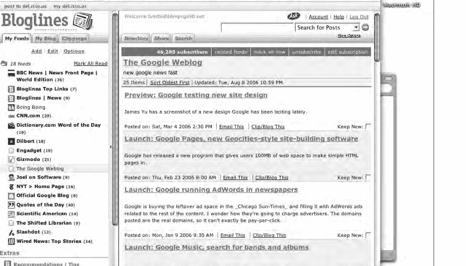
图2-1

RSS源链接

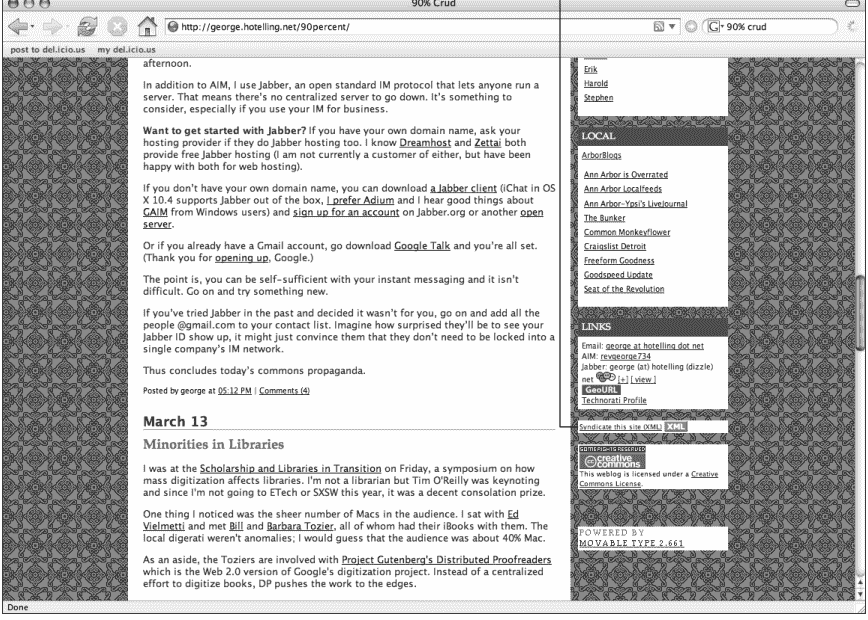
图2-2

还有很多优秀的软件和基于Web的feed阅读器。这里有一个简短的列表，帮助你入门：

- **Google Reader（多平台和基于Web）：** www.google.com/reader/
- **Bloglines（多平台和基于Web）：** www.bloglines.com/
- **NetNewsWire（Mac OS X）和FeedDemon（Windows）：** www.newsgator.com/

那么，这些RSS内容与del.icio.us有什么关系呢？嗯，del.icio.us非常非常**喜欢**RSS源。事实上，del.icio.us上几乎每个页面都有自己的RSS源。例如，你自己的del.icio.us页面的RSS源位于 `http://del.icio.us/rss/yourname`。你的网络也有自己的RSS源。它位于 `http://del.icio.us/rss/network/yourname`。即使是del.icio.us全站的php标签也有自己的RSS源，位于 `http://del.icio.us/rss/tag/php`。事实上，你能想到的任何标签都有一个源。

del.icio.us上还有更多RSS源，包括你自己的标签、你的收件箱、任何URL的del.icio.us历史记录等等。潜在地，del.icio.us可以有数千个RSS源，都包含与前面描述的RSS源大致相同的信息。

这最终意味着，del.icio.us将其所知道的关于用户、标签、URL等的一切（至少是最近的数据）都以RSS形式提供。如前所述，RSS是一种非常灵活的格式。仅仅因为它通常用于feed阅读器等地方，并不意味着必须如此。RSS和XML被设计得尽可能便携。特别是对于混搭开发者来说，RSS源可以被视为一种原始数据源，其信息可以导入数据库、混合到完全不同的展示中、与其他数据源结合，等等。

这样想：一般来说，电视节目的传播方式相当有限。它们原意是在电视机上播放。但你也可以将VCR、TiVo或PC连接到电视上，以不同的格式使用这些节目，通常是将它们发送到iPod或便携式游戏设备，或在网络上广播。del.icio.us就像一台电视机，以特定方式呈现其内容。del.icio.us上的RSS源允许你以全新和不同的方式获取del.icio.us内容。RSS源是混搭开发的绝佳入口。

下面的"尝试一下"将向你展示如何设置Google Reader并订阅del.icio.us RSS源。

### 尝试一下：玩转del.icio.us RSS源

本章列出了一些feed阅读器，当然还有更多。如果你已经有了偏好的阅读器，并且知道如何用它订阅源，那就用它。如果你还没有feed阅读器，或者想尝试一个新的，这个示例将帮助你设置Bloglines feed阅读器并订阅del.icio.us源。

1. 如果你还没有Bloglines账户，请在 http://bloglines.com/register/ 注册一个。在 http://bloglines.com/login/ 登录Bloglines。
2. 如果你是Bloglines的新用户，它会引导你完成一个简短的设置过程，以及一个列出热门Bloglines用户和几个示例源的系统。你可以随意点击Continue按钮跳过这些步骤——你可以随时回来完成这些。要向Bloglines添加新的RSS源，请点击My Feeds选项卡顶部的Add链接，如图2-3所示。
3. 将你从自己的del.icio.us源添加到Bloglines。将你的del.icio.us RSS源URL输入到Blog or Feed URL框中（如图2-4所示），然后点击Subscribe。你的del.icio.us源是 http://del.icio.us/rss/yourname（将yourname替换为你的del.icio.us账户用户名）。
4. Bloglines会显示一个屏幕，你可以在其中设置源显示方式的偏好。可以随意更改，或者使用默认设置，然后继续。
5. 完成后，你会在左栏看到新添加的源。点击它以查看源中的项目。你会看到你在del.icio.us保存的最后大约20个书签。你甚至还可以点击链接来浏览你书签中的网站。
6. 尝试使用你在第1章中设置的del.icio.us发布书签工具将新链接发布到del.icio.us。当你返回Bloglines时，你会发现你发布的链接已经作为新的未读项目出现。请注意，Bloglines有自己的RSS源检查计划，所以你新发布的链接可能不会立即显示。

添加新的RSS源

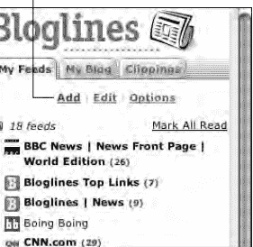
图2-3

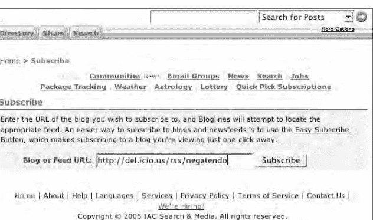
图2-4

7. 将php标签的RSS源添加到Bloglines。按照前面的步骤使用源URL http://del.icio.us/rss/tag/php。Bloglines现在会在右栏中显示你的del.icio.us页面以及php标签页面的RSS源。

### 工作原理

Bloglines只是众多可用feed阅读器中的一些，尽管Bloglines是一个不错的选择。Bloglines是一个基于Web的应用程序，定期下载其用户订阅的网站的RSS源，并以易于理解和快速的Web界面呈现它们。它适用于大多数计算机平台，而且是免费的。

你可以在Bloglines中收集许多源。当你在Bloglines左栏侧栏中点击一个源时，你有机会编辑或取消订阅你已订阅的源。当你查看源中的项目时，Bloglines会显示它自己的呈现方式——使用你输入的源的内容XML文件，并以最合适的格式呈现。

当你在不同的源之间移动时，源被标记为已读，其中的未读项目数量消失，就像你在邮件程序中打开电子邮件一样。与每天去网站查看是否有变化不同，像Bloglines这样的feed阅读器让你可以查看每个变化的项目，并跟踪你已经看过的和尚未看过的。

添加到RSS源的新项目在你发布到Web后返回feed阅读器时会显示为未读。使用像Bloglines这样的feed阅读器，你不会再错过任何一个del.icio.us链接。

当然，Bloglines可以同时跟踪多个源。通过添加`php`标签的源，你现在可以使用Bloglines来监控所有发布到del.icio.us下该标签的新链接，以及你添加的其他源。

你的Bloglines阅读列表现在包含多个RSS源。这在RSS世界中被称为*聚合*。继续添加你感兴趣的标签和源，以及你的网络、收件箱等。

### 应用程序编程接口（API）

del.icio.us让你直接访问其数据的另一种方式是通过API，即**应用程序编程接口**。del.icio.us API不仅可以让你检索数据（如RSS源），还可以让你实际添加和更改你的del.icio.us书签和标签。

API有很多内容，下一章将更详细地介绍，但请记住：del.icio.us API是从其他应用程序进入del.icio.us的入口。把它想象成del.icio.us与任何完全不同的软件程序之间的通信桥梁。

就像RSS源一样，del.icio.us API可以返回标签、用户等最近发布的书签。而且，就像RSS源一样，它也是通过Web URL访问的。然而，与del.icio.us RSS源对所有人开放不同，del.icio.us API仅限del.icio.us用户使用。例如，当你在浏览器中打开 `https://api.del.icio.us/v1/posts/get` 时，系统会要求你输入用户名和密码。如果你在此提示中输入你的del.icio.us用户名和密码，API将返回一些数据。

当你拉取del.icio.us RSS源时，你是在向del.icio.us请求RSS XML文档。当你访问API时，你是在向API发起一个*调用*。换句话说，你是在告诉API运行其某个函数并返回结果，就像计算机编程中的函数调用一样。


## 第 2 章：del.icio.us 与混搭

本示例中的调用只是要求 del.icio.us 返回你账户中最近一天保存的书签。根据你使用的浏览器不同，API 可能会显示类似于之前检查过的 RSS 订阅源的内容，也可能下载了一个文件，或者什么都没做。

> 如果你看不到 RSS 订阅源，你需要安装 Firefox。Firefox 浏览器是一款免费的网页浏览器，几乎适用于所有计算机平台。它能在浏览器中以格式化的形式直接显示 RSS 订阅源，这对开发者来说非常有帮助。你可以免费下载：访问 www.mozilla.com/firefox/ 并按照说明进行安装。Firefox 浏览器允许你查看 API 响应，对于本书中的许多其他项目也非常有帮助或必不可少。

del.icio.us API 返回特殊格式的响应，这些响应可移植到软件应用程序中，就像 RSS 订阅源可移植到订阅源阅读器一样。例如，你从前一个示例中收到的响应，如果你可以直接查看的话，看起来可能类似于以下代码：

```xml
<?xml version='1.0' standalone='yes'?>
<posts dt="2006-06-16" tags="" user="negatendo">
<post href="http://docs.blacktree.com/visor/visor" description="visor" extended="A dropdown terminal anywhere in OS X. By the makers of Quicksilver."
hash="ec01dda5b7d6ddc97c35ac83631dbc0a" others="95" tag="apple hacks ideas osx software" time="2006-06-16T19:57:11Z" />
</posts>
```

与 RSS 订阅源一样，在一个通用容器中有若干条目。在 del.icio.us 响应的情况下，该容器被称为 `posts`，如下所示：

```xml
<?xml version='1.0' standalone='yes'?>
<posts dt="2006-06-16" tags="" user="negatendo">
<post href="http://docs.blacktree.com/visor/visor" description="visor" extended="A &quot;dropdown&quot; terminal anywhere in OS X. By the makers of Quicksilver."
hash="ec01dda5b7d6ddc97c35ac83631dbc0a" others="95" tag="apple hacks ideas osx software" time="2006-06-16T19:57:11Z" /></posts>
```

在 `posts` 内部，有各种 `post` 元素，其中包括 URL（`href`）、链接的描述（`description`）、链接的扩展描述（支持有限的 HTML 格式）、标签列表（`tag`）等等——基本上包含了 del.icio.us 所知道的关于该书签的所有基本信息。

除了从 del.icio.us 获取书签之外，del.icio.us API 还使你能够添加和删除书签，甚至操作标签和标签捆绑，但比通过 del.icio.us 网站的用户界面更加直接和程序化。

如果你觉得 del.icio.us API 更像是与 del.icio.us 的直接连接，那你的判断很可能是对的。该 API 是通向 del.icio.us 某些功能的直接桥梁。从浏览器发起 API 调用并不是使用 API 的正确方式，但它展示了与 API 交互的基本概念。你将在本书中创建的混搭将以更恰当的方式与 API 交互，因为它们包含了在后台管理请求-响应系统的方式。下一章将更详细地介绍这方面的内容以及 API 的其余部分。

### 第一部分：对混搭友好的 Web

如果你想抢先探索 del.icio.us API，可以在 http://del.icio.us/help/api/ 查看其完整文档。

如前所述，通过网页浏览器与 del.icio.us API 交互并不是使用 API 的理想方式，但它确实有助于揭示其工作原理。下面的"动手试一试"将向你展示如何使用 Firefox 浏览器发起 API 调用。

### 动手试一试：获取一个 del.icio.us API 响应示例

要完成此练习，你需要安装 Firefox。

- 1. 在 Firefox 中，浏览到 `https://api.del.icio.us/v1/posts/recent?&count=5`，这是一个获取你最近五条 del.icio.us 帖子的 API 调用。
- 2. 当 Firefox 提示你输入用户名和密码时，使用你的 del.icio.us 用户名和密码。如果你之前在示例中使用了 Firefox 并且没有关闭浏览器，你可能已经通过了 del.icio.us 的身份验证，系统不会再要求你输入用户名和密码。
- 3. 输入登录信息后，你的浏览器应该会显示一个类似于图 2-5 所示的界面。它显示了 API 响应的文档树，基本上是 XML 格式响应的视图。

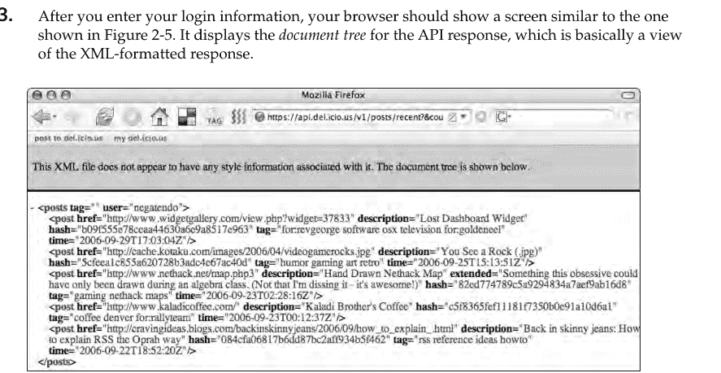
图 2-5

### 工作原理

本示例中的 API 调用针对的是 `/posts/recent` API 方法。该方法可以被视为一个动词，即你希望 API 执行的操作的名称，类似于计算机编程中的函数调用。在这个调用中，你希望 API 向你展示你的 del.icio.us 账户中最近的五条*帖子*。术语 `?count=5` 被称为*查询字符串*，类似于你可能发送给函数的参数。你在这里只发送了一个变量，即 `count` 应该等于 5，这意味着返回的帖子总数不超过最近的五条书签。当你向 del.icio.us API 发送查询字符串时，它被视为发送给 API 方法的*参数*。

例如，这个 API 调用在传统计算机编程语言中可能看起来像这样：

```
get_recent_posts(5)
```

这个函数将接受一个参数——要获取的最近帖子的数量。

使用 del.icio.us API 时，你始终需要用户名和密码。Firefox 将身份验证请求识别为典型的 `HTTP-Auth` 请求，并允许你通过浏览器本身输入用户名和密码。Firefox 会记住你的用户名和密码，并在关闭浏览器之前自动用于其他调用。下一章将更详细地解释 HTTP-Auth。

如果你没有指定其他处理方式，Firefox 会在浏览器中直接呈现 XML 格式的文档。通过此示例，你应该能在 `<posts>` 元素的子级中看到你最近发布的五条 del.icio.us 帖子。

### 总结

del.icio.us 的 RSS 订阅源和 API 使你能够以 del.icio.us 用户界面中不易发现的方式与 del.icio.us 进行交互。这些交互方式在创建混搭时非常有用，你很快就会看到。

### 练习

这些练习将帮助你进一步了解 del.icio.us 的 RSS 订阅源和 del.icio.us API。

- 1. 如果你正在向订阅源阅读器添加 RSS 订阅源，并且是 del.icio.us 用户，你必须订阅的三个 RSS 订阅源是你的网络、你的收件箱和"给你的链接"（即你在第 1 章中介绍的 `for:` 书签）。找到这三个 RSS 订阅源的 URL。（注意，找到 `for:` RSS 订阅源有一个技巧。）
- 2. 在本章前面，你发起了一次 del.icio.us API 调用，获取你账户中最近保存的五条书签。获取你账户中最近保存的 100 条书签的 API 调用的 URL 是什么？
- 3. 本章向你展示了如何在订阅源阅读器中直接订阅 `php` 标签。你也可以将 `php` 标签以及其他标签添加到你的收件箱中。确保你已经在订阅源阅读器中订阅了你的收件箱，然后找出如何将 `php` 和 `art` 标签添加到你的收件箱。接着，注意发布到这些标签的书签在订阅源阅读器中是如何显示的。

## 第 3 章：深入 del.icio.us API 内部

由于 del.icio.us API 在创建混搭中至关重要，你将希望熟悉其工作原理。本章作为 del.icio.us API 的完整概述。幸运的是，它非常容易理解。在本章结束时，你将开始看到它如何为混搭创造绝佳的机会。为了达到这一目标，你将学习如何从其向你开放 del.icio.us 及其工作方式的角度，将 del.icio.us API 视为你项目的一个子系统。你还将仔细研究与 del.icio.us API 通信所涉及的协议和流程。最后，本章将深入探讨 del.icio.us API 的所有功能。

### del.icio.us 作为子系统

将 API 视为你项目的*子系统*会很有帮助。可以将其想象为你软件内部的一个层，提供某种基本的服务、功能或数据库，你可以将其融入自己应用程序的运作中。例如，一个著名的 API 是 *Windows API*。任何编写要在 Windows 操作系统上运行的软件的人都必须与 Windows API 交互。Windows 操作系统是另一个子系统，运行在为它编写的软件之下。你可能还记得，API 是*应用程序编程接口*（Application Programming Interface）的缩写。因此，当你为 Windows 开发软件，或者进行*应用程序编程*时，Windows API 是你的程序与 Windows 本身之间的交互点或*接口*。

在上一章中，del.icio.us API 被描述为一座桥梁。这座桥梁有你必须遵守的特定规则才能通过。del.icio.us API 有一套非常严格的方法和协议。如果你不遵守 del.icio.us 的规则，你就不会得到想要的结果。然而，这些条件并没有严格到只有特定类型的编程才能访问它。你可以通过几乎任何你能想到的现代编程语言或方法与 del.icio.us API 进行交互，包括 C++、Macromedia Flash、Java、ASP.NET 等等。


## 第一部分 I：对 Mashup 友好的 Web

那么，你的程序是一个主系统，而 del.icio.us 是一个子系统。当然，也可以有其他子系统。本书中的一些 Mashup（混合应用）结合了来自各种 Web 服务的 API。你编写用于创建 Mashup 的程序将使用适当的语言直接与每一个服务进行对话，然后产生一个令人耳目一新的新结果。图 3-1 描述了典型的启用 API 的 Web Mashup 与 del.icio.us API 之间的通信流。

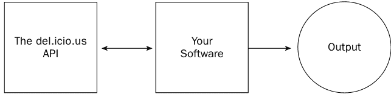
图 3-1

对于 Mashup 而言，你编写的软件可以用一种新方式呈现从 API 中获取的内容，或者可以将更多软件 API 组合到单个程序中，如图 3-2 所示。

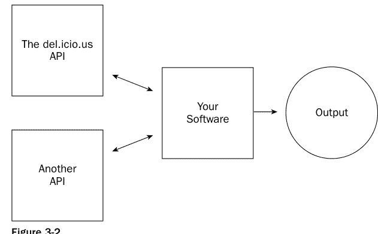
图 3-2

### 协议

在学习 del.icio.us API 的实际语言之前，你需要先学习它的协议。所有 API 都有特定的调用方式，del.icio.us 也不例外。如果你过去接触过软件编程 API，但从未接触过 Web 编程 API，那么 del.icio.us 的工作方式可能看起来有点奇怪。它高度依赖于某种协议，这与你的 Web 浏览器与网站交互的方式非常相似。这些协议基于一种称为 *REST* 的架构风格。

## 第 3 章：深入探索 del.icio.us API

### RESTful 调用与响应

REST 是 *Representational State Transfer*（表述性状态转移）的缩写。它是一种旨在用于万维网的架构指南，部分由 Web 的自然演进而设计，并由 Roy Fielding 在其博士论文中提出。Roy Fielding 是 HTTP（超文本传输协议）的作者之一，而 HTTP 正是驱动 Web 本身的方法。许多（但并非所有）网站都相当紧密地遵循这种架构风格。几乎所有网站都遵循至少一部分 REST 的思想和原则，del.icio.us 也是如此。

> *如果 HTTP 对你来说是一个新术语，它基本上就是定义在 Web 上的用户代理（例如你的 Web 浏览器）与服务器（例如 del.icio.us）之间通信的协议。HTTP 服务器处于空闲状态，等待通过 URL 发出的客户端请求，然后它监督请求数据的传回，以及本书后面会讨论的各种隐藏状态码和消息。*

通过观察在 Web 上请求页面时发生了什么，可以最好地理解 REST。当你请求一个页面时，返回的是该页面的一个 *representation*（表述）。你并不是真的下载了页面然后在以后把它放回去——Web 并不是这样工作的。相反，你获取的是该页面的当前版本。然而，这种传输的页面表述并不会导致一个文件被保存到你的桌面上。实际发生的是，你的 Web 浏览器被置于与该页面在 *transfer*（传输）时刻所处相同的 *state*（状态）中。因此，页面的 *representation* 将你的 Web 浏览器置于它在被 *transferred* 时所处的任何 *state* 中。

REST Web 服务必须遵守几个基本原则。例如，它必须提供以下内容：

- 一个无状态的（stateless）消息协议
- 对它应该返回什么的严格定义
- 一个统一且可理解的资源指针

*Stateless*（无状态）意味着 Web 上资源从 A 点到 B 点的通信以及从 B 点返回 A 点的答案应该仅发生一次且仅此一次——基础的调用与响应。除了当前发送给客户端的文档状态之外，不应有进一步的通信。例如，像《纽约时报》首页这样的网页，在你阅读时不会神奇地改变状态（比如当有新新闻爆发或编辑修改了一个逗号时）。你阅读的是文档的 *stateless state*（无状态状态）。你必须重新加载，你的客户端才能显示另一个更新的版本。

当然，如今大多数网站会在你的 Web 浏览器中放置一个用于该网站会话的标识性 *cookie*，或者可能具有视频或音乐等流媒体内容。这种持续的通信在技术上违反了 REST 的规则，但 cookie 仍然成为了必要的工具。即使是 del.icio.us 也使用 cookie 来保存你的登录信息，但除此之外，它绝对严格遵守无状态原则，尤其是在 API 方面。

REST 架构的另一个方面涉及对操作及其结果呈现的严格定义。del.icio.us API 的 *methods*（方法）就是这些操作。在大多数情况下，你可以通过它们的名字（`/posts/get`、`/posts/delete` 等）推断它们的功能。当你调用一个 REST 操作时，你应该收到某种 *hypermedia*（超媒体）作为响应，例如一个网页或 XML 文档，其中通常包含指向其他超媒体的链接，而这些链接反过来可能包含指向更多超媒体的链接，以此类推。当你请求 del.icio.us 上的网页或 RSS 馈送时，del.icio.us 和你的浏览器都遵循 HTTP 协议的 REST 原则。你的浏览器有一套非常严格的请求超媒体的方式，而 del.icio.us 则相应地以一种你的浏览器可以解释的标准语言（称为 HTML）返回超媒体。当你向 del.icio.us API 发出请求时，你的软件同样是在将 del.icio.us API 的其中一个操作作为 *request*（请求）执行，结果是你收到一个类 XML 的超媒体响应。

识别 REST 的第三种方式是其资源请求的格式，称为 *Uniform Resource Indicator*（统一资源标识符）或 *URI*，这是类 REST 地址的通用术语。例如，URL 是一种识别网站的 URI。由 REST 驱动的网站中的每个资源都必须在 URI 中被标识。这通常是在想要遵循 REST 的事物中发现的最具辨识度且可以说是最重要的风格。

> 你可能永远不会处理 URL “家族”之外的任何 URI 语法，至少在处理 del.icio.us 时是这样。顺便说一下，URI 语法是指你在 Web 地址开头看到的东西，例如 `http://` 或 `https://`，它们标识了 URL。不过你以前可能见过其他 URI 语法，比如 `file://` 或 `ftp://`。严格来说，这些不是 URL（但如果你不小心把它们叫作 URL，可能没人会指责你）。反正你不会处理非 URL 的 URI。只需知道 REST 资源可以涉及任何类型的 URI 即可。

在一定程度上坚持这些 REST 原则（即使忽略了其中一部分）的网站和/或 API 通常被称为 *RESTful*。

也许你从未太在意给定网站的 URL 是如何变化的。然而，寻找 del.icio.us 各个页面的 URL 或 del.icio.us RSS 馈送（如本书前文所述）可以揭示 REST 架构是如何工作的。也就是说，你可以从一个 RESTful URL 中直接看到你想要什么以及你想如何获取它。例如，以下 del.icio.us 的 URL 如果详细分析，会告诉你很多信息：

`http://del.icio.us/tag/architecture`

首先，它表明你在请求 del.icio.us 上的一个文档：
`http://del.icio.us/`

此外，它显示你想请求的文档是一个标签（tag），如高亮区域所示：
`http://del.icio.us/**tag/**`

它还标识了你想要的具体标签，即 `architecture` 标签：
`http://del.icio.us/tag/**architecture**`

URL 中的措辞很重要。REST 架构应该列出 *resources*（资源），而不是 *operations*（操作）。把 URL 想象成现实世界中的文件文件夹。你不会把文件文件夹标记为“获取 2006 年税单”——你会将其标记为“2006 年税单”，或者用 RESTful 的方式表示为 `http://documents/taxes/2006`。

del.icio.us API 非常严格地遵循 REST 的这一方面。例如，分析你在前一章中实验过的 API 调用 URI：

`https://api.del.icio.us/v1/posts/get`


## 第 3 章：深入探讨 del.icio.us API

首先，它显示您正在向 del.icio.us API 服务器请求文档：

```
https://api.del.icio.us/
```

> 请注意，del.icio.us API 请求以 `https` 而非 `http` 开头。这意味着您将请求一个安全的文档，该文档无法被第三方拦截或捕获。

URL 的下一部分是对 API 系统版本 1 的请求：

```
https://api.del.icio.us/v1/
```

接下来是对 `/posts/get` 方法的请求。这个 URL 明确表示您将通过此次调用来请求或操作 del.icio.us 上的某些文档——具体来说，您将获取一些帖子。尽管您可能认为实际的方法是 get，但 del.icio.us 团队在他们的邮件列表中提到，该方法名称在技术上应描述为 `/posts/get`，如下所示：

```
https://api.del.icio.us/v1/posts/get
```

如您所见，请求的方法非常容易辨识。所有 API 方法都以此类推。此外，正如 REST 架构所定义的那样，请求将是无状态的，正如您之前所看到的。您请求数据，del.icio.us 返回数据，之后不会有进一步的动作。del.icio.us 遵守 REST 的原则，即请求必须返回一个超媒体文档，在这种情况下是一个 XML 文件。（del.icio.us 返回的 XML 文件并不完全符合任何公开的标准架构，例如 RSS。）

> 在设计您的 mashup（混合应用）时，您必须准备好处理 XML 文件以外的其他响应。del.icio.us 还会返回标准的 HTTP 错误代码和其他响应，包括告知您 del.icio.us 服务不可用或您的用户名和密码无效的响应。在创建 mashup 时请记住这一点。

当然，del.icio.us 也违反了许多 REST 规则。在本书稍后部分，您将与使用 REST API 的其他 Web 服务进行交互，您可能会发现它们的做法相当不同。当您注意到这些差异时，将 Roy Fielding 的论文与其他对 REST 的解释进行比较可能会很有趣。

在向 del.icio.us API 发起请求时，向该 RESTful URI 发送请求并不是您需要发送的唯一信息。您还需要包含一些不那么透明的信息，至少从 Web 浏览器的角度来看是不透明的，例如您的用户名和密码。

### WWW-Authenticate 和其他请求头

许多 API，尤其是 Web API，会监控并限制您的使用方式。在 del.icio.us 的情况下，API 使用您的 del.icio.us 用户名和密码来跟踪和限制您的使用。早些时候，包含用户名和密码的向 del.icio.us 的请求被称为 `HTTP-Auth` 请求，但 `HTTP-Auth` 只是一个带有特定属性的普通 HTTP 请求的昵称，它并不是一种独特的协议。

如果未发送包含用户名和密码的特殊请求头信息，Web 服务器和 Web 应用程序可以被配置为拒绝访问资源。在 HTTP 世界中，请求头（headers）是指您的 Web 浏览器（或其他软件程序）在请求信息时发送给 Web 服务器的初始信息和命令。这些请求头在您不知情的情况下被发送，但它们确实存在。当您的 Web 浏览器从网站请求页面时，它会自动发送关于浏览器本身、您请求的页面、您希望页面使用的语言等各种信息。例如，以下是您的浏览器向 ebay.com 发起请求时的请求头样式：

```
GET /index.html HTTP/1.1
Host: www.ebay.com
Accept: */*
Accept-Language: en-us
User-Agent: Mozilla/4.0 (compatible; MSIE 6.0; Windows NT 5.1)
```

之前，当您引导 Web 浏览器进行 del.icio.us API 调用时，del.icio.us 返回了 `401 Unauthorized` 错误。这是一个标准的 HTTP 错误代码。它类似于当您尝试访问 Web 上不存在的页面时收到的 `404 Not Found` 错误代码。

您的 Web 浏览器足够聪明，能够在将此错误代码发送给您之前将其捕获，并正确地将该代码解释为页面需要密码。当您输入 del.icio.us 的用户名和密码时，实际上是将它们交给了浏览器，浏览器随后再次尝试向 del.icio.us 发起请求，这次包含了一个包含此身份验证信息的特殊请求头（除了前面提到的标准请求头）。这个请求头被称为 `WWW-Authenticate` 请求头。

在制作 mashup 时，您不仅会通过 API URI 向 del.icio.us 发送关于您想要什么以及如何获取它的信息，还会通过您发送的请求头来发送。这些请求头将包含特殊的 `WWW-Authenticate` 请求头，其中包含您的登录信息（或使用您软件的用户登录信息）。

您必须在请求中发送给 del.icio.us 的另一个重要请求头是 `User-Agent`。该请求头基本上标识了发起请求的软件名称和版本。例如，Internet Explorer 浏览器可能会将其 `User-Agent` 声明为 `Mozilla/4.0 (compatible; MSIE 6.0; Windows NT 5.1)`。`User-Agent` 字符串几乎可以是任何内容，但当您创建 mashup 时，它应包含您给 mashup 软件起的名称和版本，例如 MySweetMashup 1.0。这有助于 del.icio.us 跟踪哪些软件在向其 API 发起哪些请求。请务必设置 `User-Agent`，因为如果您将其留空或仅使用默认字符串，您可能会被 del.icio.us 封禁。

没错——如果错误地使用 API，您的 del.icio.us 账户可能会被封禁。除了遵守前面提到的规则外，您还必须遵守某些社交规则和协议，以保持您的 mashup 对 del.icio.us 友好。毕竟，调用 API 是一种特权而非权利，无论 del.icio.us 团队如何限制 API，它在一定程度上仍然必须基于信任，因此容易被滥用。

### 其他规则和规定

有一些相当标准且简单的解决方案可以写入您的 mashup 中，以确保它们遵守 RESTful del.icio.us API 架构规则，例如发送适当的请求头等。但还有一些规则需要您作为一名负责任的 mashup 开发者发挥个人判断力和智慧，包括以下内容：

- **设计您的 mashup 时，在调用之间预留合理的等待时间。** 编写能够频繁调用 del.icio.us API 或请求 del.icio.us RSS 馈送的软件是可能的，例如在每次网页加载时都进行调用。如果您的 mashup 出现在博客或公共网站上，情况尤其如此，这可能会导致每秒向 del.icio.us 发送多次请求。这不是一个好主意。创建这样的功能可能会导致 del.icio.us 陷入瘫痪。当然，del.icio.us 团队已经考虑到了这一点，并采取了自动措施，如果发生这种情况，将导致您的 del.icio.us 账户、IP 地址或软件被限制或封禁，再也无法与 del.icio.us 协作。

为了避免这种情况，del.icio.us 建议您在 API 调用之间至少等待一秒钟，以避免被限流。这包括在不同类型的调用之间等待一秒钟。但是，如果您能智能地设计 mashup，您可能能够创建系统以进一步减少应用程序对 del.icio.us 的请求次数。创建数据缓存系统是解决这个问题的绝佳方法。这样，您的软件将包含一个所需所有信息的数据库，然后每隔一段时间才向 del.icio.us 请求新信息以更新数据。您绝不能构建一个在有人访问网页时就请求 del.icio.us API 的应用程序。

- **设计您的 mashup 以应对意外情况。** 有时，del.icio.us 会返回请求数据以外的内容，例如 HTTP 错误消息。或者，如果它正在进行维护，可能会挂起一段时间或响应缓慢。您应该在设计 mashup 时考虑到这一点。如果 del.icio.us 返回错误，请让您的 mashup 识别该错误并在尝试重新调用前等待较长时间。不要将您的 mashup 设计成忽略错误并尝试强行重复获取数据。这与不在 API 调用之间等待规定时间一样糟糕。

- **绝不要设计在未提醒用户的情况下添加、修改或删除用户链接的 mashup 软件。** 在用户界面中明确告知，使用您的 mashup 可能会永久更改用户的书签。这不仅对您的 mashup 用户很重要，对于 del.icio.us 处理支持问题也同样重要。

- **如果您准备发布使用 del.icio.us API 的新软件，请告知 del.icio.us 团队。** 如果这是一个面向公众的大规模产品，这一点尤为重要。发送电子邮件至 `support@del.icio.us` 是最好的沟通途径。

如果您对您的 mashup 有任何疑问或顾虑，或者只想了解 del.icio.us 及其社区的最新动态，请务必将 del.icio.us 博客添加到您的馈送阅读器中，并订阅 del.icio.us 用户讨论组。您可以在 `http://blog.del.icio.us/` 找到该博客，在 `http://groups.yahoo.com/group/ydn-delicious/` 找到讨论组。

### del.icio.us API 方法

现在让我们详细看看 del.icio.us 提供的所有 API 方法。请记住，del.icio.us API 一直在变化。新功能在不断增加，其他功能在不断更改。您可以随时在 `http://del.icio.us/help/api/` 查看最新的 del.icio.us API 文档。


## 第一部分：适合混搭的 Web

#### /posts/update

`/posts/update` 方法没什么特别的。它不接受额外参数，只返回一行响应。你可以通过以下 URI 调用 `/posts/update`：

```
https://api.del.icio.us/v1/posts/update?
```

`/posts/update` 将返回经过身份验证的用户最后一次将书签保存到 del.icio.us 的时间和日期。以下是示例响应：

```
<update time="2006-06-17T16:02:43Z"/>
```

请注意，此日期和时间戳采用 ISO8601 时间格式。此时间格式在许多 API 响应中都会出现。

首先是 CCYY-MM-DD 格式的日期（世纪和年、月、日，以破折号分隔）。T 分隔日期和时间，时间采用 24 小时制。末尾的 z 表示时间为 UTC（协调世界时），也称为 GMT（格林威治标准时间）。如果你想在本地时间显示书签的时间，需要调整此日期和时间以匹配。

> `/posts/update` 方法的用途非常实用，如果你想编写一个定期以某种方式下载或收集用户书签的混搭应用。你可以先调用 `update` 查看自上次检查以来用户是否发布了新内容，如果有，则仅下载新帖子，从而节省 del.icio.us 每次返回用户完整帖子列表的开销。

#### posts 系列

`posts` 系列方法可以说是 del.icio.us API 中使用最多的方法。它们使你能够获取、创建、修改、更新和删除用户保存的书签。

#### /posts/get

get 方法返回与你发送的参数匹配的用户书签。像这样调用 `/posts/get`：

```
https://api.del.icio.us/v1/posts/get?
```

有一些可选参数可以发送给 `/posts/get`。你可能已经注意到，发送给 del.icio.us API 的参数采用查询字符串的形式，如下所示：

- `&tag`：将返回的帖子限制为此标签。
- `&dt`：将返回的帖子限制为此日期。
- `&url`：将返回的帖子限制为此 URL。

## 第三章：深入了解 del.icio.us API

例如，以下调用将获取用户在 2006 年 6 月 9 日发布的所有标记为 `tech` 的书签：

```
https://api.del.icio.us/v1/posts/get?&tag=tech&dt=2006-06-09
```

> 你实际上不需要在第一个参数前（问号后面）加 (&) 符号。不过，始终在参数前加上符号在 del.icio.us API 中并无害处。

你可能想知道为什么要使用 `&url` 参数来获取帖子，因为从逻辑上讲，结果只会返回单个帖子。此参数使你能够查明用户是否曾经将某个特定 URL 保存到他们的 del.icio.us 中。如果他们保存过，它会返回该用户关于该 URL 的所有信息，例如使用的标签等。

对 `/posts/get` 的成功响应如下所示：

```
<posts dt="2006-06-17" tag="" user="negatendo">
<post href="http://www.interfaceflor.com/service/flor/" description="Modern,
modular carpet tiles and area rugs for Do-It-Yourself ease - InterfaceFLOR"
extended="DIY modular tile carpets. Very cool."
hash="8dbec099325fddfed54419fc0147fd01" others="18" tag="design diy fashion home
ideas stuff" time="2006-06-17T16:02:42Z"/>
</posts>
```

你的请求返回的每个帖子都会有一个 `<post>` 元素。

`<post>` 元素有多个标准属性作为配套的一部分。这些属性位于 `<post>` 元素的括号内，通常格式为 `attribute="value"`。`<post>` 元素中的第一个属性通常是书签 URL。以下是示例：

```
<post href="http://www.interfaceflor.com/service/flor/" description="Modern,
modular carpet tiles and area rugs for Do-It-Yourself ease - InterfaceFLOR"
extended="DIY modular tile carpets. Very cool."
hash="8dbec099325fddfed54419fc0147fd01" others="18" tag="design diy fashion home
ideas stuff" time="2006-06-17T16:02:42Z"/>
```

接下来是用户保存书签时所使用的描述：

```
<post href="http://www.interfaceflor.com/service/flor/" description="Modern,
modular carpet tiles and area rugs for Do-It-Yourself ease - InterfaceFLOR"
extended="DIY modular tile carpets. Very cool."
hash="8dbec099325fddfed54419fc0147fd01" others="18" tag="design diy fashion home
ideas stuff" time="2006-06-17T16:02:42Z"/>
```

然后是扩展描述：

```
<post href="http://www.interfaceflor.com/service/flor/" description="Modern,
modular carpet tiles and area rugs for Do-It-Yourself ease - InterfaceFLOR"
extended="DIY modular tile carpets. Very cool."
hash="8dbec099325fddfed54419fc0147fd01" others="18" tag="design diy fashion home
ideas stuff" time="2006-06-17T16:02:42Z"/>
```

请注意，extended 属性与 del.icio.us 发布界面中的 *notes* 字段相同——只是在 API 响应中名称不同。

接下来是 URL 的哈希值。这是书签 URL 的 MD5 哈希形式。简单来说，这是书签网页地址的特殊编码表示。del.icio.us 使用 URL 的哈希值作为其数据库中书签的唯一标识符。以下是示例：

```
<post href="http://www.interfaceflor.com/service/flor/" description="Modern, modular carpet tiles and area rugs for Do-It-Yourself ease - InterfaceFLOR" extended="DIY modular tile carpets. Very cool." hash="8dbec099325fddf5ed54419fc0147fd01" others="18" tag="design diy fashion home ideas stuff" time="2006-06-17T16:02:42Z"/>
```

你会经常在书签的 URL 页面上看到此哈希值的使用，你可能还记得该页面列出了所有发布该书签的用户、与书签关联的标签以及 del.icio.us 所知的其他一切信息。此示例的 URL 页面如下（注意加粗的哈希值）：

```
http://del.icio.us/url/8dbec099325fddf5ed54419fc0147fd01
```

下一个 `<post>` 属性显示有多少其他 del.icio.us 用户保存了此书签：

```
<post href="http://www.interfaceflor.com/service/flor/" description="Modern, modular carpet tiles and area rugs for Do-It-Yourself ease - InterfaceFLOR" extended="DIY modular tile carpets. Very cool." hash="8dbec099325fddf5ed54419fc0147fd01" others="18" tag="design diy fashion home ideas stuff" time="2006-06-17T16:02:42Z"/>
```

然后，显示该用户用来在其 del.icio.us 中标识书签的标签：

```
<post href="http://www.interfaceflor.com/service/flor/" description="Modern, modular carpet tiles and area rugs for Do-It-Yourself ease - InterfaceFLOR" extended="DIY modular tile carpets. Very cool." hash="8dbec099325fddf5ed54419fc0147fd01" others="18" tag="design diy fashion home ideas stuff" time="2006-06-17T16:02:42Z"/>
```

最后是书签保存的日期和时间，采用 ISO8601 标准格式：

```
<post href="http://www.interfaceflor.com/service/flor/" description="Modern, modular carpet tiles and area rugs for Do-It-Yourself ease - InterfaceFLOR" extended="DIY modular tile carpets. Very cool." hash="8dbec099325fddf5ed54419fc0147fd01" others="18" tag="design diy fashion home ideas stuff" time="2006-06-17T16:02:42Z"/>
```

如果你不向 `/posts/get` 发送任何额外参数，它将默认返回用户在最新保存书签日期的帖子。

#### /posts/recent

`/posts/recent` 是一个专门设计用于获取用户最近发布的帖子的 API 方法。它使用以下语法：

```
https://api.del.icio.us/v1/posts/recent?
```

它接受以下参数：

- `&tag`：将返回的帖子限制为此标签。
- `&count`：指定要返回的帖子数量。默认值为 15。
- `&url`：将返回的帖子限制为此 URL。

以下是调用 `/posts/recent` 的示例，它将获取用户标记为 movies 的最近 30 个帖子：

```
https://api.del.icio.us/v1/posts/recent?&tag=movies&count=30
```

成功响应看起来与 `/posts/get` 响应完全相同——即一个 `<posts>` 容器，其中包含作为子元素的 `<post>` 元素，并附带相同的信息属性。

`/posts/recent` 方法非常方便。但是，在调用 `/posts/recent` 之前，请记得先运行 `/posts/update` 方法，以检查自你的程序上次检查以来用户是否发布了新内容。

#### /posts/all

`/posts/all` 返回用户保存的所有书签。del.icio.us 团队请求你谨慎使用此方法，因为它对 del.icio.us 的要求很高。根据用户保存了多少书签以及你为此方法提供的参数，你应该准备好处理可能大量的数据。以下是调用 `/posts/all` 的样子：

```
https://api.del.icio.us/v1/posts/all?
```

`/posts/all` 仅使用 `&tag` 参数，将返回的帖子限制为此标签。

例如，以下是获取用户所有标记为 `javascript` 的书签的方法：

```
https://api.del.icio.us/v1/posts/all?&tag=javascript
```

`/posts/all` 返回的是标准的 `<posts>` XML 文档。

#### /posts/date

`/posts/date` 不返回 `<posts>` 响应。相反，它返回一个日期列表，显示用户将书签保存到 del.icio.us 的日期，并附有一个属性显示该日期保存了多少书签。以下是 API URI 的样子：

```
https://api.del.icio.us/v1/posts/dates?
```

`/posts/date` 接受 `&tag` 参数以将返回的帖子限制为此标签。

例如，看看如何检索用户发布的所有标记为 `science` 的帖子的日期。

```
https://api.del.icio.us/v1/posts/dates?&tag=science
```


## 第一部分：适合混搭的 Web

这是 `date` 响应的样子：

```
<dates tag="science" user="negatendo">
<date count="1" date="2006-02-10"/>
<date count="3" date="2006-01-24"/>
<date count="1" date="2005-10-20"/>
<date count="2" date="2005-09-27"/>
<date count="1" date="2004-08-10"/>
</dates>
```

你会注意到所有内容都在一个名为 `<dates>` 的容器内，该容器包含用于筛选结果的标签属性以及用户名：

```
<dates tag="science" user="negatendo">
... 返回的其余数据...
</dates>
```

`<dates>` 内部可以有任意数量的 `<date>` 元素。`count` 属性显示当天保存了多少个书签，`date` 属性显示书签保存的日期。以下条目显示一个链接保存于 2006 年 2 月 10 日：

```
<date count="1" date="2006-02-10"/>
```

#### /posts/add

`/posts/add` 方法用于为用户保存新书签或更新现有书签。语法如下：

```
https://api.del.icio.us/v1/posts/add?
```

它接受以下参数：

- `&url`：要保存的书签的 URL。此参数是必需的。
- `&description`：书签的描述。当你使用发布书签工具时，这通常是页面的标题。此参数是必需的。
- `&extended`：书签的扩展描述。
- `&tags`：书签的标签，以空格分隔的列表。
- `&dt`：条目的日期时间戳。必须采用 ISO8601 格式。
- `&replace`：指定如果书签已存在是否替换。将此参数的值设置为 `yes` 或 `no`。替换书签本质上与用新信息更新书签相同。
- `&shared`：指定书签是否为私有。默认情况下不是私有，但将此参数的值设置为 `no` 可使其成为私有。

以下是使用 `/posts/recent` 方法的示例。以下调用将把一个描述为 `Google`、扩展描述为 `A pretty OK search engine` 的书签保存到 Google。标签 `search` 和 `web` 也将与书签一起保存。

## 第三章：深入 del.icio.us API 内部

```
https://api.del.icio.us/v1/posts/add?&url=http://www.google.com&description=Google&extended=A+pretty+OK+search&engine=tags=search+web
```

在 `extended` 和 `tag` 参数中，加号（+）被用来代替单词之间的空格。这是一种经过特殊重新格式化以适应网络的 `转义` 或 `编码` URI 元素。通常网络浏览器和其他类型的网络软件会自动执行此重新格式化。稍后你将学习如何以这种方式正确转义你的 API URL，但对于这些示例，只需输入加号（+）来表示空格。（空格也可以用字符串 `%20` 表示，效果相同。）

当你成功使用 `/posts/add` 方法时，del.icio.us 将响应以下内容：

```
<result code="done"/>
```

你需要设计你的混搭应用来解释响应中的 code 属性，因为如果它不是 done，则表示发生了错误，你需要适当地输出或处理该错误。

#### /posts/delete

`posts` 系列中的最后一个方法是 `/posts/delete`。你可以这样调用 `/posts/delete`：

```
https://api.del.icio.us/v1/posts/delete?
```

`/posts/delete` 仅接受 `url` 参数来标识要删除的书签 URL。

正如你可能猜到的，`/posts/delete` 将永久删除指定的书签。删除成功后，它将返回与 `/posts/add` 相同的响应：

```
<result code="done"/>
```

### 标签

下一组 API 方法涉及标签的操作。目前只有几个可用的方法，但仍然足够做一些有用的事情。

#### /tags/get

`/tags/get` 获取 del.icio.us 用户使用的完整标签列表，以及每个标签被使用的次数。它没有参数。语法如下：

```
https://api.del.icio.us/v1/tags/get
```

del.icio.us 对 `/tags/get` 的响应包含一个带有 `<tag>` 子元素的 `<tags>` 元素：

```
<tags>
  <tag count="2" tag="art" />
  <tag count="7" tag="music" />
  <tag count="3" tag="reference" />
</tags>
```

`<tag>` 包含两个属性：count，显示特定标签被使用的次数；tag，即标签本身。

```
<tag count="2" tag="art" />
```

你可以使用此 API 调用来生成标签云，使你能够可视化标签使用情况。标签云显示用户通常应用于其书签的标签列表，较小和较大的文本大小分别表示使用较少和较多的标签（参见图 3-3）。

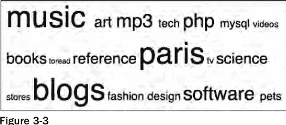

#### /tags/rename

/tags/rename 方法使你能够更改现有标签的名称，使用以下语法：

```
https://api.del.icio.us/v1/tags/rename?
```

你必须提供要重命名的标签（old）和要重命名为什么（new）作为参数：

- `&old`：要重命名的现有标签。
- `&new`：标签的新名称。

在以下示例中，用户的 sience 标签将被重命名为正确拼写的 science。此标签重命名将影响保存在旧标签下的所有书签：

```
https://api.del.icio.us/v1/tags/rename?&old=sience&new=science
```

/tags/rename 方法的成功响应如下所示：

```
<result>done</result>
```

## 束

也有用于处理标签束的 API 方法。标签束是标签的分组或分类。它们允许你安排 del.icio.us 页面上标签的呈现和组织。

#### /tags/bundles/all

`/tags/bundles/all` 方法返回用户的所有束。它没有参数。此方法的语法如下：

```
https://api.del.icio.us/v1/tags/bundles/all
```

此方法返回一个包含在 `<bundles>` 容器内的 `<bundle>` 元素集合，如下所示：

```
<bundles>
  <bundle name="art" tags="illustration art videos" />
  <bundle name="music" tags="mp3 music" />
</bundles>
```

注意 `<bundle>` 有两个属性：束的名称，以及组成束的标签：

```
<bundle name="art" tags="illustration art videos" />
```

#### /tags/bundles/set

使用 `/tags/bundles/set` 方法来创建或更改束，如下所示：

```
https://api.del.icio.us/v1/tags/bundles/set?
```

/tags/bundles/set 接受以下两个参数：

- `&bundle`：束的名称。
- `&tags`：应组成束的标签，以空格分隔的列表。

例如，以下调用将创建一个名为 `webdev` 的束，其中包含几个与 Web 开发相关的标签：

```
https://api.del.icio.us/v1/tags/bundles/set?&bundle=webdev&tags=development+php+javascript+mysql+html+css
```

如果你在此调用中命名了一个现有束，该束将完全使用你指定的标签重建。

/tags/bundles/set 将在 `<result>` 元素之间响应一条消息，如下所示：

```
<result>ok</result>
```

#### /tags/bundles/delete

/tags/bundles/delete 永久删除一个束（但不删除其标签）。语法如下：

```
https://api.del.icio.us/v1/tags/bundles/delete?
```

使用 `&bundle` 参数指定束的名称。

成功的结果将类似于 `bundle` 系列其他方法中的结果：

```
<result>done</result>
```

以下动手实践让你练习在 del.icio.us API 中学到的一些方法。

### 动手实践使用 del.icio.us API

对于这些示例，请继续使用 Firefox 网络浏览器浏览它们来进行 API 调用。（记住，你必须使用 Firefox 才能以易于阅读的格式直接在网页浏览器中显示结果。）当提示输入用户名和密码时，使用你自己的 del.icio.us 登录信息。你通过 API 做出的某些更改不会立即在 del.icio.us 上显示——目前，在调用 del.icio.us API 和出现在 del.icio.us 网页版之间存在延迟。

1. 调用 `/posts/update` 方法：
   `https://api.del.icio.us/v1/posts/update`

2. 使用 `/posts/add` 方法向 del.icio.us API 文档发布一个书签。使用以下调用：
   `https://api.del.icio.us/v1/posts/add?url=http://del.icio.us/help/api&description=the+del.icio.us+API&tags=del.icio.us+documentation=dev+reference`

3. 希望你收到了成功的响应。请注意，如果你过去已将此链接保存到 del.icio.us API，你将是在更新帖子而不是保存。使用 API 和出现在 del.icio.us 上之间有轻微延迟，因此请等待几分钟检查你的 del.icio.us 页面，看看链接是否已出现。

4. 使用以下调用获取 reference 标签下发布的最近五个链接：
   `https://api.del.icio.us/v1/posts/recent?tag=reference&count=5`

你新发布的书签应出现在响应中。

5. 使用以下调用将 `dev` 标签重命名为 `development`：
   `https://api.del.icio.us/v1/tags/rename?old=dev&new=development`

6. 使用 `/posts/delete` 方法删除帖子：
   `https://api.del.icio.us/v1/posts/delete?url=http://del.icio.us/help/api/`

### 工作原理

第一次调用 `/posts/update`，你检查 del.icio.us 以了解你上次保存书签的时间。

接下来，你向 del.icio.us 添加一个新书签。这个调用看起来相当复杂，但当你剖析它时，你会发现它包含了新书签所需的所有信息，包括书签 URL、书签所需的描述以及你希望与书签关联的标签：


## 第 3 章：深入探索 del.icio.us API

```
https://api.del.icio.us/v1/posts/add?url=http://del.icio.us/help/api/@description=the+del.icio.us+API&tags=del.icio.us+documentation+dev+reference
```

请再次注意（描述和标签中的单词之间的空格被替换成了加号 (+) 符号）。

一段时间后（通常约为两分钟），书签将被添加到你的 del.icio.us 账户中。

对 `/posts/recent` 的调用将显示你新发布的书签以及之前发布的四个书签。该方法的参数在此以粗体显示：

```
https://api.del.icio.us/v1/posts/recent?7&tag=reference&count=5
```

`/tags/rename` 方法将 `dev` 标签重命名为 `development`。这将影响所有曾被标记为 `dev` 标签的书签，而不仅仅是本练习中添加的那一个：

```
https://api.del.icio.us/v1/tags/rename?old=dev&new=development
```

最后一个方法将删除新发布的书签。同样，更改在 del.icio.us 上显示可能需要几分钟时间。指定 URL 的参数在此以粗体显示：

```
https://api.del.icio.us/v1/posts/delete?url=http://del.icio.us/help/api/
```

### 特定语言的 API 库

此时，你可能会对 del.icio.us API 涉及的所有内容感到有些不知所措，但希望你同时也感到兴奋。尽管本书中的大多数项目将以相当简单的方式与 del.icio.us 交互，但了解已有自定义库可以使使用 del.icio.us API 变得更简单可能会有所帮助。这些自定义库将 del.icio.us 的 API 语言转换为更原生、更易于操作的形式，方便具有特定编程语言偏好的 Mashup 开发者。有些库还添加了缓存功能和高级身份验证方法，使事情变得更加简单。

本书中的项目都不会使用这些库。相反，你将创建自己的库。当然，知道它们的存在以及它们能让你的 Mashup 创建变得更加轻松仍然是有好处的。以下是一些你可能想要查看的特定编程语言 API 库：

- **del.icio.us Java API**: http://sourceforge.net/projects/delicious-java/
- **PhpDelicious**: www.ejeliot.com/pages/5
- **del.icio.us PHP API**: http://dietrich.ganx4.com/delicious/
- **Net::Delicious for Perl**: http://search.cpan.org/~ascope/Net-Delicious/lib/Net/Delicious.pm

# 第一部分：Mashup 友好型 Web

### RSS 与 API 的对比

del.icio.us API 是如此强大且灵活，以至于你可能会好奇为什么还需要使用 RSS 馈送（feeds）。但使用 del.icio.us RSS 馈送而非 API 调用确实有一些优势。

访问 RSS 馈送不需要 del.icio.us 用户的用户名和密码。如果你只是在收集某个标签、用户或 URL 的书签和数据，确实没有理由要求你的用户输入或保存他们的用户名和密码。可以将 RSS 馈送视为公开的，而 API 视为私有的。

RSS 馈送旨在成为一种携带大量有用信息的便携格式。在尝试使用 API 收集关于文章或标签的信息之前，请先考虑 RSS 馈送能提供什么。如果你的 Mashup 只需要来自 del.icio.us 的最新的公开信息，那么使用 RSS 馈送比使用 API 要简单得多。

此外，del.icio.us API 始终在开发中。你的软件可能会因为 API 的更改（尤其是响应格式的更改）而崩溃。RSS 格式将始终保持不变，因为它遵循一个标准，因此你不太可能需要花费时间维护代码。由于 RSS 的便携性，你能够快速编写新程序来解析或传输馈送中的信息。

### 本章小结

通过对 del.icio.us RSS 馈送和 API 的概述，你已经掌握了为 del.icio.us 编写 Mashup 所需的基础知识。不难看出 del.icio.us API 在你的项目中将发挥多么重要的作用，特别是在获取、添加和删除文章，以及操作标签和标签束方面。当你需要更多 API 信息或快速参考时，请记住你随时可以在 http://del.icio.us/help/api/ 获取免费且最新的 del.icio.us API 文档。同时请记住，有时 RSS 馈送与使用 API 同样有效。

要使一个应用程序成为混合应用，仅靠一个 Web 应用程序是不够的。下一章将概述其他 Web 应用程序及其 API。它们都与 del.icio.us 略有不同，但也存在一些相似之处。本书将重点关注这些相似之处，因为它们会让 Mashup 开发变得更加轻松。如果你准备好了，那么请伸个懒腰，深呼吸，继续阅读。

### 练习

现在，你应该对 del.icio.us API 有很深的了解了。尝试通过以下练习来测试你的知识。

1. 获取标记为 `music` 的最后 30 篇文章的 API 调用应该是怎样的？
2. 获取标记为 `music` 的 *所有* 书签的 API 调用应该是怎样的？
3. 列出编写一个程序的 API 调用，该程序定期删除用户标记为 `temporary` 的所有书签，但前提是该书签没有其他标签。
4. 如果你需要获取某个用户在 `restaurants` 标签下发布的所有书签的每日摘要，你是否可以仅使用 RSS 馈送来收集数据？如果可以，馈送 URL 是什么？

## 第 4 章：其他可 Mashup 的软件

本章将探讨一些可以在你的项目中与 del.icio.us 结合使用的其他可 Mashup 软件。这绝不是一个详尽的列表。外界还有许多同样出色且充满潜力的可 Mashup Web 服务。有些你将在本书稍后部分直接与其交互，而有些仅被提及。介绍这些其他 Mashup 软件的目的是让你了解目前有哪些可用资源，以及它们与 del.icio.us 的对比。

不要期望成为本章介绍的所有软件的专家，但至少对它们有初步的了解是个好主意。如果这些 Web 服务为了设计 Mashup 而提供了 API 或其他交互方法，本章将重点突出这些功能。其中许多与 del.icio.us 类似。本章会对这些相似之处做详细记录，因为它们将帮助你完成本书中的 Mashup 项目，以及你自己创建的 Mashup。

### Flickr

Flickr 是一款新兴的照片共享服务，通常被认为是 del.icio.us 的近亲。del.icio.us 的许多功能在 Flickr 中被直接复制，但目的是组织照片而非书签。例如，与 del.icio.us 一样，Flickr 将标签作为组织工具。它几乎为每个页面都提供了 RSS 馈送，当然还有一个 API。

因为 del.icio.us 和 Flickr 非常相似，且两者都是 Yahoo! 旗下的公司，它们甚至在很小程度上进行了集成。例如，如果你在 del.icio.us 上将一个 Flickr 照片页面保存为书签，你的书签列表中该书签旁边会自动出现一张照片缩略图，如图 4-1 所示。


图 4-1

# 第一部分：Mashup 友好型 Web

你可以在 www.flickr.com 查看 Flickr。

Flickr API 与 del.icio.us API 略有不同。Flickr API 在调用时不需要用户名和密码，而是使用所谓的 API 密钥（API key）。这个密钥是一个特殊的文本字符串，当你进行 API 调用时，它向 Flickr 证明你的身份。你可以通过填写 www.flickr.com/services/api/key.gne 上的表单，申请一个用于非商业目的的免费 API 密钥。

Flickr API 支持几种交互方法，包括 REST。一个典型的 Flickr REST API 调用如下所示：

```
http://www.flickr.com/services/rest/?method=flickr.photos.getPerms&photo_id=123456789&api_key=EXAMPLEAPIKEY
```

你可以清楚地在请求 URI 中看到参数，就像在 del.icio.us 中一样。然而，与 del.icio.us 不同的是，你想要调用的方法（method）是以 URI 参数的形式出现的。API 密钥也是一个参数。Flickr API 更倾向于让你将 API 密钥作为请求的一部分包含在内，而不是放在 `WWW-Authenticate` 请求头中。

Flickr 返回 XML 响应，就像 del.icio.us 一样。它的格式略有不同，但理念是一致的。这是一个响应示例：

```
<perms id="123456789" ispublic="1" isfriend="1" isfamily="0" permcomment="0" permaddmeta="1" />
```

你可以在 www.flickr.com/services/api/ 阅读更多关于 Flickr API 的信息。

请注意，与 del.icio.us 一样，有时使用 Flickr RSS 馈送比使用 API 更有优势。

### Yahoo! Maps Beta

Yahoo! 在在线地图软件领域采取了大胆的行动。尽管仍处于早期阶段，但 Yahoo! Maps Beta 是一款由 Macromedia Flash 驱动的应用程序，令人印象深刻且非常实用。你可以在 http://maps.yahoo.com/beta/ 亲自体验。

像 Yahoo! 绝大多数的新服务一样，Yahoo! Maps Beta 拥有一个 API。你可以在 http://developer.yahoo.com/maps/ 阅读相关内容。

尽管 Flickr 和 del.icio.us 都由 Yahoo! 提供，但它们在成为 Yahoo! 家族的一员之前就已经构建完成了，因此它们拥有自己的 API 访问方法。不过，Yahoo! 正尝试创建通用的 API 密钥——他们称之为应用程序 ID（Application IDs）——可以在他们的许多服务中通用。与 Flickr 一样，你需要在线申请一个 Application ID 才能与 Yahoo! Maps Beta 交互。你可以在 http://api.search.yahoo.com/webservices/register_application 进行申请。

在获得应用程序密钥后，你可以立即使用 Yahoo! Maps Beta（以及其他 Yahoo! 服务）完成许多操作。例如，第 14 章包含一个根据特定坐标显示地图的项目。你将能够直接将此地图嵌入到你的 Mashup 应用程序中。关于其外观的示例，请查看图 4-2 中所示的 Random Videos Mashup，可在 www.angieandderek.com/videos/ 找到。它在网站上混合了嵌入的 Yahoo! Beta Maps，并在地图的点位上集成了视频。


 # 第 4 章：其他可混合软件

## 图 4-2

Yahoo! 接受的 REST 调用最初看起来与 del.icio.us 非常相似。您将应用程序 ID 作为其中一个参数发送，将 XML 文件的路径或内容作为另一个参数发送。与 del.icio.us 不同的是，您不需要在 REST URL 中指定所有参数。相反，它们是在 XML 文件中指定的。这使得它稍微不那么 RESTful，而更像稍后涵盖的其他一些数据传输方法，但对于 RESTafarians（REST 粉丝对自己如此称呼）来说，这仍然很方便。

例如，在下面的 REST 调用中，Yahoo! 被发送了一个存在于 myserver.com 上的 .xml 文件（请注意 `xmlsrc` 查询字符串）：

```
http://api.maps.yahoo.com/Maps/V1/annotatedMaps?appid=YOURAPPLICATIONID&xmlsrc=http://www.myserver.com/map-test.xml
```

无论你是否相信，你引导 Yahoo! 访问的 XML 文件实际上是一个 RSS 文件。然而，与出现在 del.icio.us 上的 RSS 文件不同，这个 RSS 文件必须遵循一种特殊的 RSS 标准，称为 *geocoded* RSS。Geocoded RSS 看起来与 RSS 的其他衍生版本非常相似，但它还具有呈现地理数据（如纬度和经度）的某些标准方式。请查看以下 geocoded RSS 文件内容的示例，并注意 `<geo:lat>` 和 `<geo:long>` XML 元素。

```
<?xml version="1.0"?>
<rss version="2.0" xmlns:geo="http://www.w3.org/2003/01/geo/wgs84_pos#">
<channel>
<item>
<title>Congress Park</title>
<link>http://www.myserver.com</link>
<description>Free public tennis courts.</description>
<geo:lat>39.73</geo:lat>
<geo:long>-104.96</geo:long>
</item>
</channel>
</rss>
```

如果你将这段代码中的信息通过前面列出的 REST 调用发送给 Yahoo! Maps（不是 Yahoo! Maps Beta），你将被引导至 Yahoo! Maps 上的一个页面，该页面会精准定位到指定的坐标。

### Yahoo! 搜索

地图软件并不是 Yahoo! 允许外部 Web 开发者尝试的唯一工具。Yahoo! 甚至为其搜索引擎提供了 API。关于搜索 API 的更多信息可以在 http://developer.yahoo.com/search/index.html 找到。

Yahoo! 搜索 API 使用与 Yahoo! Maps 相同的应用程序 ID，因此如果你拥有一个 Yahoo! 应用程序 ID，就可以开始进行 Yahoo! 搜索混合应用的开发了。

同样地，你可以使用 REST 与此 API 交互。这是一个向 Yahoo! 查询绿茶健康益处信息的 Yahoo! 搜索 REST 调用：

```
http://api.search.yahoo.com/WebSearchService/V1/webSearch?appid=YOURAPPLICATIONID&query=green+tea+health+benefits
```

搜索结果将以 XML 格式的响应返回，该响应由一个名为 `<ResultSet>` 的元素组成，并包含 `<Result>` 子元素。以下是一个 `<Result>` 的样子：

```
<Result>
  <Title>Green tea benefits health</Title>
  <Summary>
    Green tea of the highest quality plus information on tea's many health benefits!
    ... The benefits of green tea are varied and well established ... invigorating, and
    delicious! To learn more about green tea and health benefits please click here-
    benefits of green tea ...
  </Summary>
  <Url>http://www.japanesegreenteaonline.com/</Url>
  <ClickUrl>
    http://uk.wrs.yahoo.com/_ylt=A9htfSKOCJ9EiAUBedvdmMwF;_ylu=X3oDMTB2b2gzdDdtBGNvbG8DZQRsAldTMQRwb3MDMQRzZWMDc3IEdnRpZAM-/SIG=1lqcvjlqb/EXP=1151359502/**http%3a//www.japanesegreenteaonline.com/
  </ClickUrl>
  <ModificationDate>1150700400</ModificationDate>
</Result>
```

```
<MimeType>text/html</MimeType>
<Cache>
<Url>
http://uk.wrs.yahoo.com/_ylt=A9htfSKOCUj8EViU8fvtvdMwZF_;_ylu=X3dOMtBwZTdwbKtBGNvbG8D
ZQRwb3MDMQRzZWMDc3IEdnRpZAM-/SIG=178g7e49r/EXP=1151359502/**http%3a//
216.109.125.130/search/?cache&b=beta3=UTF-8&q=negatendo&q26query=green%2btea
%2bbenefit%26b2benefits%26u=www.japanesegreenteaonline.com/%26w=green%2btea%2bhealth%2b
benefit%26h2=dNTT2yDmtM_MI%26cp=1%26l=en.intl=us
</Url>
<Size>11897</Size>
</Cache>
</Result>
```

### Amazon Web Services

仅仅因为 Amazon.com 是最早的电子商务网站之一，并不意味着它没有跟上现代 Web 服务的步伐。事实上，Amazon.com 通过其 Amazon Web Services (AWS) 区域提供几种不同类型的 Web 应用程序，并开发了广泛的 API，使其在许多方面成为混合应用世界的领跑者。

AWS 为开发者提供了与构成 Amazon.com 的许多不同领域合作的机会。这不仅包括允许您查询和使用来自 Amazon.com 在线商店的数据，还包括来自 Alexa（Amazon.com 的搜索平台）以及 Amazon.com 为开发者提供的可用于任何目的的一些 Web 分发服务（例如 Amazon S3，一种在第 11 章项目中使用的在线数据存储服务）。关于 AWS 的所有相关信息都可以在 `http://aws.amazon.com` 找到。

与 Flickr 类似，AWS 要求在请求中发送一个 API 密钥，他们称之为 *access key*（访问密钥）。您可以通过在 `www.amazon.com/gp/aws/registration/registration-form.html` 注册 AWS 来获取访问密钥。

您需要一个 Amazon.com 账户才能注册。如果您曾在 Amazon.com 购买过任何商品，您就已经拥有一个 Amazon.com 账户。如果没有，请确保在 AWS 注册表单上选择“No, I am a new customer”来创建一个账户。

您还将获得一个 *secret access key*（秘密访问密钥）。这是一个额外的密钥，在您使用某些应用程序时需要向 AWS 进行确认。

与 Flickr 类似，AWS 提供了多种调用其 API 的方法，其中 REST 通常是最简单的。以下代码是一个调用电子商务相关 Web 服务的 REST 调用示例。具体而言，该请求在 Amazon.com 上搜索包含关键词 "Raymond Carver" 的书籍。到目前为止，您应该已经足够熟悉作为查询字符串的 REST 参数，能够识别出其中的几个参数，包括标记为 `AWSAccessKeyId` 的 AWS 访问密钥，以及 Keywords 参数下的搜索关键词：

```
http://webservices.amazon.com/onca/xml?Service=AWSECommerceService&AWSAccessKeyId=EXAMPLEACCESSKEY&Operation=ItemSearch&Keywords=raymond%20carver&SearchIndex=Books&ResponseGroup=Small,Small&Version=2005-10-13
```

响应同样是 XML 格式。`ItemSearch` 响应包含 `<Item>` 元素，描述了 Raymond Carver 编写的书籍。以下是 `<Item>` 的缩略版本：

```
<Item>
<ASIN>0679722319</ASIN>
<DetailPageURL>http://www.amazon.com/exec/obidos/redirect?tag=ws%26link_code=xm%26camp=2025%26creative=165953%26path=http://www.amazon.com/gp/redirect.html%253FASIN=0679722319%2526tag=ws%2526code=xm%2526CID=2025%2526ccmID=165953%2526location=/o/ASIN/0679722319%25253FSubscriptionId=EXAMPLEACCESSKEY</DetailPageURL>
<ItemAttributes>
<Author>Raymond Carver</Author>
<Manufacturer>Vintage</Manufacturer>
<ProductGroup>Book</ProductGroup>
<Title>Where I'm Calling From : Selected Stories (Vintage Contemporaries)</Title>
</ItemAttributes>
</Item>
```

### eBay

与 Amazon.com 类似，在线拍卖行 eBay 也发现让开发者与其产品列表和其他服务进行交互具有价值。例如，eBay 允许开发者查询其海量的产品数据库并对结果进行处理。您甚至可以查询新的拍卖列表。许多将 eBay 作为销售产品渠道的企业已经开发了自己的接口和应用程序，以更好地管理和自动化其工作流程和业务流程。

在开始使用 eBay API 时有一些繁琐的程序。首先，您需要注册开发者计划，网址为 <http://developer.eBay.com/join>。这是一个免费账户。

注册完成后，您将能够申请开发密钥。与其他 Web 应用程序平台上的 API 密钥一样，这些开发密钥是与 eBay API 服务交互所必需的。实际上您将收到三个密钥：`DevID`、`AppID` 和 `CertID`。这三个密钥以各种方式协同工作，向 eBay 标识您和您的应用程序。

您会在 eBay 开发者计划网站上看到许多关于 `Sandbox`（沙箱）的引用。沙箱是 eBay 的一个特殊版本，开发者可以在将产品发布并使用实时 eBay 数据之前在此进行实验。如果您的程序需要向 eBay 提交数据（例如创建新的拍卖列表），eBay 建议您使用沙箱进行开发。对于本书中的 eBay 相关项目，您将完全在沙箱中操作。您可以在 <http://sandbox.ebay.com/> 查看沙箱站点。如图 4-3 所示，它看起来就像是一个精简版的 eBay。

如果您有一天希望离开沙箱并使用实际的生产数据，您需要在 <http://developer.eBay.com/DevZone/launch/SelfCertify.asp> 申请第四个密钥，称为 `production key`（生产密钥）。

如果您要以 eBay 用户的身份调用 API 并需要证明自己的身份，还需要获取另一个特殊密钥，称为 `Auth Token`（授权令牌）。Auth Token 将标识您的请求是代表该令牌所代表的用户发出的。您可以在 <http://developer.eBay.com/tokentool/> 申请 Auth Token。


## 第 4 章：其他可混接软件

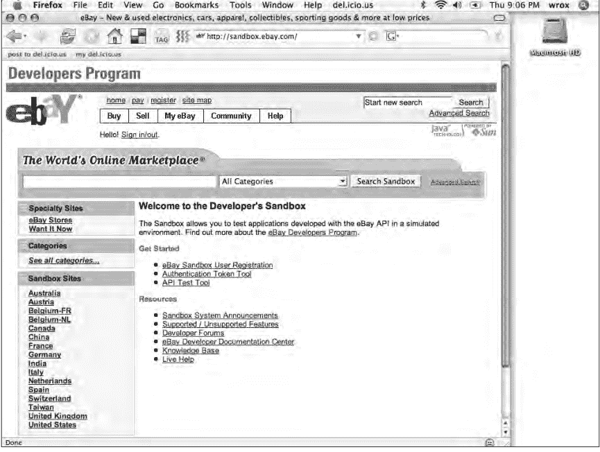

图 4-3

由于你在本书的项目中将只使用 Sandbox（沙箱），因此你将无法为自己的 eBay 账户（如果你有的话）创建 Auth Token，因为你的用户账户在 Sandbox 中并不存在。所以，首先请使用 `http://developer.ebay.com/DevZone/sandboxuser.asp` 上的工具在 Sandbox 中创建一个新的 eBay 测试用户账户。

现在，回到 Auth Token 生成工具。将生产环境选择为 Sandbox，并勾选 Include The Rest Token 框。当系统提示输入 eBay 用户名和密码时，输入你刚刚创建的 Sandbox 用户的用户名和密码，并同意服务条款。

屏幕将显示你的 Sandbox 用户的 Auth Token，更重要的是 REST Token。请记住，与你为 eBay 生成的所有其他密钥不同，这个密钥代表的是你作为 eBay 用户的身份，而不是开发者的身份。

正如你可能已经猜到的，REST Token 将允许你向 eBay 发送 REST API 请求。与本章描述的其他 REST 接口一样，你可以通过一个返回 XML 数据的简单请求来测试 eBay REST 接口。例如，以下调用将搜索 eBay 上的测试项目（注意请求 URI 中出现了 REST Token 和你创建的 Sandbox 用户的用户 ID）：

```
http://rest.api.sandbox.ebay.com/restapi?CallName=GetSearchResults&RequestToken=RESTTOKEN&RequestUserId=SANDBOXUSER&Query=test+item&Schema=1
```

来自 eBay 的响应 XML 相当冗长，但与之前的响应一样，它包含一个响应项——在本例中称为 `<SearchResultItem>`——其中包含从搜索返回的数据。此示例响应经过了缩写，但它可以让你了解数据的样子：

```
<SearchResultItem>
<Item>
<ItemID>110000966653</ItemID>
<ListingDetails>
<StartTime>2006-06-20T21:31:22.000Z</StartTime>
<EndTime>2006-06-25T21:31:22.000Z</EndTime>
<ViewItemURL>
http://cgi.sandbox.ebay.com/ws/eBayISAPI.dll?ViewItem&item=110000966653&ih=001&category=2200&rd=1
</ViewItemURL>
</ListingDetails>
<SellingStatus>
<BidCount>0</BidCount>
<CurrentPrice currencyID="USD">11.0</CurrentPrice>
</SellingStatus>
...
<ListingDuration>Days_5</ListingDuration>
</Item>
```

如果你熟悉 eBay，你会发现此响应中包含许多有用的 eBay 列表信息。

### Google 搜索

与 Yahoo! 一样，Google 为其搜索引擎提供了 API，并且为其几乎所有其他 Web 服务也提供了 API。你在本书中不会尝试 Google 搜索，但作为一名混接（mashup）开发者，了解 Google 搜索 API 工作方式的基本原理是有用的，这可以让你从另一个视角了解 Web 应用程序 API 的运行方式。

不幸的是，Google 搜索 API 没有 REST 方法。相反，Google 搜索 API 是由 *简单对象访问协议*（Simple Object Access Protocol），即 SOAP 驱动的。不过不用担心，SOAP 相当容易理解。你还记得 Yahoo! Maps API 倾向于从 XML 文件获取参数，而不是在查询字符串中指定吗？SOAP 就像发送一个 XML 文件。SOAP 简单来说就是一种用于在网络上交换信息（在本例中为 API 参数和方法）的标准 XML 文件格式。正如你所看到的，其他 API 发送和检索数据的方式各不相同。SOAP 通常稍微严格一些——请求和响应都必须遵循 SOAP 架构标准发送，并且这些标准必须完全匹配才能工作。

请求和响应可以通过各种协议发送。然而，就像我们的 REST 示例一样，使用 HTTP 协议通常是最常见的。

以下是一个向 Google 发送的 SOAP 请求示例，用于搜索 `munny gallery`，其中几处要点以**粗体**标出：

```
<?xml version='1.0' encoding='UTF-8' ?>
<SOAP-ENV:Envelope xmlns:SOAP-ENV="http://schemas.xmlsoap.org/soap/envelope/"
xmlns:xsi="http://www.w3.org/1999/XMLSchema-instance"
xmlns:xsd="http://www.w3.org/1999/XMLSchema">
  <SOAP-ENV:Body>
    <nsl:doGoogleSearch xmlns:nsl="urn:GoogleSearch" SOAP-ENV:encodingStyle="http://schemas.xmlsoap.org/soap/encoding/">
      <q xsi:type="xsd:string">munny gallery</q> <!--
      key xsi:type="xsd:string">APIKEY</key> -->
      <start xsi:type="xsd:int">0</start>
      <maxResults xsi:type="xsd:int">10</maxResults>
      <filter xsi:type="xsd:boolean">true</filter>
      <restrict xsi:type="xsd:string"></restrict>
      <safeSearch xsi:type="xsd:boolean">false</safeSearch>
      <lr xsi:type="xsd:string"></lr>
      <ie xsi:type="xsd:string">latin1</ie>
      <oe xsi:type="xsd:string">latin1</oe>
    </nsl:doGoogleSearch>
  </SOAP-ENV:Body>
</SOAP-ENV:Envelope>
```

需要注意的重要点是 `<SOAP-ENV:Envelope>` 和 `<SOAP-ENV:Body>` 元素及其属性。这些定义了这是一个 SOAP 请求。在 `<SOAP-ENV:Body>` 内部是描述请求的元素。`doGoogleSearch` 表示你想进行搜索，而 `<q>` 元素描述了你要搜索的内容。

还有一个 `<key>` 元素，它是 Google 搜索使用的 API 密钥。你可以在 `http://api.google.com/createkey` 获取你的 Google API 密钥。

SOAP 的内容远不止于此。不过，目前你只需要知道它是另一种与 API 交流的标准方式，而且是 Google 搜索所使用的。如果你有兴趣了解更多，可以查看 W3C 的 SOAP 入门指南，地址为 `www.w3.org/TR/soap12-part0/`。你可能也会觉得 SOAP 的历史很有趣，可以在 `www.xmlrpc.com/stories/storyReader$555` 找到相关内容。

### WordPress

本书选择的博客软件是 WordPress。WordPress 是一个由 PHP 和 MySQL 驱动的极其强大的博客引擎，你可以免费获得授权并在自己的服务器上运行。它没有 API，但在本书的项目中你不需要 API。相反，你将直接对 WordPress 及其模板进行修改。稍后你将读到如何安装 WordPress 并使其运行，以及如何用它创建一些混接应用。不过，如果你现在想阅读更多内容，请查看 WordPress 网站 `http://wordpress.org`。

图 4-4 显示了一个新 WordPress 博客的样子。

### Firefox 扩展

你已经初步尝试过 Firefox 了。信不信由你，Firefox 本身也是可以混接的。Firefox 向所有人免费提供了一套用于创建 *扩展*（extensions）的完整架构，这使得 Firefox 用户能够修改 Firefox 并添加新功能。第 12 章的一个项目涉及创建 Firefox 扩展，但你可能想提前尝试几个扩展，以感受它们是如何工作的。如果你以前从未安装过 Firefox 扩展，那么你很可能会对外部开发者用它们实现的功能感到非常惊讶。你可以在 `https://addons.mozilla.org/extensions.php?app=firefox` 浏览并安装一些 Firefox 扩展。

Firefox 扩展简直有成百上千个。如果你想找一个尝试，可以试试 Adblock。它为 Firefox 提供了一个可自定义的内容拦截系统，使你能够永久隐藏烦人的网页广告。你可以从 `https://addons.mozilla.org/firefox/10/` 安装。

作为一名 Web 开发者，你可能也会对 Web Developer 扩展感兴趣，它为 Firefox 增加了大量 Web 开发功能。你可以在 `https://addons.mozilla.org/firefox/60/` 获取此扩展。

此外，del.icio.us 团队编写了一个扩展，旨在改进 Firefox 中 del.icio.us 的使用体验。该扩展除了其他功能外，还会在你的 Firefox 工具栏中添加一个标签按钮，用于创建 del.icio.us 帖子，并将 del.icio.us 作为搜索引擎添加到 Firefox 搜索实用程序中。你可以从 `http://del.icio.us/help/firefox/extension` 安装此扩展。

如果你将 Firefox 作为常用浏览器，强烈建议安装 del.icio.us Firefox 扩展。

> 如果你是 Firefox 扩展的新手，第一次在安装过程中可能会遇到一些小麻烦。为了你的安全，Firefox 永远不会安装来自不信任网站的扩展。因此，当你第一次在托管 Firefox 扩展的网站上点击安装链接时，Firefox 会要求你同意你信任该 Web 托管商安装扩展。点击“允许”按钮将该托管商添加到信任站点列表中。然后返回网站，点击“安装”链接并安装扩展。你必须始终重启 Firefox 才能使新安装的扩展生效。

Firefox 的 Greasemonkey 扩展

有一个扩展允许你进一步扩展 Firefox 的功能，更具体地说，是扩展你浏览的网站的功能。Greasemonkey 实际上允许你在浏览的网页之上覆盖特殊的脚本，从而根据你的喜好改变网页的外观和功能。这仅影响你通过安装了 Greasemonkey 的 Firefox 查看网页时的视图，并不会改变实际的网页。你可以从 `http://greasemonkey.mozdev.org/` 下载并安装 Greasemonkey。

你可能会好奇为什么在创建混接应用时要使用 Greasemonkey。那么，请考虑它与 del.icio.us 的关系。目前，del.icio.us 发布界面中的 `notes` 字段限制在 255 个字符以内，如果你输入超过这个长度，保存链接时文本会被截断。你可以使用 Greasemonkey 修改发布界面的 HTML 表单，从而将用户限制在这个最大字符数内。事实上，我写了一个 Greasemonkey 脚本来完成这件事。要查看它，请安装 Greasemonkey（如果你的系统中尚未安装），然后浏览至 `http://negatendo.net/~brett/deltheextended.user.js` 并安装该脚本。

这个脚本并不复杂。当 Greasemonkey 脚本应用于页面时，它会在页面上执行 DHTML 和 JavaScript 程序，从而导致网站自身的 HTML 发生变化。此脚本只需在发布界面上找到 `notes` 字段，并将其 `maxlength` 属性设置为 255，从而防止在该字段中输入超过 255 个字符。你将在本书稍后部分获得更多关于 Greasemonkey 的实践经验。

### 总结

不要被本章呈现的所有信息搞得不知所措。再次强调，你不需要记住本章描述的不同服务的所有细节以及它们的 API 如何工作；你只需要对它们有初步的了解即可。如果你以前从未使用过像 Flickr 和 eBay 这样的网站，或者从未安装过 Firefox 扩展，你可能想在继续前进之前花点时间尝试一下这些网站。


## 第一部分：对 Mashup 友好的 Web

在本书的这一部分中，我们将快速带您领您游览构成当前 Mashup 世界的 Web 服务和概念。这包括对 del.icio.us 及其 API 和 RSS 的深入探讨。您还简要了解了一些对 Mashup 有用的其他 Web 服务，以及作为开发人员可以与它们进行交互的切入点。在第二部分中，您将更详细地了解混合和揉合的“设备”，包括您将要使用的其他技术和工具的概述。

### 练习

本章介绍了几种不同的 Web 应用程序及其 API 的工作方式。根据提供的信息，看看您能否构造出以下 REST URI 调用。您可能需要查阅特定 API 的在线文档。

1. 创建一个 Flickr REST API 调用，用于获取用户的最后 100 张公开的 `favorites` 照片（用户在 Flickr 上特别标记为收藏的照片）。使用 `flickr.favorites.getPublicList` 作为方法，`EXAMPLEAPIKEY` 作为 API 密钥，`EXAMPLEUSERID` 作为用户 ID。

2. 修改本章中讨论 Yahoo! Maps Beta 时的示例地理编码 RSS，使地图显示在城市级别。如需帮助，请参考 *Yahoo! Maps Simple API Reference Manual* (http://developer.yahoo.com/maps/simple/V1/reference.html) 并查找 `ymaps:ZoomLevel` 元素。

3. 在 Google Search API 的讨论中，有一个执行 `munny gallery` 搜索的示例 SOAP 请求。将此 SOAP 请求修改为搜索 `atomic books`。

52

## 第二部分

## 准备进行 Mashup

- 第 5 章：Mashup 工具
- 第 6 章：更多 Mashup 技术
- 第 7 章：del.icio.us Mashup 技巧

## 5

## Mashup 工具

到目前为止，您已经了解了 Mashup 的基本组件和概念，但现在您需要收集装备。本章以及本书本部分的后续章节将为您提供在正式开展 Mashup 项目之前需要了解的最后一些工具、技术和技巧。

本章将为您介绍一些适用于 Windows 和 Mac OS X 平台的最佳免费及非免费源代码编辑器。在为 Web 和桌面开发 Mashup 项目时，一个优秀且稳健的编辑器是必不可少的。此外，您将通过演练学习如何在您的机器上运行一个功能齐全的 Apache、PHP 和 MySQL Web 开发服务器。您还将设置一个本地 WordPress 博客，这在本书的几个章节中将会用到。本章最后提供了一个 API 检查清单，您需要审阅它，以确保为 Mashup 将要协作的各种 Web 服务准备好了一切。

### 了解编辑器

您需要的第一件 Mashup 设备是一个优秀的源代码编辑器。由于您的 Mashup 将基于 Web，本节重点介绍专为 Web 应用程序开发设计的编辑器。

虽然这听起来很具体，但事实上符合这一类别的软件程序有数百个，且其中许多都非常出色。本节建议几个不错的选择，但这并不一定意味着它们在竞争如此激烈的市场中是最优秀的，或者将永远是最优秀的。

作为一名 Mashup 开发人员，您在选择编辑器时应关注的重要特性之一是良好的 XHTML 和 PHP *语法高亮（syntax highlighting）*，它会为您的源代码上色，使其更容易阅读。由于您很快就会看到，XHTML 和 PHP 将集成在同一段代码中，因此如果编辑器能够处理 *嵌入式（embedded）* 语法高亮（即在同一文档中出现一种或多种不同类型的语言），将会非常有帮助。此外，重要的是您的编辑器不要将代码保存为任何私有文件格式，而应保存为 Web 服务器能够读取和处理的正确纯文本格式。

> 您的软件平台可能已经内置了非常出色的编辑器。例如，Windows 记事本可以正常工作，但随着项目变得复杂（本书中的项目将会如此），您可能会很快发现它的简单难以满足需求。因此，建议使用本节中提到的更强大的编辑器。

如果您刚开始进行 Web 应用程序和 Mashup 开发，在摸清需求之前，您可能想选择一个免费编辑器。许多公司提供其编辑器的免费演示版本供试用。不要害怕尝试几个，直到找到一个您喜欢的。

Windows 平台最好的免费编辑器之一是 Crimson Editor。作为一款免费产品，它异常强大，包含了许多仅在商业编辑器中才有的功能。您可以从 `http://www.crimsoneditor.com/` 下载 Crimson Editor。

另一个同样强大且免费的 Windows 编辑器是 Notepad++，可以从 `http://notepad-plus.sourceforge.net/uk/site.htm` 下载。

在 Windows 世界中，优秀的免费编辑器如此之多，以至于很难找到一个功能超过免费版本的专业编辑器。然而，UltraEdit 是那些愿意付费购买软件（并换取大量功能和支持）的人的最爱。UltraEdit 可以在 `http://www.ultraedit.com/` 找到。

对于 Mac OS X 用户，编辑器市场同样竞争激烈。目前有两款免费编辑器很受欢迎：Smultron 和 TextWrangler 2。您可以从 `http://smultron.sourceforge.net/` 下载 Smultron，或从 `www.barebones.com/products/textwrangler/index.shtml` 下载 TextWrangler 2。事实上，TextWrangler 2 是史上最受欢迎的 Mac 编辑器之一 BBEdit 的免费精简版，您可以在 `http://www.barebones.com/products/bbedit/index.shtml` 找到它。然而，与 Windows 编辑器市场一样，即使是顶尖产品也有竞争对手，名为 TextMate 的编辑器正在迅速抢占 BBEdit 的市场。请在 `www.macromates.com/` 查看。

如果您是 UNIX 风格的用户，值得注意的是，UNIX 世界中的大多数编辑器都非常适合 Mashup 开发。这包括 GNU Emacs (`www.gnu.org/software/emacs/`) 和 Vim (`www.vim.org/`)。这些软件已移植到 Windows 和 Mac OS X，在这些平台上也能正常工作。如果您对其他编辑器不满意，可以尝试 GNU Emacs 或 Vim——它们随着时间的推移而演进，比几乎任何现代同类产品都更功能丰富、更高效且更稳健。不过，请务必花时间学习它们，因为它们都有自己独特的操作方式，可能与您的预期不同。关于 GNU Emacs 的更多内容，请查看 `www.lib.uchicago.edu/keith/tcl-course/emacs-tutorial.html` 的教程。您可以在 `http://heather.cs.ucdavis.edu/~matloff/UnixandC/Editors/ViIntro.html` 找到关于 Vim 的不错介绍。

### 设置 Web 开发环境

现在您已经有了编辑器，下一步是在您的机器上设置本地 Web 开发环境。

本质上，您是在自己的计算机上创建一台功能齐全的 Web 服务器，以便在合适的开发环境中开发和测试 Mashup。这比支付 Web 托管费用，并不断经历编辑、上传和测试的繁琐过程在公共网站上开发应用程序要容易得多。当您的 Mashup 准备就绪时，您可以先在本地机器上测试其功能，然后将其上传到 Web 并正式上线。

本节将引导您在 Windows 和 Mac OS X 计算平台上安装和测试免费的 Apache Web 服务器。您还将使用 PHP Web 编程语言启用 Apache。此外，本节将向您展示如何在机器上设置一个功能齐全的 MySQL 数据库服务器。

> 您将使用 PHP Web 编程语言 4.3 版本来构建您的 Web 开发环境。虽然开始开发和学习 PHP 5 是个好主意，但 PHP 4 对于您的项目来说绰绰有余，而且在大多数 Web 托管商那里更为普遍。出于类似原因，您也将使用 MySQL 5.0 和 Apache 2.0。

如果您使用的是 Unix 衍生系统，您的机器上可能已经安装了其中大部分内容。一个了解如何启动设置过程的好网站是 www.lamphtowo.com/。请放心，Apache、PHP 和 MySQL 在您的平台上均可用。（事实上，它们就起源于此。）

#### 设置 Windows Web 开发环境

设置 Windows Web 开发环境需要完成两项任务。首先，安装并设置 Apache 服务器，包括运行 PHP。其次，安装 MySQL 数据库服务器。

#### 在 Windows 上设置 Apache 服务器

按照以下步骤下载并安装 Windows 版本的 Apache HTTP 服务器：

> 这些说明适用于 Windows XP SP2 (Service Pack 2)。如果您使用不同版本的 Windows，安装体验可能会有所不同。

1. 浏览到 Apache HTTP 网站 http://httpd.apache.org/download.cgi。进入下载区域，查找 Apache HTTP 2.0 或更高版本的 Windows 安装程序。它通常被称为 Win32 Binary (MSI Installer)。下载并运行安装程序。

2. 当安装程序要求您输入 Web 服务器的网络域和服务器名称时，两者均输入 `localhost`。

3. 安装完成后，您的机器上应该运行着一个功能齐全的 Apache Web 服务器。为了验证这一点，请浏览到 `http://localhost/`，您应该看到 "It works!"。

4. 默认情况下，Apache 将其 Web 文档存储在 `C:\Program Files\Apache Software Foundation\Apache2.2\htdocs`。这个位置有点难访问，因此可以通过将 `htdocs` 文件夹移动到更容易到达的位置（如 `C:\htdocs`）来更改 Web 文档的存储位置。

5. 要告知 Apache 您的新 `htdocs` 位置，您需要编辑 Apache `httpd.conf` 配置文件。浏览到 开始 $\rightarrow$ 所有程序 $\rightarrow$ Apache HTTP Server 2.2.2 $\rightarrow$ Configure Apache Server，然后选择 Edit the Apache httpd.conf Configuration File。这将用记事本打开 `httpd.conf` 文件，您将在接下来的步骤中定义新的 `htdocs` 目录。

6. 修改 `DocumentRoot` 配置。为此，在 `httpd.conf` 中查找以下行（您可以使用记事本中的“查找”命令来定位该行）：

```
DocumentRoot "C:/Program Files/Apache Software Foundation/Apache2.2/htdocs"
```


# 第二部分：准备开始

并将其更改为：

```
DocumentRoot "C:/htdocs"
```

+   7.  更改 httpd.conf 文件中定义 Web 目录设置的部分的目录引用。为此，请找到以下行：
`<Directory "C:/Program Files/Apache Software Foundation/Apache2.2/htdocs">`
并将其更改为：
`<Directory "C:/htdocs">`

+   8.  要使这些配置生效，您需要保存 httpd.conf 文件，然后重新启动 Apache。幸运的是，您的“开始”菜单中安装了一个程序可以做到这一点：转到“开始”>“所有程序”>“Apache HTTP Server 2.2.2”>“控制 Apache 服务器”>“重启”。

在本书中，此文件夹被称为 htdocs 文件夹或目录。当您被告知将文件保存到 htdocs 文件夹时，请将其保存到您在此过程中指定的文件位置。同样，当您需要浏览到特定文档或目录时，请通过 `http://localhost/地址` 进行浏览。因此，例如，如果您需要浏览到 htdocs 目录中的 index.php，请在 Web 浏览器中转到 `http://localhost/index.php`。此地址的 `localhost` 部分对应于 C:\htdocs 目录。

> **请勿双击文件或手动从 Web 浏览器打开它。当您浏览到文件时，您并非在正常打开文件——相反，您是在告诉 Apache 处理该文件，然后将其内容发送到您的 Web 浏览器。这包括 PHP 代码，Apache 需要对其进行处理以执行服务器端功能（例如从数据库中提取数据），然后将其发送到您的 Web 浏览器。**

+   9.  下载 PHP，安装它，并对 Apache 进行一些配置更改以运行它。首先从 `www.php.net/downloads.php` 下载 PHP 4.4.2 安装程序。
*请记住，现在不要下载 PHP 5；暂时坚持使用 PHP 4，并确保下载安装程序。*

+   10. 运行安装向导。当提示您选择 Web 服务器时，请选择 Apache。在安装过程结束时，您会收到一条通知，说您需要自己配置 Web 服务器。这没关系——这正是您接下来要做的。

+   11. 如果尚未打开，请转到“开始”>“所有程序”>“Apache HTTP Server 2.2.2”>“配置 Apache 服务器”>“编辑 Apache httpd.conf 配置文件”来打开 Apache httpd.conf 文件。您需要向此文件中添加几行。这几乎可以在任何地方完成，但在接下来的步骤中，您将在最近更改的 `DocumentRoot` 配置变量下方添加它们。

+   12. 找到以下行：
`DocumentRoot "C:/htdocs"`
并在其正下方添加以下内容：

```
ScriptAlias /php/ "C:/PHP/"
AddType application/x-httpd-php .php
Action application/x-httpd-php "/php/php.exe"
```

这将对任何以 .php 扩展名结尾的文件运行 php.exe 二进制文件，这通常被称为*以 CGI 方式运行 PHP*。

**13.** 找到以下行：

```
DirectoryIndex index.html
```

并将其更改为：

```
DirectoryIndex index.html index.php
```

**14.** 保存 httpd.conf，并通过转到“开始”>“所有程序”>“Apache HTTP Server 2.2.2”>“控制 Apache 服务器”>“重启”来重新启动 Apache 服务器。

您所做的更改将告诉 Apache，当您浏览到目录时（如果该文件存在），自动执行任何名为 index.php 的文档。因此，例如，如果在 htdocs 中有一个名为 project1 的子目录，并且其中有一个 index.php 文件，您可以通过 `http://localhost/project1/` 浏览到它。您不需要在 URL 中指定 `index.php` 作为一部分。

**15.** 为确保 PHP 正常工作，请在您的编辑器中创建一个新文件并输入 `<?php phpinfo() ?>`。将该文件以 **phpinfo.php** 保存到您的 `htdocs` 目录中。然后，浏览到 `http://localhost/phpinfo.php`。您应该会看到一个大的紫色表格，其中包含有关此 PHP 安装的信息。这将让您知道 PHP 已成功启动并运行。如果您没有看到此屏幕，则可能是您的配置有问题。

一些 Windows 设置中常见的一个问题是 Apache 的权限设置。如果您发现收到诸如“客户端被服务器配置拒绝”或“您无权在此服务器上访问 /php/php.exe/index.php”之类的错误，您需要更改 Apache 以允许本地计算机执行 PHP 代码。幸运的是，这只是另一个 httpd.conf 更改。在 httpd.conf 中找到以下行：

```
<Directory />
    Options FollowSymLinks
    AllowOverride None
    Deny from all
    Satisfy all
</Directory>
```

并添加以下阴影部分行：

```
<Directory />
    Options FollowSymLinks
    AllowOverride None
    Deny from all
    Satisfy all
    Allow from 127.0.0.1
</Directory>
```

然后保存 httpd.conf 并重新启动 Apache。

# 第二部分：准备开始

#### 在 Windows 上安装 MySQL 数据库服务器

接下来，您需要安装 MySQL 数据库服务器。请按照以下步骤操作：

+   1. 浏览到 MySQL 5.0 下载页面 `http://dev.mysql.com/downloads/mysql/5.0.html`，下载 Windows 安装程序（在此列表中查找基本 Windows (x86) 安装程序条目旁边的“Pick a Mirror”链接）。
2. 运行安装程序进行典型安装。安装完成后，保持“立即配置 MySQL 服务器”框的选中状态，以继续到配置实用程序。在第一个实用程序屏幕上，为您的配置类型选择“标准配置”，在下一个屏幕上，确保“安装为 Windows 服务”和“将 Bin 目录包含在 Windows PATH 中”均已选中。在最后一个屏幕上，取消选中“修改安全设置”。对于实际服务器来说，这不是一个好主意，但因为这是本地开发服务器，所以不需要设置 root 用户密码或不允许匿名访问。
3. 配置完成后，MySQL 服务器将自动启动。要测试它是否正在运行，请转到“开始”>“运行”，并在要打开的程序中输入 **cmd**。单击“确定”，然后在提示符处输入 `mysql -u root`。

如果一切顺利，MySQL 命令行将类似于以下内容：

```
Welcome to the MySQL monitor.  Commands end with ; or \g.
Your MySQL connection id is 2 to server version: 5.0.22-community-nt

Type 'help' or '\h' for help. Type '\c' to clear the buffer.

mysql>
```

您已成功连接到本地 MySQL 服务器。要退出，请输入 **quit**。此时，您的 Web 开发环境已准备就绪。请跳转到本章的下一个“试试看”部分继续。

#### 在 Mac OS X 上设置 Web 开发环境

如果您使用的是 Mac OS X，设置起来相当简单，因为您需要的许多软件已经在一定程度上预装好了。

这些说明假设您使用的是 Mac OS X 10.4 (Tiger) 或更高版本。

#### 在 Mac OS X 上设置 Apache

请按照以下步骤下载并安装适用于 Mac OS X 版本的 Apache HTTP 服务器：

+   1. Apache 很可能已经安装在您的 Mac OS X 计算机上，但您需要将其打开。最简单的方法是通过“系统偏好设置”界面。转到 Apple 菜单并选择“系统偏好设置”。单击“共享”图标，然后单击“个人 Web 共享”复选框以启动 Apache 服务器。
2. 当 Web 服务器完成启动过程后，您可以通过在 Web 浏览器中浏览到 `http://localhost/` 来验证它是否正在运行。您应该会看到一个 Apache 测试页面。Apache 正在提供给您的 Web 浏览器的文件（包括此测试页面）可以在计算机上的 /Library/WebServer/Documents 目录中找到。

## 第 5 章：混搭工具

3. 在您的主目录（您保存所有文件和设置的位置）中还有一个 Sites 文件夹，它正在通过内置的 Apache 服务器共享文件。打开 Sites 文件夹，您应该会看到一个 index.html 和其他文件。在创建本书中的项目时，您可能会发现从这个文件夹开始更容易。

您的 Sites 文件夹的 URL 包含您的 Mac OS X 帐户的登录名或*短名称*。例如，如果您的登录名是 janesmith，则 Sites 文件夹的地址将是 `http://localhost/~janesmith/`。浏览到您登录名的地址，您应该会看到一个 Mac OS X 个人 Web 共享欢迎页面。如果此页面未出现，请确保您在 URL 中包含了波浪号 (~) 字符。

*无论您选择在主 Web 文档目录 /Library/WebServer/Documents 还是在您的 Sites 文件夹中工作，请记住，这将是本书中始终被称为您的 htdocs 文件夹或目录的地方。如前所述，当您需要浏览到 htdocs 目录中的特定文件或文件夹时，请通过访问 http://localhost/ 或 http://localhost/~janesmith/ 地址来完成。请勿直接双击或用 Web 浏览器打开该文档。*

4. PHP 支持也已内置于 Mac OS X 中，但需要启用它。为此，请打开您的“应用程序”文件夹，打开“实用工具”文件夹，然后双击“终端”程序应用程序。您应该会看到 Mac OS X 命令提示符，它可能类似于以下内容：

```
Last login: Mon Jul 10 10:51:52 on ttyp2
Welcome to Darwin!
dib:~ bretto$
```

*您可以在终端中做很多事情，包括在计算机上移动和更改文件以及启动和停止计算机服务和程序。目前，您将使用它来编辑 Apache httpd.conf 配置文件以启用 PHP，然后重新启动 Apache。*

5. 使用 cd（更改目录）命令，输入 **cd /etc/httpd** 并按 Return 键，转到 /etc/httpd 目录。

*如果您好奇，可以在终端中输入 **ls** 并按 Return 键来列出目录的内容。您将看到此目录中的所有文件。您感兴趣的文件是 httpd.conf，它是主要的 Apache 配置文件。*

6. 在编辑 httpd.conf 之前，通过发出 **cp httpd.conf httpd.conf.backup** 命令对其进行备份。

7. 现在您准备好编辑 httpd.conf 了。输入 **sudo vim httpd.conf**，在提示符处输入您的用户密码，然后按 Return 键。

**sudo** 命令使您能够使用内置的 Vim 编辑器通过以管理员身份（而非普通用户身份）访问来编辑 httpd.conf。无特权用户无法更改 httpd.conf。如果您在计算机上没有管理员权限，您将无法成功编辑 httpd.conf。

*接下来的几个步骤将引导您了解正确编辑文件所需的 Vim 命令。只要您完全按照步骤操作，应该就不会有问题。但是，如果您不习惯使用 Vim 并想使用其他编辑器，请随时输入 :q 退出 Vim，然后在您选择的编辑器中打开 httpd.conf。*


## 第二部分：准备开始配置

+   8. 你需要在这个文件中找到并修改两行。这个文件相当长，但你可以使用 vim 的查找命令来定位需要的行。按斜杠（/）键开始新的搜索，然后输入 `LoadModule php4_module` 并按回车。光标会移动到一个如下所示的行：

`#LoadModule php4_module libexec/httpd/libphp4.so`

httpd.conf 中的这一行告诉 Apache 加载运行 PHP 所需的 Apache 模块。开头的 # 表示这一行当前被注释掉了，Apache 会忽略它。要取消注释，按零（0）键将光标移到行首，然后按 x 键删除光标下的字符。这样会删除 # 符号。

+   9. 再次按 / 键，然后输入 `AddModule mod_php4` 并按回车，在文档中搜索需要取消注释的下一行。它应该如下所示：

`#AddModule mod_php4.c`

使用与之前相同的方法取消注释这一行：按 0 移动到行首，然后按 x 删除 # 字符。

取消这两行的注释后，重启 Apache 后 PHP 就会启用。

+   10. 要保存对此文件的更改并退出 Vim，输入冒号字符（:）然后输入 x 字符并按回车。

+   11. 你可以通过系统偏好设置重启 Apache，先禁用再重新启用"个人 Web 共享"，或者从终端进行操作。要从终端重启 Apache，输入 `sudo apachectl restart` 然后按回车。

你可能会再次被要求输入密码。如果 httpd.conf 文件中没有错误，Apache 会显示以下消息：

`/usr/sbin/apachectl restart: httpd restarted`

如果出现问题，通过输入 `sudo cp httpd.conf.backup httpd.conf` 从备份中恢复 httpd.conf 文件，然后再试一次。

+   12. 要确保 PHP 正常工作，打开编辑器并将一个新文件保存到 htdocs 目录，命名为 phpinfo.php。在 phpinfo.php 中放入以下代码：

`<?php phpinfo(); ?>`

+   13. 使用 localhost 地址在浏览器中访问这个文件。例如，如果你使用 Sites 目录作为 htdocs 目录，且你的登录名是 janesmith，你应该访问 `http://localhost/~janesmith/phpinfo.php`。

如果 PHP 正常工作，你应该会看到各种关于 PHP 的信息，包括你正在运行的 PHP 版本等等。如果没有看到，或者你看到的是刚刚保存在 phpinfo.php 中的代码，那说明出了问题。请检查你的 httpd.conf 文件。

#### 在 Mac 上安装和配置 MySQL

MySQL 为 MySQL 5 提供了易于使用的 Mac OS X 软件包安装程序。你可以在 `http://dev.mysql.com/downloads/mysql/5.0.html` 找到这个安装程序。

下载标准版，双击 .dmg 文件挂载磁盘映像，然后点击软件包安装程序来安装 MySQL。还要确保运行名为 `MySQLStartupItem.pkg` 的软件包安装程序，以便 MySQL 自动启动。

> 不用担心为你的 MySQL 服务器设置 root 密码。在大多数情况下，不设置密码会是个非常糟糕的主意，因为它会让外部用户无限制地访问 MySQL 和你的数据。但是，由于你只是在本地开发，而且假定没有其他人从外部访问你机器上的 Web 服务器，所以对于你的开发环境来说，跳过设置 MySQL root 密码可能是可以的。如果你担心这一点，开启计算机的防火墙并启用默认设置，在大多数情况下可以完全阻止外部访问你的本地 MySQL 服务器。

要确保 MySQL 数据库服务器正在你的计算机上运行，通过终端应用程序返回命令提示符。输入 **mysql -u root** 然后按回车键。

尝试连接到你的本地 MySQL 服务器。如果你还没有为 MySQL root 用户设置任何密码，你应该会看到类似以下内容，表明 MySQL 正在运行：

```
Welcome to the MySQL monitor. Commands end with ; or \g.
Your MySQL connection id is 2 to server version: 5.0.20a-standard
Type 'help;' or '\h' for help. Type '\c' to clear the buffer.

mysql>
```

这是 MySQL 命令行，你可以在这里与 MySQL 和 MySQL 数据库进行交互。你将通过免费的 phpMyAdmin 软件与 MySQL 交互，所以现在输入 **quit** 退出 MySQL 命令行。

## 动手实践　创建你的第一个 PHP/MySQL 驱动的网页

现在你的 Web 开发环境已经运行起来了，要不要来一段简短的 PHP/MySQL 速成课程？这不仅可以帮助你学习一些 PHP 基础知识（如果你不熟悉 PHP 的话），还可以进一步测试你的 Web 开发环境。

在你的编辑器中，将一个新文件保存到 htdocs 目录。将其命名为 **example5-1.php**，并用以下代码填充：

```
<?php
$php_date = date("Y-m-d");
echo "The date is $php_date.";
?>
```

在这段代码中，你让 PHP 告诉你日期。在 Web 浏览器中访问 `example5-1.php`，你应该会看到以 YYYY-MM-DD 格式显示的当前日期打印到浏览器。

现在，修改你的代码，添加对 MySQL 服务器的连接和*查询*（即请求），如阴影行所示：

```
<?php
$php_date = date("Y-m-d");
echo "The date is $php_date.";
mysql_connect('localhost','root');
$query = "SELECT DATE_ADD('$php_date',interval 100 day)";
$result=mysql_query($query);
$row = mysql_fetch_row($result);
echo " The date in 100 days will be $row[0].";
?>
```

再次访问 example5-1.php，或者如果已经打开则刷新浏览器。你会看到不仅 PHP 现在告诉你日期，而且借助 MySQL，你还知道了从今天起整整 100 天后的日期。

### 工作原理

这个示例使用 Apache Web 服务器来调用 PHP 和 MySQL 的功能。具体来说，你使用 PHP 获取当前日期，并使用 MySQL（通过 PHP）基于 PHP 返回的第一个日期计算第二个日期。

注意代码是写在 PHP 括号中的，如下所示：

```
<?php
... 其余代码 ...
?>
```

这些尖括号用于告诉 Apache 你要执行一些嵌入式 PHP 代码，或者说一个 PHP 代码块。所有 PHP 代码都应该始终出现在这些括号之间。

在本书后面，你会在 PHP 括号或多个 PHP 括号周围添加 HTML 标记，以便向你的 Web 应用程序添加文本、图像等。PHP 括号放在页面任何位置时，都会告诉 Apache 执行 PHP 代码，然后继续解析页面。

示例中 PHP 代码块的第一行使用 PHP 的 date() 函数返回的值给变量 $php_date 赋值，本例中即 YYYY-MM-DD 格式的当前日期。然后，echo 命令将变量的值输出到 Web 浏览器：

```
<?php
$php_date = date("Y-m-d");
echo "The date is $php_date.";
```

接下来，PHP 代码块中的另外几行代码让 MySQL 计算从现在起 100 天后的日期。通常 MySQL 用于存储数据，但它也有许多功能可以进行这样的计算，有时会非常方便。

就像 PHP 通过 Apache 运行一样，MySQL 通过 PHP 运行。有专门的 PHP 函数负责处理 PHP 页面和 MySQL 服务器之间的通信。第一行让 PHP 建立与本地 MySQL 服务器（也称为 localhost）的连接，以 root MySQL 用户身份：

```
<?php
$php_date = date("Y-m-d");
echo "The date is $php_date.";
mysql_connect('localhost','root');
$query = "SELECT DATE_ADD('$php_date',interval 100 day)";
```

你需要用一种特殊的语言与 MySQL 交流，通常称为*查询*。本例中的查询用所需的 MySQL 命令给 `$query` 变量赋值，让它计算原始 `$php_date` 之后 100 天的日期。注意代码获取了从 PHP 得到的 `$php_date` 变量，并在查询中将其提供给 MySQL。然后 `mysql_query()` PHP 函数执行 MySQL 查询，并将结果赋给 `$result` 变量：

```
<?php
$php_date = date("Y-m-d");
echo "The date is $php_date.";
mysql_connect('localhost','root');
$query = "SELECT DATE_ADD('$php_date',interval 100 day)";
$result=mysql_query($query);
$row = mysql_fetch_row($result);
echo " The date in 100 days will be $row[0].";
?>
```

由于 MySQL 旨在存储和检索数据，成功执行查询后，它几乎总是返回数据的*行*，即使只返回了一个结果或*记录*。`mysql_fetch_row()` 函数接收返回的第一行，并将其作为数组变量提供给 PHP。这段代码中 PHP 括号内的最后一行再次使用 `echo` 命令，这次显示 `$row` 变量的值。方括号中的数字 0 表示你想获取数组的第一个元素或*索引*，其中将包含 MySQL 查询返回的值：

```
<?php
$php_date = date("Y-m-d");
echo "The date is $php_date.";
mysql_connect('localhost','root');
$query = "SELECT DATE_ADD('$php_date',interval 100 day)";
$result=mysql_query($query);
$row = mysql_fetch_row($result);
echo " The date in 100 days will be $row[0].";
?>
```

这个示例的目的是测试 PHP 和 MySQL 在你的 Web 开发机器上是否正常工作，并且彼此之间能够通信。如果你感到不知所措，或者不确定发生了什么，你可能想多了解一些关于 PHP 和 MySQL 以及它们如何工作的知识。本书中的项目至少需要 PHP 和 MySQL 的入门知识。下一章提供了对 PHP 和 MySQL 更深入的概述。你还可以参考许多关于 PHP/MySQL 编程的在线教程，例如 `www.webmonkey.com/webmonkey/programming/php/tutorials/tutorial4.html` 上的教程。

### 安装 phpMyAdmin

作为开发人员，有很多方法可以直接与 MySQL 交互，而且有很多理由这样做。在 Web 应用程序开发之前和开发过程中，你需要直接与 MySQL 通信来创建*数据库*和数据库*表*，并直接操作数据。


## 第二部分：准备进行 Mashup

对于 MySQL 初学者来说，最受欢迎的工具之一就是 phpMyAdmin。phpMyAdmin 是一个 Web 应用程序，它将所有你需要的 MySQL 操作以及更多功能封装在一个极其易用的基于 Web 的界面中。到目前为止，你已经拥有了直接在本地 Web 开发环境中运行该界面所需的一切。

在本书与 MySQL 交互时，步骤将描述你需要通过 phpMyAdmin 程序执行的操作。但是，如果你更习惯于通过命令行或其他方法操作 MySQL，请随意选择你喜欢的方式。

要安装 phpMyAdmin，只需从 `www.phpmyadmin.net/home_page/downloads.php` 下载即可。

解压压缩包并将 phpMyAdmin 文件夹放入你的 htdocs 目录中。压缩文件夹的名称可能附有 phpMyAdmin 的版本号，但你可以将其重命名为简单的 phpMyAdmin，以便于浏览。

将 phpMyAdmin 文件夹放入 htdocs 目录后，直接通过浏览器访问该路径，phpMyAdmin 应该会自动启动并运行。图 5-1 展示了它的外观。

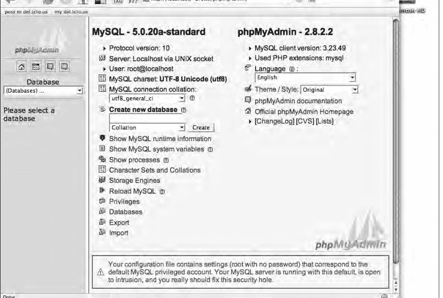
图 5-1

# 第 5 章：Mashup 工具

> 如果你设置了 MySQL root 用户的密码，你需要编辑 phpMyAdmin 的配置以反映这一更改。请参阅 phpMyAdmin 文档以获取进一步帮助。

### 设置 Weblog

在本书的许多 mashup 项目中，另一个非常有用的软件就是博客。你不需要将这个博客正式发布上线，只需在本地使用它进行实验。本书选择的博客软件是 WordPress，它在 Apache、PHP 和 MySQL 上运行得极其出色——最重要的是，它是免费的。即使你对写博客不感兴趣，在开发环境中安装 WordPress 也是值得的，因为你可以实验它与 del.icio.us 交互的不同方式。

首先，从 [http://wordpress.org/download/](http://wordpress.org/download/) 下载最新版本的 WordPress。

解压压缩包，其中包含一个名为 Wordpress 的文件夹，里面充满了各种 .php 文件以及其他类型的文件和目录。将此目录移至你的 Web 开发文件夹。

接下来，你需要为 WordPress 创建一个 MySQL 数据库。WordPress 将把所有的博客条目和其他需要的数据存储在这个数据库中。操作步骤如下：

- 1. 在本地机器上访问 phpMyAdmin。你应该以 MySQL root 用户身份登录 phpMyAdmin（如果你没有更改 phpMyAdmin 的任何配置指令，默认情况下应该是这样）。root 用户将拥有创建新数据库的相应权限。
- 2. 在 phpMyAdmin 主页的“创建新数据库”字段中输入 **wordpress** 作为数据库名称（参考图 5-1）。然后点击“创建”。
  
  如果一切顺利，你的数据库将被成功创建。（再次注意，在生产环境中，你会希望创建一个特殊的用户名和密码来使用 WordPress 数据库，但对于本地 Web 开发机来说，这不是必要的。）
- 3. 在 wordpress 文件夹中，应该有一个名为 wp-config-sample.php 的文件。用编辑器打开它，然后在 wordpress 目录下将其另存为新文件名 **wp-config.php**。这里，你将 WordPress 的示例配置文件复制到了一个新的、干净的配置文件中。该配置文件将包含 WordPress 在你的特定 Web 环境中运行所需的所有变量和其他数据。
- 4. 你需要修改此文件，告诉 WordPress 使用你新创建的本地数据库。找到以下行：

```php
// ** MySQL settings ** //
define('DB_NAME', 'wordpress');
define('DB_USER', 'username');
define('DB_PASSWORD', 'password');
define('DB_HOST', 'localhost');
```

并将它们更改为以下内容（修改阴影线部分）：

```php
// ** MySQL settings ** //
define('DB_NAME', 'wordpress');
define('DB_USER', 'root');
define('DB_PASSWORD', '');
define('DB_HOST', 'localhost');
```

这告诉 WordPress 使用你在 localhost 上创建的 wordpress 数据库，并以无密码的 root 用户身份访问。

- 5. 打开 Web 浏览器并访问 `wordpress/wp-admin/install.php`。例如，如果你的 Web 开发目录直接解析到 localhost，你需要访问 `http://localhost/wordpress/wp-admin/install.php`。这将引导你进入 WordPress 安装向导。
- 6. 按照向导中的指示完成 WordPress 安装。如果你暂时想不出 Weblog 的名称，就叫它 **del.icio.us Mashups**。

> 请务必记录下 WordPress 安装向导提供给你的管理员密码。你需要这个密码来登录 WordPress 发布博客条目，以及调用 WordPress API。

这就是全部步骤。如果你想看看你的示例 Weblog 是什么样子，只需访问 wordpress 目录即可。你应该看到与图 5-2 类似的内容。

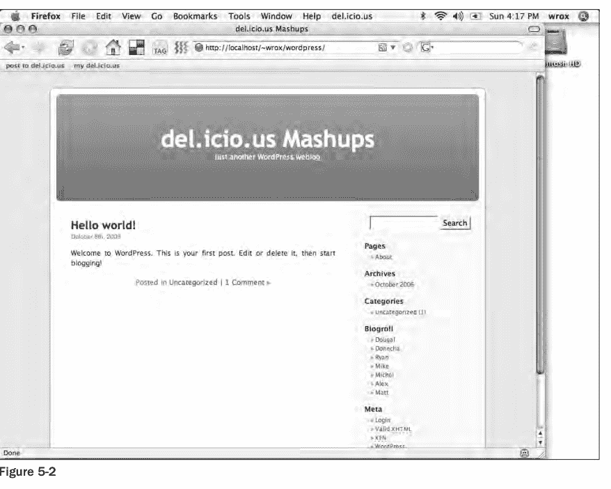
图 5-2

#### 尝试一下：学习博客的工作原理

如果你以前从未用过博客，尤其是 WordPress 博客，可以通过这个练习来了解 WordPress 的工作方式。你不仅能看到 WordPress 的表面运行情况，还能窥视其内部机制。

- 1. 访问你新安装的 WordPress 博客，观察页面的整体布局。这就是 WordPress 的*默认主题*。主题是由 PHP 和 HTML 代码组成的，决定了 WordPress 博客的外观和感觉。
- 2. 访问 wp-login.php 页面，输入首次设置 WordPress 时获得的管理员用户名和密码，登录 WordPress *后端* 界面。在这里你可以控制 WordPress 设置并发布新的博客条目。
- 3. 点击“外观 (Presentation)”链接进入主题区域。你应该至少安装了另一个名为 WordPress Classic 的主题。点击该主题以激活它。如果你返回查看博客，会发现它看起来完全不同了。（在第 8 章中，你会看到更多关于 WordPress 主题的技巧。）
- 4. 返回 WordPress 后端，点击“写 (Write)”链接进入发布界面。在这里，你可以发布一条新的博客条目。填写“标题 (Title)”和“内容 (Post)”字段，然后点击“发布 (Publish)”按钮。现在你已经发布了一篇新博客。再次查看你的博客以确认新条目。
- 5. 进入 phpMyAdmin，从数据库下拉列表中选择你的 wordpress 数据库（通常在左上角附近）。
  
  你应该能在 phpMyAdmin 的左栏看到数据库中的表列表。这些表中的每一个都包含 WordPress 以各种方式使用的信息。点击名为 `wp_posts` 的表。

  你将看到一个填满了 `wp_posts` 表信息的页面。这就是该表的*模式 (schema)*，它由描述表中数据类型的各种*字段 (fields)* 组成。
- 6. 点击 phpMyAdmin 中的“浏览 (Browse)”链接来查看 `wp_posts` 表的实际内容。你应该能看到你刚刚发布的条目的标题和内容，以及 WordPress 安装程序之前发布的几个测试条目（你可能需要滚动页面才能看到全部内容）。
- 7. 现在来看一些 WordPress 的 PHP 代码。在 wordpress 目录中找到 wp-content 文件夹。该文件夹内有一个 themes 目录，其中包含一个针对系统中安装的每个主题的独立目录。
- 8. 创建一个名为 *classic-mashup* 的新目录。将现有 classic 主题的所有内容复制（不要移动）到这个新目录中。
- 9. 打开目录中的 style.css 文件。这个文件不仅作为主题的*层叠样式表 (CSS)* 定义主题的大部分外观，还向 WordPress 描述该主题。你应该在文件顶部看到如下的主题信息：

Theme Name: WordPress Classic
Theme URI: http://wordpress.org/
Description: The original WordPress theme that graced versions 1.2.x and prior.
Version: 1.5
Author: Dave Shea


## 第二部分：准备进行 Mashup

-   10. 更改主题名称、描述和作者，以标识您正在创建的新主题，具体如下：

```
Theme Name: WordPress Classic Mashup
Theme URI: http://wordpress.org/
Description: Mashup of the original WordPress theme that graced versions 1.2.x and prior.
Version: 1.5
Author: Your Name with original theme by Dave Shea
```

完成更改后，保存并关闭此文件。

-   11. 现在您将对主题进行快速修改，并查看它如何改变您 wblog 的呈现方式。打开 classic-mashup 主题目录中的 `index.php` 文件。该文件控制 Web 日志条目的呈现。正如您所看到的，它是 HTML 和 PHP 代码的混合体。

-   12. 为了尝试对主题进行简单的修改并查看其是否生效，请在 `index.php` 中找到以下行：

```
<div class="meta"><?php _e("Filed under:"); ?> <?php the_category(',') ?> &#8212;
<?php the_author() ?> @ <?php the_time() ?> <?php edit_post_link(__('Edit This'));
?></div>
```

然后添加此处以**粗体**显示的文本：

```
<div class="meta"><?php _e("Filed under:"); ?> <?php the_category(',') ?> &#8212;
Posted by <?php the_author() ?> @ <?php the_time() ?> <?php edit_post_link(__('Edit
This')); ?></div>
```

-   13. 再次通过 `wp-login.php` 登录 WordPress，然后进入 Presentation（外观）区域。WordPress Classic Mashup 主题现在应该出现在可用主题列表中。点击该主题以激活它。

-   14. 浏览您的博客。短语 “Posted by” 应该出现在每篇帖子的作者姓名之前。

### 工作原理

WordPress 正如本书后续许多 mashup 项目一样，是一个使用 PHP 开发并实现 MySQL 后端的 Web 应用程序。这次“尝试一下”展示了 WordPress 工作的一些基本方式，以及 WordPress 的 MySQL 侧是什么样子的。它探讨了您如何通过直接修改 WordPress 源代码来改变其外观（以及最终改变其功能）。

WordPress 后端是您可以控制 wblog 所有发布和其他内容管理的地方。您在后端添加或更改的内容会保存到 WordPress MySQL 数据库中。当您发布一篇新博客条目时，所有关于它的信息——包括标题、内容、发布日期等——都通过 SQL 查询保存到 MySQL 数据库中。当您在 phpMyAdmin 中查看 `wp_posts` 表时，您会看到当前保存到 WordPress 数据库的所有帖子。数据以行形式存储在表的列中，每列代表一种应该存在的数据类型。例如，`post_content` 列是一个文本列，包含帖子的内容，每一行代表一篇发布到博客的帖子。从技术上讲，您可以使用 phpMyAdmin 或其他方法通过 MySQL 直接编辑帖子，编写查询来更改 MySQL 数据，但并不推荐这样做，因为这可能会导致 WordPress 崩溃。

除了使用 PHP 从 MySQL 存储和检索数据外，WordPress 还使用 PHP 以各种方式将数据作为博客显示。Web 日志的实际外观和感觉由 WordPress 主题控制。在本例中，您创建了一个新主题（基于现有主题），并对其进行了修改以改变博客的呈现方式。所有涉及的操作仅仅是对一些现有的 PHP 代码进行了相当简单的修改。

### 账户与 API 密钥

第 4 章概述了您将要使用的各种 Web 服务，并提供了如何通过 API 密钥（或其他方法）获得特殊开发人员访问权限的说明。

如果您还没有完成，请注册以下 Web 服务，作为构建 mashup 工具包的最后一项任务：

-   对于 Flickr (http://www.flickr.com)，请执行以下操作：
    -   在 http://www.flickr.com/signin/ 注册 Flickr 账户（如果您有 Yahoo! ID，可以使用该 ID）。
    -   在 http://www.flickr.com/services/api/key.gne 申请 Flickr API 密钥。（只要将其用途限制在本书的项目中，非商业密钥即可。）
-   对于 Yahoo! Maps Beta (http://maps.yahoo.com) 和 Yahoo! Search，请获取以下内容：
    -   在 https://edit.yahoo.com/config/eval_register 获取 Yahoo! ID（如果您还没有的话）。
    -   在 http://api.search.yahoo.com/webservices/register_application 获取 Yahoo! Application ID。
-   对于 Amazon Web Services (http://aws.amazon.com)，您需要以下内容：
    -   一个 Amazon.com 客户账户，您可以在申请访问密钥时注册。
    -   一个 AWS 访问密钥（access key）和秘密访问密钥（secret access key），您可以在 http://www.amazon.com/gp/aws/registration/registration-form.html 获取。
-   要成为 eBay 开发人员，请执行以下操作：
    -   在 http://developer.eBay.com/join 注册 eBay 开发人员计划。
    -   在 http://developer.ebay.com/DevZone/sandboxuser.asp 创建一个 Sandbox eBay 用户账户。
    -   在 http://developer.ebay.com/tokentool/ 获取您的 Sandbox 用户的 Auth Token 和 REST token。

### 本章小结

到目前为止，希望您对将用于开发 mashup 的 Web 开发环境及其工作原理有所了解，并且熟悉了一些将要采用的基本工具、技术和技术。在深入研究细节之前，您还需要熟悉另外几种技术。下一章将解释这些技术是什么。

### 练习

如果您想在新的 Web 开发环境中进一步尝试，可以尝试以下练习。

-   1. 如果您在 `htdocs` 目录中创建了一个名为 `my_mashup_project` 的子文件夹，并且其中包含一个 `index.php` PHP 页面，您在 Web 浏览器中应该访问哪个地址来查看此页面？
-   2. 在 `example5-1.php` 中，您编写了一些基础的 PHP 和 MySQL 代码来输出当前日期以及 100 天后的日期。要计算给定 PHP 日期前 100 天的日期，需要什么样的 MySQL 查询？（对于此练习，您可以参考 MySQL 文档中的 `DATE_SUB()` 函数，文档地址为 http://dev.mysql.com/doc/refman/5.0/en/index.html。）
-   3. 和所有优秀的博客一样，您的新 WordPress 博客拥有 RSS 馈送。事实上它有多个。您的 WordPress 博客的 Entries（条目）和 Comments（评论）RSS 馈送的 URL 分别是什么？

## 6 # 更多 Mashup 技术

之前的章节重点介绍了一些基础技术，如 REST、SOAP、RSS 和 XML。目的是向您展示 mashable 软件工作的相似方式。当然，这些技术并不能涵盖制作 mashup 所需的一切。如果说有什么能让 mashup 显得独特，那就是它们可以结合广泛的 Web 编程语言和软件来完成任务。本章和第二部分的其余部分将为您提供开始 mashup 开发所需的最终知识和工具。

本章将对您的 mashup 项目中可能涉及的大多数其他技术进行快速概述。不要求您在结束时成为所有这些技术的专家，但您绝对应该熟悉它们。本书后续的 mashup 项目将让您在实践中更深入地体验本章中读到的技术。

具体而言，本章将为您概述以下内容：

-   在基于 Web 的 mashup 项目中通常实现的标准 Web 开发和脚本技术，包括对本书选用的 Web 语言的全面介绍：XHTML、CSS、JavaScript 和 DOM，以及 PHP。
-   将在您的 mashup 项目中用于数据存储和传输的技术，包括 MySQL 数据库系统。
-   您在制作 mashup 时希望熟悉的其他几种计算和软件开发方法。

### Web 开发技术：HTML, XHTML 和 CSS

要为 Web 编写 mashup，您显然必须非常熟悉最基本的 Web 开发和 Web 脚本技术。HTML（超文本标记语言）是 Web 页面的语言。如果您在 Firefox 或 Internet 等浏览器中浏览一个网页...


 ## 第二部分：准备混搭

探索者，转到“查看”菜单，然后选择“源文件”，你就会看到用于显示这个特定网页的 HTML 语言，或者更恰当地说，标记语言。

还有 XHTML，即可扩展超文本标记语言。XHTML 被认为是 HTML 的较新版本，因为它采用了许多 XML 的规则和标准，并将其应用于 HTML 代码。本书在代码中使用 XHTML 而不是 HTML。然而，尽管 XHTML 和 HTML 在风格和功能上都有所不同，许多开发人员仍然将 XHTML 标记简称为 HTML，这样做是完全可以接受的。它们属于同一家族，有着相同的基本理念和用途。XHTML 将始终兼容 HTML。

在示例中，你还将使用 CSS（即层叠样式表）来为页面设置样式。CSS 是一种语言，允许你对 HTML 页面的内容应用高级格式和样式。

如果你已经拿起这本书，很可能你已经对 HTML 和 CSS 相当熟悉了。你可能已经使用 HTML 标记制作过网页。如果不是这样，你可能想在继续之前查阅一些关于 HTML 和 CSS 的优秀书籍和网络资源，例如 Jon Duckett 所著、Wrox Press 于 2004 年出版的《Beginning Web Programming with HTML, XHTML, and CSS》。

### JavaScript 与文档对象模型 API

与 PHP 不同，JavaScript 是一种通过用户的 Web 浏览器（客户端）而非在 Web 服务器（服务器端）上运行的脚本引擎。随着浏览器对 JavaScript 更高级功能的支持不断增加，JavaScript 已成为混搭开发的重要组成部分。此外，JavaScript 中对文档对象模型（DOM）API 的支持为混搭开发人员提供了对网页及其运作方式更多的控制。通过 DOM API，你实际上可以控制和更改 XHTML 文档的结构、内容和格式，而无需使用动态 Web 语言或重新加载页面。你可以使用 JavaScript 遍历 XHTML 文档的一种特殊表示形式，称为 DOM 树，以找到需要更改的内容，然后发出更改命令。将 JavaScript 和 DOM 结合使用通常被称为动态 HTML，即 DHTML。

## 试一试 使用 JavaScript

这是在一个新的 XHTML 文档中实现 JavaScript 的简单示例。你将实现一些 JavaScript 代码，用于跟踪用户按下页面上出现的按钮的次数。最初，这个数字将显示在 JavaScript 警告框中。每次后续按下按钮时，它都会更新并显示。稍后，你将添加一些 DHTML，将按钮被按下的次数放置并格式化在页面上本身。

在第一个“试一试”中，你设置基础的 XHTML 和 JavaScript 代码，使这个简单的应用程序成为可能。

- 1. 创建一个名为 example6-1.html 的新文档，并保存以下内容：

```
<!DOCTYPE html PUBLIC "-//W3C//DTD XHTML 1.0 Strict//EN"
    "http://www.w3.org/TR/xhtml1/DTD/xhtml1-strict.dtd">
<html xmlns="http://www.w3.org/1999/xhtml" xml:lang="en" lang="en">
<head>
<title>JavaScript and DOM Testing</title>
</head>
```

### 第 6 章：更多混搭技术

```
<body>
<input type="button" value="Press Me" />
</body>
</html>
```

其中大部分看起来应该很熟悉。这是一个标准的 XHTML 文档。注意加粗行中 `<input>` 元素的添加（你自己的代码中不需要加粗）。

2. 如果你在浏览器中打开该页面，你会看到一个标有“Press Me”的按钮。如果你点击这个按钮，什么都不会发生。通常，你会在 HTML 表单中使用这样的 `<input>` 元素（如这个按钮），用来将数据提交给 PHP 脚本以保存到 MySQL 数据库中。然而，在这种情况下，你将使用这个按钮来触发一个 JavaScript 事件。

3. JavaScript 与 CSS 一样，既可以作为 XHTML 标记的一部分放置在 `<head>` 标签之间，也可以从单独的文件加载。现在尝试直接在页面中添加一些 JavaScript。首先，在 XHTML 文档的 `<head>` 部分中的一些 JavaScript 标记内创建一个新的 JavaScript 函数，如下面的阴影行所示：

```
<!DOCTYPE html PUBLIC "-//W3C//DTD XHTML 1.0 Strict//EN"
"http://www.w3.org/TR/xhtml1/DTD/xhtml1-strict.dtd">
<html xmlns="http://www.w3.org/1999/xhtml" xml:lang="en" lang="en">
<head>
<title>JavaScript and DOM Testing</title>
<script language="javascript" type="text/javascript">
function press_me()
{
    alert('Hello world!');
}
</script>
</head>
<body>
<input type="button" value="Press Me" />
</body>
</html>
```

4. 调用时，`press_me()` 函数会弹出一个对话框，其中显示文本 "Hello World!"。要触发这个函数，请向按钮输入添加一个 `onClick` 属性，调用 JavaScript 函数，如高亮行所示：

```
<!DOCTYPE html PUBLIC "-//W3C//DTD XHTML 1.0 Strict//EN"
"http://www.w3.org/TR/xhtml1/DTD/xhtml1-strict.dtd">
<html xmlns="http://www.w3.org/1999/xhtml" xml:lang="en" lang="en">
<head>
<title>JavaScript and DOM Testing</title>
<script language="javascript" type="text/javascript">
function press_me()
{
    alert('Hello world!');
}
</script>
</head>
<body>
<input type="button" value="Press Me" onClick="javascript:press_me()" />
</body>
</html>
```

- 5. 重新加载页面，然后按下按钮。你应该会在 Web 浏览器中看到一个警告弹出框，里面显示文本 "Hello world!"。

- 6. 现在向这段代码添加更多内容。设置一个 JavaScript 变量来跟踪按钮被按下的次数，然后在警告中显示这个数字。为此，将你的代码更改为与以下阴影行匹配：

```
<!DOCTYPE html PUBLIC "-//W3C//DTD XHTML 1.0 Strict//EN"
"http://www.w3.org/TR/xhtml1/DTD/xhtml1-strict.dtd">
<html xmlns="http://www.w3.org/1999/xhtml" xml:lang="en" lang="en">
<head>
<title>JavaScript and DOM Testing</title>
<script language="javascript" type="text/javascript">
var num_presses = 0;
function press_me()
{
    num_presses++;
    alert('Hello world! Pressed ' + num_presses + ' times.');
}
</script>
</head>
<body>
<input type="button" value="Press Me" onClick="javascript:press_me()" />
</body>
</html>
```

- 7. 多次按下按钮，注意每个警告框如何显示你已经按下的次数。

### 工作原理

在这个示例中，你创建了一个名为 `num_presses` 的新 JavaScript 变量，并将其初始值设为 0。由于这个变量声明在 JavaScript 代码块的顶部，并且在 `press_me()` 函数之外，因此它被视为全局变量。它的作用域允许从任何地方访问它。如果添加额外的 JavaScript 函数，所有函数都能够访问和修改这个变量。`press_me()` 函数内的 `num_presses++` 行在每次按下按钮时递增 `num_presses` 变量。

你还使用了 JavaScript 的 `alert()` 函数将 `num_presses` 的值包含在警告消息的文本字符串中。这需要在两边用单引号（'）关闭文本字符串，在两边用加号（+）添加到字符串，然后提及 `num_presses` 变量。这是将变量值添加到文本字符串的一种方法。

如果你之前使用过 JavaScript，这可能没什么新鲜的。接下来，你将把它带入 DHTML 领域。如果你对 DHTML 和 DOM 的经验有限，请务必完成下面的“试一试”。

#### 试一试

#### 结合使用 JavaScript 和 DOM

关于 JavaScript 最有用的事情之一是，你可以用它来更改网页的内容或外观，而无需重新加载页面或使用动态后端（如 PHP 和 MySQL）。为此，JavaScript 需要知道如何导航 XHTML 标记以找到需要更改或收集的内容。大多数现代浏览器都有可以配合 DOM 使用的 JavaScript 实现。每个网页都有一个 DOM，它以非常标准的形式描述其格式和内容。JavaScript 可以沿着 DOM 爬行并轻松找到需要更改的内容。

对 DOM 的支持及其工作方式在不同浏览器之间差异很大。对于以下示例，请使用 Firefox Web 浏览器以获得最佳效果。

1. 本示例从上一个练习中的 example6-1.html 代码开始。首先，移除对 JavaScript `alert()` 函数的调用，并将以下行添加到你的代码中（注意 `<body>` 标签之间新元素的添加以及 `<script>` 元素）：

```
<!DOCTYPE html PUBLIC "-//W3C//DTD XHTML 1.0 Strict//EN"
"http://www.w3.org/TR/xhtml1/DTD/xhtml1-strict.dtd">
<html xmlns="http://www.w3.org/1999/xhtml" xml:lang="en" lang="en">
<head>
<title>JavaScript and DOM Testing</title>
<script language="javascript" type="text/javascript">
var num_presses = 0;
function press_me()
{
	num_presses++;
	var num_presses_span = document.getElementById('num_presses_span');
	num_presses_span.innerHTML = num_presses;
}
</script>
</head>
<body>
Number of presses: <span id="num_presses_span">0</span>
<input type="button" value="Press Me" onClick="javascript:press_me()" />
</body>
</html>
```

2. 按下按钮几次。注意按钮按下的次数如何显示在实际页面上，而不是在警告框中。每次按下按钮时，`<span>` 元素的内容都会被 JavaScript 代码替换。

然而，如果你在 Web 浏览器中查看 XHTML 文档的源代码，你会发现 XHTML 代码并没有什么不同。`<span>` 元素仍然只是默认包含 0 文本。请记住，JavaScript 变量和 DOM 更改之类的东西只会保留在页面和用户的 Web 浏览器中。如果你重新加载页面，所有内容都会恢复到原始值。

### 工作原理

首先，你向 XHTML 主体添加了一些新内容，包括一个 `<span>` 元素。`<span>` 只是一个通用的标记容器。添加 `<span>` 元素永远不会影响 XHTML 文档的外观。然而，如果使用得当，它将作为其周围元素的指针。这对混搭非常有用，因为当你想要更改 DOM 元素时，`<span>` 元素非常有用。在 `<span>` 内部，你放入了数字 0，因为当用户首次加载页面时，他们还没有按下按钮。此外，`<span>` 元素被赋予了一个 `id` 属性。`id` 属性有多种用途。在本例中，它用于用唯一的名称 `num_presses_span` 来标识该 span：

```
Number of presses: <span id="num_presses_span">0</span>
```


## 第二部分：准备进行 Mashup

> 你几乎可以为 XHTML 标记中的任何元素赋予一个 id。但是，请确保页面上所有的 id 都是唯一的；否则，`getElementById()` 方法（你很快就会读到）将无法正常工作。

接下来，你通过删除对 `alert()` 函数的调用并添加两行新代码来更改 JavaScript 代码：

```
var num_presses_span = document.getElementById('num_presses_span');
num_presses_span.innerHTML = num_presses;
```

第一行创建了一个名为 `num_presses_span` 的新 JavaScript 变量。与之前将整数值 0 赋值给 `num_presses` 不同，这里你将一个对象赋值给了 `num_presses_span`，具体来说，是一个 JavaScript DOM 对象。JavaScript DOM 对象是你想要操作的 HTML 标记文档对象模型（Document Object Model）部分的特殊表示。在这种情况下，分配给 `num_presses_span` 的 XHTML DOM 部分是新的 `<span>` 元素。

JavaScript 能够通过文档的点语法（dot syntax）表示法来爬取页面的 DOM 架构层级。所使用的 DOM 的根元素或节点是 `document` 变量。如果你打开了多个窗口，也可以使用 `window.document` 来指向当前窗口内的文档，但通常只使用 `document` 即可。

DOM 将你的 XHTML 文档视为一棵家族树。它有一个根节点（即文档元素），该节点有子节点，子节点可能有兄弟节点，兄弟节点也可能有子节点，依此类推。图 6-1 显示了示例文档的 DOM。

`HTML` 元素是 `document` 的子节点，`HEAD` 和 `BODY` 是 `HTML` 元素的子节点，`HEAD` 是 `BODY` 的兄弟节点，以此类推。如果这听起来让你感到熟悉，你可能在想 XML。DOM 术语正是源自 XML 的结构。

JavaScript 拥有可以让你获取元素的对象，例如 `childNodes`（用于收集特定元素的所有子节点）；`parentNode`（用于获取 `firstChild` 的父节点）；`nextSibling`（文档节点的下一个兄弟节点）等等。

以下是通过遍历文档的 DOM 节点来获取该 `<span>` 元素的一种困难（且不建议）的方法：

```
var num_presses_span = document.body.firstChild.nextSibling;
```

这段代码将文档主体（body）的第一个子节点的兄弟节点（恰好就是 `<span>` 元素）赋值给 `num_presses_span`。请注意点语法是如何分隔你沿途上升或下降的每个节点的。

当然，这是一种有问题的获取 `<span>` 节点的方法。例如，如果你在 `<span>` 元素之前添加一个包含描述性文本的 `<div>` 怎么办？那么 `<span>` 元素将不再是 XHTML 文档主体第一个子节点的下一个兄弟节点，而 `<div>` 变成了。在大多数情况下，你会发现 `getElementById()` 是在 JavaScript 中操作 DOM 对象的最佳方式。`getElementById()` 允许你通过 `id` 属性抓取元素，而这个 `id` 你在之前已经分配给了 `<span>`。但是，如果你有多个元素的 `id` 属性值相同，此函数将无法工作，因此在使用 `getElementById()` 时，请务必保持 `id` 的唯一性。

## 第 6 章：更多 Mashup 技术

Firefox 拥有最先进的 DOM 实现之一，称为 DOM Level 3。事实上，最新版本的 Firefox 甚至包含一个名为 DOM Inspector（DOM 检查器）的工具，让你能够分析和探索任何给定文档的 DOM。图 6-2 展示了 DOM Inspector 工具的外观。

你的 JavaScript 代码的最后一部分将特殊的 `innerHTML` 属性赋值给 span 元素，以实时统计按钮被点击的次数：

```
num_presses_span.innerHTML = num_presses;
```

`innerHTML` 属性影响给定元素内部的 HTML 代码。`innerHTML` 仅适用于少数 HTML 元素，但幸运的是 `<span>` 就是其中之一。

你可以将这一行代码与赋值 `num_presses_span` 的代码合并为一个点语法路径，如下所示：

```
document.getElementById('num_presses_span').innerHTML = num_presses;
```

JavaScript 的点语法与 DOM 的交互在这种方式下运作得非常出色。

### PHP 与 XHTML

第 5 章包含了一个简短的 PHP 速成课程，其中你仅使用了 PHP 和 MySQL。如前所述，PHP 与 HTML 和 XHTML 的集成度非常高。对于一个由 PHP 驱动的网页，你放置在 `<?php` 和 `?>` 括号之间的任何内容都将在 Apache 将页面交付给用户浏览器期间被解析、打印或执行。

#### 尝试将 XHTML 和 PHP 结合使用

本项目将向你展示将 PHP 与 XHTML 集成所涉及的技术。正如你将学到的，PHP 代码块可以出现在 XHTML 标记的任何位置。在这些代码块中，你可以执行 PHP 命令。这些命令可以包括简单的页面渲染和格式化、数学计算等。所有这些都在服务器端处理，只有 PHP 的输出会内联显示在你的 XHTML 标记中。唯一能看到 PHP 代码的人是你——开发者。这就是像 PHP 这样的服务端 Web 编程语言背后的核心概念。

- 1. 在你的 Web 目录中创建一个包含以下 XHTML 标记的新 XHTML 文档，并将其命名为 **example6-2.php**：

```
<!DOCTYPE html PUBLIC "-//W3C//DTD XHTML 1.0 Strict//EN"
"http://www.w3.org/TR/xhtml1/DTD/xhtml1-strict.dtd">
<html xmlns="http://www.w3.org/1999/xhtml" xml:lang="en" lang="en">
<head>
<title>PHP and XHTML Combined</title>
<style type="text/css">
body
{
margin: 15px;
font-family: fantasy;
font-size: 18pt;
color: #900;
}
</style>
</head>
<body>
<div>Hello PHP World!</div>
</body>
</html>
```

请注意，你必须将文档扩展名设为 `.php`。这样，Apache 才会知道将其作为 PHP 页面处理，而不是普通的 XHTML。

- 2. 浏览该页面。你会注意到，尽管文档扩展名是 `.php`，但页面呈现得就像一个带有 CSS 格式的普通 HTML 页面一样，尽管你还没有编写任何 PHP 代码。

- 3. 按照阴影代码所示，创建一个额外的 `<div>` 并在其中加入一个 PHP 块：

```
<!DOCTYPE html PUBLIC "-//W3C//DTD XHTML 1.0 Strict//EN"
"http://www.w3.org/TR/xhtml1/DTD/xhtml1-strict.dtd">
<html xmlns="http://www.w3.org/1999/xhtml" xml:lang="en" lang="en">
<head>
<title>PHP and XHTML Combined</title>
<style type="text/css">
body
{
margin: 15px;
font-family: fantasy;
font-size: 18pt;
color: #900;
}
</style>
</head>
<body>
<div>Hello PHP World!</div>
<div><?php echo "Hi there!"; ?></div>
</body>
</html>
```

- 4. 重新加载页面，你会看到 PHP 的 `echo` 函数添加了一些文本。注意文本是如何保持由 CSS 决定的样式的。

- 5. 当然，如果让 PHP 做更多工作而不仅仅是输出额外文本，它会更有用。将 `<div>` 块更改为输出一个简单计算的结果，如下所示：

```
<!DOCTYPE html PUBLIC "-//W3C//DTD XHTML 1.0 Strict//EN"
"http://www.w3.org/TR/xhtml1/DTD/xhtml1-strict.dtd">
<html xmlns="http://www.w3.org/1999/xhtml" xml:lang="en" lang="en">
<head>
<title>PHP and XHTML Combined</title>
<style type="text/css">
body
{
margin: 15px;
font-family: fantasy;
font-size: 18pt;
color: #900;
}
</style>
</head>
<body>
<div>Hello PHP World!</div>
<div>
The square root of 256 is
<?php
    echo sqrt(256);
?>
</div>
</body>
</html>
```

- 6. 重新加载页面，你会看到 PHP 已将 256 的平方根内联打印在其余的 HTML 标记中。

### 工作原理

PHP 使用 PHP 的 `sqrt()` 函数直接在页面上（即你放置 PHP 代码块的地方）打印 256 的平方根。你可以在 `<?php` 和 `?>` 括号内添加任意数量的换行符，以使你的代码尽可能易读。

PHP 在处理 HTML 表单数据方面也非常有用，如下面的“尝试一下”所示。

#### 尝试构建 PHP 和 XHTML 表单

在这个示例中，你将创建一个简单的 Web 应用程序，使用 XHTML 表单让你能够计算任何数字的平方根——而不仅仅是 256。

- 1. 开始创建一个名为 **example6-3.php** 的新文档，并填入以下标记：

```
<!DOCTYPE html PUBLIC "-//W3C//DTD XHTML 1.0 Strict//EN"
"http://www.w3.org/TR/xhtml1/DTD/xhtml1-strict.dtd">
<html xmlns="http://www.w3.org/1999/xhtml" xml:lang="en" lang="en">
<head>
<title>PHP Square Root Calculator</title>
</head>
<body>
</body>
</html>
```

- 2. 添加一个带有文本输入字段和提交按钮的标准 HTML 表单。此表单将其数据发送回表单所在的同一个 PHP 页面：


 # 第 6 章：更多 Mashup 技术

```
<!DOCTYPE html PUBLIC "-//W3C//DTD XHTML 1.0 Strict//EN"
"http://www.w3.org/TR/xhtml1/DTD/xhtml1-strict.dtd">
<html xmlns="http://www.w3.org/1999/xhtml" xml:lang="en" lang="en">
<head>
<title>PHP Square Root Calculator</title>
</head>
<body>
<form>
   Get the square root of:
   <input type="text" name="number" size="3" />
   <input type="submit" value="Calculate" />
</form>
</body>
</html>
```

- 3. 如果你尝试运行该表单，不会发生太多事情 —— 页面看起来只是重新加载了。表单数据实际上已经提交到了页面，但尚未对其进行任何操作。你需要在页面顶部附近添加一些 PHP 代码，以接收并计算用户提交的表单数据。为此，请在页面顶部放置以下内容：

*你可以将 PHP 括号放在任何位置，甚至在任何 HTML 标记之前。*

```
<?php
if (isset($_GET['number'])) {
   $result = sqrt($_GET['number']);
}
?>
<!DOCTYPE html PUBLIC "-//W3C//DTD XHTML 1.0 Strict//EN"
"http://www.w3.org/TR/xhtml1/DTD/xhtml1-strict.dtd">
<html xmlns="http://www.w3.org/1999/xhtml" xml:lang="en" lang="en">
<head>
<title>PHP Square Root Calculator</title>
</head>
<body>
<form>
   Get the square root of:
   <input type="text" name="number" size="3" />
   <input type="submit" value="Calculate" />
</form>
</body>
</html>
```

这将获取表单提交的数据，并将表单中提交的数字的平方根赋值给 `$result` 变量。

- 4. 要在页面上显示 `$result` 变量，请使用编辑器在 `<form>` 元素下方的阴影区域添加以下代码：

```
<?php
if (isset($_GET['number'])) {
   $result = sqrt($_GET['number']);
}
?>
<!DOCTYPE html PUBLIC "-//W3C//DTD XHTML 1.0 Strict//EN"
"http://www.w3.org/TR/xhtml1/DTD/xhtml1-strict.dtd">
<html xmlns="http://www.w3.org/1999/xhtml" xml:lang="en" lang="en">
<head>
<title>PHP Square Root Calculator</title>
</head>
<body>
<form>
Get the square root of:
<input type="text" name="number" size="3" />
<input type="submit" value="Calculate" />
</form>
<?php
if (isset($result)) {
    echo"<div>Last result: $result</div>";
}
?>
</body>
</html>
```

- 5. 浏览到该页面，输入一个数字，然后按下 Calculate 按钮即可看到该数字的平方根。

### 工作原理

`example6-3.php` 顶部的 PHP 块在每次加载页面时都会执行。它使用 PHP `if` 控制语句来检查是否可以通过特殊的 `$_GET` 预定义 PHP 变量获取到任何表单数据。`$_GET` 是一个 PHP 保留变量，它将包含一个以默认 `GET` 格式提交的所有表单数据的数组。你可以通过名称访问数组中的每个元素。

`$_GET['number']` 返回数据中由表单发送的 number 变量的值。默认情况下，HTML 表单通过 `GET` 提交所有数据。你可能还注意到，`GET` 数据以查询字符串的形式出现在页面的 URL 中，如这里**粗体**所示：

```
http://localhost/example6-3.php?number=256
```

当页面执行时，PHP 首先使用 `isset()` 来查看 `$_GET['number']` 是否已设置（如果表单已提交，则已设置），如果是，它随后将 `$result` 变量设置为 `$_GET['number']` 值的平方根：

```
if (isset($_GET['number'])) {
    $result = sqrt($_GET['number']);
}
```

如果 `$_GET['number']` 不存在，则不会执行此操作，`$result` 也不会被设置，这意味着页面后面的代码将不会显示计算结果：

```
if (isset($result)) {
    echo"<div>Last result: $result</div>";
}
```

然而，如果 `$_GET['number']` 确实存在，则执行计算，`$result` 被赋予 `sqrt()` 返回的值，并且结果将与其余 HTML 标记内联显示。

### 使用 PHP 进行数据存储和传输

XHTML、JavaScript、DOM 和 PHP 的协同工作似乎是你构建 Web 应用程序所需的一切。然而，存在一个问题。在多次页面加载之间，数据实际上无法持久化，更不用说如果用户关闭浏览器并在很久之后才回来。

在 JavaScript/DOM 示例中，你注意到如果重新加载页面，按钮计数将重置为 0。PHP 允许你通过 `$_GET` 和其他特殊变量在页面加载之间携带数据，但这不足以存储例如整个 RSS 馈送的内容或由 del.icio.us API 返回的完整书签列表。本节将向你介绍在 Mashup 项目中更好地存储和传输数据的几种方法，无论是通过本地数据库或缓存文件，还是通过与 del.icio.us 等基于 Web 的 API 和其他 Web 服务进行通信。

#### MySQL

在第 5 章中，你尝试运行了一些 MySQL 操作，以确保你的 Web 开发环境运行正常。在你的 Mashup 项目中，你将使用 MySQL 作为数据库来存储和检索数据。数据库，尤其是*结构化查询语言* (SQL) 数据库，可以非常庞大且灵活，并且与 PHP 驱动的 Web 应用程序配合良好。

一个典型的 MySQL 服务器允许创建几乎无限数量的 MySQL 数据库。每个数据库可以拥有唯一的名称，并且可以限制仅由特定的 MySQL 用户访问或设置其他权限。通常，当你开发一个新的 Web 应用程序和/或 Mashup 时，你会为该项目创建一个新的 MySQL 数据库，以及一个用于该数据库的特殊 MySQL 用户和密码。

一个 MySQL 数据库通常包含一个或多个*表 (tables)*。每个表代表一个由*行 (rows)* 标识的数据集。一个示例表可能是联系人列表，就像在地址簿中一样。

每个表由特定的*模式 (schema)* 定义，模式描述了组成表的元素，称为*列 (columns)*。例如，联系人表的模式可能由以下三列组成：

- 联系人 ID（因为为数据库中的条目提供一个不改变的唯一标识符总是很有好处的）
- 联系人姓名
- 联系人公司名称

MySQL 有几种不同类型的列*数据类型 (data types)*，你在设计模式时需要记住这些。使用正确的数据类型将使你的 MySQL 数据库运行得更高效、更快速。有适用于不同长度文本、日期、时间、数字等的各种数据类型。

MySQL 数据库中的每个表都充满了数据的*行*。在假设的联系人表中，每一行代表该表中的一个单一联系人。例如，可能有一行用于 Alvar McIntyre，一行用于 Hugh Thompson，一行用于 Jack Egan，以此类推。

在接下来的“试一试”中，你将练习创建和使用一个简单的 MySQL 数据库。

## 试一试 设计一个简单的 MySQL 数据库

设计 MySQL 数据库最简单的方法是预先在文本编辑器中创建其模式。当模式准备就绪后，你只需在 MySQL 中将该模式作为 SQL 命令运行，即可立即创建所有表。在这个示例中，你设计的模式将包含创建数据库、为数据库创建特殊用户和密码以及在数据库中创建所有必要表所需的全部 MySQL 命令。

- 1. 在编辑器中创建一个名为 **example6-4.sql** 的新文件。添加这一行以创建一个名为 example_contacts 的新数据库：

```
create database example_contacts;
```

- 2. 添加另一行，这是授予名为 contacts_user 的用户使用该数据库能力的 MySQL 命令：

```
grant all on example_contacts.* to 'contacts_user'@'localhost' identified by 'password';
```

- 3. 这里有一点需要注意。因为稍后你将通过 PHP 与 MySQL 交互，你的 PHP 版本可能会以 MySQL 5.0 不喜欢的方式进行身份验证。在代码中添加以下行，将 contacts_user 的密码设置为使用旧的密码模式，使 PHP 和 MySQL 协作更和谐：

```
set password for 'contacts_user'@'localhost' = old_password('password');
```

- 4. 在你可以在 example_contacts 数据库内部创建新表之前，需要先选择该数据库。为此，添加以下行：

```
use example_contacts;
```

- 5. 添加在 example_contacts 数据库内部创建 contacts 表所需的语法：

```
create table contacts (
id int(255) not null auto_increment,
name varchar(255) not null,
company varchar(255) not null,
primary key (id)
);
```

最终的文件应如下所示：

```
create database example_contacts;

grant all on example_contacts.* to 'contacts_user'@'localhost' identified by 'password';

set password for 'contacts_user'@'localhost' = old_password('password');

use example_contacts;

create table contacts (
```


 # 第 6 章：更多 Mashup 技术

```
id int(255) not null auto_increment,
name varchar(255) not null,
company varchar(255) not null,
primary key (id)
);
```

- 6. 浏览至您安装的 phpMyAdmin。在 phpMyAdmin 界面的左上角，您应该能看到一个如图 6-3 所示的 SQL 按钮。点击此按钮。

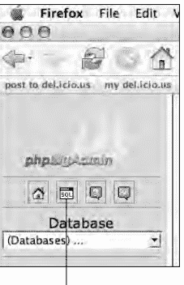

图 6-3

- 7. 点击弹出窗口中的“导入文件 (Import Files)”选项卡。这将带您进入一个界面，允许您浏览并上传刚刚创建的架构文件。浏览到该文件，选择它，然后点击“执行 (Go)”以在您的本地 MySQL 服务器中执行该文件中的所有 MySQL 命令。

- 8. 如果没有错误，数据库将被成功创建，并且其中会包含一个 contacts 表。从 phpMyAdmin 主界面的左侧列中，从下拉菜单中选择您新创建的 example_contacts 数据库。您将看到数据库中的表列表。您应该只能看到 contacts 表。

- 9. 向表中添加一条记录（或行）。为此，点击表列表上方的 SQL 选项卡（注意是选项卡而非按钮）。这次不需要创建 .sql 脚本，直接通过 phpMyAdmin 输入 SQL 命令即可。在文本字段中输入以下内容，然后点击“执行 (Go)”：

```
insert into contacts (name,company) values ('Jane Smith','The Hanso Foundation');
```

操作完成后，系统将通知您已插入一行。

- 10. 转到 SQL 选项卡。添加以下两行以进一步填充您的数据库（确保每行末尾使用分号 (;) 结尾以分隔命令），然后点击“执行 (Go)”：

```
insert into contacts (name,company) values ('Bob Jones','The Hanso Foundation');
insert into contacts (name,company) values ('Michelle Funk','Capitol Records');
```

## 第二部分：准备进行 Mash

- 11. 您可以使用 `select` 语句从数据库中提取记录。再次转到 SQL 选项卡，输入以下查询并点击“执行 (Go)”：

    `select * from contacts;`

    将返回表中的所有行和所有数据。

    *尽管您在向 contacts 表插入新行时没有指定任何 id 值，但每行都有一个设置好的 id。这是因为得益于列架构中的 `auto_increment` 特性，每个新行都会被自动分配一个 id。*

- 12. 您还可以使用 `select` 语句根据特定条件进行查询，如下所示：

    `select name from contacts where company='The Hanso Foundation';`

    这将显示所有属于指定公司的联系人姓名。

### 工作原理

在第 5 章首次介绍 MySQL 时，向您展示了如何在 PHP 中使用 SQL 查询来计算日期。SQL 查询是 MySQL 的语言，也可用于创建新数据库、分配权限、在这些数据库中创建新表以及填充和检索数据。在本例中，您使用了 SQL 查询来创建新数据库、数据库用户以及该数据库中的表，并填充了数据。

当然，与本书相关的 MySQL 核心用途将涉及其在 PHP 中的实现。在接下来的“试一试”环节中，您将在 PHP Web 应用程序中与新数据库进行交互。在许多 mashup 项目中，您都将以这种方式使用 PHP 和 MySQL。

#### 试一试：更高级的 PHP 和 MySQL

在本例中，您将创建一个 PHP 页面，允许您在新的 example_contacts 数据库中添加、查看和编辑记录。

- 1. 在您的 htdocs 目录下创建一个新的 PHP 文件，并将其命名为 **example6-5.php**。插入以下代码：

```
<!DOCTYPE html PUBLIC "-//W3C//DTD XHTML 1.0 Strict//EN"
    "http://www.w3.org/TR/xhtml1/DTD/xhtml1-strict.dtd">
<html xmlns="http://www.w3.org/1999/xhtml" xml:lang="en" lang="en">
<head>
<title>Example Contacts Database</title>
</head>
<body>
<h2>Contact List</h2>
<table border="1" cellspacing="2" cellpadding="2">
    <tr>
        <th>id</th>
        <th>name</th>
        <th>company</th>
    </tr>
</table>
</body>
</html>
```

## 第 6 章：更多 Mashup 技术

- 2. 为了能向该表添加数据并从中检索数据，您需要建立与 example_contacts 数据库的连接。如果您打算在每次加载页面时显示此表及其内容，还需要立即将 contacts 表中所有的联系人交给 PHP。

在页面的最顶部，在任何其他内容之前，创建以下 PHP 代码块。这将创建一个数据库连接，您可以在 PHP 页面执行期间随时使用。此外，它还为您选择了要使用的 example_contacts 数据库。

```
<?php
//connect to the database
$link = mysql_connect('localhost','contacts_user', 'password')
or die(mysql_error());
@mysql_select_db('example_contacts') or die(mysql_error());
?>
```

- 3. 在页面底部的所有 HTML 标记之后，创建另一个 PHP 块，以关闭 MySQL 数据库连接：

```
<?php
//close the database connection
mysql_close($link);
?>
```

此时整个 PHP 文档应如下所示：

```
<?php
//connect to the database
$link = mysql_connect('localhost','contacts_user', 'password')
or die(mysql_error());
@mysql_select_db('example_contacts') or die(mysql_error());
?>
<!DOCTYPE html PUBLIC "-//W3C//DTD XHTML 1.0 Strict//EN"
"http://www.w3.org/TR/xhtml11/DTD/xhtml1-strict.dtd">
<html xmlns="http://www.w3.org/1999/xhtml" xml:lang="en" lang="en">
<head>
<title>Example Contacts Database</title>
</head>
<body>

<h2>Contact List</h2>
<table border="1" cellspacing="2" cellpadding="2">
<tr>
<th>id</th>
<th>name</th>
<th>company</th>
</tr>
</table>

</body>
</html>
<?php
//close the database connection
mysql_close($link);
?>
```

## 第二部分：准备进行 Mash

- 4. 浏览该页面以确保一切正常。如果您没有看到任何错误，并且只看到了之前创建的 XHTML 表格，那么您的数据库连接工作正常。

- 5. 创建一个查询，以便在每次加载页面时从 contacts 表中获取所有联系人供表格使用。在页面顶部创建数据库连接之后，在第一个 PHP 代码块中添加以下内容：

```
//fetch all contacts
$all_contacts_query = "select * from contacts";
$all_contacts_result = mysql_query($all_contacts_query);
```

- 6. 要显示返回的数据，请遍历每个结果并在“联系人列表 (Contact List)”表中创建新的表格行。在之前添加的 `<table>` 标记之后，包含以下阴影行：

```
<h2>Contact List</h2>
<table border="1" cellspacing="2" cellpadding="2">
  <tr>
    <th>id</th>
    <th>name</th>
    <th>company</th>
  </tr>
  <?php
    while ( row = mysql_fetch_assoc($all_contacts_result) ) {
      ?>
      <tr>
        <td><?php echo $row['id'] ?></td>
        <td><?php echo $row['name'] ?></td>
        <td><?php echo $row['company'] ?></td>
      </tr>
    <?php
    }
  ?>
</table>
```

如果您重新加载页面，应该会看到 contacts 表中所有联系人的列表出现。

- 7. 添加一个 XHTML 表单，在提交时将向数据库添加一个新联系人。在“联系人列表”表下方（在 `</table>` 元素之后），添加此标记：

```
<h2>Add a New Contact</h2>
<form method="post">
  Name: <input type="text" name="name" />
  Company: <input type="text" name="company" />
  <input type="hidden" name="action" value="new_contact" />
  <input type="submit" value="Save" />
</form>
```

请注意添加了一个名为 action 的隐藏输入字段。您使用它让 PHP 代码识别何时提交了新的联系人信息。同时请注意 `<form>` 标记中添加了 `method="post"`。

- 8. 当此表单提交时，它提交的数据将对视图隐藏。为此，在 PHP 代码部分添加以下阴影行：

```
<?php
//connect to the database
$link = mysql_connect('localhost','contacts_user','password')
    or die(mysql_error());
@mysql_select_db('example_contacts') or die(mysql_error());

//handle incoming form data
if (isset($_POST['action']))
{
    if ($_POST['action'] == 'new_contact')
    {
        $insert_contact_query = sprintf("insert into contacts
            (name,company) values ('%s','%s')",
            mysql_escape_string($_POST['name']),
            mysql_escape_string($_്ഀ
```


## 第二部分：开始整合

```
value="<?php echo $row['company'] ?>" />
</td>
<td>
<input type="hidden" name="id" value="<?php echo $row['id'] ?>" />
<input type="hidden" name="action" value="edit_contact" />
<input type="checkbox" name="delete" /> Delete
<input type="submit" value="Save Changes" />
</td>
</form>
</tr>
<?php
}
?>
</table>
```

10. 在 PHP 代码中添加一个新的 if 语句来处理传入的表单数据，如以下高亮显示的更改所示：

```
//handle incoming form data
if (isset($_POST['action']))
{
	if ($_POST['action'] == 'new_contact')
	{
		$insert_contact_query = sprintf("insert into contacts
		(name,company) values ('%s','%s')",
		mysql_real_escape_string($_POST['name']),
		mysql_real_escape_string($_POST['company'])
		);
		mysql_query($insert_contact_query);
	}
	if ($_POST['action'] == 'edit_contact')
	{
		//delete or save changes?
		if (isset($_POST['delete'])) {
			$edit_contact_query = sprintf("delete from contacts where id=%s",
				$_POST['id']);
		} else {
			$edit_contact_query = sprintf("update contacts
				set name='%s', company='%s' where id = %s",
				mysql_real_escape_string($_POST['name']),
				mysql_real_escape_string($_POST['company']),
				$_POST['id']
			);
		}
		//execute the query
		mysql_query($edit_contact_query);
	}
}
```

通过这些更改，现有联系人表格中的每一行都变成了一个表单。你可以更改联系人的姓名或公司，当你点击“保存更改”时，你的更改将被保存到数据库。然而，如果勾选了“删除”复选框，该记录将从表中删除。

### 工作原理

这个练习的最终产品是一个功能完备的 Web 数据库。整个 Web 应用程序都是使用这里展示的基本概念编写的，价值数千甚至数百万美元。对于 PHP 新手来说，这可能看起来像 PHP、MySQL 和 HTML 的奇怪混合，而且你可能并不熟悉所有的细节。没关系。本节将逐行分解，帮助你理解发生了什么。

再次记住，对于 PHP 网页来说，每次页面加载时，页面上的所有内容都会从上到下执行。当你提交表单时，页面会重新加载，你提交的表单数据将可供 PHP 使用。

每次加载页面时，你都需要从 contacts 表中获取所有现有记录，以及可能对数据库进行其他更改。所以你要做的第一件事就是建立一个 MySQL 连接，该连接将在页面执行期间保持活动状态。这就是为什么在 PHP 代码块的开头，会建立 MySQL 连接：

```
<?php
//connect to the database
$link = mysql_connect('localhost','contacts_user','password')
    or die(mysql_error());
@mysql_select_db('example_contacts') or die(mysql_error());
```

接下来是一个 PHP `if` 语句，它使用 `isset()` 函数来检查 `$_POST['action']` 变量是否存在。这个变量只有在 `POST` 数据可用时才会存在，比如当用户通过启用 `POST` 方法的表单发布数据时，并且如果该 `POST` 数据中有一个名为 `action` 的变量：

```
//handle incoming form data
if (isset($_POST['action']))
{
... the rest of the if-statements content ...
}
```

如果这两个条件都不成立，则不会执行此语句内部的任何内容。当你最初加载页面时，`$_POST['action']` 不存在，所以这些都不会发生。然而，当你提交此页面上的任何表单时，每个表单都有一个 `$_POST['action']` 的值，因此这段代码会继续执行。

在里面，你检查两个可能的 `$_POST['action']` 值：`new9_contact` 和 `edit_contact`。这是提交特定表单时你可能想要完成的两个操作，而 `$_POST['action']` 的值告诉你提交的是这两种类型中的哪一种表单：

```
if ($_POST['action'] == 'new_contact')
{
    ...the rest of new_contact...
}
if ($_POST['action'] == 'edit_contact')
{
    ...the rest of edit_contact...
}
```

如果 `$_POST['action']` 的值是 `new_contact`，你将执行一个 MySQL `insert` 查询，在 contacts 表中创建一个新行：

```
$insert_contact_query = sprintf("insert into contacts
    (name,company) values ('%s','%s')",
    mysql_real_escape_string($_POST['name']),
    mysql_real_escape_string($_POST['company'])
    );
mysql_query($insert_contact_query);
```

`sprintf()` 函数被用来包装你的 SQL 查询。这样，你可以将 `mysql_real_escape_string()` 函数应用于每个 `$_POST` 变量，以防止任何不良字符被插入到查询中，比如那些可能用于 SQL 注入攻击的字符。

如果 `$_POST['action']` 的值是 `edit_contact`，则会修改一个联系人记录。

这里还有另一个 `if` 语句，用于检查 `$_POST['delete']` 变量是否已设置，如果用户勾选了表单中的“删除”复选框，该变量就会被设置。如果是这种情况，它会删除记录而不是更新它。

两个 SQL 查询都依赖于 `$_POST['id']` 变量的存在，该变量表示表中联系人的唯一 id：

```
//delete or save changes?
if (isset($_POST['delete'])) {
    $edit_contact_query = sprintf("delete from contacts where id=%s",
        $_POST['id']);
} else {
    $edit_contact_query = sprintf("update contacts
        set name='%s', company='%s' where id = %s",
        mysql_real_escape_string($_POST['name']),
        mysql_real_escape_string($_POST['company']),
        $_POST['id']
    );
}
//execute the query
mysql_query($edit_contact_query);
```

在第一个 PHP 代码块的底部，在检查 `$_POST['action']` 的初始 `if` 语句之外，是一个用于获取表中所有联系人的 MySQL 查询：

```
//fetch all contacts
$all_contacts_query = "select * from contacts";
$all_contacts_result = mysql_query($all_contacts_query);
```

这样，`$all_contacts_result` 变量将始终包含每次页面加载时的所有联系人。这是必要的，因为你希望每次都显示所有联系人的列表。

现在来看 HTML，其中有两个部分需要特别注意：联系人列表表格和添加新联系人表单。

## 第六章：更多整合技术

联系人列表本质上是一个四列的 HTML 表格，其中每一行都是它自己的 HTML 表单。此表单中每个输入的值分别包含数据库中每个联系人行的值。请特别注意该区域中遍历数据库中每个联系人并为每条记录创建新表格行的 PHP 代码块：

```
<?php
while ($row = mysql_fetch_assoc($all_contacts_result)) {
?>
    <tr>
    <form method="post">
        <td><?php echo $row['id'] ?></td>
        <td>
            <input type="text" name="name"
                value="<?php echo $row['name'] ?>" />
        </td>
        <td>
            <input type="text" name="company"
                value="<?php echo $row['company'] ?>" />
        </td>
        <td>
            <input type="hidden" name="id" value="<?php echo $row['id'] ?>" />
            <input type="hidden" name="action" value="edit_contact" />
            <input type="checkbox" name="delete" /> Delete
            <input type="submit" value="Save Changes" />
        </td>
    </form>
    </tr>
<?php
}
?>
```

如你所见，并非所有 XHTML 代码都必须出现在 `while` 语句的 PHP 块内。你可以终止一段 PHP 块来打印一些 HTML，然后在任何你喜欢的地方通过打开一个新块来继续。这种技术通常比将所有 HTML 标记放在 PHP `echo` 命令中要容易得多。

PHP `while` 语句将 `$row` 变量赋值为从表中返回的一行，作为关联数组，这得益于 `mysql_fetch_assoc()` 函数。表中的每个单元格都包含一个表单字段，其值为相应行的值。你还为每条记录的 id 创建了一个隐藏输入字段，以及一个包含 `edit_contact` 值的 action 隐藏输入。

在现有联系人列表之后的“添加新联系人”表单相当简单。还有另一个名为 action 的隐藏输入，其值为 `new_contact`：这个表单告诉页面在重新加载时创建一个新联系人，如前所述：

```
<h2>Add a New Contact</h2>
<form method="post">
    Name: <input type="text" name="name" />
    Company: <input type="text" name="company" />
    <input type="hidden" name="action" value="new_contact" />
    <input type="submit" value="Save" />
</form>
```


## 第二部分：准备开始整合

脚本末尾的PHP代码块关闭了活动的PHP连接：

```
<?php
//关闭数据库连接
mysql_close($link);
?>
```

通常，更好的做法是让这样一个应用程序跨越多个不同的PHP脚本。此外，给用户更多的反馈，告知他们当前的处理状态也是一个好主意，比如在联系人成功保存时通知他们。不过，这个简单的应用程序希望能演示一些核心概念，这些概念在您将PHP和MySQL结合使用时，将融入到您的许多混搭项目中。

## XML解析器与Magpie RSS

您也可以使用XML或其任何派生格式来存储和传输数据。通过对各种Web服务API和del.icio.us RSS feed的介绍，您已经对XML及其工作方式有了很多了解。**绝不推荐**使用RSS或任何其他XML格式来替代MySQL数据库存储数据，特别是当您的数据库很大且需要对其执行复杂查询时。然而，它仍然是一种非常易于阅读和传输的数据形式，几乎可以被当今使用的任何编程语言解析。那么，如何让PHP读取和解释XML格式的数据呢？

幸运的是，大多数PHP安装都包含一组XML解析函数。当您解析XML时，您会遍历其元素及其子元素，检索所需的任何数据。PHP中的XML解析函数源自Expat C库，供熟悉该库的人使用。除非您的XML文件非常大，否则将XML引入PHP最简单的方法通常是解析整个XML文件，并将其转换为更原生的PHP数据结构，例如多维数组。

### 动手试试：在PHP中解析XML

要尝试在PHP中解析XML，首先需要创建一个供其解析的通用XML文件。然后，您将编写一个PHP脚本来读取此文件并将其内容转换为一个PHP变量。一旦XML数据以这种形式存在，您就可以对其做任何事情。

1. 创建一个名为**example6-6.xml**的新文件，包含以下内容：

```
<?xml version="1.0" encoding="ISO-8859-1"?>
<cookbooks>
    <cookbook genre="vegetarian">
        <title>Madhur Jaffrey's World Vegetarian</title>
        <author>Madhur Jaffrey</author>
        <isbn>0-517-59632-6</isbn>
    </cookbook>
    <cookbook genre="television">
        <title>The Frugal Gourmet Cooks Three Ancient Cuisines</title>
        <author>Jeff Smith</author>
        <isbn>0-688-07589-4</isbn>
    </cookbook>
    <cookbook genre="vegetarian">
        <title>The Modern Vegetarian Kitchen</title>
        <author>Peter Berley</author>
        <isbn>0-06-039295-9</isbn>
    </cookbook>
</cookbooks>
```

如果您愿意，也可以直接从Wrox的配套网站下载此文件。

这是一个非常通用的XML文件，它并非基于任何当前公认的、有效的XML模式（Schema）。然而，PHP中的XML解析器可以解析任何看起来像XML（具有XML通常具有的标准结构部分）的内容，因此此处使用的代码在此示例中可以正常工作。

此示例文档的根元素是`<cookbooks>`。它包含一系列作为子元素的`<cookbook>`元素。每个`<cookbook>`都有一个描述食谱类别的属性，以及三个描述书籍标题、作者和ISBN的子元素。实际上，书籍的类别作为属性而不是子元素，或者其他三个子元素作为属性，都没有绝对的理由，但这个PHP XML解析器会将它们都转换为变量。

2. 要编写解析此XML文件的PHP脚本，请创建一个名为**example6-6.php**的新文件，并插入以下代码：

```
<?php
//这个多维数组将存储XML数据
$xml_data_array = array();
//要处理的XML文件
$file_name = 'example6-6.xml';

//设置解析器和处理函数
$parser = xml_parser_create();
xml_set_element_handler($parser, "process_start", "process_end");
xml_set_character_data_handler($parser, "process_cdata");

//打开文件
if (!($file = fopen($file_name, "r")))
    die("无法打开XML文件！");

//从文件读取并解析内容
while ($file_data = fread($file, 5000)) {
    if (!xml_parse($parser, $file_data, feof($file)))
        die(xml_error_string(xml_get_error_code($parser))." 在第
".xml_get_current_line_number($parser)." 行出错"));
}

//释放解析器
xml_parser_free($parser);

//输出原始数据数组
echo "<h3>$file_name 原始数组内容：</h3>";
echo "<pre>";
print_r($xml_data_array);
echo "</pre>";

//处理元素的开始
function process_start($parser, $name, $attributes)
{
    global $xml_data_array;
    $element_data = array("name"=>$name,"attributes"=>$attributes);
    array_push($xml_data_array,$element_data);
}

//处理元素的结束
function process_end($parser, $name)
{
    global $xml_data_array;
    $xml_data_array[count($xml_data_array)-2]['children'][] = 
    $xml_data_array[count($xml_data_array)-1];
    array_pop($xml_data_array);
}

//处理元素的字符数据（内容）
function process_cdata($parser, $cdata)
{
    global $xml_data_array,$i;
    if(trim($cdata))
    {
        $xml_data_array[count($xml_data_array)-1]['cdata']=$cdata;
    }
}
?>
```

3. 浏览到此脚本，您将看到XML文档的内容以多维数组（人类可读的形式）呈现，如下所示：

```
Array
(
    [0] => Array
    (
        [name] => COOKBOOKS
        [attributes] => Array
        (
        )

        [children] => Array
        (
            [0] => Array
            (
                [name] => COOKBOOK
                [attributes] => Array
                (
                    [GENRE] => vegetarian
                )

                [children] => Array
                (
                    [0] => Array
                    (
                        [name] => TITLE
                        [attributes] => Array
                        (
                        )

                        [cdata] => Madhur Jaffrey's World Vegetarian
                    )

                    [1] => Array
                    (
                        [name] => AUTHOR
                        [attributes] => Array
                        (
                        )

                        [cdata] => Madhur Jaffery
                    )

                    [2] => Array
                    (
                        [name] => ISBN
                        [attributes] => Array
                        (
                        )

                        [cdata] => 0-517-59632-6
                    )
                )
            )
        )
    )
)
```

### 工作原理

PHP内置的XML解析函数遍历了这些相当通用的XML数据，并将其转换为PHP多维数组。有了这些数据，您就可以对其进行任何操作，例如在表格中展示它，将其添加到MySQL数据库中，等等。下面逐行解释其工作原理。

前几行打开了PHP代码块，并创建了两个立即需要的变量——用于存放XML数据的PHP数据数组`$xml_data_array`，以及一个指向XML文件名的引用：

```
<?php
//这个多维数组将存储XML数据
$xml_data_array = array();
//要处理的XML文件
$file_name = 'example6-6.xml';
```

接下来，您创建XML解析器。作为此过程的一部分，您指定了元素处理函数，这些函数是一些您计划稍后创建的PHP函数的名称，用于处理XML解析器解析的每个XML元素的部分。这通过两个PHP函数完成：`xml_set_element_handler()`用于处理实际的XML元素，`xml_set_character_data_handler()`用于处理XML元素内部找到的所有字符数据或内容。这些处理函数被命名为`process_start()`（处理每个元素的开始）、`process_end()`（处理每个元素的结束）和`process_cdata()`（处理元素内的字符数据）：

```
//设置解析器和处理函数
$parser = xml_parser_create();
xml_set_element_handler($parser, "process_start", "process_end");
xml_set_character_data_handler($parser, "process_cdata");
```

接下来，您使用PHP的`fopen()`和`fread()`方法打开一个指向XML文档的文件句柄，然后代码调用`xml_parse()`处理文件的数据。您还可以添加一个条件，在XML文件格式不正确时输出任何XML处理错误：

```
//打开文件
if (!($file = fopen($file_name, "r")))
    die("无法打开XML文件！");
//从文件读取并解析内容
while ($file_data = fread($file, 5000)) {
    if (!xml_parse($parser, $file_data, feof($file)))
        die(xml_error_string(xml_get_error_code($parser))." 在第
".xml_get_current_line_number($parser)." 行出错"));
}
```

然后，您从内存中释放`$parser`变量，并使用PHP的`print_r()`函数输出`$xml_data_array`的内容，该函数以人类可读的形式显示数据数组结构：

```
//释放解析器
xml_parser_free($parser);

//输出原始数据数组
echo "<h3>$file_name 原始数组内容：</h3>";
echo "<pre>";
print_r($xml_data_array);
echo "</pre>";
```

这就是此脚本的主要部分。然而，您可能记得，您需要创建`process_start()`、`process_end()`和`process_cdata()`这些处理函数。这些函数在`xml_parse()`调用`$parser`句柄时运行。

`process_start()`处理函数需要`$parser`句柄，以及两个用于处理XML元素名称和XML元素属性的变量：分别为`$name`和`$attributes`。当`process_start()`被调用时，`$name`将被赋值为元素的名称，例如`COOKBOOK`，而`$attributes`将是一个名称-值数组，包含该元素的每个属性（如果存在）：

```
//处理元素的开始
function process_start($parser, $name, $attributes)
{
    global $xml_data_array;
    $element_data = array("name"=>$name, "attributes"=>$attributes);
    array_push($xml_data_array, $element_data);
}
```


## 第 6 章：更多 Mashup 技术

在这

在这段代码中，你创建了一个名为 `$element_data` 的变量作为数组，并为其赋予了两个键值对，一个用于名称，一个用于属性数组。然后，你将 `$element_data` 添加到全局的 `$xml_data_data_array` 中。对于 XML 文档中每个开始的元素，无论是 `COOKBOOKS`、`COOKBOOK`、`AUTHOR`、`TITLE` 还是 `ISBN` 元素，都会执行此操作。

接下来，你使用 `process_end()` 句柄来处理每个元素的结束。因为你希望 `$xml_data_array` 是一个多维数组，且每个元素的子元素作为该元素内部的数组，因此 `process_end()` 必须判断它正在处理的元素是否有任何子元素，如果有，则填充一个额外的数组（在本例中命名为 `children`）以包含进一步的数据：

```php
// handle the end of an element
function process_end($parser, $name)
{
    global $xml_data_array;
    $xml_data_array[count($xml_data_array)-2]['children'][] =
        $xml_data_array[count($xml_data_array)-1];
    array_pop($xml_data_array);
}
```

最后，你编写一个句柄来处理元素之间所有的字符数据。`process_cdata()` 句柄在数组中创建名为 `cdata` 的变量并用这些数据填充。

```php
// handle the character data (content) of an element
function process_cdata($parser, $cdata)
{
    global $xml_data_array, $i;
    if(trim($cdata))
    {
        $xml_data_array[count($xml_data_array)-1]['cdata'] = $cdata;
    }
}
```

所有这些对于解析你项目中想要分析的任何通用 XML 文件都非常有用，例如来自 del.icio.us API 的响应。然而，你会经常处理 RSS，而有一个第三方 PHP 库可以让处理 RSS 文件变得更加简单。它不仅能解析 RSS 文件，还能从网络上获取并对其进行 `cache`（缓存），在每次运行时创建 feed 的本地副本以便优先提供，而无需每次都获取远程 RSS feed。这个第三方库被称为 `Magpie RSS`，你将在接下来的“试一试”中使用它。

#### 试一试：使用 Magpie RSS

在本例中，你不需要创建新的 PHP 文件，而是在你的 Web 目录下创建一个新文件夹来存放文件和子文件夹。

- 1. 创建一个名为 `example6-7` 的新目录。
- 2. 从 `http://magpierss.sourceforge.net/` 下载 Magpie RSS。解压压缩包，并将其复制到 example6-7 目录中。将文件夹重命名为简单的 `magpiers`（而不是 `magpiers-0.72` 或其他名称）。
- 3. 在 example6-7 文件夹内创建另一个名为 **cache** 的目录。如果你使用的是 Mac OS X 或其他 UNIX 衍生系统，你需要让 Web 服务器拥有该文件夹的写权限。为此，请打开终端（Terminal）应用程序并输入以下命令（假设你的 cache 文件夹位于 /Users/bretto/Sites/example6-7/cache）：

`sudo chown www:www /Users/bretto/Sites/example6-7/cache`

如果系统提示，请输入你的用户密码。

- 4. 在 example6-7 目录中创建名为 **index.php** 的文档。（在第 5 章配置 Apache 服务器时，你已指定 index.php 是可接受的索引文档，因此当你直接浏览到 example6-7 目录时，index.php 将被自动执行。）

在 index.php 中放入以下几行简单的代码：

```php
<?php
//bring in magpie goodness
require_once('magpierss/rss_fetch.inc');
//set cache directory
define('MAGPIE_CACHE_DIR', 'cache');
//set our RSS feed url
$url = 'http://del.icio.us/rss/tag/cookbooks';
//magpie's fetch_rss
$rss = fetch_rss( $url );
//create a list of each item in the RSS feed
echo "<ul>";
foreach ($rss->items as $item) {
    $href = $item['link'];
    $title = $item['title'];
    if (isset($item['description']))
        $description = $item['description'];
    else
        $description = '(no description)';
    echo "<li><a href=$href>$title</a> - $description</li>";
}
echo "</ul>";
?>
```

- 5. 浏览到 example6-7 目录。你应该能看到一个可点击的 HTML 格式列表，显示 del.icio.us 上 `cookbooks` 标签的 RSS feed，如图 6-4 所示。
- 6. 查看 cache 目录的内容。里面应该有一个由许多字母和数字组成的文件名的新文件。这就是 Magpie 对 RSS feed 的磁盘缓存。如果你在一小时内尝试解析该 feed，Magpie 将从该文件中读取数据，而不是再次请求 del.icio.us。

### 工作原理

如你所见，Magpie 让处理 RSS feed 变得非常简单。以下是代码的详细分解。

首先，你设置一些基础项：引入 Magpie 的 `rss_fetch.inc` 文件（其中包含 Magpie 的所有函数），告诉 Magpie 将缓存文件放在哪里，并定义你想要解析的 RSS feed 的 URL：

```php
<?php
//bring in magpie goodness
require_once('magpierss/rss_fetch.inc');
//set cache directory
define('MAGPIE_CACHE_DIR', 'cache');
//set our RSS feed url
$url = 'http://del.icio.us/rss/tag/cookbooks';
```

然后，你使用一个简单的命令告诉 Magpie 下载、缓存并解析在 `$url` 处找到的 RSS feed：

```php
//magpie's fetch_rss
$rss = fetch_rss( $url );
```

这会将几个不同的 PHP 对象分配给 `$rss` 变量。在本例中，你只对 `items` 对象感兴趣，它是一个数组的数组（非常像你在尝试 PHP XML 解析函数时看到的情况）。该对象包含每个 RSS 通道中每个项目的所有元素。

默认情况下，Magpie 的缓存有效期为一小时。如果你在获取 RSS feed 后的一小时内重新加载页面，Magpie 将不会从 del.icio.us 重新下载 feed，而是使用本地副本。（记住，让你的 Web 应用程序在每次加载时都触发来自 del.icio.us 或任何其他 Web 服务器的下载或 API 调用并不是一个好主意。）

其余的代码只是遍历每个项目的对象，并在无序 HTML 列表中显示命名的 `href`、`link` 和可选的 `description` 属性文本：

```php
//create a list of each item in the RSS feed
echo "<ul>";
foreach ($rss->items as $item) {
    $href = $item['link'];
    $title = $item['title'];
    if (isset($item['description']))
        $description = $item['description'];
    else
        $description = '(no description)';
    echo "<li><a href=$href>$title</a> - $description</li>";
}
echo "</ul>";
?>
```

你可以看到，Magpie RSS 在涉及 RSS feed 的 mashups 中将极其有用。它不仅使获取 feed 变得简单，而且解决了将其转换为 PHP 易于理解和操作的数据形式的问题，甚至解决了创建本地保存 RSS feed 方法的问题，从而避免你的项目滥用 del.icio.us 的 feed。

### REST

在 del.icio.us 的案例中，你可以使用 XML 解析器来读取 del.icio.us API 返回的 XML 数据，也可以使用 Magpie RSS 来处理 del.icio.us RSS。但是，你如何使用 PHP 为 del.icio.us API 和其他 Web 服务执行 REST 调用并获取 REST 数据呢？

由于 REST 非常灵活，你只需要一种让 PHP 像 Web 浏览器一样运行的方法，以便发送所需的 `WWW-Authenticate` 和 `User Agent` 请求头，然后获取返回的任何内容。实现这一点有多种方法，其中最简单的方法之一是使用名为 `cURL` 的系统工具。在接下来的“试一试”中，你将通过一个名为 Snoopy 的第三方 PHP 类来使用此工具。

#### 试一试：使用 Snoopy 处理 REST 调用

在这个“试一试”中，你将安装 cURL 系统工具。该工具使你的 Web 服务器能够通过 PHP 进行 REST 调用（特别是安全的 REST 调用）。你将实现 `Snoopy.inc.php`（一个免费提供的 PHP 类），以便在代码中使用 cURL 并处理 REST 调用返回的数据。

- 1. 安装 cURL。如果你使用的是 Mac OS X，它已经安装好了，无需进一步操作。如果你使用的是 Windows，可以从 http://curl.haxx.se/download.html 下载并安装 cURL 二进制文件。（请确保下载启用 SSL 的版本。）在主硬盘上创建一个名为 `curl` 的目录（C:\curl），并将压缩包的内容复制到那里。


## 第6章：更多混搭技术

实际上，你并不需要安装 cURL 也能使用 Snoopy。cURL 仅在需要通过 SSL（使用 https 而非 http 的 URL）连接 REST 服务器时才需要。许多 REST API 并不要求 SSL，但 del.icio.us 需要。这是因为 SSL 在你的应用程序和 del.icio.us 之间提供了安全、加密的通信。

- 2. 在 Windows 上，你可能还需要下载并安装 OpenSSL 的实现，以便让 cURL 通过 SSL（*安全套接层*）连接工作。推荐的选择是 Shining Light Productions 的 Win32 OpenSSL，你可以从 www.shininglightpro.com/products/Win32OpenSSL.html 下载。
- 3. cURL 安装并运行后，从 http://sourceforge.net/projects/snoopy/ 下载 Snoopy。
- 4. 在你的 Web 开发目录中，创建一个名为 **example6-8** 的新文件夹。解压 Snoopy 压缩包，并将 Snoopy.class.php 文件放入 example6-8 目录中。这是使用 Snoopy 所需的所有文件。
- 5. 在 example6-8 目录中创建一个 index.php 脚本。从以下 PHP 代码开始：

```php
<?php
//bring in Snoopy goodness
include('Snoopy.class.php');

//create a new Snoopy object
$snoopy = new Snoopy;

//set UserAgent and WWW-Authenticate information
$snoopy->agent = 'example6-8 1.0';
$snoopy->user = 'username';
$snoopy->pass = 'password';

//give snoopy our path to cURL and where it should put downloaded files
$snoopy->curl_path = '/usr/bin/curl'; //Windows: C:\curl
$snoopy->temp_dir = '/tmp'; //Windows: C:\temp

//the REST url we are to use
$url = "https://api.del.icio.us/v1/posts/get";

//the data array that will store our parsed xml
$xml_data_array = array();

//fetch the REST URL
if($snoopy->fetch($url))
{
    //snoopy doesn't set status with ssl requests, so let's do that here
    if ($snoopy->status == '')
        $snoopy->status = get_status_from_response($snoopy->response_code);
    //if we've got a 200 response code, show the results, otherwise warn
    if ($snoopy->status == 200) {
        parse_xml_results($snoopy->results);
        echo "<pre>";
        print_r($xml_data_array);
        echo "</pre>";
} else {
    echo "Warning: ".$snoopy->response_code;
}
} else {
    //handle any snoopy errors by outputting them to the screen
    echo "ERROR: ".$snoopy->error;
}
```

```php
//this function will pull the status code from snoopy's response_code var
//usually snoopy sets this but not with SSL connections
function get_status_from_snoopy($response_code)
{
    preg_match("/^HTTP\/[\d\s\*()\?]*$/s", $response_code, $status);
    return $status[1];
}
```

6. 这段代码引入了 Snoopy 类，并使用它向 del.icio.us 发起 REST API 调用。不过，在运行之前，你需要添加 `parse_xml_results()` 函数，它是本章前面使用的 XML 解析代码的衍生版本。将以下函数添加到你代码的底部，在 PHP 代码块结束之前：

```php
//this is an adaptation of the xml parsing code from example6-6.php
//turned into a function. it takes snoopy's results and parses it as xml
function parse_xml_results($snoopy_results)
{
    global $xml_data_array;

    //setup the parser and handlers
    $parser = xml_parser_create();
    xml_set_element_handler($parser, "process_start", "process_end");
    xml_set_character_data_handler($parser, "process_cdata");

    //read from the results, parsing its contents
    $parsed = xml_parse($parser, $snoopy_results);
    if (!$parsed)
        die(xml_error_string(xml_get_error_code($parser)." at line ".
            xml_get_current_line_number($parser));

    //clear the parser
    xml_parser_free($parser);
}

//handle the start of an element
function process_start($parser, $name, $attributes)
{
    global $xml_data_array;
    $element_data = array("name"=>$name, "attributes"=>$attributes);
    array_push($xml_data_array, $element_data);
}

//handle the end of an element
function process_end($parser, $name)
{
    global $xml_data_array;
    $xml_data_array[count($xml_data_array)-2]['children'][] =
        $xml_data_array[count($xml_data_array)-1];
    array_pop($xml_data_array);
}

//handle the character data (content) of an element
function process_cdata($parser, $cdata)
{
    global $xml_data_array, $i;

    if(trim($cdata))
    {
        $xml_data_array[count($xml_data_array)-1]['cdata']=$cdata;
    }
}
```

请注意，这段代码直接取自之前使用 PHP 的 XML 解析函数的工作，几乎原封不动地移植到了这里。唯一主要的区别是，它被包装在一个名为 `parse_xml_results()` 的函数中，而且你向它传递的参数是 Snoopy 返回的 Web 内容，而不是本地 XML 文件。

7. 更改代码开头的变量，以匹配你的 del.icio.us 账户信息和系统配置。将以下变量设置为你的 del.icio.us 用户名和密码：

```php
//set UserAgent and WWW-Authenticate information
$snoopy->agent = 'example6-8 1.0';
$snoopy->user = 'username';
$snoopy->pass = 'password';
```

并将以下变量设置为你安装 cURL 的路径和本机的临时目录：

```php
//give snoopy our path to cURL and where it should put downloaded files
$snoopy->curl_path = '/usr/bin/curl'; //Windows: C:\curl\curl.exe
$snoopy->temp_dir = '/tmp'; //Windows: C:\temp
```

8. 在浏览器中访问该脚本，你应该能看到以 PHP 数组形式显示的 `/posts/get` del.icio.us API 方法的返回结果。

### 工作原理

Snoopy 承担了所有工作。它通过配置你的 del.icio.us 用户名、密码和通用用户代理名称，然后基本上下载你的 API 调用结果。由于 del.icio.us API 返回的是 XML 数据，你可以像之前处理 cookbook XML 数据一样对其进行解析。

> **警告！** *这段代码存在危险性。*为什么呢？因为每次页面加载时，它都会向 del.icio.us API 发起调用。记住，这*不是一件好事*，而且可能构成对 del.icio.us API 的滥用。第7章将展示如何在 MySQL 中缓存这些结果（很像 Magpie RSS 缓存 RSS 数据），并*仅在*需要时才向 del.icio.us API 发起调用。**切勿**将这类代码公开发布！

### XML-RPC

到目前为止，你已经大量使用了 REST，因为这是 del.icio.us 所采用的，但还有另一种 arguably 更流行的方法可以让 Web 应用程序和软件进行通信：XML-RPC。作为一名混搭开发者，你需要熟悉 XML-RPC 以及如何利用它与 Web API 进行交互。

XML-RPC 名称中的 RPC 代表*远程过程调用*。XML-RPC 本质上是一个规范，描述了两个应用程序相互通信的标准方式。与 REST 一样，这种通信通过一个特殊的 URL 进行，但与 REST 不同的是，XML-RPC 发送的数据是 HTTP-POST 数据（类似于表单发送的 POST 数据）。HTTP-POST 数据包含一些特殊的必需头部（类似于向 del.icio.us 发起的 REST 调用），后面跟着一些专门设计的 XML 内容。

以下是一个 XML-RPC 调用示例的样子（摘自 xmlrpc.org 网站，网址为 www.xmlrpc.org）：

```xml
POST /RPC2 HTTP/1.0
User-Agent: Frontier/5.1.2 (WinNT)
Host: betty.userland.com
Content-Type: text/xml
Content-length: 181

<?xml version="1.0"?>
<methodCall>
<methodName>examples.getStateName</methodName>
<params>
<param>
<value><i4>41</i4></value>
</param>
</params>
</methodCall>
```

这类调用被发送到启用了 XML-RPC *服务器*的 Web 应用程序或其他类型的软件。如果你按照第5章的描述安装了本地版本的 WordPress，你就拥有了一个随时等待输入的 XML-RPC 服务器。你的 WordPress 博客默认启用了 XML-RPC，因此你可以从任何地方、通过任何方式获取、创建、编辑和组织你的博客文章。

### 动手实践 — 使用 XML-RPC 发布到 WordPress

前面展示的 XML-RPC 调用示例看起来很简单，但里面其实有很多门道。幸运的是，与 Magpie RSS 一样，有一个第三方库可以让在 PHP 中使用 XML-RPC 变得更加容易。它恰如其分地叫做 XML-RPC for PHP。

- 1. 从 http://phpxmlrpc.sourceforge.net/ 下载 XML-RPC for PHP。
- 2. 在你的 Web 开发文件夹中创建一个名为 **example6-9** 的新目录。解压 XML-RPC for PHP 压缩包，并将 lib 目录及其内容复制到你的 example6-9 文件夹中。
- 3. 你将创建一个 PHP 脚本，它将在你的 WordPress上创建新文章，甚至无需触碰 WordPress 的后台界面。从这个意义上说，你的 WordPress 博客将是 XML-RPC *服务器*，而你将创建的脚本则是*客户端*。


## 第 6 章：更多 Mashup 技术

要实现这一点，请在 example6-9 文件夹中创建一个新的 `index.php` 文件，并将以下 PHP 代码放入其中：

```php
<?php
//bring in XML-RPC for PHP goodness
include('lib/xmlrpc.inc');

//set this to the host and location for your wordpress xmlrpc.php server
$xml_rpc_server_host = 'localhost';
$xml_rpc_server_location = '/wordpress/xmlrpc.php';
//the wordpress username and password you want to post as
$wp_username = 'admin';
$wp_password = 'password';

//create the xml-rpc client object
$client = new xmlrpc_client($xml_rpc_server_location, $xml_rpc_server_host, 80);

//create an array for our post data
$post = array();
$post['title'] = "Test Post using XML-RPC";
$post['description'] = "Hello XML-RPC world!";

//assemble the xml-rpc message
$parameters = array(
	php_xmlrpc_encode("1"),
	php_xmlrpc_encode($wp_username),
	php_xmlrpc_encode($wp_password),
	php_xmlrpc_encode($post),
	php_xmlrpc_encode("1")
);

$message = new xmlrpcmsg("metaWeblog.newPost", $parameters);

//what do we want our response to be?
$client->return_type = 'phpvals';

//send the XML-RPC message to the server
$response = $client->send($message);

//print the response (if errno=0, the post was success!)
echo "<pre>";
print_r($response);
echo "</pre>";
?>
```

请特别注意**加粗的行**，因为这些行需要根据你具体的 WordPress 安装情况进行调整。例如，如果你的 WordPress 安装在 `http://localhost/-bretto/wordpress/`，且管理员用户的密码是 `1h423`，那么你需要将变量修改为如下所示：

```php
//set this to the host and location for your wordpress xmlrpc.php server
$xml_rpc_server_host = 'localhost';
$xml_rpc_server_location = '/-bretto/wordpress/xmlrpc.php';
//the wordpress username and password you want to post as
$wp_username = 'admin';
$wp_password = '1h423';
```

## 第二部分：准备进行 Mash

4. 访问该脚本。在进行 XML-RPC 调用时可能会有轻微的停顿，但你应该会看到类似于以下的内容，这是一个代表 XML-RPC 服务器响应的数组：

```
xmlrpcresp Object
(
    [val] => 9
    [valtyp] => phpvals
    [errno] => 0
    [errstr] =>
    [payload] =>
    [hdrs] => Array
        (
            [date] => Wed, 19 Jul 2006 17:19:24 GMT
            [server] => Apache/1.3.33 (Darwin) PHP/4.3.11
            [x-powered-by] => PHP/4.3.11
            [connection] => close
            [content-length] => 161
            [content-type] => text/xml
        )

    [_cookies] => Array
        (
        )

    [content_type] => text/xml
)
```

请特别注意 `errno` 的值。如果它是 0（零），则表示发布成功。

5. 访问你本地安装的 WordPress，你应该能看到一篇新的名为“Test Post Using XML-RPC”的博文。

### 工作原理

让我们来详细分析一下。首先，你在复制过来的 lib 文件夹中包含 `xmlrpc.inc` 文件，以引入 XML-RPC for PHP 提供的所有便捷功能：

```php
<?php
//bring in XML-RPC for PHP goodness
include('lib/xmlrpc.inc');
```

然后，你设置所需的变量并创建 `$client`，这是一个新的 XML-RPC 客户端对象：

```php
//set this to the host and location for your wordpress xmlrpc.php server
$xml_rpc_server_host = 'localhost';
$xml_rpc_server_location = '/wordpress/xmlrpc.php';
//the wordpress username and password you want to post as
$wp_username = 'admin';
$wp_password = 'password';

//create the xml-rpc client object
$client = new xmlrpc_client($xml_rpc_server_location, $xml_rpc_server_host, 80);
```

> 这是本书中使用的第一个 PHP 对象。如果你不熟悉 PHP 对象及其工作原理，请参考 PHP 文档：http://us2.php.net/manual/en/language.oop.php。

PHP 中的一个对象具有各种*方法*（即你希望它执行的操作）和*变量*（即描述它是什么的内容）。`xmlrpc_client()` 对象包含了大量用于执行 XML-RPC 调用的方法和变量。

接下来，你初始化一个 `xmlrpc_client()` 对象，告知它要通信的 XML-RPC 服务器的主机名、位置和端口号（大多数 Web 服务器通常为 80）。

然后，你创建一个描述新博文的数组，包括博文标题和描述：

```php
//create an array for our post data
$post = array();
$post['title'] = "Test Post using XML-RPC";
$post['description'] = "Hello XML-RPC world!";
```

如果愿意，你可以从 Web 表单中获取这些值，从而创建你自己的 WordPress 发布界面。这个数组中的键值对在 *metaWeblog API*（你将使用 XML-RPC 调用的 API）中被称为博文的 `struct`。XML-RPC for PHP 会将此数组转换为 RSS 2.0 文档中 `<item>` 元素内部的元素。但最终，WordPress 会接收 `<item>` 及其元素并将其插入到 MySQL 数据库中。

metaWeblog API 是可以通过 WordPress XML-RPC 服务器访问和使用的几个 API 之一。它有多种方法，包括一个名为 `metaWeblog.newPost` 的发布新博文的方法。如果你想阅读更多关于 metaWeblog API 的内容，请查看 www.xmlrpc.com/metaWeblogApi 上的链接。（请注意，该文档位于 XML-RPC 网站上，因为 metaWeblog API 是由创建 XML-RPC 的团队开发的。）

`metaWeblog.newPost` 需要五个参数，这些参数被传递给 `$parameters` 数组：

```php
//assemble the xml-rpc message
$parameters = array(
    php_xmlrpc_encode("1"),
    php_xmlrpc_encode($wp_username),
    php_xmlrpc_encode($wp_password),
    php_xmlrpc_encode($post),
    php_xmlrpc_encode("1")
);
```

这些参数依次为：

- `blogid`（在本例中始终等于 1，但可用于选择性地向 XML-RPC 服务器上可能存在的多个博客发布内容）
- 博客用户名
- 博客密码
- 包含所有博文信息的 `struct`（或者正如 XML-RPC 网站所称的“精华内容”）
- 是否发布该博文（当然，你是希望发布的）

每个参数都包裹在 `php_xmlrpc_encode()` 函数中。该函数将指定的 PHP 变量、对象或数组转换为 XML-RPC 能够理解的内容，称为 `xmlrpcval` 对象。

接下来，将你要发送给 XML-RPC 服务器的完整消息赋值给 `$message` 变量：

```php
$message = new xmlrpcmsg("metaWeblog.newPost", $parameters);
```

在将此消息发送到 XML-RPC 服务器之前，你可能希望指定 XML-RPC 服务器返回的内容在 PHP 脚本中如何呈现。这一行告诉 `$client` 对象将响应格式化为一个多维 PHP 键值数组：

```php
//what do we want our response to be?
$client->return_type = 'phpvals';
```

你将消息发送到 XML-RPC 服务器，并将服务器返回的响应赋值给 `$response`，最后在脚本末尾将其输出：

```php
//send the XML-RPC message to the server
$response = $client->send($message);

//print the response (if errno=0, the post was success!)
echo "<pre>";
print_r($response);
echo "</pre>";
?>
```

Web API 世界的大部分领域，尤其是涉及博客软件的应用，都使用了 XML-RPC。幸运的是，XML-RPC for PHP 库使得与 XML-RPC 服务器的协作变得相当简单。此外，如果需要，XML-RPC for PHP 还允许你将基于 PHP 的 Web 应用程序构建成一个 XML-RPC 服务器。要了解更多信息，请访问 XML-RPC for PHP 文档：http://phpxmlrpc.sourceforge.net/doc-2/。

### JSON

另一个在 Mashup 世界中备受关注的数据类型是 JSON，即 *JavaScript Object Notation*（JavaScript 对象表示法）。许多人（尤其是 Web 应用领域）仍将其视为一种新技术，但它已经证明了其价值。JSON 基于 JavaScript 编程语言，是一种易于被计算机软件理解的数据描述和传输方式。JSON 通常以 Feed 形式出现，与 RSS Feed 类似。你可以在 www.json.org/ 了解更多关于 JSON 的信息。

在 JSON 网站上，你会读到针对多种语言（包括 PHP）的大量 JSON 库。

del.icio.us 提供了一种获取 JSON 格式数据的方法。你目前可以在 http://del.icio.us/feeds/json/yourname 获取你的最新书签（JSON 格式）。

在常规 Web 开发中，JSON 的一个优点是你可以使用标准的 JavaScript `include` 作为 HTML 标头的一部分来引入 JSON 数据。这样，这些数据就可以被 JavaScript 立即使用。你不需要像 PHP 这样动态的服务器端 Web 编程语言来获取和使用这些数据。


## 第 6 章：更多 Mashup 技术

如果你想了解更多关于 JSON 和 del.icio.us 的信息，请查看 http://del.icio.us/help/json 网页。

在很大程度上，本书中的示例坚持使用 RSS 馈送（feeds）而非 JSON。唯一的例外将在下一章中出现，届时你将在 JavaScript 中使用 del.icio.us 的 JSON 馈送来创建你的第一个 del.icio.us mashup 项目（无需使用 PHP）。

### 其他方法和软件

作为一名 mashup 开发者，这里还有一些你可能需要了解的技术。

### AJAX 和 SAJAX

如果说目前 Web 开发领域有什么热门的新事物，那一定是 AJAX。AJAX 代表 *Asynchronous JavaScript and XML*（异步 JavaScript 和 XML），是一种 Web 开发技术，允许你将 HTML 呈现层直接与 XML 数据连接。这些 XML 数据可以来自任何地方，例如 PHP 脚本或 Web 服务，并且可以通过 JavaScript 命令或由网页定期处理，而无需提交表单或重新加载页面。这令人兴奋，因为它允许你编写在外观和行为上更像标准计算机应用程序的 Web 应用程序，能够定期控制和更新其视图和进程，而不再受限于传统的“提交此表单以查看结果”或“请刷新以查看更新的新闻”这种 Web 体验。

得益于 SAJAX（Simple AJAX Toolkit），在 PHP 中使用 AJAX 非常简单。SAJAX 使得在 PHP 驱动的网页中实现 Ajax 功能变得轻而易举，无需在 JavaScript 或 PHP 中格式化、交换或解析 XML 数据。SAJAX 实际上为 PHP 函数提供了一个 JavaScript 封装。想象一下，如果你能让一个 PHP 函数像 JavaScript 函数一样运行，这就是 SAJAX 所做的事情。

> **尝试一下** | 使用 SAJAX

在这个示例中，你将使用 SAJAX 来为你之前用纯 PHP 和 HTML 制作的简单平方根计算器创建一个 AJAX 版本。

- 1. 从 www.modernmethod.com/sajax/ 下载 SAJAX 工具包。
- 2. 在你的 Web 开发目录中创建一个名为 **example6-10** 的新文件夹。解压 SAJAX 压缩包，在其 php 文件夹中找到名为 Sajax.php 的文件。将此文件复制到 example6-10 目录中。
- 3. 从 example6-3.php 的 PHP 代码开始，该代码获取标准 HTML 表单中用户指定的数字并输出该数字的平方根。其完整代码如下：

```php
<?php
if (isset($_GET['number'])) {
    $result = sqrt($_GET['number']);
}
?>
<!DOCTYPE html PUBLIC "-//W3C//DTD XHTML 1.0 Strict//EN"
 "http://www.w3.org/TR/xhtml1/DTD/xhtml1-strict.dtd">
<html xmlns="http://www.w3.org/1999/xhtml" xml:lang="en" lang="en">
<head>
<title>PHP Square Root Calculator</title>
</head>
<body>
<form>
Get the square root of:
<input type="text" name="number" size="3" />
<input type="submit" value="Calculate" />
</form>
<?php
if (isset($result)) {
 echo"<div>Last result: $result</div>";
}
?>
</body>
</html>
```

将此表单转移到动态 HTML 领域。此外，你需要将“Calculate”按钮更改为触发 JavaScript 函数，而不是提交表单。这个 JavaScript 函数反过来将调用 PHP。为了实现这一切，请复制 examples-3.php 的源代码，将其粘贴到 example6-10 目录中的新 index.php 文件中，并将其更改为与以下阴影行一致的内容：

```php
<?php
//bring in Sajax goodness
require("Sajax.php");

//this function calculates the square root of a given number
function get_sqrt($number) {
 if (is_numeric($number))
  return sqrt($number);
 else
  return "Not a number!";
}

//initialize sajax and export the get_sqrt function
sajax_init();
sajax_export("get_sqrt");
sajax_handle_client_request();
?>
<!DOCTYPE html PUBLIC "-//W3C//DTD XHTML 1.0 Strict//EN"
"http://www.w3.org/TR/xhtml1/DTD/xhtml1-strict.dtd">
<html xmlns="http://www.w3.org/1999/xhtml" xml:lang="en" lang="en">
<head>
<title>PHP Square Root Calculator - AJAX Version!</title>
<script>
<?
 //this brings in all the javascript SAJAX needs to do its thing
 sajax_show_javascript();
?>
//called onKeyUp in the number input field
function calculate() {
 var number;
 number = document.getElementById("number").value;
 x_get_sqrt(number, calculate_cb);
}
//called after calculate() is complete
function calculate_cb(result) {
    document.getElementById("result").innerHTML = result;
}
</script>
</head>
<body>
<form>
    Get the square root of:
    <input type="text" name="number" id="number" size="3"
onKeyUp="javascript:calculate()" />
</form>
<div>Result: <span id="result">Input a number above!</span></div>
</body>
</html>
```

- 4. 浏览该脚本，然后在提供的文本字段中输入一个数字。你会注意到，当你输入时，平方根会立即被计算出来。

### 工作原理

在逐步解析 PHP 文件之前，先在浏览器中查看生成的 HTML 源代码。你可能会注意到大量你没有编写的 JavaScript。这些 JavaScript 是由 SAJAX 库自动生成的。虽然看起来很多，但它的功能非常简单。

SAJAX 库在你的 JavaScript 和 PHP 之间创建了一个 XML 连接。PHP 解析 JavaScript 发送给它的 XML（在本例中是你想要计算平方根的数字），然后 PHP 通过 XML 将结果发送回 JavaScript。这一切都是通过 JavaScript 的 `XMLHttpRequest` API 完成的。`XMLHttpRequest` 使 JavaScript 能够通过任何形式的 JavaScript 触发器（在本例中是数字字段中输入文本）与 Web 服务器通信。当这种情况发生时，JavaScript 请求 Web 服务器运行计算平方根的函数，并返回结果。幸运的是，这个过程发生得非常快——几乎是瞬间完成。

当然，JavaScript 本身就能够计算数字的平方根。这样做只是更有趣，并且是一种演示 AJAX 技术的手段。

分解这个过程，首先你引入 SAJAX 库并创建一个标准的 PHP 函数来计算并返回任何数字的平方根。你还添加了一小段代码，如果提交的数据不是数字，则返回文本 "Not a number!"：

```php
<?php
//bring in Sajax goodness
require("Sajax.php");

//this function calculates the square root of a given number
function get_sqrt($number) {
    if (is_numeric($number))
        return sqrt($number);
    else
        return "Not a number!";
}
```

接下来，你初始化 SAJAX 并导出你的新 `get_sqrt()` 函数。通过导出此函数，SAJAX 被告知该函数将通过其 AJAX API 被调用。你同时立即启用 SAJAX 处理这些函数请求的能力：

```php
//initialize sajax and export the get_sqrt function
sajax_init();
sajax_export("get_sqrt");
sajax_handle_client_request();
?>
```

PHP 代码块关闭，XHTML 文档开始。在文档头部调用的 `sajax_show_javascript()` 会引入 SAJAX 所需的所有 JavaScript 函数：

```html
<!DOCTYPE html PUBLIC "-//W3C//DTD XHTML 1.0 Strict//EN"
"http://www.w3.org/TR/xhtml1/DTD/xhtml1-strict.dtd">
<html xmlns="http://www.w3.org/1999/xhtml" xml:lang="en" lang="en">
<head>
<title>PHP Square Root Calculator - AJAX Version!</title>
<script>
<?
//this brings in all the javascript SAJAX needs to do its thing
sajax_show_javascript();
?>
```

然后你添加了两个自己的 JavaScript 函数——`calculate()` 和 `calculate_cb()`：

```javascript
//called onKeyUp in the number input field
function calculate() {
    var number;
    number = document.getElementById("number").value;
    x_get_sqrt(number, calculate_cb);
}
//called after calculate() is complete
function calculate_cb(result) {
    document.getElementById("result").innerHTML = result;
}
</script>
```

当你想要获取输入的数字并将其发送到 `get_sqrt` PHP 函数时，调用 `calculate()` 函数。请注意，`calculate()` 实际上并没有执行 `get_sqrt()`，而是调用了一个名为 `x_get_sqrt()` 的函数。这个函数是由 SAJAX 创建的，充当与 PHP 函数的接口。所有 SAJAX 函数都以 `x_` 为前缀。`x_get_sqrt()` 接受与其 PHP 等效函数相同的参数数量，再加上一个参数。最后一个参数是 *callback*（回调）函数，PHP 函数返回的任何结果都将发送到该函数。

因此，`calculate_cb()` 就是你的回调函数。`result` 参数被设置为 `get_sqrt()` PHP 函数返回的值。`calculate_cb()` 获取该 `return` 值，并将其放入 id 为 `result` 的元素中，这个元素恰好是页面上的一个 `<span>` 元素。

至于这段代码的 HTML 部分，你移除了功能性 HTML 表单，并将其替换为所有的动态元素：

```html
</head>
<body>
<form>
    Get the square root of:
    <input type="text" name="number" id="number" size="3"
        onKeyUp="javascript:calculate()" />
</form> 
<div>Result: <span id="result">Input a number above!</span></div>
</body>
</html
```

这里最重要需要注意的是，你为输入框添加了 `number` 作为 id，以便 `calculate()` 函数能够找到它，同时你还为输入字段添加了 `onKeyUp` 属性。每当用户释放按键时，`onKeyUp` 都会调用 `calculate()` 函数。另外，请注意用于放置最终结果的 result span。

通过这个示例，你刚刚调用了一个非常简单的 PHP 函数。实际上，在 AJAX 和 PHP 的结合应用中，可能性几乎是无限的。你可以创建函数来添加或检索 MySQL 数据、解析远程 RSS 馈送等等——所有这些都无需重新加载页面，并且全部采用了现代 JavaScript 和动态 HTML 的能力。

### PHP 命令行脚本与 Crontabs

信不信由你，PHP 并不局限于 Web。你还可以编写由 PHP *二进制文件* 在 *命令行* 执行的 PHP 脚本。在 Windows 安装环境下，PHP 二进制文件位于 C:\PHP\php.exe。在 Windows 终端（选择“开始” $\rightarrow$ “运行”并运行 cmd 程序）中，你可以执行以下命令将 PHP 版本信息打印到控制台：

```
C:\PHP\php.exe -v
```

你还可以使用以下命令直接执行 PHP 脚本：

```
C:\PHP\php.exe -f example_script.php
```

在 Mac OS X 中，PHP 二进制文件已经包含在你的 PATH 中，因此要输出 PHP 的版本信息，请打开终端应用程序并输入以下内容：

```
php -v
```

要执行 PHP 脚本，请输入：

```
php -f example_script.php
```

这有什么用处呢？比方说，如果你想创建一个定期下载并解析 RSS 馈送的 PHP 脚本，但你不想每次都记得通过浏览器访问它来运行。你可以创建一个直接从命令行运行的 PHP 脚本，并计划由 PHP 二进制文件来执行它。

一种常见的调度任务方式（尤其是在基于 UNIX 的系统中）是使用 *crontabs*。一个 crontab 包含一个要执行的命令列表及其应当执行的时间。一个 crontab 条目示例可能如下所示：

```
30 6 * * * php -f /scripts/example_script.php > example_script.log
```

这个 crontab 条目将计划在每天早上 6:30 运行 PHP `example_script.php` 脚本。

Crontabs 内置于大多数基于 UNIX 的系统中，例如 Mac OS X 和几乎所有基于 Linux 的系统。网上也可以找到几种不同的 Windows 实现版本。

### Greasemonkey

你在本书的前面简要了解过 Greasemonkey，但现在你有机会真正地使用它。接下来的“尝试一下”将向你介绍构成标准 Greasemonkey 脚本的典型元素。

#### 尝试一下：创建简单的 Greasemonkey 脚本

对于这个练习，你需要 Firefox 浏览器和 Greasemonkey 插件（详见第 4 章）。如果你还没有安装，可以从 `http://greasemonkey.mozdev.org/` 安装 Greasemonkey 插件。

当你浏览到脚本时，Greasemonkey 会自动提示你安装它发现的任何脚本。在本例中，你将创建一个简单的 Greasemonkey 脚本，每当你浏览到 del.icio.us 的标签页时，它都会向你发出警报。

- 1. 在你的 htdocs 目录下创建一个名为 **example6-11.user.js** 的脚本文件（所有 Greasemonkey 脚本必须以 .user.js 结尾）。输入以下代码：

```
// ==UserScript==
// @name Example 6-11
// @namespace http://localhost/
// @description Will raise an alert whenever you browse to a del.icio.us tag page.
// @include http://del.icio.us/tag/*
// ==/UserScript==

alert("You're on a del.icio.us tag page!");
```

- 2. 在 Firefox 中浏览该脚本。Greasemonkey 会提示你安装脚本，如图 6-5 所示。

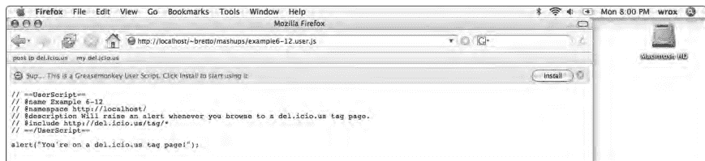
**图 6-5**

- 3. 点击 Install 来安装并立即激活脚本。然后，浏览到一个 del.icio.us 标签页，例如 http://del.icio.us/tag/firefox。会出现一个警报框，告知你正处于 del.icio.us 标签页上。如果你浏览到 del.icio.us 上任何非标签页，或任何其他网站，该警报都不会出现。

Firefox “工具”菜单中的“管理用户脚本”命令允许你编辑、禁用或完全删除已安装的 Greasemonkey 脚本。在完成本示例后，你可以随意卸载此脚本（除非你喜欢在每次访问 del.icio.us 标签页时都被不断提醒）。

### 工作原理

这个特定的 Greasemonkey 脚本的大部分内容涉及脚本的 *元数据（metadata）* 部分。元数据描述了脚本本身、它的功能、来源以及它应该在何处工作。最重要需要注意的元数据是以下 `@include` 行：

```
// @include http://del.icio.us/tag/*
```

`@include` 行告诉 Greasemonkey 在哪里运行脚本。在本例中，星号 (*) 字符被用作 *通配符*，意味着它可以匹配任何内容。结果是，只有当 URL 包含 http://del.icio.us/tag/ 且其后跟随其他内容时，脚本才会执行。由于 del.icio.us 的 URL 架构在这种方式上是可预测的，因此可以肯定该脚本将在每个标签页上执行。

脚本的最后一部分是对 JavaScript `alert` 函数的调用：

```
alert("You're on a del.icio.us tag page!");
```

这就是全部内容。在任何匹配 `@include` 元数据行的页面上都会调用此警报。

### Firefox 扩展

Greasemonkey 看起来很简单，但它实际上是一个功能相当强大的 Firefox 扩展，具有许多不同的能力。Greasemonkey 和其他 Firefox 扩展是由独立开发人员创建的。Firefox 允许任何人通过编写像 Greasemonkey 这样的扩展来扩展其功能。

你将在第 12 章的一个项目中编写一个 Firefox 扩展。它将作为你其中一个 mashup 项目的界面。

要编写自己的 Firefox 扩展，你应该首先按照 mozillaZine 网页上提供的指南配置开发环境，该网页专注于 Mozilla 的开发和推广。Mozilla 是构建 Firefox 的 Web 引擎。该网页的 URL 如下：

```
http://kb.mozillazine.org/Setting_up_extension_development_environment
```

如果你现在就想开始研究扩展，也可以查看该网站上的教程：

```
http://kb.mozillazine.org/Getting_started_with_extension_development
```

如果你能等到第 12 章，你将被引导完成整个扩展开发过程。

### 总结

至此，我们完成了一个关于你在 mashup 项目中将要使用的所有技术的实操性概述。描述的两项主要技术是 PHP 和 JavaScript。这两种编程语言在创建 mashup 项目时确实至关重要，因为在移动、操作和呈现来自多个源的数据方面，它们发挥了巨大作用。

在下一章中，你将有机会将这里学到的知识应用于 del.icio.us 和其他 Web 软件。它将向你展示一些将这些技术与 del.icio.us 融合的技巧。

### 练习

本章涵盖了大量信息。如果你有兴趣扩展目前所学的内容，请尝试以下练习。

- 1. 在 example6-1.html 中，你开发了一个 XHTML 页面，用于跟踪用户按下按钮的次数，并使用 JavaScript 和 DOM 架构将此数字显示在页面上。为此页面添加一个名为 `reset_count()` 的 JavaScript 函数，用于重置按钮按下计数，并将 `num_presses_span` `<span>` 的值恢复为原始值 0。此外，创建一个新按钮，用户点击后可调用此函数。
- 2. 概述在 example6-5.php 脚本创建的基于 Web 的联系人数据库中添加“职称（title）”字段所需的步骤。不要忘记描述你在 MySQL、PHP 和 HTML 方面需要做的事情。只需给出需要完成工作的总体概述即可——无需过于具体。
- 3. 你在本章中使用了许多第三方 PHP 库，每个库都能执行非常特定的功能。以下假设的项目会使用 SAJAX、Snoopy 还是 Magpie RSS 库？
    - 一个结合多个 RSS 馈送并在网站上显示其内容的项目
    - 一个每 30 秒自动在页面上显示最后输入的 10 条数据库记录的项目
    - 一个发出必要的 del.icio.us API 命令以重命名特定标签的项目


## del.icio.us 混合技术

终于到了将前几章介绍的理念和概念直接应用于 del.icio.us 的时候了。在本章中，你将完成前两个 del.icio.us 混合项目——某种程度上是这样。你不会将 del.icio.us 与除第 6 章中强调的一些技术之外的任何东西混合。尽管如此，在执行过程中，你将利用 del.icio.us 提供数据的某些方式，并将其重新组合到你自己的设计中。你还将通过对官方 del.icio.us Firefox 扩展的概述，了解 del.icio.us 走向桌面端的一种方式。

### 一个简单而精妙的 JSON 重组

在第一个项目中，你将创建一个个性化的 del.icio.us 摘要页面，用以展示你最近发布的链接、所有标签的完整列表以及特定标签下的所有书签。这一切都将使用原生的 HTML、JavaScript 以及 del.icio.us 提供的 JSON 馈送（feeds）来实现。这个摘要页面可以在任何现代浏览器中运行，不需要 Web 服务器，更不需要 PHP 和 MySQL 提供的动态后端。

在这个项目中，你将利用 del.icio.us 的三个特性：linkrolls（链接滚动条）、tagrolls（标签滚动条）和 JSON 馈送。Linkroll 是一个可移植的最新 del.icio.us 书签列表。请查看 `http://del.icio.us/help/linkrolls` 上的 del.icio.us linkrolls。你可以将该页面界面提供的 JavaScript 标记放入你的 HTML 代码中。你的页面将从 del.icio.us 加载所需的 JavaScript 和格式，从而在你的页面上自动为 linkroll 创建 HTML 标记。

你还将使用 tagrolls (`http://del.icio.us/help/tagrolls`)。Tagrolls 实际上就是标签云，你可能在第 3 章中记得它。这个特定的标签云代表了你的 del.icio.us 标签。它们是可点击的，每个标签都会带你进入 del.icio.us 上相应的标签页面。与 linkrolls 类似，你可以使用 del.icio.us 提供的界面来配置 tagroll 的外观和内容，并获取需要放入页面的代码。

Linkrolls 和 tagrolls 都是通过 del.icio.us 提供的 JSON 馈送来实现的。你可以在 http://del.icio.us/help/json 阅读更多相关信息。

在尝试了 del.icio.us 的 linkrolls 和 tagrolls 之后，你将获取一个 JSON 馈送并将其重组到你的摘要页面中，以显示特定标签的所有书签。正如你很快会学到的，在 JavaScript 中处理 JSON 非常简单。此外，你还将使用 CSS 将页面样式化并格式化为三栏布局。

#### 动手试一试：使用 Linkrolls 和 Tagrolls

在本次“动手试一试”中，你将对 linkrolls 和 tagrolls 进行初步练习。

- 1. 在你的 htdocs 目录下创建一个名为 **delicious_summary.html** 的新文件。

*这个文件在本章中会经过多次修改，请务必密切跟进。*

> **你可以在 Wrox 配套网站上找到 delicious_summary.html 的最终形式，以及本章中所有其他项目的代码。**

- 2. 从常规的 XHTML 文档外壳开始，如下所示：

```
<!DOCTYPE html PUBLIC "-//W3C//DTD XHTML 1.0 Strict//EN"
"http://www.w3.org/TR/xhtml1/DTD/xhtml1-strict.dtd">
<html xmlns="http://www.w3.org/1999/xhtml" xml:lang="en" lang="en">
<head>
<title>My del.icio.us Summary Page</title>
</head>
<body>

<h1>My del.icio.us Summary Page</h1>

</body>
</html>
```

- 3. 如果你还没有登录 del.icio.us，请先登录，然后加入一个 del.icio.us linkroll。为此，请从 http://del.icio.us/help/linkrolls 提供的默认 linkroll 脚本开始。将其复制并粘贴到你的 delicious_summary.html 文档中，紧跟在 `<h1`> 元素下方。

你可能已经注意到 linkroll 的一个小秘密——它是通过查询字符串（query strings）配置的。以下代码只是 del.icio.us 可能提供的内容示例（注意 HTML 中**粗体**部分）：

```
<script type="text/javascript"
src="http://del.icio.us/feeds/js/YOURNAME?title=my%20del.icio.us;icon"></script>
<noscript><a href="http://del.icio.us/YOURNAME">my del.icio.us</a></noscript>
```

- 4. 当你使用 del.icio.us linkroll 页面上提供的表单来更改 linkroll 的外观时，它所做的仅仅是向 JavaScript 包含文件的 src 属性 URL 中增加或删除组成查询字符串的内容。试着直接访问 http://del.icio.us/feeds/js/yourname?title=my%20del.icio.us;icon，将 yourname 替换为你的 del.icio.us 账户名称。

你会看到屏幕上输出了大量的 JavaScript 代码。在本节稍后部分，你将了解到这段 JavaScript 代码具体做了什么，但目前你只需要明白：JavaScript 代码是从 del.icio.us 下载然后执行的。当这种情况发生时，JavaScript 会获取你的最新链接，并将其格式化为 HTML 输出到你的页面上。如果你现在浏览 delicious_summary.html，你会看到 linkroll 自动出现在页面上。然而，如果你在浏览器中查看页面的源代码，你只会看到 `<script>` 元素。

- 5. 修改 JavaScript 包含文件中的查询字符串，以更改 linkroll 的外观，如以下示例代码所示（注意**粗体**部分的更改）：

```
<script type="text/javascript"
src="http://del.icio.us/feeds/js/YOURNAME?extended=extended"></script>
<noscript><a href="http://del.icio.us/YOURNAME">My Latest Bookmarks</a></noscript>
```

如果浏览器不支持或选择不执行 JavaScript，则会显示 `<noscript>` 元素内部的文本。在这个示例中这并不重要，但无论如何，你需要保持 `<noscript>` 标记内部的标题一致。

这些更改将为 linkroll 书签添加扩展描述，移除 del.icio.us 图标，并移除标题。重新加载 delicious_summary.html 以查看这些更改生效。

- 6. 从 http://del.icio.us/help/tagrolls 获取默认的 tagroll 代码，并将其放置在 linkroll 下方。

请注意，tagroll 代码同样是用查询字符串配置的：

```
<script type="text/javascript"
src="http://del.icio.us/feeds/js/tags/YOURNAME?icon=150;
size=12-35;color=87ceeb;color=0000ff;title=my%20del.icio.us%20tags"></script>
```

- 7. 将查询字符串修改为如下内容：

```
<script type="text/javascript"
src="http://del.icio.us/feeds/js/tags/YOURNAME?count=100;size=13-30;
color=7A8073-F5FFE6"></script>
```

这将改变显示的标签数量、标签的大小范围以及标签的颜色，并移除出现在标签上方的标题。

### 工作原理

如果你查看 delicious_summary.html 的源代码，除了你自己添加的内容外，你不会看到任何 HTML 标记。当页面加载时，在你使用 `<script>` 标签包含的 JavaScript 执行时，linkroll 和 tagroll 馈送的 HTML 输出将被写入浏览器。这种技术被称为跨站脚本（cross-site scripting）。每次加载此页面时，你都在运行位于 del.icio.us 的一些 JavaScript 代码。你通过添加到脚本源 URL 的查询字符串向这段代码发送某些参数。反过来，这段 JavaScript 代码会改变你的网页。

归根结底，对于那些不熟悉 del.icio.us 脚本编写和 del.icio.us API 的人来说，这是一种获取最常见数据并将其包含在自己的网站或博客中的简单方法。这是一个方便的功能，并且在查询字符串参数之外还可以进行一定程度的自定义（你很快就会学到）。然而，这并不是从 del.icio.us 获取数据的最佳方式，主要是因为它是预先格式化的，虽然可以自定义，但从混合（mashup）的角度来看并不理想。

从混合开发角度来看，del.icio.us 提供的 JSON 馈送要有趣得多，因为数据以一种易于 JavaScript 处理的形式呈现，但尚未被格式化，更不用说输出到页面上。你可以将这些 JSON 馈送看作是原始的 linkrolls。

#### 动手试一试：处理 JSON 数据

这次“动手试一试”让你为 delicious_summary.html 添加最后一部分内容。在这个练习中，你将获取并显示特定标签的所有书签。你可以为此使用 linkroll 功能，但在这个特定示例中，直接与 JSON 交互可能会更有趣。因此，在这里你将设计一个方案，获取例如你 del.icio.us 中所有标记为 `javascript` 的书签的 JSON 馈送。你将使用 DHTML 根据 JSON 馈送返回的数据创建一个书签的无序列表。

1. 将以下内容添加到 delicious_summary.html 中，位于 tagroll 代码下方（继续将 YOURNAME 更改为你的 del.icio.us 账户名称）：

```
<script type="text/javascript"
src="http://del.icio.us/feeds/json/YOURNAME/php?count=100"></script>
<div id="json_data_container"></div>
<script type="text/javascript">
//start with an unordered list element
var ul = document.createElement('ul');
//iterate through Delicious.posts creating list items for each post
for (var i=0, post; post = Delicious.posts[i]; i++) {
    var li = document.createElement('li');
    var a = document.createElement('a');
    a.setAttribute('href', post.u);
    a.appendChild(document.createTextNode(post.d));
    li.appendChild(a);
    //include the notes field if it exists
    if (post.n) {
        var p = document.createElement('p');
        p.appendChild(document.createTextNode(post.n));
        li.appendChild(p);
    }
    ul.appendChild(li);
}
//append the list to the json_data_container div element
document.getElementById('json_data_container').appendChild(ul);
</script>
```

2. 重新加载页面以查看效果。你应该能看到页面上增加了一个所有标记为 `php` 的书签列表。当然，如果你没有任何标记为 `php` 的书签，则不会显示任何内容。如果是这种情况，你可以将 `<script>` 元素中 src 属性末尾的 `php` 引用更改为一个至少有几个书签的标签。

### 工作原理

页面的这个部分分为两部分。第一部分通过引入远程 JavaScript 文件从 del.icio.us 获取 JSON 数据。第二部分使用一些 DHTML 将数据处理并准备成一个 HTML 无序列表 (`<ul>`)，然后将其显示在页面上。


 ## 第 7 章：del.icio.us 混接技术

以下标记将创建一个名为 `Delicious.posts` 的 JSON 对象：

```
<script type="text/javascript"
 src="http://del.icio.us/feeds/json/YOURNAME/php?count=100"></script>
```

该对象在脚本包含之后，可立即被任何 JavaScript 代码调用。`Delicious` 对象的具体内容由你的 URL 和查询字符串决定。

`Delicious.posts` 数组是一个对象数组，其中每个对象包含单个书签的数据。由于这是 JavaScript 中 JSON 的标准属性，你可以使用点号语法（dot-syntax 来访问这些数据。对象属性命名为：`u` 代表 URL，`d` 代表描述（description），`n` 代表笔记（note，即扩展描述），`t` 代表标签（tags），具体作用如下：

- `Delicious.posts[0].u` 获取数组中第一个书签的 URL。
- `Delicious.posts[0].d` 获取数组中第一个书签的描述。
- `Delicious.posts[0].n` 获取数组中第一个书签的笔记。
- `Delicious.posts[0].t` 获取数组中第一个书签以空格分隔的标签列表。

由于 `Delicious.posts` 对象可立即被 JavaScript 访问，你可以使用 JavaScript 的 DOM API 将数据追加到 HTML 标记中。

首先，创建一个无序列表元素并将其赋值给名为 `ul` 的变量：

```
//start with an unordered list element
var ul = document.createElement('ul');
```

然后，使用 JavaScript 的 `for` 控制语句遍历 `Delicious.posts` 中的每个元素，将 `Delicious.posts` 中的每个书签赋值给 `post` 变量：

```
//iterate through Delicious.posts creating list items for each post
for (var i=0; post = Delicious.posts[i]; i++) {
    ... the rest of the JavaScript DHTML code ...
}
```

对于每个书签，将创建另外两个 HTML 元素 —— 一个 `<li>`（列表项）和一个 `<a>`（锚点）元素：

```
var li = document.createElement('li');
var a = document.createElement('a');
```

将锚点的 `href` 属性设置为该帖子的 URL，并将帖子描述作为文本子节点添加。随后，将该锚点作为子节点追加到列表中：

```
item.setAttribute('href', post.u);
a.appendChild(document.createTextNode(post.d));
li.appendChild(a);
```

你也可以使用 `innerHTML` 属性将帖子描述添加到锚点内部。`createTextNode` 只是另一种操作 DOM 的方式，两者各有用途。

接着，如果 `n`（笔记）变量存在，则添加一个新的 `<p>`（段落）元素和对应的文本节点：

```
//include the notes field if it exists
if (post.n) {
    var p = document.createElement('p');
    p.appendChild(document.createTextNode(post.n));
    li.appendChild(p);
}
```

最后，将 `<li>` 及其所有子节点添加到正在构建的 `<ul>` 中：

```
ul.appendChild(li);
```

在 `Delicious.posts.js` 中的每个帖子都处理完毕后，将整个 `<ul>` 元素追加到 `id` 属性为 `json_data_container` 的现有 `<div>` 中。

```
//append the list to the json_data_container div element
document.getElementById('json_data_container').appendChild(ul);
```

得益于 JSON、JavaScript 和一些相当复杂的 DHTML，最终结果就是你的页面上出现了实时的 del.icio.us 数据。

在这个特定的案例中，缺乏格式化实际上对你很有利，因为现在是时候美化这个页面了。链接列表（linkrolls）和标签云（tagrolls）由 del.icio.us 内置了一些格式。幸运的是，你可以覆盖其中大部分内容，但这并不简单。JSON Feed 的一个优点是你可以更灵活地控制它们的显示方式。无论如何，现在是时候尝试结合使用链接列表、标签云以及 JSON 数据，为这个页面打造一个全新的、统一的外观了。

#### 试一试：使用 CSS 美化你的页面

在本练习中，你将把三种 Remix 方法分别移入三个格式整齐的列中，并添加美学细节。你需要为此页面创建一个层叠样式表（CSS）。通过引入 CSS 标记，你不仅可以定义已编写 HTML 元素的格式，还可以重新定义 del.icio.us 随链接列表和标签云一起带来的样式。

1. 在创建样式表之前，你首先需要在整个页面中定义几个不同的 `id` 和 `class` 属性。CSS 将利用这些属性来寻找需要格式化的内容。再次在编辑器中打开 `delicious_summary.html`。将 `<body>` 标签之间的标记更改为与以下代码一致，**特别注意加粗的行**。与此同时，将标签云查询字符串中出现的颜色范围更改为**加粗所示的十六进制代码**。这将使标签云与你即将用 CSS 实现的配色方案保持同步。

```
<h1 id="header">My del.icio.us Page Summary Page</h1>

<div id="center_col">
    <div class="col_banner">My Tags</div>
    <script type="text/javascript"
src="http://del.icio.us/feeds/js/tags/YOURNAME?count=100;size=13-30;
color=FFE6F9-BF60A7"></script>
    </div>

    <div id="left_col">
        <div class="col_banner">My Latest Bookmarks</div>
        <script type="text/javascript"
src="http://del.icio.us/feeds/js/YOURNAME?extended">
    </script>
        <noscript><a href="http://del.icio.us/YOURNAME">
My Latest Bookmarks</a></noscript>
    </div>

    <div id="right_col">
        <div class="col_banner">My PHP Bookmarks</div>
        <script type="text/javascript"
src="http://del.icio.us/feeds/json/YOURNAME/php?count=100"></script>
        <div id="json_data_container"></div>
        <script type="text/javascript">
        //start with an unordered list element
        var ul = document.createElement('ul')
        //iterate through Delicious.posts creating list items for each post
        for (var i=0, post; post = Delicious.posts[i]; i++) {
            var li = document.createElement('li');
            var a = document.createElement('a');
            a.setAttribute('href', post.u);
            a.appendChild(document.createTextNode(post.d));
            li.appendChild(a);
            //include the notes field if it exists
            if (post.n) {
                var p = document.createElement('p');
                p.appendChild(document.createTextNode(post.n));
                li.appendChild(p);
            }
            ul.appendChild(li);
        }
        //append the list to the json_data_container div element
        document.getElementById('json_data_container').appendChild(ul);
        </script>
    </div>
```

2. 你要添加的样式表会相当大 —— 至少与当前的 HTML 文档行数一样多，甚至更多。你可以将样式标记内联写在 XHTML 标记中（无论是直接作为元素的属性，还是放在 `<head>` 部分），也可以使用 `<link>` 元素从外部源引入。在本例中，采用后者。在 `<head>` 元素之间创建一个指向名为 `stylesheet.css` 文件的链接，如下所示：

```
<head>
<title>My del.icio.us Summary Page</title>
<link href="stylesheet.css" rel="stylesheet" type="text/css" /></head>
```

3. 使用编辑器，在 `delicious_summary.html` 所在的同一目录下创建一个名为 **stylesheet.css** 的新文件。这就是通过之前添加的 `<link>` 元素引入的样式表。将以下代码全部添加到其中（你可以直接从 Wrox 网站下载的配套代码第 7 章目录中复制 `stylesheet.css`）：

```
/* general page stylings */
html, body
{
    background-color: #7A8073;
    margin: 0 2em 1em 2em;
    font-family: Arial, Helvetica, san-serif;
    position: relative;
    margin: 5px;
    color: #D0D9C3;
}
/* three column layout ids */
#header
{
    color: #FFE6F9;
    text-align: center;
    position: absolute;
    top: 0;
    left: 0;
    width: 920px;
    height: 100px;
    font-size: 35px;
}
#left_col
{
    position: absolute;
    top: 100px;
    left: 0;
    width: 295px;
    padding: 5px;
    border: 1px solid #000000;
    background-color: #80737C;
}
#right_col
{
    position: absolute;
    top: 100px;
    left: 620px;;
    width: 295px;
    padding: 5px;
    border: 1px solid #000000;
    background-color: #80737C;
}
#center_col
{
    position: absolute;
    top: 100px;
    left: 310px;
    width: 295px;
}
```

```markdown
## 第二部分：准备混合（Mash）

```
padding: 5px;
border: 1px solid #000000;
background-color: #80737C;
}
a
{
text-decoration: none;
color: #F5FFE6;
font-weight: bold;
}
a:hover
{
color: #7A8073;
background-color: #FFE6F9;
}
.col_banner
{
color: #FFE6F9;
font-size: 20px;
border-bottom: 1px dotted #FFE6F9;
}
ul, li
{
margin: 0;
padding: 5px 0 5px 0;
list-style-type: none;
}
p
{
margin: 0;
font-size: smaller;
}
```

-   4. 重新加载页面，或者如果你已经关闭了浏览器，请再次访问该页面。现在页面看起来应该完全不同了。内容现在被安排在三列中，并且具有统一的外观。你应该能看到类似于图 7-1 的效果。

### 工作原理

幸运的是，del.icio.us 通过在 linkroll 和 tagroll 工具输出的大多数元素中添加 `class` 属性，使得这种戏剧性的转变成为可能。

`class` 属性与 `id` 属性一样，有助于识别 HTML 文档中的元素。传统上，`id` 应该仅使用一次来标识一个页面元素，但 `class` 属性可以在整个页面的多个元素上使用。你可以为每个 class 属性在 CSS 标记中添加特殊的样式，那么无论是什么类型的元素，只要其属性具有该类名，格式化都会生效。在 CSS 的世界里，可以将 class 视为一组样式化元素的“家族”，而 `id` 则是一个“孤独”的元素。

在 linkroll 和 tagroll 方面，del.icio.us 为返回的 HTML 代码中的几乎每个元素都分配了唯一的 `class` 属性。你使用自己的 CSS 覆盖了这些类。del.icio.us 团队创建了一份样式指南来帮助你覆盖其基础样式，你可以在 `http://del.icio.us/doc/feeds/js/styling` 找到该指南。

## 第二部分：准备混合（Mash）

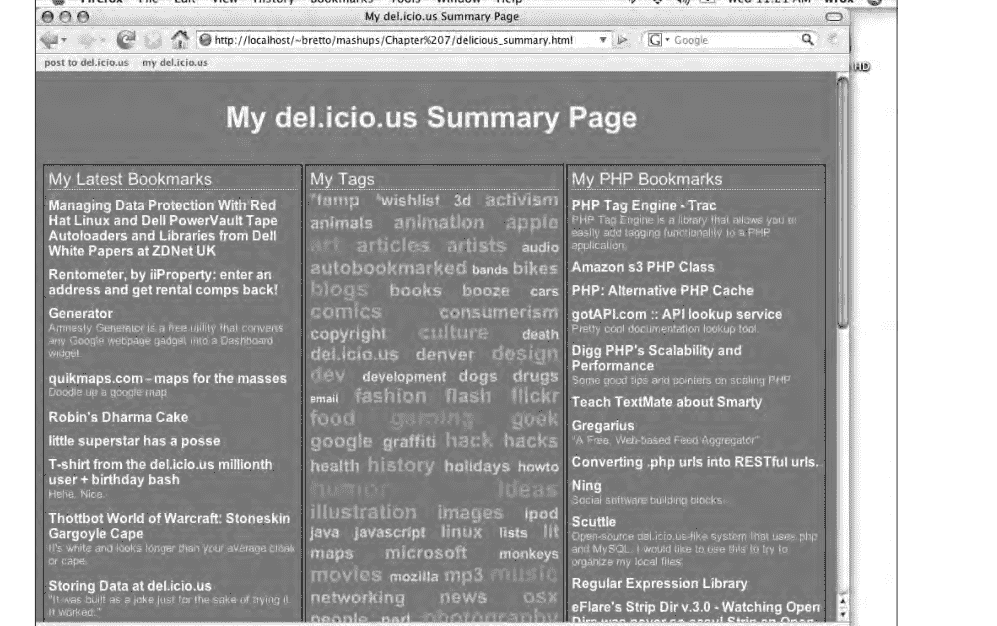

看看这段 CSS 标记：

```
/* delicious posts and unordered lists */
ul, li
{
    margin: 0;
    padding: 5px 0 5px 0;
    list-style-type: none;
    background-color: #E6FFE6;
}
```

在这里，你覆盖了出现在第三列 DHTML 生成标记中的 `<ul>` 和 `<li>` 元素的样式标记，以及出现在 del.icio.us linkroll 工具生成的 HTML 标记内部的 `<ul>` 和 `<li>` 元素。

显然，这里还发生了更多的 CSS 操作。涵盖 CSS 的所有复杂细节超出了本书的范围，但这里需要注意的是，你是如何使用 CSS 来重新混合和格式化从 linkroll、tagroll 和 JSON feed 中获取的 del.icio.us 数据的，从而创建了一个完全属于你自己的、对 del.icio.us 的全新视图和解读。

130

### 使用 PHP 和 MySQL 增强风味

在 delicious_summary.html 中使用 del.icio.us JSON feeds 很有趣，但对于一个严肃的 mashup 开发者来说，这并不是一种理想的技术。

一方面，目前 del.icio.us 仅提供一个 JSON feed —— 即获取你最新书签的 feed。希望这种情况会改变，但与你能从 del.icio.us 的 RSS feeds 或 del.icio.us API 获取的数据类型相比，JSON feeds 的用途极其有限。

此外，每次加载 delicious_summary.html 时，它都会请求 del.icio.us 三次。如果有一天你的 del.icio.us 摘要页面开始获得大量流量，这将给 del.icio.us 服务器带来压力。更严重的是，如果 del.icio.us 因为维护而宕机或出现其他问题，整个页面将瘫痪，完全无法显示任何内容。

这就是你之前读到的一些其他编程语言和技术开始发挥作用的地方 —— 具体来说，就是 PHP 和 MySQL。

通过 PHP，你可以使用 del.icio.us API，以一种与 JSON 同样易于使用的原始形式，收集关于最近发布链接、标签以及特定标签书签的数据。此外，编写某种存储和处理缓存数据的方法会变得容易得多。这不仅是对 del.icio.us 更友好，而且如果 del.icio.us 没有响应，你可以让你的 PHP 代码足够智能，在页面稍后尝试重新连接之前，检索你手头已有的缓存数据。得益于 AJAX 的强大功能，你甚至可以让 PHP 像 JavaScript 一样运行，在无需重新加载页面的情况下获取并显示额外数据。

在下一个项目中，你将使用 PHP 中的 del.icio.us API 来修改 delicious_summary.html 页面及其功能。你还将使用 MySQL 来缓存、存储和检索页面获取的数据。此外，你将研究如何使用 PHP 开发自己的标签云，并添加一点 Ajax 技巧，将你的 del.icio.us 摘要页面提升到新的水平。

不过，在执行所有这些操作之前，是时候构建这个 mashup 以及未来许多 mashup 的一个非常重要的部分了。你已经知道如何使用 PHP 向 RESTful API（如 del.icio.us API）发起 API 调用，并且你知道如何使用 PHP 内置的 XML 解析函数来解析 XML。现在是将这两个想法结合成一个单一 PHP 库的时候了，你将能够始终使用这个库在本项目及后续项目中与 del.icio.us API 进行交互。

#### 动手尝试：创建 delicious_mashups.inc.php

本项目第一部分的大部分工作是开发一个名为 `do_api_call()` 的自定义函数。你将 `do_api_call()` 设计为接收两个参数：API 方法，以及你想随 del.icio.us API 请求发送的查询字符串。相应地，你希望 `do_api_call()` 创建一个包含 del.icio.us API 响应的 PHP 数组。这样你就可以获取该响应并对其进行任何处理。

-   1. 在你的 htdocs 目录下创建一个名为 **delicious_summary2** 的新文件夹。然后创建一个名为 **api_test.php** 的页面。这将是你新库的测试页面。将以下代码放入 api_test.php 中，根据需要替换你的用户名和密码：

## 第二部分：准备混合（Mash）

```php
<?php

//define the delicious account information we need
define('DELICIOUS_USERNAME','username');
define('DELICIOUS_PASSWORD','password');

//bring in Snoopy goodness
include('lib/Snoopy.class.php');

//bring in the del.icio.us Mashups PHP library we will make
include('lib/delicious_mashups.inc.php');

//an do_api_call() test
do_api_call("/posts/recent?","&tag=php&count=10");

//print the output
echo "<pre>";
echo print_r($api_return);
echo "</pre>";

?>
```

-   2. 因为你将在整个项目中重复使用 your del.icio.us 用户名和密码，你必须将它们定义为常量。请确保将这些常量的值设置为你自己的 del.icio.us 用户名和密码。
-   3. 注意，在这段代码中，你使用 `include()` 函数引入了两个不同的 PHP 文件。第一个是 Snoopy.class.php，你在上一章中下载并试用过它。在 delicious_summary2 文件夹内创建一个名为 lib 的新目录，然后将 Snoopy.class.php 复制到其中。（如果你手头没有 Snoopy，请从 http://sourceforge.net/projects/snoopy/ 下载。）
-   4. 创建一个名为 delicious_mashups.inc.php 的文件并将其放置在 lib 目录中。这就是你将创建的用于标准化并简化 PHP API 操作的库。为其添加以下内容：

```php
<?php
//you must instantiate the Snoopy class first
if (!class_exists('Snoopy'))
    die('Please include the Snoopy class library before delicious_mashups.inc.php is included.');

//you also must define DELICIOUS_USERNAME and DELICIOUS_PASSWORD
if (!defined('DELICIOUS_USERNAME') || !defined('DELICIOUS_PASSWORD'))
    die('Please make sure DELICIOUS_USERNAME and DELICIOUS_PASSWORD are set before delicious_mashups.inc.php is included.');
//the base del.icio.us REST API URL

define('DELICIOUS_API_URL',"https://api.del.icio.us/v1");

//create a new Snoopy object
$snoopy = new Snoopy;

//set UserAgent and WWW-Authenticate information
```

## 第 7 章：del.icio.us 混合技术

```php
$snoopy->agent = "del.icio.us-Mashups-Library/1.0";
$snoopy->user = DELICIOUS_USERNAME;
$snoopy->pass = DELICIOUS_PASSWORD;

//give snoopy our path to cURL and where it should put downloaded files
$snoopy->curl_path = '/usr/bin/curl'; //Windows: C:\curl\curl.exe
$snoopy->temp_dir = '/tmp'; //Windows: C:\temp

$api_return = array();

function do_api_call($method, $query_string = '')
{
    //bring in and setup $api_return
    global $api_return;
    $api_return = array();

    //bring in snoopy
    global $snoopy;

    //setup the full api url
    $url = DELICIOUS_API_URL.$method.$query_string;

    //sleep for one second as per request
    sleep(1);

    //fetch the REST URL with snoopy
    if($snoopy->fetch($url))
    {
        //snoopy doesn't set status with ssl requests, so lets do that here
        if ($snoopy->status == '')
            $snoopy->status = get_status_from_response($snoopy->response_code);
        //if we've got a 200 response code then parse our XML
        if ($snoopy->status == 200)
            parse_xml_results($snoopy->results);
        //give $api_return the status code
        $api_return['status'] = $snoopy->status;
    } else {
        //handle any snoopy errors by outputting them to the screen
        die("ERROR: ".$snoopy->error);
    }
}
```

-   5. `parse_xml_results()` 函数用于处理 Snoopy 返回的数据（就像你在第 6 章中使用 Snoopy 时那样），因此你需要将此函数添加到页面中。你还需要引入 `get_status_from_response()`，以便 `$api_return` 变量不仅能包含这些数据，还能包含请求生成的 HTTP 状态码。（在更大的项目中，你将通过解析状态码来让你的 mashup 在 del.icio.us 因某种原因没有响应时回退到缓存。）将以下函数添加到 `delicious_mashups.inc.php` 以实现此功能：

```php
//this function will pull the status code from snoopy's response_code var
//usually snoopy sets this but not with SSL connections
function get_status_from_response($response_code)
{
```

133
```


## 第二部分：准备开始混合应用

```php
        preg_match("|^HTTP/[^\s]*\s(.*?)\s|",$response_code, $status);
        return $status[1];
}

//接收API结果，将其解析为XML，并将数据作为数组返回
function parse_xml_results($snoopy_results)
{
    //引入$api_return变量
    global $api_return;

    //设置解析器和处理器
    $parser = xml_parser_create();
    xml_set_element_handler($parser, "process_start", "process_end");
    xml_set_character_data_handler($parser, "process_cdata");

    //读取结果并解析其内容
    $parsed = xml_parse($parser, $snoopy_results);
    if (!$parsed)
        die(xml_error_string(xml_get_error_code($parser)." at line
".xml_get_current_line_number($parser)));

    //释放解析器
    xml_parser_free($parser);
}

//处理XML元素的开始
function process_start($parser, $name, $attributes)
{
    global $api_return;
    $element_data = array("name"=>$name,"attributes"=>$attributes);
    array_push($api_return,$element_data);
}

//处理XML元素的结束
function process_end($parser, $name)
{
    global $api_return;
    $api_return[count($api_return)-2]['children'][] =
$api_return[count($api_return)-1];
    array_pop($api_return);
}

//处理XML元素的字符数据（内容）
function process_cdata($parser, $cdata)
{
   global $api_return,$i;
   if(trim($cdata))
   {
      $api_return[count($api_return)-1]['cdata']=$cdata;
   }
}

?>
```

- 6. 浏览到 api_test.php。`print_r()` 函数会将 `$api_return` 变量的结构打印到页面上，并且希望能显示从 del.icio.us API 返回的一些数据。

> 根据你的 PHP 配置以及你使用的 Snoopy 版本，你可能会收到一些 PHP 通知。这很可能是 Snoopy 生成的。如果你想关闭 PHP 通知，请记住你总可以在代码内配置 PHP 的错误报告。添加以下代码行来隐藏 PHP 的通知：
> `error_reporting(E_ERROR | E_WARNING | E_PARSE);`

### 工作原理

delicious_mashups.inc.php 中的函数包含了 del.icio.us REST API 交互方法和你在第6章实验过的 XML 解析思想。现在它们只是被封装在一个方便的 PHP 函数中，你可以在任何地方包含这个文件。通过将 del.icio.us 登录信息等设置为全局常量，以及使用 Snoopy 类，你已经使这个文件更具可移植性。

如果你不清楚其工作原理，请回顾第6章，特别是关于 REST 和 XML 解析的讨论，因为你已经将相同的概念（几乎相同的代码）移植到了这个新的 PHP 库中，可以在任何地方使用。

现在是时候使用你的新 PHP 库，利用从 API 获取的数据来创建你自己的链接列表了。你还将创建一个 MySQL 缓存系统来缓存这些数据。

> *你也可以从 RSS 订阅源获取最新的书签，这或许更可取。不过，在这个项目中还是坚持使用 API，以便你可以测试和使用你新的 del.icio.us API PHP 库。*

#### 试试看：生成你自己的链接列表

首先，你必须为此项目创建所需的 MySQL 数据库和表。你将创建一个名为 delicious_summary2 的数据库，以及一个名为 delicious_sql 的 MySQL 用户并授予其使用权限。你还将创建一个名为 linkroll 的表来缓存你的链接列表数据。

- 1. 为你的模式（schemata）创建一个文件，命名为 **delicious_summary2.sql**，内容如下：

```sql
create database delicious_summary2;

grant all on delicious_summary2.* to 'delicious_sql'@'localhost' identified by 'password';

set password for 'delicious_sql'@'localhost' = old_password('password');

use delicious_summary2;

create table linkroll (
    time_retrieved datetime not null,
    serialized_data_array blob not null,
    index linkroll_time_retrieved (time_retrieved)
);
```

- 2. 在 phpMyAdmin（或你选择的任何方式）中执行 .sql 文件，以创建你的新数据库、用户和表。

*除了 MySQL，还有其他方法可以缓存来自 del.icio.us 的数据，并且与一些更简单的方法（比如像 Magpie RSS 那样创建缓存文件）相比，MySQL 可能显得有些大材小用。然而，随着本书后续一些项目的进行，MySQL 及其功能将变得非常有用，所以现在养成将数据存储在 MySQL 中的习惯是好的。此外，MySQL 数据库的可移植性要强得多。你不必像处理 Magpie 的缓存文件那样担心文件权限等问题。最后，可以认为从 MySQL 获取数据比读写平面文件要快得多，也灵活得多。*

- 3. 在 delicious_summary2 文件夹中创建一个 index.php 文件。赋予它以下代码，该代码包含了你刚刚制作的 delicious_mashups.inc.php 库：

*将 DELICIOUS_USERNAME 和 DELICIOUS_PASSWORD 设置为你自己的用户名和密码。*

```php
<?php

//定义我们需要的delicious账户信息
define('DELICIOUS_USERNAME', 'username');
define('DELICIOUS_PASSWORD', 'password');

//MySQL数据库信息
define('MYSQL_HOST', 'localhost');
define('MYSQL_DATABASE', 'delicious_summary2');
define('MYSQL_USERNAME', 'delicious_sql');
define('MYSQL_PASSWORD', 'password');

//引入Snoopy
include('lib/Snoopy.class.php');
//因为Snoopy会产生一些错误通知，所以将其关闭
error_reporting(E_ERROR | E_WARNING | E_PARSE);

//同时引入我们制作的del.icio.us混合应用PHP库
include('lib/delicious_mashups.inc.php');

//创建MySQL数据库连接
$link = mysql_connect(MYSQL_HOST, MYSQL_USERNAME, MYSQL_PASSWORD)
    or die(mysql_error());
@mysql_select_db(MYSQL_DATABASE) or die(mysql_error());

?>
<?xml version="1.0" encoding="UTF-8"?>
<!DOCTYPE html PUBLIC "-//W3C//DTD XHTML 1.0 Strict//EN"
    "http://www.w3.org/TR/xhtml1/DTD/xhtml1-strict.dtd">
<html xmlns="http://www.w3.org/1999/xhtml" xml:lang="en" lang="en">
<head>
<title><?php echo DELICIOUS_USERNAME; ?>'s del.icio.us Summary Page</title>
</head>
<body>
<h1 id="header"><?php echo DELICIOUS_USERNAME; ?>'s del.icio.us Summary Page</h1>
```

## 第7章：del.icio.us 混合应用技术

```php
</body>
</html>
<?php
//关闭数据库连接，因为之后不再需要
mysql_close($link);
?>
```

这将你所有的 MySQL 连接变量设置为 PHP 常量，这是一个很好的习惯，同时使 MySQL 连接在页面整个执行过程中都可用。

- 4. 浏览到 delicious_summary2/index.php，确保所有内容都已加载且连接正确。

> 注意，DELICIOUS_USERNAME 常量在页面标题和标题中被输出。因为你的 del.icio.us 用户名被赋值给一个变量，你可以将此目录及其文件提供给使用 del.icio.us 的朋友，他或她只需更改提供的常量中的 del.icio.us 用户名和密码即可。页面不仅会显示他或她的 del.icio.us 书签，而且标题中也会显示他或她的名字进行个性化设置。

- 5. 现在是时候添加一些代码来获取你（或指定的 del.icio.us 用户）的最新20个链接，并将它们放入一个 PHP 变量中。你之前创建并包含在此页面中的新 `do_api_call()` 函数使得这变得特别容易。然而，你不希望页面每次加载都执行 `do_api_call()`。你只想在现有缓存不存在或超过一小时时执行它。因此，你需要将 `do_api_call()` 包装在某些先检查缓存的代码中，这样如果缓存比一小时更新，就会使用缓存而不是进行 API 调用。此外，如果 API 调用出现问题，你需要添加一些代码来检查 HTTP 响应代码，如果不是 200（OK），则使用缓存。

为了实现所有这些，在顶部的 PHP 代码块中，在调用 `mysql_select_db()` 之后添加以下代码：

```php
//首先，让我们填充$linkroll_data
$linkroll_data = array();
//首先检查linkroll表中第一（也是唯一）行的time_retrieved是否在过去一小时内
$linkroll_cache_query = "select count(*) from linkroll where time_retrieved >
    date_sub(now(), interval 1 hour)";
$linkroll_cache_result = mysql_query($linkroll_cache_query);
//如果返回了计数，我们应该使用缓存而不进行api调用
if (mysql_result($linkroll_cache_result,0) >= 1) {
    //使用linkroll缓存
    $linkroll_data = get_last_cached_data('linkroll');
} else {
    //没有缓存，所以是时候从api获取新数据来更新缓存了
    do_api_call('/posts/recent?','count=20');
    //如果状态是200，则创建缓存并使用$api_return作为我们的数据。
    //否则，改为获取缓存数据。
    if ($api_return['status'] == 200)
    {
        $add_cache_query = sprintf(
            "insert into linkroll (time_retrieved,serialized_data_array) values
```


## 第二部分：开始整合

```php
(now(),'%s')",
			mysql_real_escape_string(serialize($api_return))
			);
			mysql_query($add_cache_query) or die(mysql_error());
			$linkroll_data = $api_return;
		} else {
			//否则，强制使用缓存
			$linkroll_data = get_last_cached_data('linkroll');
		}
	}
```

- 6. 将以下函数添加到代码中：

```php
//此共享函数获取指定表的最近缓存数据
function get_last_cached_data($table)
{
	//从 $table 中获取最新的缓存项
	$query = "select serialized_data_array from $table order by time_retrieved desc limit 1";
	$result = mysql_query($query);
	$row = mysql_fetch_row($result);
	//反序列化数据数组并返回
	return unserialize($row[0]);
}
```

- 7. 要测试你的更改，请在 PHP 代码块底部的 `get_last_cached_data()` 函数之后添加以下行：

```php
die(print_r($linkroll_data));
```

现在浏览到该页面。你应该会看到类似下面的内容，这是 PHP 数据数组的直接输出：

```
Array ( [0] => Array ( [name] => POSTS [attributes] => Array ( [TAG] => [USER] => negatendo ) [children] => Array ( [0] => Array ( [name] => POST [attributes] => Array ( [HREF] => http://www.blackberry.com/developers/journal/oct_2004/rss-rdf_push_service.shtml [DESCRIPTION] => Creating a RSS/RDF Push Service for BlackBerry [HASH] => c832aaf209de81dde235a1d6bda085a0 [TAG] => rss phones dev tech hacks [TIME] => 2006-07-23T17:02:52Z ) ) [1] => Array ( [name] => POST [attributes] => Array ( [HREF] => http://googlesystem.blogspot.com/2006/07/google-video-link-to-part-of-video.html [DESCRIPTION] => Google Operating System: Google Video - Link to a Part of the Video [EXTENDED] => How to link to a specific timeframe in Google Video. [HASH] => 5712c9d4fb32653610dde32ca189290b [TAG] => google hacks web video [TIME] => 2006-07-22T01:21:23Z ) ) etc...
```

- 8. 验证成功后，移除 `die(print_r($linkroll_data));` 这一行。

> 请注意，第一次加载页面时可能会卡顿一秒。这是因为正在发起 API 调用。但立即重新加载页面时，速度应该会快得多。这次你使用的是缓存。你可以通过在 phpMyAdmin 中查看 linkroll 表的内容来验证缓存是否存在。

### 工作原理

完成本练习意味着又向由 PHP 驱动的 del.icio.us 摘要页面迈进了一步。在这里，你将 `$linkroll_data` 设置为来自 API 调用的已解析 XML，无论是从 del.icio.us 获取的还是从缓存中获取的。下面逐行分解实现这一功能的过程。

首先，你将 `$linkroll_data` 设置为空数组：

```php
$linkroll_data = array();
```

接下来，你执行一个 MySQL 查询来检索 linkroll 表中 `time_retrieved` 在一小时之前的行数：

```php
$linkroll_cache_query = "select count(*) from linkroll where time_retrieved > date_sub(now(), interval 1 hour)";
$linkroll_cache_result = mysql_query($linkroll_cache_query);
```

如果此查询返回了数据，说明你拥有比一小时更新的缓存数据。MySQL 的日期计算功能使这变得非常简单。

如果确实有缓存数据，则使用你设计的 `get_last_cached_data()` 函数来获取它。

```php
if (mysql_result($linkroll_cache_result,0) >= 1) {
  //使用 linkroll 缓存
  $linkroll_data = get_last_cached_data('linkroll');
} else {
  //其余代码
}
```

`get_last_cached_data()` 执行一个 MySQL 查询，从你通过 `$table` 参数指定的表中获取最新行的 `serialized_data_array` 列。该字段首先通过 PHP 的 `unserialize()` 函数进行反序列化后返回。`serialized_data_array` 只是原样保存你的 PHP 数组。正如你将看到的，在将 PHP 数组插入数据库之前，你需要使用 `serialize()` 函数对其进行序列化。序列化的 PHP 数据是 PHP 数据的字节流表示形式，可以存储在任何地方。你可能还记得 `serialized_data_array` 列是 MySQL 的 BLOB（二进制大对象）数据类型。BLOB 特别适合存储序列化数据。

```php
//此共享函数获取指定表的最近缓存数据
function get_last_cached_data($table)
{
  //从 $table 中获取最新的缓存项
  $query = "select serialized_data_array from $table order by time_retrieved desc limit 1";
  $result = mysql_query($query);
  $row = mysql_fetch_row($result);
  //反序列化数据数组并返回
  return unserialize($row[0]);
}
```

如果没有符合时间约束的缓存数据会怎样？那么显然你需要发起 API 调用来获取用户的最近 20 个书签，如下所示：

```php
do_api_call('/posts/recent?', 'count=20');
```

希望 `do_api_call()` 能够获取数据并将其赋给 `$api_return`。但在对 `$api_return` 做任何操作之前，你需要确保这是有效的且没有出错。这可以通过检查状态码是否为 200（成功获取超文本文档的 HTTP 状态码）来实现，如下所示：

```php
if ($api_return['status'] == 200)
{
    $add_cache_query = sprintf(
        "insert into linkroll (time_retrieved,serialized_data_array) values (now(),'%s')",
        mysql_real_escape_string(serialize($api_return))
    );
    mysql_query($add_cache_query) or die(mysql_error());
    $linkroll_data = $api_return;
} else {
    //否则，强制使用缓存
    $linkroll_data = get_last_cached_data('linkroll');
}
```

如果 API 调用成功，你将执行查询将已解析的数据插入缓存表中。你将 `time_retrieved` 赋值为 MySQL 的 `now()` 函数，它将插入 MySQL 所知的当前日期和时间。此外，你使用 PHP 的 `serialize()` 函数对整个 PHP 数组进行序列化，并使用 `mysql_real_escape_string()` 进行转义。结果是在数据库中插入了一个新行，其中包含来自 API 调用的所有已解析数据（以 PHP 格式）以及缓存行的创建时间。

如果未获得 200 状态码，你将默认使用缓存数据。这样，即使 del.icio.us 宕机或无响应，你仍然有内容可以显示。唯一会失败的情况是 del.icio.us 在你第一次浏览页面时就无响应。如果发生这种情况，请检查实际的响应代码以帮助诊断问题。如果状态码为 404，表示页面未找到，可能是 API 调用格式不正确。你可以在 www.w3.org/Protocols/rfc2616/rfc2616-sec10.html 上阅读有关 HTTP 状态码及其含义的所有信息。

因此，最终结果是每次加载页面时，你都会获得相同格式的 PHP 数据数组，无论是来自缓存还是从 API 拉取，都可以直接使用。

有了这样的系统，你的缓存数据库可能会变得相当大。这看起来似乎没用，但可以说数据永远不嫌多（只要你能轻松地存储和检索它）。例如，如果你想在页面上实现一个表单，让用户选择早期日期的书签，你将能够利用 linkroll 缓存表来帮助你。如果需要，写几行额外的代码在新行添加时清理 linkroll 表中的旧行也很简单。

## 第 7 章：del.icio.us 整合技术

#### 动手试试：生成你自己的标签列表

现在是时候获取你的标签列表数据了。这与链接列表代码非常相似。

1. 你需要在 delicious_summary2 数据库中创建一个新表作为标签列表缓存。在 phpMyAdmin 中，从左栏的数据库下拉列表中选择 delicious_summary2 数据库。然后，点击 SQL 选项卡进入一个可以输入 SQL 查询的文本字段。输入以下内容并点击"执行"来创建你的标签列表表：

```sql
create table tagroll (
    time_retrieved datetime not null,
    serialized_data_array mediumblob not null,
    index tagroll_time_retrieved (time_retrieved)
);
```

2. 在 index.php 中获取链接列表的代码下方（在 `get_last_cached_data()` 函数正上方），添加以下内容：

```php
//接下来让我们为标签列表填充此用户的标签数据
//使用 API
$tagroll_data = array();
//首先查看 tagroll 表中的第一（也是唯一）行的
//time_retrieved 是否在过去一小时内
$tagroll_cache_query = "select count(*) from tagroll where time_retrieved >
date_sub(now(), interval 1 hour)";
$tagroll_cache_result = mysql_query($tagroll_cache_query);
//如果返回了计数，我们应该使用缓存而不是发起 API 调用
if (mysql_result($tagroll_cache_result,0) >= 1) {
    //使用 tagroll 缓存
    $tagroll_data = get_last_cached_data('tagroll');
} else {
    //没有缓存，因此需要从 API 获取新数据来更新缓存
    do_api_call('/tags/get');
    //如果状态为 200，则创建缓存并使用 $api_return 作为数据。
    //否则，改为获取缓存数据。
    if ($api_return['status'] == 200)
    {
        $add_cache_query = sprintf(
            "insert into tagroll (time_retrieved,serialized_data_array) values
            (now(),'%s')",
            mysql_real_escape_string(serialize($api_return))
            );
        mysql_query($add_cache_query) or die(mysql_error());
        $tagroll_data = $api_return;
    } else {
        //否则，强制使用缓存
        $tagroll_data = get_last_cached_data('tagroll');
    }
}
```

3. 通过将 `$tagroll_data` 打印到页面上来测试你的新标签列表，如下所示：

```php
die(print_r($tagroll_data));
```


## 2. 准备就绪：开始执行

你应该会看到类似这样的内容：

```
Array ( [0] => Array ( [name] => TAGS [attributes] => Array ( ) [children] => Array ( [0] => Array ( [name] => TAG [attributes] => Array ( [COUNT] => 1 [TAG] => [frequent] ) [1] => Array ( [name] => TAG [attributes] => Array ( [COUNT] => 36 [TAG] => [temp] ) [2] => Array ( [name] => TAG [attributes] => Array ( [COUNT] => 33 [TAG] => [wishlist] ) [3] => Array ( [name] => TAG [attributes] => Array ( [COUNT] => 27 [TAG] => [TAG] ) [4] => Array ( [name] => TAG [attributes] => Array ( [COUNT] => 1 [TAG] => [Tex] ) ) [5] => Array ( [name] => TAG [attributes] => Array ( [COUNT] => 1 [TAG] => [XML] ) ) [6] => Array ( [name] => TAG [attributes] => Array ( [COUNT] => 1 [TAG] => [Tag] ) ) [7] => Array ( [name] => TAG [attributes] => Array ( [COUNT] => 1 [TAG] => [architecture] ) ) [8] => Array ( [name] => TAG [attributes] => Array ( [COUNT] => 56 [TAG] => [activism] ) ) [9] => Array ( [name] => TAG [attributes] => Array ( [COUNT] => 1 [TAG] => [admin] ) ) [10] => Array ( [name] => TAG [attributes] => Array ( [COUNT] => 2 [TAG] => [adobe] ) ) etc...)
```

- 4. 在 phpMyAdmin 中检查 tagroll 表的内容，查看数据是否已缓存到数据库中。重新加载页面后，由于数据是从缓存中加载的，显示速度应该会快得多。
- 5. 在继续之前，请务必删除 `die(print_r($tagroll_data));`。

### 工作原理

获取 tagroll（标签列表）的工作方式与获取 linkroll（链接列表）几乎完全一样。你甚至将这些数据存储为序列化数组。唯一的区别是你传递给 `do_api_call()` 的参数，它会获取所有标签，且不带额外的查询字符串：

```
do_api_call('/tags/get');
```

既然你已经开始获取所需的数据，现在是将它放入你想要的三栏布局中的时候了。这包括为你的 linkroll 生成链接列表，以及为 tagroll 生成标签云。

#### 尝试显示你的 Linkroll 和 Tagroll

- 1. 对于这个项目，最简单的方法是借鉴 delicious_summary.html 的样式，同时为你的标签列表添加一些额外的样式细节。你可以直接链接到 delicious_summary.html 的样式表（无论它在何处），但目前更好的做法是将其复制过来并进行修改，以保持这两个项目的独立性。在 delicious_summary2 文件夹中创建一个名为 **stylesheet.css** 的新文件，并写入以下代码（或者直接使用 Wrox 网站上的 delicious_summary2/stylesheet.css 代码）：

```css
/* general page stylings */
html ,
body
{
    background-color: #7A8073;
    margin: 0 2em 1em 2em;
    font-family: Arial, Helvetica, Verdana, san-serif;
    position: relative;
    margin: 5px;
    color: #D0D9C3;
}
/* three column layout ids */
#header
{
    color: #FFE6F9;
    text-align: center;
    position: absolute;
    top: 0;
    left: 0;
    width: 920px;
    height: 100px;
    font-size: 35px;
}
#left_col
{
    position: absolute;
    top: 100px;
    left: 0;
    width: 295px;
    padding: 5px;
    border: 1px solid #000000;
    background-color: #80737C;
}
#right_col
{
    position: absolute;
    top: 100px;
    left: 620px;
    width: 295px;
    padding: 5px;
    border: 1px solid #000000;
    background-color: #80737C;
}
#center_col
{
    position: absolute;
    top: 100px;
    left: 310px;
    width: 295px;
    padding: 5px;
    border: 1px solid #000000;
    background-color: #80737C;
}
a
{
    text-decoration: none;
    color: #F5FFE6;
    font-weight: bold;
}
a:hover
{
    color: #7A8073;
    background-color: #FFE6F9;
}
.col_banner
{
    color: #FFE6F9;
    font-size: 20px;
    border-bottom: 1px dotted #FFE6F9;
}
ul, li
{
    margin: 0;
    padding: 5px 0 5px 0;
    list-style-type: none;
}
p
{
    margin: 0;
    padding: 0;
    font-size: smaller;
}
/* tagroll classes */
.largest_tag a
{
    font-size: 55px;
    color: #F5FFE6;
}
.large_tag a
{
    font-size: 45px;
    color: #CDDCB7;
}
.medium_tag a
{
    font-size: 35px;
    color: #A6B293;
}
.small_tag a
{
    font-size: 25px;
    color: #A2AE90;
}
.smallest_tag a
{
    font-size: 15px;
    color: #7A8073
}
```

- 2. 在 index.php 的 `<head>` 元素之间添加以下样式表链接：

```html
<head>
<title><?php echo DELICIOUS_USERNAME; ?>'s del.icio.us Summary Page</title>
<link href="stylesheet.css" rel="stylesheet" type="text/css" />
</head>
```

- 3. 在主 HTML 标记的 `<body>` 标签之间以及已有的 `<h1>` 标签下方创建三个列：

```html
<div id="center_col">
</div>

<div id="left_col">
</div>

<div id="right_col">
</div>
```

- 4. 从 linkroll 开始，它将出现在 id 为 `left_col` 的 `div`（左栏）中。插入以下内容：

```php
<div class="col_banner">My Latest Bookmarks</div>
<?php
    // list recent posts (linkroll)
    $posts = $linkroll_data[0]['children'];
    echo "<ul>";
    foreach ($posts as $post)
    {
        echo "<li><a href='".$post['attributes']['HREF'].'">".$post['attributes']['DESCRIPTION']."</a></li>";
        if (isset($post['attributes']['EXTENDED']))
        {
            echo "<p>".$post['attributes']['EXTENDED']."</p>";
        }
    }
    echo "</ul>";
?>
```

- 5. 将以下代码放入中间列的 `div` 中（其 id 属性设置为 `center_col`）：

```php
<div class="col_banner">My Tags</div>
<div style="text-align: justify">
<?php
    //pull all of the tags from $tags counts with a count of 3 or below
    //and put it into k => v way, where v = an array of all tags w/ that count
    $tag_counts = array();
    $tags = $tagroll_data[0]['children'];
    foreach ($tags as $tag)
    {
        $tag_counts[$tag['attributes']['COUNT']] = $tag['attributes']['TAG'];
    }
    //sort by tags counts
    ksort($tag_counts);
    //remove groups of tags from $tags counts with a count of 3 or below
    for ($i = 1; $i <= 3; $i++)
    {
        if (isset($tag_counts["$i"]))
        unset($tag_counts["$i"]);
    }

    //get the smallest count going
    $smallest_count = array_shift(array_keys($tag_counts));
    //get the largest count going
    $largest_count = array_pop(array_keys($tag_counts));
    //determine the difference between them
    $count_difference = $largest_count - $smallest_count;
    $count_distribution = $count_difference / 3; //3 different sub-sizes
    //create a new array of all tag names, sorted, with keys as counts as values
    $tag_values = array();

    foreach ($tag_counts as $count => $tags_in_count) {
        foreach ($tags_in_count as $tag_name) {
            $tag_values[$tag_name] = $count;
        }
    }

    ksort($tag_values);
    //now go through $tag_values and output them with the according classes
    foreach ($tag_values as $tag_name => $tag_count)
    {
        if ($tag_count == $largest_count)
            echo "<span class='largest_tag'>";
        elseif ($tag_count == $smallest_count)
            echo "<span class='smallest_tag'>";
        elseif ($tag_count > $smallest_count + ($count_distribution * 2))
            echo "<span class='large_tag'>";
        elseif ($tag_count > $smallest_count + $count_distribution)
            echo "<span class='medium_tag'>";
        else
            echo "<span class='small_tag'>";
            echo "<a href='#$tag_name'>$tag_name</a>";
            echo "</span>";
    }
?>
</div>
```

- 6. 浏览该页面。你的 linkroll 和 tagroll 应该看起来像图 7-2 那样。

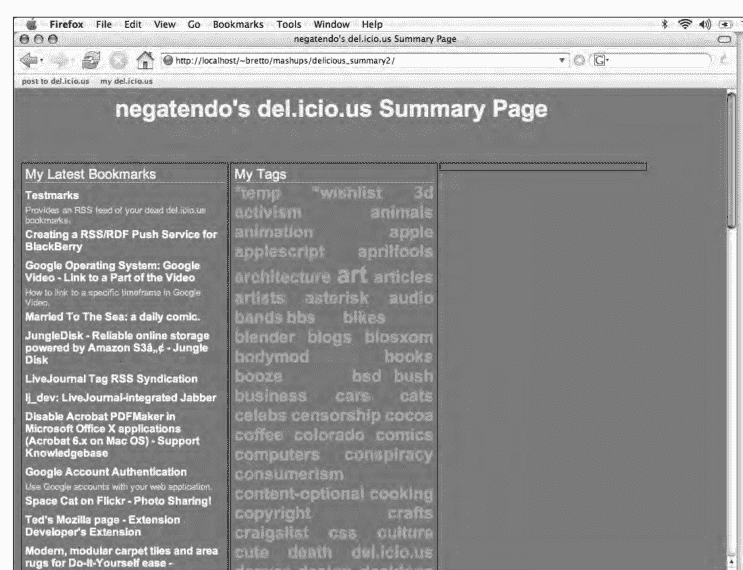

图 7-2

### 工作原理

在项目的这一部分，你终于将真实的 del.icio.us 数据（无论是缓存的还是直接来自 API 的）作为 HTML 标记的一部分输出。

对于 linkroll 数据，你只需遍历每个链接，并将它们作为无序列表中的项。你可能记得，`del.icio.us/posts/recent` API 方法的 XML 响应输出看起来像这样：

```xml
<posts tag="*" user="negatendo">
  <post href="http://www.blackberry.com/developers/journal/oct_2004/rss_rdf_push_service.shtml" description="Creating a RSS/RDF Push Service for BlackBerry" hash="c832aef209de81dde235a0d5a6dbda085a0" tag="rss phones dev tech hacks" time="2006-07-23T17:02:52Z"/>
  <post href="http://googlesystem.blogspot.com/2006/07/google-video-link-to-part-of-video.html" description="Google Operating System: Specific Timeframe Video - Link to a Part of the Video" extended="Google Operating System: Specific Timeframe in Google Video." hash="5712c9d4fb32653610dde32ca10dde32ca182902b" tag="google hacks web video" time="2006-07-22T01:21:23Z"/>
</posts>
```

当你解析这个 XML 时，你会得到一个类似下面的 PHP 数组：

```
Array
(
    [0] => Array
    (
        [name] => POSTS
        [attributes] => Array
        (
            [TAG] =>
            [USER] => negatendo
        )

        [children] => Array
        (
            [0] => Array
            (
                [name] => POST
                [attributes] => Array
                (
                    [HREF] =>
                    http://www.blackberry.com/developers/journal/oct_2004/rss_rdf_push_service.shtml
                    [DESCRIPTION] => Creating a RSS/RDF Push
                    Service for BlackBerry
                    [HASH] => c832aef209de81dde235a0d5a6dbda085a0
                    [TAG] => rss phones dev tech hacks
                    [TIME] => 2006-07-23T17:02:52Z
                )
            )
            [1] => Array
            (
```


## 第二部分：准备进行混搭

```
[name] => POST
[attributes] => Array
(
    [HREF] => http://googlesystem.blogspot.com/2006/07/google-video-link-to-part-of-video.html
    [DESCRIPTION] => Google Operating System: Google Video - Link to a Part of the Video
    [EXTENDED] => How to link to a specific timeframe in Google Video.
    [HASH] => 5712c9d4fb32653610dde32ca189290b
    [TAG] => google hacks web video
    [TIME] => 2006-07-22T01:21:23Z
    )
)
)
)
)
[status] => 200
)
```

对于链接列表（linkroll）和标签列表（tagroll），你只需关注数组中的 `children` 部分，因为它包含了每个 `<post>` 元素的数组。因此，首先你要将 `$posts` 变量赋值：

```php
//列出最近的帖子（链接列表）
$posts = $linkroll_data[0]['children'];
```

然后，只需遍历 `$posts`，将每个书签作为列表项输出到无序列表中。与本章前面的 JSON 数据类似，你只需在备注字段存在时才输出（在 API 响应中称为 EXTENDED）：

```php
echo "<ul>";
foreach ($posts as $post)
{
    echo "<li><a href=\"".$post['attributes']['HREF']."\">".
    $post['attributes']['DESCRIPTION']."</a></li>";
    if (isset($post['attributes']['EXTENDED']))
        echo "<p>".$post['attributes']['EXTENDED']."</p>";
}
echo "</ul>";
```

标签列表稍微复杂一些，因为你不仅想输出每个标签，还想根据标签的使用频率为其分配大小和颜色。也就是说，你想创建一个**标签云**（tag cloud）。你之前在 CSS 标记中添加了五个不同的 CSS 类，用于为不同标签定义不同的颜色和大小：

```css
/* 标签列表类 */
.largest_tag a
{
    font-size: 55px;
    color: #F5FFE6;
}
.large_tag a
{
    font-size: 45px;
    color: #CDDCB7;
}
.medium_tag a
{
    font-size: 35px;
    color: #A6B293;
}
.small_tag a
{
    font-size: 25px;
    color: #A2AE90;
}
.smallest_tag a
{
    font-size: 15px;
    color: #7A8073;
}
```

对于标签列表，你想将标签分配到这五种不同的大小中，并在输出到页面时为它们分配相应的类。幸运的是，del.icio.us API 通过 `count` 属性返回每个标签的使用次数，因此你可以确定使用最多的标签和使用最少的标签，并计算它们之间的三个计数值，以便按使用次数排列标签。

del.icio.us API 的 `/tags/get` 方法的 XML 响应类似如下：

```xml
<tags>
    <tag count="1" tag="art"/>
    <tag count="36" tag="dev"/>
    <tag count="33" tag="mysql"/>
    <tag count="33" tag="php"/>
</tags>
```

解析后的数组版本如下所示：

```
Array
(
    [0] => Array
    (
        [name] => TAGS
        [children] => Array
        (
            [0] => Array
            (
                [name] => TAG
                [attributes] => Array
                (
                    [COUNT] => 1
                    [TAG] => art
                )
            )
            [1] => Array
            (
                [name] => TAG
                [attributes] => Array
                (
                    [COUNT] => 36
                    [TAG] => dev
                )
            )
            [2] => Array
            (
                [name] => TAG
                [attributes] => Array
                (
                    [COUNT] => 33
                    [TAG] => mysql
                )
            )
            [3] => Array
            (
                [name] => TAG
                [attributes] => Array
                (
                    [COUNT] => 33
                    [TAG] => php
                )
            )
        )
    )
    [status] => 200
)
```

这种格式不便于找出使用最多和最少的标签。因此，你首先要做的是提取出 `children` 数组，重新组织并按使用次数排序：

```php
//首先从数据数组中提取所有标签及其使用次数
//并将其放入一个键值对数组中，其中值 = 所有具有该次数的标签数组
$tag_counts = array();
$tags = $tagroll_data[0]['children'];
foreach ($tags as $tag)
    $tag_counts[$tag['attributes']['COUNT']][] = $tag['attributes']['TAG'];
//按使用次数排序标签
ksort($tag_counts);
```

如果将 `$tag_counts` 输出到屏幕上，看起来会像下面这样：

```
Array
(
    [1] => Array
    (
        [0] => art
    )
    [33] => Array
    (
        [0] => php
        [1] => mysql
    )
    [36] => Array
    (
        [0] => dev
    )
)
```

在确定最高和最低次数之前，你需要移除任何计数为 1、2 或 3 的数组（以及这些计数下的标签）。例如，任何使用次数不超过三次的标签被认为对于标签云来说太少， insignificant，因此你使用以下代码：

```php
//从 $tag_counts 中移除计数为 3 或以下的标签组
for ($i = 1; $i <= 3; $i++) {
    if (isset($tag_counts["$i"]))
        unset($tag_counts["$i"]);
}
```

如果你的标签云看起来不够丰富，可以调整这些数字或将它们完全移除。

接下来，你获取最小的使用次数、最大的使用次数，并计算它们之间三个分布点。

```php
//获取最小的使用次数
$smallest_count = array_shift(array_keys($tag_counts));
//获取最大的使用次数
$largest_count = array_pop(array_keys($tag_counts));
//计算它们之间的差值
$count_difference = $largest_count - $smallest_count;
$count_distribution = $count_difference / 3; // 3 个不同的子大小
```

然后，你将数组重新组织为一个一维的键值对数组，称为 `$tag_values`，将标签名作为键，标签的使用次数作为值。此外，该数组按键排序，恢复了标签的字母顺序列表：

```php
//创建一个新的数组，所有标签名排序后作为键，使用次数作为值
$tag_values = array();
foreach ($tag_counts as $count => $tags_in_count){
    foreach ($tags_in_count as $tag_name)
        $tag_values[$tag_name] = $count;
}

ksort($tag_values);
```

最后，你遍历数组，为每个标签创建一个 `<span>` 元素，并分配适当的类名，以匹配标签的使用次数在分布中的位置：

```php
//现在遍历 $tag_values 并使用相应的类输出它们
foreach ($tag_values as $tag_name => $tag_count)
{
    if ($tag_count == $largest_count)
        echo "<span class=\"largest_tag\"> ";
    elseif ($tag_count == $smallest_count)
        echo "<span class=\"smallest_tag\"> ";
    elseif ($tag_count > $smallest_count + ($count_distribution * 2))
        echo "<span class=\"large_tag\"> ";
    elseif ($tag_count > $smallest_count + $count_distribution)
        echo "<span class=\"medium_tag\"> ";
    else
        echo "<span class=\"small_tag\"> ";
    echo "<a href=\"#\">".$tag_name."</a>";
    echo " </span>";
}
```

这就是创建标签云的一种方法。然而，`delicious_summary2` 中还缺少一样东西：第三列。在最初的 `delicious_summary.html` 练习中，右列包含了所有标记为 JavaScript 标签的书签。但这次，你将做一些不同的（希望也更有趣的）事情。

你可能已经注意到，标签云中的链接并没有指向 del.icio.us 上相应的标签页面。这是因为在 `delicious_summary2` 中，你希望在点击某个标签后，该标签下最新的 20 个书签能立即出现在右侧的第三列中，而无需页面刷新。你将使用 **SAJAX** PHP 库来实现这一点。下面的“动手试试”向你展示了如何操作。

#### 动手试试：应用可选标签链接列表

- 1. 创建一个 MySQL 表来存储可选标签链接列表的数据。首先，从 phpMyAdmin 界面左侧的下拉菜单中选择 `delicious_summary2` 数据库。然后在 phpMyAdmin 中执行以下查询：

```sql
create table tag_linkroll (
    tag varchar(255) not null,
    time_retrieved datetime not null,
    serialized_data_array blob not null,
    index selectable_linkroll_time_retrieved (time_retrieved),
    index selectable_linkroll_tag (tag)
);
```

- 2. 在此项目中引入 SAJAX 库。为此，将 `Sajax.php` 从 example6-10 复制（或从 SAJAX 网站 www.modernmethod.com/sajax/ 下载）到你的 lib 文件夹中，然后在 `delicious_mashups.inc.php` 之后引入 `Sajax.php` 文件，如下所示：

```php
//同时引入我们制作的 del.icio.us Mashups PHP 库
include('lib/delicious_mashups.inc.php');

//引入 SAJAX 的强大功能
require("lib/Sajax.php");
```


3. 在组装 `$tagroll_data` 的代码之后（或在 HTML 标记开始之前的任何位置），将以下函数添加到你的 PHP 代码中：

```php
//this function will grab the links for a particular tag, whether from
//cache or a del.icio.us API call
function get_tag_linkroll($tag) {
    global $api_return;

    //tag_linkroll_data will be filled with the 20 latest posted bookmarks
    $tag = $tag;
    $tag_linkroll_data = array();
    //check for cache like with the normal linkroll but also query on the tag name
    $tag_linkroll_cache_query = " select * from tag_linkroll where time_retrieved >
    date_sub(now(), interval 1 hour) and tag='".mysql_real_escape_string($tag)."'";
    $tag_linkroll_cache_result = mysql_query($tag_linkroll_cache_query);

    //if a row was returned, we should use cache and NOT make an api call
    if (mysql_num_rows($tag_linkroll_cache_result) >= 1) {
        //use the tag linkroll cache
        $tag_linkroll_data = get_last_cached_data('tag_linkroll',$tag);
    } else {
        //no cache so time to populate our cache with a new data fetched from the api
        do_api_call('/posts/recent?','count=20&tag=$tag');
        //if status is 200 then create the cache and use $api_return for our data.
        //otherwise, fetch the cache data instead.
        if ($api_return['status'] == 200) {
            $add_cache_query = sprintf(
                "insert into tag_linkroll
                (time_retrieved,serialized_data_array,tag)
                values (now(),'%s','%s')",
                mysql_real_escape_string(serialize($api_return)),
                mysql_real_escape_string($tag)
            );
            mysql_query($add_cache_query) or die(mysql_error());
            $tag_linkroll_data = $api_return;
        } else {
            //otherwise, force using the cache
            $tag_linkroll_data = get_last_cached_data('tag_linkroll',$tag);
        }
    }

    //return the list with proper html formatting
    $posts = $tag_linkroll_data[0]['children'];
    $html = "<em>selected tag: $tag</em>";
    $html .= "<ul>";
    foreach ($posts as $post)
    {
        $html .= " <li><a href='".$post['attributes']['HREF']."'>".$post['attributes']['DESCRIPTION']."</li>";
        if (isset($post['attributes']['EXTENDED']))
            $html = " <p>".$post['attributes']['EXTENDED']."</p>";
    }
    $html .= "</ul>";
    return $html;
}
```

## 第二部分：准备进行 Mashup

4. 修改 `get_cached_data()` 函数，使其在查询 `time_retrieved` 的基础上，可以选择性地查询标签（tag）。将 `get_cached_data()` 修改为如下内容，请特别注意**粗体行**：

```php
//this shared function fetches the last cached data for a given table
function get_last_cached_data($table,$tag = '')
{
    //grab the newest cached item from $table
    if ($tag != '') {
        $query = "select serialized_data_array from $table where tag = "
              ."'".mysql_real_escape_string($tag)."'"." order by time_retrieved desc limit 1";
    } else {
        $query = "select serialized_data_array from $table order by time_retrieved desc limit 1";
    }
    $result = mysql_query($query);
    $row = mysql_fetch_row($result);
    //unserialize the data array and return it
    return unserialize($row[0]);
}
```

由于 `$tag` 是一个可选参数，这次修改不会影响页面其余部分对该函数已有调用方式。

5. 初始化 SAJAX 并导出 `get_tag_linkroll()` 函数。将此部分添加到第一个 PHP 代码块的底部，就在 HTML 代码开始之前：

```php
//initalize sajax and export the get_tag_linkroll function
sajax_init();
sajax_export("get_tag_linkroll");
sajax_handle_client_request();
```

6. 在 HTML 标记的 `<head>` 元素内部，通过 `sajax_show_javascript()` 函数添加 SAJAX 所需的 JavaScript 代码，以及你在页面中将要调用的 JavaScript 函数及其由 SAJAX 执行的回调函数：

```html
<head>
<title><?php echo DELICIOUS_USERNAME; ?>'s del.icio.us Summary Page</title>
<link href="stylesheet.css" rel="stylesheet" type="text/css" />
<script>
<?php
//this brings in all the javascript SAJAX needs to do its thing
sajax_show_javascript();
?>
//called when you click a tag in the tag-cloud
function get_tag_linkroll(tag) {
    document.getElementById("tag_linkroll").innerHTML =
          "<em>Fetching linkroll. Please wait....</em>";
    x_get_tag_linkroll(tag, get_tag_linkroll_cb);
}
//x_get_tag_linkroll callback
function get_tag_linkroll_cb(result) {
    document.getElementById("tag_linkroll").innerHTML = result;
}
</script>
</head>
```

## 第 7 章：del.icio.us Mashup 技术

- 7. 找到输出 tagroll 标签云的代码，并将锚点 (`<a>`) 元素修改为在点击时执行 `get_tag_linkroll()` JavaScript 函数，如**粗体行**所示：

```php
foreach ($tag_values as $tag_name => $tag_count)
{
    if ($tag_count == $largest_count)
        echo "<span class=\"largest_tag\"> ";
    elseif ($tag_count == $smallest_count)
        echo "<span class=\"smallest_tag\"> ";
    elseif ($tag_count > $smallest_count + ($count_distribution * 2))
        echo "<span class=\"large_tag\"> ";
    elseif ($tag_count > $smallest_count + $count_distribution)
        echo "<span class=\"medium_tag\"> ";
    else
        echo "<span class=\"small_tag\"> ";
    echo "<a href=\"#\" onClick=\"get_tag_linkroll('".$tag_name."'); return false;\">".$tag_name."</a>";
    echo " </span>";
}
```

- 8. 设置右侧列，在具有 `id="right_col"` 属性的 `<div>` 元素之间添加以下标记：

```html
<div id="right_col">
    <div class="col_banner">Browse by Tag</div>
    <div id="tag_linkroll">
        <p>&laquo; Click a tag in the column to the left to view my bookmarks for
        it here.</p>
    </div>
</div>
```

- 9. 访问 index.php 并点击任意标签。由于需要下载并缓存所点击标签的书签，可能会有轻微延迟，但最终书签应自动出现在右侧列中，如图 7-3 所示。

- 10. 在点击几个标签后，在 phpMyAdmin 中检查 `tag_linkroll` 表的内容。你会发现每点击一个标签就会出现一行。每个标签都有独立的缓存数据。

### 工作原理

当你点击一个标签链接时，会调用 `get_tag_linkroll()` JavaScript 函数。你通过 tagroll 中 PHP 输出的标签名称向 `get_tag_linkroll()` 传递参数：

```php
echo "<a href=\"#\" onClick=\"get_tag_linkroll('".$tag_name."'); return false;\">".$tag_name."</a>";
```

*onClick 属性中的 `return false` 部分可防止链接被发送到页面导致页面重新加载。*

## 第二部分：准备进行 Mashup

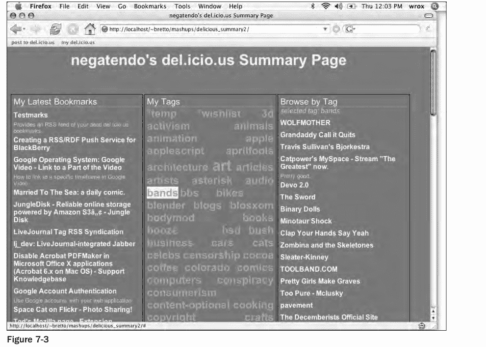

`get_tag_linkroll()` 仅仅是将第三列 `<div>` 中的内容替换为加载消息，然后通过 `x_get_tag_linkroll()` 执行 SAJAX 调用，告知 SAJAX 在完成时应将数据发送到 `get_tag_linkroll_cb()` JavaScript 函数。发送的参数是标签名称和回调函数的名称：

```javascript
function get_tag_linkroll(tag) {
    document.getElementById("tag_linkroll").innerHTML = "<em>Fetching linkroll. Please wait....</em>";
    x_get_tag_linkroll(tag, get_tag_linkroll_cb);
}
```

PHP 函数 `get_tag_linkroll()` 的操作与你获取 linkroll 时几乎完全一样，只有几点细微差别。

首先，该函数会检查数据库中是否存在存储时间不足一小时的缓存条目。这次它不仅查询 `time_retrieved`，还同时查询标签（tag）：

```php
function get_tag_linkroll($tag) {
```

## 第 7 章：del.icio.us Mashup 技术

```php
global $api_return;
//tag_linkroll_data will be filled with the 20 latest posted bookmarks
//under $tag
$tag_linkroll_data = array();
//check for cache like with the normal linkroll but also query on the tag name
$tag_linkroll_cache_query = "select * from tag_linkroll where time_retrieved > date_sub(now(), interval 1 hour) and tag='".mysql_real_escape_string($tag)."'";
$tag_linkroll_cache_result = mysql_query($tag_linkroll_cache_query);
```

数据库中每个标签都会有单独的条目。由于可能存在如此多的缓存（与你的标签数量一样多），这时 MySQL 在缓存方面就变得极其有用。

就像在普通 linkroll 中一样，如果存在存储时间不足一小时的缓存行，则检索该缓存；否则，执行 API 调用。你将标签作为第二个参数传递给修改后的 `get_last_cache_data()` 函数：

```php
//if a row was returned, we should use cache and NOT make an api call
if (mysql_num_rows($tag_linkroll_cache_result) >= 1) {
    //use the tag linkroll cache
    $tag_linkroll_data = get_last_cached_data('tag_linkroll',$tag);
} else {
    ...the rest of the code...
}
```

你必须修改 `get_last_cached_data()`，使其能够在提供标签时根据该标签进行查询。这就是为什么你要添加一个 `if` 控制语句来检查 `$tag` 变量的值。如果它存在，函数将同时根据标签进行查询；如果不存在，它将只获取最新的行：

```php
if ($tag != '') {
    $query = "select serialized_data_array from $table where tag = '".mysql_real_escape_string($tag)."' order by time_retrieved desc limit 1";
} else {
    $query = "select serialized_data_array from $table order by time_retrieved desc limit 1";
}
```

至于 `get_tag_linkroll()`，如果没有最近的缓存，就该查询 API 了。这一次，API 调用包含了 `tag` 参数，其值为你想获取书签的标签：

```php
do_api_call('/posts/recent?',"count=20&tag=".$tag);
```

在创建缓存条目时，查询语句略有不同。你不仅要插入通常的序列化数据和当前日期时间，还要为 `tag` 列插入一个值：

```php
if ($api_return['status'] == 200)
{
    $add_cache_query = sprintf(
        "insert into tag_linkroll (time_retrieved,serialized_data_array,tag) values (now(),'%s','%s')",
        mysql_real_escape_string(serialize($api_return)),
        mysql_real_escape_string($tag)
    );
```


## 第二部分：准备进行 Mashup

```php
mysql_query($add_cache_query) or die(mysql_error());
$tag_linkroll_data = $api_return;
} else {
    //otherwise, force using the cache
    $tag_linkroll_data = get_last_cached_data('tag_linkroll',$tag);
}
```

遗憾的是，使用 SAJAX 时，你不能像处理 `$linkroll_data` 那样，简单地让 PHP 页面重新解析，然后将 `$tag_linkroll_data` 的值输出到列 `<div>` 中。相反，你的函数必须返回已经完整格式化的数据，然后 JavaScript 会通过设置第三列内部 `<div>` 的 `innerHTML` 值，将其放置在适当的位置。因此，在函数内部，你在 `$html` 变量中构建完整格式化的 HTML，然后返回 `$html`；

```php
//return the list with proper html formatting
$sposts = $tag_linkroll_data[0]['children'];
$html = "<em>selected tag: $tag</em>";
$html .= "<ul>";
foreach ($sposts as $post)
{
    $html .= "<li><a href='".$post['ATTRIBUTES']['HREF'].'">'.$post['ATTRIBUTES']['DESCRIPTION'].'</a></li>";
    if (isset($post['attributes']['EXTENDED']))
        $html .= "<p>".$post['attributes']['EXTENDED']."</p>";
}
$html .= "</ul>";
return $html ;
```

请注意，`get_tag_linkroll()` 仍然能够使用页面上的所有其他函数并访问所有其他变量，包括 `get_last_cached_data()` 和 `$api_return` 的值。你甚至能够与 MySQL 数据库进行交互。

当函数执行完毕后，SAJAX 会执行 JavaScript 回调函数 `get_tag_linkroll_cb()`，并将 PHP 返回的 `$html` 变量作为结果参数传入，随后 `get_tag_linkroll_cb()` 将返回的数据设置为 tag_linkroll `<div>` 元素的 `innerHTML` 值：

```javascript
//x_get_tag_linkroll callback
function get_tag_linkroll_cb(result) {
    document.getElementById("tag_linkroll").innerHTML = result;
}
```

现在，这是一个非常精美的 del.icio.us 摘要页面了。

### 将其扩展到桌面端

与 del.icio.us API（或者任何 API）的交互绝不局限于本章目前为止你所做的两个项目这类基于 Web 的应用程序。API 也可以用来增强或创建计算机桌面应用程序，即使该 API 本身是为基于 Web 的服务设计的。事实上，桌面应用程序正越来越多地与 Web 连接，以增强 Web 应用程序所提供的服务。

## 第 7 章：del.icio.us Mashup 技术

为 Windows 或 Mac OS X 创建桌面应用程序超出了本书的范围。然而，有一款桌面应用程序你在阅读本书期间已经花了很多时间使用，而且你可以对其进行编程并与 del.icio.us API 集成：那就是 Firefox 浏览器。在本书的最终项目之一中，你将开发自己的 Firefox 扩展程序来与 del.icio.us 协作，从而将 del.icio.us 带入桌面环境。目前，你可以通过安装并使用官方的 del.icio.us Firefox 扩展来感受其工作原理。

#### 尝试安装 del.icio.us Firefox 扩展

- 1. 在 Firefox 中，访问 `http://del.icio.us/help/firefox/extension`。
点击 Install（安装）以安装扩展。Firefox 可能会提示你先授权 del.icio.us 安装扩展。如果出现此提示，请点击 Edit Options（编辑选项）按钮并点击 Allow（允许），以允许从 del.icio.us 网站安装扩展。然后，再次点击 Install。

- 2. 安装完成后，重启 Firefox。你应该会在 URL 栏左侧看到两个新按钮——一个看起来像 del.icio.us 的标志，另一个看起来像个带有 TAG 字样的价格标签——如图 7-4 所示。

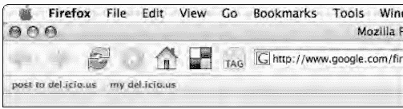
图 7-4

del.icio.us 标志按钮将作为跳转到你的 del.icio.us 页面的快捷方式。这样，你就可以快速访问你的 del.icio.us 书签。TAG 按钮则更有趣。按下它将打开一个新发布窗口，你可以从中保存当前浏览页面的书签。该窗口如图 7-5 所示。

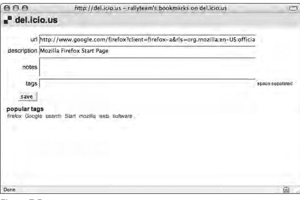
图 7-5

*关于这个 del.icio.us 扩展界面有一个很酷的功能：如果你在网页中选中了想要收藏的文本，只需按下 Tag 按钮，它就会自动将其添加到笔记（notes）字段中。*

此外，del.icio.us Firefox 扩展还为 Firefox 添加了一个包含许多其他有趣功能的 del.icio.us 菜单。请务必尝试一下。

### 工作原理

Firefox 扩展架构允许开发人员增强和扩展 Firefox 浏览器程序。del.icio.us 开发团队决定利用这一点，创建自己的扩展，以改善 Firefox 用户的 del.icio.us 使用体验。

del.icio.us Firefox 扩展提供的所有功能，实际上只是与你已经使用过的 del.icio.us 功能（如发布书签或搜索 del.icio.us）交互的新方式。这些功能不再使用书签脚本（bookmarklets）或网页，而是直接集成到软件中。最终的结果是带来了全新的 del.icio.us 用户体验。

稍后当你开发自己的 Firefox 扩展时，你将利用它使向某个用户的 del.icio.us 页面发布新书签的过程变得更简单、更高效。现在，请尽情尝试 del.icio.us Firefox 扩展提供的所有功能吧。

### 本章小结

在本章中，你有机会将此前仅简单尝试过的 API 方法、工具、编程语言和想法付诸实践，创建了两个 del.icio.us mashups。这些 mashups 以一种通常情况下 del.icio.us 无法提供的新颖且有趣的方式呈现了该服务。

第一个 mashup 纯粹使用了原生的 HTML 和 JavaScript 来获取 del.icio.us 的原始 JSON Feed。然后你将这些数据解析并重新格式化为你自己的形式。第二个 mashup 将相同的理念带入了 PHP 领域。它让你能够设计一种缓存机制，从而解决许多基于 Web 的 API 问题。此外，你还体验了 del.icio.us 与桌面计算机程序集成后的样子。

在下一章中，你将进一步深化这些概念，并真正开始使用不同的 Web 软件和 API 将各种事物“混合”（mashing）在一起。

### 练习

通过完成以下练习来测试你对本章项目的理解。

- 1. 在 `delicious_summary.html` 中，你使用了 JavaScript DOM API 来输出 JSON 数据，请修改代码，增加一个额外的段落 (`<p>`) 节点，列出每个显示书签的所有标签。

- 2. 如果你想把 `delicious_summary2` 项目给一个朋友，让他们创建自己的摘要页面，除了安装 `delicious_summary2` 文件夹及其内容外，他们还需要在自己的 Web 服务器上做哪些事情才能使其运行？他们需要遵循哪些步骤来创建自己的摘要页面？

- 3. 在 linkroll 区域中，你将如何添加一个书签链接，以便其他 del.icio.us 用户可以将该链接复制到他们自己的 del.icio.us 中？（提示：研究一下 del.icio.us 的书签脚本是如何工作的。）

## 第三部分：Mashups 与 Remixes

- 第 8 章：del.icio.us 与 WordPress 的 Mashup
- 第 9 章：使用 Greasemonkey 对 del.icio.us 进行 Remix
- 第 10 章：对 RSS Feed 进行 Remix
- 第 11 章：利用 Web 服务进行 Mashup

## 第 8 章：del.icio.us 与 WordPress 的 Mashup

可以说，del.icio.us 用户最想将其与之进行 mashup 的首先就是他们的博客软件（无论是什么软件）。这可能是因为用于定期发布想法和见解到 Web 的博客，与用于定期保存收藏网站和其他日常发现的 del.icio.us 在概念上是相辅相成的。因此，将它们以某种方式集成在一起显得非常自然。事实上，del.icio.us 提供了许多功能，可以帮助典型的博客变得更加实用且信息化。

在本章中，你将学习一些在将 del.icio.us 与 WordPress 博客系统集成时常用的技术。这将包括几个简单的项目，使你能够实现以下功能：

- 将书签的每日摘要发布到 WordPress。
- 让你的读者能够快速轻松地将你的文章链接保存到他们自己的 del.icio.us 账户中。
- 在 WordPress 文章中提供链接，引导读者访问 del.icio.us 页面，在那里他们可以阅读关于该文章在 del.icio.us 用户中的受欢迎程度以及相关的 del.icio.us 讨论。
- 通过将 WordPress 分类和 del.icio.us 标签进行 mashup，为每篇博客文章关联 del.icio.us 上的相关书签。
- 实现 del.icio.us Play Tagger，让你的读者可以在文章中直接播放 .mp3 文件的链接。

虽然看起来任务很多，但每个项目都非常简单，且在扩展 WordPress 和 del.icio.us 的功能方面具有巨大潜力。


 ## 第三部分：混合应用与重混 (Mashups and Remixes)

### 分享你的每日发现

有几种方法可以将你的 del.icio.us 书签每日摘要分享到你的 WordPress 博客上分享。最简单且或许最推荐的方法是在 WordPress 模板的侧边栏或其他位置包含一个 del.icio.us 的链接列表 (linkroll)。这样做非常简单，就像在 delicious_summary.html 项目中一样。只需将链接列表的 JavaScript 代码放入 WordPress 主题中你想要放置该列表的任何位置即可。然而，另一种流行的方法是创建一个自动化系统，将当天的书签作为一篇新的博客文章发布到 WordPress。

del.icio.us 提供了一个内置界面来自动化发布你的每日书签。在撰写本文时，该系统尚未完全开发完成，仍被视为实验性质。不过，如果你想尝试一下，可以在 `http://del.icio.us/settings/yourname/daily` 找到该界面（将 *yourname* 替换为你的 del.icio.us 用户名）。

这个被每日发布系统称为“任务小玩意 (job thingy)”的东西，本质上是一个由 del.icio.us 执行的计划任务，其中包含有关数据发送目的地的信息。这适用于 WordPress。如果你点击“添加新小玩意 (Add A New Thingy)”，系统会要求你提供以下信息：

- **job_name：** 这是一个描述性名称，例如 WordPress Post Thingy。
- **out_name：** 这是发布账户的用户名。对于 WordPress，你会使用 WordPress 博客上的用户名，例如 admin。
- **out_pass：** 这是发布账户的密码。对于 WordPress，如果你使用了 admin 账户，则为 admin 密码。
- **out_url：** del.icio.us 发送数据的接口。del.icio.us 将向该 URL 处的 WordPress 博客 XML-RPC 服务器接口发送一个 XML-RPC 请求。正如你之前在 WordPress 和 XML-RPC 经验中所记得的，这是一个以 `/xmlrpc.php` 结尾的完整 URL。（当然，因为你的 WordPress 博客存在于本地机器上，在该字段中输入 localhost 地址将不起作用。你的 WordPress 博客需要首先存在于公共互联网上。）
- **out_time：** 这是你希望发布操作发生的具体小时数。最好将此值设为 24，这将是 del.icio.us 的一天之终，从而获取你当天发布到 del.icio.us 的所有链接。
- **out_blog_id** 和 **out_cat_id：** 这些是你想要发布到的博客和类别的 ID。对于你的 WordPress 博客，这两个值可能都是 1。

创建任务小玩意后，del.icio.us 将在每天你指定的时间自动将链接发布到你的博客。目前，这项功能不仅是实验性的，而且对帖子外观和其他因素的控制能力非常有限。

在接下来的“动手试一试”中，你将创建自己的每日发布程序。它由 PHP 编写，使用 del.icio.us API，并在 crontab（或其他）调度服务的帮助下，通过 XML-RPC 接口每天发布到你的 WordPress 博客。

#### 动手试一试：使用自动发布器 (Autoposter)

1. 在你的 htdocs 目录下，创建一个名为 **autoposter** 的新目录。然后在 autoposter 目录内创建一个 lib 子文件夹。（你需要几个第三方库来使该程序运行，这样会使开发变得更加简单。）

### 第 8 章：混合使用 del.icio.us 和 WordPress

2. 将以下文件下载并/或复制到 lib 子目录中：
   - 你在第 7 章中创建的 delicious_mashups.inc.php 工具库
   - Snoopy.class.php（delicious_mashups.inc.php 依赖于此文件）
   - XML-RPC for PHP（由 xmlrpc.inc 文件和 compat 子目录组成 —— 你可能记得它出现在第 6 章的 example6-9 项目中）

3. 在 autoposter 目录中创建一个名为 **autoposter.php** 的脚本。你将主要在命令行中使用此脚本，而不是通过浏览器访问。不过，你可能希望能够使用 Web 浏览器进行一些初步测试，因此为了开发目的将其放在 htdocs 目录下会很有用。

4. 你首先要为 autoposter.php 做的是启动一个 PHP 代码块，然后设置整个代码中需要的常量，如下所示：

除了你的 del.icio.us 账户信息外，XML-RPC for PHP 所需的关于你的 WordPress 博客的信息也被定义为 PHP 常量。请确保将这些变量的值设置为适合你自身配置的值。

```php
<?php
//del.icio.us account information
define('DELICIOUS_USERNAME','username');
define('DELICIOUS_PASSWORD','password');

//wordpress information
define('WP_USERNAME','admin');
define('WP_PASSWORD','password');
define('WP_XMLRPC_HOST','localhost');
define('WP_XMLRPC_URL','/wordpress/xmlrpc.php');
```

5. 引入 Snoopy、XML-RPC for PHP 以及你之前制作的 del.icio.us 混合库，如下所示：

```php
//bring in Snoopy goodness
include('lib/Snoopy.class.php');
//get rid of error Notices because Snoopy produces some
error_reporting(E_ERROR | E_WARNING | E_PARSE);

//bring in xml-rpc for php
include('lib/xmlrpc.inc');

//bring in the del.icio.us Mashups PHP library made earlier
include('lib/delicious_mashups.inc.php');
```

6. 在 autoposter.php 中添加以下代码，以执行将前一整天的 del.icio.us 书签发布到 WordPress 博客的任务：

```php
//get yesterday's date in CCYY-MM-DD
$yesterday = date("Y-m-d",mktime(0,0,0,date("m"),date("d")-1,date("Y")));

//set up a log and html post content variable
$log = "$yesterday autoposter.php:";
$post_content = "";

//grab yesterday's bookmarks via the del.icio.us API
do_api_call("/posts/get?", "&dt=yesterday");

//make sure the api return status code is 200 before moving on
if ($api_return['status'] == 200) {
    //make sure we have some posts
    if (isset($api_return[0]['children'])) {
        //create the list of links
        $posts = $api_return[0]['children'];
        $post_content .= "<ul>";
        foreach ($posts as $post) {
            $post_content .= " <li>"
            ."<a href=\"".$post['attributes']['HREF']."\">"
            .$post['attributes']['DESCRIPTION']."</a></li>";
            if (isset($post['attributes']['EXTENDED'])) {
                $post_content .= " <p>".$post['attributes']['EXTENDED']."</p>";
            }
        }
        $post_content .= "</ul>";
    } else {
        //no bookmarks for today
        $post_content .= "
        <em>Sorry, but I didn't save any bookmarks to del.icio.us today.</em>";
    }
}

//create the xml-rpc client object
$client = new xmlrpc_client(WP_XMLRPC_URL, WP_XMLRPC_HOST, 80);

//create an array for our post data
$post = array();
$post['title'] = "del.icio.us links for today";
$post['description'] = $post_content;

//assemble the xml-rpc message
$parameters = array(
    "1",
    php_xmlrpc_encode(WP_USERNAME),
    php_xmlrpc_encode(WP_PASSWORD),
    php_xmlrpc_encode($post),
    php_xmlrpc_encode("1")
);

$message = new xmlrpcmessage("metaWeblog.newPost", $parameters);

//what do we want our response to be?
$client->return_type = 'phpvals';

//send the XML-RPC message to the server
$response = $client->send($message);

//check the response to make sure all went well
if ($response->errstr != '')
    $log .= " XML-RPC CALL FAILED - ".$response->errstr;
```

```
else
    $log .= " success";
} else {
    $log .=
        " DEL.ICIO.US API CALL FAILED - status code was ".$api_return['status'];
}

//output log to screen
echo $log;
?>
```

7. 在 Web 浏览器中访问 autoposter.php 并检查你的 WordPress 博客。你应该会看到一篇包含昨天所有书签的新帖子，如图 8-1 所示（或者看到一条消息说当天没有书签）。

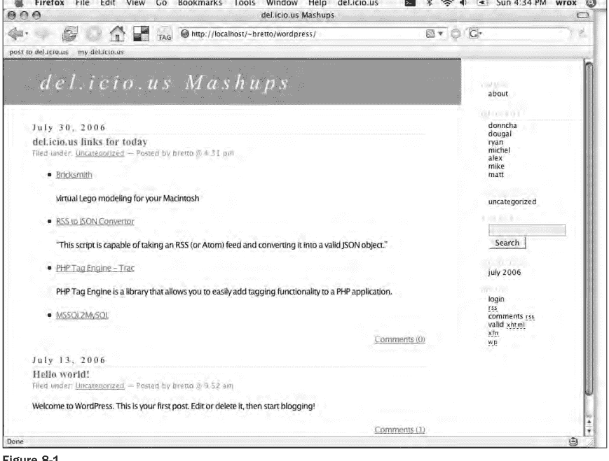

图 8-1

8. 你可能想以某种方式自动化这个过程。Crontab 或其他命令行调度服务对此很有用，因为你实际上可以直接从命令行执行 PHP，而不仅仅是通过 Web 浏览器和 Apache。


# 第三部分：混搭与再创作

例如，你可以在 Mac OS X 系统的终端应用程序中，通过类似以下的命令从命令行运行 autoposter.php：

```
php -f /Library/WebServer/Documents/autoposter/autoposter.php
```

在 Windows 系统上，你也可以从命令提示符运行 PHP 脚本。你可能需要在命令中指定 php.exe 程序的路径：

```
C:\PHP\php.exe -f C:\htdocs\autoposter\autoposter.php
```

如果你将 autoposter.php 脚本设置为可执行文件，并像在 UNIX shell 中那样，将指向 PHP 的路径作为其第一行，那么你就不需要 `-f` 参数。`-f` 意味着“解析此文件”，它告诉 PHP 按原样执行 PHP 代码。当你在命令提示符下运行脚本时，无论是在 Mac OS X 还是 Windows 上，脚本的输出都会打印到屏幕上。对于 autoposter.php 脚本，每日链接列表也会发布到你的 WordPress 博客。

- 9. 在你的 Crontab 文件中，你可以将此输出重定向到一个日志文件。一个示例条目，用于每天运行 autoposter.php 脚本，并将其输出追加到名为 autoposter.log 的文件，可能如下所示：

```
0 0 * * * php -f /Library/WebServer/Documents/autoposter/autoposter.php >> /Library/WebServer/Documents/autoposter/autoposter.log
```

将此条目安装到 crontab 中，将每晚午夜执行 autoposter.php 脚本。

如果你的系统（如 Windows 计算机）不支持 crontab，你可能需要查看众多以类似方式工作的替代方案之一——例如 pycron，它可在 www.kalab.com/freeware/pycron/pycron.htm 免费获取。

### 工作原理

autoposter.php 脚本将 del.icio.us API 的输出转换为一个新的 WordPress 博客文章。要实现这一点，你需要做的第一件事是组装一个对 del.icio.us /posts/get? 方法的调用，并附上获取前一天所有已保存书签所需的参数。

为此，借助 PHP 的 `mktime()` 函数（它将返回给定时间的 UNIX 时间戳）和 `date()` 函数（它将正确格式化日期），将 `$yesterday` 赋值为昨天的日期，格式为 CCYY-MM-DD：

```
//get yesterday's date in CCYY-MM-DD
$yesterday = date("Y-m-d",mktime(0,0,0,date("m"),date("d")-1,date("Y")));
```

然后初始化两个变量，这两个变量将在脚本后续部分被追加更多信息。第一个变量 `$log` 保存需要发送到屏幕或重定向到 crontab 日志、电子邮件等的输出消息，`$post_content` 保存将出现在你新博客文章中的 HTML 内容：

```
//set up a log and html post content variable
$log = "$yesterday autoposter.php:";
$post_content = "";
```

接下来，你调用 /posts/get?，并将昨天的日期作为参数发送：

```
//grab yesterday's bookmarks via the del.icio.us API
do_api_call("/posts/get?", "&dt=$yesterday");
```

由于此 API 方法调用在每次脚本运行时都会执行，因此必须确保它每天只运行一次。

如果 API 调用成功，你接着检查 `$api_return` 变量的第一个元素是否有任何子元素，如果有，则将所有返回的帖子组装成一个无序列表并放入 `$post_content`（就像你在第 7 章描述的自定义链接滚动中所做的那样）：

```
//make sure the api return status code is 200 before moving on
if ($api_return['status'] == 200) {
    //make sure we have some posts
    if (isset($api_return[0]['children'])) {
        //create the list of links
        $posts = $api_return[0]['children'];
        $post_content .= "<ul>";
        foreach ($posts as $post) {
            $post_content .= "<li>"
                ."<a href='".$post['attributes']['HREF']."'>"
                    .$post['attributes']['DESCRIPTION']."</a></li>";
            if (isset($post['attributes']['EXTENDED'])) {
                $post_content .= "<p>".$post['attributes']['EXTENDED']."</p>";
            }
        }
        $post_content .= "</ul>";
    } else {
        //no bookmarks for today
        $post_content .= "<em>I'm sorry, but I didn't save any bookmarks to del.icio.us today.</em>";
    }
} else {
    // the rest of the code
}
```

`/posts/get/?` 响应的 XML 结构由一个 `<posts>` 元素及其 `<post>` 子元素组成。因此，如果数组的第一个元素没有子元素，则表示在返回的数据中找不到 `<post>` 元素。如果没有 `<post>` 元素，则 `$post_content` 变量将被赋值一条消息，解释当天没有 del.icio.us 帖子。你可能希望修改脚本，使得在当天没有保存 del.icio.us 书签时不创建新的博客文章，以避免你的博客变得杂乱。

然后，文章的其余部分被组装成对 `metaWeblog.newPost` 的调用，然后发送到位于你 WordPress 安装目录中的 XML-RPC 服务器：

```
//create the xml-rpc client object
$client = new xmlrpc_client(WP_XMLRPC_URL, WP_XMLRPC_HOST, 80);

//create an array for our post data
$post = array();
$post['title'] = "del.icio.us links for today";
```

```
$post['description'] = $post_content;
```

```
//assemble the xml-rpc message
$parameters = array(
    php_xmlrpc_encode("1"),
    php_xmlrpc_encode(WP_USERNAME),
    php_xmlrpc_encode(WP_PASSWORD),
    php_xmlrpc_encode($post),
    php_xmlrpc_encode("1")
);
$message = new xmlrpcmsg("metaWeblog.newPost",$parameters);
```

```
//what do we want our response to be?
$client->return_type = 'phpvals';
```

```
//send the XML-RPC message to the server
$response = $client->send($message);
```

如果响应中出现错误，你会将其追加到 `$log` 变量；否则，你会记录 XML-RPC API 调用成功：

```
//check the response to make sure all went well
if ($response->errstr != '')
    $log .= " XML-RPC CALL FAILED - ".$response->errstr;
else
    $log .= " success";
```

同样，如果对 del.icio.us 的 API 调用最初就不成功，则会将此信息追加到 `$log` 变量：

```
} else {
    $log .= " DEL.ICIO.US API CALL FAILED - status code was ".$api_return['status'];
}
```

最后，将 `$log` 的剩余值输出到屏幕：

```
//output log to screen
echo $log;
?>
```

`echo` 命令在命令行脚本中与输出 HTML 标记一样有效。

尽管自动将每日 del.icio.us 链接作为新博客文章发布对许多使用 del.icio.us 的博主来说是一个理想的功能，但最终结果是你的读者需要处理大量重复的数据。如果你的读者对你的 del.icio.us 链接和你的博客真正感兴趣，订阅你的 del.icio.us RSS 订阅源和你的网络日志，并以他们自己的方式聚合数据可能对他们来说更方便。或者，更好的是，他们可以将你添加到他们自己的 del.icio.us 网络。这样，他们就可以选择任何他们喜欢的方式来获取你的 del.icio.us 链接，而无需每天看到两次或更多次。将你的 del.icio.us 链接放在博客的侧边栏中，可能是向你的读者介绍你的书签以及 del.icio.us 本身的一种更有效的方式。

### 传播你的想法

如果你的博客读者有自己的 del.icio.us 账户，他们可能想将你的博客文章的书签保存到他们的书签中。如果是这种情况，那么你可以使用一个小技巧，只需对你的 WordPress 主题进行简单的修改，就能为你的读者提供直接从你的博客内发布到 del.icio.us 的功能。

#### 试一试：创建“保存到我的 del.icio.us”链接

在这个项目中，你对第 5 章最初创建的 classic-mashups 主题进行额外的更改。如果你没有删除它，你可以在 WordPress 安装目录的 wp-content 子目录中找到它。你也可以在 Wrox 伴侣网站的第 8 章目录中找到 classic-mashups 的一个版本。

- 1. 使用你的编辑器，打开主题内的 index.php 文件。找到 index.php 中看起来像下面代码的部分，并添加用粗体标出的代码：

```
<div class="feedback">
<?php wp_link_pages(); ?>

<a href="http://del.icio.us/post"
onclick="window.open('http://del.icio.us/post?v=4&noui&jump=close
&url='+encodeURIComponent('<?php the_permalink() ?>')+
'&title='+encodeURIComponent('<?php the_title() ?>'),'delicious',
'toolbar=no,width=700,height=400'); return false;">Save to del.icio.us</a> -

<?php comments_popup_link( __('Comments (0)'), __('Comments (1)'), __('Comments
(%)') ); ?>
</div>
```

- 2. 浏览你的 WordPress 博客。你应该会在每篇文章下方的 Comments 链接左侧看到一个新的 Save to del.icio.us 链接。点击此链接应该会弹出一个 del.icio.us 发布弹出窗口，如图 8-2 所示。

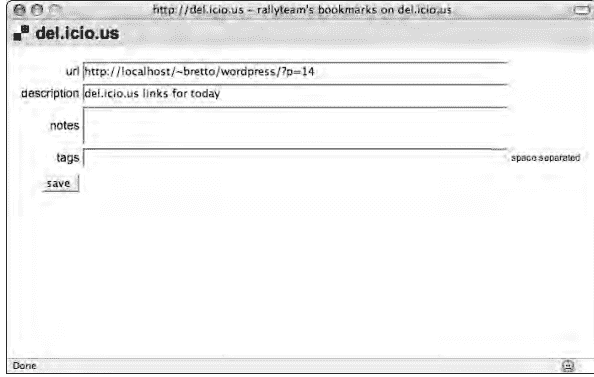

### 图 8-2


## 第三部分：混搭与再创作

现在你已经在博客中内置了一键发布到 del.icio.us 的界面。（这有多简单？）

### 工作原理

你放入模板中的代码实际上是 del.icio.us 提供给网络发布者的一些标记的改编版本，这些发布者希望将 del.icio.us 与他们的博客或网站更紧密地集成。你可以在 http://del.icio.us/help/forpublishers 了解更多信息。

在此项目中，你对 WordPress 主题的添加非常简单。你所做的只是添加了一个链接，该链接会弹出一个新窗口到 http://del.icio.us/post，标题和 URL 已经通过两个 WordPress 模板函数作为查询字符串提供了。

第一个函数是 `the_permalink()`，它返回博客文章的永久 URL。`the_permalink()` 返回的值被赋值给发送到发布界面的查询字符串的 `url` 部分：

```
<a href="http://del.icio.us/post"
onclick="window.open('http://del.icio.us/post?v=4&noui&jump=close
&urls=' + encodeURIComponent('<?php the_permalink() ?>') + 
'&title=' + encodeURIComponent('<?php the_title() ?>'), 'delicious',
'toolbar=no,width=700,height=400'); return false;">Save to del.icio.us</a>
```

第二个函数 `the_title()` 输出博客文章的标题。这被作为发送到弹出窗口的查询字符串的 `title` 部分的值：

```
<a href="http://del.icio.us/post"
onclick="window.open('http://del.icio.us/post?v=4&noui&jump=close
&urls=' + encodeURIComponent('<?php the_permalink() ?>') + 
'&title=' + encodeURIComponent('<?php the_title() ?>'), 'delicious',
'toolbar=no,width=700,height=400'); return false;">Save to del.icio.us</a>
```

请注意，`encodeURIComponent` 是一个原生 JavaScript 函数，用于对 URL 中的字符进行编码，以确保在 JavaScript、用户的网页浏览器和 del.icio.us 发布界面之间安全传输。

### 追踪你的受欢迎程度

当人们开始将你的博客文章书签保存到 del.icio.us 时，无论是通过你新的 Save to del.icio.us 链接还是通过其他方式，关于你的博客及其内容的讨论将在 del.icio.us 上开始。你可能还记得，每个发布到 del.icio.us 的 URL 都有其自己的历史页面，追踪它被保存的次数、保存的时间以及人们在保存时使用的标签。

在你的博客的每篇文章中内联添加一个快速链接到这个讨论，对你和你的用户来说可能都很有趣。对于这个项目，你将在 Save to del.icio.us 链接的末尾添加一个额外的链接，将读者引导到 del.icio.us 上他们正在阅读的特定文章的 URL 页面。

## 第 8 章：del.icio.us 与 WordPress 的混搭

#### 动手实践：创建 del.icio.us 历史链接

这个项目涉及到对你的 WordPress 主题再进行一项简单的添加。

- 1. 在你的编辑器中，打开 `classic-mashups` 主题文件夹中的 `index.php` 文件。然后，按照下面**粗体**行所示，在早些时你添加的 Save to del.icio.us 链接的正下方添加以下代码和标记：

```
<div class="feedback">
<?php wp_link_pages(); ?>

<a href="http://del.icio.us/post"
onclick="window.open('http://del.icio.us/post?v=4&noui&jump=close
&url='+encodeURIComponent(<?php the_permalink() ?>)+'
&title='+encodeURIComponent(<?php the_title() ?>),'delicious',
'toolbar=no,width=700,height=400'); return false;">Save to del.icio.us</a>

**<a href="http://del.icio.us/url/check?url=<?php the_permalink(); ?>">
del.icio.us History**
</a>

<?php comments_popup_link(__( ' (Comments (1)'), ' ', __( ' (Comments (%))'); ?>
</div>
```

- 2. 浏览到你的 WordPress 安装地址，你现在应该看到每篇文章都伴随着一个新的 del.icio.us History 链接。点击此链接将带你到 del.icio.us 上该文章的 URL 页面。目前这个页面不太可能显示任何内容，但一旦你的读者开始为你的文章添加书签，这个页面就会显示谁保存了链接以及何时保存，还包括保存时添加的标签和评论。

### 工作原理

与 Save to del.icio.us 链接类似，del.icio.us History 链接只是将文章永久链接的 URL（由 WordPress 的 `the_permalink()` 函数提供）作为查询字符串发送到 `http://del.icio.us/url/` 页面。直接发送 `http://del.icio.us/url/` URL 是 del.icio.us 上一个未记录的功能，但如果你有兴趣追踪 del.icio.us 用户对你的博客文章的反应，它非常有用。

### 整合相关书签

现在是时候尝试一些更复杂的内容了。你将编写一个 WordPress 插件，为你将文章归入的每个类别显示指向 del.icio.us 的相应链接。这样，你的读者就可以被带到与你的文章主题相关的 del.icio.us 书签。例如，如果你撰写一篇与音乐相关的 WordPress 文章，并给它一个音乐类别，你的读者将同样获得一个链接到你所有标记为音乐的 del.icio.us 书签。

WordPress 插件架构让你能够通过常规的 PHP 脚本和 WordPress 插件 API 提供的一套特殊函数来影响 WordPress 博客的设计和功能。这些函数称为钩子。钩子允许你编写的代码与 WordPress 应用程序或数据库交互并改变它们。

有时编写 WordPress 插件比进行主题更改更有用。插件也更具可移植性。你可以更改主题或将插件送给朋友，在大多数情况下它仍然可以工作。

WordPress 钩子有两种类型：*动作钩子（action hooks）* 和 *过滤钩子（filter hooks）*。动作钩子在 WordPress 事件发生时触发某些操作，例如当新文章保存或 WordPress 博客模板加载时。过滤钩子作用于博客条目数据本身，并影响其处理或显示方式。对于这个项目，你将使用一个动作钩子来修改文章中出现的文本，以包含指向你在 del.icio.us 上相关标签页面的链接。

> WordPress 插件 API 有很多内容，而且都非常有趣。不幸的是，讨论所有这些内容超出了本书的范围。如果你想了解更多，请查看 WordPress Codex：http://codex.wordpress.org/。

#### 动手实践：编写 del.icio.us 类别链接插件

你可能已经注意到 WordPress 安装中 `wp-content` 文件夹内的 plugins 目录。一个 WordPress 插件可以是单个 PHP 脚本，也可以是文件夹中的脚本和其他资源的集合。对于这个项目，你将创建一个单一的 PHP 脚本来实现插件的所有功能。

- 1. 在 plugins 目录中创建一个名为 **delicious-tag-links.php** 的新文件。

   在 `delicious-tag-links.php` 中打开一个新的 PHP 代码块，并提供关于你的插件的以下信息：

```php
<?php
/*
Plugin Name: Del.icio.us Category Links
Plugin URI: http://wordpress.org/#
Description: Takes your post categories and creates a list of links to matching tag
pages at del.icio.us.
Author: Your Name
Version: 1.0
Author URI: http://www.yourwebsite.com/
*/
```

每个 WordPress 插件都需要这些信息，这将有助于在 WordPress 管理界面中识别你的插件，还有其他用途。务必将 `Author` 更改为你的姓名，将 `Author URI` 更改为你的网站地址（如果你没有网站，暂时随便编一个）。

- 2. 为你 的 del.icio.us 用户名添加一个常量（这是此插件中你唯一需要的常量），将 `username` 更改为你自己的用户名：

```php
//your del.icio.us username
$delicious_username = 'username';
```

- 3. 添加以下函数：

```php
//append to the post text the links to del.icio.us
function add_links($post_text) {
    global $delicious_username;
    //setup the delicious_links variable
    $delicious_links = '<p class="meta">More at my del.icio.us: ';
    //append links for each category
    foreach(get_the_category() as $cat) {
        $delicious_links .=
        '<a href="http://del.icio.us/' . $delicious_username . '/' . $cat->cat_name . '">' . $cat->cat_name . '</a>';
    }
    $delicious_links .= '</p>';
    //return post text with delicious links added
    return $post_text . $delicious_links;
}
```

- 4. 添加 WordPress 动作钩子，以文章文本为参数执行此函数，并返回修改后的数据：

```php
//action hook to handle post content
add_action('the_content', 'add_links');

?>
```

- 5. 关闭你的 PHP 代码块，然后保存并关闭 `delicious-category-links.php`。

- 6. 浏览到你的 WordPress 管理后端，然后点击 Plugins 标签。你应该会在可用插件列表中看到你的新 WordPress 插件后端，如图 8-3 所示。

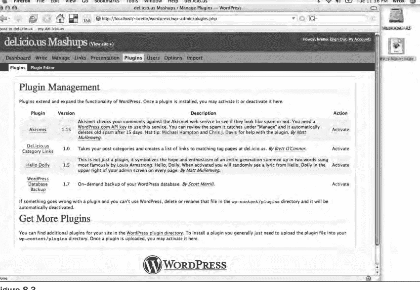

图 8-3


## 第三部分：混搭与再创作

- 7. 点击插件描述右侧的“激活”链接以启用该插件。

- 8. 如果你尚未这样做，请创建一篇带有分类的新 WordrdPress 文章。你可以为 WordPress 博客中的每篇文章分配多个分类，就像你可以为保存到 del.icio.us 的每个书签分配多个标签一样。

要执行此操作，请点击 WordPress 管理界面中的“撰写”标签页，创建一篇新文章。使用发布界面左栏的“分类”界面添加几个新分类，然后通过勾选每个分类名称左侧的复选框将其应用到你的文章中。图 8-4 展示了分类界面的样子。

你可能需要先点击“分类”一词旁边的 +（加号）按钮来展开分类区域。请务必添加一些你知道在 del.icio.us 上有对应标签的分类，不过也许很自然的是，你在 del.icio.us 上的兴趣与你在博客中写的内容会是相同的。

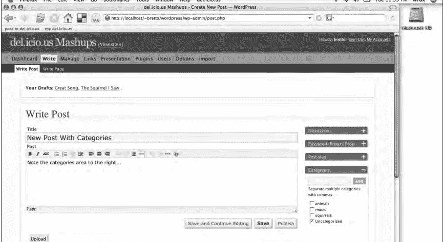

- 9. 当你创建并分配好一些分类后，点击“发布”按钮发布文章，然后浏览你的 WordPress 博客。你现在应该能看到一个新的"More at my del.icio.us:"页脚，后面跟着指向你的 del.icio.us 标签页面的链接，这些链接对应于每篇文章的分类，如图 8-5 所示。

## 第 8 章：混搭 del.icio.us 与 WordPress

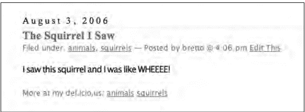
**图 8-5**

借助这个功能，你的读者可以使用你的 del.icio.us 书签来了解更多关于你所写内容的信息。这几乎就像一份自动生成的参考资料列表。

### 工作原理

WordPress 插件扩展了 WordPress 的功能和博客的外观，而不仅仅是编辑你的模板。在这个项目中，你编写了一个简单的插件，自动为你的文章添加额外内容。该插件获取分配给文章的分类，并为每个分类添加指向 del.icio.us 标签页面的链接列表。

要更好地理解发生了什么，请查看 `delicious-category-links.php` 插件源代码文件。

首先，定义了插件的元数据：

```php
/*
Plugin Name: Del.icio.us Category Links
Plugin URI: http://wordpress.org/#
Description: Takes your post categories and creates a list of links to matching tag
pages at del.icio.us.
Author: Your Name
Version: 1.0
Author URI: http://www.yourwebsite.com/
*/
```

这是当你在 WordPress 管理区域浏览到插件区域时显示的信息。它描述了谁制作了该插件以及它的功能。这部分信息是每个 WordPress 插件的必需组成部分。

由于你的 del.icio.us 用户名是你想要创建链接的 del.icio.us 标签页面 URL 的一部分，你因此初始化 `$delicious_username` 如下：

```php
//your del.icio.us username
$delicious_username = 'yourname';
```

请注意，这次你没有将其设为 PHP 常量。对于 WordPress 插件来说，避免使用 PHP 常量是个好主意，因为你不想让它们与 WordPress 定义的任何常量发生冲突。即使 WordPress 不太可能有一个名为 `DELICIOUS_USERNAME` 或类似名称的常量，但最好不要冒这个风险，而是定义一个普通变量。这样一来，该变量及其作用域就仅限于你的插件。

接下来，你添加了一个名为 `add_links()` 的函数，它接受每篇博客文章的内容作为参数：

```php
//append to the post text the links to del.icio.us
function add_links($post_text) {
    ... the rest of add_links() ...
}
```

在脚本底部，你使用 WordPress 的 `add_action()` 函数添加了一个 WordPress 动作钩子：

```php
//action hook to handle post content
add_action('the_content', 'add_links');
```

当 WordPress 实现插件时，它会查找 `add_action()`，然后通过使用*标签*（即应该触发函数的事物）来钩入并执行插件中它所指向的函数。这个"事物"是你传递给 `add_action()` 的第一个参数，在你的例子中是发送文章内容的 `the_content` 标签。当 `the_content` 生成时，它会触发该钩子。第二个参数 `add_links()` 是你之前添加的函数。因此，`the_content` 将被发送到 `add_links()`。需要注意的是，几乎每个 WordPress 插件函数都必须返回它接收到的参数（尽管其内容可以更改）。在这种情况下，`add_links()` 将返回文章内容的修改版本。

查看 `add_links()`，你可以看到它非常直观：

```php
global $delicious_username;
//setup the delicious_links variable
$delicious_links = "<p class=\"meta\">More at my del.icio.us: ";
//append links for each category
foreach(get_the_category() as $cat) {
    $delicious_links .=
      "<a href=\"http://del.icio.us/$delicious_username/$cat->cat_name\">
      $cat->cat_name</a> ";
}
$delicious_links .= "</p>";
//return post text with delicious_links added
return $post_text.$delicious_links;
```

`$delicious_links` 变量首先用一些 HTML 标记进行初始化。然后，通过 WordPress 的 `get_the_category()` 函数获取文章的分类列表并进行迭代。

对于返回的每个分类，都会将指向相应 del.icio.us 标签页面的链接附加到 `$delicious_links`：

```php
foreach(get_the_category() as $cat) {
    $delicious_links .= "<a href=\"http://del.icio.us/$delicious_username/$cat->cat_name\">$cat->cat_name</a> ";
}
```

然后完成 `$delicious_links` 中的标记，并返回原始的 `$post_text` 加上 `$delicious_links` 的内容：

```php
$delicious_links .= "</p>";
//return post text with delicious_links added
return $post_text.$delicious_links;
```

这就是这个简单 WordPress 插件的全部内容。

可以争辩说，这个插件中实现的功能也可以通过进一步修改 classic-mashup 主题来完成。这是对的。由你来决定对于你想要对你的 WordPress 博客做什么而言，插件或主题更改哪个更合适。请记住，插件的可移植性要高得多，并且能够以一些相当重要的方式改变 WordPress 及其数据。

### 为你的 MP3 链接使用 Del.icio.us Play Tagger

为了好玩，是时候再给你的 WordPress 博客添加一样东西了。在第 4 章中，你看到当有人在 del.icio.us 中保存指向 Flickr 上某张照片的书签时，该书签旁边实际上会出现一张该照片的小缩略图。del.icio.us 上还有一个类似的技巧，涉及指向 MP3 音频文件的链接。

每当 del.icio.us 用户保存指向 `.mp3` 文件的书签时，该书签旁边就会出现一个带有箭头的小方框，如图 8-6 所示。当你点击箭头时，MP3 将直接在你的浏览器中开始播放。这让你无需离开 del.icio.us 就可以收听音乐、播客等。这个功能叫做 Play Tagger，你可以在 http://del.icio.us/help/playtagger 了解更多相关信息。

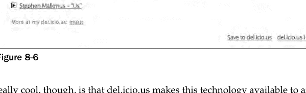
**图 8-6**

不过真正酷的是，del.icio.us 将这项技术提供给任何想要将其实现到自己网站的人。

作为本章的最后一个项目，你将编写一个额外的 WordPress 插件来实现 del.icio.us Play Tagger。这将为你的博客增加更多功能，并为你提供另一个关于 WordPress 插件如何与 del.icio.us 进行混搭的示例。

#### 试一试：编写 Play Tagger 插件

1. 在你的 WordPress 安装目录的插件目录中创建一个名为 **delicious-play-tagger.php** 的新文件。然后，添加以下代码，保存文件，并从 WordPress 后台区域激活该插件：

```php
<?php
/*
Plugin Name: Del.icio.us Play Tagger
Plugin URI: http://wordpress.org/#
Description: Makes your .mp3 links playable thanks to del.icio.us.
Author: Your Name
Version: 1.0
Author URI: http://www.yourwebsite.com/
*/

function add_play_tagger_code() {
    echo '<script type="text/javascript"
src="http://del.icio.us/js/playtagger"></script>';
}

add_action('wp_head', 'add_play_tagger_code');
?>
```

2. 写一篇链接到 MP3 文件的新文章。你可以使用 WordPress 的发布界面在文章内容中创建链接，也可以手动输入如下 HTML 标记：

```html
<a href="http://www.matadorrecords.com/mpeg/stephen_malkmus/stephen_malkmus_us.mp3">
Stephen Malkmus - "Us"
</a>
```

这两种方式都应该有效。WordPress 在允许你撰写和编辑博客文章方面具有令人惊讶的灵活性。

> 如果你在寻找可以链接的 MP3，可以随意从 `http://del.icio.us/tag/system:filetype:mp3` 借用，这是一个列出 del.icio.us 上发布的所有 MP3 的特殊页面。

3. 浏览你的 WordPress 博客。你应该会看到类似于前面图 8-6 所示的内容。注意 Play Tagger 按钮如何已自动添加到 `.mp3` 文件链接旁边。

4. 点击 Play Tagger 提供的蓝色箭头，MP3 将开始播放（经过几秒钟的缓冲后）。

del.icio.us 还提供了一个"Tag This"链接，del.icio.us 用户可以使用该链接将 MP3 链接保存到自己的书签中。图 8-7 展示了这个链接。


## 第八章：融合 del.icio.us 与 WordPress

### 工作原理

Play Tagger 只需要在页面中某个位置包含 del.icio.us 提供的特定 JavaScript 代码。该 `include` 代码如下所示：

```
<script type="text/javascript" src="http://del.icio.us/js/playtagger"></script>
```

你创建的插件通过挂钩到模板中包含的 `wp_head` 标签，将必要的 JavaScript 输出插入到博客标记语言的 `<head>` 标签之间。`add_play_tagger_code()` 函数负责输出这段 JavaScript：

```
function add_play_tagger_code() {
    echo '<script type="text/javascript"
src="http://del.icio.us/js/playtagger"></script>';
}

add_action('wp_head', 'add_play_tagger_code');
```

与之前的插件不同，这只影响模板的一部分，而不是整个文章。此外，`wp_head` 不接收任何参数，也不期望返回任何参数。当 Action Hook 被触发时，只需输出你想要输出的内容，任务就完成了。

Play Tagger 的工作方式是搜索页面中的 MP3 链接，并在它们旁边添加一个小型的 Macromedia Flash 音频播放器，该播放器能够直接将曲目流式传输给你的读者。

### 总结

本章仅介绍了数十种将 del.icio.us 融入博客以及让博客部分功能由 del.icio.us 支持的方法中的几种。即使不使用 del.icio.us API 或任何复杂的编程，你也已经能够让 del.icio.us 和 WordPress 以多种不同的方式协同工作。这部分归功于 del.icio.us 对自身在博客中实用性的认知，同时也得益于利用其高度可定制的模板和插件架构来改造 WordPress 的能力。这些技术可以帮助你传播思想、连接和收集参考资料，甚至让博客的整体呈现更加精彩。

## 第三部分：混搭与再创作

值得注意的是，这些项目以及许多更令人印象深刻的项目都可作为 WordPress 插件使用。它们由来自世界各地的 del.icio.us 爱好者开发和支持，你可以在 http://codex.wordpress.org/Plugins/Delicious 找到其中许多。

如果你想了解更多关于主题开发的内容，可以访问 http://codex.wordpress.org/Theme_Development。关于插件开发的信息，请查看 http://codex.wordpress.org/Writing_a_Plugin。

本章仅仅触及了你可以用 WordPress 和 del.icio.us 所做事情的皮毛。希望它让你对如何着手创建自己的主题和插件，从而将这里介绍的项目和你自己的想法提升到更高水平有了初步了解。

### 练习

尝试通过完成以下练习，对本章介绍的一些项目进行扩展。

- 1. 在你编写的 autoposter.php 脚本提供的自动发布链接中，提供每个书签所使用的标签可能会很有帮助。作为额外的挑战，尝试修改代码，使每个标签成为一个指向你 del.icio.us 书签中相应标签页面的链接。
- 2. 除了仅仅包含与你博客文章类别匹配的 del.icio.us 标签页面链接外，还可以获取并显示你 del.icio.us 中与你博客文章相关的实际书签精选。描述一下你可能会如何扩展 del.icio.us Category Links 插件。
- 3. del.icio.us Play Tagger 代码本可以轻松集成到 classic-mashup 主题中，而不是作为 WordPress 插件安装。使用主题来做这件事会有什么缺点？会有什么优点吗？

## 第九章：使用 Greasemonkey 再创作 del.icio.us

在本章中，你将亲身体验 Firefox 的 Greasemonkey 扩展。Greasemonkey 提供用户脚本，使你能够覆盖或更改任何网页的格式和功能。在本章中，你将创建几个用户脚本来演示 Greasemonkey 的混搭潜力。尽管通常你会希望将混搭开发为独立的 Web 或桌面应用程序，但深入了解 del.icio.us 改造和调整的这一途径绝对值得。你可能会对 Greasemonkey 的潜力感到惊讶。

除了了解 Greasemonkey 的工作原理以及如何为其进行开发外，你还将完成三个将 del.icio.us 与 Greasemonkey 结合的项目。第一个项目，你将 *重新设计* del.icio.us，通过修改 del.icio.us 的样式表和页面样式声明来改变其整体外观。在第二个项目中，你将进一步深入修改 del.icio.us，通过实际改进 del.icio.us 发布界面的功能。可以说，这两个项目更像是再创作而非混搭，因为它们改变的是 del.icio.us 本身，而不是将其与其他东西混合，但它们肯定会向你展示 Greasemonkey 的一些基本特性。此外，你将在这本书的第三个练习中进行一个真正的混搭项目，你将使用 Greasemonkey 在任何网页上显示你最近的五个链接。

> 所有这些项目，你都需要使用 Firefox 浏览器，并且当然要安装 Greasemonkey 扩展。如果你还没有安装 Greasemonkey，请返回第 6 章的 Greasemonkey 介绍部分，正确设置好环境后再继续。

### Greasemonkey 详解

Greasemonkey 拥有特殊的用户脚本，这些脚本在页面加载时执行。用户脚本可以适用于任何网页，也可以只针对特定页面。Greasemonkey 脚本包含 JavaScript 代码，这些代码会在 Firefox 加载完网页文档的 DOM 结构后立即运行（但在文档在浏览器中显示之前）。如果你按顺序查看，网页的基础结构加载，Greasemonkey 脚本运行并执行其操作，然后网页才会显示。实际上，可以安排 Greasemonkey 脚本或脚本的某些部分在此序列中的其他点运行，但这是默认的执行时间线。

出现在 Greasemonkey 用户脚本中的 JavaScript 可以执行多种任务，包括更改文档的 DOM、从外部来源获取和显示数据、打开新的弹出窗口、将用户重定向到其他地方等等。Greasemonkey 还具有存储和检索自身数据以及向 Firefox 本身添加菜单命令的能力。

每个用户脚本都是一个文本文件，必须以 `.user.js` 结尾。如果用户安装了 Greasemonkey 并浏览到一个 Greasemonkey 用户脚本，他们会被提示立即安装该脚本。你也可以通过从硬盘驱动器或其他位置在 Firefox 中手动打开脚本来安装它们。脚本安装后，会被复制到 Firefox 偏好设置文件内的一个目录中。从那里，用户可以编辑脚本。当你使用此方法保存脚本时，更改会立即生效。这使得 Greasemonkey 脚本的开发变得更加容易。每个用户脚本都必须包含一些初始元数据，描述脚本的功能、它在网上的位置等等。不过除此之外，JavaScript 就可以自由发挥了。

除了可以使用所有 Firefox 兼容的 JavaScript 和 DOM 方法外，Greasemonkey 还有自己的 API，提供了一些额外且实用的函数。你可以在 `http://greasemonkey.mozdev.org/authoring.html` 阅读更多关于它们以及 Greasemonkey 开发整体的信息。

值得一提的是，Gecko 引擎——Firefox（及其衍生版本）中的网页解析引擎——是所有网页浏览器中 DOM 实现最为先进的之一。有关所有 Gecko DOM 方法的完整参考，请查看 `www.mozilla.org/docs/dom/domref/dom_shortTOC.html`。

### 重新设计 del.icio.us

对于本章的第一个项目，你将编写一个 Greasemonkey 脚本来修改 del.icio.us 的样式表。你可以使用网页浏览器提供的样式表或其他重新设计页面的方法，但在 Greasemonkey 脚本中为 del.icio.us 设置新的样式或 *皮肤*，可以使 del.icio.us 的页面设计具有极高的可移植性和可扩展性，远不止更改几个字体和颜色那么简单。

术语 *皮肤* 应用于计算机软件时，通常被定义为一种外观模式，在不改变软件功能的情况下改变其外观和感觉。CSS 可以被解释为一种网站皮肤，因此当你想要为网站换肤时，你改变的是它的 CSS 标记。

当然，你可能没有能力进入 del.icio.us 并随心所欲地更改其样式表。如果你能自定义样式表，从而为自己重新设计 del.icio.us 的皮肤，那将是很棒的。毕竟，del.icio.us 的外观非常简约，虽然确实不错，但也许可以稍微增添一点色彩。Greasemonkey 让这变得简单且可移植。如果你不喜欢新的皮肤，只需禁用脚本，del.icio.us 就会恢复到以前的样子。在这个项目中，你将使用 Greasemonkey 为 del.icio.us 制作一个新皮肤。


 ## 第 9 章：用 Greasemonkey 重新混合 del.icio.us

## 动手试试 用 Greasemonkey 修改 CSS

添加和修改 CSS 通常是一个反复尝试的过程。你做出修改，然后重新加载页面查看效果是否符合预期，如果不符合，就再回去修改，再次重新加载，如此循环。使用 Greasemonkey 也是一样的。创建、保存，然后重新安装 Greasemonkey 脚本来测试是相当繁琐的。幸运的是，Greasemonkey 允许你编辑脚本，并让修改立即在 Firefox 中生效。在这个项目中，你首先了解这是如何实现的，然后对 CSS 做出修改以观察实际效果。

1. 打开 Firefox 的"工具"菜单，选择"新建用户脚本"。这个菜单选项应该在安装 Greasemonkey 扩展后出现。如果你以前没有用过这种方式编辑脚本，Firefox 会要求你选择编辑器。在提示框中浏览并选择你的代码编辑器。完成后，你的编辑器会打开一个新文档，其中包含一些默认的 Greasemonkey 用户脚本元数据，如下所示：

```
// ==UserScript==
// @name          User script template
// @namespace     http://mywebsite.com/myscripts
// @description   A template for creating new user scripts from
// @include       *
// ==/UserScript==
```

2. 将元数据设置为与以下内容匹配：

你可以随意将 @namespace 的值改为自己的网站（如果你有的话）。从技术角度来说，它应该指向该脚本在网上的原始位置

```
// ==UserScript==
// @name          del.icio.us Mashups Skin
// @namespace     http://www.yourwebsite.com/
// @description   A new look for del.icio.us thanks to Greasemonkey.
// @include       http://del.icio.us/*
// ==/UserScript==
```

请注意，@include 指令指定了这个新脚本只应在 del.icio.us 网站上运行。

3. 使用编辑器的"另存为"功能，将脚本保存到方便的位置，例如你的 htdocs 目录或桌面。将其命名为 **deliciousmashupskin.user.js**。

如果你直接点击"保存"，脚本会被保存到 Firefox 的临时目录，那可能很难找到。

4. 你需要安装刚才保存的脚本。执行以下操作之一：

- 在 Firefox 中，选择"文件" › "打开文件"。
- 将脚本拖放到 Dock 或任务栏中的 Firefox 图标上。
- 如果你在 htdocs 目录中保存了脚本，可以在 Firefox 中浏览到该脚本。

你会看到脚本内容显示在 Firefox 中，并出现安装脚本的按钮提示。安装该用户脚本。

## 第三部分：混搭与重新混合

**5.** 你将从 Greasemonkey 的"管理用户脚本"界面来编辑脚本。选择"工具" > "管理用户脚本"，查看系统中所有已安装的 Greasemonkey 脚本列表及其设置，如图 9-1 所示。

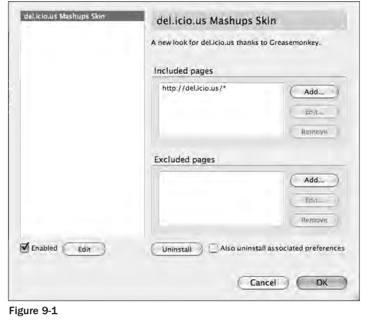

**6.** 选择"del.icio.us Mashups Skin"脚本，然后点击对话框底部附近的"编辑"按钮。你的编辑器应该会启动并打开你保存的脚本。

你现在对这个版本脚本所做的任何修改都将直接保存到已安装的脚本版本中。你只需重新加载脚本正在影响的页面，Greasemonkey 用户脚本就会生效。

**7.** 为了测试脚本更改的保存方式，尝试使用 Greasemonkey 的 `GM_log()` 函数。`GM_log()` 将文本和消息输出到 Firefox 的 JavaScript 控制台界面，这对调试 Greasemonkey 脚本很有帮助。在你的脚本中添加以下代码（位于元数据下方）：

```
GM_log("Testing! Testing! 123!");
```

浏览到 del.icio.us（如果你已经在该页面，则重新加载）。要查看 JavaScript 控制台，请在 Firefox 的"工具"菜单中选择"JavaScript 控制台"。你可以通过点击"消息"来过滤控制台内容，仅显示消息，这是 `GM_log()` 默认输出的位置。在那里，你应该能看到列出的消息，包括你刚才尝试的测试消息，类似于图 9-2 所示的内容。

188

## 第 9 章：用 Greasemonkey 重新混合 del.icio.us

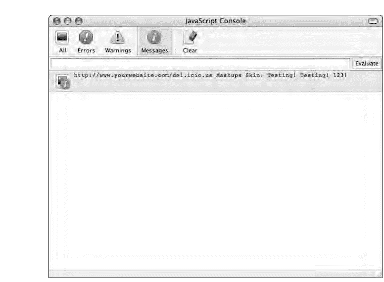

图 9-2

8. 现在你将修改 del.icio.us 的 CSS。回到你的脚本，删除对 `GM_log()` 的调用。然后在脚本中放入以下代码：

```
GM_addStyle(
  "body { font-family: serif; font-size: 18px; background-color: #FFC; } \
  a:link { text-decoration: none; color: #f90; text-decoration: underline } \
  a:visited { text-decoration: underline; color: #F30; } \
  a:hover { text-decoration: underline; color: #009  }\
  a:active { text-decoration: underline; } \
  #header { margin-left: 1em; margin-right: 1em; background-color: #9F9; }"
);
```

9. 浏览到 del.icio.us 主页。它应该看起来类似于图 9-3。

好吧，虽然不算漂亮，但确实截然不同。仅用几行代码，你就完全改变了 del.icio.us 的整体外观。如果你的眼睛已经因为这个新配色方案而感到不适，你可以通过以下方式禁用脚本：点击 Firefox 右下角出现的小猴子图标，这将完全禁用 Greasemonkey；或者从"管理用户脚本"界面卸载该脚本。

### 工作原理

`GM_addStyle()` 是 Greasemonkey 特有的一种 API，它可以让你立即修改已加载网页文档 DOM 中的任何 CSS。只需放入一些不同的 CSS，更改就会生效。

在这个特定的项目中，你插入了标记来覆盖 del.icio.us 的一些关键样式，包括锚点样式和整体背景色，并对每个页面上显示的标题做出了修改。请注意，添加的每一行 CSS 都以 \ 符号结尾。这告诉 Greasemonkey 插入换行符。当然，整个 `GM_addStyle()` 调用可以不使用换行符来编写，但换行符有助于提高代码的可读性。

当然，换肤的概念不仅仅局限于更改页面上的 CSS 标记，尤其是在涉及 Greasemonkey 时。在下一节中，你将使用 Greasemonkey 来进行用户界面更改。

### 自定义 del.icio.us 用户界面

你是否曾经使用过某个与你期望的工作方式不符的网络服务？也许是很小的细节，比如你银行网站上的登录表单工作方式，或者你经常访问的新闻网站似乎不必要地在新的窗口中启动媒体播放器。作为一名 Web 开发人员，这类问题可能特别烦人，因为如果可以的话，你当然会把它做得更好。

## 第 9 章：用 Greasemonkey 重新混合 del.icio.us

Greasemonkey 代码让你能够按照自己想要的方式让网站工作。当然，这一切的前提是操纵网站的 DOM 结构足以实现这个目标。Greasemonkey 脚本对网站产生的效果可能令人惊讶。

del.icio.us 最重要的用户界面区域之一是发布界面。在这个项目中，你将制作一个 Greasemonkey 用户脚本，带来一个细微但可能有用的用户界面更改。只要这个用户脚本已安装并处于活动状态，del.icio.us 的发布界面就会以一种全新的方式运作。

**动手试试**  **修改 del.icio.us 发布界面**

你可以将私人书签保存到 del.icio.us，这些书签任何人都无法看到。这些被称为*私人书签*。你可以在 del.icio.us 设置中启用这个功能，但每次想要私下保存书签时，还需要在发布界面中勾选表单复选框。

然而，你可以使用 Greasemonkey 默认私下保存书签，无需每次都勾选那个复选框，而只在需要时公开发布它们。而且你只需要一行代码就能实现。

- 1. 在 http://del.icio.us/settings/yourname/ 访问你的 del.icio.us 设置。在顶部附近的"书签"设置列表中，点击"私人保存"。在下一屏中，勾选允许私人保存收藏的复选框，然后点击"更改设置"。

2. 使用发布书签小工具或 del.icio.us Firefox 扩展来发布链接。在发布表单中，你会看到 URL 右侧出现一个新的"不共享"复选框，如图 9-4 所示。当勾选此框并保存书签时，该书签将不会被公众看到。

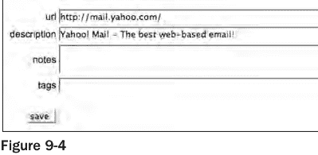

3. 开始一个新的 Greasemonkey 用户脚本。你可以通过"工具" > "新建用户脚本"来创建，或者在编辑器中从头开始。为其提供以下内容，将 www.yourwebsite.com 改为你自己的网站，保存它，然后以你喜欢的方式安装：

*你也可以在从 Wrox 配套网站下载的代码中找到这个脚本。它名为 privatesaving.user.js。*

```
// ==UserScript==
// @name          do not share
// @namespace     http://www.yourwebsite.com
// @description  Enables "do not share" on the del.icio.us posting interface by
```


## 第三部分：混搭与再创作

```javascript
// 默认设置。
// @include       http://del.icio.us/*
// ==/UserScript==

if (document.getElementById('private')) {
    document.getElementById('private').checked = true
}
```

4.  向 del.icio.us 保存一个新书签，注意“不分享”复选框现在默认是选中状态，如图 9-5 所示。这要归功于你在本项目中创建的新用户脚本，每次你向 del.icio.us 保存新书签时，除非你取消勾选该框，否则它默认将是一个私有书签。

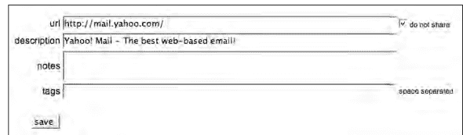
图 9-5

### 工作原理

这个用户脚本的代码量不多，但它可以说是对 del.icio.us 发布用户界面的工作方式的一次非常重要的改变。你刚才操作的关键在于操纵 del.icio.us 发布界面的 DOM，以更改表单元素的默认设置。此设置生效后，发布界面将以一种全新的方式运行。

通过转到“查看”$\rightarrow$“查看源文件”，然后找到以下这行内容，来查看 del.icio.us 发布界面的 HTML 标记：

```html
<td><input type=checkbox name=private id="private"  />
<label for="private" class="smaller">do not share</label></td>
```

这是创建“不分享”复选框的标记行。非常方便的是，它有一个唯一的 id 属性。因此，通过编写一些 JavaScript 代码来按 id 获取此元素，然后通过设置其 checked 属性来操纵它，该复选框将默认为选中状态。你在 Greasemonkey 用户脚本中创建的 JavaScript 只是检查私有复选框是否存在，如果存在，则将其状态设置为选中：

```javascript
if (document.getElementById('private')) {
    document.getElementById('private').checked = true
}
```

就是这么简单。每次加载 del.icio.us 发布界面时，“不分享”复选框都将被启用。

## 第 9 章：用 Greasemonkey 再创作 del.icio.us

### 获取远程数据

Greasemonkey 还执行另一项任务，对于混搭开发而言，这绝对值得注意。Greasemonkey 能够通过其 `GM_xmlhttpRequest()` API 方法从远程源获取数据（或将数据发送到远程源）。`GM_xmlhttpRequest()` 使你能够向其他网站发起 `XMLHttpRequest` 并获取返回的数据。`XMLHttpRequest` 是一种 JavaScript 和其他编程语言可以用来获取和解析远程 XML 数据的方法。`XMLHttpRequest` 事实上是许多 AJAX 技术背后的秘密，它使用 `XMLHttpRequest` 从本地和远程超媒体文档（如 PHP 脚本）发送和检索数据。

正如你可能猜到的，如果 Greasemonkey 能够使用 `GM_xmlhttpRequest()` 从远程源获取数据，那么 Greasemonkey 将非常适合组合一个网站的数据并将其与另一个网站集成。这可以成为一个强大的工具。例如，你可以编写一个用户脚本，在浏览器中直接显示网站的 RSS 订阅源，或者编写一个用户脚本，从书店网站获取并显示其他书商的书籍价格等等。

这样做绝对涉及一些挑战，包括设计一种方法让 Greasemonkey 为你自己的目的重新解释获取的数据。对于 del.icio.us，有一个工具使这变得非常容易——JSON 订阅源。因为通过 JSON 从 del.icio.us 获取的数据已经是 JavaScript 变量，所以你可以轻松地求值并按照你认为合适的方式解释数据。在本章的最后一个小项目中，你将编写一个 Greasemonkey 脚本，通过 del.icio.us 的 JSON 订阅源检索你的最新书签，然后将这些书签显示在另一个网站上。

#### 动手试试：创建最新链接页脚

创建以下脚本。（记住，你可以从 Firefox 中转到“工具”$\rightarrow$“新建用户脚本”开始，或者在编辑器中从头创建。）将 `www.yourwebsite.com` 改为你自己的网站。另外，一定要将脚本开头附近的 `delicious_username` 变量的值改为你自己的 del.icio.us 用户名，或者是 del.icio.us 上你喜欢的某个用户的用户名。然后，将脚本保存到你的 htdocs 目录，随便命名（你可以在本书网站上找到此脚本，名为 `latestlinksfooter.user.js`），并在 Firefox 中浏览并安装它。代码如下：

```javascript
// ==UserScript==
// @name		del.icio.us Latest Links Footer
// @namespace	http://www.yourwebsite.com
// @description	Puts the five latest del.icio.us links for the specified user at
// the bottom of every page.
// @include	*
// ==/UserScript==

var delicious_username = 'username';

GM_xmlhttpRequest({
	method: "GET",
	url: "http://del.icio.us/feeds/json/" + delicious_username + "?count=5&raw",
	headers: {
	"User-Agent": "greasemonkey"
	},
	onload: function(details) {
		var json_data = eval('('+details.responseText+')');
        
        var div = document.createElement('div');
        div.appendChild(document.createTextNode(delicious_username + "'s Latest Links"));

        for (var i=0, post; post = json_data[i]; i++) {
            div.appendChild(document.createTextNode(" - "));
            var a = document.createElement('a');
            a.setAttribute('href', post.u);
            a.appendChild(document.createTextNode(post.d));
            div.appendChild(a);
        }
        document.body.appendChild(div);
	}
});
```

当你准备好脚本后，只需浏览任何网页，你应该会在页面底部看到 delicious_username 的五个最新链接。例如，图 9-6 显示了运行此脚本时 Google 主页的外观。注意列表中的 negatendo 的最新链接。

这个脚本的实用性是值得商榷的，除非你确实需要在浏览网页时持续了解某人的 del.icio.us 链接。尽管如此，它确实展示了 Greasemonkey 获取数据然后将来自 del.icio.us 的远程数据与其他网站结合起来的能力。

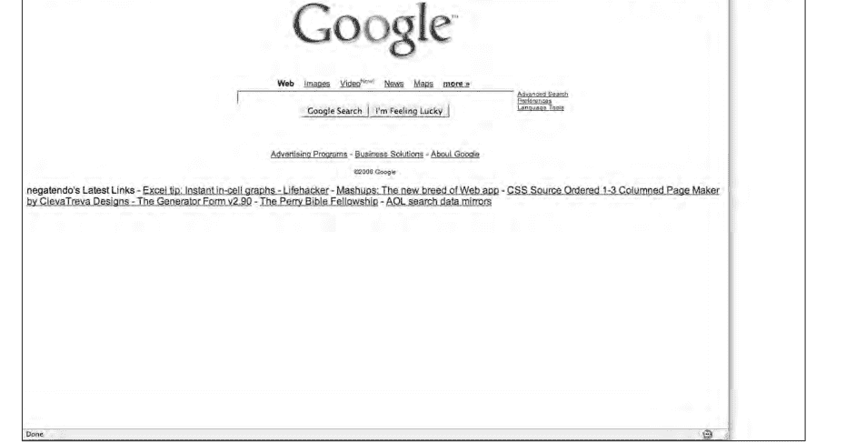

### 工作原理

在设置好所需的 Greasemonkey 元数据和 `delicious_username` 变量之后，脚本的其余部分完全由调用 `GM_xmlhttpRequest()` 组成。`GM_xmlhttpRequest()` 只接受一个参数，称为 *请求详细信息*。

请求详细信息最多可以包含七个不同的字段。对于此示例，你只包含了七个可能字段中的四个。

这包括从顶部开始的 HTTP 请求方法：

```javascript
GM_xmlhttpRequest({
    method: "GET",
```

接下来是请求 URL，在本例中是 JSON 订阅源 URL，包括 URL 中 del.icio.us 用户名部分的 `delicious_username` 的值，如下所示：

```javascript
    url:"http://del.icio.us/feeds/json/" + delicious_username + "?count=5&raw",
```

注意，请求了限制五个链接，数据要求以原始 JSON 形式返回。这只是意味着数据将作为原始 JSON 数据返回，而不是一个已经实例化的名为 `Delicious` 的对象，这将使你求值数据更容易。记住，`GM_xmlhttpRequest()` 不会获取 JavaScript 变量或解释 JSON 数据，它只是检索它被要求检索的内容。

其他 HTTP 头信息在 details 参数中。在本例中，你只声明了 `User-Agent` 值，但例如，如果你调用 del.icio.us API，你可以在这里包含 `WWW-Authenticate` 信息：

```javascript
    headers:{
    "User-Agent":"greasemonkey"
    },
```

最后是 `onload` 回调函数，它将在请求数据加载完成后被调用：

```javascript
    onload:function(details) {
        ... onload 应该执行的操作...
    }
});
```

Greasemonkey 不仅能够以这种方式获取数据；它也可以向远程服务器发送数据。还可以通过添加在请求之前或期间发生的回调函数，使你的脚本更加健壮和灵活。查看 Greasemonkey 网站以了解这些额外细节。

当来自 del.icio.us 的 JSON 订阅源加载到 Greasemonkey 中时，`onload` 回调被执行。返回的数据被放入 `details.responseText` 中。因此，你做的第一件事是将 `responseText` 作为 JavaScript 对象 `json_data` 进行求值：

```javascript
var json_data = eval('('+details.responseText+')');
```


## 第三部分：混搭与混搭重混

然后你创建了一个新的`div`元素，并向其中追加了一些文本，将其内容描述为`delicious_username`的最新链接：

```javascript
var div = document.createElement('div');
div.appendChild(document.createTextNode(delicious_username + "'s Latest Links"));
```

接下来，`json_data`中的每个对象都作为子节点被添加到`div`中，链接及所有内容一并包含，中间以`-`作为分隔符：

```javascript
for (var i=0, json_data; post = json_data[i]; i++) {
    div.appendChild(document.createTextNode(" - "));
    var a = document.createElement('a');
    a.setAttribute('href', post.u);
    a.appendChild(document.createTextNode(post.d));
    div.appendChild(a);
}
```

最后，`div`被追加到`document.body`中，在大多数情况下这就是HTML文档的末尾（但并非总是如此）：

```javascript
document.body.appendChild(div);
```

### 总结

本章介绍的Greasemonkey用户脚本项目相当简单，但它们展示了Greasemonkey在彻底改变网站外观、功能以及与其他网站集成方式方面的巨大潜力——以del.icio.us为例。你可以想象，像Greasemonkey这样的工具具有巨大的潜力。开发者们已经用Greasemonkey创造了一些令人印象深刻的东西。`userscripts.org`网站是一个协作集合，收录了数千个适用于各类网站的实用Greasemonkey脚本，其中也包括del.icio.us相关的。如果你想查看他人制作的与del.icio.us相关的用户脚本，请访问`http://userscripts.org/tag/delicious`。

Greasemonkey并非没有问题。最值得注意的是，它的工作方式取决于你在开发Greasemonkey脚本时网站的编码方式。如果网站所有者更改了网站的CSS或DOM结构，你的Greasemonkey脚本很可能会失效。如果你计划将Greasemonkey用户脚本作为混搭作品或混搭作品的一部分来发布，你就需要尽可能保持其更新，并尽量考虑到这些变化。

当然，Greasemonkey的另一个问题是你只能在Firefox中使用它。不过，已经有人为其他浏览器开发了与Greasemonkey等效的工具。例如，Trixie是针对Microsoft Internet Explorer 6的增强插件，其工作方式与Greasemonkey相同。它甚至可以使用和解释大多数Greasemonkey用户脚本。你可以在`www.bhelpuri.net/Trixie/`找到Trixie。

当你继续创建自己的混搭作品时，请考虑Greasemonkey所能提供的功能。虽然它是用户需要额外安装才能使用的工具，但它将允许你以远超典型桌面或Web应用的方式来重混和混搭del.icio.us。从本质上说，Firefox本身就是你的混搭平台，网络上的任何页面都是你可以使用的数据，或是你可以展示创意的地方。

## 第9章：使用Greasemonkey重混del.icio.us

### 练习

如果你想进一步探索Greasemonkey，可以尝试以下练习。

- 1. 在本章的第一个项目中，你使用了`GM_addStyle()`来向del.icio.us的CSS标记中添加样式。当然，有很多方法可以更改特定网站的样式表，你不一定需要Greasemonkey来实现。例如，许多浏览器支持用户自定义样式表。试着让del.icio.us混搭皮肤用户脚本更加独特——不仅让它改变页面样式，还让del.icio.us首页的搜索框变得更大。

- 2. 你可能还记得，使用特殊的`for:`标签来标记内容会将书签发送给del.icio.us用户，方法是将该书签复制到他们自己的收件箱中。例如，标记`for:negatendo`会将书签放入我自己的del.icio.us收件箱。编写一个Greasemonkey用户脚本，自动为所有你保存的书签添加`for:username`标签，其中`username`是你想分享有趣链接的用户，本质上就像在每封邮件中抄送一样，在每条书签中抄送他们。

- 3. 从Greasemonkey调用del.icio.us API会是什么样的？（不必担心处理返回的数据。如果你愿意，只需用`alert()`函数包裹它来测试是否有响应返回即可。）只需尝试编写符合与del.icio.us API交互标准的基本代码。（你可能需要在网上搜索一下如何正确使用`WWW-Authenticate`头才能使其正常工作。）

# 第10章 重混RSS订阅源

del.icio.us的RSS订阅源是混搭制作者通往del.icio.us世界及其数据的黄金通行证。它们提供的数据远不止一堆随机链接——它们实际上直接连接着del.icio.us用户的集体智慧。通过del.icio.us的RSS订阅源，你可以时刻了解来自全球数千名互联网用户所共同认为的热门内容、最新动态和优质资源。

由于RSS是一种高度可移植的数据格式，你可以随心所欲地对其进行组合，以全新的方式捕获、组织和呈现这些数据。最终成果不仅为了解del.icio.us上正在发生的事情提供了新的视角，而且有望帮助你个人发现一些新鲜有趣的事物。del.icio.us的"每个页面都有RSS订阅源"策略对于混搭设计师来说简直是梦想成真。

本章包含的几个项目几乎可以保证，在你开发它们的过程中会为你介绍一些新颖有趣的内容——无论是一个陌生但优秀的博客、一个有趣的卡通漫画，还是你从未听过的新歌——所有这些都是通过聚合和呈现del.icio.us上不断变化的RSS订阅源来实现的。归根结底，这些简单项目捕捉到了del.icio.us最强大的一面：当来自成千上万人的书签被组合和组织在一起时，精彩内容必然会浮现。

本书的第一个项目将把一个RSS订阅源混搭到另一个RSS订阅源中。新的RSS订阅源将只包含某个标签的新鲜链接——也就是说，只有你之前未见过的链接才会出现在订阅源中，而你已经见过的链接将被过滤掉。可以把它想象成一个专门为你量身定制和过滤的del.icio.us标签订阅源。下一个项目将把发布到del.icio.us的图片重混成在线幻灯片应用。在那里，你可以快速便捷地观看由世界各地用户最新发布到del.icio.us的图片的实时动态。本章的最后一个项目将把发布到del.icio.us的MP3音频文件自动导入你喜欢的媒体播放器中。

### 清理标签订阅源

如果你在订阅阅读器中订阅了del.icio.us的标签订阅源已有段时间，你可能已经开始对相同链接反复出现感到厌烦了。

这是del.icio.us方面的正确行为。例如，如果你订阅了`http://del.icio.us/rss/tag/gaming`，那么所有标记为*gaming*的内容都应按照发布时间顺序出现在该订阅源中。如果一个用户发布了另一个用户10分钟前发布的相同链接，那也没办法——两个都会显示出来。这在当天的热门内容上尤其常见，无论是一篇新颖有趣的文章或新闻报道，还是一个热门新网站。只要是热门的，你就可以肯定它会被许多不同的人发布到del.icio.us上，如果他们使用相同的标签，它就会大量出现在该标签订阅源中。

如果能将del.icio.us标签订阅源定制为只显示你尚未在订阅源中看到过的内容就好了。这个项目正是实现这一功能的。你将开发一个由PHP生成、以MySQL为后端的全新重混RSS订阅源，它只呈现尚未在订阅源中出现过的最新标签链接。你编写的PHP脚本实际上将作为RSS XML文件使用，根据所提供的查询字符串，它可以为你能想到的任何标签生成过滤后的订阅源。

> 你将在本地开发环境中进行此项目，因此像Bloglines这样的基于Web的订阅阅读器将无法访问生成的RSS订阅源。要看到此项目的完整潜力，你需要将其部署到线上，或使用能够访问本地Web服务器的桌面订阅阅读器。

### 使用freshtags订阅源

在这个项目中，你的工具集将包括PHP、Magpie RSS PHP库和MySQL数据库。

- 1. 在你的htdocs目录中创建一个名为**freshtags**的新文件夹，并为其创建一个**lib**子文件夹。然后，将使用Magpie RSS库所需的一切复制到lib中。这包括rss_cache.inc、rss_fetch.inc、rss_parse.inc和rss_utils.inc文件以及extlib子目录。

- 2. 在freshtags目录内再创建一个名为**cache**的子目录。这是你将指定Magpie存储其缓存RSS订阅源的位置。实际上你可以把它放在任何你喜欢的位置——只需确保稍后在代码中引入Magpie时，你提供了缓存目录的位置即可。此外，如果你的平台需要，请确保将缓存目录设置为Web服务器可写，否则Magpie的缓存将无法正常工作。

- 3. 为这个项目创建一个MySQL数据库。将以下SQL命令全部放入一个文本文件中，通过phpMyAdmin上传该文件，或在phpMyAdmin的SQL命令框中直接输入，或以你认为适合与本地MySQL数据库交互的任何其他方式输入：

你也可以在Wrox网站上本章的可下载代码中找到这些命令。它位于freshtags项目文件夹中的freshtags.sql文件中。

```sql
create database freshtags;

grant all on freshtags.* to 'delicious_sql'@'localhost';

use freshtags;

create table bookmarks (
```


# 第10章：混搭RSS订阅源

```
id int(255) not null auto_increment,
tag varchar(255) not null,
link varchar(255) not null,
title varchar(255) not null,
description varchar(255) not null,
dc_date varchar(255) not null,
primary key (id),
index bookmarks_tag (tag),
index bookmarks_link (link)
);
```

如果您不记得如何在phpMyAdmin中使用SQL命令，请回顾第6章的MySQL部分以作复习。

**4.** 您将要重用第7章中创建的`delicious_sql`用户。希望这个用户仍然存在于您的开发机器上（只要您没有执行任何删除用户的操作，它就会在）。如果它不存在，请回顾第7章的`delicious_summary`项目，或使用第7章`delicious_summary2.sql`文件（您可以从Wrox网站下载）中的命令来创建该用户。

**5.** 对于这个项目，您只需要创建一个PHP源文件。对于您需要的最后一个文件，请在`freshtags`目录中创建一个名为**index.php**的文件，并在编辑器中打开它。

此时，`freshtags`目录应包含以下内容：

- cache
- index.php
- lib
- extlib（包含Snoopy.inc.php——Magpie对Snoopy的实现）
- rss_cache.inc
- rss_fetch.inc
- rss_parse.inc
- rss_utils.inc

**6.** 以一个PHP代码块*和*以下代码开始`index.php`，这将适当地设置MySQL和Magpie：

MAGPIE_CACHE_DIR应设置为您决定缓存存放的位置。代码将在freshtags目录中寻找缓存。另外，如果`delicious_sql`用户的MYSQL_PASSWORD与`password`不同，您应将其更改为适当的密码。

```
<?php

//mysql数据库信息
define('MYSQL_HOST', 'localhost');
define('MYSQL_DATABASE', 'freshtags');
define('MYSQL_USERNAME', 'delicious_sql');
define('MYSQL_PASSWORD','password');

//创建MySQL数据库连接
$link = mysql_connect(MYSQL_HOST,MYSQL_USERNAME,MYSQL_PASSWORD)
	or die(mysql_error());
@mysql_select_db(MYSQL_DATABASE) or die(mysql_error());

//引入magpie
require_once('lib/rss_fetch.inc');

//设置缓存目录
define('MAGPIE_CACHE_DIR', 'cache');
```

**7.** 由于这个PHP脚本将生成一个RSS XML文件，而不是Web应用程序通常输出的普通网页，因此确保生成的文档的头部或格式不被中断非常重要——尤其是涉及XML时。Magpie的某些实现可能会产生PHP通知错误，根据您的服务器设置，这些错误可能会中断此文件的结构。最好阻止这些通知错误的出现，因为无论如何您对它们无能为力（除非您想深入研究Magpie代码并修复它们），并且它们显示的错误与您应用程序的功能无关。为此，请在您的代码中添加以下行：

```
//因为magpie会产生一些错误，所以去除错误通知
error_reporting(E_ERROR | E_WARNING | E_PARSE);
```

**8.** 添加几个常量，以便在需要时可以轻松调整它们。这将包括一个定义您要生成的RSS订阅源中项目数量的变量，您可能希望根据自己的偏好进行调整。更重要的是，这将包括del.icio.us上的基础标签订阅源URL。将其设为常量是个好主意，因为如果del.icio.us更改了它们的URL方案，您将能够轻松找到并更改它。（在混搭编程中，您永远不应该硬编码URL——始终尽力使它们成为易于更改的变量，以节省以后很多麻烦。）

```
//重新生成的订阅源中的项目数量
define('NUM_RSS_ITEMS',30);

//基础标签订阅源URL
define('BASE_TAG_FEED_URL','http://del.icio.us/rss/tag/');
```

**9.** 您需要以某种方式过滤特定标签的所有RSS项目。您可以编写脚本来过滤一个非常特定的标签，或者更好的是，您可以编写脚本来过滤查询字符串中发送给它的任何标签。大多数订阅源阅读器即使URL中包含查询字符串作为URL的一部分，也能很好地处理RSS订阅源的URL。因此，您的其余代码将包装在一个检查查询字符串的控制语句中。添加以下内容：

```
//检查$_GET['tag']是否存在（如果不存在，脚本终止）
if (isset($_GET['tag'])) {
	... 您的其余代码 ...
} else {
	//查询字符串中未提供标签
	die('No tag defined!');
}
```

**10.** 此时，如果没有指定标签，则脚本将不会运行。添加以下阴影行，为指定的标签生成RSS订阅源，使用您之前创建的MySQL数据库作为要排除的订阅源项目的存储方法（因为您已经看到它们了）：

```
//检查$_GET['tag']是否存在（如果不存在，脚本终止）
if (isset($_GET['tag'])) {
    //组装完整的订阅源URL
    $feed_url = BASE_TAG_FEED_URL.$_GET['tag'];
    //获取订阅源
    $rss = fetch_rss($feed_url);
    //遍历每个订阅源项目，通过链接检查它们是否已存在于数据库中。如果不存在，则添加项目
    foreach ($rss->items as $item) {
        //已存在？
        $link_exists_check = "select count(*) from bookmarks where link LIKE
'".mysql_real_escape_string($item['link'])."' and tag LIKE
'".mysql_real_escape_string($_GET['tag'])."'";
        $link_exists_check_result = mysql_query($link_exists_check) or
            die(mysql_error());
        //如果没有返回行，则将链接添加到数据库
        if (!mysql_result($link_exists_check_result,0)) {
            $bookmark_insert_query ="insert into bookmarks (
                tag,
                link,
                title,
                description,
                dc_date
            ) values (
                '".mysql_real_escape_string($_GET['tag'])."',
                '".mysql_real_escape_string($item['link'])."',
                '".mysql_real_escape_string($item['title'])."',
                '".mysql_real_escape_string($item['description'])."',
                '".mysql_real_escape_string($item['dc']['date'])."'
            );";
            mysql_query($bookmark_insert_query) or die(mysql_error());
        }
    }
    //选择最后添加的NUM_RSS_ITEMS项并输出新订阅源
    $bookmarks_select_query = "select * from bookmarks where
        tag='".mysql_real_escape_string($_GET['tag'])."' order by id desc limit
        ".NUM_RSS_ITEMS."";
    $bookmarks_select_results = mysql_query($bookmarks_select_query) or
        die(mysql_error());
    //设置头部
    header ("Content-type: text/xml"); // 将文件输出为XML
    echo ("<?xml version=\"1.0\" encoding=\"US-ASCII\"?>\n");
    //标准RSS 2.0部分，包括dc
    ?>
    <rss version="2.0" xmlns:dc="http://purl.org/dc/elements/1.1/">
    <channel>
    <title>del.icio.us/tag/<?php echo $_GET['tag']; ?> - filtered</title>
    <link>http://del.icio.us/tag/<?php echo $_GET['tag']; ?></link>
```

```
<description>Filtered tag feed for the del.icio.us <?php echo $_GET['tag']; ?>
tag.</description>
<?php
//遍历返回的每个结果并创建<item>
while ($this_bookmark = mysql_fetch_assoc($bookmarks_select_results))
{
?>
<item>
<guid isPermaLink="false">
<?php echo sanitize_for_xml($this_bookmark['id']); ?>
@http://del.icio.us/tag/<?php echo $_GET['tag']; ?>
</guid>
<title><?php echo sanitize_for_xml($this_bookmark['title']); ?></title>
<link><?php echo sanitize_for_xml($this_bookmark['link']); ?></link>
<description>
<?php echo sanitize_for_xml($this_bookmark['description']); ?>
</description>
<dc:date><?php echo sanitize_for_xml($this_bookmark['dc_date']); ?></dc:date>
</item>
<?php
unset ($this_bookmark);
}
?>
</channel>
</rss>
<?php
} else {
//查询字符串中未提供标签
die('No tag defined!');
}
```

**11.** 事情还没有完全结束。在控制语句之后还需要添加一样东西。这是一个名为`sanitize_for_xml()`的函数，它是一个小技巧，可以使从数据库中提取的任何文本适合有效的XML表示。以下是完整的添加内容：

```
//使非XML友好的字符对XML安全
function sanitize_for_xml($string) {
    $final = '';
    //移除高位字符
    $string_chars = array();
    for ($i = 0; $i < strlen($string); $i++) {
        $string_chars[] = $string[$i];
    }
    foreach ($string_chars as $char) {
        if (ord($char) < 128) $final .= $char;
    }
    //清理非XML友好的字符
    return str_replace (
        array ( '&', '"', "'", '<', '>' ),
        array ( '&amp;', '&quot;', '&apos;' , '&lt;' , '&gt;' ), $final );
}
```


12. 关闭 MySQL 连接并结束初始 PHP 代码块声明。

```php
//close the database connection
mysql_close($link);
?>
```

13. 首先使用浏览器测试脚本（您可能想使用 Firefox，因为它会直接在浏览器窗口中显示 XML）。首先浏览该脚本，不指定任何额外的查询字符串。您可以浏览 `http://localhost/freshtags/` 或 `http://localhost/freshtags/index.php`，因为 `index.php`（希望如此）已被 Apache 设置为索引文档。您将看到一条消息，提示 "No tag defined."。

14. 通过浏览 `http://localhost/freshtags/?tag=tagname` 来指定一个标签（其中 tagname 可以是 `gaming` 或 `crafts` 或任何符合您兴趣的内容）。您应该会看到一个有效的 RSS 文档，列出了该指定标签的 30 个左右项目（如图 10-1 所示）。这些项目是从您的本地 MySQL 数据库中生成的。这不是 Firefox 对 del.icio.us 的视图，而是对其内容的回放。

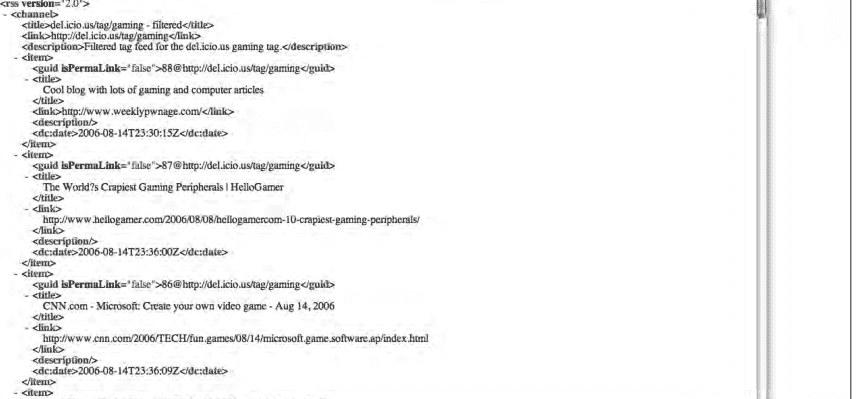
**图 10-1**

15. 当您第一次浏览 freshtags 脚本时，来自原始 del.icio.us 标签馈送的每个链接都会在 bookmarks 表中插入一条新记录。您可以通过在 phpMyAdmin 中浏览 bookmarks 表的内容来确认这一点。您应该会看到类似于图 10-2 的内容。

## 第三部分：混合应用与重混 (Mashups and Remixes)

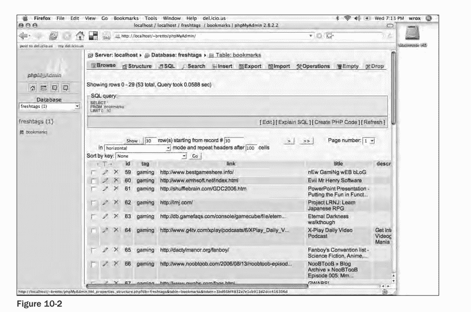

16. 确认您为 Magpie 指定的缓存目录中包含缓存文件，以确保缓存功能正常运行。

此后，每次加载 freshtags 脚本（并且在 del.icio.us RSS 馈送的 Magpie 缓存过期后——默认一小时），RSS 馈送将被重新解析，并且任何在数据库中尚不存在的指定标签的新链接将被插入。然后，脚本将生成一个新的 RSS 馈送，将这些全新的、尚未见过的链接放在顶部。这样，脚本只产生最新的链接，且不重复。

如果您使用基于 Web 的馈送阅读器（如 Google Reader），您无法亲自尝试该馈送，因为它仅存在于您的本地开发环境中（该环境可能无法通过 Web 访问）。不过，一些软件阅读器可以读取 localhost 生成的 XML。图 10-3 是该馈送在 NetNewsWire（一款适用于 Mac OS X 的软件阅读器）中显示方式的截图。

为了最大限度地利用这个项目，请尝试尽快将您的 freshtags 文件夹发布到 Web 上，然后在您的馈送阅读器中订阅一些 freshtag URL。这样，您就可以在任何时间访问来自 del.icio.us 标签馈送的最新个性化链接。

### 工作原理

freshtags 脚本从 del.icio.us 收集适用的 RSS 标签馈送，将其分解为项目并插入到 freshtags 数据库中（如果项目已存在于数据库中则忽略），然后生成一个新的包含数据库中最新链接的 RSS 馈送，这些链接恰好是来自 del.icio.us 原始标签馈送的最 recent 和最新的项目。

这部分工作大部分在检查 `$_GET['tag']` 是否存在的控制语句内部的代码段中处理。如果 `$_GET['tag']` 存在，意味着已通过 URL 查询字符串在脚本中指定了标签，则会进行馈送生成。其工作原理如下。

首先，使用 `BASE_TAG_FEED_URL` 常量和查询字符串中指定的标签组装出 del.icio.us 的完整标签馈送 URL。然后，使用 Magpie 的 `fetch_rss()` 函数下载馈送并将其赋值给 `$rss` 变量：

```php
//assemble complete feed url
$feed_url = BASE_TAG_FEED_URL.$_GET['tag'];
//grab the feed
$rss = fetch_rss($feed_url);
```

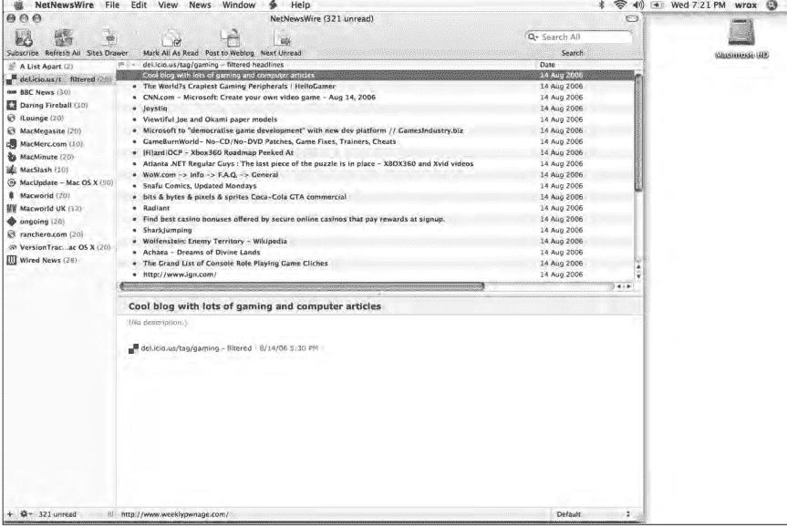
**图 10-3**

随后处理馈送中的每个项目。脚本检查 bookmarks 数据库中是否已经存在与 RSS 项目链接和指定标签相匹配的条目（对每个列值使用 LIKE 而不是 = 将使搜索不区分大小写）：

```php
//go through each feed item by link and see if they exist already
//in the database. if not, add the items
foreach ($rss->items as $item) {
    //exists already?
    $link_exists_check = "select count(*) from bookmarks where link LIKE '".mysql_real_escape_string($item['link'])."' and tag LIKE '".mysql_real_escape_string($_GET['tag'])."'";
    $link_exists_check_result = mysql_query($link_exists_check) or
    die(mysql_error());
        ... the rest of the code...
}
```

bookmarks 的表结构由您在原始创建表命令中定义的六列组成。第一列是 id，是表中每行唯一且自动分配的标识符：

```sql
create table bookmarks (
    id int(255) not null auto_increment,
```

tag 包含存储书签的标签：

```sql
    tag varchar(255) not null,
```

link 是书签的 URL：

```sql
    link varchar(255) not null,
```

title 是书签的原始标题（由第一个发布该书签的 del.icio.us 用户设置）：

```sql
    title varchar(255) not null,
```

description 将是发布该书签的 del.icio.us 用户输入的书签笔记内容：

```sql
    description varchar(255) not null,
```

dc_date 是书签在 del.icio.us 上发布的日期（您很快就会明白为什么它被称为 dc_date）：

```sql
    dc_date varchar(255) not null,
```

此外，为了提高表查询速度，对某些列建立了索引：

```sql
    primary key (id),
    index bookmarks_tag (tag),
    index bookmarks_link (link)
);
```

执行 MySQL 查询以检查链接是否存在于 bookmarks 表中，查询基于 RSS 项目的 tag 和 link 变量：

```php
foreach ($rss->items as $item) {
    //exists already?
    $link_exists_check = "select count(*) from bookmarks where link LIKE '".mysql_real_escape_string($item['link'])."' and tag LIKE '".mysql_real_escape_string($_GET['tag'])."'";
    $link_exists_check_result = mysql_query($link_exists_check) or die(mysql_error());
        ... the rest of the code...
}
```

如果该特定项目对应的书签不存在，它将被插入到数据库中，因为它被认为是该馈送的一个新书签：

```php
$link_exists_check_result = mysql_query($link_exists_check) or die(mysql_error());
//if no rows were returned then add the link to the database
if (!mysql_result($link_exists_check_result,0)) {
    $bookmark_insert_query ="insert into bookmarks (
        tag,
        link,
        title,
        description,
        dc_date
    ) values (
        '".mysql_real_escape_string($_GET['tag'])."',
        '".mysql_real_escape_string($item['link'])."',
        '".mysql_real_escape_string($item['title'])."',
        '".mysql_real_escape_string($item['description'])."',
        '".mysql_real_escape_string($item['dc']['date'])."'
    )";
    mysql_query($bookmark_insert_query) or die(mysql_error());
}
```

在上述代码的阴影行中，del.icio.us 通过一种名为 Dublin Core 的 RSS 格式化方案提供了项目发布的日期和时间。您真正需要知道的是，这只是在 RSS 馈送中包含数据的一种方式。将数据库列命名为 `dc_date` 可以让您知道其中存储的数据是遵循 Dublin Core 规则格式化的，并且是以这种方式从 del.icio.us RSS 馈送中引入的。正如您将看到的，`freshtags` 生成的 RSS 馈送同样使用了一些 Dublin Core 格式。

在所有新的、尚未见过的书签都存储在数据库之后，脚本从 bookmarks 表中选择最新的书签。每次向 bookmarks 添加项目时，其 `id` 列的值是下一个最高可用 `id`；因此，按 `id`（从最高开始）对选定的书签进行排序，将使最新的书签排在最前面：

> 如果您希望生成的 RSS 馈送中出现更多或更少项目，只需调整 `NUM_RSS_ITEMS` 常量以从 bookmarks 表中获取更多或更少的行。

```php
//select the last NUM_RSS_ITEMS added and output a new feed
$bookmarks_select_query = "select * from bookmarks where tag='".mysql_real_escape_string($_GET['tag'])."' order by id desc limit ".NUM_RSS_ITEMS."";
$bookmarks_select_results = mysql_query($bookmarks_select_query) or die(mysql_error());
```


 ## 第三部分：混搭与 remix

其余代码利用检索到的数据创建了一个 RSS XML 文件，并立即将该文件提供给访问该脚本的任何程序。为此，PHP 的 `header()` 函数会将 PHP 发送到 Web 浏览器的默认文件头替换为您定义的任何替代头。在本例中，文档的 `Content-Type` 头被更改为 XML 文档的类型：

```
//setup the headers
header ("Content-type: text/xml"); // Output file as XML
```

然后，添加了一些有效 RSS 源所必需的标准 XML 片段。在 `<rss>` 元素中包含 `xmlns:dc` 属性表示 dc 将表示 Dublin Core XML 模式的实现，如所提供的 URL 所定义：

```
echo ("<?xml version=\"1.0\" encoding=\"US-ASCII\"?>\n");
//standard RSS 2.0 bits including Dublin Core
?>
<rss version="2.0" xmlns:dc="http://purl.org/dc/elements/1.1/">
```

然后添加标准的 `<channel>`、`<title>`、`<link>` 和 `<description>` 元素，并使用 PHP 变量来自定义这些元素的输出：

```
<channel>
<title>del.icio.us/tag/<?php echo $_GET['tag']; ?> - filtered</title>
<link>http://del.icio.us/tag/<?php echo $_GET['tag']; ?></link>
<description>Filtered tag feed for the del.icio.us <?php echo $_GET['tag']; ?> tag.</description>
```

之前 MySQL 查询返回的每一行都会被处理并输出为 RSS `<item>`：

```
<?php
//iterate through each result returned and make an <item>
while ($this_bookmark = mysql_fetch_assoc($bookmarks_select_results))
{
    ?>
    <item>
    <guid isPermaLink="false"><?php echo
sanitize_for_xml($this_bookmark['id']);?>@http://del.icio.us/tag/<?php echo $_GET['tag']; ?></guid>
        <title><?php echo sanitize_for_xml($this_bookmark['title']); ?></title>
        <link><?php echo sanitize_for_xml($this_bookmark['link']); ?></link>
        <description><?php echo sanitize_for_xml($this_bookmark['description']);
?></description>
        <dc:date><?php echo sanitize_for_xml($this_bookmark['dc_date']); ?></dc:date>
    </item>
    <?php
    unset ($this_bookmark);
}
?>
```

注意 `<guid>` 元素（在代码中以阴影显示）。要构成有效的 RSS，`<guid>` 元素必须存在，并且包含唯一标识该项目的字符串。这通常是该 RSS 项目的永久链接，但也不一定是。通过添加 `isPermaLink="false"` 属性，您告诉 RSS 解析器此 ID 是唯一的，但不是该项目的永久链接。它的值只是您书签表中书签的 ID（始终是唯一的），后面跟着数据来源位置的 URL（del.icio.us 上的标签页面）。这只是指定唯一 ID 的一种方式。当 `<guid>` 不是永久链接时，只需在该源中保持唯一即可。

另一件需要注意的事情是 `<dc:date>` 元素的使用（在代码中也以阴影显示）。这是您从 del.icio.us 源传输原始 Dublin Core 日期和时间的地方。Feed 阅读器通常使用 RSS 中的日期来排序项目的展示顺序，因此您应始终以某种方式为项目包含日期和时间。

添加到 RSS XML 元素的每个数据库值都会通过 `sanitize_for_xml()` 函数进行处理，该函数执行两项操作。首先，它会去除 PHP 4 无法处理的任何字符。不幸的是，原始 del.icio.us 源中出现的所有字符都无法被 PHP 4 轻易解析。因此，为了简单起见，此脚本直接将其删除。它还将源中 XML 不接受原始形式的某些字符转换为它们的 HTML 实体。

```
//make non xml-friendly characters safe for xml
function sanitize_for_xml($string) {
    $final = '';
    //remove big hit characters
    $string_chars = array();
    for ($i = 0; $i < strlen($string); $i++) {
        $string_chars[$i] = $string[$i];
    }
    foreach ($string_chars as $char) {
        if (ord($char) < 128) $final .= $char;
    }
    //sanitize the non-xml friendly characters
    return str_replace( array( '&', '"', ''', '<', '>' ), array( '&amp;' , '&quot;', '&apos;', '&lt;', '&gt;' ), $final );
}
```

从书签表查询返回的每个项目都被处理并输出后，出现关闭的 XML 元素：

```
?>
</channel>
</rss>
```

脚本打印的任何内容，无论是来自 `echo` 函数还是出现在 PHP 括号之外的信息，都将作为 XML 文件的一部分发送到浏览器或 feed 阅读器，这得益于 `header()` 函数对文档 `Content-Type` 的更改。

## 第 10 章：Remix RSS 源

### 媒体标签 Remix：图片源幻灯片

del.icio.us 的 `filetype` 和媒体标签会在某些类型的书签指向图像、音频、视频、文档和其他类型的非超媒体文件时自动添加。例如，`http://del.icio.us/tag/system:filetype:pdf` 显示保存到 del.icio.us 的所有 PDF（便携式文档格式）文件的书签，`http://del.icio.us/tag/system:media:image` 显示发布到 del.icio.us 的所有图片。

del.icio.us 上的每个页面都有 RSS 源，这些特殊标签页面也不例外。因此，您应该能够隔离并以特殊方式重新解释这些标签源中的数据。在这个项目中，您将获取 `system:media:image` 标签的 RSS 源，并将其指向的所有图片以幻灯片格式显示为网页上的链接。

**实际操作：使用幻灯片**

与之前的 freshtags 项目一样，此项目将使用 Magpie RSS 来处理 del.icio.us 的 RSS 源。

- 1. 在您的 htdocs 目录中创建一个名为 `slideshow` 的目录，并在其中放置必要的 `lib` 和 `cache` 目录，内容和设置与 freshtags 项目中的相同。不过，不需要 MySQL 数据库。

2. 在编辑器中，在 `slideshow` 目录内创建一个 `index.php` 文件，打开一个 PHP 代码块，并设置常用的设置和与 del.icio.us 相关的常量：

```
<?php

//base tag feed url
define('BASE_IMAGE_FEED_URL', 'http://del.icio.us/rss/tag/system:media:image');

//bring in magpie goodness
require_once('lib/rss_fetch.inc');

//set cache directory
define('MAGPIE_CACHE_DIR', 'cache');

//get rid of error Notices because magpie produces some
error_reporting(E_ERROR | E_WARNING | E_PARSE);
```

> 您可能想知道为什么总是将 del.icio.us 的 URL（如图片源 URL）定义为 PHP 常量。这始终是个好主意，因为如果 del.icio.us 更改其 URL 方案，您将能够轻松地在同一个地方隔离和更新代码。

- 3. 此时您唯一需要的其他 PHP 代码是组装最终源 URL（如果提供了标签）并使用 Magpie 获取数据的代码：

4. 此脚本的其余大部分内容将包含 HTML 标记和 JavaScript 代码（其中穿插少量 PHP）。首先用一些典型的 HTML 和 CSS 标记开始：

```
//add any tag hotness
if (isset($_GET['tag']))
    $feed_url = BASE_IMAGE_FEED_URL."+".$_GET['tag'];
else
    $feed_url = BASE_IMAGE_FEED_URL;

//grab the feed
$rss = fetch_rss($feed_url);

?>
```

```
<!DOCTYPE html PUBLIC "-//W3C//DTD XHTML 1.0 Transitional//EN"
    "http://www.w3.org/TR/xhtml1/DTD/xhtml1-transitional.dtd">

<html xmlns="http://www.w3.org/1999/xhtml" xml:lang="en" lang="en">
<head>
    <meta http-equiv="Content-Type" content="text/html; charset=utf-8"/>
    <title>A del.icio.us Image Feed Slideshow!</title>
    <style type="text/css">
    body
    {
        margin: 1em;
        font-family: Helvetica, Arial, Sans-Serif;
        color: #FFF;
        background: #000;
    }
    a { color: #FF0; }
    </style>
```

5. 继续留在 `<head>` 元素中，添加以下初始化和控制幻灯片的 JavaScript 代码（注意早期 JavaScript 代码片段中穿插的 PHP 代码块——这是一个给小技巧，让 JavaScript 能够使用 PHP 变量和数据）：

```
<script type="text/javascript">
//how many seconds before switching images
var num_seconds_per_image = 20;
//which image are we on? (start with 0)
var cur_image_num = 0;
//how many total images (set by initSlideshow())
var total_images = 0;
//setup array of image paths (the extra '' is added on purpose)
var images = [
<?php
foreach ($rss->items as $item)
    echo "'".$item['link']."',\n";
?>
''
];
//array of image titles
var image_title = [
<?php
foreach ($rss->items as $item)
    echo "'".htmlentities($item['title'],ENT_QUOTES)."',\n";
?>
''
];
//the timer object
var timer;
//initialize the slideshow
function initSlideshow() {
    //set total_image_num
    total_images = images.length - 2;
    document.getElementById('total_image_num').innerHTML = total_images;
    //load first image
    nextImage();
}
//show the next image
```

## 第三部分：混搭与重混

```javascript
function nextImage() {
    //设置 nextImage() 自动执行
    window.clearTimeout(timer);
    timer = setTimeout("nextImage()",num_seconds_per_image * 1000);
    //设置下一张幻灯片
    if (cur_image_num == total_images)
        cur_image_num = 1;
    else
        cur_image_num++;
    setImage();
}
//显示上一张图片
function prevImage() {
    //设置 nextImage() 自动执行
    window.clearTimeout(timer);
    timer = setTimeout("nextImage()",num_seconds_per_image * 1000);
    //设置下一张幻灯片
    if (cur_image_num == 1)
        cur_image_num = total_images;
    else
        cur_image_num--;
    setImage();
}
//设置图片
function setImage()
{
    //设置当前图片编号
    document.getElementById('cur_image_num').innerHTML = cur_image_num;
    //设置图片信息
    document.getElementById('image_info_holder').innerHTML =
        image_title[cur_image_num];
    //设置图片
    image_holder = document.getElementById('image_holder');
    //移除 image_holder 的子元素（如果存在，即前一张图片）
    if (image_holder.childNodes.length == 1) {
        image_holder.removeChild(image_holder.childNodes[0]);
    }
    img = document.createElement('img');
    img.setAttribute('src',images[cur_image_num]);
    image_holder.appendChild(img);
}
</script>
```

6.  关闭 `<head>` 元素并插入其余所需的 HTML 标记，包括一个用于控制幻灯片放映的表单，以及定义图片及其标题显示位置的 `<div>` 元素：

```html
</head>
<body onload="initSlideshow()">
<div align="center" style="padding: 1em">
    <form method="get">
    图片来自 <a
href="http://del.icio.us/tag/system:media:image">del.icio.us</a>。
        想缩小范围吗？请输入标签：
        <input type="text" name="tag" value="<?php if (isset($_GET['tag'])) echo
$_GET['tag']; ?>" />
<input type="submit" value="搜索" />
</form>
<br />
<input type="button" value="<< 上一张" onclick="prevImage()" />
<span id="cur_image_num">0</span> / <span id="total_image_num">0</span>
<input type="button" value="下一张 >>" onclick="nextImage()" />
</div>

<div align="center" style="font-weight: bold" id="image_info_holder">
如果您看到此消息，说明此标签没有图片或发生了错误。
</div>

<div align="center" style="padding-top: 1em" id="image_holder">
</div>

</body>
</html>
```

- 7. 浏览到您在 htdocs 中创建的幻灯片目录。您应该看到类似图 10-4 的内容——一个（几乎）实时的幻灯片，展示发布到 del.icio.us 的所有图片。图片应每 20 秒自动更换一次，或者您可以按“上一张”和“下一张”按钮即时切换图片。如果您在提供的表单中输入标签，然后点击“搜索”，幻灯片将重新加载，仅显示与该标签相关的图片。

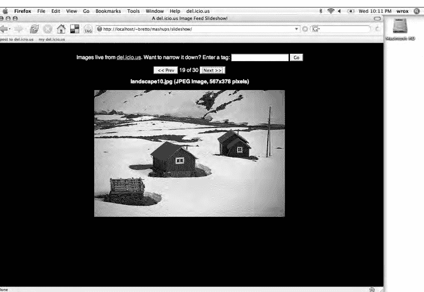
图 10-4

## 第十章：重混 RSS 订阅源

在某些情况下，您可能只看到图片标题而没有图片。此页面上显示的所有图片都是*热链接*的，意味着实际的图片源来自您本地主机以外的网站。为了节省带宽成本，许多网站会设置防盗链措施。如果您尝试查看的图片属于这种情况，该图片将不会显示。当然，图片在发布到 del.icio.us 后被更改或移除的可能性也始终存在。

> 警告！您现在已接入 del.icio.us 用户群的图像托管集体智慧，有时这种集体智慧并不那么美好。通过此应用，您可能会看到一些您认为不妥甚至极其冒犯性的图片。请谨慎浏览，尤其是在输入标签进行查看时。

### 工作原理

幻灯片脚本由一些 PHP 和 Magpie、少量 HTML 标记以及大量的 JavaScript 驱动。它已被尽可能简化，但如果您对项目运作方式——特别是 JavaScript 部分——有任何进一步问题，请随意通过其他资源（例如众多网络教程之一或一本好书，如 Nicholas C. Zakas 所著的 *Professional JavaScript for Web Developers*（Wrox, 2005））来进一步学习 JavaScript。在混搭时代，了解 JavaScript 是件好事。

开头的 PHP 代码块包含您尚未见过的内容。设置 Magpie 和其他常量，定义 URL（在这种情况下，您可以有标签也可以没有），并获取数据（当然，Magpie 应在后台捕获订阅源，因此请始终确保其正常工作）：

```php
<?php

//基本标签订阅源 URL
define('BASE_IMAGE_FEED_URL','http://del.icio.us/rss/tag/system:media:image');

//引入 magpie 库
require_once('lib/rss_fetch.inc');

//设置缓存目录
define('MAGPIE_CACHE_DIR', 'cache');

//由于 magpie 会产生一些错误通知，因此忽略它们
error_reporting(E_ERROR | E_WARNING | E_PARSE);

//添加任何标签热度
if (isset($_GET['tag']))
{
    $feed_url = BASE_IMAGE_FEED_URL."%s".$_GET['tag'];
} else 
{
    $feed_url = BASE_IMAGE_FEED_URL;
}

//获取订阅源
$rss = fetch_rss($feed_url);

?>
```

当提交“输入标签”表单时，`$_GET['tag']` 被设置，并且 `$feed_url` 通过 + 符号附加了标签。（顺便说一句，这是该页面上唯一的表单提交——`Next` 和 `Previous` 按钮仅触发 JavaScript 命令。）

在一些典型的 HTML 标记之后，创建了几个 JavaScript 变量和函数。前三个变量定义了每张幻灯片之间应间隔的秒数，并保存当前幻灯片编号和图片总数：

```javascript
//切换图片前的秒数
var num_seconds_per_image = 20;
//当前是第几张图片？（从 0 开始）
var cur_image_num = 0;
//图片总数（由 initSlideshow() 设置）
var total_images = 0;
```

接下来，设置了两个 JavaScript 数组，一个用于存储每张图片的路径（从 PHP 变量 `$item['link']` 中提取），另一个用于存储每张图片的标题（从 PHP 变量 `$item['title']` 中提取）：

```javascript
//设置图片路径数组（末尾的 '' 是故意添加的）
var images = [
<?php
foreach ($rss->items as $item)
    echo "'".$item['link']."',\n";
?>
''
];
//图片标题数组
var image_title = [
<?php
foreach ($rss->items as $item)
    echo "'".htmlentities($item['title'],ENT_QUOTES)."',\n";
?>
''
];
```

在脚本的这一部分有三点值得指出。第一是发送到 `echo` 的每个字符串都以 `\n` 结尾，这会导致 PHP 生成换行符，使 JavaScript 标记更易于阅读：

```javascript
var images = [
<?php
foreach ($rss->items as $item)
    echo "'".$item['link']."',\n";
?>
''
];
```

还要注意在每个 PHP 填充的数组末尾添加的额外空数组项，这是一种偷懒的方法，用于确保 PHP 添加的数组中的最后一项不以逗号结尾（否则，JavaScript 可能无法正常运行）：

```javascript
var images = [
<?php
foreach ($rss->items as $item)
    echo "'".$item['link']."',\n";
?>
''
];
```

最后，注意项目标题上的 `htmlentities()` 元素，这是 PHP 的一个内置方法，用于通过将某些字符转换为它们的 HTML 等效字符来清理文本，以便用于各种目的，包括单引号和双引号，这些在 JavaScript 中会严重扰乱事情：

```php
<?php
foreach ($rss->items as $item)
    echo "'".htmlentities($item['title'],ENT_QUOTES)."',\n";
?>
```

花些时间查看您的代码生成的 HTML 源代码（在 Firefox 中选择“查看”->“页面源代码”）。找到 `<head>` 元素之间的 JavaScript，您会看到每个 RSS 订阅源项目的链接和标题直接作为 `images` 和 `image_titles` JavaScript 数组的值出现在源代码中。

接下来，定义了一个最终变量，用于存储 `setTimeout()` 对象，该对象将控制幻灯片放映的节奏，然后定义了几个不同的 JavaScript 函数，从 `initSlideshow()` 开始：

```javascript
//计时器对象
var timer;
//初始化幻灯片
function initSlideshow() {
    //设置 total_image_num
    total_images = images.length - 2;
    document.getElementById('total_image_num').innerHTML = total_images;
    //加载第一张图片
    nextImage();
}
```

`initSlideshow()` 在 HTML 文档通过 `<body>` 元素的 `onload` 属性加载后调用。它设置图片总数（减去 2 以考虑额外的数组元素）并在页面上的相应位置显示图片总数。它还调用 `nextImage()` 来启动幻灯片放映。

接下来的两个函数，`nextImage()` 和 `previousImage()`，重置 20 秒计时器，分别增加或减少当前图片编号（或者在达到幻灯片循环末尾时重置它），并调用 `setImage()`：

```javascript
//显示下一张图片
function nextImage() {
    //设置 nextImage() 自动执行
    window.clearTimeout(timer);
    timer = setTimeout("nextImage()",num_seconds_per_image * 1000);
    //设置下一张幻灯片
    if (cur_image_num == total_images)
        cur_image_num = 1;
```


## 第 10 章：重新混编 RSS 馈送

```javascript
else
    cur_image_num++;
    setImage();
}
)
//show the previous image
function prevImage() {
    //set automatic execution of nextImage()
    window.clearTimeout(timer);
    timer = setTimeout("nextImage()",num_seconds_per_image * 1000);
    //set the next slide
    if (cur_image_num == 1)
        cur_image_num = total_images;
    else
        cur_image_num--;
    setImage();
}
```

`setImage()` 设置页面上的所有图像信息，其中包括更新显示的当前图像编号，在 image_info `<div>` 元素中设置图像标题，以及在 image_holder `<div>` 元素中创建（在删除任何现有元素之后）一个引用自 RSS 馈送中提取的图像 URL 的图像子元素。

其余的 HTML 标记相当简单。第一行阴影区域对 `initSlideshow()` 的调用，以及第二组阴影区域中 << Prev 和 Next >> 按钮的 `onclick` 属性，分别调用了相应的 JavaScript 函数：

```html
<body onload="initSlideshow()">
<div align="center" style="padding: 1em">
<form method="get">
Images live from
<a href="http://del.icio.us/tag/system:media:image" data:image">del.icio.us</a>.
Want to narrow it down? Enter a tag:
<input type="text" name="tag"
value="<?php if (isset($_GET['tag'])) echo $_GET['tag']; ?>" />
<input type="submit" value="Go" />
</form>
<br />
<input type="button" value="<< Prev" onclick="prevImage()" />
<span id="cur_image_num">0</span>/<span id="total_image_num">0</span>
<input type="button" value="Next >>" onclick="nextImage()" />
</div>

<div align="center" style="font-weight: bold" id="image_info_holder">
If you see this message, then there are no images for this tag or something went wrong.
</div>

<div align="center" style="padding-top: 1em" id="image_holder">
</div>

</body>
</html>
```

## 第三部分：混合与混编 (Mashups and Remixes)

除了少数几个新的 JavaScript 和 PHP 技术外，幻灯片项目的其余部分由你已经见过的 DHTML 方法组成。

这个项目被尽可能地简化，很多地方都可以改进，包括每个图像资源的预加载和处理、处理 RSS 馈送（如 del.icio.us）不可用时的错误处理，以及每张图像作为幻灯片的呈现美学。如果你愿意接受挑战，欢迎将目前创建的内容作为起点，打造一个真正出色的、由 del.icio.us 驱动的图像浏览 Web 应用程序。

### 媒体标签混编：一个 MP3 点唱机

在音乐和/或播客世界中总有新东西出现，因此如果你是这些内容的粉丝，你可能会对 `system:filetype:mp3` 感兴趣，这是一个追踪所有发布到 del.icio.us 的 MP3 文件的媒体标签。如果说有哪个标签值得跳出 RSS 馈送并被塑造成新东西，那就是这个。在下一个项目中，你将把 `system:filetype:mp3` 标签混编成一个音乐播放列表，该列表可以在大多数软件媒体播放器中播放，包括 Apple 的 iTunes、WinAmp 以及跨平台的 VLC。

> 听说过 VLC 吗？绝对值得尝试。VLC (VideoLAN Client) 是一款开源媒体播放器，几乎适用于任何现代计算平台。它能够播放几乎任何类型的媒体（包括音频和视频），并包含其他媒体播放器在一年两年后才会出现的高级功能，包括对尖端文件类型的高级支持，以及通过其服务器产品，能够使用多种协议在网络上流式传输音频和视频。你可以在 www.videolan.org/vlc/ 免费下载。

#### 试一试

**使用点唱机**

与 freshtags 项目一样，点唱机项目将使用 Magpie RSS 来获取和解析 RSS 馈送，然后将其输出为不同类型的文件。不过，你生成的将不是 XML 文件，而是一个 PLS 文件。PLS 是一种粗糙的、大部分未公开文档的文件格式，它基本上是以某种方式列出多媒体文件及其位置。幸运的是，大多数媒体播放器都能正确解析该列表。随后由媒体播放器负责音频文件的流传输和播放。因此，你的脚本只需要将 MP3 `filetype` 标签重新解释为正确的文件格式。你将把这段文件生成代码封装在一个界面中，让你在下载 PLS 文件之前可以输入一个特定的标签（如果需要）。

- 1. 在你的 htdocs 目录下创建一个名为 **jukebox** 的新目录，并为其配置常规结构 —— 一个用于 Magpie 的 **cache** 目录，以及一个包含所有所需 Magpie 包含文件的 **lib** 目录。然后在编辑器中为 jukebox 创建一个 **index.php** 脚本，并以以下代码开始：

```php
<?php

//base filetype tag feed url
define('BASE_MP3_FEED_URL','http://del.icio.us/rss/tag/system:filetype:mp3');

//bring in magpie goodness
require_once('lib/rss_fetch.inc');

//set cache directory
define('MAGPIE_CACHE_DIR', 'cache');

//get rid of error Notices because magpie produces some
error_reporting(E_ERROR | E_WARNING | E_PARSE);
```

- 2. 编写一个控制语句来检查是否存在名为 `fetchpls` 的 `POST` 变量。该语句将触发 PLS 文件的下载。否则，将显示包含标签输入表单的 HTML 标记。你会发现生成 PLS 文件并没有太多复杂之处 —— 这对于 PHP 来说是一项非常简单的任务。

```php
if (isset($_POST['fetchpls'])) {
    //add any tags
    if (isset($_POST['tag']))
        $feed_url = BASE_MP3_FEED_URL."+".$_POST['tag'];
    else
        $feed_url = BASE_MP3_FEED_URL;
    //grab the feed
    $rss = fetch_rss($feed_url);
    //setup headers
    header("Content-type: audio/mpegurl");
    header('Content-Disposition: attachment; filename="jukebox.pls"');
    //output pls
    echo "[playlist]\n";
    $i = 1;
    foreach ($rss->items as $item) {
        echo "File".$i."=".$item['link']."\n";
        echo "Title".$i."=".$item['title']."\n";
        $i++;
    }
    echo "NumberOfEntries=".sizeof($rss->items)."\n";
    echo "Version=2\n";
    //die to stop further execution
    die();
}
?>
```

- 3. 关闭 PHP 代码块后，添加以下 HTML 标记：

```html
<!DOCTYPE html PUBLIC "-//W3C//DTD XHTML 1.0 Transitional//EN"
    "http://www.w3.org/TR/xhtml1/DTD/xhtml1-transitional.dtd">

<html xmlns="http://www.w3.org/1999/xhtml" xml:lang="en" lang="en">
<head>
    <meta http-equiv="Content-Type" content="text/html; charset=utf-8"/>
    <title>A del.icio.us Jukebox!</title>
    <style type="text/css">
    body
    {
        margin: 1em;
        font-family: Helvetica, Arial, Sans-Serif;
    }
    </style>
</head>
<body>
<form method="post">
Export a music playlist live from
<a href="http://del.icio.us/tag/system:filetype:mp3">del.icio.us</a>.
<br />
<br />
Enter in a tag to narrow it down (optional), or just hit "Get Playlist"
<br />
<br />
Tag: <input type="text" name="tag"
       value="<?php if (isset($_GET['tag'])) echo $_GET['tag']; ?>" />
<br />
<br />
<input type="hidden" name="fetchpls" value="true" />
<input type="submit" value="Get Playlist" />
</form>
</body>
</html>
```

- 4. 浏览到 jukebox 项目，应该会出现一个提示你下载播放列表并可选择性输入标签的表单，如图 10-5 所示。

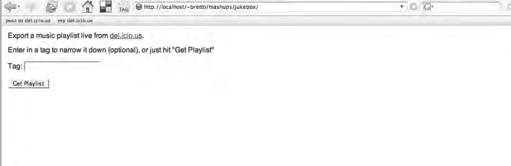

- 5. 点击 “Get Playlist” 按钮，或者在点击前输入一个像 `podcasts` 这样的标签，以仅获取同时带有 `podcast` 标签的项目。你应该会被提示下载文件，或者文件将开始下载（取决于你浏览器的默认文件处理行为），如图 10-6 所示。

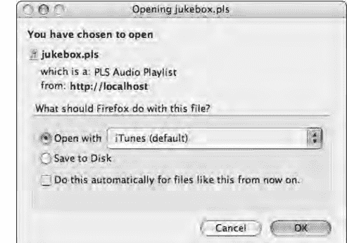
*图 10-6*

- 6. 下载后在 iTunes、WinAmp 或 VLC 中打开该文件。一份完整的 MP3 轨道及其标题列表将被加载并开始播放。查看图 10-7 了解它在 iTunes 中的样子，以及图 10-8 查看它在 VLC 中的样子。

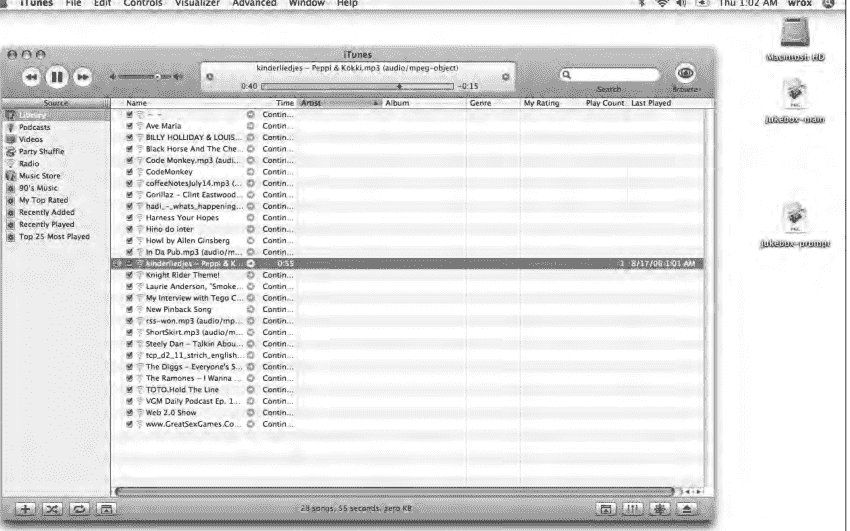
*图 10-7*


## 第三部分：混搭与混录

图 10-8

这里同样需要注意之前制作幻灯片项目时提到的那些事项。该播放列表中的文件可能受到防盗链保护，或者在保存到 del.icio.us 之后已被移动或删除。不过，如果你发现某个 MP3 文件无法播放，只需跳到下一首即可。你最终肯定会发现一些新的音乐、播客或口语作品。

### 工作原理

到目前为止，这个脚本中的大部分内容你应该已经相当熟悉了。最有趣的部分是 `$_POST['fetchpls']` 存在时触发的控制语句中的内容，这是由用户提交 Get Playlist 表单引起的。

当这种情况发生时，Magpie 首先会获取文件类型标签 RSS 订阅源：

```php
//add any tags
if (isset($_POST['tag']))
    $feed_url = BASE_MP3_FEED_URL."+".$_POST['tag'];
else
    $feed_url = BASE_MP3_FEED_URL;
//grab the feed
$rss = fetch_rss($feed_url);
```

## 第 10 章：混录 RSS 订阅源

然后，与 freshtags 项目一样，你使用 PHP 的 `header()` 函数来修改脚本发送的文档头。这一次，你将 `Content-Type` 设置为 `audio/mpegurl`，这是 PLS 文件建议的内容类型。此外，`Content-Disposition` 行会触发用户的 Web 浏览器下载文件，而不是尝试在浏览器中显示它或对其进行其他操作：

> 请注意，你可以通过这个特定的头信息为文件指定名称。

```php
//setup headers
header("Content-type: audio/mpegurl");
header('Content-Disposition: attachment; filename="jukebox.pls"');
```

PLS 文件格式的实际内容非常简单。它大致如下所示：

```
[playlist]
File1:http://www.website.com/song.mp3
Title1:Awesome Song!
NumberOfEntries=1
Version=2
```

你大概能看出文件中需要哪些内容。首先，它必须以 `[playlist]` 开头，每个文件逐行列出，`File#` 指向 MP3 的位置，`Title#` 是 MP3 的标题。然后，在文件末尾附近，`NumberOfEntries` 指定播放列表中要显示的条目数量，`Version=2` 让打开 PLS 文件的程序知道正在使用哪种 PLS 模式。网上有一些对这种格式的变体（不像 RSS，PLS 几乎不受模式文档等的严格约束），但这就是标准 PLS 文件的核心内容。

因此，你只需相应地处理每个 RSS 项目：

```php
//output pls
echo "[playlist]\n";
$i = 1;
foreach ($rss->items as $item) {
    echo "File".$i."=".$item['link']."\n";
    echo "Title".$i."=".$item['title']."\n";
    $i++;
}
echo "NumberOfEntries=".sizeof($rss->items)."\n";
echo "Version=2\n";
//die to stop further execution
die();
```

末尾的 `die()` 在从 PHP 脚本生成文件时总是一个好习惯，因为它可以阻止脚本继续运行并产生任何多余的输出。还要记住每行以 `\n` 结尾，这会在文件中产生换行符。

### 总结

如果你从本章中学到了什么，希望你能认识到 del.icio.us RSS 订阅源的种种可能性。仅仅利用这些订阅源的不同用法，就能写出一整本关于混搭项目的书。它们还揭示了 del.icio.us 整体最出色的特点之一——它是一个不断聚合网络精华的社交网络。如果你能掌握 del.icio.us RSS 订阅源，就能最大限度地利用 del.icio.us。花些时间来享受和扩展本章中的项目吧。del.icio.us 不仅是一个实用的工具，而且也非常有趣，希望这些项目能让你稍微明白其中的原因。

### 练习

通过扩展第 10 章的混搭项目，进一步掌握 del.icio.us RSS 订阅源。

- 1. 在 freshtags 项目中，从每个标签订阅源获取的每个链接都基于该书签是否被归档在该标签下而保存到 MySQL 数据库中。如果你关注了多个相关标签的不同订阅源，这仍然可能在重新生成的订阅源中产生重复条目。你会如何修复这个项目，使得无论使用什么标签，freshtags 产生的任何订阅源中都不会重复显示同一个 URL？
- 2. 在幻灯片混搭项目中，一个可能很有用的功能是链接到将当前显示的图片发布到 del.icio.us 的用户的 del.icio.us 页面。为此，你需要从 Magpie 返回的 RSS 数据中弄清楚谁发布了该图片以及其 del.icio.us 页面的 URL。你会如何从 `$item` 数组中访问这些数据并将其格式化用于页面？
- 3. 如果你想用 jukebox 项目每天导出一个新的 PLS 文件，你可以在脚本创建文件时将导出日期追加到文件名中，这样就能更方便地组织这些文件。具体该如何实现呢？

## 第 11 章：与 Web 服务的混搭

终于可以体验一下将 del.icio.us 与其他 Web 服务混合使用是什么感觉了。

在本章中，你将完成几个项目，将其他 Web API 和 RSS 订阅源与 del.icio.us 混合使用。这些 Web 服务包括 Yahoo! HotJobs 求职服务、eBay 在线拍卖服务、Flickr 照片共享服务，以及 Amazon 独特的 S3 在线数据存储服务。

这些项目的目的不在于教你如何掌握这些 Web 服务 API，而更多地是向你展示在线 API 与 del.icio.us RSS 订阅源和 API 协同工作的不同方式。希望这些项目能启发你为本章描述的 Web 服务或你最喜爱的网站实现自己的创意。

del.icio.us 的一个独特之处在于，它可以被视为网络上几乎所有内容的数据存储格式。并非说 del.icio.us 具体存储了这些东西及其数据，但它确实存储了这些东西的指针——它们的 URL——作为书签。本章的第一部分专门介绍了如何使用 HotJobs、eBay 和 Flickr 提供的数据，并将它们存储和整理在你的 del.icio.us 书签这个中心参考点中。

本章的第二部分将更具雄心。如果你习惯了将 del.icio.us 作为网络指针的可靠来源，你肯定会非常依赖你链接的每个书签的可用性。本书的第二部分将指导你创建一个概念验证系统，该系统会将你在网络上收藏的每个网页或文件的实际副本保存到 Amazon 几乎无限的 S3 系统中。这样，即使原始资源已被移动或离线，你仍然可以检索你的书签。

在开始之前，你可能需要回到第 4 章，确保你至少已经注册并准备好使用本章将讨论的 Web 服务。你需要注册 Flickr 并拥有你的 Flickr API 密钥，准备好 eBay 并拥有用户（最好是自己的）REST 令牌，以及拥有一个 Amazon Web 服务账户。

同时，确保你拥有到目前为止一直在项目中使用的所有常用 PHP 库，包括 Magpie RSS、Snoopy.class.php，以及你为与 del.icio.us API 交互而创建的 delicious_mashups.inc.php 库。

如果你已经准备好了所有这些 Web 服务和库，那么是时候继续阅读了。

### HotJobs、eBay 和 Flickr 自动书签脚本

许多 Web 服务已经提供了将你感兴趣的素材收集到一个地方的方法，无论是通过 RSS 订阅源还是各自网站上的特殊功能。虽然这很好，但你仍然需要关注如何正确地收集和组织这些资源，以及跟踪它们和/或将它们发送给合适的人。

你在网络上收集的东西很可能都有自己独特的 URL，所以如果能自动将你喜欢或感兴趣的一切汇集到一个中心位置 del.icio.us，而不需要你额外费心，那就太好了。而 del.icio.us 几乎是任何类型的超媒体文档或文件的完美存储系统。你在 del.icio.us 中放入的书签可以按照你喜欢的方式进行组织和存储。忠实的 del.icio.us 用户坚信：只要它有趣并且有 URL，它就应该出现在你的 del.icio.us 书签中。

本节将向你展示如何创建一些命令行脚本来解决这个问题，并通过自动书签功能解决一些可以通过网络数据自动标记来应对的场景。你需要通过 Crontab 或其他计算机程序调度方法来定期调度这些脚本，或者自己定期执行它们，因为这三个项目都涉及从命令行使用 PHP，并且是围绕定期运行的理念构建的。尽管这三个脚本在许多方面很相似，但它们也展示了从众多 Web 服务中收集数据时所涉及的独特而有趣的挑战。

例如，假设你有一个急需找到新工作的室友。而且，假设他碰巧有一个 del.icio.us 账户。你可以编写一个定时脚本，查找符合他资质的职位，并自动发布到你的 del.icio.us 账户，同时为你的室友添加标签，作为一种友好的提醒——是时候开始参加一些面试了，这样他下个月才能付得起房租。

Yahoo! 的 HotJobs 职位列表服务（`http://hotjobs.yahoo.com`）通过一个独特但有用的 URL 方案以 RSS 格式提供新的职位列表。下面的动手试试看将展示如何利用这一点编写一个脚本，自动将感兴趣的职位发布到 del.icio.us，希望能引起你室友的注意。

> *本节讨论的所有自动书签脚本的源代码都可以在 Wrox 网站上本书附带源代码的 autobookmarkers 文件夹中找到。*


#### 使用 HotJobs 自动书签工具进行尝试

与上一章中的项目类似，此脚本将涉及重新处理 RSS 提供的数据，因此你已经知道这意味着什么以及需要设置什么来实现这一目标：Magpie RSS。你还将进行 del.icio.us API 调用，因此你还需要来自 delicious_summary2 项目的 `delicious_mashups.inc.php` 库。

- 1. 创建一个 Magpie **缓存**目录，并将 Magpie 文件以及 `delicious_mashups.inc.php` 放置在脚本可访问的位置，例如 **lib** 子文件夹中。然后，在你的编辑器中启动一个名为 **hotjobs.php** 的新文件，最好将其保存到 htdocs 目录中名为 **autobookmarkers** 的文件夹中，并开始使用常用代码设置 Magpie：

```php
<?php
//引入 magpie 的优秀功能
require_once('lib/rss_fetch.inc');

//设置缓存目录
define('MAGPIE_CACHE_DIR', 'cache');

//消除错误通知，因为 magpie 会产生一些
error_reporting(E_ERROR | E_WARNING | E_PARSE);
```

- 2. 因为你将与 del.icio.us API 交互以将新书签发布到你的 del.icio.us 帐户，所以引入你之前创建的 `delicious_mashups.inc.php` 库，并确保它已使用你的 del.icio.us 用户名和密码正确配置：

```php
//delicious mashups 库 - 请设置你的用户名和密码！
define('DELICIOUS_USERNAME', 'username');
define('DELICIOUS_PASSWORD', 'password');

//引入 delicious_mashups.inc.php
require_once('lib/delicious_mashups.inc.php');
```

请注意，在这种情况下，你不必包含 `Snoopy.class.php`。当 Magpie 被引入时，它提供了自己版本的 `Snoopy.class.php`，你的 del.icio.us 混搭库可以使用它。如果你使用 Magpie RSS，就永远不必单独包含 Snoopy。

- 3. 配置更多与 HotJobs 和你将创建的 del.icio.us 书签相关的常量和变量：

```php
//基础 hotjobs url
define('HOTJOBS_URL','http://hotjobs.yahoo.com/rss/0/');

//你那位懒散朋友在 del.icio.us 上的用户名
define('SLACKER_FRIEND', 'friendsusername');

//对于未使用的元素，输入 -（破折号）
$country = 'USA';
$state = 'CO';
$city = '-';
$category = 'RFS';
$key = 'pizza';
```

- 4. 脚本的其余部分组装用于从 HotJobs 获取数据的 RSS URL，并将匹配的数据发布到 del.icio.us，同时包含大量反馈，这些反馈将出现在命令行上，用于日志记录或调试目的：

```php
//组装完整的 url
$feed_url = HOTJOBS_URL.$country."/".$state."/".$city."/".$category."/".$keywords;

//获取 feed
$rss = fetch_rss($feed_url);

echo "Checking for items at ".$feed_url."\n";

//如果项目不存在，则发布找到的项目
//为它们添加标签 for:SLACKER_FRIEND
foreach ($rss->items as $item)
{
    //检查 url 是否已被发布
    do_api_call('/posts/get?',"&url=".urlencode($item['link']));
    if (!isset($api_return[0]['children']))
    {
        $url = $item['link'];
        $description = $item['title'];
        $extended = $item['description'];
        $tags = "for:".SLACKER_FRIEND." autobookmarked jobs";
        do_api_call('/posts/add?',"&url=".urlencode($url)."&description="
            .urlencode($description)."&extended=".urlencode($extended)
            ."&tags=".urlencode($tags));
        if ($api_return['status'] == 200)
            echo "Posted: ".$description."\n";
        else
            echo "There was a problem posting ".$description."\n";
    } else {
        echo $item['link']." already posted - skipping\n";
    }
}
?>
```

- 5. 通过命令行 PHP 执行脚本来进行尝试。你可能还记得，命令应该是这样的：

```bash
php -f hotjobs.php
```

如果一切顺利，脚本应该输出类似以下内容：

```
Checking for items at http://hotjobs.yahoo.com/rss/0/USA/CO/-/RFS/pizza
Posted: General Manager, Restaurant Management, Comp. up to $70K - Pilot Travel
Centers LLC - Colorado Springs, CO USA
Posted: Restaurant Heidi's Brooklyn - CO - Denver - Post-NewsJobs.com - Denver, CO
USA
Posted: Restaurant General Manager / Compensation up to $70K - Pilot Travel Centers
LLC - Colorado Springs, CO USA
Posted: RESTAURANT - SHAKER-ALL CLIENTS LOCAL - Denver, CO USA
```

这些都是 HotJobs 上关于科罗拉多州披萨相关食品服务职位的招聘信息。它们应该会出现在你的 del.icio.us 书签中，标记为 `autobookmarked jobs`，并带有一个指向你慷慨帮助的朋友的 `for: tag`，类似于图 11-1。

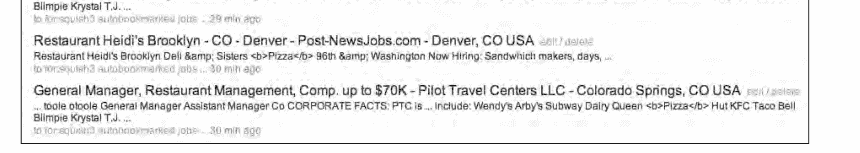
图 11-1

### 工作原理

HotJobs 网络服务以 RSS 形式免费提供了其大部分数据。你可以通过查询字符串参数向 feed URL 发送参数来请求数据，或者以某种 RESTful 的方式将你希望返回的数据标识符作为 feed URL 的一部分来实际放置。

在这个项目中，你使用 feed URL 的部分来定义你感兴趣的工作类型，使用以下变量：

```php
// 对于未使用的元素，输入 -（破折号）
$country = 'USA';
$state = 'CO';
$city = '-';
$category = 'RFS';
$keywords = 'pizza';
```

然后，这些变量组合成 `$feed_url`，这是你打算从 HotJobs 获取的 RSS feed 的完整 URL 请求：

```php
$feed_url = HOTJOBS_URL.$country."/".$state."/".$city."/".$category."/".$keywords;
```

你可能可以猜到每个变量的含义，但请记住，每个请求变量（包括 `$category` 变量的含义）在 HotJobs Web Services 文档网页 http://developer.yahoo.com/hotjobs/index.html 中都有记录。

只需调整这些变量即可更改脚本返回的数据。正如文档所述，发送减号 (-) 作为值将充当通配符，匹配该特定变量的所有结果。

在组装完请求 feed URL 并发出请求后，将处理返回的每个项目。在发布新书签之前，会对 RSS feed 中出现的每个链接使用 del.icio.us API `/posts/get/` 方法，如果 `/posts/get?` 返回任何 `<post>` 主元素的子元素，则说明该职位描述的链接已经保存在你的 del.icio.us 中，不需要再次发布：

```php
//如果项目不存在，则发布找到的项目
//为它们添加标签 for:SLACKER_FRIEND
foreach ($rss->items as $item)
{
	//检查 url 是否已被发布
	do_api_call('/posts/get?',"&url=".urlencode($item['link']));
	if (!isset($api_return[0]['children']))
	{
		... 将链接保存为 del.icio.us 书签的代码...
	} else {
		echo $item['link']." already posted - skipping\n";
	}
}
```

请注意，`$item['link']` 被 PHP 的 `urlencode()` 函数包围。`urlencode()` 使任何字符串可以通过 URL 安全传输，例如通过 REST 请求。虽然项目 URL 本身不太可能包含任何可能破坏 REST 调用的内容，但使用 `urlencode()` 总不是个坏主意。在后面的 `/posts/add?` 调用中，每个查询值都使用 `urlencode()` 进行转义。

如果以前从未保存过，该链接将保存到你的 del.icio.us 书签中。请注意上面代码中的 `$tags` 变量，以及它如何将 `SLACKER_FRIEND` 常量附加到阴影块中以形成一个合法的 `for:` 标签。其余部分不言自明。调用 `/posts/add?` 并将结果回显到屏幕：

```php
$url = $item['link'];
$description = $item['title'];
$extended = $item['description'];
$tags = "for:".SLACKER_FRIEND." autobookmarked jobs";
do_api_call('/posts/add?',"&url=".urlencode($url)."&description="
	.urlencode($description)."&extended=".urlencode($extended)."&tags="
	.urlencode($tags));
if ($api_return['status'] == 200)
	echo "Posted: ".$description."\n";
else
	echo "There was a problem posting ".$description."\n";
```

HotJobs 自动书签脚本非常简单。它依赖于一个简单的 RESTful API 调用，该调用返回易于解析的 RSS 数据，无需任何额外的身份验证或 XML 解析。

下一个“尝试一下”涉及一个稍微复杂一点的自动书签脚本，它引入了一些额外的命令行脚本技术。它还解决了处理非 RSS 格式的数据返回所带来的挑战，当你尝试将其他 Web API 集成到你的混搭应用程序中时，这种情况经常会发生。此脚本将使用 eBay REST API 下载并自动发布 eBay 的搜索结果。

#### 使用 eBay 自动书签工具进行尝试

Ebay 自动书签脚本将使用 eBay REST API 搜索 eBay 物品列表。在这个例子中，你将设计它接受作为命令行参数提供的搜索字符串，而不是像你在 HotJobs 自动书签工具中那样在脚本内指定搜索内容。


## 第11章：通过Web服务进行融合

你需要使用Snoopy来调用和获取eBay REST API中的数据。Magpie中有一份副本，你可以直接链接到Magpie的extlib目录中的Snoopy.inc.php来借用它。你还将使用之前创建的delicious_mashups.lib.php库，不仅用于构建调用del.icio.us所需的API请求，还用于解析从eBay返回的XML数据。

你还需要你的eBay凭证，特别是你的eBay沙盒用户名和REST令牌。如果你还没有设置这些，请参考第4章。

1. 使用编辑器在autobookmarkers文件夹中创建一个名为ebay.php的新脚本，并设置Snoopy和你的del.icio.us API库的适当路径，以及通常需要的用于操作两者的常量：

```php
<?php
//bring in Snoopy.class.php (from Magpie's extlib dir)
require_once('lib/extlib/Snoopy.class.inc');
$snoopy = new Snoopy();

//delicious mashups library - set your username and password please!
define('DELICIOUS_USERNAME','username');
define('DELICIOUS_PASSWORD','password');

//bring in delicious_mashups.inc.php
require_once('lib/delicious_mashups.inc.php');
```

2. 你需要一个eBay用户ID和该用户的User Rest Token，以便随请求一起发送给eBay。此外，此脚本将基于eBay沙盒构建，沙盒是供开发者使用的eBay测试版本。如果你想在生产数据上尝试——你总有一天肯定会的——你需要获取额外的生产环境User Rest Token，并且需要使用不同的REST API URL。同时，将每个变量设为常量，以便于查找和更改。将USER_REST_TOKEN和USER_ID分别设置为你的沙盒用户的REST令牌和用户ID：

```php
//ebay base rest api url (this is the sandbox! not live ebay)
define('BASE_REST_URL','http://rest.api.sandbox.ebay.com/restapi');
//ebay rest token and user_id
define('USER_REST_TOKEN','resttoken');
define('USER_ID','userid');
```

3. 如前所述，搜索字符串将通过命令行本身指定。添加以下代码来捕获此输入并将其赋值给正确的变量，否则如果没有提供搜索字符串则停止脚本：

```php
//fetch query string from arguments
if (!isset($argv[1]))
    die("You need to specify something to search for as an argument!\n");
else
    $search_string = urlencode($argv[1]);
```

4. 添加以下代码来组装并发起对eBay的REST调用：

```php
//full query url
$full_api_url = BASE_REST_URL."?CallName=GetSearchResults&RequestToken="
       .USER_REST_TOKEN."&RequestUserId=".USER_ID."&Query=".$search_string;

$snoopy->fetch($full_api_url);

parse_xml_results($snoopy->results);
```

5. 添加以下代码来分析从eBay返回的XML响应，获取每个返回项目的链接和标题，然后在它们尚不存在于你的del.icio.us书签中时将其保存：

```php
//search for the xml elements we need
$root_element_children = $api_return[0]['children'];
foreach ($root_element_children as $root_element_child)
{
    if ($root_element_child['name'] == "SEARCH") {
        $search_items = $root_element_child['children'];
        foreach ($search_items as $search_item)
        {
            if($search_item['name'] == "ITEMS") {
                $search_result_items = $search_item['children'];
            }
            break;
        }
    }
    break;
}

foreach ($search_result_items as $search_result_item)
{
    //determine the item title and url
    $item_details = $search_result_item['children'];
    foreach ($item_details as $item_detail)
    {
        if ($item_detail['name'] == "LINK")
            $url = $item_detail['cdata'];
        if ($item_detail['name'] == "TITLE")
            $description = $item_detail['cdata'];
    }
    unset($item_details);
    //check to see if the url has already been posted
    do_api_call('/posts/get?',"&url=".urlencode($url));
    if (!isset($api_return[0]['children']))
    {
        $tags = "autobookmarked ebay";
        do_api_call('/posts/add?',"&url=".urlencode($url)."&description="
            .urlencode($description)."&extended=".urlencode($extended)."&tags="
            .urlencode($tags));
        if ($api_return['status'] == 200)
            echo "Posted: ".$description."\n";
        else
            echo "There was a problem posting ".$description."\n";
    } else {
        echo $item['link']." already posted - skipping\n";
    }
}

//unset $url and $description
unset($url);
unset($description);
}
?>
```

6. 要测试这个自动书签脚本，首先尝试像往常一样从命令行调用它：

`php -f ebay.php`

你应该会得到以下返回信息：

`You need to specify something to search for as an argument!`

要正确调用此脚本，你需要在调用`ebay.php`后输入搜索字符串，如下所示：

`php -f ebay.php "powerbook g4"`

对于多词搜索字符串，你始终应该用引号括起来。PHP会自动将其解析为单个参数。

当你使用搜索字符串调用脚本时，将发起对eBay REST API的调用，新的书签将保存到你的del.icio.us账户中，匹配你提供的搜索字符串。它们都将自动标记为`autobookmarked`和`ebay`。

通过命令行参数指定*想要搜索的内容*这一功能非常实用。你可以安排脚本定期执行多次，每次使用不同的搜索字符串，从而定期将eBay上感兴趣的项目保存到你的del.icio.us书签中。例如，如果你使用Crontab，你可以在Crontab文件中对同一脚本进行多次调用，如下所示：

`0 0 * * 1 php -f /htdocs/autobookmarkers/ebay.php "vintage macintosh"`
`0 0 * * 1 php -f /htdocs/autobookmarkers/ebay.php "colecovision"`
`0 0 * * 1 php -f /htdocs/autobookmarkers/ebay.php "macrame owl"`

这将导致任何涉及vintage macintosh、colecovision和macrame owl的新eBay项目每周一自动保存到你的del.icio.us书签中。

### 工作原理

eBay自动书签脚本中第一个值得关注的项目是处理命令行参数的代码：

`//fetch query string from arguments`
`if (!isset($argv[1]))`
`    die("You need to specify something to search for as an argument!\n");`
`else`
`    $search_string = urlencode($argv[1]);`

在大多数PHP配置中，变量`$argv`是一个全局数组，包含命令行参数。数组中第一个索引的值`$argv[0]`是被处理的脚本名称（在本例中为`ebay.php`）。所有后续参数跟在脚本名称之后。因此，`$argv[1]`就是你的搜索字符串。通过将其放在引号中，shell命令行会自动将该参数解析为单个字符串。

如果你对PHP提供的更多命令行功能感兴趣，请查看PHP主页上的文档，地址为http://us2.php.net/manual/en/features.commandline.php。

在设置`$search_string`变量之后，完整的eBay REST调用被组装到`$full_api_url`变量中。正如你在第4章eBay API介绍中可能记得的那样，调用eBay的REST API需要函数调用（在本例中为`GetSearchResults`），以及代表你进行搜索的eBay用户的`RequestToken`和`RequestUserId`。`Query`变量被赋予URL安全的`$search_string`：

```php
//full query url
$full_api_url =
BASE_REST_URL."?CallName=GetSearchResults&RequestToken=".USER_REST_TOKEN
."&RequestUserId=".USER_ID."&Query=".$search_string."";
```

之后，返回的数据被处理。你可以使用`delicious_mashups.lib.php`中的`parse_xml_results()`函数，无需重新创建该函数或其功能。它的XML解析例程足够简单，可以处理任何类型的通用XML。

eBay REST API调用的响应大致如下：

```xml
<eBay>
<EBayTime>2006-08-20 20:19:28</EBayTime>
<Search>
<Items>
<Item>
<Id>110003840240</Id>
<Title>Custom Built Computer</Title>
<SubtitleText></SubtitleText>
<CurrencyId>1</CurrencyId>
<Country>1</Country>
<Link>
http://cgi.sandbox.ebay.com/ws/eBayISAPI.dll?ViewItem&item=110003840240&category=114193
</Link>
... XML响应的其余部分 ...
</Item>
</Items>
<Count>9</Count>
<HasMoreItems>0</HasMoreItems>
<PageNumber>1</PageNumber>
<GrandTotal>9</GrandTotal>
<BuyingGuideDetails>
... 更多XML！...
</BuyingGuideDetails>
</Search>
</eBay>
```

脚本执行的下一个任务是逐层深入`<Items>`元素，提取每个项目的`<Titles>`和`<Link>`元素的值：

```xml
<eBay>
<EBayTime>2006-08-20 20:19:28</EBayTime>
<Search>
```


## 第 11 章：通过 Web 服务整合数据

```xml
<Items>
<Item>
<Id>110003840240</Id>
<Title>Custom Built Computer</Title>
<SubtitleText></SubtitleText>
<CurrencyId>1</CurrencyId>
<Country>1</Country>
<Link>
http://cgi.sandbox.ebay.com/ws/eBayISAPI.dll?ViewItem&item=110003840240&category=11
4193
</Link>
... the rest of the XML response ...
</Item>
</Items>
<Count>9</Count>
<HasMoreItems>0</HasMoreItems>
<PageNumber>1</PageNumber>
<GrandTotal>9</GrandTotal>
<BuyingGuideDetails>
... even more XML! ...
</BuyingGuideDetails>
</Search>
</eBay>
```

另一种方法是遍历数组中的每个元素，查找你所需名称的元素。虽然这种方式在计算上更加密集，但如果 XML 模式发生变化，它更有可能获取到你需要的数据。因此，`ebay.php` 中的下一段代码从根 XML 文档元素（`<eBay>`）的子元素开始遍历，首先查找 `<Search>` 元素：

```php
//search for the xml elements we need
$root_element_children = $api_return[0]['children'];
foreach ($root_element_children as $root_element_child)
{
    if ($root_element_child['name'] == "SEARCH") {
        $search_items = $root_element_child['children'];
        foreach ($search_items as $search_item)
        {
            if($search_item['name'] == "ITEMS") {
                $items = $search_item['children'];
            }
            break;
        }
    }
    break;
}
```

然后查找 `<Items>` 元素：

```php
//search for the xml elements we need
$root_element_children = $api_return[0]['children'];
foreach ($root_element_children as $root_element_child)
{
    if ($root_element_child['name'] == "SEARCH") {
        $search_items = $root_element_child['children'];
        foreach ($search_items as $search_item)
        {
            if($search_item['name'] == "ITEMS*") {
                $items = $search_item['children'];
            }
            break;
            break;
        }
    }
}
```

`$items` 变量接收 `<Items>` 的每个子元素，即返回的每个 eBay 商品。

接下来对每个 `$item` 进行求值，将每个商品的 `<Link>` 和 `<Title>` 元素的字符数据值分别赋给 `$url` 和 `$description` 变量：

```php
foreach ($items as $search_result_item)
{
    //determine the item title and url
    $item_details = $search_result_item['children'];
    foreach ($item_details as $item_detail)
    {
        if ($item_detail['name'] == "LINK*")
            $url = $item_detail['cdata'];
        if ($item_detail['name'] == "TITLE*")
            $description = $item_detail['cdata'];
    }
    unset($item_details);
    ...
    the rest of the code
    ...
}
```

之后，与 Hotjobs 自动书签脚本类似，首先调用 del.icio.us API 检查该书签是否已存在，以确保没有重复发布。如果尚未发布，则调用 `/posts/add/?`：

```php
//check to see if the url has already been posted
do_api_call('/posts/get/?',"&url=".urlencode($url));
if (isset($api_return[0]['children']))
{
    $tags = "autobookmarked ebay";
    do_api_call('/posts/add/?',"url=".urlencode($url)."&description="
        .urlencode($description)."&extended=".urlencode($extended)."&tags="
        .urlencode($tags));
    if ($api_return['status'] == 200)
        echo "Posted: ".$description."\n";
    else
        echo "There was a problem posting ".$description."\n";
} else {
    echo $item['link']." already posted - skipping\n";
}
```

```php
//unset $url and $description
unset($url);
unset($description);
```

eBay REST API 的响应格式及所有其他细节在 `http://developer.ebay.com/developercenter/rest/` 上有完整文档记录。

还有一个自动书签脚本需要完成。最后一个脚本涉及在使用 Web 服务 API 时常见的另一个障碍——签名认证机制。不幸的是，某些 API 需要更高级别的安全保护，而不仅仅是让开发者申请并在每次请求中发送 API 密钥，或者通过每次调用 API 来认证其自身的 Web 服务账户。有些 Web 服务要求每个请求都必须附带秘密的、经过编码的签名，以验证你应用的身份。此外，有些还要求用户明确允许应用访问和更改其数据后，应用才能被使用。

Flickr 在线照片分享服务就是一个同时包含这两项额外安全级别的服务。每次对其 API 的请求都必须以特殊方式进行签名才能生效。不仅如此，如果你的 API 请求是访问和/或更改 Flickr 用户的数据，该用户必须先给予你的应用相应权限。

在本节的最后一个项目中，你实际上需要创建两个脚本。主脚本用于自动将你的 Flickr 收藏发布到 del.icio.us。不过，首先需要创建一个辅助脚本，用于执行必要的操作以获取你所需的内容，从而使主脚本能够完成此功能。这看起来似乎是一个过于复杂的系统，但它实际上非常巧妙，通过一个相当复杂的 API 系统来保护用户及其数据。尽管 Flickr 的认证系统相当独特，但它正在为 API 设定趋势，你可以预期未来会有许多其他 Web 服务 API 遵循这一路径。

#### 试用 Flickr 自动书签工具

在 Flickr 中，你可以通过点击每张浏览照片上方的星形按钮将其标记为收藏。点击后，星星会变成粉色，该照片会自动添加到一个页面中，该页面展示你从整个 Flickr 中收藏的所有照片，如图 11-2 所示。

当你在 del.icio.us 上保存书签时，你已经在分享有趣的内容了，因此将你的收藏照片列表自动传输到 del.icio.us 是很有意义的。Flickr 提供了一种名为 `flickr.favorites.getList` 的 API 方法来获取用户的收藏列表（文档地址为 `www.flickr.com/services/api/flickr.favorites.getList.html`），但不幸的是，它并不像对那个 API 函数进行 REST 调用并解析其结果那么简单。Flickr 上的这个和许多其他 API 函数要求你的应用、你希望访问其收藏的 Flickr 用户以及 Flickr API 之间达成认证协议。这些通常由三项内容表示，你需要将它们随 REST 调用一起发送给 Flickr：

- 你的应用的 API 密钥
- 你的应用的 API 签名
- 一个认证令牌，它代表你的应用与你即将读取或更改其照片的 Flickr 用户之间预先建立的权限协议

你可以将 API 密钥理解为你的应用在 Flickr API 上的用户名，签名理解为你的应用的密码，认证令牌理解为你的应用要访问其照片的 Flickr 用户的用户 ID。

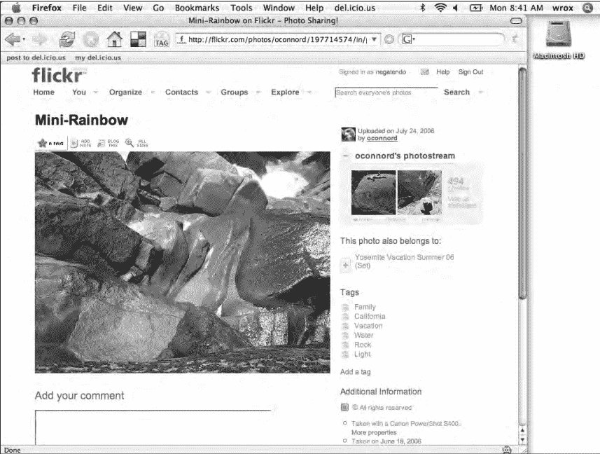

图 11-2

1. 希望到目前为止你已经申请并获得了 Flickr API 密钥，所以这部分已经完成。然而，在使用之前，你需要配置密钥。这将帮助你确定如何构造签名以及获取所需的用户认证令牌。你可以访问 `www.flickr.com/services/api/keys/` 查看你的密钥列表。找到你想用于 Flickr 自动书签工具应用的 API 密钥，然后点击 Authentication: Not Configured 链接进入其配置设置。

2. 在配置表单上，密钥的字母数字哈希值称为 Shared Secret（共享密钥）。这将是你应用签名的一部分，所以务必记下来。然后填写表单上的必填字段。将你的应用命名为 **Flickr Autobookmarker**，并输入 **Posts your favorites to del.icio.us automatically** 作为其描述。将 Authentication Type 设置为 Mobile Application（Flickr 推荐所有命令行应用使用此类型），将 Mobile Permissions 设置为 Read，如图 11-3 所示。


## 第 11 章：利用 Web 服务进行 Mashup

- 3. 注意“Your authentication URL”旁边的 URL（这就是你前往允许 Flickr Autobookmarker 应用程序访问你的照片的地方），然后保存你的 API 密钥更改。

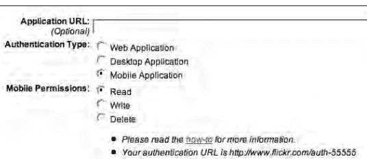
图 11-3

- 4. 登录 Flickr，然后浏览你在步骤 3 中记录的 URL。你应该会看到一个页面，解释说 Flickr Autobookmarker 应用程序希望访问你的照片，并给你机会同意允许其访问，如图 111-4 所示。

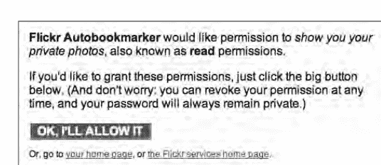
图 11-4

- 5. 点击“Ok, I’ll Allow It”按钮。你将被带到一个显示特殊代码的页面，该代码被称为 *mini-token*（小型令牌），你需要将其输入到你的移动应用程序中，或者在这种情况下，将其设置为你即将执行的命令行中的一个变量，以获取所需的最终身份验证令牌。图 11-5 显示了该页面的样子。

根据你创建的应用程序类型，此过程的操作方式有所不同。如果你将 API 密钥配置为 Web 应用程序，那么在用户点击“Ok, I’ll Allow It”后，他们将被重定向到你 Web 应用程序网站的一个回调 URL，身份验证信息将作为查询字符串发送。对于桌面应用程序，所有的 Flickr 登录和权限授予都可以在应用程序内部处理。这完全取决于你的 mashup 应用程序所运行的平台。Flickr 可能会建议将命令行应用程序设计为移动应用程序，因为在命令行或使用其他方法输入 mini-token 非常方便。

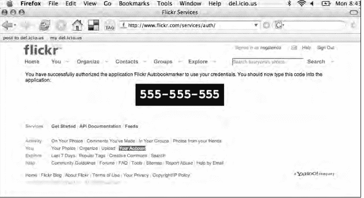
图 11-5

- 6. 因为你只需要一个用户身份验证令牌——即你自己的 Flickr 用户账户的令牌——你将编写一个脚本，将 mini-token 转换为最终的身份验证令牌，你在使用 Flickr API 的 `flickr.auth.getFullToken` 方法时需要提供该令牌。为此，创建一个名为 `flickr_get_token.php` 的脚本并写入以下代码，将其指向你可用的 `Snoopy.class.php` 版本，并将你的 Flickr API 密钥设为 `API_KEY`，将 API 密钥的共享密钥（Shared Secret）设为 `SHARED_SECRET`：

```php
<?php
//bring in Snoopy.class.php (from Magpie's extlib dir)
require_once('lib/extlib/Snoopy.class.inc');
$snoopy = new Snoopy();

define('API_KEY','apikey');
define('SHARED_SECRET','sharedsecret');

//fetch query string from arguments
if (!isset($argv[1]))
    die("You need to give me your mini token.\n");
else
    $mini_token = $argv[1];

//create a new Snoopy object
$snoopy = new Snoopy;

$api_sig =
md5(SHARED_SECRET."api_key".API_KEY."methodflickr.auth.getFullTokenmini_token"
.$mini_token);

$get_full_token=
"http://flickr.com/services/rest/?method=flickr.auth.getFullToken&api_key="
.API_KEY."&mini_token=".$mini_token."&api_sig=".$api_sig;

$snoopy->fetch($get_full_token);

echo $snoopy->results;
?>
```

- 7. 使用你之前获取的 mini-token 像这样调用脚本（假设你的 mini-token 是 123-123-123）：

```bash
php -f flickr_get_token.php 123-123-123
```

你应该会看到屏幕上打印出一些 XML，类似于这样：

```xml
<?xml version="1.0" encoding="utf-8" ?>
<rsp stat="ok">
  <auth>
    <token>12345678823457</token>
    <perms>read/perms</perms>
    <user nsid="12341234@N00" username="negatendo" fullname="Brett O' Connor" />
  </auth>
</rsp>
```

- 8. 你要找的身份验证令牌是出现在 `<token>` 元素内部的数据（在上述代码中以粗体显示）。请为你的自动书签脚本记录下来。你现在拥有了代表你的应用程序与你将在 Flickr 上读取数据的用户之间达成协议的字符串。

既然你已经记录了想要读取其收藏夹的 Flickr 用户（很可能就是你自己）的最终身份验证令牌，

> 从这一点开始，你不再需要 mini-token。事实上，它只能使用一次来检索最终的身份验证令牌，之后就失效了。不过，请保留 `flickr_get_token.php`，以防你想获取其他 Flickr 用户的身份验证令牌。

- 9. 现在是编写实际的自动书签脚本的时候了。它将与你目前编写的其他自动书签脚本非常相似。在你存放其他自动书签应用程序的地方创建一个名为 `flickr.php` 的新 PHP 文件，并完整地写入以下 PHP 代码（请确保将 `DELICIOUS_USERNAME`、`DELICIOUS_PASSWORD`、`API_KEY`、`SHARED_SECRET` 和 `FULL_TOKEN` 常量设置为相应的等值，将 `FULL_TOKEN` 设置为 `flickr_get_token.php` 给你的完整用户身份验证令牌）：

```php
<?php

//bring in Snoopy.class.php (from Magpie's extlib dir)
require_once('lib/extlib/Snoopy.class.inc');
$snoopy = new Snoopy();

//delicious mashups library - set your username and password please!
define('DELICIOUS_USERNAME', 'username');
define('DELICIOUS_PASSWORD', 'password');

//bring in delicious_mashups.inc.php
require_once('lib/delicious_mashups.inc.php');

//flickr api key and shared secret
define('API_KEY','apikey');
define('SHARED_SECRET','sharedsecret');

//this should be the user auth token you got from flickr_get_token.php
define('FULL_TOKEN','fulltoken');

//calculate $api_sig for flickr.favorites.getList
$api_sig =
md5(SHARED_SECRET."api_key".API_KEY."auth_token"
.FULL_TOKEN."methodflickr.favorites.getList");

$snoopy->fetch(
"http://www.flickr.com/services/rest/?method=flickr.favorites.getList&api_key="
.API_KEY."&auth_token=".FULL_TOKEN."&api_sig=".$api_sig);

parse_xml_results($snoopy->results);

//take what we now need from $api_return because our del.icio.us call will
//unset it later
$photos = $api_return[0]['children'][0]['children'];

//go through each photo and save if never saved to del.icio.us before
foreach ($photos as $photo)
{
    $url =
sprintf("http://www.flickr.com/photos/%s/%s",$photo['attributes']['OWNER'],
$photo['attributes']['ID']);
    $description = $photo['attributes']['TITLE'];
    $tags = "flickr photography autobookmarked";
    //check to see if the url has already been posted
    do_api_call('/posts/get?',"&url=".urlencode($url));
    if (!isset($api_return[0]['children']))
    {
     do_api_call('/posts/add?',"&url=".urlencode($url)."&description="
     .urlencode($description)."&tags=".urlencode($tags));
        if ($api_return['status'] == 200)
            echo "Posted: ".$description."\n";
        else
            echo "There was a problem posting ".$description."\n";
    } else {
        echo $url." already posted - skipping\n";
    }
}

?>
```

- 10. 从命令行调用该脚本，无需传递任何参数。你的 Flickr 收藏夹将开始填充到 del.icio.us 上，如图 11-6 所示。del.icio.us 会在你的 del.icio.us 书签中内联显示每个已发布 Flickr 图像的缩略图。

显然，这个特定的自动书签脚本最大的挑战在于处理 Flickr 较为复杂的身份验证方案。我不能代表 Flickr 的开发人员说话，但我的猜测是，Flickr 知道许多用户将大量的私人生活和特殊回忆保存在 Flickr 上，如果第三方应用程序要处理这些内容，那么 Flickr 会尽一切努力确保 Flickr 用户和 Flickr 自身都能掌控发生的情况。这个身份验证系统完美地证明并强制执行了这一理念。

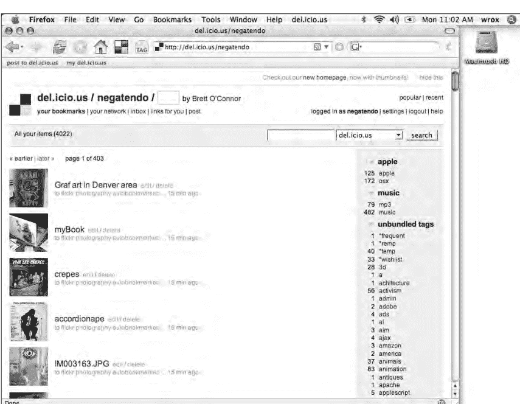
图 11-6

### 工作原理

当你允许 Flickr Autobookmarker 访问你的照片并随后检索 mini-token 代码时，你是在告诉 Flickr，这个应用程序执行其操作是可以接受的，并且你会将此情况告知应用程序。随后，Flickr 会等待应用程序的响应以获取最终的身份验证密钥，从而确认 Flickr 用户希望继续使用该应用程序。你创建的第一个脚本 `flickr_get_token.php` 通过首先将 mini-token 捕获为脚本参数来实现这一点：

```php
//fetch query string from arguments
if (!isset($argv[1]))
```


# 第三部分：混搭与 remix

```php
die("You need to give me your mini token.\n");
else
    $mini_token = $argv[1];
```

然后它通过以下 URL 调用 Flickr API 的 `flickr.auth.getFullToken` 方法：

```php
$get_full_token=
"http://flickr.com/services/rest/?method=flickr.auth.getFullToken&api_key="
.API_KEY."&mini_token=".$mini_token."&api_sig=".$api_sig;

$snoopy->fetch($get_full_token);
```

除了调用 Flickr REST URL 的方法外，还有另外三个参数作为查询字符串发送，在前面的代码中以**粗体**显示。第一个是应用程序的 API 密钥。第二个是用户提供的 mini-token。第三个是应用程序的 API 签名。

对于几乎所有 Flickr API 的调用，都需要 API 签名。（唯一不需要的是那些纯粹与 Flickr 提供的非私人信息交互且不涉及数据操作的调用。）API 签名是一个额外的查询字符串，作为应用程序使用 API 服务的密码。它由多个部分组合成一个字符串，然后转换为 MD5 哈希值。Flickr 在另一端等待你的 API 调用时使用相同的哈希值。如果匹配，API 调用成功；如果不匹配，则调用失败。这就是为什么正确组装 API 签名至关重要的原因。

看一下 `flickr_get_token.php` 中组装 `$api_sig` 值的部分。它是 `SHARED_SECRET` 常量、字符串 "api_key" 后跟 `API_KEY` 常量、字符串 "method" 后跟被调用的方法（即 `flickr.auth.getFullToken`），以及字符串 "mini_token" 后跟作为脚本参数传入的 mini-token 的组合：

```php
$api_sig =
    md5(SHARED_SECRET."api_key".API_KEY."methodflickr.auth.getFullTokenmini_token"
    .$mini_token);
```

所有 API 签名都以类似方式组装，但并非总是包含相同的参数。保持不变的有，按顺序：

1. 共享密钥（shared secret）
2. 你的 API 密钥
3. 文本 "method" 和被调用的方法
4. 任何额外的参数，格式为参数名后跟值（本例中为 "mini_token"），然后是 `$mini_token` 的值

当这些一起进行哈希处理时，就形成了几乎所有 Flickr API 请求所需的 API 签名。它最终使用只有你的应用程序和 Flickr 知道的共享密钥哈希来向 Flickr 识别你的应用程序，以及关于你正在发送的请求的信息。如果你打算推出更强大的基于 Flickr 的混搭应用，最好设计一个函数或其他方法来组装 API 签名字符串，而不必一次又一次地组合字符串的每个小部分。

246

# 第11章：与 Web 服务混搭

归根结底，`flickr_get_token.php` 所做的只是使用用户的 mini-token 生成完整的 API 用户令牌，这是你的软件的其余部分向 Flickr API 发出请求所需的。如果 Flickr 用户未允许或选择撤销你的应用程序访问他们照片的权限，你将无法检索该用户的完整令牌，更不用说代表他们进行任何调用了。这些自动书签脚本很简单，但设计更复杂的混搭应用时，最好考虑处理这些可能的场景。

既然你已经了解了 API 签名是如何形成的，实际的 `flickr.php` 自动书签脚本就很容易理解了。它首先以 `Snoopy.class.php`、你的 del.icio.us 混搭库以及 Flickr API 和用户密钥的常规设置开始。

你只需要为 `flickr.favorites.getList` 方法计算 `$_api_sig`，如下所示：

```php
//calculate $_api_sig for flickr.favorites.getList
$_api_sig =
md5(SHARED_SECRET."api_key"."auth_token".FULL_TOKEN
."methodflickr.favorites.getList");
```

API 签名的字符串模式保持不变，只是增加了一个内容：认证令牌是方法名之前的一个参数。每个经过认证的 Flickr API 调用都将遵循此模式。查询中的任何附加内容仍应出现在方法名之后，就像 `mini_token` 出现在 `flickr_get_token.php` 的认证字符串中一样。

之后，就是从 Flickr API 获取完整的 REST API 调用 URL 的数据，然后将其发布到 del.icio.us。REST 响应格式在 Flickr 的 `www.flickr.com/services/api/response.rest.html` 上有完整文档。

你自己大概可以弄清楚大部分内容是如何组合成 del.icio.us API 调用所需的数据的。这里需要注意的一点是，del.icio.us 书签的 URL 是如何在阴影行中组装的（由于页面限制，此处换行）：

```php
//go through each photo and save it if never saved to del.icio.us before
foreach ($_photos as $photo)
{
    $url =
sprintf("http://www.flickr.com/photos/%s/%s", $photo['attributes']['OWNER'],
    $photo['attributes']['ID']);

    $description = $photo['attributes']['TITLE'];
    $tags = "flickr photography autobookmarked";
    //check to see if the url has already been posted
    do_api_call('/posts/get?/', "&url=".urlencode($url));
    if (!isset($_api_return[0]['children']))
    {
        do_api_call('/posts/add?/', "&url=".urlencode($url)."&description=".
        urlencode($description)."&tags=".urlencode($tags));
        if ($_api_return['status'] == 200)
            echo "Posted: ".$description."\n";
        else
            echo "There was a problem posting ".$description."\n";
    } else {
        echo $url." already posted - skipping\n";
    }
}
```

Flickr 上照片网页的基本链接由基础 URL `www.flickr.com/photos/` 后跟 Flickr 用户 ID（在 REST 响应中显示为 `<Owner>`），然后是照片的唯一 ID（在 REST 响应中显示为 `<Id>`）组成。Flickr URL 方案的具体细节都在 `www.flickr.com/services/api/misc.urls.html` 有文档说明。

这三个自动书签项目让你概览了从 del.icio.us 混搭其他 Web 服务数据时可能涉及的一些挑战。在本章的下一部分，你将从 del.icio.us 获取数据并将其放到其他地方，使用一个在 Amazon S3 存储系统上备份你书签网页的系统。

### Amazon：使用 S3 缓存页面

在你上网浏览的过程中，至少有一次你可能利用了 Google 缓存的某个特定网页版本，该网页自 Google 索引以来已经更改或离线。如果你没有，这绝对是 Google, 一个值得了解的 Google 功能，因为它使你能够访问所需的数据，即使网站主机说它暂时离线或完全消失。

Google 搜索返回的大多数链接旁边或下方都有一个缓存链接，你可以从中访问页面的缓存版本，顶部有一个类似图 11-7 所示的框。

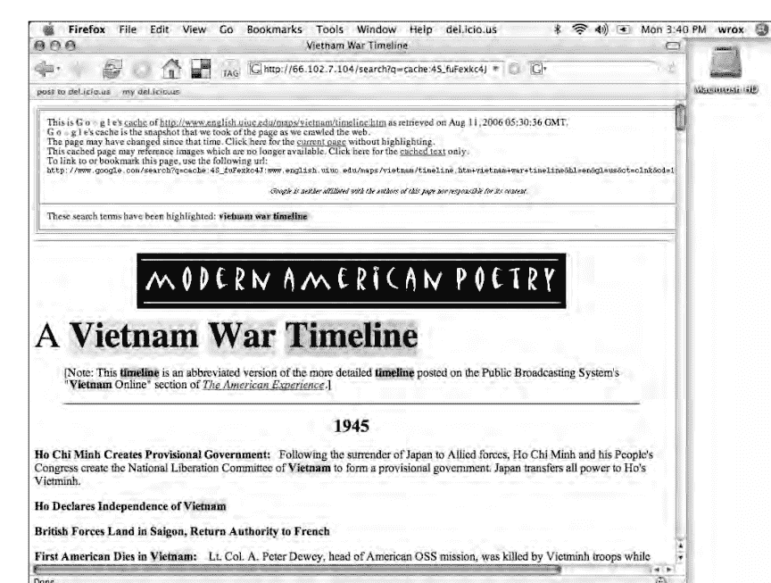

图 11-7

# 第11章：与 Web 服务混搭

因为你的 del.icio.us 书签无疑是指向你通过自己浏览网页而形成的可信赖且重要的信息源的链接，所以拥有一个类似于 Google 的自己的页面缓存系统将会很有用，从中你能够阅读已存储的网页版本和其他文档，即使它只是页面的 HTML 标记或链接的 MP3 或图像内容。你不能只依赖 Google 的缓存，因为它可能不如你的书签那么及时，当然，它不是针对你的收藏进行定制的。理想的系统是一个你可以设计和控制的系统。

推出这样的系统涉及很多技术问题，其中最少的是找到一个地方和方法来存储你的缓存 HTML 所代表的大量数据。有一个 Web 服务为此提供了一个有趣的解决方案，那就是 Amazon 的简单存储服务，也称为 S3。Amazon S3 让你使用熟悉的 Web 传输和 RESTful 方法在 Amazon 自己的服务器上读取、写入和删除数据，而且最重要的是，它价格低廉。在撰写本文时，在 S3 上存储数据的成本为每 GB 数据每月 0.15 美元，数据可以通过公共 URL 在网络上访问（如果你选择公开），并且可以无限扩展。

创建一个使用 Amazon S3 的复杂 del.icio.us 缓存系统超出了本章的范围。但是，你仍然可以推出一个有效的概念验证实现，而且可能比你想的更容易。对于这个项目，你将了解 Amazon S3 及其工作原理，然后创建一个自动化的 del.icio.us 页面缓存脚本和检索系统，这样无论何时你在浏览网页，不仅手边有你的 del.icio.us 书签，而且还能够访问书签页面的内容，即使页面本身已经不存在了。

在开始之前，你需要注册 Amazon Web Services (AWS)，希望你已在第 4 章完成。Amazon 将为你提供两个*访问密钥标识符*：你的访问密钥 ID 和秘密访问密钥。你需要这些来完成这个项目，所以确保手边有它们。你总是可以通过浏览 `http://aws.amazon.com/`、登录并选择 Your Web Services Account 下的 View Access Key Identifiers 来检索它们。

拥有 AWS 账户后，你可以通过浏览 `http://aws.amazon.com/s3` 并点击 Sign up for Web Service 来注册 Amazon S3。你需要拥有 Amazon S3 账户以及 AWS 账户来完成此项目。

Amazon 建议你安装两个 PEAR 模块，以便从 PHP 最好地与 Amazon S3 交互。PEAR 是一个 PHP *应用程序和扩展注册表*。基本上，这意味着它是一个第三方代码库，称为*包*，你可以轻松地将它们插入到你的 PHP 应用程序中，就像你一直在使用 `Snoopy.class.php`、Magpie 等一样。你需要的两个 PEAR 包是 `Crypt_HMAC` 和 `HTTP_Request`。

如果你使用的是 Mac OS X，PEAR 可能已经安装，可以从命令行使用。要安装你需要的两个扩展，只需在 shell 中（通过 Terminal.app）输入以下命令，包将自动下载和安装：

```
sudo pear install Crypt_HMAC
sudo pear install --onlyreqdeps HTTP_Request
```

你的 PEAR 设置可能会将安装的包放在 PHP 不知道的地方，但是，你可能需要为这个项目开发的每个文件包含以下行：

```php
set_include_path(get_include_path() . PATH_SEPARATOR . "/usr/lib/php");
```


## 第三部分：混合与重组 (Mashups and Remixes)

这将把 `/usr/lib/php` 目录添加到 PHP 查找 Pear 扩展的路径列表中。如果您已经安装了 Pear 扩展但它们似乎无法正常工作，请尝试在代码顶部添加一个 `set_include_path()` 调用。

如果您使用的是 Windows，可能需要先安装 Pear。从 `http://pear.php.net/package/PEAR/` 下载安装程序，然后直接在 Windows 命令提示符中使用以下命令安装所需的软件包：

```
pear install Crypt_HMAC
pear install --onlyreqdeps HTTP_Request
```

安装好这两个 Pear 软件包后，就可以开始编写代码了。

> 所有涉及 Amazon S3 的后续脚本都可以在本书的 Wrox 随书网站的 delcache 项目文件夹中找到。

### 尝试一下 - 创建存储桶 (Bucket)

在 Amazon S3 中存储数据之前，您需要创建一个存放数据的空间，称为 *存储桶 (bucket)*。Amazon S3 存储桶就像您计算机上的文件目录或文件夹。它可以命名为几乎任何名称，但仅限于 Web 域名允许出现的字符，因此不能使用空格或任何特殊字符。这是因为您需要能够通过网络引用该存储桶。正如您将看到的，您将能够通过 Web 浏览器直接浏览存储桶中的项目，因此存储桶的名称在 URL 中能够正常工作至关重要。

关于存储桶命名的另一个注意事项是，该名称在 Amazon S3 所有存储桶名称中必须是唯一的，即使是其他 Amazon S3 用户创建的存储桶也是如此。这是因为您的存储桶存在于公共空间中（即使内容是私有的），需要以唯一的方式进行标识。

第一个脚本涉及创建用于存储缓存 Web 页面的 Amazon S3 存储桶，为实际的缓存脚本做好准备，并向您介绍 Amazon S3 REST API。

- 1. 在您的 htdocs 目录中创建一个名为 **delcache** 的新文件夹，然后在其中创建一个名为 **create_s3_bucket.php** 的新命令行 PHP 脚本。将以下完整的 PHP 代码写入其中（将您的 `BUCKET_NAME` 常量设置为您的 del.icio.us 用户名，后跟下划线，然后是字符串 "delcache"；并将 `S3_ACCESS_KEY` 和 `S3_SECRET_KEY` 分别设置为您的 Amazon 访问密钥 ID 和私有密钥 ID）：

```php
<?php
//your bucket name that must be unique throughout ALL s3 users
define('BUCKET_NAME', 'username_delcache');

//access and secret keys for your s3 account
define('S3_ACCESS_KEY', 'accesskey');
define('S3_SECRET_KEY', 'secretkey');

// pear installed goodness
require_once 'Crypt/HMAC.php';
require_once 'HTTP/Request.php';

//other settings
define('S3_URL',"http://s3.amazonaws.com/");
define('ACL_SETTING','public-read'); //this will let you browse to data

//the date and time in rfc 822
$rfc_822_datetime = date("r");

//content type can be empty for creating a bucket
$content_type = ''; //can be empty for creating a bucket but not later

//assemble your s3 signature
$s3_signature = 
    "PUT\n\n".$content_type."\n".$rfc_822_datetime."\nx-amz-acl:"
    .ACL_SETTING."\n/".BUCKET_NAME."/";
$hasher = new Crypt_HMAC(S3_SECRET_KEY, "sha1");
$signature = hex2b64($hasher->hash($s3_signature));

//make the request to create the bucket
$s3req = new HTTP_Request(S3_URL . BUCKET_NAME."/");
$s3req->setMethod('PUT');
$s3req->addHeader("content-type", $content_type);
$s3req->addHeader("Date", $rfc_822_datetime);
$s3req->addHeader("x-amz-acl", ACL_SETTING);
$s3req->addHeader("Authorization", "AWS " . S3_ACCESS_KEY . ":" . $signature);
$s3req->sendRequest();

print $s3req->getResponseCode()."\n";

function hex2b64($str) {
    $raw = '';
    for ($i=0; $i < strlen($str); $i+=2) {
        $raw .= chr(hexdec(substr($str, $i, 2)));
    }
    return base64_encode($raw);
}

?>
```

- 2. 从命令行运行该脚本 (`php -f create_s3_bucket.php`)，如果一切顺利，它应该返回 `200` 响应代码，这意味着创建存储桶的请求成功了。此外，由于该存储桶被设置为公开，您应该能够使用 Web 浏览器访问它。例如，如果您的存储桶名称是 `username_delcache`，那么访问 http://username_delcache.s3.amazonaws.com/ 应该会向您显示一个 XML 响应，描述您在 Amazon S3 上已完全实例化（创建）的存储桶。

XML 响应大概看起来像这样（对于能够内联显示 XML 的浏览器，如 Firefox）：

```xml
<ListBucketResult>
<Name>username_delcache</Name>
<Prefix/>
<Marker/>
<MaxKeys>1000</MaxKeys>
<IsTruncated>false</IsTruncated>
</ListBucketResult>
```

## 第 11 章：使用 Web 服务进行混合开发

### 工作原理

在进行一些初始常量设置后，您的代码首先引入安装的 Pear 软件包，就像正常的的文件包含一样：

```php
// pear installed goodness
require_once 'Crypt/HMAC.php';
require_once 'HTTP/Request.php';
```

接下来的两个常量是为了应对极少数需要更改的情况而存在的，分别是 Amazon REST API URL 和存储桶的隐私设置：

```php
//other settings
define('S3_URL',"http://s3.amazonaws.com/");
define('ACL_SETTING','public-read'); //this will let you browse to data
```

`public-read` 意味着公众能够读取存储桶，但不能添加或更改内容。您也可以将 Amazon S3 存储桶设置为 `public-read-write`，以便其他人也可以写入数据，或者设置为 `private`，这意味着除了您（或正确签名请求的应用程序）之外，任何人都无法访问数据。Amazon S3 文档中还列出了其他几种访问控制设置。

所有发送到 Amazon S3 API 的请求都应包含一个符合 RFC 822 标准格式的日期和时间，因此在这种情况下，当前日期和时间被赋值给 `$rfc_822_datetime`：

```php
//the date and time in rfc 822
$rfc_822_datetime = date("r");

//content type can be empty for creating a bucket
$content_type = ''; //can be empty for creating a bucket but not later
```

此外，您应该为传输的文件定义 `Content-Header`。在创建存储桶的情况下，没有文件传输，因此该变量暂时可以为空。（当您最终开始向 Amazon S3 存储桶中放入数据时，需要设置它。）

接下来，组装 REST 请求的签名。与 Flickr API 签名一样，此签名旨在对您向 Amazon S3 发出的请求进行授权，并将请求的所有信息包含在一个加密字符串中：

```php
//assemble your s3 signature
$s3_signature =
    "PUT\n\n".$content_type."\n".$rfc_822_datetime."\nx-amz-acl:"
    .ACL_SETTING."\n/".BUCKET_NAME."/";
$hasher =& new Crypt_HMAC(S3_SECRET_KEY, "sha1");
$signature = hex2b64($hasher->hash($s3_signature));
```

授权字符串包含以下元素（按前述代码中的顺序排列），每个元素由换行符 (`\n`) 分隔：

- 1. 请求谓词，基本上描述了您希望如何移动数据：在创建存储桶的情况下，这是用于上传、更新或设置数据的 `PUT`。
- 2. 您发送内容的 MD5 哈希值：这是可选的，在创建存储桶时不需要；但是，即使不包含此标头，后续的换行符仍必须出现。
- 3. 请求的内容类型：同样是可选的。
- 4. RFC 822 格式的日期和时间。
- 5. 所有 `x-amz-` 标头：用于在 Amazon S3 中对数据执行特定操作的特殊标头。在本脚本中，标头是 `x-amz-acl`，用于设置存储桶的访问控制权限。
- 6. 您将要访问的资源：在这种情况下，是您的存储桶名称，前后用斜杠 (/) 包围。

然后，使用您的私有访问密钥作为哈希密钥，将这个组装好的字符串计算为 HMAC-SHA1 哈希，并转换为对应的 Base 64 编码。

此授权字符串被包含在请求头中，这与您在向 del.icio.us API 发送请求时在标头中发送 `WWW-Authenticate` 信息的方式非常相似。事实上，您会发现与 Amazon S3 的协作结合了您之前已经实现的多种 API 技术。与 del.icio.us API 一样，您需要包含详细说明 REST 请求各方面的标头信息；而与 Flickr API 一样，您的请求将包含一个特殊的签名，用于向 Amazon 标识您的应用程序。

接下来设置一个新的 `HTTP_Request` 对象。`HTTP_Request` 在许多方面与 Snoopy.class.php 的作用完全相同——它从您的应用程序发起 Web 请求。因此，它非常适合进行 REST 调用。事实上，如果您愿意，可以在之前的许多项目中用它代替 Snoopy。

```php
//make the request to create the bucket
$s3req =& new HTTP_Request(S3_URL . BUCKET_NAME."/");
$s3req->setMethod('PUT');
$s3req->addHeader("content-type", $content_type);
$s3req->addHeader("Date", $rfc_822_datetime);
$s3req->addHeader("x-amz-acl", ACL_SETTING);
$s3req->addHeader("Authorization", "AWS " . S3_ACCESS_KEY . ":" . $signature);
```

`addHeader()` 方法用于将请求方法、`content-type`、`Date` 和 `x-amz-acl` 值添加到请求中，以及一个包含字符串 `"AWS"`、空格、您的 Amazon API 访问密钥、冒号 (`:`) 以及之前编译的最终签名的授权标头。这就是一个完整的 Amazon S3 REST 请求。

最后，请求被发送到 Amazon S3 API，HTTP 响应代码被打印到屏幕上。就像 del.icio.us API 一样，如果响应代码成功 (`200`)，则说明一切顺利。

现在您的 Amazon S3 存储桶已经准备就绪，可以开始将您在 del.icio.us 上书签的 Web 页面的缓存版本填充进去了。

#### 尝试一下：缓存 Web 文档

在本次“尝试一下”中，您将编写一个脚本，该脚本将遍历您的 del.icio.us 书签，并将它们作为文件缓存到新创建的 Amazon S3 存储桶中。您将使用 del.icio.us 的 RSS 馈送作为数据源，这意味着每次运行脚本时，仅最后 30 个项目将被缓存。这


# 第三部分：混搭与重混

这并不意味着从订阅源中移除的项目会从缓存中删除。它们将以归档状态保留在那里，与这些项目的 URL 最后一次从订阅源中读取时的处理状态完全一致。然后，你的脚本会使用 HTTP_Request 连同一些关于该网页的信息一起获取其内容，并将其重新创建为 Amazon S3 上的一个文件。

1.  在 delcache 目录中新建一个名为 `create_s3_cache.php` 的 PHP 文件。将 Magpie RSS 文件和缓存目录放在 delcache 文件夹内或其他方便的位置。

2.  在 create_s3_cache.php 中打开一个 PHP 代码块，并使用与 create_s3_bucket.php 中相同的常量和变量开始（将 `BUCKET_NAME` 设置为你之前创建的存储桶名称，并设置你的 `S3_ACCESS_KEY` 和 `S3_SECRET_KEY`）：

```php
<?php
//existing bucket name

//access and secret keys for your s3 account
define('S3_ACCESS_KEY', 'accesskey');
define('S3_SECRET_KEY', 'secretkey');

// pear installed goodness
require_once 'Crypt/HMAC.php';
require_once 'HTTP/Request.php';

//other s3 settings
define('S3_URL',"http://s3.amazonaws.com/");
define('ACL_SETTING', 'public-read');

//the date and time in rfc 822
$rfc_822_datetime = date("r");
```

3.  创建一个常量，指向你在 del.icio.us 上的 RSS 订阅源链接，并引入和设置 Magpie RSS：

```php
//your del.icio.us RSS feed
define('MY_FEED_URL', 'http://del.icio.us/rss/YOURNAME');

//bring in magpie goodness
require_once('lib/rss_fetch.inc');

//set cache directory
define('MAGPIE_CACHE_DIR', 'cache');
```

4.  添加用于获取和处理 RSS 订阅源的代码：

```php
$rss = fetch_rss(MY_FEED_URL);

//create and/or update the cache for each item
foreach ($rss->items as $item) {
    $file_key = md5($item['link']);

    //get the contents of the file you want to cache
    $req = new HTTP_Request($item['link']);
    $req->sendRequest();
    $response_code = $req->getResponseCode();
    $file_content_type = $req->getResponseHeader('content-type');
    $file_contents = $req->getResponseBody();

    //if there is a response body, create the cache
    if($file_contents != '')
    {
        //assemble your s3 signature
        $s3_signature =
            "PUT\n\n".$content_type."\n".$rfc_822_datetime
            ."\nx-amz-acl:".ACL_SETTING."\n".BUCKET_NAME."/.".$file_key;
        $hasher =& new Crypt_HMAC(S3_SECRET_KEY, "sha1");
        $signature = hex2b64($hasher->hash($s3_signature));

        //make the request to create the file in the bucket
        $s3req =& new HTTP_Request(S3_URL.BUCKET_NAME."/.".$file_key);
        $s3req->setMethod('PUT');
        $s3req->addHeader("content-type", $content_type);
        $s3req->addHeader("Date", $rfc_822_datetime);
        $s3req->addHeader("x-amz-acl", ACL_SETTING);
        $s3req->addHeader("Authorization", "AWS " . S3_ACCESS_KEY . ":" . $signature);
        $s3req->setBody($file_contents);
        $s3req->sendRequest();

        if ($s3req->getResponseCode() == 200) {
            echo "Cache updated for ".$item['link']." (".$file_key.")\n";
        } else {
            echo "Problem updating cache for ".$item['link']." (".$file_key.") - Status was ".$s3req->getResponseCode()."\n";
        }

    } else {
        //handle any snoopy errors by outputting them to the screen
        echo "Problem fetching ".$item['link']." (".$file_key."): ".$req->getResponseCode()."\n";
    }
}
```

5.  添加将请求签名转换为 Base 64 的函数，然后关闭你的 PHP 代码块：

```php
function hex2b64($str) {
    $raw = '';
    for ($i=0; $i < strlen($str); $i+=2) {
        $raw .= chr(hexdec(substr($str, $i, 2)));
    }
    return base64_encode($raw);
}

?>
```

6.  从命令行执行该脚本（`php -f create_s3_cache.php`）。你应该会看到类似这样的输出：

```
Cache updated for http://fusion.gat.com/docview/tar_gzip.html (c0218365200e99c2e72584b47e468378)
Cache updated for http://www.flickr.com/photos/26462343@N00/3815510 (ab9f6a3c78073eb16285c80e2fd59d18)
... the rest of the script's output...
```

注意括号中的字母和数字，例如 `ab9f6a3c78073eb16285c80e2fd59d18`。这是在 Amazon S3 上创建的缓存文件的唯*一*标识*键*。基本上，它就是文件名。由于你创建的每个缓存文件都是公开的，你可以在网页浏览器中浏览该文件并查看页面的缓存版本。例如，如果你将存储桶命名为 `username_delcache`，你可以在 `http://username_delcache.s3.amazonaws.com/ab9f6a3c78073eb16285c80e2fd59d18` 访问该文件。（注意存储桶名称和键名称在 URL 中的位置。）浏览到该地址后，你应该会看到页面的缓存版本，如图 11-8 所示。

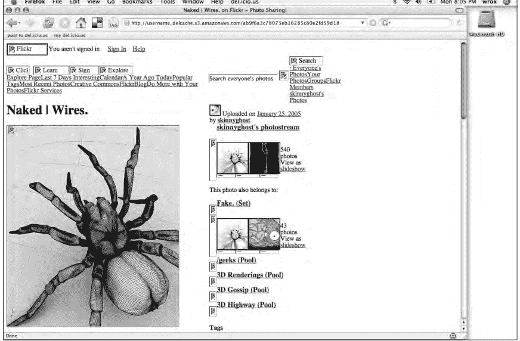

**图 11-8**

与 Google 的缓存系统一样，这个缓存文件只是被收藏页面的原始 HTML 标记，在浏览器中显示。有时结果可能不太美观，但显示的信息可能很有用。例如，如果你使用 Crontab 安排该脚本每晚运行，你将始终拥有一个可扩展的、包含所有 del.icio.us 书签的备份。

# 第 11 章：与 Web 服务进行混搭

### 工作原理

真正开始变得有趣的是 create_s3_cache.php 中处理 Magpie 返回信息的 `foreach` 控制循环内部：

```php
//create and/or update the cache for each item
foreach ($rss->items as $item) {
    ... the processing of RSS feed
}
```

你使用 `file_key` 来标识 Amazon S3 目录中的缓存文件。使用此脚本时，`file_key` 是项目链接的 MD5 哈希值，当然也就是书签的 URL：

```php
$file_key = md5($item['link']);
```

将文件名设为书签 URL 的 MD5 哈希值，可以确保每个被缓存的书签只有一个缓存文件。你可能还记得，del.icio.us 也是以同样的方式组织书签的。

使用 `HTTP_Request` 来获取书签 URL 的完整内容，并将其赋值给 `$file_contents`。文件的 MIME 类型也赋值给 `$file_content_type`：

```php
//get the contents of the file you want to cache
$req = new HTTP_Request($item['link']);
$req->sendRequest();
$response_code = $req->getResponseCode();
$file_content_type = $req->getResponseHeader('content-type');
$file_contents = $req->getResponseBody();
```

跟踪 MIME 类型是个好主意，以防被收藏的书签页面不是 HTML 文档，而是例如 XML 文档或 MP3 音乐文件等其他类型。

如果返回了内容，那么就该将文件保存到 Amazon S3 了。首先，按照 `create_s3_bucket.php` 中的方式组装签名字符串。唯一的区别是，这次 `$content_type` 变量实际上有值了，而且 `$file_key` 被附加到签名中 `BUCKET_NAME` 的末尾：

```php
//assemble your s3 signature
$s3_signature = 
    "PUT\n\n".$content_type."\n".$rfc_822_datetime."\n\x-amz-acl:"
    ."ACL_SETTING.\n\n".BUCKET_NAME."\n".$file_key;
$hasher = new Crypto_HMAC($S3_SECRET_KEY, "sha1");
$signature = hex2b64($hasher->hash($s3_signature));
```

然后向 Amazon S3 API 发出 PUT 请求。这与 `create_s3_bucket.php` 中发出的请求几乎完全相同。最大的区别是通过 `HTTP_Request` 的 `setBody()` 方法在请求中设置了 `$file_contents`。此外，这次请求的 URL 也包含了键名称。你在 Amazon S3 上的请求 URL 始终是文件的完整 API 路径——即使该文件尚不存在：

```php
//make the request to create the file in the bucket
$s3req = new HTTP_Request(S3_URL.BUCKET_NAME."/*".$file_key);
$s3req->setMethod('PUT');
$s3req->addHeader("content-type", $content_type);
$s3req->addHeader("Date", $rfc_822_datetime);
$s3req->addHeader("x-amz-acl", ACL_SETTING);
$s3req->addHeader("Authorization", "AWS " . S3_ACCESS_KEY . ":" . $signature);
$s3req->setBody($file_contents);
$s3req->sendRequest();
```

脚本的其余部分会捕获任何错误并输出所需的消息。

下一步是安排此脚本每隔一段时间自动执行一次，以确保你添加的新书签被录入缓存。每天一次就足够了，因此使用如下 Crontab 计划（每天午夜）会效果很好：

```
0 0 * * 1 php -f /htdocs/delcache/create_s3_cache.php
```

脚本已创建并安排好之后，只剩下设计一种方便的方式来在需要时访问缓存页面。作为本章的最后一个项目，你终于要告别命令行了，将要创建一个网页和书签小工具的组合，用于获取和显示缓存的书签数据。

#### 动手试试：重定向到 S3 缓存

由于缓存数据可以通过公共 URL 访问，你真正需要的只是一种方便的方式，在你之前收藏过的页面无法访问或无响应时访问该 URL。你已经体验过 JavaScript 书签小工具在发布链接到 del.icio.us 时的便利性。制作一个能将你重定向到正在尝试浏览的页面的缓存版本的书签小工具，是解决这一问题的好方法。

1.  在 delcache 目录中创建一个名为 **get_s3_cache.php** 的脚本，并为其输入完整的 PHP 和 HTML 标记（将 `BUCKET_URL` 设置为适当的 URL，将斜体文字更改为你命名的存储桶名称）：

```php
<?php
//amazon s3 bucket rest url
define('BUCKET_URL','http://**username_delcache**.s3.amazonaws.com/');

//redirect to the cache if url is specified
if (isset($_GET['url'])) {
	$file_key = md5($_GET['url']);
	Header("Location: ".BUCKET_URL.$file_key);
} else {
	?>
	<!DOCTYPE html PUBLIC "-//W3C//DTD XHTML 1.0 Transitional//EN"
	"http://www.w3.org/TR/xhtml1/DTD/xhtml1-transitional.dtd">

	<html xmlns="http://www.w3.org/1999/xhtml" xml:lang="en" lang="en">
	<head>
	<meta http-equiv="Content-Type" content="text/html; charset=utf-8"/>
	<title>del.icio.us cache bookmarklet</title>
```


## 第十一章：利用网络服务进行混合开发

```
</head>

<body>
<p>安装此书签小工具，以获取您正在浏览网页的缓存。</p>

<p><a href="javascript:location.href='
<?php echo get_this_url() ?>?url='+encodeURIComponent(location.href)">
获取此页面的 del.icio.us 缓存</a></p>
</body>
</html>

<?php
}

function get_this_url() {
return "http://".$_SERVER['SERVER_NAME'].":".
$_SERVER["SERVER_PORT"].$_SERVER['REQUEST_URI'];
}

?>
```

+   2. 浏览至 get_s3_cache.php，你应该会看到类似图 11-9 所示的页面。

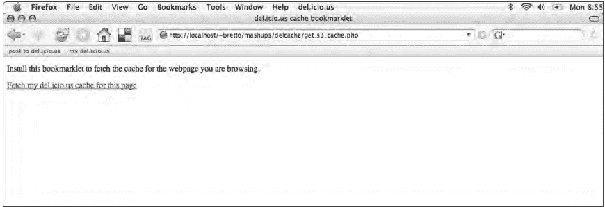

图 11-9

+   3. 将 "Fetch my del.icio.us cache for this page"（获取此页面的 del.icio.us 缓存）链接拖放到浏览器的工具栏中，以安装书签小工具。要测试它，请浏览到你知道有缓存的某个已收藏页面，然后点击该书签小工具。你应该会立即被重定向到你在 Amazon S3 上该页面的缓存。

## 第三部分：混搭与再创作

### 工作原理

get_s3_cache.php 首先检查查询字符串中是否存在 URL。如果 URL 存在，程序会将该 URL 转换为 MD5 哈希值，该哈希值确定文件在 Amazon S3 上的键名（如果文件存在），然后将你重定向到 BUCKET_URL 处的文件，该 URL 当然是你在 Amazon 上的缓存文件存储桶：

```
//amazon s3 bucket rest url
define('BUCKET_URL','http://negatendo_delcache.s3.amazonaws.com/');

//redirect to the cache if url is specified
if (isset($_GET['url'])) {
    $file_key = md5($_GET['url']);
    Header("Location: ".BUCKET_URL.$file_key);
} else {
    ... the rest of the code ...
}
```

正是书签小工具本身将你当前浏览的任何 URL 作为查询字符串发送到此页面，如果页面未收到查询字符串，它会方便地为你提供要安装的书签小工具链接：

```
<a href="javascript:location.href='<?php echo get_this_url()
?>?url='+encodeURIComponent(location.href)">Fetch my del.icio.us cache for this page</a>
```

书签小工具的代码完全由将当前页面更改为 get_s3_cache.php 页面的 URL（通过你在代码中添加的 get_this_url() 函数获取）加上 `url=` 以及你当前浏览页面的编码 URL 组成。

整个页面是一个完整的书签缓存重定向包。安排好 get_s3_cache.php，安装此书签小工具，然后在收藏的资源失效时使用它——你将永远不会失去你喜爱的网络内容。

### 总结

尽管本章中的项目相当简单，但它们都是完全合格的混搭应用，将其他网络服务与 del.icio.us 混合搭配以产生新功能。你在本章中处理的所有 API 可能看起来各不相同，但正是它们的共同特性有助于确保这些项目的实现，包括它们提供数据的方式以及数据易于被 PHP 处理的方式，同时也便于在 Web 上传输。

本书的最后一部分涉及创建一个涉及多个网络服务和覆盖网络各个方面的技术的混搭项目。

### 练习

+   1. 你制作的第一个自动收藏脚本，即自动将 HotJobs 职位列表发布到你的 del.icio.us 的脚本，如果将职位搜索属性作为命令行参数提供，而不是硬编码在脚本代码中，可能会运行得更好。你将如何重新编程该脚本，以便能够通过命令行设置搜索国家/地区、州、城市、类别和关键字？

+   2. 可以在向 `flickr.favorites.getList` 发出的请求中包含一个额外的参数，该参数将返回每张照片的上传日期。在 flickr.php 自动收藏器脚本中，为 `$api_sig` 和要提供给 Snoopy 的 REST URL 赋值的参数会是什么样子？（你可能需要查阅 Flickr API 文档中关于 `flickr.favorite.getList` 的帮助。）

+   3. 除了书签小工具，你还可以使用哪种其他技术来指向你 Amazon S3 上的书签缓存文件？也许是在 del.icio.us 内部直接提供缓存 URL 链接的那种？

## 第四部分

## 混搭应用：一个研究项目中心

第十二章：使用自定义 Firefox 插件收集参考资料

第十三章：聚合、组织和展示你的研究

第十四章：引入其他网络服务

第十五章：管理传入链接

## 第十二章

## 使用自定义 Firefox 插件收集参考资料

在本章以及本书剩余的大部分内容中，你将运用迄今为止尝试过的许多想法来构建一个在线工具，用于收集、聚合、组织并有效利用组织一次假设的摩托车集会所涉及的网络资源。del.icio.us 将作为此工具的数据库，其他网络服务将扩展你和其他集会协调者保存的书签，以提供有关资源的更多信息。

这些假设的网络资源可以包括为计划摩托车集会这类活动而需要收集和组织的无数事物，例如供应商网站、集会参与者的餐厅和酒店、服务和赞助商等等。尽管你将为假设的摩托车集会开发此工具，但你可以轻松地将此项目及其运作方式应用于任何需要一群人大量收集网络参考资料的情况，包括科学和研究项目、学校项目等等。

你需要做的第一件事是设计一种让你和你的协作者能够轻松且安全地将网络参考资料保存到你的 del.icio.us 账户的方法。为此，你需要确保保存到你的 del.icio.us 账户的所有内容都带有一个默认标识符进行标记，以使其与其他书签区分开来，作为摩托车集会项目的参考资料。此外，你需要标准化你和你的协作者分配给书签的标签，以便书签紧扣当前主题。你可能不想使用传统的保存书签到 del.icio.us 的方法，例如 del.icio.us 发布书签小工具或 del.icio.us Firefox 扩展，因为你不想将你的 del.icio.us 用户名和密码提供给其他集会协作者。

Firefox 扩展最棒的特性之一是它允许你通过一个弹出窗口将书签保存到 del.icio.us，该窗口可以从 Firefox 菜单系统以及出现在 Firefox 工具栏中的标签按钮中调用。得益于这个发布弹出窗口，你永远不必离开你当前浏览的网站。你所要做的就是输入有关书签的其他信息并点击保存，网站就会被保存到 del.icio.us。图 12-1 显示了 del.icio.us Firefox 扩展的发布弹出窗口。

# 第四部分：混搭应用：一个研究项目中心

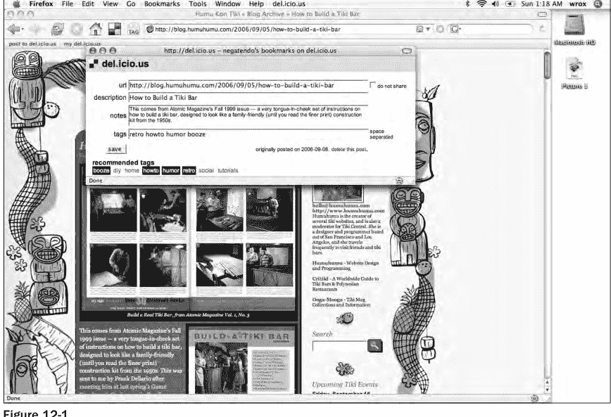

图 12-1

在本章中，你将创建自己的 Firefox 扩展，类似于 del.icio.us Firefox 扩展，你将把它分发给集会协调者，以便他们可以使用它来收集参考资料并将其保存到 del.icio.us。协调者将能够点击 Firefox 工具栏中的图标，或者从 Firefox 工具菜单中选择一个项目，然后会出现一个类似于 del.icio.us Firefox 扩展的弹出界面。这个弹出界面将允许他们保存书签及其相关详细信息，以及分配多个相关标签中的一个到你的 del.icio.us 账户。此扩展将允许他们无需输入任何 del.icio.us 账户信息即可完成此操作，并将使用预先指定和强制执行的默认标签自动在 del.icio.us 上组织书签。

构建 Firefox 扩展可能是一个相当复杂的过程。本章将是 Firefox 扩展开发的速成课程，只会轻触一些相关概念。如果你有兴趣进一步了解 Firefox 和其他 Mozilla 项目的扩展，可以查阅 Mozilla 开发者中心的扩展文档 `http://developer.mozilla.org/en/docs/Extensions`。

你可能还想查看许多关于编写 Firefox 扩展和 *XUL*（XML 格式的用户界面语言，扩展用它来构建界面元素）的书籍之一。除了 XUL，你会发现大部分 Mozilla 扩展架构都是由熟悉的 JavaScript 和 CSS 驱动的，这使得它特别适合 Web 开发人员采用。


## 第12章：使用自定义火狐插件收集参考资料

### 启动火狐扩展开发

在开始编写火狐扩展之前，以有利于扩展开发的方式配置你的火狐浏览器会有所帮助。进行这些设置将大大简化你所开发扩展的开发、测试和调试过程。所有这些设置都可以通过编辑火狐中隐藏的首选项来完成。

为此，请在火狐中浏览至 `about:config` 页面。不要包含 `http://` 或其他常见的网址组成部分。这是火狐内置的一个特殊网页，你可以在此进行一些在常规首选项对话框中无法进行的更改。

当你访问 `about:config` 时，你应该会看到类似图12-2的内容。

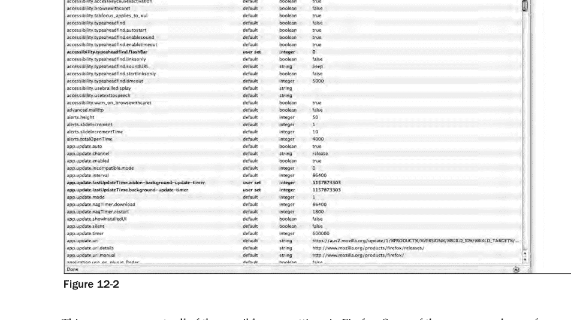

图12-2

此屏幕代表火狐中所有可能的用户设置。其中一些你可以从火狐用户界面内更改，但另一些只能在此处（或直接编辑火狐配置文件）更改。

对这些设置进行的首要且最重要的更改涉及 `javascript.options.showInConsole` 首选项。启用此选项后，`chrome` 文件中的错误将被记录到火狐内置的 JavaScript 控制台。Chrome 是指扩展的 XUL 和脚本内容——本质上，是你的扩展的核心。默认情况下，chrome 中的错误不会显示，因此你可以看到，如果你打算开发扩展，启用这种调试方式是多么重要。

# 第四部分：混搭应用：一个研究项目中心

为此，请在过滤器字段中输入 `javascript.options.showInConsole` 来搜索此设置。当它出现时，双击它。它应该会变为粗体，其值应设置为 true，如图12-2所示。现在，chrome 错误消息将被发送到 JavaScript 控制台。

此外，找到 `nglayout.debug.disable_xul_cache` 和 `javascript.options.strict` 设置，并将它们设置为 `true`。前者将允许你在开发扩展时看到更改，而无需重新加载火狐；后者将在 JavaScript 控制台中打印严格警告。`javascript.options.strict` 可能会在你浏览网页时，导致大量额外信息被打印到 JavaScript 控制台。如果你是一名网页开发者，当不开发扩展时，你可能希望将其值改回 `false`，以避免被所有错误消息所困扰。

> 你也可以通过直接编辑 user.js 文件来调整火狐首选项。user.js 是一个存储在你电脑火狐配置文件中的首选项文件，其中包含与你的火狐设置相关的所有特定选项的完整列表。你只需使用文本编辑器编辑该文件即可更改这些选项。要了解更多关于编辑 user.js 的信息，请查看 www.mozilla.org/support/firefox/edit。

配置这些火狐设置是你为进行火狐扩展开发所必须完成的最低要求任务之一。Mozilla 开发者还建议进行一些其他更改以使开发更容易，你可以在 `http://kb.mozillazine.org/Setting_up_extension_development_environment` 阅读相关内容。如果你认真对待扩展开发，你肯定想看看 *Extension Developer's Extension*，它为火狐带来了大量非常有用的开发工具。

配置好开发环境后，你需要为你即将开发的扩展创建文件结构。扩展具有非常严格的文件结构，并且必须以一种非常特殊的方式*打包*才能正常工作。当你点击链接安装扩展时（例如你安装 Greasemonkey 扩展时），这个包（通常称为 XPI 文件）会被解压并复制到你火狐安装目录的 *profile* 中，该目录包含代表你在火狐中的用户设置和存储数据的文件和子目录。

你将在接下来的“动手试试”部分中使用一个在线工具来自动生成此文件结构的骨架版本及其部分文件。你还将以一种适合扩展测试和开发的动态方式安装扩展。请记住，为了部署它，你将不得不以特定的方式打包扩展。此过程将根据你所使用的计算机平台而有所不同。

然而，在你达到那个阶段之前，是时候组装并安装一个适用于开发目的的精简版扩展，并实际开发它了。

#### 动手试试：构建并安装一个基本扩展

之前提到的 *Extension Developer Extension* 的开发者 Ted Mielczarek 编写了一个 Extension Wizard 网页界面，它可以生成一个与你的 Rally Poster 扩展所需的文件结构类似的骨架扩展文件结构。

1.  浏览至 `http://ted.mielczarek.org/code/mozilla/extensionwiz/`。在 Your Name 字段中输入你的名字，在 **Extension Name** 字段中输入 **Rally Poster**。然后，表单的某些部分会自动填充为图12-3所示的信息。如果没有，请参考该图自己填写。你对表单唯一需要做的其他更改是勾选 Create Toolbar Button 框。在 Target Applications 部分，确保火狐框被选中，并且 Minimum Version 范围设置为 `1.5`，Maximum Version 设置为 `1.5.0*`。

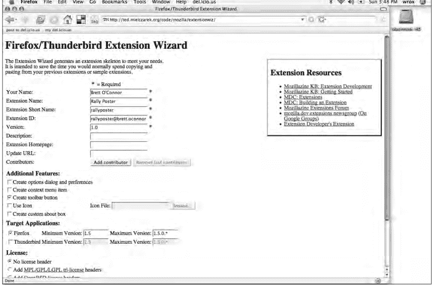

图12-3

2.  在创建扩展之前，请记下 Extension ID 的值。你稍后需要它来安装扩展以进行开发和测试。然后，向下滚动，直到你看到页面底部附近的 Create Extension 按钮。点击该按钮，你的浏览器将下载一个包含扩展骨架的 ZIP 归档文件。

3.  在你的 htdocs 区域创建一个名为 **rally2007** 的目录，该目录将保存此扩展以及你将为这个假想的摩托车拉力赛项目组织工具编写的所有其他代码，然后将你刚刚下载的 ZIP 文件（可能名为 rallyposter.zip）的内容解压到此目录中。

4.  你想以一种专为扩展开发设计的特殊方式安装扩展，这种方式将使你能够更改提取的 rallyposter 目录内的代码，而无需每次都重新安装扩展。为此，请在编辑器中创建一个新的文本文件，并将其内容设置为解压后的 rallyposter 目录的完整路径。如果你使用 Windows，路径将类似于 C:\htdocs\rally2007\rallyposter；如果你使用 Mac OS X，路径可能类似于 /Library/WebServer/Documents/rally2007/rallyposter。

5.  将此文件保存到你火狐配置文件的 extensions 文件夹中，文件名与你之前从 Firefox/Thunderbird Extension Wizard 记下的 Extension ID 相同（应该类似于 rallyposter@brett.oconnor）。如果你使用 Windows，包含文件名的完整路径将类似于：

```
C:\Documents and Settings\Username\Application Data\Mozilla\Firefox\
Profiles\xxxxxxxx.default\extensions\
```

如果你使用 Mac OS X，则将文件保存在此处：

```
/Users/Username/Library/Application Support/Firefox/Profiles/xxxxxxxx.default/extensions/
```

在这两种情况下，`Username` 将是你系统上的用户名，而 `xxxxxxxx.default` 文件夹可能是代表你的火狐配置文件 ID 的字母和数字的某种组合（它不一定是 `xxxxxxxx`）。

6.  重启火狐。然后选择火狐“工具”菜单下的“扩展”以查看已安装扩展的列表。Rally Poster 扩展应包含在已安装扩展的列表中，如图12-4所示。

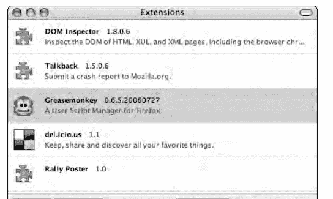

**图12-4**

这个特定安装的 Rally Poster 与你 htdocs 中的 rally2007 目录里的 rallyposter 目录相关联。这样，你对扩展代码所做的更改将反映在火狐中。

此外，你会发现火狐的用户界面有一些更改（尽管它们可能不会立即显现）。其中第一个是“工具”菜单下出现了一个新的 Your Localized Menu item 选项，如图12-5所示。

如果你进入 视图 → 工具栏 → 自定义，你会看到一个新的工具栏按钮已添加到火狐中，名为 Your Toolbar Button，如图12-6所示。通过拖放此按钮到你的火狐工具栏，你可以将其添加到现有的工具栏按钮中。

如果你在将 Your Toolbar Button 添加到工具栏后点击它，或者如果你从“工具”菜单中选择 Your Localized Menu item，你应该会看到一个 Hello World 提示，如图12-7所示。


## 第 12 章：使用自定义 Firefox 插件收集参考资料

图 12-5
图 12-6

## 第 IV 部分：Mashups 应用：研究项目中心

在接下来的部分中，你将修改这个扩展，使工具栏按钮或菜单项能够启动一个界面，获取当前活动网页的标题和 URL，并将它们放入一个弹出界面中，允许集会协调员将该页面的书签发布到你的 del.icio.us 账户。不过现在，先来看看这个扩展在目前状态下是如何工作的。

### 工作原理

了解这个扩展内部机制的最佳方法是查看扩展的文件结构，并检查其中每个文件的作用。请查看 `rally2007` 文件夹中 `rallyposter` 目录的内容。

首先，有两个用于 UNIX 系统的 *shell 脚本*，其中包含打包扩展所需的代码：`build.sh` 和 `config_build.sh`。这些脚本不会影响扩展目前的运行方式，但当你想要完整构建扩展以便部署时（至少在基于 UNIX 的系统上——不过别担心，在 Windows 上也有正确打包扩展的方法），它们将会非常有用。

你还会看到一个名为 `install.rdf` 的文件。这个文件被称为扩展的 *安装清单 (install manifest)*。如果你在编辑器中打开此文件，你会发现它是一个 XML 文件，包含你之前在 Firefox/Thunderbird 扩展向导中提供的大部分信息。此文件用于向 Firefox 标识你的扩展及其属性。唯一看起来不寻常的行是以下代码中阴影显示的部分：

```xml
<?xml version="1.0" encoding="UTF-8"?>
<RDF xmlns="http://www.w3.org/1999/02/22-rdf-syntax-ns#"
     xmlns:em="http://www.mozilla.org/2004/em-rdf#">
  <Description about="urn:mozilla:install-manifest">
    <em:id>rallyposter@brett.oconnor</em:id>
    <em:name>Rally Poster</em:name>
    <em:version>1.0</em:version>
    <em:creator>Brett O'Connor</em:creator>
    <em:targetApplication>
      <Description>
        <em:id>{ec8030f7-c20a-464f-9b0e-13a3a9e97384}</em:id> <!-- firefox -->
        <em:minVersion>1.5</em:minVersion>
        <em:maxVersion>1.5.0.*</em:maxVersion>
      </Description>
    </em:targetApplication>
  </Description>
</RDF>
```

这个字符串是 *GUID*（全局唯一标识符），它将 Firefox 表示为该扩展的目标应用程序。如果你为其他 Mozilla 软件开发此扩展，那么这些应用程序的 GUID 及其相应的支持版本信息将出现在这里。

安装清单能够保存更多关于扩展的有用信息，包括对其功能的详细描述、自动下载扩展更新的信息、创建者和贡献者的完整列表等等。如果你感兴趣，可以在 http://developer.mozilla.org/en/docs/install.rdf 阅读关于安装清单中可能包含的所有内容。

在 `rallypost` 扩展的根目录下，另一个需要注意的重要文件是 `chrome.manifest` 文件。这是 chrome 注册文件，它将 *chrome* 包名映射到已安装扩展中包的具体位置。基本上，chrome 注册表向 Firefox 展示了什么东西在什么位置，以及应该如何将它们组合在一起。

“Chrome”是一个你在处理扩展时会经常听到的词。它是 Mozilla 扩展或应用程序中各种用户界面和脚本实体的统称。在一个 chrome 包中，你通常会发现以下几组元素，它们被称为 *chrome 提供者 (chrome providers)*：

- **content**：通常由构成扩展用户界面和功能的 XUL 和 JavaScript 代码组成。
- **locale**：持有包含本地化措辞和其他内容的文件，旨在使扩展能够跨语言和区域移植。
- **skin**：持有扩展的外观元素，通常由 CSS 文件和图像组成。

如果你查看 `rallyposter` 的 `chrome.manifest` 文件内容，你会看到这三个 chrome 提供者都被提及，同时伴随着 *packagename*（扩展的简写名称）以及 `rallyposter` 内部一些相应的本地目录：

```
content    rallyposter   content/
locale     rallyposter   en-US   locale/en-US/
```

```
skin    rallyposter    classic/1.0    skin/
overlay    chrome://browser/content/browser.xul
chrome://rallyposter/content/firefoxOverlay.xul
style    chrome://global/content/customizeToolbar.xul
chrome://rallyposter/skin/overlay.css
```

对于 `locale` 和 `skin` chrome 提供者，还有一个额外的元素用于指定受影响的语言区域或皮肤。如果你打算为扩展提供额外的本地化支持，或者针对不同皮肤包含不同的外观元素（你知道你可以为 Firefox 换肤吗？），那么你可以在 `chrome.manifest` 中通过增加行来指向它们。

在查看与每个 chrome 提供者对应的目录内容之前，请注意 chrome 注册表中的最后两行：

```
content    rallyposter    content/
locale    rallyposter    en-US    locale/en-US/
skin    rallyposter    classic/1.0    skin/
overlay    chrome://browser/content/browser.xul
chrome://rallyposter/content/firefoxOverlay.xul
style    chrome://global/content/customizeToolbar.xul
chrome://rallyposter/skin/overlay.css
```

`overlay` 行表明，浏览器的常规 chrome (`chrome://browser/content/browser.xul`) 应该与 `rallyposter` 的 `firefoxOverlay.xul` 的 XUL 结合起来。`style` 行同样表明，浏览器的常规工具栏 XUL (`chrome://global/content/customizeToolbar.xul`) 应该与 `rallyposter` 的 `skin/overlay.css` 文件中的 CSS 结合。与 chrome 提供者一样，你可以包含多个 `overlay` 和 `style` 叠加层。

接下来，查看 content 目录下的 `firefoxOverlay.xul` 文件。该文件通过 chrome 注册表与 Firefox 浏览器的主用户界面结合。当这种情况发生时（通常是在 chrome 重新加载时，例如重启浏览器），此处定义的界面元素将被引入。

如你所见，XUL 就是老牌的 XML，如果你仔细研究，可能会看到一些你已经熟悉的元素。例如，请注意对 skin 目录中 `overlay.css` 文件以及 content 目录中 `overlay.js` 文件的引用：

```xml
<?xml version="1.0" encoding="UTF-8"?>
<?xml-stylesheet href="chrome://rallyposter/skin/overlay.css" type="text/css"?>
<!DOCTYPE overlay SYSTEM "chrome://rallyposter/locale/rallyposter.dtd">
<overlay id="rallyposter-overlay"
        xmlns="http://www.mozilla.org/keymaster/gatekeeper/there.is.only.xul">
  <script src="overlay.js"/>
  <stringbundleset id="stringbundleset">
    <stringbundle id="rallyposter-strings"
    src="chrome://rallyposter/locale/rallyposter.properties"/>
  </stringbundleset>

  <menupopup id="menu_ToolsPopup">
    <menuitem id="rallyposter-hello" label="&rallyposter.label;"
              oncommand="rallyposter.onMenuItemCommand(event);"/>
  </menupopup>
  <toolbarpalette id="BrowserToolbarPalette">
```

```xml
<toolbarbutton id="rallyposter-toolbar-button"
    label="&rallyposterToolbar.label;"
    tooltiptext="&rallyposterToolbar.tooltip;"
    oncommand="rallyposter.onToolbarButtonCommand()"
    class="toolbarbutton-1 chromeclass-toolbar-additional"/>
  </toolbarpalette>
</overlay>
```

`firefoxOverlay.xul` 不需要指定每个文件的完整路径，而是使用一种类似于 URL 的引用，称为 chrome URL，例如 `chrome://rallyposter/skin/overlay.css`。chrome manifest 已经指定了 `rallyposter` 包的内容，因此如果你想引用该包内部的任何内容，只需使用 `chrome://rallyposter/` URL 即可。

接下来，chrome URL 被用于一个名为 `<stringbundle>` 的元素中：

```xml
<?xml version="1.0" encoding="UTF-8"?>
<?xml-stylesheet href="chrome://rallyposter/skin/overlay.css" type="text/css"?>
<!DOCTYPE overlay SYSTEM "chrome://rallyposter/locale/rallyposter.dtd">
<overlay id="rallyposter-overlay"
    xmlns="http://www.mozilla.org/keymaster/gatekeeper/there.is.only.xul">
    <script src="overlay.js"/>
    <stringbundleset id="stringbundleset">
        <stringbundle id="rallyposter-strings"
            src="chrome://rallyposter/locale/rallyposter.properties"/>
    </stringbundleset>

    <menupopup id="menu_ToolsPopup">
        <menuitem id="rallyposter-hello" label="&rallyposter.label;"
            oncommand="rallyposter.onMenuItemCommand(event);"/>
    </menupopup>
    <toolbarpalette id="BrowserToolbarPalette">
        <toolbarbutton id="rallyposter-toolbar-button"
            label="&rallyposterToolbar.label;"
            tooltiptext="&rallyposterToolbar.tooltip;"
            oncommand="rallyposter.onToolbarButtonCommand()"
            class="toolbarbutton-1 chromeclass-toolbar-additional"/>
    </toolbarpalette>
</overlay>
```

`<stringbundle>` 是一个 XUL 元素，它引用属性文件中本地化字符串的列表。当扩展加载时，它会自动将浏览器的语言与应该加载的哪种语言的属性文件相关联。因此，虽然 locale 目录中 `rallyposter.properties` 文件的 chrome URL（出现在 `<stringbundle>` 的 `src` 属性中）在技术上应该是 `chrome://rallyposter/locale/en-US/rallyposter.properties`，但 `en-US` 部分（即特定本地化的语言代码）是由浏览器和扩展自动确定并处理的。

如果你在编辑器中查看 `rallyposter.properties` 文件，你会看到一组代表扩展中使用的各种字符串的键值对：

```
helloMessage=Hello World!
helloMessageTitle=Hello
prefMessage=Int Pref Value: %d
```


 ## 第四部分：Mashups 实践：研究项目中心

这些字符串以 JavaScript 对象的形式加载，并在 `overlay.js` 代码中使用，包括显示粗体显示的 Hello World! 警告框的部分：

```
var rallyposter = {
  onLoad: function() {
    // initialization code
    this.initialized = true;
    this.strings = document.getElementById("rallyposter-strings");
  },
  onMenuItemCommand: function(e) {
    var promptService = Components.classes["@mozilla.org/embedcomp/prompt-service;1"]
      .getService(Components.interfaces.nsIPromptService);
    promptService.alert(window, this.strings.getString("helloMessageTitle"),
                        this.strings.getString("helloMessage"));
  },
  onToolbarButtonCommand: function(e) {
    // just reuse the function above.  you can change this, obviously!
    rallyposter.onMenuItemCommand(e);
  }

};
window.addEventListener("load", function(e) { rallyposter.onLoad(e); }, false);
```

`onMenuItemCommand()` 和 `onToolbarButtonCommand()` 函数调用警告框，`onToolbarButtonCommand()` 简单地调用 `onMenuItemCommand()`。

实际更改 Firefox 用户界面的 XUL 出现在 firefoxOverlay.xul 文件的末尾：

```
<?xml version="1.0" encoding="UTF-8"?>
<?xml-stylesheet href="chrome://rallyposter/skin/overlay.css" type="text/css"?>
<!DOCTYPE overlay SYSTEM "chrome://rallyposter/locale/rallyposter.dtd">
<overlay id="rallyposter-overlay"
         xmlns="http://www.mozilla.org/keymaster/gatekeeper/there.is.only.xul">
  <script src="overlay.js"/>
  <stringbundleset id="stringbundleset">
    <stringbundle id="rallyposter-strings"
      src="chrome://rallyposter/locale/rallyposter.properties"/>
  </stringbundleset>

  <menupopup id="menu_ToolsPopup">
    <menuitem id="rallyposter-hello" label="&rallyposter.label;"
              oncommand="rallyposter.onMenuItemCommand(event);"/>
  </menupopup>
  <toolbarpalette id="BrowserToolbarPalette">
    <toolbarbutton id="rallyposter-toolbar-button"
      label="&rallyposterToolbar.label;"
      tooltiptext="&rallyposterToolbar.tooltip;"
      oncommand="rallyposter.onToolbarButtonCommand()"
      class="toolbarbutton-1 chromeclass-toolbar-additional"/>
  </toolbarpalette>
</overlay>
```

## 第 12 章：使用自定义 Firefox 插件收集参考文献

`<menupopup>` 和 `<toolbarpalette>` 元素分别代表 Firefox 菜单和工具栏。粗体显示的 `id` 属性实际上是特殊的 id，它们是 artl，警告框随之出现。

在 firefoxOverlay.xul 中还有另一处值得注意的地方，即粗体所示的 `label` 和 `tooltiptext` 属性使用特殊变量设置的方式：

```
<menupopup id="menu_ToolsPopup">
    <menuitem id="rallyposter-hello" label="&rallyposter.label;"
              oncommand="rallyposter.onMenuItemCommand(event);"/>
</menupopup>
<toolbarpalette id="BrowserToolbarPalette">
<toolbarbutton id="rallyposter-toolbar-button"
   label="&rallyposterToolbar.label;"
   tooltiptext="&rallyposterToolbar.tooltip;"
   oncommand="rallyposter.onToolbarButtonCommand()"
   class="toolbarbutton-1 chromeclass-toolbar-additional"/>
</toolbarpalette>
```

这些变量对应于另一个名为 rallyposter.dtd 的本地化文件。这是一个*文档类型定义*（DTD）文件，为 XUL 标记定义本地化字符串。要直接向 XUL 添加本地化字符串，请向此文件添加条目。

> 一个普通的 Firefox 扩展很大一部分由为不同语言和区域本地化扩展所需的文件和架构组成。从 Rally Poster 扩展的角度来看，这似乎是很多不必要的工作，但如果你要继续编写其他 Firefox 扩展并发布给公众，提前规划并充分利用扩展本地化将是明智之举。即使你不会多种语言，提前规划架构以处理软件翻译对于扩展开发（或一般软件开发）来说也是好主意。得益于现代操作系统，计算机软件几乎即刻全球化。如果你现在不进行本地化，或者至少计划进行本地化，最终可能需要做大量额外工作，或者向本地化公司支付数千美元的重新开发费用。如果要做严肃的软件，始终要计划本地化。

skin 目录中的 overlay.css 文件包含用于在 chrome 中定位工具栏按钮等元素的标准 CSS 标记。工具栏按钮的图形也保存在 skin 目录中。

defaults 目录包含存储扩展偏好设置所需的代码和内容。你不会在此扩展中使用任何偏好设置，但如果稍后添加或在自己的 Firefox 扩展中使用，这就是你要操作的地方。

关于 Mozilla 扩展架构的复杂性和功能，整本书都可能被（并且已经）写出来。不必担心立即理解所有内容。重要的是你知道扩展的组成部分，以便在本章下一节中，你可以修改 JavaScript 和 XUL 以适应 Rally Poster 扩展的需求。

### 创建 Rally Poster 用户界面

接下来，你需要创建 Rally Poster 扩展用户保存书签到 del.icio.us 界面的用户界面。该界面应包含通常的 del.icio.us 书签字段，例如输入书签 URL 的位置、标题和扩展描述，并确保仅使用适合项目的标签。最后，该界面应能抓取浏览器当前所在页面的标题和 URL。

完全可以在 XUL 和 JavaScript 中编写这样的界面，而且由于它能与 Firefox 的外观和感觉完全匹配的 mashups 完全一致，看起来可能相当不错。但这是一项很大的工作，因此你要采取 del.icio.us 自己扩展所使用的相同捷径，即实际将发布界面创建为基于 Web 的界面。（在 del.icio.us Firefox 扩展中按下 Tag 按钮时出现的弹出窗口，实际上是在弹出窗口中调用的标准 del.icio.us 发布界面的精简版本。）

设计自己的界面使你能够对其进行更改（或在摩托车拉力赛结束后完全禁用它），而无需推出全新的扩展。此外，虽然 XUL 很酷，但至少对你的目的而言，它仍然不像 HTML 和 PHP 那样易于开发，特别是因为你已经设计了与 del.icio.us API 交互的 PHP 库。

### 试一试 创建界面网页

在将此界面放入 Rally Poster 扩展之前，你首先需要将其创建为独立的 PHP 网页。稍后你将设计 Rally Poster 扩展，在浏览器弹出窗口中打开此网页，并提供当前页面的 URL 和标题作为查询字符串。因此，你要确保如果 URL 和标题存在于预留的 PHP `$_GET` 变量中，则表单中的网页 URL 和标题字段会被预填充。

- 1. 在 rally2007 目录中创建名为 `save_popup.php` 的新文件，并使用使用你在第 7 章中编写的 delicious_mashups.inc.php 所需的通常元素开始你的代码：

```
<?php

//configure del.icio.us username and password
define('DELICIOUS_USERNAME', 'USERNAME');
define('DELICIOUS_PASSWORD', 'PASSWORD');

//bring in the Snoopy and configure
require('lib/Snoopy.class.php');

//bring in del.icio.us mashups lib
require('lib/delicious_mashups.inc.php');
?>
```

- 2. 在 rally2007 中创建 lib 目录，并将 Snoopy.class.php 和 delicious_mashups.inc.php 的副本放入其中。不要忘记将 DELICIOUS_USERNAME 和 DELICIOUS_PASSWORD 常量设置为你自己的 del.icio.us 用户名和密码。

- 3. 你希望使用至少一个通用标签来组织所有通过此扩展发布的书签，该标签默认将标识此书签为此项目的参考文献。这样你可以轻松地将它们从其余个人书签中过滤出来，并在重新显示在拉力赛组织网站上时将其分离出来。因此，设置一个额外的常量来表示此标签及其名称：


 ## 第12章：使用自定义 Firefox 插件收集参考链接

```
//用于标识 rally 项目所有帖子的默认标签
define('DEFAULT_TAG',"rally2007");
```

- 4. 编写必要的代码，使用 `/posts/add?` 方法将书签保存到 del.icio.us（仅在 `$_POST['Save']` 请求变量存在时才会触发）：

```
if (isset($_POST['Save'])) {
    $response = ''; //将包含来自发布的成功/错误消息
    
    //组装 API 方法参数
    $arguments = '';
    
    //url
    if ($_POST['url'] != "")
        $arguments .= "&url=".urlencode($_POST['url']);
    else
        die("Sorry - URL is required!");
    
    //description
    if ($_POST['description'] != "")
        $arguments .= "&description=".urlencode($_POST['description']);
    else
        die("Sorry - title is required!");
    
    //extended
    $arguments .= "&extended=".urlencode($_POST['extended']);
    
    //tags - 由默认标签和所选类别组成
    $arguments .= "&tags=".urlencode(DEFAULT_TAG." ".$_POST['category']);
    
    //将链接保存到 del.icio.us
    do_api_call('/posts/add?',$arguments);
    
    //将 $response 设置为指示我们是否获得了成功响应
    if ($api_return['status'] != 200)
        $response = "Sorry, but there was an error. Code: ".$api_return['status'];
    else
        $response = "Saved successfully!";
}

?>
```

- 5. 现在是该接口的 HTML 部分。如果尝试过保存链接，`$response` 变量会被设置。如果未设置，将显示用于保存链接的 HTML 表单。否则，将显示 `$response` 的值，显示错误或成功响应。在关闭 PHP 代码后，通过添加以下完整标记来完成 `save_popup.php`：

```
<!DOCTYPE html PUBLIC "-//W3C//DTD XHTML 1.0 Transitional//EN"
"http://www.w3.org/TR/xhtml1/DTD/xhtml1-transitional.dtd">

<html xmlns="http://www.w3.org/1999/xhtml" xml:lang="en" lang="en">
<head>
<meta http-equiv="Content-Type" content="text/html; charset=utf-8"/>
<title>Save to Rally Website</title>
</head>
<body>
<h3>Save this page to the Rally project website.</h3>
<?php
if (!isset($response)) {
?>
<table width="100%">
<tbody>
<form method="post" accept-charset="utf-8">
    <tr>
        <td style="text-align: right">
            URL:
        </td>
        <td>
        <input type="text" name="url" size="60"
            value="<?php
            if (isset($_GET['location'])) {
                echo $_GET['location'];
            }?>" />
        </td>
    </tr>
    <tr>
        <td style="text-align: right">
            Title:
        </td>
        <td>
        <input type="text" name="description" size="60"
            value="<?php if (isset($_GET['title'])) { echo $_GET['title']; }?>" />
        </td>
    </tr>
    <tr>
        <td style="text-align: right">
            Notes:
        </td>
        <td>
        <textarea name="extended" cols="50" rows="5"></textarea>
        </td>
    </tr>
    <tr>
        <td style="text-align: right">
            Category:
        </td>
        <td>
        <select name="category">
            <option>Vendors</option>
            <option>Restaurants</option>
            <option>Hotels</option>
            <option>Services</option>
            <option>Sponsor</option>
            <option>Other</option>
        </select>
        </td>
    </tr>
    <tr>
        <td style="text-align: right" colspan="2">
            <input type="button" value="Cancel" onclick="window.close()" />
            <input type="submit" name="Save" value="Save" />
        </td>
    </tr>
</form>
</tbody>
</table>
<?php
} else {
?>
<div><?php echo $response; ?></div>
<div align="center">
    <a href="#" onclick="window.close()">[ Close this Window ]</a>
</div>
<?php
}
?>
</body>
</html>
```

- 6. 在网页浏览器中访问 save_popup.php。您应该会看到类似图 12-8 的内容。

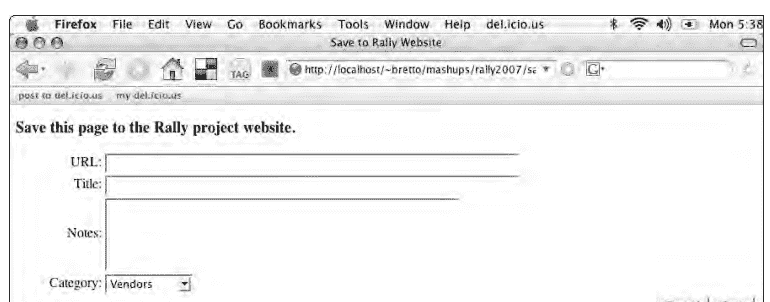

## 图 12-8

- 7. Rally Poster 扩展将向此接口发送 URL 和链接，以便用户不必输入该信息。您可以通过查询字符串为此页面提供 URL 和链接，它将被应用到相应的表单值。在指定 location 和 title 值的同时访问 save_popup.php，例如使用以下 URL：

```
http://localhost/rally2007/save_popup.php?location=http://www.google.com&title=Google
```

然后，您应该会看到页面加载时 URL 和标题表单字段已经填写完毕，如图 12-9 所示。


**图 12-9**

8. 通过在"备注"字段中输入内容，然后按"保存"来测试将书签保存到 del.icio.us。您应该会看到书签已保存的确认信息。然后，浏览到您的 del.icio.us，注意书签是如何使用 *rally2007* 标签以及在"类别"下拉列表中选择的任何类别的标签保存的。这样，任何使用该扩展的用户都将被限制按照您在"类别"下拉列表中配置的标签来保持事物的组织性。

### 工作原理

save_popup.php 中包含的概念没有一个是本书之前未涉及过的。使用标准 HTML 表单与 del.icio.us API 交互，在本例中涉及保存新书签。以下是代码的一些重点。

从 HTML 部分开始，注意 URL 和"描述"文本字段是如何预先设置为 URL 中的值的（如果存在）（这将是与 Firefox 扩展集成时界面的重要部分，因为扩展会将这些值设置为浏览器中当前活动的页面）：

```
<tr>
    <td style="text-align: right">
        URL:
    </td>
    <td>
        <input type="text" name="url" size="60"
            value="<?php
            if (isset($_GET['location'])) {
                echo $_GET['location'];
            }?>" />
    </td>
</tr>
<tr>
    <td style="text-align: right">
        Title:
    </td>
    <td>
        <input type="text" name="description" size="60"
            value="<?php if (isset($_GET['title'])) { echo $_GET['title']; }?>" />
    </td>
</tr>
```

如果您想添加或删除已发布书签的类别（这些类别会成为与之关联的标签），您可以更改"类别"代码。

```
<tr>
    <td style="text-align: right">
        Category:
    </td>
    <td>
        <select name="category">
            <option>Vendors</option>
            <option>Restaurants</option>
            <option>Hotels</option>
            <option>Services</option>
            <option>Sponsor</option>
            <option>Other</option>
        </select>
    </td>
</tr>
```

有两个用户界面元素调用 JavaScript 的 `window.close()` 方法。第一个由发布表单中的取消按钮触发：

```
<td style="text-align: right" colspan="2">
    <input type="button" value="Cancel" onclick="window.close()" />
    <input type="submit" name="Save" value="Save" />
</td>
```

第二个由保存书签后出现的链接触发：

```
<div><?php echo $response; ?></div>
<div align="center">
    <a href="#" onclick="window.close()">[ Close this Window ]</a>
</div>
```

由于此界面将出现在弹出浏览器窗口中，而不是正常浏览，用户需要一种简单的方式来退出弹出窗口。这些元素将允许他们这样做。如果您现在尝试这些按钮，它们将不会工作，因为不是由 JavaScript 打开的窗口无法由 JavaScript 关闭。然而，当此界面稍后作为弹出窗口出现时，它将可以工作。

继续看点击"保存"按钮时执行的 PHP 代码，会创建两个变量。`$response` 包含成功或失败的 API 调用后将打印到屏幕上的状态消息，`$arguments` 包含要随 del.icio.us API 调用发送的完整参数字符串：

```
$response = ''; //将包含来自发布的成功/错误消息

//组装 API 方法参数
$arguments = '';
```


# 第四部分：混搭应用：一个研究项目中心

`$arguments` 随后被分配发布表单发送的每一个可能值。查询字符串中的每个值都会经过 `urlencode()` 方法处理，以确保安全传输：

```
//url
if ($_POST['url'] != "")
    $arguments .= "&url=".urlencode($_POST['url']);
else
    die("Sorry - URL is required!");

//description
if ($_POST['description'] != "")
    $arguments .= "&description=".urlencode($_POST['description']);
else
    die("Sorry - title is required!");

//extended
$arguments .= "&extended=".urlencode($_POST['extended']);
```

`&tags` 参数接收两个由空格分隔的值——`DEFAULT_TAG` 常量和在分类中选定的类别：

```
//tags - 由默认标签和选定的类别组成
$arguments .= "&tags=".urlencode(DEFAULT_TAG." ".$_POST['category']);
```

执行 API 调用，`$response` 被赋予成功或失败的值，然后在页面重新加载时在 HTML 中显示：

```
//保存链接到 del.icio.us
do_api_call('/posts/add?',$arguments);

//设置 $response 以指示是否获得成功响应
if ($api_return['status'] != 200)
    $response = "Sorry, but there was an error. Code: ".$api_return['status'];
else
    $response = "Saved successfully!";
```

你将在后续章节中重新审视 `save_popup.php` 以进行一些改进，但目前这是让摩托车拉力赛协作者将书签保存到你的 del.icio.us 账户的一个简单而安全的良好开端。下一步是将此界面与你现有的 Rally Poster 扩展骨架架构集成。

### 完成 Rally Poster 扩展

得益于你之前使用基于 Web 的 Extension Wizard 工具的工作，Rally Poster 扩展已接近完成。只需进行两项小的更改，你将在本节中完成它们。首先，你将更改扩展内部出现的一些措辞，使其与扩展的目的相关。然后，你将更改 JavaScript 代码，使其不再显示 Hello World! 消息，而是点击扩展的工具栏按钮或从工具菜单中选择它时，启动一个新的、具有特定大小的窗口，其中包含 `save_popup.php` 接口，URL 和标题字段已包含当前网址的相关数据。

## 第12章：使用自定义 Firefox 插件收集参考资料

#### 动手试试：完成扩展

你想将用户界面字符串从通用的“Your Localized Menu Item”和“Your Toolbar Button”更改为更具信息性的内容。因为这些字符串是扩展 XUL 的一部分，你将编辑本地化文件中找到的 XUL DTD 文件。

1.  打开 `rallyposter.dtd`，该文件位于 `rallyposter` 的 locale 目录的 EN-us 子目录中，并将其内容修改为与以下内容匹配：

    ```
    <!ENTITY rallyposter.label "发布到拉力赛网站...">
    <!ENTITY rallyposterToolbar.label "发布到拉力赛网站">
    <!ENTITY rallyposterToolbar.tooltip "将此网页发布到拉力赛网站。">
    ```

2.  更改扩展的 JavaScript 代码，以启动 `save_popup.php` 而不是显示 Hello World! 警报。为此，打开 Rally Poster 内容文件夹中的 `overlay.js`，并用以下内容替换 `onMenuItemCommand()` 方法的内容：

    ```
    var rallyposter = {
      onLoad: function() {
        // 初始化代码
        this.initialized = true;
        this.strings = document.getElementById("rallyposter-strings");
      },
      onMenuItemCommand: function(e) {
        var location, title;
        var savePopupURL = "http://localhost/rally2007/save_popup.php";
        var browser = window.getBrowser();
        var webNav = browser.webNavigation;
        if(webNav.currentURI)
          location = webNav.currentURI.spec;
        else
          location = gURLBar.value;

        if(webNav.document.title)
          title = webNav.document.title;
        else
          title = location;
        this.openPopupWindow(savePopupURL+"?location="+encodeURIComponent(location)+
        "&title="+encodeURIComponent(title), 700, 400);
      },
      onToolbarButtonCommand: function(e) {
        // 只是重用上面的函数。你显然可以更改这个！
        rallyposter.onMenuItemCommand(e);
      },
    };
    window.addEventListener("load", function(e) { rallyposter.onLoad(e); }, false);
    ```

3.  将 `savePopupURL` 变量设置为 `save_popup.php` 的完整、可浏览的路径。要在生产环境中使用此扩展，你需要从公共 Web 服务器而非你的本地主机提供 `save_popup.php`。

4.  插入一个额外的方法 `openPopupWindow()`，如下所示的高亮代码：

    ```
    var rallyposter = {
      onLoad: function() {
        // 初始化代码
        this.initialized = true;
        this.strings = document.getElementById("rallyposter-strings");
      },
      onMenuItemCommand: function(e) {
        var location, title;
        var savePopupURL = "http://localhost/rally2007/save_popup.php";
        var browser = window.getBrowser();
        var webNav = browser.webNavigation;
        if(webNav.currentURI)
          location = webNav.currentURI.spec;
        else
          location = gURLBar.value;

        if(webNav.document.title)
          title = webNav.document.title;
        else
          title = location;

        this.openPopupWindow(savePopupURL+"?location="+encodeURIComponent(location)+"&title="+encodeURIComponent(title), 700, 400);
      },
      onToolbarButtonCommand: function(e) {
        // 只是重用上面的函数。你显然可以更改这个！
        rallyposter.onMenuItemCommand(e);
      },
      openPopupWindow : function(aPath, aWidth, aHeight){
        //使其居中
        var width = aWidth, height = aHeight;
        var left = parseInt((screen.availWidth/2) - (width/2));
        var top  = parseInt((screen.availHeight/2) - (height/2));

        var props = "width="+width+",height="+height+",left="+left+",top="+top+",menubar=0,toolbar=0,scrollbars=1,location=0,status=1,resizable=1";
        var newWindow = window.open(aPath, "", props);
        newWindow.focus();
      }
    };
    window.addEventListener("load", function(e) { rallyposter.onLoad(e); }, false);
    ```

5.  测试你对 Rally Poster 扩展所做的更改。让更改生效的最快、最安全的方法是重启 Firefox。然后浏览到一个网页，从工具菜单中选择“发布到拉力赛网站”。`save_popup.php` 接口将出现在一个新窗口中，居中显示，包含有关网站 URL 和标题的信息，类似于图 12-10。保存链接或点击取消以退出接口。

*如果你更喜欢使用工具栏按钮，你会发现它的工作方式相同。*

### 工作原理

对扩展所做的最重大的更改涉及改变 `onMenuItemCommand()` 方法的功能。大部分代码是相当标准的 JavaScript，附带一些扩展架构特有的方法。

看看 `onMenuItemCommand()`。首先，你会看到为传入的位置（URL）和标题值创建了一些初始变量。此外，`savePopupURL` 被赋值为 `save_popup.php` 的位置：

```
var location, title;
var savePopupURL = "http://localhost/rally2007/save_popup.php";
```

`window.getBrowser()` 方法将活动浏览器窗口对象赋给 `browser`：

```
var browser = window.getBrowser();
```

接下来，`browser` 的一个特殊 XUL 属性 `webNavigation` 被赋给 `webNav` 变量：

```
var webNav = browser.webNavigation;
```

`webNavigation` 包含有关浏览器在任何给定时刻正在浏览到何处的大部分信息。

接下来，从 `webNav` 中提取当前的 URL 和文档标题：

```
if(webNav.currentURI)
    location = webNav.currentURI.spec;
else
    location = gURLBar.value;

if(webNav.document.title)
    title = webNav.document.title;
else
    title = location;
```

然后，使用包含最终访问 URL（即 `save_popup.php` 的位置）以及转义后的 `location` 和 `title` 作为查询字符串，以及它要调用的窗口的像素尺寸宽度和高度参数，调用你创建的 `openPopupWindow()` 方法：

```
this.openPopupWindow(savePopupURL+"?location="+encodeURIComponent(location)+"&title="+encodeURIComponent(title), 700, 400);
```

`openPopupWindow()` 的大部分代码用于确定用户当前的屏幕尺寸，然后在其中居中显示一个新窗口，该窗口使用标准的 JavaScript `window.open()` 方法调用：

```
//使其居中
var width = aWidth, height = aHeight;
var left = parseInt((screen.availWidth/2) - (width/2));
var top  = parseInt((screen.availHeight/2) - (height/2));

var props = "width="+width+",height="+height+",left="+left+",top="+top+",menubar=0,toolbar=0,scrollbars=1,location=0,status=1,resizable=1";
var newWindow = window.open(aPath, "", props);
newWindow.focus();
```

这就是创建这个极其简单但有用的 Firefox 扩展的全部内容。最后一步是将扩展正确地打包为 XPI 文件，然后部署给你的其他协调员。

### 部署 Rally Poster 扩展

因为这是一个假设的项目，本节仅简要介绍打包和发布 Firefox 扩展必须做的事情。该过程涉及重命名、复制和归档现有扩展架构的几个部分。此外，它还涉及对 chrome 清单的更改，以指示这种新的文件存储安排。网上有几个很好的教程介绍了如何操作。


## 第 12 章：使用自定义 Firefox 插件收集参考资料

如果你使用的是 Windows 系统，请参阅 [www.borngeek.com/firefox/toolbar-tutorial/ch_7.html](http://www.borngeek.com/firefox/toolbar-tutorial/ch_7.html) 上的教程。该教程描述了如何重新排列和存档文件，并包含一个便捷的脚本来简化此过程。

如果你使用的是类 UNIX 系统（如 Mac OS X），建议尝试使用从 Extension Wizard 网站下载的预打包扩展中所附带的 `build.sh` shell 脚本。经过简单的配置，该脚本将完成正确打包扩展所需的所有繁琐工作。

一旦你获得了 XPI 文件，只需将其上传到网络并引导 Firefox 用户访问即可。只要你存放文件的 Web 服务器配置为能正确处理 XPI 文件类型，当 Firefox 用户浏览到你的打包扩展时，系统应会立即提示其安装。

### 总结

现在你已经编写并向摩托车拉力赛组织团队的所有成员部署了 Rally Poster 扩展，你的 del.icio.us 书签将开始填满数十个关于供应商、餐厅、酒店、广告商和其他有用资源的书签。因为你在编写扩展时将同事们使用的标签标准化了，因此你能够创建一个网页，让你和其他协调员能够查看、排序并进一步利用所有这些收集到的资源。

现在是时候开始创建这个前端页面了。通过它，你将以一种希望既美观又实用且功能强大的方式来聚合、组织和展示这些参考资料。与此同时，del.icio.us 将继续作为整个系统静默且高效的后端。

### 练习

你可以通过多种方式扩展 Rally Poster 扩展。尝试以下练习来学习如何实现。

- 1. Rally Poster 扩展目前允许用户为每个保存的书签仅选择一个类别。当然，由于 del.icio.us 允许你为书签添加多个标签，因此允许拉力赛协调员一次选择多个类别会更有意义。在尽可能限制可选范围的同时，有哪些方法可以解决这个问题？

- 2. 假设你想为 Rally Poster 扩展添加法语（语言代码 `fr`）支持。你需要添加哪些文件和目录，以及需要做出哪些更改来实现这一点？

- 3. 假设你有大约 50 位活动协调员在使用你的 Rally Poster 扩展。拉力赛结束后，你打算如何阻止人们继续向你的 del.icio.us 发布资源？或者，为了开始收集明年拉力赛的资源，你需要做出哪些更改？

办公时间：请联系主管预约。

## 聚合、组织和展示你的研究成果

通过新创建的 Firefox 扩展，你和其它拉力赛组织者现在有了一种便捷的方法来收集协调今年摩托车拉力赛所需的网络资源。直接通过 del.icio.us 浏览和排序这些参考资料可能并不是解读和组织数据的理想方式，尤其是因为你希望继续保持这个工具尽可能简洁且易于使用。因此，你将创建一个工具，将收集到的研究成果解读并组织到单个项目协调主页中。

在本章中，你将运用从 del.icio.us 获取数据的知识，并实现一些简单的 PHP、XHTML 和 CSS 技术，为基于 del.icio.us 的组织工具构建前端主页打下基础。该界面的用户不仅能够浏览参考资料列表，还能根据你在 Firefox 扩展开发阶段定义的类别来筛选列表。此外，如果由于某种原因 Rally Poster 扩展不可用，你和其他协调员将能够直接从该页面快速发布书签。

你在本章中执行的任务将帮助你以更清晰、更易理解且不那么杂乱的方式呈现你的研究成果。最终产品还将拥有自己独特的审美，将界面呈现为一个具有独特功能和感觉的单一资源收集工具——尽管其核心只是对从 del.icio.us 提取的数据进行简单的重新组合。你可以将其视为一个为项目特殊目的定制的 del.icio.us 版本。

### 基础页面布局

首先，你将为拉力赛项目的主页创建基础布局和功能。主页将展示项目收集到的参考资料，并允许用户按类别过滤显示的资料。这一切将主要由 PHP 驱动，并使用 del.icio.us 上的项目 RSS 馈送作为页面的数据源。

## 第 IV 部分：Mashups 应用：研究项目中心

#### 尝试创建项目主页

由于这将是拉力赛项目的主页面，你将在 htdocs 区域的 rally2007 目录中将其编写为 `index.php` 文件。

- 1. 创建 **index.php** 并从以下源代码开始：

请确保将 `BASE_TAG_FEED_URL` 常量中的 `YOURNAME` 更改为你的 del.icio.us 登录名，并将 `DEFAULT_TAG` 设置为与你在第 12 章中创建的 `save_popup.php` 页面中的对应值相同。

```
<?php
//base tag feed url
define('BASE_FEED_URL','http://del.icio.us/rss/YOURNAME/');

//the default tag meant to identify all posts to the rally project
define('DEFAULT_TAG','rally2007');
```

- 2. 引入并配置 Magpie：

```
//bring in magpie
require_once('lib/rss_fetch.inc');

//set cache directory
define('MAGPIE_CACHE_DIR', 'cache');

//get rid of error Notices because magpie produces some
error_reporting(E_ERROR | E_WARNING | E_PARSE);
```

- 3. 如果你还没有这样做，请将 Magpie 的源文件复制到 `lib` 目录中，或者将 **include** 指向 Magpie 所在的任何位置。同时，根据你计算机的权限结构，将 Magpie 指向一个它可以写入的可用缓存目录。

- 4. 在脚本的后面，你将把 **category** 变量作为查询数据发送，这将导致 RSS 馈送 URL 中增加一个额外部分，因此请添加以下代码来处理此情况：

```
//determine if an additional tag needs to be a part of the RSS feed url
if (isset($_GET['category']) && $_GET['category'] != '')
    $cluster_tag = "+" . $_GET['category'];
else
    $cluster_tag = '';
```

- 5. 添加以下 PHP 代码，用于获取和处理 RSS 馈送：

```
$feed_url = BASE_FEED_URL.DEFAULT_TAG.$cluster_tag;
$rss = fetch_rss($feed_url);
$bookmarks = $rss->items;
```

- 6. 添加以下函数，它将在页面的后面被用到：

```
//returns the tag list minus the default tag
function get_category($tag_list)
{

    //break the tag list into an array
    $tags = explode(",",$tag_list);
```

## 第 13 章：聚合、组织和展示你的研究成果

```
//return the first tag that isn't DEFAULT_TAG (if you allow multiple
//tags you'll want to change this to return an array of remaining tags)
foreach ($tags as $tag) {
    if ($tag != DEFAULT_TAG) {
        return $tag;
        break;
    }
}
?>
```

- 7. 关闭 PHP 代码块后，使用以下 `<head>` 元素开始你的 XHTML 标记：

```
<!DOCTYPE html PUBLIC "-//W3C//DTD XHTML 1.0 Transitional//EN"
"http://www.w3.org/TR/xhtml1/DTD/xhtml1-transitional.dtd">

<html xmlns="http://www.w3.org/1999/xhtml" xml:lang="en" lang="en">
<head>
<meta http-equiv="Content-Type" content="text/html; charset=utf-8"/>
<title>Rally 2007</title>
</head>
```

- 8. 开始页面的 `<body>` 部分，添加少量描述性文本以及一个允许用户选择浏览链接类别的下拉列表：

```
<body>
<h1>Rally 2007</h1>
<p>Here's the collected web references for the upcoming rally. You can use the
"Category" dropdown to filter them by category. Feel free to add a reference using
the Firefox extension provided or the "Add a Bookmark" link. Please contact me if
you have any questions.</p>

<form method="get">
Category:
<select name="category" onchange="this.form.submit()">
<option>Filter by Category...</option>
<option value="">All Bookmarks</option>
<option>Vendors</option>
<option>Restaurants</option>
<option>Hotels</option>
<option>Services</option>
<option>Sponsor</option>
<option>Other</option>
</select>
<?php
(Currently browsing <?php
if (isset($_GET['category']) && $_GET['category'] != '') {
    echo $_GET['category'];
} else {
    echo "all bookmarks";
}
?>.)
</form>
```


## 第 IV 部分：Mashups 应用：研究项目中心

9. 添加 XHTML 标记和 PHP 代码，以生成从 RSS 馈送中提取的每个书签的无序列表，然后结束 XHTML 标记：

```php
<ul>
<?php
foreach($bookmarks as $bookmark) {
	?>
	<li>
	<a href="<?php echo $bookmark['link']; ?>">
	<?php echo $bookmark['title']; ?>
	</a>
	<div>
	<?php
	if (isset($bookmark['description'])) {
		echo $bookmark['description'];
	}
	?>
	</div>
	<div>
	Category:
	<?php
		//get the category for this link (the tag other than the default one)
		$this_category = get_category($bookmark['dc']['subject']);
	?>
	<a href="index.php?category=<?php echo $this_category; ?>">
	<?php echo $this_category ?>
	</a>
	</div>
	</li>
	<?php
}
?>
</ul>

</body>
</html>
```

10. 浏览至 index.php。你应该会看到类似于图 13-1 的内容。

## 第 13 章：聚合、组织和展示你的研究成果


图 13-1

如果你从“Category:”下拉列表中选择一个不同的类别，或者点击每个书签旁出现的类别链接，视图将发生变化，仅显示该类别中的参考资料，如图 13-2 所示。

295

## 第 IV 部分：Mashups 应用：研究项目中心


图 13-2

### 工作原理

在该项目的部分中，del.icio.us 的 RSS 馈送提供的价值超出了馈送阅读器的范畴，成为了可用且易于解析的数据源。此页面上的每个视图都是一个不同的 RSS 馈送。当你选择查看单个类别下的参考资料时，脚本会获取一个新的 RSS 馈送，其中仅包含从 del.icio.us 提取并由脚本处理的带有该标签的参考资料。

> 你可能会好奇为什么在这种情况下选择 RSS 馈送而不是 del.icio.us API。使用 RSS 馈送是一种友好的数据下载方式，且相比于调用 API，它给 del.icio.us 带来的压力要小得多。此外，del.icio.us API 至少在目前不支持获取多个集群标签的数据。虽然可以设计一种方法在从 API 下载后再处理书签标签，但目前 RSS 馈送的便捷性已足以满足本项目的需求。

为了确定应该选择哪个馈送，脚本会检查 `category` 查询变量是否存在，如果存在，则将其赋值给 `$cluster_tag` 变量：

```php
//determine if an additional tag needs to be a part of the RSS feed url
if (isset($_GET['category']) && $_GET['category'] != '')
	$cluster_tag = "+".$_GET['category'];
else
	$cluster_tag = '';
```

## 第 13 章：聚合、组织和展示你的研究成果

“集群”（cluster）是两个或多个标签组合的常用名称。正如你可能记得的，在 del.icio.us 的 URL（包括 RSS 馈送的 URL）中，你可以通过用加号 (+) 符号分隔多个标签来表示标签集群。如果 `$_GET['category']` 变量存在，`$cluster_tag` 前会加上一个加号 (+)。

最终的 RSS 馈送 URL 是由你提供的常量基础 RSS 馈送 URL、本项目的标准默认标签（同样是一个常量）以及 `$cluster_tag` 变量（如果没有指定特定类别，该变量为空）组合而成的：

```php
$feed_url = BASE_FEED_URL.DEFAULT_TAG.$cluster_tag;
$rss = fetch_rss($feed_url);
```

最终的馈送 URL 可能看起来像这样：

```
http://del.icio.us/rss/YOURNAME/rally2007+Vendors
```

或者，如果没有集群标签，则像这样：

```
http://del.icio.us/rss/YOURNAME/rally2007
```

在调用 `fetch_rss()` 之后，`$bookmarks` 变量将被赋予返回的 RSS 项：

```php
$bookmarks = $rss->items;
```

跳到处理 `$bookmarks` 变量的代码部分。你会看到每个书签都被创建为一个无序列表中的列表项：

```php
<ul>
<?php
foreach($bookmarks as $bookmark) {
    ?>
    <li>
        <a href="<?php echo $bookmark['link']; ?>">
            <?php echo $bookmark['title']; ?>
        </a>
        <div>
        <?php
        if (isset($bookmark['description'])) {
            echo $bookmark['description'];
        }
        ?>
        </div>
        <div>
            Category:
            <?php
                //get the category for this link (the tag other than the default one)
                $this_category = get_category($bookmark['dc']['subject']);
            ?>
            <a href="index.php?category=<?php echo $this_category; ?>">
                <?php echo $this_category ?>
            </a>
        </div>
    </li>
    <?php
}
?>
</ul>
```

## 第 IV 部分：Mashups 应用：研究项目中心

```php
<?php
}
?>
</ul>
```

`$this_category` 通过你编写的 `get_category()` 函数获取书签的类别——当然，这就是该书签的另一个（非默认）标签。

`get_category()` 函数接收一个包含书签标签（由 `$bookmark['dc']['subject']` 提供）且以空格分隔的列表作为参数，使用 PHP 的 `explode()` 函数根据空格分隔符将其分解为数组，然后返回该数组中第一个与 `DEFAULT_TAG` 不匹配的标签：

```php
//returns the tag list minus the default tag
function get_category($tag_list)
{
    //break the tag list into an array
    $tags = explode(" ", $tag_list);
    //return the first tag that isn't DEFAULT_TAG (if you allow multiple
    //tags you'll want to change this to return an array of remaining tags)
    foreach ($tags as $tag) {
        if ($tag != DEFAULT_TAG) {
            return $tag;
            break;
        }
    }
}
```

回到生成无序列表的那部分代码，请注意，这里创建了一个从类别名称返回到本页面的链接，并将类别名称作为查询变量：

```php
<ul>
<?php
foreach($bookmarks as $bookmark) {
    ?>
    <li>
    <a href="<?php echo $bookmark['link']; ?>">
    <?php echo $bookmark['title']; ?>
    </a>
    <div>
    <?php
    if (isset($bookmark['description'])) {
        echo $bookmark['description']; }
    ?>
    </div>
    <div>
    Category:
    <?php
        //get the category for this link (the tag other than the default
        //one)
        $this_category = get_category($bookmark['dc']['subject']);
    ?>
    <a href="index.php?category=<?php echo $this_category; ?>">
    <?php echo $this_category ?>
    </a>
```

## 第 13 章：聚合、组织和展示你的研究成果

```php
</div>
</li>
<?php
}
?>
</ul>
```

点击此链接将重新加载页面，并显示包含集群标签数据的 RSS 馈送。

查看特定类别书签的另一种方式是从页面顶部附近出现的下拉菜单中选择类别。该 Web 表单的设计使其在从下拉菜单选择项时自动提交：

```php
<form method="get">
    Category:
    <select name="category" onchange="this.form.submit()">
        <option>Filter by Category...</option>
        <option value="">All Bookmarks</option>
        <option>Vendors</option>
        <option>Restaurants</option>
        <option>Hotels</option>
        <option>Services</option>
        <option>Sponsor</option>
        <option>Other</option>
    </select>
    (Currently browsing <?php
        if (isset($_GET['category']) && $_GET['category'] != '') {
            echo $_GET['category'];
        } else {
            echo "all bookmarks"; }
    ?>.)
</form>
```

选择“All Bookmarks”将返回一个空值，这将有助于确保如果用户只想查看默认标签下的所有书签，则不会解析任何标签集群 RSS URL。

### 添加样式

首页已经开始具备一些功能，但绝对不能称之为美观。现在是时候通过引入一些样式表格式来给它增色了。

#### 试一试：实现样式表

在这个示例中，你将创建一个外部样式表，它不仅会被 `index.php` 页面包含，还会被 `save_popup.php`（以及你创建的任何其他页面）包含，从而使整个应用程序具有统一的外观和感觉。你还将在样式中加入一点 PHP，以扩展 CSS 的功能。

1. 在 `rally2007` 文件夹中，创建一个名为 `stylesheet.css` 的文件。你可能还需要准备好 `index.php` 和 `save_popup.php`，因为你也将对它们进行一些修改。


## 第四部分：Mashups 应用：研究项目中心

2. 在 `stylesheet.css` 中编写一些与页面主体（body）和锚点（anchors）整体格式相关的标记：

```css
body
{
    font-family: Helvetica, Arial, Sans-Serif;
    font-size: 18px;
    color: #000;
    background-color: #FFF;
    margin-left: 2em;
    margin-right: 2em;
}

a:link
{
    text-decoration: none;
    font-weight: bold;
    color: #693;
}

a:visited
{
    text-decoration: none;
    font-weight: bold;
    color: #9C6;
}

a:hover
{
    text-decoration: underline;
    font-weight: bold;
    color: #F33;
}
```

3. 添加以下代码，用于格式化 `<ul>` 及其包含的 `<li>` 元素：

```css
ul
{
    list-style-type: none;
    margin: 0;
    padding: 0;
}

li
{
    border: 1px;
    border-top: 0;
    border-color: #66C;
    border-style: dotted;
    margin-left: 0;
    padding: 1em;
}
```

## 第 13 章：聚合、组织和展示你的研究成果

- 4. 添加以下类声明（这个特定样式类背后的目的很快就会揭晓）：

```css
.li_alternate
{
    background-color: #FFC;
}
```

- 5. 添加以下代码，用于定义标题元素的样式，并为 `index.php` 中的分类选择表单引入另外两个类样式元素：

```css
h1
{
    font-family: Times New Roman, Times, Serif;
    font-weight: bolder;
    color: #666;
}

h3
{
    color: #666;
    font-style: italic;
}

.category_form
{
    color: #FFF;
    background-color:  #66C;
    padding:  5px;
}

.category
{
    color: #666;
}
```

- 6. 转到 `save_popup.php`，如果你还没有打开它，请在编辑器中打开。在主 PHP 代码块下方出现的 `<head>` 元素之间，添加以下标记，这将把样式表引入到 `save_popup.php` 中：

```html
<html xmlns="http://www.w3.org/1999/xhtml" xml:lang="en" lang="en">
<head>
    <meta http-equiv="Content-Type" content="text/html; charset=utf-8"/>
    <link rel="stylesheet" href="stylesheet.css" type="text/css" />
    <title>Save to Rally Website</title>
</head>
```

你所做的只是更改了扩展程序使用的网页，因此无需更改 Firefox 扩展本身。

7. 以同样的方式在 `index.php` 中添加对样式表的链接：

```html
<html xmlns="http://www.w3.org/1999/xhtml" xml:lang="en" lang="en">
<head>
    <meta http-equiv="Content-Type" content="text/html; charset=utf-8"/>
    <link rel="stylesheet" href="stylesheet.css" type="text/css" />
    <title>Rally 2007</title>
</head>
```

8. 保持 `index.php` 处于打开状态，并找到其中的分类选择表单。将其包裹在一个 `<div>` 元素中，并将其 `class` 属性设置为你在样式表中创建的 `category_form` 类，如**粗体行**所示：

```html
<div class="category_form">
<form method="get">
    Category:
    <select name="category" onchange="this.form.submit()">
        <option>Filter by Category...</option>
        <option value="">All Bookmarks</option>
        <option>Vendors</option>
        <option>Restaurants</option>
        <option>Hotels</option>
        <option>Services</option>
        <option>Sponsor</option>
        <option>Other</option>
    </select>
    (Currently browsing <?php
        if (isset($_GET['category']) && $_GET['category'] != '') {
            echo $_GET['category'];
        } else {
            echo "all bookmarks"; }
    ?>.)
</form>
</div>
```

9. 在遍历书签并将其作为列表项输出的代码部分，添加或更改以下**粗体行**（这包括 CSS 和 PHP 代码的更改）：

```php
<ul>
<?php
$i = 0; //for tracking alternate row colors
foreach($bookmarks as $bookmark) {
?>
    <li<?php if ($i % 2) { echo ' class="li_alternate"'; }?>>
    <a href="<?php echo $bookmark['link']; ?>">
    <?php echo $bookmark['title']; ?>
    </a>
    <div>
    <?php
    if (isset($bookmark['description'])) {
        echo $bookmark['description'];
    }
    ?>
    </div>
    <div class="category">
Category:
<?php
    // get the category for this link (the tag other than the default one)
    $this_category = get_category($bookmark['dc']['subject']);
?>

<a href="index.php?category=<?php echo $this_category; ?>">
<?php echo $this_category ?>
</a>
</div>
</li>
<?php
    $i++;
}
?>
</ul>
```

- 10. 浏览 rally2007 中的 `index.php` 页面。这次你应该会看到截然不同的效果，包括无序列表项的新外观，每个项目具有交替的行颜色。它看起来应该像图 13-3 所示。


图 13-3

- 11. 使用 Rally 扩展保存一个书签。你会注意到它现在也有了不同的外观，如图 13-4 所示。


### 工作原理

到目前为止，本书对 CSS 的讨论一直比较少，所以现在也许是个好时机来分解这一个样式表，以便好奇的读者可以看到它是如何组合在一起实现刚才看到的效果的。

`body` 声明定义了 `<body>` 标记标签内部的所有样式。这包括左右各 2em 大小的页边距。CSS 中的 em 单位代表当前字体的长度，因此在这种情况下，由于这里声明的 body 字体高度为 18 像素，所以每边将是 18 像素乘以 2（36 像素）：

```css
body
{
    font-family: Helvetica, Arial, Sans-Serif;
    font-size: 18px;
    color: #000;
    background-color: #FFF;
    margin-left: 2em;
    margin-right: 2em;
}
```

接下来的几个元素设置了页面链接的常规（normal）、`visited`（已访问）和 `hover`（悬停）属性的样式。在这种情况下，它们被赋予了浅绿色的变体，而 `hover` 颜色为亮红色，且链接仅在悬停状态下显示下划线：

```css
a:link
{
    text-decoration: none;
    font-weight: bold;
    color: #693;
}

a:visited
{
    text-decoration: none;
    font-weight: bold;
}

a:hover
{
    text-decoration: underline;
    font-weight: bold;
    color: #F33;
}
```

接下来，对页面上的无序列表和列表项元素进行样式定义。通过将 `margin` 和 `padding` 值设置为 0，移除了此类列表通常具有的右边距，并通过将 `list-style-type` 设置为 `none` 移除了列表的项目符号：

```css
ul
{
    list-style-type: none;
    margin: 0;
    padding: 0;
}
```

对于每个列表项，除了顶部以外（为了防止出现双重边框），都添加了一个 1 像素的紫色点状边框。此外，这里将 `margin-left` 设置为 0 有助于确保列表项在左侧不缩进。`padding` 设置仍然在每个列表项周围留出大量空间，使每个书签在页面上更加突出。

```css
li
{
    border: 1px;
    border-top: 0;
    border-color: #66C;
    border-style: dotted;
    margin-left: 0;
    padding: 1em;
}
```

接着创建了 `li-alternate` 样式类，它将导致其定义的项目具有黄色背景色：

```css
.li_alternate
{
    background-color: #FFC;
}
```

回到你在 `index.php` 中所做的更改。请注意，这里使用了取模运算符来计算 `$i` 变量除以 2 的余数，而 `$i` 在显示每个书签时都会递增。如果计算 `$i` 的模运算返回一个值（意味着它不能被 2 整除），则将 `li_alternate` 类应用于 `<li>` 元素。这使得列表中的每隔一行被着色。

```php
<ul>
<?php
$i = 0; //for tracking alternate row colors
foreach($bookmarks as $bookmark) {
    ?>
    <li<?php if ($i % 2) { echo ' class="li_alternate"'; }?>>
        <a href="<?php echo $bookmark['link']; ?>">
            <?php echo $bookmark['title']; ?>
        </a>
        <div>
            <?php
            if (isset($bookmark['description'])) {
                echo $bookmark['description'];
            }
            ?>
        </div>
        <div class="category">
            Category:
            <?php
                //get the category for this link (the tag other than the default one)
                $this_category = get_category($bookmark['dc']['subject']);
            ?>
            <a href="index.php?category=<?php echo $this_category; ?>">
                <?php echo $this_category ?>
            </a>
        </div>
    </li>
    <?php
    $i++;
}
?>
</ul>
```

在 PHP 中，用百分号 (%) 表示的模运算，如果一个数 ($i) 除以另一个数（在本例中为 2）没有余数，将返回 false。否则，它将返回一个值，在你的代码中这被视为 true。因此，对于打印的第一个 `<li>` 元素，0 % 2 等于 0，因此不会应用 `li_alternate` 类。对于下一个元素，1 % 2 会有余数，因此 `li_alternate` 将作为 `<li>` 元素的属性被添加。对于第三个元素，2 % 2 等于 0，所以没有 `li_alternate` 类，依此类推，从而有效地创建了交替的行颜色。

回到样式表，标题元素 `<h1` 和 `<h3>` 被赋予了样式：

```css
h1
{
    font-family: Times New Roman, Times, Serif;
    font-weight: bolder;
    color: #666;
}

h3
{
    color: #666;
    font-style: italic;
}
```


## 第 13 章：聚合、组织和展示你的研究成果

`<h3>` 没有出现在 `index.php` 中，但它出现在 save_popup.php 的“将此页面保存到 Rally 项目网站”文本中。

样式表中的下一个条目创建了 `category_form` 类，该类用于为出现在 index.php 顶部的类别选择表单创建白色文本和紫色背景：

```
.category_form
{
    color: #FFF;
    background-color: #66C;
    padding: 5px;
}
```

最后，每个类属性设置为 `category` 的 `<div>` 元素其文本颜色都被设为灰色，这有助于使每个引用描述下列出的类别变得清晰可辨：

```
.category
{
    color: #666;
}
```

### 添加快速发布表单

现在，你将添加一种从项目首页保存书签的方法。这样，如果 Rally 协调员无法访问发布扩展（例如，当他们使用 Firefox 以外的浏览器时），他们仍然可以添加其引用资料。

## 尝试一下 —— 创建快速发布弹出链接

实现快速发布表单非常简单，只需对 index.php 做一项简单的更改。在类别选择表单的 `<div>` 元素中，`<form>` 标签之前插入以下阴影标记内容：

```
<div class="category_form">
<span style="float: right">
    <a href="#" onclick="javascript:window.open('save_popup.php', '',
'width=700,height=400,menubar=0,toolbar=0,scrollbars=1,location=0,status=1,
resizable=1');">Add a Bookmark</a>
</span>
<form method="get">
    Category:
    <select name="category" onchange="this.form.submit()">
        <option>Filter by Category...</option>
        <option value="">All Bookmarks</option>
        <option>Vendors</option>
        <option>Restaurants</option>
        <option>Hotels</option>
        <option>Services</option>
        <option>Sponsor</option>
        <option>Other</option>
    </select>
</form>
```

## 第 IV 部分：Mashup 应用：研究项目中心

```
</select>
(Currently browsing <?php
    if (isset($_GET['category']) && $_GET['category'] != '') {
        echo $_GET['category'];
    } else {
        echo "all bookmarks"; }
?>.)
</form>
</div>
```

重新加载 index.php。你应该能在类别选择表单的右侧看到一个 “Add a Bookmark” 链接。点击它将显示 “Save” 弹出窗口，就像使用 Rally Poster 扩展时一样。查看图 13-5 以了解其外观。URL 和 Title 字段必须手动填写，除此之外，表单应能像往常一样运行。


图 13-5

### 工作原理

点击 “Add a Bookmark” 链接本质上调用了与使用 Rally Poster 扩展相同的 JavaScript 代码。一个包含 save_popup.php 的弹出窗口会出现，并可用于将链接保存到项目中。除此之外，一切运作方式与 Firefox 扩展完全一致。将大部分书签保存界面放在网页中使得实现这一点变得非常简单。这种方法也模仿了 del.icio.us 的书签发布界面方案，即通过一个统一的 Web 表单，无论是通过发布书签的小书签（bookmarklet）、del.icio.us Firefox 扩展还是其他手段，都能以不同的方式加以利用。

308

## 第 13 章：聚合、组织和展示你的研究成果

### 总结

至此，你可以根据自己的引用收集需求，将这个项目引导向许多不同的方向。例如，你可以设计一个系统，让项目成员投票决定保留哪些资源、丢弃哪些资源。或者你可以为页面添加额外的排序方法，例如增加按日期时间、按字母顺序等对书签进行排序的功能。你还可以应用在之前的 mashup 项目中使用的某些技术，在项目首页内联显示图像，或者直接在浏览器中嵌入并播放书签中的音频和视频文件。

你还可以使用额外的特殊标签为引用添加更多数据。例如，如果你想引用一个来源，可以使用类似于 `via:joe` 的标签。或者，为了标注某项内容的成本，你可以用 `price:200` 标记。当然，就像类别下拉列表一样，你可以构建标准的 XHTML 表单和其他用户界面元素来强制执行并标准化这些标签，而前端可以将它们重新解析为更易读的值，例如 “来自 Joe” 或 “价格超过 $200.00”。关键在于，标签不仅可以用作搜索和组织书签的方式，还可以携带简单的资料，以扩展关于资源的信息。

就摩托车拉力赛而言，一件能给协调员提供极大帮助的功能将是能够为书签附加位置和日期。这样，地图和截止日期就可以与收集到的资源关联起来。在下一章中，你将扩展此项目以添加收集此类数据的能力，并利用其他 Web 服务来呈现和交互这些数据。

### 练习

尝试这些练习，以更好地理解摩托车拉力赛项目首页背后的功能。

- 1. 如果你想允许用户为书签应用不止一个类别（例如，将 “Vendors” 和 “Services” 两个类别同时分配给一个引用），请描述你必须如何更改拉力赛首页界面。

2. 接上题，为了给标记了多个类别的书签提供数据，RSS 馈送 URL 应该是什么样子？

3. 除了使用 API 或 RSS 馈送之外，还有什么其他方法可以从 del.icio.us 获取项目的书签？

## 14

## 引入其他 Web 服务

到目前为止，这个摩托车拉力赛协调 Mashup 基本上存在于自己的空间中，除了 del.icio.us 之外，没有真正与任何其他服务共享其功能。现在是时候结束这种情况了。特别是对于这样的项目，引入其他 Web 服务可以提供大量额外的功能。一些最令人印象深刻的 Mashup 项目涉及到将不同的 Web 应用程序结合在一起，创造出全新的东西。

在本章中，你将采用 Google 和 Yahoo! 提供的某些 Web 服务，并将它们整合到拉力赛协调首页中。仅仅因为 Google 和 Yahoo! 是主要竞争对手，并不意味着你不能让他们同时为你服务。del.icio.us 数据的收集和展示仍然将是这个 Mashup 的核心功能，但你所使用的服务将使整个项目在外观和功能上更加出色。

本章的第一个项目比较简单。你将从 Google 的日历服务中获取一个日历，并将其融入项目首页。日历非常适合这样的项目，并且与拉力赛协调首页的目的相契合。如果其他协调员拥有自己的 Google 日历，他们将能够添加事件并进行讨论。Google 将完成项目这方面的大部分工作，但你将快速预览其内部机制，看看它究竟是如何运作的。此外，你将预览仍在开发中的 Google Calendar API，看看它在扩展 Google 日历的 Mashup 能力方面可能提供哪些可能性。

然后，你将进入更复杂的部分。你将开发一种方法，将保存的书签直接与地理数据绑定。例如，在寻找举办拉力赛的地点时，协调员不仅可以添加指向地点网站的链接，还可以添加指向其地址的链接。你将使用 Yahoo! 地理编码 API 将此地址转换为经纬度坐标。这些坐标将作为额外的标签与书签一起保存，这个过程被称为“地理标记”（geotagging）。然后，你将增强首页以搜索这些地理标签，如果它们存在，则利用 Yahoo! Maps Beta API 实现一个功能，在地图上精准标注出书签所在的位置。

实现这两个功能将极大地增强拉力赛项目首页，并使其成为本书中较为独特的项目之一。成为一名 Mashup 开发者的好处在于，你可以为了自己的目的而利用 Web 上的最佳资源，即使这意味着要使用来自完全不同公司的服务。


### 添加日历

Google 日历是网络日历领域的一项杰出成果，它带来的易用性更接近桌面日历（如 iCal 或 Outlook），而非通常在网络日历中所能体验到的。你甚至可以以一种相当独特的方式添加新事件，即快速添加功能。只需输入类似“周二晚6点与米歇尔共进晚餐”的短语，Google 日历就能将其解析为日历事项。Google 日历与 Google 其他基于网络的办公应用（如 Gmail）紧密集成，同时还提供了多个非常实用的共享和社交功能，让你能够以在网络日历中相当独特的方式发布、分享和讨论日历事件。

#### 试一试：实现一个 Google 日历

1.  如果你还没有注册，请访问 www.google.com/calendar 注册 Google 日历。你将立即进入自己的个人日历。

2.  在这个项目中，你不希望私人日历数据显示在项目主页上，因此必须创建一个专门用于组织集会活动的新日历。最快捷的方法是在 Google 日历主界面左下角附近找到“我的日历”区域。在那里，你应该能看到你的日历列表，以及一个带有加号（+）的蓝色按钮，如图14-1所示。


图14-1

3.  点击“我的日历”旁边的 + 按钮，进入创建新日历页面，如图14-2所示。在这里，你可以创建一个专门用于规划摩托车集会的日历。为日历命名、添加描述和位置。同时，将日历的共享设置为“与所有人共享此日历的所有信息”。这将使将日历发布到集会项目主页变得更加容易。

你还可以选择通过“与特定人员共享”设置（图中未显示）与其他特定 Google 日历用户共享日历。你甚至可以授权某些人编辑日历数据。如果你真的要认真协调像这次摩托车集会这样的团队工作，这可能是一个非常有用的功能。

4.  花点时间在你刚创建的集会日历中添加一些示例事件。如果你查看大多数日历，你会看到你的个人日历和新的集会日历旁边都有复选框。在添加新事件之前，通过取消选中个人日历旁边的复选框来隐藏它可能会有所帮助。这样可以确保你添加的事件会应用于正确的日历。也试试快速添加功能：输入类似“本周五晚7点与其他协调员会面”这样的内容，按回车键，然后见证奇迹。


图14-2

5.  添加几个事件后，是时候获取集会项目主页所需的代码了。为此，请返回到集会日历的日历设置页面。从日历列表中，点击集会日历旁边的向下箭头，会弹出一个包含“日历设置”链接的窗口，如图14-3所示。点击该链接返回设置页面。


图14-3

6.  在“日历设置”页面底部附近，你会看到几个日历地址，如图14-4所示，日历使用这些地址来提供其数据。


7.  地址列表中包含 XML 格式（当然非常适合混搭），以及 iCal 格式（这是另一种标准化的、非常适合日历的格式，也相当适合混搭）。点击蓝色的 HTML 按钮将日历添加到集会主页。你应该会看到一个窗口，其中包含指向日历的直接链接以及指向 Google 可嵌入日历助手配置工具的链接。点击“配置工具”链接，继续到一个可嵌入的日历助手，它将生成适合将日历直接放置在网页中的 HTML 代码，类似于你在第7章中尝试过的 del.icio.us 链接列表。

实际上，就像 del.icio.us 链接列表生成器一样，你在此表单中进行的更改将影响一些标记，然后你可以将这些标记添加到你的网站以显示你的日历。

8.  配置嵌入式日历。按你的喜好进行设置，但请确保将**模式**设置为议程，并将 **iFrame 尺寸**的宽度设置为不超过 320 像素，如图14-5所示。


图14-5

9.  从 rally2007 文件夹打开 index.php，将 Google 可嵌入日历助手提供的 HTML 复制到 `<ul>` 元素上方和分类表单的 `<div>` 元素下方。将其包裹在自己的 `<div>` 中，并将其 `id` 属性设置为 `calendar`。

> 请勿直接键入以下 `<iframe>` 元素。你必须从 Google 的工具中复制并粘贴它。

```html
</form>
</div>
```

```html
<div id="calendar">
<iframe
src="http://www.google.com/calendar/embed?src=12345abcdef%40group.calendar.google.com&chrome=NAVIGATION&mode=AGENDA&height=588" style=" border-width:0 " width="320"
frameborder="0" height="588"></iframe>
</div>
```

```php
<ul>
<?php
$i = 0; //用于跟踪交替行颜色
foreach($bookmarks as $bookmark) {
```

10. 在 stylesheet.css 底部添加以下样式声明，将日历样式设置为页面右侧的一栏：

```css
#calendar
{
    float: right;
    background-color: #FFF;
}
```

11. 浏览到 index.php。你应该会看到日历以议程形式显示在你的书签旁边，如图14-6所示。


图14-6

### 工作原理

Google 可嵌入日历助手提供的代码包含一个 `<iframe>`（内联框架）元素，该元素引用了 Google 日历网站上的一个 URL。如果你直接浏览此 URL（位于 `<iframe>` 的 `src` 属性中），你将看到日历的简化版本。

就像 del.icio.us 链接列表一样，此页面部分通过查询字符串进行配置。你从配置工具中选择的模式出现在 URL 中，如下所示：

```
http://www.google.com/calendar/embed?entryid=12345abcdef%40group.calendar.google.com&chrome=NAVIGATION&mode=AGENDA&height=588
```

如果你手动调整此查询字符串，将 `AGENDA` 改为 `MONTH`，则下次加载页面时将默认显示日历的月视图：

```
http://www.google.com/calendar/embed?entryid=12345abcdef%40group.calendar.google.com&chrome=NAVIGATION&mode=MONTH&height=588
```

就像 del.icio.us 链接列表一样，嵌入式日历让你体验到 Google 日历提供的数据以及可用的格式。而且就像 del.icio.us 一样，Google 日历有一个 API，提供读取、搜索和向日历添加事件的方法。它仍在开发中，但 Google 日历 API 的大部分工作方式是你已经熟悉的，例如 REST API 调用和 XML 格式数据的处理。如果你想了解更多信息，可以访问 http://code.google.com/apis/gdata/calendar.html。

### 实现地图

现在，让我们继续讨论与从 del.icio.us 拉取的书签更直接相关的内容。本节的目标是将位置数据直接与书签关联起来。你打算怎么做？del.icio.us 书签没有地址字段，更不用说每个书签的街道1、街道2、城市、州或邮政编码字段了。然而，你可以利用书签的标签来存储这些数据。标签让你可以自由控制书签的元数据。其使用方式故意没有严格的标准。

将所有可能存在于地址中的潜在数据塞进单个标签或一组标签中会显得有些荒谬。相反，你可以将地址转换为经纬度坐标——这只是简短的数字——然后用这些坐标为书签添加标签。这个转换和标记的过程称为 `地理标记`。地理标记过程由两部分组成。首先，你将地址转换为经纬度，这个过程称为 `地理编码`。幸运的是，雅虎提供了一个 `地理编码` API，使这变得相当容易。它可以接受许多不同格式的地址，包括简单的自由文本“街道，城市，州，邮编”字符串，并返回匹配的坐标。

地理标记有不同的格式，具体取决于你打算如何使用它。幸运的是，其中一种格式是专门为像 del.icio.us 这样的网站开发的。它由三个标签组成。首先，你用 `geotagged` 标记书签，以全局表示该书签具有地理标签，然后你添加两个用于纬度和经度的标签，如 `geo:lat=纬度` 和 `geo:lon=经度`，其中 `纬度` 和 `经度` 是你从地理编码 API 获取的坐标。


## 第四部分：混搭应用实战：一个研究项目中心

#### 动手试试：地理标记

本练习让你有机会尝试地理标记功能。你将做的第一件事是修改 `save_popup.php` 文件，该文件位于 `rally2007` 项目文件夹中，通过在表单中创建一个新字段，允许用户输入地址。

- 1. 修改 `save_popup.php`，在类别选择框和提交按钮之间添加一个新的表格行，如下面粗体行所示。

```html
<tr>
    <td style="text-align: right">
        Category:
    </td
    <td>
    <select name="category">
        <option>Vendors</option>
        <option>Restaurants</option>
        <option>Hotels</option>
        <option>Services</option>
        <option>Sponsor</option>
        <option>Other</option>
    </select>
    </td>
</tr>
<tr>
    <td style="text-align: right">
        **位置：**
    </td>
    <td>
    **<input type="text" name="address" size="60" />**
    **<div style="font-size: 12px">**
    **    格式：街道，城市，州，邮政编码（可选）**
    **</div>**
    </td>
</tr>
<tr>
    <td style="text-align: right" colspan="2">
        <input type="button" value="Cancel" onclick="window.close()" />
        <input type="submit" name="Save" value="Save" />
    </td>
</tr>
```

- 2. 返回到 `save_popup.php` 顶部的 PHP 代码块。在 `DEFAULT_TAG` 声明下方，添加以下两个与 Yahoo! 地理编码 API 相关的常量（如粗体所示）：

```php
//the default tag meant to identify all posts to the rally project
define('DEFAULT_TAG',"rally2007");

**//the Yahoo Maps Web Service geocoding API URL**
**define('YAHOO_GEOCODING_API_URL',**
**    'http://api.local.yahoo.com/MapsService/V1/geocode');**

**//your Yahoo Application ID**
**define('YAHOO_APP_ID', 'YOURAPPLICATIONID');**
```

### 第14章：引入其他网络服务

- 3. 将 `YAHOO_APP_ID` 设置为你在第4章中获得的 Yahoo! 应用程序 ID。

- 4. 在配置 del.icio.us 标签参数的位置与发起对 del.icio.us `/posts/add?` 方法的 API 调用的位置之间，添加以下代码：

```php
//tags consists of the default tag and whatever category was selected
$arguments .= " &tags=".urlencode(DEFAULT_TAG." $" .$_POST['category']);

//add geotags if it applies
if ($_POST['address'] != ' ') {
    $geocode_request = YAHOO_GECODING_API_URL."?appid=".YAHOO_APP_ID."&location="
        .urlencode($_POST['address'])."&output=php";
    $snoopy=fetch($geocode_request);
    $geocode_results = unserialize($snoopy->results);
    if (isset($geocode_results['ResultSet'])) {
        $arguments .= urlencode(" geotagged geo:lat="
            .$geocode_results['ResultSet']['Result']['Latitude']." geo:lon="
            .$geocode_results['ResultSet']['Result']['Longitude']);
    }
}

//save the link to del.icio.us
do_api_call('/posts/add?',$arguments);
```

请特别注意追加到 `$arguments` 字符串中的空格。整个字符串是一行，开头有一个空格，每个地理标记之间也有一个空格。

- 5. 使用 Firefox 扩展或直接浏览 `save_popup.php`（作为快捷方式）向项目发布一个新书签。按照图14-7所示，以“街道，城市，州，邮政编码”的格式输入一个地址。


**图14-7**

- 6. 当你按下“保存”时，你会发现一个正确添加了地理标记的链接已被添加到你的书签中，如图14-8所示。注意带有地理标记、`geo:lat` 和 `geo:lon` 标签。


**图14-8**

- 7. 还有一处需要修改。你可能记得，你之前编写的 `get_category()` 函数用于从应用于书签的标签列表中提取特定的类别标签。由于你的地理标记添加，这个函数现在失效了。该函数可能会返回一个地理标记而不是类别。要修复此问题，请找到以下代码行：

```php
//returns the tag list minus the default tag
function get_category($tag_list)
{
    //break the tag list into an array
    $tags = explode(" ",$tag_list);
    //return the first tag that isn't DEFAULT_TAG (if you allow multiple
    //tags you'll want to change this to return an array of remaining tags)
    foreach ($tags as $tag) {
        if ($tag != DEFAULT_TAG) {
            return $tag;
            break;
        }
    }
}
```

并将它们更改为与下面阴影行匹配的代码：

```php
//returns the tag list minus the default tag
function get_category($tag_list)
{
    //break the tag list into an array
    $tags = explode(" ",$tag_list);
    //return the first tag that isn't DEFAULT_TAG (if you allow multiple
    //tags you'll want to change this to return an array of remaining tags)
    foreach ($tags as $tag) {
        if ($tag != DEFAULT_TAG && !preg_match('/^geo(.*)$/i',$tag)) {
            return $tag;
            break;
        }
    }
}
```

这将修改该函数，使其不仅检查确保不返回 `DEFAULT_TAG` 作为类别，而且通过 PHP `preg_match()` 函数执行的正则表达式匹配，它还阻止该函数返回任何以字符串 `geo` 开头的标签。

### 工作原理

Yahoo! 地理编码 API 通过一个易于配置的 REST 调用工作，甚至可以配置为返回 PHP 数据，使得地理标记的过程非常简单。以下是 `save_popup.php` 表单提交后发生情况的分解。

首先，标签参数像之前为 del.icio.us API 调用配置的那样进行配置，由 `DEFAULT_TAG` 的值以及发布表单中选定的任何类别组成，以空格分隔：

```php
//tags - consists of the default tag and whatever category was selected
$arguments .= " &tags=".urlencode(DEFAULT_TAG." ".$_POST['category']);
```

接下来，你检查保存弹出窗口的地址表单是否已填写。如果是，那么 `$geocode_request` 将被赋予指向 Yahoo! 地理编码 API 的完整 RESTful 请求 URL。这包括 `appid` 参数，它被赋予你的 Yahoo! 应用程序 ID；`location` 参数，它被分配一个从保存弹出窗口地址字段中输入的地址的版本，并针对 URL 传输进行了适当的转义；以及一个 `output=php` 参数及其值，这将请求一个 PHP 序列化数组作为返回数据（相对于默认的 XML）。

```php
//add geocoded tags if it applies
if ($_POST['address'] != '') {
    $geocode_request = YAHOO_GEOCODING_API_URL."?appid=".YAHOO_APP_ID."&location=".
    .urlencode($_POST['address'])."&output=php";
    ...
    the rest of the code
}
```

`location` 不必提供一个完整的地址。它实际上非常灵活。Yahoo! 会尽力确定发送的数据指的是哪个地址。如果它得出多个位置，它会全部返回它们。

然后，使用 Snoopy 获取请求 URL。结果被反序列化，然后，如果存在 `ResultSet` 数组，第一个结果的 `Latitude` 和 `Longitude` 以及 `geotagged` 标签将作为地理标记坐标被添加到现有的 `$arguments` 字符串中：

```php
//add geocoded tags if it applies
if ($_POST['address'] != '') {
    $geocode_request = 
    YAHOO_GEOCODING_API_URL."?appid=".YAHOO_APP_ID."&location=".urlencode($_POST['
    address'])."&output=php";
    $snoopy->fetch($geocode_request);
    $geocode_results = unserialize($snoopy->results);
    if (isset($geocode_results['ResultSet'])) {
        $arguments .= urlencode(" geotagged geo:lat=".
        .$geocode_results['ResultSet']['Result']['Latitude']." geo:lon=".
        .$geocode_results['ResultSet']['Result']['Longitude']);
    }
}
```

这对于你当前的目的来说已经足够了，但 Yahoo! Maps Web 服务的地理编码 API 还有更多功能。你可以在 http://developer.yahoo.com/maps/rest/V1/geocode.html 查看其文档。

可以想象，这样的 API 在 del.icio.us 之外还有很多用途。它是一个值得了解的有用工具。

#### 动手试试：显示地图

现在你已经拥有了包含位置数据的书签，你需要想办法在 rally 项目主页上呈现这些数据。仅仅显示经纬度坐标可能没什么用。你需要使用这些坐标在主页上显示一个地图，指向书签的位置。你将通过实现一个“显示地图”链接来做到这一点，该链接将出现在每个带有地理标记的书签旁。当点击该链接时，将显示一个地图，展示与书签对应的确切位置。Yahoo! Maps Beta JS-Flash API 非常适合这类事情，因为借助其 JavaScript 函数，你将能够按需请求显示地图。

Yahoo! Maps Beta JS-Flash API 显示的地图是一个 Adobe Flash 文件。你需要为你的浏览器安装 Adobe Flash Player 插件才能使其工作。如果在你的系统上没有安装（这种可能性不大），你可以在 www.adobe.com/go/getflash 获取。

- 1. 实现此功能需要对 `rally2007` 项目文件夹中的 `index.php` 页面进行多处修改，所以现在请在编辑器中打开它。首先，在页面开头附近添加你的 Yahoo! 应用程序 ID 作为常量，类似于你之前对 `save_popup.php` 的更改：

```php
//base tag feed url
define('BASE_FEED_URL','http://del.icio.us/rss/YOURNAME/');

//the default tag meant to identify all posts to the rally project
define('DEFAULT_TAG','rally2007');

//your Yahoo Application ID
define('YAHOO_APP_ID','YOURAPPLICATIONID');

//bring in magpie
require_once('lib/rss_fetch.inc');
```

- 2. 在 `get_category()` 之后立即添加这个新函数：

```php
//creates a link to show a map if geotag data exists
function show_map_link($tag_list,$title)
{
	//break the tag list into an array
	$tags = explode(" ",$tag_list);
	//use regex to get the lat and lon values
	$lat = '';
	$lon = '';
	foreach ($tags as $tag) {
		if (preg_match('/^geo:lat=(.*)$/i',$tag,$latmatch))
			$lat = $latmatch[1];
		if (preg_match('/^geo:lon=(.*)$/i',$tag,$lonmatch))
			$lon = $lonmatch[1];
```


## 第 14 章：引入其他 Web 服务

```
    }
    if ($lat != '' && $lon != '') {
        echo "<a href=\"#\"
            onclick=\"javascript:show_map($lat,$lon,'$title')\">[ Show Map ]</a>";
    }
}
```

3. 在 XHTML 标记的 `<head>` 元素中向下移动。在这里，你需要创建一个指向 Yahoo! *apiloader* 库的链接，该库会自动在文件中包含 Yahoo! 与渲染地图相关的 JavaScript 命令库：

```
<head>
<meta http-equiv="Content-Type" content="text/html; charset=utf-8"/>
<link rel="stylesheet" href="stylesheet.css" type="text/css" />
<title>Rally 2007</title>
<script type="text/javascript"
src="http://maps.yahooapis.com/v3.03/fl/javascript/apiloader.js?appid=
<?php echo YAHOO_APP_ID; ?>">
</script>
</head>
```

请注意 PHP 常量 `YAHOO_APP_ID` 是如何打印在 JavaScript 代码中的。

4. 紧接在 `<head>` 元素的上一次添加内容下方，添加用于在页面上开启和关闭地图渲染的自定义 JavaScript 函数，如下代码中阴影行所示：

```
<head>
<meta http-equiv="Content-Type" content="text/html; charset=utf-8"/>
<link rel="stylesheet" href="stylesheet.css" type="text/css" />
<title>Rally 2007</title>
<script type="text/javascript"
src="http://maps.yahooapis.com/v3.03/fl/javascript/apiloader.js?appid=
<?php echo YAHOO_APP_ID; ?>">
</script>
<script type="text/javascript">
function show_map(lat,lon,title)
{
    //create yahoo maps latlon object
    var latlon = new LatLon(lat, lon);
    //display map centered at zoom level 3
    var map = new Map("map", "<?php echo YAHOO_APP_ID; ?>",
        latlon, 3);
    //add a marker
    marker = new CustomPOIMarker('A',title);
    map.addMarkerByLatLon(marker,latlon);
    //this makes the map draggable
    map.addTool( new PanTool(), true );
    //show map_container
    document.getElementById('map_container').style.display = "block";
}
function hide_map()
{
    //hide map_container
    document.getElementById('map_container').style.display = "none";
}
</script>
</head>
```

5. 在 `<body>` 元素下方，添加以下 `<div>` 及其内容：

```
<body>
<div id="map_container">
    <div id="map"></div>
    <a href="#" onclick="javascript:hide_map()">[ Hide Map ]</a>
</div>
<h1>Rally 2007</h1>
```

6. 对 `index.php` 的最后一次修改是显示一个链接，旨在将地图与带有地理标签（geotagged）的参考资料一同显示。为此，在列出书签的代码中添加以下阴影行：

```
<ul>
<?php
$i = 0; //for tracking alternate row colors
foreach($bookmarks as $bookmark) {
    ?>
    <li><?php if ($i % 2) { echo ' class="li_alternate"'; }?> >
    <a href="<?php echo $bookmark['link']; ?>">
    <?php echo $bookmark['title']; ?>
    </a>
    <div>
    <?php
    if (isset($bookmark['description'])) {
        echo $bookmark['description'];
    }
    ?>
    </div>
    <div class="other_metadata">
        <?php show_map_link($bookmark['dc']['subject'],$bookmark['title']); ?>
    </div>
    <div class="category">
    Category:
    <?php
        //get the category for this link (the tag other than the default one)
        $this_category = get_category($bookmark['dc']['subject']);
    ?>
    <a href="index.php?category=<?php echo $this_category; ?>">
    <?php echo $this_category ?>
    </a>
    </div>
    </li>
    <?php
    $i++;
}
?>
</ul>
```

324

# 第 IV 部分：Mashups 应用：研究项目中心

7. 打开 stylesheet.css，并在文件中的任意位置添加以下内容：

```
.other_metadata
{
    float: right;
}

#map_container
{
    position: fixed;
    margin-left: 30%;
    text-align: center;
    border: 3px solid #000;
    background-color: #FFF;
    display: none;
}

#map
{
    height: 400px;
    width: 400px;
}
```

8. 浏览至 index.php。除非项目书签的 Magpie 缓存尚未过期（你可以通过删除缓存目录中的所有文件来清除缓存），否则你应该看到带有地理标签的书签显示一个“Show Map”链接，如图 14-9 所示。


图 14-9

325

如果你点击该链接，将出现一个包含地图的方框，其中一个点表示书签的准确位置，如图 14-10 所示。


图 14-10

如果你将鼠标悬停在该点（由 A 表示）上，它将展开并显示书签位置的标题，如图 14-11 所示。

你还可以通过点击并拖动地图来移动它。要隐藏地图，只需点击方框底部的“Hide Map”链接。


### 工作原理

Yahoo! Maps JS-Flash API 完成了本项目中的大部分艰巨工作。地图完全由 Yahoo! 自己的服务器生成并放置在页面上。你唯一需要做的就是使用几个简单的 JavaScript 命令来构建、配置并放置它。

首先看一看你刚刚创建的 `show_map_link()` 函数。该函数在渲染从标签馈送（tag feed）中获取的每个书签时被调用。它的参数提供了该书签的完整标签列表及其标题。

首先，通过 PHP 的 `explode()` 方法将标签按空格分隔符拆分为一个数组：

```
//creates a link to show a map if geotag data exists
function show_map_link($tag_list,$title)
{
	//break the tag list into an array
	$tags = explode(" ",$tag_list);
	... the rest of the code ...
}
```

然后，遍历数组中的每个标签。使用*正则表达式*匹配，任何看起来像地理标签的标签都会被提取其坐标，并赋值给 `$lat` 和 `$lon` 变量：

```
foreach ($tags as $tag) {
    if (preg_match('/^geo:lat=(.*)$/i',$tag,$latmatch))
        $lat = $latmatch[1];
    if (preg_match('/^geo:lon=(.*)$/i',$tag,$lonmatch))
        $lon = $lonmatch[1];
}
```

正则表达式（通常简写为 *regex*）是一串特殊的字符和字母，代表在与之比对的字符串中要查找的模式。PHP 的 `preg_match()` 会将任何匹配的数据放入一个数组中，在本例中，根据找到的内容放入 `$latmatch` 或 `$lonmatch`。如果你不熟悉正则表达式，非常值得花时间查看关于它的许多网络资源，例如 http://en.wikipedia.org/wiki/Regular_expression。

如果找到了经纬度地理标签，并且 `$lat` 和 `$lon` 被赋予了坐标，那么“Show Map”链接将被打印到页面上：

```
if ($lat != '' && $lon != '') {
    echo "<a href=\"#\" \
            onclick=\"javascript:show_map($lat,$lon,'$title')\">[ Show Map ]</a>";
}
```

点击此链接时，会执行 JavaScript 函数。`show_map()` 被赋予了由 PHP 分配的三个参数：纬度坐标、经度坐标和书签标题。如果你继续阅读你编写的 JavaScript 代码中的 `show_map()` 函数，你会发现首先发生的是使用提供的 `lat` 和 `lon` 参数创建了一个 `LatLon()` 对象：

```
function show_map(lat,lon,title)
{
    //create yahoo maps latlon object
    var latlon = new LatLon(lat, lon);
    ... the rest of the code ...
}
```

这个对象是 Yahoo! 提供的 Flash API 的一部分。当你将 JavaScript 包含到 Yahoo! apiloader 库时，你不仅引入了这个特殊对象的 JavaScript 版本，还引入了数十个用于各种目的的其他对象。正如 Yahoo! API 参考手册所描述的，在这种情况下，`LatLon()` 对象“通过纬度和经度坐标的交汇点在地图上表示一个点”。换句话说，这个对象告诉 Yahoo 一个你所知的经纬度交汇点，这当然就是你标记地理位置的那个位置。

接下来创建了另一个 Flash API 特有的对象，即 `Map()` 对象：

```
//display map centered at zoom level 3
var map = new Map("map", "YOURAPPLICATIONID", latlon, 3);
```

正如你可能猜到的，`Map()` 对象代表稍后将在页面上创建的 Flash 地图应用程序。它被赋予了四个参数。第一个是地图的容器，通过其 ID 标识。对于本项目，你创建了一个 `<div>` 元素，其 id 属性设置为 "map"：


## 第十四章：引入其他Web服务

```html
<div id="map_container">
	<div id="map"></div>
	<a href="#" onclick="javascript:hide_map()">[ 隐藏地图 ]</a>
</div>
```

有了这个参数，Flash API就知道它需要将地图放置在那个`<div>`元素内部。

你传递给`Map()`对象构造函数的下一个参数是你的雅虎应用ID。之后，你需要指定地图要接收的位置信息。它在这里接受多种不同类型的对象，包括纬度/经度坐标。因此，你将`latlon`对象传递给它。

最后，`Map()`被赋予第四个参数，即地图的*缩放级别*。这个数字在1到17之间，代表地图视图应该被放大到何种程度。值为3时放大程度相当近，但又不会近到无法识别地图上目标点周围的几个街区。

然后，创建了另一个JavaScript对象`CustomPOIMarker()`。这个对象代表地图上一个可展开的兴趣点标记。它接受两个参数。第一个是兴趣点的标识符，称为其*索引*。这里你只是用了字母A，但在其他地图情境中，你可能想使用类似“起点”或“终点”这样的标识，例如，在标记两点间距离时。`CustomPOIMarker()`的第二个参数是标记的标题。当用户点击或将鼠标悬停在标记上时，它会展开显示这个标题。你将其赋值为书签的标题：

```javascript
// 添加一个标记
marker = new CustomPOIMarker('A',title);
```

接下来，你使用了`Map()`对象的`addMarkerByLatLng()`函数，将标记精确放置在纬度和经度坐标相交处：

```javascript
map.addMarkerByLon(marker, latlon);
```

`addTool()`函数，同样是Flash API的一部分，用于向地图添加一个新的`PanTool()`对象。这使得地图可以拖拽。

函数的最后一部分通过将其显示样式从默认的hidden更改为block，使带有`map_container` ID的`<div>`（它包围着地图`<div>`以及用于关闭地图的链接）变为可见：

```javascript
// 显示 map_container
document.getElementById('map_container').style.display = "block";
```

同样地，`hide_map()`函数将`map_container`的display设置为none，将其隐藏：

```javascript
function hide_map()
{
	// 隐藏 map_container
	document.getElementById('map_container').style.display = "none";
}
```

这基本上就是它的工作原理。如果你对雅虎地图API有进一步的疑问，可以阅读其完整文档，地址为`http://developer.yahoo.com/maps/flash/V3/flashReference.html`。要了解更多关于IS-Flash API如何具体工作的信息，你可能也想查看`http://developer.yahoo.com/maps/flash/jsGettingStarted.html`。

## 第四部分：混搭应用：一个研究项目枢纽

你还可以用雅虎地图Beta版API做更多事情。它是一个极其强大的工具，并且一直在变得更加复杂。请随意尝试。

### 总结

市面上有数十种网络应用程序，它们都服务于非常具体和独特的功能，其中许多已经拥有（或开始拥有）自己的API或其他将其与你自己的软件集成的方法。你将Google日历和雅虎地图Beta版与集会协调项目整合的方式，只是在将多个网络服务混合在一起时可能发生的事情的两个例子，无论是否使用del.icio.us。

然而，del.icio.us极其适合混搭，尤其是由于其标签系统的灵活性。如果你需要将del.icio.us书签与其他东西链接，请考虑标签如何能帮助解决这个问题。例如，如果你需要将联系人数据库中的ID与del.icio.us书签链接，只需为它编造你自己的标签id，比如dbid=1434。del.icio.us书签应如何打标签没有标准，对于混搭开发者来说，这是一件好事。

这两项网络服务，在撰写本文时，至少处于测试阶段。作为混搭开发者，你永远不应该害怕测试版。事实上，你应该将其视为混搭开发的黄金时代，至少从软件的生命周期来看是这样。你越早投入其中并开始尝试越好。你完成的项目将更加令人印象深刻、独特且立即有用，并且你通过测试和使用他们的API，将极大地帮助网络应用程序的开发者。成为一名混搭开发者始终关乎于实验。将不同的东西混合在一起，看看会产生什么。诚然，这可能会产生很多没有太大用处的东西，但有时它可能恰好成就一些特别的东西。

### 练习

这些练习将帮助你扩展在本章中已用Google日历和雅虎地图Beta版完成的工作。

- 1. 你可能想进一步简化Google日历中事件的显示，展示一个简单的议程，而不包含嵌入式日历提供的任何用户界面功能。请列举除了Google日历API之外，你还可以使用的另一种将Google日历数据添加到集会主页的方法。
- 2. 描述你可能采取哪些步骤来实现一个书签的“添加到日历”链接，该链接在点击时会将一个事件添加到用户自己的Google日历，该事件源自于通过Rally Poster扩展与书签一起保存的日期和时间，类似于你通过地理标记保存位置数据的方式。
- 3. 查看雅虎地图Flash API参考文档，看看你是否能找到如何将出现在集会项目主页上的地图更改为使用卫星摄影而非默认图形的地图。（记住，你可以在`http://developer.yahoo.com/maps/flash/V3/flashReference.html`浏览参考文档）。

# 第十五章

## 管理传入链接

del.icio.us不仅仅是存储书签和处理标签。del.icio.us功能的另一个重要部分在于其社交方面。正如你现在所知，当你将书签保存到del.icio.us时，默认情况下它会向全世界发布。该书签成为共享知识的一部分，并参与到del.icio.us上关于该书签的对话中。每个人都可以了解你何时保存了它，以及你对它的看法，无论是通过书签的扩展描述字段还是标签。del.icio.us通过将你与其他用户通过这些信息连接起来，扩展了这一理念，使你不仅能为自己的兴趣和想法添加书签，还能发现新的、相似的内容，这一切都源于你个人对网络世界的了解。

你如何利用这些社交功能在摩托车集会项目主页上呢？一件可能有用的事情是添加让任何人，而不仅仅是项目协调员，都可以建议书签和参考资料的能力。毕竟，你的集会参与者可能对他们希望在下一次摩托车上看到什么有话要说。

因为任何拥有del.icio.us账户的人都可以使用`for:`特殊标签将链接发送到另一个del.icio.us账户，你已经拥有了传递这些书签的方法。只需告诉大家，任何拥有del.icio.us账户的人都可以通过将标签打给你的del.icio.us账户，来建议他们希望你看到的集会内容，希望链接会开始涌入。

记住，你可以通过浏览`http://del.icio.us/for/yourname` URL来查看其他del.icio.us用户发送给你的内容。图15-1显示了“你的链接”页面的样子。注意便捷的“保存此链接”链接，它允许你快速将书签保存到你自己的del.icio.us账户（点击后链接会变为“已保存”）。

> 某个账户的“你的链接”页面是私密的。你必须登录才能查看其他人标记给你的链接。

## 第四部分：混搭应用：一个研究项目枢纽


图15-1

集会协调页面背后的理念之一，是它让外部人员以一种受限的方式与你的私有del.icio.us账户互动。你将要添加到集会项目协调页面的最后一个元素，是你和其他项目协调员聚合这些传入链接并挑选哪些你想添加到项目中的一种方式，所有这些都无需与你自己的私有del.icio.us账户进行任何互动。你还要确保你和你的用户可以获取这些链接，并在将它们保存到项目时，确保它们使用你强制执行的分类系统正确标记，以及可能添加你在上一章尝试过的特殊地理编码标签。

### 动手试试：创建一个传入链接页面

这个传入链接管理界面可能最适合放在一个单独的页面上。因此，你将在index.php页面上创建一个链接，将用户引导到这个新界面。

- 1. 在你的编辑器中打开index.php，在“添加书签”链接旁边，添加以下加粗行：

这个横杠是一个管道字符，用于在视觉上分隔这两个功能。通常，可以通过按Shift + 反斜杠（\）来输入。


## 第 15 章：管理入站链接

```html
<span style="float: right">
    <a href="manage_incoming.php">Manage Incoming Links</a>
    |
    <a href="#" onclick="javascript:window.open('save_popup.php', '',
'width=700,height=400,menubar=0,toolbar=0,scrollbars=1,location=0,status=1,
resizable=1');">Add a Bookmark</a>
</span>
```

- 2. 在 rally2007 目录下创建一个名为 **manage_incoming.php** 的新文件。在页面顶部开始编写新的 PHP 代码块，并定义几个与主 RSS 馈送（feed）和项目默认标签相关的常量，就像在 index.php 首页中那样：

```php
<?php
//base tag feed url
define('BASE_TAG_FEED_URL', 'http://del.icio.us/rss/YOURNAME/');

//the default tag meant to identify all posts to the rally project
define('DEFAULT_TAG',"rally2007");
```

- 3. 您需要找出“为您推荐的链接”（Links for You）页面上私有 RSS 馈送的特殊 URL。这个 URL 包含一个唯一密钥，它不属于 del.icio.us 通常可预测的 REST 架构。这是故意这样设计的，以便只有您才能使用您的私有 `for:` RSS 馈送。

找到该 URL 的一种方法是浏览到 `http://del.icio.us/for/yourname`，然后在页面底部附近寻找橙色的 RSS 按钮和“private feed for this page”字样。它看起来应该像图 15-2 所示。


**图 15-2**

- 4. 右键点击 RSS 按钮（如果您使用 Mac，请按 Control+点击），然后选择“复制链接地址”（或您所使用的浏览器的等效选项）以复制馈送 URL。接着，在 manage_incoming.php 的代码中添加以下常量，其中 `yourname` 是您的 del.icio.us 账户名称，`HASH` 是字母和数字的组合：

```php
//private feed url
define('PRIVATE_FEED_URL','http://del.icio.us/rss/for/YOURNAME?private=HASH');
```

这个 hash 是您的 `for:` 链接 RSS 馈送秘密 URL 的唯一部分。

- 5. 继续编写 manage_incoming.php，配置 Magpie 然后获取您的私有“为您推荐的链接”馈送：

```php
//bring in magpie
require_once('lib/rss_fetch.inc');

//set cache directory
define('MAGPIE_CACHE_DIR', 'cache');

//fetch the "links for you" feed
$rss = fetch_rss(PRIVATE_FEED_URL);
$incoming_bookmarks = $rss->items;
```

- 6. 获取项目的整体书签，使用以下代码对其进行处理，然后关闭 PHP 代码块：

```php
//also fetch all of the existing bookmarks
$rss2 = fetch_rss(BASE_TAG_FEED_URL.DEFAULT_TAG);
$existing_bookmark_items = $rss2->items;
//give the $existing_bookmarks array each URL in $existing_bookmarks_feed
//to be checked against the incoming bookmarks later
$existing_bookmarks = array();
foreach($existing_bookmark_items as $existing_bookmark)
    $existing_bookmarks[] = $existing_bookmark['link'];
?>
```

- 7. 现在开始编写一些基础的 XHTML 标记。为了让此页面的外观和感觉与项目保持一致，请引入您在第 13 章中创建的样式表，并将其放置在 `<head>` 标签之间：

```html
<!DOCTYPE html PUBLIC "-//W3C//DTD XHTML 1.0 Transitional//EN"
    "http://www.w3.org/TR/xhtml1/DTD/xhtml1-transitional.dtd">

<html xmlns="http://www.w3.org/1999/xhtml" xml:lang="en" lang="en">
<head>
<meta http-equiv="Content-Type" content="text/html; charset=utf-8"/>
<link rel="stylesheet" href="stylesheet.css" type="text/css" />
<title>Rally 2007 - Incoming Links</title>
</head>

<body>
```

- 8. 延续目前的简单界面标准，添加一个标题、一些介绍性文本（将 YOURNAME 替换为您的 del.icio.us 账户名），以及一个类似于 index.php 中类别选择表单的 `<div>` 元素，其中包含一个返回项目首页的链接：

```html
<h1>Rally 2007 - Incoming Links</h1>

<p>This page contains links suggested by people outside the project team. To save
the link to the main database, click the "Save to Project" link. Outsiders can send
links to this page by posting bookmarks to <a
href="http://del.icio.us/">del.icio.us</a> and tagging them with for:YOURNAME.</p>

<div class="category_form">
    <a href="index.php">&laquo; Back to the Project Homepage</a>
</div>
```

- 9. 添加以下代码，它将遍历私有书签馈送并显示所有尚未保存到项目中的新入站链接：

```php
<ul>
<?php
$i = 0; //for tracking alternate row colors
foreach($incoming_bookmarks as $bookmark) {
    //if the $incoming_bookmark's URL does not exist in $existing_bookmarks
    //then display it
    if (!in_array($bookmark['link'], $existing_bookmarks))
    {
?>
<li<?php if ($i % 2) { echo ' class="li_alternate"'; }?>>
<a href="<?php echo $bookmark['link']; ?>">
<?php echo $bookmark['title']; ?>
</a>
<div>
<?php
if (isset($bookmark['description'])) {
    echo $bookmark['description'];
}?>
</div>
<div style="text-align: right">
<a href="#" onclick="javascript:window.open('save_popup.php?
    location=<?php echo urlencode($bookmark['link']); ?>
    &title=<?php echo urlencode($bookmark['title']); ?>', '',
    'width=700,height=400,menubar=0,toolbar=0,scrollbars=1,
    location=0,status=1,resizable=1');">Save to Project</a>
</div>
</li>
<?php
$i++;
```

- 10. 关闭 XHTML 的 `<body>` 和 `<html>` 标签：

```html
</body>
</html>
```

- 11. 在您能够正确测试此界面之前，您需要另一个 del.icio.us 账户来为您标记一些书签。如果可以，请找个朋友帮忙。让他们选取几个书签（无论是新的还是现有的），并打上 `for:YOURNAME` 的标签。如果您找不到朋友帮忙，您也可以使用您发送链接的那个相同的 del.icio.us 账户来自行操作。

- 12. 浏览到 manage_incoming.php 页面，可以通过直接访问或点击您添加到 index.php 的链接。然后您应该会看到类似图 15-3 的界面，页面上列出了每个为您标记的链接。

如果您点击“Save to Project”按钮，将出现发布弹出窗口——这与您制作的 Firefox 扩展以及项目首页上的“Add a Bookmark”链接所使用的窗口相同——且 URL 和标题字段已预先填好。

如果私有“为您推荐的链接”馈送中的任何书签已经存在于项目中，此页面的设计使其不会在这里显示。如果某个书签已经存在于您的 del.icio.us 账户中，但只是没有被标记为项目的一部分，它仍然会出现在这里。如果您或任何协调员启动书签上的“Save To Project”链接，该现有书签在您 del.icio.us 上的信息将被修改后的标题、描述和标签简单地覆盖。


**图 15-3**

### 工作原理

除了独特的 URL 和一些微小的内容格式差异外，“为您推荐的链接” RSS 馈送与任何其他 del.icio.us 馈送完全相同，可以使用相同的方式进行处理。除了获取和处理 `for:` 馈送外，此脚本还处理项目的整体标签，比较两者，然后显示任何新书签。之后，只需使用 save_popup.php 界面将书签保存到项目中即可。

项目 RSS 馈送中的项目被获取并按如下方式遍历：

```php
//also fetch all of the existing bookmarks
$rss2 = fetch_rss(BASE_TAG_FEED_URL.DEFAULT_TAG);
$existing_bookmark_items = $rss2->items;
//give the $existing_bookmarks array each URL in $existing_bookmarks_feed
//to be checked against the incoming bookmarks later
$existing_bookmarks = array();
foreach($existing_bookmark_items as $existing_bookmark)
    $existing_bookmarks[] = $existing_bookmark['link'];
```

这将每个书签的 URL 放入 `$existing_bookmarks` 数组中。

在随后的代码中，在为无序列表生成列表项的地方，`for:` 馈送中的每个 URL（通过 `<link>` 属性提供）都会与该数组进行比对，以确保该书签尚未被添加到项目中：

```php
<?php
$i = 0; //for tracking alternate row colors
foreach($incoming_bookmarks as $bookmark) {
    //if the $incoming_bookmark's URL does not exist in $existing_bookmarks
    //then display it
```


 # 第15章：管理传入链接

```
        if (!in_array($bookmark['link'], $existing_bookmarks))
        {
            ?>
            ... the rest of the code ...
            <?php
            $i++;
        }
    }
    //if there were no links, say so
    if ($i == 0)
        echo "<li>There are no new incoming links at this time.</li>";
?>
```

由于 feeds 中很可能没有新链接，$i 变量虽然主要用于确定每个列表项的行颜色，但也能指示显示了多少个书签。如果最终一个都没有显示，就会打印一条消息说明没有新的传入链接。

```
<?php
$i = 0; //for tracking alternate row colors
foreach($incoming_bookmarks as $bookmark) {
    //if the $incoming_bookmark's URL does not exist in $existing_bookmarks
    //then display it
    if (!in_array($bookmark['link'], $existing_bookmarks))
    {
        ?>
        ... the rest of the code ...
        <?php
        $i++;
    }
}
//if there were no links, say so
if ($i == 0)
    echo "<li>There are no new incoming links at this time.</li>";
?>
```

当新的传入链接在项目中尚不存在时，它会连同扩展描述一起显示。此外，还会出现**保存到项目**链接，点击该链接时会触发与主页上的**添加书签**几乎相同的 JavaScript 代码，不同之处在于传入书签的 URL 和标题会作为查询字符串包含进来（**加粗**显示）：

```
<li<?php if ($i % 2) { echo ' class="li_alternate"'; }?>>
<a href="<?php echo $bookmark['link']; ?>">
<?php echo $bookmark['title']; ?>
</a>
<div><?php if (isset($bookmark['description'])) { echo $bookmark['description'];
}?></div>
<div style="text-align: right">
<a href="#" onclick="javascript:window.open('save_popup.php?
    location=<?php echo urlencode($bookmark['link']); ?>
    &title=<?php echo urlencode($bookmark['title']); ?>', '',
    'width=700,height=400,menubar=0,toolbar=0,scrollbars=1,
    location=0,status=1,resizable=1');">Save to Project</a>
```

这会自动设置 save_popup.php 表单中的 URL 和标题字段。然后，只需选择引用的类别并添加任何额外的元数据，save_popup.php 脚本就会接管，将链接保存到项目中。

### 小结

越来越多的博客和其他网站鼓励读者通过 del.icio.us 与他们交换链接。与通常的电子邮件或即时消息交换相比，del.icio.us 是一种更理想的处理、审阅甚至发布有趣链接的方式。最终，随着网络变得更加病毒式传播，信息的处理变得更加即时和便捷，使用像 del.icio.us 这样的工具来帮助传播想法以及跟踪对话，发展成为使用和探索网络并分享你所发现内容的极其相关且有趣的方式。

本项目的最后一部分借鉴了这种交换方式，帮助从外部来源收集书签并将它们添加到项目中。这只是你可以利用 del.icio.us 的社交功能来增强项目的方法之一。很容易将 del.icio.us 仅仅用作存储信息的方式，但你也要记住，外面有整个世界都在做同样的事情。

### 练习

以下是一些练习，将扩展你关于如何为混搭应用添加社交功能的知识。

1. 除了使用特殊的 `for:` 标签外，你还能想到另一种从 del.icio.us 上的项目外部人员那里收集和聚合书签的方法吗？每种方法各有哪些优缺点？
2. 当你点击**保存到项目**链接时，发布弹窗会出现，其中 URL 和标题字段已经包含了书签贡献者所指定的内容。你需要对 save_popup.php 和 manage_incoming.php 做哪些修改，才能把书签描述也一并带过来？

# 第五部分：展望 del.icio.us 的未来

第16章：新的不同方向

# 16

# 新的不同方向

在本书中，你已经学习了很多关于 del.icio.us 混搭应用背后的技术和理念，以及 del.icio.us 驱动的混搭项目可能走向的几个方向。你可能对其他人用 del.icio.us 做了什么有一些疑问。del.icio.us API、feeds 和社交数据能实现哪些更极端的例子？其他混搭开发者将他们对 del.icio.us 的想法带到了哪里？

本章将帮助回答其中一些问题。遗憾的是，不可能列出所有开发者使用 del.icio.us 所做的出色工作。发现其他 del.icio.us 相关项目的最佳方式之一就是通过 del.icio.us 本身和 `del.icio.us` 标签（http://del.icio.us/tag/del.icio.us）。如果它与 del.icio.us 有关，你可以肯定它会在 del.icio.us 上。现在就将 del.icio.us 标签的 RSS feed 放到你的 feed 阅读器中吧。你不会后悔的。

除了指出其他 del.icio.us 开发者的一些最佳作品外，本章还展望了 del.icio.us 的未来可能走向，既包括整个服务的前景，也包括你作为开发者可能感兴趣的方向。del.icio.us 还很年轻，仍有很多工作要做，也有很多混搭应用等待开发。

### 桌面、网页和移动客户端

最有用且最令人印象深刻的 del.icio.us 混搭应用类别之一，是将 del.icio.us 的整体功能与其他媒介（如计算机操作系统或移动设备）相结合。一些混搭开发者在完成这项任务方面做得非常出色。由于 del.icio.us API 几乎提供了 del.icio.us 的所有主要功能，包括添加书签、为其打标签、删除书签、按标签获取书签等，这些开发者得以创建完整的 del.icio.us 客户端，以各自独特的方式在各自独特的平台上运行。

例如，Mac OS X 用户一定要去看看 Cocoalicious。Cocoalicious 是一个免费的、开源的 Mac OS X del.icio.us 客户端，使用 Mac OS X 原生的 Cocoa 编程环境编写。它让 del.icio.us 具有类似于 iTunes 和其他 Mac OS X 应用程序的外观和体验。如果你想看看，可以从 `www.scifihifi.com/cocoalicious/` 下载。

对于 Windows 用户，Deliwin 是一个值得注意的 del.icio.us 客户端，它将你所有的 del.icio.us 书签以层级菜单的形式呈现在 Windows 任务栏中，便于访问。该菜单源自你为书签选择的标签。你可以从 `www.bafio.it/projects/deliwin/` 下载 Deliwin。

你甚至可以通过手机与 del.icio.us 进行交互。Mobilicio.us 是一个简化的、基于网页的 del.icio.us 版本，专门为移动网络浏览器设计。你可以在 `http://mobilicio.us/www/index.php` 了解更多关于 Mobilicio.us 的信息。

在 Mobilicio.us 的另一端是 del.icio.us Director，一个由 AJAX 驱动的、高级的 del.icio.us 基于网页的用户界面。del.icio.us Director 是对如何查看和与书签交互的全新诠释。目前，del.icio.us Director 仅支持较新版本的 Firefox 和 Internet Explorer。你可以在 `http://johnvey.com/features/deliciousdirector/` 登录使用。

这些只是众多著名 del.icio.us 客户端界面中的一小部分。它们共同展示了 del.icio.us API 能力的极限。你自己的项目可能只涉及 del.icio.us 及其 API 的某些特定方面。尽管如此，了解鉴于 del.icio.us 及其功能的开放性和可用性，最终实现什么是可能的，可能会让你有所启发。

### 看待 del.icio.us 数据的新视角

一些使用 del.icio.us 制作的工具与书签操作毫无关系。许多人认为 del.icio.us 提供的社交和历史数据是 del.icio.us 最有趣的方面之一。一些优秀的工作试图将这些数据聚合、可视化和重组，以全新的视角呈现 del.icio.us 及其用户。

一个这样的项目是 del.icio.us Discover。开发于 2006 年 3 月，del.icio.us Discover 试图以可视化的方式映射 del.icio.us 网络中人与人之间以及人与书签之间的连接。结果是一些既迷人又美丽的可视化效果。在 `www.mandalabrot.net/delicious/` 查看这个项目。

另一个关于 del.icio.us 社交关系的优秀且直观的呈现是 del.icio.us Network Explorer 工具。这个基于网页的程序由 del.icio.us JSON feeds 和 Java 驱动，运行时呈现给你一个交互式网页，展示你的 del.icio.us 网络及其中的连接。不妨用你自己的 del.icio.us 账户在 `www.twoantennas.com/projects/delicious-network-explorer/` 试一试。

还有很多 del.icio.us 混搭项目涉及从 del.icio.us 社区书签中推导趋势发现和跟踪链接流行度数据。其中一个项目是 del.icio.us Pioneers，它收集 del.icio.us 上最受欢迎的书签，然后从中找出所有发起该趋势的 del.icio.us 用户。你可以在 `http://del.mailliw.com/` 查看它。

如果你对挖掘 del.icio.us 趋势感兴趣，还想看看 populicio.us，网址是 `http://populicio.us/`。它确定 del.icio.us 上最受欢迎的新书签是什么。它甚至有自己数据的 RSS feed，所以你可以确保不会错过最新最棒的 del.icio.us 链接。


## 第十六章：新的不同方向

如果你想找点乐子，可以访问 www.apogee-web-consulting.com/cgi-bin/tagman_delicious.pl 看看 tagman。这是一个基于 del.icio.us 用户标签的猜词游戏。

还有许多其他项目能让你以全新的方式查看和解读 del.icio.us 数据。探索这些项目或许能帮你理解 del.icio.us 书签究竟有多么复杂且信息丰富。随着 del.icio.us 的发展并为这类项目开放更多资源，你不仅能深入了解 del.icio.us 的运作机制，还能从整体上洞悉网络背后以及网络用户的思想，这将是毫无疑问的。

### 有效的混搭

目前已经出现了许多富有创意且实用的 del.icio.us 混搭应用。其中许多都以 del.icio.us 作为数据源，并结合类似工具创建“信息过载”页面，这些页面汇集了与特定主题或想法相关的有趣链接、图片和资源的大杂烩。

其中一个项目是 Diggdot.us，它结合了主题链接分享网站 Digg.com (www.digg.com)、科技网站 Slashdot (www.slashdot.org) 以及 del.icio.us，生成了一个融合了有趣科技新闻和链接的综合信息源。Diggdot.us 会追踪你已经看过和未曾看过的链接，并记录哪些来源最多产、最受欢迎或最有趣。你甚至可以在 Diggdot.us 上注册个人账户，并根据自己的喜好定制页面。你可以在 http://diggdot.us/ 找到它。

另一个出色的类似思路是 mashfot，它结合了来自 Flickr、del.icio.us 以及十几个其他新闻、链接和图片来源的数据，创建了一个完全关于摄影、信息丰富的网页。它的呈现方式非常出色，绝对值得一观。你可以在 www.mashfot.com 找到它。

和 mashfot 类似，一些最好的 del.icio.us 混搭是针对特定兴趣或功能，而不是面向广大用户。Thumbware 的 del.icio.us 和 Salesforce.com 混搭就是一个例子，你可以在 http://bookmark.thumbware.com/ 进行演示。

如果你不熟悉 Salesforce.com，它是一款供企业销售团队跟踪和监控潜在客户、合作伙伴及线索的工具。Thumbware 的混搭将 Salesforce.com 中跟踪的网络参考与 del.icio.us 链接在一起，使用特殊的 del.icio.us 标签作为连接它们的元数据，就像你在上一章使用 Yahoo! Maps Beta 所做的那样。这是一个简单的技巧，但它展示了如何将 del.icio.us 融入你的日常生活，加上一点混搭开发知识，就能让你的日常任务变得更简单、更高效。

### del.icio.us 的未来

很难知道 Joshua Schachter 和他的团队为 del.icio.us 的未来准备了什么，但做出一些预测大概是安全的。你可以肯定，未来 del.icio.us 发展的很大一部分驱动力将涉及进一步改进 del.icio.us 数据的使用、效率和相关性。关于谁、在何时收藏了什么的信息财富是其最大的资产之一，del.icio.us 肯定会尝试将其引向新的方向。就对你这位网络开发者有用的内容而言，这无疑将包括更多的 RSS 和 JSON 信息源，或许还有全新的访问 del.icio.us 数据的方法。事实上，在撰写本书的过程中，已经添加了几个新的 JSON 信息源，而这仅仅是个开始。

# 第五部分：展望 del.icio.us 的未来

del.icio.us 很可能会将其大部分精力集中于改进搜索功能。这有望包括向 del.icio.us API 开放搜索功能。也有可能有一天 del.icio.us 搜索会与 Yahoo! 自己的搜索引擎整合。或许，在 del.icio.us 上针对特定搜索最受信任的资源，会与普通的 Yahoo! 搜索结果一同显示，让用户不仅能基于 Yahoo! 的蜘蛛抓取目录，还能基于由 del.icio.us 社区确定的、庞大的、社会构建的受信任资源数据库来找到他们想要的东西。这种混搭的潜力巨大，可能会永远改变人们搜索网络的方式。

同样很有可能的是，del.icio.us 团队将扩展标签架构和隐喻。你将能够更有效地操作、组织和标记你的书签。此外，新的文件类型和特殊系统标签也很可能会被添加。甚至有一天你可能能够标记书签之外的资源。想象一下，能够以类似 del.icio.us 的方式组织你个人电脑上的文件。

最后，可以相当肯定的是，del.icio.us 的网络功能将得到进一步改进。你可能会更容易地、以一种有趣的方式分享和发现新的链接以及有趣的人。许多社交功能也很可能会延伸到 del.icio.us API 和数据馈送中，从而能够对将 del.icio.us 用户联系在一起的书签进行新的解读。

del.icio.us 和类似网络服务的未来将推动混搭的未来。阅读 del.icio.us 博客，关注 del.icio.us 社区，并随时了解其动态。del.icio.us 上的每一个新变化、调整或想法，不仅会提高该服务对你的有用性，反过来也包含着混搭的潜力。当你像一个混搭开发者那样思考时，你拥有的一切都有可能融合在一起。

### 总结

你可能还没意识到，混搭很可能正从一个“很酷的技巧”转变为可用的、有用的软件，甚至可能推动整个商业创意的发展。del.icio.us 无疑将是这一转变的重要组成部分。不过目前，即使你的混搭只是一个有趣的周末项目，也值得去做。混搭世界正处于实验和发现的时代。是时候享受乐趣，看看你能做些什么了。

希望现在你已准备好投入到自己的项目和想法中去。也许一个想法正在你脑中酝酿，你已经准备好付诸实践。如果没有，但又确实想尝试一些东西，请记住，一些最好的 del.icio.us 混搭源于将 del.icio.us 应用于你自己的日常生活和兴趣。你如何能将 del.icio.us 与你所爱和所做的事情整合起来？进而，你能从你的新 del.icio.us 混搭开发者工具箱中用些什么让它变得更好？永远不要害怕实验。混搭需要创造力和对网络独特的视角。可能性是无穷无尽的，而它们都始于你的键盘。祝你好运，混搭愉快！

## 练习答案

### 第一章

- 1. 找到 del.icio.us 上所有标记为 `art` 的书签的 URL。

  **答：** `http://del.icio.us/tag/art`

- 2. 如果你正在收集所在地区有趣的公寓列表链接，列出你可能会使用的一些标签。

  **答：** 这个问题没有唯一答案，但一些示例标签可能包括 `realestate`（房地产）、`apartments`（公寓）、`homes`（住宅），以及你正在寻找的城市，例如 `Denver`（丹佛）。此外，一些更具体的标签在这里可能有用，例如 `apartments2006`（2006年公寓）、社区名称 `capitolhill`（国会山），甚至每个列表的租金价格 `rent1500`（租金1500）。这样，你就可以根据价格和位置过滤你的书签。

- 3. 你知道有一个完全致力于电子游戏艺术的场景吗？在*我的* del.icio.us 页面上，找到我同时标记了 `art` 和 `gaming` 的所有书签的 URL。我的 del.icio.us 用户名是 negatendo。

  **答：** `http://del.icio.us/negatendo/art+gaming`

### 第二章

- 1. 如果你正在向馈送阅读器添加 RSS 馈送，并且你是 del.icio.us 用户，你绝对必须订阅的三个 RSS 馈送是你的网络、你的收件箱以及“给你的链接”（即你的 `for:` 书签，在第1章中介绍过）。找到这三个 RSS 馈送的 URL。（注意，找到 `for:` RSS 馈送有一个技巧。）

  **答：** URL 如下：

  - 你的网络：`http://del.icio.us/rss/network/yourname`
  - 你的收件箱：`http://del.icio.us/rss/inbox/YOURNAME`
  - 你的 for 链接：`http://del.icio.us/rss/for/yourname?private=PRIVATEKEY`


 # 附录 A：习题答案

RSS feed 的 URL 查询字符串中需要一个特殊的密钥：(`PRIVATEKEY`)。您需要前往“links for you”页面找到 RSS feed，以查看最终的 URL 是什么。请寻找橙色的 RSS 按钮。该密钥的目的是防止其他人订阅专门为您准备的书签。

2. 在本章前面，您调用了 del.icio.us API 来获取保存到您账户的最后五个书签。获取保存到您账户的最后 100 个书签的 API 调用 URL 是什么？

答：`https://api.del.icio.us/v1/posts/recent?&count=100`

3. 本章向您展示了如何在 feed 阅读器中直接订阅 `php` 标签。您还可以将 `php` 标签以及其他标签添加到您的收件箱（inbox）中。请确保您已经在 feed 阅读器中订阅了收件箱，然后找出如何将 `php` 和 `art` 标签添加到收件箱。接着，观察发布到这些标签的书签如何显示在您的 feed 阅读器中。

答：您可以在 `http://del.icio.us/settings/YOURNAME/inbox` 编辑出现在收件箱中的标签。通过输入 `php` 和 `art` 标签，您将订阅这些标签。如果您在 feed 阅读器中关注了收件箱，那么这些标签下的所有新发布内容都将出现在您的收件箱中。您可以将收件箱内容限制为仅由特定用户发布的某些标签。

## 第 3 章

1. 获取最后 30 条带有 `music` 标签的帖子的 API 调用应该是怎样的？

答：`https://api.del.icio.us/v1/posts/recent?&tag=music&count=30`

2. 获取所有带有 `music` 标签的书签的 API 调用应该是怎样的？

答：`https://api.del.icio.us/v1/posts/get?&tag=music`

3. 请列出编写一个程序的 API 调用，该程序定期删除用户标记为 `temporary` 的所有书签，但前提是该书签没有其他标签。

答：一种方法是首先让程序使用 `/posts/get` 方法检查用户是否有归类在 `temporary` 下的帖子：

`https://api.del.icio.us/v1/posts/get?&tag=temporary`

如果返回了数据，查看每个 `<post>` 元素内部的 `tag` 属性，检查每个帖子是否关联有其他标签：

```
<post href="http://slashdot.org/articles/05/12/09/1954200.shtml" description="Check this out." hash="3522013b33c10833ac2ff9bc7f3d2256" others="2" **tag="temporary"** time="2005-12-09T09:12:00Z"/>
```

如果 `temporary` 是唯一的标签，则从 `href` 属性中获取 URL，并调用 `delete` 方法删除该帖子：

`https://api.del.icio.us/v1/posts/delete?url=http://slashdot.org/articles/05/12/09/1954200.shtml`

4. 如果您需要获取某个用户在 `restaurants` 标签下发布的所有书签的每日摘要，是否可以仅使用 RSS feed 来收集数据？如果可以，feed URL 是什么？

答：是的，您可以使用 RSS feed 来获取特定用户标记为 `restaurants` 的所有书签的每日摘要。只需使用以下代码获取标签 feed，即可获取 negatendo 收藏的餐厅：

```
http://del.icio.us/rss/negatendo/restaurants
```

## 第 4 章

1. 创建一个 Flickr REST API 调用，用于获取某个用户最后 100 张公开的最爱照片（用户在 Flickr 上特意标记为最爱的照片）。使用 `flickr.favorites.getPublicList` 作为方法，`EXAMPLEAPIKEY` 作为 API 密钥，`EXAMPLEUSERID` 作为用户 ID。

答：`www.flickr.com/services/rest/?method=flickr.favorites.getPublicList&user_id=EXAMPLEUSERID&api_key=EXAMPLEAPIKEY`

2. 修改本章讨论 Yahoo! Maps Beta 时示例中的地理编码 RSS，以在城市级别显示地图。如需帮助，请参阅 *Yahoo! Maps Simple API Reference Manual* (`http://developer.yahoo.com/maps/simple/V1/reference.html`) 并查找 `ymaps:ZoomLevel` 元素。

答：添加以下粗体代码（请注意 `ymaps:ZoomLevel` 元素出现在 `<channel>` 元素内部，而非 `<item>` 元素内部）：

```
<?xml version="1.0"?>
<rss version="2.0" xmlns:geo="http://www.w3.org/2003/01/geo/wgs84_pos#">
<channel>
<ymaps:ZoomLevel>4</ymaps:ZoomLevel>
<item>
<title>Congress Park</title>
<link>http://www.myserver.com</link>
<description>Free public tennis courts.</description>
<geo:lat>39.73</geo:lat>
<geo:long>-104.96</geo:long>
</item>
</channel>
</rss>
```

3. 在 Google Search API 的讨论中，有一个执行 `munny gallery` 搜索的示例 SOAP 请求。请将此 SOAP 请求改为搜索 `atomic books`。

答：修改以下粗体显示的 SOAP 请求代码行：

```
<?xml version='1.0' encoding='UTF-8'?>
<SOAP-ENV:Envelope xmlns:SOAP-ENV="http://schemas.xmlsoap.org/soap/envelope/"
xmlns:xsi="http://www.w3.org/1999/XMLSchema-instance"
xmlns:xsd="http://www.w3.org/1999/XMLSchema">
<SOAP-ENV:Body>
<ns1:doGoogleSearch xmlns:ns1="urn:GoogleSearch" SOAP-
ENV:encodingStyle="http://schemas.xmlsoap.org/soap/encoding/">
<q xsi:type="xsd:string">atomic books</q>
<key xsi:type="xsd:string">APIKEY</key>
<start xsi:type="xsd:int">0</start>
<maxResults xsi:type="xsd:int">10</maxResults>
<filter xsi:type="xsd:boolean">true</filter>
<restrict xsi:type="xsd:string"/>
<safeSearch xsi:type="xsd:boolean">false</safeSearch>
<lr xsi:type="xsd:string"/>
<ie xsi:type="xsd:string">latin1</ie>
<oe xsi:type="xsd:string">latin1</oe>
</ns1:doGoogleSearch>
</SOAP-ENV:Body>
</SOAP-ENV:Envelope>
```

## 第 5 章

1. 如果您在 htdocs 目录中创建了一个名为 my_mashup_directory 的子文件夹，并在其中放入了一个 index.php PHP 页面，您在浏览器中应该访问哪里来查看此页面？

答：以下任一 URL 均可：

`http://localhost/my_mashup_project/`
`http://localhost/my_mashup_project/index.php`

此外，如果您使用的是 Mac OS X 并且已将 htdocs 目录设为 Sites 文件夹，则以下方式也有效（其中 username 替换为您的 Mac OS X 用户名）：

```
http://localhost/~username/my_mashup_project/
http://localhost/~username/my_mashup_project/index.php
```

2. 在 example5-1.php 中，您编写了一些基础的 PHP 和 MySQL 代码来输出当前日期以及 100 天后的日期。计算给定 PHP 日期前 100 天的日期需要什么样的 MySQL 查询？

答：您只需要修改 `$query` 变量的值，使其包含一个使用 `DATE_SUB` 函数（而非 `DATE_ADD` 函数）修改后的原 MySQL 查询版本：

```
$query = "SELECT DATE_SUB('{$php_date}', interval 100 day)";
```

3. 像所有优秀的博客一样，您的新 WordPress 博客也有 RSS feed。事实上它有几个。您的 WordPress 博客的 Entries（文章）和 Comments（评论）RSS feed 的 URL 是什么？

答：使用默认的 WordPress 模板，您可以在页面底部找到 Entries 和 Comments RSS feed 的链接。它们可能类似于以下内容：

```
http://localhost/wordpress/?feed=rss2
http://localhost/wordpress/?feed=comments-rss2
```

从技术上讲，您可以将 feed 阅读器指向这些 feed 并立即通过阅读器阅读您的博客。但是，如果您的 feed 阅读器是基于 Web 的（如 Google Reader），Google 将无法在互联网上看到您的开发机，因此它可能无法工作。

## 第 6 章

**1.** 在 example6-1.html 中，您开发了一个 XHTML 页面，用于跟踪用户按下按钮的次数，并使用 JavaScript 和 DOM 架构在页面上显示该数字。在此页面中添加一个名为 `reset_count()` 的 JavaScript 函数，用于重置按钮按下计数，并将 `num_presses_span` `<span>` 的值恢复为原始的 0。此外，创建一个新按钮，用户可以按下它来调用此函数。

**答：** 您为此练习对 `example6-1.html` 做的更改应类似于以下阴影行：

```
<?xml version="1.0" encoding="UTF-8"?>
<!DOCTYPE html PUBLIC "-//W3C//DTD XHTML 1.0 Strict//EN"
"http://www.w3.org/TR/xhtml1/DTD/xhtml1-strict.dtd">
<html xmlns="http://www.w3.org/1999/xhtml" xml:lang="en" lang="en">
<head>
<title>Javascript and DOM Testing</title>
<script language="javascript" type="text/javascript">
var num_presses = 0;
function press_me()
{
    num_presses++;
    //var num_presses_span = document.getElementById('num_presses_span');
    //num_presses_span.innerHTML = num_presses;
    document.getElementById('num_presses_span').innerHTML = num_presses;
}
function reset_count()
{
    num_presses = 0;
    document.getElementById('num_presses_span').innerHTML = num_presses;
}
</script>
</head>
<body>
Number of presses: <span id="num_presses_span">0</span>
<input type="button" value="Press Me" onClick="javascript:press_me()" />
<input type="button" value="Reset" onClick="javascript:reset_count()" />
</body>
</html>
```

**2.** 概述在 example6-5.php 脚本创建的示例 Web 联系人数据库中添加“头衔（title）”字段所需的步骤。不要忘记描述您在 MySQL、PHP 和 HTML 方面需要做什么。只需给出需要完成的工作概览即可，无需过于具体。

**答：** 要在 Web 联系人数据库中添加头衔字段，您需要执行以下操作：

- 1. 修改 contacts MySQL 表，添加一个名为 `title` 的新列。

- 2. 修改 PHP 代码中的 `new_contact` 和 `edit_contact` SQL 查询语句，以处理 `$_POST['title']` 的存在。

- 3. 修改联系人列表表，使其具有用于头衔的额外列和输入元素。

- 4. 在“添加新联系人”表单中为头衔添加一个额外的 `<input>` 元素。


## 附录 A：练习答案

**3.** 你在本章中使用了众多第三方 PHP 库，每个库都能执行非常特定的功能。以下这些假设的项目分别会使用 SAJAX、Snoopy 还是 Magpie RSS 库？

- 一个聚合多个 RSS 源并在网站上显示其内容的项目
- 一个每 30 秒自动在页面上显示最近 10 条数据库记录的项目
- 一个发出必要的 del.icio.us API 命令来重命名特定标签的项目

**答：** 第一个项目会使用 Magpie RSS 来处理来自 RSS 源的数据；第二个项目会使用 SAJAX 自动从 MySQL 数据库中获取请求的行；第三个项目会使用 Snoopy 向 del.icio.us 发起 REST 调用来重命名标签。

## 第7章

**1.** 在 delicious_summary.html 中，你使用 JavaScript DOM API 输出了ว่า JSON 数据，请修改代码以添加一个额外的段落（`<p>`）节点，列出每个显示的书签的所有标签。

**答：** 类似于以下阴影部分所示的代码可以实现在每个书签下方添加标签列表（请记住，`t` 变量包含 del.icio.us JSON 数据中的标签）：

```
for (var i=0, post; post = Delicious.posts[i]; i++) {
    var li = document.createElement('li');
    var a = document.createElement('a');
    a.setAttribute('href', post.u);
    a.appendChild(document.createTextNode(post.d));
    li.appendChild(a);
    //include tags
    var tagp = document.createElement('p');
    tagp.appendChild(document.createTextNode(post.t));
    tagp.appendChild(tagp);
    //include the notes field if it exists
    if (post.n) {
        var p = document.createElement('p');
        p.appendChild(document.createTextNode(post.n));
        li.appendChild(p);
    }
    ul.appendChild(li);
}
```

**2.** 如果你想把 delicious_summary2 项目交给朋友，让他们创建自己的摘要页面，那么在安装了 delicious_summary2 文件夹及其内容之外，他们还需要做些什么才能让摘要页面在自己的 Web 服务器上运行起来？他们需要遵循哪些步骤？

**答：** 你的朋友需要执行以下操作：

1. 创建 `delicious_summary2` 数据库及其所有表，包括 `linkroll` 表、`tagroll` 表和 `tag_linkroll` 表。
2. 在 index.php 文件中将 `DELICIOUS_USERNAME` 和 `DELICIOUS_PASSWORD` 设置为他们自己的 del.icio.us 用户名和密码。
3. 配置 index.php 中的 MySQL 相关常量，包括 `MYSQL_HOST`、`MYSQL_DATABASE`、`MYSQL_USERNAME` 和 `MYSQL_PASSWORD`。

他们可能还需要配置 `Snoopy` 的 `curl_path` 和 `temp_dir`。

**3.** 在 linkroll 区域中，如何添加一个书签链接，让其他 del.icio.us 用户可以将其复制到自己的 del.icio.us 中？

**答：** 你只需要创建一个名为"保存到我的 del.icio.us"（或类似名称）的链接，提供要发布的 URL 以及书签标题作为查询字符串传递给 `http://del.icio.us/post` 网址。

例如，就 linkroll 而言，在遍历 `posts` 的循环中添加类似这样的代码可能有效：

```
echo "<a href=\"http://del.icio.us/post?url=".$post['attributes']['HREF']."\">保存到我的 del.icio.us</a>";
```

当点击"保存到我的 del.icio.us"链接时，任何拥有 `del.icio.us` 账户的人都会自动进入 `del.icio.us` 上的发布界面，在那里他们可以输入标题并将 URL 保存为自己的书签之一。

## 第8章

**1.** 在你编写的 autoposter.php 脚本自动提供的链接中，为每个书签提供使用的标签可能会有所帮助。作为额外的挑战，请尝试修改代码，使每个标签成为指向你的 del.icio.us 书签中相应 del.icio.us 标签页面的链接。

**答.** 在 autoposter.php 中遍历每个帖子并将其输出为列表项的代码部分，将代码修改为类似于以下内容即可生效（注意使用 `split()` 函数将空格分隔的标签列表分割成数组，以便为每个标签创建链接）：

```
foreach ($posts as $post)
{
    $post_content .= "<li><a href=\"http://del.icio.us/post?url=".$post['attributes']['HREF']."\">
```

**2.** 除了仅包含指向与你博客文章分类匹配的 del.icio.us 标签页面的链接外，还可以获取并显示你自己 del.icio.us 中与博客文章相关的实际书签。描述一下你可能会如何扩展 del.icio.us 分类链接插件。

**答.** 包含每个 WordPress 分类的实际链接的一种方法是，通过获取和缓存每个分类的匹配链接，然后在帖子中显示它们。每次帖子加载时，都会获取链接缓存或执行 API 调用，就像 delicious_summary2 项目一样。

你可以通过为此目的创建自己的表，将缓存保留在 WordPress 数据库中，或者放在单独的数据库中。对于每个帖子中的每个 WordPress 分类，以下 API 调用就足够了，其中 `$category` 代表每个 WordPress 分类：

```
/posts/get?&tag=$category
```

你必须开发一种缓存 API 响应的方法，因为每次显示帖子时，它不仅会进行一次，而且可能进行多次 API 调用。借助良好的缓存机制和插件，定期根据帖子的分类检查链接并将链接添加到帖子中，你可以轻松设计一个系统，直接在博客中列出与每个帖子相关的链接。

**3.** del.icio.us Play Tagger 代码本可以轻松集成到 classic-mashup 主题中，而不是作为 WordPress 插件安装。使用主题来实现这样做有什么缺点？有什么优点吗？

如果 del.icio.us Play Tagger 纯粹在 WordPress 主题中实现，首先它就无法在不同主题之间移植。如果你切换了主题，Play Tagger 就会消失。与将其制作成插件相比，将其集成到主题中没有任何真正的优势。添加到主题中可能更容易，但 WordPress 插件架构提供的优势，特别是在主题之间移植功能以及从 WordPress 管理后台随意启用/禁用方面，更适合像 del.icio.us Play Tagger 这样的功能。

## 第9章

**1.** 在本章的第一个项目中，你使用了 `GM_addStyle()` 向 del.icio.us 添加 CSS 标记。当然，有很多种方法可以更改特定网站的样式表，你不一定需要 Greasemonkey 来做这件事。例如，许多浏览器支持用户指定的样式表。尝试让 del.icio.us Mashups Skin 用户脚本变得独特，不仅要让它改变页面样式，还要让 del.icio.us 首页上的搜索框变大。

**答.** 向 del.icio.us mashups 皮肤用户脚本添加类似以下内容即可生效。此代码通过其 `id` `searchform` 检查搜索表单是否存在，然后获取第二个表单元素（即搜索文本字段），并将其 `size` 属性设置为 30：

```
if(document.getElementById('searchform'))
    document.getElementById('searchform').elements[1].size = 30;
```

**2.** 你可能还记得，使用特殊的 `for:` 标签标记某物会将它发送给 del.icio.us 用户，方法是将书签复制到他们自己的收件箱。例如，用 `for:negatendo` 标记某物会将该书签放入我自己的 del.icio.us 收件箱。编写一个 Greasemonkey 用户脚本，自动为你保存的所有书签添加标签 `for:username`，其中 `username` 是你想要发送有趣链接给的用户，基本上是在每个书签上抄送他们，就像电子邮件一样。

**答.** 要自动将所有书签发送给某人，你只需要编写一个脚本，在标签表单字段的值中添加适当的 `for:` 标签。类似这样的代码可以生效：

```
if (document.getElementById('tags')) {
  document.getElementById('tags').value =
  document.getElementById('tags').value + " for:negatendo";
}
```

**3.** 从 Greasemonkey 调用 del.icio.us API 会是什么样子？（不必担心处理返回的数据。如果你愿意，只需将其包装在 `alert()` 函数中以测试响应是否返回。）只需尝试想出符合 del.icio.us API 交互标准的基本代码。

**答.** 要从 Greasemonkey 调用 del.icio.us API，你需要设计一个 `GM_xmlHttpRequest()`，发送适当的 `WWW-Authenticate` 和 `User-Agent` 请求头。类似以下内容可以生效，其中 `username` 和 `password` 是预先填充了用户 del.icio.us 用户名和密码的变量：

```
GM_xmlHttpRequest({
  method:"GET",
  url:"https://api.del.icio.us/v1/posts/get?",
  headers:{
    "User-Agent":"greasemonkey",
    "Accept":"application/atom+xml,application/xml,text/xml",
    "Authorization":"Basic "+ btoa(username + ":" + password)
  },
  onload:function(details) {
    alert(details.responseText);
  }
});
```

形成 `User-Agent` 请求头很简单，但发送认证信息有一个技巧。看看这一行：

```
"Authorization":"Basic "+ btoa(username + ":" + password)
```

要使用 Greasemonkey 登录 del.icio.us API，你需要使用所谓的 `Basic` 认证方案来形成 `Authorization` 请求头。这种认证方案要求你提供的用户名和密码采用某种特定格式。正如 HTTP Authentication: Basic and Digest Access Authentication（`www.ietf.org/rfc/rfc2617.txt`）所述，这是 Web 认证的权威 RFC（Request For Comments）参考文档（RFC2617）："To receive authorization, the client sends the userid and password, separated by a single colon (":") character, within a base64 [7] encoded string in the credentials."

Base64 只是将数据编码为一行 ASCII 字符的一种方式。幸运的是，现代 JavaScript 实现有一个函数可以返回给定字符串的 Base64 值，这里使用的是 `btoa()`。


## 附录 A：练习答案

> 仅仅因为用户名和密码经过 Base64 编码，并不意味着它是安全的！一个常见的误解是，认证 Web 请求中 Base64 编码的用户名和密码无法被拦截和解码。Base64 只是一种将数据以可移植形式组合在一起的方式——而非一种加密方式。del.icio.us 使用 SSL 连接与其 API 通信，这才是确保发送到 del.icio.us API 和从其检索的数据保持安全的“真正”方式。

## 第 10 章

1.  在 freshtags 项目中，从每个标签源检索到的每个链接，都会根据书签是否被归档在该标签下而保存到 MySQL 数据库中。如果你关注多个相关标签的不同源，这仍然可能在重新生成的源中产生重复条目。你会如何修改这个项目，以确保无论标签是什么，在 freshtags 产生的任何源中，一个 URL 永远不会显示两次？

A. 为此，你只需修改 `bookmarks` 表的查询，使其仅基于 `link` 列进行搜索，而不是同时搜索 `link` 和 `tag`，如下所示：

```
$bookmarks_select_query = "select count(*) from bookmarks where link LIKE '".mysql_real_escape_string($item['link'])."';
```

2.  在幻灯片混搭项目中，一个可能很有用的功能是添加一个链接，指向将当前显示的图片发布到 del.icio.us 的用户其 del.icio.us 页面。为此，你需要确定是谁发布了这张图片，并根据 Magpie 返回的 RSS 数据找出其 del.icio.us 页面的 URL。你会如何从 `$item` 数组中访问这些数据并为页面格式化它？

A. `$item['dc']['creator']` 变量提供了将该项目保存到 del.icio.us 的用户的 del.icio.us 用户名。由于 del.icio.us 上每个用户页面的 URL 结构是由 del.icio.us 主 URL 后跟用户名组成，你可以很容易地设置这个链接，如下所示：

```
$creator_link = "http://del.icio.us/".$item['dc']['creator'];
```

然后，只需将每个项目的 `$creator_link` 交给 JavaScript 并在页面上呈现即可。

3.  如果你想使用 jukebox 项目每天导出一个新的 PLS 文件，当脚本创建文件时，如何将导出日期附加到文件名中，以便更轻松地组织这些文件？

A. 修改 `header()` 函数的 `Content-Disposition` 参数就能解决这个问题。尝试类似这样的代码，将当前日期附加到文件名中：

```
header("Content-Disposition: attachment; filename=\"".date('Y-m-d')."-jukebox.pls\"");
```

## 第 11 章

1.  你制作的第一个自动书签脚本，即那个自动将 HotJobs 职位发布到你的 del.icio.us 的脚本，如果将职位搜索条件作为命令行参数提供，而不是硬编码在脚本代码中，可能会工作得更好。你会如何重新编写脚本，使你能够通过命令行设置搜索国家、州、城市、类别和关键词？

A. 这只需要将每个变量的值设置为它们在 `$argv` 数组中的位置即可。例如，将变量设置更改为如下所示：

```
//未使用的元素输入一个 - (破折号)
$country = $argv[1];
$state = $argv[2];
$city = $argv[3];
$category = $argv[4];
$keywords = $argv[5];
```

这将使你能够通过命令行指定搜索内容，如下所示：

```
php -v hotjobs.php USA CA "San Jose" MIS "PHP developer"
```

像这样的调用将创建在加利福尼亚州圣何塞搜索 PHP 开发人员职位的条件。

2.  在向 `flickr.favorites.getList` 发送请求时，可以包含一个额外参数，该参数将返回每张照片的上传日期。在 flickr.php 自动书签脚本中，分配给 `$api_sig` 的参数以及提供给 Snoopy 的 REST URL 会是什么样子？

A. API 签名生成代码需要更改为如下形式：

```
//为 flickr.favorites.getList 计算 $api_sig
$api_sig =
md5(SHARED_SECRET."api_key"."API_KEY"."auth_token"."FULL_TOKEN"."methodflickr.favorites.getListextrastdate_upload");
```

REST URL 需要更改为如下形式：

```
$snoopy->fetch("http://www.flickr.com/services/rest/method=flickr.favorites.getList&api_key="."API_KEY"."&auth_token="."FULL_TOKEN"."&api_sig=".$api_sig."&extras=date_upload");
```

3.  除了使用书签脚本（bookmarklet）外，你还能使用什么其他技术来指向你的 Amazon S3 缓存文件（用于你的书签），也许是一种能直接在 del.icio.us 内部提供缓存 URL 链接的技术？

A. 你可以设想编写一个 Greasemonkey 用户脚本，在你的 del.icio.us 中列出的每个书签旁边创建链接，这些链接指向 `get_s3_cache.php` 脚本，并将链接 URL 作为查询字符串传递给它。如果你愿意接受挑战，可以尝试编写它。

## 第 12 章

1.  Rally Poster 扩展允许用户在保存每个书签时只选择一个类别。当然，因为 del.icio.us 允许你为一个书签添加多个标签，所以让协调者一次选择多个类别是非常有意义的。在保持可能的选择尽可能有限的同时，有哪些方法可以解决这个问题？

A. 你可以设计该扩展，使协作者能够使用复选框而不是下拉菜单来选择多个类别。要实现这一点，你可以更改 save_popup.php 中的 HTML 标记，使其如下所示：

```
<tr>
<td style="text-align: right">
Category:
</td>
<td>
<input type="checkbox" name="categories[]" value="Vendors">Vendors<br />
<input type="checkbox" name="categories[]" value="Restaurants">Restaurants<br />
<input type="checkbox" name="categories[]" value="Hotels">Hotels<br />
<input type="checkbox" name="categories[]" value="Services">Services<br />
<input type="checkbox" name="categories[]" value="Sponsor">Sponsor<br />
<input type="checkbox" name="categories[]" value="Other">Other
</td>
</tr>
```

在为 del.icio.us API 调用组装 &tag 参数时，你可以遍历 $_POST['categories'] 数组，将每个值作为一个单独的标签添加到参数中：

```
//tags - 包含默认标签和所有选定的类别
$selected_category_tags = '';
foreach ($_POST['categories'] as $this_category_tag)
    $selected_category_tags = " ".$this_category_tag;
$arguments .= "&tags=".urlencode(DEFAULT_TAG." ".$selected_category_tags);
```

2.  假设你想为 Rally Poster 扩展添加法语（语言代码 fr）支持。为此，你需要添加哪些文件和目录，以及需要进行哪些更改？

A. 为此，你需要对扩展进行几处更改，如下所示：

- 1. 在扩展的 locale 目录中创建一个名为 fr 的新目录。在其内部，创建 rallyposter.dtd 和 rallyposter.properties 文件，其中包含每个本地化字符串的法语等效内容。
- 2. 在 chrome 清单（chrome.manifest）中添加一条额外的 locale chrome 提供程序说明，指向新的本地化文件，如下所示：

```
locale  rallyposter  fr  locale/fr/
```

- 3. 编写一个新版本，或向 save_popup.php 发送某种区域设置指示，以使其自身的文本也变为法语。

3.  假设有大约 50 个活动协调者在使用你的 Rally Poster 扩展。集会结束后，你打算如何阻止人们继续向你的 del.icio.us 发布资源？或者，你需要进行哪些更改才能开始为明年集会收集资源？

A. 由于 save_popup.php 文件大概存在于你自己的 Web 服务器上，并且你始终可以更改它，你应该能够禁用该接口（也许在调用时只显示“感谢您的帮助！明年见！”的消息），或者更好的是，你可以将 DEFAULT_TAG 常量的值更改为 rally2008，并立即开始为即将到来的摩托车集会收集网络参考资料和资源。


## 附录 A：练习答案

### 第 13 章

1. 如果你想让用户可以为一个书签应用多个类别，例如将"供应商"和"服务"两个类别同时分配给同一个书签，描述你将如何更改 Rally 主页界面。

A. 首先，你需要修改类别选择表单，使其允许多个标签的选择。一种实现方式是为每个类别创建复选框，并添加一个"提交"按钮来执行表单。

此外，你需要在每个书签的描述下方列出其所属类别。为此需要完成的部分工作是修改 `get_category()` 函数，使其返回所有类别，而不仅仅是第一个。

2. 延续上一题，为了提供标记了多个类别的书签数据，RSS 订阅源 URL 应该是什么样的？

A. 你只需将主页设计为使用附加标签进一步组合 URL，每个标签之间用加号（+）分隔即可。例如，要返回所有同时被标记为"供应商"和"服务"类别的项目书签，你需要解析的订阅源 URL 如下所示：

```
http://del.icio.us/rss/YOURNAME/rally2007+Vendors+Services
```

3. 除了使用 API 或 RSS 订阅源之外，还有什么其他方法可以从 del.icio.us 获取项目的书签？

A. JSON 订阅源。请记住，它们是此类情况下的另一个绝佳资源。与 RSS 订阅源一样，del.icio.us 的 JSON 订阅源可以基于标签组合提供数据。你甚至可以用它们构建一个不需要 PHP 的页面版本，转而使用 JavaScript 来聚合、组织和展示数据。

### 第 14 章

1. 你可能希望进一步简化 Google 日历中事件的显示，只展示一个简单的日程安排，而不使用嵌入式日历提供的任何用户界面功能。请列举一种除 Google 日历 API 之外，可以用来将 Google 日历数据添加到 Rally 主页的方法。

A. 每个 Google 日历都有一个 RSS 订阅源。即使是私有日历也有一个私有 RSS 订阅源。你可以简单地使用 Magpie 和 PHP 获取并处理这个订阅源，以显示一个更简洁的日历日程版本。

2. 描述你可能会如何实现书签的"添加到日历"链接，当用户点击该链接时，会基于通过 Rally Poster 扩展保存的书签日期和时间，在用户自己的 Google 日历中添加一个事件，类似于你通过地理标记保存位置数据的方式。

A. 要为书签实现"添加到日历"链接，你需要设计一种方法来输入、存储日期和时间数据，然后将其发送到 Google 日历。为此，你首先要修改 save_popup.php 页面，允许可选地输入日期和时间。然后，就像地理标记一样，你需要将表单中输入的数据转换为某种标签方案。类似 `date=00:00:00` 和 `time=00:00:00` 的格式就可以使用。接下来，与"显示地图"链接类似，你需要设计一个系统来检查这些特殊标签是否存在，如果存在，则实现一个链接，将用户引导到一个脚本或页面，将日期和时间标签转换为 Google 日历 API 所需的正确请求。请注意，Google 日历 API 有一个身份验证方案，需要安全地识别你希望操作其日历的用户，并让他们授予你的应用程序修改其数据的权限，但这完全是可以实现的，主要还是得益于 del.icio.us 标签的灵活性。

3. 查看 Yahoo! Maps Flash API 参考文档，看看你能否找到如何将 Rally 项目主页上显示的地图更改为使用卫星摄影照片而非默认图形的地图。

A. 秘诀是在 `show_map()` JavaScript 函数中创建 `Map()` 对象时，设置一个可选的第五个参数。将此参数设置为 `MapViews.SATELLITE`，即可显示卫星照片地图：

```
var map = new Map("map", "YOURAPPLICATIONID", latlon, 3, MapViews.SATELLITE);
```

你也可以将此参数设置为 `MapViews.HYBRID`，它将合并常规视图和卫星视图。

### 第 15 章

1. 除了使用特殊的 `for:` 标签之外，你还能想到什么其他方法来收集和聚合 del.icio.us 上项目外部人员的书签？每种方法各有什么优缺点？

A. 你不必让外部人员将链接标签为你的账户的 `for:`，而是可以简单地建议他们在书签上使用指定的项目标签进行标记，例如 `rally2007`。然后，你可以获取 del.icio.us 的标签订阅源，并将其与项目中已有的参考进行比较。所有标记了 `rally2007` 的书签的标签订阅源为 `http://del.icio.us/rss/tag/rally2007`。

如果你想公开 del.icio.us 用户提交的其他书签，这种方式将更有优势，因为其他人也能看到这些书签，而不像私有的"为你收藏的链接"页面。此外，如果你希望对 rally 参与者提交资源的时间设置限制，建议 del.icio.us 用户以这种方式标记书签可能更好。收集到足够多的书签后，你只需忽略该订阅源即可，不像 `for:` 链接那样，你会持续收到链接，直到你要求人们停止。最终，这是一个关于让人们发送给你的书签公开还是私有的决定。

如果其他人严格按照本书中的项目操作，del.icio.us 上应该已经有几十个 `rally2007` 书签了。你可以自己去看看。也许你会想将这些人添加到你的网络中并关注他们的链接，因为你已经知道你和他们有共同的兴趣——他们都对 del.icio.us mashup 感兴趣！

2. 当你点击"保存到项目"链接时，弹出的发布窗口中的 URL 和标题字段已经包含了书签贡献者设置的内容。你需要对 `save_popup.php` 和 `manage_incoming.php` 做哪些更改才能同时带入书签描述？

A. 两个简单的更改就可以实现。首先，你需要修改 save_popup.php 以显示额外查询字符串的内容；如果存在 description，则在"备注"字段中显示。注意以下加粗的文本：

```
<tr>
    <td style="text-align: right">
        Notes:
    </td>
    <td>
    <textarea name="extended" cols="50" rows="5">
    <?php
    if (isset($_GET['description'])) {
        echo $_GET['description']; }
    ?>
    </textarea>
    </td>
</tr>
```

然后，在 manage_incoming.php 中将链接的 description 值作为 `window.open()` 命令的一部分：

```
<li><?php if ($i % 2) { echo ' class="li_alternate"'; }?>>
<a href="<?php echo $bookmark['link']; ?>">
<?php echo $bookmark['title']; ?>
</a>
<div>
<?php
if (isset($bookmark['description'])) {
    echo $bookmark['description'];
}
?>
</div>
<div style="text-align: right">
<a href="#" onclick="javascript:window.open('save_popup.php?
    location=<?php echo urlencode($bookmark['link']); ?>
    &title=<?php echo urlencode($bookmark['title']); ?>
    &description=<?php echo urlencode($bookmark['description']); ?>', '', 
    'width=700,height=400,menubar=0,toolbar=0,scrollbars=1,
    location=0,status=1,resizable=1');">Save to Project</a>
</div>
</li>
```

## B：对支持 API 的 Web 服务的思考

支持 API 的 Web 服务试图尽可能地向开发者开放其提供的数据和功能，而这一切都建立在一定程度的信任之上。开发者确实可能——而且有时确实会——通过 API 滥用 Web 服务。在某些情况下，这是有意为之，目的是损害该 Web 服务和/或其用户；而在另一些情况下，则是开发者在无意中造成的，他们没有考虑到自己开发的东西可能带来的潜在危害。

尽管 del.icio.us 和其他服务已经建立了大量保护措施来防止此类事件的发生，例如限流甚至封禁相关用户，但往往损害已经造成。

即使你的出发点是好的，小心行事也是值得的。回顾一下你在之前项目中使用的一些方法是很有价值的，这些方法不仅有效地构建了 mashup，而且体现了对 del.icio.us API 的尊重和谨慎。在你开发 mashup 时，这些最佳实践应该始终放在首位。请记住，访问 Web API 是一种特权而非权利。如果有一天像 del.icio.us 这样的网站认为托管 API 危险性太大，或者因为少数不考虑后果的开发者而觉得不值得，那么所有人都会受损。

### 尽量减少 API 调用

如果你要调用 Web API，那就充分利用每一次调用。用尽可能少的调用次数获取所需的所有数据，不要超出所需范围。这不仅可能使你的软件更加高效，也是对你所使用的 API 的一种善意。

例如，在第 7 章的 delicious_summary2 mashup 中，你本可以提前获取并缓存标签云中出现的每个标签的所有发布内容，同时生成标签云本身。这样，当用户选择某个标签时，你的软件看起来会运行得更快，因为 MySQL 数据库已经缓存了该标签的最新发布内容。然而，虽然这看起来是个好主意，但实际上并非如此。设计你的


## 附录 B：对支持 API 的 Web 服务的理解

以这种方式构建项目，可能意味着每次用户初次浏览页面时，都会对 del.icio.us API 发起数百次请求（取决于每个标签的缓存状态以及你拥有的标签数量）。由于你的用户不太可能已经点击过标签云中的每一个标签，一次性下载每个标签的所有内容本身就有些不合理。

在设计混合应用（mashup）时，尽量预测最佳的 API 调用时机和调用内容，并使调用尽可能精简。让你自己的软件来完成这些工作，总比依赖 Web 服务更好。

### 缓存数据

除了在合适的时机调用 API 之外，缓存数据是减少 API 调用的一个绝佳方式。即使你的 Web 应用程序比从 del.icio.us 等服务获取的当前数据落后一个小时，这也能为你自己的 Web 应用程序和 del.icio.us 大大减轻压力。

缓存对于高流量的混合应用尤为重要。假设你编写了一个混合应用，每次页面加载都会调用 del.icio.us API，且没有使用缓存。虽然一开始只是你在开发和测试，这似乎没什么大不了的，但如果有一天你的混合应用突然变得非常受欢迎呢？在此之前，它只是在 del.icio.us 不知不觉的情况下默默运行，但随后它和 del.icio.us 都可能因为你的混合应用的流行而陷入停滞。在这些情况下，缓存至关重要。

如果你的混合应用以任何方式、形式或形状使用来自任何基于 Internet 的数据源的定期下载数据——无论是 del.icio.us API、RSS 订阅源、XML-RPC 服务器还是其他任何东西——在本地缓存这些数据，只是偶尔获取新数据，应该是你在设计混合应用时最优先考虑的事项之一。

### 处理状态错误

对于基于 Web 的 API 等系统，与任何类型的 Internet 通信一样，你的 Web 服务器与 API 服务之间总有可能出现问题。Internet 连接可能暂时中断，服务器或路由器可能正在维护，或者 REST URL 可能会在没有任何通知的情况下发生变化。

在这种情况下，你的混合应用必须经过精心设计，不仅要能够捕获和解释此类错误，还要以优雅且得体的方式处理它们。幸运的是，大多数基于 Web 的 API 在出现问题时会返回 HTTP 状态码。在第 7 章中，你设计 delicious_summary_2 项目时，只是简单地在返回非 OK 状态码时取消对 del.icio.us API 的调用并回退到缓存。这是一个好主意。但更进一步的做法也是值得考虑的，例如在出错时通过电子邮件通知你，或者告知用户错误信息，让他们知道为什么没有收到最新数据。你可以在 `www.w3.org/Protocols/rfc2616/rfc2616/rfc2616-sec10.html` 阅读关于 HTTP 状态码及其含义的全部内容。

此外，你在此前章节中使用过的许多库和扩展工具（如 Snoopy）都内置了超时功能，如果某个操作耗时过长，会自动停止执行。编写任何会无限尝试与其他资源通信的程序从来都不是一个好主意，尤其是当该资源位于 Internet 上时。这会耗尽时间和带宽，使你的软件变得毫无用处。

你能犯的最严重错误就是设计一个忽略所有此类错误或问题、只是盲目继续运行的混合应用。这绝不是一个好主意。

### 沟通交流

del.icio.us 团队成员都是非常忙碌的人。虽然不能指望他们回复每封邮件或查看每一个基于其服务构建的混合应用，但你可以放心，他们正在密切关注着事态的发展。

如果你还没有加入，请务必加入 del.icio.us Yahoo! 讨论组：http://groups.yahoo.com/group/ydn-delicious/。当你有新的混合应用项目要发布，或者有关于开发的问题或疑虑时，随时可以在上面交流。del.icio.us 团队以及许多其他 del.icio.us 粉丝、用户和像我这样的混合应用开发者每天都会阅读并回复该讨论组的内容。

如果你做出了优秀的作品，就让全世界知道吧。在你的博客上宣布你的混合应用，将代码公开给其他人查看，并将其推广出去。你不仅会因出色的工作而受到赞扬，而且很可能会从志同道合的人那里获得关于如何改进混合应用或代码的宝贵反馈。也许你还会因此结交一些朋友。（不仅如此，偶尔还会有混合应用被 del.icio.us 作为特色功能收录。）

混合应用本质上是一种协作理念，你的混合应用开发过程也应如此。

### 小结

混合应用开发过程的某些部分早在你编写第一行代码之前就已经开始了。优秀的混合应用开发者在软件设计上是谨慎、得体且聪明的。你同样需要保持这种心态，并想出聪明的方法来尽量减少对 Web 服务 API 或 RSS 订阅源的调用、缓存数据、处理错误，以及融入 del.icio.us 开发社区。

## 索引

### 符号

- *（星号）通配符，119
- %（百分号），306
- +（加号），5，35，39
- ;（分号），87

### A

- about:config 页面，267–268
- 访问密钥（Amazon API），45
- action hooks（动作钩子），176
- Adblock，Firefox 扩展，50–51
- Add a Bookmark 链接，307–308
- 地址，Calendar，313–314
- Adobe Flash 文件，322
- AJAX（Asynchronous JavaScript and XML，异步 JavaScript 和 XML）方法，113
- Alexa，45
- 按用户返回所有书签，33
- Amazon
    - Alexa 搜索程序，45
    - API 密钥，45
    - 使用 S3 缓存页面
        - 创建存储桶，250–252
        - 存储桶的工作原理，252–253
        - 缓存 Web 文档，253–258
    - Google 缓存版本，248
    - PHP 模块，249–250
    - 重定向到 S3 缓存，258–260
- Amazon Web Services (AWS)
    - 简介，45–46
    - ItemSearch 响应，46
    - REST 调用，45
    - S3，注册，249
    - 注册，71
- Apache 服务器
    - 在 Mac OS X 上，60–62
    - 使用 PHP 获取当前日期并使用 MySQL 计算第二个日期，64–65
    - 在 Windows 上，57–59
- API（Application Programming Interface，应用程序编程接口）
    - bundles 方法
        - 简介，36
        - /tags/bundles/all，37
        - /tags/bundles/delete，37–38
        - /tags/bundles/set，37
    - 调用，最小化，361–362
    - del.icio.us 子系统，23–24
    - 简介，18–21
    - Greasemonkey，使用 API 获取远程数据，193
    - 密钥
        - Amazon，45
        - eBay，46
        - Flickr，42，239
        - Google，49
    - 特定语言的库，39
    - 方法文档，29
    - posts 方法
        - /posts/add，34–35
        - /posts/all，33
        - /posts/date，33–34
        - /posts/delete，35
        - /posts/get，30–32
        - /posts/recent，32–33
        - /posts/update 方法，30，38–39
    - 协议
        - REST 架构风格，24
        - REST 调用与响应，25–27
        - 规则，28–29
        - WWW-authenticate 及其他头部，27–28
    - RSS 与 API 对比，40
    - SOAP，48–49
    - tags 方法
        - 简介，36
        - /tags/get，35–36
        - /tags/rename，36
    - Web 服务
        - API 调用，最小化，361–362
        - 缓存数据，362
        - 沟通交流，363
        - 状态错误，处理，362–363
- eBay
    - 在线拍卖行，eBay
    - API 密钥，46
    - Autobookmarker
        - 工作原理，235–239
        - 编写，232–235
    - 简介，46–48
    - REST 调用令牌，47–48
    - 注册，71

### B

- Auth Token（认证令牌），eBay，46，47
- autoposter（自动发布器），WordPress 博客，166–172
- AWS（Amazon Web Services）
    - 简介，45–46
    - ItemSearch 响应，46
    - REST 调用，45
    - S3，注册，249
    - 注册，71
- 背景颜色，CSS，305
- 基本样式，class 属性，129–130
- base 标签订阅源，202
- BBEdit，56
- Beginning Web Programming with HTML, XHTML, and CSS（Duckett 著），74
- 博客，WordPress
    - 简介，49–50
    - 每日分享发现
        - autoposter，166–172
        - 工作事项，166
    - MP3 链接的 Play Tagger（插件）
        - 工作原理，183
        - 编写，181–182
    - 追踪受欢迎程度，174–175
    - 从博客发布，173–174
    - 发布到博客，108–112
    - 项目列表，165
    - 发布与内容管理，70–71
    - 组合相关书签（插件）
        - hooks（钩子），175
        - 插件的工作原理，179–181
        - 编写插件，175–179
- apiloader 库，Yahoo!，323
- 应用 ID，Flickr，42
- Application Programming Interface（应用程序编程接口）。参见 API
- 算术运算符，305–306
- 星号（*）通配符，119
- Asynchronous JavaScript and XML（AJAX，异步 JavaScript 和 XML）方法，113


- 设置，67–68
- 使用，69–70
- XML 响应，171–172

## Bloglines
- 描述，15
- 搜集订阅源，18
- 在线订阅源阅读器，14
- 设置，16–17

## 博客，12

## 主体声明，CSS，304

## 书签小工具，6–7，9–10

## 书签
- del.icio.us API，添加，19
- JSON 格式，获取，112
- 整理
    - 书签小工具，6–7，9–10
    - del.icio.us 的优势，3–4
    - 与其他 del.icio.us 用户社交，7–8
    - 顶层文件夹，4–6
- 便携列表（链接列表）
    - JSON 混搭，121–123
    - PHP 创建，135–139
    - PHP 显示，142–146
    - 可选标签，应用，152–158
    - 表格，从...检索行，139–140
- 相关书签，组合
    - 钩子，175
    - 插件机制，179–181
    - 编写插件，175–179
- 返回匹配的书签，30–32
- 保存新书签，34–35
- 工具栏，添加书签小工具，6–7
- 更新，34–35

## 边框，CSS，305

## 括号，PHP，64

## 浏览器。另见 Firefox 网络浏览器
- 书签工具栏，添加书签小工具，6–7
- 会话 cookie，25

## 存储桶，Amazon
- 创建，250–252
- 工作原理，252–253

## 捆绑方法，API
- 描述，36
- /tags/bundles/all，37
- /tags/bundles/delete，38–38
- /tags/bundles/set，37

## C

## 缓存
- Amazon S3，253–258
- 启用 API 的网络服务，362
- Magpie RSS，104
- PHP，140

## 日历，Google
- 工作原理，317
- 实现，312–316

## 调用
- API，361–362
- 合理的时间间隔，29，107
- REST
    - AWS，45
    - eBay 令牌，47–48
    - Yahoo! Flickr，43
    - Yahoo! 地理编码 API，321–322
    - Yahoo! 搜索，44

## 层叠样式表。见 CSS

## 分类，添加，178

## 频道，RSS。见 RSS 格式订阅源

## 字符数据处理器，101

## chrome 文件，267

## chrome 提供者，273–274

## chrome URL，275

## 类属性
- 基础样式，覆盖，129–130
- CSS，定义，126–129
- 用途，129

## 客户端，JavaScript，74

## 关闭连接，PHP 页面，89–90，96

## Cocoalicious，341–342

## 代码块，PHP，64

## 列，MySQL，85

## 命令行脚本，PHP 数据存储和传输
- 命令行脚本，PHP 数据存储和传输，117–118

## 内容管理，WordPress 博客，70–71

## cookie，25

## Crimson Editor，56

## 定时任务（crontabs），PHP 数据存储和传输，117–118

## CSS（层叠样式表）
- 类属性，定义，126–129
- 描述，74
- 工作原理，304–307
- 实现样式表，299–304
- JSON 格式混搭，126–130
- 为 del.icio.us 换肤，186–190
- 作为 Web 开发技术，73–74

## cURL 系统工具，104–105

## D

## 数据
- 数组结构，显示，100
- JSON 混搭，124–126
- MySQL 类型，85

## 数据存储和传输，PHP
- AJAX 方法，113
- 命令行脚本和定时任务，117–118
- Firefox 扩展，119
- Greasemonkey，118–119
- JSON，112–113
- Magpie RSS
    - 缓存，104
    - 下载，101–102
    - 项目对象，遍历，104
    - RSS 订阅源，处理，103
- MySQL
    - 添加、查看和编辑数据库记录，88–89
    - 关闭数据库连接，89–90
    - 数据库，85
    - 数据库，创建，86–87
    - 编辑和删除现有记录，91–92，94
    - 表单数据，处理传入（if 语句），92，93–94
    - 填充数据库，87–88
    - 查询数据库，88
    - 模式和列，85
    - 表，85
- REST
    - cURL 系统工具，104–105
    - 使用脚本的风险，107
    - Snoopy，下载，105–106
    - XML 解析代码，106–107
- SAJAX，113–117
- XML 解析器
    - 字符数据处理器，101
    - 数据数组结构，显示，100
    - 元素处理器，分配，99–100
    - 文件句柄，打开，100
    - 通用 XML 文件，创建，96–97
    - PHP 解析脚本，编写，97–99
    - process_end() 处理器，101
    - process_start() 处理器，100
- XML-RPC
    - 描述，108
    - 发布到 WordPress，108–112

## 数据库
- 添加、查看和编辑记录，88–89
- 缓存，140
- MySQL
    - 描述，86–87
    - WordPress 博客存储，67–68
- PHP 数据存储和传输
    - 描述，85
    - 填充，87–88
    - 查询，88

## 数据库服务器，MySQL
- freshtags 订阅源，200–201
- 在 Mac OS X 上，62–64
- PHP 数据存储和传输
    - 添加、查看和编辑数据库记录，88–89
    - 数据库，85
- 编辑器，MySQL 数据库模式
    - 填充数据库，87–88
    - 查询数据库，88
    - 模式和列，85
    - 表，85
- 可选链接标签列表，152–158
- 在 Windows 上，60
    - 显示链接列表和标签列表，142–146
    - `do_api_call()` 接受两个参数，131–132
    - 库，标准化，132–133
    - 作为 HTML 标记的一部分输出，147–152
    - 从链接列表表中检索行，139–140
    - 可选标签链接列表，应用，152–158
    - 状态，检查，133–135，140
    - 标签列表，生成，141–142

## 日期和时间戳，30

## 书签保存日期，33–34

## 删除现有记录，MySQL，91–92

## del.icio.us 和 Greasemonkey 用户脚本
- 描述，185–186
- 获取远程数据，193–196
- 样式表，替换为新皮肤，186–190
- 用户界面，190–192

## del.icio.us PHP API，39

## Deliwin 客户端，342

## 桌面，Firefox 扩展，159–160

## 开发者计划，eBay，46

## DHTML，`ul` 和 `li` 元素，覆盖，130

## Diggdot.us，343

## Discover，342
- `do_api_call()` 接受两个参数，131–132

## 文档对象模型（DOM），74–80

## 文档类型定义（DTD）文件，277

## 文档，API 方法，29

## DOM（文档对象模型），74–80

## 域名，del.icio.us 说明，4

## DTD（文档类型定义）文件，277

## Duckett, Jon（*Beginning Web Programming with HTML, XHTML, and CSS*），74

## del.icio.us 和 WordPress 博客
- 分享日常发现
    - 自动发布工具，166–172
    - 工作助手，166
- Play Tagger for MP3 links（插件）
    - 机制，183
    - 编写，181–182
- 流行度，跟踪，174–175
- 从博客发布，173–174
- 项目列表，165
- 相关书签，组合（插件）
    - 钩子，175
    - 插件机制，179–181
    - 编写插件，175–179

## del.icio.us Director，342

## del.icio.us 热门列表，9

## del.icio.us Java API，39

## del.icio.us 混搭
- 桌面，158–160
- JSON 混搭
    - CSS 格式，126–130
    - 数据处理，124–126
    - 链接列表和标签列表，121–123
    - MySQL 可选链接标签列表，152–158
- PHP
    - 缓存数据库，140
    - 创建链接列表，135–139

## E

## eBay 在线拍卖网站
- API 密钥，46
- 自动书签工具
    - 机制，235–239
    - 编写，232–235
- 描述，46–48
- REST 调用令牌，47–48
- 注册，71

## 编辑 MySQL 记录，91–92

## 编辑器，MySQL 数据库模式，86–88

## 元素
- 处理器，分配，99–100
- RSS 容器，12

## 嵌入式 PHP 代码，64

## 嵌入式语法高亮，55

## 错误，处理，29

## 转义或编码的 URI 元素，35

## Expat C 库，96

## 可扩展超文本标记语言。见 XHTML

## 可扩展标记语言。见 XML

## Extension Wizard Web 界面，268–272

## Firefox 插件
- 描述，265–266
- 扩展，开始
    - `about:config` 页面，267–268
    - chrome 提供者，273–274
    - DTD 文件，277
    - Extension Wizard Web 界面，268–272
    - Shell 脚本，272–273
    - XUL，274–277
- Rally Poster 扩展
    - 完成，284–288
    - 部署，288–289
- Rally Poster 用户界面
    - 创建，278–282
    - 工作原理，282–284

## Firefox 网络浏览器
- del.icio.us 扩展，159–160
- 描述，19
- 示例 del.icio.us 响应，获取，20–21
- 扩展，50–51，119

## Flash API，Yahoo!，327–330

## Flickr 照片分享服务
- API 密钥，42，239
- 自动书签脚本
    - 认证方案，244
    - 工作原理，245–247
    - 编写，239–244
- 描述，41–44
- 注册，71
- XML 文件，通过地理编码 RSS 发送，43–44

## 表单数据，MySQL，92

## freshtags 订阅源
- 清理，204
- Magpie，201–202
- 机制，207–211
- PHP，201–202

## F

## 收藏小工具，6–7，9–10

## 收藏夹
- del.icio.us API，添加，19
- JSON 格式，获取，112
- 整理
    - 书签小工具，6–7，9–10
    - del.icio.us 的优势，3–4
    - 与其他 del.icio.us 用户社交，7–8
    - 顶层文件夹，4–6
- 便携列表（链接列表）
    - JSON 混搭，121–123
    - PHP 创建，135–139
    - PHP 显示，142–146
    - 可选标签，应用，152–158
    - 表格，从...检索行，139–140
- 相关收藏，组合
    - 钩子，175
    - 插件机制，179–181
    - 编写插件，175–179
- 返回匹配的收藏，30–32
- 保存新收藏，34–35
- 工具栏，添加书签小工具，6–7
- 更新，34–35

## 订阅源阅读器，11

## FeedDemon，15

## 文件句柄，100

## 过滤器钩子，176

## G

## 地理编码 RSS，43–44

## 地理标签
- 创建，318–319
- 工作原理，321–322


## ItemSearch 响应，AWS

**全局唯一标识符（GUID），273**
**GNU Emacs 编辑器，56**
**Google**
- API 密钥，49
- Bloglines 在线订阅阅读器，14
- SOAP 48–49
**Google Calendar**
- 工作原理，317
- 实现，312–316
**Google Reader**
- 描述，15
- freshtags 订阅源，206
**Google Search API，48–49**
**Greasemonkey**
- PHP 数据存储与传输，118–119
- 使用原因，51
- 远程数据，获取，193
- 用户脚本
  - 描述，185–186
  - 获取远程数据，193–196
  - 样式表，替换为新皮肤，186–190
  - 用户界面，190–192
**GUID（全局唯一标识符），273**

**钩子（hooks），175**
**HotJobs 职位列表服务（Yahoo!），228–232**
**hotlist，9**
**HTML（超文本标记语言）。另见 XHTML**
- 表单，51
- 头部信息，包含 JSON 数据，112
- 图片订阅源幻灯片，媒体标签混搭，218–220
- 语言，26
- 作为其中一部分输出，147–152
- Rally Poster 用户界面
  - 创建，278–282
  - 工作原理，282–284
- 源代码，查看，218
- 作为 Web 开发技术，73–74
**HTTP（超文本传输协议）**
- 描述，25–26
- 头部信息，195
- 请求，27–28
**超媒体（hypermedia），25–26**
**超文本标记语言。见 HTML**

## H

**头部信息（headers）**
- HTTP 195
- Web 浏览器，28
**Hello World 对话框**
- 调用，75–76
- 按下次数，递增，76–80
**History 链接，175**
**主页布局**
- 创建，292–296
- 描述，291–299
- 工作原理，296–299
- 快速发布表单，307–308
- 样式，添加
  - 工作原理，304–307
  - 实现样式表，299–304

## I

**id 属性，CSS，126–129**
**id 集合，行，88**
**if 控制语句，PHP，84**
**if 语句，92**
**图片订阅源幻灯片，媒体标签混搭**
- HTML 标记，218–220
- HTML 源代码，查看，218
- JavaScript，217–218
- 需求，211–212
- PHP 代码块，216–217
- 处理，212–216
**入站链接**
- 管理，332–338
- XHTML 页面，334
**insert 查询，MySQL，91**
**item 元素，AWS，46**
**item 对象，Magpie RSS 迭代，104**
**ItemSearch 响应，AWS，46**

## J

**JavaScript。*另见* 书签工具**
- 客户端，74
- Greasemonkey 用户脚本，186
- 图片订阅源幻灯片，媒体标签混搭，217–218
- 新文档实现，74–76
- Rally Poster 用户界面，285，287–288

**job thingy，166**

**JSON（JavaScript 对象表示法）**
- CSS 格式化，126–130
- 数据处理，124–126
- 描述，112–113
- linkroll 和 tagroll，121–123

## K

**密钥，API**
- Amazon，45
- eBay，46
- Google，49

**关键词，5**

## L

**特定语言的 API 库，39**

**`li` 元素，覆盖，130**

**库**
- apiloader，Yahoo!，323
- Expat C，96
- PHP 132–133

**linkroll**
- JSON 混搭，121–123
- PHP
  - 创建，135–139
  - 显示，142–146
- 可选标签，应用，152–158
- 表，检索行，139–140

**链接**
- 页脚，创建最新，193–195
- 混搭软件与，29

**Links For You，336–338**

**列表项，CSS，305**

**本地 Web 开发环境工具**
- Apache
  - Mac OS X 上，60–62
  - 使用 PHP 获取当前日期并用 MySQL 计算第二个日期，64–65
  - Windows 上，57–59
- 描述，56–57
- MySQL
  - Mac OS X 上，62–64
  - Windows 上，60

## M

**Mac OS X**
- Apache，60–62
- 客户端，341–342
- Cocoalicious，341–342
- 编辑器，56
- MySQL，62–64
- Pear 应用与扩展注册表，249–250

**Magpie**
- freshtags 订阅源，201–202
- rally 项目主页，292
- HotJobs 自动书签工具，229–232
- 图片订阅源幻灯片，媒体标签混搭，212–220

**Magpie RSS**
- 缓存，104
- 下载，101–102
- item 对象，遍历，104
- RSS 订阅源，处理，103

**地图**
- 地理标记 API，工作原理，321–322
- Random Videos，嵌入，42–43
- 显示，322–327
- Yahoo! Maps JS-Flash API，327–330

**Maps Beta，Yahoo!（Yahoo!）**
- 描述，42
- 注册，71

## N

- Net::Delicious for Perl，39
- NetNewsWire，15
- Network Explorer 工具，342
- 网络用户，识别，8
- 新书签，保存，34–35
- 新文档，JavaScript 实现，74–76
- 新闻聚合器，11
- Notepad++ 文本编辑器，56
- 按下次数，递增，76–80

## O

- 打开连接，PHP 页面，93
- 操作，26
- OS X（Mac）
  - Apache，60–62
  - 客户端，341–342
  - Cocoalicious，341–342
  - 编辑器，56
  - MySQL，62–64
  - Pear 应用与扩展注册表，249–250

## P

- 解析函数，96
- 密码
  - MySQL，63
  - Web 浏览器，捕获请求，28
- Pear 应用与扩展注册表，249–250
- 百分比计算，PHP，306–307
- 百分号（%），306
- 权限设置，Apache Web 服务器，59
- 图片分享服务，Flickr
  - API 密钥，42，239
  - 自动书签脚本
    - 认证方案，244
    - 工作原理，245–247
    - 编写，239–244
  - 描述，41–44
  - 注册，71
  - XML 文件，通过地理编码 RSS 发送，43–44
- Maps JS-Flash API（Yahoo），327–330
- 混搭，del.icio.us 作为先驱，11
- 媒体标签混搭幻灯片
  - HTML 标记，218–220
  - HTML 源代码，查看，218
  - JavaScript，217–218
  - 需求，211–212
  - PHP 代码块，216–217
  - 处理，212–216
- 元数据
  - 描述，5
  - 部分，JavaScript，119
- 方法
  - API 文档，29
  - 获取示例 del.icio.us 响应，20–21
- Microsoft Windows
  - Apache Server，57–59
  - 客户端，342
  - Delwin 客户端，342
  - 编辑器，56
  - MySQL Database Server，60
- 手机，342
- Mobilocus.us，342
- 取模运算符，305，306
- MP3 点唱机，媒体标签混搭，220–225
- MP3 链接，Play Tagger
  - 机制，183
  - 编写，181–182
- MySQL 数据库服务器
  - freshfeeds 标签，200–201
  - Mac OS X 上，62–64
  - PHP 数据存储与传输
    - 添加、查看和编辑数据库记录，88–89
    - 数据库，85
    - 填充数据库，87–88
    - 查询数据库，88
    - 模式与列，85
    - 表，85
  - 可选链接 tagroll，152–158
  - Windows 上，60

**PHP**
- Amazon，使用 S3 缓存页面，249–250
- 二进制，117
- 缓存数据库，140
- 创建 linkroll，135–139
- 显示 linkroll 和 tagroll，142–146
- `do_api_call()` 接受两个参数，131–132
- freshtags 订阅源，201–202
- rally 项目主页，292–293
- 图片订阅源幻灯片，媒体标签混搭，216–217
- 库，标准化，132–133
- 作为 HTML 标记的一部分输出，147–152
- 页面
  - 用于添加、查看和编辑 MySQL 记录，88–89
  - 关闭连接，89，96
- 解析脚本，编写，97–99
- Pear 应用与扩展注册表，249
- 百分比计算，306–307
- 从 linkroll 表检索行，139–140
- 可选标签 linkroll，应用，152–158
- 状态，检查，133–135，140
- 语法高亮工具，55
- tagroll，生成，141–142
- 版本，57
- WordPress 博客信息，167
- 配合 XHTML，80–84

**PHP 数据存储与传输**
- AJAX 方法，113
- 命令行脚本与 crontabs，117–118
- Firefox 扩展，119
- Greasemonkey，118–119
- JSON，112–113
- Magpie RSS
  - 缓存，104
  - 下载，101–102
  - item 对象，遍历，104
  - RSS 订阅源，处理，103

**MySQL**
- 添加、查看和编辑数据库记录，88–89
- 关闭数据库连接，89–90
- 数据库，85
- 数据库，创建，86–87
- 编辑和删除现有记录，91–92，94
- 表单数据，处理传入数据（`if` 语句），92，93–94
- 填充数据库，87–88
- 查询数据库，88
- 模式与列，85
- 表，85

**REST**
- cURL 系统工具，104–105
- 使用脚本的风险，107
- Snoopy，下载，105–106
- XML 解析代码，106–107

**SAJAX，113–117**

**XML Parser**
- 字符数据处理器，101
- 数据数组结构，显示，100
- 元素处理器，分配，99–100
- 文件句柄，打开，100
- 通用 XML 文件，创建，96–97
- PHP 解析脚本，编写，97–99
- `process_end()` 处理器，101
- `process_start()` 处理器，100

**XML-RPC**
- 描述，108
- 向 WordPress 发布，108–112

**PhpDelicious，39**
**phpMyAdmin，65–67**

**Play Tagger for MP3 links（插件）**
- 机制，183
- 编写，181–182

**插件**
- 书签，组合相关钩子，175


 ## 插件机制 (mechanics of plug-in), 179–181
编写插件, 175–179
描述, 265–266
扩展，启动
`about:config` 页面, 267–268
chrome 提供者, 273–274
DTD 文件, 277
Extension Wizard Web 界面, 268–272
shell 脚本, 272–273
XUL, 274–277
机制, 179–181, 183
用于 MP3 链接的 Play Tagger
机制, 183
编写, 181–182
Rally Poster 扩展
完成, 284–288
部署, 288–289
Rally Poster 用户界面
创建, 278–282
工作原理, 282–284
相关书签，合并, 175
编写, 175–179, 181–182
加号 (+) 符号, 5, 35, 39
流行度，追踪, 7, 174–175
文章发布方法, API
`/posts/all`, 33
`/posts/date`, 33–34
`/posts/recent`, 32–33
`/posts/updatemethod`, 30, 38–39
文章，用户最近发布, 32–33
`press_me()` 函数
Hello World 对话框，调用, 756–76
`num_presses` 变量，递增, 76–80
私有书签，更改界面, 191–192
`process_end()` 处理程序, 101
`process_start()` 处理程序, 100
生产密钥, eBay, 46
属性文件, 275
协议, API
REST 架构风格, 24
REST 调用与响应, 25–27
规则, 28–29
WWW-authenticate 及其他标头, 27–28
**发布 WordPress 博客, 70–71**

## Q

查询, MySQL, 65
**快速发布表单, 307–308**

## R

**Rally Poster**
扩展
完成, 284–288
部署, 288–289
用户界面
创建, 278–282
工作原理, 282–284
**Random Videos, 带有视频的嵌入式地图, 42–43**
阅读器, RSS 馈送, 13–18, 206
**Really Simple Syndication 格式馈送。参见 RSS 格式馈送**
调用之间的合理时间间隔, 29, 107
记录, MySQL
创建, 87
用于添加、查看和编辑的 PHP 页面
关闭连接, 89–90, 96
创建, 88–89
编辑和删除现有记录, 91–92, 94
表单数据，处理传入数据, 92, 93–94
插入查询, 91
打开连接, 93
显示返回数据, 90, 95
用于添加条目的 XHTML 表单, 90, 95
从数据库提取, 88
返回, 65
**重复链接，减少, 199–200**
重定向到 S3 缓存, 258–260
引用，收集。参见 Firefox 插件

## 相关书签，合并 (插件)

相关书签，合并 (插件)
钩子, 175
插件机制, 179–181
编写插件, 175–179

描述, 11–12, 13, 199
主页，选择, 296–298

HotJobs 自动书签工具, 229–232

图像馈送幻灯片, 媒体标签重混
HTML 标记, 218–220
HTML 源码，查看, 218
JavaScript, 217–218
需求, 211–212
PHP 代码块, 216–217
处理, 212–216

重新加载更新版本, 25

远程数据, Greasemonkey, 193

重命名标签, 36

页面的表示, 25

请求标头, Web 浏览器, 28

请求机制, Web 页面, 25

资源, 26

REST (Representational State Transfer)
架构风格, 24

调用
AWS, 45
eBay 令牌, 47–48
Yahoo! Flickr, 43
Yahoo! 地理编码 API, 321–322
Yahoo! Search, 44

cURL 系统工具, 104–105

使用脚本的危险, 107

定义, 25

eBay 自动书签工具
机制, 235–239
编写, 232–235

协议, 25–27

Snoopy, 下载, 105–106

XML 解析代码, 106–107

结果, Yahoo! Search, 44–45

显示返回数据, 90, 95

行
数据行, 65

MySQL
创建, 87
描述, 85

从 linkroll 表检索, 139–140

RSS (Really Simple Syndication) 格式馈送
聚合器, 11
对比 API, 40
清理
freshtags 馈送代码, 200–207
freshtags 馈送机制, 207–211
重复链接，减少, 199–200

Links For You, 336–338
Magpie RSS, 103
MP3 点唱机, 媒体标签重混, 220–225
阅读器, 13–18
示例, 12–13

规则, API, 28–29

## S

S3, AWS, 249

SAJAX (Simple AJAX toolkit)
描述, 113–117
可选择链接标签卷 (tagroll), 152, 154, 158

Salesforce.com, 343

Sandbox, eBay, 46–47

保存至 My del.icio.us 链接, 173–174

Schachter, Joshua (del.icio.us 创建者), 4, 343–344

架构, MySQL, 85

脚本, REST, 107

脚本编写。另见 bookmarklet
客户端, 74
Greasemonkey 用户脚本, 186
图像馈送幻灯片, 媒体标签重混, 217–218
新文档实现, 74–76
Rally Poster 用户界面, 285, 287–288

搜索 API, Google, 48–49

搜索 API (Yahoo!), 44–45

搜索程序, Amazon Alexa, 45

SearchResultItem 响应, eBay, 48

分号 (;), **87**

## 服务器 (servers)

Apache
- 在 Mac OS X 上, 60–62
- 使用 PHP 获取当前日期并使用 MySQL 计算第二个日期, 64–65
- 在 Windows 上, 57–59

MySQL 数据库
- freshtags 馈送, 200–201
- 在 Mac OS X 上, 62–64
- PHP 数据存储与传输, 85–89
- 可选择链接标签卷, 152–158
- 在 Windows 上, 60

## Web 服务 (services, web)

Amazon, 使用 S3 缓存页面
- 存储桶 (bucket), 创建, 250–252
- 存储桶, 工作原理, 252–253
- 缓存 Web 文档, 253–258
- Google 缓存版本, 248
- PHP 模块, 249–250
- 重定向到 S3 缓存, 258–260

eBay 自动书签脚本
- 工作原理, 235–239
- 原因, 228
- 编写, 232–235

Flickr 自动书签脚本
- 认证方案, 244
- 工作原理, 245–247
- 原因, 228
- 编写, 239–244

Google Calendar
- 工作原理, 317
- 实现, 312–316

HotJobs 自动书签脚本, 228–232

地图 (map)
- 地理标记 (geotagging), 318–319
- 地理标记 API, 工作原理, 321–322
- 需求, 317
- 显示, 322–327
- Yahoo! Maps JS-Flash API, 327–330

**会话 Cookie, 25**

**shell 脚本, 272–273**

Simple AJAX toolkit (SAJAX)
- 描述, 113–117
- 可选择链接标签卷, 152, 154, 158

**简单对象访问协议 (SOAP), 48–49**

**皮肤外观模式, 186**

## 图像馈送幻灯片 (slideshow, image feed)
- HTML 标记, 218–220
- HTML 源码, 查看, 218
- JavaScript, 217–218
- 需求, 211–212
- PHP 代码块, 216–217
- 处理, 212–216

**Smultron 编辑器, 56**

**Snoopy, 下载, 105–106**

**SOAP (简单对象访问协议), 48–49**

**社交网络, 书签, 3**

**与其他 del.icio.us 用户社交, 7–8**

**软件, 通知 del.icio.us API 使用情况, 29**

## WordPress 博客软件 (software, WordPress blogging)

发现, 每日分享
- 自动发布程序, 166–172
  - 职位工具, 166

用于 MP3 链接的 Play Tagger (插件)
- 机制, 183
- 编写, 181–182

- 流行度, 追踪, 174–175
- 从你的博客发布, 173–174
- 项目列表, 165

相关书签，合并 (插件)
- 钩子, 175
- 插件机制, 179–181
- 编写插件, 175–179

**源代码编辑器, 55–56**

**sqrt() 函数, PHP, 80–82**

## 平方根计算 (square root calculation)
- 表单, 82–84
- SAJAX, 113–117

**状态, 页面, 25**

**无状态消息协议, 25**

## 状态 (status)
- 错误, 处理, 362–363
- PHP 检查, 133–135, 140

## PHP 数据存储 (storage, PHP data)

**storagejat, PHP 数据**

- AJAX 方法, 113
- 命令行脚本和 crontab, 117–118
- Firefox 扩展, 119
- Greasemonkey, 118–119
- JSON, 112–113
- Magpie RSS
  - 缓存, 104
  - 下载, 101–102
  - 条目对象, 迭代遍历, 104
  - RSS 馈送, 处理, 103
- MySQL
  - 添加、查看和编辑数据库记录, 88–89
  - 关闭数据库连接, 89–90
  - 数据库, 85
  - 数据库, 创建, 86–87
  - 编辑和删除现有记录, 91–92, 94
  - 表单数据, 处理传入数据 (if 语句), 92, 93–94
  - 填充数据库, 87–88
  - 查询数据库, 88
  -_api_event  
  - 架构和列, 85
  - 表, 85
- REST
  - cURL 系统工具, 104–105
  - 使用脚本的危险, 107
  - Snoopy, 下载, 105–106
  - XML 解析代码, 106–107
- SAJAX, 113–117
- XML 解析器
  - 字符数据处理程序, 101
  - 数据数组结构, 显示, 100
  - 元素处理程序, 分配, 99–100
  - 文件句柄, 打开, 100
  - 通用 XML 文件, 创建, 96–97
  - PHP 解析脚本, 编写, 97–99
  - process_end() 处理程序, 101
  - process_start() 处理程序, 100
- XML-RPC
  - 描述, 108
  - 发布至 WordPress, 108–112

**样式。参见 CSS**

**综合内容。参见 RSS**

## T

**表, MySQL**
- 创建, 86–87
- 描述, 85
- PHP 数据存储与传输, 85

**标签束 (tag bundles)**
- 返回所有用户的, 37
- 创建或更改, 37
- 描述, 36
- 永久删除, 37–38

**标签云, 36**

**标签卷 (tagroll)**
- JSON 重混, 121–123
- MySQL 可选择链接, 152–158
- PHP 显示, 142–146
- PHP, 生成, 141–142
- SAJAX 可选择链接, 152, 154, 158

**标签, 5–6**

**标签方法, API**
- 描述, 36
- /tags/get, 35–36
- /tags/rename, 36

**TextWrangler 2 编辑器, 56**

**主题, WordPress, 69–70**

**节流 del.icio.us 账户, 29**

**工具栏, 书签, 6–7**

**工具**
- 账户和 API 密钥, 71
- 本地 Web 开发环境
  - Mac OS X 上的 Apache, 60–62
  - Windows 上的 Apache 服务器, 57–59
  - Apache, 使用 PHP 获取当前日期并使用 MySQL 计算第二个日期, 64–65
- 描述, 56–57


- Windows 上的 MySQL 数据库服务器, 60
- Mac OS X 上的 MySQL, 62–64
- phpMyAdmin, 安装, 65–67
- 源代码编辑器, 55–56
- WordPress 博客
  - 发布与内容管理, 70–71
  - 设置, 67–68
  - 使用, 69–70
- **顶级文件夹, 4–6**
- **传输, PHP 数据**
  - AJAX 方法, 113
  - 命令行脚本与 crontabs, 117–118
  - Firefox 扩展, 119
  - Greasemonkey, 118–119
  - JSON, 112–113
  - Magpie RSS
    - 缓存, 104
    - 下载, 101–102
    - 条目对象, 遍历, 104
    - RSS 馈送, 处理, 103
  - MySQL
    - 添加、查看和编辑数据库记录, 88–89
    - 关闭数据库连接, 89–90
    - 数据库, 85
    - 数据库, 创建, 86–87
    - 编辑和删除现有记录, 91–92, 94
    - 表单数据, 处理传入数据 (`if` 语句), 92, 93–94
    - 填充数据库, 87–88
    - 查询数据库, 88
    - 模式（schema）和列, 85
    - 表, 85
  - REST
    - cURL 系统工具, 104–105
    - 使用脚本的危险性, 107
    - Snoopy, 下载, 105–106
    - XML 解析代码, 106–107
  - SAJAX, 113–117
- XML 解析器
  - 字符数据处理器, 101
  - 数据数组结构, 显示, 100
  - 元素处理器, 分配, 99–100
  - 文件句柄, 打开, 100
  - 通用 XML 文件, 创建, 96–97
  - PHP 解析脚本, 编写, 97–99
  - `process_end()` 处理器, 101
  - `process_start()` 处理器, 100
- XML-RPC
  - 描述, 108
  - 发布到 WordPress, 108–112

## U

- `ul` **元素, 覆盖, 130**
- **UltraEdit 编辑器, 56**
- **UNIX**
  - crontabs 任务调度, 117–118
  - 编辑器, 56
  - Firefox 插件, 272
  - Web 服务器, 57
- **更新书签, 34–35**
- **URI (统一资源标识符)**
  - 描述, 26
  - 转义或编码元素, 35
- **URL (统一资源定位符)**
  - base 标签馈送, 202
  - 描述, 5, 26
  - 脚本, 基于其运行, 119
  - 查询用户保存的 URL, 31
- **用户界面**
  - del.icio.us 和 Greasemonkey 用户脚本, 190–192
  - Rally Poster, 完成, 285–288
- **用户脚本, Greasemonkey**
  - 描述, 185–186
  - 获取远程数据, 193–196
  - 样式表, 用新皮肤替换, 186–190
  - 用户界面, 190–192
- **用户, 使用的标签, 35–36**
- **User-Agent 请求头, 28**

## users (用户)

- 网络, 识别, 8
- 查询保存的 URL, 31
- 返回标签束 (tag bundles), 37

## W

- **Web 2.0, 3**
- **Web 广告, 拦截, 50–51**
- **Web 浏览器**
  - JavaScript 及其关系, 74
  - 密码, 拦截请求, 28
  - 请求头, 28
- **Web 开发技术**
  - 描述, 73–74
  - JavaScript 和文档对象模型 (DOM) API, 74–80
  - PHP 与 XHTML, 80–84
- **Web 页面**
  - 信息, 保存至书签脚本 (bookmarklet), 7
  - 请求机制, 25
- **Web 服务**
  - Amazon, 使用 S3 缓存页面
    - 存储桶 (bucket), 创建, 250–252
    - 存储桶, 工作原理, 252–253
    - 缓存 Web 文档, 253–258
    - Google 缓存版本, 248
    - PHP 模块, 249–250
    - 重定向到 S3 缓存, 258–260
  - eBay 自动书签脚本
    - 工作原理, 235–239
    - 原因, 228
    - 编写, 232–235
  - Flickr 自动书签脚本
    - 认证方案, 244
    - 工作原理, 245–247
    - 原因, 228
    - 编写, 239–244
  - Google 日历
    - 工作原理, 317
    - 实现, 312–316
  - HotJobs 自动书签脚本, 228–232
- **Web 地图**
  - 地理标记 (geotagging), 318–319
  - 地理标记 API, 工作原理, 321–322
  - 必要性, 317
  - 显示, 322–327
  - Yahoo! Maps JS-Flash API, 327–330
- **Web 开发环境工具**
  - Apache
    - 在 Mac OS X 上, 60–62
    - 使用 PHP 获取当前日期并使用 MySQL 计算第二个日期, 64–65
    - 在 Windows 上, 57–59
  - 描述, 56–57
  - MySQL
    - 在 Mac OS X 上, 62–64
    - 在 Windows 上, 60
- **通配符, 119**
- **Windows (Microsoft)**
  - Apache 服务器, 57–59
  - 客户端, 342
  - Deliwin 客户端, 342
  - 编辑器, 56
  - MySQL 数据库服务器, 60
- **Windows 记事本, 56**
- **WordPress 博客**
  - 描述, 49–50
  - 每日分享发现
    - 自动发布器 (autoposter), 166–172
    - 职位工具 (job thingy), 166
  - MP3 链接的 Play Tagger (插件)
    - 机制, 183
    - 编写, 181–182
  - 流行度, 追踪, 174–175
  - 从你的博客发布, 173–174
  - 发布到 WordPress, 108–112
  - 项目列表, 165
  - 发布与内容管理, 70–71
  - 相关书签, 合并 (插件)
    - 钩子 (hooks), 175
    - 插件机制, 179–181
    - 编写插件, 175–179
  - 设置, 67–68
  - 使用, 69–70
  - XML 响应, 171–172
- **WWW-authenticate 及其他请求头, 27–28**

## X

- **XHTML (可扩展超文本标记语言)**
  - 描述, 74
  - 用于添加条目的表单, 90, 95
  - 传入链接页面, 334
  - 新文档, JavaScript 实现, 74–76
  - PHP 与 XHTML, 80–84
  - 语法高亮工具, 55
  - 作为 Web 开发技术, 73–74
- **XML (可扩展标记语言)。另见 XHTML**
  - Flickr, 通过地理编码 RSS 发送, 43–44
  - freshtags 馈送, 清理, 204
  - Google 日历, 314
  - 解析代码, 106–107
    - 响应
      - eBay, 48
      - WordPress, 171–172
  - SOAP 指南, 48–49
  - XML 解析器, 96–97
- **XML 馈送。另见 RSS 格式馈送**
- **XML 解析器**
  - 字符数据处理器, 101
  - 数据数组结构, 显示, 100
  - 元素处理器, 分配, 99–100
  - 文件句柄, 打开, 100
  - 通用 XML 文件, 创建, 96–97
  - PHP 解析脚本, 编写, 97–99
  - `process_end()` 处理器, 101
  - `process_start()` 处理器, 100
- **XML 格式用户界面语言 (XUL)**
  - 描述, 266
  - Firefox 插件, 274–277
- **XML-RPC**
  - 描述, 108
  - 发布到 WordPress, 108–112
- **XUL (XML 格式用户界面语言)**
  - 描述, 266
  - Firefox 插件, 274–277

## Y

- **Yahoo!. 另见 del.icio.us mashup; Flickr 照片共享服务**
  - 讨论组, 363
  - 地理编码 API, 321–322
- **Yahoo! HotJobs 职位列表服务, 228–232**
- **Yahoo! Maps Beta**
  - 描述, 42
  - 注册, 71
- **Yahoo! Maps JS-Flash API, 327–330**
- **Yahoo! Search API, 44–45**

***

程序员对程序员™

- 浏览书籍
- P2P 论坛
- 免费时事通讯
- 关于 WROX

## 在 Wrox.com 获取更多 Wrox 内容！

| 特惠活动 | 免费章节摘录 |
| :--- | :--- |
| 每月享受特惠活动 | 第一时间预览 Wrox 最新出版物的章节 |
| **无限访问 . . .** | **论坛, 论坛, 论坛** |
| . . . 访问 Wrox 参考库中 70 多本书籍（详情见在线页面） | 与同行程序员在在线讨论中积极互动 |
| **会见 Wrox 作者！** | |
| 阅读作者关于其编程经验以及其他任何话题的实时评论 | |

| 浏览书籍 |
| :--- |
| .NET | XML |
| SQL Server | Visual Basic |
| Java | C# / C++ |

## 加入社区！

在 [newsletter.wrox.com](http://newsletter.wrox.com) 注册我们的免费月度时事通讯

## 随身携带你的图书馆。

现在，无论你在哪里，都可以通过在线方式访问 70 多本完整的 Wrox 书籍！只要订阅 **Wrox 参考 Library (参考库)**，即可查看每一个图表、描述、屏幕截图和代码示例。为了在需要的时间和地点获得答案，请访问 wrox.books24x7.com 并立即订阅！

**查找相关书籍：**
- ASP.NET
- C#/C++
- 数据库
- 通用
- Java
- Mac
- Microsoft Office
- .NET
- 开源
- PHP/MySQL
- SQL Server
- Visual Basic
- Web
- XML

www.wrox.com
