# Rails 应用部署：分步指南（Ruby 维度）

## 读者对《Deploying Rails Applications》的评价

《Deploying Rails Applications》是一本极好且非常重要的书。非常感谢！

- **Stan Kaufman**

  The Epimetrics Group LLC 首席

我利用书中关于设置虚拟专用服务器的部分，在不到三十分钟的时间里，就让三个不同的 VPS 实例启动并运行起来。你的书为我节省了好几天的服务器准备时间，让我可以专注于编写代码。你的书也是我读过的最好的 `Capistrano` 教程。它不再是谜团了，我现在正在编写自定义部署任务。我等不及要拿到我的最终版了！

- **Barry Ezell**

  Balance Engines LLC 首席技术官

在购买这本书之前，我不得不花好几个小时在网上搜索这类信息。把所有信息都集中在一个地方（而且是正确的！）帮助我成功交付了一个 Rails 项目。谢谢你！

- **Eric Kramer**

  程序员，Nationwide 儿童医院

## 部署 Rails 应用程序

### 循序渐进指南

Ezra Zygmuntowicz

Bruce A. Tate

Clinton Begin

与 Geoffrey Grosenbach

Brian Hogan 合著

# 第 1 章：引言

构建 Rails 应用让开发重拾乐趣。但是，我，埃兹拉，必须坦白一件事：曾有那么短暂的一刻，我完全不喜欢 Rails。

我刚从五分钟教程毕业，着手开发我的第一个真正的 Rails 应用。辅助工具、插件和生成器大大减少了我需要编写的代码量。文件的逻辑组织和布局让我能轻松找到所需内容，而 Active Record 中的领域特定语言让我能简洁而有力地表达我的想法。框架顺从我的意愿，除了几个小错误，我顺利完成了应用。纯粹的喜悦淹没了我。

但接着，该部署了。部署意味着将你的应用从开发环境迁移到一个客户可以访问的“家”。对于 Web 应用，这个过程涉及选择主机、设置 Web 服务器和数据库，以及将所有文件移动到正确位置并赋予正确的权限。

我很快发现，在开发的喜悦之后，部署真是个累赘。所有那些兴高采烈的情绪，在面对无穷无尽的崩溃日志、Rails 错误页面和无效的安装脚本时，完全瓦解了。我花了好几个小时在 Rails 维基、博客和书籍中寻找答案，但每个来源都只给了我所需信息的一小部分。我找到的许多信息是相互矛盾的，或者根本就是错的。

部署还涉及在进入新“家”后，为客户创造最佳的环境。在这方面，我也一败涂地。当我终于让网站运行起来时，它又太慢了。笨拙地尝试页面缓存似乎毫无作用，我的最终用户沮丧地看着那个徒劳旋转的（缺乏）进度指示器。我努力修复内存泄漏、损坏的数据库迁移和无效的服务器配置，直到最终我的网站发出满意的“咕噜”声。然后成功来了，这意味着更多的访问者，接着又是更多的失败。我说了一些足以让水手的死鹦鹉都脸红的粗话。不，不是在那一刻。我那时真的不喜欢 Rails。

我不想粉饰太平。如果你不知道自己在做什么，Rails 部署可能会挑战你耐心甚至耐力的极限。更糟糕的是，Rails 部署尤其在 Rails 开发显得轻松的地方表现不佳：

- 你总能找到大量的 Rails 开发文档，但到了部署时，你通常只能找到所需信息的一小部分。人们似乎就是更喜欢写开发而不是部署。
- 你可以选择你的开发平台，但并不总能选择你的部署平台。大多数支持 Rails 的主机运行 Linux 的某个变体；其他则运行 FreeBSD 或 Solaris。不同主机的软件栈差异巨大，应用需求也是如此。
- 当你的开发应用崩溃时，你可以通过断点调试、丰富的开发日志和控制台找到海量信息。在生产环境中，当事情出错时，信息来源更少，用户更多，变量也更多。你可能遇到操作系统、应用服务器、系统资源、插件、数据库服务器或数十个其他领域中的任何问题。而且你的缓存环境与开发环境的工作方式不同。
- Rails 是一个集成平台，它限制了选择。你可能会用 Active Record 做持久化，用 Action Pack 做控制器和视图。你会用 Script.aculo.us 和 Prototype 做 Ajax。但你的部署环境将需要许多 Rails 未规定的选择，包括最基本的 Web 服务器选择。

但我就是一个活生生的例子，证明你可以学会驾驭这头猛兽。随着时间的推移，我开始理解，我对部署的处理方式不仅仓促，而且有点随意。我发现我需要用处理开发的方式来处理部署。我必须学会如何做好它，有效规划每一步，并尽可能自动化，从而减少偶然性。我需要为问题做计划，以便预见它们并在问题初现时获得自动通知。在我工作的 Engine Yard 公司，我支持着世界上一些最大、最受欢迎的 Rails 网站。我想帮助你学会做同样的事。

因为 Rails 如此之新，一些人质疑*是否*有人能部署一个复杂、可扩展且稳定的 Rails 应用。基于我在 Engine Yard 的经验，我想先破除几个神话：

> *神话：Ruby on Rails 开发框架比部署框架先进得多。*

这是错误的。Rails 的部署工具受到的关注少得多，但它们在形式和功能上也在不断发展。如果你知道去哪里找，你可以找到经过验证、有效且免费使用的部署工具。这些工具使用的技术与最成熟的 Java 或 C# 开发公司所使用的完全一样先进和实用。Ruby 管理员可以用一条命令部署一个典型的 Rails 应用，并且如果部署失败，同样可以用一条命令回退到之前的版本。你可以将 Rails 部署到简单的单服务器设置或几乎无需更改即可部署到多服务器站点。如果你现在是手动将 PHP 文件复制到服务器，或者用 `rsync` 将 Perl 脚本同步到多台机器，你的生活即将变得轻松得多（是的，你也可以使用其中一些相同的工具）。我将在第 5 章 *Capistrano*（第 92 页）向你展示如何做这些事。

> *神话：Rails 太新了，不可能有任何大型、复杂的部署。*

这也是错误的。Ruby on Rails 正被用于跨越多台机器的大型站点。其中一些应用程序需要许多完整的服务器才能为其社区提供全部功能。大型 Rails 网站的名单每天都在增长。Twitter、Basecamp 和 43 Things 都是多服务器的大型 Rails 网站。每个月都有更多网站进入生产环境。

> *神话：Ruby 语言本质上是非结构化的，不适合 Web 应用程序。*

这大部分是错误的。Ruby 是一种解释型、动态类型的语言，在高流量生产环境中确实带来了真正的挑战，但 Rails 框架具有缓解与这些挑战相关的许多风险的特性和策略。Rails 的缓存模型和性能基准测试工具帮助开发者构建高性能站点。Rails 测试框架，有时结合其他 Ruby 测试框架，帮助开发者捕获编译器在静态类型语言中可能捕获的错误。而且 Rails 的无共享架构，就像许多现存最高流量的互联网站点一样，允许 Rails 通过添加额外硬件来扩展。你将在第 7 章 *横向扩展*（第 144 页）学习如何进行集群。

> 神话：*如果你不知道自己在做什么，Rails 会让你陷入麻烦。*

这是真的。如果你想避免大麻烦，你需要知道如何使用你选择的工具。没有任何开发语言能免疫于糟糕的设计。而糟糕的部署策略会灼伤你。你必须始终用知识武装自己来保护自己。在本书中，我希望能帮助你做到这一点。

请放心，Rails 的部署故事是美好的。你可以学会可预测、可靠地部署你的应用。你可以使用可重复的技术来理解你的系统性能特征可能如何。并且你可以在拥有知识、时间和耐心的情况下，提高系统的稳定性和可扩展性。我将快速开始。我想带你了解每个互联网应用都需要使用的部署路线图。

## 1.1 整体格局

Web 2.0，这个描述新型 Web 应用的新流行词，听起来像是新技术的可怕混合，彻底改变了你对互联网的看法。但仔细想想，从部署的角度来看，Web 2.0 并没有太大改变：

- 互联网仍然使用相同的通信协议和相同类型的 Web 服务器。
- 你仍然以相同的方式扩展互联网应用，即通过集群。
- 你甚至可以使用一些相同的服务器，而新服务器的工作方式大多与旧服务器相同。
- 你仍然将源代码保存在版本控制中。
- 操作系统通常仍然是基于 Unix 的。

尽管关于你的应用可能如何改变有很多讨论，但部署仍然*完全相同*。把互联网想象成一张路线图。

## 图 1.1：基本部署地图

建筑物和地点代表服务器、客户端上的浏览器、路由器、防火墙和负载均衡器。道路则是它们之间的网络，以及这些网络所使用的各种通信协议。我喜欢地图这个比喻，因为归根结底，互联网的核心就是从一个地方移动数据到另一个地方。

当你进行部署时，你正在使用互联网将应用程序从一个地方移动到另一个地方。你可以将每个部署故事都看作一张地图。事实上，本书中的每个部署故事都会附带一张地图。最简单的部署故事的通用版本如图 1.1 所示。

看看该图的组成部分。首先，你有一个带有环境的主机。我将在本书的大部分篇幅中向你展示如何构建托管应用程序的环境。在这种情况下，环境包含互联网应用程序所需的所有不同组件。你将学会自己构建每一个组件，或者依靠其他供应商为你构建这些组件。这些组件将包括操作系统、Ruby 语言、Rails 框架，以及将它们连接在一起的各种组件。主机代表你的客户将要去寻找你的应用程序的地方。你可以想象到，随着我带你了解本书的各个部分，那个主机图像会变得更加丰富。

你还能看到一个开发客户端。我的机器是我可靠的 MacBook Pro，但我也曾在 Windows 平台上进行开发。你可能认为这本书是关于从客户端上的应用程序通往服务器的道路。而我将以这种方式开始本书。基本部署地图（如图 1.1 所示，见上一页）将使用普通的 `FTP` 将应用程序从客户端移动到服务器。

部署很少像图 1.1 中显示的那样简单（见前一页）。你会发现共享主机有些受限。而且你可能知道，普通的 `FTP` 虽然简单，但无法满足有效管理网站的需求。你将需要更好的部署工具。你会想要将源代码控制仓库加入进来。如果你有幸，一台 Web 服务器可能不够。你最终会得到一个更复杂的地图，就像图 7.1 所示的那样（见第 147 页）。

在完整的地图中，你会看到一个截然不同的故事。对用户来说可能只呈现为一个网站，但它内部有自己的环境。第一个变化是网站。你不能再假设只有一个主机。这些环境可能是全部位于一台机器上的虚拟环境，或者每个单独的环境可能有自己的硬件。你的部署策略必须将应用程序安装到每个 Rails 环境中。你需要配置各个部分使其协同工作。这就是本书的主题。

在最初的几章中，你可能会觉得我们有点过于简化了。别担心。当你读完这本书时，你将不再使用 `FTP` 或共享主机。我会讲到第二张地图。我会慢慢地构建它，一次一个部分。我们将在整本书中不断扩展这张地图，直到你达到最终目标。在下一节中，我将带你了解后续章节中你可以期待的内容。

## 1.2 寻找家园

你已经看到，我们的地图有一个明确的目标。它们希望以最佳方式将你的开发代码送到最终的家园。到现在，你也知道，你需要哪种类型的地图取决于你的应用程序将要放在哪里。如果不了解你要把代码放在哪里，就无法充分理解部署，但为你的 Rails 代码找到合适的平台却很难。这个过程就像在没有房地产经纪人、互联网或任何整合的购房指南的情况下寻找房子。在本书的过程中，我想带你进入那个隐藏的世界。你将学会：

- 在开发 Rails 应用程序时，painless deployment in mind；
- 在共享主机、虚拟私有服务器或专用服务器之间做出选择；
- 理解专业人士用来高性能部署 Rails 的软件栈；
- 构建和配置你的 Web 服务器和其他服务；
- 在用户使用之前对你的应用进行压力测试；以及
- 使用缓存等高级策略在生产环境中优化你的应用，使你的网站能够扩展。

在本书中，我将把部署比作为你的应用程序购买新房。通过每一章，你将学会挑选和准备你的家园，简化你的日常用品，甚至搬进更富裕的社区，如果你需要的话。让我带你进行一次全书导览：

**打包：照料你的应用程序。** 在搬家之前，你需要打包。如果你想有一个良好的体验，你需要整理你的物品为搬家做准备。在 Rails 上，这意味着照管你的应用程序。你需要准备源代码控制。你还需要做出一些重要决策，这些决策将对你的生产应用产生巨大影响，例如你的迁移结构和你对安全性的关注。本章将为你的地图添加源代码控制。

**寻找起步之家：共享主机。** 不是每个人都能买得起房子。当我们大多数人离开家时，我们首先搬进公寓楼或宿舍。同样，大多数 Rails 开发者会选择某种共享主机来安置他们的第一个应用程序：博客或简单的照片日志。共享主机是第一种也是最便宜的托管选择。设置共享主机涉及许多与搬进你的第一套公寓相同的步骤：找到一个满足你需求的家，设置你的地址以便别人能找到你，并尽可能定制你的家。就像公寓生活一样，共享主机有其自身的优缺点。共享主机很便宜，但你需要学会做一个好公民，而且你也很可能会遇到那些不是好公民的人。在本章中，你将学会找到并充分利用你的第一个家。部署将会很简单。你需要一个共享主机、一个简单的应用程序，以及像 `FTP` 这样简单的机制来将代码上传过去。

**升级：虚拟和专用主机。** 你在公寓住了一段时间后，可能会决定搬进自己的房子或公寓。你的虚拟世界也是如此。当共享主机不够用时，你可以升级到虚拟和专用主机。搬进一所房子带来全新的好处和责任：你有更多的自由来添加你一直想要的那个额外衣帽间，但你也得自己修马桶和割草坪。专用主机和虚拟主机就像你自己的房子或公寓。这些方案通常比共享主机更强大，但它们也需要更多的知识和责任。当你设置自己的主机时，你就成了房东。你需要知道如何从 Web 服务器到 Rails 环境构建和配置你的基本软件栈。本章将带你完成构建托管平台的过程。你的地图会变得更加复杂一些，因为你必须构建你的环境，但除此之外，它将保持不变。

**入住：`Capistrano`。** 在选定并准备好一个地方之后，你就可以入住了。不同的是搬运家具，使用 Rails 你可能会多次入住。你会想让那个入住过程尽可能无痛，尽可能自动化一切。`Capistrano` 是 Rails 部署工具的首选。在本章中，你将学会使用现有配方通过单个命令使用 `Capistrano` 部署你的应用程序。如果失败，你还将学会回滚部署到上一个版本。你还会看到许多 `Capistrano` 的自定义工具。本章将通过在应用程序和部署环境之间构建更好的道路来改变你的地图。

**扩建：代理和负载均衡。** 当你的地方不够大时，你需要扩建或升级。既然我们已经讲过升级，本章将通过集群来介绍扩建。在不购买更大方案的情况下改造 Rails 部署的最常见和有效的方式之一，是将静态内容服务和应用程序支持的动态内容服务分开。在本章中，你将学会重新配置你的生产环境以处理更大的负载。我将向你展示使用 Apache 和 `nginx` 提供静态内容和动态内容 with `Mongrel`。你还将学习如何通过一个简单的负载均衡集群将你的应用分布到多台服务器上。我还会带你了解潜在的数据库部署方案。部署图的宿主端会变得更加复杂，因为你将要部署到集群而不是单个主机，但由于已经掌握了 `Capistrano`，你完全不需要更改客户端。

**为未来做规划：基准测试。** 随着年龄的增长，你的家庭可能会壮大。如果没有规划，你的房子可能无法满足几年后你的需求。在 Rails 或任何其他互联网环境中，容量规划成为一个更大的问题，因为你的“家”可能需要承载比今天多几百倍的用户数量。要获得你需要的答案，你必须进行基准测试。在选择了技术栈并部署应用之后，你会想知道到底能把服务器推到极限。在本章中，你将学习使用基础的 Ruby 工具以及少量其他工具，来确切了解你的环境能够承受多大压力。你还将学到一些突破瓶颈的技巧。部署图不会有任何变化。

**管理事务：监控。** 当你住进新家时，你常常会发现需要帮助来管理你的家庭。你可能会借助看门狗来监控进出情况，或者你可能会雇佣一家服务公司来代劳。有了众多的 Rails 配置选项，你可以自行管理一部分安装事务。你还可以使用一个名为 `Monit` 的应用程序，在有部分系统发生故障或即将发生故障时自动通知你。你只需对部署图做出细微调整，以便增加对系统的额外监控。

**处理 Windows：在 Windows 上部署。** 房主讨厌擦窗户。Rails 开发者常常也是如此。但有时，你别无选择。当你确实需要在 Windows 上部署时，本章将带你完成整个过程。我们会尽量保持简单和无痛。本章将聚焦于部署图的宿主端，在你 Windows 环境构建过程中提供 Windows 的替代方案。

当你读完本书时，你将知道如何为你选择最佳平台。你将理解如何让 `Capistrano` 巧妙地将你的应用从开发环境部署到目标环境。而且你将能够从内到外配置各种部署场景。如果过去因为部署问题你对 Rails 积累了一些怨恨，这本书应该能让你重新走上享受 Rails 开发的道路。

## 1.3 约定

在整本书中，你会看到多个命令行终端会话，展示了各种部署、设置和配置任务。你需要确保在正确的地方输入正确的命令。你肯定不想意外破坏你的本地代码，或者意外地将 fixture 加载到生产数据库（从而破坏你的数据！）。为了尽可能安全，我会遵循一些关于命令行提示符的约定，以便更轻松地跟随操作。

在大多数类 Unix 系统中，当命令行提示符是井号（`#`）时，表示你以 root 身份登录。当提示符是美元符号（`$`）时，表示你以普通系统用户身份登录。这些是 Bourne Again Shell（`bash`）的约定。如果你运行的是其他 shell，提示符中的指示符可能略有不同，你应该相应地进行调整。在我们即将设置的 Ubuntu 系统上，默认 shell 是 `bash`。

以下提示符展示了你应该如何登录来运行书中使用的各种 shell 命令。当你应该以 root 身份登录时，提示符如下所示：

```
root#
```

当你应该使用普通用户账户登录时，提示符如下所示：

```
ezra$
```

当你应该从本地计算机而不是服务器运行命令时，提示符如下所示：

```
local$
```

## 1.4 致谢

### 集体致谢

我们要感谢 DHH 和 Rails 核心团队，因为他们给了我们 Rails，没有他们的创新，这一切都不可能实现。我们还要感谢 Rails 和 Ruby 社区整体。我们向 `Capistrano` 和 `Mongrel` 团队致以谢意，感谢他们推动了 Rails 早期部署故事的发展。这是我们曾有幸认识的最友好、最乐于助人的社区之一。最重要的是，感谢 Brian Hogan 和 Geoffrey Grosenbach 的慷慨，感谢你们对这本书的宝贵贡献。

### Clinton Begin


“我保证，我再也不会写书了。”这是我第一本书之后告诉妻子 Jennifer 的话。所以，我想首先感谢她，既感谢她接受了我的道歉，也感谢她在这个过程中无私的支持。兼职写作让我们这些父亲失去了宝贵的家庭时间，也让母亲们失去了亟需的休息时间。经过几次火的洗礼，我可以证明，全职妈妈这个职位比我所担任过的任何职位都要艰难得多。我还要感谢我的两个儿子 Cameron 和 Myles，他们每天都在让我更多地了解自己。

在家庭之外，我要感谢 Bruce 和 Ezra 邀请我参与这本书的写作。这是一个处理大多数 Rails 书籍轻描淡写、试图覆盖却因篇幅不够而草草了事的非常重要主题的机会。我还要感谢 ThoughtWorks，因为他们推动了我的职业生涯，给了我第一次接触生产环境 Rails 部署的机会。ThoughtWorks 拥有一些最出色的 Ruby 和 Rails 人才，包括 Alexey Verkhovsky 和 Jay Fields。最后，我要感谢 Dave Thomas。三年前我傲慢地问他：“Ruby 比其他玩具语言强在哪里？”以只有 Dave Thomas 才会回应的方式，他干脆没有回答，而是给我寄了一本书。

### Bruce Tate

我从未想过我会写一本关于 Ruby on Rails 部署的书。我的天赋在于编程。作为大型互联网项目的经理和程序员，我只需要把部署任务交给其他人。感谢 Dave、Andy 和 Ezra 邀请我帮助填补 Rails 文献中的这一重要空白。还要感谢我的老板 Robert Tolmach，他已成为我最好的朋友之一，信任我用他的钱做一些大胆的赌注。他为我腾出了一些时间来完成这本书，以便他人能够从我们在 WellGood LLC 的 ChangingThePresent 项目中学到的东西中受益。特别感谢 Clinton Begin，他在最后一刻加入了这个项目，撰写了书中最重要的一章，在我们最需要的时候给了我们急需的动力。如果这些致谢听起来像一张破损的唱片，那仅仅是因为我们所爱的人做出了巨大的牺牲，来满足我们对写作和技术的痴迷。感谢 Maggie、Kayla 和 Julia 与我一起分享文字。这远不是第一本书，如果幸运的话，也不会是最后一本。我对你们每个人的爱与日俱增。

### Ezra Zygmuntowicz

我要感谢我的妻子 Regan，谢谢她的理解和支持。有很多周末和晚上我最好陪她度过，但我却在写书。我还要感谢所有帮助校对和批评内容的人，这些内容不断变化、演变，最终成为现在的成果。我还要感谢所有出色的合著者们的贡献；没有大家的帮助，我真的无法完成这项工作。特别感谢 François Beausoleil，他在我们开始策划这本书的时候帮助了我一些关于早期 `svn` 的事情。还要感谢 Geoffrey Grosenbach 的所有关键性的早期贡献。

### Brian Hogan

我首先需要感谢 Ezra 给了我为这本书做出贡献的机会，以及 Bruce 在我生命中一个因挫败而即将放弃编程的时刻将我介绍给 Ruby。没有他们的帮助和指导，我不会是今天的我。Zed Shaw 也值得感谢，因为他挑战我让它在 Windows 上运行；而 Luis Laverna 是我的英雄，因为他让 Mongrel 作为 Windows 服务运行，这让我的工作轻松了许多。

我还要感谢我的妻子 Carissa 对我的支持。她在这个项目（以及许多其他项目）中对我始终如一的耐心真正令人赞叹。感谢 Ana 和 Lisa，我的两个女儿，对爸爸如此耐心。还要感谢我的妈妈和爸爸，他们教会了我努力工作，无论我认为某件事有多难，永远不要放弃。我非常幸运和感恩能拥有这样一个美好的家庭。

最后，感谢 Erich Tesky、Adam Ludwig、Mike Weber、Chris Warren、Chris Johnson 和 Josh Swan。你们是最棒的。感谢你们让我坚持下去。

## 整装待发

## 第 2 章：为生产环境优化应用程序

在搬入新居之前，你需要打包整理。对于 Rails 应用，你也需要做同样的事情：为部署做好准备。

你需要组织代码并为其生产部署做好具体准备。具体来说，你需要考虑以下几点：

- 确保你的源代码仓库与生产环境配置顺利协作，使部署过程更顺畅、更安全。
- 加强你脆弱的迁移，以避免模型变更和开发者之间的冲突。
- 将 Ruby、Rails 和 Gems 的代码锁定在一个稳定版本上。

从根本上说，你需要在构建每个应用时就考虑部署问题。越早考虑部署问题，你将受益越大。

我并不是说你需要在需求阶段就做出早期部署决策。你只需确保构建智能代码，使其在生产环境中不易出问题。你的首要任务是简化 Subversion 设置。

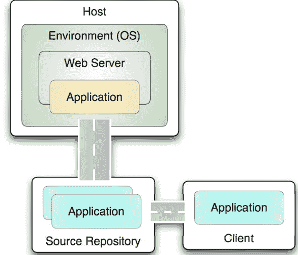

### 2.1 形势概览

对基本部署图的首次增强如图 2.1 所示。以下列表说明了你在本章中需要完成的任务：

- 设置源代码管理。如果尚未完成，设置源代码管理将使你的部署工作大大简化，并提升开发体验。
- 准备应用程序配置和性能。你将对应用程序进行一些简单修改，或者更好的做法是，从一开始就正确构建它。

Rails 的三种环境——开发、测试和生产——将使你能够轻松地为部署隔离配置。其余的只是常识。一切都始于源代码管理。

### 2.2 源代码管理

良好的部署策略总是始于坚实的基础。我希望能够每次都将相同的应用程序部署到我的服务器上，并获得一致的结果。这意味着我需要能够从中央源拉取特定版本的应用程序。低于这个标准就无法获得可靠、可重复的结果。幸运的是，Rails 会自动处理大量部署脚本，但前提是你使用了与其他 Rails 开发者相同的基础设施。

除非你有充分的理由使用其他工具，否则你应该使用 Subversion 来管理应用程序的源代码。大多数 Rails 开发者都在使用它，Rails 团队用它来管理 Rails 本身，Rails 的插件系统也使用它。《使用 Subversion 进行版本控制》[PCS F04] 是一本关于 Subversion 的优秀书籍。你还应该看看《Pragmatic Version Control》[Mas05]，它提供了关于任何语言源代码控制的实用观点。在本章中，我将假设你已经安装并运行了 Subversion。

#### Rails 中的 Subversion

在 Rails 中使用 Subversion 的关键是保持正确的目录结构。你需要将正确的文件置于版本控制之下，并将错误的文件排除在外。从一开始就正确设置应用程序仓库将为你节省时间和减少挫折。

Rails 应用程序中有许多项目不属于版本控制。许多新的 Rails 开发者会不小心覆盖团队的 `database.yml` 文件，或提交一个 5MB 的日志文件。这两个问题都源于 Subversion 的设置，而不是 Rails 或 Rails 开发者本身。

在最佳设置中，每个开发者都应有自己的 `database.yml` 文件和日志文件。你的应用程序的每个开发或生产实例都会有自己的这些文件版本，因此它们需要排除在代码仓库之外。你可能已经有一个 Subversion 仓库，但我会假设你没有，并带你从头完成整个过程。

#### 创建仓库

首先，为你的 Rails 项目创建一个新的 Subversion 仓库。登录到将托管 Subversion 仓库的服务器。为你的仓库创建一个目录，并让 Subversion 知道它：

```bash
$ svnadmin create /home/ezra/svn
```

Subversion 的作者建议在根目录下为所有仓库创建三个文件夹：`trunk`、`tags` 和 `branches`。如果你的仓库中只有一个项目，这种设置效果最佳。¹

你不必创建顶层文件夹才能让 Subversion 工作，但我建议你这样做。我见过的较好的 Subversion 仓库都遵循这个约定，如果你的仓库中只有一个项目，这种方法可以让你随意创建标签和分支。以下命令将创建你的初始目录结构：

```bash
$ svn mkdir --message="Initial project layout" \
    file:///home/ezra/svn/trunk file:///home/ezra/svn/tags \
    file:///home/ezra/svn/branches
Committed revision 1.
```

#### 导入一个简单的 Rails 应用程序

我建议你先用一个空的 Rails 项目来练习。照常创建 Rails 应用程序：²

```bash
$ rails ~/deployit
        create
        create  app/controllers
        ...
```

此时，你可以执行 `svn import` 将整个目录树放入仓库。我建议不要这样做。如果你改用“就地导入”过程，你可以选择性地提交你想要的部分，而不是整个目录树。有关详细信息，请参阅 Subversion 的“如何进行就地导入”常见问题解答。

通过将 `trunk` 检出到你要导入的文件夹来开始就地导入：

```bash
$ svn checkout file:///home/ezra/svn/trunk ~/deployit
Checked out revision 1.
$ cd ~/deployit
```

接下来，将整个目录树添加到工作副本中。最初的结果与 `svn import` 没有不同，只是所有更改都是本地于工作副本的，你可以在提交前选择性地还原你不想要进入仓库的文件和文件夹。最终结果是可以更方便地控制哪些内容真正成为仓库的一部分。我们使用带有 `--force` 选项的 `svn import`，否则 Subversion 会报错，提示当前目录已处于版本控制之下。

1. 这在 Subversion 手册的“选择仓库布局”中有更详细的解释。
2. 如果你有一个现有的项目想要导入 Subversion，只需跳过此步骤。所有其他步骤都是相同的。

现在，像这样添加你的 Rails 项目：

```bash
$ svn add . --force
A         app
...
A         README
```

Rails 命令会很有帮助地创建大部分目录树。由于我稍后会在所有 Rails 项目中使用迁移，我立即创建了 `db/migrate` 文件夹。Rails 在需要时也会创建 `tmp` 文件夹。为了完整起见，我会立即创建这两个文件夹：

```bash
$ svn mkdir db/migrate tmp
A         db/migrate
A         tmp
```

#### 从版本控制中移除日志文件

此时，Subversion 会自动跟踪所有日志文件的更改。然后某个周五晚上 6:30，某个疲惫不堪的开发者可能会不小心提交一个大得离谱的日志文件，其他开发者会抱怨检出时间太长。为了减轻我们的负担，最简单的办法是告诉 Subversion 忽略任何日志文件：

```bash
$ svn revert log/*
Reverted 'log/development.log'
Reverted 'log/production.log'
Reverted 'log/server.log'
Reverted 'log/test.log'

$ svn propset svn:ignore "*.log" log
property 'svn:ignore' set on 'log'
```

就是这样。下一站：`database.yml`。

#### 管理数据库配置

由于 `database.yml` 文件对每个开发者可能不同，你不想因为不小心提交它而造成混乱。相反，你会在仓库中放一个该文件的示例，这样每个开发者都会有一个自己安全忽略的 `database.yml` 文件。以下命令可以实现：

```bash
$ svn revert config/database.yml
Reverted 'config/database.yml'

$ mv config/database.yml config/database.yml.sample
$ svn add config/database.yml.sample
A         config/database.yml.sample
```

```bash
$ svn propset svn:ignore "database.yml" config
property 'svn:ignore' set on 'config'
$ cp config/database.yml.sample config/database.yml
$ svn status --non-recursive config/
A       config
A       config/routes.rb
A       config/database.yml.sample
A       config/boot.rb
A       config/environment.rb
A       config/environments
```

较新版本的 Rails 可能已经包含其中一些文件。对于想要替换且可能已经在版本控制下的文件，请使用带有 `--force` 选项的 `svn add`。如果你采用这种方法，请确保你进行了沟通。

由于你可能会对 `database.yml.sample` 进行任何更改，其他开发人员可能无法注意到这些变化。不过在大多数情况下，示例文件不会改变，保持“原样”即可。或者，你可以将示例文件命名为 `database.sample.yml`，以便你的编辑器能够识别语法高亮。

#### 测试期间的数据库结构 Dump

当你运行测试时，Rails 会将开发数据库的结构 dump 到 `db/schema.rb` 中。³

#### 管理 `tmp`、`documentation`、`scripts` 和 `public`

Rails 1.1 及以上版本现在有一个 `tmp` 文件夹。该文件夹仅存放临时文件，如 socket、session 和缓存文件。请忽略其中的所有内容：

```bash
$ svn propset svn:ignore "*" tmp
property 'svn:ignore' set on 'tmp'
```

`doc` 文件夹包含许多子文件夹：例如 `appdoc` 和 `apidoc`。为了简单起见，只需忽略任何以 `doc` 结尾的内容：

```bash
$ svn propset svn:ignore "doc" doc
property 'svn:ignore' set on 'doc'
```

Subversion 还有一个用于标识可执行文件的属性。请在那些你可能会从命令行运行的文件上设置该属性。

> 3. 如果名为 `config.active_record.schema_format` 的 Active Record 配置变量被设置为 `:sql`，该文件将被命名为 `development_structure.sql`。在命令中直接将 `schema.rb` 替换为 `development_structure.sql` 即可。

### Joe 问……

#### 部署的 `database.yml` 文件怎么办？

使用模板文件技术意味着 `database.yml` 文件在你的生产服务器上不在版本控制之下。这里有几种解决方案：

- 使用分支进行部署，并在该分支中将 `database.yml` 纳入版本控制。关于如何操作，请参阅第 28 页的第 2.2 节“使用稳定分支进行部署”。
- 让 Capistrano 在每次部署时将文件向前复制。我在第 112 页的第 5.5 节“使用内置回调”中讨论了此方案，并在第 92 页的第 5 章“Capistrano”中讨论了 Capistrano。
- 你可以将 `database.yml` 文件留在服务器的共享目录中。然后你可以创建指向该文件的符号链接。最好在 Capistrano 的 `after_update_code` 任务中创建此符号链接。我们稍后会详细讨论 Capistrano，但现在，你可以快速浏览一下以下 Capistrano 任务以满足好奇心：

```ruby
task :after_update_code, :roles => :app,
  :except => {:no_symlink => true} do
  run <<-CMD
    cd #{release_path} &&
    ln -nfs #{shared_path}/config/database.yml \
      #{release_path}/config/database.yml &&
    ln -nfs #{shared_path}/config/mongrel_cluster.yml \
      #{release_path}/config/mongrel_cluster.yml
  CMD
end
```

Rails Engines 在启动时会将一些文件复制到 `public` 目录下。由于你不希望在 `svn status` 中看到这些文件，你应该忽略它们：

```bash
$ svn propset svn:ignore "engine_files" public
property 'svn:ignore' set on 'public'
```

在 *nix 系统上，你必须在命令行中指定每个文件：

```bash
$ svn propset svn:executable "*" \
`find script -type f | grep -v '.svn'` public/dispatch.*
property 'svn:executable' set on 'script/performance/benchmarker'
...
property 'svn:executable' set on 'public/dispatch.fcgi'
```

在 Windows 系统上，请执行以下操作：


```text
C:\deployit> svn propset svn:executable script\performance\* \*+
                script\process\* script\about script\breakpointeer \*+
                script\console script\destroy script\generate script\plugin \*+
                script\runner script\server public/dispatch.*
property 'svn:executable' set on 'script/performance/benchmarker'
...
property 'svn:executable' set on 'public/dispatch.fcgi'
```

由于我将在 Unix/Linux 机器上部署，因此让分发器（dispatchers）使用正确的行尾符是有意义的。为此，将 `svn:eol-style` 设置为 `native`，让 Subversion 根据本地惯例管理行尾符：

```text
$ svn propset svn:eol-style native public/dispatch.*
property 'svn:eol-style' set on 'public/dispatch.cgi'
...
```

最后但同样重要的是，项目通常有一个由 Rails action 提供的默认主页。这意味着需要构建一个路由并删除 `public/index.html`：

```text
$ svn revert public/index.html
Reverted 'public/index.html'

$ rm public/index.html
```

### Capistrano 和稳定分支部署

我们将在书的后面详细讨论 Capistrano。但现在，请记住 Capistrano 确实可以从 trunk 或任何分支进行部署。例如，在使用稳定分支部署时，`deploy.rb` 的仓库行如下所示：

```ruby
set :repository,
  "http://yoursvnserver.com/deployit/branches/stable"
```

### 保存你的工作

在完成所有这些更改后，将你的工作提交到仓库：

```text
$ svn commit --message="Initial project checkin"
Adding         README
...
Adding         vendor/plugins
Transmitting file data ............................
Committed revision 2.
```

### 使用稳定分支进行部署

许多简单的应用程序直接在 trunk 上运行。而其他开发者则会觉得从稳定分支部署更放心。有几本优秀的书籍比我能更好地讲解这个话题，但我希望让你对其中涉及的内容有所了解。关于此话题的详细信息，你应该阅读 *Pragmatic Version Control* [Mas05]。

你在 trunk 上所做的更改可能还没有经过完整测试，或者当你收到紧急 Bug 报告时，你可能正处于重大重构的中途。你需要能够部署一个已修复版本的应用程序，而无需部署自上次部署以来所有的更改。在 Subversion 中，你可以将一个开发分支复制为另一个名称，并设置 Capistrano 从你的稳定分支而非开发分支进行部署。开发人员将这种技术称为 *稳定分支部署*。

让我们创建稳定分支，它将是 trunk 的一个副本：

```text
$ svn copy --message "Create the stable branch" ⤆
  file:///home/ezra/deployit/trunk           ⤆
  file:///home/ezra/deployit/branches/stable
Committed revision 234.
```

当你准备将一组更改合并到稳定分支时，请检查分支上的最后一条提交信息，以了解需要合并哪些修订版本：

```text
$ svn log --revision HEAD:1 --limit 1 \
      file:///home/ezra/deployit/branches/stable
------------------------------------------------------------------------
r422 | ezra | 2007-05-30 21:30:27 -0500 (30 may 2007) | 1 line

Merged r406:421 from trunk/
------------------------------------------------------------------------
```

利用日志信息中的数据，你现在可以将所有更改合并到分支：

```text
$ svn merge --revision 422:436 \
      file:///home/ezra/deployit/trunk .
A   app/models/category.rb
M   app/models/forum.rb
A   db/migrate/009_create_category.rb
...
```

最后，提交并部署：

```text
$ svn commit --message "Merged r422:436 from trunk/"
A   app/models/category.rb
...
Transmitting file data ....
Committed revision 437.

$ cap deploy_with_migrations
...
```

现在你拥有了一个良好的 Subversion 仓库，并且可以使用它进行部署。你已经忽略了那些可能会挫败开发人员意志或破坏应用程序的文件，并且使用了通用的 Rails 惯例。尽管如此，你仍然应该了解一些关于在考虑成功部署的情况下使用 Subversion 进行开发的事情。我想为你介绍一些在使用 Subversion 配合 Rails 时可以使用的技巧。

## 2.3 Subversion 技巧

既然你的仓库已经运行起来了，我将分享一些在日常编码中使用 Subversion 的快速技巧。我将教你如何通过外部链接链接到 Edge Rails，如何生成自动签入（check in）的代码，以及如何实现其他一些小技巧。

### 运行 Edge Rails

如果你和我一样，喜欢紧跟 Rails trunk 或 Edge Rails 的最新变化，你可以使用 `svn:externals` 来在最新功能添加时立即获取它们。

通过运行以下命令设置 vendor 目录的 `svn:externals` 属性，可以让 Edge Rails 在你更新工作副本时自动更新：

```text
$ svn propedit svn:externals vendor
```

当编辑器打开允许你设置 `svn:externals` 属性时，添加这一行：

```text
rails http://dev.rubyonrails.org/svn/rails/trunk/
```

下次更新时，Subversion 将为你把整个 Rails trunk 目录下载到 `vendor/rails` 中。

如果你想取消该选项，在 Subversion 1.2 及以上版本中可以使用以下命令：

```text
$ svn update --ignore-externals
```

Edge Rails 拥有所有最先进的功能，但有时不稳定。请确保你拥有一套相当完整的单元测试、功能测试和集成测试，以捕捉 Edge Rails 可能会引入的任何 Bug。不要忘记向 Rails-core 邮件列表报告任何损坏，和/或在 Rails Trac (`http://dev.rubyonrails.org/`) 上创建 ticket。报告 Bug 时，你应该始终报告当时使用的 Rails 修订版本：

```text
$ svnversion vendor/rails
4077
```

### 提交生成的代码

在正常的 Rails 开发过程中，你会使用生成器（generators）创建许多新文件。某些生成的文件不应进入代码库。一般来说，如果 Rails 在运行时从零开始生成一个文件，你就不需要将其提交。如果你需要编辑一个生成的文件，那么你应该将其提交。

每当你构建脚手架（scaffold）时，你会希望将生成的文件添加到 Subversion。在文件创建时就将它们添加进去可以节省时间。当你使用 `script/generate` 命令创建新文件时，Rails 让这件事变得很简单。只需添加 `--svn` 标志。Rails 将生成文件并自动为你执行 `svn add`，如下所示：

```text
$ script/generate scaffold --svn Post
        exists  app/controllers/
        exists  app/helpers/
        create  app/views/posts
A       app/views/posts
        exists  test/functional/
dependency model
        exists  app/models/
        exists  test/unit/
        exists  test/fixtures/
        create  app/models/post.rb
A       app/models/post.rb
...
```

## 2.4 稳定你的应用程序

Rails 在开发模式且仅有一个用户时，是一个相当宽容的应用框架。当你将应用程序推送到生产服务器时，无论它是否准备好，它都变成了真正的生产软件。本节将引导你完成一些可以稳定应用程序的操作。

### 锁定插件和 Gem

你可能在本地机器上安装一次第三方 gem 之后就忘了它们。除非你想要一个修复了 Bug 的后续版本，或者需要新 gem 的功能，否则你不需要执行任何操作。

共享主机（Shared hosts）的情况则不同，因为它们经常在你不经意间升级 gem，这可能会在你能想象到的最尴尬的时刻搞崩溃你的应用程序。为了防止这种不幸的情况发生在你的身上，请将每个依赖项复制到 vendor。像这样将每个 gem 解包到 vendor：

```text
$ cd vendor
$ gem unpack money
Unpacked gem: 'money-1.5.9'
$ ls
money-1.5.9  plugins  rails
```

Gem 都位于一个 lib 文件夹中。要将你的 gem 纳入版本控制，你只需要将该 lib 文件夹的内容复制到 vendor，如下所示：

```text
$ cp -R money-1.5.9/lib/* .
$ cp money-1.5.9/MIT-LICENSE LICENSE-money
$ rm -Rf money-1.5.9/
$ ls
LICENSE-money  bank  money  money.rb  plugins  rails  support
```

请确保你也遵守你的许可证协议。例如，为了符合前一个 gem 的许可证，你还需要将许可证随代码一起复制。接下来，添加并提交新文件：

```text
$ svn add --force *
A         LICENSE-money
...
A         support/cattr_accessor.rb
```

```text
$ svn commit --message="Imported Money library 1.5.9"
Adding         LICENSE-money
...
Transmitting file data .......
Committed revision 4.
```

### 升级解包后的 Gem

当你准备将新版本的 gem 集成到应用程序中时，基本上遵循相同的步骤：

```text
$ gem unpack money
Unpacked gem: 'money-1.7.1'
$ cp -Rf money-1.7.1/lib/* .
$ cp -f money-1.7.1/MIT-LICENSE LICENSE-money
$ rm -Rf money-1.7.1
$ svn status
M    money/core_extensions.rb
M    money/money.rb
X    rails
$ svn commit --message="Upgraded Money to 1.7.1"
Sending        money/core_extensions.rb
Sending        money/money.rb
Transmitting file data ..
Committed revision 5.
```

如果库提供者删除或移动了文件，你也需要执行同样的操作。查看库的发行说明（release notes）以了解任何向后兼容性的要求。一个可以自动导入库新版本的绝佳工具是 `svn_load_dirs.pl` (`http://svn.collab.net/repos/svn/trunk/contrib/client-side/`)。

### 冻结 Rails Gems

即使是新版本的 Rails 也可能破坏向后兼容性。Bruce 的共享主机曾在他在西班牙参加 Java 会议并发表 Ruby 演讲期间升级到了 Rails 1.1。新版本立即导致他的博客崩溃，这已经够糟糕了。你可以想象，博客的崩溃让他几乎不可能去赞美 Rails 的优点。

经过数十年的密集治疗，他终于从这次事件中恢复过来，并因此变成了一个更好的人。你可以通过将 Rails 库的副本冻结到应用的 vendor 目录中来防止这种情况发生。你的应用程序将使用以下版本的 Rails：

- *你在设计应用程序时所考虑的版本。* 某些版本的 Rails 之间存在哲学差异，例如 1.2 引入的新表单模型，更不用说 Rails 2.0 中的重大变化。
- *你用于测试应用程序的版本。* 如果你不冻结 Rails gems，你基本上是在说你不需要测试数千行代码将如何与你的应用程序协同工作。如果你做出这样的选择，我不建议你进行任何前往伦敦的长途旅行。
- *你理解的版本。* Rails 是一个活跃的框架。在部署之前，你需要确保对框架的变化有很好的把握。

当你升级到较新版本的 Rails 时，你可以集成你的应用程序，进行测试，然后将其重新冻结到 vendor 目录：

```text
local$ rake rails:freeze:gems
```

如果你来自 C、Java 或 C# 平台，你可能会惊讶于 Ruby gems 经常破坏向后兼容性。事实上，这个决定是一把双刃剑。如果你不尊重向后兼容性，你的应用程序可能会崩溃，但它也有好处。打破向后兼容性允许你的框架进化得更快、更干净，而没有框架臃肿的风险。（请参阅 Enterprise JavaBeans 或 XML 作为两个例子。）Ruby，尤其是 Rails 开发者，认为干净的代码库比向后兼容性更重要。随着越来越多的企业级开发者使用 Rails，你可能会看到变化，但永远不要依赖一个可以让你的应用程序在没有自有 Rails 版本的情况下安全运行的未来。有了版本化的代码和 gems，你可以开始组织你的迁移（migrations）了。

## 2.5 Active Record 迁移

迁移（Migrations）是 Rails 的一项功能，它允许你使用 Ruby 而不是 SQL 来表达数据库表，是管理整个开发过程中数据库模式（schema）的绝佳方式。你可以快速创建、更改或删除表和索引。如果你已经在使用迁移，我将向你展示如何为生产环境优化它们。如果你正在决定是否使用它们，你应该了解这种方法的优缺点。

### 迁移的优缺点

从积极的一面来看，迁移通常提供一个更舒适的环境，并简化了保持生产模式更新的过程。具体来说：

- 迁移*允许你使用 Ruby 而不是 SQL 来表达与数据库无关的代码*。因为你在使用 Ruby，你通常可以用更干净、更简单的方式表达你的想法。
- 迁移*与 Rake（以及在较小程度上与 Capistrano）集成*。你可以调用 Rake 命令将你的迁移提升到精确的级别，或将模式回滚到某个时间点。你还可以要求 Capistrano 在部署时自动运行迁移。
- 迁移*处理数据*。一些数据库模式的更改需要数据的更改。由于迁移是 Ruby 脚本，它们可以同时处理这两者。为新列设置数据、选择性地添加或删除行，或定义查找表，都是在迁移中处理数据的例子。
- 迁移*简化了备份*。Rails 开发者和其他人一样会犯错。如果你最新的构建是个糟糕的版本且更改了模式，迁移可以让你快速回滚。
- 迁移*使得在不丢失数据的情况下更改模式变得容易*。由于迁移使用 `ALTER TABLE` 命令而不是 `CREATE` 和 `DROP table`，你可以轻松地对模式进行更改而不用担心丢失生产数据。此外，你可以使用相同的工具来管理你的开发和生产模式。

请记住，迁移并非万能药。有些团队能让它发挥作用，而有些团队则不能。通常，采用简单部署策略的小团队使用迁移会非常顺畅。

大型团队、管理多次发布的团队，或定期重构模型代码并同时使用数据迁移的团队将会面临困难。以下是迁移的一些缺点：

- *迁移无法与 Subversion 集成。* 如果一个较旧的迁移依赖于某个特定的模型，而该模型已不复存在，则迁移将会失败。Subversion 中的源代码历史与存在于你最新 Subversion 版本中的数据库模式历史之间没有有效的链接。
- *迁移有一些令人困惑的默认设置。* 默认情况下，列允许为空。我的经验表明，大多数开发者直到为时已晚才会考虑空值列，从而导致后续的数据库完整性问题。
- *所有开发者都依赖于统一的编号方案，但没有工具来管理它们。* 如果你创建了一个迁移，而你的朋友同时也创建了一个，他们将拥有相同的编号，并且迁移将会失败。


- 分支难以管理。如果你想添加一个主要分支，也许是为了开发一个重大的新功能，直到稳定后才将其部署到生产环境，你实际上需要编写自己的迁移支持来实现这一点，因为应用程序的每个部分都需要自己的迁移。
- 组件很难依赖迁移。尝试将现有的博客集成到现有的应用程序中，你就会明白我的意思。迁移没有提供一个良好的默认设置来解决这个问题。

在大多数情况下，我喜欢迁移。它们在大多数时候都很快速便捷，如果你能让它们与你的团队模型协同工作，你通常会很高兴你这样做了。如果你已经决定使用迁移，一定要看看这些缺点并理解它们。你会希望在迁移在生产环境中爆炸之前，解决你可能面临的问题。

### 初识迁移

无论你是否已经定义了模式，或者你正在开始一个新项目，你都可以轻松地开始使用迁移。如果你已经有了一个模式，你会发现 Rails 有一些很好的工具可以帮助你进行转换。

假设你在 MySQL 数据库中定义了一个 `forums` 表，SQL 如下所示：

```sql
CREATE TABLE `forums` (
  `id` int(11) NOT NULL auto_increment,
  `parent_id` int(11) NOT NULL default '0',
  `title` varchar(200) NOT NULL default '',
  `body` text NOT NULL,
  `created_at` datetime default NULL,
  `updated_at` datetime default NULL,
  `forums_count` int(11) NOT NULL default '0',
  PRIMARY KEY  (`id`)
) TYPE=InnoDB;
```

要开始使用纯 Ruby 模式，Rails 包含了一个方便的 Rake 任务来启动你的迁移（双关语）。从你的应用程序根目录运行此命令：

```bash
$ rake db:schema:dump
```

此命令将创建一个如下所示的 `schema.rb` 文件：

```ruby
# This file is autogenerated. Instead of editing this file, please use the
# migrations feature of ActiveRecord to incrementally modify your database, and
# then regenerate this schema definition.

ActiveRecord::Schema.define() do

  create_table "forums", :force => true do |t|
    t.column "parent_id", :integer, :default => 0, :null => false
    t.column "title", :string, :limit => 200, :default => "", :null => false
    t.column "body", :text, :default => "", :null => false
    t.column "created_at", :datetime
    t.column "updated_at", :datetime
    t.column "forums_count", :integer, :default => 0, :null => false
  end

end
```

有了 `db/schema.rb` 文件，你就可以开始编写迁移了。Rails 会将每个更改应用到你的初始 `schema.rb` 文件。你永远不需要直接编辑此文件，因为 Rails 会在每次迁移模式后生成一个新的文件。最初，你需要将初始文件复制到你的测试和生产环境中。

`db/schema.rb` 作为每次迁移的起点。该文件在任何时间点都保存着你的整个数据库模式，便于参考。此外，迁移会创建一个名为 `schema_info` 的表。该表包含一个版本列，其中有一行和一个数字：你上次运行的迁移的版本号。每个迁移都是以数字开头的 Ruby 文件。迁移有一个 `up()` 方法和一个 `down()` 方法。向上迁移从 `schema.rb` 开始，并按顺序应用比 `schema_info` 中数字更大的迁移。向下迁移将应用数字更小的迁移，最大的先应用。

所以现在你有了一个 `schema.rb` 文件，你就拥有了一切可以随心所欲地创建迁移的条件。你的第一个迁移将为你创建 `schema_info`。我不想在这里教你如何构建 Rails 应用程序，因为 Rails 文档相当完整。我确实想确保你知道足够多的知识以避免麻烦。

### 将类放入迁移中

优秀的 Rails 开发者通常不会在迁移中依赖领域模型对象。五周后，那个 `Forum` 模型可能甚至都不存在了。然而，一些数据迁移会依赖于模型，所以你需要在迁移内部直接创建模型实例：

```ruby
class CleanupForumMessages < ActiveRecord::Migration
  class Forum < ActiveRecord::Base
    has_many :messages, :class_name => 'CleanupForumMessages::Message'
  end

  class Message < ActiveRecord::Base
    def cleanup!
      # cleanup the message
      self.save!
    end
  end

  def self.up
    Forum.find(:all).each do |forum|
      forum.messages.each do |message|
        message.cleanup!
      end
    end
  end

  def self.down
  end
end
```

注意，我在迁移本身中声明了所需的每个类，这就像一个模块。

确保你使用 `has_many`（`has_one()`、`belongs_to()` 和 `has_and_belongs_to_many()`）的 `class_name` 功能，因为 Rails 默认使用顶级命名空间，而不是当前作用域来查找关联类。如果你不使用 `class_name`，Rails 会在你尝试使用关联时抛出 `AssociationTypeMismatch` 错误。

这个解决方案并不完美。你引入了重复代码，而且像单表继承这样的功能会变得麻烦，因为你需要在迁移中声明每一个子类。优秀的开发者在睡梦中也能听到“DRY”（不要重复自己）这个词。然而，你的目标不是保持两个版本的模型类同步。你只是捕捉了类在今天存在的关键功能的快照。你不一定需要复制整个类。你只需要复制你打算使用的功能。⁶

### 更多迁移技巧

在处理迁移时，你应该记住其他一些事情。这些技巧应该会改善你的体验：

- **保持迁移简短。** 你不应该将许多不同的操作分组在一起，因为如果你的迁移成功了一半，回滚将变得非常困难。或者，如果你的数据库引擎支持事务中的 DDL 语句（如 `CREATE` 和 `ALTER TABLE`），你可以在事务中包含你的迁移。PostgreSQL 支持；MySQL 不支持。
- **确保你正确识别可为空的列。** 列默认是可为空的。这可能不是你对所有列想要的行为。Rails 迁移的默认设置可能是错误的。

这个技巧列表绝不是详尽无遗的，但它应该能让你有一个良好的开端。现在，是时候转向关注改进应用程序的其余部分了。

## 2.6 部署的应用程序问题

Rails 是一个对开发者来说很方便的框架。有时，这种便利可以对你有利。你可以快速构建，而且 Ruby 足够灵活，可以让你绕过框架工作。但如果你不小心，所有这些灵活性可能会反咬你一口。在本节中，我将引导你了解一些常见的安全问题和一些性能问题。

### 安全问题

Rails 具有基于动态语言的其他 Web 框架的安全特性。有些元素会对 Rails 有利。你无法保护你不理解的东西。这个框架非常简单，Web 开发专家已经很好地理解了核心基础设施。但 Rails 有一些你需要密切关注的特性。

Rails 是一种动态的、解释型的语言。你需要确保你不会将输入作为代码来执行，并且使用 Rails 提供的可以保护你的工具。

### 使用视图辅助程序

你可能知道 Rails 视图是如何工作的。像大多数 Web 框架一样，Rails 将脚本语言集成到 HTML 中。你可以使用 `<%= your_code_here %>` 将代码放入 Rails。Rails 会忠实地渲染你可能提供的任何字符串，包括名称、有用的 HTML 格式化标签或像这样的恶意 HTML 代码：

```html

```

你可以很容易地通过使用模板辅助程序来防止这个问题。如果你用 `<%=h your_code_here %>` 包裹你的代码，Rails 将转义恶意用户可能提供的任何 HTML 代码。

### 不要评估输入

同时，你需要确保不将任何用户可能键入的输入作为代码来执行。Ruby 是一种很棒的脚本语言，但每次尝试执行任何代码时，你都应该小心，并且你永远不应该执行用户输入。例如，考虑以下代码，它假设你正在从选择框中挑选属性名称：

```ruby
def update
    ...
    # Don't do this! Potential injection attack
    string = "The value of the attribute is " +
             "#{Person.send(param[:attribute])}"
    ...
end
```

> 6. 感谢 Tim Lucas 的原始博客文章：http://toolmantim.com/article/2006/2/23/migrating_with_models。

这段代码完全可以正常工作，只要用户配合你，从下拉框中选择 `"first_name"` 或 `"email"` 即可。但如果一个 Rails 开发者想要攻击你的系统，他可以通过开启一个 `curl` 会话向你的控制器发送自定义数据。或者，如果你没有验证该命令是否为 `post` 请求，他只需在 URL 中输入以下内容即可：

```text
your_url.com/update/4?attribute=destroy_all
```

假设所有用户输入都是不可信的。并非所有元编程都是好的。在你没有先对数据进行清洗之前，永远不要执行来自用户的任何数据。

### 不要执行 SQL

你可能会在 SQL 中犯类似的错误。假设你想通过用户 ID 和密码查找用户。你可能会执行以下 Active Record 命令：

```ruby
# Don't do this!
condition = "users.password = #{params[:password]} and
            users.login = #{params[:login]}"
@user = find(:conditions => condition)
```

一切正常。至少，在有人输入以下内容替代密码之前，一切正常：

```sql
up yours'; drop database deployit_production;
```

第一个分号结束了第一条 SQL 语句。然后，攻击者趁机执行自己的恶意操作，删除了生产数据库。另一种攻击方式是尝试创建一个具有更高权限的用户。这种被称为 `SQL injection`（SQL 注入）的攻击方式正日益突出。你可以通过如下编写条件来轻松防止此类攻击：

```ruby
conditions = ["users.login = ? and users.password = ?",
                params[:login], params[:password]]
@user = find(:conditions => conditions)
```

这种带条件的 finder 形式允许 Rails 正确处理：对 Active Record 将要传递给数据库的所有参数和输入进行适当的转义。

### 检查权限

Rails 在构建美观的 URL 方面给了开发者很大的帮助。坏消息是，那些想要攻击 Rails 的人也深知这一点。考虑以下操作，它通常通过脚手架生成：

```ruby
def destroy
  Person.find(params[:id]).destroy
  redirect_to :action => 'list'
end
```

为了保护该命令，你决定在控制器顶部添加 `before_filter :login_required`，这意味着人们需要登录才能访问 `destroy()` 方法。对于只有管理员才能删除的应用程序来说，这种保护已经足够。但如果任何用户都可以创建账户并登录，这种保护就远远不够了。任何用户都可以创建账户，然后通过在浏览器中依次输入 ID 号来开始删除记录：

- `/people/destroy/1`
- `/people/destroy/2`
- `/people/destroy/3`
- `/people/destroy/4`
- `/people/destroy/5`
- `/people/destroy/6`
- `/people/destroy/7`
- ...

更糟糕的是，一个机器人可以登录并删除你的所有记录。你需要在控制器操作中检查登录用户是否有权限删除文件。假设每个 `Person` 对象都与创建它的 `User` 关联，并且 `current_user` 返回当前登录的用户。那么，你可以这样保护 `destroy()`：

```ruby
def destroy
  person = Person.find(params[:id])
  person.destroy if current_user == person.user
  redirect_to :action => 'list'
end
```

仅靠登录是不够的。你必须将各个破坏性操作限定到特定用户。这涵盖了最常见的安全漏洞。还有其他漏洞，例如将你的 `.svn` 目录暴露在 Web 上。解决这个问题最简单的方法是在将代码部署到生产环境时使用 `svn export` 而不是 `svn checkout`。这将导出你的代码而不包含 Subversion 元数据，防止窥探。

如果你注意了这些各种问题，那么你的 Rails 应该是安全可靠的。请务必关注 Rails 主博客；访问 [http://weblog.rubyonrails.org/](http://weblog.rubyonrails.org/) 查看任何安全更新或警告。

### 数据库性能问题

Active Record 属于一类被称为包装框架的数据库框架。包装框架从单个表开始，在其周围包装一层，使面向对象的应用程序能够方便地访问表中的行。像 Active Record 这样的包装系统的性能在很大程度上取决于你——程序员。你能做的最重要的事情是对应用程序进行基准测试。我们将在第 9 章性能（第 224 页）中讨论基准测试。在此之前，我将向你展示你可能遇到的最常见问题。

### N + 1 问题

Active Record 使得检索给定对象并访问其属性变得简单。当这些属性是其他 Active Record 对象的列表时，问题就来了。假设你正在构建下一个伟大的社交网络站点。你有一个 `Person`，它有 `has_many :friends`。为了填充好友列表，你编写了如下看似无害的代码：

```ruby
friends = Person.find(:all, :conditions => some_friend_conditions)
@friend_addresses = person.friends.collect {|friend| friend.address.street }
```

确实，这段代码可以工作，但它也非常低效，而且随着好友列表的增长会越来越差。你实际上在为好友列表运行一个 Active Record 查询，又为每个需要获取的地址运行另一个查询。你可以通过使用急切关联来解决这个问题，即使用 `:include` 选项预先告诉 Active Record 加载什么：

```ruby
friends = Person.find(:all, :conditions => some_friend_conditions,
                        :include => :address)
@friend_addresses = person.friends.collect {|friend| friend.address.street }
```

这段代码对你来说运行方式相同，但性能将大幅提升。Active Record 将加载所有人员及其地址，而不是在第一个查询中只加载人员，在你第一次访问时再加载地址。

### 索引

Rails 让数据库开发者无需了解底层数据库甚至关系数据库理论就能走得很远。如果你完全依赖 Active Record 来为你打理一切，那么你和你的用户很可能会失望。编写 Rails 代码时最容易忘记的事情之一就是创建索引。对于任何大型表，请确保在你需要搜索的任何列上创建索引。并且你应该定期运行统计信息，以便数据库优化器知道何时使用索引。数据库管理性能技术超出了本书的范围。

### 寻找起步之所

## 第 3 章 共享主机

为你的第一个 Rails 应用寻找主机，就像寻找你的第一个家一样。当我第一次离开家时，我想直接搬进城堡，但现实并非如此。大多数人首先搬进公寓或宿舍。诚然，公寓没有自己的王座室和仆人区，但它们有自己的优势。你与许多人共享公共资源和基础设施，因此最终花费更少。你不必修剪草坪或粉刷栅栏。对大多数人来说，第一个 Rails 应用也在类似的原因下运行在简陋的环境中：共享基础设施、更低的成本以及维护帮助。在本章中，你将学习如何选择和准备共享主机。

### 3.1 形势概览


许多 Rails 应用最初运行在共享服务器上，如图 3.1 所示（见下一页）。你将购买一台更大服务器的一小部分切片，它能够托管你的 Rails 应用和静态内容。你只能控制几个用于应用的目录。你将使用 Subversion 安装应用，同时建立初始基础设施，直到你准备好使用 Capistrano 进行自动化部署。每月只需几美元，你就能拥有自己的域名、数据库服务器访问权限、多个电子邮件账户，甚至可能还有一个 Subversion 仓库。对许多人来说，这种设置足以运行一个博客、一个站点原型，甚至一个缺陷跟踪系统。

如果你的应用可以使用缓存，有时即使不能，你也可以每天为数百名用户提供服务，而无需每月花费 100 美元购买专用服务器。你的托管公司会修复间歇性问题，偶尔升级你的机器，并保持一切正常运行。

# 图 3.1：共享服务器部署图

平稳运行。当你准备好升级到性能更强大的专用服务器或服务器集群时，可以在托管公司内部升级或转移到主机托管中心。

至少，理论上是这样。共享托管并非一帆风顺。你可能与超过 1,000 个其他网站共享单个服务器。我收到过不少“令人不快的通知”，告知我的应用程序内存失控，或者我那不稳定的应用程序导致整个服务器崩溃。我也曾处于等式另一端。当我是守规矩的用户时，有人运行脚本霸占了服务器资源，导致我的应用程序运行缓慢如龟爬。我也曾因网站人气飙升而收到 500 美元的账单。（现在我更愿意成为账单的发送方，这让我开心多了！）优秀的服务商会监控这些统计数据，并在你使用超出配额时通知你。大多数服务商甚至会给你一段宽限期，并为短期内的小额超额用量买单。

总而言之，在共享服务器上你几乎可以做任何在专用服务器上能做的事情，但你会面临更多资源限制。如果你刚开始学习开发数据库驱动的网站，可以专注于应用机制，而不必担心配置 DNS、守护进程和磁盘分区的细节。即便如此，我建议你将共享托管视为起点，而非应用程序的最终归宿。如果你的网站每月收入超过 830 美元，或者你的业务依赖于它，就应该升级到虚拟专用服务器或专用服务器。

当你寻找新住所时，不能一蹴而就。你必须考虑挑选地点、更改地址、“贿赂”房东所需的时间，还要决定是否保留或丢弃所有那些好东西，比如你旧的 Commodore 64 电脑。搬家需要时间，提前计划能让事情更顺利。设置共享主机也是如此。你的目标是让应用程序在共享主机上运行，但最好定义几个独立的步骤来实现：

1. 找到合适的位置。选择最适合你的应用程序和预算的方案。
2. 告知世界你的位置。在网络上，这意味着更新你的 DNS 记录。
3. 搬入你的物品。对于 Rails 来说，这意味着安装你的应用程序。稍后，我会帮你实现这一步的自动化。
4. 设置你的公用设施。在网络世界里，这意味着配置你的 Web 服务器和数据库服务器以配合你的 Rails 应用。

归根结底，你的设置可能第一次无法正常工作。没关系。我会引导你完成整合所有组件的过程。完成后，你将拥有一份通用服务器资源、一个 Mongrel Web 服务器和一个基于数据库的 Rails 应用程序。

## 3.2 选择共享托管服务

回到 Rails 历史的黎明时期（即 2004 年秋季），只有少数主机官方支持 Ruby on Rails。随着 Rails 知名度的提升，支持它的服务商数量与日俱增。目前有很多优秀的服务商，因此我不推荐任何特定的服务商，但你在选择共享托管服务时应寻找几个关键特性。

### 基本要求

你选择的服务商至少必须具备以下功能：

- Ruby 1.8.6 和 Rails 1.2.6 或 Rails 2.0。
- Mongrel 支持。一些共享主机尚不支持 Mongrel，但已有许多服务商提供支持，Mongrel 正迅速成为 Rails 社区的事实标准。
- 指定 Web 服务器文档根目录的能力。有方法可以绕过此限制，但如果服务商提供一个界面，让你可以将 Web 服务器指向首选目录（例如 `/home/ezra/brainspl.at/current/public`），则会容易得多。
- SSH 访问权限。这对于安装故障排除至关重要，并且是使用 Capistrano 部署所必需的。一些非常廉价的主机仅允许通过 FTP 传输文件，因此请选择提供 SSH 选项的服务商。
- 数据库服务器及连接所需的 Ruby gems。MySQL 和 PostgreSQL 很流行，但你也可以轻松使用基于文件的数据库管理器，如 SQLite。

为了获得最佳的 Rails 设置，我推荐以下特性：

- 操作系统相关的 gems，如 RMagick。这些 gems 可以让你轻松生成图形、创建照片缩略图并执行其他有用任务。你可以将纯 Ruby gems 复制到 Rails 应用程序的 `lib` 目录，但你确实需要托管服务商安装需要编译和 C 库的 gems，因为构建和安装这些 gems 所需的权限通常超出你的账户权限。
- 可通过 HTTP（或安全的 HTTPS）访问的 Subversion 仓库。无论你是专业程序员还是爱好者，都应该使用源代码控制。使用源代码系统，你可以通过 Capistrano 进行部署，或发布 Rails 插件，其他 Rails 开发者可以通过内置的 `./script/plugin` 机制安装。你可以在无数其他场景中使用 Subversion，但在 Rails 应用的环境中，HTTP 访问是最通用的。

### 核心 Rails 库

如果你一直在关注，会发现两个列表中都缺少核心 Rails 库的安装！事实上，使用内置的 Rake 命令 `rake rails:freeze:gems` 将特定版本的 Rails 保存到应用程序的 `vendor` 目录，会提高稳定性。你可以在第 2.4 节《冻结 Rails gems》（第 33 页）中了解更多相关信息。如果你的服务商决定在半夜升级到一个速度极快的新版 Rails——这个版本可能破坏你的应用程序——你的应用程序仍会使用 `vendor` 目录中的旧版本运行。当你针对新版本的 Rails 测试完应用程序后，可以再次调用 `rake rails:freeze:gems` 进行升级。

勇于尝试者可以使用 `rake rails:freeze:otrunk` 来使用 Rails 开发版本的副本（通常称为 *trunk* 版本或 *Edge Rails*）。尽管 Rails 已有近三年历史，但其开发仍在快速进行。Edge Rails 用户可以在公众之前使用新的 Rails 特性。早期使用是一把双刃剑。在享受早期使用新特性带来的好处的同时，也伴随着 API 变更和 bug 的风险。这些问题在使用早期软件时都是固有的。

你也可以将应用程序绑定到最新的 Rails trunk，使其在每次 Rails 开发分支更新时都得到更新，但我不建议这样做，因为这种策略会在部署流程中引入另一个未知因素。Rails 核心团队非常活跃，对 Rails trunk 的更新每天进行数次。你的应用程序可能在 8:05 正常工作，但 8:06 的更新可能在 8:07 部署到服务器时破坏你的应用。保持 Rails 版本的一致性将让你能够按照自己的计划决定何时升级。

如果你安装了其他第三方库或插件，它们可能使用了 Rails 未文档化的特性，这些特性可能在不通知的情况下更改。行为良好的插件会更稳定，但没有任何授权的开发者小组对插件进行认证。通过在应用程序中使用一致的发布版本（或 edge 版本）的 Rails 并结合全面的测试套件，你可以保证应用程序中的代码库组合能通过所有测试。

无论你选择使用 edge 版本还是旧版 Rails，在应用程序内冻结库都有助于简化长期的部署和维护。接下来，我将引导你了解选择共享主机时应考虑的一些无形因素。

### 无形因素

共享主机的声誉参差不齐。你会希望找到一家支持良好、管理严格的共享主机服务商。你可能不喜欢那个过度热心、满脸青春痘的管理员发来的令人不快的电子邮件，它威胁说因为你的应用程序使用了超出配额的资源而要“取缔”你，但他恰恰是你希望管理服务器的人。他也会让共享主机上的其他所有应用守规矩。你还会希望选择一家经验丰富的服务商，如果你的流量偶尔激增，它能给予一定的宽限，而不是在情况超出常规参数时直接终止你的 Mongrel 进程而不发出任何通知。系统维护，如定期备份和日志文件轮转，是一个加分项，因为这样你就不必自己处理。

衡量无形因素的最佳方法是询问周围的人。优秀的 Rails 程序员会知道哪些服务商是好的。我在这里不列出任何具体服务商，因为我本身就是其中之一，但请提前警告。今天最好的服务商——一家价格合理、管理员优秀的服务商——可能会经历无法管理的增长，可能会失去那个让一切像瑞士钟表一样精准运行的关键管理员，或者可能变得懈怠。多问问，保持跟进。你会为此感到高兴。你可以从优秀的 Ruby on Rails wiki¹ 开始，或者在 IRC 上与 Rails 开发者聊天。²

做完功课并选定主机后，你就会开始设置。但首先，你需要告诉世界你的应用程序在哪里。这意味着你需要一个域名，并且需要配置 DNS。

## 3.3 设置你的域名和 DNS

你选择的任何住所都需要一个地址，以便人们能找到你。在互联网上，你将有两个地址：带有数字和点的是你的 IP 地址，以 `.com` 或 `.org` 结尾的名称是你的域名。IP 地址包含四个数字，每个数字的值在 0 到 255 之间，用句点分隔。由于记忆多达十二个纯数字很难记，大多数用户会通过域名来访问你的网站。你需要从 GoDaddy、Network Solutions 或 Enom 等域名服务商购买域名，并从托管服务获取 IP 地址。实际上，域名系统会将你的域名与 IP 地址关联起来。互联网上有多个公共域名注册机构，负责将 IP 地址与域名对应。因此，要建立你的地址，你需要执行以下步骤：

1. 购买域名。他们会提供一个名称以及配置 IP 地址的方式。
2. 选择共享主机服务。他们会提供你的 IP 地址。
3. 将你的域名与 IP 地址关联起来。

购买一个域名通常只需花费 10 美元左右，这意味着最难的部分其实是选择一个合适的名字！我建议选择易于记忆且容易拼写的名字。（希望你的名字比 `EzraZygmuntowicz.com` 更简单！）你可以使用 Instant Domain Search³ 之类的网站来查找尚未被占用的域名。

大多数域名注册商也会提供网页界面来配置你的 DNS 设置。如果找不到修改 DNS 的地方，请联系你的服务提供商咨询 DNS 设置。你需要将 DNS 指向共享主机公司的服务器，这样域名服务器才能将你的域名请求转发到你指定的服务器。

DNS 代表域名系统，负责解析域名并返回实际提供服务的 IP 地址。你的共享托管服务提供商会拥有自己的域名服务器。注册时，请向提供商索取其 DNS 服务器地址，地址通常类似于 `ns1.foobar.com` 和 `ns2.foobar.com`。记下这些地址，前往你注册 `foobar.com` 的域名注册商网站，找到该域名的 DNS 或名称服务器设置部分。通常有多个表单字段需要填写。大多数托管服务提供两个名称服务器，但也可能提供多个。输入这些详细信息并保存后，全球的名称服务器需要 12 到 72 小时来传播你的新记录。DNS 传播完成后，你可以在浏览器中输入 `foobar.com`，域名服务就会找到服务器的 IP 地址，并将你的请求路由到你的域名。

> ³ http://instantdomainsearch.com
>
> **使用托管公司的子域名**
>
> 一些共享主机在你设置网站期间会提供一个子域名，例如 [http://ezmobius.myhost.com](http://ezmobius.myhost.com)。我强烈不建议使用这种方式，因为它看起来不够专业，而且需要依赖第三方服务处理邮件。
>
> 此外，如果你更换托管服务商，必须通知所有访客你的地址已更改。使用自己的域名时，切换托管服务商的影响较小，客户无需知晓。

根据你的位置和附近的 DNS 服务，你可能比大多数客户更早看到新应用。DNS 传播时间从不到一小时到几天不等，因此请提前规划。在等待 DNS 生效期间，你可以先专注于配置共享主机。

## 3.4 配置你的服务器

按照简单计划配置服务器其实非常简单，主要涉及通过 SSH 提供服务器访问权限、设置文档根目录以及创建应用程序数据库。正确完成这些步骤，将为你的 Web 服务器和 Rails 应用部署打下良好基础。

首先，确定应用程序的根目录。如果不确定具体位置，请咨询。大多数主机账户会为你创建该目录并设置适当权限。本章后续将称该目录为 *应用程序根目录*，它是 Rails 项目的顶层目录。文档根目录是 Web 服务器的根目录，用于存放静态文件。通常，你会将 Rails 项目放在名为 `current` 的目录中，因此文档根目录为 `current/public`。后文将称该目录为 *相对根目录*（`/current`）。

### 服务器设置：文档根目录与 SSH

为准备共享主机以运行应用程序，你需要通过 SSH 与服务器安全通信，并在共享服务器上创建新用户账户。许多共享主机每个账户只提供一个 SSH 用户，你的托管公司可能已经为你创建了账户。如果没有，每家托管公司的网页界面不同，但过程通常很简单。只需阅读托管商提供的文档即可。

创建账户后测试一下。如果使用 Windows，需要设置 SSH 客户端，PuTTY 是不错的选择。有很多免费客户端和丰富的文档可供参考。如果使用 Unix 衍生系统则简单得多，通常无需安装任何软件。打开终端，输入 `ssh user-name@hostname`，使用你的托管商提供的信息。遇到问题请咨询托管商。确保 SSH 连接正常，因为它是你进行部署、维护和调试的安全窗口。

登录后，你需要将网站的文档根目录（也称为 *Web 根目录*）更改为 `/current/public`。在网站的控制面板中找到配置文档根目录的正确位置。更改工具因提供商而异。稍后，你将把 Rails 应用程序上传到 `current` 目录。`public` 目录包含应用程序的公共目录，用于存放静态资源。Rails 部署工具 Capistrano 将使用 `current` 目录始终保存网站的最新版本。

## 3.5 服务器设置：创建数据库

服务器上的最后任务是创建数据库。具体方法同样取决于你的托管服务提供商。如你所知，创建 Rails 应用程序时需为其命名，例如 `rails ezra`。默认情况下，Rails 会为测试、开发和生产环境使用三个数据库。每个环境的默认数据库名称是 Rails 项目名称加下划线加环境名称。例如，名为 ezra 的应用程序会生成 `ezra_development` 作为开发数据库。实际上，许多开发者会省略生产数据库名称中的 `_production`。

通常，你的托管服务提供商会要求你与其他用户共享数据库。他们可能会提供用户 ID 和密码以访问你自己的数据库命名空间。使用该 ID 创建数据库。无论选择什么名称，请务必将数据库名称、管理员用户名和密码保存在安全位置以备后用。以下是 MySQL 中创建 ezra 数据库并授予相应权限的示例，你的设置可能有所不同。

```sql
mysql> GRANT SELECT,INSERT,UPDATE,DELETE,CREATE,DROP, ALTER, INDEX
mysql> ON ezra.* TO 'ezra'@'hostname' IDENTIFIED BY 'password';
mysql> FLUSH.AllowAll.*;

mysql> CREATE DATABASE ezra;
```

如果你想提前查看，Rails 应用程序的 `config/database.yml` 文件中的生产部分将如下所示：

```yaml
production:
  adapter: mysql
  database: ezra
  username: ezra
  password: password
  host: brainspl.at # 由你的共享主机提供商提供
```

此时，你需要确保数据库正在运行并且可以访问。目前只需使用数据库并显示表列表即可：

```text
mysql> use ezra;
Database changed
mysql> show tables;
Empty set (0.00 sec)

mysql>
```

现在，你应该拥有一个已指向托管服务商的正常工作的域名，可以通过 SSH 访问服务器，并在服务器上创建并访问了数据库。所有准备工作完成后，是时候配置你的 Web 服务器了。

## 3.6 安装你的应用程序

即使在不懂 PHP 的情况下，我也能将基本的 PHP 脚本复制到服务器并运行。部署 Rails 则没那么容易。你需要至少了解 Rails 运行时使用的基本文件和文件夹结构。

幸运的是，Ruby 拥有出色的工具，使您部署应用程序比 PHP 更加容易。其中最主要的是 Capistrano，您将在第 5 章《Capistrano》第 92 页中看到。完成后，您的 Capistrano 脚本将直接从 Subversion 仓库中检出您的应用程序，并将其放到需要的位置。但您需要先学会走路，才能跑步。

我将带您手动完成安装过程。这样，您会看到所有东西都放在哪里，并且会更加感激 Capistrano 为您所做的一切。不过别担心，我很快就会带您完成自动化部署。

您的首要任务是将 Rails 应用程序放到共享主机上。您应该将根项目目录命名为 `current`。（正如我们之前提到的，这是您自动化部署时 Capistrano 将使用的名称。）由于您已经安装了 SVN，您可以使用 `svn export` 将应用程序复制到服务器，如下所示：

```bash
$ svn export your_repository_url ~/webroot/current/
```

您已经完成了一些工作来为部署做准备。即便如此，您通常还是希望构建一个微小可用的应用程序，在完整的应用程序上线之前先弄清楚部署方案。

如果您决定采用这种方法，您可以在几分钟内构建一个微小的 Rails 应用程序。您将创建一个 Rails 项目，生成一个模型，创建迁移，并配置数据库。我将快速带您完成这个过程，这样您就有了一个入门应用程序。如果您已经有了入门应用程序，请跳过下一节。

### 创建入门应用程序

当您测试部署配置时，通常希望有一个简单到您奶奶都能构建的应用程序。您希望这个简单的应用程序能够在 Rails 中做足够的工作，以便您可以看到生产环境设置是否有效。您不希望同时调试部署环境和应用程序。

使用 Rails，您可以花五到十分钟构建一个超级简单的入门应用程序。一旦这个能用了，您就可以继续开发真正的应用程序。

您需要在开发机器上执行以下所有步骤，而不是共享主机。您的目标是构建一个能够运用 Rails 模型、视图和控制器的 Rails 应用程序。由于默认的 Rails 项目已经默认测试了控制器和视图，您只需担心一个简单的模型。

运行命令 `rails ezra`、`cd ezra` 和 `ruby script/generate model person`。（在某些平台上不需要 `ruby`）。您将得到类似以下的结果：


```
~ local$ rails ezra
    create  
    create  app/controllers
    create  app/helpers
    ... more stuff ...

~ local$ cd ezra/

~/ezra local$ script/generate model person
    exists  app/models/
    exists  test/unit/
    exists  test/fixtures/
    create  app/models/person.rb
    ... more stuff ...
```

这些步骤给了您一个项目和一个模型，但还没有数据库支持。最后一个命令还生成了一个迁移，您可以用它来创建数据库支持的模型。编辑文件`db/migrate/001_create_people.rb`。添加一个名为`name`的列，如下所示：

```
class CreatePeople < ActiveRecord::Migration
  def self.up
    create_table :people do |t|
      t.string "name"
    end
  end

  def self.down
    drop_table :people
  end
end
```

创建一个名为`ezra_development`的MySQL数据库，您可以使用名为`root`的用户访问，密码为空。（如果您的数据库引擎、用户或密码不同，您只需编辑`database.yml`以匹配。）使用`rake db:migrate`运行迁移，并使用`script/generate scaffold person people`创建脚手架。

您已经拥有了测试Rails设置所需的一切：

```
~/ezra local$ mysql -u root
Welcome to the MySQL monitor.  Commands end with ; or \g.
Your MySQL connection id is 33 to server version: 5.0.24-standard

mysql> create database ezra_development;
Query OK, 1 row affected (0.02 sec)

mysql> exit
Bye
```

```
~/ezra ezra$ rake db:migrate
(in /Users/batate/rails/ezra)

== CreatePeople: migrating ================================================
-- create_table(:people)
   -> 0.1843s
== CreatePeople: migrated (0.1844s) =======================================
```

```
~ezra ezra$ script/generate scaffold person people
        exists  app/controllers/
        exists  app/helpers/
      create  app/views/people
        exists  app/views/layouts/
       ... more stuff ...
```

如果您做过任何Rails开发，您就知道这些命令会创建数据库、在Rails迁移中为`Person`模型创建初始表，并创建一个简单的基于脚手架的应用程序，您可以用它来测试简单的生产设置。接下来，您将进行Web服务器配置。稍后，我将使用这个入门应用程序来确保一切正常。

## 3.7 配置您的Web服务器

在大多数共享主机上，Rails可以与Apache或lighttpd Web服务器配合FastCGI运行，但如果您的主机支持，我推荐使用Mongrel并在其后配置Apache、nginx或lighttpd。我们将在本书后面介绍如何在Mongrel集群前使用代理。在本章中，我们将介绍配置Mongrel以及Apache或lighttpd配合FastCGI。如您所见，Mongrel的配置非常简单，这正是使用它的意义所在。如果您的托管提供商强迫您使用FastCGI，您仍然可以咬牙忍受。无论如何，我都会帮您完成设置。

### 配置Mongrel

您的共享主机可能已经安装了Mongrel。配置、启动和关闭的简单程度会让您惊叹。Mongrel是由Zed Shaw用2,500行Ruby和C编写的Web服务器。Mongrel是专为运行Ruby Web应用程序（如Rails）而定制的。由于Mongrel本身就是一个HTTP服务器，因此您可以将它与各种预先存在的、为HTTP工作的工具一起使用。以下是Zed在项目主页上对此的说法：⁴ "Mongrel是一个快速的Ruby HTTP库和服务器，旨在使用普通HTTP而非FastCGI或SCGI托管任何类型的Ruby Web应用程序。"

Mongrel确实是您部署应用程序时的最佳利器之一。它也是一个出色的开发服务器环境。Mongrel结合了两者的优点：内部的HTTP解析用C完成，配置和应用接口的API则用Ruby实现。这个C基础赋予了它非常快的速度，而干净的Ruby包装则提供了一个熟悉的Ruby接口用于配置和扩展。

Mongrel提供了巨大的部署优势，因为它摆脱了FastCGI或SCGI等不透明协议，使用普通HTTP作为传输机制。HTTP是一个经过验证的、工具完善的、透明的协议，所有系统管理员都熟悉。由于对HTTP的亲和力，您将有很多选项将Mongrel集成到生产环境中。使用Mongrel，您可以使用简单的命令行工具如`curl`或通过浏览器并在URL中添加特定的Mongrel端口号来查询单个Rails进程。相比之下，Apache和lighttpd使用FastCGI，因此如果不通过前端Web服务器，就无法与您的Rails进程通信。

如果您的托管提供商已经为您安装了Mongrel，您可以带您的新狗去散步了。在Mongrel上启动您的Rails应用程序之一。导航到您的项目目录，输入以下内容：

```
ezra$ cd ~/webroot/current/
ezra$ mongrel_rails start -d
```

该命令将启动一个Mongrel守护进程，在后台运行于3000端口。该端口对您的开发机器来说没问题，但您的共享主机不能让每个人都使用3000端口。找出您应该使用哪个端口。您必须使用`-p`扩展在预分配的端口上启动Mongrel：

```
ezra$ mongrel_rails start -d -p 7011
```

重启或停止Mongrel服务器同样简单：

```
ezra$ cd ~/webroot/current

ezra$ mongrel_rails restart

Sending USR2 to Mongrel at PID 27033...Done.

ezra$ mongrel_rails stop

Sending TERM to Mongrel at PID 27037...Done.
```

就是这样。您可以使用`-p 8080`选项指定8080端口，`-e production`指定生产环境。在第4章《虚拟主机和独立主机》第72页中，您将了解更多关于为更高级需求配置Mongrel的内容。同时，您的托管提供商可能有一些关于处理Mongrel的政策的文档。仔细阅读，并严格遵守。您可以将浏览器指向您的域名，查看您之前构建的入门应用程序。您可能不需要指定端口号，前提是您遵循了托管提供商给您的端口分配和其他说明。

如果您使用Mongrel，您已经完成了。哼着欢快的曲调，跳到第3.8节《应用程序设置：Rails配置文件》第60页。您可以跳过，同时我来安抚那些不得不与lighttpd或Apache打交道的可怜家伙。

### Apache + FastCGI

不开玩笑，Apache是一个优秀的通用Web服务器。在Rails环境中，Apache最适合用于提供静态内容。提供Rails应用程序则需要更多时间来配置。要使用Apache，您必须配置Rails使用FastCGI运行。然后您将告诉服务器将请求转发到这些Rails FastCGI进程。出于安全考虑，大多数共享主机控制Apache Web服务器的大部分配置选项。但是，您可以指定一些指令，使您的Rails应用程序运行得更顺畅。

默认情况下，Rails在新的Rails应用程序的`public`目录中为Apache提供`.htaccess`文件。默认情况下，这将以普通的、糖浆般慢的CGI模式运行您的应用程序。如果您选择了支持FastCGI的优质共享主机，您应该在`.htaccess`中打开FastCGI。您将这样做

通过编辑你的 Rails 项目中的 `public/.htaccess` 文件，使其内容如下：

```
# 确保指定普通 CGI 的行被注释掉
# RewriteRule ^(.*)$ dispatch.cgi [QSA,L]
# 确保此行未被注释，用于 FastCGI
RewriteRule ^(.*)$ dispatch.fcgi [QSA,L]
```

你可以在 `.htaccess` 文件中包含许多其他指令。我现在不会逐一讲解，但一个重要的指令是设置一些自定义错误页面。没有人愿意看到 "Application error (Rails)。"

尽管默认未启用，但 Rails 提供了一个 `404.html` 文件，你可以自定义它，以礼貌地告知访问者页面未找到。要使用这些静态错误页面，请确保移除任何默认的错误指令，并改用以下内容：

```
ErrorDocument 404 /404.html
ErrorDocument 500 /500.html
```

你甚至可以编写一个自定义的 Rails 控制器来处理 404（页面未找到）错误，并提供一个搜索框或热门页面列表：

```
ErrorDocument 404 /search/not_found
```

你需要验证你的 `dispatch.fcgi` 文件中是否有指向你主机服务器上 Ruby 解释器的正确路径。`dispatch.fcgi` 文件中的 Ruby 路径将被设置为生成你的 Rails 应用程序的机器上的 Ruby 位置。解决此问题的简单方法是改用以下行：

```
#!/usr/bin/env ruby
```

这一行将加载环境以设置 `$PATH` 变量，然后通过查找路径来定位 Ruby 二进制文件。这使其在大多数类 Unix 操作系统上都具有可移植性。

总而言之，Apache + FastCGI 是一个相当不错的通用 Rails 平台，但你需要留意一些特殊情况。你需要确保 Apache 不会创建任何异常的 FastCGI 进程。我将在第 6 章 *管理你的 Mongrels*（第 124 页）中引导你完成此过程。在接下来的部分中，我将引导你完成这些项目以及其他一些内容。

这就是使用 Apache 和 FastCGI 配置你的 Rails 应用程序的全部内容。如果你不需要 lighttpd，可以跳过下一节。

### lighttpd

lighttpd Web 服务器独立于你共享服务器上的其他网站运行，因此你必须包含一个完整的 `lighttpd.conf` 文件才能启动它。如果你在开发机上安装了 lighttpd，Rails 会将一个最小的配置文件复制到 `config` 目录，你可以将其作为参考。该文件也位于 Rails gem 中的 `rails<version>/configs/lighttpd.conf` 目录内。

如果你使用一个 lighttpd 实例运行多个域名或子域名，你应该将 `lighttpd.conf` 文件放在任何特定 Rails 应用程序之外的目录中。一个好地方可能是你主目录下的 `~/config` 或 `~/lighttpd`。

我编写了一个专门的 Capistrano 配方，用于构建一个为在 TextDrive 上运行 lighttpd 而定制的 `lighttpd.conf` 文件。它也可以轻松地定制以使用其他主机的文件路径。你可以在 Shovel 页面上找到它。[5]

## 3.8 应用程序设置：Rails 配置文件

一个新生成的 Rails 应用程序只需要少量的自定义即可在生产模式下运行。

### config/database.yml

首先，确保你已用你之前创建的数据库的适当信息编辑了 `config/database.yml`：

```
production:
  adapter: mysql
  database: db_production
  username: db_user
  password: 12345
  host: my_db.brainspl.at
```

根据我的经验，对于大多数共享主机，你可以省略 `socket` 属性。一些共享服务器配置为使用 `localhost` 作为主机，而其他服务器则要求你为数据库创建一个单独的子域名。最后，确保你使用正确的数据库用户名。它可能与你用于 SSH 到服务器的账户不同。

出于安全考虑，你不应将此文件置于源代码控制之下。一种常见的技术是将此文件复制到服务器上的安全位置，并向 Capistrano 添加一个 `after_update_code()` 任务，以便在部署后将其复制到实时应用程序中。（有关更多详情，请参见第 5 章 *Capistrano*，第 92 页。）

### RAILS_ENV

Rails 在设计上很智能，可以使用不同的设置来运行开发、测试、生产或你定义的任何其他环境。除非另有说明，否则它将使用 "development" 环境。在共享服务器上运行时，你需要 "production" 模式生效。

至少有三种方法可以为你的应用程序设置 `RAILS_ENV`，每种方法都有不同的影响。目标是以一种在服务器上生效但不在本地开发机器上生效的方式进行设置。

#### 选项 1：在服务器上的 `.bash_login` 文件中设置环境

最好的方法是设置实际的 `RAILS_ENV` 环境变量。Rails 和 Capistrano 在 bash shell 中工作得最好。

```
ezra$ ~/..bashrc
export RAILS_ENV="production"
```

这是最全面的方法，因为迁移和其他脚本也将使用该环境。请记住，这仅在你的 SSH 用户运行 Web 服务器时才有效。如果不是，你需要使用以下方法之一。

#### 选项 2：在 Web 服务器配置文件中设置环境

如果你无法在 shell 中设置 Rails 环境变量，你必须寻找另一种方法。下一个最佳位置是在你的 Web 服务器配置中。大多数共享主机不允许你从本地 `.htaccess` 文件设置环境变量。如果你使用 Apache，你必须使用其他选项之一。

但是，如果你使用 lighttpd，你可以设置环境。

编辑服务器 `lighttpd.conf` 中 FastCGI 部分的 `bin-environment` 指令：

```
fastcgi.server = ( ".fcgi" =>
  ( "localhost" =>
    (
      "min-procs" => 1,
      "max-procs" => 1,
      "socket"    => "log/fcgi.socket",
      "bin-path"  => "public/dispatch.fcgi",
      "bin-environment" => ( "RAILS_ENV" => "production" )
    )
  )
)
```

即使你本地使用 lighttpd 进行开发，此设置也能很好地工作。当你第一次启动 `./script/server` 时，Rails 会在 `config/lighttpd.conf` 中创建一个将 `RAILS_ENV` 设置为 `development` 的文件。当你用 `./script/server` 启动本地服务器时，该脚本会使用 `lighttpd.conf` 文件来启动 lighttpd。如果你将共享服务器的 `lighttpd.conf` 放在不同的位置，那么你的本地和远程环境将保持一致。

实际上，大多数经验丰富的 Rails 开发者都以这种方式运行 lighttpd，因为大多数人都是这样编程的。你的 `lighttpd.conf` 通常位于你主目录的某个地方，而你的 Rails 应用程序位于一个子目录中（例如 `sites`）。即使每个 Rails 应用程序可能有自己的 `lighttpd.conf` 文件，这些文件在生产服务器上将被忽略，正如它们应该被忽略的那样。

#### 选项 3：编辑 environment.rb

为共享主机设置环境的最后一种方法是取消 `environment.rb` 文件顶部的以下行注释：

```
ENV['RAILS_ENV'] ||= 'production'
```

通常，Rails 默认为开发模式，期望其他环境在必要时指定不同的 `RAILS_ENV`。取消此行注释会将默认值更改为生产环境。实际上，生产环境是一个好得多的默认值。如果你使用 lighttpd 进行开发，则使用开发模式。WEBrick 将使用开发模式，除非明确被告知使用其他模式。无论哪种方式，你都能获得正确的环境。

## 3.9 行为良好的应用程序

共享托管环境是一个不断变化元素的丛林。服务器上其他原本和平共处的成员可能会暂时占用大部分资源。你的主机可能会为了维护或需要而升级软件或硬件。你的主机可能会强制执行资源限制，并在你的应用程序过度占用 CPU 时间时终止它。通过遵循一些简单的指导原则，你可以让你的应用程序尽可能行为良好，并保护自己免受其他行为不良的应用程序的影响。

### 每个用户一个 Rails 应用程序

一些共享主机允许你创建多个用户账户，每个用户账户有自己的内存配额。因此，如果你为每个用户账户运行一个 Rails 应用程序，你将受益。如果你需要运行另一个应用程序，你可以创建一个新的用户账户并在该用户下运行该应用程序。

### 节省内存


一个没有其他库的裸 Rails 应用程序将使用 30MB 到 50MB 的内存。添加 RMagick 图像处理库很容易将其推高到 100MB 以上。与 VPS 服务器不同，共享服务器通常不销售保证为你的应用程序提供固定内存量的计划。但是，服务器上所有应用程序可用的总内存量是固定的，一些共享主机会定期终止使用超过其份额的进程，通常是大约 100MB。

如果你试图运行 `lighttpd` Web 服务器，这种终止进程的做法尤其成问题。如果主机的维护机器人终止了你的 `lighttpd` 守护进程，`lighttpd` 不会自动重启。更糟糕的是，一些主机限制使用自动脚本来重启已终止或僵化的 `FastCGI` 进程。尽管 Apache Web 服务器在运行 `FastCGI` 进程时可能会泄漏内存，但它会在它们被终止时自动重启它们。关键在于你需要节约内存并确保没有任何泄漏。Rails 没有任何处理内存泄漏的灵丹妙药，但我将在后续章节中告诉你我所知道的。

残酷的现实是，Rails 应用程序可能会超出共享服务器环境的承载能力。我曾为一个客户编写了一个应用程序，该程序使用了几个大型库，包括 RMagick 和 `PDF::Writer`。整体内存

---

[^5]: http://rubyonrails.com/pages/shovel

这些要求意味着应用程序体积过大，无法在共享主机的限制下稳定运行。虽然这两个都是有用的库，但如果它们导致你的应用占用过多内存，你必须重新考虑你的选择，或者迁移到虚拟专用服务器。我将在第 9 章“性能”（第 2224 页）中为你详细讲解内存相关知识。

很可能你已经知道，有些应用程序在共享主机环境中根本无法运行。如果你正在开发下一个 Facebook 级别的应用，并且正沿着可扩展性曲线上升，那么你早就明白共享主机并非终极解决方案。如果你的应用需要进行高强度的数值计算，你的共享主机服务商以及同一台服务器上的其他用户都会对你怨声载道，直到你放弃为止。作为一名主机服务商，我正在看着你。请做出正确的选择。

## 3.10 故障排除清单

Rails 的部署不仅仅是放入一个 JAR 文件或 PHP 文件那么简单。即使你完全按照前面的说明操作，你的安装也可能无法顺利运行。以下是一些常见问题及其简便的解决方法。

### 查看 Web 服务器错误日志（除了 Rails 日志）

开始故障排除的最佳位置之一是 Web 服务器的错误日志，尤其是在你初次调试配置时。Rails 在启动之前无法开始写入 `production.log`，因此如果你的初始设置有严重问题，Rails 日志无法为你提供帮助。文件权限问题和其他错误会显示在 Web 服务器的 `access_log` 中，并可能为你提供问题所在的线索。

`tail` 命令通常是查看日志最有用的方法。通常，`tail` 显示文件的最后十行。你可以使用 `-n` 参数请求更多行（例如，`tail -n 50 access_log`）。要获取实时输出，`-f` 参数会在 Web 服务器写入新行时持续打印它们。在基于 Unix 的系统上，你在开发期间运行 Rails 的 `script/server` 命令时就会看到这种输出。

使用某些版本的 `tail` 命令，你甚至可以同时跟踪多个日志文件。如果你的操作系统不包含功能齐全的 `tail` 版本，你可以下载 Jason Fesler 用 Perl 编写的版本。[^6]

[^6]: http://gigo.com/archives/Source%20Code/xtailpl_tail_multiple_files_at_once.html

无论如何，找到你的主机保存 httpd 日志的位置，然后同时跟踪所有日志：

```bash
ezra$ tail -f log/production.log log/fastcgi.crash.log httpd/error_log httpd/access_log
```

刷新你网站上的任何页面，你应该能在日志中看到某种输出：

```text
[Mon April 17 11:20:20 2007] [error] [client 66.33.219.16]
FastCGI:server "/home/ezra/brainspl.at/public/dispatch.fcgi" stderr: /../../config/../app/helpers/xml_helper.rb:11:
warning: Object#type is deprecated; use Object#class
```

一个常见的错误是“脚本头过早结束”，这个错误信息相当模糊，通常表示需要单独调试的问题。然而，文件权限错误会显示出有问题的文件或文件夹的完整路径。

### 文件权限是否正确？

Rails 需要写入多种日志，因此这些文件和文件夹需要对运行 FastCGI 进程的用户可写。通常，这个登录用户与通过 SSH 连接到服务器的用户账户相同，但也可能不同。如果你已经运行了其他 FastCGI 进程或 Mongrel，你可以运行 `top` 命令来查看是哪个用户在运行它们：

```text
ezra$ top
  PID USER   PR  NI  VIRT  RES  SHR S %CPU %MEM  TIME+  COMMAND
25698 ezra    11  2 22072  21m 2288 S  0.0  1.1  0:03.30 dispatch.fcgi
```

以下是一些重要文件及其必须具有的权限：

- `log` 目录和文件必须对运行 FastCGI 或 Mongrel 进程的用户可写。使用 Capistrano 时，`logs` 目录是指向 `shared/logs` 目录的符号链接。请确保这两个目录以及其中的文件都可写。

- 如果你使用页面缓存，`public` 目录必须对运行 FastCGI 或 Mongrel 进程的用户可写。如果 `public` 目录不可写，Rails 也能运行，但不会使用缓存功能。

- Capistrano 会在 `public` 内创建一个 `system` 目录。它还会从这个目录创建指向存放核心 Rails 日志（包括 `production.log`）的共享目录的链接。这样做的好处是，你可以将上传文件和其他文件存储在那里，并且它们会在部署之间保留。如果你在其中保留页面缓存或上传文件，该文件夹（以及链接）必须对 FastCGI 用户可写。

- `dispatch.fcgi` 必须是可执行文件，但不可被其他用户写入。正确配置的 Web 服务器会拒绝执行如果 `dispatch.fcgi` 对普通公众可写的文件。`dispatch.fcgi` 是处理请求并将其转发到应用程序中控制器的主要文件，因此它必须是可执行的。

如果这些文件中的任何一个存在权限问题，你可以使用 Unix 的 `chmod` 命令来解决。`chmod` 命令有许多超出本书范围的功能。你可以通过运行 `man chmod` 命令在 Unix 手册页中极其详细地了解它：

```bash
ezra$ chmod 755 public/dispatch.fcgi
ezra$ ls -l public/dispatch.fcgi
-rwxr-xr-x 1 ezra group 855 2006-01-15 02:03 dispatch.fcgi
```

`rwx` 表示 `ezra` 可以读、写和执行该文件。第一个 `r-x` 表示同一组中的其他人只能读和执行该文件。最后一个 `r-x` 表示任何人都可以读和执行该文件，但不能写入。这组权限是 `dispatch.fcgi` 文件的正确设置。

### 你是否指定了正确的 Ruby 可执行文件路径？

在生成新的 Rails 应用程序时，Rails 使用你本地 Ruby 可执行文件的位置来生成 `public` 目录中的调度脚本和 `script` 目录中的所有脚本。

你的共享服务器可能在相同位置没有 Ruby 的副本。例如，我在开发机器上使用 MacPorts 构建了全新的 Ruby，所以我本地的 Ruby 副本位于 `/opt/local/bin/ruby`。即使我从 `/usr/bin/ruby` 创建了符号链接，Rails 仍然会这样构建我所有的脚本文件：

```ruby
#!/opt/local/bin/ruby
# 错误：对于大多数生产服务器来说不正确！
```

如果你已经生成了你的应用程序，你需要手动编辑你的配置文件（可能包括 `dispatch.fcgi` 和其他文件），以匹配你的共享服务器上 Ruby 的实际位置。你可以通过 SSH 连接到服务器并执行以下命令来找到此信息：

```bash
ezra$ which ruby
/usr/local/bin/ruby
```

注意 `which` 命令返回的路径。如果你在开始构建应用程序之前就知道此信息，你可以在生成应用程序时将其传递给 Rails：

```bash
ezra$ rails my_rails_app --ruby /usr/local/bin/ruby
```

小心！确保你用之前记录的 Ruby 安装路径替换 `/usr/local/bin/ruby`。然后所有相关文件都将从正确的位置开始：

```ruby
#!/usr/local/bin/ruby
```

如果你的开发机器在那个位置没有 Ruby 的链接，你可以创建一个以匹配你的生产服务器：

```bash
### 从别名位置链接到 Ruby 的实际位置
ezra$ sudo ln -s /opt/local/bin/ruby /usr/local/bin/ruby
ezra$ sudo ln -s /opt/local/bin/ruby /usr/bin/ruby
ezra$ sudo ln -s /opt/local/bin/ruby /home/ezra/bin/ruby
```

现在我可以将应用程序的 `shebang`（参见注释 7）设置为远程服务器上的位置，但应用程序仍然可以在我的开发机器上运行。

### 数据库中是否存在 sessions 表？

当 Rails 无法保存会话数据时，一些最令人困惑的错误会发生。我曾经遇到过完全空白的页面，日志中没有任何错误。通常，问题是 `/tmp` 文件夹不可写或 sessions 表不存在。幸运的是，Rails 1.1+ 已经增强，在发生这种情况时会给出更具信息性的消息。

默认情况下，Rails 将用户会话存储在 cookie 中。基于 cookie 的会话很快，不需要基于服务器的磁盘访问。这种会话存储解决方案扩展性很好，因为服务器为每个额外客户端增加的开销很小。然而，有一些限制。会话被限制在大约 4000 个字符。此外，Rails 存储 cookie 会话数据时不加密，因此不安全。如果你需要大型会话或安全会话，数据库可能是可行的方法。如果你将用户会话存储在数据库中，你可能已经像这样在你的开发数据库中创建了 sessions 表：

```bash
ezra$ rake db:sessions:create
```

此命令将创建一个编号的迁移文件，该文件可以在生产数据库上运行以添加 sessions 表。然后，你将……

[^7]: `shebang` 指的是 `#!` 字符。`#!` 字符指定了将执行脚本其余部分的解释器。

必须通过在 `environment.rb` 中添加以下行，将数据库 sessions 添加到你的环境中：

```ruby
config.action_controller.session_store = :active_record_store
```

### 当前版本的必要文件是否已经存在？

Rails 是一个完整的框架，期望在特定位置找到文件。在开发过程中，人们常常会通过 `svn:ignore` 属性来忽略核心文件。但是，这些文件必须包含在生产服务器的构建过程中。

一个常见的例子是 `database.yml`。出于安全原因，人们不希望在每次检出项目代码时，自己的用户名和密码都在互联网上到处传播。但如果生产服务器上没有这个文件，Rails 将无法连接到数据库。

一种解决方案是将其保存到服务器上的安全位置，并创建一个 `after_update_code()` 任务来将其复制到当前的活动目录中。（详见第 5 章 `Capistrano`，第 92 页的详细示例。）

如果你将核心 Rails 库的副本保存到了 `vendor` 目录中，那么你的应用程序只有在所有库都在的情况下才能运行。而且与 Rails 的其他部分一样，文件名和目录名很重要。我曾经遇到过一种奇怪的情况：内置的 `has_many()` 和 `belongs_to()` 方法导致了错误。应用程序的其他部分运行正常，直到程序员请求来自相关表的数据。我们发现 ActiveRecord 中的实际文件名不知何故被截断了，从而导致了该错误。

### `RAILS_ENV` 环境变量设置正确吗？

部署期间最常见的问题之一就是 `RAILS_ENV` 设置不正确。对于生产服务器，`RAILS_ENV` 应该设置为 `production`。

有多种方式可以设置 `RAILS_ENV`，也有多种方式可以确定 `RAILS_ENV` 的当前设置。唯一真正重要的是 Rails 应用程序内部 `RAILS_ENV` 的值，而且除了完全运行中的应用程序外，没有直接的方法来测试这一点。

这也可能引起混淆，因为某些脚本不会告诉你它们正在使用什么环境，而另一些脚本则要等到正常运行后才会告诉你它们正在使用什么环境。

不过，你可以使用以下故障排查工具来找出 `RAILS_ENV` 可能是什么。

### `about` 脚本

Rails 1.0 及以上版本附带了一个脚本，用于打印有关配置的有用信息。不幸的是，如果环境是在 `lighttpd.conf` 中设置的，这些信息将不准确。

```text
ezra$ ./script/about
About your application's environment
Ruby version             1.8.6 (i686-linux)
RubyGems version         1.0.1
Rails version            2.0.2
Active Record version    2.0.2
Action Pack version      2.0.2
Action Resource version  2.0.2
Action Mailer version    2.0.2
Active Support version   2.0.2
Application root         /Users/ez/brainspl.at/current
Environment              development
Database adapter         mysql
Database schema version  3
```

### Echo

如果你在 shell 中设置了环境变量，你应该能够 SSH 到你的共享服务器并按如下方式输出它：

```bash
ezra$ echo $RAILS_ENV
production
```

当你启动控制台时，它也应该生效：

```text
ezra$ ./script/console
Loading production environment.
>>
```

### 数据库是否存活且存在？

虽然 Rails 可以在不接触数据库的情况下运行，但大多数应用程序都会以某种方式使用数据库。如果数据库不存在，你的应用程序将无法运行并会显示错误。

你可以独立于应用程序的其他部分来测试数据库。在生产模式下调用控制台，你应该能够向数据库发送简单的查询：

```text
ezra$ ./script/console production
Loading production environment.
>> User.find 1
=> #<User:0x263662c @attributes=...
```

如果这不起作用，以下方法之一可能会有所帮助：

- 你能否使用 `mysql` 或 `psql` 等命令行客户端直接连接到数据库？如果不能，数据库可能已宕机，或者无法从你的共享服务器访问。这种方法并不总是结论性的。我曾经使用过一些主机，命令行 MySQL 客户端无法连接到服务器，但 Rails 应用程序却运行得毫无问题。

- 你是否在 `config/database.yml` 的 `production` 部分中指定了正确的数据库、用户名、密码、主机和端口？

### 数据库是否已迁移到适用于你的应用程序的正确版本？

你可能已经运行了迁移，但受影响的是否是正确的数据库？如果 shell 中缺少 `RAILS_ENV`，你可能迁移的是开发或测试数据库，而不是生产数据库。

发现当前 `schema_version` 的最简单方法是使用 `./script/about` 命令。较新版本的 Rails 将在最后一行显示架构版本：

```text
ezra$ ./script/about RAILS_ENV=production
About your application's environment
Ruby version                       1.8.6 (i686-linux)
RubyGems version                   1.0.1
Rails version                      2.0.2
Active Record version              2.0.2
Action Pack version                2.0.2
Active Resource version            2.0.2
Action Mailer version              2.0.2
Active Support version             2.0.2
Application root                   /Users/ez/brainspl.at/current
Environment                       development
Database adapter                   mysql
Database schema version            47
```

如果这没有显示你预期的版本，你可能需要再次运行迁移，或者检查其他数据库连接，以确保正在访问正确的数据库。要手动重新应用迁移，请执行以下命令：

```bash
ezra$ rake db:migrate RAILS_ENV=production
```

## 3.11 结论

只要可能，我会在 VPS 或专用服务器上运行应用程序。不过，我仍然有几个托管在共享主机上的应用程序，它们以可接受的可靠程度运行着。遵循此处提到的步骤，你也可以在价格低廉、经济实惠的共享主机上可靠地运行小型应用程序。


在本章中，你学会了搭建典型的共享托管 Rails 环境。你还了解到，你不能对共享主机要求太高，也不能指望它们提供完美的服务。在下一章中，你将看到另一种选择：虚拟和专用托管。如果你已经感到空间不足，隔壁的声音透过薄墙传过来，那么是时候升级了。请继续阅读。

# 第 4 章：虚拟和专用主机

大多数共享主机计划大致相当于一个 7×7 的公寓，共用浴室，没有厨房。在共享主机上待了一段时间后，你可能会开始觉得相当局促。当你到了要突破共享主机限制的地步时，就是你该拥有自己的虚拟专用服务器或专用服务器的时候了。你将能够自由地伸展，接管整个环境，而不用担心与他人争夺 CPU 时间和内存。你可能在心里想："啊，美好的生活。"

别急。随着你 newly found 的空间和灵活性而来的是巨大的责任。除非你愿意花大价钱购买完全托管的服务器，否则没有人会牵着你的手、照看着你的服务器。你需要决定通过 RAID 实现磁盘冗余是否值得额外的成本；你需要负责备份系统并在出现问题时恢复数据。无论好坏，你正在实现伟大的美国梦：完全拥有房屋的所有权。本章将带你完成搬迁过程。

## 4.1 现状

在本章中，我将向你展示如何从里到外构建一台服务器。首先，你将构建并安装操作系统。然后，你将构建一些构建 Ruby 栈所需的工具。接着，你会构建 Ruby 栈，包括 Ruby、Rails、RMagick 和 Mongrel。你还会安装数据库和 Web 服务器，不过直到第 7 章《扩展》，第 144 页才会整合你的 Web 服务器。届时，你将拥有一个正常工作的 Rails 安装，如图 4.1 所示。

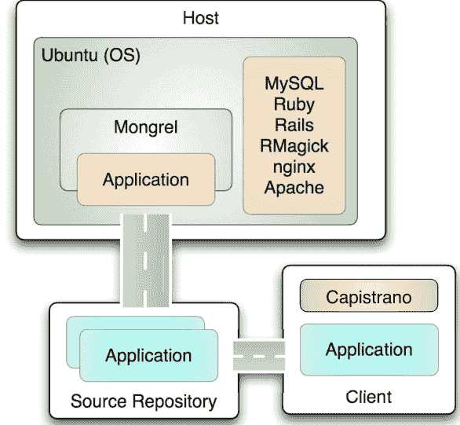

图 4.1：独立服务器架构图

实际上，这套配置与你在第 3 章《共享主机》（第 44 页）中看到的不会相差太多。你将使用单个 Mongrel 来处理每个请求。这种架构不具备扩展性，但我们的重点是构建一个可用的基础，作为后续发展的基石。在后面的章节中，你将对 Mongrel 进行集群化，如果应用需要的话，还可以使用第 7 章《横向扩展》（第 144 页）中的某种方案进行扩展。现在，集中精力构建本书后续所需的所有组件。

### 引入你自己的主机和管理员

如果说将 Rails 应用部署到别人的服务器上还不够有趣，那么现在你准备构建自己的机器了。无论你是否想要这个角色，你都是一名管理员了。从你构建自己的环境那一刻起，你就获得了这个头衔。我建议你认真对待这个新角色。作为管理员，你有很多职责——这些话题其他书籍会阐述得更详尽。你可以将这些职责分为以下几类：

- 安全性与稳定性
- 配置与升级
- 文档

保持服务器的安全性和稳定性是一项艰巨的工作，这个话题我甚至不会在这本书中尝试涉及。管理配置和升级可能是每周都会发生的事情，而给系统打补丁是一项重要的安全实践。但我真正想强调的是文档。开发人员有一个坏习惯，就是逃避文档工作。我所认识的程序员会使用极其牵强的合理化解释。以下是一些最精彩的：

- "你可能觉得自己没时间或没能力做到，但你要么现在付出代价，要么以后付出代价。"
- "你可能认为文档总是过时的，跟不上代码的变化，但我说的不是代码。"
- "配置不会变化得像代码那么快，即使真的变了，那更要记录下来了。"

所有反对文档的旧论点对基础设施都不适用。作为系统管理员，我们必须记录我们的配置。以下技巧将有助于管理文档：

- 在机器旁边或公共区域（如果有多个管理员或远程服务器）放置一本服务器日志。像《蝇王》中的海螺一样对待它：只有拿着日志的人才能修改服务器配置。在日志中记录并标注日期，说明做了哪些更改以及原因。
- 在一个知名目录中保留包含带日期会话日志的目录。如果可能的话，在日志中注释"为什么"的问题。通过日志很容易看到某人做了什么，但"为什么"需要补充进来，以便与他人沟通。
- 每周更新一次正式文档，或在进行重大更改时更新。正式文档包括简单的图表，以及针对关键基础设施组件的有组织的文档章节。
- 确保每个人都阅读文档。让人们知道你何时更新了文档，并在喝咖啡时带他们过一遍。这些做法将确保他们理解系统，并鼓励就系统进行讨论和提问。

当你必须迁移到多台服务器时，你需要尽最大努力保持配置同步。我说的"同步"，最好是完全一致的。你会希望尝试通过应用程序甚至 Capistrano 来自动化配置差异，而你的服务提供商会为你管理其他部分。要保持配置一致，你需要良好的组织和最新的文档。我说教够了。挽起袖子，开始干活吧。

## 4.2 虚拟专用服务器

即使你已确定共享主机不够用，也并不是一刀切的。在决定购买独立主机套餐之前，先深呼吸，看看另一个有吸引力的替代方案。虚拟专用服务器，简称 VPS，是从共享服务器方案升级的第一个合理步骤。有些主机可能称之为虚拟独立服务器（VDS）。这类服务器运行在虚拟机中。一台物理硬件服务器上运行多个 VM 实例。在你尖叫着逃跑之前，你需要知道 VPS 并不是共享主机套餐。你将获得对 VPS 的完全 root 访问权限，而且通常你甚至可以从某些 Linux 发行版或 FreeBSD 中选择你的操作系统。

你的主机可能运行着多种不同的服务器虚拟化软件包之一。在我尝试过的所有方案中，Xen 是我的最爱。Xen 是虚拟化领域的相对新秀，但这个开源包直接构建在某些 Linux 内核中，因此虚拟化服务器进程运行得更贴近硬件。Xen 还提供卓越的磁盘 I/O，这对任何处理大量文件的系统来说都是个大问题。而且你猜怎么着？绝大多数时候，Web 应用无非就是不断地向用户传输文件。越来越多的 Web 主机正在向托管客户提供基于 Xen 的虚拟服务器，所以找到一个并不难。

一旦你获得了自己的 VPS，它就像一台独立服务器一样工作。你有完全的 root 权限来安装或删除任何你需要的东西。在基于 Xen 的 VPS 上，你甚至可以重新编译自己的内核，如果你愿意的话（但你应该先询问你的主机提供商）。由于大多数虚拟服务器都运行在高端硬件上，你可以获得非常好的性能。当然，你的主机在一台物理机上塞入的 VPS 越多，可分配的资源就越少。询问提供商硬件配置以及每台机器上运行多少虚拟机，这是一个好的做法。一般来说，更大机器上的更大份额更好。如果你需要帮忙解读这些数字，可以咨询专家。如果你有很大一笔钱取决于答案，你可能需要花钱请一个，或者你也可以简单地在众多优秀的 Ruby on Rails 论坛上发帖提问。

### 内存

通常，你的性能瓶颈不会是处理能力，而是内存。一些共享主机提供商超售他们的硬件，希望不是所有人都会同时全速运行。当太多客户需要太多资源时，你的 VPS 很容易耗尽内存，并开始将内存页交换到磁盘。要理解这对性能的影响，想象一下一名奥运短跑选手在完美条件下全速奔跑，然后让他陷入齐胸深的水中完成比赛。但使用基于 Xen 的 VM，你获得的服务器内存分配就是你独有的内存。基于 Xen 的架构不允许主机提供商超售物理机的内存，你的应用可以在清新的内存空气中运行，而不是在磁盘交换的泥潭中。像 Virtuozzo 和 OpenVZ 这样的产品值得研究。

根据你的具体需求，我建议你的 VPS 至少配备 160MB 到 256MB 的 RAM。这个内存量可以让你运行一两个小型的 Rails 站点，具体取决于应用的资源使用情况。但你可以更精确一些。与其盲目猜测，你可以基于一个关键问题来估算你需要多少内存：你需要多少个 Mongrel 或 FastCGI 监听器？

对于许多 Rails 应用来说，一两个后端进程就足够了。一个获得中等流量的 Typo 或 Mephisto 博客通常用一个进程就能正常运行。一个典型的 Rails 进程可能需要 35MB 到 120MB 的内存，但某些 Rails 应用可能需要更多。请记住，规则总有例外，在订购 VPS 之前，你应该在本地测试你的内存消耗情况。我将在第 9 章《性能》（第 224 页）中向你展示如何做。

即使你最初选择的内存大小不对，VPS 系统也非常容易升级。如果你需要更多 RAM、磁盘空间或其他资源，通常只需要向主机请求并重启你的 VPS 即可。当它重新上线时，你将拥有新资源，而无需更改任何设置来利用它们。虚拟服务器方法的另一个好处是，当需要时，能够轻松地将整个服务器迁移到另一台物理机或主机上。如果你选择了合适的提供商，随着流量增长而升级应该是顺畅的。

### 使用轻量级 Web 服务器

Mongrel 正逐渐成为在 VPS 上部署 Rails 应用的事实标准。你可以单独在一个 Mongrel 上运行博客或较小的应用。如果你需要在 Mongrel 前面再放一个 Web 服务器来处理静态内容，使用 nginx 或 lighttpd 会有很大优势。这些服务器比 Apache 使用更少的资源，而且速度非常快。如果你想要一个 Mongrel 的替代方案，skewness 和 lighttpd 的 FastCGI 支持是一流且稳定的。

大多数主机提供商提供多种 Linux 发行版供选择。首先，你想要一个占用空间最小的发行版。当你在较小的内存系统上运行时，确保只安装你需要的东西，不要多装。在此基础上，你应该只构建你需要的东西。最终，你会得到一个更精简、更快的服务器。

设置 VPS 的说明与设置独立服务器基本相同。在我进入设置教程之前，你需要了解更多关于独立主机的知识。

## 4.3 独立服务器

假设你写了最新流行的 Rails Web 2.0 应用，而共享主机已经不够用了。你的共享主机管理员因为你的资源使用量而对你大吼大叫，他对你的支持请求回应不够快，你已经决定要么向他发起决斗，要么升级到更高套餐。是时候搬家了。你已经准备好获得 root 权限，而你的客户也准备好欣赏你精彩的内容，而不用看到那个可怕的旋转地球图标，或者他们浏览器这些天正在旋转的任何图标。

有了独立服务器，你不必太担心内存限制或磁盘空间。一台不错的入门系统会有现代处理器、最低 512MB 到 1024MB 内存，以及宽敞的硬盘。这样的系统能让你的应用承载大量流量和并发用户。我不会在这里用统计数据烦你，因为可变因素太多，但一旦你拥有独立服务器，如果应用持续增长到需要考虑集群的程度，你就已经准备好了。

通常独立服务器比 VPS 更贵。入门级 VPS 每月约需 25 到 60 美元，而入门级独立服务器通常接近每月 150 到 300 美元。

即使你拥有自己的独立服务器，也可以考虑使用 Xen。在现实中，Xen 提供了可接受的性能，并为你提供了随业务增长扩展系统的长期解决方案。安装和配置 Xen 超出了本书的范围，但研究这个替代方案绝对值得花时间。你用一小部分原始性能换取管理的便捷性和可扩展性。使用 Xen，你可以将独立服务器分区为多个专门的 VPS 服务器，随着业务增长可以轻松迁移到其他机器。我将在第 7 章《向外扩展》第 144 页告诉你如何具体操作。

## 4.4 搭建环境

构建部署环境不是给没耐心的人做的，但只要有良好的命令行知识和愿意搜索的意愿，你就能构建自己的生产环境来运行 Rails 应用。我会为你详细说明其余部分。这都是老生常谈的领域，所以如果出了问题，在这里找不到答案，不要害怕去搜索答案。我会展示你需要的许多答案，Google 可以帮你找到其余的。

无论你选择 VPS 还是独立服务器，你的 Rails 设置都是一样的。我将使用 Ubuntu Linux 7.10 服务器版，但如果你喜欢的服务器平台是 OS X、BSD 或其他 Linux 发行版，也不用担心。所有与 Web 服务器和 Rails 配置相关的内容在任何类 Unix 操作系统上的工作方式基本相同。

我喜欢从零开始使用 Ubuntu Gutsy Gibbon 服务器构建。你可以在线获取下载镜像和说明。¹ 很可能你最终不会自己构建系统。几乎任何虚拟或独立托管服务商在你开设账户时都提供这个选项。如果没有，直接让他们为你安装 Ubuntu 服务器版本。他们还会设置基本的网络接口，使其与其网络和数据中心配合工作。

从现在开始，我假设你从已安装好基础系统和正确网络配置的环境开始。如果你是在家里或公司的自己的服务器上安装，可以在线获取详细的 Ubuntu 服务器安装说明。²

任何虚拟主机提供商都会安装并配置某个版本的 SSH，但如果你在本地构建自己的主机，可能需要安装 OpenSSH。输入 `sudo apt-get install ssh` 使用 `ssh` 安装包来使其工作。

我不可能涵盖保护 Linux 服务器的所有细节，但我会沿途给你一些重要提示。这是第一条。使用 `ssh` 和 `sftp` 或 `scp`，而不是 `ftp` 或 `rsh`。如果不这样做，你的所有通信都是明文的，在你的本地机器和服务器之间的任何中间主机上都可以直接读取。要使用 SSH，你需要客户端和主机上都有 SSH。我已经告诉过你主机系统，所以把注意力转向客户端。如果你使用 OS X、Linux 或 BSD，你肯定已经安装了客户端，但如果你本地运行 Windows，你会想安装 PuTTY。作为 Windows 的事实标准，PuTTY 是一个优秀的免费 SSH 程序，你可以在线找到。³ 按照那里的说明操作，你就可以准备阅读本书的其余部分了。

构建你的生产环境并非易事。以下是你将要安装的完整清单：

- GNU 编译器集合（简称 GCC）和相关工具。你将用它来构建多个组件，包括 RubyGems 和 RMagick 插件。
- Ruby 和 RubyGems。你将获得最新稳定版本的 Ruby 以及 RubyGems 第三方库打包和分发系统。
- Rails。安装操作系统和 RubyGems ayant 安装和配置 Rails 会出奇地简单。
- MySQL 和 mysql-ruby 绑定。你可以使用各种不同的数据库服务器，但我会选择最流行的 Rails 数据库引擎。
- Subversion。Capistrano 将直接从你的 Subversion 仓库检出代码。
- Mongrel 和依赖项。Mongrel 正迅速成为服务 Rails 应用的事实标准。
- ImageMagick 和 RMagick。许多现代 Web 应用允许上传图片。RMagick 可以通过自动创建缩略图和裁剪图片来提供帮助。
- FastCGI 开发工具包和 Ruby FastCGI 绑定。如果你运行 Apache 或 lighttpd 而不是 Mongrel，你会想立即替换更慢默认的 CGI。
- nginx。这个小型 Web 服务器是瓶中的闪电，使其成为许多安装中 Apache 的良好替代品。如果你想走这条路，安装它很容易。

有了这些组件，你就有了基本的技术栈，它将成为我们在本书剩余部分所做一切的基础。我们将在本书的其他章节中介绍优化各个 Web 服务器配置。完成本章的步骤后，你将能够运行基本的生产 Rails 应用。

我在这里要打破一条出版界的铁律，重复第 1 章《简介》第 8 页的一些细节。我这样做不是为了凑字数，而是为了保护你免受重大灾难。overrun You'll need to translate this. Wait, the user wants me to continue. Let me translate properly.

我正在登录我的生产系统，登录名会以 ezra 开头。如果我在本地登录，登录名会以 local 开头。在 *nix 系统的 bash shell 中，`#` 命令行提示符表示你以 root 身份登录，`$` 表示你以普通系统用户身份登录。我将使用 bash。如果你想使用不同的 shell，确保你了解你系统的提示符指示器。

### 配置服务器

是时候开始了。我将把我的虚拟服务器命名为 `«tracklayer»`。每当你在命令中看到 `«tracklayer»` 时，将其替换为你服务器的 IP 地址或域名。

你需要一个 root 用户和一个普通用户。管理员通常设置 Ubuntu 时使用普通用户账户，而不是仅有 root 账户。如果你配置大多数其他 Linux 发行版，你需要创建一个普通用户并将自己添加到 `/etc/sudoers` 文件。

如果你有普通用户账户，用它来登录并跳过接下来的两个会话列表。如果你只有 root，你需要创建一个普通用户。使用你的 root 用户和密码通过 SSH 登录到新账户的 IP：

```bash
local$ ssh root@tracklayer
root@tracklayer password: <输入你的密码>
```

如果一切正常，创建你的普通用户账户：

```bash
root# adduser ezra
Adding user `ezra' ...
Adding new group `ezra' (1001).
Adding new user `ezra' (1001) with group `ezra'.
Creating home directory `/home/ezra'.
Copying files from `/etc/skel'
Enter new UNIX password:
Retype new UNIX password:
# 你会被问到几个问题，
# 按你喜欢的填写。
```

小心使用 root。建立账户后，始终以你自己的用户身份登录机器，而不是 root。只需在需要时使用 `su` 或 `sudo` 获取 root 权限。`su` 代表 super user（超级用户），`sudo` 代表 super user do（以超级用户执行）。如果你不是以 root 身份登录，现在变成 root：

```bash
$ su -
Password:
root#
```

现在编辑 `/etc/sudoers`。你应该使用一个叫 `visudo` 的程序来编辑 sudoers 文件，因为 `visudo` 不允许两个人同时编辑。

```bash
root# visudo
```

使用方向键将光标下移，在文件末尾添加这一行：

### 确保 SSH 安全

大多数经验丰富的 *nix 管理员倾向于在较高的端口号上运行 `sshd`。原因如下：黑客通常会创建名为 `bots` 的自动化攻击程序在网络上爬行，依次访问一台又一台机器，以寻找运行着 SSH 守护进程的机器。然后，该机器人使用一个带有字典的自动化脚本尝试多种用户名和密码组合。这类攻击非常普遍，以至于如今大多数互联网服务器都会频繁遇到此类攻击。如果你在开放的 SSH 端口上使用了较弱的登录名/密码组合，那么你就完蛋了，尤其是当 `sshd` 运行在标准端口 22 时。由于大多数此类攻击机器人不会扫描 1024 以上的端口，因此你应该始终将 `sshd` 分配给 1024 以上的空闲端口。


通过编辑`/etc/ssh/sshd_config`来修改`sshd`的端口。编辑如下所示的这一行：

```
Port 22
```

将其更改为：

```
Port 8888 # 或任何 1024 以上的未使用端口
```

然后保存文件并退出编辑器。别忘了重启 SSH 服务器守护进程。

现在按下 Escape 键，输入`:wq`。这意味着写入文件并退出。

为了安全起见，你不应该允许 SSH root 登录，因为未经授权的登录将带来灾难性的后果。编辑`/etc/ssh/sshd_config`，将这一行：

```
PermitRootLogin yes
```

替换为：

```
PermitRootLogin no
```

现在重新加载`/etc/ssh/sshd_config`以应用新设置：

```
root# /etc/init.d/sshd reload
* Reloading OpenBSD Secure Shell server's configuration sshd [ ok ]
```

为了安全且让自己更方便，使用 SSH 密钥代替密码进行登录是一项极佳的技巧。让我们创建一对公钥/私钥并将其安装在我们的新服务器上；密钥生成在你的本地机器上完成：

```
local$ ssh-keygen -t dsa
```

系统会提示你输入一个秘密口令（passphrase）。如果这是你的主身份密钥，请确保使用一个强口令。完成后，你在`~/.ssh`目录下会得到两个名为`id_dsa`和`id_dsa.pub`的文件。请注意，在提示输入口令时直接按 Enter 键是可行的，这将生成一个没有口令的密钥。对于身份密钥来说，这是一个 Bad Idea™（糟糕的主意），所以不要这样做！你很快就会学到如何以安全的方式实现无密码登录。

现在我们需要将你的公钥放置在服务器上。这里有一个很方便的 bash 函数可以帮我们完成这件事；根据你本地使用的计算机类型，将其放入`~/.bashrc`或`~/.bash_profile`中。（该函数假设你已经创建了`.ssh`目录，如果没有，请先创建它。）

```
function authme {
    ssh $1 'cat >>.ssh/authorized_keys' <~/.ssh/id_dsa.pub
}
```

一旦将其放入 shell 的 rc 文件中，你需要启动一个新的 shell 或 source 该文件：

```
local$ . ~/.bashrc
```

一切就绪后，我们现在可以使用`authme`命令将新密钥放置在服务器上（将`tracklayer`替换为你的 IP 或主机名）：

```
local$ authme tracklayer
```

系统会提示你输入密码，随后你的密钥将被放置在服务器上。现在你可能希望进入一个已加载 SSH 密钥的新 shell。这将允许你启动一个 shell 并仅输入一次私钥的口令，之后你就可以 ssh 到任何放置了你密钥的地方，而无需再次输入口令：

```
local$ ssh-agent sh -c 'ssh-add < /dev/null && bash'
```

现在你可以无需输入口令地 ssh 到你的新服务器：

```
local$ ssh tracklayer
```

## 安装 GCC 工具链

你需要安装一个编译器工具链来构建和安装许多组件，包括 RubyGems。`build-essential`软件包包含构建稍后需要安装的组件所需的一切。在 Ubuntu 上这样安装：

```
root# apt-get install build-essential
```

## 安装 Ruby 和 RubyGems

默认情况下，Debian 和 Ubuntu 有五个名为`main`、`restricted`、`universe`、`multiverse`和`commercial`的软件包仓库。对于本章的设置，你需要`universe`软件包仓库。默认情况下，它未被启用。通过编辑`/etc/apt/sources.list`文件并取消以下两行的注释来解决：

```
deb http://us.archive.ubuntu.com/ubuntu/ gutsy universe
deb-src http://us.archive.ubuntu.com/ubuntu/ gutsy universe
```

现在，更新你的`apt-sources`文件，并安装 Ruby 及其相关组件。你应该至少安装 Ruby 1.8.6 和 Rails 1.2.x 或 2.0.x。

```
root# apt-get update
root# apt-get upgrade
root# apt-get install ruby ri rdoc irb ruby1.8 ruby1.8-dev libzlib-ruby zlib1g
...
root# ruby -v
ruby 1.8.4 (2005-12-24) [i486-linux]
```

Ruby 已就绪。如果你想验证这一点，运行`irb`并输入几个命令，但现在我就继续前进。安装 RubyGems。你绝对不想在没有它的情况下安装 Rails。Ubuntu 和 Debian 没有官方打包 RubyGems，因此你需要从源码构建。前往 RubyForge，下载最新的稳定版本，然后像这样构建并安装：

```
root# wget https://rubyforge.org/frs/download.php/29548/rubygems-1.0.1.tgz
...
root# tar xvzf rubygems-1.0.1.tgz
...
root# cd rubygems-1.0.1/
root# ruby setup.rb
---> bin
<--- bin
...
Successfully built RubyGem
Name: sources
Version: 0.0.1
File: sources-0.0.1.gem
Removing old RubyGems RDoc and ri...
Installing rubygems-1.0.1 ri...
Installing rubygems-1.0.1 rdoc...
```

```
As of RubyGems 0.8.0, library stubs are no longer needed.
Searching $LOAD_PATH for stubs to optionally delete (may take a while)...
...done.
No library stubs found.
```

- http://rubyforge.org/projects/rubygems/

## 从源码构建最新的 Ruby

Ubuntu 和 Debian 的发行版经常在 Ruby 上做一些奇怪的操作。某个特定版本可能会将 Ruby 拆分成极小的碎片，或者安装某个较早的 Ruby 版本。如果你想要 Ruby-1.8.6，你需要从源码构建。

第一步是获取最新的 Ruby 稳定发行版。在浏览器中访问 Ruby 主页，下载所需的版本。我打算安装 Ruby-1.8.6。

```
ezra$ wget ftp://ftp.ruby-lang.org/pub/ruby/1.8/ruby-1.8.6.tar.gz
```

现在，解压、构建并安装 Ruby：

```
ezra$ tar -xvfz ruby-1.8.6.tar.gz
...
ezra$ cd ruby-1.8.6
ezra$ ./configure && make && sudo make install
...
```

你需要确保你的`$PATH`中包含`/usr/local/bin`：

```
ezra$ echo $PATH
/usr/local/sbin:/usr/local/bin:/usr/sbin:/usr/bin:/sbin:/bin
```

如果你的`$PATH`中没有`/usr/local/sbin:/usr/local/bin`，那么你需要添加它。用编辑器打开`/etc/profile`，并添加以下行：

```
export PATH=/usr/local/sbin:/usr/local/bin:$PATH
```

这些是从源码构建 Ruby 所需的基本步骤。请注意，如果你选择构建自己的 Ruby，它将无法与 Ubuntu 中的 Ruby 软件包协同工作。你必须通过 Ruby Gems 而不是通过`apt-get`来安装`mysql`和`rmagick` gem。

- http://www.ruby-lang.org/en/

记得在完成后清理环境。删除 RubyGems 的源码文件：

```
root# cd ..
root# rm -rf rubygems-1.0.1*
```

现在你准备好进入一个更熟悉的领域了。你已经在开发机上安装了 Rails，现在你将在生产环境中做同样的事情。当你读到这里时，组件的版本号可能会更高，但以下命令将安装最新稳定版本的 Rails。`--include-dependencies`选项将确保你拥有所有必要的依赖项：

```
root# sudo gem install rails --no-rdoc --no-ri
Successfully installed rake-0.8.1
Successfully installed activesupport-2.0.2
Successfully installed activerecord-2.0.2
Successfully installed actionpack-2.0.2
Successfully installed actionmailer-2.0.2
Successfully installed activeresource-2.0.2
Successfully installed rails-2.0.2
```

通常，你的服务器端安装不需要文档，因此`--no-rdoc --no-ri`标志将跳过它们，使安装保持精简。

接下来是 Mongrel。如果你曾忍受过构建和安装 Apache 的痛苦，你会非常欣赏下面的命令：

```
root# gem install mongrel mongrel_cluster --include-dependencies --no-rdoc --no-ri
    Select which gem to install for your platform (i486-linux)
     1. mongrel 1.0.1 (ruby)
     2. mongrel 1.0.1 (mswin32)
     3. mongrel 1.0 (mswin32)
     4. mongrel 1.0 (ruby)
     5. Skip this gem
     6. Cancel installation
    ...
```

当一个 gem 有多个可用版本时，RubyGems 会提示你选择想要的版本和平台。我在 Ubuntu 上，所以选择 1 就能获得最新的兼容版本。大多数时候，Mongrel 就足够了。如果我需要更高的性能，我会在 Mongrel 前面放置一个代理来提供静态内容。我将在第 7 章 *横向扩展*（第 144 页）中详细讨论。但现在，让我们进入数据库部分。

## 安装 MySQL

接下来，你将安装 MySQL 和 MySQL-Ruby 绑定。你不一定要使用 MySQL——好几个可用的数据库引擎都运行得相当出色。

与 Rails 搭配使用。PostgreSQL 是另一个热门选择。你还需要安装`zlib1g-dev`软件包，因为它是 RubyGems 以及你在后续过程中需要的一些其他项的必要条件：

```
root# apt-get install mysql-server-5.0 mysql-client-5.0 libmysqlclient15-dev libmysqlclient15off zlib1g-dev libmysql-ruby1.8
```

你已经安装了数据库服务器，但不要忘记设置 root 密码：

```
root# mysqladmin -u root password <your password here>
```

你可以通过在 irb 中运行一个简单的 require 命令，轻松验证 MySQL-Ruby 绑定是否正常工作：

```
root# irb
irb(main):001:0> require 'rubygems'
=> true
irb(main):001:0> require 'mysql'
=> true
irb(main):002:0> exit
```

这个 require 命令告诉 Ruby 加载提供 MySQL 基础 Ruby 支持的 mysql 库。由于 Rails 使用相同的绑定，如果 require 返回 true，那么 Rails 可能也能正常工作。

到目前为止，你已经安装了 Ruby、Ruby on Rails、RubyGems、Mongrel 和 MySQL。接下来我将引导你安装 nginx 和 FastCGI。如果你想使用 nginx 进行负载均衡和静态内容处理，你就需要 nginx。如果你需要一个替代方案，FastCGI 是 Mongrel 的一个很好的选择。如果你愿意，可以跳过这些步骤稍后再回来处理。

## 安装 nginx 和 FastCGI

本书将集中讨论使用 Mongrel 和 Mongrel cluster 的集群化。如果你想改用 FastCGI，现在可以安装。按照以下方式安装`libfcgi-dev`和`libfcgi-ruby1.8`：

```
root# apt-get install libfcgi-ruby1.8 libfcgi-dev
```

为了检查 fcgi-ruby 是否工作，请确保两次安装都没有返回任何错误。你需要确保成功安装了 ruby-fcgi 的 C 扩展版本，而不仅仅是纯 Ruby 版本。C 扩展版本比纯 Ruby 版本快得多。

就像对待 MySQL 一样，你将使用 require 语句来确保安装了正确的库：

```
root# irb
irb(main):001:0> require 'fcgi.so'
=> true
irb(main):002:0> require 'fcgi'
=> true
irb(main):003:0> exit
```

如果两个 require 都返回 true，你就可以继续了。为了让 nginx 中的 rewrite 模块正常工作，你需要 Perl 兼容正则表达式库（或`libpcre`）。你还需要 OpenSSL 库和开发包来支持 nginx 的 SSL：

```
root# apt-get install libpcre3-dev libpcre3 openssl libssl-dev
```

现在是坏消息：目前 nginx 还没有最新的 Ubuntu 软件包，所以你必须从源代码构建。获取最新版本⁵（在撰写本文时为 nginx 0.5.33），并按如下方式构建：

```
root# wget http://sysoev.ru/nginx/nginx-0.5.33.tar.gz
...
root# tar xzvf nginx-0.5.33.tar.gz
...
root# cd nginx-0.5.33
root# ./configure --with_http_ssl_module
...
root# make
...
root# make install
...
```

nginx 的安装就到这里。像往常一样，清理你的工作空间并将 nginx 添加到 PATH 中：

```
root# cd ..
root# rm -rf nginx-0.5.33
```

默认的 nginx 安装目录是`/usr/local/nginx`，因此你需要将`/usr/local/nginx/sbin`添加到`$PATH`。用编辑器打开`/etc/profile`，并添加以下行：

```
export PATH=/usr/local/nginx/sbin:$PATH
```

检查 nginx 是否正常工作且已在你的`$PATH`中。`version`命令应该可以完成这项工作：

```
root# nginx -v
nginx version: nginx/0.5.33
```

> 5. http://www.nginx.net/

## 安装 ImageMagick 和 RMagick

你已经安装了一个相当不错的技术栈。许多 Rails 应用程序还需要 ImageMagick 和 RMagick 来处理图像上传和操作。这组库经常给人们带来麻烦，所以请密切注意：

```
root# apt-get install imagemagick librmagick-ruby1.8 libfreetype6-dev xml-core
```

检查 RMagick 是否工作。在当前工作目录中放一个名为`test.jpg`的任意图像文件用于测试，并运行以下命令：

```
root# irb
irb(main):001:0> require 'RMagick'
=> true
irb(main):002:0> include Magick
=> Object
irb(main):003:0> img = ImageList.new "test.jpg"
=> [test.jpg JPEG 10x11 DirectClass 8-bit 391b]
scene=0
irb(main):004:0> img.write "test.png"
=> [test.jpg->test.png JPEG 10x11 DirectClass 8-bit]
scene=0
irb(main):005:0>
```

RMagick 现在应该可以正常工作了，但它以安装困难而著称。如果你在让 RMagick 运行过程中遇到任何问题，可以查看网站上的安装 FAQ。⁶

## 安装 Subversion

为了给 Capistrano 做准备，你需要安装 Subversion。现在就安装它：

```
root# apt-get install subversion subversion-tools
```


当你安装`subversion-tools`时，它会拉取 exim SMTP 服务器作为依赖项。配置邮件服务器超出了本书的讨论范围，但在安装过程中，系统会提示你选择想要的常规邮件配置类型。请选择“internet site; mail is sent and received directly using SMTP”（互联网站点；直接使用 SMTP 发送和接收邮件）选项。

你需要创建新的 Subversion 仓库，以便能够从开发机访问。如果你没有安装 Apache，在网络上运行 Subversion 的最佳方式是通过`svnserve`或通过 Subversion 和 SSH。关于为你的 Rails 项目设置和使用 Subversion 的说明，请参阅第 2 章 *Refining Applications for Production*（第 20 页）。

### 测试它！

现在你已经为 Rails 部署做好了充分准备。生成一个 Rails 应用骨架，并用 Mongrel 将其启动，以确保一切运行良好。现在切换到你的普通用户，因为 Rails 开发不需要 root 权限：

```
root# su yourusername
ezra$ cd ~
ezra$ rails test
```

试运行一下：

```
ezra$ cd test
ezra$ ruby script/server
=> Booting Mongrel (use 'script/server webrick' to force WEBrick)
=> Rails application starting on http://0.0.0.0:3000
=> Call with -d to detach
=> Ctrl-C to shutdown server
** Starting Mongrel listening at 0.0.0.0:3000
** Starting Rails with development environment...
** Rails loaded.
** Loading any Rails specific GemPlugins
** Signals ready. TERM => stop. USR2 => restart. INT => stop (no restart).
** Rails signals registered. HUP => reload (without restart).
** It might not work well.
** Mongrel available at 0.0.0.0:3000
** Use CTRL-C to stop.
```

`script/server`命令将启动 Mongrel 而不是 WEBrick。如果服务器正常启动，请将浏览器指向`http://tracklayer:3000`。记得将`tracklayer`替换为服务器的 IP 或域名。

你应该能看到“Congratulations, you've put Ruby on Rails!”页面，这样我们就完成了这个极赞的 Rails 服务器栈的基础配置！现在你就是自己这艘船的船长了。

## 4.5 总结

运行你自己的 Rails 服务器是一次很有成就感的体验。有了这个基础技术栈，你可以开始建立你的帝国，并根据自己的所有需求进行调整。安装了 nginx 和 Mongrel 之后，你在新服务器上有许多配置选项可以尝试。

既然基础构建模块已经就绪，你就可以使用本书其余部分中介绍的技巧来让你的部署实现规模化，并使其速度快到飞起。

在本章中，你完成了基础安装的构建。你已经拥有了通过 Mongrel 或其他 Web 服务器运行 Ruby 的组件。在接下来的章节中，你将对这些组件进行实际测试。首先，你将构建一些脚本，以便重复且可靠地部署你的应用程序。如果你感到兴奋并准备好搬进这个新家，请继续阅读。接下来是使用 Capistrano 搬入。

# 搬入

# 第 5 章

## Capistrano

如果你曾经租过公寓或买过房子，你就知道财务交易仅仅是第一个微小的步骤。接下来的步骤是搬入，而这个过程可能会，怎么说呢，让人不知所措。在前面的章节中，你使用了 FTP、SFTP 或 Subversion 将应用程序安装到共享主机上。你只需找到需要复制的文件，然后使用 Subversion 或 FTP 将整个 Rails 项目目录整体推送到服务器上。但这种简单的做法带来了几个重要问题：

- 无法扩展。一旦你超出单台服务器的范围，部署将会变得复杂得多。
- 你需要安排停机时间。当你复制应用程序时，应用处于不一致状态，部分文件来自旧应用，部分来自新应用。
- 如果出现问题，很难回溯。你需要将旧版本的应用程序还原回去。这样做意味着更多的手动操作或更多的猜测。
- 对于 FTP，你需要手动处理源码控制。除非你生活在黑暗时代，否则你应该将代码库保存在源码控制系统中。大多数 Rails 开发者使用 Subversion。¹
- 部署过程没有自动化。你必须手动执行，这留下了出错的空间。懒惰可能是程序员最大的美德之一，但在涉及许多步骤时，它并不能保证完美的执行。

> 1. 如果你还没有使用某种形式的源码控制，请放下这本书，赶紧（跑起来，别走着）去阅读《Pragmatic Version Control [Mas05]》。在当今时代，没有版本控制地运行程序简直是疯狂。

你可能会决定使用现有的工具，例如`rsync`。`rsync`开源实用程序提供了快速的增量文件传输，这意味着它仅复制在两次调用之间发生变化的文件。

这种方法比传统的 FTP 效果稍好，因为你不需要一次性移动所有文件，但它仍然存在大部分相同的问题。`rsync`通常比普通 FTP 快，在多服务器环境下表现更好，且无需对服务器配置进行任何额外修改即可工作。如果你处于一个对服务器其余部分控制力较低的情况，这可能是一个可接受的解决方案。但作为一个渴望成就伟业的程序员，你想要的不仅仅是一个*可接受*的解决方案，不是吗？

## 5.1 概况

到目前为止，你已经拥有了一个准备好部署的应用，它由一个公共仓库和一个主机提供服务。为了能有格调地完成迁移，你需要一些软件来管理你的迁移。这就是 Capistrano。正如你在下一页图 5.1 中看到的，Capistrano 工具运行在开发者的客户端上。你可以将 Capistrano 想象成一家搬家公司，它编排你的迁移过程，确保你的应用程序以有序且可重复的方式到达服务器。你只需通过任何电话给他们打电话，下达命令，他们就会执行工作。Capistrano 的工作方式与之相同。你可以舒适地在开发客户端上指挥任何部署，完全不需要登录到部署服务器上。

出于公司编写 Rails 的同样原因，37signals 创建了 Capistrano 来解决实际的业务问题。随着 Rails 部署变得更加频繁且复杂，这家成长中的公司需要一种自动化解决方案来处理复杂的应用程序部署。这通常涉及到将代码更新部署到至少两台 Web 服务器和一台数据库服务器。任何解决方案都需要至少实现以下功能：

- 从中央源代码控制仓库安全地更新多个 Web 和数据库服务器。
- 对错误敏感，并在必要时回滚任何更改。
- 与 Rails 的文件布局兼容，并允许日志记录在不中断的情况下进行。
- 运行快速并减少停机时间的需求。
- 与 Ruby on Rails 良好协作。

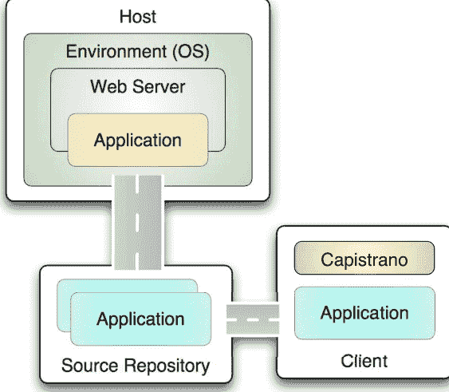

图 5.1：Capistrano 映射图

在 Rails 开发的早期阶段，Jamis Buck 编写了一个名为 Capistrano 的应用程序来解决这个问题。与 Rails 一样，Capistrano 是一款具有“主见”的软件，它假设你会执行以下操作：

- 部署到专用服务器。
- 在服务器上使用类 Unix 操作系统和文件系统。
- 拥有该服务器的 SSH 访问权限。
- 使用 Subversion 或某种形式的源代码控制。
- 能够使用`sudo`命令以 root 身份运行命令。
- 部署到一台 Web 服务器、一台应用服务器和一台数据库服务器（分布在一台或多台机器上）。

幸运的是，如果这些假设在你的特定情况下不成立，你仍然可以配置 Capistrano。共享托管就是这样一种情况，我将在本章稍后向你展示如何为 Capistrano 设置一套坚如磐石的方案（recipe）。

## 5.2 工作原理

你需要安装 Capistrano gem 及其依赖项。本章中的方案使用的是 Capistrano 2.0，所以请现在安装它。记住，`local$`是你本地开发机上的提示符，而`ezro#`是你开发服务器上的提示符：

```
local$ sudo gem install capistrano
```

请始终记住，Capistrano 运行在你的本地机器上。它使用 Net::SSH 和 Net::SFTP 连接到远程服务器并在其上运行 shell 命令。这意味着你不需要在远程服务器上安装 Capistrano，只需要在你想用来触发部署的机器上安装即可。

一旦你使用几个变量（称为*recipe*，方案）配置好 Capistrano，你就可以通过以下简单的命令进行部署（需要进行一些初始设置，我将在接下来的内容中介绍）：

```
local$ cap deploy
```

这个看似简单的命令完成了可靠部署应用程序所需的一切。与其用英语向你解释发生了什么，你直接查看 Ruby 的部署任务即可：

```
task :deploy do
  transaction do
    update_code
    symlink
  end

  restart
end
```

这是一个非常简单的 Ruby 代码块。Capistrano 使用类似于 Rake 的语法来定义将在服务器上执行的任务。每个任务都有一个名称，后面跟着一个代码块。这个名为`deploy`的任务执行以下操作：

1. 在执行这两行代码之前，Capistrano 通过 SSH 连接到你的服务器。
2. 代码开始一个事务（transaction）。这意味着所有代码都将在一个事务的范围内执行。如果事务的任何部分失败，整个事务都将失败并触发回滚。我将在本章稍后介绍回滚。
3. 事务的第一步`update_code`执行 Subversion checkout，将 Rails 应用程序的完整副本加载到远程服务器上的一个以日期命名的 release 目录中。例如，一次`cap deploy`可能会创建一个名为`releases/20070416190111`的目录。数字`20070416190111`实际上是 2007 年 4 月 16 日晚上 7:01:11 的时间戳。
4. 事务的下一步`symlink`将 Rails 应用程序的日志目录链接到一个共享日志目录。随后，`symlink`将你的应用程序文件夹链接到`current`目录，以便 Web 服务器能够找到它。
5. 最后，该任务重启任何处于活动状态的 Mongrel 或 FastCGI 进程。

这些步骤中的每一步都是安全、成功部署的关键组成部分。使用 Subversion 可以确保 Capistrano 始终获取正确的代码库。SSH 提供了必要的安全性，确保文件在传输过程中不会被篡改，而符号链接（symlinks）则强制实现了瞬间切换。符号链接还允许你在代码有问题或 Capistrano 遇到错误时，将代码还原到旧版本。最后，Capistrano 重启任何活动的 Mongrel 或 FastCGI 进程，新代码正式上线。

Capistrano 的部署任务肯定比`rsync`更好，但自动化是有代价的。你需要进行稍微多一点的设置，但也不会太多。在我向你详细介绍具体细节之前，让我们先看看 Capistrano 的文件组织方式。

### Capistrano 的文件组织

37signals 专门为部署 Rails 应用程序而构建了 Capistrano，但你也可以将其配置为适用于其他类型的应用程序。默认方案假设你有一个用于日志文件的`log`目录和一个用于 Web 服务器公共文件的`public`目录。

每次部署时，Capistrano 都会创建一个以当前日期命名的文件夹，然后将整个 Rails 应用 checkout 到该文件夹中。接着，它通过几个符号链接将整个结构连接起来。目录结构如图 5.2（见下一页）所示。请注意，`current`目录下方没有物理文件结构。`current`目录仅仅是一个指向`releases`目录中特定日期文件夹的链接。结果就是`current`将始终持有应用程序当前激活的版本。为了方便起见，Capistrano 还会创建一个`public/system`文件夹并将其链接到`shared/system`目录，帮助你在多次部署之间保留缓存文件或上传的文件。

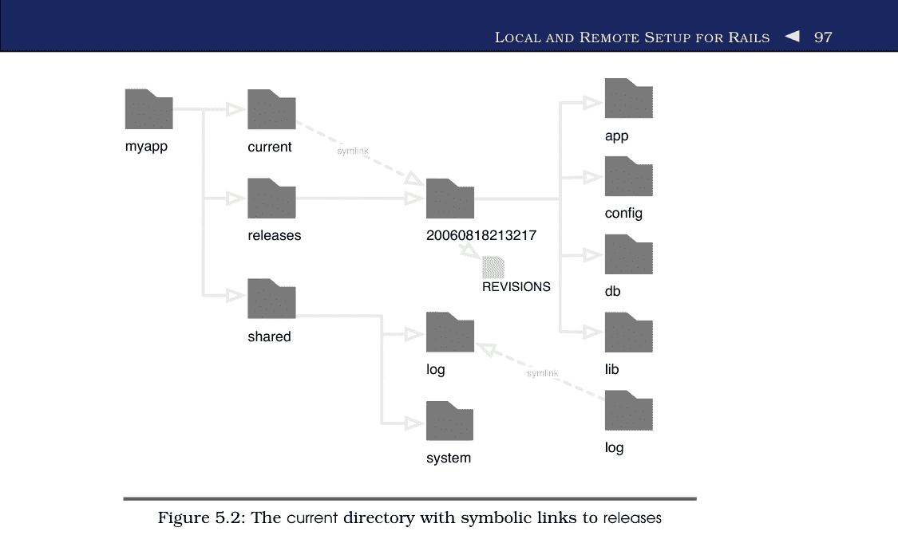

图 5.2：带有指向 releases 符号链接的 current 目录

## 5.3 Rails 的本地和远程设置

Capistrano 的配置并不太难，但你需要在开发机和远程服务器上分别执行几个步骤。我将先列出这些步骤，然后详细讲解。首先，在你的本地机器上，你需要执行以下操作：

1. 安装 Capistrano gem。
2. 告知 Capistrano 你的应用程序信息，以便它能添加必要的文件。
3. 使用服务器信息自定义`config/deploy.rb`。
4. 将你的应用程序导入到 Subversion 中。

这些本地更改使你的开发机准备好从 Subversion 部署代码库。接下来，你需要在服务器上进行以下更改：

1. 将 Web 服务器的文档根目录（document root）设置为`current/public`。
2. 对你的应用执行一次 checkout，以便 Subversion 缓存你的登录信息。

## 用空白 Rails 项目进行练习

如果你是第一次使用 Capistrano，创建一个新的空白 Rails 项目并在服务器上练习简单部署可能会有帮助。你不需要编写任何代码，甚至不需要创建数据库。只需使用 Rails 生成的带有默认 index.html 页面的新项目即可。要创建默认项目，只需输入`rails projectname`。

完成这些步骤后，你可以运行`cap deploy:setup`和`cap deploy`任务。接下来，我将更详细地向你展示每个独立步骤。

# 安装 Capistrano Gem

你只需要在开发机器上安装 Capistrano，而不是服务器上，因为 Capistrano 通过常规 SSH 会话在服务器上运行命令。如果你已经安装了 Rails，你的系统上可能已经有 RubyGems 了。要在本地机器上安装 Capistrano，请运行以下命令：

```
local$ sudo gem install capistrano
```

```
Attempting local installation of 'capistrano'
Local gem file not found: capistrano.gem
Attempting remote installation of 'capistrano'
Successfully installed capistrano-2.0.0
Successfully installed net-ssh-1.1.1
Successfully installed net-sftp-1.1.0
Installing ri documentation for net-ssh-1.1.1...
Installing ri documentation for net-sftp-1.1.0...
Installing RDoc documentation for net-ssh-1.1.1...
Installing RDoc documentation for net-sftp-1.1.1...
```

在安装 gem 的同时，也请安装`termios` gem。（抱歉，termios 在 Windows 上不可用。）默认情况下，当你部署时，Capistrano 会在屏幕上回显你的密码。安装 termios gem 可以防止你的密码被旁人看到。

# 在 Mac OS X 上重新安装 Ruby

Capistrano 严重依赖 Ruby 的 SSH 通信能力，而这在 Leopard 之前版本的 Mac OS X 自带的默认 Ruby 解释器上无法正常工作。C 绑定并不总是工作正常。（Leopard 包含了 Capistrano、Ruby 1.8.6 和 Mongrel。）如果你使用的是这些版本的 OS X，你可以通过以下几种方式解决这个问题：

- 安装 MacPorts 包管理系统，让它为你安装 Ruby。你可以下载 MacPorts，然后运行以下命令：

  `local$ sudo port install ruby`

- 从源码安装 Ruby。Dan Benjamin 有分步说明。† 你可以在网上找到使用 Dan 的说明自动安装 Ruby 的 shell 脚本。‡

```
local$ sudo port install ruby
```

* http://macports.org/

† http://hivelogic.com/narrative/articles/ruby-rails-mongrel-mysql-osx

‡ http://rubyonrails.com/pages/install

要安装`termios`，请输入以下内容：

```
local$ sudo gem install termios
```


```text
Attempting local installation of 'termios'
Local gem file not found: termios*.gem
Attempting remote installation of 'termios'
Building native extensions.  This could take a while...
ruby extconf.rb install termios
checking for termios.h... yes
checking for unistd.h... yes
...
Successfully installed termios-0.9.4
```

# 生成应用部署文件

部署文件将所有 Capistrano 部署应用所需的 Ruby 脚本和配置参数汇集在一起。正如 Rails 的 `script/generate` 命令会生成一些默认的应用代码供你稍后修改一样，Capistrano 也有一个特殊标志，用于将一些 Rake 任务和示例部署文件复制到你的 Rails 应用中的适当位置。

现在通过输入以下命令来生成你的部署文件：

```bash
local$ cd my_rails_app
capify .
[add] writing './Capfile'
[add] writing './config/deploy.rb'
[done] capified!
```

让我们分解一下刚才发生的事情。

`capify` 是 Capistrano 脚本。点号告诉它安装到当前目录。或者，你也可以提供你的 Rails 应用的完整路径或相对路径。该命令会创建一个 `config/deploy.rb` 文件，其中包含部署主机，以及 `Capfile`，它告诉 Capistrano 加载其默认的部署配方，并在你从 Rails 应用内部运行 `cap deploy` 时知道去哪里查找你的 `deploy.rb`。

# 自定义 `config/deploy.rb`

首先看一下 `capify` 为你生成的默认 `deploy.rb` 配方文件：

```ruby
set :application, "set your application name here"
set :repository, "set your repository location here"

# If you aren't deploying to /u/apps/#{application} on the target
# servers (which is the default), you can specify the actual location
# via the :deploy_to variable:
# set :deploy_to, "/var/www/#{application}"

# If you aren't using Subversion to manage your source code, specify
# your SCM below:
# set :scm, :subversion

role :app, "your app-server here"
role :web, "your web-server here"
role :db, "your db-server here", :primary => true
```

`deploy.rb` 并没有什么高深的学问。`:application` 符号定义了部署目标应用的名称。`:repository` 符号定义了应用的 Subversion 仓库。接下来的三个角色定义了用作你的应用的 Web 服务器、应用服务器和数据库服务器的机器。大多数应用需要根据应用的安装位置、部署应用的用户以及涉及的 Web 服务器来设置一些变量。

以下是一个稍微定制过的 `deploy.rb` 文件：

```ruby
# Customized deploy.rb
set :application, "brainspl.at"
set :repository, "http://brainspl.at/svn/#{application}"
set :scm_username, 'ezra'
set :scm_password, proc{Capistrano::CLI.password_prompt('SVN pass:')}
role :web, "web1.brainspl.at", "web2.brainspl.at"
role :app, "app1.brainspl.at", "app2.brainspl.at"
role :db, "db.brainspl.at", :primary => true

set :user, "ezra"
set :deploy_to, "/home/#{user}/#{application}"

set :deploy_via, :export
```

默认文件和定制文件之间最明显的区别是角色以及其后的几行。角色是为应用处理不同任务的机器分组。关键角色是 Web 服务器（Apache）、应用服务器（Mongrel）和数据库服务器（MySQL）。现在，看一下角色下面的几行。

Capistrano 允许你定制与服务器、应用、认证和 Subversion 相关的许多不同元素。前面的脚本定制了部署目录、系统用户、`:scm_username` 命令、`:scm_password` 命令以及用于访问 Subversion 的命令。

在 Capistrano 2.0 中，Subversion 是默认的 SCM 模块。用于连接 Subversion 仓库的用户名和密码分别定义为 `:scm_username` 和 `:scm_password`。如果你使用不同的源代码仓库，那么可以在部署配方中设置 `:scm` 变量。例如，如果你使用 Darcs 而不是 Subversion，看起来会是这样的：

```ruby
set :scm_username, 'ezra'
set :scm_password, proc{Capistrano::CLI.password_prompt('Darcs pass:')}
set :scm, 'darcs'
```

你会注意到 `:scm_password` 变量的设置有些不同。由于我们不想在部署配方中硬编码密码，我们让 Capistrano 在每次运行部署时提示我们输入密码。

如果你使用的是共享主机，你无法以 root 身份运行，因此你需要以稍微不同的方式处理重启。

# 设置 Apache 或 lighttpd 使用维护页面

`deploy:web:enable` 任务假设你的服务器会在维护页面存在时提供 `public/system/maintenance.html` 页面，而不是真正的站点。将以下 Rewrite 指令添加到你的 Apache 配置或本地的 `.htaccess` 中，以使 `deploy:web:disable` 正确工作：

```apache
RewriteCond %{DOCUMENT_ROOT}/system/maintenance.html -f
RewriteCond %{SCRIPT_FILENAME} !maintenance.html
RewriteRule ^.*$ /system/maintenance.html [L]
```

这条重写规则表示，如果存在名为 `%{DOCUMENT_ROOT}/system/maintenance.html` 的文件，则将所有的请求重写到 `/system/maintenance.html`。有了这条重写规则，如果维护页面存在，Web 服务器将提供该页面来满足对该应用的任何请求，无论他们请求的是什么 URL。

在下面的代码中，我使用了一个叫做 `reaper` 脚本来实现这个技巧：

```ruby
set :use_sudo, false
set :run_method, :run

namespace(:deploy) do
  desc "Restart with shared-host reaper"
  task :restart do
    run "#{current_path}/script/process/reaper --dispatcher=dispatch.fcgi"
  end
end
```

注意 `:restart` 是在 `namespace(:deploy)` 块内部定义的。Capistrano 2 有一个命名空间的概念。命名空间让你将相关的概念收集到一个集中的名称分组中。`namespace` 方法接受一个参数，定义命名空间，以及一个代码块。代码块中的所有 Capistrano 任务都将成为该命名空间的一部分。在这个例子中，我将 `:restart` 任务添加到了默认命名空间中。我将所有与部署相关的任务创建在该命名空间内。要调用 deploy 命名空间中的这个重启任务，你需要指定命名空间，像这样：

```bash
local$ cap deploy:restart
```

## 将您的应用导入 Subversion

在第 5 章第 92 页的 *Capistrano* 部分，您学习了如何在尚未进行源码控制的情况下将代码纳入源码控制。Capistrano 支持多种源码控制系统，但 Subversion 是最常用的。许多主机商提供 Subversion 托管，或者您也可以在自己的专用服务器或 VPS 服务器上安装 Subversion 服务器（参见第 4 章第 72 页的 *虚拟主机与专用主机*）。

通过创建一个以部署域名命名的存储库，您可以节省配置时间。例如，`brainspl.at` 存储库存储了为 Brainspl.at 网站提供支持的 Rails 应用。² 首次导入项目时，请执行以下命令：

```bash
ezra$ svn import brainspl.at http://brainspl.at/svn/brainspl.at
```

`brainspl.at` 是包含应用程序的本地目录。源码控制服务器是 brainspl.at。服务器上的存储库名称也叫 brainspl.at。

首次导入项目后，您必须检出一个新副本。新副本将包含 Capistrano 保持 everything 同步所需的所有额外文件。要编辑开发代码，您可以执行此命令：

```bash
local$ svn checkout http://brainspl.at/svn/brainspl.at
```

为了防止混淆，建议在服务器上检出代码时使用一个单独的密码，而不是使用您在本地工作站上使用的密码。从此刻起，您可以通过执行 `svn commit` 命令对源码进行更改并将其与服务器同步：

```bash
local$ svn commit --message "Bugs have been fixed!"
```

## 设置您的公共文档根目录

文档根目录（document root）是共享主机用于提供所有静态网页服务的目录。Rails 将管理所有动态内容。本地主机使用 Apache 等 Web 服务器来提供静态内容——图像、HTML 页面、JavaScript 和样式表。在 Rails 中，`public` 目录保存所有静态内容。由于 `current` 目录指向您的 Rails 应用程序，因此您需要将文档根目录设置为 `current/public`。具体操作取决于您使用的是共享主机还是专用主机，以及您使用的 Web 服务器。您的托管提供商会告诉您如何正确设置该文档根目录。

> ² http://brainspl.at

## 在远程服务器上缓存您的密码

为了方便和性能，Subversion 客户端会缓存登录凭据。但请记住，Capistrano 是在服务器的 shell 中运行命令，而不是在您的本地主机上。为了让一切顺利运行，您需要至少从远程服务器登录一次 Subversion，以便远程服务器的 Subversion 客户端缓存您的用户名和密码。当您部署时，服务器将使用缓存的信息从存储库中进行检出。调用 Subversion 的一种简单方法是从远程服务器的任何目录请求存储库列表，如下所示：

```bash
ezra$ svn list http://brainspl.at/svn/brainspl.at
Password: ******
Rakefile
app/
config/
db/
doc/
lib/
log/
public/
script/
test/
vendor/
```

输入命令后，Subversion 将提示您输入密码，然后显示存储库中的文件夹列表。更重要的是，远程服务器将能够缓存您的用户名和密码，以便后续的 Capistrano 命令使用。

## 运行 `setup` 和 `deploy` 任务

您快完成了！Capistrano 需要在远程服务器上创建几个目录以便组织，因此请运行 setup 任务：

```text
local$ cap deploy:setup
* executing `deploy:setup'
* executing "umask 02 && mkdir -p /home/ezra/brainspl.at/releases /home/ezra/brainspl.at/shared /home/ezra/brainspl.at/shared/system /home/ezra/brainspl.at/shared/log /home/ezra/brainspl.at/shared/pids"
    servers: ["brainspl.at"]
Password: ******
    [brainspl.at] executing command
    command finished
```

setup 在远程服务器上创建 releases 和 shared 目录，如图 5.3 所示。由于您尚未部署，因此目前还不存在 current 目录。您终于可以解决这个问题了。首次运行 deploy 任务：

```bash
local$ cap deploy
```

如果您使用的是标准配置，那么您的应用程序应该已经运行起来了，但您应该注意纯 deploy 任务的几种变体。如果您运行的是 FastCGI 且当前没有监听程序在运行，您可能需要运行 `deploy:cold` 任务，以便 Capistrano 知道启动 FastCGI 监听程序。此外，如果您的应用程序有新的迁移且您尚未运行它们，您应该运行 `cap deploy:migrations` 以便用初始架构填充数据库。

如果一切顺利，您将在 Web 浏览器中看到您的新站点。如果没成功，请参阅第 4 章 *虚拟主机与专用主机*（第 72 页）和第 3 章 *共享主机*（第 44 页）中的故障排除部分。

您花了一点时间来正确配置部署，但您应该已经看到了好处。您现在拥有一个既安全、又与源码控制集成、能为用户提供信息且完全自动化的 `deploy` 命令。诚然，到目前为止我只向您展示了最基本的设置，但在本章的剩余部分，我将引导您了解更多场景。首先，让我为自定义打一些基础。

## 深入底层

现在您应该已经了解了 Capistrano 的基础知识。在您开始自定义之前，我应该提供更多关于 Capistrano 如何执行任务的细节。让我们来看看它的底层机制。

### Capistrano 在本地运行

一些开发者会对 Capistrano 的工作位置和方式感到困惑。原则上，Capistrano 是一个客户端工具，通过 SSH 发出远程命令。从这个角度来看，命令在 bash shell 中运行，就像您登录到服务器并手动输入它们一样。因此，远程服务器不需要了解关于 Capistrano 的任何信息，您甚至不需要在那里安装 Capistrano gem，但您确实需要 bash shell。

### 代码同步来自 Subversion

对源码副本的本地更改不会影响远程服务器上的代码！Capistrano 从远程存储库同步到远程服务器，因此您必须提交任何想要部署的代码更改。

我刚才撒了一点小谎，但只有一点点。有一部分代码不是来自 Subversion：`deploy.rb`。所有对 `deploy.rb` 的更改在部署期间都会生效，无论这些更改是否已检入。您已经知道原因了：那是运行 Capistrano 的脚本，包括导出当前应用版本的代码。尽管如此，将您的部署脚本与项目其余部分一起纳入源码控制仍然是一个好主意。

现在，您已经看到了基础 Capistrano 部署脚本的实际运行情况，但这仅仅是在自定义极少的默认配置下。在接下来的章节中，我将向您展示如何创建自己的 Capistrano 任务，并自定义现有任务以处理更苛刻的场景。首先，您将看到一些被称为“配方”（recipes）的任务，用于处理一些常见任务。

## 5.4 标准配方

全球的开发者在不断增强 Capistrano。要查看当前内置任务的名称和描述，请使用 `cap -T` 命令。作为一个额外的奖励，`cap -T` 还会显示您的自定义任务，只要它们有描述。在 Rails 应用程序的根目录下，执行以下操作：

```bash
local$ cap -T
```

这里有一些有用的任务：

- **`cap deploy:migrate`** 利用 Rails 迁移系统的力量来更新数据库或操纵数据。此任务将迁移当前已部署的代码，因此请先使用 deploy，或使用复合任务 `deploy:migrations` 来保持 everything 同步。
- **`cap deploy:rollback`** 休斯顿，我们遇到问题了！出了差错，您需要回滚到代码的先前版本。运行此任务将激活您之前的发布版本。您可以连续运行此任务多次，以继续回滚到更早的版本，如图 5.4 所示。请记住，这将使用仅限你之前部署到服务器上的版本，而不是代码库中较旧的标签版本。此操作不会触动数据库。如果你的旧版本代码需要向下迁移，你必须手动还原到之前的迁移状态。
- `cap deploy:cleanup`：`deploy:cleanup` 从 releases 文件夹中删除旧版本。默认情况下，清理操作会保留最新的五个版本，但你可以在 recipe 中通过 `:keep_releases` 变量配置此数量。你可以设置一个在 "deploy" 之后的 "deploy:cleanup" 回调任务来自动运行 deploy:cleanup，但请记住，你无法回滚（deploy:rollback）到超过当前服务器上现有版本数量之前的版本。


- `cap invoke COMMAND='uname -a'`：在远程服务器上运行单个命令。`invoke` 对于执行一次性任务（如执行 Rake 任务）非常有用。

- `cap deploy:web:disable`：此命令会复制一个名为 `public/system/maintenance.html` 的文件，其中包含网站停机时的提示信息。使用 `deploy:web:disable` 要求你首先配置 Web 服务器，使其在静态错误页存在时优先使用该页面。`deploy:web:disable` 仅将该文件复制到 `public/system` 目录，Web 服务器会将此页面展示给所有客户端，从而在 Rails 站点因维护而停机时绕过 Web 服务器。

- `cap deploy:web:enable`：与 `deploy:web:disable` 相反，`deploy:web:enable` 会删除由 `deploy:web:disable` 任务创建的临时维护文件。

当你调用 `deploy:web:disable` 任务时，可以传入两个环境变量 `UNTIL` 和 `REASON`。Capistrano 会将这些变量渲染到 Web 服务器在网站维护停机期间显示的 `maintenance.html` 页面中。以下是一个调用示例：

```
local$ cap deploy:web:disable UNTIL='4:30pm' REASON='We are deploying new features, please check back shortly.'
```

## 5.5 编写任务

当你开始编写自己的任务时，Capistrano 会变得更加强大。Jamis Buck 利用 Ruby 的元编程能力编写了 Capistrano。如果你使用过 Rake（由 Ruby 元编程大师 Jim Weirich 编写），你就会理解 Capistrano 任务的一般格式，仅有少量微小差异，你可以在第 117 页的 *5.5, Like Rake, Not Exactly*（像 Rake，但不完全一样）章节中找到。

Capistrano 拥有许多内置任务和功能，且在不断演进。与 Rails 本身一样，它的开发速度非常快，随着新功能的加入，本章已被多次重写。即使在现在，Capistrano 的开发者仍在讨论可能会大幅改变 Capistrano 内部组织的计划，但现有任务的外部接口和操作应保持不变。关于 Capistrano 内置方法和变量的最新信息，请参阅在线文档.³

### 设置变量

标准的 `deploy` 任务使用几个用户自定义变量来查找部署应用程序所需的服务器、代码库和远程目录。如果你在编写自己的 recipe，也可以使用 `set()` 方法创建变量：

```
set :food, "chunky bacon"
```

`food` 变量成为了任何任务在标准赋值两端的局部变量。随后我可以如下使用该变量：

```
set :breakfast, "a hot slab of #{food}"

task :serve_breakfast, :roles => :web do
  run <<-CMD
    echo "Are you ready for #{breakfast}?"
  CMD
end
```

这个重要的任务会打印 "Are you ready for a hot slab of chunky bacon?"。你还可以将 `set()` 方法与数组、哈希或任何其他类型的对象一起使用。你甚至可以将变量赋值为任何方法的输出，如下所示：

```
set :projects, ['todo_list', 'lib/payment_library']

desc "Update remote folders from the repository"
task :update_projects do
  projects.each do |project|
    run "svn update /home/ezra/#{project}"
  end
end
```

³ http://capify.org/

在之前的代码列表中，我将 `projects` 变量设置为一个数组值。我在 Capistrano 在远程服务器上运行的一个任务中复用了该变量。

### 变量的延迟计算

有时你想定义一个使用了尚未定义之其他变量的变量。没问题。你可以将变量包裹在 `{}` 中，Capistrano 将使用延迟计算（lazy evaluation）。例如：

```
set(:released_stylesheets_dir) {"#{release_path}/public/stylesheets"}
```

在上述示例中，Capistrano 将在实际使用该字符串时才计算 `#{release_path}`。*延迟* 计算让你能够推迟将给定变量绑定到具体值的时间，从而增加了灵活性。

### 标准变量及其默认值

Capistrano 有许多不同的预定义变量。你可以设置它们以不同的方式配置不同的任务。Capistrano 创建这些变量是为了供你的任务使用，或者在你在自定义变量中使用。以下是一些预定义变量及其相关用途：

- `:application`：没有默认值。此变量为应用程序的名称。其他变量（如 `deploy_to`）会使用此变量。你可能想将其设置为部署应用程序的域名或应用程序的首选昵称。

- `:repository`：没有默认值。此变量定义包含待部署代码的 Subversion 仓库地址。

- `:user`：默认为当前登录用户。此变量定义 Capistrano 用于部署应用程序的 SSH 用户。如果你在部署机器上的用户名与 SSH 用户名相同，则可以使用默认值。该用户账户还将用于从仓库检出代码以及在部署过程中执行 sudo 命令。

- `:deploy_to`：默认为 `/u/apps/#{application}`。此变量定义目标部署目录。

- `:use_sudo`：默认为 `true`。Capistrano 通常需要以 root 用户运行命令。你可以通过将 `use_sudo` 设置为 `false` 来禁用此行为。

- `:run_method`：默认为 `:sudo`。Capistrano 使用此选项来决定 `cap deploy:restart` 应该在当前用户下运行（指定 `:run` 值）还是在 root 下运行（指定 `:sudo` 选项）。

- `:password`：没有默认值。此参数定义 SSH 身份验证的密码。如果你留空，Capistrano 会在尝试部署时提示你输入密码。

- `:deploy_via`：默认为 `:co`。此命令定义 Capistrano 应该使用哪个 Subversion 命令从仓库检出应用程序。大多数 Rails 开发者现在使用 `:export` 以避免通过 Web 暴露 `.svn` 目录信息。

- `:shared_path`、`:release_path` 和 `:current_path`：全部指向本章中所描述的环境中的各个目录。

### 定义任务

既然你已经了解了一些现有的 Capistrano 变量和任务，现在是时候构建自己的任务了。任务由描述、名称和适用角色列表组成。它们与 Rake 任务类似（第 117 页，5.5 节 *Like Rake, Not Exactly*）。

在部署过程中使用的任何自定义任务都应放在 `:deploy` 命名空间中。对于以下任务，我们假设它们定义在命名空间内部。

这是一个简单的任务：

```
desc "Delete cached files"
task :sweep_remote_cache, :roles => :web do
  run "cd #{release_path}; rake sweep_cache RAILS_ENV=production"
end
```

`sweep_remote_cache` 命令运行名为 `sweep_cache` 的 Rake 任务。构建 Capistrano 任务来完成此工作的好处是我可以在开发机器上运行该任务。详细分析如下：

- `desc` 是 Capistrano 在任何人运行 `cap -T` 命令时显示的简短描述。此标签是可选的，但建议使用，因为除非定义了描述，否则你的任务在运行 `cap -T` 时不会显示。

- `task` 标识任务的名称。

- `:roles` 将任务限制在特定的服务器组中。最常见的角色是 `:app`、`:db` 和 `:web`。如有需要，你可以定义自己的角色和子角色。

脚本的其余部分包含更常规的 Ruby 代码。Capistrano 提供了这些方法以使自定义任务的编写更加简单：

- `run` 和 `sudo`：大多数任务将使用其中一个方法。两者都会向远程服务器发送 shell 命令，但 `sudo` 以 root 身份运行命令。详情请参阅 Ruby on Rails 网站上的 Capistrano 页面[^4]。

- `put`：将文件上传到远程服务器。

- `delete`：强制删除服务器上的文件。

- `on_rollback`：当你明确执行 `cap deploy:rollback` 或事务中的 `cap` 命令失败时执行。

以下是来自 Capistrano 默认 recipe 的 `deploy:web:disable` 任务定义：

```
namespace :web do
  task :disable, :roles => :web, :except => { :no_release => true } do
    require 'erb'
    on_rollback { run "rm #{shared_path}/system/maintenance.html" }

    reason = ENV['REASON']
    deadline = ENV['UNTIL']

    template = File.read(File.join(File.dirname(__FILE__), "templates", "maintenance.rhtml"))
    result = ERB.new(template).result(binding)

    put result, "#{shared_path}/system/maintenance.html", :mode => 0644
  end
end
```

这演示了任何 Capistrano recipe 文件中可用的 `on_rollback` 和 `put` 任务的正确用法。

### 使用内置回调

如果你想在标准部署过程中增加功能（例如在部署应用程序时运行 Ruby 脚本），最好的方法是使用内置的回调系统。对于每个任务，Capistrano 都会查找

[^4]: http://manuals.rubyonrails.com/read/chapter/104

# 使用 Cap 快捷方式执行自定义任务

运行自定义任务最简单的方法是使用 `cap` 命令行工具。Capistrano 会自动发现 `config/deploy.rb` 配方文件，并运行作为参数传递的操作。它通过在当前工作目录中查找 Capfile 来实现，Capfile 会告知它需要加载哪个 `deploy.rb`。

```
# 使用 cap 命令和参数
local$ cap -f config/deploy.rb  my_custom_task

# 同样的命令，但更简单！
local$ cap my_custom_task
```

Capistrano 支持 `before` 和 `after` 回调机制，并在适当的时间调用它们（如果存在）。这就是在 Capistrano 1.x 中编写回调的方式。在 Capistrano 2 中，有一种更基于事件驱动的回调机制，使用了名为 `before()` 和 `after()` 的方法。

我之前提到过，部署任务会调用另外三个任务。这总共给了你四个可以挂载（hook into）的任务。如果你编写一个名为 `before_deploy` 的任务，Capistrano 将在执行其余部署过程之前先执行它。同样，`after_deploy` 将在部署任务之后运行。

下面是一段简短的伪代码，用以说明其工作原理：

```
--> before_deploy
deploy do
  --> before_update_code
  update_code
  --> after_update_code
  --> before_symlink
  symlink
  --> after_symlink
  --> before_restart
  
  restart
  --> after_restart
end
--> after_deploy
```

此外，Capistrano 会自动为你的每个自定义任务创建回调，这开启了无限的可能性。

对于你定义的任何任务，你都会自动获得一个 `before` 和一个 `after` 任务：

```ruby
task :global_thermonuclear_war do
  ...
end
```

```ruby
task :before_global_thermonuclear_war do
  kiss_your_butt_goodbye
end
```

```ruby
task :after_global_thermonuclear_war do
  paint_the_house
end
```

此时，我相信你的脑海中一定在飞速思考各种可能性。在每次部署前需要检出代码并运行测试套件？没问题。在每次部署后想向管理员发送电子邮件？可以。在 `after_symlink` 中给自己涨工资？理论上可能，但不太可能。通过 `before` 和 `after` 任务，你可以在准确的时间扩展正确的任务。

当然，你 *可以* 把事情做得太过分。稍微发挥一下想象力，你就明白我的意思了。如果 `before_deploy` 也是一个任务，你完全可以写一个 `before_before_deploy` 任务。事实上，你可以写一个像 `before_before_after_before_deploy` 这样极其复杂的操作，看起来就像是蒙提·派森（Monty Python）的喜剧小品。我说的是你可以这样做，而不是你应该这样做。事实上，我希望部署过程不要包含这么多 "before"！

我希望你永远不要编写这样的任务。不过，请随我继续想象一下。一个没有任何角色（roles）的任务将在所有服务器和所有角色上执行，无论其父任务是什么。如果 `wash_dishes` 被定义为在厨房服务器上执行的任务，那么 `before_wash_dishes` 理应仅在厨房服务器上发生。但事实并非如此！对于任何需要限制在厨房服务器上的任务，你必须显式指定 `:role => :kitchen`：

```ruby
role :kitchen, "kitchen.ezra.com"
role :home_theater, "theater.ezra.com"
```

```ruby
# 在所有服务器上执行！
task :before_wash_dishes do
  ...
end
```

```ruby
# 仅在具有 :kitchen 角色的服务器上执行
task :wash_dishes, :roles => :kitchen do
  ...
end
```

```ruby
# 这才是将此任务限制在一组服务器上的正确方法
task :after_wash_dishes, :roles => :kitchen do
  ...
end
```

在经历了这次“掉入兔子洞”的思考后，通常更好的做法是重构你的任务并赋予它们自文档化的名称。一个 `make_dinner`（做晚餐）任务比一个泛泛的 `before_wash_dishes`（洗碗前）任务要有意义得多。以下是修改后的代码，使用了更好的名称：

```ruby
desc "Perform household maintenance."
task :maintain_house, :roles => :estate do
  mow_lawn
  prepare_soap_bucket
  wash_car
  wax_car
  make_dinner
  wash_dishes
end
```

通过创建以 `before_` 或 `after_` 为前缀的任务名来定义回调仍然是 Capistrano 中一种有效的使用方法。但现在也有一些更简洁的定义回调的新语法。例如：

```ruby
desc "Perform household maintenance."
task :maintain_house, :roles => :estate do
  mow_lawn
  prepare_soap_bucket
  wash_car
  wax_car
  make_dinner
  wash_dishes
end
```

```ruby
before "deploy", "maintain_house"
```

如你所见，这种新记法允许你随意为任务命名，同时仍然能够将其挂载到特定事件上。

考虑一个更实际的问题。如果你的 `database.yml` 文件不在源代码管理之下（记住，`database.yml` 包含你的密码），那么在部署时你需要使用另一种方法将其复制到服务器上。编写一个 `after` 回调任务是解决这个问题的完美方法。

当你运行 `cap deploy` 时，Capistrano 会调用其他任务，你可以在无需覆盖内置任务的情况下定义这些任务。要构建这样一个任务，你可以将相应的密码信息保存到 `shared/config/database.yml` 文件中。`shared` 文件夹是在运行 `deploy:setup` 任务时由 Capistrano 创建的，但你必须手动创建 `config` 文件夹。如果你有一个服务器集群，你必须在每台服务器上执行此操作。以下任务演示了如何操作。将其添加到 `deploy.rb` 中：


```ruby
desc "Symlink the database config file from shared
    directory to current release directory."
task :symlink_database_yml do
  run "ln -nsf #{shared_path}/config/database.yml
      #{release_path}/config/database.yml"
end
```

```ruby
after 'deploy:update_code', 'symlink_database_yml'
```

因为我们没有指定任何角色，`Capistrano` 将在集群中的所有服务器（`:app`、`:web`、`:db` 以及你定义的任何其他角色）上运行该任务。每次部署时，你的脚本都会将`database.yml`符号链接到当前发布目录的`config`文件夹中。就是这么简单！

# 使用角色 (Roles)

默认情况下，`Capistrano` 在所有通过`role`命令定义的服务器上并行执行任务。你可以通过为该任务显式指定`roles`来限制命令的范围。同样需要注意的是，`Capistrano` 虽然并行执行任务，但并非并发（concurrently）。假设有三个任务和三台服务器：

```ruby
role :web, ['one', 'two', 'three']
```

```ruby
task :daily do
  wash_dishes
  mow_lawn
  learn_japanese
end
```

任务将按如下方式执行：

```
local$ cap daily
* wash_dishes on server one
* wash_dishes on server two
* wash_dishes on server three

* mow_lawn on server one
* mow_lawn on server two
* mow_lawn on server three

* learn_japanese on server one
* learn_japanese on server two
* learn_japanese on server three
```

# 像 Rake，但并非完全相同

早些时候我告诉你 `Capistrano` 几乎和 `Rake` 一模一样。我相信你注意到了 *几乎* 这个词。我现在将指出这些差异。

### 任务即方法

与 `Rake` 不同，其他任务可以直接调用 `Capistrano` 任务，就像调用方法一样。`Rake` 任务只能将其他 `Rake` 任务作为任务调用，而不能作为方法。`Capistrano` 内部使用了这个特性，但你也可以在自己的任务中使用。例如，这是一个简单的任务：

```ruby
desc "Play a war game"
task :play_global_thermonuclear_war do
  ...
end
```

`play_global_thermonuclear_war` 是一个 `Capistrano` 任务，但你可以像调用普通方法一样在另一个任务中调用它：

```ruby
desc "Play several games"
task :play_games do
  play_global_thermonuclear_war
  play_llor_dot_nu
end
```

这种策略允许你单独运行一个任务，或者与其他任务一起运行。例如，你可以从一个名为`:weekly`的任务中调用`:rotate_logs`任务，或者单独调用它。

### 不能将其他任务列为 Capistrano 任务的依赖项

在 `Rake` 中，你可以传递一个哈希，其中键是任务名称，值是必须在当前任务之前运行的其他任务。`Capistrano` 不使用这种语法。相反，你必须像之前提到的那样，将其他任务作为方法调用，或者编写`before`和`after`回调。

### 你可以覆盖 Capistrano 任务

`Rake` 允许分阶段定义任务，因此无法覆盖现有的 `Rake` 任务。但 `Capistrano` 赋予了你覆盖任务的能力。如果你不喜欢内置任务的行为，你可以重新定义它。例如，如果你部署到共享主机，你可能需要向 reaper 脚本发送一个特殊参数，以便重启你的 `FastCGI` 进程。

为此，你需要像从未编写过那样定义你自己的重启任务：

```
namespace(:deploy) do
  desc "Shared host restart"
  task :restart do
    run "#{current_path}/script/process/reaper --dispatcher=dispatch.fcgi"
  end
end
```

其他内置任务（如`deploy`）现在将使用此任务，而非内置的`deploy:restart`任务。

### Capistrano 任务不会自动成为 Rake 任务

尽管 `Capistrano` 任务看起来像 `Rake` 任务，但它们是独立的系统。`Rake` 并不了解 `Capistrano` 任务，尽管旧版本的 `Capistrano` 曾试图弥合这一差距。调用 `Capistrano` 任务的标准方式是使用`cap`命令。它会自动发现`config/deploy.rb`中的配方（取决于`Capfile`的内容）：

```
local$ cap deploy
```

## 5.6 一点额外的调味

在本节中，我将带你了解一些能让你的 `Capistrano` 体验更加愉快的话题。有时你希望看到额外的输出，或加快检出速度。这些额外的点缀确实能提升你的整体体验。

### Stream

`Capistrano` 有一个名为`stream`的内置辅助方法。你可以使用此辅助方法将日志文件和其他统计信息从远程服务器流式传输到本地终端。

你可以使用如下任务来跟踪服务器的日志文件：

```
Download capistrano/recipes/stream.rb

task :tail_log, :roles => :app do
  stream "tail -f #{shared_path}/log/production.log"
end
```

你还可以使用 `Capistrano` 的流式回调持续监控 shell 命令的输出。例如，要获取`rails_stat`日志解析器的输出，你可以使用类似如下的代码：

```
Download capistrano/recipes/stream.rb

desc "Watch continuous rails_stat output"
task :rails_stat, :roles => [:app] do
  sudo "rails_stat /var/log/production.log" do |channel, stream, data|
    puts data if stream == :out
    if stream == :err
      puts "[Error: #{channel[:host]}] #{data}"
      break
    end
  end
end
```

在此任务中，你可以看到`sudo`方法接受一个带有三个参数的块：`channel`、`stream`和`data`。`channel`是原始 SSH 连接，`stream`等于`:out`或`:err`，而`data`是来自服务器的输出。

这在我的博客上产生了如下输出：

```
~ 0.4 req/sec, 2.6 queries/sec, 6.7 lines/sec
~ 0.3 req/sec, 1.4 queries/sec, 4.3 lines/sec
~ 0.6 req/sec, 0.6 queries/sec, 4.2 lines/sec
~ 0.5 req/sec, 0.5 queries/sec, 3.5 lines/sec
~ 0.2 req/sec, 0.2 queries/sec, 1.4 lines/sec
```

### Run Solo

`Capistrano` 可以执行任何能通过 SSH 运行的任务，并且它可以与其他技术（如 PHP、Perl 或 Python）配合使用（我曾用它部署过用 Perl 编写的 Web 应用）。我的博客运行在 Typo 主干上，但使用了一个单独的主题，该主题存储在我自己的仓库中。为了在远程服务器上轻松更新它，我使用了一个自定义配方，保存在主题目录内其自己的`deploy.rb`文件中：

```
set :application, "example.com"
set :user, "ezra"
role :web, application

desc "Update the theme and delete cached CSS files."
task :theme_update, :roles => :web do
  run "svn update #{application}/themes/nuby"
  run "rm #{application}/public/stylesheets/theme/*.css"
end
```

这里发生了什么？我使用 `Capistrano` 的内置功能连接到远程服务器并执行命令。通过为任务指定`:role`，它知道应该连接到所有`:web`服务器并运行`svn update`和`rm`命令。我还利用了设置本地变量（如`:application`）的能力来简化配方。我将文件保存在以域名命名的文件夹中，这使得指定主题文件夹和缓存样式表的路径变得简单。

要部署，你可以从命令行这样调用：

```
local$ cap -f /path/to/deploy.rb theme_update
```

由于`deploy.rb`位于非标准位置，请使用`-f`参数指定文件系统上的位置。然后你需要用`theme_update`指定要运行的任务。这使得你可以轻松地在计算机上的任何位置寻址部署配方，而不仅限于标准位置的配方。

`Capistrano` 会提示你输入密码，并执行操作，同时显示实时输出。它不会执行标准的`deploy:update_code`、`deploy:symlink`和其他任务。这些只是`deploy`任务的一部分。如果你编写自己的任务，它们将独立执行。

你还可以使用类似的方式利用 `Capistrano` 执行 Rails 内置的维护任务，包括日志轮转和会话清理：

```
desc "A Capistrano task that runs a remote rake task."
task :clear_sessions, :roles => :db do
  run "cd #{release_path}; rake db:sessions:clear RAILS_ENV=production"
end
```

### 使用自定义部署策略进行推送式部署，而非拉取

`Capistrano` 默认是一个很棒的系统。但有些人更愿意将应用代码库的 tarball 推送到服务器，而不是让服务器从 Subversion 拉取应用。幸运的是，`Capistrano` 2.0 有不同的部署策略，更改部署为推送而非拉取很容易：

```
set :deploy_via :copy
```

只需将`:deploy_via`变量更改为`:copy`，即可改变部署行为。现在，`Capistrano` 不再登录你的服务器并执行`svn export`，而是会在你的本地机器上执行本地 Subversion 检出到临时位置。然后它会压缩并创建应用的 gzip 压缩 tarball。一旦有了 tarball，它会将其上传到服务器并创建新的发布目录。其余的部署任务将保持不变，所有符号链接和回调都会像往常一样触发。如果你只能从办公室内部访问 Subversion 仓库，而无法从服务器访问，这将非常有用。现在你可以通过推送方式部署来避免此问题。

## 5.7 故障排除

由于 `Capistrano` 通过 SSH 在目标服务器上远程执行，调试可能会很困难。这些技巧可以帮助你在出现问题时排查脚本故障。

### current 目录不能作为实际文件夹存在

`Capistrano` 是一个非常方便的工具，但它是基础设施的一部分。与 `Rake` 或其他 Rails 脚本一样，你可能会发现调试 `Capistrano` 配方有些令人望而生畏。不过，请放心。它都是 Ruby 代码。

共享主机通常会在整体设置过程中为你提供一个名为`current`的目录。我向你展示的配方会为你创建该目录。你需要删除主机提供的版本。

### 迁移与代码库不同步

如果你遵循我在第 2 章*为生产环境优化应用*（第 20 页）中提出的预防措施，`Capistrano` 通常可以轻松处理迁移。该章节阐述了你应该怎么做才能让你的迁移表现良好。如果你已经陷入困境，请记住这些技巧来帮你脱困。

一个可能发生的问题是部分完成的迁移。如果迁移的`up()`或`down()`方法存在 bug，你的迁移可能会使数据库处于不一致的状态，或者你可能很幸运，只需正确设置版本号即可。如果你的版本号错误，你需要用 SQL 查询来重置它。⁵ 你可以轻松地在控制台中或通过 Rails 脚本运行器执行此操作。假设 Rails 在设置模式信息中的版本之前在第 44 个迁移处崩溃了，因此你的迁移总是在第 43 处崩溃。你可以用如下命令将`schema_info`的版本列设置为 44：`ruby script/runner 'ActiveRecord::Base.connection.execute "update schema_info set version=44"'`。

⁵ 或者，你可以使用 [http://www.redhillonrails.org/#transactional_migrations](http://www.redhillonrails.org/#transactional_migrations) 上的`transactional_migration`插件。

你还可能遇到这样的情况：Rails 崩溃是因为迁移所需的代码版本与早期迁移不一致。（如果你将模型放在迁移中，此问题不会发生。）你可以通过在服务器上运行迁移到特定版本来解决此问题，就像这样：`rake db:migrate VERSION=42`。

然后，你可以直接运行`cap deploy:migrations`来部署你的当前代码库及其余的迁移。

### 只有 log 和 public/system 的内容会在部署之间保留

每次部署时，`Capistrano` 都会创建一个带时间戳的发布目录。如果你有用户生成的文件上传到了`public`，它们将在下次部署时消失。这是因为 `Capistrano` 创建了新的发布目录并将其符号链接到该目录。我最喜欢的修复方法是创建一个`after 'deploy:update_code'()`钩子任务，将你的文件夹从 `Capistrano` 共享目录符号链接到`public`中。

假设你有一个`public/avatars`目录用于存储上传的头像。你希望此目录在部署之间持久化，而不会被覆盖。你需要在 `Capistrano` 共享目录中创建一个空的`avatars`目录，然后让它在每次部署时符号链接到正确位置：

```
after 'deploy:update_code', 'deploy:link_images'
namespace(:deploy) do
  task :link_images do
    run <<-CMD
      cd #{release_path} &&
      ln -nfs #{shared_path}/avatars #{release_path}/public/avatars
    CMD
  end
end
```

### 用户权限

执行 SSH 部署的用户将拥有你的所有文件。你需要记住，Web 服务器用户必须能够读写所有适当的文件。大多数 Rails 团队使用单个部署 ID 进行部署。如果你必须在 `Capistrano` 脚本中更改权限，请使用`after`任务在必要时更改权限。

请记住，任何 cron 运行程序或接收电子邮件的任务也应具有对相应日志文件的写入权限。

## 5.8 总结

在本章中，你已经对 `Capistrano` 进行了相当深入的探索。你现在能够以可重复、可靠的方式部署应用程序。你还学会了使用 recipes 或回调来扩展 `Capistrano`。

在接下来的章节中，我将把重点转向你的应用程序。你现在已经了解了 Rails 部署的基础知识，是时候阅读更精细的内容了。在下一章中，你将学习如何构建对生产环境更加友好的应用程序。请继续阅读。

☑ 获取一个看门狗

# 第 6 章

## 管理你的 Mongrel

到目前为止，你已经找到了一个好去处并安顿下来。如果你选择自行管理部署并按照本书中的步骤操作，你现在应该有一个正在运行应用程序的 `Mongrel` 实例。接下来事情会进展得很快。下一步是确保你的"房子"运行平稳且安全。这项工作的一部分是 `Mongrel` 的集群和配置。接下来，你将需要一个看门狗来帮助监视一切。在本章中，你将学习 `Mongrel` 的配置、集群和监控。

## 6.1 全局概览

将 `Mongrel` 组成集群是使用 Ruby on Rails 实现更好可扩展性的第一步。你会发现这个过程简单得出乎意料。首先，你将构建一个自定义配置文件，使你能够通过自动化脚本可预测且可靠地重启 `Mongrel`。然后，你将使用 `Mongrel` 集群来启动多个 `Mongrel` 实例，以便你的服务器能够同时处理大量并发请求。

在你拥有一个可用的集群后，你将把它置于一个名为 `Monit` 的监控进程之下。这个看门狗进程会在 `Mongrel` 进程出现异常行为时采取措施，例如占用过多内存、停止响应或其他异常行为。受 `Monit` 管理的 `Mongrel` 集群如图 6.1（第 126 页）所示。

## 6.2 训练你的 Mongrel

你已经看到使用默认配置的 `Mongrel` 服务器是多么简单。在实践中，你通常需要比默认配置更多的灵活性。你会想要将 `Mongrel` 组成集群，并且可能将它们作为服务运行。幸运的是，配置 `Mongrel` 甚至启用 `Mongrel` 集群都出奇地简单。回想一下，要启动 `Mongrel`，你需要运行以下命令：


进入`/path/to/railsapp`目录。

```
ezra$ cd /path/to/railsapp
ezra$ mongrel mongrel_rails start -d
```

该命令会在后台启动一个 Mongrel 守护进程，监听 3000 端口。重启或停止服务器同样简单。你可以使用`mongrel_rails restart`来重启，使用`mongrel_rails stop`来停止。但这些命令只是带着你的"狗"散步而已。你已经准备好教你的"狗"一些更高级的技巧了。你可以通过各种命令行选项和配置文件来更加精细地控制你的"狗"。

`mongrel_rails`命令行工具包含了所有选项的说明。要查看这些内置文档，可以使用`-h`标志：

```
ezra$ mongrel_rails start -h
Usage: mongrel_rails <command> [options]
  -e, --environment ENV   Rails environment to run as
  -d, --daemonize        Whether to run in the background or not
  -p, --port PORT        Which port to bind to
  -a, --address ADDR     Address to bind to
  -l, --log FILE         Where to write log messages
  -P, --pid FILE         Where to write the PID
  -n, --num-procs INT    Number of processors active before clients denied
  -t, --timeout TIME     Timeout all requests after 100th seconds time
  -m, --Banner PATH        A YAML file that lists additional MIME types
  -C, --chdir PATH       Change directory before starting (will be expanded)
  -r, --root PATH        Set the document root (default `public')
  -B, --debug            Enable debugging mode
  -C, --config PATH      Use a config file
  -S, --script PATH      Load the given file as an extra config script.
  -G, --generate CONFIG  Generate a config file for -C
  --user USER            User to run as
  --group GROUP          Group to run as
  --prefix PATH          URL prefix for Rails app
  -h, --help             Show this message
  --version              Show version
```

请记住，随着 Mongrel 的发展和改进，这个列表将会不断变化。关于每个命令行选项的详细说明，请参考优秀的在线教程。1 你也可以在 Mongrel 网站上找到出色的文档。2

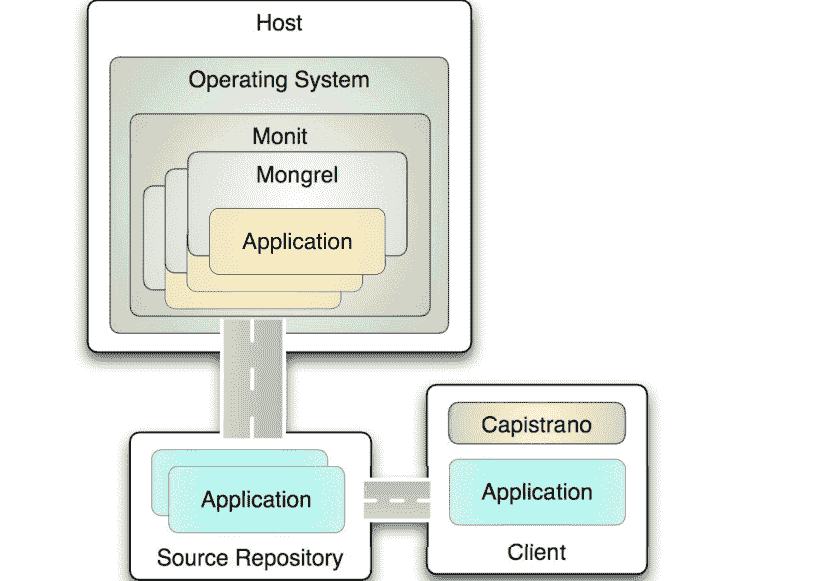

图 6.1：横向扩展部署图

你可以在每次启动`mongrel_rails`时在命令行上指定所有这些选项，但如果你需要超出最基本配置的内容，命令行标志很快就会变得繁琐。这就是 Mongrel 配置文件发挥作用的地方。`-G`或`--generate`选项会为给定的一组命令行标志创建一个配置文件。一旦你有了包含所有所需选项的命令行，你就可以将它们保存到磁盘以供稍后使用。从你的 Rails 应用程序根目录运行以下命令：

```
ezra$ mongrel_rails start -G config/mongrel_7000.yml \
    -e production -p 7000 -d
** Writing config to "config/mongrel_7000.yml".
** Finished. Run "mongrel_rails -C config/mongrel_7000.yml"
** to use the config file.
```

上述命令会在你的 Rails 应用程序的`config/`目录中生成一个名为`mongrel_7000.yml`的文件：

```
ezra$ cat mongrel_7000.yml
---
:config_file:
:daemon: true
:cwd: /Users/ezra/railsapp
:includes:
  - mongrel
:environment: production
:log_file: log/mongrel.log
:group:
:config_script:
:pid_file: log/mongrel.pid
:num_processors: 1024
:debug: false
:docroot: public
:user:
:timeout: 0
:mime_map:
:prefix:
:port: "7000"
:host: 0.0.0.0
```

该文件有很多选项。谢天谢地，你通常不需要所有这些设置，所以你可以大幅精简文件，如下所示：

```
---
:daemon: true
:cwd: /Users/ezra/railsapp
:environment: production
:log_file: log/mongrel.log
:pid_file: log/mongrel.pid
:docroot: public
:port: "7000"
:host: 0.0.0.0
```

现在你可以修改 Mongrel 配置，而无需每次启动 Mongrel 服务器时都在命令行上输入。要使用你全新的`config`文件启动 Mongrel，请使用`-C`标志：

```
ezra$ mongrel_rails start -C config/mongrel.yml
```

如果你还不确定想要哪些选项，但想生成一个配置文件作为起点，你可以使用`-G`选项而不带任何其他参数：

```
ezra$ mongrel_rails start -G config/mongrel.yml
```

当你在任何类 Unix 操作系统上运行 Mongrel 时，你可以使用类似 WEBrick 或 FastCGI 的信号来控制它。

Mongrel 能够识别的信号包括以下几种：

- **TERM**：停止 Mongrel 并删除 PID 文件。

- **USR2**：重启 Mongrel（新进程）并删除 PID 文件。

- **INT**：与 USR2 相同。此命令是一个便利选项，因为 Ctrl+C 会生成中断信号，而 Ctrl+C 在调试模式下也有使用。

- **HUP**：内部重载。此命令可能无法正常工作，因为有时内部重载不会重新加载系统中的所有代码。执行真正的 USR2 重启会更安全。

你可以使用`kill`命令发送这些信号：

```
ezra$ kill -HUP 27333
```

### 配置集群

你已经了解了如何配置单个 Mongrel 实例。你的下一步是为集群构建更灵活的配置。首先，你需要生成`mongrel_cluster.yml`文件。让我们从 Rails 应用程序目录的根目录运行以下命令来配置一个包含三个 Mongrel 的集群：

```
ezra$ mongrel_rails cluster::configure -p 8000 \
          -e production -a 127.0.0.1 -N 3
Writing configuration file to config/mongrel_cluster.yml.
ezra$ cat config/mongrel_cluster.yml
---
port: "8000"
environment: production
address: 127.0.0.1
pid_file: log/mongrel.pid
servers: 3
```

你刚刚构建了一个最小但可用的`mongrel_cluster.yml`文件来运行集群。`port`选项与你配置单个 Mongrel 实例时使用的`port`选项略有不同。对于集群，`port`指定第一个 Mongrel 的起始端口号。每个后续的 Mongrel 将在下一个端口启动。这些 Mongrel 将分别在 8000、8001 和 8002 端口启动。你还指定了 Rails 应用程序的运行环境。通常，你会在开发模式下运行单个 Mongrel，在生产环境下运行集群。Mongrel 将监听由`address`选项指定的主机名或 IP 地址。`pid_file`选项指定了 Mongrel PID 文件的位置，`servers`指定了集群中你想要的 Mongrel 数量。上面的文件配置了三个 Mongrel 在端口 8000、8001 和 8002 上运行。接下来，稍微自定义此配置文件，以利用更多属性：

```
---
port: "8080"
cwd: /Users/ezra/railsapp
log_file: log/mongrel.log
environment: production
address: 127.0.0.1
pid_file: log/mongrel.pid
servers: 3
docroot: public
user: ezra
group: ezra
```

将`cwd`（当前工作目录）设置为 Rails 应用程序的根目录是个好主意。我还添加了`log_file`、`docroot`、`user`和`group`设置。配置用户和组将使 Mongrel 以该用户和组的身份运行，即使你意外地使用`sudo`启动它。出于安全考虑，以普通用户而非 root 用户运行 Web 应用程序始终是个好主意，以防你的应用程序存在安全漏洞。我们知道所有应用程序都有安全漏洞。

要启动和停止 Mongrel 集群，你仍然使用`mongrel_rails`命令，但你可以获得一组集群命令来配合使用。现在从你的 Rails 应用程序根目录试试：

```
ezra$ mongrel_rails cluster::start
Starting 3 Mongrel servers...
ezra$ mongrel_rails cluster::restart
Stopping 3 Mongrel servers...
Starting 3 Mongrel servers...
ezra$ mongrel_rails cluster::stop
Stopping 3 Mongrel servers...
```

你刚刚整理了 Mongrel 配置。接下来，你可以着手将 Mongrel 作为服务运行。

### 将 Mongrel 作为服务运行

在本地目录中使用`mongrel_rails`命令适用于在本地机器上玩转或用于预发布环境。但在生产环境中，最好将 Mongrel 配置得更像 Apache 和 MySQL。服务配置使事情保持一致。操作系统将在每次服务器启动或重启时自动启动服务时包含 Mongrel。服务配置的工作原理与你已经构建的 Mongrel 配置非常相似。

你需要先确保安装了`mongrel_cluster` gem。安装后，你只需在`/etc/mongrel_cluster/myapp.conf`创建一个文件。我建议你将`myapp`替换为你的应用程序名称，但你可以使用任何你喜欢的名称。如果在一台服务器上运行多个应用程序，你可以有多个 Mongrel 集群配置文件。在该文件中，你使用一些简单的选项配置 Mongrel 集群。它们在以下示例配置文件中以内联注释的形式记录：

```
# /etc/mongrel_cluster/myapp.conf

# The user and group with which to run Mongrel
user: deploy
group: deploy

# The location of our Rails application
# and the environment to run within
cwd: /home/deploy/apps/myapp/current
environment: production

# The number of servers in the cluster
servers: 4

# The starting port
# e.g. with 3 mongrels would bind ports 8000-8002
port: "8000"

# The IP Addresses allowed to connect to Mongrel
# If your web server proxy is separate from your app server,
# put its IP address here instead of the localhost IP address
address: 0.0.0.0

# The location of the process ID files relative to the rails app above
pid_file: log/mongrel.pid
```

有了该配置文件，你现在可以从任何当前工作目录使用以下简单命令启动、重启或停止 Mongrel：

- `mongrel_cluster_ctl start` 将从头开始启动一个 Mongrel 集群。

- `mongrel_cluster_ctl restart` 将重启一个正在运行的 Mongrel 集群。

- `mongrel_cluster_ctl stop` 将停止一个 Mongrel 集群。

现在，你的 Mongrel 集群已经愉快地作为服务运行，你可以将注意力转向管理 Mongrel 服务器。Monit 工具将让你处理 Mongrel 可能内存耗尽或遇到任何其他问题的情况。

你可以让 Mongrel 集群在启动时启动，对于大多数 Linux 发行版来说，这应该相当简单。Mongrel 集群自带一个现成的脚本。安装它只需找到它并将其复制到`/etc/init.d/`目录即可。在我的设置中，`mongrel_cluster`脚本文件位于以下位置：`/usr/lib/ruby/gems/1.8/gems/mongrel_cluster-<VERSION>/resources/mongrel_cluster`。

只需将其复制到`/etc/init.d/`，并像这样使其可执行：

```
ezra$ sudo cp /usr/lib/ruby/gems/1.8/gems/mongrel_cluster-1.0.5/resources/mongrel_cluster /etc/init.d/
ezra$ sudo chmod +x /etc/init.d/mongrel_cluster
```

现在你的 Mongrel 集群已配置为在启动时加载，就像 Apache 和 MySQL 一样。作为额外的好处，你现在还可以在任何读到`mongrel_cluster_ctl [start|restart|stop]`的地方使用`/etc/init.d/mongrel_cluster [start|restart|stop]`。这很好，因为对于使用过其他服务脚本（如 Apache 和 MySQL）的人来说，这非常熟悉。

根据你的具体设置、Linux 发行版和托管提供商的自定义配置，你可能需要对脚本内的 PATH 变量进行一些更改。请咨询你的主机提供商或 Linux 发行版的文档，以防你的设置略有不同。

## 6.3 配置看门狗

Monit 是一个用于管理 Unix 上文件、进程和目录的简单实用程序。你可以配置 Monit 在日志过大时分割日志、启动和停止进程，以及监控资源。如果你的内存使用失控，Monit 可以通知你并实际采取一些措施。你可能希望 Monit 重启集群中的一个 Mongrel 或在有人更改配置文件时重启你的 nginx Web 服务器。

首先，你将使用 Monit 来确保你的 Mongrel 保持在高效运行状态。你需要做三件事来启动管理流程：

- 你需要安装正确版本的`mongrel_cluster`。你需要运行的 Mongrel 最低版本是 1.0.1.1。

> **在 RHEL 或 CentOS 上构建 Monit**
>
> 你需要在 Red Hat 或 CentOS 发行版上构建 Monit 之前安装一些依赖项。使用`rpm`或`yum`搜索并安装以下软件包：`flex`、`bison`和`byacc`。安装完这些先决条件后，你可以使用与其他系统相同的说明来构建 Monit。

早期版本不支持`--clean`选项。这一点很重要，因为如果磁盘上存在进程标识（PID）文件，Mongrel 1.0+ 将不会启动。因此，如果你的服务器崩溃并需要重启，Mongrel 会尝试启动但失败，因为存在一个遗留的 PID 文件。`--clean`选项会删除遗留的 PID 文件（如果它们存在）。

- 你需要一个良好的`mongrel_cluster.yml`文件。你已经在本章前面构建了一个，那个应该可以正常工作。

- 你需要一个 Monit 配置文件，名为`mongrel.monitrc`。此配置文件将告诉 Monit 对系统上的每个 Mongrel 执行什么操作。


首要任务是安装 Monit。大多数 Linux 发行版在其包管理器中都有 Monit 包可用。在 Debian/Ubuntu 上，你可以运行`sudo apt-get install monit`，在 Gentoo 上，你可以运行`sudo emerge monit`。如果你找不到适合你的 Linux 的包，别担心，因为你可以从源代码构建 Monit，如下所示：

```
ezra$ wget http://www.tildeslash.com/monit/dist/monit-4.9.tar.gz
...
ezra$ tar xzvf monit-4.9.tar.gz
...
ezra$ cd monit-4.9
ezra$ ./configure && make && sudo make install
...
```

接下来，你需要安装正确版本的`mongrel_cluster`。你需要从 RubyForge 获取最新版本。如果你之前安装过任何旧版本，请务必清理它们，这一点很重要：

```
$ sudo gem install mongrel_cluster && sudo gem cleanup mongrel_cluster
```

设置完成后，你就可以配置 Monit 了。我喜欢为每个 Mongrel 集群创建一个单独的配置。你将把以下配置添加到`mongrel.monitrc`中，该文件将保存在 Monit 的目录中，在我们的例子中是`/etc/monit/`。

```
check process mongrel_deployit_5000
	with pidfile /data/deployit/shared/log/mongrel.5000.pid
	start program = "/usr/bin/mongrel_rails cluster::start -C \
		/data/deployit/current/config/mongrel_cluster.yml \
		--clean --only 5000"
	stop program = "/usr/bin/mongrel_rails cluster::stop -C \
		/data/deployit/current/config/mongrel_cluster.yml \
		--only 5000"
	if totalmem is greater than 110.0 MB for 4 cycles then restart
	if cpu is greater than 80% for 4 cycles then restart
	if 20 restarts within 20 cycles then timeout
	group deployit
```

请注意，你需要为每个要监控的进程添加一个块。前面的配置仅适用于一个 Mongrel。第一个指令`check_process`标识要监控的进程。我跳过了该指令，而使用带有`pidfile`选项的替代方案，告诉 Monit 要监控哪个进程文件。回想一下，每个 Mongrel 实例都有一个存储在`log/mongrel.port.pid`文件中的文件。接下来的两个指令告诉 Monit 如何启动和停止 Mongrel。最后三个指令告诉 Monit 在存在某些异常情况时该怎么做。如果内存超过阈值（前面配置中的 110.0MB）或 CPU 对于某个进程过于繁忙，此配置将重启 Mongrel 实例。这些指令还可以采取更极端的措施，例如超时和通知管理员。请记住，所有这些都是完全自动化的，只在极端情况下才需要通知。

请记住，Monit 将在完全干净的 shell 环境中启动你的 Mongrel。这意味着你的正常`$PATH`不会被设置。你需要使用`mongrel_rails`命令的完整路径。在前面的配置中，我使用了`/usr/bin/mongrel_rails`，但你可能需要根据系统安装命令的位置调整此路径。你可以这样找到命令的安装位置：

```
ezra$ which mongrel_rails
/usr/bin/mongrel_rails
```

最后的配置提供了 Monit 的通用设置，包括邮件服务器和警报的配置。该文件位于`/etc/monit/monitrc`。

```
set daemon 30

set logfile syslog facility log_daemon

set mailserver smtp.example.com

set mail-format {from:monit@example.com}

set alert sysadmin@example.com only on { timeout, nonexist }

set http port 9111

    allow localhost

include /etc/monit.d/*
```

这个配置相当简单，但有几点需要注意。`set daemon 30`告诉 Monit 检查进程的频率，在本例中为每 30 秒一次。我发现 30 秒对于这个设置来说非常完美。你需要设置自己的 SMTP 服务器和用于接收警报的电子邮件地址。最后两条指令在 9111 端口开启了 Monit 内置的 HTTP 服务器，并使其仅能从 localhost 访问，同时将`/etc/monit.d`设置为包含配置文件所在的目录。

完成后，你可以尝试几个命令。你实际上可以通过 Monit 来启动和停止 Mongrel 集群实例。首先，你需要确保 Monit 已经加载了最新的配置：

```
ezra$ sudo /etc/init.d/monit restart
```

当 Monit 启动时，它会自动启动你的 Mongrels。然后，你可以通过 Monit 按组重启 Mongrels：

```
$ sudo monit restart all -g deployit
```

或者通过名称重启单个 Mongrel：

```
$ sudo monit restart mongrel_deployit_5000
```

要查看 Mongrels 的当前状态，请使用 status 命令：

```
$ sudo monit status
    The monit daemon 4.9 uptime: 4d 2h 27m

    Process 'mongrel_deployit_5000'
      status                          running
      monitoring status               monitored
      pid                             20467
      parent pid                      1
      uptime                          55m
      childrens                       0
      memory kilobytes                50432
      memory kilobytes total          50432
      memory percent                  12.8%
      memory percent total            12.8%
      cpu percent                     0.0%
      cpu percent total               0.0%
      data collected                  Sun Jul  1 14:38:26 2007
```

你可能会问自己 “谁来监控 Monit？” 这是一个很好的问题。Monit 通常非常稳定，但某些情况（如“内存不足”）可能会导致 Monit 本身崩溃。如果你想防止这种情况发生，可以将 Monit 置于 init 的控制之下。在 Linux 系统上，init 负责运行`/etc/init.d`中的所有脚本。如果守护进程死亡，init 还可以将其重新创建（respawn）。第一步是从`/etc/init.d`脚本中移除 Monit。请查阅你系统的文档，了解如何从默认运行级别中删除启动脚本。在 Gentoo 上，你可以通过运行`rc-update del monit`来完成。下一步是编辑`/etc/inittab`并在文件底部附近添加以下行：

```
mo:345:respawn:/usr/bin/monit -Ic /etc/monitrc
m0:06:wait:/usr/bin/monit -Ic /etc/monitrc stop all
```

现在你可以让 init 来监视 Monit 了。第一步是停止 Monit。然后你告诉 init 创建 Monit 并保持其运行：

```
ezra$ sudo /etc/init.d/monit stop
ezra$ sudo telinit q
```

现在 Monit 在 init 下运行，`/etc/init.d/monit`命令将无法启动和停止 Monit 守护进程。相反，你必须杀死 Monit 并让 init 重新将其启动，如下所示：

```
ezra$ sudo killall -9 monit
```

既然你现在使用 Monit 来监视 Mongrels，你需要一些自定义的 Capistrano 任务。使用 Monit 时，你不需要在部署脚本中使用`mongrel_cluster/recipes`。相反，你将在`deploy.rb`文件中使用这行代码来设置目标 Mongrels 的 Monit 组：

```
set :monit_group, 'deployit'
```

现在你需要将以下任务添加到你的部署脚本中：

```
desc <<-DESC
Restart the Mongrel processes on the app server by calling restart_mongrel_cluster.
DESC
task :restart, :roles => :app do
  restart_mongrel_cluster
end

desc <<-DESC
Start Mongrel processes on the app server.
DESC
task :start_mongrel_cluster , :roles => :app do
  sudo "/usr/bin/monit start all -g #{monit_group}"
end
```

```
desc <<~DESC
Restart the Mongrel processes on the app server by
starting and stopping the cluster.
DESC
task :restart_mongrel_cluster , :roles => :app do
  sudo "/usr/bin/monit restart all -g #{monit_group}"
end

desc <<~DESC
Stop the Mongrel processes on the app server.
DESC
task :stop_mongrel_cluster , :roles => :app do
  sudo "/usr/bin/monit stop all -g #{monit_group}"
end
```

现在你已经知道如何使用 Monit 来管控你的 Mongrels 了。对于生产环境的 Rails 应用程序，Monit 可以成为救星，我强烈建议在部署 Mongrels 时使用它。

## 6.4 控制 FastCGI

我们之前的重点一直是在 Mongrel。本章的剩余部分我将致力于介绍 FastCGI。如果你发现自己在使用 FastCGI 进行部署，那么接下来的几个章节会对你有帮助。否则，你可以直接跳到第 138 页的第 6.5 节“构建错误通知”。

### 僵尸 FastCGI 进程

在 2005 年炎热的夏天，我注意到我的一个 Rails 应用运行速度比预期的要慢。对我自己的调试能力充满信心，我启动了 SSH 客户端并登录到我的共享服务器。几乎立刻，服务器就因为一个奇怪的 "resource unavailable"（资源不可用）错误将我踢出了。

在再次尝试三次并得到相同结果后，我给客户支持团队发了邮件。结果发现，我运行了 50 个进程，这已经是任何单个用户允许的最大上限了！每一个进程都是“僵尸”，毫无目的地占据着我的进程配额，但无法执行任何有用的操作。就像一部糟糕的恐怖片续集，几天后，我在一个完全不同主机上的另一个 Rails 应用也出现了同样的问题。

Apache Web 服务器在运行 FastCGI 时以产生这些僵尸进程而闻名，这导致许多开发者转而青睐 Mongrels 或 nginx。好消息是，几个简单的 cron 任务就可以防止僵尸进程失控，这决定了一个网站是运行顺畅还是每天崩溃。我将在下文的“收割者（The Reaper）”部分讨论它们。

故事的结局是，共享主机的系统管理员杀死了那些僵尸进程，事情重新恢复正常。我学会了启动一个每日 cron 任务来清理僵尸进程，让我的服务器有一个新鲜的开始。有些人每小时重启一次调度进程。你需要根据具体情况进行实验，看看什么样的方案效果最好。

### 收割者 (The Reaper)

收割者并不是一个披着黑袍的厄运使者；他是你最好的朋友。`reaper`命令能够可靠地修剪 FastCGI 进程。Capistrano 在重新部署后使用它来重启你的 Rails 应用。你也可以使用它来按定期时间表重启进程。

收割者是一个你在命令行运行的脚本。默认情况下，它仅重启你应用程序的 FastCGI 调度进程，因此不会干扰运行在同一用户账户下的其他应用程序。你还可以使用收割者执行其他操作：

- `restart`：通过重新加载应用程序和框架代码来重启应用程序（默认）。向属于当前应用程序的每个`dispatch.fcgi`进程发送 USR2 信号。

- `reload`：仅重新加载应用程序，而不重新加载框架（类似于开发环境）。Reload 发送 HUP 信号。

- `graceful`：将所有进程标记为在下一个请求后退出。Graceful 发送 TERM 信号。

- `kill`：强制退出所有进程，无论它们当前是否在处理请求。`kill`发送 -9 信号。仅在其他信号都失败时使用此选项。

你可以不带任何参数运行收割者，或者请求之前提到的操作，如下所示：

```
ezra$ ./script/process/reaper --action=graceful
```

根据我的经验，默认设置在大多数共享主机上不起作用，因为它们的输出与收割者的预期不符。好消息是，你可以发送一个额外的参数来匹配你主机的特定输出。

让我向你展示我在一个共享托管账户上是如何微调这个设置的。首先，我尝试正常运行调度程序。尽管我知道在那一刻有几个`dispatch.fcgi`进程在运行，但收割者却找不到它们。

```
ezra$ ./script/process/reaper

Couldn't find any process matching process:
/data/deployit/releases/20060224192655/public/dispatch.fcgi
```

阅读 reaper 代码后，我发现了 reaper 用于查找运行中进程列表的确切命令。我手动运行了该命令：

```
ezra$ ps axww -o 'pid command'
```

```
  PID COMMAND
 4830 /usr/bin/ruby dispatch.fcgi
18714 /usr/bin/ruby dispatch.fcgi
 2076 /usr/bin/ruby1.8 dispatch.fcgi
12536 -bash
 5607 ps axww -o pid command
```

然后我明白了发生了什么。reaper 正在查找 dispatcher 的完整路径，但我的服务器上的 ps 命令返回的是一个更短版本的当前进程列表。因此，reaper 无法找到完整路径，所以我无法独立于其他运行在同一用户账户下的应用来重启这个应用。按照配置，reaper 是**全有或全无**的！

在我的本地 Mac OS X 机器上运行相同的命令时，会显示 dispatch.fcgi 脚本的完整路径，正如预期的那样。共享主机的一个现实是，你无法控制系统级的设置，因此你可能不得不调整脚本以适应这种情况。

掌握这些信息后，我可以发送一个更通用的参数，来重启该用户账户下所有运行的 dispatch 进程，以保持一切新鲜且无僵尸进程：

```
ezra$ ./script/process/reaper --action=restart --dispatcher=dispatch.fcgi
```

```
Restarting [4830] /usr/bin/ruby dispatch.fcgi
Restarting [18714] /usr/bin/ruby1.8 dispatch.fcgi
Restarting [2076] /usr/bin/ruby1.8 dispatch.fcgi
```

## 6.5 构建错误通知

有了 Mongrel 集群，你的设置具有更强的可扩展性，应该能够承受较小的故障。有了 Monit 来管理你的 Mongrel 集群，你可以在单个 Mongrel 集群失败或资源变得稀缺时采取预防性措施。

但大多数时候，你的故障将源于普通的人为错误。如果你想要一个良好的管理方案，你就必须处理程序员的错误。通常，Rails 错误会生成一个应用错误，即 dreaded 500 错误页面。使用 Ruby，拦截默认的错误行为相对容易，例如发送电子邮件通知。而这正是 exception_notification 插件所做的。

你可以在 Rails wiki 上了解 exception_notification 插件（http://wiki.rubyonrails.org/rails/pages/ExceptionNotification）。要安装它，只需像这样运行安装脚本：


执行以下命令安装 `exception_notification` 插件：

```
ezra$ ruby script/plugin install exception_notification
```

接下来，要在特定控制器中构建通知功能，请包含错误通知模块。我喜欢在 `application.rb` 中包含错误通知，这样当任何控制器的任何用户遇到我没能正确处理的错误时，我都会收到电子邮件通知，如下所示：

```ruby
class ApplicationController < ActionController::Base
  include ExceptionNotifiable
  ...
end
```

接下来，配置应该接收 Rails 异常的电子邮件地址。在 `config/environment.rb` 中添加通知设置：

```ruby
ExceptionNotifier.exception_recipients = 
  %w(you@yourdomain.com another@yourdomain.com)
```

现在，如果发生任何错误，你会收到如下所示的错误通知：

```
A ActionView::TemplateError occurred in drives#edit_comment:

  undefined method `title' for nil:NilClass
  On line #5 of app/views/drives/edit_comment.rhtml

    2: <%= error_messages_for 'gift' %>
    3: <!--[form:drive]-->
    4:
    5: <h1><%= @drive.title %></h1>
    6: <div>
    7:
    8: <table><tr>

#{RAILS_ROOT}/app/views/drives/edit_comment.rhtml:5:in `
_run_rhtml_47app47views47drives47edit_comment46rhtml'
#{RAILS_ROOT}/vendor/rails/actionpack/lib/action_view/base.rb:326:in `
compile_and_render_template'
#{RAILS_ROOT}/vendor/rails/actionpack/lib/action_view/base.rb:301:in `render_template'
```

...

--------------------------------------------------------------------------------

# Request:

- URL: `http://changingthepresent.org/drives/edit_comment/65?donate=true`

- Parameters: `{"donate"=>"true", "action"=>"edit_comment", "id"=>"65", "controller"=>"drives"}`

- Rails root: `/home/deploy/importantgifts/current`

--------------------------------------------------------------------------------

# Session:

- `@write_lock`: `true`

- `@session_id`: `"875ce6f70cb9b8e73948a72147999303c"`

- `@data`: `{"flash"=>{}}`

- `@new_session`: `true`

--------------------------------------------------------------------------------

# Environment:

--------------------------------------------------------------------------------

- `GATEWAY_INTERFACE`: `CGI/1.2`

- `HTTP_ACCEPT`: `*/*`

- `HTTP_ACCEPT_ENCODING`: `gzip`

- `HTTP_CONNECTION`: `Keep-alive`

- `HTTP_FROM`: `googlebot(at)googlebot.com`

- `HTTP_HOST`: `changingthepresent.org`

- `HTTP_USER_AGENT`: `Mozilla/5.0 (compatible; Googlebot/2.1; +http://www.google.com/bot.html)`

- `HTTP_VERSION`: `HTTP/1.1`

- `HTTP_X_FORWARDED_FOR`: `66.249.72.161`

- `HTTP_X_TEXTDRIVE`: `BIGIP`

- `PATH_INFO`: `/drives/edit_comment/65`

- `QUERY_STRING`: `donate=true`

- `REMOTE_ADDR`: `66.249.72.161`

- `REMOTE_METHOD`: `GET`

- `REQUEST_PATH`: `/drives/edit_comment/65`

- `REQUEST_URI`: `/drives/edit_comment/65?donate=true`

- `SCRIPT_NAME`: `/`

- `SERVER_NAME`: `changingthepresent.org`

- `SERVER_PORT`: `80`

- `SERVER_PROTOCOL`: `HTTP/1.1`

- `SERVER_SOFTWARE`: `Mongrel 1.0`

- `Process`: `1620`

- `Server`: 

-------------------------------

Backtrace:

-------------------------------

On line #5 of `app/views/drives/edit_comment.rhtml`

  2: `<%= error_messages_for 'gift' %>`

  3: `<!--[form:drive]-->`

  4:

  5: `<h1><%= @drive.title %></h1>`

  6: `<div>`

  7:

  8: `<table><tr>`

  `#{RAILS_ROOT}/app/views/drives/edit_comment.rhtml:5:in `_run_rhtml_47app47views47drives47edit_comment46rhtml'`

  `#{RAILS_ROOT}/vendor/rails/actionpack/lib/action_view/base.rb:326:in `compile_and_render_template'`

  `#{RAILS_ROOT}/vendor/rails/actionpack/lib/action_view/base.rb:301:in `render_template'`

  `#{RAILS_ROOT}/vendor/rails/actionpack/lib/action_view/base.rb:260:in `render_file'`

...

```

瞧！这封电子邮件是一封实际的通知邮件，它帮助解决了 ChangingThePresent 代码中的一个生产问题。³ 该邮件包含了完整的调试信息，包括完整的跟踪和回溯、会话内容、有问题的视图代码以及 HTTP 请求的完整环境。

你还可以配置一些其他选项。使用 `ExceptionNotifier.sender_address` 配置发件人，使用 `ExceptionNotifier.email_prefix` 在主题行中附加字符串（以帮助电子邮件过滤）。此插件仅在地址不是本地时发送电子邮件通知。你可以使用 `ExceptionNotifier.consider_local` 配置哪些 IP 地址应被视为本地地址。

有了此解决方案，当你的应用发生异常时，Rails 会通知你。你可以配置它以便与你的电子邮件客户端良好协作，而且由于它直接集成到 Rails 中，只要 Rails 没有完全失败，并且你的网络和电子邮件保持正常工作，你就会收到通知。

- 3. `http://ChangingThePresent.org`

## 6.6 心跳检测

`exception_notification` 插件是了解应用出错时错误是一致的还是间歇性的好方法。不过，它并不是一个完整的解决方案。对于更大或更关键的生产系统，你还需要验证系统是否正在运行。

心跳检测服务会在你的应用失败时通知你。我发现，在单独的主机上运行一个简单的脚本比自定义解决方案更好，因为它简单、可无限定制，并且可以在任何带有你脚本语言的主机上部署。以下脚本检测 ChangingThePresent 的四个页面之一是否宕机：

```ruby
# Download managing_things/heartbeat.rb

#!/usr/local/bin/ruby

require 'net/smtp'

require 'net/http'

require 'net/https'

require 'uri'

urls = %w{

  http://www.changingthepresent.org/

  http://www.changingthepresent.org/nonprofits/show/23/

  http://www.changingthepresent.org/causes/list/

  https://www.changingthepresent.org/

}

from = 'system@importantgifts.org'

recipients = %w{development@changingthepresent.org}

errors = []

urls.each do |url|

  begin

    uri = URI.parse(url)

    http = Net::HTTP.new(uri.host, uri.scheme == "https" ? 443 : nil)

    http.use_ssl = (uri.scheme == "https" ? true : false)

    http.start do |http|

      request = Net::HTTP::Get.new(uri.path)

      response = http.request(request)

      case response

      when Net::HTTPSuccess, Net::HTTPRedirection

      else

        raise "requesting #{url} returned code #{response.code}"

      end

    end

rescue

  error = "#{url}: #{$!}"

  errors << error

  puts error

end

end

unless errors.empty?

  msg = "From: #{from}\n"

  msg += "Subject: ChangingThePresent.org is down!\n\n"

  msg += errors.join("\n")

  puts "sending email to #{recipients.join(', ')}"

  Net::SMTP.start('localhost', 25, 'localhost') do |smtp|

    smtp.send_message(msg, from, recipients)

  end

end
```


这四个 URL 并非随意选择。它们分别代表一个安全页面、一个页面缓存页面、一个片段缓存页面和一个标准动态页面。管理员团队通过 `cron` 作业每五分钟执行一次此脚本。每当网站宕机时，脚本会通过一个转发给所有开发人员的电子邮件地址通知项目中的所有开发人员。

脚本将重定向和成功状态计为成功连接。其他任何情况均为失败。超时也会触发通知。

## 6.7 结论

本章中的管理策略无需任何成本，但却出奇地稳健。构建可重复的 `Mongrel` 配置而非使用命令行选项既简单又能够实现一致的集群化。在集群中配置 `Mongrel` 可以为您提供良好的性能和一定的故障转移能力。集群化 `Mongrel` 很重要，因为 Rails 采用的是 `shared-nothing` 策略。

集群化只是管理策略的开始。要运行生产环境的 `Mongrel`，您需要信息和控制权。通过使用 `Monit`，您可以获得一个看门狗程序，它会自动终止并重新启动任何失控的 `Mongrel`。通过使用各种电子邮件通知功能，脚本会在服务器宕机或任何人遇到 Rails 错误时通知您选择的收件人。

不过，我们的错误恢复解决方案尚未完善。在拥有完整策略之前，您还需要更好地掌握资源监控和性能监控。请继续阅读。

## 扩展

# 第 7 章：横向扩展

## 7.1 地形概览

我要暂时放下房地产经纪人的帽子，戴上社区规划师的帽子。如果您在拥堵的城市附近拥有一所房子，并在其繁忙的市中心工作，您对多车道高速公路上的交通一定再熟悉不过了——有时快如猎豹，有时慢如猎豹的雕像。面对这个问题，您可能会从以下两种解决方案入手：

- 提高限速。
- 增加车道数量。

这些解决方案听起来显而易见，您可能也听过类似的类比，但实际情况要复杂得多。自然法则和政治法规限制了汽车能够安全行驶的速度上限，而高速公路的车道数量也只能增加那么多。这些限制条件实际上约束了每种解决方案最终所能达到的效果。

有时，这些解决方案甚至没有针对正确的问题。有效移动人群的障碍并不总是限速或车道。您需要考虑界面——匝道和并道——它们可能会拖慢交通。入口会迫使车辆变道并减速，出口使问题加倍，而事故或施工项目则会导致车道封闭。不过，最大的瓶颈——也是造成其他瓶颈的根源——在于目的地。不仅所有车辆都在同一条路上，而且它们都前往同一个地方。问题出在**市中心本身**。您只能希望最终到达时会有足够的停车位和办公空间！

您的计算机基础设施并没有太大区别。高速公路的每条车道都是连接到应用程序所提供服务的网络连接。市中心就是资源池。每个匝道都是一个客户端节点。每辆车都是一个前往市中心办理业务的用户请求。增加车道和提高限速的想法实际上是一种“纵向扩展”的方式。您可以通过升级 `CPU`、内存、磁盘和带宽等硬件来进行纵向扩展。这种策略有时有效，但纵向扩展存在局限性。单个盒子中能塞入的 `CPU`、内存、硬盘和带宽总是有限的。这些限制很可能永远无法让您的应用程序满足全球用户的需求。

低上限并不是纵向扩展的唯一问题。随着业务增长，失败的代价也会变得更高。您需要冗余系统和热备份来处理故障，甚至是偶尔的硬件升级。归根结底，纵向扩展更加困难，天花板也更低。

大多数成功的 Web 企业选择向上扩展，这并非出于偶然或必要，而是出于偏好。我不会完全否定纵向扩展。在讨论数据库时我会提及它，因为纵向扩展在该领域有一些真正的优势。

## 7.2 通过集群进行横向扩展

横向扩展意味着添加更多服务器，每台服务器都有自己独立的 `CPU`、磁盘、内存和网络带宽。回想一下交通类比。最终的问题是所有人都前往同一个市中心。横向扩展增加了第二个市中心，那么当天一半的旅行者就会突然走上不同的道路，前往不同的市中心。想象一下，如果明天城市一半的人口都不在您走的这条路上，您的日常通勤会是什么样子！横向扩展无疑会带来更大的收益。但成本、复杂性和可维护性如何呢？

扩展到数百台服务器可能会在资金和复杂性方面让您付出不少代价，但您不必一次性支付所有代价。方便的是，横向扩展让复杂性随您一起扩展。起初，为向外扩展而设计几乎不需要什么成本，但您的准备工作将为您应对未来更大的挑战做好准备。您今天做一些准备工作，之后就可以应对新的性能需求。要做好准备，您需要搭建几个关键的基础设施要素。诀窍是尽早做好扩展规划，以便以后避免意外。

请记住，您仍然需要把性能做好。即使您计划通过砸钱和堆硬件来扩展，您也要留出足够的时间来解决性能问题。我会在第 9 章《性能》（第 224 页）中详细讨论性能。

从部署的角度来看，您眼前的架构图类似于下一页的图 7.1。您会有两到三个不同的虚拟主机，它们可能位于同一台服务器上，也可能不在。每个 `Mongrel` 集群都是一个独立的市中心。一台服务器将使用 `Apache` 或 `nginx` 作为静态代理和负载均衡器。另外两台将通过 `Mongrel` 集群提供 Rails applications 服务。您将使用 `Capistrano` 部署到每台服务器上。接下来的几个部分将帮助您搭建一个简单的架构，该架构可以轻松地从单个专用服务器扩展到大约五台服务器，而无需对应用程序进行大量修改。在接下来的章节中，我将带您完成以下内容：

- 向环境中添加多个虚拟机。
- 使用 DNS 提供商的 `CNAME` 为您的集群设置子域名。
- 确保您的 `Mongrel` 服务器以集群和服务形式部署。
- 使用 `Apache` 或 `nginx` 设置负载均衡代理 Web 服务器。
- 配置多主和主/从 `MySQL` 集群。

我将从最简单的 Rails 部署开始，逐步将服务器扩展为能够处理您的 Web 2.0 用户大军的横向扩展模型。完成后，您将拥有一台 Web 服务器作为静态代理和负载均衡器，将内容提供给一个或多个 `Mongrel` 集群。该系统将按如下方式处理典型请求，如第 148 页的图 7.2 所示。用户向网关服务器发送请求。如果是静态请求，网关服务器直接提供静态内容，任务完成。如果不是，网关服务器会将请求转发给多个 `Mongrel` 集群中的一个。`Mongrel` 集群再将请求转发给单个 `Mongrel` 服务器。

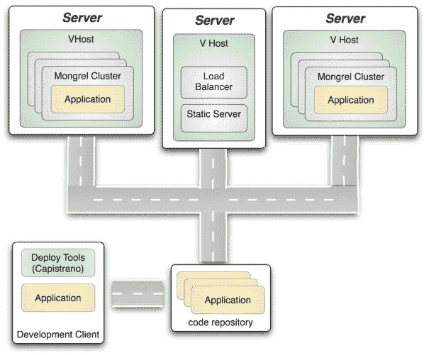

### 前置条件

如果你无法访问托管的虚拟专用服务器（`VPS`），你可以在自己的桌面电脑上设置几个虚拟机。对于 Windows 用户，`VMware` 和 `Microsoft Virtual PC` 对非商业用途均免费。Linux 用户有商业和免费选项，包括 `VMware`、`Xen` 或 `OpenVZ`。Mac 用户可以使用 `Parallels` 或 `VMware`，这两者都不是免费的。如果你不确定买哪个，可以尝试免费试用版。我个人倾向于使用 `VMware`，但其中任何一个都可以。

这些虚拟机技术的工作方式与 `VPS` 托管商提供的方式类似。它们允许你在一个封闭的环境中安装一个完全独立的操作系统，该环境就像是你电脑中的一台计算机。事实上，如果你在考虑 `VPS` 托管服务但不确定需要多少内存或磁盘空间，你可以使用这些“家庭版”测试各种配置，以人为地限制系统资源。在决定购买一年期 256MB 的托管 `Xen VPS` 之前，尝试在 256MB 的 `VMware` 虚拟机中运行你的应用程序。

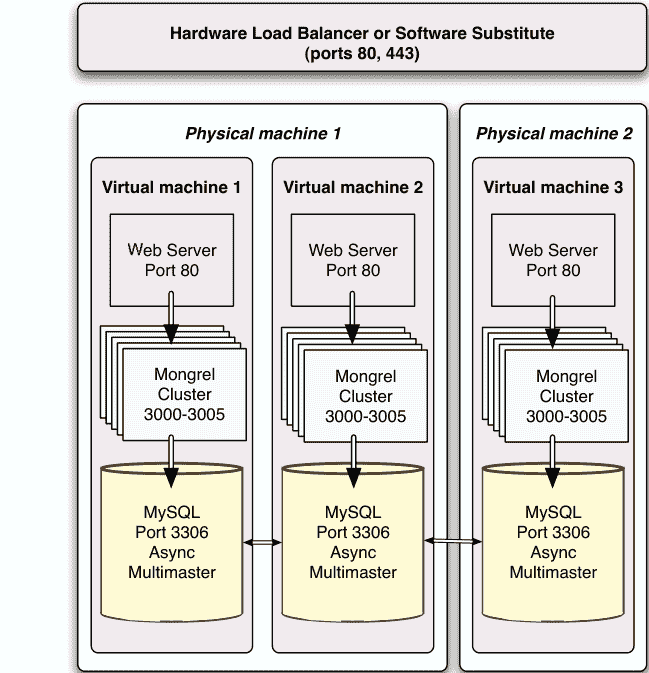

图 7.2：典型的 Rails 集群部署设置

你可以使用任何 Linux 发行版，但我一直觉得像 `CentOS` 和 `Fedora` 这样基于 Red Hat 的发行版最友好。它们与许多 `VPS` 托管商提供的一致（`RHEL` 和 `CentOS` 非常流行）。为了让你的 Rails 应用程序运行起来，需要安装很多 Linux 软件包依赖。起码你需要一个 `C/C++` 编译器、Ruby 以及与你的应用相关的 gems、`Subversion`、`Apache httpd`、`MySQL Server` 以及你喜欢的文本编辑器（无论是 `vi` 还是 `emacs`）。有时，你只需在安装 Linux 发行版时选择“Web 服务器”和“开发人员”选项即可构建系统。然而，从最小化安装开始安装所有内容并不困难，特别是参考第 72 页第 4 章《虚拟主机与独立主机》中的文档。

> ### Joe 提问……
>
> **为什么水平扩展要费心使用虚拟化？**
>
> 虚拟化在水平扩展方面有许多优势。首先，你可以让应用程序更早地实现水平扩展。你可能可以用单台独立服务器的价格获得至少两台或更多虚拟专用服务器。你能够更早地获得冗余和性能提升的大部分优势，而且以后可以随时切换到独立服务器，且对配置的影响较小，停机时间更短。就我个人而言，即使在独立服务器上我也选择运行虚拟化环境。我发现它们更容易管理和配置。硬件和软件的进步使虚拟化技术变得快速，其带来的收益远超任何细微的性能损耗。

你需要两个虚拟机实例。利用前面提到的大多数软件技术，你可以构建一个，然后简单地复制虚拟机文件，仅更改一些标识信息，如 IP 地址和主机名。

一旦虚拟机运行起来，请创建数据库，并使用你在前面章节中学到的技术，通过 `Capistrano` 将应用程序部署到其中一台机器上。你可以部署最简单的应用程序，这样你至少可以启动 `Mongrel`，并通过直接访问 `Mongrel` 服务器在浏览器中访问你的应用。

任何应用程序都可以，但不应是一个空的 Rails 应用。如果你需要一个可运行的应用，可以尝试使用 *Agile Web Development with Rails* 中的示例，地址为 [http://www.pragprog.com/titles/rails2/source_code](http://www.pragprog.com/titles/rails2/source_code)。

你可以找到关于 Linux、`Apache` 和 `MySQL` 管理的整本书籍。为了让你专注于 Rails 部署的特定主题，我可能会跳过某些步骤。在必要时，我会尝试引导你参考其他资源，以进一步加强安全性或优化性能。

## 7.3 镜像克隆

你的服务器集群将包含承担多种角色的多台服务器。尽量保持相同角色的服务器配置完全一致。这样你的生活会更轻松，遇到的意外会更少，需要写的文档也会更少。如果你觉得保持配置一致工作量太大，那么你一定会爱上虚拟化。

虚拟服务器就像硬盘上的文件。你可以移动、复制、删除和备份它们。当需要保持配置一致时，最简单的方法就是直接做一个副本。根据更改的规模和时机，这里有几种确保 VM 之间配置一致的策略。

### 冷备份（Cold Copy）

在初次设置环境时，只需配置一台虚拟服务器。将该服务器调整到所有软件、补丁、依赖和配置都就绪的状态，以便运行一个应用实例。然后，为每个服务器角色（包括应用服务器、Web 服务器和数据库服务器）各制作一个副本。

### 自动化（Automate）

你通常可以使用 `Capistrano` 自动化配置更改。你已经看到 `Capistrano` 脚本表现出色，使用 Ruby 代码，并能根据不同的配置区分服务器角色。

### 热备份（Hot Copy）

较大且较为严重的配置更改可能需要你关闭服务器。在这种情况下，VM 的酷之处在于你可以使用复制策略。只需将一台服务器从集群中移出，对其进行更改，然后将其复制以复制集群中所有其他服务器。这种热备份方法允许你向集群引入一台新服务器以处理额外负载。请小心：你必须始终能够唯一地标识每台服务器。每当你制作副本时，必须确保正确设置每台服务器的 IP 地址、主机名和任何其他唯一信息。如果可能，请使用每台服务器通用的脚本将此类操作自动化。记得记录这个过程！

### 手动执行（Just Do It）

如果你无法证明自动化更改的合理性，或者不想关闭服务器，你可能不得不逐台遍历服务器进行更改。但请记得保持条理并记录你的步骤——这将带来巨大的差异。

### 保留离线主副本（Keep Offline Master Copies）

主副本是一个离线配置，从未被部署或作为服务器暴露在公共互联网上。你会在第一次冷备份时使用它。在构建初始 VM 后，你可以将该副本作为在线主副本。每当你需要更改配置时，可以修改这个主副本。最重要的是，如果你的服务器因为安全漏洞而被攻破，这是你可以安全部署的副本。一旦服务器被攻破，就很难再次信任它。关于数据的潜在威胁你已经有足够担心的事情了，更不用说清理整个服务器集群的噩梦。拥有离线主副本允许你在从未暴露于网络的离线副本中修复安全漏洞，然后将每个服务器角色重新部署到集群中。

### 使用第三方工具

到目前为止，我只讨论了管理这些配置的自定义暴力方法。能够实现相同功能的第三方工具甚至可能包含在你的虚拟机软件中或由你的 `VPS` 提供商提供。多方对比，并与你的服务和软件提供商沟通。

## 7.4 域名与主机

当你的环境中有多台服务器时，管理它们的名称变得至关重要。你将通过第 44 页第 3 章《共享主机》以及第 72 页第 4 章《虚拟主机与独立主机》中使用的基于 Web 的用户界面来管理域名。记住，域名配置的更改可能需要数小时甚至数天才能在整个互联网上完全传播。为集群管理这些细节比管理单个 Web 服务器要困难一些，但通常只要了解多几个概念即可应对：

**A 记录**

大多数域名服务的默认配置是除了支持 `www.brainspl.at` 之外，还支持 `brainspl.at`。主记录

> ### Joe 提问……
>
> **所以我应该使用 A 记录还是 CNAME？**
>
> 当我为自己研究 A 记录与 `CNAME` 的问题时，我记得曾看到过关于 `CNAME` 记录的各种用途与滥用，以及不同配置优缺点的争论。我的性格比较保守，不愿冒险，所以我通常遵循以下规则：
>
> - 使用 A 记录将名称映射到 IP 地址。
> - 使用 `CNAME` 记录为 A 记录创建别名。
>
> 在 DNS 术语中，`domain`（[brainspl.at](http://brainspl.at)）是一个 A 记录（即地址记录）。这条记录将 `brainspl.at` 直接映射到你的 IP，是最底层的映射。

**CNAME 记录**

`CNAME` 记录就像是 A 记录的别名，无论该 A 记录是你自己的还是他人的。别名通常用于指示服务器提供的服务类型。例如，`www.brainspl.at` 是 `brainspl.at` 的一个别名，表示对 HTTP 服务器感兴趣；而 `ftp.brainspl.at` 则表示对文件传输协议（FTP）感兴趣。请记住，业界存在长期形成的惯例，只要可行，你应该遵循这些惯例。¹

### 我需要哪些名称？

掌握了域名配置的新知识后，你现在需要决定需要哪些名称。尝试为你站点所有公开可用的节点命名，包括负载均衡器及其分发的节点。你可能还会安装防火墙。在真实的生产环境中，正确配置名称和可见性可能需要一些高级防火墙设置，这超出了本书的讨论范围。为了简单起见，我将让 Web 服务器充当负载均衡器，并稍后提醒你，对于最严肃的网站来说，硬件负载均衡解决方案绝对是必不可少的。

假设你有一个包含一个负载均衡器、两个 Web 服务器和一个数据库服务器的配置。你会将负载均衡器暴露在网络中，但不会暴露数据库。因此，你需要为负载均衡器起一个名字。数据库服务器在你的本地内网中可能有名称，但在域名服务（DNS）中不会有名称（因此不会有 [db.brainspl.at](http://db.brainspl.at)）。负载均衡器将在两个 Web 服务器之间分发请求。这两个 Web 服务器也需要名称，因为你最终需要直接访问单个 Web 服务器，或者将请求重定向到特定服务器——无论如何，这在调试、配置或测试时都是必要的。我认为需要三个 A 记录和一个 `CNAME`，因为负载均衡器将映射到负载均衡器 IP 地址，而每个 Web 服务器也将拥有一个 IP 地址。我会为访问者使用的 `www` 别名使用一个 `CNAME`。我还会额外增加一个 `CNAME`，以备潜在的缓存服务之用。最终的表格如下所示：

**A 记录**

| 名称 | IP 地址 | 描述 |
|---|---|---|
| `brainspl.at` | `999.999.999.100` | 负载均衡器 |
| `www1.brainspl.at` | `999.999.999.101` | 第一台 Web 服务器 |
| `www2.brainspl.at` | `999.999.999.102` | 第二台 Web 服务器 |

**CNAME 记录**

| 名称 | 别名为 | 描述 |
|---|---|---|
| `www.brainspl.at` | `brainspl.at` | 负载均衡器的别名 |
| `content.brainspl.at` | `content.contentcache.com` | 内容缓存服务的别名 |

最后一个 `CNAME` 指向一个第三方 A 记录，该记录提供对音乐、图像和视频等大型内容的缓存。

在设置 A 记录和 `CNAME` 时，你需要设置生存时间（`TTL`）参数。该值决定了名称服务器返回你的配置以检查更改的频率。将此值设置为较低的值（例如 30 分钟），将给你更多的灵活性来更改配置，且对站点的影响最小。将其设置为较高值（例如 7 天），将提高站点的性能，因为浏览器等客户端软件需要进行更少的名称查询。我建议开始时将其设低，这样即使犯错，影响也较小。当你对配置感到满意后，再回来将所有 A 和 `CNAME` 记录的值增加到至少 24 小时。

现在你已经为服务器命名，可以开始将应用程序部署到它们上面了。

## 7.5 部署到多个主机

使用 Rails 和 `Capistrano`，你拥有很多部署选项。`Capistrano` 开箱即用地支持三种服务器角色：

- `web` 角色指向负责静态内容的服务器。`Apache` 或 `nginx` 运行在这里。
- `app` 角色指向运行 Rails 应用程序的服务器。`Mongrel` 运行在这里。
- `db` 角色指向你的数据库服务器。`MySQL` 运行在这里。

`Capistrano` 会将正确的文件部署到每台服务器上。如果需要，你可以覆盖其行为。如果只有一台服务器，你通常将所有角色都部署到该服务器上。以下 `Capistrano` 脚本是一个单服务器配置示例。在本节剩余的示例中，我将引用其中的部分内容。

```ruby
# Customized deploy.rb

set :application, "brainsplat"

set :user, "ezra"
```


`set :repository, "http://brainspl.at/svn/#{application}"`

`set :deploy_to, "/home/#{user}/#{application}"`

`role :web, "www1.brainspl.at"`

`role :app, "www1.brainspl.at"`

`role :db, "www1.brainspl.at", :primary => true`

### 集群选项

给定两台服务器，你现在需要做出决定。以下三种选项是最合理的。

**隔离数据库：** 第一个选项很简单，且根据应用程序的不同，可能为单个请求提供最佳性能。如果你的应用程序交易密集且依赖大量动态数据，那么这个选项可能是正确选择。在这种配置下，数据库是独立分离的，因此它可以完全专用地访问服务器资源，其中应包括大量快速磁盘。你还将获得额外的安全性，因为数据库远离公共网络接口。你可以这样配置隔离数据库选项：

```
# Relevant lines of deploy.rb
# ...
role :web, "www1.brainspl.at"
role :app, "www1.brainspl.at"
role :db,  "internal.brainspl.at", :primary => true
```

### Joe 提问...

#### 为什么不直接“垂直扩展”数据库？

你绝对可以“垂直扩展（Scale Up）”数据库。数据库服务器是垂直扩展的绝佳候选对象，因为它经常成为瓶颈，并且能从超快磁盘和大量内存中获益。你还可以将冗余磁盘配置为 RAID-1、RAID-5 或 RAID-10，这将提供与软件集群类似的冗余级别，且性能可能更好。不要低估此类硬件的成本，并记住垂直扩展方法的局限性和后果。它们依然适用！

**隔离 Web 服务器：** 第二个选项是隔离 Web 服务器，使其能够利用大量内存和快速网络连接，专注于缓存和提供静态页面。如果你的应用程序包含大量静态内容，并希望有机会在 Digg 效应（瞬间爆发流量）中生存下来，你可能会选择专用 Web 服务器。应用程序和数据库则隔离在第二个内部服务器上。方便的是，你依然拥有将数据库远离 Web 服务器的安全优势。然而，将 Web 服务器和应用服务器部署在独立机器上，会失去直接提供 Rails 实时创建的缓存页面的优势。集群或共享文件系统，或者在应用服务器上再运行一个 Web 服务器，可以解决这个问题。无论如何，在 Capistrano 配置中，隔离 Web 服务器的角色如下所示：

```
# Relevant lines of deploy.rb
# ...
role :web, "www1.brainspl.at"
role :app, "internal.brainspl.at"
role :db,  "internal.brainspl.at", :primary => true
```

这是一个细微的差别，但会产生巨大的影响。你运行的应用程序类型和你可用的硬件将决定正确的选项。如果你计划迅速增长，超出上述任何一种选项所支持的容量，那么你可能需要考虑第三个选项，因为你最终很可能会走向那一步。

**集群：** 第三个选项是让两台服务器都运行所有角色：Web 服务器、应用程序和数据库。它提供了完全冗余的优势。即使损失一整台服务器，站点仍能继续运行。

### 结合更多服务器的方法

Capistrano 和 Rails 具有足够高的灵活性，可以支持大量的服务器配置选项。一旦你的规模扩展到两台服务器以上，你就会拥有更多、更多的选择。以下章节将重点介绍几种较为流行的选项。

#### 四台服务器：集群数据库

这种配置采用集群数据库，配合独立的 Web 服务器和应用服务器。该配置侧重于事务处理和动态数据。如果你的数据库是瓶颈，或者你需要在数据库层面添加故障转移功能，那么这种配置是一个不错的起点：

```
# Relevant lines of deploy.rb
# ...
role :web, "www.brainsp1.at"
role :app, "app.brainsp1.at"
role :db, "db1.brainsp1.at", :primary => true
role :db, "db2.brainsp1.at"
```

#### 五台服务器：集群 Web 服务器

这种配置使用集群 Web 服务器、独立的应用服务器以及扩展的数据库。该方案的重点在于静态内容，但数据库服务器也具备额外的能力来应对负载。

```
# Relevant lines of deploy.rb
# ...
role :web, "www1.brainsp1.at"
role :web, "www2.brainsp1.at"
role :web, "www3.brainsp1.at"
role :app, "app.brainsp1.at"
role :db, "bigdb.brainsp1.at", :primary => true
```

#### 十台服务器

如图 7.3 所示，该配置支持一个完整的集群，没有特别的侧重点。两台大型数据库服务器为应用提供支持，因为将数据库集群扩展到两台以上服务器时，每增加一台服务器所带来的收益会逐渐减少。如果你想更广泛地扩展数据库服务器集群，请考虑使用分片（sharding）技术，我将在第 7.8 节“挑战 3：集群 vs. 分片”（第 180 页）中进行更详细的讨论。

```
# Relevant lines of deploy.rb
# ...
role :web, "www1.brainsp1.at"
role :web, "www2.brainsp1.at"
role :web, "www3.brainsp1.at"
role :app, "app1.brainsp1.at"
role :app, "app2.brainsp1.at"
role :app, "app3.brainsp1.at"
role :app, "app4.brainsp1.at"
role :app, "app5.brainsp1.at"
role :db, "bigdb1.brainsp1.at", :primary => true
role :db, "bigdb2.brainsp1.at"
```

### Web 服务器与应用服务器：有何区别？

到目前为止，你已经听到了很多关于 Web 和应用角色的介绍。我也暗示过 Mongrel 可能并不是最佳的 Web 服务器。现在是时候深入探讨一下了。

#### Web 服务器

Web 服务器擅长快速路由请求、提供静态文件内容和缓存，因此它是一个出色的代理，可以部署在应用服务器前面。在短暂尝试过 lighttpd 之后，Rails 社区似乎已经选定了一对 Web 角色中常用的服务器：Apache 和 nginx。Apache 是一款可扩展的、功能齐全且极其可靠的 Web 服务器。但使用 Apache 可能会得到超出你所需的功能，并且无论如何你都不得不应对它的配置问题。这就轮到 nginx 登场了。这个俄罗斯的产物功能强大，非常适合部署在 Mongrel 集群前面。此外，nginx 配置更简单、速度极快，且占用极少的系统资源。对于内存有限且软件效率至关重要的虚拟主机服务来说，它是一个极佳的选择。

#### 应用服务器

应用服务器是一个专注于安全执行代码和管理运行时环境的容器。对于 Rails 来说，单个运行时环境是不够的，因为 Rails 采用单线程架构。一个 Mongrel 一次只能处理一个请求。由于其无共享（share-nothing）架构，每个并发用户对 Rails 应用的请求都需要一个独立的运行时环境。

Rails 应用服务器架构面临两个挑战：

- Mongrel 并非针对提供静态内容进行优化，这样做会给 Rails 控制器带来不必要的负载。
- 在生产环境中，你会在不同端口上运行多个应用服务器，因此你需要某种路由器来在它们之间分配请求。

你需要一台针对路由请求、提供静态内容和缓存进行优化的 Web 服务器。同时你也看到了对一台针对处理 Rails 请求进行优化的应用服务器的需求。Mongrel 是目前 Rails 内容的首选服务器，这归功于它的性能、稳定性和安全性。FastCGI 也是一个选项，且比 Mongrel 稍快一些。但由于稳定性问题和配置上的麻烦，很少有人会选择 FastCGI 而非 Mongrel。

此时，请确保你的 Mongrel 实例以集群方式运行，并作为一项服务启动。在接下来的章节中，我将阐述这个等式的另一面：静态 Web 服务器。

## 7.6 Apache

Apache 可能是有史以来最成功的开源项目。Apache 驱动着世界上一些最大的互联网网站，并拥有一个庞大的社区。Apache 背后还有一个官方的 501(c)(3) 非营利组织——Apache 软件基金会。Apache 在未来很长一段时间内仍将是事实上的标准 Web 服务器，这是一个稳妥的判断。

尽管取得了成功，Apache 并不总是易于安装、配置或管理。和任何事物一样，这取决于个人的视角和观点。有些人认为 Apache 复杂且难以设置。另一些人则认为由于其令人难以置信的灵活性，它是最简单的之一。无论哪种说法是正确的，如果你选择运行 Apache，你现在就需要正确地设置它。你不希望只是草草地弄个简单配置，然后在之后受制于这个配置。在动手之前，你应该更详细地了解 Apache 能为你做什么。

### 关注点分离：Web 服务器风格

在这里我将采用一种与以往稍有不同的方式来配置 Apache。我将比通常使用更多的虚拟主机代理。这样做有几个原因：

- 更好地隔离各个配置元素，使其更易于阅读和理解。
- 将关注点和职责分离到不同的虚拟服务器中。
- 模拟基础设施组件的行为，这些组件在你自己跟着这些示例操作时很难演示——除非你手头恰好有一台硬件负载均衡器来在虚拟机之间分配请求。我没有，所以我会使用 Apache。

最后一点尤其重要。通常你会有一台硬件负载均衡器将请求分配到每台虚拟机上的 Web 服务器，这些 Web 服务器随后要么提供一些静态内容，要么将请求转发到集群中的某个 Mongrel。你已经可以开始想象这种职责的层次划分了。最初，Apache 作为 Web 服务器，接收所有传入的 HTTP 请求。然后，Apache 作为静态代理，在请求到来时提供静态页面。接着，当动态请求到来时，Apache 作为负载均衡器，将请求转发到相应的 Web 服务器。

然而，在没有硬件负载均衡器的情况下，你将设置几个 Apache 虚拟服务器来处理以下任务：

- 虚拟机之间的负载均衡
- 将端口 80 上的 HTTP 请求转发到其中一台虚拟机上的 Web 服务器
- 将端口 443 上的安全 HTTPS/SSL 请求转发到我们内部网络中端口 80 上的普通非安全 HTTP Web 服务器（也可能直接转发）

### 先决条件

在开始之前，你需要确保服务器上已安装 Apache。如果你使用的是托管型 VPS 服务，你的服务商可能已经默认安装了 Apache。我建议使用 Apache 2.2，这也是我将在本书中配置的版本。你还需要安装 `mod_ssl` 来处理端口 443 上的 HTTPS 请求。如果你还没有安装这些，通常操作很简单。在 CentOS 或 Fedora 上，使用 `yum install httpd` 和 `yum install mod_ssl`。在 Debian 或 Ubuntu 上，使用 `apt-get install apache` 和 `apt-get install libapache2-mod-ssl`。你也可以从源代码编译 Apache，但对于此操作，我建议购买一本 Apache 相关的书籍。

为了在本地机器上完整地模拟一个负载均衡环境，你需要三台（没错，三台）虚拟机。现在是复制虚拟机镜像并配置它们的主机名和 IP 地址的好时机，这样你就能拥有三台可唯一识别的机器。

### 使用 Apache 作为负载均衡器

使用 Apache 代替硬件负载均衡器可能无法获得最佳性能，但它能让你在一个更简单的上下文中探索 Apache 提供的代理均衡（proxy balancer）功能。本质上，你有两台虚拟机，并且希望在它们之间均匀地分配流量。分配的均匀程度取决于负载均衡器的实现方式，Apache 的实现相当简单，但目前足够使用了。

Apache 的配置始于一个文件，根据你的 Linux 发行版，该文件位于以下两个位置之一：

- Debian, Ubuntu: `/etc/apache2/conf/apache2.conf`
- Fedora, CentOS: `/etc/httpd/conf/httpd.conf`

这些文件的内容非常相似。从这里开始，我们将主要参考基于 apache2 的名称。在某些 Linux 发行版中，在 `apache2.conf` 文件旁边可能会有一个空的 `httpd.conf` 文件，请忽略它。

我注意到一些 VPS 服务提供商喜欢将配置文件拆分成碎片并进行大量自定义。你应该尽可能保持配置完整，因为这些配置很可能是针对你的 VPS 限制而优化过的。此外，他们可能已经为你提供了一个放置自定义站点配置的目录。请务必阅读你的 VPS 托管商的特定文档。不同的 Linux 发行版可能已经有了放置站点配置的目录。所以再次强调，请务必检查你具体 Linux 发行版的文档。通常唯一不同的是具体的目录位置。它们的命名通常非常直观，要么源自 apache，要么源自 httpd，自定义应用目录则命名为 sites 和 apps。

Fedora 和 CentOS 的目录结构相当简单，你需要自行自定义。Ubuntu 有一个很好的默认目录结构，可以很容易地在 Fedora 和 CentOS 上模仿。然而，Apache 配置文件名称不同且位置不同已经足够糟糕了。因此，为了让讨论尽可能易于跟随，我们将为我们的 Rails 应用程序创建一个新目录，这样大家就能达成共识。

首先让我们熟悉一下环境。导航到 Apache 2 配置目录，同样是 `/etc/apache2/conf` 或 `/etc/httpd/conf`。然后在命令行输入 `tail apache2.conf` 或 `tail httpd.conf`。在文件的底部，你会注意到它可能“包含（includes）”了另外几个目录，例如：

- `Include /etc/apache2/conf.d/`
- `Include /etc/apache2/sites-enabled/`

第一个 `conf.d/` 目录通常用于存放通用或可重用的配置片段。你可以把它看作是一种配置的 lib 目录。我们在这里不会用到它。第二个目录应该出现在大多数 Ubuntu 或 Debian Linux 发行版中。你的 Linux 发行版可能有所不同，或者你的 VPS 提供商可能包含了一些其他目录，你可以随意使用这些目录来代替我们这里建议的目录。为了简单起见，让我们添加一个新的包含配置目录。在文件的最后——在其他 `Include` 语句下方——添加以下内容：

```
Include conf/applications/*.conf
```

这一行只是包含了你的私有配置文件，为你提供了一个工作空间。它可以是任何你喜欢的目录。你现在可以将自己的 `*.conf` 文件添加到 `/etc/apache2/conf/applications/` 子目录中，它们就像是主配置文件的扩展。`apache2.conf`（即 `httpd.conf`）中其余的 990 行内容超出了本书详细讨论的范围。好消息是，其中绝大部分行实际上是内联文档！Apache 的开发人员在记录配置文件（至少是基础部分）方面做得很好。去看看并阅读它。在阅读时，作为练习，请尝试找到以下信息：文档根目录（document root）、运行进程的用户和组、工作进程数量、监听端口、日志文件位置以及虚拟主机示例。这里有一个加分题：如果你安装了 `mod_ssl`，SSL 配置是如何加载的？我稍后会提到这一点。

Apache 配置文件看起来有点像 XML，但它使用井号 (#) 来注释行。一旦你对 Apache 配置文件稍微熟悉一些，就可以开始创建自己的配置了。你将要配置虚拟主机（virtual hosts），在某些情况下，这将覆盖你在 `apache2.conf` 中看到的一些配置。最显著的是，根目录将不再指向你找到的文档根目录，而是由你的虚拟主机来处理这些请求的路由。

#### 配置负载均衡器 VM

你将创建三个文件以实现关注点分离。所有文件都应放置在之前编辑的 `apache2.conf` 文件中包含的 `/etc/apache2/conf/applications` 目录中。如果 `/etc/apache2/conf/applications` 目录尚不存在，请立即创建。

- `cluster.conf` 将定义一个在两台或多台机器之间分配请求的负载均衡器。
- `http_proxy.conf` 将定义一个虚拟主机，将 80 端口上的典型 HTTP 请求代理到负载均衡器。
- `https_proxy.conf` 将定义一个虚拟主机，将 443 端口上的安全 HTTPS 请求代理到负载均衡器。

让我们从 `cluster.conf` 开始，在其中放入以下内容：

```
# cluster.conf
<Proxy balancer://mycluster>
  BalancerMember http://10.0.0.102:80
  BalancerMember http://10.0.0.103:80
</Proxy>
```

此文件定义了集群定义本身。Proxy 段定义了名为 *mycluster* 的负载均衡器。你可以随意为集群命名，建议使用一个对你的环境或应用程序有意义的名字。

该均衡器包含两个 BalancerMember 条目——分别为我们的两台虚拟机各一个。这里我使用了 IP 地址并显式指定了端口。在某些情况下，你可能会在不同端口上运行不同的服务器，Apache 允许你将代理 80 端口接收到的请求完全映射到均衡成员的任何端口。稍后当我们把请求映射到 Mongrel 集群时，你会看到相关的示例。

仅凭 `cluster.conf` 无法对你的站点产生太大影响。你需要以某种方式告诉服务器使用该均衡器，这就引出了下一步：定义用于代理请求的虚拟主机。你将为此使用 `http_proxy.conf` 文件：

```
# http_proxy.conf
```


```apache
<VirtualHost *:80>

  ServerName brainspl.at

  ServerAlias www.brainspl.at

  ServerAlias 10.0.0.101 # if you don't have a hostname yet

  ProxyPass / balancer://mycluster/

  ProxyPassReverse / balancer://mycluster/

  ErrorLog logs/http_proxy_error_log

  TransferLog logs/http_proxy_access_log

  LogLevel warn

</VirtualHost>
```

前三行 `ServerName` 和 `ServerAlias` 告诉虚拟服务器要拦截哪些主机名。这些命令允许你在单台服务器上轻松托管多个具有不同域名的网站。这非常方便。如果可能的话，我通常将 DNS 配置中的 A 记录映射到 `ServerName` 属性，然后将所有相关的 CNAME 记录映射到 `ServerAlias`。这种实现方式简洁且与我们的 DNS 配置保持一致。

接下来的两行 `ProxyPass` 和 `ProxyPassReverse` 告诉 Apache 将此虚拟主机的根路径（`/`）映射到名为 `mycluster` 的负载均衡器。

最后，你将配置错误日志和访问日志的位置和名称，并设置日志级别，这部分不言而喻。

接下来，我将深入一步，像这样配置一个安全端口。我将把此配置放在名为 `https_proxy.conf` 的文件中。它的开头与 HTTP 版本完全一样，但随后会变得复杂一些。该文件的内容应如下所示：

```apache
# https_proxy.conf

NameVirtualHost *:443

<VirtualHost *:443>

ServerName brainspl.at

ServerAlias www.brainspl.at

ServerAlias 10.0.0.101 # if you don't have a hostname yet

ProxyPass / balancer://mycluster/

ProxyPassReverse / balancer://mycluster/

ErrorLog logs/https_proxy_error_log

TransferLog logs/https_proxy_access_log

LogLevel warn

RequestHeader set X_FORWARDED_PROTO 'https'

SSLEngine on

# The following line was broken to fit the book.

# don't break it when you type it!

SSLCipherSuite ALL:!ADH:!EXPORTS:RC4+RSA:+HIGH:+MEDIUM:+LOW+SSLv2:+EXP:+eNULL

SSLCertificateFile /etc/apache2/conf/ssl/crt/server.crt

SSLCertificateKeyFile /etc/apache2/conf/ssl/key/server.key

<FilesMatch "\.(cgi|shtml|phtml|php)$">

    SSLOptions +StdEnvVars

</FilesMatch>

<Directory "/var/www/cgi-bin">

    SSLOptions +StdEnvVars

</Directory>

BrowserMatch "^.MSIE..*" \

    nokeepalive ssl-unclean-shutdown \

    downgrade-1.0 force-response-1.0

</VirtualHost>
```

前九行告诉 Apache，你希望根据传入请求的 URL 名称来访问你的虚拟主机。没有这些配置，你的服务器可能永远不会被调用，因为默认处理程序会抓取所有传入的请求。启用此功能后，当它在 URL 中看到服务器名称或服务器别名之一时，就知道要使用这个虚拟主机。

`https_proxy.conf` 接下来的七行看起来非常像它们的 HTTP 对应部分。事实上，你可以为前四行创建一个包含文件以避免重复。

然而，我选择重复它们是为了可读性，而且这是同一目录下两个文件中的四行代码。我要提醒你，在过度重复和过度的包含文件层次结构之间存在一个很好的平衡点。两者都可能做过头。

文件的其余部分则大不相同，首先是名为 `X_FORWARDED_PROTO` 的 `RequestHeader`。回想一下，在你的集群配置中，两个负载均衡成员都使用基本的、未加密的 HTTP 在 80 端口上运行。如果不转发协议，你的 Rails 应用程序就不会知道请求实际上是通过安全连接过来的。这个信息对于可能需要时将用户重定向到安全页面的电子商务应用程序很重要。`X_FORWARDED_PROTO` 欺骗 Rails，让它以为自己是直接通过 HTTPS 协议被请求的。

其余的行则极其晦涩难懂。这种混乱让 Apache 失去了朋友。但有好消息。幸运的是，`mod_ssl` 安装或 VPS 主机可能已经创建了一个默认的 SSL 配置文件，通常称为 `ssl.conf`。在 Fedora 和 CentOS 上，它位于 `/etc/apache2/conf.d/`。在 Ubuntu 和 Debian 上，它位于 `/etc/apache2/mods-available`。此外，在 Ubuntu/Debian 上，你还应该在 `/etc/apache2/mods-enabled` 中看到一个指向 `ssl.conf` 的符号链接。如果没有，你需要在命令行输入：`a2enmod ssl` 来启用模块。尽管这听起来很烦人，但 Ubuntu 的 `a2enmod`/`a2dismod` 和 `a2ensite`/`a2dissite` 值得研究一下。

无论 `ssl.conf` 位于何处，在其中你会发现与前面列出的所有相同行（以及更多）。我当然不会试图通过在这里重复文件来增加我们的页数，所以如果你有的话，应该去快速阅读一下。

不过，有两个选项我应该提及：`SSLCertificateFile` 和 `SSLCertificateKeyFile`。这两行指定了你的私钥文件和证书的位置。SSL 和公钥加密是另一个会使本书篇幅翻倍的主题。我就提供足够的信息来设置你的测试环境，但你应该为生产环境进一步研究这个话题。幸运的是，大多数托管服务提供商会帮助你，甚至可能为你正确设置密钥。你必须付费让这些密钥由证书颁发机构签名才能生效。你的测试证书不需要这样做，但要意识到它们不会安全，用户的浏览器会用烦人的警告告诉他们这一点。

以下是生成测试证书的方法：

```bash
#root> # Generate a private key file with a passphrase
#root> openssl genrsa -des3 -out server.key 1024
```

```bash
#root> # TEST ONLY: Remove the passphrase to make
#root> # our test environment easier to manage
#root> # DO NOT do this in production. The *.pem
#root> # file is the key file without the passphrase
#root> openssl rsa -in server.key -out server.pem
```

```bash
#root> # Generate a certificate signing request.
#root> # Answer questions as accurately as you can for test environment
#root> openssl req -new -key server.pem -out server.csr
```

```bash
#root> # TEST ONLY: Self sign the key.
#root> # In production the Certificate Authority's signature is what matters.
#root> openssl x509 -req -in server.csr -signkey server.pem -out server.crt
```

生成它们的另一种选择是直接使用 Apache 安装 `mod_ssl` 时创建的示例。你可以检查我前面提到的默认 `ssl.conf`，以找到那些示例文件的位置。

在真正的生产环境中，你会希望保持密钥文件加密，并锁定文件本身，以便只有 root 能访问它。如果你丢失了这个文件，或者它被恶意方泄露，你将不得不购买新证书并立即撤销旧证书。

至此，基于 Apache 的软件负载均衡器就完成了。你现在可以通过在所有三台虚拟机器上启动 Apache 来测试它。你可以按照以下方式启动、重启、停止或测试 Apache 配置：

- `sudo /etc/init.d/apache2 start`
- `sudo /etc/init.d/apache2 restart`
- `sudo /etc/init.d/apache2 stop`
- `sudo /etc/init.d/apache2 configtest`

如果服务器无法启动，`configtest` 选项通常会提供一些关于问题的见解。

要测试集群并观察其行为，你应该在负载均衡成员的 `/var/www/html/index.html` 文件中放入一些有趣且可唯一识别的内容。这样，你就可以通过刷新负载均衡器 URL 来观察负载均衡器如何在它们之间分配请求。如果一切正常，你应该会看到页面在两个负载均衡成员之间交替显示。

不过，你不是来这里提供静态的 `index.html` 页面的。现在是时候为负载均衡成员设置你的 Rails 应用程序了！很酷的是，这与你之前看到的没什么不同。它只是另一台服务器上的另一个代理负载均衡器。你已经知道了大部分需要的东西，但让我们一起逐步完成。

### 作为 Mongrel 代理的 Apache

如你所知，Mongrel 是一个小巧而酷炫的 Web 服务器，专门定制用于通过 Rails 的 share-nothing 架构为单个请求提供服务。因此，你需要运行多个 Mongrel 以允许我们应用程序的多个用户同时使用你的网站。否则，你的用户都将排队等待单个 Mongrel 服务器。你刚在上一节中了解到 Apache 可以跨多个服务器平衡请求，所以让我们现在为 Mongrel 做这个。

首先记住，你不再像之前那样在同一个虚拟机器上。你已经完成了软件负载均衡器，现在正工作在其中一个负载均衡成员上。

在每个负载均衡成员上，你将创建两个文件，只是为了像以前那样将关注点分开。这些文件也将位于 `/etc/apache2/conf/applications/`，你需要记住将 `Include conf/applications/*.conf` 添加到 `/etc/apache2/conf/apache2.conf`。这些是你需要的文件：

- `mongrel_cluster.conf` 将定义一个负载均衡器，用于在两个或更多 Mongrel 服务器之间分配请求。
- `mongrel_proxy.conf` 将定义一个虚拟主机，用于将典型的 HTTP 请求代理到 80 端口上的 Mongrel 集群。

注意这里缺少安全的 SSL 配置。省略的原因是在上一节配置的软件负载均衡器会为我们处理这个问题。硬件负载均衡器也会做同样的事情。安全请求被代理到我们防火墙内的负载均衡成员的基本 HTTP 服务 80 端口。这使负载均衡成员的配置更简洁。例外情况是，如果你确实想直接暴露你的负载均衡成员（例如，`www1.brainsplat`），那么你可能需要在负载均衡器中进行额外配置以支持每个成员的 SSL。

`mongrel_cluster.conf` 中包含的 Mongrel 集群配置看起来非常熟悉：

```apache
# mongrel_cluster.conf

<Proxy balancer://mongrelcluster>

  BalancerMember http://0.0.0.0:8000

  BalancerMember http://0.0.0.0:8001

  BalancerMember http://0.0.0.0:8002

  BalancerMember http://0.0.0.0:8003

</Proxy>
```

这次，你会注意到我们不是把请求负载均衡到不同的服务器。回想一下我们的 Capistrano 角色。在这种情况下，很明显这台服务器同时充当了 web 和 app 角色。如果我们想分离 web 和 app 角色，我们会在不同的服务器上运行 Mongrel，集群中的 IP 地址将指向远程服务器。例如：

```apache
# Alternative mongrel_cluster.conf
# with separated web and app roles

<Proxy balancer://mongrelcluster>

  BalancerMember http://10.0.0.104:8000

  BalancerMember http://10.0.0.104:8001

  BalancerMember http://10.0.0.104:8002

  BalancerMember http://10.0.0.104:8003

</Proxy>
```

还要记得在我们的 `/etc/mongrel_cluster/myapp.conf` 文件中，有一行限制了允许访问 Mongrel 服务器的 IP 地址：

```yaml
# Partial /etc/mongrel_cluster/myapp.conf
# ...

address: 0.0.0.0

# ...
```

如果你将两者运行在同一台服务器上，可以使用 IP 地址 `0.0.0.0` 或 `127.0.0.1`。如果你将 Web 角色和 App 角色分开了，那么这一行地址必须与 Web 服务器/Mongrel 代理相匹配——即你当前正在操作的服务器（例如 `10.0.0.101`）。请注意，这里我们使用的全部都是内部 IP 地址，而不是暴露在互联网上的公共 IP 地址。

同时请回想 `/etc/mongrel_cluster/myapp.conf` 中的以下两行：

```yaml
# Partial /etc/mongrel_cluster/myapp.conf
# ...

servers: 4

port: "8000"

# ...
```

这两个值将决定你将拥有多少个负载均衡成员以及它们的端口号。在本例中，将有四台服务器，端口范围从 8000 到 8003。至此，这就是我们的负载均衡器配置。

每个负载均衡成员上需要的第二个文件，也是我们将要处理的最后一个 Apache 配置文件，是 `mongrel_proxy.conf`。如果你很敏锐，可能已经在想你已经知道怎么做了，因为你可能只需要添加一个将所有请求路由到负载均衡器的虚拟主机即可。这确实可行，而且配置看起来与负载均衡器上定义的虚拟主机几乎完全相同：

```apache
# A very simple mongrel_proxy.conf

<VirtualHost *:80>

    ServerName www1.brainsplat

    ServerAlias 10.0.0.102 # if you don't have a hostname yet

    RequestHeader set X_FORWARDED_HOST 'www1.brainsplat'

    ProxyPass / balancer://mongrelcluster/

    ProxyPassReverse / balancer://mongrelcluster/

    ErrorLog logs/mongrel_proxy_error_log

    TransferLog logs/mongrel_proxy_access_log

    LogLevel warn

</VirtualHost>
```

我在这里只添加了一个新元素。你注意到它了吗？`X_FORWARDED_HOST` 请求头的作用是欺骗 Rails，使其认为主机名是某个值，即使它实际上是另一个值。原因在于，在经过所有这些代理和间接跳转之后，原始主机名很可能在传输过程中丢失。这个技巧让 Rails 更容易执行诸如重定向到其自身服务器之类的操作，而无需担心无意中获取到内部主机名而非公共 Web 地址。

这里的缺点是性能。这种配置会导致 Mongrel 来提供静态内容和图像，以及所有缓存的 Rails 页面。你费了这么多劲，可不是为了让速度慢得像 Mongrel 一样！你希望利用 Apache Web 服务器来提供静态资源。这里不幸的解决方案是另一种会让你觉得有些繁琐的配置。它不是一种简单或容易消化的方法。幸运的是，这一次你依然可以几乎逐行照搬并在你自己的应用程序中使用它。

还有另一种方法，它可以去掉 `ProxyPass` 和 `ProxyPassReverse` 配置，取而代之的是一系列 URL 重写语句。其优点是 Apache 将直接提供静态内容，速度快得多，从而让你的 Mongrel 服务器能够处理真正需要运行应用程序代码的更重要工作。以下列表包含了完整的 `mongrel_proxy.conf` 文件。为了方便后续讨论，我对各部分进行了编号，并在相关位置用大写字母标明了用途。请先浏览一遍，然后我将为你详细讲解：

```apache
# A full featured mongrel_proxy.conf

<VirtualHost *:80>

  ServerName www1.brainsplat

  ServerAlias 10.0.0.102 # if you don't have a hostname yet
```


```apache
RequestHeader set X_FORWARDED_HOST 'www.brainspl.at'

### New configuration elements begin here. ###

# 1. Document root specified to provide access to static files directly

DocumentRoot /home/deploy/applications/myapp/current/public

<Directory /home/deploy/applications/myapp/current/public>
    Options FollowSymLinks
    AllowOverride None
    Order allow,deny
    Allow from all
</Directory>

RewriteEngine On

# 2. SECURITY: Don't allow SVN directories to be accessed

RewriteRule ^(.*/)?\.svn/ - [F,L]

ErrorDocument 403 "Access Forbidden"

# 3. MAINTENANCE: Temporary display of maintenance file if it exists

RewriteCond %{DOCUMENT_ROOT}/system/maintenance.html -f
RewriteCond %{SCRIPT_FILENAME} !maintenance.html
RewriteRule ^.*$ /system/maintenance.html [L]

# 4. PERFORMANCE: Check for static index and cached pages.

RewriteRule ^/$ /index.html [QSA]
RewriteRule ^([^.]+)$ $1.html [QSA]

# 5. OTHERWISE: If no static file exists, let Mongrel handle the request

RewriteCond %{DOCUMENT_ROOT}/%{REQUEST_FILENAME} !-f
RewriteRule ^/(.*)$ balancer://mongrel_cluster%{REQUEST_URI} [P,QSA,L]

# 6. PERFORMANCE: Compress text output for compatible browsers

AddOutputFilterByType DEFLATE text/html text/plain text/xml

BrowserMatch ^Mozilla/4 gzip-only-text/html
BrowserMatch ^Mozilla/4\.0[678] no-gzip
BrowserMatch \bMSIE !no-gzip !gzip-only-text/html

### End new configuration elements, logging below is the same. ###

ErrorLog logs/mongrel_proxy_error_log
TransferLog logs/mongrel_proxy_access_log
LogLevel warn

</VirtualHost>
```

你首先会注意到一个相当典型的 Web 服务器文档根目录段落（#1）。这就是允许提供静态内容的部分。然而，在尝试提供任何文件之前，Apache 必须执行一系列重写规则。这些规则基于正则表达式，通过检查某些条件，然后重写请求以修改最终行为。例如，第一个重写规则（#2）拦截了对 Capistrano 经常遗留的`.svn`目录的访问。下一组规则构成了维护（#3）规则，让你在站点不可用时能优雅地响应访问者。接下来的规则（#4）展示了最终目标：更好的性能。当 URL 中未指定文件时，它们会查找静态索引页，并在存在缓存的 Rails 页面时直接提供。如果 Apache 找不到与请求匹配的静态文件，Rails 将通过最后一对重写规则（#5）处理请求。最后，为了以牺牲一定的处理能力为代价来加快网络传输速度，你可以选择启用`mod_deflate`输出过滤器（#6）来压缩传出的文本数据。

对于高流量站点来说，这些都是巨大的性能优势。Apache 不仅在提供静态内容方面速度更快，而且它减轻了 Mongrel 不必要的负载，使其能够高效地仅处理 Rails 请求。

现在你可以在负载均衡成员上启动 Apache 和 Mongrel 集群了。更好的是，让 Capistrano 来完成！毕竟，这就是 Capistrano 的用途。此外，到目前为止你只有一个数据库，因此你必须将其配置为接受来自远程服务器的连接。这种数据库配置通常只需在数据库上向远程用户（例如`'deploy'@'10.0.0.102'`）授予权限即可。我将在本章稍后部分涵盖更高级的 MySQL 主题。

恭喜！你现在已经配置了一个高度灵活且高性能的集群服务器架构。回顾一下你的选项，你可以很轻松地将其扩展到六台服务器：一台软件负载均衡器、两台 Web 代理服务器、两台应用服务器和一台数据库服务器。你可以在本地虚拟机上尝试添加另一台 Web 服务器，或尝试将 Web 和 App 角色分离到不同的主机上。或者，如果你觉得这一切过于繁琐，具有过多不需要的灵活性和间接性，或者你的服务器资源极其有限，你可能需要 Apache 的替代方案。在这种情况下，可以选择 nginx。

## 7.7 nginx，来自俄罗斯的问候

nginx（发音为 "engine-x"）是由 Igor Sysoev 编写的一个快速、轻量级的 Web 服务器。它非常适合作为 Mongrel 集群的前端服务器。许多人发现，开箱即用的 nginx 在提供静态文件方面比 Apache 更快且能承受更重的负载，在类似的工作负载下通常仅使用一小部分资源。Apache 显然侧重于模块化和灵活性，而 nginx 则专注于简洁和性能。这并不是说 nginx 功能不丰富，因为它拥有优秀的内置重写和代理模块，以及简洁的配置文件语法，使其使用起来非常愉快。

其代理模块具有与 Apache 中`mod_proxy_balancer`类似的功能，因此非常适合作为 Mongrel 集群的前端。条件`if`语句和正则表达式匹配允许精确控制哪些请求作为静态内容提供，以及哪些动态请求将由 nginx 代理给 Mongrel 后端。

考虑到其速度和效率，nginx 的功能之全面令人惊讶。它支持 SSL、HTTP AUTH、FastCGI、gzip 压缩、FLV 流式传输、memcached 以及许多其他模块，因此你将能够处理本书中更高级的主题，如缓存和集群。nginx wiki（http://wiki.codemongers.com/nginx）是获取 nginx 文档的权威场所。

nginx 可以完成你在上一节中配置 Apache 所做的所有事情：软件负载均衡、充当 Mongrel 代理以及提供静态内容。如果你用 nginx 重复所有这些操作，可能会觉得非常重复。因此，我将展示 nginx 配置，并像之前一样分离关注点。这应该能给你足够的知识来配置 nginx，就像我们配置 Apache 那样，或者按照你喜欢的方式。我认为你会同意，nginx 配置的简洁性使其比 Apache 直观得多。

### 启动、停止和重新加载

如果你还没有注意到，nginx 有一种更硬核的感觉。典型的例子是：你必须从源代码编译它，即使安装后，它也不像 Apache 那样带有所有用户友好的服务脚本。你已经在第 4 章“虚拟和专用主机”（第 72 页）中安装了 nginx。因此，要启动它，你将直接运行可执行文件；要停止或重启它，你将使用`kill`程序向进程发送信号。这听起来可能很麻烦，但幸运的是，使用它的基础知识非常简单。要启动服务器，请以 root 身份运行命令`/usr/local/nginx/sbin/nginx`。该命令将加载位于`/usr/local/nginx/conf/nginx.conf`的配置文件。要加载或测试其他配置文件，你需要几个选项：

- `-c filename`加载名为 filename 的配置文件，而不是默认文件。
- `-t`不运行服务器。只测试配置文件。

与其他 *nix 应用程序一样，你可以通过信号来控制 nginx。要使用信号，你需要进程 ID。使用此版本的`ps`命令获取它（输出已截断以适合本书）：

```text
ezra$ ps -aef | egrep '("PID"|nginx)'

UID PID PPID .. CMD

root 6850 1 .. nginx: master /usr/local/nginx/sbin/nginx

nobody 6979 6850 .. nginx: worker

nobody 6980 6850 .. nginx: worker

nobody 6981 6850 .. nginx: worker

nobody 6982 6850 .. nginx: worker
```

主进程 PID 是 6850，如你在输出的父进程 ID（PPID）列中所见。nginx 被架构为一个主进程和任意数量的工作进程。在我们的配置中，我们运行了四个工作进程。你可以使用`kill 15`信号（`kill -15 6850`）停止主进程，这也会杀死工作进程。如果你更改了配置文件，可以在不重新启动 nginx 的情况下重新加载它：

```text
ezra$ # The -c option is only needed if your .conf file is in a custom location.

ezra$ sudo /usr/local/nginx/sbin/nginx -c /etc/nginx/nginx.conf

ezra$ sudo kill -HUP 614
```

第一个命令设置新的配置文件。第二个发送带有 HUP 的`kill`信号。HUP 信号是配置重载信号。如果配置成功，nginx 将加载新配置到新的工作进程中，并杀死旧的工作进程。现在你知道如何运行服务器、停止服务器和配置服务器了。下一步是构建配置文件。

### 配置 nginx

nginx 有一个主配置文件，其中包含许多其他文件，包括我们的虚拟主机配置。主配置文件存储在`/usr/local/nginx/conf/nginx.conf`。我们将在该文件末尾添加一行，以包含我们的虚拟主机配置。你只需要添加一行，但将其放在正确的位置很重要。你需要将其放在 http 块中：

```nginx
# Partial nginx.conf

# ...

http {

  # ...

  # Include the following line at the end of the http block

  include /etc/nginx/vhosts/*.conf;

}
```

确保为你自己创建 vhosts 目录。这应该看起来很熟悉，因为它与你在设置 Apache 时看到的方法非常相似。然而，nginx 主配置文件没有很好的内联注释文档，所以我为你在附录 A（第 258 页）中完成了这项工作。请花时间参考附录 A 作为指南，查看你服务器上的`nginx.conf`文件。

主配置文件中内置了一个默认虚拟主机，你应该将其删除。正如你在下一节中将看到的，你将用自己的虚拟主机替换默认的虚拟主机。但为了整洁，你会将其保存在单独的文件中。

### 虚拟主机配置

nginx 虚拟主机配置类似于 Apache 的对应配置，但更简洁。其语法更像领域特定语言，而不是结构化的文件格式，这对 Ruby 程序员来说更舒适。你会发现大多数配置元素在我们之前对 Apache 配置的讨论中已经很熟悉，但为了确保，我会逐一介绍。

在你的虚拟主机配置中，你将为 Mongrels 设置一个负载均衡集群。然后，你将配置一些典型的 HTTP 详细信息，如服务器名称、端口、根目录、错误文件和日志。最后，你将设置 URL 重写规则，以确保你充分利用 nginx，让它提供静态文件和缓存的 Rails 文件，并帮助减轻 Mongrels 的不必要负载。

现在看一下一个 nginx 虚拟主机配置文件。我将以我的网站命名，称之为`brainspl.at.conf`：

```nginx
# brainspl.at.conf

# nginx virtual host configuration file

# to be included by nginx.conf

# Load balance to mongrels

upstream mongrel_cluster {

  server 0.0.0.0:8000;

  server 0.0.0.0:8001;

  server 0.0.0.0:8002;

}

# Begin virtual host configuration

server {

  # Familiar HTTP settings

  listen 80;

  server_name brainspl.at *.brainspl.at;

  root /data/brainspl.at/current/public;

  access_log  /var/log/nginx/brainspl.at.access.log  main;

  error_page   500 502 503 504  /500.html;

  client_max_body_size 50M;

  # First rewrite rule for handling maintenance page

  if (-f $document_root/system/maintenance.html) {

    rewrite ^(.*)$  /system/maintenance.html last;

    break;

  }

  location / {

      index index.html index.htm;

      # Forward information about the client and host

      # Otherwise our Rails app wouldn't have access to it

      proxy_set_header X-Real-IP $remote_addr;

      proxy_set_header X-Forwarded-For $proxy_add_x_forwarded_for;

      proxy_set_header Host $http_host;

      proxy_max_temp_file_size 0;

      # Directly serve static content

      location ~^/(images|javascripts|stylesheets)/ {

          expires 10y;

      }

      if (-f $request_filename) {

          break;

      }

      # Directly serve cached pages

      if (-f $request_filename.html) {

          rewrite (.+) $1.html break;

      }

      # Otherwise let Mongrel handle the request

      if (!-f $request_filename) {

          proxy_pass http://mongrel_cluster;

          break;

      }

  }

}
```


`upstream`块定义了一个由三个 Mongrel 服务器组成的负载均衡集群，在这种情况下，它们恰好与 nginx 服务器位于同一主机上。当然，你可以将 Mongrels 分离到它们自己的应用程序服务器上，然后只需在此处指定远程 IP 地址。

你可以根据需要定义任意数量的这样的集群，但请确保每个集群都有唯一且具有描述性的名称。在这种情况下，我将其命名为相当通用的`mongrel_cluster`。

`server`块是虚拟主机指令。你需要为每个要运行的 Rails 应用程序设置一个`server`块；像在`upstream`块中那样将其与集群配对。如果你只有一个虚拟主机访问该集群，你不妨将其保持在同一个文件中。但如果你有两个或更多虚拟主机访问它，你可能希望将`upstream`块放在它自己的包含文件中。这样，它更容易找到，并且你可以像之前一样保持关注点的分离。

`server`块的内容以一些基本的 HTTP 配置开始。这个 HTTP 配置非常不言自明，是 nginx 配置语法简单性的结果。现在通读它。首先，我配置 nginx 监听标准 HTTP 端口 80。服务器名为`brainspl.at`，我还为所有子域名（`*.brainspl.at`）设置了别名。我将文档根设置为我的 Rails 应用程序的`/public`目录，该应用程序是使用 Capistrano 部署的。我将主要访问日志指向特定于此服务器的文件，并为 50x 类错误代码设置了默认错误页面。最后，出于安全原因，我将最大响应大小限制为 50M，以避免尝试使服务器过载。

在基本 HTTP 配置下方，你将看到第一个重写规则。你已经从 Apache 配置中熟悉了重写规则；然而，我认为你会同意这些更简洁、更容易阅读。第一个重写规则检查`maintenance.html`文件是否存在，并在存在时显示它（且仅显示它）。此规则允许你在进行需要关闭应用程序的更改时，优雅地响应访客。

`location`块允许 nginx 为不同的 URL 设置自定义配置选项。在这个默认配置中，我为根目录（`/`）设置配置选项。`index`指令告诉 nginx 为`/`或`/foo/`之类的请求加载哪个文件。这里我将使用常用的`index.htm`和`index.html`。

接下来你将看到一组`proxy_*`指令，它们转发有关客户端的信息并伪造有关主机的信息，以帮助将 nginx 代理隐藏在 Rails 应用程序之外。这样，Rails 就拥有了它通常直接从 Mongrel 服务器之一向用户提供服务时应有的所有信息。转发的信息包括客户端的 IP 和我们希望 Rails 看到的主机名（例如，`www.brainspl.at`而不是我们 Mongrel 服务器的内部地址）。这对于请求对象正常工作非常重要。

`proxy_*`指令之后的部分是 URL 重写的核心。`expires`指令为任何匹配图像、JavaScript 或样式表的 URL 设置 Expires 头。此规则将使客户端仅下载这些相应的资源一次，然后从首次下载起使用其本地缓存版本十年。当 Capistrano 部署 Rails 应用程序时，Capistrano 会在 URL 附加一个时间戳，以便客户端认为它们是新资源并再次下载它们。这允许你将更改推送到相同的文件名并正确地使缓存失效。

接下来，如果请求的文件名存在于磁盘上，就直接提供该文件，然后通过跳出块来结束请求。如果静态文件不存在，Rails 会接着检查请求的文件名附加了`.html`后的情况。换句话说，它会检查是否有缓存的 Rails 视图。因此，当用户请求诸如`/post/foo`这样的 URL 时，nginx 会检查`/post/foo.html`并直接提供它，而不是代理到 Rails 获取动态页面。

最后，如果其他规则都未能匹配，配置会将请求代理到在`upstream`块中定义的一个 Mongrel。

### 安全连接

要在 nginx 中使用 SSL，你需要使用与前面所示的`server`块相匹配的配置，但有以下区别：

- 安全的 HTTPS/SSL 服务器通常会监听 443 端口。
- 需要启用 SSL。
- 你需要创建安全证书和私钥文件，并将它们放在适当的目录中，正如我们对 Apache 所做的那样。
- 你需要转发一个额外的请求头，以确保 Rails 知道我们何时建立了安全连接。

你可以将配置放在另一个名为`brain-spl.at.ssl.conf`的配置文件中。记得考虑将非 SSL 配置中的`upstream`块放入它自己的文件中，并在 nginx 中包含它。你可以像这样添加相关行：

```
server {

    listen 443;

    ssl on;

    # 你的证书路径

    ssl_certificate /etc/nginx/certs/server.crt;

    # 你的 SSL 密钥路径

    ssl_certificate_key /etc/nginx/certs/server.key;

    # 在这里放置你的服务器配置的其余部分。

    location / {

        # 设置 X-FORWARDED_PROTO，以便 ssl_requirement 插件工作

        proxy_set_header X-FORWARDED_PROTO https;

        # 标准的 rails+mongrel 配置放在这里。

    }

}
```

注意我没有再次定义 Mongrel 集群。我可以使用同一个。

### 更上一层楼

你可以通过首先引入硬件负载均衡来替代你之前构建的基于 Apache 的负载均衡器，从而让你的 Web 层获得更多生命力。硬件负载均衡器提供许多相同的功能以及更多功能，包括增强的安全性、代理 HTTPS/SSL 请求以及服务器亲和性（粘性负载均衡）。

另一个出色的改进是将大型静态内容的服务从你自己的 Web 服务器上卸载，转而采用内容分发服务。这些服务会缓存图片、视频、音乐、PDF 文件以及任何其他你不必让自己的服务器费心的大型文件。这当然不能让你的应用变得更快，但它确实可以减轻你的 Web 服务器在网络、内存和磁盘上的负载。

## 7.8 MySQL 集群

我已经展示了如何在软件负载均衡器后面集群多个 Web 和应用服务器，但后端的单个数据库只能带你走这么远。如果你有十台服务器都在争夺它的时间和资源，数据库将会受到严重的冲击，所以你需要一些解决方案来在你的应用基础设施中实现多个数据库。我必须提醒你，必须根据你正在构建的应用来定制集群解决方案，仔细考虑性能与数据完整性关切之间的平衡。

### MySQL 集群的挑战

在本书中，我选择 MySQL 是因为到目前为止它是 Rails 应用中最常见和最受支持的数据库。说实话，对于最极端的可扩展性问题，市场上有更好的数据库提供更强大的集群功能。事实证明，MySQL 实际上根本不是一个好的集群候选，因为存在一些挑战。

#### 挑战 1：关系型数据库

MySQL 是一个关系型数据库。关系型数据库无法很好地扩展到 Google 和 Facebook 所经历的超高负载。相反，这类站点通常会使用更简单、更快的系统，比如 Oracle Berkeley DB，它是一个进程内的非关系型数据存储解决方案，即使在分布式环境中也能提供更好的性能和稳定性。其他人可能会使用内存中的面向对象数据库，甚至是平面文件！每种方案都有其优缺点，但关系型数据库实际上可能是较慢的选项之一，往往更注重功能而非性能。²

#### 挑战 2：异步复制与同步复制

MySQL 只支持异步复制。在这种扩展模型下，一个事务在其中一个数据库上完成的时间与 MySQL 将该行复制到集群中所有其他数据库之间会存在延迟。这种延迟时间在处理唯一索引（如主键）时可能会给你带来麻烦。对于其他唯一索引来说尤其具有挑战性。例如，给定用户必须具有唯一的登录名。如果两个用户同时取了相同的名字，你就会有不一致的数据。唯一的解决办法通常是你自己定制的保证唯一性的算法。一些雄心勃勃的开发人员已经发起项目来实现 MySQL 的同步集群解决方案，一种可以消除时间延迟问题的方案。一个名为`google-mysql-tools`的项目包含一个称为`SemiSyncReplication`的功能。另一个是 Solid Information Technology 的`solidDB for MySQL`。它也提供同步复制和其他高可用性功能。如果你认真对待 MySQL 集群，你应该关注这些项目。

#### 挑战 3：集群与分片

一般来说，集群对于最极端的数据库负载来说性能不够好。即使你设法建立了一个同步集群，某些类型的事务也必须在更新所有数据库之后才能完成。这种限制意味着，如果你的同步集群中有十台数据库服务器，并且更新大量对你的系统至关重要的记录，你的事务需要写入所有十台服务器！你的数据库集群很容易变成阻碍而不是帮助。此外，很难以地理分散的方式进行集群，因此很难把一台服务器放在日本，另一台放在加拿大，并让它们属于同一个集群。在广域网上同步数据库的性能影响根本不可行，无论其他好处如何。因此，作为集群的替代方案，许多现代高负载网站使用一种称为分片的方法。

分片意味着将你的数据库分割成具有内聚性的数据组，使得某个特定用户或功能所需的所有数据都位于一个数据库中，而其他用户或功能的数据存储在另一个数据库中。例如，你可以选择将名字以 A–L 开头的用户存储在一个数据库中，M–Z 开头的存储在另一个数据库中。或者，你可以基于地理来保存记录，因此你可以将日本记录存储在日本的数据库中，加拿大记录存储在加拿大本地的数据库中。也许你可以轻松地按数据和时间来组织你的数据库：一个新闻网站可能将最新的文章存储在一台服务器上，较旧的存档文章存储在另一台上。分片高度依赖于应用，所以我无法在这本书的范围内很好地以通用的方式讨论方法。但你可以想象这可能使你的应用变得多么复杂。

#### 挑战 4：官方 MySQL 集群是有限的

到目前为止，我一直在相当通用的意义上使用*集群*这个词，并将继续这样做，因为它只是这种情况下的最佳用词。然而，MySQL 确实区分了复制和集群，他们这样做是对的。在本书中，我们通过 MySQL 复制功能来实现集群。请记住，复制功能是异步的，并不是真正用来创建集群的。不幸的是，事实是官方 MySQL 集群由于许多限制将无法满足大多数项目的需求。正如我们很快将看到的，MySQL 复制只是更好地创建了一个"穷人的集群"。

官方 MySQL 集群功能使用了一种称为 NDB 的不同数据存储。就像 ISAM 和 InnoDB 一样，NDB 改变了 MySQL 的工作方式，有其自身的优缺点。不幸的是，对于大多数人来说，缺点和限制将大大超过优点。在我看来，对于大多数应用来说，NDB 几乎毫无用处。如果这里介绍的复制方法之一不适合你，那么你最好去寻找 MySQL 的商业同步集群/复制技术。你可能需要完全寻找一个不同的 RDBMS。有关 NDB 数据存储限制的更多信息，请参见`http://dev.mysql.com/doc/refman/4.1/en/mysql-cluster-limitations.html`。

正如你现在可能正在想的，对数据库采用纵向扩展的方法可能是一个更简单的解决方案。毕竟，你可以购买一台拥有十六核、16GB RAM、四个独立网络接口、十六个 SCSI 驱动器以及一个带电池备份和 64MB 缓存 RAM 的 RAID 控制器的巨型数据库服务器。但这听起来很昂贵，而且这

---

² 更多信息请参见`http://www.oracle.com/database/berkeley-db/index.html`。

不是一本关于硬件的书！所以，请假设你是一家初创公司，拥有一个面临中高负载的 Rails 应用程序，并且尽管面临挑战，你仍决定对 MySQL 数据库进行集群化处理。

### 分离读写

扩展数据库的第一种方法是将"读"与"写"分离。MySQL 通过其主从复制（master/slave replication）对这种模式提供了良好的支持。其核心思想是将所有数据的写入操作集中在一个单一数据库（主库 Master）中，而所有的读取操作则在从库（Slave）上进行。这种策略允许你针对读或写性能分别优化数据库，并将数据库也可以被拆分到不同的服务器上。

### 配置 MySQL 主从复制

我的性格比较保守，所以我不喜欢过多地改动现有数据。因此，无论是否已有数据库，我在环境中引入主从配置时都会采取同样的方法：我会花时间从零开始构建一个新的主服务器和从服务器虚拟服务器。我发现这样做风险较低，因为我可以离线工作；而且问题更少，因为我不需要在旧配置和新配置之间进行权衡。一旦准备好新的主从服务器，剩下的工作就是将数据从旧数据库导出（dump）并上传到新数据库。然后，我可以关闭旧服务器并将新服务器引入环境。这种方法听起来可能会导致大量的停机时间，但实际上，你只需要在导出旧数据并将其导入新数据库所需的时间内停机即可。你不会经常需要重建数据库基础设施。

要实现此设置，你需要两台运行 MySQL 5.0+ 的数据库服务器，分别位于不同的虚拟机上。首先，你需要为每台服务器赋予一个身份。在主服务器上，打开`/etc/my.cnf`，并在`[mysqld]`部分添加以下两行：

```
# /etc/my.cnf on MASTER

# These lines added below the [mysqld] section

log-bin=mysql-bin

server-id=1
```

第一行`log-bin`告诉 MySQL 使用赋值号右侧指定的名称前缀，以二进制格式文件记录活动。这种二进制日志仅需要在主库上开启，从库在复制数据时将读取该日志。第二行`server-id`是服务器的唯一标识符，在本例中为`1`。使用以下命令重启主服务器：

```
# Restart MySQL -- My conservative nature leads

# me to avoid restart scripts for major changes.

/etc/init.d/mysqld stop

/etc/init.d/mysqld start
```

接下来设置从库，这更加简单。你不需要在从库上使用二进制日志。为从库添加服务器 ID（当然要选择一个不同的 ID），然后像重启主库那样重启从库：

```
# /etc/my.cnf on SLAVE

# Following line added below the [mysqld] section

server-id=2
```

现在你应该以 root 身份登录主服务器，并使用`SHOW MASTER STATUS`查询复制状态，输出结果如下。需要注意的关键部分是`File`（文件）和`Position`（位置），你在配置从库时会用到它们。

```
mysql> # ON MASTER;

mysql> SHOW MASTER STATUS\G;

*************************** 1. row ***************************

               File: mysql-bin.000001

           Position: 98

     Binlog_Do_DB:

 Binlog_Ignore_DB:

1 row in set (0.00 sec)
```

现在登录从库并使用`CHANGE MASTER TO`设置主库。我通常使用与 Rails 应用相同的用户，因为它通常拥有所有必要的权限（`ALL PRIVILEGES`）。不过，你需要向远程用户授予权限（例如，`'deploy'@'10.0.0.3'`）。请注意，我使用了上一步从主服务器获取的文件名和位置。

```
mysql> #尘封代码:

mysql> CHANGE MASTER TO

    ->     MASTER_HOST='10.0.0.3',

    ->     MASTER_USER='deploy',

    ->     MASTER_PASSWORD='deploypassword',

    ->     MASTER_LOG_FILE='mysql-bin.000001',

    ->     MASTER_LOG_POS=98;

Query OK, 0 rows affected (0.04 sec)
```


你现在可以使用 `START SLAVE` 命令启动从库，使用 `STOP SLAVE` 停止它。停止更像是暂停：当你再次启动它时，MySQL 将补齐在停止期间丢失的所有数据。

如果你犯了错，可能会令人沮丧，这也是为什么我倾向于使用纯净服务器的原因。如果你犯了错，导致服务器不同步并陷入死锁，你可以重新开始。只需使用 `RESET MASTER` 和 `RESET SLAVE`。在重置之前，从库应该是停止状态。在重新启动之前，你应该使用 `SHOW MASTER STATUS` 重新查询主库状态，并重新运行 `CHANGE MASTER TO` 来配置从库。在几个测试数据库实例上尝试操作并故意制造错误，看看如何从中恢复，是一次非常有价值的练习。如果你有数据需要导入，只需在一切正确设置后，对主库运行你的 dump 脚本即可。假设一切设置正确，从库应该会复制所有导入的数据。

你还可以设置多个只读数据库。如果你的应用程序读操作远多于写操作，那么你可能需要一个以上的只读数据库。酷的地方在于，增加更多只读从库只需简单地临时停止该从库，复制从库虚拟机，当然还要配置该机器的身份。记住，这包括主机名、IP 地址以及 MySQL 服务器 ID！不要忘记这一点。然后你可以再次启动从库，新从库将像一直存在一样开始同步。

为了测试你的配置，请连接到主服务器，创建一个数据库，创建一张表，并写入一两行数据。然后登录从库服务器，查看更改是否已同步。

### 配置你的 Rails 应用程序

现在你有了两个数据库（一个用于写，一个用于读），你需要告诉 Rails 如何使用它们。不幸的是，Rails 并不原生支持这一点。因此，你可以自己编写代码来重写查找器（finders）及其连接的数据库，或者寻找别人已经构建好的方案。

我寻找了一下，发现了一个我非常喜欢的工具 `acts_as_readonlyable`（是的，这就是它的名字）。你可以在我写过最长的 URL 链接中找到它（不过用 Google 搜也可以）：`http://revolutiononrails.blogspot.com/2007/04/plugin-release-actsasreadonlyable.html`

撇开名字不谈，`acts_as_readonlyable` 使用了非常简洁的语法和简单的配置来处理读写分离数据库。请按照网站上的说明进行安装。在撰写本文时，安装方式很简单，只需使用其 Subversion 仓库中最新的发布标签执行 `script/plugin install` 即可。

安装完成后，你可以在 `database.yml` 文件中配置额外的只读数据库：

```yaml
production:
  database: my_app_master
  host: master_host

read_only_a:
  database: my_app_slave
  host: slave-a

read_only_b:
  database: my_app_slave
  host: slave-b
```

将插件应用于你的模型类非常直接，这样做之后，你的查找器行为将发生变化。它们将使用声明参数中指定的只读数据库。例如：

```ruby
class Product < ActiveRecord::Base
  acts_as_readonlyable [:read_only_a, :read_only_b]
end
```

在这里，我选择了使用两个只读数据库。不过，我认为我们可以做得更好。我们可以利用这种方法来实现一种“穷人版分片（poor man's sharding）”，只需有选择地决定每个模型使用哪个只读数据库即可。例如：

```yaml
# partial database.yml
# ...

read_only_products:
  database: my_app_slave
  host: slave-products

read_only_articles:
  database: my_app_slave
  host: slave-articles
```

```ruby
# product.rb
# ...

class Product < ActiveRecord::Base
  acts_as_readonlyable [:read_only_products]
end
```

```ruby
# article.rb
# ...

class Article < ActiveRecord::Base
  acts_as_readonlyable [:read_only_article]
end
```

你也可以采取一种较为极端的方式，直接将插件应用到所有模型类中，然后祈祷一切顺利，像这样：

```ruby
# environment.rb
# 不推荐....

class << ActiveRecord::Base
  def read_only_inherited(child)
    child.acts_as_readonlyable :read_only
    ar_inherited(child)
  end

  alias_method :ar_inherited, :inherited
  alias_method :inherited, :read_only_inherited
end
```

我强烈建议不要这样做。由于 MySQL 的异步复制，某些数据你总是希望始终从主数据库中读取。Rails 会话就是一个很好的例子，写操作和读操作之间的延迟可能会导致应用程序出现不稳定性。此外，请警惕任何涉及资金的操作！

你已经见识了如何利用多个只读数据库，但目前仍受限于只能写入单个数据库。现在是时候启用两个读写数据库了。

### 多主读写集群（Multimaster, Read/Write Clustering）

拥有两个或更多接受写入的数据库，其优势主要在于稳定性（stability）和冗余（redundancy）。性能并没有大幅提升，因为最终数据仍然必须写入集群中的每个数据库。但如果你因为灾难性故障丢失了一台服务器，你可以放心，你的数据大部分将保持完整。我再次使用“大部分”这个词，是因为异步复制的存在。在崩溃前，数据在传播到整个集群之前仍有极小的概率丢失。

现在我们将对集群进行读写操作，异步复制的挑战翻了一倍。我们不仅要担心读取时数据可能尚未到达，还要担心写入时数据可能已经存在！如果由于某种原因，集群中两个数据库的同一个主键列被写入了重复值，我们将面临严重问题。MySQL 允许我们配置偏移量（offsets）以保持自动生成的主键唯一。例如，服务器 1 可以使用奇数键，服务器 2 可以使用偶数键。但如果你的表中还有其他唯一索引，你必须寻找自己的解决方案来防止冲突。

#### 配置异步多主 MySQL 集群

配置看起来并没有困难很多，但起初确实可能会令人沮丧。所以如果你打算尝试，请务必带上足够的耐心。既然你已经熟悉了 `my.cnf` 文件，为了节省时间，我将一次性处理两个主服务器的配置。以下配置文件包含标识每台服务器的注释：

```ini
# /etc/my.cnf on FIRST MASTER

# 这些行添加在 [mysqld] 部分下方

server-id=1
log-bin=mysql-bin
log-slave-updates
replicate-same-server-id=0
auto_increment_increment=10
auto_increment_offset=1

# /etc/my.cnf on SECOND MASTER

# 这些行添加在 [mysqld] 部分下方

server-id=2
log-bin=mysql-bin
log-slave-updates
replicate-same-server-id=0
auto_increment_increment=10
auto_increment_offset=2
```

请注意与我们之前讨论的主从（master/slave）配置的区别。当然，你仍然需要 `server-id` 来标识每台服务器。第一个不同点是，现在两台服务器都使用 `log-bin` 来启用二进制日志。每台服务器将生成自己的二进制日志，并读取另一台服务器的二进制日志。日志文件允许每台服务器获取来自另一台服务器的写入操作。这与主从架构的概念相同，只不过是双向执行。你对二进制日志文件使用了相同的前缀，但你可以使用任何你喜欢的名称，服务器名称也非常合适。

`log-slave-updates` 选项确保如果你将多个从服务器以环形方式串联在一起，MySQL 将转发从其他服务器接收到的所有更新。由于你不希望同一个更新在无限复制循环中传递，下一个选项 `replicate-same-server-id` 会告诉服务器忽略自身的更新。

最后，每个文件的最后两行帮助 MySQL 处理异步自增主键的生成。第一个 `auto_increment_increment` 告诉 MySQL 每次将自增字段增加 10，这实际上将一台服务器能生成的可能主键总数除以了 10。`auto_increment_offset` 命令基本上是加在增量之上的。通过为每台服务器设置不同的偏移量，你可以避免主键冲突。第一台主服务器将生成 1、11、21、31 等主键，而第二台主服务器将生成 2、12、22、32 等主键。将增量设置为 10 基本上为集群中的十台服务器留出了键空间。你可以根据预期服务器的数量将其调高或调低，但我认为在异步集群中引入超过十台服务器是不切实际的。事实上，我可能不会部署超过两三台，而会倾向于采用硬件方案或将 MySQL 替换为功能更强大的集群数据库解决方案。

其余配置与主从设置相同，只是双向配置。像之前一样，在每台服务器上执行 `SHOW MASTER STATUS`。获取每台主服务器的值，并将它们用于每台从服务器 `CHANGE MASTER TO` 语句中相应的文件（file）和位置（position）参数。然后，在两台服务器上使用 `START SLAVE` 将它们相互绑定。有关这些步骤的更多细节，请参考之前的主从讨论。

测试你的工作非常简单。创建数据库和一些表，并在每台服务器上插入一些行，以确保 MySQL 更新了两个数据库。当你将其运行起来时，感觉非常酷。然而，正如你在下一节将看到的，并非一切都那么完美。

#### 为多主集群配置应用程序

多主读写集群的一个好消息是，你可能完全不需要更改应用程序。你不需要任何插件或特殊软件。你的应用程序看到的是一个功能完整的数据库，而意识不到集群的存在。这种透明度非常好，尤其是与手动处理集群相比。但请记住，像我之前介绍的分片解决方案那样，对每次更新进行明确处理也有其优势。

多主方案有其自身的挑战，而且确实是严重的挑战。同样，由于复制的异步性质，在写入敏感数据时必须非常小心。此外，你必须意识到一种情况：单个用户可能会在极短时间内发出多个请求，甚至在不知情的情况下发生。

我最喜欢的 Web 应用程序模式之一是“提交后重定向”（Redirect-After-Post）模式。直接提交（Posting）很烦人，因为当用户点击浏览器的“后退”按钮时，他们会被提示重新发送数据。但是，如果你在他们提交数据表单后将他们重定向，其“后退”按钮的行为就会很自然，整体体验也会有所提升。然而，这种模式会导致在一次请求中对数据库进行极快速的更新，然后在 1-2 秒内通过重定向请求进行随后的读取。通常，紧接着的请求就会查询你刚刚写入的数据。

在多主集群的情况下，如果用户向一台服务器提交数据，然后被重定向到另一台服务器查询相同的数据，那么该数据可能还没有被写入！这种不一致性可能会导致你的网站出现随机且难以追踪的不稳定性。因此，当你使用多主集群时，请使用**粘性负载均衡**（sticky load balancing），以确保特定用户在整个浏览器会话期间保持在同一台服务器上。粘性均衡虽然不是性能最好的方案，但我永远会选择稳定性而非性能。

大多数 Web 服务器和硬件负载均衡器都支持粘性负载均衡。对于 Apache，配置很简单。回顾本章前面软件负载均衡方案中的 Apache 集群定义，它看起来像下面这样，但我们做出了一些修改：

```apache
# cluster.conf

<Proxy balancer://mycluster> lbmethod=byrequests stickysession=BALANCEID
  BalancerMember http://10.0.0.102:80 route=www1
  BalancerMember http://10.0.0.103:80 route=www2
</Proxy>
```

注意到变化了吗？在第一行中，我添加了 `lbmethod` 来告诉均衡器对每个请求进行负载均衡，在成员之间交替。然而，如果 `stickysession` 选项发现一个名为 `BALANCEID` 且具有有效路由值（route value）的 Cookie，它将覆盖默认行为。如果 `BALANCEID` 的值与任何均衡器成员的路由值匹配，它将确保仅在具有相同值的均衡器成员之间进行分配。它基本上将用户的浏览器会话锁定在特定的均衡器成员或成员组中（是的，多个均衡器成员可以具有相同的路由值）。

不过，你还没有完成。你的软件负载均衡器本身不会设置 Cookie，因此你需要要求你的 Web 服务器为你完成这项工作。

幸运的是，这只需要一行代码，虽然很丑，但好在只有一行：

```apache
# Partial mongrel_proxy.conf
# on 10.0.0.102
# ...

RewriteEngine On
RewriteRule .* - [CO=BALANCEID:balancer.www1:.brainspl.at]

# Partial mongrel_proxy.conf
# on 10.0.0.103
# ...

RewriteEngine On
RewriteRule .* - [CO=BALANCEID:balancer.www2:.brainspl.at]
```


正如你在之前关于 Apache 的讨论中所记得的，写入 cookie 利用了重写引擎（rewrite engine）。Cookie 的值为`balancer.www1`，其中`www1`与相应均衡器成员的路由相匹配。请注意，我们将域名显式设置为`.brainspl.at`，以便该 cookie 可以在我们域内的任何服务器上被读取、写入或覆盖。

### 结合这些方法

有些人很难被完全满足，所以你可能既想要多主集群（multimaster cluster）的冗余和故障转移能力，又想要主从配置（master/slave configuration）中只读数据库的性能。这完全是可以实现的。然而，你不仅将继承两者的优点，还将承担两者的挑战。要正确配置这样的系统需要时间、耐心以及你个人的文档记录。不要构建这样一个系统却指望每个人都能一眼看懂。因此，请画一张环境图，并包含一些高层级的文档。

我不会再次详细讲解每一步的配置细节，因为它们与之前的步骤相同。基本上，你将构建一个带有粘性负载均衡（sticky load balancing）的多主集群。但每个均衡器路由将指向一组应用程序和数据库服务器，其中包含一个来自主集群的主数据库服务器，以及若干个专门服务于该主服务器的只读从服务器。

不要忘记，除了粘性负载均衡之外，你还必须使用`acts_as_readonlyable`插件或类似的解决方案来处理只读数据库。如果你遵守所有规则，你就不会在异步 Bug 上吃太大的亏，也不会频繁地遇到它。如果你的环境变得如此复杂，那么你可能需要认真考虑 MySQL 的替代方案，或者干脆完全舍弃关系型数据库。

## 7.9 小结

如果我对扩展（scaling out）这个主题还没有穷尽，那么至少我已经让你疲惫不堪了。在本章中，我为你提供了许多构建高性能 Ruby on Rails 基础设施的工具。你学习了如何为集群配置 A 记录和 CNAME。然后，你学习了如何使用 VMware 和 Parallels 尝试虚拟化服务器。你还学习了如何使用 Capistrano 将应用部署到这些虚拟服务器上。

接着，你学习了如何构建 Apache 和 nginx 服务器，使其充当负载均衡器、安全服务器和静态代理。Apache 作为 Mongrel 代理和负载均衡器展示了其灵活性和模块化。对于那些追求简单和性能的人来说，nginx 表现极为出色。凭借更好的文档和更多的实战经验，nginx 看起来有望成为 Apache 的热门替代方案，并可能成为轻量级 Web 服务器的新王。

最后，我处理了 Rails 部署中最令人生畏的任务之一：MySQL 数据库集群。虽然有更强大的集群数据库，但 MySQL 最终能有效地（尽管不那么优雅地）完成这项工作。尽管 MySQL 有缺陷，但我仍然很高兴使用它，因为它在其他领域（包括社区和 Rails 支持）得到了充分的补偿。而且它的价格是无敌的。

在我继续之前，我应该提醒你，关于本章中大多数主题的书籍你都能找到。如果你是一名开发人员，并且认真考虑部署一个大规模可扩展的网站，我鼓励你更深入地探索每一个主题。走出开发者的舒适区去处理运维任务，会让你在个人能力和开发能力上有所成长。或者至少，因为你对这个角色有了新的认识，你会对你的系统管理员更友好一些。而如果你是一名管理员，你可以更好地理解部署的基础。我在这里实际上只是触及了皮毛。

在下一章中，我将深入探讨一些基本的性能主题。你将学习如何对系统进行性能基准测试（benchmark）和分析（profile）。你还将看到一些针对常见 Rails 瓶颈的解决方案，例如缓存（caching）和预加载（eager loading）。

# 第 8 章

## 在 Windows 上部署

如果你在 Ruby 会议上询问有多少人曾在 Windows 上部署过 Rails，几乎没有人会承认这项“罪行”。但事实却截然不同。微软向很多人出售了 Windows，许多公司和教育机构根本没有其他可用于部署的平台。对于许多公司来说，由于政治原因、缺乏经验或管理层的认知，引入基于 Linux 的服务器并不是一个选项。如果你在这样的公司中部署小型部门应用程序，Windows 可能是你最好的选择。

本章探讨了几种可以在 Windows 服务器环境下部署 Rails 应用程序的策略。我曾在不同时间使用这些方法为不同的受众提供应用程序服务。我将介绍使用单实例 Mongrel、使用 Pen 或 Apache 进行负载均衡，以及最后一种策略：使用特殊的 ISAPI 过滤器和自定义 Rails 插件将 Rails 应用集成到现有的 IIS Web 服务器中。

## 8.1 设置服务器

要在 Windows 环境中运行 Ruby on Rails 应用程序，你需要完成一些准备工作。你必须安装 Ruby、Gems、Rails 以及 Subversion。我还将演示如何让你的 Rails 应用程序与 Microsoft SQL Server 通信。

### 安装 Ruby on Rails

得益于 Curt Hibbs 的工作，在 Windows 服务器上安装 Ruby、Gems 和 Rails 变得极其简单。他的 One-Click Ruby Installer 安装包让安装 Ruby 和 Gems 变得轻松无痛。

只需执行以下操作：

1. 从 RubyForge 下载 One-Click Ruby Installer。¹ 请下载 1.8.6 或更高版本，因为之前的版本存在安全问题且缺乏适当的调试支持。
2. 双击 One-Click Ruby Installer 安装包，并接受所有默认设置。
3. 打开命令提示符，运行以下命令：

```text
C:\>gem install rails --no-rdoc --no-ri
Successfully installed rake-0.8.1
Successfully installed activesupport-2.0.2
Successfully installed activerecord-2.0.2
Successfully installed actionpack-2.0.2
Successfully installed actionmailer-2.0.2
Successfully installed activeresource-2.0.2
Successfully installed rails-2.0.2
```

`gem install rails`命令会在你的系统中安装最新版本的 Rails。和之前一样，我们将使用`--no-rdoc`和`--no-ri`标志在服务器安装中跳过文档。接下来，我将向你展示如何安装 Subversion。

### 安装 Subversion

你需要安装 Subversion 客户端工具，以便安装必要的 Rails 插件。如果你使用 Subversion 来管理项目，你可以轻松地将应用程序复制到生产服务器。你可以在 Tigris 找到方便的 Windows 版 Subversion 安装程序。² 请下载最新的 Windows 安装程序。

Subversion 的安装会修改你的`PATH`环境变量，以包含 Subversion 可执行文件的路径。你不需要重启机器使这些路径更改生效，但你需要关闭所有已打开的命令窗口。

### 配置 Ruby on Rails 使用 Microsoft SQL Server

如果没有一些调整，Microsoft SQL Server 无法与 Rails 协同工作。你必须采取几个简单的步骤来建立成功的连接。如果你不打算在 Rails 应用程序中使用 SQL Server，可以安全地跳过此节。

1. http://rubyforge.org/projects/rubyinstaller/
2. http://subversion.tigris.org/servlets/ProjectDocumentList?folderID=91

## 虚拟化再次拯救世界？

如果你之前曾在 Windows 上使用过 Ruby，哪怕只是为了开发，你也会知道它很慢。非常、非常慢。在 Windows Vista 上，根据我个人的（日常使用）经验，它甚至更慢。仅仅是运行单元测试，就可能比在同一台机器的 Linux 上运行同样的测试慢几个数量级。信不信由你，它慢到在 Windows 上使用 VMware Server 或类似软件在虚拟机中运行 Linux 来跑你的 Rails 应用程序，反而可能更快。现代的虚拟化软件结合多核 CPU 已经让虚拟化变得极快。因此，Linux 上的 Rails，在 VMware 上，再在 Windows 上，实际上应该表现相当好。要确定这一点，唯一的方法就是亲自尝试。用 VMware 构建一个简单的支持 Rails 的 Linux 虚拟服务器，然后运行你的单元测试（参见第 7 章"扩展"，第 144 页）。与在 Windows 原生环境中运行测试所花费的时间进行比较。如果你发现巨大的差异，那么尝试对你的应用程序进行一些负载测试（参见第 9 章"性能"，第 224 页），看看在虚拟机上运行是否确实更快。

性能并不是在虚拟机中运行的唯一好处。回想一下我们在第 7 章"扩展"，第 144 页中讨论的内容，虚拟化如何简化大量部署问题，并帮助你更快地扩展。

我只能想到一个虚拟化可能不适用于你的 Rails 应用程序的实际原因：集成。如果你的 Rails 应用程序需要与原生 Windows 服务或其他在虚拟机内部无法访问的应用程序集成，那么本章的其余内容将对你非常重要。

### Joe 提问……

#### InstantRails、Apache 和 FastCGI 呢？

本章不会讨论 InstantRails——一个在 Windows 上开始 Rails 开发的流行且简便的方法，因为它并非为生产部署而设计。有人声称用它部署应用程序取得了不同程度的成功，但缺乏负载均衡以及无法作为服务运行的缺陷使其不能成为一个好的解决方案。

本章也不会讨论 Apache 和 FastCGI 的配置。在 Windows 上使用这种方法存在诸多问题，包括随机的服务器错误、糟糕的性能，以及 Apache 极长的启动时间。

我会坚持使用能给你最大成功机会的部署方案。

1. 下载最新稳定版的 Ruby-DBI。查找名为`dbi-0.1.0.tar.gz`或类似名称的文件。将此文件解压到临时位置，如`C:\TEMP`。
2. 从该压缩包中获取一个名为`ADO.rb`的文件。如果你已将文件解压到`C:\TEMP`，可以在`C:\TEMP\lib\dbd\ADO`文件夹中找到该文件。
3. 将此文件复制到`C:\ruby\lib\ruby\site_ruby\1.8\DBD\ADO`。你需要创建`ADO`文件夹，因为它尚不存在。
4. 有关在 Rails 应用程序中使用 SQL Server 的更多信息，请参阅 Rails wiki。

虽然 Microsoft SQL Server 是微软平台的常见数据库，但它并不是唯一受欢迎的选择。你还可以在 Rails 中使用几种流行的开源数据库，包括 MySQL、SQLite 和 Oracle。

3. http://rubyforge.org/projects/ruby-dbi/
4. http://wiki.rubyonrails.org/rails/pages/HowToConnectToMicrosoftSQLServer
5. 你也可以使用 ODBC DSN 从 Rails 连接到 SQL Server，但 ODBC 和作为服务的 Mongrel 之间存在一些棘手的权限问题，所以我通常不推荐走这条路。

#### Windows 上的 MySQL

如果你打算使用 MySQL 而不是 SQL Server，你会很高兴知道这很容易做到。我假设你已经安装并配置好了 MySQL。Rails 内置了对 MySQL 的支持，但为了避免潜在的速度和性能问题，你需要安装 MySQL/Ruby for Windows 适配器。使用这个基于 C 的库而不是纯 Ruby 库时，你会看到更好的性能。直到最近，安装 MySQL/Ruby 还很麻烦，但现在这个 gem 已经完整包含了 Windows 的二进制版本。安装非常简单，只需打开命令提示符并安装 gem：

```text
C:\>gem install mysql

Bulk updating Gem source index for: http://gems.rubyforge.org

Select which gem to install for your platform (i386-mswin32)

 1. mysql 2.7.3 (mswin32)
 2. mysql 2.7.1 (mswin32)
 3. mysql 2.7 (ruby)
 4. mysql 2.6 (ruby)
 5. Skip this gem
 6. Cancel installation

> 1

Successfully installed mysql-2.7.3-mswin32

Installing ri documentation for mysql-2.7.3-mswin32...

Installing RDoc documentation for mysql-2.7.3-mswin32...

While generating documentation for mysql-2.7.3-mswin32

... MESSAGE:   Unhandled special: Special: type=17, text="<!-- $Id: README.html,
v 1.20 2006-12-20 05:31:52 tommy Exp $ -->"

... RDOC args: --op c:/ruby/lib/ruby/gems/1.8/doc/mysql-2.7.3-mswin32/rdoc --exclude ext --main README --quiet ext README docs/README.html

(continuing with the rest of the installation)
```

请务必选择 Windows 的最高版本号。⁶ 这就是全部了。你已经安装了所需的先决条件。现在该把注意力转向用于提供 Rails 应用程序的服务器了。我会先向你介绍 Mongrel，然后是一些可以增强安装的技巧。

## 8.2 Mongrel

与 *nix 平台一样，如果你在运行 Ruby 应用程序，免责声明通常是最佳选择。Mongrel 不仅相对较快，而且安装和使用也非常简单。你可以将 Windows 版本的 Mongrel 安装为 Windows 服务。目前 Windows 上还没有 mongrel_cluster，但别担心。我会向你展示如何手动构建一个 Mongrel 集群。

⁶. 未来版本的 RubyGems 将自动为你安装正确的版本。

### 安装 Mongrel

在 Windows 上安装 Mongrel 很简单。打开命令提示符，使用`gem`命令安装 Mongrel。选择最高编号的 Win32 选项。⁷ 最新版本总是在列表顶部，所以请密切关注版本号和平台，如下所示：

```text
C:\>gem install mongrel --include-dependencies

Select which gem to install for your platform (i386-mswin32)

1. mongrel 1.1.1 (ruby)
2. mongrel 1.1.1 (jruby)
3. mongrel 1.1.1 (mswin32)
4. mongrel 1.1 (mswin32)
5. mongrel 1.1 (ruby)
6. mongrel 1.1 (jruby)
7. Skip this gem
8. Cancel installation

> 3

Successfully installed mongrel-1.1.1-mswin32

Successfully installed gem_plugin-0.2.2

Successfully installed cgi_multipart_eof_fix-2.3

Installing ri documentation for mongrel-1.0.1-mswin32...

Installing ri documentation for gem_plugin-0.2.2...

Installing ri documentation for cgi_multipart_eof_fix-2.3...

Installing RDoc documentation for mongrel-1.0.1-mswin32...

Installing RDoc documentation for gem_plugin-0.2.2...

Installing RDoc documentation for cgi_multipart_eof_fix-2.3...
```

接下来，安装 Mongrel Service 插件。这个插件提供了将 Mongrel 安装并作为 Windows 服务运行所需的命令。要安装它，只需运行以下命令：

```text
C:\>gem install mongrel_service --include-dependencies

Select which gem to install for your platform (i386-mswin32)

1. mongrel_service 0.3.3 (mswin32)
2. mongrel_service 0.3.2 (mswin32)
3. mongrel_service 0.3.1 (mswin32)
4. mongrel_service 0.1 (ruby)
5. Skip this gem
6. Cancel installation

> 1

Select which gem to install for your platform (i386-mswin32)

1. win32-service 0.5.2 (ruby)
2. win32-service 0.5.2 (mswin32)
3. Skip this gem
4. Cancel installation

> 2
```


成功安装`mongrel_service-0.3.3-mswin32`

成功安装`win32-service-0.5.2-mswin32`

```
⁷. RubyGems 0.9.5 版本允许你跳过平台选择步骤。
```

正在安装`mongrel_service-0.3.2-mswin32`的 ri 文档...

正在安装`win32-service-0.5.2-mswin32`的 ri 文档...

正在安装`mongrel_service-0.3.2-mswin32`的 RDoc 文档...

正在安装`win32-service-0.5.2-mswin32`的 RDoc 文档...

请密切关注`win32-service`文件的 gem。与`mongrel_service`不同，`win32`版本并不总是在列表顶部。无论何时安装 gem，都要注意版本号和平台，以确保获取正确的版本；当你使用 One-Click Ruby Installer 的 Ruby 解释器时，`ruby`版本无法在 Windows 上安装。

### 测试 Mongrel

现在你已经安装了 Mongrel，应该针对你的应用程序进行测试，以确保 Mongrel 能够提供页面。我通常这样测试 Mongrel：

- 1. 在你的硬盘上创建一个名为`c:\web`的文件夹。
- 2. 打开命令提示符，导航到`c:\web`。
- 3. 在该文件夹中创建一个新的 Rails 应用程序：

```
C:\web>rails mytestapp
    create     app/controllers
    create     app/helpers
    create     app/models
    create     app/views/layouts
    create     config/environments
    ...
    create     doc/README_FOR_APP
    create     log/server.log
    create     log/production.log
    create     log/development.log
    create     log/test.log
```

如果你有一个想要尝试的现有 Rails 应用程序，你应该将其放在`c:\web`的子文件夹中，然后在后续所有步骤中引用该路径。另外，在继续之前，请确保生产环境的数据库配置正确。检查`config/database.yml`，确保你的生产数据库配置正确。

要测试你的应用程序，执行以下命令：

```
C:\web\mytestapp>mongrel_rails start -e production -p 4001
** Starting Mongrel listening at 0.0.0.0:4001
** Starting Rails with production environment...
```

**Rails已加载。**
**正在加载任何Rails特定的GemPlugins**
**信号就绪。 INT => 停止（不重启）。**
**Mongrel可在0.0.0.0:4001访问**

此命令在端口4001上启动Mongrel。请导航到`http://localhost:4001`，并确保你的应用程序在继续操作前能正常工作。

如果没有收到响应，请确保端口4001未被Windows防火墙或你的路由器阻止。

一旦你知道你的应用程序在生产模式下工作正常，请使用<kbd>Ctrl</kbd>+<kbd>C</kbd>停止服务器。

### 将Mongrel安装为Windows服务

既然你已知道应用程序能正常工作并且已正确安装Mongrel，你就可以将应用程序安装为Windows服务。你将使用生产模式安装此应用程序，因此如果你在本教程中使用自己的应用程序，请确保你的`database.yml`文件指向一个可工作的生产数据库。

- 1. 通过按<kbd>Ctrl</kbd>+<kbd>C</kbd>停止Mongrel。
- 2. 执行以下命令以将应用程序安装为服务：

```
C:\web\mytestapp> mongrel_rails service::install -N MyTestApp_4001 -p 4001 -e production
** 正在复制原生的mongrel_service可执行文件...
Mongrel服务 'MyTestApp_4001' 已安装为 'MyTestApp_4001'。
```

此命令将创建一个名为`MyTestApp_4001`的新Windows服务，你可以在控制面板的“服务”小工具中查看，如下一页的图8.1所示。

- 3. 你可以从“服务”小工具或通过执行以下命令从命令行启动服务：`mongrel_rails service::start -N MyTestApp_4001`。
    - 要从命令行停止服务，请使用`mongrel_rails service::stop -N MyTestApp_4001`。
    - 稍后，你可以随时使用`mongrel_rails service::remove -N MyTestApp_4001`移除该服务。

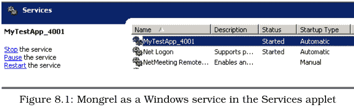

在服务名称中添加端口号是跟踪已使用端口的一种非常有用的方法。随着你添加更多服务，端口号会变得更加有用。这不是必需的，但是一个值得遵循的好惯例。

### 为你的应用程序创建第二个Mongrel实例

你的应用程序现在由作为服务运行的Mongrel托管。现在，是时候放松一下，打开一杯冰镇啤酒了，对吧？不过要小心。一个Mongrel可能不够用。Rails并不总是最快的可用框架，而且单个Mongrel实例一次只能处理一个请求。随着负载增加，你需要添加更多Mongrel实例，然后平衡请求。

幸运的\*nix用户可以使用一个名为`mongrel_cluster`的工具，它能轻松地启动和停止多个Mongrel实例。Windows目前还没有`mongrel_cluster`，所以你需要随机应变。你可以创建另一个作为服务的Mongrel实例，指向同一个Rails应用程序。然后，你可以使用负载均衡器将流量分配给每个实例。

手动创建自定义集群并不像听起来那么难。你将创建另一个指向同一应用程序的服务，但这次使用端口4002，运行以下命令：

```
mongrel_rails service::install -N MyTestApp_4002 -p 4002 -e production
mongrel_rails service::start -N MyTestApp_4002
```

如果你查看控制面板下的“服务”，你会看到两个服务都在运行。在服务名称中添加端口号使记住每个服务使用的端口变得更加容易。如果你查看下一页的图8.2，你会看到两个已安装服务的示例。

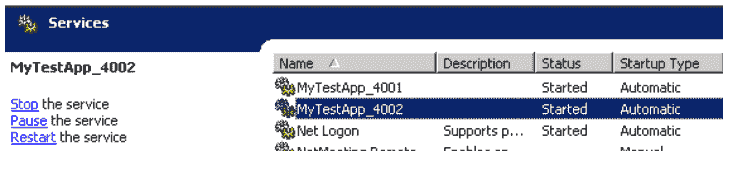

图8.2：两个作为服务的Mongrel实例

请记住，这些服务并未设置为在服务器重启时自动启动，因此重启后你的应用将不可用。让我们来解决这个问题。通过右键单击每个服务名称并将启动类型设置为“自动”，将每个服务配置为自动启动。

测试每个地址以确保请求正常工作，并且服务确实在为你的Web应用程序提供服务。`http://localhost:4001`和`http://localhost:4002`都应该在提供相同的应用程序。

所以，你的应用程序有两个实例在不同端口上运行。这比一个好，但设置目前还不够有用；你需要对它们进行负载均衡，而你可以通过使用Pen或Apache来实现。

## 8.3 Mongrel与Pen

Pen是一种无需太多设置即可进行负载均衡的简单好方法。Pen非常适合连接数预期不高的小型站点，而且它很棒，因为你不必花很多时间学习如何配置它。Pen能很好地处理反向代理和均衡，但它不是一个Web服务器，这意味着你不能用它来提供静态内容。你的静态内容将由后端的Mongrel服务提供。对于用户稍多的小型应用，这种设置应该工作得很好。

你可以从`ftp://siag.nu/pub/pen/pen-0.17.1.exe`下载Pen的Windows二进制文件。

Pen支持SSL，但其支持还处于实验阶段，因此如果你需要托管一个安全的站点，你必须在此设置前使用某种代理服务器。

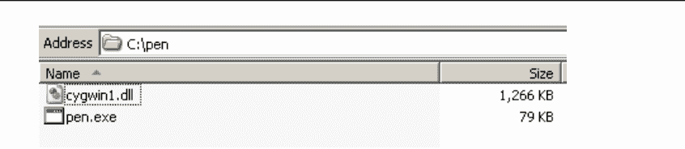

图8.3：运行Pen所需的文件

### 设置Pen

创建一个文件夹来存放Pen。`C:\pen`就可以。将刚下载的文件保存在此文件夹中，并将其重命名为`pen.exe`，以便更容易调用。要在Windows上运行Pen，你需要下载文件`cygwin1.dll`[^8]并将其放置在`C:\pen`中。该文件是压缩的，因此请先解压。

图8.3显示了运行Pen所需的文件。一旦你下载了这两个文件，你可以快速测试Pen，但首先请确保你的Rails应用按之前描述的那样，通过Mongrel运行。打开一个命令窗口，导航到`C:\pen`。执行以下命令以启动Pen：

```
pen -f 80 localhost:4001
```

这告诉Pen监听端口80并将所有请求转发到`localhost:4001`。如果你的Mongrel服务仍在该处运行，此命令将使你的应用程序在端口80上可用。

现在在浏览器中打开`http://localhost`，你应该能看到你的Rails应用。就这么简单。`-f`开关阻止Pen进入后台。如果你忘记使用此开关，那么你将不得不使用Windows任务管理器来终止Pen。

使用`Ctrl+C`停止Pen并返回命令提示符。

### 使用Pen进行负载均衡

使用Pen进行负载均衡就像将每个远程主机和端口添加到命令行一样简单。如果你有两个Mongrel实例在运行，一个在端口4001，另一个在端口4002，你将使用以下命令：

```
pen -f 80 localhost:4001 localhost:4002
```

### 将Pen安装为服务

如果你决定Pen适合你，你应该将其安装为服务，以便它可以像你的Mongrel服务一样自动启动。有一个相对简单（且免费）的方法可以做到这一点。

- 1. 从Microsoft下载Windows 2003 Server Resource Kit，⁹ 并安装它。
- 2. 打开命令提示符，并运行以下命令：

```
"C:\Program Files\Windows Resource Kits\Tools\instsrv.exe" Pen
"C:\Program Files\Windows Resource Kits\Tools\srvany.exe"
```

服务已成功添加！

请确保你进入控制面板并使用“服务”小工具更改此新安装服务将用于其安全上下文的帐户名称和密码。

以下列表中的命令将创建一个包含新服务配置的新注册表项。

- 3. 打开`regedit`，并定位到键`HKEY_LOCAL_MACHINE\SYSTEM\CurrentControlSet\Services\Pen`。
- 4. 在其下方创建一个名为`Parameters`的新键。
- 5. 选择`Parameters`键，并创建一个名为`Application`的新字符串值。输入值`c:\pen\pen.exe`。
- 6. 创建另一个名为`AppParameters`的字符串值。输入值`-f 4000 localhost:4001 localhost:4002`。
- 7. 创建第三个名为`AppDirectory`的字符串值。输入值`c:\pen`。
- 8. 关闭`regedit`，并打开命令提示符。
- 9. 键入以下命令启动服务：

```
C:\>net start pen
Pen 服务正在启动。
Pen 服务已成功启动。
```

你可以同样轻松地停止Pen服务：

```
C:\>net stop pen
Pen 服务已成功停止。
```

就是这样。这种设置对于需要处理大量用户的单个应用程序来说应该工作得很好。虽然你看到了很多步骤，但从头到尾大约只需要十五分钟。如果你决定这种方法不适合你，你可以使用命令`sc delete pen`移除该服务。

在继续之前，你应该知道Pen的单个实例只能为一个Rails应用程序工作。如果你尝试使用Pen为多个Rails应用程序提供服务，你需要将`pen.exe`复制为另一个文件（例如`my_app_name_pen.exe`），然后使用新名称设置服务。如果你运行大量应用，最终可能会产生相当多的服务。

因此，Pen非常适合需要少量负载均衡帮助的小型应用，但当你必须处理*更多*请求时该怎么办？你将不得不使用一些Windows系统管理员所称的“A字头”方案。

## 8.4 使用 Apache 2.2 和 Mongrel

如果你需要处理负载，在Windows上没有比Apache 2.2更好的解决方案了。你不仅可以相对轻松地进行负载均衡，还可以让Apache提供所有静态内容，如缓存页面、CSS、JavaScript和图像。如果你利用了页面缓存（如果你在做一个公开网站，你应该这样做），那么Apache将是你获得高性能的最佳选择。

使用这种方法的另一个巨大优势是，你可以从\*nix开发者那里“借用”很多配置文件。

### 安装 Apache

从Apache$^{10}$下载Apache 2.2的Windows二进制文件。请务必获取最新版本。

使用下载的安装程序安装Apache 2.2。

安装向导应该非常容易处理。我将带你了解几个重点。最重要的是，在选择端口时要小心。我通常选择将Apache为单用户安装在8080端口，以防止与80端口上的IIS发生冲突。我稍后将手动安装Windows服务。此外，请确保不要将Apache安装为Web服务，如下一页图8.4所示。

将Apache安装到`c:\apache`或其他稍后易于找到的目录。Apache的配置应该能够顺利完成。

> 10. http://httpd.apache.org/download.cgi

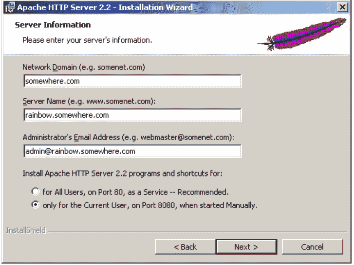
图8.4：确保不要将Apache安装为服务。

### 配置 Apache 为你的 Rails 应用程序提供服务

Apache使用配置文件`httpd.conf`来保存所有配置设置。你应该熟悉这个流程。我不会详细讲解所有内容，只讲解此次Windows安装中你需要知道的部分。你可以随时查阅优秀的官方文档以了解更多信息。事实上，我建议你在将其部署到生产环境之前，先熟悉该文件的内容。Apache功能强大，选项很多，你确实需要确保没有任何明显的安全漏洞。

找到`httpd.conf`文件。它位于`C:\apache\conf`文件夹中。

首先，找到文件中以以下内容开始的部分：

```
# Dynamic Shared Object (DSO) Support
```

此部分包含所有可由Apache加载的模块。每个井号(#)表示该行已被注释掉。

取消以下行的注释以激活代理均衡器（proxy balancer）：

`LoadModule proxy_module modules/mod_proxy.so`
`LoadModule proxy_balancer_module modules/mod_proxy_balancer.so`
`LoadModule proxy_http_module modules/mod_proxy_http.so`

你还需要通过取消以下行的注释来启用URL重写支持：

`LoadModule rewrite_module modules/mod_rewrite.so`

接下来，你会想要启用deflate模块，以便在提供内容时对其进行压缩：

`LoadModule deflate_module modules/mod_deflate.so`

最后，在文件底部添加此行：

`Include conf/httpd-proxy.conf`

这允许你将应用程序的配置拆分到另一个文件中。此时，你应该保存`httpd.conf`配置文件。在`C:\Apache\Apache2.2\conf`中创建一个名为`httpd-proxy.conf`的新文件，内容如下：

```
<VirtualHost *:8080>
    ServerName yourdomain.com
    DocumentRoot c:/web/mytestapp/public
    <Directory "c:/web/mytestapp/public">
      Options FollowSymLinks
      AllowOverride None
      Order allow,deny
      Allow from all
    </Directory>
    # Configure mongrel instances
    <Proxy balancer://mongrel_cluster>
      BalancerMember http://127.0.0.1:4001
      BalancerMember http://127.0.0.1:4002
    </Proxy>
    RewriteEngine On
    # Uncomment for rewrite debugging
    #RewriteLog logs/your_app_deflate_log deflate
    #RewriteLogLevel 9
```


## Apache 配置

```apache
# Check for maintenance file and redirect all requests

RewriteCond %{DOCUMENT_ROOT}/system/maintenance.html -f

RewriteCond %{SCRIPT_FILENAME} !maintenance.html

RewriteRule ^.*$ /system/maintenance.html [L]

# Rewrite index to check for static

RewriteRule ^/$ /index.html [QSA]

# Rewrite to check for Rails cached page

RewriteRule ^([^.]+)$ $1.html [QSA]

# Redirect all non-static requests to cluster

RewriteCond %{DOCUMENT_ROOT}/%{REQUEST_FILENAME} !-f

RewriteRule ^/(.*)$ balancer://mongrel_cluster%{REQUEST_URI} [P,QSA,L]

# Deflate

AddOutputFilterByType DEFLATE text/html text/plain text/xml

BrowserMatch ^Mozilla/4 gzip-only-text/html

BrowserMatch ^Mozilla/4\.0[678] no-gzip

BrowserMatch \bMSIE !no-gzip !gzip-only-text/html

# Uncomment for deflate debugging

#DeflateFilterNote Input input_info

#DeflateFilterNote Output output_info

#DeflateFilterNote Ratio ratio_info

#LogFormat '"%r" %{output_info}n/%{input_info}n (%{ratio_info}n%%)' deflate

#CustomLog logs/your_app_deflate_log deflate

ErrorLog logs/your_app_error_log

CustomLog logs/your_access_log combined

</VirtualHost>
```

保存文件，并仔细检查确保它与`httpd.conf`位于同一个文件夹中。

### 代理原理解析

文件中最重要的部分是这一段：

```apache
# Configure mongrel_cluster

<Proxy balancer://mongrel_cluster>

  BalancerMember http://127.0.0.1:4001

  BalancerMember http://127.0.0.1:4002

</Proxy>
```

此部分是负载均衡配置。每个`BalancerMember`指向一个 Mongrel 的后端实例。此配置仅支持两个后端，但你可以轻松添加更多。请记住，更改此配置文件需要重启 Apache。

当请求进来时，Apache 会检查是否有静态页面。如果没有找到静态页面，系统将把请求转发给 Rails 应用程序，就像一个独立实例一样。

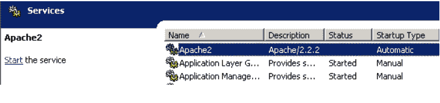

图 8.5：Apache 已安装为 Windows 服务

### 测试 Apache 配置

打开命令提示符，导航到`c:\apache\bin`，并执行以下命令：

```bat
httpd
```

如果你没有收到错误，说明 Apache 正在运行并在 8080 端口上监听。如果你有 Mongrel 实例在 4001 和 4002 端口监听，那么你可以通过将浏览器指向`http://localhost:8080/`来测试配置。你应该能看到你的 Rails 应用程序。

本节向你展示了如何使用 8080 端口上的 Apache 来托管 Rails 应用程序。如果你想使用标准端口 80 托管该应用，只需更改虚拟主机定义即可。

### 将 Apache 安装为 Windows 服务

现在 Apache 已正确配置并测试，你可以安全地安装服务了。

打开一个新的命令提示符，输入以下命令：

```bat
cd\apache\bin

httpd -k install
```

你应该看到以下输出：

```text
Installing the Apache2 service

The Apache2 service is successfully installed.

Testing httpd.conf....

Errors reported here must be corrected before the service can be started.
```

现在你应该能在“服务”面板中看到该服务，如图 8.5 所示。确保启动类型设置为“自动”，以便在重启服务器时它能自动重启。你可能会看到 Windows 防火墙提示。在这种情况下，你需要解除对 Apache 的封锁或禁用 Windows 防火墙服务，以便一切正常运行。Apache 现在已配置为在两个后端 Mongrel 进程之间进行负载均衡。你可以通过打开浏览器并访问`http://localhost:8080/`来测试此配置。你的 Rails 应用程序将会出现。

现在你可以更进一步，将你的 Apache 服务器隐藏在 IIS 之后。采取这一步对你来说可能看起来很奇怪，但请继续阅读。

## 8.5 IIS 集成

IIS 是基于 Windows 的组织中很受欢迎的 Web 服务器。尽管它名声不一，但它可以作为一个非常出色的静态 Web 服务器。在本节中，我将向你展示如何使用 IIS 将请求转发到你的 Rails 应用程序。此配置将允许你将 Rails 应用程序无缝集成到现有的 IIS 网站中。

使用 IIS 有几个好处：

- 首先，你可以为所有 Rails 应用程序使用相同的 SSL 证书。
- 其次，你可以灵活地在任何时间将后端应用程序移动到另一台服务器。如果你发现 Windows 不适合作为你的部署方式，你可以轻松地将 Rails 应用程序迁移到基于 Linux 的服务器，而请求仍然通过你的主 Web 服务器进入。

在开始之前，你需要获取一个额外的软件。我还假设你将在一个 IIS 运行在默认端口 (80) 的服务器上执行所有这些操作，并且你的 Rails 应用程序驻留在同一台机器上。

### 安装 ISAPI Rewrite

ISAPI Rewrite 是一个 URL 重写过滤器，提供简单的正向代理支持。虽然它不是免费的，但其开发人员收取的名义费用是非常值得的，而且你可以使用不受限的试用版，这将足够你完成本章的内容。

访问 ISAPI Rewrite 网站¹¹，下载 ISAPI Rewrite 3.0 的试用版。启动安装程序，并接受所有默认设置。安装过程将重启你的 IIS 服务，因为它需要在你的服务器上安装一个 ISAPI 过滤器。

> 11. http://www.isapirewrite.com/

### 直接通过 IIS 提供 Rails 服务如何？

不同的人群尝试过直接通过 IIS 提供 Rails 服务。有些人尝试使用 FastCGI ISAPI 过滤器，但这种配置需要修改注册表且会导致不稳定。当我在三台机器上尝试 FastCGI 方法时，只有一台成功运行，而且并不十分可靠。这个选项可能很快会变得更可行，但目前，大多数 Windows 开发者仍采用本章概述的方法。

微软实际上在 IIS 7.0 中采取了一些极好的措施来改进 FastCGI，但在编写本书时，微软尚未做出通过 IIS 提供 Rails 应用程序服务的具体承诺。不过，这些技术更新速度很快，因此绝对值得你持续关注。

使用代理方法确实能提供更好的长期可扩展性，因为将 Rails 应用程序迁移到一台或多台独立的物理机器上要容易得多。如果你计划在单台服务器上托管多个 Rails 应用程序，那么 FastCGI 对你来说可能完全不是一个好的选择。

如果你在安装过程中遇到问题，需要咨询该产品的开发人员。其支持论坛是一个极好的资源。

> 12. http://www.helicontech.com/forum/

### 将请求转发到你的应用程序

假设你想将所有来自`http://localhost/mytest/`的请求转发到你的 Rails 应用程序。你需要确保满足以下条件之一：

- 你允许从站点根目录执行脚本。
- 你允许从`mytest`文件夹或虚拟目录执行脚本。

如果在这些位置中未能允许脚本执行，IIS 将返回 403.1 错误消息。

文件`C:\Program Files\Helicon\ISAPI_Rewrite3\httpd.conf`包含了 IIS 用于转发请求的重写规则。

将请求的 URL 转发到后端服务器非常简单。要将对`/mytest`的请求转发到同一台机器上运行在 4001 端口的 Mongrel 实例，请使用此规则：

```apache
RewriteProxy /mytest(.*) http\://localhost:4001$1 [I,U]
```

如果你在 8080 端口上使用 Apache，只需将请求转发到该端口即可：

```apache
RewriteProxy /mytest(.*) http\://localhost:8080$1 [I,U]
```

你甚至可以转发到不同的服务器：

```apache
RewriteProxy /mytest(.*) http\://backend.mydomain.com:4001$1 [I,U]
```

在某些系统上，特别是那些加强了安全性的系统，该文件被标记为只读。在更改文件之前，你需要删除只读属性。此外，请确保 SYSTEM 用户具有读取该文件的权限。

### 测试

配置过滤器将请求转发到 4001 端口上的 Mongrel 实例：

```apache
RewriteProxy /mytest(.*) http\://localhost:4001$1 [I,U]
```

现在你可以通过访问`http://localhost/mytest/`在 IIS 中打开你的 Rails 应用程序。遗憾的是，它的外观可能不会太好看。请继续阅读以了解原因。

## 8.6 反向代理与 URL

我们现在面临的大问题是，Rails 内部创建的 URL（如样式表链接、`url_for`链接和其他链接）无法像你预期的那样工作。

例如，如果你在浏览器中打开 URL`http://localhost/mytest/`，你会发现应用程序运行正常，但没有样式表。你还会注意到，当你点击链接时，你会由于被传输到`http://localhost/`，在某些情况下你的代理会被暴露。如果你的应用程序服务器恰好在无法从互联网访问的防火墙之后，这种情况对你的用户来说可能非常糟糕。

IIS 和 ISAPI_Rewrite 都没有处理反向代理的方法。反向代理通过重写从后端提供的内容，来掩盖请求经过代理过滤的事实。

> **关于 `relative_url_root` 的注意事项**

乍一看，大多数 URL 问题似乎可以通过在`environment.rb`文件中应用以下代码来简单解决：

```ruby
ActionController::AbstractRequest.relative_url_root = '/mytest'
```

这一更改解决了大部分问题，但它无法解决使用`url_for :only_path => false`编写的任何链接。我编写的`reverse_proxy_fix`插件同样解决了这些问题。

我开发了一个简单的 Rails 插件，它修改了 Rails 创建 URL 的方式以解决此问题。该插件告诉 Rails 在其系统创建的任何 URL 前加上你的外部 URL。这个插件将强制所有用户请求通过 IIS 代理返回。仅在以生产模式（production mode）运行应用程序时才会更改 URL，因此你不必担心在部署应用程序时更改路由或配置文件。在开发期间将该插件保留在应用程序中也是安全的。

### 安装代理插件

在应用程序的根文件夹内执行以下命令（但全部写在同一行）：

```bash
ruby script/plugin install http://svn.napcsweb.com/public/reverse_proxy_fix
```


插件安装完成后，它会要求你输入基准 URL（base URL）。输入`http://localhost/mytest`并按 Enter 键。如果一切顺利，插件将写入配置文件。如果配置文件无法修改，你可以通过编辑`vendor/plugins/reverse_proxy_fix/lib/config.rb`文件来手动配置。

### 使用代理插件

安装插件后，你需要重启 Rails 应用程序。如果你使用了多个 Mongrel 实例，需要在插件生效前重启所有实例。应用程序重启后，你应用程序中的任何内部链接现在都将被自动修正，你的用户将被路由回代理。

> 13. 这假设你使用了`link_to`及其相关方法来生成链接和图像。硬编码的路径不会被此插件更改。

## 8.7 托管多个应用程序的策略

你可以使用多种策略来托管多个应用程序，选择哪种策略主要取决于将使用你系统的用户数量。当你拥有大量用户以及较长的 HTTP 请求（如文件上传）时，你必须通过增加更多的后端进程来解决扩展问题。传统上是通过增加 FastCGI 进程的数量来完成的，但现在你只需在集群中添加另一个 Mongrel 实例即可。

接下来的几个章节将涵盖你可以用来将多个应用程序部署到生产环境的各种策略。

### 使用 IIS 和 Mongrel 提供多个小型应用程序的服务

提供多个小型应用程序的服务是一种简单的方法。每个应用程序都使用运行在不同端口的 Mongrel 安装为 Windows 服务。然后，你可以像第 215 页图 8.6 所示那样，使用 IIS 配合 ISAPI_Rewrite 和`reverse_proxy_fix`插件，将每个应用程序挂载到 IIS 内部自己的 URL 上：

- `http://www.yourdomain.com/app1` ⇒ `http://localhost:4001`
- `http://www.yourdomain.com/app2` ⇒ `http://localhost:4002`
- `http://www.yourdomain.com/app3` ⇒ `http://localhost:4003`

相应的 ISAPI_Rewrite 规则如下：

```text
RewriteProxy /app1(.*) http\://localhost:4001$1 [I,U]
RewriteProxy /app2(.*) http\://localhost:4002$1 [I,U]
RewriteProxy /app3(.*) http\://localhost:4003$1 [I,U]
```

然后，你需要将`Reverse_Proxy_Fix`插件应用于每个应用程序，为每个源 URL 设置`BASE_URL`参数。

我不建议在生产环境中使用此方法。这里不支持页面缓存，且没有办法进行扩展。然而，这是一种非常棒的方法，可以让利益相关者快速演示站点，而无需经过复杂的设置。

#### 应用程序、用户与请求

如何衡量应用程序的大小，以及如何选择部署方法？人们倾向于通过思考应用将拥有多少用户来衡量应用程序的大小。不过，这存在一个小问题。

我可能有一个包含数百个模型（models）的应用程序。应用程序可能非常复杂，但如果只有 100 个人使用，只要没有并发请求，仅启动一个 Mongrel 实例让它工作就不会有问题。

我也可能有一个只有五个模型和三个控制器（controllers）的应用程序，但这个应用每天会被大学注册夏季迎新课程的学生访问 100,000 次。单个 Mongrel 实例可能能运行，但会出现大量的等待情况。

不过，应用程序能支持的用户数量其实并不是一个好的衡量标准。随着 Ajax 变得越来越流行以及 Rails 对 REST 的支持，无论来自用户的浏览器还是另一个 Web 服务，你看到的访问量可能比预期的要多。

每秒请求数（Requests per second）才是衡量网站更好的标准。你的应用每秒需要支持多少个请求？三个？二十个？一百个？这是你需要通过对现有应用进行基准测试和预测来确定的。一个每秒支持 5 个请求的应用程序在 8 小时内可以处理 144,000 个请求。这还不算太糟。问题在于 Rails 应用程序是单线程的。单个 Mongrel 实例一次只能处理一个请求。因此，如果你的网站上有基于 Ajax 的搜索，搜索进行的实时更新可能会导致其他请求在队列中卡住。

因此，测试你的应用并确定每秒请求数。如果你确定你的小型内部应用可以在单个 Mongrel 实例上运行，那么生活会简单得多。你可以使用本书中的技术轻松扩展。

请记住，在 Windows 上，你的应用性能通常比在其他平台上慢得多，因此你可能需要更多平衡的后端来处理相同数量的请求。

图 8.6：IIS 将请求转发到多个 Mongrel 实例

### 托管多个大型应用程序

在托管大型应用程序时，你有几种选择。

一种方法是使用 Pen 来集群多个 Mongrel 实例，然后使用 IIS 将请求转发给 Pen，如图 8.7（见下一页）所示。

这种配置与直接连接到 Mongrel 相同。你可以在不同的端口上安装多个 Pen 副本，每个副本转发到各自的 Mongrel 实例组。然后，你设置 IIS 将请求转发到每个 Pen 实例。

图 8.7：IIS 将请求转发到多个 Pen 实例

对于那些公司内部有“禁用 Apache”政策的情况，这是一个有效的解决方案。

如果你的应用程序大量使用页面缓存，那么这种方法可能不是最佳选择；但它易于实现，并且对于每个请求都需要用户身份验证（从而使页面缓存不再是问题）的系统来说，运行良好。

性能最高的方法是直接在 80 端口上使用 Apache。通过使用`proxy_balancer`方法，Apache 可以配置多个虚拟主机，每个虚拟主机服务一个独立的 Mongrel 实例集群，如图 8.8（见下一页）所示。

图 8.8：在多个 vhost 上使用 mod_proxy_balancer 的 Apache 2.2

实施此方法只需创建独立的 Mongrel 实例组，然后在之前创建的`httpd-proxy.conf`文件中为每个组创建一个虚拟主机条目。随后，你需要为每个虚拟主机配置 DNS 和本地 HOSTS 文件。

这种方法性能良好，扩展性强，并且允许页面缓存高效工作。它是目前 Windows 平台上最快且最稳定的解决方案。

最后，如果你想要透明的集成，可以让 IIS 将这些请求发送到你的各个 Apache 虚拟主机。这是一种更复杂的方法，故障点更多，但它允许你使用 IIS SSL 证书，允许你将数据库和 Rails 应用程序置于防火墙之后，并使你的应用程序看起来像是集成在一起的。如果你选择使用 IIS 转发请求，请记得使用`reverse_proxy_fix`插件。

### Windows 上的性能

Ruby 在 Windows 上的性能不如在 Linux 上。在 Linux 机器上使用单个 Mongrel 实例能常规处理每秒 60 个请求的应用程序，在 Windows 上只能处理每秒 6 到 9 个请求。如果超过这个量，用户在每个请求处理时就会开始感受到延迟。

如果你拥有一台极其强大的服务器（例如内存巨大且运行任务极少的顶配机器），那么单个实例可能能达到每秒 35 个请求左右。Linux 服务器往往能以更廉价的硬件提供更高的吞吐量。

你可以通过检查计划部署的应用程序并审视以下领域来略微提高性能：

- 改变会话（sessions）的使用方式。你的应用程序如何管理会话？P-Store 或基于文件的存储通常较慢。考虑将会话存储移至数据库，或研究其他会话存储机制。
- 检查开发日志，确保没有对数据库进行不必要的调用。简单地在 finder 中添加`:include`就能显著提升应用程序性能，而这一点经常被忽略。
- 尽可能多地使用片段（fragment）、动作（action）和页面缓存。由于 Ruby 在 Windows 上运行缓慢，你应该尽可能多地利用页面缓存，从而避免调用 Rails。
- 确保没有任何干扰进程。某些安全审计软件、配额管理器和病毒扫描程序可能会大幅降低你能处理的请求量。在测试应用程序时，请密切关注性能监视器是否有任何峰值。

## 8.8 对应用程序进行压力测试

在 Windows 上对应用程序进行压力测试的良好选择很少。如果可能的话，请找一台 Linux 机器或 Mac，并使用`httperf`来测试你的应用程序。

如果这对你不可行，请尝试以下替代方案：

- **Microsoft Web Application Stress Tool**：这款在线可用的工具¹⁴ 是一个免费工具，允许你记录在 Web 应用程序或网站上的操作步骤，然后通过回放来产生负载。它也可以用来控制远程客户端，从而对你的应用程序产生更真实的负载。它虽然有一些 bug，但仍然是一个非常有用的程序。我发现它的准确度相对较高。
- **WAPT**：WAPT 是一款用于 Web 应用程序负载和压力测试的商业工具。与微软提供的工具类似，WAPT 允许你记录浏览会话以便回放。解析报告可能更复杂，但它是值得的，因为 WAPT 具有连接到安全站点的能力。
- **Apache Benchmark (`ab`)**：Apache Benchmark 是一个命令行工具，可用于重复请求某个 URL，但众所周知它会产生极具误导性的结果。我仅使用此工具来为应用程序产生负载。

## 8.9 结语

我认为 Windows 是开发 Rails 应用程序的一个良好平台，并且能够胜任服务于中等用户群体的 Rails 应用程序。然而，随着你开发更多应用程序并获得更多用户，你的需求可能会发生变化。

我也认为目前 Linux 是更好的选择。我有一台运行 Ubuntu 的 1GHz 桌面机器，通过单个 Mongrel 实例服务一个 Rails 应用程序，其每秒处理的请求数是一台配备两颗 2GHz Xeon 处理器的服务器的三倍。

近几个月来，Windows 机器的速度在加快，但性能仍稍逊一筹。如果你的应用程序性能无法达到可接受的水平，且你已经尽力优化，那么你应该考虑将某些应用程序部署到 Linux 测试服务器上。我与你分享的信息和策略可以帮助你透明地将部分或全部 Rails 应用程序迁移到 Linux 服务器。你仍然可以在 Windows 上使用 IIS 或 Apache，仅将 Rails 应用程序移至 Linux，这是一个极佳的过渡方案，我已多次采用并取得了巨大的成功。

¹⁴. `http://www.microsoft.com/downloads/details.aspx?FamilyId=E2C0585A-062A-439E-A67D-75A89AA36495`

### 测试技巧

- 在与托管应用程序不同的机器上运行测试。在同一台机器上测试吞吐量会导致结果不真实且不准确。
- 针对基准（例如你的公共首页）运行压力测试。这将让你了解你的应用程序与现有服务的对比情况。
- 在网络内部和外部运行测试。如果可以，尝试通过电缆或 DSL 连接运行测试，看看会产生怎样的影响。
- 在生产服务器上对应用进行压力测试。有些系统管理员可能会对此感到不安，但只要可能，你应该在计划部署的环境中测试应用程序。在预定的停机时间或服务器使用率低的低峰时段进行测试。如果无法做到这一点，你至少应该考虑建立一个镜像生产机器的暂存（staging）服务器，以便看到准确的结果并为未来做计划。
- 使用多种工具并对比结果。

## 8.10 在 Windows 上开发并部署到其他环境

如果你在 Windows 上开发，但计划部署到 Linux 服务器（如虚拟专用主机、共享主机，或你出色的老板特意为你购买的新 Linux 服务器），你应该注意一些问题。

### Dispatch.fcgi Ruby 解释器

当你将 Windows 上创建的应用程序部署到 Linux 服务器时，`dispatch.fcgi`文件的第一行将会出错。

在 Windows 上，它通常如下所示：

```ruby
#!c:/ruby/bin/ruby
```

在 Linux 上，它通常如下所示：

```ruby
#!/usr/bin/ruby
```


您可以通过连接到远程主机并输入`which ruby`来确定应该使用哪个路径。

如果您的托管平台使用 FastCGI，这就会成为一个问题，因为 FastCGI 服务器将无法找到 Ruby 解释器。如果您使用的是 Mongrel，那么这就不是什么大问题。

### 换行符

Linux 与 Windows 使用的换行符不同。这有时可能会带来问题，因为 Windows 使用的额外字符可能会干扰脚本的处理。许多 Linux 发行版都带有一个名为`dos2unix`的程序，您可以用它来转换文件中的换行符。

最佳的解决方案是为 Windows 找一个好一点的编辑器，它允许您指定使用哪种类型的换行符。Eclipse、NetBeans IDE、Notepad++ 和 Crimson Editor 只是几个已知的可以正常工作的编辑器示例。Windows 记事本（Notepad）和 WordPad 应该不惜一切代价避免使用，因为它们是按照 Windows 格式化文本来设计的。

### 权限

当您将应用程序部署到 Linux 服务器时，需要检查权限。如果您的服务器使用 FastCGI，那么您需要确保为 Web 服务器的用户和组授予执行`public/dispatch.fcgi`的权限，否则您的应用程序将无法工作。如果您的应用程序使用了页面缓存，请确保`public/`文件夹对 Web 服务器的用户可写，否则 Rails 将无法写入页面的静态版本。

### 部署时防止问题

按照以下提示将应用程序从 Windows 部署到 Linux 生产环境：

- 使用`rails`命令在 Linux 机器上创建应用程序。这将确保所有文件都放在正确的位置，并且路径是正确的。
- 如果您的生产服务器或 Web 主机使用 Apache 和 FastCGI 来托管 Rails 应用程序，请务必在服务器上修改您的`public/.htaccess`副本，以便调用`dispatch.fcgi`而不是`dispatch.cgi`。
- 将您的应用程序文件部署到已创建的文件之上，确保不要覆盖`dispatch.fcgi`或`.htaccess`文件。如果您使用 Subversion，这可以轻松编写脚本实现。
- 在生产服务器上编辑数据库配置文件，然后确保在重新部署时永远不要覆盖它。我认为将数据库密码存储在代码仓库中并不是一个好主意，所以我从不将`database.yml`文件签入仓库。
- 在生产模式下运行迁移，以确保数据库配置正确。
- 在生产模式下打开控制台（`./script/console production`），并尝试检索一些数据。这将有助于测试您的代码中是否有需要转换的奇怪字符。
- 在生产服务器上使用 WEBrick 以生产模式测试您的应用程序（`./script/server -e production`）。如果您的主机允许您在 3000 端口连接，请尝试使用该端口访问您的站点。
- 配置您的生产服务器以使用新的应用程序。像 DreamHost 这样的某些提供商有一个控制面板，您可以在其中指定 Rails 应用程序的公共文件夹。配置好应用程序后，再用浏览器访问一次，确保它能正常显示。
- 检查生产日志是否正在被使用。如果没有，您需要修改`environment.rb`文件来强制生产模式。已知某些共享主机没有在其 Apache 配置中设置环境。

比这些更好的方法是使用 Capistrano 自动化您的部署。您可以随时安全地对文件进行所有这些修改，然后将它们签入仓库。之后，您只需使用 Capistrano 配方进行部署即可。Capistrano 任务可以更改权限、修改文件等等。如果您要费尽心思编写程序，那就多花点时间学习如何自动化部署。这样以后就不太可能遗漏某些步骤。

## 8.11 总结

本章讨论了可用于部署应用程序的各种策略。您现在有很多选择，因为每种方法都会产生不同的结果。有些可能比其他的更好，但您需要弄清楚哪种适合您和您的情况。我再怎么强调测试您的技术栈的重要性都不为过。在部署之前对您的应用程序运行性能测试工具，并在运行期间密切关注它。您需要确保在需要搬到更好的部署方案之前就做好准备。

不过，不要害怕在 Windows 上部署——包括我自己在内的许多人都非常成功地用这些方法部署了应用程序。这是让 Rails 进入基于 Windows 的环境的好方法。一旦您证明使用 Rails 可以更高效，您就可以推动使用 Linux 部署技术栈了！

## 高效运行之家

# 第9章：性能

在古代中国谚语中，许多人可以从不同角度观察大象并看到不同的东西。非常相似的是，程序员看着 Rails 可能会微笑，体验到近乎狂喜的感觉。当需要部署同一个应用程序并让它扩展时，负责将用户大量导入其中的系统管理员可能会嚎叫着冲出房间。Rails 在很大程度上是一种取舍。使那些美丽的领域特定语言和让 Active Record 得以实现的甜蜜动态编程成为可能的高级语言，执行起来都需要时间。那些在底层运行的、让应用程序开发人员感到舒适的魔法，在推动部署时都有其代价。

好消息是，Rails *确实*可以扩展。该框架专门按照无共享原则设计，允许您用硬件来解决问题，正如您在第7章《扩展》，第144页中学到的。这往往会让一些开发者拖延应用程序的性能方面。虽然过早优化也不总是被推荐，但这并不意味着您获得了完全忽视优化或可扩展性的许可证。在本章中，我将带您了解一些您需要了解的技术，以理解给定部署能够处理多少流量，然后我将向您展示通过一点努力就能显著提高性能的核心技术。

## 9.1 形势分析

性能基准测试适合两类开发者：那些采取结构化和耐心方法的，以及那些喜欢痛苦的人。那么，

### 什么不可行？

在我带您了解提高应用程序性能的计划之前，让我先带您了解一些已知往往不可行的方法：

- **过早优化**：将性能置于一切之上可能会产生最快、最流畅的应用程序，无论您是否真的需要这样的性能。但是，您可能会发现这以代码复杂、难以阅读、甚至更难维护为代价。优化也需要时间，所以您可能还会危及项目进度并错过截止日期，因为由于额外的性能增强，功能实现花费了太长时间。相反，应该在项目全程经常对您的应用程序进行性能测试。确保它能满足您所需的可接受性能水平，并仅在必要时优化关键瓶颈。
- **猜测**：当您发现应用程序太慢时，您可能会忍不住猜测问题可能出在哪里。您可能会尝试各种性能优化来试图修复它。您可能猜对一两次，但最终会花费数小时在错误问题上寻找正确的解决方案。相反，在实施任何性能补丁之前，使用分析工具、负载测试和监控工具来精确定位问题区域。
- **过度缓存**：Rails 让缓存变得相当简单，所以您可能会认为缓存总能在最后一刻挽救您。但缓存几乎总是比表面上看起来要难。这种神秘的性能增强为 bug 悄悄进入生产环境创造了机会，而在测试中却没有被发现，因为缓存功能可能很难测试。在最后时刻简单地启用缓存并希望它能工作尤其危险。相反，应尽早识别潜在的热点，例如您的主页或最新新闻源。然后，在设计这些功能时就考虑缓存，并使用一个启用了缓存的预发布环境，以便像在生产环境中一样测试应用程序。

### 哪些方法行不通？（续）

- **对抗框架**：Rails 是一个基于约定（convention-based）的框架，它做了很多假设。如果你在框架的既定方式下工作，这种哲学能发挥最大效用。有时，你可能想发挥创造性地打破一些已知的最佳实践，甚至可能通过 hack Rails 来修改它或绕过它。然而，你可能会发现自己以 Rails 设计者从未预想过的方式使用该框架，因此，当需要将 Rails 升级到下一个版本，或使用一个假设你以预期方式使用 Rails 的插件时，你会感到痛苦。相反，请尽力在所选框架的约束条件下工作。多方请教并寻求 Rails 社区专家的帮助，询问他们如何解决与你类似的性能问题——且无需打破那些明文或潜移默化的规则。

除非你是个热爱痛苦的人，否则每当你部署一个新应用程序时，你应该制定一个周密的计划并尽可能地坚持执行。基本步骤如图 9.1（下一页）所示。

- 1. **追求极致：设定目标基准（target baseline）**：你首先要做的是设定预期。你必须知道什么时候算完成。你需要一个最佳情况下的基准，以了解性能的上限。为此，请将 Rails 排除在考虑范围之外，查看你的生产服务器能处理多少 HTTP 请求——你不能指望性能比这更快。然后运行最简单的 Rails 请求，为一般的 Rails 应用程序建立一个目标。如果两者之间已经存在巨大的差距，你可能需要尝试调优你的代理服务器、FastCGI 或 Mongrel。完成后，这就是你的目标基准。
- 2. **了解现状：应用基准（application baseline）**：如果你想改进任何应用程序，你必须知道自己处于什么位置，这样你才知道还需要走多远。你需要运行一个不进行任何优化的简单性能测试。这就是你的应用基准。
- 3. **通过分析寻找瓶颈**：有了基准之后，你应该对系统进行分析（profile）以定位瓶颈。瓶颈就像发动机上的限速器，无论系统其他部分如何，它都限制了应用程序运行的速度。你可以通过系统地消除瓶颈来提高性能。

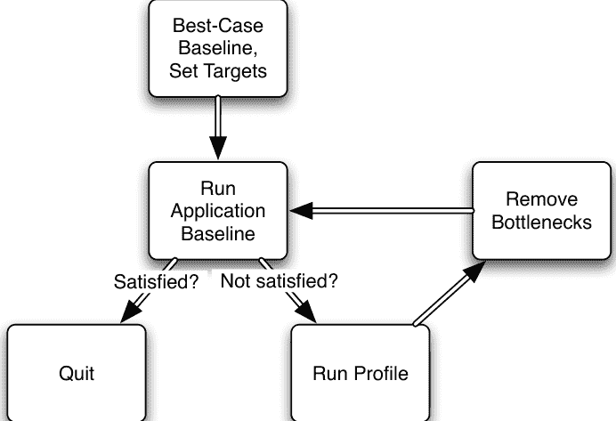
**图 9.1：性能优化流程**

- 4. **消除瓶颈**：这是流程中进行性能优化的正确环节。通过分析（profiling）和基准测试（benchmarking），你可以准确了解哪些更改会产生最大影响。你将专注于一个特定的低效点并将其消除。然后，再次运行分析并重复此过程。
- 5. **重复**：采用“分析与基准测试 $\rightarrow$ 对代码进行增量修改 $\rightarrow$ 重复该过程”的这种基础方法，可以让你确信哪些代码更改提高了性能，哪些降低了性能。你每次只更改一个参数，保持流程简单。务必确保一次只做一个更改，然后进行一次新测量。从长远来看，这将为你节省时间。

既然我已经向你介绍了基准测试背后的基本前提，我想带你走一遍该流程中的选定片段，以及一些常见的瓶颈及其解决方案。首先，你将使用基准测试来获取一个基准值。

## 9.2 初始基准测试：需要多少个 Mongrel？

当你准备好对应用程序进行基准测试时，初始测试应为你提供整体的应用性能。这意味着使用 HTTP 压力测试工具通过网络测试你的应用程序。如果你对这些压力测试结果满意，那么你不需要优化任何内容，但很多时候你会发现至少有几个地方需要调整。

此时会出现一个经典问题：“我的应用需要多少个 Mongrel？”根据我的经验，人们往往会高估实现最佳性能所需的 Mongrel 数量。当然，每个人都希望成为下一个被 Web 2.0 时代的 Google 收购的公司，但现实是，大多数日浏览量低于 100,000 次的生产环境 Rails 应用，在代理服务器后部署两个或三个 Mongrel 就能运行得非常好。唯一能确定的方法就是进行基准测试。

我在测试中将使用 Mongrel，但相同的信息同样适用于任何其他以多进程运行 Rails 应用程序的方式。为了身体力行，首先要做的是在当前硬件上获得一个绝对最佳情况的性能基准。我将使用`ab` (Apache bench) 或`httpperf`来测量触发 Rails 的最小请求的每秒请求数。创建一个新的 Rails 应用，包含一个控制器和一个仅执行`render :text => "Hello!"`的 Action。这将测量在当前硬件上运行在 Mongrel 上的 Rails 应用所能达到的最快基准响应时间。

```
ezra$ rails benchmark_app
ezra$ cd benchmark_app
ezra$ script/generate controller Bench hello
```

现在打开`BenchController`类（位于`RAILS_ROOT/app/controllers`目录下的`bench_controller.rb`文件），将其编辑成如下样子：

```ruby
class BenchController < ApplicationController
  def hello
    render :text => "Hello!"
  end
end
```

这个`hello` Action 是 Rails 应用程序在仍然调用包括 session 在内的完整技术栈的情况下，能够提供的绝对最小且最快的请求。它不调用数据库服务器，也不打开或解析任何模板。应用程序调用路由并实例化控制器以处理请求。Rails 必须经历设置 session 过滤器链以及在处理单个请求期间发生的所有其他“魔法”步骤。随着你在 Action 中添加代码、模板和数据库调用，结果会变慢，但在此时，我追求的是一个最佳情况的目标基准。

看看`ab`命令的输出。以下是帮助横幅：

```
ezra$ ab -h
Usage: ab [options] [http://hostname[:port]/path]
Options are:
  -n requests       Number of requests to perform
  -c concurrency     Number of multiple requests to make
  -t timelimit      Seconds to max. wait for responses
  -p postfile       File containing data to POST
  -T content-type   Content-type header for POSTing
  -v verbosity      How much troubleshooting info to print
  -w                Print out results in HTML tables
  -i                Use HEAD instead of GET
  -x attributes     String to insert as table attributes
  -y attributes     String to insert as tr attributes
  -z attributes     String to insert as td or th attributes
  -C attribute      Add cookie, eg. "Apache=1234" (repeatable)
  -H attribute      Add Arbitrary header line, eg. 'Accept-Encoding: gzip'
                    Insert as many additional header lines. (repeatable)
  -A attribute      Add Basic WWW Authentication, the attributes
                    are a colon separated username and password.
  -P attribute     Add Basic Proxy Authentication, the attributes
                    are a colon separated username and password.
  -X proxy:port     Proxyserver and port number to use
  -V                Print version number and exit
  -k                Use HTTP KeepAlive feature
  -d                Do not show percentiles served table.
  -S                Do not show confidence estimators and warnings.
  -g filename       Output collected data to gnuplot format file.
  -e filename       Output CSV file with percentages served
  -h                Display usage information (this message)
```

我将从一个简单的测试开始：针对一个 Mongrel 进程，设置一个并发用户和 1,000 个请求。

```
ezra$ ab -n 1000 http://localhost:3000/bench/hello
This is ApacheBench, Version 1.3d $<Revision: 1.73 $> apache-1.3
Copyright (c) 1996 Adam Twiss, Zeus Technology Ltd, http://www.zeustech.net/
Copyright (c) 1998-2002 The Apache Software Foundation, http://www.apache.org/
Benchmarking localhost (be patient)
Completed 100 requests
```


## 9.3 性能分析与瓶颈定位

现在我已经了解了系统整体的最佳性能特性，可以开始着手提升性能。如果确认性能存在问题，我通常会通过 Rails 性能分析器（profiler）来寻找瓶颈，它能够突出显示运行较慢的代码。掌握了每段代码耗时的精确数据后，我可以消除那些我能控制的最慢的部分。然后，我会再次进行基准测试并重复这个过程。

我通常使用两个分析器。第一个将测试从控制器到数据库的整个请求流程的性能。第二个则会更深入地专注于 Active Record 模型。

### ruby-prof

Fast Ruby Profiler（`ruby-prof`）gem 可以相当详细地分析 Ruby 代码。它附带一个方便的 Rails 插件，可以分析你的应用程序，包括整个应用程序代码栈。要开始使用，只需通过 `gem install ruby-prof` 安装该 gem。然后导航到位于你的 Ruby 安装目录 `/lib` 下的 `ruby-prof` gem 目录。

我的目录位于 `<rubyhome>/lib/ruby/gems/1.8/gems/ruby-prof-0.5.2/rails_plugin`。在那个目录中，你会找到一个名为 `ruby-prof` 的子目录。将该子目录复制到 `<your_rails_app>/vendor/plugins/`。确保是复制而不是移动，因为对于你想要分析的其他 Rails 应用程序，你还需要一份副本。最后，你只需要对你的应用程序进行一处配置更改。

在 `/config/environments` 目录下的每个环境配置文件中，包括 `development.rb`、`test.rb` 和 `production.rb`，你会看到类似 `config.cache_classes = [true|false]` 的一行配置。在测试和生产配置中，它被设置为 `true`。在开发环境中，它被设置为 `false`。这个参数需要被设置为 `true`，这样你的性能分析指标才不会因为不必要的类重新加载而严重失真。与其为了性能分析而使用生产环境或修改开发环境，你应该创建一个新的专门用于性能分析的环境。

只需将 `development.rb` 文件复制为 `profiling.rb`，并将 `config.cache_classes = true` 这一行设置好。不要忘记在 `config/database.yml` 中添加相应的配置。你将使用生产数据库而不是创建一个新的数据库。如果你想要一个完全独立的性能分析环境，也可以创建一个新的。你也可以在分析时尝试文件中的其他设置。我倾向于在性能分析时禁用缓存，因为我更感兴趣的是如何改进我的代码，而不是缓存根本不运行时的性能表现。如果你愿意，可以轻松创建两个性能分析环境，一个启用缓存，一个禁用。

### 理解性能分析结果

`ruby-prof` 的输出会告诉你每一部分代码的执行时间，并按调用链进行分组。你可以找到最耗时的代码，并查看它被哪些方法调用。这对于识别瓶颈非常有用。

### 另一个分析工具

另一个我将使用的分析器将更深入地专注于基于 Active Record 的模型。

### 使用 Ruby Profiler

Fast Ruby Profiler（`ruby-prof`）gem 可以相当详细地分析 Ruby 代码。它附带一个方便的 Rails 插件，可以分析你的应用程序，包括整个应用程序代码栈。要开始使用，只需通过 `gem install ruby-prof` 安装该 gem。然后导航到位于你的 Ruby 安装目录 `/lib` 下的 `ruby-prof` gem 目录。

我的目录位于 `<rubyhome>/lib/ruby/gems/1.8/gems/ruby-prof-0.5.2/rails_plugin`。在那个目录中，你会找到一个名为 `ruby-prof` 的子目录。将该子目录复制到 `<your_rails_app>/vendor/plugins/`。确保是复制而不是移动，因为对于你想要分析的其他 Rails 应用程序，你还需要一份副本。最后，你只需要对你的应用程序进行一处配置更改。

在 `/config/environments` 目录下的每个环境配置文件中，包括 `development.rb`、`test.rb` 和 `production.rb`，你会看到类似 `config.cache_classes = [true|false]` 的一行配置。在测试和生产配置中，它被设置为 `true`。在开发环境中，它被设置为 `false`。这个参数需要被设置为 `true`，这样你的性能分析指标才不会因为不必要的类重新加载而严重失真。与其为了性能分析而使用生产环境或修改开发环境，你应该创建一个新的专门用于性能分析的环境。

只需将 `development.rb` 文件复制为 `profiling.rb`，并将 `config.cache_classes = true` 这一行设置好。不要忘记在 `config/database.yml` 中添加相应的配置。你将使用生产数据库而不是创建一个新的数据库。如果你想要一个完全独立的性能分析环境，也可以创建一个新的。你也可以在分析时尝试文件中的其他设置。我倾向于在性能分析时禁用缓存，因为我更感兴趣的是如何改进我的代码，而不是缓存根本不运行时的性能表现。如果你愿意，可以轻松创建两个性能分析环境，一个启用缓存，一个禁用。

### 性能分析结果解读

`ruby-prof` 的输出会告诉你每一部分代码的执行时间，并按调用链进行分组。你可以找到最耗时的代码，并查看它被哪些方法调用。这对于识别瓶颈非常有用。

### 基准测试与结果解读

我想要看到的主要指标是**每秒请求数**：108.74 [#/sec]（平均值）。我在一台 2GHz Intel Core Duo 处理器和 2GB 内存的机器上运行了这个基准测试。一个像这样简单的新 Rails 应用程序通常每个 Mongrel 进程会使用大约 45MB 的内存。这第一个基准测试是在与 Rails 应用程序相同的主机上运行的。请记住，这个测试将提供一个**绝对最佳情况**的性能基线，并且不太能模拟真实世界的情况。

在现代硬件上，你应该可以轻松获得每秒超过 100 个请求。你的结果会有所不同，但如果你获得每秒超过 100 个请求，那么你的表现就很好。你可以通过为你的操作关闭会话来提高这个初始基线。

这个小改进实际上将结果提高到了每秒超过 400 个请求！这仅表明，如果你不需要会话，请确保使用 `ActionController::Base` 的 `session` 方法为任何不使用会话的操作关闭会话。在现实世界中，大多数操作都会需要会话，因此请假设最佳情况基线为每秒 108 个请求。

下一步是在某种负载均衡代理后面使用一个 Mongrel 集群。这样我就可以测试并发用户，并找出在现有硬件上效果最好的 Mongrel 进程数。有关安装和配置代理负载均衡器的信息，请参阅第 7 章《横向扩展》第 144 页。

一旦设置好代理，你就应该开始使用两个 Mongrel 进行测试，然后是三个，以此类推。对于每组测试，你应该使用 `-c` 选项增加模拟的并发用户数。我喜欢测试 10、30 和 50 个并发级别。超过这个数字，统计数据就会变得不准确，因为 `ab` 难以模拟那么大的负载。我正在建立一个**最佳情况**的基线。一旦我确定了最终配置并且我的应用程序完成，我将进行真正的负载测试。我将从另一台服务器甚至多台服务器同时生成负载测试，以更接近地模拟真实世界的使用情况。

另一个更接近模拟真实世界条件的技巧是使用 `-C` 选项设置一个 cookie 值。来自第一个基准测试的结果实际上会为所有 1,000 个请求创建并保存一个新的会话！你应用程序的实际使用不会创建这么多会话，因为一旦某人登录，他们会重用同一个会话。此外，你不可避免地想要测试你网站的受保护区域以评估性能，因此你需要在基准测试时能够维持一个会话。为了模拟一个登录用户，我将使用网络浏览器登录该站点，并从 cookie 中获取 `_session_id`。查看你的浏览器的偏好设置以找到某种 cookie 查看器。

一旦你从浏览器中复制了 `_session_id`，就该将其添加到 `ab` 命令中了。

这是一个针对你的应用程序运行的一系列基准测试的示例：

```bash
ezra$ ab -n 5000 -c 10 -C _session_id=ee738c2fcc9e5ab953c35cc13f4fa82d http://localhost/bench/hello
```

```text
...
```

```bash
ezra$ ab -n 5000 -c 30 -C _session_id=ee738c2fcc9e5ab953c35cc13f4fa82d http://localhost/bench/hello
```

```text
...
```

```bash
ezra$ ab -n 5000 -c 50 -C _session_id=ee738c2fcc9e5ab953c35cc13f4fa82d http://localhost/bench/hello
```

```text
...
```

```bash
ezra$ ab -n 5000 -c 100 -C _session_id=ee738c2fcc9e5ab953c35cc13f4fa82d http://localhost/bench/hello
```

持续添加 Mongrel 直到增加更多 Mongrel 不再带来每秒请求数的提升。这一步对于像 Apache 2.2 或 nginx 这样的软件负载均衡器尤其重要。你可能期望通过将 Mongrel 数量加倍来使吞吐量加倍。但通常情况并非如此。有时使用超过所需数量的 Mongrel 实际上会降低响应时间，因为负载均衡器在分配负载时工作更辛苦。对于昂贵的硬件负载均衡器，通过加倍 Mongrel 可以接近使吞吐量加倍，但这些设备超出了大多数应用程序托管预算。

通过以系统化的方式测试，你可以开始全面了解你的应用程序可以预期的性能。如果没有一个好的最佳情况基线，就很难知道何时该继续优化代码，何时该增加更多硬件。Rails 应用程序的编码方式和资源利用方式往往差异很大，因此任何关于应用程序性能的一般性概括都很难做出。通过科学的方法和在*对等式的任何部分进行每次更改后*进行大量测量，你将知道哪些措施有助于性能，哪些措施损害了性能。

### 基准测试与性能分析

以下是针对你应用程序运行的一系列基准测试的示例：

```bash
ezra$ ab -n 5000 -c 10 -C _session_id=ee738c2fcc9e5ab953c35cc13f4fa82d http://localhost/bench/hello
```

```text
...
```

```bash
ezra$ ab -n 5000 -c 30 -C _session_id=ee738c2fcc9e5ab953c35cc13f4fa82d http://localhost/bench/hello
```

```text
...
```

```bash
ezra$ ab -n 5000 -c 50 -C _session_id=ee738c2fcc9e5ab953c35cc13f4fa82d http://localhost/bench/hello
```

```text
...
```

```bash
ezra$ ab -n 5000 -c 100 -C _session_id=ee738c2fcc9e5ab953c35cc13f4fa82d http://localhost/bench/hello
```

持续添加 Mongrel 直到增加更多 Mongrel 不再带来每秒请求数的提升。这一步对于像 Apache 2.2 或 nginx 这样的软件负载均衡器尤其重要。你可能期望通过将 Mongrel 数量加倍来使吞吐量加倍。但通常情况并非如此。有时使用超过所需数量的 Mongrel 实际上会降低响应时间，因为负载均衡器在分配负载时工作更辛苦。对于昂贵的硬件负载均衡器，通过加倍 Mongrel 可以接近使吞吐量加倍，但这些设备超出了大多数应用程序托管预算。

通过以系统化的方式测试，你可以开始全面了解你的应用程序可以预期的性能。如果没有一个好的最佳情况基线，就很难知道何时该继续优化代码，何时该增加更多硬件。Rails 应用程序的编码方式和资源利用方式往往差异很大，因此任何关于应用程序性能的一般性概括都很难做出。通过科学的方法和在对等式的任何部分进行每次更改后进行大量测量，你将知道哪些措施有助于性能，哪些措施损害了性能。

#### 使用 Ruby Profiler 进行性能分析

Fast Ruby Profiler（`ruby-prof`）gem 可以相当详细地分析 Ruby 代码。它附带一个方便的 Rails 插件，可以分析你的应用程序，包括整个应用程序代码栈。要开始使用，只需通过 `gem install ruby-prof` 安装该 gem。然后导航到位于你的 Ruby 安装目录 `/lib` 下的 `ruby-prof` gem 目录。

我的目录位于 `<rubyhome>/lib/ruby/gems/1.8/gems/ruby-prof-0.5.2/rails_plugin`。在那个目录中，你会找到一个名为 `ruby-prof` 的子目录。将该子目录复制到 `<your_rails_app>/vendor/plugins/`。确保是复制而不是移动，因为对于你想要分析的其他 Rails 应用程序，你还需要一份副本。最后，你只需要对你的应用程序进行一处配置更改。

在 `/config/environments` 目录下的每个环境配置文件中，包括 `development.rb`、`test.rb` 和 `production.rb`，你会看到类似 `config.cache_classes = [true|false]` 的一行配置。在测试和生产配置中，它被设置为 `true`。在开发环境中，它被设置为 `false`。这个参数需要被设置为 `true`，这样你的性能分析指标才不会因为不必要的类重新加载而严重失真。与其为了性能分析而使用生产环境或修改开发环境，你应该创建一个新的专门用于性能分析的环境。

只需将 `development.rb` 文件复制为 `profiling.rb`，并将 `config.cache_classes = true` 这一行设置好。不要忘记在 `config/database.yml` 中添加相应的配置。你将使用生产数据库而不是创建一个新的数据库。如果你想要一个完全独立的性能分析环境，也可以创建一个新的。你也可以在分析时尝试文件中的其他设置。我倾向于在性能分析时禁用缓存，因为我更感兴趣的是如何改进我的代码，而不是缓存根本不运行时的性能表现。如果你愿意，可以轻松创建两个性能分析环境，一个启用缓存，一个禁用。

#### 解读分析结果

`ruby-prof` 的输出会告诉你每一部分代码的执行时间，并按调用链进行分组。你可以找到最耗时的代码，并查看它被哪些方法调用。这对于识别瓶颈非常有用。

#### 进阶分析

除了 `ruby-prof`，你还可以使用其他工具，如 `New Relic` 或 `Skylight`，它们提供了更全面的性能监控和诊断功能。这些工具通常提供可视化界面，可以更直观地展示应用程序的性能瓶颈。

现在你可以开始对应用程序进行分析（profile）了。只需使用 `script/server -e profiling` 启动服务器，然后访问应用程序的主页。分析器的输出将出现在两个地方：启动服务器的控制台以及 `log/profiling.log` 中（其中 profiling 是你的分析环境名称）。以下是你应该看到的示例：

```text
Completed in 0.00400 (249 reqs/sec) | DB: 0.00200 (49%)

     | 302 Found [http://localhost/profiles/login]

[http://localhost/profiles/login]
```

```text
Thread ID: 82213740

Total: 0.005
```

```text
%self    ...   calls   name

20.00    ...      18   IO#read

20.00    ...       2   Mysql#read_rows

20.00    ...      33   Hash#default

20.00    ...       2   Kernel#respond_to_without_attributes?

20.00    ...       1   ActionController::Benchmarking#perform_act...
```

此分析报告是一个登录过程的示例，它通过典型的用户名和密码查找用户资料。第一行有趣的内容是 Rails 即使在没有安装分析器时也会显示的典型日志行。分析报告显示了时间是如何在控制器的渲染和通过模型访问数据库之间分配的。很多时候，这个输出就能告诉你所需的信息，但数据库访问时间可能会让渲染时间显得微不足道。这时，详细的分析数值可能会给你提供一些帮助。在之前的几行中，你可以看到包括到数据库的网络 I/O、MySQL 行数据的解析，以及几次对各种库的调用（这些可能没那么令你关注）。如果你的应用程序在 `IO#read` 或 `Mysql#read_rows` 中花费过多时间，可能是因为返回的行数过多、列数过多，或者列中包含大量数据（如大文本字段）。这个分析报告并非你所需的一切，但它确实为你提供了一个开始排查的方向。

那么渲染情况如何呢？在之前的分析中，看起来 Rails 没有渲染任何内容。原因是我们使用了“提交后重定向”（redirect-after-post）模式。通常在提交数据后，将用户重定向到基于 GET 请求的视图是一个好主意，因为这样对页面刷新和“后退”按钮更友好。这段代码就是这么做的，因此渲染时间实际上被显示为一个单独的请求，分析器也为此产生了单独的输出。

以下是 GET 请求的输出：

```text
Completed in 0.00700 (142 reqs/sec) | Rendering: 0.00300 (42%)

| DB: 0.00100 (14%) | 200 OK [http://localhost/profiles/view]
```


`http://localhost/profiles/view`

Thread ID: 81957820

Total: 0.007

```
%self ... calls name

14.29 ... 6 ActionController::Base#response

14.29 ... 73 Hash#[]

14.29 ... 17 Array#each

14.29 ... 81 String#slice!

14.29 ... 4 Logger#add

14.29 ... 1 ActionController::Benchmarking#render

14.29 ... 1 <Class::ActiveRecord::Base>#method_missing
```

在这里你可以看到控制器的执行位置以及在控制器内部访问的各种方法。其中一些可能是你自己的调用，而另一些可能是 Rails 内部的调用。同样，任何时间上的不平衡都应为你提供一个排查的切入点。这段代码处理的是一个相当简单且均衡的请求。不要过于纠结于每一行的细节。寻找异常的结果和较长的耗时，然后开始深入挖掘原因。分析的核心思想是帮助精准定位排查起点，从而减少一些盲目猜测。

那么，当你需要更多细节时该怎么办？小心你的要求，因为你可能会真的得到它！如果你需要更详细的分析信息来开始挖掘，`ruby-prof` 可以提供更详尽的细节。幸运的是，它可以以 HTML 甚至图形格式呈现。打开位于`<your_rails_app>/vendor/plugins/ruby-prof/lib/profiling.rb`的 Rails 插件文件。这个简洁的 Ruby 脚本包含几个配置选项。你需要关注的行类似于以下内容（为了方便参考，我对注释进行了编号）：

```ruby
# 1 Create a flat printer

printer = RubyProf::FlatPrinter.new(result)

printer.print(output, {:min_percent => 2,
              :print_file => false})

logger.info(output.string)
```

```ruby
# 2 Example for Graph html printer

# printer = RubyProf::GraphHtmlPrinter.new(result)

# path = File.join(LOG_PATH, 'call_graph.html')

# File.open(path, 'w') do |file|

# printer.print(file, {:min_percent => 2,
#               :print_file => true})

# end
```

```ruby
# #3 Used for KCacheGrind Visualizations

# printer = RubyProf::CallTreePrinter.new(result)

# path = File.join(LOG_PATH, 'callgrind.out')

# File.open(path, 'w') do |file|

#   printer.print(file, {:min_percent => 1,
#                         :print_file => true})

# end
```

默认情况下，脚本启用了 Flat printer（#1）。结果就是你到目前为止一直看到的那些。如你所见，这些结果最多也就是晦涩且具有参考意义。你可以通过简单地删除相应打印机行的注释字符来启用其他打印机。

用于追踪特定代码行的最佳选择是 Graph HTML printer（#2）。该选项将为每个请求创建一个 HTML 文件（并随后覆盖它）。文件中的细节极其繁杂，但这里有一个小样本，我删除了许多列并省略了大部分行以提高可读性：

| | | |
|---|---|---|
| ... | ... | ... |
| | `ActionView::Base#compile_and_render_template` | 325 |
| | `ActionController::Base#perform_action_without_filters` | 1101 |
| 66.67% | `Kernel#send` | 0 |
| | `ProfilesController#view` | 1101 |
| | `ActionController::Base#template_class` | 1164 |
| ... | ... | ... |

在报告的每个部分中，你会看到一个方法列表，其中一个方法为粗体。粗体方法是该特定部分的主体。它上方的方法是粗体方法的调用者，下方的方法是粗体方法所调用的方法。粗体行还包含在该方法中花费的执行时间总百分比。在可能的情况下，报告还会包含行号，该行号链接到本地文件系统上的 Ruby 源码。链接到 Rails 代码的前提是 Rails 被冻结（frozen）在你的 vendor 目录中。报告非常长，因此请利用浏览器的文本搜索功能来查找你自己的代码或其他感兴趣的项目。

第三个打印机，KCacheGrind 可视化打印机（#3），会产生分析结果的图形化表示。这里我就不再详述了。如果你想看到更多示例并获取关于 `ruby-prof` 的更多信息，请参考以下链接。第一个是 RubyForge 上的 `ruby-prof` 主页，它恰恰证明了 Ruby 的文档通常是多么糟糕。

因此，我搜索了一篇关于该主题的像样博客文章，并发现了一篇深入探讨细节的优秀文章：

- `http://ruby-prof.rubyforge.org/`
- `http://cfs.savagexi.com/articles/2007/07/10/how-to-profile-your-rails-application`

### 标准 Rails 模型分析器

大多数情况下，你的性能问题将集中在 Active Record 模型周围。要么是它们太慢，要么是它们被调用类过度使用（例如在循环中使用了过滤器）。因此，如果你确定性能问题肯定在 Active Record 模型中，可以使用 Rails 自带的内置分析器脚本。

这个脚本的工作方式与 `ruby-prof` 非常相似，但它可能已经在你的机器上了。与 `ruby-prof` 一样，它也会产生海量的信息。我不会再详尽讨论这个话题，而是直接为你提供这个示例：

```text
ezrails script/performance/profiler 'Profile.find_by_id(1)' 10 graph

Loading Rails...

Using the standard Ruby profiler.

% cumulative self

time seconds seconds calls self total

ms/call ms/call name

12.65 0.22 0.22 114 1.90 2.18 Array#select

10.90 0.40 0.19 498 0.38 0.87 Mysql#get_length

9.09 0.56 0.16 1975 0.08 0.11 Kernel.===

6.29 0.67 0.11 107 1.01 1.30 Mysql::Net#read

4.60 0.75 0.08 72 1.10 31.40 Integer#times

4.55 0.83 0.08 3724 0.02 0.03 Fixnum#===

3.67 0.89 0.06 10 6.30 11.00 ActiveRecord::Base#co...

3.67 0.95 0.06 109 0.58 0.58 Object#method_added

3.55 1.01 0.06 137 0.45 5.58 Array#each

2.74 1.06 0.05 12 3.92 5.17 MonitorMixin.mon_acquire

2.74 1.11 0.05 8 5.87 5.87 Class#inherited

2.68 1.15 0.05 963 0.05 0.05 String#slice!

1.86 1.18 0.03 12 2.67 6.36 Mysql#read_query_result

1.86 1.22 0.03 56 0.57 0.13 Mysql#Field!initialize

1.81 1.25 0.03 98 0.32 0.32 Gem::GemPathSearcher#m...

1.81 1.28 0.03 3445 0.01 0.01 Hash#key?

1.81 1.31 0.03 736 0.04 0.04 Array#<

1.81 1.34 0.03 22 1.41 33.23 Mysql#read_rows

1.81 1.37 0.03 93 0.33 7.53 Mysql#read_one_row
```

## 9.4 常见瓶颈

到目前为止，我所做的只是为性能设定了一个理想的期望。下一步是消除瓶颈。许多专家已经探索过 Rails 性能问题。其中最出色的是 Stefan Kaes。这位知名的 Rails 性能大师在 RailsConf 上的著名演讲中，指出了几个常见的 Rails 瓶颈问题。¹ 这些要点在今天依然与首次发布时同样相关：

- **缓慢的辅助方法。** 由于视图经常在紧循环中调用辅助方法，因此很容易构建出耗时过长的辅助方法。对于这些常用的辅助方法，务必保持它们精简高效。
- **复杂的路由。** 每次 Web 服务器调用 Rails 时，路由器都会计算`routes.rb`文件中的路由。你不希望在其中出现任何复杂的计算。
- **关联。** Active Record 使构建基于数据库的代码变得轻而易举——有时甚至太过容易。当关联被频繁加载时，性能就会受到影响。我将在接下来的章节中带你了解最关键的几种性能情况。
- **从数据库中检索过多数据。** Active Record 默认检索整行数据，而有时你并不需要所有这些数据。如果你为了获取一个外键而检索包含 4KB 描述字段的整行数据，你可能需要使用`:select`来精简该查询。
- **缓慢的会话存储。** 跨多个用户的会话可能累积起来。由于会话代表 Rails 无限期持有的共享内存，你需要对它们给予特别关注。

在接下来的章节中，我将带你了解几个最常见的性能问题。我先从 Active Record 瓶颈开始。Active Record 是有史以来最便捷的持久化框架之一。你经常能看到 Rails 开发人员用几行简单的代码来嘲笑他们的 Java 同行，这些代码设置数据库、处理五个关联、处理六个自定义验证，甚至还能解决世界和平问题——全部只需十几行代码。不幸的是，所有这些便利性和灵活性都是有代价的。几个月后，那些同样的 Java 对手往往就变成了嘲笑别人的一方。Active Record 在默认情况下是`慢`的。幸运的是，你有几个工具可以用来加速：

- **Includes**：当你知道会使用关联查询结果中的关联时，可以使用`:include`选项。通过 include 选项，你将生成一条 SQL 查询而不是多条。
- **附加属性**：Active Record 会动态地从任何给定查询的结果集中构建对象。你经常可以用 SQL 为结果集添加属性。我稍后会详细介绍。
- **自定义 SQL**：你可以构建自定义 SQL 来返回你精确需要的内容。
- **Selects**：如果你不需要数据库的所有列，可以通过简单地使用 select 选项来消除额外的开销。Select 指定你想从模型的数据库表中检索哪些列。默认情况下，Active Record 返回所有列。

### `:include` 与 N+1 问题

默认情况下，Active Record 的关联是延迟加载的。这意味着框架会等到你实际使用关联时才去访问它。例如，一个具有地址的成员。你可以在控制台中输入以下命令：`member = Member.find 1`。你会在日志中看到以下内容附加其后：

```text
Member Columns (0.006198) SHOW FIELDS FROM members

Member Load (0.002835) SELECT * FROM members WHERE (members.'id' = 1)
```

Member 通过宏`has_one :address, :as => :addressable, :dependent => :destroy`定义了与 address 的关联。注意，当 Active Record 加载 Member 时，你在日志中看不到 address 字段。但如果你在控制台中输入`member.address`，你会在 development.log 中看到以下内容：

```text
./vendor/plugins/paginating_find/lib/paginating_find.rb:98:in 'find'

Address Load (0.252084) SELECT * FROM addresses

WHERE (addresses.addressable_id = 1

AND addresses.addressable_type = 'Member') LIMIT 1

./vendor/plugins/paginating_find/lib/paginating_find.rb:98:in 'find'
```

因此，Active Record 不会执行 address 关联的查询，直到你实际访问`member.address`。通常，这种延迟设计工作得很好，因为持久化框架不需要移动那么多数据来加载成员。但假设你想访问一个成员列表及其所有地址，像这样：

```ruby
Member.find([1,2,3]).each {|member| puts member.address.city}
```

由于你应该看到每个地址都有一条查询，所以从性能角度来看，结果不会太好看：

```text
Member Load (0.004063) SELECT * FROM members WHERE (members.`id` IN (1,2,3))

./vendor/plugins/paginating_find/lib/paginating_find.rb:98:in `find'

Address Load (0.000989) SELECT * FROM addresses

WHERE (addresses.addressable_id = 1

AND addresses.addressable_type = 'Member') LIMIT 1

./vendor/plugins/paginating_find/lib/paginating_find.rb:98:in `find'

Address Columns (0.073840) SHOW FIELDS FROM addresses

Address Load (0.002012) SELECT * FROM addresses

WHERE (addresses.addressable_id = 2

AND addresses.addressable_type = 'Member') LIMIT 1

./vendor/plugins/paginating_find/lib/paginating_find.rb:98:in `find'

Address Load (0.000792) SELECT * FROM addresses

WHERE (addresses.addressable_id = 3

AND addresses.addressable_type = 'Member') LIMIT 1

./vendor/plugins/paginating_find/lib/paginating_find.rb:98:in `find'
```

确实，结果不太好看。你获得一条查询所有成员的语句，以及另一条查询每个地址的语句。我们检索了三个成员，而你得到了四条查询。N 个成员；N+1 条查询。这个问题就是臭名昭著的 N+1 问题。大多数持久化框架通过预加载关联来解决这个问题。Rails 也不例外。如果你知道需要访问某个关联，可以选择在初始查询中包含它。Active Record 为此目的使用`:include`选项。如果你将查询改为`Member.find([1,2,3], :include => :address).each {|member| puts member.address.city}`，你会看到一幅好得多的图景：

```text
Member Load Including Associations (0.004458)

SELECT members.`id` AS t0_r0, members.`type` AS t0_r1,

members.`about_me` AS t0_r2, members.`about_philanthropy'

...

addresses.`id` AS t1_r0, addresses.`address1` AS t1_r1,

addresses.`address2` AS t1_r2, addresses.`city` AS t1_r3,

...

addresses.`addressable_id` AS t1_r8 FROM members

LEFT OUTER JOIN addresses ON addresses.addressable_id

= members.id AND addresses.addressable_type =

'Member' WHERE (members.`id` IN (1,2,3))

./vendor/plugins/paginating_find/lib/paginating_find.rb:

98:in `find'
```


这好多了。你看到一条查询检索了所有成员和地址。这就是预加载关联的工作方式。

在 Active Record 中，你还可以嵌套`:include`选项。例如，考虑一个 Member 拥有多个 contacts，而一个 Contact 拥有一个 address。如果你想显示某个成员所有联系人的城市，可以使用以下代码：

```ruby
member = Member.find(1)

member.contacts.each {|contact| puts contact.address.city}
```

这段代码可以工作，但你必须查询成员、每个联系人以及每个联系人的地址。你可以通过预加载`:contacts`（使用`:include => :contacts`）来稍微提升性能。你还可以使用嵌套的 include 选项做得更好，同时包含两个关联：

```ruby
member = Member.find(1, :include => {:contacts => :address})

member.contacts.each {|contact| puts contact.address.city}
```

这个嵌套的 include 告诉 Rails 预加载 contacts 和 address 两个关联。每当你知道在给定查询中会使用到关联时，都可以使用这种预加载技术。`:include`确实有限制。如果你需要做报表，通常最好直接获取数据库连接，完全绕过 Active Record，使用`ActiveRecord::Base.execute("SELECT * FROM...")`来节省与序列化 Active Record 对象相关的开销。一般来说，预加载关联已经绰绰有余。

### 其他 Active Record 选项

用`:include`控制你的关联，并用`:select`精确定义你想要的列，这将满足你大部分的性能需求。偶尔，你需要一些额外的技巧来助你一臂之力。

- **嵌套集**：Rails 提供了一个便捷的树结构来处理层次化数据。如果你不小心，很容易构建出一个对每个树节点都进行查询的应用程序。当你需要查找树中某一章节的所有节点时（例如目录），使用嵌套集会更为合适。你可以在 Rails 文档中了解更多相关信息。
- **智能继承**：Rails 的继承模型是单表继承。这意味着参与继承层次结构的每个 Active Record 模型都进入同一个表。如果你尝试构建继承层次过深的模型，就会在一个表中塞入太多内容。你经常可以使用多态关联²来代替继承，以表示地址或通用基类等关键概念。

***

¹ http://frailsexpress.de/blog/files/slides/railsconf2006.pdf  
² http://wiki.rubyonrails.org/rails/pages/UnderstandingPolymorphicAssociations

当继承也行不通时，你可以利用 Ruby 的鸭子类型而非继承。想象一个网站，它在整个应用程序中以许多不同的形式使用小块内容。每一块内容可能都有名称和描述。如果你尝试让每种不同的类型都继承自一个名为`Content`的类，你的整个应用程序就会放在一张表中。Ruby 解决这个问题的方式是直接将 name 和 description 列添加到需要它们的每张表中。Ruby 的鸭子类型让你能够以相同的方式处理所有类型的内容，同时引用 name 和 description 列。

多态关联和鸭子类型都能带给你更好的性能，也能让你的模型代码更加清晰。

**索引和规范化：** 尽管 Active Record 向你隐藏了一些概念，但在底层你仍然在使用传统的关系型数据库。较大的表仍然需要在经常访问的字段上建立索引。同样的数据库规范化技术仍然适用。

## 9.5 缓存

当你需要为高性能而扩展 Rails 时，你的第一反应通常是进行缓存。在你走上缓存这条路之前，深呼吸一下。缓存并非银弹。即使在最理想的情况下，缓存也难以做对，几乎不可能测试好，而且不可预测。如果你还不信服，把上一句再读两遍，并且看看下面的列表：

- **缓存很丑陋。** 你会在应用程序的部分区域中污染与你要解决的业务问题无关的代码。Rails 可以保护你免受一些丑陋语法的影响，但并非全部。
- **缓存难以调试。** 你会给系统增加一整类新的 bug，包括过时的数据、不一致的数据、基于时序的 bug，等等。请记住，这不只是模型对单个页面的影响，而是许多缓存页面之间的交互可能会给你的用户带来奇怪的体验。
- **缓存很复杂。** 你需要考虑给定模型可以更改的所有页面和片段、如何在整个集群中使这些页面失效、缓存对安全性和角色的影响，以及如何管理额外的基础设施。
- **缓存会限制你的用户界面选项。** 你将不得不回答许多本应与实现无关的问题。你能显示 flash 消息吗？你能显示用户的登录信息和图片吗？你能保护页面吗？你能在页面或片段上放置任何类型的动态内容吗？如果涉及缓存，你的答案通常会是否定的。

如果到现在我还没有把你吓退，那我可能做不到，或者说不应该做到。你也应该知道，Rails 有一系列广泛的缓存解决方案。它们通常设计良好且易于理解。你可以将它们全部分为两类：

- **页面缓存和片段缓存**让你保存渲染后的网页的某些部分。页面和页面片段缓存很有意思，因为对于任何给定的页面或片段，你完全将应用程序的后端排除在外。对于缓存的页面或片段，没有数据库访问，也没有昂贵的计算。
- **模型缓存**完全在模型的领域内工作。通常，你试图节省数据库访问或其他计算。到本书出版时，你应该能够缓存 Active Record 查询的结果。其他插件允许你显式地缓存任何频繁使用或创建成本高昂的模型。

在本节中，我将专注于页面和片段缓存技术，因为模型缓存技术仍在变化中。在此过程中，我会带你了解每种缓存工具的优缺点，并展示如何使用它们。

开箱即用，Rails 提供了三种主要缓存选项，按性能排序：**页面缓存**、**动作缓存**和**片段缓存**。你会发现页面缓存是最快的，因为它创建静态页面，你的 Web 服务器可以直接提供。动作缓存远没有这么快，因为 Web 服务器会为每个请求调用 Rails。片段缓存是最慢的，因为 Rails 只缓存页面的一部分。

你选择的方案取决于你最终需要的灵活性。片段缓存是唯一允许你缓存部分页面的缓存解决方案。如果你绝对需要在控制器中使用前置过滤器——例如，将页面限制为已认证用户——你将需要使用片段缓存或动作缓存。

### 页面缓存

如果你的页面和应用程序足够静态，页面缓存迄今为止是最简单、最有效的缓存选项。把基础搞对很简单。要把所有细节搞清楚可能难以忍受。我先讲基础。

假设你有一个带有 index 动作的控制器。index 动作创建一个相对复杂的目录页面，但很少变化。你当前的设置已经不够快了，所以在仔细考虑了你的选项后，你决定进行缓存。由于你的页面对每个用户来说完全相同，而且变化不频繁，你正确地决定应该使用页面缓存。

你需要修改你的控制器来缓存页面。当希望 Rails 生成页面的更新版本时，你还需要某种删除静态页面的策略。你可以很容易地像这样缓存页面：

```ruby
class CatalogController
  caches_page :index

  def index
    # do something complicated
  end
end
```

当你以开发模式运行此应用程序时，你不会看到任何不同。如你所料，缓存默认在开发模式下是关闭的。在开发时，你希望立即在网页上看到代码更改的反映。你可以通过编辑`config/environments/development.rb`并更改以下行中的`false`为`true`来开启缓存：

```ruby
config.action_controller.perform_caching = true
```

现在，当你第一次将浏览器指向`localhost:3000/catalog`时，Rails 会创建一个名为`public/catalog/index.html`的静态 HTML 页面。当你可以使用页面缓存时，它非常有效，因为 Rails**甚至不会介入**。你的 Web 服务器可以直接提供静态页面，这可以将吞吐量提高 100 倍或更多。你的 Web 服务器会一直提供该静态页面，直到你物理删除它，这就引出了下一个话题。

#### 清理页面缓存

当你需要清除缓存的页面时，你实际上是在删除 HTML 文件。你可以使用文件命令或 Rails 指令来删除页面。为了简单起见，大多数人从 Rails 指令开始。sooner or later，大多数复杂的应用程序最终都会转向基于文件的命令。

我从简单的开始。假设你的目录页面上有礼物。你想在创建、删除或更新礼物时使索引页面失效。首先，我会创建一个方法来在礼物控制器更改礼物时使需要失效的页面失效。

```ruby
class ApplicationController < ActionController::Base
  def expire_all_gift_pages
    expire_page(:controller => 'catalog', :action => 'index')
  end
end
```

我通常会将此方法保留在`application.rb`中，这样任何更改模型的控制器都可以调用该方法，但如果对礼物的更改仅限于我的礼物控制器，这个方法完全可以是礼物控制器上的私有方法。接下来，我可以为每个更改礼物的动作创建一个简单的后置过滤器：

```ruby
class GiftsController < ActionController::Base
  after_filter :expire_all_gift_pages, :only => [:create, :update, :destroy]
end
```

请记住，`expire_all_gift_pages()`方法只在单台机器上删除单个文件。如果你使用集群，你必须做些什么来跨所有节点同步你的缓存。否则，不同节点上的用户很容易看到不同版本的你的目录！为了保持同步，你可以考虑使用共享或集群文件系统，或者构建一个简单的 Web 服务，显式连接到集群中的每个节点并使页面失效。

第二种使页面失效的方式是使用基于文件的命令。通常，你会使用一种称为**sweeper（清理器）**的类结构。通常，你会发现用 Rails 清理单个页面是一个混乱的过程，因为你不知道确切缓存了哪些页面。许多应用程序并不经常写入，所以在任何模型对象发生显著变化时清理整个缓存是一个完全有效的方法。清理整个页面缓存的常见方法是观察模型对象，并在任何模型实例更改时删除整个控制器的缓存。我使用的是引用算法的略有不同的变体。

因为我的最活跃页面的页面缓存依赖于一个相对狭窄的模型对象列表：

```ruby
class GiftSweeper < ActionController::Caching::Sweeper
  observe Gift

  def after_save(record)
    self.class.sweep
  end

  def after_destroy(record)
    self.class.sweep
  end

  def self.sweep
    FileUtils.rm_r(Dir.glob(RAILS_ROOT + "/catalog/*")) rescue Errno::ENOENT
  end
end
```

在你的控制器中，你需要引用你的清理器：

```ruby
class GiftsController < ActionController::Base
  cache_sweeper :gift_sweeper, :only => [:create, :update, :destroy]
end
```

你会注意到这个清理器非常简单。与其担心哪些页面脏了，它直接删除所有缓存的礼品页面。如果你的模型对象变化过于频繁，这种清理方法可能最终过于激进，但对于许多应用（如博客或电子商务网站，其中文章和目录不常更改）来说，这种方法的简洁性使其极具吸引力。

#### 页面缓存的问题

在这类书籍中，所有这些问题看起来都很容易实现和解决。但在实践中，缓存很难做到正确。以下列表显示了一些需要注意的事项：

- **清理正确的文件：** Rails 中大多数缓存的复杂性来自于知道要清理什么。每当你更改一个模型对象时，你必须清理呈现任何与该模型相关数据的每个页面。通常，缓存最困难的部分是确定当你进行更新时，哪些页面会发生变化。
- **正确处理 URL：** Rails 的页面缓存模型依赖于你的 URL 名称。如果你需要 URL 参数来唯一确定一个页面，那你就没办法了。你通常需要更复杂的路由规则，如`:controller/:action/:id/:page_number`，页面缓存才能工作。你还必须注意 URL 编码。URL 中的特殊编码字符可能会破坏页面缓存。
- **安全性：** 如果你的内容对每个登录用户都不同，你就不应该使用页面缓存。即使你使用特殊的 before 过滤器来强制安全性，Rails 也会愉快地向所有用户显示私有内容，因为对于页面缓存，路由器永远不会调用你的控制器。
- **多条路径：** 如果你对一个给定页面有多条路由，你会发现页面缓存更加困难。你需要确保清除呈现一段自定义内容的每条路由的缓存。

对页面缓存的全面处理远远超出了本书的范围，但你应该已经有足够的知识开始使用了。该继续了解动作缓存了。

### 动作缓存

动作缓存的工作方式类似于页面缓存。你用 before 过滤器启用这种缓存，就像你用页面缓存一样。动作缓存与页面缓存有两个主要区别：

- **控制器执行：** 当你使用动作缓存时，Rails 会为每个动作调用控制器，即使该动作已在缓存中。
- **后端：** 页面缓存总是使用文件系统作为文件存储，但动作缓存使用可配置的后端。

从语法上看，动作缓存看起来几乎与页面缓存相同。要动作缓存 catalog 控制器的 index 和 show 动作，你可以使用以下代码：

```ruby
class CatalogController < ActionController::Base
  caches_action :index

  def index
    # do something complicated
  end
end
```

前面的缓存代码将使用你在配置中指定的缓存后端，默认是文件系统。要使它们过期，你可以使用 Rails 指令，如下所示：

```ruby
expire_action(:controller => 'catalog', :action => 'index')
```

你也可以使用正则表达式风格的过期方式，如下所示：

```ruby
expire_action(%r{catalog/gifts/.*})
```

当然，大多数复杂的应用程序会使用清理器。无论你使用哪种缓存类型，清理器的语法保持不变。虽然编程接口相似，但优缺点却大不相同。从好的方面来说，动作缓存模型允许更大的灵活性。由于 Rails 路由器即使在缓存命中时也会调用控制器，你可以完全访问 before 和 after 过滤器，因此可以启用安全性等功能。此外，后端是可配置的，因此你可以使用对集群更友好的缓存策略。我将在下一页的**9.5**节、**缓存后端**中详细讨论可用的缓存后端。

你现在应该知道天下没有免费的午餐。过滤器和可配置后端的额外灵活性是有代价的：性能。页面缓存有一个巨大的优势。每个页面服务完全绕过 Rails 基础设施及其所有开销。

### 片段缓存

片段缓存的工作方式与动作缓存完全相同，但针对的是部分页面而不是完整页面。片段缓存使用视图中的指令来标记你想要缓存的内容。你可以使用开箱即用的指令，也可以使用一些支持基于时间过期的 add-on。

使用开箱即用的片段缓存时，你在视图模板中使用`cache`辅助方法来缓存内容。你的缓存代码进入可配置的后端（参见下一页的**9.5**节、**缓存后端**），以后可以用`expire_fragment`指令使其过期。在你的视图中，你会有类似这样的内容：

```erb
<% cache do %>
  <%= render :partial => 'something_expensive' %>
<% end %>
```

假设你第一次调用名为`expensive/action`的动作，并且该动作渲染了包含前面代码片段的视图。`cache`辅助方法会将代码缓存到配置的后端，并将缓存片段命名为`expensive/action`。第二次调用`expensive/action`动作时，Rails 会从缓存中检索该动作。

清理器与你在其他两种缓存策略中使用的清理器相同。使用清理器，你可以基于模型的变化使缓存片段过期。

片段缓存有一个关键的弱点。Rails 编程模型强烈建议你将任何访问模型的代码放在控制器中。这意味着控制器将发起你的大部分查询。但片段缓存策略在控制器端完全帮不上忙。你只能做两件事之一：你可以在视图中运行查询并承受糟糕应用程序设计的后果，或者你可以用插件或自定义代码扩展片段缓存模型。

```ruby
when_fragment_expired 'fragment_name', 20.minutes_from_now do
  @comments = Comment.find_favorite_comments
end
```

一个名为`timed_fragment_cache`的插件允许你基于某个时间间隔使片段过期。更好的是，该插件允许你用缓存指令包围你的**控制器代码**。假设你想每二十分钟过期一次展示最受欢迎博客评论的部分内容。在控制器中，你会有以下代码：

```ruby
# 注意：在实际场景中，这应该在控制器中
# 但 OCR 文本以类似模板的方式提供了它。
```

而在视图中，你可以使用带有名称和过期时间的`cache`指令：

```erb
<% cache 'blog_favorites', 20.minutes.from_now do %>
  <%= render :partial => 'something_expensive' %>
<% end %>
```


你可以立即看到好处。当然，你在节省 Rails 渲染视图的时间。更重要的是，你在节省检索最受欢迎评论的时间，这些评论可能来自远程数据库服务器。实现是干净、方便且易于基于可配置后端进行集群的。过期也非常简单。每二十分钟，Rails 使片段过期并计算一个新的。

### 缓存后端

页面缓存总是将内容作为文件缓存在 `public` 目录中。这种安排易于实现，但更难集群。如你所见，动作缓存和片段缓存都使用相同的可配置后端。开箱即用，你有几个可用的后端。最有用的是这两个：

- 文件系统：文件系统是最简单和最方便的选择。这种后端选择适用于单机部署。由于过期，这种选择在集群中表现不佳，因为你必须在集群的所有节点上删除文件。
- Memcached：`MemCachedStore` 选项允许你使用 memcached 网络对象缓存。

通常，你会在其中一个环境中配置缓存选项，通常是 `config/environments/production.rb`。添加选项行 `config.action_controller.perform_caching = true`。你通常不希望在你的 `development.rb` 文件中保持缓存激活，因为你经常需要刷新网页，而删除缓存内容是一件麻烦事。如果你需要在开发中临时处理缓存内容，你可以直接设置适当的缓存选项。

如果你认为你会花很多时间在开发中处理缓存问题，你可以添加一个新的 Rails 环境。通常我通过将 `test.rb` 环境复制到一个名为 `staging.rb` 的新环境来做到这一点，在其中我启用更多类似生产的配置，如缓存。请记住，典型的测试设置不会保持缓存启用！

当你设置文件系统缓存时，你只需要确保根目录存在，然后就可以开始了。Memcached 稍微复杂一些。你通常需要在每个开发者的本地机器上、你的生产设置上以及你拥有的任何暂存机器上设置 memcached。测试通常根本不会使用 memcached。

要在本地开发机器上设置 memcached，你可以使用以下方法之一：

- 在 Windows 上，使用 <http://jehiah.cz/projects/memcached-win32/> 中找到的便捷安装程序。
- Mac OS X 有两种方法。首先，你可以尝试 <http://topfunky.net/svn/shovel/memcached/install-memcached.sh> 中的脚本。
- OSX 的第二种方法更复杂：
  - 从 <http://monkey.org/~provos/libevent/> 下载 libevent，配置、`make` 并 `make install` 它。
  - 从 <http://www.danga.com/memcached/> 获取 memcached 并解压。
  - 在解压后的 memcached 目录中，找到 `memcached.c` 并对其进行编辑。
  - 在文件的第 105 行之前的任意位置，添加 `#undef TCP_NOPUSH` 并保存。
  - 运行常规的 `./configure`，然后执行 `make` 和 `sudo make install`。

要在你的 Linux 服务器（或 Linux 开发机）上安装 memcached，你可能需要查找针对你所使用的 Linux 发行版的具体指令。不过，我发现的以下步骤⁵对我有效：

```bash
# Install libevent

curl -O http://www.monkey.org/~provos/libevent-1.1a.tar.gz

tar zxf libevent-1.1a.tar.gz

cd libevent-1.1a

./configure

make

make install

cd ..
```

```bash
# Install memcached

curl -O http://www.danga.com/memcached/dist/memcached-1.1.12.tar.gz

tar zxf memcached-1.1.12.tar.gz

cd memcached-1.1.12

./configure

make

make install
```

```bash
# Then add /usr/local/lib to LD_LIBRARY_PATH in your .bash_profile

LD_LIBRARY_PATH=$LD_LIBRARY_PATH:/usr/local/lib

export LD_LIBRARY_PATH
```

```bash
# Then test:

memcached -m 512 -u nobody -vv
```

Memcached 的命令行界面非常有限，基本上仅适用于启动 memcached：

```text
ezra$ memcached -help

memcached 1.1.12

-p <num>         port number to listen on

-l <ip_addr>     interface to listen on, default is INADDR_ANY

-d               run as a daemon

```

⁵ <http://dotnot.org/blog/archives/2006/01/04/install-memcached-on-linux-centos-42/>

- `-r`　最大化核心文件限制
- `-u <username>`　以 `<username>` 的身份运行（仅在以 root 运行的时候）
- `-m <num>`　用于项目的最大内存（单位：MB），默认为 64 MB
- `-M`　内存耗尽时返回错误（而不是删除项目）
- `-c <num>`　最大并发连接数，默认为 1024
- `-k`　锁定所有分页内存
- `-v`　详细模式（在事件循环中打印错误/警告）
- `-vv`　非常详细模式（同时打印客户端命令/响应）
- `-h`　打印此帮助信息并退出
- `-i`　打印 memcached 和 libevent 许可证
- `-P <file>`　将 PID 保存到 `<file>` 中，仅与 `-d` 选项一起使用

要停止 memcached，请使用 `killall memcached`。否则，清空 memcached 只能通过 API 完成，你可以在 <http://www.danga.com/memcached/> 找到更多相关信息。你可能希望使用 Capistrano 部署脚本来停止和启动 memcached 服务器。同样地，你可能想创建几个自定义的 Rake 任务，以便在开发和生产环境中根据需要清空缓存。

## 9.6 总结

Rails 项目有好的也有坏的。优秀的项目得益于良好的规划和纪律。从 Rails 中获得高性能绝对需要纪律。在本章中，我阐述了一种规范的方法，旨在帮助你快速获得尽可能强大的性能。

该过程的第一步是建立基准。我使用 Apache bench 或 httperf 来测量我能用 Rails 创建的最小应用程序。这种应用程序的最佳情况告诉我在给定硬件和资源的情况下，我对 Rails 应用程序的高端预期。我可以使用相同的技术运行应用程序基准，以向我展示未经优化时的应用程序性能。

如果我检测到性能问题，我可能会决定开始做出随意地更改以提高性能，但这很可能猜错了。相反，我会进行剖析（profile）以找出代码库中究竟是哪些部分出了问题。各种 Rails 工具包括 `ruby-prof` gem 和基础的 `profiling.rb` 脚本。通过使用这些命令及其各种选项，我可以找到瓶颈。

在定位到瓶颈后，我可以使用本章中的几种技术来解决。缓存帮助我避开了几行 Ruby 代码或完全绕过 Rails，用灵活性和功能换取速度。我还展示了如何提高 Active Record 的性能。

你已经了解到，Rails 不会榨干硬件的每一个时钟周期，但除非你打算让 Google 或 eBay 破产，否则你通常可以获得一个足够快速且足够可扩展的系统。但要最大限度地发挥 Rails 的潜力，取决于你的知识储备和纪律意识。

# 第 10 章 前沿

Ruby 编程语言和 Ruby on Rails 都已经相当成熟，但各种 Ruby 部署平台还处于非常初期的阶段。作者团队希望这本书在很短的时间内就是 Rails 部署的最高水准。为了实现这一点，必须出现一个能从根本上改变整个 Ruby 技术栈的更好的部署平台。目前已经有了三个不错的替代方案。

## 10.1 Yarv

下一个版本的 Ruby 1.9 将在核心中正式拥有一个虚拟机。Yarv 的目标是构建世界上最快的 Ruby 虚拟机。到目前为止，他们似乎已经成功了。¹ 这种实现比当前的 Ruby 实现快得多。字节码支持将带来更具可移植性、更快速的代码库。这一实现将是把 Ruby 转向一流虚拟机的第一步。但所有的目光都将集中在 Rubinius 和 Ruby 2.0 上。

## 10.2 Rubinius

Rubinius 是一个下一代虚拟机，主要用 Ruby 编写，并松散地基于 Smalltalk-80 蓝皮书。目前的 Ruby 目标版本是 1.8.6，一旦 Rubinius 兼容 1.8.6，将开始进行 1.9 和 2.0 的兼容工作。名为 `shotgun` 的虚拟机是一个用 C 编写的微小核心，其余的运行时几乎完全用 Ruby 编写。它使用了更新的技术，例如一个更好的垃圾回收器，而这些技术在 Matz 的 Ruby 解释器（MRI）创建时还不可用。该团队宣布其目标是“任何可以用 Ruby 编写的东西都将被实现”。纯 Ruby 核心使其更容易扩展。编译器（同样用 Ruby 编写）生成字节码，使得生成的程序比 MRI 目前使用的策略更高效。该虚拟机将为 Ruby 字节码提供一种打包和部署策略，形式为 `.rba` 文件（Ruby Application Archive）。这种结构允许你将项目的所有字节码打包成一个文件，以便于部署。

¹ <http://www.atdot.net/yarv/bench_20041002.txt>

Rubinius 正在使用类 RSpec 语法创建一套测试套件。由于 Ruby 没有官方规范，这套测试将作为该语言的规范。这套测试套件使 JRuby 和 IronRuby 等平台更容易证明与核心语言实现的兼容性。让所有新的 Ruby 实现共享一套通用的规范，将有助于在这些替代实现演进的过程中防止 Ruby 语言出现碎片化。

Rubinius 作为一个部署平台值得关注，原因有很多。要深入理解字节码对部署平台的影响，参考 Java 即可。Java 虚拟机的字节码架构是一个极其成功的部署平台，它带来了以下优势：

- Rubinius 编译的字节码将非常高效。
- Rubinius 字节码将更容易打包和部署。
- Rubinius 虚拟机将使程序员与操作系统隔离开，使 Ruby 代码更具可移植性。
- 虚拟机可以拥有可配置的安全策略，使 Rubinius 应用程序潜在地更安全。
- `mod_rubinius` 的工作旨在用一个配置简单、真正的 Ruby 应用程序服务器来替代典型 Mongrel 部署策略中的多个变动部件，该服务器可以位于 Apache 或 nginx 之后。

Rubinius 正在迅速积聚势头。Engine Yard 有六名全职人员致力于该项目，计划将其打造为事实上的 Ruby VM。它已经改进了并发库，并提供了一种更好的操作系统服务策略，无需绑定层。Engine Yard 的商业支持将带来一个更强大、有保障的项目。欲了解更多信息，请访问网站 <http://rubini.us/>。

## 10.3 JRuby

JRuby 是一个完全用 Java 编写的 Ruby 实现。该实现具有与 Java 虚拟机相关的许多优势。虽然大多数 Ruby 应用程序为每个实例运行一个单独的进程，但 JRuby 实现可以为每个实例使用一个单独的原生线程。这种实现最终应该能让 Rails 应用程序以运行一组 Mongrel 所需资源的一小部分资源即可运行。不过，目前大多数 JRuby 部署仍然使用带有 `mongrel_jcluster` 的 Mongrel 组，因此比 MRI 上的典型 Mongrel 部署消耗更多资源。

如果你在 Java 应用程序方面有大量投资，你可以直接从 JRuby 应用程序访问这些 Java 类。测试、脚本编写、Rails 开发和用户界面开发仅是如今开发人员积极使用 JRuby 的几个领域。

在我看来，JRuby 平台的关键突破在于政治层面的。两位核心开发人员 Charles O. Nutter 和 Thomas Enebo 现在就职于 Sun Microsystems。这一举动完全改变了 JRuby 项目。由于 Sun 致力于推动技术进步，团队能够更好地获得推动平台发展的资源。最重要的是，由于可以全职工作，这两位关键开发人员有更多时间来构建和推广 JRuby。

## 10.4 IronRuby

IronRuby 是一个在微软 .NET 平台上的 Ruby 实现。IronRuby 基于 Ruby 1.8.x 版本，拥有与 .NET 基础架构和库的无缝集成。迄今为止，大部分实现是用 C# 编写的。该共享源码项目大约始于 2007 年 4 月。该项目在类 BSD 的微软宽松许可证下发布。

与 Java 虚拟机不同，.NET 具有一些名为动态语言运行时（DLR）的目标特性，旨在支持像 Ruby 这样的动态类型语言。这一基础提供了一套核心服务，允许快速且安全地执行动态语言代码。

IronRuby 的历史没有 JRuby 那么久，但两者的相似之处显而易见。对于任何考虑部署 .NET 应用程序的团队来说，受管理的 .NET 环境具有重要优势。

## 10.5 总结

我希望你喜欢这次对 Rails 部署场景的遍历。凭借本书中的信息，你应该能够处理共享主机上的简单部署，以及跨越多个应用程序服务器和 Web 服务器的复杂部署。通过 Capistrano 章节中的示例，你应该能很好地理解如何构建自定义部署脚本。你还可以尝试对部署进行性能调优并管理其结果。

我敦促你密切关注前沿技术。你在本章中已经看到，Ruby 的部署格局变化很快。我介绍了部署中的几个重要前沿，其他前沿也将出现。运气好的话，新替代方案的出现将像当前的前沿——构成了今天 Rails 部署故事核心的 Mongrel、Monit 和 Capistrano 基础——那样令人兴奋。

# 附录 A

## nginx 配置示例

在第 7 章横向扩展的第 144 页中，我基于现有配置编写了 Apache 和 nginx 配置。我使用 Apache 自带的基础配置作为该 Web 服务器的基础，但 nginx 没有针对 Rails 的共识基础配置。以下配置（含注释）作为本书中 nginx 配置的基础：

```nginx
# Download: nginx/nginx.conf

# user and group to run as

user ezra ezra;

# Nginx uses a master -> worker configuration.

# number of nginx workers, 4 is a good minimum default

# when you have multiple CPU cores I have found 2-4 workers

# per core to be a sane default.

worker_processes 4;

# pid of nginx master process

pid /var/run/nginx.pid;

# Number of worker connections. 8192 is a good default

# Nginx can use epoll on linux or kqueue on bsd systems

events {

    worker_connections 8192;

    use epoll; # linux only!

}

# start the http module where we config http access.

http {

    # pull in mime-types. You can break out your config

    # into as many include's as you want to make it cleaner

    include /etc/nginx/mime.types;

    # set a default type for the rare situation that

    # nothing matches from the mime-type include

    default_type  application/octet-stream;

    # This log format is compatible with any tool like awstats

    # that can parse standard apache logs.

    log_format main '$remote_addr - $remote_user [$time_local] '

                    '"$request" $status $body_bytes_sent "$http_referer" '

                    '"$http_user_agent" "$http_x_forwarded_for"';

    # main access log

    access_log  /var/log/nginx/access.log  main;

    # main error log - Do not comment out. If you do

    # not want the log file set this to /dev/null

    error_log  /var/log/nginx/error.log notice;

    # no sendfile on OSX

    sendfile on;

    # These are good default values.

    tcp_nopush       on;

    tcp_nodelay      on;
}
```


```nginx
# output compression saves bandwidth. If you have problems with
# flash clients or other browsers not understanding the gzip format
# them you may want to remove a specific content type that is affected.

gzip on;
gzip_http_version 1.0;
gzip_comp_level 2;
gzip_proxied any;

gzip_types text/plain text/html text/css application/x-javascript
           text/xml application/xml application/xml+rss text/javascript;

# this will include any vhost files we place in /etc/nginx/vhosts as
# long as the filename ends in .conf

include /etc/nginx/vhosts/*.conf;
```


# 附录 B

## 参考文献

[Mas05] Mike Mason. *Pragmatic Version Control Using Subversion*. The Pragmatic Programmers, LLC, Raleigh, NC, and Dallas, TX, 2005.

[PCSF04] C. Michael Pilato, Ben Collins-Sussman, and Brian W. Fitzpatrick. *Version Control with Subversion*. O'Reilly & Associates, Inc, 2004.

# 索引

## 符号

- `#` 符号，在 Apache 中，163, 206
- `#!` 字符，67n

## A

- A 记录, 152, 153
- `about` 脚本, 69
- Action 缓存, 247–248
- Active Record
  - 瓶颈及其相关, 238
  - `:include`, 239–241
  - 选项, 241–242
- Active Record 迁移, 34–38
  - 类，放置于, 37
  - 概述, 35
  - 优势, 34
  - 技巧, 38
  - 劣势, 35
- `acts_as_readonlyable`, 184
- Apache, 58–59, 102, 157, 159–172
  - 配置, 160
  - 配置目录, 162
  - 配置文件, 161, 163
  - 安装 (Windows), 204
  - 作为负载均衡器, 161–172
  - 负载均衡器配置, 163–167
  - 负载均衡器测试, 167
  - 作为 Mongrel 代理, 167–172
  - Mongrels 及其相关, 232
  - 在多个 vhost 上 (Windows), 217f
  - 要求, 160
  - 重写规则, 171
  - Windows 及其相关, 195, 205f, 204–209
  - 作为 Windows 服务, 208f, 208–209
  - 僵尸进程及其相关, 136
- Apache Benchmark (`ab`), 319
- 应用程序基准, 226
- 应用程序图, 21f
- 应用程序根目录, 51
- 应用程序服务器, 159
- 应用程序
  - Capistrano 部署文件及其相关, 100
  - 配置文件, 60–62
  - 部署问题, 39–43
  - 安装, 53–56
  - 负载测试 (Windows), 219–220
  - 多个 (Windows), 215f, 216f, 217f, 213–218
  - 共享托管，指南, 63–64
  - 大小, 214
  - 稳定化, 31–33
  - 启动程序, 54–56
- 关联 (Associations), 238, 241
- 属性 (Attributes), 捎带的, 239

## B

- 后端缓存, 250–252
- Begin, Clinton, 18
- 基准测试, 224–228
  - 基准线, 226
  - Mongrels 及其相关, 228–232
  - 分析 (profiling) 及其相关, 232–237
- Benjamin, Dan, 99
- 块 (Blocks), 176
- 瓶颈, 145, 227, 238–242
- Buck, Jamis, 94, 108

## C

- 缓存, 242–252
  - action, 247–248
  - 后端, 250–252
  - 控制器及其相关, 247, 249
  - 调试, 242
  - 缺点, 242
  - 片段 (fragment), 248–249
  - 页面, 244–247
  - 性能错误及其相关, 225
  - 分析 (profiling) 及其相关, 233
  - Rails 中的解决方案, 243
  - URL 及其相关, 247
- 回调 (Callbacks), 内置的, 113–116
- Capistrano, 92–123
  - 假设, 94
  - 基础, 95
  - 内置功能, 109n
    - 回调, 内置的, 113–116
    - `cap` 命令, 113
  - 配置设置, 97–106
    - 应用程序部署文件, 100
    - `deploy.rb`, 100–102
    - gem 安装, 98–100
    - 密码缓存, 104
    - 公共域根目录，设置, 103
    - `setup` 任务, 104
    - `SETUP`, 105f
  - Subversion 导入, 103
  - `CURRENT` 目录, 97f
  - 自定义及其相关, 101
  - 文件组织, 96
  - 隔离的 Web 服务器, 155
  - Mac OS X 安装及其相关, 99
  - 映射图, 94f
  - Monit 及其相关, 135
  - 概述, 93–94
  - 实践，空白 Rails 项目, 98
  - 推送 vs 拉取部署, 120
  - vs. Rake, 117
  - 方案 (recipes), 95, 107–108
  - `role` 命令, 116
  - `rollback` 任务, 107f
  - Ruby 及其相关, 54
  - 单独运行, 119
  - 服务器角色，支持, 154
  - 流 (stream), 118–119
  - 支持, 47
  - 任务定义, 111
  - 故障排除, 121–123
  - 内部机制, 106
  - 变量, 109, 110
  - 编写任务, 109–118
- CentOS, 162
- 证书 (Apache), 166
- ChangingThePresent, 141, 142
- 服务器集群, 154
- CNAME, 152, 153
- 命令行选项, Mongrel, 125
- `config/database.yml`, 60–61
- 约定
  - 负载均衡器名称 (Apache), 163
  - 登录, 17
  - 根项目目录命名, 54
- Cookies, 231
- 当前工作目录 (CWD), 129
- 自定义错误页面, 59

## D

- `database.yml` 文件, 26
- 数据库
  - 隔离, 154
  - 迁移, 70
  - MySQL 及其相关, 187
  - 规范化, 242
  - 性能问题, 42
  - 只读, 184
  - 关系型, 179
  - 纵向扩展, 155
  - 服务器设置及其相关, 52–53
  - 会话表及其相关, 67
  - 故障排除, 69
- 专用服务器, 77–78
  - 映射图, 73f
  - 概述, 72–73
  - 职责, 73–75
- 部署, 8, 9
  - 基础映射图, 12f
  - Capistrano, 122
  - 在 Windows 上部署后, 220–222
  - Managed 及其相关, 57–58
  - 到多个主机, 154–159
  - 性能及其相关, 226
  - 横向扩展, 147, 148f
  - 稳定分支, 28
  - 处理, 13–17
  - 另见 Windows
- 部署准备, 20–43
  - Active Record 迁移及其相关, 34–38
  - 应用程序问题及其相关, 39–43
  - 应用程序图, 21f
  - 源码管理, 22–29
  - 稳定应用程序, 31–33
  - Subversion 技巧及其相关, 29–31
- Dig 效应, 155
- DNS 设置, 50–51
- 文档根目录, 52
- 文档, 74
- 域名主机, 151–153

- 多台部署，154–159
- 域名，151–153
- 域名设置，50–51

## E

- 预加载关联（Eager associations），42
- Echo，69
- Edge Rails，30, 48
- Enebo, Thomas，256
- Engine Yard，10, 255
- 错误日志，64
- 错误通知，构建，139–141
- `error_notification` 插件，139–141
- 错误，自定义页面，59
- 扩展（Expanding），参见 Scaling（扩展）

## F

- FastCGI，136–138
  - Apache 与，58–59
  - 安装，87–88
  - 权限与，65
  - 生产环境设置与，80
  - `reaper` 命令，137–138
  - Windows 与，195
- Fedora，162
- Fessler, Jason，64
- 文件系统，缓存后端，250
- 文件
  - 权限，65
  - 版本，68
- Flat printer，236
- 片段缓存（Fragment caching），248–249
- 框架，226

## G

- GCC 工具链，83
- Gems，31
  - 冻结（freezing），33
  - 依赖于操作系统的，47
  - 解包，32
- 生成器（Generators），30
- Graph HTML printer，236
- 增长（Growth），参见 Scaling（扩展）

## H

- 硬件负载均衡器，179
- 心跳服务（Heartbeat service），142–143
- 辅助方法（Helper methods），238
- Hibbs, Curt，193
- Hogan, Brian，19
- HTTP 负载测试，228

## I

- 身份密钥（Identity keys），83
- IIS，213, 215, 216f
- IIS 集成，209–211
- ImageMagick，89
- `include`，239–241
- 索引，43, 242
- 输入，评估，39
- Instant Domain Search，50
- InstantRails，195
- IronRuby，256
- ISAPI Rewrite，209

## J

- JRuby，256

## K

- Kaes, Stefan，238
- KCacheGrind printer，236

## L

- 惰性求值（Lazy evaluation），110
- lighttpd，60, 77, 102
- 轻量级服务器，77
- Linux vs. Windows，219–222
- 负载均衡器，152, 179, 202, 207, 232
  - 将 Apache 作为负载均衡器，161–172
    - 配置，163–167
- 负载测试，231
- 负载测试（Load-testing），219–220
- `location` 块，177
- Lucas, Tim，38n

## M

- Mac OS X
  - Capistrano 与，99
  - memcached 与，250
- 主副本（Master copies），151
- 主/从服务器，182–184
- Memcached，250
- 内存，63, 76
- Microsoft，参见 Windows
- Microsoft SQL server，193
- Microsoft Web Application Stress Tool，219
- 迁移，Active Record，34–38
  - 类，放入其中，37
  - 概览，35
  - 优势，34
  - 提示，38
  - 劣势，35
  - 分片（sharding），180
  - Windows 与，196
- MySQL 安装，86
- 误区，10–11

## N

- N + 1 问题，42, 239–241
- NDB 数据存储，181
- 嵌套集（Nested sets），241
- nginx，77, 80, 88, 157, 172–179, 232, 258
  - 配置，174–175
  - 发音，172
  - 重写规则，177
  - 信号，173
  - SSL 与，178
  - 启动、停止、重载，173–174
  - 支持，172
  - 虚拟主机配置，175–178
- 规范化，242
- Nutter, Charles O.，256

## O

- One-Click Ruby Installer，193
- OpenVZ，76
- 优化，过早的，225
- 开箱即用的片段缓存，248

## P

- 打包，参见 Deployment preparation（部署准备）
- 页面缓存，244–247
- Pen，202f, 201–204
  - 应用，提供多个服务，216f, 215–217
  - 负载均衡与，202
  - 作为一项服务，203–204
  - 设置，202
  - Windows 二进制文件下载，201
- 性能，224–253
  - Apache 作为 Mongrel 代理及其性能，170
  - 瓶颈与，238–242
  - 缓存，242–252
  - 性能失效，225
  - Mongrels 与基准测试，228–232
  - Windows 上的 MySQL，196
  - 进程与基准测试，227f, 224–228
- 权限，41, 122, 221
- 权限文件，65
- 捎带属性（Piggybacked attributes），239
- 插件，31, 48, 185, 212, 249
- 多态关联，241
- 过早优化，225
- 准备，部署，参见 Deployment preparation（部署准备）
- 主键，187
- 私钥文件 (Apache)，166
- 生产环境设置，79
- 分析器（Profiler），237
- 分析（Profiling），227, 232–237
  - 详细级别与，235
  - 环境与，233
  - 目的，235
- 代理插件，212
- 公共域名根目录，设置，103
- PuTTY，52, 79

## R

- Rails
  - Apache 访问，58
  - 空项目，实践，98
  - 瓶颈，常见的，238
  - 约定，17
  - 部署与，8, 9, 12f, 13–17
  - 框架与，226
  - 生成器与，30
  - IIS 与，210
  - 索引与，43
  - 库，47
  - Microsoft SQL server 与，193
  - MySQL 配置与，184–186
  - 相关误区，10–11
  - 分析器，标准模型，237
  - 权衡，224
  - 主干更新，48
  - Web 2.0 与，11–13
  - wiki，195
- Rails Engines，27
- `RAILS_ENV`，61–62
- 只读数据库，184
- `reaper` 命令，137–138
- 方案（Recipes），95, 107–108
- Post 后重定向模式（Redirect-After-Post pattern），189
- 关系数据库，179
- `relative_url_root`，212
- 相对根路径，51
- 复制，异步 vs. 同步，180
- 每秒请求数，214
- 反向代理，211–212
- 重写规则，171, 177
- RMagick，47, 63, 80, 89
- `role` 命令，116
- rsync，93
- Rubinius，254–255
- Ruby
  - 从源码构建，85
  - 安装，84–86
  - IronRuby 与，256
  - JRuby 与，256
  - Rubinius 与，254–255
  - Yarv 与，254
- Ruby-DBI，195
- `ruby-prof` gem，233
- RubyForge，84
- RubyGems，84, 86

## S

- 扩展（Scaling），144–191
  - A 记录 vs. CNAME，152
  - Apache 与，159–172
  - 数据库，155
  - 部署映射，147f
  - 部署设置，集群，148f
  - 描述，145
  - 域名和主机，151–153
  - 多台主机，部署到，154–159
  - MySQL 集群，179–191
  - nginx 与，172–179
  - 概览，144–145
  - 要求，147–149
  - 虚拟化与，150–151
  - Web 服务器 vs. 应用服务器，157–159
- 安全问题，39
  - Apache 与，58, 166, 205
  - 集群与，156
  - 文件权限，65
  - 身份密钥，83
  - nginx 与，178
  - 页面缓存与，247
  - 服务器块，177
  - SSH 与，82
- `server block`，176
- 服务器
  - 集群，154, 156, 158f
  - 配置，51–52, 56–60, 81–83
  - 配置选项，156–157
  - 数据库创建，52–53
  - 错误日志，64
  - 轻量级，77
  - 主/从，182–184
  - 生产环境设置，79
  - 水平扩展与，145
  - 测试设置，90
  - 虚拟，150
  - Web vs. 应用，157–159
  - Windows，设置，192–196
  - 另请参阅 Shared hosts（共享主机）；Virtual private servers (VPS)（虚拟专用服务器）；Dedicated servers（专用服务器）
- 会话存储，238
- 会话（Sessions），231
  - 瓶颈与，238
  - cookies 与，238
  - 表，67
- 分片（Sharding），180
- 共享主机（Shared hosts），44–71
  - 应用，安装，53–56
  - 配置，56–60
  - 域名和 DNS 设置，50–51
  - 指南，63–64
  - 映射，45f
  - 迁移，46
  - 概览，44–46
  - Rails 配置文件与，60–62
  - 要求与选择，47–49
  - 服务器配置，51–52
  - 服务器设置，52–53
  - 子域名与，51
  - 故障排除，64–70
- Shebang，67n
- Shotgun，254
- Shovel，60
- 信号，173
- 智能继承，241
- 源代码管理，22–29
- SQL，评估，40
- SSH，47
  - 客户端设置，52
  - 安装，79
  - 加固，82
- SSL，nginx 与，178
- 稳定分支部署，28
- 启动应用，54–56
- 粘性负载均衡（Sticky load balancing），189
- `stream`，118
- 子域名，51
- Subversion，80
  - Capistrano，导入，103
  - 数据库配置，24
  - `database.yml` 文件与，26
  - 文件夹，25
  - 主机要求，47
  - 导入 Rails 应用，23
  - 安装，89, 193
  - 日志文件，从版本控制中移除，24
  - Rails Engines 与，27
  - 仓库创建，22
  - 保存工作，28
  - 提示，29–31
- Sweeper，245, 248, 249
- Sysoev, Igor，172

## T

- `tail` 命令，64
- 目标基线（Target baseline），226
- 任务（Tasks）
  - 自定义，113
  - 定义，111
  - 作为方法，117
  - 重写，117
  - 编写，109–118
- Tate, Bruce，18
- ternics，98
- 测试证书，166
- 测试
  - Apache 配置 (Windows)，208
  - Apache 负载均衡器，167
  - 基准测试，228
  - HTTP 负载测试，228
  - IIS 集成 (Windows)，211
  - 负载测试，231
  - Windows 上的 Mongrel，198–199
  - MySQL 多主集群，188
  - 服务器设置，90
  - Windows 与，219–220
- 生存时间 (TTL) 参数，153
- 工具链，83
- 故障排除
  - Capistrano，121–123
  - 共享主机与，64–70

## U

- Ubuntu Gutsy Gibson Server，78
- 上游块，176
- URLs 与缓存，247
- URLs，反向代理与，211–212
- 用户权限，122

## V

### 变量

- Capistrano，设置，109
- 惰性求值，110
- 预定义，110

- 版本控制，参见 Subversion
- 版本，文件，68
- 虚拟主机目录，174
- 视图助手，39
- 虚拟专用服务器，参见 虚拟专用服务器（VPS）

### 虚拟专用服务器（VPS），75–77

- 配置，81–83
- FastCGI 安装，87–88
- 镜像，150
- MySQL 安装，86
- 概述，72–80
- 职责，73–75
- RMagick 和 ImageMagick 安装，89
- Ruby 安装，84–86
- Subversion 安装，89

- 虚拟化，149, 150, 194
- Virtuozzo，76

## W

- WAPT，219
- Web 2.0，11–13

### 网站

- acts_as_readonlyable，184
- Apache 2.2 二进制文件，204
- 缓存清除，245n
- Capistrano 内置功能，109n
- ChangingThePresent，141n
- ISAPI Rewrite 支持，210n
- Instant Domain Search，50n
- ISAPI Rewrite，209
- Microsoft Web Application Stress Tool，219
- Mongrel，57n
- nginx 文档，173
- One-Click Ruby Installer，193
- Pen，Windows 二进制文件，201
- Rails wiki，195
- Ruby-DBI，195
- Shovel，60n
- Subversion，193
- `tail`，64n
- Ubuntu Gutsy Gibbon Server，78n

- Weirich, Jim，108

### Windows，192–223

- Apache 2.2（负载均衡），205f, 204–209
- Apache 作为服务，208f, 208–209
- 应用程序大小与，214
- 部署到其他地方，220–222
- 防火墙服务，209
- IIS 与，215, 216f
- IIS 集成与，209–211
- 对比 Linux，219
- 负载测试，219–220
- Mongrels 与，200f, 201f, 196–201
- 托管多个应用程序，215f, 216f, 217f, 213–218
- MySQL 与，196
- 选项，部署，195
- Pen 与，202f, 201–204
- 性能与，194, 218
- 服务器设置，192–196
- Subversion 安装，193
- URLs，反向代理与，211–212
- 虚拟化与，194

## X

- Xen，75, 78

## Y

- Yarv，254

## Z

- 僵尸进程，136–137
- Zygmuntowicz, Ezra，19
