# Visual FoxPro 应用程序部署指南

## 献词

本书献给我们的四个孩子：Christopher、Nicole、Amanda 和我们的天使 Paul。你们每个人都以自己独特的方式让我成为最骄傲的父亲，并绝对为生命中的冒险增添了激动。能拥有你们每一个人，我真是倍感幸运。

> — Rick Schummer

本书献给我的母亲，她在我心中灌输了对知识的渴望和终身的热爱学习。同时也献给我的家人——我的妻子 Cindy 和我的儿子 Daniel——他们放弃了无数的家庭时光，使我能够履行这一承诺。没有他们的支持，我对本书的贡献是不可能的。

> — Rick Borup

本书献给我的丈夫 Dave 和女儿 Rachael，他们是我的力量之塔和希望之光。

> — Jacci Adams

数字化由互联网档案馆于 2023 年完成，资金来自 Kahle/Austin Foundation。

## 我们与您——读者的契约

我们，Hentzenwerke Publishing 的成员，在此描述您，读者，可以从本书和我们这里获得什么。

嗨！

自 1974 年起，我便开始专业写作（换句话说，最终为我的涂鸦获得报酬），而自 1992 年起，我开始撰写关于软件开发的文章。作为作者，多年来我曾与六家不同的出版社合作，并与成千上万的读者通信。作为一名软件开发人员和全面的极客，我还收集了超过 100 本计算机和软件相关的书籍。

因此，当我在六年前戴上出版商的帽子，制作 *1997 Developer's Guide* 时，我对出版社喜欢（和不喜欢）什么、读者喜欢和不喜欢什么，以及作为读者我喜欢和不喜欢什么，都有了一些相当好的想法。

现在，随着我们 2004 年的新书，我们进入了第七个赛季。（对于那些一直在关注的人来说，'97 DevGuide 是我们第一个赛季，尽管是简短的；1999 年针对 Visual FoxPro 6.0 的六本“Essentials”系列是我们的第二个赛季，而按照体育类比，我们在 2000 - 2004 年出版的书籍构成了我们的第三至第七个赛季。）

著名的 UCLA 篮球教练 John Wooden 提出，球队不是一成不变的；他们总是在进步——或者退步。我们希望变得更好……

我每个赛季的目标之一是与您，读者，建立更紧密的关系。为了实现这一点，您必须知道您应该对我们有什么期待。

- 您有权期待您的订单将得到快速、正确的处理，您的书将以全新状态交付给您。
- 您有权期待本书的内容在技术上准确且最新，解释清晰，布局易于阅读和跟随，没有太多废话或胡言乱语。
- 您有权期待通过我们的网站访问源代码（如果相关）、勘误、常见问题解答以及与本书相关的其他信息。
- 您有权期待通过我们的网站获得印刷版的电子版本。
- 您有权期待，如果您向我们报告错误，您的报告将得到及时回复，并且适当的通知将包含在本书的勘误和/或常见问题解答中。

自然，我们也会遇到一些限制。涉及人为因素，他们会犯错。一本 500 页的书平均包含 15 万字和几兆字节的源代码。不可能多次编辑和再编辑以捕捉每一个拼写错误和笔误，也不可能在每一种开发环境和操作系统的组合上测试源代码——同时还要保持书籍的价格合理。

一旦印刷，装订会断裂，墨水会涂抹，装订过程中会遗漏签名。在配送方面，网站会宕机，包裹会在邮寄中丢失。

尽管如此，我们将尽最大努力纠正这些问题——一旦您让我们知道。

作为回报，当您遇到问题或问题时，我们请求您首先查阅我们网站上本书的勘误和/或常见问题解答。如果在那里找不到答案，请通过电子邮件将尽可能多的信息和细节发送至 `books@hentzenwerke.com`，包括：1）重现问题的步骤，2）发生了什么，3）您期望发生什么，以及 4）任何其他相关信息。

我想强调，我们需要您清晰地沟通问题和问题。例如……

- “您的下载不可用”信息不足以让我们帮助您。“当我点击 `www.hentzenwerke.com/book/downloads.html` 上的 `Download Source Code` 链接时，我收到一个 404 错误”是我们可以帮助您的信息。
- “第 10 章中的代码导致了错误”再次信息不足。“我执行以下步骤在第 10 章中运行源代码程序 `DisplayTest.PRG`，并收到一个错误，说‘未找到变量 `m.liCounter`’”是我们可以帮助您的信息。

我们将尽力在几天内回复您，要么给出答案，要么至少确认我们已收到您的询问并正在处理。

我谨代表作者、技术编辑、文字编辑、版面设计师、图形设计师、索引员以及所有其他为本书交到您手中而努力的人们，感谢您购买本书，并希望它能成为您技术图书馆的宝贵补充。请让我们知道您对本书的看法——我们期待听到您的声音。

> 正如 Groucho Marx 曾经观察到的，“除了狗之外，书是人类最好的朋友。在狗里面，光线太暗，无法阅读。”

Whil Hentzen

Hentzenwerke Publishing

2004 年 5 月

- 引言 xxix

## 致谢

### 来自 Rick Schummer

发布它！参与任何像软件项目或写书这样的努力，都有一个令人愉悦的时刻，那就是当我们决定将产品交给客户的时候。就这本书而言，它比我们任何人都希望的时间来得晚了一点，但它终于准备好了，而且比我们预期的要好得多，页数也多得多。我要感谢很多人，我总觉得会漏掉一个人。如果我漏掉了，我提前向你道歉。请相信我，无论贡献是重大还是微小，我由衷地感谢每个人的贡献。

首先，我要感谢我的家人。感谢我的妻子 Therese，她再次支持我完成这个项目。过去几年非常艰难，她对我事业的投入程度远远超出了职责范围。当我在扮演一个沉迷技术的“极客”而寻找乐趣时，她在承担“超级妈妈”的任务，这是地球上最困难且最被低估的工作。她能提供世界上最好的背部按摩。我一天比一天更爱你。给 Chris、Nicole 和 Amanda——我希望这次我做得更好，确保在你们需要我的时候我就在身边，并且感谢你们让我能够从写作中休息。我敢肯定我的四位父母（亲生和姻亲）认为做像写书这样的项目很疯狂，因为你要投入所有的业余时间，却赚不到多少钱。他们对我这些疯狂尝试的支持并没有被忽视。我相信第三次尝试这件事确实让我有资格在当地的精神健康机构度假了。至少我知道他们使用的软件是一个 Visual FoxPro 应用程序！

我要感谢 Whil 邀请我写这本书。我对部署这个话题的热情众所周知，但 Whil 知道我刚写完 MegaFox，他担心如果他强推，Therese 可能会在密尔沃基追杀他。可以这么说，Therese 从未去过密尔沃基，而当 Whil 在 2003 年的“Fox is Everywhere”巡演期间来到底特律并与 Therese 面对面接触后，他依然活着回到了家。感谢你承担这个风险！你出版了一些地球上最优秀的技术书籍。

我要感谢我新的“共犯”，我的共同作者 Rick Borup 和 Jacci Adams。在我的生活和工作冲击并践踏了我们的初始进度表时，这两个人表现得非常有耐心。他们对本书的贡献远远超出了页面上的文字。我不仅很自豪能让他们成为共同作者，更自豪能让他们成为朋友。额外感谢 Rick 组装了 Jacci 和我用于示例的样本应用程序。Rick，感谢你的洞察力并让我保持诚实。我敢发誓没有人比你更了解 Windows Installer，也许甚至连编写它的开发人员也不如你了解。Jacci，你超出了我所有的预期。感谢你让我将你们两人推向极限。能对你的工作进行技术编辑是我的荣幸。这给了我一个新的视角，让我对技术编辑及其工作有了更深刻的 appreciation。

Nicole McNeish 是一位出色的文字编辑（我这么说不仅仅是因为这是她审阅的最后几篇文字之一）。她对本书的工作和贡献意义重大，正是因为她温柔的笔触，我今天成为了一个更好的作者。我一直很感激那些能让我看起来比实际水平更好的编辑，她做得极其出色。

感谢我的儿子 Chris 在第 1 章和第 12 章提供的插图。他的艺术能力只是他许多才华之一，在未来的岁月里他将与世界分享。感谢我的女儿 Nicole 在第 11 章和 12 章提供的艺术贡献。她也将以她的能力和慷慨地给许多人留下深刻印象。

感谢我在 KiloFox 和 MegaFox 上的共同作者 Andy Kramek 和 Marcia Akins，感谢你们在前两本书中给予我的信任和支持。如果没有它们，可能就不会有 DeployFox。另外记录在案，我是这本书我同样是最后一个写完的，我的记录依然完美！感谢 John Hosier 和 Steve Dingle，关于技术编辑的评价请参阅上文，你们太棒了。

如果没有实践经验，这本书就无法写成。我要感谢所有我为其部署应用程序的客户——感谢他们多年来带给我的教训，同时感谢 Fox 社区分享他们的经验和心得。我还要感谢我前同事和现任队友分享部署应用程序的经验（包括积极的和不那么积极的），这些都非常宝贵。这些经历增强了我对这个话题的热情，也是我想写这本书的驱动力。

如果没有 Geeks and Gurus, Inc. 那些极客的支持，我无法完成这个项目。我要感谢我的合作伙伴 former Steve Bodnar 和 Steve Sawyer，以及我们的员工 Mike McCaffrey 的耐心和提供的示例。我还要感谢 Steve Sawyer 为我提供屏幕截图和 G2 服务器机房的照片。我能够在运行过程中与这些聪明的极客碰撞想法，并始终获得宝贵的反馈。

为了避免遗漏，特别感谢 Doug Hennig、Toni Feltman、Mike Feltman、Charles Hankey、Steve Black、Ted Roche、Tamar Rongeo、Ceil Silver、Steve Sawyer、Jim Booth、Rick Strahl、Markus Egger、Jim Duffy、Rod Paddock、Harold Chattaway、Randy Pearson、Barb Peish、Nancy Folcym、Cathy Poumntcy、Craig Berntson、Rick Bean、Pamela Thalacker、Russ Swall、Drew Speedie、Doug Carpenter、Paul Mrozowski、Alex Korot、Mike Henderson、Della Martin、Bob Archer、Randy Dean、Carl Karten、Mary Pilon、Jim Felich、Gary Mandela、Steve Finegold、Roxanne Seibert、Ed Leafe、Christof Lange、Jim Slater、Sue Cunningham、Doug Sherman、Dan Greenburg、Larry Miller、Rich Wolfe、Phil “Dr. Rushmore” Porker、Tony Gerardi、Gary Rice、Lori Ozdowsy、Alan Cooper、Edward Yourdon 和 Steve McConnell，感谢他们多年来直接或间接提供的建议，这些建议在某种程度上影响了本书的写作。

特别感谢共同作者 John Kozioł、已故的 Ed Rauh 和 Sally Guenette，他们塑造了本书中讨论的部分内容和主题。他们的贡献非常重要。

我要感谢我的多年好友兼亲密顾问 Patty Nowak。她总是挑战我对软件开发、部署以及生活的思考。我还要感谢 Daniele DeVoe 提供的洞察和建议。

总有一些人定义了你的职业生涯。就我的部署经验而言，我要感谢我的前任经理 Dean Hartman，在我于 UNISYS（当时叫 Burroughs）进行人生第一次部署失败后没有开除我；感谢 Nick Benecke，他在部署应用程序和人生方面教给我很多课程。感谢 Bob Babbas，他教给我一个重要的教训：在人们为项目倾注心血和时间之后，不应该如何对待他们；感谢 Toni Fetko 足够信任我，雇佣我从事 FoxPro 项目，并教会了我估算的艺术。感谢 Rhonda Belinc、George Krinke 和 Tod Phelps 信任我，让我能够在全球各地部署应用程序；感谢 Bill Kirtland，让我进入 Kirtland Associates 的第一周内部署的应用程序就比我在 EDS 工作最后一年半部署的还要多。这些领导者中的每一个人都定义了我作为开发者的身份，并影响了我对软件工程的思考。正是这些多年积累的经验，让我能够将其带到我的新公司 White Light Computing, Inc.。

最后，感谢可口可乐的装瓶商，你们的优质产品让我能够不分昼夜地写代码和写书。

### 来自 Rick Borup

首先，我想感谢 Phil Hentzen 邀请我参与这个项目的协作。Phil 最初接触我是让我担任本书的技术编辑。当我们讨论书的内容范围时，我意识到这与我当时正在研究的几件事完美契合，于是我说我也想写几个章节。Phil，感谢你给我机会以作者和技术编辑的双重身份为本书做出贡献。

接下来，我要感谢两位才华横溢的共同作者 Rick Schummer 和 Jacci Adams。Rick 是本书大部分素材的驱动力，在对他撰写的内容进行技术编辑的过程中，我学到了很多。我还要感谢 Rick 在对我自己的章节进行技术编辑时所做的出色工作。他鼓励我在好几个地方拓展我的知识，并填补了一些我原本可能会轻描淡写带过的地方。结果就是为读者提供了更好、更完整的内容。我也很享受并从编辑 Jacci 在本书中的部分工作中获益。Rick 和 Jacci，与你们两位合作真的是一件快事。

感谢 Nicole McNeish 在文字编辑方面所做的出色工作。Nicole 确保我记得使用主动语态和现在时，并帮助我的文字变得更简洁、更直接。Nicole，我的电脑里有一个特殊的文件夹，收集了“that”和“will”这两个词，我倾向于过度使用它们，而你如此耐心地从我的章节中将它们剔除。感谢你为提高我作品的可读性所做的一切。

最后，我想感谢 VFP 社区中所有在过去几年里让我获益良多的人。特别要提到 Phil Hentzen、Tamar Granor、Doug Hennig、Rick Schummer、Ted Roche、Steve Sawyer、Jim Duffy、Mike Levy、Jim Booth、Kevin McNeish、Rick Strath、Ed Rauh、George Tasker、Cetin Basoz、Nancy Folsom、Cindy Winegarden 和 Paul Brown，他们每一个人都通过各种著作、演讲、论坛贡献，以及在某些情况下的私人友谊给我带来了巨大的帮助。感谢你们所有愿意与我们分享所知之人。这使得成为一名 VFP 开发者成为一种真正有成就感的体验。

### 来自 Jacci Adams

首先，我要感谢我的丈夫兼最好的朋友 Dave，感谢他在我所做的一切事情中给予我无尽的爱和支持。他是我能成为癌症生存 13 年者的原因。他陪我度过了所有的恶心、呕吐、脱发和长时间的住院治疗。在我认为自己无法坚持时，他推动我前进，并帮助我成为了今天的我。如果没有他以及他的爱和支持，我相信我今天不会在这里写这本书。我还必须感谢他在我从事这个项目期间接管了家务。感谢我的女儿 Rachael，她总是耐心地等待，让我这个“妈妈”工作，并且总是提醒我要停下来欣赏生活中的美好，无论是一束红玫瑰还是一把蒲公英和三叶草。她还将一堆石头视为她的宝藏，提醒我不要遗漏任何细节（leave no stone unturned）。感谢我的父母，感谢你们一生给予的爱与支持。

感谢我的共同作者，“两个 Rick”。与两位名字相同的作者合作并尝试理清电子邮件和修改意见是一件很有趣的事情。但既然我们是软件开发者，习惯了使用许多缩写（TLA），他们的名字就被简写成了 RAS 和 RB。Rick Schummer，非常感谢你给我机会参与这个项目，并成为一名如此优秀的导师和编辑，鼓励我“深入挖掘”。Rick Borup（每当我输入 RB 时，我不禁会想到我在俄亥俄州最喜欢的快餐店 Arby’s 的大烤牛肉三明治），感谢你进行技术编辑。

感谢我的章节插画师 Chris 和 Nicole Schummer。你们都非常有才华。我之前不确定我想要的那些“免费”剪贴画是否合适，我想确保我们没有使用任何此前受版权保护的剪贴画。毕竟，这就是第 11 章和第 12 章强调的内容。你们的艺术作品让我们合法合规。

我不能忘记文字编辑 Nicole McNeish。感谢你让我们的语法正确。

Phil Hentzen，感谢你的指导，看到我的潜力，并在 FoxPro 早期以及过去 10 年里给了我所需的信心。你在帮助我成为今天的开发者和演讲者方面发挥了重要作用。

我要感谢我的多年好友、顾问和导师 Gary Mandela 提供的洞察和建议，以及在面对技术或非技术问题时总是能及时接起电话。我绝不能忘记 Bob Copgeld，他并不委婉的督促让我克服了在众人面前演讲的恐惧，并帮助我在这些年里领导了三个成功的特别兴趣小组（SIG）。

特别感谢 The Greater Cleveland PC User’s Group 所有辛勤工作的志愿者。你们所有的努力让担任 SIG 领导者变得简单：Chris King、Linda Webb、Rob McDonough、Jim Evans、Lyle Jenkins、Lori Berenson、Linda Coco、Stuart Smith、Bill Kirby、Vaughn Bentley 和 Dan Hanson。我不能忘记我的咨询 SIG 常客，他们在八年间为 SIG 的成功提供了支持和奉献：Russ Jirberg、Dave Pfeil、David Anderson、Phil Ardussi、Richard Chadwell、Jude Burns、Clayton Clark、Charles Martis、Marty Nuetzel、Stephen Schneider、Rich Spinner、Ray Valenti 以及多年来参加 SIG 的所有人——谢谢你们。


最后但同样重要的是整个 VFP 社区；所有 CompuServe、UniversalThread、EPS 和 West-Wind 讨论版、Fox Wiki 以及 FoxForum 的成员。感谢你们在解答问题时的陪伴。特别感谢那些多年来用建议和技术专长引导我的“大师们”。我永远不会忘记第一次与那些在 CompuServe 上回答我问题的人面对面见面；是在 1994 年 GLDGOW（我参加的第一个 FoxPro 会议）上的“Brewster McRooster 小组”：Phil Hentzen、Tamar Granor、Doug Henning、Ted Roche、Steve Block（你真的很擅长讲笑话）、Dan Freeman、Ceil Silver、Leslie Koorphan、Barbara Peash 和 Jim Booth（如果我漏掉了谁，请原谅我，那是 10 年前的事了，而且我因为睡眠不足失去了一些脑细胞）。我非常感谢你们对我进入这个社区的热情欢迎。

我不能忘记沿途提供指导的其他人们：Steve Dingle、Steve Sawyer、Ed Leafe、Toni Feltman、Mike Feltman、Charles Hankey、Jim Duffy、Marcus Egger、Rick Strahl、Michel Fournier、Marcia Akins、Andy Kramek、Nancy Folsom、Roxanne Seibert、Mike Levy、Cathy Pountney、Kevin McNeish、Steve Finegold、Randy Jean、Bob Archer、Dan Jurden、Craig Bernison、Dave Tansey、Carl Karsten、Don Tanner、Michael Babcock 和 Stephen Russell。

## 关于作者

### Rick Schummer

Rick Schummer 是 White Light Computing, Inc. 公司的总裁兼首席极客，该公司总部位于美国密歇根州东南部。他以引导客户的信息技术投资走向成功而自豪。他热衷于与顶尖开发人员合作，对使用最佳实践开发软件以及超越（而非仅仅满足）客户期望充满热情。在工作之余，他编写旨在提高生产力的开发人员工具，并偶尔为 FoxTalk、FoxPro Advisor 和几个用户组通讯撰写文章。

Rick 与 Marcia Akins 和 Andy Kramek 合著了 Hentzenwerke 出版社的 `MegaFox: 1002 Things You Wanted To Know About Extending Visual FoxPro` 以及获奖作品 `1001 Things You Wanted To Know About Visual FoxPro (KiloFox)`。

Rick 是微软最有价值专业人员（VFP）和微软认证专业人员。他是底特律地区 Fox 用户组（DAFUG）的创始成员兼秘书，曾在北美的多个用户组以及 GLGDW 2000-2003、EssentialFox 2002-2004、Southwest Fox 2004 和 VFE DevCon 2K2 等会议上发表演讲。

在空闲时间，他与家人在一起，为孩子们参加足球赛和机器人竞赛加油，在童子军组织担任志愿者，并热爱露营、骑行、收集硬币、阅读以及在周日早晨烹饪早餐。

您可以通过 `raschummer@whitelightcomputing.com` 和 `rick@rickschummer.com` 联系 Rick。他的公司网站是 `http://whitelightcomputing.com`，个人网站是 `http://rickschummer.com`。

### Rick Borup

Rick Borup 是 Information Technology Associates（ITA）的所有者兼总裁，这是一家由他于 1993 年创立的专业软件开发、计算机服务和信息系统咨询公司。ITA 专注于为中小型企业设计、开发和支持定制化的关键任务软件应用程序。

Rick 在伊利诺伊大学厄巴纳-香槟分校获得了学士和 MBA 学位，在 20 世纪 80 年代后期转向微电脑数据库开发工具之前，曾花费数年时间为大型机开发软件应用程序。他于 1991 年开始接触 FoxPro，并从 1993 年起全职从事 FoxPro 和 Visual FoxPro 开发。Rick 是微软认证解决方案开发人员（MCSD）且拥有 Visual FoxPro 的微软认证专业人员（MCP）资格。他曾在密尔沃基的 Great Lakes Great Database Workshop 上发表演讲，并向 FoxPro 用户组做了多次演示。

当他没有坐在电脑前谋生时，Rick 喜欢与家人一起在全美及海外旅行。他的其他兴趣包括滑雪、飞行（私人飞行员）、体育、阅读和音乐。

您可以通过 `rborup@ita-software.com` 联系 Rick。

### Jacci Adams

Jacci Adams 是一位独立顾问，在过去十二年里在俄亥俄州路易斯维尔以 Lindsay-Adams Consulting 的名义开展业务。Jacci 拥有扬斯敦州立大学的电气工程学士学位。她自 1986 年起一直使用 xBase 语言开发系统（是的，她甚至在 Mac 上使用 FoxBase+ 和 FoxPro 2.x 进行过开发），并专注于使用 Visual FoxPro 开发定制的科学、工程和医疗数据库应用程序。目前，她正与一位长期客户合作创建一款 ASP.NET 股票追踪工具。

在过去的 10 年里，她一直深度参与大克利夫兰 PC 用户组（GCPCUG）。最近，她从担任了八年的咨询 SIG 协调员和主讲人岗位上“退休”，并启动了一个新的 `.NET` Web 开发 SIG。她曾共同协调 VFP SIG 长达 5 年，目前仍参与其中，尽管频率不如她希望的那样高。她还参与了东北俄亥俄软件协会（NEOSA）商业与技术小组的网络推广和市场倡议。此外，她曾在 Tech Talks 2003、GLGDW 2002、2001 年的 DAFUG、2002 年的 CPVFUG 以及东北俄亥俄地区的多个当地用户组发表演讲。她还为 GCPCUG 的 PC Chronicles 通讯撰写过几篇文章。

她在空闲时间与家人在一起，始终支持女儿的各种尝试：舞蹈、游泳、冰滑和 T-ball。她是女儿学校的一名活跃志愿者。她热爱花时间“钻研技术”、阅读、装饰、骑车、旅行以及享受艺术。可以通过 `jacci@neo.rr.com` 联系她。

## 如何下载文件

Hentzenwerke 出版社通常为书籍提供两套配套文件。第一套是全文引用的源代码。请注意，部分书籍没有源代码；在这种情况下，会提供一个占位代码文件以代替源代码，从而提醒您这一事实。第二套是书籍的电子书版本（或多个版本）。我们提供 Adobe Acrobat（`.PDF`）格式的电子书。获取方法如下：

源代码和电子书文件均可从 Hentzenwerke 网站下载。请按照以下步骤操作：

1. 将您的 Web 浏览器指向 `www.hentzenwerke.com`。
2. 寻找标有 “Download” 的链接。
3. 将出现一个描述下载流程的页面。该页面分为两个部分：
   - **第 1 部分：** 如果您直接从 Hentzenwerke 出版社获得了用户名/密码，可以直接在此页面输入。
   - **第 2 部分：** 如果您没有收到 Hentzenwerke 出版社的用户名/密码，请不要担心！只需输入您的电子邮件地址和自选密码，并回答关于您书籍的问题。请注意，在回答问题时您需要准备好纸质书。
4. 包含相关文件下载链接的电子邮件将很快发送到您指定的电子邮箱。

请注意，电子书文件受与印刷书相同的版权法保护。复制和/或分发这些文件是违法的。

如果您有任何疑问或问题，获得响应最快的方式是通过 `books@hentzenwerke.com` 发送电子邮件给我们。

## 引言

本引言旨在简要介绍作者，让您了解他们在部署方面的经验，并告诉您在随后的章节中将读到什么内容。

### 首先，表示感谢

每一位像本书这样的技术资源作者心中都有一丝担忧：花费大量时间和心血记录关于某个特定主题的想法，结果可能根本没人购买，随后也就没人阅读。既然您已经读到了这里，我们知道这些担忧并没有变成现实。我们三个人想感谢您愿意花费辛苦赚来的钱，选择阅读我们的文字。在编撰这本书的过程中，我们也学到了很多。我们希望您能从我们的经验中获益，并在您的部署实践中发现我们提出的某些想法有用并将其实现。

我们要特别感谢那些在书出版前就购买此书的读者。我们希望您对我们以及 Hentzenwerke 出版社的盲目信任能得到丰厚的回报。

### 我们想请求一个小帮手

请给我们提供反馈！在本章稍后部分，我们将介绍自己，并在每位作者旁边列出我们负责的章节。如果您对某个主题有疑问或需要进一步澄清，请先查看 Hentzenwerke 网站上的书籍勘误页，因为相关问题可能已经在那里得到了解决。如果没有发布在上面，请随时直接给我们发送电子邮件，可以发给特定的作者，或者同时抄送给我们三个人以及 Whil，我们中会有人确定谁需要做出回应。我们希望确保写作清晰准确，并为此尽了最大努力，但就像开发软件和生活一样，有时难免会出现疏漏。完全有可能在我们写某个段落之后技术发生了变化，导致现在情况完全不同。

我们并不害怕承认自己会犯错，而且我们只能责怪自己，因为是我们写了这些内容并互相进行了技术编辑。此外，我们仅凭自己的经验，这可能无法完全涵盖您具体的部署场景。尽管存在这种潜在问题，我们仍由衷希望能够赢得您的尊重。

### 谁应该阅读本书？

本书主要为计划或具有将至少一个应用程序发布到客户生产环境经验的 Visual FoxPro 开发人员编写。即便如此，本书中也有非编程的项目经理可以利用的章节，以确保其技术人员能成功部署项目；同时对于那些编写代码交给他人部署的开发人员也很有帮助。虽然本书的标题是 `Deploying Visual FoxPro Solutions`，但实际上，本书并非完全仅聚焦于 Visual FoxPro 技术，它基于一套强大的原则，这些原则在部署任何技术的应用程序时都应予以考虑，包括 Microsoft .NET、Visual Basic for Applications、Java、Delphi 以及任何其他开发工具和平台。

总而言之，建议阅读本书的计算专业人员（或在读专业学生）包括：

- Visual FoxPro 应用程序开发人员
- 使用 Visual FoxPro 以外的工具和语言的开发人员
- 信息系统人员
- 技术支持人员
- 项目经理
- 信息技术经理

## 作者简介

每位作者被选中参与本书的编写，都是基于他们多样化的部署经验和开发专业知识。三位作者在部署 FoxPro 和 Visual FoxPro 应用程序方面共有 36 年以上的经验，而在部署从手持电脑到大型主机以及两者之间无数平台的应用程序方面，经验则更为丰富。

### Rick Schummer

编写章节：1-4、6-10、E、F

担任 Rick Borup 和 Jacci Adams 所有章节（第 11 章除外）的技术编辑。

我从 1983 年开始部署软件，从 1989 年开始部署 FoxPro 应用程序。我的第一次部署是在大学期间，用 TI-99/4A 的 `Extended Basic` 为自己写的一个横幅创建程序。我把程序给几个朋友看，他们鼓励我将其作为共享软件发布。我写了用户指南，将其发布并通过底特律地区的一个本地公告板将其“投放至野外”。我收到了一位来自加利福尼亚州的人支付的 5 美元注册费，这是我第一次全国范围的部署。从经济上看可能并不成功，但我知道除了我之外，至少有两个人在使用这个软件包（另一个人是我在本地用户组结识的，但他从未注册）。

从那时起，我在大型机上部署过 COBOL 应用程序，使用 FOCUS 生成过报告，开发过从 FoxBase 到最新 Visual FoxPro 的无数 Fox 应用程序，甚至使用 Active Server Pages 和 WebConnect 开发过一些互联网应用程序。我曾担任项目经理，部署过基于 Lotus Notes、Microsoft Access、Visual Basic 的项目，也经历过几次开发从未成功部署的挫折。我的 FoxPro 经验大部分是在为通用汽车（General Motors）、其金融子公司通用汽车金融公司（GMAC）以及其保险子公司汽车保险公司（MIC）开发部署的应用程序。我们的应用程序运行在分布于美国和加拿大的 300 个站点，以及南美的几个国家。离开 EDS 之后，我在一家小公司工作，在那里获得了一些新经验，这引导我与 Geeks and Gurus, Inc. 的两位极客合作，随后我又创办了自己的公司 White Light Computing, Inc.。总共 20 年的部署经验和 14 年的 FoxPro 经验让我积累了一些可以分享的故事。

我最棒的经历是一个有趣的小型一夜项目。Patty Nowak 和我在阿根廷布宜诺斯艾利斯，试图寻找我们 Windows 版 FoxPro 2.5 应用程序中的一个严重 Bug。我们花了 4 天时间进行研究并完成修复。在回国前的那天晚上，我们与分行经理共进晚餐，并问了一个简单的问题：“您希望在应用程序中拥有的一项功能是什么？”他详细描述了一个催收模块，该模块每天三次在队列中显示欠款客户，以便他的催收部门可以打电话给他们并提供一个“友好的提醒”来支付账单。阿根廷的晚餐大约在晚上 10:00 开始，我们在午夜后回到了酒店。凌晨 4:00，我把装有新模块的磁盘放在房间门后的袋子里。Patty 拿走磁盘，进入分行并测试了代码。她给我打了一个唤醒电话，列了一份简短的 Bug 清单，我在那天清晨修复了它们。我们进行了更多测试，制定了培训计划，并在下午晚些时候培训了用户。在培训进行期间，分行经理把我拉到一边，问我们这个功能被“隐藏”了多久。我告诉他，我是在前一天晚上晚餐后开发的。他大吃一惊，因为大型机团队花了两年时间才在旧应用程序的相同模块中添加等效功能。我们在回家的飞机上感到充满活力。从中吸取的教训是：超越客户的预期，他们将成为你的终身客户。

我最糟糕的经历发生在大学毕业几个月后。我对一个程序做了一些微小的改动，该程序将全国 8 个站点的数据传输到我工作的 Burroughs 世界总部。这些是公司管理层做出支持客户决策的关键信息。我以为我已经测试过了，但出了大问题，磁带没有生成，许多经理急于在第二天早晨拿到报告。当我到达公司时，我的经理正坐在我的办公桌前。他唯一的话是：“修复它，测试它，部署它，并在早晨之前把那该死的磁带送到这里，否则就走人！”我有一个小 Bug，本该在测试中被发现的。我必须在下午批处理运行之前修复它、在内部测试、部署并在现场测试，以便磁带能通过隔夜快递送到办公室。我时间紧迫，并且强烈感觉到自己将被解雇。几个没拿到数据的经理很“好心”地走到我的办公桌前发泄他们的沮丧。我找到了 Bug，进行了相应的测试，并成功完成了部署。这次经历给我带来的教训直接来自我的经理在磁带到达那一天的评价：如果你想在这个行业出名，要么写一个史上最强的杀手级应用，要么大搞一次特大事故。我选择了简单的路径。他对我的补救能力印象深刻，没有开除我，并且成了我职业生涯中最好的经理之一。

### Rick Borup

编写章节：5、A、B、D

担任 Rick Schummer 的所有章节以及 Jacci 第 11 章的技术编辑。

我从 1971 年起就以某种形式开发和部署软件。在 70 和 80 年代，我受雇为 IBM 和 Unisys（Burroughs）大型机编写商业软件程序。在那段时间里，我还做了相当多的数据通信工作和一些系统编程。当 PC 出现时，我尝试了 dBase 和 R:BASE，开始意识到数据库开发工具的力量。我在 1991 年左右发现了 FoxPro，并从 1993 年起全职使用它。

在大型机时代，我对部署并没有太多思考。像当时大多数程序员一样，我编写的软件运行在高度中心化的环境中。作为一名程序员/分析师，我的工作是设计程序或程序增强功能，编写代码并进行测试。部署通常仅仅是通知计算机操作员，该程序的某个新版本已准备好投入生产。

PC 改变了一切。即使在早期，PC 软件部署也带来了新的挑战，因为组织内的每台 PC 都需要一份软件副本，而且 PC 的数量*非常多*。更糟糕的是，每台 PC 面对的是一个“用户”而不是经过培训的操作员，而且许多用户根本不想在绝对必要之外了解关于计算机的任何事情。一个典型的部署场景是这样的：（电话铃响）我：“喂？”用户：“这个新软件怎么安装？”我：“插入我们发给您的磁盘，在 C: 提示符下输入 `A:setup`，就像标签上写的那样。”用户：“什么是 C: 提示符？”我：（叹气）“我们马上派人过去。”部署在当时已经变得棘手。

如今，部署和部署规划已成为软件开发整体工作的重要组成部分。在过去的几年里，部署已演变成一个独立且专业的领域，为我们每个人为了给客户提供有效解决方案而需要具备的技能集又增加了一层。这也是为什么我对参与编写这本书感到如此兴奋的原因之一。

我最棒的部署经验发生在几年前的一个复活节周末。我当时就职的银行购买了新的出纳机，计划在周六安装。现在出纳员经常使用 PC，但那时他们使用专用出纳机来处理柜台交易。这些机器对银行的日常运作至关重要，因为没有它们，出纳员无法兑现支票、接受存款、查询余额或打印收据。新机器在物理状态良好的情况下送达，我们周六上午开始部署。第一个麻烦迹象是在我们发现机器无法与我们的中央通信控制器通信时出现的。这至关重要，因为每笔出纳交易必须通过通信控制器发送到大型机，由大型机在授权取款前验证余额，并在接受存款后更新余额。很快我们就确定，新出纳机中的通信软件与我们的控制器不兼容。

到了关键时刻！我现在忘记了一些细节，但结果就是我必须在一天之内从零开始编写一个通信协议程序——可以把它想象成一个设备驱动程序——以运行这些新出纳机，而且没有任何参考，只有老板的鼓励以及通过长途技术支持电话从供应商那边的一个家伙那里获得的所有信息。不用说，那是一次*很长*的电话和一个漫长的周末。尽管如此，到周日下午，我完成了程序的编写和测试，当银行在周一早晨开业时，所有新出纳机都按计划就位并运行顺畅。我对这次经历依然感到自豪！


也许我只是比较幸运，但我真的想不出一个可以被描述为“最糟糕”的部署案例。不过，确实有一个经历浮现在脑海中，那是关于我最早商业部署的 FoxPro 应用程序之一。该程序是用 FoxPro for MS-DOS 编写的，旨在客户局域网的多用户环境中运行。我阅读了所有关于多用户环境设计的资料，尽管我的办公室里没有网络可以测试，但在我的开发机上运行良好。（有人说过这句话吗？“著名的临终遗言”。）部署之日到来时，我非常有信心我已经考虑到了所有细节。我将应用程序加载到一组软盘中，开车前往客户办公室，并将所有内容复制到文件服务器上。

墨菲定律之一就是：当客户盯着你的肩膀看时，事情更容易出错。当然，那天我的客户正是这么做的。这是他第一次看到成品的机会，我知道我的声誉——更不用说我的费用了——取决于程序是否能如 advertised 那样运行。我们在第一台工作站启动程序，一切运行良好。然后我们在第二台工作站启动程序，当屏幕上出现“File Access denied”（文件访问被拒绝）的错误消息时，我的信心消失了。我提到过客户正盯着我的肩膀看吗？“它在说哪个文件？”他问道。“我不知道，但我会查清楚，”我说，尽管我甚至不知道从哪里开始找。我的客户对我很有信心（即便我的信心在瞬间动摇了），他走开去处理其他事情，给了我不受干扰地解决问题的时间。感谢有这样优秀的客户！

花了一段时间才弄清楚发生了什么，但我最终解决了。该程序中的一些报表需要在激光打印机上打印特殊表格，因此程序需要一个包含打印机驱动设置的 FoxPro 资源文件（记得这是一个 DOS 程序）。这个资源文件对所有用户都是相同的，所以我把它和 EXE 文件一起放在了服务器文件服务器上。对于单个用户来说，这样运行良好，但事实证明，第二个用户被第一个用户锁定了该资源文件。解决方案很简单，只需将该资源文件设置为“只读”属性。完成此操作后，程序在多用户环境下运行良好，危机解除了。这是一次我永远不会忘记的经历，这个微小但重要的步骤立即成为了我未来应用程序部署清单的一部分。

### Jacci Adams

编写章节：11, 12, C, 和 G。

首先且最重要的一点是，我不是律师，在电视上也不扮演律师。第 11 章和第 12 章涉及法律问题，这些章节旨在引发思考，而非提供法律建议。其中写过的一些内容可能与你被告知或听到的不同。这就是为什么我必须强调，如果你有任何疑问或顾虑，请联系你所在州或国家的计算机法律师。

现在你知道我不是谁了，让我介绍一下我是谁。我是一名拥有 18 年开发和部署定制数据库应用程序经验的开发人员。我的软件开发生涯始于 1986 年，在 Bechtel Corporation 的马里兰州盖瑟斯堡办公室工作，该公司参与了包括旧金山海湾大桥、胡佛水坝和阿拉斯加输油管道在内的几个知名项目的建设。我的头衔是电气工程师，但我的主要职责是使用 `dBase II` 和 `III` 开发内部跟踪应用程序。我们跟踪人员、简历、辐射水平和工时卡。我接下来的职业变动是不受我控制的。接下来的 4 年里，我一直在与霍奇金病作斗争——九个月的化疗，在 9 个月的缓解期内结婚，随后又是 6 个月更高剂量的化疗，18 个月的缓解期，然后进行了自体骨髓移植。我在医院呆了很长时间，并结识了工作人员，最终我遇到了研究主管，他有一笔小额津贴用于使用 `FoxBase+ Mac` 开发一个新生儿数据库。医院没有扣除我的薪水税，于是，voilà，我成了一名独立软件开发人员。我通过试错学习了独立咨询业务。感谢 `CompuServe` 论坛。我以 `Lindsay-Adams Consulting` 的名义经营了 11 个非常成功的年头，部署 `FoxPro 2.6` 和 `VFP` 客户-服务器应用程序。随后经济大幅下滑，我的客户群也随之萎缩。我决定去年尝试成为一名雇员，但结果不尽如人意。我们在软件开发和部署哲学上存在分歧。所以，我回到了独立 FoxPro 和 `.NET` 应用程序开发者的身份，专注于定制的科学、工程和医疗数据库应用程序。

我曾经是那些认为“部署”就等同于“创建安装/分发磁盘”的人之一。嗯，参与编写这本书确实让我大开眼界。我正在利用从这本书中获得的知识，为我的客户创建更好的软件部署。

我最成功的部署经历是为 Diebold, Incorporated 的直接营销部门服务。我开发了一个客户满意度调查的客户-服务器程序。他们让我的开发和部署工作变得轻而易举。他们清楚地知道自己想要什么。我负责设计和编码应用程序。在部署到全体员工之前，他们安排部分员工进行了测试。测试进行得很顺利。在所有用户系统上的安装也很顺利。最终用户的反馈非常积极。管理层对他们收到的报表非常满意。该程序从 `FoxPro 2.6 Windows` 程序演变为 `VFP 6.0` 程序，利用 `COM` 自动化与 `SPSS` 结合，为他们的质量保证专家创建统计报表。我被告知，`SPSS` 报表对他们关注的业务领域产生了重大影响。我与他们保持了 5 年的关系，并经历了 5 次大规模的人员更替。现在，如果所有项目和客户关系都能如此顺利就好了。

我最糟糕的部署经历发生在我就职期间从 FoxPro DOS 过渡到 `VFP` 之时（我其实没怎么做过 FoxPro for Windows，我花了大约 3-4 年时间开发一个 `Fox 2.6 Mac` 程序）。我当时时间很紧，需要用 `VFP` 完成一个原型。我既兴奋又紧张，因为这是我为潜在新客户开发的第一个 `VFP 3.0` 原型程序。我对分发过程并不太熟悉，因为我之前所做的只是将所有文件复制到软盘或网络驱动器，仅此而已。这次情况不同——其实也不太一样。我做了我一直以来做的事，将所有文件复制到软盘，并将磁盘寄给客户。嗯，你可以猜到发生了什么……它没能运行。潜在客户非常不高兴，我没有拿到合同。对我现在开发 `.NET Web` 应用程序来说，好消息是，我所需要做的就是 `XCOPY`（……好吧，才怪）。

## 免责声明

虽然我们尽力涵盖所有不同类型的部署场景，但我们只能根据自己的经验来编写，可能并不一定涵盖你的具体情况。所有作者都在继续部署新应用程序和不同技术。为了让读者及时了解变化，未来在 Hentzenwerke 网站上可能会出现额外的白皮书、电子章节和勘误表。

我们涵盖了广泛的场景，有些基础，有些复杂。如果你阅读书中的某个章节并觉得想说“这还不简单”，太棒了！这意味着首先我们可能写对了，其次我们涵盖了一些你知道但其他人可能没有相同经验的内容。如果你读完这本书却没学到任何东西，嗯，也许我们应该请你来写这本书（此处带有明显的反讽意味）。

在阅读不同章节时，你可能会发现我们重复了一些主题。这确实是有意为之的。如果你像我们一样阅读书籍，你会根据当时需要指导的主题和章节来阅读。你可能不会一次性从第一页读到最后一页。我们根据主题在所呈现材料上下文中的重要性重复了某些主题。我们还加入了指向其他章节其他部分的指针，以便获取关于该主题的更多详细信息。我们尽力在这种方法上保持一致。

当我们在引用工具下载、白皮书、技巧和诀窍以及其他信息时，还加入了大量指向互联网的链接，你可以通过将喜欢的浏览器定向到该网站来获取。我们在写作时意识到，这些链接可能会根据网站管理员的意愿而改变，这可能会在你阅读本书时产生问题，因为阅读时间至少在部分内容编写后的 12 个月之后，甚至可能是几年之后。我们认为，信息的积极价值超过了丢失链接的可能性，而且开发人员同时也是优秀的侦探，我们认为你是足智多谋的，能够追踪到断开的信息。

## 2003-2004 年的技术现状

“尖端技术”是一个快速移动的目标，因为全球的软件开发人员和硬件工程师都在以快速步伐推进技术。这个移动目标使得作者在撰写技术内容并将其放入书中时，很难不显得落后一步。我们在 2003 年和 2004 年初所写的内容，不可避免地会落后于 2004 年及以后发布的版本。尽管如此，本书中提出的概念和想法将永远存在，例如在发布后与客户沟通，以及规划和研究你将要部署的技术。其他技术也会保留，因为开发人员并不总是升级到最新的开发工具，或者由于其他约束而留在某个平台上。即便如此，我们仍希望对编写本书时使用的技术提供一些视角。

在大多数情况下，当我们提到 `Visual FoxPro` 时，指的是最新版本，即 `Visual FoxPro 8, Service Pack 1`。`Visual FoxPro 9` 的公开 Beta 版本预计将在印刷后不久发布。我们也意识到开发人员有理由支持旧版本的应用程序，因此在某些情况下，我们包含的内容最早可追溯到 `Visual FoxPro 6`，甚至包含一些关于 `FoxPro 2.x for DOS` 和 `Windows` 的简短讨论。

本书经常讨论 `InstallShield Express`，因为它是一款优秀的工具，且 `Visual FoxPro` 附带了一个限量版，因此常被 `Visual FoxPro` 开发人员使用。在本书编写期间，InstallShield（该公司）发布了两个主要版本（一个在 2003 年 4 月，另一个在 2003 年 11 月）。我们尽力涵盖了随 `Visual FoxPro` 附带的版本以及完整产品的主要版本。

我们还在“如何操作”附录中介绍了我们使用过的其他设置工具。`Wise for Windows Installer` 为 5.2 版本，`InstaFox` 为 2.0 版本，`Inno Setup` 为 4.0 版本。微软的 `Windows Installer` 目前为 2.0 版本。微软正在开发 3.0 版本，但尚未发布，因此我们不涵盖此版本。

一些开发人员可能会对本书中没有关于 `Setup Wizard` 的章节感到失望。微软在发布 `Visual FoxPro 7` 时舍弃了 `Setup Wizard`，而 `VFP 7` 已经发布好几年了，到 2004 年底，它已经比当前版本的 `Visual FoxPro` 落后两个版本。如果你在寻找 `Setup Wizard` 的技巧和诀窍，我们建议购买一份 Hentzenwerke 的 *MegaFox: 1002 Things You Wanted To* 了解如何扩展 `Visual FoxPro`。本书的第 11 章“部署”中有 13 页专门用于介绍技巧和窍门。

## 核心内容

坦率地说，本书充满了我们希望你在部署工作中考虑的各种想法和概念。

第 1-3 章是关于部署、规划和组装安装程序的介绍。我们为你提供了从启动项目那一刻起，经过规划阶段，直到你准备好为客户创建用于安装解决方案的部署包为止的所有可供参考的思路。

第 4 章描述了用于创建部署包的可用功能和工具。本章详细介绍了你在现代安装工具中可以找到的功能、有哪些可用工具，以及一家公司是如何在为部署包选择一套工具的过程中逐步推进的。

第 5 章从技术角度深入探讨 `Windows Installer`，以便你能更好地理解在使用 `InstallShield Express`、`Wise for Windows Installer` 或任何其他 `Windows Installer` 工具时，底层发生了什么。

第 6 和 7 章是部署不同类型解决方案的深入实践。每一章都侧重于你在传统的工作站和网络部署以及部署客户端/服务器（C/S）技术解决方案时会面临的问题。第 6 章“工作站和传统局域网应用程序步骤详解”是基础章节，概述了所有应用程序和解决方案的基本原理。客户端/服务器章节则讨论仅针对该技术的细节，以及在这一平台上部署时需要考虑的特殊事项。

第 8 和 9 章探讨软件工程过程中的安装后阶段。处理发布和发布后的问题、持续支持，以及为客户提供下一轮更新。一些开发人员可能认为当 `SETUP.EXE` 运行完毕且客户首次执行产品时，部署就完成了。我们希望说服这些开发人员，部署是一个贯穿整个开发生命周期的过程。

第 10 章处理 `Visual FoxPro` 解决方案的安全问题。这不仅仅涉及网络安全和应用程序登录界面，还涉及源代码的安全性，以及防止任何花几百美元就能破解可执行文件并窃取你知识产权的能力。

第 11 和 12 章侧重于与部署相关的法律和许可问题。你的合同是否涵盖了所有涉及部署问题的章节？在部署软件时你有哪些选择？当你决定将产品作为共享软件、免费软件等发布时会发生什么，你的权利又是什么？我们不是律师，甚至不在电视上假装成律师，但我们希望在拟定未来合同时，能为你提供一些可以提交给律师的想法。

前四个附录（A-D）是如何使用特定安装工具的指南。这些不是通常 4 或 5 页的附录，而是深入的操作指南，其中穿插了作者为了降低学习曲线并提供内部技巧以更好地使用这些产品而加入的实际经验。

附录 E 和 F 是我们在支持部署过程中经常使用的工具和支持论坛的参考资料。我们希望你能从这些附录中发现一些瑰宝。关于版权的附录 G 是一些与“法律术语”章节中呈现的信息相关的参考材料。

本章的更新和修正可以在 Hentzenwerke 出版社的网站 [www.hentzenwerke.com](http://www.hentzenwerke.com) 上找到。点击“Catalog”并导航到本书的页面。

# 第 1 章：部署基础

如今的信息技术（IT）专业人员负责管理众多不同的平台、操作系统、网络、应用程序开发工具和第三方组件。在这种环境下，实现并维护你开发的定制软件和垂直市场产品比以往任何时候都复杂，尽管目前运行的是自个人计算时代黎明以来最先进的环境。对部署基础的深刻理解可以减少你在过程中引入的问题，并提高你应对意外情况和解决必然问题的能力。

我们在部署中都会犯关键错误，并且在每次部署中，我们都继续从错误中学习。多年来，无论是在工作中还是通过同行支持论坛的交流，我们接触过许多同样在部署中犯错的开发人员。关键在于从失败和成功中共同学习。每次部署都既有共同的挑战，也有新的挑战。了解基础知识，预判可能遇到的问题，在知识库中储备解决方案，并就接下来的步骤设定客户的预期，这既能简化过程，又能增加你作为一名知道如何完成工作的专业人士的声誉。

本章提供了一些基础知识，首先是对部署的描述。我们解释了为什么解决方案的实际安装只是部署过程的一部分，为什么正确执行部署过程如此重要，以及为什么你需要一个安装包。我们讨论了部署 `Visual FoxPro` 应用程序的最低需求，以及 `Visual FoxPro` 和 Microsoft 提供的哪些代码可以重新分发给客户。

## 什么是部署？

我们请许多开发人员描述“部署”一词对他们意味着什么。我们用这句话概括了大多数答案：“在生产环境中安装应用程序。”虽然这可能是部署的核心理念，但我们想要挑战这种思维，并将这种普遍观点稍作拓展。

你知道开发生命周期的总目标是将客户的业务流程或任务，通过某种方式转化为能够在他们已经拥有或将要购买的硬件上运行的软件。你为客户的需求创建解决方案。从几十年前计算机时代的黎明起，开发人员一直在做这件事。

## 部署 Visual FoxPro 解决方案

首先，Dictionary.com 对 Deploy（部署）的定义是：

```text
de·ploy (d-ploi )

v. deployed, deploying, deploys, v. tr.

- 1.

  - 将（部队）部署在准备战斗的位置，例如沿着战线或防线。

  - 将（部队或物资）投入行动。

  - 在现场部署（武器系统）。

- 2. 系统地或战略性地分配（人员或部队）。

- 3. 付诸使用或行动：“塞缪尔·贝克特的朋友怀疑他是个天才，但没人知道……他的能力将如何被部署”（理查德·埃尔曼）。
```

Dictionary.com 的第三个定义在向客户部署技术解决方案的语境中最接近。我们查找了技术公司和基于技术的公司所使用的部署定义。以下是我们认为突出的两个定义：

- 建立必要的生产环境，在生产环境中安装应用程序的所有组件，培训所有用户和支持人员，提供任何启动支持，并将支持移交给负责系统持续运行的组织。

- 将系统置于运行环境中的行为或过程。现场部署是指在特定地点安装或使系统投入运行。

我们要强调的一点是，部署不仅仅是运行 `SETUP.EXE` 并在一组计算机上安装软件。它是一个需要在开发周期的每个阶段都予以考虑的过程。

如果部署真的只是拿起 CD，将其插入 CD 驱动器，并让自动运行进程启动 `SETUP.EXE` 这么简单，我们可能一本此书都卖不出去，也无法写出近二十个章节和附录。部署需要规划。从客户要求你为他们编写计算机解决方案的那一刻起就需要考虑部署，而且它并不在按下完成按钮以及文件复制到计算机后 CD 停止旋转时就结束。有不同的因素影响需要做什么、需要遵循哪些步骤以及需要交付哪些组件。

部署是将一个想法转化为解决方案，确定需要交付的内容，为用户群实施该方案，并确保用户能够有效地使用它的过程。如果规划得当，实施一个流畅的部署过程可以很容易地让你在竞争中脱颖而出（见图 1）。

## 部署 Visual FoxPro 解决方案

在项目的估算阶段，部署过程很少被认真考虑。这可能会在资源和收入损失方面造成巨大的代价。你是否曾处于这样的境地：完成了项目的开发，并为项目刚好控制在与客户商定的预算之内而感到自豪，结果却发现你还需要花三周时间来搭建用户验收测试的测试环境，并将应用程序移至生产环境？我们发现，开发人员会协助客户完成实际实施的所有阶段，以确保一切顺利进行。这可能会消耗大量时间，因此你在估算项目成本时必须确保将此项考虑在内。我们将在第 2 章“规划成功”中讨论在准备部署时应该规划的一些事项。

部署是应用程序开发生命周期中一个昂贵的部分，然而在应用程序安装之前，它很少被考虑到。我们花费了大量时间进行准备：了解客户的计算环境，确保软件满足客户的预期，沟通项目状态，确定会议日期，培训用户如何测试应用程序，准备测试环境，以及最后准备生产环境。这些都属于行政任务，并不完全需要卓越的技术技能。相反，这些任务需要细致的行政和项目管理能力。

随着经验的增加，部署会变得更好，通常也会更加顺利。如果你有机会向那些“经历过”的人学习，将缩短这个过程的学习曲线。许多成熟的、“经过流程认证”的公司和经验丰富的开发人员，其部署活动由一份“实施计划”引导，其中列出了待办任务、执行人员、完成顺序，并且通常包含状态更新和问题列表。

> 我们行业内两个领先的流程认证机构是：卡内基梅隆大学软件工程研究所（软件能力成熟度模型 (CMM)），网址为 http://www.sei.cmu.edu；以及国际标准化组织 (ISO)，网址为 http://www.iso.org。这两个组织都为企业提供信息和认证其内部流程（包括部署）的程序。

我们猜测，仅仅因为你购买了这本书，就说明你希望成为一名部署专家、行家里手，或者至少希望改进你的部署方法。不幸的是，这不像读一本书或挥舞魔杖那么简单。我们不能保证当你读完这本书时就会成为一名专家，但我们打算为你提供我们以及我们所学习的其他开发人员的一些经验，以让你更好地为未来的成功部署做好准备。

## 安装仅仅是部署的一部分


我们在本书的几个章节和附录中专门讨论了安装程序的创建和运行。这仅仅是部署过程的一部分，是整体部署或实施计划中的一个步骤。

## 实施前准备

在我们将任何应用程序或组件部署到生产环境之前，需要为此实施做好准备。这涉及大量的规划，包括确定项目范围、确定预算（包括项目的资金和开发团队的投入量）、制定沟通计划、采购任何额外的软件或硬件，以及制定实施计划。我们编写了第 2 章“规划成功”，详细介绍了开发人员在规划和准备部署时应该关注的许多事项。

制定实施计划为部署团队提供了正确实施应用程序所需的步骤。该计划需要考虑到客户和开发组织的运作方式。它还确定了最终交付物（例如：原型、数据、软件、硬件、培训、用户指南和帮助文件）。较大的项目由于复杂性可能会更加详细；较小的项目可能会将其简化为发送给客户的一封简单电子邮件，列出所需步骤。不要陷入这样一个误区，认为实施计划是一份巨大的文档，其所需的开销和精力比开发要实施的代码还要多。每一次部署在这方面的要求和投入都是不同的。

### 实施

部署的实施阶段简单来说就是逐步执行实施计划。如果客户和开发人员要求，请记录过程每一步的结果、参与人员以及状态。如果在部署中执行的某个步骤需要与其他部署团队成员沟通，请确保完成这项重要任务。我们在第 8 章“发布及发布后技巧”中讨论这一阶段。

## 实施后

实施后阶段是你监控生产环境的建立情况和客户预期，以及支持持续出现的技术问题、常规 Bug 报告和增强请求的阶段。我们在第 8 章“发布及发布后技巧”和第 9 章“支持与改-改-改变”中讨论这一阶段。

## 为什么你应该关心（为什么正确执行如此重要！）

我们不认为有任何开发人员或开发公司愿意以次等的方式交付次等的产品。事实上，我们确信开发人员不希望以次等的方式向客户交付卓越的产品。我们觉得这一节仅仅是在陈述显而易见的事实。

你知道，与客户建立稳固、信任的关系需要花费漫长的时间。而由于开发人员准备不足或不够专业而导致的糟糕经历，只需一次就能侵蚀这种关系。即使你足够幸运地与客户拥有非常稳固的关系，重复的糟糕部署绝对会使业务关系紧张。如果失败频繁发生，客户会要求退款，不支付发票，并可能开始寻找其他开发人员接管你的工作，或者要求你公司的人员在这一岗位上替换你。

应用程序的部署通常是你给实际最终用户留下的第一印象。根据我们的经验，我们通常与领域专家、管理人员或公司内经验丰富的人员一起开发应用程序。而真正使用该程序的是在第一线执行被自动化任务的人员。我们希望给最终用户留下好印象，因为在技术支持情况下我们将与他们密切合作，而且他们将是推动增强请求的人。我们希望他们对我们的服务印象深刻，这样实施后阶段就能像项目的开发阶段一样愉快。如果我们把程序安装在他们的机器上，结果导致机器瘫痪，或者我们安装了一个新的 ActiveX 控件却破坏了我们为该客户编写的另一个程序，你认为他们会有多开心？

这次正确地执行，意味着客户下次会信任你，或者至少多信任你一点。我们经常接手客户失败的项目。让第一次部署在第一时间正确运行，可能决定了你是下次被邀请回来，还是被他们交给另一个开发人员。作者曾从另一位开发人员手中接手的一个项目当时几乎准备好进行用户验收测试。原开发人员进度落后，并试图匆忙地在最终用户的机器上实施该程序。“尝试安装它”这个说法可能有点严苛；“让它在最终用户端运行”...用用户的“机器”来描述会更准确。当启动可执行文件时，应用程序一直触发错误。我们接到一个电话，是基于另一位客户的推荐，看看我们是否能提供帮助。在短短几个小时内，我们确定应用程序中使用的 ActiveX 控件加载位置错误。大部分时间花在了为程序添加错误处理程序以及找出触发了什么错误上。原开发人员从未在除开发机（环境已建立）以外的机器上从未测试过该可执行文件。那位开发人员永远失去了客户的信任。教训是：在正式实施之前，花时间测试实现方案。

## 我需要安装程序（Setup）吗？

真正的答案是：视情况而定。你完全可以将可执行文件和 Visual FoxPro 运行时（以及任何依赖项——详情请参阅第 3 章“打包安装”）复制到一个文件夹中并运行应用程序。在大多数情况下这样做有意义吗？没有。

有些应用程序被安装在一台计算机上，供一个用户使用。它可能是一个简单的应用程序，只有几个窗体、几个报表和数据库中的几个表。这些文件可以直接复制到它们将驻留的机器上。即使有 ActiveX 控件，通常也可以手动注册。可以通过 `RegEdit` 程序创建注册表项并更新值。只需将可执行文件拖到相应位置，即可简单地将快捷方式添加到桌面或开始菜单。这类安装可以由开发人员手动处理，或者由熟练用户在详细说明的帮助下完成。我们认为，即使是最简单的安装也能从安装程序中获益，因为如果没有安装程序，我们必然会遗漏某些环节，而且为这类应用程序生成安装程序几乎不需要花多少时间。

我们认为，拥有一个安装流程会让你的应用程序看起来更专业（见**图 2**）。它会让你的软件看起来与用户从本地电脑店或互联网购买的套装软件一样。它处理了手动安装时容易遗忘的琐碎工作。例如：将文件复制到正确的文件夹、注册 ActiveX 控件、创建注册表条目、创建必要的快捷方式、设置 ODBC 数据源，以及注册你开发或从第三方购买并作为应用程序一部分安装的 COM 对象。

拥有安装流程会增加实施成功的可能性，因为它每次执行的操作都完全相同。这是一个可重复的过程。它允许你和你的客户强制执行标准和最佳实践。毕竟，在大多数情况下，开发定制软件是非常昂贵的，为什么要将实际实施冒险交给一个容易出错的手动过程呢？

垂直市场应用程序绝对需要专业的安装程序。根据其服务的市场，开发人员可能无法提前得知计算环境。如果你有某些要求（例如至少 128MB 内存，或 Windows 2000 及以上版本，或特定的分辨率），使用专业安装程序创建安装包可以让你在无需额外编程的情况下验证这些要求是否得到满足。

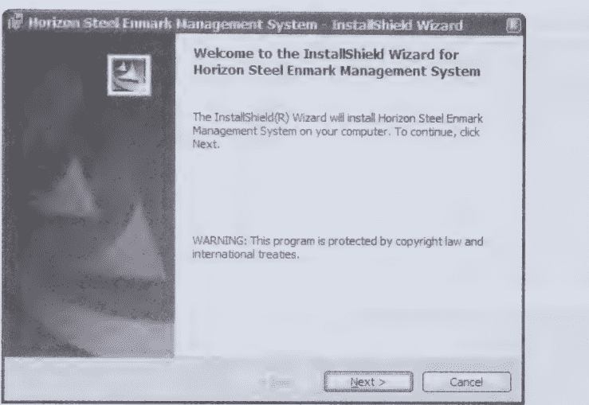

**图 2.** *创建安装程序使你的应用程序与客户在互联网或本地电脑店购买的套装软件处于同一专业水准。*

如果最初的安装是通过之前的安装包完成的，那么更新可能是另一回事。只需将新的 EXE 复制到服务器或工作站即可完成。如果没有数据更改，过程确实如此简单。通常采取这种方法更简单，因为你可以让用户从你的网站下载可执行文件，或通过电子邮件发送给他们。然而，为你的更新创建安装包也没有任何坏处。

我们将在第 6 章和第 7 章中更详细地讨论这个问题，届时我们将专门探讨工作站、传统局域网和客户/服务器应用程序的部署问题。

## 部署 Visual FoxPro 应用的基础清单

我们开发应用程序多年，在将 Visual FoxPro 应用程序部署到生产环境之前，通过惨痛的经验学到了预先需要做的事情。以下是在实施新应用程序或部署现有应用程序更新之前需要考虑的事项列表。

### VFP 源代码问题

在部署 VFP 应用程序之前，你应该做的第一件事是对应用程序中分发的或独立于应用程序的所有报表运行一个处理过程，以清除报表元数据文件 (FRX) 第一条记录中 `TAG` 和 `TAG2` 列的所有内容，以及 `EXPR` 列的部分内容。运行此过程可以消除我们在生产环境中看到的绝大多数打印机问题（见图 3）。如果你不熟悉这个问题，Visual FoxPro 在这些字段中存储特定的打印机信息。如果存储在这些字段中的打印机信息与客户生产环境中的打印机不同，应用程序报表可能会出现奇怪的打印行为。关于如何解决此问题的更多详细信息，可以在所有消息支持论坛以及 Hentzenwerke 的《关于 Visual FoxPro 的 1001 个你想知道的事情》(KiloFox) 中标题为“如何从 VFP 报表中删除打印机信息”的章节中找到。

确保你对各种 `SET` 命令以及你的主程序具体如何配置它们有深入的理解。让 `SET` 命令以默认值初始化 Visual FoxPro 环境可能与你在开发环境中设置的值不同。例如，许多开发人员在开发过程中使用 `SET EXCLUSIVE ON` 来执行 `MODIFY STRUCTURE`、`REINDEX` 表和 `ZAP` 测试数据。如果你的生产应用程序是多用户应用程序，则需要在主程序中使用 `SET EXCLUSIVE OFF`。

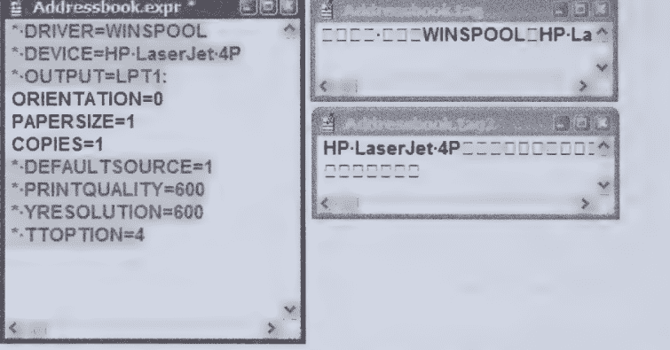

**图 3.** *在将应用程序报表移至生产环境之前清理报表元数据，是大多数开发人员通过惨痛教训学到的经验。*

包含一个 `READ EVENTS` 以在应用程序中引入等待状态。首次部署时经常会突然发现应用程序启动后，短暂显示 Visual FoxPro 框架，然后迅速关闭。`READ EVENTS` 命令旨在引入必要的等待状态。请确保应用程序有一种方法，在用户决定退出应用程序时调用 `CLEAR EVENTS` 命令。该命令会移除等待状态。

Visual FoxPro 以在数据和窗体数据环境中使用相对路径而闻名。这意味着相对路径存储在游标的 `Database` 属性中（见图 4）。当游标实例化并查找数据库中的表时，数据库需要位于与应用程序之间相同的相对路径上，就像在开发机上一样。根据我们的经验，客户喜欢将数据建立在与应用程序不同的驱动器上，而开发人员通常将数据保在应用程序文件夹下的某个文件夹中。可以在数据环境的 `BeforeOpenTables` 方法中包含代码，在打开表之前更改 `Database` 属性；否则，数据库在用户机器上的相对路径必须与在开发人员机器上的一致。

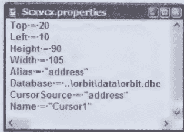

*图 4. Visual FoxPro 在游标对象的 `Database` 属性中存储相对路径。如果你不在运行时更改该属性，或者不在生产环境中将数据库定位在与开发机相同的相对文件夹结构中，这可能会导致应用程序出错。*

硬编码路径是一个明显的问题，但在我们审查的代码中经常遇到。`D:` 盘并不总是每台机器都有。开发环境中可用的映射驱动器在客户网络中可能不可用，并且在不同机器或不同客户站点之间可能有所不同。

在构建交付给客户的最终版本时，请务必检查“Recompile All”（全部重新编译）选项，以确保所有源代码都被编译。Visual FoxPro 仅重新编译自上次成功构建以来发生更改的代码。如果之前的构建记录了语法错误，那么直到问题源代码被更改、通过 `COMPILE` 命令重新编译，或在构建时通过 `Recompile All` 设置重新编译为止，该代码不会被重新编译。`Recompile All` 还会压缩元数据源代码文件 (SCX, VCX, MNX, FRX, LBX)，从而减小可执行文件的体积。

在项目管理器中标记为排除 (excluded) 的文件需要随其他可执行文件一起交付。同样，对于经验丰富的开发人员来说这显而易见，但经验不足的开发人员可能不理解项目中的此设置。标准可能因项目而异，这也是一些开发人员在部署某些项目时忘记排除文件的原因。

以最终用户将要使用的方式测试可执行文件。这意味着你需要运行可执行文件或使用运行时实例化 COM 对象。这将使你免于遇到诸如“功能不可用”之类的尴尬错误，并确保通过间接访问的源代码文件在构建期间被包含在项目中。

## 客户环境

始终向用户提供包含所有 Visual FoxPro 运行时以及应用程序中使用的任何 ActiveX 对象的工作站安装程序，以及工作站支持该应用程序所需的任何实用工具。我们建议在未安装 Visual FoxPro 的计算机上进行测试，因为你很容易忘记安装随 Visual FoxPro、Visual Studio 或你获得许可的某些第三方软件包一起加载的特定 ActiveX 控件。

始终在屏幕分辨率设置为客户声明的最小值的情况下对应用程序进行系统测试。这是在设计第一个界面之前就需要提前了解的事项。避免出现无法适应显示器的界面很容易，但直到应用程序部署后才进行测试的情况却很常见。Visual FoxPro 在这方面也不容乐观，因为如果设置了 `AutoCenter` 属性为 true，它会将表单居中。如果表单大于用户的屏幕分辨率，表单的顶部和底部将会超出屏幕，用户将无法通过本机 Tab 键顺序以外的方式访问隐藏的控件。导致这个问题的最大原因是大多数开发人员使用的分辨率非常高，在开发期间忘记了这个需求。

应用程序依赖项如 Microsoft Office（Word、Excel 和 Outlook）、OpenOffice.org 办公套件、Internet Explorer、QuickBooks、Acrobat、Windows 脚本主机和传真软件如今非常普遍。首先，你需要验证访问应用程序的计算机上是否已安装这些应用程序。另一个关注点是产品的版本以及你在生产环境中遇到的数据格式可能与开发中测试的内容不同。这对于垂直市场应用程序和大型组织来说是个大问题，或者在从一个版本过渡到另一个版本的组织中，或者在某些情况下，过渡到提供相同功能的完全不同的产品时。

## 应用程序特定测试

执行“空数据库测试”。我们经常在有现有记录的情况下开发和测试，但这些记录会被清除，通常我们在客户现场安装一个全新的空数据库，用于测试新应用程序或在现有应用程序中添加新表时。

另一端包括容量测试。将数据加载到表中，达到预期容量的 120%。这使开发人员和客户能够看到应用程序在处理大量数据时的性能表现。当应用程序性能不佳时，这经常让开发人员感到惊讶，而可能的原因是测试数据只是实际生产环境中使用数据的一小部分。

如果在应用程序中使用了安全方案，请确保预先配置一个具有访问权限的用户供初始用户在启动应用程序时使用，并为其他用户建立安全设置。

后端数据库在设置权限方面有不同的关注点（参见图 5）。开发人员可能为了减轻开发期间的麻烦而采用开放的安全系统，当客户根据数据库管理员的建议设置了非常严格的限制时，可能会感到惊讶。

元数据（关于数据的数据）应进行验证，并且每次新安装时都应部署当前的一组元数据。许多开发人员使用 Stonefield Database Toolkit（SDT）元数据来驱动重新索引过程并更新生产环境中的结构。提供应用程序数据驱动方面的商业和内部框架通常使用在开发机上更改的本地表来完成此操作，这些表需要移动到客户生产环境中。我们建议每个版本（无论多小）都附带一组当前的元数据，以防开发人员更新了它却忘记了。

*图 5. 像 SQL Server 这样的后端数据库使数据库管理员能够将安全性设置到列级别，以供应用程序用户使用。如果在测试期间未考虑此安全性，它可能会对您的应用程序产生负面影响。*

注册表项、INI 配置文件和表用于跟踪和保留用户及应用程序设置。可能需要在生产环境中创建和更新这些设置。

## 网络和操作系统问题

确保在应用程序中使用客户现场可使用的字体。不要使用随桌面出版程序安装的特殊字体来创建用户指南，因为这些字体出现在客户工作站上的可能性很低。基于浏览器的应用程序也是如此，因为这些应用程序通常面向更广泛的受众。Windows 尝试为我们替换字体固然不错，但选择的字体可能不如你期望的那么美观。

在某些操作系统（Windows 95/98/NT4/ME/2000）上直接从 CD-ROM 复制文件会保留只读属性。这对于表、索引、备注文件、数据库容器、`FoxUser` 资源文件甚至 INI 配置文件来说可能是个问题。你部署的可执行文件、图像和其他文件可能不受此属性的影响。Windows XP 在从 CD-ROM 复制文件时默认不会保留此属性。

使用操作系统安全性适当地设置文件的访问权限，将使用户能够访问应用程序可执行文件和其他文件。如果这些权限设置不正确，应该具有访问权限的用户可能无法访问，或者未经授权的用户可能获得对应用程序和数据的访问权限，即使他们不应该能够这样做。开发人员在开发机上通常具有管理权限，不会使用权限低于“上帝般”权限的用户 ID 来测试应用程序。对于运行 Windows NT4/2000/XP 的客户来说，这更是一个问题。

安全性也可能成为应用程序安装的问题。运行 Windows NT4/2000/XP 的公司通常不会赋予终端用户对其机器的管理权限。这对于安装包来说可能是个问题，因为它试图将文件写入 Windows 系统文件夹甚至应用程序文件夹等安全目录。确保提前与现场支持人员（如果有的话）协调安装事宜。如果你是支持人员，在安装时确保知道管理员密码。这适用于安装到服务器和本地工作站。

WinAPI 调用和与 Windows 服务的集成需要在客户环境中运行的每个平台上进行测试。并非所有 WinAPI 调用都能在所有 Windows 版本上工作。在客户环境中执行此操作可能更实际，但我们建议在最终用户验收测试开始之前完成此项工作。我们在办公室有专门的测试机仅用于此目的，并使用 Symantec 的 Ghost 和 PowerQuest 的 Drive Image 来建立不同操作系统的镜像，以便我们可以执行平台测试。另一个可以探索的途径是 VMware 的 VMware Workstation。该产品允许你建立一个或多个虚拟机，可以加载用于测试将要部署的各种平台。

验证操作系统组件的存在，如 ODBC 驱动程序、Internet Explorer、XML 解析器、ActiveX Data Objects（ADO）、正确版本的 .NET Framework、Microsoft SQL Desktop Engine（MSDE）和 Collaboration Data Objects（CDO），以便应用程序在与这些技术交互时不会失败。Microsoft 提供所有这些技术的下载，因此你可以准备好它们以备需要时使用。确保在计算机上加载了正确的版本可能是一项耗时的任务。

## 一般硬件需求：除了 VFP，部署解决方案还需要什么物理设备？

这一节可能是我们在本书中写得最困难的一节，因为在确定运行 Visual FoxPro 应用程序所需的硬件方面没有绝对的标准。Microsoft 已经指定了 Visual FoxPro 开发版本的最低要求，但这与我们的运行时应用程序所需的要求不同（参见 **表 1**）。

## 表 1. 运行 Visual FoxPro 8 运行时版本（Runtime version）的最低硬件要求。

| VFP 8 最低要求 | |
|:---|:---|
| 处理器 | Pentium 级别 |
| 操作系统 | Windows 98, Windows ME, Windows 2000 Service Pack 2 或更高版本，以及 Windows XP |
| 内存 (RAM) | 最低 64 MB；建议 128 MB 或更高 |


| 显示器 | Super VGA 800 X 600 或更高分辨率，支持 256 色（建议 16 位高色） |
| --- | --- |
| 输入设备 | 鼠标或兼容的指针设备 |

我们制定了最低要求，但这可能与客户在生产环境中使用的实际计算机有所不同。设定最低要求是为了在客户对应用程序的性能问题表示担忧时，我们能够有据可依。我们的工作站建议分为三种配置：

- 勉强运行 (Marginal Performance) - 450 Mhz Pentium, 64 Mb RAM（最低）
- 中端机器 (Mid range machine) - 1.2 Ghz Pentium, 128 Mb RAM
- 高端机器 (High end machine) - 2.0 Ghz Pentium 或更高, 256 Mb RAM 或更高

所有工作站都应连接到 100 MB/S 的以太网网络，使用 100 Mbit 以太网网络接口卡，且本地驱动器上的可用磁盘空间应至少等于本地驱动器大小的 15% 或 500 MB（以较大者为准）。

你可能会发现你的应用程序可以在比“勉强运行”配置更弱的计算机上运行。我们曾看到 Visual FoxPro 8 应用程序在一部内存为 64MB、主频为 266Mhz 的计算机上运行且性能可接受。这个特定的应用程序在后端使用了客户端-服务器数据库。大部分繁重的数据处理是通过存储过程运行的，因此性能得益于配置良好的服务器。

你可能已经注意到，我们的高端机器并没有达到 Intel 提供的最新最强处理器水平，而我们的低端机器可能比客户办公室里有的机器稍微高一点。指定的范围仅作为指导原则。你会意识到许多因素决定了工作站的实际最低要求。例如，在运行你的应用程序时，机器上还运行了多少个其他应用程序，应用程序是否在网络上运行，机器上是否运行了杀毒软件，以及应用程序执行处理的强度。如果工作站用于报表生成，且报表需要进行大量计算并从 Visual FoxPro 数据库中查询数百万条记录，那么配备 512MB 内存的高功率机器可能是最佳选择。如果工作站使用的是基于 SQL Server 数据库（位于服务器上）的应用程序，并用于数据录入交易，那么低端机器可能也能很好地工作。

其他可能影响部署应用程序的硬件还包括服务器（文件服务器、数据库服务器和 Web 服务器）、Web 连接应用程序的互联网连接（拨号与宽带）、CD-ROM 和 DVD 刻录机、扫描仪、条形码阅读器、个人数字助理 (PDA) 以及备份解决方案。打印机也非常重要。需要考虑用于报表密集型应用的激光打印机，用于图形和演示的彩色打印机，以及标签打印机。一个支持高分辨率和高色彩设置且不引起眼睛疲劳的优质显示器永远不容忽视。如果你的应用程序与硬件交互，你需要评估 Visual FoxPro 与该技术的协作程度，并确定该技术的集成和部署是否存在问题。

## 不可回避：部署时必须包含的内容

你必须在应用程序中包含若干文件。首先，你将有一个或多个可执行文件（APP, EXE, DLL 或 FXP）。在主可执行文件之后，需要交付的内容取决于应用程序的架构。

在使用 VFP 运行时（runtimes）的情况下，你至少需要交付 `VFP8R.DLL` 和一个语言资源文件（`VFP8RCHS.DLL`、`VFP8RCHT.DLL`、`VFP8RCSY.DLL`、`VFP8RDEU.DLL`、`VFP8RENU.DLL`、`VFP8RESN.DLL`、`VFP8RFRA.DLL`、`VFP8RKOR.DLL` 和 `VFP8RRUS.DLL`）。VFP 8 运行时文件依赖于 Visual C++ 运行时文件 (`MSVCR70.DLL`) 和 Microsoft 图形设备接口 Plus (GDI+) 运行时 DLL (`GDIPlus.DLL`)。如果你为 Visual FoxPro 组件需要多线程运行时，则需要交付 `VFP8T.DLL` 和相应的语言资源文件。如果你使用的是不同版本的 Visual FoxPro，请将 8 替换为你所使用的版本。更多详细信息（包括依赖项）请参阅第 3 章“打包安装”。

除了可执行文件，你还需要部署所有在项目管理器中标记为“排除 (excluded)”的应用程序依赖文件（见图 6）。你在项目管理器中排除某个文件可能有多种原因：

- 文件是特定于某次安装的。例如，公司 Logo 可以被引用为 `LOGO.GIF`，并单独交付，甚至在安装后由最终用户替换。
- 文件在外部应用程序中被使用或打开（如 PDF 或 Word 文档）。如果该文件在安装后会被最终用户修改，这一点尤为重要。
- 大文件会增加可执行文件的体积。如果可执行文件驻留在服务器或对等网络中的另一台机器上，这意味着可执行文件在通过网络拉取和加载时需要更长时间。
- 参考资料、文档、帮助和其他开发者特定的文件在开发期间可以通过项目管理器访问，但在客户环境中可能不需要。

**图 6.** 在项目中将文件标记为排除意味着它们在构建过程中不会被包含在可执行文件中。在这个项目中，自由表（free table）和一个报表需要随可执行文件一起部署。

数据的部署方式多种多样。你可以为新应用程序部署一个空数据库，为现有数据库更新现有结构，将数据从一组表转换为一组新表，甚至将数据从 VFP DBF 文件迁移到后端数据库。你可能会发现交付表是最简单的方式，或者你也可以采取主动，通过脚本或程序以编程方式创建结构。

像数据字典这样的元数据通常随每次版本发布一起部署，因为在版本之间更改元数据是很常见的。Stonefield 的数据库工具包和其他遵循 DataBase Container eXtensions (DBCX) 标准的产品要求你部署各种元数据文件。

如果你使用了 `FOXTOOLS.FLL` 中的任何函数，你需要将此文件随可执行文件一起交付。看起来微软在每个 Visual FoxPro 主版本的基础产品中都包含了一个或多个 FoxTool 函数，因此对该组件的需求在减少。我们希望微软能直接将剩余的功能整合到基础产品中，以减少我们在安装包中需要关注的文件数量。

如果你想部署标签定义以便用户通过报表设计器创建自己的标签，则需要分发资源文件 (`FOXUSER.DBF/FPT`)。如果你在应用程序中包含了 Visual FoxPro 日记/日历，或者想要自定义打印预览工具栏（移除“打印报表”按钮），你也需要资源文件。你还需要资源文件来存储 `BROWSE` 窗口定义，尽管由于现在使用网格 (grid) 控件，这在 Visual FoxPro 应用程序中已不再常见。你也可以将资源文件命名为 `FoxUser` 以外的名字，以避免与另一个 Visual FoxPro 应用程序的默认资源文件发生冲突。

## 不可触碰，还是可以？

Visual FoxPro 中包含许多可用于自定义解决方案的文件。其中一些文件可以重新分发，而另一些则不能。本节将阐明你可以和不能使用什么，分发某些文件需要满足哪些特殊条件，以及需要评估哪些版权问题。

> 请注意，本讨论基于 Visual FoxPro 8 的最新许可协议。如果你使用的是另一个版本，请参阅帮助文件中的“可分发和受限的 Visual FoxPro 功能和文件 (Distributable and Restricted Visual FoxPro Features and Files)”主题——而不是 `Redist.txt` 文件中提到的“删除受限的 Visual FoxPro 功能和文件 (Removing Restricted Visual FoxPro Features and Files)”。我们强烈建议你查阅 `Redist.txt` 文件，以验证你想使用的文件是否包含在该文件中。

VFP 安装目录下的 `REDIST.TXT` 定义了哪些文件可以重新分发。类别如下：

- 合并模块 (Merge Modules) 可用于分发
- 可交付的代码
- 可包含的向导 (Wizards) 和构建器 (Builders)
- 工具 (`Filer`、零页码程序、`FoxISAPI`、`GenDBC`)
- 组件库 (Component Gallery) 目录
- Fox 基础类 (Foundation Classes)
- 图形资源
- 示例
- 工具（自动化测试应用程序）

只要将样本源代码、位图 (BMP)、图标 (ICO) 和鼠标光标 (CUR) 文件编译到可执行文件中，您就可以在应用程序中使用它们。它们不能在可执行文件之外单独分发。当然，您可以借鉴任何想法和源代码并将其包含在您自己的创作中。

同样地，您可以将 VFP 主目录下 FFC 目录中的任何 Fox Foundation Classes (FFC) 以及向导类（用于 VFP Framework 和各种控件及应用程序生成向导）、组件库 (Component Gallery) 中包含的类在不修改的情况下用于您的应用程序，只要它们被编译到分发的可执行文件中即可。

开发人员在检查不可分发的文件列表时，最令他们惊讶的发现之一就是随 Visual FoxPro 安装的 TrueType 字体，尤其是 FoxFont 和 FoxPrint。虽然这些字体在今天比起 2.6 到 VFP 3 转换期间没那么有用，但仍有一些开发人员在开发过程中使用它们。我们建议直接忽略这种字体并使用另一种字体，否则您的客户需要为每台运行该应用程序的计算机购买 Visual FoxPro 许可证。

您不能分发任何 Visual FoxPro 帮助文件（VFP 8 分发的是 `dv_foxhelp.chm` 和 `FoxHelp.chm`）。这应该是显而易见的，但我们还是帮您覆盖了所有细节。

## 表 2. 这是不可分发的 VFP 菜单及其选项列表

| 菜单项 |
| --- |
| Database |
| Form |
| Menu |
| Program |
| Project |
| Query |
| Table |

Visual FoxPro 交互式开发环境 (IDE) 中提供的几个菜单选项不能包含在部署的应用程序中（见表 2）。这意味着您可以随应用程序一起分发 Report 菜单，并包含用户定义报表和标签的功能。

许多向导文件不能包含在您的自定义应用程序中。可以包含的文件在 `Redist.txt` 文件中有所指定。现在您可能会问，为什么开发人员要关心向导文件的包含或排除？毕竟，我们的大多数客户是在经营业务，而不是使用 Visual FoxPro 开发应用程序，那么他们为什么需要向导中包含的功能呢？事实是，他们很可能不需要其中大部分功能，而且重要的是，微软并没有赋予我们分发所有向导代码的权利。我们认为重新分发许可证这一方面的益处是：如果我们为客户提供报表设计器，他们就可以使用报表向导的功能；如果我们包含生成 Excel 透视表的能力，他们就可以使用透视向导；或者如果客户要求与不同的数据导入功能进行交互，他们就可以使用导入向导。我们无需从零开始编写这些代码，可以直接包含已经开发好功能的向导。我们再次建议查阅 `Redist.txt` 文件，以了解关于哪些文件可以分发以及哪些文件不能分发的具体细节。

除了指定的文件外，还有几个命令在我们要分发的可执行文件中无法工作。这些命令会触发我们所有人在单元测试或系统测试中偶尔会遇到的“功能不可用”错误（错误代码 1001）。如果这些错误发生在生产环境中，那是不可原谅的。微软在帮助文件中提供了这个列表（见表 3）。这些错误经常在生产环境中出现，是因为开发人员在将应用程序交付客户之前，没有在带有运行库的可执行文件状态下测试代码。

## 表 3. 这是会触发“功能不可用”错误的 VFP 命令列表

| APPEND PROCEDURES | MODIFY DATABASE |
| --- | --- |
| BUILD APP | MODIFY FORM |
| BUILD EXE | MODIFY MENU |
| BUILD PROJECT | MODIFY PROCEDURE |
| CREATE FORM | MODIFY PROJECT |
| CREATE MENU | MODIFY QUERY |
| CREATE QUERY | MODIFY SCREEN |
| CREATE SCREEN | MODIFY VIEW |
| CREATE VIEW | MODIFY CONNECTION |
|  | SUSPEND |

代码引用 (Code Reference) 工具在 Visual FoxPro 8 中引入（见图 7），用于在项目中搜索“功能不可用”的命令。在 Visual FoxPro 8 之前（以及在代码引用工具出现之后），我们仍会使用类似 Steve Dingle 的 Project Searcher（可从 `www.SteveDingle.com` 获取）和 Peter Diotte 的 GoFish（可在 Universal Thread – `www.UniversalThread.com` 获取）等工具。您还可以采取另一种方法，在 `projecthook` 的 `BeforeBuild` 方法中编写一个进程，搜索项目源代码中的问题命令。关键是在进行发送给客户的最终构建之前检查这些命令。最容易给您带来麻烦的是 `SUSPEND` 命令，因为它在调试代码时被广泛使用。

**图 7.** Visual FoxPro 8 代码引用工具使开发人员能够搜索字符串并在相应的编辑器中打开代码。

在运行时应用程序中，还有七个命令（见表 4）会被完全忽略。这意味着您可以将它们包含在代码中，但它们在应用程序中没有任何效果。`ASSERT`、`DEBUGOUT` 和 `SET STEP` 命令在您的调试工作中非常有用，但在应用程序的最终用户层面不起任何作用。

## 表 4. 这是在运行时应用程序中被忽略的 VFP 命令列表

| ASSERT | SET DOHISTORY |
| --- | --- |
| DEBUGOUT | SET ECHO |
| SET DEBUG | SET STEP |
| SET DEVELOPMENT |  |

> 从 Visual FoxPro 7 开始，`SET STEP` 命令被移至运行时应用程序的忽略命令列表中，但它在帮助文件中仍然被列为会触发“功能不可用”错误的命令。

我们决定对被忽略的命令进行一些性能测试，看看将它们包含在应用程序中是否会对性能产生负面影响。虽然不用担心命令触发某些错误条件是很不错的事，但我们不想包含那些会显著降低应用程序速度的命令，以免用户要求进行性能改进。我们选择了在完成单元测试后最有可能留在应用程序中的命令，即 `ASSERT`、`DEBUGOUT` 和 `SET STEP` 命令。以下是我们用于测试这些条件的程序（程序 `TestIgnoreCommands.prg` 已包含在章节下载中）：

```foxpro
lnLoops = 10000

* Nothing
lnStart = SECONDS()

FOR i = 1 TO lnLoops
    * Nothing
ENDFOR

lnEnd = SECONDS()
WAIT WINDOW "Performance of nothing: " + TRANSFORM(lnEnd - lnStart)

* DEBUGOUT
lnStart = SECONDS()

FOR i = 1 TO lnLoops
    DEBUGOUT "Nothing in Executable"
ENDFOR

lnEnd = SECONDS()
WAIT WINDOW "Performance of DEBUGOUT: " + TRANSFORM(lnEnd - lnStart)

* ASSERT
lnStart = SECONDS()
FOR i = 1 TO lnLoops
    ASSERT .F. MESSAGE "Nothing in Executable"
ENDFOR

lnEnd = SECONDS()
WAIT WINDOW "Performance of ASSERT: " + TRANSFORM(lnEnd - lnStart)

* SET STEP
lnStart = SECONDS()

FOR i = 1 TO lnLoops
    SET STEP OFF
ENDFOR

lnEnd = SECONDS()
WAIT WINDOW "Performance of SET STEP: " + TRANSFORM(lnEnd - lnStart)

* WAIT NO WAIT
lnStart = SECONDS()

FOR i = 1 TO lnLoops
    WAIT WINDOW "Nothing" NOWAIT
ENDFOR

lnEnd = SECONDS()
WAIT WINDOW "Performance of WAIT NO WAIT: " + TRANSFORM(lnEnd - lnStart)

RETURN
```

如您所见，我们还包含了 `WAIT NO WAIT` 命令，因为这是开发人员在长时运行过程中显示进度的常用命令，它证明了被忽略的命令对生产代码几乎没有影响。测试结果在表 5 中指定。我们从这项研究中得出的结论是，它们对您的生产代码没有影响；在日常工作中，它们的影响极小。正如预期的那样，执行它们的总时间可以忽略不计。简而言之，我们可以放心地依赖这种开发技巧来改进代码，同时仍保持可接受的整体性能水平，且无需担心潜在错误。我们建议在代码中保留 `set steps`，但如果您发布的一个版本对性能要求极高，则应由您酌情决定，并进行基准测试和衡量。因此，我们对这些被忽略的命令在我们工作流中扮演的重要角色感到满意。

### 表 5：运行时环境下被忽略命令的基准测试

| 命令 | 执行时间 (ms) |
| --- | ---: |
| DEBUGOUT | 12 |
| ASSERT | 10 |
| SET STEP | 15 |

`WAIT` 命令被用作测量基准。如您所见，被忽略命令的影响微乎其微。

## 表 6. Visual FoxPro 8.0 随附且可随部署包分发的 ActiveX 控件

| 文件 | 控件 | 帮助文件 |
| --- | --- | --- |
| MSComCt2.ocx | Animation 控件<br>DateTimePicker 控件<br>MonthView 控件<br>UpDown 控件 | CmCtl298.chm |


| `MCI32.ocx` | 多媒体 MCI 控件 | `MMedia.chm` |
| `MSChrt20.ocx` | `MsChart` 控件 | `MsChrt98.chm` |
| `MSComCtl.ocx` | `ImageCombo` 控件<br>`ImageList` 控件<br>`ListView` 控件<br>`ProgressBar` 控件<br>`Slider` 控件<br>`StatusBar` 控件<br>`TabStrip` 控件<br>`Toolbar` 控件<br>`TreeView` 控件 | `CmCtl198.chm` |
| `MSComm32.ocx` | `MSComm` 控件 | `Comm98.chm` |
| `MSInet.ocx` | Microsoft Internet Transfer 控件 | `Inet98.chm` |
| `MSMapi32.ocx` | MAPI Message 控件<br>MAPI Session 控件 | `Mapi98.chm` |
| `MSMask32.ocx` | Masked Edit 控件 | `Masked98.chm` |
| `MSWinSck.ocx` | `Winsock` 控件 | `MsWnsk98.chm` |
| `PicClp32.ocx` | `PicClip` 控件 | `PicClp98.chm` |
| `RichTx32.ocx` | Rich Textbox 控件 | `RtfBox98.chm` |
| `SysInfo.ocx` | `SysInfo` 控件 | `SysInf98.chm` |

## 表 7. Visual FoxPro 7.0 随附且与 VFP 8.0 不同的 ActiveX 控件。

| 文件 | 控件 | 帮助文件 |
|------|----------|-----------|
| `Foxtlib.ocx` | `Foxtlib` ActiveX 控件 | `Foxhelp.chm` |

## 表 8. Visual FoxPro 6.0 随附且与 VFP 7.0 不同的 ActiveX 控件。

| 文件 | 控件 | 帮助文件 |
|------|----------|-----------|
| `ComCtl232.ocx` | Animation 控件<br>`DateTimePicker` 控件<br>`MonthView` 控件<br>`UpDown` 控件 | `CmCtl298.chm` |
| `FoxHwnd.ocx` | Visual FoxPro HWND 控件 | `FoxHelp.chm` |
| `MSWless.ocx` | `CheckBox` 控件（轻量级）<br>`ComboBox` 控件（轻量级）<br>`Commandbutton` 控件（轻量级）<br>`Frame` 控件（轻量级）<br>`HscrollBar`, `VScrollBar` 控件（轻量级）<br>`ListBox` 控件（轻量级）<br>`OptionButton` 控件（轻量级）<br>`TextBox` 控件（轻量级） | `Ltwtcl98.chm` |

ActiveX 控件不仅需要被部署，还需要在每个运行应用程序的工作站上进行注册。对于单用户应用程序或 Web 服务器，这可能仅涉及一台计算机；而对于大型企业部署，则可能涉及数百台计算机。我们将在本书后续各章节中讨论分发和注册的具体细节，并在每个“操作指南”（How-To）附录中对此进行说明。

## 结论

本章为您提供了准备部署自定义应用程序所需的基础知识。虽然其中一些基础知识可能显而易见，但在您进入部署过程的规划阶段之前，建立一个预期基准是非常重要的。

本章的更新和修正可在 Hentzenwerke 出版社的网站 [www.hentzenwerke.com](http://www.hentzenwerke.com) 上找到。点击“Catalog”并导航至本书的页面。

# 第 2 章

## 为成功而规划

您是否曾经为成功而规划，甚至为部署失败而规划？规划部署有助于避免陷阱，并帮助客户就软件开发被认为完成并准备安装时会发生什么设定预期。同时，希望这能确保您比不提前考虑所有可能导致问题的问题时，能更充分地准备好成功地部署解决方案。

在实际创建`SETUP.EXE`之前，需要解决许多问题。本章提出的问题最好在开发任何代码之前被发现并解决，因为它们将影响应用程序的设计、开发中使用的架构以及最终解决方案在生产环境中的部署方式。

## 计算环境

您有多少次带着 CD（或磁盘、磁带、Zip 磁盘）到达现场，却发现最终用户需要的专用标签打印机从未被订购？您是否带着一张看起来很专业的 CD 到达现场，却发现办公室内没有一台机器有 CD 驱动器，因为老板不想让员工在办公室内用它们听音乐？许多自定义应用程序需要新硬件。无论是最新的处理器技术，还是简单地将点阵打印机更换为每分钟 32 页的激光打印机，许多应用程序都有特殊的硬件需求。在应用程序交付之前验证所需硬件已到位，可以避免在交付新解决方案或升级解决方案时产生尴尬。

### 工作站清单

运行应用程序的硬件每天都在变得越来越便宜。新功能以及能力的增加和容量的提升继续每 18 个月翻一番，这在我们的行业中被公认为“摩尔定律”。软件的需求以及用于创建解决方案的开发工具也要求硬件达到一定的性能水平。

客户已经拥有什么样的硬件是正常工作且能够运行用 Visual FoxPro 8.0 开发的应用程序的？您知道 Visual FoxPro 有一个最低建议配置。然而，我们发现最低建议配置并不总是我们向客户推荐的最低配置。

> 微软为每个版本的 Visual FoxPro 提供了建议。我们认为，最低建议硬件肯定只会提供最低限度的性能，而这通常是不可接受的。最低配置也没有考虑到安装了哪个操作系统，以及同一台机器上经常运行的其他应用程序。

### 表 1. 微软官方最低要求

| | VFP 8 | VFP 7 | VFP 6 |
| :--- | :--- | :--- | :--- |
| **处理器** | Pentium 级 | Pentium 级 | 486 66MHz 处理器 |
| **操作系统** | Windows 98, Windows ME, Windows 2000 Service Pack 2 或更高版本，以及 Windows XP | Windows 95, Windows 98, Windows ME, Windows NT 4.0, Windows 2000 或 Windows XP | Windows 95, Windows 98, Windows ME, Windows NT 4.0, Windows 2000 或 Windows XP |
| **内存** | 最低 64 兆字节 (MB) RAM；建议 128 MB 或更高 | 最低 64 兆字节 (MB) RAM；建议 128 MB 或更高 | 最低 16 兆字节 (MB) RAM，建议 32 MB 或更高 |
| **显示** | Super VGA 800 X 600 或更高分辨率显示器，支持 256 色（建议 16 位高色彩） | 建议使用 VGA 或更高分辨率显示器 | 建议使用 VGA 或更高分辨率显示器 |
| **外设** | 鼠标或兼容的指针设备 | 鼠标或兼容的指针设备 | 鼠标或兼容的指针设备 |

您可能需要为您的应用程序确定建议配置。这些知识具有时效性且波动较大，因为硬件供应商会定期更改硬件规格和性能。开发人员发现，六个月前给出的建议与今天给出的建议大不相同。开发人员也知道，六个月后给出的建议将再次大不相同。您还必须与多家计算机供应商保持同步，以便在提出建议时基于该客户当时的最佳选择给出建议。根据季度的不同，我们公司可能会根据我们最近向客户推荐的供应商或用于内部开发机器的供应商的经验，更倾向于某一家供应商。

每台机器的处理器速度是多少，内存有多少？您需要了解客户现有机器的情况（如果他们已经拥有某些计算机），然后将此信息与所需的最低配置进行比较，以识别任何不足之处。

微软自 Windows 98 起在 Windows 中包含了一个名为 Microsoft 系统信息 (`MSINFO32.EXE`) 的工具。Microsoft 系统信息（见图 1）显示的信息包括操作系统（含版本和 Service Pack）、系统名称和制造商、处理器及其速度、BIOS 版本和制造商、物理内存、虚拟内存、驱动器空间、外设、驱动程序以及部分软件配置。这仅仅是您可以从该小工具中获知细节的冰山一角。这里的关键是，在进行硬件清单盘点时，它能提供很大帮助。该小工具还具有打印选项，可打印所有类别的所有设置。请做好面对一份非常冗长且详细的打印结果的准备。本文作者将其打印到 Acrobat PDF 文件中，结果长达 103 页。您还可以使用 Microsoft 系统信息小工具在项目的技术支持阶段诊断计算机问题。

**图 1：** Microsoft 系统信息应用程序提供了计算机的内部视图，包括硬件配置和软件设置。

创建硬件清单检查表会非常有帮助。根据我们的经验，每个项目都有其自身的标准，每位客户都有自己的微调需求。随着软件需求的增加以及新硬件的发明和旧硬件的改进或更新，硬件要求也会随之改变。

> 我们在章节下载中包含了一些我们在网上找到的硬件检查表，作为示例供您在创建自己的检查表时参考和利用。

用户群需要多少台计算机？向客户询问这个重要问题时，有时会得到茫然的眼神。是否办公室有 100 名员工，但同一时间只有 50 人需要访问应用程序，且团队分两班倒工作？通常，在开发需求的早期阶段，客户并不清楚应用程序需要多少台机器，因为他们甚至可能还没有聘请执行该工作的员工。在此时获得一个最合理的猜测可能是您所能期待的最好结果，并且这将有助于规划过程。最终，客户必须确定一个具体数字，以便订购硬件。

哪些外设是必要的且可用，或者需要订购？应用程序是否需要特定的显示器分辨率？对于低分辨率的大显示器是否有特殊需求？工作环境是否有严苛的温度条件，或者办公桌、平台、工作台的空间较小，导致平板屏幕可能更好或更差？机器是否配备 CD-ROM 或 DVD 播放器，以便他们导入供应商的每周馈送数据，以及您可以进行工作站安装？是否需要 CD 或 DVD 刻录机以生成异地备份或运行导出程序？打印机是否足够快（每分钟页数性能），并且是否具有满足每月打印需求所需的维护周期？它们能否打印到不同的纸托（用于信封、各种纸张尺寸和颜色）？关于双面打印和彩色打印的需求如何？其他关注点可能包括扫描仪（分辨率、幻灯片和底片、纸张尺寸以及扫描速度）、条码阅读器（样式、兼容性、可读条码）以及 PDA（Palm 或 PocketPC、内存容量、同步能力和开发工具）。虽然每个项目都有共同的问题，但在外设方面，每次都需要考虑自定义问题的情况更为普遍。

由于本书编写于 2003 年，我们现在越来越多地处理客户询问他们应该为解决方案选择 Windows/Intel 平台还是 Darwin/x86 桌面端的问题。Linux 平台开始成熟，在客户看来正成为一个可行的替代方案。作为 Visual FoxPro 开发者，我们知道在 Linux 上运行 Visual FoxPro 涉及许多技术问题，而且每个月运行起来都变得越来越容易。即使解决了呈现在开发社区面前的最终用户许可问题和技术挑战，您仍然需要知道计划如何与客户讨论这个问题。准备好一份考虑了部署总成本（硬件、操作系统、自定义软件和持续支持）的建议方案，是您应当准备好与客户讨论的内容。

*图 2。我们都遇到过硬件基础设施性能不足的情况。这是一张 20 世纪 80 年代初 IBM PC 的照片。*

一旦您对硬件进行了盘点并了解了新应用程序的需求，如果必要，您可以就增加硬件提出建议。需要记住的一点是，客户可以容忍一定的性能问题，并且可能会在稍后的日期分阶段进行采购。了解需要订购什么将允许客户在已知解决方案总成本的情况下做出决定。供应商通常能在短时间内交付新计算机和外设，因此，决策时少两台计算机并不像过去那样是个大问题。

## 操作系统平台

在 FoxPro 2.x 时代，有 DOS、Windows、Macintosh 和 UNIX 等多种操作系统选项。而在 Visual FoxPro 中，我们拥有 Windows 95, 98, 98 第二版 (SE), Millennium Edition (Me), NT 3.51, NT 4.0, Windows 2000 Workstation, Windows 2000 Server (以及 Advanced 和 Datacenter), Windows XP Home, Windows XP Professional, 以及 Windows 2003 (server)。除了各种 Windows 版本外，您还需要面对一系列需要支持或不支持的服务包。最近，开发者们也在考虑在 Linux 操作系统上运行 Visual FoxPro 应用程序。

在较新的操作系统平台上运行 FoxPro 2.6 for DOS 和 Windows 应用程序，给支持遗留系统的开发者带来了挑战。面对这些挑战，开发者们推荐了几项最佳实践。

> 本章作者自 1999 年以来就没经常在 FoxPro 2.6 for Windows (FPW) 应用程序上工作，甚至在他的当前开发机（运行 Windows XP Professional）上没有安装它。关于 FoxPro for Windows 的经验和信息基于他与其他开发者的交流以及基于各种论坛帖子的研究。作者强烈认为，旧的自定义软件应该运行在它被开发用于部署的操作系统上。尽管如此，我们知道其他开发者面临不同的现实情况，因此我们认为将此信息提供给读者是很重要的。

> 关于在当前硬件和操作系统上部署遗留 FoxPro 应用程序的主题，在 Hentzenwerke 出版社由 Alan Bourke 撰写的《Painless Legacy FoxPro Applications》一书中进行了详细阐述。

第一个建议是确保 FoxPro for Windows 运行在安装了较新操作系统的更快速的计算机（快于 333MHz）上。您需要应用来自 Microsoft 的“快速补丁 (fast patch)”。

> “快速补丁”及相关信息可在 Microsoft 支持网站的知识库文章编号 240982 中获得。

如果您的客户正在升级到 Windows 2000 或 Windows XP 且仍在运行 FoxPro for Windows 应用程序，他们需要确保操作系统是全新安装的，而不是从之前的操作系统升级而来的。根据其他开发者的经验，我们的理解是，如果操作系统是通过升级安装的，则`NTVDM.EXE`无法正确加载。我们还读到，如果另一个 16 位应用程序被分配给`NTVDM.EXE`程序，运行 FoxPro for Windows 会终止该程序。

FoxPro 2.6 for DOS 在操作系统分配的文件句柄数量方面也有一些特殊考虑。通常这在 DOS 的`CONFIG.SYS`文件中处理，但在 NT 家族（NT4, Windows 2000, 和 XP）中，它在`CONFIG.NT`文件中处理。这是一个简单的文本文件，您可以使用记事本或其他文本编辑器（包括 FoxPro 编辑器）打开。**图 3** 显示了在名为 TextPad 的实用程序（由 Helios Software Solutions 提供，[http://www.textpad.com](http://www.textpad.com)）中打开的该文件。

您可能会将 files 设置为高于 Windows XP 默认值 40 的数值。另一种方法是在`SYSTEM.INI`文件的`[386Enh]`部分下添加一个名为`PerVMFiles`的条目，并将其设置为您应用程序所需的文件句柄数。如果要在您部署和支持的操作系统上可用，我们建议使用 Microsoft 系统配置实用程序（见**图 4**）。可以通过“开始”菜单的“运行”命令行执行，只需输入`MSCONFIG`并按 OK。否则，您可以使用您喜欢的文本编辑器进行必要的更改。

> FoxWiki 有几个关于让旧版本 FoxPro 在当前操作系统上运行的主题。请查看以下网页：
>
> - [http://fox.wikis.com/wc.dll?Wiki~FpdOnWin2000Printing~VFP](http://fox.wikis.com/wc.dll?Wiki~FpdOnWin2000Printing~VFP)
> - [http://fox.wikis.com/wc.dll?Wiki~FoxProAndWinXp~VFP](http://fox.wikis.com/wc.dll?Wiki~FoxProAndWinXp~VFP)
> - [http://fox.wikis.com/wc.dll?Wiki~FoxProDosInaShell~VFP](http://fox.wikis.com/wc.dll?Wiki~FoxProDosInaShell~VFP)
> - [http://fox.wikis.com/wc.dll?Wiki~Fpd26OnWin2000~VFP](http://fox.wikis.com/wc.dll?Wiki~Fpd26OnWin2000~VFP)

## 第 2 章：成功规划


```text
REM Windows MS-DOS Startup File
REM
REM CONFIG.SYS vs CONFIG.NT
REM CONFIG.SYS is not used to initialize the MS-DOS environment.
REM CONFIG.NT is used to initialize the MS-DOS environment unless a
  different startup file is specified in application `.PIF`
REM
REM ECHOCONFIG
REM By default, no information is displayed when the MS-DOS environment
  is initialized. To display CONFIG.NT-AUTOEXEC.NT information, add
  the command `echoconfig` to CONFIG.NT or other startup file.
REM
REM NTCMDPROMPT
REM When you return to the command prompt from a TSR or while running an
  MS-DOS-based application, Windows runs `COMMAND.COM`. This allows the
  TSR to remain active until exit. To run `CMD.EXE`, the Windows command prompt
  rather than `COMMAND.COM`, add the command `ntcmdprompt` to CONFIG.NT or
  other startup file.
REM
REM MS-DOS-based Applications
REM By default, you can start any type of application when running
  `COMMAND.COM`. If you start an application other than an MS-DOS-based
  application, any TSRs will be automatically stopped. To ensure that only
  MS-DOS-based applications can be started, add the command `dosonly` to
  CONFIG.NT or other startup file.
REM
REM EMM
REM You can use REM command line to configure EMM (Expanded Memory Manager).
  The syntax is :
REM
REM EMM = [±AltRegSets] [B-BaseSegment] [RAM]
REM
REM AltRegSets
  specifies the total Alternative Mapping Register Sets you
  wish the system to support. i.e. `AltRegSets < 256`. The
  default value is 1.
REM
REM BaseSegment
  specifies the starting segment address in the DOS conventional
  memory you want the system to allocate for EMM page frames
  The value must be a multiple of 16
  `0x1000 < BaseSegment < 0x4000`. The value is rounded down to
  the nearest multiple of 16 (in B1600)
REM
REM RAM
  specifies that the system should only allocate 64KB address
  space from the Upper Memory Block (UMB) area for EMM page frames
  and leave the rest of the UMB area to be used by DOS to support
  `loadhigh` and `devicebs` commands. The system, by default, would
  allocate all possible and available UMB for page frames.
REM
REM The PIF file is a configuration file that is associated
  with your application or `_default.pif`. If the size from PIF file
  is zero, EMM will be disabled and the EMM line will be ignored.
`dos=high, umb`
`device=\SystemRoot\system32\himems.sys`
`files=240`
```

**图 3。** 你可以使用标准文本编辑器编辑 `Config.NT` 文件，将文件句柄选项更新为更符合应用程序需求的数值。

## 部署 Visual FoxPro 解决方案

**图 4。** 对于 Windows 98、98 SE、Me 和 XP，你可以通过 Microsoft 系统配置工具添加 `files` 语句。否则，你需要通过文本编辑器编辑 `SYSTEM.INI` 文件。

最后一个方面是 FoxPro 2.6 DOS/Windows 应用程序的快捷方式。对于 DOS 应用程序，建议将内存设置全部设为“自动”，尤其是扩展（XMS）内存设置（参见左侧**图 5**）。

你可能还想配置的是 Windows XP 兼容模式（**图 5**右侧）。Windows XP 中的每个快捷方式都允许开发人员和最终用户让 Windows 以不同的操作系统来处理该应用程序。你可能会发现在 Windows 95 模式下运行更适合你的 FoxPro 2.6 DOS/Windows 应用程序。

现在让我们继续讨论 Visual FoxPro 的操作系统问题。每个版本的 VFP 都提高了应用程序运行的要求。VFP 3 可以在 Windows 3.1 上运行，但基于 Win32s 层会有些不稳定，不过首选平台是 Windows 95。Visual FoxPro 5 放弃了对 Windows 3.1 的支持。Visual FoxPro 6 和 7 没有额外的操作系统要求，支持从 Windows 95 到当前版本的所有 Windows 版本。Visual FoxPro 8 不再支持 Windows 95 和 NT 4。这些都是重要的信息，因为用户并不总是升级到当前的操作系统，而且他们的公司中可能会有多种不同的操作系统。垂直市场应用程序开发人员更有可能在其用户群中遇到各种各样的平台。因此，对用户群进行盘点以了解需要针对哪个平台进行开发是非常重要的。

这让我们想到一个希望你能够从中吸取教训的故事。2003 年 1 月 31 日，微软发布了 Visual FoxPro 8 的制造版。这意味着该产品将于 3 月中旬在商店货架和零售渠道上架。我们（Geeks and Gurus）当时正在开发一个应用程序套件，将其从 VFP 数据转换为后端使用 SQL Server。我们在微软发布 VFP 8 制造版之后、产品上架之前这段时间里，遇到了一个 Visual FoxPro 7 中的致命 bug，阻碍了该产品的发布。我们的客户不像我们那样拥有 MSDN 订阅。我们能够在 Visual FoxPro 8 中测试该 bug，并发现它已被修复。然后我们就用户群及其平台问了客户一个关键问题。注意，原始应用程序是使用 VFP 6 开发的。开发人员快速调查了他的客户，看看是否有任何 Windows 95 和 NT4 平台。他发现一个客户的主要平台是 Windows NT4。所以我们就在我们的“实验室”中在 Windows NT 上 extensively 测试了该应用程序。我们的客户在我们的办公室花了三周时间测试该应用程序，主要在 Windows XP 和 Windows NT 上。我们遇到了报告预览窗口的一个小问题（已在 Service Pack 1 中修复），但这不是致命问题。有了这些知识，并且知道微软不支持在 Windows NT 上发布，我们仍然继续推进。它在生产环境中运行良好。几周后，我们转移到了下一个 beta 站点。他们打电话问我们，为什么我们的安装程序无法在 Windows 95 上安装。唉！客户有两个选择：升级到 Windows 98（受支持的操作系统），或者成为该应用程序的测试小白鼠。截至撰写本文时，此问题尚未解决。这个故事的寓意是要了解操作系统的限制并了解你的客户群。

那么 Windows XP Home 在商业环境中怎么样？我们从不推荐它，但发现新客户已经安装了它。我们在 Windows XP Home 上测试了我们的应用程序，没有发现与我们的应用程序的不兼容性。我们最关心的是网络限制，包括连接到 Windows 2000 和 2003 服务器，以及我们在小型企业中常见的对等网络上五台工作站的限制。我们强烈鼓励客户多花些钱购买 Windows 2000 和 Windows XP 的专业版用于客户端工作站。

那么 Windows 与 Linux 相比呢？2002 年末和 2003 年初，Fox 社区有很多关于让 Visual FoxPro 在 Linux 平台上运行的讨论。我们不打算重述所有政治影响，而是讨论 VFP 开发人员在这方面面临的许可和技术挑战。首先，如果你错过了，你需要知道我们无畏的出版商一直在推广让 Visual FoxPro 在 Linux 操作系统上运行的想法（要了解他的试验和磨难的回顾，请参阅他 2003 年 9 月 FoxTalk 杂志的社论“The Great Linux EULA Controversy”）。人们正在研究并将 Linux 视为可行选项的原因有很多，因此在这个问题上领先客户一步可能符合我们的最大利益。我们服务的大多数公司或组织正在考虑 Linux，原因如下：

- **成本：**Linux 的购买价格几乎免费，而 Windows 的硬件购买或升级中已内置了自动成本。Linux 可以免费下载；更精致的版本虽然有成本，但比 Windows 便宜得多。
- **许可：**微软确实以强硬的许可条款让企业用户陷入困境，导致他们的客户重新审视在这些新许可协议下经营企业是否有意义。微软也在积极追查 knowingly 或 unknowingly 违反许可的公司。Linux 更加开放且限制更少，这对所有用户都有吸引力，尤其是非营利组织的用户。
- **开源应用程序越来越普及：**世界各地的开发人员正在开发用户已经依赖的应用程序。
- **可靠性和安全性的认知：**Windows 安全补丁得到了大量报道，每次失败或黑客攻击都被视为操作系统中的弱点。虽然这是事实，但开发人员知道对于每一项安全措施，都有办法破解它。Linux 也存在这个问题，但由于目前 Windows 的安装量更多，Windows 安全漏洞的影响更大。
- **流行词合规：**我们都见过这种情况，组织的老板在阅读了贸易杂志上吹捧下一件大事好处的最新文章后，走进 IT 部门，要求知道为什么公司还没有这样做。这种情况经常发生。Linux 正在获得很多正面报道。
- **成熟度：**所有软件都需要时间来成熟和稳定。Linux 已经足够成熟，已经达到了这个阶段。走在前沿的开发人员已经将这个产品推向了稳定的程度，普通人现在可以安全地部署它了。

如果您对在 Linux 上运行 Visual FoxPro 有哪怕一点点兴趣，您需要获取一份由 Paul McNett 和 Whil Hentzen 在 FoxTalk 上发表的文章。Whil 和 Paul 在文中讨论了他们遇到的一些困难与成功经验，并引导您完成在 Linux 上运行 VFP 的全过程。这并不适合胆小的人，但如果您准备好迎接挑战（我们听说这件事每天都在变得更容易），请前往`http://www.pintub.com`获取过刊。您也可以在`http://www.linuxtransfer.com/`网站上找到更多信息。

本章的作者仅尝试过 Linux。这项前沿技术虽然有趣，但目前还没有部署价值，因为我们的客户在 Windows 平台上拥有大量需要开发的应用程序。这一决定并不意味着它不是一个可行的平台，而是在本书撰写时的情况所反映出的经济考量。

将 Linux 平台与您的 Visual FoxPro 数据及应用程序集成有几种方案。第一种是让 Linux 担任服务器角色，托管 VFP 数据或运行 MySQL 等后端数据库。第二种是加载 WINE（代表 Wine Is Not an Emulator），您可以在 Linux 桌面端运行 Visual FoxPro。Paul 的文章详细介绍了如何安装 Linux、WINE 和 FoxPro。我们认为目前该方案仍然不够稳定，无法向客户推荐，但已经足够稳定，值得我们在不久的将来保持关注。

### 网络

有很多网络问题会导致 Visual FoxPro 开发人员倍感痛苦。大多数开发人员以软件为中心，认为每天处理网络硬件这一“必要的恶”令人畏惧。多年来，开发人员还证明了客户希望您成为他们的一站式、全知全能的软件和硬件供应商，以提供技术支持。虽然有些开发人员讨厌处理部署中的“布线”环节，但您可能会发现自己对基础设施越来越精通。那些真正讨厌部署这一方面且不想要这部分收入机会的人，应该寻找一个能够提供该部分部署专业知识的合作伙伴/供应商。

在客户现场，关于网络硬件，我们检查的第一项是集线器（hub）、路由器和交换机（**图 6**）。我们寻求的最低可接受性能是 100Mbps。我们发现，在客户提出性能问题的案例中，至少有 80% 的原因是使用了运行在 10mbit 的慢速集线器，或者运行在 11mbit 的无线集线器（大多数时候甚至更慢）。现在的交换机很便宜，花几百美元就可以将速度提高 10 倍。从 10mbit 集线器升级到 100mbit 交换机，根据流量类型和负载使用情况，实际上可以将网络性能提高 10 倍以上。

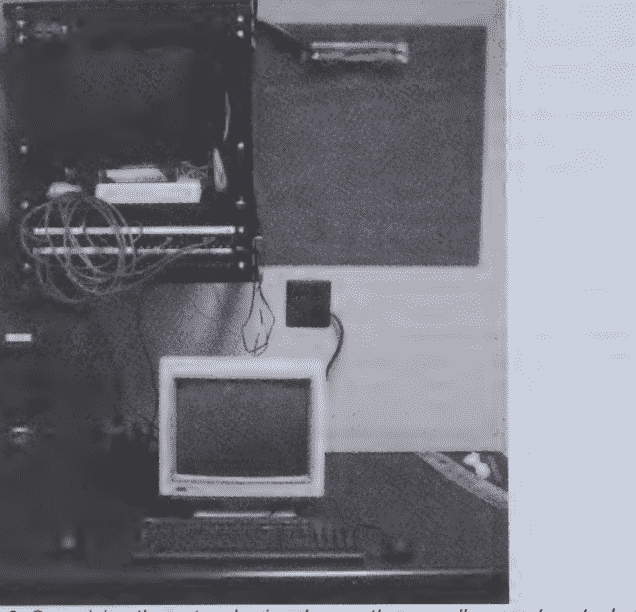

图 6. 整理网络线路可降低整体支持成本，但需要前期规划。

网络分段（Network segmentation）是我们遇到的导致应用程序运行缓慢的第二常见问题。合理的分段可以提供负载均衡，从而使网络中的任何一条线路都不会成为瓶颈。如果所有使用该应用程序的用户都在不断运行从同一集线器或服务器同一网卡上拉取数据的查询，您可能会遇到吞吐量问题。在小型企业中，这种情况很常见，因为网络中只有几个用户，办公室里只有一台配备单块网卡和单个集线器/交换机的服务器。随着企业的成长，他们可能没有考虑到所有用户仍然在使用规模较小时的那套基础设施，或者没有正确添加必要的硬件以确保性能最大化。

高质量的布线也至关重要。首先确保他们使用的是 Cat5（支持 100mbit）或 Cat5E（支持 1000mbit），同时要确保电缆状态良好。我们相信大多数开发人员都遇到过这种情况：某个工作站运行应用程序表现糟糕，而后来发现是由于使用了劣质网络电缆。如果没有遇到过，请认为自己非常幸运。追踪电缆故障可能很困难，但可以通过更换铜线轻松修复。

基于 802.11 标准的较新无线技术非常方便，尤其是对于环境动态、员工使用笔记本电脑且经常走动的企业。一些企业使用无线技术的其他原因包括：办公室空间无法布线、电缆散乱不美观，或者建筑物是历史建筑，房东不允许在墙上打新孔（Geeks and Gurus 的第一个总部就是这种情况）。

这项技术易于部署，但也存在几个担忧。首先是性能。我们发现 11mbit 的速度在开发时就太慢了，如果在生产环境中存在从服务器到客户端工作站的数据传输，那么它是完全不可接受的。经常出现 SQL Server 超时是很常见的，而使用 VFP 数据从服务器拉取索引可能会慢得令人痛苦。目前，基于性能考虑，我们仍然推荐硬接线网络。

关于安全性还有额外的担忧。您可以采取许多措施来保护无线网络，但每有一种安全机制，就有几种入侵方法。这些担忧次于性能问题，但在大多数客户将数据视为竞争优势的情况下，不能忽视这些问题，我们不希望数据通过无线电波暴露。

我们要讨论的最后一个网络问题是服务器。我们需要审查硬件和网络操作系统。我们惊讶于如今服务器硬件是多么便宜。过去，我们看到一些中小型企业在低端硬件上运行也运行得很好，但现在我们可以以极低的额外成本“升级”基础设施并获得更好的性能。当然，每种情况都不同，但我们建议与专注于服务器技术的供应商打交道。


服务器是为性能而设计的，具备冗余和灾难恢复技术。我们也足够现实地意识到，一些小型企业可以在点对点（peer-to-peer）网络上运行，这意味着如果存在“服务器”，它也只是一台标准的工作站级机器。因为 `Visual FoxPro` 解决方案在这种环境下可以工作，且经常被推荐在这种环境下使用，因此您需要准备好处理这种配置。

服务器操作系统会对您部署的解决方案类型产生很大影响。例如，如果客户已有 `Novell Netware` 服务器且不打算更换或增加服务器，我们知道不能推荐基于 `SQL Server` 的解决方案，因为 `SQL Server` 不能在 `Netware` 机器上运行。如果客户想要一个基于 Web 的解决方案，并且需要运行在带有 `Apache` 的 `Linux` 机器上，我们无法在 Web 服务器上部署 `WebConnect` 或 `Visual FoxPro COM` 对象。

另一方面，我们可以在 `Netware` 服务器上部署 `VFP` 数据，并且可以在 `Windows NT 4 Server (WinNT)`、`Windows 2000 Server (Win2K)` 和 `Windows 2003 (Win2K3)` 上部署 `SQL Server`。我们还可以部署一个 `ASP` Web 解决方案，通过使用 Internet 信息服务 (`IIS`) 在 `Windows` 中调用 `Visual FoxPro COM` 对象来访问数据。

了解服务器的现有基础设施并提出升级或购买新服务器的建议，绝对是您希望在项目初期处理的事情，特别是如果您将项目的网络部分分包给另一家公司时。

### 数据库平台

本书是关于部署的，而不是讨论每个数据库平台的优缺点以及确定应用程序最佳平台决策树的。关于选择合适数据库平台流程的书籍和白皮书已经足够多。然而，了解您将使用哪个数据库平台是非常重要的。

### 与其他应用程序和技术的集成

开发人员构建与其它应用程序及 `Windows` 组件集成的解决方案是非常普遍的。许多开发人员已将 `VFP` 与 `Microsoft Office` 应用程序、第三方 `COM` 对象、报表工具（如 `Crystal Reports`）、`Windows 脚本宿主 (WSH)`、电子邮件系统、传真组件、`ActiveX` 控件、`Adobe Acrobat` 技术、图表绘制以及 `Windows API` 集成。

最大的部署挑战在于确保在每个需要集成的工作站上都加载了相应的应用程序或组件。同样，你可能会发现自己需要确认必要的许可证是否已购买，或者是否有购买计划。我们经常与小型企业客户合作，帮他们寻找购买软件的渠道。如果他们不习惯安装软件，我们也可以代劳。

在小型部署中，这是一个简单的任务；但从时间成本的角度来看，在单个大型办公室或多个地点的企业级部署可能会极具挑战性。

第二个最大的挑战是确保安装了正确的版本。许多应用程序在可执行文件中内置了 `Version` 属性。这允许你实例化自动化对象并检查该属性。然后你可以将其与最低要求进行比较，并在出现问题时通知用户。

以下是从 `OFFICEVERSIONCHECK.PRG` 中提取的一个函数（该文件可在章节下载中获得，每个 Microsoft Office 应用程序对应一个函数）：

```foxpro
FUNCTION GetWordVersion(toWord)

LOCAL loWord AS "Word.Application", ;
    lcReturnVal, ;
    llCreated

IF VARTYPE (toWord) # "O" OR TYPE("toWord.Documents") # "O"
    loWord  = CREATEOBJECT("Word.Application")
    llCreated = .T.
ELSE
    * We have passed an instance of Word
    loWord  = toWord
    llCreated = .F.
ENDIF

lcReturnVal = loWord.Build

IF llCreated
    loWord.Quit()
ENDIF

RETURN lcReturnVal
```

`OFFICEVERSIONCHECK.PRG` 中的过程没有捕获“未找到类定义 'name'”（错误 1733）。如果你的错误处理方案未考虑到这种可能性，并且你在程序可能未加载的生产环境中部署此功能，你可能需要添加一项检查。

你还可以访问 `Windows` 注册表以通过完整路径查找程序的所在位置。以下是 `ACROBATVERSIONCHECK.PRG` 程序中的代码：

```foxpro
LOCAL loReg, ;
    lnErrorNum, ;
    lnErrNum, ;
    lcRegFile, ;
    lcAppKey, ;
    lcAppName, ;
    lcVersion, ;
    lnFileVersion

lcRegFile = HOME(2)+"classes\registry.prg"

lcAppKey = SPACE(0)
lcAppName = SPACE(0)

* Check for the existence of the registry class
IF NOT FILE(lcRegFile)
    RETURN .NULL.
ENDIF

* Instance the Registry object
loReg = NEWOBJECT("FileReg", lcRegFile)

* Get Application path and executable
lnErrNum = loReg.GetAppPath("PDF", @lcAppKey, @lcAppName)

IF lnErrNum # 0
    lcVersion = .NULL.
ELSE
    * Remove switches here (i.e., C:\Program Files\Adobe\Acrobat.EXE "My.PDF")
    IF ATC(".EXE", UPPER(lcAppName)) # 0
        lcAppName = ALLTRIM(SUBSTR(lcAppName, 1, ATC(".EXE", UPPER(lcAppName)) + 3))
    ENDIF

    IF ASC(LEFT(lcAppName, 1)) = 34  && check for long file name in quotes
        lcAppName = SUBSTR(lcAppName, 2)
    ENDIF

    DIMENSION laFileVersionInfo[1]
    laFileVersionInfo = SPACE(0)

    lnFileVersion = AGETFILEVERSION(laFileVersionInfo, lcAppName)

    IF lnFileVersion > 0
        lcVersion = laFileVersionInfo[4]
    ELSE
        lcVersion = .NULL.
    ENDIF
ENDIF

RETURN lcVersion
```

如果你还没有与应用程序所需的特定技术进行集成，你需要在应用程序的业务和技术设计阶段开始研究。尽可能早地了解开发和部署中将面临的问题会更好。

例如，如果你的客户要求通过带有 HTML 正文的电子邮件发送附件报表，你需要研究各种 PDF 生成器、现有的或需要安装的电子邮件基础设施，以及如何为邮件生成 HTML 内容。这意味着一个需求就可能让你需要学习三种新技术。

你可以寻找原生生成 PDF 的报表生成器，或者使用其他 PDF 驱动程序与 `VFP` 报表编写器集成，购买多种工具（一个生成 HTML 输出，一个生成电子邮件，一个连接到 SMTP 服务器），并让客户从现有的 AOL 电子邮件账户更换为提供灵活 SMTP 服务的 ISP。你还必须考虑需求的外部影响，确保接收电子邮件的用户安装了 `Acrobat Reader` 以查看报表。

### 互联网连接

应用程序的一两个功能需要某种形式的互联网访问权限是很常见的。无论是像发送错误日志邮件这样简单的功能，还是像从已发布的 Web 服务获取股票报价这样复杂的功能，开发人员发现越来越多的客户希望在解决方案中加入某种 Web 呈现。

首先要解决的是互联网连接问题。让一个关键功能依赖于拨号账户是否有意义？运行应用程序的站点能否从当地电话公司获得 DSL，或者该地区是否有有线电视供应商提供互联网服务？对应用程序的需求是否需要安装 `T1` 线路或更好的线路，当地是否有企业能以合理的价格获得此类带宽？在为客户创建下一个重大的互联网启用功能之前，这些都是你需要询问客户的问题。

此外，还需要考虑上传和下载方面的性能需求。大多数 DSL、电缆调制解调器和卫星天线互联网提供商的上传速度慢于下载速度。如果你的客户需要在其安装环境中运行 Web 服务器以提供对其网站和/或 Web 服务的访问，那么上传速度就变得更加重要。此时，他们的客户将访问其站点并下载内容（这对你的客户来说就是上传）。

当连接中断时会发生什么？你的应用程序是否会因为无法发送电子邮件、无法访问股票报价网站、无法运行最新的底特律红翼队统计报表，或无法呈现最新的海外军队动向而崩溃？冗余方案和备份连接是否至关重要？

对于大多数在基于 LAN 的应用程序中过着简单生活的开发人员来说，这是一个新领域。如果你认为本地文件服务器离线几个小时已经是很糟糕的一天，那么请想象一下：因为你在 `WebConnect` 进程或 Active Server Page 使用的 `COM` 对象中留下了一个 `MessageBox` 函数，导致全世界的用户无法访问公司办公室 Web 服务器提供的数据。

当你的应用程序开始依赖他人的服务时，你就开启了新的故障可能性。当这些服务不可用时，你还承担了额外的支持负担。

支持内部 Web 服务器或电子邮件服务器在宕机时进行修复是一回事，因为我们可以调度支持人员、内部 IT 团队或亲自上手修复服务器。但当我们的应用程序依赖于运行在半个地球之外的另一家公司基础设施上的 Web 服务时，情况就不同了。

当该服务不可用时，灾难恢复计划是什么？在许多情况下，这是一个很难回答的问题。这些问题及相关的答案将决定应用程序的设计。

### 物理办公室布局

正如我们多次提到的，我们是软件开发人员和计算机解决方案提供商。我们不是办公室布局专家、建筑师或室内设计专家。但我们发现自己经常需要建议服务器和计算机位置的布局更改，确定布线的优化方案，以及确定打印机、扫描仪和传真机的最佳摆放位置。

我们还需要确保为订购的新设备留有足够空间。你是否曾经给某人推荐了一台 21 英寸显示器，结果发现它放不进他们现有的办公桌？

在规划应用程序部署时，你是否具备部署 `SQL` 数据库后端的必要知识？你知道如何访问 `Linux` 服务器上的 `MySQL` 数据库吗？在硬件和软件要求方面，为了确保你的应用程序能够在生产环境中访问数据，需要准备什么？在推广解决方案时，你会面临哪些部署问题？

在部署方面，`Visual FoxPro` 数据最初看起来可能是最简单的平台。我们认为它看起来最简单是因为我们使用它最久。毕竟，你可以像复制文件到目录一样简单地部署数据库容器（`DBC`、`DCT`、`DCX`）和表。这可以通过 CD、软盘、从另一个网络位置下载，甚至从互联网下载来完成。

开发人员遇到的最大困难是相对路径问题。首先，生产环境中的表相对于数据库文件的路径必须与开发环境一致。这就是为什么开发人员通常将 `DBC` 文件与表放在同一个目录中。

第二个问题是数据库文件相对于可执行文件的路径必须一致，最重要的是，带有数据环境的窗体和报表需要处于相同的相对路径。为什么？答案是游标的 `Database` 属性包含指向 `DBC` 的相对路径。

许多开发人员通过使用框架或开发自己的解决方案来避免此问题，将每个游标的 `Database` 属性更改为数据库文件的当前位置。这是一个简化 `Visual FoxPro` 数据部署的通用解决方案。

像 `SQL Server`、`Oracle`、`DB2`、`SQLAnywhere`、`Sybase`、`Ingres`、`Informix` 和 `MySQL` 这样的 SQL 后端数据库则有其自身的部署因素。最大的问题是安全性和连接性。

你是打算通过远程视图访问它们吗？如果是这样，你将遇到与前一段讨论的 `Visual FoxPro` 数据库容器文件 (`DBC`) 相同的相对路径问题以及窗体路径问题。

你的应用程序是否需要连接后端数据的机制？这将是在应用程序中通过编程处理，还是采用 `ODBC` 数据源方案？客户目前运行的是哪个版本的数据库？该版本是否足够支持你的应用程序？客户是否需要购买适当的许可证来运行该程序？客户能处理多少数据库管理工作（安全、备份等），而你需要接管多少？

如你所见，我们提出了许多需要回答的问题。在部署 SQL 后端时，你可能会面临与本地 `Visual FoxPro` 数据不同的挑战，这些都需要考虑。此外，部署 SQL 后端时，可能还需要考虑不同的硬件和服务器要求（请参阅本章前面的“网络”部分）。

## 部署 Visual FoxPro 解决方案

### 需要订购新设备

硬件清单和对需求的完整理解将帮助您确定客户是否拥有正确数量的机器和所需的外设。如果不是，您需要确保提供采购建议。

有些客户会自行订购。许多客户拥有内部 IT 部门，并设有标准程序、首选供应商名单和一致的办公环境。这些客户自行处理采购。

在这种情况下，我们倾向于验证订单是否完整，并了解预计交付时间。这能确保在应用程序就绪时，我们拥有部署所需的硬件，同时也向客户证明我们掌控了项目的方方面面。

大多数客户不想参与硬件订购，希望供应商能提供帮助。我们向客户提供这些服务，并且通常同时部署硬件和定制软件解决方案。

我们知道这个过程非常耗时，在职业生涯早期，我们经常在为固定价格合同定价时忘记将这段时间考虑在内。您可能会发现，有些客户并不期望为建议和指导，或者您在订购新设备上花费的时间付费。

您知道设置一台新机器需要多长时间吗？毕竟，新机器附带颜色编码的图文说明，简单到几乎像猴子都能把它组装起来，对吧？

从拆箱到将显示器连接到处理器单元并将其插入电涌保护器，到扔掉所有包装盒，可能需要 15 到 30 分钟。那么，完成操作系统安装和注册、注册并激活所有预装软件、配置网络设置、加载打印机驱动程序、确保传真软件正常工作、连接到互联网，然后将所有数据从旧机器迁移过来的时间又需要多久？

在估算您在订购设备和部署硬件上将花费的时间时，请记住这一点。

### 处理意外情况

我们在本节中能提供的唯一细节是：您必须处理一些意外情况。每个项目都会有那么几个“糟糕”时刻——比如某些东西被遗忘了，某个细节客户没有提到，或者开发人员没有按时交付。

处理“糟糕”时刻的关键在于它是如何被处理的。专业精神是成功的关键。我们喜欢在初次会面时就提前告知客户，肯定会有事情出错，而我们完全打算朝着互利的解决方案努力。

我们发现，承认自己会犯错表明我们也只是凡人，能为业务关系带来一种不寻常的诚实。当问题发生时，我们意识到立即将问题沟通给客户，比拖延并任由问题扩大要好。与任何现实世界的问题一样，在提出问题的同时提供一个潜在的解决方案，通常能带来更好的结果。

## 客户

客户的形式和规模各异。无论您是与业务客户、其他开发人员合作的独立顾问，还是为另一位开发人员的客户承接分包工作，或者是在公司计算部门内部工作并为公司内部人员开发解决方案的企业开发人员，你们都有客户。

与客户打交道往往比开发您部署的软件更困难。学习与客户合作通常需要（或使您有资格获得）一个心理学证书。事实依然是，这种人际互动是您所从事项目的开发和部署环节中至关重要的一部分。

### 与客户打交道

本节讨论一些能够与客户产生积极且盈利互动的技巧。如果没有良好的客户互动基础，部署可能永远不会发生，或者过程极其艰难。

#### 首次会议

首次会议是您留下至关重要的第一印象的地方。它是之后所有事情的基础。您只有一次机会在首次会议上留下最好的印象。没有压力，对吧？

尽量了解会议的参与者。这需要询问主联系人您在首次会议上预期会见到谁。记住相关人员的名字。会是 CEO、首席管理员、财务总监、计算机部门负责人，还是最终用户？

了解谁在场有助于您准备会议，帮助您确定议程以及您需要为演示准备的内容。了解潜在客户的期望在这方面也会有所帮助。

如果会议对象是法律团队，带着产品线演示出现可能不如带着标准合同、准备好讨论条款并了解可谈判领域那样有用。另一方面，如果项目发起人和主要决策者想看看您能提供什么，那么通过幻灯片演示您的垂直市场应用程序则可能是恰当的。

对于这些会议，您可能想随身携带营销手册和演示副本，以便稍后加载到他们的计算机上。

几个月前，我前往一个潜在客户处，准备讨论我们公司的业务。我们坐在这家制造厂的会议室里。我是由一位开发同行推荐给这位客户的。虽然我预期要进行销售演示，但他出现时带着五个文件夹，每个文件夹里都有他希望我负责的前五个项目的规格说明。基于推荐，他已经被说服了。我本可以准备得更充分，但尽管存在误解，会议还是进行得很顺利。

根据场合着装非常重要。形象和专业精神就是一切。了解您客户的工作环境。他们是商务休闲（Dockers 裤/纽扣衬衫）、极简休闲（破洞 T 恤和牛仔裤），还是正式商务装（西装领带、裙装和衬衫）？

按照客户的着装规范穿着可以消除任何可能的不适情况。我永远不会忘记一次会议，当时我的客户威胁要剪掉我的领带。我在 `EDS` 工作时，有严格的西装领带着装规范。我的客户是通用汽车（`GM`）金融子公司的企业副总裁。

当时的 `GM` 采用商务休闲风，我的客户觉得我们在他们的环境中戴领带具有威慑力。在我们的组织最终改为商务休闲装之前，每次见面时我都会把领带松开，这样我们就化解了这个问题。首次会议是最困难的，因为您需要询问着装规范是什么。

给潜在客户留下深刻印象最简单的方法之一就是能力和沉着。您可以通过多种方式实现这一点。首先，您可以为客户提供公司营销资料。这可以在初次会议之前轻松提供。

展示您在软件开发方面的核心竞争力可以通过列出您在解决方案中使用的项目、业务线、客户和技术来实现。突出那些与他们想要解决的问题密切相关的项目。

例如，如果您知道他们的问题之一是需要迁移到基于 Web 的解决方案，请注明您部署过哪些使用 Web 解决方案的项目和技术。如果您能向他们展示您在该主题上撰写的白皮书、文章或书籍，也会有所帮助。由于某种原因，这能让您立即获得可信度。

如果您能将他们引导至您的网页版简历、履历或推荐信，也会有帮助。这适用于企业开发人员和独立开发人员。


首次会议的一个关键是找出该项目是否有竞争对手。了解这一点有助于您调整演示方向，展示您比竞争对手优秀多少。您可能会发现自己经常与相同的开发人员或公司竞争。了解让自己在竞争对手面前处于更有利地位的优势，会让客户选择您的决定变得更加容易。

在规格/需求和测试方面为客户“指明方向”。让他们知道您对他们参与此过程的期望。在销售会议后，跟进提供推荐的人以及您会面的人员。这表明您感兴趣。这向客户表明您在乎，并且认真地希望在项目中与他们合作。这也表明您重视良好且频繁的沟通，而这正是领导成功项目的关键环节之一。与推荐人跟进也是好事，这样做可能会在未来带来另一个推荐机会。

### 通用概念

一旦您完成了首次会议并向客户证明您/您的团队是该项目的合适人选，您就需要培养这种关系。我们并不总是对每个客户实施所有这些想法，但在与客户共同推进的过程中，这应该能为您提供一个良好的起点。

所有成功的关系，无论是商业还是个人，都应基于相互尊重和信任。这是自然而然的。如果您不尊重您的客户，很可能无法进行公开沟通。我们为很多人工作过，包括老板和客户。我们可以毫不犹豫地说，我们最喜欢共事的人是我们尊重并且意识到可以信任的人。不符合这个标准的工作是我们最恐惧且发现最麻烦的。

沟通立方！沟通，沟通，沟通！公开、诚实且频繁的沟通可以在许多问题发生之前就将其消除，并且通常能更快地解决已经发生的问题。这又是另一个自然的概念，但出于某种原因，它似乎总是会重新潜入到我们的项目中。我们觉得奇怪的是，今天我们拥有比以往任何时候都多的方式与他人沟通，但我们沟通起来却很困难。您有夹在腰带上几乎随处可用电话、邮政服务、隔夜快递、几秒钟内即可传遍全球的电子邮件、戴在手腕上的手表传呼机、对讲机、互联网视频会议，甚至还有传真机。在拥有所有这些技术的情况下，为什么很大一部分项目相关问题可以归结为沟通问题？这太令人惊讶了。

我们要做的第一件事就是找到“管钱的人”。我们建议您向会计部门/人员以及授权您付款的人（在许多情况下是您的主联系人）自我介绍。无论这是否是一个内部转账

无论是部门之间的资金调拨，还是实际支付给发票的款项，你都要确保即将为你付款的人知道你是谁。提前处理好这件事，总比第一次发票付款逾期时再去处理要好。另一个关键是了解付款周期。多年来我们遇到过不少拥有神秘会计惯例的组织，它们的会计软件只在每个月的特定日期打印支票。我们知道这只是公司为了更长时间持有资金而采取的创造性会计手段，因此我们会提前了解这一点，以便安排我们的发票在最佳的付款处理时间提交。

利益相关者/拥护者/项目负责人非常重要。他们是真正希望项目取得巨大成功的人。通常他们会利用这个项目作为职业发展的助推器，或者项目的完成与否关系到一大笔财务奖金。当需要推动项目前进或克服沿途障碍时，他们是关键联系人。确保与这些人建立稳固且积极的工作关系。

了解组织架构图总是有好处的。知道利益相关者的上司、支付你发票的会计人员的上司、IT部门负责人，以及最终用户如何融入整体架构，在你与不同人员打交道时可能会有所帮助。当你开始收集需求并编写规格说明时，认识合适的人会让部署过程更加顺利。

有一些基本准则，例如遵循黄金法则（己所不欲，勿施于人），在商界同样适用。务必遵循客户的意愿，并始终将他们的目标视为你的目标。如果你不帮助他们实现目标，很快就会被打发走。这里的关键是了解目标是什么，并制定计划来实现它们。

了解办公室政治也会让你的生活轻松很多。在大型组织中，政治几乎是必然存在的，而且你在各类组织中都有很大概率会遇到。了解办公室政治的方方面面，可以让你在与个人打交道时不至于绊倒自己。在这方面，我们可以举一个例子，那就是偏袒的观感。我们经常在需求阶段发现，有些人认为别人的功能比他们自己的想法受到了更多关注。作为开发者，我们知道所有功能都很重要，而且存在优先级之分，我们通常一次只专注于一个功能，Hopefully按照优先顺序进行。一些用户可能会产生开发者在办公室里偏袒某些人的态度，这可能会引发问题。最坏的情况是，那些等待开发者最终处理他们功能的人，在需要收集他们的需求时不予配合。

最后，我们经常需要向客户传授定制软件开发流程的知识。我们的许多新客户从未经历过定制软件开发流程。他们需要明白，你不是去当地软件商店，从货架上买下一个软件包，然后在规格说明获批后的第二天就安装好。他们需要理解需求分析、开发、测试、安装和技术支持等概念。他们需要了解每一步都需要时间，你需要为后续步骤设定预期。这样做都属于“沟通立方”（Communications Cubed）思维理念的一部分。

### 与主题专家合作

你知道开发者经常从该领域的主题专家（SME）那里收集需求。主题专家在其行业或公司拥有独特的经验和专业知识，涵盖技术、功能和/或流程领域。他们应用最佳行业实践和标准、当前技术以及创造性解决方案来应对所面临的挑战性问题。主题专家是那些超级用户，他们理解需求、业务流程和日常运营。他们可以告诉你计算运费的确切步骤和公式、汽车贷款利息的计算方式、为病人办理住院登记的步骤、评估人员时需要收集的信息、何时向最近购买的客户发送感谢信、何时记录预订，以及接受哪些信用卡。

这些人应该为应用程序确定基本需求。在我们的职业生涯中，我们与各种类型的主题专家合作过。他们可能是负责运营副总裁、会计经理或审计长、部门主管、在公司工作时间最长并经历过多个职位的员工，有时甚至是CEO（通常是在非常小的公司）。我们发现，久而久之，长期在一个行业工作的软件开发者往往会成为主题专家。

我们发现，与主题专家共度时光通常可以缩短需求阶段的时间。当然，有许多因素促成了成功的部署，但决定成功部署的最强因素之一是应用程序对业务问题的建模程度。希望主题专家能够成为获取恰当需求的关键参与者。一旦需求被记录下来，确保主题专家评审文档并确认其正确性。跳过这一阶段的审查将对部署产生负面影响。

在与用户收集需求时，我们有一条规则：我们会让需求收集会议持续不超过4小时（包括休息时间）。根据我们的经验，超过前四个小时后，你开始看到时间投入的负面回报。

为主题专家确立角色和职责也很重要。我们希望告知他们，在开发周期中需要他们回答项目负责人提出的问题，提供初始需求收集中未收集到的额外细节，能够评审正在进行的开发工作，并在应用程序或组件就绪时提供客户验收测试。与主题专家合作的关键是沟通。我们发现与项目中的所有各方保持开放和定期的沟通，会带来更好的解决方案。

### 与真正的最终用户交谈

我们在软件开发周期中经常忽视的一点是纳入真正的用户——那些工作在一线、每天将使用软件的人。根据我们的经验，这些人通常与主题专家不是同一批人，但也可能是。

他们是文员、数据录入员、下订单的销售人员、在生产车间更新库存的装配工、在前台登记访客进出的保安、给逾期客户打电话的催收员、输入最新泵测试数据的消防员、更新牙医日程的行政助理、填写投诉报告的警察，或者更新篮球运动员昨晚比赛投篮数据的统计员。

我们发现，与这些人共度时光是你收集业务流程细枝末节的地方。在这里你会发现你的用户界面是一种阻碍，而不是流畅高效的。真正的用户会告诉你如何做得更好，如何让他们的痛苦消失。主题专家可能在宏观和愿景决策方面非常出色，而真正的用户提供更详细的流程，并指出生产力方面的不足。

真正的用户在更新现有软件或重写应用程序时尤其有帮助。他们已经非常了解自己埋头苦干的数据录入功能。他们也知道现有软件包的漏洞在哪里，不喜欢哪些方面。掌握他们对当前环境的喜好和厌恶对你的成功至关重要。我们曾经为一个服务型公司的销售团队编写过一个应用程序的规格说明。他们接收到大量老客户的重复业务来电。他们基本上在一分钟内完成订单，然后安排工作。如果我们编写的订单表单花费了更多时间，那么我们就未能完全满足需求。另一方面，主题专家可能会详细说明需要从客户那里收集的所有项目，并提供计算服务调度的算法。

为最终用户确立角色和职责也很重要。我们希望告知他们，在开发周期中需要他们回答项目负责人提出的问题，提供初始需求收集中未收集到的额外细节，能够评审正在进行的开发工作，并在应用程序或组件就绪时提供客户验收测试。在实践中，我们发现如果最终用户与主题专家不是同一批人，我们与最终用户的沟通要少于与主题专家的沟通。

### 应对那些“特殊案例”客户

你很可能遇到过“特殊案例”客户。这些客户可以被归类为高维护型，需要特别关照，或者更可能需要额外的关注。我们发现这类客户通常会给我们带来麻烦，我们会花费大量不可计费的时间来安抚他们的需求、抱怨和特殊愿望。你必须确定自己在处理每个个案时的痛苦阈值。有时当客户值得付出额外努力时，你会迁就他们。有时你最好告诉客户他们需要更换与你合作的人，或者找另一位开发者来处理他们的计算需求。

有一位我们称之为“Jennifer”的人，是我最喜欢的特殊案例客户。她在这家公司工作了将近30年，每天都希望收到她的退休庆典邀请。在好的日子里，你可以期待她的上司——一家大型制造公司的信息技术（IT）经理——给我们组织的总裁打电话，倾诉她的问题。想象一下，一位薪酬丰厚的IT经理在处理琐碎的问题，而我们公司的总裁还要花时间向他保证我们的员工确实在努力完成当前项目的最新功能，这一切都是因为Jennifer被激怒了——因为一个开发者破坏了字段验证，或者有几个标签偏移了一两个像素。她经常把一个小问题放大，确保客户IT部门的每个人都知道这个问题，以及我们开发人员有多愚蠢。在不好的日子里，她会打电话给开发人员寻求技术支持，问一个不完整的问题，然后因为你不得不提问澄清问题而对你大喊大叫。我们不止一位员工在电话中甚至面对面会议中被骂无能。尽管你很想礼貌地告诉这个人去干点正事，但你知道任何时候你让她不高兴，你都在冒着失去一个每年支付超过一百万美元开发和支持费用的账户的风险，而且你的工作是依赖她的满意度的。

“凯利”是一家小机构（总共三人）的行政助理。我们向该机构提供的服务之一是更新防病毒软件、检查间谍软件、整理硬盘碎片、诊断宽带性能问题以及更新软件。这项常规维护是按计划定期执行的。凯利知道我们在特定时间过来，也知道我们在访问期间需要短暂控制她的电脑。大多数时候，我们要么打断她的纸牌游戏，要么打断她与工作无关的网页浏览，而且当我们打断她时，她会非常不高兴。在我们的维护期间，她会打电话与人谈论私人事务，而非工作事务。在短短停留期间，她会多次问我们是否可以先让她继续处理她的重要工作。

我们确信在这个话题上我们可以聊上几个小时。有些客户从不打电话或投诉，但当你查看错误日志时，会发现有几十个问题其实只是简单的错误修复，但客户却以为是自己造成的。有些客户只在发票有问题时才会打电话投诉（通常是发票金额太大，尽管你免费记录了大量工时，明知道他们不会领情）。有些客户你还得第一千零一次地教他们如何运行发票周期，尽管这在你以正常费率十分之一的价格为他们汇编的帮助文件中已经写得清清楚楚。你们都有这样的客户，而且都得对付他们。俗话说，如果他们弄不死我们，我们的品格就会更加坚强。

至于这些客户的部署问题，我们发现解决他们的热点问题非常重要。了解他们的优缺点，并利用这些知识来平滑部署过程。以詹妮弗为例，她总是对标签的像素对齐大惊小怪，我们决定在构建用户界面时格外小心，并确保质量保证团队一旦发现这方面的问题就对开发人员严加要求。通过减少他们发现的问题，你可以让“特殊客户”无计可施，而这是让他们不再成为部署过程中绊脚石的最佳方式。

## 准备工作

在软件开发周期之前和期间，需要处理若干事项，以简化安装和安装后阶段。

### 图像

使用多张图像可以让应用程序看起来更加精致。我们通常将这些留到最后（或接近最后）处理，因为开发的大部分精力应该用于解决业务问题。如果你要聘请图形艺术家来提供专业化修饰，则需要更早开始这一流程。最明显的图像包括应用程序图标（记住16x16和32x32[16色和256色]源图）、启动画面、关于窗口以及向导图像。

有许多来源可以购买图像。我们通常使用图标（ICO）和JPEG（`.JPG`）。我们喜欢JPEG胜过位图有两个原因。首先是图像的大小：JPEG是压缩的，而位图非常庞大。我们需要透明效果时使用GIF文件。另一个喜欢JPEG和GIF文件的原因是它们可以直接用于网页，因此这些图像可以在网站或应用程序数据的Web界面中重复使用。购买图像的关键是拥有许可或分发权。如果你想自己创建，市面上有很多图像编辑器。我们偶尔还会使用VFP 3.0附带的`ImgEDIT.EXE`来创建图标。去年我们发现了一个名为Icon Studio的免费工具（参见图7，有关此工具的更多信息请参见“附录E：第三方工具”）。

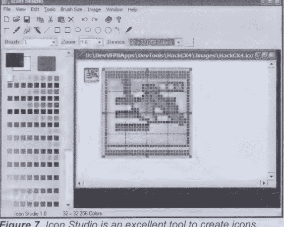

**图7.** Icon Studio是创建图标的出色工具。

我喜欢Icon Studio胜过ImgEdit的原因是它支持32x32的256色，这是Windows XP中使用的图标质量。各种FoxPro论坛上经常被推荐的另一个图标编辑器是来自Eclipsit的Microangelo（图8）（`www.microangelo.us/`）。Microsoft图像编辑器（随多个Microsoft软件包包括Visual Studio一起提供）对JPEG和GIF的处理效果不错，但我们很少创建这些图像，主要用它来格式转换、微调我们有权的图像，或清理我们拍摄的照片。最受推荐的图像编辑器（图9）可能是Jasc Software的Paint Shop Pro（`www.jasc.com`）、Adobe的Photoshop（`www.adobe.com`）、Microsoft Digital Image Pro（`www.microsoft.com`）以及Corel的Corel Draw（`www.corel.com`）。

## 部署 Visual FoxPro 解决方案

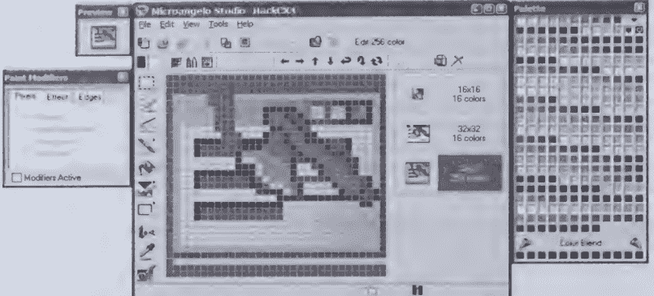

**图8.** Microangelo受到Visual FoxPro开发人员的强烈推荐。

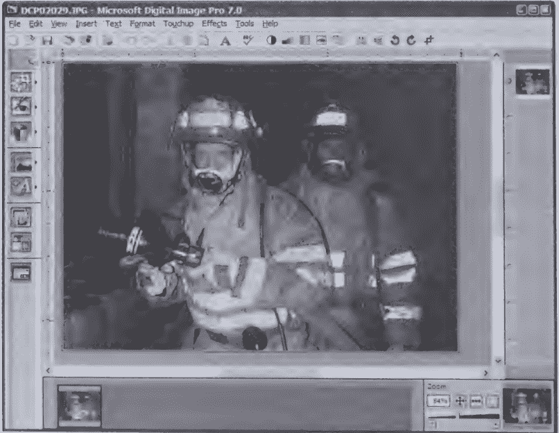

**图9.** 图像编辑器允许你裁剪图像、修复瑕疵、调整对比度、改变颜色并添加一些特效。

### EXE版本详细信息

Visual FoxPro 5.0的发布引入了内部EXE版本信息。版本信息包括应用程序版本号、注释文本、公司名称、文件描述、法律版权和商标、产品名称以及语言ID。这些信息通过EXE版本对话框（图10）输入，或通过新引入的项目对象版本属性（在Visual FoxPro 6中引入）。我们在可执行文件中包含的最少属性是版本号、公司、版权和产品名称。

这些信息通过Visual FoxPro中的`AGETFILEVERSION()`函数访问。如果你使用的是VFP 5.0，则需要使用`FOXTOOLS.FLL`中包含的`GetFileVersion()`方法。

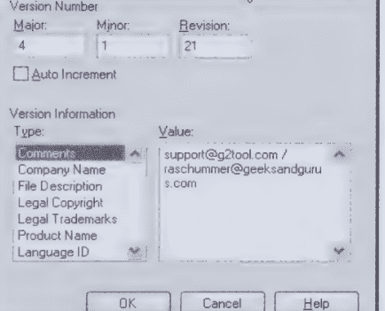

**图10.** EXE版本对话框。

你可能会问，为什么在准备部署应用程序时要关心版本号。我们认为这很重要，因为我们希望向客户传达版本号在错误报告中的重要性，并公布每个版本中包含的所有功能以及错误修复。根据迭代周期，在测试阶段我们可能一周会发布多个构建版本。

### 最终用户的培训材料

对于广泛发布的应用程序、垂直市场应用程序，甚至少数几人使用的小型定制应用程序，可能都需要培训材料。这些材料可能包括培训师使用的脚本、学员的工作手册、课程幻灯片、应用程序的示例数据、演示示例以及实验示例。

我们过去合作的许多客户自己编写和开发其应用程序的培训材料。我们喜欢这个概念，因为这让他们对流程有归属感。这为客户节省了资金，也让开发团队能够专注于他们最擅长的工作。我们还发现客户可以包含业务知识来回答培训期间通常会被问到的“为什么”问题。

我们还将培训视为一个创收机会。需要培训并愿意为培训付费的客户为我们提供了额外的工作。我们可以协商为最终用户提供培训或培训师培训。

规划的一个关键是确保培训材料及时交付。这不是你想等到最后一刻才开始的事情。培训材料可以在某个功能的需求完成后立即开始。屏幕截图则要等到界面开发完成后才能获取。现实情况是，培训材料将以“即时”模式开发，通常在接受测试开始时进行。

### 支持人员的培训材料

不是每家公司都有专门的技术支持人员，但所有应用程序都会以某种形式获得支持——要么由编写应用程序的人支持，要么由其他开发人员、你的支持人员，或者可能是公司内部信息系统人员支持。

最容易跟踪的是常见问题（FAQs）列表。这使开发人员或技术支持人员能够快速了解从客户处处理的最常见问题。这个问题列表在测试期间形成，并在应用程序投入生产后不断补充。这个列表可以包含在用户文档中、`README.TXT`文件中或支持网站上。像微软这样的大公司创建了基于其编写的各种应用程序相关问题的白皮书知识库。谁说即使是一人工作室不能利用这些概念呢？

### 复制

软件准备好发货后，你需要采用一种机制将其送达部署地点。你会让用户从公司网站下载安装程序吗？还是会烧制一套CD-ROM，通过邮政服务或众多隔夜快递之一寄送？

互联网的引入和广泛接受已经消除了一些软件部署中媒体复制的需求。如果你打算通过网站分发，可以跳过这一细节。

CD刻录机准备好了吗？现在它们非常便宜，没有理由不准备一台。如果你要进行大规模安装，它们能节省时间。如果你没有CD刻录机或需要大规模分发（超过100张CD可能值得外包），有服务提供商可以复制CD。使用CD标签制作机可以为分发增添最后的精致感。如果你不外包流程，请确保手头有足够的介质来刻录安装。有关分发机制的更多详细信息，请参见第3章“打包安装程序”。

### 用户沟通

我们的经验证明，我们为其开发应用程序的客户/顾客通常不是最终使用产品的人。向实际用户群保持信息流通，让他们了解即将发布的版本，这一点非常重要。

沟通可以让他们安排培训、安装设备、开具支票支付软件费用，以及为表彰你让生活变得轻松而安排游行。

在商业领域，确实如此，准备工作可能非常繁琐，包括准备营销材料、更改办公流程以及更新网站等。确保你正在与用户社区进行沟通，无论是直接沟通还是通过你的客户联系人。务必跟踪电子邮件、电话，并在需要时协调可能的现场访问。

## 确定发布就绪状态

**发布是一项功能！**我们如何设定验收标准来确定某个版本何时可以实施？首先，你需要与客户就所要实现的需求和功能集达成一致。然后，你需要根据这些需求开发应用程序并进行测试。有时，未来的某个特定日期对业务至关重要，需要纳入考虑。

### 需求


我们不想用初始客户会议之后的所有细枝末节来烦你，但根据我们的经验，归根结底有两种不同的场景。第一种是我们称之为“文档化方法”；另一种是“高压锅方法”。我们相当确定你也经历过其他方法，但归根结底，它们都可以归入这两种分类之一，或是两者的混合。“文档化方法”是指你在收集需求时撰写某种形式的功能规格说明（也称为需求文档），和/或包含原型。开发人员能够对项目或项目的范围有相当清晰的了解。基于需求创建估算（通常过于乐观），并完成一个大致的成本估算（按小时或固定价格）。

第二种方法是“高压锅方法”。这种方法也被称为“从需求到发布的方法”。这是指客户昨天就需要这个东西，或者更可能是一个月前就需要。导致这种情况的原因有很多。客户可能面临全新的竞争压力。他们可能看到一个具有合法短暂窗口期的全新机会。他们之前的开发人员可能为了换换环境或开展新事业而搬到了另一个大陆。根据我们的经验，以上都不是，更可能是有个“尖头发的老板”因为担心预算影响他的季度奖金而拖延了项目，然后在最后一刻告诉软件开发人员该开始赶工了。无论原因是什么，你都处于风口浪尖，必须尽快将某些东西投入生产。是时候换上你选择的超级英雄服装，以世界纪录的时间交付软件了。这种场景在全球各地的软件公司中反复上演。永远不会有超过一个月的估算，因为这就是应用程序的截止日期。通常你会让应用程序的第一个版本运行起来，移至生产环境，然后才能退后一步，对其余系统采取“文档化方法”。我们至少还希望在第二阶段有机会采用“文档化方法”。有时，项目在各个阶段都处于“高压锅”状态。

我们再怎么强调书面规格说明对项目成功的重要性都不为过。与普遍看法相反，“餐巾纸背面的规格说明”并不能可靠地转化为软件。请将午餐或晚餐时匆匆记下的餐巾纸笔记用于撰写真正的规格说明。规格说明必须以某种形式写下来，并且该形式需要在公司所有项目中保持一致。这使得开发人员能够从一项工作转移到另一项工作，并随着公司的发展，让新开发人员更容易融入公司。如果没有某种规格说明，就无法证明最终产品完成了既定目标。这也有助于接手现有项目的开发人员了解产品的设计工作方式。我们发现很少有客户会逐字阅读功能规格说明，但它给了我们一个可以引用的地方，当他们在测试应用程序时，让他们从我们的视角来了解他们的业务。

作为开发人员，你有责任确定真正的需求以及“锦上添花”的功能。我们观察到，随着时间推移，越来越多的项目受到“高压锅方法”的影响。这可能与我们的互联网时代生活节奏有关。可能是人们缺乏规划能力。可能是你每次开发都有所进步，而客户对你的服务期望越来越高。无论原因是什么，我们的经验一次又一次地证明，“高压锅方法”失败多于成功。生活中一个不争的事实是，设计应用程序需要时间，但这是值得花费的时间。许多客户不想进行这项投入，这是一个我们不愿让他们犯下的错误。

> “只要水面冻结、需求冻结，我就能在水上行走，按时交付满足所有规格说明要求的应用程序。”

### 功能集

一旦收集到需求，就必须对其进行审查并组织成“功能集”。这是一组需要一起实现的需求。功能集通常是与产品发布相关的最关键路径问题。客户需要清楚地说明在此版本应用程序中需要什么。这些功能通常由业务驱动。它们通常围绕用户正在经历的某些“痛点”。这种痛点通常会导致这样的说法：“我需要跟踪这些什么玩意儿，控制成本，而且必须在月底前实现”，因此确保他们明白“交付日期实际上是一项功能”。

这就是开发人员和客户之间协商的开始。哪些功能可以在什么日期前交付？所有需求必须同时交付吗？某些功能可以先交付吗？其他功能可以等到 1.1、1.2、2.0、7.0 版本吗？（“总是跳过版本号，这样以后可以让新手开发人员去找它们。”）下一个发布的版本中包含的每个功能集应尽可能在开发周期的早期确定。开发中总会存在范围蔓延，因此如果需要，留出余地以便稍后协商延长时限。我们发现，在这些情况下，当我们让客户决定从发布中去掉什么，以便为项目日程中的新热门功能腾出空间时，我们取得了成功。如果客户必须全部都要（什么时候不是这种情况呢？），发布日期就不得不推迟到未来的某个日期。如果日期不能推迟，那么希望你事先已协商好奖金条款，以涵盖你（以及可能的团队）在正常工作时间之外需要投入的额外时间。

### 原型

在开发过程中开发应用程序的原型，可以让客户看到他们期望的功能转化为可工作的应用程序。同时，我们编写了开发人员工具，可以对原型进行逆向工程以开发功能规格说明。这些工具扫描表单、报表、菜单、类定义，并将信息快速格式化后转储到文字处理器中。这些文本随后由宏进行格式化，使客户和开发团队能够阅读。在这里那里添加一些业务规则，“瞧”，编写功能规格说明不再像过去那样痛苦了。这也为你的团队节省了时间，让你能够专注于开发的“有趣”部分。

## 让客户为测试做好准备

我们在本书的其他章节讨论了各种类型的测试。测试规划是另一个需要讨论的方面。我们经常发现，刚接触定制应用的客户从不考虑他们测试应用程序所需的时间和精力。

为了展示客户喜欢如何测试，我们认为一个小故事能够说明用户对我们应用程序测试的极端缺乏兴趣。2002年底和2003年初，Geeks and Giru 受雇于一位开发人员，将一套垂直市场应用程序从 VFP 数据库和表转换为 SQL Server 数据库。原始应用程序从一开始就设计为可以迁移到 SQL Server 后端，但仍需要大量更改，而且这套应用程序功能丰富。原始应用程序没有测试计划，转换的唯一要求是在不增加额外功能的情况下移植应用程序。转换工作耗时数月，开发人员公司的员工花了“一个多月”的时间进行测试以确保我们做得正确。我们演示了产品，最终用户准备将其部署到生产环境。我们指出，在完全部署用于生产之前，需要在生产环境中以 beta 模式进行完整的系统测试。我们估计测试可能需要“一个多月”，但知道用户压力可能会将其压缩到两周。

最终用户对我们的估计感到震惊。beta 测试三天后，他们宣布准备实施。在如此短的时间内交付的错误日志记录了几个 minor 问题和预期中的一些重大问题，绝没有达到生产就绪。我们在 beta 期间通过指出几个客户未报告的主要功能错误修复，设法控制了他们的热情。错误日志显示了一些我们认为是“showstopper”的问题，但他们打算在生产环境中忍受。让他们回归现实的一个 bug 是 Word 自动化程序期间的 OLE 错误。Word 因 NULL 值而崩溃，导致某些信件无法打印。幸运的是，我们在两周后将应用程序部署到生产环境，自部署以来只需要修复了一些 minor 错误。

提前设定用户期望可以减少“推向生产”的压力，或者至少建立一些期望，即开发阶段的完成并不意味着应用程序已经可以投入使用。根据预期部署的功能集大小，你的经验将有助于确定在将应用程序安装到生产环境之前需要多少测试。

## 交付日期

大多数软件开发项目都由交付日期驱动。有多少个认真的 Y2K 项目的交付要求是 2002 年 12 月 31 日？有真正的业务规则驱动着交付日期。我们从未有客户说：“我没有需要的截止日期，所以五天后完成这个系统没问题。”通常是这样的：“我需要尽快（ASAP）完成这个，”或者“我上周就需要这个了。”我们总是提醒客户，唯一可接受的日期是未来的日期，以及在他们应用程序中验证有效的日期。例如，“ASAP”无法输入到日期字段中。我们还指出初始日期是目标日期，并非不可更改。目标日期是一种让开发团队集中精力完成项目的方式。目标日期还用于管理产品交付的范围。


*图 11. 开发权衡三角形*

通常，客户希望决定所有用于确定何时可以发布的所有因素。一种方法是使用三个因素（图 11）：功能、时间（也转化为金钱）和交付日期。软件开发人员可以让客户先选择并确定其中两个因素，然后计算或确定第三个因素。例如，如果客户决定需要在未来两周内交付五十个功能，开发人员有权收取大量费用，因为他们必须支付多名开发人员在项目上加班。如果客户预算有限且需要在下个月交付，开发人员则可以限制将部署的功能数量。

## 签收（Sign-on）

签收应由开发人员、质量保证团队和客户共同完成。签收是各团队的一项承诺，证明他们已经测试了应用程序，且该程序符合所述的需求和目标。

## 结论

规划在项目开始时需要时间，在项目期间需要精炼，在项目结束时需要审查，以便为下一次迭代和下一个项目做出改进。创建检查清单和开发流程将使你成为一名更高效的项目经理，并在任何解决方案部署期间像英雄一样出色。希望本章在你准备启动新项目或在今后增强你的检查清单和流程时能为你提供一些启发。

本章的更新和修正可以在 Hentzenwerke Publishing 的网站 [www.hentzenwerke.com](http://www.hentzenwerke.com) 上找到。点击“Catalog”并导航到本书的页面。

## 第三章：打包安装程序

创建一个专业的安装包与创建一个无缺陷的软件产品同样重要。这是终端用户在首次将你的产品安装到计算机时产生的第一印象。创建专业的安装包需要准备和规划。

从项目开始就进行周密的规划，能够使你的解决方案部署顺利进行。在软件工程周期的开发和测试阶段与客户保持不断的沟通，可以提高客户的预期，建立起你的产品将满足或超过其需求的信任，并增加对产品交付的期待。随着开发的接近尾声，客户准备进行验收测试，开发人员需要专注于打包安装设置所需的工作。

有许多问题需要回答，例如：什么时候准备好发货？需要向客户发送什么？需要打包哪些功能和部署方案？需要向客户发送哪些实用工具以便日后更轻松地提供支持？以及安装包将如何发送给客户。本章试图解决其中的每一个问题。

## 何时准备就绪？

关于产品何时完成并准备好部署，有三个视角：工程观点、质量保证检查以及客户对是否满足文档需求的判定。

工程观点由项目负责人（客户在开发人员中的代表）、项目开发人员以及公司内的其他开发人员组成。在小型工作室中，一个人可能承担所有角色；在大型工作室或企业环境中，每个角色可能由不同的人担任。显而易见，直到所有功能都被证明满足客户所述的需求，产品才算准备就绪。这由原始开发人员进行单元测试，并由其他开发人员和项目负责人（如果有）进行系统测试。这证明了界面支持业务规则（这些规则在数据中实现），并且它们共同协作以正确管理信息。此外，这证明了在支持准备发货的解决方案的代码中，已经实施了所有公司指南和标准。这些指南包括正确的编码标准、框架的正确实现、第三方工具和控件的正确使用，以及（如果适用）行业标准的正确实施。强制执行这些标准和指南的方法要么是团队走查（Whil Hentzen 在 Hentzenwerke Publishing 的 *The Software Developer's Guide, Third Edition* 中将其称为“捍卫你的生命”），要么是由另一名开发人员进行简单的桌面检查。这些评审会议的目标是确保代码符合需求、可读且易于理解。单人工作室必须独立完成所有工作，但即使是单人工作室，通常也有可以请教的联系人来评审代码。如果没有，请花些时间将代码打印出来，在远离计算机时进行审阅。

质量保证（QA）视角几乎是不言而喻的。质量保证团队严格执行客户需求的正确实现。我们知道，许多软件工作室实际上并没有专门的质量保证人员，这是一个现实问题。我们指的不是数百人专门负责测试所有开发的产品。这可以是一个同时懂得如何扮演“无知用户”和“资深用户”的人。这个角色可以由其他开发人员担任，但最好由未参与编码的人员担任。QA 部门/人员成功的关键是从项目开始就让他们参与进来。通过让他们评审功能规格说明书和原型，他们可以开始为测试计划构建测试用例。

客户的验收测试至关重要，否则你可能拿不到报酬，到那时就得集中精力寻找另一个可以转化为赚钱工作的爱好。另一方面，不要依赖客户来寻找 Bug。需要注意的是，客户通常没有接受过寻找软件 Bug 的培训。你所能期待的最好情况是，他们是业务专家，能发现所有的流程 Bug 和计算错误。他们可能会指出界面上的每一个缺陷（例如表单上的标签拼写错误或未对齐一个像素）。我们始终建议你观察他们如何艰难地在你的最新软件作品中添加一个“新玩意儿”。观察他们如何使用它——或者更重要的是，观察他们如何在使用中失败。他们甚至可能在数月内都不会指出缺失的功能。像月末处理这样的功能，即使你在“测试”期间引导他们走一遍流程，直到第一个生产月的月底才会被测试。很少使用的功能通常在几个月后才会引起他们的注意。用户验收测试成功的关键是在交付测试版本时给他们一份测试计划。确保每项需求都在某种程度上被测试计划覆盖。

### 测试

所有软件开发人员都明白测试的重要性。事实上，我们都是在学习测试重要性的过程中，而且通常是以惨痛的方式学习的。这种“惨痛方式”通常是指在实现了最后一分钟的功能并简化测试后，就直接将应用程序移至生产环境。本节不会引导你完成一个完整的系统测试，而是指出在生成最终的可执行文件后你可以做的一些事情，以便在部署给客户时避免一些尴尬的最后一刻问题。

除非你确保所有报告都已打印（如果可能，尝试各种打印机）、预览，并输出到各种文件格式（ASCII, Excel, HTML 等），否则测试就不算完成。触发每一个菜单选项。确保重新索引功能正常（如果使用了 Stonefield Database Toolkit (SDT)，则验证其元数据），并且备份和恢复过程运行无误。我们发现开发人员在测试中经常忽略的另外两个问题是：验证系统是否符合 Windows 的颜色方案，以及应用程序是否符合客户的最低屏幕分辨率。

如果交付内容包含 EXE 文件，请始终单独测试该 EXE。最糟糕的情况莫过于在客户面前出现一个主要功能失效，因为某个开发人员忘记删除你想要展示的表单中的 `SUSPEND` 指令。“Error 1001 - Feature not Available”类的错误是不可接受的，因为这表明开发人员从未单独测试过新功能。我们始终使用内置的 EXE 版本号来区分不同的构建版本。

这些内容将交付给客户。这样一来，当客户询问为什么他们正在使用的版本（1.0.235）中某个功能无法正常工作时，我们可以回答是因为该功能是在下一个版本中添加的，他们需要进行升级（升级到 1.1.59）。

交付不同类型的应用程序时，测试是否存在差异？在测试方面，交付缺陷修复（bug fix）、一个全新的系统或升级版本之间是否有区别？交付独立组件与交付独立应用程序之间有什么区别？除了物理上所需的测试量之外，没有任何区别。用于新应用程序系统测试的相同强度，也应被用于验证客户发现的最新缺陷是否已被消除。关键在于测试所有受已完成开发影响的部分。也许工程测试要求你对缺陷修复进行桌面检查（desk check），并对重大变更进行走查（walkthrough），但在被宣布准备好实施之前，所有内容都必须经过 QA 组和客户的测试。

## 为交付做准备

在打包安装程序之前，你需要确保所有准备交付的组件都已就绪。

### 可执行组件

可执行组件需要被构建。有许多可供选择的方案，需要仔细考虑。当然，关于部署 APP、EXE 还是 DLL 的决定，在准备构建用于立即部署的可执行文件之前就早已做出了。这个决定应该在应用程序开发周期的设计阶段做出。

需要考虑的一点是，你希望在发布的最终构建中执行哪些操作。我们强烈建议选择“构建选项”对话框中的 **Recompile All Files**（重新编译所有文件）和 **Display Errors**（显示错误）选项（见图 1）。原因非常简单：即使源代码中存在编译器标记的错误，在当前构建中也可能不会显示。怎么会这样？如果你编辑了代码并进行构建，且选择了显示错误，那么构建将显示这些错误。但如果你没有编辑包含错误的代码而执行重新构建，即使选择了 **Display Errors** 选项，错误也不会显示，因为代码没有被更改，而 Visual FoxPro 仅重新构建需要重新编译的代码。由于代码已被编译且未被编辑，最后一次重新编译时间在最后一次编辑时间之后，Visual FoxPro 在构建过程中会跳过它。

这就是为什么在构建打算安装给客户测试或在生产环境中使用且可执行文件时，勾选这两个选项至关重要。

在为客户进行最终构建之前，审查“项目信息”对话框（见图 2）同样重要。**Debug Info** 选项决定了编译后的应用程序中是否包含源代码。当记录错误时，拥有源代码是非常有用的，因为 Visual FoxPro 需要源代码来显示出错的源码行并跟踪错误发生的行号。然而，这也使得他人更容易使用像 ReFox 这样的产品来反编译你的源代码。**Encrypted** 选项无法阻止像 ReFox 这样的产品反编译你的应用程序，因此我们不费心使用此选项（详情请参阅第 10 章“安全”）。使用此选项可能会降低可执行文件的压缩能力，从而导致在互联网上的文件传输和下载时间更长。

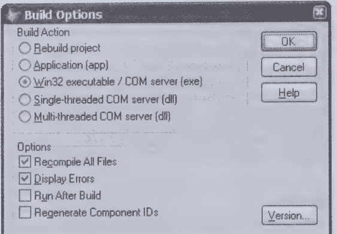

*图 1.* “构建选项”对话框对于确定你要部署的可执行文件的内容至关重要。

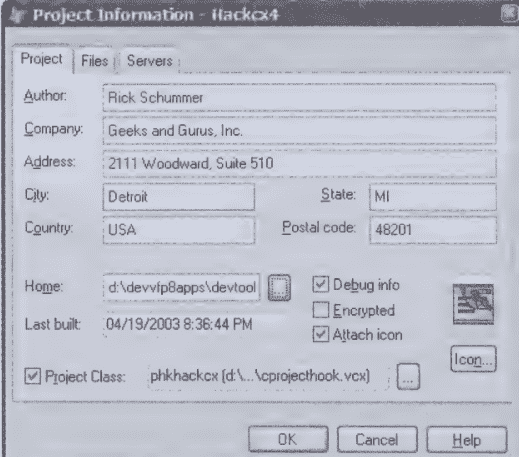

*图 2.* 选择 **Debug Info** 会将应用程序的源代码包含在 EXE 文件中，从而使你的可执行文件体积膨胀。

**Icon** 命令按钮允许你选择一个自定义图标（见图 3）嵌入到可执行文件中（不适用于 APP 文件）。该图标应为 ICO 文件，包含 16x16、32x32 以及 32x32 带 256K 颜色（如果在 Windows XP 上部署）的像素图标。这个图标就是显示在 Windows 资源管理器中的图标。Visual FoxPro 8 是第一个开始支持 32x32 带 256K 颜色图标的版本。

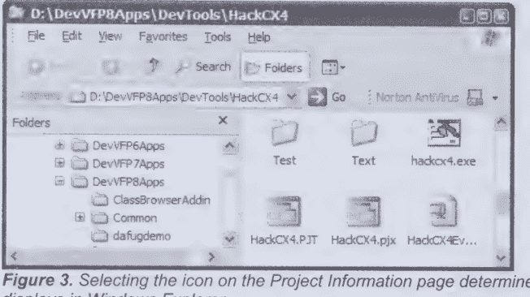

*图 3.* 在“项目信息”页面选择图标决定了在 Windows 资源管理器中显示的图标。

### 帮助文档

实现帮助文件似乎是大多数开发人员都会回避的开发环节。帮助可以采用用户文档（文字处理软件生成的书籍风格）和/或在线帮助（基于 Windows 的 HTML）的形式。一个缺陷修复版本可能仅需要更新文档，而新的开发可能需要编写全新的帮助内容。我们发现，由于客户深度参与应用程序的开发，他们往往会为了规避创建和实现帮助文档的成本而将其省略。我们也知道，许多定制应用程序从未配备帮助文档，因为它们是为已经熟悉相关业务的小规模用户群开发的。


如果实现了帮助功能，你需要确保包含必要的帮助子系统文件，以便你的 Visual FoxPro 应用程序能够与帮助文件交互。详见“Visual FoxPro 运行时和依赖项”以及“帮助和文档文件”章节。

### 数据转换

更新发布在定制软件中很常见。事实上，我们总是鼓励客户在应用程序中添加新功能并对现有功能进行更改，因为这意味着我们有更多的业务机会。对应用程序的更改通常需要对数据库进行删除或修改。新应用程序可能会替换旧的遗留应用程序，我们需要将数据从旧的数据存储转换到新数据库中。如果没有需要转换数据的遗留系统，你可能仍需要为首次使用初始化一个新数据库。

如果你拥有 Stonefield Database Toolkit (SDT) 的副本，更新现有的 VFP 数据将非常简单。多年来，我们成功地使用 SDT 的`Update`方法来处理结构变更。如果你使用 VFP 数据，那么没有哪个第三方工具能像 SDT 对 Visual FoxPro 开发人员那样重要，这也是购买它的最大原因。然而，在某些情况下，仍需要填充新结构，或者将数据从不同字段或不同表中进行转换。

更新后端 SQL 数据库则没有那么简单，因为没有适用于 SQL Server、Oracle、MySQL 等的 SDT。你需要一种在数据库中运行更新脚本的机制。如果你的客户比较资深且拥有驻场数据库管理员，你可能只需发送一个脚本文件由管理员运行。如果你拥有服务器访问权限，则可以自行运行脚本。你可能必须创建一个能够以编程方式执行必要脚本的程序。脚本需要按特定顺序运行，而且可能会出现这样的一种情况：你必须运行部分脚本，转换部分数据，然后再运行其他脚本。

从遗留系统转换数据可能会带来众多挑战。数据清理和洗涤、私有格式、缺乏引用完整性、超出有效范围的值或破坏新字段级规则的值，以及缺失或损坏的字段，这些只是你面临的部分问题。创建一个覆盖每一个案例或情况的测试集可能会非常困难。

新数据库可以通过多种方式实现。Visual FoxPro 数据（包含空/已初始化的表）可以被复制到客户的文件夹中。你也可以使用 Visual FoxPro 自带的名为`GenDBC`的实用程序，生成一个包含创建数据库容器、空表、索引、视图、关系和连接所需代码的程序。SQL 后端数据库可以通过还原备份或运行脚本来生成必要的数据库对象。

无论数据转换需求如何，这些转换例程都需要经过开发和测试。由于在开发阶段任何时候都可能发生数据变更，因此需要频繁地进行测试。我们必须强调，使用真实数据测试转换过程至关重要。与你的客户合作，获取一份最新的生产数据副本用于此测试。在交付安装程序之前，务必对转换过程进行最后一次最终测试。

### Visual FoxPro 运行时和依赖项

在 Visual FoxPro 版本升级后更新并发布的应用程序，需要随应用程序一起交付所有运行时文件。服务包（Service Pack）可能包含更新的运行时文件，这些文件需要随你的定制应用程序更新一起发布。

保持运行时文件与 Visual FoxPro 开发版本同步非常重要。一个问题示例是：使用原始 Visual FoxPro 7 运行时交付一个使用了编辑框（edit boxes）的应用程序。微软在 Visual FoxPro 7 发布后不久就发布了运行时的热补丁（hot fix）。如果你不更新客户现场的运行时，他们表单上的编辑框将没有滚动条。这个问题在热补丁中得到了修正（并包含在 Service Pack 1 中）。

那么，你需要分发哪些文件？有几个目录可以检查新的运行时文件。根据操作系统以及安装 Visual FoxPro 的目录结构，你的目录可能会有所不同。对于 Visual FoxPro 7，你有以下文件：

- `C:\Program Files\Common Files\Microsoft Shared\VFP\` 包含 `VFP7R.DLL`, `VFP7T.DLL`, `VFP7RChs.DLL`, `VFP7RCht.DLL`, `VFP7RCsy.DLL`, `VFP7RDeu.DLL`, `VFP7REnu.DLL`, `VFP7REsn.DLL`, `VFP7RFra.DLL`, `VFP7RKor.DLL`, `VFP7RRus.DLL`, `VFP7RUN.EXE`, `FoxHHELP7.EXE`, 和 `FoxHHELPPS7.DLL`。

- `C:\Program Files\Common Files\System\Ole DB\` 包含 `VFPOLEDb.DLL`（VFP 8 会覆盖与 VFP 7 安装的同名文件）

- `C:\Program Files\Common Files\Microsoft Shared\Merge Modules\` 包含 InstallShield Express 和其他利用 Windows Installer 技术的安装工具所使用的合并模块。这些文件包括 `VFP7RCHS.MSM`, `VFP7RCHT.MSM`, `VFP7RCYSY.MSM`, `VFP7RDEU.MSM`, `VFP7RESN.MSM`, `VFP7RFRA.MSM`, `VFP7RKOR.MSM`, `VFP7RRUS.MSM`, `VFP7RUNTIME.MSM`, `VFPACTIVE DOC.MSM`, `VFPHTMLHELP.MSM`, `VFPODBC.MSM` 和 `VFP OLEDB.MSM`。合并模块不直接分发给客户，而是由 InstallShield Express 和 Wise for Windows Installer 等安装工具使用。

对于 Visual FoxPro 8，您拥有以下文件：

- `C:\Program Files\Common Files\Microsoft Shared\VFP\` 包含 `VFP8R.DLL`, `VFP8T.DLL`, `VFP8RCHS.DLL`, `VFP8RCHT.DLL`, `VFP8RCSY.DLL`, `VFP8RDEU.DLL`, `VFP8RENU.DLL`, `VFP8RESN.DLL`, `VFP8RFRA.DLL`, `VFP8RKOR.DLL`, `VFP8RRUS.DLL`, `FOXH8R.DLL`, `FOXHHELP8S.DLL` 和 `GDIPLUS.DLL`。

- `C:\Program Files\Common Files\System\Ole Db\` 包含 `VFP OLEDB.DLL`（VFP 8 会覆盖与 VFP 7 安装的同名文件）。

- `C:\Program Files\Common Files\Merge Modules\` 包含 InstallShield Express 和其他利用 Windows Installer 技术的安装工具所使用的合并模块。这些文件包括 `VFP8RCHS.MSM`, `VFP8RCHT.MSM`, `VFP8RCYSY.MSM`, `VFP8RDEU.MSM`, `VFP8RESN.MSM`, `VFP8RFRA.MSM`, `VFP8RKOR.MSM`, `VFP8RRUS.MSM`, `VFP8RUNTIME.MSM`, `VFP8HTMLHELP.MSM`, `VFPOLEDB.MSM` 和 `VFP_GDIPLUS.MSM`。合并模块不直接分发给客户。

您绝对需要在发布可执行文件（`EXE`, `DLL`）时，同时发布至少两个运行时文件。主要的运行时 DLL 是 `VFP8R.DLL`（或 `VFP7R.DLL`, `VFP6R.DLL`）以及一个 `VFP8RXXX.DLL`（`VFP7RXXX.DLL`, `VFP6RXXX.DLL`）语言资源文件，其中 xxx 三个字母表示所选的语言。如果您发布的组件需要多线程运行时，则需要 `VFP8T.DLL`（`VFP7T.DLL`, `VFP6T.DLL`）和对应的语言资源文件。其余的运行时文件是可选的。

您可能注意到 `VFP8RUN.EXE` 和 `VFPACTIVE DOC.MSM` 在列表中缺失了。为了向后兼容，Active Doc 类在 VFP 中仍然存在，但出于安全原因，Microsoft 在 Visual FoxPro 8 中删除了该功能。

Visual FoxPro 7 为运行时引入了一个新的依赖项：Microsoft Visual C++ 7.0 Runtime DLL (`MSVCR70.DLL`)。该文件位于`C:\Program Files\Common Files\Microsoft Shared\Merge Modules\`文件夹中名为`MSVCR70.MSM`的合并模块中。Visual FoxPro 8 同样需要该依赖项。

Visual FoxPro 8 为运行时引入了一个新的依赖项：Microsoft Graphics Device Interface Plus (GDI+) 运行时 DLL。该文件位于`C:\Program Files\Common Files\Merge Modules\`文件夹中的`VFP_GDIPLUS.MSM`合并模块中。如果您是手动安装或使用不使用 Windows Installer 合并模块的安装包，必须在`VFP8R.DLL`之前注册`GDIPLUS.DLL`文件。

如果您使用了`CursorToXML()`或`XMLToCursor()`函数，则需要将 Microsoft XML Parser (`MSXML3.DLL`, `MSXML3R.DLL`, `MSXML3A.DLL`) 包含在 Windows System 文件夹中。这些文件位于`C:\Program Files\Common Files\Merge Modules\`文件夹中的`MSXML3.MSM`合并模块中。我们强烈建议使用合并模块，因为它可以解决安装一组可能正在被使用的文件时出现的问题。安装新文件需要重启计算机。

如果您使用了 Visual FoxPro 8 中引入的新 XMLAdapter 类，则需要包含 Microsoft XML Parser 4 DLL 文件。这些文件位于`C:\Program Files\Common Files\Merge Modules\`文件夹中的`MSXML4.MSM`合并模块中。我们强烈建议使用合并模块，因为它可以解决安装一组可能正在被使用的文件时出现的问题。安装新文件需要重启计算机。

如果您正在创建访问 Web 服务的应用程序，则需要包含位于`C:\Program Files\Common Files\Merge Modules\`文件夹中的 SOAP SDK 文件 (`SOAP_CORE.MSM`)、Visual Basic Virtual Machine (`MSVBVM60.MSM`)、Microsoft Component Category Manager Library (`COMCAT.MSM`) 以及 Microsoft OLE 2.40 (`OLEAUT32.MSM`)。后三个合并模块可以从 InstallShield Express 合并模块下载页面下载。您可以访问 InstallShield Express 支持页面并选择合并模块链接。

如果您正在为中东地区的操作系统创建应用程序，请务必将`VBAME.DLL`文件添加到安装包中，并将其安装在 Windows System 文件夹中。

Microsoft 在 2003 年 8 月以及随 Visual FoxPro 8 Service Pack 1 再次发布了新版本的 Visual FoxPro OLE DB 驱动程序。该驱动程序取代了随 Visual FoxPro 8 和 Visual FoxPro 7 初始版本发布的一款。无论您使用哪个版本的 Visual FoxPro 开发解决方案，Microsoft 都建议使用这个新驱动程序，而非之前发布的任何驱动程序。如果您需要在同一台机器上同时加载这两个版本，由于文件名相同，您需要重命名较旧的 DLL。以下是 Microsoft 提供的说明：

1. 关闭任何可能正在使用该提供程序的应用程序，例如 IIS 或任何使用该提供程序的桌面应用程序。

2. 打开`...\Program Files\Common Files\System\Ole DB`文件夹。

3. 右键单击`vfpoledb.dll`，选择“重命名”，然后将名称更改为`vfpoledb_save.dll`。

4. 要恢复保存的版本，请删除或重命名此发布版本，并将`vfpoledb_save.dll`重命名为`vfpoledb.dll`。只要您没有卸载之前的版本，就不需要重新注册提供程序。

> 最新版本的 Visual FoxPro OLE DB 驱动程序可以从 Microsoft 下载网站下载：[http://microsoft.com/downloads/details.aspx?FamilyId=0F43EB58-7A94-4E1-A59E-965869CB3BC9&displaylang=en](http://microsoft.com/downloads/details.aspx?FamilyId=0F43EB58-7A94-4E1-A59E-965869CB3BC9&displaylang=en)，并包含在 Visual FoxPro 8 Service Pack 1 中。

Visual FoxPro 6 设置向导将运行时文件放置在 Windows System 或 Windows System32 文件夹中。这在当时是通用做法，也是一个旧标准。较新的操作系统试图清理开发社区所称且被 Microsoft 认可为“DLL 地狱”的情况。由合并模块安装的运行时的新位置是`C:\Program Files\Common Files\Microsoft Shared\VFP\`文件夹。您仍然可以将 Visual FoxPro 运行时放在 Windows System 文件夹中，您的自定义应用程序能够正常找到这些运行时，但您的应用程序将不符合新标准。我们建议遵循新标准以避免问题。

将运行时加载到单个文件夹时可能会出现的问题之一，是当您拥有多个使用同一主版本 Visual FoxPro 开发的应用程序时。Visual Studio 6 部署了五个服务包 (SP)，其中四个包含 VFP 的新运行时。如果您使用 VFP 6 SP3 开发并系统测试了一个应用程序，而使用 VFP 6 SP5 开发了另一个，并将运行时安装到同一个文件夹，那么您将只有一套运行时（来自 SP5 的）。如果 Microsoft 在这两个服务包之间更改了某个功能的行为，而您没有时间测试在 SP3 下开发的应用程序，您的客户可能会发现您的应用程序存在问题。在这种情况下（如果您无法对旧版应用进行测试），建议将运行时放在与可执行文件相同的文件夹中或一个特殊文件夹中，并通过向可执行文件传递 `–D` 参数来指定使用哪一套运行时。如果您使用这种机制/设置，将无法使用合并模块来安装运行时。您需要单独交付运行时文件并直接指定要安装的文件夹。

分发运行时的显而易见的方法是通过您选择的安装工具重新构建分发文件。如果您使用的是 InstallShield Express – Visual FoxPro Limited Edition 或其他基于 Windows Installer 的工具，新运行时文件可在合并模块中获得。包含正确的合并模块，重新构建设置，测试并分发。这是重新分发运行时最安全且可能最专业的方法。

没有什么能限制您直接将更新后的运行时文件复制到工作站。您可以通过简单的 DOS 批处理文件将更改后的运行时文件从网络服务器复制到每个工作站，创建在每个工作站运行的自解压 zip 文件，将它们发布在网页上并附带下载说明，将它们刻录在具有自动播放复制功能的 CD 上，或者让进程在每次启动应用程序时检查是否有新更新。如果您的应用程序使用了 Active Documents 或运行时未加载在 Windows System 文件夹中，则仅需要使用`REGSVR32.EXE`注册运行时文件（`VFP8R.dll`/`VFP7R.dll`/ `VFP6R.dll` 和语言资源文件）。如果您就在客户现场、在企业环境中或只需将几个运行时文件移动到几个工作站，这种方法可能是最简单的。

过去，许多开发人员认为每次需要加载新运行时都需要构建一个完整的安装包，但实际上您有许多替代方案。将运行时文件传递到客户端工作站的方法取决于许多因素。您需要评估问题并确定最适合当前情况的机制。

### 第三方控件和库

处理 ActiveX 控件最困难的部分是寻找 Visual FoxPro 示例，并且需要将 Visual Basic 代码翻译为 Visual FoxPro 代码。多年来，我们逐渐擅长于此，并发现部署控件现在已经成为仅次于部署本身的问题。

第一个问题是要确定需要部署哪些文件。该文件是 OCX 吗？关联的许可文件是否也需要部署（或者更重要的是，不需要部署，因为它们仅用于开发环境）？COM 注册和依赖项呢？所有这些问题可能听起来很困难，但实际情况是有大量的文档和技术可以帮助开发人员找到所有需要的分发文件。

我们用来查找 ActiveX OCX 文件名称的一种技术是使用 Visual FoxPro 7 和 8 中包含的对象浏览器（见**图 4**）。对象浏览器允许开发人员浏览类、常量、枚举器、事件、接口、方法和属性的列表。对于部署目的，它向我们显示了文件名称以及它所在的文件夹。

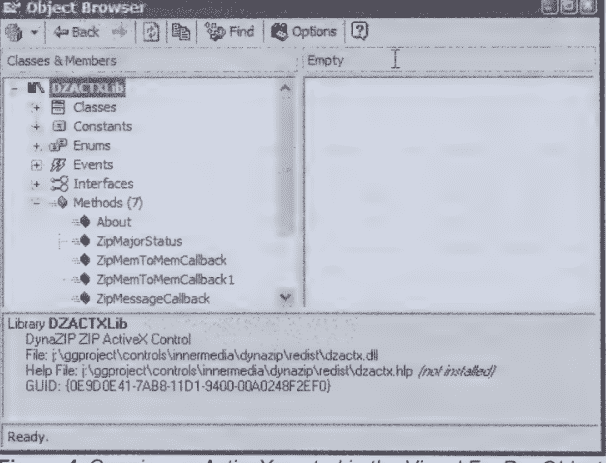

*图 4. 在 Visual FoxPro 对象浏览器中打开 ActiveX 控件并选择顶部节点，会在下部窗格中显示 ActiveX 控件的文件名称（在这种情况下，您可以看到 DynaZip ZIP ActiveX 控件）。*

## 组织安装程序

在构建安装程序之前，您需要了解各种文件将要安装到客户环境中的什么位置。首先，您需要像我们之前讨论的那样确定文件，现在您需要确定文件将位于哪些目录中，以及这些目录将放置在哪些机器上。解决目录问题后，您需要确定安装方案以及如何部署功能集，以便用户能够高效地实施系统。

### 目录

随 Visual FoxPro 3/5/6 一起发布的安装向导要求您定义目录结构，并将文件包含在目录中，以便安装向导完全按照您在客户机器上需要的方式包含在 Acme Setup 中。这迫使开发人员在创建安装程序之前规划安装目录，但需要所有文件的第二个副本，并且随着新文件的生成，开发人员必须记住将这些新文件复制到此安装向导结构中。新的安装程序工具不需要单独的目录结构来指示分发哪些文件，但您确实需要了解文件在生产环境中的存放位置。

每个开发人员可能都有自己的想法，关于客户环境应该是什么样的。还需要考虑公司标准、开发人员建议和行业标准。我们在本节中提供一些项目和建议供考虑。


我们专门用了一整章（第 5 章）来介绍 Windows Installer 技术，另外还有四个单独的附录介绍如何使用一些安装程序工具。这些工具中的每一种都有创建目录并将文件复制到这些目录的技术。您将在章节中看到，存在大量操作系统和安装程序识别的文件夹，以帮助您选择标准目录并允许创建自己的目录的灵活性。

#### 可执行文件

可执行文件安装在服务器（多用户）、工作站（单用户和多用户）、局域网、广域网、分布式模式下以及 Web 服务器上。当前的标准是将可执行文件的安装默认放在 `"Program Files"` 文件夹下的文件夹中。最终控制权应交给用户有能力的双手。我们发现当一个软件包安装到它认为合适的位置，而不是我们想要的位置时，quite 令人恼火。事实上，我们认为删除和不使用在这方面不友好的软件包。我们自己也遵循这一标准。我们也理解某些公司环境不希望用户控制此类事情，我们通过移除这种灵活性来尊重这些部署。

一些软件包将应用程序直接安装在 `"Program Files"` 文件夹下的文件夹中，一些公司在 `"Program Files"` 文件夹下创建公司文件夹，然后将他们公司的所有应用程序安装在公司文件夹下的文件夹中。这是我们喜欢的方法，但不是必需的。事实上，没有什么说您不能将应用程序直接安装在根文件夹下。我们只是觉得遵循行业标准会让应用程序看起来更专业。

### 帮助和文档文件

帮助文件通常与可执行文件安装在同一文件夹中，以便在按下 F1 键或选择帮助菜单选项时简化查找帮助的过程。文档可以有多种形式，如文字处理文档文件、Adobe Acrobat 文件（PDF）或额外的帮助文件。我们通常将文档文件安装在名为 `DOCUMENTATION` 的文件夹中，该文件夹位于加载可执行文件的目录下。没有可供参考的这些文件的行业标准。

对于 HTML 帮助，您需要注意有一个运行时帮助子系统需要安装，以便从基于 Visual FoxPro 的应用程序访问帮助。如果使用 `VFP8HTMLHELP.MSM` 合并模块，该子系统可以轻松安装。如果不通过合并模块安装帮助运行时，则需要安装 `FOXHHELP8.EXE` 和 `FOXHHELPS8.DLL` 文件（对于 Visual FoxPro 8）或 `FOXHHELP7.EXE` 和 `FOXHHELPS7.DLL` 文件（对于 Visual FoxPro 7）。

### FLL

我们目前在应用程序中分发的唯一 FoxPro 链接库（FLL）文件是 FoxTools（随 VFP 附带）以及在必要时用于生成 PDF 的 Amyuni FLL。我们的经验使我们建议将 FLL 文件与运行时文件安装在同一目录中。这样做的唯一原因是能够使用 `HOME()` 函数轻松找到该文件。当我们想要设置库时，我们有类似这样的代码：

```foxpro
IF "FOXTOOLS" $ SET("LIBRARY")
    * Nothing to do
ELSE
    SET LIBRARY TO HOME()+"FoxTools.fll" ADDITIVE

    THIS.lAddedFoxTools = .T.
ENDIF
```

当我们想要释放库时，我们有这样的代码：

```foxpro
RELEASE LIBRARY HOME()+"FoxTools.fll"
```

这确实需要在开发机器上保留每个 FLL 的两个副本，因为有时我们在 Visual FoxPro 内部运行应用程序（它在 VFP 文件夹中查找 FLL），而其他时候我们独立测试 EXE（它在带有运行时的文件夹中查找）。我们发现开发机器上的这个额外副本不是问题，因为它简化了测试和客户环境中的实现。

### 快捷方式

快捷方式文件是为您的客户提供对您开发的应用程序的访问的不错方式。快捷方式文件只不过是一个系统级文件，用于打开它作为快捷方式的文件。创建快捷方式的最常见位置是在开始菜单上，但它们也可以在 Windows 桌面、Windows 任务栏上的快速启动工具栏或启动文件夹中创建。您还可以在这些文件夹下创建子文件夹，并将快捷方式添加到这些新的子文件夹中。

您创建快捷方式的内容将取决于客户的需求。需要考虑的事项包括应用程序可执行文件、帮助文件、自定义 Adobe Acrobat 文件（包含文档、特殊说明、最后时刻的公告或更新）、错误报告应用程序以及您可能为应用程序提供的任何实用程序。考虑对客户快速访问重要的任何事物。

### 运行时

运行时位置在前面“准备交付”下的运行时部分已经讨论过。我们建议您遵循使用合并模块所部署的标准，但如本节所述，不同的情况将决定您需要为自己的安装采取的行动方案。

### 数据

选择数据目录文件夹应该类似于选择应用程序文件夹，并且由用户/客户控制。至少对于 Visual FoxPro 数据来说是如此。位置也可能由应用程序的架构决定。

SQL 后端有创建和恢复数据的过程，这些过程决定和/或允许选择数据文件夹。同样，公司标准或数据库管理员可能会决定数据的位置，这使得安装的这一部分尽可能灵活变得尤为重要。

### 第三方 ActiveX 和 COM

我们建议检查所有第三方 ActiveX 控件和 COM 对象的供应商提供的文档。文档应该有一个部署部分，告诉您是否有任何部署要求或建议。还要检查供应商是否提供 Windows Installer 合并模块以包含在您的安装中。合并模块的好处是它们已经包含了控件的必要注册信息。

### 图像、图标、视频和声音

其余的“外部”文件是在运行时而不是编译时集成到应用程序中的文件。这些文件可能是通用的，也可能是特定于某个部署的自定义文件。例如，您可能会在启动画面、关于窗口和报表上将公司徽标作为图像包含。每个客户自然都有自己的自定义徽标，所以您可能会在图像文件夹中包含一个 `LOGO.JPG`，每个公司可以用自己的自定义文件替换它（或者可能是您在设置中包含的一个）。图标、声音和视频文件可能会根据大小以及在特定位置自定义的需要而包含或排除。

## 安装方案/功能集

在创建目录并将正确的文件放入其中之后，您需要确定发布所需的安装方案。我们确信有多种方案可以 `Meter.Create` 安装程序。以下想法是我们发现对 Visual FoxPro 应用程序部署成功的。我们可以将多个安装合并到一个包中，或者根据客户的环境或需求发布单独的安装。我们将根据您可以在安装包中包含的不同选项来分开接下来的讨论。

### 文件服务器安装

这是主要的应用程序安装，几乎包含交付给客户的每个安装包中。它包括运行应用程序所需的所有核心应用程序可执行文件。这是“基础”安装，包括安装根目录、系统、声音、图像以及应用程序所需的任何其他目录中的所有文件。

此安装通常用于网络环境中。安装将核心应用程序文件加载到文件服务器上的指定目录中。一旦文件加载完毕，用户就可以访问应用程序，前提是他们具有网络访问权限和访问这些文件的权限。使用此方案还需要所有工作站都加载了工作站安装（稍后讨论），以便它们具有 Visual FoxPro 运行时。

这种安装方式也可以在客户端计算机上用于单用户应用，前提是已经安装了工作站安装和数据安装中的文件。许多拥有单 PC 客户端的开发人员一直使用这种技术。

### 工作站安装

如果应用程序已加载到文件服务器上，那么连接到该服务器的工作站经过安全访问权限设置后就可以执行它了吗？未必。每个工作站都需要加载额外的文件。这些文件包括 Visual FoxPro 运行时文件、所有 ActiveX 控件以及帮助系统引擎。你可以逐个访问每个工作站并重新安装文件服务器安装（在上一节中讨论），但这可能耗时且不必要。工作站安装方案的理念是仅加载所需的文件。我们将工作站安装分为五个组件，每个组件都可以包含在一张安装 CD-ROM 中。现在您可能会发现，根据需求的不同，组件可能多于或少于此数量。

- **Visual FoxPro 运行时**：我们发现当 Visual FoxPro 运行时文件加载到每个客户端工作站上时，应用程序启动性能最佳。运行时文件真的必须在客户端工作站上吗？不，可以通过 `–D` 指令指定 `VFP8.EXE`（以及相应的自定义可执行文件），但加载在本地更快，因为您不必在每次启动应用程序时都通过网络传输 4MB 数据。此安装加载所有 Visual FoxPro 运行时文件，包括 `VFP8R.DLL` 和 `VFP8Rxxx.DLL`（其中 `xxx` 是您所使用的 Visual FoxPro 版本的语言代码，例如，ENU 表示英语）。

- **多线程运行时**：此组件加载用于多线程 COM 对象的 `VFP8T.DLL` 文件。并非所有应用程序都需要多线程功能，因此为您的客户安装此组件可能不是必需的。

- **HTML 帮助引擎运行时**：这些文件仅在您为应用程序包含 CHM 文件时才需要。如果您决定构建 WinHelp 文件（HLP）或基于表的帮助文件，则不需要此安装。

- **Visual FoxPro ODBC 驱动程序（`VFPODBC.DLL` 和 `VFPODBC.TXT` 文件）或 OLE DB 驱动程序（`VFPOLEDB.DLL`）及其他所需文件**：这使您的用户能够通过电子表格等工具分析他们的数据，从文字处理器执行邮件合并，或通过终端数据库或工具构建他们自己的终端查询。

- **ActiveX 控件**：此安装的关键是确保应用程序中包含的 ActiveX 控件已安装在工作站上。这些文件被加载到适当的目录中，并在 Windows 注册表中注册。您需要在构建安装的计算机上加载 ActiveX 控件。需要注意的是，安装期间加载的 ActiveX 控件可以是 Visual FoxPro 和 Visual Studio 中包含的控件，以及任何购买的第三方控件。

根据应用程序和部署需求，这些组件中的任何一个都可以包含在安装中或从安装中排除。您可以为特定客户进行定制。可能是您构建了一个带有各种 ActiveX 控件的应用程序，而为另一个客户构建另一个不带 ActiveX 控件的应用程序，或者使用不同控件的不同应用程序。此安装可以在计算机之间传递，或从服务器上的目录运行（仅在工作站上安装）。我们还建议注明 CD 的日期，并记录运行时适用的 Visual FoxPro 版本和 Visual FoxPro 服务包。当出现 Visual FoxPro 6 Service Pack 3 中的新 Session 类在旧版本运行时上运行的新可执行文件中不可用时，这可能会令人尴尬。

### 数据安装

显然，此安装部分用于应用程序数据。但有一些问题需要询问，这可能会使这个看似简单的设置复杂化。需要发送哪些文件？这是 Visual FoxPro 本地数据还是您正在使用 SQL 后端数据库？哪些表需要预先填充？哪些文件可以在客户现场生成？已经安装了先前版本并加载了数据的安装怎么办？

初始安装要求安装所有应用程序数据，并在安装数据目录中找到这些数据。我们喜欢将此安装分开，特别是对于新的服务包版本。垂直市场应用程序也喜欢这种方案，因为它允许开发商店为获取新版本的新客户和现有客户构建单一的安装包。

### Web 服务器安装

Web 服务器安装在很多方面可能与文件服务器安装方案相似。但是，您可能会发现应用程序存在许多差异。最有可能的是，您将安装多线程运行时以提高可扩展性，安装 COM 组件或 EXE、HTML 文件，并进行 Web 服务器设置（通过可执行文件或手动设置），如脚本文件、用户安全性以及数据驱动器映射。

## 如何打包安装？

既然您已经开发了安装方案，就需要确定如何打包。我们指的不是交付 CD 的包装盒，这最好由营销专家处理。我们建议您需要考虑在前面部分讨论的哪些安装方案需要打包并发送给客户。

典型的全新局域网应用程序安装需要文件服务器、工作站和数据安装方案。更新可能只需要文件服务器安装。另一方面，如果可执行文件是用新版本的 Visual FoxPro 构建的，您可能需要发送至少部分工作站安装以包含新的运行时文件。Web 服务器可能只需要一些新的 HTML 文件，因此您可以跳过更新 COM 对象的需求。单台计算机客户可能需要将文件服务器安装和工作站安装合并为一个安装过程。

安装的打包与开发 GIS 与制作与开发完美软件一样重要，因为它通常是大多数用户对生产环境应用程序的第一印象。我们说的不是您为其开发软件规格并进行验收测试的人员；我们说的是实际上将软件包加载到他们计算机上的可能数百名最终用户。

### 操作系统和第三方组件

当今的软件可以轻松地基于组件构建。虽然我们喜欢认为 Visual FoxPro 是一个全面的开发工具，但我们的应用程序与特定操作系统和第三方组件交互的情况并不少见。组件环境功能强大，可以提供我们需要很长时间才能开发的功能。这节省了开发人员的时间并降低了客户的成本。等式的另一面是您需要确保组件已安装。这意味着额外的负担，需要查明部署组件的许可问题、如何部署以及可以利用哪些机制。

虽然我们希望我们的客户拥有最新最好的操作系统，并且他们拥有所有可用的组件，但通常情况并非如此。您绝对不能依赖环境完全按照我们应用程序需要的方式建立。与 Windows 脚本宿主（WSH）、Microsoft 数据访问组件（MDAC）和 Microsoft SQL Server Desktop Engine（MSDE）交互并不罕见。所有这些组件都可以随我们的安装设置一起打包，或者由我们的客户从 Microsoft 网站下载。它们如何到达取决于您希望应用程序如何被感知、您的客户有多成熟（他们可能有一个内部计算部门来更新机器），以及您能在多大程度上将组件集成到您的设置中。

在处理 ActiveX 控件和第三方 COM 对象时，同样需要考虑这些概念。您可能会发现供应商已经有您可以用于部署的软件包，或者您可能需要考虑创建必要的注册过程。大多数当前的安装程序包会读取 ActiveX 控件或 COM 对象，并在安装期间自动为您进行必要的注册。如果您不使用安装程序执行此操作或手动操作，您需要弄清楚必须做什么，以便应用程序和操作系统正确设置以协同工作。

您会发现 Microsoft 的可选操作系统组件、Visual FoxPro 和 Visual Studio 附带的 ActiveX 控件，以及许多第三方产品都有合并模块，可与利用 Windows 安装程序的安装程序一起使用。有关合并模块和 Windows 安装程序的更多信息，请参见第 5 章。安装包供应商通常在其网站上提供许多可供下载的组件合并模块。

### 考虑随附的实用工具

虽然开发人员的主要目标是安装客户应用程序所需的文件，但有许多开发实用工具可以帮助进行安装以及可能发生的持续维护。以下是我们为交付给客户的应用程序类型而开发、从互联网下载或购买的工具概念。

#### 重新索引和数据库更新程序

初始版本通常从空数据库开始，或者让数据转换器预加载数据库。当发布升级版本并且需要实现数据库表、索引、视图和关系的最新更改时会发生什么？您可以每次编写自定义程序通过强大的 `ALTER TABLE` 和 `INDEX ON` 命令来进行这些更改。您还可以跟踪对数据所做的每项更改，并确保每次开发中进行更改时此自定义程序都会更新。即使是单个开发人员项目，这也可能是一项艰巨的任务，并且错过一次关键更改的可能性几乎相等。多开发人员项目在这方面更具挑战性；它们变成了沟通噩梦。

跟踪这些变更的过程可以实现自动化。我们并不想为 Stonefield 数据库工具包（SDT）做商业宣传，但我们发现这个产品价值巨大，不得不推荐一番。它可以跟踪你对数据库容器扩展（DBCX）和 SDT 元数据中数据结构所做的更改。SDT 提供了一个 `NeedUpdate` 方法来检查元数据与数据库中结构之间的差异。如果存在差异，你可以运行 SDT 的 `Update` 方法，将结构性更改应用于数据库表。这意味着可以添加或删除列、应用列名更改，以及更改代码页。索引的处理方式同样如此。如果表不存在，它还会创建新表。所有这些都通过 Stonefield 数据库工具包或你自行开发的工具（是的，由于 DBCX 是一个公开标准，你可以开发自己的工具）使用 DBCX 数据库扩展来处理。关键在于，在发布时发送元数据之前，要验证数据库扩展（这是该作者在使用此产品的第一次发布中学到的教训）。SDT 也可以在初始安装中用来完全生成所有表。

解决数据库变更还有另一种选择，那就是简单地手动进行更改。如果你在现场与应用程序一起开发，你可以直接在实时数据上使用 VFP 进行修改。我们经常听说这种做法。然而，我们不是那种会相信自己能记得在发布时以与开发时相同的方式进行更改的开发者。我们确信有很多惨痛的例子能说服你不要这样做。另一方面，为了维持客户系统运行而进行的紧急修复却时有发生。

有一件事 SDT 无法处理，而你需要为所有类型的发布考虑，那就是数据转换。即使你有自动更新数据库结构等的方式，你也需要考虑一种机制来填充新字段、从旧表转换数据，以及清理可能违反新字段或行级规则的数据。你甚至可能需要一个单独的程序，在为表实现新的字段或行级规则之前清理数据。

SQL 数据库需要不同的方法，因为没有像 Stonefield 数据库工具包这样的工具适用于 SQL 后端数据库。你需要生成在后端数据库上执行的脚本。这些脚本可以是生成的，也可以是编程的。然后可以在后端数据库上手动或通过程序运行这些脚本。我们知道有些开发者在 DBF 中创建脚本日志，并按特定顺序通过程序执行这些脚本，以使数据库更新到应用程序的特定版本。我们建议查阅 Hentzenwerke 出版社的《使用 Visual FoxPro 6.0 和 SQL Server 7.0 开发客户端/服务器应用程序》一书的第 10 章“应用程序分发和更新管理”，其中包含了关于部署机制以及用于新建和更新数据库架构的工具的大量思路和建议。

#### GenDBC/GenDBCX

如果你没有使用 SDT，和/或想要一种机制来生成 Visual FoxPro 数据库以及所有的表结构、视图、索引和关系，请查看 `GENDBC.PRG`（包含在每个 VFP 版本中）或 `GENDBCX.PRG`。GenDBCX 是由 Steve Arnott 编写的第三方工具，可免费获取。你可以从 `http://www.leafe.com/dls/vfp` 下载。这两个工具都生成 Visual FoxPro 程序代码，用于从头构建数据库。就像 SDT 的 `Update` 过程一样，这两个工具都不会填充表数据，因此你需要一种机制来完成这项任务。

> 如果你在已经填充了客户输入数据的生产目录上运行 GenDBC 或 GenDBCx 生成的代码，数据将会丢失，因为这些程序会创建没有数据的新结构。

#### 检查下一个 ID 表


使用代理键（唯一标识表中记录的无意义整数或字符）的开发者通常有一个包含表的下一个键值的表（Visual FoxPro 8 也引入了新的 `AutoIncrement` 字段类型用于此目的）。这些表会周期性地与表中的真实数据不同步。这可能是因为开发者在应用程序中编写了错误代码；在从开发环境迁移到生产环境时，表被清空而没有更新代理键表；不正确的参照完整性规则；或者仅仅是运气不好。

无论如何，下一个 ID 表需要与表中的数据同步。此过程需要独占使用数据库和每个表。通用算法是通过如下代码获取表中的最大键值：

```sql
SELECT MAX(nTablePK) ;
  FROM Customer ;
  INTO ARRAY laMaxID
```

一旦你获得了代理键的最大 ID，如果有必要，就用这个新值更新该表的下一个 ID 表记录。定期为应用程序中的所有表运行此过程是一个好主意。一个表明可能需要运行此过程的警示信号是，客户不断来电，称他们无法在任何表单中添加任何记录，因为他们收到了指示键值重复的消息。

如果你使用全局唯一标识符 (GUID)，则不需要这样的工具。GUID 键不是递增的；它们是通过调用操作系统动态生成的。

### 配置/控制表更新程序

许多应用程序都有一个 INI 文件或配置表。当添加新选项时，需要考虑一种将这些选项合并到现有应用程序中的机制。就个人而言，我们更喜欢使用表，因为我们整天都在使用它们，而且 Visual FoxPro 提供了大量命令来操作数据。添加新选项就像执行 `APPEND FROM` 或运行代码执行 `INSERT INTO` 一样简单。更新操作就像执行 `LOCATE` 或 `SEEK` 并使用 `REPLACE`，或者编写执行 SQL `UPDATE` 的代码一样简单。INI 文本文件也易于操作，因为 Visual FoxPro 有用于操作文本文件的低级文件输入和输出命令。对于具备相关知识的开发者，也可以使用 Windows 的 API 调用来操作 INI 文件。

需要注意的重要事项是，你需要开发某种机制来更新此信息，以便在添加新选项或功能时，客户应用程序不会出现故障。

### 运行时命令窗口

`FoxBox` 是由密歇根州西布卢姆菲尔德的 Alex Korot 开发的一个实用程序。它不是你会在 Visual FoxPro 开发环境中每天都交互使用的东西，但当你在现场或通过 `pcAnywhere` 或远程桌面连接进行远程支持时，它可能成为你发现对客户来说不可或缺的工具。`FoxBox`，如图 5 所示，是一个无需在客户站点加载完整的 Visual FoxPro 副本的命令窗口（功能远不止于此）。它确实需要为你的应用程序安装相同的运行时组件。

> `FoxBox` 可从 `www.KirtlandSys.com` 或 `www.RickSchummer.com` 下载

此工具允许你运行 Visual FoxPro 中的任何命令，只要该命令不会触发“功能不可用”错误。因此，你可以打开表并浏览它，可以执行 SQL-SELECT 来检查数据，可以运行报表表单 (`REPORT FORM`)，重建索引，或者可以打开文本文件。所有你想用 Visual FoxPro 执行但不想内置到可执行文件中的操作，都可以通过 `FoxBox` 完成。

游标浏览器（通过 `FoxBox` 控制台上的浏览按钮）显示了一个更智能的浏览器。你可以基于可用索引对游标进行排序，也可以通过单击列标题进行排序。结构按钮显示的内容远比 `LIST STRUCTURE` 命令产生的内容要多。

## 分发机制

分发安装程序可执行文件和支持文件有多种机制。你需要了解基础设施，以免因客户没有带光驱的机器或没有互联网连接而无法加载应用程序时感到意外。你的分发方法还将取决于其他因素。你是分发给个人、推送给少数客户，还是针对拥有数十、甚至数百或数千个实施实例的垂直市场？

### 软盘

我们知道软盘似乎是过时的技术，但许多人仍然使用没有内置光驱的笔记本电脑工作。在客户办公室时，我们会用软盘驱动器在紧急情况下将文件复制给客户。诚然，这并不常见，但它仍然是安装的一种机制。所有现代安装工具都会构建所需的文件大小以复制到软盘介质。这在今天已不常见，但仍有公司使用没有光驱的计算机，唯一物理加载的方式是使用软盘驱动器或网络连接（如果它们连接到网络）。

使用软盘分发有两个大问题。首先是包装。通过普通邮件发送 CD 更便宜，因为你发送的物品更少。你有没有试过向 100 个客户各寄送六张软盘？邮费、复制和组装的费用可能会很高。第二个问题是你的公司形象。我们大多数人被雇用是因为我们处于技术前沿。显然，磁盘被认为是较旧的，而 CD 则被认为更接近当前的技术。我们合作的一些客户认为，采用最新的尖端技术是必须的，因为这有助于提升他们在客户群中的形象。他们希望其供应商也能做到这一点。就个人而言，作者非常讨厌安装由多张磁盘组成的软件包。这纯粹是因为磁盘驱动器的速度较慢，且需要更多的人为干预，从而耗费更多时间。

磁盘的另一个问题是可靠性。这项技术已经存在了几十年，但每当一个重要的关键版本正在开发时，墨菲定律似乎总能生效。可能是磁盘损坏，可能是复制过程中丢失了一个关键比特，或者邮递过程导致磁盘表面发生了磁重排。多年来，我们见过很多幸运的开发人员，也见过那些麻烦不断的开发人员。你的情况可能会有所不同。

### Zip/Jaz/SuperDisk 磁盘

超级磁盘很常见，相比于我们在 CD-ROM 刻录机对开发人员而言价格合理之前所习惯使用的 1.44MB 软盘，这是一个巨大的进步。这些驱动器价格低廉，便于携带，如果客户没有自己的驱动器，也可以连接到他们的机器上。

使用这种介质的一个大优势是，我们可以将一个中等规模应用程序的安装程序放入一张磁盘中。邮寄一张小型超级磁盘比邮寄相当于 70 张的软盘要便宜得多。如今，Iomega Zip 驱动器有 100MB、250MB 和 750MB 之分（容量超过了 CD-ROM）。

在拥有 CD-ROM 刻录机之前，我们经常为本地客户使用这种交付机制。对于没有 CD-ROM 的客户（虽然很少，但确实存在），这仍然是一种便捷的处理方式。

使用这项技术你可能会遇到的问题是，你需要使用“最小公分母”方案。虽然你可能拥有 Iomega Zip 驱动器，但你的客户可能使用的是 Jaz 驱动器、SuperDisk 或 Syquest 驱动器。这就是为什么我们为自己的 Zip 驱动器购买了一个精致的外壳并随身携带。此外，请务必检查它与机器的连接方式（并行端口或 USB 端口），并确保客户拥有连接该驱动器的正确端口。

### 内存棒（U 盘）

你见过那些插入 USB 端口的新奇内存棒（也称为内存驱动器）吗？当我们第一次看到这种设备时，首先想到的是：“太酷了，这真是个在机器之间传输一组小文件的绝佳机制”。这些内存棒起初容量很小，但很快就有了高达 256MB 的容量（至少在 2003 年初是这样）。我们相信它们的容量会进一步增加。类似的概念还包括 PCMCIA 适配器，或者用于 CompactFlash、Secure Digital 或 SmartMedia 卡的 USB 适配器，后者的容量甚至更高。

这并不是一个用于大型项目初始安装大规模分发的机制，但如果你在客户现场，需要快速添加一个功能或修复一个问题、重新编译应用程序并复制新的可执行文件进行测试，它会非常有用。这些内存棒在连接的计算机上显示为一个新驱动器。无需重启，只需插入，等待操作系统识别，然后复制文件即可。

### CD-ROM 和 DVD

CD-ROM 可能是除从互联网下载之外第二受欢迎的交付机制。CD 格式为文件提供了至少 650MB 的磁盘空间，且该格式受到所有现代安装工具的支持，甚至连随 Visual FoxPro 3、5 和 6 分发的陈旧的 VFP 安装向导也能支持。如今 CD-ROM 刻录机非常便宜，软件运行也很可靠。过去几年我们一直在刻录 CD，客户发现其优势非常显著。

CD 提供了快得多的安装过程，因为它们具有更快的传输速率，且无需更换磁盘。垂直市场开发者发现，磁盘数量的减少导致了包装成本的降低。用户基数越大，成本节省就越显著。CD 比软盘更耐用，且在客户办公室占用的存储空间更小。

我们总是向客户提供用于初始安装的 CD，特别是对于运行时库、ActiveX 和其他支持文件。一张 CD 用于客户端计算机安装，另一张用于一次性服务器安装。根据你如何构建安装设置，这些也可以放在同一张 CD 上。这样，支持人员（无论是现场的 MIS、技术支持人员，还是我们公司的代表）就可以在每台 PC 之间巡回并安装工作站上的运行时库。此安装可以从 CD 运行，也可以从服务器运行。

通过为 CD 创建标签来增加产品的精致感。这可以简单到运行 Microsoft Word 中的标签向导（图 6 和 7），或者在当地办公用品店购买标签创建软件。我们无法向你描述，自从开始这样做之后，客户的反馈产生了多么巨大的差异。这是一个简单的过程，根据创建标签的复杂程度，只需几分钟即可完成。我们只需注明应用程序名称、版本号、发布日期，并包含公司徽标以及客户的公司徽标（如果适用）。

CD-ROM 交付机制的缺点是它必须通过人工递送、邮政服务或可能的隔夜快递发送。它到达客户手中的速度取决于地理距离、你是选择优先隔夜快递还是通过标准邮件渠道。虽然如今计算机配备 CD 已经非常普遍，但偶尔你可能会遇到一个客户现场，那里使用的是没有 CD 驱动器的旧机器，或者公司有不购买 CD 驱动器的政策，因为他们不希望员工在工作时听音乐（没错，这不仅仅是《呆伯特》漫画里的故事）。

> **图 6.** Microsoft Word 的信封和标签向导是一种快速简便的方法，可为你的安装 CD 创建 CD-ROM 标签。在此对话框中选择 Avery Standard 5824 CD 标签，然后点击“新建文档”按钮，即可打开一个准备好让你创建标签的文档。

DVD 刻录机才刚刚开始在普通开发人员中普及。初始 DVD 可容纳 4.37GB 的数据，是 CD-R 的六倍多。激光技术的进步使一些制造商在研究 27GB 甚至更高的容量。这项技术正在快速增长和完善。我们担心的是，我们今天写的内容在书印刷出来之前就已过时。如果你的数据无法放入 CD 且你的客户办公室内有 DVD 读盘机，这可能是一个值得研究的方案。

关于 DVD 你需要注意的一个危险是，就像我们行业中的许多其他事情一样，存在多种标准。不幸的是，就像多年前 Betamax 与 VHS 的战争一样，我们不确定哪个标准会胜出。所以，你是买支持 DVD+R/RW、DVD-R/RW 还是 DVD RAM 的刻录机？你的客户计算机支持哪个标准？这项技术可能还不够成熟，不建议考虑，但可能很快就会改变。

> **图 7.** Microsoft Word 的信封和标签向导会创建一个 Word 表格，这样你就可以在一页纸上创建两个标签，这是标签供应商的标准规格。

### 电子邮件

将安装文件打包并作为电子邮件附件发送是向客户交付版本的一种快速方法。直到最近，这还是我们最常用的交付机制。我们确信这对大多数开发人员来说是显而易见的，但在利用这种机制交付时，使用压缩至关重要。在如今宽带互联网接入的时代，很多人认为发送几兆字节数据的附件没什么大不了的。当你身在办公室或家里，拥有 DSL 或电缆连接时，这很棒；但当你度假在夏威夷，连接着像慢动作重播一样爬行的拨号连接时，这简直太糟糕了。

通过电子邮件发送可执行文件或数据库更新效果很好。客户分离我们发送的文件，将它们解压到相应的测试文件夹，运行应用程序，并验证测试计划的结果（难道我们生活在完美世界吗）。一旦测试验证通过，同样的文件可以被分离到生产目录中供所有用户使用。

我们在使用电子邮件的客户中遇到的一个问题是，即使我们发送了关于使用电子邮件完成此任务的明确指示，他们仍然不知道如何分离附件。这在恐机人士中很常见。一个常见的解决方法是给客户打电话，一步步引导他们完成操作。多年来我们遇到的另一个问题是，企业界的一些电子邮件系统限制了外发邮件的附件大小。这可能会为向客户交付版本的企业开发人员设置障碍。在互联网服务提供商 (ISP) 处也看到了同样的限制。一些防火墙还会拦截带有 `EXE` 和 `DLL` 的附件。有些防火墙非常“智能”，甚至会拦截包含 `EXE` 或 `DLL` 的 ZIP 文件。

### FTP

我们曾与拥有自己的文件传输协议 (FTP) 站点的客户合作。我们将安装设置文件复制到服务器，客户在方便时将其下载。我们建议对文件进行压缩以节省传输时间。如果你面对不稳定的互联网连接和/或需要发送大文件，我们还建议获取一个能够重启中断文件传输的 FTP 客户端。

这个过程比刻录 CD 并邮寄更快且成本更低。它不像通过电子邮件发送文件那样面临诸多限制。文件可以在一天中的任何时间传输，因此可以在客户离开办公室后的非工作时间完成。

你确实需要通知用户文件已复制到他们的 FTP 站点并准备好实施。与客户沟通的需求与任何其他机制没有不同。他们需要意识到版本的发布。在这种情况下，他们需要下载文件，或者根据 Web 服务器的配置，通过网络进行复制。

### 网站下载

互联网显然是我们行业中一个极佳的交付机制。如今我们几乎不再从实体店购买软件。我们经常做的是从网站下载（图 8）。既然我们可以这样做，为什么我们的客户不能？虽然我们可以说我们通常向客户“推送”版本，但我们可以将更新放在我们的绝密网站上，让客户决定何时“拉取”版本。他们也可以在方便的时候进行操作。

允许用户下载文件的一大好处是，他们可以自主决定何时承受带宽消耗。如果你通过电子邮件发送，他们在你发送后打开邮件客户端时就会立即承受下载负担。如果这个过程需要30分钟，而他们正在等待客户的邮件订单，这就会成为一个问题。Web下载也是垂直市场应用的理想传输机制，因为它降低了复制和打包的分发成本。Web服务器安全还为你提供了让用户登录并通过安全套接层进行传输的机会。

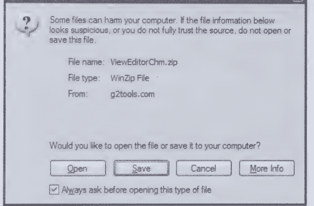

**图 8.** *通过网络浏览器从互联网下载文件已成为常态。*

这种机制也有其缺点。如果你的网站没有日志功能，你就无法知道客户是否来获取了安装文件。如果多个客户端运行着该软件却没有下载新版本，你可能会面临它们运行不同版本的情况，这意味着你需要支持各个可用版本。这并非该分发机制独有的问题，但确实值得关注。如果你没有实现安全措施，或者你的互联网服务提供商不具备此功能，用户或其他浏览者可能会获取到安装文件。我们建议对文件设置某种密码访问。这种访问可以针对Web服务器上的下载目录，也可以应用于他们正在下载的zip文件。

### Symantec的pcAnywhere

如果你只能购买一种工具来支持客户，请选择Symantec的`pcAnywhere`。对于不熟悉`pcAnywhere`的人来说，它是一款通信应用程序，可以让你连接到另一台计算机并远程运行它。它具有文件传输功能，允许你交付自定义应用程序实施和后续支持所需的文件。这个工具是我们公司的必备之选，我们甚至会将其作为定制应用程序交易的一部分为客户购买。它节省了现场差旅费用，并能为客户提供即时支持。

`pcAnywhere`的文件传输功能（图9）采用了名为Speed Send的技术。该技术逐字节进行比较，只发送文件的差异部分。在发送包含少量错误修复或增强功能的Visual FoxPro可执行文件时，效果极佳。我们见过大约8MB的可执行文件通过慢速拨号连接在一分钟内完成传输，而在高速互联网连接上表现更是卓越。几乎就像你直接在那台计算机上操作一样。

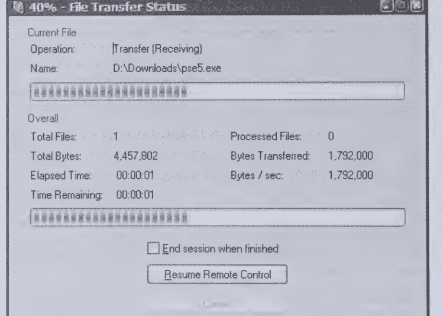

**图 9.** `pcAnywhere`的文件传输功能实际运行中。

这种交付和支持方式也存在一些问题。如果你的连接不稳定且频繁断开（通常是在多兆字节传输剩余不到500字节时），客户往往会变得烦躁。我们有客户通过防火墙连接，防火墙不允许通过TCP/IP建立`pcAnywhere`连接。那些运行个人防火墙（如Zone Alarm或BlackIce）的计算机，如果未配置为允许远程软件访问，同样会造成问题。有时我们需要在出现问题的系统上安装调制解调器。有些公司设有安全部门，拒绝允许任何类型的连接到其设施内的计算机。我们发现这是一个难题，但通过与他们合作并解释软件包的必要性，通常能找到某种折中方案。

`pcAnywhere`最大的问题在于它是单线程的。这意味着你一次只能支持或向一台计算机传输文件。这对小客户来说不是问题，但在需要为大量计算机安装应用程序的环境中，效果就不太理想了。

还有一些其他远程应用程序服务也可用。我们没有使用过这些服务，但它们已经变得流行起来，值得一提，以备对你有所帮助。这些是通过互联网访问的服务，并且与服务相关联有费用（通常有月度和年度计划）。所有这些服务都具有文件传输功能（有些优于其他），其方式类似于`pcAnywhere`，同时具备远程桌面功能，因此可以用于交付文件和技术支持。其中一些还能从个人数字助理（PDA）操控桌面。它们并不便宜，但可能正是你所需要的。

> Expertcity的`GoToMyPC`的信息和营销详情可访问`www.gotomypc.com`，`LapLink Everywhere`的信息可访问`www.laplink.com`，`I'm InTouch`的信息可访问`www.imintouch.net`。

### 终端服务和Citrix

`Citrix`和终端服务（图10）是允许多个虚拟计算机在Windows NT服务器上运行的产品。这使得类似哑终端或普通PC的设备能够连接并让所有应用程序在服务器上运行。这种连接可以通过所有常规机制建立，如使用标准网络协议的内部网络、调制解调器，以及通过公共互联网上的TCP/IP。这种配置允许公司使用过时的计算机（如80286或更高型号）来运行为当前Windows操作系统平台开发的强大应用程序。

客户端计算机会加载软件以连接到服务器上的虚拟计算机。这种连接的工作方式类似于前面讨论的`pcAnywhere`产品。最大的区别在于`Citrix`和终端服务产品允许多个连接到"服务器"计算机。一旦连接，会话会映射客户端计算机上的打印机和驱动器等外围设备。将本地驱动器映射为"服务器"上的驱动器，使开发人员能够与服务器之间来回传输文件。可执行文件传输完成后即可安装。你可以运行安装程序，也可以让客户自行运行。由于工作在服务器上完成，除了屏幕更新外不会产生网络流量。

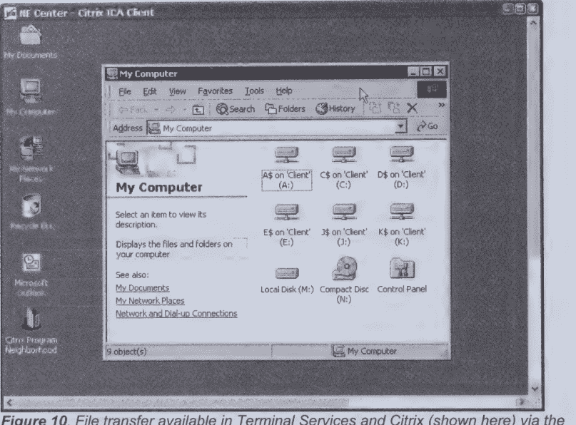

*图 10. 终端服务和`Citrix`（此处所示）中的文件传输功能，通过Windows资源管理器中映射到本地客户端计算机的驱动器实现。*


在支持安装程序操作有困难的客户时，这种情况非常理想。当客户在地理位置上距离你较远时，也便于你轻松支持他们。设置简单且非常可靠。我们的客户群中有使用`Citrix`的客户，但并不普遍。

## 总结

本章详细介绍了在打包安装程序时应该审视的一些考量因素。我们讨论了诸如确定何时可以发布、需要向客户端发布哪些内容、需要打包哪些部署功能和方案、需要向客户端发送哪些工具以便未来更轻松地提供支持，以及安装包如何交付给客户等问题。现在你已经准备好打包工作，可以继续阅读下一章，我们将讨论可用于创建安装程序的工具及其支持的功能。

本章的更新和勘误可在 Hentzenwerke Publishing 的网站[`www.hentzenwerke.com`](http://www.hentzenwerke.com)上找到。点击“Catalog”并导航到本书页面。

# 第 4 章

## 安装工具总览

在过去的好日子里，开发者确实可以直接从开发机器将文件复制到软盘，然后将软盘带到客户现场，再将文件复制到客户计算机上。这种方式行之有效，而且效率极高。如今，越来越多的客户期望我们提供专业的安装程序，就像 Microsoft、Intuit、Symantec，甚至小型软件厂商在盒装软件领域所做的那样。

所有的规划、准备、开发和测试最终都汇聚到一个现实需求——你需要为应用程序生成一个安装程序。你是等到最后一刻才选择合适的安装工具，还是提前为这个重要的选择做好研究？

选择正确的安装工具可能与选择用于创建应用程序或组件的开发工具以及构建解决方案架构同等重要。为什么？很简单：你可能花费数小时创建安装程序，结果却发现它缺少一个关键的致命功能。了解各种安装工具支持的功能可能需要数天时间。一旦你选择了认为合适的安装工具，还需要学习它的使用方法，这又需要更多时间。完全有可能你在选择工具和学习使用方法上花费的时间，与创建解决方案本身的时间一样多。

本章试图为你提供各种安装工具可用功能的完整列表，以及市场上可用工具的部分列表。我们尝试让你了解每个工具支持哪些功能、其零售价格，以及你可以在哪里找到关于每个产品的更多信息。本章最后我们会阐述为什么 Visual FoxPro 安装向导已经完全过时，并讲述一家公司因为一个项目需要安装程序中的两个特定功能，花费了 40 个非计费小时来购买和学习多个安装工具的故事。

## 什么是安装程序？

简单来说，安装程序是一个或一组程序，用于安装必要的文件并修改目标机器的环境，以便在该机器上部署你的解决方案。创建的安装程序可能将你的应用程序部署到 Windows 桌面、Windows 服务器，或在 Web 服务器上实现 Web 应用程序。创建安装程序可以简化整体部署过程，而安装程序的可重复性特质提高了安装过程的整体可靠性。

安装包提供了一个简单易用的安装程序，用于安装必要的文件，使你的解决方案在客户生产环境中保持最新。从最终用户的角度来看，这是一个直观的过程，他们只需运行熟悉的新用户界面即可为计算机添加新功能。最终用户只需进行几个常见选择，如应用程序安装的文件夹，以及可能确定创建哪些快捷方式，其余的就会自动完成。大多数安装工具为最终用户提供类似向导的界面，引导用户完成安装过程。

开发者获得了一个可在全球数百万台计算机上运行的可重复流程。你指定将哪些文件加载到哪些文件夹，自定义向导步骤，通过更改图形界面和对话框语言来选择哪些内容运行以及如何显示，并使用设置工具创建用于分发的构建版本。它通常能简化安装过程和应用程序的整体部署。如果该工具使用了 Windows Installer 技术，开发人员可以使用合并模块来部署通用技术，而无需学习关于哪些文件需要加载、加载到何处以及哪些文件需要注册的所有细节。

系统管理员从使用 Windows Installer 部署的设置程序中获益，因为管理员可以对其进行自定义，并且可以在静默模式（无需最终用户交互）下运行。即使是非基于 Windows Installer 的设置程序，也能让系统管理员受益，因为它们提供了一个可重复的过程，在每个加载产品的机器上都能产生相同的结果。

## 有哪些可用功能？

用于将应用程序部署到 Windows 平台的现代安装程序具有多种功能。有些使用了由微软提供并内置于 Windows 的 Windows Installer 技术，而其他工具则提供了安装解决方案的专有机制。请参阅**表 1**，了解现代安装程序中可见的功能列表。

随着时间的推移，基于您处理各种客户需求和部署类型的经验，您将发现其中哪些功能对您至关重要。一旦您了解了部署所需的功能，就可以开始评估您在部署各种应用程序时可能想要使用哪种或哪些工具。这是下一节的主题。

*表 1. 这是一个各种安装工具可用功能的综合列表。请注意，特定的安装程序可能会支持或不支持其中的任何一项功能。*

| 功能 |
| :--- |
| 专业的外观和感觉，兼容所有版本的 Windows |
| 直观的开发环境 |
| 创建 Windows Installer MSI 文件 |
| 安装所有文件类型，包括可执行文件、运行时、数据文件、文本文件、帮助文件、文档文件等 |
| 创建和编辑 Windows 注册表项 |
| 更新 INI 配置文件 |
| 配置操作系统级别的环境变量 |
| 建立 ODBC 数据源（DSN） |
| 在用户机器上注册文件扩展名 |
| 将安装项添加到“添加/删除程序”列表中 |
| 卸载能力（具有不删除共享组件的智能机制） |
| 修复损坏的安装（替换或添加被删除的必要文件） |
| 提示用户选择多个目录（一个用于应用程序，一个用于数据） |
| 在桌面/开始菜单创建快捷方式 |
| 在安装期间可选地显示许可协议和 ReadMe 文本 |
| 验证内存、处理器、操作系统版本、硬盘空间、色深、浏览器和屏幕分辨率的最低要求 |
| 验证并安装必要的 Windows Installer 组件 |
| 如果任何组件安装失败或用户中止安装，将系统回滚到安装开始之前的状态 |
| 自定义操作，以便您在安装前、安装期间和安装后运行进程 |
| 为 Windows Installer 技术整合合并模块 |
| 确定文件依赖关系 |
| 注册 COM 对象、ActiveX 控件和其他 DLL |
| 能够配置用户可以安装的功能 |
| 可配置的安装对话框 |
| 能够创建 CD-ROM、DVD 和自定义介质尺寸 |
| 在开发机上无需安装文件即可测试安装过程 |
| 压缩的 Web 下载安装 |
| Web 更新服务 |
| 在 Web 服务器上创建虚拟目录 |
| 通过 Web 服务注册应用程序 |
| 运行 SQL Server 脚本 |
| 编辑安装脚本文件 |
| 为国际化部署提供语言支持 |

## 有哪些可用工具？

本节的目的不是提供一份所有可用安装工具的详尽清单，也不是为了给其中任何产品做广告。相反，它是对本章编写时（2003 年中期）可用工具的一个快照，包含关于每个产品的一些基本信息，以及您可以访问以获取更多详情和评估副本（如果可用）的互联网站点。

> 所有价格均于 2003 年中期直接从产品网站获取，反映的是全价。通常提供升级价格。价格可由相应制造商随时更改，并可能与您从各种软件和工具供应商处获得的价格有所不同。我们建议您访问公司网站以获取最新价格。

如果您有兴趣评估一些共享软件和免费软件安装工具，我们建议查看[`www.tucows.com`](https://www.tucows.com)上的广泛列表。安装工具可以在 Systems and Utilities > Installation Tools 下找到。开发人员已经创建了十几种不同的工具。虽然我们在本章中不会对每一个进行深入评审，但我们提供此信息是为了让您尽可能多地接触到各种选项。

### ActiveDelivery

Active Delivery（**图 1**）已经存在多年，由受欢迎的 DynaZip ActiveX 控件的制作者开发。它生成自解压 ZIP 安装文件，比您使用各种压缩工具创建的标准自解压 ZIP 文件具有更强大的功能。Active Delivery 配备了一个脚本编辑器和一个向导，以协助您创建部署包。

Active Delivery 为安装提供了预期的基础功能，包括创建快捷方式、指定图标、自定义程序组、在文件解压前和后运行可执行文件、执行日期和版本检查以限制文件实施或采取其他操作、将文件解压到特定目录或全局目录（基于逐个文件的基础），以及创建可自定义的消息。安装包可以提示用户选择安装文件夹、显示 ReadMe 文件、重新生成日志文件、替换系统文件、创建和读取注册表项，以及重启目标计算机。使 Active Delivery 脱颖而出的特点是，您可以使用 ActiveX 或 .NET 接口从您的应用程序中实现产品的自动化。

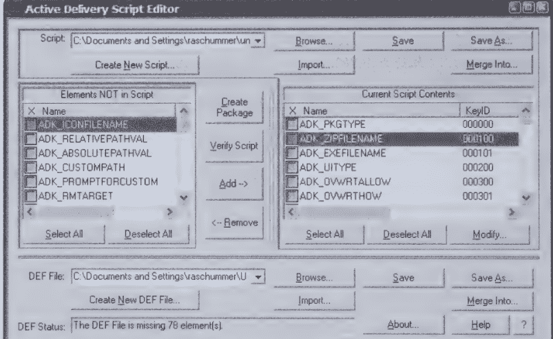

*图 1. ActiveDelivery 有一个向导用于进行初始脚本设置。这是用于修改初始设置的 ActiveDelivery 脚本编辑器。*

#### ActiveDelivery

- 一个版本
- 网站提供评估副本
- 249 美元
- Inner Media, Inc., Hollis, NH, USA
- [`www.innermedia.com`](http://www.innermedia.com)

### Ghost Installer Studio

Ghost Installer（**图 2**）是一款旨在创建紧凑的、自安装的、单文件可执行文件以安装应用程序的工具。此软件包包含一个交互式开发环境，支持依赖管理器、目录变量和项目导入功能。

创建的安装程序可以实现条件处理（基于操作系统和语言）、使用中文件覆盖、按版本和日期替换、COM 服务器注册、字体注册、系统重启、安装后应用程序修复、部分安装回滚，并在运行时根据最终用户机器的语言自动配置。它直接支持 .NET、Visual Basic、C++（Microsoft 或 Borland）、Delphi 和 JBuilder 项目。使该产品脱颖而出的地方可能是其具有可配置皮肤的能力。为希望以编程方式执行构建的开发人员提供了命令行接口和可扩展的插件 API。

WebDeploy 版本增加了对“按需安装”（仅下载尚未安装的组件）的支持。Professional 版本增加了通过注册码和 RSA 加密对分发版进行保护的功能。预计的增强功能包括对 MSI 文件的支持和自定义对话框编辑器。

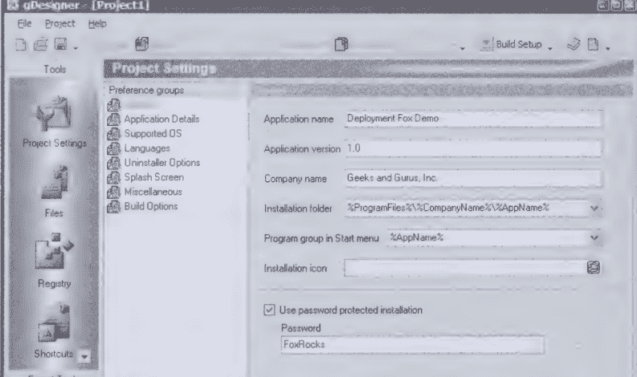

**图 2.** Ghost Installer 将项目向导与交互式用户界面相结合，用于设置生成安装包的各种属性。

#### Ghost Installer

- 分为 Standard、WebDeploy 和 Professional 版本
- 网站提供评估副本（不能保存项目，但可以逐步执行流程）
- 239 美元 – Standard，319 美元 – WebDeploy，429 美元 – Professional
- 德国慕尼黑的 gInstall Corporation
- [`www.ginstall.com`](http://www.ginstall.com)

### Inno Setup

Inno Setup 的全称是 Innovative Setup（创新安装程序）。这款安装包是免费的，在附录 D《如何操作：Inno Setup》中有更详细的介绍。它支持当今所有在用的 32 位 Windows 版本。开发者可以使用内置的脚本向导创建安装脚本，然后编辑和维护生成的脚本文件。

它支持可自定义的安装类型，如**完整**、**最小**和**自定义**，并自带卸载功能。该工具不会创建 Windows Installer 安装包；而是创建一个单独的 EXE 安装包，并使用 ZIP 文件所用的相同文件压缩方式。

安装程序能够在桌面或开始菜单创建快捷方式、生成注册表和 INI 条目、安装字体、比较文件版本信息、替换使用中的文件，以及注册 ActiveX 控件、DLL 文件和类型库。如果你有兴趣扩展或修改该产品，可以提供源代码。它是用 Borland Delphi 编写的。

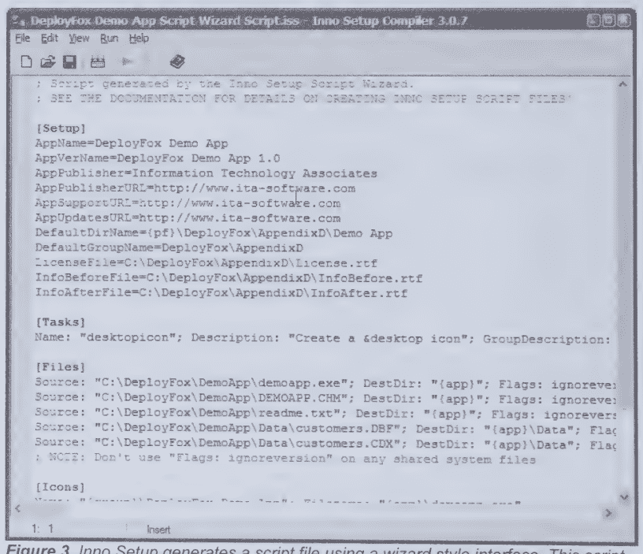

#### Inno Setup

- 单一版本
- 网站提供下载
- 免费（接受捐赠）
- Jordan Russell Software（地址不详）
- [`www.jrsoftware.org`](http://www.jrsoftware.org)

### InstaFox

InstaFox（图 4）是完全用 Visual FoxPro 编写的安装包。这款安装包在附录 C《如何操作：InstaFox》中有更详细的介绍。它支持当今所有在用的 32 位 Windows 版本。

功能包括安装向导、创建快捷方式（桌面、开始菜单、快速启动工具栏）、创建和更新 Windows 注册表条目、执行安装后例程、显示许可信息，以及可选安装 Visual FoxPro 运行时文件。你可以控制应用程序和系统文件的安装（包括版本管理和现有文件的删除）。已安装文件的文件属性（只读、隐藏和系统）会被保留。

InstaFox 与其他安装程序的不同之处在于，它可以更新 Visual FoxPro 表结构、向现有表合并新记录，或覆盖现有表。完整的源代码包含在内，因此你可以添加或修改功能。产品网站上有几篇白皮书，提供更多关于定制和使用 InstaFox 的信息，以及常见问题解答（FAQ）页面。

*图 4. InstaFox 是本篇综述中唯一完全用 Visual FoxPro 编写的安装程序。*

#### InstaFox

- 单一版本
- 无评估版
- 349 美元
- Fowler Software Design LLC，美国科罗拉多州丹佛
- [`www.fowlersoftware.com`](http://www.fowlersoftware.com)

### InstallShield

InstallShield 有多款产品可用于部署 Visual FoxPro 应用程序，以及使用 Visual Studio .NET 等其他开发工具开发的应用程序。除了本节重点介绍的产品外，InstallShield 还有一款名为 MultiPlatform 的产品，可为 AIX、HP-UX、Linux、Mac OS X、OS/400、Solaris、任何其他 UNIX 版本甚至 Windows 构建安装包。

#### InstallShield Express – Visual FoxPro 限定版

这是面向拥有 Visual FoxPro 7 或 8 许可证的开发者提供的软件包。它提供了开发者进行基本部署所需的基本功能。

该产品允许你创建具有可自定义功能和安装类型、文件选择及分配到功能、Windows Installer 合并模块、创建注册表键和设置值、创建 ODBC 数据源、处理 INI 文件以及创建文件扩展名的稳健安装包。你可以选择安装过程中出现的对话框，并设置属性来自定义这些对话框。此版本还包括自动更新服务，InstallShield 会通知你的客户有新版本可用，并向他们提供更新。此项服务需额外付费。

局限性包括：缺乏广告牌、自定义操作、动态文件链接、环境变量、全球化、导入和导出字符串、外部对象、扫描向导、文本和消息、Web 部署以及 Visual Studio .NET 支持。这些功能被禁用。有关这些缺失功能的更多信息，请参阅 InstallShield Express 帮助文件中“InstallShield Express – Microsoft Visual FoxPro 限定版的局限性”主题。

VFP 8 附带的版本增加了“升级路径”功能、支持选择 Windows XP 作为必需操作系统、运行安装后进程、修改合并模块搜索路径的功能，以及对 Windows Installer v2.0 的支持。就功能集而言，它比完整的 InstallShield Express 产品落后两个主要升级版本（截至 2003 年 10 月）。

- 单一版本
- 无评估版，随 Visual FoxPro 7/8 免费提供
- Microsoft Corporation，美国华盛顿州雷德蒙德
- InstallShield Software Corporation，美国伊利诺伊州绍姆堡
- [`www.installshield.com`](http://www.installshield.com)

#### InstallShield Express

InstallShield Express（ISE），如**图 5**所示，是不像 Microsoft 随 Visual FoxPro 提供的那样受限的版本。这款安装包在附录 A《如何操作：InstallShield Express》中有更详细的介绍。

除了 ISE – Visual FoxPro 限定版中描述的功能外，ISE 还提供项目向导、自动文件收集、对话框编辑、广泛的第三方技术支持、创建 Windows Installer 补丁文件（MSP）的能力、全球化功能（18 种语言）、创建 Internet Information Server（IIS）虚拟目录，以及 Visual Studio .NET 支持和集成。

**图 5.** InstallShield Express 的完整版本比随 Visual FoxPro 7 和 8 提供的限定版本更强大、更灵活。

- 单一版本
- 通过网站注册可获得评估版
- 349 美元
- InstallShield Software Corporation，美国伊利诺伊州绍姆堡
- [`www.installshield.com`](http://www.installshield.com)

#### InstallShield DevStudio

InstallShield DevStudio 是 2003 年中推出的全新顶级产品，它合并并取代了以前的 InstallShield Developer 和 InstallShield Professional。它支持 Windows Installer 技术（MSI）以及 InstallShield 基于自定义 InstallScript 引擎的安装程序。这是终极的强大功能，也是终极的复杂。

DevStudio 中包含而 Express 中没有的功能包括：源代码控制、Windows CE 部署、用于维护 InstallShield 项目的自动化接口、创建合并模块、XML 项目文件、项目模板、MSI 表编辑器、COM+ 支持、15 种额外的全球化语言、26 个额外的对话框、安装时的多媒体支持、64 位应用程序支持，等等。


#### InstallShield DevStudio

- 取代以前的 Developer 和 Professional 版本
- 通过网站注册可获得评估版
- 1199 美元
- InstallShield Software Corporation，美国伊利诺伊州绍姆堡
- [www.installshield.com](http://www.installshield.com)

### Setup Factory

`Setup Factory`（图 6）为所有当前 32 位 Windows 平台创建其称为“单文件、紧凑且万无一失的专业软件安装”的安装程序。该安装包允许开发者自定义向导界面，创建 CD-ROM/DVD、LAN、电子邮件和 Web 安装，而无需编辑“动作脚本”，但为更具挑战性的安装任务开放了这一强大功能。你可以编辑和创建注册表条目、INI 文件和文本配置。字体和 ActiveX 控件也可以安装和注册。完整的版本检查、文件搜索、复制、重命名、删除和属性设置都包括在内。`Setup Factory` 具有依赖项扫描器和国际化语言支持（不额外收费）。你可以在安装过程中从用户那里收集信息。它提供简单易用的项目向导和增强的 Visual Basic 项目向导。你可以将文件分配给一个或多个“包”，以便向用户呈现合乎逻辑的**完整**、**典型**、**最小**和**自定义**风格的安装。

## 第 4 章：安装工具汇总

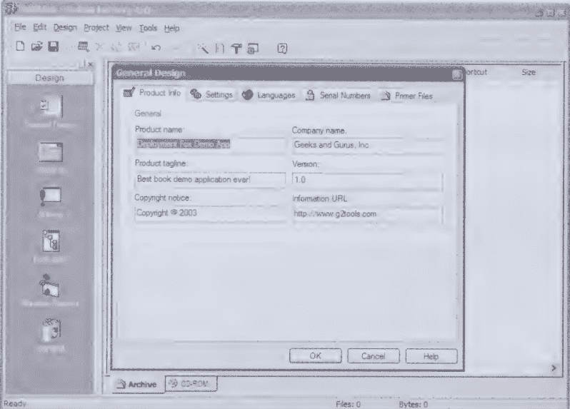

*图 6. Setup Factory 拥有全面的开发环境并能创建紧凑的部署包。*

### Setup Factory

- 单一版本
- 可通过网站提供评估版
- 395 美元
- 产自加拿大马尼托巴省温尼伯的 IndigoRose Software Design Corporation
- `www.indigorose.com`

### Tarma Installer

`Tarma Installer`（图 7）是一款自定义安装程序，它不基于 Windows Installer 技术，但与所有当前的 32 位 Windows 平台兼容。它免版税、无广告，并提供免费的技术支持。它具有向导式界面引导您开始，允许您编辑项目的所有方面，拥有 200 多项预检（preflight checks）以指出安装中的任何问题，且不需要编写脚本。

标准版（Standard version）包含基础功能，包括 ReadMe 和许可显示、创建快捷方式、处理“所有用户”问题、在安装后启动应用程序、告知目标计算机重启、执行文件版本检查、注册 ActiveX 控件以及注册 COM 服务器。

专业版（Professional version）包括标准版的所有功能，以及检查目标计算机要求、密码保护、自定义图标、升级期间卸载旧版本、外部操作、语言支持、字体和设备驱动程序注册、编辑注册表项、编辑 INI 文件设置、编辑环境变量，以及通过动态链接库（DLL）扩展安装程序的能力。`Tarma Installer` 支持基于 CD-ROM 的安装以及用于互联网下载的自解压可执行文件。您可以使用交互式用户界面创建安装包，或者如果您想通过编程方式创建，可以使用命令行界面。它附带一个详尽的、上下文相关的帮助文件。

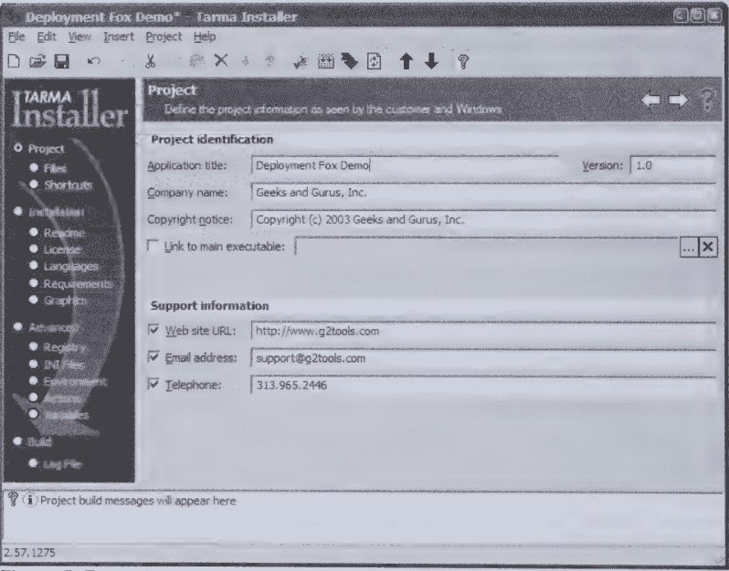

*图 7. Tarma Installer 拥有全面的开发环境并能创建紧凑的部署包。*

**Tarma Installer**

- 提供标准版和专业版
- 网站提供评估副本
- 标准版免费，专业版 99 美元（单用户）
- 产自澳大利亚墨尔本的 Tarma Software Research Pty Ltd.
- [www.tarma.com](http://www.tarma.com)

### Wise Solutions

`Wise Solutions` 拥有多款产品，可用于部署 Visual FoxPro 应用程序以及使用其他开发工具（如 Visual Studio .NET）开发的应用程序。我们在使用 `Wise Solutions` 时遇到的一个难题是，每个软件包都有太多版本，而且产品线名称多年来一直在变更。这使得在支持的部署场景中选择正确的产品变得困难，但这不应妨碍您考虑他们的任何工具产品。

#### Wise for Windows Installer

`Wise for Windows Installer`（`WfWI`）是 `Wise Solutions` 提供的各种安装程序的入口点。此安装包在附录 B“如何操作：Wise for Windows Installer”中有更详细的介绍。它提供了开发人员进行基础部署所需的基本功能。该产品允许您创建具有可自定义功能和安装类型的鲁棒安装包，包括文件选择和功能分配、快捷方式、Windows Installer 合并模块、注册表项创建和值设置、ODBC 数据源创建、INI 文件操作以及创建文件扩展名。您可以选择哪些对话框在安装过程中出现，并设置属性来自定义对话框。`WfWI` 还具有一些独特功能。您可以在 Windows NT/2000/XP 目标机器上添加 Windows 服务，以及停止、启动和删除服务。

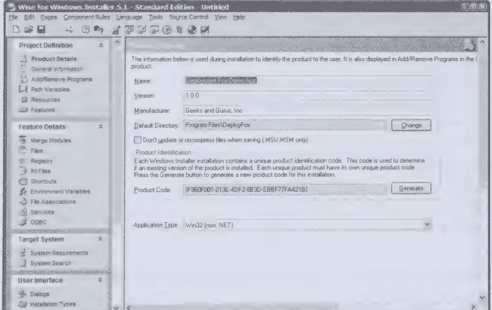

`Wise for Windows Installer` 不仅具有“安装专家”模式（如图 8 所示），还具有 MSI 脚本编辑器和安装编辑器（Setup Editor），让开发人员能更深入地查看构建安装包时所做的设置和选择。安装编辑器是底层 MSI 数据库的视图。此视图允许开发人员编辑数据库内容，并在必要时添加自定义表。其他高级功能包括用于比较 MSI 文件的 Visual MSI Difference 实用工具、创建补丁文件（MSP）以及与源代码控制提供商的集成。

**Wise for Windows Installer**

- 提供标准版、专业版和企业版
- 网站提供评估副本
- 标准版 449 美元，专业版 1199 美元，企业版 1999 美元
- 产自美国密歇根州坎顿的 Wise Solutions, Inc.
- [www.wise.com](http://www.wise.com)

#### Wise Installation System

`Wise Installation System` 是 `Wise Solution` 的一款不基于 Windows Installer 技术的安装工具。它是基于脚本的，可生成紧凑的、单文件的、自安装的可执行文件。它仍然具有“安装专家”图形界面，引导开发人员完成安装创建过程，因此不想处理脚本的开发人员可以通过设置属性、选择文件来构建简单的安装包。脚本功能赋予了开发人员对安装包的完全控制权。该产品支持对话框自定义、用户定义操作、Windows API 调用支持、自定义广告页（billboard）编辑器和运行时支持。它自带卸载程序。

它提供了开发人员在所有类型部署中所需的基础功能。该产品允许您创建具有可自定义功能和安装类型的鲁棒安装包，包括文件选择和功能分配、快捷方式、添加/删除程序支持、运行时（随附 MDAC、DAO、MSDE、VB、VFP 6 & 7、VC++、DirectX、Crystal Reports 等）、注册表项创建和值设置、字体注册、ODBC 数据源创建、INI 文件操作以及创建文件扩展名。Wise 认为该产品优于其 Windows Installer 产品线。

**Wise Installation System**

- 提供标准版和专业版
- 网站提供评估副本
- 标准版 449 美元，专业版 999 美元
- 产自美国密歇根州坎顿的 Wise Solutions, Inc.
- [www.wise.com](http://www.wise.com)

## 为什么目前的安装工具比 VFP 安装向导更好？

Visual FoxPro 3、5 和 6 中提供的安装向导（Setup Wizard）是一个基础且经常古怪的工具，只能勉强地将产品交付给客户。如果您能接受其设计限制，它勉强足够。与前一节讨论的所有工具相比，安装向导看起来已经过时，且不支持我们现在对安装包要求的许多功能。

第一个优势是，您不再需要将计划在发布中部署的所有文件复制到一个单独的目录中。现代安装程序允许您指定从开发机上的各个文件夹中分发哪些文件。您还可以指定它们在目标系统上的位置，这可以与开发目录结构不同。现代安装程序允许您将文件定向到常见的 Windows 文件夹，如 `Program Files`、`Windows System`、`Start Up`、`Windows Temp`、`Common Files`、`Start Menu`、`Send To`、`Fonts` 以及许多其他由操作系统预定义的文件夹。当前的安装程序还会在客户生产机器上运行安装程序时确定这些文件夹的位置。而安装向导仅允许应用程序文件夹和 Windows System 文件夹。

安装向导还只允许“全部文件”或“无文件”。您在这个问题上没有选择权。目前的安装程序允许用户选择想要安装的“功能”，就像典型的、全部或自定义选项一样。选择自定义允许用户进一步量身定制安装内容。您可以定义这些选项是什么，以及在指定该选项时安装哪些文件。

安装向导的安装包无法执行一些基本操作，例如在桌面上创建可选快捷方式、更新 Windows 注册表、更新 INI 配置文件、设置文件扩展名关联或创建 ODBC 驱动程序。开发人员编写了替代实用工具，使用 Visual FoxPro 可执行文件通过 `WinAPI` 调用和 Windows 脚本宿主（WSH）来操作注册表，从而消除这一缺陷。这些实用工具在安装后过程中被调用。这意味着有更多的代码需要维护和支持。使用当前的工具可以消除这种维护和支持工作。

> InstallShield Express – Limited Edition 的 VFP 7 版本中缺失的一个功能（实际上它是 Limited Edition 的“限制”之一）是它不能运行安装后过程。开发人员运行安装后可执行文件的许多原因已被集成到基础工具中，但您可能仍然希望运行某些过程来执行数据库结构更改或数据转换。用户可以手动运行这些例程，但在使用 InstallShield Express 例程时，这是他们需要记得去做的事情。

安装向导不支持 Visual FoxPro 7 和 8 的运行时。安装向导中关于包含运行时的选择仅知道您当前运行的 Visual FoxPro 版本的运行时。如果您需要这些更新的运行时，则需要将 DLL 文件包含在分发树中。

## 部署工具选择过程

`Geeks and Gurus` 在 2001 年 4 月成立公司后不久就感受到了对部署工具的需求。我们的第一个大规模部署应用程序（也就是说：在客户所在地部署在多台计算机上）在 9 月份准备交付。在 5 月份，即在获得第一个要求完整安装包的合同后，我们立即开始寻找我们将用于标准化的部署工具。

### 考虑的产品

2001 年时可用的产品与我们今天看来已经有所不同。当时的清单基于两个标准之一：要么是我们之前在工作中用过该产品，要么是我们与其他开发人员交流，了解他们在以往项目中成功使用了什么。我们将名单缩小到以下产品（按字母顺序排列）：

- 由 `InnerMedia` 提供的 `ActiveDelivery`（`www.innermedia.com`）
- InstallShield Express 3 – VFP Limited Edition（由 Microsoft 随 VFP 提供）
- InstallShield Express v3.5（由 InstallShield 提供 `www.installshield.com`）
- 此前由 `20/20 Software` 提供的 `PC Install`
- 由 Wise Solutions 提供的 `Wise InstallBuilder 8.1`（`www.wise.com`）

其中几乎所有产品在今天依然可用。`PC Install` 此前由 `20/20 Software`（`www.twenty.com`）提供，但我们认为它已经不再可用，因为他们的网站没有响应，且我们在所有热门的开发产品采购网站上都找不到它。`Wise InstallBuilder` 后来演变成了 `Wise Installation System`。

这些产品在各自的下载站点都提供评估副本。因此，我们利用这一点，通过使用每款工具并配合一个模拟项目进行了快速对比，因为当时我们目前的项目尚未开发完成。

### 做出选择

首先，我们考虑了 InstallShield Express – VFP Limited Edition（ISE-LE）的 Beta 版。Visual FoxPro 7 当时尚未发布，但我们预计在项目完成时它会发布。我们选择该产品有三个原因：Microsoft 免费分发它；它优于 VFP Setup Wizard；它满足了我们的大部分最低要求（除了自定义操作，这对本项目并非必需，且我们很少使用）。ISE-LE 消除了一些我们之前评估过的旧版 InstallShield Express 的限制。主要改进是增加了 `DATABASEDIR` 属性，允许第二次目录提示，这样用户可以将数据定向到不同的目录（而不仅仅像 VFP Setup Wizard 那样只能定向到应用程序目录）。

在内部构建版本的测试过程中，我们（相当偶然地）发现 Limited Edition 确实非常有局限性，因为它禁用了“升级路径（Upgrade Path）”功能（图 9）。这基本上意味着当发布第二个版本时，用户需要在安装升级版之前卸载之前的版本。这是不可接受的，因为我们计划在逐步引入新功能时发布多个构建版本。需要注意的是，Microsoft 已与 InstallShield Express 产品团队合作，将此限制从随 Visual FoxPro 8 分发的 Limited Edition 中移除。

> 我们在第 5 章“Windows Installer 深入解析”的“更新、升级和补丁”部分中，提供了关于处理 Windows Installer 升级路径功能的详细信息和方法。

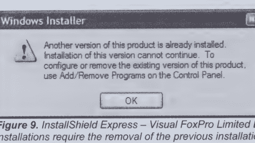

*图 9. InstallShield Express – Visual FoxPro Limited Edition (来自 VFP 7) 的安装要求在重新安装前删除之前的安装。*

就在我们的产品接近 Beta 阶段时，我们意识到了这一限制，因此不得不匆忙寻找一个可接受的替代方案。

### 先选 Wise InstallBuilder，后选 Wise Installation System

根据我们的评估，我们转向了 `Wise InstallBuilder 8.1`。它能够识别 VFP 运行时，满足了我们所有的最低要求，以及除合并模块（merge modules）之外的所有可选要求。我们利用其脚本功能和对话框编辑器（以满足客户要求的数据目录选择）为客户创建了安装程序。它易于学习，且比 InstallShield Express – VFP Limited Edition 包功能强大得多。在软件包交付当天，我们就完成了安装程序的创建。

在我们购买后不久，Wise 将 `InstallBuilder 8.1` 升级到了 `Wise Installation System 9.0`，因此我们获得了免费升级。我们毫无问题地更新了项目。我们的满意度极高，当时我们就知道自己做了一个正确的决定。其技术支持非常出色，而且我们发现的另一个优势是 Wise Solutions 位于底特律郊区，就在我们的家门口。你会获得同样优秀的支持；他们对待当地人的方式与对待底特律以外地区的人完全一样。

## 变、变、变（Ch-Ch-Ch-Changes）

我们的软件安装包经历了几次更新，每次生成安装过程都轻而易举。然后有一天，我们的客户（另一家开发公司）打来电话，提出了一个起初看起来无关紧要但最终变成噩梦的问题。他们有一个安装环境，多个用户在安装了 Windows 2000 的同一台机器上共享。他们发现必须为每个用户安装一次应用程序。这是因为安装过程为当前用户创建了注册表项。

我记得我对客户说的话是：“没问题。”我给 Wise Solutions 的技术支持打电话，他们指出 `Installation System` 不支持该功能，但“较弱”的 `Wise for Windows Installer` 可以。没问题。我给了他们信用卡号并下载了软件包。该功能确实可用，但在让 `DATABASEDIR` 功能正常工作方面，我们吃尽了苦头。Wise for Windows Installer 虽然有基础的脚本和对话框创建功能，但尽管 Wise 的技术支持人员花了一周时间帮我，我仍然无法使其正常工作。编辑器和编译安装程序之间的脚本存在一个怪癖。我花了 40 多个小时尝试使其工作，这 40 多个小时是无法计费的。

我给 Wise Solutions 打的最后一个电话是为了看看 `Installation System` 是否能实现“所有用户（All Users）”安装。这次的销售人员提到有一个我们可以购买的插件。不幸的是，它采用的是按席位（per-seat）许可方案。多少钱？销售员说每个席位仅 4 美元。我们的客户席位不多（不足 100 个），所以我认为应该止损并支付 400 美元。遗憾的是，销售员告诉我，我需要购买最少 1000 个席位，即 4000 美元。我绝不可能支付 4000 美元，而且之后还要增加额外的管理工作来跟踪这些许可。是时候寻找另一个解决方案了。

## InstallShield Express（完整版）

我们给 InstallShield 打电话，确认完整版中是否提供“所有用户”功能（Limited Edition 中没有）。销售团队确认确实包含该功能。在产品到达当天，我们在不到 3 小时内（包括测试）创建了与 Wise Installation System 中相同的安装程序。


InstallShield Express 的问题在于，尽管产品中的措辞相反，但实际上并没有从 Limited Edition 升级到完整版的付费升级路径。当我联系销售人员时，我发现我需要支付全额价格。如果它能工作，我并不介意这样做，但让我犹豫的是其营销原则。尽管如此，我还是购买了它，因为这比浪费更多时间尝试让其他产品正常工作要便宜。

> Fox 社区的几位开发人员向 Microsoft 表达了对升级过程的不满。Fox 团队将这些顾虑转达给了 InstallShield Express 产品团队。这次讨论的结果是，在 2002 年 3 月向 VFP 开发人员提供了一次短暂的 100 美元升级折扣。遗憾的是，对于现在购买 Visual FoxPro 7 或 8 的开发人员来说，该优惠已不再适用。InstallShield 网站引导你与产品顾问沟通，查看是否有从 Limited Edition 升级的特殊优惠。

## 再次吸取的教训

我们发现这次选择非常令人满意，为 InstallShield Express 完整版付费是值得的。我们克服了对“无法升级”的抵触，并始终认为能为我们节省时间和金钱的专业工具是非常值得投资的。如果你能从这个故事中学到一点，我们希望那就是：开发人员的工具箱中可以拥有多种工具，并根据部署要求为具体工作选择最合适的工具。

## 结论

市场上有许多安装工具可供选择。这些工具各自提供的功能、易用性，以及部署解决方案时的表现，应该是决定哪些工具最适合你开发工作的最重要因素。

本章列举了当今安装工具的功能，讨论了特定安装工具产品的功能，解释了为什么安装向导已基本淘汰，并分享了一个开发团队如何选择几款安装工具来满足不同部署场景的故事。我们强烈建议你在需要创建第一个安装程序之前就确定需要哪种或哪些工具。等到首次部署前一晚才开始准备，只会是一场灾难。

本章的更新和勘误可在 Hentzenwerke 出版社的网站 [`www.hentzenwerke.com`](www.hentzenwerke.com) 上找到。点击"Catalog"，然后导航到本书的页面。

# 第 5 章

## Windows Installer：成熟且开放的软件安装解决方案

Windows Installer 是微软提供的可靠、标准化且开放的软件安装解决方案。像 InstallShield Express（随 Visual FoxPro 一起发布）这样的工具可以为 Windows Installer 构建安装包。虽然在使用基于 Windows Installer 的安装工具时，即使对 Windows Installer 本身知之甚少甚至一无所知也是可能的，但当你对 Windows Installer 的工作原理有一定了解时，你使用这些安装工具的熟练程度和效率会显著提高。本章将帮助你获得这种理解。

随着 Visual FoxPro 7 的发布，微软放弃了熟悉的 VFP 安装向导，取而代之的是 InstallShield Express 特别版，从而将 VFP 开发者引入 Windows Installer 的世界——无论他们是否意识到这一点。当你使用基于 Windows Installer 的安装开发工具（如 InstallShield Express、InstallShield Developer 或 Wise for Windows Installer）时，你实际上是在构建一种特殊的数据库，其中包含安装应用程序所需的指令和需求。当你从 Windows Installer 安装包安装软件时，你调用 Windows Installer 服务，让它读取安装数据库并按照其中包含的指示来安装软件。

Windows Installer 是一项复杂的技术。对其深入的讨论足以填满一整本书，事实上，这样的书已经不止一本了。这些书的目标读者通常是系统管理员和全职安装开发人员——那些需要彻底理解该主题的人，他们可能会专门从事这一领域，或者至少花费大量时间与之打交道。

另一方面，本书的目标读者是像你这样的应用程序开发人员。如果你使用 Visual FoxPro 开发应用程序，很可能你首先是一名应用程序开发人员，其次才是安装开发人员，而后者只是因为你需要了解足够的知识来将应用程序分发给最终用户。如果你正在使用基于 Windows Installer 的安装工具来部署应用程序，你可能希望学习足够的 Windows Installer 知识，以便舒适有效地使用该工具，而无需成为全职安装开发人员。

应用程序开发人员首次使用基于 Windows Installer 的安装工具规划和部署应用程序时遇到的许多挫折，与 Windows Installer 本身的问题有关，而不是所使用的特定安装工具的问题。对 Windows Installer 技术基础的扎实理解有助于你避免这些挫折，并充分利用你喜欢的基于 Windows Installer 的安装工具。

## Windows Installer 概述

> 生活其实很简单，但人们执意要把它弄复杂。——孔子

> 如果能找到让它变得复杂而奇妙的方法，就不要简单地构建任何机制。
>
> ——佚名

Windows Installer 是从早期软件安装方法的长期发展演变而来的。我们将简要回顾软件安装技术的演变历程，以便你在这一背景下理解 Windows Installer。

### 软件安装的演变

最初，有 DOS。在那些日子里，安装应用程序主要是将文件从软盘复制到 `C:` 盘。这通常只需要使用 `COPY` 命令，或者可能是 `XCOPY` 命令，也许再加一个批处理文件来运行它。一个应用程序只要存在于硬盘上就算"安装"了。卸载应用程序同样简单：你所做的只是删除应用程序目录中的文件。每个应用程序都是一个独立的实体，几乎不与它自己目录之外的任何东西交互。那时生活更简单，开发人员不必过多考虑如何安装他们的应用程序。

随着 Windows 和 32 位计算的出现，应用程序变得更加强大和有用，但也更加复杂。应用程序现在包含比以往更多的文件，并且通常被设计为一组协作的组件。其中一些组件可能是该应用程序独有的，而另一些可能与同一台计算机上的其他应用程序共享。对于一个应用程序被认为是"已安装"的，不仅应用程序自身的文件需要存在于硬盘上的正确位置，而且任何公共组件也必须存在，并且任何需要它们的应用程序都能访问它们。这样的公共组件可能已经存在于目标机器上，也可能不存在，这意味着你的应用程序可能需要也可能不需要安装它们。这个和其他考虑因素意味着，为了认为一个应用程序是"已安装"的，操作系统必须知道它的存在。

卸载当然也变得更加复杂。你不再能通过删除安装目录中的所有文件来简单地卸载软件。现在你必须能够识别并移除仅属于应用程序本身的内容——它的文件、快捷方式、注册表项等——同时保留其他应用程序使用的组件。这意味着安装过程需要构建并维护一份它所做过的事情的记录，这样在卸载应用程序时它就知道该撤销什么。

同样，这意味着操作系统本身必须参与跟踪应用程序是否已安装，以及某个特定组件是否为多个应用程序所共有。简而言之，计算机变得有状态了。当新的软件应用程序被安装时，计算机呈现出反映这一事实的新状态。当应用程序被卸载时，计算机（理想情况下）恢复到安装前的状态，至少就该应用程序而言是如此。

到目前为止一切顺利，但如果安装中途失败，或者卸载时删除了文件却留下了快捷方式或注册表项呢？计算机可能处于不稳定状态，应用程序的某些部分存在，而其他部分不存在，而且没有任何人能够确切知道发生了什么。

于是，对更好的安装软件的需求出现了。更新更好的安装工具使得开发复杂的安装场景成为可能，这些场景能够以很高的可靠性安装应用程序软件。这些工具通常还为最终用户提供了一个简单、交互式的流程，以便他们在安装或卸载应用程序时遵循。

由于这些工具由第三方独立开发，每个工具自然都有自己的方法。这产生了两个重要后果：一个安装设置程序生成的部署包可能以截然不同的方式处理安装任务，而另一个安装设置程序生成的部署包；无论如何，对最终用户而言，部署包都是一个黑箱。第二个问题尤其令网络管理员担忧，因为他们当然负责确保其网络上的所有计算机都保持在可靠和一致的状态。谁知道一个 rogue 安装包会做什么，或者如果它未能完成或安装不当，可能会造成什么破坏？

所以，最终，Windows Installer 登场了。

### Windows Installer 的到来

Windows Installer 最初是为部署 Microsoft Office 而开发的。它是为了满足这样一种需求而创建的：使像 Office 这样的复杂应用程序能够作为一套协作组件来安装，而不是作为单一的庞大应用程序或一系列脱节的独立应用程序。

然而，微软对 Windows Installer 的愿景远远超出了其内部使用。一段时间以来，系统管理员一直表达了需要一种基于标准、开放架构的安装技术，而不是作为黑箱运作的技术。Windows Installer 安装文件基于关系数据库模型且结构公开发布并完整记录这一事实，以及系统管理员和其他"现场"人员能够查看和修改 Windows Installer 安装程序，都是这些设计目标的直接结果。

Windows Installer 1.0 版用于 1999 年 6 月发布的 Office 2000。此后不久，Windows Installer 被集成到 Windows 操作系统本身中。Windows Installer 1.1 版作为 Windows 2000 的组成部分发布，同时也作为可再分发组件用于较旧版本的 Windows。1.1 版引入的变化包括处理升级和安装 COM+ 组件的新功能。Windows Installer 1.2 版随 Windows Millennium Edition (Me) 发布，并包含对 Windows Me 系统文件保护的支持。Windows Installer 的当前版本 2.0 版随 Windows XP 发布。Windows Installer 3.0 版目前正在测试中。

简而言之，Windows Installer 现在是 Windows 2000、Windows Me 和 Windows XP 的原生组成部分，也可作为附加组件用于 Windows 95、Windows 98 和 Windows NT。因此，Windows Installer 可以处理所有 32 位 Windows 平台上的应用程序软件安装，并且从 2.0 版开始，它还可以支持 64 位 Windows 应用程序。

### Windows Installer 设计目标

Windows Installer 旨在实现几个重要目标。其中包括：

- 创建一个用于安装软件的开放架构。
- 为所有应用程序实现标准化的安装流程。
- 管理共享资源。
- 允许用户选择他们想要安装的应用程序部分。
- 在安装期间和安装后维护计算机的状态完整性。
- 允许对安装进行自定义。
- 允许网络管理员在整个组织的"锁定"桌面上安装软件。
- 提供对已安装软件进行修改、修复和删除的机制。

这是一个雄心勃勃的列表。让我们看看 Windows Installer 是如何实现这些目标的。

#### 开放架构

正如我们之前提到的，在 Windows Installer 出现之前，安装包对于最终用户或系统管理员来说往往是黑箱。通常无法确切知道某个安装程序会对系统做什么，更不用说有任何修改它的方法了。使用这样的安装包安装应用软件本质上意味着信任安装工具——而且，可能更重要的是，信任安装开发人员——能够正确完成。

不幸的是，事情并不总是正确的，而出错的后果，特别是在网络工作站上，可能会很糟糕。例如，安装可能无法正确注册其组件，或者可能用旧版本覆盖当前版本的共享 DLL。卸载程序可能会删除其他应用程序仍然需要的组件，或者可能会从文件服务器删除数据文件，即使这些文件包含实时数据并且仍被其他用户使用。这些情况可能是真正的生产力杀手，更不用说修复它们很昂贵，特别是在需要请系统管理员进来，而且可能需要花费数小时试图弄清楚发生了什么的时候。

此外，安装开发人员很难（如果不是不可能的话）预见到应用程序可能需要安装的各种环境。刚性的安装包将预见所有可能场景的全部负担都放在安装开发人员身上，而开放、灵活的安装包使本地系统管理员能够在必要时对安装过程行使一定的控制。

Windows Installer 通过为安装包使用开放架构来解决这些问题。在本章后面，我们将详细探讨 Windows Installer 安装包的内容，这样做时你会发现任何人都可以打开 Windows Installer 安装包，查看里面的内容，了解它的作用，甚至在必要时进行更改。

#### 标准化安装

Windows Installer 作为操作系统的一项服务运行。因为 Windows Installer 安装包的结构是标准化的，而且所有 Windows Installer 安装包都由 Windows Installer 服务处理，所以每个应用程序的安装都以标准化的方式处理。这消除了流氓安装程序因不当处理安装任务（如管理共享资源）而导致计算机不稳定或甚至无法使用的风险。

#### 管理共享资源

共享资源是指计算机上被多个应用程序使用的资源。在此上下文中，"资源"一词通常指程序组件，如 DLL 文件和 ActiveX 控件。VFP 运行时文件就是共享资源的一个很好例子。Windows Vista 的一个目标是显著改善共享资源的管理，并终结 "DLL 地狱"——这是当安装程序用不兼容或过时的版本覆盖共享 DLL 时，或者当卸载程序删除另一个程序仍在使用的 DLL 时所发生情况的通俗名称。无论哪种情况，结果都是另一个应用程序被破坏。

Windows Installer 以多种方式解决这个问题。它在安装期间以这种方式管理公共资源的注册：如果安装被取消或未能完成，它可以回滚这些注册。Windows Installer 不仅跟踪使用共享资源的程序数量，还跟踪哪些特定程序正在使用它。

#### 选择安装内容

Windows Installer 安装按称为功能和组件的功能构建块进行组织。将产品组织为功能使用户或系统管理员能够选择他们想要安装的产品部分，而将应用程序的文件和其他资源分组为组件使开发人员能够控制需要安装什么来实现每个功能。我们将在本章后面详细介绍功能和组件。

#### 管理状态完整性

Windows Installer 将产品安装视为数据库事务：要么整个产品成功安装，要么完全不安装。为了实现这一点，Windows Installer 在安装期间维护临时文件，以便如果安装失败或被取消，它可以执行回滚到计算机安装前的状态。如果安装成功，Windows Installer 执行相当于数据库事务"提交"的操作，然后删除其临时文件。这保证了计算机要么完全更新到所需的安装后状态，要么完全恢复到安装前的状态。

#### 自定义安装

Windows Installer 提供了一种称为"转换"（transforms）的机制来自定义安装。转换是一组应用于安装数据库的更改，通常在安装时进行，以修改安装。这主要是供系统管理员使用的，例如，他们可能想要在安装期间限制用户可以选择的功能集。转换的另一个用途是使安装能够针对不同的语言进行本地化。

#### 在锁定桌面上安装

在 Windows Installer 出现之前，系统管理员面临的关键挑战之一是如何在整个组织部署软件，而不必亲自访问每个桌面。当软件安装需要管理员权限时，这尤其困难，而管理员权限当然通常不会授予最终用户。Windows Installer 通过采用客户端/服务器模型来解决这种情况，其中用户界面和某些安装前任务在客户端以用户上下文运行，而核心安装任务——复制文件、写入注册表项等——在服务器端以提升的权限在系统上下文中运行。这使用户能够执行需要通常不授予他们的权限的安装，同时让系统管理员控制整个过程。

#### 修改、修复和删除

成功安装产品后，可能会发生以下几种情况中的任何一种，需要再次访问安装包：应用程序可能损坏，如果需要修复文件被删除则需要修复；用户可能想要安装最初未安装的功能；或者用户可能决定完全卸载应用程序。Windows Installer 通过在安装期间在本地计算机上缓存 MSI 文件的副本来为这些情况做准备。这些缓存文件通常位于 `{Windows}\Installer` 文件夹中。

如您所料，Windows Installer 使用注册表来存储有关其所安装产品的信息。此信息包括缓存的 MSI 文件的文件名和位置。**图 1** 显示了从示例应用程序安装中获取的注册表信息。缓存包的文件名和位置显示为"LocalPackage"值。

> 在此作者的 Windows 2000 机器上，图 1 所示的注册表项位于 `HKLM\Software\Microsoft\Windows\CurrentVersion\Installer\UserData\S-1-5-18\Products\2146ECB43F287D1138680005AD468B15\InstallProperties`。如果您认为此路径的最后部分看起来像 GUID，您是对的——它是此应用程序产品代码 GUID 的打乱版本。有关 Windows Installer GUID 的信息将在本章后面讨论。

| 名称 | 类型 | 数据 |
| :--- | :--- | :--- |
| （默认） | REG_SZ | （值未设置） |
| AuthorizedCDDPrefix | REG_SZ | |
| Comments | REG_SZ | DeployFox Demo App version 1.0.0 |
| Contact | REG_SZ | Customer Support Department |
| DisplayName | REG_SZ | DeployFox Demo Chapter 5 Demo App |
| DisplayVersion | REG_SZ | 1.0.0 |
| EstimatedSize | REG_DWORD | 0x000030e4 (12516) |
| HelpUrl | REG_EXPAND_SZ | http://www.mycompany.com/help |
| HelpTelephone | REG_SZ | 1-555-555-1234 |
| InstallDate | REG_SZ | 20030816 |
| InstallLocation | REG_SZ | |


| `InstallSource` | `REG_SZ` | `C:\DeployFox\MySetup\DeployFox Demo Chapter 5 Demo App v100\Express(CD_ROM)\DiskImages\DISK1` |
| `Language` | `REG_DWORD` | `0x00000409 (1033)` |
| `LocalPackage` | `REG_SZ` | `C:\WINNT\Installer\10116C29.msi` |
| `ModifyPath` | `REG_EXPAND_SZ` | `MSIExec.exe /I{B4CE6412-82F3-11D7-836E-0050DA648B51}` |
| `Publisher` | `REG_SZ` | `My Company` |
| `ReadmeFile` | `REG_EXPAND_SZ` | `C:\DeployFox\Demoapp\readme.txt` |
| `Size` | `REG_DWORD` | `0` |
| `UninstallString` | `REG_EXPAND_SZ` | `MsiExec.exe /X{B4CE6412-82F3-11D7-836E-0050DA648B51}` |
| `UrlAbout` | `REG_SZ` | `http://www.mycompany.com` |
| `UrlUpdateInfo` | `REG_SZ` | `http://www.mycompany.com/updateinfo` |
| `Version` | `REG_DWORD` | `0x10000000 (16777216)` |
| `VersionMajor` | `REG_DWORD` | `0x00000001 (1)` |
| `VersionMinor` | `REG_DWORD` | `0x00000000 (0)` |
| `WindowsInstaller` | `REG_DWORD` | `0x00000001 (1)` |

**图 1.** *这是从演示应用程序安装中获取的注册表信息。缓存的 MSI 文件的名称和位置存储在 `LocalPackage` 值中。*

当您使用“添加/删除程序”小程序来更改或移除已安装的产品时，Windows Installer 会获取 MSI 文件的缓存副本。在无需访问原始 CD 或其他安装源介质的情况下，即可执行产品的修复或移除。但是，如果用户选择安装最初未安装的功能，则需要原始 CD 或其他源介质，因为新功能所需的资源在原始安装期间并未被缓存。

## 使用 Windows Installer

### Windows Installer 服务

从 Windows 2000 开始，Windows Installer 服务成为操作系统的一部分。Windows 2000 最初发布时附带了版本 1.10 的 Windows Installer。截至本文撰写时，最新版本的 Windows Installer（即版本 2.0）可从 Microsoft 下载，作为适用于 Windows 2000 以及 Windows NT 4.0、Windows 95、Windows 98 和 Windows Me 的可再发行组件。Windows XP 已包含版本 2.0 的 Windows Installer。

作为应用程序开发人员，您很可能需要将应用程序分发给使用安装了较旧版本 Windows 操作系统的计算机的用户，并且您不能依赖这些计算机上已安装 Windows Installer。为了解决这种可能性，您可以选择将 Windows Installer 本身包含在产品的安装包中。如果 `SETUP.EXE` 检测到目标计算机上尚未安装 Windows Installer，它会先安装 Windows Installer，然后再安装您的应用程序。

Windows Installer 可执行程序是 `MSIEXEC.EXE`。此程序读取 MSI 文件并解释其中包含的指令，以执行应用程序的安装。当您右键单击 MSI 文件并选择“安装”、“修复”或“卸载”时，您就是在运行 `MSIEXEC.EXE`。如果您从 Windows Installer 安装可执行文件（通常是 `SETUP.EXE`）安装软件，在从安装包中提取 MSI 文件和其他安装资源之后，`MSIEXEC.EXE` 程序将被调用。

`MSIEXEC.EXE` 也具有命令行界面。您可以使用命令行界面向安装程序传递参数，以控制其处理安装的方式。有关更多信息，请参阅本章后面的“Windows Installer 可执行程序”部分。

## Windows Installer SDK

Windows Installer 软件开发工具包 (SDK) 是一组用于处理 Windows Installer 文件的工具。它是 Platform SDK 的一部分，可从 Microsoft 在 `http://www.microsoft.com/msdownload/platformsdk/sdkupdate/` 下载。

> Windows Installer SDK 是一个相对较小的 8.4MB 下载包。但是，根据您的操作系统和已安装的内容，您可能还需要下载 Core SDK 以及其他几个依赖项，这会使下载的总大小超过 260MB。作为替代方案，您可以支付少量费用订购 SDK 的 CD。SDK 也可通过 MSDN Universal 订阅获取。有关获取完整 SDK 各种方式的信息，请访问 `http://msdn.microsoft.com/library/default.asp?url=/library/en-us/sdkintro/sdkintro/obtaining_the_complete_sdk.asp`。

如果您使用基于 Windows Installer 的安装工具（例如 InstallShield Express），则无需 Windows Installer SDK 即可构建和维护 Windows Installer 安装包，但该 SDK 包含许多有用的工具。其中最重要的是 Orca，即 Windows Installer 数据库编辑器。我们将在本章的其余部分大量使用 Orca，并且我们将在本章的下一节中更详细地了解 Orca，包括有关如何安装它的信息。

Windows Installer SDK 中包含的其他工具包括一对可用于创建 Windows Installer 补丁的文件。程序 `MsiMsp.EXE` 与 `PATCHWIZ.DLL` 结合使用，可用于生成补丁包。如果您使用的安装工具（例如随 Visual FoxPro 附带的 InstallShield Express 版本）本身无法创建补丁包，这将特别有用。SDK 中其他有用的工具包括用于合并两个数据库、生成转换以及分析 Windows Installer 日志文件的工具。

鉴于所有这些工具都作为 Windows Installer SDK 的一部分免费提供，您可能会问自己，为什么还需要其他工具（例如来自 InstallShield 或 Wise 的工具）来创建和维护您的 Windows Installer 安装包？答案与回答“为什么您的用户需要您的应用程序而不是直接使用 VFP 本身？”这个问题的答案相同。当然，答案是使用安装工具（如 InstallShield Express、InstallShield Developer 或 Wise for Windows Installer）使您更轻松地创建和维护 Windows Installer 安装包，就像使用您的应用程序使您的客户更轻松地创建和维护他们的数据库一样。

### Orca

Orca 是 Windows Installer 数据库编辑器。在处理 Windows Installer 文件时，它是一个不可或缺的工具。Orca 赋予您强大的能力：您不仅可以使用它来打开和查看 Windows Installer 数据库 (MSI) 文件和合并模块 (MSM) 文件，还可以使用它来编辑这些文件的内容。不用说，直接修改 Windows Installer 数据库只有在您确定知道自己在做什么时才应该做（但当然，在阅读本章之后，您就会知道！）。

安装 Windows Installer SDK 后，您可以在 `Program Files\Microsoft SDK\Bin` 中找到 Orca 安装文件 `ORCA.MSI`。要安装 Orca，请右键单击 `ORCA.MSI` 并从快捷菜单中选择“安装”。安装 Orca 后，您可以右键单击 MSI 文件并从快捷菜单中选择“使用 Orca 编辑”。您也可以从“开始”菜单运行 Orca，并使用 Orca 的“文件 | 打开”菜单打开 MSI 文件。

使用 Orca 时需要注意的一点是，即使您未对文件进行任何更改，Orca 也会更改文件的“修改日期”。这看起来可能无害，但您需要小心，因为文件的“修改日期”是 Windows Installer 在确定安装更新时是否覆盖文件时使用的版本控制规则的一部分。在处理无版本文件时，Windows Installer 假设“修改日期”与“创建日期”不同的文件自安装以来已更新，在这种情况下，默认行为是不替换文件。有关 Windows Installer 如何确定替换哪些文件的更多信息将在本章后面的“安装期间的版本控制规则”部分中介绍。

> 重要提示！除非先进行备份，否则窥探另一个供应商的 MSM 文件可能不是个好主意。VFP 7 的 SP1 更新就是一个很好的例子。VFP 7 SP1 版本包含一个更新的 VFP 运行时文件合并模块。这个新的合并模块与原始合并模块具有相同的文件名 (`VFP7RUNTIME.MSM`)。SP1 合并模块的修改日期为 2002年1月4日。如果您在 2002年1月4日之后但安装 SP1 之前，在 Orca 中打开了原始 VFP 7 运行时合并模块，那么它的修改日期将晚于其创建日期。因此，当您安装 VFP 7 SP1 时，新的 SP1 合并模块将不会被复制到您的计算机上，因为计算机上已有的那个似乎已由您更新过。合并模块不是版本化文件，因此 Windows Installer 依赖“创建日期”和“修改日期”来确定它是否已更新，从而确定哪一个应该优先。

### Visual Studio Installer

Visual Studio 6 附带了一个名为 Microsoft Visual Studio Installer 的工具，该工具用于创建 Windows Installer 安装包。同时，还提供了 VFP 6 运行时文件的合并模块，使您能够为 VFP 6 应用程序创建 Windows Installer 安装包。已经有一些关于如何操作的论文，您中的一些人可能已经尝试过或实际上使用了 Visual Studio Installer 来部署您的 VFP 6 应用程序。

应用程序，但我们猜测大多数 VFP 开发人员继续使用安装向导，直到 VFP 7 出现，他们才被迫做出改变。尽管如此，Visual Studio Installer 是您可用于创作 Windows Installer 安装包的工具之一。

> Visual Studio Installer 仍可从 Microsoft 下载，地址为 `http://msdn.microsoft.com/vstudio/downloads/tools/vsi11/download.aspx`。您必须是 Visual Studio 6.0 或其至少一个开发工具的许可用户，才有资格下载此软件。有关在 VFP 6.0 中使用 Visual Studio Installer 的教程，请访问 `http://msdn.microsoft.com/library/default.asp?url=/library/en-us/dnfoxgen/html/vfpvsit.asp`。

## 第三方 Windows Installer 工具

大多数 VFP 开发人员首次真正接触基于 Windows Installer 的安装工具，可能是以 InstallShield Express Limited Edition for Visual FoxPro 的形式出现的，它随 VFP 7 的发布而推出。

如今市场上有许多安装工具，可让您构建和使用 Windows Installer 安装包。当 Windows Installer 服务首次创建时，Microsoft 与两家公司——InstallShield 和 Wise Solutions, Inc.——合作开发用于构建 Windows Installer 包的安装工具。随着 Windows Installer 本身的演进，这些工具以及其他第三方 Windows Installer 安装工具也不断发展。

Visual FoxPro 8.0 配备了比 VFP 7 功能更全面的 InstallShield Express 版本。在许多情况下，它可能是您唯一需要的安装工具。但是，如果您的安装要求更高，您可能需要升级到完整版的 InstallShield Express（截至本文撰写时为 4.0 版），甚至是功能更全面、价格更高的工具，如 InstallShield Developer 或 Wise for Windows Installer。

## Windows Installer 安装包的结构

> 保持简单。尽可能简单，但不要过于简单。——*阿尔伯特·爱因斯坦*

Windows Installer 安装包存储在扩展名为 MSI 的文件中（我们假设 MSI 代表 Microsoft Installer，尽管我们实际上并未在任何地方看到此文档记录）。其他文件扩展名与其他类型的 Windows Installer 文件相关联。**表 1** 列出了一些常见的 Windows Installer 文件扩展名。

## 表 1. Windows Installer 常用的文件扩展名。

| 文件扩展名 | 文件说明 |
| :--- | :--- |
| `.msi` | Windows Installer 数据库 |
| `.msm` | Windows Installer 合并模块 |
| `.msp` | Windows Installer 修补程序文件 |
| `.mst` | Windows Installer 转换文件 |

要了解 MSI 文件中内部是什么，您需要了解应用程序的不同部分在 Windows Installer 安装包中是如何组织的。这里需要介绍一些新术语。首先，您应该开始将您的应用程序视为一个"产品"。Windows Installer 安装、更新和卸载产品。产品具有名称、版本号和其他属性，用于标识它们并将其与其他产品区分开来。我们将在本章稍后详细讨论其中许多属性。然而，关于产品，首先要了解的是它们由特性和组件构成。

## 特性和组件

特性和组件是 Windows Installer 安装包中产品的基本组织元素。特性是从最终用户角度看到的产品功能部分（图 2）。另一方面，组件代表从开发人员角度看到的应用程序结构部分。特性和组件都是逻辑容器。在 Windows Installer 安装包内部，它们被排列形成层次结构：一个产品包含一个或多个特性，一个特性包含一个或多个组件，一个组件包含一个或多个资源。

如果您要使用 Windows Installer 部署您的产品，您将不得不在开始设计时就以特性和组件的角度来思考您的应用程序。这似乎在一开始可能显得陌生和不熟悉，您可能会想推迟到部署时被迫处理它的时候。然而，您在开始设计时就采用这种视角会好得多，因为如果您等到部署时，很可能会发现自己希望当初采用了不同的做法。

### 特性

特性是产品的一个功能部分。例如，一个特性可能包含应用程序的主可执行文件及其相关文件，如 INI 文件、DLL、FLL 等。第二个特性可能是应用程序的帮助文件，第三个特性可能是生成 PDF 输出的模块。

某些特性可能是必需的，而另一些可能是可选的。此决定由安装开发人员与应用程序开发人员共同做出。在前一段的示例中，第一个特性是必需的，而其他两个特性可以是可选的。如果执行自定义安装，Windows Installer 允许最终用户决定是否安装一个或两个可选特性。

#### Microsoft Office XP 安装

#### Microsoft Office XP 小型企业版

为所有 Office 应用程序和工具选择安装选项

### 要安装的特性：

- 用于 Windows 的 Microsoft Excel
- 用于 Windows 的 Microsoft Outlook
- 用于 Windows 的 Microsoft Publisher
- 用于 Windows 的 Microsoft Word
  - 帮助
  - 修复损坏的文本
  - 向导和模板
  - 通讯簿
  - 页面边框艺术
- Office 共享功能

##### 说明

Office 程序，以及附加内容和工具。

C: 所需空间：1440 KB

C: 可用空间：9528 MB

帮助

< 返回

更新

取消

> **图 2.** 在 Windows Installer 中，一个产品由一个或多个特性组成，Microsoft Office 即为一例。某些特性可能具有子特性。在幕后，每个特性由一个或多个组件组成。

特性是一个或多个组件的逻辑容器。然而，给定组件可以是多个特性的一部分。如果用户选择安装两个都需要同一组件的特性，该组件仅安装一次。例如，如果 VFP 应用程序中的两个特性各有一个 HTML 帮助文件，则两个特性都需要 HTML Help 运行时库组件。然而，如果两个特性都安装，HTML Help 运行时库仅安装一次。

##### 组件

在三种逻辑容器——产品、特性和组件——中，组件是最低级别。组件包含"资源"，这是 Windows Installer 术语中的称呼。资源可能是文件、快捷方式或注册表项等。Windows Installer 将组件视为一个单元：要么安装组件中的所有资源，要么都不安装。

组件通常由一个或多个文件——例如 EXE 或 DLL——以及任何相应的快捷方式和注册表项组成。组件中的一个资源可被指定为 `keypath`。Windows Installer 使用 `keypath` 来确定组件是否安装正确。如果 `keypath` 资源缺失，Windows Installer 将该组件视为损坏并尝试修复它。


如前所述，组件可能是应用程序中多个特性的一部分。此外，特定组件通常可能是多个产品的一部分。例如，假设您编写了一个超强加密算法来保护用户密码。您可以将其编译为 DLL 并包含在您的多个应用程序中。您的某些客户可能安装了您的多个应用程序，但您的加密 DLL 在每个应用程序中都是相同的。在您的应用程序安装设置中，您可以将加密 DLL 作为组件包含在内，并将该组件与应用程序需要它的特性相关联。

构建 Windows Installer 包时，每个组件都被分配一个称为其 `component code` 的唯一代码。组件代码是一个 GUID（全局唯一标识符）。由于 GUID 是全球唯一的，Windows Installer 可以确保特定组件代码标识特定组件且仅标识该组件。在安装时，Windows Installer 可以使用 GUID 确定组件是否已安装。如果是，则知道该组件不需要再次安装。同一原则适用于组件是同一产品中两个或多个特性的一部分时：组件代码允许 Windows Installer 确定该组件只需安装一次。

## 合并模块

这里需要说明一下合并模块。如你所见，给定组件可能是应用程序中多个特性的公共组件，并且可能在给定计算机上被多个应用程序使用。不仅如此，组件可能被多个开发人员使用和分发。

Visual FoxPro 运行时库就是一个很好的例子。当您发布 VFP 应用程序时，通常也会发布 VFP 运行时文件。当您构建 Windows Installer 安装包时，它会为包中的组件分配唯一的组件代码。如果每次开发人员——任何开发人员——在部署包中包含 VFP 运行时文件时，都为其分配新的唯一组件代码，会发生什么情况？当 Windows Installer 安装您的产品时，它将无法确定 VFP 运行时组件是否已由其他产品安装。过多的唯一性并非好事。

合并模块就是为了解决这种情况而发明的。合并模块是一种特殊的 Windows Installer 文件，用于重新分发多个产品共有的一个或多个组件。合并模块本质上是一个没有特性的产品。合并模块以 MSM 文件扩展名的文件形式打包。它们不能独立安装，而必须合并到另一个产品的 MSI 安装包中。

组件代码在合并模块的作者或供应商构建模块时分配给模块中的组件。（对于 VFP 运行时文件，作者当然是 Microsoft。）当您将合并模块包含在 Windows Installer 安装包中时，其现有组件代码会被保留。因此，合并模块中组件的组件代码对每个使用它的人来说都是相同的，因此即使某个组件是在不同时间由不同产品安装的，Windows Installer 也能够确定该特定组件是否已安装。

## MSI 文件内部结构（示例：DFCHAPTER5_MSI100.ZIP）¹

Windows Installer 安装程序可执行文件包含多个元素，其中 MSI 文件是我们在此最关注的部分。MSI 文件包含了产品的 Windows Installer 数据库。Windows Installer 数据库是一个关系型数据库，这对 VFP 开发者来说应该很熟悉。尽管 MSI 文件的物理结构与 VFP 数据库的结构完全不同——实际上，MSI 文件是一个 COM 结构化存储文件——我们仍然发现 Windows Installer 数据库的逻辑结构基于我们熟悉的表、行、列、主键和外键等概念。

### 示例应用程序

为了在整个本书中有一个一致的讨论对象，我们构建了一个名为 DeployFox 示例应用程序的示例 VFP 应用程序。这个应用程序功能不多——它只是打开一个客户信息表并在浏览窗口中显示——但本章的重点不在于应用程序做什么，而在于如何用 Windows Installer 来部署它。使用一个非常简单的应用程序可以更专注于部署方面。

在本章前面，我们鼓励你从设计阶段开始就从功能和组件的角度来思考你的应用程序。遵循我们自己的建议，我们决定将示例应用程序组织为三个功能：

- 主程序
- 帮助文件
- 示例数据文件

第一个功能包含应用程序的核心功能，因此我们希望无论何时安装此产品，都必须安装该功能。其他两个功能虽然有用但非必需；用户可以决定是否安装它们，所以它们是可选的。

我们还指出，功能由一个或多个组件组成。因此，下一步是思考这如何应用于示例应用程序，并确定属于我们应用程序三个功能中的每一个的文件和其他组件。

### 主程序功能

第一个功能安装 DeployFox 示例应用程序的主可执行文件，因此此功能的关键组件应该是应用程序的 EXE 文件。因为这是一个 Visual FoxPro 应用程序，EXE 文件需要 Visual FoxPro 运行时支持库。VFP 运行时支持文件可能已经安装在用户的计算机上，但我们不能假设情况如此，因此我们需要将它们作为安装程序包的一部分包含进来。为此，我们只需在安装程序包中包含 Visual FoxPro 运行时支持库合并模块 `VFP8RUNTIME.MSM`，并将其与该功能关联。

> ¹ 由于大小原因，此下载仅包含 MSI 文件本身。它不是一个完整的安装程序包，不能用于实际安装演示应用程序。提供 MSI 文件是为了让你可以用 Orca 打开和检查它，并将其中的内容与你在本章中看到的内容联系起来。完整的安装程序包也可以下载，文件名为 `DFCHAPTER5_CDROM100.ZIP`。

VFP 7 和 VFP 8 的 VFP 运行时库需要 Microsoft Visual C++ 运行时 DLL `MSVCR70.DLL`。此文件位于其自己的合并模块 `MSVCR70.MSM` 中，这也需要作为主程序功能的一部分添加到安装程序包中。VFP 8 还需要图形设备接口增强版（GDI+）组件 `GDIPLUS.DLL`。此文件位于 `VFP_GDIPLUS.MSM` 合并模块中，也需要包含进来。

为了演示 ActiveX 控件的安装，演示应用程序使用了来自 `MSCOMCTL.OCX` 的滑块栏控件。此 ActiveX 控件的合并模块是 `MSCOMCTL.MSM`，它又会引入几个依赖项，`COMCAT.MSM` 和 `OLEAUT32.MSM`。

主程序功能还包括 `README.TXT` 文件。`README.TXT` 文件是一个简单的文本文件，没有依赖项（我们假设用户的计算机上已经安装了 `NOTEPAD`）。有人可能会认为 `README.TXT` 文件应该是帮助功能的一部分；这当然是一种合理的观点，它说明了——以非常简单的术语——作为安装程序开发者你需要做出的那种决策。在我们的示例产品中，我们假设 `README.TXT` 文件包含我们希望用户无论是否安装帮助功能都能访问的信息，因此我们将其作为第一个功能的一部分。

### 帮助文件功能

第二个功能包含我们产品的帮助文件。这是一个 HTML 帮助文件，因此当安装此功能时，我们还需要安装 Visual FoxPro HTML 帮助可重新分发文件。因此，我们的第二个功能应该包括 Visual FoxPro HTML 帮助支持库的合并模块 `VFP8HTMLHELP.MSM`。同样，这是一个设计决策；我们本可以决定将 HTML 帮助支持库与 VFP 运行时支持库一起包含在第一个功能中，但由于 HTML 帮助支持文件仅在安装帮助文件本身时才需要，因此将它们与帮助文件放在同一个功能中是合理的。

### 示例数据功能

应用程序的最后一个功能是示例数据文件。这仅仅是客户表 `CUSTOMERS.DBF` 及其索引文件 `CUSTOMERS.CDX`。这些文件没有任何外部依赖项，因此此功能中不需要包含其他任何内容。

图 3 展示了演示应用程序按照上述描述的功能和组件的组织结构。

- 功能 1 – 主程序
  - `DEMOAPP.EXE`
  - `README.TXT`
  - VFP8 运行时支持库
  - `GDIPLUS.DLL` 和 `MSVCR70.DLL`
  - `MSCOMCTL.OCX` 及其依赖项
- 功能 2 – 帮助文件
  - `DEMOAPP.CHM`
  - VFP8 HTML 帮助支持库
- 功能 3 – 数据文件
  - `CUSTOMERS.DBF`
  - `CUSTOMERS.CDX`

> *图 3. DeployFox 示例应用程序的组件被组织为三个功能*

## 创建 MSI 文件

既然我们已经对应用程序进行了概念化设计，剩下的唯一工作就是编写它并进行部署。我们已经知道如何编写应用程序，所以让我们假设这部分已经完成，直接进入部署环节。

> DeployFox 示例应用程序以及本章讨论的所有 MSI 文件都包含在本书的下载包中。名为 `DFCHAPTER5_MSIXXX.ZIP`（其中 xxx 是版本号）的文件仅包含 MSI 文件。这些文件体积小，可以快速下载，但不能用于实际安装演示应用程序。还可以下载名为 `DFCHAPTER5_CDROMXXX.ZIP` 的完整安装程序包；这些是大型下载包，包含安装各种版本演示应用程序所需的所有文件。

此时，你会使用你喜欢的基于 Windows Installer 的安装工具来为应用程序创建安装程序包。因为你已经将应用程序组织为功能和组件，创建部署包不需要费很大力气——只需将各个部分放在正确的位置，然后告诉安装工具构建部署包即可。

具体操作因工具而异。本书中有几个附录涵盖了一些特定工具的细节。对我们此处的目标而言，重要的是，无论你使用哪种特定工具，完成后你都会得到一个向 Windows Installer 描述你安装要求的 MSI 文件。

安装工具创建的文件取决于你选择构建的安装程序包类型。如果你选择单镜像部署配置，你的安装的 MSI 文件会被嵌入到安装启动器文件 `SETUP.EXE` 中。其他类型的构建配置，例如 CD-ROM，会单独创建 MSI 文件。CD-ROM 类型的部署配置对于实际分发和安装你的产品可能可取也可能不可取，但由于它单独创建 MSI 文件，对于学习目的来说是更可取的。**图 4** 显示了示例应用程序 CD-ROM 构建的目录结构。MSI 文件位于 `DISK1` 目录中。

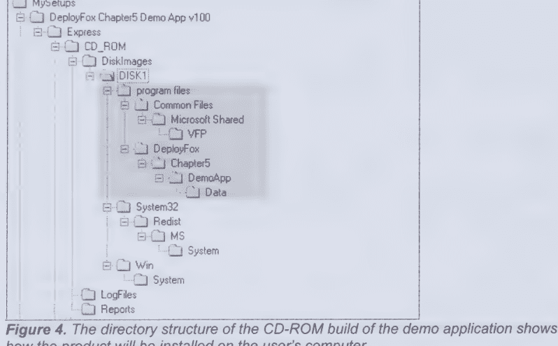

**图 4.** *演示应用程序 CD-ROM 构建的目录结构展示了产品将如何安装在用户的计算机上。*

图 4 中的阴影区域是示例应用程序将安装在用户计算机上的目录结构。请注意，除了一些例外，所有内容都安装在 `Program Files` 目录下：应用程序文件安装在 `Program Files\Deploy Fox\Chapter 5\DemoApp`，而 VFP 运行时和 HTML 帮助支持库，以及 VFP 8 所需的 GDI+ DLL，则安装在 `Program Files\Common Files\Microsoft Shared\VFP\`。² 当然，在用户的计算机上，`Program Files` 目录位于 `C:\` 下，而不是此处所示的 `My Setups` 目录结构下。

一个例外是 Microsoft Visual C++ 7.0 运行时 DLL `MSVCR70.DLL`，它被定向到 Windows 系统文件夹。VFP 7 和 VFP 8 都需要 `MSVCR70.DLL`。

> ² VFP 运行时和 HTML 帮助支持库的此位置适用于 VFP 7 和 VFP 8。在 VFP 6 下，所有运行时支持文件都安装到系统文件夹。

## 探索 MSI 文件

现在已经创建了 MSI 文件，是时候去探索并查看其中的内容了。如前所述，我们可以使用 Orca 来完成这项工作。我们从提供文件常规信息（如标题和作者）的摘要信息开始，然后深入查看几个 MSI 数据表，以了解应用程序的概念结构如何反映在安装数据库的物理结构中。

> 使用 Orca 查看 MSI 文件内部的首要规则是：记住 Orca 既是编辑器也是查看器。如果你对 MSI 数据库进行任何更改——无论是无意的还是故意的——都可能导致其无法使用。当然，如果 MSI 文件是你自己创建的，那么你可以直接重新构建它，但如果它来自其他来源而你又无法自己重新创建，那么在开始探索之前制作一份备份副本是个好主意。

### 摘要信息

在 Orca 中打开 MSI 文件时，你可能首先想要查看的就是摘要信息。为此，请从主菜单中选择"查看 | 摘要信息"。示例应用程序的摘要信息如**图 5**所示。

请注意，尽管你是从"查看"菜单访问它的，但 Orca 的"摘要信息"窗口实际上是一个编辑窗口。你可以使用此编辑窗口更改所示的任何信息。摘要信息窗口中的大多数字段都是一目了然的，但其中两个字段值得说明：程序包代码和架构。

程序包代码是一个 GUID，用于唯一标识特定的 MSI 文件。此 GUID 通常由安装工具在构建安装程序包时分配。正如你稍后将看到的，程序包代码应在每次重新构建程序包时更改。程序包代码以及摘要信息流中的许多其他字段，也可以在 Windows 资源管理器中通过查看 MSI 文件的属性表来查看。本章后面关于 GUID 的部分中**图 12**展示了这方面的示例。

架构字段中的值标识处理 MSI 文件所需的最低 Windows 安装程序版本。此字段的格式为主版本号乘以 100 再加上次版本号，因此值 100 表示 Windows 安装程序版本 1.0，值 200 表示 Windows 安装程序版本 2.0。

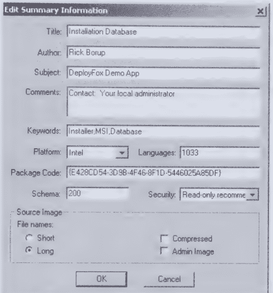

*图 5. MSI 文件的摘要信息可以在 Orca 中查看。*

#### MSI 数据库架构

我们已经提到 MSI 数据库是一种关系数据库。正如你可能预料到的，此数据库中有许多表；事实上，Windows 安装程序数据库架构包含 84 个永久表和 7 个临时表。在本章中，我们专注于包含有关产品本身及其功能、组件的信息，以及要在本地计算机上安装的文件的目标位置信息。此列表包括以下内容：

- `Property` 表包含安装的全局变量，包括产品名称、产品版本、产品代码和升级代码。
- `Feature` 表中为安装中定义的每个功能各有一行。某些产品的组织方式是某些功能是其他功能的子功能。在这种情况下，子功能-父功能层次结构也由该表描述。
- `Component` 表中为安装中的每个组件各有一行。此表中的列包括组件名称、组件代码（GUID）和组件的键路径。
- `FeatureComponents` 表是一个桥接表，实现了功能与组件之间的多对多关系。
- `Directory` 表标识要安装的所有内容的目标目录。
- `Upgrade` 表包含使 Windows 安装程序能够执行产品主要升级所需的信息。

#### Property 表

首次探索 MSI 文件中的表时，`Property` 表是一个很好的起点。在 `Property` 表中，你可以找到产品名称以及其他重要的标识信息。**图 6**展示了示例应用程序的 MSI 文件中的 `Property` 表。

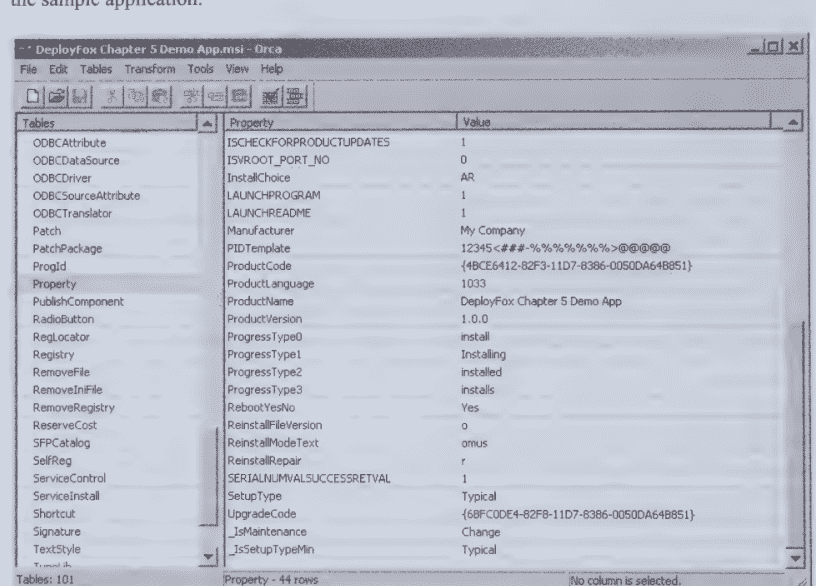

**图 6.** *探索 MSI 文件时，Property 表是一个很好的起点。*

在 Orca 中浏览 MSI 数据库很简单：单击左窗格中的表名，即可在右窗格中显示其内容。单击右窗格中的列标题，即可按该列中的值对显示进行排序。在图 6 中，我们单击了 `Property` 列标题，以便按字母顺序列出属性。

在右窗格中找到 `ProductName` 属性。同时找到 `ProductVersion` 属性以及两个 GUID，即 `ProductCode` 和 `UpgradeCode`。我们将在下一节中讨论这三项的重要性。

#### Feature 表

接下来查看 `Feature` 表。你知道示例应用程序被组织为三个功能，因此你期望在 MSI 文件的 `Feature` 表中找到三个功能。事实上确实如此，如**图 7**所示。

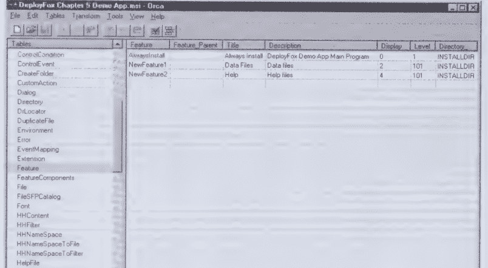

**图 7.** Feature 表为产品中的每个功能包含一行。

第一列 `Feature` 是此表的主键。此列中的值是该表的主键值，由安装工具根据 Windows 安装程序的命名约定创建。`Description` 列包含我们在配置此安装时为每个功能选择的名称。

在 MSI 数据库中，末尾带有下划线字符（ `_` ）的列名是外键。在图 7 的 `Feature` 表中，注意 `Directory_` 列名称中的尾部下划线。这标识此列中的值为 `Directory` 表的外键。`Directory_` 列中的值告诉 Windows 安装程序在 `Directory` 表的何处查找每个功能的目标文件夹。

你可能还会注意到 `Feature_Parent` 列名称中的下划线字符。此列中的值引用 `Feature` 表本身中其他行的主键。这提供了一种实现子功能/父功能层次结构的机制，该机制在应用程序被组织为子功能时使用。

`Display` 列决定功能在安装期间*自定义安装*对话框中的显示顺序。如果一个功能有子功能，此字段中的值还决定该功能的树形图是展开还是折叠显示：奇数值表示展开显示，偶数值表示折叠显示。

`Display` 列中的值为零表示该功能完全不显示。为什么你不想显示某个功能呢？InstallShield Express 提供了一个示例，它强制将一个功能设置为"始终安装"功能。默认情况下，此"始终安装"功能的 `Display` 值为零，意味着在选择"自定义安装"时它不会显示在功能树中。如果此功能有子功能，它们也不会显示在"自定义安装"对话框中。

#### Component 表

了解了构成示例应用程序的组件后，你也可以猜出 `Component` 表中的内容。示例应用程序的 `Component` 表如**图 8**所示。

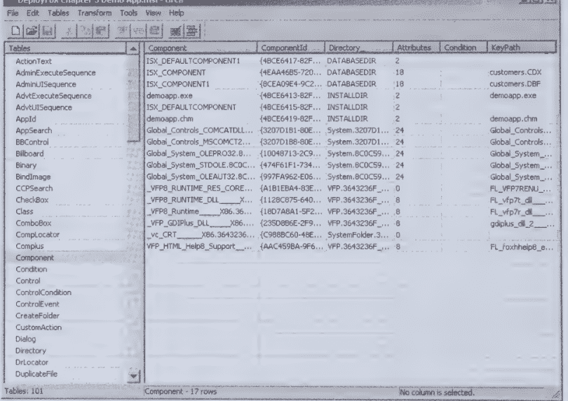

**图 8.** 产品中的每个组件在 Component 表中都有一行。

`Component` 列是此表的主键。除了合并模块组件外，`Component` 表主键字段中的值由安装工具创建。

在研究 `Component` 表时，许多事情都显而易见。你不仅可以发现示例应用程序本身的键路径文件 `DEMOAPP.EXE` 和 `DEMOAPP.CHM`，还可以

VFP运行时库文件和VFP HTML帮助支持库文件。这些是通过合并模块引入安装包的组件。

在第二列中，你可以看到包中每个组件的组件代码GUID。在第三列中，你可以找到指向`Directory`表的外键，而在最右侧的`KeyPath`列中，你可以看到该组件的键路径资源。

#### Feature_Component表


`Feature_Component`表是一个桥接表，用于实现功能与组件之间的多对多关系。正如你对多对多桥接表的预期那样，它仅由指向关系中涉及的两个表的外键对组成。我们示例应用的`Feature_Component`表如**图9**所示。

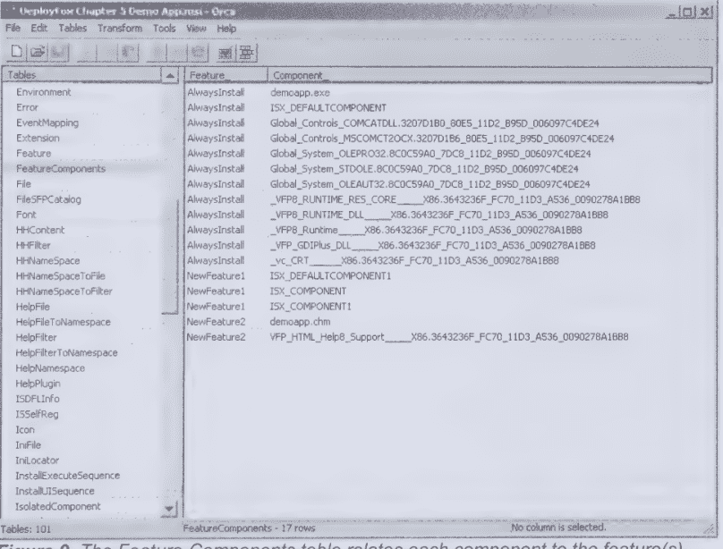

观察图9中`Feature_Component`表建立的关系，你可以看到，正如预期的那样，应用程序的可执行文件（EXE）和VFP运行时库文件与“始终安装”功能相关联，而帮助文件和VFP HTML帮助支持库文件则与主键为“NewFeature2”的功能相关联。如果你回顾图7中的`Feature`表并找到名为NewFeature2的功能，你会看到，如预期所示，它就是“帮助文件”功能。同样，你可以将“NewFeature1”外键追溯回“数据文件”功能。

### `Directory`表

我们这里要看的最后一张表是`Directory`表。这是数据库中较复杂的表之一，即使像示例应用这样的简单安装，涉及的目录也可能比你想象的要多。除了应用程序本身的目标目录外，还有其他条目，包括程序文件目录的位置、开始菜单、用户的桌面文件夹，当然还有Windows本身。此外，该表描述了安装的目录和子目录的层次结构。最后，`Directory`表中许多（如果不是全部的话）值需要在安装时解析，因为它们的最终值取决于用户选择安装产品的目录以及目标计算机上运行的Windows版本等因素。

示例应用的`Directory`表如图10所示。列按其自然顺序显示。

查看图10中的`Directory`表时，需要注意两件事：指向“DeployFox”目录的行和指向“Data”目录的行。“DeployFox”目录条目指向我们在安装程序中指定的应用程序默认安装目录，即`\ProgramFiles\DeployFox\Chapter5\DemoApp`。由于涉及子目录，`Directories`表中涉及多个行来标识此目录。你可以从最低级别开始追踪：

- `DEMOAPP1`行的默认值为“DemoApp”，并标识`CHAPTER5`为其父目录。
- `CHAPTER5`行的默认值为“Chapter5”，并标识`DEPLOYFOX`为其父目录。
- `DEPLOYFOX`行的默认值为“DeployFox”，并标识`ProgramFilesFolder`为其父目录。
- `ProgramFilesFolder`行的值指向用户计算机上“程序文件”文件夹的物理位置。

因此，在安装时，Windows Installer可以将应用程序的默认位置解析为`Program Files\DeployFox\Chapter5\DemoApp`。

你也可以在`Directory`表中查找将安装在应用程序主目录下`Data`子目录中的示例数据文件的位置。在图10中找到名为`DATA`的行，你会看到它指向一个名为`Data`的目录，其父目录是`INSTALLDIR`。`INSTALLDIR`的值在安装时解析为用户选择安装应用程序的物理目录。因此，示例数据文件（如果安装）将被复制到应用程序本身安装目录下的`Data`子目录中，无论该目录位于何处。

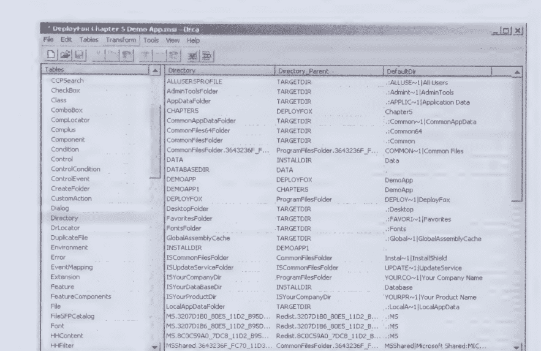

表格：101 目录：60 行

**图10。`Directory`表确定文件的安装位置。**

### 其他表

MSI数据库中除了上述表之外还有许多其他表。除了基本架构中的表之外，Windows Installer允许像InstallShield这样的第三方产品向数据库添加他们自己的自定义表。例如，查看图10的左下角，你可以看到示例应用的数据库中总共有101个表。

你可能感兴趣的其他表包括`File`表、`Registry`表以及一对控制安装过程中步骤顺序的表。`File`表和`Registry`表相当不言自明。`InstallExecuteSequence`表和`AdminExecuteSequence`表可能需要稍作解释。

`InstallExecuteSequence`表和`AdminExecuteSequence`表都包含一个名为`Sequence`的行。序列表中的值决定了步骤的处理顺序。当你在Orca中浏览这些表时，点击`Sequence`列标题以按步骤执行的顺序对行进行排序。

图11显示了本章示例应用的`AdminExecuteSequence`表的一部分。你只需阅读此表中行的名称并查看它们的执行顺序，就能很好地理解正在进行的操作。请注意，序列号是整数值，通常是100的倍数。基本步骤及其序列号由MSI数据库架构定义；按100的倍数编号的目的是为必要时插入其他步骤留出空间。

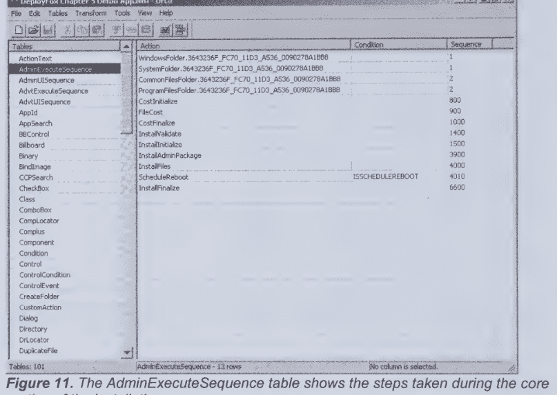

**图11。`AdminExecuteSequence`表显示了在安装序列核心部分采取的步骤。**

这里还需要提一下另一张表，即`Upgrade`表。对于产品的全新安装（即第一个版本），此表是空的，但当你以主要升级的形式分发后续版本的产品时，此表包含决定Windows Installer如何处理升级的信息。你将在本章后面的“升级、更新和修补”部分找到更多关于主要升级和`Upgrade`表的信息。

现在是在Orca中打开一个MSI文件并自行浏览的好时机。使用本章附带的示例应用的MSI文件之一，或者选择另一个你熟悉的文件。同样，请记住Orca既是查看器也是编辑器，因此在尝试更改MSI数据库之前，请确保你有最新的备份。

## GUID，GUID，到处都是GUID

> “标志，标志，到处都是标志……做这个，别做那个，难道你看不懂标志吗” ^3

在现实世界中，我们依靠标志来识别地点和事物（芝加哥市界；金门大桥），告诉我们相对于已知或可在地图上识别地点的位置（雷德蒙德 – 5英里），有时甚至告诉我们该做什么或不该做什么（向左合并，请勿通过）。在MSI包的世界里，Windows Installer服务依赖于GUID（全局唯一标识符）来实现相同的目的。GUID标识安装包及其包含的组件，允许Windows Installer识别安装包中与其可能已知事物相关的内容，并告诉Windows Installer如何处理安装包的内容。

Windows Installer包中的GUID与你在其他上下文中习惯看到的GUID相同：它们是128位（16字节）的整数值，通常以十六进制字符串的形式书写和显示，采用熟悉的格式，带有花括号和破折号，如`{AE17EAA0-6859-11D7-803D-A71AFC909D6E}`。在Windows Installer中，GUID所有字符均为大写。GUID的值没有内在意义。重要的是它对其标识的任何事物都是唯一的。

有三个重要的GUID你应该了解：**包代码**、**产品代码**和**升级代码**。这些GUID由安装开发人员（或安装工具）在首次为产品创建安装包时建立，并且，除升级代码外，可能在后续修改包时需要更改。这些GUID很重要，因为它们控制着Windows Installer在安装产品时如何处理安装包。

除了GUID之外，作为开发人员，你还需要注意另一个重要标识符，即**产品版本**。这指的不是你可能分配给应用程序主EXE的版本号，而是你分配给MSI安装包的`ProductVersion`属性的值。当你在本章后面讨论升级和更新时，你会了解到更多关于产品版本重要性的信息。

### 包代码

顾名思义，包代码标识MSI安装包并将其与所有其他MSI安装包区分开来。每个MSI包应具有唯一的包代码，因此每次更改安装包内容时，都应更改包代码。如果不这样做，可能导致安装失败和用户沮丧。（请参阅本章后面的“常见问题及解决方法”。）幸运的是，大多数基于Windows Installer的安装工具在每次构建发行版时都会自动更改包代码。

包代码是三个GUID中唯一可以从外部查看的，即无需打开MSI文件。要查看MSI文件的包代码，请在Windows资源管理器中，显示文件的属性页，并选择“摘要”页⁴。如你在**图12**中所见，软件包代码GUID显示为“修订号”。

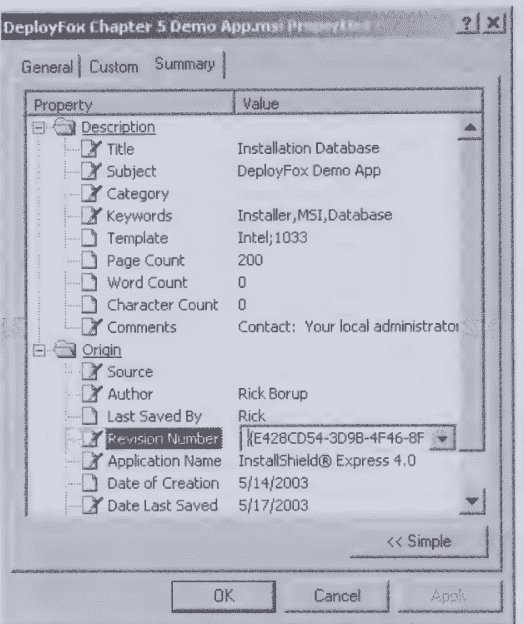

**图12。** MSI文件的属性页上，软件包代码GUID显示为“修订号”。

在Windows 2000和Windows XP中，属性页也是一个编辑窗口，允许你更改某些属性。请注意图12中“修订号”字段和其他字段旁边的铅笔图标。标有此图标的字段可以直接在属性页中编辑。

### 升级代码 (Upgrade code)

升级代码是产品的“主”代码。在产品的整个生命周期内，所有版本的升级代码都应保持不变。可以将升级代码视为产品的“姓氏”：所有具有相同升级代码的产品都属于同一个家族，且升级代码就像姓氏一样，在几代产品中保持不变。

⁴ MSI文件属性页上的信息外观和排列取决于所使用的Windows版本。本章中的所有图表均在Windows 2000 Professional下截取。

在执行安装时，Windows Installer使用升级代码来确定计算机上是否已经安装了同一产品的先前版本。这使得Windows Installer能够判断该产品对于计算机来说是全新的（全新安装），还是计算机上已安装产品的不同版本（更新或升级）。

### 产品代码 (Product code)

从名称来看，你可能会认为产品代码承担的是我们刚才为升级代码描述的角色。然而，产品代码实际上是用来标识产品的具体版本的。通常，每当发布现有产品的新版本时，都应更改产品代码。当现有产品的新版本发布时，任何从之前的版本中发生更改的有版本号的文件（例如主EXE文件）都应获得一个新的版本号（例如，`MYAPP.EXE` 1.0.0版本变为`MYAPP.EXE` 1.0.1版本）。一个经验法则是不管何时更改应用程序主EXE文件的版本号，都应更改MSI软件包的产品代码。有关何时应更改产品代码的完整规则集，可以在Windows Installer SDK文档中找到。

### 组件代码 (Component codes)

除了上述三个GUID外，Windows Installer还依赖GUID来标识MSI软件包中包含的组件。组件可能被多个应用程序共用，无论这些组件来自你、微软还是某个第三方，它们在所有使用的Windows Installer软件包中都应具有相同的组件代码。这非常符合逻辑：如果另一个产品安装了你的应用程序已经安装的公共组件，反之亦然，Windows Installer需要能够识别出该组件已存在于该计算机上，因此它应该简单地增加该组件的使用计数，而不是再次安装该组件。Windows Installer识别组件的方式就是通过其组件代码。

### 产品版本 (Product Version)

与产品代码、升级代码和软件包代码（这些都是GUID）不同，产品版本是一个简单的数字字符串，采用熟悉的`major.minor.build`（主版本.次版本.构建号）格式。主版本号和次版本号的值范围可以从0到255。构建号的值可以在0到65,535之间。

Windows Installer仅使用产品版本的前三个段。如果存在第四个段（如`1.00.00.310`），Windows Installer将将其忽略。

产品版本的目的是向Windows Installer提供除其他三个代码之外的附加信息。在执行升级或更新时，Windows Installer将产品版本号与三个GUID结合使用，以确定新的安装包与之前安装的产品版本之间的关系。

当你向外部发布新的安装包时，应始终更改MSI文件的产品版本。是更改构建号、次版本号还是主版本号，取决于你发布的升级类型。最需要记住的是，不要使用在之前版本中用过的相同产品代码、升级代码和产品版本来分发你的产品，否则可能会导致问题。

作为一名VFP开发人员，你可能习惯于在通过VFP项目管理器构建应用程序时为其分配版本号。然而，你在VFP中为应用程序EXE文件分配的版本号，与你在MSI数据库中为产品分配的产品版本是分开且不同的。MSI安装包中的产品版本不一定要与应用程序中主EXE的版本号相同。换句话说，你在VFP构建选项窗口的版本窗口的“主 (major)”、“次 (minor)”和“修订 (revision)”字段中输入的值，不需要与你在Windows Installer安装包的`ProductVersion`属性中输入的值相同。不过，除非有充分的理由这样做，否则为了保持一致性，我们将两者保持一致认为是合理的。

这并不意味着你为应用程序EXE文件分配的版本号与Windows Installer无关。应用程序EXE文件的版本号很重要，因为它是Windows Installer在确定安装产品期间要替换哪些文件时所使用的版本控制规则的一部分。有关此工作原理的详细信息，请参阅本章稍后的“安装期间的版本控制规则”。

## 在MSI文件中查找GUID

正如我们在图12中看到的，MSI文件的软件包代码GUID只需查看文件的属性页即可看到。另外两个GUID（升级代码和产品代码）没有以这种方式公开，但可以通过在Orca中打开MSI文件轻松查看。这两个GUID都存储在MSI数据库的`Property`表中，如**图13**所示。

## 设置GUID和产品版本

为安装包GUID设置适当的值是安装开发者的责任。如果你使用的是基于Windows Installer的安装工具，该工具应提供一种方法让你输入或更改产品的升级代码和产品代码。它可能还会在你每次构建发布版本时自动为你更改软件包代码。不过，如果必要，你可以使用Orca直接查看和编辑这些GUID。

作为安装开发者，你还负责为应用程序的每个发布版本更新产品版本号。大多数（如果不是全部）基于Windows Installer的安装工具都提供了在工具内部完成此操作的方法，但与GUID一样，你也可以使用Orca查看和编辑产品版本。产品版本存储在`Property`表的`ProductVersion`属性中，如图13所示。请记住，Windows Installer仅使用产品版本的前三个段，因此在图13的示例中，就Windows Installer而言，产品版本`1.0.0.310`等同于版本`1.0.0`。

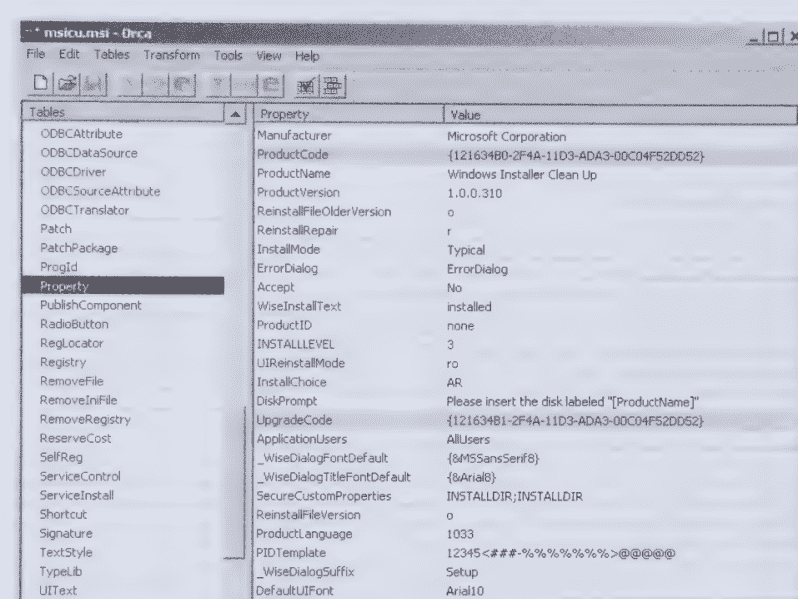

图13. 在Orca中打开的MSI数据库，选中了`Property`表。产品代码GUID和升级代码GUID已被高亮显示。这是本章后面提到的Windows Installer Clean Up实用程序的MSI文件。

## 更新、升级和补丁

### 以新替旧

将应用程序的初始版本安装到最终用户的计算机上仅仅是个开始。在现实世界中，软件应用程序时刻在更新，作为安装开发者，你很大一部分时间可能会投入到产品的更新规划、组织和分发中。

在使用Windows Installer工作时，这个领域最初可能会带来很多挫败感。对于VFP开发人员来说，部分挫败感可能是由于随VFP 7交付的InstallShield Express (ISX)版本缺乏创建升级的功能。随VFP 8交付的ISX版本不再有此限制，但Windows Installer更新和升级的处理仍然很复杂，因为有多种实现方式。

与任何软件更新一样，其目标是用用户计算机上的某些“旧比特”替换为“新比特”。在使用Windows Installer时，需要了解三种类型的新比特：

- 小型更新 (Small updates)
- 次要升级 (Minor upgrades)
- 重大升级 (Major upgrades)

虽然Windows Installer在“更新 (update)”和“升级 (upgrade)”之间做了区分，但在本章中，除非专门讨论某一种类型，否则我们将统称为“更新”，以该词的通用含义来指代。

你选择的更新类型主要取决于你对产品所做更改的程度。就Windows Installer而言，其区别在于MSI文件中哪些内容发生了变化，如**表2**所示。这反过来又会影响更新的安装方式以及一次更新如何影响随后的更新。

## **表2.** 小型更新、次要升级和重大升级

| 安装类型 | 包代码 (Package Code) | 产品版本 (Product Version) | 产品代码 (Product Code) | 升级代码 (Upgrade Code) |
| :--- | :--- | :--- | :--- | :--- |
| 小型更新 | 更改 | 不更改 | 不更改 | 不更改 |
| 次要升级 | 更改 | 更改 | 不更改 | 不更改 |
| 重大升级 | 更改 | 更改 | 更改 | 不更改 |

观察表2可以发现，虽然其他值根据更新类型而更改或保持不变，但升级代码 (Upgrade Code) 在所有类型的更新中都保持不变。这是合理的，因为正如前面提到的，升级代码是给定产品所有版本的通用标识符。

你可能会注意到表2中没有显示第四种可能性——即如果你分发了一个修订后的MSI文件，但没有更改这四个值中的*任何*一个，会发生什么？答案是：当Windows Installer处理一个其包代码与计算机上已安装包的代码相同时的安装包时，它会处理该安装包的缓存版本，而不是新版本。结果是Windows Installer会给用户提供“修改、修复或删除”原产品的选项，而不是从新安装包中安装任何文件。因此，即使新安装包包含更新的应用程序文件，这种方法也无法用于分发更新。

## **小型更新** *(示例：`DFCHAPTER5_MSI101.ZIP`)*

小型更新是指无需更改产品版本或产品代码的更新。这并不意味着不能在小型更新中使用版本化文件（如EXE）的版本号增量——它是可以的。请务必注意“产品版本 (product version)”与“版本号 (version number)”之间的区别：“产品版本”是指MSI文件本身的属性，而“版本号”是指分配给产品内版本化文件的数字。小型更新的定义是MSI文件的产品版本不发生变化。

Windows Installer有一套特定的指南用于确定是否必须更改更新的产品代码。由于小型更新和次要升级都不更改产品代码，因此通过这两类更新对应用程序所能做的更改仅限于符合这些指南的范围。


更改产品代码的完整指南列表可在 Windows Installer SDK 文档中找到。⁵ 在创建小型更新时需要注意的重要指南包括：

- 更新不能更改 MSI 文件的名称。
- 更新不能更改组件关键文件的名称。
- 更新可以添加新功能和组件，但不能重新组织父功能/子功能的层级结构。
- 如果更新包含对版本化文件版本号的更改，则必须在 MSI 数据库的 File 表中更改该文件的 Version 属性。

图 14 是来自 InstallShield Express v4.0 的屏幕截图，我们使用它创建了小型更新包。请注意，尽管 EXE 文件（未显示）的版本号是 1.0.1，但产品版本仍为 1.0.0。同时请注意，产品代码 GUID 和升级代码 GUID 与 1.0.0 版本保持一致。然而，包代码 GUID 对于此更新包是唯一的。

| 属性 | 值 |
| :--- | :--- |
| 产品名称 | DeployFox Demo App |
| 产品版本 | 1.0.0 |
| 产品代码 | `{4BCE6412-82F3-11D7-8386-0050DA64B851}` |
| 升级代码 | `{6BFC0DE4-82F8-11D7-8386-0050DA64B851}` |
| INSTALLDIR | `[ProgramFilesFolder]\DeployFox\Chapter5\DemoApp` |
| DATABASEDIR | `[INSTALLDIR]Data` |
| 默认字体 | `Tahoma:8` |

图 14. 小型更新的产品版本保持在 1.0.0 不变。

由于小型更新不更改产品版本或产品代码，它必须被处理为现有产品的重新安装。否则，Windows Installer 会尝试将安装包处理为产品的全新安装，这将导致错误消息“此产品的另一个版本已安装”而失败。这个错误可能是首次分发 Windows Installer 更新包时最常遇到的问题，在本章末尾的“常见问题及其解决方法”章节中将详细讨论。

> ⁵ Windows Installer SDK 文档是关于 Windows Installer 所有内容的权威参考。该文档以名为 `MSI.CHM` 的 HTML 帮助文件分发，包含在 MSDN Library 订阅中，可以在 `Setup and System Administration | Setup | Windows Installer` 路径下找到。它也作为 Windows Installer SDK 的一部分分发，并可在 Microsoft MSDN 网站上获取：http://msdn.microsoft.com/library/en-us/msi/setup/windows_installer_start_page.asp。

为了避免这个错误，你必须告知 Windows Installer 将小型更新处理为现有产品的重新安装。这是通过将某些属性的值设置为指示它是现有产品重新安装来实现的。具体来说，你需要将 `REINSTALLMODE` 属性的值设置为 `"vomus"`，将 `REINSTALL` 属性的值设置为 `"ALL"`。（有关 `REINSTALLMODE` 代码的解释，请参阅表 4。）你在安装时通过向 Windows Installer 可执行程序传递参数来设置这些值；有关如何操作的更多信息将在本章后面关于“MSIEXEC – Windows Installer 可执行程序”的章节中介绍。

部署小型更新时需要注意的一个限制是，用户没有机会更改之前选择的任何选项，例如产品的安装位置。小型更新和次要升级应被视为现有产品的重新安装，这意味着它们被应用在现有安装的“之上”。要更改已安装产品的路径，你应该要么将其卸载然后分两步重新安装，要么创建一个重大升级，执行之前版本的静默卸载，并给用户指定新版本不同位置的机会。

> 本章的下载内容包括 demo 应用的一系列四个安装包。版本 1.0.0 是初始安装。版本 1.0.1 是小型更新，而版本 1.1.0 是次要升级。小型更新和次要升级都不允许你更改产品位置。然而，版本 2.0.0 的安装包被配置为重大升级。它会静默卸载 1.x 版本，并允许你为 2.0.0 版本指定不同的位置。

由于小型更新不更改产品版本或产品代码，Windows Installer 随后将无法区分更新前的产品和更新后的产品。如果将来需要区分产品的这两个版本——例如，如果你希望发布仅适用于特定版本或版本的后续更新——那么你应该使用次要升级而不是小型更新。

## 次要升级（示例：`DFCHAPTER5_MSI110.ZIP`）

次要升级与小型更新类似，因为两者都不更改产品代码，因此两者都必须遵守创建与现有产品具有相同产品代码的更新规则。然而，与小型更新不同，次要升级会更改产品版本。例如，次要升级可用于将 `myProduct` 1.0.0 版本更新为 `myProduct` 1.1.0 版本。

> 本章的下载内容中包含一个配置为次要升级的示例应用程序安装包，可将其从 1.0.0（或 1.0.1）版本更新到 1.1.0 版本。

图 15 是 InstallShield Express 的截图，显示了此软件包更新后的产品版本属性。请注意，产品代码 GUID 和升级代码 GUID 与原始版本 1.0.0 的软件包以及小更新版本 1.0.1 的软件包相同。

| 产品属性 | 值 |
| :--- | :--- |
| 产品名称 | DeployFox Chapter 5 Demo App |
| 产品版本 | 1.1.0 |
| 产品代码 | `{4BCE6412-82F3-1107-8386-0050DA64B851}` |
| 升级代码 | `{6BFCODE4-82F8-1107-8386-0050DA64B851}` |
| INSTALLDIR | `[ProgramFilesFolder]\DeployFox\Chapter5\DemoApp` |
| DATABASEDIR | `[INSTALLDIR]\Data` |
| 默认字体 | `Tahoma:8` |

图 15. 示例应用程序进行次要升级时，产品版本从 1.0.0 变更为 1.1.0。

与小更新一样，次要升级的安装包具有唯一的软件包代码 GUID。在此更新分发的文件中，应用程序 EXE 文件的版本号变更为 1.1.0。虽然不是必需的，但这符合一般经验法则，即 VFP 应用程序主 EXE 文件的版本号应与分发它的 MSI 文件的产品版本保持同步。

与小更新一样，次要升级也是使用上一节中描述的小更新的相同技术作为产品的重新安装来运行的。区别在于，次要升级安装完成后，Windows Installer 会知道现在安装了不同版本的产品，因为产品版本已更新。

那么，用户在产品原始安装后更新的数据文件呢？如果产品的原始安装包含数据文件——例如，用作应用程序起点的空数据库——并且如果小更新或次要升级的安装包包含与原始安装包相同的空数据文件，那么在应用更新时，这些空数据文件不会覆盖用户的数据吗？

答案是否定的，原因在于 Windows Installer 用于确定安装期间要替换哪些文件的版本控制规则。用户已更新的任何文件（例如应用程序的数据文件）的修改日期都晚于其创建日期。由于数据文件不是带版本的文件，Windows Installer 使用这两个日期来确定是否应替换该文件。如果两个日期不同，则在产品的重新安装期间不会替换该文件。

## 主要升级（示例：`DFCHAPTER5_MSI200.ZIP`）

顾名思义，主要升级代表产品的重大变更。如表 2 所述，主要升级会同时更改产品代码和产品版本号。这意味着，如果变更足够重大以构成主要升级，那么它们可能也足以 warrant 产品版本号中“主版本”部分的变更。例如，产品从版本 1.0 变更为同一产品的版本 2.0 意味着主要升级。

虽然主要升级会同时更改产品代码和产品版本，但它继续使用与产品的早期版本相同的升级代码。这个共同的升级代码使 Windows Installer 能够识别主要升级旨在替换的任何先前安装的产品版本。

由于在产品生命周期后期启用主要升级需要升级代码，因此从产品首次发布开始，在所有产品发布中包含升级代码非常重要。大多数（如果不是全部）第三方基于 Windows Installer 的安装工具在您首次创建安装包时会自动为您插入升级代码，因此这通常不是您需要记住手动执行的操作。但是，您需要记住的是，确保在为同一产品创建的所有未来安装包中保持升级代码不变。

除了同时更改产品代码和产品版本号之外，主要升级与小更新和次要升级的另一个区别是 MSI 数据库中升级表（Upgrade table）的使用。每个主要升级的安装包需要在升级表中至少有一个条目。升级表中包含的信息包括升级代码、最小产品版本号以及主要升级所替换产品的最大产品版本号。

为了说明这一点，我们为本章的示例应用程序构建了一个主要升级。此主要升级将示例应用程序的任何版本 1.x 替换为版本 2.0。此主要升级的安装包中的升级表如图 16 所示。查看 `UpgradeCode` 列，可以看到它包含与产品的版本 1.x 使用的相同升级代码。图 16 中 `VersionMin` 和 `VersionMax` 列的值告诉 Windows Installer 此升级适用于产品的版本 1.0.0 至 1.1.0，就我们的示例应用程序而言，这涵盖了之前发布的所有版本。

构建升级表的具体操作取决于您使用的特定安装工具。在 InstallShield Express 中，这通过创建 InstallShield 称之为“升级路径”（upgrade path）的对象来完成。[6] 您在 InstallShield IDE 中为升级路径的各种属性分配的值，对应于构建安装包时创建的 MSI 文件中升级表的值。

主要升级与小更新或次要升级的另一个重要区别是，主要升级通常需要删除产品的旧版本。Windows Installer 通过在安装新产品版本期间静默卸载产品的先前版本来实现这一点。总的来说，这是一件好事，因为它确保了作为先前版本一部分安装的较旧资源（文件、注册表项、快捷方式等）被移除，不会在新版本不再需要它们时留在用户的硬盘上造成杂乱。

> [6] 随 Visual FoxPro 7.0 分发的 InstallShield Express 版本的一个主要局限性是无法创建升级路径。随 VFP 8 一起分发的 InstallShield Express 版本没有这一局限性。

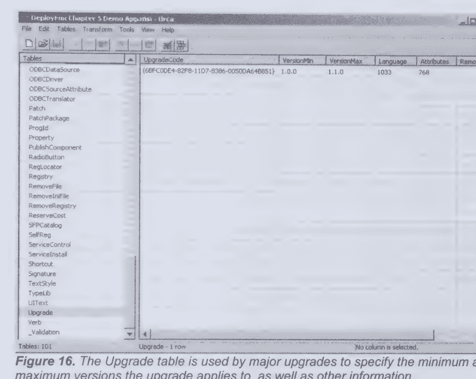

通过这种方式，安装主要升级后计算机的状态，理想情况下与全新安装新版本后计算机的状态相同。

但是，删除产品的早期版本可能会产生严重后果，如果与产品早期版本关联的资源包含数据文件的话。这对于 VFP 开发人员尤其值得关注，因为他们的产品几乎总是涉及某种数据文件。如果数据文件是作为产品安装的一部分复制到计算机上的，而不是在首次运行产品时创建的，则会出现风险。除非您采取措施防止，否则安装主要升级期间，与产品的早期版本一起安装的数据文件会从计算机中移除。不用说，这可能对您的用户造成灾难性后果。

解决此问题的方法是将与产品一起安装的数据文件标记为永久文件。在 Windows Installer 数据库中，这通过在组件级别设置组件表（Component table）中适当行的属性（Attributes）列中的位标志来完成。位标志值 16 (`0x0010`) 标识该组件为永久组件。在 InstallShield Express 中，这通过在 IDE 的“文件”部分的“目标计算机文件”窗格中右键单击文件，打开属性表，选择“高级”选项卡，然后标记永久复选框来完成，如图 17 所示。

将组件标记为永久的效果是将 16 添加到组件表中该组件行的属性列的值中。如果您正在使用 Orca 手动更改，请记住这些是位标志（bit flags），因此要应用多个属性，需将它们的值相加。回顾图 8，你可以看到演示应用程序中的两个数据文件的 `Attributes` 值为 18；这是值 2（表示可选，optional）与值 16（表示永久，permanent）之和。

请注意，图 17 还显示了一个标记为“Never Overwrite”（永不覆盖）的复选框。与 Permanent 设置一样，Never Overwrite 是组件表（Component table）`Attributes` 列中的一个位标志。Never Overwrite 的位标志值为 128 (`0x0080`)。Never Overwrite 与 Permanent 的区别在于：Never Overwrite 意味着组件在安装或重新安装期间不会被覆盖，但它并不能防止组件被卸载。如果你希望防止某些组件（如数据文件）在安装重大升级期间或用户手动卸载产品时被卸载，请使用 Permanent。如果使用，Never Overwrite 和 Permanent 设置应从产品的第一个版本开始建立。

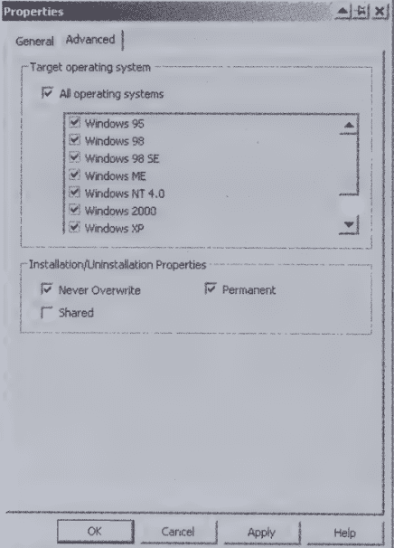

## 图 17. 在 InstallShield Express 中，您可以在属性对话框的“高级”选项卡中将文件标记为 Permanent。

### 补丁（Patches）

补丁实际上是一种与升级（upgrade）或更新（update）不同的实体。事实上，上述三种类型的升级和更新中的任何一种都可以作为补丁包（patch package）而非完整安装包进行分发。然而，习惯上补丁仅用于小型更新和次要升级。

补丁包本质上是两个完整安装包之间的差异。与完整安装包不同，补丁文件不包含执行产品完整安装所需的所有信息。相反，补丁文件仅包含将现有安装包从一个版本转换为另一个版本所需的信息。因此，补丁包本身不能用于安装产品。相反，它们必须应用于用户网络或本地计算机上已存在的安装包。补丁文件具有 `.MSP` 文件扩展名，以将其与普通的 `.MSI` 安装文件区分开来。

使用补丁包分发产品更新的一个优点是，补丁包通常比完整安装包小得多。然而，补丁包的一个缺点是，取决于你的构建方式，你可能需要为产品的每次增量更新创建一个单独的补丁包。这取决于你是包含更改文件的完整替换副本，还是仅包含不同的比特位（bits）。后一种方法会导致补丁包更小，但该补丁仅适用于早期安装的某一个特定版本。

例如，如果你之前部署了产品的 1.0、1.1 和 1.2 版本，现在想发布 1.3 版本作为补丁，你可能需要创建三个补丁：一个用于将 1.0 更新到 1.3，另一个用于 1.1 到 1.3，再一个用于 1.2 到 1.3。或者，你可以创建一系列补丁，每个补丁对应一个次要版本更新；这将产生一个将 1.0 更新到 1.1 的补丁，另一个 1.1 到 1.2，以及第三个 1.2 到 1.3。

第一种方法对最终用户来说更容易，因为他们可以使用任何合适的补丁一步到位地更新到最新版本，但对你作为开发人员来说更困难，因为随着新版本的发布，你必须创建几何级数增加的补丁数量。第二种方法对你作为开发人员来说更容易，因为你只需为每个新版本创建一个补丁，但对最终用户来说更繁琐，因为他们可能必须按照正确的顺序应用一系列补丁，才能将产品跨多个次要版本进行更新。

要为你的产品创建补丁包，你需要一个能够执行此操作的工具。Windows Installer SDK 包含了为此目的提供的两个文件：`MSIMSP.EXE` 和 `PATCHWIZ.DLL`。你喜欢的基于 Windows Installer 的安装工具也可能提供创建补丁包的方法。例如，InstallShield Express 4.0 附带了 QuickPatch™ 技术，这是一个基于向导的工具，用于创建和管理补丁包。有关创建补丁的更多信息，请参阅“附录 A – 操作指南：InstallShield Express”。

补丁包存储在具有 `.MSP` 文件名扩展名的文件中。MSP 文件可以分发给用户，用户随后可以使用它将补丁应用于当前安装的产品。补丁也可以创建并分发为 `UPDATE.EXE` 文件，这通常更容易让用户理解和安装。当创建为 `UPDATE.EXE` 时，MSP 文件被嵌入在可执行文件中，其方式与 MSI 文件被嵌入在单镜像 `SETUP.EXE` 文件中非常相似。

## 当我运行 `setup.exe` 时会发生什么？

简单的回答是，当你运行 Windows Installer `SETUP.EXE` 时，你是在调用 Windows Installer 可执行程序 `MSIEXEC.EXE`，它会打开、读取并处理 MSI 数据库。更详细的回答是，发生的情况不仅取决于 MSI 数据库中的信息告诉 Windows Installer 做什么，还取决于目标计算机的状态以及可用于控制安装的各种运行时选项。

### 安装启动程序（The setup launcher program）

当你为产品构建单镜像分发包时，最终结果是一个用户可以运行以安装应用程序的 `SETUP.EXE` 文件。这可能是分发软件最常见的方式，尤其是如果你是一名将产品部署给个人用户的独立软件开发人员。需要将软件部署到局域网用户的企业开发人员和网络管理员可能会更倾向于不同的方法，例如本节后面描述的“管理安装”。

与第三方安装程序（其 `SETUP.EXE` 实际执行安装）不同，Windows Installer 的 `SETUP.EXE` 仅仅是 Windows Installer 本身的一个启动平台。请记住，Windows Installer 是操作系统的服务，而该服务才是真正执行安装的部分。在解压安装包内容后，Windows Installer `SETUP.EXE` 会运行 `MSIEXEC.EXE`，所有实际操作都在这里发生。

### `MSIEXEC` – Windows Installer 可执行程序

Windows Installer 可执行程序是 `MSIEXEC.EXE`。该程序负责处理 Windows Installer 安装包并执行产品的安装。`MSIEXEC` 接受多个选项和参数以控制其行为。当 `MSIEXEC` 从 `SETUP.EXE` 运行时，可以通过 `SETUP.INI` 文件或直接通过命令行将相应的选项和参数传递给 `MSIEXEC`。不过，如果你直接从 MSI 文件安装，可以从命令窗口运行 `MSIEXEC.EXE` 并传递你选择的选项和参数。虽然这通常不是你希望用户安装产品的方式，但出于学习目的，了解如何操作是有用的。让我们看看各种选项以及如何使用它们来控制 Windows Installer 的行为。


### MSIEXEC 命令行界面

`MSIEXEC` 命令行界面的基本语法如下：

```
msiexec /[option] [msi file]
```

例如，要从`MYPRODUCT.MSI`安装产品，请运行：

```
msiexec /i myProduct.msi
```

要卸载该产品，请运行：

```
msiexec /x myProduct.msi
```

总共，`MSIEXEC`可以接受 14 种不同的选项。⁷ 除上述`/i`和`/x`选项外，这里还有另外三个值得关注的选项，详见表 3。

#### 表 3. 精选 MSIEXEC 命令行选项

| 选项 | 描述 |
| :--- | :--- |
| `/i` | 安装产品 |
| `/x` | 卸载产品 |
| `/a` | 执行管理安装 |
| `/p` | 将补丁应用于产品 |
| `/f` | 修复产品 |

### 管理安装 (Administrative Install)

管理安装旨在用于将产品部署到网络工作组中的多个用户。管理安装实际上并不安装应用程序。相反，它会写入一组文件，类似于构建 CD-ROM 安装包时创建的文件。执行管理安装后，安装目录及其子目录将包含产品的 MSI 数据库以及实际安装产品所需的所有其他文件。网络工作组中想要在自己电脑上安装产品的成员，可以通过再次对管理安装创建的 MSI 文件运行 Windows Installer 来实现。

管理安装同样是一个有用的学习工具。如果你想知道某个安装包内部包含什么，只需将管理安装执行到计算机上的临时位置即可。当管理安装完成时，临时位置将包含产品的 MSI 数据库以及安装产品所需的所有其他文件。这为你提供了一个反编译 MSI 安装包并查明其内部内容的工具，而无需实际将产品安装到计算机上。

要执行管理安装，只需使用`/a`选项运行`MSIEXEC`，如下所示：

```
msiexec /a myProduct.msi
```

### 应用补丁

补丁包包含用于标识可应用该补丁的产品代码的信息。因此，当你从命令行应用补丁时，不需要指定你要修补的产品，因为补丁文件本身会告诉 Windows Installer 它可以应用于哪个（些）产品。

例如，如果`myProduct`已安装在计算机上，并且`myPRODUCTPATCH.MSP`是一个更新`myProduct`的补丁文件，那么你只需运行带有`/p`选项的`MSIEXEC`即可应用补丁，如下所示：

```
msiexec /p myProductPatch.msp
```

> ⁷ `MSIEXEC`命令行选项的完整列表可以在 Windows Installer SDK 文档中找到。

## 部署 Visual FoxPro 解决方案

补丁既可以应用于管理安装，也可以应用于产品的本地安装。若要将补丁文件应用于管理安装，请在`/p`选项之外配合使用`/a`选项。例如，要对上述我们执行的`myProduct`管理安装进行补丁修复，请使用：

```
msiexec /p myProductPatch.msp /a myProduct.msi
```

### 修复产品

Windows Installer 的关键设计目标之一是使软件具有“自我修复”能力，换句话说，使其能够在无需完全卸载并重新安装的情况下完成自我修复。当你运行一个已安装产品的 Windows Installer 安装包时，Windows Installer 用户界面提供的选项之一就是执行修复。你也可以通过运行带有`/f`选项的`MSIEXEC`并指定所需参数来修复产品。这些参数决定了产品重新安装（修复）的具体执行方式。表 4 列出了`/f`选项的参数。

#### 表 4. MSIEXEC 命令行界面`/f`选项的参数

| 参数 | 描述 |
| :--- | :--- |
| `a` | 重新安装所有文件 |
| `c` | 如果文件丢失或其校验和无效，则重新安装文件 |
| `d` | 如果文件丢失或安装了不同版本，则重新安装文件 |
| `e` | 如果文件丢失或安装了相同或较旧版本，则重新安装文件 |
| `m` | 重写所有特定于计算机的注册表项 |
| `o` | 如果文件丢失或安装了较旧版本，则重新安装文件 |
| `p` | 仅在文件丢失时重新安装文件 |
| `s` | 覆盖现有快捷方式 |
| `u` | 重写所有特定于用户的注册表项 |
| `v` | 从指定的源（MSI 文件）重新安装并重写本地缓存包 |

一种常见的修复产品的方法是运行带有`/f`选项和参数`vomus`的`MSIEXEC`。查看表 4 中的列表，你可以看到`v`参数指示 Windows Installer 从指定的 MSI 文件执行安装并重写本地计算机上的缓存包。`o`参数告知 Windows Installer 重新安装任何丢失的文件或虽存在但版本较旧的文件。`s`参数表示覆盖现有快捷方式，而`m`和`u`参数则告知 Windows Installer 重写产品的注册表项。

因此，此类重新安装的命令行如下：

```
msiexec /fvomus myProduct.msi
```

### 向 MSIEXEC 传递属性和值对

你还可以使用命令行界面向`MSIEXEC`传递属性和值对。在上面的示例中，你看到了如何通过运行带有`/fvomus`的`MSIEXEC`来修复产品。与`/f`选项相关的参数对应于与`REINSTALLMODE`属性相关的值。使用命令行“属性=值”语法，你可以通过运行以下命令来实现与前例相同的结果：

```
msiexec /i myProduct.msi REINSTALLMODE=vomus REINSTALL=ALL
```

正如你之前看到的，`/i`选项表示安装产品并指定用于安装的 MSI 文件。`REINSTALLMODE=vomus`为该属性设置所需的值，而`REINSTALL=ALL`告知 Windows Installer 重新安装之前安装的所有功能。

`REINSTALLMODE`属性的一些值可以在 MSI 数据库中设置。例如，你可以在图 6 的 Property 表中的`ReinstallModeText`属性中观察到值`omus`。然而，值`v`必须在安装时从外部设置，以便告知 Windows Installer 使用新的 MSI 文件并重写包的缓存副本。因此，在执行重新安装时，习惯上在安装时将完整的`vomus`字符串传递给`REINSTALLMODE`属性。

> Windows Installer 属性名称的大小写正确性非常重要。Windows Installer 使用公共属性和私有属性。公共属性的名称全部为大写，例如`REINSTALLMODE`和`REINSTALL`。私有属性的名称中至少包含一个小写字母，例如`ProductVersion`、`ProductCode`和`UpgradeCode`。

### 使用 SETUP.EXE 时设置属性和值对

我们查看的所有`MSIEXEC`命令行界面示例都相当直接。作为一名资深的软件开发人员，你在这一层级处理安装程序不会有问题，但你可能不想教你的用户如何操作。（想象一下那些可能会以“什么是命令行？”开头的电话咨询）。

幸运的是，你可以自动化这个过程，让用户免于处理这些细节的痛苦。如果你构建了一个 CD-ROM 安装包，你会注意到除了 MSI 文件之外，你还会得到一个 stub `SETUP.EXE`文件。该`SETUP.EXE`文件有一个名为`SETUP.INI`的配套文件。`SETUP.INI`中包含的信息有一项`CmdLine`条目，可用于向`MSIEXEC`传递`属性=值`对。你可以修改`SETUP.INI`中的`CmdLine`条目，并指定要传递给`MSIEXEC`的参数。

`CmdLine`条目出现在`Setup.INI`的`[Startup]`部分。如图 18 所示，它还包含其他几个条目。

要指定与上述命令行示例相同的重新安装操作，你只需修改`CmdLine`条目并插入相同的`属性=值`对，如下所示：

```
[Startup]
CmdLine=REINSTALLMODE=vomus REINSTALL=ALL
```

当运行`SETUP.EXE`时，这些参数会被传递给`MSIExec`，就像你从命令行运行带有这些参数的`MSIExec`一样。请注意，每次构建安装程序时都会重新构建`SETUP.INI`文件，因此如果你对`SETUP.INI`进行了修改，请记得在每次构建后再次进行修改。

使用 InstallShield Express 构建的`SETUP.EXE`文件可以接受某些命令行参数。这使你能够通过命令行直接向`SETUP.EXE`传递所需值，从而设置`REINSTALLMODE`和`REINSTALL`属性。为此，请使用`/v`选项，如下所示：

```
setup.exe /v"REINSTALLMODE=vomus REINSTALL=ALL"
```

一些安装开发工具（如 InstallShield Developer 8）允许你专门为小型更新和次要升级创建`SETUP.EXE`文件，这些文件在安装时会自动设置这些标志。这消除了使用上述任何方法的必要，并为最终用户安装此类更新提供了最简便的方式。

## 安装顺序

如前所述，Windows Installer 的执行顺序基于客户端/服务器模型。我们还注意到，整个安装过程被视为一个数据库事务，也就是说，整个安装要么作为一个整体成功，要么失败。在安装过程中，用户界面和大多数准备工作由客户端进程处理，该进程在用户的安全上下文中运行。核心安装任务（安装文件、写入注册表项等）由服务器进程处理，该进程可以在系统安全上下文的高权限下运行。在 Windows 9x 机器上，安装过程两端的安全上下文当然没有区别，但安装顺序基本相同。

Windows Installer 提交或回滚安装的能力是由服务器端进程实现的。如果所有安装任务都成功执行，则事务提交，安装成功；如果任何安装任务失败，则事务回滚，安装终止。请务必理解，这里使用“事务”一词仅为类比：我们讨论的不是实际的数据库事务，而是 Windows Installer 引擎为安装产品而执行的一整套操作序列。

## 缓存 MSI 文件

Windows Installer 成功安装产品的结果之一是在本地计算机上创建 MSI 数据库的缓存副本。MSI 文件的缓存副本是实现 Windows Installer 的“修改”、“修复”和“删除”功能的必要条件。在向已安装产品应用补丁时，也需要这些文件。

在 Windows 2000 及更高版本中，这些缓存文件位于`{Windows}\Installer`文件夹中。该文件夹被隐藏，以防止缓存文件被手动修改或删除。如果你愿意，可以通过在“文件夹选项”对话框的“查看”选项卡中关闭“隐藏受保护的操作系统文件”来在 Windows 资源管理器中查看此文件夹。图 19 展示了编写本章时所用机器上安装程序缓存文件夹的内容。

查看 Windows Installer 缓存文件夹的内容可能会让你大开眼界。如果你在机器上安装了大量软件，你可能会在这个文件夹中发现大量的 MSI 和 MSP 文件，占据了许多兆字节的硬盘空间。不过，如今硬盘空间相当便宜，因此为了获得相应的功能而付出这个代价是合理的。

## 安装期间的版本控制规则

说到底，安装程序的主要功能当然是将文件复制到计算机上。这看起来足够简单，但当目标位置已经存在一个正在安装的文件副本时，情况可能会变得复杂。为了处理可能遇到的所有情况，Windows Installer 在一组规则下运行，这些规则决定了在安装产品期间何时替换文件以及何时不替换文件。

文件具有许多属性。其中包括所有文件共有的“创建日期”和“修改日期”。其他文件（如 EXE 和 DLL）还具有“版本”属性和“语言”属性。具有版本属性的文件被称为“有版本”文件，而没有版本属性的文件被称为“无版本”文件。无版本文件的示例包括 TXT 文件、INI 文件，以及对 VFP 开发人员特别重要的 DBF、FPT 和 CDX 文件。

图 19. MSI 文件的缓存副本存储在`{Windows}\Installer`文件夹中。

Windows Installer 用于确定在安装期间是否替换文件的规则基于上述文件属性。这些规则被统称为 Windows Installer 的“版本控制（versioning）”规则。版本控制规则实际上非常简单；它们遵循一种逻辑模式，能够产生大多数人预期结果。这些规则汇总如下：

- 如果新文件和现有文件都是版本化文件，则版本号较高者胜出。例如，这意味着`MYAPP.EXE` 2.0 版本将替换`MYAPP.EXE` 1.5 版本，但反之则不行。
- 如果一个文件副本是版本化的，而另一个副本不是版本化的，则版本化文件胜出。
- 如果两者都不是版本化文件，那么“修改日期”晚于“创建日期”的文件被认为已被用户修改，因此不会被替换。如果“修改日期”与“创建日期”相同，则认为该文件自安装以来未发生更改，将被替换。因此，例如`README.TXT`文件总是会被替换（假设它未被用户修改），而数据文件`MYDATA.DBF`和`MYDATA.CDX`如果在安装后被用户更新过，则*不会被替换*。

## 一些常见问题及解决方法

本节旨在列出许多开发人员在使用 Windows Installer 时似乎会遇到的几个问题，并提供解决方案。这里列出的一些问题在本章前面已经提到过。将它们包含在此处是为了使本节成为一个关于常见问题的独立参考。

### 已经安装了此产品的另一个版本 (Another version of this product is already installed)

**问题**

VFP 开发人员在初次使用 Windows Installer 时遇到的最常见（*如果不是最常见的话*）问题之一，就是令人恐惧的“已经安装了此产品的另一个版本”错误消息。这个问题通常由尝试为先前安装的产品安装更新的最终用户遇到。该错误消息的全文如**图 20** 所示。

*图 20.* 令人恐惧的“已经安装了此产品的另一个版本”错误消息。

**原因**

当你尝试使用 MSI 文件安装产品，且该文件的产品代码（product code）和升级代码（upgrade code）与同一台计算机上已安装的产品相匹配，且安装包未配置为重新安装或卸载现有产品时，就会出现此问题。

**解决方案**

这个问题有三种不同的解决方案。所有方案都假设新的安装包应该是先前安装的同产品版本的更新。

- 从开发人员那里获取修正后的更新包。
- 卸载产品的先前版本，然后安装新版本。
- 使用`REINSTALLMODE=vomus`和`REINSTALL=ALL`运行`MSIEXEC`。（有关更多信息，请参阅“MSIEXEC 命令行界面”章节。）

## 您尝试使用的功能不可用 (The feature you are trying to use is unavailable)

**问题**

当你尝试修改、修复或删除已安装的产品时，收到一条错误消息，告知你“您尝试使用的功能不可用”。系统会提示你提供该产品 MSI 文件的位置。

此错误的示例见**图 21** 和**图 22**。两者之间的区别与原始安装包的来源有关。

**图 21.** 当来源是 CD 或其他可移动介质时，显示此措辞的“您尝试使用的功能不可用”消息。

**图 22.** 当来源是本地或网络文件夹时，显示此措辞的“您尝试使用的功能不可用”消息。

如果你无法提供该产品 MSI 文件的访问权限，并点击图 21 或图 22 对话框中的“取消”按钮，安装将终止并显示**图 23** 所示的消息，且你无法进一步操作。

*图 23.* 如果 Windows Installer 找不到安装源且你无法提供访问权限，结果就是此错误消息。

**原因**

如果你尝试修改、修复或删除产品，且 Windows Installer 无法定位或无法访问 MSI 文件的缓存副本或原始安装源，则会出现此错误。导致此错误的一个可能原因是删除了本地计算机上的 MSI 文件缓存副本。如果 Windows Installer 无法定位 MSI 文件的缓存副本，它会尝试定位原始源。如果原始源也不可用，则会导致此错误情况。如果你正尝试卸载产品，这个错误尤其令人沮丧，因为卸载将会失败。

> 我们见过这样一种情况：由于“已经安装了此产品的另一个版本”错误而无法安装产品的新版本，但由于“功能不可用”错误而无法卸载现有版本。一个经典的悖论（Catch-22）！

Windows Installer 尝试向最终用户隐藏缓存的 MSI 文件，以防止它们被无意或故意地修改或删除。然而，一个执着的用户仍然可以找到并删除它们，可能是为了释放硬盘空间。在早期版本的 Windows Installer 中（至少在 Windows 98 下），我们观察到 MSI 文件的缓存副本被放置在`Windows\Temp`文件夹中的情况。许多人习惯于清理此文件夹，认为其中的文件实际上是临时的且不需要。当然，删除 MSI 和 MSP 文件会在以后触发此错误。Windows Installer 2.0 将缓存的 MSI 文件放置在隐藏文件夹`{Windows}\Installer`中，因此现在这个问题可能比以前出现得少。

**解决方案**

此问题有几种可能的解决方案：

- 将 MSI 文件的缓存副本还原到原始位置，或使 Windows Installer 能够在当前位置访问它。
- 使原始安装源可用，并在图 21 和图 22 所示的对话框窗口中指向它。
- 使用`REINSTALLMODE=vomus`和`REINSTALL=ALL`从原始源重新安装产品。这将创建新的 MSI 缓存副本。
- 如果所有方法都失败，运行`MSICLEAN`以清除计算机中所有关于该安装的痕迹。然后从原始源重新安装产品。`MSICLEAN`工具在本章稍后部分有详细描述。

### 我希望我的应用程序对所有用户可用

**问题**

你希望你的产品对计算机的所有用户都可用，但在安装后你发现它仅对安装它的用户可用。

**原因**


在 Windows NT、Windows 2000 和 Windows XP 上，应用程序可以为单个用户安装，也可以为计算机的所有用户安装。相应地，Windows Installer 可以配置为执行“每用户（per-user）”或“每机（per-machine）”安装。如果实际上需要“每机”安装，但执行的是“每用户”安装，就会出现这个问题。

## 解决方案

该问题的解决方案取决于它是由于安装包的配置方式引起的，还是由于用户在安装过程中做出的选择引起的。如果安装程序中存在“客户信息”对话框，用户可以选择将产品安装给所有用户（“每机”安装）或仅安装给自己（“每用户”安装）。在内部，安装类型由 MSI 数据库中 `ALLUSERS` 属性的值决定。该属性的默认值由安装开发人员结合所使用的安装工具共同确定。对于由 InstallShield Express 创建的安装程序，`ALLUSERS` 的初始值位于 MSI 数据库中 `CustomAction` 表的 `ISInitAllUsers` 行中。有关 `ALLUSERS` 属性的更多信息，请参阅 Windows Installer 帮助文件中的“如何指定每用户或每机安装？”。

- 如果安装包被配置为“每用户（per-user）”安装，请将其重新配置并重新分发为“每机（per-machine）”安装。具体操作取决于您使用的安装工具。请在工具的帮助文件中查找关于“per-user”、“per-machine”以及 `ALLUSERS` 属性的引用。请注意，每机安装需要管理员权限。

- 如果安装包被配置为在安装期间让用户进行选择，且用户选择了“仅为当前用户”安装产品，请让他们将其卸载，然后选择“为这台计算机的所有用户”重新安装。同样请注意，此选择需要管理员权限。

## Windows Installer 清理实用工具

有时您可能会遇到这样一种情况：无论您怎么做，似乎都无法解决 Windows Installer 的问题。由于运行 Windows Installer 安装包时会创建大量的注册表项，您无法简单地通过删除文件来撤销一个有问题的安装。

幸运的是，微软提供了一个工具来帮助解决此类情况。Windows Installer 清理实用工具可用于删除与特定 Windows Installer 安装包相关的所有注册表项。在清理注册表之后，删除安装程序安装的文件和/或从原始源重新安装产品应该是安全的。使用该实用工具显然是一个激进的步骤，但作为最后的解决手段，它可能是一个不错的选择——或者可能是您的唯一选择。

微软知识库文章 238413 详细描述了 Windows Installer 清理实用工具，并提供了下载链接。请注意，该实用工具有两个版本，一个适用于 Windows 95、Windows 98 和 Windows Me，另一个适用于 Windows NT 和 Windows 2000。该实用工具在使用上附有强烈的警告，且由微软以“按原样”提供；我们将此理解为“风险自担”。

## 结论

Windows Installer 是一项强大但复杂的技术。作为一名开发运行在 Windows 计算机上的软件应用程序的开发人员，您在某个时刻必然会涉及到 Windows Installer。即使您不使用基于 Windows Installer 的安装工具来分发应用程序，对 Windows Installer 概念和技术的掌握也将有助于提高您的综合开发能力，就像掌握 Windows API 一样。另一方面，如果您确实使用基于 Windows Installer 的安装工具，那么深入理解 Windows Installer 的内部运作机制，在您规划、组织、构建和分发应用程序时无疑将直接让您受益。无论如何，本章旨在帮助您获得理解 Windows Installer 所需的知识。

本章的更新和修正可以在 Hentzenwerke 出版社的网站 [www.hentzenwerke.com](http://www.hentzenwerke.com) 上找到。点击“Catalog”并导航到本书的页面。

# 第 6 章

## 工作站和传统 LAN 应用程序逐步指南

二十一世纪的开发人员面临着开发符合各类流行术语（buzzword）的应用程序的压力，但客户对工作站和基于局域网（LAN）应用程序的需求依然像以往一样旺盛。本章将讨论在这种传统环境中部署 Visual FoxPro 数据（包括自由表和数据库包含表）的问题。

Visual FoxPro 开发人员可以灵活地在单个工作站或局域网（LAN）环境中部署各种应用程序。应用程序可以设置在单台计算机上供单个用户使用；也可以安装在单台计算机上供多个不同用户依次登录使用；最后，它们可以安装在服务器计算机上，供连接到局域网（无论是点对点还是文件服务器）的多台计算机上的多个不同用户使用。这些是 Visual FoxPro 开发人员自 FoxBase 早期以来一直部署解决方案的传统环境，至今依然如此（见表 1）。

如您所知，Visual FoxPro 拥有一个原生的数据库引擎，其存储和检索数据的速度快于任何其他基于文件的数据库产品。虽然多年来在客户端/服务器数据库服务器的压力下，DBF 文件饱受诟病，但事实依然是：大量商业应用程序仍在使用 DBF，并且基于 Visual FoxPro 原生数据文件的新应用程序在未来几年仍将被部署。

*表 1.* 在工作站或传统局域网上使用 Visual FoxPro 数据部署 Visual FoxPro 应用程序的优缺点。

| 优点 | 缺点 |
|---|---|
| 免版税的应用程序运行库 | 2 GB 表限制 |
| 免版税的原生数据库引擎（市场上最快的文件数据库） | 可扩展性较差 |
| 需要部署和配置的组件较少 | 数据安全性较低 |
| 硬件和后台成本较低 | 如果在没有局域网访问的工作站上，应用程序将处于隔离状态 |
| 整体部署更简单 | 表和索引容易损坏 |
| | 可靠的备份需要应用程序离线 |

### 单个工作站——单用户

小型企业非常普遍，且 Visual FoxPro 应用程序能够很好地服务于这个软件市场。这些企业可能只有一个所有人，也是公司里唯一的人。此人经营业务，为客户提供服务，或制造他们销售的零件。他们用来运行业务的应用程序加载在公司唯一的计算机上。单工作站起初看起来是最简单的部署场景，但由于用户不精通计算机、机器缺乏维护以及操作系统缺少安全更新，情况可能会变得复杂。

单机部署的复杂之处之一是确保数据和其他重要文件得到定期备份。根据我们的经验，拥有单台计算机的公司通常需要的不仅仅是部署我们的软件，他们还需要完整的计算机维护服务。业主甚至只有一两个员工的公司因为忙于经营业务，而忘记了像备份这样需要执行的重要计算机操作。

关于独立环境的一个重要观点是：永远不要显式地编写一个仅能在单机单用户（即排他性使用）环境下工作的应用程序。根据我们的经验，在大多数情况下，即使由于用户表示他们永远不需要多用户访问，但最终他们都会需要。要么是他们的业务增长并增加了需要访问数据或应用程序功能的员工，要么是该应用程序第二次销售给另一个需要此功能的客户。如果 Visual FoxPro 应用程序从一开始就按照这种方式架构，那么为其启用多用户功能并不需要太多额外的工作。但如果事后将应用程序改造为多用户，则需要大量工作。将应用程序限制为排他性使用是有正当理由的，例如客户没有支付多个用户许可的费用、出于安全考虑限制访问，或降低在多用户环境下测试的成本。但这并不意味着您必须阉割整个应用程序导致未来难以启用，而应该构建一个限制性功能，在主程序启动之初关闭排他性模式。当用户致电要求多用户版本时，开启该功能，进行少量测试，然后部署升级后的应用程序。

### 带有多个用户的单个工作站

带有多个用户的单个工作站与单用户单工作站的基本部署相同，但必须处理 Windows NT、Windows 2000、Windows XP 及后续版本中的用户配置文件。主要关注点是对 Windows 注册表的设置以及对特殊文件夹（如用户的桌面、程序菜单、开始菜单和启动项）的安全访问。公司中可能会有多个班次，或者多个人共享一份工作（某人工作在特定日期或一天的特定小时，而另一个人或多人工作在其他可用日期或小时）。

有两种可用选项。第一种是每个用户都可以登录并运行安装程序。对于只有几个用户和一台计算机的小公司来说，这并不糟糕。但对于在一家拥有数百台计算机的大公司中部署应用程序，且在一周内有超过一个人登录（例如运行三班制的汽车供应商）的情况如何？每个用户都需要在其会话中注册相应的 ActiveX 控件和运行库，以及潜在的 Windows 注册表项。在这种情况下，启用 Windows Installer 部署包的“所有用户（All Users）”功能可以为客户节省数小时的安装时间，这是非常显著的。

### 局域网—多用户

将网络环境纳入考虑后，部署时会增加新的选择。核心数据放在哪里？应用程序放在哪里？运行时环境安装在哪里？如何处理网络管理员的驱动器映射，以及将数据放在一个驱动器、应用程序放在另一个驱动器的标准？

显而易见，如果有一个中央服务器，多用户应用程序应该将数据放在该服务器上。即使是在对等网络（peer-to-peer）中，你也必须指定其中一台机器作为数据库和数据文件的保存者。对等网络与真正的文件服务器网络之间的区别更多是管理问题而非技术问题。在对等网络中，最大的问题是所谓的对等“服务器”通常是某个人的工作站。同样，这不是技术问题，而是管理问题。关键在于告知用户不要关闭他们的工作站，因为办公室里的其他人可能正连接到该机器以使用数据。另一个问题是对等“服务器”通常性能不强，且运行的不是服务器操作系统，因此作为“服务器”的性能不如专用文件服务器。硬件价格低廉，因此我们建议客户为所有基于局域网（LAN）的部署购买专用服务器。

一个更大的问题是可执行文件加载在哪里。你是希望它在服务器上，还是在每台工作站上？这个选择应该在开发阶段就做出，以便应用程序具有足够的灵活性，无论安装在何处都能找到数据。加载在工作站上的应用程序启动速度更快，因为它们不需要通过网络连接（有线或无线）访问。将程序加载在工作站上的问题在于升级以及如何将新版本分发到每台工作站。我们将在本章后面的“可执行文件（Executables）”部分探讨这个问题。如果网络性能不是问题，我们建议将可执行文件加载在服务器上，这样可以在一个地方进行升级，而无需维护到工作站的分发。

网络安装面临的大多数问题集中在网络管理员身上。在某些情况下，你可能就是管理员，因此拥有网络的完全控制权。有些客户可能有专门的供应商或内部管理员负责硬件和网络。他们可能在数据安装位置方面有严格的标准，你需要遵守这些标准，以便数据能够被正确备份、在单独的驱动器或机器上正确镜像，并针对性能进行优化。网络管理员可能会规定应用程序必须运行在特定的网络共享路径上，因为用户根据公司安全标准拥有访问权或受限访问权。安全性在网络环境下起到的作用远比在个人工作站应用程序中大得多。如果网络管理员没有授予用户适当的权限，你的应用程序可能会崩溃，而你需要支持解决这个问题，尽管这个问题并不是由你造成的。

驱动器映射和共享起着重要作用，你在部署过程中需要考虑这一点。尽可能保持灵活，使用 DBF、INI 或 Windows 注册表项来提供数据驱动的映射。硬编码目录和驱动器等设置可能会给安装带来致命影响，除非你在安装前与客户和管理员达成了具体协议。

## 故事

在会议的休息室里，我们都有关于部署失败和成功的经历可以分享。我们想分享几个故事，以为本章讨论的一些问题铺平道路，并指出我们多年来犯过的一些错误，以便你们能够避免重蹈覆辙。

第一个故事关于一家在地下室运行的单人公司。该应用程序是由一个人在开发解决方案的同时学习 Visual FoxPro 编写的。直到今天，该程序仍在那个人地下室的一台计算机上运行。由于原开发人员跟随丈夫的新工作搬到了另一个大洲，作者被召集到这个项目中。对于第一个应用程序来说，原开发人员整体上做得不错，但在完成最后 10% 的开发和进行部署时遇到了困难。Beta 版本的第一次部署在启动时抛出大量错误，甚至无法运行。大多数问题与找不到 D 盘、ActiveX 控件或 `FoxTOOLS.FLL` 有关，有些则与外部报告等各项内容的硬编码路径以及表中缺失列有关。花了几个月的兼职工作才使这个应用程序完工。原开发人员从未使用过安装向导（Setup Wizard）来安装任何组件，每个文件都是拷贝到计算机上并手动注册的。

如果你在之前的部署中经历过这些问题，修复方法其实很简单。安装并注册相应的 ActiveX 控件和 `FoxTOOLS.FLL`，修复结构，并在 `CONFIG.FPW` 中为报告添加 `PATH = reports`，而不是在代码中使用硬编码路径。只要在另一台机器上创建测试文件夹并在为客户安装前测试应用程序，大部分问题本可以避免。由于用户安装了 Visual FoxPro，所以我手动修复了结构。长期的解决方案是实施 Stonefield Database Toolkit 以便进行未来的更新。即使在不同的驱动器上设置一个测试文件夹，也能测试出除了 FoxTools 和 ActiveX 之外的所有问题。

我们要分享的第二个故事是一个发布候选版本（RC）的部署。当时我在一家公司工作，我为另一位开发人员执行了这次部署。在我访问之前，该开发人员已经发布了几个 Beta 版本。这次部署只是对 EXE 的简单更新。我唯一需要做的就是将新的可执行文件复制到文件夹中，并向客户展示一个新报告和发布版本中添加的几个报告更改。没有表结构更改，没有额外组件，也没有其他特殊情况。我首先重命名了现有的可执行文件，以防我需要还原到之前的版本。这是我一直坚持的做法，因为多年前我曾用一个损坏的可执行文件覆盖了原文件，导致当时没有任何可以还原的版本。我通过打开“关于”窗口验证正确版本，运行主数据录入窗体，滚动查看一些数据，并预览新报告，确保新可执行文件可以运行。这时部署出了问题。新报告导致了致命的应用程序错误。我运行了其他修改过的报告，它们执行时没有错误。这让我松了一口气。我向客户解释说新报告导致了应用程序崩溃，但其他报告是“正常工作”的。天呐，我大错特错了！我们运行了每一个修改过的报告，结果每个报告都存在逻辑错误、计算错误、分页错误以及 Logo 不正确。运行最后一个报告时，客户要求我打印该报告。她离开房间去取打印件，回来时，她把报告甩在我的脸上问：“这对你来说是可以接受的吗？”

我为原开发人员扛下了这个雷。我告诉她我没有进行适当的测试，应用程序无法运行是我的错。在这次部署中，我一行代码都没写就背了锅。这次部署带来的教训是什么？测试至上。现在你知道为什么我们在本书的各个章节中一直强调测试了。如果简单地测试新报告和修改过的报告，本可以避免一次糟糕的……

令人尴尬的情况。幸运的是，我能够恢复到旧的可执行文件，而且更加幸运的是，即使我在部署过程中没有备份数据——因为我们没有更改数据结构——也没有任何数据被销毁。完全有可能报表进程在报表运行之后更新了数据，那样的话我就会陷入更大的麻烦。从那以后，我总是在部署更新之前备份数据。

我们要分享的最后一个故事是关于一个应用程序的新部署，该应用程序需要分发到美国和加拿大的300个站点。经验教训不在于部署方式，也不在于同时发送300份应用程序副本时的紧张心情，而是一个简单的事情——一个标签标题。部署计划中有一个站点是加拿大魁北克省蒙特利尔的一个分支。蒙特利尔是一个适合旅游的好城市，但在那里部署我们的应用程序却暴露了一个小问题，而这个小问题有着更深远的影响。我永远忘不了那个电话。"什么是社会保障号码？你是指员工编号吗？"我们的加拿大客户没有社会保障号码。接下来的问题是："法语翻译什么时候能交付？"我们很快发现，我们的应用程序需要一个计划来部署支持英语和法语显示的版本，而且必须在一年内完成，这是法律要求。幸运的是，我们购买了Steven Black的INTL工具，两周内我们就更新了应用程序并提供了必要的法语字符串翻译。每次审视一个应用程序时，我们都会考虑部署涉及的地区因素，以防其影响应用程序或我们的解决方案部署方式。

## 通用实现问题

以下章节讨论传统工作站和局域网（LAN）实现中的一些具体问题。

### 安全性

在连接到局域网的工作站上安装应用程序，除了Windows NT、2000和XP上基本的操作系统安全性之外，还引入了网络安全方面的考量。Windows 95、98和ME没有相同的安全特性，但可以与网络安全机制交互。

如果用户正在安装应用程序的任何组件，请确保他们对计算机具有管理员访问权限。ActiveX控件必须安装在工作站上，而不是服务器上。大多数开发人员都会将Visual FoxPro运行时文件（包括GDI和Visual C++运行时）安装在本地工作站上，无论应用程序和数据是否加载在服务器机器上。

在服务器上安装应用程序和数据的用户需要适当的权限才能将这些文件写入服务器。小型企业可能没有完善的安全方案，但拥有内部网络支持或签约网络支持的大型公司通常会严格控制安全性，以防止用户损害服务器上的公司资产。

安装到新的文件夹和新的驱动器可能需要实施额外的安全措施，以便用户有权访问服务器上的这些文件夹和文件。最好在实现之前就充分了解这个问题，但我们建议在流程和安装说明中增加一个步骤来解决这个潜在问题。

#### 可执行文件

Visual FoxPro的可执行文件有多种形式。你可以部署一个EXE（附带运行时支持），或者一个或多个从主EXE调用或在Visual FoxPro副本中运行的APP或FXP文件，也可以直接部署源代码。**表2**描述了每种类型可执行文件的优缺点。

表2. *可执行文件部署的优缺点。*

| 可执行文件 | 优点 | 缺点 |
| :--- | :--- | :--- |
| EXE | 无需支付运行时版税，且分发的文件比其他选项更少。 | 更新新可执行文件时，应用程序不能处于运行状态。 |
| APP / FXP | 开发人员可以将功能打包到应用程序中，并更新整体解决方案的各个部分。将单个APP或FXP文件复制到生产文件夹中更为简便，因为被占用的概率更低。 | 每个用户都需要一份VFP副本，或者需要随APP分发一个主EXE。部署期间需要跟踪更多文件，更新时需要更好地规划部署哪些APP或FXP文件，开发人员在管理哪个功能在哪个可执行文件中时面临更大的复杂性。 |
| 源代码 | 对发布版本中更新的功能有更细粒度的控制。 | 每个用户都需要一份VFP副本，或者需要随APP分发一个主EXE。其他开发人员很容易"借用"知识产权，需要跟踪的文件比APP或EXE选项更多。 |


各个支持论坛（参见附录 F“支持论坛”）上最常被问到的问题之一是：“为什么我的应用程序在客户的计算机上启动后闪一下就关闭了？”应用程序在开发环境中运行正常。这是开发人员第一次部署 Visual FoxPro 应用程序时犯的一个常见错误。他们不知道需要在应用程序的启动代码中添加至关重要的 `READ EVENTS` 语句。好在，这通常是他们最后一次忘记在主程序或主应用程序对象中添加等待状态，而且这是一个很容易解决的问题。

经常被讨论的架构问题是可执行文件的存放位置。是将它们放在服务器上还是工作站上？将它们集中在服务器上可以统一管理文件，并使更新更加简便，因为只需将新可执行文件复制或安装到一个位置。但每次运行时加载可执行文件需要更长的时间，因为必须通过网络线路传输 EXE 文件。在局域网环境中，如果你的客户运行的是超快的局域网并且网络设计合理，影响是最小的。但如果不是呢？如果网络实际上是广域网（WAN），你需要从数百英里之外的线路上下载可执行文件呢？即使是像 T1 线路这样的超快连接，这也可能会严重影响用户。

替代方案是将 EXE 加载到工作站上。没问题，我们有专业的安装程序可以完成这项工作。在小公司中，在 5 台或 10 台计算机上安装 EXE 可能不是问题，但如果在一个园区的多栋建筑中有几十台计算机呢？如果在更大的地理区域内分散着多个站点呢？是否有易于部署和维护的解决方案？

许多开发人员已经通过一种分布式机制正面解决了这个问题，该机制允许他们将 EXE 部署到一个集中文件夹中，而在工作站上放置一个启动程序。这个启动程序会检查服务器上是否存在不同的或更新的程序，并在启动应用程序之前将其复制到本地。有些启动程序每次都会检查，有些按计划定期检查，有些通过文件日期和大小进行验证，还有些则检查注册文件以确定是否应该下载不同的版本。

> 关于启动器/加载器程序的更多信息，请参见 Steven Black 的 Wiki，网址为 <http://fox.wikis.com/wc.dll?Wiki~LoaderProgram~VFP>。
>
> 我们在章节下载中包含了 White Light Computing, Inc. 使用的启动器可执行文件源代码。这个便捷的实用工具灵感来源于多年前由 Nick Neklioudov 发布在 UniversalThread 上的代码。源代码文件位于章节的 `LAUNCHER` 文件夹中。随附的 ReadMe 文件包含有关如何运行和配置此程序的说明。

本章节附带的示例启动器程序包含以下步骤：

- 打开一个 INI 配置文件（用于读取源文件目录、目标文件目录、要复制的文件以及要启动的可执行文件）。
- 读取从源目录复制到目标目录的文件列表。
- 确定哪个可执行文件（如果复制了多个）是需要启动的那个。
- 确定源目录中的文件是否与目标目录中的同一文件不同，这通过每组文件的日期/时间和文件字节大小来判断。
- 如果目标文件夹中不存在该文件，或者文件的日期/时间或字节大小不同，则从源目录将文件复制到目标目录。
- 复制 INI 文件中指定文件的关联文件。例如，如果你指定了数据库容器文件（DBC），那么数据库容器索引（DCX）和备注（DCT）文件也会一并复制，因为这些文件作为一组协同工作。对于表单、报表、菜单和类库也是如此。
- 如果在文件列表中指定了可执行文件，则启动该可执行文件。
- 写入日志文件。

启动器程序在将文件从源目录复制到目标目录的过程中会记录一些基本的活动日志，并在发生错误时捕获错误详情。日志在开发期间会显示以便测试，并在开发和运行时执行期间以文本格式保留。

你可能需要为此工具自定义的功能包括：为每个分发的应用程序编译一个版本，以便在 Windows 资源管理器中看到的启动器可执行文件图标与应用程序所使用的图标相同。你可能只希望从源目录复制较新的文件，而不是不同的文件（更旧或更新的）。我们倾向于检查文件是否不同，以便在较新版本出现重大问题时，可以将较旧的可执行文件重新加载到生产环境中。

最后一点值得注意的是，复制更新版本的 DLL 或 COM EXE 可能需要注册组件（更多详情请参阅本章“ActiveX 控件和 COM 对象”部分）。

> Doug Hennig 在 2000 年 9 月和 10 月的 FoxTalk 上发表了一篇分两部分的文章，介绍了开发人员如何通过互联网更新应用程序。Doug 详细说明了应用程序如何通过 FTP 从 Web 服务器下载 ZIP 文件充当“加载器”，然后启动一个进程来解压下载的文件、终止主可执行文件，并将新的可执行文件复制到位。

### 数据

Visual FoxPro 数据部分的部署通常“更容易”部署。我们将一组文件复制到计算机上的一个文件夹或一组文件夹中。无需管理数据库服务器，也无需担心连接字符串和/或 ODBC 数据源名称。没有额外的工具来部署和运行数据库脚本以及验证安全设置。客户机-服务器技术的支持者可能不会将这些问题视为缺点，我们也不是将它们列为负面因素，而是指出开发人员在传统环境中部署 Visual FoxPro 数据时可以忽略的额外支持问题。

在开发应用程序时，你所做的架构选择会影响部署。你是使用数据库容器、多个数据库容器、自由表（无数据库容器），还是它们的组合？

有些开发人员从一开始就使用自由表，认为数据库容器是多余的。其他开发人员则喜欢长字段名以及标题、默认值、事务、引擎级引用完整性等优势，仅部署数据库容器中的表。许多开发人员部署数据库容器中的表和自由表的组合（主要用于元数据）。

我们多年来一直使用的一种技术是部署至少两个数据库容器，一个用于应用程序表，另一个用于本地视图。我们知道有些开发人员更进一步，将视图数据库拆分为一个用于数据维护（用于数据录入表单），一个用于报表视图（用于报表的查询）。

这样做有诸多优势。当你打开一个视图时，Visual FoxPro 会临时锁定数据库容器以提取视图定义，确保获取当前定义。如果多个应用程序实例在同一时刻尝试打开视图，其中一个应用程序可能会遇到错误 1709，“Database object is being used by someone else.”。

这是你的应用程序可能永远不会触发的错误之一，但当应用程序达到 40 到 60 个或更多用户时，许多开发人员会遇到此错误。这个数字取决于你的应用程序访问的视图数量以及用户的使用强度。

通过将视图分开，你可以在工作站上保留视图数据库容器的副本。最佳实践是确保所有视图定义在 `FROM` 子句中表名前包含数据库名称，这样可以消除查找包含表的数据库的问题。有些开发人员甚至将视图数据库编译到可执行文件中以自动获得本地副本，因为可执行文件会加载到工作站的内存中。

> 视图争用问题在 Steven Black 的 Fox Wiki（<http://fox.wikis.com/Wc.dll?Wiki=CreatingDBCforViews-VFP>）上有详细讨论。

无论讨论的数据库架构如何，部署 Visual FoxPro 数据只有三个普遍关注的问题。

首先，表与数据库容器（DBC）的相对路径需要与开发机器上的相同。如果你将 DBC 和所有表放在同一个文件夹中，它们需要部署到同一个文件夹中。文件夹在目标计算机上可以是不同的名称。

如果数据库容器与表在不同的文件夹中，则相同的相对文件夹结构（包括相对文件夹的名称）必须在目标机器上镜像（参见图 3）。例如：如果某些表位于 Data 文件夹和 System 文件夹中，而这些文件夹直接位于数据库容器所在文件夹的下方，你需要在目标计算机上将 Data 和 System 文件夹部署到数据库容器文件夹的下方。

第二个问题是应用程序知道在哪里找到数据。有些开发人员倾向于将数据库容器与可执行文件放在同一个文件夹中；有些开发人员则倾向于将 DBC 放在可执行文件文件夹下的子文件夹中。有些客户希望数据与可执行文件位于不同的驱动器上；有些则希望数据位于不同的服务器或计算机上。

无论数据最终在目标环境中的什么位置，应用程序都需要能够找到它。你可以硬编码 `OPEN DATABASE` 和 `USE` 语句（这是危险的），也可以使用 Windows 注册表存储位置、像 INI 这样的文本文件，甚至使用包含配置信息的自由表。

本讨论的重点是了解目标环境，并足够灵活地处理客户和公司仍然偏好的内部网络工作人员可能要求的各种可能性。

**图 3.** 数据库容器文件必须部署到与开发机器上相同的相对文件夹结构中。

第三，你需要确保部署所有文件。这些文件包括三个数据库容器文件（DBC/DCT/DCX）、表（DBF）、索引（CDX/IDX）和备注文件（FPT）。缺少一个索引文件或备注文件，你的应用程序在打开表时就会出现问题。除非你拥有正确的数据库容器，否则表无法打开，因为数据库容器包含关于表、表中的列、索引等的结构信息。

你还需要做出的另一个决定是何时以及如何部署数据和结构变更。如果你通过编程方式部署（通过自定义程序或通过 Update 方法启动 Stonefield Database Toolkit），你应该提供一个安装后可执行文件或将其作为应用程序启动过程的一部分。

如果你部署表和/或数据库容器，你必须配置安装工具来处理表，而不覆盖现有数据。你可能需要考虑为数据单独进行安装，因为我们这里讨论的不是元数据，而是表、索引和备注文件。

这样做需要权衡的是，对于新安装需要跟踪、更新和部署两个独立的安装程序。你的更新会变得更简单，因为你不需要发送数据安装程序，只需发送元数据（DBC(s)、DBCX 元数据、框架元数据），这些已经包含在主安装包中。

### 配置文件（FPW）

`CONFIG.FPW` 可用于配置 Visual FoxPro 开发环境和你的自定义应用程序。对于自定义应用程序，你可以控制任何 SET 函数，还可以通过将许多 Visual FoxPro 系统内存变量设置为空字符串（`SPACE(0)`）来提高应用程序启动性能。

### 清单 1. 针对性能增强的 CONFIG.FPW 示例

```text
SCREEN = OFF
ALLOWEXTERNAL = ON
_BROWSER = ""
_BUILDER = ""
_FOXREF = ""
_CONVERTER = ""
_COVERAGE = ""
_GALLERY = ""
_GENGRAPH = ""
_GENTML = ""
_GENMENU = ""
_GENPD = ""
_GENSCRN = ""
_GENXTAB = ""
_TASKPANE = ""
_TOOLBOX = ""
_TRANSPORT = ""
_WIZARD = ""
```

根据你的应用程序运行的位置，你可能需要考虑不同的代码页。如果是这种情况，你可以使用 `CONFIG.FPW` 通过 `CODEPAGE = nnnn` 来调整默认代码页，其中 `nnnn` 是代码页编号。如果你不想使用 FoxUser.dbf 资源文件的副本，可以在 `CONFIG.FPW` 文件中包含 `RESOURCE = OFF`。

接下来的问题是如何交付 `CONFIG.FPW` 文件？你是将该文件部署在可执行文件外部，内部，还是两者兼有？两者兼有？是的，Visual FoxPro 8 同时支持内部 CONFIG.FPW 和外部文件。

要将文件包含在可执行文件内部，你需要在项目中将其标记为包含。如果该文件被包含在可执行文件内部，Visual FoxPro 会首先读取它。若要同时包含两者，你需要在内部配置文件中首先加入以下命令：`ALLOWEXTERNAL = ON`。

哪种方式更好？通常这取决于你的需求。如果你部署的是基于顶级窗体（top-level forms）的应用程序，你需要将该文件包含在可执行文件中并设置 `SCREEN = OFF`，这样 Visual FoxPro 的主框架就永远不会显示。

对于非基于顶级窗体的应用程序也可以这样使用，只需确保在应用程序的启动代码中设置 `_screen.Visible = .T.`。如果你的应用程序需要为每台计算机提供灵活的配置选项，外部文件可能是最佳选择。

我们更倾向于使用带有 `ALLOWEXTERNAL` 的内部文件选项，因为它为我们在需要时提供了添加额外设置的可能性。如果你使用的是 Visual FoxPro 7 或更早版本，你必须做出选择。

在这种情况下，我们使用了内部文件，因为这样可以少部署一个文件，而且在应用程序设置过程完成且准备好登录之前，我们不会显示应用程序的主窗口。

如果你使用内部文件并通过 `FULLPATH(SYS(2019))` 命令在应用程序中显示位置，显示的文件将是当前目录加上开发机上的相对路径。例如，如果你在项目文件夹下的 Text 目录中使用 `CONFIG.FPW` 文件，显示的文件名将是可执行文件的位置加上 `Text\CONFIG.FPW`（见图 4）。

`MVCOUNT` 设置了应用程序可以维护的最大变量数，在 Visual FoxPro 8 中默认为 16,384。我们过去在应用程序中将其设置为 2048。由于默认值更高，我们不再在配置文件中包含此设置。如果你使用的是不同版本的 Visual FoxPro 或需要超过当前默认值的数量，你可能需要考虑此设置。

如果你的部署方案包括通过 Windows 终端服务器或 Citrix 客户端访问应用程序，你可能希望包含 `BITMAP = OFF` 以提高性能。此设置指定 Visual FoxPro 是先将屏幕或窗体更新写入离屏位图，然后执行位块传输到实际屏幕，还是直接写入。

离屏位图会消耗大量内存，因此在使用终端服务时最好将其关闭。此设置还有其他需要注意的问题。如果你使用 `Line` 方法直接写入窗体，则必须设置 `BITMAP = ON`（这是默认设置）。

如果你的应用程序可能同时在终端服务环境和普通工作站上运行，那么此设置是非常适合放入外部配置文件的。或者，你可以在应用程序中使用 `SYS(602)` 命令来控制离屏位图的使用状态。

### 临时文件

当你的应用程序执行查询、缓存索引和程序或编辑文件时，Visual FoxPro 会在临时文件夹中创建文件。在运行时，临时文件位于用户的 Windows 临时文件文件夹中，除非你在 `CONFIG.FPW` 文件中使用 `TMPFILES` 设置引导可执行文件。性能永远是关键。在许多情况下，管理 Visual FoxPro 临时文件的位置会产生显著差异。

我们见过一些应用程序将临时文件文件夹放在服务器上，因为根据网络管理员的指示，办公室的所有个人文件都被定向到那里。对于 SQL Select 查询，其性能极其糟糕，因为临时游标是通过从服务器上的表中将数据拉下来，然后再将数据移回服务器的临时（TMP）文件中而创建的。缓存索引文件也是如此。

这就是为什么我们建议将文件定向到本地工作站。如果 Windows 临时文件文件夹就在本地工作站上，你不需要进行任何更改。如果这些文件被定向到慢速驱动器或网络驱动器，你可以使用 `TMPFILES` 指令将文件定向到更好的目录。

你可以通过在应用程序中的某个位置显示 `FULLPATH(SYS(2023))` 来查看文件被定向到了哪里。我们将此信息包含在我们的“关于”界面中（见图 4），以防在收到关于性能缓慢的支持电话时进行排查。

**图 4.** 应用程序的“关于”窗体是放置临时文件定向位置等详细信息的一个合适位置。

### 其他配置设置与注册表

开发人员还拥有其他各种技术和存储机制来处理应用程序级设置和用户定义设置。存储这些信息的方法有多种，例如独立或包含在数据库中的 DBF 文件、INI 文件以及 Windows 注册表。

自定义 DBF 文件易于操作，而且是 FoxPro 开发人员一直使用的格式。这些文件可以部署在应用程序目录中，通常分布在 Metadata、System 或 Settings 文件夹中。它们所在的文件夹通常位于应用程序文件夹之下，并在应用程序中硬编码。

这听起来可能不够灵活，但如果部署得当，这是开发人员可以依赖并高效工作的简化设计。InstaFox 是我们经历过的唯一能够直接操作 DBF 内容的安装工具。对于其他安装程序，如果在部署期间需要更新 DB 的内容，你需要一个安装后可执行文件或在应用程序中实现相关功能。

纯文本 INI 文件方便最终用户和开发人员使用记事本等工具进行编辑。应用程序需要代码来解析文件中的设置。这并不困难，大多数框架都提供对该功能的支持。部署的关键是确保文件已安装且应用程序知道在哪里定位这些文件。

通常，这些文件被安装在应用程序的根目录下。现代安装程序具有操作 INI 文本文件内容的必要功能，或者你可以编写自己的安装后可执行文件来更新内容。

Windows 注册表项是我们最后要讨论的配置机制。Windows 注册表的主要区别在于设置是针对特定机器的。其他两种存储方案可以驻留在中心位置，并在需要时通过网络共享。注册表是操作系统的一部分，与机器绑定。

你可以为不同用户存储项，也可以为同一台机器上的所有用户共享。安装工具可以创建和更新注册表中的键，从而简化部署。应用程序需要了解键的配置单元（hive）和位置以获取值。

这并不令人惊讶，也不是一个限制，而是一个事实：你必须使应用程序和安装程序同步，以便在注册表中部署正确的项。

### 运行时

我们在第一章“部署基础”以及第三章“打包安装”的“Visual FoxPro 运行时和依赖项”部分详细讨论了运行时文件的安装问题。单工作站部署的问题在于运行时仅存在于一台机器上。在局域网中，运行时可以部署在工作站上，也可以部署在文件服务器上。

出于性能原因，我们建议尽可能始终在工作站上加载运行时文件，并根据微软的建议将其加载到推荐的文件夹中。如果你使用提供的合并模块，它们将被加载到 `C:\PROGRAM FILES\COMMON FILES\MICROSOFT SHARED\VFP\` 文件夹中。将它们安装在工作站上可以节省网络流量并加快应用程序的加载速度。

### 快捷方式

对于最终用户来说，快捷方式在执行应用程序、访问支持工具、在应用程序之外打开帮助文件，以及在日常使用你部署的解决方案时阅读文档文件或任何其他有用文件方面非常重要。

在部署包中，你有两种类型的快捷方式：必需的（required）和可选的（optional）。

必需的快捷方式是你希望在每次选择安装类型时都安装的快捷方式。如果你在安装应用程序，你会希望包含一个指向应用程序的快捷方式。如果你在安装应用程序的帮助文件，你会希望包含一个指向帮助文件的快捷方式。

如果你遵循行业标准，这些快捷方式将被包含在 Windows 开始菜单的“程序”下，但你还有很多其他选择：

- 在“开始”菜单上
- 在“所有程序”菜单上
- 在“所有程序”菜单下的文件夹中
- 在“所有程序”菜单下的文件夹所包含的子文件夹中
- 在用户的桌面上
- 在用户的启动文件夹中
- 在任何预定义的 Windows 文件夹中
- 在你想创建的任何自定义文件夹中


如果用户将要启动该应用程序，我们至少建议创建一个指向应用程序可执行文件的快捷方式。该快捷方式应位于“所有程序”级别下，或者可能位于此级别下的某个文件夹中。这将取决于您的客户及其需求，但我们设置了一个公司文件夹，并在此文件夹下创建我们的应用程序快捷方式。如果我们有多个应用程序，我们会在公司文件夹下为这些应用程序创建子文件夹，并在此文件夹下创建必要的快捷方式。

> 我们知道这是一条显而易见的说明，但无论安装包在哪里创建快捷方式，您的用户都可以将它们移动并复制到桌面上的其他位置，比如快速启动工具栏、启动文件夹，甚至在“开始”菜单上移动它们。创建一个快捷方式就足够为他们节省在其他位置创建一个所需的时间，因为他们可以复制您的原始快捷方式。我们之所以提到这一点，是因为您可能会发现自己花费的时间超过了弄清楚如何在整个目标机器上创建图标的价值。在这方面，简化安装可能是您能做的最好的事情。

可选快捷方式是用户可以选择性安装的快捷方式（参见图 5）。并非所有安装程序工具都支持此功能。这些可选快捷方式为用户在安装过程中提供了额外的控制和选项。例如，我们不欣赏软件包在桌面安装图标。我们的观点是，桌面是每个用户自定义的个人空间。我们购买的软件的创建者如何能自动确定我们想要在其桌面上放置其应用程序的图标？我们实际上觉得这很侵入。我们也知道有些用户绝对想要某些应用程序的快捷方式放在桌面上，尤其是如果他们一直使用它们的话。这就是为什么它们被称为快捷方式。知道这种情况有两面性，并且双方对于是否包含快捷方式都有强烈的感受，我们认为最好将其留为可选。快速启动工具栏上的快捷方式也可能是可选快捷方式的候选。

### ActiveX 控件和 COM 对象

当前版本的 Visual FoxPro 在与较新的 ActiveX 控件交互方面比早期版本好得多。如今，开发人员可以通过使用第三方供应商开发的 ActiveX 控件中已存在的功能来节省时间（参见图 6）。ActiveX 控件文件（OCX）必须安装并在工作站上注册（参见表 3）。

开发人员通过 MAPI 控件或 SMTP 控件在其应用程序中集成电子邮件处理并不少见。使用 InnerMedia 的 DynaZip 控件可以简化文件的压缩和解压缩。像 DBi Technologies 这样的供应商在其产品中提供了大量的 Visual FoxPro 示例代码，因此您可以快速掌握这些功能。如果 ActiveX 控件未正确加载，您的错误处理代码会立即被测试。

图 5. Inno Setup 过程允许用户确定是否要将桌面图标作为安装的一部分包含在内。

**表 3.** ActiveX 控件（OCX）可以在命令行手动注册和注销。

| 操作系统 | 过程 | 命令行 |
|---|---|---|
| Win9x | 注册 | `[WINDOWSFOLDER]\SYSTEM\RegSvr32 [PATH]\MYActiveX.OCX` |
|  | 注销 | `[WINDOWSFOLDER]\SYSTEM\RegSvr32 /U [PATH]\MYActiveX.OCX` |
| WinNT/2000/XP | 注册 | `[WINDOWSFOLDER]\SYSTEM32\RegSvr32 [PATH]\MYActiveX.OCX` |
|  | 注销 | `[WINDOWSFOLDER]\SYSTEM32\RegSvr32 /U [PATH]\MYActiveX.OCX` |

大多数第三方 ActiveX 提供商会提供关于安装 OCX 文件并在工作站上注册它们的详细帮助。重要的是要知道需要哪些 OCX 文件、在开发人员的机器上安装它们的位置、在客户机器上安装它们的位置，以及哪些文件不要安装，例如某些产品附带的开发人员许可证文件。此外，请注意 ActiveX 控件的分发许可。大多数提供无限制、免版税的许可。如果不是，请确保您的部署符合许可要求。

COM 对象可以安装在本地工作站上，也可以通过分布式组件对象模型（DCOM）访问。讨论 DCOM 超出了本章的范围，但我们不得不将其列为一个选项列在这里。现代安装程序会自动注册这些组件。如果您使用的是替代方法，例如 XCOPY 或不支持注册过程的安装程序，您可以在工作站上使用 Windows RegSvr32 实用程序（参见表 4）。

**图 6.** 来自 DBI Technologies 的 Scheduler 控件提供了一个简单的界面，使用原生 Visual FoxPro 控件很难在短时间内创建。它也易于与您的安装一起部署。

**表 4.** ActiveX COM 对象可以在命令行手动注册和注销。

| 操作系统 | 过程 | 命令行 |
|---|---|---|
| Win9x | 注册 | `[WINDOWSFOLDER]\SYSTEM\REGSVR32 [PATH]\IMYCOM.DLL` |
|  | 注销 | `[WINDOWSFOLDER]\SYSTEM\REGSVR32 /U [PATH]\IMYCOM.DLL` |
| WinNT/2000/XP | 注册 | `[WINDOWSFOLDER]\SYSTEM32\REGSVR32 [PATH]\IMYCOM.DLL` |
|  | 注销 | `[WINDOWSFOLDER]\SYSTEM32\REGSVR32 /U [PATH]\IMYCOM.DLL` |

您可以在 Windows 命令行运行以下命令来注册和注销 EXE COM 组件：

```text
[Path]\MyExe.EXE /RegServer
[Path]\MyExe.EXE /UnRegServer
```

### 自动化

依赖自动化服务器的应用程序需要验证它们是否已加载，或者在加载失败时处理错误。安装程序工具会查找某些产品，例如 Internet Explorer，但这就是他们检查的全部范围。

在第 2 章“规划成功”中，我们在标题为“与其他应用程序和技术集成”的部分中提供了几个代码示例，用于检查自动化应用程序，如 Word、Excel、PowerPoint、Outlook、Access、FrontPage、Project、Visio、MapPoint 和 Acrobat。如果您想在安装时通知用户，这些检查必须是您的应用程序或安装后可执行文件的一部分。

### ODBC DSN

我们在第 7 章“客户端/服务器应用程序分步指南”中详细讨论了基于 SQL Server 数据源的 ODBC 连接性。在 Visual FoxPro 数据的上下文中，您的客户可能通过 Microsoft Excel 访问其数据库以进行绘图，或通过 Microsoft Access 进行报告，或使用更复杂且用户友好的临时报告工具，如 Crystal Reports、Stonefield Query、FoxFire! 和 Business Objects。

客户的需求决定了您安装的组件类型。如果您的客户使用的工具需要 ODBC 连接性，您需要安装 Visual FoxPro ODBC 驱动程序。如果工具支持 OLE DB，您可以安装 Visual FoxPro OLE DB 提供程序。我们建议同时安装两者，因为 ODBC 驱动程序和 OLE DB 提供程序可以在目标计算机上共存（参见图 7）。除了驱动程序，您可能还需要设置数据源名称（DSN）（参见图 8）。DSN 可以由最终用户手动设置、使用 Windows 脚本宿主对象模型通过编程方式设置、通过编程方式操作 Windows 注册表，或使用众多商业部署工具之一来设置。

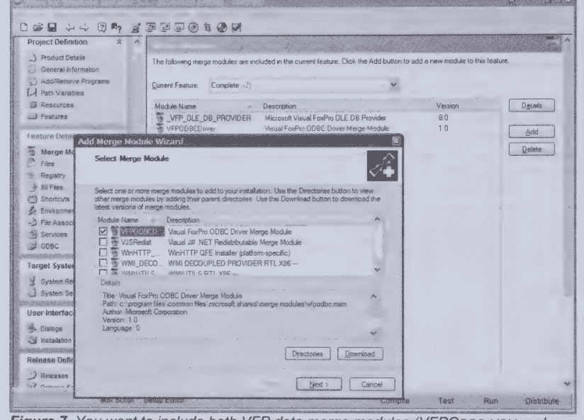

图 7. 您需要同时包含 VFP 数据合并模块（`VFPODBC.MSM` 和 `VFPOLEDB.MSM`）。此示例显示了 Wise for Windows Installer 的选择对话框。

### FoxTools 和其他 FLL

每个版本的 Visual FoxPro 似乎都包含了越来越多以前包含在 `FOXTOOLS.FLL` 库中的功能。我们现在已经很少部署这个文件了，但其中包含的许多函数你可能会用到。多年前我们得出的结论是，将 FLL 文件与运行时文件一起安装，可以简化查找库和释放库的代码。

```text
IF "FOXTOOLS" $ UPPER(SET("LIBRARY"))
  * Nothing to do
ELSE
  SET LIBRARY TO HOME()+"FoxTools.fll" ADDITIVE
ENDIF
```

要释放库，可以使用以下代码：

```text
RELEASE LIBRARY HOME()+"FoxTools.fll"
```

另一种方法是将库释放到与应用程序可执行文件相同的文件夹中，这样它就可以在当前默认目录中被找到。这两种方法都需要库文件的两个副本，因为我们在开发机器上测试可执行文件时不使用 Visual FoxPro 开发环境。代码会在运行时文件夹或可执行文件文件夹中查找库。

部署中需要关注的另一个方面是版本问题。每个版本的 Visual FoxPro 都附带新版本的 `FOXTOOLS.FLL`。请确保在部署包中部署正确的版本。

#### 帮助文件

帮助文件可以加载到本地工作站或服务器上。我们倾向于将帮助文件加载到与可执行文件相同的位置，原因很简单：应用程序可以轻松找到帮助文件，而无需额外的配置文件或注册表项。如果你使用配置文件，请确保安装程序足够智能，能够更新此配置以反映帮助文件的位置，以便用户按下 `F1` 键时应用程序能够定位帮助文件。

除了 HTML 帮助文件外，你还需要在部署包中包含 Visual FoxPro HTML 帮助运行时文件。关于运行 HTML 帮助所需的额外 VFP 运行时文件及其相应的合并模块，我们在第 3 章“打包安装程序”的“Visual FoxPro 运行时和依赖项”部分进行了讨论。

### 报表

报表部署中的一个重大问题是架构决策：你是将报表包含在可执行文件中还是排除在外？将报表与可执行文件分开部署，使你能够替换或删除现有报表，或添加新报表，而无需将所有用户从应用程序中踢出。将报表分开部署要求你作为开发人员跟踪分发所需的报表文件。开发人员倾向于将报表包含在可执行文件中的主要原因是，不用担心最终用户删除报表文件以及由此可能带来的长期支持问题。这是一个权衡取舍。

#### 原生 Visual FoxPro（FRX）

原生报表的源代码存储在报表元数据文件（FRX/FRT）中。好消息是，如果你只是预览和打印，部署原生 Visual FoxPro 报表非常简单。无论它们是包含在可执行文件中还是单独分发都没有关系。因为报表预览和打印功能已内置在 Visual FoxPro 运行时中，所以不需要额外部署其他文件。

如果你想允许用户创建或修改应用程序中现有的 Visual FoxPro 报表，则会有一些额外的复杂性。这不是常见的做法，但如果你的最终用户技术水平较高，这绝对是可行的。关键是在应用程序中包含原生工具栏和报表菜单。在 Hentzenwerke Publishing 出版的《1001 Things You Wanted To Know About Visual FoxPro》（作者：Andy Kramek、Marcia Akins 和 Rick Schummer）中，作者在第 17 章“管理报表”的“如何允许最终用户修改报表布局”一节中介绍了分发报表创建功能的所有要求。该部分包含所有详细信息，使用户能够创建新报表和编辑部署在可执行文件之外的现有报表。基本要求包括部署包含报表设计器使用的三个工具栏（报表控件、布局和调色板）的 `FOXUSER.DBF` 资源文件。可修改的报表必须从项目中排除并单独部署。

**图 9。** 如果你按照一些基本步骤操作，并为用户包含适当的菜单选项，就可以为应用程序添加即席报表功能。

> 我们在章节下载中包含了一个名为 `MODIREPORTS.PJX` 的项目。该项目及相关文件位于解压章节示例文件夹下的一个名为 `MODIREPORTS` 的单独文件夹中。该可执行文件显示一个表单，使你能够修改现有报表或创建新报表（图 9）。

关于原生 Visual FoxPro 报表还有一个重要问题，那就是存储在报表元数据中的硬编码打印机信息。这在 Visual FoxPro 7 及更早版本中更为严重。我们建议你查看第 1 章“部署基础”中的“VFP 源代码问题”部分，了解解决此问题的方法。

#### Crystal Reports

使用 Crystal Reports 作为报表引擎正变得越来越普遍。Crystal Reports 已有十多年的历史，由 Business Objects 提供（此前来自 Crystal Decisions，更早之前由 Seagate Software 提供）。它在软件开发社区（不仅仅是 Fox 社区）中被公认为最受欢迎的报表创建、生成、展示和导出工具。

> Crystal Decisions 的网站是 `http://www.businessobjects.com`。你可以在此网站上找到大量信息，帮助确定哪个 Crystal Reports 套件适合你的需求，以及培训和支持信息。该网站还提供完整的功能矩阵，并突出显示包含各项功能的版本。我们发现该网站有点杂乱，但如果你无法找到足够的明确信息来做出明智的决定，他们确实提供了公开的销售电话。

Crystal Reports 具有 Visual FoxPro 报表设计器不支持的功能（注意——Visual FoxPro 9.0 正在解决其中一些问题）：

- 强大的预览缩放（最高 400%）
- 数据搜索
- 从汇总数据到详细数据的向下钻取功能
- 子报表
- 活动超链接
- 集成图表
- 文档属性
- 无缝数据导出（Excel、Word、RTF、HTML 或 PDF，并保留所有格式）
- 多行页眉带、细节带和页脚带
- 报表的任何区域支持多行打印，并可有条件地打印这些行。

> Hentzenwerke 有两本包含 Crystal Reports 信息的书。第一本是 Craig Berntson 的《CrysDev: A Developer's Guide to Integrating Crystal Reports》，第二本是 Marcia Akins、Andy Kramek 和 Rick Schummer 的《MegaFox: 1002 Things You Wanted To Know About Extending Visual FoxPro》（参见第 7 章“新增和改进的报表功能”）。

如果你的应用程序设计为在桌面环境（独立或传统局域网环境）中运行，并且已获得 Crystal Reports Developer 或 Advanced 版本的授权，且仅运行报表（打印到打印机、预览或导出），则可以免费分发你的报表及执行此操作所需的相应组件。

部署 Crystal Reports 的问题在于复杂的许可证要求以及需要随应用程序一起分发的大量 DLL 文件。Crystal Reports 部署所需的文件完全取决于你在应用程序中包含的功能类型。这可能是一个复杂的过程，但所有详细信息都在 Crystal Reports 根目录下 `DEVELOPER FILES\HELP` 目录中的 `RUNTIME.HLP` 和 `LICENSE.HLP` 帮助文件中有详细说明。

Crystal Report 引擎根据显示方法提供了多种报表显示选项。大多数使用当前推荐报表方式的开发人员部署 Report Designer Component（`CRAXDRT.DLL`）。如果你使用其他方法之一，请查看 `RUNTIME.HLP` 文件以确定需要部署的正确 DLL。

你的客户需要哪些 Crystal Reports 功能？支持这些功能需要哪些文件？这些功能分为几个组件组：

- Crystal Report 引擎
- 数据库访问（直接访问、ODBC 驱动程序、Active Data、其他）
- 导出（目标、格式类型、HTML）
- 附加文件（图表、地图、函数库）
- SQL 表达式
- 用户函数库（根据报表中使用的函数选择正确的文件）

确定在部署包中包含哪些文件有两种方法。你可以使用 Crystal Reports 附带的两个帮助文件手动收集文件列表。如果你使用 Windows Installer 工具来创建安装包，则可以使用 Crystal Report 合并模块集合以及 Crystal Reports 8.5 或 9.0 Object Wizard（截至本文撰写时 10.0 合并模块尚不可用）。最后，你可以从你喜欢的安装工具中的列表中手动选择不同的合并模块。我们倾向于使用 InstallShield Express Crystal Report Object Wizard，因为它简化了选择过程。

> 我们从 InstallShield 支持网站下载了 Crystal Report 合并模块。首先访问 `http://www.installshield.com/downloads/`，选择您使用的产品（在我们的案例中是 InstallShield Express）。选择 InstallShield Express Merge Module 链接。在合并模块页面中，有 v8.0/v8.5 和 v9.0 的下载选项。下载并安装此文件。随后在合并模块列表中会出现几个新的合并模块。

每个版本的 Crystal Reports 都有一个带有对象向导（Object Wizard）的合并模块。在合并模块列表中找到对应的 Crystal Reports 版本。要启动向导，请右键单击列表中的合并模块以弹出快捷菜单，然后选择 `Configure...` 选项。

步骤 1 是指定引擎访问方法（图 10）。您的每个选择取决于您在应用程序中实现 Crystal Reports 的方式。我们使用报表设计器组件（RDC）来显示和打印报表。

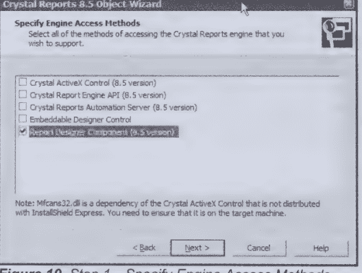

**图 10.** 步骤 1—指定引擎访问方法。

下一步是选择导出格式（见图 11）。对于我们的应用程序，我们通常提供 Windows 逗号分隔值（CSV）、Excel、Excel、HTML、Acrobat 便携式文档格式（PDF）、富文本格式（RTF）和 XML。

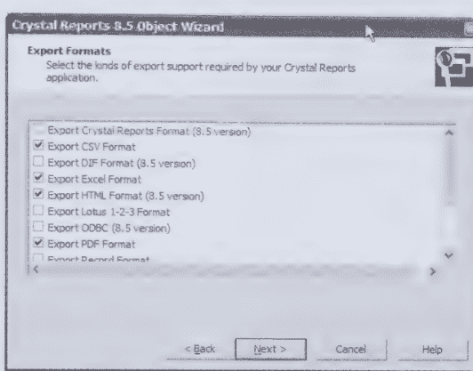

**图 11.** 步骤 2—导出格式。


接下来的步骤是导出目的地（**图 12**）。我们通常为客户提供导出到应用程序、磁盘、磁盘驱动器和 MAPI（用于电子邮件）的功能。如果这些技术对您的客户很重要，还可以选择 Exchange 文件夹、Lotus Domino (Notes) 和 VIM。

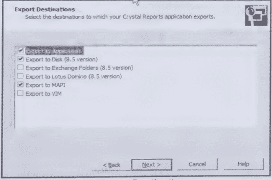

**图 12.** 步骤 3—导出目的地。

下一步是数据库连接（**图 13**）。您在此处的选择完全取决于您的应用程序与之交互的数据源以及您构建报表的方式。我们的经验是使用 SQL Server 和 Visual FoxPro 数据。我们过去使用的工具通过 ActiveX 数据对象 (ADO) 和通过 Visual FoxPro ODBC 驱动程序的 ODBC 来填充报表。根据您的选择，其他选项会被自动选中，因为这些驱动程序适用于多个数据源。

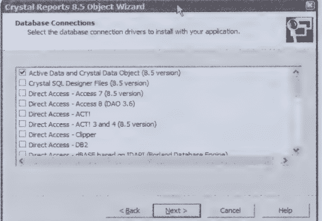

**图 13. 步骤 4—数据库连接。**

附加组件（**图 14**）提供了图表、映射、HTML 翻译、页码范围导出、Crystal Reports 打印引擎（用于将报表输出到打印机）、SQL 表达式和用户函数库的选项。

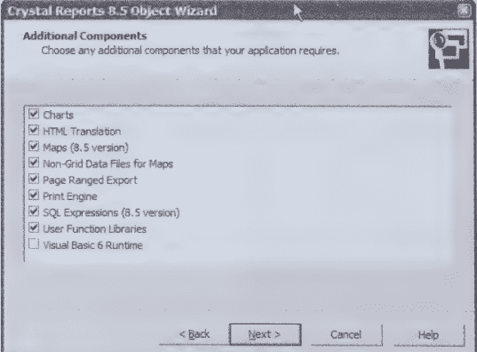

**图 14. 步骤 5—附加组件。**

向导的最后一页（**图 15**）总结了您在向导提供的众多选项中所做的选择。

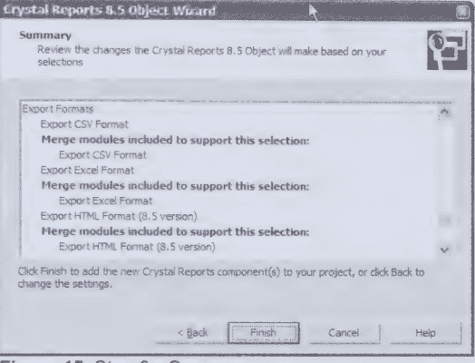

**图 15. 步骤 6—摘要。**

一旦您完成对象向导，每个所需的 Crystal Report 合并模块都将被选中（见**图 16**）。

这个向导并不完全是我们认为的标准向导。在技术上，它更像是一个构建器（builder）。您可以再次运行该向导，它会显示您之前做出的选择。某些选项会被“添加”到您的选择中，因为您做出的其他选择具有共同的 DLL 文件和依赖项。这不会使您的部署包臃肿，而是在显示基于您在之前运行向导时的选择，您的应用程序可以免费获得的其他附加功能。

我们仍然建议您根据在向导中的选择审查已选中的合并模块列表。您完全没有必要运行这个向导。如果您知道部署时需要选择哪些模块，可以直接选择各种合并模块。对于我们来说，向导是一个很好的起点，在初始阶段节省了时间。但在构建安装程序之前，我们仍然必须重新检查每个选择，并确保合并模块与部署包中的正确功能相关联。

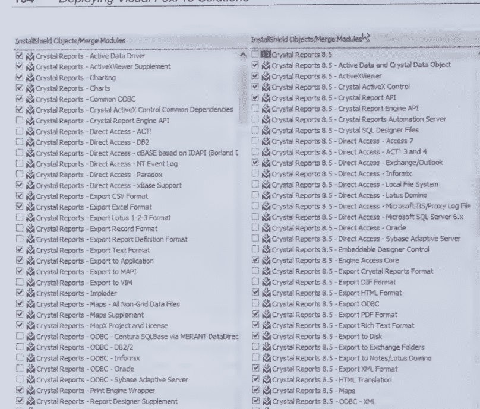

*图 16. 在 Crystal Reports 8.5 对象向导中做出选择的结果是，InstallShield Express 中选中了多个 Crystal Report 合并模块。右侧列表中的 Crystal Report Object Wizard 项目被高亮显示。*

## 分步生成安装程序

生成安装程序的过程取决于您选择用于创建安装包的工具。在本节中，我们将演示使用 VFP 数据工具进行应用程序部署时需要考虑的概念。我们用于演示的工具是 InstallShield Express 3.54 全功能版（而非随 Visual FoxPro 7/8 附带的有限版）。它们非常相似（有关差异的更多详细信息，请参阅附录 A “操作指南：InstallShield Express”），而且由于我们接触的许多开发人员使用有限版，因此我们认为演示的经验可以轻松迁移到您的项目中。

本节的目的不是向您展示如何使用 InstallShield Express（这一点请再次参阅附录 A）；而是向您展示如何实现部署所需的必要概念。

### 步骤 1—组织您的安装程序

第一步是组织您的安装程序。本节允许您定义安装步骤和 Windows “添加/删除程序”小程序中显示的信息。您定义文件被分配到的功能，确定向用户显示哪些安装类型，以及该安装类型将安装哪些功能。

您输入到基于 Windows Installer 的安装工具中的**常规信息**（见**图 17**）将显示在安装步骤中。产品名称显示在引导界面上。产品版本、包代码 (package code) 和升级代码 (upgrade code) 决定了此次安装是小更新、次要更新还是主要更新（完整详细信息请参阅第 5 章“Windows Installer 详解”中的“更新、升级和补丁”部分，以及第 9 章“支持与变更”中的“升级安装”部分）。**INSTALLDIR** 是在选择“目标文件夹”对话框时向用户呈现的默认目录（详见本章稍后的“自定义安装步骤”部分）。用户可以更改此文件夹。我们建议使用预定义的 `ProgramFilesFolder` 目标文件夹作为安装文件夹的基准，以符合 Windows 标准。`ProgramFilesFolder` 下的任何子文件夹都是可以的，并由您自己的标准或客户定义的标准来确定。

**摘要信息流 (Summary Information Stream)** 的详细信息存储在 Windows Installer 数据库文件 (MSI) 中，并且可以在 Windows 资源管理器中文件属性对话框的“摘要”页面上找到。**架构 (Schema)** 非常重要，因为它决定了用于安装您创建的包的 Windows Installer 的最低版本。您可以选择在构建过程中将 Windows Installer 引擎作为一部分进行安装。选择架构的关键在于了解目标计算机的操作系统。Windows Installer 2.0 在 Windows NT 上需要 Service Pack 6。如果您没有安装该引擎且目标计算机没有加载正确的引擎，则会显示错误且安装无法运行。

“添加/删除程序”信息可帮助用户获取支持联系方式，并定义如果用户决定卸载应用程序时卸载过程如何运行。通常我们的客户知道在应用程序出现问题时如何联系我们，但情况并非总是如此，因此我们总是填写这些信息以备不时之需。有三个选项可以禁用“更改”按钮、“删除”按钮和“修复”按钮。这些选项取决于您客户的要求。我们始终将这些设置为“否”，以便用户在必要时执行所有这些操作。不要将 **Readme** 属性与作为安装程序一部分包含的 Readme 文件混淆。该属性定义了应用程序在“添加/删除”小程序的“支持信息”对话框中显示的 Readme 文本（请参阅第 9 章“支持与变更”的“卸载”部分）。

下一步是确定您的功能 (features)。功能是您捆绑文件的方式，也是“自定义”安装期间可用的选项。InstallShield Express 会自动为您创建“Always Install”功能。在创建功能时没有绝对的标准。如果您希望所有文件始终被安装，可以选择仅使用一个“Always Install”功能。我们更倾向于将安装包分解为物理组件，以便给用户一个更灵活的安装包。我们为 ActiveX、运行时 (Runtimes) 创建了功能，应用程序、OLE DB 和 ODBC、帮助、数据以及 CrystalReports 8.5 功能。在本章稍后部分，您将看到我们将哪些文件分配给每个功能。

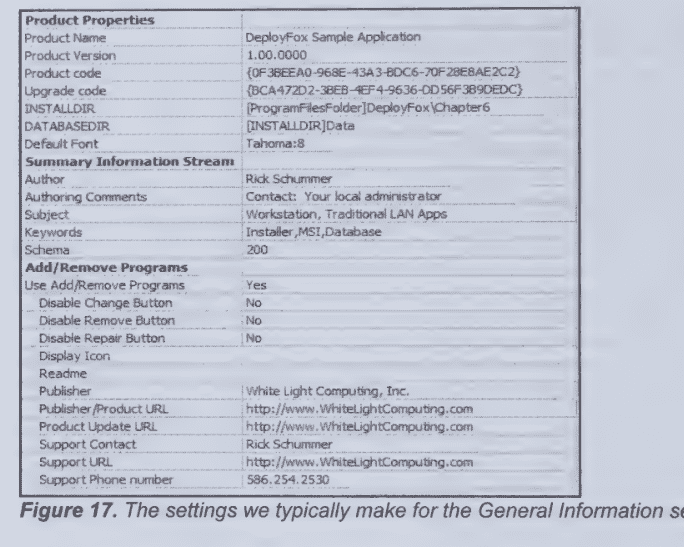

*图 17. 我们通常为“常规信息”部分进行的设置。*

本节需要处理的最后一步是安装类型（见图 18）。InstallShield Express 默认提供“典型 (Typical)”、“最小 (Minimum)”和“自定义 (Custom)”。您可以更改这些选项或接受默认值。在本示例中，我们将它们更改为“工作站 (Workstation)”、“服务器 (Server)”和“自定义 (Custom)”。您可以通过在想要作为热键的字符前加上“&”来设置键盘快捷键。我们更改它的原因是让用户更明显地知道正在进行哪种类型的安装。您还可以更改每种安装类型的描述。这会显示在“安装类型”对话框中，以便用户根据所选的安装类型获得更多信息。

表 5. 功能被分配给安装类型。以下是我们示例中的设置。

| 功能 | 工作站 | 服务器 | 自定义 |
|---|---|---|---|
| 始终安装 | X | X | X |
| ActiveX | X | X | X |
| 运行时 (Runtimes) | X | X | X |
| 应用程序 | | X | X |
| OLE DB 和 ODBC | X | | X |
| 帮助 | | X | X |
| 数据 | | X | X |
| Crystal Reports 8.5 运行时 | X | X | X |

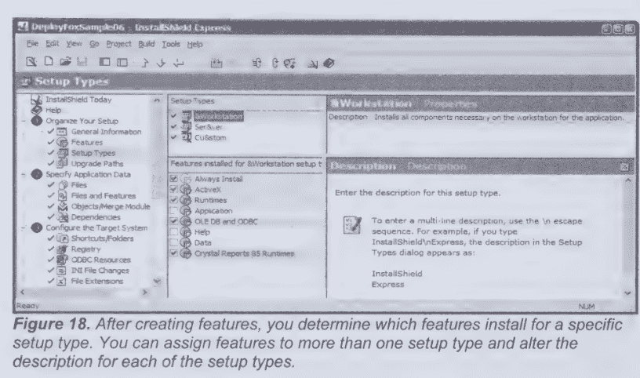

**图 18.** 创建功能后，您需要确定特定安装类型需要安装哪些功能。您可以将功能分配给多个安装类型，并修改每种安装类型的描述。

第 9 章“支持与变更”详细讨论了升级路径，因此我们在这里不再深入探讨，仅说明它们用于应用程序的更新或升级。就本章而言，我们将首次安装一个新应用程序。

### 步骤 2—指定部署的文件

一旦确定了呈现给用户的功能和安装类型，您就可以确定软件包中包含哪些文件。您可以单独选择文件，或指定包含一个或多个文件的合并模块 (Merge Modules)。每个文件都被分配给一个或多个功能。您包含的功能以及在安装类型中如何捆绑这些功能，决定了您选择文件的方式。

#### 单个文件

在流程的这个阶段，您需要了解哪些文件需要单独选择，以及您的安装包需要将哪些文件捆绑在您计划利用的各种合并模块中。首先，选择要包含在软件包中的单个文件。

**表 6.** 为安装包示例选择的单个文件。

| 文件 | 应用程序功能 | 数据功能 | 帮助功能 |
|---|---|---|---|
| Demoapp.exe | X | | |
| ReadMe.txt | X | | |
| Customer.dbf | | X | |
| Customer.cdx | | X | |
| Demoapp.chm | | | X |

要将文件包含在软件包中，首先选择该功能（见**图 19**），在源计算机上逐级浏览目录直到找到文件夹。在目标计算机上创建所需的目录结构。选择您希望安装文件的目录。以“应用程序”功能为例，我们需要应用程序可执行文件和 README.TXT 文件。在源计算机上选择这些文件，然后将它们拖到目标计算机的文件面板（InstallShield Express 的右下角）。

您可能会遇到需要为文件设置单个属性的情况。这些属性决定了单个文件的安装行为。您可以确定它们可以安装的操作系统，以及文件是否永不覆盖（在安装期间）、是否永久保留（卸载时不删除）或是否共享（可被另一个应用程序安装使用，且仅在应用程序计数器为 1 时才卸载）。我们发现高级设置（见**图 20**）对于数据文件、INI 文件和无配置表极其重要。我们不希望这些文件被覆盖，因为在升级应用程序时，客户已经配置好了自己的设置。

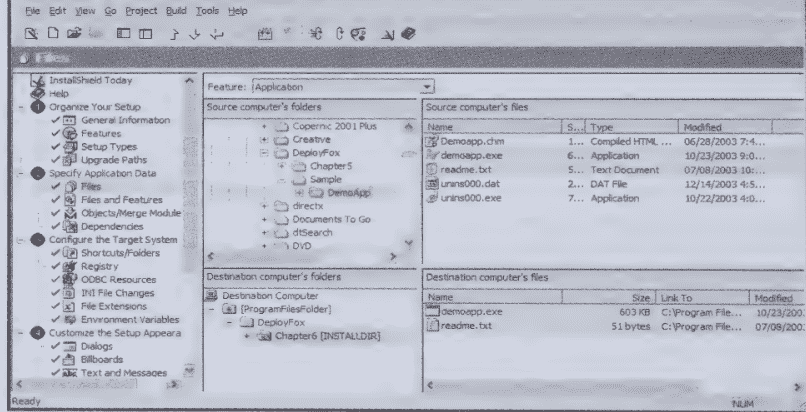

*图 19. 分配文件的操作是通过选择功能，然后将文件从源计算机拖到目标计算机文件夹中完成的。*

#### 合并模块

接下来选择合并模块。我们列表中的大多数合并模块（见**表 7**）是基于示例中包含的 Crystal Reports v8.5 功能。当然，我们还包含了 Visual FoxPro 运行时、C++ 运行时的依赖项以及 GDI 再发行运行时。示例应用程序中的滑块控件需要 Microsoft Windows Common Controls 合并模块。其余的合并模块是基于其他合并模块的依赖关系而包含的。

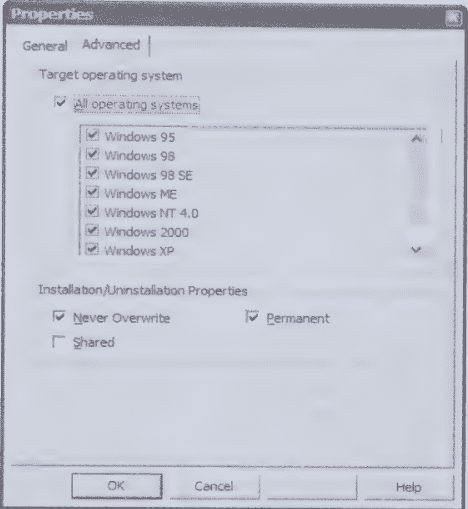

*图 20. 如果您想控制文件安装的操作系统，或确保文件不被覆盖、永不删除或仅在最后一个应用程序卸载时删除，那么设置文件属性非常重要。*

*表 7. 我们的安装示例中包含的合并模块及其分配的功能。*

| 合并模块 | ActiveX | 运行时 | ODBC 和 OLE DB | Crystal Reports 8.5 运行时 |
| --- | --- | --- | --- | --- |
| Crystal Reports – Active Data Driver | | | | X |
| Crystal Reports – ActiveXViewer Supplement | | | | X |
| Crystal Reports – Charting | | | | X |
| Crystal Reports – Charts | | | | X |
| Crystal Reports – Common ODBC | | | | X |
| Crystal Reports – Crystal ActiveX Control | | | | X |
| Common Dependencies | | | | |
| Crystal Reports – Direct Access – xBase Support | | | | X |
| Crystal Reports – Export CSV Format | | | | X |
| Crystal Reports – Export Excel Format | | | | X |
| Crystal Reports – Export Text Format | | | | X |
| Crystal Reports – Export to Application | | | | X |
| Crystal Reports – Export to MAPI | | | | X |
| Crystal Reports – Imploder | | | | X |
| Crystal Reports – Maps – All Non-Grid Data | | | | X |
| Crystal Reports – Maps Supplement | | | | X |
| Crystal Reports – MapX Project and License | | | | X |
| Crystal Reports – Print Engine Wrapper | | | | X |
| Crystal Reports – Report Designer Supplement | | | | X |
| Crystal Reports – SQL Semantics | | | | X |
| Crystal Reports – User Function Libraries | | | | X |
| Crystal Reports 8.5 – Active Data and Crystal Data Object | | | | X |
| Crystal Reports 8.5 – ActiveXViewer | | | | X |
| Crystal Reports 8.5 – Crystal ActiveX Control | | | | X |
| Crystal Reports 8.5 – Crystal Report API | | | | X |
| Crystal Reports 8.5 – Direct Access – Exchange/Outlook | | | | X |
| Crystal Reports 8.5 – Engine Access Core | | | | X |
| Crystal Reports 8.5 – Export HTML Format | | | | X |
| Crystal Reports 8.5 – Export PDF Format | | | | X |
| Crystal Reports 8.5 – Export to Disk | | | | X |
| Crystal Reports 8.5 – Export XML Format | | | | X |
| Crystal Reports 8.5 – HTML Translation | | | | X |
| Crystal Reports 8.5 – Maps | | | | X |
| Crystal Reports 8.5 – ODBC – XML | | | | X |
| Crystal Reports 8.5 – Page Ranged Export | | | | X |
| Crystal Reports 8.5 – Report Designer Component | | | | X |
| Crystal Reports 8.5 – SQL Expressions | | | | X |
| GDI Plus Redist module (所有 VFP 8 应用程序必需) | | X | | |
| MFC 6.0 | X | | | |
| Microsoft C Runtime Library 6.0 | X | X | | |
| Microsoft C++ Runtime Library 6.0 | X | X | | |
| Microsoft C++ Runtime Library I/O 6.0 | X | X | | |
| Microsoft Component Category Manager Library | X | | | |
| Microsoft OLE 2.40 for Windows NT and Windows 95 | X | | | |
| Microsoft Visual C++ Runtime Library (所有 VFP 7/8 应用程序必需) | | X | | |
| Microsoft Visual FoxPro 8 HTML Help Support Library | | X | | |
| Microsoft Visual FoxPro 8 Runtime Libraries (所有 VFP 8 应用程序必需) | | X | | |
| Microsoft Visual FoxPro ODBC Driver | | | X | |


| Microsoft Visual FoxPro OLE DB Provider | | | X | |

| Microsoft Windows Common Controls (6.0) | X | | | |

InstallShield Express 中的“文件和功能 (Files and Features)”步骤是一个极佳的视图，用于审查在文件选择步骤中单独选择的文件及其分配的功能。

### 步骤 3 — 配置目标计算机

配置目标计算机定义了在运行安装的计算机上进行的设置更改。它使您有机会定义快捷方式、创建或更新 Windows 注册表项、添加 ODBC 数据源名称、更新 INI 项、创建自定义文件扩展名以及创建并设置 DOS 环境变量。

我们建议至少为应用程序可执行文件创建一个快捷方式（参见图 21）。您可以将快捷方式放置在 Windows “开始”菜单、用户的“启动”文件夹或用户的桌面上。您可以在这些目录中的任何一个下创建文件夹，然后在这些新文件夹中创建快捷方式。例如，我们在“开始”菜单的“程序”文件夹下创建一个文件夹，并将其命名为我们的公司名称。在公司名称文件夹下，我们为应用程序或应用程序套件创建一个文件夹。在此文件夹下，我们添加指向应用程序可执行文件的快捷方式，以及可选的帮助文件、自述文件和其他任何有意义内容的快捷方式。

每个快捷方式都有您可以设置的属性。根据操作系统的不同，描述会显示为菜单上快捷方式的工具提示。正确设置“目标”很重要。在我们的示例中，“目标”设置为`[INSTALLDIR]DEMOAPP.EXE`。注意这里没有反斜杠，需要记住`INSTALLDIR`是一个属性，包含用户输入或您为安装指定的完整路径。添加反斜杠会导致快捷方式中文件名前出现两个反斜杠。如果您在提供的`INSTALLDIR`下包含一个目录，请使用反斜杠将这些文件夹与文件名分隔开。例如，如果您希望帮助文件放在`INSTALLDIR`下名为`Help`的文件夹中，则应使用`[INSTALLDIR]HELP\DEMOAPP.CHM`。Visual FoxPro 应用程序只有一个图标，索引为图标 0。首先，为“图标文件”属性选择应用程序可执行文件，然后为“图标索引”属性选择零。这会将应用程序图标添加到菜单项中。这些是我们推荐的最低设置。如果您有需求，可以更改工作目录、添加快捷键、参数和注释。

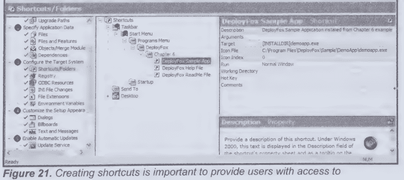

*图 21. 创建快捷方式对于为用户提供访问应用程序的途径非常重要。*

我们在此设置中介绍的另一个部分是 ODBC DSN。在这个特定的部署中，我们有这样的需求：将数据暴露给最终用户，以便他们可以使用 Microsoft Access 创建一些临时报告。我们通过 ODBC DSN 暴露此功能。有关选择现有 DSN 并将其包含在安装包中的所有详细信息，请参见“ODBC DSN”部分。需要注意的是，InstallShield Express（有限版和到 3.54 的完整版）只允许您通过选择开发机器上存在的 DSN 来添加 DSN。

我们在设置中不处理的项目包括注册表、INI、文件扩展名和环境变量。注册表项很常见，但我们的示例应用程序没有特定的注册表更新需求（我们在本章前面的“其他配置设置和注册表”部分讨论过）。随着开发人员迁移到 Windows 注册表，INI 文件更改如今已不那么常见。

### 步骤 4 — 自定义安装步骤

自定义安装的步骤非常重要，因为它决定了安装包中包含哪些对话框，并允许您配置每个步骤的外观和工作方式。

对话框选择很简单，只需选择您希望在安装过程中显示的对话框。启动画面位图在`SETUP.EXE`启动时显示。安装欢迎界面允许您显示一个初始屏幕，注明产品名称（在设置的“常规信息”部分定义，参见图 22）。这两个对话框都不进行任何安装处理，基本上只是“跳舞的鸡”的一部分，旨在让用户了解安装即将开始。如果您希望安装欢迎对话框使用不同的语言，可以自定义版权声明。

许可证协议对话框允许您显示极其重要的最终用户许可协议（EULA）。此对话框仅在您希望用户在继续之前同意具有法律约束力的协议时才必要。这对于垂直市场应用程序特别有用。自定义应用程序通常通过您与客户之间的合同进行许可，因此此步骤不是那么必要。自述文件允许您向运行安装的用户提供最后时刻的信息。许可证和自述文件文本文件最好创建并保存为富文本格式（RTF）。RTF 格式允许将不同的格式功能（字体、字号、颜色、粗体、斜体、下划线等）合并到文本中。所有文字处理器都允许将文档保存为 RTF 格式。我们建议使用接近安装工具对话框中使用的字体。以 InstallShield Express 为例，您可以在“常规信息”设置中设置此字体。纯 ASCII 文件不适用于这些对话框。

客户信息对话框是此 InstallShield Express 过程中更重要的对话框之一。此对话框允许用户通过“显示所有用户选项”属性将应用程序安装到目标计算机上的所有用户。我们建议将此设置为“是”，以便您的客户可以选择为目标计算机上的所有用户安装一次。如果您不提供此选项，并且用户在计算机上有两个或多个登录 ID，则他们必须为运行应用程序的每个用户 ID 安装应用程序。或者，您可以要求用户输入序列号。我们过去没有使用过此功能，但根据文档，它说明了您如何提供验证 DLL 调用，以确定用户输入的序列号是否有效。

目标文件夹对话框允许用户确定他们希望作为`INSTALLDIR`的文件夹。或者，您可以关闭更改文件夹的选项。您的客户可能确定应用程序将驻留在服务器上的文件夹，并且不希望最终用户更改它。我们通常允许灵活性，因为这是我们购买软件时希望具备的功能。

数据库文件夹对话框允许您向用户公开一个单独的文件夹，供其选择数据的位置。如果在`INSTALLDIR`下有一个目录，我们建议跳过此对话框，并使用在“常规信息”下定义的`DATABASEDIR`设置。如果您希望数据文件夹默认为特定文件夹，请设置`DATABASEDIR`属性并启用“数据库文件夹”对话框。如果您想向用户显示数据的安装位置，但又不给他们更改的机会，您也可以禁用更改文件夹。

| 产品属性 | |

| --- | --- |

| 产品名称 | DeployFox 示例应用程序 |

| 产品版本 | 1.00.0000 |

| 产品代码 | {0F3BEEA0-968E-43A3-BDC6-70F28E8AE2C2} |

| 升级代码 | {BCA472D2-3BEB-4EF4-9636-DD56F3B9DEDC} |

| INSTALLDIR | [ProgramFilesFolder]DeployFox\Chapter6 |

| DATABASEDIR | [INSTALLDIR]Data |

| 默认字体 | Tahoma:8 |

*图 22. 如果您不希望最终用户指定数据位置，并且数据位于`INSTALLDIR`下，请更改“常规信息”中的`DATABASEDIR`属性并跳过“数据库文件夹”对话框。*

如果您希望允许用户确定他们想要安装的功能，安装类型对话框就很重要。您在定义安装类型时确定此对话框上显示的安装类型，正如您在此过程的第一步中组织安装时所做的那样。安装默认为“典型”、“最小”和“自定义”，但在本示例中我们将其更改为“工作站”、“服务器”和“自定义”。如果您公开了“自定义安装”类型，则必须包含“自定义安装”对话框。自定义安装对话框对于系统或网络管理员安装未包含在其他两种安装类型中的特定组件非常方便，也是安装这些其他组件的唯一方式。

准备安装对话框为用户提供在安装继续之前的最后一次退出选项。我们喜欢包含此对话框，以便用户最后一次问自己是否真的想进行安装。如果他们此时取消，不会造成任何损害。如果跳过此对话框，安装会在他们选择安装类型后立即进行。

安装进度对话框是“跳舞的鸡”，向用户显示确实有内容正在安装。如果您不选择此对话框，用户将没有指示表明安装正在进行，除非他们识别出光盘在转动或硬盘驱动器指示灯在闪烁。“安装完成成功”对话框也是如此。包含此对话框是让用户理解安装已成功完成并准备好继续执行部署说明中下一步的一种方式。

每个对话框都可以使用横幅（见**图 23**）。InstallShield 提供了多种可供选择的横幅，或者您也可以创建自己的横幅。为了演示如何操作，我们创建了自定义横幅。每个支持横幅的对话框都有一个名为“Banner Bitmap”的属性。请选择您希望在对话框中显示的图像文件。如果您愿意，每个对话框可以设置不同的图像，但如果您希望它们与默认设置不同，则必须单独为每个对话框进行设置。

> 横幅尺寸的规格（见**图 24**和**图 25**）并不一定就是您希望放置图形的区域。每个横幅都会覆盖文本显示的区域。如果将图形扩展到整个图像尺寸，可能会导致文本难以阅读。

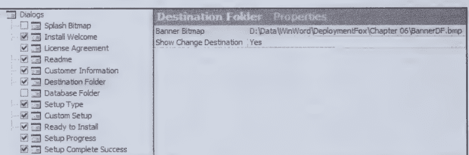

**图 23.** 您可以通过更改 Banner Bitmap 属性来更改安装向导顶部显示的图形。

> 在 **www.Hentzenwerke.com** 提供的本章下载内容中包含多个横幅示例。运行在对话框顶部的横幅示例命名为`BANNERTEMPLATE58x499.BMP`（供您开始创建自定义横幅的空白模板）和`BANNERTOPDF.BMP`。运行在左侧的横幅示例命名为`BANNERTEMPLATE499x312.BMP`（空白模板）和`BANNERLEFTDF.BMP`。


**图 24.** 对于在顶部显示横幅的对话框，自定义横幅的尺寸需要为宽 499 像素，高 58 像素。

公告板（Billboards）是在安装期间显示的资讯图像。我们倾向于不使用公告板，因为使用它们会使安装程序的外观和感觉变为由 VFP Setup Wizard 执行的安装风格。它会将背景变为蓝色，然后显示您希望客户在安装期间查看的图像。我们更倾向于通过 ReadMe 对话框进行沟通，但该选项由您决定。此外，您可以更改整个安装过程中显示的文本和消息。同样，我们发现对于我们的安装程序来说，这个功能并非必要。


**图 25.** *对于在左侧显示横幅的对话框，自定义横幅的尺寸需要为宽 499 像素，高 312 像素。*

### 第 5 步—定义安装要求和操作

这一步骤允许您确定目标机器的要求，甚至启动安装。您可以定义操作系统（从 Windows 95 到 XP 的哪个版本，或全部）、处理器类型（全部、486、Pentium）、RAM 大小（8、16、32、64、128、256 或任意兆字节），指定最低分辨率，以及最后的最低色深。

我们在几乎所有的安装中都使用了 RAM 限制（64MB）。如果我们部署的是 Visual FoxPro 8 应用程序，我们会剔除 Windows 95 平台，因为该平台不被支持，而且我们认为它不足以作为 VFP 8 应用程序的稳定平台。只有在客户在要求中明确指定屏幕分辨率和色深选项时，我们才会考虑这些选项。我们喜欢开发在 800x600 分辨率下运行的应用程序，但并非所有客户都接受这一限制。

> 注意！如果您使用的是随 Visual FoxPro 7 附带的 InstallShield Limited Edition，并且指定了一个或多个操作系统，您的安装包将无法在 Windows XP（家庭版或专业版）上安装。这并非最低设置，而是一个包含/排除设置。若要使 VFP 7 程序能够在 Windows XP 上安装，请务必选择 “Any OS”。

### 第 6 步—构建安装包

现在每个步骤都已经处理完毕，您可以创建安装包了。您只需要再做几个决定。首先是确定您想要分发安装程序的介质，以及要包含哪些 MSI 引擎。

对于所有安装介质选项，都有一些通用的选项可用。您可以决定安装时要使用哪个 MSI 引擎（见图 26）。您也可以为 Windows NT 和 Windows 9x 两个平台分发引擎，或仅为其中一个平台分发，或者完全跳过引擎分发。如果您知道客户已经安装了引擎，可以通过不包含它们来减小分发包的体积。我们的测试显示，包含两个引擎与不包含任何引擎之间大约有 3.4 兆字节的体积差（见表 8）。由于我们从不确定所使用的引擎是否已安装，因此我们总是为所有部署平台包含引擎。

除了 WebDeployment 选项外，所有选项都具有创建`AUTORUN.INF`文件的能力。如果您在介质（CD-ROM、DVD 或其他）中包含此文件，操作系统将支持它，并且在启用自动运行功能的情况下，插入介质时安装程序会自动启动。由于大多数机器都启用了此功能，我们总是包含`AUTORUN.INF`文件，这样我们就不会收到询问如何启动安装程序的支持电话。

CD-ROM 发布是最常见的，因为大多数客户都有 CD-ROM 刻录机，它是最便宜的分发方法之一，且大多数传统的工作站和局域网安装都可以放入一张单层 CD-ROM 中。如果初始构建无法放入单张 650 MB 的 CD-ROM，您可以选择压缩文件。我们最经常使用这个选项。

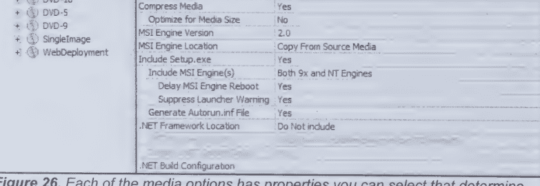

**图 26.** 每个介质选项都有您可以选择的属性，用于确定最终构建的生成方式以及包含哪些 Windows Installer 引擎文件。

Custom（自定义）选项是唯一允许您在不考虑介质特定标准的情况下确定准确介质大小的选项。如果您使用类似 Iomega Zip 盘这样的超级磁盘进行分发，则需要此选项。DVD 选项除了介质大小外全部相同。归根结底，就是选择适合您介质的选项。

所有选项选择完毕后，您就可以构建安装包了。首先，选择一个您想要构建的介质选项。接下来，按下 F7 键或选择 Build | Build <option> 菜单项。菜单项的标题会根据所选介质而改变。InstallShield Express 输出窗口中会显示大量文本（见**图 27**）。如果构建过程中出现错误，您需要检查文本以查看导致错误记录的原因。

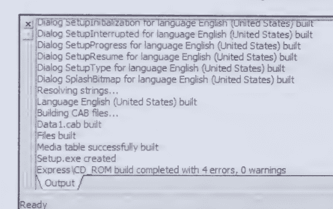

*图 27. 每次构建的目标是零错误和零警告。此次构建存在问题，因此您必须检查输出以查看具体问题并予以修复。*

我们发现 InstallShield Express 存在几个常见的构建问题。如果您在 Windows 资源管理器中打开了 ISE 在构建期间创建的树形结构中的某个文件夹，构建将失败。目录在构建过程开始时会被删除。如果任何目录正在被使用，Windows 不允许删除目录树，从而导致构建失败。另一个常见的触发错误是选择了 License 或 ReadMe 对话框但未正确包含 RTF 文件。通常拼写错误会触发此错误。

构建完成后，您可以对其进行测试。“Test Your Build” 会在不安装文件的情况下运行构建（见**图 28**）。这给您一个机会来检查对话框并验证流程是否按预期工作。您可以返回 InstallShield Express，在任何步骤修改任何属性，然后重新构建并重新测试。您可以根据需要多次重复这个迭代过程。

最后一步是将文件复制到您指定的介质中。InstallShield Express 会在 InstallShield 项目文件所在的文件夹下创建一个文件夹。该文件夹的名称与您创建的项目名称相同。本章创建的示例项目名称为`DeployFoxSample06`，因此项目目录下的目录名称为：

```
<PROJECT FOLDER>\DeployFoxSample06\Express\CD_ROM\DiskImages\DISK1
```

## 表8. 示例项目的构建文件大小。

| 压缩设置 | 包含MSI引擎 | 不包含MSI引擎 |

| :--- | :--- | :--- |

| 压缩 | 36.1 MB | 32.7 MB |

| 未压缩 | 79.1 MB | 75.7 MB |


## 图28. 测试构建允许您审查选定的对话框，以验证您包含在安装包中的图像和文本更改。

将`DISK1`文件夹中的文件复制到 CD-ROM 上，您就可以在干净的计算机上进行安装，然后将其发送给您的客户进行测试。

## 在部署过程中可能出什么问题？

一言以蔽之，任何问题都可能发生！部署噩梦并不少见。糟糕的软件部署会破坏日程安排、项目，甚至可能损害客户的计算机。一次糟糕的安装可能会毁掉之前所有的开发工作。

我们无法在本书中涵盖每一个可能的问题，更不用说这一章了。我们将要做的是涵盖多年来困扰着我们的许多常见问题。提前规划部署可以帮助您避免我们在此列出的许多问题。

### 实施

我们都经历过尴尬的实施情况，遇到了在单元测试、系统测试、用户验收测试，甚至是在实际安装前一天进行的安装排练中从未出现过的问题。这可能是因为外部问题，或者是因为您自己在流程中引入的一个或多个问题。

-   用户无法执行安装和遵循部署说明。

-   您到达现场，但用户不可用（被拉去做某个重要项目或会议）。

-   所需硬件未交付。

-   部署包中缺少文件（可执行文件、运行时文件、报告、ActiveX控件、元数据或图像）。

-   生产环境中缺少数据文件。

-   版本问题（文件在您需要时未被覆盖，或在您不希望时被覆盖）。

-   在安装开始前数据转换错误。

-   实施后索引损坏。

-   资源文件（`FoxUser.dbf/fpt`）损坏。

-   没有备份（数据和应用程序）。

-   7x24小时运行的应用程序无法停机10分钟（调度问题）。

### 应用程序

应用程序应在您部署之前就经过充分测试，但在部署过程中您可能会遇到破坏应用程序的新情况。我们强烈建议您或指定的安装人员在将应用程序交付给用户之前先运行该应用程序。

-   `SET EXCLUSIVE OFF`，单个开发人员在开发机器上只运行一个实例，从未测试过多用户争用问题。

-   只读文件（INI、DBF、CDX、FPT），通常是在使用 Windows 2000 及更早版本从 CD-ROM 复制文件时造成的。

-   开发机器上的路径与生产目录结构不匹配。

### 环境

确保顺利部署最困难的部分是在部署发生之前就充分了解环境。然而，我们仍然发现自己在决定性的日子到来之前被未曾预料到的问题绊倒。

-   没有兼容的媒体读取器。


较旧的运行时文件可能导致 VFP 错误无法解决（例如，VFP 8 SP1 解决了 Windows NT 4.0 上报告的打印机预览问题）。

网络管理员希望数据存储在与应用程序架构方式不兼容的位置。

没有实施所需的管理员权限。

硬件无法运行应用程序（PC、打印机、内存）。

操作系统问题——环境中有 Windows 95 机器，而应用程序要求 Windows 98 或更高版本。

操作系统问题——打印机驱动程序错误、打印机驱动程序缺失、网络驱动程序错误（尤其是 Netware）。

屏幕分辨率不够高，无法容纳窗体。

工作站上缺少字体可能会成问题，因为替代字体可能会导致标签截断等问题，并使窗体和报告无法使用。

防病毒软件可能与应用程序冲突，可能导致机器不稳定，并减慢数据访问的性能。

某些环境（如 Netware 关闭长文件名支持）仅支持旧的 DOS 8.3（`文件名.扩展名`）格式。您可能需要考虑表、索引文件、备注文件和可执行文件采用此格式。数据库容器中的表名可以很长，而物理表可以保持 8.3 格式。

缺少自动化对象所需的软件。

软件版本不正确。您为 Word XP 编写了 Word 自动化代码，但用户在所有机器上安装了 Office 97，尽管三个月前您特别要求他们升级每台机器。

旧的 Internet 浏览器、Internet 浏览器不兼容，或某个用户不遵循公司标准使用其偏好的 Internet 浏览器。

没有 Internet 连接来获取驱动程序更新和软件更新。

网络问题——机器运行缓慢，网卡速度慢。

网络问题——用作服务器的点对点机器全天被某位员工作为工作站使用。

网络管理员和最终用户不一致的驱动器映射。

未为所有用户设置对数据目录和应用程序目录的安全权限。

## 结论

工作站和传统局域网环境一直是 Visual FoxPro 开发者最常见的部署类型。这些部署自个人计算时代开始以来就一直存在，并且未来仍将是开发者部署的重要组成部分。我们试图涵盖您在此环境中面临的问题，并提供您可以现在和将来采取的想法和方法，以实现成功的安装。

本章的更新和勘误可在 Hentzenwerke Publishing 的网站上找到，[www.hentzenwerke.com](http://www.hentzenwerke.com)。点击“目录”并导航到本书的页面。

## 第7章 客户端/服务器应用程序分步指南

在本章的上下文中，客户端/服务器应用程序访问的是远程数据，即非 Visual FoxPro 表（`DBF`）的数据。我们越来越多地看到 CIO 和 IT 经理要求新应用程序使用 SQL 后端数据库。这种架构在部署 Visual FoxPro 解决方案时带来了新的挑战。本章讨论了这些问题，并为您在考虑部署时提供了一些解决方案供参考。

有时您会意识到，您支持的应用程序无法再使用您过去近二十年一直使用的相同 `DBF` 数据存储来正常运行。可能是一个或多个表接近两 GB 的限制，您的客户正在遭受另一次索引或表损坏的痛苦，有人复制了 `DBF` 文件，走到街对面，将其加载到竞争对手的机器上，或者网络因缓存索引和记录而过于拥堵，导致性能下降。也许是您现有的客户或潜在的新客户询问您是否可以基于 SQL Server 2000、Oracle、Sybase、SQLAnywhere、Informix、MySQL 或 DB2 部署系统，因为他们听说这是下一个大趋势，并且他们的应用程序必须符合流行术语。无论原因如何，部署客户端/服务器应用程序并不困难。与基于文件服务器的部署相比，部署客户端/服务器应用程序有诸多优势和劣势（见表1）。它与工作站和传统局域网（LAN）应用程序既有相似之处，也有不同之处。

表1. 部署用 Visual FoxPro 编写的、带有后端数据库服务器的客户端/服务器应用程序的优势和劣势。

| 优势 | 劣势 |
| :--- | :--- |
| 免版税的应用程序运行时 | 需要部署和配置额外的组件 |
| 数据库内置安全性 | 更新生产环境中的结构过程更复杂 |
| 计划任务 | 需要理解众多连接技术并确定与应用程序一起部署的最佳方式（使用 `MSDE` 时存在 2GB 数据库限制） |
| 可扩展的解决方案 | |
| 潜在的更少网络流量 | |
| 原生复制和分布式数据 | |
| 在线备份 | |
| 市场接受度（符合流行术语） | |

本章不讨论 Visual FoxPro 应用程序访问 Visual FoxPro 数据与同一应用程序需要访问 SQL 后端数据库之间的不同设计架构。我们将讨论部署 Visual FoxPro 的差异。

## 故事

## 性能为王

应用访问 SQL 数据库后端。在我们术语中，后端数据库和远程数据指代相同。两者都指数据库服务器，无论是引言章节中提到的其中一种产品，还是类似产品。

在许多方面，其实施方式与第 6 章“工作站和传统局域网应用程序分步实施”中详述的工作站安装实施相似。您可以使用第六章讨论的任何场景来实施应用程序和数据。本章重点介绍数据实施以及在实施客户端/服务器应用程序时可能遇到的其他问题，以及它们如何影响您的部署包。我们的后端数据库经验来自 SQL Server（包括完整版和 `MSDE`），因此示例和内容都使用 SQL Server 进行演示。大多数概念可以轻松地应用到其他后端数据库。此外，根据我们的经验，大多数 Visual FoxPro 开发人员在使用后端数据库时选择 SQL Server。

我们要分享的第一个故事是我们为另一位开发人员参与的一个项目。这个垂直市场应用程序最初使用 Visual FoxPro 表进行部署，并取得了巨大成功。该公司拥有庞大且非常满意的客户群，该应用程序被誉为拥有业内最佳的计费引擎。由于索引缓存和非常宽的表结构（许多表有超过 100 列），该应用程序在较大规模的安装中开始出现性能问题。第二个问题是顺应潮流的问题。尽管该公司在产品方面享有盛誉，但其一些客户，或许更重要的是，潜在客户开始要求使用 SQL Server 作为后端。IT 经理经常阅读行业杂志，并形成指令，将其数据迁移到 SQL 后端。

该公司的编程资源因忙于应对政府法规和标准客户增强请求而捉襟见肘，因此他们聘请我们将数据从 Visual FoxPro 迁移到 SQL Server 和 Microsoft SQL Server 桌面引擎（`MSDE`）。幸运的是，该应用程序最初就是为迁移到 SQL 后端而设计的。我们执行了将 500 个本地视图迁移到远程视图和存储过程。我们对每个表单和报表进行了大量修改，以指向新的远程视图数据库容器（`DBC`）。我们还进行了一些修改，以处理 Visual FoxPro 和 SQL Server 之间的一些 SQL 不兼容问题，以及诸如在整个代码中移除 `_TALLY` 检查等 Xbase 编码差异。通过远程视图查询 SQL Server 不会像本地视图那样更新 `_TALLY` 系统内存变量。

在测试阶段，我们的客户希望通过在实际生产网络上实施一个 alpha 版本来了解潜在的性能改进。他的客户也想看看性能是否真的如我们在内部测试中告诉他们的那样好。为了评估性能，我们在四台计算机（不同的处理器和内存配置）上安装了生产应用程序，并测试了在多个表单中添加和保存记录、运行一些批处理过程以及执行多个报表。在旧系统中，一些记录更新需要长达 17 分钟。处理一个批处理过程和许多报表通常需要数小时。最慢的计算机是一台 64MB 内存、266 MHz 处理器的老机器。高端机器是 1 GHz 处理器、256MB 内存。

我们非常担心低端机器，因为我们的办公室基准测试是用 750 MHz 处理器和 256MB 内存进行的。

我们安装了新的客户端/服务器应用程序并开始了测试。即使在最低端的机器上，性能也是即时的。这不是夸张。用户执行通常需要十七分钟的操作后，会盯着屏幕看。我们不得不告诉他们数据已保存，因为过程是亚秒级的。他们起初不相信我们。我们的客户甚至对速度之快感到震惊。坦白说，我们对在繁忙网络上的性能也感到有些惊讶。批处理过程和报表在几分钟内完成，而不是几小时。

那么差异在哪里呢？SQL Server 处理是在服务器上执行的。索引和数据不会持续缓存到本地工作站。这提高了网络性能。这个特定站点有一台强大的服务器和一个优化的 SQL Server 安装，而客户端机器配置较弱。这是我们客户最大的站点，他们仍然拥有出色的性能。终端用户希望我们留下部分准备好的软件。他们宁愿使用有错误、不完整的软件，也不愿意使用缓慢但功能丰富的应用程序，当我们得知我们在离开前将其卸载时，他们非常生气。

## 索引依然重要

另一位联系我们客户的开发人员有一个基于 SQL Server 的应用程序，前端使用 VFP。表单响应迟缓，更新时间比它所替代的 FoxPro DOS 应用程序更长。负载并不重，也许 10 个用户，数据量甚至没有给它所替代的 Visual FoxPro 表带来压力。我们被请来检查应用程序架构、代码和数据库。

性能的根本问题很简单：原始开发人员在任何表上都没有创建一个索引。我们为主表添加了一个主索引（基本的数据库 101 基础），将从 20 万条记录中查找一条记录的时间从 20 秒提高到瞬间完成。更新同一条记录的时间从超过 10 秒减少到瞬间完成。应用程序还有其他错误，但通过对数据库进行微小的更改，我们向客户证明了我们的价值。后来我们部署了一个表单原型，展示了更好的方法来解决他们的问题，并最终获得了重写 FoxPro DOS 应用程序的完整合同。

## 来自实践教训的安全基础

Visual FoxPro 表和 SQL 后端之间的一个主要区别是 SQL 后端内置的安全性。在大型数据库服务器安装中，发现专门的数据库管理员并不罕见。他们负责服务器的安全性和应用程序管理数据的安全性。如果他们愿意，他们可以将安全性细化到列级别，如果应用程序没有设计来处理这一点，这可能会破坏应用程序。

我们遇到的最常见的问题是数据库管理员不希望用户使用 Excel 或 Crystal Reports 等工具访问数据（除非经过授权），因此他们会收紧访问权限，甚至不允许用户对特定表运行 SQL Select 语句。如果用户没有对表的访问权限，他们在运行您的应用程序时就没有对表的访问权限。

我们在一个部署的测试版后期遇到了这个问题。突然间，数据库管理员将安全性从 Windows 身份验证更改为 SQL Server 身份验证，并收紧了对我们表的访问权限。我们的应用程序崩溃了，因为：

用户没有权限访问数据，每次运行应用程序时都会出现 SQL Server 登录提示（除了应用程序登录之外）。

为了解决这种情况，我们在数据库中部署了一个应用程序角色。应用程序角色拥有自己的一组安全设置，与用户分开。我们需要为一个表开放安全权限，以便所有用户都能建立与数据库的连接。一旦连接建立，我们将连接与应用程序角色关联起来，这样我们的应用程序就具有运行所需的访问权限，而管理员可以按照他们的意愿锁定用户。我们在本章后面的“数据库管理员和安全”部分讨论了与安全相关的一些问题。

## 通用实施问题

您会发现我们在第 6 章“工作站和传统局域网应用程序分步实施”中撰写的大部分内容在部署客户端/服务器应用程序时仍然适用。您仍然需要部署可执行文件、运行时、报表、帮助文件、ActiveX 控件和 COM 对象、自动化应用程序、创建快捷方式、设置配置文件、确定临时文件的存储位置，并在注册表中设置项目。从这个角度来看，生成部署包的过程不会改变。

改变的是您如何设计应用程序以及如何部署和维护数据。这不像将少数几个文件复制到文件夹并启动应用程序那么简单。您需要确保 SQL 后端已安装和配置。这可能需要您不具备的专业知识，因此您可能需要聘请认证的数据库管理员。如果您具备专业知识，您需要在部署应用程序之前花时间设置服务器。如果数据库服务器已经建立，您可能需要与管理员合作来添加您的数据库并建立安全性。可能您将是数据库管理员，并且必须安装数据库。

每台客户端计算机可能需要加载适当的驱动程序和 ODBC 组件来访问数据库服务器。我们遇到的一个与 ODBC 管理器相关的支持问题是更改数据源名称（`DSN`）指向的数据库。起初看起来可以工作，但当您关闭对话框时，它会重置回原始数据库。如果用户在更改系统 `DSN` 时没有计算机的管理权限，就会发生这种情况。正是这样的挑战会让毫无戒心的开发人员浪费一个小时的时间（是的，这确实发生在我们身上）。

备份的处理方式也不同。没有文件夹需要备份，因为只要数据库服务器在运行，数据库文件就在使用中。所有 SQL 数据库服务器都内置了将数据备份到各种备份设备（硬盘、磁带和另一台计算机）的机制。您甚至可以安排数据库服务器定期备份数据，即使用户正在使用应用程序。

### 安装新的后端数据库

在客户数据库服务器上安装新数据库时，您有几种选择。您可以从另一台服务器（如您的开发机器）还原备份，运行由后端数据库服务器生成的脚本或由开发人员手动编码的脚本，或者如果您的后端是 SQL Server，则运行自动化代码。我们在第 9 章“支持与变更”中的“SQL 数据库结构和维护”部分讨论了向现有后端数据库应用更改。

## 还原备份

还原备份文件的操作取决于您使用的后端数据库。虽然过程可能有所不同，但概念是一样的：从一个数据库服务器获取备份，并将其还原到客户的服务器上。

在 SQL Server 中，您首先在 Enterprise Manager 中选择数据库，右键单击该数据库，然后在快捷菜单中选择“所有任务 | 还原数据库”。此时将显示“还原备份”对话框。请参考帮助文件以确定您想要设置哪些还原选项。您可以从不同的数据库、文件或文件组，或者从设备进行还原。

在新安装环境中的关键是，通过选择“数据库 – 完整”选项来还原整个数据库（见图 1）。还原任何不足于此的内容都是不完整的，并且对于您的部署来说可能毫无用处。


**图 1.** SQL Server 中的数据库还原过程提供了众多选项。安装新数据库的关键是还原完整的数据库。

在还原新数据库时，“还原数据库”对话框的选项页（见图 2）有几个关键设置。第一项是“恢复完成状态”。如果您的用户需要立即通过您的应用程序使用该数据库，请确保让数据库保持可运行状态。如果您是在现有的 Beta 版或测试数据库上还原一个准备用于生产的新数据库，请务必勾选“强制还原到现有数据库”设置。在还原数据库时，最令开发人员困惑的一个设置是：备份保留了关于原始数据和日志文件位置的信息，尤其是数据和日志文件的原始位置。在从您的开发机或服务器还原数据库的情况下，逻辑文件名和物理文件名可能与客户的数据库服务器不兼容。您很有可能需要更改默认设置，以匹配新数据库服务器的文件夹结构。


> 图 2. 选项页有助于设置覆盖数据库对话框；如果您需要覆盖 Beta 数据库，则需要关键设置“强制还原到现有数据库”。

这种方法很简单，因为已有内置工具可以创建备份并在目标机器上还原。但在还原时这是一个手动过程，因为您通常必须对配置进行一些更改。

#### 运行脚本以创建数据库和数据库对象

Visual FoxPro 开发人员使用 Visual FoxPro 随附的 `GenDBC` 程序来创建生成程序，从而从现有的数据库容器中生成数据库容器、表、视图、索引、关系，并添加存储过程。它不能执行的操作是向表中填充数据。同样的概念也存在于 SQL 后端数据库中，但它生成的不是 Visual FoxPro 代码，而是原生数据库操纵语言的脚本代码。该代码用于在客户的数据库服务器上生成数据库的新副本。

生成的脚本在必要时可以进行编辑，部署到客户端数据库服务器并执行。在 SQL Server 中，您可以按照几个简单的步骤对整个数据库进行脚本化：

- 启动 SQL Server Enterprise Manager
- 选择数据库
- 右键单击打开快捷菜单
- 选择“所有任务 | 生成 SQL 脚本...”

此时显示“生成 SQL 脚本”对话框。根据您的需求、您希望脚本化的详细程度以及客户服务器上所需的更改，您可以进行多种选择来定制脚本。首先点击“显示所有”按钮，以便对单个对象类型做出选择或对所有对象进行脚本化（见**图 3**）。如有必要，您可以使用“添加”和“删除”按钮添加或删除单个对象。在“格式”页上有许多格式化选项，在“选项”页上还有更多自定义选项。点击“确定”以生成脚本（见**图 4**）。


***图 3.*** *SQL Server 的“生成 SQL 脚本”对话框允许您生成一个包含所有必要 Transact-SQL 代码的脚本，以重新创建空数据库。*

脚本部署后，可以在类似于 SQL Server Query Analyzer 的工具中于数据库服务器上执行。我们建议在将脚本交付到客户端站点之前，先测试该脚本以验证其是否按预期工作。数据库创建完成后，运行您的应用程序并验证其在空数据库上的工作情况。


**图 4.** 当您开始脚本化过程时，SQL Server 的“生成 SQL 脚本”对话框会显示进度条。

#### 使用 SQL-DMO

SQL Server 通过 SQL-DMO 对象提供了一个完整的对象模型。您可以自动化创建数据库、表、视图，以及添加用户、触发器和存储过程。一个人在 SQL Server Enterprise Manager 中可以管理的所有功能，都可以通过 SQL-DMO 对象模型进行编程控制。Visual FoxPro 程序可以处理所有这些操作。当程序由您、您的用户或数据库管理员部署并实施时，您可以创建空数据库。

为什么您会想要使用 SQL-DMO 以编程方式创建数据库？因为这是一个可重复的过程，且几乎不需要用户交互。生成代码的过程确实枯燥。它基于执行脚本的相同前提，但用户不需要了解如何运行 SQL Query Analyzer 或其他脚本执行工具。如果您的用户能够运行脚本，或者您拥有自动化脚本运行器，您会发现 SQL Server 的脚本生成能力比编写代码快得多。这也仅限于 SQL Server，因为它是专门为 SQL Server 自动化设计的对象。


> 如果您对这个主题感兴趣，我们可以推荐一本关于 SQL-DMO 的优秀书籍，名为 Mark Allison 和 Allan Mitchell 所著的《Real-World SQL-DMO for SQL Server》（ISBN – 1590590406）。

用户需要加载并注册几个文件才能访问 SQL-DMO 对象。当您安装 SQL Server 时，这些文件会加载到您的开发机上。您不能指望用户已经安装了这些文件，因此您需要将它们包含在部署包中。完整列表及其位置请参见**表 1**。

## **表 1** 您需要随应用程序一起分发的 SQL-DMO 文件列表。

| 文件 | 开发机路径 |
| :--- | :--- |
| `SQLDMO.DLL` | `({SQL Server folder})\BO Tools\Binn` |
| `SQLDMO.RLL` | `({SQL Server folder})\BO Tools\Binn\Resources\1033` |
| `SQLRESLD.DLL` | `({SQL Server folder})\BO Tools\Binn` |
| `SQLSVC.DLL` | `({SQL Server folder})\BO Tools\Binn` |
| `SQLSVC.RLL` | `({SQL Server folder})\BO Tools\Binn\Resources\1033` |
| `SQLWID.DLL` | `(Windows System Folder)` |
| `SQLWOA.DLL` | `(Windows System Folder)` |
| `W95SCM.DLL` | `({SQL Server folder})\BO Tools\Binn` |

我们在系统中发现了多份表 1 中列出的 DMO 文件副本，因为我们加载了多个第三方工具来与 SQL Server 交互。根据我们的理解，`SQLWID.DLL` 和 `SQLWOA.DLL` 需要安装在 Windows 系统文件夹中，其余文件可以放在应用程序文件夹或 Windows 路径文件夹中。

> 我们在 **www.hentzenwerke.com** 提供的章节下载中包含了一个名为 `SqlDmo_CreateDb.pg` 的示例程序，以向您演示如何使用 SQL-DMO 创建数据库。您需要修改 `lcSQLServerName` 和 `lcSAPassword` 变量以匹配您的 SQL Server 安装，才能使该程序正常运行。

## **代码清单 1.** 以下 Visual FoxPro 代码在您的 SQL Server 实例中创建名为 `DeployFoxCS` 的数据库。

```
LOCAL lcSQLServer AS "SQLDMO.SQLServer", ;
	loDatabase AS "SQLDMO.Database", ;
	loDatabaseFile AS "SQLDMO.DBFile", ;
	loLogFile AS "SQLDMO.LogFile", ;
	lcDirectory As Character, ;
	lcSQLServerName As Character, ;
	lcSAPassword As Character

*? Change these to match your SQL Server
lcSQLServerName = "SubstituteYourServerNameHere"
lcSAPassword = "ChangeToYourSAPassword"

loSQLServer = CREATEOBJECT("SQLDMO.SQLServer")
loSQLServer.Connect(lcSQLServerName, "sa", lcSAPassword)

loDatabase = CREATEOBJECT("SQLDMO.Database")
loDatabaseFile = CREATEOBJECT("SQLDMO.DBFile")
loLogFile = CREATEOBJECT("SQLDMO.LogFile")

* Ensure folder exists before creating database
```

```
* Otherwise it fails with automation error
lcDirectory = FULLPATH(SYS(2023)) + "\Data\"

IF DIRECTORY(lcDirectory)
    * Nothing to do
ELSE
    MD (lcDirectory)
ENDIF

* Define the database name
loDatabase.Name = "DeployFoxCS"

* Define the primary data file
loDatabaseFile.Name             = "DeployFoxCSData"
loDatabaseFile.PhysicalName     = lcDirectory + "DeployFoxCSData.MDF"
loDatabaseFile.PrimaryFile      = .T.
loDatabaseFile.FileGrowthType = 0     && Growth in MB
loDatabaseFile.FileGrowth     = 1     && 1 MB
loDatabase.FileGroups("PRIMARY").DBFiles.Add(loDatabaseFile)

* Define the transaction log file
loLogFile.Name              = "DeployFoxCSLog"
loLogFile.PhysicalName      = lcDirectory + "DeployFoxCSLog.LDF"
loDatabase.TransactionLog.LogFiles.Add(loLogFile)

* Add the database to SQL Server
loSQLServer.Databases.Add(loDatabase)

* Release object reference variables
loLogFile        = .NULL.
loDatabaseFile   = .NULL.
loDatabase       = .NULL.
loSQLServer      = .NULL.

RETURN
*: EOF :*
```

上述代码列表并未演示如何创建表、添加用户、填充存储过程以及各种其他数据库对象。SQL-DMO 模型有详尽的文档记录，因此我们认为将其作为读者自行练习的最佳选择。请注意，这种部署数据库的方法需要对变更进行谨慎管理，手动编写所有对象，并且在团队中需要更严格的项目管理。

### 数据转换服务 (DTS)

对于在同一网络中进行部署的开发人员，可能会选择使用 SQL Server 的数据转换服务 (DTS)，将表、视图、存储过程、用户和其他 SQL Server 对象直接从一个 SQL Server 迁移到另一个 SQL Server。DTS 提供了一个导入/导出向导流程，用于在不同的 SQL Server 安装实例之间传输对象。

SQL Server 企业管理器的向导部分可以通过选择“数据转换服务”节点，并在快捷菜单中选择“所有任务 | 导入数据...”选项来启动。在向导的第一步（见**图 5**）中，选择包含您想要复制的数据库的服务器和数据库。您根据服务器选择安全登录方式。如果服务器支持 Windows 身份验证，您当前的用户 ID 将被验证为数据库服务器机器上的用户。如果服务器支持此安全方案，您可以选择 SQL Server 身份验证，但需要提供用户 ID 和登录密码。此处的选择应当是您的开发数据库。


*图 5. 第 1 步 – 选择数据源。*


*图 6. 第 2 步 – 选择目标。*

第二步是选择您想要复制数据库对象的服务器和数据库（见**图 6**）。在部署情况下，这将是客户的数据库服务器及其数据库。同样，选择合适的安全模型以登录服务器。

导入/导出向导的第三步（见**图 7**）是确定具体复制内容的地方。第一个选项是“仅表和视图”。此选项会跳过完整部署所需的许多对象，例如存储过程和用户。第二个选项“使用查询指定要传输的数据”允许您编写产生结果集的查询以移动信息。同样，这并不是初始化整个数据库最简单的方法。第三个选项“在 SQL Server 数据库之间复制对象和数据”提供了将数据库对象迁移到生产环境的灵活性和简便性。


**图 7.** 第 3 步 – 指定表复制或查询。

如果您选择了“在 SQL Server 数据库之间复制对象和数据”选项，您将进入导入/导出向导的第四步（见**图 8**）。在这一步中，您可以确定希望如何创建对象、是否复制数据、要复制哪些对象（表、视图、存储过程、用户定义函数、默认值、规则、用户定义数据类型）以及高级选项（用户和角色、登录名、权限、索引、触发器和键）。您需要指定脚本文件目录，以便将运行整个过程的脚本保存到文件夹中。脚本创建后，您可以对其进行审查。


**图 8.** 第 4 步 – 选择要复制的对象。

最后，您需要确定是要立即运行该过程，还是将其调度在稍后执行（**图 9**）。这允许您在必要时将部署调度在非工作时间。


**图 9.** 第 5 步 – 保存、调度和复制包。

该向导在将开发数据库迁移到生产环境时非常易于使用，但它也可以用于将数据从一种数据库格式转换为另一种格式。您可以保存该包以重复运行。当您部署测试版本用于用户验收测试，并希望用当前的数据库覆盖旧的测试数据库以进行新一轮测试时，这将非常方便。

### MSDE vs. SQL Server

询问任何读过微软营销资料的人，他们都会告诉你：Microsoft SQL Server Desktop Engine (MSDE) 就是带有几个限制条件的 SQL Server。其中有四个主要区别：数据库大小限制、性能限制、复制限制以及缺乏管理工具。从部署的角度来看，每一个限制都至关重要。

MSDE 的第一个主要限制是数据库被限制在 2 GB 以内。需要明确的是，Visual FoxPro 的限制是*每个表* 2 GB，而 MSDE 的限制是*每个数据库* 2 GB——换句话说，一个数据库中所有的表、视图、存储过程、用户安全权限等总计不能超过 2 GB。对于小型数据库，这可能不是问题，但存储大量数据的应用程序需要完整版本的 SQL Server。

第二个主要限制是在运行超过 8 个操作时性能会被限制。这意味着并不是您的应用程序被限制在 8 个用户，而是您被限制在 8 个并发进程（如执行查询或执行存储过程）。如果您设计的应用程序旨在供 1 到 10 个用户运行，且他们不会过于频繁地访问数据库，那么用户在生产环境中可能会观察到可接受的性能。我们建议在决定使用 MSDE 之前对此进行测试。

根据您随应用程序部署的复制方案，您可能能够或不能使用 MSDE。MSDE 的复制限制如下：

- MSDE 可以作为所有类型复制的订阅服务器 (Subscriber)。
- MSDE 可以作为合并复制 (merge replication) 和快照复制 (snapshot replication) 的发布服务器 (Publisher) 和分发服务器 (Distributor)。
- MSDE 不能作为事务复制 (transactional replication) 的发布服务器或分发服务器。

在 MSDE 中部署数据库可能比较棘手，因为 MSDE 没有随附管理工具。如果您部署的是 SQL Server 应用程序，您可能习惯于在开发机上安装的 SQL Server 工具：SQL Server 企业管理器 (Enterprise Manager)、SQL 查询分析器 (Query Analyzer)、SQL Server 代理 (Agent)、SQL Server 服务管理器 (Service Manager) 和 SQL 分析器 (Profiler)。而在 MSDE 中，仅随附 SQL Server 服务管理器和 SQL 代理。`OSQL.EXE` 是一个执行 Transact-SQL 命令的命令行工具，`BCP.EXE` 是一个用于数据大批量复制的命令行工具。这些实用程序虽然有用，但您习惯且能高效工作的交互式工具却缺失了。

从部署的角度来看，开发人员需要处理几件事。包括加载初始数据库、配置用户和备份、设置作业以及审查错误日志。

最简单的方法是通过企业管理器远程访问 MSDE 和 SQL Server。企业管理器支持多个 SQL Server 实例。您只需要连接到数据库并在企业管理器中注册即可。您可以对所有数据库使用完整的功能集。在图 10 中，我们展示了四个不同的 SQL Server 实例。每一个都位于不同的机器上。只要我们连接到这些机器（通过局域网或互联网），我们就可以管理这些服务器以及服务器上维护的任何数据库。当然，您需要拥有服务器的安全访问权限才能进行任何维护。

通过企业管理器访问允许您调度/运行备份、手动更改结构、创建索引、创建视图、编写存储过程、导入数据以及维护用户登录。它不允许您运行脚本。您可以使用 SQL 查询分析器（图 11）执行查询、运行脚本以将数据库更新为包含开发中最新的更改、分析结果集以查看是否存在数据损坏，以及执行其他各种支持过程。这不仅适用于 MSDE 数据库，自然也适用于完整的 SQL Server 数据库。

**图 10.** SQL Server Enterprise Manager 可以看到工作站（本地）、局域网（RASSolo9300 和 PSgp6450001）以及通过 Internet 和 VPN 连接的数据库服务器（Alpha）。

如果你无法通过网络或 VPN 访问客户的服务器实例会怎样？你可能在异地，而他们没有设置 VPN。如果你的客户运行的是 SQL Server，你还可以使用终端服务（Terminal Services）、Citrix，或者像 `pcAnywhere` 或 `GoToMyPC` 这样的远程桌面访问工具来连接服务器。远程访问可以让你使用 Enterprise Manager、Query Analyzer、Profiler 以及 SQL Server 随附的其他工具。

如果他们运行的是 MSDE，那么当你通过终端服务或 `pcAnywhere` 远程连接时，无法使用这些工具。在这种情况下该怎么办？有一些第三方工具可以帮助你维护和支持 MSDE 安装。

Microsoft Access XP 和 2003 具有备份 MSDE 数据库、还原之前的备份、在不同 MSDE 实例之间传输和复制数据库，以及通过“工具 | 数据库实用程序”菜单（如**图 12**所示从 MSDE 实例中删除数据库的能力。除了数据库维护选项外，你还可以通过以设计模式打开表来创建和修改表结构。可以浏览表内容，添加新记录，以及删除或编辑现有记录。你还可以创建和修改视图（通过 Access 中的查询列表），并浏览和编辑结果集中的信息。虽然功能有限，但在没有其他可用工具且无法使用 SQL Server 工具连接的情况下，它可能非常有用。


**图 11.** 使用 SQL Query Analyzer 在远程数据库上运行脚本并执行查询，无论是网络连接的还是通过 Internet 访问的。


**图 12.** Microsoft Access XP 和 2003 拥有管理 MSDE 数据库服务器的基础工具。

下一个工具是来自 MSDE.biz 公司 ([http://msde.biz/](http://msde.biz/)) 的 MSDE Admin（见**图 13**）。该工具可以对 MSDE 数据库服务器以及完整版本的 SQL Server 执行基础管理。该工具可以运行备份和还原，管理用户 ID 和登录，允许你编辑存储过程和视图，以及浏览和编辑表数据。许可证费用为 22 美元，包含一份 MSDE Query 的副本，这是一款功能精简的 SQL Query Analyzer 类工具。如果你在安装过程中需要还原一个空白数据库并维护一些用户登录，这个工具非常合适。它不允许你调度备份，但如果你的用户足够资深，能够通过交互方式运行备份，那么这个工具就很好用。


我们见过的管理 MSDE 最好的第三方实用程序是来自 Vale Software ([www.valesoftware.com](http://www.valesoftware.com)) 的 MSDE Manager（见**图 14**）。其价格为 79 美元，考虑到该工具非常精良且能为开发人员或管理员提供对数据库所有方面的完全控制，这个价格非常划算。你可以添加/修改结构、添加/修改视图、添加/修改存储过程、查看和更改数据、设置权限、运行和调度备份、管理用户、对数据库或单个对象生成脚本、收缩数据库等等。在服务器级别，你可以停止数据库服务器并重启、附加数据库以及更改数据库属性。在功能对比上，这是我们见过的最接近 SQL Server Enterprise Manager 的工具。

如果你的部署需要运行脚本，可以使用 MSDE Manager 中包含的 TSQL 实用程序（图 15）。它提供了选择数据库、加载或编写脚本、检查语法以及执行脚本所需的所有功能。如果脚本返回行，结果将显示在网格中。其他消息显示在窗口底部的“服务器消息”区域。消息历史记录将保留直到你关闭该实用程序。


图 14. `MSDE Manager` 提供了 `SQL Server Enterprise Manager` 中的大部分功能。


图 15. `MSDE Manager` 有一个 `TSQL` 窗口实用程序，其外观和操作与 `SQL Query Analyzer` 几乎一样。

### 安装 MSDE

我们在本章中不讨论 `SQL Server` 的安装，那么为什么我们要讨论 `MSDE` 的安装呢？很简单：需要 `SQL Server` 的大型安装通常由数据库管理员或 `SQL Server` 专家来安装。`MSDE` 数据库通常安装给规模较小的客户，这些客户的应用需要使用 `SQL Server` 的功能，但其软件需求并不要求安装完整版的 `SQL Server`，或者数据量较低（数据少于 2GB 且用户数在 10 个或以下）。这类客户通常没有必要的服务器基础架构或在职的数据库管理员。当某个垂直市场应用需要为较小客户“缩减规模”时，我们会使用 `MSDE`。在 `SQL Server` 上运行的相同应用程序可以部署给组织中只有一台电脑且无需部署数据库服务器的客户。

> 微软在其网站上提供了 `MSDE` 的下载及安装包：http://www.microsoft.com/sql/msde/downloads/default.asp

安装过程很直接，但参数很多。我们建议你阅读文档以查看有哪些选项。虽然这看起来很显而易见，但强烈建议不要在安装时使用空白的系统管理员 (`sa`) 密码。除非你通过 `SAPWD` 参数提供系统管理员密码，或者在参数中使用 `BLANKSAPWD=1` 覆盖该条件，否则你无法运行 `MSDE` 安装程序。

```
Setup.exe SAPWD=myuncrackablepassword
```

安装 `MSDE` 时还有几个其他关键配置选项，包括 `SQL Server` 实例名称、安全模式（仅 `Windows` 或混合 `SQL` 身份验证），以及从旧版本 `MSDE` 升级（包括升级用户的用户名和密码）。

> 如果你使用标准安装可执行文件安装 `MSDE`，微软 `MSDN` 网站上有一篇必须阅读的白皮书。它详细介绍了运行安装时可用的所有参数。白皮书位于 http://msdn.microsoft.com/library/default.asp?url=/library/en-us/distsql/distsql%2084xl.us

第二种升级方法是，如果你使用 `Windows Installer` 部署工具，可以使用 `MSDE` 合并模块（merge modules）。合并模块可在微软网站上获得。不要使用 `SQL Server 2000` CD 上附带的合并模块，因为那些是较旧版本的 `MSDE`，没有包含用于保护数据库服务器免受 `Slammer` 病毒侵害的服务包。由于微软在各种相关白皮书中的文档说明，我们不鼓励使用合并模块，特别是微软网站上引用的以下三点¹：

- `MSDE 2000` 实例不能独立于应用程序进行补丁更新。只能应用由应用程序供应商提供的补丁模块；不能直接应用来自微软的 `MSDE 2000` 服务包。

- 应用程序供应商必须为每个 `MSDE 2000` 服务包构建一个 `MSDE 2000` 补丁文件，然后将该补丁文件分发给所有客户。客户不能简单地下载并应用最新的微软服务包。

- 未来的 `SQL Server` 版本将不再包含合并模块。

这意味着微软部署的任何新更新都需要开发人员将补丁文件打包以传递更新。我们更倾向于允许数据库管理员（可能是你）从微软下载最新更新并运行。我们认为在 `MSDE Setup` 周围加一个封装层并以此方式安装数据库服务器会更容易。

### 数据库管理员与安全

数据库管理员是一类不同品种的“极客”。他们在计算世界中的主要职能是设计、优化和保护数据。最后一个方面——保护数据，会让作为客户/服务器开发者的你感到痛苦。顺便说一句，这是一件非常好的事情。经历与“邪恶的数据库管理员”的第一次交手虽然极具挑战性，但这对你的应用程序和客户的数据是有好处的。也可能是你担任管理员，这意味着你有责任保证数据的安全。

根据后端数据库的不同，数据库管理员可以为不同用户实现细化到列级别的安全控制。你的应用程序能处理这种情况吗？大概不能。我们的第一个应用程序安装后，第一个失败点就是查询中缺少列。这当然导致了应用程序崩溃，因为用户界面绑定了其中一些列。用户无法访问所有字段，因为他们不应该看到这些信息。记住，任何拥有 `Microsoft Access` 或其他临时报告工具（如 `Stonefield Query` 或 `Crystal Reports`）以及 `ODBC` 驱动程序的人，只要用户拥有访问权限，就可以使用简单的 `SQL-Select` 语句打开表。这就是为什么数据库管理员要收紧数据库，并让我们生活得如此痛苦的原因。

此外，管理员还可以实施各种安全方案。他们是对表、列还是存储过程实施访问控制？在 `SQL Server` 的情况下，你有 `Windows` 身份验证和混合身份验证（`SQL Server` 内置安全机制和 `Windows` 身份验证的结合）。管理员可以根据用户或用户组设置各种权限。请参阅**表 2** 以了解数据库管理员可以为 `SQL Server` 设置的部分设置。其他后端数据库也有类似的可用安全设置（详见数据库服务器文档）。

¹ “安装桌面引擎”白皮书见：http://msdn.microsoft.com/library/default.asp?url=/library/en-us/distsql/distsql_3usf.asp

### 表 2. SQL Server 中可用的安全设置。

| 数据库对象 | Select | Insert | Update | Delete | Execute | 声明性参照完整性 (DRI) |
| :--- | :---: | :---: | :---: | :---: | :---: | :---: |

### 表 3. MDAC 操作系统支持

| MDAC 版本 | 支持的操作系统 |
|---|---|
| 2.8 | Windows 98, Windows Me, Windows 2000, Windows 98, Windows ME, Windows NT, Windows XP |
| 2.7 | Windows 98, Windows ME, Windows NT, Windows 2000, Windows XP |
| 2.6 | Windows 98, Windows ME, Windows NT, Windows 2000<br>(带有 Y2K 更新和 Internet Explorer 4.01 SP2 的 Windows 95)<br>(带有 Y2K 更新和 Internet Explorer 4.01 SP2 的 Windows 98)<br>(带有 Service Pack 5（或更高版本）和 Internet Explorer 4.01 SP2 的 Windows NT 4.0) |
| 2.5 | Windows 95, Windows 98, Windows Me, Windows NT, Windows 2000<br>(Windows 95 需要 DCOM95)<br>(Windows NT 4.0 Service Pack 3 或更高版本)<br>(Internet Explorer 3.01 或更高版本) |
| 2.1 | Windows 98, Windows NT |

> `MDAC` 版本安装信息的其中一个来源是 [http://msdn.microsoft.com/library/default.asp?url=/library/en-us/dnmdac/html/data_mdacinstall.asp](http://msdn.microsoft.com/library/default.asp?url=/library/en-us/dnmdac/html/data_mdacinstall.asp) 上的“Microsoft Data Access Components (MDAC) 安装”。

您可能还想包含另一个文件，即 `MSDE` 安装。与 `MDAC` 组件一样，它为 `Windows Installer` 部署工具提供了一个合并模块，并为使用其他工具或希望进行更手动安装的开发人员提供了一个标准安装可执行文件。在客户尚未安装数据库服务器，或者项目中没有配备或承包数据库管理员的情况下，我们倾向于自行安装 `MSDE`。`MSDE` 安装文件可以从 `Microsoft` 网站下载，并包含在许多开发工具和 `MSDN Universal` 产品中。我们在 [http://support.installshield.com](http://support.installshield.com) 找到了该合并模块。

如果您的应用程序正在对 `SQL Server` 进行自动化操作，或者您正在使用自定义工具来使 `SQL Server` 自动化，那么您需要安装 `SQL-DMO` 文件（见**图 18**）。这些文件需要加载到 `Windows` 系统文件夹或应用程序文件夹中。关于 `SQL-DMO` 的更多信息以及一本优秀书籍的参考，可以在本章前面的“使用 `SQL-DMO`”部分中找到。

图 18. 如果您的应用程序对 `SQL Server` 执行任何 `ActiveX` 自动化控制，则需要安装 `SQL-DMO` 文件。该图显示了 `InstallShield Express` 内部的“文件与功能”视图。

### 步骤 3—配置目标计算机

您的客户端/服务器应用程序在快捷方式、注册表项、`INI` 文件更改、文件扩展名和环境变量方面的设置细节非常相似。如果应用程序架构预计使用一个或多个 `DSN`，那么设置您的 `ODBC` 数据源名称 (`DSN`) 就至关重要。

在 `InstallShield Express` 或其他部署工具中配置 `DSN` 并不困难。其复杂程度取决于您的目标计算机。如果您知道目标计算机上的服务器和数据库名称，配置将非常简单。如果您不知道，用户或技术支持人员在安装完成后必须通过 `ODBC` 数据源管理员对 `DSN` 进行一些更改。如果您是垂直市场应用程序开发人员，您可能会采取不同的方法，因为您可能不希望依赖全球各地的客户去更改 `DSN`。您可能会发现，不使用 `DSN` 或者在应用程序首次启动时通过编程方式设置 `DSN` 会更好。

一旦您在 `ODBC` 资源窗格中选择 `DSN`（见图 19），您就有机会选择并更改目标计算机 `DSN` 的属性。属性可能因数据源而异。如果您使用的是 `SQL Server`，这些属性包括描述、注册、驱动程序描述、数据库、服务器以及是否通过受信任连接进行连接。

图 19. 如果您有一个可用于模拟目标计算机上要创建的 `DSN` 的现有 `DSN`，那么将 `DSN` 添加到部署中就很容易。首先，在 `ODBC` 资源窗格中选择现有 `DSN`，确定您希望安装 `DSN` 的功能，然后如果在属性窗格中的数据库和服务器属性与您的系统配置不同，请对其进行配置。

## 故事的其余部分

第四步、第五步和第六步在客户端/服务器应用与传统的工作站/局域网应用之间实际上没有任何区别。您仍然需要确定哪些对话框是有意义的，是否将使用并可能更改公告板（Billboards），以及在必要时更改文本消息。需求选择可能很重要，但同样地，这与传统应用程序没有区别。

构建您的发布版本在一个方面可能会略有不同，即部署包的大小。如果我们比较完全相同的应用程序，且两者都通过运行脚本部署空数据库，那么您的客户端/服务器部署很可能会包含更多文件，如 `MDAC` 合并模块（或安装程序）、`MSDE` 合并模块（或安装程序）、`SQL-DMO` 文件和脚本文件。额外的文件并不是障碍，但对于那些通过 `Internet` 分发产品或让客户从其网站下载的开发人员来说，传输时间可能会显著增加。我们曾通过 `FTP` 在 `Web` 上分发过一个 120MB 的安装包。即使使用高速线路，这次传输也花了一个多小时。如果您的客户正在等待关键的 bug 修复，这可能会成为一个问题。

每次部署都不同，每个客户的情况也不同，因此您可能需要部署不同的文件、不同的组合、不同的功能和不同的工具。其中每一项都会影响最终的部署包。

## 部署过程中可能会出什么问题？

我们在第 6 章“工作站和传统局域网应用程序分步指南”的“部署过程中可能会出什么问题？”中提到，一切都可能出错。在客户端/服务器环境下情况并没有变得更容易，因为传统应用程序中几乎所有可能出错的地方，在客户端/服务器部署期间也可能出错。现在我们还面临一些额外的问题。

### 实施

我们都经历过令人尴尬的实施过程，其中出现了一个在单元测试、系统测试、用户验收测试，甚至在正式安装前一天进行的安装演习中从未出现过的问题。这可能是由于外部问题，或者是因为您自己在过程中引入的问题。

- 之前安装的组件版本未更新。
- 缺乏管理工具或支持管理的远程访问。
- 脚本与开发数据库不同步。
- 脚本运行顺序错误。
- 脚本运行不正常。
- 数据库备份和还原不起作用。
- 安装的 `DSN` 未正确配置。

### 应用程序

在您部署应用程序之前，应该对其进行长时间的测试，但在部署过程中，您可能会遇到破坏应用程序的新情况。我们强烈建议您或指定的安装人员在将应用程序移交给用户之前运行该程序。

- 查询创建的结果集返回了大表中的所有记录，导致性能瓶颈。
- `DBC` 中的远程视图版本错误或指向错误的连接。
- 当 `Visual FoxPro` 锁定视图以获取视图定义时出现远程视图争用（“数据库对象正被其他人使用。” (错误 1709)）
- 数据源名称或代码连接字符串中硬编码了服务器名称。
- 数据库对象名称不正确。
- 过多的进程触发了 `MSDE` 性能节流。
- `DSN` 指向了错误的数据库。

### 环境

确保部署顺利的最困难部分是在部署发生之前很长时间就了解环境。然而，我们仍然发现在决定性的日子到来之前，会被一些不可预见的问题绊倒。

- 后端数据库未安装和/或未配置。
- 后端数据库的许可问题。
- 缺失操作系统组件（`ODBC` 驱动程序, `OLE DB` 提供程序, `MDAC`）
- 服务器硬件未优化。
- 服务器上未配置用户（在新服务器上很常见）。
- 安全限制过于严格，导致用户无法访问数据。
- 数据库管理维护不当。

## 结论

带有后端数据的客户端/服务器应用程序深受 `CIO` 和 `IT` 经理的欢迎，因为它们符合流行术语，在某些方面更可靠，且安全性更强，而安全性的重要性正在日益增加。越来越多的公司要求使用 `SQL` 后端数据库来存储其重要的、关键的任务数据。作为一名 `Visual Fox...`（请求被拒绝，因为被认为是高风险）

# 第8章

发布与发布后提示

发布日终于到来了！将应用程序投入生产的过程是一段漫长旅途的终点。根据项目的规模，你可能投入了数小时、数周、数月甚至数年的汗水、心血和泪水来为这一重大事件做准备。现在，隧道尽头的光线正在逼近。那究竟是隧道尽头的阳光，还是一列即将撞上你的货运火车？项目投入生产可能进展顺利，也可能不顺利，这取决于规划和对细节的关注程度。

本章概述了在你和你的客户将产品投入生产时需要验证的一些事项，关于如何支持发布的想法，以及发布完成后需要考虑的事项。

### 清单/说明

拥有一份清单或分步实施的发布说明非常重要。我们见过其他开发者脸上的惊恐，也曾亲身经历过那种令人心底一沉的“哦，不”时刻。即当某些事情出错，且无法恢复到数据或应用程序原始状态，或两者皆无法恢复时。

正如我们在本书中多次提到的，如今的安装软件比20世纪80年代使用的 `DOS` 批处理文件要复杂得多。然而，拥有一套完整的分步软件安装说明对于实施的成功至关重要，尤其是当你的客户之一就是实施者时。不要写成大部头，因为客户若觉得内容繁多就可能永远不去阅读它。让说明简洁但信息丰富。说明应包括运行 `SETUP.EXE` 之前的所有步骤，以及安装完成后、开始使用新应用程序或更新之前所需的所有步骤。

> 我们在章节下载中包含了一个名为 `InstallChecklistSample.doc` 的示例清单。

你的清单（参见**图1**示例）可能因客户和应用程序的不同而有所差异。它也受到你所部署的技术以及用于创建安装包的技术的影响。你包含的详细程度则取决于执行部署的人员及其经验。如果你自己执行安装，你可能只需要一个要点来提醒下一步是什么。如果你的客户拥有内部信息系统（IS）团队，或者你派技术支持人员进行现场访问，你可能会限制细节的多少。如果最终用户正在安装应用程序或更新，他们可能需要带有支持性屏幕截图的分步说明，以确保操作正确。

**图1.** 这是一个用于在生产环境中安装应用程序的示例清单。

### 测试区域

创建测试区域恐怕是在将应用程序投入生产过程中使用最少但最重要的概念。测试区域是生产区域的完全复制。运行应用程序所需的所有文件都必须包含在相应的目录中。这包括可执行文件、数据库、表、元数据、外部源代码文件（如报表）、语言翻译表、参数/设置表或 `INI` 文件、`ActiveX` 控件、`COM` 对象、数据转换程序、故障排除实用程序、帮助文件、快捷方式以及生产中使用的任何其他文件。对于需要更新的现有系统，请从当前生产目录中复制基础文件集，以提供真实体验，让你了解在实施生产时会发生什么。这是一个可以对实施进行完整彩排的区域，而不会直接操作生产文件。

重要的是要理解，这与你一直用于客户验收测试的 `Beta` 测试区域是分开的。使用 `Beta` 目录会引入不良数据或错误测试版本代码的可能性，这可能会导致无效的测试结果，且在开发测试环境中难以重现。这个最终测试区域为你和客户提供了又一次机会来测试实施步骤，以确保成功的生产实施。每次测试都应从一个全新的环境副本开始，因此在进行第一次测试之前，你可能需要制作第二份文件副本。

在流程的这个阶段，有几项需要完成最终测试。你可能需要在不同客户地点测试各种机器配置。例如，你可以在安装了较旧运行时库的机器上、没有运行时库的机器上、较旧处理器与当前处理器的机器上，以及各种内存和视频组合的机器上进行安装。此时你不是要发现应用程序在这些配置下无法运行的意外情况，而是确认实施过程顺利进行。

### 备份

我们过去犯的另一个大错误是没有备份我们正在更改的文件。这需要额外几分钟来创建一个保存目录，复制可执行文件以及你更改的任何其他文件。如果出现问题，这些文件以后可以恢复。这个预防措施适用于那些你百分之百确定（或可能没那么确定）你刚刚完成的五分钟错误修复将完美无误的情况。结果下一刻客户就打来电话，询问为什么所有发票不再显示行项目，或者更糟的是，你不知何故破坏了数据。


我们总是觉得最安心的情况是用户刚刚备份了数据。如果他们没有最新的备份，我们会在实施前要求他们执行备份。这通常是一个计划好的事件，因此有充足的时间来确保备份不仅完成，而且经过验证是一个好的备份（尤其是备份到磁带时）。考虑到如今磁盘价格如此便宜，我们确实更倾向于将此类备份制作到第二个驱动器或网络上的另一台计算机。这提供了最佳的性能，以防你犯了错误并需要恢复备份。客户在系统宕机、电话响个不停时最为焦虑。

### 运行时库

运行时文件是 FoxPro 应用程序在未安装 FoxPro 副本的计算机上运行所必需的。运行时文件最关键的一点是，它们必须与你用于开发应用程序的 Visual FoxPro 版本相同。如果用户有多个随时间开发的应用程序，这可能会带来麻烦。例如，Visual FoxPro 6 在 Microsoft 发布的多个服务包中都有新的运行时文件。如果你用服务包 3 开发了一个应用程序，用服务包 5 开发了另一个应用程序，那么当两个可执行文件共享最新的运行时库时，可能会出现不同的结果或行为。

我们之前未讨论的一个问题是 Windows 2000/XP 徽标认证问题，该问题要求将运行时文件和其他相关的动态链接库与应用程序可执行文件一起加载，或放在 Windows 系统目录之外的单独目录中。如果这对你很重要，请务必采取必要的额外步骤，指导安装程序将它们加载到 Windows 系统目录之外。

### 配置文件和注册表

许多定制和商业框架都提供了一种机制，用于将用户偏好和应用程序设置保存到系统表或 Windows 注册表中。新应用程序不必处理更新这些设置，但应用程序的后续更新可能需要一个程序或安装过程中的一个步骤来添加新的选项和默认值。

如果你使用我们在第 4 章“安装工具盘点”中讨论的众多安装程序之一，甚至是旧版 Visual FoxPro 安装向导，表的更新可以通过一个从安装后可执行文件启动的程序来处理。注册表条目也可以通过类似的程序来处理。大多数现代商业安装程序工具都内置了 Windows 注册表键创建和值更新功能。这为你省去了自行编写程序的额外步骤，并且由于错误直接在安装程序中处理，而无需执行第二个进程，因此也更干净一些。如果你将设置和配置项保存到表中，则需要一个程序来处理更新。

### 更新结构和索引

本书前面的章节讨论了数据库更新、表结构更改以及更改/更新的索引。如果你使用 Visual FoxPro 数据库容器（DBC），你有两个基本选择。较难的方式是跟踪你所做的所有更改，并编写一个程序使用 `ALTER TABLE` 和 `INDEX ON` 命令来进行更改。你也可以编写自己的例程来以编程方式确定差异并生成代码。第二个选择是购买 Stonefield Database Toolkit 的订阅，它拥有 `Update()` 方法可以为你处理这些。实现这一点很简单。你只需要复制新的数据库文件（DBC、DCX、DCT）和 SDT 元数据，并以编程方式调用 `Update()` 方法。

SQL 数据库需要不同的实现方式，因为没有等效的 SDT 用于 SQL 数据库。每个数据库都有自己生成脚本以在生产环境中进行更改的方法。你需要确保用户能够在数据库中运行你的脚本，或者你需要提供自己的工具在生产环境中运行你的脚本。

### 数据转换

一旦表结构更新、新索引添加、存储过程更改，并且各种约束都已更新到最新状态，你可能需要更新数据库中的数据以反映这些更改。你可能正在安装一个全新的空数据库。一旦数据文件具有新的结构，你可能还需要选择性地移动数据以规范化或反规范化记录、为新列添加默认值、向支持/查找表添加记录、更正或更新外键，甚至从新系统实施前使用的系统完全填充新数据库。这个转换是过程中一个不同且独立的步骤。显然，最好在结构就位后处理。

图 2。这是一个数据库转换程序运行的示例。

您可以将其实现为安装后的可执行文件或进程（示例见图 2），或者在实现新版本或更新应用程序之前运行。如果在应用程序文件复制到适当位置之后还需要完成多个项目，您需要编写一个能够处理所有必要步骤的程序。

### 测试

一旦应用程序加载并配置完成，在通知用户实施完成之前，进行最后一次测试至关重要。您不需要进行完整的系统测试，只需确保可执行文件能够启动，一些主要窗体和报表能正确执行，如果进行了转换，则数据转换正确，且“关于”窗体上的版本号与预期的实施版本一致。我们还喜欢验证应用程序中使用的任何 ActiveX 或 COM 组件是否能被正确访问。只需对其进行整体概览，以确保安装符合预期。

### 通知客户

最后是您期待的时刻：告知客户应用程序已投入生产，所有新功能和修复已可供他们使用。如果您在现场，您可能有机会当面告知他们。如果您是在非工作时间实施且他们已经回家休息，您可以直接在他们的桌上留一张手写便条。远程实施则面临不同的挑战。通常我们会打开一个 Notepad 实例，留下一个简单的消息，告知我们已完成实施。

随后的电子邮件和电话通知也很重要，用于告知他们实施状态。希望您能告知他们一切顺利，应用程序已准备好供其使用。有时情况不尽如人意，您需要告知他们应用程序仍是之前使用的那个，或者如果是新程序，则告知该应用程序尚未安装。

从功能集角度提供准确安装了什么的文档。我们倾向于提供一份 Word 文档，详细列出所有更改，包括新功能和 Bug 修复（见图 3）。

# Campaign System Installation History.doc - Microsoft Word

图 3。这是一个记录应用程序版本历史的文档示例。

## 技术支持

并非每家公司都有专门的技术支持团队，但所有应用程序都以某种形式提供支持。这由编写应用程序的开发人员，或由其他开发人员（组织内部或外部）、现场超级用户或帮助台支持人员来完成。

对版本的支持需求取决于业务环境、应用程序类型、硬件配置、合同义务以及您与客户的关系。例如，一名公司内部开发人员可能在现场开发，只需走到隔壁房间，拿着 Bug 修复 CD 在工位间穿梭，或者停下来回答一个问题。另一方面，当我们担任公司开发人员时，我们的应用程序运行在遍布美国和加拿大的站点，有些在南美。这种环境下的支持方式截然不同。其他开发人员可能不得不横跨城市开车去处理，或者通过互联网连接到服务器检查情况。

我们也鼓励用户将遇到的问题告知技术支持。我们无法数清有多少次在现场与客户审查问题时，当我们查看应用程序错误日志时，发现了大量记录。此时您可以问那个“价值 6.4 万美元”的问题：“您打算忍受这个错误多久？”用户通常会隐瞒这些事情，认为完全是由于他们工作不正确导致的。虽然您可以利用这个借口而不为 Bug 承担责任，但告知他们只有在您知道出了问题时软件才能得到修复是很重要的。

您还需要设定一个可提供技术支持的时间表。开发人员拥有 24 小时全天候运行的应用程序并不罕见。但您都需要睡眠。您还需要了解支持结构。您可能想要一个像 Clock Rack（图 4）这样的时间小程序，它可以显示应用程序运行的不同时区的当前时间。

**图 4。** 您可以使用像 ClockRack 这样的软件小程序（对 PC *Magazine* 在线实用程序库的订阅者免费），显示您有客户运行应用程序的不同时区的时间。

- Clock Rack 可由 PC Magazine 在线实用程序库订阅者在 `http://www.pcmag.com/article2/0,4149,31649,00.asp` 获取。

### 沟通机制

生产部署期间技术支持的基本机制是客户的问题沟通。在当今世界，通过电话、传呼机、手机、电子邮件、传真机和即时通讯工具保持联系非常容易。无论使用哪种沟通机制，请确保在生产应用程序实施期间您能为客户提供支持。毕竟，他们的业务可能会因为您的应用程序而成功或失败，而这也意味着您的业务同样可能成功或失败。

合理的时长是多少？答案是：视情况而定。我们曾在许多大大小小的公司工作过。您可能是极少数幸运儿，从未在半夜被唤醒处理支持电话。这取决于您的客户使用应用程序的地点和时间。部署可以在白天或夜晚的任何时间进行，但实际情况是，它们是在对用户最方便的时候进行的。通常这意味着在非工作时间或午休期间（此时应用程序不被使用）。有时这意味着在周末工作。这是您应该在安装 CD 插入电脑运行之前很久就协商好的事情。

### 常见问题解答（FAQ）

最容易追踪的是一份常见问题解答（FAQ）列表。这使得开发人员或技术支持人员能够快速了解处理的客户最常见问题。这份问题列表可以在您开始收集需求时就开始制定，在 Beta 测试期间肯定会形成，并在应用程序投入生产后不断增加。此列表可以包含在用户文档、帮助文件（图 5）、`readme.txt` 文件以及支持网站中。像 Microsoft、Symantec、Adobe、Corel 等大公司已经根据其支持的不同应用程序的相关问题创建了白皮书知识库。谁说即使是一个人的小店不能利用这些概念呢？

#### 帮助文件

我们已经能听到来自世界各地的嘲笑声。到底谁会给定制软件写帮助文件？现实是，许多定制项目没有帮助文件，因为它们是直接根据用户需求编写的，且客户在软件正式投入生产前一直在持续使用和测试，对其了如指掌。这可能是完全可以接受的。有些客户可能不愿意支付帮助系统的开发费用，因为其成本可能与软件开发本身一样高。有些用户是企业的 IS 部门，他们承担自行开发用户手册、帮助文件和培训材料的责任。

然而，开发帮助文件是有优势的。当然，它对每天使用软件的人很有用。您会尝试在没有 VFP 帮助文件的情况下开发应用程序吗？第二个优势是，它是向最终用户记录规格说明的地方。它描述了业务规则、流程再造，以及在软件开发过程中，其同事或上级代表他们所做的各种决定。它还可以用来验证不符合规格说明的问题。

### 培训

培训可以是与用户的一对一指导，也可以是面向所有用户的正式课程，甚至是“培训培训师”（train-the-trainer）环节。无论用户的需求如何，培训工作应在应用程序正式投入生产运行之前很久就启动处理。根据人员流动、经过培训的超级用户的流失，或新客户开始使用该应用程序等情况，有时需要进行持续的培训。

### 网站

许多开发人员曾询问过我们关于网站的看法，以及网站在开发工作室中所能扮演的角色。我们认为，在将应用程序投入生产的过程中，网站在技术支持和客户服务领域可以发挥重要作用。它为前三个主题（沟通、常见问题解答 FAQ 和帮助文件）提供了一站式服务，同时也是发布产品和服务白皮书、提供演示产品下载以及为现有客户提供安全更新的场所。

首先且最重要的是，它为您的现有客户和潜在客户提供了一个寻找联系方式的途径。公司地址、电话号码、传真线和电子邮件都是需要提供的关键沟通方式。它还提供了一种分发软件和更新的机制。如果客户在等待电子邮件订单时需要花费 30 分钟，这可能会成为一个问题。对于垂直市场应用来说，这也是一个理想的传输机制，因为它降低了复制和包装的分发成本。Web 服务器的安全机制还让您能够要求客户登录，并通过安全套接层（SSL）进行传输。这对于在部署的生产阶段和实施后阶段制作的补丁同样有效。

**图 6。** Wise Solutions 的支持网站是我们使用过的较好的产品下载网站之一。该网站首先设有客户登录界面，然后显示您注册的产品完整版本以及任何可下载的更新版本。

## 小型工作室的考量

对于小型工作室（1 到 5 名开发人员）来说，当您不在办公室时，技术支持可能会变得很艰巨。我们的客户有时需要全天候（每天 24 小时，每周 7 天）运行我们的应用程序。那么，当我们需要度假或参加会议时会发生什么？以 Geeks and Gurus 为例（截至本章撰写时是一家四人工作室），我们都计划参加在美国举办的每场 VFP 会议，并经常在北美各地的各种用户组中发表演讲。当我们身在异地参加技术会议和各种活动时，如何支持我们的客户？在很大程度上，我们的处理方式与在办公室时相同，只是有一些特殊处理。

首先且最重要的是，我们通过手机提供联系方式。我们的手机设有语音信箱，以防我们无法立即接听电话。我们随身携带笔记本电脑，以便通过源代码调查问题，并在必要时从酒店房间拨号进入他们的系统。过去我们甚至在偏远的露营地支持过客户，所以几乎一切皆有可能。我们还会根据需要每天多次处理电子邮件，以提供一流的服务。关键点与往常一样：快速响应并采取适当行动以满足客户需求。当我们离开城市或在一段时间内无法提供服务时，会提前通知客户。

## 实施后

最后，您已将客户应用程序投入生产，用户正在跟踪其关键业务信息。没有重大问题需要解决，也没有报告漏洞（目前如此）。这时人们可能会问，现在是时候坐下来休息欣赏美景了，还是这个项目仍有更多工作需要完成。虽然在舒适的扶手椅上放松呼吸感觉很好，但在您完全放松之前，还有几个关键细节需要涵盖。例如在 Geeks and Gurus，我们会聚集在一起验证客户是否一切顺利，验证公司内部为软件开发设置的流程是否已优化，并讨论如何利用近期的成功来吸引更多业务。

一些开发人员认为，开发方法论中概述的所有步骤必须严格执行。这与事实相去甚远，而且在部署阶段的这一部分绝对不适用。本章的其余部分提供了一些关于应用程序投入生产后您可以做些什么的建议。请随意挑选适合您项目的方案。在实施 30 分钟的漏洞修复时，其中一些项毫无意义；而当完成一个完整的开发周期时，另一些项则是强制性的。

### 事后回顾（Post-mortem review）

下次做得更好的关键之一是了解这次哪些做得好，或者您在这次项目中是如何错过目标、部分失败甚至完全未能满足客户需求的。从错误中学习是人生很早就习得的道理。

我们认为开始此工作的最佳方式是进行自我评估，即事后回顾。无论经验多么丰富，无论在项目中参与程度如何，每位员工（最少一名，最多全部）都需要参与此次评估。评估的贡献将受到多种因素的严重影响，包括经验、服务年限、在项目中从事的工作类型，以及他们对软件开发涉及的各种流程的熟悉程度。项目事后回顾没有“一劳永逸”的问题清单，但这里提供一个起点，可能会为您产生更多关于可以从此次评估中收集何种信息的想法。

请回答所有适用的问题，并提供具体示例：

- 总体而言，我们哪些地方做得好？
- 总体而言，我们哪些地方做得不好？
- 规格说明是否准确？
- 在构建/测试阶段，原始规格说明更改了多少？
- 开发人员是否有效地进行了单元测试？
- 质量保证（QA）内部测试报告了多少个漏洞？
- 客户在验收测试期间报告了多少个漏洞？
- 我们是否遵循了实施检查清单？我们遇到了什么问题，如何改进检查清单？
- 哪些流程需要改进，如何改进？
- 项目开始前与客户的关系如何？现在应用程序投入生产后关系如何？
- 客户设置了哪些障碍，团队成员增加了哪些障碍？管理层没有清除哪些障碍？
- 我们做了什么最浪费时间，下次如何避免？
- 在应用程序创建和部署期间，您最喜欢做的是什么？
- 您真正不喜欢的是什么？
- 在结对编程或代码审查期间，您学到的最突出的一件事是什么？
- 我们在项目中收集了哪些类型的指标，它们与之前项目的指标相比如何？
- 本项目中有哪些需要认可的英勇行为？
- 如果你被强迫投票将一名员工踢出公司，会是谁？（好吧，现在我们只是在检查你是否还在关注）

那么，阅读到这里的开发人员可能会问：现在我已经填好了所有这些文书工作，接下来该怎么做？阅读调查问卷中的每一个评论。消化关键信息，然后选择一个团队来收集并讨论这些发现。这可以是一个人，也可以是整个团队。让他们进入一个充满食物的房间并展开讨论。将关键点投射到幻灯片上，让讨论滚动起来。利用这个环节进行头脑风暴。根据我们的经验，当开发人员知道改善公司利益（并且被免费食物激励）时，他们会畅所欲言。让讨论集中在积极方面，并确保记录所有关键的改进点。

这些要点也需要记录下来并发布给全体员工，以便所有人都能从讨论中受益。其他需要注意的事项包括：公司开发标准的拟议变更、开发流程、行政流程、员工手册中的项目、客户变更请求表、公司手册/作品集以及网站。

在一家公司中，没有什么比花时间做像“事后分析（post-mortem）”这样的工作，结果却毫无进展更令人沮丧的了。近年来，我们在大型公司和小型公司中经历过这种情况，次数多到不愿数。经历几次这样的事情后，人们每次在计划此类活动时就会翻白眼，并对那些试图让公司看起来很先进、很“在状态”的“面子工程”感到愤慨。这会变成一个笑话，比你根本不做任何事情带来的伤害更大。

### 客户随访

与客户一起开会进行随访调研始终是一个好主意。我们喜欢在中立的午餐场所或偶尔在客户的办公室举行这些会议。你可以准备一份正式的调查表让他们在方便时填写，或者在等待午餐送到时口头询问。这是一个了解额外业务机会或查看他们是否有需要你的专业知识来解决问题的业务伙伴的绝佳机会。在业务往来中，发送随访电子邮件以回收调查表，并偶尔关注他们对软件需求的进展情况，应该是一个自然而然的过程。

与客户随访有四个原因。第一是为了确保他们继续对应用程序感到满意，并且该程序在生产环境中满足或超过了他们的预期。没有什么比在真实世界中使用应用程序更能挖掘出验收测试期间未覆盖的问题了。如果说有一件事能给我们带来更多业务，那就是从那些前任开发人员或公司未能提供可接受的客户服务的客户那里接手应用程序。你希望你的现有客户在下一个项目中寻找竞争对手，还是继续对刚刚实施的项目进行增强？我们明白，根据客户的不同，有时答案可能是前者，但大多数情况下，你希望留住你的业务。

第二是确定在客户眼中你的表现如何。无论你认为最新版本的应用程序多么酷或多么强大，它可能并不符合客户的需求。界面中可能有一些简单的修复项，但用户在日常工作中觉得很难操作。我们最喜欢的例子之一是一个简单的网格输入。我们漏掉了其中一列文本框的 `SelectOnEntry` 属性。恰巧该输入项通常被新数字覆盖，客户在输入新值之前总是需要用鼠标突出显示内容。一个五分钟的修复为他们每周节省了数小时的数据输入时间。在了解客户揭示的常见问题的同时，这种反馈也能改进你的开发流程。

与客户的评审在另一个重要领域也有帮助：区分 Bug 和“按设计实现”的功能。有多少次客户打电话说系统无法以某种方式运行，而实际上它运行得正是他们几小时前指定的那样？根据我们的经验，客户需要经过一段时间的培训，才能明白什么是 Bug（功能未能满足需求的真实故障）以及什么是增强请求。一段时间以来与客户进行的这些评审有助于建立这种区分。

举行实施后会议的最后一个原因取决于到目前为止实施和评审的顺利程度。由于你一直保持沟通，此时不应有意外发生。如果一切顺利，这就是请求推荐信的最佳时机。在公司网站和公司作品集中拥有积极的证言将有利于未来的业务机会。我们合作过的大多数客户都非常乐意提供帮助。

### Bug 跟踪

一个完美的世界不会发布带有 Bug 的应用程序，但如今软件的复杂性有时使得这一点几乎不可能实现。一些客户在报告他们认为是 Bug 的问题时会比较羞怯，因为他们觉得是自己操作错误导致程序崩溃。而另一些人则会在每次发现问题时向你抱怨。


跟踪问题在多个方面能为你提供帮助：

- 第一，它可以改善你交付给客户的软件，从而改善客户关系。
- 第二，它为你提供了一份为各种客户提供服务的待办事项列表。
- 第三，它为开发人员提供了一种训练机制，以提高开发和测试技术。

致命错误 Bug（那些出乎意料的，或者客户能找到触发方法的问题）相对容易跟踪。使用新的`TRY...CATCH...FINALLY`、对象的`Error`方法或全局错误处理程序，可以提供收集特定应用程序状态信息的机会。我们在错误捕获中收集的典型信息包括：错误发生的日期和时间、错误编号、程序或对象方法、用户登录 ID、行号、崩溃时的`MESSAGE()`、导致错误的代码、`AERROR()`的结果、调用堆栈、`LIST MEMORY`、`LIST STAT`、硬件配置、`Config.FPW`的内容、环境设置、关于各种数据会话的信息、关于所有活动表单的信息以及任何用户评论。为用户提供一个传输收集到的问题的机制至关重要。选项包括格式化收集信息的报告。另一种选项是将报告打印成 PDF 格式，将 PDF 文件作为附件发送到你的支持电子邮箱。我们最新的想法是将错误表中跟踪的错误信息转换为 XML，并通过电子邮件发送 XML。这种传输方式的优点是允许你将信息直接导入支持数据库。

那么，对于非致命错误该怎么办？这就是用户报告的据称不符合需求或应用程序未能按预期运行的 Bug。用户指定若干关键要素至关重要。我们希望报告的要素包括：

- 重现错误的准确步骤
- 观察到的现象
- 预期结果
- 补充说明
- 应用程序版本
- 错误发生的日期
- 报告错误的人员

在这种情况下，机器配置等额外信息也会很有帮助。传输致命错误的相同机制也可以用于传输用户报告的问题。

回到你的“秘密基地”，你需要有一种机制来跟踪报告的 Bug。处理这个问题有多种方法，包括铅笔和纸、Word 文档，或者更可能是专门用于跟踪 Bug 的软件套装。进行一次网络搜索会发现十几种不同的 Bug 跟踪解决方案。Fox Wiki 上的`BugTrackingSoftware`主题链接到了六个以上的可用产品。Visual Studio 97（随附 VFP 5）包含一个名为 Anomaly Tracking System (ATS) 的解决方案，是用 Visual FoxPro 编写的（图 8）。Visual Studio 6 包含一个名为 ATSWeb 的 Web 版本。作为数据库开发者的一个好处是，如果找不到满意的解决方案，你可以增强 ATS 产品或构建一个满足你需求的方案。某些产品，如来自 IssueView.com 公司的 IssueView（图 9），既有桌面组件（基于 SQL Server 或 MS Access 数据库）又有 Internet 组件，后者使用 Active Server Pages 并具有完整的内置电子邮件通知功能。

还可以使用其他基于 Web 的选项，包括来自 F1 Technologies（Visual FoxExpress 的制造者）的新 Customer Service Center、BugCentral.com（基于 VFP 和 WebConnect，见图 7）以及 Steven Black 的 Wiki（另一个 VFP 和 WebConnect 实现）。使用基于 Web 的 Bug 跟踪应用程序的优点是，你的客户可以直接输入报告，地理分布广泛的开发团队可以访问同一组报告的 Bug，且客户可以访问报告以查看他们提交的报告以及其他用户报告的状态。


> 图 7. BugCentral.com 是基于 Web 的 Bug 跟踪应用程序的一个示例。

每当发生一般保护错误（GPF）或其他严重错误时，Microsoft 产品会通过 Dr. Watson 错误报告功能自动通过互联网向 Microsoft 发送统计信息。我们是不是世界上唯一每次这种情况发生时都会感到一丝快意，并希望某个 Microsoft 的 Web 服务器正被相同报告轰炸的开发者？有许多方法可以通过电子邮件、Web 服务和传真以编程方式获取这些报告。

**图 8.** 一些错误跟踪软件包，如 Microsoft 早期的异常跟踪系统，只包含桌面组件。

一旦实施了跟踪错误的方法，你就需要快速评估报告的错误和所谓的错误报告。确定哪些是真正的问题，并为问题分配优先级，这一点很重要。这将决定错误被修正的顺序。经确认并非真正错误的已报告问题，可能是需求变更，或者是需要通过培训来解决的事情。有些报告则是需要在常见问题解答（FAQ）列表中回答的问题。

多年来，我们评估了许多解决方案，但总是发现产品中有所欠缺。这并不意味着你也会遇到同样情况，但要找到对现成解决方案完全满意的开发者并不常见。这通常导致开发者自行创建解决方案。

**图 9.** 几个错误跟踪软件包，如 IssueView，同时包含桌面和互联网组件。

## 开发人员评估

与开发人员会面非常重要，以确保他们朝着公司的目标、客户的目标以及个人职业目标努力。很多时候，开发人员想知道管理层对他们表现的看法。我们始终认为，绩效评估绝不应带来任何意外。它应该仅仅是对项目状态的公开讨论，以设定新目标，并了解开发人员的下一步期望。

借此机会让同事认可开发人员对项目所做的良好贡献。同时也让他们提供建设性的批评。你可能会从反馈中学到一些东西，这些有助于你确定奖金池的份额（稍后讨论），确定内部培训机会，并了解学习了哪些新技术。

## 发布后庆祝派对

大型项目、小型项目、超级成功的项目以及挽救客户的项目，当团队超出客户预期时，绝对值得举办一场派对。这是发放奖金和其他奖励机制的好时机。你不必等到项目完成。有时，在开发周期中举行一次集会以缓解长时间开发积累的压力是很好的。我们发现邀请客户聚会是建立合作伙伴关系的好方法。

这些派对可以在当地的餐馆举行，也可以在后院或当地公园进行烧烤，甚至直接在办公室里。只需安排时间休息一下，以奖励人们的辛勤工作。花点时间口头表达你对员工（和客户）为实现既定目标所做努力的赞赏。

## 奖金池

让员工开心有一些简单的概念。确保他们有充足的薪水、体面的福利、最新的技术、好的项目、友好的氛围，以及装满他们喜爱饮料的冰箱。让员工离职去竞争对手那里工作的一种方式是忽视他们对组织的价值。当员工超出你对他们的期望时，你反过来也需要在完整的薪酬方案中超出他们的期望。一种方法是给那些通过超越期望而促成一切的人发放奖金。

预先规划奖金池用于额外的职责奖励。不要平均分配奖励，除非他们的贡献相等。根据他们的贡献进行奖励。如果一个员工朝九晚五，而其他员工加班加点，要确保长时间工作的人工作效率并不低下。如果其他人工作效率高，并且仍然投入时间以赶上截止日期，要确保他们的付出得到认可。同时，确保那些有家庭的人明白你也感谢他们的家庭所做出的牺牲。

你也可以发挥创意。现金并不是奖励员工的唯一机制。例如，如果你有一个痴迷于太空的开发者，你可以送他们去太空营度周末（给作者的父母暗示一下）。送员工（和家人）去一个不错的度假村度周末，是人们在重返工作前恢复精力的好方法。我最喜欢的奖励方式之一是给予他们更多的休假时间。顶尖的领薪开发人员通常工作到深夜和周末；为什么不把他们的时间还给他们，而无需支付额外的税款呢？（请咨询你的会计师，看看在你特定的情况下是否可行。）

单人开发工作室需要确保也照顾好自己。在日常经营业务时，这一点经常被忽视。确保你分得一份战利品，让老板开心。

不要低估员工的价值。很久以前，早在 20 世纪 80 年代，我在 Burroughs 工作，当时是世界第三大计算机制造商。这是我大学毕业后第一份高薪工作。我直接从大学最后一年工作过的一家小型咨询公司跳槽到了大型系统管理小组，担任助理系统分析师。当时，我对企业界的看法还戴着玫瑰色的眼镜。

随后，发生了一起数十亿美元的合并。两家 50 亿美元的公司合并成一家，资金四处流动。我们的团队负责合并公司系统。项目计划在 11 月制定，目标完成日期是 6 月。这个时间表一开始就很紧张，我们立即被要求强制加班（没有加班费）。2 月 1 日，我们被告知需要在 4 月 1 日让系统在生产环境中投入运行（比原“计划”提前 2 个月）。这意味着系统需要在 3 月 1 日进入测试环境进行验收测试。管理层承诺我们会因所有的努力而获得奖励，并且他们知道实现这一目标需要付出什么。

我们每天下午 5:00 开会，了解开发人员当晚要做什么。然后经理们就去高尔夫球场了。

仅 2 月份，我就加班超过 100 小时，我们按时实施了系统，问题很少。几个月后，我不得不走进主管办公室，了解我们被承诺的奖金去向如何。他刚买了一辆崭新的豪华车和一座价值相当于我房子 5 倍的豪宅。很明显奖金池分配到哪里去了。他最终屈服于我们的“关切”，在当地一家餐厅举办了一次晚宴。那天晚上，他给开发人员发了 125 美元的支票（扣除税后，我拿到手的不到 100 美元）。这相当于我项目期间加班努力的每小时不到 21 美分。猜猜我的忠诚度之后转向了哪里？不要犯同样的错误。

## 结论

正如规划对成功部署至关重要一样，在实施过程中和实施后关注细节也很重要。希望我们在这方面提供了许多供您考虑的想法。

本章的更新和更正可在 Hentzenwerke Publishing 的网站上找到，[www.hentzenwerke.com](http://www.hentzenwerke.com)。点击“目录”并导航到本书页面。

## 第 9 章：支持与变更

支持已部署的应用程序并不完全是一项光鲜的工作，但这是大多数开发人员在开发生命周期中某个阶段都会面临的任务。没有软件是完美的。没有软件是真正完成的。在某些时候，如果你足够幸运，客户信任你对现有应用程序的新想法，他们可能会打电话给你来修改他们的程序。在这种情况下，在将更新部署到生产环境时需要特别考虑。

没有多少开发人员喜欢接到客户的电话，开场白是：“我正在运行这个功能，出现了一个错误对话框，显示错误 1001，我必须在接下来一小时内完成工作才能下班。你能多快修好 *你的* 问题？”没有什么比电话那头恼怒的客户更能给本已充满压力的一天增添负担了。

表会因断电或用户因进程超过十秒钟而决定关闭机器而损坏。当用户对你的作品执行难以言喻和意想不到的操作时，会暴露出更多问题。Fox 团队努力修复了许多基于开发人员和内部测试错误报告追踪到的 C5 错误，但这些错误似乎总是在你最不期望的时候冒出来，这增加了支持客户的挑战。然后还有你包含的逻辑错误，通常在最糟糕的时候暴露出来。我们今天创建的软件比几年前创建的软件更复杂，出现的问题也更难以支持。

实施新系统有其自身的挑战，但由于不同的原因，实施更新（新功能、错误修复或两者兼有）可能更具挑战性。如何将新文件传送到目标计算机，同时尽量减少对用户的干扰？如何更新现有文件？发行版中具体分发哪些文件，哪些文件确保不分发？一旦你确定了要分发什么，部署变更的过程是什么？这是次要升级还是主要升级？这有关系吗？

本章解决了你在支持和/或升级现有应用程序时面临的许多问题，并提供了一些解决你可能遇到的问题的方案或方法。

## 支持

### 恢复损坏或丢失的数据

Visual FoxPro 开发人员面临的一个持续性潜在问题是可能遇到损坏的表（DBF）或备注文件（FPT）。这通常发生在用户正在更新记录的过程中，他们遇到了断电，或者认为进程已锁定计算机并决定重新启动。场景并不重要，重要的是结果。损坏的表对任何客户来说都不是愉快的体验，但幸运的是，大多数情况下有工具可以修复损坏的表。

### Visual FoxPro 数据库结构与维护

Visual FoxPro 表在重新索引和实施结构变更方面需要特殊处理。

防止表损坏的最佳方法是良好的备份。原因在于，损坏的表能否修复并无保证。本文作者颇为幸运，在整个职业生涯中仅需要修复生产表六次。每次都能轻松修复，这要归功于用于修复表的工具（稍后详述）。大多数情况下，Visual FoxPro 尝试打开表时，会发现表头中的记录数与表中的实际记录数不符。这会触发错误 2091："表名已损坏。需要修复后才能再次使用。"

如果表无法修复，或数据状态未知，请恢复所有表及相关的数据库容器。不建议只恢复一个表的原因是，主键和外键可能不同步。你不希望遇到子记录 orphaned 或父记录丢失子记录的情况。调试这类疑似问题会耗费大量时间，而且根据备份时机，所需时间可能超过通过正常数据录入或批处理流程修复数据的时间。如果你确定恢复一两个表不会产生负面影响，可以让客户免于再次录入数据。每种情况各不相同。我们建议客户定期进行完整备份，只因一次性恢复所有内容更为简便。如果采用增量备份方案，你需要确定回溯到何时，以及在初始完整备份恢复后需要恢复多少增量备份。显然，许多不同因素会影响备份方案。务必让客户了解其中的权衡取舍，以及数据丢失或损坏对其业务可能造成的影响。

从 DBF 和 FPT 中恢复损坏的数据可能颇具挑战性，除非你有合适的工具。正如我们在本节前面提到的，我们在职业生涯中遇到的损坏情况并不多。虽然我们经常听说这种情况，但坦率地说，我们非常幸运没有像其他开发者在这个领域经历过那么多。

根据 Steve Sawyer 的文章和建议，我们于 1997 年从 Abri Technologies（**www.abri.com**）购买了 Recover（参见**图 1 和图 2**）。最近我们升级到了该产品的 4.0 版本，因为它支持新的 Visual FoxPro 8.0 表变更，以适应新的 Integer（Autoinc）数据类型。

> Visual FoxPro 专家 Steve Sawyer 撰写了两篇深入的文章，介绍了表和备注文件是如何损坏的（"Corrupt .DBF Files on Purpose (Really!)"），以及对修复工具的综合评测（"Database Repair Tools to the Rescue"），均发表于 1997 年 9 月的 FoxPro Advisor 杂志。Steve 撰写这些文章已过去很长时间，但如果你能找到旧刊或有该杂志的 PDF，这些信息仍然有价值。

我们真正喜欢 Recover 的一个特性是能够提前生成定义文件（DEF 扩展名）。这些定义文件在修复过程中使用。无需猜测结构是什么，直接使用定义文件来恢复数据。每个部署的 Visual FoxPro 表都应该生成一个定义文件，并与表放在同一文件夹中，以便将来更容易恢复。如果你想为已部署的表集补配定义文件，请确保从与生产环境结构相同的表生成。如果你在开发机器上修改了结构 Integrity 并生成定义文件，它们对恢复没有帮助，因为不会匹配。


*图 1.* 这是 Abri Technologies 的 Recover，是修复损坏表最受推荐的产品。


*图 2.* Recover 提供的配置选项非常广泛，允许你修复各种类型的损坏。

还有其他一些常推荐的修复损坏表的产品可供考虑。Stonefield Database ToolKit（www.stonefield.com）可修复常见的表头问题；Xitech 的 FoxFix（www.xitech-europe.co.uk）是一款与 Recover 类似的产品，具有广泛的表修复选项。

另一种类型的损坏可能更容易修复，这取决于导致数据物理损坏的错误类型或异常进程。这种损坏通常是由代码中的逻辑错误引起的。一个例子是，由于 SQL-Update 错误地选择了错误的数据集进行更新，导致意外替换了每条记录中的数据。审计日志可能允许你回退每笔事务。构建具有"数据回退"功能的解决方案可以为你节省支持自己错误的痛苦。

恢复后端数据库取决于数据库本身，因为备份是数据库内部的一个过程。以 SQL Server 为例，你可以执行完整或部分备份。备份的恢复取决于你为数据库部署的备份方案。

#### 索引变更

损坏的索引_loader_索可触发排序和排序顺序的异常行为、与 SQL 子句相反的查询结果、`SELECT ORDER BY` 子句，并导致应用程序触发臭名昭著的 C5 错误。这就是为什么开发者会创建重新索引例程，使用 `DELETE TAG ALL` 删除索引文件（结构性 CDX、复合 CDX 或单个 IDX 文件），然后从头重新创建。在生产环境中使用 `REINDEX` 命令是一个广为人知的问题，因为它使用索引文件中找到的索引定义。如果索引文件已损坏，`REINDEX` 可能无法重新创建索引，或者可能在重新索引过程中产生完全相同的损坏。显然，如果 CDX 文件已删除，则无法使用 `REINDEX`。

在 Visual FoxPro 解决方案中，重新索引和压缩通常有两种方法。第一种也是较少见的方法，是逐行编写硬编码程序，包含应用程序中每个表的每个索引所需的 `INDEX ON` 命令，以及主键的 `ALTER TABLE`。每次为表添加新索引时，开发者需要记得更新程序代码以添加索引。第二种重新索引的方法是使用活动数据字典。这是 FoxPro 2.x 开发者更常用的方法，在许多 Visual FoxPro 应用程序中都能找到。维护一个索引表，并编写一个通用程序读取该表和索引，以及一个表结构表。一旦通用程序编写完成，开发者要创建新索引只需在索引表中添加记录并运行程序即可。编写通用程序可能需要相当长的时间，但它可以在所有应用程序中复用；硬编码方法可能编写起来更快，但每个应用程序都需要一个新程序。压缩表可以采用完全相同的方法。

硬编码程序和活动数据字典两种重新索引和压缩表的方法都有一个类似的缺点：维护。只需要一个开发者、一个疏忽的时刻，方案就会丢失一个索引。在生产环境中，应用程序尝试 `SET ORDER` 到新的标签，于是触发了应用程序错误处理程序的测试。这就是我们建议购买 Stonefield Database Toolkit（SDT）订阅的原因。SDT 会跟踪你对索引的所有更改、列的结构更改，以及底层 DataBase Container Extensions（DBCX）元数据中的关系。如果你在 SDT 中对索引或表进行更改，SDT 会直接更新元数据。如果你在原生 Visual FoxPro Database Designer 或 Table Designer 中进行更改，可以打开 SDT 并运行验证过程。该过程会更新元数据，确保其与实际结构保持同步。


通过`DBCX`元数据，新索引的部署变得轻而易举。你将数据库容器文件（`DBC`/`DCT`/`DCX`）和`DBCX`元数据（参见**表 1**）分发到生产环境。文件就位后，运行一些代码调用`SDT`的`NeedReindex`方法来检查是否应该运行重新索引过程。然后调用`SDT`的`Reindex`方法（产品提供示例代码）来删除并重新创建索引。`SDT`的妙处在于，你无需跟踪在开发中做了哪些索引更改。`SDT`会为你完成这项工作。

### 表 1

*如果使用当前版本的 Stonefield Database Toolkit 进行重新索引和压缩，需要分发的文件。*

| SDT/DBCX 元数据文件 |
| :--- |
| `DBCXREG.CDX` |
| `DBCXREG.DBF` |
| `DBCXREG.FPT` |
| `COREMETA.CDX` |
| `COREMETA.DBF` |
| `COREMETA.FPT` |
| `SDTMETA.CDX` |
| `SDTMETA.DBF` |
| `SDTUSER.CDX` |
| `SDTUSER.DBF` |

此外，你可以向`Reindex`方法传递参数来对表进行`PACK`。Stonefield 的压缩采用更安全的方法，按照主索引的顺序复制记录。这样可以提高应用程序按主索引顺序处理记录时的性能。

#### 结构变更

对于已在生产环境中的应用程序，结构变更非常常见。我们指的是添加列、删除列、重命名列、更改数据类型、修改备注文件块大小，以及更改表代码页。进行这些变更需要对表具有独占访问权限。

与重新索引类似，开发者可以手动编写转换代码来处理每种情况。但这样做可能繁琐且容易出错。每次需要变更时，开发者都需要维护转换程序。忘记为变更向脚本添加代码，部署阶段就会出现问题。支持人员或最终用户手动运行该脚本，或作为启动过程的一部分从应用程序中调用它。

借助 Stonefield 提供的`DBCX`元数据和`SDT`，部署结构变更变得轻而易举。您将数据库容器文件（`DBC`/`DCT`/`DCX`）和`DBCX`元数据（参见表 1）分发到生产环境。一旦文件就位，您就可以运行调用`SDT NeedUpdate`方法的代码，以检查是否需要运行更新流程。如果需要实施变更，将调用`Update`方法（产品附带示例代码）来执行必要的更改。`SDT`处理了所有繁重的工作：它检查每个表以确认结构是否为最新，并执行`ALTER TABLE`命令来同步您的更改。如果表在生产环境中不存在，它会创建表和索引。`Update`还会验证每个标签和持久关系是否已更新。`SDT`的妙处在于，您无需追踪在开发环境中所做的结构变更。只要您在部署元数据之前验证了数据库，`SDT`就会为您完成这项工作。

### SQL 数据库结构与维护

维护和实施对 SQL 后端数据库的更改需要更多“传统”的方法。SQL 数据库没有 Stonefield Database Toolkit，因此您必须维护在生产数据库上运行的脚本。根据后端数据库、客户环境以及部署工具的复杂程度，有几种方法可供选择。

如果您通过运行脚本来部署数据库，那么向应用程序部署更新与部署原始版本没有区别。如果您最初是通过从开发机器还原数据库备份来部署数据库，那么两者差异很大，因为您最初没有运行脚本。

区别在于，您需要确定如何生成实施变更的脚本，以及如何实施此脚本。我们知道开发者多年来已经创建了不同的技术，我们的流程可能与您自己创建的有所不同。我们经历过三种方法。

第一种方法是维护一个文件或一组文件，其中包含您对数据库进行的每次更改的脚本。这意味着当您更改表结构、修改表中列的属性、添加新表或视图、添加/更改规则、添加/更改存储过程等时，都需要将更改脚本化。您需要按照在开发中进行更改的相同顺序运行每个脚本。如果您将每个脚本添加到一个主脚本文件中，并将其签入源代码控制系统，这也有助于开发团队协作而不会互相覆盖更改。这还使部署期间的实施更加容易，因为只需与应用程序的其余部分一起部署这一个额外的文件。您可以在数据库服务器内置的脚本执行工具中运行此脚本。以 SQL Server 为例，您可以使用查询分析器打开脚本并运行它，以将最新更改更新到数据库中。

第二种方法是将各个脚本存储在`DBF`文件中，并编写一个通用的脚本运行程序，通过 SQL PassThrough（`SPT`）来执行每个脚本。这种方法的优点是，脚本可以按`DBF`中的某一列排序，从而按特定顺序运行，或者按物理记录顺序处理，或者按版本跟踪。在后端数据库中，配置表可以存储脚本版本，因此只有上次更新以来的新脚本会在后端数据库服务器上执行。这种方法的难点在于`DBF`是二进制文件，并且很难与源代码控制工具集成进行差异比较。如果您拥有垂直市场应用程序，并且不同的客户运行不同版本的产品，这种方法的优点就更加明显。

第三种方法是使用工具比较同一数据库的两个实例。在这种情况下，其中一个数据库是当前生产数据的副本，第二个是当前开发数据贡献者数据。像 Red Gate 的 SQL Compare 这样的工具可以脚本化这两个数据库，执行比较（参见图 3），然后生成更新生产数据库以匹配开发数据库的脚本（参见图 4）。生成的脚本在阅读时可能并不总是优化的，但它运行良好。如有必要，您始终可以编辑最终脚本进行特定优化。


图 3. SQL Compare 评估两个数据库之间的差异，并以可视化方式表示对象是否匹配或是否存在差异。选择要脚本化的对象后，SQL Compare 会生成更改脚本。


图 4. SQL Compare 生成更新每个数据库的脚本。您可以将此脚本保存到文件中，并将该文件作为部署包的一部分。

我们使用过一种名为`xCase`（来自 Resolution，www.xcase.com）的产品来向生产数据库部署更改。该工具是一种数据建模工具。其众多功能之一是能够将数据库与`xCase`数据模型同步。`xCase`可以通过两种不同的方式将数据模型与数据库同步。第一种方法是直接应用更改；另一种是通过生成您稍后可以运行的脚本。首先，选择您希望同步的数据库实体（您可以选择单个实体或所有实体进行比较）。`xCase`会连接到您选择用于同步模型的数据库，分析已更改的内容，并显示列表（参见图 5）。选择脚本文件和您想要生成的脚本类型（创建、删除、修改、复制、导入、忽略）。无论哪种方式都会生成脚本。脚本生成后，它会提示您提交脚本。如果您是远程部署更改，可以将此脚本发送到生产服务器上运行。如果您是公司内部或现场开发人员，并且认为合适，可以立即提交脚本。


图 5. xCase 数据库同步器显示数据模型与数据库之间的差异，并直接同步更改或创建稍后运行的脚本。

一旦脚本交付到客户站点，您需要一种方法来执行它们。如果您使用的是 SQL Server，数据库管理员可以在 SQL Server 查询分析器中打开脚本并运行它（参见图 6）。如果您的客户运行的是 Microsoft SQL Server 桌面引擎（MSDE），您需要一种替代方法，因为 SQL Server 的查询分析器不是“精简版”套件的一部分。我们将在第 7 章“客户端/服务器应用程序分步指南”中讨论工具，包括 MSDE Query（参见图 7）。


**图 6.** SQL Server 的查询分析器允许数据库管理员运行脚本，以使用开发中的更改更新生产数据库。

如果您在现场进行部署，并且 SQL 后端是 MSDE，您可以使用您的 SQL Server 查询分析器连接到 MSDE 数据库（前提是您有相应的安全权限）并运行脚本。如果您是远程操作，可以通过虚拟专用网络（VPN）经由互联网或拨号连接。

您可以使用随 SQL Server 和 MSDE 附带的`OSQL.EXE`命令行实用程序。这个界面目前是最笨重的，但可以设置为从批处理文件运行，这允许您“批量处理”您的 SQL 脚本。有关`OSQL`的更多信息，请查看 Microsoft MSDN 网站：http://msdn.microsoft.com，并搜索“osql”。有几个网页记录了这个强大工具的使用方法。

最后一个运行脚本的选项是购买安装程序包，直接在数据库上运行 SQL 脚本。这种方法消除了让用户或数据库管理员运行脚本的需要。我们尚未使用安装程序来执行此操作，但 Wise for Windows Installer 的 Professional 和 Enterprise 版本具有将 SQL 代码移动到 SQL Server 并验证最终用户在 SQL Server 上的权限的能力。

图 7。MSDE Query 允许数据库管理员、开发人员和经验丰富的终端用户在 MSDE 上运行脚本，MSDE 不像 SQL Server 完整版那样内置工具。

### 运行时命令窗口

如果你曾通过远程桌面、终端服务或 pcAnywhere 在现场或远程支持过应用程序，你可能会发现自己需要一个命令窗口来执行某些支持任务。这些任务可能包括浏览表以查找损坏的数据、即时创建索引来测试某些性能问题、运行 SQL Select 以验证查询结果、执行存储过程、修改客户自行创建的报表，或编写一个快速简陋的程序来清理数据或运行任务。

如果你的客户购买并安装了 Visual FoxPro，你就可以尽情使用 FoxPro 的全部功能。如果没安装（这种情况更为常见），你需要么在应用程序中内置运行命令的功能，要么在互联网上搜索能够提供命令窗口功能的工具来支持你的客户。

FoxBox 是一个不可或缺的工具（参见**图 8**）。FoxBox 是一个命令窗口（功能远不止于此），无需在客户站点安装完整的 VFP。它确实需要安装与你的应用程序相同的运行时文件。该工具允许你运行 Visual FoxPro 中任何不会触发“功能不可用”错误的命令。因此，你可以打开一个表并进行`BROWSE`浏览，可以执行 SQL-Select 来检查数据，可以启动`REPORT FORM`报表，重建索引，或者打开文本文件。所有你想使用 Visual FoxPro 执行但不想构建到可执行文件中的操作，都可以通过 FoxBox 来完成。更多信息请访问 www.rickschummer.com 和 www.kirtlandsys.com。该工具可以从这些网站下载，而且是免费的。

图 8。FoxBox 是一个非常实用的工具，用于支持那些计算机上没有安装 Visual FoxPro 的客户。

互联网上还有其他运行时命令窗口工具可用。其中一个产品叫做 Fox66Command（参见图 9），由 Walter Meester 开发。它可以在 Universal Thread（www.universalthread.com）的 Visual FoxPro 下载区找到（搜索“runtime command window”）。下载包中包含源代码，并且是免费的。从命令窗口中输入的命令可以看出，你可以打开报表、浏览游标，而且我们验证过，它能优雅地处理“功能不可用”错误。

我们还发现了一个叫 SS Command 的产品，由 SoftServ, Inc.（www.softserv-inc.com/sscommand.html）的 Matt Weinbender 开发。该产品是共享软件，许可费用不高（单站点 5 美元，不限站点 13 美元）。如果你购买了不限站点许可，可以获得源代码，共享软件和正式版本都包含帮助文件。我们建议你试用共享软件，看看是否满足你的需求。在你注册产品并获取许可证密钥之前，会有一个提醒屏幕。

## 变 更

### 需要更新什么？

这是客户经常问我们的问题。不幸的是，这是一个很难回答的问题，因为答案取决于具体情况。它取决于更改的组件、微软的 Fox 团队是否为 Visual FoxPro 发布了服务包、你是否在主可执行文件之外发布源代码、你是否将应用程序的架构从单一的 EXE 改为包含 APP 和 DLL 的主 EXE，以及许多其他可能性。一切都取决于部署类型、更改内容、客户已安装的内容，以及终端用户安装软件的能力水平。

以下部分列出了一些你可能遇到的可能性，以及更新部署包时可以考虑的选项。

#### 可执行文件

你的更新可能包含新版本的可执行文件。这通常是驱动发布的因素。你发布什么取决于你的应用程序架构以及修改了哪些源代码来包含新功能或错误修复。如果你只有一个可执行文件，那么很可能每次都需要替换该文件。如果你发布一个主 EXE 和一个或多个 APP 文件，你可能会发现只需要发布其中一个 APP 文件。对于使用 FXP 和其他源代码模块构建的应用程序也是如此。DLL 文件可能需要向操作系统注册。

#### 运行时文件

我们始终在用于初始安装的部署包中分发运行时文件。我们也会在完全安装更新中包含它们。也许客户有新机器，或者要在之前未安装过旧版本的现有机器上安装你的应用程序。触发需要分发运行时文件的一个事件是升级 Visual FoxPro。如果你安装了新的服务包并使用该服务包编译应用程序，则更新运行时文件至关重要。

如果你部署的是补丁文件（参见第 5 章“深入 Windows Installer”中的“升级、更新和补丁”部分），并且你没有更新你的 Visual FoxPro 版本，则分发包中不需要包含运行时文件。请记住，补丁文件只更新现有应用程序。因为 Visual FoxPro 应用程序需要运行时文件，你的部署包在第一次安装时已经安装了运行时文件。补丁文件进行更新时不需要运行时文件。

#### 数据和元数据

更新数据文件可能有些棘手，这也是我们倾向于将数据与应用程序安装分开发布的原因之一。你需要确保新文件被正确安装、现有文件被适当更新，并且在整个过程中确保不会丢失或意外覆盖客户数据。这就是为什么我们在本书的其他部分强调，你可能需要考虑在安装过程中设置文件级别属性，以免数据文件被覆盖。在发布更新中包含数据更新时要格外小心。

元数据通常可以在每次发布时覆盖。我们说“通常”是因为有些开发人员的客户会维护或扩展自己的元数据文件。在这些特殊情况下，开发人员必须设计一个流程，将新元数据与客户已更新和维护的现有元数据进行合并。如果客户不维护元数据，我们建议安装全新的副本，因为你在开发过程中可能已经做了一些改动但随着开发周期的推进忘记了。这个规则也有例外情况，比如你刚开始开发某个新功能的主要部分，需要为解决方案的其他部分部署一个快速错误修复。如果元数据未受影响，那么在更新中不部署元数据可能更安全，因为其他开发工作可能会对错误修复产生副作用。

#### 帮助文件

如果一个新的帮助文件不在之前的发布中，则可能不仅需要 CHM 文件，还需要 Visual FoxPro 帮助运行时文件。如果运行时文件已作为之前发布的一部分安装，则只需分发帮助文件。开发人员在这方面容易忽略的一点是，你可以在帮助文件中链接到外部文件和网站。如果你包含外部链接，请确保这些文件已包含在内，并且网站链接仍然有效。

#### ActiveX 控件

根据我们的经验，商业 ActiveX 控件不经常更改，因此 ActiveX 控件更新并不常见。然而，当它们确实发生更改，或者当你在应用程序中包含新的 ActiveX 控件时，你需要确保将其包含在新的安装中。

#### 其他文件

你可能已经注意到前面部分建立的模式。有很多“如果”和不同的场景。我们不可能在这里涵盖所有情况。我们要建立的理念是：跟踪你所做的更改，了解你在客户站点安装了什么，确定差异，并构建安装包来部署更改。其他需要考虑的文件包括外部报表文件（Visual FoxPro、Crystal Reports 或其他第三方产品）、数据库脚本、配置文件、图像、图标、文档和 PDF。检查一下你在应用程序项目文件中标记为排除的文件列表。

#### 更新架构

你有几种选项可用于部署更改：将单独的更改发送给客户并让他们复制到相应的文件夹中，创建新的安装，或者创建补丁安装。

单独发送文件乍一看似乎是最简单的选项，但如果其中一个文件是需要注册的 ActiveX 文件怎么办？有多少个站点需要进行更新？对于像单个可执行文件这样的内容，发送单个文件可能没问题。这取决于发送的文件以及用户按照说明完成安装的能力。可能你亲自执行安装，可以轻松处理最复杂的注册，并确切知道哪些文件安装到哪里。终端用户可能连最简单的任务都无法处理。这是你在部署时需要做出的判断。

> 如果你决定通过复制新版本来替换 EXE（在 Windows Installer 之外），并且 EXE 从公告快捷方式启动，Windows Installer 将修复该组件（将 EXE 替换为之前安装的版本）。

对于包含多个文件的部署、喜欢运行 SETUP.EXE 并回答几个简单问题的终端用户，或者在众多站点安装的部署，创建新的安装可能是最合理的方式。如何创建更新安装取决于你用来创建部署包的工具。有关如何使用 Windows Installer 部署工具处理此场景的更多详细信息，请参阅本章后面“升级安装”部分。

最后一个选项是创建补丁文件。虽然你可以使用 Windows Installer 补丁文件（MSP）来实现，但你也可以创建一个程序（甚至是一个 Visual FoxPro 程序）来打包文件并通过编程方式安装更新所需的新文件。我们见过开发人员将更新的文件复制到 DBF 中，使用二进制备注字段来保存新文件。程序可以扫描 DBF 并将新文件复制到相应的位置。如果你更喜欢借助 Windows Installer 技术，你可以使用某些软件包中的修补功能来协助创建修补程序文件。

### 版本号

大多数开发人员对应用程序版本号赋予了很多含义，而另一些开发人员包含版本号只是因为它们可用。我们喜欢以多种方式与客户一起利用版本号，并发现这有助于我们长期为他们提供支持。

我们跟踪每次发布所做的更改，以便新开发人员可以了解应用程序的历史。这个应用程序文档是整个产品生命周期中所做更改的日志。开发人员和客户都可以查看每次发布中包含的功能列表。我们可以将这些相同的信息用于营销材料，以便潜在客户可以查看这些功能列表，并了解他们正在考虑为其业务购买的应用程序的功能添加速度和频率。

我们在开发团队内部使用内部版本号，以确保测试团队正在测试最新版本。错误报告应始终包含版本号和内部版本号。首先，它有助于开发人员了解他们可能何时破坏了应用程序的某些部分。其次，它有助于查看功能何时被修复。第三，它强化了测试团队正在测试当前版本。如果他们注意到内部版本号低于他们测试的最后一个版本，他们就会知道他们运行的版本不是当前版本。测试人员还可以在不同版本之间比较功能，以了解问题的行为以及它在版本之间如何变化。


版本号有助于支持报告问题或寻找新功能的客户。它们确保客户正在运行正确的版本（也许他们只被许可使用旧版本），并且他们提出的问题可能已在较新版本中修复或增强。它们帮助你确定客户是否下载了你发送给他们的最新版本，是否需要更新他们的订阅，或支付升级费用。

开发一个适合你的系统。我们利用 Visual FoxPro 应用程序内部提供的所有三个版本级别（`XX.YY.ZZZZ`），并遵循以下基本准则：

- 第一个数字是主版本号（`XX`）。当我们包含主要的新功能时，这个数字会增加。
- 第二组数字是次版本号（`YY`）。当我们对现有功能进行较小的增强或修复错误时，我们会增加这个数字。
- 最后一个数字是内部版本号。它从零开始，每次我们将产品编译成可执行文件（`EXE`、`APP` 或 `DLL`）时都会增加。这个数字对客户来说毫无意义，除了最终版本，但它使我们能够与开发和测试团队一起管理内部构建。

我们认识到其他开发人员也使用不同的方案。我们比以前更频繁地看到的一种是 `YYYY.MM.DD`（年、月、日）。这是一个有趣的概念，用于按发布日期来历史记录软件。Visual FoxPro 的递增版本号本身不支持这种方式，但开发人员可以使用 `projecthook` 的 `BeforeBuild` 方法将其更改为当前日期。

## 升级安装

创建升级安装似乎是让开发人员困惑的一个话题。这个话题专门针对 Windows Installer 技术，在第 5 章“Windows Installer 详解”中有详细介绍。Windows Installer 如何查看你的安装包以升级已安装的产品，取决于你在喜爱的 Windows Installer 工具中对软件包代码、产品版本、产品代码和升级代码所做的设置。

首先，我们建议始终保留所有安装的 Windows Installer 数据库文件（`MSI` 扩展名）的副本。这使得创建升级/更新安装的过程更简单，因为你需要在更新项目中包含原始安装包的信息。我们在表 2 中概述了创建更新安装包所需的选项和设置更改。

创建更新安装包的第一步是复制用于创建安装的原始或以前的项目文件。这不是 Visual FoxPro 项目文件；它是由 InstallShield Express、Wise for Windows Installer 或其他喜爱的工具创建的安装程序项目文件。为什么不使用原始项目文件？很简单，你将要做一些不可逆的更改。如果你出于任何原因需要重新生成原始安装，除非你有原始项目，否则你将无法做到。这类似于许多开发人员使用源代码控制工具的原因。保留历史记录，以便你能够查看设置并可能在客户报告旧版本问题时重新构建安装。如果新客户购买了旧版本，你有能力创建它并将其发送给他们。从以前项目文件的副本开始，可以节省你从头开始重新创建的时间，它包含文件列表、功能、图像、自述文件等。它保留了原始的升级代码、产品版本和产品代码，这些对于确定你正在分发的是哪种更新或升级很重要。

### 表 2. 从以前的安装创建小更新、次要升级和重大升级时的更改

| 安装类型 | 软件包代码 | 产品版本 | 产品代码 | 升级代码 |
| --- | --- | --- | --- | --- |
| 小更新 | 更改 | 不更改 | 不更改 | 不更改 |
| 次要升级 | 更改 | `AAC` 更改 | 不更改 | 不更改 |
| 重大升级 | 更改 | 更改 | 更改 | 不更改 |

软件包代码是为每个版本生成的，通常由安装工具自动生成，除非你是手动创建 MSI 数据库，否则不必担心。升级代码应该只为第一次安装生成，并且在后续更新中永不更改。否则升级包将无法找到以前安装的版本。你真正需要更改的只有两个设置：产品版本和产品代码。这两个设置都在 InstallShield Express 的“常规信息”部分和 Wise for Windows Installer 的“产品详细信息”中（参见图 10、11 和 12）。

| 产品属性 | 值 |
| :--- | :--- |
| 产品名称 | DeployFox 示例应用程序 |
| 产品版本 | `1.00.0000` |
| 产品代码 | `{0F3BEEA0-968E-43A3-BDC6-70F28E8AE2C2}` |
| 升级代码 | `{BCA472D2-3BEB-4EF4-9636-DD56F3B9DEDC}` |
| `INSTALLDIR` | `[ProgramFilesFolder]\DeployFox\Chapter9` |
| `DATABASEDIR` | `[INSTALLDIR]\Data` |
| 默认字体 | `Tahoma:8` |

**图 10.** 如果你的更改是小更新，则使用产品版本和产品代码的原始设置。

| 产品属性 | 值 |
| :--- | :--- |
| 产品名称 | DeployFox 示例应用程序 |
| 产品版本 | `1.01.0000` |
| 产品代码 | `{0F3BEEA0-968E-43A3-BDC6-70F28E8AE2C2}` |
| 升级代码 | `{BCA472D2-3BEB-4EF4-9636-DD56F3B9DEDC}` |
| `INSTALLDIR` | `[ProgramFilesFolder]\DeployFox\Chapter9` |
| `DATABASEDIR` | `[INSTALLDIR]\Data` |
| 默认字体 | `Tahoma:8` |

**图 11.** 如果你的更改是次要升级，则更改产品版本并保留产品代码。

| 产品属性 | 值 |
| :--- | :--- |
| 产品名称 | DeployFox 示例应用程序 |
| 产品版本 | `2.00.0000` |
| 产品代码 | `{776288E4-4088-4AE9-A631-BA042A2902D9}` |
| 升级代码 | `{BCA472D2-3BEB-4EF4-9636-DD56F3B9DEDC}` |
| `INSTALLDIR` | `[ProgramFilesFolder]\DeployFox\Chapter9` |
| `DATABASEDIR` | `[INSTALLDIR]\Data` |
| 默认字体 | `Tahoma:8` |

**图 12.** 如果你的更改是重大升级，则同时更改产品版本和产品代码。

升级功能（InstallShield Express 中的升级路径和 Wise for Windows Installer 中的升级页面）在为你的客户执行重大升级时非常重要。这两个工具都会在 MSI 数据库的升级表中添加一个条目。此功能能够在目标系统上搜索旧安装（基于其升级代码），静默卸载它，然后安装新产品。如果你不包含升级功能，你的用户将收到一条消息，告诉他们已安装以前版本，请在安装升级之前卸载旧版本。这不是升级到产品最新版本的友好方式。许多开发人员面临这个问题。

## 第 10 章：安全性

你最喜爱的操作系统中出现的安全性漏洞经常在世界新闻中被大肆报道。这个话题如此重要，以至于比尔·盖茨通过微软内部的“可信计算”计划，承担起让 Windows 变得更安全的任务，而开源社区也定期发布安全补丁。那么，你的 Visual FoxPro 解决方案有多安全？本章将简要讨论一些应用程序和数据安全性问题，并主要侧重于解决你部署的可执行文件内部源代码的安全性。

Visual FoxPro 应用程序有多安全？存储在 Visual FoxPro 表中的数据又如何？这取决于你在安全性上投入了多少精力，以及在数据存储的设计和实现中所做的选择。存储在可执行文件中的源代码又如何？你的知识产权是否面临风险，而这是否重要？同样，这取决于具体情况。如果你是一名内部信息技术团队的员工，编写的是公司员工使用的自定义应用程序，那么这可能并不重要。但如果你编写的是一个面向垂直市场的应用程序，并且其可执行文件分发到全世界，你可能会担心不道德的开发人员破解你的发行版并窃取你的知识产权。

> Visual FoxPro 专家兼微软 MVP Christof Lange 曾写过一篇关于 Visual FoxPro 安全性的详尽白皮书。这篇必读的白皮书可以在他的网站上找到：
>
> `http://www.foxpert.com/docs/security.en.htm`

## 数据安全性

Visual FoxPro 表是不安全的。事实很简单：用户和心怀不轨的人可以使用多种产品通过 ODBC（使用 VFP ODBC 驱动程序）、OLE DB（使用 VFP 7/8 OLE DB 提供程序）或直接读取 Visual FoxPro DBF 格式的产品来打开 DBF 文件。

我们听说的开发者实施的一项基本安全措施是在表规则中调用一个存储过程，该过程会查找一个 `PUBLIC` 内存变量。如果该内存变量不存在，则规则失效，数据无法更新。你的应用程序可以创建该变量，使其始终在作用域内，从而使存储过程正常工作。访问数据的外部人员仍然能够读取数据，但无法更新。如果他们懂得如何操作并且拥有一份 Visual FoxPro 副本，他们可以直接编辑存储过程并删除该检查，因此这种方法并非万无一失。我们一直认为，数据属于用户，他们有权以任何他们认为合适的方式访问自己的信息。在不限制他们对数据进行操作的情况下，我们能提供的保护有限，特别是考虑到临时报告需求以及支持内部流程的 IT 部门，而这些流程可能并未包含在你提供给客户的应用程序中。

在第一次使用 Visual FoxPro 7.0 自带的 InstallShield Express Visual FoxPro Limited Edition 升级产品时出现了问题。

> 用于创建更新安装的“升级路径”（Upgrade Path）功能在随 Visual FoxPro 7 发布的 InstallShield Express Visual FoxPro Limited Edition 中不可用。你需要升级到随 Visual FoxPro 8 或更高版本发布的有限版本，或者从 InstallShield 获取完整产品，或使用像 Wise for Windows Installer 这样的其他 Windows Installer 工具来获得此功能。

不要被 Windows Installer 的术语以及你内部如何对版本进行分类所迷惑。你可能会为客户进行一项微小的增强，并将版本从 `2.1` 更新到 `2.2`。仅仅因为你在内部认为这是一个次要升级，你仍然可以通过 Windows Installer 的“主升级”（major upgrade）来安装此更新，以利用升级路径功能提供的静默卸载和重新安装。小漏洞修复也是如此。只需更改产品版本（Product Version）、产品代码（Product Code）并创建一个新的升级路径条目即可。

升级路径中的每个条目都代表一个要卸载的早期产品（如图 13 所示）。你需要为每个希望由此次升级替换的潜在版本创建一个条目。例如，如果用户安装了 `3.0` 和 `4.0` 版本，而你正在创建新的 `5.0` 安装程序以替换之前的两个安装版本，请为 `3.0` 安装创建一个升级路径条目，为 `4.0` 安装创建一个。`5.0` 部署包会搜索这两个版本，并在安装新版本之前静默卸载它发现的任何版本。


**图 13.** 每个升级路径代表一个可能安装在目标计算机上的先前版本。此安装包示例可以在安装主升级之前删除两个先前版本。

强制执行小更新或次要升级可以在不强制用户卸载先前版本的情况下完成。这需要一些额外工作，并且有一些副作用，你需要意识到这些副作用可能会对安装产生不利影响。要实现这一点，你需要将 `REINSTALLMODE=voums` 和 `REINSTALL=ALL` 开关传递给 `SETUP.EXE`。`REINSTALLMODE=voums` 开关强制 Windows Installer 服务忽略系统中缓存的 MSI 包而使用你的新 MSI 包。这样，之前安装在产品上的所有功能都将从新包中重新安装。

```text
MsiExec.exe /I MyProject.msi REINSTALLMODE=voums REINSTALL=ALL

OR

Setup.exe /V"REINSTALLMODE=voums REINSTALL=ALL"
```

要求用户提供这些参数来运行安装对他们来说可能太复杂了，尤其是如果他们习惯于通过自动运行 CD-ROM 来启动安装过程。如果你愿意，可以将相同的设置包含在大多数安装工具生成安装文件时产生的 `SETUP.INI` 文件中。每次重新生成安装包时，你都需要修改此文件。这是另一件需要记住的事情，但比让用户在手动运行安装时输入错误的参数要简单得多。在 `SETUP.INI` 文件中添加以下行：

```ini
CmdLine = REINSTALLMODE=voums REINSTALL=ALL
```

通常这个过程仅替换现有文件。虽然可以使用小更新或次要升级来部署新文件和功能，但这并不总是容易实现的，因为 Windows Installer 数据库中有许多规则约束这些更改必须如何配置。此外，如果先前版本已被卸载，则无法使用 `REINSTALLMODE=vomus` 和 `REINSTALL=ALL` 部署更新；更新将不会安装任何功能，因为没有任何功能可供重新安装。出于这些原因，你可能会发现，除最简单的更新外，将所有更新以主升级的形式部署会更容易。

## 卸载

你可能会问为什么我们在本章中包含一个卸载章节。毕竟，我们的目标不是让客户尽可能长久地使用我们的软件吗？甚至可能是永远？也许是，也许不是。我们曾参与过一些有强制性要求的项目，要求应用程序在特定日期被卸载。当然，我们也参与过预期生命周期为六个月但实际持续了六年多的项目。无论如何，硬件都有预期的生命周期，我们的用户可能会将硬件回收给另一个组织（如非营利团体），并在将机器交给下一代用户之前希望删除他们的知识产权。

确保你的安装程序有一个退出策略。它可能是直接复制到机器上的，只需要被删除即可。我们在本书中讨论的现代安装程序都内置了卸载技术。了解其工作原理以及你的选择如何允许卸载发生，但请注意卸载可能无法删除所有文件。你可能需要向用户提供说明，告知某些文件未被删除，他们需要使用 Windows 资源管理器手动删除这些文件。

我们使用“添加/删除说明”文件（如图 14 所示）为用户提供额外说明。问题在于，最终用户在卸载应用程序时通常不会查看应用程序的支持信息。为了协助解决这个问题，我们在帮助文件中包含了一个章节，详细说明了完全卸载应用程序所需的额外步骤。我们也会处理支持电话，引导他们完成该过程。


**图 14.** “添加/删除程序”支持链接允许你包含一个卸载说明文件。使用此功能向卸载你应用程序的用户传递重要细节。

虽然可以为 Windows Installer 卸载过程创建快捷方式，但强烈建议用户通过“添加/删除程序”对话框卸载产品。绝对要阻止用户通过删除安装应用程序文件的文件夹来卸载你的应用程序。

## 结论

支持你的客户至关重要，这往往是让你在竞争中脱颖而出的关键。升级应用程序和修复 Bug 是产品自然进化的一部分。我们希望你发现这些想法很有帮助，并能实施其中的一些技巧来支持你的客户并升级他们的应用程序。

本章的更新和修正可以在 Hentzenwerke Publishing 的网站 `www.hentzenwerke.com` 上找到。点击“Catalog”并导航到本书的页面。

在使用 Visual FoxPro 7 或更高版本时，您可以对 DBC 事件采取类似的方法。DBC 事件允许您编写在表打开之前、表或视图被修改、创建或删除之前，以及您可能想要控制的其他几种操作之前执行的代码。从这些事件中返回 `.F.` 将阻止该操作的执行。结合 PUBLIC 内存变量技术，您可以停止由 DBC 事件处理的所有操作。不幸的是，如果用户足够聪明且拥有一份 Visual FoxPro 副本，他们可以打开数据库，关闭 DBC 事件，并禁用您的安全措施。这并非万无一失，但易于实现，且对非专业客户有效。

> 为数据库容器选择数据库事件会改变数据库，因此旧版本的 Visual FoxPro 无法访问该数据库（或其中包含的表）。如果您的解决方案包括 VFP 5 或 6 应用程序，且这些程序与 VFP 7、8 或 9 应用程序访问相同的数据，则不能使用此技术。

我们建议的一件事是对包含敏感数据的列进行加密。例如员工薪资、员工识别号、信用卡号、医疗信息（对于在美国开发且需遵守《医疗保险可移植性与责任法案》(HIPAA) 法规的开发人员来说这是一个大问题）、密码以及其他在落入他人之手时可能会引发您和客户想要避免的法律问题的个人信息。目前有一些加密产品，例如来自 Xitech (Europe) (`http://www.xitech-europe.co.uk`) 的 Cryptor，它可以对硬盘上的 Visual FoxPro 表进行加密，在写入时加密，在读取时解密。使用此类产品会降低数据访问速度，但能提供完整的信息安全性。

当我们面临任何形式的数据安全问题时，我们建议迁移到在引擎级别支持原生安全性的后端 SQL 数据库，而不是编写代码来弥补这一缺陷。您知道，任何可以通过编写代码来保证安全的环节，另一个开发人员都可以同样轻易地通过逆向工程来破解。

## 应用程序安全性

应用程序安全性完全取决于客户的要求，例如将用户锁定在应用程序之外、禁用应用程序的特定功能，甚至防止用户看到用户界面上特定对象的内容。我们不会深入讨论如何在应用程序中实现一套完整的安全系统，而是重点讨论可以被保护的项目，以及在设计部署应用程序的安全方案时需要考虑的概念。

网络管理员通过保护目录来确保用户甚至无法访问可执行文件，从而没有机会运行应用程序。由于小型公司通常没有专门的人员处理此类工作，大多数开发人员会集成一个登录界面。对于防止不应运行该程序的用户而言，这绝对是最常见的应用程序安全手段。可以使用 `SYS(0)` 获取网络登录 ID，并将其与系统管理员维护的有效登录 ID 表进行对比。


应用程序内部的下一级安全性是菜单。可以使用`Skip For`表达式来禁用菜单项。禁用菜单项的问题在于，用户会对为什么无法访问某些功能感到好奇。这就是为什么我们使用 Andrew MacNeill 开发的`GenMenuX`。`GenMenuX`允许在菜单项中添加指令并将其纳入菜单生成过程中。这些指令（见表 1 中的示例）将对调用`RELEASE BAR`或`RELEASE PAD`的代码进行`IF`语句包装，从而使用户永远看不到该菜单项。这消除了用户的好奇心，进而使应用程序更加安全。

**表 1.** `GenMenuX`在生成的菜单程序 (MPR) 中产生的示例指令及生成的代码。

| GenMenuX 注释指令 | 生成的代码 |
| :--- | :--- |
| `*:IF USED("LoginHistory")` | `IF NOT (USED("LoggedInUsers"))`<br>`RELEASE BAR 3 OF Admin`<br>`ENDIF` |
| `*:IF !IIF(TYPE("oUser.BaseClass")#"C", .T.,`<br>`oUser.oSecurity.GetAccess("MP_ADMIN")>1)` | `IF NOT (!IIF(TYPE("oUser.BaseClass")#"C", ;`<br>`.T. ;`<br>`oUser.oSecurity.GetAccess("MP_ADMIN")>1))`<br>`RELEASE PAD _0lx06r3es OF _MSYSMENU`<br>`ENDIF` |
| `*:IF FILE("instructions.pdf")` | `IF NOT (FILE("instructions.pdf"))` |

`GenMenuX`由 Andrew MacNeill 编写，可从`www.aksel.com/genmenux`下载。许多商业框架在其产品中附带了此工具的副本，以利用本节中介绍的理念。

最后一层安全性实现在用户界面层。可以通过禁用对象或将其设为不可见来隐藏功能、破坏性特性或敏感信息。报表中的列可以实现`Print When`条件，这样无论输出是发送到屏幕预览、打印到打印机还是导出为 Acrobat PDF 文件，信息都不会被打印在报表上。

任何安全实现的首要关键是为系统管理员提供灵活性，以便控制终端用户可以看到哪些应用程序功能。另一个关键是测试实现效果。某些用户看到敏感信息或运行对客户至关重要的进程所带来的后果，是您不希望在应用程序中发生的。

## 源代码安全性与反编译器

反编译器的历史与编译器一样悠久。FoxPro 和 Visual FoxPro 也不例外。反编译器实际上是将编译后的可执行文件（APP、EXE 或 DLL）拆解并还原应用程序的源代码。这是一个问题吗？如果您为购买源代码或拥有源代码衍生作品权利的客户开发定制应用程序，那么这不是问题（有关衍生作品主题的更多详情，请参阅第 12 章“法律术语”）。如果您部署的是面向垂直或水平市场的应用程序，而另一个开发人员反编译了您的程序，他们可能会窃取您的知识产权。从好的一面来看，如果您遭遇了灾难性的硬件故障，或者开发人员的电脑被盗且所有源代码备份都损坏（或非最新），但您有一份最近的可执行文件副本，您可以使用这些产品部分地恢复源代码。

开发人员长期以来一直将此视为一个问题。微软在构建可执行文件时提供了加密应用程序的能力。但在我们看来，反编译器供应商已经破解了这种加密，因此这是一个无用的设置。如果 Fox 团队能为此算法添加一个密钥，让我们作为开发人员能够决定如何设置加密，那将是非常好的，但这项功能并非优先事项，且可能难以实现。

这个问题并非 Visual FoxPro 开发人员所特有。在近期创建的开发工具和语言（如 Java 和 .NET Assemblies）中同样存在。Microsoft Visual Studio .NET 就自带了一个名为 Microsoft Intermediate Language Disassembler (ILDASM) 的反编译器用于此目的。有一些方法可以干扰反编译器，例如混淆器（obfuscator）。微软在每一份 Microsoft Visual Studio .NET 中都附带了 PreEmptive Solution (http://www.preemptive.com) Dotfuscator 的精简版。一些反编译器允许开发人员通过使用该反编译器所认可的密钥保护可执行文件，从而防止被同一个反编译器反编译。然而，它可能无法防止被其他产品反编译。

如前所述，在硬盘灾难性故障导致源代码丢失且没有良好备份的情况下，反编译器可以挽救您的源代码。在这种情况下，您可以使用部署在客户现场的最后一个可执行文件来重新建立大部分源代码（尽管在某些情况下，您永远无法 100% 恢复编译的内容，例如`#INCLUDE`文件、常量定义和编译器指令）。这就是这些程序存在的原因。开发人员出于道德或非道德的原因利用了这项技术。

Visual FoxPro 唯一的保护尝试是加密可执行文件，但在接下来的章节中，当我们研究可用反编译器的能力时，您将看到它究竟是如何无法完全保护您的代码免于窥视的。本章作者并不支持使用任何此类产品，仅向读者提供信息，以便他们了解源代码涉及的风险，以及代码如何可能被那些不具备您每天所坚持的道德水平的开发人员所接触。

关于保护源代码，我们听过其他开发人员实施的另一个概念是从窗体（forms）和可视化类库（visual class libraries）中移除源代码。我们要非常明确地表示，我们没有采用这种方法，因为在这些文件中误删源代码的风险太高，但对于比我们更勇敢的人来说，这是一个选项。首先，这样做的原因是`SCX`和`VCX`文件被直接复制到可执行文件中。这些文件具有相同的格式。其中一列包含源代码（Methods），另一列包含编译后的 FXP 代码（ObjCode）。由于源代码存储在这些元数据文件中并随后被构建到可执行文件中，反编译器揭示这些文件中的源代码会更容易。一些开发人员采取了额外的措施，将整个项目和相关源代码复制到一个单独的目录中，移除所有窗体和可视化类库中 Methods 列的代码，然后在第二个文件夹中构建可执行文件。当然，危险在于忘记复制文件而意外删除了源代码。如前所述，这让我们感到有些不安，因此我们没有使用该技术。如果您认为这是一个好主意，我们希望您在尝试之前能理解其中的潜在问题。

### 我们如何测试反编译器

我们使用了本书通篇采用的示例应用程序，并做了一些小的增强，以确保涵盖所有不同类型的 Visual FoxPro 源代码文件（参见**图 1**）。该应用程序以四种不同的配置进行编译：仅调试信息、仅加密、同时启用调试信息和加密，以及两者都不启用。每个可执行文件都使用工具进行了反编译，结果将在以下各反编译器章节中讨论。

我们并非要对不同产品做全面评测，因为这不是本章的目的。相反，我们将演示一些功能，并讨论反编译示例应用程序时的体验结果。

我们添加到示例应用程序中的源代码用于利用反编译器运行时可能遇到的一个潜在问题。例如，我们在构建中添加了一些`#DEFINES`和`#INCLUDE`文件。反编译器在反编译`#DEFINE`常量时会遇到困难，因为编译器在编译时会将常量替换到源代码中。


**图 1.** *用于测试反编译的项目文件包含了 Visual FoxPro 使用的每种源代码文件类型中的至少一种。*

我们在所有测试中使用的是 Visual FoxPro 8 Service Pack 1。每次构建完成时都会重新编译所有源代码，以确保代码使用正确的设置进行编译（参见**表 2**）。我们确保可执行文件中未编译进错误，并且所有文件对项目和构建都是可用的。我们没有对 APP 或 DLL 进行比较测试。

## 表 2. 用于反编译的构建和可执行文件大小的基本信息。

| EXE 名称 | 调试信息 | 加密 | 大小（字节） | 参考 |
|---|---|---|---|---|
| `DEPLOYFOXSAMPLEPLAIN.EXE` |  |  | 322,778 | 普通 |
| `DEPLOYFOXSAMPLEENCRYPTED.EXE` |  | X | 323,290 | 加密 |
| `DEPLOYFOXSAMPLEDEBUGINFO.EXE` | X |  | 471,590 | 调试信息 |
| `DEPLOYFOXSAMPLEBOTH.EXE` | X | X | 471,078 | 两者兼有 |

有些源代码项是任何反编译器都无法还原的：

- 注释不会存储在编译后的代码中，因此无法还原。
- `#INCLUDE`语句无法还原，因为 Visual FoxPro 编译器在编译时会替换常量。这些文件并非必需，因为常量直接替换到了代码中。缺点是你失去了使用还原后的源代码通过全局设置来修改代码的能力。这可能非常重要。
- 反编译器无法还原`#DEFINE`语句，原因与`#INCLUDE`相同。
- `DECLARE DLL`命令具有不可恢复的参数信息。
- 代码中的空白字符会被移除。因此，原始代码中你可能为提高可读性而添加的所有空行都将消失。
- 包含数字字面量的代码，例如`lnSum = 123.12 + 4323.788`，将反编译为`lnSum = 4446.908`。这不会影响程序功能。

### ReFox MMII

[http://www.xitech-europe.co.uk](http://www.xitech-europe.co.uk) — Xitech (Europe)

ReFox MMII（参见图 2）长期以来被认为是反编译 FoxPro 和 Visual FoxPro 应用程序的解决方案。它是 Fox 社区中最知名的反编译器，也是当有人需要恢复其源代码时最受推荐的解决方案。它将可执行文件拆分为原始源代码组件，并将可执行模块反编译为源代码。虽然这对那些丢失源代码的人，或帮助新客户恢复原始开发人员多年前丢失的源代码的人来说听起来很棒，但它绝对不是完美的。

ReFox 文档会引导你完成整个过程。这非常简单。导航到可执行文件所在文件夹；选择文件并右键单击以显示菜单。选择"拆分"选项以创建新项目（也可在主工具栏上找到），并将源代码拆分到每个原始源代码文件中。这个过程耗时很短。

在示例应用程序反编译中发现的问题，除了所有反编译器都已知的普遍问题外：

- 有一个文件夹名称未能保留（Prgs 反编译为 Progs）。
- 代码行根据函数参数被拆分为多行（每行一个——参见**图 3**）。
- 来自 Fox Foundation Classes (FFC) 的文件，如果位于与项目不同的驱动器上，会被归入"其他"文件夹。使用这些库中类的表单仍然能够找到它们（即使将`SET PATH`设为空）。
- 所有内存变量、属性和方法调用的驼峰命名法或匈牙利命名法丢失。你可以将其设置为全部小写、全部大写，或匈牙利命名法（第二个或第三个字符大写），但无法恢复为你使用此标准编写代码时的样子。
- 根据我们的经验，你必须遵循重新编译表单和可视类库的流程，否则在首次编辑方法时可能会锁定 Visual FoxPro。


**图 2.** ReFox 用户界面立即暴露出主程序，即使可执行文件已加密。

总之，尽管存在一些小问题，项目仍然能够编译，并且无论构建时设置了何种类型，新生成的可执行文件都能运行。此外，你的可执行文件并不能保护你的源代码不被你或其他开发者获取。我们比较了四个不同的文件夹（普通、调试信息、加密和两者兼有），所有文件都一致，除了创建日期和时间。在我们这个小型简单的示例中，无论如何构建可执行文件，反编译结果都是完全相同的。

ReFox 确实有一个"烙印"功能，可以阻止它反编译已烙印的可执行文件，除非你提供原始烙印时使用的精确密钥。基本上，它可以阻止其他开发者反编译你的可执行文件。你仍然可以反编译自己的可执行文件，因为你拥有密钥。它只能阻止 ReFox 反编译其自身烙印的可执行文件；其他反编译器仍然可以反编译经过 ReFox 烙印的应用程序。


**图 3.** 简单程序并排比较时，差异显而易见。原始程序在左侧，反编译版本在右侧。

### yRecover

http://www.foxite.com — Yuri Rubinov

yRecover 是一款免费的开发者工具（参见图 4），专门用于从 EXE 中提取表单、可视类库和报表。yRecover 无法反编译构建时设置了加密选项的应用程序，也无法处理经过 ReFox 烙印的可执行文件（参见图 5）。Yuri 最初编写该实用工具是为了在"ILOVEYOU"病毒开始破坏 SCT 文件以及 Windows 2000 偶尔损坏表单文件时，从可执行文件中恢复表单。

你需要选择要提取的文件。有两种方法可以做到这一点。第一种方法是在三个列表框中选择文件。这些是多选列表框，因此你可以选择单个文件或所有文件。你也可以通过选择每个列表框上方的标签来选择该列表框中的所有文件。如果你希望打印出选定要提取的文件名，可以生成报告。

我们在提取的文件上获得了一些有趣的结果（参见表 3）。公平地说，我们在 Visual FoxPro 8.0 中编译了示例应用程序，而互联网上流传的 yRecover 版本是在 VFP 6.0 为当前版本时编写的。


**图 4.** yRecover 是一款免费的开发者工具，可从 Visual FoxPro 可执行文件中提取表单、类和报表。

## 表 3. 使用 Visual Studio 6.0 中的 WinDiff 比较原始源代码和反编译文件。

| 构建 | 结果 |
| :--- | :--- |
| 普通 | `TESTFORM.SCX/SCT` – 相同<br>`CUSTOMERLISTING.FRX/FRT` – 不同<br>`FORMS.VCX/VCT` – 不同<br>`_BASE.VCX/VCT` – 不同<br>`HYPERLINK.VCX/VCT` – 不同 |
| 调试信息 | `TESTFORM.SCX/SCT` – 相同<br>`CUSTOMERLISTING.FRX/FRT` – 不同<br>`FORMS.VCX/VCT` – 不同<br>`_BASE.VCX/VCT` – 仅空白差异<br>`HYPERLINK.VCX/VCT` – 不同（接近，末尾有额外文本） |
| 加密 | 未提取任何文件，因为 yRecover 无法处理加密文件。 |
| 两者兼有 | 未提取任何文件，因为 yRecover 无法处理加密文件。 |


**图 5.** yRecover 无法从加密可执行文件中提取文件。

与 ReFox 一样，你需要确保使用`COMPILE`命令重新编译表单和可视类库，否则源代码将不会包含在方法中。所有提取的文件都能够在设计器中打开。我们确实注意到，从未启用调试信息的 EXE 中提取的文件无法比较，且设计器中无法查看代码。`TESTFORM.SCX`在两个提取文件中都能完全匹配，但文件中没有方法代码。其余文件存在各种差异。比较二进制文件较为困难。通过 WinDiff 进行视觉比较，带有调试信息的文件比不带调试信息编译的代码更接近相等。

### 其他工具

市面上还有其他可以反编译 FoxPro 和 Visual FoxPro 代码的工具，或者通过专有压缩方案压缩可执行文件来保护源代码的工具。这些工具我们未曾使用过，但在各种在线支持论坛上，它们经常被推荐给开发者，用于恢复或保护可执行文件中的源代码。AntiPro 是由 FROG Systems 的 Pavel Celba 创建的 FoxPro 1.x/2.x 反编译器（http://www.frog.cz/prod02.htm — 网站非英文）。UnFoxAll 可在网上一个中文网站找到，我们无法阅读该网站。从我们阅读的各种论坛和 Google.com 搜索来看，该产品在中国市场很受欢迎，有多个网站可以下载该产品。

KONxiSE 是 ReFox 开发者 Xitech（欧洲）推出的另一款工具。它是一款针对 Visual FoxPro 应用程序的压缩实用程序，可从 http://www.xitech-europe.co.uk 获取。Xitech 的宣传材料指出，其压缩率可能高达 70%。由于该工具没有解压例程，它将源代码安全地封装在可执行文件内部。运行时解压是直接到内存的，因此应用程序在解压状态下不会在磁盘上留下痕迹。

但您确实需要了解开发者们指出的该工具的一些缺点。您无法从另一个 Visual FoxPro EXE 文件调用经过 KONxiSE 处理的应用程序，因为它已不再是一个标准的 Visual FoxPro 可执行文件。您需要运行另一个可执行文件。我们读到开发者的帖子指出，无法调用常规的 FXP 程序或 APP 文件。这阻碍了模块化应用，导致了整体式、单文件的应用程序部署。Visual FoxPro COM 服务器也无法进行 KONxiSE 处理。好消息是，应用程序中的源代码安全性大大提高了。如果您不需要考虑这些缺点，并且需要额外的保护，这可能是适合您的解决方案。

### HTML 帮助文件


HTML 帮助文件与 Visual FoxPro 应用程序一样，可以被反编译。生成 HTML 帮助文件的基础编译器是 Microsoft 的 HTML Help Workshop。它随 Visual FoxPro 一起提供，也可在 Microsoft 网站上获取，并提供两种反编译方式。

一种是从 HTML Workshop 菜单（File | Decompile – 参见`图 6`）；另一种是向 HTML Help 可执行文件传递参数（`hh.exe -decompile <目标文件夹> <编译后的 chm 文件>`）。


*图 6. 反编译器将任何 CHM 文件解析为原始文件，并将它们存储在指定的文件夹中。*

我们创建了一个 HTML 帮助文件并在一个单独的目录中将其反编译。然后，我们使用 Visual Studio v6.0 中名为 WinDiff 的工具来比较原始目录和反编译后的目录。比较报告显示，所有反编译的文件都是相同的。报告还指出原始文件夹中有两个文件未出现在反编译后的文件夹中。这两个文件是映射文件（`.H` 扩展名）和项目文件（`.HHP` 扩展名）。

这在某些方面是好消息，因为这意味着“破解”您帮助文件的人无法获得至关重要的映射文件来确定上下文 ID。没有它，帮助文件就无法被修改和重建。

如果您想支持完整地重建源代码（包括映射文件和项目文件）呢？这能做到吗？使用 HTML Help Workshop 无法实现。互联网上有一个名为 KeyTools（`http://www.keyworks.net/`）的免费工具。该产品（图 7）具有一项功能，可以将 CHM 反编译为原始源代码，并尽可能地尝试重建项目文件。它还会重组 Alias 部分，该部分提供了上下文 ID 的常量。

我们喜欢的另一个功能是，您可以在不解压的情况下查看 CHM 文件内部并检查其内容。它为您提供了 CHM 文件如何从源代码组装的视角。


| 实用程序 | 描述 |
|---|---|
| 反编译 | 从编译的 HTML 帮助文件（`.chm`）或编译的 Internet Explorer 文件（`.its`）中提取源文件。还会重建项目文件（`.hhp` 文件）。 |
| 重新编译 | 重新编译一个或多个 `.chm` 或 `.its` 文件，以进一步减小其大小。 |
| HTML Help 注册表 | 列出您计算机系统上已注册的所有 `.chm` 文件。您可以向列表中添加或从中删除项目，或修改项目的名称或位置。 |
| WinHelp 注册表 | 列出您计算机系统上已注册的所有 `.hlp`、`.cnt` 和其他 WinHelp 文件，并提供用于向列表中添加、删除或修改项目的工具。 |
| 查找 HTML Help 组件 | 定位您计算机系统上所有的 HTML Help 开发文件，以便您可以检查版本，并在必要时删除重复项。 |
| 查找 WinHelp 组件 | 定位您计算机上所有的 WinHelp 开发文件，以便您可以管理重复项并解决冲突。 |
| 查找 HTML Help 文件 | 定位您计算机系统上所有的 HTML Help 文件（`.chm`、`.chi`、`.chw`、`.chq` 等），以便您可以查看或删除它们。 |
| 查找 WinHelp 文件 | 定位您计算机系统上所有的 WinHelp 文件（`.hlp`、`.cnt`、`.gid`、`.fts`、`.ftg`），以便您可以查看或删除它们。 |
| 检查 CHM 文件 | 打开一个特殊的查看器，您可以从中检查 `.chm` 文件的内容。您也可以通过右键单击 `.chm` 文件并选择“检查”来启动此工具。 |

*图 7. KeyTools 在反编译 HTML 帮助文件方面比 HTML Help Workshop 做得更好，此外它还具有许多其他功能，可协助 HTML Help 作者。*

## 结论

安全一直是近期我们行业中一个突出的话题。在本章中，我们讨论了 Visual FoxPro 开发者面临的一些安全问题，并希望我们涵盖了您已经熟悉的材料，或者让您意识到可能影响您部署应用程序方式的重要安全主题。

本章的更新和更正可在 Hentzenwerke Publishing 的网站 [www.hentzenwerke.com](http://www.hentzenwerke.com) 上找到。点击 `Catalog` 并导航到本书页面。

# 第 11 章：“Wares” 的内涵与原因

开发者可以通过多种不同的方式来营销和分发他们开发的应用程序。作为定制软件的开发者，我们最熟悉的是分发定制应用程序。但是，对于您刚刚开发的、想与世界分享的非常酷的工具呢？将其作为免费软件、共享软件还是垂直市场工具分发更好？本章将帮助您决定适合您应用程序的正确方法。

我们最反感的事情之一就是去客户现场，目睹他们使用未注册的软件。这种情况在 WinZip 等共享软件应用程序中最为常见。为什么这种现象在大众中如此普遍？很可能是因为缺乏对术语的理解以及为了削减成本。许多人觉得他们可以免费下载它，而且它能满足他们的需求。他们不在乎注册提醒窗口是否在每次使用程序时都提醒他们注册，或者操作按钮的位置每次使用时都不同。他们在为公司省钱。与支付整整 29 美元以获得功能齐全、有文档支持且受支持的版本这种真正的大烦恼相比，这只是一个小小的烦恼。

我们承认这可能有点令人困惑。我们的父母教导我们要分享。分享我们的玩具是不需要花钱的。那么，为什么作为共享软件分发的软件需要付费呢？

您是开发者，您热爱开发软件。您想将自己非常酷的工具分发给大众，但您希望得到补偿。有人告诉您，共享软件是分发软件并获得报酬的好方法。然而，引用前一段的例子，为什么开发者会选择这种方法来分发他们的软件呢？免费软件、演示软件、残废软件和烦扰软件呢？它们与共享软件有什么不同？本章的前半部分回答了这些问题。本章的后半部分重点介绍剩余的营销和分发方法——垂直市场、定制和有限许可。


## 什么是共享软件？

在深入讨论之前，让我们先澄清一个常见的误解——共享软件是一种分发和营销方法，而不是一种软件类型。当软件通过正常的零售渠道分发时，您必须在看到它是否满足您的需求之前就付费。共享软件的营销和分发方法允许用户在购买前试用，这是最终的退款保证。如果您试用后认为它不满足您的需求，您无需付费。

作为共享软件分发的软件就像您在商店、目录和其他购买软件的地方找到的程序一样，只不过您可以在自己的计算机上试用后再付费。它也有关联的版权声明和许可限制。其理念是，在用户评估完软件后，用户应该付费或停止使用并将其从系统中删除。

软件作者选择共享软件来分发他们的软件，因为它操作简单、高效且经济实惠。较低的运营成本意味着作者可以专注于编写优秀的程序，同时向用户收取更少的费用。共享软件允许作者保留完全的控制权。

在将软件上传到共享网站之前，您必须决定如何让用户注册并为软件付费。您可以允许用户在评估并确定软件满足其需求后下载软件、注册并付费，或者您可以要求在允许用户下载软件之前进行注册和付费。

软件作者开发了一个应用程序，并决定让人们有机会先试用软件，然后再决定是否购买。作者必须做的第一件事是将应用程序上传到数百个共享网站之一。（有关可用站点列表，请访问 [http://www.asp-shareware.org/users/searchsites.asp](http://www.asp-shareware.org/users/searchsites.asp)。）每个站点都有其自身的限制、方法和上传应用程序的相关成本。需要您自己找到最适合您的站点。

您已将应用程序上传到共享站点，现在您等待着资金滚滚而来。您应该期望从共享软件营销的软件中赚取多少？关于注册率没有真正的统计数据——只有猜测。可能低至 2%，也可能高达 50%。确实没有办法获得准确的下载计数，也绝对没有办法知道有多少人在初步下载后继续使用该软件。想想您认识的所有那些在使用 WinZip 未注册版本的客户吧。

帮助跟踪下载软件用户数量的方法之一是要求注册。在某些情况下，注册后用户可以获得从继续使用软件的权利到具有附加功能和印刷手册的程序。如果不注册，大多数共享软件程序在启动应用程序时都会显示提醒通知，希望烦扰您去注册。

如果您认真考虑以共享软件的形式营销和分发您的应用程序，您可能需要考虑加入共享软件专业人士协会（ASP）。根据 ASP 网站¹，“ASP 成立于 1987 年，旨在加强“先试后买”软件作为传统零售软件替代方案的理念。ASP 是一个充满活力的国际组织，拥有超过 1200 名成员，可以帮助共享软件专业人士创建和运营业务。ASP 的成员创建并营销当今一些最优秀的软件。”他们还维护着几个公共新闻组，可以回答有关特定共享软件程序或一般共享软件的问题。他们提供了大量关于如何创办软件业务、如何撰写新闻稿、为程序选择价格以及版权声明重要性等主题的信息。

¹ [http://www.asp-shareware.org/join/aboutasp.asp](http://www.asp-shareware.org/join/aboutasp.asp) - 共享软件专业人士协会网站

他们的在线资源不仅能回答你正在提出的问题，还能解答那些你尚未想到的问题。

- **优点：** 一种简单且具有成本效益的软件分发方式。
- **缺点：** 共享软件（Shareware）并不总是像商业营销软件那样被严肃对待。用户会继续使用该软件，但却“忘记”注册并付费。

## 什么是免费软件（Freeware）？

这取决于你对“免费”的定义。是指价格上的免费，还是指自由方面的免费？让我们先从价格的角度来审视免费软件。免费软件是软件开发人员用来分发其版权软件的另一种方法。在免费软件的情况下，作者允许你自由使用和分发，而无需支付任何注册费或许可费。作者可能仍会对软件的使用或许可施加限制。

免费软件最常通过互联网站点分发。免费软件唯一的缺点之一是，如果出现问题，它无法提供太多支持。最常见的免费软件类别包括游戏、互联网工具、多媒体、屏幕保护程序、实用工具和驱动程序。

Visual FoxPro 社区非常幸运，拥有非常慷慨的开发人员，他们一次又一次地选择将自己的开发工具作为免费软件部署。他们通过将应用程序上传到诸如 The Universal Thread 或 CompuServe 的 VFoxForum 等论坛的知识库中，供全世界分享。许多开发人员还维护自己的网站，其中包含由免费工具组成的下载页面。Rick Schummer 和 Rick Borup 都有用户可以下载其作为免费软件部署的软件的网站（分别为 `http://rickschummer.com` 和 `http://www.ita-software.com/foxpage.htm`）。

对于那些选择为需要付费的更强大应用程序提供“试用版”的开发人员来说，免费软件也是首选的部署方法。

现在让我们从“自由”的角度来看看免费软件的部署。自由软件（Free software）关乎用户运行、复制、分发、研究、更改和改进软件的自由。从这个角度来看，“自由软件”是指：

1. 为任何目的运行程序的自由。
2. 研究程序如何工作，然后根据你的需求对其进行调整的自由。在这种情况下，用户必须能够访问源代码。
3. 分发或重新分发副本以便帮助邻居的自由。
4. 改进程序并将自己的改进版本公之于世，从而让每个人受益的自由。

只有在满足所有这四个要求时，一个程序才能被认为是自由软件。免费意味着你不需要付费或请求许可。这也被称为部署到“公有领域（public domain）”。由于开发软件的版权自动属于开发人员，因此开发人员必须将分发的软件标记为公有领域。

因此，免费软件（Freeware）包含了一些公有领域软件。大多数免费软件是指无需向开发人员付费即可自由使用的软件，但开发人员保留该软件的版权。

为什么有人想将自己的软件作为免费软件分发？将软件作为免费软件部署，是那些热衷于分享并希望回馈社区的开发人员，以及热爱在业余时间开发软件的开发人员所采用的部署方法。因此，如果你试图以此赚钱，将软件作为免费软件部署并不是一个可行的选项。

从用户的角度来看，免费软件是非常棒的。拥有源代码意味着当用户想要添加新功能时，他们可以实现。然而，从货币角度来看，免费软件并不一定是真正“免费”的。修改它、添加新功能或将其整合到应用程序中需要时间和金钱。不过，如果它可以直接使用，那么它确实是免费的。

大多数免费软件在出现问题时不能提供太多支持。缺乏支持是使用免费软件相关的一个风险。其他风险包括作者不提供许可证、免费软件是由意图不轨的黑客开发的，或者它没有经过充分测试，可能缺乏可靠性。记住那句古老的谚语：“一分钱一分货”。

将软件作为免费软件部署时需要考虑的一些事项：

- 你仍然拥有代码的版权，但如果包含源代码，你是在给他人创建衍生作品的许可。如果一个开发人员拿走你的代码并将其增强为一个价值百万美元的工具，会发生什么？那时你对此拥有什么权利？我们无法回答这个问题。你需要联系知识产权律师，看看你是否有任何追索权。如果你对此感到担忧，你不应该部署免费软件。请记住，你这样做是因为你的热情。

> 为了防止在部署带有源代码的免费软件时创建衍生作品，请在版权声明或许可协议中添加禁止衍生作品的条款。一如既往，请咨询你的律师以采取适当的方法来实现你的目标。

- 用户在寻找可靠、稳定且安全的免费软件。人们担心黑客类型的人在代码中编写后门和访问方法。一些用户认为，免费软件在可靠性和安全性方面应该与商业包装软件一样可行。

## 演示软件（Demoware）

演示软件是共享软件的另一种变体。当开发人员部署其应用程序的试用版本，包含所有功能，但仅限一段时间、一定的会话次数或一定的记录数量时，就使用了“演示软件”这个术语。大型和小型软件开发公司都使用这种方法。这是一个极好的营销工具。它允许潜在买家在花费数百、数千甚至数十万美元之前，尝试软件以查看其是否满足其要求。

如果你正在开发一个垂直市场应用程序，你可能会考虑为你的产品创建一个演示版本。根据我们的个人经验，我们更倾向于购买一个我们知道能够集成到现有系统并满足我们要求的应用程序。

- **优点：** 这种部署方法让客户和/或潜在客户有机会评估你的应用程序，以查看其是否满足他们的需求。我们的建议是部署所有已激活的功能，但限制会话、时间或记录。
- **缺点：** 创建演示版本需要额外的开发时间和精力。还存在一个极小的风险，即有人可能会破解演示版并获得软件的全部功能。

## 阉割软件（Crippleware）

阉割软件是共享软件的另一种变体。它通常被视为演示软件的负面含义。阉割软件有两种类型。

第一种类型涉及激活应用程序的部分功能，而非全部功能。其余功能在注册或付款后激活。这种方法批评者认为，如果只有部分功能可用，用户无法充分了解程序是否满足其需求。第二种类型的阉割软件允许用户使用所有功能，但仅限几次会话、有限的时间或有限的记录数量。这与演示软件没有区别。用户将这种类型的演示软件称为“阉割软件”，因为它的局限性。

当开发人员不确定客户的付款记录时，在向客户部署定制应用程序时有时会使用这种部署方法。阉割定制应用程序存在一些法律问题。你需要预先通知客户，你将向他们提供包含会话、时间或记录限制的软件，并且在全额付款后这些限制将被移除。

- **优点：** 这种部署方法让客户和/或潜在客户有机会评估你的应用程序，以查看其是否满足他们的需求。我们的建议是部署所有已激活的功能，但限制会话、时间或记录。
- **缺点：** 注意法律后果。确保客户知道他们获得的是软件的限制版本。

## 烦扰型软件（Nagware）

烦扰型软件是另一种共享软件，它会提醒——或者说“烦扰”——用户通过付费来注册。WinZip 就是一款以烦扰型软件方式部署的非常流行的应用程序。启动屏幕会弹出 3 个选项按钮来启动应用程序。就在你以为自己可以闭着眼睛操作的时候，上次你选中的按钮被移到了不同的位置，从而不断“烦扰”用户去注册。

另一种提醒用户尚未为软件付费的方式是在用户使用应用程序期间间歇性地弹出注册提醒消息。有时这些消息会遮挡屏幕的一部分，或者以可以快速关闭的消息框形式出现。真正令人讨厌的烦扰型软件会将消息保留一定时间，迫使用户等待才能继续使用程序。所有这一切都是为了让用户烦不胜烦，从而注册软件以摆脱这些干扰。

- **优点：** 每次用户使用应用程序时都会提醒他们正在使用未付费或未注册的软件。用户希望能摆脱烦扰，于是注册并为应用程序付费，从而为你带来收入。
- **缺点：** 用户可能会对烦扰消息产生免疫，继续使用应用程序，而你永远收不到钱。烦扰方式可能过于令人反感，从而导致用户彻底放弃你的产品。

为什么要以烦扰型软件的方式分发？为了提醒用户他们需要为正在使用的软件付费或注册。这是一种从其他人在使用且离不开的软件中获取一定收入的方式。

## 什么是垂直市场？

垂直市场是开发者在开发打算批量销售的产品时选择的部署方式。以垂直市场方式部署的软件应用程序通常针对特定行业群体（会计、制造、零售、保险、软件开发等）的信息需求。与之相对的是水平市场软件（文字处理和电子表格程序），它们适用于各行各业。

许多长期使用 FoxPro 的开发者都记得垂直市场的会计软件包 SBT。我们中很多人都熟悉以垂直方式部署的开发工具，如 West Wind Web Connection、Visual FoxExpress、Stonefield Database Toolkit、INTL、Mere Mortals 框架等。

我们与一些业内人士交流过，了解他们为何决定以垂直方式部署软件。有些人说他们开始开发应用程序时并没有打算让它成为垂直市场应用程序，这是偶然发生的，而这种情况很常见。开发者在为一个客户开发定制应用程序时，看到或获得了将应用程序推向更广泛市场的机会。

在某些情况下，开发者为自己或团队创建了一个工具，消息开始传播开来，说它是一个非常省时的高效工具，于是逐渐演变成一个垂直市场工具。另一个原因是，以共享软件方式销售的应用程序可能不会被视为严肃的开发工具。

乍一看，创建垂直市场应用程序似乎很容易，尤其是当你的客户就在身边时。在你以为自己即将开发出下一个“大作”之前，让我们花点时间讨论一下将应用程序部署到垂直市场需要哪些条件。

首先，最重要的是，你做了市场调研吗？市场是否真的需要你想要推出的这类应用程序或工具？如果两个问题的答案都是肯定的，你可以继续阅读；否则请回去开始做市场调研吧。


那么需要什么条件呢？至少需要大量时间来设计一个稳定的应用程序或工具。你有额外的时间吗？你能承受从付费客户那里抽出时间吗？如果你有一个客户正在为一个有批量销售潜力的定制应用程序付费，那就太好了。这是一个好的开始，但是……你必须看到所有潜在购买者的更大图景。你是否有测试和支持团队？新应用程序在推向大众之前必须经过彻底测试。你心目中有什么样的支持架构？别忘了文档。客户需要印刷版和在线版的文档。

如你所见，将产品推向市场需要大量的时间、精力和资金。这并不像有人说“我觉得还有几个其他保险代理人（股票经纪人、音像店、销售人员、工程师、医院等）也能用到这个应用程序”那么简单。问问前面提到的那些工具的开发者，他们会告诉你他们已经和自己的产品融为一体了。支持、功能增强请求以及对产品的批评——永无止境。

垂直市场部署也许最适合那些在一个行业中工作、已成为专家并看到了特定应用程序或工具需求的开发者。这使得为所有人支持相同的代码库变得更加容易。

## 什么是定制开发？

定制意味着“按需定做”。定制部署可以简单到编写自定义脚本来安装现成的商用（COTS）应用程序以与客户现有数据集成，也可以复杂到根据客户的特定需求量身定制整个应用程序的开发和安装，或者介于两者之间。这是大多数独立开发者和小型咨询公司偏好的部署方式，因为它是最大的收入来源。你从概念设计开始与客户合作，一直到安装和支持。

之所以经常选择这种方式，是因为客户找不到合适的 COTS 应用程序，于是他们雇个人或公司来开发一个按需定做的应用程序。

定制部署是拥有内部信息技术部门的大型企业的首选方式。他们就是自己的客户。他们不断收到来自公司内部不同部门的请求，要求创建新报告、开发工具或完整的应用程序，其中大部分都将是定制的。

市面上有很多优秀的 COTS 应用程序。我们认识的大多数开发者（企业内部的、小型咨询公司的和独立开发者）都尽量引导客户使用已有的解决方案。如果现成的方案不能满足需求，大多数开发者都非常乐意为他们创建定制应用程序。

开发和部署定制应用程序涉及大量问题。除了在本书中向你呈现所有部署相关的问题外，我们还必须推荐你参考 Whil Hentzen 所著的《软件开发者指南（第三版）》来了解完整的故事。

## 原型——是友是敌？

许多开发者会创建原型（或演示应用程序）来展示给潜在客户。它可能是一个基于之前为客户完成的应用程序而构建的应用（或者在某些情况下，经客户许可直接使用原应用程序），也可能只是他们在业余时间随手制作的来展示自己才能的东西。无论如何，这些更像是我们在本章“演示软件”部分讨论的演示型部署。本节讨论的是为定制应用程序提供原型。对软件开发者来说，原型就如同建筑师的建筑比例模型。

因为大多数客户并不真正知道自己想要什么，而且人的天性是希望看到和摸到实物，所以开发者会根据一两次会议后客户提供的需求创建原型。这可能是非常积极的一步，也可能是非常消极的一步，取决于你与客户就他们实际看到的内容进行了多好的沟通。如果不充分讨论“原型仅用于展示和说明，所有代码都将被丢弃”这一事实，大多数客户会认为应用程序已经差不多完成了。毕竟，你在两周内做得这么好，完成整个应用程序还能花多长时间？这可能导致一些非常糟糕的结果。例如，当被告知实际上需要六个月才能完成时，客户可能会非常不满。他们确实要求的是一个安全的 Web 应用程序，能在所有操作系统 Win95 或更高版本、Mac OS 9 或更高版本上运行，并且兼容所有主流浏览器 IE、Netscape 和 Safari，对吧？这就好比客户看了比例模型后问建筑师“那我们什么时候能搬进去？”好吧，虽然不完全一样，但你明白这个意思。

有时候，开发者在原型方面可能是自己最大的敌人。你刚因为演示为客户赢得了满堂喝彩，他们签了合同。你兴奋地准备开始工作。你坐下来继续从原型代码编写。但是等等……你不是刚刚为了演示目的而“凑”出这些代码的吗？我们认识的大多数开发者在创建原型时得不到报酬，也没有太多时间将所有面向对象开发的最佳实践融入其中以建立坚实的应用程序基础（当然，除非使用了经过验证的框架，但即便如此也缺少很多）。这种从原型继续编码的做法会在后续需要功能增强或修改时导致问题。这可能导致更长的交付周期，因为重构原型代码所需的时间远比重构遵循最佳实践的代码长得多。经验法则：原型应该被丢弃。

在原型中使用未经充分验证的最新技术是另一种灾难等着发生的常见做法。开发者让它在演示中运行正常，客户对它一见倾心，结果在安装前几周才发现，为了使应用程序能在规范中包含的某个浏览器上正常运行，还需要额外 4 周（甚至更长时间）来开发变通方案。

为了避免上述灾难，你有几个选择：

1. 不要向客户展示基于其特定需求的原型。向客户展示一个展示你才能的通用原型。
2. 向客户彻底沟通什么是原型。提醒他们这只是一个外壳，最终会被丢弃。甚至可以让他们签署一份合同，表明他们理解这一点。
3. 完全不向他们展示原型。取而代之的是，展示使用 MS Visio 或 MS Excel 等工具制作的界面渲染图。甚至是手绘的界面草图也会有所帮助。

原型可以成为积极的软件开发过程工具，前提是你和客户都完全理解原型是什么——一个演示。客户可以很好地感受界面的外观，在某些情况下还能了解其运作方式。客户有机会更早而非更晚地就他们的喜好或不满提供反馈。演示应用有助于在软件开发过程的早期设定预期。原型有潜力减少开发开始后提出的变更请求数量。

那么你怎么看？原型是朋友还是敌人？每个定制应用程序都是不同的，正如每个客户都是不同的。只有你才能决定向客户展示原型是否是个好主意。

## 什么是受限许可？

软件许可授予你运行或访问软件程序的权利。许多客户和软件购买者错误地认为，只要他们购买了某个软件，就拥有了它，可以随心所欲地使用它。有关代码所有权的更多信息，请参阅第 12 章“法律术语”。你可以使用该软件，但存在持续的要求来规定软件的使用方式。这些要求包括软件可以安装的计算机数量、所有权转让，以及通常软件供应商希望包含的任何限制。这些限制在最终用户许可协议（EULA）中有详细说明，该协议通常在安装过程中显示，要求用户同意后才能继续安装。有几种不同类型的 EULA，包括针对垂直市场或完全包装应用程序的 EULA、原始设备制造商（OEM）许可、批量许可、教育、慈善和政府使用许可，以及评估许可。

Visual FoxPro 开发人员最熟悉的是 Visual FoxPro 的垂直市场 EULA。在本节中，我们不会详细介绍微软的 EULA。我们没有法律专业知识来解读全部内容。然而，软件开发人员，无论采用何种分发方式（共享软件、免费软件、演示软件、残废软件、提醒软件），都应该对其开发的软件进行许可。那么你应该怎么做呢？日常使用的预包装软件中提供的 EULA 可以作为许可框架。评估你为其开发软件的受众，然后决定你需要什么类型的许可。你可能不同意微软的许可结构，但他们为上述所有类型提供了模型。根据你对微软及多年来接触的其他许可协议中喜欢和不喜欢的地方，来调整你自己的许可协议。然后交给你的计算机法律师进行最终审批。

来完成项目。如果该应用程序是为一个非常大的组织开发的呢？开发人员可以构建许可协议，将每 10 个用户访问系统的费用纳入其中。由你和你的法律专业人员来确定最适合你的许可结构。分发许可是软件许可和创收的另一个领域。开发人员使用 Visual FoxPro 创建的应用程序和数据库以免版税的方式分发，这意味着你或你的客户无需向微软支付任何额外的分发版税。对于安装在客户端站点上的 Visual FoxPro 开发产品，微软不会获得任何额外收入。有些软件产品在垂直市场应用中分发时需要支付分发版税。开发人员尽量避免这种情况，因为它为开发和分发过程增加了一层复杂性。这不是一个非常流行的选项，但它仍然是你可以使用的选项之一。

这对软件开发人员意味着什么？你有选择。你必须根据你的客户是谁、应用程序的功能、可以使用系统的用户数量、你所处的市场等因素来做出决定。所有这些因素都有助于确定你的许可结构。开发人员在为产品建立许可结构时需要做出许多这样的选择。

## 部署和注意事项

一些部署方法简单直接，另一些则更为复杂。无论你选择哪种分发方法，部署（表 1）和注意事项（表 2）在各种分发方法之间几乎是通用的。

*表 1. 本表描述了部署注意事项及各注意事项适用的方法。*

| 部署注意事项 | 方法 |
|---|---|
| 包含注册提醒 | 所有 |
| 上传到安全网站 | 所有 |
| 创建在线帮助 | 所有 |
| 创建用于分发的 CD | 垂直市场<br>定制<br>部分共享软件 |

*表 2. 本表描述了支持注意事项及各注意事项适用的方法。*

| 支持注意事项 | 方法 |
|---|---|
| 编写并分发支持政策 | 所有 |
| 有限时间免费支持 | 垂直市场<br>定制 |
| 用户付费支持 | 所有 |
| 维护常见问题解答网站 | 所有 |

## 结论

分发你开发的软件基本上有三种方式：定制应用程序分发、垂直市场分发和共享软件分发。共享软件分发及其子类别为你提供了一些经济高效的软件分发和营销选择。由你来决定哪种方法最适合你。

本章的更新和更正可以在 Hentzenwerk Publishing 的网站 [www.hentzenwerke.com](http://www.hentzenwerke.com) 上找到。点击“Catalog”并导航到本书的页面。

# 第 12 章：法律术语

**谁拥有代码？如何为应用程序许可？什么是非独家许可？为什么我们需要费心签订正式合同？谁提供合同？知识产权、版权、衍生作品，天哪！救命！我正在法律术语的海洋中沉没。** 本章涉及合同中处理的部署问题，并定义了开发人员应熟悉的一些法律术语。

在深入本章之前，我们必须声明：

> 我们不是律师，也不声称是律师。本书/本章不能替代法律建议。本章涵盖的许多内容都可以有不同解释。这是我们的解释。仅供参考，不应被视为法律建议。要准确了解你的权利，你应该咨询专门从事计算机和知识产权法的律师。本章中的信息基于现行的美国专利和版权法。请联系你的律师，以核实你经营所在地的管辖法律。

我们进入软件开发领域是因为我们热爱与创建计算机软件应用相关的技术。我们中没有人曾想过开发和部署计算机软件应用需要法律学位。当然，软件开发人员确实不需要法律学位，但你确实需要熟悉合同和计算机法律的一些基础知识，并了解与计算机软件开发最相关的法律术语。为什么？因为开发软件通常涉及合同，而合同包含你需要理解的法律术语。互联网也引入了侵犯他人开发成果的简便方式。

本章主要针对独立和小型咨询公司以及为第三方开发应用程序的企业所涉及的合同问题。我们将这一群体称为顾问。然而，这些问题中的许多也涉及主要为自己使用而开发应用程序的企业 IT 部门。对于企业来说，这些问题应在 IT 部门的政策和流程手册中加以解决。我们将这一群体称为员工。

软件开发项目有许多阶段。部署问题必须在开发的每个阶段都得到解决。合同签署阶段是项目的初始阶段之一，它定义了工作关系。通过逐段审查合同，你和你的客户将发现争议领域，并了解是否能就妥协方案达成一致。你可能会发现无法达成一致。这不一定是一件坏事。在开始业务关系之前及时止损，远比项目进行到一半时客户决定他们应该拥有代码要好得多。一些最合同中容易引发争议的段落通常涉及代码所有权、软件许可和竞业禁止。

本章第一部分将介绍软件开发合同中常用的一些法律术语。熟悉这些常令人困惑的术语至关重要。你将频繁遇到它们，也会遇到需要澄清这些术语的客户和其他开发者。提前做好准备，你就能更好地为他们答疑解惑。

下一节将概述合同内容，回答诸如“为什么我们需要合同？”、“合同由谁提供？”以及“口头协议有何不妥？”等问题。软件开发合同可以短至一页，也可以根据需要写得很长。我们认识一些顾问甚至不用合同，但我们不建议这样做，尤其是在当今这个诉讼频发的社会。那么，你该如何决定合同应包含哪些内容，以及合同应该有多长呢？

在本章的第三节，我们列出了合同中可能包含的所有段落，并强调了哪些是必须包含的。具体需要哪些条款，将由你和你的律师根据实际情况决定。我们需要指出的是，没有一种放之四海而皆准的合同。每个客户都应该有一份新合同。我们将审视一份典型的软件开发合同。

软件开发者不仅需要磨练自己的法律词汇，还需要大幅提升沟通和建立关系的能力。我们将简要提及这一点。

最后一节涵盖许可问题。如果不熟悉最佳的许可方式，开发者可能会在无意中损失应得的收入。客户可能在全球设有办事处，因此要弄清楚有多少个办事处将使用该应用程序。支持多个办事处的成本比支持一个办事处更高。合同的许可条款需要解决这些问题。

如果开发者不熟悉法律，可能会在不知不觉中触犯法律。这是一个常见的情形：你接到一个焦虑客户的电话：“我的顾问刚辞职，我需要完成并部署这个应用程序。我有全部源代码。我从朋友那里得知你的名字。你能帮忙吗？”你正好需要额外的工作，于是同意了。你与这个新客户签订了完成应用程序的合同。你可能没有意识到自己已经侵犯了版权，并可能因此被起诉。你知道为什么吗？你也不想被客户的问题问倒。我们最喜欢的一个问题是：“你说我不拥有代码是什么意思？我付了你 15 万美元啊。”读完本章，你将能够回答这些问题。

## 计算机法律术语入门

在深入讨论之前，我们先定义一些开发者需要熟悉的术语。我们都明白法律术语有多令人困惑。我们不打算在这里对所有术语给出完整的定义，那超出了本书的范围。我们提供简化的定义，旨在提高你对最容易混淆的术语的认识，以及它们在计算机软件开发背景下的应用。如需更多信息，请查看本章末尾的一些链接。

### 知识产权

知识产权指的是以有形形式呈现的人类思维创造物。知识产权分为两类：

- 工业产权——发明（专利）、商标、工业设计和地理标志
- 可受版权保护的财产——文学作品（小说、诗歌、戏剧）、音乐作品、艺术作品（绘画、油画、照片、雕塑）

计算机代码属于文学作品范畴，是可受版权保护的知识产权。在某些情况下，计算机应用程序的组合可以构成可获得专利的发明。

> 可获得专利的计算机应用的详细信息超出了本书的范围。更多信息，请访问 [www.complaw.com](http://www.complaw.com)。

#### 版权

版权是对“原创作品”作者提供的一种法律保护形式，涵盖已出版和未出版的文学、戏剧、音乐、艺术及其他智力作品。它赋予可受版权保护知识产权的创作者独占权，控制谁可以复制或基于原作创作衍生作品。

版权保护的是表达形式，而非主题内容。例如，对一个部件的描述可以受版权保护，但这仅能防止他人复制该描述。它并不能阻止他人撰写自己的描述，或制造和使用该部件。

##### 创意/原创作品

创意作品是指任何书面记录、录制、拍摄、雕塑或绘制的东西。法律要求其以某种有形形式存在。它不能仅仅是漂浮在你脑海中的想法，或你告诉别人的东西（除非谈话被录制）。例如，即使你对一个新算法有一个绝妙的想法，在该算法或其实际代码被编写并存储在磁盘上或打印出来之前，它不能获得版权保护。

##### 衍生作品

衍生作品包括对原始代码的任何修改。作为开发者，我们不断地创造自己代码的衍生作品。当代码交给客户或其他开发者时，这就成了一个问题。如果授予了创建衍生作品的许可，客户或其他开发者随后将持有任何衍生作品的版权。然而，可以与客户或其他开发者协商，由原始开发者保留基于其原始代码创建的任何衍生作品的版权。

##### 雇佣作品

《版权法》第 101 条将雇佣作品定义为员工在其受雇范围内准备的作品。如果你是公司的雇员，你的雇主是你编写的任何代码的版权所有者。如果你是顾问，并签署了一份包含“雇佣作品”条款的合同，那么客户现在就是你为他们编写的任何代码的版权所有者。

#### 专有权

提供给代码版权所有者的权利：

1. 以纸质或磁盘格式复制受版权保护的代码
2. 基于受版权保护的作品创作衍生作品
3. 通过销售、转让所有权、出租、租赁或出借向公众分发受版权保护作品的复制件
4. 公开展示受版权保护的作品

## 软件开发者的版权

1976 年的《版权法》是一部非常广泛且全面的法律。它涵盖了所有类型的可受版权保护知识产权。我们将重点讨论该法律如何适用于计算机软件开发。

1976 年的《版权法》是一部成文法律，赋予可受版权保护知识产权的创作者独占权，控制谁可以复制或基于原作创作衍生作品。计算机代码在编写的那一刻起就由开发者拥有版权，不要求版权声明，但我们建议添加，如下一节所述。

### 确保版权

强烈建议在整个代码中以“版权所有 [日期] [作者/所有者]”的形式添加版权声明，这可以通过警告他人来加强保护，并在发生版权纠纷时提供帮助。此声明标识版权所有者并显示首次出版年份。此外，如果发生侵权行为且代码包含适当的版权声明，法院将不允许被告声称他们不知道该作品受到保护。清单 1 是代码中版权声明的示例。

#### 清单 1：版权声明

```text
PROCEDURE RemoveDuplicates

================================================================================
* Method:            RemoveDuplicates
* Purpose:           Removes duplicate records from a selected file
* Author:            © Lindsay-Adams Consulting
* Parameters:        tcFile       - The file name to remove duplicate records from
                     tcTagName    - The tag name of the index to use
                     tcIndexExpr  - The tag's index expression
* Returns:
* Created:           05.01.2003
* Modifications:
================================================================================

LPARAMETERS tcFile, tcTagName, tcIndexExpr
LOCAL oRemoveDups
** remove all duplicates
oRemoveDups = CREATEOBJ("cRemoveDups", tcFile, tcTagName, tcIndexExpr)
oRemoveDups.DoIt()

RELEASE oRemoveDups %% release the object so no hanging objects

ENDPROC
```

### 保护期限


如果该应用程序是雇佣作品，版权的期限为自创作之日起100年；否则，版权保护期限为开发者有生之年加上死后50年。如果该软件应用程序是由多名非受雇开发者合作完成的，保护期限为最后一位在世开发者死后50年。

### 版权转让

版权所有者可以将版权转让给另一方。专有权的转让（定义见下一节）除非以书面形式并由原版权所有者签署，否则无效。

版权是一种个人财产权，它受到各州关于个人财产所有权、继承或转让的法律法规以及合同条款或商业行为的管辖。

版权转让通过合同进行。转让涉及的各方必须签署一份合同。版权局没有此类转让的表格。但是，版权局确实提供转让记录服务。记录转让确实提供了一些法律优势，并且可能需要用来确认转让对第三方的有效性。如果你需要更多关于记录流程的信息，请向版权局索取通函12《转让及其他文件的记录》。

## 独占权

此前，我们定义了授予代码版权持有人的权利。我们经常会看到这样一个令人困惑的短语：“顾问保留与材料相关的所有版权和专利权，并授予客户一项永久的、非独占的许可，允许其在业务中使用和雇用此类材料。”这意味着客户可以在其业务中使用这些材料。仅此而已。客户没有以任何方式对其进行修改的权利，也没有复制代码的权利。这种权利通常会被授予，但是非独占的。他们没有权利将代码出售、展示、转让或出借给任何其他方，也没有权利在任何公共论坛中展示该代码。这些独占权的转让必须以书面形式明确做出。

### 独占权如何保护开发者

本段中的“开发者”是指个人开发者和软件开发公司。

就像一座城市的强大基础设施需要多年的规划和开发（想想“大挖掘”工程）一样，强大的软件基础设施同样需要类似的规划和开发。一旦设计出强大的基础，它就成为开发者持续成功的至关重要资产。如果开发者将独占权转让给客户，开发者将不被允许在自己的强大基础中使用任何代码，他们将不得不从零开始。

为每个新客户从零开始是一个在时间成本和金钱成本上都非常昂贵的方案。必须有人为此买单。应该是开发者还是客户？我们建议，如果客户要求独占权，则由客户付费。

### 独占权如何保护开发者的客户

客户在软件开发上花费大量资金，因此他们误认为自己应该拥有所有代码。他们并不拥有，也不应该拥有，除非他们让开发者重新开始的代价非常值得。然而，客户在应用程序中确实拥有某些能够赋予他们竞争优势的专有部分。这部分代码由他们所有并持有独占权。

## 合理使用

《版权法》中的“合理使用”条款赋予公民和教育者在某些限制下复制和分享材料的权利。然而，什么是“合理”，由谁定义？像“合理”这样的词无法被精确定义。这些术语通常由法院系统根据以下四个因素逐案定义。

1. **作品使用的目的和性质。** 对*作品*的使用是为了商业目的还是非营利教育目的？法院倾向于支持像书籍评论这样的非商业用途。

2. **受版权保护*作品*的性质。** 如果复制的作品是事实性*作品*而非创意性*作品*，法院更有可能认定为合理使用。

3. **所使用部分相对于受版权保护*作品*整体的数量和实质性。** 如果所使用的部分在受版权保护的*作品*中所占比例很小，法院更有可能认定为合理使用。然而，如果使用量虽小但重要性很高，则不属于合理使用。

4. **该使用对受版权保护*作品*的潜在市场或价值的影响。** 如果新*作品*不是受版权保护*作品*的替代品，法院最有可能认定为合理使用。

当你产生疑问时，最好的办法是联系版权持有人，请求使用其*作品*的许可。你可以通过联系版权所有者或其授权代理人来获得许可。这些信息可以在版权声明中找到。请做好接收版权所有者任何答复的准备。他们可能会允许也可能不允许使用。他们可能会允许你免费使用，或者要求支付费用。如果是出于教育或研究目的，版权所有者通常会允许你使用。他们唯一的要求可能是要求在授予使用其版权材料的同时给予署名。

有时可能很难联系到版权所有者。你可以通过访问版权清除中心（CCC）来简化这个过程，网址为`www.copyright.com`。CCC作为数千家出版商和作者的代理人，负责授予许可。

计算机程序副本的所有者在满足以下条件时，制作副本不构成侵权：

1. 新副本对于在特定计算机上安装或使用该程序至关重要。

2. 计算机程序的新副本仅用于存档目的，并且当原购买者通过销售将权利转让给另一方或不再使用该计算机程序时，所有存档副本均被销毁。

合理使用的一个例子是将Visual FoxPro帮助文件的某个部分插入到以教育为目的的用户组演示文稿中。你甚至可以将此部分包含在纸质讲义中，但不能包含整个VFP帮助文件。不过，在这样做之前，我们建议你联系微软以获得其明确许可。

## 1998年数字千年版权法

1998年10月28日，克林顿总统签署了一项新法案，为在互联网上下载、共享或查看受版权保护的材料设定了新规则。该法案即《数字千年版权法》（DMCA）。

DMCA为互联网上的软件、音乐和文字作品实施了新的保护措施。它禁止能够破解版权保护设备的技术。现在，解密代码、创建或销售任何可用于破解版权保护设备的技术，或实施规避行为均属违法。研究人员、学者和图书馆员担心，公司在软件周围建立“收费站”，限制了目前允许公民和教育者在一定限制内复制和分享材料的“合理使用”权利。

法律中有相关条款允许为了加密研究、产品互操作性以及测试计算机安全系统而破解版权保护设备。

DMCA在编写时故意保持模糊，以便法院和版权局随后填补细节，这使得该法律成为未来几年值得关注的对象。

## 在软件中及安装过程中显示版权

我们从开发者的角度讨论了版权以及在代码中放置版权声明。客户永远看不到这些。我们如何通知他们？

用户第一次看到版权通知是在安装和设置期间。大多数开发者使用安装设置工具，如InstallShield、Wise for Windows Installer或InstaFox（详见第4章——“设置工具汇总”以获取更完整列表）。这些产品设有包含版权和许可信息的位置（**图1**）。

*图1. 示例安装包，表明该程序受版权法保护。*

用户下次能看到版权信息的地方是在启动应用程序时的启动启动页（splash screen）。我们说“能”，是因为开发者可以选择不包含启动页。大多数看起来专业的应用程序都会包含一个带有版权和许可信息的启动页。

**图2.** *带有许可信息的示例启动页。*

用户能看到且通常期望看到版权和许可信息的最后一个地方是“关于”界面。请注意，**图3**中的界面与**图2**中的启动页类似。然而，“关于”界面包含可以显示产品相关信息的其他表单按钮。例如，点击“许可”按钮时会显示详细的许可协议。

**图3.** *示例“关于”界面*

## 合同

本节回答关于合同的所有谁、什么、何时、何地和为什么的问题。我们定义了合同及其目的，并回答了一些通用的合同问题。我们还强调了为什么在为客户执行的每个项目中都应该使用合同。

### 什么是合同？

软件开发合同是顾问与客户之间的一项协议。这些协议可以是口头的或书面的。它是处理开发过程中可能出现冲突的蓝图。它通过定义谁负责什么、包含什么以及不包含什么、谁拥有代码以及许可限制来设定预期。这些是大多数开发者最关心的问题，可以涵盖在一个合同文档中，也可以分在不同的文档中。本章后面的“合同条款”部分涵盖了你在合同中应考虑的各种章节。

合同不需要是充斥着法律术语的庞大文档。创建一个你希望使用的文档并交给你的律师。你的律师应该能够添加你遗漏的条款。这些通常是大多数普通人想不到要加入的条款，将在后面的“合同条款”部分中讨论。

你要确保涵盖了你最关心的问题。例如，如果你执着于知道该合同受哪个州的法律管辖，请务必将其包含在内，以免交给法律系统去裁决。如果你通常不提供保修且不担心这个问题，就不要包含它。但是，请记住，未提及的问题将交给假设。没有一个合同能保护你免受所有影响，但它有助于建立预期并开启你与客户之间的沟通渠道。

请记住，一旦你拥有了一份满意的合同，你必须将其交给客户。你可能认为这是一份非常公平的合同，但你的客户可能不这么认为。客户会做出修改，然后你会再次交给律师审核这些修改。这可能需要多次迭代，并花费数百甚至数千美元。

### 为什么我们需要合同？

有一小部分声音较大的顾问认为，合同的所有正式手续会令客户反感。然而，一旦准确理解了为什么要使用合同，你很可能再也不想在没有合同的情况下工作。我们使用合同的主要原因：

1. 合同允许参与项目的所有各方基于同一套假设开展工作。

2. 签署的合同是就已达成一致事项的具有法律约束力的记录。

3. 合同能够让人意识到在达成开发软件应用程序协议时可能出现的一些导致冲突的情况。

尽早讨论可能产生冲突的情况，对于建立合作关系至关重要；这样一旦出现分歧，就可以及时解决并将其纳入合同。如果冲突无法解决，最好在陷入僵局之前，或者更糟的项目收尾阶段之前发现这一点。届时双方都已经投入了大量时间和金钱，任何一方都难以“让步”。

审查合同还能帮助发现双方理念差异过大，不适合继续合作，从而可以友好分手。如果你是开发内部应用程序，合同中涵盖的部分内容应纳入公司的政策与程序手册中。

### 谁应该提供合同？

嗯，要么是顾问，要么是客户。

#### 开发方

如果开发方提供合同，开发方可能会略占优势。合同中将包含所有对开发方重要的条款。它也会更加完整，涵盖客户往往不会想到的所有事项。大多数客户或其法律顾问不涉及专业服务合同，尤其是软件开发合同。开发方更熟悉自己的合同，因此如果客户对某个具体条款有疑问，顾问可以提供令人满意的答复。

利用法律软件包或现成的/预先拟定的合同是熟悉计算机合同的好方法。如果你打算使用它们，务必不要对任何法律措辞进行修改。这样做可能会使重要条款失效。请专门从事计算机法或知识产权法、并有软件开发合同谈判经验的律师审阅这类文件，也始终是良好的做法。我们建议先使用软件或预先拟定的合同起步。确定哪些段落最重要和/或必要，然后交给律师审阅。另一个选择是让有经验的计算机法律师根据其经验和专长提供合同。

#### 客户方

当面对属于客户的合同时，务必仔细阅读；记住，签署的不是你的合同。有时大型企业希望使用他们的标准合同。这未必是坏事，但必须非常仔细地审阅，并留意描述工作为*“雇佣作品”*的关键段落。如果该条款出现在合同中，请注意，为客户编写的任何代码的所有权都专属于客户。这包括开发方用于开发应用程序的所有知识产权。

开发方可通过要求删除该条款来保护自己不失去对其知识产权的权利。如果客户拒绝，开发方应慎重考虑是否要为该客户工作。如果你选择按原样签署合同，并包含先前开发的代码（如登录例程），该登录例程现在就成为客户的专有财产，你将无法再用于下一个客户。如果你这样做，原客户可以起诉你侵犯版权。

另一个选择是加入一个段落，声明你可以重用并保持对先前编写的、纳入客户应用程序中的代码的专有权利。因此，客户不能专有使用该先前编写的代码，该代码可用于开发方的下一个项目。客户仅对新的代码拥有专有使用权。

### 雇主

公司拥有员工编写的代码及任何其他可获得版权保护的材料。如果员工离职，该员工不得带走任何开发的代码（`.VCXs`、`.PRGs`等）、业务和技术设计文档、数据库模型、UML设计、与雇主客户的电子邮件往来或培训手册，用于任何人的未来项目。受雇期间开发的任何可获得版权保护的材料都属于雇主。如果员工带走任何此类材料并使用，而雇主发现，雇主可以起诉。

在最近与另一位开发者关于此问题的讨论中，他声称《版权法》规定员工作为代码作者拥有代码所有权。《版权法》第101条的*“雇佣作品”*条款是例外。员工保留版权所有权的唯一方式是与雇主签订明确将版权所有权转让给员工的合同。

如果你是员工，并在业余时间“接私活”，你必须仔细记录何时何地在接私活项目上工作。如果你开发出了价值百万美元的应用程序，你的雇主可能会试图起诉你，声称他们拥有你用于创建该百万美元应用程序的代码，或声称你利用他们的时间、资金、设备和工具开发了该应用。通过以下方式保护自己：

- 记录在何时何地从事该应用程序的工作

- 确保以专业人士身份进行开发，不使用雇主的软件、硬件或工具

无论谁提供合同，都让您的计算机法律师审阅一遍。即使是员工，结识一位优秀的计算机法律师也是明智之举。

### 握手协议会出什么问题？

嗯，说实话，问题可能不少。握手是我们案例中客户与开发方之间达成协议的沟通信号。但这仅仅是一个姿态。由于这是两个人之间的姿态，如果客户代表被调岗，或者更糟——被解雇，会发生什么？这意味着客户方没有其他人真正知道达成了什么协议，客户可能拒绝付款。

此外，握手协议没有书面记录所达成的协议。任何一方都无法证明确切的交付成果应该是什么，因此客户可能会拒绝付款，说：“这不是我想要或同意的内容。”

最后，我们面临的问题是记住说了什么或没有说什么，从而导致假设。一些常见的假设包括：客户假设拥有版权和代码所有权以及终身支持。许多客户没有意识到，在没有书面合同的情况下，开发的应用程序的权利默认归于开发方。开发方可能会假设客户将提供测试数据。

## 合同条款

让我们来看一下计算机咨询合同的不同条款。根据我们自己的经验和其他开发者的经验，本章涵盖的条款是应该包含在所有软件开发协议中的条款。本节涵盖计算机咨询合同中最常见的条款。还可以包含许多其他条款，但我们无法在此涵盖所有可能性。请记住就软件开发协议咨询您的法律顾问以获取协助。

您定义的几个条款本身就可以是合同。例如，工作范围条款可以单独提取为合同。你们许多人签署过保密协议（NDA）。你们许多人也熟悉支持合同的谈判。不要忘记客户必须签署的系统规格说明。“但是我们应该在哪里包含系统规格说明？它包含在原始合同中吗？”关于合同应包含什么，经常存在很多困惑。您是一次性签署一份涵盖所有内容（包括厨房水槽）的庞大文件，还是在客户关系发展过程中签署较小的文件？我们发现将条款组织成至少两份独立的合同效果最佳。

第一份文件应包括在您与客户的关系存续期间保持不变的条款。例如，所有权条款是可能引起最多谈判焦虑的条款之一。您不希望每次为客户做项目时都要重新谈判这类条款。我们将这份文件称为静态合同。

### 静态合同条款

静态合同条款是指在你与客户的关系存续期间保持不变的条款。

#### 合同双方

大多数合同开头都会有一个条款，列出签订合同的各方的法定名称。该条款还会列出在整个合同其余部分中用于指代各方法定名称的简称。例如，`Adams, Borup & Schummer, Inc`将为`Hentzenwerke Publishing`提供咨询服务的情形。该条款通常如下所述：

> 本软件开发协议（以下简称“协议”）由以下双方于20xx年xx月xx日签订：`Lindsay-Adams Consulting`，地址：`444 Spruce Street, Anytown, OH 44444`（以下简称“客户”）和`Borup & Schummer, LLP`，地址：`123 North Main Street, Mytown, MI 48000`（以下简称“开发人员”）

#### 持续支持

持续支持条款描述了在系统和/或代码交付后将为客户提供哪些支持。它应界定缺陷修复和功能增强之间的区别，客户是否需要为此付费，并包括报告缺陷和请求功能增强的方法。该条款还可以说明培训是否包含在内，还是需要额外收费。你还必须定义什么构成培训。

务必注明客户在项目完成后就缺陷或问题致电时可获得的响应时间。如果4个月内没有接到任何电话，他们不应期望立即得到响应。我们遇到过这样的情况：我们交付了客户急需的软件，拼了命地赶工交付，结果发现他们六个月都没碰过这个软件，现在却要我们全力去修复缺陷。我们已经与那个项目脱节六个月了，而且正深陷于另一个项目中，因此需要时间才能重新进入他们的项目状态。这也是为什么应该包含免费缺陷修复期限的原因。

**测试时间框架**

我们的客户似乎总是希望软件昨天就已经开发完成。他们通常不会给我们足够的开发时间，更不用说测试时间了。许多开发人员会加入一个条款，告知客户在新应用程序安装到其站点后的30天、60天或某个规定天数为测试期。是否在合同中添加此类条款由你自行决定。我们建议添加此条款，尤其是当客户看起来非常急躁时，更应如此。

#### 什么是缺陷？

客户和顾问之间产生误解和冲突的最大原因之一就是对缺陷的界定。请将你的定义写入合同。我们将缺陷定义为：未按照书面规范和/或变更单中规定执行的操作，或者导致程序停止运行并显示“已发生应用程序错误”错误信息的错误。参见图4的示例。缺陷还必须是可复现的。

``

你可能还想包含你的缺陷报告流程。这可能很简单，只需将缺陷报告表附加到合同中，并向客户说明如何使用即可。也可以很复杂，比如客户每次发现缺陷都需要填写一份在线表单。无论选择哪种格式，你都需要向客户提供报告缺陷的步骤，以及你将如何在缺陷修复后通知客户。

许多客户会对那些被视为“未按规范执行”的缺陷是否需要付费产生争议。开发人员在开发满足客户规范的应用程序时需要做出许多决策，而书面规范中不可能记录所有可能的情况。我们在合同中保留对这类缺陷进行判断的权利。

可复现性是关键。如果开发人员与客户坐在一起几个小时都无法让错误再次出现，那么这段时间是可以计费的。

#### 什么是功能增强？

客户经常混淆功能增强和缺陷。这就是为什么最好在合同中分别定义这些项目。功能增强是客户提出的超出项目范围的请求。通常是他们忘了告诉你的报告，或者是市场部的Bob在原始规范中遗漏的那一点小信息。客户需要知道这些“小”事项并不像他们想的那么简单。你需要让客户知道你有一套处理功能增强的流程，即通过功能增强请求表来处理。功能增强请求表应作为附加附件在合同中被引用（例如，附件D）。

功能增强请求流程应尽可能详细地进行说明。由于这些内容超出了项目的原始范围，它们可以被视为新项目，有新的成本和截止日期。或者也可以将其纳入现有合同，但客户需要意识到会有额外的成本和变更的截止日期。

#### 什么是培训？

务必定义什么构成培训。你正在开发的系统是否需要一个详尽的5天“系统使用课程”？还是只需要对整个发货部门进行一天的快速概述？或者每当客户将其安装到另一个用户的系统上时，你都需要在当时对新用户进行培训？你可以从多种培训选项中选择。你需要考虑为客户开发的系统，并决定培训是单独处理还是作为初始合同的一部分。

不要忘记编写培训课程所需的额外时间和成本。这部分是否包含在你的小时费率中？你的项目报价是否包含培训成本？你需要确保客户知道，对于定制应用程序，培训费用是单独计算的。

如果你不想包含培训，请务必在合同中注明培训**不**包含在内。

#### 所有权——谁拥有什么？


美国版权法律规定，顾问作为独立承包商为客户开发的所有内容，版权由顾问保留。版权转让给客户必须进行明确授权。通常客户并不了解这一点，并会假设自己拥有版权。通过在合同或其他书面签署文件中明确规定代码的归属，可以避免围绕这一问题可能产生的误解。我们发现，帮助客户理解代码归属的最好方法之一，是在合同的所有权条款中包含五种程序代码类型的列表。

## 五种程序代码类型

“代码”是指程序代码、设计界面以及生成可执行文件所需的其他对象，如库和类。

### 先前开发的通用代码

先前开发的通用代码是指顾问已有的标准基础架构中的代码。它可以是应用程序“通用”部分的类库集合。例如，用于提高数据访问性能的重新索引程序、自动备份程序或错误日志记录程序。

### 专门开发的通用代码

这是在为特定客户开发应用程序时开发的通用代码，在顾问的现有代码或类库中之前并不存在。例如，一个从客户数据创建 MS Word 文档的通用程序。此功能当前不存在于顾问的类库中，但在开发完成后将成为类库的一部分。

### 非竞争性自定义代码

这是在开发特定项目时编写的代码，可以在为其他客户开发的应用程序中使用，而不侵犯客户的知识产权。

对应用程序的投资。例如，为拖车制造行业应用程序编写的自定义供应商回收计算代码，如果你为房车制造商创建应用程序时也可以使用。

前三种类型的程序代码定义了你的知识产权集。随着你从一个项目转移到另一个项目，它将不断演进。这套代码是你的竞争优势。这正是让你比竞争对手更优秀、更强大、更高效的原因，也是你能在四个月而非十二个月内完成项目，从而为客户节省数万美元的原因。

如果你将这套程序代码的版权转让给客户，这意味着对于每一个新客户，你都必须从零开始重新创建这些代码，或者客户必须支付高昂的费用才能获得这些程序代码类型的独占权。我想他们现在就开始抱怨了。

### 仅限客户的自定义代码

这类代码、算法或接口由顾问或客户开发，旨在赋予客户竞争优势，或涉及客户方的专有知识。例如，股票经纪人用于指示股票买卖的计算逻辑。

这是针对“我付了你这么多钱，你怎么能说代码不属于我？”这个问题的答案。这就是客户拥有并持有版权的代码。你不能在未来的任何项目中使用这段代码。否则将构成版权侵权，客户有权起诉你。

### 第三方工具

许多开发人员在开发应用程序时会使用第三方工具。这些工具是第三方公司的财产。第三方是该工具的版权所有者，并设定了顾问使用和分发该第三方应用程序的许可限制。当顾问使用第三方应用程序时，必须通知客户，因为客户也必须遵守第三方的许可限制。

框架使用者必须向客户坦诚他们正在使用框架，且客户不可能拥有这些代码的所有权。框架通过缩短开发时间和降低客户项目的整体成本，赋予顾问竞争优势。框架提供商允许开发人员创建其框架的衍生作品，因此，我们添加的任何新方法都可以由开发人员或客户拥有版权。

## 源代码选项

既然已经明确了“谁拥有代码”，接下来应该决定客户对应用程序及其源代码拥有什么样的权利。这也被称为“许可”（`licensing`）。

### 我的许可选项有哪些？

- **将应用程序及其源代码的所有权利移交给客户。** 这意味着客户可以转售代码并阻止顾问使用。如果选择此选项，应用程序中使用的所有“通用”代码和库都需要重写。如果客户发现顾问仍在运行现在属于客户的代码，可以起诉顾问。大多数客户认为他们应该拥有这个选项，但这其实是最昂贵的选项，因为需要为他们的项目重新创建所有通用例程，或者在下一个项目中从零开始。无论哪种方式，客户都将为此选项付出沉重代价。

- **客户获得使用应用程序及其源代码的权利，以及为了其业务目的而使用和修改它的权利，但顾问保留将其出售给他人以及重复使用的权利。** 这是最常见的选项。顾问保留重复使用源代码的权利，使其能够以低廉的价格提供功能丰富、鲁棒且无误的功能。如果选择此选项，必须在某处规定，由于原始源代码已被更改，修复 Bug 不再免费。此选项还允许客户创建原始代码的衍生作品。这意味着他们可以使用自己的员工或外部资源修改代码。这些人不得在客户业务之外使用该代码。如果发现源代码被用于客户业务之外，则必须决定是否提起版权侵权诉讼。

- **客户获得使用应用程序的权利，并拥有购买应用程序源代码的选项。** 这种许可方案的购买选项可以通过两种方式实现。第一种方式是顾问向客户收取费用以获取源代码，并允许客户仅创建衍生作品。客户不获得源代码的独占权。对于那些从 FoxPro 2.x 时代就开始开发 FoxPro 应用程序的人来说，可能会想到 SBT。SBT 给了我们仅购买其产品的选项，但如果你需要定制任何内容，他们会收取费用提供源代码。SBT 保留独占权，并允许我们创建衍生作品。

  第二种购买选项发生在应用程序已开发完成且客户已支付款项之后。客户非常喜欢该应用程序，以至于他们必须获得源代码的独占权。在这种情况下，顾问向客户收取的费用应足以让顾问能够“退休”。为什么这么贵？因为你花费了很长时间才开发出你的基础代码库。如果你选择继续开发应用程序，需要一段时间才能重新恢复生产力。你需要一笔储备金来维持生活，直到你“重新开始营业”。这段代码是你公司的最大资产。本质上，客户想要“买断”你的公司。因此，你收取的金额应该是巨大的。根据你职业生涯所处的阶段，这可能是你退休的机会。

- **给予客户使用应用程序源代码的权利，但协商在客户选择转售系统时支付版税或其他款项。** 如果客户有多个分支机构并希望将系统出售给他们，这是一个可行的选项。顾问拥有代码，因此对代码如何分发和使用有一定的发言权。可以给予客户使用和销售系统的许可，同时允许顾问从销售利润中提取版税。

- **不向客户提供应用程序的源代码。** 将代码放入软件托管（`software escrow`）中，以防顾问发生意外。

以下段落演示了“源代码选项二”的使用。各方的权利已得到明确。

> “为了给顾问在业务运营中提供必要的灵活性，同时为客户在自定义应用程序开发中的投资提供保护，顾问保留前三个领域所述材料的所有版权和专利权，并授予客户在其业务范围内使用和雇佣此类材料的永久性、非排他性许可。”

顾问在收到全额付款后，将第四领域内材料的所有版权和专利权转让给客户。属于第四领域的模块或例程将在《功能规格书》中明确指定，并在该模块和例程的页眉中放置特定的版权声明，以标明此类权利和所有权。属于第五领域的项目仍为第三方公司的财产，但如果客户希望获得许可，顾问将向客户提供许可上述工具、基础和其他元素所需的信息。

客户已获得在业务中使用该应用程序的非排他性许可。开发人员已允许客户创建衍生作品，并在客户业务范围内的任何计算机上安装该应用程序。

## 保密协议

保密/不披露条款回答了这样一个问题：“我的任何机密资料会被泄露给我的竞争对手或未经授权的人员吗？”该条款规定了什么被视为机密，并约束双方不得泄露任何机密资料。

我们大多数人认为这一条款是为了让客户受益，但实际上它也保护了开发人员。对于开发人员来说，此条款防止客户将任何规格说明、代码或专有库提供给竞争对手。客户希望通过此条款防止开发人员将关于新产品、新方法或公司战略的信息透露给竞争对手、媒体或公众。

该条款有时会作为一个独立合同存在，即《保密协议》。《保密协议》是提交给客户的初始文档。这向客户表明，他们可以安全地披露拟定工作的细节。开发人员在与客户分享工具和商业秘密时，同样受到保密协议的保护。

协议涵盖的保护措施应当到位，这样双方都能确信，如果决定不合作，披露的信息不会被泄露给任何竞争对手。如果客户准备了一份保密协议等待顾问签署，请不要感到惊讶。如果他们这样做，请警惕过于宽泛的措辞，因为这可能会限制开发人员为客户竞争对手工作的能力。对机密资料的宽泛定义以及阻止开发人员为新客户使用通用代码的措辞是很常见的。

确保规定了保密期限。尽管从专业礼仪上讲，保密应当永远持续。如果任何一方强烈要求包含保密期限，请确保该期限对双方都是合理的。我们为医院和保险公司做了很多工作，我们接触到的机密资料（患者姓名和诊断、社会安全号码等），我们认为应该永远保密。关于保密性的业务决策在很大程度上取决于你签约的行业。

## 竞业禁止

竞业禁止条款回答了这样一个问题：“我怎么知道你在合同结束后不会去为我的竞争对手工作？”该条款限制开发人员在合同结束后的一段时间内为某些类型的客户工作。该条款还应当包含地理限制和特定行业限制。

该条款有时本身就是一个独立的合同。该条款通过保护客户在您开发的系统中的投资，从而使客户受益。

警惕过于严苛且不合理的条款。客户不能阻止开发者维持生计。以下是一个过于严苛的条款示例：

> 开发者承认客户在系统的开发中投入了大量投资。在两年内，开发者不得直接或间接，或通过任何公司或协会从事任何与客户直接竞争的业务或企业。

该条款的问题在于时间周期太长，且未提及地理和/或行业限制。时间周期不应超过一年。客户直接竞争的公司和协会有哪些？在设定限制时，您需要客户尽可能具体。除非他们愿意为您提供一份清单，否则不要签署此条款。

由于没有提到地理限制，这意味着任何地点的任何竞争对手都可能被涵盖。必须提及限制范围。

例如，您正在开发一个为客户（福特汽车公司）提供竞争优势的应用程序。他们可能会试图限制您在密歇根州的任何汽车制造商处工作。这过于严苛了。他们不能阻止您与通用汽车签署合同开发应用程序。他们必须记住您签署了保密协议。您不能以创建类似系统或泄露在福特工作期间获知的机密信息为目的而接触通用汽车。

现在是一个合理的竞业禁止条款示例：

> “此外，顾问承认客户在系统的开发中投入了大量投资，并特此同意不转售、复制或以其他方式侵犯客户在系统开发中所做的投资。这包括不得以复制系统的意图接触客户的竞争对手（见附件 B）。”

确保客户包含一份竞争对手清单，因为您可能并不了解所有竞争对手。使用意向陈述释放了部分地理和行业特定限制，仅将您约束在“附件 B”中列出的竞争对手范围内。

## 保证（`Guarantees`）

感谢 Janet Ruhl 为本节提供的信息。

保证条款定义了如果开发者的工作未达到预期或项目未能按时交付，客户拥有什么样的追索权。客户希望通过此条款防止低质量的工作，并激励开发者在目标截止日期前完成。您可能希望准备一个可接受的保证条款，以防客户要求提供。拒绝提供保证可能会导致您失去客户和工作机会。

² Hentzen, Whil，《软件开发者指南》第三版，第 203 页

如果客户提供包含保证条款的合同，有几个关键点需要注意。警惕那些允许在软件仍由客户占有时扣留款项的措辞。如果客户决定要求退款，他们无权保留软件。

客户的保证条款中可能有惩罚您的措辞，即使问题是由您无法控制的情况引起的，例如硬件交付延迟或 MicroBurst 公司未能发布对您的应用程序至关重要的组件。确保该条款包含保证的时间限制。您不希望客户在两年后回来对您说：“它不再运行了，我们要退钱。”

这些只是客户提供合同时您需要注意的几件事。一如既往，请务必仔细阅读条款，并在认为有必要时联系律师。

那么，您可以加入什么内容来使保证对您和客户都公平？您可以将项目分解为一组可管理的交付物。然后在保证中规定，“退款”在客户签署交付物验收单后失效。验收标准必须以书面形式规定。此外还必须包含双向激励机制。如果客户想为延迟交付增加处罚，您应该加入一条为提前或按时交付提供奖金的条款。

如果双方同意客户拥有代码的版权，且客户行使其要求退款的权利，那么截至该时间点所有交付物的版权将归还给您。这意味着您保留了转售该应用程序并从中获利的全部权利。您还有权从客户的场所移除交付物。

这是一个我们从未在合同中包含的条款。为什么？因为我们通常能按时完成任务，并尽力开发满足客户需求的应用程序。我们会在合同中加入此类条款的唯一情况是，它包含双向激励，并且在达成目标时能让我们获益颇丰。

我们认为这类条款的问题在于，客户几乎总是会改变主意，而且我们可以保证，尽管他们发出了变更单，他们仍会要求我们遵守此条款。我们需要在合同中获得大量现金才能提供保证，或者知道自己有极充裕的时间来完成工作。有太多变量可能会出问题。

## 客户责任（`Client responsibilities`）

您是否遇到过客户承诺为您提供一套测试数据、提供报告原型或计算集，但他们没有及时提供，甚至根本没提供？该条款让客户知道他们的责任是什么，以及当他们未能交付时会发生什么。很多时候，客户没有意识到他们才是导致项目延迟的原因。

此条款应包括您期望客户交付的内容描述以及对于缺失或延迟交付的处罚。这也可以作为一个单独的条款，因为在合同约定之初，您可能不完全清楚具体需要什么。这是一个可能根据项目或客户而变化的条款。您需要决定它是属于静态合同还是动态合同。

以下是我们分配给客户的部分责任示例：

- 客户将在可接受的时间范围内测试交付的应用程序，以验证其是否满足要求，时间范围由我们提供。
- 客户的领域专家或其他代表将随时准备回答我们关于项目的疑问。
- 客户将创建或提供测试脚本。
- 客户将创建或提供测试数据。
- 如果有现有应用程序，客户将提供其运行副本。
- 客户将提供现有应用程序的文档。
- 客户可能需要在特定日期前购买硬件和软件许可证。

这只是对客户可能要求的部分示例。如果您有任何想分配给客户的任务，请务必将其添加到合同中。除非被告知，否则客户不会知道他们需要负责什么。

### 验收条款（`Acceptance clause`）

验收条款定义了系统被定义为完成的条件。这使得顾问能够将合同中定义的项目与需要新合同的新工作区分开来。

如果开发者从事的是固定报价合同，则应以书面形式约定，如果客户更改了作为固定费率基础的规格说明，则必须重新协商费率。验收标准仅适用于符合未变更项目规格的系统。

### 合同终止方式（`Contract termination methods`）

终止条款定义了任何一方可以终止合同的条款。在发生导致合同无法完成的意外或疾病时，该条款使顾问受益。如果客户的业务需求突然变化，则客户受益。

### 解决争议（`Settling disputes`）

解决争议条款定义了解决严重争议的机制。这包括寻求仲裁员的服务和/或指定由谁支付胜诉诉讼的费用。

大多数合同选择的机制是仲裁。仲裁是指争议各方将分歧提交给经双方同意任命的公正个人或团体的判定过程。它可以以较低成本和更快捷的方式解决争议。

请确保选择熟悉软件开发问题的仲裁员。警惕合同中由客户提供的、使顾问对客户提出的轻率诉讼承担责任的措辞。仲裁员的决定是最终的，不得上诉。作为顾问，目标是防止争议发生。这可以通过在项目的所有阶段与客户进行有效沟通来实现。

### 可分割性（`Severability`）

根据 Webster 词典，这意味着“能够被切断或分开”。那么这个条款给合同增加了什么？例如，您向客户提交了一份包含 60 个条款的合同，其中一个条款措辞不当、无效或冗余。这是否意味着整个

## 续约条件

续约条件条款主要用于小时率计费的情况。它规定了在指定的时间段内签署的新合同是否适用相同的费率和其他条款。这可以通过防止项目执行中途涨价来保护客户。

此条款在客户提供的合同中很常见。如果顾问认为条款可以接受，通常不需要为此争论。

## 适用法律

适用法律决定了将使用哪个州的法律用于维持合同。如果开发人员和客户位于同一个州，这就不是问题。

然而，如果客户位于不同的州，或者在部署应用程序的多个州设有办事处，则需要确定哪个州的法律管辖该合同。某些州比其他州对计算机开发人员更友好。计算机法律律师应该能够帮助确定哪些州更有利。

# 动态合同条款

动态合同条款是指针对同一个客户的每个不同项目而变化的条款。虽然 Hentzen 的 *《软件开发人员指南》*（`The Software Developer's Guide`）将其称为“聘用函”（`Engagement Letter`），但其他开发人员会将其中一些条款添加到他们的“工作说明书”（`Statement of Work`）中，而工作说明书是主合同的附录。

## 服务定义

服务定义是指开发人员将在特定项目中为客户提供的服务。此条款回答了这样一个问题：“你打算为客户做些什么？”

- 该项目是否包括分析和审查现有应用程序？
- 是否需要准备正式的规格说明书？
- 是否包含培训？

## 项目范围

此条款描述了项目的范围，包括但不限于拟定的开始日期、目标结束日期以及拟定的项目交付物列表。

此条款还应包含一段关于“不包括在范围之内”的内容。你对项目内外的描述越详细，就越能减少假设和冲突的空间。

## 付款计划

此条款回答了诸如以下的问题：预计何时支付发票款项？是否在交付发票后立即付款？他们采用的是 Net-10/30/45/60（指收到发票后 10/30/45/60 天内付款）吗？如果客户逾期付款会怎样？

此条款包含你当前的费率［如果你为提供的不同类型服务设置了不同费率，则 Rate 使用复数］、付款条件，以及你针对逾期发票采取的任何费用或行动。

无论你对客户的付款历史了解多少，你都需要从一开始就让客户知道，当发票逾期时你打算怎么做。我们经常听到其他顾问说：“他们以前从未逾期过。我应该开始向他们收取利息吗？我应该加入一个定时器，直到他们付款为止让程序无法使用吗？”

你不能等到事情发生后再决定如何处理。在制定合同时，思考你会如何回答这些问题，并将答案写入合同。这让客户从一开始就了解你打算采取的任何针对逾期发票的行动。你将停止工作直到发票结清，且他们将被收取利息，并且/或者你在程序中设定一个时间限制，直到客户支付最终款项。

无论你怎么做，请检查你的付款计划，将付款与较小的里程碑挂钩，从而实现更频繁、金额更小的发票开具。这样可以避免给客户带来压力，且你能更快拿到钱。确保最后一笔付款不要太大，以免在对方不付款时，你损失惨重（`lost your shirt`）。

## 异常费用

异常费用定义为不包含在顾问小时率中的费用。例如长途电话费、停车费、差旅费等。顾问通过预先告知客户这些费用需要支付而从中受益。客户则从中受益，因为他们清楚哪些内容是不包含在内的。

此外，由于客户需要为此买单，他们可能会对如何控制其中部分成本提出建议。例如，客户在某个特定停车场可能有更优惠的停车率，可以使用自己的旅行社，或在附近的酒店拥有企业账户。控制异常费用也可以通过任何一方对费用（如每日成本）设定上限来实现。

此条款可能会根据项目或客户而变化。你需要决定它是属于动态合同还是静态合同。

## 支持条款

我们似乎都没有太多使用支持合同的经验。我们中的一些人会加入支持条款。该条款的主要目的是确保我们为提供的任何支持获得报酬。

但什么是“支持”？这个问题的答案就是为什么包含一个定义支持的条款至关重要。每个开发人员的定义可能都不同。由你们每个人决定要提供什么样的支持。

对于现有应用程序的支持、指导、培训、业务咨询、硬件支持等，我们通常按照时间与物料（`time and materials`）计费。


但你可能会问，对于我刚刚为客户创建的定制应用程序的支持怎么算？你可以提供 30（60、90 等，随你觉得最舒服的时间）天的免费支持，之后的所有支持均按时间与物料计费。许多第三方开发人员现在采用年度订阅支持。订阅支持包括一个由开发人员监控的在线用户互助支持论坛，以及软件应用程序在可用时的更新。

## 许可问题

就像每件事都有两面一样，在部署方面，许可问题也有两面。第一面是决定你将如何为你开发的应用程序授予许可。第二面是处理你在开发系统时所使用的第三方产品的许可。

### 为你的产品授权

我们在“我的许可选项有哪些”这一节中触及过这个问题。但那是适用于定制软件开发的许可。如果你正在创建的是一个垂直市场应用程序（图 6）呢？那么，世界就在你手中（the world is your oyster），你可以创造出珍珠的价值。

这是你拥有绝对控制权的领域，基本上可以创建最有利于你的许可协议。你希望客户按用户付费，还是按安装该程序的机器付费？这两者是有区别的。客户的办公室里可能有 50 个用户，但只有 25 台机器。你可以采用批量许可。你也可以保持简单，仅向客户收取每年 5,000 美元（或你选择的金额）的年费。

最后一件需要思考的事情是，你将如何强制执行许可？你是否打算为此费心？


图 6. 垂直市场产品的最终用户许可协议 (EULA) 示例

#### 按用户许可

这种许可类型是客户每向系统中添加一名用户就向你支付一笔费用。例如，`SourceOffSite` 就采用了这种方案。如果你的公司使用像 `SourceOffSite` 这样的产品，你的公司必须为每个登录系统使用的用户名支付费用。许多开发商业工具和框架的同行使用这种方案。他们对每个在机器上安装并使用该应用程序的用户收费。

微软经常使用这种方法，提供 5 套装或 10 套装许可。这激怒了我们中的许多人，而我们的客户必须购买这类许可。我们通常认为这些是不必要的。现在角色互换了。你花费了无数小时开发一个应用程序，现在你想从中获得一点收入。如何实现？通过许可。像微软这样的公司在产品研究上花费数百万美元并保持这一进程，而许可是他们寻找下一个版本或最新技术的简单方式。

#### 按机器许可

按机器或并发用户许可是你可以提供给客户的另一种选择。如果客户有许多用户但仅使用有限数量的机器，这可能是一个很好的选择。例如，一家 24/7 全天候运行并采用轮班制登录系统的公司。如果你知道你的客户是这样运作的，他们可能会比按用户收费（在他们看来是被“抢劫”）更愿意购买你的产品。

#### 批量许可

如果你提供按用户或按机器许可，且你的客户拥有大量用户或机器，你可能希望在相关费用上提供批量折扣。例如，1-4 个用户不打折，5-9 个用户 5% 折扣，10-24 个用户 10% 折扣，25-50 个用户 15% 折扣，超过 50 个用户请联系开发人员获取价格信息。

#### 许可强制执行

有很多方法可以强制执行软件许可合规性。如果你认为某个客户滥用了许可，请联系商业软件联盟 (BSA)。他们会对公司进行调查并起诉其软件盗版。如果客户被判定有罪，将面临非常严厉的处罚。

由于这个话题极其广泛，且大部分超出了本书的范围，我们仅列出几种可能使用的方法。具体调研由你决定：

- 法律和营销控制方法
- 基于技术的控制方法
- 基于硬件的软件保护密钥
- 加密

有关软件许可证强制执行方法的更多详细信息，请参阅此链接：[http://ftp.ealaddin.com/pub/hasp/new_releases/docs/softwareprotection.pdf](http://ftp.ealaddin.com/pub/hasp/new_releases/docs/softwareprotection.pdf)

#### 第三方产品的许可

这是一个相当简单的问题。你必须遵守第三方供应商的许可协议。每个供应商的协议都不同，因此你需要非常仔细地阅读他们的许可协议。大多数 Visual FoxPro 第三方产品的许可协议都非常宽松。以下是我们许多人使用的 Stonefield Database Toolkit (SDT) 的示例：

> SDT 为所有例程提供免版税的源代码。每位使用该产品的开发人员需拥有一份副本；提供特殊的站点许可定价。

你需要在合同中加入涉及你用于开发系统的第三方产品的条款。如果客户如果想要一份你的代码，而你使用了 SDT 并且决定将代码交给他们，那么他们需要购买一份 SDT。客户必须明白这并不是随附赠送的，而是他们需要承担的一项额外费用。

## 总结

你现在有动力去拿法律学位了吗？没有？我们也没有。但你至少应该在阅读和起草合同时感觉更加从容一些。

## 五大教训

1. 停止焦虑……必须形成书面协议！！不要在没有签署合同的情况下工作！
2. 沟通是与客户建立良好关系的关键。协商合同是判断这段关系是否能顺利运作的一个好方法。
3. 寻找一名优秀的计算机法律师。他们是专家，能够跟上快速变化且不断演进的软件开发行业变革。
4. 确保包含所有对你重要的条款。记住，未写明的内容会被视为默认，且在法庭上很难证明。
5. 你现在应该意识到计算机咨询合同中应包含哪些条款，并能够理解且解释它们。

## 相关链接

我们提供了一份关于计算机和版权法的详细链接列表。这些链接在本书编写时是有效的，但由于互联网的特性，当你尝试使用它们时可能已经过时。我们无法保证它们仍然有效。目前有许多处理计算机法的网站，这些链接仅供你在需要更多信息时参考。我们推荐这些网站是因为它们包含大量信息，且对于没有法律学位的人来说易于理解。

1. [www.complaw.com](http://www.complaw.com) – 计算机法资源。该站点的法律库包含更多关于计算机法和版权法的链接。
2. [http://www.wipo.int](http://www.wipo.int) – 世界知识产权组织网站。该网站为你提供所有关于知识产权所需的信息。
3. [http://www.uspto.gov](http://www.uspto.gov) – 美国专利商标局网站。如果你需要了解如何申请专利或注册商标，请访问此站点。
4. [http://www.ladas.com/NII/CopyrightExclusRight.html](http://www.ladas.com/NII/CopyrightExclusRight.html) – 该站点探讨美国版权法下的专有权利。
5. [http://www.bsu.edu/library/thelibraries/units/copyright/excl-rts.html](http://www.bsu.edu/library/thelibraries/units/copyright/excl-rts.html) – 更多关于专有权利和合理使用的内容。
6. [http://www.lib.ncsu.edu/scc/tutorial/limitations.html](http://www.lib.ncsu.edu/scc/tutorial/limitations.html) – 北卡罗来纳州立大学关于如何使用版权材料的版权教程。

## 结论

我们能给你最重要的建议就是“不要在没有签署合同的情况下工作”。我们知道有些开发人员在寻找一种“通用型”合同，但没有任何一份合同能够适用于所有情况。每位顾问经营业务的方式都不同，每位客户也各不相同。

你可能会发现，一旦创建了自己的“样板”合同，针对每个客户仍需要进行微调，但至少有了“样板”合同，你就拥有了一个起点。

本章的更新和修正可以在 Hentzenwerke Publishing 的网站 [www.hentzenwerke.com](http://www.hentzenwerke.com) 上找到。点击“Catalog”并导航至本书的页面。

# 附录 A：操作指南：InstallShield Express

Visual FoxPro 7.0 和 8.0 附带了一个 InstallShield Express 特别版。该安装工具是 VFP 6 及更早版本中旧版 VFP Setup Wizard 的指定继任者。与其功能更全的兄弟产品一样，InstallShield Express—Visual FoxPro Limited Edition 为 Microsoft Windows Installer 构建安装包。本附录将引导你使用 InstallShield Express 为 VFP 应用程序构建一个完整的安装包。它还将探讨 VFP 7 附带版本、VFP 8 附带版本以及 InstallShield Corp. 提供的完整版 InstallShield Express 之间的区别。

## 什么是 InstallShield Express？

`InstallShield Express (ISX)` 是来自 InstallShield Corp. 的一款基于 Windows Installer 的安装工具。你可以将其视为 InstallShield Corp. 基于 Windows Installer 产品线的“轻量”版本。该产品线中的另一个工具是功能更全的 InstallShield Developer。InstallShield Corp. 还提供一款非基于 Windows Installer 的安装工具，称为 InstallShield Professional。2003 年底，InstallShield 将 Developer 和 Professional 的功能以及其他增强功能合并到一个名为 InstallShield DevStudio 9 的单一产品中。InstallShield Express 仍然作为一个独立产品存在。

InstallShield Express—Visual FoxPro Limited Edition（简称为 `ISX VFP LE`）是随 Visual FoxPro 分发的 InstallShield Express 特别功能限制版。Visual FoxPro Limited Edition 产品有两个版本，一个随 VFP 7 提供，一个随 VFP 8 提供。为了方便起见，我们将随 Visual FoxPro 7.0 提供的版本称为 `ISX VFP7 LE`，将随 Visual FoxPro 8.0 提供的版本称为 `ISX VFP8 LE`。尽管两个版本的 ISX VFP LE 都比它们所基于的完整版 InstallShield Express 功能受限，但随 VFP 8 提供的版本基于较新版本的完整产品。表 1 提供了 VFP 7 发布以来 InstallShield Express 各个版本的概览。

## 如何安装 InstallShield Express？

除 5.0 版本外，表 1 中列出的 InstallShield Express 版本在同一台机器上同一时间只能存在一个。如果你安装了随 VFP 7 提供的版本，然后又安装了随 VFP 8 提供的版本，则 VFP 7 版本将被卸载。如果你升级到完整版 InstallShield Express 并覆盖安装在某个 Visual FoxPro Limited Edition 版本之上，情况也是如此。例外是 5.0 版本，它安装在与之前版本不同的文件夹中，因此可以与之前的版本共存。

### 表 1：InstallShield Express 的多个版本

| 产品名称 | InstallShield 版本 | VFP 版本 | 备注 |
| :--- | :---: | :---: | :--- |
| InstallShield Express - Visual FoxPro Limited Edition | 3.03 | 7.0 | 若干功能被禁用——无法创建升级路径或自定义操作 |
| InstallShield Express - Visual FoxPro Limited Edition | 3.54 | 8.0 | 可以创建升级路径，但许多其他功能仍然禁用 |
| InstallShield Express | 3.54 | n/a | 4.0 版本发布前的最后一个完整产品版本 |
| InstallShield Express | 4.0 SP1 | n/a | 5.0 版本发布前的最后一个完整产品版本 |
| InstallShield Express | 5.0 | n/a | 最新的完整产品版本，2003 年 10 月发布 |

InstallShield Express 的各个版本（包括 Visual FoxPro Limited Edition）实际上与 Visual FoxPro 没有特定关系，除了 ISX VFP LE 版本的分发方式外。InstallShield Express 是一款通用产品，可用于为除 VFP 以外的所有各类开发工具创建的应用程序构建安装包。任何版本的 InstallShield Express 都可以用来为任何版本的 VFP 开发的应用程序创建安装包。在早期版本 InstallShield Express 中创建的项目可以导入到较新版本中，因此如果你进行升级，无需重新创建在早期 ISX 版本中已完成的安装项目。然而，我们见过至少一次在从 3.5 升级到 3.54 (SP4) 后项目文件损坏的情况。虽然我们不能确定原因，但我们的建议是对原始项目文件进行备份，直到你确定更新后的文件正常为止。

## 安装 ISX VFP LE

InstallShield Express—Visual FoxPro Limited Edition 包含在 Visual FoxPro CD 中，但必须作为单独步骤安装。要安装 ISX VFP LE，请加载 VFP CD 并从安装窗口中选择 InstallShield Express。VFP 8 的安装窗口如图 1 所示。VFP 7 的安装窗口几乎完全相同。

> 1. 由于 InstallShield Express 是一款基于 Windows Installer 的安装工具，因此 VFP 运行时以 Windows Installer 合并模块的形式提供。VFP 8、VFP 7 和 VFP 6 SP5 均提供 VFP 运行时文件的合并模块。


图 1. InstallShield Express—Visual FoxPro 限量版是从 VFP CD 中安装的，但与安装 VFP 本身是分开的步骤。

## 安装 VFP 运行时可重新分发文件

为了能够在未安装 VFP 本身的计算机上部署和运行 VFP 应用程序，您需要将 VFP 运行时支持库文件包含在分发的安装包中。根据应用程序的性质，您可能还需要包含其他可重新分发文件，例如 VFP HTML 帮助运行时支持文件、ODBC 组件、ActiveX 控件等。当使用基于 Windows Installer 的安装工具（如 InstallShield Express）时，这些共享组件通常已预先打包在称为合并模块的特殊文件中。

VFP 运行时支持库文件以及随 VFP 附带的其他可重新分发控件和资源文件的合并模块，是作为安装 VFP 本身的一部分安装到您的计算机上的，而不是作为安装 ISX VFP LE 的一部分。这意味着如果您在没有安装 VFP 的机器上安装 ISX VFP LE，您将不会在该机器上拥有 VFP 合并模块，除非您从其他来源获取它们。

## 从 ISX VFP7 LE 升级到 ISX VFP8 LE

如果您在安装随 VFP 8 附带的版本时，机器上已安装了来自 VFP 7 的 ISX 版本，则 VFP 7 版本将被卸载。在执行此操作之前会提示您，如**图 2**所示，但您唯一的选择是覆盖先前版本或取消安装新版本。这是因为，如前所述，同一台机器上同一时间只能安装一个版本的 ISX。


覆盖先前版本的 ISX 不会删除您可能已创建的任何现有安装项目。当您首次在 ISX VFP8 LE 中打开 ISX VFP7 LE 项目时，程序会通知您该项目是在 ISX 的早期版本中创建的，并提供将其转换为新格式的选项，如图 3 所示。当您将项目转换为新格式时，InstallShield Express 会以旧格式创建该项目的副本作为备份。


与 VFP 7 一样，VFP 8 的合并模块是作为安装 VFP 8 本身的一部分安装的，而不是由 ISX VFP8 LE 的安装来完成的。VFP 8 的合并模块与 VFP 7 的合并模块具有不同的文件名，因此与 InstallShield Express 本身的两个版本不同，VFP 7 和 VFP 8 的合并模块可以同时共存于同一台机器上。

## InstallShield Express—Visual FoxPro 限量版

### VFP 7 版本

随 VFP 7 附带的 ISX 版本在“帮助|关于”对话框中标识自己为 3.03 版。然而，3.03 版 Visual FoxPro 限量版与 ISX 的相应完整版相比，有几项功能被禁用。以下是 ISX VFP7 LE 中被禁用的功能列表。²

- 广告牌
- 自定义操作
- 动态文件链接
- 环境变量
- 全球化
- 导入和导出字符串表
- 扫描向导
- 支持文件
- 文本和消息
- 升级路径

在此列表的功能中，开发人员可能最关心的是无法创建“升级路径”。此功能被禁用后，您无法为应用程序创建主要升级包，这严重限制了您部署更新的能力。有关主要升级和更新的更多信息，请参阅第 5 章“深入 Windows Installer”。此版本中另一个严重缺失的功能是创建自定义操作的能力。尽管如此，尽管某些功能被禁用，此版本的 ISX VFP LE 当然可以用于创建部署 VFP 应用程序的功能性安装包。

### VFP 8 版本


随着 VFP 8 的发布，VFP 开发人员获得了一个比随 VFP 7 附带版本有显著改进的 InstallShield Express 版本。此版本的 ISX 在“帮助|关于”对话框中标识自己为 3.5 Service Pack 4 版。尽管与 ISX 的相应完整版相比，它仍然有某些功能被禁用，但此版本中“升级路径”功能已启用。这很重要，因为它允许 VFP 开发人员为其应用程序创建“主要升级”包，并克服了随 VFP 7 附带的 ISX 版本中最严重的限制之一。

ISX VFP8 LE 的另一个重要变化是将 Windows XP 添加到您可以在“要求”视图中选择的操作系统列表中。使用 ISX VFP7 LE 创建的安装包只有在您在“要求”视图中允许“任何操作系统”时才能安装在 Windows XP 上。如果您想禁止在特定版本的 Windows 上安装您的产品——例如 Windows 95——您必须通过选择允许的特定 Windows 版本来实现。在 ISX VFP7 LE 中，您选择的列表不包含 Windows XP，但在 ISX VFP8 LE 中包含。

ISX VFP8 LE 中仍被禁用的功能包括自定义操作、动态文件链接、全球化和文件依赖性扫描。虽然您可以在没有这些以及其他被禁用功能的情况下工作，但如果您进行大量的安装开发，您可能会希望自己拥有它们。以下是 ISX VFP8 LE 与完整版 ISX 相比被禁用的功能列表。³

- 对 Visual Studio .NET 的支持
- 广告牌
- 自定义操作
- 动态文件链接
- 环境变量
- 全球化
- 导入和导出字符串表
- 对象
- 扫描向导
- 安装文件
- 文本和消息
- Web 部署

> ² 来源：InstallShield Express—Visual FoxPro Limited Edition for VFP 7 帮助文件。
>
> ³ 来源：InstallShield Express—Visual FoxPro Limited Edition for VFP 8 帮助文件。

## InstallShield Express—完整版

两个 Visual FoxPro 限量版都有一个对应版本号相同的 InstallShield Express 完整版，但其所有功能均已启用。当然，没有任何版本的 InstallShield Express 拥有与顶级的 InstallShield Developer（现为 DevStudio）一样多的功能，但 InstallShield Express 的完整版仍然是比 Visual FoxPro 限量版强大得多的产品。此外，InstallShield Express 的完整版现在已经比作为随 VFP 8 附带版本基础的那个版本跨越了两个主要版本。

较新版本的 InstallShield Express 完整产品——4.0 版和 5.0 版——为您提供了比 ISX 3.5 SP4 完整版中可用功能更多的功能。作者发现在 ISX 4.0 和 5.0 中最有用的两个功能是创建补丁包的能力，以及在将合并模块添加到安装项目时查看其内部内容的能力。后者极其有用，因为它允许您验证您正在添加的合并模块确实包含您的应用程序所需的文件。与在 Orca 中打开合并模块不同，从 ISX IDE 中查看合并模块信息不会更改合并模块的“修改日期”，也不允许进行任何更改，因此这是一种安全的查看方式。

ISX VFP LE 与 ISX 完整版 5.0 以及 InstallShield DevStudio 9 的功能比较图表可在 [http://www.installshield.com/products/express/features/le_compare.asp](http://www.installshield.com/products/express/features/le_compare.asp) 查看。升级到完整版 ISX 4.0 或 5.0 所获得的功能是否值得其成本（撰写本文时为 349 美元，尽管有时有特别优惠），您必须自行决定，但如果您进行任何正式的安装工作，作者认为您应该为自己购买完整版。

## 使用 InstallShield Express 创建安装包

本附录的其余部分致力于使用 InstallShield Express 为 DeployFox 演示应用程序创建完整的安装包。我们在此作为示例使用的安装包是使用 InstallShield Express 4.0 SP1 版本创建的。所涉及的步骤和用于说明它们的图表与 ISX 的其他版本大致相同，因此此处提供的信息应适用于您使用的任何 ISX 版本。

> 有关使用 InstallShield Express 为您的 VFP 应用程序创建安装包的另一种参考，请参阅 VFP 帮助文件中的“演练：使用 InstallShield Express 创建 Visual FoxPro 应用程序安装程序”。

### 示例应用程序

为了演示使用 InstallShield Express 构建安装包的过程，我们使用 DeployFox 演示应用程序作为要部署的产品。此应用程序在 VFP 8 中开发，非常简单，但旨在代表 VFP 开发人员经常部署的应用程序类型。它包含一个主 EXE 文件、一个 ReadMe 文本文件、一个 HTML 帮助文件、一个带有索引的数据表和一个 ActiveX 控件文件，以及 VFP 8 运行时支持文件和 VFP 8 HTML 帮助运行时支持文件。

> 同一个示例应用程序（称为 DeployFox 演示应用程序）在本书中作为示例使用，以尽可能提供各章节之间的一致性。

### 创建新的 InstallShield Express 项目

构建 VFP 应用程序时，您需要创建 VFP 项目并使用项目管理器来定义、组织和访问应用程序的各个部分。同样，使用 InstallShield Express 构建安装包时，您需要创建 InstallShield 项目并使用 InstallShield IDE 来定义、组织和访问安装包的各个部分。因此，开始为应用程序创建安装包时，您的首要任务是创建一个新项目。

如果您使用的是 ISX VFP LE，创建新项目时有两个选择：使用项目向导或创建空白安装项目。如果您选择创建空白安装项目，需要手动填写所有必需信息。如果您选择项目向导，则会在操作过程中逐步提示您输入所需信息。项目向导是使用 ISX 创建安装包的新手的良好选择，因为它帮助您了解需要哪些信息。此外，与其他一些向导不同，ISX 项目向导可用于编辑现有项目，因此如果您喜欢向导界面，除了创建新项目外，也可以将其用于维护。

*图 4*。要为您的 VFP 应用程序创建新的 InstallShield Express 项目，请选择“项目向导”(Project Wizard) 或选择“空白安装项目”(Blank Setup Project)。此屏幕截图截取自 InstallShield Express 4.0，它提供了 ISX VFP LE 中没有的其他项目类型。

### 使用项目向导

要启动项目向导，请在“项目类型”(Project Type) 下选择 `Project Wizard` 图标，然后点击“创建”(Create) 按钮，如**图 4** 所示。在欢迎屏幕显示后，第一步是为您的项目命名。这个名称可以是您想要的任何内容。由于您以后可能希望为产品的不同版本维护单独的项目文件，因此您可能需要考虑在项目名称中包含版本号的引用，但这完全是可选的，对 ISX 没有影响。在**图 5** 中，您可以看到我们选择将项目命名为 `DeployFox Appendix A Demo App v100`，代表本附录演示程序的 1.0.0 版本的安装项目。

一旦您点击图 5 所示向导步骤中的“下一步”，就会创建一个以您指定名称命名的项目文件。当您完成项目向导中的其余步骤时，您指定的信息将被写入此项目文件中。使用项目向导的另一个优点是，您不需要担心信息存储在项目文件的哪个位置。

项目向导的下一步会提示您输入应用程序的名称、版本以及在目标计算机上的目标目录。为了将本附录的演示程序与本书中的单机版演示程序及附录区分开来，我们将其命名为 DeployFox Appendix A Demo App。这是该产品的 1.0.0 版本，它将被安装在由操作系统确定的用户 Program Files 文件夹下的 `DeployFox\AppendixA\Demo App` 文件夹中。

**图 5**。项目向导的第一步是为您的项目命名。

**图 6**。项目向导自动提供 `[ProgramFilesFolder]` 属性作为产品默认目标文件夹的第一部分。

这一步骤如**图 6** 所示。请注意，“默认目标文件夹”中的值包含用方括号括起来的字符串 `ProgramFilesFolder`。这个默认放置在此的字符串是一个 Windows Installer 文件夹属性，在安装时会解析为目标计算机上 *Program Files* 文件夹的物理位置。指定 Windows Installer 文件夹属性而不是像 `C:\PROGRAM FILES` 这样的固定位置更好，因为这会让您的安装包更具灵活性。

另外请注意，在图 6 中，`[ProgramFilesFolder]` 后面没有反斜杠。Windows Installer 会在安装时解析此属性值并负责插入所需的反斜杠。

在提示您提供一些公司信息后，项目向导将进入要求您指定希望用户能够安装的产品功能的步骤。由于 InstallShield Express 为 Windows Installer 构建安装包，因此在设计应用程序时，您首先需要考虑的事情之一就是该应用程序在功能（features）和组件（components）方面应如何组织。有关 Windows Installer 下功能和组件概念的讨论，请参阅第 5 章《Windows Installer 深入剖析》。虽然您可以将整个应用程序全部塞进一个大功能中，但这通常不是最佳做法。例如，尽管是一个非常简单的应用程序，但该演示程序被组织为三个功能：

- 主 EXE 文件、ReadMe 文件、VFP 8 运行时支持库文件以及 ActiveX 控件文件
- HTML 帮助文件和 VFP 8 HTML 帮助运行时支持文件
- 数据表文件及其索引文件

InstallShield Express 提供了一个名为 `Always Install` 的默认功能。顾名思义，此功能旨在用于像应用程序主 EXE 文件这样应始终安装的文件。此功能始终安装的原因是它在内部被标记为“必需”；它还被标记为“不可见”，因此在选择“自定义安装”时，它不会出现在用户看到的功能列表中。您添加到安装程序中的其他功能通常是可见的，并且可能是必需的，也可能不是——这两项设置都可以由您控制。

对于演示程序的安装，我们添加了上述两个额外功能。虽然功能可以拥有子功能，但演示程序的所有这些功能都处于层次结构的根级别，如图 7 所示。

在项目向导中，每个功能都应分配到目标计算机上的一个目标文件夹。为功能设置目标文件夹会为该功能中的每个文件设置目标文件夹。稍后，如有必要，您可以逐个文件地更改目标文件夹。图 7 中“目标文件夹”字段中显示的 `[INSTALLDIR]` 值是另一个 Windows Installer 文件夹属性名称。此属性解析为用户在安装时选择的目标文件夹位置。与我们之前看到的 `[ProgramFilesFolder]` 属性一样，这里最好使用 Windows Installer 属性名称而不是使用固定路径。

对于演示程序，我们将 `[INSTALLDIR]` 作为 `Always Install` 功能和 `Help Files` 功能的目标目录。由于数据文件位于不同的文件夹中，我们将 `Data Files` 功能的目标文件夹设置为另一个名为 `[DATABASEDIR]` 的属性。我们将在安装过程的稍后阶段为 `DATABASEDIR` 提供相应的值。

*图 7*。InstallShield Express 默认提供 `Always Install` 功能，但如果您的应用程序架构需要，您可以添加额外的功能。您应该为每个功能指定一个目标文件夹。

项目向导的下一步是确定您要安装的文件，并将这些文件与产品的相应功能相关联。首先从顶部的下拉列表中选择您要操作的功能。接下来，添加属于所选功能的文件。当您完成一个功能的文件添加后，从下拉列表中选择下一个功能并添加该功能的文件。对产品中的每个功能重复此操作。可以通过右键点击并从弹出菜单中选择“添加”、从 Windows 资源管理器拖放，或点击“添加文件”按钮并在“打开文件”对话框中选择来将文件添加到列表中。**图 8** 显示了演示程序 `Always Install` 功能的完成步骤。

您可能注意到我们还没有对 VFP 8 运行时支持库文件进行任何操作。这是因为这些文件添加到安装包的方式与您的应用程序文件不同。正如我们之前解释的，像 VFP 8 运行时文件这样的共享文件是以一种称为“合并模块”(merge module) 的特殊文件形式预先打包的，我们稍后将其合并到项目中。

现在项目向导快要完成了。下一步要求您定义可能想要为应用程序创建的任何快捷方式。这些可以包括桌面快捷方式、开始菜单项等等。对于演示程序，我们只想创建一个桌面快捷方式。要创建此快捷方式，请右键单击**图 9** 所示树视图中的 Desktop 项，以弹出“浏览快捷方式目标”对话框。在顶部选择“目标计算机”后，导航到此快捷方式所需的目标，即位于 `[INSTALLDIR]` 文件夹中的 `DEMOAPP.EXE` 文件。请注意，在这一步中，您指向的是该文件在*目标*计算机上的位置，而不是您自己的计算机上。

## 图 8：文件 DEMOAPP.EXE 和 README.TXT 作为“始终安装”功能的一部分被安装

> ISX 4.0 版本中的项目向导显然总是创建以一种特殊方式配置的快捷方式，称为广告快捷方式。当用户单击广告快捷方式时，如果检测到产品缺少任何组件需要修复，它将启动 Windows 安装程序。您可能更喜欢创建常规快捷方式，这可以在 ISX 4.0 的“快捷方式/文件夹”视图中完成。ISX VFP 8 LE 中的项目向导似乎默认创建常规快捷方式。

在将目标文件定位到目标计算机文件夹结构中（如图 9 所示）后，单击“打开”按钮以选择它并返回到项目向导的主窗口。为快捷方式命名，然后按 Enter 键完成此快捷方式的创建。对您可能想要创建的任何其他快捷方式重复此过程。完成的桌面快捷方式条目如 **图 10** 所示。


图 9。*当您选择快捷方式的目标时，您指向的是该文件在目标计算机上的位置，而不是您自己计算机上的位置。*


图 10。*项目向导的此步骤定义了一个桌面快捷方式，并指向目标计算机上应用程序的 EXE 文件（`DEMOAPP.EXE`）。*

现在，安装项目的重要元素已就位。项目向导的接下来两个步骤会提示您输入注册表信息，并允许您选择是否在用户安装时看到的安装向导中包含某些对话框。在第二类设置中，默认设置之一是包含许可协议对话框；如果您不希望在应用程序的安装中包含许可协议，可以取消选中此设置。项目向导中的最后一个对话框是安装基本信息的摘要，如 **图 11** 所示。此时，您仍然可以在向导中返回并根据需要进行更改。如果基本信息没问题，不要太担心此时每个细节是否正确，因为您将能够在构建安装包之前使用 InstallShield Express IDE 修改您的项目。对于演示应用程序，实际上，我们*必须*进行一些修改才能构建发布版本——除其他事项外，我们仍然需要添加用于 VFP 8 运行时支持库文件、用于 VFP 8 HTML 帮助支持库文件以及此应用程序使用的 ActiveX 控件的合并模块。因此，我们在项目向导的最后一步取消选中“构建发布版本”复选框（如图 11 所示），并将安装包的构建推迟到完成修改之后。


**图 11。** *项目向导中的最后一步总结了安装的基本信息。如果此步骤后需要更改，可以直接通过 InstallShield Express IDE 对项目文件进行修改。*

### 使用 InstallShield Express IDE

当项目向导完成时，它会在主 InstallShield Express IDE 中打开项目。您现在可以在实际构建安装包之前对项目进行任何必要的更改或添加。使用项目向导创建新的安装项目的一个优点是，您不必知道需要哪些条目或它们在项目组织器中的位置。您在项目向导的各个步骤中所做的所有条目都会为您写入项目的适当位置。之后，当您在 InstallShield Express 的“组织您的安装”部分中逐步浏览打开的项目时，您可以看到在项目向导中指定的信息存储在何处。

如果您选择从空白安装项目开始，而不是使用项目向导，InstallShield Express 将在“组织您的安装”界面中打开一个空白项目，您必须手动填写所需的条目。一旦您熟悉了 InstallShield Express，您可能会发现您更喜欢从头开始构建新项目，而不再使用项目向导。

图 12 显示了在主 InstallShield Express IDE 中打开的演示应用程序项目。您通过在左侧的树状视图中选择各种步骤，然后在右侧面板中输入或修改它们的相应条目来导航项目组织器中的各个步骤。树状视图中的步骤从上到下按其自然顺序排列，其理念是您通过逐步处理树状视图中的步骤，从头到尾完成一个项目。当您完成一个步骤并移动到下一个步骤时，您已完成的步骤旁边会出现一个红色复选标记，以便您跟踪进度。


图 12。*当项目向导完成时，项目文件将打开以供编辑。“组织您的安装”界面与您手动打开现有项目或创建空白安装项目时使用的界面相同。*

不同的应用程序有不同的安装要求，通常您不需要为每个应用程序使用项目组织器的所有可用部分。如果您使用的是 ISX VFP LE，您会发现其中几个部分因 ISX VFP LE 的功能限制（如本附录前面所述）而被禁用。

尽管后面的一些步骤使用了您在前面步骤中指定的信息，但没有什么可以阻止您返回到您之前已经处理过的步骤，因此不必担心跳来跳去或跳过您知道不需要的步骤。

##### 常规信息视图


我们向项目向导提供的一些早期信息显示在“常规信息”视图中。例如，在图 13 中，您可以看到产品名称和产品版本，以及我们为`[INSTALLDIR]`指定的值。任何或所有这些信息都可以从此视图进行编辑。

请记住，早些时候，在项目向导中，我们设置好了数据文件功能将安装到`DATABASEDIR`文件夹。现在我们需要为该文件夹提供默认值。演示应用程序期望在其安装文件夹下的一个名为`Data`的子文件夹中找到其数据文件。（当然这并非适用于所有应用程序；这只是演示应用程序的设计方式。您的应用程序可能不同。）`DATABASEDIR`属性的默认值是`[INSTALLDIR]\Database`，但对于此应用程序，我们需要将其更改为`[INSTALLDIR]\Data`，如图 13 所示。


图 13. 产品名称、产品版本、`INSTALLDIR`和`DATABASEDIR`的默认值等，均在“常规信息”视图中指定。

无论您是否计划更改项目组织器中剩余步骤中的条目，您可能仍希望单击每个步骤以查看其中的内容。出于篇幅考虑，我们不会讨论或展示每个剩余步骤的截图，仅针对那些对演示应用程序需要特别注意的步骤进行说明。

### 安装类型视图

“安装类型”视图包含两部分：上窗格是安装类型（典型、最小和自定义）的列表，下窗格是为此产品定义的功能的列表。要将功能与安装类型关联，请在上窗格中选择安装类型，然后在下窗格中选择或清除所需的功能。对于演示应用程序，典型安装和自定义安装会安装所有三个功能，但最小安装不会安装“帮助文件”功能。在**图 14**中，您可以看到上窗格中选择了最小安装类型，下窗格中清除了“帮助文件”功能。


*图 14. “安装类型”视图用于将产品的功能链接到它们将要安装到的安装类型。*

### 文件视图

“文件”视图用于定义要安装的文件，并将每个文件与其所属的功能关联起来。要使用此视图，请首先从顶部的下拉列表中选择一个功能。例如，在**图 15**中，选择了`AlwaysInstall`功能。使用顶部的两个窗格选择要安装的文件。使用底部的两个窗格指定这些文件在目标计算机上的位置。您可以将文件名从右上窗格拖动到左下窗格或

#### 文件属性

将文件添加到安装项目后，可以在视图的左下角窗格中选中文件或文件组，然后右键单击所选内容并从快捷菜单中选择“属性”，来打开文件属性表。属性表允许为所选文件设置系统文件属性，如“隐藏”或“只读”。它还允许设置 Windows Installer 属性，如“从不覆盖”和“永久”，以及在必要时将所选文件的安装限制为一个或多个特定版本的 Windows。

#### 数据文件

数据文件需要特别考虑，并且需要提前进行一些规划，以避免将来安装更新或卸载产品时可能出现的问题。你需要防止的是用户在安装更新期间数据文件被覆盖，或在卸载产品期间用户的数据文件被删除。Windows Installer 为这些情形提供了保障，`InstallShield Express`允许你在文件级别访问适当的设置。

根据 Windows Installer 使用的文件版本控制规则，如果非版本化文件（不携带版本信息的文件）的修改日期与创建日期不同，则在更新期间不会被覆盖。这为 VFP 数据表和索引文件等提供了一定程度的保护，这些文件通常由用户在应用程序初次安装后、更新安装前进行修改。你可以通过将用户数据文件标记为“从不覆盖”来提供额外的保护措施。为了防止在卸载产品期间删除用户的数据文件，还可以将其标记为“永久”。

这两个设置都是在“文件”对话框中右键单击每个文件，选择“属性”表，然后在“高级”页面上选中相应的复选框来完成的，如**图 16**所示。可以选择多个文件并一步修改其设置。

> **图 16.** 在“文件”视图提供的“属性”表中，可以将文件标记为“从不覆盖”和/或“永久”。可以同时为多个文件设置属性。

> 根据作者的经验，尝试从项目向导中设置这些属性会导致`ACCESS_VIOLATION (0xC0000005)`错误，从而终止`InstallShield Express`。这在`ISX VFP8 LE`和`ISX 4.0 SP1`（完整版）下都是如此。此错误显然未被记录，仅发生在项目向导中；如果如**图 16**所示从`InstallShield Express`主 IDE 的“文件”视图中设置这些属性，则不会发生此错误。

#### 新文件夹

除了处理文件外，还可以使用“文件”视图向项目中添加新的目标文件夹。可以选择 ISX 提供的几个预定义文件夹之一（如`[AppDataFolder]`、`[CommonAppDataFolder]`、`[DesktopFolder]`、`[TempFolder]`等），也可以添加自定义文件夹并为其命名。要添加新文件夹，请在“文件”视图的左下角窗格中右键单击父位置。然后，从快捷菜单中选择“显示预定义文件夹”以从预定义文件夹列表中选取，或选择“添加”以添加文件夹并为其命名。例如，如果你的应用程序要求文件`MYFILE.DBF`位于目标计算机上“所有用户的应用程序数据”文件夹下名为`MYAPPS`的文件夹中，请首先在“目标计算机”下添加`[CommonAppDataFolder]`，然后在`[CommonAppDataFolder]`下添加名为`MYAPPS`的自定义文件夹。最后，在左下角窗格中选择`MYAPPS`文件夹，并将`MYFILE.DBF`添加到“文件”视图的右下角窗格中。完成的过程如**图 17**所示。

### 文件和功能视图

“文件和功能”视图（未显示）很有用，因为它以简单列表形式显示哪些文件与哪些功能一起安装。我们已经在项目向导中完成了这些分配，因此对于演示应用程序，此视图中无需更改。不过，你可能想打开此视图看看它的样子，即使只是为了熟悉它。如果需要，可以通过简单地将文件从一个功能拖到另一个功能，在此视图中更改文件到功能的分配。

### 可再发行组件视图

“可再发行组件”视图（在`ISX VFP8 LE`中称为“对象/合并模块”视图）是引入包含 VFP 8 运行时支持库文件、VFP 8 HTML 帮助支持库文件以及演示应用程序所需的`MSCOMCTL.OCX` ActiveX 控件文件的合并模块的地方。合并模块的优点在于它们是预打包的：你不需要单独指定文件，而且因为它们通常是系统文件（或至少共享文件），它们已经针对预定义文件夹为目标，所以你不需要为它们指定目标位置。

演示应用程序需要的合并模块如下：

- `Microsoft Visual FoxPro 8 Runtime Libraries (VFP8RUNTIME.MSM)`

- `Microsoft Visual C++ 7 Runtime Library (MSVCR70.MSM)`

- `GDI Plus Redist module (VFP_GDIPLUS.MSM)`

- `Microsoft Visual FoxPro 8 HTML Help Support Library (VFP8HTMLHELP.MSM)`

- `Microsoft Windows Common Controls 6.0 (MSCOMCTL.MSM)`

要选择要包含在项目中的合并模块，请在“可再发行组件”视图的左上角窗格中的合并模块字母列表中找到它，然后选中其复选框。你需要做的另一件事是将每个合并模块分配给安装类型。在演示应用程序中，我们希望 VFP 8 Runtime Libraries 和 Windows Common Controls 合并模块与`AlwaysInstall`功能一起安装。除非安装了“帮助文件”功能，否则不需要 VFP 8 HTML Help Support Library 合并模块，因此我们仅将该合并模块与“帮助文件”功能关联，如*图 18*所示。

> 在“可再发行组件”视图的右上角窗格中，默认选中`AlwaysInstall`功能。在选中另一个功能之前无法清除它，因为合并模块与文件一样，必须始终与至少一个功能关联。

在我们看来，ISX 4.0 版本相比以前版本最好的改进之一，是 4.0 版本显示了更多关于合并模块的信息，包括它们包含的文件。**图 19**是从“可再发行组件”视图左下角窗格中获取的关于 VFP 8 Runtime Libraries 合并模块信息的展开视图。通常，并非所有这些信息都同时可见，但你可以滚动浏览，也可以展开窗格大小以同时查看更多内容，正如你截取此屏幕截图时所做的那样。虽然需要两张并排的图像来显示，但在 ISX 中它实际上只是一个窗格（左下角）。

**图 19.** `InstallShield Express 4.0`可以显示合并模块内部的内容。这对于确认特定合并模块包含你要安装的文件非常有用。VFP8 Runtime Libraries 合并模块安装三个文件。

除了两个 VFP 8 运行时 DLL（`VFP8R.DLL`和`VFP8PT.DLL`）外，还需要包含语言资源文件。从**图 19**可以看出，`VFP8RUNTIME.MSM`合并模块已经包含了美国英语语言资源文件`VFP8RENU.DLL`，因此如果你只需要美国英语，则无需执行任何其他操作即可将该资源文件包含在项目中。其他语言资源文件各有单独的合并模块，如果你需要它们，可以包含这些模块。

除了 VFP 8 运行时支持库文件外，在 VFP 8 中开发的应用程序还需要 GDI-Plus DLL 和 Visual C++ 7 运行时支持文件。选择`VFP8RUNTIME.MSM`合并模块会自动选择`Microsoft Visual C++ 7 Runtime Library`和`GDI Plus Redistributable`的合并模块，因此你不需要

需要手动选择这两个合并模块。在处理 VFP 7 应用程序中，除了 VFP 7 运行时支持库合并模块外，还必须手动选择`Visual C++ 7 Runtime Library`合并模块。VFP7 应用程序不需要`GDI Plus Redistributable`。

### Shortcuts/Folders 视图

虽然我们已经在项目向导中创建了桌面快捷方式，但还需要为其添加一项内容。项目向导不允许我们指定快捷方式的工作目录，而根据应用程序的设计方式，可能需要将应用程序的安装文件夹指定为快捷方式的工作目录。为此，请使用`Shortcuts/Folders`视图，在树形视图中选择桌面快捷方式，编辑右上窗格中的`Working Directory`条目，并从下拉列表中选择`[INSTALLDIR]`，如**图 20**所示。当然，如果您的应用程序需要不同的工作目录，请使用相应的合适值。


**图 20.** 快捷方式的`Working Directory`值可以在`Shortcuts/Folders`视图的下拉列表中选择。

### Registry 视图

`Registry`视图使得在安装产品期间于目标计算机上创建注册表项变得非常简单。与`Files`视图一样，`Registry`视图分为四个窗格：上方的两个窗格代表源计算机（您的计算机），下方的两个窗格代表目标计算机（用户的计算机）。同样地，`Registry`视图顶部有一个下拉列表，您可以从中选择希望与之关联安装的注册表项的功能。

如果您想在用户计算机上创建的注册表项在您的计算机注册表中已经存在，您可以直接将它们从`Registry`视图的`Source Computer`窗格拖动并放置到`Destination Computer`窗格的相应位置。您可以拖放整个键（在这种情况下，所有子键和值也会包含在内），也可以拖放单个值。

如果您想在用户计算机上创建的注册表项在您的计算机注册表中并不存在，您仍然可以指示安装包在用户计算机上创建它们。这可以通过将 REG 文件导入安装项目，或者在`Registry`视图的`Destination Computer`窗格中单独创建必要的键和值来完成。

要导入 REG 文件，请右键单击`Registry`视图左下方`Destination Computer`窗格中所需的注册表位置，并从快捷菜单中选择`Import REG File`。这将启动`Import REG File`向导，引导您完成将 REG 文件包含在项目中的步骤。

要单独添加注册表键和值，请右键单击`Registry`视图左下方窗格中`Destination Computer`的所需根键，并从快捷菜单中选择`New`。通过此菜单，您可以添加将写入目标计算机注册表的新键和新值。

有时您可能希望为注册表项指定一个字面数据值，而其他时候您可能希望获取 Windows Installer 属性的值。例如，您可能想写入一个注册表项，以记录产品安装文件夹的完整驱动器和路径。当然，此信息可以通过`[INSTALLDIR]`属性的运行时值获得。要捕获此值并将其存储在注册表中，您可以创建一个名为`AppPath`的注册表项（例如），并将`[INSTALLDIR]`指定为其数据。这在图 21 中有详细说明。


**图 21.** 您可以使用`Registry`视图在用户计算机上创建注册表项。此处显示的条目通过捕获`[INSTALLDIR]`属性的运行时值来存储产品安装文件夹的路径。

图 21 中显示的`HKEY_USER_SELECTABLE`根键是`InstallShield Express`提供的一个伪键。如果您执行的是按用户安装，则在`Registry`视图中此键下创建的注册表项将被写入用户计算机的`HKEY_CURRENT_USER`根键；如果执行的是按机器（所有用户）安装，则写入`HKEY_LOCAL_MACHINE`根键。

### ODBC Resources 视图

无论您的应用程序本身是否需要，您可能希望让用户能够通过 ODBC 访问产品的数据库。为了方便用户在机器上通过 ODBC 访问数据，除了安装必要的 ODBC 组件外，您可能还希望创建并安装一个数据源名称 (DSN)。

#### 数据源名称

为了演示 DSN 的使用，我们在开发机上创建了一个名为`DeployFoxSample`的系统 DSN。此 DSN 提供了对应用程序`Data`文件夹中`CUSTOMERS.DBF`表的访问。由于演示应用程序不使用数据库容器 (DBC)，因此`DeployFoxSample` DSN 指向自由表`CUSTOMERS.DBF`。在实际应用程序中，您通常会有一个数据库容器 (DBC)，并且通常希望将 DSN 设置为指向 DBC 而不是单个 DBF。

要将`DeployFoxSample` DSN 添加到项目，请打开`ODBC Resources`视图并从左上窗格的树中选择 DSN，如*图 22*所示。请注意，为了在树中显示，DSN 必须存在于您的开发机上。要安装一个不在开发机上存在的 DSN，您可以右键单击树中的 DSN 节点并即时添加一个新 DSN。

一旦 DSN 被添加到项目，您就可以在`ODBC Resources`视图的右上窗格中查看和编辑其属性。这里需要提到该特定 DSN 的一个属性，即`SourceDB`属性。此属性包含 DSN 源数据的路径，目标计算机上的路径可能与源计算机上的不同。由于`DeployFoxSample` DSN 是在我们的开发机上创建并通过从 DSN 树中选择而添加到项目的，因此此 DSN 的`SourceDB`属性的默认值是我们开发机上`CUSTOMERS.DBF`的路径，即`C:\DeployFox\DemoApp\Data`。在用户的计算机上，`CUSTOMERS`表极有可能不在这个文件夹中；它将位于用户选择安装应用程序的文件夹的`Data`子文件夹中。虽然我们知道此项的默认值为`C:\PROGRAM FILES\DEPLOYFOX\APPENDIXA\DEMO APP\DATA`，但如果用户选择将产品安装到默认位置之外的地方，该值可能会有所不同。因此，我们也不希望为 DSN 的`SourceDB`属性使用该字面值。

事实上，我们不想为`SourceDB`使用*任何*字面值。为了使 DSN 具有可移植性——换句话说，使其无论应用程序安装在何处都能指向`CUSTOMERS.DBF`表——我们需要一个其值为产品安装时数据所在位置的变量。到目前为止，您可能已经意识到`DATABASEDIR`属性满足此要求，因此我们可以将 DSN 的`SourceDB`属性值设置为`[DATABASEDIR]`，如图 22 所示。

## 354 部署 Visual FoxPro 解决方案


**图 22.** 通过从`ODBC Resources`视图的树中选择 DSN 将其添加到项目中。

#### Visual FoxPro ODBC 驱动程序

如果您部署的 DSN 使用了 Visual FoxPro ODBC 驱动程序，您还应该部署 Visual FoxPro ODBC 驱动程序本身。您可能还希望部署最新的 Microsoft Data Access Components (MDAC)。这两者都以合并模块的形式提供，您可以在`Redistributables`视图中选择它们。图 23 显示了为包含在本项目中而选择的 VFP ODBC 合并模块。请注意，ISX 在左窗格中显示此合并模块的内容，您可以看到其中包含文件`VFPODBDC.DLL`。再次强调，显示合并模块内容的功能是在 ISX 4.0 版本中添加的。

由于 ODBC 现在已 somewhat 过时（已被 OLE DB 取代），从 MDAC 2.6 开始，Visual FoxPro ODBC 驱动程序不再包含在 Microsoft Data Access Components 中。此外，从 VFP 8 开始，Visual FoxPro ODBC 驱动程序和 VFP ODBC 合并模块 (`VFPODBDC.MSM`) 不再随 VFP 一起安装。如果您没有从较早版本的 VFP 中获得它们，可以从 Microsoft MSDN 网站的 VFP 下载页面 (`http://msdn.microsoft.com/vfoxpro/downloads/updates/default.aspx`) 下载这些文件。

#### VFP OLE DB 提供程序


随着数据访问技术在 ODBC 之后进一步发展，`OLE DB` 成为了访问数据的首选方式。`VFP 7` 引入了适用于 `VFP` 的 `OLE DB` 提供程序，并在 `VFP 8` 中进行了更新。如果您希望启用 `OLE DB` 访问您的数据，应在随产品一起安装 `Visual FoxPro OLE DB` 提供程序。这可以通过在项目中包含合并模块 `VFPOLEDB.MSM` 来轻松实现。该合并模块会安装 `VFP OLE DB` 提供程序文件 `VFPOLEDB.DLL`。

### 其他视图

当您浏览项目组织器中的步骤列表时，在到达底部的“构建发行版（Build Your Release）”视图之前，可以看到其他几个视图。例如，有一个用于创建 IIS 虚拟目录的视图，还有一个允许您为应用程序指定最低环境要求（Windows 版本、Internet Explorer 版本、MDAC 版本等）的视图。其他视图允许您通过选择要显示的对话框，甚至根据需要更改标准 InstallShield 消息的措辞，来修改安装向导在用户面前的显示方式。

然而，对于许多应用程序来说，这些额外步骤是不需要的。`Demo App` 也是如此，因此我们在这里不会花时间研究这些其他视图。与我们已经探讨过的视图一样，大多数其他视图都相当直观，一旦您掌握了在 `InstallShield Express IDE` 中工作的技巧，就很容易进行操作。如果出现疑问，`InstallShield Express` 的文档非常出色，通常能为您提供所需的答案。

### 构建安装包

部署前的最后一步是构建安装包。在 `InstallShield` 术语中，构建安装包被称为“发布构建（releasing a build）”，在树状视图的底部有一个名为“构建发行版（Build Your Release）”的视图专门用于此目的。构建安装包只需点击 `ISX` 工具栏上的 `Build` 按钮即可。不过，您需要先做出几个决定。

#### 选择构建类型

您需要做出的一个决定是想要构建哪种类型的安装包。您可以从几种预定义类型中选择。`SingleImage` 构建会创建一个单一的 `EXE` 文件，易于分发，但可能并非适用于所有场景。`CD_ROM` 构建会创建独立文件并将其组织到适合复制到 `CD-ROM` 的相应文件夹和子文件夹中。`DVD` 构建与 `CD_ROM` 构建类似，但安装程序针对特定尺寸的 `DVD` 进行了优化，其中有多种尺寸可供选择。`Web Deployment` 构建创建的是旨在通过网络部署的安装包，而 `Custom` 构建可用于创建未列在标准选项中的其他类型部署介质的安装包。

要选择您想要的构建类型，只需在列表中点击选择即可。一旦选定了构建类型，该类型的选项集将显示在右上窗格中。

#### 创建安装启动程序

我们已经提到，`InstallShield Express` 为 `Windows Installer` 构建安装包。无论您选择哪种构建类型，这一点都适用。`Windows Installer` 安装包包含一个 `MSI` 文件，这是一个数据库，包含 `Windows Installer` 服务安装产品所需的所有指令。有关 `MSI` 文件以及 `Windows Installer` 工作原理的详细信息，请参阅第 5 章“Windows Installer 详解”。

除了 `MSI` 文件外，`Windows Installer` 安装包还可以包含一个名为 `SETUP.EXE` 的安装启动程序。在构建安装包时，您可以决定是否创建 `SETUP.EXE`。通常情况下，您可能希望这样做，因为用户直接运行 `SETUP.EXE` 来安装您的产品会非常方便。如果您不创建 `SETUP.EXE`，用户必须直接从 `MSI` 文件安装应用程序，并非所有用户都知道如何操作。

#### 包含 Windows Installer 安装引擎

如果您选择创建 `SETUP.EXE` 程序，那么您可以选择是否将 `Windows Installer` 引擎作为安装包的一部分包含在内。`Windows Installer` 是 `Windows Me`、`Windows 2000` 和 `Windows XP` 的原生组成部分，并作为可再发行组件提供给旧版本的 `Windows`。如今，您可以相当有信心用户的机器上已经安装了 `Windows Installer`，但无法完全确定。此外，`Windows Installer` 有多个版本，因此即使用户的机器上安装了 `Windows Installer`，其版本也可能比您的安装程序所要求的版本旧。^4

为了应对这些不确定性，您可以选择在安装包中包含 `Windows Installer` 引擎。您可以选择包含 `Win9x` 安装引擎、`NT` 安装引擎、两者都包含，或者两者都不包含。最安全的选择是默认选项，即两者都包含。这种选择唯一的缺点是由于安装引擎的大小，您的安装包会更大。对于 `CD_ROM` 或 `DVD` 类型的发行版，这可能不是问题，但对于 `Single Image` 或 `Web Deployment` 安装包，这可能是一个考虑因素，因为连接速度较低的用户可能需要下载该安装包。

**图 24** 显示了在树状视图中选择 `Single Image` 类型时的“构建发行版”视图。在右上窗格中，您可以看到包含或不包含 `Windows Installer` 安装引擎的选择。在本例中，两者都被选中。

> **图 24.** 构建发行版时，您可以选择想要的安装包类型。您还可以决定是否包含 `Windows Installer` 安装引擎。

为了查看最终的尺寸差异，我们分别为 `Demo App` 构建了包含和不包含 `MSI` 引擎的 `Single Image` 安装包。包含两个 `MSI` 引擎时，安装包大小为 `11,753KB (11.4MB)`；不包含任何引擎时，安装包大小为 `8,304KB (8.11MB)`。在其他条件相同的情况下，使用压缩介质（即 `CAB` 文件）的 `Single Image` 构建中，`MSI` 引擎大约需要 `3.3MB` 的空间。

#### 测试安装程序

`InstallShield Express` 的一个绝佳功能是允许您在自己的机器上测试安装包，而无需实际安装产品。测试发行版会引导您完成安装过程中的所有步骤，以便您在部署产品之前查看一切是否符合预期。当然，您始终可以在自己的机器上执行实际的安装，但可能存在您不想或无法这样做的原因。例如，安装用户 `DSN` 可能会覆盖您同名的开发 `DSN`（且设置可能不同），安装带有用户许可证的 `ActiveX` 控件可能会消除您针对该控件的开发人员许可证。“测试发行版（Test Your Release）”视图为您提供了选择：要么测试安装，要么实际运行安装并安装产品。

## 部署应用程序

您已经完成了构建安装包所需的所有工作。现在是时候将应用程序实际部署给用户了。

### 手动复制安装文件

使用“分发你的发布版本”视图的一个优点是，你无需知道安装包在计算机上的具体物理位置。然而，如果你和我们一样，喜欢了解文件的位置和具体操作过程，那么我们将为你详细说明。`InstallShield Express` 创建的安装文件会放置在 `ISX` 项目所在文件夹下的一个子文件夹中。该子文件夹与项目同名。在此子文件夹下还有多个其他子文件夹；其中之一以你所选构建类型的名称命名。这种命名约定允许同一计算机上同时存在多个不同构建类型的安装包。

在构建类型对应的子文件夹下，再下两级，是一个名为 `DISK1` 的文件夹。这是在构建该类型发布版本时创建的安装文件的根文件夹。根据构建类型和部署文件的总体大小，你的安装输出文件夹结构中可能存在多个 `DISKX` 文件夹。无论如何，`InstallShield Express` 会在其构建过程中创建必要的文件夹结构。

**图 26.** 构建发布版本时创建的文件位于安装项目本身所在文件夹下的一个子文件夹中。该子文件夹结构的根目录是名称与构建类型相同的文件夹。

**图 26** 展示了 `Demo App` 的“单一映像”构建的文件夹结构。输出文件 `SETUP.EXE` 位于名为 `DISK1` 的文件夹中。如果你想手动创建分发媒体，只需从该处将分发文件复制到相应的媒体即可。如果你创建的是单一映像构建，你需要分发的唯一文件是 `SETUP.EXE`。另一方面，如果你创建的是 `CD-ROM` 类型的构建，那么 `DISK1` 中会包含多个文件，以及 `Disk1` 下包含构成安装程序其他文件的子文件夹。如果你是手动将文件复制到分发媒体，务必包含所有这些文件和子文件夹。如果你的构建还创建了其他 `DISKX` 文件夹，它们及其内容也需要复制到相应的媒体中。

## 使用 InstallShield Express 4.0 创建补丁

`InstallShield Express 4.0` 引入了一项新功能，用于创建简单的补丁包。`InstallShield` 将此功能称为其 `QuickPatch™` 技术，它允许你创建一个能够更新或向先前安装的产品版本添加文件和注册表项的补丁。

与完整的安装包类似，`InstallShield Express` 创建的补丁包也是 `Windows Installer` 补丁包。与完整的安装包不同，`Windows Installer` 补丁只能应用于先前的 `Windows Installer` 安装。这意味着，要将补丁应用到你的产品，你产品的先前版本必须是使用 `Windows Installer` 安装的。例如，`VFP 8 SP1` 是一个补丁，只能安装在已经安装了原始版本 `VFP8` 的计算机上。

使用 `QuickPatch` 创建的补丁适用于只需要更新或向先前安装的产品添加少量文件和/或注册表项的情况。在这些情况下考虑使用补丁包的一个原因是，补丁包通常比相应的完整更新包小得多。

### 概述

创建补丁只需几个简单的步骤，但初次接触时过程可能显得有些复杂。以下关于补丁创建和部署过程的概述，应能帮助你在深入了解细节之前理解其涉及的内容。

- 1. 创建一个新的 `InstallShield Express QuickPatch` 项目。
- 2. 确定要打补丁的 `Windows Installer` 安装包。
- 3. 指定要更新或添加的文件。
- 4. 指定要更改或添加的注册表项（如果有）。
- 5. 构建补丁包。
- 6. 将补丁包部署给你的用户。

### QuickPatch 项目向导

当你要求 `InstallShield Express` 创建一个新的 `QuickPatch` 项目时，它首先会启动 `QuickPatch` 项目向导。这个向导（如果不计欢迎和完成对话框，实际上只有一步）会提示你为新的项目文件输入一个名称，并要求你确定补丁将基于的 `Windows Installer` 安装包。`QuickPatch` 项目向导如 **图 27** 所示。

`QuickPatch` 项目名称可以任意设置。与其他更新包的命名建议类似，我们建议你考虑使用一个包含产品版本号引用的名称。当你为同一产品拥有数十个项目文件时，这样的命名方案会使日后更容易识别特定的项目文件。

在图 27 所示的第二个字段中，你需要指定用于部署产品原始版本的安装包。为此，你需要获取该原始部署包中的 `SETUP.EXE` 或 `MSI` 文件。在此示例中，我们正在创建一个补丁，用于将附录 A 的 `Demo App` 从版本 `1.0.0` 更新到版本 `1.0.1`。因此，该补丁基于版本 `1.0.0` 的原始安装包，该安装包包含在我们之前创建的单一映像构建文件 `SETUP.EXE` 中。

你可能会想，为什么仅仅收集两条信息就需要一个向导？答案是，向导在完成时还做了一件非常重要的事情，那就是创建原始安装的*基础映像*。基础映像包含原始安装包中文件的未压缩副本。`QuickPatch` 项目向导通过执行原始安装包的管理安装来创建基础映像。管理安装会从安装包中提取文件并将其写入磁盘，但并不会实际安装产品。

**图 28.** `QuickPatch` 项目向导对原始安装包执行管理安装，并将文件写入 `BASEIMAGE` 文件夹。

通过管理安装从原始安装包中提取的文件被写入一个名为 `BASEIMAGE` 的子文件夹，该文件夹创建在项目文件夹下，如 **图 28** 所示。管理安装完成后，`BASEIMAGE` 文件夹及其子文件夹包含来自原始安装的 `MSI` 文件以及原始安装的所有文件。

#### QuickPatch IDE

一旦 `QuickPatch` 项目向导完成且管理安装结束，新的 `QuickPatch` 项目就会在 `InstallShield IDE` 中打开。当然，`QuickPatch` 项目的 `IDE` 与常规安装项目的 `IDE` 不同。`QuickPatch IDE` 中只有三个步骤。在我们逐步操作时，请记住本节前面介绍的补丁创建过程概述。

##### 常规信息视图

`QuickPatch IDE` 的常规信息视图包含三个部分：产品属性、构建设置和历史记录。

##### 产品属性

产品属性视图是你指定原始安装包路径的地方。由于我们是从 `QuickPatch` 项目向导直接到达此视图的，因此此项目的信息已经填写完毕，如 **图 29** 所示。请注意，图 29 中“原始安装路径”字段的值引用了我们在前一节描述的 `BaseImage` 文件夹。这就是补丁所基于的安装包。

**图 29.** `QuickPatch IDE` 有三个步骤。在常规信息步骤中，产品属性视图标识了补丁所基于的原始安装包的路径。

在产品属性视图中，你还可以为你的产品指定一个新的产品版本。产品版本是一个 `Windows Installer` 属性，通常，每次部署补丁时都更新此属性是个好主意，因为它使未来的更新能够确定用户计算机上当前安装的产品版本。虽然没有关于产品版本应使用什么值的硬性规定，但我们认为将其设为主 `EXE` 文件的版本号是合理的。在图 29 中，你可以看到我们正在使用此补丁将 `Demo App` 从版本 `1.0.0` 更新到版本 `1.0.1`。

#### 构建设置

构建设置视图允许你指定补丁包的写入位置。默认位置是当前项目文件夹下的一个子文件夹。此视图还允许你决定是否要创建 `UPDATE.EXE`。如果你选择创建 `UPDATE.EXE`，你可以根据需要包含 `Windows Installer` 引擎和/或 `.NET Framework`。如果你不创建 `UPDATE.EXE`，你的补丁将以 `Windows Installer MSP` 文件的形式创建。虽然在某些管理部署中，`MSP` 文件可能是分发补丁的首选方式，但对于典型的最终用户来说，`UPDATE.EXE` 要容易安装得多，因为他们只需运行它即可。

### 历史记录

“历史记录”视图列出了基础镜像以及基于该镜像的所有中期版本，直到并包括您当前正在处理的版本。此视图的目的是允许您指定要将哪些中期版本包含在此项目中。如果您计划在未来的项目中包含较早的版本，请务必在它们部署后不要对其进行修改，否则您未来的项目可能无法按预期工作，甚至完全无法运行。

### 文件视图

`QuickPatch IDE` 的“文件”视图是您确定本次补丁需要更新哪些文件的地方。如有必要，您也可以使用此视图向安装程序添加新文件。文件视图如图 30 所示。


图 30. 文件视图，在此您可以指定要打补丁的文件。

要指定此补丁更新某个特定文件，请右键单击左下窗格中的“待补丁文件 (Files To Patch)”，然后从快捷菜单中选择“补丁现有文件 (Patch Existing File)”。这将打开一个文件列表，供您选择要打补丁的文件。您也可以从左上窗格的“原始安装文件 (Original Setup Files)”树中选择一个文件，将其拖到左下窗格的“待补丁文件”树中。

文件被添加到“待补丁文件”树后，在左下窗格中选中该文件将在右侧窗格中显示其补丁属性。当然，最重要的属性是文件的更新版本所在的位置。在图 30 中，您可以看到 `DEMOAPP.EXE` 的更新版本正从 `C:\DEPLOYFOX\DEMOAPP\` 文件夹被引入补丁项目。在同一窗格的下方，您可以看到原文件的版本信息和新文件的版本信息，这为您提供了补丁将执行操作的直观确认。

在“文件”视图中，您还可以为每个文件设置另外两个属性。第一个是“覆盖任何现有文件 (Overwrite Any Existing File)”选项。当选中此选项时，补丁包含该文件的完整新版本，从而使补丁能够覆盖该文件的任何先前版本。如果未选中此选项，补丁仅包含原版本与新版本之间不同的位（bits）；这会导致补丁包体积更小，但意味着补丁只能应用于原文件的那个特定版本。

您可以在右侧窗格中设置的另一个属性是让补丁从安装程序中删除文件的设置。将文件标记为删除意味着在安装补丁期间，该文件将从用户的计算机中被移除。如果之前版本使用的某个文件在较新版本中不再需要，那么这个功能非常有用。

> 我们对补丁包的测试表明，即使文件在原始安装中被标记为“永久 (Permanent)”，如果在补丁中被标记为删除，它仍然会被移除。另一方面，如果在原始安装中被标记为“永不覆盖 (Never Overwrite)”的非版本化文件（如 `DBF` 或 `TXT` 文件），即使该文件在补丁包中被标记为“覆盖任何现有文件”，也不会被覆盖。如果这些情况出现在您的部署场景中，我们建议您自行进行测试。

对于每个需要更新、添加或删除的文件，请重复上述步骤。如果您在补丁中添加了新文件，则需要指定目标文件夹并将该文件与产品的某个功能（feature）相关联。默认情况下，新文件与 `AlwaysInstall` 功能相关联，其目标文件夹设置为 `[INSTALLDIR]`。

### 注册表视图

`QuickPatch IDE` 中的“注册表”视图允许您修改、删除或重命名来自原始安装包的注册表项，并在需要时添加新的注册表项。注册表视图的布局与文件视图非常相似，且与文件视图一样，它会用来自原始安装的条目填充一棵树，方便您定位和修改它们。

### 构建补丁

一旦您完成了 `QuickPatch` 项目中的所有条目，构建补丁包就简单地像点击 `InstallShield Express` 工具栏上的“构建 (Build)”按钮一样。在构建补丁包时，`InstallShield Express` 会为更新的镜像文件、`Windows Installer` 补丁创建属性 (PCP) 文件、补丁创建日志文件以及补丁包本身创建额外的子文件夹。**图 31** 显示了补丁构建后项目文件夹下的文件夹结构。


*图 31.* 补丁构建后，项目的文件夹树包含更新镜像文件、补丁创建文件和日志文件以及补丁包本身的子文件夹。


正如第 5 章《Windows Installer 深入浅出》中所解释的，补丁包是两个安装包之间的差集。这意味着您需要两个安装包来创建一个补丁包。产品原版本的安装包已经存在——就是您在补丁创建过程开始时指定的那个。但第二个安装包是从哪里来的呢？

答案是 InstallShield Express 在构建过程中为更新后的安装程序创建了一个新包，并将其写入`UPDATEDIMAGE`文件夹。如果您在构建补丁后查看`UPDATEDIMAGE`文件夹树，您会发现每个更新后的文件都在那里，同时还有一个新的 MSI（Windows Installer 数据库）文件。一旦更新后的安装包创建完成，InstallShield Express 就可以生成一个包含必要指令和资源的文件，将原始安装包转换为更新后的安装包。这个文件就是您部署给用户的补丁包。

### 部署补丁

要部署您刚刚创建的补丁，只需发送通过上述构建过程创建的补丁包即可。如果您在“构建设置（Build Settings）”视图中选择创建`UPDATE.EXE`，那么您的用户为了将补丁应用于其现有的产品安装，唯一需要做的就是运行`UPDATE.EXE`。如果您没有选择创建`UPDATE.EXE`，那么您的补丁包将是以`.msp`文件扩展名的 Windows Installer 补丁文件形式存在。要从 MSP 文件安装补丁，请右键单击它并从快捷菜单中选择“应用补丁（Apply Patch）”。

无论采用哪种方式，构建补丁都能让您以一个比相应的完整更新包小得多的包来为您的产品部署更新。

## 结论

InstallShield Express—Visual FoxPro Limited Edition 是一个强大的工具，可为您的 VFP 应用程序构建基于 Windows Installer 的安装包。虽然随 VFP 7 和 VFP 8 提供的免费版本禁用了一些功能，但它们仍可用于创建可运行的安装包。随 VFP 8 提供的版本在实际应用中比随 VFP 7 提供的版本有用得多，很大程度上是因为它启用了升级路径功能，允许您创建部署包以更新之前安装的产品版本。InstallShield Express 的完整版本没有禁用任何功能，并提供更强大的能力。

如果您打算深入使用 InstallShield Express，我们的观点是花钱购买完整版本是值得的。虽然随 Visual FoxPro 提供的 InstallShield Express 版本并不自动享有升级到完整版本的优惠价格，但有时会有特别优惠，使您能以远低于新许可证的价格升级到完整版本。请关注 Universal Thread 消息区和 InstallShield 网站（`www.installshield.com`）以获取此类优惠信息。

本附录的更新和修正可以在 Hentzenwerke Publishing 的网站`www.hentzenwerke.com`上找到。点击“Catalog”并导航到本书的页面。

# 附录 B：如何使用 Wise for Windows Installer

Wise for Windows Installer 是一个用于创建基于 Windows Installer 的安装包的强大工具。本附录将向您展示如何使用 Wise for Windows Installer 为 Visual FoxPro 应用程序创建安装包。

## 什么是 Wise for Windows Installer？

Wise for Windows Installer（简称 WfWI）是来自 Wise Solutions, Inc. 的一款基于 Windows Installer 的安装工具。Wise 还销售其他安装工具，包括 Wise Package Studio、Wise for Visual Studio .NET 和 Wise Installation System。

顾名思义，Wise for Windows Installer 为 Windows Installer 构建安装包。由于无论使用什么工具创建，Windows Installer 安装包的基本结构都是相同的，因此您在使用 WfWI 时遇到的概念与在使用其他基于 Windows Installer 的安装工具（例如随 Visual FoxPro 提供的工具）时遇到的概念相同。

Wise for Windows Installer 分为三个版本：标准版（Standard）、专业版（Professional）和企业版（Enterprise）。我们选择基于标准版来编写本附录，因为在我们看来，它与随 Visual FoxPro 提供的工具最具有可比性。WfWI 的专业版和企业版功能更强大，提供了标准版中没有的功能。您可以在`http://www.wise.com/wfwi_features_grid.asp`找到 Wise for Windows Installer 企业版、专业版和标准版的功能对比。

本附录中的图表和示例基于标准版 5.21 版本，这是截至本文撰写时的当前版本。您可以从`http://www.wise.com/downloads.asp`下载 Wise for Windows Installer 的评估副本。在该网址还可以获得 WfWI 其他版本以及其他 Wise 产品的评估副本。

## 使用 Wise for Windows Installer 创建安装包

本附录将引导您使用 Wise for Windows Installer 为示例 Visual FoxPro 应用程序创建安装包的过程。您将学习如何：

- 创建一个新的 Wise for Windows Installer 项目
- 定义功能并将文件添加到项目中
- 添加 VFP 8 运行时支持文件和其他依赖项
- 定义您想要构建的发行版本类型
- 编译、测试并部署发行版本
- 创建升级程序和补丁

### 示例应用程序

在本附录中，我们使用 DeployFox 演示应用程序来说明如何使用 Wise for Windows Installer 构建安装包。该应用程序使用 VFP 8 开发，虽然非常简单，但代表了 VFP 开发人员经常部署的应用程序类型。它包含一个主 EXE 文件、一个 ReadMe 文本文件、一个 HTML 帮助文件、一个带索引的数据表和一个 ActiveX 控件文件，以及 VFP 8 运行时支持文件和 VFP 8 HTML Help 运行时支持文件。

> 我们在整本书中使用相同的示例应用程序，即 DeployFox 演示应用程序，作为示例，以便在各章之间提供尽可能多的一致性。

### 创建新的 Wise for Windows Installer 项目

首次启动 Wise for Windows Installer 时，它会提示您创建一个新项目，如图 1 所示。


*图 1.* 为您的 VFP 应用程序创建新的安装项目文件时，请使用预定义的 Windows 应用程序模板。

Wise for Windows Installer 附带模板，可帮助您创建各种类型的安装项目。对于 Visual FoxPro 应用程序，请从预定义模板类别中选择 Windows 应用程序模板。在对话框底部附近的文件类型下，选择“创建 .WSI 或 .WSM 项目文件……”。单击确定按钮创建新项目文件。

### 使用安装专家

WfWI IDE 提供三种不同的项目视图。您主要使用的主要视图是安装专家视图。创建新项目时，安装专家视图是默认视图。如图 2 所示，您可以在左下角看到选中的安装专家选项卡。在许多情况下，您可以仅使用安装专家视图构建完整的安装包。另外两个视图——MSI 脚本和安装编辑器——提供对安装包的更低级别访问，并允许在必要时进行微调。


**图 2.** 安装专家视图是您与安装项目交互的主要界面。

安装专家视图由左侧的一组页面组和右侧的页面详细区域组成。每个页面组包含一组相关的页面。单击双头箭头图标可展开或折叠页面组，以显示或隐藏该组中的各个页面名称。

并非所有安装都需要每个页面组中的所有页面。在本附录中，我们只讨论您最常需要使用的页面。

#### 项目定义组

安装专家中的第一个页面组是项目定义组。这是处理新项目时的正常起点。图 2 显示了展开的项目定义组，以便您可以看到该组中的各种页面名称。产品详细信息页面名称以粗体显示，因为它是当前选中的页面。

#### 产品详细信息页面

产品详细信息页面的属性和值显示在右侧的页面详细区域中，如图 2 所示。除了其他信息外，此页面是您指定产品名称、版本号及其制造商或发行商的地方。在图 2 中，此信息已经填写完毕。

产品详细信息页面提供了默认目录的空间，这是在安装期间向用户显示的目标文件夹对话框中的默认位置。不幸的是，您可能希望设置为默认目录的值——通常是程序文件下以您的产品命名的子文件夹——在您稍后向项目添加必要的文件夹之前，不会出现在此字段的下拉列表中。因此，默认目录目前为空。

在 Windows Installer 安装中，每个产品必须具有唯一的产品代码。在 Wise for Windows Installer 中，可以在产品详细信息页面的产品标识区域看到产品代码 GUID。WfWI 每次启动新项目时都会为您生成一个产品代码 GUID。通常您可以使用 WfWI 生成的产品代码。如果需要更改它，请单击生成按钮以获取随机的新代码，或者，如果您需要使用特定的产品代码 GUID 而不是随机生成的代码，请切换到安装编辑器视图并在那里输入 GUID。有关 Windows Installer 产品代码以及何时更改它们的说明，请参阅第 5 章“深入 Windows Installer”。

产品详细信息下的最后一条信息是应用程序类型。对于 Visual FoxPro 应用程序，请使用默认的 Win32（非 .NET）设置。

#### 常规信息页面

在常规信息页面上，您输入希望用户在 Windows 资源管理器中右键单击安装程序并选择属性时看到的信息。图 3 显示了演示应用程序的常规信息页面。

常规信息页面上的安装程序版本字段指定目标计算机上所需的最低 Windows Installer 版本。默认版本是 2.0，这是截至撰写本文时 Windows Installer 的当前版本。通常无需更改默认设置，但有时您可能需要这样做。例如，如果您的产品将要安装在运行 Windows NT 的计算机上，您应该知道 Windows Installer 2.0 需要 Windows NT 4.0 Service Pack 6。如果目标计算机上未安装 SP6，则需要在安装包中指定较早版本的 Windows Installer。虽然您无法从常规信息页面更改最低安装程序版本，但可以在安装编辑器视图的产品选项卡中更改它。


**图 3.** *使用常规信息页面指定 Windows 资源管理器所看到的安装程序属性。*

#### 功能页面

每个基于 Windows Installer 的安装包都需要将产品组织为一个或多个功能。如第 5 章所述，功能是从用户角度看待的产品功能部分。执行自定义安装时，用户会看到功能列表，并可以选择要安装的功能。一个功能通常由开发人员设置为必需，而其他功能则由开发人员酌情设置为必需或可选。

DeployFox 演示应用程序被组织为三个功能。第一个功能包含主 EXE 文件、ReadMe 文件、VFP 8 运行时支持库文件和 ActiveX 控件文件。第二个功能包括应用程序的 HTML Help 文件（CHM）和 VFP 8 HTML Help 运行时支持文件。第三个功能包含应用程序的数据表和关联的索引文件，以及 ODBC 数据源名称（DSN）和 Visual FoxPro ODBC 驱动程序。

在 Wise for Windows Installer 中，您使用功能页面来指定产品中的功能。在新的 WfWI 项目中，有一个名为“Complete”的预定义功能，如图 4 所示。


**图 4.** 使用功能页面定义产品中的功能。新的项目文件有一个名为 Complete 的预定义功能。

要更改功能的名称并指定有关它的其他详细信息，请通过选择功能并单击右侧的详细信息按钮来打开功能详细信息对话框。在演示应用程序中，我们希望命名第一个功能——包含 EXE 文件的功能——为“Main Program”。我们还希望此功能是必需的。图 5 显示了反映这些设置的功能详细信息对话框。

在功能详细信息对话框中，名称字段包含 Windows Installer 在内部引用功能时使用的功能名称。如果您输入的名称包含空格，WfWI 会将每个空格替换为下划线字符。标题字段是用户在安装期间看到的功能标题。标题字段的默认值是名称字段的值，但使用空格而不是下划线。描述字段中的条目是用户在自定义安装的选择功能对话框的描述区域中看到的内容。

主程序功能位于功能树的顶层，因此其父项为<无>。因为我们希望主程序功能是必需的，所以我们选中对话框左下角的必需功能复选框。单击确定保存设置并返回功能页面。

*图 5. 使用“功能详细信息”对话框指定每个功能的名称和其他信息。*

要为产品添加额外功能，请点击“添加”按钮。这将为新功能打开一个“功能详细信息”页面。填写每个新功能的必要信息，然后点击“确定”将该功能添加到功能树中。

> 默认情况下，新功能的“父级”字段的值是点击“添加”按钮时所选功能的名称。若要在功能层级的顶层添加新功能，请在点击“添加”按钮之前，在功能树顶部选择“安装功能”。不过，如有必要，您可以通过在“功能详细信息”对话框的下拉列表中选择新的父级来更改功能的父级。

示例应用程序的完整功能树如图 6 所示。您可以看到所有三个功能都处于功能层级的同一级别。

*图 6. 完整的功能树显示了示例应用程序的所有三个功能。该树在 WfWI 中的外观与用户在自定义安装期间看到的内容非常相似。*

至此，我们已经完成了“项目定义”页面组。如果您正在使用新的项目文件且尚未将其保存到磁盘，现在是一个很好的保存时机。我们将示例应用程序的项目文件命名为`DeployFox Demo App.wsi`。

> `DeployFox Demo App.wsi`项目文件包含在章节下载内容中。您需要安装一份 Wise for Windows Installer 才能查看和编辑此项目的内容。

#### 功能详细信息组

接下来的顺序组是“功能详细信息”组。该组包含您用于向产品每个功能添加文件、创建注册表项和快捷方式、定义 ODBC 资源以及指定必要合并模块（例如 VFP 运行时文件模块）的页面。

##### 合并模块页面

Visual FoxPro 程序要求在用户的计算机上安装 VFP 运行时支持库文件。Windows Installer 安装程序不会将这些运行时支持文件单独添加到安装项目中，而是以合并模块的形式预先打包。在“合并模块”页面中，您可以告诉 Wise for Windows Installer 在安装包中包含哪些合并模块。

当您在计算机上安装 Visual FoxPro 7.0 或 8.0 时，相应的运行时合并模块也会被安装。然而，WfWI 无法自动获知计算机上所有合并模块的所在位置，因此您需要告知其位置。VFP 8 合并模块通常安装在`Program Files\Common Files\Merge Modules`。要告知 WfWI 该文件夹包含合并模块，请转到 WfWI 主菜单的“编辑”|“首选项”，并在“首选项”对话框中选择“合并模块”选项卡，如图 7 所示。点击“添加”按钮并浏览到包含 VFP 8 合并模块的文件夹。点击“确定”将此文件夹添加到列表中，这样 WfWI 在为您列出可添加到项目中的合并模块时会包含该文件夹的内容。

您可以根据需要添加任意数量的额外合并模块文件夹。如果您不确定计算机上合并模块的具体位置，请搜索所有扩展名为`.MSM`的文件并记录其位置。图 7 表明您也可以更改默认的合并模块目录，如果所有需要的合并模块都位于一个公共位置，那么这样做可能就足够了。

一旦 Wise for Windows Installer 知道了 VFP 8 合并模块的位置，您就可以将所需的合并模块添加到安装项目中了。与文件和文件夹类似，合并模块是基于每个功能的原则添加到项目的。要向项目添加合并模块，首先从“合并模块”页面顶部的下拉列表中选择该合并模块所属的功能。点击右侧的“添加”按钮调出“添加合并模块向导”，您可以在列表中选择所需的合并模块。

**图 7.** 使用“首选项”对话框的“合并模块”选项卡来告诉 WfWI 关于包含合并模块的其他目录（例如 VFP 8 的目录）。

示例应用程序需要与“主程序”功能关联的 VFP 8 运行时库合并模块，以及与“帮助文件”功能关联的 VFP 8 HTML Help 运行时文件合并模块。它还需要包含应用程序所使用的 ActiveX 控件的 MSCOMCTL 合并模块。

图 8 显示了“添加合并模块向导”的第一步，列表中选中了`VFP8Runtime`合并模块。请注意，每个合并模块都有名称和描述。为了帮助您定位所需的合并模块，请点击相应的列标题，按名称或描述对列表进行排序。

请注意该对话框的下方区域，您可以在这里看到所选合并模块的详细信息，包括其实际路径和文件名。许多合并模块具有相似的名称甚至相似的描述，这有时会让人难以确定选择哪一个。验证合并模块的实际路径和文件名是确认您选择了正确模块的好方法。

选择要添加到项目的合并模块后，继续执行“添加合并模块向导”的接下来的两个步骤以完成进程。步骤 2 允许您为合并模块安装的文件指定目标目录。大多数合并模块自带预定义的目录，因此您通常可以跳过此步骤。步骤 3 允许您在必要时将一个合并模块与当前选定功能之外的其他功能关联。对于每个需要安装合并模块的功能，请重复合并模块的选择过程。


图 9 显示了在添加所需合并模块后，示例应用程序“主程序”功能的“合并模块”页面。我们通过在图 8 所示的列表中选择，手动将 VFP 8 运行时文件合并模块添加到项目中。VFP 8 运行时文件需要 Visual C++ 7.0 运行时文件和 GDI Plus DLL。选择 VFP 8 运行时文件合并模块会自动将这些其他文件的合并模块添加到项目中。

图 8. 通过在列表中勾选复选框将合并模块添加到项目。所选合并模块的详细信息显示在对话框的下半部分。

示例应用程序使用了`MSComCTL.OCX` ActiveX 控件中的滑块控件，因此我们希望将该控件作为“主程序”功能的一部分进行安装。名为`MSCOMCTL.MSM`的合并模块包含此控件，我们也将其添加到了项目中。而`MSCOMCTL.MSM`合并模块又需要`COMCAT`和`OLEAUT32`合并模块。如图 9 所示，随“主程序”功能总共安装了六个合并模块。

> 与 VFP 8 运行时合并模块不同，VFP 7 运行时合并模块不会自动添加其依赖的其他合并模块。在部署 VFP 7 应用程序时，您需要手动选择这些其他合并模块。有关所需合并模块的列表，请参考第 3 章“打包安装”。

同样地，将 VFP 8 HTML Help 支持库合并模块添加到“帮助文件”功能，将 Visual FoxPro ODBC 驱动程序合并模块添加到“数据文件”功能。至于哪些合并模块属于哪些功能，在某种程度上取决于您作为开发者的选择。例如，我们可以选择将所有合并模块作为“主程序”功能的一部分进行安装。对于任何自定义安装，无论用户选择哪些功能，这种方式都有效，因为“主程序”功能是必需的，因此总是会被安装。将合并模块与相应的功能关联可以优化安装流程，因为只有在安装需要它们的特定功能时，相关的合并模块才会安装。


**图 9.** “主程序”功能安装 Visual FoxPro 8 运行时库合并模块及其依赖项。同时安装`MSCOMCTL`合并模块，而该模块又需要`COMCAT`和`OLEAUT32`合并模块。

## 文件页面

文件页面用于将产品的文件添加到安装项目中。此操作按功能逐个进行，第一步是从页面详细区域顶部的下拉列表中选择一个功能。如图 10 所示，列表框中包含我们在功能页面定义的三个功能对应的条目。此外还有一个名为“所有功能（仅修改/删除）”的第四项选择。当你希望同时查看所有功能的所有文件时，这项选择非常有用，但在此选择状态下无法添加新文件。在图 10 中，已选中“主程序”功能，以便为该功能添加目录和文件。

文件页面分为四个窗格。上方两个窗格提供对计算机上文件夹和文件的访问（源）。下方两个窗格代表用户计算机上的文件夹和文件（目标）。如有需要，可以左右拖动中间垂直分隔条来调整窗格大小。


**图 10.** 在文件页面，首先从顶部下拉列表中选择所需功能。然后，根据需要为该功能添加目录和文件。

我们希望演示应用程序的 EXE 文件及其他相关文件安装到用户“Program Files”文件夹下的`DEPLOYFOX\APPENDIXB\DEMOAPP`文件夹中。在将此文件夹中的文件添加到安装项目之前，我们必须首先告诉 Wise for Windows Installer 在用户的机器上创建此文件夹结构。这在文件页面的左下窗格中指定。要添加新文件夹，只需在左下窗格中右键单击父文件夹，从快捷菜单中选择“新建文件夹”，然后输入新文件夹的名称。在图 10 中，你可以看到已为演示应用程序创建了所需的文件夹结构。

> 与文件一样，目录也是按功能逐个添加到项目中的。因此，为一个功能创建的目录在选择另一个功能时可能不可见。为了查看所有功能的目录，而不论当前选中的是哪个功能，请转到“编辑 | 首选项”菜单，选择“安装专家”选项卡，然后勾选“在文件页面上查看所有功能的目录”复选框。同时，勾选“在注册表页面上查看所有功能的注册表项”复选框，以设置注册表项的相应选项。

现在，在顶部选中了所需功能、并在左下窗格中选中了目标文件夹的情况下，你可以向该文件夹添加文件。要执行此操作，请在右上窗格中选择源文件，然后单击“添加文件”按钮，或者将源文件从右上窗格拖放到右下窗格。

对每个功能重复此过程，为每个功能添加所需的目录和文件。在演示应用程序中，“主程序”功能安装 EXE 文件和 ReadMe 文件；“帮助文件”功能安装 HTML 帮助（CHM）文件；DBF 和 CDX 文件随“数据文件”功能安装。演示应用程序要求其数据文件位于 DemoApp 下名为 Data 的子文件夹中，因此要完成“数据文件”功能，你必须首先创建 Data 子文件夹，然后将两个数据文件添加到其中。

至此，安装程序要安装的文件和文件夹列表已完成。现在，你可以返回“产品定义”组的“产品详细信息”页面（参见图 2），设置产品的默认安装目录。当你单击默认目录的“更改”按钮时，所需的默认安装目录——`Program Files\DeployFox\AppendixB\DemoApp`——现在会显示在下拉列表中，如图 11 所示。


**图 11.** 在文件页面上定义的文件夹会显示在下拉列表中，当你在“产品详细信息”页面上单击“更改”按钮设置默认目录时即可看到。

### 关于数据文件的说明

数据文件需要特别考虑，以避免在安装未来产品更新或卸载产品时可能出现的问题，因为某些类型的更新会在后台静默执行卸载操作。在安装产品更新时，Windows Installer 的文件版本控制规则通常足以避免覆盖自原始安装以来用户更新的实时数据文件。但是，你可以通过为这些文件设置特殊的 Windows Installer 属性来提供额外的数据保护措施。在 Wise for Windows Installer 中，这可以通过“安装编辑器”视图的“组件”选项卡来完成。使用此视图，选择包含数据文件的组件。右键单击组件名称，从快捷菜单中选择“详细信息”，然后勾选“如果键路径存在，则绝不覆盖”和“卸载时保留”复选框，如图 12 所示。


**图 12.** 为防止数据文件被覆盖或卸载，请将包含它们的组件标记为“如果键路径存在，则绝不覆盖”和“卸载时保留”。

> 在 Windows Installer 安装包中，组件是功能的构建块。Wise for Windows Installer 会根据你为每个功能提供的信息自动创建组件结构。由于它是自动创建的，你通常不需要关注安装包的组件级结构，但 WfWI 在必要时允许你在此级别进行操作。有关功能和组件的更多信息，请参阅第 5 章“深入了解 Windows Installer”。

## 注册表页面

注册表页面可以轻松地在安装时向目标计算机添加注册表项。如图 13 所示，注册表页面分为四个窗格，与文件页面类似。注册表页面的上半部分代表你的机器（源），下半部分代表用户的机器（目标）。

请记住，与文件一样，注册表项始终与功能相关联。在向安装项目添加注册表项和值之前，请务必从注册表页面顶部的下拉列表中选择所需功能。


**图 13.** 使用注册表页面定义在安装产品期间要在目标计算机上创建的注册表项和值。

可以通过多种方式将注册表项添加到安装项目中。如果要添加的项和值已经存在于你自己计算机的注册表中，你可以在源计算机树（注册表页面的左上窗格）中选择它们，然后单击“添加键”按钮将它们添加到目标计算机树（左下窗格）中的相应注册表位置。你也可以通过将键从源计算机窗格拖放到目标计算机窗格中的适当位置来实现相同的效果。

如果要添加的项和值尚未存在于你自己计算机的注册表中，你可以通过导入 REG 文件或手动输入的方式将它们添加到安装项目中。要手动添加注册表项和值，首先在注册表页面的左下窗格中选择所需的根键。右键单击此键，然后从快捷菜单中选择“添加键”。这将打开图 14 所示的“注册表详细信息”对话框。使用此对话框输入定义要添加的键所需的信息。


**图 14.** 使用“注册表详细信息”对话框手动添加注册表项。

图 14 展示了如何添加一个键来捕获用户安装产品所在文件夹的值。图 14 中所示的根键`HKEY_USER_SELECTABLE`是一个伪键，在安装时会解析为`HKEY_CURRENT_USER`或`HKEY_LOCAL_MACHINE`，具体取决于用户选择的是按用户安装还是按机器安装。数据值`[INSTALLDIR]`是一个 Windows Installer 属性，其值是用户在安装时选择的目标文件夹。

在“注册表详细信息”对话框中填写完必要信息后，单击“确定”将新的注册表项和值添加到安装项目中。完成后，新的注册表项将显示在注册表页面的目标计算机部分（下半部分）中，如图 15 所示。


**图 15.** 要在安装时添加的注册表项显示在注册表页面的目标计算机部分中。

## 快捷方式页面（Shortcuts page）

使用“快捷方式”页面来定义要在用户计算机上创建的新快捷方式。对于演示应用程序，我们希望创建一个指向主可执行程序`DEMOAPP.EXE`的快捷方式，并将其放置在用户的桌面上。

与文件和注册表项一样，快捷方式需要与安装包中的某个功能（feature）相关联。要开始创建快捷方式，首先从“快捷方式”页面顶部的下拉列表中选择所需的功能。点击右侧的“添加（Add）”按钮。这将启动快捷方式向导，对于指向文件的快捷方式，该向导包含三个步骤：

- 快捷方式类型（Shortcut Type）——快捷方式的目标可以是安装程序中的文件，也可以是一个命令行项。
- 快捷方式文件（Shortcut File）——如果目标是安装程序中的文件，请从与所选功能相关联的文件列表中选择文件（如果快捷方式的目标是命令行项，则省略此步骤）。
- 快捷方式目的地（Shortcut Destination）——从代表目标计算机文件夹的树状结构中选择目的地。

要创建指向`DEMOAPP.EXE`的桌面快捷方式，首先从下拉列表中选择`Main_Program`功能。点击“添加”按钮，并选择“本安装程序中的文件（File in this installation）”作为快捷方式类型，如图 16 所示。要创建常规快捷方式，请取消勾选“广告（Advertised）”复选框。


图 16：要创建指向文件的快捷方式，在快捷方式向导的第一步中选择“本安装程序中的文件”。

在快捷方式向导的第二步中，选择快捷方式的目标文件。由于目标是安装程序中的文件，且已选择`Main_Program`功能，因此第二步的文件树将显示与`Main_Program`功能相关联的文件，如图 17 所示。选择`DEMOAPP.EXE`文件作为此快捷方式的目标。


**图 17：** 从与所选功能相关联的文件列表中选择快捷方式的目标文件。

快捷方式向导的第三步是选择快捷方式的目标文件夹。典型的选择是“程序”文件夹中的“开始菜单”或“桌面”文件夹，不过如图 18 所示，还有其他选项可用。


**图 18：** 要将快捷方式放置在用户的桌面上，在快捷方式向导的第三步中，选择`Windows\Profiles`下的`Desktop`。

当您在快捷方式向导的第三步之后点击“完成（Finish）”按钮时，Wise for Windows Installer 会自动为新快捷方式打开“快捷方式详情（Shortcut Details）”对话框。该对话框如图 19 所示，与您选择现有快捷方式并点击“详情（Details）”按钮时看到的对话框相同。

“快捷方式详情”页面允许您修改快捷方式的设置，并提供对快捷方式向导中不存在的几个属性的访问权限。这里值得关注的附加属性包括“描述（Description）”和“工作目录（Working Directory）”。“描述”是可选的，可以根据您的需要随意填写。“工作目录”更为重要，因为演示程序预期在其安装目录下的名为`Data`的子目录中找到其数据（DBF 和 CDX 文件）。为了使程序在通过快捷方式启动时能正常工作，我们需要将“工作目录”设置为演示产品安装的目录。


**图 19：** “快捷方式详情”页面提供了对快捷方式属性的访问。

点击“快捷方式详情”对话框上的“确定（OK）”即可关闭对话框，并将新快捷方式添加到“快捷方式”页面的列表中。通过上述步骤序列，您可以向项目中添加任意数量的快捷方式。请不要忘记在添加每个新快捷方式之前选择相应的功能。

### ODBC 页面

如果您希望安装程序启用对应用程序 VFP 数据的 ODBC 访问，您可能需要在用户机器上安装一个 DSN。一种简单的方法是导入您已经在自己的机器上创建的 DSN。对于演示程序，我们在开发机器上创建了一个名为`DeployFoxSample`的系统 DSN。该 DSN 指向演示程序的`CUSTOMERS.DBF`表。在大多数实际应用中，您可能会为数据库容器（DBC）而不是单个 DBF 文件创建 DSN，但演示程序不使用 DBC。

要将`DeployFoxSample` DSN 添加到安装项目中，首先选择“ODBC”页面，然后从下拉列表中选择要随其安装 DSN 的功能。由于只有在安装数据表时 DSN 才有意义，因此我们选择将 DSN 作为`Data Files`功能的一部分进行安装。选择`Data Files`功能，然后点击“添加”按钮，并从下拉菜单中选择*数据源（Data Source）*。这将打开“ODBC 数据源详情”对话框。

在“ODBC 数据源详情”对话框中，您可以创建新 DSN 或导入现有 DSN。要导入现有 DSN，请点击“导入（Import）”按钮。这将弹出“选择数据源”对话框，显示在您的计算机上注册的 DSN 列表，如图 20 所示。


图 20：您可以通过从机器上注册的数据源列表中选择来轻松导入 DSN。

对于演示程序，从列表中选择`DeployFoxSample` DSN。关闭“选择数据源”对话框后，“ODBC 数据源详情”对话框中的字段将填充为您导入的 DSN 信息。唯一需要手动操作的是为 DSN 选择“每台机器（per-machine）”或“每个用户（per-user）”注册。图 21 展示了完成后的 DSN。此时点击“确定”即可将 DSN 添加到项目中。对于您希望添加的每个 DSN，请重复此步骤。

要编辑现有的数据源条目，请从“ODBC”页面显示的列表中选择它，然后点击右侧的“详情”按钮。Wise for Windows Installer 将打开如图 22 所示的“ODBC 数据源详情”对话框。该对话框下方的“源属性（Source Attributes）”区域是一个编辑框，您可以在其中更改与此数据源关联的属性。


图 21：“ODBC 数据源详情”对话框显示了我们导入的`DeployFoxSample` DSN 的信息。

> 要使您的数据源具有可移植性，请将`SourceDB`属性从字面值（如图 21 所示的`C:\DeployFox\DemoApp\Data`）更改为一个变量，该变量的值在安装时可解析为用户机器上数据的实际位置。在 DeployFox 演示程序中，数据被安装在应用程序本身安装文件夹下的名为`Data`的子文件夹中。Windows Installer 属性`INSTALLDIR`可解析为应用程序安装的文件夹，因此将`SourceDB`属性的值更改为`[INSTALLDIR]\Data`，无论用户将应用程序安装在何处，DSN 都会指向正确的子文件夹。

### Visual FoxPro ODBC 驱动程序

如果您安装了使用 Visual FoxPro ODBC 驱动程序的 DSN，您还应该安装 VFP ODBC 驱动程序本身。为此有一个名为`VFPODBC.MSM`的合并模块，但从 VFP 8 开始，它不再随 VFP 一起安装。如果您的计算机上没有来自早期 VFP 版本的此合并模块，您可以从 Microsoft MSDN 网站下载：http://msdn.microsoft.com/vfoxpro/downloads/updates/default.aspx。请在 Visual FoxPro 6.0 区域中查找 Visual FoxPro ODBC 驱动程序的下载。

至此，关于“功能详情（Feature Details）”组的讨论就结束了。到这一步，完成安装项目所需的大部分工作已经完成。“功能详情”组中还有几个我们没有讨论的页面，另外还有两个组——“目标系统（Target System）”组和“用户界面（User Interface）”组——我们在这里不深入探讨，因为对于许多安装项目来说，您不需要它们。凭借您现在对 Wise for Windows Installer 的了解，您应该能够独立探索这两个组。

不过我们要指出，如果您想让用户选择为“所有用户”安装或仅为“当前用户”安装，则必须包含“用户信息对话框（User Information Dialog）”。此对话框默认被选中，可以在“用户界面”组的“对话框（Dialogs）”页面中找到。在同一个页面上还有一个“许可对话框（License Dialog）”选项，默认情况下未被选中。


### 发布定义组（Release Definition group）

一旦您定义了应用程序的功能，并指定了安装程序应安装的文件、合并模块、注册表项、快捷方式和其他资源，您就可以定义并构建发布包了。“发布定义”组中的页面允许您定义要构建的发布类型、应包含的功能、预期的介质、是否创建`SETUP.EXE`以及其他相关选项。

#### 发布页面（Releases page）

`Wise for Windows Installer`允许您在同一个项目中定义多个发布。例如，您可能希望构建一个用于网络分发的发布，另一个用于 CD-ROM 或 Web 分发。或者，您可能为产品创建了标准版和专业版，专业版安装的功能比标准版多。每一个这些都可能是一个不同的发布。

然而，演示程序只需要一种发布类型。它被设计为通过 CD-ROM 分发或通过 Web 下载，因此我们希望将其构建为单个 EXE 文件。要定义此发布，首先选择“发布定义”组中的“发布（Releases）”页面。在一个新项目中，“发布”页面包含一个名为`Default`的预定义发布，如图 22 所示。

虽然您可以保留`Default`这个名称，但我们建议将其更改为更有意义的名称。在“发布定义”组的其他页面中，您是通过名称来引用发布的。当有多个发布时，有意义的名称有助于您将它们区分开。

发布的名称和其他属性可以在“发布详情（Release Details）”对话框中更改，如图 23 所示。要调出“发布详情”对话框，请从列表中选择该发布并点击右侧的“详情”按钮。在“发布详情”对话框中，输入该发布的“发布名称（Release Name）”、“MSI 文件名（MSI File Name）”和“描述（Description）”。在大多数情况下，您可以接受“安装主题（Installation Theme）”、“压缩类型（Compression Type）”和“发布类型（Release Type）”的默认值。请确保选中了“在编译期间构建此发布（Build this release during compile）”，然后点击“确定”保存这些值。

#### 发布设置页面（Release Settings page）

“发布设置”页面的主要目的之一是让您能够选择随每个发布安装的功能。“发布设置”页面还提供了对某些 Windows Installer 属性和摘要信息的访问，这些信息通常不需要更改。您也可以在“安装编辑器（Setup Editor）”视图的“产品（Product）”选项卡下的“摘要（Summary）”和“属性（Properties）”页面中编辑这些属性和摘要信息。

演示程序项目的“发布设置”页面如图 24 所示。请注意顶部的下拉列表，其中`Single_Image`被选为当前发布。如您所见，所有三个功能都随此发布安装。

**图 22。** *每个项目必须定义至少一个发布版本。新项目会自动包含一个名为 Default 的发布版本，您可以根据需要进行修改。*

**图 23。** *使用“发布版本详细信息”对话框为每个发布版本指定发布版本名称、MSI 文件名和描述。*

**图 24。** “发布版本设置”页面允许您指定每个发布版本要安装的功能。

### 生成选项页面

在“生成选项”页面上，您需要做出两个重要决定。第一个是确定将发布版本生成单个独立的`SETUP.EXE`、带单独 MSI 文件的`SETUP.EXE`，还是仅生成 MSI 文件。创建`SETUP.EXE`的优点是最终用户可以直接运行它来安装产品。单个独立的`SETUP.EXE`文件的额外优点是您只需要向用户分发一个文件。由于我们希望能够通过网络以及 CD-ROM 部署演示应用程序，因此我们选择了单个 EXE 生成类型，如图 25 所示。

**图 25。** 使用“生成选项”页面确定生成的类型（.EXE 选项）以及是否在 Windows 9x/NT 计算机上安装 Windows Installer（预安装选项）。

您在“生成选项”页面上做出的第二个决定是是否在 Windows 9x/NT 计算机上安装 Windows Installer。Windows Installer 是 Windows 2000 和 Windows XP 的组成部分。Windows Installer 也可以作为旧版本 Windows 的附加组件使用，但您无法确定它是否已安装在所有运行这些旧操作系统的计算机上。如果您的产品将安装在运行 Windows 95/98 或 Windows NT 的计算机上，您可能希望让您的安装包在安装产品之前先安装 Windows Installer。这很容易做到，唯一的缺点是你的安装包会比原来大一些。

需要注意的是，选择将 Windows Installer 作为安装的一部分进行预安装，只有在您选择创建`SETUP.EXE`时才可用。对于仅生成 MSI 的构建类型，预安装 Windows Installer 的选项不可用。图 25 显示了“生成选项”页面上可用的各种选择和选项。

### 媒体页面

“媒体”页面让您控制产品如何打包到分发媒体。每个项目至少需要定义一种媒体。在新项目中，有一个名为`Basic`的预定义媒体条目。对于小型部署，`Basic`媒体条目中的默认值可能已经足够，您无需进行任何更改。对于较大的产品，例如需要多张 CD 的产品，您可能希望对输出媒体进行一些控制，例如设置不同的文件压缩选项以及控制哪些功能写入哪些 CD。

“媒体”页面还允许您指定计算机上的文件夹，WfWI 编译器输出在复制到分发媒体之前会写入这些文件夹。如果您没有为编译器指定目标文件夹，输出文件（MSI 文件、EXE 文件以及任何要分发的外部文件）将写入与项目文件相同的文件夹中。根据我们的经验，最好将编译器输出定向到其自己的文件夹中。

为了演示“媒体”页面的使用，我们将预定义名称`Basic`更改为`Single Image`，并指定输出文件写入项目文件夹下的名为`Release Files`的子文件夹中。在图 26 所示的“媒体详细信息”对话框中进行这些更改。通过选择媒体行并单击“详细信息”按钮来打开“媒体详细信息”对话框。

在“媒体详细信息”对话框中，您可以直接编辑“媒体名称”字段。如果您在“生成选项”下选择创建单文件 .EXE，则此对话框的“压缩选项”和“自定义媒体设置”区域将被禁用。您可以通过单击对话框“媒体目标”部分右侧的“添加”按钮来添加新的目标目录。在图 26 中，您可以看到我们添加了目录`C:\DeployFox\Wise Setups\Release Files`。此对话框的“功能/组件”部分显示该产品的所有功能都包含在此媒体定义中。

### 语言页面

在“语言”页面上，您可以更改安装过程中显示的对话框所使用的语言。标准版包含的语言选择包括法语、德语、意大利语、葡萄牙语和西班牙语。您甚至可以创建多语言发布版本。但是，如果您正在构建仅英语的发布版本，则无需更改“语言”页面上的任何内容。

**图 26。** *使用“媒体详细信息”对话框提供“媒体名称”并指定媒体输出文件的目标目录。*

### 构建部署包

一旦定义了发布版本并且项目完成，您需要将其编译成部署给用户的安装包。您可能还希望在自己的开发计算机上测试安装程序，甚至可能在部署给客户之前在一台或多台测试计算机上安装它。

#### 编译项目

编译项目非常简单，只需单击 WfWI 窗口右下角按钮组中的“编译”按钮，如**图 27** 所示。

**图 27。** *单击“编译”按钮以构建发布包。*

编译项目会创建您在项目中定义的发布版本所指定的输出文件。对于演示应用程序，编译器的输出是一个名为`DEPLOYFOX DEMO APP.EXE`的单 EXE 安装文件，在我们的开发计算机上，根据我们在图 26 中建立的媒体目标目录，它被写入`C:\DEPLOYFOX\WISE SETUPS\RELEASE FILES`。为了便于将来创建升级或修补程序，WfWI 还会创建一个 MSI 文件，即使您正在构建单个 EXE 安装文件也是如此。MSI 文件写入与 EXE 文件相同的文件夹中。演示应用程序的 MSI 文件名为`DEPLOYFOX DEMO APP.MSI`。

如果您构建的是单 EXE 安装程序，则无需分发 MSI 文件；您只需要分发 EXE 文件。如果您构建的不是单 EXE 安装文件的发布版本，则需要分发 MSI 文件以及编译器输出目录中创建的任何其他文件。

#### 测试安装程序

`Wise for Windows Installer`提供了一种机制，让您可以在计算机上实际不安装产品的情况下测试新编译的安装包。要测试安装程序，只需单击图 27 中所示的“测试”按钮。测试安装程序会运行 Windows Installer 并逐步完成最终用户看到的整个安装过程，但由于实际上没有安装任何文件或其他资源，您的开发计算机不受影响。这在开发计算机上运行实际安装程序可能会产生不良后果的情况下特别有用，例如覆盖文件、创建注册表项、更改 DSN 属性等。使用“测试”按钮允许您验证安装程序是否按您希望的方式工作，而不会干扰您自己计算机上的任何内容。它还让您有机会以用户看到的方式查看安装对话框，快速查看您可能所做的任何更改，并为用户记录安装过程。

#### 运行安装程序

当然，如果您愿意，您可以在开发计算机上运行产品的实际安装。要从`Wise for Windows Installer`中执行此操作，只需单击图 27 中所示的“运行”按钮。与“测试”按钮不同，单击“运行”按钮实际上会在您的计算机上安装应用程序：它会创建文件夹、写入文件、添加注册表项、创建快捷方式和 ODBC 资源等。当然，您也可以通过从资源管理器或“运行”命令窗口运行安装 EXE 文件来在计算机上运行安装。

#### 分发安装程序

一旦产品的发布版本成功编译和测试，部署产品就只需分发适当的安装包。常见的分发方法包括基于 Web 的下载、CD-ROM 或 DVD 分发以及网络部署。在处理发布版本定义组时，您已经必须考虑好打算如何分发产品，所以到这一步时，这应该不是一个新的决定。

`Wise for Windows Installer`提供了“包分发”工具来帮助您部署安装包。通过单击图 27 中所示的“分发”按钮来启动“包分发”工具。“包分发”工具的第一步要求您选择要执行的分发类型。各种选择如图 28 所示。

**图 28.** 包分发工具帮助您部署安装包。

对于演示应用程序，我们构建了一个单 EXE 安装包。这种安装类型适合通过网络或 CD-ROM 分发。包分发工具提供基于 FTP 的分发辅助功能，如果您想将安装包复制到 Web 服务器的话。它还提供将安装包复制到 CD-ROM、DVD、Zip 磁盘或其他可移动媒体的辅助功能。这正是我们希望在演示应用程序中执行的操作，因此在图 28 中选择了“可移动媒体”选项。

包分发工具的下一步取决于您在第一步中选择的分发类型。如果选择了 FTP 分发到服务器，下一步会提示您输入服务器 URL、登录名、密码以及服务器上的目录。如果选择了可移动媒体，下一步会提示您输入驱动器盘符、磁盘标签和安装文件名。无论分发类型如何，WfWI 都会在第一步之后自动编译项目（如有必要）。

可移动媒体分发类型的包分发工具第二步如**图 29**所示。如果您要将安装包复制到 CD-ROM，请选择 CD-ROM 驱动器作为目标磁盘。

您可以选择性地提供磁盘标签和安装文件名。安装文件名是安装文件在分发媒体上的最终名称。您无需输入文件扩展名。如果安装文件名字段留空，WfWI 将使用当前打开的项目文件名。注意，默认选中“复制文件前擦除磁盘”复选框。

**图 29.** 最后一步是指定目标磁盘，您的安装包将被复制到该磁盘。

## 升级和补丁

在几乎所有真实场景中，您都需要在某个时候部署已部署产品的更新。在 Windows Installer 的世界中，有两种方式可以分发现有产品的更新版本。一种方式是创建升级形式的新安装包。另一种方式是创建补丁。

如第 5 章“深入 Windows Installer”中所述，有三种类型的升级：小更新、次要升级和主要升级。小更新和次要升级会用更新版本中的文件替换早期版本中的文件。主要升级会卸载产品的先前版本并安装更新版本。`Wise for Windows Installer`使您能够创建这三种类型的更新包中的任何一种。

同样如第 5 章所述，补丁并不是一种不同的更新类型，而是一种不同的更新包。补丁的主要优势在于它通常比相应的完整升级包小得多。WfWI 还使您能够创建修补程序包。

Windows Installer 有一些规则，规定了 MSI 文件需要进行哪些更改才能将其配置为小更新、次要升级或主要升级。WfWI 附带了一个名为`UpgradeSync`的工具来为您执行这些更改。使用`UpgradeSync`工具是可选的，但如果您不使用它，您就需要自行进行所需的更改。有关更多信息，请参阅`Wise for Windows Installer`帮助文件中的“使用 UpgradeSync”。

### 创建升级

只能为早期版本也是使用 Windows Installer 安装的产品创建升级。如果您能访问产品早期版本的 MSI 文件，创建升级会容易得多。如果您无法访问产品早期版本的 MSI 文件，您至少需要了解它所包含的一些信息，例如升级代码和版本号。

要在`Wise for Windows Installer`中创建升级，首先为新版本产品创建一个安装项目，就像您要进行全新安装一样。一种简单的方法是打开早期版本的 VFWi 项目文件，然后使用新名称保存。例如，要为部署狐狸演示应用程序 2.0.0 版创建项目文件，我们可以打开产品原始版本（1.0.0）的项目文件，其名为`DEPLOYFOX DEMO APP.WSI`，并将其保存为`DEPLOYFOX DEMO APP 200.WSI`。

当然，在编译发布之前，新项目文件中需要做一些更改。对于主要升级，最重要的更改之一是更新版本号并生成新的产品代码 GUID。您可以使用`UpgradeSync`工具为您执行这些更改，或者也可以在“产品详细信息”页面上手动进行这些更改：输入新的版本号，然后单击“生成”按钮以插入新的产品代码字段。图 30 显示了演示应用程序 2.0.0 版的更新产品详细信息页面。如果 VFWi 询问 Preferences 是否还要生成新的升级代码 GUID，请回答“否”。共同的升级代码使 Windows Installer 能够在安装时识别用户计算机上现有版本的相同产品。

**图 30.** 要创建升级，请更新版本号并生成新的产品代码 GUID。

更改产品详细信息页面上的版本号和产品代码后，逐步浏览安装专家中的其余页面，并对更新版本进行任何其他必要的更改。至少，更新的应用程序通常包括新版本的 EXE 文件，以及可能的更新版 ReadMe 或帮助文件。当然，某些更新可能涉及更广泛的更改。

> 准备升级时，您还应转到“发布详细信息”页面，并指定唯一的 MSI 文件名，例如`DEPLOYFOX DEMO APP 200.MSI`，以及新版本的唯一描述。如果更新的编译器输出将写入与原始发布的编译器输出相同的位置，使 MSI 文件名唯一尤为重要。除非您使用唯一名称，否则第一次编译新版本时原始文件将被覆盖。即使您不再需要用于部署的原始文件，您仍然需要将它们作为未来升级或补丁的基础，因此最好保持它们完好无损。有关此主题的更多信息，请参阅第 9 章“支持与变更”。

使新安装包作为升级的关键是在“升级”页面中添加一个或多个条目，指定新设计用于替换的产品早期版本。“升级”页面位于安装专家的“分发”组中。该页面最初为空。要添加新条目，请单击页面详细信息区域右侧的“添加”按钮。

创建升级条目的第一步是选择产品早期版本的 MSI 文件。WfWI 会提示您在单击“升级”页面上的“添加”按钮后立即执行此操作。对于演示应用程序，产品早期版本的 MSI 文件是我们编译产品原始版本时创建的文件`DEPLOYFOX DEMO APP.MSI`。在我们的开发计算机上，该文件位于`C:\DEPLOYFOX\WISE SETUPS\RELEASE FILES`文件夹中。一旦选择了此 MSI 文件，WfWI 就会打开“升级详细信息”对话框，并填充所选文件中的信息，如**图 31**所示。

图 31 中显示的升级代码和最小版本值来自原始版本的 MSI 文件。最大版本值 2.0.0 是当前项目的版本号。注意，已选择“*在范围内包括最小版本*”复选框，而未选择“*在范围内包括最大版本*”。这告诉 Windows Installer 当前升级会替换从并包括 1.0.0 版本开始的所有早期版本，直到但不包括 2.0.0 版本。实际上，这意味着当前升级会替换同一产品的所有 1.x.x 版本。

“升级详细信息”对话框的“升级操作”部分允许您定义产品早期版本中包含的功能，此升级正在删除这些功能。默认情况下，主要升级会移除早期版本的所有功能并安装新功能。如果您想保留早期版本的任何功能，必须将功能移除限制为“*要移除的功能*”字段中指定的功能。此逗号分隔列表中功能名称的拼写必须与原始设置中的功能名称完全匹配。这是保留旧安装文件的另一个重要原因。

此对话框的“升级操作”部分还定义了一个 Windows Installer 属性，其值在安装时设置，为目标计算机上找到的任何早期版本产品的产品代码。然后可以使自定义操作以该属性的值作为条件。此属性的使用是可选的，自定义操作不是必需的。

### 创建补丁

对于任何给定产品而言，Windows Installer 补丁文件（MSP 文件）本质上是同一产品的两个 Windows Installer 安装包（MSI 文件）之间的差异。与升级类似，将补丁应用到用户计算机上现有版本的产品需要该现有版本是使用 Windows Installer 安装的。但与重大升级不同，补丁要求目标计算机上存在该产品的早期版本。重大升级则不同，如果未安装产品的早期版本，它就像全新安装一样。

补丁可以更新产品的一个或多个早期版本。创建补丁需要您能够访问为每个补丁旨在更新的早期版本准备的 MSI 文件。根据早期版本的构建方式以及是否存在先前的补丁，您可能还需要访问其他文件。有关更多信息，请参阅`Wise for Windows Installer`帮助文件中的“创建补丁需要什么”。


在上一节中，我们构建了一个重大升级包，用于将演示应用程序的版本从`1.0.0`更新到`2.0.0`。在本节中，我们将构建一个补丁包来实现相同的目标。第一步是创建版本`2.0.0`的安装包，就像我们上一节所做的那样。如果您尚未这样做，请为更新版本创建安装项目，编译它以生成`MSI`文件，然后关闭该项目。

现在您可以开始实际的补丁创建过程了。从主菜单中选择"工具 | 补丁创建"来启动补丁创建向导。在补丁创建向导中，选择"创建新的补丁文件"。下一步要求您识别产品早期版本的`MSI`文件。对于演示应用程序，只有一个早期版本。其`MSI`文件是原始的`DEPLOYFOX DEMO APP.MSI`文件，位于我们开发计算机上的`C:\DEPLOYFOX\WISE SETUPS\RELEASE FILES`中。图 32 显示了此步骤的补丁创建向导对话框。

**图 32。** 创建补丁需要您指定产品原始版本的`MSI`文件。

Windows Installer 补丁创建过程需要处理未压缩的基础文件。如果原始安装包含压缩文件（这通常是为了使安装包尽可能小），这些文件需要解压缩才能用于创建补丁。如果补丁创建向导检测到原始`MSI`文件包含压缩文件，它会提议在您的计算机上执行该产品的管理安装。管理安装会创建安装包中文件的未压缩副本，而无需实际安装产品。要创建补丁，您必须允许补丁创建向导在提示您时执行产品的管理安装。未压缩的文件将被写入您计算机上的临时位置。

下一步是指定产品新版本的`MSI`文件。对于演示应用程序，我们选择之前构建的版本`2.0.0`的`MSI`文件，如图 33 所示。

**图 33.** 创建补丁还需要您指定产品更新版本的`MSI`文件。

由于演示应用程序版本`2.0.0`的`MSI`也包含压缩文件，补丁创建向导也会提示您对此版本执行管理安装。与之前一样，这是完成补丁创建过程所必需的。版本`2.0.0`的未压缩文件将写入与版本`1.0.0`的未压缩文件不同的临时位置，从而使两组未压缩文件都存在于您的计算机上。这是必要的，因为补丁创建过程需要访问这两组未压缩文件才能创建补丁文件。

> 虽然补丁包比完整升级包更小，但创建补丁包的过程可能会占用开发人员计算机上相当数量的磁盘空间。管理安装会创建安装包中*所有*文件的未压缩副本。这包括不仅包括您应用程序自己的文件，还包括 VFP 8 运行时文件、ActiveX 文件以及您的产品安装的任何其他文件。即使是像演示应用程序这样简单的产品，这也超过 15MB。由于此特定补丁创建过程涉及两个版本，需要超过 30MB 的磁盘空间来支持此补丁文件的创建。如果补丁更新产品的多个早期版本，还需要这些其他每个版本的未压缩映像，这将占用更多的磁盘空间。

在编译补丁之前的最后一步是指定补丁文件的名称和位置，以及指定其他设置值，这些设置决定了补丁文件的创建方式。这是在编译补丁对话框中完成的，如**图 34**所示。

**图 34.** 您可以指定补丁（`MSP`）文件的名称，并选择其他设置来决定如何编译补丁文件。

在图 34 中，我们指定`DEPLOYFOX Demo App 200 Patch.MSP`作为输出补丁文件名，并指示将其写入为此应用程序构建的其他发布文件所在的同一"发布文件"文件夹。其他设置都保持其默认值，这些值适用于此补丁以及大多数其他补丁。

此时单击"下一步"按钮将启动补丁编译过程。此过程可能需要一些时间。完成后，假设没有错误，`MSP`文件将被写入您指定的位置（见图 34）。要部署补丁，请将`MSP`文件分发给您的用户。要从`MSP`文件安装补丁，请在资源管理器中右键单击该文件，然后从快捷菜单中选择"应用"。

除`MSP`文件外，还会创建一个补丁创建项目（`PCP`）文件。此文件是补丁创建过程中使用的必要中间文件。您无需对此文件执行任何操作。

如果在编译补丁对话框中选中了"*创建日志文件*"复选框，将创建与`MSP`文件同名的日志文件，但文件扩展名为`LOG`。您可以在任何文本编辑器中打开日志文件，阅读补丁创建过程的摘要。

在演示应用程序中，版本`1.0.0`和版本`2.0.0`之间的唯一区别是`EXE`文件中的版本号发生了变化。`EXE`文件本身为 603KB。演示应用程序版本`2.0.0`的完整升级包为 7.77MB，但同一升级的补丁文件小了约 98%，仅为 119KB。在实际应用程序中，两个版本之间可能会有更大的差异，因此会导致更大的补丁文件，但此示例应该能让您了解与完整升级包相比，补丁在大小方面的优势。

## 结论

Wise for Windows Installer 是一个用于构建 Windows Installer 安装包功能强大的工具。正如您在此附录中所见，它不仅能够构建安装包，还可以

产品的初次部署，以及构建升级和补丁，这些都是产品生命周期的重要组成部分。Installation Expert 隐藏了 Windows Installer 的部分复杂性，使创建安装包变得简单。另一方面，Wise for Windows Installer 还允许您在必要时通过 Setup Editor 和 MSI Script 视图深入 Windows Installer 安装包的细节，这些我们在本文中未作介绍。WfWI 还可以直接打开 Windows Installer MSI 文件，让您能够以类似于使用 Orca 的方式探索这些文件，如第 5 章"深入 Windows Installer"中所述。总之，Wise for Windows Installer 是一款功能齐全的产品，用于创建和处理 Windows Installer 安装程序。

本附录的更新和更正可在 Hentzenwerke Publishing 的网站 `www.hentzenwerke.com` 上找到。点击'Catalog'并导航到本书的页面。

## 附录 C

## 如何操作：InstaFox

您是否希望能够快速、轻松地创建专业、定制化的安装（设置）过程？您是否希望对安装过程拥有完全的控制权？您是否希望使用 VFP 编写的安装程序来部署您的 VFP 应用程序？如果您的答案是肯定的，那么 InstaFox 就是适合您的应用程序安装工具。

## 关于 InstaFox

InstaFox 是一个非常易于使用的安装程序，使用 Visual FoxPro 编写，专门用于 Visual FoxPro 应用程序。然而，它也可以用于安装从电子表格到 VB 应用程序的任何内容。它为 Windows 95/98/NT/Me/2000/XP 创建安装过程。它附带两个独立的应用程序：InstaFox Wizard 和 InstaFox Installer。InstaFox 还提供了完整的源代码，允许对安装过程进行完全控制。

以下是本附录详细讨论的产品亮点：

- 处理全新安装以及现有安装的更新。

- 保留已安装文件的文件属性（例如只读、隐藏、系统等）。

- 允许对应用程序和系统文件进行选定的版本控制。

- 正确将系统文件安装到 Windows 目录或 Windows System 目录。

- 保留文件夹名称和文件名称的大小写（混合、大写和小写）。

- 更新现有安装的 FoxPro 表结构，同时保留当前数据，可选择将新记录合并到现有已安装的表中，并可选择覆盖选定的现有表。

- 允许在安装时删除现有文件。

- 包含注册表更新功能——选定的组件注册和额外的注册表项（例如版本信息、公司等）。

- 创建快捷方式——自定义图标、用户指定的位置，包括桌面、开始菜单和快速启动。

- 许可协议执行——可选择显示许可屏幕，并使用富文本格式（`RTF`），因此许可协议可以包含不同的字体、颜色等。

- 允许选择性地安装 VFP 运行时文件。

- 允许执行安装后程序。

- 包含源代码，允许完全定制！

哇！功能列表这么长，而价格仅为 $349.95。此价格包含完整的源代码和许可证，允许您创建定制化的衍生作品供自己使用。

该程序由 Charlie Parker 设计编写，Fowler Software Design (FSD) LLC 的 Stacie Beaber 和 Kevin Lawson 协助完成。该产品始于 1998 年，当时 FSD 的一位客户希望有一个可以通过 CD ROM 分发的程序。虽然有其他选择，如 InstallShield（对他们来说太贵）和 Windows Installer（当时漏洞太多），但没有一个能满足他们在现有应用程序更新时更新 VFP 表结构的需求。FSD 的应用程序框架有一些自动更新表结构的例程。因此，最初的想法是使用框架中的代码，制作一个简单的程序来安装或升级应用程序。随着 FSD 发现更多用途，那个简单的程序变得越来越复杂。大约 2.5 年前，FSD 添加了一个向导，使创建安装文件更加容易。多年来，FSD 不断改进产品，直到两年多前他们对自己说："嘿，我们有一个工具，对于需要安装应用程序（VFP 或其他）的其他 VFP 开发者来说非常有用"。于是他们将该应用程序向公众开放。

本附录中的材料和示例基于 InstaFox 第 2 版，这是截至本文撰写时（2003 年 10 月）的当前发布版本。此版本可与 VFP 7.0 配合使用，开箱即用。您可以申请 VFP 6.0 和 VFP 8.0 版本。所有版本的源代码完全相同。唯一的区别是程序在各自版本的 VFP 中编译。当 VFP 9.0 发布时，您只需在 VFP 9.0 中重新编译程序即可制作自己的 VFP 9.0 版本。InstaFox 具有版本感知能力，不会使用编译版本中不可用的任何功能。

最近没有进行太多更改，他们也没有新功能的计划。主要是因为它运行得非常好，没有阻碍性问题的存在，而且 FSD 没有收到任何客户关于改进或新功能的请求。然而，他们确实有一份希望更改的愿望清单，大多数是外观方面的。愿望清单中最大的项目是卸载过程。InstaFox 目前没有卸载过程。

您可以从 Fowler Software 购买 InstaFox：`http://www.fowlersoftware.com`

### 什么是 InstaFox Wizard？

InstaFox Setup Wizard 是一个安装过程，引导您创建 Installer 所需的信息。向导中背景为粉红色的字段是必填字段。向导中的一些必填字段包括应用程序名称、默认安装路径、版本号和联系信息。向导中的一些可选字段包括安装位图图像、安装期间是否显示许可协议、安装后要运行的程序名称、与应用程序关联的图标文件、注册表文件信息等。

### 什么是 InstaFox Installer？

InstaFox Installer 允许最终用户只需几个步骤即可在目标机器上安装您的应用程序。它被称为`InstaFox.exe`，但可以重命名为更熟悉的`SETUP.EXE`。

## 使用 InstaFox 创建软件安装过程

创建 InstaFox 应用程序安装程序有三个主要步骤。

1. 设置安装文件夹

2. 运行 InstaFox Wizard

3. 打包文件以进行分发。

### 安装文件夹设置

本节讨论运行 InstaFox Wizard 之前必须采取的预备步骤。每次准备创建安装时，都需要遵循此程序。

1. 为要安装的应用程序创建一个安装文件夹。每当您准备创建新的安装文件夹时。为演示目的，我们将我们的称为`E:\DemoInstall`。

2. 将整个 InstaFox Installer 应用程序复制到此新创建的安装文件夹中。图 1 显示了新的安装文件夹`E:\DemoInstall`，其中复制了 InstaFox Installer 文件。

（图 1. 我们的新示例安装文件夹`E:\DemoInstall`，其中复制了`D:\InstaFox\InstaFox`的内容（包括子文件夹）。）

InstaFox Installer 应用程序位于您最初安装 InstaFox Installer 工具的位置。为演示目的，我们将我们的安装在了 D 盘。图 2 展示了 InstaFox Installer 工具的文件夹`D:\InstaFox\InstaFox`。

（图 2. InstaFox Tool 文件夹`D:\InstaFox\InstaFox`。）

您无需将 InstaFox Wizard 应用程序复制到此文件夹中，除非您要修改 InstaFox Wizard 源代码。

3. 构建应用程序文件夹（`APPDIR`）。`APPDIR`文件夹是放置所有要分发文件的位置。图 3 展示了我们的示例`DEMOINSTALL APPDIR`文件夹结构。

4. 将 InstaFox Installer 本身需要的文件放入`APPDIR`文件夹中。以下是 InstaFox Installer 所需的文件列表。

- `RICHTX32.OCX`

- `FOXTOOLS.FLL`

- `SHORTCUT.DLL`

- `REGSVR32.EXE`

- 您的应用程序所需版本和 InstaFox Installer 的 VFP 运行时文件（`VFP7R.DLL`和`VFP7RENU.DLL`或`VFP8R.DLL`和`VFP8RENU.DLL`等）

**图 3. `APPDIR`文件夹结构。**

- 5. 复制您可能需要的任何可选文件。仅当您在 InstaFox Wizard 中指定了这些文件时才需要它们。这些文件必须位于`APPDIR`文件夹的根目录下（不能在子文件夹中）。这些文件的名称必须与您在 InstaFox Wizard 中指定的名称一致。以下是一些可选文件的示例：

    - 许可协议文档——必须是`RTF`格式的文档

    - 安装期间在屏幕上显示的图形

    - 您的应用程序所使用的图标。

- 6. 向导文件。`APPDIR`文件夹必须包含一个名为`WIZDIR`的文件夹，其中包含所有 InstaFox Wizard 表（以 "wz" 开头的文件）。这些文件告知 InstaFox Installer 安装什么以及如何进行安装。

- 7. 要安装的应用程序文件。您想要安装的文件必须放置在`APPDIR`文件夹中。这些文件的排列方式应与您希望安装时的结构完全一致，包括目录结构。

对于我们的示例演示应用程序，最终的`APPDIR`文件夹结构应如图 3 中的文件夹结构所示。

### The InstaFox Wizard

在本附录的本节中，我们将演示如何使用 InstaFox Wizard 为 DeployFox Demo App 创建一个基础安装设置。在随后的章节中，我们将检查生成的设置表并展示如何对其进行修改。

InstaFox Wizard 将引导您完成一系列步骤，提示您提供创建应用程序设置所需的信息。在此过程中，您需要做出一些决定。如果您不确定选择什么，请接受默认值。InstaFox Wizard 是可重入的，因此您可以根据需要多次运行该向导以进行必要的更改。只要您点击"Finish"按钮，所有更改都会被保留。随时点击"Cancel"将丢弃所有已做的更改。您也可以直接在存储所输入数据的 InstaFox FoxPro 表 (`WZ_INS.DBF`) 中进行修改。

要启动 InstaFox Wizard，请双击设置安装文件夹下`WIZDIR`文件夹中的`IfWIZARD.EXE`文件。向导将打开并显示步骤 1 – 常规安装 – 第 1 页的界面，如**图 4** 所示。粉红色背景的向导字段为必填字段。您还会注意到某些字段左侧有带有"?"按钮的按钮。点击此按钮可获取有关该字段的更多信息。

在 InstaFox Wizard 的步骤 1 第 1 页中，您需要提供有关应用程序的基本信息。应用程序名称是开发人员和最终用户给应用程序起的名称。"DeployFox Sample Application"和"Acme Marketing Application"是应用程序名称的示例。

应用程序主 EXE 名称框是用户点击应用程序图标（快捷方式）时运行的程序名称。此字段是可选的，因为有时开发人员可能只想将文件安装（复制）到特定文件夹中，而没有主 EXE。InstaFox 本身就是一个例子。它没有"主可执行文件"，它仅将文件复制到文件夹。如果您选择填写此可选信息，该文件*必须*位于`APPDIR`文件夹的根目录下。`DEPLOYFOXDEMO.EXE`和`ACMEMKT.EXE`是主 EXE 名称的示例。

> 您可以使用省略号 (...) 按钮方便地直接跳转到`APPDIR`文件夹中的主可执行文件。点击省略号按钮会显示打开/查找文件对话框，这可能会给您一种可以从任何文件夹中选择文件的错觉。如果您选择了`APPDIR`文件夹之外的文件，主可执行文件文本框将保持空白。也就是说，选定的文件不会被填入文本框。这是产品告知您所选文件不在`APPDIR`文件夹中的方式，不会显示任何提示信息指出所选文件是无效选择。另一个"陷阱"是，您可以输入路径和主可执行文件名（如`C:\TEST\MYAPP.EXE`），但系统不会进行验证，也不会显示消息提示输入的文件将不会包含在安装中。

我们希望在选择`APPDIR`文件夹之外的文件或输入无效路径时能显示错误消息。我们可以就此联系 Fowler Software，但由于 InstaFox 随附源代码，因此我们可以根据个人需求和喜好自定义向导的运行方式。

InstaFox 有两种安装模式——首次安装应用程序和升级安装。InstaFox Installer 选择的模式部分取决于默认安装路径、该路径下是否已存在 EXE 以及是否勾选了"search for application（搜索应用程序）"选项。

**图 5** 显示了步骤 2 - 常规安装 - 第 2 页。

默认安装路径框是您输入包含驱动器盘符的完整路径的地方，即您希望 InstaFox Installer 安装应用程序的位置。InstaFox Installer 的默认行为是在指定的默认安装路径中搜索现有应用程序。如果该位置存在 EXE，它将把安装过程处理为升级。用户无法选择指定安装路径。如果在指定的安装路径中未找到 EXE，则将其视为首次安装。

但如果 EXE 不在默认安装路径中会发生什么？已知某些用户会将应用程序安装在建议默认值以外的其他位置。这就是"search for application"选项发挥作用的地方。如果在默认安装路径中未找到 EXE 且勾选了"search for application"选项，InstaFox Installer 将搜索 C 盘；如果在 C 盘中找到了 EXE 但路径与指定的默认路径不同，则使用*该* EXE 和*该* 路径来升级现有应用程序，用户甚至没有指定路径的机会。如果 C 盘中完全没找到 EXE，则安装被视为新安装，用户可以指定安装路径。


有时，您或您的用户可能要求创建必须安装在特定路径下的安装程序。如果出现这种情况，必须对 `InstaFox` 源代码进行修改。有关修改源代码的详细讨论请参阅本附录后面“Customizing InstaFox”章节。

在 `InstaFox Wizard` 的步骤 2 中，您需要指定有关应用程序的一些额外可选信息。此页面大部分是显而易见的。您可以包含一个可选图像，在安装期间在屏幕上显示。该图像必须是 `BMP`、`JPG` 或 `GIF` 文件，并且必须位于 `APPDIR` 文件夹的根目录下。

数据库容器和表所在的文件夹名称可以包含在这里。该文件夹必须位于 `APPDIR` 文件夹的根目录下。如果您想在安装期间显示许可协议，则必须在此包含许可文件的名称。许可文件本身必须位于 `APPDIR` 文件夹的根目录下且为 `RTF` 格式。如果此字段留空，安装程序将跳过许可协议屏幕。

本步骤中唯一的必填字段是版本号。输入应用程序的版本号（如 `3.0` 或 `3.2.10` 等）。

如果您想在安装完成后运行一个程序，请在此输入该程序的名称。`UPDATETHEDATA.EXE` 是一个安装后运行程序的示例。此示例程序将在安装后立即运行，以更新客户数据库中一个或多个表的任何结构更改或额外数据需求。这可能仅适用于使用非 `VFP` 数据库的开发人员，或不使用 `Stonefield Database Toolkit (SDT)` 等工具的开发人员。`SDT` 允许开发人员直接在应用程序中添加功能，以“自动”更新对数据库的更改。在全新安装的情况下，安装后程序实际上可以创建初始数据库，例如 `CREATHEDATA.EXE`。

`InstaFox Wizard` 的步骤 3（**图 6**）是输入注册表更新信息的地方。这一步非常直观。勾选“notify user if existing application is found（如果找到现有应用程序则通知用户）”选项将告知 `InstaFox Installer` 通知用户现有安装的位置，并给用户在同一文件夹中安装新版本的选项。

如果应用程序有关联的图标，请在图标文本框中输入 `ICO` 文件的名称。如果应用程序有关联的注册表项，请在注册表应用程序名称文本框中输入要查找的名称。如果应用程序路径有相应的注册表值，请在最后一个文本框中输入。例如：“`HKEY_LOCAL_MACHINE\Software\DeployFoxDemoApp`”。

除了指定主注册表项的位置外，`InstaFox Wizard` 的步骤 4 允许您创建任意数量的注册表项。例如，您可能想为正在安装的版本添加一个注册表项。在这种情况下，如**图 7** 所示，在“Registry Key Name”列中输入“Version”，在“Registry Key”列中输入“3.0”。

**图 5.** *InstaFox* 向导的步骤 2 用于询问可选文件。

**图 6.** *InstaFox* 向导的步骤 3 用于询问基本注册表信息。

**图 7.** *InstaFox* 向导的步骤 4 用于询问额外的注册表项。

**图 8.** *InstaFox* 向导的步骤 5 – 联系信息。

在 `InstaFox` 向导的步骤 5 中，您需要填写联系信息。如果用户取消安装或在安装过程中遇到问题，将显示此信息。**图 8** 展示了填写完整的步骤 5 表单。

在 `InstaFox` 向导的步骤 6 中，您可以设置 `InstaFox` 安装程序的主要功能之一——在保留现有数据的同时，自动更新现有安装的表结构。您还可以选择让安装程序覆盖数据，前提是现有数据不需要保留。选中覆盖列即可启用此选项。**图 9** 展示了更新 `DeployFoxDemoApp` 安装中包含的 `CUSTOMERS.DBF` 的示例。

您可以逐张输入每个表，方法是点击“添加行”按钮并进行输入；或者点击“加载数据”按钮，让向导自动从步骤 2 指定的数据文件夹中加载所有数据。如果步骤 2 中没有指定文件夹，点击“加载数据”将仅从 `APPDIR` 文件夹加载 `DBF` 类型的文件。

`InstaFox` 向导的步骤 7 用于设置删除不再需要的现有安装文件。点击“添加行”按钮添加新行，并输入文件名；如果文件不在根目录中，请包含相对路径。**图 10** 展示了从 `DeployFoxDemoApp` 文件夹中删除文件的示例。

**图 9.** *InstaFox* 向导的步骤 6 – 要更新的表。

要从现有应用程序中删除的文件列表。如果文件不在应用程序根目录中，请包含相对路径。示例：`\DOCDIR\Contract.doc`（不含引号）。

| 文件名 |
|-----------|
|           |

**图 10.** *InstaFox* 向导的步骤 7 – 要删除的文件。

要安装的文件列表（包含扩展名）。也可以包含相对路径。不要在此处添加要更新的表，请在更新部分添加。如果需要添加新表到系统中，请在此处列出。注意：在更新部分更新表时，您需要将数据库容器（`DBC`）文件添加在此处。点击“加载文件”按钮，向导将自动用应用程序文件夹（`APPDIR`）中的文件列表填充网格。

| 位置 | 文件名 | 注册 | 版本检查 |
|----------|-----------|----------|------------|
|          | `Images\Cover_Image.jpg` | ☐ | ☐ |
|          | `\WZDIR\README.TXT` | ☐ | ☐ |
|          | `\WZDIR\FOXUSER.DBF` | ☐ | ☐ |
|          | `\WZDIR\FOXUSER.FPT` | ☐ | ☐ |
|          | `\WZDIR\IFWIZARD.EXE` | ☐ | ☐ |
|          | `\WZDIR\wz.doc` | ☐ | ☐ |
|          | `\WZDIR\wz.dct` | ☐ | ☐ |
|          | `\WZDIR\wz.dcx` | ☐ | ☐ |
|          | `\WZDIR\wz_ins.cdx` | ☐ | ☐ |
|          | `\WZDIR\wz_ins.dbf` | ☐ | ☐ |
|          | `\WZDIR\wz_reg.cdx` | ☐ | ☐ |
|          | `\WZDIR\wz_reg.dbf` | ☐ | ☐ |
|          | `\WZDIR\wz_rem.cdx` | ☐ | ☐ |
|          | `\WZDIR\wz_rem.dbf` | ☐ | ☐ |

**图 11.** *InstaFox* 向导的步骤 8 – 要安装的文件。点击“加载文件”后的即时结果。

`InstaFox` 向导的步骤 8 用于提供要安装的文件列表。您可以通过点击“加载文件”按钮轻松填充此列表。点击“加载文件”按钮后，您将看到 `APPDIR` 文件夹中所有文件的列表。这些文件将被放置到目标计算机上。您首先需要做的是查看此列表。如果发现所需文件未被列出，请将其添加到 `APPDIR` 文件夹并重新运行向导。删除任何不需要安装的文件。**图 11** 展示了点击“加载文件”按钮的结果。

从图 11 可以看出，“加载文件”会自动包含 `WIZDIR` 文件夹中的文件。这些表告诉 `InstaFox` 安装程序如何执行安装。这些文件必须包含在分发包中。但它们不需要安装到目标计算机上，应从要安装的文件列表中删除。您应该删除所有以“WIZ”或“WZ”开头的文件。**图 12** 展示了删除 `WIZDIR` 文件夹文件后要安装的 resultant 文件集。我们认为这种行为有些烦人。每次我们需要添加要安装的文件时，所有这些其他“ baggage”都会随之而来，我们必须将其删除。我们向 `Fowler Software` 的开发人员提到了我们的困扰，以下是他们的答复：

> “自动将 `WIZDIR` 文件包含在分发文件列表中是我们反复讨论过的问题。这有利有弊。优点是，如果将这些文件包含在安装程序中，那么已安装的应用程序可以查看这些文件以确定安装了什么以及安装位置。这可能是应用程序需要了解的信息。此外，如果应用程序有某种卸载功能，它需要知道安装了哪些文件以及安装位置。它可以从 `WIZDIR` 中的文件获取这些信息。当然，缺点是您如果不想安装这些文件，则必须从列表中删除它们。
>
> *我们的想法大致是这样的：自动包含这些文件比不自动包含时手动添加它们要容易得多。您可能只需要自动加载一次文件，之后如有需要，只需使用添加和删除按钮调整列表即可。*

“加载文件”方法在后台执行的操作是解析 `APPDIR` 文件夹，检查每个文件和文件夹。发现文件夹时，会检查其中的文件和文件夹。对于发现的每个文件，`InstaFox` 向导决定是否将其包含在要安装的文件列表中。如果文件被包含，则会在 `WZ_INS.DBF` 表中创建一条记录，包含该文件的信息。

在加载过程中，某些文件会被排除。如果文件位于数据文件夹中、是 `FoxPro` 文件（`DBC`、`DBF`、`CDX` 等），并且该表已在步骤 6 – 要更新的表中列出，则该文件会被排除。必须同时满足这三个条件才会被排除。

大多数使用 `VFP` 表的 `VFP` 开发人员也会使用数据库容器文件。我们的示例应用程序不使用数据库容器文件。数据库容器文件在加载过程中也会被排除。

## 418 部署 Visual FoxPro 解决方案

**图 12.** *InstaFox* 向导的步骤 8 – 要安装的文件。删除 `WIZDIR` 文件夹文件后的结果。

要删除条目，请点击要删除的行进行选择，然后点击“删除行”按钮。

接下来，您需要通过“位置”列中的下拉列表选择三个选项之一，来确定文件的安装位置：

1. （空白）— 将文件安装在用户运行 `InstaFox` 安装程序时选择的应用程序文件夹下。例如，如果用户指定将应用程序安装在 `C:\DeployFoxDemo`，列出的文件名为 `IMAGES\COVER_IMAGE.BMP`，则 `COVER_IMAGE.BMP` 将被放置在 `C:\DeployFoxDemo\Images` 中。

2. `{windir}` — 将文件安装到 Windows 文件夹中。在 Windows 95/98/Me 系统中，通常名为“WINDOWS”；在 Windows NT/2000/XP 系统中，通常名为“WINNT”。`InstaFox` 安装程序会向 Windows 系统查询“Windows”文件夹的名称和位置，确保文件放入正确的文件夹中。

3. `{wsysdir}` — 将文件安装到“Windows 系统”文件夹中。这通常是“Windows”文件夹下的“System”或“System32”文件夹，但也可能采用其他名称。`InstaFox` 安装程序会向 Windows 系统查询“Windows 系统”文件夹的名称和位置，确保文件放入正确的文件夹中。

网格的“注册”列包含一个复选框，如果选中，将告诉 `InstaFox` 安装程序通过运行 `RegSrv32` 程序来注册该文件。通常，只有 `DLL` 之类的文件以及 `OCX` 都会被注册。向导允许您对任何文件勾选此复选框，因此您可以注册的文件类型不受限制。

网格的“Ver Check”列也包含一个复选框，如果勾选，会告诉 `InstaFox` 安装程序在指定的目标文件夹中查找该文件的现有副本。如果目标文件夹中不存在该文件的副本，则文件按常规方式复制。如果找到现有副本，安装程序会检查现有文件的版本。如果它是您正在分发的文件的较旧版本，则会被覆盖。如果现有文件版本较新，则不会被覆盖。

### InstaFox 向导表结构

通过运行 `InstaFox` 向导收集的所有信息都存储在 `VFP` 表中。如果您确实愿意，可以不使用向导，直接将安装数据输入到表中。本节描述了这些表及其对应的向导表单。

**表 1.** `WZ_SYS` 的结构

| 字段名 | 类型 | 宽度 | 描述 | 向导表单 |
|------------|------|-------|-------------|-------------|
| `SYS_APPNAME` | C | 128 | 应用程序名称 | 步骤1 |
| `SYS_EXENAME` | C | 128 | 应用程序主 EXE 名称 | 步骤1 |
| `SYS_SEARCHFORAPP` | L | 1 | 搜索应用程序 | 步骤1 |
| `SYS_DEFAULTAPPPATH` | C | 128 | 默认安装路径 | 步骤1 |
| `SYS_SCREENCOLOR` | N | 10 | 安装程序背景屏幕颜色 | 步骤1 |
| `SYS_SCREENIMAGE` | C | 128 | 安装图像文件名称 | 步骤2 |
| `SYS_SCREENTEXTCOLOR` | N | 10 | 安装程序背景屏幕文本颜色 | 步骤1 |
| `SYS_DATAFOLDERNAME` | C | 128 | 数据文件夹名称 | 步骤2 |
| `SYS_LICENSEFILE` | C | 128 | 许可证文件名称 | 步骤2 |
| `SYS_VERSION` | C | 25 | 正在安装的应用程序版本号 | 步骤2 |
| `SYS_POSTSETUP.EXE` | C | 128 | 安装后 EXE 名称 | 步骤2 |
| `SYS_UPDATENOTIFY` | L | 1 | 如果找到现有应用程序则通知用户 | 步骤3 |
| `SYS_ICONFILE` | C | 128 | 与应用程序关联的图标文件名称 | 步骤3 |
| `SYS_APPNAMEINREGISTRY` | C | 128 | 注册表应用程序名称 | 步骤3 |
| `SYS_APPPATHINREGISTRY` | C | 254 | 注册表中应用程序路径的值 | 步骤3 |
| `SYS_CONTACTNAME` | C | 75 | 联系人姓名 | 步骤5 |
| `SYS_CONTACTADDRESS1` | C | 75 | 联系人地址1 | 步骤5 |
| `SYS_CONTACTADDRESS2` | C | 75 | 联系人地址2 | 步骤5 |
| `SYS_CONTACTCITY` | C | 30 | 联系人城市 | 步骤5 |
| `SYS_CONTACTSTATE` | C | 2 | 联系人州/省 | 步骤5 |
| `SYS_CONTACTZIP` | C | 10 | 联系人邮政编码 | 步骤5 |
| `SYS_CONTACTCOUNTRY` | C | 25 | 联系人国家 | 步骤5 |
| `SYS_CONTACTPHONE` | C | 20 | 联系人电话 | 步骤5 |
| `SYS_CONTACTEMAIL` | C | 75 | 联系人电子邮件地址 | 步骤5 |
| `SYS_CONTACTWEB` | C | 75 | 联系人网址 | 步骤5 |

**表 2.** `WZ_REG` 的结构

| 字段名 | 类型 | 宽度 | 描述 | 向导表单 |
| :--- | :--- | :--- | :--- | :--- |
| `REG_REGISTRYKEY` | C | 128 | `alltrim(reg_keyname) + " = " + alltrim(reg_keyvalue)` | 步骤4 |
| `REG_KEYNAME` | C | 128 | 注册表键名 | 步骤4 |
| `REG_KEYVALUE` | C | 128 | 注册表键值 | 步骤4 |

**表 3.** `WZ_UPD` 的结构

| 字段名 | 类型 | 宽度 | 描述 | 向导表单 |
| :--- | :--- | :--- | :--- | :--- |
| `UPD_UPDATE` | C | 128 | 要更新的表名 | 步骤6 |
| `UPD_OVERWRITE` | L | 1 | 用新表覆盖现有表 | 步骤6 |

**表 4.** `WZ_REM` 的结构

| 字段名 | 类型 | 宽度 | 描述 | 向导表单 |
| :--- | :--- | :--- | :--- | :--- |
| `REM_REMOVE` | C | 128 | 要删除的文件名 | 步骤7 |

**表 5.** `WZ_INS` 的结构

| 字段名 | 类型 | 宽度 | 描述 | 向导表单 |
| :--- | :--- | :--- | :--- | :--- |
| `INS_INSTALL` | C | 239 | 连接的 `ins_directory` 和 `ins_file` 字段 | 步骤8 |
| `INS_REGISTER` | L | 1 | 对此文件运行 `Regsrv32.dll` | 步骤8 |
| `INS_VERSIONCONTROL` | L | 1 | 对此文件运行版本检查 | 步骤8 |
| `INS_SORT` | C | 1 | 由向导内部使用，按文件夹名称和文件名称排序要安装的文件列表。该字段不被安装程序使用，因此如果您手动创建表，该字段可以忽略。 | 步骤8 |
| `INS_DIRECTORY` | C | 225 | 文件位置（空白，`{windir}`，`{winsysdir}`） | 步骤8 |
| `INS_FILE` | C | 225 | 要安装的文件名称 | 步骤8 |

**图 13.** `Wz_Ins.DBF` 示例

在设置好安装文件夹结构、将所需文件复制到适当文件夹并运行 `InstaFox` 向导或直接将数据输入到表中之后，剩下的工作就是安装应用程序了。当然，如果您要创建安装 CD，就需要启动 CD 刻录机并开始刻录——我是说安装 CD。

## 安装应用程序

`InstaFox` 安装程序的可执行文件运行时，首先要做的是检查 `VFP` 运行时文件是否存在。当您在开发机器上测试安装时，如果分发文件夹中缺少 `VFP` 运行时文件，**图 14** 中的错误消息将显示，警告您确保将运行时文件包含在分发中。根据 `InstaFox` 开发者的说法，无论运行时文件是否已安装，`VFP` 运行时文件*始终*应包含在分发中，因为您无法 100% 确定目标计算机已经安装了它们。包含这些文件还可以确保 `InstaFox` 使用您提供的运行时文件。

如果您不在分发中包含运行时文件，以下两种情况之一将会发生：

1. 如果目标计算机的 Windows 路径中没有安装 `VFP` 运行时文件，`InstaFox` 将无法运行，因为 `VFP` 无法运行。

2. 如果目标计算机上有 `VFP` 运行时文件，`InstaFox` 将运行，显示**图 14** 中的错误消息，然后继续，因为运行时文件显然在计算机上，否则 `InstaFox` 将无法运行。

然而点击确定会带您到**图 15** 中的欢迎屏幕。

**图 14.** `InstaFox` 安装程序缺少运行时文件组件错误消息。

### 欢迎屏幕


用户在安装时遇到的第一个屏幕是欢迎页面，它标识用户即将安装的应用程序。它提供标准建议，建议用户在继续之前关闭所有其他应用程序。欢迎屏幕之后显示的内容取决于在`InstaFox`向导中的输入。用户接下来看到的一些页面始终显示。其他页面是可选的，仅在您在向导中填写了某些字段时才会显示。

**图15.** 欢迎页面标识将要安装的应用程序。

### 许可协议

**图16**所示的许可协议页面仅在您在`InstaFox`向导的步骤2中指定了许可文件时显示。如果包含许可协议，用户必须接受协议才能安装应用程序，因为安装程序在用户点击“**我同意**”按钮之前不会进入下一个屏幕。

**图16.** 如果包含许可协议，用户必须接受它才能安装应用程序。

### 目标目录

**图17**所示的目标目录页面始终显示。这是用户指定要安装应用程序的目录的位置。此页面上显示的默认目录名称是您在`InstaFox`向导步骤1中指定的目录。如果路径不存在，安装程序会弹出一个对话框询问是否要创建它。此时，您可以返回并更改路径名称或创建新路径。

如果您不想让用户选择安装位置，则必须对`InstaFox`向导源代码进行简单的修改。在`FPATH.SCX`中，将注释改为说明必须安装到指定的应用程序中，禁用路径文本框，并去掉“浏览”按钮。有关自定义向导的更多信息，请参阅“自定义`InstaFox`”一节。

**图17.** 用户可以选择应用程序的目标目录。

### 应用程序快捷方式

**图18**所示的“应用程序快捷方式”屏幕始终会显示。它允许用户指定在安装过程中是否为主应用程序创建桌面、开始菜单或快速启动快捷方式。


*图18. `InstaFox`安装程序应用程序快捷方式选择表单。*

### 附加任务

`InstaFox`安装程序允许的唯一附加任务是在`InstaFox`向导的步骤2中指定的安装后程序的运行。

### 已选择的安装选项

`InstaFox`安装程序在实际安装应用程序之前的最后一步是**图19**所示的“已选择的安装选项”页面。该页面让用户在实际安装之前有机会验证他们的选择。此页面在安装过程中始终显示，但可以通过对`InstaFox`安装程序应用程序的源代码进行一些更改来隐藏。

此页面是用户取消安装的最后机会。在此页面上单击“安装”按钮将启动实际的安装过程。


*图19. `InstaFox`安装程序已选择的安装选项表单。*

在安装过程中，`InstaFox`安装程序会显示一个进度指示器，以及正在执行的步骤的描述。

### 取消的安装

如果由于某种原因用户选择取消安装，将会出现一个“您确定要取消吗”对话框。如果用户选择是，请取消，**图20**所示的“取消的安装”表单将显示。


**图20.** `InstaFox`安装程序取消的安装表单。

### 安装后信息

单击“安装”后，会出现一个最终屏幕，通知您应用程序已成功安装。使用此`InstaFox`安装程序页面有多种方式。例如，这是一个很好的地方，可以在用户使用您的应用程序之前告诉他们您希望他们知道的任何其他信息，感谢他们选择您的产品，提及您认为他们可能感兴趣的其他产品，并鼓励他们访问您的网站以获取更多信息。对此页面所做的任何更改都必须对`InstaFox`安装程序的`FCOMP.SCX`进行。

## 自定义 InstaFox

正如我们一开始所说的，`InstaFox`附带源代码，因此您可以完全自定义`InstaFox`向导、`InstaFox`安装程序或两者。本节介绍每个应用程序源代码中包含的文件夹结构、类、主应用程序程序和其他开发人员工具。

### 自定义 InstaFox 安装程序

`InstaFox`安装程序的文件夹结构如表6所述。

#### 表6. InstaFox 文件夹结构

| 文件夹名称 | 文件夹描述 |
|---|---|
| `APPDIR` | 应用程序文件夹。放置所有要分发的文件的位置 |
| `BMPDIR` | 图形文件夹。目前，此文件夹仅包含`InstaFox`图标 |
| `CLSDIR` | 类文件夹。包含`InstaFox`类库 |
| `FRMDIR` | 表单文件夹。包含安装程序表单 |
| `PJTDIR` | 项目文件夹。包含安装程序项目文件 |
| `PRGDIR` | 程序文件夹。包含程序（`PRG`）文件 |

`INSTAFOX.PRG`是应用程序的主程序。其主要功能是设置路径、设置类库、创建全局应用程序对象，然后启动应用程序。它还包含错误处理逻辑，因为可能在应用程序对象设置之前发生编程错误。

项目中还包含另外两个程序——`SETDPATH.PRG`和`RESET.PRG`。`SETDPATH.PRG`设置开发路径。在打开项目之前先运行此程序，以设置应用程序的路径。有时在修改和调试过程中，开发人员会“退出”应用程序，这可能导致类保持打开状态。发生这种情况时，会出现“类正在使用”错误消息。`RESET.PRG`尝试释放所有打开的类、表单和程序，以便您可以继续更改。

大多数`InstaFox`代码位于`INSTAFOX.VCX`类库中。该库包含多个类。安装程序应用程序中使用的大多数类都是 VFP 基类的子类，如`cmdBase`、`txtBase`、`chkBase`等。如果您需要更改文本框的字体和大小，请在`txtBase`类中更改其属性，所有安装程序文本框都将设置为新的字体和大小。

`CustSetUpGlobal`是主应用程序类。这是`INSTAFOX.PRG`用于创建其全局应用程序对象的类。`CustSetUpGlobal`类由三种类型的方法组成——函数、命令和查询。表7和表8列出了函数和命令方法。

#### 表7. 函数方法

| 方法 | 描述 |
|---|---|
| `CheckRequiredFile` | 接受一个文件名参数，然后检查该文件名以确保文件存在，如果不存在则显示一条消息。 |
| `CopyFile` | 接受“源”文件名和“目标”文件名参数，并将文件复制到指定位置。 |
| `CreateShorts` | 为已安装的应用程序创建快捷方式。 |

#### 表8. 命令方法

| 方法 | 描述 |
|---|---|
| `SetInstallType` | 接受一个值参数，用于设置应用程序对象的`icInstallType`属性。 |
| `SetStartDir` | 接受一个值参数，用于设置应用程序对象的`icStartDir`属性。 |

查询方法都以字母“q”开头，后跟返回值的类型。例如，以“qc”开头的方法返回字符串，以“qn”开头的方法返回数值。一些查询只是返回自定义属性的值。例如，`QCLicenseFile`方法只是返回`icLicenseFile`属性”。

When you finish making changes to the installer, you can test your changes by running the main program (`INSTAFOX.PRG`) directly from the project. This way you can use your development tools like the debugger. To test the `INSTAFOX.EXE`, build the EXE, place it in the `APPDIR` folder, and run it from there.

### Customizing the InstaFox Wizard

InstaFox Wizard's folder structure is described in **Table 9**.

#### Table 9. InstaFox Wizard folder structure

| Folder Name | Folder Description |
|---|---|
| `APPDIR` | Application folder. Where all of the files to distribute are placed |
| `BMPDIR` | Graphics folder. Currently, this only contains the InstaFox icon |
| `CLSDIR` | Class folder. Contains the InstaFox class library |
| `FRMDIR` | Form folder. Contains the installer forms |
| `PJTDIR` | Project folder. Contains the installer project files |
| `PRGDIR` | Program folder. Contains the program (`PRG`) files |

`IFWIZARD.PRG` is the main program for the wizard application. Its main function is to set the wizard application's path, define where the `APPDIR` folder is located, start up the main form `\FRMDIR\WZWizFrm.scx`, and wait for the user to do something.

Most of the Wizard code is located in the `WZWizFrm.scx`. This form consists of a tab-less page frame. All of the controls used on this form are located in the `ZZWIZARD.VCX` class library. You may modify this form and class to suit your personal needs.

All of the classes in `InstaFox` can be subclassed. According to the InstaFox developers, you do not have to worry about updates overwriting subclass changes because they send a complete set of all the files—there is no "component" update where only selected items are updated.

There are two other programs included in the project—`SETDPATH.PRG` and `RESET.PRG`. `SETDPATH.PRG` sets the development path. Run this first before opening the project to set the path for the application. We are all familiar with the "class in use" error message when making modifications to our applications. `RESET.PRG` attempts to release all open classes, forms, and programs so you can continue making changes.

### The InstaFox copy file behavior

We pretty much covered everything on the product highlight list in the “About InstaFox” section except for two items—retaining file attributes (read only, hidden, system, etc.) and retaining folder and file name case (mixed, upper, and lower case) of the installed files. The InstaFox developers promote these features because the product is written entirely in VFP and the default behavior of the VFP copy process does not maintain file attributes in the target file, cannot copy hidden files because it can’t find them resulting in an error, and always changes the case of the target file to lower case regardless of the case of the source file. The reason InstaFox has these behaviors is because InstaFox uses the Windows API commands to copy files and set the attributes of the target file based on the attributes of the source file. So now you know the rest of the story.

## Resources

Support for InstaFox is provided by the developers of InstaFox, Fowler Software Design, LLC. Their homepage is [http://www.fowlersoftware.com/](http://www.fowlersoftware.com/). The direct link to InstaFox is [http://www.fowlersoftware.com/instafox.asp](http://www.fowlersoftware.com/instafox.asp). This website contains links to their product summary, technical support, frequently asked questions, sample screen shots, and purchase information.

Several questions arose during the writing of this appendix. InstaFox technical support responded promptly and descriptively. The e-mail response time for our questions was within 24 hours after sending. For a company where the product developers are the support staff, we felt this was very good.

## Conclusion

InstaFox does almost anything you can expect from an installer, does it simply, and does it well. In this author’s experience, the product is sound and well suited for deploying Visual FoxPro applications as well as other type of applications. One caveat is that InstaFox does not use Microsoft’s Windows Installer technology, which might be a problem if your app needs to meet corporate standards that require Windows Installer or if you want your app to meet the requirements for Windows Logo certification. However, if you are looking for an easy to use customizable installer package, InstaFox is the product for you.

Updates and corrections for this appendix can be found on Hentzenwerke Publishing’s Web site, [www.hentzenwerke.com](www.hentzenwerke.com). Click ‘Catalog’ and navigate to the page for this book.

## 附录 D

### 操作指南：Inno Setup

你是否正在寻找一款轻量级、易于使用、基于脚本的安装程序来部署你的 VFP 应用程序？你是否希望它支持所有 32 位版本的 Windows？你是否希望它是免费的？不用再找了：`Inno Setup`就是答案。

## 关于 Inno Setup

`Inno Setup`是一款简单而强大的 Windows 应用程序安装工具。作为一款基于脚本的工具，它易于学习且易于使用。`Inno Setup`支持所有 32 位版本的 Windows，使其成为各种部署场景的可行解决方案。


Inno Setup 这个名字代表“Innovative Setup”（创新安装）。该程序由 Jordan Russell 编写，他至今仍在持续支持和改进它。Inno Setup 1.0 版于 1997 年发布，因此这款产品已经存在了相当长的时间。它有着持续增强和改进的活跃历史。¹ 从 Inno Setup 的流行程度以及围绕它成长起来的活跃支持和开发社区来看，这款安装工具很可能会继续存在很长时间。

Inno Setup 将安装脚本编译成一个单独的 EXE 文件，你只需将其分发给终端用户。终端用户只需运行 `SETUP.EXE` 即可安装你的应用程序。安装过程以专业外观的向导式步骤序列呈现，用户易于操作。

除了简单地将文件复制到目标计算机之外，Inno Setup 还可以写入注册表项、更新 INI 文件、注册 ActiveX 组件和其他自动化服务器、创建桌面和开始菜单快捷方式、创建文件关联，以及完成你期望从一款功能齐全的安装程序中获得的大多数其他任务。Inno Setup 还提供完整的卸载功能。

许多人已经为 Inno Setup 编写并发布了扩展和附加工具。这些产品增强了 Inno Setup 的功能并扩展了其能力，同样是免费提供的。在这些工具中，ISTool 为 Inno Setup 脚本提供了图形用户界面。虽然由其他作者编写，但这些第三方工具通常会在 Inno Setup 新版本发布时保持更新。因此，有理由预期它们在未来也会继续保持更新，这意味着你可以放心地使用这些附加产品，相信它们会持续保持最新状态。

> ¹ 当我在 2003 年夏天开始撰写本附录时，Inno Setup 的当前版本是 3.0.7。4.0 版于 6 月进入测试阶段，并于 2003 年 9 月 15 日以 4.0.6 版本正式发布。此后又发布了三个“点”版本，截至 2003 年 10 月底，当前版本为 4.0.9。

你可以在网上找到 Inno Setup，网址为 `http://www.innosetup.com`，该网址会重定向到 `http://www.jrsoftware.org`。如果你想直接前往下载页面，可以在 `http://www.jrsoftware.org/isdl.php` 找到它。

Inno Setup 真的免费吗？是的，它确实是免费的，甚至可以用于商业用途。下载软件，阅读许可协议，亲自验证。虽然无需付费，但作者确实在其网站上提供了一个链接，供用户自愿捐款以帮助抵消持续开发和支持的成本。如果你决定使用这款安装工具，你可能会发现它的价值远超建议的捐赠金额。源代码也是可用的，许可协议允许在一定限制下以源代码和二进制形式进行修改和再分发。同样，请阅读许可协议以获取完整信息。

## 创建新的 Inno Setup 脚本

Inno Setup 脚本就是带有 ISS 文件扩展名的 ASCII 文本文件。因为它是一个文本文件，创建新的 Inno Setup 脚本的一种方式就是手动输入。可以使用 Inno Setup 本身或任何其他文本编辑器来完成。然而，即使是简单的脚本也可能变得有点长，手动创建需要大量的输入工作，更不用说你还需要记住所有必需的条目及其语法。

幸运的是，有一种更简单的方法。Inno Setup 附带了一个精巧的工具，称为脚本向导，它使创建新脚本变得轻而易举。脚本向导会引导你完成一系列步骤，提示你输入创建基本安装脚本所需的信息。在此过程中，你需要就安装程序做出一些简单的决定。如果你不确定该选择什么，只需接受默认值即可。无论你在脚本向导中选择了什么，你始终可以稍后编辑脚本并进行更改。

在本附录的这一节中，我们使用脚本向导为 DeployFox 演示应用程序创建基本安装脚本。在本附录后面的章节中，我们将详细检查该脚本，展示如何添加 VFP 运行时库和其他依赖项，并将其编译为 `SETUP.EXE` 文件。

要启动 Inno Setup 脚本向导，请从主菜单中选择 `File | New`。脚本向导以如图 1 所示的欢迎屏幕开始。保持“Create a new empty script file”复选框未选中状态，然后单击 Next 进入步骤 2。

脚本向导的步骤 2 要求你提供关于应用程序的基本信息。后续步骤会提示你指定要安装的文件、希望用户在安装时拥有的选择，以及你可能想要提供的任何其他安装信息，如许可协议。你在脚本向导各步骤中所做的条目和选择将被写入生成的脚本文件——即 ISS 文件——以便日后需要时轻松找到并更改它们。


*图 1。脚本向导使创建新的安装脚本变得轻而易举。*


*图 2。脚本向导的步骤 2 提示你输入关于应用程序的基本信息。*

在脚本向导的步骤 3 中，你指定应用程序的目标文件夹。在此步骤中，你还可以决定是否允许用户在安装时更改目标文件夹。如图 3 所示，我们在此创建的安装程序将把应用程序安装到 Program Files 目录下的“DeployFox\Appendix D\Demo App”。


**图 3。** *脚本向导的步骤 3 要求输入默认安装目录。*

在脚本向导的步骤 4 中，你指定应用程序的主可执行文件。你还可以列出在安装应用程序时希望复制到目标计算机上的任何其他文件。我们的 DeployFox 演示应用程序的脚本向导步骤 4 如图 4 所示。

默认情况下，你在步骤 4 中指定的所有文件都将被写入与主可执行文件相同的文件夹中。你可以通过在列表中选择文件并单击 Edit 按钮来为其他任何文件选择不同的目标目录。在此示例中，我们希望将两个数据库文件 `CUSTOMERS.DBF` 和 `CUSTOMERS.CDX` 写入应用程序目录下名为 Data 的子目录中。图 5 展示了如何在脚本向导中使用 Edit 按钮来实现这一点。请注意，在此示例中，到 Data 子目录的路径是相对于应用程序目录的，由用户在安装时选择。你还可以使用图 5 中的对话框为文件指定自定义目标基础目录；但是，自定义目标目录是固定的（非相对的），因此不能由用户在安装时更改。你也可以稍后通过简单地编辑脚本来更改任何文件的目标目录。

你可能马上会注意到 VFP 运行时库不在列表中。不在此处添加它们的原因是，安装 VFP 运行时库的脚本条目与安装程序中其他文件的条目有些不同。此外，VFP 运行时文件的条目在你所有的脚本中都是相同的——或者至少基本相同——所以一旦你在一个脚本中使它们正常工作，你很可能最终只需将它们复制到其他脚本中即可。我们将在本附录中题为“添加 VFP 运行时库和其他依赖项”的部分详细说明如何操作。

**图 4。** 脚本向导允许你轻松指定主可执行文件以及任何其他需要安装的文件。

**图 5。** `CUSTOMERS.DBF` 表将被安装到应用程序安装目录下的名为 Data 的子目录中。

脚本向导的第 5 步用于指定应用程序的“开始”菜单文件夹名称，以及你希望安装程序创建的任何其他图标或快捷方式。请注意，除非你勾选相应的复选框，否则“开始”菜单中不会创建“卸载”项。然而，即使你选择不在“开始”菜单上创建卸载项，用户仍然可以从 Windows 的“添加/删除程序”小程序中卸载应用程序。

图 6 展示了我们如何配置此示例的第 5 步。我们勾选了复选框以在“开始”菜单上创建卸载图标。图 6 中的其他设置是 Inno Setup 在此步骤的默认设置。

**图 6。** Inno Setup 允许你让最终用户选择在安装时创建哪些“开始”菜单项和其他图标。

脚本向导的第 6 步用于指定许可证文件以及安装前和/或安装后显示的附加信息。你在此处指定的文件可以是富文本格式（RTF）文件或简单的 ASCII 文本（TXT）文件。使用富文本格式文件（可通过 Microsoft Word 或其他文字处理程序轻松创建）能使你以比简单文本文件更赏心悦目的格式呈现信息。

如果你决定使用 RTF 文件，并且希望字体与 Inno Setup 本身使用的字体相同，我们发现 Microsoft Sans Serif 8 磅是最佳选择。Arial 10 磅字体也是一个不错的选择，因为它可读性很高。你可以使用粗体字体和/或稍大的字体大小来突出显示这些文件中的标题。当然，这些建议仅供参考；你的偏好可能不同，可以使用任何你喜欢的字体和样式。

如果指定了许可证文件，Inno Setup 将在安装过程中显示许可协议页面，并要求用户通过勾选复选框接受许可条款，然后才能继续安装。

“安装前信息”和“安装后信息”文件可用于显示你可能希望在安装期间传达给用户的任何附加信息。如果包含这些文件，安装向导将在实际安装应用程序之前和之后分别显示这些文件。每个文件在安装向导中都有其自己的页面。如图 7 所示，我们为所有这三个用途指定了一个 RTF 文件。

**图 7。** *如果在脚本向导的第 6 步中指定了许可证文件，最终用户将必须在安装时接受许可条款，然后安装才能继续进行。*

以上就是全部内容。当你在脚本向导的第 7 步（未显示）中点击“完成”按钮时，Inno Setup 会根据你提供的信息创建一个安装脚本，并将其打开在编辑窗口中，如图 8 所示。此时，Inno Setup 还会弹出一个对话框，提供编译脚本的选项。你可能想也可能不想立即编译脚本。如果不想，只需点击“否”。你随时可以通过选择 Inno Setup 主菜单上的“文件” | “编译”来编译它。本附录的下一节将介绍编译脚本和安装应用程序。

脚本向导创建的脚本不会自动保存到磁盘。使用主菜单上的“文件” | “保存”为你的脚本命名并将其保存到磁盘。在图 8 中，我们使用脚本向导创建的脚本被保存为 `DEPLOYFOX DEMO APP Script Wizard SCRIPT.ISS`；你可以在 Inno Setup 标题栏上看到这个名称。

你通常只对每个应用程序使用一次脚本向导来首次创建新脚本。创建、命名并保存脚本后，你可以使用 Inno Setup 或其他文本编辑器对脚本进行增补和修订。无论使用哪种编辑器编辑脚本，你当然都会使用 Inno Setup 本身将脚本编译成安装可执行文件，以便分发给你的用户。

## 部署 Visual FoxPro 解决方案

**图 8。** 当脚本向导完成时，生成的脚本会自动在 Inno Setup 编辑窗口中打开。

## Inno Setup 脚本的结构

（示例：`DeployFox Demo App Script Wizard Script.iss`）

如前所述，Inno Setup 脚本是一个具有 ISS 文件扩展名的 ASCII 文本文件。Inno Setup 脚本文件中的条目被组织成节，类似于 INI 文件：节标题包含在方括号中，每个节标题后跟一个或多个节条目，每行一个条目。这种简单的结构使得 Inno Setup 脚本非常易于使用任何文本编辑器阅读和编辑，尽管使用 Inno Setup 本身或第三方工具（如 ISTool）提供了语法高亮显示和一键编译等优势。

我们在本附录上一节中使用脚本向导生成的脚本如代码清单 1 所示。即使对 Inno Setup 语法一无所知，你也应该会觉得该脚本相当容易理解。脚本中的任何一行都可以通过在前面加上分号来转换为注释。代码清单 1 中的注释是由脚本向导插入的。

> 代码清单 1 中的脚本包含在附录源代码中，文件名为 `DeployFox Demo App Script Wizard Script.iss`。

> 此脚本中的某些条目超过 80 个字符，在代码清单 1 中需要两行才能显示。在实际的脚本文件中，每个条目都是单行。请参考图 8 或在 Inno Setup 中打开脚本文件，以查看实际的换行位置。

### 代码清单 1：这是由 Inno Setup 脚本向导生成的脚本

```ini
; Script generated by the Inno Setup Script Wizard.
; SEE THE DOCUMENTATION FOR DETAILS ON CREATING INNO SETUP SCRIPT FILES!

[Setup]
AppName=DeployFox Demo App
AppVersion=DeployFox Demo App 1.0
AppPublisher=Information Technology Associates
AppPublisherURL=http://www.ita-software.com
AppSupportURL=http://www.ita-software.com
AppUpdatesURL=http://www.ita-software.com
DefaultDirName={pf}\DeployFox\AppendixD\Demo App
DefaultGroupName=DeployFox\AppendixD
LicenseFile=C:\DeployFox\AppendixD\License.rtf
InfoBeforeFile=C:\DeployFox\AppendixD\InfoBefore.rtf
InfoAfterFile=C:\DeployFox\AppendixD\InfoAfter.rtf

[Tasks]
Name: desktopicon; Description: Create a desktop icon; GroupDescription: Additional icons:

[Files]
Source: C:\DeployFox\DemoApp\demoapp.exe; DestDir: {app}; Flags: ignoreversion
Source: C:\DeployFox\DemoApp\DEMOAPP.CHM; DestDir: {app}; Flags: ignoreversion
Source: C:\DeployFox\DemoApp\readme.txt; DestDir: {app}; Flags: ignoreversion
Source: C:\DeployFox\DemoApp\Data\customers.DBF; DestDir: {app}\Data; Flags: ignoreversion
Source: C:\DeployFox\DemoApp\Data\customers.CDX; DestDir: {app}\Data; Flags: ignoreversion
; NOTE: Don't use the "Flags: ignoreversion" on any shared system files

[Icons]
Name: {group}\DeployFox Demo App; Filename: {app}\demoapp.exe
Name: {group}\Uninstall DeployFox Demo App; Filename: {uninstallexe}
Name: {userdesktop}\DeployFox Demo App; Filename: {app}\demoapp.exe; Tasks: desktopicon

[Run]
Filename: {app}\demoapp.exe; Description: Launch DeployFox Demo App; Flags: nowait postinstall skipifsilent
```

Inno Setup 脚本使用常量来表示其值直到安装时才确定的元素。常量包含在花括号中。查看代码清单 1，你可以看到几个常量，如 `{pf}`、`{app}` 和 `{group}`。在安装时，`{pf}` 的值为用户的 Program Files 文件夹，`{app}` 的值为用户为安装应用程序选择的文件夹，`{group}` 的值为用户的“开始”菜单文件夹。

Inno Setup 常量的名称具有很强的描述性，因此在阅读脚本时，即使你之前从未见过某个常量，也很容易推断出它的含义。例如，除了上述提到的常量外，`{win}` 代表用户机器上安装 Windows 的目录，而 `{sys}` 代表 Windows 系统目录。Inno Setup 帮助文件中包含这些常量的完整列表。

Inno Setup 使用标志（flags）来为脚本某些部分的条目提供额外信息。与常量一样，这些标志的名称也描述了它们的功能。例如，`ignoreversion`（忽略版本）标志的作用正如其名：它告诉 Inno Setup 忽略目标目录中现有文件的版本，并使用安装包中的文件将其覆盖。

### Setup 部分

每个 Inno Setup 脚本都以 Setup 部分开始。该部分包含安装的全局设置和标识符。Setup 部分条目的语法是 `指令 = 值`（`directive = value`），其中 `directive` 是 Inno Setup 关键字，`value` 是分配给该指令的值。

Setup 部分大约有近一百个可能的指令。当然，特定脚本中指令的实际数量取决于应用程序的安装要求。不过，每个脚本中都有三个必选指令，分别是：

- `AppName`：被安装应用程序的标题
- `AppVerName`：通常与 `AppName` 相同，但还包含版本号
- `DefaultDirName`：为应用程序提供默认安装目录

Inno Setup 帮助文件包含 Setup 部分指令的完整列表。在本附录中我们不会全部涵盖，但稍后在编译脚本之前完成它时，我们会介绍其中的几个。观察代码清单 1，你会注意到脚本向导除了三个必选指令外，还生成了其他几个指令。同样，由于 Inno Setup 脚本简单的文本特性，阅读脚本并推断其他指令的目的非常容易。而且也很容易看出 Setup 部分的条目与我们在脚本向导中输入的内容之间的关联。

### Tasks 部分

Tasks 部分定义了 Inno Setup 在安装过程中将执行的、可由用户选择的任务。与 Setup 部分不同，Tasks 部分以及 Inno Setup 脚本所有其他部分的条目语法是由分号分隔的参数和值对组成的字符串。每个参数和值对由参数名称、冒号以及分配给该参数的值组成。

只需观察一下，你可能就能发现代码清单 1 中 Tasks 部分的条目是告诉 Inno Setup 为应用程序创建桌面图标。在安装时，用户将看到该任务的复选框，并可以选择或取消选择此任务。默认情况下，复选框显示为选中状态，但可以通过在条目中添加 `Flags: unchecked` 来更改。

### Files 部分


顾名思义，`Files`部分是你列出安装过程中要复制到目标计算机的文件的地方。与`Tasks`部分一样，`Files`部分每个条目的语法是由分号分隔的参数和值对组成的字符串。你必须为每个要安装的文件指定源名称和目标目录。目标文件名默认为与源文件名相同，但必要时可以指定不同的目标文件名。

`Files`部分的每个文件都可以关联一组一个或多个标志。标志提供了决定`Inno Setup`在安装过程中如何处理该文件的额外选项。由于每个文件都有自己的标志，你可以对每个文件的处理方式进行精细控制。标志通常用于告诉`Inno Setup`如果目标计算机上已经存在同名文件该怎么做。标志还可以用于标识共享系统组件文件、注册`ActiveX`控件以及将文件标记为永久文件（即永不卸载）。

观察`Listing 1`，你可以看到要复制到目标计算机的文件及其存放位置。请注意，脚本向导为所有这些文件的条目都添加了`ignoreversion`标志。如前所述，`ignoreversion`标志告诉`Inno Setup`安装程序无论是否存在同一文件的另一个版本（较旧或较新），都将其复制到目标文件夹。

对于带版本的文件（例如应用程序的主`EXE`文件），`ignoreversion`标志是非常理想的，因为在安装更新时应该覆盖它们。然而，在安装更新时，你通常不希望覆盖用户的数据文件。为了避免在安装更新时覆盖用户数据文件，你可以使用`onlyifdoesntexist`标志，它告诉`Inno Setup`仅在目标目录中尚不存在该文件时才进行复制。为了进一步防止用户数据文件被意外丢失，你可能还想添加`uninsneveruninstall`标志，它告诉卸载程序在卸载应用程序时不删除这些文件。

`ignoreversion`的替代方案包括`confirmoverwrite`、`onlyifdestfileexists`和`onlyifdoesntexist`，它们的含义从名称中即可直观看出。另一个有用的标志是`overwritereadonly`，它告诉`Inno Setup`直接覆盖同名的只读文件而无需提示。例如，如果你将主可执行文件设为只读，请使用`overwritereadonly`标志，以避免在安装更新版本的文件时出现“确认覆盖只读文件”的对话框。

`Inno Setup`帮助文件中包含了你可以在`Files`部分中使用的所有标志及其含义的完整列表。

## Icons 部分

`Icons`部分定义了为应用程序创建的快捷方式。这包括桌面图标和开始菜单条目。虽然此部分是可选的，但大多数安装程序都会希望为用户创建至少一个启动应用程序的快捷方式。

`Listing 1`展示了安装脚本`Icons`部分的三个条目。第一个条目为应用程序创建开始菜单条目，并将其指向程序安装目录下的`DEMOAPP.EXE`。在此条目中，常量`{group}`是用户开始菜单的路径。`Listing 1`中`Icons`部分的第二个条目在同一位置创建了一个卸载图标。

第三个条目用于创建桌面图标。请注意，此条目与之前在脚本`Tasks`部分定义的`desktopicon`任务相关联。这就是`Inno Setup`实现用户关于创建桌面图标选择的方式。如果用户在安装时勾选了桌面图标的复选框，则执行`desktopicon`任务并创建图标。如果复选框未勾选，则不执行该任务，也不创建桌面图标。

## Run 部分

`Run`部分同样是可选的。该部分用于定义在安装完成后运行的一个或多个程序。从脚本`Run`部分执行的程序将在`Inno Setup`显示安装向导最后一步之前运行。

`Run`部分通常用于在安装完成后显示`readme`文件，以及（可选地）启动应用程序本身。`Run`部分的其他用途还包括触发一个你希望在应用程序启动前运行的安装后处理进程。例如，你可以并在`Run`部分放置一个条目，以便在必要时更新用户数据文件的结构。

在`Listing 1`中，你可以看到`Run`部分的一个条目。该条目为用户提供了在安装完成后运行应用程序的选项。与`Files`部分的条目一样，`Run`部分的条目使用标志来提供额外信息。`Listing 1`示例中使用的标志具有以下含义：

- `nowait`告诉`Inno Setup`在继续执行下一个`Run`条目之前，不需要等待此`Run`条目中程序的运行完成；
- `postinstall`告诉`Inno Setup`在安装向导的“安装完成”页面为该条目创建复选框，从而让用户选择是否运行此条目；
- `skipifsilent`告诉`Inno Setup`如果在“静默安装”模式下运行，则跳过此条目。

`Run`部分的其他标志包括`shellexec`，它可以用于使用关联应用程序打开任何已注册的文件类型（例如`PDF`、`TXT`或`DOC`），以及`skipifdoesntexist`，如果指定的文件名不存在，它将跳过此步骤而不显示错误消息。请注意，使用`shellexec`标志时，文件类型必须在用户的机器上（而非你的机器上）注册，否则`Inno Setup`在安装时尝试打开该文件会产生错误消息。如果你无法确定用户的机器上是否安装了关联应用程序，你可能不想使用`shellexec`。与其他部分一样，关于`shellexec`以及`Run`部分所有其他内容的完整信息均可在`Inno Setup`帮助文件中找到。

### 其他部分

`Inno Setup`在安装脚本中还提供了其他几个部分。其中包括用于指定安装类型（例如全装、最小安装或自定义安装）的`Types`部分，以及一个组件（`Components`）部分用于定义用户在执行自定义安装时可以选择的各种组件，注册表（`Registry`）部分用于创建注册表项，`INI`部分用于定义`INI`文件条目，以及卸载时使用的`UninstallRun`和`UninstallDelete`部分，用于在卸载期间提供额外的选项。

## 添加 VFP 运行时库和其他依赖项（示例：VFP8 RUNTIMES.ISS）

在使用脚本向导创建脚本后，你可能会发现在编译并分发给用户之前需要对脚本进行修改或添加。要添加文件条目或任何其他条目，或者更改或删除现有条目，只需在`Inno Setup`或其他文本编辑器中编辑脚本。使用脚本文件的好处在于，现有脚本全部显示在编辑窗口中，因此你可以轻松参考现有条目的语法，并将其作为新条目的模板。

除了任何其他你可能想在编译前对脚本进行的操作外，你几乎肯定希望添加`VFP`运行时库和其他依赖项，例如`ActiveX`控件。由于多种原因，这些文件的脚本条目与构成应用程序的其他文件的条目略有不同：运行时支持文件不会安装到与应用程序相同的目录，它们从一个应用程序到另一个应用程序变化不大（如果有的话），而且其中一些需要注册。处理这些脚本条目的一种便捷方式是创建一次，然后将它们存储在一个单独的文件中，需要时可以复制并粘贴到你的脚本中。

`DeployFox`演示应用程序所需的额外文件是`VFP8`运行时库和`MSCOMCTL.OCX` ActiveX 控件文件。**清单 2** 显示了这些文件所需的脚本条目。请注意，这些条目中的大多数属于脚本的`Files`部分，但有一个属于`Run`部分。清单 2 中的节标题仅用于提醒你哪些条目应放入哪些部分。脚本向导生成的脚本已经包含这些节标题，因此不要再次插入它们；只需将条目本身复制并粘贴到脚本的相应部分中。

> 清单 2 中显示的代码已包含在本附录的源代码中，文件名为`VFP8 RUNTIMES.ISS`。

*清单 2.* 这些脚本条目用于安装 VFP 8 运行时支持库和其他相关文件。`{cf}`常量指向用户系统上的公共文件目录，`{sys}`指向 Windows 系统目录。请注意，在尝试注册`VFP8`运行时`DLL`之前，`GDI+ DLL`必须已经存在，因此`GDI+ DLL`会先被安装。

```
[Files]
; Microsoft Visual FoxPro 8.0 Runtime Support Libraries
; Microsoft Graphics Device Interface Plus (GDI+) DLL
Source: C:\Program Files\Common Files\Microsoft Shared\VFP\gdiplus.dll;
DestDir: {cf}\Microsoft Shared\VFP; Flags: sharedfile uninsneveruninstall restartreplace

Source: C:\Program Files\Common Files\Microsoft Shared\VFP\vfp8r.dll; DestDir: {cf}\Microsoft Shared\VFP; Flags: regserver sharedfile uninsneveruninstall restartreplace

Source: C:\Program Files\Common Files\Microsoft Shared\VFP\vfp8t.dll; DestDir: {cf}\Microsoft Shared\VFP; Flags: sharedfile uninsneveruninstall restartreplace

Source: C:\Program Files\Common Files\Microsoft Shared\VFP\vfp8renu.dll; DestDir: {cf}\Microsoft Shared\VFP; Flags: sharedfile uninsneveruninstall restartreplace

; Microsoft Visual C++ 7.0 Runtime DLL
Source: C:\WINNT\System32\msvcr70.dll; DestDir: {sys}; Flags: uninsneveruninstall onlyifdoesntexist

; Microsoft HTML Help Runtime Files for Visual FoxPro 8.0
Source: C:\Program Files\Common Files\Microsoft Shared\VFP\foxhhelp8.exe; DestDir: {cf}\Microsoft Shared\VFP; Flags: sharedfile uninsneveruninstall restartreplace

Source: C:\Program Files\Common Files\Microsoft Shared\VFP\foxhhelps8.dll; DestDir: {cf}\Microsoft Shared\VFP; Flags: regserver sharedfile uninsneveruninstall

; ActiveX Controls --> {sys} directory
Source: C:\WINNT\System32\mscomctl.ocx; DestDir: {sys}; Flags: regserver sharedfile restartreplace

[Run]
Filename: {cf}\Microsoft Shared\VFP\Foxhhelp8.exe; Parameters: /RegServer
```

> 安装 VFP 运行时文件时，你必须至少包含一个语言资源文件。清单 2 包含了美英语资源文件`VFP8RENU.DLL`。你的应用程序可能需要不同的资源文件，甚至可能不止一个资源文件。无论如何，语法是相同的——只有文件名不同。

如你所见，清单 2 使用了一些我们尚未讨论的标记。这些标记通常仅用于系统文件和已注册的控件，例如`ActiveX`文件。它们的含义如下：

- `regserver`注册`DLL`或`ActiveX`控件（`OCX`）
- `sharedfile`表示此组件可能被多个应用程序共享。它告诉安装程序增加该文件的 Windows 共享文件计数，以便如果其他应用程序仍需要该文件，在卸载期间不会将其删除。
- `uninsneveruninstall`表示永远不要卸载此文件。将此标记用于`VFP`运行时文件是可选的。如果你正在配置一台运行多个`VFP 8`应用程序的计算机，你可能希望一次性安装`VFP`运行时文件并使用此标记，以确保即使原始应用程序被删除，它们也能保留下来供将来使用。事实上，一些开发人员喜欢创建一个工作站安装包，只安装`VFP`运行时文件。无论你如何安装它们，将`uninsneveruninstall`标记与`VFP`运行时文件一起使用有助于避免在卸载某个`VFP`应用程序时破坏其他`VFP`应用程序。
- `restartreplace`用于处理正在安装的文件已存在但在安装时被锁定的情况。如果遇到这种情况并且存在`restartreplace`标记，安装程序会在安装后提示重新启动，并在系统重新启动时替换该文件。

以`EXE`文件形式分发的控件，如`FOXHHELP8.EXE`，安装后通过使用`/Regserver`参数运行来注册。清单 2 中`Run`部分的条目说明了如何在`Inno Setup`中执行此操作。请注意，此条目应放在脚本`Run`部分的第一位，或至少在启动任何其他条目的前面，例如应用程序本身，这些都需要在控件注册后才能启动。

## 完成脚本（示例：DEPLOYFOX DEMO APP FULL SCRIPT.ISS）

现在你已经使用脚本向导创建了基本脚本并添加了`VFP`运行时文件，你的脚本即将完成。然而，在编译之前，你可以添加许多可选条目，这些条目将在功能和外观两方面改进安装过程。

我们在此提到的所有增强功能中，除了一项之外，其余都是对脚本`Setup`部分的修改。**清单 3** 是演示应用程序安装脚本的完整`Setup`部分。我们添加了一些脚本向导未生成的条目。我们不会逐一提及它们——如果你愿意，可以将清单 3 中的代码与清单 1 中的`Setup`部分代码进行比较，看看添加了哪些条目。大多数新条目都是不言自明的，但有几个值得特别提及。

- `AppID`在卸载时形成同一应用程序各个版本之间的关联。为了避免为每次更新创建新的卸载注册表项，请为同一应用程序的所有版本使用共同的`AppID`。
- `AppMutex`可用于防止用户在应用程序运行时安装或卸载应用程序。这有助于避免用户安装更新时出现问题。

> 请注意，`AppMutex`仅在您的应用程序运行时创建同名互斥体时才有效。有关如何在 VFP 应用程序中创建互斥体的信息，请参阅 George Tasker 在 1998 年 11 月 *FoxPro Advisor* 杂志上发表的文章"创建单一实例应用程序"。该文章可在线获取：[http://www.advisor.com/doc/05263](http://www.advisor.com/doc/05263)。

- `SourceDir`指令指定脚本`Setup`和`Files`部分中引用的文件的位置。这些文件的默认位置是脚本本身所在的目录。如果你的文件位于其他位置，并且你使用`SourceDir`指定其位置，则不必包含完整的驱动器和路径信息。这使你的脚本更易读且更易于维护。
- `MinVersion`指定应用程序所需的最低 Windows 版本。第一个值是 Windows 95/98/Me 的最低版本。第二个值是 Windows NT 的最低版本，这也涵盖 Windows 2000 和 Windows XP。`Inno Setup`帮助文件中列出了这些值及其对应的 Windows 版本。
- `WindowVisible=No`告诉安装程序在安装期间不要显示全屏渐变背景。使用此设置后，不会有特殊背景，安装向导会显示在其下方内容的上方，如果未运行其他应用程序，通常就是用户的桌面。这现在是公认的标准，事实上`WindowVisible=No`是`Inno Setup 4.0`版本的默认值。如果你确实需要全屏背景，可以使用`WindowVisible=Yes`，但如果你这样做，请注意`Inno Setup`文档说明这被视为遗留功能，可能会在未来的某个版本中移除。

在编译之前，我们要对安装脚本进行的最后一项修改是指定应用程序快捷方式的工作目录。为此，需要在`Icons`部分的相应条目中添加一个`WorkingDir`参数。此参数可以接受常量作为其值，因此我们使用`WorkingDir = {app}`来指定应用程序的工作目录即为应用程序的安装目录。

`WorkingDir`参数的值决定了安装程序在快捷方式属性表的"起始位置"字段中插入的驱动器和路径名。我们的安装脚本中有两个快捷方式可以启动应用程序，因此我们需要为这两个快捷方式都添加此参数。脚本中的`Icons`部分现在如下所示：

```
[Icons]
Name: "{group}\DeployFox Demo App"; Filename: "{app}\demoapp.exe"; WorkingDir: "{app}"
Name: "{group}\Uninstall DeployFox Demo App"; Filename: "{uninstallexe}"
Name: "{userdesktop}\DeployFox Appendix D Demo App"; Filename: "{app}\demoapp.exe"; WorkingDir: "{app}"; Tasks: desktopicon
```

> 演示应用程序的完整脚本包含在本附录的源代码中，文件名为`DeployFox Demo App Full Script.iss`。该文件中的脚本包含了此处讨论的改进。

列表 3. 通过添加条目来完成脚本的`Setup`部分，以改善安装程序的外观和功能。


```
[Setup]
AppID=DeployFox Demo App
AppName=DeployFox Demo App
AppVerName=DeployFox Demo App 1.0
AppCopyright=Copyright © 2003 Information Technology Associates
AppMutex=DeployFox
AppPublisher=Information Technology Associates
AppPublisherURL=http://www.ita-software.com
AppSupportURL=http://www.ita-software.com
AppUpdatesURL=http://www.ita-software.com
DefaultDirName={pf}\DeployFox\AppendixD\DemoApp
DirExistsWarning=yes
DefaultGroupName=DeployFox\AppendixD
SourceDir=C:\DeployFox\DemoApp
OutputDir=C:\DeployFox\DemoApp\Output
OutputBaseFilename=DeployFox Demo App Setup
LicenseFile=C:\DeployFox\AppendixD\license.rtf
InfoBeforeFile=C:\DeployFox\AppendixD\InfoBefore.rtf
InfoAfterFile=C:\DeployFox\AppendixD\InfoAfter.rtf
MinVersion=4.01.1998,4.00.1381sp4
WindowVisible=no
WizardImageFile=compiler:images\WizModernImage13.bmp
WizardSmallImageFile=compiler:images\WizModernSmallImage13.bmp
DisableStartupPrompt=yes
```

## 编译脚本（示例：`DeployFox Demo App Setup.exe`）

要编译脚本，请在 Inno Setup 中打开它，然后从主菜单选择"文件 | 编译"。Inno Setup 编译器会读取脚本并尝试构建安装可执行文件。在编译脚本时，Inno Setup 会在窗口编辑区域下方的状态窗口中显示编译进度日志。如果在编译过程中检测到任何错误（例如，找不到指定的源文件），编译将停止，显示错误消息，并在编辑窗口中高亮显示有问题的脚本行。如果编译顺利完成且没有错误，编译器将创建安装可执行文件。

安装可执行文件的默认文件名是`SETUP.EXE`。此文件的默认位置是脚本本身所在目录下的名为`OUTPUT`的子目录。如果`OUTPUT`子目录不存在，在首次编译脚本时会自动创建，不会提示。

如果你想将安装文件命名为`SETUP.EXE`以外的名称，可以在编译后手动更改其名称。或者，你也可以通过在脚本的`Setup`部分包含`OutputBaseFileName`和`OutputDir`指令来指定不同的输出文件名和/或输出文件目录。请注意，如果省略了`OutputDir`或者它不是完整路径，则将其视为相对于`SourceDir`的路径。

无论你如何命名安装文件，只要它仍然是`EXE`格式，安装程序就能正常运行。例如，你可能希望给它起一个对你和你的用户有意义的名称，如`MY COOL PROGRAM SETUP.EXE`或`MY COOL PROGRAM VERSION 1.5 UPDATE.EXE`。

Inno Setup 会压缩包含在安装可执行文件中的文件。默认使用 ZIP 类型的压缩，级别为 1 至 9 级中的 7 级。如果需要，你可以通过脚本`Setup`部分中的条目来更改压缩类型和级别。压缩有助于减小需要分发给用户的文件大小，但对于像本附录中的演示应用程序这样的小型应用程序，安装文件的大部分大小来自 VFP 运行时文件，而二进制文件通常压缩不了多少。本附录中演示应用程序的安装文件总大小为合理的 6.78 MB。

> 演示应用程序的安装可执行文件包含在本附录的源文件中，文件名为`DEPLOYFOX DEMO APP SETUP.EXE`。

## 安装应用程序

Inno Setup 在运行安装可执行文件时首先显示一个对话框，询问用户是否要安装应用程序（**图 9**）。一些开发者喜欢这样做，因为它给用户一个退出的机会，以防他们误将`SETUP.EXE`当作其他程序运行。另一些人则认为这个对话框是多余的，甚至令人烦恼。如果你不希望用户看到此对话框，可以通过在安装脚本的`Setup`部分添加`DisableStartupPrompt=Yes`来关闭它。（这是 Inno Setup 4.0 版本的默认值。）省略此对话框实际上没有任何坏处，因为用户始终可以在安装过程的任何其他步骤中取消安装。


**图 9.** *可以通过在脚本`Setup`部分添加`DisableStartupPrompt=Yes`来关闭此对话框。*

### 欢迎屏幕

用户在安装时看到的第一个屏幕是欢迎页面（**图 10**），它会标识正在安装的应用程序，并给出建议用户关闭所有其他应用程序再继续的标准提示。安装向导的此页面始终显示。欢迎页面之后的内容部分取决于安装脚本中的条目。用户接下来看到的一些页面始终显示，而另一些则是可选的，仅当在脚本中包含某些内容时才会显示。

### 许可协议

**图 11** 中显示的许可协议页面仅当你在脚本中指定了许可文件时才会显示。如果脚本中包含许可协议，用户必须接受该协议才能安装应用程序，因为在用户选择"我同意该协议"单选按钮之前，安装向导中的"下一步"按钮是禁用的。

### 此后的信息

如果你的脚本指定了`InfoBeforeFile`，该文件将在下一步显示（**图 12**）。在这里，你可以提醒用户在继续安装之前需要做什么或验证什么。例如，在文件服务器安装的情况下，提醒用户确保没有其他人正在运行该应用程序。


**图 10.** 欢迎页面标识正在安装的应用程序。显示的图像是在列表 3 中指定为`WizardImageFile`的位图。


**图 11.** 如果包含许可协议，用户必须接受它才能安装应用程序。

**图 12.** 使用`InfoBeforeFile`在用户安装应用程序之前告知您希望他们了解的任何信息。

### 目标目录

如**图 13**所示的选择目标目录页面，是用户指定他们希望安装应用程序的目录的地方。此页面上显示的默认目录名称是您在脚本`Setup`部分使用`DefaultDirName`指令指定的目录。如果您不想让用户选择安装位置，可以在`Setup`部分添加`DisableDirPage=Yes`，这样将始终使用默认目录名称。

### 开始菜单文件夹

安装向导的选择开始菜单文件夹页面（如**图 14**所示）允许用户指定应用程序快捷方式的存放位置。此页面仅在安装脚本的`Icons`部分有条目时才会显示。此页面上显示的默认值是脚本`Setup`部分指定的`DefaultGroupName`值，在我们的示例中是`"DeployFox\AppendixD"`。

### 附加任务

如果在安装脚本的`Tasks`部分指定了任何附加任务，安装向导将显示如**图 15**所示的选择附加任务页面。此页面的用途之一是为用户提供为应用程序创建桌面快捷方式的选项。

桌面图标的创建（在脚本的`Icons`部分指定）通过将其与脚本`Tasks`部分指定的任务关联而变为可选。您可以在我们首先在图 1 中查看的脚本中看到这一点：注意`Icons`部分中的桌面图标条目包含字符串`"Tasks: desktopicon"`，这将其与`Tasks`部分中名为`"desktopicon"`的任务关联起来。


**图 13.** 用户可以选择应用程序的目标安装目录。


**图 14.** 快捷方式将在安装向导此页面上指定的开始菜单文件夹中创建。


*图 15. 用户可以选择是否创建桌面图标。*

### 准备安装

安装向导在实际安装应用程序之前的最后一步是准备安装页面（**图 16**）。此页面让用户在实际安装应用程序之前确认他们在前面步骤中所做的选择。此页面默认始终显示，但可以通过在脚本的`Setup`部分添加`DisableReadyPage=Yes`来禁止显示。

准备安装页面是用户取消安装的最后机会。点击此页面上的安装按钮将开始实际的安装过程。


*图 16. "准备安装"页面显示在前面步骤中所做的选择，并让用户在实际安装应用程序之前有机会确认它们。*

在安装过程中，Inno Setup 会显示一个进度指示器，并在安装过程进行时为每个步骤提供描述。

### 安装后信息

如果您在脚本中指定了`InfoAfterFile`，则该文件将在实际安装过程完成后立即显示（**图 17**）。安装程序有多种方式使用此页面。例如，这是在安装完成后、使用应用程序之前告知用户其他任何您希望他们了解的信息的好地方，感谢他们选择您的产品，提及您认为他们可能感兴趣的其他产品，并鼓励他们访问您的网站以获取更多信息。


**图 17.** *使用`InfoAfterFile`在安装完成后、安装向导终止前告知用户您希望他们了解的其他信息。*

### 安装完成

Inno Setup 向导在安装过程中显示进度指示器。当实际安装完成后，它会呈现安装完成页面。从**图 18**可以看出，该页面可以配置为允许用户在安装完成后启动应用程序和/或查看 ReadMe 文件。可以通过在脚本的`Setup`部分包含`DisableFinishedPage=Yes`来禁用安装完成页面。


**图 18.** 最后一个页面可以配置为允许用户查看 ReadMe 文件和/或在安装完成后自动启动应用程序。

## 静默安装

Inno Setup 可执行文件接受命令行参数，您可以使用这些参数执行静默安装并控制安装的其他方面。使用命令行参数的能力对于网络管理员尤其有价值，他们可以使用这些参数来覆盖安装脚本中的默认值并自定义安装的执行方式。

可用的命令行参数包括用于执行静默安装甚至完全静默安装的参数。通过在`SETUP.EXE`命令行上指定`/SILENT`参数执行静默安装。静默安装会抑制安装向导页面的显示（以及背景，如果指定了背景），但仍然显示安装进度指示器。

完全静默安装类似于静默安装，但它也会抑制安装进度指示器的显示。通过在`SETUP.EXE`命令行上指定`/VERYSILENT`参数执行完全静默安装。

在静默或完全静默安装期间，可能需要更改通常可以在某个安装向导页面上更改的某些信息。例如，您可能想要执行静默安装，但覆盖默认的目标目录和/或开始菜单文件夹。Inno Setup 也提供了用于这些目的的命令行参数。`/DIR="x:\dirname"`命令行参数告诉安装程序将应用程序安装到特定的驱动器和路径，而不是脚本中`DefaultDirName`指定的路径。

类似地，`/GROUP="folder name"`命令行参数告诉安装程序在参数指定的文件夹中创建应用程序的快捷方式。

还有其他命令行参数可用。每个参数的完整列表和描述可以在 Inno Setup 帮助文件中找到。

## Pascal 脚本

在 Inno Setup 版本 4.0 发布之前，另一个作者基于 Inno Setup 源代码进行增强的版本 My Inno Setup Extensions 曾经可用。My Inno Setup Extensions 提供的主要功能之一是编写 Pascal 脚本的能力，这可以用于提供超出 Inno Setup 本身所能实现的额外自定义。随着 Inno Setup 版本 4.0 的发布，以前在 My Inno Setup Extensions 中找到的增强功能已被纳入 Inno Setup 本身。

您可以通过包含`Code`部分向 Inno Setup ISS 文件添加 Pascal 脚本。在`Code`部分内，您可以编写代码来完成各种在 Inno Setup 本身内无法完成的事情，例如添加额外的向导页面和创建您自己的函数。Inno Setup 帮助文件描述了一些您可以使用 Pascal 脚本完成的任务，并提供了一些代码示例供您入门。

请记住，您不必使用 Pascal 脚本即可使用 Inno Setup 创建功能完备的安装程序包。这只是现在可用的另一个不错功能。

## 资源

Inno Setup 的支持通过新闻组提供。Inno Setup 网站提供了指向支持新闻组的链接，以及同一作者其他产品的链接。以下是一些您可能需要查看的 Inno Setup 链接：

- jrsoftware 主页 – [http://www.jrsoftware.org](http://www.jrsoftware.org) 或 [http://www.innosetup.com](http://www.innosetup.com)
- Inno Setup 主页 工具主页 – [http://www.istool.org](http://www.istool.org)
- Inno Setup Extensions – [http://isx.wintax.nl/](http://isx.wintax.nl/)
- Inno Setup 4 下载 – [http://www.jrsoftware.org/isdl.php](http://www.jrsoftware.org/isdl.php)
- Inno Setup 支持 – [http://www.jrsoftware.org/newsgroups.php](http://www.jrsoftware.org/newsgroups.php)

## 结论

Inno Setup 几乎做到了您对安装程序所期望的一切，做得快，且做得好。根据作者的经验，该产品可靠，非常适合部署许多人使用 Visual FoxPro 开发的那种类型的应用程序。需要注意的一点是，Inno Setup 不使用 Microsoft 的 Windows Installer 技术，如果您的应用程序需要满足要求使用 Windows Installer 的公司标准，或者您希望您的应用程序满足 Windows 徽标认证的要求，这可能是一个问题。然而，对于不需要 Windows Installer 的部署，使用 Inno Setup 很难出错。

本附录的更新和更正可以在 Hentzenwerke Publishing 的网站 [www.hentzenwerke.com](http://www.hentzenwerke.com) 上找到。点击 "Catalog" 并导航到本书的页面。

## 附录 E

#### 第三方工具

第三方工具的产生，是因为开发者在开发自定义软件解决方案的过程中发现了某些不足，或者供应商找到了更好的、更自动化的方法来解决我们在为客户构建解决方案时经常遇到的问题。在当今的计算时代，比起以往任何时候，我们都发现自己在向客户部署应用程序时，会购买或寻找免费工具来让工作变得更轻松。

本附录试图列出我们在部署任何阶段经常使用的一些不可或缺的工具。这些工具涵盖了从其他开发者为自己开发并向广大社区提供的免费软件，到商业产品（为了获得能立即产生效益且可能持续多年的生产力提升，你需要为其投入一些辛苦赚来的资金）。

我们没有包含任何部署包制作工具。如果你在寻找这方面的信息，请参阅第 4 章“安装工具综述”。本附录并不打算作为这些工具的广告（我们没有接受任何贿赂来将这些产品列入本附录），也不打算提供完整的产品评论。我们希望提供的是一份产品列表，简要描述它们如何解决某些部署问题，在哪里可以获得更多信息，在哪里可以获取（开发者/供应商网站），以及在撰写本文时它们的费用。价格会根据经济市场压力、版本更新以及供应商和零售商的特别优惠而波动。我们发现即使在撰写和编辑本附录时价格也在变动，因此建议将我们列出的价格作为通用指南，并在有意购买时核实供应商的定价。

## FoxBox

Alex Korot

如果你在现场或通过 pcAnywhere 进行远程支持，你会发现 FoxBox 是一个不可或缺的工具。FoxBox 是一个命令窗口（以及更多功能），无需在客户现场加载完整的 VFP 副本。它确实需要为你的应用程序安装相同的运行时环境。该工具允许你运行 VFP 中的任何不会触发"功能不可用（Feature not available）"错误的命令。因此，你可以打开表并浏览，可以执行 SQL-Select 来检查数据，可以启动`REPORT FORM`，重建索引，或者打开`text`文件。所有你想用 VFP 执行但不想构建在可执行文件中的操作，都可以通过 FoxBox 完成。更多信息请访问 [www.rickschummer.com](http://www.rickschummer.com) 和 [www.kirtlandsys.com](http://www.kirtlandsys.com)。该工具可从这些网站下载，且是免费的。

## HTML Help Builder

West Wind Technologies


目前有许多帮助文件制作工具可供开发者为应用程序创建帮助系统。我们喜欢`HTML Help Builder`的原因是其用户界面的简洁性、极高的生产力、可编程的COM接口以及操作帮助内容存储（`DBF`文件格式）的便捷性。你不仅可以创建最终用户文档，还可以为开发人员“生成”技术文档。`HTML Help Builder`可以读取`VCX`并为你的框架或自定义库生成文档大纲。它可以读取`VFP`数据库和表以及`SQL Server`数据库，以为客户的即席报表（`ad hoc reporting`）记录结构。它甚至能记录`Web Service WSDL`和`.NET`程序集。这些文档对于支持发布版本的其他开发者可能会很有用。更多信息请访问`www.west-wind.com`。该工具的评估版本可从该网站下载，完整版价格为299美元。

## 图标编辑器

图标编辑器对于创建应用程序窗体、主应用程序窗口、菜单、对话框、“关于”界面以及`EXE`的图标非常有用。否则，用户在应用程序中看到的将是原生的“Windows图标”。图标能增加应用程序的专业感。

### Axialis IconWorkshop

`Axialis Software`

`Axialis IconWorkshop`使你能够创建和编辑多种不同尺寸和色彩深度的图标，包括具有平滑透明度的Windows XP风格图标。我们喜欢该工具的集成工作区，图标编辑区域、工具、调色板等都集成在一个窗口中。我们也喜欢它管理给定图标多种格式的简洁方式，以及导入和导出包括位图（`BMP`）在内的多种其他图像格式的能力。如果你是专家，可以立即高效工作；如果你是新手，`IconWorkshop`附带了一个优秀的教程，可以帮助你快速上手图标工作。更多信息请访问`www.axialis.com`。30天共享软件版本可从该网站下载，完整版价格为35美元（个人）或60美元（企业）。

### IconStudio

`CoffeeCup Software, Inc.`

我们喜欢这款图标编辑器以及它创建Windows XP所使用的更高分辨率图标的能力。你可以旋转图标、垂直或水平翻转图像并反转颜色。其中还包含一个相当不错的图标库浏览器。更多信息请访问`www.coffeecup.com/freestuff/`。该工具可从该网站下载，且是免费的。

### Image Editor

`Microsoft Corporation`

我们使用了`Image Editor`很多年；自从它被包含在`Visual FoxPro`中以来（它包含在`Visual FoxPro 5`和`Visual Studio 97 CD-ROM`中）。虽然这个程序有点过时（仅处理最高32x32像素的图像），但当你需要将32x32的图像复制为16x16图像时，它在调整图像大小方面表现出色。我们保留它正是为了这个目的。

### Microangelo

`Eclipsit Corporation`

就图标编辑器而言，`Microangelo`是一个完整的软件包。它具有所有预期功能，如调色板、预览模式、一整套填充像素的工具以及旋转和翻转功能。我们认为使该工具脱颖而出的功能是微调工具，允许你将整个图像向上或向下、向左或向右移动。当你需要居中一个刚刚创建的图形时，这非常方便。更多信息请访问[www.eclipsit.com](http://www.eclipsit.com)。该工具的试用版本可从该网站下载，完整版价格为40美元。

## 图像编辑器

图像编辑器为部署提供的益处与图标编辑器非常相似。除了为你的应用程序增加专业形象外，许多自定义部署工具允许你更改部署包中使用的图形。本节中重点介绍的所有工具都包括将图形从一种格式转换为另一种格式的能力。当你需要将位图图像转换为`JPEG`或`GIF`以用于互联网应用程序时，这会非常有用。每种工具都有其优缺点。这几乎就像买车一样；功能和性能决定了你认为哪个产品最有利。

### Corel Draw

`Corel Corporation`

更多信息请访问[www.corel.com](http://www.corel.com)。该工具的试用版本可从该网站下载，完整版价格为399美元。

### Digital Image Pro

`Microsoft Corporation`

更多信息请访问[www.microsoft.com](http://www.microsoft.com)。该工具价格为129美元。

### Image Composer

`Microsoft Corporation`

该工具随`Microsoft FrontPage 97/2000`一起提供。

### Paint Shop Pro

`Jasc Software, Inc.`

更多信息请访问[www.jasc.com](http://www.jasc.com)。该工具可从该网站下载（提供试用版），完整版价格为99美元。

### Photoshop

`Adobe Systems Incorporated`

更多信息请访问[www.adobe.com](http://www.adobe.com)。该工具可从该网站下载（旧版本的试用版），完整版价格为649美元。

### Windows Paint

`Microsoft Corporation`

更多信息请访问[www.microsoft.com](http://www.microsoft.com)。该工具包含在`Windows 3.1/95/98/Me/NT4/2000/XP`中。

## 分区镜像工具

分区镜像软件包是保存计算机上为测试目的而配置的操作系统和软件状态的一种极佳方式。我们经常需要在各种平台和软件配置上测试我们的应用程序。为了避免为每种组合购买一台单独的机器，你可以配置一台具有特定操作系统的机器，加载软件，然后创建镜像。为你客户希望你测试的每种组合都这样做。当你需要测试特定平台时，只需还原镜像，安装你的应用程序并进行测试即可。你还可以测试创建的部署包。当你测试新的运行时、各种`ActiveX`控件以及其他可能未加载在客户生产机器上的技术时，这一点非常重要。

### DriveImage

`Powerquest Corporation`

最新版本的`DriveImage`可以在不离开Windows的情况下对分区进行镜像，并且可以从`CD-ROM`、USB驱动器和网络驱动器等各种设备保存和还原镜像。它的速度极快。你不仅可以在开发环境中使用它，还可以在部署测试版本之前用它备份客户机器的状态。更多信息请访问[www.powerquest.com](http://www.powerquest.com)。该工具的评估版本可从该网站下载，完整版价格为70美元。

### Ghost

`Symantec Corporation`

长期以来，这是硬件管理员为组织或企业计算机维护镜像的首选工具。它支持`USB`、`Firewire`或可录制`CD`或`DVD`外部驱动器和设备。`Ghost`分为两个版本：单用户版和企业版。单用户版适用于单台机器，且仅应用于镜像该计算机。企业版是管理员用于维护企业中多台计算机镜像的产品。它在管理远程机器方面也具有一些优势，并且可用于迁移用户配置文件。更多信息请访问[www.symantec.com](http://www.symantec.com)。该工具可从该网站下载，完整版价格为420美元（最少10套）。

### MSDE Admin

`MSDEAdmin.com`

如果你使用`Microsoft SQL Desktop Engine (MSDE)`部署`SQL Server`解决方案，你会很快意识到最终用户没有`SQL Server`的企业管理器（`Enterprise Manager`），无法执行必要的项目，如备份数据库以及在必要时还原数据库。`MSDE Admin`具有还原数据库的能力，当你希望在安装新应用程序时为客户加载一个新的空数据库时，这非常有用。用户（或

## pcAnywhere

`赛门铁克公司（Symantec Corporation）`

有多种方案可以访问远程计算机，但我们在使用`pcAnywhere`方面取得了极佳的效果。我们曾用它来指导客户解决疑难问题、演示功能的使用方法，以及调试崩溃和数据问题。无论是通过高速线路还是拨号直接连接到计算机调制解调器，亦或是经由互联网，它都是一种可靠的解决方案。其文件传输机制在处理过大而无法通过电子邮件发送的文件，以及客户技术能力不足、不会通过电子邮件发送文件时，都非常方便。更多信息请访问`www.symantec.com`。该工具可从此网站下载，价格为200美元。

## Recover

`Abri科技公司（Abri Technologies）`

如果您正在支持使用`FoxPro 2.x`或`Visual FoxPro DBF`文件的应用程序，您很可能遇到过表或备注文件因断电、用户关闭计算机或硬件故障而损坏的情况。`Recover`的最新版本可以修复损坏的表、`CDX`文件、备注文件和数据库容器。它现在支持`VFP 8`中的自动递增字段表。免版税版本可以集成到您的应用程序中，这样用户甚至不会察觉到问题，也无需按照特定步骤来修复损坏。此产品使用一次即可收回购买成本，并为您和客户节省时间，还能恢复可能被认为永久丢失的数据。更多信息请访问`www.abri.com`。演示版可从此网站下载，完整版价格为70美元（单用户）或250美元（免版税分发）。

## 屏幕截图

这些软件包非常适合用于捕获文档、`HTML`帮助文件、产品网站营销页面所需的屏幕图像，以及在产品部署后为用户提供支持时捕获屏幕截图。

### HyperSnap-DX

`Hyperionics科技有限责任公司（Hyperionics Technology, LLC）`

功能全面的屏幕截图程序。`HyperSnap-DX`可将图像保存为多种文件格式，包括`BMP`、`GIF`、`JPG`、`TIF`、`EPS`、`WMF`，甚至Windows图标（`ICO`）和Windows光标文件（`CUR`）。其工作区可以同时处理多个打开的图像文件，具有强大的批注功能、编辑工具、图像图章、边框、阴影、自由手绘捕获以及`FTP`服务器上传功能。它速度足够快，可以捕获`DirectX`屏幕。`HyperSnap-DX`可以通过自动滚动功能捕获扩展屏幕，这对于抓取超出浏览器窗口长度的网页图像非常方便。试用版可从`www.hyperionics.com`下载，完整版价格为35美元。

### PrintKey-Pro

`Ware Central`

该软件包挂载到`PrintScreen`键，并将屏幕图像捕获到查看器中。图像查看器功能包括修改图像、保存到文件（`JPG`、`GIF`、`BMP`、`ICO`、`PNG`、`TIF`、`PCX`、`CUR`和`WMF`）、复制到剪贴板以及输出到打印机。最初捕获的图像是整个屏幕，但开发者可以重新捕获矩形区域、屏幕上特定的对象、圆形区域或菜单。更多信息请访问`www.warecentral.com`。此试用软件可从此网站下载，完整版价格为20美元。

### SnagIt

`TechSmith公司（TechSmith Corporation）`

此屏幕截图软件允许您配置按键组合来捕获屏幕截图。屏幕捕获可以配置为选择整个屏幕、窗口、活动窗口、动态区域、固定区域、对象、菜单、各种形状以及一组高级选项。捕获后，图像查看器允许开发者将其保存到文件（`BMP`、`PCX`、`TIF`、`JPG`、`GIF`、`PNG`和`TGA`）、复制到剪贴板以及输出到打印机。图像查看器还支持裁剪文件、调整颜色、添加批注和水印、旋转和调整大小。更多信息请访问`www.techsmith.com`。试用版可从此网站下载，完整版价格为40美元。

## Stonefield数据库工具包（Stonefield Database Toolkit）

`Stonefield系统集团（Stonefield Systems Group）`

有很多理由为使用`VFP`数据开发`VFP`应用程序而购买`Stonefield数据库工具包（SDT）`，但有三条主要理由值得为部署而购买。理由一是用于在生产数据上重建索引的`Reindex()`方法。无需再手动编写索引例程并在每次添加或删除索引时更新它们。理由二是`Update()`方法。该方法可自动将开发中对数据模型所做的更改实施到生产数据库中。第三条理由是，该产品具有一些基础的数据修复功能，可修复`Visual FoxPro`数据中最常见的损坏问题。更多信息请访问`www.stonefield.com`。该工具可从此网站下载，价格为349美元，年订阅费为129美元。

## 文本编辑器

以下两款编辑器可替代记事本（`Notepad`）。我们更偏爱这些编辑器而非标准记事本，因为它们可以同时打开多个文本文件，并具有扩展功能，从而使我们的开发和支持工作更加轻松。

### EditPlus

`ES-Computing`

`EditPlus`是一款面向程序员和Web开发者的实用编辑器。它为多种常见文件格式提供语法着色功能，如`HTML`、`CSS`、`ASP`、`JavaScript`和`VBScript`等。它还提供适用于`Visual FoxPro`和其他文件类型的自定义语法文件。与`TextPad`一样，`EditPlus`具有列选择功能，在处理`SDF`格式的数据时非常有用。如果您从事Web开发工作，`EditPlus`内置了Web浏览器，因此您可以预览`HTML`和其他Web相关文件，而无需切换到外部浏览器。更多信息请访问[www.editplus.com](http://www.editplus.com)。30天试用版可从此网站下载，完整版价格为30美元。

### TextPad

`Helios软件解决方案公司（Helios Software Solutions）`

`TextPad`具有“块模式”，在编辑以`SDF`格式保存数据的文本文件时非常方便。此模式允许您选择数据或文本的列。我们还用它来编辑`HTML`文件，因为该编辑器可以为标签着色。一个名为`Fox.SYN`的单独文件可以为`Visual FoxPro`源代码提供着色功能，如果您在站点上开发任何支持应用程序的程序而未加载`VFP`，这将非常有用。这些程序可以使用本附录前面讨论的`FoxBox`之类的产品来执行。更多信息请访问[www.textpad.com](http://www.textpad.com)。该软件的试用版可从此网站下载，完整版价格为27美元。

## 时区时钟

时区时钟在世界各地部署和支持应用程序时非常方便，这样您就可以知道客户所在地的准确时间。

### ClockRack

`Ziff Davis传媒公司（Ziff Davis Media, Inc.）`

`ClockRack`可以显示所选城市的各种时间。每个时钟都可以自定义为不同的颜色、不同的字体，并在模拟/数字显示之间切换。该程序还具有将系统时钟与原子时钟同步的内置功能。更多信息请访问[http://www.pcmag.com/article2/0,4149,31649,00.asp](http://www.pcmag.com/article2/0,4149,31649,00.asp)。该产品可从此网站下载。如果您订阅该杂志，下载网站的访问费用为每年15美元，如果不订阅则为20美元。

### ZoneTrekker

`Esoteric科技公司（Esoteric Technologies Pty Ltd.）`

`ZoneTrekker`是一款综合性工具，可在主窗体（网格格式）中显示日期和时间、时区、闹钟设置、距离下次闹钟设定的时间距离、下一个节假日、下一次日出和日落、下一次月出和月落，以及每天记录的当前白昼时长。其他列可用于纬度、经度、夏令时、国家/州以及下次时区变更。其他视图包括白昼地图和时区比较（采用类似Outlook日程安排的格式）。

## 附录E

可访问`www.zonetrekker.com`。该软件产品的评估副本可从该站点下载，注册版本价格为20美元。

## Windows Installer SDK

`微软公司 (Microsoft Corporation)`

有关这一重要程序和工具集的更多详细信息，请参阅第5章：“Windows Installer深入剖析”。我们在该`SDK`中使用的最重要的工具是`ORCA`，它是一个`MSI`数据库编辑器。更多信息可在`www.microsoft.com`获取。该`SDK`也可以从该站点免费下载。

## WinZip

`WinZip Computing, Inc`

`WinZip`可能是我们电脑上安装的最便捷且最常用的工具。当我们需要向客户传输文件或请求对方发送文件时，通常会在传输开始前将文件压缩（`zip`）。这个简单的过程节省了传输时间和磁盘空间。你可能已经熟悉`WinZip`用于文件的压缩和解压缩。我们还使用它来创建自解压`ZIP`文件，这样对于不精通技术的客户来说，无需了解我们发送给他们的文件的解压缩过程。更多信息可在`www.winzip.com`获取。该工具的评估版本可从该站点下载，注册版本价格为29美元。

## VMware Workstation

`VMware, Inc.`

`VMware Workstation`允许你在同一台计算机上加载运行不同操作系统的虚拟机，而无需设置多个操作系统启动选项。一旦创建了虚拟机，你可以加载多种操作系统平台之一（你必须拥有相应的许可）。配置虚拟机以反映你需要测试的用户环境（操作系统、应用程序、内存）。你可以创建的配置几乎没有限制。你可以指定内存、屏幕分辨率和可用硬盘空间等项目。如果你有使用`Windows 98`、`Office 97`和需要支持的`Visual FoxPro 5`应用程序的用户，你可以加载所有这些产品，而无需保留一台旧机器来测试上报给技术支持部门的问题。更多信息可在`www.vmware.com`获取。该产品可从该站点下载，价格为299美元。

## 结语

拥有一套强大的工具集来解决开发和部署中的问题，将使你的开发生活更轻松，通过在出现问题时减少停机时间来给客户留下深刻印象，并避免可能遇到的其他问题。

本附录的更新和修正可以在`Hentzenwerke Publishing`的网站`www.hentzenwerke.com`上找到。点击“`Catalog`”并导航到本书的页面。

## 附录F

## 支持论坛

`Fox`社区有着悠久的同行技术支持传统。多年来，我们已经习惯于在部署应用程序的所有方面寻求帮助。除了我们依赖的免费（以及非免费）的同行支持外，还存在大量由创建部署包的供应商以及开发自定义解决方案的产品供应商赞助的商业支持论坛。


本附录试图重点介绍我们多年来寻求帮助所使用的论坛，以及用于研究本书所呈现材料的一些论坛。这并非旨在提供一个详尽的列表，而仅仅是我们最熟悉的以及我们在部署中发现有益的论坛和站点。你会发现这个列表是论坛、新闻站点和框架站点（你可以使用这些站点获取框架部署问题的支持）的组合。那么，按字母顺序排列如下……

### Codebook

`http://sourceforge.net/projects/codebook/`

框架支持。

### Codemine

`http://codemine.com/`

框架支持。

### CompuServe's MSDevApps Forum

`http://go.compuserve.com/MSDevApps`

通用开发人员支持论坛，设有 FoxPro 和 Visual FoxPro 专用板块。拥有 CompuServe 或 AOL 账户的开发人员可以用其 ID 登录，或者你可以使用免费的屏幕名称（AOL 即时通讯 ID）。你可以以访客身份登录，这将为你提供只读权限。

### dFPUG Portal

`http://portal.dfpug.de/dFPUG/`

通用 Visual FoxPro 支持论坛（德语）。

### Fawcett Technical Publishing (DevX)

`news://news.devx.com; vfp.general`

设有 Visual FoxPro 板块的通用支持新闻组（需要新闻组阅读器）。

### FoxForum.com

`http://www.foxforum.com/`

通用 Visual FoxPro 支持论坛。

### Fox and SQL Server Wiki

`http://fox.wikis.com/`

`http://sql.wikis.com/`

知识库、动态主题（进行中）和线程模式文档。

### Foxite

`http://www.foxite.com/`

通用 Visual FoxPro 支持论坛。

### Inno Setup

`http://www.jrsoftware.org/newsgroups.php`

Inno Setup 部署工具支持（需要新闻组阅读器）。

### InstaFox

`http://fowlersoftware.com/`

InstaFox 部署工具支持。

### InstallShield Support Forums

`http://support.installshield.com/`

知识库和社区支持论坛。

### InstallSite

`http://www.installsite.org`

为安装程序开发人员提供的独立资源、讨论、白皮书和新闻。

### Mere Mortals

`http://www.universalthread.com/`; Mere Mortals Section

框架支持。

### Microsoft Newsgroups

`news://msnews.microsoft.com; microsoft.public.fox.*`

设有 Visual FoxPro 板块的通用支持新闻组（需要新闻组阅读器）。

### Microsoft Knowledgebase

`http://support.microsoft.com/`

发布 Bug 的知识库文章、“如何操作”帖子以及解决方案。

### Microsoft VFP Site

`http://msdn.microsoft.com/vfoxpro/`

部署白皮书以及使用 InstallShield Express – VFP Limited Edition 的指南。

### OpenTech

`http://opentech.leafe.com/`

设有 Visual FoxPro 板块的通用支持论坛。

### PortalFox

`http://www.portalfox.com/`

通用 Visual FoxPro 支持论坛（西班牙语）。

### ProFox List Server

`http://www.leafe.com/mailman/listinfo/profox`

注册页面为多语言；邮件服务器使用参与者的母语，基于电子邮件。

### Tarma Support

`http://www.tarma.com/`

常见问题解答，电子邮件支持。

### Tek-Tips

`http://www.tek-tips.com/`

设有 Visual FoxPro 板块的通用支持论坛。

### UniversalThread (UT)

`http://www.universalthread.com/`

设有 Visual FoxPro 板块的通用支持论坛。

### Visual Extend

`http://www.visualextend.com/`

通过线程消息论坛和独立新闻组提供框架支持。

### Virtual Fox User Group (VFUG)

`http://www.vfug.org/`

通用 Visual FoxPro 支持论坛。

### Visual FoxExpress

`http://www.fltech.com`

通过线程消息论坛提供框架支持。

### Visual MaxFrame Professional

`http://vmpdiscussion.visionsds.com/`

通过线程消息论坛提供框架支持。

### Visual ProMatrix

`http://www.promatrix.com/support/support.htm`

通过线程消息论坛提供框架支持。

### West Wind Technologies

`http://www.west-wind.com/wwthreads/`

通过线程消息论坛提供框架支持。

### Wise Solutions

`http://www.wise.com/support.asp`

新闻组、知识库和时事通讯。

## 结语

我们希望这个列表对你有所帮助，并欢迎分享任何补充和修正。我们计划将任何有效的提交添加到 Hentzenwerke 站点的勘误页面上，以便开发人员拥有更多可利用的资源。

本附录的更新和修正可以在 Hentzenwerke Publishing 的网站 `www.hentzenwerke.com` 上找到。点击“Catalog”并导航到本书的页面。

## 附录 G

## 如何为代码申请版权

在代码中插入版权声明足以确保获得版权。请参阅第 11 章“法律术语”。然而，一些开发人员可能更倾向于通过在美国版权局注册来正式为其代码申请版权。本附录列出了注册版权代码所需的步骤。这是一个相当简单的过程。你只需要弄清楚要填写哪个表格以及你的代码实际上需要包含多少部分。

> 这是在美国境内注册代码的过程。请联系你所在国家的版权管理机构，以获取有关当地此类流程的更多信息。

## 为什么要注册？

版权法是演进的。随着新技术改变我们创建和分发可版权作品的方式，它在不断发展。直到 1978 年，版权所有权才在创建瞬间开始；而自 1989 年起，受保护作品上不再要求必须显示版权声明符号 (©)。然而，注册和通知都能提供某些好处。你可以将向美国版权局注册可版权作品视为购买了一份廉价的保险单。这份保单在侵权诉讼中提供程序上的保护。注册并使用 © 符号还可以作为一种预防措施，向潜在的侵权者发出通知。这一额外的保护层还可能鼓励第三方获得版权作品的使用许可，从而为所有者提供额外的收入。

注册的第二个原因是它简单且廉价。接下来的章节中的步骤将展示它究竟有多简单。

### 第 1 步

确保你的作品是一部“文学作品”。软件开发人员可以注册两种类型的作品。第一种可注册作品是计算机程序。美国版权局将计算机程序定义为“一组直接或间接在计算机中使用的语句或指令，以产生某种结果”。版权保护扩展到计算机程序中所包含的所有可版权的表达形式。版权保护不适用于想法、程序逻辑、算法、系统、方法、概念或布局。

第二种可注册作品是数据库。美国版权法并未明确将数据库列为可版权作品。然而，立法历史表明，国会认为计算机数据库和数据汇编属于“文学作品”，并受版权保护。数据库可以被认为是可版权的，因为它们是“通过收集和汇编预先存在材料而形成的，且这些材料的排列方式使得最终作品作为一个整体构成了原创的作者作品”。

### 第 2 步

将以下材料放入一个信封或包裹中：

1. 填写完整的申请表 **Form TX** 或 **Short Form TX**（表格链接包含在本附录随后的章节中）。另请参阅“我应该使用哪种表格？”部分。

2. 支付给“版权登记处（Register of Copyrights）”的 30 美元费用。

3. 拟登记材料的不退还副本。请参阅“交付要求”部分。

### 第 3 步

将包裹发送至：

`Library of Congress`

`Copyright Office`

`101 Independence Avenue, SE`

`Washington, DC 20559-6000`

## 我应该使用哪种表格？

如第 2 步所述，有两种用于申请版权的表格。在以下情况下请使用 **Short Form TX**：

- 您是该作品的唯一作者和版权所有者，且
- 该作品并非职务作品（made for hire），且
- 该作品完全是全新的（不包含大量此前已发布、已登记或属于公有领域的材料）。

否则，请使用 **Form TX**。

## 交付要求

在本附录的“第 1 步”中，我们讨论了可登记版权的实体类型：计算机程序和数据库。本节详细介绍了每类实体在登记包裹中必须包含的内容。通常，您必须提供代表整个登记作品的副本。

**计算机程序：** 提供一份以视觉可感知形式复制的程序识别部分副本（源代码的前 25 页和后 25 页），以及包含版权声明的页面。详情请参阅美国政府出版物《Circular 61, Copyright Registration for Computer Programs》。

版权声明必须由三个要素组成：符号 © 或单词“Copyright”、计算机程序首次发布的年份以及版权所有者的姓名。示例请参见 **Listing 1**。

**数据库：** 请参阅美国政府出版物《Circular 65, Copyright Registration for Automated Databases》。该通告提供了关于数据库版权登记交付要求的所有细节，内容过多无法在此全部列出。Circular 65 的 URL 见 **Table 1**。

### Listing 1. 版权声明

```
=========================================================================
* Method:          Delete
* Purpose:         Deletes the current record in the business object.
* Author:          © Lindsay-Adams Consulting
* Created:         05.10.2003
* ===========================================================================
```

*Table 1.* 为本附录研究的链接。

| 主题 | 链接 |
|---|---|
| 文学作品登记： | `http://www.copyright.gov/register/literary.html` |
| Form TX | `http://www.copyright.gov/forms/formtxi.pdf` |
| Short Form TX | `http://www.copyright.gov/forms/formtxs.pdf` |
| Circular 61 – 计算机程序版权登记 | `http://www.copyright.gov/circs/circ61.pdf` |
| Circular 65 – 自动化数据库版权登记 | `http://www.copyright.gov/circs/circ65.pdf` |
| PDF 格式的美国版权法 | `http://lcweb.loc.gov/copyright/title17/` |

本附录的更新和修正可在 Hentzenwerke Publishing 的网站 [`www.hentzenwerke.com`](http://www.hentzenwerke.com) 上找到。点击“Catalog”并导航至本书的页面。

# 索引

请注意，您可以从 `www.hentzenwerke.com` 下载本书的 PDF 文件（参见本书开头的“如何下载文件”章节）。PDF 完全可搜索，并提供了在索引中不切实际的额外关键词查找功能。

### A

- 关于屏幕 (About screen), 307
- 验收条款（合同中）(acceptance clause), 320
- 验收测试 (acceptance testing), 56
    - 实施后跟进, 245
    - 与发布测试的对比, 235
- Access 2003 和 XP, MSDE 数据库, 217–218
- 访问权限 (access rights), 10, 12
    - 在锁定桌面上的安装, 108
- 财务问题 (accounting concerns), 42–43
- 活动数据字典，用于索引 (active data dictionary), 256
- ActiveDelivery 工具, 85
- ActiveX 控件
    - 包含在安装包中, 10, 63–64, 70
    - 安装注意事项, 67, 171–173
    - 重新分发指南, 20–22
    - 更新, 265
- 添加/删除程序。见 uninstalling (卸载)
- AdminExecuteSequence 表, MSI 文件, 127
- 数据库管理, 222
- 网络管理, 159, 274–275
- 管理员安装 (administrative installs), 143
- `AGETFILEVERSION()` 函数, 49
- `ALLOWEXTERNAL` 选项 (Config.fpw), 167
- `ALLUSERS` 属性 (所有用户功能), 152, 156–158, 192
- Always Install 功能, 338
- 异常跟踪系统 (ATS), 247
- “已安装另一个版本”错误, 149
- AntiPro 反编译器, 282
- APP 文件，更新, 265
- 应用程序 Bug。见 debugging (调试)
- 应用程序数据。见 data (数据); databases (数据库)
- 应用程序依赖项, 10, 60–63
    - Inno Setup 工具, 441–443
- 应用程序集成, 10, 36–38
- 应用程序发布。见 release deployment and scheduling (发布部署与调度)
- 应用程序角色, 223
- 应用程序安全, 274–275
- 应用程序快捷方式。见 shortcuts (快捷方式)
- 应用程序。见 VFP applications (VFP 应用程序)
- 仲裁, 320
- ASP (共享软件专业人士协会), 288
- `ASSERT` 命令, 19
- 为部署分配文件, 187–190, 225–228
    - InstaFox 安装程序, 417
    - Wise for Windows Installer, 379–381
- 共享软件专业人士协会 (ASP), 288
- ATS (异常跟踪系统), 247
- 附件（电子邮件），作为安装程序分发, 78
- AutoCenter 属性, 10
- 自动化，安装注意事项, 173
- AutoRun.inf 文件, 196
- Axialis IconWorkshop 实用程序, 456

### B

- 后端数据库。见 databases (数据库)
- 备份 (backups), 235
    - 反编译源代码, 275–276
    - MSDE 数据库。见 MSDE
    - 恢复损坏或丢失的数据, 253–256
    - 还原, 207, 254
- 标语 (banners)，对话框, 194
- 原始安装的基础镜像, 362
- Bcp.exe 实用程序, 216
- Beta 测试。见 testing (测试)
- 广告牌 (billboards), 195
- `BITMAP` 选项 (Config.fpw), 167
- 空安装项目 (Blank Setup Project, ISX), 335, 343
- 奖金池 (bonus pool), 250
- 品牌可执行文件，反编译, 280
- BSA (商业软件联盟), 324
- Bug。见 debugging (调试)
- 构建版本号 (build number), 267
- Build Options 页面 (WfWI), 390–392
- Build Settings 视图 (QuickPatch IDE), 363
- Build Your Release 视图 (InstallExpress IDE), 355, 357
- 刻录 CD 和 DVD, 50, 76。另见 media duplication (介质复制)
- 业务问题。另见 legal and contractual issues (法律与合同问题)
    - 文档。见 documentation (文档)
    - 许可。见 licensing (许可)
    - 营销, 308—322
        - 内容（条款）, 311—322
        - 终止方法, 320
    - 金钱。见 money, concerns about (金钱顾虑)
- 商业软件联盟 (BSA), 324

### C

- 比较数据库实例, 259
- 避免竞争, 317—318
- 编译项目, Wise for Windows Installer, 397
- 编译脚本, Inno Setup, 445


- 组件代码（`component codes`），115, 131
- `Component` 表，MSI 文件，124
- `Components` 部分，Inno Setup 脚本，441
- 组件（安装包），107, 113—115
- 计算机。见 `workstation`（工作站）条目
- 计算环境。见 `customer environment`（客户环境）
- 机密性，317
- `Config.fpw` 文件，166—167
- `Config.net` 文件，28
- `Config.sys` 文件，28
- 配置表，检查，72
- 连接性要求，39
- 容器，数据库，164—165
- 承包商。见 `employees and contractors`（员工与承包商）
- 合同，308—322。另见 `legal and contractual issues`（法律与合同问题）
  - 内容（条款），311—322
  - 终止方法，320
- 使用更新版本转换数据，59, 236, 257
- 复制
  - 文件，`InstaFox`，428
  - 重新分发指南，16—22
  - 运行时文件到工作站，63
  - 安装文件，手动，359
- 版权，301—307, 467—469
- 修正应用程序。见 `repairing applications`（修复应用程序）；`updating applications`（更新应用程序）
- 损坏的数据，恢复，253—256
- `COTS` 应用程序，293
- 创意作品，定义，301
- 残缺软件（`crippleware`），291
- `Crystal Reports`，178—184
- 游标，`Database` 属性，9, 36
- 自定义部署，293, 296
- 自定义程序代码，315
- 客户环境，10, 23—40。另见 `customer relationships`（客户关系）
  - 数据库平台，35—36
  - 部署问题，200, 231
  - 目标文件夹。见 `destination folder for installation`（安装目标文件夹）
  - 目标工作站。见 `target computer, configuring`（目标计算机，配置）
  - 集成技术与应用程序，35—38
  - 网络与连接性，33—35, 39
  - 操作系统，27—33
  - 物理偏移布局，39
- 缓存 MSI 文件，108—109, 147, 151
- 取消安装，`InstaFox`，425
- 容量测试，10
  - `MSDE` 与 `VFP` 的对比，215
- `CCC`（版权清除中心），305
- 基于 CD 的安装交付，75—77, 196, 358
  - 与磁盘的对比，73—74
- CD 刻录机，50。另见 `media duplication`（介质复制）
- `CDX` 文件，256
- 应用程序的变更。见 `updating applications`（更新应用程序）
- 检查清单
  - 部署，7—12
  - 事后回顾，243—245
  - 发布流程，233
- 按时间顺序排列的版本号，267
- 用于安装交付的 `Citrix` 产品，81—82
- 清理安装包的注册表项，153
- `CLEAR EVENTS` 命令，8
- 客户关系。见 `customer relationships`（客户关系）
- 客户责任，指定，319
- 客户端/服务器应用程序，203—231
  - 常见部署问题，230—231
  - 数据库管理与安全，222
  - 生成安装程序，223—230
  - 安装新的后端数据库，206—215
    - 为其使用 `DTS`，212—215
  - 还原备份文件，207
  - 为其运行脚本，208—210
  - 为其使用 `SQL-DMO`，201—212
    - `MSDE`，221, 227
    - 与 `SQL Server` 的对比，215—220
  - 性能，204—205
  - 安全，205
- `ClockRock` 实用程序，239, 461
- `CmdLine.int` 条目，`[Startup]` 部分，145
- 代码。见 `source code`（源代码）
- `CODEPAGE` 属性（`Config.fpw`），166
- `COM` 对象
  - 安装注意事项，171—173
  - 为交付进行打包，70
  - 安装位置，67
- 与客户沟通。见 `customer relationships`（客户关系）
- `VFP` 应用程序的要求，13
- 工作站和硬件，23–27，40
- 客户信息对话框，192
- 客户关系，5，40–46，245
  - 验收测试，56，235，245
  - 客户职责，指定，319
  - 沟通
    - 关于产品发布，237–238
    - 与最终用户，44–45
    - 保持，42，50，245
    - 机制，240，241
  - 合同。*参见合同*
  - 作为保护的专有权，304
  - 初次会议，41
  - 留下印象，5–7，53，69。*参见验收测试*
  - 技术支持，239–243
  - 测试，准备，53，312
  - 意外问题，应对，40
- 版本号，价值，267
- `Customers.dbf` 和 `Customers.cdx` 文件（示例），117
- 表，数据库
  - 管理，222
  - 使用更新发布转换数据，59，236，257
  - 数据安全，273–274。*参见安全*
  - 索引，205，236–237
    - 损坏，256
    - 更新（重建索引），70–71，256
  - 安装新的后端数据库，206–215
    - 使用 `DTS`，212–215
    - 恢复备份文件，207
    - 运行脚本，208–210
    - 使用 `SQL-DMO`，208–212
  - `MSDE`，221，227
  - `SQL Server` 对比，215–220
  - `Orca`（Windows Installer 数据库编辑器），111
  - 平台，35–36
  - 恢复损坏的数据，253–256
  - 发布注意事项，236–237
  - 表的存储位置，193
  - 结构和维护，256–262
  - 更新，60
  - 基于日期的版本号，267
- `DBC` 文件（数据库容器），36，164–165
- `DBCX` 元数据，257
- `DBF` 文件
  - 损坏，253
  - 管理部署，168
- `DCOM`（分布式组件对象模型），172
- 截止日期和进度安排，51–54
  - 交付日期，52–53
  - 付款时间表，定义，311
  - 产品发布。*参见产品发布*
  - 技术支持，239
  - 测试，312
- 调试信息选项，57
- 调试，246–248。*参见错误处理*
  - 功能与错误，245，313
  - 错误报告中的版本号，267
- `DEBUG/GOUNT` 命令，19
- 反编译器和源代码，275–282
  - 反编译应用程序，57
  - 反编译帮助文件，283
- 定义文件，254
- 服务定义（合同），321
- 删除（移除）
  - 应用程序。*参见卸载*
  - 早期产品版本的数据，139
  - 永久数据文件，139–140，188
  - 从报告中删除打印机信息，7–8
- 产品功能，缓存的 MSI 文件。

## D

- 数据。*参见数据库*；元数据；表，数据库
  - 架构选择，164–166
  - 备份。*参见备份*
  - 使用更新发布转换数据，59，236，257
  - 部署，15
  - 管理，`InstallExpress IDE`，346–347
  - 管理，`Wise for Windows Installer`，381
  - 永久性，139–140，188
  - 恢复，235–256
  - 移除早期产品版本，139
  - 安全，273–274。*参见安全*
  - 存储位置，193
  - 更新。*参见更新*
  - 安装位置，67
- 数据字典，用于索引，256
- 数据目录文件夹，67
- 数据安装方案，62
- 数据转换服务（`DTS`），212–215
- 数据库管理员，222
- 数据库连接，`Crystal Reports`，181
- 数据库容器（`DBC`），36，164–165
- 数据库平台，35–36
- `Database` 属性，游标对象，9，36
- 数据库架构，Windows Installer，121
- `DATABASEDIR` 属性，193，344
- 数据库，10。*参见 SQL 数据库后端*

## 部署 Visual FoxPro 解决方案

- 参见缓存 MSI 文件
- 安装包的注册表项，153
- 安装期间替换文件，147–148
- 交付。参见产品发布
  - 日期，52–53
  - 机制，安装，73–82
  - 准备，57–64
- 演示软件，290，294
- 依赖项，应用程序，10，60–63
  - `Inno Setup` 工具，441–443
- `DeployFox`，演示应用程序（示例），116–120，335，370
- 部署，自定义，293
- 部署，定义，1–4
- 部署清单，7–12
- 部署阶段，4–5
- 部署规划，2–3，23–54
  - 客户交互，40–46。参见客户关系
  - 计算环境。参见客户环境
  - 事后回顾，243–245
  - 安装前询问，56–64
  - 准备交付，57–64
  - 发布部署和进度安排，51–54，55–56
  - 准备，57–64
- 部署就绪，51–56
- 部署要求
  - 硬件，12–14，23，195
  - `VFP` 文件的分发，16–22
  - 所需文件，14–16
- 部署工具。参见安装工具
- 衍生作品，定义，302
- `Description` 列（`Feature` 表，MSI 文件），123
- 目标环境。参见客户环境
- 目标文件夹对话框，193
- 安装目标文件夹，185，193，337，372
  - 创建新文件夹，347
  - `Inno Setup` 工具，431，448
  - `InstaFox` 安装程序，423
  - `Wise for Windows Installer`，393
- 目标工作站。参见目标计算机，配置
- 开发者工具，提供，70–73
- 开发者。参见员工和承包商
- 部署合同。参见法律和合同问题
- 拨号连接要求，39
- 安装对话框，192–195
- 1998 年美国数字千年版权法，306
- 目录结构，65–67
- `Directory` 表，MSI 文件，126
- 禁用菜单项，274–275
- 保密协议，317
- 用于安装交付的软盘，73–74
- `Display` 列（`Feature` 表，MSI 文件），123
- 显示错误选项，57
- 争议，解决，320
- `Distribute Your Release` 视图（`InstallExpress`），358
- 分布式组件对象模型（`DCOM`），172
- 分发
  - 介质。参见介质复制
  - 运行时文件，60–63
  - 安装交付机制，73–82
- 分发许可，296。参见许可
- `DLL` 文件，61–62
- `DMCA`（1998 年数字千年版权法），306
- `DMO` 文件，210–212，227
- 文档
  - 版权，显示，306
  - 增强请求，313
  - `EXE` 版本信息，49
  - 功能，238
  - 帮助。参见帮助文件
  - 安装对话框，选择，192–195
  - 事后回顾，243–245
  - 项目信息对话框，57
  - 发布流程，233
  - 需求规格说明，51，311
  - 培训和培训材料，49–50，241，314
  - 安装位置，65
- 从网站下载安装程序，78–79，196，241–242，358
- `Dr. Watson` 错误报告，248
- 驱动器映射，159
- `DriveImage` 工具，458
- `DSL` 连接要求，39
- `ODBC` 连接的 `DSN`，173，192，206，228
  - `InstallShield Express`，353
  - `Wise for Windows Installer`，387–389
- `DTS`（数据转换服务），212–215
- 介质复制。参见介质复制
- 基于 DVD 的安装交付，75–77，197，358
- 动态合同条款，321–322

## E

- 电子邮件作为安装交付机制，78
- 编辑应用程序。*参见更新应用程序*
- 编辑图像和图标，47，456–458
- 编辑器，文本，460–461
- `EditPlus` 工具，461
- 教育客户，43
- 电子邮件作为安装交付机制，78
- 员工和承包商
  - 作为保护的专有权，304
  - 合同中命名各方，312
  - 审查和奖励，249–250
  - 提供合同，309–310
  - 雇佣作品，302
- 加密源代码，275–276
- 最终用户
  - 应用程序安全，275
  - 与最终用户沟通，44–45。*参见客户关系*
  - `EULA`（最终用户许可协议），192，295
  - 产品测试，准备，53，312
  - 培训和培训材料，49，241，314
- 许可的执行，324
- 引擎访问方法，`Crystal Reports`，180
- 基于工程的就绪度，55
- 增强，产品，313
- 企业管理器，216
- 信封和标签向导，76
- 环境，客户。*参见客户环境*
- 设备
- 错误，处理，246–248
  - "已安装另一版本"错误，149
  - 显示错误选项，57
  - "功能不可用"错误，18，150–152
  - 逻辑错误，256
- 估算阶段，3
- `EULA`（最终用户许可协议），192，295
- 评估开发者，249
- 评估实施过程，243–245
- 除外费用，定义，322
- 排除的文件（项目管理器），9，14
- 专有权，302，304
- `EXE` 文件。*参见可执行文件*
- 可执行文件（可执行文件），162–164
  - 以可执行文件形式部署更新，266
  - 加密，276
  - `EXE` 版本信息，49，56
  - 准备交付，57–59
  - 报告部署，176–184
  - 测试，9，56–57
  - 更新，264
  - 安装位置，65
  - 用于 Windows Installer。*参见 `MsiExec.exe` 程序*
- 安装退出策略，271
- 费用。*参见资金，关注的问题*
- 导出目标，`Crystal Reports`，181
- 导出格式，`Crystal Reports`，180
- `EXPR` 列，7
- 延长合同，321
- 外部文件，安装位置，67

## F

- 合理使用，定义，305
- 常见问题（`FAQ`），50，240
- 快速补丁，27
- 致命错误缺陷，246
- `Feature Component` 表，MSI 文件，125
- `Feature details` 组（`WfWI`），376–390
- "功能不可用"错误，18，150–152
- `Feature` 表，MSI 文件，123
- `Features` 页面（`WfWI`），173–376
- 功能（安装包），107，113–114
  - 关联特定文件
    - `Inno Setup` 工具，439
    - `InstallShield Express`，345–348
    - `Wise for Windows Installer`，379–381
  - 与缺陷对比，245，313
  - `crippleware`，291
  - 目标文件夹（`ISX`），338
  - 确定，185–186
  - 记录文档，238
  - 安装方案，67–69
  - 锁定，274–275
  - 发布部署和进度安排，52
  - 移除缓存的 MSI 文件，108–109，147，151
  - 安装类型，186，193，224–227，345
- 文件服务器安装方案，67
- 文件服务器网络，159
- `File` 表，MSI 文件，127
- 安装交付的文件传输方法，78–82
- 文件
  - 访问权限，10，12
  - 关联特定功能
    - `Inno Setup` 工具，439
    - `InstallShield Express`，345–348
    - `Wise for Windows Installer`，379–381
  - 备份。*参见备份*
  - 数据。*参见数据*
  - 数据库表。*参见表，数据库*
  - 可执行文件。*参见可执行文件*


## 部署 Visual FoxPro 解决方案

- 帮助文件。*见* 帮助文件
- MSM 文件。*见* 合并模块
- 永久数据文件，139–140，188
- 只读属性，11
- 重新分发指南，16–22
- 安装期间替换，147–148
- 部署所需，14–16
- 运行时。*见* 运行时文件
- 安装文件。*见* 安装程序
- 单独发货，用于更新，266
- 指定要部署的文件，187–190，225–228
  - InstaFox 安装程序，417
  - Wise for Windows Installer，379–381
- 临时文件，167
- 带版本号与不带版本号，147
- 安装位置，65–67
- 文件（WfWI），379–381
- 文件节，Info Setup 脚本，439
- 文件视图（InstallExpress IDE），345–348
- 文件视图（QuickPatch IDE），364
- 财务。*见* 资金，相关顾虑
- 与客户的首次会面，41
- FLL（FoxPro 链接库）
  - 安装注意事项，175
  - 安装位置，66
- 用于安装程序的软盘，选择，73–74
- 文件夹
  - 数据架构，选择，164–166
  - 数据存储位置，193
  - 安装目标文件夹，185，193，337，372
  - 创建新文件夹，347
  - Info Setup 工具，431，448
  - InstaFox 安装程序，423
  - Wise for Windows Installer，393
  - 管理，InstallExpress IDE，347，351
  - 管理，Wise for Windows Installer，379–381，385–387
  - 用户特定文件夹，157–158
- 与客户的后续沟通，245
- 字体，11
  - 重新分发指南，17
- “在现有数据库上强制还原”设置，207
- 外键，123
- 技术支持论坛，463–467
- FoxBox 实用工具，73，262–263，455
- FoxFix 实用工具，256
- FoxFix for 2006
- FoxFont 和 FoxPrint 字体。*见* 字体
- FoxPro 2.6 for DOS 和 Windows，27–30
- FoxTools 函数
  - 部署和 img，12
  - 安装注意事项，175
- FPT 损坏，253
- FPW 应用程序，27–30
- Fpx6Command 实用工具，263
- 免费软件，289–290
- 常见问题，50，240
- FRX 文件，176–177
- FTP 作为安装程序分发机制，78
- 完整备份。*见* 备份

## G

- GenDBC 和 GenDBCx 实用工具，71，208
- 常规信息页（WfWI），372
- 常规信息视图（InstallExpress IDE），344
- 生成数据库后端，71，208
- 生成安装程序
  - InstaFox 安装程序，89，405–428
    - 复制文件行为，428
    - 自定义，425–428
    - 安装向导，406，409–425
  - InstallShield Express（ISX），335–360
    - 构建安装包，356–358
    - 创建新项目，335–342
    - 部署应用程序，358–360
    - IDE。*见* IDE，InstallShield Express 测试，358
  - 过程，6–7，184–198，223–230
    - 1– 组织安装程序，185，224
    - 2– 指定要部署的文件，187，225–228
    - 3– 配置目标计算机，191，228
    - 4– 自定义安装程序，192，229
    - 5– 定义目标计算机要求，195，229
    - 6– 构建安装包，196，229
  - Wise for Windows Installer，369–394
    - 创建新项目，370
    - 数据文件，处理，381
    - 安装专家视图，371–403
    - 测试，398
- 通用程序代码，314
- GenMenuX 实用工具，274–275
- `GetFileVersion()` 方法，49
- Ghost Installer Studio 书籍，86
- Gist 实用工具，458
- GIF 文件，47
- 管辖法律，在合同中定义，321
- 图形和图像，46–48
  - 编辑器，列表，456–458
  - 安装位置，67
- 担保（合同中），318
- GUID，115，129–133
  - 设置，132

## H

- 握手作为法律合同，311
- 硬编码路径，9
- 硬件
  - 媒体复制。见媒体复制
  - 盘点，23–27，40
  - 实体办公室布局，39
  - 回收，卸载和，271
  - VFP 应用程序的要求，12–14，23，195
- 帮助文件，59，240
  - Crystal Reports，179
  - 反编译，283
  - DeployFox 演示应用（示例），117
  - HTML Help Builder 实用工具，456
  - 安装注意事项，176
  - 重新分发指南，17
  - 更新，265
  - 安装位置，65
- 应用程序历史，跟踪。见版本号
- 历史视图（QuickPatch IDE），364
- HTML Help Builder 实用工具，456
- HTML 帮助文件。见帮助文件
- 集线器，网络，33
- HyperSnap-DX 实用工具，459

## I

- 图标文件属性（快捷方式），191
- 图标索引属性（快捷方式），191
- Icon Studio 实用工具，47
- 图标，46–48。另见图形和图像
  - 可执行文件的自定义图标，58
  - 编辑器，456–458
  - 图形安装位置，67
- 图标节，Inno Setup 脚本，439
- IconStudio 实用工具，456
- IconWorkshop 实用工具，456
- IDE，InstallShield Express，342–356
  - 构建发布视图，355，357
  - 分发发布视图，358
  - 文件视图，345–348
  - 文件和功能视图，347
  - 常规信息视图，344
  - ODBC 资源视图，353–355
  - 可重新分发组件视图，347–351
  - 注册表视图，351–353
  - 安装类型视图，345
  - 快捷方式/文件夹视图，351
- IDE，QuickPatch，362–366
- 忽略的命令（运行时应用程序），19
- 图像编辑器实用工具，47，456
- 图像和图形，46–48
  - 可执行文件的自定义图标，58
  - 编辑器，456–458
  - 安装位置，67
- 实施计划，4–5
- 导入/导出向导（DTS），212–215
- 给客户留下深刻印象。见客户关系
- 增量备份。见备份
- 索引（数据库），205，236–237
  - 损坏，256
  - 更新（重新索引），70–71，256
- 工业产权，301
- IngEdit 实用工具，47
- INI 文件
  - 管理部署，169
  - 更新，72
- Inno Setup 工具，88，429–453
  - 创建新脚本，430–436
  - 增强和编译脚本，443–446
  - 安装应用程序，446–452
  - Pascal 脚本，453
  - 运行时支持库文件，432，441–443
  - 脚本结构，436–441
- InstaFox 安装程序，89，405–428
  - 复制文件行为，428
  - 自定义，425–428
  - 安装向导，406，409–419
    - 自定义，427
    - 安装文件夹设置，407–409
    - 安装应用程序，421–425
    - 表结构，419–421
- 安装序列，146
- 安装专家视图（WfWI），371–403
  - 功能详情组，372–376
  - 项目定义组，372–376
  - 发布定义组，390–394
- 软件安装历史，104–106
- 安装包，55–82
  - 分发机制，73–82
  - 包含 Windows Installer，109，356–358
  - 组织安装程序，64–67，185–187，224
    - 安装方案和功能集，67–69
    - 各种组件和实用工具，69–73
    - 文件安装位置，65–67
  - 准备交付，57–64
  - 就绪度，确定，51–54，55–57
  - 结构，112–133
    - 数据库架构，121
- 功能和组件。见组件；功能
- GUID，115，129–133
- 合并模块，115。另见合并模块
- 摘要信息，120
- 表，122–128。
- *另见* 表，数据库
- 安装方案，67–69
- 安装设置。见安装程序
- `INSTALLDIR` 属性，193
- Installer Clean Up 实用工具，153
- 安装程序。见安装程序
- `InstallExecuteSequence` 表，MSI 文件，generate 127
- InstallShield DevStudio，92
- InstallShield Express（ISX），90–91，101，112，329–367
  - 常见构建问题，197
  - Crystal Report 对象向导，179–183
  - 安装，329–335
  - 补丁，创建，360–366
  - 安装包，创建，335–360
    - 构建安装包，356–358
    - 创建新项目，335–342
    - 部署应用程序，358–360
    - IDE。见 IDE，InstallShield Express
    - 测试，358
  - 更新和升级，133
- 说明。见文档
- 集成技术和应用程序，10，36–38
- 知识产权，301
- 内部构建号，267
- 互联网连接要求，39
- 硬件盘点，23–27，40
- ISS 文件。见 Inno Setup 工具
- ISX。见 InstallShield Express

## J

- 用于安装分发的 Jaz 磁盘，75
- JPEG 文件，47

## K

- 关键路径，115，125
- 键。见注册表项
- Key tools 实用工具，284
- KONxiSE 反编译器，283

## L

- 标签定义，部署，16
- CD 和 DVD 标签，76
- 基于局域网的部署，159
  - ActiveX 控件和 COM 对象，171–173
  - 常见部署问题，198–201
  - 配置文件（Config.fpw），166–167
  - 配置目标计算机，191，200，228
  - 数据，管理，164–166
  - 可执行文件，管理，162–164
  - FLL 和帮助文件，175–176
  - ODBC DSN，173
  - 运行时文件，169
  - 安全注意事项，161
  - 快捷方式，169–170
  - 临时文件，167
- 语言资源文件，14–16，60–61，350
- 语言页（WfWI），393
- 启动程序，142，162–164，358
- 法律。见法律和合同问题
- 遗留应用程序，27，60
- 法律和合同问题，299–327
  - 合同，308–311
    - 内容，311–322
    - 终止，320
  - 版权，301–307，467–469
  - 许可。见许可
  - 所有权问题，314
  - 资源，326
  - 术语，301–307
  - 未注册软件，287
- 许可协议对话框，192
- 许可，315–317，322–325。另见合同
  - 版权，301–307，467–469
  - 执行问题，324
  - EULA（最终用户许可协议），295
  - Inno Setup 页，446
  - InstaFox 页，422
  - 有限许可，295
  - 注册软件，287–288，292
  - 第三方文件，325
- 有限许可，295
- 有限版本，软件，291
- Linux 平台，26，32
- 锁定桌面，安装，108
- 锁定应用程序，274–275
- 逻辑错误，256
- 丢失数据，恢复，253–256

## M

- 维护数据库，256–262
- 主要升级，134，137–140，270
- 主版本，267
- 安装程序的手动副本，359
- 营销方法，287–297
- MDAC（Microsoft 数据访问组件），224–227
- 介质复制，50，196–198
  - Distribute Your Release 视图（InstallExpress），358
  - 相关选项，73–77
  - Wise for Windows Installer，393
- Media 页面（WfWI），393
- 与客户会面，41–46
- U 盘（驱动器），75
- 菜单项，禁用，274–275
- 合并模块（MSM 文件），115
  - Crystal Reports，183
  - 检查和编辑，274–275
  - MDAC（Microsoft 数据访问组件），224–227
- MSDE，升级，221
  - 指定要部署的内容，188–190，220–228
    - 在 InstallShield Express 中，347–351
    - 在 Wise for Windows Installer 中，376–379
  - 更新运行时文件，61
  - VFP 运行时支持库文件，331，339
  - Inno Setup 工具，432，441–443
- Merge Modules 页面（WfWI），376–379
- 元数据，10，257
  - 部署，15
  - 更新，265
- Michelangelo 编辑器，47，457
- Microsoft Access，MSDE 数据库和，217–218
- Microsoft 数据访问组件（MDAC），224–227
- Microsoft Image Editor 实用工具，47
- Microsoft System Information 工具（Msinfo32.exe），24
- Microsoft Visual Studio Installer 工具，111
- Microsoft Windows，FoxPro for Windows 和，28
- Microsoft Windows Installer


- 参见 Windows Installer

Microsoft Windows，VFP 版本和，30—31

Microsoft Word Label Wizard，76

Microsoft XML 解析器，61—62

- 中东操作系统，62

  - 次要升级，134，136—137，270

  - 次版本号，267

  - 修改应用程序。参见更新

- 资金方面的考虑，42—43，250

  - 发布和营销方式，287—297

  - 特殊费用，定义，322

  - 退款保证，318

  - 付款计划，定义，311

显示器，10，14

屏幕捕捉工具，459—460

- MSDE（Microsoft SQL Server Desktop Engine）

  - 安装，221，227

  - 与 SQL Server 的比较，215—220

MSDE Admin 实用工具，219，458

MSDE Manager 实用工具，219

MSI 引擎，196

- MSI 文件，缓存副本，108—109，147，151

  - 另见 Windows Installer

- `MsiExec.exe` 程序，109，142—146。另见 Windows Installer

`MsiMsp.exe` 程序，110

`MsInfo32.exe` 工具，24

MSM 文件，参见合并模块

- MSP 文件，参见补丁

- 多用户部署

  - 基于局域网的，159

  - 基于工作站的，156—158

`MVCOUNT openconfig（Config.fpw）`，167

## N

nagware（提示注册软件），292

原生报表，176。另见报表

NDA（保密协议），317

`NeedUpdate()` 方法，71

- 网络

  - 管理，159，274—275

  - 连接需求，39

  - 部署注意事项，11

  - 部署规划，33—35

  - 硬件需求，13

  - 安全性。参见安全性

`Never Override` 设置，140，188，346—347，365

`next ID table checking`（下一 ID 表检查），72

- 非竞争性类型，317—318

- 非竞争性自定义代码，314

- 非致命错误，处理，246—248

- 非版本化文件，147

保密协议，317

版权通知。参见版权

## O

`Object Browser`，64

`Object/Merge Modules` 视图（`InstallExpress IDE`），345

OCX 文件，参见 ActiveX 控件

办公室布局，39

办公室政治，43

OLE DB 提供程序，62，355

持续支持条款（合同），312，322

开放架构，Windows Installer，106

操作系统

- 组件，打包，69–70

- 部署注意事项，11

- FPW 应用程序，27–30

- Linux 平台，26，32

- 中东的，62

可选快捷方式，170

`Orca` 编辑器，111

订购硬件，40

组织安装程序，64–67，185–187，224

- 安装方案，67–69

- 各种组件和实用工具，69–73

- 文件安装位置，65–67

原创作品，定义，301

`osql.exe` 实用工具，216，261

避免覆盖数据，140，188，346–347，365

所有权问题，314

## P

程序包代码，120，129，268

- 更新和升级，134–142

`Package Distribution` 工具（WfWI），395–397

打包安装程序，55–82

- 交付机制，73–82

- 将 Windows Installer 包含在内，109，356–358

- 组织安装程序，64–67，185–187，224

  - 安装方案和功能集，67–69

  - 各种组件和实用工具，69–73

  - 文件安装位置，65–67

- 程序包结构，112–133

  - 数据库架构，121

  - 功能和组件。参见组件；功能

  - GUID，115，129–133

  - 合并模块，115。另见合并模块

  - 摘要信息，120

  - 数据表，122–128。另见表，数据库

- 准备交付，57–64

- 就绪状态，确定，51–54，55–57

当事方，在合同中命名，312

分区映像工具，458

产品发布后的庆祝，249

`Pascal` 脚本，`Inno Setup`，453

`Patch Creation` 向导，WfWI，401

补丁（MSP 文件），141，143，266。另见修复应用程序

- 创建，工具，110

- 使用 `InstallShield Express 4.0` 创建，360–366

- 快速补丁，27

- MSDE 和，222

- 更新的运行时，265

- `Wise for Windows Installer`，400–403

路径，相对与硬编码，8–9

付款计划，定义，311

`PC Install`，99

`pcAnywhere` 实用工具，79–81，459

PCP 文件。参见补丁

对等网络，159

按计算机许可，324

按用户许可，324

按用户与按计算机安装，152

性能

- 容量测试，10，215

- 客户端/服务器应用程序，204–205

- 连接需求，39

- 软盘可靠性，74

- 被忽略的命令，19

- MSDE 与 VFP，215

- 网络需求，33–35

- `pcAnywhere` 实用工具，80–81

- 处理需求，13

外围设备，需求，26。另见硬件

永久数据文件，139–140，188

权限。参见访问权限

人员。参见客户关系

实体办公室布局，39

规划部署，2–3，23–54

- 客户交互，40–46。另见客户关系

- 计算环境。参见客户环境

事后审查，243–245

安装前问题，46–51

准备交付，57–64

发布部署和排程，51–54，55–56

- 为此做准备，57–64

平台，计算，26，32

平台，数据库。参见数据库平台

政治，办公室，43

实施后阶段，4–5，243–251

- `InstaFox` 安装程序，425

- 技术支持，239–243

事后审查，243–245

发布后庆祝，249

安装前注意事项，46–51

准备交付，57–64

## Q

质量保证，56。另见测试

`QuickPatch IDE`，362–366

`QuickPatch 项目向导`，361–362

## R

`READ EVENTS` 命令，8，162

只读属性，11

部署就绪状态，51–56

`ReadMe.txt` 文件，117，192

`Ready to Install` 对话框，193

- `Inno Setup` 工具，450

`Recompile All` 选项，9，57

`Recover` 实用工具，254–255，459

恢复数据，253–256。另见备份

- 反编译源代码，275–276

`Redistributables` 视图（`InstallExpress IDE`），347–351

- VFP 文件的分发，16–22

`ReFox MMII` 反编译器，278–280

REG 文件，导入，352

注册版权，467–469

注册软件，287–288，292

注册表项

- 管理其部署，169

- 安装程序包

  - 清理注册表，153

  - 在 `InstallExpress IDE` 中管理，351–353

  - 在 `Wise for Windows Installer` 中管理，379–381

`Registry` 页面（WfWI），382–384

`Registry` 节，`Inno Setup` 脚本，441

`Registry` 表，MSI 文件，127

`Registry` 视图（`InstallExpress IDE`），351–353

`Registry` 视图（`QuickPatch IDE`），365

重新索引，70–71，256

`REINSTALL` 属性，136，270

`REINSTALLMODE` 属性，136，144–145，270

与客户的关系。参见客户关系

相对路径，8–9

`RELEASE BAR`、`RELEASE PAD` 命令，275

`Release Definition` 组（WfWI），390–394

发布部署和排程，233–243

- 使用更新版本转换数据，59，236，257

- `Distribute Your Release` 视图（`InstallExpress`），358

- 实施后阶段，4–5，243–251

  - `InstaFox` 安装程序，425

  - 技术支持，239–243

- 技术支持，239–243

- `Wise for Windows Installer`，390–394

`Release Settings` 页面（WfWI），390–392

`Releases` 页面（WfWI），390

可靠性

- 用于安装程序的软盘，74

- `pcAnywhere` 实用工具，80–81

删除

- 应用程序。参见卸载

- 早期产品版本中的数据，139

- 永久数据文件，139–140，188

- 从报表中移除打印机信息，7–8

- 产品功能，缓存的 MSI 文件。参见缓存 MSI 文件

- 安装程序包的注册表项，153

- 安装期间替换文件，147–148

修复应用程序，108，144

- 缓存 MSI 文件，108—109，147，151

- 技术支持，239—243

- 故障排除，150—152

安装期间替换文件，147—148

复制，MSDE 限制，215

`Report Designer`，16

报表，176—184

- 原生 VFP 报表，176

- 从中移除打印机信息，7—8

- 跟踪 bug，246—248，313

- 其中的版本号，267

必需快捷方式，169—170

需求规格说明，51，311

分辨率，屏幕，10

解决合同纠纷，320

`RESOURCE` 属性（`Config.fpw`），166

资源，114。另见性能

尊重，42

从备份恢复，254

评审开发人员，249

评审实施过程，243–245

权利（法律）。参见访问权限；版权；法律和合同问题；许可

角色，应用程序，223

`Run` 节，`Inno Setup` 脚本，440

运行时命令窗口，73，262–263

运行时文件，169，235

- 打包，60–63

- 部署所需，14–16

- 更新，265

- 安装位置，66

运行时支持库文件，331，339

- `Inno Setup` 工具，432，441—443

运行时版本，Visual FoxPro 8，12—14

## S

计划。参见截止日期和计划

架构，Windows Installer 数据库，121

`Schema` 字段，MSI 文件，120

工作范围，311，321

屏幕捕捉工具，459—460

屏幕分辨率，10

生成数据库后端的脚本，71，208

脚本，`Inno Setup`。参见 `Inno Setup` 工具

适用于 Windows Installer 的 SDK，110，135，462

SDT（Stonefield Database Toolkit），59，71，256，257，460

安全性，161，273—285

- 访问权限，10，12

- 客户端/服务器应用程序，205

- 源代码版权保护，467—469

- 数据库（客户端/服务器应用程序），222

- 反编译器和源代码，275—282

- HTML Help 文件，283–284

- 安装需求，12

- 锁定桌面，在其上安装，108

- 网络，35

网络分段，34

自我修复软件。参见修复应用程序

服务器，网络，35

`Service Pack`，60，63

`SET` 命令，8，166

- `SET PATH` 命令，9

- `SET STEP` 命令，19

解决争议，320

安装程序，6—7，83—85

- 缓存 MSI 文件，108—109，147，151

- 创建，过程，6—7，184—198，223—230

  1. 组织安装程序，185，224
  2. 指定要部署的文件，187，225—228
  3. 配置目标计算机，191，228
  4. 自定义安装程序，192，229
  5. 定义目标计算机需求，195，229
  6. 构建安装包，196，229

- 使用 `InstaFox` 安装程序创建，89，405—428

  - 复制文件行为，428

  - 自定义，425—428

  - 安装向导，406，409—425

- 使用 `InstallShield Express` 创建，335—360

  - 构建安装包，356—358

  - 创建新项目，335—342

  - 部署应用程序，358—360

  - 其 IDE。参见 IDE，`InstallShield Express`

  - 测试，358

- 使用 `Wise for Windows Installer` 创建，369–394

  - 创建新项目，370

  - 数据文件，处理，381

  - `Installation Expert` 视图，371–403

  - 测试，398

- 交付机制，73–81，359

- 启动器程序，142，162–164，358

- MSI 引擎，196

- 组织，64–67，185–187，224

  - 安装方案和功能集，67–69

  - 各种组件和实用工具，69–73

  - 文件安装位置，65–67

- 包结构，112–133

  - 数据库架构，121

  - 功能和组件。参见 `components`；`features`

  - GUID，115，129–133

  - 合并模块，115。另见 `merge modules`

  - 摘要信息，120

  - 表格，122–128。另见 `tables, databases`

- 补丁包。参见 `patches`

- 报表部署，176–184

- 测试（`InstallExpress`），358

- 测试（`Wise for Windows Installer`），398

- 工具，83–102

  - 按字母顺序列表，85–96

  - 可用功能列表，84

  - 选择，流程，97–101

- VFP 安装向导，63，96–97

  - 目录结构，65–67

- 适用于……的 Windows Installer。参见 Windows Installer

- Windows Installer，包含在包中，109，356–358

- 安装完成成功对话框，193

- 安装对话框，选择，192–195

- `Setup Factory` 工具，92

- 安装进度对话框，193

- `Setup` 节，`Inno Setup` 脚本，438

- 安装类型对话框，193

- 安装类型，186，193，224–227，345。另见 `features`

- 安装类型视图（`InstallExpress IDE`），345

- 安装向导，`InstaFox`。参见 `InstaFox installer`

- 安装向导，VFP 6，63，96–97

  - 目录结构，65–67

- `Setup.exe`

  - 用于部署更新，266

  - 对话框，选择，192–195

  - 包含在安装包中，109，356–358

- 运行过程，142–148

  - 缓存 MSI 文件，108–109，147，151

  - 安装序列，146

  - `MsiExec.exe` 程序。参见 `MsiExec.exe program`

  - 安装期间替换文件，147–148

- 可分割性，320

- 共享资源，107

- 共享，159

- 共享软件，287–292

- 交付就绪，51–54，55–56

  - 准备工作，57–64

  - 单独发送文件以进行更新，266

- 快捷方式，169–170

- 快捷方式页面（WfWI），385–387

- 快捷方式

  - 在目标计算机上配置，191

  - 在 `InstaFox` 安装程序中查看，423

  - 在 `InstallExpress IDE` 中查看，351

  - 在 `Wise for Windows Installer` 中查看，385–387

  - 安装位置，66

- 快捷方式/文件夹视图（`InstallExpress IDE`），351

- `"Show All Users Option"` 属性，192

- `Show Predefined Folder` 选项，347

- 登录，54

- 静默安装，`Inno Setup`，452

- 单工作站部署

  - 多用户，156–158

  - 单用户，155–156

- `SingleImage` 构建，358

- 小型工作室考虑因素，242

- 小型更新，134–136，270

- SME（主题专家），44

- `SnagIt` 实用工具，460

- SOAP SDK 文件，62

- 软件。另见 VFP applications

  - 缺陷。参见 debugging

  - 安装，历史，104–106

  - 许可证。参见 licensing

  - 注册，287–288，292

  - VFP 应用程序要求，195

- 声音文件，安装位置，67

- 源代码

  - 版权，467–469

  - 反编译，57，283

  - 许可。参见 licensing

  - 安全性，275–282

  - 类型，314–315

- “特殊情况”客户，45–46

- 专门开发的通用代码，314

- 规格，记录，51，311


- 速度。*参见* performance
- Speed Send 技术，80
- 启动位图，192，307
- SP。*参见* service packs
- SPT（SQL PassThrough）， hurricane258
- SQL Compare 实用工具，259
- SQL 数据库后端。*另见* databases
  - 部署，36
  - 安装新的，206–215
    - 使用 DTS，212–215
    - 恢复备份文件，207
    - 运行脚本，208–210
    - 使用 SQL-DMO，210–212
  - MSDE 与……比较，215–220。*另见* MSDE
  - 性能，204–205
  - 安全性，205，222
  - 结构和维护，258
  - 更新和重新索引，60，71
- SQL-DMO 对象模型，210–212，227
- SQL Server，安装，221
- SS Command 实用工具，263
- 独立部署，155–156
- Windows Installer 包的标准化，107
- 状态完整性，Windows Installer 和，107
- 静态合同条款，312–321
- Stonefield Database Toolkit。*参见* SDT
- 结构，数据库，256–262
- 结构，包。*参见* setup, package structure
- 主题专家，44
- 摘要信息（MSI 文件），120
- SuperDisk 磁盘用于安装交付，75
- 支持。*参见* technical support
- 支持条款（合同），322
- 支持已部署的应用程序，253–264
  - *另见* technical support; updating applications
- 代理键，72
- SUSPEND 命令，18
- 交换机（网络），33
- Symantec 的 pcAnywhere 实用工具，79–81
- 同步数据库，260
- SyQuest 磁盘用于安装交付，75
- 系统环境。*参见* customer environment
- 系统信息，`MsInfo32.exe` 工具，24

## T

- 表，数据库。*另见* data; databases
  - 备份。*参见* backups
  - 检查配置表，72
  - 损坏的表，恢复，253–256
  - 数据安全，273–274。*另见* security
  - 索引，205，236–237
  - 损坏的，256
    - 更新（重新索引），70–71，256
  - 维护，256
  - 存储位置，193
- TAG 和 TAG2 列，7
- 目标计算机，配置，191，200，228
- 目标环境。*参见* customer environment
- Tarma Installer 工具，93
- Tasks 节，Inno Setup 脚本，438
- 技术支持，239–243
  - 合同化，312，322
  - 论坛，463–467
  - 共享软件和免费软件，296
  - 支持已部署的应用程序，253–264
- 临时文件，167
- TerminalServer 用于安装交付，81–82
- 终止合同，320
- 测试，56–57
  - 验收测试，56，235，245
  - 构建，197
  - 容量测试，10，215
  - 可执行文件（可执行文件），9
  - 最终发布和，237
  - 为客户做准备，53，312
  - 安装测试，InstallExpress，358
  - 安装测试，Wise for Windows Installer，398
  - 测试区域，创建，234
  - 验证元数据，10
  - WinAPI 调用，12
- 文本编辑器，列表，460–461
- TextPad 实用工具，461
- 第三方文件，打包，63–64，67，69–70
- 第三方工具
  - 定义，315
  - 许可，325
  - 列表，455–462
- 时区时钟，461
- TMP 文件。*参见* temporary files
- TMPFILES 指令，168
- 快捷方式工具提示，191
- 跟踪应用程序历史。*参见* version numbers
- 跟踪报告的错误，246–248，313
- 培训和培训材料，49–50，241，314
- 版权转让，303
- 转换，Windows Installer，108
- 故障排除
  - 部署问题，198–201，230–231
  - Windows Installer，149–153
- TrueType 字体。*参见* fonts
- 信任，42
- TSQL 实用工具（MSDE Manager），220
- Types 节，Inno Setup 脚本，440

## U

- 不可用功能
  - *参见* “feature not available” error
- 下划线，用于标识外键，123
- 意外问题，响应，40
- UnFoxAll 反编译器，282
- 卸载，104，108–109，271
  - Inno Setup 选项，441
  - 主要升级和，138–139
  - 故障排除，150–152
- 未注册软件，287
- `Update()` 方法，71
- `Update.exe` 文件，141，363。*另见* patches
- 更新应用程序，108，131–142，264–272
  - *另见* repairing architecture for, 266
  - 数据库重新索引，70–71，256
  - “功能不可用”错误，18，150–152
  - 主要升级，134，137–140，270
  - 次要升级，134，136–137，270
  - MSDE 用于，221
  - 补丁。*参见* patches
  - 小型更新，134–136，270
  - 结构，236–237
  - 升级安装，268–271
- Upgrade 表，MSI 文件，128
- Upgrade 代码，129，130，268
  - 更新和升级，134–142
- 升级安装，268–271
- Upgrade 表，MSI 文件，128
- UpgradeCode 属性（MSI 文件），122
- 升级。*参见* updating applications
- 升级 InstallShield Express，331–332
- 用户通信。*参见* customer relationships
- 用户定义的数据文件夹，157–158
- 用户。*参见* end users
- 实用工具，交付，70–73

## V

- 验证元数据，10
- 版本号，267
- 版本控制规则，147–148
- VersionMin, VersionMax 列（Upgrade 表）
- 版本
  - EXE 版本信息，49，56
  - InstallShield Express（ISX），329–332
  - 完整版本，334–335
  - 限定版，332–334
- 有限版（ crippleware），291
- 已安装其他版本（错误），149
- 删除产品版本。*参见* uninstalling
- 安装包版本号，129，131–132，268
  - 设置，132
  - 更新和升级，134–142
- 共享软件和免费软件，287–292
- Visual FoxPro，20–33
- Windows Installer，105，109，120
- 垂直市场，292–293，296
- VFP 应用程序。*另见* source code; client/server applications
  - *参见* client/server applications
  - 反编译，57
  - 部署。*参见* entries at deployment
  - 功能集和原型，52，293–294。*另见* features
  - 硬件要求，12–24，19，295
  - 集成技术和应用程序，10，36–38
    - 遗留系统，27，60
    - 投入生产。*参见* release deployment and scheduling
  - 项目需求，记录，51，311
  - 运行时支持库文件，331，339
  - Inno Setup 工具，432，441–443
  - 安全性。*参见* security
  - 共享软件和免费软件，287–292
  - 支持，253–264
  - 更新。*参见* updating applications
  - 实用工具，随附交付，70–73
- VFP 安装向导，63，96–97
  - 目录结构，65–67
  - 视频文件，安装位置，67
- Visual FoxPro 版本，30–33
- Visual FoxPro 6 安装向导，63，96–97
  - 目录结构，65–67
- Visual FoxPro 应用程序。*参见* VFP applications
- Visual FoxPro ODBC 驱动程序，384，389–390
- Visual FoxPro OLE DB 提供程序，62，355
- Visual FoxPro 报表，176。*另见* reports
- Visual Studio Installer 工具，111
- VMware Workstation 实用工具，462
- 批量许可，324

## W

- WAN，可执行文件位置，162
- 'wares，287–297
- Web 服务器安装方案，69

# 部署 Visual FoxPro 解决方案

Web 站点，241–242

bug 跟踪应用程序，247

安装交付，78–79, 196, 241–242, 358

共享软件和免费软件，288

WebDeployment 选项，196

欢迎页面，Inno Setup，446

欢迎页面，InstaFox，422

WfWI。参见 Wise for Windows Installer

WI。参见 Wise Windows Installer

WinAPI 调用，测试，12

Windows FoxPro for Windows 及其相关内容，28

Windows Installer，103–153

缓存 MSI 文件，108–109, 147, 151

常见部署问题，149–153

其数据库编辑器，111

其可执行文件 (`MSIExec.exe`)，109, 142–146。

另见 Windows Installer

包含在安装包中，392–393,

在安装包中包含 `Setup.exe`，109, 356–358

MSI 引擎，196

概述，104–112

运行 `Setup.exe` 的过程，142–148

缓存 MSI 文件，108–109, 147, 151

安装顺序，146

`MSIExec.exe` 程序。

参见 `MsiExec.exe` 程序

在安装期间替换文件，147–148

其 XDK (软件开发工具包)，110, 135, 462

安装包结构，112–133

数据库模式，121

特性与组件。参见 components; features

GUID，115, 129–133

合并模块，115。

另见 merge modules

摘要信息，120

相关表格，122–128。

另见 tables, databases

更新、升级、补丁。

参见 updating applications

版本，105, 109, 120

Windows 注册表项

管理其部署，169

用于安装包

清理注册表，153

在 InstallExpress IDE 中管理，351–353

在 Wise for Windows Installer 中管理，379–381

Windows、VFP 版本及其相关内容，30–31

Windows XP 兼容模式，30

WinZip 工具，462

无线网络，34–35

网络布线，34

Wise for Windows Installer (WfWI)，95, 369–404

部署包，构建，394–397

安装包，创建，369–394

创建新项目，370

数据文件，处理，381

安装专家视图，371–403

测试，398

升级与补丁，397–403

Wise Installation System 工具，96, 100

Wise InstallBuilder 工具，100

Wise Solutions，95–96, 100–101

向导文件，重新分发，17

雇佣作品，302, 310

工作站部署

ActiveX 控件和 COM 对象，171–173

常见部署问题，198–201

配置文件 (`Config.fpw`)，166–167

配置目标计算机，191, 200, 228

数据，管理，164–166

可执行文件，管理，162–164

FLL 和帮助文件，175–176

针对多用户，156–158

ODBC DSN，173

运行时文件，169

安全注意事项，161

快捷方式，169–170

针对单用户，155–156

临时文件，167

工作站环境。

参见 customer environment

工作站安装方案，68

工作站

配置目标计算机，191, 200, 228

将运行时文件复制到工作站，63

清单盘点，23–27, 40

物理办公室布局，39

# X

xCase 工具，260

XMLAdapter 类，62

# Y

yRecover 反编译器，280–282

# Z

用于安装交付的 Zip 磁盘，75

ZoneTrekker 工具，461

没错！这可能是悦耳的音乐，也可能是让你惊出一身冷汗的话语，因为你意识到现在需要部署那个你潜心研发了这么久的解决方案。你规划好部署方案了吗？你的客户合同中是否有适当的条款？你准备好正确的安装包了吗？你甚至知道你的安装程序需要哪些功能，或者如何使用众多安装工具中的一个吗？安装包将通过什么介质交付给客户？将如何分发？客户准备好了吗？`Setup.exe` 运行结束后会发生什么？你是否建立了支持基础设施？你打算如何处理更新和变更？

有太多需要思考的事情，部署一个解决方案需要周密的规划。本书将基于实际经验，在篇页中回答这些以及更多的问题。

美国 $49.95

加拿大 $74.95

# 您已拥有纸质书。现在请获取电子版！

本书的电子版本（PDF 格式）可通过我们的网站获取：

www.hentzenwerke.com

只需点击“Downloads”即可开始！

（详细说明请参阅书内“How to Download the Files”章节。）

我们的网站还为本书提供：

- 勘误表 (Errata)
- 更新 (Updates)
- 常见问题 (FAQs)

只需点击“Catalog”，然后选择本书的链接即可。
