# 面向 Web 开发者的设计指南：为艺术小白量身打造的色彩与布局


## 关于 DMXzone 220
- DMXzone 220 的历史
- 我们做什么 220

## 简介

本书收录了17个章节，每一章最初都是 DMXzone 上的独立文章。Linda 起初撰写了一个12篇文章的系列，但在完成后，我们意识到 Linda 为网页设计带来的深刻见解，并进一步拓展了这一主题。

在本书中，Linda 首先介绍了设计元素与设计原则的概念，然后详细审视了这些方面，使用真实网站来提供好（偶尔也有糟糕）的例子来佐证她的观点。通过不断引用实际网站，Linda 成功地展示了理论考量如何具有实践意义。

在第12章和第13章中，Linda 综合了这些要点，并运用我们的新理解来欣赏一些网站背后倾注的用心与技艺。通过带领我们详细解构几个顶级网站，我们的分析能力得到了提升，之前的教学要点也得到了巩固。

本书最后还收录了几章更深入探讨字体排版主题的内容，以及最后一章关于欣赏不同导航方法的内容。

在整本书中，Linda 提供了大量的参考文献和进一步阅读建议。

## 本书的作用，以及适合谁阅读。

本书适合**任何**希望提升视觉传达技能、想要掌握图形设计基础知识的人，以便他们能够发展艺术技能，打造更强大、更有效的网站。

> 请注意，由于网站本质上充斥着不断变化的内容，而且往往转瞬即逝、很快会重新设计，许多截图可能与访问该网站链接时看到的实际情况不完全一致。

## 关于 Linda Goin

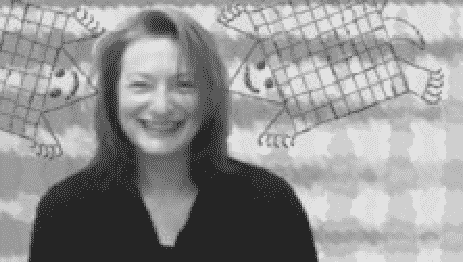

出生于弗吉尼亚州，成长于宾夕法尼亚州，曾在康涅狄格州、佛罗里达州、佐治亚州、阿拉巴马州、密西西比州、科罗拉多州、伊利诺伊州以及澳大利亚墨尔本居住至少六个月。学习过钢琴、美术、时装设计和图形设计（电脑出现之前）。2003年以优异成绩获得视觉传达艺术学士学位，现为历史专业研究生。目前撰写每周财经专栏，同时正在进行一项关于口头文化与书面文化及其对现实视觉感知的差异研究。

荣誉包括十五项科罗拉多州新闻协会一等奖、众多美术与图形设计奖项，以及就网站内容接受《华尔街日报》《芝加哥论坛报》《今日心理学》和《洛杉矶时报》的采访。

## 序言：网页设计之谜

网页设计对许多人来说是神秘的，因为他们只看到最终产品。设计师和设计过程隐藏在视觉和代码的背后。网页设计对许多建站者来说也是一个悬而未决的难题，因为网页设计师往往无法解释他们是谁、做什么、如何实现目标，或者为何失败。大多数网页设计师都会认同，网页设计职业既令人兴奋又令人沮丧，因为这种格式要么限制我们的想象力，要么拓展我们的创意技能。

网页设计中一些最明显的问题与其他媒介中的问题相似。以下是几个例子，说明我们的独特性与其他视觉设计师是共通的：

- 格式，或者说电脑屏幕，是一种**有限的格式**。它有长度和宽度，但深度只是一种幻觉。这是一种二维格式，设计师在其中创造环境。印刷设计师也有同样的问题，因为他们的格式也是二维且受限的。广告牌有标准尺寸，杂志格式也是如此。电影和电视制作人也面对标准格式。三维设计师（建筑师、家具设计师、雕塑家等）能在作品中创造实际的深度，这令他们感到满足，但他们通常也在限定区域内构建设计，由测量尺寸定义。尽管在这种情况下格式都是限制性的，但优势在于视觉设计师（包括网页设计师）可以操纵他们的格式，使其看起来更大或更小，甚至创造深度和纹理的幻觉。

- 我们在较新浏览器中精心打造的美好环境，在较旧浏览器中可能会蜕变成面目全非、几乎令人作呕的视觉景象。解决方案简单却令人失望——我们优化设计，使其在各种浏览器中一致显示，为此**牺牲了最初的设计期望**。我们是唯一牺牲理想化设计的视觉设计师吗？想想那位印刷设计师，他很想使用那张精彩的全幅照片，但尽管编辑可能同意，他们必须将照片缩小为四分之一版，以便文章文字能放得下。即使建筑师也可能将自己的想法丢进废纸堆，因为如果按原设计建造，建筑物在结构上不会稳固。视觉设计师做出的每一项牺牲，都是与格式内其他元素的妥协。

- 最后，我们需要**克服设计师与观众之间的信息失真**。我们想让访客留下来，有各种各样的原因，但观众可能不会直觉地领会这一信息。如果访客没有通过购买或反馈做出回应就离开了，为什么我们的信息乖碘失败了呢？为什么一份杂志会倒闭？为什么一部电影在票房上失利？视觉设计产品失败的原因如此之多，以至于在这里提及这一点似乎显得学究气。然而，当一个设计产品在重大规模上失败时，问题在于产品本身，而非观众。产品经过评判，被认定有所欠缺。有时设计确实就是问题所在。

这最后一个问题通常是网页设计师最复杂的问题，因为即使产品失败并非设计师的过错，网页设计师也可能对自己的能力产生不安全感。然而，有一些设计规则是普遍适用的，如果不遵循这些规则，设计就会成为问题。你可能会问："什么规则？我知道什么好看，这就够了。"我经常听到的另一句常见评论是："规则？我不想知道。规则就是用来打破的！"如果你刚刚在心里说了这两句话中的任何一句，让我问你几个问题：

1. 你是否曾在网页上浏览，寻找你喜欢的设计？
2. 你是否曾想过窃取另一个网站的标记或样式？
3. 你是否曾尝试模仿某个网站，但就是做不出来？
4. 你是否曾只是为了好玩而修改现有网站，发现即使只改变一种颜色，整个网站看起来就失衡了？

如果你对以上任何一个问题回答了"是"，那么我为你的努力鼓掌，因为你正在寻求优秀设计答案的使命中。尽管你注意并欣赏优秀设计的所有精妙之处，答案仍然是谜团。如果有人问你为什么喜欢某个特定网站，你能回答这个问题吗？如果你看到一座令人印象深刻的建筑，你会如何描述吸引你的地方？如果你看了一部电影，什么给你留下了深刻印象？为什么？是表演还是场景？你是否如此沉浸在故事中，以至于没有注意到其他任何东西？如果你爱上了那辆红色法拉利，你能解释（除了自我主义的原因外）为什么那辆车吸引你吗？

这些例子中的每一个都构成了视觉设计，而每一个都在创作中使用了相同的设计元素和设计原则。这些元素和原则是规则，而打破它们只有两种方式。如果我们根本不知道它们是什么，我们就会打破规则。这就像去一个不懂语言的外国。我们知道自己是否打破规则的唯一方式是有人制止我们正在做的事。打破这些规则的唯一另一种方式是我们对它们了如指掌，以至于能为违规找到合乎逻辑的理由。

Linda Goin 的这组文章将帮助揭开网页设计的神秘面纱，帮助你理解游戏规则。


## 第一章：设计要素

作为网页设计师，我们需要掌握行业工具，就像任何其他设计师必须了解其工具及其格式限制一样。我们还必须了解设计的规则。

但网页设计师究竟是程序员还是视觉艺术家？我们是在构建还是在创作？我们使用什么样的工具来获得成功？

当我们无法具体回答这些问题时，我们的工作质量就会下降。当我们回避这些答案时，我们会感到痛苦，因为我们会变成一个身兼十五职的网页设计师。这种缺乏专注的状态会破坏成功的创作过程。或许，解开网页设计之谜最简单的方法就是定义我们是谁，我们做什么，以及如何使用视觉传达工具。

## 网页设计师是谁，他们做什么？

1994年，Web 的发明者 Tim Berners-Lee 创立了万维网联盟 (W3C)。大多数专业和业余网页设计师都知道 W3C 及其关于网站开发的权威流程（如果不知道，可以在[这里](link)了解更多关于其网页设计和无障碍访问的工具）。现在的问题是，这些工具是由设计师使用还是由程序员使用？设计师也是程序员吗？

答案是“是”且“不是”。一个不编写网站代码的设计师被称为 **GUI 设计师**。这类人员创建图形用户界面（Graphic User Interface），或计算机格式环境，但有时对网站是如何构建的毫无头绪。因此，GUI 设计师与程序员合作，以确保设计可以通过 HTML、CSS 或另一种代码或流程来还原。从历史上看，许多 GUI 设计师最初从事平面印刷设计，因此他们将印刷设计的概念引入了网页设计。这种知识的转移存在问题，因为计算机屏幕显示的视觉场与印刷页面呈现的视觉场截然不同。

GUI 设计师可能会发现，掌握一点编程知识对于开发更合适的网站设计大有裨益。因此，一些 GUI 设计师也成为了程序员。另一方面，潜心于计算机编程的人通常对设计几乎没有概念。设计与编程之间存在着巨大的鸿沟，尽管这一差距正在缩小，但我们仍有空间将两种技能结合起来。

此外，自从大约三年前的“点康（dot.com）”泡沫破裂以来，GUI 设计师在网页设计流程中的地位有所下降。如果专业人士缺乏韧性，其他专业领域也会面临风险。岗位合并，能力要求扩展，许多公司要求一个人承担超出其可能承受范围的职责。现在，程序员被期望能设计，设计师被期望能编程。有时，这两种创作者甚至被要求编写文案并进行产品营销。

如果设计师和程序员的结合让你感到压力，请放心，一个人的生命中根本没有足够的时间来完全精通这两项技能。此外，每位网页设计师都会发现自己有天生的局限性，使其无法完全理解编程或设计。当一名设计师了解自己的长处和短处时，她制作合格网站的能力会变得更容易，且更节省时间。

购物车等复杂功能的代码可以通过学习掌握，或者交给精通各种编程技能的人。如果设计概念让人感到压力过大，我们可以向专业网络中添加一名合格的艺术家。然而，网页设计是一种在两个领域都掌握一点知识就很不错的情况；如果我们能“与他人良好协作”，那么在其中一个领域拥有专业特长则更好。当我们发展出明确的优势时，我们就能够交换服务，并组建一支能够创建兼具美学愉悦感、功能无缝衔接、超越营销预期且能带来收益的网站团队。

如果我们想独立地编程和设计网站，那么我们可以简化网页设计师的定义。基本上，网页设计师就是一名 **视觉传达者 (Visual Communicator, VC)**。这意味着什么？让我们详细分解：

- 1. VC 是一个**传达**视觉信息的人。每个 VC 都有不同的背景，并为设计工作带来独特的视角。
- 2. VC **引导**信息的意图。如果网站的目的不明，那么传达的信息就是混乱。
- 3. VC 还**创建**信息的物理内容，或者环境及其社会和文化影响。物理内容包括图像、文本内容，甚至背景颜色。这项活动还涵盖了无障碍访问。
- 4. 每个 VC 都**理解**形式的视觉元素。这种理解包括下面将要介绍的设计元素和原则清单。
- 5. VC 通过另一套简化含义的原则来**组织**设计元素和原则。这项活动涉及更多深奥的判断，而这些决定的结果体现在网站的访问日志、页面浏览量以及对信息的其他响应中。对此信息的解读可能会受到解读者视角、分析甚至日志生成过程中产生的问题而产生偏差。
- 6. VC 能够向观众、客户、团队成员或同事了解并熟练地**解释**其个人设计偏好。他们也可以胜任地向同一群体解读并解释客户的偏好。个人设计偏好是一种可以妥协的美学判断。例如，VC 必须理解设计的元素和原则，以便能够向客户专业地解释为什么黄色和红色格子背景与该客户网站的绿色菜单按钮不匹配。然而，VC 也可以向客户解释为什么黄色背景（没有红色格子）能与绿色菜单按钮相匹配。

在接下来的几页中，我们将分别更深入地探讨这些步骤。这次探索将帮助我们定义作为网页设计师/程序员，或者简单来说，作为 VC 的角色。这些传达概念是可以讨论的，因为我的观点和知识会与你的不同。然而，这些想法也得到了其他设计师的支持，因此我们也将讨论一些设计哲学家。这个职业——网页设计师或 VC 的工作——通常是概念性的，且有进一步定义的空间。

这里有一些从不同角度探讨视觉传达的教育网站：

[**视觉资源管理**](link) – 美国内政部开展了一项视觉任务。他们在视觉设计与使用影响之间寻求平衡。这就是所谓的妥协！

[**心中有无障碍**](link) (WebAIM) – 一个解释网页无障碍概念和技术的网站。该网站涵盖了大量可能会让你惊讶的主题信息。

[**初学者符号学**](link) – 这本在线书籍（免费）对符号科学提供了简明而全面的概述，对于任何设计新手来说，这都是必读的研究。

## 网页设计师使用什么工具？

这个问题答案简单得多，对吧？我们使用计算机和软件来构建网站。是的，确实如此。但网页设计师还使用其他工具来设计网站。这些工具是经过几个世纪的创意实验而发展出来的、经久耐用的元素和原则。这些探索包括——而且现在依然包括——心理学、数学和其他科学领域。引入其他科学是否让设计成为了一门科学？是的，这是思考设计的一种方式，这种“疯狂”之中自有其方法。

首先，我们将简要检查每一个设计元素和原则。此处所指的“设计”包括网站、建筑、纯艺术和平面创作。这些元素和原则适用于所有设计，但每一种在应用于各种设计形式时都会有所调整。平面设计师不必担心报纸页面的背光。网页设计师可能不关注建筑设计，但站点导航和网站构建都具有建筑属性。这就是为什么这些元素和原则既是流动的又是僵化的，或者说是灵活的又是保守的。这种双重性质在某个时刻会让每个设计师感到困惑，所以如果你觉得这些限制和可能性令人费解，请不要感到孤单。

## 元素与原则

这里有八个元素和八个原则，它们都是相互关联的，因此我们在思考和使用这些工具时可以采取快捷方式。每个元素都由原则构建，就像根据食谱混合的食材一样。在本书中，我们将单独讨论每个元素，但会频繁地讨论原则。这样，我们就能学习每种“食材”如何为最终产品做出贡献。每个设计元素都有一个可供参考和探索该元素的网站。然而，每个网站都包含所有元素。在你学习一个元素后，请切换网站并观察该网站中的其他元素。

### 设计元素

设计的**元素**包括：

- 1. **线条 (Line)** - 线条仅仅是一系列点的组合吗？还是从点“A”到点“B”的最佳路径？作为一种几何形式，线是运动中的点，只有一个维度——长度。点创建线，线创建形状或平面，并在二维格式中创造体积的幻觉。[Sodaplay](http://www.sodaplay.com/) 网站在边界、字体、图像和概念中融入了线条。
- 2. **颜色 (Colour)** - 也称为色相。这个词代表颜色光谱中发现的特定颜色或光波长，呈圆形分布，从原色红 $\rightarrow$ 黄 $\rightarrow$ 绿 $\rightarrow$ 蓝 $\rightarrow$ 回到红。传统的网页设计颜色定义是科学色相，由原色红、绿、蓝构建（RGB 光谱）。网页颜色技术与关注 CMYK 的印刷设计不同。

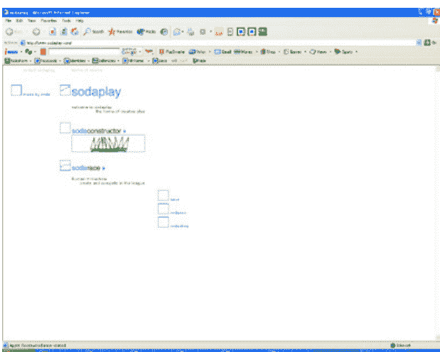


[第11页]

有一个网站，即使刷新页面、图像随之变化，依然能保持色彩绚丽，那就是 [Flaming Lips](https://www.flaminglips.com) 的网站。

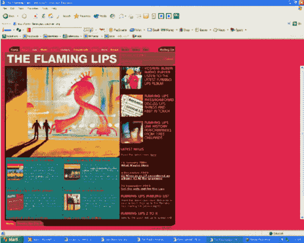

3. **体量** – 在二维设计中，体量是由相互连接的线条创造的错觉。这些线条可以是直观的，也可以是通过色彩、纹理或其他设计元素形成的边界，在潜意识中营造出来的。下面这个来自 [Nobody Here](https://www.nobodyhere.com) 的网页场景，就是一个在二维空间中通过图像创造体量的例子。很明显，有个人或某样东西在床上，尽管这张图像实际上是平面的。

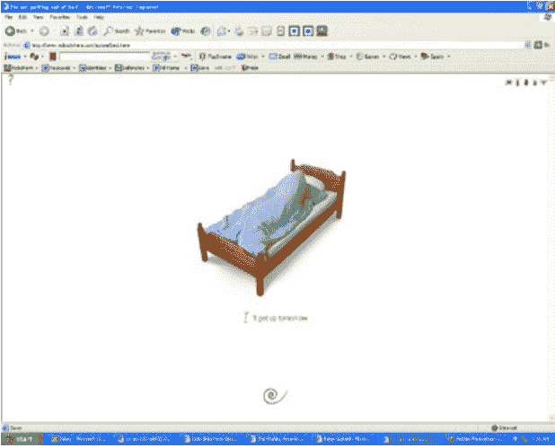

4. **运动** – 也称为动态。这个元素通过视觉呈现起止点、动作模糊等，来描绘改变位置、方向、朝向和/或位置的行为或过程。这不是动画，因为动画是运动的最终产物。请在**体量**部分提到的 [Nobody Here](http://www.nobodyhere.com/) 网站中，观看动画最终产物中明显的运动，例如页面自动切换，以及那些鱼（你最终会发现它们的）。或者，访问 [珍·古道尔](http://www.janegoodall.com/) 的网站，因为那里没有动画。该网站中运动的微妙性，是体验这一设计元素的良好开端。

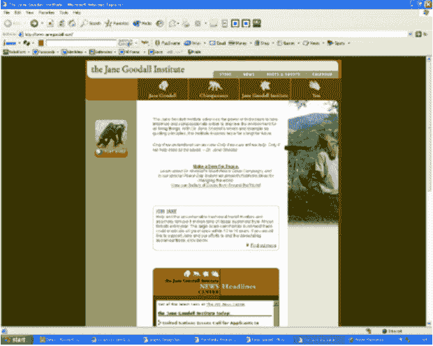

5. **空间** – 这个设计元素由所有其他设计元素定义，因此我们将在多处探讨这个主题。现在，请欣赏 [DHKY: More Better Life](http://www.dhky.com/morebetterlife/) 网站中创造的各种空间。

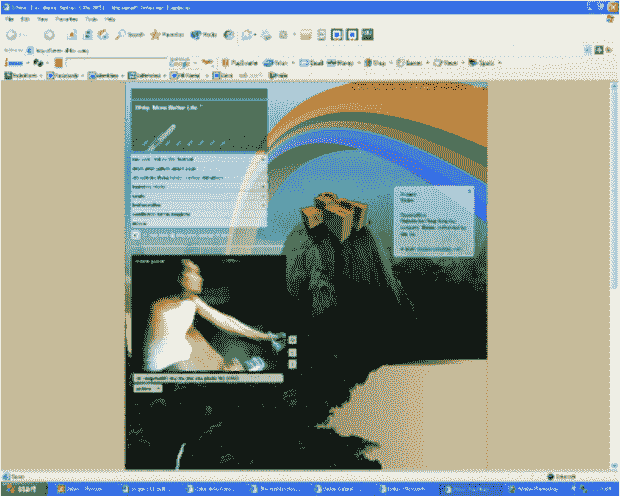

6. **纹理** – 这是另一种错觉设计元素，因为在二维设计中，砖块并非真实的砖块。在网页设计中，纹理通过各种绘图和媒体技术进行复制。如果你想了解纹理，请访问 [艺术与科学合作公司](https://www.artscience.com)。他们通过一些非常独特的方式生成了纹理画廊。

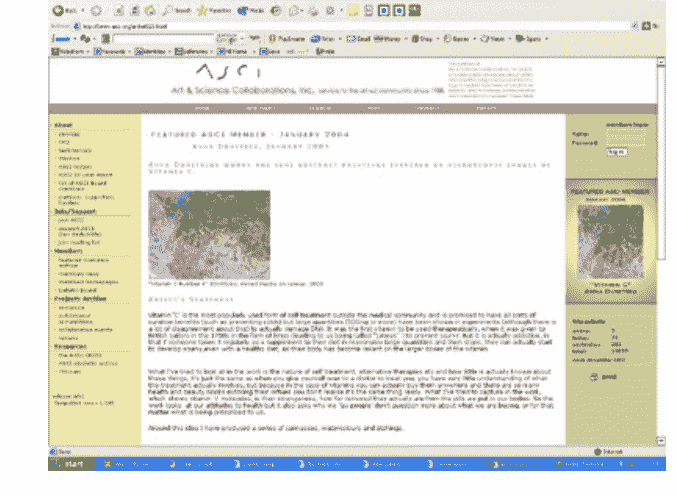

7. **明度** – 指一个区域的明暗程度，相对于从白色到黑色的渐变标尺进行衡量。在网页设计中，这个元素也通过格式来衡量，因为视觉区域是背光显示的，这给明度带来了问题。要了解色彩如何创造明度的示例，请访问地球观测站的 [气溶胶尺寸图像](https://earthobservatory.nasa.gov)。

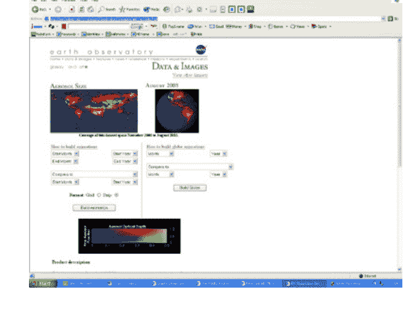

8. **字体排印** – 与空间一样，这个元素也是由所有其他设计元素构成的。预计我们将频繁地接触和回顾这个元素。同时，请访问 [Counter Space](http://example.com) 了解他们对字体的教育性及视觉化处理：

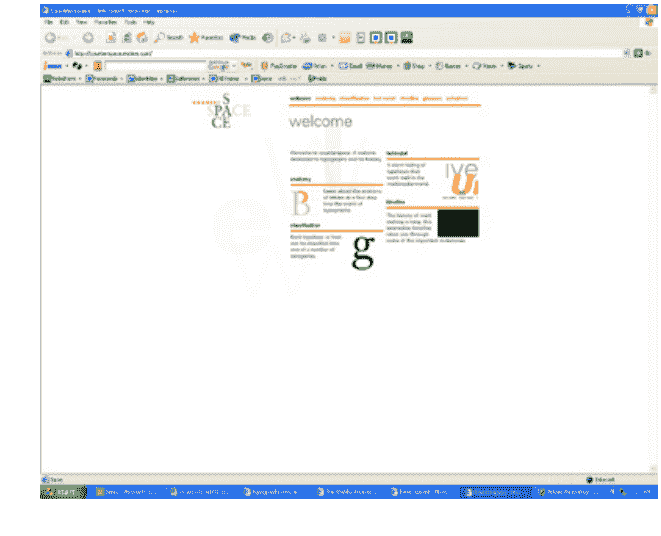

## 设计原则

设计原则包括：

1.  **平衡** – 设计元素汇聚，形成看起来完整的各部分布局。也可理解为均衡。
2.  **对比** – 这是“自动原则”。每当一个元素被置于一个格式中，该元素与其格式之间会自动产生对比。
3.  **方向** – 这个设计原则利用所有设计元素来引导观众的焦点。这个原则是一种指导，如果它失败，观众会感到困惑。
4.  **简约** – 这个原则“精打细算”，用于消除不必要的设计元素。
5.  **强调** – 也称为主导或焦点。这个原则基于等级体系，其中通过连续或一次性的设计元素来体现网站内重要性的层级。
6.  **比例** – 在二维视觉区域内对大小的感知。
7.  **韵律** – 这个原则依赖于视觉格式中一个或多个元素的重现或重复。
8.  **统一** – 这是所有设计元素和原则的最终产物。可以理解为“整体性”或“和谐与平和”。网页设计师知道，当网站流量增加，且其他设计师试图窃取代码并模仿设计时，就实现了统一。

## 我们该何去何从？

我上面提到设计是一门科学。这是否意味着设计师也是科学家？不一定。然而，我们可以从科学过程中受益。这个过程分步骤进行，每一步逻辑上紧随前一步。然后，当过程完成时，我们又重新开始，所以这种实践是线性和循环的。这个过程是证明或反驳理论或想法的唯一可接受方法，也是最终创造经验法则（事物如何通过实际经验运作）的途径：

1.  **观察**：我们使用自己的感官（所有感官，包括触觉、视觉、听觉、努力等）以及这些感官的延伸手段，仔细观察问题。例如：我观察到网站上的图像在浏览器中不显示。
2.  **问题**：我们对观察结果提出疑问，并从之前类似问题的研究和收集答案。关于缺失图像的问题可能是“怎么了？”，但这是一个非常宽泛的问题。最好是直接提问：“为什么我的图像缺失了？”此时，我尝试了解其他设计师是如何回答这个问题的。
3.  **假设**：我们预测问题的答案并测试该答案。图像缺失的答案可能是图像没有上传，或者可能是图像的代码不正确。检查上传的文件和代码。如果文件存在且代码正确，那么就需要更多的研究来回答问题。
4.  **进一步实验**：如果问题得到解答，我们就陈述结论。结果是可衡量的，我们可以记录数据以备将来参考。然而，测试假设的这个结论可能会带来其他问题，需要进一步的观察、提问、研究和得出结论。此外，今天有效的方法可能不适用于明天的问题。

这个过程可能永远不会结束，或者可能只需要片刻时间。有时，这个过程是无意识的努力，就像呼吸一样，因为我们多年前就学会了如何使用这种方法论。无论这些步骤是老生常谈还是新的，当我们在疲劳和压力下，一个简单的问题变得夸大其词时，记住它们会有所帮助。

这些步骤也是学习设计元素和原则的实用应用。如果这些工具变得令人困惑，请使用科学方法来理解其含义。对于第三步，有许多书籍可以帮助我们研究设计问题和答案。以下书籍并非专门关注网页设计，而是关注视觉传播中使用的概念和/或技术技能。请记住，概念是科学方法第四步中的临时结果。这些理论始终对进一步的提问和关于答案的辩论持开放态度。

## 资源

**视觉素养：图形问题解决的概念方法**，作者：朱迪斯·王尔德、理查德·王尔德，Watson-Guptill 出版社，1991年，ISBN：0823056198
视觉传播的概念过程。

**艺术家、建筑师和设计师的基本视觉概念与原则**，作者：查尔斯·瓦尔施拉格、辛西娅·布伊克-斯奈德、梅雷迪思·摩根，McGraw-Hill 出版社，1992年，ISBN：0697006514
一本强烈推荐给任何认真设计专业的学生的书。

**传播设计：概念平面设计基础**，作者：伊丽莎白·雷斯尼克，Wiley 出版社，2003年，ISBN：0471418293
此处包含技术和概念过程及练习。

## 第二章：点、线、面：网页设计传播的基础

> “好的构图就像一座悬索桥——每条线都增加了强度，却没有削弱任何部分。”

罗伯特·亨利 (1865 - 1929) 美国画家
引自唐娜·沃德·拉库尔，《艺术家引言集》，1989年。

在第一章中，我简要概述了网页设计师或视觉传播者（VC）的六个主要特征。这个清单上的第一个特征涉及**传达**视觉信息的能力。计算机屏幕是视觉格式，设计师利用所有设计元素和原则向观众传递信息。

八个设计元素中的第一个是**线**。**点**创造**线**，**线**构成**面**。在这里，我们将探讨线如何用于在布局和字体排印中构建信息，并且，由于每位 VC 都有不同的背景，并在设计工作中带来独特的视角，我们将看看 VC 的背景如何影响她对点、线、面的运用。

## 线的起源：第一个设计元素

如果我提到欧几里得几何，你们很多人可能会在座位上感到不安，但数学是不可避免的设计工具——即使是最简单的 Flash 游戏也需要物理学（即数学）知识来模拟球的弹跳方式或重力对物体的影响。因此，数学也是我们背景经验中必要的发展。我会尽量减轻其冲击力，因为当我们能够理解欧几里得的概念时，我们可能会以新的眼光看待我们的工作。

欧几里得教导说，点、线和面代表了现实世界中并不存在的**理想化**。例如，欧几里得的点没有大小。我们知道物理领域中没有任何东西没有大小，但许多物体近似于点。星星呈现为光点，句号则用于结束句子中的一系列单词。

欧几里得是一位希腊数学家（约公元前325-270年），他撰写了13卷的教科书《几何原本》。两千年来，这本书是仅次于《圣经》的第二本被复制最多的书籍，并且仍然是历史上最成功的教科书。欧几里得在缪斯大学任教，这是一个为纪念缪斯而命名的地方。

欧几里得说，一条几何线是通过连接两点之间最短可能的路径形成的。线被设想为在空间中无限延伸，有长度但没有宽度。（根据欧几里得的说法，宽度会将线转变为面）。因为我们无法在网页设计中处理线的无限想象，所以我们使用线段，或通用线的部分。

一个几何面是一个完美的平面，在空间中无限延伸其长度和宽度，但没有深度。是的，你猜对了——这个面也是虚构的。这个面通过像计算机屏幕这样的表面来代表，它是这个通用面中显现出来的非常小的一部分。

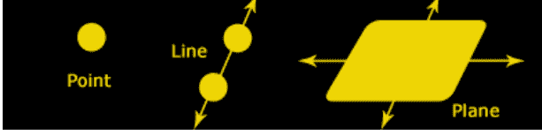


对想象力的强调很重要，因为欧几里得希望他的数学家们去思考，用可能性来按摩他们的大脑。

> 关于欧几里得以及他的一些富有创造力的数学和哲学伙伴——柏拉图和毕达哥拉斯——的更多信息，请参阅 Jeffrey O. Bennett 和 William L. Briggs 所著的《使用与理解数学：一种量化推理方法（第2版）》，Addison Wesley 出版社，2001年，ISBN 0201717115。更好的选择是阅读 Leonard Shlain 所著的《艺术与物理学：空间、时间与光的平行视野》，William Morrow & Co 出版社，1991年，ISBN 0688097529，这本书非常易读。Shlain 提出，艺术史的发展实际上预示或与人类思想的演变相吻合，而他创造的两种看似迥异的技能之间的联系令人惊叹。

欧几里得无法想象的是时空的曲率，这在20世纪由爱因斯坦揭示出来。这种非欧几何学认为，没有任何线或平面可以无限延伸，因为实际上不存在直线，除了我们用视平线作为参照的那条视线。这条视平线对我们在创建透视时最为有用。

你可能会好奇，为什么欧几里得和爱因斯坦对我们作为网页设计师的工作很重要。两人都是数学家，但他们也是设计师。他们创造了自己的现实，而世界也认同他们创造的东西对人们来说是真实的。欧几里得仅仅是将我们的文化空间和历史时间内使用的实践加以系统化。自那时起，历代建筑师、景观艺术家、雕塑家和其他三维设计师都依托他的原则来创造我们的世界。他的思想对排版师、美术家、网页设计师以及许多其他二维艺术家来说甚至更为重要，因为我们需要的工具来创造深度、透视、比例以及其他视觉光学效果的幻觉。想了解更多关于几何学概念及其创造性设计过程的信息，请访问 [Geometry Junkyard](https://geometryjunkyard.com)。

爱因斯坦的洞见可以在 [萨尔瓦多·达利](https://www.google.com/search?q=Salvador+Dali)、[曼·雷](https://www.google.com/search?q=Man+Ray)、[巴勃罗·毕加索](https://www.google.com/search?q=Pablo+Picasso) 和勒内·马格里特等艺术家和设计师的作品中看到，他们都运用了[超现实主义技法](https://www.google.com/search?q=surrealist+techniques)。在观看了其中一些作品之后，思考一下这些艺术家可能会如何评价我们用代码、光线**以及**交互性来构建视觉环境的能力。超越超现实？你说对了。[URU](https://www.google.com/search?q=URU) 就是一个可能让超现实主义者们惊叹的例子。然而，即使在 URU 中，当我们开始思考如何利用线条来创造边界、引发情感，并引导观者的视线从一个点移动到另一个点时，现实主义便会浮现。

## 线条元素创造其他设计元素

下面的图片说明了点、线、面的概念如何被用来创造视觉幻觉：

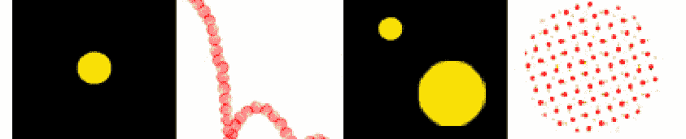

好的，让我们先来看看第一个黑色方块。设计元素以粗体显示，以展示点在此处的冲击力。这个简单的黄点代表了**色彩**，因为它与背景是不同的色调。它也创造了**体积**，因为该点似乎要么从背景中突出，要么营造出一种"隧道尽头的光"的效果。**明度**由点与背景之间的明暗对比来体现。**空间**由独自存在于广阔黑色海洋中的点来代表，或者作为元素中的元素，因为这是**空间**中**线条**的一部分。它是否创造了**纹理**或**运动感**？

也许有，但不如下一组红色点那样明显，那些点形成了一条代表运动感的线条。这种运动代表了重力。纹理由重叠的点和色彩的渐变所创造。在第二个黑色方框中，两个点展示了空间，因为一个比另一个小。月亮比金星大，对吗？也许吧，也许不是，但如果它更远，它看起来就更小。最后一组点创造了一个形状，它包含了明度、色彩、空间（点之间）以及纹理。

这只是简单示例中的一组，展示了点如何以多种方式被运用来形成其他设计元素。实际上，对于点的运作方式并没有对或错的答案，因为你在一幅作品中看到那个点的方式可能与我不同。一种用点来创造其他元素的有趣方法是将图像导入 Photoshop 并使用"像素化"滤镜。上面的右侧形状就是我用这种方式创造的，我对一个纯红色的圆形使用了彩色半调滤镜。

让我们来看看线条如何创造其他元素：

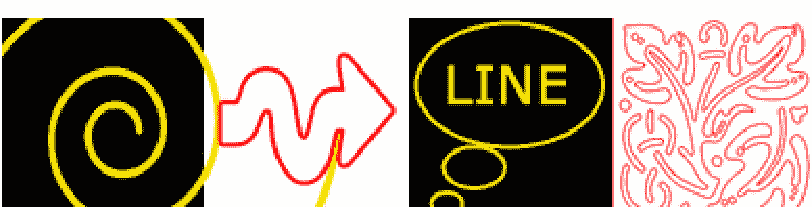

线条创造其他元素的方式与点相同，因为线条是由点的连接所创造的。可见线条的特征包括一定程度的粗细，并且通常具有形状和表面特征，如纹理和曲线。线条也可以是**被动的**。上面方块中分隔黑色背景和白色背景的线条是被动的，因为它是隐藏的；然而，它让自己被感知到了，因为它分隔了黑色和白色所代表的明度。线条可以是实心的或断续的，它们可以创造出许多种[光学幻觉](http://example.com/optical-illusions)。

线条还通过字体传达信息。你现在阅读的这些行是由字体形成的，而字体是由线条形成的，线条则是由点的交汇形成的。这些排版的线条具有方向性，因为我们习惯于从左上方到右下方阅读英语，所以我必须遵守这一限制，这样你才能理解我在一段文字中的思想。计算机识别这种格式，我不能违抗我的工具的规则，我也不想这样做，因为我希望你阅读我的见解。我唯一能反抗这种方向的方式是创造一幅文字图像，让其朝另一个方向移动，比如向后或从右下到左上。

我为什么要这样做？也许我需要创造另一种形状，或另一种信息。也许我想引导你的眼睛朝着一个与"正常"不同的方向移动。当然，标题是与正文不同的设计工具，所以我可以在这个元素上比在正文信息上更多地发挥。在我们探讨线条如何运用于设计原则之前，让我们绕道去了解一下另一种文化中的人们如何看待线条……

## 文化设计线条

在《设计的理念》一书（见下文参考）中，A Cheng 撰写了一篇关于线条及其在中国绘画中重要性的文章。Cheng 认为，中国书写的发展确立了线条在创造性艺术和设计——包括建筑——中的重要性。

> 他写道："*与世界上的其他语言（可能除了伊斯兰文化中的阿拉伯语）不同，书法的提升或升华为一种高雅艺术形式是中国文化独有的现象。*"

Chang 指出，许多人相信中国书法家使用毛笔的方式是完美的秘诀。他指出，虽然书法家的毛笔对于创造形象至关重要，但书法家对线条的感知更为重要。在这里与网页设计做个联系，计算机硬件和软件对于创建网站至关重要，但从 Chang 的角度来看，网页设计师对线条的感知更为重要。

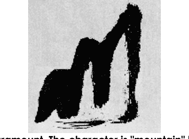

"一幅以力量为重的刚健之作。该字为'山'，由张正宇（Chang Cheng-yu，1903-1976）书写。" 来自 AsiaWind 艺术画廊。

中国大师们为培养这种线条感知而发展出的一些理论指导原则概述如下（书中第230页）：

- 没有任何垂直线可以永远延伸而不折返。所有的线条最终都会到达尽头。重点在于控制与组织。因此，线条不是一个概念而是一个具体的物体（注：这与欧几里得的概念相反，他认为线条是虚幻的且是无限的）。
- 点是线条的收缩形式。它以与线条相同的原则加以控制。因此，如同**shufu**一样，点具有方向性（注：shufu 字面意思是书写规则，比喻意义上指书写的艺术，第229页）。
- 纹理表面是由毛笔侧锋创造出的线条的扩展。纹理表面的本质不是创造阴影，而是创造如同木纹般的脉络。
- 泼墨表面是纹理表面的进一步发展。将墨泼洒到纸上创造一个表面。然后，这个表面由毛笔加以控制。

Chang 对以上各点进行了详细阐述（除第二点外，未写出的内容对这个西方头脑来说尚不清楚），*"这种将线条作为中国艺术和设计原则的方法，带来了对中国文化诸多方面的更深层理解。"*

线条在中国的重要性通过一个例子得以说明：观者通过一个小圆筒观察画作的细节来进行评判，这个小圆筒可能是一截竹子。*"通过这个小孔观察，一个人可以判断整幅画的好坏，而无需知道画的是山还是房子。"*

我们不必"透过竹筒昏暗地"查看我们的网站，但当我们比较东方和西方的方法论时，这个观点很有说服力。网页设计通常针对特定市场，但实际上，任何拥有计算机和互联网连接的人都可以在国际范围内访问该网站。如果我不能理解东方的线条观，我的西方线条是否也会被误解？尽管中国这种"线条精神"与西方文化相距甚远，但一种精神也能通过欧几里得的缪斯感受到。主要的区别在于，这种东方文化中的书法家/艺术家意识到线条，而西方文化中的网页设计师可能没有受过训练去适应这种深奥的技能。我们如何在自己的设计中更加意识到线条的可能性？一个回答是理解这些通用设计元素如何融入通用设计原则。

## 线条在设计原则中的应用

我们在前一章简要介绍了设计原则。线条如何为**平衡**（balance）、**对比**（contrast）、**方向**（direction）、**简约**（economy）、**强调**（emphasis）、**比例**（proportion）、**节奏**（rhythm）和**统一**（unity）这些设计原则做出贡献？让我们通过两个例子，将线条应用于“平衡”。通过这个原则，我们也能看到其他设计原则在起作用：

线条被用来平衡整体图像。平衡简单来说可以分为**对称**（symmetrical）或**非对称**（asymmetrical）。请看这个来自 [Google](https://www.google.com) 的对称设计：

对称平衡的特点是有一条中心轴——一条从上到下运行的被动线，元素的排列在给定空间的两侧均匀分布。对称平衡的一些特性包括：规律性、一致性、比例感、被动性、安宁感、静态、不活跃和稳定性。虽然这种排列看起来可能枯燥，但它可以被极好地利用，帮助观看者专注于特定的图像或信息，就像这里的 [Google](https://www.google.com) 一样。

这个设计体现了极端的**简约**，因为唯一的装饰就是那个根据节日而随艺术家心意变化的 Logo，它与白色背景形成了鲜明的色彩**对比**。眼睛被**引导**至屏幕上半部分的元素，其中**强调**点在于我们输入查询内容的输入框。设计达到了完美的平衡，因此左右两边的**比例**相等。**节奏**通过按钮实现，重复的相似图像营造出一种氛围或规律感。那么整体上是否有**统一**感？是的，因为这个设计原则中的线条元素都得到了尊重，并同时被用于提升视觉吸引力和实现功能。

非对称**平衡**的特点是构图元素相对于中心轴的排列是不规则或不相等的。这种“失衡”的设计通常被描述为“动态的、活跃的、具有压力感、紧张的或多样化的”。[SodaPlay](http://sodaplay.com) 酷的地方在于它在概念、错觉和功能中都利用了线条：

这个设计与 Google 的图像一样，非常**简约**（参见本章开头的引用）。眼睛被**引导**至屏幕的左上角，然后引导我们向下移动到底部元素。对**对比**鲜明的黑色线条图像（它是动态的）的**强调**，以及由这种运动和阶梯式下降元素创造的**节奏**，共同激发了我们对该网站内容的好奇心。那么它的**比例**协调吗？

我认为是协调的，因为如果我们仔细观察那些正方形，有些被其他动态线条切割了。它们不再是正方形了！方框内的线条“弄暗”了图像，使得它们看起来更小，而实际上大小相同。在像电脑屏幕这样的二维格式上，比例是一种尺寸的错觉。**统一**感？有的。这个设计得到了我的投票。

这两个网站是设计简约的极端例子，我选择它们是为了让我们看到线条如何成为设计的基石。这两个网站可能有另外二十种设计方式，而其设计要么能达成统一，要么不能。然而，我们也可以认为 Google 可以采用 SodaPlay 的布局，反之亦然，但为什么不行呢？

如果布局是非对称的，Google 的目标还能实现吗？如果布局是对称的，SodaPlay 还能如此“俏皮”吗？有可能，但 Google 的意图是：“搜索然后离开，我们会留在背景中，但我们不是真正的焦点。”设计的均匀性传递了这种潜意识信息，它在原始和全局感知中被接收为“秩序与稳定”。

SodaPlay 的非对称设计是对摆脱秩序和均匀平衡的一种表达，它吸引的是完全不同的情绪和交互层级。这两种设计——就其现状而言——都实现了它们当前的目标。

大多数网页设计师会迁就客户，而这些人通常需要在网页上放置比上述示例更多的元素。然而，即使有更多信息、更多照片、更多这个那个，我们仍然可以在设计中实现简约。让我们再看看几个图像，研究一下即使在网页上有大量元素的情况下，我们如何实现简约。

## 被动线与布局

被动线是由颜色、形状和明度之间的无形划分创造的。这些线条用于帮助引导观看者的视线聚焦在页面的某个焦点上。在西方文化中（以及许多其他文化为了适应西方风格而采取的尝试——这是一个在另一时间地点讨论的话题），主要有三种布局及其变体：圆形、"Z" 字形和网格。让我们看看它们是如何运作的：

首先是 [Du Xinjian](http://www.duxinjian.com) 所示的**圆形**布局。我在上面的图像上叠加了一个圆圈，以展示该设计中的元素如何引导视线呈圆形旋转。文字沿一条虚拟的圆形线排列，并引导我们看向黄色的悬崖。

沿悬崖顶部创建的线条是斜线——**斜线代表运动和紧张感**——它们引导我们看向鱼上的男孩的脚。我们沿着他的身体向上移动，但我们的视线可能会被艺术家姓名创建的直线分散。艺术家可以将姓名放在圆圈内，但格式需要对比，因此这条直线与布局的曲线形成了对比。它也呼应了悬崖，但是水平的——**水平线代表和平**——因此，由艺术家姓名提供的直线以及显示这些图像的“窗口”底部的直线，也与悬崖顶部创建的斜线形成了对比。你可能会以另一种方式“阅读”这个布局，因为你的眼睛可能会从不同的起点进入图像。请查看链接中没有叠加圆圈的图像，并注意当网站出现时你看到了什么。

接下来是 [Froggy's French Cafe](http://froggysfrenchcafe.com) 的 "Z" 字形布局：

"Z" 字形被叠加在上面的图像上，以展示该设计中的元素如何引导视线从左上角移动到右下角（与我们阅读英文页面的方式相同）。我们可能会被中间白色制服的对比所分散注意力，但这是我能找到的最佳示例。这种布局与上述和下文的布局一样，全部借鉴自印刷品，而这种特定的 "Z" 字形设计在近年来越来越不受欢迎。不过，它被放在这里是因为它依然有效。

黑板上的文字呈行排列，引导视线从左向右，然后我们的视线被吸引到厨师身上。从那里，我们阅读底部的信息，在这里——再一次——我们的眼睛从左向右移动。翻开一本杂志就能找到这种布局，其中 Logo 被预留在右下角。理论上，这里就是我们的视线停止的地方，而这个元素正是我们应该记住的内容。

本节最后，以 RedChop 为例的网格布局：

在上面的图像上叠加了众多可能网格布局中的一种，以展示被动线如何创建“盒子”以便将元素“放入”设计中。我没有包含水平线，因为通过分隔盒子的被动线和划分信息的实际线，这些水平线已经相当明显了。网格是最容易使用的布局，但对观看者来说也是最令人沮丧的，因为信息和图像往往会变得过于繁多。然而，网格也是网页设计中最容易使用的格式，因为表格和其他代码格式限制了我们的可能性。但正如你在上述网站中看到的，这种限制是可以被克服的。

网格现在在整个网页设计中如此盛行，以至于在任何网站中很难避免发现这种布局模式。虽然网格在理想情况下是纵向和横向的等分，但还有其他变体：

- 比例变化 - 由“等分”网格创建的正方形可以更改为长方形。
- 方向变化 - 垂直线或水平线（或两者）可以倾斜于任何角度。这种倾斜可以创造出运动感。
- 弯曲 - 线条可以是弯曲的。
- 进一步细分 - 一些正方形可以进一步细分为长方形、三角形或正方形内的曲线空间。
- 其他形状 - 网格可以由三角形、六边形等组成，以创建新布局。

换句话说，我们不必都变成正方形！

## 资源

这里有一些与本章主题相关的链接供大家欣赏。

[Dusan Pavlik](https://example.com) 以及线条在插画中的应用。

[AsiaWind Art Gallery](https://example.com) 提供多种艺术家的作品观看，还有关于中国书法艺术的教程、文章和其他信息。

根据 Chang 的说法，[Piet Mondrian](https://example.com) 是第一位教会观众如何欣赏线条的西方艺术家。蒙德里安的线条还创造了网格。想象一下。


[Mr. Picassohead](https://mrpicassohead.com) - 如果你认为自己无法创作抽象艺术，这个网站可能会帮你以全新的视角看待人类的面孔。

**The Idea of Design**，Victor Margolin（编者），Richard Buchanan，麻省理工学院出版社，1996年，ISBN: 0262631660
几篇关于设计本质的论文。本书包含了一篇关于“线”的 Chang 论文。

**Geometry of Design: Studies in Proportion and Composition**，Kimberly Elam 著，普林斯顿建筑出版社，2001年，ISBN: 1568982496
为什么我们会喜欢某些事物？Elam 探讨了在设计中几何形状是如何吸引观众的。

**Grid: A Modular System for the Design and Production of Newspapers, Magazines, and Books**，Allen Hurlburt 著，Wiley，1982年，ISBN: 047128923X
网格最初应用于建筑学，随后将其应用扩展到印刷品。在这里，你将学习网格如何根据页面大小和用途而变化。通过表格、CSS 等手段，它可以完全适配于网页设计概念。

## 第三章：形状与排版：网页设计传达的基础

网页设计师，或视觉传达者（VC），通过其网页设计创造意义，引导信息的意图，并创造信息的**物理内容**，或者说创造环境及其社会和文化影响。物理内容包括图像、文本内容以及设计的整体环境。VC 还需要理解二维格式中形状的视觉元素和幻象形式。在上一章中，我们研究了点、线、面，以及每个元素如何创造平衡、对比、方向、经济、强调、比例、节奏和统一。换句话说，线可以用来构建任何设计原则。线也可以创建形状和形式，这其中就包括排版。

如果我们从零开始，会发现最基本的信息是——圆、方、三角是最基本的形状。科学家、心理学家、理论家和美学家花费多年时间研究这些基本形状，以及人们在二维和三维空间中如何以及为何感知这些形式。虽然我们在计算机屏幕的二维空间中工作，但我们也可以创造三维环境的错觉，因此，理解当我们使用形状（二维）和形式（三维）时，这两种格式如何改变观众对我们网站的感知至关重要。

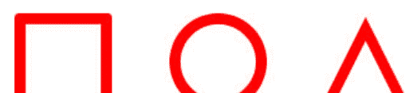

**基本形状：正方形、圆形和三角形——以及它们在形式中的应用（[Macromedia](Macromedia) | [Escher](Escher) | [Pyramid Alehouse](Pyramid Alehouse)）：**

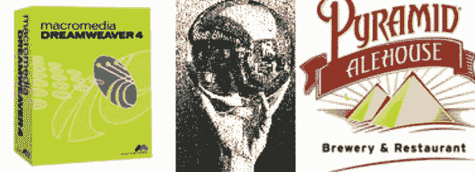

让我们将这些研究拆解并将其纳入一个统一的理论中。

**格式塔（Gestalt）**：这个词很难直接翻译成英文（原意为德语），但基本上意味着“整体、配置或形式”。格式塔理论研究构成整体的个体部分，以及这种累积经验产生的影响。涉及格式塔的四个领域包括：

- 1. 识别熟悉形状的能力
- 2. 这些形状在背景中如何被感知（图底关系）
- 3. 观察者如何感知整体环境
- 4. 除了完成任务所需的必要形状或形式外，排除所有其他元素

## 熟悉形状

专业人士发现，观众在看到颜色、明度、纹理或任何其他信息之前，会先看到形状的轮廓。只有当形状与背景之间有足够的对比度时，轮廓才能被识别。简单且对称的形状最容易被识别和记忆，比如上面的圆形和正方形——换句话说，这两个形状能减轻观众的焦虑感，因为它们很熟悉。在形状被识别之后，接下来的步骤涉及观众的记忆。如果形状中包含文本，记忆会得到辅助，观众的舒适区也会随之扩大。

这并不意味着 VC 不能在网页环境中使用奇形怪状的形状，或者完全避免使用形状。然而，不同的形状能提供视觉上的刺激。但当观众来到你的网站时，他们起初通常不会将你的网站视为一个“整体”图像，因为他们会立即在视觉上将网站拆解，以先寻找熟悉的形状。如果注意到了熟悉的形状，观众就会放松下来，并开始吸收其他图像来完成整体图景。这个整个过程可能只需要一瞬间，但如果网站包含许多不同的形状或形式的幻象，这个过程可能会花费一分钟或更长时间。

例如，想想网站菜单。每次新观众来到你的网站，他们都会经历一个学习过程。“我去哪里？我该做什么？”让我们看几个网站，看看它们如何引导观众：

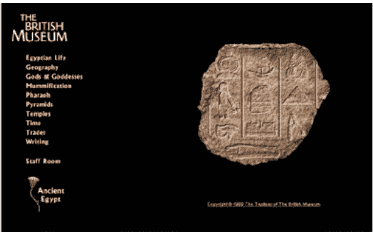

上面的页面是大英博物馆埃及展厅的入口页。设计师（可能还有董事会）选择使用文本作为菜单。在这种情况下，你的眼睛看向哪里？左侧的菜单选项是否远远被图像掩盖了？这是否困扰你？网站的简洁是否限制了你的选择，并使菜单更容易理解？白色字体与黑色背景的对比是否帮助你看到了选项？我认为确实如此，我们将在下文思考这些问题。

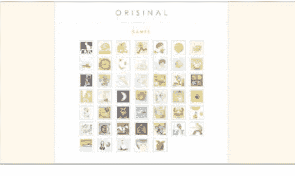

Orisinal 是一个游戏网站。没有文本，没有解释，除了标志字体和“Games”这个词。该菜单下所有的图像方块都是用 Flash 创建的游戏按钮，因此当你将鼠标悬停在方块上时，它会升起并在下方产生阴影，营造出深度的错觉。这些按钮需要文字吗？对于这个特定网站，它们需要解释吗？菜单按钮是否诱导用户进入？

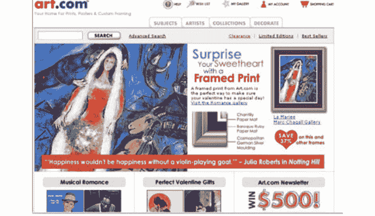

Art.com 网站包含大量信息。当你第一次看到这个网站时，你的眼睛看向哪里？你会寻找菜单吗？它对你来说足够明显吗？你能在这个页面上数出多少个菜单？


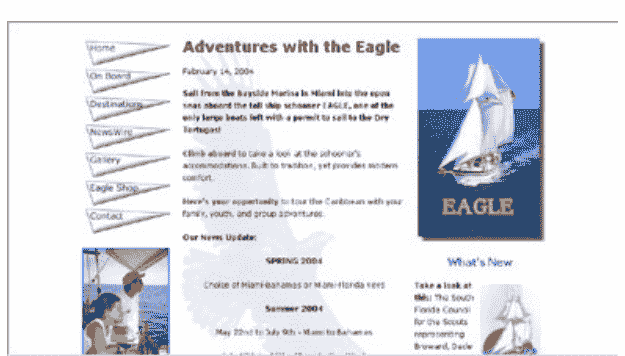

有些客户会要求使用菜单按钮，尽管可访问性问题通常要求使用文字菜单。[Schooner Eagle 网站](https://www.example.com)上的链接菜单形状像帆船旗帜。你立刻注意到这些链接了吗？这些形状与网站匹配吗？旗帜上的文字是否帮助你找到了方向？

如上面的示例所示，有许多方法可以通过使用形状和文字来引导观众浏览你的网站。接下来我们看看你的菜单如何运作，才能在网站的所有其他信息中脱颖而出。

## 图底关系

1921年，感知心理学家 Edgar Rubin 发现了“图”与“地”（即形状/形式与背景）之间的七个区别。让我们结合视觉示例来看看他的清单并理解其意图：

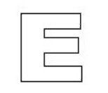

1. 当两个区域拥有共同边界时，看起来具有形状的是“图”，而“地”没有。在上面的图底关系中，“E”是很明显的，即使它没有被填充。它具有形状，而背景没有。
2. “地”似乎延伸到了“图”的后面。同样，由于背景在“E”之后，它延伸到了本页的边界。
3. “图”看起来像一个物体（即使它是一个抽象形状），而“地”则不然。
4. “图”的颜色看起来比“地”更充实、更坚实，即使它与“地”的颜色相同。
5. 尽管两者显然处于同一距离，但“地”往往被感知为较远，而“图”离观察者较近。
6. “图”更占主导地位且更令人印象深刻，往往更容易被记住。
7. “图”与“地”之间的共同边界被称为轮廓（也称为被动线），且轮廓似乎是“图”的一种属性。[Daniel J. Weintraub and Edward L. Walker, *Perception* (Belmont, CA: Brooks/Cole, 1969), p. 11]

进一步的研究表明，在背景中识别“图”取决于对比度：明度、颜色、纹理或深度线索增加了被感知为“图”和“地”之间的区分度。


这些"E"虽然有点花哨，但它们展示了纹理、对比度、色彩和深度如何增加图形与背景之间的差异。有没有哪个"E"特别吸引你的注意？为什么？这些是否能帮助解释为什么上面那些网站的字体菜单如此突出？

上述研究是使用对被测试者来说熟悉的形状进行的，并未包含"模糊图形"。

**模糊图形**是能代表两种不同图形或单一图形的图像。也称为波动图形、可逆图形或模棱两可图形，两种图形之间的轮廓线（或称被动线）会混淆人们对实际主导图形的感知。

一些模糊图形的例子：

左图要么是两张脸，要么是一朵花。接下来，这是一张女人的脸还是一个萨克斯演奏者的形象？第三张图像是一个骷髅。不，不是！是一面镜子前的女人！最后一张图要么是一个年轻女人，要么是一个老妇人。你看到了哪一个？

模糊图形很好玩，如果两个图形都适合公司的目的，它们也能成为很棒的标志。然而——正如定义所暗示的——这些图像也是可疑或不确定的，所以如果你想传达直接的信息，请远离模糊图像。

## 整体环境

那么这些形状和形式如何融入你网站的整体环境中呢？请记住，浏览者会先寻找简单的形状，然后他们会将主页视为一个整体，即格式塔。然后，希望这些浏览者会进入网站的其他部分。主页需要两样东西：一个代表你身份的标志或图像，或者只是一个没有.jpg或.gif图像的、用字体呈现的公司名称，以及一种进入网站其他部分的方式。除此之外，还有其他元素可以帮助识别你的网站是谁的、关于什么的。这些形状包括其他图像、文本框以及指向其他网站的链接。

虽然图片如果使用得当是任何网站的资产，但我们现在关注的主要元素是字体。我们希望访问者理解我们提供的内容，无论是服务、产品还是新闻。字体当然是由形状组成的。简单来说，这些形状在网页上转化为"衬线体"和"无衬线体"、"幻想体"、"手写体"等，除非你是在.jpg或.gif中使用特殊字体。由于篇幅限制，这里无法涵盖所有这些字体的变体，但学习这些字体以及它们在样式表中如何运作的一个好地方是 http://www.w3.org/TR/REC-CSS2/fonts.html（我们也会在后面的章节中探讨字体这个话题）。基本上，字体（或字形）的分组和修改方式如下：

- **Font Family（字体族）**——组合使用并在设计上具有相似性的一组字体。例如，Arial字体族中的字体可以呈现为斜体、粗体、紧缩体、小型大写字母等。字体族也可以分为不同的类别，如带衬线或不带衬线的、手写体、幻想字体等。
- **Font Style（字体样式）**——样式指定文本呈现为"italic（斜体）"、"normal（正常）"、"oblique（倾斜）"等。
- **Font Variant（字体变体）**——这表示文本是使用正常的字符（字形）用于小写或小型大写字母，还是两者都有等。
- **Font Weight（字重）**——字重指的是相对于同一字体族中其他字体的粗细或轻重程度。
- **Font Stretch（字体伸缩）**——这是相对于同一字体族中其他字体，文本字符的紧缩或扩展程度。
- **Font Size（字号）**——字号指的是任何字体从基线到基线的大小。基线是字形 resting 的线。像"e"和"o"这样的圆形字母通常会"凹陷"基线，而像"v"和"w"这样的尖角字母通常会刺穿基线。

红线是基线，字体（一种衬线体）是"Minion"。许多字母，如"a, d, o, t, b, e"，都凹陷基线。甚至"m"和"h"也有些凹陷，因为衬线是弯曲的。"g"延伸到基线以下。字号是从基线到基线，这意味着行高与字体大小相同。如果你想让文本行之间有"呼吸空间"，行间距必须大于字号。

衬线字体有"那些小东西"挂在字体的边缘。"那些小东西"有名字，如果你想成为字体排印师，你需要知道这些名字。除了本电子书的后续章节之外，了解更多关于字体历史和解剖学的好地方是 http://counterspace.motivo.com。

如果你在Dreamweaver中工作，你可能已经知道即使在内联CSS表中，字体也是分组的。让我们来看看为什么这些特定的字体被使用以及为什么它们被归为一组：

- **Arial, Helvetica, sans-serif**——这组字体都是无衬线体，根据浏览者的屏幕偏好和操作系统（O/S）字体，他们的屏幕上会显示Arial、Helvetica或某种无衬线字体。
- **Times New Roman, Times, serif**——这组字体都是衬线体，同样的规定如上，只是浏览者会看到Times New Roman、Times或默认的衬线体。
- **Courier New, Courier, mono**——这些字体类似于旧时的打字机字体。如你所见，字母和单词之间的间距似乎比其他任何字体都要大。然而，这种错觉源于每个字母占据相同的空间。换句话说，在这种字体族中，"m"占据的空间与"I"或"l"相同。
- **Georgia, Times New Roman, Times, serif**——一种比Times字体更大更"柔和"的衬线字体。我说的"柔和"，是指这种字体更圆润、更开放，因此看起来不如Times New Roman那么严肃。
- **Verdana, Arial, Helvetica, sans-serif**——这是我的最爱之一，因为它似乎比其他无衬线字体更容易阅读（我的意见算数：http://en.wikipedia.org/wiki/Verdana）。然而，它也更大，因此会在页面上占据更多空间。
- **Geneva, Arial, Helvetica, sans-serif**——另一组无衬线字体。

正如你从各种字体中看到的，你有能够为网站增添"色彩"和纹理的选择。字体的选择取决于你，但不要混用太多。为了变化，可以用衬线体用于正文，无衬线体用于标题，或者反过来。

网页内存在层级关系，这些由标题和内容的位置来指定。标题（H1, H2, H3等）和文字段落也会在你的页面上形成形状。然而，请记住，"液态布局"或设计为适应各种屏幕分辨率的布局，会改变段落的形状，除非设计师将它们放在指定大小的层中。让我们再看几个网站，看看字体的选择和段落的放置如何影响网站的外观（下面的网站图片是在1024 x 768下截取的）。

在这里可能很难看清，但如果你去实际的网站，你会看到雅虎财经在正文中使用衬线体，在"头条新闻"的标题中使用无衬线体。不同的字体有助于区分标题和正文吗？如果所有字体都是衬线体或无衬线体，网站的外观会有不同吗？你是否看到标题、副标题和正文如何创建信息的层级结构？

洋葱新闻在标题和正文中都使用无衬线字体。这个网站的阅读方式与雅虎财经网站有很大不同吗？全篇使用无衬线体会不会创造一种"更干净"的外观？再次问，你是否认识到由标题、副标题和文字信息主体创建的层级结构？

《艺术与文学日报》通讯全篇使用衬线字体。它比洋葱新闻更容易阅读吗？衬线体会给版面带来不同的外观吗？你认为设计师为什么选择这种字体？这里的层级结构更容易确定吗？

上面的网站旨在向浏览者传递信息。重点在于新闻和文章，不一定是视觉效果。在网上逛逛，如果你更能意识到衬线体和无衬线体之间的区别，以及标题和段落如何创建重要性层级。看看文本如何为每个页面增添纹理、色彩和形状。现在我们已经看了一些以文字为主的网站的例子，让我们看一个在文字和视觉效果之间取得平衡的网站。

## 设计的经济性

当我们削减网站上的信息量时，这能让浏览者先看到熟悉的形状。然后，浏览者可以放松下来找到必要的信息。正如你在上面一些网站中看到的，你可以

你可以在主页上添加尽可能少或尽可能多的内容，只要你能通过一种引导用户进入网站的方式让浏览者在第一时间放松下来即可。然而，如果我们再次观察上述任何一个网站，你认为可以剔除什么来让这些网站中的任何一个变得更易于观看？我认为，在所有网站中，大英博物馆的网站最能体现设计中的“经济性”。不过，Yahoo! Finance 在面对其认为必须呈现的大量信息时，也以一种最好的方式展示了经济性。那么其他网站如何呢？

基本上，设计中的经济性意味着设计师在首页上显示必要的信息——足以吸引浏览者进入——并且这些信息以最好的方式呈现。Alex W. White 为我们提供了一个简单的清单，可以帮助我们记住网页设计中真正重要的事情。虽然这个清单最初是为平面设计准备的，但它在网页设计中同样适用。他指出：“读者在潜意识中遵循这些设计真理（truisms）：”

- 1. 我们 [英语母语浏览者] 从左向右阅读
- 2. 我们 [英语母语浏览者] 从页面顶部开始向下阅读
- 3. 出版物中的页面彼此相关
- 4. 靠近产生联系，而距离产生分离
- 5. 大且深色代表重要；小且浅色代表次要
- 6. 充实感应与留白平衡
- 7. 万物皆有形状，包括留白 [*The Elements of Graphic Design* (New York: Allworth Press, 2002), p. 71]

White 重复了我上面提到的观点（针对英语母语人群）：标题、文本框、照片和插图都是空间中的形状。空间本身也有形状，正如我们在研究“图底关系”时所发现的那样。如果你将这个清单打印出来并贴在屏幕旁边，可能会有所帮助。当你访问一个网站时，看看 White 的这些“真理”是否适用于你正在浏览的网页。如果不是，为什么？是设计错误，还是 White 错了？让我们来看一个网站，进入其中看看这七条“真理”是如何运作的。

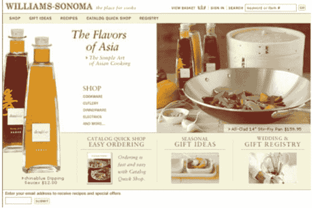

[Williams-Sonoma](https://www.williamsSonoma.com) 网站打开后展现出一些令人垂涎的美味。此时，他们的重点是“亚洲风味（The Flavors of Asia）”。在我们套用 White 的“真理”之前，先分别观察形状和幻像形式（你可能已经这么做了！）。这里有圆形（由炒锅、山葵碟和竹蒸笼创造的幻像形式）和正方形（由页面底部的信息、顶部的菜单和瓶子上的标签创造的延伸正方形形式 [矩形]），这创造了良好的对比。

那么让我们根据 White 的“真理”来分析该网站：

菜单位于 Williams-Sonoma 标志下方（在右上角，即 White 所说的我们开始“阅读”页面的地方）。对于渴望亚洲美食的英语使用者来说，这很方便！

如果我们从页面顶部开始向下阅读，这并不一定意味着我们笔直向下。我们的视线可能会从标志到炒锅，绕到油瓶，然后再次回到顶部，形成一个圆圈。然而，我们确实是从顶部开始的，不是吗？因此，将最重要的信息放在页面顶部似乎是有道理的。

在进入网站内部查看之前，我们将跳过第 3 点。

至于第 4 点，油瓶比页面上的任何其他东西都更“靠近”我们。它们更大，因此产生了靠近的错觉。

如果大且深色更重要，而相反的则次要，那么放置“The Flavors of Asia”的白色空间就比任何其他图像都次要。然而，这个白色空间支撑了标题，并凸显了标题以及进入网站链接的重要性。

“空白”空间与“充实”空间平衡吗？换句话说，背景在颜色、纹理、线条、形状、明度等方面是否平衡？

这个页面的“空白”形状是什么？此页面的空白包括白色空间以及其他图像和文字周围及之间的空间。这个空间是否与其它图像相呼应？是正方形？还是圆润感？你是否注意到设计师如何排列“Flavors”标题与下方列表之间的文字，使得文字的左边缘呼应了瓶子的形状？

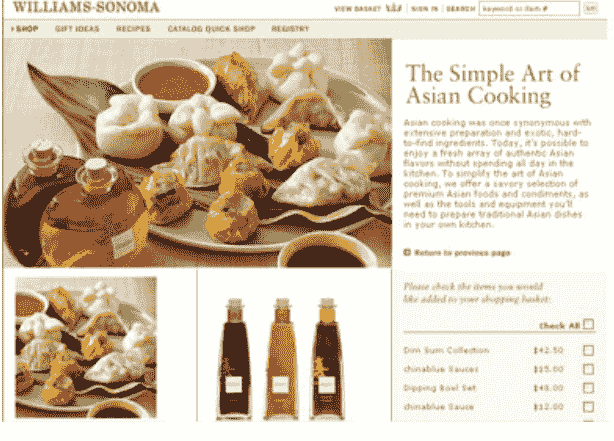

当我点击“Asian Flavors”链接后，出现了上面的页面。这些是我在印刷专业所谓的“折痕以上（above the fold）”区域遇到的形状。换句话说，这就是在我需要向下滚动以获取更多信息和图像之前所看到的内容（或者在印刷品中，是我在完全展开报纸之前首先看到的内容）。再一次，参考 White 的清单，看看每一步如何适用于此页面。我会强调第 3 点，因为该网站在这一点上做得很好。油瓶重复出现，给了我们连续感。标志和菜单在相同的位置，字体也没有改变……它是衬线体还是无衬线体？

Williams-Sonoma 网站是设计如何运作的一个绝佳示例——无论是在形式上还是功能上。其连续性流畅且迷人，照片则令人食欲大增。

## 资源

### 书籍（包括本章上述列出的书籍）：

**Basic Visual Concepts: for Artists, Architects, and Designers** 作者：Charles Wallschlaeger, Cynthia Busic-Snyder, Meredith Morgan McGraw-Hill, 1992, ISBN: 0697006514
这是一本面向设计师的大学级别（本科）书籍。本书包含了面向所有类型设计师的理论和实践（还包括 Weintraub 的 *Perceptions* 一书中的信息）。

**The Elements of Graphic Design: Space, Unity, Page Architecture, and Type** 作者：Alex W. White, Watson-Guptill Publications, 2002. ISBN: 1581152507
虽然这是一本面向平面设计师的小书，但信息紧凑，对网页设计师来说也是极好的资源。

**A Typographic Workbook: A Primer to History, Techniques, and Artistry** 作者：Kate Clair, John Wiley & Sons, 1999, ISBN 0471292370
Clair 的这本书是初学者、中级和专业排版师及设计师的最佳书籍。它涵盖了印刷页面的历史、结构、数值指南以及排版的原委——所有这些在网页上同样适用。

### 链接（在浏览这些网站时，请对照 White 的清单，看看它们是否遵循他的“真理”）

- [Identifont](https://identifont.com) – 一个学习如何识别字体并开始分辨字体差异的有趣地方。
- [Planet Typography](https://planetypography.com) – 一个极佳的浏览地，拥有大量指向其他排版网站的链接。
- [The Evolution of Type](https://evolutionoftype.com) – 另一个浏览排版历史的地方。留意字母是如何从形状演变而来的。
- [Chank](https://chank.com) – 一个纯粹用来随便逛逛的有趣地方。这里的字体大多不适合正文，但你可能会发现一些用于标志、标题等的绝佳创意。

## 第 4 章：在网页上有效地利用空间

网页设计师，也就是所谓的视觉传达者（VC），不仅在主页上，而且在整个网站中**组织**设计元素和原则。我们讨论过这些元素和原则，以及如何通过点、线、面和形状（包括排版）来组织它们。空间元素贯穿在所有这些主题之中。

空间是一个复杂的问题，当我们将其作为网页上的一个元素来处理时，它可能是最难以捉摸的。首先，让我们回答几个问题：

**问：我们如何最大化地利用页面空间？**
答：空间可以通过深度错觉来最大化，而深度错觉是通过透视以及在给定空间内分配图像来实现的。如果你需要在页面上放置大量图像和信息，这一点尤为重要。下面我们将讨论所有这些问题。

**问：“空间”具体在什么地方？**
答：啊！我可以从形而上学的角度来讨论这个……但基本上，正空间和负空间无处不在。视觉传达者负责移动这些空间，使页面上的信息和图像形成重要性的层级。我们之前在讨论排版时稍微提到过这一点，现在我们将看看空间是如何被操纵的。

**问：为什么空间很重要？**
答：如果没有空间，尤其是“白色空间”（它可以是任何颜色，不一定是白色），图像和信息就将没有空间来“呼吸”。换句话说，过犹不及。如果你记得第一章的内容，经济性是一个设计原则。这也让人想起那句名言，有时“少即是多”。

让我们看看二维空间的管理，然后我们将探索如何利用其他设计元素创造深度和透视的错觉。仔细观察下面这个来自 [IDEO](http://www.ideo.com) 的网页，看看你是否能注意到任何空间、深度和距离的元素。在读完本章后，我们将回到这个页面，剖析空间在这个页面内部及其表面是如何运作的。

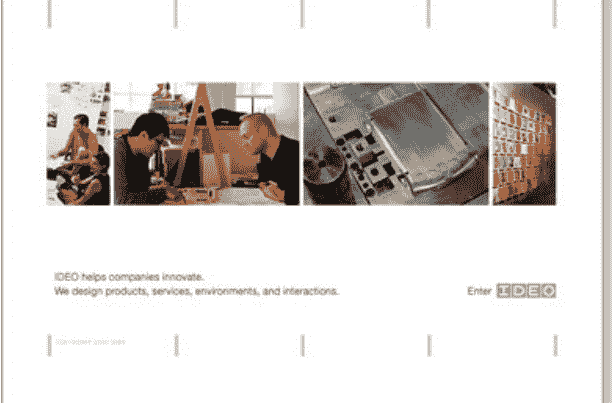


## 二维空间

如果你还记得第二章中提到的古希腊数学家欧几里得，你会知道他关于三维空间的定义是一个在所有方向上都无限延伸的区域。它也被描述为具有长度、宽度和深度。作为视觉传达设计师（VCs），我们处理的是二维空间，而这受到观众屏幕分辨率大小的限制。这种长度和宽度也描述了**画面平面（picture plane）**。然而，深度是一种错觉，我们只能通过涉及人类感知线索的手段来渲染深度。

当观众（包括我们自己）识别给定空间中对象之间的关系和交互时，我们是在利用**空间感知（space perception）**。我们感知这种三维空间的方式是通过**双眼深度线索（binocular depth clues）**。这些线索给了我们提示，让我们知道对象相对于我们身体所在的位置。在像建筑物这样的三维空间中，如果我们缺乏双眼空间线索，就会撞到墙上（喝了几杯马提尼后也会产生同样的效果）。

在二维空间中，我们使用**单眼深度线索（monocular depth clues）**来完成同样的任务，只不过我们将对象彼此相对放置，以便我们在视觉上想象它们相对于我们身体的位置。虽然我们不必担心撞墙，但如果这些对象脱离了语境出现，我们同样会感到困惑。虽然玩弄空间线索很有趣，但当我们为客户构建网站时，他们可能并不欣赏我们的天才之举。为了帮助客户的观众识别他们所处的位置，并快速了解在网站中需要去哪里以及需要做什么，有几条基本准则需要遵循。这些线索假设了一个中心空间场，它可以根据线索的应用而前进或后退，而这种“前进”和“后退”的运动告诉观众什么是重要的。三个重要的空间修正因素是：尺寸、位置和色调或明度。

## 尺寸

如果页面上的一个对象比其他对象大，那么较大的对象就会获得突出地位。当两个正方形大小相同时，它们看起来彼此之间以及与观众之间的距离相等。然而，当其中一个较大时，它看起来更近。这在文字中同样适用。如果一个词更大，它看起来更近，而且似乎更“响亮”、更重要。之前我们已经看到，较大的字体如何在页面上创建信息层级。较大的字体暗示更重要的信息，较小的字体则告诉观众该信息较不重要。

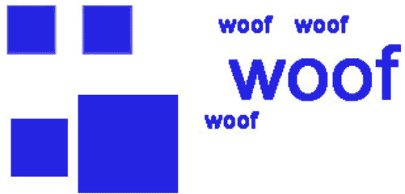

Teenwire 的启动页在标题和如何进入网站的指引上强调了尺寸。即使在缩小的比例下，我们依然能看到“enter”这个词。此外，启动页会在几秒钟内滚动进入网站，因此页面不会变得静止。

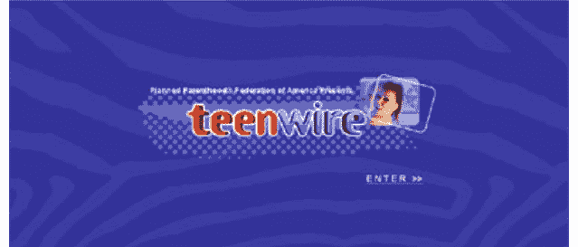

那个青春期女孩的照片以及 “Teenwire” 标志上方的线条（写着“Planned Parenthood® of America Presents”）成为了次要信息，但它们对于该网站的介绍同样重要。这个网站是面向青少年的吗？当然。我们还可以假设这个网站是关于青少年新闻的，但这些新闻被赞助商的信息所修正。在内部，我们发现许多关于青春期激素过多引发的问题的文章，这些文章是在“爱”的语境下编写的。

当我们把经验和学习应用到画面平面内的对象时，这个练习尤为 pertinent。由于熟悉的尺寸关系是可预测的，判断距离和深度很少困难。如果一个熟悉的对象与其它熟悉对象以矛盾的方式组织在一起，我们就会质疑自己的感知，我们的意识会被提高。左边的晾衣夹与其实际功能相矛盾。而右边的晾衣夹则是我们预期看到的。尺寸上的矛盾，尤其是与更熟悉对象的对比，是吸引观众立即关注的一种方式。

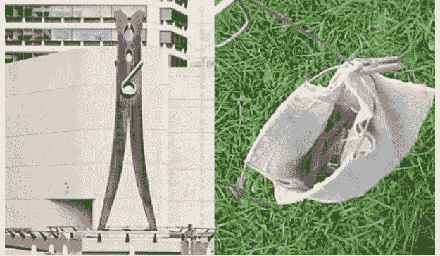

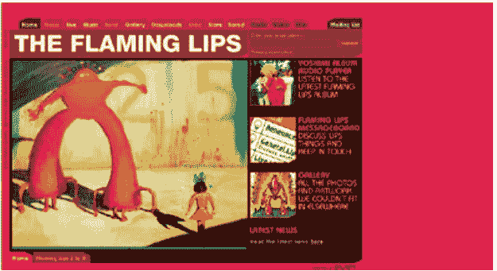

[Flaming Lips](https://example.com) 的网站在每次“刷新流”时会在首页呈现几件艺术品。这张特定的图片展示了尺寸产生重要性的两个完美例子。标题 “The Flaming Lips” 很大，且与背景形成高对比度。尽管页面充满了颜色，但标题在所有其他信息中脱颖而出。该插图是尺寸矛盾的一个例子，它抓住了观众的注意力。那到底是个什么东西？为什么它比右下角前景中的人类图像大这么多？“人类”图像是“正常”且可识别的，它为我们衡量那个“东西”的巨大图像提供了一种方式。

## 位置

位置被定义为形状和图形在画面平面上相对于其他形状和图形的具体放置位置。这些对象的相对位置给了我们关于深度和距离的线索。当我们使用重叠形状时，会产生同样的错觉。

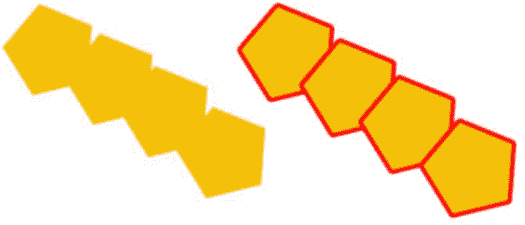

在上面的第一张图中，左侧的对象没有轮廓线，因此它们看起来像是在构建一个单一图像。右侧的对象也可以构建一个单一图像（事实也确实如此），但它们看起来还发生了重叠，底部的多边形看起来更近。左右图像之间唯一的区别是右侧的多边形有轮廓线。这是一种在不使用那些简单的投影（drop shadows）的情况下描绘深度的方法。


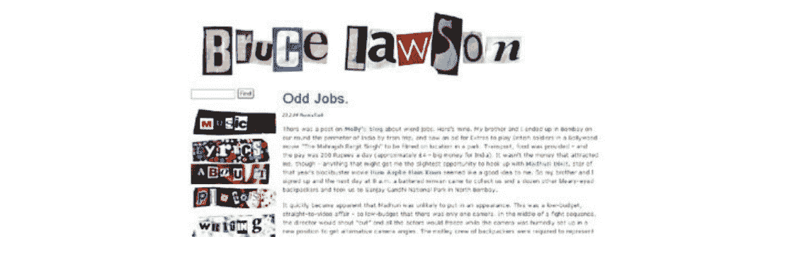

Bruce Lawson 的个人网站是一个研究此人如何利用字体的尺寸 *和* 位置来创造矛盾状态与深度的绝佳场所。矛盾状态是通过字体的差异和字母的大小来实现的。顶部拼写他名字的字母看起来像是重叠了，但实际上并没有。仔细看，名字中的 “C” 和姓氏中的 “S” 看起来比其他字体更大，因此更近。它们接触到前后的字母，但并没有重叠。在侧边栏中，字体在背景图像中创造了小小的“窗口”。再次强调，字母的间距和差异创造了一种矛盾状态，因为这种书写形式并不是我们所熟知的“正常”英文书写。

然而，字母与背景之间的对比——以及字母之间的空间——使我们能够阅读这些词语。我们可能会将这种“书写”方式与勒索信（ransom notes）联系起来，而不是随机笔记（这是一个博客），这种内涵可能会吸引我们去看看这个人拿什么作为交换条件（这种书写方式在 20 世纪 20 年代初被称为 “DaDa” 的艺术运动中很流行，在 70 年代的朋克时期也同样流行）。

## 色调或明度

视觉感知中的暗和亮分为颜色（色相）和明度（无色）。如果一个环境是黑、白、灰色的，那么我们处理的是一个无色环境。显然，彩色条件或彩色环境是由颜色创造的。然而，两种空间都可以通过使用明度（亮与暗）的区分来实现深度和距离的错觉。近处通过暗度来判断，远处则被判断为较亮。这种现象被称为“大气透视（atmospheric perspective）”。例如，如果我们站在山上俯视山谷，远处的山看起来会比实际情况更小、更亮。

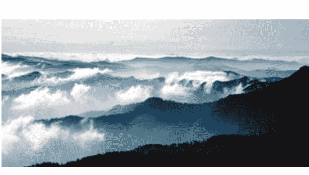

上面的图片来自国家公园管理局的 [大烟山国家公园](https://www.nps.gov/grsm/) 网站。这个山脉是视觉化大气透视的完美方式。该山脉的地理和化学特性共同产生了朦胧的状况以及深度和距离的错觉（在这种情况下也是现实）。前景的山几乎是黑色的，这暗示了距离很近。我们看向远方越深，山就变得越亮。

此外，如果你注意到上面的单座山，它们底部看起来比顶部更亮。如果我们站在这些山的底部，则会发生相反的现象。在这种情况下，暗度是相对于我们的视平线的。如果我们处于峰顶，其他山峰比它们下面的山谷更近，因此它们更暗。如果我们身在山谷，当然看不到其他山谷，但山峰会更亮，因为它们离我们的物理位置和视线更远。同时请注意，这些山发生了重叠。看看下面的 Campbell's 网站，看看汤碗是如何被顶部和底部的信息面板重叠的。

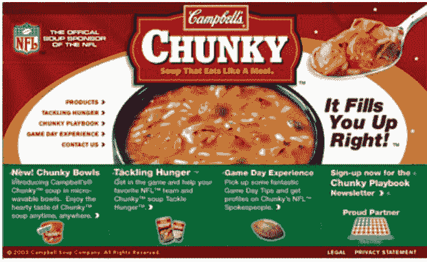

我们可能不是 [Campbell's Chunky Soup](https://www.campbells.com/chunky/) 的粉丝，但这个网站之所以有效，是因为它很熟悉（它像他们汤罐头上的标签），并且重叠的图像从顶部标签到汤再到页面的其余部分创造了一种连续性。还有其他次要（较小）的图像，但我们不会立即消化这些信息。我们首先看到的是 “Chunky” 和汤。重叠是引导观众视线的有效工具。这种重叠也是通过透视创造的。同样请注意，汤碗并没有像上面照片中的山那样看起来变亮。


然而，如果我们去掉颜色，只观察数值（明度和暗度），看看会发生什么：

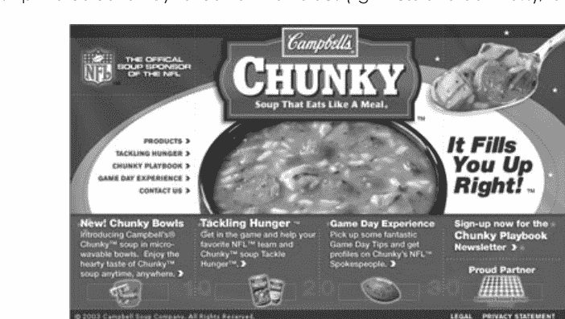

汤的颜色变浅了，但幅度不大。事实上，汤匙现在可能会首先吸引你的注意力，因为它看起来比页面上的任何其他东西都更近。汤匙的大小以及下方的少量阴影，使得这个单一的图像看起来更近。

在处理透视之前，让我们再看一个空间属性：

**正空间和负空间：** 我们在上一章讨论模糊形状时稍微提到过这个。我要重复一遍那个图像，因为这可能有助于将形状和空间联系在一起。基本上，正空间围绕着负空间，它也可以被视为负空间中的正形状。反之亦然，尤其是在我们处理模糊形状时。

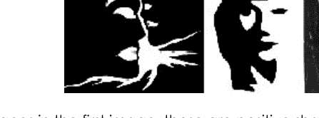

如果你在第一张图中看到了两张脸，那么它们就是正形状，即使它们是黑色的。如果你看到的是一朵花，那么那就是正空间，而脸就变成了负空间。第二张图也是如此，它既可以是一张脸，也可以是一个萨克斯演奏者。第三张图稍微复杂一些，因为它包含无彩色调，给图像带来了深度（阴影）。如果你看到的是一个骷髅，那么该图像就是正形状，背景则是负空间。如果你看到的是一面镜子前的女人，那么女人、她的倒影和镜子就成了正形状，背景则是负空间。最后一张图既可以是一个年轻女人，也可以是一个老年女人。无论我们看到什么，那就是正空间。有趣的是，在这张图中，环绕图像的白色空间在两种错觉中都是负空间。

## 透视 (Perspective)

好了，在开始讲解基础知识之前，我不打算让你们在没接触一点艺术史的情况下就跳过去。我是一个资深的艺术狂热者，我相信，只有当我们理解我们最初是如何取得这些成就的，我们才能真正欣赏我们现在所拥有的东西。

### 历史

欧几里得想象了地平线，这是一条虚构或真实的线，将他广阔的陆地和天空空间分开。然而，艺术家们直到 1600 年后才能利用欧几里得的地平线通过透视来描绘深度。当然，在中世纪之前和期间就有艺术家生活和工作，但他们的作品非常扁平。深度是通过在绘画和彩色玻璃图像中重叠图像来实现的。那是欧洲一个非常虔诚的基督教时期，因此我们发现的大多数图像都致力于推广这一哲学。在下面的图像中，请注意如何利用大小和位置（包括重叠）来实现深度和距离的错觉：

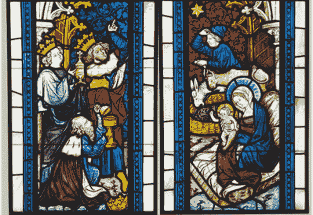

《三王来拜》细节，约 1390 年，奥地利；来自奥地利 Ebreichsdorf 的 Schlosskapelle

透视在但丁时代、中世纪晚期和前文艺复兴时期的意大利走向成熟。为什么发生在那个时候？因为意大利人是海上贸易商，他们正走在成为相当国际化的道路上。他们不仅复兴了欧几里得，还让托勒密（宇宙论）和亚里士多德重现生机。贸易与哲学的结合创造了一种氛围，使人们对测量有了更多的意识。这种意识包括透视，即相对于地平线的空间测量。在二维空间中，我们改变这些测量值，使环境能够适应画面平面。

在那一个世纪里，乔托·迪·波多内 (Giotto di Bondone) 是记录在案的第一位直觉性地理解到——将场景描绘成仿佛从沿地平线组织的一个固定视角观察——其好处的艺术家。将他下面的画作与直接上方的图像进行比较，看看你注意到了哪些不同。

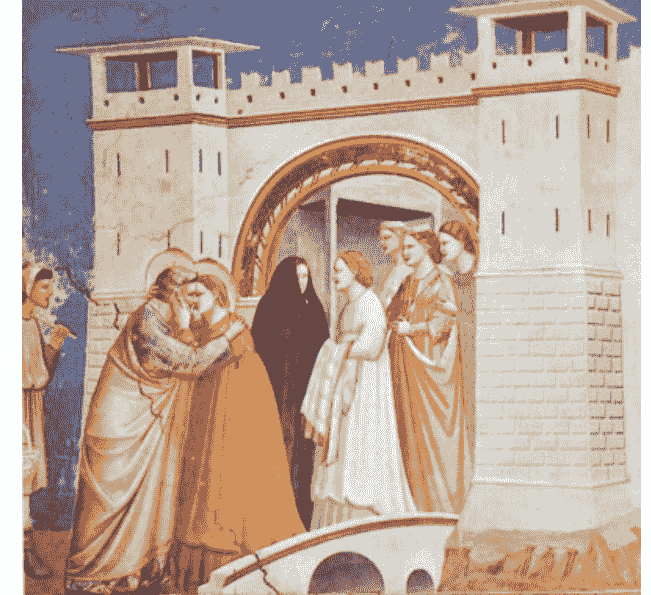

#### 乔托：《金门会面》(1306)，帕多瓦斯克罗威尼礼拜堂

乔托在重叠和位置的基础上增加了**数值和透视**，以此来描绘深度的错觉。这种透视意味着人们在身高和尺寸上看起来更“正常”，因为他们是在这种透视中被描绘的。注意上方图像中，城门塔楼的部分触及右侧边界，但左侧的塔楼则低得多，从而创造出左侧塔楼更远处的错觉。此外，观察乔托如何创造桥梁向上弯曲的错觉，后面的女性看起来更高，但比例更小。这是非常早期的文艺复兴艺术，画中的深度感知不像一个世纪后的列奥纳多·达·芬奇的作品那样写实。然而，上面的画作在意大利引起了轰动，于是人们开发了学校来教授如何成为“透视主义者”。让我们来看看乔托和其他人是如何建立地平线的，并练习一下一点透视和两点透视。

### 地平线 (Horizon Line)

地平线，如前所述，在理论上是将陆地与天空分开的真实或虚构的线。地平线不必位于屏幕中心。地平线也可以很高或很低。

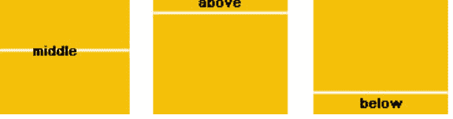

位于中心、中心上方和中心下方的地平线。

地平线也可以被定义为焦点。Teenwire 的启动页使用了相当居中的地平线（中心取决于屏幕尺寸和分辨率）；Bruce Lawson 的页面则展示了位于中心上方的地平线（焦点在他的名字上）。极少有网站将地平线或焦点设在中心下方，因为网页很像一张未展开的报纸。你希望观众立即捕捉到你的主要信息。因此，将焦点设在中心或中心上方是合适的，且对网站来说最实用。

在我们进一步深入之前，让我们练习一点透视和两点透视。如果你尝试下面的练习，网站和艺术作品中的透视感可能会对你来说变得更加明显。

### 一点透视 (One-Point Perspective)

一点透视是通过地平线上的一个点创建的。让我们一起走一遍在 Photoshop 中构建一个方块的步骤。只要你能重复以下步骤，你可以使用其他图形程序。

**构建一点透视方块的步骤**

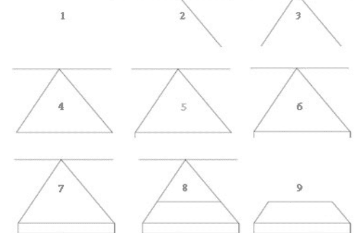

- 1. 使用直线形状工具绘制一条地平线。
- 2. 和 3. 确保标尺显示，并从线的中点开始。引出另外两条线（这将构建另外两个图层）。两条线必须在底部均匀结束，且相对于中点两侧对称。
- 4. 连接两条斜线的底部。
- 5. 和 6. 从斜线向下绘制两条均匀结束的直线。
- 7. 创建另一条与底线平行的线。你可以让这条线更深，所以可以多尝试。
- 8. 在斜线更高处创建另一条与两条底线平行的线。
- 9. 合并所有图层，选择最后一条平行线以上的线条并将其删除。

瞧！你得到了一个一点透视方块。现在，让我们给这个方块增加一些维度。

### 一点透视阶梯

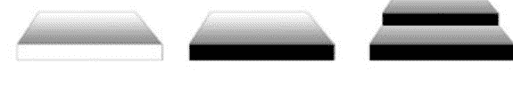

- 1. 选择方块的顶层，并使用渐变工具创造深度的错觉。确保渐变的深色部分在前面，因为**深色 (DARK)** 数值看起来更近，而**浅色 (LIGHT)** 数值看起来更远。
- 2. 选择方块的前部并填充纯黑色。
- 3. 为了开始构建阶梯，创建一个重复图层。如果有背景，请选中并删除它。现在前往 Edit > Transform > Scale (编辑 > 变换 > 缩放)，并确保选中顶部百分比工具上的锁定功能。根据第一张图的大小，你需要尝试不同的百分比来看哪个合适（这里我使用了 80% 的缩减）。按下回车键释放缩放功能，瞧！你有了阶梯的雏形。注意我调亮了第二个阶梯的前部，因为它更远。

你是否看到了渐变和纯色是如何共同赋予这个形状深度和重量感的？我们也可以改变地平线的高度，用不同的方式构建这种一点透视。

### 一点透视墙壁

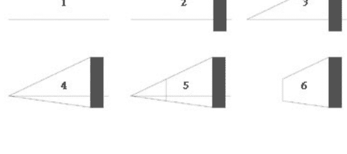

- 1. 构建一条低地平线。
- 2. 使用形状工具在其中一端构建一个矩形。
- 3. 和 4. 将此矩形的左上角和左下角连接到地平线的末端（或该线上的某一点）。
- 5. 在两条斜线上的某个点，构建一条与矩形平行的垂直线。
- 6. 合并图像，选中并擦除所有多余的线条。

你也可以使用高地平线，并在沿线分布不同的点。你也可以从两个角度构建，创造出街道图像。下面的图像来自几十个在线网站之一

阐述如何使用一点透视构建一个“隧道”。由于这里的空间有限，且我想让你们尽快进入两点透视的学习，请前往本章末尾查看更多关于使用一点透视构建其他图像的链接。

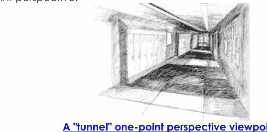

## 两点透视

两点透视是由地平线上的两个点构建而成的。这类图像的构建方式与一点透视非常相似。

**一个两点透视的方块。**

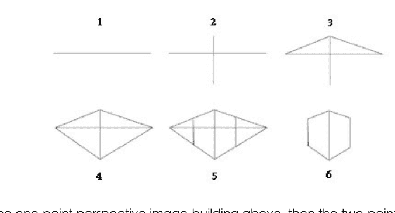

如果你遵循了上述一点透视的图像构建方法，那么两点透视的操作方式也是一样的。这条地平线位置稍高，但它可以放置在更高或更低的位置。下面的图像全部采用同样的方法构建，但地平线的高度以及构建最靠近我们的方块顶角的垂直线有所不同。然后，在底部从垂直侧线向地平线上的相对点添加两条线。

你能分辨出下面哪个方块是由紧接在其上方的图表构建的吗？

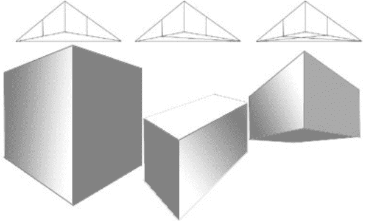

中间的方块并非由之前的任何图表构建。此外，如果你注意到这些方块中的亮区位于前方，这违反了大气透视原则。太糟糕了！当然，如果光源来自其他角度或存在多个光源，这条规则就会被打破。因此，只要画框中的所有其他项目也从同一方向照明，这些方块就可以以多种方式着色。否则，你会创造出一种矛盾的状态，不过这也不完全是坏事。关于使用一点和两点透视构建的更多选项，请参考本章末尾的链接。

## 回到起点

好了，让我们用现在掌握的知识来分析 IDEO 的网站。首先，检查画面平面，然后观察尺寸、位置、色调以及正负空间。

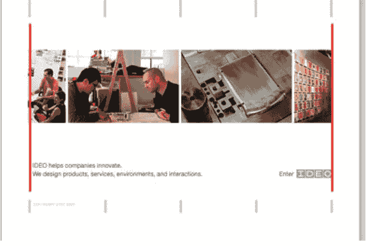

扁平的画面平面被正方形和长方形形状打破，它们成为了“切入”负白空间的正面图像。甚至文字行也被平衡为狭长的矩形形状。我画了红线来展示这个站点上的几乎所有元素是如何在画框的两端汇合的。这种对齐方式维持了站点的秩序，并且是一种防止观看者的视线漂移到图像之外的工具。照片创造了通往三维视图的“窗户”，与构成 logo 和文字行的扁平图像形成对比。换句话说，设计师没有在文字和灰色线条上使用重叠、投影或任何其他元素，以免分散对照片深度的注意力。让我们看看这个页面上的两张照片：

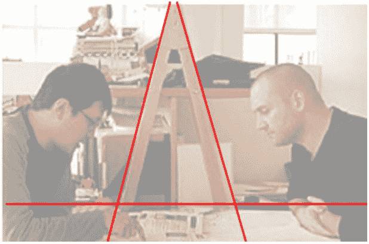

这张照片独立存在（其他照片也是如此），因为其构图很强。地平线由红色的水平线标出。这条地平线位于中心线下方，并且得到了强调，因为两名男子实际上都在向下看着它。背景中的画架框架提供了支撑（这同时也是一个视觉双关）。焦点在于这两名男子在桌子上看到的艺术品或信息，左边的男子用手指点状地强调了这一点。注意到图像在远处显得更亮。两名男子深色的衣服进一步强调了他们的近距离感。

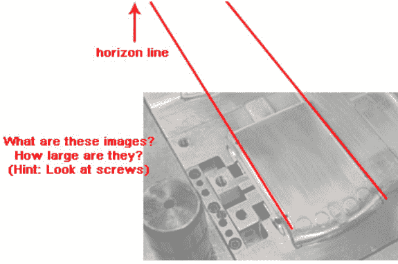

这张图像的地平线远在画面平面之外，它几乎反映了前一张图像中画架的角度。我们中的有些人可能知道这些图像是什么，但对于那些不知道的人，可以通过螺钉的大小来想象尺寸。

最后，网页最右侧的最后一张图像（见全页）是弯曲的。当图像在空间内弯曲时，这也会产生深度错觉。

## 资源

想要寻找大量关于透视的不同站点，只需在搜索引擎中输入“一点”或“两点”透视即可。此外，这里有一些入门资源：

- [一点透视](http://) – 展示如何为床、地毯等使用“隧道”法。
- [一点透视 Flash 教程](http://) – 仔细观察球体的大小是如何由透视决定的。
- [两点透视](http://) – 基础课程，但其中的图片值得一看。
- [蓝图](http://) – 展示如何利用两点透视创造距离感。

还可以访问大都会艺术博物馆的[艺术史时间线](http://)。在这里，你可以研究透视法随时间的变化。

当然，列奥纳多·达·芬奇尤其值得关注。可以通过这个网站查看一些精彩的图像：[巴黎 Webmuseum](http://)

任何关于透视的书籍都能帮助你学习如何创建从简单到复杂的绘制环境。以下是我在这个主题上最喜欢的一几本：

**《室内设计师透视法》** (*Perspective for Interior Designers*)，作者 John Pile，Watson-Guptill 出版社，1989年，ISBN: 0823040089
这本书可能不适合网页设计师，但如果你热衷于创建虚拟环境，它将有助于你的视角。

**《M.C. 埃舍尔 29 幅杰作》** (*M.C. Escher 29 Masterworks*)，作者 M.C. Escher，Harry N Abrams，1983年，ISBN: 0810922681
这本书包含了 29 幅他的作品大版画。这是测试你对空间和深度感知能力的绝佳作品。他是如何实现这些错觉的？

**《15 世纪意大利的绘画与体验：图像风格社会史入门》** (*Painting and Experience in Fifteenth Century Italy: A Primer in the Social History of Pictorial Style*)，作者 Michael Baxandall，牛津大学出版社，1988年，ISBN: 019282144X
如果你在亚马逊购买这本书（无论在哪里我都建议你购买），请忽略糟糕的评价。这本书对意大利在文艺复兴初期如何成为艺术及所有其他贸易的前沿提供了令人惊叹的视角，并概述了 15 世纪意大利背景下的透视法。

## 第 5 章：一业多支：通过重复实现统一

你们中的许多人可能使用 Dreamweaver 软件，所以你们知道它如何允许设计师创建一个在不同页面之间保持图像和布局连续性的站点。此外，许多人熟悉 Flash，所以你们知道这种软件如何允许设计师在整个站点中保持元素的重复，比如背景或链接。然而，有时客户在一家主公司旗下拥有多个子公司或分支机构，且每个分支可能都有自己的“个性”。在这种情况下你如何设计站点？你会改变哪些设计元素，哪些元素应该保持不变？

### 真实世界公司站点

Real World Company 是一个展示设计师如何通过颜色、布局和图像的重复在整个站点中维持统一的例子。设计师为该站点的每个细分部分分配了一种颜色，并在首页链接中引入了这些颜色。本章中的全屏图像是以 1280 x 1024 的分辨率复制的；然而，由于在这个尺寸下元素难以辨认，我将主图像从全屏格式中提取出来，以展示这些元素是如何延续的。

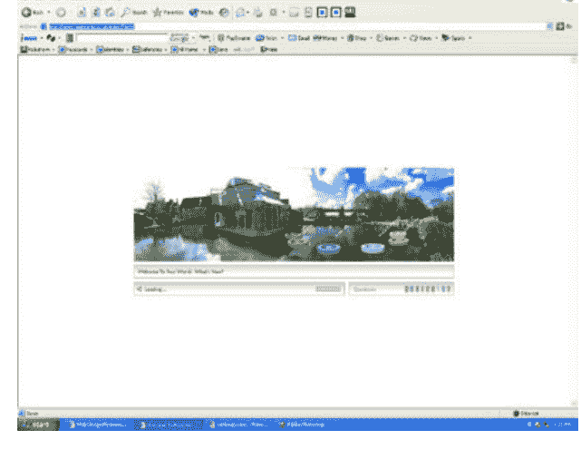

让我们看看首页图像中起作用的几个主要设计元素和原则。在上面的图像中，首先要注意的元素是该页面中白空间（或负空间）的使用。在这种情况下，照片周围以及照片下方的条形区域的空间非常重要，因为白色就像一块空白画布。白空间的重要性在上一章中讨论过，尽管围绕图像的空间不一定是白色的，但在这种特定情况下，这种颜色（或缺乏颜色）至关重要，因为它为照片右下角的旋转圆形链接以及右下方导航栏为站点的其余部分着色奠定了基础。

圆形链接的文本描述以对角线形式设置在每个对应彩色圆形的上方。正如我们在第2章中讨论点、线、面时提到的，对角线暗示着“动作”，这对于这些旋转的链接来说是合适的。此外，当访问者将鼠标悬停在矩形链接上时，与之匹配的颜色对应的文本也会显示在“快速链接”栏中。这为访问者进入本站提供了极大的便利。让我们先从左边的绿色链接开始……

## Real World Studio

绿色链接将我们带到 Real World Studio 网站，左侧的链接则带我们了解这个录音空间的各个方面。请注意，背景（或负空间）在圆形和矩形链接中都与主页面的链接颜色相匹配。从白色到绿色负空间的这种转变，对观看者来说是一种视觉和心理上的调整。颜色的变化表明访问者已进入不同的环境或另一个房间。但是，除了这个工作室与母公司同名这一事实外，访问者如何能确定这里是 Real World Company 的总部？仔细看看中间的图像可能会告诉我们……

我们可能不会立刻意识到，我们正站在 Real World Company 主页上所展示的录音室内。但是，访问者可能会突然发现，右上角的小彩色方块是链接，并且它们与主页面链接的颜色相匹配。当访问者将鼠标悬停在彩色链接上时，左侧的文字会改变，以解释每个链接指向何处。当然，绿色链接在绿色背景上不会显示出来，但该链接并非缺失。将鼠标移到可见蓝色链接左侧的黑色区域上，可以看到鼠标手指指向。如果你在这个网站内部，该链接是有效的。此外，还有一个下拉菜单，可帮助在本站内进行导航。下一个链接指向 Real World 的一位主要艺术家（也是我最喜欢的音乐家之一）……

## Peter Gabriel

同样，背景或负空间呈现出链接的色调。还要注意，这些页面的布局也开始看起来有些熟悉了——在一个水平矩形“窗口”周围留有大量的负空间，其中包含图像和信息。

彩色链接再次显示在右上角，但它们比录音室网站页面上的链接靠得更近，并且这些链接带有白色轮廓。录音室页面的绿色背景亮度足以显示各种链接颜色，但这种深蓝色太暗，无法区分链接的色调。白色轮廓使这些链接脱颖而出，即使在这个尺寸下，红色和橙色似乎也在振动。用这种方法为链接设置更大的方块可能行不通，因为它可能会分散页面上其他图像的注意力，这些图像色调柔和且深沉。这是第一个没有提供“alt”文本或任何其他文本的页面，这些文本本可以告诉访问者如果想离开 Peter 页面，接下来该去哪里。如果你搜索“Peter Gabriel”，这个网站通常在搜索结果页面上排名第一。如果你不知道 Real World Studio 或 Company 链接，你会知道这些链接方块是干什么用的吗？可能不会。在这种情况下，缺少“alt”文本是有害的。

## Real World Records

下一个链接指向 [Real World Records](http://www.realworldrecords.com)，它再次通过在背景中重复链接颜色以及使用相同的水平矩形作为信息窗口来体现连贯性。紫色所渲染的深紫色调和明度与 Peter Gabriel 的蓝色非常相似，并且该网站上的链接处理方式相同，都带有白色轮廓。然而，当访问者将鼠标悬停在每个链接上时，这些链接带有可见的“alt”标签文本。在下面的特写图像中，这些链接更加可见。

到目前为止，颜色都很深沉，但我们将要用明亮的橙色来开阔眼界……这些颜色选择是任意的吗？由于网站布局如此精良，我怀疑这些颜色选择不是随便从帽子里抓出来的；然而，我们在网站后面会遇到一些与颜色相关的问题，我们将在下面进行讨论（在下一章中，我们将探讨这些颜色选择，并查看其他一些网站，以了解色彩感知）。

## Real World Multimedia

[Real World Multimedia](http://www.realworldmultimedia.com) 网站的颜色与之前的图像有些不同，但布局保持不变。此外，这张照片在某种程度上与 Real World Company 网站上的第一张照片相似，因为树木被呼应了，房屋中的矩形图像也被重复了。右边的红色电话亭是形状的重复，它的颜色将“热”橙色引入照片中，“冷”绿色与这些色调形成对比。

### Real World Multimedia 网站主页图像的特写。

链接的位置与 Peter Gabriel 和 Real World Records 的页面相同，但这次它们是用黑色轮廓（或者可能是深紫色或蓝色——很难分辨）。橙色背景上的白色轮廓会使这些方块异常明亮——对于这个页面来说太亮了。

### X PLORA 1 – EVE – Ceremony

我们还没有探索这些网站中的一些内页，所以在继续之前，让我们先看看多媒体部分中的一个页面。这个特定的页面很有趣，因为图像是模糊的，这使得它们显得后退。因此，名称变得突出。此外，当访问者将鼠标移到图像上时，与链接中其他颜色相匹配的颜色会显现出来。Real World Studio 的绿色显示在 X PLORA 1 图像后面。Eve 后面出现了 Peter Gabriel 的蓝色。Ceremony 后面则显示出本页面之后即将介绍的 WOMAD 网站的红色。虽然这种颜色的转移可能会让访问者感到困惑，但实际上它似乎使这个页面与网站的其余部分融合得更好。还要注意，布局和链接的位置没有改变。这也增强了网站的连贯性。

## WOMAD

[WOMADshop.com](http://WOMADshop.com)

这家商店出售 Real World 服装、音乐会门票、音乐等，所有这些都是为了推广他们的艺术家和品牌。拍摄的图像具有与 Real World Company 主页和上一个多媒体站点图像相同的清晰/模糊对比。此外，水平矩形布局得以保持。链接在哪里呢？

**WOMADshop.com 网站主页图像的特写。**

链接现在排列在左侧，并且是垂直排列而不是水平排列。链接位置的选择可能基于此网站的目的。这是一个商店，顶部的链接是为层级和注意力而设置的，顶部的链接非常显眼，即使在这个缩放比例下也是如此，而左侧的链接是次要信息。当访问者将鼠标悬停在链接上时，文本“alt”标签会再次显示。这些链接与多媒体页面中的链接一样，带有黑色轮廓。然而，我认为在这个页面上，白色轮廓可能效果更好，因为红色和黑色轮廓的明度非常相似，链接……

似乎在逐渐消失。虽然这些链接是次要的，但它们仍然很重要。让我们看看当颜色被剥离时，明度值（浅和暗）是如何工作的……

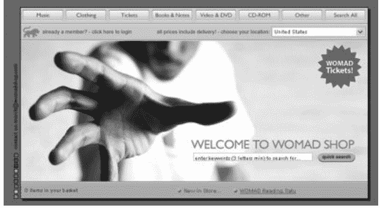

**WOMADshop.com 网站主页图片明度的特写。**

当红色以黑白形式印刷时，它总是会变暗，大部分是黑色。在这种情况下，由于屏幕是背光的，红色呈现为深灰色。然而，我们可以看到链接是如何在这个明度系统中"隐藏"的，以及白色轮廓如何能让这些链接更加显眼。即使有白色轮廓，我怀疑小图片是否会分散这个页面的注意力，因为照片中有如此多的白色。然而，重复性仍然很强，如果访问者经常访问这个网站并熟悉其内容，这些特定链接的较低对比度可能只是一个很小的问题。

## Real World Exposure

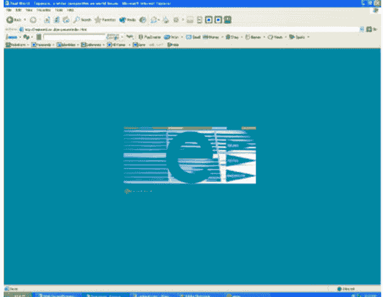

Real World Exposure 网站的背景再次与其对应的链接相匹配。水平矩形布局也呼应了其他 Real World 公司的网站。这个网站涉及该公司认为重要的问题，如"Future Forests"、"Amnesty International"和"Declaration of Human Rights"。让我们仔细看看这个页面上链接是如何显示的。

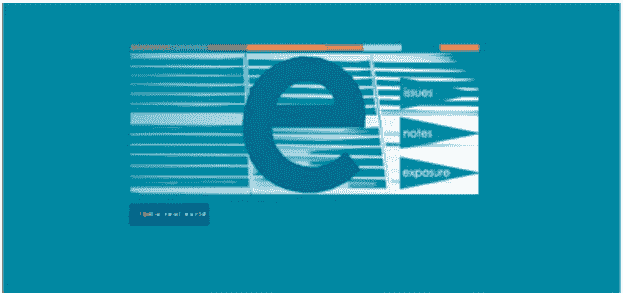

Real World Exposure 网站主页图片的特写。

颜色有些相似——它们与之前的网站页面没有完全相同的色调——而且它们在鼠标悬停时会变成与其他颜色相似的 rollover 效果，但并不完全与之前的页面相同。此外，形状也发生了变化。小方块让位于细长的矩形。然而，如果你顺着链接进入这个网站内部，你会发现各种各样的链接形状，包括小方块和细长矩形的重复，只是宽度更窄。有趣的是，在这个特定的页面上，当你将鼠标悬停在浅蓝色和橙色链接之间的"空白"蓝色空间时，"exposure"的"alt"文本会弹出。

## Real World Publishing

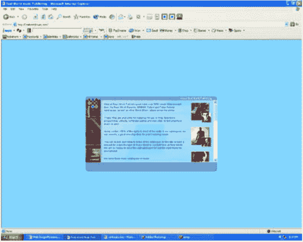

这是 [Real World Publishing](link) 的网站，新签约艺人、演出和出版物按时间表在这个网站内提供。让我们看看那些难以在这个分辨率下看清的链接：


链接现在变成了圆形，这可能看起来有些奇怪，但它们反映了 Real World 公司主页上旋转的圆形链接。如果圆形在其他地方找不到，这里的改变可能会显得突兀。圆形有白色轮廓，这有助于它们在中等蓝色边框的明度和窄菜单窗口背景的暗色值中脱颖而出。此时我可能意识到，所有页面上的链接顺序都是相同的。然而，我没有遵循这条路径，这是有原因的。我把最后两个网站页面留到最后，因为它们似乎遵循与这个网站各个分支中其他页面不同的规则。

## Real World Art

让我们看看"艺术"页面：


虽然 Real World 公司网站这一艺术部分的背景色与他们的 WOMADshop.com 网站不完全相同的红色，但非常接近。如果设计师使用了一张明亮的图片，并与商店网站使用相同的导航，那么这将会模糊两个网站之间的意义——一个是可供销售的商品，一个是 Real World 为其 CD 封面等委托艺术家创作的图像。


**Real World Art 网站主页图片的特写。**

链接更具艺术性，就像画家调色板上的颜料斑点。适合这个页面，如果设计师在网站内部重复这些图像会很有趣。然而，像这个企业内的其他网站一样，链接会变成小方块和细长矩形。当访问者将鼠标悬停在这些链接图像上时，没有显示"alt"文本框，但左侧的文本会改变，就像 Real World Studio 页面一样。然而，在这个背景色下，文本有时难以阅读。

坦白说，我不确定这如何能更好地工作，除非将背景色改为明度更浅、不那么鲜艳的颜色。但是，整个网站的所有链接也需要随之改变。由于这个网站在其他方面如此协调，这可以被原谅吗？这变成了一个个人观点的问题，因为我们可能对这是否有效存在分歧。此外，在这个网站内，几个页面使用了不同的背景色。在我看来，这没问题，因为这些页面代表不同的艺术家，而这些艺术家可能对他们的背景有选择权。由于这个网站代表艺术作品，我们可能会一致认为这种改动是可以接受的。然而，我对 Real World 商业版图中的下一个网站感到好奇：

## WOMAD Festivals


[WOMAD Festivals](http://festivals.womad.org/) 页面非常漂亮。棕色背景与 Real World 公司网站中其对应的链接相匹配，这种颜色不寻常且引人注目。水平矩形窗口内的暖金色、红色和棕色相互补充，非常吸引人。从下面的特写中，可以看到这个窗口内方块与链接之间的对称性：


**WOMAD Festival 网站主页图片的特写。**

链接现在已经处于熟悉的位置，它们有黑色轮廓。在这个暗色值空间中，白色轮廓会与"WOMAD READING"标题竞争，而链接背后的背景明度足够浅，使链接能够清晰显示。现在，我知道这是个人的不满，而且考虑到到目前为止整个网站的出色设计，这可能是一个非常小的问题，但当我点击左侧的链接时，我的感觉被扰乱了。我失去了那令人难以置信的棕色背景和到目前为止网站大部分内容呈现的熟悉连续性。这是我点击"Australia"时看到的：


## WOMAD Australia

哇！差别真大，对吧？链接现在是狭窄的垂直带状，背景也非常不同。这个背景贯穿于这个网站主页左侧链接的所有国家……所有国家，除了从英国链接的两个网站。啊哈。好吧，这就是这种混乱的方法吗？这家英国公司让它的 [UK Eden](link) 和 [UK Rivermead](link) 使用相同的背景，以将其与主网站统一？坦白说，我不确定，但我很难过他们没有在整个网站中延续这个背景色。这让它变得"错误"了吗？不，但在我看来，连续性被破坏了。

巧妙的举动在于将狮子标志从首页用到内页。如果你没有注意到，狮子的腿在页面右上角链接的后面延续。标志的使用非常巧妙，因为腿意味着旅行，而这正是这个网站的全部内容——前往其他国家参加 Real World 音乐节。这种重复当然有助于这个特定网站的连续性。然而，这个狮子标志没有显示在上述英国页面上。这可能是因为英国观众不需要为英国音乐节走那么远。由于我不是设计师之一，我不知道他们在这个例子中做出这种改变的动机是什么。

尽管有这些细微的差异，整个网站作为设计原则中元素重复的一个精彩例子。网站之间布局和链接颜色的重复显示了 Real World 业务中的一条共同主线。此外，如果你花一些时间浏览这个网站，还有其他一些图像在某些网站中重复出现，包括狮子标志和 Real World Radio 链接。希望这些例子能帮助你意识到重复对观看者的重要性，以及"alt"标签对导航的重要性。下面是一些强调这一设计原则的各种网站和书籍链接。希望你享受！


 # 第六章：玩转彩虹：色彩的国际性影响

在上一章中，我们探讨了[Real World Music](link)以及他们如何运用色彩来贯穿其网站，将旗下的各个业务子公司联系在一起。在这里，我们将研究色彩感知。所谓感知，在此指的是我们如何看到色彩、如何对色彩作出反应，以及为什么某些色彩在某些情境下比其他色彩更为适用。在我们浏览完以下信息和网站之后，我将请你返回 Real World，自行考察他们对色彩的使用。在下一章中，我们将超越（看似）简单的色彩选择，开始为网站中的背景、链接及其他信息搭配色彩。

### 色彩心理学

色彩心理学这门科学大约只有一个世纪的历史。关于这一主题的最早著作之一《色彩心理学与色彩理论》于 1950 年由美国艺术家法伯·比伦（Faber Birren）撰写，他还著有另外约二十五本关于视觉与色彩的书籍。比伦 1900 年出生于芝加哥，十二岁至二十岁就读于芝加哥艺术学院，随后进入芝加哥大学学习。三十岁时他来到纽约，为美国政府和美国企业担任色彩顾问。尽管他的作品信息量丰富，他本人也对色彩有深入的研究，但这本书却带有那个时代的典型特征。当时，色彩疗法几乎等同于"魔法"（**magic**），没有多少治疗师愿意冒险去实践这种艺术（可以说是）。然而，这本书激发了人们的兴趣，如今的色彩疗法和色彩心理学已受到更为严肃的对待。

比伦此书的另一个问题是它只停留在理论层面，支持这一领域的证据十分薄弱。不过，其中也有精妙的见解，比如：

> "关于色彩心理层面的研究之所以困难，仅仅是因为人类情绪本就不够稳定，而且每个人的心理构成各不相同。"

比伦说的可能是我们的一些客户吧？在讨论"不稳定的人类情绪"之前，让我们先来看看比伦的"现代美国色彩联想"的一个分类，作为我们探索的基础。我们从"红色"开始。

```
Red: #FF0000
```

- **General Appearance:** Brilliant, intense, opaque, dry.
- **Mental Associations:** Hot, fire, heat, blood.
- **Direct Associations:** Danger, Christmas, Fourth of July, St. Valentine's, Mother's Day, flag.
- **Objective Impressions:** Passionate, exciting, fervid, active.
- **Subjective Impressions:** Intensity, rage, capacity, fierceness.

请记住，这是 1950 年代美国人对色彩的认知分类，因此视角相当有限且已过时。自比伦的研究以来，其他学者开始超越国界，探究人类对色彩的生理性反应。他们认为，无论我们是亚洲人、非洲人还是欧洲人，我们有着相同的生理构造和相同的视觉能力。因此，我们对色彩的反应应当是相同的。加里·沃德在一篇文章《色彩与员工压力缓解》（Supervision (v. 56 (Feb. 1995) p. 3-5)）中写道，一家全球保险公司为其全球办事处收集了以下信息：

> "从紫色、蓝色、绿色、黄色、橙色到红色，存在着一条从宁静到兴奋的连续色彩谱系。每种色彩对员工行为的影响各有优缺点。据我们的专家所言，色彩的心理影响是一种普遍的、不受个人色彩偏好、文化、性别、种族、年龄、宗教或教育程度影响的反应。每种色彩适用于所有人。"

### 色彩内涵

在看完下面的色彩内涵之后，我们将探讨这些公理是否站得住脚：

### 红色 (#FF0000)

在所有色彩中，红色能激发最高程度的情绪。暴露在红色环境中（甚至只是想到红色）都会导致血压、脉搏和呼吸的显著升高。它能增强食欲。在红色房间里，肌肉反应更快。实验动物在红色环境中生长得更快。在过于强烈的红色环境中，材料看起来更长，重量感觉更重，时间似乎流逝得更慢，温度似乎更高。工人们更容易疲劳，事故也更多。会议室中点缀少量红色效果良好，因为它似乎能激发创造性思维。红色在标记危险区域和安全设备时也特别有效。

### 紫色 (#CC00FF)

紫色是最能让人宁静的色彩，因为它能降低血压、脉搏和呼吸。虽然这听起来是休息区的理想选择，但大多数人并不接受将紫色作为墙面的纯色主调。单独的紫色"过于强烈"，但它作为点缀色却能带来*极致的愉悦*。

### 蓝色 (#0000FF)

蓝色是休息区的最佳色彩，因为它能降低血压、脉搏和呼吸。它是大多数人最喜欢的色彩。（这一偏好之后依次为红色、绿色、紫色、橙色和黄色。）纯蓝色的墙面将你吸入房间，*温暖地拥抱*着你，同时你的心跳逐渐平缓。蓝色环境有助于缓解头痛、高血压和失眠。

### 绿色 (#009900)

绿色位于减压光谱的中间位置。几种绿色色调为大多数人们所喜爱。基本色在医院、学校和政府建筑中使用得过于频繁，已经变得乏味。在美国，传统的绿色墙面正被柔和的粉色和橙色所取代，这些色彩提供了*明快的*外观和轻微的*刺激感*。绿色还有一些其他心理作用，使其适用于墙面之外的表面涂装，因为它能让物体显得更轻。一家公司将红色的工具箱重新漆成绿色后，员工们抱怨工具箱太重的问题得到了解决。员工们对他们焕然一新的*更轻*工具箱感到满意。

### 黄色 (#FFFF00)

黄色明亮而*欢快*，但也有其问题。当用于地面或墙面时，纯黄色违背了我们脚下偏好大地色调、身边偏好森林色调的自然倾向。据说过多的黄色会增加整体的挫败感。黄色作为工厂系统（如管道或线路）的色彩编码 somewhat *不可靠*。黄色往往不如更深的色调醒目，容易导致混淆。

---

## 资源

[Kitchen Continuity](link) – 厨房与网页设计有什么关系？读读这篇文章，注意其中一些与我们迄今讨论过的问题相似之处。显然，设计元素和原则适用于各种设计……

[Australian Currency](link) – 1988 年，澳大利亚成为首个在聚合物上印制纸币的国家。该网站展示了新设计与以往设计的对比。是否具有连续性？你是否注意到旧版与新版、纸质与聚合物版本之间的图像或色彩重复？查看其他货币，注意其中的连续性与变化，以及为什么这些图像和形状得以延续或发生变化。如果将这些变化应用于网站所有权或管理层的变更，或者公司内部的扩展（如上文 Real World 网站的情况），这些变化是否合理？

[Local Colour](link) – Real World 网站是全球性的。虽然色彩是接下来的议题，但现在请看一看这篇关于文化边界及其在网页设计中带来的问题的文章。这篇文章不仅涉及色彩——还涉及其他内涵。此外，该文章称互联网以美国为中心，但我会将其改为"以英语国家"为中心。看看你有什么想法。

更多关于 ["ALT" 属性](link) – 来自 W3C。

我知道，我知道——这些书与网页设计无关。你可能已经有无数本这类书了。我推荐这些书自有原因，希望你至少在将其完全否定之前，先去当地图书馆试一试。然后，如果你领会了我的意思，再回来购买。

- *Architectural Thought and the Design Process: Continuity, Innovation, and the Expectant Eye* by Michael Brawne, Architectural Press, May, 2003, ISBN: 0750658517
  理论，理论，理论，是的，这是关于建筑的。然而，如果将关注点放在如何浏览网站这件事上，这本书是有相关性的，尤其是关于设计师对连续性的看法，以及如何通过设计原则来理解观众的预期。

- *A History of Graphic Design* by Philip Meggs, John Wiley & Sons, 1998, ISBN: 0471291986
  如果你设计网页，你就是一名平面设计师和视觉传达者。这部平面设计史简短、精练、简明扼要，很好地概述了设计在格式和形式上如何历经变化与延续。

- *Fotograffiks - David Carson* by David Carson, Philip B. Meggs, Gingko Press, 1999, ISBN: 1584230045
  没错，又是梅格斯。这次，我们来看摄影图像，以及如何利用它们来增强你的站点，类似于 Real World 如何在其网站中使用摄影图像来带你穿梭于他们的全球版图。


## 橙色 (#FF6600)

橙色是"廉价"的颜色。20世纪80年代，Wienerschnitzel 热狗连锁店在其所有350家门店中，将橙色加入到洋红色和红色的配色方案中。这一举措传递出 Wienerschnitzel 出售廉价热狗的信息，销售额史无前例地增长了7%。橙色会提高心率。橙色与红色混合是运动跑车的高销量颜色。


## 这是真的吗？

好吧——想想看：上述研究由一家美国公司于1995年为全球员工作环境所做。员工是否为美国人不得而知。此外，文章没有脚注，因此我们无法得知沃德先生从何处获得信息。除此之外，这项研究中包含的唯一公司案例就是 Wienerschnitzel。该公司的餐饮卡车目前仅在加利福尼亚州南部运营。这不是一家国际公司。那么，我们要不要轻信他的信息呢？我对此持怀疑态度，但由于全球化和互联网的广泛影响，国际上对颜色的认知正在发生变化，因此上述部分工作还是有一定价值的。正如我们将在下面看到的，同质化正在成为身份认同的通行证。

例如，如果我们的客户在国际上销售情人节贺卡和其他产品（情人节是一个[古老的西方节日](link)，后来也扩展到了[东方](link)），我们可能会选择红色作为网站各种元素的颜色，因为红色的一个"客观印象"是热情（来自上文 Birren 的引用）。由于"直接联想"与这个特定节日相关，这些信息似乎巩固了我们的决定。但是，想想看：大约85%的情人节贺卡是由女性购买的。如果红色的"主观印象"是负面的——比如暴怒和凶狠——那么红色真的合适吗？对于我们的客户来说，浅红色调可能更受欢迎，因为它可能不会被感知为那么具有攻击性。

色调是一种颜色与白色混合而成的颜色，也被称为象牙色系。如果我们把上面的红色进行色调处理，就有多种颜色可供选择：


## 红色 (#FF0000) 到白色 (#FFFFFF)，中间有多种色调

即将介绍的网站采用了经过改良的单色配色方案，该方案描述任何使用单一色相（颜色）的设计，包括该色相的色调和阴影。阴影与色调恰恰相反，是将黑色添加到特定颜色中，而不是白色：


## 红色 (#FF0000) 到黑色 (#000000)，中间有多种阴影

以下网站并非完全单色的原因是由于蓝色的链接和页眉中花朵的绿色花茎。然而，大量的红色色调和阴影使其看起来几乎是单色的：


[情人节贺卡](http://example.com)

现在，让我们看看红色的 updated 内涵及其色调和阴影，以判断这位设计师是否为客户做出了合适的选择：

> "红色是火与血的颜色，因此它与能量、战争、危险、力量、权力、决心以及热情、欲望和爱相关联……红色是一种情感上非常强烈的颜色。它能增强人体新陈代谢，提高呼吸频率，升高血压……它是网络横幅和网站上"立即购买"或"点击这里"按钮的完美颜色。在广告中，红色常被用来唤起情欲（红唇、红指甲、红灯区、《红衣女郎》等）。红色被广泛用于表示危险（高压标志、交通灯）。这种颜色也常与能量相关联，因此你可以在推广能量饮料、游戏、汽车、与体育和高强度体力活动相关的物品时使用它。"

**浅红色**代表欢乐、性感、热情和敏感，以及爱。

**粉红色**象征浪漫、爱和友谊。它表示女性特质和被动性。

**深红色**与活力、意志力、暴怒、愤怒、领导力、勇气、渴望、恶意和狂怒相关联。

**棕色**暗示稳定性，并表示男性特质。

**红棕色**与收获和秋天相关联。

上面网站中真正"红"的红色只存在于玫瑰中。玫瑰在这种情境下并不具有攻击性，因为它们被视为"发自内心的礼物"。因此，对于情人节的内涵来说，它们似乎相当安全。其余的颜色，除了蓝色和一点绿色（这是很好的对比），大多是红色的色调，攻击性要弱得多。这种"泡泡糖粉"颜色实际上曾被用于研究生理反应，结果很有趣。在阅读了关于粉色的这篇文章后，想想"85%的情人节贺卡由女性购买"这个事实。在没有对该网站进行反应调查的情况下，我最好猜测是：这些颜色非常适合客户、产品和市场需求。

这家公司是国际性的吗？当然。只需点击右边的产品，然后看看左下角的运费计算器（所有产品从印度新德里发货）。这家公司成功吗？嗯，他们已经经营了五年（正如他们主页上所说）。就网络业务而言，那是很长的一段时间了。（PS – 你可能想把这个网站与[旧版本](https://example.com)进行比较，旧版本使用了鲜红色，几乎没有泡泡糖粉）。

### 语境为王

内容为王，但语境同样为王。没有合适的颜色，你写的任何东西都无法挽救网站。我说的语境，指的是客户、产品和市场。例如，上面的玫瑰不具有攻击性，这一信息基于语境。如果玫瑰被展示在一滩鲜血旁枯萎的样子，那么语境就变成了负面的，红玫瑰很可能显得阴险。

让我们看看颜色在语境中的另一个应用。这次我们将探讨美国建立的恐怖威胁等级颜色以及同性恋骄傲彩虹旗……


[同性恋骄傲彩虹旗](https://example.com)和[国土安全顾问系统](https://example.com)

同性恋骄傲彩虹旗由旧金山艺术家吉尔伯特·贝克于1978年设计。他从杰西·杰克逊的彩虹联盟所代表的多元文化象征中借鉴了颜色，也从希腊、美洲原住民和非洲等文化中许多与性别和性问题相关的神话和故事中的彩虹形象汲取了灵感。点击上图下方的链接，了解更多关于吉尔伯特·贝克的信息、他的意图，以及他在创作这一形象时对颜色的实验。

国土安全顾问系统是作为保护美国"国土"免受恐怖袭击的国家战略的一部分而开发的。该颜色系统以及每个阶段涉及的建议活动，是在2001年9月11日世贸中心袭击事件之后设计的。与彩虹旗不同，颜色选择没有历史、韵律或原因，但在我们了解每种颜色对两个不同群体的意义之后，我将做出我的猜测（注意绿色和蓝色在两者之间的位置互换了，而且国土安全代码中没有紫色）：

| 颜色 | 旗帜：生命 | 国土安全：严重状况 |
| :--- | :--- | :--- |
| 红色 | 生命 | 严重状况 |
| 橙色 | 治愈 | 高威胁状况 |
| 黄色 | 太阳 | 升高状况 |
| 绿色 | 自然 | 低威胁状况 |
| 蓝色 | 和谐 | 一般状况 |
| 紫色 | 精神（也代表同性恋群体） | |

显然，对于相同的颜色，我们有两套完全不同的内涵。我对国土安全颜色安排的直觉是：红色（原色）可以意味着危险和战争，它会升高血压，因此也能引起我们的注意。橙色是二次色，由红色和黄色混合而成，可能被定位为从红色"降下"的"次要"级别。黄色，另一种原色，在色轮上从橙色降下似乎是合乎逻辑的。蓝色很有趣，因为这种颜色在国际上最广泛地被接受为"和平"的颜色（下文将进一步解释）。我想知道为什么他们没有最后用这个颜色（顺便说一下，颜色和安排不是由公众投票决定的）。绿色可能看起来是和平主义或自然的颜色，但它也有大量的负面内涵。它可能意味着"是"或"走"。也许它意味着"金钱"；也许它意味着"无聊"。它对你意味着什么？颜色是否在不同的语境和不同的色调和阴影中变化？

每种颜色也都有"正面"和"负面"的内涵。注意旗帜和代码都包含橙色。即使加里·沃德将橙色标记为"廉价"的颜色，当你在这些语境中观看橙色时，那种内涵是否触动了你？我没有，但你可能有。在这方面，颜色变得非常主观，Birren 在谨慎使用主观和客观标签方面是正确的。

### 颜色与国际影响力

有趣的是，如今许多国际公司使用英语，但更多精明的企业正在利用本土语言。也许最有趣的网站涉及计算机公司，因为在过去五年里，这些公司发生了一些奇特的事情。让我们看看其中的一些，了解它们使用的配色方案及其原因：


IBM 美国

IBM 以色列

IBM 巴西

我没有把上面三个网站放大，因为在这种语境中唯一重要的是颜色，即使在这种尺寸下我们也能一目了然。在上面三个 IBM 网站中，彩色横幅完全一致。如果你去这家企业的任何国家，都不会看到变化。蓝色。深蓝色，实际上。如果我们看看加里·沃德对蓝色的内涵解释，他发现蓝色被大多数人接受。

让我们看看另一个计算机网站，看看是否有任何不同：

这一次，我们来看看英特尔——同样地——颜色是蓝色，但更明亮。似乎 IBM 和英特尔都使用这些蓝色作为他们的标志色，而且（IBM 是白字深蓝底，英特尔是浅蓝字白底）。因此，用这些颜色来扩展国际影响力是合乎逻辑的，因为这也能延伸他们的形象和品牌。然而，当一家公司放弃其标志色转而使用白色时，会发生什么呢？还有发挥的空间吗？

惠普（HP）与英特尔和 IBM 略有不同。浏览一下他们的国际网站，你会发现还有其他颜色。事实上，如果你停留在某个站点并不断刷新页面，标志背后会出现三到四种不同的颜色。此外，相框中还会显示其他图片。有些国家的站点包含的图片比其他站点多，颜色也更多。不过，所有国家的布局都保持一致，标志的位置也保持不变，因此我们得到了连续性。这些颜色对你有什么影响？当你从一种颜色切换到另一种颜色时，你是否感知到任何不同？让我们看看同样的 HP 图片，只是去掉了颜色：

也许我们对不同颜色的反应是难以察觉的，因为这些颜色的明度值基本相同，或者说亮度相同。由于这些颜色较深，它们是暗色调。不过其中有一个橙色，毫无疑问就是橙色。如果你遇到那个，请注意你的反应。

HP 是随意选择这些颜色的，还是经过精心挑选的？我猜，一家这种规模的公司不会随意选择，但目前没有公开的研究表明他们为什么选择这些颜色。毫无疑问，他们的研究结果是非常机密的。然而，如果我们研究更多的网站，我们可能会找到自己选择的成功关键。

另一方面，有些跨国公司投入大量资金进行研究，但他们的颜色选择似乎令人难以理解。让我们看看一家公司，它根据不同国家改变颜色、标志位置和布局（这类例子很少）。在这种情况下，我们可能要问的问题几乎带有政治性，因为这涉及到种族认知。

### 苹果（Mac）对颜色与情境的处理方法

麦当劳于 1954 年在加利福尼亚州圣贝纳迪诺开设了第一家加盟店，如今他们在全球 119 个国家拥有餐厅。因此，我们大多数人都熟悉这家快餐企业，因为他们是国际公司。无数美元投入了营销，麦当劳狂热地保护自己的形象。他们被自己的拱门和颜色所定义，这些颜色被复制到他们的包装上，并且经常体现在他们的装饰中。这些颜色通常是红色、黄金色和白色。

如前所述，每种颜色都有正面和负面的含义。黄色可以显得开胃（大多数与黄色相关的食物联想都是"柑橘味的"——参见本章末尾参考文献列表中的"基于颜色的味觉预设"），但它也可能意味着恶心或酸腐。黑色在许多文化中用于表现哀悼，但黑色燕尾服和黑色皮椅有时被视为"高档"，甚至"性感"，这取决于情境。在下面的麦当劳网站案例中，我们可以确定下面的红色、黄色和黑色并不是为了哀悼或引发任何其他负面情绪；然而，如果你不喜欢麦当劳，或者你有过不好的体验（或者对罗纳德·麦当劳这样的小丑有不好的印象），那么黑色、红色和黄色可能会显得不祥。与网站相关的黑色就会变成主观的，或者说被你个人的经历所"染色"。

相应地，如果我们把麦当劳放在其他国家，他们的形象是否会随着该国的情境而改变？这些网站是由美国企业总部负责，还是允许每个国家维护自己的网站，不得而知。话虽如此，让我们看几个例子：

#### 麦当劳美国

注意上面的页面非常低调，大量使用绿色。绿色被认为是"好的"或"健康的"食物颜色，也许——随着麦当劳最近对"健康"食品的关注——这种颜色被融入以潜意识地传达这一目标。注意所有照片都是在户外拍摄的，至少有一张照片显示一位**成年人**在做运动（麦当劳显然不再只是针对儿童或青少年了）。如果你刷新页面，你会看到类似的照片。还要注意，这些模特中没有超重的，也没有痤疮。

#### 麦当劳香港

麦当劳香港的网站更加花哨，带有不规则的红色边框和大量黄金色来呼应标志。虽然红色在中国象征主义中可能是传统的"幸运"色，那么为什么它不如下面马上要提到的网站那么突出呢？此外，这张图片中红色的形状是流动的，几乎像火焰一样。我不确定设计师想表达什么（也许是"刚从烤架上取下来的热乎的"？），但火焰设计并不让我觉得特别幸运。当然，这可能是我个人的主观分析。这个网站的背景保持了与美国企业网站一样的黑色。斜线暗示着动感，所以这个网站比前一个更有趣味性。还要注意，标志更大，颜色更偏金色。为什么？恕我无知。这些网站已经与上面那些电脑公司的统一站点截然不同。

#### 麦当劳墨西哥

哇！墨西哥的网站（以及澳大利亚的网站）非常红。血压升上去了吗？这个网站看起来"墨西哥"吗，有着辣椒、服装、艺术品等所有关于热色的"传统"联想？在全球化的这个时代，这是否有点种族主义色彩？或者，这是在全球化面前对墨西哥传统的致敬？我无法回答这个问题，但"传统"的使用（就颜色、服装和文化而言）目前在许多政治团体中都是一个争论的话题。注意，这个标志是旧版本，"McDonald's"的话穿过拱门，没有较新的"我就喜欢"标语。为什么？我不知道。这可能是一个非常隐晦的政治原因，也可能只是企业总部的某个人还没有注意到这个混乱。

#### 麦当劳捷克共和国

要访问麦当劳捷克共和国的网站，你需要点击"M"标志来观看 Flash 演示。与麦当劳墨西哥网站相比，这个网站"冷"得多。Birren，那位在开篇向我们介绍色彩心理学的作者，也是"暖色"和"冷色"的作者。他提出了红色、橙色和黄色比蓝色、紫色、绿色和绿色更暖的概念，根据大多数学者的说法，这在国际上是被接受的（参见下面的链接以获取网络之外的更多信息）。如果这个网站是美国的官方网站，它不会成功。为什么？对美国人来说——这些颜色不会让人联想到传统的麦当劳，因为这个网站还具有性暗示，这在当前美国的政治氛围中是绝对没有市场的。坦白说，我觉得这个网站令人耳目一新（一定是那些冷蓝色的功劳）。

#### 麦当劳埃及

许多中东地区的麦当劳网站都像上面那样呈现。现在黑色的背景对你有什么影响？在看过前面的网站之后，这个页面是否看起来像是一个哀悼页面？如果没有熟悉的标志和经理的笑脸，这个网站看起来就像是一家低成本公司的新闻页面。坦白说，我不知道为什么有些页面要这样设计，但它们并不吸引人，也没有为食物呈现出一种愉快、热情的观感。

到现在，我可能已经很明显地表达了对这家国际公司标志和布局使用的不满。至少在标志和布局这两方面保持一致，会让人相信这是同一家公司。一方面，一家公司在国际上可能犯的最严重的错误就是缺乏一致性，因为顾客可能会感到困惑，或者想知道一个网站是否优于另一个，甚至可能被上面最后一个例子那样的网站所反感。另一方面，目前一家美国公司可能犯的最严重的错误就是展示全球同质化。这确实是一个艰难的选择。下面链接中的两个网站解释了麦当劳为何采用这种策略。

好了——现在我们已经看了一些颜色的含义和国际上的颜色使用，你可以回到 [Real World Music](https://example.com) 去看看他们的颜色选择是否说得通，或者看起来是随意选择的。在下一章中，我们将进一步探索这个网站，开始研究颜色组合及其对观众的吸引力。 Enjoy the books and links below!

## 资源

首先是一些书籍：

- **Follow Your True Colours to the Work You Love**，Carolyn Koli 著，True Colours，1998 年，ISBN: 1893302086
色彩系统源于 True Colours 的人格类型培训。人格被分为四种颜色之一，表明特定的行为风格：蓝色（情感重要）、金色（高度组织化、高效）、橙色（活力四射、追求乐趣）和绿色（逻辑、智力）。相反，每种颜色也有负面的关联：蓝色（不和谐、冲突、残忍、冷漠）、金色（低效、缺乏秩序、不一致、缺乏控制）、橙色（僵化、文书工作、截止日期、缺乏幽默）、绿色（死板的规则、干扰、标签、混乱）。

- **Principles of Colour: A Review of Past Traditions and Modern Theories of Colour Harmony**，Faber Birren 著，Schifter Publishing，1987 年，ISBN: 0887401031
看看这里的一些颜色组合。

- **Pantone Guide to Communicating with Colour**，Leatrice Eisenman 著，North Light Books，2000 年，ISBN: 0966638328
说到国际颜色！这是当今最知名的颜色匹配系统之一，包括数字颜色。

其次是一些链接：

- **To Die For**——英国麦当劳的设计，面向客户人群。
- **McDonald's Revitalization Plan**——根据这份报告，至少有两件事需要保持一致：优质的食物和快速的服务。
- **Colour: The Silent Language**——颜色含义及更多内容。


[色彩体验](https://example.com) – Herman Miller 关于色彩的精彩报告（PDF 文件）。

[文化的文化意涵](https://example.com) – 色彩联想与国际象征意义。

[高效的色彩对比](https://example.com) – 学习或回顾如何增强作品可见性的好页面。

[VisiBone](https://example.com) – 学习网页色彩的最佳网站之一。试试他们的在线工具。

第三，本章还收录了一些杂志文章：

- Alan R. Robertson，“Colour perception，” *Physics Today*，第 45 卷第 12 期，p24（1992 年 12 月）。
- David T. Homer，“Demonstrations of colour perception and the importance of contours，” *Teaching of Psychology*，第 24 卷第 4 期，p267，2p，（1997 年）。
- Robert L. Goldstone，“EFFECTS OF CATEGORIZATION ON COLOUR PERCEPTION，” *Psychological Science*，第 6 卷第 5 期，p298，7p，（1995 年 9 月）。
- Michael J. Duck，“Newton and Goethe on Colour: Physical and Physiological Considerations，” *Annals of Science*，第 45 卷第 5 期，p507，13p（1988 年 9 月）。
- Christopher 与 Eric C. Koch，“Preconceptions of Taste Based on Colour”，*Journal of Psychology*，第 137 卷第 3 期，p233，10p，（2003 年 5 月）。

## 第七章：配色方案：单色、类似色与互补色和谐

在上一章中，我们讨论了全球性的色彩联想，以及色彩选择在网站整体设计中的重要性。尽管色彩联想依然存在（例如：白色在西方世界可能代表婚礼，而在印度则可能代表哀悼），但这些联想在网站设计中往往无关紧要，除非特定语境需要某种特定颜色。关于国际色彩偏好的调查结果并不可靠，因为许多研究都是在西方世界进行的。其他研究也存在某些缺陷。例如，让我们看看 1941 年至 1969 年间进行的一项研究：

"1941 年的一项调查得出结论，男性最喜欢的颜色依次是蓝色、红色、绿色、紫色、橙色和黄色。女性选择了相同的顺序，但将橙色和黄色互换。1969 年的另一项调查将橙色排在首位，蓝色第二，然后是红色，绿色最后。有人提出，这些结果受到了当时橙色是流行色这一事实的影响。为了减少这一因素的影响，研究人员在博茨瓦纳和肯尼亚的学生中进行了测试（其依据相当可疑，即他们认为这些学生"不太受时尚影响"）。在博茨瓦纳，蓝色最受欢迎，其次是绿色，红色和黄色最不受欢迎；肯尼亚人则更喜欢绿色而非蓝色，但其他结果一致。结果表明，色彩偏好在很大程度上取决于色彩的用途——我们不会为厨房和汽车选择相同的绿色。这些测试忽略了饱和度，而根据西德的一项研究，饱和度是偏好的最重要标准 [Faber Birren, *Colour* (New York: Leo Amiel Publisher, 1980), p. 44]。"

但是，我们都知道色彩很重要，因为我们会响应色彩，包括它们的色调和色彩深浅——如上所述，还有色彩饱和度。由于我们在网站中使用至少两种不同的颜色（一种用于背景，一种用于文字），我们该选择什么颜色？如何让多种颜色和谐共存？在本章中，我们将看看平面艺术家、美术家和室内设计师使用的一些配色方案，以帮助我们为特定产品和服务决定使用哪些颜色。

## 网页色彩轮

不幸的是，我们使用的颜色与颜料颜色不同，但我们却要基于颜料颜色来使用配色方案。一些新公司推出了网络色彩轮，其他地方则提供免费在线工具。其中一个免费工具位于 http://wellstyled.com/tools。我们将使用该网站提供的色彩轮和色彩组合来处理这些不同的配色方案。


| 类别 | 十六进制代码 |
| :--- | :--- |
| 原色 | #FF0000, #FFFF00, #0033CC |
| 间色 | #FF9900, #00CC00, #660099 |

原色是红色、黄色和蓝色，即 #FF0000、#FFFF00 和 #0033CC。这些是**减色**原色。如果我们为这些方案使用加色原色，原色将是红色、绿色和蓝色（RGB）。

然而，当我们在下面的方案中尝试时，这并不奏效，因此我们将坚持传统格式。间色是两种原色颜料混合时产生的颜色。这些颜色对应橙色、绿色和紫色，即 #FF9900、#00CC00 和 #660099。坦白说，这大概是我们能接近减色范围的程度了，因为颜料和颜料使用减色范围；而网络使用的是加色原色。

关于这一问题并提供了其他工具的网站链接已包含在本章末尾。请继续关注 [http://wellstyled.com/tools](http://wellstyled.com/tools) 链接，因为该工具非常适合查看下文实践中的色彩十六进制数字。此外，该网站还让我们了解我们的颜色在不同类型的色盲眼中呈现的效果。

还要注意上面的色彩轮，"暖色"和"冷色"之间存在差异。暖色产生的感觉与冷色不同，暖色更"温暖"、更亲近，而冷色则产生"凉爽"或遥远的感觉。

## 单色和谐

单色配色方案指的是在色彩圆环内使用一种色相及其变化。例如，在下面的例子中，我在 Photoshop 中选择了 #FF9900 作为"橙色"。然后，我在同一色彩框架内选择了更"白"的色调（#FFCC99）和更"暗"的色调（#663333）。这些颜色选自上面的链接。


**中间是"橙色"，左侧为色调，右侧为阴影**


**#FFCC99 到 #FF9900 再到 #663333 的渐变；从色调经过"橙色"到阴影**

请记住，无论使用什么颜色，白色和黑色都是任何色彩价值系统的极端。因此，上面的样本并不是我能让橙色值延伸到的极限。白色总是可以用作文本背景，上面最深的阴影可以用于文本。文本不一定必须是黑色，文本背景也不一定是白色；但是，背景和文本之间要有足够的对比度，以确保内容可读！


**文字对比度**

从上面的例子可以看出，浅色背景上的深色文字最能实现对比效果。如果你为练习选择了其他颜色，请测试每种文字样式与每种背景的搭配效果。一个单词几乎无法展示深色背景如何"吞噬"浅色文字。浅色背景上的深色文字对读者的视力更为友好。然而，过多的对比有时也同样刺眼。

选择单色配色方案各种色值的另一种方法是利用照片作为指导。例如，如果你在 Photoshop 中打开一张照片，转到 **编辑 > 调整 > 色相/饱和度** 并给图像"着色"，你就会得到一张具有多种阴影和色调的单色照片，可以从中选择。例如，下面的照片就是沿着我上面选择的橙色值范围进行处理的：


**使用与上面色彩样本相同色调和着色的着色图像**

尽管上面的图像没有包含太多我最初选择的"橙色"，但我对这张老式的棕褐色调效果感到满意。从这张图像中，我可以沿着色值范围选择背景颜色，还可以从同一范围中选择链接、文本等的颜色。正如前面提到的，我没有沿着这个色值范围走到黑色和白色的极端，但我可以选择将它们作为配色方案的一部分。下面展示了一个非常简单的例子。


**单色方案模拟**


## 类同和谐

尽管这个网站对你们中的一些人来说可能显得乏味，但这种配色方案是有效的，尤其是在这条美国历史河流的背景下（这里是南方各邦输掉内战的地方）。注意网站和照片中的各种形状，以及它们是如何相互呼应的。我可以把照片做成自然色彩的，但照片中阴影的棕色与背景搭配起来似乎更具冲击力。

在这个模拟设计稿中，我使用了深棕色（#663333）作为背景，这是照片中最深的颜色。对于文本框，我使用了从明度色阶中提取的淡色，比所示的颜色稍浅一些（#FDDEBE）。对于标题，我使用了#A45D1E，这是在渐变明度色阶中较暗一端的颜色。链接也是这种颜色，但已访问的链接会稍深一些。文本不是纯黑色，而是比背景稍深一点（#060300）。

单色网站的极端例子当然是一个只使用黑白两色的网站：


[NobodyHere.com](http://NobodyHere.com)

类同和谐是基于色轮上相邻的几种色彩的组合。这些选择也可以像上面的单色例子一样，融入色调和阴影的明度变化。这种方案更大胆，提供更多变化。在暖色和冷色之间有选择的空间，其中暖色指的是红色、黄色和橙色，冷色指的是蓝色、绿色和紫色。当然，"暖红色"和"冷红色"也是可能的，其中暖红色更偏黄或橙，而冷红色外观更偏紫。对暖色和冷色的感知是相对的。使用类同方案的另一种方法是选择一种主色，然后将相邻的两种颜色作为点缀色。

在这一点上，我们必须认识到网页颜色与颜料颜色之间存在巨大差异，因此色环或色轮也有所不同。同样，颜色变得相对了，因为在我的屏幕上显示为绿色的内容，在你的屏幕上可能显示为略带蓝绿色。

此外，这不仅仅是电脑屏幕之间的差异；人眼之间也存在差异！我看颜色的方式与你不同。话虽如此，我们还是会在一个简单的色轮中查看各种类同方案，以便了解我们的方向。


### 类同方案

如上图所示，我们用于类同方案的颜色彼此相邻。此外，这些颜色的色调和 shades 也可以使用。下面是一个例子：


#### 伍迪·哈里森的"Voice Yourself"网站

伍迪·哈里森的"Voice Yourself"网站似乎使用了从黄橙色到黄绿色的三色类同色系。这个调色板似乎实际上延伸到了绿色和橙色，但较深的颜色可以通过阴影和色调来实现。莲花中的蓝色点缀以及"What's New"框周围的边框超出了配色方案，可能是作为点缀色任意选择的。考虑到这个页面的动感和图案之多，这种方案之所以有效，是因为类同颜色的愉悦排列。

我对这个网站唯一的问题（这只是个人偏好）是右侧的白色背景，因为眩光会分散对网站的注意力（这个侧边栏显示给使用较大分辨率显示器的我们）。我对网站进行了修改，选择了"Thoughts From Within"框中的浅绿色。这种绿色似乎将视线引向页面内部，并大大减少了眩光（见下面的例子）。事实上，你可以截取实际网站的截图，并尝试各种颜色，看看什么适合你。看看将右侧从白色改为其他颜色会如何影响网站的外观。这里没有对错之分，只要你保持在颜色范围及其色调和阴影之内。


网络上另一个类同网站的例子包括[IBM Rational Software 主页](http://www.ibm.com/software/rational/)：


[IBM Rational Software](http://www.ibm.com/software/rational/)

注意顶部"Rational Software"标题下的导航栏和侧边栏中有一点"热"橙色。除此之外，设计师在这个页面上融入了蓝色、蓝绿色和绿色及其阴影和色调，形成了一个类同配色方案。

## 互补和谐

互补配色方案由色轮上直接相对的颜色构成。这种方案需要更加谨慎地使用，因为当互补色并置时，它们看起来比与其他任何颜色并置时更明亮、更强烈。最好挑选一种颜色及其色调和阴影作为主色，将第二种颜色作为补充色。


互补色方案使用色轮上相对的颜色

例如，让我们看看几种互补色组合，看看它们在 http://wellstyled.com/tools 的色表中是如何"跳出"来的：


互补红/绿，或 #FF0000 和 #00CC00


互补紫/黄绿，或 #CC0099 和 #99FF00

这些颜色相当浓烈。想想看，因为我们使用的是纯"加法"色彩，而且这些颜色由于是从屏幕后方发光的，所以看起来更加明亮。不过，我们可以调整样本并加以处理，特别是当我们加入这些颜色的色调和阴影时。一个使用一种主色并点缀互补色的网站例子是 Digital Dashboard。在这里，外部信息不如功能重要，而功能就是用户登录的红橙色框。这不是精确的互补色，因为红橙色的对面是蓝绿色。然而，重点已经表达得很清楚了：


马自达的 Digital Dashboard

很难找到使用互补色的网站，但我确实发现了一个使用所谓"相邻互补"配色方案的网站。这种方案使用两组相邻的互补色，如下所示：


### 使用蓝色和橙色以及蓝绿色和红橙色的相邻互补方案

注意上面的方案使用了两种"冷"色——蓝色和蓝绿色，以及两种"暖"色——橙色和红橙色。让我们看看这些颜色是如何与它们的色调和阴影一起工作的：


### Blue Group

不去网站很难看出这些颜色，因为它们是非常微妙的阴影和色调。橙色和红橙色包含在链接和肤色中。如果你使用照片，请记住你可以在一定程度上调整它们，使其偏向暖色的某种阴影或色调，以配合你的配色方案。在这些照片中，阴影是深蓝绿色，高光则是橙色和红橙色的较浅色调。

## **分裂互补和谐**

我们将在这里再介绍一种配色方案——分裂互补色方案。在色轮上选择一种颜色，然后选择其补色（相对的颜色）。我们不使用相对的颜色，而是使用补色相邻的两种颜色，总共三种颜色。


**分裂互补示例**

一个使用互补色的网站是当前一期的 HINT 在线杂志：


[HintMag](http://HintMag)


**#0033CC、#FF6600 和 #00CC00**

Hint 杂志以红橙色（#FF6600）作为主要冲击色。在色轮上，红橙色的正对面是蓝绿色。蓝绿色相邻的两种颜色是绿色（#00CC00）和蓝色（#0033CC）。该网站当前主页的颜色就是这三种颜色的阴影和色调。令人惊讶的是，Diesel 的广告也契合了这个配色方案——至少尽可能地吻合。如果你或你的客户想要联盟广告或付费广告，看看能否找到愿意配合你配色方案的广告商，或者找到能在广告选集中运作的广告。


## 资源

[4096 色轮](link) – 另一种操作网页颜色的方式

[Visibone](link) – 这里还有一些很棒的小型在线工具

["Real" 色轮](link) – Don Jusko 声称可以匹配颜料和光色

[Pantone](link) – 许多网页设计师/平面设计师用于协调网页与印刷配色的网站；大多数工具价格不菲，但如果你有高预算客户则物有所值（关于 Pantone 的更多信息可在 [Wired 在线杂志](link)找到）

## 第八章：配色方案：三元色、四元色与色彩的纵深感营造

在上一章中，我们了解了单色、类似色和互补色配色方案，并浏览了来自网页的几种和谐配色示例。本章我们将研究三元色和四元色配色方案，同时探讨如何利用色彩营造纵深感。我们将继续使用同一个色轮，并在章节末尾提供有关网页色彩和谐的进一步研究链接。


请注意上方色轮中"暖色"和"冷色"的区别，因为本章将涉及这一话题。暖色给人的感觉不同于冷色——暖色显得更"温暖"、更亲近，而冷色则营造出"清凉"或距离感。这些色彩属性为我们如何利用它们在作品中营造纵深感提供了线索。

### 三元色和谐配色

三元色配色方案使用色轮上等距分布的三种颜色。从下面的图示中我们可以看到，三原色处于这种配色方案中，三间色同样如此。


**原色三元配色**


**间色三元配色**

其他配色方案也遵循同样的布局，从中选取三种颜色组成配色：


**多种三元和谐配色**

虽然这看起来像是一种简单的配色方案，但请记住，我们可以利用这些颜色的明度和暗度变化来获得丰富的色调和多样的色彩。让我们分析一个使用这种配色方案的网站。


### [ID Analytics](http://wwwidanalytics.com)

乍一看，可能很难发现 ID Analytics 使用了三元色配色方案。但如果我们仔细观察，从明度和暗度的角度来分析，来看看这些设计师为网站首页使用了哪些颜色……


### 橙红色 (#FF6600)、黄绿色 (#99FF00) 和蓝紫色 (#660099)

"等一下，"你可能会惊呼，"我在那个网站上没看到任何那种讨厌的黄绿色！"啊哈，恰恰相反，我的朋友……让我们看看黄绿色在明度和暗度变化中的表现。前往我们正在使用的色轮网站 (http://wellstyled.com/tools)，点击那个黄绿色。然后选择 #99BF60（从右数第二个颜色选项）。仔细观察色轮和配色方案之间扇形展开的色条，以及其中显示的渐变。我截取了色轮网站上的色板截图，并将其叠加在 ID Analytics 的背景上。让我们看看它们的匹配情况：


### 色彩对比

背景的下半部分似乎落在叠加色板右下方的两种颜色之间。这是一个有趣的发现，因为它说明设计师选择了一种并未在这个有限色板中呈现的颜色。而这正是这个色彩网站所提供的——一个有限的色板，帮助你在配色方向上找到思路。

我想网站中的蓝色和红色是显而易见的；但如果你想要更多关于这个网站在该配色方案中具体位置的确认，可以对 ID Analytics 网站进行截图（Windows 用户按 **Ctrl + Print Screen**），然后将截图导入 Photoshop。打开拾色器窗口，使用工具面板中的拾色器从网站各处取色。你会发现无论在哪里取色，都会得到上述三元色（或至少非常接近这些颜色），这会在拾色器屏幕右上角显示出来。

另一个使用三元色配色方案的网站是下面展示的 Puzzle Pirates 网站。但设计师在这个网站上做了进一步的处理，他们利用渐变来营造纵深感。这使设计师能够融入方案之外的一抹色彩，为网站增添趣味。

让我们先看看这个网站，然后分析设计师是如何在基本色板基础上进行拓展的：


[Puzzle Pirates](https://www.puzzlepirates.com/)


### Puzzle Pirates 三元色配色方案：红色 (#FF0000)、黄色 (#FFFF00) 和蓝色 (#0033CC)

网站中的大部分颜色看起来都很明显。"锈色"实际上是红色的一种暗度变化，但确实偏向橙红色。蓝色有时偏向蓝紫色范围，而黄色则偏向黄橙色。然而，基本方案还是基于三原色。请注意我从网站中选取的这些小片段，它们展示了这些颜色的渐变如何增加色彩的纵深和层次。如果我在绘画时将红色与黄色混合，就会得到橙色（右下角）。如果将黄色与蓝色混合，就会得到绿色（见左下角的帽子）。这使得设计师能够在网站中融入一只小型绿色鸟类，而不会与整体和谐配色产生冲突（见右上角图片）。

艺术家使用这种技巧在绑画中保持配色方案的统一性，而在 Photoshop 或 Illustrator 等计算机绘图软件中同样可以达到相同的效果。我认为现在是停下来探讨色彩与纵深感的好时机，因为这个网站提供了一些宝贵的经验……

### 利用色彩营造纵深感

问问任何美术老师，新学生是如何用颜料表现阴影的，他们都会给你同样的答案："他们通常用黑色！"出去走走，观察你周围的阴影。你真的看到了黑色吗？还是看到了紫色、深蓝色，甚至棕色？在作品中表现阴影的一种方法是使用互补色，或使用配色方案中的另一种颜色。让我们仔细看看 Puzzle Pirates 网站中的艺术家是如何运用色彩来表现阴影的……


仔细观察上图中的海盗，看看阴影落在腿部和手臂下方的位置。这些阴影看起来可能是灰色的，但实际上是蓝色或接近蓝绿色的暗度变化。红色旗帜下方的阴影带有红色色调。海盗身后太阳的渐变从白色经过黄色过渡到橙红色，而不是黑色。"太阳"周围的轮廓也使其从浅蓝色背景中凸显出来。注意红色旗帜也有轮廓……看起来是黑色的。然而，这种黑色与海盗的黑色腰带和靴子相协调。我使用拾色器确认了艺术家是否在胡须下方使用了黑色，他们确实使用了……嗯……但这里的关键点是使用互补色而非黑色来表现阴影。许多平面设计师在应该使用互补色作为阴影（这样会更真实）时，却使用了黑色。

让我们仔细观察帽子的图片，看看这个图像中的阴影是如何处理的：


看看艺术家如何在黄色上使用蓝色来营造帽子的纵深感。同时请注意左侧面部的细节——棕色是如何被用来赋予这位海盗"胡茬"效果的。在较暗的面部右侧，注意蓝色是如何融入阴影中的。为什么用蓝色？因为在现实生活中物体会反射光线，艺术家将蓝天的光线"反射"到了这些图像中，比如帽子和面部。虽然这在你们许多人看来可能是显而易见的，但有些人从未注意到这些细节。


如前所述，这种黄色和蓝色在远处看时会融合成绿色。这使得背景中的棕榈树（在全尺寸图像中几乎难以察觉的细节）以及那只鲜绿色的鸟（在网站中同样几乎不可见）得以呈现。

处理阴影或暗部的另一种方法是为阴影使用互补色，这通常意味着我们最终在处理暖色和冷色。上面的帽子就是一个例子，其中黄色是“跳出”的暖色，而蓝色是后退的冷色。这使得冷色非常适合用于阴影，因为在观察者的感知中，它们向“后方”移动。让我们再次回顾一些互补色以唤起记忆：


### 互补色

请记住，互补色在色轮上恰好处于彼此相反的位置。如果我想创作一张橙色调的图像，我可能会使用蓝色作为阴影。如果我的图像是红色的，我会尝试用绿色作为阴影。请记住，我也可以使用这些冷色的不同深浅，因此我的阴影可以接近黑色而无需实际使用黑色。许多艺术家利用这一工具来创作他们的绘画。让我们来看几张此类图像，以了解如何使用互补色来营造深度感。


**第一幅画出自[毕加索](https://)之手，第二幅静物画出自[塞尚](https://)，第三幅风景画出自[莫奈](https://)。**

点击艺术家链接可以近距离查看图像（毕加索的作品在 1905 年之前）。请注意，这些艺术家在阴影或暗部并不使用黑色，但许多艺术家——例如[罗伊·利希滕斯坦](https://)——在他们的图形设计中会对黑色采取更自由的处理方式。不要害怕使用黑色，但尝试将其保留在图形图像或背景中，以突出色彩并创造对比度。

现在，将上述图像或从网站上的图像导入 Photoshop。利用色轮图像看看艺术家如何使用各种颜色来实现深度感。即使在毕加索最暗的图像中，你会发现它们其实是深褐色。对我来说最迷人的图像是莫奈的作品，因为他使用了一系列类似的暖色和冷色来实现这种效果。暖色向前突出，尽管冷色营造出一种后退的阴暗且沉重的图像，但这种质量平衡了日落的暖色形状。


在上面这张通过 Photoshop 捕捉的图像中，我强调了颜色选择器（Colour Picker）框中的圆圈，以及我在莫奈风景画中的塔楼上选取颜色的地方。注意颜色选择器框右上角的颜色——它是紫色，这是一种冷色。如果我使用颜色拾取工具并将其置于橙色或黄色（暖色）区域，则会揭示一个不同的场景：


我强调了在水面橙色区域随机选择颜色后，颜色拾取器落下的位置。如果你在莫奈图像的不同区域进行选取，你会发现颜色选择器大颜色窗口右上角的颜色很少会从上述的红橙色或紫色发生剧烈变化。那幅图像中的所有颜色都是两种对比色的色相变化（tints and shades）。

塞尚以在图像及其阴影中使用互补色而闻名，因此请仔细观察水果，看看他是如何运用这个技巧的。在这幅特定的图像中，寻找前景中梨子上的绿色阴影，以及背景中绿色苹果（或者那是梨？）上的红色阴影。这些艺术家以抽象绘画著称，但即使是写实主义者也会在他们的肖像、静物和风景画中使用这种色彩适配。在网络上或通过上述网站浏览，看看这些艺术家以及其他人如何利用颜色来实现深度感。当与线性透视结合使用时，作为深度线索的颜色是一个强大的工具。

### 四色调配色方案

我们将在这里介绍的最后一种配色方案是四色调（tetrad），或称四色和谐。让我们来看看这种配色方案的一些选择：


四色调配色方案

四色调简单来说就是两个彼此成直角的互补色的组合。我们能找到一个使用这种配色方案的网站吗？让我们尝试一个看起来有点复杂的，但这将有助于理解较浅的加色（additive colours）深浅。我们寻求简·古道尔（Jane Goodall）页面的帮助……


来自 PBS 的简·古道尔页面

好了——这里是该配色方案看起来的样子：


### 红色 (#FF0000) 和绿色 (#00CC00)，以及黄橙色 (#FFCC00) 和蓝紫色 (#330099)

该网站似乎使用了四色调配色方案，我们只能推测设计师是这样计划的。真正的绿色出现在方框链接的边框中（如“Puzzles for Fun”），而且绿色调似乎被用于文本背景和网站的其他部分。红色出现在页面各处各种小图像和线条中（古道尔的脸可以被看作是红色的色调）。黄橙色调出现在棕褐色或浅褐色中，而蓝紫色则出现在黑猩猩的脸上。这个网站很和谐，尽管它看起来使用了有限的颜色，但其多样性令人兴奋，并为网站增添了深度和动感。现在……

如果我们把这个网站导入 Photoshop 并进行一些颜色拾取，我强调了这些区域，以便你能准确看到在我提取颜色时，颜色拾取器在框中的落点。背景实际上是一种黄色调：


让我们再次回到配色方案网站，看看 PBS 的设计师是如何构建那个绿调背景的。首先点击黄色 (#FFFF00)，然后到图表点击 #AAAA39（在中间）。让我们看看这些颜色中是否有接近那个“绿色”背景的：


我将 PBS 背景的一部分导入到这个配色方案中，并将其叠加在与所示色调非常接近的颜色 #D4D48E 附近。现在，再一次，色相有一点偏差，但色轮网站的调色板是有限的。将 PBS 网站导入 Photoshop 并开始拾色，你就会看到加色（additive colours）与混合减色（subtractive colours）的区别。因此，虽然 PBS 的古道尔网站并非一个真正的配色方案（可以说），但利用这些加色产生的色相和深浅，创造出了一个看起来采用了四色调配色方案的网站。做得好，因为重要的不是实际发生了什么，而是*看起来*像什么。

在结束前，我再给你一个方案，即分裂四色调（split-tetrad）配色方案。最好的选择方法是先选取两个互补色，然后选取分裂互补色。为了提醒，下面是几个分裂互补和谐方案：


### 分裂互补和谐

与主色相对的两个互补色是重点。现在，选取与前两个分裂互补色相对的两个分裂互补色，你就完成了：


### 分裂四色调和谐

这里有一个似乎使用了这种配色方案的网站：


[Hotfootmail.com](http://Hotfootmail.com)

这是 Hotfootmail.com 的分裂四色调配色方案：


**红色 (#FF0000) 和绿色 (#00CC00)，橙色 (#FF9900) 和蓝色 (#0033CC)**

绿色更偏向蓝绿色且以浅色调出现，但这已经是我能找到的最明显使用该配色方案的网站了。橙色、红色和蓝色则非常明显。

下次浏览你最喜欢的网站时，请尝试用全新的色彩视角去观察。对网站截屏并将其导入 Photoshop，以进一步了解设计师是如何实现这些色彩的。利用上面的色轮以及配色方案网站，看看该网站是否符合涵盖的任何一种和谐方案。你会发现许多网站并不遵循这些方案，这没关系。另一方面，你可能会错过一个完全符合方案的网站，因为它使用了某种色相的浅色或深色而显得难以察觉。无论如何，学习特定颜色如何协同工作以实现深度感知、对比度甚至纹理，都是一种很好的练习。


## 资源

除了上一章中提到的资源外，不妨尝试浏览 [Akiyoshi 的错觉页面](https://www.ritsumei.ac.jp/~akitaoka/) —— 这是一个利用颜色制造错觉的网站。打印出上文中的色轮，或者在上述提到的网站中找一个，看看颜色落在不同图像上的位置。这是一个训练眼睛识别并在你的网站中使用各种配色方案的绝佳方法。

## 第 9 章：网站设计中的颜色实际应用：配色方案与主题

在结束颜色这个话题之前，让我们尝试将所有知识点结合起来。你可能会发现有些书籍为你匹配好了颜色，但并非所有书籍都包含十六进制数值。或者，有些书可能会给你大量的十六进制代码，但没有可识别的公式。因此，对于网页设计师来说，结合印刷版和网络版颜色工具是最佳方案。在本章中，我们将学习如何使用一个在线工具和一个印刷工具来创建配色方案。

### “即兴”创建配色方案

让我们进入一些配色方案的基础知识，帮助你“即兴”地制定一些主题。首先，我建议从 [The Colour Wheel Company](https://www.colourwheel.com) 购买一个**色轮（colour wheel）** —— 它是评估网站配色方案的极佳辅助工具。如果你不想在网上购买，可以尝试在当地的美术用品店找一个。你寻找的色轮应包含各种配色方案的信息（下文将介绍），以及色轮上每种颜色的浅色调（tints）、中间色调（tones）和深色调（shades）示例。

如果我们将**色轮**信息与 Webdesigners Tools 的 [Colour Generator II](https://webdesigners-tools.com) 生成的配色方案结合起来，我们可以得出几种基础且实用的颜色格式。为了简化讨论，Webdesigners Tools 的 **Colour Generator II** 将被称为“在线（online）”，而**手中的色轮**将被称为“印刷（print）”。

让我们来看看**在线**网站上的工具。如果你有印刷版色轮，请同时参考该工具上印制的说明。


### 浅色调、中间色调与深色调 (Tints, Tones, and Shades)

上面的图像是 Colour Generator II 的基础界面。左上角的色轮布局与印刷色轮完全一致。两种工具中的颜色位置都相同。然而，虽然在线版本没有显示这些颜色的**浅色调 (tints)**、**中间色调 (tones)** 和**深色调 (shades)**，但我们可以在右上方的生成框中生成这些图像。


箭头指向：

- 最外圈 —— 纯色（黄橙色）
- 第二圈 —— 该纯色的浅色调 (tint)
- 第三圈 —— 该颜色的中间色调 (tone)
- 最内圈 —— 印刷色轮上的深色调 (shade)

> **浅色调 (Tint)** —— 在颜色中加入白色后得到的结果色
> **中间色调 (Tone)** —— 在颜色中加入灰色后得到的结果色
> **深色调 (Shade)** —— 在颜色中加入黑色后得到的结果色

如果我们能将运行机制可视化，上述关于浅色调、中间色调和深色调的描述会变得更清晰：


[来自 Sparklenet 的浅色调、中间色调和深色调插图](https://sparklenet.com)

左侧的颜色通常是“纯色”，即你在在线色轮上看到的颜色，以及印刷色轮最外圈的颜色。上述插图中的圆圈大小等于每个元素的比例。换句话说，制造中间色调所需的灰色比制造深色调所需的黑色或制造浅色调所需的白色要少。同时请注意，白色和黑色相对于原始纯色的比例是相等的。

在画布绘画时，这些浅色调、中间色调和深色调非常有意义，但当我们尝试将它们与 Web 的十六进制颜色匹配时，意义就不大了。这就是在线生成器派上用场的地方。


**黄橙色的在线浅色调、中间色调和深色调（红色箭头指向色轮上的该颜色）**

要实现纯黄橙色的浅色调、中间色调和深色调，请使用以下设置：色轮下方面板选择 **Mono**，右侧方框下方面板选择 **Default**。此外，在右下角的下拉菜单中选择 **Normal Vision**。**暂时不要**勾选右侧颜色框上方的 “reduce to ‘safe’ colours” 复选框，因为我们稍后会看到这个选项会产生什么影响……

上述设置的结果如何？

纯黄橙色是 #FFCC00，深色调是 #B38F00。然而，我们会发现浅色调 (#FFF2BF) 和中间色调 (#FFE680) 与印刷版本略有偏差……


**在线与印刷版黄橙色的浅色调、中间色调和深色调**

我们可以看到，纯色和深色调几乎完全一致。然而，印刷版本的浅色调非常偏黄，而在线版本的则更偏米色。印刷版本的中间色调更偏米色，而在线版本的中间色调则更偏黄，但比印刷版本浅色调中的黄色要深。

让我们回到在线色轮，点击生成器上方的 **web-safe colour box**（网页安全色复选框）。


**在线与印刷版网页安全色及其浅色调、中间色调和深色调**

如果我们点击网页安全色复选框，我们会得到一个与印刷色轮匹配度更高结果。那么，哪一个是正确的？它们都正确，但——正如你所看到的——在任何纯色中加入白色、灰色和黑色的量可能会产生巨大的差异。

在线版本的问题在于，很难为纯色添加恰到好处的每种修正量，以获得与印刷版本完全一致的副本。基本上，如果你使用这种方法来创建**单色 (monochromatic)** 配色方案，目前的关注点在于是否需要追求完全匹配。

### 单色与无彩色方案

对于那些没有印刷色轮的人（定义印在色轮上），**单色 (monochromatic)** 方案由一种纯色以及该颜色的所有浅色调、中间色调和深色调组成。

**黄橙色色阶**

上面的图像是纯黄橙色的色阶，#FFCC00 在中间，两端使用纯黑 (#000000) 和纯白 (#FFFFFF)。结果是一个你可以用来创建单色配色方案网站的色阶。如果你将上述图像保存到像 Photoshop 这样的程序中，你可以使用吸管工具继续拾取颜色，直到找到你想要的组合。你可以在在线生成器上使用不同的纯色和上述相同的设置重复此操作，以获得更多单色配色方案。

记住，你始终可以将黑色和白色作为单色方案的一部分。然而，如果你仅使用黑色和白色，你就创建了一个**无彩色 (achromatic)** 配色方案，或者说一个没有可辨认颜色的方案：

**灰度图**

为了实现上面的灰度图，我所做的只是将 Photoshop 中的模式更改为“灰度”(**Image > Mode > Greyscale**)。然而，这些灰色是由黄橙色色阶生成的，其他色阶将转化为其他灰色。

前往在线生成器并尝试以下操作：

1. 在生成框下方的下拉菜单中，选择 "Full Colourblindness"（全色盲）
2. 开始在色轮中选择颜色，观察生成框中的灰色如何变化

当你选择红色时，生成的灰色比由黄色生成的灰色更黑。这种转变可能提供了一些线索，解释了为什么在黑色背景上放置红色文字不是一个好主意。如果你的观看者完全色盲，文字将会消失。但是，这种方法是使用在线生成器快速选择无彩色方案的绝佳方式。

### 其他颜色选项

请注意在线色轮下方的菜单。我们将结合印刷色轮一起探索这些选项。


#### 对比/互补 (Contrast/Complementary)

我们已经研究了 Mono（单色）选项。菜单上的下一个项目是 **"Contrast"**（对比）。当我们参考印刷色轮上的定义时，我们会发现 “contrast” 实际上就是**互补 (complementary)** 配色方案。这种方案由一种颜色的浅色调、中间色调、深色调以及色轮上相对的颜色组成。

印刷色轮给出了蓝色和橙色的示例，所以让我们看看这个……


**用于对比/互补配色方案的橙色和蓝色**

在这种情况下，我选择了橙色作为背景（只需先选择橙色 —— 红色箭头指向橙色）。其设置是 **contrast**，我**没有**勾选 "websafe colours"，生成器下方菜单选择 **default**，以及 **normal vision**。这些与我们之前在单色示例中使用的设置相同。这里我们得到了一组非常适合用于文字、背景等进行混搭的颜色。

请注意，选中的主颜色由内圈带角度刻度盘上的一个黑点标记，而互补色则由一个空心圆点突出显示。


请记住，你可以使用比生成器最右侧所提供的更丰富的色调（tints）、色调（tones）和阴影（shades）。

在这个配色方案中，我们需要研究的是使用**暖色**和**冷色**的力量。

注意色轮上的“暖色（warm）”和“冷色（cold）”标识以及与之配套的箭头。暖色暗示着热量、激情、行动或危险，范围是从紫色顺时针方向到黄色。冷色暗示着寒冷、距离、被动或与大地相关的事务，位于黄色顺时针方向到紫色。

当我们使用互补色方案时，很难挑选出两个既是暖色又是冷色的颜色。一种颜色将是暖色，而另一种将是冷色。因此，如果你在网站中使用这种配色方案，你可以多使用一些冷色，仅点缀少量暖色。暖色会从页面中“跳”出来并吸引更多注意力，所以有时极简才是最好的。

## Ecolution

虽然目前的 Ecolution 网站并不局限于互补色方案，但我们可以看到“暖色”在冷蓝色和冷绿色背景下是如何脱颖而出的。右上角搜索框旁边的红色按钮、女性古铜色的皮肤，以及红色和黄色的蔬菜以及红色和橙色的毛巾，都引导着我们的视线在页面上移动。这些图像经过精心布置，结果便得到了一个引人注目的网站。

该网站目前使用的是一种 `tetrad`（四色/双互补）配色方案，我们将在接下来的三色方案之后讨论它。

### 三色方案 (Triadic Scheme)

接下来的在线菜单按钮显示的是“triad”，这与印刷色轮上的 `triad` 配色方案相同。该方案使用三种彼此等距离分布的颜色。在这种情况下，你可以选择三种“纯色”，如红、蓝、黄，或者选择其他中间色，如下所示：

上述三色方案由橙黄、蓝绿和红紫组成。注意色轮菜单下的 `Angle/Distance`（角度/距离）工具。你可以通过调整它来获得主题的一些有趣变化。

同样，方案中的辅助色由空心圆点标记，当你调整 Angle/distance 工具时，这些圆点会随之移动。然而，该工具的移动可能会让你完全脱离三色方案的排列——在最小极限处，显示的方案会简化为互补色方案。

确保自己处于三色方案中的唯一方法是将屏幕上的显示内容与印刷色轮进行核对。我发现，当我将刻度推到“max（最大）”时，在与印刷色轮匹配这种特定方案时，它能给出最真实的颜色，因为在这种设置下，所有三个点之间的角度是相同的。

同样，我们可以选择所选颜色的所有色调（tints）、色调（tones）和阴影（shades）。在这种情况下，我没有选择红、黄、蓝等原色，而是选择了橙黄、蓝绿和红紫这些次级色。从这些选择中，我仍然拥有广泛的选项（关于原色和次级色的详细信息见下文）。

## 四色方案 (Tetrad Scheme)

在线菜单接下来的就是四色配色方案，它与印刷色轮上的方案相同，即四种或更多颜色的对比。通常，大多数设计师坚持使用四种颜色，因为这种组合提供的颜色已足够让每个人满意。这里有一个示例：

同样，我将菜单下方的 angle/distance 拨盘推到“max”，以获得正确的颜色。

如果你有一个印刷色轮，你可能会好奇发生了什么——印刷色轮显示了操作四色方案的两种方式，而在线生成器仅提供一种解决方案。印刷版和在线版共有的四色方案包括在色轮上等距离分布的互补色。

### 一种四色组合 - 等距

红色和绿色构成了这个四色方案的一半，而黄橙色和蓝紫色构成了另一半。印刷版还显示了一种四色方案，包括在色轮上仅相隔一种颜色的颜色。这就是 Ecolution 网站（如上所示）使用的方案类型，所以我将选择他们的颜色。在在线版本中，Ecolution 网站会使用像这样的四色方案：

### 另一种四色方案

这可以通过审慎地使用 Angle/Distance 工具并观察那些小标记的走向来在在线端实现。另一种方法是回到色轮下方菜单中的“contrast（对比）”按钮，使用橙色和蓝色构建两个对比方案，然后再使用绿色和红色构建另一个。

如上所示，四色方案给了我们充足的移动空间，但同时也定义了一些相当清晰的边界。这些颜色是通过创建两个对比方案生成的，如前所述。网站上的颜色可能与代码不完全匹配，因为它们使用了主“纯色”的色调（tints）、色调（tones）和阴影（shades），而这些并未在在线版本中生成。如果在 PhotoShop 中构建一些单色条，我们可以看到在这些范围内有多少移动空间：

### 红色刻度 (#FF0000)

### 橙色刻度 (#FF9900)

上述两个刻度显示了我们在 Ecolution 网站所选暖色中可以操作的范围。换句话说，如果我们将橙色作为四色方案中的一种颜色，我们不必拘泥于使用 #B36B00, #FFE6BF, 和 #FFCC80 作为我们的色调（tints）、色调（tones）和阴影（shades）。我们可以沿着橙色刻度的任何位置选择颜色。

## 类比方案 (Analogic Scheme)

类比配色方案是印刷色轮上没有的。但是，你可以使用印刷色轮来确保你选择了正确的颜色。类比方案由三种颜色组成，我们将再次仔细观察在线色轮，以黄色类比方案为例来理解这个主题：

由于我们选择了黄色作为主色，我们的黑色小点位于圆圈的 120 度位置（在色轮左下方也可以看到这个数字）。这个色轮将原色和次级色设定为相隔 30 度，从位于 0 度的红色开始。因此，**原色**——红、橙、黄、绿、蓝、紫分别位于 60, 120, 180, 240 和 300 度。**次级色**——红橙、黄橙、黄绿、蓝绿、蓝紫和红紫分别位于 30, 90, 150, 210, 270 和 330 度。

黄色类比方案包括橙色和绿色，因此，如果你将 **Angle/Distance** 控制推到最大，你会看到两个空心圆点分别位于 60 度和 180 度，以标记这些颜色。

最终生成的图像如下所示：

在 **Angle/Distance** 工具下方，你还可以选择添加主色的互补色。

### 还有几个选项...

该在线网站是一个很棒的工具，可以通过广泛的色盲过滤器来可视化你的配色方案。此外，你还可以尝试其他菜单，包括 **pastel**（柔和色）、**dark pastel**（深柔和色）、**light pastel**（浅柔和色）、**contrast**（对比色）和 **pale**（苍白色）。大多数这些选项只是提供了在方案内处理颜色色调（tints）、色调（tones）和阴影（shades）的另一种手段。

另一种在印刷版中存在但在线端未提及的配色方案是**分裂互补色**（split complementary）方案。这包括一种颜色及其互补色两侧的两种颜色。使用在线色轮，一个示例看起来像这样：

如果你选择红色和绿色作为互补色，那么你就选择绿色两侧的两种颜色（无论是原色还是次级色，沿着度数标记选择）。在这种情况下，分裂互补色的分支是黄绿和蓝绿。同样，你可以使用这些颜色的所有色调（tints）、色调（tones）和阴影（shades）来创建你的网站。


## 第十章：纹理的困扰与成就

在前几章中，我讨论了纹理与设计元素如字体、颜色、线条和形状的关系。设计师也会使用纹理，连同其他设计元素，来引发特定的情绪。例如，粗糙的树皮暗示户外感，而蓬松的云朵则暗示“轻盈飘逸”（可以关注电视广告和杂志广告，学习其他设计师如何使用纹理来营造情绪）。在这里，我们将重点把纹理视为一种装饰工具，同时仍然学习这种设计元素如何在多个网页上产生影响。

设计中的纹理元素在网站设计中常常被滥用，因为：

-   纹理玩起来确实非常有趣，因此：
-   我们有时会倾向于过度使用它，而过度使用往往会压倒我们吸引受众的目标。

此外，所有这些格子、条纹和波浪线会增加网站的“重量”，导致下载时间更长。

那么，我们如何在享受纹理乐趣的同时，保持网站易于管理且外观良好呢？首先，让我们看看纹理的一些定义。然后，我们将浏览几个网站作为示例。作为额外福利，我在本章末尾添加了一个纹理清单，其中包含了所有设计元素。

### 什么是纹理？

这个设计元素很有趣，因为当我说“纹理”时，一个人可能想到“砖块”，而另一个人可能想到“柔软”。纹理由对象组成，也由形容词组成，因为纹理是视觉和/或触觉的。所有自然和人造材料都有表面纹理，可以看到也可以感觉到。此外，我们还可以看到和感觉到形成纹理的图案，比如叶脉和鳄梨皮上的波纹。

在三维设计（雕塑、装置艺术、室内设计、建筑等）中，这种纹理是通过材料、光源方向、表面反射以及观察者与物体之间的距离来实现的。如果允许我们触摸物体并且距离足够近，在大多数三维设计中，我们是有可能感受到和看到这种纹理的。


**室内设计体现了表面、定向照明、表面反射和距离的纹理**

在上面的图片中（点击链接查看大图），室内设计师在整个房间的材料（椅子面料、锻铁门、石膏墙）、定向照明、表面反射（这里是窗户）以及相机镜头与物体之间的距离上都运用了纹理。如果我们靠近照片中的物体，我们会看到椅子面料的编织纹理，可以感觉到椅子面料和锻铁之间的对比，并且可以欣赏到方形地砖的图案，这些图案与椭圆形的椅子靠背形成对比。即使从远处看，在无法触摸物体的情况下，我们也能想象出窗帘的柔软感，几乎能听到女士高跟鞋踩在地板上的咔嗒声。

如果这个房间不合你的口味，可以浏览网页寻找更多展示图案和纹理的房间。如果你在搜索引擎中输入“室内设计样本”，可以找到许多提供纹理、颜色和图案混合灵感的照片，比如下面这张图片：


**来自Carol and Tony Pugliese的样本**

颜色样本（它们看起来像油漆样本，但也同样可以是潘通色卡）、图案、纹理（硬的和软的）、平面图……这些也是我们在网页中使用的元素。然而，在二维设计中，我们无法触摸这些纹理，因此你——作为视觉传达者（VC）——有责任在计算机屏幕的画面上创造纹理的*错觉*。作为二维设计师，我们利用观众对纹理的*记忆*来吸引他们，因为他们无法触摸砖块或裹上缎面。**提示：** 这些设计师样本图像通常是激发纹理想象力的绝佳工具。想象一下网站中的一些颜色/纹理/图案。

在计算机屏幕的二维表面上，需要使用以下一种或多种属性来展示纹理：色调/明度、图案和颜色。基本上，二维设计中的纹理融合了所有设计元素和原则。在深入之前，让我们先定义二维画面上两种不同类型的纹理表面。

### 视觉陷阱与装饰性纹理

你的纹理可以变得非常逼真，创造出视觉陷阱（trompe l'oeil），这是一个法语术语，意思是“欺骗眼睛”。室内设计师经常使用这种效果，他们在墙上绘制藤蔓或户外场景，看起来非常逼真，并为房间增添了另一个维度。另一种理解这个术语的方式是将其视为计算机格式内的写实艺术：


上面的图片是来自[URU](https://example.com)游戏网站的屏幕截图。虽然我们明白这个场景不是照片，但它看起来仍然很逼真。艺术家们创造了一个吸引成千上万玩家的数字世界，其吸引力的一部分在于艺术的写实性。注意岩石看似粗糙的质感与精雕细琢的栏杆以及男人衬衫上的褶皱之间的对比。看看光线如何洒落在男人的肩膀和穿过花园的小径上。观察柱子上的反光，以及远处的纹理如何比前景的纹理细节更少。

如果你注意到了所有这些细节，那么你可能意识到这些相同的属性也是本章开头室内设计照片的一部分。唯一改变的是，第一张图像是三维物体的照片，而第二张图像则是二维画面上艺术作品的屏幕截图。

装饰性纹理或许最好描述为图案。视觉陷阱与装饰性纹理的区别在URU网站的主页上得到了展示：


这里我们有一个网站，它融合了视觉陷阱效果和装饰性纹理。带框“窗户”中的图像看起来很逼真，而其他一切都是装饰性的，是的，这些物体创造了纹理，因为它们是页面上的图案。让我们仔细看看一些创造这种纹理的标志……


**[育碧](https://www.ubisoft.com/)、[Cyan](https://cyan.com/)和[ESRB](https://www.esrb.org/)（娱乐软件评级委员会）的标志**

这些标志创造的纹理包含了线条、形状、颜色、体积、运动和空间。换句话说，这些标志使用了所有的设计元素。很神奇，不是吗？但是，这些标志是否运用了三维设计中使用的相同原则呢？我们是否看到了材料、定向照明、表面反射以及我们的视线与物体之间距离所创造的效果？

我们可以发挥想象力说“是的”，因为Cyan的标志使用了光照和表面反射来强调其“C”形金色球体圆形设计中的三维错觉，而育碧的标志则在递减的螺旋中运用了距离错觉。如果我们在这两维图像中看到了三维设计的属性，那么这种设计就超越了装饰性，达到了写实性。在所有三个标志中，ERSB标志最具装饰性，因为它纯粹是装饰性的，并非写实，不是视觉陷阱，也不是三维错觉。

设计师们可能在URU网站中包含这些标志，是因为它们对于控制这家业务的人至关重要。这些标志强调了这款游戏获得顶级公司奖项的荣誉。虽然包含标志对公司宣传工作——无论是对客户还是对潜在的未来

合作伙伴——写实图像与装饰图像的组合有些令人不安，因为由标志（logo）创建的不规则图案似乎令人困惑。

这家公司能否在不损失客户和业务的情况下，摆脱首页上那种粗鲁的自我推销？这个问题的答案可以通过调查来确定，或者简单地将奖项移至网站内的另一个页面，并监控日志中的响应。最后一个选择是有风险的，因为如果反应负面，这种响应将完全掩盖设计问题（没钱就没设计……）。另一方面，他们可能会因为放置标志而获得货币补偿，因此这种放置是出于经济设计愿望之外的必要之举。

虽然写实主义与众多装饰图像之间的对比对我来说很冲突，但它可能不会干扰 [此处原文缺失，可能为 "disturb others"]。然而，如果我们能消除写实主义或装饰性元素，你会删除哪些图像？如果你选择更改这个网站，你会如何更改？

## 纹理：近景与远景

让我们关注光线和距离的属性如何影响二维画面中的纹理。首先，我们无法避免纹理。即使是纯白色或黑色的背景也是一种纹理，因为它 1) 平滑，且 2) 增加了深度和颜色。因此，在不添加文本、照片或插图的情况下，我们已经拥有了一种纹理。所以，如果你计划添加大量的图像和文本，你可以保持背景简单，并选择一种能增加可读性或与你计划使用的照片、插图相 complementary（互补）的颜色。除此之外，我们可以开始尝试利用纹理来帮助描绘距离和图案。

第一个练习使用一张全图和该图像的一个特写。这种练习可以帮助你为网站开发多种纹理。


**在 PhotoShop 中利用从原图提取的纹理制作玻璃效果**

在上面的图像中，左侧是一杯水的图像（Photoshop 截图），我在使用矩形选框工具选中后，从主水杯图像中提取了三种不同的纹理。右侧显示的是我从主图中提取的纹理。如果你在没有水杯图像的情况下看右侧的图像，你能认出它们吗？也许能，但它们实际上已经变成了抽象图像，即原图的特写或变形。如果我们选取其中一个特写纹理并将其复制成图案，我们就可以开发出一种背景纹理。

我选择了右下角的图像来创建背景。如果你使用 Windows，可以使用快捷键来复制图像。首先，找到或更改抽象纹理的宽度，并将该数值乘以三。

转到 **File > New**，创建一个画布，其宽度是抽象图像宽度的三倍，深度（高度）也是三倍（如果你弄错了数字，稍后可以通过将图像扁平化并使用选框工具选择首选区域来修复）。现在，回到原始的抽象纹理，在键盘上选择 **Control > A**。此操作将选中整个图像。现在使用 **Control > C**。此操作复制图像。将鼠标移至新画布并点击顶部的蓝色栏。这将高亮显示画布并使其成为你的活动窗口。现在，在键盘上选择 **Control > V**。此操作将把图像粘贴到新画布上。

一旦图像进入新画布，将其移至窗口的左上部分。现在，再次点击 **Control > V**，你就有了另一张图像，可以将其与第一张图像对齐。继续点击 Control > V，直到你有足够的图像填满画布，如下所示：


**在新画布中复制底部的抽象图像**

我对齐了“波浪”中的线条，但我也可能会均衡白色空间，使它们在行中均匀。我喜欢这种不均匀感，并且我相信我可以让这种图案在整体背景中发挥作用。然而，这张纹理图像由于其高对比度以及由线条和空间产生的动态感，显得过于“嘈杂”。在这种情况下，我可以降低透明度：


**带有不透明度百分比的图层面板**

在上面，你可以看到我将包含背景图像的图层不透明度移至 41%。让我们看看这个操作如何影响图像：


## 不透明度为 41% 的背景

嗯……即使在这个不透明度下，该背景对于任何网站来说可能仍然过于嘈杂，但我会将其保存以备后用。我将这些图像作为 PSD 文件保存在一个文件夹中，而不扁平化图层，因为每次以 jpg 或 gif 格式“存储为 Web 格式”时，图像都会损失质量。由于我以后可能会更改图像，我也保留了图层。这些图像满足了我“玩”纹理的需求，同时增强了我的观察力，激发了我的创造力，并增加了我可用艺术作品的选择。我们稍后将在一个原型（mock-up）中回到这张图像，看看它在背景中如何运作。

关于远距离纹理的最后一个注意事项，然后我们就继续。如果你记得第 4 章中我们讨论如何在网页上有效地利用空间，你可能会记得关于大气透视（atmospheric perspective）的讨论。如果是这样，你就知道细节会随着距离的增加而减少。因此，在底部（假设距离观察者的视线最近的地方），石路是非常详细的。路延伸得越远，我们需要使用的细节就越少。让我们再次看看 URU 的截图……


看看屏幕底部岩石路的细节。现在，看看这条路的纹理是如何随着远离我们的视线而减少的。这种幻觉包含了一个有趣的维度，因为视角既来自我们的透视，也来自动画男性人物的透视。随着人物在游戏中移动，细节始终保持在人物附近。这创造了一种“双重视觉”，其中包含了我们对场景的看法和动画人物对场景的看法。换句话说，我们变成了那个动画人物。但这就是游戏的意义所在，不是吗？

## 图案

图案也能提供纹理，所以让我们看看一张作为背景图像会产生一些问题的图片。


上面的图案旨在用于一个 800 像素宽的横幅。这个图案的问题在于它是脱离图案规律选取的，且具有方向性的光照（光线来自右侧，图案在那里较亮），如果“原样”使用，会产生“波纹”效果。让我们看看如果像之前的水杯图像那样复制它会是什么样子：


虽然这张图像宽度不是 800 像素，但我们仍然可以大致了解如果“原样”使用原图会是什么样子。为了避免波纹效果，我在原图中选择了一个较小的部分——一个单一的图案单元：


从原图中提取的这块区域几乎不受光照影响，且它代表了整体图像中的一个单一图案。如果我将这一个小块平铺到新画布上，它看起来是这样的：


将第二个背景与第一个对比……波纹和光照效果消失了，图案更加流畅且连贯。因为我选择了一个很小的图像，所以很容易将其对齐。结果虽然仍然很嘈杂，但比之前的图像干扰要小得多。

### 搞怪与严肃的纹理效果

如果我真的非常想使用之前创建的玻璃图像作为网站背景，我可能会执行以下步骤：


**原始图像**


**修改后的图像**

原图让我想到了金属，因此对于我想实现的效果来说有点太“硬”且冷冰冰的。重复的形状像汽车或卡车的格栅，我想到了卡车装饰狗（我希望你的想法不那么奇怪）。在找到一张卡车狗的照片作为参考后（我从 http://www.phy.duke.edu/~skvidal/misc/truck-dogs.jpg 盗用了该图像，但请记住在现实生活中不要这样做，因为这可能会导致诉讼……）。

抽象背景与卡车窗户的形状相似，只不过我需要在 PhotoShop 中翻转图像以复制该形状（**Image > Rotate Canvas > Flip Vertical**）。我还对图像进行了着色以增加一些温暖感，并添加了画笔笔触和模糊滤镜。然后，我进一步增加了亮度和透明度，比在原始图像中做的更多。我还给照片着了色，但这有点过头了：


因此，我保留了原始颜色，因为这样纹理更明显，而且颜色与背景的粉红色形成了很好的对比。对于文本背景，我选取了背景图像中最浅的颜色，而文本则使用同一图像中最深的颜色。下面的简单网站显示，即使是一点点搞怪，对某些人来说可能也行得通：

## Truck Dogs for Girls

从严肃的角度来看，让我们观察一个在更高水准上融合了多种图案和纹理的网站：

[DHKY：为了更好的生活](link)

上面的 DHKY 网站在图案、纹理以及其他设计元素和原则方面有很多亮点。您可以访问实际网站，近距离观察岩石的纹理并欣赏其中的微妙之处。此外，您会发现左上角链接栏的透明度允许云朵图案延伸到栏目中，从而创造了连续性。山顶球形物体的光线反射提示了光线的方向，且该形状的平滑感与岩石形成了良好的对比。

当访问者从“存档（archive）”按钮中选择时，左下角方框中的图像会发生变化。尝试操作存档，看看这些图像中的纹理、颜色和图案如何改变网站的整体氛围。图案还延伸到了布局涉及的实际形状中。岩石是垂直形状，这与左上角和页面最右上角链接栏中的水平形状相呼应。这些形状共同将视线引导至主图像，即山顶的气泡或球形物体。

另外请注意，背景是平滑的，与岩石形成对比，且背景颜色与图像相融合。简单主义是一个有趣的概念，不是吗？


### DHKY 中的形状方向

关于光线方向简单说一句，我们就结束这个话题。如果您选择从一个方向向图像“发送”光线（如上述网站中的球体），请不要更改页面中其他图像的光线方向。如果光线来自左侧（如上图所示），那么光线无法到达图像的地方，岩石将会非常暗。此外，这位艺术家还使用了大气透视法来展示前景山脉与背景岩石结构之间的距离。前景通常颜色更深且细节更丰富，而远处的物体则颜色更浅且细节较少。

如果您有多个光线方向，请确保照明在这一方面是合理的。有时，在桌面上搭建一个场景（或者至少是与您计划在网页上使用的场景相似的形状），并使用手边方便的工具（如手电筒或台灯）进行照明会很有帮助。这样您就可以看到定向光如何影响图像及其纹理，并能更直观地想象如何渲染物体。

## 第 11 章：如何实现网站的统一性

到目前为止，我们专注于设计元素以及如何在网页设计中使用这些元素。然而，我们仍需理解这些元素如何结合形成设计原则。在本章中，我们将通过分析几个网站来理解这些原则（或设计规则）。我所说的规则是指可以被打破的规则，但前提是我们必须首先理解它们是如何运作的。因此，我们将逐步探讨这些原则，因为每一个原则都是通过所有设计元素共同实现的。

在下面阐述每个设计原则时，我使用了各种各样的网站作为示例，但每一个都是艺术馆或博物馆的网站。为什么？因为我认为，如果一个网站是为艺术或设计而创建的，那么设计师或许知道自己在做什么。

### 平衡 (Balance)

这是所有设计元素汇聚在一起，创造出一种看起来整体的部件排列方式。也被理解为均衡（equilibrium）。

我们在讨论空间时介绍过这个原则，并了解到平衡可以通过对称（等量平衡，如 [Google](https://www.google.com) 主页）或通过非对称平衡来实现。让我们看一个网站，看看设计师是如何利用线条、颜色、深度（体积）、运动、空间、纹理、排版和明度等元素来实现平衡的：


[奥尔巴尼大学艺术博物馆](https://www.albany.edu/museum/)的设计是非对称的，它看起来可能很复杂，因为所有元素似乎都在竞争空间。然而，如果我们在这个网站上覆盖一个网格……


#### 带有网格的奥尔巴尼大学艺术博物馆

……我们会发现这个设计并非随意而为。这个网格的线索在于放置在几乎中心位置的彩色方框。我根据方框的大小创建了一个网格，我们可以看到左侧的灰色菜单框、白色内嵌区域，甚至照片中的柱子都与这个网格结构对齐。少数元素，如顶部的大学标题以及灰色菜单侧边栏中带有插图的绿色和黑色方框，稍微有些偏差，但在 1280 X 1024 分辨率下，这种概念显然是存在的。您的分辨率或操作系统可能会改变图像。

话虽如此，字体、颜色和线条图非常清晰，设计师在字体和背景之间提供了良好的对比，使该网站易于阅读；因此，明度（亮与暗）贯穿于这种对比中，也体现在照片的微妙明度以及与彩色文本框对齐的灰色方框中。

照片对这个设计至关重要，因为它创造了深度，增加了明度感知，创造了“向上”的运动感（这平衡了由方框和灰色菜单项创造的“水平”运动），增加了纹理，创造了空间错觉，并且足够强有力——尽管对比度并不剧烈——足以平衡中间方框的色彩饱和度。让我们分解一下这个页面的“运动”角度：


白色箭头显示了柱子如何形成一道屏障，阻挡来自方框的运动。基本上，柱子将观众的视线留在页面上。红色箭头则显示即使是“空白”空间也能创造运动。灰色菜单侧边栏中的文字向右延伸，因为它是英文，而英文是从左向右阅读的语言。留白起到了与拍摄的柱子相同的功能。可以说，它将文字固定在原处，同时也创造了一道屏障以及对柱子并不微妙的重复。

再次回顾，设计元素包括：**线条 (Line)、颜色 (Colour)、深度 (Depth)、运动 (Movement)、空间 (Space)、纹理 (Texture)、明度 (Value)、排版 (Typography)**。在查看接下来的网站时，请发现每位设计师如何在设计中利用这些元素。

### 对比 (Contrast)

这是一个“自动原则”，因为只要一个元素被放置在画面中，图像与其格式之间就会自动产生对比。让我们用一个简单的例子来理解这个设计原则：


即使在缩小图的情况下，我们也能轻松阅读无衬线字体（没有衬线的字体！），它告诉我们卢浮宫博物馆欢迎光临。“展览 (Exhibition)”部分也被强调了（《神曲》中但丁与维吉尔在炼狱中……太完美了！）。照片是次要的，菜单项也是如此。事实上，这个网站在不失去身份标识或方向感的前提下，做到了极致的精简。这种精简体现在字体上，因为它简单、干净、不杂乱，并在字体形状、其颜色与背景颜色之间提供了高对比度。

对比还包括其他元素，例如：
- 颜色（如对比色——色轮上相对的两种颜色）
- 纹理（硬与软，粗糙与平滑）
- 线条（粗与细，弯曲与笔直）
- 主题内容（幽默与不幽默）

对比的关键在于，如果您希望观众注意到对比，就需要将对比推向极端。否则，可以通过降低对比度来减弱强调效果。

### 方向 (Direction)

这一设计原则利用每一个设计元素来操纵观众的关注点。该原则具有指令性，如果它失效，观众会感到困惑。

我们在上面分析奥尔巴尼大学艺术博物馆网站时简要讨论了方向。因此，设计元素不仅融入到每个设计原则中，每个原则之间也相互交织。在奥尔巴尼大学的网站中，方向提供了平衡。在下面的网站中，方向通过物理方向和设计方向共同提供了一种目的感……

 # 日本原原 contemporary 艺术馆 (Hara Museum of Contemporary Art, Japan)

要欣赏这个 Flash 
Flash 网站，你必须亲自访问并浏览其页面。事实上，我可以在这个网站上花上一整天，因为其图像以及设计师使用设计元素的方式非常……怎么说呢……非常现代且发人深省。不过，我们将停留在首页，并在此探讨其方向性原则。

首先，门的比喻为我们“打开”了进入网站的入口，这具有方向性（该网站在 [艺术之门](http://...) 处还维持着一个“后门”画廊）。门的角度很不寻常，但它是地板图案的重复，甚至透过门射入的光线也为这种角度的律动增添了趣味（我们稍后将近距离观察这一点）。插入的图像是一个在线展览的照片，物体向空间延伸留下的痕迹增加了另一条方向线，似乎正穿过这道门。


我调亮了上面的图像并增加了一点对比度，使这个图案更容易辨认。现在我们近距离观察这个图案，会发现地板图像在左侧被重复了，因为它们并没有完全对齐。在上一章中，我们关注的是图案在整体设计中是否匹配（参考设计模式）。然而，在这种情况下，设计师选择牺牲图像的匹配度来换取设计冲击力。在这里，这样做是有效的，因为不匹配的图像出现在整个网站的各个页面上……有时我们需要跳出首页才能理解设计意图。请留意整个网站中不匹配的图案，看看它们是如何增强或改变视觉方向的。


在实际操作方面，你会发现在好几个页面上都有一个小弹出箭头，指向一个新的链接或一个新的展览。这同样是一个方向性原则，它是一种使用全球通用语言的导航工具。如果你想使用一个简单的方向性工具，这就是最佳选择。

关于方向的另一点：尽可能地，尝试让人的面孔指向图片框架内部。你的观察者会跟随照片/插画所注视的方向。如果图像看向页面外，你的观察者也会随之移开。当然，如果你想让观察者离开页面（例如当你希望他们跳转到另一个页面时），这样做是可行的。让我们来看几个关于这种方向引导的例子……


[路易斯安那大学艺术博物馆当前页面](http://www.louisiana.edu) (美国，路易斯安那州)

上述网站的设计师选择了怀斯 (Wyeth) 的一幅看向网站内部的画作。如果设计师必须使用一张看向另一个方向的肖像画该怎么办？


### 凤凰艺术博物馆 (Phoenix Art Museum)

那么，就像上面的德加雕塑一样，你将图像拉进来，让它注视一些有趣的东西。在这种情况下，芭蕾舞女看向图形上方的图像。她背后的图形形状也很棒——它们为图像形成了一个“框架”，为菜单形成了一扇“窗户”。

请记住，建筑物也有“面孔”……


### 比尔巴鄂古根海姆博物馆 (Guggenheim Bilbao)

上述建筑的边缘正“看向”内部并向下，几乎就像是在窥视菜单（像一只外星狗一样）。

让我们再看一组图像，看看一家博物馆如何处理多个布局：


[图像中心](link)

上述当前网站中有 12 张图像。它们采取了什么方向？让我们近距离观察：


有趣的是，顶排第 1 张和第 3 张照片中的人物直视着我们。底排第 1 张图像也是如此（均从左侧起算）。顶排第 2 张图像在看向第 1 张照片。在最后一张照片中，肚脐充当了直视我们的“眼睛”。实际上，手臂才是方向工具——手臂向内弯曲，将我们带回照片中。第二排第 1 张照片（仍从左起）向内弯曲，面具中的眼睛正看着摄影师（也是看着我们）。好了——你明白这个点了。底排甚至有一个箭头告诉你接下来该去哪里。

我非常怀疑这些照片是随意挑选和放置的。这里有足够的趣味性和方向性来引导观察者的视线在页面上移动。是否有某张特定的照片或图像要求你再次看向这些照片？对我来说，是中间排的最后一张图像……“切” (Ché) 向上看，而我的视线回到了顶排第 1 张照片中的女性。如果这张照片放在最后一行最后一张，它是否会成为一个更强大的方向引导工具？很可能。我点击了 “Ché” 链接，进入了这个页面：


[摄影论坛](link)

如果你点击上面的链接并查看照片，你会发现所有图像都在注视（或面向）相机——也就是你，观察者。这是在页面上处理大量图像最安全的方式。浏览几个网站，看看设计师如何让他们的图像“面向”。它们是看向页面内部？页面外部？还是直视你？为什么？希望是为了引导方向。

## 经济性 (Economy)

这一原则以“精简”为核心，用于消除不必要的设计元素。

我们在上面的许多网站中已经遇到了经济性。我们如何学习设计经济性？建立一个网页，开始剔除设计元素——这里的一张图，那里一个弹出广告——看看在不牺牲任何设计元素或原则的情况下，你可以舍弃什么。这就是为经济性进行“预算”的实践。“关键不在于你放入了什么，而在于你留下了什么”（感谢 [哈根达斯](link) 的电视广告语……）。

另一个体现设计经济性的网站是维也纳的 [阿尔贝蒂娜美术馆](link) (Albertina Gallery)：


这个网站很经济，因为它用文字介绍了展览、新闻和其他要点，图像很小且布局有趣……稍微脱离了网格模式，但它们将视线从美术馆名称引导至下方黑框中的文字。我不确定顶线是关于什么的，它可能被省略，因为它让网站看起来像是一幅挂在绳子上的横幅。也许这就是设计师的意图，那么在这种情况下，它对设计师及其客户来说是有效的。幸运的是，链接指向的页面同样简洁利落……


顶部的线条得到了延续，这是一个加分项，因为它显示了连续性……而且图像依然保持在最低限度，信息则极为精炼。注意到顶部横幅中的箭头，旨在引导观察者看向菜单栏中的展览。你可能会注意到顶部有一个面孔看向页面外。嗯……指向面孔的箭头能平衡这种向外的视线吗？我认为不能。但这只是我的观点。这张图像是否也让你的视线移出了页面？你会如何修改这个页面？

如果这个网站中的任何元素被删除，你可能会在理解如何体验这座博物馆（去哪里或做什么）时遇到困难。每一行文字、每一张图片、每一种颜色和明度似乎都有其目的（除了页面顶部那根烦人的线……可能除了我没人在意……）。总之——明白经济性的要领了吗？那么我们接着探讨强调性。

## 强调性 (Emphasis)

也称为主导性 (dominance) 或焦点 (focal point)。这一原则基于层级系统运行，通过连续或一次性的设计元素来开发网站内重要程度的层级引用。

好了——上述许多网站已经说明了这一点，我们也知道在排版中使用标题和副标题来实现主导地位。不过，我们将引入另一个网站来展示层级趣味性。


## [Samuel P. Ham 博物馆](https://example.com) (美国佛罗里达大学)

上面的网站让人想起我们在第 5 章中讨论过的彼得·盖布里尔的唱片公司 **Real World**，因为其链接采用了颜色编码，并且当你将鼠标悬停在上面时，右侧的菜单会随之改变。让我们来看看这是如何实现的：

当我将鼠标悬停在右下角的红色面板上时，右侧面板变成了红色（一种红色调），以强调我在链接面板中的位置。好吧，很聪明，但重点在哪里？请记住，强调是通过连续的或一次性的设计元素来实现的。在这种情况下，强调是连续的。左侧那些会变成图像的链接框在右上角重复出现，但那里的鼠标悬停没有任何效果。这是第一个线索，表明较大的方框是可点击的按钮，或者至少会引导我们去往某个地方。

这就是重点，它高于“Samuel P. Ham Museum”这类文字。在这个网站上，在 Flash 动画运行之后，我们首先看到的是彩色方框，对吧？这是另一个线索——如果某个元素是你首先看到的，那么它就是强调点，或者说是视觉焦点。另一个线索是图像背后的图像——那个管状结构直接指向左侧的方框。在过度解读这些显而易见的事情之前，让我们看看另一个拒绝给我们提供焦点的网站，看看会发生什么……

## [美国远见艺术博物馆](http://www.avam.org)

好了——上面的网站重点在哪里？是否存在强调，如果没有，为什么没有？这并不是[达达主义](http://en.wikipedia.org/wiki/Dada)，因为在那场反美学艺术运动中创作的许多作品其实是有强调的（这证明了强调是一个很难避开的原则）。然而，上面的网站凭借自身的力量确实像一场反美学艺术运动，而且是有原因的。如果你浏览该网站，主页看起来像个商店。此外，如果你在任何一张图像上暂停，该网站确实有一个强调点（有些图像是动画，所以除非你自己去看看，否则你无法明白我的意思）。如果你专注于一张图像，所有其他图像都会后退，只有左上角的大写字母 "V" 除外。不知为何，那个 "V" 始终处于视觉范围内，并在其他元素中脱颖而出。

花一点时间浏览这个网站，寻找所有的设计元素。它们都在那里。然而，在这个网页上，许多设计原则很难被察觉。它绝对处于一种微妙的平衡之中，随时可能倾覆、掉在地上并破碎。但是——它起作用了，因为它同样承载了所有的设计原则。当然，你可能有不同的看法，这没关系。但这绝对是一个独一无二的页面，值得深入研究。

## 比例 (Proportion)

在二维视觉场中对大小的感知。

我们可以利用比例进行很多有趣的尝试，尤其是当我们使用比例来创造强调时。[勒内·马格里特](http://www.google.com/search?q=rene+magritte)在他的画作中这样做了，我们在网站中也可以这样做。然而，很少有人使用这一设计原则，尽管它能让一些访问者驻足观看。对于简单的比例，或者为了展示物体的相对大小，我们可以将下面的网站与其他博物馆网站进行比较：

你可以通过[印第安纳波利斯艺术博物馆](http://www.indymuseum.org)感知绘画的大小，因为照片中包含了人物。如果你回头看本章中的其他网站，你是否注意到有人将人物作为艺术品或设计尺寸的对比参照？如果没有与其他熟悉物体的对比，你真的知道德加的芭蕾舞女舞者实际有多大吗？你注意到其他网站中的人物仅仅是为了增加一点人文气息吗？我没有。虽然这个网站可能无法获奖，但它是实用的，而且在照片中加入人物使其与其它网站截然不同。

不过，需要提醒一点……上面的这些人全部是白人（高加索人）吗？嗯……这是否传递了某种信息？如果你打算在网站中使用人物且使用购买的图片，你会发现有多种选择。如果你使用自己的照片，记得让模特签署授权书，以便你在网站上使用其肖像，并且，在使用图像时要保持敏感度——像我一样的人可能会因为你的族群选择而感到被冒犯或被排斥，从而拒绝从你这里购买。

## 节奏 (Rhythm)

这一原则依赖于视觉格式中一个或多个元素的反复出现或重复。节奏与图案（pattern）相似，它意味着一种律动。它也可以被用作强调或比例工具。节奏——正如这个词所暗示的——可以是音乐般的、充满活力的或抚慰人心的，等等。让我们看一个以明显方式使用节奏的网站：

[英国皇家艺术学院](https://example.com) 网站的重复体现在圆圈中，但让我们看看这个充满节奏感的页面中融入的其他几个设计原则。这个网站是平衡的，当你将鼠标悬停在内圆时，这种平衡变得更加明显：

该网站的对比度较低，因此鼠标悬停会产生一种“深”灰色，或者说是一个比代表大面积浅灰色背景的负空间更重的正空间。我尝试在页面上放置一个网格，它是有效的，但网格太小，无法在如此尺寸的图像中复现。此外，当网格变得那么小时，有时平衡感就变成了近似值。在这种情况下，“凭感觉”或者在没有网格的情况下调整空间以达到平衡同样有效——有时是这样。其他设计元素和原则需要共同发挥作用来调整非对称平衡。

这里的方向感很强。两个图像从圆圈中凝视着我们，其中一个向上凝视着 "RA" 以引导我们看向链接。对比度——如前所述——较低，但字体与圆圈之间的对比很明显。文字的直线与圆圈形成对比，而引导至链接的线是直线而非圆圈——但它们环绕着链接以实现重复，即节奏。这里存在简洁性（Economy），几乎没有什么是可以删除而又不破坏该网站功能的。此外，每个圆圈都引导我们去往某个地方，圆圈中的较小图像是一个更大作品的一部分。这是类似于勒内·马格里特的比例运用。在主页观看局部之后，每个带有代表性艺术品的弹出窗口都变成了一次冒险。

我顺着一个链接进入了“项目 (Programme)”页面，发现设计师延续了律动圆圈的设计，包括右侧圆圈中的特写图像。有趣的是，当圆形“宇宙”的一部分为了给文本框让路而被切掉时，正/负空间是如何变化的。虽然菜单圆圈倾向于将我的目光拉向页面上方并移出页面，但圆圈中的绘画之眼被强调了，它将我拉回页面。另一个让我保持关注此页面的方向线索是由右侧与圆圈之眼对齐的文本框提供的。请看下面的图像，看看文字是如何在顶部和右侧与圆圈对齐的……

现在，你对这个网站的反应和我一样吗，还是它给你的感觉不同？你能在整个网站中“感受到”这种节奏吗，还是你对这种设计毫无感觉？这就把我们带到了最后一个设计原则……

## 统一 (Unity)

这是所有设计元素和原则的最终产物。可以将其理解为“一体性”或“和谐与平静”。网页设计师知道，当网站流量增加，且其他设计师试图偷取代码并模仿设计时，统一性就实现了。

正如上面以及更早的章节中所提到的，如果我们比较对这个网站的反应，结果可能会天差地远。然而，当你变得更熟悉设计元素和原则时，你会开始以不同的方式看待事物。当你现在进入一个网页时，你可能会咒骂我，因为你会注意到一张看向页面外的脸，而这在以前并不困扰你，现在却让你觉得烦人。或者，相反地，你可能会开始将所有图像都布置成看向页面外，仅仅为了追求与众不同。如果你这么做，希望你能向其他艺术家和设计师证明你的“设计”合理性，因为如果你不能，那么你的作品就变成了“奇闻异事（novelty）”，而不是设计。*然而*，这并不意味着你不能打破规则——只要你知道你想打破哪些规则以及如何打破它们！

现在我们已经了解了所有的理论，我将在接下来的几章中尝试将这些内容整合起来，对几个选定的网站进行详细分析。在解构过程中，我们将观察每个设计元素和原则，看看设计师是如何在他们的呈现中实现统一性的。

## 资源

- 想要访问在线国际博物馆和画廊的列表，请点击 [http://www.museumstuff.com/](http://www.museumstuff.com/)
- 或者……前往 "Mother" - [http://www.art-design.umich.edu/mother/](http://www.art-design.umich.edu/mother/)


## 第 12 章：通过更好的解构进行学习

如果你计划参加 GAWDS（无障碍网页设计师公会）的[网站重新设计竞赛](http://example.com)，你需要遵循一定的标准。其中一点当然是关于无障碍性的。另一点则建议设计师在其他设计元素之外，还要运用“美学、“色彩对比以及平衡的布局”。虽然我们已经涵盖了所有的设计元素和原则，但有时这些工具很难记住。将这些工具铭记在心并运用到设计中的最佳方法就是解构其他网站。

在本章中，我们将拆解音乐家 [Kate Rusby 的当前网站](http://example.com)，因为这个网页设计显然为研究提供了每一种设计元素和原则。为了提醒自己，设计元素包括**线条 (Line)**、**空间 (Space)**、**动态 (Movement)**、**色彩 (Colour)**、**深度 (Depth)**、**纹理 (Texture)**、**明度 (Value)**、**体积 (Volume)** 和**排版 (Typography)**。这些元素相互结合，产生一个包含构图原则的设计，这些原则是：**平衡 (Balance)**、**对比 (Contrast)**、**方向 (Direction)**、**经济 (Economy)**、**强调 (Emphasis)**、**比例 (Proportion)**、**节奏 (Rhythm)** 和**统一 (Unity)**。

设计师（或视觉传达者，简称 VC）为访问 Rusby 网站的访客创造了绝佳的体验，因为这种体验中的没有任何环节看起来是随意的。一切都能正常运作，在我引导你浏览此总结的过程中，我将向你展示它为何有效。我们将先从设计元素开始，然后涵盖设计原则。

## 设计元素

再次回顾，设计元素包括：**线条**、**空间**、**动态**、**色彩**、**明度**、**深度**、**纹理**、**体积**和**排版**。让我们来看看它们是如何在这个网站中共同发挥作用的。

### 点、线、面


我们在第 2 章中讨论过点、线、面，在那里我展示了点如何创建线，线如何创建面。当 Rusby 的网站加载时，首先吸引我们注意力的是菜单下方面板中的 Flash 线条画。重新加载页面（或右键点击图像并选择“重播”），观察线条如何引导你的视线在该页面区域内移动。Kate 的线条肖像画类似于“一笔画” (continuous line drawing)，即铅笔从未离开过纸面。

这些线条在“画布”（在这种情况下是电脑屏幕）上汇聚形成面。面在承载信息的方框以及这些方框内的图像中也同样明显：


**Rusby 首页上“面”的运用**

菜单项由线条构成，它们是形成面的**闭合线图像 (closed-line images)**。这意味着线条之间没有开口，从而迫使我们遵守**闭合律 (law of closure)**。该定律与视觉连续性相关，即具有断裂线条的形状会被感知为整体。例如，如果我们截断菜单中“录音 (recordings)”下方唱片（或 CD）图像的线条，它可能看起来像这样：


**不连续绘图中视觉连续性的示例**

尽管圆环是不连续的，但我们将图像“阅读”为一个圆，它仍然发挥着平面表面的功能。关于闭合律的更多信息，你可以参考我之前提到的一本书（Charles Wallschlaeger 和 Cynthia Busic-Snyder，《艺术家、建筑师和设计师的基础视觉概念与原则》 (Boston: McGraw-Hill, 1992)，第 341-342 页）。

### 空间

空间被形状填充，而这些形状由线条构成。正空间（或正形状和形式）是关注的对象，而负空间、形式和形状则为这些对象提供框架。在 Rusby 的网站中，这些形状由文本、图片框以及它们周围和之间的空间构成。


**首页上负空间的运用**

首页上的负空间在整个网站中反复出现。这个空间是围绕文本和图像框的白色区域，而次级负空间是方框内围绕文本和图像的“白色”空间。一旦 Flash 线条肖像画完成并出现 Kate 的照片，正向图像就变得明显了。

### 动态

Flash 线条画是动画的，它在页面上出现时立即传达了动态感。然而，上述方框周围的空间也显示出动态。请记住，英语是从左向右阅读的，从学习阅读起我们就习惯于从左向右扫描。但是，设计师可以通过创建引导观察者视线的边界来停止或改变这种自然流动。


在上面的截图中，我们可以看到设计师如何创建视觉提示，以防止我们的视线移出页面。Kate 的头部形成了一个屏障，而她的眼睛引导我们将视线拉回页面并向左下方移动。虽然 Flash 是动画的，但这个动态提示证明了引导观察者的注意力并不总是需要动画。

看看你的眼睛是如何在各种提示（包括弹出窗口、动画和静态视觉效果）的引导下在该页面上移动的。这告诉了你关于设计师希望将观察者的注意力保持在当前产品上的什么动机？是否有任何文本或视觉效果讨论了除 Kate Rusby 及其产品之外的其他内容？没有？太棒了。作为观察者的你现在已经沉浸在 Kate Rusby 的世界中，而大部分的注意力是通过设计师对动态的引导而获得的。

### 色彩

正如我们在专门探讨该主题的多个章节中所见，这个元素比其他设计元素要复杂得多。

让我们从 Rusby 的网站中提取几种颜色，看看她的设计师为网站使用了什么样的配色方案：


**三原色配色方案 (Triadic Colour Scheme)**

首页的主要颜色被采样在上面的色轮旁边。黄橙色是从 Kate 侧面像背后的墙壁中提取的，蓝绿色调是从文本框中提取的。由于这两种颜色在色轮上并不相对，那么该方案可能在某处包含红紫色……让我们看看设计师是否将这种颜色融入到了网站中：


**蓝紫色灯光...**

如果你点击巡演日期链接，请寻找该三原色方案中的第三种“红紫色”。这张照片包含了红色、蓝色和紫色的灯光，这是三种类似色 (analogous colours)。这是一个复杂的方案，但它非常精准且符合视觉感知。黑色和白色被认为是色轮上任何颜色的极端浅色调和深色调，因此我们在确定配色方案时不会包含这些颜色。

虽然黑白可以在网站设计中大量使用，但一旦你引入黑白以外的颜色，至少维持一种对比色会有所帮助。如果你使用照片，不要犹豫在 Photoshop 中对它们进行轻微处理，使其尽可能贴合你的配色方案。

让我们最后再次仔细审视配色方案：


**三原色结合类似色**

Kate 在舞台灯光下的图像显示了类似色方案的加入，它与原始的三原色和谐地共存。浏览该网站的其他页面，看看设计师如何将红紫色作为一种“强调”，而不是将其作为该网站色彩和谐的组成部分。

### 明度

这个网站相当极简，其颜色的明度（或亮度和暗度）也比较柔和。虽然使用了黑色和白色，但你可能会注意到其他颜色是更柔软的浅色调和色调。查看上面色轮附近的样本，那里的色相是较浅的色调，以及接下来的网站示例。一个明显的例子在下一个主题“深度”中，天际线充满了在整个网站中贯穿的柔和色调。

### 深度

该网站中深度的错觉是由文本和图片框创建的，并在照片中得到了强化。看起来较近的图像细节更丰富，而较远的图像则模糊且更柔和（大气透视）。这种深度是通过原照片中合适的相机光圈设置或随后在 Photoshop 中进行图像处理来实现的。


让我们来看看“shopping”链接中的图像：


或许感知上述照片中深度感的最佳方式是沿着左侧的树线。前景中的树比背景中的树颜色更深，细节更丰富。中间天际线上的深色点是一片飘落的叶子，它同样呈现深色，这表明叶子是从 Kate 坐着的树的前方而非后方飘落的。另一个可以注意到深度感的地方是在菜单中：


购物页面的活动链接是黑色的。这使得该图像在视觉上“更靠近”观察者，并且在其他棕色链接以及浅蓝绿色的背景中脱颖而出。

## 纹理 (Texture)

Rusby 网站的设计师在整个网站中使用了极简的纹理。上方菜单栏部分中的线条绘制创造了纹理，而照片则充满了纹理。然而，请注意，设计师并没有在文本框、背景或任何其他空间填充明显的纹理（如砖块、缎面、水或其他对象），因为这些可能会削弱该网站整体柔软、平滑的感觉。

## 体积 (Volume)

这个设计元素与深度和空间紧密相关。如果我们仔细观察线条绘制（再次以菜单栏为例），许多线条并不是“扁平”的，因为艺术家以具有长度、宽度和深度的角度对其进行了渲染。正是这种深度感将扁平的平面从二维推向了三维的幻象。

## 字体排印 (Typography)

该网站的字体排印与纹理（字体会创造图案和纹理）以及明度一样，都非常干净且极简。虽然设计师为文本框使用了彩色背景，但其颜色足够浅，足以提供对比度，以便轻松阅读正文……


从远处看，文本提供了一种图案感，且颜色是三原色方案的一部分。黑色文本贯穿于整个正文之中，就像菜单栏中的活动链接一样，十分醒目。然而，棕色字体被用于较大的标题和副标题，因此尽管这种字体颜色较浅，但尺寸平衡了标题与正文之间的差异。让我们近距离观察……


这是一种无衬线字体，标题和正文使用了相同的字体。段落中没有连字符词汇，且段落的右边缘是“参差不齐”的（ragged），即不整齐。这种非两端对齐的格式更容易阅读，因为它不需要为了让行末对齐而强行拉伸单词和空格。

也不要忘记文本框内围绕字体的空间。这个空间让字体能够“呼吸”，并为文本图案创造了一个边界。

## 设计原则 (Design Principles)

设计原则包括：**平衡 (Balance)、对比 (Contrast)、方向 (Direction)、经济 (Economy)、强调 (Emphasis)、比例 (Proportion)、节奏 (Rhythm) 和统一 (Unity)。**

### 平衡 (Balance)

Rusby 网站上的平衡简单且可靠，依赖于网格系统。事实上，这种网格与许多杂志的排版非常相似。也许其中一位设计师之前从事过印刷出版工作……


注意“列”之间的“间距 (gutters)”以及页面周围的白色边缘。该网站采用居中对齐，因此无论访问者使用何种分辨率的屏幕，图像周围的白色空间都能均匀地支撑页面。


### 首页的文本对齐

我在页面中添加了更多线条，以展示设计师如何对齐文本，包括水平方向以及沿图像框左侧的对齐。顶部 Flash 图像中的文本并未对齐，但它平衡吗？有时轻微的不对称反而有效，尤其是当平衡感没有被牺牲时。例如，上方照片中的文本行在水平方向上与 Kate 的眼睛对齐。

虽然这里很难看出来，但方框的边缘是圆角的，这一细节柔化了方正的设计感。

### 对比 (Contrast)

我们在讨论设计元素中的明度（即该网站中色相的轻盈与深沉）时触及了对比，但现在让我们专注于该网站实际的对比度。主要体现在色彩方案上，设计师大胆地使用了三原色方案中的两种颜色，而将第三种颜色（及其类似色）预留用于强调。

此外，对比是通过深色字体与浅色调背景的对比，以及黑色活动链接与棕色非活动链接的对比来实现的。整个网站在线条上——直线与曲线之间——也存在对比。

### 方向 (Direction)

我们在涵盖设计元素中的“运动”时已经触及了方向。然而，菜单中还存在另一种方向感。图标很棒，但设计师还为每幅线条画提供了文字和“alt”描述。这是优秀的设计，同时也极大地增强了可访问性。

方向的另一面包括整个网站的导航。如果你点击链接，每个页面都非常相似，观察者会意识到他们始终在同一个网站上。没有背景变化，没有字体变化，没有布局变化。在这种情况下，一致性（Consistency）就是一种指引。

### 经济 (Economy)

早些时候，在讨论纹理、明度以及其他几个地方时，我提到了“干净”、“简单”和“极简”。这些词是该网站设计具有经济性的线索。该网站的每个元素都被精简，以呈现一种（好吧，我就直说了）干净、简单且极简的设计。

### 强调 (Emphasis)

当然，该网站的强调点在于 Kate Rusby 的音乐，但在视觉上，强调点在于 Kate 本人和她的成就。由于她比创建网站的设计师重要得多，设计师选择了简单（经济）。Kate 可能是一个非常复杂的人，但设计师专注于她的音乐，因为这才是网站的主题。

因此，设计中的内容、照片、插图以及所有其他元素都聚焦于 Kate、她的音乐、微妙的运动（首页的线条画、购物页掉落的叶子以及巡演页移动的灯光）以及极简主义。

### 比例 (Proportion)

这一原则涉及图像平面中一个对象相对于其他对象的大小。强调点在于 Kate，因此整个网站有大量她的照片。然而，每张照片的大小都不同。让我们看几个页面，看看这种尺寸关系在该网站上是如何运作的。


在 news 链接页面上，上面的图像几乎难以辨认。新闻是关于 Kate 的 DVD《Live from Leeds》将在某个日期上市。该图像反映了你在购买此 DVD 时会寻找的东西，因此 Kate 的图像很小，且相对于 DVD 盒子的比例。


#### Biography 链接

上面的照片比之前的照片大得多，因为这是个人传记（biography）链接，在这里 Kate 的生活比 DVD 更重要。在这张照片中，她直视观察者，仿佛没有任何隐瞒。这张照片色调柔和（饱和度很低），虽然照片较大，但这种柔和感平衡了头部尺寸与左侧文本的关系。

包裹在 Kate 肖像周围的段落右侧跟随其面部轮廓，但并不包含我们在之前的文本段落中发现的“呼吸空间”。既然这个网站上的任何东西似乎都不是随意而为，我认为设计师选择将文本作为一种图案，以强调并对比音乐家面部的流畅线条。注意文本大小的变化如何影响这种图案——较小的文本似乎比那行“I'm dead proud to be...”显得没那么重要。


#### Pictures 链接

上面的两张照片位于 pictures 链接页面大约一半的位置。这两张照片——局部全身像与肖像像——组合在一起的比例形成了强烈对比。此外，我们看到了三原色方案中第三种颜色（红紫色）的全力运用。注意由以下内容创造的图案：

床柱和横栏。这些线条与凯特（Kate）的面部和身形的曲线形成了对比并对其进行了强调。如果你还注意到全身像中的面孔与传记链接中的面孔是重复的，那么我们就可以开始探讨这个网站的节奏感了……

## 节奏 (Rhythm)

节奏就是重复，这一设计原则与对比（contrast）相辅相成。如果重复过多，则对比不足，反之亦然。如前一段所述，网站设计师在整个网站中重复使用照片，以营造这种节奏感。此外，文本框的圆角也反映了凯特面部和身形曲线的重复，并与构成方框的直线形成对比。

重复最明显的地方出现在首页，凯特的照片被使用了两次：


上面的图像是在 Flash 线条绘制序列中为了特定目的而截取的。虽然凯特的重复照片看起来可能有些过头，但中下方方框中的图像是理解上方线条绘制过程的视觉线索。看看首页上的 DVD —— 这是一个来自该音乐家新闻页面的重复图像。

凯特的名字在所有页面上都重复出现，位置相同，且字体大小、字体和颜色一致。所有这些视觉线索都被用来让浏览者感到舒适且明快，因为这个网站易于导航和使用，无需额外的脑力或体力。这种重复带来的便捷性允许浏览者将精力用于记住这位艺术家及其产品。

下面这张来自链接页面的图像是明显的重复：


最后这张图像不仅仅是图像的重复，它也是页面主题的重复 —— 即链接（注意“录音”图像实际上是一个完整的圆 —— 回想一下关于闭合律的讨论）。设计师巧妙地在指向外部链接的页面上使用了凯特的链接。这个记忆工具（或**助记手段 mnemonic device**）将这些图像刻在浏览者的脑海中，使他们不会忘记自己所在的位置，或在未来某个日期需要返回的地方。

## 统一 (Unity)

统一是最后一个设计原则，如果没有其他所有元素和原则的支撑，统一是不可能（或至少是极难）实现的。然而，如前所述，选择使用还是放弃这些工具取决于设计师。当设计师清楚地知道为什么在设计中选择这条路线时，这种放弃是有效的。但是 —— 想想看：如果美学、平衡和对比不重要，GAWDS 为什么要要求这些？嗯……

我认为凯特·拉斯比（Kate Rusby）的网站设计师实现了统一，因为他们使用了每一个设计元素和原则，并且运用得很好。虽然其中一些页面设计看起来很简单，但请思考这种简洁背后所投入的思考。我们上面所做的解构分析仅仅触及了该设计的皮毛。

设计不应被隐藏在华丽的闪烁和杂乱之中 —— 好的设计是为了浏览者的享受、导航的便捷、可访问性，以及 —— 最终 —— 为了客户的预算。这个网站可以包含一百个页面，如果它们都遵循相同的格式、配色方案等，它们将共同为客户和浏览者提供最佳的 Web 体验。

而这正是设计的全部意义，不是吗？

## 第 13 章：更多解构：测试并训练你的“设计师之眼”

我们在上一章探讨了凯特·拉斯比的网站，因为设计这个音乐家网站的视觉传达者（VC）为我们提供了一个极佳的案例，涵盖了所有的设计元素和原则。现在我们将扩大范围，观察几个基于良好设计构建的网站，以及几个没能达到目标的网站，以便学习如何训练你的“设计师之眼”。

最终，通过实践，你不仅会理解为什么你喜欢某个特定的设计，还会了解到为什么某些东西让你感到不适，并知道如何解决这个问题。

### 设计元素与原则回顾

然而，这次练习需要你在浏览网页时积极参与。每个网站都值得你作为一名视觉传达者去审视，你可以基于设计元素和原则来进行观察。为了方便起见，我在这里再次列出它们。

如果你想进行结构化的网站解构，将这些列表打印出来作为参考可能会很有用，这样你在查看网站时可以为每个类别做笔记。

- **设计元素 (Design Elements)**
  1. 线条 (Line)
  2. 颜色 (Colour)
  3. 深度 (Depth)
  4. 运动 (Movement)
  5. 空间 (Space)
  6. 纹理 (Texture)
  7. 明度 (Value)
  8. 排版 (Typography)

- **设计原则 (Design Principles)**
  1. 平衡 (Balance)
  2. 对比 (Contrast)
  3. 方向 (Direction)
  4. 经济 (Economy)
  5. 强调 (Emphasis)
  6. 比例 (Proportion)
  7. 节奏 (Rhythm)
  8. 统一 (Unity)

### 练习 1：为什么我喜欢某个特定的网站

这次练习将帮助你了解为什么你喜欢某个特定的网站，同时也能帮助你发现自己在设计上的强项和弱项。你的选择是个人化的，通常由你的经验决定。它们能告诉你，你的直觉在哪个设计元素或原则上更强。此外，你的选择还能告诉你，你真正想成为的是花店的网站设计师还是游戏公司的设计师，因为你对网站内容的偏好同样是个人化的，由你习得的喜好决定。

如果你经常访问购物网站，那么通过实践，你就知道什么样的设计对你这个浏览者有效，什么样的无效。或者，如果你是一名游戏玩家，那么通过你自己的观察以及其他玩家的意见，你就知道什么是极棒的，什么是糟糕的。

如果你有收藏的喜爱网站，请访问该网站并列出所有你喜欢的地方。我们在下面讨论的话题可能会帮助你发现更多理由，来支撑你对该网站内容及其设计的热爱。

## 内容 (Content)

这是列表中最重要的一项，因为你可以学习辨别你喜欢一个特定的网站仅仅是因为内容，还是因为设计 —— 或者两者兼而有之。这种内容不局限于网站 —— 如果你是一个游戏玩家，你可能会使用 Game Cube 或其他设备来查看和玩游戏。

这些游戏运行在同样的设计元素和原则之上，尤其是在背景、角色开发和方向引导（例如，在游戏竞争中达到更高等级）方面。

有时，我们对内容的偏好会覆盖我们的设计“直觉”。换句话说，如果观看该网站的欲望足够强烈，我们可能会原谅糟糕的方向提示、奇怪的颜色或难以阅读的文本。因此，这些网站最适合用来尝试：看看你会如何修改网站，使其对像你一样的浏览者更具吸引力。

## 颜色 (Colour)

这是本列表中唯一被强调的设计*元素*，因为颜色对于设计*以及*内容都至关重要。视觉传达者使用了什么样的配色方案（对比色或互补色、分裂互补色、三色方案、四色方案等）？

如果配色方案乍一看并不明显，请记住，配色方案包含色调 (tints，在色相中加入白色)、色调 (tones，在色相中加入灰色或互补色) 和阴影 (shades，在色相中加入黑色)。

如果配色方案仍然不明显，请记录颜色的名称（必要时可以自创）和十六进制代码，以便以后在尝试自己的设计时参考此方案。

此外，如果方案看起来不明显，或者似乎完全偏离了配色方案量表，那么请写下你关于为什么这种混合方案对你有效地观察。记住，有些配色方案使用了色轮上的所有颜色，特别是那些模拟现实主义或使用未经修改的照片的网站。

最后，颜色是否强调了网站的内容？换句话说，关于婴儿产品的网站是否使用了粉色和蓝色，还是他们违背（西方）传统而使用了其他颜色？如果是这样，你能对他们这样做的原因做出合理的猜测吗，还是觉得这完全不合时宜？


让我们来看一个食品网站的例子：


## 汉堡王 (Burger King)

如果你对食品网站很痴迷，这个配色方案可能看起来很熟悉。尤其是许多快餐店，在他们的网站、菜单甚至实体餐厅的装修配色中，都会使用三原色配色方案，因为经过测试发现，这些颜色能刺激大多数人的食欲。

这个三原色方案包括红色 (#FF0000)、蓝色 (#0033CC) 和黄色 (#FFFF00)。请记住，这些颜色是你通过计算机屏幕看到的视觉颜色。让我们看看汉堡王是如何利用这些颜色的（下方的色轮来自之前讨论颜色的章节，位于 [http://wellstyled.com/tools](http://wellstyled.com/tools)）。


汉堡王三原色 —— 原色


### 汉堡王首页选段与色轮的对比

如你所见，尤其是黄色，颜色并不总是完全落在某个特定配色方案的精确范围内。例如，在几个元素中，黄色更偏向“橙色”或橙黄色。然而，如果我们将红色和黄色在 Photoshop 中进行渐变，我们会发现一整系列的红橙色：


#### 红黄渐变

这种渐变涉及到一个更复杂的配色方案，其中包含类比色的添加，但你已经明白这个网站对颜色的强调重点了，对吧？一个简单的线索就是观察汉堡王的 logo，你会发现这个 logo 的颜色贯穿了整个网站。

### 导航 (Navigation)

你是由于经常访问该网站而知道去哪里获取所需内容，还是因为指令足够简洁，即使是新访客也能快速上手？

再次观察设计师是如何使用导航工具的，以及他们使用什么手段来达成目标。他们使用的是文字还是符号？如果缺少文字，是否使用了 "alt" 文本？此外，你的视线是停留在页面上并在不同元素之间移动，还是被一些干扰元素引离了主线？

你会在这个网站上增加或删除什么，使其更易于浏览且更高效？

让我们看一个在多个场景中使用导航和引导的网站：


[Wholemovement：一次关于整体运动的探索](https://example.com)， “How to” 第 6 页

[Wholemovement](https://example.com) 网站的这个页面包含至少四个方向引导线索。

- 左侧的菜单由文本链接组成
- 底部的链接也是该特定章节菜单的一部分
- “How To” 是一个情境引导，指向如何制作这个纸立方体的一部分
- 最后，插图是第四个方向线索，为观看者提供了如何构建纸雕的视觉引导

该页面（以及网站的其他部分）没有任何指向本站内容以外的链接，所有内容都围绕着 Bradford Hansen-Smith 的纸雕作品。不幸的是，虽然设计师在标题附近的横幅使用了 "alt" 文本，但在演示图像中却没有使用。

## 文案 (Copy/text)

这是一个以新闻和操作指南文章为主的文字密集型网站，还是一个图形密集型网站？文字密集型网站是否易于阅读，是否具有对比鲜明的颜色和清晰的字体？设计师使用了哪些字体？使用了多少种？文案量与网站内容是否匹配？

图形密集型网站是否易于下载？同样，设计师是否充分利用了 "alt" 文本或其他无障碍工具？照片和插图是为了某个共同目标而协作，还是随意堆砌的？

有时，一个看似随意的选择 *确实* 具有某种目的，这取决于网站的内容。


我选择了 [Vote Hemp 网站](link) 并为其加上了边框，以便你可以直观地看到整体布局。我用这个网站作为文案示例，因为其文本直接、醒目、清晰且简洁。这些人直击要点，网站上的任何内容都不会分散人们对 “vote hemp” 议题的注意力。

每个页面看起来基本一致，页面顶部的 logo 和图像在全站重复出现，因此导航简单且易于遵循。


我使用了上方这张来自第 11 章 [美国视觉艺术博物馆 (American Visionary Art Museum)](link) 的图片。然而，我们发现这些图像是有目的的，该网站实际上利用了每一个设计元素和原则。

这个网站的文案和文本分布在各处，且使用的字体数量超过了常规额度（常规通常不超过两种不同的字体）。但这种使用方式是艺术化的，设计师选择字体不仅是为了引导，也是为了营造质感、颜色等。在这个网站中寻找方向困难吗？并不困难。因此，这个网站在具有艺术感的同时也兼顾了实用性。

基本上，这里的文本和文案起到了与上述 hemp 网站相同的作用。

## 一致性 (Consistency)

当你“漫游”在网站或游戏中时，它是否显得一致，还是感觉每次进入不同的场景或页面都像是在一个不同的网站上？如果网站是一致的（如 Vote Hemp 网站），设计师使用了哪些工具来实现这种统一感？

例如，logo 是否在每个页面的相同位置，或者设计师是否在整个网站中使用了相同的颜色？如果网站风格发生了变化，是什么促使了这种变化？这种变化看起来是否合理且可预测，还是说“惊奇感”本身就是网站内容的一部分？你会对网站做出什么修改，或者保留什么，以增强连续感或变化感？

我们在第 5 章解析 Peter Gabriel 的 Real World 网站时深入探讨过这个话题，发现只要观看者知道链接的长相，链接位置的偏移是没有问题的。

观看者如何知道链接的长相？重复、一致性和形状的熟悉感！

## 练习 II：某个网站让我不爽的地方

我们将再次遍历相同的议题列表，以练习一些设计元素和原则。虽然你的修改基于个人偏好，但它们也应符合设计元素和原则。

为什么？

因为正如我们在上一章通过对一个网站的解析所发现的，网站所有者通常希望网站能够基于这些元素和原则构建 —— 请查看 GAWDS（无障碍网站设计师协会）网站重新设计竞赛的检查清单。此外，顶尖设计师也会实践这些设计元素和原则，因为这些工具在设计行业中受到认可。在每个教授设计的大学里都会教授这些内容，且这种设计涵盖了网页、建筑、纺织、室内设计等。

正如我之前提到的，如果你了解这些设计规则，你就可以打破它们。如果你不了解，你就有可能创建出一个缺乏实操性的“新奇”设计，或者一个根本无法正常工作的网站。如果你在作品中展示出对这些工具的了解并能熟练运用，你获得下一份设计工作的机会将会增加。

这一次，你可以继续使用电脑中收藏的同一个网站，也可以随意浏览以发现那些等待你去关注的糟糕设计或绝妙之作。如果你对某些特定的网站内容有偏好，完全可以搜索某个特定的爱好或兴趣。当你开始比较围绕同一主题构建的不同网站时，你可以比较竞争公司。

例如，如果你喜欢模型火车，那么你可以在你最喜欢的搜索引擎中搜索该主题（为什么这个搜索引擎是你的最爱？），并查看列表中的网站。某个模型火车网站是否看起来比另一个更好？你可以使用此检查清单和设计元素及原则列表，对比这两个网站，以发现为什么其中一个比竞争对手效果更好。单是这项练习就能让你在自己的设计中提前了解到应该使用什么以及应该避免什么。

## 内容 (Content)

关于 CSS 设计的 DMXzone 教程非常丰富，你可以利用作者在这些技能方面的知识。在 DMXzone 之外，还有一个名为 CSS Zen Garden 的网站，它允许我们查看通过添加各种元素（如插图、颜色更改等）而发生变化的网站。

虽然接下来的页面并非让我们感到不爽的设计，但它们是很好的示例，提醒我们什么样的设计适合特定的产品或服务。让我们看几个页面，来确定设计是如何主导内容开发的：


[CSS Zen Garden](http://www.csszengarden.com/) 网站基于简单的 CSS 布局，展现了极其丰富的设计可能性。

每个页面的设计都包含相同的文案，内容关于 CSS、特定的 CSS 设计等。因此，唯一的改变在于设计的元素和原则，这些是通过图像、颜色、平衡、字体等的变换来实现的。上述特定设计适用于诗歌、园艺、日本旅行，以及可能的草药或瑜伽类网站。

（我希望）你不会想到将这种特定设计用于工业工具或其他非天然产品。

这个色调较暗的 Zen 网站（[Austrian's Dark Side Zen](http://www.praystation.com/)）基于相同的布局，但其外观与之前展示的 Zen 完全不同。这里的内容会更加阴暗一些，正如黑色背景、血迹和“打字机”风格的文案所暗示的那样。

除非是哥特风格的，否则这种外观不适合花卉或婴儿。它很适合法医学游戏网站或警察记录类型的网站。

再放一张图片，我想关于这个主题的讨论就快到过犹不及的边缘了……

[Deco Zen](http://www.designisev.com/) 网站比之前的暗色 Zen 更加开阔、通风和明亮，这种外观适用于建筑、城市活动、租赁等。不适用于殡仪馆或婚礼，因为它的“主题”不对，对于这两个话题来说，它既不够阴暗也不够明亮。

## 颜色

让我们看看一个网站——[The Werner-Aisslinger Loft Cube](http://www.loftcube.net/)——它拥有出色的布局、绝佳的产品和华丽的设计。只有一个元素让我感到困扰，那就是颜色链接。就像之前介绍过的 [Real World Company](http://www.realworld.com/) 和 [Samuel P. Harn Museum](http://harn.ufl.edu/)（美国佛罗里达大学）这两个网站一样，颜色链接在整个网站中被用作各种主题的提示：

网站左上角的彩色链接很棒，因为它们非常突出，而且——如前所述——与网站的颜色相呼应。

看看从左起第二个链接，即“亮粉色”链接是如何运作的：

### 来自亮粉色链接的 Loft Cube

亮粉色贯穿了这个网站主题插页的各个页面。然而，那个柠檬绿色的链接让我抓狂，我想把它修复。让我给你们看看这种颜色用于文字时会发生什么：

### Loft Cube 柠檬绿链接

柠檬绿色的链接文本与背景之间缺乏足够的对比度，无法独立显现，并且在放置在较深色文字旁边时会产生“震颤感”。让我们仔细看看：

物流问题可以分为两类：**所有者和租户。** 要么是自由自在的租户，带着自己的 loftcube 从一个城市搬到另一个城市，并在房东提供的屋顶停车位上安家；要么是简单地从大楼管理处租用现有 loftcube 的租户。这两种场景都是可能的。

为了促进简单且自发的搬迁，cube 的重量将经过计算，以便使用**货运直升机**或**建筑起重机**进行运输。

在我看来，对于这样一个高级网站，这种对颜色的误用是一个严重的失误。这个错误可以通过更改链接颜色以及将字体颜色更改为一种在背光计算机“画布”上不过分亮眼的绿色来解决。这个网站的另一个有趣古怪之处是橙色链接：

### **橙色链接页面上的亮粉色文字？**

我不想重复上面标题中的问题，但我实在不明白为什么设计师不在橙色链接的页面上使用橙色文字。

这个网站颜色提示中像这样微小的瑕疵可能会让客户反感，尽管看来这个客户接受了这种样式。天哪，可能是客户覆盖了设计师的想法，而这正是我们有时为了生存而不得不面对的情况……然而，作为一名视觉传达者，你的工作可能包括说服你的客户**为什么**你的设计想法是有道理的。

当你的想法包含一致性，从而为观众提供一个更清晰的画面时（他们是否认为自己仍处于亮粉色链接页面？），你的客户可能会毫不犹豫地同意。

## 导航

下一个网站是我个人感兴趣的主题的一个绝佳例子，在这种情况下，我经常为了获取主题的核心内容而忽略设计。然而，这个网站的设计师让我很难找到方向，因为链接在背景下难以阅读，而且往往与美国西南部的考古遗址没有任何关系……

### 美国西南部的考古遗址

有许多方法可以更改上述网站，使其更具吸引力且更易于导航。对于需要代码布局来开始工作的设计师来说，DMXzone 或 Zen CSS 网站都是极好的起点。

然后，如果设计师参考本章开头的设计元素和原则列表，并且——特别是针对这个网站——开始关注背景与字体之间的对比度以确保文案清晰可见，并为各种链接设置一个导航表，该网站就会开始成型：

我在 Photoshop 中为这个网站构建了一个可能的布局方案（如上所示）。这里，字体很简单（Arial），颜色是从背景建筑中提取的。就像 Kate Rusby 的网页设计中她的图像在整个网站中重复出现一样，我提取了一张团体访问 Anasazi 遗址的图像进行特写重复。

这张图片引导视线向下延伸，然后转向左侧较浅色的文案，这些可能是指向网站内其他页面的链接。文字与照片边缘对齐，既沿着团体照片底部的“标题”对齐，又从同一照片的顶部到底部对齐，如下所示：

### 字体对齐

虽然这个布局不是最具有创意的解决方案，但字体清晰得多，且链接集中在一处，方便观众查看。利用这张迷人的图像及其线条、纹理和颜色，还可以做更多尝试。所以，试一试，看看你能想出什么！

## 文案（文本）

我们可以找到数百个使用同样多字体的网站，每个网站只需要微调就能让图像更具设计感。这种微调包括在大多数情况下将字体限制在每个网站最多两种（一种用于标题，一种用于正文）。

当然，如果你有一个国际化网站，比如 J.K. Rowling 的网站，那么你会希望包含其他语言，甚至更多字体；然而，即便如此，你也要将神秘、奇幻和怪异的元素减到最少。

### J. K. Rowling 网站的五种语言……

Rowling 的 Flash 网站启动页包含五种语言选项，由于国旗没有“alt”标签，我不确定它们分别是什么（我个人不会说五种语言，也没有背诵所有国家的国旗，所以没有它们的帮助我就迷路了）。不过，我知道其中一个是英语（最左边），一个是法语，一个是西班牙语。我点击了英国国旗，发现了以下内容：

如果你点击上方第一张 Rowling 图像中的链接，你可以清晰地看到图像，但即使在这个微小的尺寸下，我们也能挑出至少六种不同的字体。

这错了吗？不一定，因为这些字体就像《哈利·波特》电影中的城堡一样，代表了网站内的各种角落。这是对该网站的一种辩护。相反，正文中所使用的字体难以阅读，而且网站有一种奇怪的绿色豌豆汤色调，让人失去了进一步阅读的胃口。我再次将评价倾向于称赞该网站，但我需要转向列表中的下一个项目了……


## 一致性

J. K. 罗琳的网站具有很高的一致性。如果你点击网站上的任何国家/语言链接，你会发现同样的豌豆绿（pea-green）的布局是一模一样的：


上面的图片来自法语链接，如果你点击任何其他语言，你会发现完全相同的图像。没有哪个国家/语言比另一个更受青睐（这张图片中报纸上缺失的蜘蛛会随着 Flash 的演进而出现）。无论你访问哪个国家/语言，你很快就会意识到你身处罗琳的网站，甚至这种豌豆绿的效果也会变得熟悉，甚至可能让人感到隐约的舒适。

正是这种一致性在网页设计中至关重要，因为访问者可以毫无疑问地知道，他们正处于意图访问的网站上，而且——希望——不会有任何意外让他们偏离预定路线。

这并不意味着你不能加入一两个惊喜；然而，请让你的访问者提前知晓，以免他们的感官受到惊吓，尤其是在一个惊吓感毫无意义的网站中。一个简单的例子是在那些将用于定位店铺的“地图”链接到另一个网站（如 [MapQuest](http://mapquest.com)）的页面中。

当你编写或创建这个链接时，请告知访问者他们即将前往 MapQuest。这个补充很简单，很方便，解决了可访问性问题，而且很有礼貌。信不信由你，人们会记住这个小服务，而这种记忆会增强对你的网站设计及其为访问者提供内容的信任。

## 结语...

虽然乍一看可能觉得我对设计元素和原则过于执迷，但我无法强调这些工具对任何设计师来说有多重要。谁知道呢？如果你是一个热爱纹理和色彩的网页设计师，你可能会演变成一名纺织艺术家。

如果你热衷于深度感知和方向引导，你可能会成为一名电影摄影师。如果你热衷于内容和排版，你未来可能会设计书籍。如果你热衷于统一、和谐和格式塔（gestalt），你可能会成为一名社区蘑菇农场主。无论你的道路通向何方，设计元素和原则都将提升你的设计水平。在你的旅途中，我祝你幸运、快乐，并拥有许多认可并尊重你技能的有钱客户！

## 第 14 章：排版 I：简化后的基础知识

从之前的章节中你已经知道，排版是一种设计元素，由字符（字母、数字等）、段落和标题等创建的形状，共同与其他设计元素协作，从而产出你的网站设计。

这些设计元素还用于开发各种字体和字体系列。我们将在下一章详细探讨这些设计工具；在这里，我想介绍一些基础知识。

在本章中，我们将开始理解字体，并在过程中加入定义。这些材料对你来说可能看起来很基础，但我保证，我们将涵盖的细微差别将帮助你在设计网站时决定使用哪种**字体（typeface）、系列（family）**和**样式（style）**。本章包含的定义是你与另一位设计师或印刷商交流时可能需要的。

与其说“‘g’顶部的那个小东西看起来很糟糕”，你可以说“‘g’的末端（terminal）没有我想象中那么干脆”。天哪，这听起来是不是专业多了？

和往常一样，我将在本章过程中以及结尾提供大量的阅读材料和网站链接，用以解释和演示相关主题。

### 成千上万的字体，但只有五个历史字体系列

虽然网页设计中可用的字体数量多得令人眼花缭乱，但我们可以将其细分为五个历史**字体系列（font families）**。

等等，什么是字体（font）？什么是字体系列（font family）？

以下是一些定义：

- **字体（Font）：** 一组字符的具体设计。字体通常具有一个可识别的**“面（face）”**，它是该特定字体的标志。
- **字体系列（Font family）：** 一组旨在组合使用且具有设计相似性定义的字体。该系列中的一个成员可能是斜体，另一个是粗体，另一个是压缩体，或者可能使用小型大写字母。字体系列的名称包括 "Arial" (**sans-serif** / 无衬线体), "Times New Roman" (**serif** / 衬线体), 以及 "Verdana" (**sans-serif** / 无衬线体)。

如示例所示，字体系列可以分为不同的类别：有衬线或无衬线的，字符是比例间距（或非比例间距）的，类似于手写的，包含幻想字体的等等。虽然每种字体的设计是恒定的，但你可以分辨出某个字母或数字属于某种字体，因为它们通常在 [Fonts.com](http://Fonts.com), [Fontfreaks](http://Fontfreaks), 或 [Chank](http://Chank) 等网站上打包提供。

例如：*Palatino* 是一个具体的（衬线）字体：


但这个字体也属于一个字体系列（在这种情况下，是一个以公司命名的 [Linotype family](http://Linotype)），其中包含了 *Palatino Light Italic*：


以及 **Palatino Bold Italic Old Style Figures**：


你可以在 [MyFonts.com](https://www.myfonts.com) 查看这个特定系列的其它成员。

Linotype 不属于**五个历史字体系列**之一，但他们使用这五个历史系列来创建他们的字体（“什么？”）。事实上，许多网站会向你推送一份字体系列列表，而且他们在给这些字体组命名时通常是合理的（“什么？”）。

然而，从历史角度来看，计算机字体演变自印刷体，并且演变自以下五种字体面之一：**古风体（Old Style）**、**过渡体（Transitional）**、**现代体（Modern）**（均为*衬线体*）、**无衬线体（Sans-serif）**和**装饰体（Decorative）**。基本上，我们可以通过它们在基线（baseline）上的结束方式，以及基线上方和下方的笔画来区分这些字体系列。

- **基线（Baseline）：** 所有大写字母（A, B, C）和大多数小写字母（a, b, c）底端所在的真实或虚拟线。

这就是为什么我要承担这项任务，因为我们作为设计师，需要亲自审视每种字体，以决定哪种字体最适合我们的设计。如果你想更深入地研究这个主题，我建议阅读 Kate Clair 的《A Typographic Workbook: A Primer to History, Techniques, and Artistry》（John Wiley & Sons, 1999, ISBN: 0471292370）。Clair 的书涵盖了以下主题以及更多内容。

### 1. 古风体（Old Style Faces）

我们将花更多时间研究**古风体（Old Style）**字体，因为在描述的同时需要给出许多定义。古风体是**衬线（serif）**字体，其衬线具有流动的**圆弧过渡（bracketing）**，使它们看起来像是从**主干（stem）**或**细线（hairline）**笔画中“生长”出来的。其**衬线（serifs）**是圆润的，并且具有杯状底座；


我从 **"Old Style" ITC Garamond** 中提取了小写字母 "d"，以展示杯状且圆润的衬线笔画。

- **主干（Stem）：** 字符中主要且最厚的笔画。当字母是曲线时（如 "e" 或 "s"），主干也被称为“脊柱（spines）”。（想象成树干）。
- **细线（Hairline）：** 字符中的次要笔画，通常比主干细。这些细线笔画形成了臂（向上延伸，如 "Y"）和腿（向下延伸，如 "R"）、横杠（"A" 中的水平线）以及字符中的交叉笔画（"t" 上的水平笔画）。（想象成树枝）。

注：主干和细线笔画的交汇处可以形成**眼（eye）**、**底角（vertex）**或**顶角（apex）**：


下面 "V" 中的底角是一个**平底角（flat vertex）**，因为它是——嗯——紧贴虚拟基线的。底角也可以是**尖的（pointed）**、**延伸的（extended）**、**凹陷的（hallowed）**或**圆的（rounded）**。底角的相反面是“顶角（apex）”，同样的描述也适用于那些主干与细线笔画的交汇点。

延伸的、平的、尖的、圆的和凹陷的。


- **衬线（Serif）**：衬线是主干和细线笔画的“脚”。想象成树根。
- **圆弧过渡（Bracketing）**：从主干和细线笔画到衬线笔画的过渡。


上面的最后一个例子再次是 **ITC Garamond**，这是一个**古风体（Old Style）**字体的例子。注意衬线平坦的特点。这个系列中所包含的风格保留自其印刷前身。这种风格开发于铅字冲孔由手工切割并在铅中手工铸造的时代。大胆强健的字符能够承受旧式印刷机的压力而不会断裂或崩边，而圆弧过渡和杯状衬线则是铅字随时间磨损而产生的实际结果，而非美学追求。

**古风体（Old Style）**字体具有**传统**和**经典**的特质。因此，最适合将其用于想要营造这种感觉的网站。或者，当它与更现代的字体形成对比时，这种风格也很有用（关于这种应用，我们稍后在深入探讨创意用途时会详细讲解）。在本章后面的大写字母 "M" 示例中可以更好地看到其大胆感。

### 2. 过渡体（Transitional Style Faces）

**过渡体（Transitional）**风格得名于人们意识到它们与**古风体（Old Style）**不同，且与（即将介绍的）**现代体（Modern）**也不同。**过渡体**保留了许多**古风体**的特征，但衬线更加干脆，且通常呈锥形或被完全切断。其圆弧过渡（bracketing）通常也定义得非常明确。


首先，我们来看看**旧式字体（Old Style）**和**过渡式字体（Transitional）**有托衬线的区别：


**左：ITC Garamond（旧式）　　　　右：ITC New Baskerville（过渡式）**

左侧是**ITC Garamond（旧式）**的"d"。右侧是**ITC New Baskerville（过渡式）**的"d"。希望你能够看到两者之间的区别。注意**过渡式**失去了杯状结构，而且托线更为明显。

现在让我们看看另一个区别——**过渡式**的笔画通常更粗，在小写字母中几乎显得过于沉重：


左侧的"y"是**旧式**，右侧的"y"是**过渡式**。两个字符都是在Photoshop中以**144**点创建的（我们会谈到点的大小，别担心）。注意两种风格在粗细和高度上的差异。**旧式**看起来更加优雅、轻盈，而且肯定比**过渡式**的"y"字符更小。**过渡式**字符超出了**旧式**字符所建立的**x高度线**和**降部线**。

- **降部线（Descender lines）**：这是字符降部（小写字母中向下延伸超过基线的部分）底部的末实际或假想接触线。
- **x高度线（X-height lines）**：也称为腰线或中线，这条线定义了小写字母主体的高度。通常使用小写 "x" 来进行这个测量。
- **升部线（Ascender lines）**：也称为顶线，与降部线相反。这些线测量小写字母中升部的高度（小写字母中延伸到x高度线以上的部分）。


你可能会注意到，右侧**过渡式**的"h"在脚部衬线处保留了一点杯状结构。事实上，这个杯状几乎比左侧**旧式**的"h"更为突出。


这是上图"h"脚部的特写。两个字符都是在Photoshop中以**300**点渲染的。右侧**Baskerville**的这个字符中的托线更为明显。字干的粗细明显比左侧的**旧式**更重。这种风格是随着印刷机的变化而发展的（如果你想了解更多印刷术历史，可以阅读[International Paper](https://example.com)简明易懂的历史介绍），也随着印刷行业向更简便、更快速的印刷方法发展而演变。

正是这种粗细，以及更现代表现方式的可能性，催生了以下第三种风格……

### 3. 现代风格字体（Modern Style Fonts）

这些字体代表了另一种转变——从晚期印刷机创新到计算机化字体。其干净、清晰的设计非常适合像素化，因为衬线——理想情况下——不包含托线。字体设计中有强烈的垂直应力，而且——字体中的**字尾（terminals）**虽然是圆形的——但整体字符非常线性。

- **字尾（Terminals）**：字符笔画的末端，可描述为尖形、泪滴形、球形、剪切形、垂直形和水平形。
- **连接部（Links）**：连接环形结构的笔画，如小写 "g" 中。
- **闭合字腔（Closed Counter）**：由连接部定义的区域，没有开放空间。
- **闭合字碗（Closed Bowl）**：类似于连接部，这是封闭闭合字腔区域的线条。
- **开放字碗（Open Bowl）**：与闭合字碗相同，但线条不与字干相接。


**左：ITC Garamond（旧式）；中：ITC New Baskerville（过渡式）；右：Georgia（现代）**

上图有双重作用。它直观地解释了上面的定义，同时也展示了我们目前为止介绍的三种字体家族。左侧是**旧式**，由**ITC Garamond**代表。中间是**过渡式**，由**ITC New Baskerville**代表。右侧是**现代式**，由**Georgia**代表。

没错——通常你可以通过小写 "g" 的字尾形状来区分一个字体家族。

让我们来看看那些字尾。**ITC Garamond** "g" 的字尾柔和，似乎是从字符中自然延伸出来的。想象一下锤打的铅活字，你就能理解印刷机的磨损和损耗是如何启发这种不太明确的形状的。

然而，中间"g"的字尾更为精致、圆润，看起来更像是附加到字符上的，而不是整体形状的一部分。

最后一个"g"的字尾是线性的。这个字符上的字尾绝不会被误认为是**旧式**或**过渡式**，因为它是尖锐、扁平、笔直的。所以，不要被**Georgia** "g" 的曲线所迷惑（虽然你可能会注意到，这个特定的"g"的线宽比其他"g"更不具过渡性）。

如果你仍然存疑，看看每个字体家族中不同的衬线：


好的——三种不同的字体家族以每种风格的大写 "M" 下方的**14点粗体**标注。注意字干和发线的粗细差异、衬线之间的差异，以及每个字母的高度差异（每个都在Photoshop中以**144点**渲染）。**旧式"M"**更矮，看起来更重，而且——归根结底——在**14点**时更难阅读。但是，在更大的字号下，它也更柔和、更传统，是一种经典的字体。这种字体非常适合用于强调段落中较大的文字，如引言段落。

相比之下，中间的**ITC New Baskerville**有更细更强的发线笔画，这使得字干显得更粗。字顶是尖的，不像**Garamond**那样扁平，而且托线非常明确。字符下方的红色文字在14点时稍易阅读，因为实际字符比**Garamond**字体中的更大，而且字干和发线笔画的变化更多。

最后，**Georgia**字体在**14点**时更易阅读，而且在**144点**时，它肯定比其他两种风格更大。虽然我们在字干和衬线笔画之间仍然看到托线，但衬线笔画的末端是钝的，而且衬线笔画本身更粗，不包含杯状。

理想情况下，这种风格在字干和衬线笔画之间不包含托线，但这种字体很难找到（Clair在她的书中以Bodoni为例，[Compressor Slab Serif](https://example.com)是一个说得通的在线例子）。主要是，**现代式**的线索在于其扁平的字尾和无杯状的衬线。

由于我们需要在本章中涵盖其他两种字体家族，我保留在下一章中展示这些字体作为段落文本并排出现时的样子的权利。届时我们还将看到如何利用各种粗细来引导观众的视线。在那之前，让我们继续第4种。

### 4. 无衬线字体（Sans-Serif Faces）

这个家族相当容易识别，因为字符不包含衬线。至少，它们不包含传统的衬线。你可能会发现一些**无衬线**字体包含看似起衬线作用的笔画。基本上，**无衬线**家族的字体具有字干和发线笔画，宽度看似均匀，这也与上面的**现代式**家族非常相似。

让我们来看看几个无衬线字符：


字体名称以**14点粗体**列在每个字符下方，使用的是它们所命名的字体。较大的"g"字符同样是每种字体中的**144点**。基线和x高度线是针对**Arial**计算的。你可以看到这个基线和x高度测量对于每个**144点**的"g"字符都不同，这个高度反映在实际字体名称中"g"字符的下方。

希望你能看出每个字符的宽度如何影响**无衬线**字体在单词中打印出来时的整体外观。

我们可以将**Impact**排除在正文字体之外，但如果字体更大，它可能适合用于标题或小标题。**Tahoma**不错，但我们需要在字符之间增加一点空间以提高可读性。**Arial**在这个大小上非常清晰易读，但在这种情况下，我更倾向于**Verdana**。

为什么？主要是因为**Verdana**中字符之间的间距已经足够，不需要我额外费心让它更易读。如果你看看 "**Arial**" 和 "**Verdana**" 这两个词之间的区别，你会发现Verdana中字符之间的间距似乎更加均匀。

这是由于构成**Verdana** "g" 的笔画更细、更宽松，而且似乎能流畅地延伸，不会被额外的曲线所阻塞（如**Arial** "g" 环形末端的向上弯曲）。


当然，选择还取决于你的浏览者浏览器支持哪些字体。这里我不会深入探讨那个问题的技术细节，但你可以在 [Browser News](https://example.com) 了解更多相关信息。此外，如果你已经达到那个水平，W3.org 的专家们也讨论了 [CSS2 type](https://example.com) 中固有的问题。

> 旁注：如果你点击 Browser News 的链接，你会发现通用字体的五个名称与我们刚才讨论的不一致——请记住本章指的是从印刷术衍生出来的*历史性*字体家族。

### 5. 装饰性或展示性字体

这类字体涵盖范围很广，从非常酷的装饰艺术字体到 Chank 网站上那些狂野的字符。虽然这些字体各不相同，但它们有一个共同点：作为正文复制来说是极其糟糕的选择。然而，其中一些字体适用于标志，因为它们具有独特性，可能成为企业的高度可识别的图像。

有时，这个家族的字符非常适合海报、横幅和其他大幅作品，因为这些字符足够大，易于阅读。例如：


这张 [GFY Otep](https://example.com) 在 Chank 上的图像是使用**装饰性字体**的一个很好的例子，因为字体的风格与作品的整体氛围相契合。此外，字体颜色与背景颜色之间的对比使字体突出于图像之上。部分字符下方的投影增强了这种效果。勾勒字母轮廓也使字体更加醒目。

但是，你会在正文复制中使用这种字体吗，比如在新闻通讯或宣传儿童日托中心的网站上？我认为不会。当然，你可能有自己的看法，尤其是如果你有孩子的话！

## 结语

这里列出的家族在其他网站上可能没有列出，因为术语可能特定于某个网站、业务或网络关注点。此外，我们现在处理的是从上述五种印刷字体家族衍生而来的计算机字体。

你会发现像 `monospace`（无衬线家族）、`fantasy`（装饰性字体）或 `symbol`（为不同于字体的通信方式创建的家族）这样的家族名称。只要记住，上面列出的五个家族是**传统的**历史性字体家族，所有网络字体和家族都源自这些传统。

此外，将所有家族缩减为五个是一种大幅简化，但如果我们面对众多选择感到困惑时，这是合适的。如果你查看 K. Woodward 的 [Type Classification](https://example.com) 页面，你会明白我的意思。

如果你在下面列出的字体网站上研究一些字体，尝试将它们归类到上述五个家族中。如果你在网页上练习分类字体，你会发现术语自然而然地就位，因为字符每个部分的定义就是字符的设计方式。这种练习将提高你的能力，节省你的时间，而且如果你曾与排版师或印刷商打交道，它尤其会节省你的金钱。

## 资源

关于排版历史、历史性字体设计师及其设计，以及大量观点和事实。

当你浏览或研究这些网站时，看看网页设计师如何使用他们的字体（如标题、副标题、正文复制等），并注意这些字体如何归入上述家族。根据这些观察，记录你对任何网站喜欢或不喜欢的方面：

- Zeldman.com 关于 Clarendon：关于字体如何反映趋势的 nice 评论。
- [Mike Davidson on sIFR](https://example.com)：sIFR 究竟是如何工作的？来了解吧。我喜欢 Mike，因为他理解设计历史的相关性。他对这个主题的解释也很好。
- [Interview with Virginia Howlett, mother of Verdana](https://example.com)：从源头获取更多关于 Verdana 的历史。
- [Is Verdana the best font for web design?](https://example.com) 另一项测试。
- [and a blog](https://example.com) 证实前一项测试是可靠的。
- [A List Apart on Typography](https://example.com)：我相信 Verdana 的话题在其中某处。
- [True Type Typography](https://example.com)：面向计算机设计师，以及 [History of True Type](https://example.com)
- [Typebox](https://example.com)：排版历史和发展。
- [A Brief History of Type](https://example.com) 如其链接所述。
- [Introduction to Type](https://example.com) 这一篇也是如此。

## 第15章：排版 II：科学与设计

现在我们已经介绍了精简的排版基础知识，并发现了五种历史性字体家族，让我们来看看这些家族如何协同作用以塑造你的网站设计，以及你如何使用文字块来引导浏览者在每个网页上的视线。事实上，我们将研究最近关于这一主题的一项科学研究。

此外，我们将看到字体作为设计元素，如何在你的网站设计中对你有利或不利。

### 排版作为科学

2003年末，[Eyetrack III](http://eyetrack3.poynter.org) 通过四十六名互联网用户的眼睛观察了一小时，试图回答这些问题："当人们浏览新闻网站或多媒体功能时，他们看到了什么？这是否是网站设计师所期望的？"

他们承认这项研究并不能为这些问提供**唯一**答案，但当我们推断这些发现并将其与其他统计数据（可用性测试、焦点小组、日志分析）结合起来时，或许我们能够确定如何成功地吸引我们的互联网受众的注意力。

> **眼动追踪：** [Eyetracking](http://eyetrack3.poynter.org) 是一种追踪人眼在阅读时看向何处的研究，然后分析数据以揭示模式。这种研究开发的是[工具，而非解决方案](http://www.eyetracktrack.com)。你可以[在这里阅读更多](http://www.eyetracktrack.com)关于研究人员如何追踪眼球运动的内容。

Eyetrack III 网站非常吸引人，因为研究、观点和发现为任何设计师的创意过程提供了素材。此外，这些研究人员提供的指南强调了设计师使用所有设计元素和原则时所取得的结果。虽然我们可以花数小时讨论他们宝贵的信息，但我将提取关键的布局结果，以展示我们如何利用他们的格式。

### 眼球运动

追踪浏览者在各种网站主页上的眼球运动所形成的结果特别有趣，因为它们强化了已经汇编的关于**方向**的历史信息，这是一个基本的设计原则，利用设计的每个元素（后面列出）来操纵浏览者的焦点。让我们看看浏览者在网站主页上最常见的眼球运动：


[Simplistic representation](link) of the most common eye-movement pattern across multiple homepage designs

Eyetrack III 网站提醒我们，由于多种原因，要对上图所示的结果持谨慎态度。首先，样本来自少量浏览者在短时间内。其次，这是从浏览多个网站中得出的总体结果，正如我们所知，并非所有网站主页的设计都相同。第三，这项研究中的浏览者——很可能——精通英语。

最后的警告很重要，因为英语阅读的浏览者通常从左上角到右下角阅读印刷品和网页。当读者从左到右扫描页面时，他或她会寻找线索来引导他们到页面的其他地方。正如我们从 Eyetrack III 的结果中看到的，这一习惯得到了充分体现：

- 1. 眼睛最经常首先固定在页面的**左上角**，然后在该区域停留，再**从左到右**移动。只有在浏览页面顶部一段时间后，他们的眼睛才会进一步向下探索。
- 2. **主导性标题**最常在进入页面时首先吸引眼睛——尤其是当它们在**左上角**时，而且最经常（但不总是）在右上角时也是如此。

第二个发现很重要，因为研究人员发现，照片"与你可能预期的相反（也与1990年 Poynter 眼动追踪研究对印刷报纸的发现相反），通常不是主页的入口点。**文字在电脑屏幕上占据统治地位——无论是按查看顺序还是总体观看时间。**" 然而，他们发现较大的照片获得了更长的观看时间。

这些发现经过提炼，产生了以下影响设计格式的"优先区域"：


 **主页** [优先区域](https://example.com) **基于测试结果开发**

Eyetrack III 网站对上图所示的优先区域进行了非常详细的阐述，由于他们提供了免费信息，我不会在本章中重复他们的课程和指导原则。然而，在我们深入探讨作为设计元素的排版时，我会进一步强调他们的一些研究发现，因为他们的研究验证了数百年前（基于西方观点）发展起来的艺术设计元素。

现在我们将朝那个方向前进；但在继续阅读之前，请先看看 Eyetrack III 开发的[模拟网站](https://example.com)、他们对每个模拟网站开发的解释、用于创建模拟网站的网站，以及每个页面附带的统计数据。在我们介绍完以下信息后，再回到这些网站，看看他们的解释是否更容易理解。

## 排版作为设计

正如我们已经详细讨论过的，室内设计师、时装设计师、建筑设计师以及平面和网页设计师都使用相同的工具，即**设计元素**和**设计原则**。

排版是一种设计元素，字体的使用取决于所有其他设计元素在设计原则（或规则/指导方针）内的协作。在本章中，我们将重新审视八种设计元素……（此处文本有截断，原文为"toaller); 3. Modern, represented by Georgia..."等混杂内容，保留原文结构）3. 现代体，以 Georgia 为代表；4. 无衬线体，以 Verdana 为代表；5. 装饰体，以 Dustbowl Clementine（可在 Chank 找到）为代表。

不同字体族和字面之间的体积各不相同，因为每个"Y"看起来比其他字母更轻或更重，即使每个"Y"都是以相同的字号（72）输入的。当我们将这些字面放在一起组成一个小段落时，体积差异变得更加明显：


**1. ITC Garamond；2. ITC New Baskerville；3. Georgia；4. Verdana；5. Dustbowl Clementine**

可读性在这里是一个关注点，但目前的重点是体积。从上面的文本（取自 Eyetrack III 页面的行）可以看出，不同的字面以不同的字重为页面贡献体积。

当我们浏览上面的五个段落时，Verdana 因为看起来更重而格外突出。虽然 ITC Garamond（1）和 Dustbowl Clementine（5）与 Verdana（4）一样"重"，但 Verdana 字面内外形成的空间、边框和面使其作为英文段落更容易被识别。因此，Verdana 互连线条所创造的体积有助于该字体的强调效果和可读性。

是什么创造了这种体积或体积的不足？是字母的形状，包括顶点、尖角、衬线笔画连接和端点。

### 3. 颜色

颜色是一种非常重要的设计元素，它影响观众对字体的感知。有些颜色似乎从网页中"跳"出来，这些颜色既能创造强调效果，也能创造重量感。例如：

- 1. 当读者遇到带有引导段落的文章时，其中 95% 的人阅读了引导段落的全部或部分内容。

- 2. 当读者遇到带有引导段落的文章时，其中 95% 的人阅读了引导段落的全部或部分内容。

- 3. 当读者遇到带有引导段落的文章时，其中 95% 的人阅读了引导段落的全部或部分内容。

- 4. 当读者遇到带有引导段落的文章时，其中 95% 的人阅读了引导段落的全部或部分内容。

- 5. 当读者遇到带有引导段落的文章时，其中 95% 的人阅读了引导段落的全部或部分内容。

### 与前图相同的字体面、字号和字重

现在哪个段落吸引了你的目光？虽然 ITC New Baskerville（2）比前图中的其他字面贡献的体积更轻，但当它变成红色时，本图中的 ITC New Baskerville 段落就获得了强调效果。可读性并没有提高，但它削弱了其他字面的效果，甚至包括可读性良好的 Verdana（4）。

这里有一个简单的教训——虽然颜色令人兴奋，也是大多数网站的积极加分项，但要注意你使用颜色的方式，即使（尤其是）在你的字体中。

### 4. 运动

这一元素包括通过起止点的视觉表现、动作的模糊化等方式，改变位置或方向、朝向和/或位置的行为或过程。在排版主题中，运动这一部分通过 Eyetrack III 的链接得到了充分的介绍。

### 5. 空间

空间由格式中的正区域和负区域来定义。空间与体积（上面的元素 #2）密切相关，因为设计中的每个元素都由其周围的空间所定义——同时也定义着周围的空间。虽然 Eyetrack III 的团队谈到了围绕图像的"白色空间"（或负空间），但这种空间同样围绕着段落、标题和排版创造的其他形状。

让我们看几个熟悉的例子：


上面的图像不是排版相关的，但它们展示了我们可以在正空间和负空间上玩的技巧。


如果你在第一张图片中看到两张面孔，那就是正形，尽管它们是黑色的。如果你看到一朵花，那才是正空间，而面孔则成为负空间。第二张图片也是如此，它要么是一张面孔，要么是一位萨克斯演奏者。

第三张图片稍微复杂一些，因为它包含了**消色差色调**（中性灰色、白色或黑色），这些色调赋予了图像纵深感（明暗渐变）。如果你看到一个头骨，那么该图像就是正形，背景就是负空间。如果你看到一位站在镜子前的女性，那么这位女性（她背面的头发在左侧）、她的倒影（在右侧）以及镜子就构成了正形，而背景则是负空间。

最后一张图片是一位年轻或年老的女性。无论我们看到什么，那都是正空间。有趣的是，在这张图中，围绕图像的白色空间在两种错觉中都是负空间。

> 换句话说，正空间由我们能识别的图像组成，而这些熟悉的元素因为负空间的衬托而变得更加熟悉。

当我们用文字创建段落时，我们就在创造形状。文字通常是正空间，而文字周围的空间通常是负空间，即使文字是白色而背景是黑色。例如：


虽然上方[大英博物馆埃及站点](http://www.britishmuseum.org/ancientegypt/)中的文字在这个尺寸下难以阅读（点击链接查看更大的版本），但其重点是明确的——白色文字在黑色背景下格外醒目，而且如果我们阅读英文，这些字符是熟悉的。因此，文字是负空间中的正图像。另一个例子：

**Verdana**
当标题凭借更大的字体大小和/或与简介文字分开排列而单独突出时，人们倾向于阅读标题而忽略简介。如果你希望读者在主页上看到简介，让标题和简介连在一起排列可能更合理。在使用较大标题的主页上，测试者似乎更多是在浏览或抽查，而不是认真阅读。较大的标题似乎鼓励读者跳过简介，轻松地向下扫描页面。因此，你使用的标题大小可能部分取决于你希望主页为读者做什么。你是有认真、深思熟虑的读者，希望他们吸收你在主页上提供的所有信息？还是你有预期会快速浏览主页的读者？你在标题大小上的决定可能取决于你的受众和策略。请注意，标题中的某些词语或短语可以吸引大量目光——如果你将它们放置在预判的热点附近，这可能有助于引起对其他内容元素的关注。

[Eyetrack III 中的段落（重新排版）](http://www.poynter.org/dailygraphics/20030424.shtml)

上面的段落看起来平淡无奇，直到你眯起眼睛。你看到我下面标注的空白了吗？


我没有标注所有我眯起眼睛时发现的空白。这些空白被称为**河流**，是印刷品或在线段落中的潜意识方向引导。然而，当这些河流出现在网络上时，它们似乎被过度强调了，因为屏幕是背光的，这与黑色文字形成了更高的对比度。

这些河流——顺便说一下，在大多数情况下是不可避免的——会在读者阅读时将视线向下牵引。河流是我们阅读英文时习惯性地让眼睛沿页面向下移动的原因之一（眼睛又在重新排列行了！）。

虽然我们在大多数段落中无法避免河流的产生，但我们可以避免那些倾向于让读者浏览而非真正吸收我们排版思想的长段落：

- 当标题凭借更大的字体大小和/或与简介文字分开排列而单独突出时，人们倾向于阅读标题而忽略简介。如果你希望读者在主页上看到简介，让标题和简介连在一起排列可能更合理。
- 在使用较大标题的主页上，测试者似乎更多是在浏览或抽查，而不是认真阅读。较大的标题似乎鼓励读者跳过简介，轻松地向下扫描页面。因此，你使用的标题大小可能部分取决于你希望主页为读者做什么。你是有认真、深思熟虑的读者，希望他们吸收你在主页上提供的所有信息？还是你有预期会快速浏览主页的读者？你在标题大小上的决定可能取决于你的受众和策略。
- 请注意，标题中的某些词语或短语可以吸引大量目光——如果你将它们放置在预判的热点附近，这可能有助于引起对其他内容元素的关注。

以上要点采用了 Eyetrack III 的原始格式。每个要点开头的项目符号代表一个新的想法，同时它们也作为视觉引导，将我们的视线从段落中潜意识的河流中移开。

现在，如果你将上面的段落与 Eyetrack III 中的段落进行比较，你可能会注意到行距有所不同。为什么？

这种现象在印刷品中出现在你预期这种差异时，而这种差异是通过字体大小、页面大小等建立的。**然而**——网页设计师通常无法享受印刷设计师的奢侈待遇，因为字体大小、样式甚至字体会根据观看者的浏览器偏好而变化。

仅基于这个原因，最好遵循以下做法，以便你的观众能够轻松阅读你的信息：

1. 为段落添加项目符号或编号，这样读者就能跟随你的思路并认识到每个观点的重要性。这在"操作指南"或技巧类文章中特别有效，在这些文章中，零碎的信息比完整的文章更重要。
2. 避免使用"100%"段落，即横跨整个浏览器宽度的段落。如果你的读者将浏览器设置为1280 x 1024分辨率（就像我一样），那么设置为页面100%宽度的段落似乎会在我脑袋周围缠绕（我脑后没有眼睛，与我女儿的看法相反——你的其他观众也没有）。
3. 与第2点配合使用，采用三栏CSS布局。如果你使用这种布局，你的文字将被容纳在可读的区块中。
4. 保持段落简短切中要点。如果你在某个主题内改变了话题，用标题和副标题来分隔信息。遵循 Eyetrack III 提供的建议，看看你的读者是否在页面上停留更长时间。
5. 使用拼写检查器。更好的是，请一位朋友（最好是一位会阅读和拼写的朋友）来检查你的写作。没有什么比拼写错误更快让目光移开的了。像拼写错误这样的小事也会在很大程度上损害你在任何主题上的权威性（我赶紧补充一点，这里的失误是故意的）。

## 6. 质感

质感由线条创造，但质感也由色彩并置、图案、体积和空间的使用所创造。例如，我们在那段文字中发现的河流为段落的整体质感做出了贡献，并最终影响了整个网页。当我们观察各种网站及其排版内容时，我们将深入探讨这一设计元素。

## 7. 明度

明度是描述区域明暗程度的另一个术语，通过从白色到黑色的渐变标尺来衡量。这种文字在白色背景上的明度属于"高对比度"，因为渲染图像只使用了黑色和白色两种明度。

然而，当你将黑白两色组合成段落形状时，它们就变成了消色差的。换句话说，段落看起来变成了灰色形状。如果你对这个概念有困惑，只需稍远离屏幕并眯起眼睛。你会看到灰色矩形形状（段落）中的河流。

## 8. 排版

这是最后一个但绝非最不重要的设计元素。除非你的网站完全不使用文字（这怎么可能？），那么排版就成为你整体设计中的一个元素。

## 结论

排版是一门科学，但它也是印刷和网页制作中不可或缺的设计元素。如果我们忽视观众以及他们有时有限的能力，那么我们的产品和服务（以及客户）将会受到影响。

当你回到 Eyetrack III 的**模拟网站**时，请用全新的眼光观察上述所有元素是如何协同运作来呈现这些设计的。我鼓励你实践优秀的设计，尤其鼓励你实践无障碍设计。如需了解这些问题的更多信息，请访问以下链接：

## 资源

- [Bobby](https://example.com) – 无障碍访问检查工具
- [W3C](https://example.com) – 无障碍访问的可能性与边界
- [一些法律问题](https://example.com) – 各州、国家和开发日期有所不同

例如，康涅狄格州**工伤赔偿委员会网站**展示了这些工作人员如何致力于使网站更具可访问性（尽管字体大小的选择在那该死的1280 x 1024分辨率下难以阅读）。


## 第 16 章：排版 III：创意布局 —— 网页设计中的文字与图像

在关于排版和网页设计的最后一个章节中，我将重新聚焦于单个字符、单词和短语，探讨如何将这些元素与图像结合，从而创建无需大量正文内容的特殊布局。

### 布局

网页设计布局相当受限，因为我们处理的是一种有限的格式。这种格式 —— 计算机及其图形能力 —— 也将我们的布局选择限制在诸如 3 列 CSS 布局或由 HTML 表格设计的网格等样式中（哦，当然，还包括 100% 全屏布局；我稍后会谈到这一点）。

此外，代码在不断变化，旨在提升无障碍访问能力，并且人们希望能够带来新的布局可能性。虽然我们可以幻想扩展计算机的能力，但我们可能永远无法获得平面设计师在选择纸张、油墨和设计尺寸格式时所享有的那种自由。

然而，当我们设计一些追求独特风格的网站时，我们可以大胆尝试。例如，一些获奖的布局将排版和图像作为视觉线索，而不是使用新闻网站那种以文字为主的布局。

其中一个例子就是 Show Studio：


上述图像在截图中看起来如此宽，是因为该网站的流动宽度超过了 100% 的框架宽度。我们需要滚动页面才能捕捉到所有的图像和所有的文字链接。这重要吗？

显然，这对许多访问者来说并不重要，因为该网站在 2003 年和 2004 年均获得了 Webby 奖提名。如果你查看 Show Studio 主页的源代码（点击“查看 > 源代码”或根据浏览器选择相应选项），你会发现代码链接到了一个 CSS 样式表，而且设计师还加入了一些 JavaScript 翻转效果等，以增加一些活力。

代码是一回事，视觉效果是另一回事。当我们点击这个网站时，我们知道自己并不是在一个提供当地天气、国际新闻或关于外国选举的长篇讽刺文章的空间里。我之前抱怨过，有些正文为了适配 100% 屏幕宽度，设计得让人感到晕头转向。然而，视觉效果提供了另一种沟通方案，它可以适配 100% 屏幕宽度甚至超出，就像 Show Studio 一样。

但是，我们知道何时以及在何处尝试突破常规吗？

答案在于问自己其他问题，例如：

- 1. **问题是什么？**
好吧，这有点冗余，因为我们本来就在提问。然而，我们在开发或查看一个网站时，需要询问我们试图回答的是什么问题。对于上述网站，问题是：**我如何让观众相信这个网站是关于艺术（左图）、作为艺术的时尚（右图），以及我们如何看待他人和自己（中间的图像，在此案例中通过翻转效果推广 Dior）的？**
请注意，该网站上的图像经常更换，因此虽然底层理念不变，但图像的使用可能会有所不同。

- 2. **项目是什么？**
换句话说，如果网站是关于艺术、作为艺术的时尚以及我们如何看待自己和他人，那么这个答案是如何被有说服力地呈现出来的？上述网站用图像回答了这个问题。然而，我之前提到过，没有一种方法可以在没有排版的情况下开发商业网站。它是网站设计中最重要的元素之一，因为它告诉访问者谁、什么、何时、何地、如何以及为什么该网站对访问者很重要。因此，**图像和排版**共同协作，为我们提供第一个问题的答案。

如果我们再次从远处观察上述网站，会立即注意到左上角的日期非常突出。为什么？因为在艺术和时尚领域，“时效性”的概念非常重要，所以网站设计师使这一信息变得突出。

链接的优先级次于日期，但让我们放大这些字体，看看它们是如何协作的：


请注意，日期、底部和顶部的链接，以及左上角标志中的字体，全部都是无衬线体（sans-serif）。当字体风格相近时，它们不会相互削弱，不会为了吸引注意力而相互竞争，而是在网站内创建了一个连续的设计元素。它们还补充了该网站的美学风格，因为这种字体简单、干净、不杂乱且易于阅读（不，它不是 Verdana：因为日期中的“1”没有底脚 —— 它更像 Arial 或其他无衬线体）。

另一个提供非新闻类内容的网站是 [圣丹斯电影节](http://www.sundance.org)，它是 2004 年 Webby 设计奖和大众选择奖的获得者：


让我们问自己几个重要问题：

- 1. 问题是什么？
**我们如何向在线观众有说服力地描绘圣丹斯电影节？**

- 2. 项目是什么？
**我们如何使用图像和排版来回答我们的问题？**

这些问题和答案看似简单，但当我们面对数量惊人的图像和字体时，如何选择正确的方案？此外，设计师需要面对所有的设计元素，并通过代码控制颜色、字体和布局。

因此，答案虽然看似简单，但工作才刚刚开始。

例如，如果你通过上述链接进入圣丹斯网站，你会发现设计师为 Flash 演示选择了许多图像。他们还在大图内部插入了另一张图像。其他静态图像包括 Flash 演示中心带有“4”的胶片盘，以及右下角的“hp”标志。虽然我们可能不把排版视为图像，但请再次看看顶部红色的圣丹斯标志中的“welcome”，以及右侧橙色方框中文字的流动方式。


### 段落形状

近距离观察右侧的文本块，可以看到两个段落。这两个段落都创造了积极的或可识别的形状。

环绕文本的橙色空间是负空间，或称为支撑空间。留下这么多“留白”有必要吗？想想我们上面看到的所有图像，以及由排版创建的更多图像。留白给了我们的眼睛一个休息的机会。此外，这两个段落告诉了我们两个不同的信息点。

我知道这一点的原因是：

- 1. 它们独立存在，且
- 2. 它们使用了相同的字体，但大小不同

当我们把文本块放回上下文中（如下方高亮所示）时，看看段落的分隔（以及创造这种分隔的负空间）是如何形成一个漏斗，将视线重新引导回网站内部的。记住，这是一个受控空间，而不是 100% 全屏布局。


设计师希望尽可能地管理布局中的文字图像，因此他们使用表格来强制实现这种设计（在该网站上查看 **VIEW > SOURCE**，注意所使用的字体是 **Arial, Helvetica**）。

如果你想进一步探索，看看女演员是如何注视自己的图像，而图像又是如何回望她的（以及较浅的橙色调和方形形状如何呼应文本框的颜色和形状），从而在那个空间与图像周围的空间之间创造出一种张力。其他图像创造了其他设计和它们自身的张力，但这里的重点是文字如何与图像协作，以产生创意且实用的布局。

让我们再次查看圣丹斯的全屏界面，背景中使用不同的 Flash 图像：


再次看看右侧的两个段落。底部的段落是否首先吸引了你的注意？从这个距离看，它似乎更深，不是吗？这条信息是否比第一个段落中的信息更重要？


第一段告诉我们，关于2005年圣丹斯在线电影节的信息将在今年晚些时候发布。这里没有链接。然而，第二段是一个让我们继续留在网站上的转移注意力的内容——一种让我们在2005年电影节的当前信息尚不可用时仍能留在网站上的方式。

这一段是关于圣丹斯学院的，链接将我们引向一个关于该机构的页面：


哇——就这样吗？你肯定会疑惑，为什么这个网站会被纳入关于排版创意布局的讨论中？而且，你可能会思考，为什么整个庞大的圣丹斯学院及其世界知名的电影节只做了两个页面？

关于为什么网站只做了两个页面的问题，用两个页面就能回答，至少在学院筹备2005年季度期间是这样的。为什么要占用服务器空间呢，尤其是当这个网站即使在淡季也有数百万访问者时？

此外，除了电影节和学院提供的服务之外，这个网站没有什么可卖的。由于电影节淡季期间学院是重点，让我们看看这些信息是如何呈现的。


## 假装你刚眯起眼睛……

如果你去真实的圣丹斯网站并眯起眼睛，你可以看到通过排版和文字形状提供的图像所形成的形状。由于我正在试图解释这个网站，我将在上面的图像中用一点高斯模糊来完成眯眼的效果。

看箭头指向的地方，观察每个形式是如何通过文字和图像布局来塑造的，创造出负形和正形。这个信息的形状很熟悉，对吧？它看起来像一封带有正式签名的商务信函。也许设计师希望，如果他们让这些信息显得正式，那么回复给学院的询问也会同样正式。当我移除模糊并放大右上角的信息时，索引卡布局更加明显。设计师可能希望这个图像能强化商务般的主题。


在这张清晰的特写图像中，我们发现所有文字——甚至是"手写"字体——都是用无衬线体渲染的。在这种灰色背景中引入红色，使得用于学院标志的较小字体以及用于"2004"的小字号呼喊式文字依然醒目。

此外，如果我们使用上一章从[Eyetrack III](http://example.com)介绍的布局线索，我们会发现圣丹斯设计师在英语读者开始扫描网页的区域——左上角——使用了红色。当我们的眼睛从左向右扫描时，从红色标志到红色"2004"，年份倾斜并将我们的目光向下带到正文的第一行。巧妙！

如果你想进一步认识这种设计，你可以看到"索引卡"上的双线条是如何在"Online"一词的字体中重复出现的。此外，正文在左侧对齐（左对齐），这种线条的锐利感呼应了布局和字体本身的直线。

上面的网站是网站设计中创意运用字体的例子。它是创意的，因为它回答了这些网站旨在传达什么信息的问题，设计师们用切中要害且能反映客户形象的项目来创造答案。

**简洁，简洁，简洁**——一种节省混乱并直接指向客户信息的设计原则，它帮助设计师缩小图像和字体的选择范围，以找到适合客户形象的方案。

那么，你可能会问，设计师如何学会如此创意且经济呢？答案之一在于**印刷设计**，这是许多平面设计师和视觉传播者为了完成大学学位必须学习的领域。

让我们看一些印刷项目，看看我们可以从中学到什么。

## 印刷品作为灵感

我最喜欢浏览灵感印刷布局的在线网站之一是[All Posters](http://www.allposters.com)。在这里，我们可以观察其他设计师如何使用图像和字体来创造经典标志和独一无二的宣传品（虽然我提倡从这些图像中获得灵感，但我**不**提倡盗用图像或字体）。

大多数海报的 layout 是纵向长于横向，而网页设计的 layout 恰恰相反。然而，如果我们剖析几个例子，也许我们可以看到这种灵感实践是如何运作的：


上面左边的海报很有趣，因为观看者的第一冲动可能是停下来阅读海报顶部的文字。虽然这段文字对不熟悉这种音乐的人来说可能没有意义，但任何人都可能王把文字视为更大设计的一部分，尤其是从远处看。我在右边插入了相同的海报图像，只是加了高斯模糊和降低对比度。然后，我在图像上放置了箭头，以显示文字和图像是如何布局来控制观看者视线的。

再次，我们可以看到布局是为英语读者设计的。眼睛从左上角开始，几乎在"comfortable"一词下方扫描（或至少沿着那条线）。文字下方的垂直图像将我们的眼睛向下拉，"道路"将我们的眼睛向下拉到岔路口。在这里，我们转身再次回到顶部的标题。

我们可以在网站设计中使用这种引导技术吗？可以，通过使用文字和图像。


虽然上面的模型不是获奖作品，但你可以看到我们如何用文字和图像引导观看者的视线。较大的标题从左向右扫描，代表图像的"云"矩形阻止了观看者的视线并将其向下引导。背景部分提供的曲线将眼睛带回并再次环绕到标题。

我们可以在这个模型中进行几项改进。我们可能希望块状正文在左侧弯曲而不是保持左对齐，这样它就能呼应背景曲线。我们也可能希望图像进一步向上延伸到标题后面，这样重叠会使图像创建的障碍更加有效。这只是展示如何从印刷设计中获取灵感的一个尝试。

另一个从印刷中借鉴的布局创意由下面的复古海报提供：


再次，我们有一个网格，视觉上呈现为四个垂直面板。将底部的标签想象为四个导航按钮。如果我们有一个客户想销售四种商品呢？啊哈！

我们可以使用这种格式，但我们可以使用复古风格吗？这取决于销售的商品类型。链锯和拖拉机？我不这么认为。内衣和/或浴油等？也许。关于图像和字体选择及其如何协作的线索，通常由你或你的客户想要销售的产品和服务提供。

例如：


左边的约翰·贝鲁西很有趣，因为他的脸展现了这位喜剧演员的愤怒困惑的标志性特征。然而，当加上"college"一词时，图像获得了更多深度。注意衬衫上的字体反映了一种学院氛围。手写体在传达信息方面效果差了一半。

当我们将图像/无文字过渡到图像/有限文字到网页时，我们可能会发现这个：


## 欢迎来到？

公平地说，也许你们中有些人不知道约翰·贝鲁西是谁。此外，很多人可能不知道上面跳跃的野猫象征着什么。

然而，我相信我们许多人至少曾经梦想过拥有带有这个标志的物品：


## 欢迎来到捷豹

当我们查看添加了大约六种不同语言的"Welcome to Jaguar"的网站时，信息会改变吗？许多观众在没有文字的情况下就知道这个图像代表了捷豹。

然而，添加欢迎信息的文字，以及左上角标志的添加改变了信息的深度。标志重复了照片中的引擎盖装饰，标志也重复了"Welcome"信息中公司名称。

让我们再试一次这些问题：

- 1. 问题是什么？
**我们如何向国际观众展示捷豹的优雅、流畅、时尚风格？**
- 2. 项目是什么？
**我们使用哪些图像和文字来回答上面的问题？**让我们选择引擎盖装饰在


## 结语

网页设计师有时面临的格式和设计限制远比印刷设计师多。然而，这些限制也意味着，只要我们理解设计概念以及这些理念如何帮助传达信息，我们就能在很大程度上避免犯下重大错误。此外，了解字体和图像在此过程中如何协同工作也很有帮助。在这种情况下，花一个下午研究一些印刷设计可能会激发一些富有创意的网页设计灵感。

此外，你可能还想在图书馆或书店的平面设计区花点时间（如果店主宽容的话）。翻阅这些书籍，看看印刷设计师如何利用字体与图像结合。另一个可以仔细研究字体和图像运用的地方是杂货店。在货架间来回走动，研究标签设计。包装设计与网页设计非常相似，因为设计师需要把一切都装进去——有时甚至包括政府法规——在非常有限的空间内，并且仍然要通过引人注目的字体和图像运用来销售产品。

## 资源

一些值得翻阅的书籍：

- *A Typographic Workbook: A Primer to History, Techniques, and Artistry*，Kate Clair 著，John Wiley & Sons 出版，1999年，ISBN: 0471292370
- *Type and Image: The Language of Graphic Design*，Philip B. Meggs 著，Van Nostrand Reinhold 出版，1992年，ISBN: 0442011652
- *Texts on Type: Critical Writings on Typography*，Steven Heller 和 Philip B. Meggs 汇编，Watson-Guptill Publications 出版，2001年，ISBN: 1581150822
- *Design Issues*，DK Holland（编），Allworth Press 出版，2002年，ISBN: 1581152027

## 第17章：设计师的选择：导航方法

当设计师希望观众超越某一点进行浏览时，他们会提供导航工具，向访客展示如何到达目标或目的地。虽然许多导航方法使用文字，但也有其他方法使用图像。有些设计同时运用文字和图像。

你想为自己的网站或客户的网站使用什么？除了使用文字或图像（或两者兼具）的愿望之外，对于某种特定的产品或服务，哪种构造才是最明智的选择？

在这里，我们将纵观历史，看看设计师们如何在印刷品、公共场所以及数字站点中使用导航装置，以及历史、心理学和背景如何决定在任何特定情况下使用哪种导航工具。


使用文字和图像的各种导航形式——[Amazon.com](https://amazon.com) 文字/标签页眉、路标以及书籍目录

### 印刷与网页的差异与共性

如果我们发挥想象力，或许可以在印刷机的发明与家用电脑的出现之间建立联系，因为这两项发明都改变了人们想象世界的方式。事实上，马歇尔·麦克卢汉（1911-1980）认为，技术不仅仅是人们使用的工具，更是重塑人类自身的手段。

### 差异

人们在书籍、道路和网站中的导航方式存在着巨大差异。书籍与网页的第一个主要区别在于，书籍是线性的，而网页是非线性的。换句话说，书籍有开头、中间和结尾，是一个我们可以触摸、看见并握在手中的实体。而网站表面上似乎有开头、中间和结尾，但观众实际上可以从任何一点进入网站。如果网页设计师忽视了创建适当的导航装置，观众很容易迷失方向。

道路也与网站不同，但差异比书籍与网站设计之间的差异要小。道路是线性的，就像书籍一样，有开头、中间和结尾；然而，旅行者可以在任何一点进入道路，就像网站一样。许多旅行者在路上迷路时可以停下来问路，但大多数互联网观众只是点击到另一个网站，在那里他们可能更容易找到所需的信息。


**路线图还是网站地图？[人像摄影师 Elsa Dorfman](https://example.com) 在她的网站地图链接上玩了一个视觉把戏。**

印刷与网页的另一个区别在于，印刷是将文档、标志或其他批量生产的图像或文字以多种形式制作多份副本的过程。这些副本被分发到印刷品中的语言和/或图像能够发挥作用的地方。然而，网站设计师只制作一份网站副本，而这份副本被全球分发。

网站设计师与出版商不同，一旦网站上传到域名，就失去了对分发的控制。虽然出版商基本上可以控制图书的市场，公共工程人员可以控制路标的位置，但网页设计师基本上无法控制他们的文字和图像将在何处、以何种方式呈现。

### 共性

书籍、道路和网站的相似之处在于，所有这些交流工具都需要导航装置。书籍中的导航装置在约翰内斯·古腾堡于1450年发明印刷术之前就已经被使用了。在那个日期之前，手稿是手写的，通常由有读写能力的男女进行抄写。

识字，在今天意味着阅读和写作的能力，当时被细分为谁能阅读以及谁能书写或抄写手稿。书写/抄写是西欧宗教领袖普遍掌握的技能，因此手稿主要聚焦于宗教。阅读在宗教领袖和西方贵族的一些成员中较为普遍。最常用的书籍之一被称为《时辰祈祷书》，那是一种祈祷书。这些书籍装饰华丽，往往反映了公众识字率低下对简短句子和视觉线索的需求。例如：


**十五世纪来自 [Clifford Collection](https://www.example.com) 的"彩绘"《时辰祈祷书》**

上面的《时辰祈祷书》展示了插图师/设计师如何倾向于将图像置于类似窗户的区域中；也许是教堂窗户。设计师们还用高度装饰性的边框围绕这些图像。

这些文档也被称为"彩绘手稿"，而抄写者常被称为"彩绘师"，因为他们经常使用金箔和其他鲜艳的色彩，似乎为书页带来了一种精神之光。左侧字体字符的特写展示了这些设计师如何甚至将字母进行装饰，以他们的巧思和技艺取悦或娱乐贵族。

这个字母，连同图像和装饰，都充当着导航装置的角色，提醒读者他或她读到哪里了，或者提醒他们书中喜欢的段落。

如今，同样的技巧被用于导航标志中，其中一些标志也是被点亮的（尽管它们使用不同的照明方法）：


点亮方向的美食广场


[巴黎《时辰祈祷书》，约1520年](https://example.com)

上面的手稿是在印刷术发展和使用之后书写和装饰的。到那时，公众的阅读技能更加熟练，许多贵族成员都掌握了阅读和写作技能。插图性的"窗户"并没有完全消失，但已受到限制，而且页面上有了更多的文字。

虽然这种文字的激增表明了一个识字率更高的社会，但一些字母仍然以彩色方框的形式被点亮，作为读者的视觉线索。这些字母的作用与如今网站中使用的[文本内链接](https://example.com)非常相似。然而，上面书籍中的字母充当的是路标提醒的作用，而不是链接到书中另一条信息的链接。


### 卓越的霓虹灯招牌

上面的图像是一个启动页（splash page）的示例，其中标志（logo mark）和公司名称充当了进入网站内部核心区域的链接。这是网站导航的一个例子，让人联想到古代手稿中的装饰字母。然而，引导访问者进入网站并在过程中为他们提供指引的方式还有很多……

### 网站导航选择

[电子迷宫 (Electronic Labyrinth)](link) 包含了大量关于网站和书籍设计，以及两者之间相似之处与不同之处的信息。其中一个页面列出了一些[导航方法](link)，我将在这里强化这些方法，仅通过插图来展示这些导航设备是如何运作或失效的。

### 局部地图 (The Local Map)

根据《电子迷宫》的定义，**局部地图**是一个浏览器，访问者可以通过图形将你编码的信息可视化。这个窗口，非常像《时祷书》第一卷中的插图窗口，展示了用户可以与之交互的网站链接。例如，下面的链接可以将访问者带入一个站点，但前提是访问者必须点击该链接。这个局部地图仅仅是网站旅程的开始：

#### 时间线

- 367 -- [圣阿塔纳修斯的复活节书信](link) 送达
- 868 -- [金刚经](link) 印刷
- 900 -- [林迪斯法恩福音书](link) 装饰（约）
- 1440 -- [古腾堡圣经](link) 出版
- 1500 -- 斯宾塞的[仙后之歌](link) 出版
- 1603 -- [钦定版圣经](link) 开始出版
- 1611 -- [圣经钦定本](link) 出版
- 1740 -- 理查森的[帕梅拉](link) 出版
- 1760 -- 斯特恩的[项狄传](link) 出版
- 1787 -- 原始的[帕斯顿家族档案信件](link) 出版（第一本英文传真书）
- 1790 -- 布莱克的[天堂与地狱的婚姻](link) 装饰
- 1854 -- 狄更斯的[艰难时世](link) 出版
- 1872 -- 肖尔斯和登斯莫尔获得 QWERTY 键盘打字机专利
- 1892 -- 莫里斯的[无处之讯](link) 凯姆斯科特出版社版
- 1922 -- 艾略特的[荒原](link) 出版
- 1925 -- 弗洛伊德的[关于“神秘写字板”的笔记](link) 出版
- 1939 -- 乔伊斯的[芬尼根的守夜](link) 出版
- 1945 -- 布什的《我们如何思考》出版

一个局部地图的示例：[时间线](link)

上述链接构成了一个时间线，这是局部地图的一个例子。其他例子还包括矢量流和大纲。这些示例非常适合纯文本和知识类信息，但对于销售跑车或 Gucci 包等高端商品的网站来说，它们似乎并不合适。此外，在网站的每个页面重复这种链接系统很困难，因为它占据了太多的视觉空间。为了避免对网站内所有项目进行冗长的描述，设计师会采用过滤链接（见下文）。

### 全局地图 (The Global Map)

**全局地图**的运行方式与局部地图非常相似，只不过其线索更具视觉化。例如，我们可以回到人像摄影师 Elsa Dorfman 及其对路线图的视觉双关语：

虽然这张图像巧妙且独特，但它不能——也没有——在每个页面上重复。图像太大，无法完成连接。虽然我发现我经常使用“后退”按钮返回首页，但我也认为，也许 Elsa 可以在内部页面延续这张图像的部分内容，以创造设计上的连续性。

她在某些页面确实延续了路线图的隐喻，但使用较为零散且难以发现：

路线图位于 [http://elsa.photo.net/housebook/](http://elsa.photo.net/housebook/)，向下滚动即可找到。

上面的路线图是对全局地图系统的巧妙运用，但这个隐喻可以进一步延伸，并使其更具视觉化（例如将其放置在页面顶部），以帮助访问者了解他们曾经在哪里，现在在哪里，以及将要去哪里。

### 搜索链接

搜索链接更为紧凑，且更适用于包含大量项目或许多感兴趣主题的大型网站。Amazon.com 鼓励其关联卖家使用此类工具在其站点的海量书籍中进行搜索。搜索框非常类似于图书馆，读者通过特定的编号和在图书馆书架上的位置来寻找书籍。

我仅截取了 Amazon.com 美国首页搜索框的一小部分……这个搜索框非常庞大，但访问者可以立即接触到令英语读写大众一目了然且易于理解的英语短语。

### 过滤器与索引

**过滤 (filtered)** 导航方法类似于用茶匙在地上挖洞通往中国，因为可能需要点击三次甚至四次以上才能找到访问者需要的内容。例如，德保罗大学（University of DePaul）包含一个站点地图，以索引文件的形式显示其网站的全部内容：

[德保罗大学站点地图](https://example.com) 的一部分

当访问者点击任何一个链接时，他们会到达一个显示与该部分站点相关链接的页面，从而对整个站点进行**过滤**，仅显示当前与访问者相关的内容：

在站点地图中点击[图书馆链接](https://example.com)，链接将被专门过滤至图书馆页面……

现在，如果你点击图书馆页面上的一个链接，链接将再次被过滤，以揭示仅与该页面相关的内容……

从图书馆页面跳转至**德保罗大学历史页面**……

在任何时候，你都可以返回首页或站点地图，因此访问者始终知道自己身在何处，并且知道他们可以返回之前去过的地方。在大型网站中返回起点的这种能力尤为重要。如果你注意到德保罗大学的网站，返回和前进链接同时采用了文本和视觉形式。然而，设计师可能会思考，对于如此庞大的网站，这种过滤方法还是搜索框更合适。虽然德保罗大学使用了搜索框，但在搜索框中输入任何给定内容后的返回结果并不总是针对某个特定请求的。通常，访问者需要阅读各种主题才能找到其查询的精确答案：

上方显示了对“gender”（性别）搜索框结果的响应。性别研究的相关结果占主导，但显示有“找到 1186 条结果，前 500 条按相关性排序”，其中包括常见问题解答（FAQs）、研究生要求和项目等。更具体的搜索请求通常会返回相同数量的结果，只是顺序不同。如果一名学生坚持要获得特定结果，他们可能会直接拿起电话以跳过所有信息。访问者是否需要打电话并不重要——这里的关键因素是电话号码是否显眼。在德保罗大学的网站上并不显眼，因为它以很小的数字显示在页面底部。

### 书签 (The Bookmark)

书签是一种特殊的链接，因为它可以通过“收藏夹”下拉菜单或搜索链接系统，从互联网的任何地方创建回你站点的链接。此外，除非代码强制跳转到站点内的另一个页面，否则此链接总是将访问者带回同一个页面。

书签也是一种不寻常的链接，因为它是访问者可以在无需你帮助的情况下为自己创建的。事实上，除非你能访问一些非常强大的 Cookie，否则诱导访问者创建此链接的唯一方法就是请求或提醒他们这样做。


### 面包屑与足迹

与 Cookie 不同，**面包屑（breadcrumb）**和**足迹（footprint）**是通过访问者在进入页面前后，链接的颜色或外观变化来配置的。程序员将其称为“已访问（visited）”链接。链接的视觉变化可以防止用户重复访问已经浏览过的页面，或者在需要时提醒他们返回该页面。

足迹与面包屑略有不同，足迹在多用户系统中非常有用。在这种系统中，访问者可以勾选某个页面或项目，以提醒自己已经完成了一项任务，或者已经阅读了与该链接相关的信息。

有时，这些链接会随着使用次数的增加而逐渐淡化，或者在访问者离开站点后完全消失。如果它们淡化了，或者——更糟糕的是——根本没有被利用，那么访问者迷路的速度可能会比在使用了这些标志桩的站点中更快。

### 导览

想象你是一名房地产经纪人，正准备向一个新客户展示你的网站“房子”。这就是导览（Tour）的核心所在。这并不是一个[虚拟 360 度全景导览](http://www.vrb360.com/)，而是一个通过链接进行的导览。事实上，现在的“虚拟导览”太多了，你只需在搜索引擎中输入“virtual tour”，就能找到大量极其糟糕的案例。大多数优秀的虚拟链接导览案例是由旅游局或旅行网站设计的。其中一个例子是 [Virtourist.com](http://www.virtourist.com/)，在那里你无需离开家就能旅行：


如果你访问上面的链接，你会发现其中的链接兼具视觉和文本形式。地图是视觉化的，任何熟悉世界地图的人无需阅读文字就能选择链接。此外，右侧的照片包含了一些人们熟知的国家标志（在大多数情况下）。这是一个面向英语读写客户的英文站点，因此设计师在照片选择上采取了一些灵活处理（例如，日落几乎可以在世界任何地方发生）。

如果这个站点是面向那些不会或不能阅读/说英语的客户，设计师会怎么做？他们有哪些选择？如果 Virtourist.com 决定扩大市场，你会怎么做？

### 全球化选项与隐喻的使用

如今让你的站点适应全球市场其实毫无压力，因为数字化媒体本身就要求这种灵活性。许多纸质出版商只希望自己拥有这种能力。一旦油墨落在纸上，印刷书就定型了。而即便是一个网站发布了，它也从未真正“完成”。

例如，为了将网站的选项扩展到其他非英语读写受众，导览可以包含原始英文页面的多种翻译版本。如今，翻译人员的数量以百计——不，是以千计——而且在大多数情况下，这项服务的价格已大幅下降。事实上，一些搜索引擎允许在不需要你付出任何努力、无需花费任何资金（无论是你的钱包还是客户的预算）的情况下直接翻译你的页面。

扩展站点导航以包含全球通用含义的一种方法是用图像代替文本。例如，Virtourist.com 站点中的不列颠哥伦比亚省（British Columbia）日落图，可以改为在右侧图像选择中包含一张不列颠哥伦比亚省的实际地图。

其他图像可以作为主题的隐喻，如下面的图像所示：


Kate Rusby 的图标系统

Kate Rusby 网站的设计师将图像和文本作为导航设备。即使没有英文标题且尺寸较小，访问者几乎也能推断出他们可以去哪里获取更多信息。吉他可能代表音乐或乐器，麦克风可能代表更多音乐或巡演日期。虽然这些符号并不完全精确，因为不同的人可能有不同的理解，但设计师试图利用图标系统来帮助访问者导航，无论他们阅读或说的是什么语言。

> 图标系统 (Iconography) - 对某个主题的图画阐释，或阐释某个主题的集合表示
> 隐喻 (Metaphor) - 将一件事物构想为代表另一件事物；一种符号

正如上面的定义所示，隐喻可以是一个图标，反之亦然。然而，如果我们仔细观察 Rusby 的设计师如何尝试将图标作为该站点导航的隐喻，我们可以对这些定义做出更具体的区分。


上面的手绘符号是图标——一张唱片、一个麦克风，以及一个桶或篮子。这些表示在全世界范围内都被公认为具有特定含义。当图标被用来代表其他事物时，含义可能会变得模糊。虽然唱片（或 CD？）相当清晰，但麦克风就不那么明确，因为它可能代表很多事情。桶/篮子的效果也不太理想，因为它含义过多，尤其是这个“篮子”图标看起来更像一个“桶”图标。

另一个使用图像进行导航的站点是 Peter Gabriel 的 Real World：


**白色箭头和黑色箭头指向 [Real World](https://www.realworld.com) 导航的颜色选择**

Real World 站点中用于导航的图像是全球认可的圆形和矩形。辨别这些图像含义的诀窍在于颜色，这些颜色与站点内的各个部分相匹配（正如我们在第 5 章中讨论的那样）。访问者通过学习过程来了解该站点中哪些颜色对应哪些部分，这一过程被称为“[认知共鸣 (cognitive resonance)](https://example.com])”。

认知共鸣中的学习过程对某些访问者来说很有趣，对另一些人来说则很困难，它主要在一个人“想要”学习某个符号含义的环境中起作用。此外，如果设计师使用连贯性来帮助访问者在站点中习得这项技能，效果会更好。Rusby 和 Gabriel 的设计师至少在一致性方面做得不错，因为他们在整个站点中使用了相同的导航工具（相同的颜色和/或图像）。

如果你的站点很小，这种在链接和站点内部对象之间建立神秘连接的尝试可能会奏效，因为访问者的选择较少，不容易迷路。如果你的站点很有名，或者它提供访问者“必须”获得的信息，那么这种方式同样有效，因为访问者可能愿意沉浸在你的信息之中。否则，明智的做法是使用含义直观的符号。

这意味着在实际操作中，当你希望访问者移向另一个目的地时，一个箭头可能和任何其他图像一样有效：


[每周特惠 (Weekly Sale)](https://example.com) – **链接在哪里？**

上面的 Weekly Sale 站点只是一个更长滚动页面的部分。虽然布局很棒，因为它以类似于报纸印刷页的模式展示了许多项目（因此有助于认知共鸣），但访问者无处可去。不，那些食品项目并没有链接到任何其他页面。

但是，如果访问者滚动到页面底部，他们终于发现了一种移动到其他页面的方法：


[Weekly Sale](https://example.com) **页面的底部**

该站点设计师选择使用箭头（明智之举！）和文本来帮助访问者导航，但他们将这些元素放置在大多数访问者除非被诱导向下滚动查看所有商品，否则不会到达的位置。

如果我们记得网页就像一份折叠的报纸，我们就可以帮助访问者“打开”页面。当你在报摊看到一份报纸时，你看到的只是标题，可能是部分照片（大多数美国出版商会告诉你，报纸照片需要旗帜、儿童或某些可怕的灾难才能卖出去），以及一小段故事。如果报摊老板想卖报纸，他不会允许你直接展开报纸。你需要购买它才能看到全貌。

网页也是如此。访问者在偶然进入一个站点的开头、中间或结尾时，看到的只是网页的上半部分。如果与该页面相关的所有信息都包含在该区域内，设计师无需担心访问者是否能看到导航设备。然而，如果信息量超过了网页的上半部分（这没什么问题），那么设计师需要将导航设备添加到访问者可以立即使用的地方。

## 结语

在网站中添加导航设备有很多方法，帮助访问者浏览站点也有很多可接受的手法。然而，如果导航缺失、位置错误或过于晦涩，许多访问者宁愿转向另一个站点，也不愿停下来询问方向。

不要假设访问者总是通过主页进入站点。很多时候，搜索引擎会显示站点内一个包含访问者所需信息的特定页面。如果你在整个站点中没有包含一致的导航形式，访问者在访问一个页面后就可能会离开。

你可能注意到了，上面的许多网站示例都使用文本进行导航。选择文本的一个原因是它便于翻译成其他语言；相反，图像可能会干扰个体对于你在交互式导航提示中希望他们做什么的感知。

上下文在决定你使用文本还是图像（或两者结合）作为导航设备方面起着巨大的作用。如果站点包含大量视觉元素，你可能希望坚持使用文本导航。如果站点主要是文本，那么你可能想要打破全文本格式，在导航中加入图像。

不过，包含文本通常是明智的，而且为导航图像添加 "alt" 标签始终很重要。

此外，如果设计师记得保持简单，大多数导航工具都很容易设计。只要与站点的其余部分相协调，一个箭头可以和任何其他图像一样有效。箭头是一个全球通用的图标。然而，文本链接现在也成了某种“图标”，而且大多数互联网用户已经了解到，链接中的彩色文本意味着只需点击一个词或短语即可获取更多信息。

## 资源

虽然这些链接不会直接带你进入网站导航（只需在任何搜索引擎中输入该短语，你就能找到数千个专注于此主题的站点），但它们可能会给你带来关于网站导航的创新灵感：

- 公元 1041 年至 1938 年之间的**印刷时间线**。一种了解西方读者/作者如何习得读写技能的方法。

- 关于**印刷机发明**的信息


- [购物类比](https://dmxzone.com) – 如何告诉你的观众他们去过哪里、要去哪里以及现在在哪里。
- [霓虹灯招牌简史](https://dmxzone.com)
- [制图史](https://dmxzone.com) – 导航的另一种形式

## 附录A：纹理（设计元素与原则）清单

你可能觉得下面的练习有些基础，但我将其设计成清单形式，以便你可以打印出来，贴在电脑或绘图板上，用来对照你未来的设计作品。虽然示例中我使用了一幅插图而非网页，但这幅简单的画展示了仅用几条简单的线条就能实现多少设计元素。

### 设计元素与纹理：


**线条：** 一条运动的点，其属性是长度，而非宽度。然而，当多条线排列在一起时，它们似乎形成了一个平面，或一个具有宽度和长度的物体。当线条像上面那样排列时，它们也创造了纹理。在这种情况下，它类似于疏松的织物，或紧密织物的特写。根据你自身的经验，它也可能类似于鸡笼网或牢房。


**体量：** 在二维设计中，体量是通过相互连接的线条创造的。这种体量是由线条、空间、颜色或纹理所创造的字面或潜意识边界产生的。这张图片中的字面边界是线条相互连接的地方。潜意识边界则围绕着线条未连接而形成的形状。后一个区域看起来更亮，并且似乎向外“凸出”，从而创造出体量感。


**颜色：** 第7、8、9章深入探讨了色彩和谐，这些色调也会受到任何给定色调中添加白色（淡色）或黑色（阴影）的影响。这个物体中的颜色使用了任何色调的极端——白色和黑色，即色彩的缺失和完全饱和。然而，通过相互连接线条的紧密排列，特别是在左下角，获得了一种“灰色”的错觉。


**运动：** 这个元素描绘了通过视觉图示（如起止点、动作模糊等）来改变位置或方向、朝向和/或位置的动作或过程。在这种情况下，水平线和垂直线的运动相互平衡，但它们似乎也在“振动”，因为它们并非从底到顶、从左到右连续不断。


**空间：** 由图像中的正空间和负空间定义。这里的负空间是白色区域，而正空间（或形状）则由黑色线条创造。然而，距离会改变这些空间。从屏幕前退后一步，眯起眼睛……形状变得更加“坚实”，因此发生了变化。


**纹理：** 这里的纹理当然是由线条创造的。但是，这个块中的空白区域也创造了纹理吗？是的，因为它是光滑的，并且创造了深度（参见体量）。


**明度：** 指一个区域明暗程度的另一个术语，根据从白到黑的等级尺度来衡量。这张图像的明度是“高对比度”，因为我只使用了黑色和白色来渲染形状。然而，也请参阅上面的**颜色**部分，了解颜色或形状的邻近度如何改变图像的明度。


**字体排印：** 平面设计的另一个元素。虽然这张图片不像字母或单词，但请记住，要将你的字体排印图像与你网页中的其他图像进行对照检查。如果你有粗糙的纹理，那么线条光滑的无衬线字体是否比那种手写体效果更好？你能否避免杂乱的背景，转而创作带有纹理的文字？这里的选项是无限的，这也是为什么简约（设计原则之一）对整体画面很重要的一个原因。

### 关于 DMXzone


### DMXzone 的历史

DMXzone 由 **George Petrov** 于2001年2月创立。当时它名为 UDzone，以 Dreamweaver MX 之前的 Macromedia 产品 UltraDev 命名。到2001年4月，我们已经受邀在纽约的 Macromedia UCON 2001 大会上发言。此后，我们已发展到拥有超过15万名来自各行各业和不同地区的注册会员，他们聚集在一起分享知识并相互学习。我们是一个独立的社区，与 Macromedia（Dreamweaver MX 的制造商）没有任何关联。

2003年5月，我们推出了非常成功的**高级教程**系列，每天以实惠的价格发布由作者团队撰写的专业教程，因为我们自己也厌倦了为那些充满冗余内容和新手解释的电脑书籍支付高昂费用。这个高级系列与会员提交的免费内容并行运行。

### 我们做什么

社区会员资格是免费的。你无需注册即可查看网站上的大部分内容，但成为会员后，你可以添加自己的文章、教程、新闻、扩展、民意调查，并参与论坛。要购买扩展或下载免费扩展，你需要先成为会员。

DMXzone 团队和管理团队由专业人士和志愿者组成，他们努力为你带来你所需的扩展，在你遇到问题时提供所需的支持，并为你带来与网络开发相关的最新信息。我们鼓励访客积极参与，这就是为什么我们组织竞赛、进行民意调查、让你对文章、扩展和教程进行评分，并允许你添加自己的文章。


### 为网络开发者设计
### 面向艺术困扰者的色彩与版式

本书适合任何有兴趣培养自己作为视觉传播者技能的人，适合那些希望掌握图形设计基础的人，以便他们能发展艺术技能，创建更强大、更有效的网站。

在本书中，Linda 首先介绍了设计元素和原则的概念，然后详细探讨了这些方面中的每一个，使用真实的网站来提供她正在阐述观点的好的（偶尔也有坏的）例子。通过不断引用实际网站，Linda 成功地展示了理论考量如何具有实际意义。

这本来自 Linda Goin 的文章合集将帮助解开网络设计的奥秘，无需编程，并帮助你理解游戏规则。


**Linda Goin** 出生于弗吉尼亚州，在宾夕法尼亚州长大，Linda 在七个州和澳大利亚墨尔本生活了至少六个月，她曾前往太平洋和大西洋的多个岛屿，研究海洋文化之间的差异。在计算机出现之前，她学习过钢琴、美术、时装设计和平面设计；然而，她于2003年以优异成绩获得视觉传播学士学位，并在那里磨练了她自学的计算机技能。她现在作为历史专业研究生，获得全额奖学金就读研究生院。Linda 希望从事公共历史领域的职业，她将结合她对视觉传播、平面设计和历史的热爱，致力于博物馆和特别活动展览的开发。

荣誉包括十五项科罗拉多州新闻协会一等奖、众多美术和平面设计奖项，以及《华尔街日报》、《芝加哥论坛报》、《今日心理学》和《洛杉矶时报》对其网站内容的采访。Linda 为 DMXZone.com 撰写关于图形网页设计基础的文章。

## 色彩与版式

ISBN 90-77397-04-3
