# Spring Boot 2.2 和 React JS 应用设计：直观全栈 Web 应用设计与开发分步指南


- 1. 保护 REST API
### Spring Security
- 添加 Spring Security 模块
- 实现并配置 Spring Security
    - 基于内存的用户配置
    - 基于 JDBC 的用户配置
    - 基于 LDAP 的用户配置
    - 自定义用户详情配置
- 使用 Spring Security 进行密码编码
- 使用 Spring Security 和 JWT 保护 REST API
- 使用 Spring Security 和 OAuth2 保护 REST API
    - OAuth2 架构的关键组件
    - 授权服务器
    - 资源服务器
    - OAuth2
    - OAuth2 令牌
    - OAuth2 授权流程图
    - 使用 Spring Boot Security 实现 OAuth2 服务器
    - 授权服务器配置
    - 使用 Spring Boot Security 实现资源服务器
    - 资源服务器配置
    - 实现客户端-服务器应用程序
# 总结
## 问题

- 1. 测试 Spring Boot 应用程序
### Spring Boot 中的测试
- 创建单元测试
- 创建集成测试
- 测试控制器
- 测试自动配置的数据 JPA 存储库
- 加载测试配置
- 为测试类激活 Profile
# 总结
## 问题

- 1. React JS 入门
## React 介绍
- React JS 的特性
    - 声明式行为
    - 虚拟 DOM 对象
    - 事件处理模型
    - JSX
    - 基于组件的方法
    - React Native
- React JS 的优势
    - 应用性能
    - 代码可复用性
    - 代码可读性
    - 跨平台
- React JS 的局限性

### 搭建 React JS 环境
- 安装 Node.js 和 NPM
- 安装 Visual Studio Code 编辑器
- 创建 React 应用程序
    - 使用 webpack 和 babel
    - 使用 `create-react-app` 命令
# 总结
## 问题

- 1. 创建 React JS 组件
### React JSX
- 使用容器处理嵌套元素
- HTML 标签使用小写
- 在 HTML 标签中使用自定义属性
- 在 JSX 代码中使用样式（Style）
- 在 JSX 中添加 JavaScript 表达式

## React 组件
- React 组件中的数据流
- React 组件中的事件流
- 为 PRODOS 前端应用程序创建 React 组件
- 使用多个 React 组件
- 在 React 组件中使用属性（props）
- 在 React 组件中使用状态（state）
- 为 Prodos 前端应用程序创建 Header 和 Footer 组件
- 使用 React 处理列表并为 Prodos React 应用程序创建表格组件
- 使用 React 处理事件
- 使用 React 处理表单
    - 在 React 组件表单中使用文本输入字段
    - 在表单中添加多个文本输入字段
- React 组件生命周期
# 总结
## 问题

- 1. 使用 React 消费 REST API
### 在 React 应用程序中使用 REST 服务
- 使用 Fetch API 调用 REST 服务
    - 使用 Fetch API 获取数据
    - 使用 Fetch API 发送数据
    - 使用 Fetch API 编辑数据
    - 使用 Fetch API 删除数据
- 在应用程序中使用第三方 React 组件
    - 使用 `ReactTable`
    - 使用 `React Skylight`
    - 使用 Toast 消息 React 组件
    - 使用 `react-confirm-alert` 组件
# 总结
## 问题

- 1. 部署与容器化应用程序
## 将应用程序部署到云平台
- 部署 Spring Boot 后端应用程序
- 部署 React JS 前端应用程序

### 容器介绍
- 理解容器如何工作
    - 便携性
    - 轻量级
    - 高效
    - 依赖关系

## Docker 入门
- 安装 Docker
    - 在 Linux 上安装 Docker
    - 在 Windows 上安装 Docker
- 使用 Docker 容器部署
    - 编写 Dockerfile
    - 使用 Maven 插件创建 Docker 镜像
    - 使用 Docker 命令创建 Docker 镜像
# 总结
## 问题

## 索引

## 第一章：Spring Boot 2.2 入门

Spring Boot 是一个理解起来颇有挑战性的框架。在本章中，我们将讨论 Spring Boot 2.2 及其底层的关键概念，如 starter 项目、自动配置（auto-configuration）和 starter parents。我们还将讨论 Spring Boot 如何简化软件开发。此外，我还会分享 Spring Boot 成功背后的故事。本章将涵盖一个 Spring Boot 演示应用程序并创建一个 REST 服务。

在本章中，我们将涵盖以下主题：
- Spring Boot 2.2 介绍
- 核心关键组件
    - Starters
    - 自动配置
    - Spring Boot CLI
    - Spring Boot Actuator
- 系统要求与 Spring Boot 工作空间搭建
- 创建 Spring Boot 应用程序
- Spring Boot DevTools 介绍

## Spring Boot 2.2 介绍

Spring Boot 是用于开发任何企业级应用程序软件最流行的框架之一。它非常适用于开发现代基于云的分布式系统，例如基于微服务的应用程序。Spring Boot 是 Pivotal 团队最重要的项目之一，于 2013 年发布。

Spring Boot 使创建可运行的、独立且生产级的 Spring 应用程序变得简单。我们对 Spring 平台和第三方库采取了一种“约定优于配置”（opinionated）的观点，以便您可以以最少的麻烦快速上手。大多数 Spring Boot 应用程序仅需要极少量的 Spring 配置。


Spring Boot 构建在现有的 Spring 框架之上。因此，它基本上不是一个独立的框架，而是与现有 Spring 框架类似并带有一些特性。它是一系列即拿即用的现成组件，无需进行任何繁琐的配置。

Spring Boot 的主要目标如下：

- Spring Boot 提供更快的 Spring 应用开发
- 消除应用开发中的大量配置，并以最小的麻烦提供新的应用开发策略。
- 你只需关注应用功能，而无需在元配置上投入大量时间。
- Spring Boot 是一个开箱即用、*非常固执己见*的框架。它从不强制对任何模块使用自动配置。如果需求开始偏离默认值，我们可以轻松覆盖任何模块的 100% 配置。
- Spring Boot 不会为你生成代码。它基于应用类路径上可用的模块库提供自动配置。
- 除了自动配置之外，Spring Boot 还提供了一系列非功能性特性，这些特性在大型项目类别中很常见（例如嵌入式服务器、安全性、指标、健康检查和外部化配置）。
- Spring Boot 减少了 Spring 应用中项目依赖管理的摩擦。众所周知，依赖管理以及决定依赖库的版本对任何软件工程师来说都是一项非常繁琐的工作。
- Spring Boot 允许你创建 Java 应用，例如 JAR 和 WAR 构件。

Spring 团队持续致力于 Spring 框架的开发，并至今提供了非常有趣的特性。Spring Boot 是 Spring 团队的主要项目之一。Spring Boot 不是一个独立的框架或代码生成库。它本质上是一个 Spring 框架，这意味着 Spring Boot 位于 Spring 框架之上，基于 Spring 应用类路径上可用的库为模块提供一些自动配置。让我们看看下图：

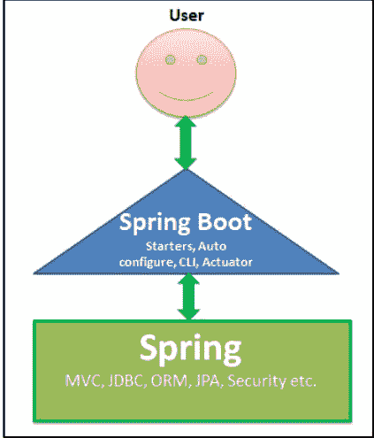

图 1.1：Spring Boot 框架表示

在上图中，你可以看到 Spring Boot 框架位于 Spring 框架之上，包含所有模块，如 Spring MVC、Security、JDBC、ORM、Batch、JPA 等。在内部，Spring Boot 使用 Spring 框架来提供 Spring 的核心功能，如 bean 创建、提供 bean 的作用域等。假设你想使用 Spring MVC 和 Spring Security 开发一个应用，那么你只需将这些模块的库添加到应用的类路径中。你不需要将 Spring MVC 和 Spring Security 的配置添加到你的应用中。Spring Boot 会根据应用类路径中可用的库，默认在你的应用中添加此配置是我们基于 Web 的配置。你仍然可以覆盖这些模块的默认配置。Spring Boot 从不强迫你使用默认配置。接下来，我们将在下一节讨论 Spring Boot 的关键组件。

## Spring Boot 的基本关键组件

Spring Boot 简化了 Spring 应用开发，这背后有一些神奇的组件。Spring Boot 的四个基本关键组件如下：

- Spring Boot Starters
- 自动配置（Auto-configuration）
- Spring Boot CLI
- Spring Boot Actuator

让我们详细讨论这些关键组件。

### Spring Boot Starters

Spring Boot 中的 Starters 类似于每个模块的小型 Spring 项目，包含所有必需的配置，如 Spring Web MVC、Spring JDBC、ORM、JPA、Security、Spring Batch 等。

根据 Spring Boot 文档，Starters 是一组方便的依赖描述符，你可以将其包含在你的应用中。你可以获得所有你需要的 Spring 及相关技术的一站式服务，而无需在示例代码中搜寻并复制粘贴大量依赖描述符。

在你的 Spring Boot 应用中，将相应模块的 starters 添加到你的应用类路径中，Spring Boot 将确保使用 Maven 或 Gradle 管理模块的所有依赖和传递依赖。

假设你想开发一个 REST Web 应用来暴露 RESTful Web 服务。对于这个 REST 应用，你需要通过使用 Maven 构建将 `spring-boot-starter-web` 依赖包含到你的项目中，将 Spring Web MVC 模块添加到你的 REST Web 应用中，如下面的代码所示：

```xml
<dependency>
    <groupId>org.springframework.boot</groupId>
    <artifactId>spring-boot-starter-web</artifactId>
</dependency>
```

你也可以使用 Gradle 构建将相同的 `spring-boot-starter-web` 依赖添加到你的项目中，如下 Stream 的代码所示：

```gradle
dependencies {
    implementation 'org.springframework.boot:spring-boot-starter-web'
    ...
}
```

上述用于 Spring Web MVC 模块的 Maven 和 Gradle 依赖配置解析以下传递依赖：

- spring-web-*.jar
- spring-webmvc-*.jar
- tomcat-*.jar
- jackson-databind-*.jar

同样，你可以通过包含这些模块的相应 starters 将其他模块添加到同一应用中，例如 ORM、Security、Spring Test、Spring Data JPA 等，如下所示：

- `spring-boot-starter-test`：用于编写单元测试和集成测试。
- `spring-boot-starter-security`：用于使用 Spring Security 进行身份验证和授权。
- `spring-boot-starter-data-jpa`：使用带有 Hibernate 的 Spring Data JPA。
- `spring-boot-starter-cache`：用于启用 Spring 框架的缓存支持。
- `spring-boot-starter-data-rest`：用于使用 Spring Data REST 暴露简单的 REST 服务。

Spring Boot 在 `org.springframework.boot` 组下的 Spring Boot 项目中提供了大量 starters。

Spring Boot 应用中 starters 的版本由 Maven 构建应用中的 Spring Boot starter parent POM 管理。POM 文件中的父级 starters 如下：

```xml
<parent>
    <groupId>org.springframework.boot</groupId>
    <artifactId>spring-boot-starter-parent</artifactId>
    <version>2.2.0.BUILD-SNAPSHOT</version>
</parent>
```

上述 Spring Boot Starter 父级 POM 管理项目中所有子模块的版本。此外，它还管理 Spring Boot 应用中的默认 Maven 构建插件。

让我们讨论 Spring Boot 框架的另一个神奇的关键组件。

### Spring Boot 自动配置

Spring Boot 自动配置是 Spring Boot 最基本的关键特性之一。当应用启动时，Spring Boot 会检测类路径中的库。Spring Boot 会自动在 Spring 应用上下文中配置 bean，以启用 Spring 的模块。

在上一节中，我们将 Spring Web MVC starter 添加到了我们的 Spring 应用中。在这种情况下，Spring Boot 会自动在 Spring 应用上下文中配置 bean 以启用 Spring MVC。它还会在 Spring 应用上下文中配置嵌入式 Tomcat 服务器。这意味着 Spring Boot 自动配置完成了所有与配置相关的工作，让你只需编写业务功能代码。

如果你忘记了某个特定模块的依赖，Spring Boot 无法配置该模块。

我们将在下一章"第 2 章：自定义自动配置"中讨论更多关于 Spring Boot 自动配置的内容。接下来，让我们在下一节中看看 Spring Boot 的另一个组件。

### Spring Boot CLI

Spring Boot 框架有一个命令行界面，用于使用 Spring Boot 提供的一些命令快速创建 Spring 应用。你可以使用 Groovy 脚本来创建非常快速的 Spring 应用，并且 Spring Boot CLI 允许你在 CLI 上运行 Groovy 脚本。Spring Boot 支持 Groovy 语言来创建 Spring 应用，与 Java 相比几乎零样板代码。

Spring Boot 文档说：

"你不需要使用 CLI 来使用 Spring Boot，但它绝对是让 Spring 应用启动起来的**最快方式**。"

Spring Boot CLI 可以从 Spring 框架的官方网站下载：

- https://repo.spring.io/snapshot/org/springframework/boot/spring-boot-cli/2.2.0.BUILD-SNAPSHOT/spring-boot-cli-2.2.0.BUILD-SNAPSHOT-bin.zip
- https://repo.spring.io/snapshot/org/springframework/boot/spring-boot-cli/2.2.0.BUILD-SNAPSHOT/spring-boot-cli-2.2.0.BUILD-SNAPSHOT-bin.tar.gz

使用 Spring Boot CLI 可以轻松地将 starters、依赖和自动配置添加到 Spring 应用中。Spring Boot CLI 让你只需专注于编写应用特定的代码。让我们看看以下 Groovy 脚本：

```groovy
@RestController
class HelloController {
    @GetMapping("/")
    String hello() {
        return "Hello World!!!"
    }
}
```

将上述 Groovy 文件保存为目录中的 `app.groovy`，你可以使用以下命令在 Spring Boot CLI 上运行此文件：


 ```
$ spring run app.groovy
```

上述的 Groovy 脚本不仅是一个简单的控制器类，它还是一个完整的应用程序，你可以运行该应用程序并通过 http://localhost:8080/ 访问。你可以在浏览器中看到输出的 Hello World。

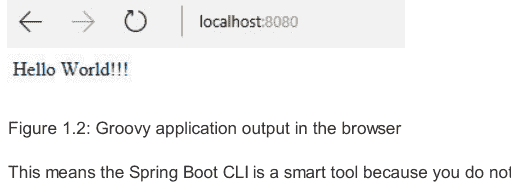

这意味着 Spring Boot CLI 是一个智能工具，因为你不需要在 Maven 的 pom.xml 或 Gradle 的 build.gradle 等构建文件中添加任何依赖。Groovy 脚本中也不需要任何 import 语句。

Spring Boot CLI 会检测以下内容：

- 根据应用程序中使用的类来确定依赖项和库。
- 根据应用程序中的类进行自动配置。

让我们继续探讨 Spring Boot 构建块的另一个关键组件。这就是 Spring Boot Actuator，它能让我们深入了解运行中的 Spring Boot 应用程序。

### Spring Boot Actuator

我们讨论了简化 Spring 开发的三个关键组件。但 Spring Boot 的最后一个关键组件是 Actuator。它提供了生产级别的功能。在生产环境中，你可以使用 Spring Boot Actuator 监控应用程序的健康状况、指标和其他监控功能。它提供 HTTP 端点，用于在生产期间监控你的 Spring 应用程序。

Actuator 提供了以下一些好处：

- Actuator 提供各种指标，如内存使用情况、Web 请求、垃圾回收和数据源使用情况。
- 它提供有关 Spring 应用程序上下文中配置的 Bean 的所有详细信息。
- 你可以通过 Actuator 获取有关 Spring Boot 自动配置的所有详细信息。
- 此外，你还可以获取其他配置，如环境变量、系统属性、配置属性和命令行参数。
- 它提供应用程序处理的最近 HTTP 请求的追踪记录。
- 它还提供有关 Spring Boot 应用程序中线程当前状态的信息。

我们讨论了 Spring Boot 的全部四个核心关键组件。这些组件共同作用，简化了 Spring 的开发。

让我们进入下一节，讨论基于 Spring Boot 2.2.0 的 Spring 应用程序的系统要求，并搭建 Spring Boot 工作空间。

## 系统要求和搭建工作空间

Spring Boot 2.2.0 最近发布了具有高级特性的框架，我们将在本章后面讨论。Spring Boot 2.2.0 的最低系统要求如下：

- Spring Boot 2.2.0 需要 Java 8，并兼容至 Java 11。
- 此 2.2.0 版本的 Spring Boot 使用的是 Spring 框架 5.1.4.RELEASE 版本。
- 它为以下构建工具提供构建支持：
- Spring Boot 2.2.0 为以下嵌入式 Servlet 容器提供支持：
- Spring Boot 2.2.0 应用程序对 Servlet 容器的最低要求是 Servlet 3.1+。

在你的机器上搭建 Spring Boot 之前，请使用以下命令确认你的 Java 版本：

```
$ java -version
```

你可以将 Spring Boot 用作经典的 Java 开发工具。Spring Boot 不需要特定的工具或库集成。你需要将 `spring-boot-*.jar` 文件包含在应用程序的类路径（classpath）中。你可以使用任何 IDE 进行 Spring Boot 开发（但我个人喜欢使用 Spring Tool Suite）。让我们看看为 Spring Boot 应用程序搭建工作空间的以下几种方式：

- 使用 Maven 安装 Spring Boot
- 使用 Gradle 安装 Spring Boot

现在，我们将详细探讨如何使用 Maven 和 Gradle 搭建 Spring Boot 应用程序。

## 使用 Maven 安装 Spring Boot

Spring Boot 2.2.0 兼容 Maven 3.3+。如果你的机器上没有安装，请进行安装。你可以在 https://maven.apache.org/ 找到安装指南。同时，请确保你的 Java 版本为 8+，可以在 https://www.oracle.com/technetwork/java/javase/downloads/index.html 找到。

Spring Boot 使用 groupId 为 `org.springframework.boot` 的 Maven 依赖，你的 Maven 配置文件 POM 通过 artifactId 为 `spring-boot-starter-parent` 的父项目继承 Spring 依赖版本管理和 Maven 插件，从而创建可执行的 JAR 包。让我们看看以下 Maven 依赖 pom.xml 文件：

```xml
<?xml version="1.0" encoding="UTF-8"?>
<project xmlns="http://maven.apache.org/POM/4.0.0"
         xmlns:xsi="http://www.w3.org/2001/XMLSchema-instance"
         xsi:schemaLocation="http://maven.apache.org/POM/4.0.0 http://maven.apache.org/xsd/maven-4.0.0.xsd">
    <modelVersion>4.0.0</modelVersion>

    <parent>
        <groupId>org.springframework.boot</groupId>
        <artifactId>spring-boot-starter-parent</artifactId>
        <version>2.2.0.RELEASE</version>
        <relativePath/>
    </parent>
    <groupId>com.dineshonjava</groupId>
    <artifactId>myproject</artifactId>
    <version>0.0.1-SNAPSHOT</version>
    <packaging>jar</packaging>
    <name>myproject</name>
    <description>Demo project for Spring Boot</description>

    <properties>
        <java.version>1.8</java.version>
    </properties>

    <dependencies>
        <dependency>
            <groupId>org.springframework.boot</groupId>
            <artifactId>spring-boot-starter-web</artifactId>
        </dependency>
    </dependencies>
</project>
```

| 元素 | 描述 |
|---------|-------------|
| org.springframework.boot | spring-boot-starter-test |
| | test |
| org.springframework.boot | spring-boot-maven-plugin |

上述 pom.xml 文件是包含 Spring MVC Web 模块的 Spring Boot 2.2 应用程序的最基本要求。让我们讨论另一种 Spring Boot 安装方式，即为 Spring Boot 应用程序进行 Gradle 设置。

## 使用 Gradle 安装

Spring Boot 2.2.0 兼容 Gradle 4.4+。如果你的机器上没有安装，请进行安装。你可以在 https://gradle.org/ 找到安装指南。但无论是使用 Maven 还是 Gradle 安装，都需要 Java 8+。现在让我们看看 groupId 为 `org.springframework.boot` 的 Spring Boot 依赖项：

```groovy
buildscript {

    ext {

        springBootVersion = '2.2.0.RELEASE'

    }

    repositories {

        mavenCentral()

    }

    dependencies {

        classpath("org.springframework.boot:spring-boot-gradle-plugin:${springBootVersion}")

    }

}

apply plugin: 'java'

apply plugin: 'org.springframework.boot'

apply plugin: 'io.spring.dependency-management'
```

```groovy
group = 'com.dineshonjava'

version = '0.0.1-SNAPSHOT'

sourceCompatibility = '1.8'

repositories {

    mavenCentral()

}

dependencies {

    implementation 'org.springframework.boot:spring-boot-starter-web'

    testImplementation 'org.springframework.boot:spring-boot-starter-test'

}
```

上述 build.gradle 文件是包含 Spring MVC Web 模块的 Spring Boot 2.2 应用程序的最基本要求。在通过 Maven 或 Gradle 搭建好 Spring Boot 工作空间后，让我们在下一节创建一个 Spring Boot 应用程序，并看看如何使用 Spring Boot Initializr 设置项目结构。

## 创建 Spring Boot 应用程序

在本节中，我们将利用 Spring Boot 的一些关键特性创建一个简单的 Hello World REST Web 应用程序。在这个 REST 应用程序中，我们将创建一个简单的 REST 服务，在收到请求时返回 Hello World 消息。我们将使用 Maven 来构建此项目。

让我们为这个简单示例创建一个项目。Spring Boot 允许我们使用 Spring Boot Initializr 来创建 Spring Boot 应用程序的项目结构。Spring Boot Initializr 为所有与搭建工作相关的问题提供了解决方案，并能创建一个更传统的 Java 项目结构。

你可以使用 Spring Initializr 来创建 Spring 项目的骨架结构。它既是一个基于浏览器的 Web 应用程序，也是一个 REST API。你可以通过以下方式使用它：

- 通过 Web 界面使用 Spring Initializr：https://start.spring.io/ 。
- 通过命令行使用 `curl` 命令使用 Spring Initializr。
- 通过 Spring Boot 命令行界面使用 Spring Initializr。
- 通过在 Spring Tool Suite 中创建新项目来使用 Spring Initializr。
- 通过在 IntelliJ IDEA 中创建新项目来使用 Spring Initializr。
- 通过在 NetBeans 中创建新项目来使用 Spring Initializr。

我们已经看到了使用 Spring Initializr 创建 Spring Boot 应用程序骨架的几种方法，但在本章中，我们不会逐一讨论所有方法。我最喜欢的 IDE 是 Spring Tool Suite (STS)；我将在本书的所有章节中使用它。让我们从使用 Web 界面 https://start.spring.io/ 的 Spring Initializr 开始。

## 通过 Web 界面初始化 Spring 项目

由 Spring 团队托管在 https://start.spring.io/ 的 Web 应用程序可用于创建 Spring Boot 应用程序。这是使用 Spring Initializr 最简单的方法之一。你可以从 Maven 或 Gradle 中选择项目构建工具。此外，它还提供了 Java、Kotlin 和 Groovy 语言的选择选项。最后，我们可以选择 Spring Boot 的版本。

让我们看看主页外观的以下截图：


SPRING INITIALIZR 立即引导您的应用程序

使用 [Java] 和 Spring Boot [2.2.0 (SNAPSHOT)] 生成一个 [Maven 项目]

## 项目元数据 (Project Metadata)

## 依赖项 (Dependencies)

构件坐标 (Artifact coordinates)

为您的应用程序添加 Spring Boot Starters 和依赖项

组 (Group)
[com.dineshonjava.prodos]

搜索依赖项
[web]

构件 (Artifact)
[prodos]

- **Web**: 使用 Tomcat 和 Spring MVC 进行全栈 Web 开发
- **Reactive Web**: 使用 Netty 和 Spring WebFlux 进行响应式 Web 开发
- **Rest Repositories**: 通过 spring-data-rest-web 将 Spring Data 存储库公开为 REST 服务
- **Validation**: JSR-303 验证基础架构（已包含在 web 中）
- **Rest Repositories HAL Browser**

[生成项目]

不知道该寻找什么？想要更多选项？请切换到完整版本。

start.spring.io 由 Spring Initializr 和 Pivotal Web Services 提供支持

图 1.3：Spring Initializr Web 界面

在之前的截图中，有许多可供选择的选项来创建 Spring Boot 应用程序，具体如下：

项目构建工具，Maven 和 Gradle

编程语言（目前支持的语言有 Java、Kotlin 和 Groovy）

Spring Boot 版本

在左侧是项目元数据（Project Metadata）部分。您可以提供项目元数据，如组 ID (group ID)、构件 ID (artifact ID)、打包方式 (packaging)、Java 版本等等。

在右侧是应用程序依赖项（Dependencies）部分；您可以在此处选择依赖项。

让我们为 Spring Web MVC 选择依赖项。只需输入 web 并选择，然后点击“生成项目 (Generate Project)”按钮。它将创建一个 Spring Boot 应用程序项目的骨架。

## 使用 STS IDE 初始化 Spring 项目

Spring Tool Suite (STS) 是我最喜欢的 Java 开发 IDE 之一。它在许多 Java 开发人员中也非常受欢迎，并被用于创建基于 Spring 的应用程序。您可以从 http://spring.io/tools/ 安装它。

让我们通过以下截图查看菜单结构：

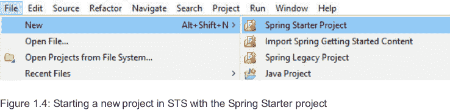

图 1.4：在 STS 中使用 Spring Starter 项目启动新项目

选择 Spring Starter Project 后，会出现一个新窗口，如下图所示：

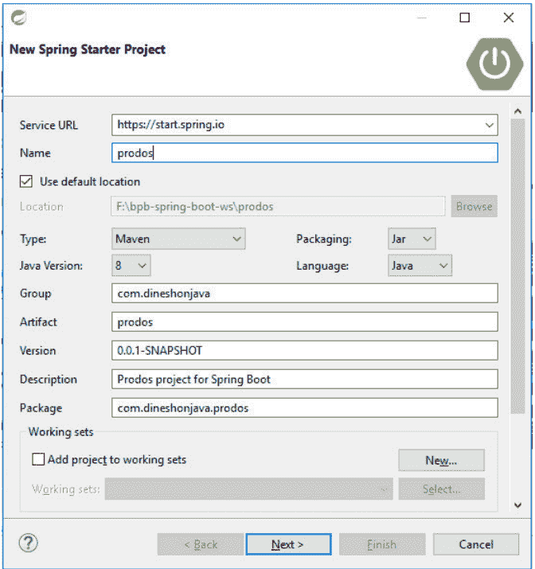

图 1.5：指定项目信息

如前一张截图所示，第一页要求您填写项目信息，例如项目名称、项目构建工具、打包方式、语言、组、构件以及其他基本信息，然后点击“下一步 (Next)”。

在向导的下一页中，您可以选择要添加到 Spring 项目的 Maven 依赖项，如下图所示：

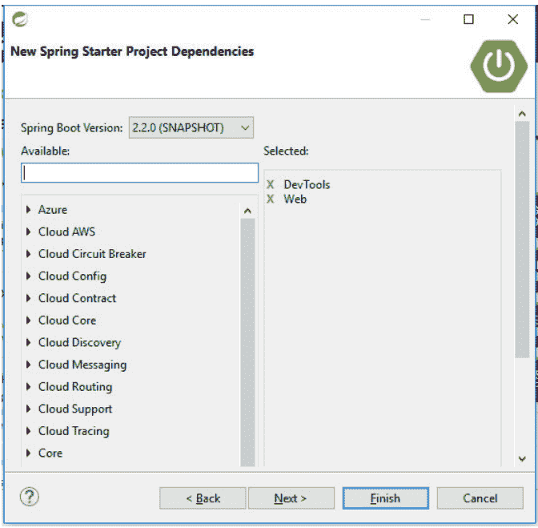

图 1.6：选择 starter 依赖项

让我们根据您的应用程序架构选择 Spring Boot 版本。在我们的案例中，我们选择了 Spring Boot 2.2.0 版本。在选择 Spring Boot 版本后，让我们检查应用程序所需的项目依赖项。对于 Prodos 应用程序，目前我选择了 web starter。

再次点击“下一步 (Next)”按钮。向导中会出现另一个对话框，如下图所示：

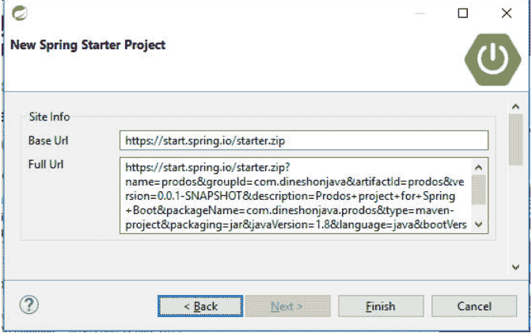

图 1.7：使用 Spring Initializr 启动项目

在下一个屏幕中，您可以看到项目向导在调用 http://start.spring.io 的 Spring Initializr 来创建项目。因此，让我们点击“完成 (Finish)”按钮。

点击“完成”按钮后，您的项目将从 Spring Initializr 下载并加载到您定义的工作空间中。起初，由于需要加载项目依赖项，最后一步会花费一些时间。在项目中加载所有必要的依赖项后，您就可以开始编写业务逻辑代码了。但首先，请看一眼在 STS 中导入的项目结构，如下图所示：

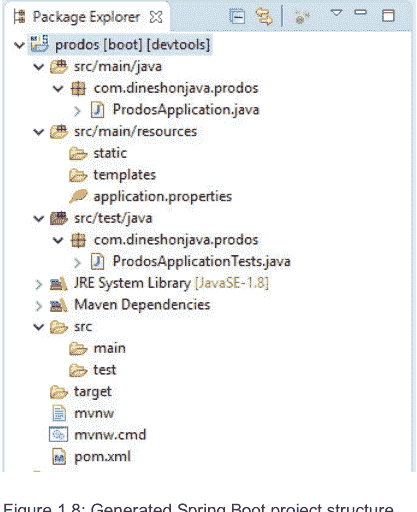

图 1.8：生成的 Spring Boot 项目结构

Spring Initializr 的 Web 界面也可以将相同的项目结构创建为 ZIP 文件。您需要将其解压到所需的工作空间中，并将其作为 Maven 项目导入到 STS IDE 中。

在上述 Spring Boot 应用程序项目结构的截图中，生成了一些文件和目录。这些文件根据 Maven 或 Gradle 构建工具被放置在特定的目录下。应用程序源代码位于 `/src/main/java`，测试代码文件位于 `src/test/java`，其他非 Java 文件位于 `src/main/resources`。以下文件是自动生成的：

- **pom.xml**: 这是 Maven 的构建工具文件，用于构建规范。
- **mvnw 和 mvnw.cmd**: 这些是 Maven 的包装器 (wrapper) 脚本文件，即使您的机器上没有安装 Maven 构建工具，您也可以使用这些脚本文件来构建 Spring Boot 项目。
- **ProdosApplication.java**: 该文件引导您的 Spring Boot 项目。它是 Spring Boot 应用程序的主应用程序文件（包含 `main()` 方法的类）。
- **application.properties**: 这是一个空的配置文件。您可以根据需要指定配置属性。
- **static**: 这是一个空文件夹。您可以放置任何静态内容，如图像、样式表、JavaScript 等。这些内容将提供给浏览器。
- **templates**: 此文件夹用于放置将用作 UI 并在浏览器上渲染内容的模板文件。
- **ProdosApplicationTests.java**: 这是一个空的 JUnit 测试类文件，用于确保 Spring 应用程序上下文成功加载。但您可以编写更多的 JUnit 测试用例。

让我们进一步深入探讨由 Spring Initializr 生成的文件。

## Spring Boot 应用程序启动文件

Spring Initializr 创建主应用程序类文件作为应用程序引导文件，用以启动 Spring Boot 应用程序。让我们看看该文件的以下代码：

```
package com.dineshonjava.prodos;

import org.springframework.boot.SpringApplication;
import org.springframework.boot.autoconfigure.SpringBootApplication;

@SpringBootApplication
public class ProdosApplication {

    public static void main(String[] args) {
        SpringApplication.run(ProdosApplication.class, args);
    }

}
```

在上述应用程序类文件中，只有几行代码，但这些代码具备 Spring Boot 非常强大的功能。让我们详细讨论一下：

**@SpringBootApplication**: 应用程序的主类使用了这个注解。当应用程序启动时，该注解会递归扫描此包内部的 Spring 组件并对其进行注册。`@SpringBootApplication` 注解还启用了 Spring Boot 的自动配置。自动配置是一个根据类路径设置、属性设置和其他因素自动创建 Bean 的过程。`@SpringBootApplication` 不是一个简单的注解，而是一个复合应用注解。它结合了以下三个注解：

- **@SpringBootConfiguration**: 该注解表明此类是 Spring 应用程序中的一个配置类。您也可以根据要求为此类添加其他配置文件。该注解是 `@Configuration` 注解的一种特定形式。
- **@EnableAutoConfiguration**: 该注解在 Spring Boot 应用程序中启用 Spring Boot 自动配置。它根据类路径设置自动加载所有相关的配置文件。
- **@ComponentScan**: 该注解在 Spring 应用程序中启用组件扫描。您可以使用 `@Component`、`@Controller`、`@Service` 和其他刻板注解 (stereotype annotations) 将一个类转换为 Spring 中的组件。组件类由 Spring 应用程序上下文自动发现。

**main()**: 这是主应用程序类文件中 `main()` 方法的另一个强大代码片段。当执行 JAR 文件时，此方法将被运行。

**SpringApplication.run()**: 此方法由 `main()` 方法调用。该方法存在于 `SpringApplication` 类中；它负责创建 Spring 应用程序上下文。此方法有两个参数：一个配置类和命令行参数。

我们讨论了主应用程序文件；在应用程序中不需要对其进行更改。某些应用程序具有多个引导类。在这种情况下，最好创建单独的配置文件，特别是对于非自动配置的文件。

让我们深入研究另一个文件，即测试文件。

## 测试应用程序文件

众所周知，测试是软件开发中最重要的部分之一。Spring Initializr 为您的 Spring 应用程序创建了一个简单的测试文件：

```
import org.junit.Test;
import org.junit.runner.RunWith;
import org.springframework.boot.test.context.SpringBootTest;
import org.springframework.test.context.junit4.SpringRunner;

@RunWith(SpringRunner.class)
@SpringBootTest
public class ProdosApplicationTests {

    @Test
    public void contextLoads() {
    }

}
```

这是 Spring Boot 应用程序中默认生成的测试类文件。这个类几乎是空的；它仅用于测试 Spring 是否...

应用程序上下文是否成功加载。在此类中，你可以为应用程序功能添加自己的测试用例：

- @RunWith(SpringRunner.class)：此注解用于标注主应用程序测试类。@RunWith注解并非Spring注解，而是一个JUnit注解。但它需要一个运行器类来指导JUnit运行测试。
- SpringRunner：这是一个由Spring提供的测试运行器。它负责创建测试将要运行的Spring应用程序上下文。
- @SpringBootTest：此注解也用于应用程序测试类。该注解告知JUnit使用Spring Boot的特性（如自动配置、Bean创建等）来引导测试。

SpringRunner是SpringJUnit4ClassRunner的别名，于Spring 4.3中引入，旨在消除与特定JUnit版本（例如JUnit 4）的关联。

至此，我们已经了解了Spring Initializr提供的所有代码。你也可以看到由Spring Initializr生成的构建文件，如下所示。

## 构建规范文件

此文件根据所选的构建工具生成。我为这个应用选择了Maven作为构建工具。这就是为什么会创建pom.xml文件，其中包含了所有选定的starter依赖和Spring Boot Maven插件：

```xml
 xsi:schemaLocation=" http://maven.apache.org/POM/4.0.0 http://maven.apache.org/xsd/maven-4.0.0.xsd ">

4.0.0

org.springframework.boot
spring-boot-starter-parent
2.2.0.RELEASE

com.dineshonjava
prodos
0.0.1-SNAPSHOT
prodos
Prodos project for Spring Boot
1.8

org.springframework.boot
spring-boot-starter-web

org.springframework.boot
spring-boot-devtools
runtime

org.springframework.boot
spring-boot-starter-test
test

org.springframework.boot
spring-boot-maven-plugin
```

前面的Maven配置文件包含了starter依赖和Spring Boot插件。starter依赖解决了与该模块相关的所有传递依赖。starter依赖提供了以下好处：

- 它非常简单且易于管理，因为你无需管理模块的所有相关库。
- 你无需关心库的版本。你可以依赖Spring Boot父依赖提供的版本。
- 每个starter依赖都表示它提供的功能，因此你无需关心特定功能中使用的各个库的列表。

使用Spring Boot的starter依赖还有更多好处。让我们来看一些关于Spring Boot插件的重要点：

- 此插件为你的项目提供Maven目标。Maven目标用于使用Maven运行你的项目。
- 此插件还确保所有相关的类路径库都被包含在可执行JAR文件中。
- 此插件还在JAR文件中创建清单文件，以提供关于可执行JAR文件内主类文件的信息。

我们讨论了pom.xml文件，也讨论了主应用程序类文件或应用程序测试类文件的默认生成代码。现在，让我们根据你的业务需求为你的应用程序创建一个控制器类文件，但这只是一个非常简单的REST应用程序，因此我们将创建一个简单的控制器类来显示Hello World消息。

## 实现REST控制器

在这里，我们将创建一个简单的应用程序文件，即一个REST控制器文件。我们知道Spring MVC是Spring框架的关键模块之一，而控制器是Spring MVC的核心。控制器本质上就是一个处理请求并响应某些信息的类。

在我们的例子中，我创建了一个REST控制器类，其中包含一个请求处理方法，如下所示的代码：

```java
package com.dineshonjava.prods;

import org.springframework.web.bind.annotation.GetMapping;
import org.springframework.web.bind.annotation.RestController;

/**
 * @author Dinesh.Rajput
 * 
 */
@RestController
public class HomeController {
    
    @GetMapping("/")
    String home(){
        
        return "Hello World!!!";
        
    }
    
}
```

前面的RestController（HomeController）目前只有一小部分代码。让我们来讨论一下这个小型控制器文件的一些细节：

- @RestController：此注解表明这是一个REST控制器类，其结果写入响应体，而不渲染视图。
- @GetMapping：此注解表明这是一个请求处理方法，它是@RequestMapping(method = RequestMethod.GET)的简写注解。
- home()：此方法返回一条问候消息。

我们需要查看HomeController类及其home()请求处理方法。让我们来看一下这个控制器的测试类。

## 为控制器编写测试

我们已经编写了一个REST控制器来处理请求并返回"Hello World"作为响应消息。现在，你几乎已经准备好运行你的第一个Spring Boot应用程序并查看输出了。但首先，让我们编写另一个文件，即控制器的测试文件，如下所示的代码：

```java
package com.dineshonjava.prodos;

import static org.hamcrest.Matchers.containsString;
import static org.springframework.test.web.servlet.request.MockMvcRequestBuilders.get;
import static org.springframework.test.web.servlet.result.MockMvcResultMatchers.content;
import static org.springframework.test.web.servlet.result.MockMvcResultMatchers.status;

import org.junit.Test;
import org.junit.runner.RunWith;
import org.springframework.beans.factory.annotation.Autowired;
import org.springframework.boot.test.autoconfigure.web.servlet.WebMvcTest;
import org.springframework.test.context.junit4.SpringRunner;
import org.springframework.test.web.servlet.MockMvc;

/**
 * @author Dinesh.Rajput
 *
 */
@RunWith(SpringRunner.class)
@WebMvcTest(HomeController.class)
public class HomeControllerTest {

    @Autowired
    private MockMvc mockMvc;

    @Test
    public void testHome() throws Exception {

        mockMvc.perform(get("/"))
            .andExpect(status().isOk())
            .andExpect(content().string(
                containsString("Hello World")));

    }
}
```

前面的HomeControllerTest类是HomeController控制器的测试类。与ProdosApplicationTests类相比，此类在注解等配置方面略有不同。在这个测试文件中，我们使用@WebMvcTest注解而不是@SpringBootTest。让我们来看看使用的组件，如下所示：

- @WebMvcTest：此注解是一个特殊的测试注解，用于测试Spring MVC流程。它启用服务器并模拟Spring MVC的机制。此注解还会在Spring MVC中注册关联的控制器，以便你可以使用该控制器来处理针对它的请求。在我们的例子中，我们已在Spring MVC中注册了HomeController，以便你可以向它发送请求。
- MockMvc：此类被注入到测试控制器类中，并为测试提供一个MockMvc对象来驱动模拟。
- testHome()：此类定义了你想针对控制器类的testHome()方法执行的测试用例。该方法从MockMvc对象开始，对映射（/）执行HTTP GET请求。让我们来看一下此请求的预期结果：
    - 服务器必须以HTTP状态200（OK）进行响应。
    - 返回的响应消息应包含文本"Hello World"。

你可以将此测试类作为JUnit测试运行。如果MockMvc对象执行请求达到了那些预期，并且所有预期都满足，则测试通过。如果预期未满足，则测试失败：

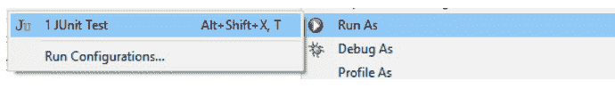

如果一切正常，编写的测试应该会通过。它会显示一个绿色的条，表示测试通过，如下图所示：

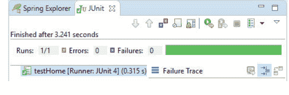
图1.10：JUnit测试控制台输出

如你可以在前面的截图中看到，测试已成功通过。在为Prodos应用程序的HomeController编写测试用例并验证测试用例之后，如果一切顺利，那么让我们运行你的应用程序，使用浏览器或任何REST客户端测试实际数据。

让我们在STS IDE中运行你的Spring Boot应用程序，将其作为带有嵌入式服务器的Spring Boot应用程序运行，方法是从运行菜单中选择"运行方式" | "Spring Boot App"，如下所示：

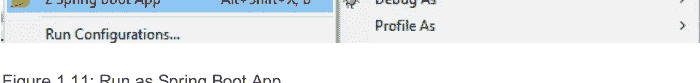
图1.11：作为Spring Boot App运行

让我们运行你的Spring Boot应用程序，并在控制台中观察日志，如下所示：

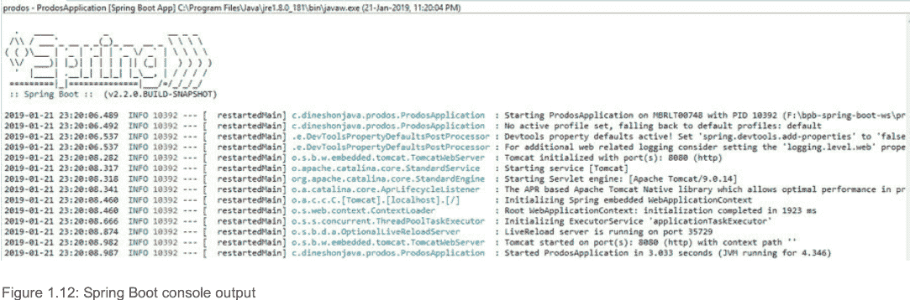
图1.12：Spring Boot控制台输出

我们知道我们已经使用了spring-boot-starter-parent POM。它提供了一个有用的`run`目标，你可以使用以下Maven命令来启动Spring Boot应用程序：

```bash
mvn spring-boot:run
```

你可以运行前面的命令，并在控制台屏幕上看到以下输出：


图 1.13：Maven run 命令的控制台输出

在之前的控制台日志中，你可以看到以下内容：

日志顶部带有 Spring Boot 版本的 Spring Boot banner。

你可以通过添加 `banner.txt` 或 `banner.png` 并将其放入 `src/main/resources/` 文件夹来自定义 Spring Boot banner。

默认情况下，我们的应用程序运行在端口 8080 的内嵌 Tomcat 服务器上。

但你可以通过使用以下命令在 `application.properties` 文件中添加 `server.port` 属性来自定义服务器端口：

```
server.port=8181
```

让我们在系统浏览器中验证一下，其外观如下：


图 1.14：浏览器中 Spring Boot 应用程序的输出

上述截图显示了由 Spring Boot 应用程序的 Rest 控制器响应的 “Hello World” 消息。

## Spring Boot DevTools 介绍

在 POM 文件中，我添加了一个特定的 Maven 依赖，如下所示：

```
org.springframework.boot

spring-boot-devtools

runtime
```

上述 Maven 依赖将 Spring Boot DevTools 添加到你的应用程序中。顾名思义，DevTools 为 Spring 开发者提供了一些便捷的开发工具。这些工具包括：

- 如果你对代码进行了任何更改，它会自动重启你的应用程序。

- 如果你对浏览器相关资源（如模板、JavaScript、CSS 等）进行了任何更改，它会自动刷新浏览器以检测新更改。

- 它在开发环境中自动禁用模板缓存。

- 如果你在应用程序中使用 H2 数据库，它还为 H2 数据库提供 H2 控制台。

Spring Boot DevTools 非常智能；当你使用生产环境设置部署应用程序时，它会自动禁用。它仅在开发环境下启用。它适用于所有 IDE，如 Spring Tool Suite、IntelliJ IDEA 等。

## 结论

在本章中，我们讨论了 Spring Boot 及其核心关键组件。我们看到了四个关键组件：Spring Boot 自动配置、Spring Boot starters、Spring Boot CLI 和 Spring Boot Actuator。

我们学习了 Spring Boot 如何利用自动配置和 starters 使 Spring 开发变得简单。此外，Spring Boot 还通过 Actuator 提供生产后监控和应用分级。

我们使用了 Spring Initializr 通过 Web 界面和 STS IDE 创建了 Spring Boot 应用程序。我们还使用基于 Web 的 Spring Initializr 和 Spring Tool Suite IDE 创建了一个非常简单的 Hello World REST 应用程序，并运行该应用程序（使用了内嵌的 Tomcat 容器）。

在接下来的第 2 章：自定义自动配置中，我们将讨论如何将 Spring Boot 自动配置外部化。

## 问题

- 什么是 Spring Boot？

- Spring Boot 提供了什么？

- Spring Boot 的关键组件有哪些？

- 什么是 starter？

- Spring Boot 中的自动配置是什么？

- 什么是 Spring Boot CLI？

- 什么是 Spring Boot Actuator？

- 什么是 Spring Boot DevTools？

## 第 2 章

# 自定义自动配置

在上一章中，我们讨论了 Spring Boot 的四个核心关键组件，而自动配置就是其中之一。自动配置组件使 Spring Boot 成为一个智能框架。自动配置是一个强大的特性，它简化了 Spring 应用程序的开发。在本章中，你将对 Spring Boot 自动配置有一个概览，包括自动配置的自定义。你还将了解到关于 profile（配置文件）的概览。

Spring Boot 提供了多种设置配置属性的方式，例如 JVM 系统属性、命令行参数和环境变量。在本章中，我们将采用配置属性来微调 Spring Boot 默认提供的自动配置。

在本章中，我们将涵盖以下主题：

- 理解自动配置
  - 启用自动配置
  - 禁用自动配置

- Spring Boot 自动配置是如何工作的？
  - 自动配置类

- 自动配置外部化
  - 覆盖属性的评估顺序
  - 自定义 `application.properties` 文件的名称
  - 使用属性文件进行应用程序配置
  - 使用 YAML 文件进行应用程序配置
  - 多 profile YAML 文档

- 创建你自己的配置属性
  - 在应用程序中定义你自己的配置属性
  - 声明配置属性及其元数据

- Profile（配置文件）
  - 使用 profile 条件性地创建 bean
  - 激活 profile
  - 特定于 profile 的应用程序配置属性文件

## 理解自动配置

在 Spring 框架中，如果你需要在 Spring 应用程序中配置 Spring Data JPA，那么你需要配置应用程序中的多个 bean，例如 `DataSource`、`JpaVendorAdapter`、`LocalContainerEntityManagerFactoryBean` 等。要在 Spring 应用程序中使其正常工作需要花费大量时间。让我们看看以下 Spring Data JPA 的配置：

```
@Configuration
public class InfrastructureConfig {

    //Configuring beans like DataSource, LocalContainerEntityManagerFactoryBean, etc.

    @Bean
    public DataSource dataSource(){
        EmbeddedDatabaseBuilder builder = new EmbeddedDatabaseBuilder()
                .setType(EmbeddedDatabaseType.H2);//in-memory
        builder.addScript("schema.sql");
        builder.addScript("data.sql");
        return builder.build();
    }

    @Bean
    publicIFFICIENT JpaVendorAdapter jpaVendorAdapter() {
        HibernateJpaVendorAdapter bean = new HibernateJpaVendorAdapter();
        bean.setDatabase(org.springframework.orm.jpa.vendor.Database.H2);
        bean.setGenerateDdl(true);
        return bean;
    }
}
```

```
@Bean
public LocalContainerEntityManagerFactoryBean entityManagerFactory(
    DataSource dataSource, JpaVendorAdapter jpaVendorAdapter) {
    LocalContainerEntityManagerFactoryBean bean = new
LocalContainerEntityManagerFactoryBean();
    bean.setDataSource(dataSource);
    bean.setJpaVendorAdapter(jpaVendorAdapter);
    bean.setPackagesToScan("com.doj.springapp.model");
    return bean;
}
}
```

上述代码片段是针对 Spring Data JPA 模块的。此配置仅针对一个 Spring Data JPA 模块。但任何企业级应用程序可能包含许多模块，如 Spring MVC、Spring Security、HSQLDB 等。在这种情况下，在 Spring 应用程序中管理这些模块的配置会非常繁琐。Spring Boot 推出了自动配置特性，以降低 Spring 应用程序中配置的复杂度，同时也减少了大量的样板代码。

自动配置是 Spring Boot 非常重要的特性；没有它，Spring Boot 就失去了意义。自动配置根据应用程序类路径（classpath）中可用的 starters JAR 依赖项，自动配置你的 Spring 应用程序。例如，如果 Spring Data JPA 在你的 Spring 应用程序类路径中，那么你无需在应用程序中手动配置它。Spring Boot 会自动配置 Spring Data JPA 及其相关 bean，如 `DataSource`、`JpaVendorAdapter` 和 `LocalContainerEntityManagerFactoryBean` 等。这意味着你不需要为 Spring Data JPA 编写上述配置代码。让我们看看 Spring Boot 自动配置是如何工作的，以及如何启用和禁用它。

## 启用 Spring Boot 自动配置

在 Spring 应用程序中启用 Spring Boot 自动配置没有特殊要求。你可以通过在其中一个 `@Configuration` 类中添加 `@EnableAutoConfiguration` 或 `@SpringBootApplication` 注解来获得自动配置。单个 `@SpringBootApplication` 注解在应用程序类中包含了自动配置、组件扫描（component scan）和额外配置。这意味着 `@SpringBootApplication` 注解等同于带有默认属性的三个注解：`@Configuration`、`@EnableAutoConfiguration` 和 `@ComponentScan`。请看下图：

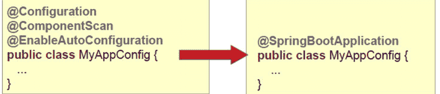

图 2.1：启用自动配置

Spring Boot 并不强制要求你在应用程序中使用自动配置。它是完全非侵入性的。你可以为任何模块定义自己的配置，并用自定义配置替换自动配置。假设你想使用自己的 `DataSource` 配置，你可以为其定义配置。那么内嵌数据库支持的默认配置会自动退避。让我们看看如何在 Spring Boot 应用程序中禁用部分自动配置。

## 禁用 Spring Boot 自动配置

有时你会发现特定的自动配置不适合你的应用程序，或者你不想应用某些自动配置类。Spring Boot 允许你使用 `@SpringBootApplication` 和 `@EnableAutoConfiguration` 的 `exclude` 属性将此类自动配置类从你的 Spring 应用程序中排除，如下例所示：


## Spring Boot 自动配置是如何工作的？

Spring Boot 自动配置是一个神奇而智能的特性。它能从你的 Spring 应用中减少大量样板代码。但有时你可能会对幕后发生的事情感到困惑。在本节中，我们将讨论并理解 Spring Boot 自动配置背后的魔法。

Spring Boot 为 Spring 框架的每个模块都准备了多个预编写的 @Configuration 类。这些预编写的自动配置类将根据你的 Spring 应用的类路径内容以及你在 Spring 应用中设置的任何属性来决定是否可用。Spring Boot 利用 Spring 的 @Conditional 注解特性来创造 Spring Boot 自动配置的魔法。

@Profile 注解是 Spring 框架中 @Conditional 注解的一个特定用例。Spring Boot 将同样的理念提升到更高层次，并提供了自动配置功能。这意味着 @Conditional 注解配置在自动配置中被广泛使用，从而实现了 Spring Boot。在本节中，让我们讨论 Spring Boot 自动配置是如何工作的。

## 自动配置类

自动配置类与任何常规的 Spring @Configuration 类相似。但自动配置类 enriched with the @Conditional annotations（丰富了 @Conditional 注解）。此条件注解决定了在某些情况下自动配置是否作为 bean 激活。

众所周知，Spring Boot 支持基于 Java 的配置。尽管 Spring Boot 也支持将 SpringApplication 类与 XML 源一起使用，但我建议你使用基于 Java 的配置以确保强类型安全，同时建议主要源必须是一个单独的 @Configuration 类。如果有多个配置类，你可以使用 @Import 注解来导入额外的配置类。我不推荐使用 XML 配置文件进行额外配置，但如果你仍然想使用基于 XML 的配置，那么可以使用 @ImportResource 注解来加载 XML 配置文件：

```java
package com.dineshonjava.prodos.config;

import org.springframework.context.annotation.Configuration;
import org.springframework.context.annotation.Import;
import org.springframework.context.annotation.ImportResource;

/**
 * @author Dinesh.Rajput
 */
@Configuration
@Import({InfrastructureConfig.class, SecurityConfig.class})
@ImportResource({"spring.xml"})
public class AppConfig {

    //...

}
```

我们了解了如何创建配置类。现在让我们看看这些配置类在 Spring Boot 应用中是如何工作的。例如，Spring 框架本身提供了自动配置类 JdbcTemplateAutoConfiguration，如下代码所示：

```java
@Configuration
@ConditionalOnClass({ DataSource.class, JdbcTemplate.class })
@ConditionalOnSingleCandidate(DataSource.class)
@AutoConfigureAfter(DataSourceAutoConfiguration.class)
public class JdbcTemplateAutoConfiguration {
    private final DataSource dataSource;
    public JdbcTemplateAutoConfiguration(DataSource dataSource) {
        this.dataSource = dataSource;
    }
    @Bean
    @Primary
    @ConditionalOnMissingBean(JdbcOperations.class)
    public JdbcTemplate jdbcTemplate() {
        return new JdbcTemplate(this.dataSource);
    }
    @Bean
    @Primary
    @ConditionalOnMissingBean(NamedParameterJdbcOperations.class)
    public NamedParameterJdbcTemplate namedParameterJdbcTemplate() {
        return new NamedParameterJdbcTemplate(this.dataSource);
    }
    //More beans definitions
}
```

这里，JdbcTemplateAutoConfiguration 被注解为 @ConditionalOnClass({ DataSource.class, JdbcTemplate.class })，这意味着只有在其类路径上存在 DataSource.class 和 JdbcTemplate.class 时，才会考虑 JdbcTemplateAutoConfiguration 内部的 bean 自动配置。

如你所见，@Conditional 注解也可以在 bean 定义级别使用。@ConditionalOnMissingBean 注解可用于在缺少所需 bean 类型或名称时注册新组件。@ConditionalOnProperty 注解可用于基于某些属性定义的存在来创建 bean。开箱即用的 Spring Boot 提供了以下条件注解：

- @ConditionalOnClass
- @ConditionalOnMissingBean
- @ConditionalOnBean
- @ConditionalOnJava
- @ConditionalOnJndi
- @ConditionalOnMissingClass
- @ConditionalOnExpression
- @ConditionalOnNotWebApplication
- @ConditionalOnWebApplication
- @ConditionalOnProperty
- @ConditionalOnResource
- @ConditionalOnSingleCandidate

上述大多数条件注解都是一目了然的。你可以从 Spring Boot 文档中找到这些注解的更多详细信息。如果这些注解对你的 Spring 应用来说还不够，你可以使用 SpringBootCondition 类创建自定义条件，并在你的 Spring 应用中使用这个自定义条件类与 @Conditional 注解。

Spring Boot 允许覆盖自动配置。在下一节中，我们将讨论如何在你的 Spring 应用中外部化 Spring Boot 自动配置。

## 外部化自动配置

Spring Boot 拥有大量属性，用于根据你的应用需求微调自动配置。有关这些属性的更多详细信息，请访问 https://docs.spring.io/spring-boot/docs/2.2.0.BUILD-SNAPSHOT/reference/htmlsingle/#common-application-properties。你可以使用这些属性通过多种属性源来设置你的 Spring 应用，例如：

- JVM 系统属性
- 操作系统环境变量
- 命令行参数
- 应用属性文件
- 应用 YAML 文件

你可以自由选择任何属性源来定义你的属性值。Spring 聚合来自所有属性源的属性，并提供单一来源，即 Spring 环境抽象。定义的属性值可以直接使用 @Value 注解注入到你的应用 bean 中。这些属性可以通过 Spring Environment 抽象来访问。让我们看看下图以详细了解：

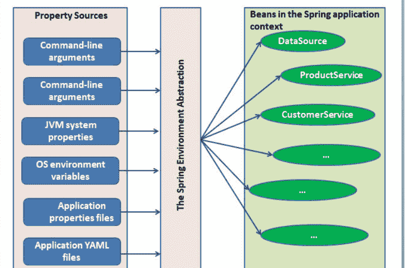

图 2.2：Spring 环境抽象从多个源提取属性，并使其对应用上下文中的 bean 可用。

如你所知，我们有多种属性源来外部化你的应用属性。但如果你在所有的属性源中定义了相同的属性，这些源在 Spring Boot 应用中具有特定的顺序来进行合理的值覆盖。让我们看看这些属性的评估顺序。

### 覆盖属性的评估顺序

Spring Boot 按以下顺序评估覆盖的属性：

- 位于主目录中的 DevTools 全局设置属性（~/.spring-boot-devtools.properties），但 DevTools 必须处于激活状态。
- 测试环境中使用测试上的 @TestPropertySource 注解定义的属性。
- 作为命令行参数定义的属性。
- 来自 SPRING_APPLICATION_JSON 的属性。
- 在 Web 环境中，ServletConfig 对象的 init 参数的属性。
- 在 Web 环境中，ServletContext 对象的 init 参数的属性。
- 来自 java:comp/env 的 JNDI 属性。
- Java 系统属性（System.getProperties()）。
- 操作系统环境变量。
- 使用 RandomValuePropertySource 的 random.* 属性。
- 使用 application.properties 或 application.yml 的配置属性文件。应用属性配置文件具有自己的优先级顺序，如下：
    - 打包 JAR 外部的特定于环境的应用属性，即在运行应用的目录的 /config 子目录中（application-{profile}.properties 和 YAML 变体）。
    - 打包 JAR 外部但在运行应用的目录中的特定于环境的配置文件，例如 application-{profile}.properties 及其 YAML 变体。


## 自定义 application.properties 文件的名称

特定于配置文件的配置文件，例如打包后的 JAR 文件中位于名为 config 的包内的 application-{profile}.properties 及其 YAML 变体。

特定于配置文件的配置文件，例如 application-{profile}.properties 及其 YAML 变体，但位于类路径的根目录下。

应用程序配置文件，例如打包后的 JAR 外部的 application.properties 及其 YAML 变体，但位于应用程序运行所在目录的 /config 子目录中。

应用程序配置文件，例如打包后的 JAR 外部的 application.properties 及其 YAML 变体，但位于应用程序运行所在的目录中。

应用程序配置文件，例如打包后的 JAR 内部的 application.properties 及其 YAML 变体，但位于名为 config 的包内。

应用程序配置文件，例如打包后的 JAR 内部的 application.properties 及其 YAML 变体，但位于类路径的根目录下。

`@Configuration` 类上的 `@PropertySource` 注解。

默认属性（使用 SpringApplication.setDefaultProperties 指定）。

上述属性源列表按照优先级顺序排列。如果您从上述列表中较高位置的属性源定义了任何属性，Spring Boot 将覆盖上述列表中较低位置的属性源中定义的相同属性。同样，在特定于配置文件的 application-{profile}.properties 中定义的任何属性将覆盖与 application-{profile}.properties 文件位于同一位置的 application.properties 文件中定义的相同属性值。

您在 application.properties 文件中定义的任何属性都会被 /config 子目录中 application.properties 中定义的相同属性的值所覆盖。我们已在 Spring Boot 应用程序中看到了多个属性源的优先级顺序。在 Spring Boot 中，我们可以在 .properties 文件或 .yml 文件中定义属性。默认情况下，Spring Boot 在 Spring 应用程序的 src/main/resource 目录中创建 application.properties 文件。

Spring Boot 不强制您使用默认创建的属性文件（application.properties）。您可以根据需要更改其名称，但需要通过将 **spring.config.name** 属性设置为新的文件名来告知 Spring Boot 应用程序这个名称。让我们看看以下代码片段：

```java
package com.dineshonjava.prodos;

import org.springframework.boot.SpringApplication;
import org.springframework.boot.autoconfigure.SpringBootApplication;

@SpringBootApplication
public class ProdosApplication {

    public static void main(String[] args) {
        System.setProperty("spring.config.name", "prodos-application");
        SpringApplication.run(ProdosApplication.class, args);
    }
}
```

如您在前面的代码片段中所见，我们使用的是 prodos-application.properties 文件，而不是默认的 application.properties 文件。

> 注意：**spring.config.name** 属性的值必须定义为 prodos-application，而不是 prodos-application.properties；如果使用 prodos-application.properties，文件将被命名为 prodos-application.properties.properties。

让我们继续下一节，了解如何使用 .properties 文件或其 YAML 变体在配置文件中定义属性。

从以下位置的 application.properties 文件中读取并将其添加到 Spring 环境中：

- 当前目录的 /config 子目录
- 当前目录
- 类路径上的 /config 包
- 类路径根目录

您还可以在上面提到的相同位置中定义特定于配置文件的属性文件。特定于配置文件的 application properties 文件中定义的属性具有更高的优先级，可以覆盖普通 application properties 文件中定义的相同属性。让我们看看如何在应用程序属性文件中定义一些属性：

```properties
#define embedded server configurations
server.port=8080
server.address=192.168.11.21
server.session-timeout=1800
server.context-path=/prodos
server.servlet-path=/admin
```

在 application.properties 配置文件中，我们定义了 Spring 应用程序中的嵌入式服务器。Spring Boot 还提供了另一种使用 YAML 文件配置 Spring 应用程序的变体。我们将在下一节中介绍。

## 使用 YAML 文件进行应用程序配置

YAML 文件是 .properties 文件的替代方案，Spring Boot 通过 SpringApplication 类支持 YAML 文件。YAML 不是标记语言；它是一种以层次化配置格式定义属性的配置文件。Spring Boot 使用 SnakeYAML 库来解析 YAML 文件。该库由 spring-boot-starters 自动添加到应用程序的类路径中。

> 注意：如果 application.properties 和 application.yml 文件并排存在于同一优先级级别，则 application.yml 中的属性将覆盖 application.properties 中的属性。

Spring Boot 支持使用 YAML 处理具有层次化配置数据的属性。YAML 将属性分组组织。让我们看看配置嵌入式服务器的以下示例。

## 配置嵌入式服务器

您可以在 Spring 应用程序中配置嵌入式服务器，如下面的 YAML 配置文件所示：

```yaml
#define embedded server configurations in YAML
server:
  port: 8080
  address: 192.168.11.21
  session-timeout: 1800
  context-path: /prodos
  servlet-path: /admin
```

在前面的配置中，您可以同时看到 application.properties 和 application.yml 文件。Spring Boot 支持这两种配置文件。您可以选择其中任何一个来配置 Spring 应用程序中的属性。

## 配置数据源

让我们看看一些与数据源相关的其他配置。您可以在 Spring 应用程序中配置数据源，如下面的 YAML 配置文件所示：

```yaml
#define data source configurations
spring:
  datasource:
    url: jdbc:mysql://localhost/prodos
    username: prododb
    password: prodopassword
    driver-class-name: com.mysql.jdbc.Driver
```

前面的配置是 YAML 文件中的数据源配置。我们将在接下来的章节中更多地讨论它。

## 配置日志记录

默认情况下，Spring Boot 使用 Logback (http://logback.qos.ch) 进行日志记录。此外，Spring Boot 将日志以 INFO 级别写入控制台。您可以通过在类路径根目录创建 logback.xml 文件来完全控制日志记录配置。让我们看看以下 logback.xml 文件：

```
%d{HH:mm:ss.SSS} [%thread] %-5level %logger{36} - %msg%n
```

logback.xml 配置文件可以完全控制默认配置文件。如果未将此文件添加到应用程序的类路径（src/main/resources）中，则默认日志记录配置或多或少等同于上述配置文件。您可以通过更改日志级别、指定日志输出文件和日志模式来修改日志记录配置文件。

但您也可以在未添加外部日志配置文件（logback.xml）的情况下，通过 Spring Boot 配置（使用 application.properties 或 application.yml 文件）完成大部分更改。让我们设置日志级别，如下面的 YAML 配置文件所示：

```yaml
#define logging configurations
logging:
  level:
    root: WARN
    org:
      springframework:
        security: DEBUG
```

在前面的 application.yml 文件中，我们将根日志级别设置为 WARN，但将 Spring security 日志级别设置为 DEBUG 级别。现在让我们配置日志输出。

默认情况下，Spring Boot 将日志写入控制台，但您也可以将这些日志写入轮转文件（prodos.log）。您可以在 application.yml 文件中设置文件或路径，如下面的配置所示：

```yaml
#define logging configurations
logging:
  path: /var/logs/prodos/
  file: prodos.log
  level:
    root: WARN
    org:
      springframework:
        security: DEBUG
```

默认情况下，Spring Boot 包含以下内容：

- SLF4J：日志门面
- Logback：SLF4J 实现

Spring Boot 还支持其他几种日志框架，如 Java Util Logging、Log4J 和 Log4J2。但是，建议您坚持在 Spring Boot 应用程序中使用默认的日志框架，并在应用程序代码中使用 SLF4J 抽象。您可以通过仅添加一个依赖来排除默认日志框架并使用另一个日志框架 Log4J，如下所示：

```xml
<dependency>
    <groupId>org.springframework.boot</groupId>
    <artifactId>spring-boot-starter-websocket</artifactId>
    <exclusions>
        <exclusion>
            <groupId>ch.qos.logback</groupId>
            <artifactId>logback-classic</artifactId>
        </exclusion>
    </exclusions>
</dependency>
<dependency>
    <groupId>org.slf4j</groupId>
    <artifactId>slf4j-log4j12</artifactId>
</dependency>
```

您可以看到我们在 Maven 中添加了 log4j12 依赖，并排除了默认日志框架，即 logback。

接下来，让我们继续了解单个 YAML 文件如何在 Spring 应用程序中用于多个配置文件配置。让我们在下一节中看看如何在单个 YAML 文件中定义多个配置文件。

## 多配置文件 YAML 文档

我们已经了解了如何定义特定于配置文件的 application properties 文件，因此在 .properties 文件的情况下，您需要为要创建的配置文件数量定义相应数量的文件，但在 YAML 配置文件中，您可以在单个 YAML 文件中定义与多个配置文件相关的属性，这是 YAML 相对于 properties 配置文件的优势。

Spring Boot 提供了 **spring.profiles** 键来指示何时需要应用该文档。让我们看看以下示例，了解如何在单个 YAML 文件中定义多个特定于配置文件的配置：

 //在单个 YAML 文件中专门定义配置 profile

## 适用于所有 profile

```
logging:
    level:
      org.springframework: INFO
```

## 仅限 'dev' profile

```
spring:
    profiles: dev
  database:
    host: localhost
    user: dev
```

## 仅限 'prod' profile

```
spring:
    profiles: prod
  database:
    host: 192.168.200.109
    user: admin
```

在上述 `application.yml` 配置文件中，我们根据 Spring 应用程序中可用的 profile（如 dev 和 prod）定义了与数据库相关的配置。我们可以使用 `spring.profiles` 属性来设置 profile 名称。在文件中，`---` 表示不同 profile 之间的分隔。

现在让我们来看看如何在 Spring 应用程序中定义自己的配置属性。

## 创建自定义配置属性

到目前为止，我们已经看到了 Spring 自身组件的配置属性。配置这些属性非常简单，因此很容易将值注入到组件属性中。我们也可以对这种自动配置进行微调。配置属性并不是为了由 Spring 创建的自定义组件 bean 准备的，这些属性仅适用于 Spring 的某些专属组件。但 Spring Boot 允许我们为 Spring 应用程序中的自定义 bean 创建配置属性。让我们来看看如何在自定义 bean 中利用配置属性。

## 在应用程序中定义自定义配置属性

Spring Boot 提供了 `@ConfigurationProperties` 注解，旨在帮助将自定义 bean 注册为 Spring 应用程序中的属性。您可以通过使用 `application.properties` 或 `application.yml` 文件来使用这些属性。创建自定义配置属性可以让您拥有强类型安全的 bean，并在 Spring 应用程序中对配置进行验证。请看以下示例。

让我们看看 `@ConfigurationProperties` 是如何工作的。假设在您的 PRODOS 应用程序中，您需要连接第三方远程服务，例如产品的反馈服务。为了连接此远程服务，我们需要一些属性，如服务主机（host）、服务端口（port）、超时时间（timeout）等。我们可以通过提供硬编码值来设置这些属性。但与其硬编码主机、端口和超时时间，我们可以使用自定义配置属性来设置这些属性。首先，我们需要在应用程序中添加一个单独的类，用于持有所有配置属性，如主机、端口、超时等。请看以下属性持有类：

```
package com.dineshonjava.prodos.client;

import org.springframework.boot.context.properties.ConfigurationProperties;
import org.springframework.stereotype.Component;

/**
 * @author Dinesh.Rajput
 *
 */
@Component
@ConfigurationProperties(prefix="feedback.client")
public class ConnectionSettings {

    private String host;

    private int port;

    private int timeout;

    public String getHost() {
        return host;
    }

    public void setHost(String host) {
        this.host = host;
    }

    public int getPort() {
        return port;
    }

    public void setPort(int port) {
        this.port = port;
    }

    public int getTimeout() {
        return timeout;
    }

    public void setTimeout(int timeout) {
        this.timeout = timeout;
    }

}
```

如您所见，上述 `ConnectionSettings` 类使用了 `@ConfigurationProperties` 注解，并设置前缀为 `feedback.client`。该类还使用了 `@Component` 注解，以便 Spring 能将其自动扫描为组件，并在 Spring 应用程序上下文中将其创建为 bean。

因此，配置属性持有类就是 Spring bean，它们持有从 Spring 环境中注入的属性。您可以在任何需要这些属性的其他 bean 中使用这些配置属性持有类。例如，`FeedbackClientConfiguration` 类有一个 bean 定义 `FeedbackClient`，它需要在 Spring 应用程序上下文中创建 bean 之前，使用这些属性来设置所有必需的配置。请看以下示例：

```
package com.dineshonjava.prodos.client;

import org.springframework.beans.factory.annotation.Autowired;
import org.springframework.boot.context.properties.EnableConfigurationProperties;
import org.springframework.context.annotation.Bean;
import org.springframework.context.annotation.Configuration;

/**
 * @author Dinesh.Rajput
 *
 */

@Configuration
@EnableConfigurationProperties(ConnectionSettings.class)
public class FeedbackClientConfiguration {

    // Spring 自动初始化此项
    @Autowired
    ConnectionSettings connectionSettings;

    @Bean
    public FeedbackClient feedbackClient() {
        return new FeedbackClient(
            connectionSettings.getHost(),
            connectionSettings.getPort()
        );
    }
}
```

在上述配置类中，`ConnectionSettings` 被注入到 `FeedbackClientConfiguration` 类中。而 `FeedbackClient` bean 使用了这个属性持有类。现在，我们可以在任何可能需要 `ConnectionSettings` 类的其他 bean 中复用它。您可以在不影响 `FeedbackClientConfiguration` 类的情况下修改 `ConnectionSettings` 类。您还可以在属性持有类内部对属性应用验证。

`FeedbackClientConfiguration` 类使用了 `@EnableConfigurationProperties` 注解。该注解用于指定并自动注入容器 bean。

## 声明配置属性和元数据

让我们在 `application.yml`（或 `application.properties`）文件中定义配置属性。在 Spring 应用程序中定义配置属性时，您可能会注意到一条警告信息，提示“Unknown Property 'feedback'”（未知属性 'feedback'）。这条警告信息有时取决于 IDE，而本应用程序使用的是 Spring Tool Suite IDE。请看下图：

## 图 2.3：未知属性的警告信息

目前出现此警告信息是因为 Spring 自动配置尚未识别该属性。`feedback.client.port` 属性与 Spring 默认配置无关，而是为自定义应用程序 bean 声明的。您可以通过为自定义配置属性创建元数据来解决此问题。创建元数据并非强制要求，即使没有元数据，您的应用程序仍能运行。但为了消除警告信息，您需要在 `src/main/resources/META-INF` 目录下为自定义配置属性创建名为 `additional-spring-configuration-metadata.json` 的元数据文件。

如果您使用的是 Spring Tool Suite，可以通过将光标移至出现缺失元数据警告的行来创建它。随后，光标会显示如下截图所示的快速修复（quick-fix）弹出窗口：

## 图 2.4：快速修复弹出窗口

点击 “Create metadata for feedback.client.port” 链接。然后，自定义配置属性的元数据将被创建在 Spring 应用程序的 `src/main/resources/META-INF` 目录中。请看以下截图：

## 图 2.5：向应用程序添加 additional-spring-configuration-metadata.json 元数据

您可以看到 `additional-spring-configuration-metadata.json` 文件已添加到 Spring 应用程序的 `src/main/resources/META-INF` 目录中。让我们按照以下代码在配置文件中添加更多自定义配置属性：

```
feedback.client.port=9900

feedback.client.host=192.168.10.21

feedback.client.timeout=4000
```

同样地，让我们为上述自定义配置属性创建元数据。最后，让我们打开 `additional-spring-configuration-metadata.json` 文件，如下代码所示：

```
{"properties": [

{

"name": "feedback.client.port",

"type": "java.lang.String",

"description": "Set the port for the remote feedback service"

},
```


 ```json
{
  "name": "feedback.client.timeout",
  "type": "java.lang.String",
  "description": "Set maximum timeout for the feedback service in milliseconds"
},
{
  "name": "feedback.client.host",
  "type": "java.lang.String",
  "description": "Set the hostname for the remote feedback service"
}]
```

针对上述反馈服务的元数据，包括 feedback.client.port、feedback.client.host 和 feedback.client.timeout 属性，已经被创建出来，你可以为这些元数据设置自定义描述。当你在应用程序配置文件中编写的属性上方移动光标时，这些描述将会显示，如以下截图所示：

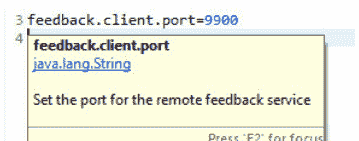

图 2.6：关于已定义属性的元数据描述信息

在创建你自己的配置属性的元数据后，你可以将这些属性添加到 application.properties 或 application.yml 文件中。当我们输入 feedback 时，建议列表将保持开放状态，如以下截图所示：

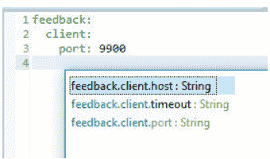

图 2.7：自定义配置属性的建议快速弹出框

你可以在上面的 YAML 配置文件中看到，当我们输入 feedback 时，所有可用的建议配置属性都会显示出来。

你可以将自定义配置属性设置为环境变量，或者将这些属性指定为命令行参数，或者将它们添加到其他可以设置配置属性的地方。

让我们继续下一节，讨论 Spring 配置文件以及如何在应用程序中使用 Spring 配置文件。

## 配置文件（Profiling）

配置文件是一种根据特定环境（如开发、预发布和生产环境）来隔离应用程序配置的过程。Spring 支持基于配置文件创建应用程序配置。Spring 提供了 **@Profile** 注解来限制应用程序配置的某些部分被加载。你可以将 **@Profile** 注解与任何构造型注解（如 **@Component**、**@Configuration**）以及 **@Bean** 注解一起使用。让我们看下面的例子：

```
@Configuration
@Profile("production")

public class ProductionConfiguration {
    // ...
}
```

如你在上面的配置文件中所见，我们使用 **@Profile** 注解并指定了值为 production 的属性。这意味着 *ProductionConfiguration* 类下的应用程序配置仅适用于生产配置文件。实际上，配置文件是一种条件注解配置类型。配置文件是 **@Conditional** 注解的一种具体实现，其中不同的配置类、Bean 和应用程序属性会根据 Spring 应用程序运行时活动的配置文件而被应用或忽略。

## 使用配置文件条件创建 Bean

在 Spring 应用程序中，通常所有在配置中声明的 Bean 都会为所有配置文件创建，而不论哪些配置文件处于活动状态。但有时，某些 Bean 集仅在特定配置文件中才需要。在这种情况下，Spring 允许我们使用 **@Profile** 注解来创建特定配置文件专属的 Bean。让我们看下面的例子：

```
@Bean
@Profile("dev")
public DataSource dataSource(){
    EmbeddedDatabaseBuilder builder = new EmbeddedDatabaseBuilder();
    setType(EmbeddedDatabaseType.HSQL);//in-memory
    builder.addScript("schema.sql");
    builder.addScript("data.sql");
    return builder.build();
}
```

上面的 *DataSource* Bean（使用嵌入式 HSQL 数据库）仅在 Spring 应用程序的 dev 配置文件中可用。这对于开发环境来说非常好，但在生产应用中则没有必要。如果你想让同一个 *DataSource* Bean 适用于 dev 或 qa 配置文件，你可以按以下代码所示来定义该 *DataSource* Bean：

```
@Bean
@Profile({"dev", "qa"})
public DataSource dataSource(){
    EmbeddedDatabaseBuilder builder = new EmbeddedDatabaseBuilder();
    setType(EmbeddedDatabaseType.HSQL);//in-memory
    builder.addScript("schema.sql");
    builder.addScript("data.sql");
    return builder.build();
}
```

现在，*DataSource* Bean 仅当 dev 或 qa 配置文件处于活动状态时才会被加载。让我们讨论如何在 Spring 应用程序中激活 Spring 配置文件。

## 激活配置文件

仅当你在 Spring 应用程序中激活这些配置文件时，特定配置文件的应用程序配置和设置才会应用于 Spring 应用程序，否则创建特定配置文件的配置将毫无用处。让我们使用 `spring.profiles.active` 属性使配置文件在 Spring 应用程序中生效，如以下示例所示：

在 application.yml 中这样写：

```
spring:
  profiles:
    active:
      - production
```

在 application.properties 中，使用以下代码：

```
spring.profiles.active=production
```

你还可以使用 EnvironmentMapping 环境属性来设置 `spring.profiles.active` 属性，以指定哪些配置文件处于活动状态。你可以使用 `spring.profiles.active` 属性一次激活多个配置文件。让我们看下面的例子：

```
spring.profiles.active=production,mariadb
```

Spring 允许我们创建特定配置文件的应用程序配置属性文件。让我们看看如何操作。

## 特定配置文件的应用程序配置属性文件

正如本章前面部分所讨论的，application.properties 文件是用于外部化应用程序自动配置的方法之一。但你可以根据 Spring 应用程序中活动的配置文件来外部化自动配置。特定配置文件的配置属性可以创建为 application-{profile}.properties（例如：application-dev.properties、application-qa.properties 等）。默认情况下，Spring 具有默认配置文件，这意味着 Spring 应用程序中没有活动的配置文件。如果应用程序中没有使用任何配置文件，则应用程序会从 application-default.properties 文件加载属性。

特定配置文件的应用程序配置文件在相同优先级位置上总是优先于非特定配置文件的配置。

## 结论

在本章中，我们讨论了 Spring Boot 自动配置以及与自动配置相关的许多内容。Spring Boot 是一个非常固执己见的框架，从不强制使用默认自动配置。Spring Boot 允许你根据需求启用或禁用默认自动配置。

我们看到了 Spring Boot 自动配置是如何工作的。Spring Boot 明智地开箱即用使用 **@Conditional** 注解。配置属性可以设置在命令行参数、环境变量、JVM 系统属性、属性文件或 YAML 文件中，还有其他选项。

Spring 自动配置可以使用 application.properties 或 application.yml 配置文件进行外部化。我们还看到了如何在自己的 Spring 应用程序中创建自定义配置属性。我们讨论了 Spring 配置文件如何提供一种机制，根据 Spring 应用程序中活动的配置文件来控制配置设置和 Bean 创建。

在下一章"第 3 章：配置 Spring Data JPA 和 CRUD 操作"中，我们将讨论如何配置 Spring Data 和 ORM 工具，以使用 Spring Boot 进行 CRUD 操作。

## 问题

- Spring Boot 中的自动配置是什么？
- 如何在 Spring Boot 中启用自动配置？
- 如何在 Spring Boot 中禁用自动配置？
- 如何外部化自动配置？
- 被覆盖属性的评估顺序是什么？
- YAML 是什么？
- 如何定义多配置文件的 YAML 文档？
- Spring Boot 中的配置文件（Profiling）是什么？
- 如何激活配置文件？

# 第 3 章

## 配置数据和 CRUD 操作

Spring 框架提供了全面的支持，用于使用 SQL 关系型或非关系型数据库处理后端数据。Spring 完全支持从使用 JdbcTemplate 的 JDBC 访问到对象关系映射（ORM）解决方案技术（如 Hibernate）的后端技术。此外，Spring 还提供了一个精彩的功能——**Spring Data**，用于处理后端数据。它能从接口创建 Repository 实现，并根据方法名生成查询。我们将在本章中逐一讨论这些内容。

在上一章中，我们讨论了 Spring Boot 及其关键组件。我们还详细讨论了自动配置组件、如何自定义和外部化 Spring Boot 提供的现有默认配置。在本章中，你将更好地理解 Spring Data JPA，并学习如何配置 SQL 数据库 H2。你将获得 Spring Data JPA 的概述，以及如何在 Spring Boot 应用程序中配置 SQL 数据库。

到目前为止，我们使用 Spring Boot 创建了一个 PRODOS Spring 应用程序。现在让我们学习如何在我们的应用程序中配置数据后端。正如我们所知，大多数应用程序都会向用户展示数据信息。因此，你需要在 Spring PRODOS 应用程序中配置一个数据库，以存储有关产品的信息。

我们将在 PRODOS Spring 应用程序中使用 Spring 对 Java 数据库连接（JDBC）的支持来使用数据库。之后，我们将改用 ORM（Hibernate），然后使用 Spring Data Java 持久化 API（JPA），这能消除更多的样板代码。让我们从 Spring 对 JDBC 的支持开始。我们将在本章中涵盖以下主题：

- 在 Spring 应用程序中使用 JDBC
  - 添加领域类
  - 使用 JdbcTemplate
  - 创建表架构和加载数据
- 配置 DataSource
  - 嵌入式数据库支持
  - 生产数据库支持
  - JNDI DataSource 支持
- 使用 Spring Data JPA
  - ORM 与 JPA 快速介绍
  - 实体类
  -  reductionsJPA 数据库的创建和删除
  - Spring Data 简介
  - 配置 Spring Data JPA
  - 创建 Spring Data JPA 仓库
  - 自定义 Spring Data JPA 仓库
- 配置 H2 数据库
- 配置 MariaDB 数据库

## 在 Spring 应用程序中使用 JDBC

Spring 提供了使用 JDBC 的抽象支持，用于处理关系型数据。作为 Java 开发者，你可以选择 JDBC、JPA 以及 Spring 框架支持的 ORM 等选项中的任何一个。但在本节中，我们将讨论带有 Spring JDBC 支持的

通常，如果你在不使用 Spring 框架的简单核心 Java 应用程序中使用 JDBC，那么你需要编写大量样板代码，如加载驱动、创建数据库连接、准备 SQL 语句等。但最令人头疼的是在应用程序的数据访问层处理 SQL 异常；在数据访问层处理异常并不是好的实践。让我们看看下面不使用 Spring 的 JDBC 代码片段：

// 不使用 JdbcTemplate 查询数据库

```java
@Override
public Product findOne(String id) {
    Connection connection = null;
    PreparedStatement statement = null;
    ResultSet resultSet = null;
    try {
        connection = dataSource.getConnection();
        statement = connection.prepareStatement(
            "select id, name, type from Product");
        statement.setString(1, id);
        resultSet = statement.executeQuery();
        Product product = null;
        if(resultSet.next()) {
            product = new Product(
                resultSet.getString("id"),
                resultSet.getString("name"),
                resultSet.getString("type"));
        }
        return product;
    } catch (SQLException e) {
        // ??? 这里应该怎么做 ???
    } finally {
        if (resultSet != null) {
            try {
                resultSet.close();
            } catch (SQLException e) {}
        }
        if (statement != null) {
            try {
                statement.close();
            } catch (SQLException e) {}
        }
        if (connection != null) {
            try {
                connection.close();
            } catch (SQLException e) {}
        }
    }
    return null;
}
```

上述代码片段包含大量样板代码，开发者被迫使用各种 try-catch 块来处理受检异常 `SQLException`。即使前面的代码也没有良好的可读性。Spring 框架提供了 `JdbcTemplate` 类来处理所有必要的事情，消除了使用 JDBC 时通常需要的样板代码。`JdbcTemplate` 允许开发者仅针对关系数据库执行 SQL 操作。让我们看看下面使用 `JdbcTemplate` 类的代码片段：

```java
JdbcTemplate jdbcTemplate;

public Product findOne(String id){
    String sql = "select id, name, type from Product where id = " + id;
    return jdbcTemplate.queryForObject(sql, new RowMapper(){
        @Override
        public Product mapRow(ResultSet rs, int arg1) throws SQLException {
            Product product = new Product(
                rs.getString("id"),
                rs.getString("name"),
                rs.getString("type"));
            return product;
        }
    });
}
```

正如你从前述代码片段中所见，我们执行了相同的 SQL 查询，但在这里不需要处理很多事情，如 `SQLException`、准备语句、清理这些对象以及连接。而且，前面的代码比之前的原始 JDBC 示例简单得多。我们只需调用 `JdbcTemplate` 类的 `queryForObject()` 方法，并将结果映射到 `Product` 对象。

## 添加领域类

在应用程序 PRODOS 中，我们有一个数据库来存储产品信息，我们也可以从数据库中访问产品信息。因此，为产品信息创建一个领域类是一个好主意，我们可以将列名与对象的字段进行映射。让我们创建一个领域类 `Product`，如下所示：

```java
package com.dineshonjava.prodos.domain;

import java.io.Serializable;

public class Product implements Serializable{
    private static final long serialVersionUID = 1L;
    private String id;
    private String name;
    private String type;

    public Product(String id, String name, String type) {
        super();
        this.id = id;
        this.name = name;
        this.type = type;
    }

    public String getId() {
        return id;
    }

    public void setId(String id) {
        this.id = id;
    }

    public String getName() {
        return name;
    }

    public void setName(String name) {
        this.name = name;
    }

    public String getType() {
        return type;
    }

    public void setType(String type) {
        this.type = type;
    }
}
```

现在，我们的领域类已经准备好进行持久化了。让我们看看如何使用 `JdbcTemplate` 将数据读写到数据库中。

## 使用 JdbcTemplate

让我们开始在 Spring REST 应用程序 PRODOS 中使用 `JdbcTemplate`。在开始使用 `JdbcTemplate` 之前，我们需要将 Maven 依赖添加到项目类路径中。我们需要将以下 Spring Boot 的 JDBC 启动依赖添加到 `pom.xml` 文件中：

```xml
<dependency>
    <groupId>org.springframework.boot</groupId>
    <artifactId>spring-boot-starter-jdbc</artifactId>
</dependency>
```

现在，前述依赖将为你的应用程序类路径添加 `JdbcTemplate` 所需的所有库。但在使用它之前，你需要添加一个数据库来存储数据。出于开发目的，我们可以使用嵌入式数据库，如 H2、HSQL 和 Derby。但在本示例中，我更喜欢使用 H2 嵌入式数据库。让我们看看下面将添加到 `pom.xml` 文件中的 Maven 依赖：

- com.h2database
- h2
- runtime

将内存数据库添加到应用程序后，让我们继续编写一个 repository 类，从内存数据库中获取和保存产品数据。让我们看看下面定义操作方法的 `ProductRepository` 接口：

```java
package com.dineshonjava.prodos.repository;

import com.dineshonjava.prodos.domain.Product;

public interface ProductRepository {
    Iterable findAll();
    Product findOne(String id);
    Product save(Product product);
}
```

你的产品 repository 执行以下操作：

- 查询所有产品到一个 Product 对象的集合中
- 根据 id 查询单个 Product
- 保存一个 Product 对象

现在，我们将实现前面的 repository 接口。Spring 的 `JdbcTemplate` 类在你的 Spring 应用程序中是自动配置的，你可以直接通过 `@Autowire` 将其注入到你的 repository 实现中，如下所示：

```java
package com.dineshonjava.prodos.repository;

import org.springframework.jdbc.core.JdbcTemplate;
import org.springframework.stereotype.Repository;
import com.dineshonjava.prodos.domain.Product;

@Repository
public class JdbcProductRepository implements ProductRepository {
    private JdbcTemplate jdbcTemplate;

    public JdbcProductRepository(JdbcTemplate jdbcTemplate) {
        super();
        this.jdbcTemplate = jdbcTemplate;
    }
    //...
}
```

如你所见，`JdbcProductRepository` 被 `@Repository` 注解标注。这个 `@Repository` 注解是构造型注解之一。Spring 应用程序的上下文将自动扫描这个被标注的 `JdbcProductRepository`，并将其作为 Bean 实例化到 Spring 应用程序上下文中。

在创建 `JdbcProductRepository` Bean 时，Spring 容器通过构造函数将 `JdbcTemplate` 注入到这个 repository Bean 中。我们可以使用 `JdbcTemplate` 实例来查询和插入数据库。

在前面的代码中，我们没有显式使用 `@Autowired` 注解的构造函数来注入 `JdbcTemplate`，因为在 Spring 4.3.5 版本中，单个构造函数默认被视为 `@Autowired` 注解的构造函数，因此不需要显式添加 `@Autowired` 注解。如果你有多个构造函数，那么你需要使用 `@Autowired` 注解。

你也可以使用 `spring.jdbc.template.*` 属性来自定义 JDBC 模板的一些属性，如下所示：

```properties
spring.jdbc.template.max-rows=500
```

让我们来看一下 `JdbcProductRepository` 类中 `findAll()` 和 `findOne()` 的实现：

```java
@Override
public Iterable findAll() {
    return jdbcTemplate.query("select id, name, type from Product",
    this::mapRowToProduct);
}
```

```java
@Override
public Product findOne(String id) {
    return jdbcTemplate.queryForObject("select id, name, type from Product where id=?",
    this::mapRowToProduct, id);
}
```

```java
private Product mapRowToProduct(ResultSet rs, int rowNum) throws SQLException {
    return new Product(
    rs.getString("id"),
    rs.getString("name"),
    rs.getString("type"));
}
```

前面的两个方法只是从数据库读取数据，但插入和更新是我们操作数据的另外两个方面。因此，`JdbcTemplate` 类的 `update()` 方法可以用于任何写入或更新数据库数据的查询。并且，如下所示，它可以用于向数据库插入数据：

```java
@Override
public Product save(Product product) {
    jdbcTemplate.update(
    "insert into Product (id, name, type) values (?, ?, ?)",
    product.getId(),
    product.getName(),
    product.getType());
    return product;
}
```


我们已经定义了 ProductRepository 的所有三个方法。现在，一旦 JdbcProductRepository 类完成，你就可以在 Spring 应用程序中将其与其他 Bean（如服务和控制器）一起使用。让我们看看下面代码中完整的 JdbcProductRepository 类：

```java
package com.com.dineshonjava.prodos.repository;

import java.sql.ResultSet;
import java.sql.SQLException;
import org.springframework.jdbc.core.JdbcTemplate;
import org.springframework.stereotype.Repository;
import com.com.dineshonjava.prodos.domain.Product;

/**
 * @author Dinesh.Rajput
 */
@Repository
public class JdbcProductRepository implements ProductRepository {

    private JdbcTemplate jdbcTemplate;

    public JdbcProductRepository(JdbcTemplate jdbcTemplate) {
        super();
        this.jdbcTemplate = jdbcTemplate;
    }

    @Override
    public Iterable findAll() {
        return jdbcTemplate.query("select id, name, type from Product", this::mapRowToProduct);
    }

    @Override
    public Product findOne(String id) {
        return jdbcTemplate.queryForObject("select id, name, type from Product where id=?", this::mapRowToProduct, id);
    }

    @Override
    public void save(Product product) {
        jdbcTemplate.update(
            "insert into Product (id, name, type) values (?, ?, ?)",
            product.getId(),
            product.getName(),
            product.getType()
        );
    }

    private Product mapRowToProduct(ResultSet rs, int rowNum) throws SQLException {
        return new Product(
            rs.getString("id"),
            rs.getString("name"),
            rs.getString("type")
        );
    }
}
```

在之前的章节中，我们创建了一个 REST Web 应用程序，其中包含一个返回硬编码值 "Hello World!!!" 作为响应的控制器类。但在 JdbcProductRepository 类完成后，你现在可以将它注入到控制器类中。让我们创建 ProductController 控制器类，并使用它来提供 Product 对象的列表。请看以下控制器类：

```java
package com.com.dineshonjava.prodos.controller;

import java.util.ArrayList;
import java.util.List;
import org.springframework.web.bind.annotation.GetMapping;
import org.springframework.web.bind.annotation.RestController;
import com.com.dineshonjava.prodos.domain.Product;
import com.com.dineshonjava.prodos.repository.ProductRepository;

/**
 * @author Dinesh.Rajput
 */
@RestController
public class ProductController {

    private ProductRepository productRepository;

    public ProductController(ProductRepository productRepository) {
        super();
        this.productRepository = productRepository;
    }

    @GetMapping("/products")
    public List findAll() {
        List products = new ArrayList<>();
        productRepository.findAll().forEach(i -> products.add(i));
        return products;
    }
}
```

如你所见，ProductRepository 被注入到了控制器类中，并且控制器类使用了 ProductRepository 对象的注入 `findAll()` 方法。该方法从数据库中获取所有产品。

## 创建表结构并加载数据

让我们使用以下查询在 H2 数据库中创建一张表：

```sql
CREATE TABLE PRODUCT (
    name VARCHAR(50),
    type VARCHAR(50),
    id VARCHAR(10)
);
```

在之前的结构查询中，我们需要将其在 H2 数据库中运行，但如何将此查询运行到 H2 数据库，以及我们需要将此查询放在哪里？Spring Boot 将支持你在应用程序中运行此查询。我们需要在 Spring 应用程序 PRODOS 的 `src/main/resources` 文件夹中创建一个名为 `schema.sql` 的文件。

在创建表结构之后，让我们用一些产品数据预加载数据库。Spring Boot 还支持在应用程序启动时，通过执行类路径根目录下名为 `data.sql` 的文件来加载数据。这意味着，我们需要将 `data.sql` 放置在 Spring 应用程序 PRODOS 的 `src/main/resources` 文件夹中，包含以下数据插入查询：

```sql
INSERT INTO PRODUCT (id, name, type) values ('MOB01', 'Samsung A6 plus', 'Mobile');
INSERT INTO PRODUCT (id, name, type) values ('MOB02', 'iPhone X plus', 'Mobile');
INSERT INTO PRODUCT (id, name, type) values ('TLV01', 'Sony Bravia KLV-50W662F 50 Inch Full HD', 'Television');
INSERT INTO PRODUCT (id, name, type) values ('CAM01', 'Canon EOS 1500D Digital SLR Camera', 'DSLR Camera');
INSERT INTO PRODUCT (id, name, type) values ('SPK01', 'JBL Cinema 510 5.1 with Powered Subwoofer', 'Home Theater Speaker');
```

让我们看看以下 PRODOS 应用程序的结构：

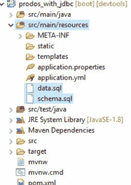
图 3.1: Prodos 应用程序结构

现在，你可以看到我们创建了表结构并将一些数据加载到了表中。将数据加载到表中后，它将如以下截图所示：

```sql
SELECT * FROM PRODUCT;
```

| NAME | TYPE | ID |
| :--- | :--- | :--- |
| Samsung A6 plus | Mobile | MOB01 |
| iPhone X plus | Mobile | MOB02 |
| Sony Bravia KLV-50W662F 50 inch Full HD | Television | TLV01 |
| Canon EOS 1500D Digital SLR Camera | DSLR Camera | CAM01 |
| JBL Cinema 510 5.1 with Powered Subwoofer | Home Theater Speaker | SPK01 |
| (5 rows, 3 ms) | | |

图 3.2: Prodos 应用程序表结构和数据

我们添加了 H2 数据库并将产品数据加载到了数据库中。Spring Boot 提供了与 H2 数据库相关的自动配置。因此，在这里我们没有显式配置 DataSource。H2 数据库是开发环境的一个很好选择，但不适用于生产环境。因此，Spring Boot 允许你根据开发和生产环境进行相应的自定义。

## 配置 DataSource

DataSource 类主要涉及配置 URL 以及一些凭据以建立数据库连接。Java 中提供了 `javax.sql.DataSource` 接口，它提供了一种建立数据库连接的标准机制。让我们看看如何为 H2、HSQL、Derby 等内存嵌入式数据库配置 DataSource。

### 内存嵌入式数据库支持

如前所述，内存嵌入式数据库是开发环境的一个很好选择。但内存嵌入式数据库不提供持久化存储。当你的应用程序启动时，内存嵌入式数据库被准备好；当你的应用程序结束时，它会丢弃数据。

Spring Boot 提供了自动配置内存嵌入式数据库（如 H2、HSQL 和 Derby 数据库）的支持。你只需要在 Maven 中添加你想要使用的嵌入式数据库依赖即可。无需提供任何连接 URL。

```xml
com.h2database
h2
runtime
```

但你仍然可以使用以下配置进行自定义：

```java
@Bean
public DataSource dataSource(){
  EmbeddedDatabaseBuilder builder = 
  new EmbeddedDatabaseBuilder().setType(EmbeddedDatabaseType.H2); //in-memory
  builder.addScript("schema.sql");
  builder.addScript("data.sql");
  return builder.build();
}
```

### 生产数据库支持

Spring Boot 还使用连接池 DataSource 自动配置生产数据库连接。在生产环境中，连接池 DataSource 更适合数据库。Spring Boot 使用一些特定的连接池默认实现，如下所示：

默认情况下，从 Spring Boot 2.0 开始，它使用 HikariCP。HikariCP 数据源提供了高性能和高并发。当你在 Maven pom.xml 文件中配置 `spring-boot-starter-jdbc` 或 `spring-boot-starter-data-jpa` starter 时，HikariCP 会自动添加到你的 Spring 应用程序中。

我们也可以使用 Tomcat 连接池 DataSource。另一个选项是 Commons DBCP2 数据源。

我们已经看到了连接池的自动配置。现在，让我们看看如何将 `spring.datasource.*` 的配置属性外部化，如下代码所示：

```properties
spring.datasource.url=jdbc:mariadb://localhost:3306/mydb
spring.datasource.username=mydbuser
spring.datasource.password=mydbpass
spring.datasource.driver-class-name=org.mariadb.jdbc.Driver
```

如果你没有指定 `spring.datasource.url` 属性，Spring Boot 将尝试自动配置一个嵌入式数据库。

在 Spring Boot 2 中，`spring.datasource.driver-class-name` 属性是可选的。如果你不指定它，Spring Boot 将根据 URL 为大多数数据库解析该属性。

你还可以使用以下相应的前缀来微调特定数据源实现的设置：

```properties
spring.datasource.hikari.*
spring.datasource.tomcat.*
spring.datasource.dbcp2.*
```

例如，如果你使用 Tomcat 连接池，可以通过如下代码自定义附加设置：

- **在没有可用连接时，抛出异常前等待的毫秒数：**
```properties
spring.datasource.tomcat.max-wait=10000
```

- **可以从该池中同时分配的最大活动连接数：**
```properties
spring.datasource.tomcat.max-active=50
```

- **在从池中借用连接之前验证连接：**
```properties
spring.datasource.tomcat.test-on-borrow=true
```

### JNDI DataSource 支持

Spring Boot 提供了对使用 `JNDI DataSource` 的支持。当你的应用程序部署到 JBoss 等应用服务器时，这非常有用。你可以使用应用服务器的内置功能配置 DataSource，并在应用程序中使用 JNDI 访问它。

Spring Boot 提供了 `spring.datasource.jndi-name` 属性，用于从特定的 JNDI 位置访问 DataSource。请看以下示例：

```properties
spring.datasource.jndi-name=java:jboss/datasources/prodos
```

## 使用 Spring Data JPA

在上一节中，我们讨论了如何使用 Spring 的 `JdbcTemplate` 处理数据。但有时，我们需要一个更强大的工具来处理后端。在 JDBC 示例中，我们有一个与表对应的领域对象。当我们处理多个表和大量列时，情况可能会变得更加复杂。Spring Boot 还支持 JPA 和 ORM 技术。

### JPA ORM 快速入门

对象关系映射（ORM）是指将 Java 持久化对象映射到关系数据库。这是一种用于获取和...

使用面向对象编程范式来操作数据。因此，作为一名开发人员，你不需要依赖数据库结构和特定供应商的 SQL 语句，而需要依赖面向对象概念并编写特定于 ORM 实现的查询。这意味着 ORM 允许你编写与数据库无关的查询来获取和操作数据。

ORM 提供了一个独立的数据访问层，而不依赖于特定供应商的属性。它允许你在不更改或极少更改应用程序数据访问层的情况下，更改数据库基础设施。ORM 还使开发速度大大加快，并减少了源代码量。

以下是常用的 ORM 工具列表：

- Hibernate
- iBATIS
- Java Data Objects (JDO)
- Java Object Oriented Querying (jOOQ)
- DataNucleus
- Ebean
- EclipseLink
- MyBatis
- Object Relational Bridge (Apache OJB)
- ObjectDB
- OpenJPA
- ORMLite
- QuickDB ORM
- TopLink

Java Persistence API (JPA) 是为 Java 开发人员提供的面向对象-关系映射的 Java 实现。它提供了一种标准方式，允许你将对象映射到关系数据库。JPA 使用 JPA 实体类；这些类呈现了数据库表的结构，其字段则呈现了数据库表的列。

对于 Java 开发，Hibernate 是最受欢迎的 JPA 实现。Spring Boot 支持多种 JPA 实现，但默认使用 Hibernate。Hibernate 被广泛应用于大规模应用程序中，是一个成熟的产品。对于 Spring Boot 应用程序，你需要在 POM 文件中添加 `spring-boot-starter-data-jpa` starter，以提供 Hibernate 作为 JPA 实现：

```xml
<dependency>
    <groupId>org.springframework.boot</groupId>
    <artifactId>spring-boot-starter-data-jpa</artifactId>
</dependency>
```

上述 Maven 依赖为你的应用程序提供了 Spring Data JPA 模块，并为 Hibernate、Spring Data JPA 以及对核心 ORM 的 Spring 支持添加了其他依赖。

接下来我们讨论如何在应用程序中创建 JPA 实体类。

## 创建实体类

让我们为 H2 数据库中的 Product 表在 Spring 应用程序中创建一个实体类，如下所示：

```java
package com.dineshonjava.prodos.domain;

import java.io.Serializable;
import javax.persistence.Column;
import javax.persistence.Entity;
import javax.persistence.GeneratedValue;
import javax.persistence.Id;
import javax.persistence.Table;

/**
 *
 * @author Dinesh.Rajput
 *
 */
@Entity
@Table(name="PRODUCT")
public class Product implements Serializable {

    private static final long serialVersionUID = 1L;

    @Id
    @GeneratedValue
    private String id;

    @Column(nullable = false)
    private String name;

    @Column(nullable = false)
    private String type;

    @Column(name="desc", nullable=false, length=512)
    private String description;

    @Column(nullable = false)
    private String brand;

    public Product() {
        super();
    }

    public Product(String id, String name, String type, String description, String brand) {
        super();
        this.id = id;
        this.name = name;
        this.type = type;
        this.description = description;
        this.brand = brand;
    }

    public String getId() {
        return id;
    }

    public void setId(String id) {
        this.id = id;
    }

    public String getName() {
        return name;
    }

    public void setName(String name) {
        this.name = name;
    }

    public String getType() {
        return type;
    }

    public void setType(String type) {
        this.type = type;
    }

    public String getDescription() {
        return description;
    }

    public void setDescription(String description) {
        this.description = description;
    }

    public String getBrand() {
        return brand;
    }

    public void setBrand(String brand) {
        this.brand = brand;
    }
}
```

如你所见，上述类使用了 JPA 的 `@Entity` 注解。这意味着任何被标注为 JPA `@Entity` 注解的简单 POJO 类都会被视为实体类。上述类还使用了 `@Table` 注解来提供表名；如果你不使用此 `@Table` 注解，JPA 将在应用程序初始化时创建一个名为类名的数据库表。

在实体类中，一些字段被映射到数据库表列。实体类还必须包含一个唯一 ID，用作数据库中的主键。其 ID 属性使用 `@Id` 注解。此外，其 id 字段使用了 `@GeneratedValue` 注解，定义了由数据库自动生成的 ID。

实体类中的 `@Column` 注解定义了列名，你还可以定义其他属性，例如列的长度以及检查该列是否可以为空：

```java
@Column(name="desc", nullable=false, length=512)
private String description;
```

上述代码中的 `@Column` 注解将数据库中的列名指定为 `desc`，列长度为 512，且不能为空。

在运行此应用程序时，数据库中创建了 PRODUCT 表。你可以通过 `spring.jpa.show-sql` 属性来确认。让我们在 `application.properties` 文件中将此属性设置为 true。

```properties
spring.jpa.show-sql=true
```

你可以在控制台中看到以下 SQL 语句的日志，以验证 PRODUCT 表已创建：

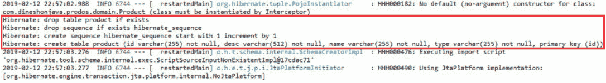
图 3.3：控制台中的 SQL 语句表创建

早些时候，JPA 实体类是通过 `persistence.xml` 文件指定的，但 Spring Boot 允许你在没有 `persistence.xml` 文件的情况下创建实体类。Spring Boot 为实体类提供了实体扫描（Entity Scanning）。默认情况下，Spring Boot 会扫描被标注为 `@SpringBootApplication` 的主配置类下的所有包。

## 创建和删除 JPA 数据库

你可以设置 `spring.jpa.hibernate.ddl-auto` 属性来创建和删除 JPA 数据库，如下代码所示：

```properties
spring.jpa.hibernate.ddl-auto=create-drop
```

上述 `spring.jpa.hibernate.ddl-auto` 属性被设置为 `create-drop` 值，这意味着 JPA 数据库将在应用程序启动时被删除并重新创建。但在 Spring Boot 中，如果你使用 H2、HSQL 或 Derby 等嵌入式数据库，默认情况下 JPA 数据库会自动创建。不过，Spring Boot 允许你通过 `spring.jpa.*` 属性来自定义 JPA 设置。

我们讨论了 JPA 实体类及其注解。在 Spring Boot 中，你可以将此实体类与 Spring Data 结合使用。现在让我们讨论 Spring Data 及其相关项目。

## Spring Data 简介

Pivotal 团队创建了一个非常神奇的项目，那就是 Spring Data。Spring Data 大大减少了 Spring 应用程序中数据访问层的配置和样板代码。无论底层数据存储是什么，它都为 Spring 应用程序的数据访问层提供了一个熟悉且一致的编程模型。

早些时候，如果你想使用任何数据访问技术（如关系型数据库、非关系型数据库和基于云的数据服务），那么你需要大量与特定数据访问技术相关的配置。但 Spring Data 减少了这些配置，使得在 Spring 应用程序中使用这些数据访问技术变得简单。

Spring Data 是一个伞形项目（umbrella project），包含许多针对特定数据访问技术的子项目。以下是 Spring Data 的一些子项目：

- Spring Data Commons：支撑每个 Spring Data 模块的核心 Spring 概念。
- Spring Data JPA：针对关系数据库的 JPA 持久化支持子项目。
- Spring Data MongoDB：针对非关系数据库的 MongoDB 支持子项目。
- Spring Data Redis：针对 Redis 键值存储的子项目。
- Spring Data for Apache Cassandra：针对 Cassandra 数据库的子项目。
- Spring Data Neo4j：针对 Neo4j 图数据库的子项目。
- Spring Data for Apache Solr：针对搜索导向的 Spring 应用程序的 Apache Solr 子项目。

在 Spring Data 伞形项目下还有许多其他子项目。以下是该项目下的其他一些社区模块：

- Spring Data Aerospike：适用于 Aerospike 的 Spring Data 模块。
- Spring Data ArangoDB：适用于 ArangoDB 的 Spring Data 模块。
- Spring Data Couchbase：适用于 Couchbase 的 Spring Data 模块。
- Spring Data Azure Cosmos DB：适用于 Microsoft Azure Cosmos DB 的 Spring Data 模块。
- Spring Data DynamoDB：适用于 DynamoDB 的 Spring Data 模块。
- Spring Data Elasticsearch：适用于 Elasticsearch 的 Spring Data 模块。
- Spring Data Hazelcast：为 Hazelcast 提供 Spring Data 仓库支持。
- Spring Data Jest：基于 Jest REST 客户端的 Elasticsearch Spring Data 模块。
- Spring Data Vault：构建在 Spring Data KeyValue 之上的 Vault 仓库。

让我们看看 Spring Data 项目的重要特性：

- Spring Data 最有趣的功能是它能够根据仓库规范接口自动创建仓库（Repositories）。
- 根据仓库方法名称推导查询。
- 支持自定义仓库代码。
- 为所有数据访问技术提供一致的方法。
- 基于 XML 和 JavaConfig 的 Spring 集成。

我们讨论了 Spring Data 项目，现在让我们在接下来的部分讨论 Spring Data 的子项目之一：Spring Data JPA。

## 为项目配置 Spring Data JPA

Spring Boot 提供了 JPA starter 将 Spring Data JPA 添加到你的 Spring 应用程序中。让我们看看需要添加到 Maven `pom.xml` 文件中的 starter 依赖，以便为你的 Spring 应用程序获取所有必需的依赖（包括传递性依赖）：

```xml
<dependency>
    <groupId>org.springframework.boot</groupId>
    <artifactId>spring-boot-starter-data-jpa</artifactId>
</dependency>
```

Maven JPA starter 依赖默认包含 Hibernate 作为 JPA 实现。但如果你想在 Spring 应用程序中使用另一个 JPA 实现，则需要将 Hibernate 从默认 JPA 实现中排除。请看以下 Maven 依赖配置：

```xml
<dependency>
    <groupId>org.springframework.boot</groupId>
    <artifactId>spring-boot-starter-data-jpa</artifactId>
    <exclusions>
        <exclusion>
            <groupId>org.hibernate</groupId>
            <artifactId>hibernate-entitymanager</artifactId>
        </exclusion>
    </exclusions>
</dependency>
```


 com.oracle.toplink

toplink

10.1.3

在前面的配置中，我们排除了 Spring Data JPA 中的 Hibernate JPA 实现，并将 toplink 作为 JPA 实现添加到您的 Spring 应用程序中。我们在 Spring 应用程序中添加了 Spring Data JPA。现在，让我们创建 Spring Data JPA 仓库（repositories）。

## 创建 Spring Data JPA 仓库

Spring Data 提供了一个 Repository 标记接口，使任何接口都类似于 Spring Data 仓库。除了这个接口，Spring Data 还提供了另一个用于 CRUD 操作的 CrudRepository 接口。该接口为 Spring 应用程序中的实体类提供了 CRUD 功能。

Spring Data JPA 仓库接口用于从关系数据库访问数据。您不需要编写 JPA 查询，因为这些查询会根据您的方法名称自动创建。让我们看下面的示例。

### 使用 Repository 标记接口创建 ProductRepository

首先，我们将使用 Repository 标记接口创建一个 ProductRepository 接口。但在这种情况下，我们需要为 CRUD 功能编写自己的方法：

```
package com.dineshonjava.prodos.repository;

import org.springframework.data.repository.Repository;

import com.dineshonjava.prodos.domain.Product;

public interface ProductRepository extends Repository{

    Iterable findAll();

    Product findById(String id);

    Product save(Product product);

}
```

### 使用 CrudRepository 接口创建 ProductRepository

让我们使用 CrudRepository 接口创建相同的 ProductRepository 接口。这样，您就不需要编写任何 CRUD 方法，因为这些方法继承自 CrudRepository 接口，如下例所示：

```
package com.dineshonjava.prodos.repository;

import org.springframework.data.repository.CrudRepository;

import com.dineshonjava.prodos.domain.Product;

public interface ProductRepository extends CrudRepository{

    //No need to define generic CRUD methods

}
```

为了测试创建的 ProductRepository，让我们向 PRODUCT 表中插入一些数据。为了开发目的，我们可以使用 CommandLineRunner 接口将数据插入表，或者在 Spring 应用程序的 `src/main/resource` 文件夹中创建一个包含插入查询的 `data.sql` 文件。

### 使用 CommandLineRunner

该接口允许您在应用程序完全启动之前执行额外的代码：

```
import org.springframework.boot.CommandLineRunner;

import org.springframework.boot.SpringApplication;

import org.springframework.boot.autoconfigure.SpringBootApplication;

import org.springframework.context.annotation.Bean;

@SpringBootApplication
public class ProdosApplication {

    public static void main(String[] args) {

    SpringApplication.run(ProdosApplication.class, args);

    }

    @Bean

    CommandLineRunner runner(){

    return args -> {

    // Place your code here

    };

    }

}
```

### 使用 data.sql 文件

让我们创建一个 `data.sql` 文件并将该文件放在 Spring 应用程序的 `src/main/resources` 文件夹中。该文件包含以下插入查询：

```
INSERT INTO PRODUCT (id, name, type, brand, desc) values ('MOB01', 'Samsung A6 plus', 'Mobile', 'Samsung', 'Samsung A6 plus is very nice phone with 24mp front camera');

INSERT INTO PRODUCT (id, name, type, brand, desc) values ('MOB02', 'iPhone X.plus', 'Mobile', 'Apple', 'iPhone X plus is very nice phone with 24mp front camera');

INSERT INTO PRODUCT (id, name, type, brand, desc) values ('TLV01', 'Sony Bravia KLV-50W662F 50 Inch Full HD', 'Television', 'Sony', 'Sony Bravia is full HD tv');

INSERT INTO PRODUCT (id, name, type, brand, desc) values ('CAM01', 'Canon EOS 1500D Digital SLR Camera', 'DSLR Camera', 'Canon', 'Best DSLR camera in the market');

INSERT INTO PRODUCT (id, name, type, brand, desc) values ('SPK01', 'JBL Cinema 510 5.1 with Powered Subwoofer', 'Home Theater Speaker', 'JBL', 'This sound system is suitable for the Home Theater');
```

我们在应用程序启动时插入了所有上述内容，您可以通过 H2 数据库控制台进行检查。我们将在本章稍后讨论如何使用 H2 数据库控制台。

到目前为止，我们讨论了 Spring Data JPA 仓库，并通过继承 Spring Data JPA 的 CrudRepository 接口创建了一个仓库接口。它提供了通用 CRUD 功能，但接下来我们将看看如何向仓库添加自定义方法。

## 定制 Spring Data JPA 仓库

您可以根据业务需求在 Spring Data 仓库中添加自己的查询。假设您想根据特定类型从数据库中访问所有产品，您需要声明以下方法：

```
//Fetch products by type

List findByType(String type);
```

正如您在上述方法中看到的，方法名必须以 `findBy` 前缀开始，在前缀之后，您需要定义查询中使用的实体类字段：

```
package com.dineshonjava.prodos.repository;

import java.util.List;

import org.springframework.data.repository.CrudRepository;

import com.dineshonjava.prodos.domain.Product;

public interface ProductRepository extends CrudRepository{

 // Fetch products by type

 List findByType(String type);

 // Fetch products by name

 List findByName(String name);

 // Fetch products by brand

 List findByBrand(String brand);

 }
```

上述仓库有三个方法，分别用于通过类型、名称和品牌查找产品。在 `By` 关键字之后还有多个其他字段，例如 `And` 和 `Or` 关键字。我们可以将方法名与 `And` 和 `Or` 关键字连接起来，如下代码所示：

```
package com.dineshonjava.prodos.repository;

import java.util.List;

import org.springframework.data.repository.CrudRepository;

import com.dineshonjava.prodos.domain.Product;

public interface ProductRepository extends CrudRepository{

//Fetch products by brand and type

 List findByBrandAndType(String brand, String type);

//Fetch products by brand or type

 List findByBrandOrType(String brand, String type);

 }
```

上述仓库使用了 `And` 和 `Or` 关键字与 `findBy` 关键字结合，以便从数据库中获取产品。我们还可以在 ProductRepository 接口的查询方法中使用排序。可以使用 `OrderBy` 关键字进行排序，如下代码所示：

```
package com.dineshonjava.prodos.repository;

import java.util.List;

import org.springframework.data.repository.CrudRepository;

import com.dineshonjava.prodos.domain.Product;

public interface ProductRepository extends CrudRepository{

    //Fetch products by type and sort by name ascending
    List findByTypeOrderByNameAsc(String type);

}
```

上述 ProductRepository 有一个查询方法，用于按类型获取所有产品并按产品名称排序。Spring Data 还支持许多其他关键字。Spring Data 查询方法签名还可以包含以下关键字：

| 关键字 | 变体 |
|---------|-----------|
| IsAfter, After, IsGreaterThan, GreaterThan | IsGreaterThanEqual, GreaterThanEqual |
| IsBefore, Before, IsLessThan, LessThan | IsLessThanEqual, LessThanEqual |
| IsBetween, Between | IsNull, Null |
| IsNotNull, NotNull | IsIn, In |
| IsNotIn, NotIn | IsStartingWith, StartingWith, StartsWith |
| IsEndingWith, EndingWith, EndsWith | IsContaining, Containing, Contains |
| IsLike, Like | IsNotLike, NotLike |
| IsTrue, True | IsFalse, False |
| Is, Equals | IsNot, Not |
| IgnoringCase, IgnoresCase | |

您可以使用上述关键字编写 Spring Data 查询方法，如下代码所示：

```
List findByTypeAndBrandIgnoresCase(String type, String brand);
```

### 使用 @Query 注解

有时，开发人员不习惯为复杂查询编写查询方法。Spring Data 允许您通过 `@Query` 注解使用 SQL 语句创建查询。让我们看下面的示例：

```
package com.dineshonjava.prodos.repository;

import java.util.List;

import org.springframework.data.jpa.repository.Query;

import org.springframework.data.repository.CrudRepository;
```


```java
import com.dineshonjava.prodos.domain.Product;

public interface ProductRepository extends CrudRepository{

    // Fetch products by brand
    @Query("select p from Product p where p.brand = ?1")
    List findByBrand(String brand);

    // Fetch products by name and type
    @Query("select p from Product p where p.name = ?1 and p.type = ?2")
    List findByNameAndType(String name, String type);

}
```

您可以像下面的示例那样，在 `@Query` 注解中使用 `like` 查询：

```java
import java.util.List;
import org.springframework.data.jpa.repository.Query;
import org.springframework.data.repository.CrudRepository;
import com.dineshonjava.prodos.domain.Product;

public interface ProductRepository extends CrudRepository {

    //Fetch products by type using SQL
    @Query("select p from Product p where p.type like %?1")
    List findByTypeEndsWith(String type);

}
```

## 使用分页和排序

Spring Data JPA 还提供了从数据库中分页和排序获取数据的支持。Spring Data JPA 提供了 `PagingAndSortingRepository` 接口，以提供一些使用分页和排序访问数据的方法。`PagingAndSortingRepository` 接口继承了 `CrudRepository` 接口。我们可以将此 `PagingAndSortingRepository` 接口用于大量数据的处理。让我们看看下面的示例：

```java
package com.dineshonjava.prodos.repository;

import java.util.List;
import org.springframework.data.domain.Page;
import org.springframework.data.domain.Pageable;
import org.springframework.data.domain.Sort;
import org.springframework.data.jpa.repository.Query;
import org.springframework.data.repository.PagingAndSortingRepository;
import com.dineshonjava.prodos.domain.Product;

public interface ProductRepository extends PagingAndSortingRepository {

    // Fetch products by brand with pagination and given sorting option
    @Query("select p from Product p where p.brand = ?1")
    Page findByBrand(String brand, Pageable pageable, Sort sort);
}
```

上述 `ProductRepository` 继承了 `PagingAndSortingRepository` 接口，并包含一个查询方法，用于通过分页和给定的排序选项来获取产品。`PagingAndSortingRepository` 类为 `ProductRepository` 增加了两个额外的方法，如下表所示：

*（注：原文在此处提到一个表格，但未提供其内容）*

我们讨论了如何使用查询方法和 `@Query` 注解来自定义 Spring Data JPA 存储库。我们可以根据需求创建 Spring Data JPA 存储库，并可以使用 `@Query` 注解编写更复杂的查询。

产品数据已添加到 H2 数据库中，并且我们已经编写了 Spring Data JPA 存储库来获取产品数据。现在让我们学习如何在应用程序中配置 H2 数据库，并访问 H2 数据库 Web 控制台，以确保产品数据是否存在。

## 配置 H2 数据库

H2 数据库是一个内存数据库。让我们通过在 `pom.xml` 文件中添加 H2 数据库依赖项来在您的 Spring 应用程序中配置此 H2 数据库，如下代码所示：

```xml
<dependency>
    <groupId>com.h2database</groupId>
    <artifactId>h2</artifactId>
    <scope>runtime</scope>
</dependency>
```

添加上述 Maven 依赖项后，H2 数据库将被添加到您的应用程序中，您可以直接使用它。

您可以使用 H2 数据库提供的基于浏览器的控制台来检查 H2 数据库。由于我们将 H2 依赖项添加到类路径中，Spring Boot 会为您自动配置它。如果您使用了 Spring Boot 开发者工具（DevTools），则可以直接访问 H2 控制台；但如果您没有使用 DevTool，则需要将 `spring.h2.console.enabled` 属性设置为 `true`。不过，在生产环境中请谨慎对待此属性。

```properties
spring.h2.console.enabled = true
```

默认情况下，H2 控制台位于 `/h2-console` 路径下，但您可以通过在 `application.properties` 文件中设置以下属性来对其进行相应更改：

```properties
spring.h2.console.enabled=true
spring.h2.console.path=/h2-console
```

运行 Spring Boot 应用程序后，您可以通过在您喜欢的浏览器中导航到 `http://localhost:8181/prodos/h2-console/` 来访问我们 PRODOS 应用程序的 H2 控制台，如下截屏所示：

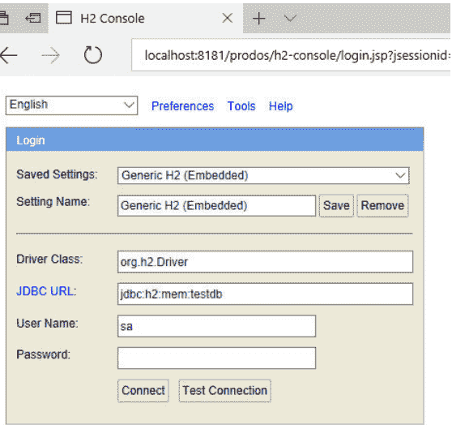
图 3.4：H2 Web 控制台

在登录窗口中，您可以将 JDBC URL 设置为 `jdbc:h2:mem:testdb`，并保持密码字段为空。点击 Connect 按钮登录控制台，如下截屏所示：

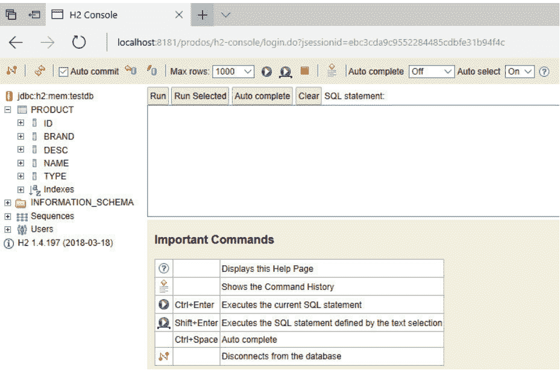
图 3.5：H2 Web 控制台中的产品表

在上述截屏中，您可以看到数据库中的 Product 表。现在，您可以确认在运行应用程序时，`data.sql` 文件中定义的数据是否已插入。您可以通过在 H2 控制台上执行 `select * from product` 查询来获取插入的数据，并在 H2 控制台上查看输出，如下截屏所示：

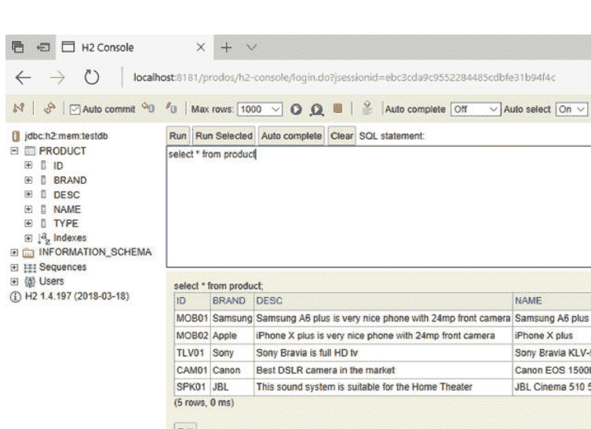
图 3.6：H2 Web 控制台中产品表的查询结果

在上述截屏中，Product 表包含我们在应用程序启动时插入的五行数据。我们已经了解了如何在 Spring 应用程序中使用 H2 数据库。我们知道 H2 数据库并不是生产环境的最佳选择。在生产环境中，我们需要配置功能更丰富的数据库，如 MariaDB、Oracle DB、IBM DB2 等。让我们看看如何在应用程序中配置 MariaDB 关系数据库。

## 配置 MariaDB 数据库

让我们在 PRODOS 应用程序中配置 MariaDB 数据库来替代 H2 数据库。您需要将 `pom.xml` 文件中的 H2 数据库 Maven 依赖项替换为 MariaDB 依赖项，如下代码所示：

```xml
<dependency>
    <groupId>org.mariadb.jdbc</groupId>
    <artifactId>mariadb-java-client</artifactId>
</dependency>
```

现在，我们将 MariaDB 数据库依赖项添加到了应用程序中。我们需要在 MariaDB 中为应用程序创建一个数据库。让我们使用 HeidiSQL 为 PRODOS 应用程序在 MariaDB 中创建 `PRODODB` 数据库，如下代码所示：

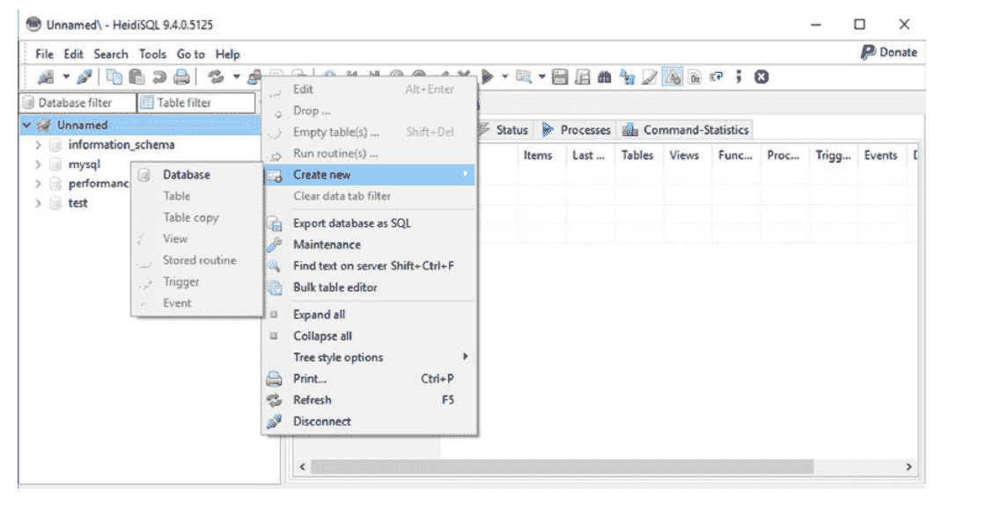
图 3.7：使用 HeidiSQL 在 MariaDB 中创建 PRODODB

现在，我们在 MariaDB 中创建了数据库。但数据库表仍然由 JPA 自动创建。

让我们在应用程序的 `application.properties` 文件中设置一些与 MariaDB 数据库相关的属性配置。首先，您需要使用 `spring.datasource.*` 和 `spring.jpa.*` 属性来定义数据库连接，如下代码所示：

```properties
spring.datasource.url=jdbc:mariadb://localhost:3306/proddb
spring.datasource.username=root
spring.datasource.password=root
spring.datasource.driver-class-name=org.mariadb.jdbc.Driver
spring.jpa.generate-ddl=true
spring.jpa.hibernate.ddl-auto=create-drop
```

在上述 `application.properties` 文件中，我们通过设置数据库的 URL、用户名、密码和数据库驱动类定义了数据库连接。此外，我们将 `spring.jpa.hibernate.ddl-auto` 属性设置为 `create-drop` 值（其他可选值为 `none`、`validate`、`update`、`create` 和 `create-drop`）。该属性定义了数据库初始化的行为。而 `spring.jpa.generate-ddl` 属性则定义了 JPA 是否应该初始化数据库（使用 true/false 值）。

现在，运行应用程序后，您应该能在 MariaDB 中看到这些表。下面的截屏显示了数据库创建后的 HeidiSQL UI。您的应用程序现在可以配合 MariaDB 使用了：

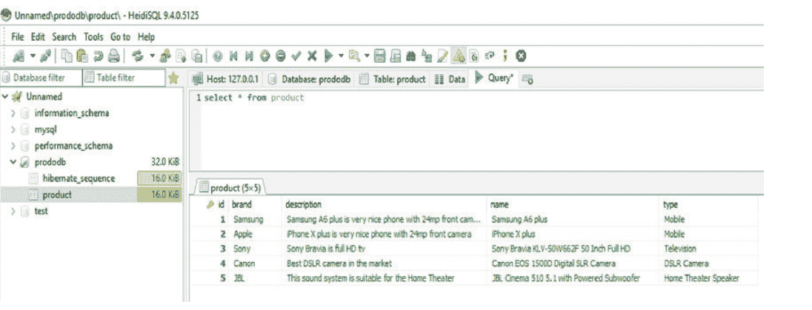
图 3.8：MariaDB 中的应用程序

您可以看到 Product 表已在 `prododb` 下创建，并且其中已经存在条目。

我们学习了如何为生产环境在应用程序中配置 MariaDB。

# 总结

在本章中，我们讨论了 Spring Boot 在数据层是如何工作的，并学习了许多内容。我们使用 Spring 的 `JdbcTemplate` 创建了一个用于获取数据库数据的应用程序。

我们涵盖了如何为嵌入式数据库和生产数据库配置 `DataSource`。我们还讨论了 JNDI 数据源支持，并使用 Spring Data JPA 创建了一个应用程序。我们还创建了 JPA 实体类和 Spring Data JPA 存储库。我们还看到了 Spring Data JPA 如何根据方法名自动创建查询。我们还在应用程序中自定义了一个 JPA 存储库。

我们使用 H2 数据库和 Spring Data JPA 创建了一个应用程序，并配置了 H2 数据库 Web 控制台来查询插入数据库的数据。最后，我们在同一个应用程序中配置了 MariaDB 来替代 H2 数据库。

在接下来的“第 4 章：使用 Spring Boot 创建 REST API”中，我们将讨论如何使用 Spring Boot 创建 REST 服务。

## 问题

- 什么是 JDBC？
- 如何创建实体类（Entity classes）？
- Spring 中的 JdbcTemplate 是什么？
- 如何配置 DataSource？
- 如何使用 Spring Data JPA？
- 什么是 ORM？
- ORM 有哪些具体实现？
- 什么是 JNDI？

# 第 4 章：使用 Spring Boot 2.2 创建 REST API

如今，由于移动设备、平板电脑、语音设备、智能手表等应用程序客户端的多样化，Web 应用程序的开发方式已经发生了变化。现代 Web 应用程序不再依赖于 Web 浏览器。Web 浏览器正在向传统技术（legacy technologies）转变！


为了处理种类繁多的客户端技术，我们需要以特定的方式设计Web应用程序，使其采用一种通用的设计模式——将客户端用户界面推送到客户端附近，同时服务器暴露相同的API，以便所有客户端都能与这些API通信来实现后端功能。

在本章中，我们将讨论REST架构风格，以及如何在Spring MVC中定义REST端点、如何启用超链接REST资源，以及如何使用Spring Data REST自动生成基于仓库的REST端点。本章涵盖以下主题：

- REST架构风格简介
- REST架构约束
- 统一接口原则
- 使用Spring Boot创建RESTful Web服务
- 使用@RestController注解
- 从服务器检索数据
- 向服务器发送数据
- 在服务器上更新数据
- 从服务器删除数据
- 为RESTful API添加超媒体
- 使用Spring HATEOAS
- 使用Resource和Resources类
- 实现Resource Assemblers
- 更改嵌入式关系名称
- 使用Spring Data REST创建RESTful Web服务
- 消费REST端点
- 使用RestTemplate消费REST端点
- 使用GET方法检索资源
- 使用PUT方法更新资源
- 使用DELETE方法删除资源
- 使用POST方法提交资源数据
- 使用Traverson消费REST端点
- 使用WebClient消费REST端点

## REST架构风格简介

术语REST代表**Representational State Transfer**（表述性状态转移）。它由Roy Fielding于2000年首次定义。REST不是框架或工具；它是一种应用程序架构风格和Web服务的设计方式。Web服务通过Internet使用HTTP协议工作。有许多用于创建Web服务的架构风格。REST是基于HTTP协议设计的架构风格之一。

Roy Fielding定义了一组约束。任何遵循这些约束的Web应用程序都称为REST应用程序。这些约束应用于架构。REST应用程序使用HTTP请求来GET、PUT、POST和DELETE数据。这个REST应用程序创建了一个应用程序编程接口（API）来操作数据。REST应用程序中的数据代表资源。资源被操作，并在客户端和服务器之间进行状态转移，通常使用JSON或XML格式。例如：

| 元素 | 描述 |
| :--- | :--- |
| 资源 | 产品（手机） |
| 服务 | 关于手机的产品信息（GET） |
| 表述 | 名称、类型、品牌、价格，以JSON或XML格式 |

让我们讨论以下REST架构的六个约束。

## REST架构约束

REST架构模型有一组约束，因此REST应用程序必须遵循以下约束：

- 客户端-服务器
- 无状态
- 可缓存
- 统一接口
- 分层系统
- 按需代码

让我们更详细地了解这些约束。

### 客户端-服务器

REST架构必须在客户端和服务器之间提供关注点分离。客户端不应负责任何数据存储；它必须是服务器的一部分，以便可以提高客户端代码的可移植性。服务器不负责渲染用户界面，也不持有任何用户状态。服务器对于任何类型的用户界面都必须相同，并且必须具有更好的可扩展性。服务器和客户端必须独立运作。

### 无状态

在基于REST架构的应用程序中，服务器必须是无状态的，这意味着它不持有任何关于客户端状态的信息。任何客户端都可以向服务器发送多个请求，这些请求必须被独立处理。这意味着每个请求必须包含所有必要的信息，以便服务器能够理解并相应地处理它。服务器不得持有任何与客户端相关的信息，但客户端可以持有服务器的信息。

### 可缓存

REST应用程序的某些资源必须是可缓存的。许多客户端频繁请求相同的资源；在这种情况下，服务器必须缓存响应以提高应用程序的性能。

### 分层系统

在基于REST架构的应用程序中，我们可以引入分层系统架构。客户端不知道它是直接与终端服务器通信，还是与沿途的中介通信。中介系统可以是任何东西，例如负载均衡器服务器。中介可以通过启用负载平衡和提供共享缓存来提高系统的可扩展性。在分层系统中，你还可以强制执行安全策略。

### 按需代码

这是一个可选约束。根据此约束，你可以在客户端运行一些代码，例如小程序或脚本。

### 统一接口

REST架构允许客户端和服务器独立演进，因此来自不同客户端的请求看起来相同，但客户端可能有所不同，例如移动应用程序、Java Web应用程序和浏览器。统一接口是一个重要的约束，它定义了客户端和服务器之间的接口。根据此约束，每个REST应用程序应具有以下元素。

#### 统一接口原则

统一接口的四个指导原则描述如下。

**识别资源**

对于每个客户端，资源必须具有其唯一标识符，并且还具有内聚的URI以使此资源可用。例如，以下是URI结构：

`HTTP/1.1 GET http://localhost:8181/prodos/products/MOB01`

前面的REST资源很容易暴露目录结构，以便客户端可以轻松访问资源。

**资源表述**

在前面的REST资源中，我们定义了一个REST URI来标识资源，但此URI不知道如何将该资源返回给客户端。因此，资源表述对于REST架构应用程序也非常重要。此表述可以是HTML、XML、JSON、TXT等。当客户端调用URI `http://localhost:8181/prodos/products/MOB01` 时，服务器以资源的表述形式进行响应，如下所示：

```json
{
  "id": "MOB01",
  "name": "Samsung A6 plus",
  "type": "Mobile",
  "description": "Samsung A6 plus is a very nice phone with a 24mp front camera",
  "brand": "Samsung"
}
```

**自描述消息**

请求消息应包含足够的信息，以便服务器能够理解如何处理此请求并相应地生成响应。假设客户端想要访问具有JSON内容类型的REST API。让我们看以下描述详细信息的请求消息：

```http
GET /#!/prodos/products/MOB01 HTTP/1.1
User-Agent: Chrome/37.0.2062.94
Accept: application/json
Host: localhost
```

如你所见，前面的元信息在请求和响应中都是必需的。

**超媒体作为应用程序状态的引擎（HATEOAS）**

客户端通过请求体内容、查询字符串参数、请求头和请求URI（资源名称）来传递状态。服务器通过响应体内容、响应码和响应头向客户端传递状态。在讨论REST时，这一部分经常被忽略。它在响应中返回所有必要的信息给客户端，告知如何导航以及访问所有应用程序资源。例如：

```http
//Request
HTTP/1.1 GET http://localhost:8080/prodos/products

//Response
{
  "_embedded": {
    "products": [
    {
      "name": "Samsung A6 plus",
      "type": "Mobile",
      "description": "Samsung A6 plus is very nice phone with 24mp front camera",
      "brand": "Samsung",
      "_links": {
        "self": {
          "href": "http://localhost:8080/prodos/products/MOB01"
        },
        "product": {
          "href": "http://localhost:8080/prodos/products/MOB01"
        }
      }
    },
    {
      "name": "Sony Bravia KLV-50W662F 50 Inch Full HD",
      "type": "Television",
      "description": "Sony Bravia is full HD tv",
      "brand": "Sony",
      "_links": {
        "self": {
          "href": "http://localhost:8080/prodos/products/TLV01"
        },
        "product": {
          "href": "http://localhost:8080/prodos/products/TLV01"
        }
      }
    },
    {
      "name": "Canon EOS 1500D Digital SLR Camera",
      "type": "DSLR Camera",
      "description": "Best DSLR camera in the market",
      "brand": "Canon",
      "_links": {
        "self": {
          "href": "http://localhost:8080/prodos/products/CAM01"
        }
      }
    }
  }
}
```


```json
product: {
	href: " http://localhost:8080/prodos/products/CAM01 "
	}
	}
	}
	}
	]
	},
	_links: {
		self: {
			href: " http://localhost:8080/prodos/products "
		},
		profile: {
			href: " http://localhost:8080/prodos/profile/products "
		},
		search: {
			href: " http://localhost:8080/prodos/products/search "
		}
		}
	}
}
```

我们讨论了 REST 架构模型及其六个约束。如果一个服务违反了除“按需代码（Code-On-Demand）”约束之外的任何约束，它就严格不能被称为 RESTful 应用。在接下来的章节中，我们将使用 Spring Boot 2.2 创建一个 RESTful 应用。

## 使用 Spring Boot 创建 RESTful Web 服务

在 Spring Boot 中，让我们创建一个 RESTful Web 服务。我们已经创建了一个 PRODOS 应用程序，现在我们将创建一个控制器类（controller class）。控制器类负责处理所有 HTTP 请求。让我们右击 `com.dineshonjava.prodos.controller` 包，并从菜单中选择 New | Class。我们将类命名为 `ProductController`：

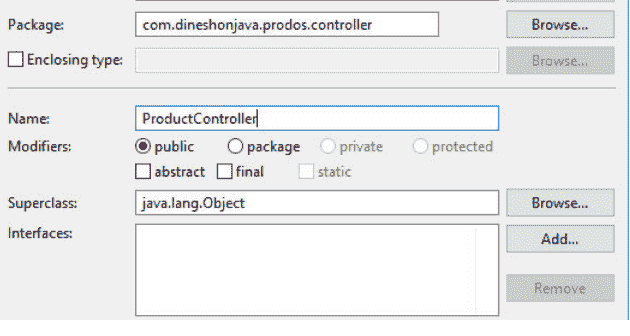
图 4.1：创建 ProductController 类

创建 ProductController 类后，让我们查看项目结构。它应该像下面的截图所示：

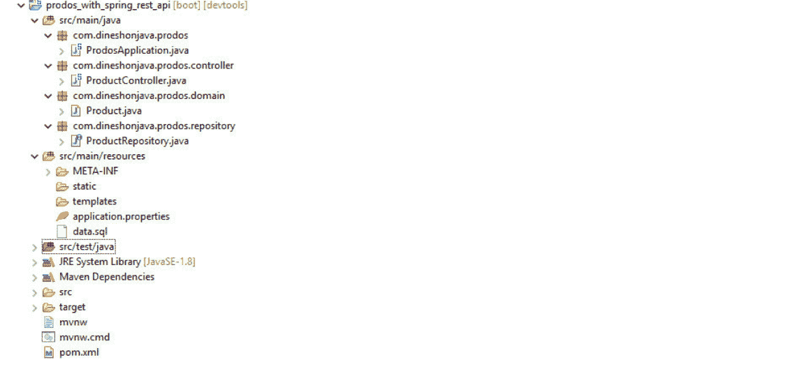
图 4.2：REST 应用结构

### 使用 @RestController 注解

在 STS IDE 中打开您的 ProductController 控制器类，并使用 `@RestController` 注解来标注这个控制器类。让我们看看 ProductController 类的以下源代码：

```java
package com.dineshonjava.prodos.controller;

import org.springframework.web.bind.annotation.RestController;

@RestController
public class ProductController {

}
```

在上述控制器类中，`@RestController` 注解表明该控制器类将作为 RESTful Web 服务的 REST 控制器。现在您可以将应用程序的功能添加到这个 REST 控制器类中。

### 从服务器检索数据

在我们的 PRODOS 应用程序中，我们创建了一个使用 `@RestController` 注解标注的 ProductController 作为 REST 控制器。正如我们所知，`@RestController` 注解与 `@Controller`、`@Service` 等一样，是刻板印象元注解（stereotype meta-annotations）之一。标注有 `@RestController` 注解的类同样符合组件扫描（component scanning）的条件，而且重要的一点是，该控制器文件下的所有请求处理方法都会将值直接返回到响应体（body of the response）中，而不是使用视图解析器（view resolver）将模型数据渲染到视图中。

让我们为创建的 REST 控制器添加一个请求处理方法，以从服务器检索数据，如下代码所示：

```java
package com.dineshonjava.prodos.controller;

import java.util.ArrayList;
import java.util.List;
import org.springframework.web.bind.annotation.GetMapping;
import org.springframework.web.bind.annotation.RestController;
import com.dineshonjava.prodos.domain.Product;
import com.dineshonjava.prodos.repository.ProductRepository;

@RestController
public class ProductController {

    private ProductRepository productRepository;

    public ProductController(ProductRepository productRepository) {
        super();
        this.productRepository = productRepository;
    }

    @GetMapping("/products")
    public List findAll(){
        List products = new ArrayList<>();
        productRepository.findAll().forEach(i -> products.add(i));
        return products;
    }
}
```

在上述 REST 控制器类中，我们定义了一个请求处理方法 `findAll()`。该方法被标注有 `@GetMapping` 注解，表明 `findAll()` 方法负责处理针对 URI `/prodos/products` 的 GET 请求。`@GetMapping` 注解是 `@RequestMapping` 注解配合 GET 方法的快捷方式。

`@GetMapping("/products")` 等同于 `@RequestMapping("/products", method=GET)`

从 4.3.5 版本开始，Spring 为特定的 HTTP 方法引入了这些简短的请求映射注解，如下所示：

- @GetMapping
- @PostMapping
- @PutMapping
- @DeleteMapping
- @PatchMapping

`findAll()` 请求处理方法将使用我们在前一章中创建的 `ProductRepository` 对象从服务器检索所有产品。`ProductRepository` 对象通过 `@Autowired` 注入到 `ProductController` 类中。

让我们运行应用程序并访问 `http://localhost:8181/prodos/products`，如下截图所示：

```json
[
 {
    "id": "MOB01",
    "name": "Samsung A6 plus",
    "type": "Mobile",
    "description": "Samsung A6 plus is very nice phone with 24mp front camera",
    "brand": "Samsung"
  },
  {
    "id": "MOB02",
    "name": "iPhone X plus",
    "type": "Mobile",
    "description": "iPhone X plus is very nice phone with 24mp front camera",
    "brand": "Apple"
  },
  {
    "id": "TLV01",
    "name": "Sony Bravia KLV-50W662F 50 Inch Full HD",
    "type": "Television",
    "description": "Sony Bravia is full HD tv",
    "brand": "Sony"
  },
  {
    "id": "CAM01",
    "name": "Canon EOS 1500D Digital SLR Camera",
    "type": "DSLR Camera",
    "description": "Best DSLR camera in the market",
    "brand": "Canon"
  },
  {
    "id": "SPK01",
    "name": "JBL Cinema 510 5.1 with Powered Subwoofer",
    "type": "Home Theater Speaker",
    "description": "This sound system is suitable for the Home Theater",
    "brand": "JBL"
  }
]
```
图 4.3：JSON 格式的所有产品数据

现在，假设我们想要创建另一个端点，通过产品 ID 获取单个产品。我们可以在处理方法的请求处理路径中使用占位符变量。处理方法通过 `@PathVariable` 注解接收此占位符。让我们向 ProductController 类添加以下请求处理方法：

```java
@GetMapping("/products/{id}")
public Product findProductById(@PathVariable String id){
  return productRepository.findById(id).isPresent() ? productRepository.findById(id).get() : null;
}
```

上述代码片段在访问 `http://localhost:8181/prodos/products/MOB01` URI 时，将通过产品 ID 返回单个产品信息，如下截图所示：

```json
{
  "id": "MOB01",
  "name": "Samsung A6 plus",
  "type": "Mobile",
  "description": "Samsung A6 plus is very nice phone with 24mp front camera",
  "brand": "Samsung"
}
```
图 4.4：JSON 格式的单个产品数据

在上述请求处理方法 `findProductById()` 中，`id` 参数被传递给 `ProductRepository` 对象的 `findById()` 方法以获取产品。该方法还返回一个 `Optional` 对象。返回的 `Optional` 对象表明具有给定 ID 的产品在产品数据库中可能不存在。这就是为什么我们在返回值之前要检查产品是否存在。如果给定的产品 ID 存在产品，则调用 `Optional` 对象的 `get()` 方法返回实际的产品。

如果没有给定 ID 的产品，则返回 `null`。在这种情况下，客户端将收到一个空响应体以及 HTTP 状态码 200 (OK)。这不是处理请求的理想方式，因为状态码 200 意味着服务器端一切正常。我们可以通过返回一个带有 HTTP 404 (NOT FOUND) 状态的响应来提供一种更好的方法来处理这种空结果的情况。

让我们对上面编写的请求处理方法 `findProductById()` 做一些小的修改，如下所示：

```java
@GetMapping("/products/{id}")
public ResponseEntity findProductById(@PathVariable String id){
    return productRepository.findById(id).isPresent() ?
    new ResponseEntity<>(productRepository.findById(id).get(), HttpStatus.OK) :
    new ResponseEntity<>(null, HttpStatus.NOT_FOUND);
}
```

上述请求处理方法 `findProductById()` 返回一个 `ResponseEntity` 对象而不是 `Product` 对象。如果找到了给定产品 ID 的产品，则将找到的产品对象封装在状态码为 200 (OK) 的 `ResponseEntity` 对象中。但如果未找到给定产品 ID 的产品，则将 null 值封装在状态码为 404 (NOT FOUND) 的 `ResponseEntity` 对象中，以向客户端表明其尝试获取的产品在数据库中不存在。

### 向服务器发送数据

现在，我们将在 ProductController REST 类中创建一个请求处理方法，以便向服务器发送数据。这意味着我们将创建一个用于向服务器发送数据的 API，而不是从服务器获取数据。让我们在 ProductController 中编写一个 `postProduct()` 方法来处理该请求，并使用 `ProductRepository` 对象的 `save()` 方法将产品数据保存到数据库中：

```java
@PostMapping(value= "/products", consumes="application/json")
@ResponseStatus(HttpStatus.CREATED)
public Product postProduct(@RequestBody Product product) {
    return productRepository.save(product);
}
```

上述请求处理方法标注有 `@PostMapping` 注解，因此它处理 HTTP POST 请求。我们指定了路径 `/products`。我们还指定了另一个 `consumes` 属性。`consumes` 属性定义了请求的输入内容类型。在这里，我们将 `application/json` 值设置为 `consumes` 属性。这是一种与 application/json 匹配的内容类型。

我们将 `Product` 参数传递给请求处理方法，该参数标注有 `@RequestBody` 注解，表明请求体应被转换为 Product 对象并绑定到该参数。转换后，它被传递给 `ProductRepository` 接口的 `save()` 方法。

`postProduct()` 请求处理方法还标注有 `@ResponseStatus(HttpStatus.CREATED)` 注解。它表明客户端请求已成功完成，并在给定端点创建了资源。虽然我们也可以使用 HTTP 状态码 200，但在这种情况下它不够详细。因此，在您希望从客户端向服务器发送数据的情况下，使用 `@ResponseStatus(HttpStatus.CREATED)` 注解是一个好主意。

让我们运行应用程序并从客户端向服务器创建一个新产品。这里，我使用 Postman REST 客户端来测试创建的 API，如下截图所示：


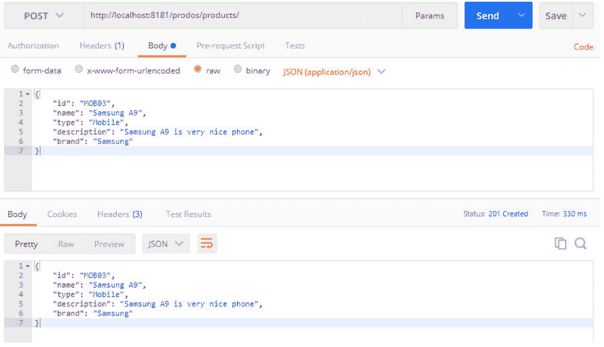
图 4.5：将产品数据发送到服务器

如前面的截图所示，我们使用 Postman REST 客户端在服务器上创建了一个资源。REST 客户端显示响应状态码为 201。虽然我们可以使用@PostMapping注解为POST请求在服务器上创建资源，但也可以使用PUT和PATCH请求方法来更新资源。我们将在下一节讨论@PutMapping和@PatchMapping注解。

## 在服务器上更新数据

Spring提供了两个请求映射注解来在服务器上更新数据：@PutMapping和@PatchMapping。因此，在使用其中任何一个之前，我们需要了解为什么有两种不同的方式使用HTTP PUT和PATCH方法来更新服务器上的数据。

HTTP PUT方法通常用于更新服务器上的资源数据。PUT请求用于将资源数据从客户端发送到服务器，针对给定的资源ID。PUT方法对资源执行整体替换操作，而不是更新操作。而PATCH请求方法则对服务器上的资源数据执行部分更新。

让我们看看下面添加到ProductController类的PUT HTTP请求处理方法。例如，假设你想更改产品的描述：

```java
@PutMapping("/products/{id}")
public Product putProduct(@RequestBody Product product) {
    return productRepository.save(product);
}
```

将PUT请求处理方法添加到ProductController类后，让我们运行应用程序并使用Postman REST客户端测试PUT请求，如下图所示：

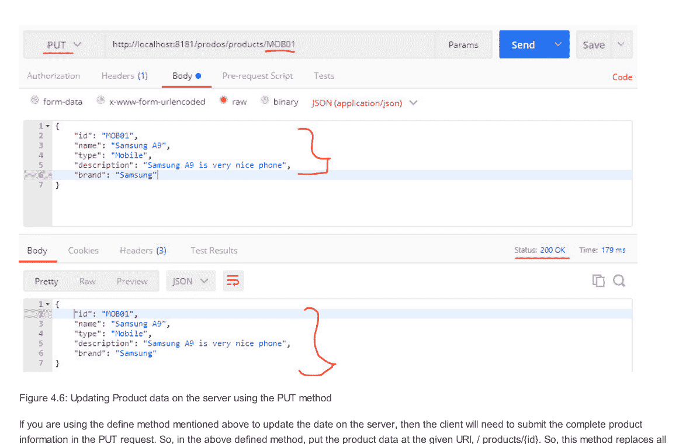
图 4.6：使用PUT方法在服务器上更新产品数据

如果你使用上述定义的方法在服务器上更新数据，那么客户端需要在PUT请求中提交完整的产品信息。因此，在上面定义的方法中，将产品数据放入给定的URI `/products/{id}`。所以，无论数据是否存在，此方法都会替换与给定URI相关的所有服务器上的数据。如果你忘记了设置产品的某个属性，那么该属性的值将被覆盖为null。

那么，让我们看看如何处理使用HTTP PATCH请求进行部分更新的请求。Spring的@PatchMapping注解用于实现服务器上的部分资源更新。以下是需要添加到ProductController类的请求处理方法：

```java
@PatchMapping(path="/products/{id}", consumes="application/json")
public Product patchProduct(@PathVariable String id, @RequestBody Product patch) {
    Product product = productRepository.findById(id).get();
    if (patch.getBrand() != null) {
        product.setBrand(patch.getBrand());
    }
    if (patch.getDescription() != null) {
        product.setDescription(patch.getDescription());
    }
    if (patch.getName() != null) {
        product.setName(patch.getName());
    }
    if (patch.getType() != null) {
        product.setType(patch.getType());
    }
    return productRepository.save(product);
}
```

前面的`patchProduct()`请求处理方法使用@PatchMapping注解而不是@PostMapping进行注解，以表明此方法将处理HTTP PATCH请求而不是POST请求。

因此，用于更新请求的Spring MVC映射注解包括@PatchMapping和@PostMapping，它们没有提供处理请求的特定方式。这些注解仅表示PATCH请求处理方法用于部分更新，而PUT请求处理方法用于服务器上的完全更新。所以，这些在服务器上更新数据的不同方法提供了一种方式，允许客户端只发送需要更改的属性，并使服务器能够保留客户端未指定的任何属性的现有数据。

将PATCH请求处理方法添加到ProductController类后，让我们运行应用程序并使用Postman REST客户端测试PATCH请求，如下图所示：

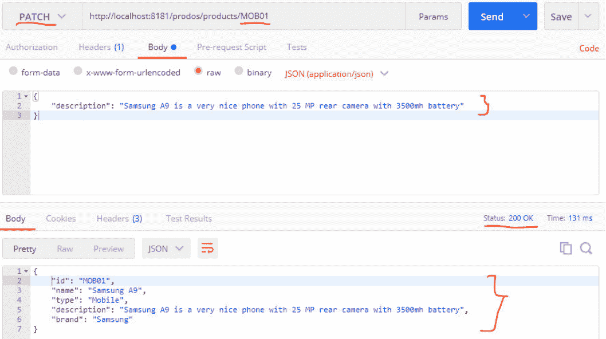
图 4.7：使用PATCH方法在服务器上部分更新产品数据

在前面的截图中，我们正在更新一个具有给定ID的产品（`http://localhost:8181/prodos/products/MOB01`），并且我们只想更新产品的描述，这就是为什么我们只在请求体中传递产品描述。最终，产品的描述已被更改，而其余数据保持不变。

我们讨论了如何使用@GetMapping和@PostMapping获取和发布资源。我们还讨论了使用@PutMapping和@PostMapping更新资源的两种不同方式。接下来，我们将讨论如何处理删除请求以从服务器删除数据。

## 从服务器删除数据

你也可以创建一个API来从服务器删除数据。有时，旧的产品信息不再需要；在这种情况下，客户端应该能够从服务器删除这些产品。我们可以在ProductController类中再创建一个请求处理方法，以使用HTTP DELETE请求方法来处理从服务器删除资源的请求。

Spring MVC为DELETE HTTP方法提供了一个映射注解，即@DeleteMapping注解。例如，假设你希望你的API允许你删除一个产品资源。以下控制器方法应该可以实现：

```java
@ResponseStatus(code=HttpStatus.NO_CONTENT)
@DeleteMapping("/products/{id}")
public void deleteProduct(@PathVariable String id) {
    try {
        productRepository.deleteById(id);
    } catch (EmptyResultDataAccessException e) {
    }
}
```

前面的`deleteProduct()`请求处理方法负责处理路径（`products/{id}`）的DELETE HTTP请求，并从服务器删除具有给定产品ID的产品。`deleteProduct()`方法使用`@DeleteMapping`注解进行注解，这用于通过`products/{id}`请求路径将HTTP DELETE请求映射到处理方法。

在`deleteProduct()`方法中，使用`ProductRepository`对象的`deleteById()`方法删除具有给定产品ID的产品，产品ID作为路径变量在URL中提供。现在，如果给定的`deleteProduct()`方法存在产品，则会将其删除，否则该方法将抛出`EmptyResultDataAccessException`异常。你会注意到`deleteProduct()`请求处理方法也使用`@ResponseStatus(code=HttpStatus.NO_CONTENT)`进行注解，这意味着`deleteProduct()`方法确保响应的HTTP状态为204（NO CONTENT），并且无需将任何数据回复给客户端，因为产品已被删除。

添加请求DELETE处理方法后，让我们运行应用程序并使用Postman REST客户端进行测试，如下图所示：

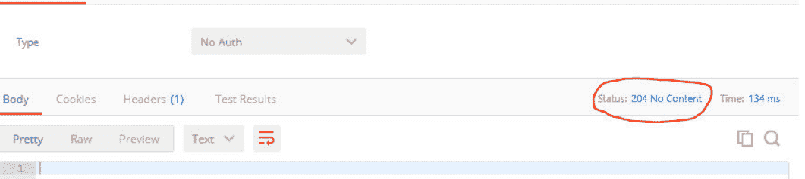
图 4.8：使用DELETE方法从服务器删除产品数据

如前面的截图所示，我们使用Postman REST客户端删除了具有给定产品ID（DELETE `http://localhost:8181/prodos/products/MOB01`）的产品。你可以看到响应返回的状态码为204（NO CONTENT）。

现在，你的RESTful应用程序PRODOS已经有了API。你的应用程序的客户端可以轻松地使用这些API。客户端可以使用这些API来检索所有产品、创建新产品、删除产品以及更新产品详情。但是客户端必须记住这些API。我们可以让这些API对客户端来说更加容易，这样客户端就不需要记住这些API了。我们将在下一节为RESTful API添加超媒体。

## 为RESTful API添加超媒体

在上一节中，我们为CRUD功能创建了RESTful API。这些API对客户端来说非常公平，但客户端必须知道API URL。客户端可能在客户端本地硬编码了API URL。例如，如果客户端想要使用/prodos/products GET请求路径从服务器检索所有产品。这个请求路径可能在客户端被硬编码以检索所有产品，但如何通过给定的产品ID访问特定的产品资源。客户端可能有更多的URL需要硬编码。

客户端的硬编码URL结构在API URL方案改变时可能会存在风险。因此，客户端代码中的硬编码API URL可能会过时并中断。在这种情况下，如果API URL模式发生任何更改，则需要更新客户端代码。这个问题可以使用统一接口的HATEOAS属性来解决。因此，HATEOAS方法应运而生，以解决

客户端与 RESTful API 进行交互。现在，客户端只需要记住一个初始 URI。一旦客户端加载了初始 URI 的响应，所有应用程序状态转移的链接都将对客户端可见，并且客户端能够选择服务器提供的链接。

HATEOAS 是 REST 约束中统一接口（Uniform interface）原则之一。这意味着我们正在创建自描述的 REST API。客户端可以在运行时从服务器端发现可用的下一个或上一个链接。这些 API 将返回包含指向相关资源链接的资源。这使得客户端在无需事先了解 API URL 模式，或仅需极少了解 API URL 的情况下即可使用 API。Spring 框架为 HATEOAS 提供了一个模块。

## 使用 Spring HATEOAS

通过在应用程序中添加 Spring HATEOAS 模块，Spring 框架提供了为 RESTful API 添加超媒体（hypermedia）的支持。Spring HATEOAS 项目为 RESTful API 提供了超链接支持。该模块提供了一组类和资源组装器（resource assemblers）用于向资源添加超链接。

让我们在之前创建 REST API 的 PRODOS REST 应用程序中添加超媒体支持。您可以通过添加如下代码所示的 Spring HATEOAS starter 依赖项，在 PRODOS 应用程序中启用超媒体：

```xml
org.springframework.boot
spring-boot-starter-hateoas
```

前面的 starter 依赖项将 Spring HATEOAS 模块及其用于启用 Spring HATEOAS 的自动配置添加到您的应用程序中。您的 PRODOS 应用程序不需要进行任何与配置相关的更改；唯一需要更改的是将返回的资源类型从领域类型（domain types）更改为资源类型。让我们为之前创建的其中一个 API 添加超链接，该 API 通过对 `/products` 发起 GET 请求来返回所有产品，如下截屏所示：

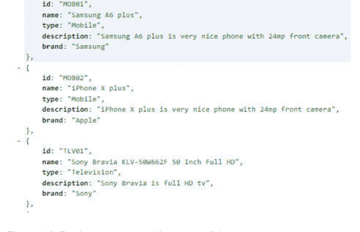
图 4.9：带有超链接的产品资源

## 使用 Resource 和 Resources 类

Spring HATEOAS 提供了两个类，`Resource` 和 `Resources`，用于表示带有超链接的资源。`Resource` 类用于单个资源，而 `Resources` 类用于资源列表。让我们对 `ProductController` 类的 `findAll()` 方法进行修改，以为产品列表添加超链接：

```java
package com.dineshonyava.prodos.controller;

import java.util.ArrayList;
import java.util.List;
import org.springframework.hateoas.Resource;
import org.springframework.hateoas.Resources;
import org.springframework.hateoas.mvc.ControllerLinkBuilder;
import org.springframework.web.bind.annotation.GetMapping;
import org.springframework.web.bind.annotation.RestController;
import com.dineshonjava.prodos.domain.Product;
import com.dineshonjava.prodos.repository.ProductRepository;

@RestController
public class ProductController {

    private ProductRepository productRepository;

    public ProductController(ProductRepository productRepository) {
        super();
        this.productRepository = productRepository;
    }

    @GetMapping(value = "/products", produces="application/json")
    public Resources<Product> findAll(){
        List<Product> products = new ArrayList<>();
        productRepository.findAll().forEach(i-> products.add(i));
        Resources<Product> productResources = Resources.wrap(products);
        productResources.add(ControllerLinkBuilder.linkTo(ProductController.class).slash("products").withRel("products"));
        return productResources;
    }

    //...
}
```

上述 `ProductController` 类的 `findAll()` 方法已将返回类型从直接返回产品列表更改为 `Resources<Product>`。`Resources` 类的 `wrap()` 方法用于将产品列表包装为 `Resources<Product>` 的实例。对于 `http://localhost:8181/prodos/products/` 的请求，`findAll()` 方法将返回此实例，如下截屏所示：

```json
{
  "_embedded": {
    "productList": [
      {
        "id": "MOB01",
        "name": "Samsung A6 plus",
        "type": "Mobile",
        "description": "Samsung A6 plus is very nice phone with 24mp front camera",
        "brand": "Samsung"
      },
      {
        "id": "MOB02",
        "name": "iPhone X plus",
        "type": "Mobile",
        "description": "iPhone X plus is very nice phone with 24mp front camera",
        "brand": "Apple"
      },
      {
        "id": "TLV01",
        "name": "Sony Bravia KLV-50W662F 50 Inch Full HD",
        "type": "Television",
        "description": "Sony Bravia is full HD tv",
        "brand": "Sony"
      },
      {
        "id": "CAM01",
        "name": "Canon EOS 1500D Digital SLR Camera",
        "type": "DSLR Camera",
        "description": "Best DSLR camera in the market",
        "brand": "Canon"
      },
      {
        "id": "SPK01",
        "name": "JBL Cinema 510 5.1 with Powered Subwoofer",
        "type": "Home Theater Speaker",
        "description": "This sound system is suitable for the Home Theater",
        "brand": "JBL"
      }
    ]
  },
  "_links": {
    "products": {
      "href": "http://localhost:8181/prodos/products"
    }
  }
}
```
图 4.10：带有超链接的产品资源

在前面的截屏中，对 `http://localhost:8181/prodos/products/` 的 API 请求返回了包含以下 JSON 代码片段的资源：

```json
_links: {
  products: {
    href: "http://localhost:8181/prodos/products"
  }
}
```

Spring HATEOAS 提供了一个链接构建类 `ControllerLinkBuilder`。这是一个非常实用的类，用于构建链接。该类足够智能，可以在不指定的情况下获取主机名，并提供了多种方法帮助您构建链接。

我们不仅没有将主机名交给链接构建器，也没有指定 `/prodos/products` 路径。相反，我们将 `ProductController` 类作为参数传递给 Spring HATEOAS 的 `ControllerLinkBuilder` 类的 `linkTo()` 方法。`ControllerLinkBuilder` 类使用 `ProductController` 类的基础路径作为您创建的 `Link` 对象的基石。

接下来，我们使用了 `ControllerLinkBuilder` 类的 `slash()` 方法。该方法定义了控制器基础 URL (`/prodos`) 之后的 URI (`/products`) 并赋予其值。最终，它生成了 `/prodos/products` 路径作为结果。之后，我们为该超链接指定了一个关系名称（relation name），在我们的示例中，关系名称是 `"products"`。

我们使用了 `ControllerLinkBuilder` 类及其 `linkTo()` 和 `slash()` 等方法来消除链接的硬编码，但我们可以进一步优化链接构建代码。我们可以直接使用控制器的方法名，而不是生成控制器类，从而在不使用 `ControllerLinkBuilder` 的 `slash()` 方法的情况下生成完整的 URL，如下代码所示：

```java
@GetMapping(value = "/products", produces="application/json")
public Resources<Product> findAll(){
    List<Product> products = new ArrayList<>();
    productRepository.findAll().forEach(i -> products.add(i));
    Resources<Product> productResources = Resources.wrap(products);
    productResources.add(linkTo(methodOn(ProductController.class).findAll()).withRel("products"));
    return productResources;
}
```

这里我们使用了 `ControllerLinkBuilder` 类的 `linkTo()` 和 `methodOn()` 方法。在前面的代码中，`ControllerLinkBuilder` 类被用来生成使用请求处理程序（request handler）的基础 URL 而非控制器的基础 URL 的链接。这里，我们需要将控制器类传递给 `methodOn()` 方法，然后它允许您调用 `findAll()` 方法，该调用会被 `ControllerLinkBuilder` 类拦截，以导出映射到 `findAll()` 方法的完整 URL。

到目前为止，我们为 API `http://localhost:8181/prodos/products` 返回的资源添加了一个单一链接，但此 API 返回的是产品列表。现在，我们需要为列表中的每个产品添加链接。Spring HATEOAS 提供了支持，无需循环遍历每个 `Resource` 元素，即可通过 API 为返回列表中的每个资源生成链接。让我们实现一个资源组装器，以为产品列表中的每个产品生成链接。

### 实现资源组装器

我们需要创建一个实用类，负责为每个产品资源生成链接。但使用 `Resources.wrap()` 方法无法实现这一点，因为该方法仅为列表中的产品创建 `Resource` 对象。现在，实用类将把 `Product` 对象转换为新的 `ProductResource` 对象。这里的 `ProductResource` 对象与 `Product` 对象非常相似，但 `ProductResource` 对象能够携带链接。让我们看看如下代码所示的 `ProductResource` 类：

```java
package com.dineshonjava.prodos.domain;

import org.springframework.hateoas.ResourceSupport;

public class ProductResource extends ResourceSupport {

    private String name;
    private String type;
    private String description;
    private String brand;

    public ProductResource(Product product) {
        this.name = product.getName();
        this.type = product.getType();
        this.description = product.getDescription();
        this.brand = product.getBrand();
    }

    public String getName() {
        return name;
    }
```

```java
public void setName(String name) {
    this.name = name;
}

public String getType() {
    return type;
}

public void setType(String type) {
    this.type = type;
}

public String getDescription() {
    return description;
}

public void setDescription(String description) {
    this.description = description;
}

public String getBrand() {
    return brand;
}

public void setBrand(String brand) {
    this.brand = brand;
}
}
```

前述的 ProductResource 类继承了 ResourceSupport 类，并继承了管理链接列表的方法以及一个 Link 对象的列表。在前面的代码中，我为 ProductResource 类创建了一个构造函数，该构造函数接受一个 Product 对象，并将 Product 对象的属性值复制到它自己的属性中。

现在，我们需要创建一个组装类，用于帮助将 Product 对象转换为 ProductResource 对象。让我们看看以下代码：

```java
package com.dineshonjava.prodos.domain;

import org.springframework.hateoas.mvc.ResourceAssemblerSupport;
import com.dineshonjava.prodos.controller.ProductController;

public class ProductResourceAssembler extends ResourceAssemblerSupport<Product, ProductResource> {

    public ProductResourceAssembler() {
        super(ProductController.class, ProductResource.class);
    }

    @Override
    protected ProductResource instantiateResource(Product product) {
        return new ProductResource(product);
    }

    @Override
    public ProductResource toResource(Product product) {
        return createResourceWithId("products/" + product.getId(), product);
    }
}
```

前述的 ProductResourceAssembler 类通过传入类型参数继承了 ResourceAssemblerSupport 类。该类有一个默认构造函数，通过传入 ProductController 和 ProductResource 类作为参数来调用超类构造函数。第一个参数 ProductController 类用于确定链接中任何 URL 的基本路径，第二个参数 ProductResource 类用于通知超类创建 ProductResource 类。ProductResourceAssembler 类还重写了 ResourceAssemblerSupport 类的两个方法，instantiateResource() 和 toResource()，用途如下：

- instantiateResource() 方法用于给定 Product 对象时实例化一个 ProductResource 对象。
- toResource() 方法用于从 Product 创建 ProductResource 对象，该方法会自动提供一个自链接，其 URL 从 Product 对象的 id 属性派生。

如前面的代码所示，两个方法都返回 ProductResource 对象，但唯一的区别是 instantiateResource() 方法仅实例化一个 Resource 对象（ProductResource），而 toResource() 方法不仅实例化 Resource 对象，还会为其填充链接。createResourceWithId() 方法在内部调用 instantiateResource() 方法来创建 Resource 对象。

让我们更改 ProductController 类的 findAll() 方法代码，如下面的代码所示，使用 ProductResourceAssembler 类为列表中的每个产品生成链接：

```java
@GetMapping(value = "/products", produces = "application/json")
public Resources findAll() {
    List<Product> products = new ArrayList<>();
    productRepository.findAll().forEach(i -> products.add(i));
    List<ProductResource> productResourceList = new ProductResourceAssembler().toResources(products);
    Resources productResources = new Resources(productResourceList);
    productResources.add(linkTo(methodOn(ProductController.class).findAll()).withRel("products"));
    return productResources;
}
```

从前面的实现来看，前述方法代码有以下变化：

- findAll() 方法的返回类型是 Resources 而不是 Resources<Product>。
- 产品列表被传递给 ProductResourceAssembler 类中的 toResources() 方法。

另一部分与前述代码非常相似。在 ProductController 类中进行这些更改后，重新启动应用程序并导航到 REST API 地址 http://localhost:8181/prodos/products/，查看如下面截图所示的输出：

```json
{
  "_embedded": {
    "productResourceList": [
      {
          "name": "Samsung A6 plus",
          "type": "Mobile",
          "description": "Samsung A6 plus is very nice phone with 24mp front camera",
          "brand": "Samsung",
          "_links": {
            "self": {
                "href": "http://localhost:8181/prodos/products/MOB01"
              }
          }
        },
      {
          "name": "iPhone X plus",
          "type": "Mobile",
          "description": "iPhone X plus is very nice phone with 24mp front camera",
          "brand": "Apple",
          "_links": {
            "self": {
                "href": "http://localhost:8181/prodos/products/MOB02"
              }
          }
        },
      {
          "name": "Sony Bravia KLV-50W662F 50 Inch Full HD",
          "type": "Television",
          "description": "Sony Bravia is full HD tv",
          "brand": "Sony",
          "_links": {
            "self": {
                "href": "http://localhost:8181/prodos/products/TLV01"
              }
          }
        },
      {
          "name": "Canon EOS 1500D Digital SLR Camera",
          "type": "DSLR Camera",
          "description": "Best DSLR camera in the market",
          "brand": "Canon",
          "_links": {
            "self": {
                "href": "http://localhost:8181/prodos/products/CAM01"
              }
          }
        },
      {
          "name": "JBL Cinema 510 5.1 with Powered Subwoofer",
          "type": "Home Theater Speaker",
          "description": "This sound system is suitable for the Home Theater",
          "brand": "JBL",
          "_links": {
            "self": {
                "href": "http://localhost:8181/prodos/products/SPK01"
              }
          }
        }
    ]
  },
  "_links": {
    "products": {
        "href": "http://localhost:8181/prodos/products"
      }
  }
}
```
图 4.11：每个产品都带有链接的产品资源

## 更改嵌入式关系名称

Spring HATEOAS 还允许您使用 @Relation 注解更改嵌入式关系的名称。在以下代码片段中，显示了当前的关系名称：

```json
{
    "_embedded": {
        "productResourceList": [
            ...
        ]
    }
}
```

让我们在 ProductResource 类的代码中进行以下更改：

```java
@Relation(value="product", collectionRelation="products")
public class ProductResource extends ResourceSupport{
    //...
}
```

在 ProductResource 类中进行更改后，再次重新启动应用程序并导航到同一个 REST API。嵌入式关系名称已更改，如以下代码所示：

```json
{
    "_embedded": {
        "products": [
            ...
        ]
    }
}
```

我们使用 Spring HATEOAS 创建了一个 REST 应用程序，为您的 REST API 添加链接，而不是创建直截了当、简单的东西。让我们看看以下应用程序结构：

```text
prodos_with_spring_rest_api_with_hypermedia [boot] [devtools]
  src/main/java
    com.dineshonjava.prodos
      ProdosApplication.java
    com.dineshonjava.prodos.controller
      ProductController.java
    com.dineshonjava.prodos.domain
      Product.java
      ProductResource.java
      ProductResourceAssembler.java
    com.dineshonjava.prodos.repository
      ProductRepository.java
  src/main/resources
    META-INF
    static
    templates
    application.properties
    data.sql
  src/test/java
  JRE System Library [JavaSE-1.8]
  Maven Dependencies
  src
  target
  mvnw
  mvnw.cmd
  pom.xml
```
图 4.12：使用 Spring HATEOAS 在 REST API 中包含超媒体的 REST 应用程序。

在这里，我们使用 Spring MVC 创建服务，但 Spring Data 提供了另一种使用 Spring Data REST 项目创建 RESTful Web 服务的方式。接下来，让我们在下一节中讨论如何使用 Spring Data REST 创建 REST Web 服务。

## 使用 Spring Data REST 创建 RESTful Web 服务

Spring Data REST 是 Spring Data  umbrella 家族中的另一个子项目。它使用 Spring Data 创建的仓库自动为您创建 REST API，无需应用程序中的任何 REST 控制器。您可以将以下 Maven 启动器依赖项添加到您的构建中：

```xml
<dependency>
    <groupId>org.springframework.boot</groupId>
    <artifactId>spring-boot-starter-data-rest</artifactId>
</dependency>
```

我们将上述 Maven 依赖项添加到 Spring 应用程序的 pom.xml 文件中，以使用 Spring 实现 RESTful Web 服务。默认情况下，Spring Data REST 会找到应用程序的所有公共仓库，为您的实体创建 RESTful Web 服务。上述启动器提供了自动配置，启用为 Spring Data 仓库自动创建 RESTful Web 服务，包括 Spring Data JPA、Spring Data Cassandra、Spring Data MongoDB 等。

您还可以在 application.properties 文件中为应用程序的 RESTful Web 服务设置端点路径，如以下代码所示：

```properties
spring.data.rest.basePath=/api
```

在为 RESTful Web 服务设置上述基本路径后，所有服务都将在 http://localhost:8080/api/ 端点可用。Spring Data REST 以 JSON 格式返回数据，包括超媒体或链接。让我们创建具有以下结构的 Spring Boot 应用程序：

(图片: img/f18865345fa9c31c459011a03475924c_94_0.png)
图 4.13：Spring Data REST 应用程序结构

在前面的截图中，我们仅将 Spring Data REST 的启动器添加到类路径中，其他什么也没有。所有代码与之前相同，如仓库和实体。让我们将此应用程序作为 Spring Boot 应用程序运行，并导航到 http://localhost:8080/api/ 端点，如以下截图所示：


 ```
{
  _links: {
    - products: {
        href: "http://localhost:8080/api/products"
      },
    - profile: {
        href: "http://localhost:8080/api/profile"
      }
  }
}
```

图 4.14：Spring Data REST 应用程序根 URL 的响应

在前面的截图中，包含了指向产品列表和配置文件的链接。让我们点击产品的链接 http://localhost:8080/api/products。Spring Data Rest 会以 JSON 格式渲染数据库中所有可用的产品，包括指向每个产品资源的链接。让我们看看下面的截图：

```
{
  _embedded: {
    products: [
      {
        name: "Samsung A6 plus",
        type: "Mobile",
        description: "Samsung A6 plus is very nice phone with 24mp front camera",
        brand: "Samsung",
        _links: {
          self: {
            href: "http://localhost:8080/api/products/MOB01"
          },
          product: {
            href: "http://localhost:8080/api/products/MOB01"
          }
        }
      },
      {
        name: "iPhone X plus",
        type: "Mobile",
        description: "iPhone X plus is very nice phone with 24mp front camera",
        brand: "Apple",
        _links: {
          self: {
            href: "http://localhost:8080/api/products/MOB02"
          },
          product: {
            href: "http://localhost:8080/api/products/MOB02"
          }
        }
      },
      {
        name: "Sony Bravia KLV-50W662F 50 Inch Full HD",
        type: "Television",
        description: "Sony Bravia is full HD tv",
        brand: "Sony",
        _links: {
          self: {
            href: "http://localhost:8080/api/products/TLV01"
          },
          product: {
            href: "http://localhost:8080/api/products/TLV01"
          }
        }
      }
    ]
  },
  _links: {
    self: {
      href: "http://localhost:8080/api/products"
    },
    profile: {
      href: "http://localhost:8080/api/profile/products"
    },
    search: {
      href: "http://localhost:8080/api/products/search"
    }
  }
}
```

图 4.15：产品列表 API 的响应

前面的截图将产品列表显示为资源，并且每个产品都有一个自链接（self-link）。您也可以通过使用路径名称访问产品的自链接，该路径名称源自实体名称，如下所示：

```
{
    name: "Samsung A6 plus",
    type: "Mobile",
    description: "Samsung A6 plus is very nice phone with 24mp front camera",
    brand: "Samsung",
    _links: {
        self: {
            href: "http://localhost:8080/api/products/MOB01"
        },
        product: {
            href: "http://localhost:8080/api/products/MOB01"
        }
    }
}
```

图 4.16：单个产品 API 的响应

Spring Data REST 不仅提供获取功能，还提供所有的 CRUD 操作。您可以使用以下 HTTP 方法进行 CRUD 操作：

- GET => 读取 (Read)
- POST => 创建 (Create)
- PUT/PATCH => 更新 (Update)
- DELETE => 删除 (Delete)

Spring Data REST 提供了 `@RestResource` 注解，允许您为实体设置想要的关联名称（relation name）和路径（path）。让我们看看以下代码：

```
@Entity
@Table(name="PRODUCT")
@RestResource(rel="products", path="products")
public class Product implements Serializable{

...
```

在这种情况下，您将两者都设置为 `products`。现在，当您请求主资源时，您会看到带有正确复数形式的 products 链接：

```
{
  _links: {
    products: {
      href: "http://localhost:8080/api/products"
    },
    profile: {
      href: "http://localhost:8080/api/profile"
    }
  }
}
```

现在，当您向 http://localhost:8080/api/products 路径发送 GET 请求时，您将看到一个名为 `/search` 的新端点。当您调用 http://localhost:8080/api/products/search 路径时，它会返回以下响应：

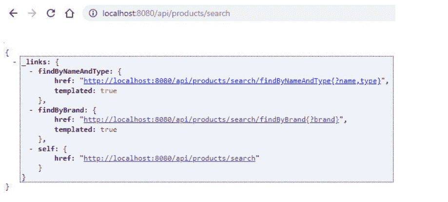

## 图 4.17：产品搜索 API 的响应

在上述过程中，您可以看到这两个查询现在在我们的服务中都可用。以下 URL 展示了如何按品牌获取产品：http://localhost:8080/api/products/search/findByBrand?brand=Samsung

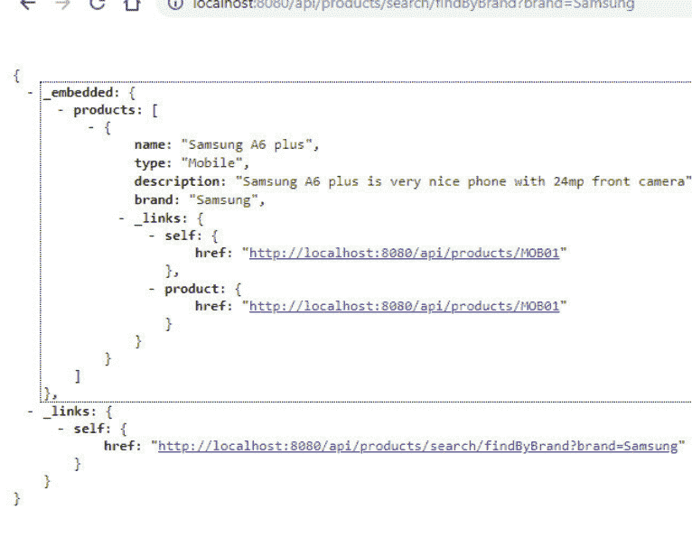

## 图 4.18：带有品牌名称的产品搜索 API 响应

在上一节中，我们讨论并创建了可以被应用程序外部客户端消费的 REST 端点。让我们在下一节中看看如何消费 REST 端点。

## 消费 REST 端点

有很多外部客户端可以消费 REST 端点。Postman 是用于消费和测试 REST 端点的工具之一。同样，RestClient 是另一个工具。诸如 Android、iOS 等外部应用程序通过编程方式消费 REST 端点，以访问服务器或向服务器发送数据。

基于 JS 的框架（如 Angular 和 ReactJS）也使用 REST 端点从服务器访问数据，以便在 UI 组件中进行渲染。单页应用（SPA）就是使用 REST 端点的一个例子。在本节中，我们将创建一个 Spring 应用程序来消费 REST 端点。在外部应用程序中，可以使用以下 REST 客户端来消费 REST 端点：

- RestTemplate：Spring 框架提供的同步 REST 客户端，用于消费 REST 端点。

- Traverson：Spring HATEOAS 模块提供的同步 REST 客户端，且该客户端具有超链接感知能力。

- WebClient：此 REST 客户端在 Spring 5 中引入，是一个响应式、异步的 REST 客户端。

在本节中，我们将讨论上述列表中的每个客户端。让我们先讨论如何使用 `RestTemplate` 对象来消费 REST 端点。

## 使用 RestTemplate 消费 REST 端点

`RestTemplate` 是 `HttpClient` 对象的级实现。在内部，它与底层的 HTTP 库协同工作。`RestTemplate` 对象消除了使用 HTTP 协议调用任何远程 API 时大部分冗长且重复的样板代码。

Spring 框架像提供 `JdbcTemplate` 一样提供 `RestTemplate` 以避免样板代码。`RestTemplate` 对象提供了几种高级方法实现来消费 REST 端点。请参考下表：

上述列出的 `RestTemplate` 对象方法为 HTTP 协议提供了高级功能。因此，使用 `RestTemplate`，我们无需担心如何处理异常、如何关闭 HTTP 连接等。`RestTemplate` 在内部管理这些样板工作。

在您的 Spring 应用程序中，您可以通过创建其 Bean 或创建 `RestTemplate` 实例来使用它：

```
@Bean
public RestTemplate restTemplate() {
    return new RestTemplate();
}
```

从 5.0 版本开始，非阻塞、响应式的 `org.springframework.web.reactive.client.WebClient` 为 `RestTemplate` 提供了一个现代化的替代方案，对同步、异步以及流式传输场景都有充分的支持。`RestTemplate` 对象将在未来的版本中被弃用，并且今后将不再添加重大新功能。

让我们使用 Spring Boot 和 Spring MVC 创建一个 REST API 客户端应用程序。目前，我们将使用 Thymeleaf 作为 UI 层。此客户端应用程序将消费前一节中由 REST 应用程序创建的 REST 端点。让我们看看客户端应用程序的结构。来看看使用 `RestTemplate` 的 GET 请求：

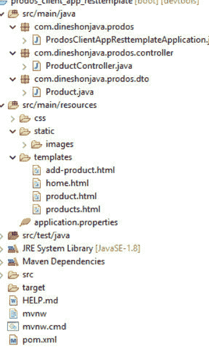

## 图 4.19：REST 客户端应用程序结构

前面的截图显示了一个将消费 REST 端点以从服务器检索数据并向服务器发布数据的 Web 应用程序。在前面的截图中，我们创建了一个 `ProductController` 类，这与 REST 应用程序的控制器类非常不同。这是一个简单的传统控制器类，使用 `@Controller` 注解，如下代码所示：

```
@Controller
public class ProductController {
	//...
}
```

让我们在这个控制器类中定义方法，并使用 `RestTemplate` 创建 GET 请求。

## 使用 GET 方法检索资源

例如，如果您的客户端应用程序想要从 PRODOS REST API 应用程序访问产品列表或单个产品详情。在这种情况下，我们将使用不含超媒体的 PRODOS REST 应用程序，因为 `RestTemplate` 不支持资源中的超链接。

我们可以使用 `getForObject()` 方法从 PRODOS REST API 应用程序获取产品列表。请看以下使用 `RestTemplate` 从 API 端点获取数据的代码：

```
@Controller
public class ProductController {
	private final String BASE_URL = "http://localhost:8181/prodos";

	@Autowired
	RestTemplate restTemplate;

	@GetMapping("/products")
	public String findAllProducts(ModelMap model) {
		List products = restTemplate.getForObject(BASE_URL+"/products", List.class);
		model.put("products", products);
		return "products";
	}

	@GetMapping("/products/{id}")
	public String findProductById(ModelMap model, @PathVariable String id) {
		Product product = restTemplate.getForObject(BASE_URL+"/products/{id}", Product.class, id);
		model.put("product", product);
		return "product";
	}

	//...
}
```

在上述代码中，我们使用 `getForObject()` 方法从 REST 端点获取数据。`RestTemplate` 类的 `getForObject()` 方法接受一个 String 类型的 URL 和返回值的类类型。`findAllProducts()` 控制器类中的第一个方法从给定的 REST 端点获取产品列表。第二个方法从指定的 REST 端点为特定的产品 ID 获取单个产品。

让我们看看 `getForObject()` 方法的另一个重载版本，如下代码所示：

```
@GetMapping("/products/{id}")
```


## 欢迎使用 Prodos 应用程序，一款产品管理工具

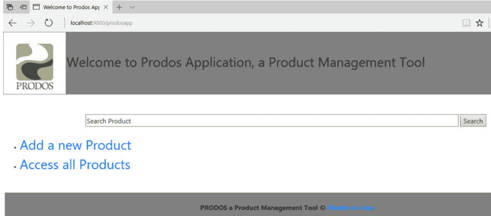

图 4.20：PRODOS 客户端应用程序主页

点击“访问所有产品”链接，如上图所示。它将显示所有可用的产品：

## Prodos 中的产品列表


| 名称 | 类型 | 品牌 | 描述 | 编辑 | 删除 | 查看 |
| :--- | :--- | :--- | :--- | :--- | :--- | :--- |
| Samsung A6 plus | 手机 | Samsung | Samsung A6 plus 是一款非常不错的手机，拥有 2400 万像素前置摄像头 | 编辑 | 删除 | 查看 |
| iPhone X plus | 手机 | Apple | iPhone X plus 是一款非常不错的手机，拥有 2400 万像素前置摄像头 | 编辑 | 删除 | 查看 |
| Sony Bravia KLV-50W662F 50 英寸全高清 | 电视 | Sony | Sony Bravia 是全高清电视 | 编辑 | 删除 | 查看 |
| Canon EOS 1500D 数码单反相机 | 单反相机 | Canon | 市场上最好的单反相机 | 编辑 | 删除 | 查看 |
| JBL Cinema 510 5.1 带有源低音炮 | 家庭影院扬声器 | JBL | 此音响系统适合家庭影院 | 编辑 | 删除 | 查看 |

图 4.21：PRODOS 应用程序产品列表页面

上图展示了通过在 ProductController 类中使用 RestTemplate 调用 REST 端点 (http://localhost:8181/prodos/products) 所检索到的产品。您也可以通过点击“查看”链接来访问特定的产品详情，如下图所示：

## 欢迎使用 Prodos 应用程序，一款产品管理工具


## 添加新产品

ID：MOB03
名称：Poco
品牌：Xiaomi
类型：手机
描述：这是一款非常不错的手机

图 4.23：PRODOS 客户端应用程序产品详情页面

上图显示了产品详情（产品 ID：MOB01）。该产品详情是从产品控制器类中使用 RestTemplate 从 REST 端点 (http://localhost:8181/prodos/products/MOB01) 获取的。

让我们在特定的 REST 端点创建一个新的产品。

### 使用 POST 方法创建资源数据

让我们为 ProductController 创建一个方法，使用 REST 端点创建一个产品资源。假设您想在 PRODOS REST 应用程序的产品列表中创建一个新产品。您可以在 /products/ REST 端点使用 HTTP POST 请求，并在请求体中包含产品数据。

RestTemplate 对象提供了三个发送 POST 请求的方法，例如 `postForObject()`、`postForLocation()` 和 `postForEntity()`。每个方法都有相同的重载版本来指定 URL。

如果您想在 POST 请求后接收新创建的资源，请使用以下实现：

```java
@PostMapping("/create-product")
public String createProduct(ModelMap model, Product product) {
    model.put("product", restTemplate.postForObject(BASE_URL+"/products/", product, Product.class));
    return "product";
}
```

如果您想获取新创建资源的位置，而不是获取新创建的资源本身，那么您可以使用 `postForLocation()` 方法的以下实现：

```java
public URI createProduct(Product product) {
    return restTemplate.postForLocation(BASE_URL+"/products/", product);
}
```

如果您既想获取新创建的资源，又想获取新创建资源的位置，那么您可以使用 RestTemplate 的 `postForEntity()` 方法，如以下代码所示：

```java
public Product createProduct(Product product) {
    ResponseEntity responseEntity = restTemplate.postForEntity(BASE_URL+"/products/", product, Product.class);
    log.info("New resource created at " +responseEntity.getHeaders().getLocation());
    return responseEntity.getBody();
}
```

让我们查看以下截图，使用上述 `createProduct()` 请求处理程序方法创建一个新产品。此请求处理程序方法使用 RestTemplate 对象的 `postForObject()` 方法和 REST 端点（POST http://localhost:8181/prodos/products）：

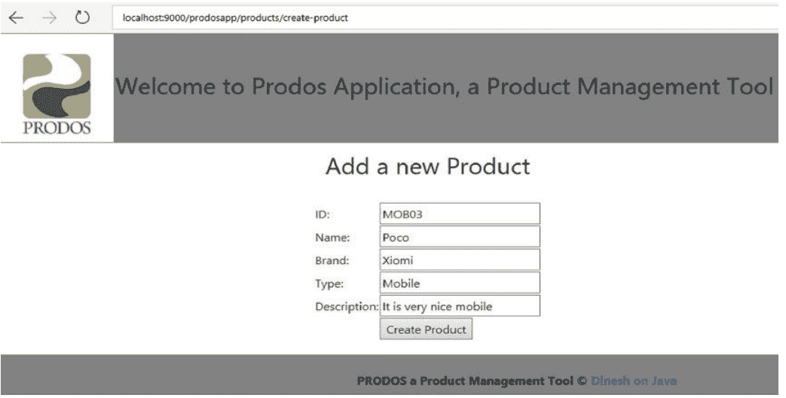

图 4.24：创建新产品页面

在表单中输入数据后，点击“创建产品”按钮。新产品将使用 REST 端点在服务器上创建。您可以通过再次获取所有产品来验证。让我们查看以下截图：

| 名称 | 类型 | 品牌 | 描述 | 编辑 | 删除 | 查看 |
| :--- | :--- | :--- | :--- | :--- | :--- | :--- |
| Samsung A6 plus | 手机 | Samsung | Samsung A6 plus 是一款非常不错的手机，拥有 2400 万像素前置摄像头 | 编辑 | 删除 | 查看 |
| iPhone X plus | 手机 | Apple | iPhone X plus 是一款非常不错的手机，拥有 2400 万像素前置摄像头 | 编辑 | 删除 | 查看 |
| Sony Bravia KLV-50W662F 50 英寸全高清 | 电视 | Sony | Sony Bravia 是全高清电视 | 编辑 | 删除 | 查看 |
| Canon EOS 1500D 数码单反相机 | 单反相机 | Canon | 市场上最好的单反相机 | 编辑 | 删除 | 查看 |
| JBL Cinema 510 5.1 带有源低音炮 | 家庭影院扬声器 | JBL | 此音响系统适合家庭影院 | 编辑 | 删除 | 查看 |
| Poco | 手机 | Xiaomi | 这是一款非常不错的手机 | 编辑 | 删除 | 查看 |

图 4.5：添加新产品后的产品页面

产品被添加到产品列表的底部。接下来，我们将讨论如何从客户端应用程序更新资源。

## 使用 PUT 方法更新资源

如果您想通过发送 HTTP PUT 请求来更新服务器上的资源，Spring 的 RestTemplate 提供了 `put()` 方法来实现。此方法接受一个 URI（作为字符串）和一个产品对象作为请求类类型及参数。假设您想使用一个新 Product 对象中的数据来更新产品资源。以下代码应该可以实现：

```java
@PostMapping("/edit/create-product")
public String updateProduct(ModelMap model, Product product) {
    restTemplate.put(BASE_URL + "/products", product, Product.class);
    return "redirect:/products";
}
```

## 使用 DELETE 方法删除资源

让我们在 ProductController 类中创建一个方法，从产品列表中删除一个产品。为此，您可以从 RestTemplate 调用 `delete()` 方法：

```java
@GetMapping("/delete/{id}")
public String deleteProduct(@PathVariable String id) {
    restTemplate.delete(BASE_URL + "/products/" + id);
    return "redirect:/products";
}
```

在上面的代码中，我们通过接受两个参数调用了 RestTemplate 对象的 `delete()` 方法。第一个参数是 URL，第二个参数是要删除的 URL 变量值。

我们讨论了如何使用 RestTemplate 对象来消费 REST 端点。众所周知，RestTemplate 有一些局限性。当我们在使用带有超媒体的 REST 服务时，它无法使用。如果您想消费包含响应中超链接的 REST 端点，RestTemplate 对象就不太有用了。让我们看看消费 REST 端点的另一种选择。

## 使用 Traversion 消费 REST 端点

Spring HATEOAS 开箱即用地提供了 Traversion 来消费带有超媒体的 REST 端点。在您的 Spring 应用程序中配置 Traversion 非常相似。让我们看看以下代码：

```java
@Bean
public Traversion traversion() {
    return new Traversion(URI.create("http://localhost:8080/api"), MediaType.HAL_JSON);
}
```


Traverson traverson = new Traverson(URL.create("http://localhost:8080/api"), MediaType.HAL_JSON);

我们使用参数构造函数实例化了 Traverson 类的对象。第一个参数是 URL，我们为其指定了 REST PRODOS 应用程序的初始基础 URL。第二个参数是媒体类型，我们指定了带有 HAL 风格超链接的 JSON 响应，以便 Traverson 知道如何解析传入的资源数据。

让我们更新 `ProductController` 类的请求处理方法。现在我们将使用 Traverson REST 客户端来消费 REST 端点。以下代码被修改为使用 REST 端点来查找所有产品：

```
@Controller
public class ProductController {

...

@Autowired
Traverson traverson;

@GetMapping("/")
public String home() {

return "home";

}

@GetMapping("/products")
public String findAllProducts(ModelMap model) {

ParameterizedTypeReference<Product> productType = new ParameterizedTypeReference<>();

Resources productResources = traverson.follow("products").toObject(productType);

model.put("products", productResources.getContent());

return "products";

}

...

}
```

在上述代码中，我们使用 Traverson 对象从 REST API 获取产品列表。Traverson 对象的 `follow()` 方法允许您导航到资源的关联名称（即 `products`）。现在，您的应用程序调用将导航至 `products`，最后我们调用 `toObject()` 方法来摄取该资源的内容。但 `toObject()` 方法需要一个参数，用于指定您希望将其读取为 `Resources` 对象的具体数据类型。

因此，Traverson 允许您消费启用了 HATEOAS 的 REST API。您的客户端代码可以轻松地导航到这些启用了 HATEOAS 的 API 并消费其资源。但 Traverson 也有一些局限性，例如它无法像 `RestTemplate` 那样提供向这些 API 写入或删除数据的方法。

您仍然可以使用 `RestTemplate` 来配合 Traverson 处理 POST、PUT 和 DELETE 请求。例如，您可以向 PRODOS REST 应用程序添加一个新产品。以下 `createProduct()` 方法演示了如何结合使用 Traverson 和 `RestTemplate` 将新产品提交到 API：

```
@PostMapping("/create-product")
public String createProduct(Product product) {

Link productLink = traverson.follow("products").asLink();
this.restTemplate.postForEntity(productLink.expand().getHref(), product, Product.class);

return "redirect:/products";

}
```

在之前的代码中，我们使用 Traverson 对象的 `asLink()` 方法创建了链接。然后，我们使用 `RestTemplate` 对象的 `postForEntity()` 方法将新产品提交到 API。

## 使用 WebClient 消费 REST 端点

从 Spring 5 开始，`WebClient` 被引入作为 REST API 客户端。Spring WebFlux 模块为您的 Spring 应用程序提供了 `WebClient`。与 `RestTemplate` 相比，`WebClient` 具有更多的功能，并且是完全响应式的。

让我们在应用程序中为 `WebClient` 添加以下 Spring WebFlux 模块的 Maven starter 依赖：

```
org.springframework.boot

spring-boot-starter-webflux
```

这个 starter 依赖不仅会将模块库添加到您的类路径中，还会在应用程序中自动配置 Spring WebFlux 模块。因此，您可以直接在 Spring 应用程序中使用 `WebClient`，如下代码所示：

```
@Controller
public class ProductController {

@Autowired
private WebClient webClient;

public ProductController(WebClient.Builder webClientBuilder) {

this.webClient = webClientBuilder.baseUrl("http://localhost:8181/prodos/").build();

}

@GetMapping("/products")
public String findAllProducts(ModelMap model) {

Flux products = this.webClient.get().uri("/products").retrieve().bodyToFlux(List.class);

model.put("products", products);

return "products";

}

...

}
```

同样地，我们可以在 `ProductController` 类中创建其他请求处理方法，使用 `WebClient` 来消费 REST 端点。在本章中，我们讨论了如何创建以及如何消费 REST API。

# 总结

在本章中，我们讨论了 REST 架构模型及其约束，并创建了一个 REST 应用程序以及许多用于 CRUD 功能的 REST 端点。我们在本章中学习了以下主题：

-   带有所有约束（包括统一接口原则）的 REST 应用程序架构模式。

-   使用 Spring Boot 和 `@RestController` 注解创建了一个 RESTful Web 服务应用程序。该应用程序提供了 CRUD 功能所需的所有服务。

-   之后，我们向 REST 应用程序添加了 Spring HATEOAS 模块，以实现从 Spring MVC 控制器返回资源的超链接。

-   我们学习了如何使用 Spring Data REST 存储库创建启用 HATEOAS 的 REST API。它可以利用 Spring 应用程序中定义的存储库自动暴露为 REST API。

-   最后，我们讨论了如何使用客户端应用程序消费 REST 端点。我们创建了一个名为 PRODOS 的 Web 客户端应用程序，它使用 `RestTemplate` 向 REST API 发起 HTTP 请求。

-   我们还使用了 `Traverson` 类来消费 REST API。它使客户端能够利用响应中嵌入的超链接来导航 API。

-   在接下来的第 5 章：“使用 Spring Security 保护 REST API”中，我们将讨论如何使用 Spring Security 保护 REST 服务。

## 问题

-   什么是 REST？
-   什么是 RESTful Web 服务？
-   REST 架构约束是什么？
-   如何使用 Spring Boot 创建 RESTful Web 服务？
-   `@RestController` 和 `@Controller` 之间有什么区别？
-   什么是 HATEOAS？
-   如何消费 REST API？
-   什么是 `RestTemplate`？
-   RESTful Web 服务和 SOAP Web 服务之间有什么区别？
-   REST 框架中的资源（resource）是什么？
-   RESTful Web 服务支持哪些 HTTP 方法？

# 第 5 章

## 保护 REST API

在上一章中，我们创建了 REST API 并学习了创建 RESTful 应用程序服务的各种原则。我们还创建了一个 REST 客户端应用程序来消费创建的 RESTful 端点。在我们的 PRODOS 应用程序中，我们获取了产品列表或产品详情，还创建了一个 REST 端点将新产品提交到服务器。我们还可以发送 DELETE 请求从服务器删除产品。因此，任何人都可以访问这些 REST 端点并在服务器上执行操作。在这种情况下，我们需要保护这些 REST 端点，以便只有授权用户才能通过 REST 端点执行 CRUD 操作。

由于任何 REST 应用程序提供的信息可能都具有价值，因此有很多骗子或黑客觊觎盗取应用程序数据。作为软件开发人员，我们需要采取预防措施来保护 REST API 提供的信息。

但我们如何保护我们的 REST API 免受外部入侵者的攻击呢？Spring 框架允许您保护这些 REST 端点。在本章中，我们将学习如何使用 Spring Security、OAuth2 和 JWT 来应用安全策略以保护 RESTful API。我们还将为 RESTful API 探索 JSON Web Token (JWT)。

在本章中，我们将详细讨论以下主题：

### Spring Security

-   添加 Spring Security 模块

## 实现和配置 Spring Security

-   内存用户存储配置
-   JDBC 用户存储配置
-   LDAP 用户存储配置
-   自定义用户服务配置
-   使用 Spring Security 进行密码编码
-   使用 Spring Security 和 JWT 保护您的 RESTful API
-   使用 Spring Security 和 OAuth2 保护您的 RESTful API

### Spring Security

Spring 框架在 2003 年添加了安全模块，当时它被称为 “The Acegi Security System for Spring”。随后 Spring 框架对安全模块进行了优化并将其重新命名为 “Spring Security” ([https://spring.io/projects/spring-security](https://spring.io/projects/spring-security))。它为基于 Java 的 Web 应用程序提供安全服务。让我们看看如何将 Spring Security 模块添加到您的 REST 应用程序中以保护 REST 端点。

### 添加 Spring Security 模块

将 Spring Security 模块添加到您的 Spring Boot REST 应用程序中非常简单。您可以在应用程序中包含 Spring Security starter 的 Maven 依赖。让我们将以下 Maven 依赖配置添加到项目的 `pom.xml` 文件中：

```
org.springframework.boot

spring-boot-starter-security
```

上述 starter 依赖不仅为您的 REST 应用程序提供了所需的库，还提供了 Spring Security 模块所需的默认配置。我相信这足以为您 REST 应用程序提供基础认证。您可以启动应用程序，并尝试访问任何 REST 端点或应用程序主页。您将必须经过 HTTP 基础认证（HTTP basic authentication）的身份验证过程。

默认情况下，Spring Security 会创建一个用户名名为 `user` 的单一用户，其密码将打印在控制台输出中，如下截屏所示：

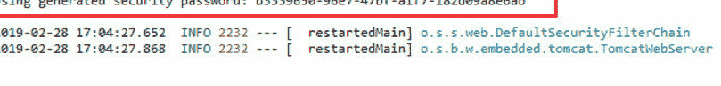

图 5.1：Spring Security 打印的密码：

上述密码是随机生成的并记录在日志中。让我们看看默认情况下 Spring Security 的自动配置为您的 REST 应用程序提供了什么：

-   所有 REST 端点或所有 HTTP 请求路径都需要身份验证。
-   初始时，Spring Security 没有配置任何特定角色。
-   Spring Security 使用 `AuthenticationManager` 并构建一个用户名为 `user` 的内存单一用户。
-   默认情况下，它使用 HTTP 基础认证机制。
-   它会忽略静态资源的路径，例如 `/css`、`/images` 等。

启动 REST 应用程序后，您需要通过访问 `http://localhost:8180/products/products` 向之前 REST 应用程序的 REST 端点发起 GET 请求，如下截屏所示：

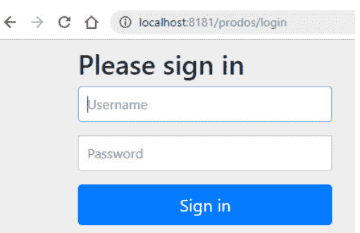
图 5.2：Spring Security 要求进行身份验证

在您开始访问 API 数据之前，Spring Security 会将您重定向到登录页面。它会显示一个对话框，提示用户输入用户名和密码。登录页面是由 Spring Security 模块设计的。您也可以创建自定义的登录页面。如您所知，REST API 不仅被浏览器消费，它还可以通过编程方式或使用 Postman 等工具由任何 REST 客户端访问。您也可以使用 Postman 等 REST 客户端工具访问 http://localhost:8181/prodos/products 处的 REST 端点，如下面截图所示：

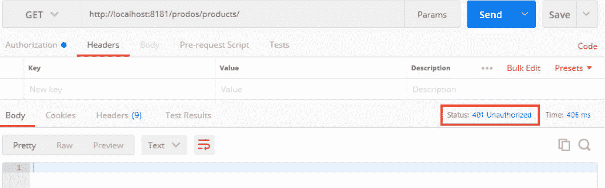
图 5.3：Postman 在访问安全 REST API 时返回错误状态码 401 Unauthorized

在前面的截图中，您可以看到 Postman 客户端返回了错误状态码 401 Unauthorized，因为该 REST API 要求使用用户名和密码进行基础身份验证（Basic Authentication）。

为了成功发送 GET 请求，您需要提供基础身份验证的凭据。默认用户名为 `user`，密码与控制台输出屏幕上打印的相同。让我们提供基础身份验证详情并访问同一个 REST 端点，如下面使用 Postman 客户端的截图所示：

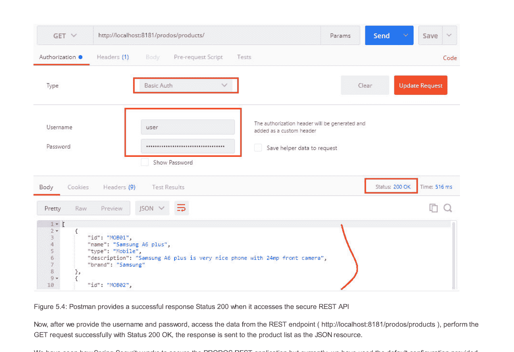
图 5.4：Postman 在访问安全 REST API 时返回成功响应状态码 200

现在，在我们提供用户名和密码后，访问 REST 端点 (http://localhost:8181/prodos/products)，成功执行 GET 请求并获得状态码 200 OK，响应以 JSON 资源的形式发送产品列表。

我们已经看到了 Spring Security 如何工作以保护 PRODOS REST 应用程序，但目前我们使用的是 Spring Boot 应用程序中 Spring Security starter 提供的默认配置。默认配置并不适合我们的 REST 应用程序，因为我们需要提供多个用户和密码来访问我们的 REST 端点。

为了满足您自己的安全预期，您可以通过提供自定义的 Spring Security 配置来定制默认配置。我们将在下一节中讨论这个问题。

## 实现和配置 Spring Security

在当前版本的 Spring Boot (2.2.0) 中，您可以通过添加一个继承自 Spring Security 模块 `WebSecurityConfigurerAdapter` 类的全新配置类，轻松地为您的 PRODOS REST 应用程序配置 Spring Security。让我们在 PRODOS REST 应用程序的 `com.dineshonjava.prodos.security` 包中创建一个名为 `SecurityConfig` 的新配置类，如下面的代码片段所示：

```java
package com.dineshonjava.prodos.security;

import org.springframework.context.annotation.Configuration;
import org.springframework.security.config.annotation.web.configuration.EnableWebSecurity;
import org.springframework.security.config.annotation.web.configuration.WebSecurityConfigurerAdapter;

@Configuration
@EnableWebSecurity
public class SecurityConfig extends WebSecurityConfigurerAdapter {
}
```

前面的配置类使用了 `@Configuration` 和 `@EnableWebSecurity` 注解。这些注解关闭了应用程序中的默认 Web 安全配置。

您可以在这个类中提供自己的安全配置。您可以像下面代码片段中那样重写 `configure(HttpSecurity http)` 方法：

```java
@Override
protected void configure(HttpSecurity http) throws Exception {
    http
        .authorizeRequests()
        .anyRequest().authenticated()
        .and()
        .formLogin()
        .and()
        .httpBasic();
}
```

在此方法中，您可以定义应用程序中哪些 REST 端点是受保护的，哪些不是。如果您希望所有 REST 端点都受保护，则无需重写此方法。

假设您只想保护 `/products` 和 `/product` 等 REST 端点，而所有其他请求应允许所有用户访问。那么，您需要像下面代码片段那样配置 `configure()` 方法：

```java
@Override
protected void configure(HttpSecurity http) throws Exception {
    http
        .authorizeRequests()
        .antMatchers("/product", "/products").hasRole("ROLE_USER")
        .antMatchers("/", "/**").permitAll()
        .and()
        .formLogin()
        .and()
        .httpBasic();
}
```

在前面的 `configure()` 方法配置中，我们通过调用 `authorizeRequests()` 方法配置了 HTTP 请求拦截器。我们使用 `antMatchers()` 方法指定了 URL 路径和模式，并指定了 `ROLE_USER` 的授予权限。现在，针对 `/product` 和 `/products` 的 HTTP 请求必须通过具有 `ROLE_USER` 权限的身份验证。

在前面的配置中，我们使用了两个 ant 匹配器，因为 Spring Security 遵循定义的规则顺序。先声明的安全规则优先于后声明的规则。

`hasRole()` 和 `permitAll()` 是用于声明请求路径安全要求的两个常用方法。

我们正在为 PRODOS REST 应用程序配置 Spring Security，因此我们不会深入讨论其他方法，如 `formLogin()`、`loginPage()` 等。当您想要自定义登录页面时，`loginPage()` 方法非常有用。现在让我们讨论如何配置用户存储，以及如何使用 Spring Security 配置用户存储。

存储 Spring Security 用户有多种可用选项。我们可以根据应用程序的需求选择其中任何一个。让我们看看以下用户配置：

- 内存用户配置 (In-memory user configuration)
- 基于 JDBC 的用户配置 (JDBC-based user configuration)
- 基于 LDAP 的用户配置 (LDAP-backed user configuration)
- 自定义用户详情配置 (Custom user details configuration)

您可以通过重写 `WebSecurityConfigurerAdapter` 配置基类的 `configure()` 方法来配置用户存储。让我们看看要添加到 `SecurityConfig` 类中的以下方法：

```java
@Override
protected void configure(AuthenticationManagerBuilder auth) throws Exception {
    ...
}
```

首先让我们看看如何配置内存用户配置。

### 内存用户配置

每当您想将用户信息保存在内存中时，内存用户配置都非常容易使用。如果您只有一小组用户且其中任何人都 unlikely 更改信息，那么使用此配置会更好。让我们在 Spring Security 配置中定义内存用户存储，如下面的代码片段所示：

```java
public void configure(AuthenticationManagerBuilder auth) throws Exception {
    auth
        .inMemoryAuthentication()
        .withUser("dinesh").password("mypass").roles("USER").and()
        .withUser("arnav").password("yourpass").roles("ADMIN").and()
        .withUser("rushika").password("pass").roles("SUPPORT");
}
```

在前面的配置中，我们使用 `AuthenticationManagerBuilder` 类配置了内存用户。`inMemoryAuthentication()` 方法用于通过调用 `withUser()` 方法将用户信息直接添加到安全配置文件中。您可以使用 `password()` 和 `roles()` 方法分别指定密码和授予的权限。

作为另一种选择，您也可以通过在 `SecurityConfig` 类中添加 `userDetailsService()` 方法将内存用户添加到应用程序中。请看以下代码：

```java
@Bean
@Override
public UserDetailsService userDetailsService() {
    UserDetails user = User.withDefaultPasswordEncoder()
        .username("arnav")
        .password("mypass")
        .roles("USER")
        .build();
    return new InMemoryUserDetailsManager(user);
}
```

内存用户的使用在开发阶段表现良好，但实际应用程序应该将用户保存在数据库中。


## 基于 JDBC 的用户配置

如果你想将用户信息存储在关系型数据库中，那么基于 JDBC 的用户存储库似乎适合你的应用。让我们看看以下配置如何将 Spring Security 配置为对保存在关系型数据库中的用户和用户信息进行认证：

```java
@Configuration
@EnableWebSecurity
public class SecurityConfig extends WebSecurityConfigurerAdapter {

	...

	@Autowired DataSource dataSource;

	public void configure(AuthenticationManagerBuilder auth) throws Exception {

		auth

		.jdbcAuthentication()

		.dataSource(dataSource);

	}

	...

}
```

如上一配置所示，`configure()` 方法调用了 `AuthenticationManagerBuilder` 的 `jdbcAuthentication()` 方法，以通过 JDBC 从关系型数据库获取用户信息。对于这个需求，你需要配置 `DataSource`，以便了解关系型数据库。这就是我们通过 `configure()` 方法自动装配并配置 `DataSource` 类的原因。

你也可以覆盖上述配置的默认用户查询。让我们修改上述配置以覆盖默认用户查询：

```java
@Configuration
@EnableWebSecurity
public class SecurityConfig extends WebSecurityConfigurerAdapter {

	...

	@Autowired DataSource dataSource;

	public void configure(AuthenticationManagerBuilder auth) throws Exception {

		auth

		.jdbcAuthentication()

		.usersByUsernameQuery("SELECT username, password, enabled FROM users WHERE username = ?")

		.authoritiesByUsernameQuery("SELECT username, authority FROM authorities WHERE username = ?")

		.dataSource(dataSource);

	}

	...

}
```

在上述配置中，我们使用 `usersByUsernameQuery()` 和 `authoritiesByUsernameQuery()` 方法覆盖了认证和基本授权查询。

## 基于 LDAP 的用户配置

Spring 框架允许你配置基于 LDAP 认证的 Spring Security。`AuthenticationManagerBuilder` 类提供了 `ldapAuthentication()` 方法。让我们看看以下用于 LDAP 认证的配置：

```java
@Override
protected void configure(AuthenticationManagerBuilder auth) throws Exception {
    auth
    .ldapAuthentication()
    .userSearchFilter("(uid={0})")
    .groupSearchFilter("member={0}");
}
```

在上述配置中，我们使用 `userSearchFilter()` 和 `groupSearchFilter()` 方法配置了 `configure()` 方法，以实现基于 LDAP 的用户配置。这些方法用于为基本 LDAP 查询提供过滤器，以搜索用户和组。

在本章中，我们不会详细定义每种用户策略，以避免给初学者造成困惑。我们讨论了一些常见用例中 Spring Security 的内置用户存储库。但对于我们的 REST 应用 PRODOS，我们将实现和配置自定义的用户详情服务。让我们在下一节中了解这一点。

## 自定义用户详情配置

在这个配置中，我们将构建自己的用户详情服务配置。在上一章中，我们已经使用了 Spring Data JPA 从关系型数据库获取产品列表。这里，我们同样将使用 Spring Data JPA 将用户信息存储到数据库并检索用户信息。

现在，我们也必须为用户信息创建 Spring Data 仓库。但首先，让我们创建域对象和仓库接口。

```java
package com.dineshonjava.prodos.domain;

//imports

@Entity
@Table(name="USER")
public class ProdosUser {
    @Id
    @GeneratedValue(strategy = GenerationType.AUTO)
    @Column(nullable = false, updatable = false)
    private Long id;

    @Column(nullable = false, unique = true)
    private String username;

    @Column(nullable = false)
    private String password;

    @Column(nullable = false)
    private String role;

    public ProdosUser() {

    }

    public ProdosUser(String username, String password, String role) {

        super();

        this.username = username;

        this.password = password;

        this.role = role;

    }

    //setters and getters
}
```

我们创建了一个 `ProdosUser` 实体类来将用户保存到数据库，该类用 `@Entity` 注解标记。此类包含 `id`、`username`、`password` 和 `role` 作为字段。根据需求，它可能拥有更多字段。在数据库中，密码不应以明文格式保存。密码必须使用哈希值保存。你可以使用 Spring Security 提供的任何哈希算法，例如 BCrypt、PBKDF2、SHA-256 等。我们将在本章后面讨论密码编码器。

让我们在 `com.dineshonjava.prodos.repository` 包中创建一个名为 `ProdosUserRepository` 的新类，如下代码片段所示：

```java
package com.dineshonjava.prodos.repository;

import org.springframework.data.repository.CrudRepository;

import com.dineshonjava.prodos.domain.ProdosUser;

public interface ProdosUserRepository extends CrudRepository<ProdosUser, Long> {

    ProdosUser findByUsername(String username);

}
```

你可以看到，上述仓库类的源代码与我们在上一章为产品仓库所做的类似。其中有一个查询方法 `findByUsername()`，我们在下一步中需要它。

现在，让我们创建一个实现 Spring Security 的 `UserDetailsService` 接口的类。Spring Security 使用此接口实现进行认证和授权。让我们看看 `com.dineshonjava.prodos.service` 包中 `UserDetailServiceImpl` 类的以下源代码：

```java
package com.dineshonjava.prodos.service;

import org.springframework.beans.factory.annotation.Autowired;

import org.springframework.security.core.authority.AuthorityUtils;

import org.springframework.security.core.userdetails.User;

import org.springframework.security.core.userdetails.UserDetails;

import org.springframework.security.core.userdetails.UserDetailsService;

import org.springframework.security.core.userdetails.UsernameNotFoundException;

import org.springframework.stereotype.Service;

import com.dineshonjava.prodos.domain.ProdosUser;

import com.dineshonjava.prodos.repository.ProdosUserRepository;

/**
 * @author Dinesh.Rajput
 *
 */
@Service
public class UserDetailServiceImpl implements UserDetailsService {

    @Autowired
    private ProdosUserRepository userRepository;

    @Override
    public UserDetails loadUserByUsername(String username) throws UsernameNotFoundException
    {
        ProdosUser prodosUser = userRepository.findByUsername(username);

        UserDetails user = new User(username, prodosUser.getPassword(), AuthorityUtils.createAuthorityList(prodosUser.getRole()));

        return user;

    }

}
```

在前面的 `UserDetailServiceImpl` 类中，我们将 `ProdosUserRepository` 类与 `UserDetailServiceImpl` 类自动装配，以便在 Spring Security 处理认证时从关系型数据库获取用户信息。我们实现了 `UserDetailsService` 接口的 `loadUserByUsername()` 方法。此方法返回一个 `UserDetails` 对象。Spring Security 实际上使用该对象进行认证和授权。

最后，我们需要在 Spring Security 配置类中定义我们的自定义用户详情服务，而不是使用内存用户存储库。让我们按照以下代码片段所示修改 `SecurityConfig` 类：

```java
package com.dineshonjava.prodos.security;

import org.springframework.beans.factory.annotation.Autowired;

import org.springframework.context.annotation.Configuration;

import org.springframework.security.config.annotation.authentication.builders.
AuthenticationManagerBuilder;

import org.springframework.security.config.annotation.web.builders.HttpSecurity;

import org.springframework.security.config.annotation.web.configuration.EnableWebSecurity;

import org.springframework.security.config.annotation.web.configuration.
WebSecurityConfigurerAdapter;

import org.springframework.security.crypto.bcrypt.BCryptPasswordEncoder;

import com.dineshonjava.prodos.service.UserDetailServiceImpl;
/**
 * @author Dinesh.Rajput
 *
 */
```


```java
@Configuration
@EnableWebSecurity
public class SecurityConfig extends WebSecurityConfigurerAdapter {

    @Autowired
    private UserDetailServiceImpl userDetailsService;

    @Override
    protected void configure(HttpSecurity http) throws Exception {
        http
        .authorizeRequests()
        .anyRequest().authenticated()
        .and()
        .formLogin()
        .and()
        .httpBasic();
    }

    @Autowired
    public void configure(AuthenticationManagerBuilder auth) throws Exception {
        auth.userDetailsService(userDetailsService)
        .passwordEncoder(new BCryptPasswordEncoder());
    }
}
```

正如之前所讨论的，我们不应该将明文密码保存到数据库中。这就是为什么我们使用 `passwordEncoder()` 方法在与数据库匹配之前对密码进行编码。在这种情况下，我们使用了 Spring Security 的 `BCryptPasswordEncoder` 类来实现密码哈希。

最后，我们可以向数据库中添加一些测试用户（目前我们的应用程序使用 H2 数据库）。让我们看看下面的 `data.sql` 文件；它包含一些需要在应用程序启动时插入的初始测试用户：

```sql
INSERT INTO USER (id, username, password, role) values (100, 'dinesh', '$2a$04$HCZ0QH4cOVitb0Kx01Ux.c.REEM.sOZDyA8eZ8448BbYlczSET6', 'USER');
INSERT INTO USER (id, username, password, role) values (101, 'anamika', '$2a$04$HCZ0QH4cOVitb0Kx01Ux.c.REEM.sOZDyA8eZ8448BbYlczSET6', 'USER');
INSERT INTO USER (id, username, password, role) values (102, 'arnav', '$2a$04$Y5tgmB9IasE4yPrA.oghQO9jDluq4SviHcbVxwwFXg0XnC4da0a', 'ADMIN');
INSERT INTO USER (id, username, password, role) values (103, 'rushika', '$2a$04$Y5tgmB9IasE4yPrA.oghQO9jDluq4SviHcbVxwwFXg0XnC4da0a', 'ADMIN');
```

您可以在上述查询中看到，我们为每个用户使用了哈希后的密码保存到数据库中。您可以使用互联网上找到的任何 BCrypt 计算器。

现在，您可以运行应用程序，并看到数据库中有一个用户表，并且保存了一些用户记录，如下截图所示：

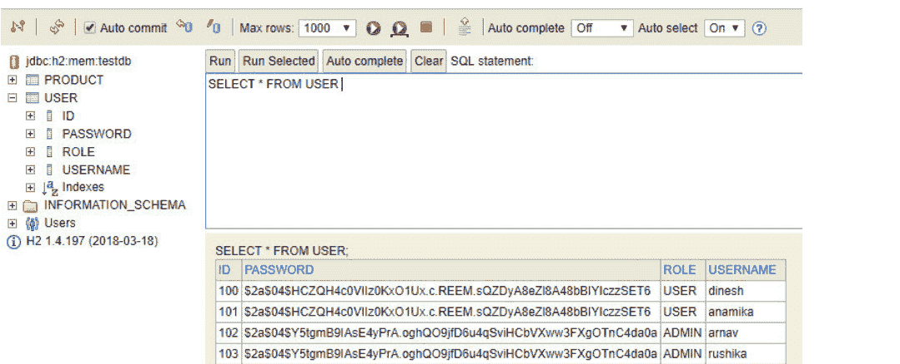
图 5.5：H2 Web 控制台中的用户表

让我们调用 `http://localhost:8181/prodos/products` REST API。如果不进行身份验证，您将收到 401 未授权错误。现在，在提供身份验证的情况下再次进行调用，您将能够毫无错误地完成调用。您将获得包含产品列表的成功结果。您将看到一个使用 dinesh 用户对 `/products` 端点发送的 GET 请求，如下截图所示：

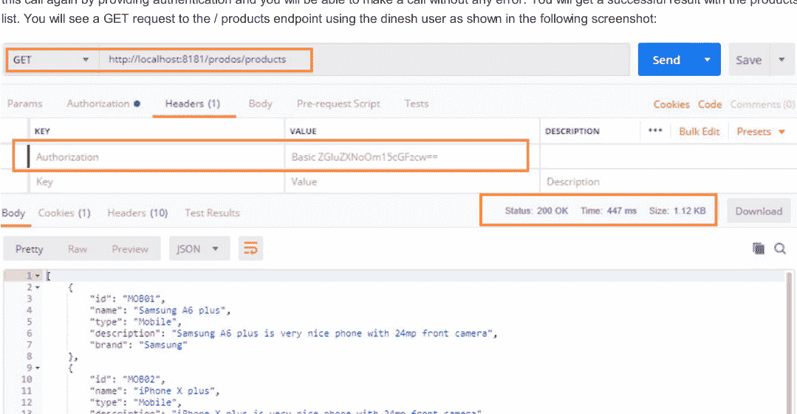
图 5.6：Postman 中 /products 端点的响应

让我们看看应用程序的结构：

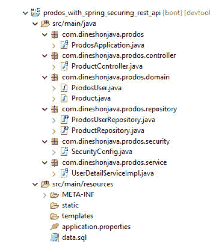
图 5.7：Prodoss REST 应用程序结构

让我们讨论一下密码编码以及它的工作原理。

### 使用 Spring Security 进行密码编码

您可以看到以下配置代码片段，它被用于之前的 HTTP 基础认证示例中：

```java
@Autowired
public void configure(AuthenticationManagerBuilder auth) throws Exception {
    auth.userDetailsService(userDetailsService)
    .passwordEncoder(new BCryptPasswordEncoder());
}
```

在上述代码中，我们通过调用 `passwordEncoder()` 方法指定了一个密码编码器。为了防止密码被盗，我们需要使用编码后的密码。`passwordEncoder()` 方法接收 Spring Security `PasswordEncoder` 接口的实现，具体如下：

- **BCryptPasswordEncoder**：该实现类采用 bcrypt 强哈希加密。
- **NoOpPasswordEncoder**：该实现类不进行任何编码。
- **Pbkdf2PasswordEncoder**：该实现类采用 PBKDF2 加密。
- **SCryptPasswordEncoder**：该实现类采用 scrypt 哈希加密。
- **StandardPasswordEncoder**：该实现类采用 SHA-256 哈希加密。

我们在示例中使用了 `BCryptPasswordEncoder`。但您可以选择任何其他实现，或者如果现成的实现无法满足您的需求，甚至可以提供自己的自定义实现。`PasswordEncoder` 接口非常简单。您需要检查大小写并保持一致性。

```java
public interface PasswordEncoder {
    String encode(CharSequence rawPassword);
    boolean matches(CharSequence rawPassword, String encodedPassword);
}
```

您可以像我们在之前的示例中所做的那样，将您的自定义密码编码器注册在安全名称中。

我们已经看到，Spring Security 为基于 Spring 的应用程序的 REST API 提供了极佳的身份验证和授权解决方案。此前，我们讨论了利用 HTTP 基础认证机制来保护 REST API 的最简单方法。但有时，这种机制并不适用于具有独立前端应用（如 ReactJS 或 Angular）的应用程序。HTTP 基础认证机制适用于开发目的，但不适合生产环境。

## 使用 Spring Security 和 JWT 保护您的 REST API

在本节中，我们将使用自定义的 JSON Web 令牌 (JWT) 代替 HTTP 基础认证。JWT 被用于在现代 RESTful 应用程序中实现身份验证。该令牌体积小，既可以通过 URL 发送，也可以在 POST 请求参数中发送，我们还可以将其放在请求头中。此 JWT 包含了客户端与受保护资源之间的所有必要用户信息（即 claims）。

现在，我们将把 Spring Security 和 JWT 应用到我们的 RESTful 应用程序 (PRODOS) 中。让我们在应用程序的 Maven 配置文件中添加以下 Maven 依赖，以实现通过访问数据库的 Spring Boot Security 和 JWT 令牌：

| Group ID | Artifact ID | Version |
| :--- | :--- | :--- |
| org.springframework.boot | spring-boot-starter-security | - |
| io.jsonwebtoken | jjwt | 0.9.0 |

上述 Maven 依赖将 Spring Security 和 JWT 库添加到您的 RESTful Web 应用程序中。现在，Spring Security 和 JWT 已可用在应用程序的类路径（classpath）中。

该应用程序需要遵循以下步骤来实现带有 JWT 的 Spring Security：

1. 首先，我们需要通过创建的端点 (`/auth/login`) 获取基于 JWT 的令牌。
2. `/auth/login` 端点将在响应中提供 JWT 令牌。您需要从响应中提取该令牌。
3. 现在，您可以将此 JWT 令牌设置为 HTTP 标头授权值，格式为 `Bearer jwt_token`。
4. 通过向 REST API 发送 HTTP 请求来访问受保护的资源。
5. 如果访问的 REST API 是受保护的，Spring Security 将使用配置的自定义过滤器来验证请求头中的 JWT 令牌。
6. 如果 JWT 令牌有效，则构建一个 Authentication 对象，并将该 Authentication 对象放入 Spring Security 特有的 `SecurityContextHolder` 对象中，以完成身份验证流程。
7. 完成身份验证流程后，您的客户端应用程序即可访问请求的资源。

让我们看看实现 Spring Security 和 JWT 后的应用程序结构：

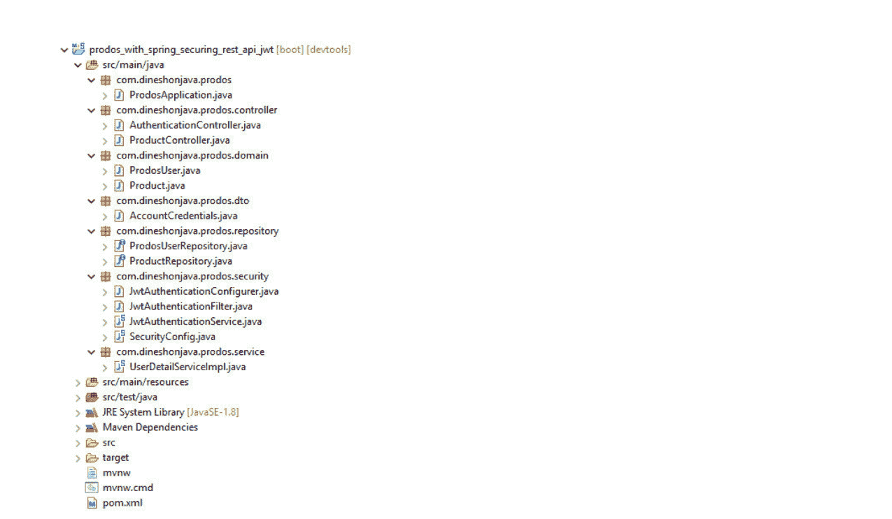
图 5.8：带有 Spring Security 和 JWT 的 Prodos REST 应用程序结构。

现在，我们将讨论为了在 REST API 中启用 JWT 身份验证而新创建的类。

让我们在 `com.dineshonjava.prodos.security` 包中创建一个名为 `JwtAuthenticationService` 的新类，如下代码片段所示：

```java
package com.dineshonjava.prodos.security;

import java.util.Base64;
import java.util.Date;
import java.util.List;
import javax.servlet.http.HttpServletRequest;
import org.springframework.beans.factory.annotation.Autowired;
import org.springframework.security.authentication.UsernamePasswordAuthenticationToken;
import org.springframework.security.core.Authentication;
import org.springframework.security.core.userdetails.UserDetails;
import org.springframework.stereotype.Component;
import com.dineshonjava.prodos.service.UserDetailServiceImpl;
import io.jsonwebtoken.Claims;
import io.jsonwebtoken.Jws;
import io.jsonwebtoken.JwtException;
import io.jsonwebtoken.Jwts;
import io.jsonwebtoken.SignatureAlgorithm;
```


```java
/**
 *
 *@author Dinesh.Rajput
 *
 */
@Component
public class JwtAuthenticationService {

    private static final String SECRETKEY = Base64.getEncoder().encodeToString("ProdosSecretZKey".getBytes());

    private static final String PREFIX = "Bearer";
    private static final String EMPTY = "";
    private static final long EXPIRATIONTIME = 86400000; //1 day in milliseconds
    private static final String AUTHORIZATION = "Authorization";

    @Autowired
    private UserDetailServiceImpl userDetailsService;

    public String createToken(String username, List roles) {
        Claims claims = Jwts.claims().setSubject(username);
        claims.put("roles", roles);
        Date now = new Date();
        Date validity = new Date(now.getTime() + EXPIRATIONTIME);

        return Jwts.builder()
            .setClaims(claims)
            .setIssuedAt(now)
            .setExpiration(validity)
            .signWith(SignatureAlgorithm.HS256, SECRETKEY)
            .compact();
    }

    public Authentication getAuthentication(HttpServletRequest request) {
        String token = resolveToken(request);
        if(token != null && validateToken(token)) {
            String username = getUsername(token);
            if(username != null) {
                UserDetails userDetails = this.userDetailsService.loadUserByUsername(username);
                return new UsernamePasswordAuthenticationToken(token, null, userDetails.getAuthorities());
            }
        }
        return null;
    }

    private String getUsername(String token) {
        return Jwts.parser()
            .setSigningKey(SECRETKEY)
            .parseClaimsJws(token)
            .getBody().getSubject();
    }

    private String resolveToken(HttpServletRequest req) {
        String bearerToken = req.getHeader(AUTHORIZATION);
        if (bearerToken != null && bearerToken.startsWith(PREFIX)) {
            return bearerToken.replace(PREFIX, EMPTY).trim();
        }
        return null;
    }

    private boolean validateToken(String token) {
        try {
            Jws claims = Jwts.parser().setSigningKey(SECRETKEY).parseClaimsJws(token);
            if (claims.getBody().getExpiration().before(new Date())) {
                return false;
            }
            return true;
        } catch (JwtException | IllegalArgumentException e) {
            throw new IllegalArgumentException("Expired or invalid JWT token");
        }
    }
}
```

在前面的类中，我们定义了几个常量，如 `EXPIRATIONTIME` 和 `SECRETKEY`。`EXPIRATIONTIME` 定义了令牌的有效时间（以毫秒为单位），而 `SECRETKEY` 则用作对 JWT 令牌进行数字签名的密钥。在这里，我们使用 Base64 编码的字符串创建了 `SECRETKEY`。另一个常量是 `PREFIX`，它定义了令牌的前缀。这里，我们将 `PREFIX` 定义为 Bearer。

`createToken()` 方法创建 JWT 令牌并将其返回给调用方。同时，Base64 编码的 `SECRETKEY` 通过 `signWith()` 方法添加到此令牌中，并且该签名密钥再次使用 SHA-512 算法进行编码。我们还分别使用 `setIssuedAt()` 和 `setExpiration()` 方法设置了 JWT 令牌的创建时间和过期时间。`setClaims()` 方法用于通过 `Claims` 实例设置 JWT 载荷。该 `Claims` 实例包含用户名和用户的定义角色。

`getAuthentication()` 方法由 `JwtAuthenticationFilter` 类使用，通过请求头中可用的 JWT 令牌进行身份验证。我们将在稍后讨论 `JwtAuthenticationFilter` 类。

其他方法用于在客户端调用受保护的 REST API 时验证和解析令牌。

接下来，我们需要创建一个简单的 POJO 类来作为 DTO，用于在身份验证过程中保存凭证。让我们在 `com.dineshonjava.prodos.dto` 包中创建一个名为 `AccountCredentials` 的新类，如以下代码所示：

```java
package com.dineshonjava.prodos.dto;

import java.io.Serializable;

public class AccountCredentials implements Serializable{

    private static final long serialVersionUID = 1L;

    private String username;

    private String password;

    public String getUsername() {
        return username;
    }

    public void setUsername(String username) {
        this.username = username;
    }

    public String getPassword() {
        return password;
    }

    public void setPassword(String password) {
        this.password = password;
    }
}
```

前面的 `AccountCredentials` 类有两个字段：`username` 和 `password`。这些字段用于保存来自客户端的用户凭证。该 `AccountCredentials` 类由以下控制器类使用：

```java
package com.dineshonjava.prodos.controller;

import static org.springframework.http.ResponseEntity.ok;

import java.util.ArrayList;
import java.util.HashMap;
import java.util.List;
import java.util.Map;

import org.springframework.beans.factory.annotation.Autowired;
import org.springframework.http.ResponseEntity;
import org.springframework.security.authentication.AuthenticationManager;
import org.springframework.security.authentication.BadCredentialsException;
import org.springframework.security.authentication.UsernamePasswordAuthenticationToken;
import org.springframework.security.core.AuthenticationException;
import org.springframework.security.core.userdetails.UsernameNotFoundException;
import org.springframework.web.bind.annotation.PostMapping;
import org.springframework.web.bind.annotation.RequestBody;
import org.springframework.web.bind.annotation.RestController;
import com.dineshonjava.prodos.dto.AccountCredentials;
import com.dineshonjava.prodos.repository.ProdosUserRepository;
import com.dineshonjava.prodos.security.JwtAuthenticationService;

@RestController
public class AuthenticationController {

    @Autowired
    AuthenticationManager authenticationManager;

    @Autowired
    JwtAuthenticationService jwtAuthenticationService;

    @Autowired
    ProdosUserRepository prodosUserRepository;

    @PostMapping("/auth/login")
    public ResponseEntity<?> signin(@RequestBody AccountCredentials credentials) {
        try {
            authenticationManager.authenticate(
                new UsernamePasswordAuthenticationToken(credentials.getUsername(), credentials.getPassword()));
            
            List list = new ArrayList<>();
            list.add(this.prodosUserRepository.findByUsername(credentials.getUsername())
                .orElseThrow(
                    () -> new UsernameNotFoundException("Username " + credentials.getUsername() + " not found"))
                .getRole());
            
            String token = jwtAuthenticationService.createToken(credentials.getUsername(), list);
            
            Map model = new HashMap<>();
            model.put("username", credentials.getUsername());
            model.put("token", token);
            
            return ok(model);
        } catch (AuthenticationException e) {
            throw new BadCredentialsException("Invalid username/password supplied");
        }
    }
}
```

前面的 `AuthenticationController` 类是一个 REST 控制器类。该类用于登录和身份验证。该类处理发送到 `/auth/login` 端点的 POST 请求。这个控制器类有一个 `login()` 方法，它以 `AccountCredentials` 对象作为参数。在这个类中，我们使用 `AuthenticationManager` 通过用户名和密码对用户进行身份验证。

在使用 `AuthenticationManager` 类的 `authenticate()` 方法成功进行身份验证后（该方法以 `UsernamePasswordAuthenticationToken` 类的实例作为构造参数），`login()` 方法使用 `JwtAuthenticationService` 类的 `createToken()` 方法为已认证用户创建 JWT 令牌。我们通过自动装配将 `JwtAuthenticationService` 类注入到控制器类中。

最后，`login()` 方法返回用户名，并使用 `ResponseEntity` 对象的 `ok()` 方法生成 JWT 令牌。

此外，让我们在 `com.dineshonjava.prodos.security` 包中创建一个名为 `JwtAuthenticationFilter` 的新过滤器类，如以下代码所示：

```java
package com.dineshonjava.prodos.security;

import java.io.IOException;

import javax.servlet.FilterChain;

import javax.servlet.ServletException;

import javax.servlet.ServletRequest;

import javax.servlet.ServletResponse;

import javax.servlet.http.HttpServletRequest;

import org.springframework.security.core.Authentication;

import org.springframework.security.core.context.SecurityContextHolder;

import org.springframework.web.filter.GenericFilterBean;

public class JwtAuthenticationFilter extends GenericFilterBean {

    private JwtAuthenticationService jwtAuthenticationService;

    public JwtAuthenticationFilter(JwtAuthenticationService jwtAuthenticationService) {

        this.jwtAuthenticationService = jwtAuthenticationService;
    }

    @Override

    public void doFilter(ServletRequest request, ServletResponse response, FilterChain filterChain)

        throws IOException, ServletException {

        Authentication authentication = jwtAuthenticationService.getAuthentication((HttpServletRequest) request);

        SecurityContextHolder.getContext().setAuthentication(authentication);

        filterChain.doFilter(request, response);
    }
}
```

先前创建的 `JwtAuthenticationFilter` 类扩展了 `GenericFilterBean` 类。Spring Web 模块提供 `GenericFilterBean` 类作为任何类型过滤器的通用超类。`JwtAuthenticationFilter` 类将处理除 `/auth/login` 端点之外的所有其他端点的身份验证。该类重写了 `doFilter()` 方法，该方法使用 `JwtAuthenticationService` 类的 `getAuthentication()` 方法获取 `Authentication` 对象。我们需要将 `HttpServletRequest` 对象作为参数传递给 `getAuthentication()` 方法。返回的身份验证对象将被添加到 `SecurityContext` 对象中。


让我们创建 `SecurityConfigurer` 的实现，以应用我们自定义的配置类。以下是一个用于覆盖任何默认 `SecurityConfigurer` 的配置类：

```java
package com.dineshonjava.prodos.security;

import org.springframework.security.config.annotation.SecurityConfigurerAdapter;
import org.springframework.security.config.annotation.web.builders.HttpSecurity;
import org.springframework.security.web.DefaultSecurityFilterChain;
import org.springframework.security.web.authentication.UsernamePasswordAuthenticationFilter;

/**
 *
 * @author Dinesh.Rajput
 *
 */
public class JwtAuthenticationConfigurer extends SecurityConfigurerAdapter {

    private JwtAuthenticationService jwtAuthenticationService;

    public JwtAuthenticationConfigurer(JwtAuthenticationService jwtAuthenticationService) {
        this.jwtAuthenticationService = jwtAuthenticationService;
    }

    @Override
    public void configure(HttpSecurity http) throws Exception {
        JwtAuthenticationFilter jwtAuthenticationFilter = new JwtAuthenticationFilter(jwtAuthenticationService);
        http.addFilterBefore(jwtAuthenticationFilter, UsernamePasswordAuthenticationFilter.class);
    }
}
```

如你所见，我们创建了一个自定义配置类来应用自定义过滤器 `JwtAuthenticationFilter`。`JwtAuthenticationConfigurer` 类继承了 `SecurityConfigurerAdapter`，后者是 `SecurityConfigurer` 的基类。它允许你实现想要自定义的方法。你可以将这个 `JwtAuthenticationConfigurer` 类应用到 `SecurityBuilder` 对象中。而在你的安全配置类中配置的是 `SecurityConfig`。

让我们看看与之前使用基础 HTTP 认证示例相比，修改后的 `SecurityConfig` 类如下所示：

```java
package com.dineshonjava.prodos.security;

import org.springframework.beans.factory.annotation.Autowired;
import org.springframework.context.annotation.Bean;
import org.springframework.context.annotation.Configuration;
import org.springframework.http.HttpMethod;
import org.springframework.security.authentication.AuthenticationManager;
import org.springframework.security.config.annotation.authentication.builders.AuthenticationManagerBuilder;
import org.springframework.security.config.annotation.web.builders.HttpSecurity;
import org.springframework.security.config.annotation.web.configuration.EnableWebSecurity;
import org.springframework.security.config.annotation.web.configuration.WebSecurityConfigurerAdapter;
import org.springframework.security.config.http.SessionCreationPolicy;
import org.springframework.security.crypto.bcrypt.BCryptPasswordEncoder;
import com.dineshonjava.prodos.service.UserDetailServiceImpl;

/**
 * 
 * @author Dinesh.Rajput
 * 
 */
@Configuration
@EnableWebSecurity
public class SecurityConfig extends WebSecurityConfigurerAdapter {

    @Autowired
    UserDetailServiceImpl userDetailsService;

    @Autowired
    JwtAuthenticationService jwtAuthenticationService;

    @Bean
    @Override
    public AuthenticationManager authenticationManagerBean() throws Exception {
        return super.authenticationManagerBean();
    }

    @Override
    protected void configure(HttpSecurity http) throws Exception {
        http
        .authorizeRequests().antMatchers(HttpMethod.POST, "/auth/login").permitAll()
        .anyRequest().authenticated().and().apply(new JwtAuthenticationConfigurer(jwtAuthenticationService))
        .and().csrf().disable().httpBasic().disable()
        .sessionManagement().sessionCreationPolicy(SessionCreationPolicy.STATELESS);
    }

    @Autowired
    public void configure(AuthenticationManagerBuilder auth) throws Exception {
        auth.userDetailsService(userDetailsService).passwordEncoder(new BCryptPasswordEncoder());
    }
}
```

在上述安全配置类中，我们对配置的 `HttpSecurity` 方法做了一些更改。我们允许无需认证即可通过 POST 方法请求 `/auth/login` 端点。除 `/auth/login` 之外的其他端点都需要认证。同时，我们使用 `apply()` 方法应用了 `JwtAuthenticationConfigurer` 来配置我们自己的自定义过滤器 `JwtAuthenticationFilter`。我们禁用了在之前示例中使用的 HTTP 基础认证机制，并且禁用了 CSRF 机制。由于我们的 RESTful API 应用程序不管理任何会话，因此我们将会话创建策略设置为 `STATELESS`（无状态）。

现在，我们已经在 REST API 服务中完成了 Spring Security 与 JWT 的配置。让我们运行应用程序，并使用 Postman 通过 POST 方法调用 `/auth/login` 端点。你将在响应体中获得一个 JWT 令牌，如下截图所示：

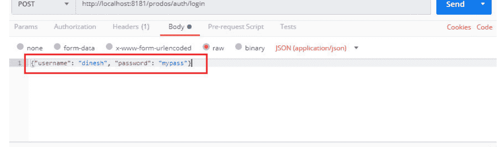
图 5.9：从 /auth/login 端点提取的 JWT 令牌。

如前一张截图所示，API `/auth/login` 为用户名 dinesh 返回了一个 JWT 令牌。你可以参考以下 JWT 令牌的示例：

```
eyJhbGciOiJIUzI1NiIsImtypOiJwaV2cIlJy3b2XclgIlCyJBv2xclgIIJcyb2x1CgIlJy3b2x1CgIlJy3b2x1CgIlJy3b2x1CgIlJy3b2x1CgIlJy3b2x1CgIlJy3b2x1
MTU1MTG7NyQyOsZNxVOTzXNvuTUtgZFdE5fQyZHzGf2XAwREuCAuGXRc63G6R8U8dGWeoR5H89-Mpr_LMBio0C6
```

JWT 令牌包含由点号分隔的以下三个不同部分：

- 第一部分是头部（header），定义了令牌的类型和哈希算法。
- 第二部分是负载（payload），在认证场景下，通常包含有关用户的信息。
- 第三部分是签名（signature），用于验证令牌在传输过程中未被篡改。

成功获取 JWT 令牌后，你可以在调用 REST API `http://localhost:8181/prodos/products` 之前的授权（authorization）中，使用此 JWT 令牌设置 Bearer 令牌。如果你发送此 JWT 令牌，则可以检索产品列表，如下截图所示：

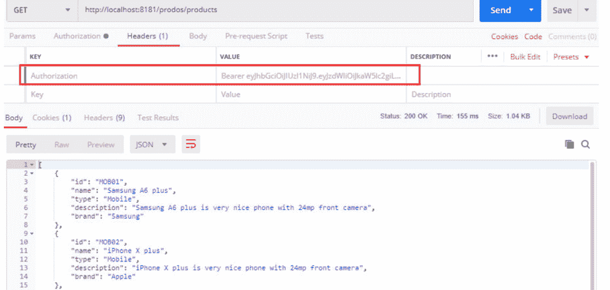
图 5.10：使用 JWT 令牌的 REST API 调用。

我们已经了解了如何将 JWT 令牌传递到请求头以调用 REST API。让我们看下面的图表，它展示了 JWT 认证过程的功能：

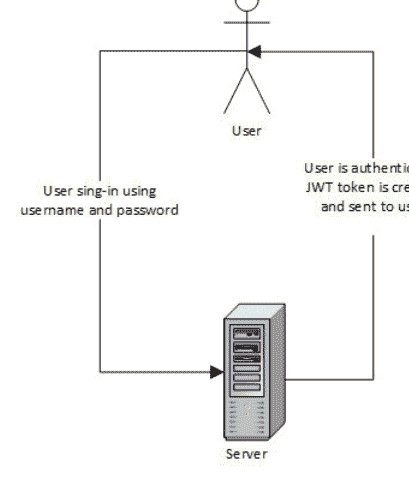
图 5.11：REST API 应用程序中的 JWT 令牌认证流程。

如前图所示，用户提供用户名和密码。

我们在 PRODOS RESTful 应用程序中实现了 Spring Security，通过 HTTP 基础认证机制来保护我们的 REST API，并且还使用了带有 JWT 令牌机制的 Spring Security 进行认证和授权。虽然这些认证机制非常流行，但 Spring 框架对 OAuth2 的支持在工业界被更广泛地使用。让我们在下一节中探讨这一点。

## 使用 Spring Security 和 OAuth2 保护你的 REST API

OAuth2 框架是一个非常流行的授权框架，被广泛用于保护 REST API。Spring 框架为此授权框架提供了良好的支持。在本节中，我们将使用 Spring Security 和 OAuth2 结合 JWT 实现一套安全机制。

你可以通过在应用程序的类路径中添加以下 Maven 依赖来引入 Spring Security 以及带有 JWT 令牌存储的 OAuth2：

```xml
<dependency>
    <groupId>org.springframework.boot</groupId>
    <artifactId>spring-boot-starter-security</artifactId>
</dependency>
<dependency>
    <groupId>org.springframework.security.oauth</groupId>
    <artifactId>spring-security-oauth2</artifactId>
</dependency>
<dependency>
    <groupId>org.springframework.security</groupId>
    <artifactId>spring-security-jwt</artifactId>
</dependency>
```

目前，Spring Boot 没有为 OAuth2 框架提供官方 starter。你可以通过在应用程序中添加以下依赖，来利用 Spring Boot 的自动配置特性：

```xml
<dependency>
    <groupId>org.springframework.security.oauth.boot</groupId>
    <artifactId>spring-security-oauth2-autoconfigure</artifactId>
</dependency>
```

上述 `spring-security-oauth2-autoconfigure` 依赖允许你将 OAuth2 配置外部化。让我们看看与 OAuth2 架构相关的几个核心组件。

### OAuth2 架构的核心组件

在我们的应用程序中实现 OAuth2 架构之前，让我们讨论一下 OAuth2 架构中一些重要的核心组件，如下截图所示：

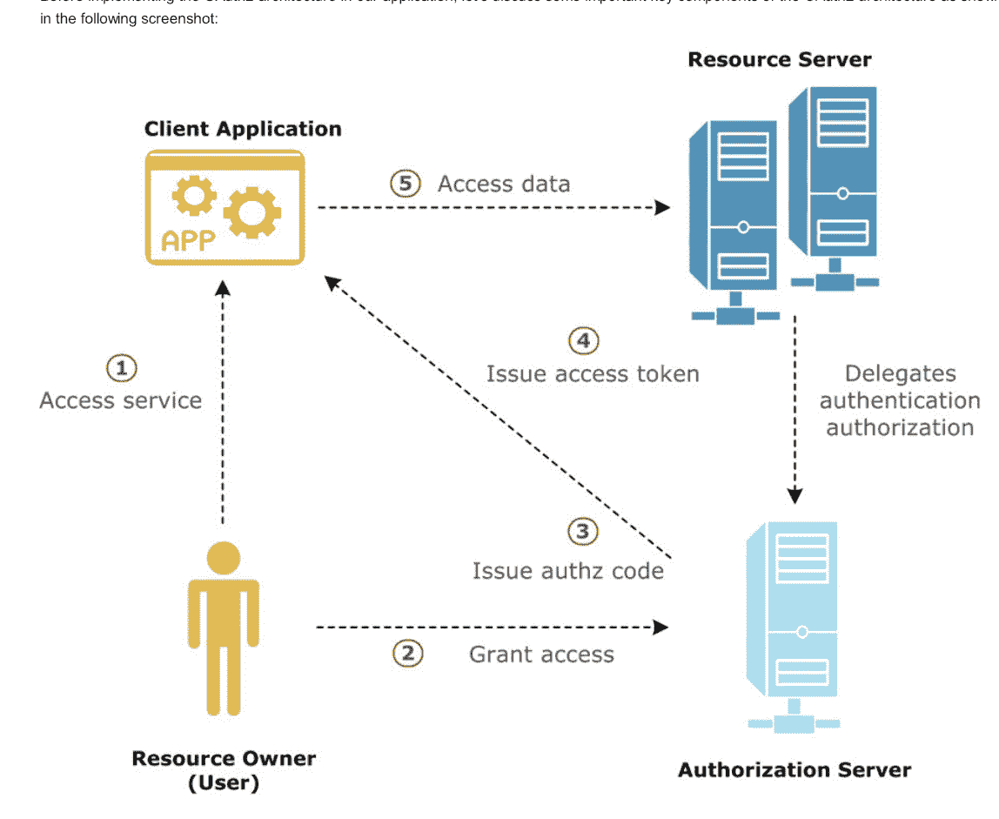

# 图 5.12：OAuth2 架构图。

## 授权服务器 (Authorization server)

授权服务器是 API 安全实现中 OAuth2 安全机制最核心的架构组件。该授权服务器负责授权请求，它是身份验证和授权的集中授权点。该服务器根据客户端应用程序提供的凭据，向客户端应用程序提供访问令牌（access token）和其他详细信息。在调用授权服务器之前，客户端必须提供客户端 ID（client id）和客户端密钥（client secret key）。

## 资源服务器 (Resource server)

资源服务器是 OAuth2 认证机制的另一个关键组件。该服务器允许客户端应用程序使用访问令牌来访问资源。这意味着你需要一个资源服务器来使用该访问令牌。资源服务器也可以与授权服务器为同一个服务器。

## OAuth2

OAuth2 是一个授权框架。它可以用于为应用程序启用 Web 安全，以便从客户端访问资源。OAuth2 应用服务器侧重于授权类型（authorization code）、客户端 ID 和客户端密钥。

根据 OAuth2 文档：

OAuth 2.0 框架允许第三方应用程序通过在资源所有者和 HTTP 服务之间协调审批交互，代表资源所有者获得对 HTTP 服务的有限访问权限，或者允许第三方应用程序代表其自身获得访问权限。

### OAuth2 令牌 (Tokens)

令牌由授权服务器根据提供的凭据实现。OAuth2 令牌有两种类型，如下所示：

- 访问令牌 (Access token)：该令牌用于每个请求并发送至资源服务器。该令牌的有效期仅约为一小时，但你可以根据需求对其进行配置。
- 刷新令牌 (Refresh token)：该令牌用于获取新的访问令牌。

但在我们的应用程序中，我们使用的是 JWT 令牌（JSON Web Token）。它用于表示双方之间加密的声明。JWT 令牌由点（.）分隔的三个部分组成，即：Header.payload.signature。

资源所有者 (Resource owner)：这是一个用户，也是资源的拥有者。让我们看看 OAuth2 框架的流程图。

### OAuth2 授权流程图

让我们查看以下 OAuth2 授权框架的流程图：

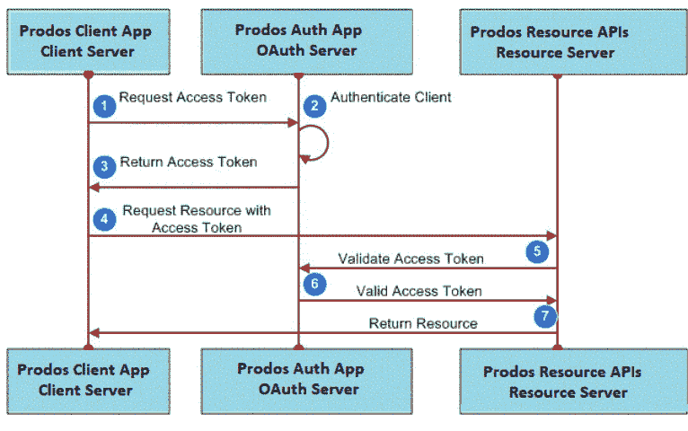
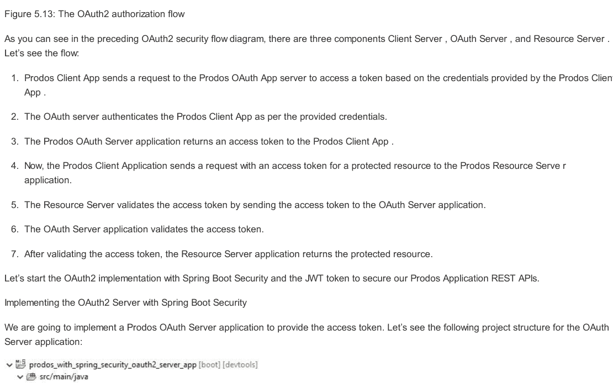

图 5.13：OAuth2 授权流程

正如你在之前的 OAuth2 安全流程图中看到的，包含三个组件：客户端服务器（Client Server）、OAuth 服务器（OAuth Server）和资源服务器（Resource Server）。让我们看看具体流程：

1. Prodos 客户端应用向 Prodos OAuth 应用服务器发送请求，以根据 Prodos 客户端应用提供的凭据获取令牌。
2. OAuth 服务器根据提供的凭据对 Prodos 客户端应用进行身份验证。
3. Prodos OAuth 服务器应用程序向 Prodos 客户端应用返回一个访问令牌。
4. 现在，Prodos 客户端应用程序发送一个带有访问令牌的请求，向 Prodos 资源服务器应用程序请求受保护的资源。
5. 资源服务器通过将访问令牌发送给 OAuth 服务器应用程序来验证该访问令牌。
6. OAuth 服务器应用程序验证访问令牌。
7. 验证访问令牌后，资源服务器应用程序返回受保护的资源。

让我们开始使用 Spring Boot Security 和 JWT 令牌来实现 OAuth2，以保护我们的 Prodos 应用程序 REST API。

## 使用 Spring Boot Security 实现 OAuth2 服务器

我们将实现一个 Prodos OAuth 服务器应用程序来提供访问令牌。让我们看看 OAuth 服务器应用程序的以下项目结构：

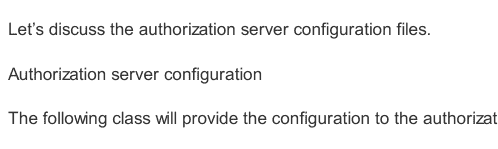

图 5.14：OAuth2 服务器项目结构

```java
package com.dineshonjava.prodos.security.config;

import org.springframework.beans.factory.annotation.Autowired;
import org.springframework.context.annotation.Bean;
import org.springframework.context.annotation.Configuration;
import org.springframework.security.authentication.AuthenticationManager;
import org.springframework.security.crypto.bcrypt.BCryptPasswordEncoder;
import org.springframework.security.oauth2.config.annotation.configurers.ClientDetailsServiceConfigurer;
import org.springframework.security.oauth2.config.annotation.web.configuration.AuthorizationServerConfigurerAdapter;
import org.springframework.security.oauth2.config.annotation.web.configuration.EnableAuthorizationServer;
import org.springframework.security.oauth2.config.annotation.web.configurers.AuthorizationServerEndpointsConfigurer;
import org.springframework.security.oauth2.config.annotation.web.configurers.AuthorizationServerSecurityConfigurer;
import org.springframework.security.oauth2.provider.token.store.JwtAccessTokenConverter;
import org.springframework.security.oauth2.provider.token.store.JwtTokenStore;

@Configuration
@EnableAuthorizationServer
public class AuthorizationServerConfig extends AuthorizationServerConfigurerAdapter {

    static final String CLIENT_ID = "dineshonjava";
    static final String CLIENT_SECRET = "$2a$04$TmJrC9KA4dT RF1Gir zQ1TO/q9gQEjLu1ezDpyYhFBlbjewC7H2Y5G";
    static final String GRANT_TYPE_PASSWORD = "password";
    static final String AUTHORIZATION_CODE = "authorizationcode";
    static final String REFRESH_TOKEN = "refreshtoken";
    static final String IMPLICIT = "implicit";
    static final String SCOPE_READ = "read";
    static final String SCOPE_WRITE = "write";
    static final String TRUST = "trust";
    static final int ACCESS_TOKEN_VALIDITY_SECONDS = 16060;
    static final int REFRESH_TOKEN_VALIDITY_SECONDS = 66060;

    private String privateKey = "111dinesh000";

    @Autowired
    private AuthenticationManager authenticationManager;

    @Autowired
    BCryptPasswordEncoder encoder;

    @Bean
    public JwtAccessTokenConverter tokenEnhancer() {
        JwtAccessTokenConverter converter = new JwtAccessTokenConverter();
        converter.setSigningKey(privateKey);
        return converter;
    }

    @Bean
    public JwtTokenStore tokenStore() {
        return new JwtTokenStore(tokenEnhancer());
    }

    @Override
    public void configure(AuthorizationServerEndpointsConfigurer endpoints) throws Exception {
        endpoints.authenticationManager(authenticationManager).tokenStore(tokenStore())
        .accessTokenConverter(tokenEnhancer());
    }

    @Override
    public void configure(AuthorizationServerSecurityConfigurer security) throws Exception {
        security.tokenKeyAccess("permitAll()").checkTokenAccess("isAuthenticated()")
        .passwordEncoder(encoder);
    }

    @Override
    public void configure(ClientDetailsServiceConfigurer clients) throws Exception {
        clients.inMemory()
        .withClient(CLIENT_ID)
        .secret(CLIENT_SECRET)
        .authorizedGrantTypes(GRANT_TYPE_PASSWORD, AUTHORIZATION_CODE, REFRESH_TOKEN, IMPLICIT)
        .scopes(SCOPE_READ, SCOPE_WRITE, TRUST)
        .accessTokenValiditySeconds(ACCESS_TOKEN_VALIDITY_SECONDS)
        .refreshTokenValiditySeconds(REFRESH_TOKEN_VALIDITY_SECONDS);
    }
}
```

在上述授权服务器配置中，我们使用了 `JwtAccessTokenConverter` 和 `JwtTokenStore` bean。这些类是用于根据 OAuth 认证信息提供 JWT 令牌的辅助类。我们还添加了一个私钥，以使 JWT 令牌更加稳健。在本例中，我们使用的是 `JwtTokenStore` bean，但 Spring Security 还为我们提供了 `InMemoryTokenStore` 和 `JdbcTokenStore`。

我们重写了 `configure(ClientDetailsServiceConfigurer clients)` 方法。该方法接收一个 `ClientDetailsServiceConfigurer` 对象作为参数。`ClientDetailsServiceConfigurer` 类是一个定义客户端详细服务（client details service）的配置类。在我们的示例中，我们使用了 `inMemory()` 方法的客户端详细服务实现。Spring Security 还提供了 `jdbc()` 方法来实现客户端详细服务，而不是使用 `inMemory()` 实现。

`AuthorizationServerConfigurer` 类是另一个配置类，它定义了令牌端点上的安全约束。

授权服务器配置类还配置了 `AuthorizationServerEndpointsConfigurer` 类，该类定义了授权和令牌端点以及令牌服务。

在这里，我们不会详细讨论授权服务器应用程序的每一个文件。所有其他文件与我们在之前示例中使用的文件非常相似。你可以在 GitHub ([https://github.com/dineshonjava/bpb-spring-boot-reprobs](https://github.com/dineshonjava/bpb-spring-boot-reprobs)) 找到授权服务器应用程序的完整源代码。

现在让我们创建资源服务器的配置文件。

## 使用 Spring Boot Security 实现资源服务器

我们将实现一个 Prodos 资源服务器应用程序，以使用访问令牌提供受保护的资源端点。让我们看看资源服务器应用程序的以下项目结构：

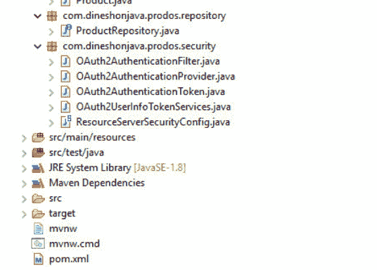

图 5.15：资源服务器项目结构

让我们讨论资源服务器的配置文件。

### 资源服务器配置

以下类将为资源服务器应用程序提供配置：

```java
package com.dineshonjava.prodos.security.config;

import org.springframework.context.annotation.Configuration;
import org.springframework.security.config.annotation.web.builders.HttpSecurity;
```

```java
import org.springframework.security.oauth2.config.annotation.web.configuration.EnableResourceServer;
import org.springframework.security.oauth2.config.annotation.web.configuration.ResourceServerConfigurerAdapter;
import org.springframework.security.oauth2.config.annotation.web.configurers.ResourceServerSecurityConfigurer;
import org.springframework.security.oauth2.provider.error.OAuth2AccessDeniedHandler;

@Configuration
@EnableResourceServer
public class ResourceServerConfig extends ResourceServerConfigurerAdapter {
    private static final String RESOURCE_ID = "resourceid";

    @Override
    public void configure(ResourceServerSecurityConfigurer resources) {
        resources.resourceId(RESOURCE_ID).stateless(false);
    }

    @Override
    public void configure(HttpSecurity http) throws Exception {
        http.
        anonymous().disable()
        .authorizeRequests()
        .antMatchers("/products/**").access("hasRole('USER')")
        .and().exceptionHandling().accessDeniedHandler(new OAuth2AccessDeniedHandler());
    }
}
```

上述类使用了 `@EnableResourceServer` 注解。它用于 OAuth2 资源服务器，并启用了一个 Spring Security 过滤器，通过传入的 OAuth2 令牌对请求进行身份验证。

在我们的案例中，资源应用程序是一个提供 REST API 以执行 CRUD 操作的应用程序。但您需要传递访问令牌（access token）才能调用资源服务器的 REST API。

让我们使用以下安全配置文件在资源应用程序中配置 Spring Security：

```java
package com.dineshonjava.prodos.security;

import org.springframework.beans.factory.annotation.Autowired;
import org.springframework.boot.autoconfigure.security.oauth2.resource.ResourceServerProperties;
import org.springframework.context.annotation.Bean;
import org.springframework.context.annotation.Configuration;
import org.springframework.security.authentication.AuthenticationManager;
import org.springframework.security.config.annotation.authentication.builders.AuthenticationManagerBuilder;
import org.springframework.security.config.annotation.web.builders.HttpSecurity;
import org.springframework.security.config.annotation.web.configuration.EnableWebSecurity;
import org.springframework.security.config.annotation.web.configuration.WebSecurityConfigurerAdapter;
import org.springframework.security.config.http.SessionCreationPolicy;
import org.springframework.security.oauth2.config.annotation.web.configuration.EnableResourceServer;
import org.springframework.security.web.authentication.www.BasicAuthenticationFilter;

@Configuration
@EnableResourceServer
@EnableWebSecurity
public class ResourceServerSecurityConfig extends WebSecurityConfigurerAdapter {
    @Autowired
    ResourceServerProperties resourceServerProperties;

    @Bean
    @Override
    public AuthenticationManager authenticationManagerBean() throws Exception {
        return super.authenticationManagerBean();
    }

    @Override
    protected void configure(HttpSecurity http) throws Exception {
        http
        .authorizeRequests()
        .anyRequest().authenticated()
        .and()
        .addFilterBefore(new OAuth2AuthenticationFilter(), BasicAuthenticationFilter.class)
        .csrf().disable()
        .httpBasic().disable()
        .sessionManagement().sessionCreationPolicy(SessionCreationPolicy.STATELESS);
    }

    @Autowired
    public void configureGlobal(AuthenticationManagerBuilder auth) throws Exception {
        auth.authenticationProvider(new OAuth2AuthenticationProvider(resourceServerProperties));
    }
}
```

正如您在上述配置文件中看到的，我们使用了一个自定义的 `OAuth2AuthenticationFilter` 文件来解析由客户端应用程序传递的访问令牌。让我们来看看这个自定义过滤器的代码：

```java
package com.dineshonjava.prodos.security;

import java.io.IOException;
import javax.servlet.FilterChain;
import javax.servlet.ServletException;
import javax.servlet.ServletRequest;
import javax.servlet.ServletResponse;
import javax.servlet.http.HttpServletRequest;
import org.springframework.security.core.Authentication;
import org.springframework.security.core.context.SecurityContextHolder;
import org.springframework.util.StringUtils;
import org.springframework.web.filter.GenericFilterBean;

public class OAuth2AuthenticationFilter extends GenericFilterBean {
    private static final String AUTHORIZATION = "Authorization";
    private static final String PREFIX = "Bearer";
    private static final String EMPTY = "";

    @Override
    public void doFilter(ServletRequest request, ServletResponse response, FilterChain filterChain)
            throws IOException, ServletException {
        String accessToken = ((HttpServletRequest) request).getHeader(AUTHORIZATION);

        if (accessToken != null && accessToken.startsWith(PREFIX)) {
            accessToken = accessToken.replace(PREFIX, EMPTY).trim();
        }

        if (!StringUtils.isEmpty(accessToken)) {
            Authentication auth = new OAuth2AuthenticationToken(accessToken);
            SecurityContextHolder.getContext().setAuthentication(auth);
        }

        filterChain.doFilter(request, response);
    }
}
```

之前的过滤器将在调用实际的控制器类之前被应用，该过滤器使用 `OAuth2AuthenticationToken` 类从访问令牌中解析出 `Authentication` 对象。我们还将创建一个自定义的身份验证提供者（authentication provider）来使用访问令牌提供身份验证，该令牌将调用授权服务器来验证访问令牌。

我们将在资源服务器应用程序配置文件中定义用户 INFO URI，如下代码所示：

## OAuth 配置
```
security.oauth2.resource.user-info-uri=http://localhost:8282/prodosauthsrvr/user
```

在这里，我们不会详细讨论资源服务器应用程序的每一个类。您可以在 GitHub 的 [https://github.com/dineshonjava/ppb-spring-boot-reactjs](https://github.com/dineshonjava/ppb-spring-boot-reactjs) 找到资源服务器应用程序的完整源代码。

让我们测试我们的 OAuth2 应用程序以保护我们的 REST API。首先，运行授权服务器应用程序。然后，生成令牌。我们将使用 Postman 向 `http://localhost:8282/prodosauthsrvr/oauth/token` 发送一个 POST 请求。请看以下截图：


正如您在上述截图中看到的，我们选择了 basic Auth，提供了用户名和密码 `dineshonjava` 并对机密客户端密钥进行了编码。此外，我们还提供了其他参数，如用户名、密码和授权类型（grant type）。发送 POST 请求后，将返回 `accesstoken`、`tokentype`、`refresh_token`、`expiry` 等信息。

现在，您可以使用生成的访问令牌来消费资源服务器应用程序上受保护的 REST API，如下面截图所示：


正如您在上述截图中看到的，我们使用生成的访问令牌向资源服务器发送 GET 请求以获取受保护的资源。我们将访问令牌在请求头（header）中设置为 Bearer 令牌。

## 实现客户端-服务器应用程序

我们现在将实现一个 Prodos 客户端-服务器应用程序。该应用程序将消费托管在资源服务器应用程序上的 REST API。客户端应用程序将发送访问令牌以访问受保护的资源端点。让我们看看客户端服务器应用程序的以下项目结构：


让我们看看客户端应用程序的应用程序配置文件：

```
server.servlet.context-path=/prodosapp
server.port=9000
spring.thymeleaf.cache=false

# OAuth Config
security.oauth2.client.access-token-uri=http://localhost:8282/prodosauthsrvr/oauth/token
security.oauth2.client.user-authorization-uri=http://localhost:8282/prodosauthsrvr/oauth/authorize
security.oauth2.client.client-id=dineshonjava
security.oauth2.client.client-secret=dineshonjava
```

如您所见，我们配置了访问令牌 URI 和用户授权 URI。客户端应用程序将向 Auth 服务器应用程序提供用户名和密码以获取访问令牌，而该令牌用于传递给资源服务器以获取受保护的资源。

让我们看看负责从 Auth 服务器获取访问令牌的以下控制器类：

```java
package com.dineshonjava.prodos.controller;

import org.springframework.beans.factory.annotation.Autowired;
import org.springframework.ui.ModelMap;
import org.springframework.web.bind.annotation.GetMapping;
import org.springframework.web.bind.annotation.RequestParam;
import org.springframework.web.bind.annotation.RestController;
import com.dineshonjava.prodos.service.AuthService;

@RestController
public class AuthController {
    @Autowired
    AuthService authService;

    @GetMapping(value = "/prodos-auth")
    public String getAccessToken(@RequestParam String username, @RequestParam String password, ModelMap model) {
        String accessToken = null;
        accessToken = authService.generateAccessToken(username, password);
        return accessToken;
    }
}
```

如您在上述代码中看到的，控制器类通过 `Autowired` 依赖于 `AuthService` 类，如下代码所示：

```java
package com.dineshonjava.prodos.service;

import java.io.IOException;
import java.util.HashMap;
import java.util.Map;
```


```java
import org.slf4j.Logger;
import org.slf4j.LoggerFactory;
import org.springframework.beans.factory.annotation.Autowired;
import org.springframework.beans.factory.annotation.Value;
import org.springframework.stereotype.Service;
import org.springframework.util.StringUtils;
import com.dineshonjava.prodos.dto.AuthResponseDto;
import com.fasterxml.jackson.databind.ObjectMapper;

@Service
public class AuthService {

    private static final Logger logger = LoggerFactory.getLogger(AuthService.class);

    @Autowired
    private RestCallService restCallService;

    @Value("${security.oauth2.client.access-token-uri}")
    private String ACCESSTOKENAPIDOMAINURI;

    @Value("${security.oauth2.client-id}")
    private String ACCESSTOKENAPICLIENTID;

    @Value("${security.oauth2.client-secret}")
    private String ACCESSTOKENAPICLIENTSECRET;

    public String generateAccessToken(String username, String password) {
        String response = null;
        Map params = new HashMap();
        params.put("username", username);
        params.put("password", password);
        params.put("grant_type", "password");
        String auth = ACCESSTOKENAPICLIENTID + ":" + ACCESSTOKENAPICLIENTSECRET;
        try {
            response = restCallService.restTemplatePost(ACCESSTOKENAPIDOMAINURI, params, auth);
        } catch (Exception e) {
            logger.error("Exception while calling access token API.{} ", e.getMessage());
        }
        if (!StringUtils.isEmpty(response)) {
            ObjectMapper mapper = new ObjectMapper();
            try {
                AuthResponseDto authResponseDto = mapper.readValue(response, AuthResponseDto.class);
                response = authResponseDto.getAccess_token();
            } catch (IOException e) {
                e.printStackTrace();
            }
        }
        return response;
    }
}
```

前面的 `AuthService` 类负责获取由 Auth 服务器生成的令牌。在本书中，我们不会详细讲解客户端应用程序的所有类。您可以在 GitHub 的 [https://github.com/dineshonjava/bpb-spring-boot-reactjs](https://github.com/dineshonjava/bpb-spring-boot-reactjs) 找到客户端应用程序的完整源代码。

现在，运行客户端应用程序，并在浏览器中访问客户端应用程序的主页。它将渲染一个登录页面。您需要在此提供凭据：


图 5.19：客户端应用程序登录页面

让我们提供相应的凭据，然后您将被重定向到主页，如下面的截图所示：


图 5.20：客户端应用程序登录页面

现在，客户端应用程序已经拥有了由 Auth 服务器应用程序生成的访问令牌。让我们通过点击“Access all Products”链接来调用资源服务器，如下面截图所示：


图 5.21：客户端应用程序登录页面

在前面的截图中，页面渲染了从资源服务器应用程序获取的所有产品。让我们来看一下用于从资源服务器获取受保护资源的方法的源代码：

```java
public String findAllProducts(ModelMap model) {
  String accessToken = authService.generateAccessToken("dinesh", "mypass");
  HttpHeaders headers = new HttpHeaders();
  headers.setContentType(MediaType.APPLICATION_JSON);
  headers.set("Authorization", "Bearer " + accessToken);
  HttpEntity entity = new HttpEntity<>("parameters", headers);
  List products = restTemplate.exchange(BASE_URL+"/products", HttpMethod.GET, entity, List.class).getBody();
  model.put("products", products);
  return "products";
}
```

正如您在前面的源代码中看到的，我们首先使用 `AuthService` 为给定用户（用户名：dinesh，密码：mypass）接收一个访问令牌。我们将此令牌设置为 Header 中的 Bearer 令牌。然后，我们使用 `RestTemplate` 对象的 `exchange()` 方法调用资源服务器。

最后，我们可以从资源服务器获取产品列表作为资源。在本章中，我们创建了用于保护 REST API 的应用程序。但 OAuth2 是最广泛使用的身份验证机制之一。即使是 Spring Security 也为其他身份验证机制提供了详尽的支持。

## 结论

在本章中，我们讨论了 RESTful 应用程序中的 Spring Security 自动配置。我们在 PRODOS RESTful 应用程序中实现了 HTTP 基本身份验证。但 HTTP 基本身份验证不适用于生产环境应用程序和大量用户。

我们还实现了基于 JWT 令牌机制的 Spring Security。我们使用 Spring Security 和 JWT 身份验证保护了 REST API，这是一种轻量级的身份验证方法，适合我们的需求。

OAuth2 是保护 REST API 最广泛使用的身份验证机制。在本章中，我们实现了 OAuth2 和基于 JWT 的 Spring Security。我们创建了三个独立的应用程序，分别是 Prodos OAuth Server、Prodos Resource Server 和 Prodos Client-Server 应用程序。

在接下来的第 6 章：测试 Spring Boot 应用程序中，我们将讨论如何使用 Spring Boot 测试我们的 REST 服务。

## 问题

- 1. 什么是 Spring Security？
- 2. 什么是委托过滤器代理 (delegating filter proxy)？
- 3. 什么是安全过滤器链 (security filter chain)？
- 4. 如何使用内存用户存储配置？
- 5. 如何使用 JDBC 用户存储配置？
- 6. 如何使用 LDAP 用户存储配置？
- 7. 如何创建自定义用户详细服务 (user details service) 配置？
- 8. 什么是密码编码？
- 9. 什么是安全上下文 (security context)？
- 10. 主体 (principal) 是如何定义的？
- 11. 身份验证 (authentication) 和授权 (authorization) 是什么？哪个应该在先？
- 12. 如何使用 JWT？
- 13. 什么是 OAuth2？

## 第 6 章：测试 Spring Boot 应用程序

一旦您创建了产品，那么对产品的测试也是一个重要的环节。测试和测试用例是应用程序的关键部分；测试用例不仅能验证您的代码，还能确保您的应用程序按照预期工作。在本章中，我们将探索 Spring Boot 的测试模块，并学习如何使用单元测试和集成测试来测试 Spring Boot 应用程序。您将学习如何对 Spring Boot 服务进行单元测试，并学习如何模拟 (mock) Spring Boot 服务。

Spring Boot 没有提供专门用于编写应用程序单元测试的特定模块。Spring Boot 为您的应用程序提供了集成测试模块，因为 Spring 框架在 Spring 应用程序的组件之间进行 Bean 注入。您可以使用该模块编写集成测试，以测试 Spring 应用程序的每个组件是否配置正确并成功创建。但对于单元测试用例，您可以在应用程序中使用 JUnit 库。

在本章中，我们将首先为您的 Spring 应用程序（即我们在所有章节中使用的 PRODOS 应用程序）添加一个测试模块，该模块将为您的测试环境启用应用程序上下文。在本章中，我们将讨论以下主题：

- 1. Spring Boot 中的测试
- 2. 创建单元测试
- 3. 创建集成测试
    - 测试控制器 (controllers)
    - 测试自动配置的数据 JPA 仓库 (repository)
    - 测试身份验证控制器
- 4. 加载测试配置
- 5. 为测试类激活配置文件 (profiles)

### Spring Boot 中的测试

Spring 框架为我们提供了一个单独的模块用于测试 Spring 应用程序，即 Spring test。该模块提供了测试运行类，有助于在基于 JUnit 的应用程序测试中加载 Spring 应用程序上下文。而对于 Spring Boot 来说，添加测试框架非常简单；默认情况下，Spring Boot 已经启用了测试框架。

让我们看看您的 `pom.xml` 文件。Spring Boot 测试启动器可以通过如下代码添加到应用程序的 `pom.xml` 文件中：

```xml
<dependency>
    <groupId>org.springframework.boot</groupId>
    <artifactId>spring-boot-starter-test</artifactId>
    <scope>test</scope>
</dependency>
```

前面的 Maven 依赖项将 Spring Boot 测试启动器添加到您的应用程序中。它为我们提供了许多便捷的测试库，如 JUnit、Mockito、AssertJ 等。此外，Spring Boot Initializr 会创建一个名为 `test` 的独立源代码文件夹，并在此文件夹中添加一个初始测试应用程序类，如下面截图所示：


图 6.1：Spring Boot 应用程序中创建的测试源代码文件夹

在前面的截图中，`src/test/java` 源代码文件夹已被创建，您可以看到一个 `ProdosApplicationTests` 测试类。默认创建的代码如下：

```java
package com.dineshonjava.prodos;

import org.junit.Test;
import org.junit.runner.RunWith;
import org.springframework.boot.test.context.SpringBootTest;
import org.springframework.test.context.junit4.SpringRunner;

@RunWith(SpringRunner.class)
@SpringBootTest
public class ProdosApplicationTests {

    @Test
    public void contextLoads() {

    }
}
```

如您所见，之前生成的测试类使用了 `@SpringBootTest` 注解。该注解在您的应用程序中启用了 Spring 测试模块。`@SpringBootTest` 注解提供以下功能：

- 它使用 `SpringBootContextLoader` 作为默认的 `ContextLoader`。
- 该注解会自动搜索带有 `@SpringBootConfiguration` 注解的配置文件。
- 它还允许您使用 `properties` 属性自定义环境属性。
- 该注解允许您自定义不同的 `webEnvironment` 模式，例如通过监听定义端口或随机端口来启动一个完全运行的 Web 服务器。


[第 148 页]

在 REST 消费者应用程序中，此注解注册了一个 `TestRestTemplate` 和/或 `WebTestClient` bean，用于 Web 测试。

如果你的测试使用了 `@Transactional`，默认情况下，Spring Boot 测试框架会在每个测试方法结束时回滚所有事务。此外，Spring Boot 测试框架会使用内存数据库，例如 H2、HSQL 等。

测试是软件开发的重要组成部分。Spring Initializr 为你提供了一个测试类以便快速上手。让我们从应用程序的单元测试开始。

## 创建单元测试

单元测试对你的应用程序非常重要。单元测试测试的是一个功能单元，且不需要任何外部依赖。由于我们测试的是一个单元，外部依赖无法直接使用，因此你可以简单地为外部类创建存根（stubs）或模拟对象（mock objects）。

因此，在单元测试中，你可以使用原对象的伪对象或存根实现来解析外部依赖。外部依赖不能成为单元测试的阻碍。目前有许多提供模拟对象的框架可用，例如 Mockito、jMock 和 EasyMock。让我们看看下面关于控制器类单元测试中外部依赖的图表：


图 6.2：单元测试中 ProductRepository 的存根实现

在前面的图表中，你可以看到应用程序的两种模式：生产模式和单元测试模式。在生产模式下，Spring 框架通过 Spring 配置类将所有必需的外部或内部依赖注入到控制器类中。但在单元测试模式下，Spring 框架不发挥任何作用。在这里，我们创建了一个 `product repository` 的存根对象并提供给控制器类。`ProductRepository` 类的存根对象不会与数据库建立任何连接，它拥有用于测试的虚拟数据。

在这个例子中，我想为 `ProductController` 类创建一个单元测试，并测试两个方法：`findProductById()` 和 `findAllProducts()`。

`findProductById()` 方法将返回与产品 ID 关联的产品对象，而 `findAllProducts()` 将返回产品列表。

让我们创建 `ProductController` 类，并使用单元测试对其进行测试：

```
package com.dineshonjava.prodos.controller;

import java.util.ArrayList;
import java.util.List;

import org.springframework.http.MediaType;
import org.springframework.web.bind.annotation.GetMapping;
import org.springframework.web.bind.annotation.PathVariable;
import org.springframework.web.bind.annotation.RestController;

import com.dineshonjava.prodos.domain.Product;
import com.dineshonjava.prodos.repository.ProductRepository;

@RestController
public class ProductController {

    private ProductRepository productRepository;

    public ProductController(ProductRepository productRepository) {
        super();
        this.productRepository = productRepository;
    }

    @GetMapping(value = "/products", produces = {MediaType.APPLICATION_JSON_VALUE})
    public List findAll(){
        List products = new ArrayList<>();
        productRepository.findAll().forEach(i -> products.add(i));
        return products;
    }

    @GetMapping(value = "/products/{id}", produces = {MediaType.APPLICATION_JSON_VALUE})
    public Product findProductById(@PathVariable String id){
        return productRepository.findById(id).isPresent() ? productRepository.findById(id).get() : null;
    }
}
```

前面的 `ProductController` 类依赖于 `ProductRepository` 的实现。现在让我们为 `ProductRepository` 类创建一个存根实现，以便对 `ProductController` 类进行单元测试：

```
public class StubProductRepository implements ProductRepository {

    @Override
    public Product findProductById(String id) {
        return new Product("MOB301", "POCO", "Mobile", "Xiomi Smart Phone with 24MP front camera", "Xiomi");
    }

    @Override
    public List findAll() {
        List products = new ArrayList<>();
        products.add(new Product("MOB302", "OPPO F6", "Mobile", "OPPO Smart Phone with 24MP front camera", "OPPO"));
        products.add(new Product("MOB303", "VIVO V15", "Mobile", "VIVO Smart Phone with 24MP front camera", "VIVO"));
        return products;
    }
}
```

`StubProductRepository` 类是 `ProductRepository` 的一个存根实现，它通过使用虚拟数据来实现方法，而不需要调用实际的数据库。让我们看看下面的图表，它解释了 `ProductRepository` 的两种实现：


在前面的图表中，你可以看到应用程序中有两种 `ProductRepository` 类的实现，即 `JpaProductRepository` 和 `StubProductRepository`。`StubProductRepository` 用于在不集成数据库依赖的情况下进行单元测试。让我们看看以下使用存根仓库的 `ProductControllerTests` 单元测试类：

```
package com.dineshonjava.prodos;

import static org.junit.Assert.assertFalse;
import static org.junit.Assert.assertTrue;

import org.junit.Before;
import org.junit.Test;

import com.dineshonjava.prodos.repository.StubProductRepository;

public class ProductControllerTests {

    ProductController productController;

    @Before
    public void setUp() {
        productController = new ProductController( new StubProductRepository() );
    }

    @Test
    public void testFindProductById() {
        assertTrue(productController.findProductById("MOB01").getType().equals("Mobile"));
    }

    @Test
    public void testFindAll() {
        assertFalse(productController.findAll().size() == 5);
    }
}
```

在前面的控制器测试类中，我们有三个方法。`setUp()` 方法创建 `ProductController` 类的对象，并且该方法被标注了 `@Before` 注解。这意味着 JUnit 将在测试方法执行之前调用此方法。另外两个方法 `testFindProductById()` 和 `testFindAll()` 被标注了 `@Test` 注解，这表明它们是测试方法。

我们讨论了如何为应用程序中的任何类编写单元测试。单元测试易于实现和理解，存根类的单元测试具有可重用性。但接口中的任何更改都将迫使你在该接口的存根实现中做出同样的更改。

Spring 框架为你的 Spring 应用程序提供了集成测试支持。让我们在下一节中看看 Spring 如何提供对集成测试的支持。

## 创建集成测试

在集成测试中，我们测试应用程序中多个组件共同工作的交互情况。与单元测试相反，集成测试确保所有内部或外部依赖都能正常工作。因此，集成测试还确保所有组件（包括所有依赖项）都按照预期执行。Spring 框架提供了解析这些依赖项的支持，这与生产应用程序类似。让我们看看关于集成测试的下图：


图 6.4：集成测试中的组件

正如你在前面的图中所见，`ProductControllerTests` 使用的是实际的 `ProductRepository` 实现，而不是我们在单元测试中使用的存根或模拟实现。同时，`ProductRepository` 类使用来自数据库的数据，而不是我们在单元测试中使用的虚拟数据。

Spring Boot 为集成测试提供了一个单独的测试模块 (`spring-test.jar`)，其中包含多个 JUnit 测试支持类。Spring 有一个核心支持类 `SpringRunner`，它在测试方法之间缓存一个共享的 `ApplicationContext`。

让我们看看接下来的集成测试类。

## 测试控制器

Spring 为测试提供了强大的支持，使得测试 Web 应用程序变得简单。让我们从一个具有单个请求处理方法的简单控制器类开始。我们将为这个控制器类编写一个测试类，并创建一个测试方法来执行对根路径 `/` 的 HTTP GET 请求，并期望返回包含短语 "Hello World!!!" 的内容且结果成功。让我们看看 `HomeController` 类的以下测试类：

```
package com.dineshonjava.prodos;

import static org.hamcrest.Matchers.containsString;

import static
```


## 6.5.2 产品控制器测试

下面为产品控制器创建测试，如以下代码片段所示：

```java
package com.dineshonjava.prodos;

//imports

@RunWith(SpringRunner.class)

@WebMvcTest(ProductController.class)
```

```java
public class ProductControllerTests {

    @Autowired
    private MockMvc mockMvc;

    @Autowired
    private ProductRepository productRepository;

    ...

    ...
}
```

上述测试类 ProductControllerTests 使用了 `@WebMvcTest` 注解进行标注。我们可以将此注解与 `@RunWith(SpringRunner.class)` 一起用于 Spring MVC 测试。此注解仅在需要测试 Spring MVC 组件时使用。我们将 ProductController 类作为该注解的参数传入，以暴露 ProductController 的端点。

`@WebMvcTest` 注解会禁用应用程序的所有自动配置，只启用与 MVC 测试相关的配置，例如 `@Controller`、`@ControllerAdvice`、`@JsonComponent` 等。除此之外，使用 `@Component`、`@Service` 或 `@Repository` 注解标注的类将不会在应用程序上下文中可用。

默认情况下，`@WebMvcTest` 注解会自动配置 Spring Security 和 MockMvc。你可以使用 `@AutoConfigureMockMvc` 注解来控制 MockMvc。

下面添加第一个测试用例，用于测试 ProductController 类的 `/products/{ID}` 端点：

```java
@Test
public void testFindProduct() throws Exception {

    String expected = "{id: \"MOB01\",name: \"Samsung A6 plus\",type: \"Mobile\",description: "
        + "\"Samsung A6 plus is very nice phone with 24mp front camera\",brand: \"Samsung\"}";

    mockMvc.perform(get("/products/MOB01"))
        .andExpect(status().isOk())
        .andExpect(content().json(expected));
}
```

我们将添加另一个测试用例，用于通过 HTTP POST 请求向 `/products` 端点创建新产品并保存到数据库：

```java
@Test
public void testPostProduct() throws Exception {

    String newProduct = "{\"id\": \"MOB05\",\"name\": \"Samsung A6 plus\",\"type\": \"Mobile\",\"description\": "
        + "\"Samsung A6 plus is very nice phone with 24mp front camera\",\"brand\": \"Samsung\"}";

    mockMvc.perform(post("/products")
        .accept(MediaType.APPLICATION_JSON_VALUE)
        .content(newProduct)
        .contentType(MediaType.APPLICATION_JSON_VALUE))
        .andExpect(status().isCreated())
        .andExpect(content().json(newProduct));
}
```

我们还将向 ProductControllerTests 类添加另一个测试用例，针对 `/products/{ID}` 端点，使用 HTTP PUT 请求测试更新功能，如以下代码片段所示：

```java
@Test
public void testPutProduct() throws Exception {
    String updatedProduct = "{\"id\": \"MOB03\",\"name\": \"Samsung A6 plus\",\"type\": "
        + "\"Mobile\",\"description\": "
        + "\"Samsung A6 plus is very nice phone with 24mp front camera\",\"brand\": \"Samsung\"}";

    mockMvc.perform(put("/products/MOB03")
        .accept(MediaType.APPLICATION_JSON_VALUE)
        .content(updatedProduct)
        .contentType(MediaType.APPLICATION_JSON_VALUE))
        .andExpect(status().isOk())
        .andExpect(content().json(updatedProduct));
}
```

现在，我们将向 ProductControllerTests 类添加另一个测试用例，针对 `/products/{ID}` 端点，使用 HTTP PATCH 请求测试部分更新功能：

```java
@Test
public void testPatchProduct() throws Exception {
    String expected = "{\"id\": \"MOB01\",\"name\": \"Samsung A6 plus\",\"type\": \"Mobile\",\"description\": "
        + "\"Samsung A8 is very nice phone with 32mp front camera\",\"brand\": \"Samsung\"}";
    String updatedProduct = "{\"id\": \"MOB01\",\"description\": "
        + "\"Samsung A8 is very nice phone with 32mp front camera\"}";

    mockMvc.perform(patch("/products/MOB01")
        .accept(MediaType.APPLICATION_JSON_VALUE)
        .content(updatedProduct)
        .contentType(MediaType.APPLICATION_JSON_VALUE))
        .andExpect(status().isOk())
        .andExpect(content().json(expected));
}
```

现在，我们将向 `/products/{ID}` 端点添加一个测试用例，测试如何使用 HTTP DELETE 请求删除指定产品 ID 的产品：

```java
@Test
public void testDeleteProduct() throws Exception {
    mockMvc.perform(delete("/products/MOB01"))
        .andExpect(status().isNoContent());
}
```

最后，我们将运行所有测试用例，并在 IDE 的 JUnit 选项卡中检查测试是否通过，如下图所示：

图 6.6：显示 ProductControllerTests 的成功测试执行

现在，我们已经为控制器类创建了测试用例，用于验证 REST API 端点。下面让我们为 JPA 仓库创建测试用例，以测试应用程序的 CRUD 功能。

## 测试自动配置的数据 JPA 仓库

Spring Boot 测试模块提供了 `@DataJpaTest` 注解来测试 Spring Data JPA 仓库。此注解可以与 `@RunWith(SpringRunner.class)` 注解一起用于 JPA 测试。此注解主要用于需要编写 JPA 组件测试的情况。此注解仅启用与 JPA 测试相关的配置，其他配置将被禁用，这意味着常规的 `@Component` beans 不会被加载到 ApplicationContext 对象中。

默认情况下，使用 `@DataJpaTest` 标注的测试将使用嵌入式内存数据库，并且此注解会扫描 `@Entity` 类并配置 Spring Data JPA 仓库。你可以使用 `@AutoConfigureTestDatabase` 注解来覆盖这些设置。

如果你想在测试仓库时使用应用程序配置与嵌入式数据库，那么可以使用 `@AutoConfigureTestDatabase` 注解，而不是将 `@DataJpaTest` 与 `@SpringBootTest` 一起使用。

下面为产品仓库创建单元测试，以测试 CRUD 操作，如以下代码片段所示：

```java
package com.dineshonjava.prodos;

import static org.assertj.core.api.Assertions.assertThat;

import org.junit.Test;

import org.junit.runner.RunWith;

import org.springframework.beans.factory.annotation.Autowired;

import org.springframework.boot.test.autoconfigure.orm.jpa.DataJpaTest;

import org.springframework.test.context.junit4.SpringRunner;

import com.dineshonjava.prodos.domain.Product;

import com.dineshonjava.prodos.repository.ProductRepository;

/**
 * @author Dinesh.Rajput
 */

@RunWith(SpringRunner.class)

@DataJpaTest

public class ProductRepositoryTests {

    @Autowired
    private ProductRepository productRepository;

    ...
}
```

如你所见，我们在根测试包中创建了一个名为 ProductRepositoryTests 的新类。此测试类使用 `@DataJpaTest` 注解而不是 `@SpringBootTest` 注解进行标注。当测试仅关注 JPA 组件时，可以使用此类。

由于 `@DataJpaTest` 注解的存在，与 H2 数据库、Hibernate 和 Spring Data 相关的配置将自动可用于 JPA 测试。此注解启用 SQL 日志记录。并且所有 JPA 测试默认都是事务性的，在测试用例结束时回滚。

在之前的 JPA 仓库测试类中，让我们添加第一个测试用例，以测试向数据库创建新产品。创建一个新的产品对象并使用 ProductRepository 类的 `save()` 方法保存到数据库。然后，我们获取相同的对象并检查产品 ID 是否不为 null，如果保存成功的话。

```java
@Test
public void testSaveProduct() {

    //TESTING: Create a new product

    productRepository.save(new Product("MOB301", "POCO", "Mobile",
        "Xiaomi Smart Phone with 24MP front camera", "Xiaomi"));

    Product product = productRepository.findById("MOB301").get();

    assertThat(product.getId()).isNotNull();

}
```

下面向 ProductRepositoryTests 类添加另一个测试用例。我们将根据给定的产品 ID 从数据库中获取产品，并检查返回的产品是否具有该产品 ID：

```java
@Test
public void testGetProduct() {

    //TESTING: Read a product with product id MOB01

    Product product = productRepository.findById("MOB01").get();

    assertThat(product.getId()).isNotNull();

}
```

在最后一个测试用例中，我们将从数据库中获取所有产品并检查产品列表的大小。列表大小必须为五，因为我们在应用程序启动时向 H2 数据库插入了五条记录。此外，我们调用了 ProductRepository 类的 `deleteAll()` 方法。然后，我们将检查是否所有产品都已从数据库中删除：

```java
@Test
public void testDeleteProducts() {

    //TESTING: Delete all products

    assertThat(productRepository.findAll().size()).isEqualTo(5);

    productRepository.deleteAll();

    assertThat(productRepository.findAll()).isEmpty();

}
```


最后，运行所有测试用例并点击 IDE 的 JUnit 选项卡以检查测试是否通过，如下截屏所示：


图 6.7：显示 ProductRepositoryTests 类的测试执行成功

我们已经为应用程序的 JPA Repository 创建了测试。现在让我们为 PRODOS 应用程序的身份验证功能创建测试。

## 测试身份验证控制器

现在，让我们为 PRODOS REST 应用程序中的 `AuthenticationController` 类创建测试。该测试将验证我们的 RESTful Web 服务的 JWT 身份验证功能。我们使用 `MockMvc` 来测试该控制器的端点 (`/auth/login`)。`MockMvc` 对象在不启动服务器的情况下提供了一个 Web 环境，您可以在 Spring 处理 HTTP 请求的层级执行测试。

`MockMvc` 提供了真实的 Web 环境，包括所有 HTTP 请求方法，因此您可以根据 REST 端点使用这些 HTTP 方法。在我们的案例中，我们使用 HTTP POST 请求访问 `/auth/login` 并在请求体中设置凭据。

让我们创建测试来执行两个请求。第一个请求将使用正确的凭据执行，第二个请求将使用错误的凭据执行。第一个请求将检查状态是否为 OK，第二个请求将检查我们是否收到 4XX HTTP 错误：

```java
package com.dineshonjava.prodos;

import static org.springframework.test.web.servlet.request.MockMvcRequestBuilders.post;
import static org.springframework.test.web.servlet.result.MockMvcResultMatchers.status;

import org.junit.Test;
import org.junit.runner.RunWith;
import org.springframework.beans.factory.annotation.Autowired;
import org.springframework.boot.test.autoconfigure.web.servlet.WebMvcTest;
import org.springframework.boot.test.context.SpringBootTest;
import org.springframework.http.MediaType;
import org.springframework.test.context.junit4.SpringRunner;
import org.springframework.test.web.servlet.MockMvc;

/**
 * @author Dinesh.Rajput
 */
@RunWith(SpringRunner.class)
@SpringBootTest
@WebMvcTest
public class AuthenticationControllerTests {

    @Autowired
    private MockMvc mockMvc;

    @Test
    public void testSignIn() throws Exception {
        //TESTING: Login with correct credentials
        this.mockMvc.perform(post("/auth/login")
            .content("{\"username\":\"dineshi\",\"password\":\"mypass\"}")
            .contentType(MediaType.APPLICATION_JSON_VALUE))
            .andExpect(status().isOk());

        //TESTING: Login with wrong credentials
        this.mockMvc.perform(post("/auth/login")
            .content("{\"username\":\"dineshi\",\"password\":\"mypasswrong\"}")
            .contentType(MediaType.APPLICATION_JSON_VALUE))
            .andExpect(status().is4xxClientError()));
    }
}
```

让我们使用正确和错误的凭据运行上述测试。以下截屏显示测试已通过：


图 6.8：显示 AuthenticationControllerTests 类的测试执行成功

如前一张截屏所示，绿色条表示我们的测试在使用正确和错误凭据的情况下均已通过。我们已经为 PRODOS REST 应用程序实现了所有测试。

### 加载测试配置

Spring 测试框架还允许您使用 `@ContextConfiguration(classes=...)` 注解加载与测试环境相关的独立配置。此外，您可以在测试类中使用内部配置类来隔离测试配置。

但在 Spring Boot 中，通常不需要使用 `@ContextConfiguration` 注解和内部配置类，您可以使用 Spring Boot 的 `@Test` 注解自动搜索主测试配置。您仍然可以使用 `@TestConfiguration` 注解来为应用程序自定义主测试配置。

注意：Spring 框架通过缓存应用程序上下文，在应用程序的各个测试之间共享应用程序上下文。

### 为测试类激活 Profile

Spring Boot 测试模块还允许您在测试类内部使用 `@ActiveProfiles` 注解来设置激活的 Profile。此注解仅为测试环境激活 Profile。在测试执行时，Spring Bean 和配置将根据应用程序中激活的 Profile 而可用。让我们看下面的示例：

```java
@RunWith(SpringRunner.class)
@SpringBootTest
@ActiveProfiles( { "prod", "dev" } )
public class ProdosApplicationTests {
    ...
}
```

在上述配置中，我们使用了两个 Profile：`prod` 和 `dev`。因此，与 `prod` 或 `dev` 相关的 Bean 将在测试应用程序上下文中可用。

## 本章小结

测试是软件开发生命周期的主要组成部分之一。作为开发人员，我们必须在应用程序中编写单元测试。单元测试在没有任何外部依赖的情况下隔离地测试一个类。在本章中，我们使用存根（stub）或模拟（mock）对象为应用程序创建了单元测试。

我们在应用程序中实现了集成测试。集成测试确保组件的正常工作及其彼此之间的交互。Spring 为应用程序的集成测试提供了良好的支持。

在接下来的第 7 章：React JS 入门中，我们将讨论用于前端应用程序的 React JS 框架。

## 问题

- 什么是单元测试？
- 什么是集成测试？
- 如何加载测试配置？
- 为 Spring Data JPA 编写测试。
- 什么是模拟（mocking）或存根（stub）对象？
- 如何为测试类激活 Profile？

# 第 7 章：React JS 入门

到目前为止，我们已经讨论了 Spring Boot 及其核心关键特性。我们还使用 Spring Boot 2.2 创建了后端。在第一章中，我们学习了 Spring Boot 以及如何创建 Spring Boot 应用程序。在第 2 章：自定义自动配置中，我们自定义了 Spring Boot 提供的自动配置。

在第 3 章中，我们将 H2 和 MariaDB 数据库配置到 Spring Boot 应用程序中。我们还为 PRODOS 应用程序定义了 CRUD 功能。之后，在第 4 章：使用 Spring Boot 2.2 创建 REST API 中，我们在 PRODOS 应用程序中公开了 REST API，以便客户端应用程序通过 REST 端点执行 CRUD 操作。在我们的 PRODOS 客户端应用程序中，我们使用了 `RestTemplate` 和 `Traverson` 作为 REST 客户端。

在第 5 章：保护 REST API 中，我们使用 Spring Security、OAuth2 和 JWT 保护了我们的 REST API。在第 6 章：测试 Spring Boot 应用程序中，我们还创建了测试用例来测试应用程序的控制器、存储库和身份验证。

创建的客户端应用程序使用了 Thymeleaf 作为前端技术。但 Thymeleaf 不在本书的讨论范围内。现在，我们将讨论 React JS 作为前端技术，并将其配置到我们的 PRODOS 前端应用程序中。在本章中，我们将探讨如何在机器上设置 React JS 以进行前端应用程序开发。在本章中，我们将讨论以下主题：

- React 介绍
- React JS 的特性
- React JS 的优点
- React JS 的局限性

### 为 React JS 设置环境

- 安装 NodeJS 和 NPM
- 安装 Visual Studio Code 编辑器

### 创建 React 应用程序

- 使用 webpack 和 babel
- 使用 `create-react-app` 命令

让我们详细讨论这些主题。

## React 介绍

由 Facebook 开发的 React 是最受欢迎的基于 JavaScript 库的前端开发技术之一。您可以使用 React JS 进行前端应用程序开发并创建移动 Web 应用程序。您可以使用 React JS 创建可复用的前端 UI 组件并构建可组合的用户界面。React 不使用典型的原生 DOM，而是使用自己的虚拟 React DOM。虚拟 React DOM 的渲染速度比原生 DOM 对象更快。让我们看看关于 React JS 技术的 React 官方文档。

根据 React 的官方文档：

“React 是一个用于构建用户界面的声明式、高效且灵活的 JavaScript 库。它允许您从称为组件的小型且隔离的代码片段中组合出复杂的 UI。”

对于前端应用程序的用户界面，我们可以将用户界面划分为多个小型 UI 视觉单元，并且对于每个 UI 视觉单元，您可以创建一个 React 组件，因为在 React 中，组件是基础构建块。这些 UI 组件是可复用的。您可以在前端应用程序中为类似类型的视觉效果重复使用它们。此外，这些是前端应用程序中独立的 UI 组件。

我们将进一步讨论 React JS，但在那之前，先讨论 React 的特性。

## React JS 的特性

React 是一个基于组件的 JavaScript 库，它具有以下特性：

### 声明式行为

您可以使用 React 为您的移动或网站应用程序创建非常吸引人且具有交互性的动态用户界面。它为应用程序中的每个数据状态创建一个简单且细小的视图组件。当数据发生变化时，React 会高效地更新视图组件。这就是 React 的声明式行为，它使您的应用程序代码更具可读性和可复用性。

### 虚拟 DOM 对象

这是 React 的另一个非常重要的特性。它为前端应用程序中的每个 DOM 对象创建一个虚拟 DOM 对象。虚拟 DOM 对象只是原生 DOM 对象的虚拟副本。与原生 DOM 相比，数据绑定速度非常快，因为在虚拟 DOM 对象中，没有任何东西被直接绘制在屏幕上。

### 事件处理模型

由于 React 创建了自己的虚拟 DOM 对象，同样地，它也创建了自己的事件系统，该系统与 W3C 对象模型完全兼容。其事件模型封装了所有浏览器的原生事件。React 事件模型提供了跨浏览器的实现来执行原生事件，从而减少了不兼容的事件错误。它还拥有一个事件对象池，以减少内存开销并提高性能。

### JSX

这是 React JS 最优秀的特性之一。JSX 代表 Javascript 和 XML。它不是 HTML，但看起来像 HTML。JSX 用于创建 React 组件，而组件是 React UI 的构建块。

### 基于组件的方法

React 为前端 UI 实现提供了一种基于组件的方法。在 React 中，一切皆组件。网页视图（或 UI）将由若干个小型组件创建。在前端应用程序中，视图的每个部分都将与一个称为组件的自包含模块相关联。React 中的组件可用于类似类型的视觉效果，并且由于组件逻辑是用 JavaScript 编写的，您可以轻松地渲染大量数据而不会影响前端应用程序的性能。


 React native

它是 React 库的另一种形式。它是 React 的另一种自定义渲染器，类似于网站上的 React DOM。它使用原生组件而不是 React Web 组件。

我们刚刚讨论了 React 的重要特性。让我们在接下来的章节中看看 React 的一些优势和局限性。

## React JS 的优势

在你的前端应用中使用 React 具有以下优势：

- 应用性能

React 使用虚拟 DOM 对象，它是一个 JavaScript 对象。它提高了前端应用的性能，因为在虚拟 DOM 中渲染比在常规 DOM 中更快。

- 代码可复用性

React 使用基于组件的方法来渲染 UI，而组件是视觉呈现的一个小部分。这些组件可以在相同类型的视觉呈现中重复使用。

- 代码可读性

一个网页被拆分为多个组件，而组件是用于渲染特定视觉效果的自包含模块。这增加了代码的可读性。最后，组件和数据模式提高了可读性，有助于维护大型应用。

- 跨平台

React 既可以用在客户端，也可以与其他框架结合用在服务端。

在前端应用开发中，React 还有许多其他优势，我们在这里不一一讨论。让我们在接下来的章节中看看 React 在前端应用开发中的一些局限性。

## React JS 的局限性

以下是 React 在前端应用开发中的局限性：

- React 仅提供对应用视图层的支持。你仍然需要使用其他工具来构建一个完整的应用。

- 它使用内联样式和模板。

- 在大型应用中，过多的细小组件可能会给管理带来过重负担，并增加样板代码（boilerplate）。


图 7.1：在 Windows 10 操作系统中安装 Node.js

成功安装 Node.js 后，我们可以验证 Node.js 是否已完全安装在你的 PC 上。让我们打开 PowerShell 或你正在使用的操作系统终端，并运行以下命令：

```
node -v
npm -v
```

以下截图显示了在 PowerShell 中运行上述命令的输出：


图 7.2：在 Windows 10 操作系统中验证 Node.js 安装

在前面的截图中，显示了 Node.js 和 npm 的版本。无需单独安装 NPM，因为它随 Node.js 一起安装。NPM 是一个 JavaScript 包管理器。

成功安装 Node.js 和 NPM 后，现在让我们使用 NPM 在 Node.js 中安装 React。但在继续之前，让我们为 React 应用安装一个编辑器。这里我使用的是 Visual Studio Code (VS Code)。让我们安装 Visual Studio Code。

### 安装 Visual Studio Code 编辑器

它是一个开源代码编辑器。你不仅可以用它开发 React，还可以将其用于其他多种编程语言。你可以从 https://code.visualstudio.com/download 下载。根据你的操作系统（如 Windows、macOS 和 Linux），有多种下载选项可用。

但我下载的是适用于 Windows 操作系统的 MSI 安装程序。让我们使用默认设置进行安装。

以下截图显示了 VS Code 完整的工作台及其众多选项。你可以在应用开发中使用这些选项。


图 7.3：在 Windows 10 操作系统中打开 VS Code 编辑器工作台

我们已经在机器上为 React 应用开发安装了支持环境。现在让我们创建一个 React 应用，并看看如何运行 React 应用。

## 创建 React 应用

你可以通过以下两种方式创建 React 应用：

- 使用 webpack 和 babel

- 使用 `create-react-app` 命令

让我们从第一种创建 React 应用的方法开始。

## 使用 webpack 和 babel

Webpack 是一个用于管理模块的模块打包器，它将模块加载到 React 应用中。它在编译后通过将内部模块合并，创建一个单一的 bundle。

Babel 是一个 JavaScript 编译器，用于将源代码编译为其他形式。它允许你在 React 应用中使用新的 ES6 特性。

让我们使用它们来创建一个 React 应用。

首先，我们将创建一个根应用目录，例如 `prodosreactapp`：

```
PS F:\personal data\book\Full-stack-development-spring-boot-2-react> cd prodosreactapp
```

```
PS F:\personal data\book\Full-stack-development-spring-boot-2-react> mkdir prodosreactapp
```

让我们在 PowerShell 中使用 `npm init` 命令来生成 `package.json` 文件：

```
PS F:\personal data\book\Full-stack-development-spring-boot-2-react> npm init -y
```

我们在前面的命令中使用了 `-y` 选项，以跳过询问有关模块的信息（如包名、描述、作者等），如下面截图所示：


图 7.4：执行 `npm init -y` 命令

现在，让我们使用以下命令在 React 应用目录中安装 `react` 和 `react-dom`：

```
PS F:\personal data\book\Full-stack-development-spring-boot-2-react> npm install react react-dom --save
```

以下截图显示了执行上述命令后的输出：


图 7.5：安装 React 和 react-dom

我们现在将安装 `webpack`、`webpack-dev-server` 和 `webpack-cli` 来生成打包器，使用以下命令：

```
PS F:\personal data\book\Full-stack-development-spring-boot-2-react> npm install webpack --save
PS F:\personal data\book\Full-stack-development-spring-boot-2-react> npm install webpack-dev-server --save
PS F:\personal data\book\Full-stack-development-spring-boot-2-react> npm install webpack-cli --save
```

以下截图显示了执行上述命令后的输出：


图 7.6：安装 webpack, webpack-dev-server 和 webpack-cli

现在，我们将使用以下命令在 React 应用中安装 babel 编译器：

```
PS F:\personal data\book\Full-stack-development-spring-boot-2-react> npm install babel-core --save-dev
```

```
PS F:\personal data\book\Full-stack-development-spring-boot-2-react> npm install babel-loader --save-dev

PS F:\personal data\book\Full-stack-development-spring-boot-2-react> npm install babel-preset-env --save-dev

PS F:\personal data\book\Full-stack-development-spring-boot-2-react> npm install babel-preset-react --save-dev

PS F:\personal data\book\Full-stack-development-spring-boot-2-react> npm install html-webpack-plugin --save-dev
```

以下截图显示了执行上述命令后的输出：


图 7.7：安装 babel

让我们为 React 应用创建所需的文件。我们需要的文件名是 `index.html`、`App.js`、`main.js`、`webpack.config.js` 和 `.babelrc`。创建这些文件后，我们将编辑 `webpack.config.js` 文件并设置编译器、服务器和加载器，如下面代码片段所示：

```
const path = require('path');

const HtmlWebpackPlugin = require('html-webpack-plugin');

module.exports = {

    entry: './main.js',

    output: {

        path: path.join(__dirname, '/bundle'),

        filename: 'index_bundle.js'

    },

    devServer: {

        inline: true,

        port: 8383

    },

    module: {

        rules: [

            {

                test: /\.jsx?$/,

                exclude: /node_modules/,

                loader: 'babel-loader',

                query: {

                    presets: ['es2015', 'react']

                }

            }

        ]

    }

}
```

```
plugins:[
  new HtmlWebpackPlugin({
    template: './index.html'
  })
]
}
```

如接下来的截图所示，在所有命令执行完毕后，应用文件已创建：


图 7.8：React 应用下生成的文件

让我们按照以下代码编辑 `package.json` 文件：

```
{
  "name": "prodosreactapp",
  "version": "1.0.0",
  "description": "",
  "main": "index.js",
  "scripts": {
    "test": "echo "Error: no test specified!" && exit 1"
  },
  "keywords": [],
  "author": "",
  "license": "ISC",
  "dependencies": {
    "react": "^16.8.4",
    "react-dom": "^16.8.4",
    "webpack": "^4.29.6",
    "webpack-cli": "^3.3.0",
    "webpack-dev-server": "^3.2.1"
  },
  "devDependencies": {
```

“babel-core”: “^6.26.3”,
“babel-loader”: “^8.0.5”,
“babel-preset-env”: “^1.7.0”,
“babel-preset-react”: “^6.24.1”,
“html-webpack-plugin”: “^3.2.0”
}
}

我们将从前面的代码中删除高亮显示的文本，因为目前我们的 React 应用程序还没有任何可执行的测试。现在，我们将在 script 部分添加以下几行来替代被删除的行：
“start”: “webpack-dev-server --mode development --open --hot”,
“build”: “webpack --mode production”

接下来，我们将按照以下代码编辑 index.html 文件：

前面的文件将是 PRODOS 前端应用程序的主页，现在我们可以编辑 App.js 文件并在其中添加以下代码：
```javascript
import React, { Component } from ‘react’;
class App extends Component{
render(){
return(
<div>
<h1>Welcome to the PRODOS frontend application using the React</h1>
</div>
);
}
}
export default App;
```

让我们编辑主应用程序文件，即 main.js，并在其中添加以下脚本代码：
```javascript
import React from 'react';
import ReactDOM from 'react-dom';
import App from './App.js';
ReactDOM.render(<App />, document.getElementById('prodos-app'));
```

在前面的文件中，我们导入了 React 应用程序中所需的一些文件。你可以根据应用程序的需要导入其他文件。

最后，在运行应用程序之前，让我们将以下脚本添加到 .babelrc 文件中：
```json
{
	"presets":["env", "react"]
}
```

让我们通过在 PowerShell 中执行以下命令来运行 React 应用程序。
```
PS F:\personal databook\Full-stack-development-spring-boot-2-react\prodos-reactapp> npm start
```

这将打开 Web 浏览器，你可以导航到 http://localhost:8383/，如下图所示：


# 欢迎使用基于 React 的 PRODOS 前端应用程序

图 7.9：运行 React 应用程序

我们已经使用 webpack 和 babel 创建并安装了 React 应用程序。我们还有另一个简单易用的方法来创建 React 应用程序。让我们在下一节中了解如何使用 create-react-app 命令创建 React 应用程序。

## 使用 create-react-app 命令

在本节中，我们将使用 Facebook 的 create-react-app ( https://github.com/facebook/create-react-app ) 创建一个 React 应用程序。我们需要按照以下步骤使用 create-react-app 命令创建 React 应用程序：

1. 使用以下命令安装 create-react-app 启动器：

`PS F:\personal databook\Full-stack-development-spring-boot-2-react> npm install -g create-react-app`

2. 打开 PowerShell 并运行以下命令：

`PS F:\personal databook\Full-stack-development-spring-boot-2-react> create-react-app prodos-front-app`

前面的命令安装了 create-react-app 启动器，该启动器将用于开发 React 应用程序。下图显示了运行应用程序后的输出：


# 图 7.10：使用 create-react-app 命令创建 React 应用程序

前面的截图显示了一些重要的命令，以帮助你构建和运行 React 应用程序。

1. 使用以下命令进入应用程序文件夹：

`cd prodos/frontapp`

2. 使用以下命令启动 React 应用程序：

`npm start`

现在，应用程序正在运行，并将在浏览器中打开，如下图所示：


# 图 7.11：运行 React 应用程序

前面的截图显示了由 create-react-app 命令创建的默认页面。让我们修改我们 React 应用程序的默认生成文件。

使用 VS Code 编辑器打开生成的 React 应用程序，选择 File | Open folder。你可以在 VS Code 中看到以下应用程序结构：


图 7.12：在 VS Code 中打开 React PRODOS 应用程序

现在，从 src 文件夹中在代码编辑器中打开 App.js 文件，并按照以下代码编辑代码：
```javascript
import React, { Component } from 'react';
import logo from './logo.svg';
import './App.css';
class App extends Component {
  render() {
    return (
```


编辑 `src/App.js` 并保存以重新加载。

欢迎使用基于 React 的 PRODOS 应用程序
```javascript
);
}
}

export default App;
```

现在，让我们刷新浏览器。你应该能够立即看到在 App.js 文件中所做的更改，如下图所示：


图 7.13：修改生成的 React 应用程序的主页

现在，让我们更改 React 应用程序的 logo。为此，只需将 logo.jpg 文件添加到应用程序的 src 文件夹中，并相应地更改 App.js 文件，如下图代码片段所示：
```javascript
import React, { Component } from 'react';
import logo from './logo.jpg';
import './App.css';

class App extends Component {
  render() {
    return (
      <div className="App">
        <header className="App-header">
          
          <h1 className="App-title">Welcome to PRODOS application with React</h1>
        </header>
        <p className="App-intro">
          Welcome to PRODOS application with React
        </p>
      </div>
    );
  }
}
```
}

export default App;

这些更改会自动反映在浏览器中，如下图所示：


图 7.14：更改后的 React 应用程序 logo 和样式

## 结论

在本章中，我们讨论了如何为 React 应用程序设置环境。我们还为 React 应用程序开发配置了其他支持工具，如 VS Code 编辑器。

我们安装了 Node.js 来运行 React 应用程序。我们为我们的 PRODOS 前端应用程序创建了 React 应用程序，还使用 webpack 和 babel 创建了前端应用程序。我们还使用 create-react-app 启动工具包创建了我们的第一个 React JS 应用程序。

最后，我们运行并修改了 React 应用程序。在这里，我们只创建了 React 应用程序和应用程序结构。在下一章中，我们将讨论更多关于 React 组件的细节。

在下一章第 8 章：创建 ReactJS 组件中，我们将讨论如何创建 React 组件和 JSX。

## 问题

- 什么是 React？
- 使用 React 有哪些优势？
- 使用 React 有哪些局限性？
- React 作为前端技术有何用处？
- 什么是 Node.js？
- 如何创建 React 前端应用程序？

# 第 8 章：创建 React JS 组件

在上一章中，我们设置了前端应用程序开发的 React JS 环境。我们安装了 Node.js 和 VS Code 编辑器。在本章中，我们将讨论如何创建 React JS 组件以及如何管理 React JS 组件的生命周期。我们还将了解如何在组件中使用 props 和 state。

React 使用 JSX 进行模板化。在本章中，我们将涵盖以下主题并创建示例：

### React JSX

- JSX 和样式
- 添加 JavaScript 表达式
- 使用自定义属性标签

## React 组件

- React 组件中的数据流
- React 组件中的事件流
- 为我们的前端应用程序创建 React 组件
- 使用多个 React 组件
- 在 React 组件中使用属性（props）
- 在 React 组件中使用状态（state）
- 为 Prodos 前端应用程序创建 Header 和 Footer 组件
- 使用 React 处理列表
- 使用 React 处理事件
- 使用 React 处理表单
- 在表单中使用 React 组件的输入文本字段
- React 组件生命周期

让我们详细讨论每个主题。

### React JSX

JSX 是编写 JavaScript 代码的另一种方式。JSX 意味着 JavaScript 和 XML 标签。它用于在你的 React 应用程序中声明 UI 组件。JSX 对于你的 React 应用程序来说不是强制性的，但它提供了很多好处，如下所示：

- 由于 JSX 看起来像普通的 HTML，因此它使开发更容易、编写模板更快。
- JSX 提供了一种非常简洁的方式来声明你的 UI 组件。
- JSX 也是类型安全的，因为它的代码是用 JavaScript 编译的。并且大多数错误可以在编译时被捕获。
- JSX 具有更快的渲染速度。

JSX 代码在 UI 组件中创建，这些代码被转译并转换为小巧轻便的对象，这些对象用于表示前端应用程序的 UI 元素。让我们看一下以下代码，即一段 JSX 代码：
```javascript
import React from 'react';

class ProdosApp extends React.Component {
  render() {
    return (
      <h1>Welcome, hello there PRODOS.</h1>
    );
  }
}
```


```javascript
export default ProdosApp;
```

在前面的 JSX 文件中，你可以将其保存为 Prodos.jsx。这个 JSX 文件的部分代码与 HTML 文件非常相似，但它并不是一个常规的 HTML 文件。在处理使用 JSX 的 React 应用程序时，我们需要格外小心。让我们运行 NPM 服务器并访问使用 Prodos.jsx 文件的 prodos.html 文件。使用 `npm start` 命令启动 NPM 服务器后，请导航至 http://localhost:3000/prodos.html，如下截屏所示：


图 8.1：Prodos React 前端应用程序

## 为嵌套元素使用容器

在 React 中，我们需要为多个元素使用一个容器。这个容器包裹所有嵌套元素。如果你不使用任何容器，网页将不会显示任何内容。你可以使用 `div` 作为 `h1`、`h2` 和 `p` 元素的包装器，如下例所示：

```javascript
import React from 'react';

class ProdosApp extends React.Component {
  render() {
    return (
      <div>
        <h1>Welcome, hello there PRODOS.</h1>
        <h2>Product List</h2>
        <hr />
        <p>This is the product list</p>
      </div>
    );
  }
}

export default ProdosApp;
```

让我们导航到同一个网页 http://localhost:3000/prodos.html，如下截屏所示：


**Welcome, hello there PRODOS.**
**Product List**
This is the product list
**图 8.2：带有嵌套元素的 JSX**

### 小写的 HTML 标签

在 JSX 中，HTML 标签必须小写，例如 `div`、`span` 和 `h1`。大写的 HTML 标签（如 `<DIV>`）是无效的。

### 在 HTML 标签中使用自定义属性

你还可以使用 `data-` 前缀在 JSX 文件的 HTML 标签中使用自定义属性。让我们看看下面的例子：

```javascript
import React from 'react';

class ProdosApp extends React.Component {
  render() {
    return (
      <div data-custom="example">
        <h1>Welcome, hello there PRODOS.</h1>
        <h2>Product List</h2>
        <p>This is the product list</p>
      </div>
    );
  }
}

export default ProdosApp;
```

## 在 JSX 代码中使用样式

你也可以为 HTML 标签使用样式。让我们看看下面这段在 JSX 代码中包含样式的代码：

```javascript
import React from 'react';

class ProdosApp extends React.Component {
  render() {
    var prodosStyle = {
      fontSize: 35,
      color: '#FFA000'
    }
    return (
      <div style={prodosStyle}>
        <h1>Welcome, hello there PRODOS.</h1>
        <h2>Product List</h2>
        <p>This is the product list</p>
      </div>
    );
  }
}

export default ProdosApp;
```

在前面的 JSX 代码中，我们定义了 `prodosStyle` CSS，随后将其应用于元素。React 建议你在 JSX 代码中使用内联样式。添加样式后，输出将如下截屏所示：


图 8.3：带有样式的 JSX

## 在 JSX 中添加 JavaScript 表达式

你还可以通过将 JavaScript 表达式包裹在花括号 `{}` 中，在 JSX 代码中使用它。让我们看看下面的 JSX 代码：

```javascript
import React from 'react';

class ProdosApp extends React.Component {
  render() {
    return (
      <div>
        <h2>Welcome, hello there PRODOS.</h2>
        <p>{2+4}</p>
      </div>
    );
  }
}

export default ProdosApp;
```

关于 JSX 文件我们还可以讨论很多内容，但我们将在本章稍后讨论 JSX 的其他事项。首先，我们将讨论 React 组件以及如何使用 JSX 创建 React 组件。

## React 组件

使用 React 创建前端应用程序的核心在于根据应用程序的用户界面创建组件。这些组件本质上就是网页视觉效果的小碎片，例如主页或产品详情页。通过 React，你可以将小型且隔离的代码片段组合成复杂的 UI，这些代码片段被称为组件。

组件是 React 库的基本构建块。在 React 中，用户界面是由许多组件创建的。这些组件根据用户界面的需求组合在一起。每个组件都可以重复使用，并承担不同的角色，例如表单、按钮、弹出框等。

在 React 应用程序中，这些组件之间会相互通信。让我们为我们的 PRODOS 前端应用程序创建一个模拟用户界面：


图 8.4：带有 React 组件的 PRODOS 模拟用户界面。

在前面的图表中，我们使用 `Header`、`Footer`、`ProductTable` 等组件创建了一个模拟用户界面。我们需要创建这些 React 组件并将其组合在一起，以构建 PRODOS 应用程序的用户界面。

## React 组件中的数据流

如你可以在下图中所见，React 组件具有父子关系，父组件向其子组件提供数据。父组件提供给子组件的数据被称为属性（properties），简称 props。


图 8.5：React 组件中的数据流

如前图所示，数据仅单向流动。因此，在单向数据流中，我们需要留意数据在应用程序中是如何移动的，并检查哪些数据应该位于应用程序的哪个部分。这样调试会容易得多，也能使应用程序的维护变得简单便捷。

React 组件中的事件或动作流与 React 应用程序中的数据流一样简单。我们将在接下来的章节中讨论这一点。

## React 组件中的事件流

与 React 组件中的数据流类似，React 组件中的动作或事件流也是单向的，但动作或事件流是从子组件到父组件，如下图所示：


图 8.6：React 组件中的动作或事件流

如前图所示，在 React 组件中，动作倾向于向上流动，而数据向下流动。例如，当用户在文本框中输入时，数据被输入到作为表单子组件的文本框中，但该数据由其父组件拥有。如下图所示，我们在用户名输入框中写入用户名，它会直接反映在父组件中：


图 8.7：React 组件中从子组件到父组件的动作流

在前面的图中，当我们在用户名输入框中输入时，它会反映在父级登录框中。在 React 应用程序中，子组件中生成的事件会传播到父组件。

让我们进入下一节，为我们的 PRODOS 前端应用程序创建组件。

## 为 PRODOS 前端应用程序创建 React 组件

让我们使用 JSX 为 PRODOS 前端应用程序创建 React 组件。在创建组件之前，我们首先需要了解应用程序的一个网页。React 应用程序中的网页本质上是多个 React 组件的组合，如下截屏所示：

| 名称 | 类型 | 品牌 | 描述 | 编辑 | 删除 | 查看 |
| --- | --- | --- | --- | --- | --- | --- |
| Samsung A6 plus | 手机 | 三星 | Samsung A6 plus 是一款带有 24mp 前置摄像头的非常好用的手机 | 编辑 | 删除 | 查看 |
| iPhone X plus | 手机 | 苹果 | iPhone X plus 是一款带有 24mp 前置摄像头的非常好用的手机 | 编辑 | 删除 | 查看 |
| Sony Bravia KLV-50W662F 50 Inch Full HD | 电视 | 索尼 | Sony Bravia 是一款全高清电视 | 编辑 | 删除 | 查看 |
| Canon EOS 1500D Digital SLR Camera | 单反相机 | 佳能 | 市场上最好的单反相机 | 编辑 | 删除 | 查看 |
| JBL Cinema 510 5.1 with Powered Subwoofer | 家庭影院扬声器 | JBL | 该音响系统适用于家庭影院 | 编辑 | 删除 | 查看 |

图 8.8：一个 PRODOS 网页

如前截屏所示，产品列表的用户界面被拆分为多个组件。这里有一个应用程序根组件、一个表格组件和一个表格行组件。

前截屏中的 React 组件以树状结构（也称为视觉层级）排列，如下图所示。你可以

同时请注意，数据流是从父组件流向子组件的。


## 图 8.9：React 组件的树形层次结构

React 组件可以使用传统的 JavaScript 方法或使用 ES6 JavaScript 类来定义。让我们看看以下 JavaScript 函数：

```javascript
// Using JavaScript function
const HelloProdos = function(props) {
    return (
        <h1>Welcome, hello there PRODOS.</h1>
    );
}
```

- 前面的 JavaScript 代码执行了以下操作：
- 前面的代码创建了一个匿名 JavaScript 函数，并将其赋值给一个名为 HelloProdos 的常量。
- 这个 JavaScript 函数只有一个语句：`return`。
- 该语句返回 JSX 代码，使用 `<h1>` HTML 标签来表示一个视图。

这个 JSX h1 元素包含字符串 "Welcome, hello there PRODOS."。

在前面的代码中，我们使用 JavaScript 函数创建了一个 HelloProdos 组件。现在，让我们使用 ES6 JavaScript 类创建相同的组件，如下代码所示：

```javascript
// Using ES6 JavaScript class
class HelloProdos extends React.Component {
    render() {
        return (
            <h1>Welcome, hello there PRODOS.</h1>
        );
    }
}
```

在前面的代码中，`React.Component` 通过 `HelloProdos` 类实现，该类包含必需的 `render()` 方法。此方法用于显示和更新组件的渲染输出。用户定义组件的名称应以大写字母开头。

在这里，我们使用 JavaScript 函数和 ES6 JavaScript 类创建了一个非常简单的 React 组件。接下来我们将创建与 React 组件相关的应用程序，但在那之前，我们将看看如何在浏览器中显示 React 组件。

我们需要将 React 组件渲染到 Web 浏览器中才能将其显示出来，而渲染 React 组件是 React 的另一个方面。因此，React 组件可以通过以下两种方式进行渲染：

我们可以将一个 React 组件用于另一个 React 组件的 JSX 代码内部。

我们可以通过将 React 组件传递给 `ReactDOM` 来进行渲染。

在接下来的代码中，我们使用了在前面章节中创建的 React 组件：

```javascript
ReactDOM.render(
    <HelloProdos />,
    document.getElementById("content")
);
```

在前面的代码中，我们使用 `ReactDOM.render()` 方法来显示 React 组件。`ReactDOM` 对象是标准 React 库的一部分，其 `render()` 方法接收一个 React 组件和一个来自 HTML 文档的元素（通过文档 ID 作为其内容）。但你心中可能会有一个疑问——我们是从哪里获取 ID 为 `content` 的 HTML 文档的。

让我们看看下面将 HTML 和 React 组件结合在一起的代码：

如前代码所示，我们使用了一个 `id="content"` 的 HTML div 元素。在这个 div 元素中，React 组件 `HelloProdos` 将被渲染。我们将保存此文件并在浏览器中打开，如下截图中所示：


## Welcome, hello there PRODOS.

图 8.10：一个渲染后的 React 组件

## 使用多个 React 组件

如果在 Web 页面中有多个 React 组件，那么所有 React 组件必须被包裹在一个封闭标签中：

假设如果你没有将前面两个 React 组件包裹起来，你会看到一个错误 "JSX elements must be wrapped in an enclosing tag."（JSX 元素必须包裹在一个封闭标签中）。如果你使用单个 HTML div 包裹 React 组件，那么 JSX 编译器将成功编译它。

如果一个 React 组件在内部使用了另一个 React 组件，那么我们就不需要包裹 HTML div 元素：

这意味着 React 组件在 JSX 中必须作为单个元素返回。现在，我们将看看如何将属性传递给 React 组件。

## 在 React 组件中使用属性 (props)

在本节中，我们将学习如何将属性传递给 React 组件。我们已经讨论过 React 的数据是向下流动的。请看以下代码：

在前面的代码中，我们使用了一个带有 `greeting` 属性的 React 组件，其值为 `Welcome, hello there PRODOS.`。在 JSX 中，此属性与 HTML 属性非常相似。该属性的值作为属性（`props` 对象）传递给 React。这个 `props` 对象是从父组件传递给子组件的。而且 `props` 是不可变对象，因此不能由子组件修改。

让我们再看一个在 React 组件中使用 `props` 的例子：

```javascript
class ProductList extends React.Component {
  render() {
    return (
      <div>
        <h2>Product List for {this.props.name}</h2>
        <ul>
          <li>Samsung A6 Plus</li>
          <li>iPhone X Plus</li>
          <li>Vivo V15 Pro</li>
        </ul>
      </div>
    );
  }
}
```

我们可以在 JSX 代码中使用如下 React 组件：

我们已经在 React 组件中使用了 `props`。现在我们将在下一节中学习如何在 React 组件中使用状态（state）。

## 在 React 组件中使用状态 (state)

在 React 组件中，数据来自状态。我们需要在前端应用程序中创建有状态组件（stateful components）来渲染数据，而不要创建不必要有状态组件，以降低 React 应用程序的复杂度。在以下示例代码中，我们将看到如何使用 ES6 语法在 React 中创建有状态组件：

```javascript
import React from 'react';

class ProdosApp extends React.Component {
  constructor(props) {
    super(props);
    this.state = {
      product1: "Samsung A6 Plus",
      product2: "iPhone X Plus",
      product3: "Vivo V15 Pro"
    };
  }

  render() {
    return (
      <div>
        <h2>Product List for {this.props.name}</h2>
        <ul>
          <li>{this.state.product1}</li>
          <li>{this.state.product2}</li>
          <li>{this.state.product3}</li>
        </ul>
      </div>
    );
  }
}

export default ProdosApp;
```

如前代码所示，我们在 React 组件的构造函数中用一些值初始化了一个状态。这个 React 组件是有状态的，因为它使用状态将数据传递给子组件。在接下来的代码中，我们将看到如何使用这个有状态的 React 组件：

```javascript
import React from 'react';
import ReactDOM from 'react-dom';
import ProdosApp from './ProdosApp';

ReactDOM.render(<ProdosApp name="My Shop" />, document.getElementById("content"));
```

以下截图显示了代码的输出：


图 8.11：一个有状态的 React 组件

如前截图所示，我们使用状态在 React 组件中渲染了数据。目前，我们在该有状态 React 组件的构造函数中使用了硬编码数据。在下一章中，我们将使用 REST API 获取这些数据。

我们已经学习了如何在 React 组件中使用状态，现在我们将学习如何将状态和 `props` 结合起来在 React 组件中使用。在下面的示例中，我们将看到如何在基于 React 的前端应用程序中结合 `props` 和状态：

```javascript
import React from 'react';

class ProdosApp extends React.Component {
    constructor(props) {
        super(props);
        this.state = {
            product1: "Samsung A6 Plus",
            product2: "iPhone X Plus",
            product3: "Vivo V15 Pro"
        }
    }

    render() {
        return (
            <div>
                <h2>Product List for {this.props.name}</h2>
                <ul>
                    <Product1 product1Prop={this.state.product1} />
                    <Product2 product2Prop={this.state.product2} />
                    <Product3 product3Prop={this.state.product3} />
                </ul>
            </div>
        );
    }
}

class Product1 extends React.Component {
    render() {
        return (
            <li>
                <h1>{this.props.product1Prop}</h1>
            </li>
        );
    }
}

class Product2 extends React.Component {
    render() {
        return (
            <li>
                <h1>{this.props.product2Prop}</h1>
            </li>
        );
    }
}

class Product3 extends React.Component {
    render() {
        return (
            <li>
                <h1>{this.props.product3Prop}</h1>
            </li>
        );
    }
}

export default ProdosApp;
```

在前面的代码中，我们在一个基于 React 的前端应用程序中将 `props` 和状态结合在 React 组件中。我们在父组件中设置状态，并通过 `props` 将其向下传递到组件树中。在 `render` 函数内部，我们设置了子组件中使用的 `product1Prop`、`product2Prop` 和 `product3Prop`。

## 为 Prodos 前端应用程序创建 Header 和 Footer 组件

在本节中，我们将为 PRODOS 前端应用程序构建更完整的形态。我们将为前端应用程序添加页眉（header）和页脚（footer）。我们将为 React 应用程序创建一个页眉 React 组件，如下代码片段所示：

```javascript
import React, { Component } from 'react';
import logo from './logo.jpg';
import './App.css';
```


可以看到，我们为 React 应用程序创建了一个 `ProdosHeader` 组件。这是一个无状态组件，接下来我们为 PRODOS React 应用程序创建一个页脚（footer）React 组件，如下面的代码所示。

```javascript
import React, { Component } from 'react';
import './App.css';

class ProdosHeader extends Component {
  render() {
    return (
      // Component JSX
    );
  }
}

export default ProdosHeader;
```

```javascript
import React, { Component } from 'react';
import './App.css';

class ProdosFooter extends Component {
  render() {
    return (
      // Component JSX
    );
  }
}

export default ProdosFooter;
```

```javascript
import React, { Component } from 'react';
import ProdosHeader from './ProdosHeader';
import ProdosFooter from './ProdosFooter';

class ProdosApp extends Component {
  constructor(props) {
    super(props);
    this.state = {
      product1: "Samsung A6 Plus",
      product2: "iPhone X Plus",
      product3: "Vivo V15 Pro"
    };
  }

  render() {
    return (
      <div>
        <ProdosHeader />
        <h1>Product List for {this.props.name}</h1>
        <ul>
          <li>{this.state.product1}</li>
          <li>{this.state.product2}</li>
          <li>{this.state.product3}</li>
        </ul>
        <ProdosFooter />
      </div>
    );
  }
}

export default ProdosApp;
```

## `{this.props.name}` 的产品列表

- {this.state.product1}
- {this.state.product2}
- {this.state.product3}

正如你在前面的 JSX 代码中所见，我们在 Prodos 前端应用程序的 `ProdosApp` React 组件中使用了页头（header）和页脚（footer）React 组件。让我们刷新浏览器，查看如下截图所示的输出：


在前面的截图中，我们在 React 应用程序中添加了页头和页脚 UI 组件。到目前为止，我们的应用程序中有一个产品列表，因此现在我们将按照前面讨论的那样，创建一个用于内容展示的表格格式 React 组件。

### 使用 React 处理列表，并为我们的 Prodos React 应用程序创建表格 React 组件

在本节中，我们将以表格格式创建内容区域。我们将使用列表来渲染数据。我们有一个包含一些产品详情的数据列表，将在 Prodos 应用程序网页的中间部分以表格形式渲染该列表。但在实现表格 React 组件之前，我们先来看看如何在 React 应用程序中处理列表。

对于列表处理，我们引入了一个新的 JavaScript 方法 `map()`，它在需要操作列表时非常方便。`map()` 方法创建一个新数组，其中包含对原始数组中每个元素调用函数后的结果。

让我们看看下面的字符串数组和产品列表数组，并将它们渲染在 `ul` 元素中：

```javascript
import React, { Component } from 'react';
import ProdosHeader from './ProdosHeader';
import ProdosFooter from './ProdosFooter';

class ProdosApp extends Component {
  render() {
    const products = ["Samsung A6 Plus", "iPhone X Plus", "Vivo V15 Pro"];

    return (
      <div>
        <h1>Product List for {this.props.name}</h1>
        <ul>
          {products.map((number, index) =>
            <li key={index}>{number}</li>
          )}
        </ul>
      </div>
    );
  }
}

export default ProdosApp;
```

在前面的代码中，我们使用 JavaScript 的 `map()` 函数渲染了一个字符串数组。让我们看看下面的输出：


现在，我们将更进一步，将数据作为对象数组使用，并可以用表格格式展示这些数据。对象数组的渲染方式与前面所述相同，但这里我们将数组映射到表格行，并以表格格式渲染数据。让我们看看下面的代码：

```javascript
import React, { Component } from 'react';
import ProdosTableRow from './ProdosTableRow';
import './App.css';

class ProdosTable extends Component {
  constructor(props) {
    super(props);
    this.state = {
      products: [
        {
          name: "Samsung A6 plus",
          type: "Mobile",
          description: "Samsung A6 plus is very nice phone with 24mp front camera",
          brand: "Samsung"
        },
        {
          name: "Sony Bravia KLV-50W662F 50 Inch Full HD",
          type: "Television",
          description: "Sony Bravia is full HD tv",
          brand: "Sony"
        },
        {
          name: "Canon EOS 1500D Digital SLR Camera",
          type: "DSLR Camera",
          description: "Best DSLR camera in the market",
          brand: "Canon"
        }
      ]
    };
  }

  render() {
    return (
      <div>
        <h1>Product List for {this.props.name}</h1>
        <table>
          <thead>
            <tr>
              <th>Name</th>
              <th>Type</th>
              <th>Brand</th>
              <th>Description</th>
              <th>Edit</th>
              <th>Delete</th>
              <th>View</th>
            </tr>
          </thead>
          <tbody>
            {this.state.products.map((productDetails, i) =>
              <ProdosTableRow key={i} product={productDetails} />
            )}
          </tbody>
        </table>
      </div>
    );
  }
}

export default ProdosTable;
```

在前面的代码中，我们使用了对象列表，这个对象列表是在构造函数中通过 `state` 初始化的。这个对象列表应该以表格格式呈现。因此，我们正在创建一个 `ProdosTable` 组件。`ProdosTable` 组件使用了 `ProdosTableRow` 组件。让我们看看 `ProdosTableRow` 组件的以下代码：

```javascript
import React, { Component } from 'react';

class ProdosTableRow extends Component {
  render() {
    return (
      <tr>
        <td>{this.props.product.name}</td>
        <td>{this.props.product.type}</td>
        <td>{this.props.product.brand}</td>
        <td>{this.props.product.description}</td>
        <td><button>Edit</button></td>
        <td><button>Delete</button></td>
        <td><button>View</button></td>
      </tr>
    );
  }
}

export default ProdosTableRow;
```

我们将在 `ProdosApp` 组件中使用 `ProdosTable` 组件，如下面的代码所示：

```javascript
import React, { Component } from 'react';
import ProdosHeader from './ProdosHeader';
import ProdosForm from './ProdosForm';
import ProdosTable from './ProdosTable';
import ProdosFooter from './ProdosFooter';

class ProdosApp extends Component {
  render() {
    return (
      <div>
        <ProdosHeader />
        <ProdosTable />
        <ProdosFooter />
      </div>
    );
  }
}

export default ProdosApp;
```

正如你在前面 `ProdosApp` 组件的 JSX 代码中所见，我们使用了三个 React 组件：`ProdosHeader`、`ProdosTable` 和 `ProdosFooter`。我们将导航到浏览器并刷新页面。输出将如下图所示：


在前面的截图中，我们以表格格式添加了产品详情列表。到目前为止，我们已经讨论了如何处理 React 组件的数据列表。现在，让我们进入下一节，看看如何处理 React 组件的事件。

### 使用 React 处理事件

React 组件中的事件与 HTML 的 DOM 元素中的事件非常相似。正如我们所知，React 中的事件名称和样式名称使用 **camelCase**（驼峰命名法）。让我们看看下面的代码，我们在之前产品表格的链接（Edit、Delete 和 View）上添加了一个简单的事件监听器。当你点击链接时，我们将简单地显示一个警告消息：

```javascript
import React, { Component } from 'react';

class ProdosTableRow extends Component {
  linkClicked = () => {
    alert('Link clicked');
  }

  render() {
    return (
      <tr>
        <td>{this.props.product.name}</td>
        <td>{this.props.product.type}</td>
        <td>{this.props.product.brand}</td>
        <td>{this.props.product.description}</td>
        <td><button onClick={this.linkClicked}>Edit</button></td>
        <td><button onClick={this.linkClicked}>Delete</button></td>
        <td><button onClick={this.linkClicked}>View</button></td>
      </tr>
    );
  }
}

export default ProdosTableRow;
```

让我们运行应用程序，查看点击渲染表格中的任何链接时的以下输出：


正如你在前面的截图中所见，当我们从 Edit、Delete 和 View 中点击任何链接时，会生成一个 `onClick` 事件并显示警告消息。让我们进入下一节，看看如何在 React 中处理表单。

### 使用 React 处理表单

在 React 中，表单处理与传统的 HTML 表单处理略有不同。在 HTML 中，表单提交后会导航到下一个网页。但在 React 中，我们需要避免在提交表单后导航到下一页。

在 React 中，你不能通过从事件处理程序方法返回 `false` 来阻止默认行为。但你可以使用 `preventDefault()` 方法来阻止浏览器的默认行为。让我们看看下面的 JSX 代码，我们在其中使用了一个表单，并需要阻止表单提交：

```javascript
import React, { Component } from 'react';

class ProdosForm extends Component {
  handleSubmit(event) {
    alert('Prodos Form submitted');
    // Prevents default behavior
    event.preventDefault();
  }

  render() {
    return (
      // Form JSX
    );
  }
}
```


```markdown
## 第 8 章

### React 事件处理

我们使用仅一个提交按钮创建了一个简单的表单。当我们提交此表单时，它将调用 `handleSubmit()` 处理函数。该处理函数会显示一条警报消息，并阻止浏览器的默认行为，如下截屏所示：


图 8.16：提交表单后事件显示警报消息

让我们向表单中添加一些文本字段。

### 在 React 组件表单中使用输入文本字段

让我们查看以下代码。我在表单和提交按钮中添加了一个文本字段：

```javascript
import React, { Component } from 'react';

class ProdosForm extends React.Component {

  constructor(props) {

    super(props);

    this.state = { data: 'type data in text field...' }

  };

  // 当输入框的值发生变化时将其保存到状态中
  textChanged = (event) => {

    this.setState({ data: event.target.value });

  };

  handleSubmit = (event) => {

    alert("Data Typed: " + this.state.data);

    event.preventDefault();

  }

  render() {

    return (

      <form onSubmit={this.handleSubmit}>

        <input type="text" value={this.state.data} onChange={this.textChanged} />

        <button type="submit">Submit</button>

      </form>

    );

  }

}

export default ProdosForm
```

在上述代码中，我们在 `ProdosForm` React 组件的构造函数中初始化了一个状态，然后定义了两个函数：`textChanged()` 和 `handleSubmit()`。当我们在表单内的文本字段中输入内容时，将调用 `textChanged()` 函数。该 `textChanged()` 函数将更新状态的值。而 `handleSubmit()` 按钮将提交表单并显示一个包含更新后的状态值的警报弹窗，如下截屏所示：


图 8.17：在表单中添加文本字段，提交表单后事件显示警报消息

正如你在上述截屏中看到的，我们在文本字段中输入内容，该提交文本通过 React 组件的状态传输更新后的数据值。警报消息在提交表单时显示我们在表单文本字段中输入的最新值。

## 在表单中添加多个输入文本字段

我们已经添加了一个文本字段，但通常表单需要更多的文本字段。在我们的 Prodos 前端应用程序中，我们需要创建一个用于创建产品的申请表。该表单包含多个字段，如产品 ID、产品名称、品牌、类型和描述。让我们查看以下代码，这是一个用于创建产品的完整表单：

```javascript
import React, { Component } from 'react';

class ProdosForm extends Component {

    constructor(props) {

        super(props);

        this.state = { id: "", name: "", brand: "", type: "", description: "" };

    };

    inputChanged = (event) => {

        this.setState({ [event.target.name]: event.target.value });

    };

    handleSubmit = (event) => {

        alert("Hello " + this.state.id + " " + this.state.name);

        event.preventDefault();

    }

    render() {

        return (

            <form onSubmit={this.handleSubmit}>

                <table>

                    <tbody>

                        <tr>

                            <td><label>ID:</label></td>

                            <td><input type="text" name="id" value={this.state.id} onChange={this.inputChanged} /></td>

                        </tr>

                        <tr>

                            <td><label>Name:</label></td>

                            <td><input type="text" name="name" value={this.state.name} onChange={this.inputChanged} /></td>

                        </tr>

                        <tr>

                            <td><label>Brand:</label></td>

                            <td><input type="text" name="brand" value={this.state.brand} onChange={this.inputChanged} /></td>

                        </tr>

                        <tr>

                            <td><label>Type:</label></td>

                            <td><input type="text" name="type" value={this.state.type} onChange={this.inputChanged} /></td>

                        </tr>

                        <tr>

                            <td><label>Description:</label></td>

                            <td><input type="text" name="description" value={this.state.description} onChange={this.inputChanged} /></td>

                        </tr>

                    </tbody>

                </table>

                <button type="submit">Submit</button>

            </form>

        );

    }

}

export default ProdosForm
```

在上述代码中，我们为 Prodos 应用程序创建了一个正式的创建产品表单。该表单有五个文本字段，每个字段在输入任何文本时都会触发一个事件。我们定义了一个 `inputChanged()` 处理程序。如果触发处理程序的输入字段是产品 ID 字段，那么 `event.target.name` 就是 ID，输入的值将被保存到名为 ID 的状态中。通过这种方式，我们可以使用一个更改处理程序来处理所有输入字段。

让我们导航到浏览器，查看更新后的输出，如下截屏所示：


图 8.18：在表单中添加多个文本字段以创建产品。

我们讨论并创建了前端应用程序的 React 组件。接下来我们将在下一节中查看 React 组件的生命周期方法。

### React 组件生命周期

React 库提供了多种 React 组件生命周期方法。你可以根据应用程序覆盖这些方法。在 React 组件生命周期中，这些方法在特定的阶段执行。让我们来看看以下 React 组件生命周期方法：

- `componentWillMount()`：该方法将在服务端或客户端渲染之前执行。
- `componentDidMount()`：这是挂载阶段一个非常有用的方法。该方法将在组件挂载后执行。此方法可用于从 REST API 获取数据。这意味着它适用于需要进行 AJAX 请求以及 DOM 或状态更新的场景。我们还可以使用此方法与其他 JavaScript 框架集成。
- `componentWillReceiveProps()`：该方法将在 props 更新后、另一个 render 调用之前被调用。
- `shouldComponentUpdate()`：该方法将返回 true 或 false 值。此方法用于确定 React 组件是否需要更新。该方法默认返回 true。如果你不需要在状态或 props 更新后进行渲染，可以覆盖它并返回 false。
- `componentWillUpdate()`：该方法将在渲染之前执行。
- `componentDidUpdate()`：该方法将在渲染之后执行。
- `componentWillUnmount()`：该方法将在 React 组件从 DOM 中卸载后执行。
- `constructor()`：此方法类似于构造函数，将在组件生命周期的挂载阶段执行。
- `render()`：当创建的组件被插入到 DOM 中时执行此方法。这意味着它将在组件生命周期的挂载阶段被调用。

正如你在上述 React 组件生命周期方法列表中看到的，这些方法的名称具有自我描述性，你可以猜测它们将在何时执行。

让我们看看以下 JSX 代码。我们将 `this.state.product` 初始化为 Samsung A6 plus，并在挂载时将其值改为 iPhone X：

```javascript
class ProdosApp extends React.Component {

  constructor(props) {
    super(props);
    this.state = { product: 'Samsung A6 plus' }
  }

  componentDidMount() {
    this.setState({ product: 'iPhone X' });
  }

  render() {
    return (
      <h1>Hello Prodos, let's present a Product {this.state.product}</h1>
    );
  }

}
```

同样地，你可以测试其他 React 组件生命周期方法。

## 结论

在本章中，我们学习了许多与 React 库相关的内容。虽然关于 React 还有更多可学之处，但在本章中，我们讨论了 Prodos 前端应用程序所需的所有相关内容。

我们创建了几个用于构建前端应用程序的 React 组件。我们讨论了 JSX、React 组件、props 和 state 的基础知识。我们学习了如何处理列表以及如何使用 React 组件迭代列表，还学习了有状态（stateful）和无状态（stateless）的 React 组件。我们学习了如何在 React 中处理事件，以及如何在基于 React 的前端应用程序中处理表单。

在接下来的第 9 章：使用 React JS 应用程序调用 REST API 中，我们将讨论如何使用 React 前端应用程序调用已创建的 REST 服务。

## 问题

- 什么是 JSX？
- 什么是 React 组件？
- 如何使用 JSX 创建 React 组件？
- 如何为 React 组件提供样式？
- 解释 React 组件中的数据流。
- 解释 React 组件中的事件流。
- 如何在一个视图中使用多个 React 组件？
- 什么是无状态 React 组件？
- 什么是有状态 React 组件？
- 如何在 React 组件中处理列表？
- 如何在 React 组件中处理事件？
- 如何在 React 组件中处理表单？
- React 组件的所有生命周期方法有哪些？
- 在 React 组件的生命周期中，哪个方法适合进行 REST 调用？

## 第 9 章：使用 React 调用 REST API

在上一章中，我们讨论了 React 及其基本特性，如 JSX、React 组件、state、props，以及如何创建无状态和有状态的 React 组件。我们使用 React 创建了 Prodos 前端应用程序，并渲染了各种 React 组件来设计前端应用程序。

我们研究了 React 的事件处理，并在 React 组件中迭代列表以在表格格式中显示数据列表。我们还使用 Prodos 前端应用程序创建了一个创建产品的表单。但无论我们渲染什么，在应用程序中都是硬编码的。而在实际的生产项目中，硬编码会毁掉应用程序。因此，在本章中，我们将使用上一章创建的 React JS 应用程序来调用 REST API。

本章将快速概述如何使用 React 应用程序调用 REST API。你将学习如何使用 React 前端应用程序消费 REST API。

在本章中，我们将讨论以下主题：

- 在 React 应用程序中使用 REST 服务
- 使用 Fetch API 调用 REST 服务
  - 使用 Fetch API 获取数据
  - 使用 Fetch API 提交数据
  - 使用 Fetch API 编辑数据
  - 使用 Fetch API 删除数据
- 使用第三方 React 组件
- 在 React 应用程序中使用 REST 服务

在之前的章节中，我们创建了一个 Prodos 后端应用程序。它提供了 REST API，以便为基于 React 的前端应用程序获取数据。在 Prodos 后端应用程序中，我们还实现了安全性，以便使用基础身份验证（basic authentication）和基于 JWT 令牌的安全机制来访问 REST API。

但目前，我们将不使用 Spring Security，因此我们需要在 Prodos 后端应用程序中禁用 Spring Security。我们稍后会启用它。
```


在这里我们将使用带有 Spring security 的 Prodos 应用程序 REST API。让我们运行 Prodos 后端应用程序，并访问 Prodos 应用程序中列出的产品列表：

```
http://localhost:8080/api/products
```

上述 REST API 将以 JSON 格式返回产品列表，如下截图中所示：


## 图 9.1: REST API 响应

正如你在上述截图中看到的，REST API http://localhost:8080/api/products 已将产品列表作为 JSON 格式的资源返回。在我们的前端应用程序中，我们将使用此 REST API 并在 Web 浏览器中渲染此产品列表。我们将在下一节讨论如何使用 React JS 调用 REST API。

## 使用 Fetch API 调用 REST 服务

在 React 前端应用程序中，你可以使用 Fetch API 向 API 服务器发起 Web 请求。Fetch API 支持该 API，并且在 React 前端应用程序中非常易于使用。Fetch API 拥有一个 `fetch()` 方法，该方法用于通过 REST API 调用远程资源。`fetch()` 方法有一个必填参数，即你想在 React 前端应用程序中获取的资源的路径 URI。

让我们来看这个 REST API 返回 JSON 响应的方法：

```
//define fetch() method to make a server call in the React

fetch(' http://yourapi.com ')

.then(response => response.json())
.then(responseData => console.log(responseData));
```

在上述代码中，我们使用了 `fetch()` 方法，它返回一个包含响应的 promise。现在，我们可以使用 `json()` 方法解析响应中的 JSON 正文。

我们还可以使用 Fetch API 的 `fetch()` 方法通过 POST 方法发起 HTTP 调用，但在这种情况下，你需要向 `fetch()` 方法传递另一个参数。第二个参数是一个对象，我们可以在其中定义多个请求设置，例如 HTTP 方法、标头（headers）、内容类型（content type）、模式（mode）等。请看以下代码：

```
//define fetch() method to make a server call with POST method in the React

fetch(` http://yourapi.com `,
{
  method: 'POST'})
.then(response => response.json())
.then(responseData => console.log(responseData))
.catch(error => console.error(error));
```

在上述代码中，我们仅将 HTTP POST 方法定义为 Fetch API `fetch()` 方法的第二个参数。让我们继续看看如何定义其他重要属性以发起 Web 请求。

现在，我们将在第二个参数中添加标头。请看以下 `fetch()` 代码，其中包含 `'Content-Type' : 'application/json'` 标头：

```
//define fetch() method to make a server call with POST method and by setting content type as application/json in the React

fetch(` http://yourapi.com `,
{
  method: 'POST',
  headers:{
    'Content-Type': 'application/json'
  }
})
.then(response => response.json())
.then(responseData => console.log(responseData))
.catch(error => console.error(error));
```

现在，如果我们想向服务器发送数据，则必须使用 JSON 编码将数据放在请求正文中发送，如下代码所示：

```
//define fetch() method to make a server call with POST method and by setting content type as application/json with request body data in the React

fetch(` http://yourapi.com `,
{
  method: 'POST',
  headers:{
    'Content-Type': 'application/json'
  },
  body: JSON.stringify(data)
}
.then(response => response.json())
.then(responseData => console.log(responseData))
.catch(error => console.error(error));
```

在上述代码中，我们使用 JSON 格式的请求正文发送数据。我们将标头设置为内容类型 `application/json`。现在让我们在 Prodos 前端应用程序中实现 Fetch API。

## 使用 Fetch API 获取数据

既然我们已经为 ProdosTable React 组件创建了 `ProdosTable.js` 文件，那么让我们打开 `ProdosTable.js` 文件，查看我们创建的用于渲染的代码，该代码将从 REST API http://localhost:8080/api/products 获取数据：

```
import React, { Component } from 'react';

class ProdosTable extends Component {

  render() {
    return (
      <div className="container mt-4">
        <br/>
        <h2 className="text-center">Product List</h2>
        //Products will be rendered here
      </div>
    );
  }
}

export default ProdosTable;
```

你可以看到 ProdosTable 组件的代码，它是一个有状态组件，因为它将渲染从 Prodos 后端应用程序获取的产品列表。

但在渲染产品列表之前，我们需要添加构造函数并定义一个数组类型的状态变量，该变量将用作从 REST API ( http://localhost:8080/api/products ) 获取的产品状态。请看以下需要添加到 ProdosTable React 组件的代码：

```
constructor(props) {
  super(props);
  //Define array type state with default with an empty array
  this.state = {
    products: [
    ]
  };
}
```

在上述代码中，我们将状态定义为 `products`。最初，这个数组是一个空数组，但你可以在回退情况下分配一些默认值，如下代码所示：

```
constructor(props) {
  super(props);
  //Define array type state with some default with some products in array
  this.state = {
    products: [
      {
        name: "Samsung A6 plus",
        type: "Mobile",
        description: "Samsung A6 plus is very nice with 24mp front camera",
        brand: "Samsung"
      },
      {
        name: "Sony Bravia KLV-50W662F 50 Inch Full HD",
        type: "Television",
        description: "Sony Bravia is full HD tv",
        brand: "Sony"
      },
      {
        name: "Canon EOS 1500D Digital SLR Camera",
        type: "DSLR Camera",
        description: "Best DSLR camera in the market",
        brand: "Canon"
      }
    ]
  };
}
```

在上述代码中，我们在数组中添加了一些产品。如果由于服务器端错误或任何异常事件导致 REST API 没有返回任何响应，这些产品将被渲染。否则，不建议在每个应用程序中都这样做；你可以根据你的业务应用程序来使用。

现在，是时候添加 `fetch()` 方法来调用 REST API 从服务器获取产品列表，而不是渲染硬编码的产品列表了。正如我们在 React 组件的生命周期方法中所讨论的，我们需要添加 `componentDidMount()` 生命周期方法来执行 Fetch API 的 `fetch()` 方法。请看以下需要添加到 ProdosTable React 组件的代码：

```
componentDidMount() {
  fetch(' http://localhost:8080/api/products')
    .then((response) => response.json())
    .then((responseData) => {
      this.setState({
        products: responseData._embedded.products,
      });
    })
    .catch(err => console.error(err));
}
```

在上述代码中，我们正在从 REST API http://localhost:8080/api/products 获取产品。Fetch API 内部使用 promise，因此 REST API 以 JSON 格式返回数据。我们使用了 promise 的 `then()` 方法。在该方法中，我们将响应赋值给了 `responseData` 对象。最后，我们使用 `then()` 来设置一个 `products` 数组类型的状态。

REST API 返回的产品列表如下代码所示：

```
{
  _embedded: {
    products: [
      {
      },
      {
      },
      ..
      ..
    ]
  }
}
```

你可以看到 REST API 返回的 JSON 格式，因此我们需要将产品数组 (`_embedded.products`) 赋值给状态。这就是为什么我们这样初始化状态：

```
this.setState({
  products: responseData._embedded.products,
});
```

我们编写了使用 REST API 从服务器获取产品列表的代码。现在，我们需要在 `render()` 方法中使用 `map` 函数将产品列表对象转换为表格行。我们还需要添加表格元素，如下代码所示：

```
render() {
  return (

    // # Product List
    {this.state.products.map((productDetails, i) =>
      product = <ProdosTableRow product={productDetails} />)}
```

| 名称 | 类型 | 品牌 | 描述 | 编辑 | 删除 | 查看 |
| --- | --- | --- | --- | --- | --- | --- |


 ```
{this.props.product.type}
{this.props.product.brand}
{this.props.product.description}
<Edit />
<Delete />
<View />);}
}
```

export default ProdosTableRow;

以下是用于渲染产品列表的完整代码：

```
import React, { Component } from 'react';
import ProdosTableRow from './ProdosTableRow';
import './App.css';
class ProdosTable extends Component {
	constructor(props) {
		super(props);
		this.state = {
			products: [
				{
					name: "Samsung A6 plus",
					type: "Mobile",
					description: "Samsung A6 plus is very nice phone with 24mp front camera",
					brand: "Samsung"
				},
				{
					name: "Sony Bravia KLV-50W662F 50 Inch Full HD",
					type: "Television",
					description: "Sony Bravia is full HD tv",
					brand: "Sony"
				},
				{
					name: "Canon EOS 1500D Digital SLR Camera",
					type: "DSLR Camera",
					description: "Best DSLR camera in the market",
					brand: "Canon"
				}
			]
		};
	}
	componentDidMount() {
		fetch(`http://localhost:8080/api/products`, {mode: 'cors'})
		.then((response) => response.json())
		.then((responseData) => {
			this.setState({
				products: responseData._embedded.products,
			});
		})
		.catch(err => console.error(err));
	}
	render() {
		return (
			<div>
				<h1>Product List for {this.props.name}</h1>
				<table>
					<thead>
						<tr>
							<th>Name</th>
							<th>Type</th>
							<th>Brand</th>
							<th>Description</th>
							<th>Edit</th>
							<th>Delete</th>
							<th>View</th>
						</tr>
					</thead>
					<tbody>
						{this.state.products.map((productDetails, i) =>
							<ProdosTableRow key={i} product={productDetails} />)}
					</tbody>
				</table>
			</div>
		);
	}
}
export default ProdosTable;
```

现在，如果您使用 `npm start` 命令启动 React 应用，您将看到如下列表页面：


## 图 9.2：渲染从 REST API 获取的产品列表。

正如您在前面的截图中看到的，我们的前端应用程序渲染了一个从 REST API 获取的产品列表。

## 使用 Fetch API 发布数据

在上一节中，我们获取了产品列表并使用 React 组件对其进行了渲染。现在在本节中，我们将创建一个新产品，并使用 REST API 和 React 组件将其发送到服务器。

我们将创建一个名为 `ProdosForm.js` 的 React 组件文件，并按照以下代码编写该组件的代码：

```
import React, { Component } from 'react';

class ProdosForm extends Component {
	render() {
		return (
			//Add product form
		);
	}
}

export default ProdosForm;
```

现在，我们将添加一个包含所有产品相关字段的状态（state），这些字段将通过 REST API 传递到服务器：

```
import React, { Component } from 'react';

class ProdosForm extends Component {
	constructor(props) {
		super(props);
		this.state = {id: "", name: "", brand: "", type: "", description: ""};
	};
	render() {
		return (
			//Add product form
		);
	}
}

export default ProdosForm;
```

如您所见，我们为产品相关字段添加了状态，现在我们将添加一个包含收集产品数据所需输入字段的 HTML 表单。所有输入字段都应具有 `name` 属性，其值与保存该值的状态名称相同。输入字段还具有 `onChange` 处理程序，它通过调用 `inputChanged()` 函数将值保存到状态中：

```
import React, { Component } from 'react';

class ProdosForm extends Component {
	constructor(props) {
		super(props);
		this.state = {id: '', name: '', brand: '', type: '', description: ''};
	};
	inputChanged = (event) => {
		this.setState({[event.target.name]: event.target.value});
	};
	render() {
		return (
			<form onSubmit={this.handleSubmit}>
				<table>
					<tbody>
						<tr>
							<td>ID:</td>
							<td><input type="text" name="id" value={this.state.id} onChange={this.inputChanged} /></td>
						</tr>
						<tr>
							<td>Name:</td>
							<td><input type="text" name="name" value={this.state.name} onChange={this.inputChanged} /></td>
						</tr>
						<tr>
							<td>Brand:</td>
							<td><input type="text" name="brand" value={this.state.brand} onChange={this.inputChanged} /></td>
						</tr>
						<tr>
							<td>Type:</td>
							<td><input type="text" name="type" value={this.state.type} onChange={this.inputChanged} /></td>
						</tr>
						<tr>
							<td>Description:</td>
							<td><input type="text" name="description" value={this.state.description} onChange={this.inputChanged} /></td>
						</tr>
					</tbody>
				</table>
			</form>
		);
	}
}
export default ProdosForm;
```

正如您在 React 组件的 HTML 表单中看到的，我们在使用 `onSubmit` 函数提交表单时调用了 `handleSubmit()` 函数。让我们在 `ProdosForm.js` 文件中实现 `handleSubmit()` 函数，该函数将向后端的 `prodos/products` 端点发送 POST 请求。请求将在 body 中包含新的产品对象，并包含 `'Content-Type': 'application/json'` 请求头。需要该请求头是因为产品对象使用了 `JSON.stringify()` 方法转换为 JSON 格式：

```
import React, { Component } from 'react';

class ProdosForm extends Component {
	constructor(props) {
		super(props);
		this.state = {id: '', name: '', brand: '', type: '', description: ''};
	};
	inputChanged = (event) => {
		this.setState({[event.target.name]: event.target.value});
	};
	handleSubmit = (event) => {
		event.preventDefault();
		var newProduct = {id: this.state.id, name: this.state.name, brand: this.state.brand,
		type: this.state.type, description: this.state.description};
		const myHeaders = new Headers({
			'Content-Type': 'application/json',
			'Accept': 'application/json'
		});
		// Add new product
		fetch('http://localhost:8181/prodos/products',
		{
			method: 'POST', mode: 'no-cors', body: JSON.stringify(newProduct),
			headers: myHeaders,
		})
		.then(response => console.log('Success:', JSON.stringify(response)))
		.catch(error => console.error('Error:', error));
	};
	render() {
		return (
			// form JSX
		);
	}
}
export default ProdosForm;
```

现在，我们在前端 Prodos 应用程序中添加了一个用于添加新产品的 React 组件。我们将启动前端应用程序，如下图所示：


由于我们在 HTML 网页中添加了产品表单，让我们通过点击 “Create Product” 按钮来添加一个新产品。在接下来的截图中，您可以看到一个新产品被添加到产品列表中：

# 电子产品列表

| 名称 | 类型 | 品牌 | 描述 | 编辑 | 删除 | 查看 |
| :--- | :--- | :--- | :--- | :--- | :--- | :--- |


## 使用 Fetch API 删除数据

现在，我们将在 Prodos 应用程序中实现删除功能。可以通过向 REST API `http://localhost:8181/prodos/products/{productId}` 发送 DELETE HTTP 请求，从数据库中删除产品。在产品列表中，我们有一个删除产品的链接；我们可以按照以下代码实现 `handleDeleteClick()` 函数：

```javascript
handleDeleteClick = (id) => {

  // Delete the product
  fetch('http://localhost:8181/prodos/products/' + id,

  {

    method: 'DELETE',

  })

  .then(response => console.log('Success Deleted: ', JSON.stringify(response)))

  .catch(error => console.error('Error: ', error));

};
```

我们将上述代码添加到 `ProdosTableRow.js` 文件中，还需要进行一项更改，以便在任何人点击表格列表中的删除链接时调用此方法：

```javascript
import React, { Component } from 'react';

class ProdosTableRow extends Component {

  handleDeleteClick = (id) => {

    // Delete the product
    fetch('http://localhost:8181/prodos/products/' + id,

    {

      method: 'DELETE',

    })

    .then(response => console.log('Successful Deleted:'))

    .catch(error => console.error('Error: ', error));

  };

  render() {

    return (

      <tr>

        <td>{this.props.product.name}</td>

        <td>{this.props.product.type}</td>

        <td>{this.props.product.brand}</td>

        <td>{this.props.product.description}</td>

        <td><a href="#">Edit</a></td>

        <td><a href="#" onClick={() => this.handleDeleteClick(this.props.product.id)}>Delete</a></td>

        <td><a href="#">View</a></td>

      </tr>

    );

  }

}

export default ProdosTableRow;
```

我们需要点击产品列表中的删除链接，产品将被删除。然后，再次刷新产品列表，即可看到更新后的产品列表，如下截屏所示：

# 电子产品列表

| 名称 | 类型 | 品牌 | 描述 | 编辑 | 删除 | 查看 |
|------|------|-------|-------------|------|--------|------|
| Canon EOS 1500D 数字单反相机 | DSLR 相机 | Canon | 市场上最好的 DSLR 相机 | 编辑 | 删除 | 查看 |
| JBL Cinema 510 5.1 带电能低音炮 | 家庭影院扬声器 | JBL | 此音响系统适用于家庭影院 | 编辑 | 删除 | 查看 |
| MI Note 9 | 手机 | 小米 | 非常优秀的手机，配有 32MP 前置摄像头 | 编辑 | 删除 | 查看 |

图 9.7：删除部分产品后更新的产品列表。

你可以看到更新后的产品列表。我们通过点击表格每行对应的删除链接删除了部分产品。我们使用 React 和 REST API 实现了 CRUD 功能。在下一节中，我们将探索一些第三方 React 组件，并在 Prodos 前端应用程序中使用它们来美化我们的 UI。

# 在应用程序中使用第三方 React 组件

在本节中，我们将使用第三方 React 组件来构建一个交互式 UI。首先，我们将使用 React Table 组件来替代传统的 HTML 表格。

## 使用 ReactTable

此前，我们使用了 HTML 表格在网页中渲染产品列表。现在，我们将使用 `ReactTable` 组件。这是一个功能丰富的 React 组件，提供了许多交互式 UI 特性，如分页、排序、过滤等。

我们将使用以下命令在 Prodos 前端应用程序中安装 `ReactTable` 组件。

```bash
npm install react-table --save
```

现在，让我们更新 `ProdosTable.js` 文件的代码：

```javascript
import React, { Component } from 'react';
import ReactTable from "react-table";
import {API_SERVER_URL} from './constants.js';
import 'react-table/react-table.css';
import './App.css';

class ProdosTable extends Component {
    constructor(props) {
        super(props);
        this.state = {
            products: []
        };
    }

    componentDidMount() {
        fetch(API_SERVER_URL + '/prodos/products', {mode: 'cors'})
            .then((response) => response.json())
            .then((responseData) => {
                this.setState({
                    products: responseData.products,
                });
            })
            .catch(err => console.error(err));
    }

    render() {
        const columns = [{
            Header: 'Name',
            accessor: 'name'
        }, {
            Header: 'Type',
            accessor: 'type',
        }, {
            Header: 'Brand',
            accessor: 'brand',
        }, {
            Header: 'Description',
            accessor: 'description',
        }];

        return (
            <div>
                <h2>Product List for {this.props.name}</h2>
                <ReactTable
                    data={this.state.products}
                    columns={columns}
                    filterable
                />
            </div>
        );
    }
}

export default ProdosTable;
```

在更新后的 `ProdosTable.js` 文件代码中，我们移除了传统的 HTML 表格渲染代码，而是在这里使用了 `ReactTable` React 组件。此外，我们使用了从 `constants.js` 文件导出的 `APISERVERURL` 变量。从服务器获取产品的代码与之前的代码非常相似。

在 `render()` 方法中，我们定义了表格的列，其中 `accessor` 是汽车对象的字段，而 `header` 是表头的文本。我们还通过将表格的 `filterable` 属性设置为 `true` 来启用过滤功能。

我们将使用 `npm start` 命令启动开发服务器并导航至 `http://localhost:3000/`。现在，列表页看起来像下面的截屏：

| 名称 | 类型 | 品牌 | 描述 |
| :--- | :--- | :--- | :--- |
| Samsung A6 plus | 手机 | Samsung | Samsung A6 plus 非常 ... |
| iPhone X plus | 手机 | Apple | iPhone X plus 非常棒... |
| Sony Bravia KLV-50W662... | 电视 | Sony | Sony Bravia 是全高清电视 |
| Canon EOS 1500D 数字... | DSLR 相机 | Canon | 市场上最好的 DSLR ... |
| JBL Cinema 510 5.1 带 ... | 家庭影院扬声器 | JBL | 此音响系统适用... |

你可以看到更新后的表格，它使用 `ReactTable` React 组件渲染了产品列表。

## 使用 React Skylight

现在，让我们使用 `React Skylight` React 组件来更新“添加产品”表单。首先，我们使用以下命令安装它：

```bash
npm install react-skylight --save
```

现在让我们按照以下代码片段更新 `ProdosForm.js` 文件的代码：

```javascript
import React, { Component } from 'react';
import SkyLight from 'react-skylight';

class ProdosForm extends Component {

    constructor(props) {
        super(props);
        this.state = { id: "", name: "", brand: "", type: "", description: "" };
    }

    inputChanged = (event) => {
        this.setState({[event.target.name]: event.target.value});
    };

    handleSubmit = (event) => {
        // code for handle submit button, similar to the previous code
    };

    // Cancel and close modal form
    cancelSubmit = (event) => {
        event.preventDefault();
        this.refs.addDialog.hide();
    };

    render() {
        return (
            <div>
                {/* Input fields here, similar to the previous code */}
                <button onClick={() => this.refs.addDialog.show()}>New Product</button>
                <SkyLight hideOnOverlayClicked ref="addDialog" title="New Product">
                    {/* Form content */}
                </SkyLight>
            </div>
        );
    }
}

export default ProdosForm;
```

正如你在前面更新后的 `ProdosForm.js` 文件代码中看到的，我们使用了 `ReactSkylight` 模态表单组件，其中包含按钮和用于收集产品数据所需的输入字段。

让我们通过以下命令导入，将 `ProdosForm.js` 文件添加到 `ProdosTable.js` 文件中：

```javascript
import ProdosForm from './ProdosForm.js';
```

我们将 `ProdosForm` 组件添加到 `render()` 方法中，并将 `addProduct` 和 `fetchProducts` 函数作为 props 传递给 `ProdosForm` 组件，这样我们就可以在 `ProdosForm` 组件中调用这些函数。现在，`ProdosTable.js` 文件的 return 语句应如下所示：

```javascript
render() {
    const columns = [{...}]; // as defined earlier

    return (
        <div>
            <h2>Product List for {this.props.name}</h2>
            <ReactTable
                data={this.state.products}
                columns={columns}
                filterable
            />
            <ProdosForm addProduct={this.addProduct} fetchProducts={this.fetchProducts} />
        </div>
    );
}
```

刷新浏览器，查看以下更新后的 UI：

图 9.9：添加“New Product”按钮

如前一张截屏所示，有一个名为 “New Product” 的按钮。当你点击此按钮时，它将打开模态表单，如下截屏所示：

图 9.10：使用 Skylight React 组件添加“New Product”表单

你可以看到使用了 Skylight React 组件后更新的产品表单。


# 使用 Toast 消息 React 组件

您还可以使用 `React-toastify` 组件来为产品的任何删除或创建操作生成反馈消息。让我们使用以下命令安装 `React-toastify` 组件：

```
npm install react-toastify --save
```

让我们在删除功能中实现 toast 消息。我们需要导入 `ToastContainer`、`toast` 和样式表才能开始使用 `React-toastify`。让我们将以下导入代码添加到 `Prodctable.js` 文件中：

```
import { ToastContainer, toast } from 'react-toastify';

import 'react-toastify/dist/ReactToastify.css';
```

在上述代码中，我们从 `React-toastify` 导入了 `ToastContainer` 和 `toast`。`ToastContainer` 是用于显示 toast 消息的组件。我们需要在 `render()` 方法内部定义 `ToastContainer`，如下代码所示：

```
return (
  <div>
    <div>
      <div className='row'>
        <h1>Product List for {this.props.name}</h1>
      </div>
      <div className='row'>
        <Table className='table' ... />
      </div>
    </div>
    <ToastContainer autoClose={1500}/>
  </div>
);
```

如上述代码所示，我们定义了 `ToastContainer`，并使用 `autoClose` 属性以毫秒为单位设置了 toast 消息的持续时间。

现在，我们可以在 `handleDeleteClick()` 函数中，在删除产品时调用 `toast` 方法以显示 toast 消息。我们还可以定义 toast 消息在网页上的显示位置。请看以下代码：

```
handleDeleteClick = (id) => {
  // Delete the product
  fetch(APISERVERURL+'/Tpl as at products/'+id,ac {
    method: 'DELETE',
  })
  .then(res => {
    toast.success("Product deleted", {
      position: toast.POSITION.BOTTOM_LEFT
    });
    this.fetchProducts();
  })
  .catch(err => {
    toast.error("Error when deleting", {
      position: toast.POSITION.BOTTOM_LEFT
    });

    console.error(err)

  })

};
```

在上述代码中，我们定义了两条 toast 消息。第一条是成功消息，将在删除成功时显示；第二条是错误消息，将在发生错误时显示。

让我们从产品列表页面删除一个产品；屏幕上将显示一条 toast 消息，如下截图所示：


图 9.11：删除产品时显示的 toast 消息。

我们在成功删除后添加了 toast 消息；同样地，我们也可以在实际删除之前使用删除确认消息，以避免误删。让我们在下一节中查看。

# 使用 react-confirm-alert 组件

让我们使用以下命令安装这个 React 第三方组件：

```
npm install react-confirm-alert --save
```

安装成功后，让我们将此 React 组件导入到 `ProdosTable.js` 文件中：

```
import { confirmAlert } from 'react-confirm-alert';

import 'react-confirm-alert/src/react-confirm-alert.css'
```

让我们在 `ProdosTable.js` 文件中添加一个新的 `deleteConfirm()` 函数。该函数将负责打开确认对话框。如果您点击“YES”，它将调用 `handleDeleteClick()` 函数，否则确认对话框将被关闭。请看以下代码：

```
deleteConfirm = (id) => {

  confirmAlert({
    message: 'Are you sure to delete?',
    buttons: [
      {
        label: 'Yes',
        onClick: () => this.handleDeleteClick(id)
      },
      {
        label: 'No',
      }
    ]
  })
}
```

现在，我们需要对删除按钮的 `onClick()` 事件进行一些更改，如下代码所示：

```
render() {
const columns = [{
  Header: 'Name',
  accessor: 'name'
}, {
  Header: 'Type',
  accessor: 'type',
}, {
  Header: 'Brand',
  accessor: 'brand',
}, {
  Header: 'Description',
  accessor: 'description',
},
{
  Header: 'Action',
  id: 'delbutton',
  sortable: false,
  filterable: false,
  width: 100,
  accessor: 'id',
  Cell: ({value}) => (
    <button onClick={() => this.deleteConfirm(value)}>Delete </button>
  )
}]

...
}
```

让我们启动开发服务器，刷新浏览器并点击“Delete”按钮。您将看到如下截图所示的确认对话框：


图 9.12：删除产品时显示的警示确认消息。

在上述截图中，有两个选项：YES 或 NO。如果您按下 YES，产品将被删除。

还有许多其他可用的 React 第三方组件，您可以将它们安装在应用程序中并相应地导入使用。在本章中，我们仅讨论了 Prodos 前端应用程序所需的那些第三方 React 组件。

# 总结

在本章中，我们讨论了如何使用基于 React 的前端应用程序消费 REST API。我们使用了 FETCH API 的 `fetch()` 方法来消费 REST API。我们结合 REST API 和 React 前端应用程序实现了 CRUD 功能。

我们还讨论了用于美化 Prodos 前端应用程序的 React 第三方组件。我们实现了一些第三方 React 组件，如 `ReactTable`、`skylight`、toast 消息和警示确认消息等。

在接下来的第 10 章：部署和容器化应用程序中，我们将讨论如何使用 Spring Boot 创建 REST 服务。

## 问题

- 如何消费 REST API？
- 如何使用 Postman 测试 REST API？
- 什么是 HTTP 方法？
- POST 和 GET 之间有什么区别？
- React 中的 Fetch API 是什么？
- 在 React 中如何设置请求头以进行 REST 调用？
- 什么是第三方 React 组件，如何在应用程序中使用它们？

# 第 10 章

# 部署和容器化应用程序

我们使用 React JS 框架创建了 Prodos 前端应用程序，并使用 Spring Boot 2 创建了 Prodos 后端应用程序。我们还在 Prodos 后端应用程序中实现了安全性。在上一章中，Prodos 前端应用程序消费了由 Prodos 后端应用程序提供的 REST API。

在本章中，我们将解释如何将 Prodos 后端和前端应用程序部署到服务器。目前有多种平台可用，例如平台即服务 (PaaS)、Amazon Web Service (AWS)、Heroku、Pivotal Cloud Foundry、Google Cloud、Microsoft Azure 和 Digital Ocean。我们可以使用其中任何一个。我们将使用支持多种编程语言（如 Java、Node.js、Scala、Clojure、Python、PHP 和 Go）的 Heroku Cloud。

在本章中，我们还将讨论如何在部署中使用 Docker 容器。我们将为 Prodos 后端应用程序创建 Docker 镜像，并在服务器中使用该 Docker 镜像。

在本章中，我们将涵盖以下主题：

- 将应用程序部署到云平台
  - 部署 Spring Boot 后端应用程序
  - 部署 React JS 前端应用程序
- 容器简介
  - 面向容器方法的优点
  - 面向容器方法的缺点
- Docker 入门
- 使用 Docker 容器部署
  - 创建 Dockerfile
  - 使用 Maven 插件创建 Docker 镜像
  - 使用 Docker build 命令创建 Docker 镜像

阅读完本章后，您将能够理解如何将后端和前端应用程序部署到云服务器。您还将了解如何为您的应用程序创建 Docker 镜像。

## 将应用程序部署到云平台

如今，各项领域的技术都在不断演进。早些时候，如果您想将应用程序部署到服务器，您至少需要一台服务器。但现在，云服务使得将应用程序部署到云端服务器变得非常简单。

云计算提供了平台即服务 (PaaS)，以提供部署应用程序所需的平台和基础设施。因此，您无需为应用程序维护任何服务器或基础设施。

有许多平台可用，如 Microsoft Azure、Google Cloud、AWS、Heroku、Cloud Foundry 等。您可以使用其中任何一个。但在本章中，我们将学习如何将前端和后端应用程序部署到 Heroku 云平台。

Heroku 是一个支持多种编程语言的平台即服务云平台。Heroku 是最早的云平台之一，自 2007 年 6 月开始开发，当时它仅支持 Ruby 语言，但现在支持 Java、Node.js、Scala、Clojure、Python、PHP 和 Go。因此，Heroku 被称为一个“多语言”平台，因为它允许开发人员在所有语言中以类似的方式构建、运行和扩展应用程序。Heroku 在 2010 年被 Salesforce.com 收购。

我们不再详细讨论 Heroku 平台。我们将直接进入使用 Heroku 平台部署应用程序的部分。

## 部署 Spring Boot 后端应用程序

如果您想使用自己的应用程序服务器，那么您可以轻松部署基于 Spring Boot 的后端应用程序。您可以使用以下 Maven 命令为应用程序生成可执行的 JAR 文件：

```
$ mvn clean install
```

上述命令为您的 Spring Boot 后端应用程序创建了一个可执行的 JAR 文件，并使用 Java 命令 `java -jar prodosbackend.jar` 运行创建的 JAR 文件。您的应用程序将在内嵌的 Tomcat 服务器上运行。

如果您不想为应用程序使用内嵌的 Tomcat 服务器，则可以使用独立的应用程序服务器。在这种情况下，您需要为 Spring Boot 后端应用程序创建 WAR 文件而不是 JAR 文件。要创建 WAR 文件，您需要在 `pom.xml` 文件中进行以下更改：

```
<packaging>war</packaging>
```

如上述代码所示，我们将 `pom.xml` 文件中的打包方式从 JAR 更改为 WAR。我们还需要添加以下 Maven


依赖项，以避免使用内嵌的 Tomcat 服务器：

```
org.springframework.boot
spring-boot-starter-tomcat
provided
```

伴随着这些更改，还需要在应用程序类文件中进行一项修改，如下所示的代码：

```java
@SpringBootApplication
public class ProdosApplication extends SpringBootServletInitializer {

    @Override
    protected SpringApplicationBuilder configure(SpringApplicationBuilder application) {
        return application.sources(ProdosApplication.class);
    }

    public static void main(String[] args) throws Exception {
        SpringApplication.run(ProdosApplication.class, args);
    }
}
```

如前面的代码所示，我们通过继承 `SpringBootServletInitializer` 并覆盖 `configure` 方法，修改了应用程序的主类。

进行上述更改后，构建你的应用程序以创建一个 WAR 文件。你可以通过将文件复制到 Tomcat 的 `/webapps` 文件夹来将此 WAR 文件部署到任何 Tomcat 服务器。

此外，让我们讨论如何将你的 Prodos 后端应用程序部署到 Heroku 云平台，而不是本地应用服务器。在使用 Heroku 平台之前，你需要在 Heroku 平台上创建一个账户。让我们访问 https://www.heroku.com/ 来创建一个账户。

让我们按照以下步骤使用 Heroku 云平台进行部署过程：

-   1. 在 Heroku https://www.heroku.com/ 上创建一个账户，使用 Heroku 创建账户后，登录账户并导航到仪表板。你可以从菜单中选择“创建新应用”，如以下截图所示：

    

    图 10.1：用于创建新应用的 Heroku 仪表板。

-   1. 点击“创建新应用”后，为你的应用提供一个名称并选择一个区域，如以下截图所示：

    

    图 10.2：创建新应用。

-   1. 在前面的步骤中，我们将应用程序名称 `prodosbackend` 提供给 Heroku 云平台，并点击了“创建应用”按钮。点击“创建应用”按钮后，在下一个屏幕上，选择一个部署方法。有几种可用的部署方法，如以下截图所示：

    

    图 10.3：应用程序部署方法。

-   1. 你可以选择其中任何一种。我们使用 GitHub 选项。首先，你需要将你的应用程序推送到 GitHub 仓库，然后你需要将你的 GitHub 仓库连接到 Heroku，如以下截图所示：

    

    图 10.4：选择 GitHub 作为部署方法。

-   1. 在前面的截图中，我们通过输入 `prodos` 在 GitHub 中搜索了我们的应用程序仓库。最终，我们找到了 `prodos-backend` 应用程序仓库，让我们点击“连接”按钮进行连接。
-   2. 点击连接按钮后，下一个屏幕将出现在屏幕上。在下一个屏幕上，你需要从 GitHub 中选择你的应用程序仓库的分支；我们选择了 `Master` 分支作为默认值。还有另外两个选项可用，手动和自动部署。如果你对连接的 GitHub 仓库推送了任何更改或新版本，自动选项将部署你的应用程序。而在手动部署中，我们需要通过选择分支来手动部署。在我们的例子中，我们使用部署的手动选项，如以下截图所示：

    # 启用来自 GitHub 的自动部署

    每次推送到你在此指定的分支都将部署此应用的新版本。**部署会自动进行**：请确保此分支始终处于可部署状态，并且在推送前所有测试都已通过。[了解更多](https://devcenter.heroku.com/articles/github-integration)。

    **选择要部署的分支**

    `master`

    ☐ 等待 CI 通过后再部署

    仅当你的仓库上配置了持续集成服务时才启用此选项。

    启用自动部署

    ---

    # 部署一个 GitHub 分支

    这将部署你下面指定的分支的当前状态。[了解更多](https://devcenter.heroku.com/articles/github-integration)。

    **选择要部署的分支**

    `master`

    部署分支

    **图 10.5：** 选择你的应用程序仓库的分支。

-   1. 点击前面屏幕上的“部署分支”按钮。现在，部署已经开始了，你可以看到一个构建日志，如以下截图所示：

    ```
    Choose a branch to deploy
    master
    Deploy Branch

    Receive code from GitHub
    ✓

    Build master `f52c8ec2`

    jpa/2.2.0.M3/spring-data-jpa-2.2.0.M3.pom
        [INFO] Downloading from spring-milestones: https://repo.spring.io/milestone/org/springframework/data/spring-data-jpa/2.2.0.M3/spring-data-jpa-2.2.0.M3.pom
        [INFO] Downloaded from spring-milestones: https://repo.spring.io/milestone/org/springframework/data/spring-data-jpa/2.2.0.M3/spring-data-jpa-2.2.0.M3.pom (13 kB at 219 kB/s)
        [INFO] Downloading from spring-snapshots: https://repo.spring.io/snapshot/org/springframework/data/build/spring-data-parent/2.2.0.M3/spring-data-parent-2.2.0.M3.pom
        [INFO] Downloading from spring-milestones: https://repo.spring.io/milestone/org/springframework/data/build/spring-data-parent/2.2.0.M3/spring-data-parent-2.2.0.M3.pom
    ```

    ☑ 随输出自动滚动

    [查看构建日志](https://dashboard.heroku.com/apps)

    **图 10.6：** 构建日志。

-   1. 你可以在前面的截图中看到日志，这意味着我们的应用程序正在部署到 Heroku 云平台。如果你的应用程序部署成功，你将看到以下消息：

    # 部署一个 GitHub 分支

    这将部署你下面指定的分支的当前状态。了解更多。

    选择要部署的分支

    

    图 10.7：你的部署成功的屏幕。

-   1. 如前面的截图所示，你的应用程序已成功部署到 Heroku 云服务器。现在，我们可以通过点击“查看”按钮来验证它。Heroku 云服务器已将我们的后端端点暴露在 https://prodosbackend.herokuapp.com/。让我们调用 REST 端点 `/prodos/products` 来测试这次 `prodos` 后端应用程序的部署，如以下截图所示：

    

    图 10.8：REST API 输出。

-   1. 你可以通过从“更多”菜单中点击“查看日志”来查看应用程序日志：

    

    图 10.9：更多选项和查看日志。

我们将 Prodos 后端应用程序部署到了 Heroku 云服务器。并且我们还通过一个 REST 端点 (`/prodos/products`) 进行了验证。现在，是时候将我们的 Prodos 前端应用程序部署到 Heroku 云服务器了。

## 部署 React JS 前端应用程序

现在，我们将把 Prodos 前端应用程序部署到 Heroku 云服务器。我们知道我们使用了 React JS 作为前端应用程序。因此，它的部署过程与后端应用程序部署过程略有不同。在后端应用程序部署中，我们使用了 Heroku web 控制台来部署 Prodos 后端应用程序。

但在这种情况下，我们将使用 Heroku CLI 将 React 前端应用程序部署到 Heroku 云服务器。我们将使用来自 https://github.com/marrs/create-react-app-buildpack 的 `create-react-app` 的 Heroku Buildpack。让我们按照以下步骤部署 React JS 前端应用程序：

-   1. 首先，让我们通过从 https://devcenter.heroku.com/articles/heroku-cli 下载安装包来安装 Heroku CLI。安装完成后，我们可以从 PowerShell 或任何其他命令提示符使用 Heroku CLI。

-   2. 我们知道，我们的前端应用程序使用 REST API 服务器来发出 REST 调用以获取产品数据。所以，现在我们需要通过在 Prodos 前端应用程序的 `constants.js` 文件中设置 `APISERVERURL = 'https://prodosbackend.herokuapp.com/'` 来更改我们的 REST API 服务器。

-   3. 现在，我们将通过运行以下 git 命令将 Prodos 前端应用程序代码提交到 GitHub 本地仓库：

    ```bash
    $ git init
    $ git add .
    $ git commit -m "your commit message"
    ```

-   4. 让我们使用以下命令创建一个新的 Heroku 应用程序：

    ```bash
    $ heroku create prodosfrontend --buildpack https://github.com/marrs/create-react-app-buildpack.git
    ```

    在前面的命令中，我们使用 `prodosfrontend` 作为 Heroku 应用程序名称。它将要求提供登录 Heroku 的凭据，如以下截图所示：

    

    图 10.10：使用 CLI 创建 Heroku 应用程序。

    如前面的截图所示，创建了一个 `prodosfrontend` 应用程序，并且 buildpack 被设置为 https://github.com/marrs/create-react-app-buildpack.git。


- 1. 现在，让我们使用以下述命令部署创建好的 prodosfrontend 应用程序：

```
$ git push heroku master
```

在 PowerShell 上运行上述命令后，输出结果将如下图所示：


如前图所示，我们成功地将前端应用程序部署到了 Heroku 云服务器。现在，您可以进入 Heroku 控制面板，看到有两个应用程序已部署到 Heroku 云服务器，如下图所示：


如您所见，后端和前端这两个应用程序现在都可以在 Heroku 云服务器上使用了。

- 1. 现在，使用 Heroku 云服务器公开的 URL https://prodosfrontend.herokuapp.com/ 访问您的前端应用程序：

# 欢迎来到 Prodos 应用程序，一个产品管理工具

# 电子产品列表

| 名称 | 类型 | 品牌 | 描述 | 操作 |
|--------|------|-------|-------------|--------|
| Samsung A6 plus | 手机 | 三星 | Samsung A6 plus 是 ve... | 删除 |
| iPhone X plus | 手机 | 苹果 | iPhone X plus 是 very n... | 删除 |
| Sony Bravia KLV-50W... | 电视 | 索尼 | Sony Bravia 是全高清电视 | 删除 |
| Canon EOS 1500D Dig... | 单反相机 | 佳能 | 目前最好的单反相机... | 删除 |
| JBL Cinema 510 5.1 wi... | 家庭影院扬声器 | JBL | 该音响系统是 s... | 删除 |

图 10.13：Prodos 前端应用程序

如前图所示，我们打开了产品列表的网页。这些产品是通过 REST API 从 Prodos 后端应用程序获取的。

我们将 Prodos 后端和前端应用程序部署到了 Heroku 云服务器，并验证了这两个应用程序。现在，在接下来的章节中，我们将讨论如何使用容器来部署应用程序，以及如何创建容器镜像以便跨平台传输该镜像。

## 容器简介

随着技术的出现及其给现代世界带来的进步，我们每天都为其达到的高度以及尚未发掘的潜力而感到惊讶。但这仅仅是与我们社会中触手可及的物质层面的关联。

如果我们敢于深入研究支撑这些物质背后复杂性的进步，我们不能仅仅通过承认它们的存在来解释。软件就是传递我们引以为傲的先进技术的核心概念。其中一项发现就是使用容器的 Docker。

这些容器是应用程序虚拟化的面孔。它们负责应用程序的成功运行，而 Docker 则负责将该软件完整地打包。它是一种将库、配置文件、二进制代码和其他依赖项绑定在一起的存储单元。它们被称为操作系统虚拟化，尽管这可能会让您想到虚拟机及其虚拟化系统。

然而，容器与物理机或虚拟机非常相似，但容器技术所使用的概念与虚拟机所使用的概念不同。让我们来看看下面关于虚拟机的图表：


图 10.14：虚拟机（VM）架构

如前图所示，虚拟机拥有自己的操作系统，并使用管理程序（Hypervisor）来共享通用基础设施。管理程序是一种在虚拟机之间管理和共享硬件的计算机软件。每个应用程序（App A 或 App B 或 App C）都部署在专用的虚拟机中。

与虚拟机不同，容器没有自己的专用操作系统。容器拥有文件系统，并且您可以像访问虚拟机一样通过网络访问它们。让我们看看下面关于容器的图表：


图 10.15：容器架构

如前述容器架构图所示，每个应用程序（App A、App B 或 App C）都有自己的二进制文件和相关库。容器使用相同的宿主操作系统。它们使用如 Docker 之类的容器引擎共享操作系统的资源。由于容器共享资源，因此它们比虚拟机需要的资源更少。容器在宿主操作系统上作为隔离进程运行。

让我们来看看虚拟机和容器之间的以下区别：

虚拟机和容器有共同的目标，即隔离应用程序及其所拥有的依赖变量。它们的不同之处在于其宿主系统；虚拟机利用管理程序系统，而容器则倾向于与其他容器共享内核系统。

容器初始化于 Linux 系统。虽然市场正专注于将其扩展到更广泛的领域，但目前规模较小。但它们正在稳步 gaining momentum（获得动力），扩展到不同的操作系统，并为开发人员提供工作的灵活性。

## 理解容器的工作原理

让我们深入探讨一下容器是如何工作的。通常，如果您是一名 Python 开发人员，您可能会选择创建虚拟环境：一个分配给特定应用程序开发的本地存储和内存集合。虚拟环境的作用是隔离笔记本电脑或 PC 的 RAM 和内存，让您在确保其他应用程序不受干扰的同时能够无缝工作。此外，如果您需要使用多个版本的 Python 并为每个版本开发各种应用程序，那么虚拟环境是一个实现该目标的绝佳方式。创建多个虚拟环境可以为每个应用程序隔离空间，并分别将其与对应的版本相关联。

那么容器在这个场景中扮演什么角色呢？容器是比虚拟环境更进一步的方案。基于容器的方法允许您将整个应用程序整齐地打包进单个容器中，并非常轻松地与其他开发人员或用户共享。一台服务器承载一个容器引擎。在这个引擎上，您可以运行多个引擎实例，这意味着您可以在一台宿主机器系统上拥有多个基于容器的应用程序。让我们看下面的图像：


图 10.16：一个容器

单个容器能够承载整个基于 Web 的应用程序或服务。例如，对于一个运行 Linux 的宿主服务器，如果存在 docker 宿主，它能够运行多个应用程序和服务，每个都封装在自己的容器中。只要机器本身有足够的资源，它就允许容器并行运行，容器化应用程序可以从单台宿主机器无缝工作和/或提供服务。

在系统级架构上，容器的优势在于它们能够共享宿主资源，同时根据每个应用程序的内容将容器分开。然而，虚拟环境会占用其运行所在的硬件资源，这在一定程度上可能会损害性能。这使得容器在使用上更加轻量，且在不同系统之间具有高度的可移植性。不过，这两种技术并不是互斥的。虚拟环境有其自身的优点，它与容器以互补的方式工作，为开发人员提供更强的可移植性、可扩展性和可管理的开发解决方案。

### 容器的一种实现

Docker 容器是基于 Linux 的容器化技术，而 Windows Server 和 Hyper V 是微软提供的容器化解决方案。一些著名的基于容器的解决方案包括 Docker、Kubernetes、Amazon ECS、Azure Container Service 和 OpenStack Magnum。

容器化是一种前沿的应用程序开发方法。无论是基于桌面的应用程序，还是 Web 托管的服务或应用，容器都提供了一种轻量级、可扩展且健壮的解决方案，它可靠、自包含，并且在资源使用和管理方面非常高效。掌握容器技术是软件工程师和公司非常看重的技能。因此，学习它绝对是有回报的。

### 面向容器方法的优势

在技术世界中的任何进步中，通常获得更多认可的研究是那些具有相对更高收益的研究。在普通大众中倾向于被认可的发现，是那些能为之前不够现代的社会提供有益补充的发现。这就是运作方式，对吧？

因此，忽略那些引导您关注容器巨大优势的显而易见的闲谈，我们直接切入正题。但对于那些在技术世界中不熟悉“容器”一词的人，让我给您做一个快速回顾。容器可能会让您想起街道上行驶的那些显眼的运输集装箱，对吧？我想请这里的技术大牛们不要因为我使用这个比喻而对我产生误解，但它们确实有类似的目的。

容器是一种针对虚拟操作系统的组织化方法。一种旨在精细地管理和运行任何软件或应用程序的尝试最终取得了成功。在处理相关软件时具有重要意义且至关重要的数据量，可以存储在一个可靠的单容器中，其中包含代码、库、配置文件等。这就像盛装石油进行运输的容器一样

一个可组合的用于执行和处理的流程。

传统的虚拟化世界已经转变为一个基础、简单但更加多样化的世界，它不仅承载着应有的必要功能，还融入了一丝创新。这一切因 Docker 而成为可能，Docker 通过使用容器来建立应用程序的打包和交付的最终步骤，从而彰显了软件开发的重要性。但我想重点讨论的是那些吸引了所有软件追求者的众多优势。

让我们来看看面向容器方法的一些优势：

### 一致性
使用容器后，你不再受制于使用不一致的环境设置所带来的明显不稳定性。不仅如此，这些设置中出现的不一致所带来的障碍也会让参与其中的人感到疲惫，从而影响手头任务的最终成果。这些不必要的障碍会给人带来压力，并拖慢个人按照自己日程安排所制定的进度。使用容器时，你将不会遇到这种不确定性。面向容器的方法将消除这些挑战，为你提供一个稳定的环境设置。

### 更快的处理速度
面向容器的方法能够发挥快速处理器的卓越性能。你可以向正在进行的任务中引入新的容器，以建立更加多样化、复杂且富有创意的软件展示，它具有循环的微妙之处，同时为客户提供独特、友好的体验。此外，你可以在软件完成的过程中创建新的容器，并根据当前任务的需求将其转移到微服务中。

这种简洁性并非展现给客户，而是通常面向开发人员。但真正的多样性（除了简洁是关键选项，而不是提供给任何人的）在于将复杂性转化为对客户而言简单直观的体验。这正是容器所提供的。

### 可移植性
有了这种先进的设置，你一定会对各种帮助提供现代而简单的软件完成工具的途径感到惊叹。有时，简单的益处正是任何工具应该提供给客户的东西，也是客户所追求的。在软件开发方面，这个简单的好处就是将成功的应用部署到其他环境中。面向容器的方法允许你将资源转移到其他设置中进行处理，同时你可以在任何稳定的环境中运行和管理你的成功应用。

### 轻量级
面向容器程序的使用为用户带来了便捷的可移植性。之所以如此简单，是因为容器不允许存储操作系统镜像，这消除了用户可能遇到的任何额外冗余存储问题，减少了用户潜在的压力。此外，容器使用更少的资源，从而最小化了对系统的压缩影响。通过智能工作方式，只需将应用程序迁移到容器中即可交付一个轻量级的程序。

### 高效
面向容器的方法将所有复杂性汇总为一个高效的程序，具有提升和优化客户体验的能力。借助便捷的应用程序开发辅助功能，使用容器可以免除实验的需要。这确保了一个安全有效的工具用于软件开发，因为如果你无法有效管理时间，时间又有什么用呢？因此，容器的巧妙引入可以实现价值最大化和时间节省。

我们讨论了面向容器方法的一些主要优势。除了优势之外，这种方法也有一些缺点。让我们在下一节中进行讨论。

## 面向容器方法的缺点
如果不诚实地推广产品，那推广有什么意义？对于任何一种进步，都存在一份隐晦的缺点清单，而这些缺点显然会变得显而易见，因为营销就是这样运作的。撇开营销形式不谈，我们在此为您提供关于面向容器工具的诚实评测。

是的，这个工具有其优势。任何事物都有一份优缺点清单。你如何看待它在你使用场景中的价值，将决定你未来计划的选择。与任何其他基础工具一样，使用面向容器方法有许多优势，而且是的，对于任何寻求软件打包和处理的客户来说，它们都是有效的。但存在一些缺点，让客户纠结于"我是否应该将时间和金钱投入到这个产品中"。

我们并不是来否定你选择权衡的能力。但有一些事情你应该考虑用于产品比较，因为研究表明，人们在做出明确选择之前，更倾向于比较两个或多个选项。这是人性的一部分。因此，在你深入探究之前，请为一些诚实的缺点留出空间，它们可以帮助你做出重要抉择。

让我们来看看面向容器方法的一些缺点：

### 灵活性受限
关于该工具已有一些研究表明，它仅在基于 Linux 的操作系统中运行，这限制了用户扩展工作的能力。此外，人们发现并非许多应用程序能在此工作系统中有效运行。面向容器的方法侧重于使用多个容器来实现紧凑软件协同工作的概念，这些容器可能会给人一个长链的印象，以提供全面的效率。这种工作系统通过使用微服务得到增强，但与其他现有应用程序不兼容，这限制了用户的实验能力。

### 安全性差
拥有大量虚拟机时，存在一个连贯且增强的安全系统；管理程序提供高水平和高质量的隔离，而容器并不轻易提供这些。容器与安全环境之间关联性差的原因在于容器的根访问权限和共享内核操作系统。这种操作权限级别决定了容器运行的责任，限制了效能保障。此外，它还增加了病毒和错误的风险，这些病毒和错误会在容器内积累，并在传输到其他容器时充当寄生虫，最终导致整个程序的恶化。

### 网络性能差
使用面向容器方法时出现的另一个问题是建立适当的网络通道。许多用户将容器的使用称为一种艺术，而非科学领域中单纯的增强工具。原因是适当的通道可以在充足的网络条件下提供有效的用户体验，但当网络性能差的问题出现时，还有额外的配置挑战需要克服。除了明显的隔离和网络使用问题之外，还有高效部署软件的问题。因此，当人们使用软件遇到困难时，他们对自己的选择更加谨慎。

### 工具有限
有许多工具能够有效地管理和处理应用程序，这些工具在面向容器的程序方法中是存在的。但这些工具数量有限。与容器相比，各种虚拟操作系统提供了更多工具，它们正在帮助提供软件开发中同等甚至更多的增强功能。并不是说容器所提供的缺乏效能，而是它们的数量有限，限制了用户通常选择的广泛工作系统，最终削弱了创造力在面向容器方法中所能实现的技艺。

### 依赖性
面向容器方法的使用需要其他依赖工具，而这些工具的稳定性往往未被充分认可。与容器共享并非不可取，因为它可以提供质量和效率，但有些依赖关系与容器并不兼容。这些额外的负担可能会降低可移植性的便利性，导致系统产生不稳定性。除了这些缺陷之外，面向容器的方法还可能成本较高，这可能不是你失败的导火索，但会给你带来昂贵的成功结果。

我们讨论了面向容器方法的优缺点。现在让我们在下一节中看看使用 Docker 的容器实现方法。

## Docker 入门
要开始学习某样东西，你需要了解其背后的目的和背景。谈到 Docker，我们需要弄清楚我们所讨论的程序究竟是什么。

Docker 是一项开源容器化技术。我们可以使用它来容器化你的应用程序。它基于面向容器的方法，是一个用于容器化的软件平台。在软件行业中，由于 Docker 的流行，容器化被称为 Docker 化。Docker 用于协助使用容器来创建、部署和运行应用程序。

Docker 允许你将应用程序的所有不同部分（如二进制文件/库和依赖项）打包到一个容器中。根据应用程序的需求，我们还可以将其他 Docker 镜像包含在 Docker 镜像中。Docker 镜像可以在任何 Linux 机器上隔离运行。Docker 是一个用于构建、交付和运行轻量级容器的软件平台。

如何开始使用 Docker？让我们按照以下简单步骤操作：


## 安装 Docker

你可以轻松地在你的 Linux 机器上安装 Docker。Docker 是一种独立的程序，需要安装，并不一定内置于计算机中才能成功安装。

安装过程非常简单。你需要访问 Docker 官方网站，你可以在官方页面 https://www.docker.com/get-started 上查看安装页面。这将引导你成功安装所需的工具、资源以及你需要的 Docker 主系统。按照系统中提到的基本说明进行操作，这将帮助你在你的机器上设置 Docker。

## 在 Linux 上安装 Docker

让我们按照以下步骤在 Linux 机器上安装 Docker：

- 首先，使用以下命令更新你的 apt 软件包索引：

```
$ sudo apt-get update
```

- 现在，让我们使用以下命令开始安装 Docker 引擎：

```
$ sudo apt-get install docker-engine
```

- 上述命令将在你的 Linux 机器上安装 Docker。现在，让我们使用以下命令启动 Docker 守护进程：

```
$ sudo service docker start
```

- 现在，使用以下命令验证你的 Linux 机器上的 Docker 安装：

```
$ sudo docker run hello-world
```

在完成安装并运行上述第 4 步的命令后，你可以看到 Docker 是否正确安装，如以下截图所示。`$ sudo docker run hello-world` 命令将下载 Hello World Docker 镜像并在容器中运行它：


图 10.17：Linux 机器上的 Docker

## 在 Windows 上安装 Docker

我们讨论了如何在你的 Linux 机器上安装 Docker。如果你没有 Linux 机器，但你有 Windows 10 系统的机器，那么你可以通过从 https://download.docker.com/win/stable/Docker%20for%20Windows%20x86%20install.exe 下载来轻松地在你的 Windows 机器上安装 Docker。它可用于 Windows 10。你也可以通过在 Windows 的较低版本中从 https://download.docker.com/win/stable/DockerToolbox.exe 下载 Docker Toolbox 来安装 Docker。

但这里我使用的是 Windows 10，所以从网站下载 Docker 后，让我们通过双击 Docker 的 .exe 文件来安装它。让我们启动 Docker 并运行一个简单的 Docker 命令。


图 10.18：Windows 10 机器上下载的 Docker .exe 文件

Docker 将安装，如以下截图所示：


图 10.19：Windows 10 机器上的 Docker 安装

在 Windows 10 机器上成功安装 Docker 后，你可以看到桌面上创建了 Docker 图标。现在，你可以在命令提示符下使用以下命令验证已安装的 Docker：

```
C:\Users\dinesh.rajput>docker --version
```

让我们看看上述命令的输出：


图 10.20：验证 Windows 10 机器上的 Docker 安装

我们已成功在你的机器上安装了 Docker，无论是 Linux 还是 Windows。现在，让我们学习如何在下一节中使用 Docker 容器部署我们的应用程序。

## 使用 Docker 容器进行部署

在本节中，我们将为我们的 Prodos 后端应用程序创建一个 Docker 镜像。我们将看到如何对 Spring Boot 应用程序（Prodos 后端应用程序）进行 Docker 化，以在隔离环境中运行。

在创建 Dockerfile 之前，我们必须为 Prodos 后端应用程序制作一个 JAR。正如我们所知，Spring Boot 应用程序只不过是一个可执行的 JAR 文件。我们可以用 Java 来执行它。可以使用以下 Maven 命令创建 JAR 文件：

```
$ mvn clean install
```

你也可以通过你的 Eclipse 或 STS IDE 来使用此命令，通过打开 Run As | Maven Build 来运行 Maven 目标。你可以在 Goals 字段中输入 clean install，然后按 Run 按钮，如下所示：


图 10.21：使用 STS IDE 创建 JAR 文件

运行此 Maven 命令后，它将为你的 Prodos 后端应用程序创建一个可执行的 JAR 文件。你可以在应用程序的 target 文件夹中看到此 JAR 文件，如以下截图所示：


图 10.22：在 target 文件夹中创建的可执行 JAR 文件

现在，让我们为你的 Prodos 后端应用程序创建一个 Docker 镜像。要实现这一点，我们需要创建一个构建文件，在 Docker 中称为 Dockerfile。让我们在我们的 Spring Boot 应用程序中创建一个 Dockerfile。

### 编写 Dockerfile

在面向容器的方法中，Dockerfile 是一个构建文件。我们需要定义应用程序所需的一些命令和指令。此文件包含一些创建 Docker 构建或容器镜像的步骤，该镜像可用于运行应用程序。

Dockerfile 没有任何特殊扩展名；它是一个用于 Docker 构建的简单文本文件。你可以使用 Dockerfile 来自动化 Docker 镜像的创建。它有一些与 Linux 命令非常相似的命令。这意味着创建 Docker 镜像不需要特殊的语法或命令。

让我们看看以下 Docker 文件指令，这些指令用于我们的 Prodos 后端应用程序：

```
# This is a Dockerfile for our Prodos backend application

# Use an official Java 8 runtime as a parent image

FROM maven:3.5-jdk-8-alpine

VOLUME /tmp

# Set maintainer email id

MAINTAINER admin@dineshonjava.com

# Set the working directory to /app

WORKDIR /app

# Copy the current directory contents into the container at /app

ADD . /app

# Copy the current directory contents into the container at /app

ADD target/prodos-0.0.1-SNAPSHOT.jar prodos-backend.jar

# Make port 80 available to the world outside this container

EXPOSE 80

# Define environment variable

ENV JAVA_OPTS=""

# Run prodos-backend.jar when the container launches

ENTRYPOINT ["sh", "-c", "java $JAVA_OPTS -Djava.security.egd=file:/dev/urandom -jar prodos-backend.jar"]
```

你可以看到我已经为我们的 Prodos 后端应用程序创建了一个 Dockerfile。此文件用于创建 Docker 镜像。我们在应用程序的根目录中创建了此文件。以下是编写 Docker 时需要考虑的一些重要点：

Dockerfile 中的编写命令不区分大小写；你可以使用大写或小写。

Docker 遵循从上到下顺序运行 Dockerfile 的指令。每个 Dockerfile 必须以 FROM 作为第一条指令，以便指定基础镜像。

在上述 Dockerfile 中，以 # 开头的语句被视为注释。其他指令如 RUN、CMD、FROM、EXPOSE 和 ENV 可用于我们的 Dockerfile。

下一个命令是维护此镜像的人员。在这里，你指定 MAINTAINER 关键字并只需提及电子邮件 ID。

你可以使用 WORKDIR 命令为 Dockerfile 中紧随其后的任何 RUN、CMD 和 COPY 指令设置工作目录。如果工作目录不存在，它将默认创建。此命令可以在 Dockerfile 中多次使用。

ADD 命令用于将当前目录内容复制到容器中的 /app。

Dockerfile 的 EXPOSE 命令用于使端口 80 对容器外部可用。

ENV 命令可用于为我们的微服务应用程序定义环境变量。

最后一个 CMD 命令用于通过镜像执行微服务应用程序。

我们为 Prodos 后端应用程序定义了 Dockerfile。Dockerfile 定义了 Docker 容器。我们还在 Prodos 后端应用程序的根目录中创建了一个 Dockerfile。

### 使用 Maven 插件创建 Docker 镜像

你可以使用 Maven 插件来构建 Docker 镜像。你需要将其添加到应用程序的 pom.xml 文件中。这个 Maven 插件是由 Spotify 开发的，可以在 https://github.com/spotify/docker-maven-plugin 找到。让我们看看需要添加到 pom.xml 文件中的以下更改，以使用 Docker Maven 插件：

```
...

<plugin>

<groupId>com.spotify</groupId>

<artifactId>dockerfile-maven-plugin</artifactId>

<version>1.3.4</version>

<configuration>

<repository>${docker.image.prefix}/${project.artifactId}</repository>

<buildArgs>

<JAR_FILE>target/${project.build.finalName}.jar</JAR_FILE>

</buildArgs>

</configuration>

</plugin>

...
```

在上述代码中，我们配置了一个将用于构建 Docker 镜像的插件。该插件的 groupId 为 `com.spotify`，artifactId 为 `dockerfile-maven-plugin`。我们还提供了一个配置；repository 将用于提供 Docker 镜像名称和 JAR 文件名称，将 Maven 配置作为 Docker 的构建参数公开。

让我们看看用于创建 Docker 镜像的以下 Maven 命令：

```
$ mvn install dockerfile:build
```

同样，我们也可以使用 Gradle 插件来构建 Docker 镜像。让我们看看如何使用 Docker 命令创建 Docker 镜像。

### 使用 Docker 命令创建 Docker 镜像

在本节中，我们将使用 Docker 命令构建我们的 Spring Boot 应用程序的 Docker 镜像。我们已经为我们的应用程序创建了 Dockerfile，如以下截图所示：


图 10.23：应用程序根目录下的 Dockerfile

如你所见，我们创建了 Dockerfile 并将其放置在应用程序根目录下。现在，让我们在命令提示符中运行以下命令来构建 Docker 镜像：

```
$ docker build -t probosbackend .
```

上述命令使用 Dockerfile 创建了一个 Docker 镜像。Docker 镜像的名称将是 probosbackend。你可以为 Docker 镜像指定任何名称。你需要为此命令提供 Dockerfile 的路径。在我们的例子中，你一定注意到了我们在命令末尾提到了"."，这表示 Dockerfile 位于当前工作目录中。并且我们使用了 -t 选项来为 Docker 镜像定义一个标签。

在命令提示符中运行上述命令后，你可以看到以下内容：


图 10.24：使用 Dockerfile 和 Docker 命令创建 Docker 镜像

如你在上述截图中所见，一个 Docker 镜像已成功创建。让我们使用以下命令检查你机器上可用的 Docker 镜像列表：

```
$ docker image ls
```

你可以看到上述命令的以下输出：


图 10.25：Docker 镜像列表

由于我们已成功为 Probos 后端应用程序创建了 Docker 镜像，现在你可以使用以下命令运行我们的应用程序 Docker 镜像 (probosbackend)：

```
$ docker run -p 9000:8181 probosbackend:latest
```

在上述命令中，我们为 Docker 容器使用了端口 9000，该端口与应用程序端口 8181 绑定。运行上述命令后，docker run 命令用于运行已创建的 probosbackend Docker 镜像的容器，如下图所示：


图 10.26：正在运行的 Docker 镜像

现在，我们已成功运行了应用程序的 Docker 镜像。你可以通过访问 URL http://localhost:9000/prodos/products 来测试正在运行的 probosbackend 应用程序。让我们查看以下输出图像：


图 10.27：运行 Docker 镜像后 Prodos 后端应用程序的输出。

在上述截图中，你可以看到 API 渲染了从 H2 数据库的数据访问。现在，我们已经将 Prodos 后端应用程序 Docker 化了。它作为 Docker 容器运行。我们可以在任何地方和任何平台上运行这个 Docker 镜像。

## 结论

我们将 Prodos 前端和后端应用程序部署到了 Heroku 云平台。你可以使用任何 PaaS 平台来部署应用程序，例如 AWS、Google Cloud、Microsoft Azure、Cloud Foundry 等。

我们还讨论了面向容器的方法在应用程序部署中的作用，以及面向容器的方法在哪些方面可能有益。我们也讨论了与面向容器的方法相关的一些缺点。

我们使用 Docker 作为容器，并将其安装在我们的机器上，然后使用 Dockerfile 结合 Maven 插件或 Docker build 命令创建了 Docker 镜像。在创建之后，我们运行了 Prodos 后端 Docker 镜像。

## 问题

- 什么是 PaaS 平台，它如何帮助我们的应用程序部署？
- PaaS 有什么好处？
- 什么是面向容器的方法？
- 面向容器的方法中的容器是什么？
- 容器与 VM 有何不同？
- 什么是 Docker？
- 什么是 Dockerfile？
- 如何为你的应用程序创建 Docker 镜像？
- 面向容器的方法有哪些好处？
- 面向容器的方法有哪些缺点？

## 索引

### A
- AccountRepository 类 210
- Amazon Web Service (AWS) 311
- ApplicationContext 211
- Application Program Interface (API) 97
- 授权服务器
    - 关于 181
    - 配置 185-187
    - 授权服务器应用程序参考链接 187
- 自动配置类 35-38

### B
- Boot Security 188

### C
- 客户端应用程序，源代码参考链接 198
- 客户端-服务器应用程序
    - 实现 194-200
- 云平台
    - 部署应用程序到 312
- 面向容器的方法，优点
    - 关于 327
    - 一致性 327
    - 缺点 329
    - 高效 328
    - 处理更快 328
    - 轻量级 328
    - 可移植 328
- 面向容器的方法，缺点
    - 关于 329
    - 依赖 330
    - 灵活性受损 329
    - 缺乏工具 330
    - 网络性能差 330
    - 安全性差 329
- 容器
    - 关于 323, 324
    - 面向容器的方法，优点 327
    - 实现 326
    - 工作原理 325, 326
- ControllerLinkBuilder 类 118
- create-react-app 命令
    - 参考链接 236
- createResourceWithId() 方法 122
- 自定义属性
    - 在 HTML 标签中使用 246

### D
- DataSource
    - 配置 70
    - 内存嵌入式数据库支持 70
    - JNDI DataSource 支持 72
    - 生产数据库支持 70, 71
- deleteProduct() 方法 113
- deleteProduct() 请求处理方法 113
- Dependencies 部分 14
- Docker
    - 关于 323, 331
    - 安装 331
    - 在 Linux 上安装 331, 332
    - 在 Windows 上安装 332-334
- Docker 容器
    - 部署 334-336
- 编写 Dockerfile 336-338
- 创建 Docker 镜像，使用的 Docker 命令 339-342
- 创建 Docker 镜像，使用的 maven 插件 338, 339

### F
- Fetch API
    - 用于 REST 服务 283-291
    - 用于编辑数据 297, 300
    - 用于发布数据 291-297
- findAll() 方法 115
- findAllProducts() 207
- findById() 方法 107
- findProductById() 方法 107, 207
- 表单
    - 使用 React 处理

### G
- getForObject() 方法 135
- get() 方法 107
- Gradle
    - URL 11
    - 使用 11 安装 Gradle

### H
- H2 数据库
    - 配置 88-90
- Heroku Buildpack
    - 参考链接 320
- HomeController 类 211
- HttpClient 对象 132
- 超媒体
    - 添加到 RESTful APIs 114
    - 作为应用状态引擎的超媒体 (HATEOAS) 100, 101

### I
- instantiateResource() 方法 121, 122
- 集成测试
    - 测试身份验证控制器 218-220
    - 测试自动配置的数据 JPA 仓库 215-218
    - 测试控制器 211-215
    - 创建 210, 211

### J
- Java Database Connectivity (JDBC) 关于 58
    - 加载数据 68, 69
    - 添加领域类 61, 62
    - 使用 JdbcTemplate 62-67
    - 创建表结构 68, 69
    - 用于 Spring 应用 58-60
- Java Persistence API (JPA) 58, 73
- JpaProductRepository 209
- JSON Web Token (JWT)
    - 关于 147, 165, 182
    - 用于保护 REST APIs 165-180

### L
- Logback
    - 参考链接 44

### M
- MariaDB 数据库
    - 配置 90-92
- methodOn() 方法 119

### N
- Node.js 安装包
    - 下载 URL 227

### O
- OAuth2
    - 关于 182
    - 架构，关键组件 181
    - 授权流程图 183
    - 授权服务器 181
    - 资源服务器 182
    - 使用 Spring Boot Security 实现服务器 184
    - 令牌 182
    - 用于保护 REST APIs 180
- OAuth2，授权流程图
    - 客户端服务器 183
    - OAuth 服务器 183
    - 资源服务器 183
- OAuth Server 应用程序 184
- 对象关系映射 (ORM)

### P
- Platform as a Service (PaaS) 311, 312
- pom.xml 文件 204
- postProduct() 方法 108
- postProduct() 请求处理方法 108
- PRODOS 应用程序 183, 203
- ProdosApplicationTests 测试类 205
- Prodos 客户端-服务器应用程序 194
- Prodos OAuth Server 应用程序 184
- Prodos 资源服务器应用程序 188
- PRODOS REST API 应用程序 134
- ProductController 类 109, 121, 207
- ProductControllerTests 209
- ProductRepository 208
- ProductResourceAssembler 类
    - 关于 121
    - instantiateResource() 方法 121
    - toResource() 方法 121
- 配置文件 (profiles)
    - 关于 53
    - 激活 55
    - 为测试类激活 220, 221
    - 创建 bean 54
    - 特定于配置文件的应用配置属性文件 55
- Project Metadata 部分 14

### R
- React 应用程序
    - 使用 babel 230-236
- React 组件
    - 关于 249
    - 为 PRODOS 前端应用程序创建 252-255
    - 数据流 250
    - 事件流 251, 252
    - 处理事件 270, 271
    - 为 PRODOS 前端应用程序创建页脚组件 261
    - 处理表单 271, 272
    - 为 PRODOS 前端应用程序创建页头组件 261, 264
    - 使用输入文本字段 272, 274
    - 生命周期 277, 278
    - 处理列表 264, 269
    - 使用属性 (props) 256, 257
    - 使用状态 (state) 258-261
    - 为 PRODOS React 应用程序创建表格 264, 269
    - 使用 react-confirm-alert 组件 308, 310
- React JS
    - 关于 224
    - 设置环境 227
    - 安装 Node.js 227, 228
    - 安装 NPM 227, 228
    - 安装 Visual Studio Code 编辑器 229
    - React JS 的优点
        - 关于 226
        - 跨平台 226
        - 应用程序性能 226
        - 代码可读性 226
        - 代码可重用性 226
    - React JS 的特性


关于 224
- 基于组件的方法 225
- 声明式行为 224
- 事件处理模型 225
- JSX 2225
- react native 225
- 虚拟 DOM 对象 225

React JS 前端应用程序部署 320, 323
React JS，局限性 226, 227

### React JSX
- 关于 244
- 容器，用于嵌套元素 245
- HTML 标签，小写 246
- JavaScript 增加 JavaScript 表达式 248

使用 React Skylight 303, 304
使用 ReactTable 300-302

## 表述状态转移 (REST) 96
- ResourceAssemblerSupport 类 121
- 资源服务器 182
    - 配置 188-194
    - 使用 Spring 实现 187
- Resources.wrap() 方法 119
- ResponseEntity 132

### REST API
- 安全保护，使用 JWT 165-180
- 安全保护，使用 OAuth2 180
- 安全保护，使用 Spring Security 165-180

### REST 架构约束
- 关于 97
- 可缓存 98
- 客户端-服务器 97
- 按需代码 98
- 分层系统 98
- 资源表示 99
- 资源标识 99
- 自描述消息 99
- 无状态 98
- 统一接口 98
- 统一接口原则 98

### REST 架构风格 96
- REST 端点
    - 调用 131, 132
    - 使用 RestTemplate 调用 132-134
    - 使用 Traverson 调用 141, 142
    - 使用 WebClient 调用 143, 144
- 创建资源数据，使用 POST 方法 138-140
- 删除资源，使用 DELETE 方法 140
- 获取资源，使用 GET 方法 134-138
- 更新资源，使用 PUT 方法 140

### RESTful Web 服务
- 使用 Spring Data REST 创建 126-131
- 使用 Spring Boot 创建 102
- 数据，从服务器删除 112-114
- 数据，从服务器获取 104-108
- 数据，发送到服务器 108, 109
- 数据，在服务器上更新 109-112
- 使用 `@RestController` 注解 103, 104

### REST 服务
- 在 React 应用程序中使用 282
- 与 Fetch API 配合使用 283-291

RestTemplate 对象 132

## S
- setup() 方法 209
- 单页应用程序 (SPA) 131
- slash() 方法 118

### Spring 应用程序
- 使用 Java 数据库连接 (JDBC) 58-60

### Spring Boot
- Logback 45
- SLF4J 45
- 测试 204, 205
- 用于创建 RESTful Web 服务 102

### Spring Boot 2.2
- 关于 2, 3
- 使用 Gradle 安装 11, 12
- 使用 Maven 安装 9-11
- 主要目标 2
- 系统要求 8, 9
- 工作空间设置 8, 9

### Spring Boot 2.2，核心关键组件
- 关于 4
- Spring Boot Actuator 8
- Spring Boot 自动配置 6
- Spring Boot CLI 6, 7
- Spring Boot Starters 4-6
- Spring Boot 2.2，Maven 安装参考链接 9

### Spring Boot Actuator
- 关于 8
- 优势 8

### Spring Boot 应用程序
- 创建 12
- 文件测试 20-23
- 启动类文件 19, 20
- 实现 REST 控制器 24
- 使用 STS IDE 初始化 Spring 项目 15-19
- 使用 Web 界面初始化 Spring 项目 13, 14
- 为 Rest 控制器编写测试 25-29

### Spring Boot 自动配置
- 关于 6, 32, 33
- 使用 properties 文件配置应用程序 42
- 使用 YAML 文件配置应用程序 43
- 定制 application.properties 文件 41, 42
- 自动配置类 35-38
- 数据源配置 43
- 禁用 34, 35
- 内嵌服务器配置 43
- 启用 33, 34
- 外部化 38, 39
- 日志配置 44-46
- 声明元数据 50-53
- 多配置文件 YAML 文档 46, 47
- 评估覆盖属性 39-41
- 创建属性 47
- 声明属性 50-53
- 在应用程序中定义属性 47-50
- 工作原理 35
- 应用程序属性参考链接 38

### Spring Boot 后端应用程序
- 部署 313-320

### Spring Boot CLI
- 关于 6, 7
- 下载 URL 6

### Spring Boot DevTools 29

### Spring Boot Starters
- 关于 4
- 模块 5

### Spring Data JPA
- 关于 32, 77, 78
- 使用 CommandLineRunner 82, 83
- 配置 79, 80
- 使用 data.sql 文件 82
- 创建实体类 74-77
- 特性 78
- 创建 JPA 数据库 77
- 删除 JPA 数据库 77
- 对象关系映射 (ORM) 72
- 使用分页 86, 87
- 创建 ProductRepository，使用 CrudRepository 接口 80, 81
- 创建 ProductRepository，使用 Repository 标记接口 80
- 使用 `@Query` 注解 85
- 创建存储库 (repositories) 80
- 定制存储库 83-85
- 使用排序 86, 87
- 相关操作 72

### Spring Data REST
- 用于创建 RESTful Web 服务 126-131

### Spring HATEOAS
- 修改内嵌关系名称 124, 125
- 实现资源装配器 (resource assemblers) 119-122
- 使用 Resources 类 115-119
- 使用 Resources 115-119
- 使用 114, 115

### Spring Initializr
- 参考链接 13

SpringRunner 211

### Spring Security
- 关于 148
- 配置 152-154
- 实现 152-154
- 内存用户配置 155
- 基于 JDBC 的用户配置 156, 157
- 基于 LDAP 的用户配置 157
- 添加模块 148-151
- 密码编码 164, 165
- 参考链接 148
- 用于保护 REST API 165-180
- 用户详细信息配置 157-163

Spring Tool Suite (STS) 13
StubProductRepository 类 208, 209

## 样式 (Style)
- 在 JSX 代码中使用 247

## T
### 测试配置
- 加载 220
- testFindAll() 方法 209
- testFindProductById() 方法 209

### 第三方 React 组件
- react-confirm-alert
    - 使用组件 308, 310
- 使用 React Skylight 303, 304
- 使用 ReactTable 300, 302
- 使用 Toast 消息 React 组件 306
    - 在应用程序中使用 300
- 使用 Toast 消息 React 组件 306

- toResource() 方法 121

## U
- 单元测试
    - 创建 206-210

## V
- Visual Studio Code 编辑器
    - 下载 URL 229

## W
- wrap() 方法 116
