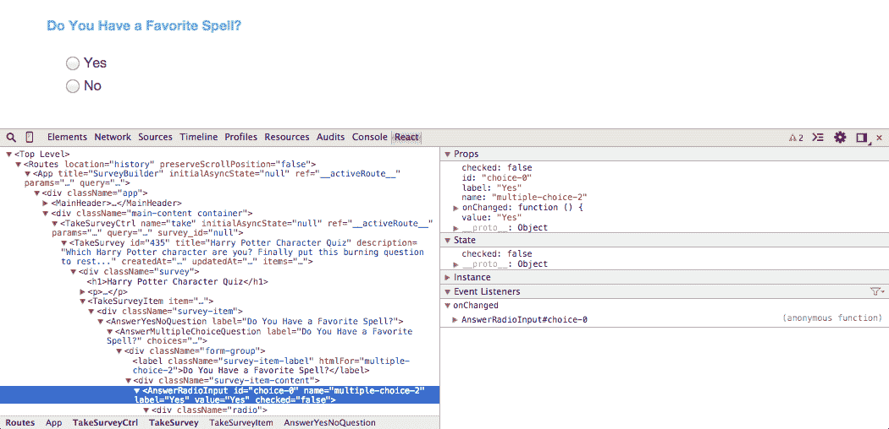
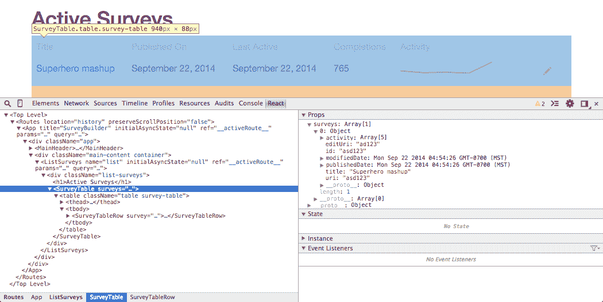
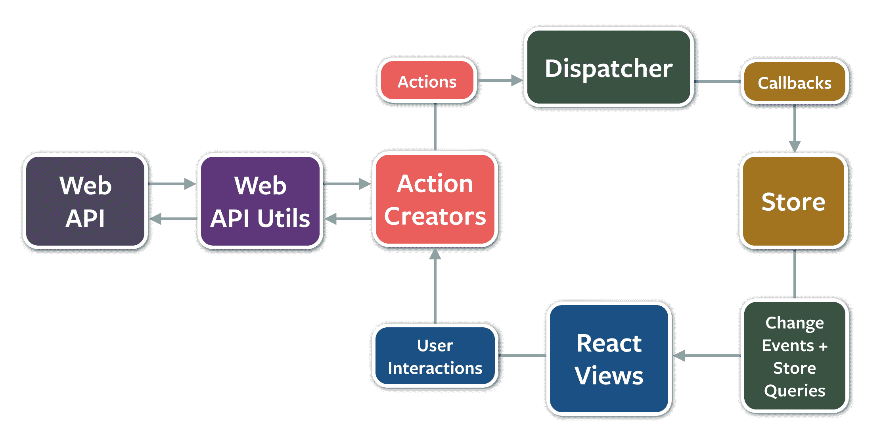
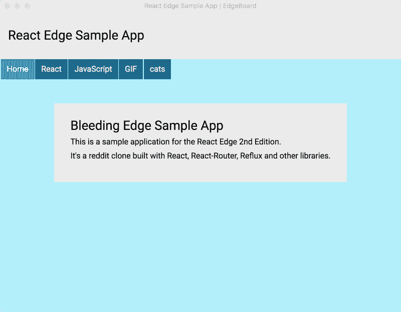
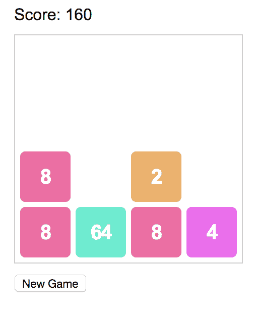
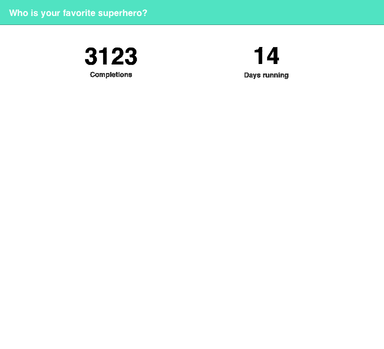

# React.js 前沿开发（第二版）：用于用户界面的JavaScript库

# 前言

## 什么是 React，为什么要使用它？

React 是 Facebook 内部开发并于 2013 年开源的一个 JavaScript 库，用于构建交互式 Web 用户界面。它引入了一种处理浏览器 DOM 的新方式。手动更新 DOM 并费力地跟踪每一块状态的日子已经一去不复返了，这种做法使得可扩展性和新功能开发充其量只是一项冒险。相反，React 以一种非常新颖的方式处理 DOM。你可以声明式地定义任意时间点的用户界面。React 消除了担心数据变化时 DOM 的哪一部分需要更新的问题，并让你能够在任意时间点以最少的 DOM 更改重新渲染整个应用程序。

## 本书如何提供帮助

React 引入了挑战当前实践的新颖且令人兴奋的概念。本书将帮助你驾驭所有这些概念，并帮助你理解它们为何有益，以及如何帮助你构建可扩展的单页应用程序（SPA）。

React 主要关注应用程序的“视图”部分，因此不规定服务器通信或代码组织方式。在本书中，我们将介绍当前的最佳实践和补充工具，以帮助你使用 React 构建完整的应用程序。

## 阅读本书前需要了解什么？

为了充分利用本书，你需要具备 JavaScript 和 HTML 的经验。如果你有编写 SPA 的经验（无论使用 Backbone.js、AngularJS 还是 Ember.js 等框架），那会很有帮助，但并非必需。

## 源代码和示例应用程序

在本书中，我们将引用示例应用程序的片段：reddit 克隆版。你可以在 [`git.io/vlcpa`](http://git.io/vlcpa) 阅读完整源代码，并在 [`git.io/vlCUI`](http://git.io/vlCUI) 查看在线演示。

## 写作过程

本书是在一两个月内以专注的虚拟书籍冲刺方式写成的。这个过程有助于创建新鲜且当前的内容，而传统书籍往往落后于前沿趋势和技术的报道。

在第二版中，所有内容都已更新到 React 0.14，并创建了一个新的示例应用程序。

## 作者

本书由经验丰富且专注的 JavaScript 开发者团队编写：


**Richard Feldman** 是 NoRedInk 的首席前端工程师，这是一家位于旧金山的教育科技公司。他是函数式编程爱好者、会议演讲者，以及 `seamless-immutable` 的作者，这是一个提供与普通 JavaScript 对象和数组向后兼容的不可变数据结构的开源库。他在 Twitter 和 GitHub 上的账号都是 @rtfeldman。

* * *


**Frankie Bagnardi** 是一名高级前端开发人员，为各种客户创建用户体验。在空闲时间，他在 StackOverflow（FakeRainBrigand）和 IRC（GreenJello）上回答问题，并喜欢做小项目。你可以通过 f.bagnardi@gmail.com 联系他。

* * *


**Simon Højberg** 是罗德岛州普罗维登斯 Swipely 公司的高级 UI 工程师。他是 Providence JS 聚会小组的联合组织者，曾任波士顿 Startup Institute 的 JavaScript 讲师。他致力于使用 JavaScript 构建功能性用户界面，并从事像 cssarrowplease.com 这样的副项目。Simon 的推特账号是 [@shojberg](https://twitter.com/shojberg)。

* * *


**Jeremiah Hall** 目前是 OpenGov Inc. 的高级软件工程师/架构师。他还是 Aspect Apps 的创始人，正在构建一个使用 React Native 和 JavaScript 作为 UI 的日志记录应用程序。你可以在 Twitter 上找到他 [@jeremiahrhall](https://twitter.com/jeremiahrhall)。

# 第 1 章 React 简介

## 背景

在 Web 开发的早期，前端代码库很小，JavaScript 功能不足。得益于多年来浏览器在 JavaScript 性能上相互超越、不断突破极限，如今的 Web 应用能够提供与原生应用相媲美的用户体验。随着 Web 应用变得越来越丰富和雄心勃勃，在保持强大性能的同时扩展 JavaScript 代码库现在比以往任何时候都更具挑战性。

历史上，许多 JavaScript 库优先考虑性能或代码组织——通过使跨浏览器的高性能 DOM 操作更容易，或通过提供使代码更易于扩展的组织模式。React 通过同时轻松实现性能改进和代码扩展而迅速流行起来。这种强大的组合使其成为 GitHub 上最受欢迎的十大库之一。

React 最初是 Facebook 的一个 PHP 框架 XHP 的移植版本。作为一个 PHP 框架，XHP 被设计为每次请求时渲染整个页面。React 的诞生是为了将重新渲染整个页面的 PHP 风格工作流引入客户端应用程序。

React 本质上是一个“状态机”，帮助你管理随时间变化的状态的复杂性。它通过拥有非常狭窄的范围来实现这一点。它只关心两件事：

1.  更新 DOM

2.  响应事件

React 对 AJAX、路由、存储或如何组织数据没有意见。它不是模型-视图-控制器框架；如果非要归类，它只是 MVC 中的 V。这种狭窄的范围让你可以自由地将 React 集成到各种系统中。事实上，它已被用于在几个流行的 MVC 框架中渲染视图。

每次状态变化时重新渲染整个页面在 JavaScript 中非常慢，因为读取和更新 DOM 会带来性能损失。React 有一个非常强大的渲染系统，使用虚拟 DOM，使得 React 只需要更新 DOM 而无需读取 DOM。

就像高性能的 3D 游戏引擎一样，React 围绕渲染函数构建，这些函数获取世界状态并将其转换为结果页面的虚拟表示。每当 React 被告知状态变化时，它会重新运行这些函数以确定页面的新虚拟表示，然后自动将该结果转换为必要的 DOM 更改以反映新的呈现。

乍一看，这听起来应该比通常的按需更新每个元素的 JavaScript 方法更慢。然而，在幕后，React 正是这样做的：它有一个非常高效的算法来确定当前虚拟页面表示与新表示之间的差异。根据这些差异，它对 DOM 进行最小必要的一组更新。

这对性能有利的原因在于，它最大限度地减少了回流和不必要的 DOM 突变，这两者都是性能不佳的常见原因。


你的界面越大，就越有可能出现一个交互触发更新，进而触发另一个更新，再触发另一个更新的情况。当这些级联更新没有正确批处理时，性能就会大幅下降。更糟糕的是，有时 DOM 元素在到达最终状态之前会被多次更新。

React 的虚拟表示差异比较不仅通过单次执行最小更新集来最大程度地减少这些问题，还简化了应用程序的维护。当世界状态因用户输入或外部更新而发生变化时，你只需通知 React 状态变化，它就会自动处理其余部分。无需微观管理整个过程。

React 为整个应用程序使用单个事件处理程序，并将所有事件委托给该事件处理程序。这也提升了 React 的性能，因为拥有许多事件处理程序可能会带来显著的性能损失。

你可以在 [`git.io/vlcpa`](http://git.io/vlcpa) 阅读本书中使用的示例应用程序的完整源代码。

# 第 2 章 JSX

在 React 中，组件用于分离关注点，而不是模板和显示逻辑。使用 React 时，你必须接受这样一个理念：标记及其生成代码本质上是紧密相连的。这让你在构建标记时能够拥有 JavaScript 的全部表达能力，而无需诉诸笨拙或繁琐的模板语言。


React 与一种可选的标记语法配合良好，并且与 HTML 非常相似。但在继续之前，我们先澄清一点——对于那些因 JavaScript 中标记的明显笨拙而感到反感的人，以及那些不相信 `JSX` 有用性的人，请考虑一下这种方法在 React 中的诸多好处：

* 它允许使用熟悉的标记来定义元素树
* 提供更具语义、更易于理解的标记
* 更容易可视化应用程序的结构
* 抽象了 React 元素的创建
* 将标记和生成标记的代码紧密联系在一起
* 它只是纯 JavaScript

在本章中，我们将探讨 `JSX` 的诸多好处，以及如何使用它，同时还会介绍一些使其与 HTML 有所区别的注意事项。请记住，`JSX` 是可选的。如果你选择不使用 `JSX`，可以跳到本章末尾，了解如何在不使用它的情况下使用 React。

本书将使用最新版本的 JavaScript，即 ES6（或 ES2015）。你可以在这里找到很好的入门介绍：[`babeljs.io/docs/learn-es2015/`](https://babeljs.io/docs/learn-es2015/)。

## 什么是 JSX？

`JSX` 代表 JavaScript XML——一种类似 XML 的语法，用于在 React 组件中构建标记。React 可以在没有 `JSX` 的情况下工作，但使用它可以使你的组件更具可读性，因此推荐使用。

例如，在纯 React 中创建一个标题的函数调用可能如下所示：

```
 React.createElement('h1', {className: 'question'}, 'Questions');
```

但使用 `JSX` 后，它变成了更熟悉且简洁的标记：

```
 <h1 className="question">Questions</h1>
```

与过去尝试将标记嵌入 JavaScript 的做法相比，`JSX` 有几个显著的特点：

1. `JSX` 是一种语法转换——每个 `JSX` 节点都映射到一个 JavaScript 函数。
2. `JSX` 既不提供也不要求运行时库。
3. `JSX` 不会改变或增加 JavaScript 的语义——它只是简单的函数调用。

`JSX` 与 HTML 的相似性赋予了它在 React 中强大的表达能力。这里我们将讨论 `JSX` 的好处及其在应用程序中的用途，以及 `JSX` 与 HTML 之间的关键区别。

## JSX 的好处

许多人在考虑 `JSX` 时会问：为什么？既然有大量现有的模板语言，为什么还要使用它？为什么不直接使用纯 JavaScript？毕竟，`JSX` 只是映射到 JavaScript 函数。

使用 `JSX` 有很多好处，而且随着代码库的增大和组件复杂度的提高，这些好处会变得更加明显。现在我们来讨论其中的一些好处。

### 熟悉性

许多开发团队包括非开发人员，从熟悉 HTML 的 UI 和 UX 设计师，到负责全面测试产品的质量保证团队。这些团队成员可以更轻松地阅读和贡献 `JSX` 项目的代码。任何熟悉基于 XML 的语言的人都可以轻松上手 `JSX`。

此外，由于 React 组件捕获了 DOM 的所有可能表示（稍后会详细介绍），`JSX` 提供了一种紧凑而简洁的方式来表示和可视化这种结构。

### 语义性

除了熟悉性之外，`JSX` 还将你的 JavaScript 代码转换为更具语义、更有意义的标记。这让你能够使用类似 HTML 的语法声明组件结构和信息流，同时知道它稍后会转换为纯 JavaScript。

`JSX` 允许你在应用程序的标记中使用所有预定义的 HTML5 标签名称，以及你自己的自定义组件。稍后你会读到关于定义自定义组件的内容，这里你只需看到 `JSX` 如何让你的 JavaScript 更具可读性。

例如，让我们考虑一个 `Divider` 元素，它在左侧渲染一个标题，右侧渲染一个水平分隔线。这个分隔线的 `JSX` 如下所示：

```
 <div className="divider">
  <h2>Questions</h2><hr />
</div>
```

将其包装到 `Divider` React 组件后，你可以像使用任何其他 HTML 元素一样使用它，同时还能获得更丰富语义的标记。

```
 <Divider>Questions</Divider>
```

### 易于可视化

`JSX` 甚至让像这样的小例子也更清晰、更简洁。然而，在拥有数百个组件和深层标记树的大型项目中，这种好处会被放大。

以下是上面提到的 `Divider` 组件。请注意，在 JavaScript 函数的上下文中，标记的意图比纯 JavaScript 版本更清晰、更易读。

纯 JavaScript 版本：

```
 render: function () {
  return React.createElement('div', {className:"divider"},
    "Label Text",
    React.createElement('hr')
  );
}
```

`JSX` 标记版本：

```
 render: function () {
  return (
    <div className="divider">
      Label Text<hr />
    </div>
  );
}
```

大多数人都认为 `JSX` 标记更易于理解和调试。

### 关注点分离

最后，React 的核心思想是标记和生成标记的代码本质上是紧密相连的。在 React 中，你不会将应用程序的技术分离成视图文件和模板文件。相反，React 鼓励你创建离散的组件，将所有逻辑和标记封装在一个定义中。

`JSX` 提供了一种干净而简洁的方式，将组件的标记与业务逻辑分开。它不仅为描述组件树提供了一种清晰的视觉语言，还使你的应用程序更易于推理。

## 复合组件

现在你已经了解了 `JSX` 的一些好处，并看到了如何使用它来以紧凑的标记格式表达组件，让我们看看它如何帮助组装多个组件。

本节内容包括：

* 设置一个包含 `JSX` 的 JavaScript 文件
* 引导你完成组件的组装
* 讨论组件所有权和父子关系

让我们逐一来看。

### 定义自定义组件

继续使用前面提到的页面分隔线，这里再次是我们期望输出的 HTML。

```
 <div class="divider">
  <h2>Questions</h2><hr>
</div>
```

要将此 HTML 表达为 React 组件，只需像下面这样包装它，使 `render` 函数返回标记（稍后会解释一些小的更改）。

```
 class Divider extends React.Component {
  render() {
    return (
      <div className="divider">
        <h2>Questions</h2><hr />
      </div>
    );
  }
};
```

当然，这目前是一个一次性组件。要使其真正有用，你需要能够动态表达 `h2` 标签中的文本。

### 动态值

`JSX` 使用花括号 `{...}` 渲染动态值。花括号表示 JavaScript 上下文——你放在它们之间的任何内容都会被求值，结果将作为节点渲染到标记中。

对于简单的值，如文本或数字，你可以直接引用变量。你可以像这样渲染动态的 `h2` 标签：

```
 var text = 'Questions';
<h2>{text}</h2>

// <h2>Questions</h2>
```

对于更复杂的逻辑，你可能希望将计算委托给一个函数。你可以通过在花括号内调用该函数来渲染其结果：

```
 function dateToString(d) {
  return [
    d.getFullYear(), 
    d.getMonth() + 1, 
    d.getDate()
  ].join('-');
};

<h2>{dateToString(new Date())}</h2>

// <h2>2014-10-18</h2>
```

React 会自动求值数组，将数组中的每个项渲染为一个节点。

```
 var text = ['hello', 'world'];
<h2>{text}</h2>

// <h2>helloworld</h2>
```

通常你可能希望渲染比简单值更复杂的内容。例如，你可能希望将数据数组渲染为 `<li>` 元素。这就引出了子节点的概念。

### 子节点

在 HTML 中，你使用 `<h2>Questions</h2>` 渲染一个标题，其中文本 "Questions" 成为 `h2` 元素的子文本节点。所以这里的目标是在 `JSX` 中表达分隔线，如下所示：


```
 <Divider>Questions</Divider>
```

React 会将开闭标签之间的所有子节点捕获到一个特殊的组件属性 `this.props.children` 中。在这个例子中，`this.props.children == "Questions"`。`children` 属性的实际结构并未文档化，因此不要尝试访问其内容，只需原样传递即可。

掌握了这一点，你就可以将硬编码的文本“Questions”替换为变量 `this.props.children`。现在，React 会渲染你放在 `<Divider>` 标签内的任何内容。

```
 class Divider extends React.Component {
  render() {
    return (
      <div className="divider">
        <h2>{this.props.children}</h2><hr />
      </div>
    );
  }
};
```

现在，你可以像使用任何 HTML 元素一样使用 `<Divider>` 组件。

```
 <Divider>Questions</Divider>
```

当通过 JSX 转换器运行时，上述声明将转换为以下 JavaScript（假设目标为 ES6）。

```
 class Divider extends React.Component {
  render() {
    return (
      React.createElement("div", {className: "divider"}, 
        React.createElement("h2", null, this.props.children), 
        React.createElement("hr", null)
      )
    );
  }
};
```

输出结果将完全符合你的预期。

```
 <div className="divider">
  <h2>Questions</h2><hr />
</div>
```

## JSX 与 HTML 有何不同？

JSX 类似 HTML，但它并非 HTML 语法的完美复制（这是有充分理由的）。事实上，JSX 规范指出：

> 本规范不试图符合任何 XML 或 HTML 规范。JSX 被设计为 ECMAScript 特性，与 XML 的相似性仅是为了熟悉感。^(1)

下面我们将探讨 JSX 与 HTML 语法之间的一些关键区别。

### 属性

在 HTML 中，你以内联方式设置每个节点的属性，如下所示：

```
 <div id="some-id" class="some-class-name">...</div>
```

JSX 以相同的方式实现属性，其巨大优势在于你可以将属性设置为动态的 JavaScript 变量。只需将 JavaScript 变量用花括号括起来，而不是引号。

```
 var surveyQuestionId = this.props.id;
var classes = 'some-class-name';
...
<div id={surveyQuestionId} className={classes}>...</div>
```

对于更复杂的情况，你可以将属性设置为函数调用的结果。

```
 <div id={this.getSurveyId()} >...</div>
```

现在，每次 React 选择渲染组件时，变量和函数调用都会被求值，生成的 DOM 将反映这一新状态。

你可以在 [`git.io/vlcpa`](http://git.io/vlcpa) 阅读我们的示例应用（一个调查问卷构建器）的完整源代码。

### 条件语句

在 React 中，组件的标记和生成它的逻辑本质上是紧密相连的。这意味着你可以充分利用 JavaScript 的全部逻辑能力，例如循环和条件语句。

由于 if/else 逻辑难以用标记表达，因此向组件添加条件逻辑可能会有些棘手。直接将 `if` 语句添加到 JSX 中会导致无效的 JavaScript：

```
 <div className={if(isComplete) { 'is-complete' }}>...</div>
```

因此，解决方案是使用以下方法之一：

*   使用三元逻辑
*   设置一个变量并在属性中引用它
*   将切换逻辑委托给一个函数
*   使用 `&&` 运算符

以下是一个快速示例，展示每种方法可能的样子。

#### 使用三元运算符

```
 ...
render() {
  return (
    <div 
      className={this.state.isComplete ? 'is-complete' : ''}
    >
      ...
    </div>
  );
}
...
```

虽然三元运算符在文本处理中效果不错，但当你想在两种情况下都使用 React 组件时，它可能会变得冗长且难以阅读。对于这些情况，最好使用以下方法。

#### 使用变量

```
 ...
getIsComplete() {
  return this.state.isComplete ? 'is-complete' : '';
}
render() {
  var isComplete = this.getIsComplete();
  return (
    <div className={isComplete}>...</div>
  );
}
...
```

#### 使用函数调用

```
 ...
getIsComplete() {
  return this.state.isComplete ? 'is-complete' : '';
}
render() {
  return (
    <div className={this.getIsComplete()}>...</div>
  );
}
...
```

#### 使用双与（`&&`）运算符

由于 React 不会为 null 或 false 值输出任何内容，你可以使用一个布尔值，后跟所需的输出字符串。如果布尔值为 true，则使用后面的字符串。

```
 render() {
  return (
    <div className={this.state.isComplete && 'is-complete'}>
      ...
    </div>
  );
}
```

### 非 DOM 属性

JSX 中存在以下特殊属性名称：

*   `key`
*   `ref`
*   `dangerouslySetInnerHTML`

下面我们将详细探讨它们。

#### 键（Keys）

`key` 是一个可选的唯一标识符。项目或列表可能会相对于其兄弟元素发生变化，例如当用户执行搜索，或者列表中的项目被添加、删除或重新排序时。发生这种情况时，你的组件可能会被不必要地销毁和重建，或者 React 可能会执行幼稚的更新。

通过在组件上设置一个在渲染过程中保持一致的唯一键，你可以告知 React，使其更智能地决定何时重用或销毁组件，从而提高渲染性能。然后，当 DOM 中已有的两个项目交换位置时，React 可以匹配键并移动它们，而无需完全重新渲染它们的 DOM。

#### 引用（References）

`ref` 允许父组件在渲染函数之外保留对子组件的引用。

你可以在 JSX 中通过将属性设置为所需的引用名称来定义 ref。

```
 ...
render() {
  return <div>
    <input ref="myInput" ... />
  </div>;
}
...
```

之后，你可以在组件中的任何位置使用 `this.refs.myInput` 来访问这个 ref。对于像 input 这样的 DOM 组件，ref 就是对应的 DOM 节点。对于复合组件，ref 是组件实例。在实践中，你很少会在 React 中使用 refs，它们充当了从 React 声明式特性中逃逸的出口。

更多细节请参见第 6 章中关于父/子关系与所有权关系的讨论。

#### 设置原始 HTML

`dangerouslySetInnerHTML`——有时你需要将 HTML 内容设置为字符串，尤其是在与通过字符串操作 DOM 的第三方库一起工作时。为了提高 React 的互操作性，这个属性允许你使用 HTML 字符串，但如果可以避免，不建议使用。要使用此属性，请将其设置为一个对象，其中键 `__html` 被设置，如下所示：

```
 ...
render() {
  var htmlString = {
    __html: "<span>an html string</span>"
  };
  return <div dangerouslySetInnerHTML={htmlString} ></div>;
}
...
```

### dangerouslySetInnerHTML

`dangerouslySetInnerHTML` 可能很快会发生变化，如下所述：

[`github.com/facebook/react/issues/2134`](https://github.com/facebook/react/issues/2134)

[`github.com/facebook/react/pull/1515`](https://github.com/facebook/react/pull/1515)

### 事件

事件名称在所有浏览器中都是标准化的，并以驼峰式表示。例如，`change` 变为 `onChange`，`click` 变为 `onClick`。在 JSX 中捕获事件就像将属性分配给组件上的方法一样简单。

```
 ...
handleClick(event) {...}
render() {
  return (
    <div 
      onClick={(e) => this.handleClick(e)}
    >
      ...
    </div>
  );
}
...
```

注意，这里使用了箭头函数，因为它保留了 `this`。否则，`this` 在 `handleClick` 中将是未定义的。它还让你可以轻松控制传递给函数的参数。

有关 React 事件系统的更多详细信息，请参考第 9 章。

### 注释

JSX 是 JavaScript，因此你可以在 JSX 标记中添加普通的 JavaScript 注释。注释可以添加在两个位置：

1.  作为元素的子节点
2.  内联在节点的属性中

#### 作为子节点


子节点注释只需用花括号包裹，并且可以跨越多行。

```
 <div>
  {/* 关于这个输入框的注释
      跨越多行 */}
  <input name="email" placeholder="邮箱地址" />
</div>
```

**内联属性**

内联注释有两种形式。首先，你可以使用多行注释：

```
 <div>
  <input 
    /* 
      关于输入框的说明 
    */ 
    name="email"
    placeholder="邮箱地址" />
</div>
```

或者，你可以使用单行注释：

```
 <div>
  <input
    name="email" // 单行注释
    placeholder="邮箱地址" />
</div>
```

### 特殊属性

由于 JSX 会转换为普通的 JavaScript 函数调用，因此有一些关键字你不能使用：`class` 和 `for`。

要创建带有 `for` 属性的表单标签，请使用 `htmlFor`。

```
 <label htmlFor="for-text" ... >
```

要渲染自定义的 `class`，请使用 `className`。如果你习惯了 HTML，这可能会觉得奇怪，但它与原生 JavaScript 更加一致——在原生 JavaScript 中，你可以通过 `elem.className` 访问元素的类。

```
 <div className={classes} ... >
```

### 样式

最后，我们来探讨内联样式属性。React 将所有样式规范化为驼峰命名，与 DOM 样式的 JavaScript 属性保持一致。

要定义自定义样式属性，只需传入一个 JavaScript 对象，其中包含驼峰命名的属性名和所需的 CSS 值。

```
 var styles = {
  borderColor: "#999",
  borderThickness: "1px"
};
React.renderComponent(<div style={styles}>...</div>, node);
```

## 不使用 JSX 的 React

所有 JSX 标记最终都会转换为普通的 JavaScript。因此，使用 React 并不*必须*使用 JSX。然而，JSX 隐藏了一些复杂性。如果你打算在不使用 JSX 的情况下使用 React，你需要了解在 React 中创建元素的三个部分：

1.  定义组件类

2.  创建用于生成组件类实例的工厂函数

3.  使用工厂函数创建 `ReactElement` 实例

### 创建 React 元素

回想一下我们之前如何定义 `Divider` 组件类。这里为了明确其用途，将其重命名为 `DividerClass`。

```
 class DividerClass extends React.Component
  render() {
    return (
      React.createElement("div", {className: "divider"}, 
        React.createElement("h2", null, this.props.children), 
        React.createElement("hr", null)
      )
    );
  }
});
```

要在不使用 JSX 的情况下使用这个 `DividerClass`，可以调用 `React.createElement` 或 `React.createFactory`。

要直接创建元素，只需调用 `createElement`。

```
 var divider = React.createElement(DividerClass, null, '问题');
```

要创建工厂函数，首先使用 `createFactory` 函数。

```
 var Divider = React.createFactory(DividerClass);
```

现在你有了一个工厂函数，就可以用它来创建 `ReactElement` 了。

```
 var divider = Divider(null, '问题');
```

### 延伸阅读与参考资料

即使你不喜欢在 JavaScript 中混入标记，希望你现在也能理解 JSX 如何为 JavaScript 与其渲染的标记之间的紧密关系提供解决方案。随着其日益流行，JSX 已经拥有了自己的规范，提供了深入的技术定义。如果你仍然不确定或对其工作原理感到困惑，有一些工具可以帮助你进行实验。

### 官方 JSX 规范

2014 年 9 月，Facebook 发布了 [JSX 官方规范](http://facebook.github.io/jsx/)，阐述了创建 JSX 的理由以及语法的技术细节。

你可以在 [`facebook.github.io/jsx/`](http://facebook.github.io/jsx/) 阅读更多内容。

### 浏览器内实验

还有许多用于实验 JSX 的工具。React 文档的[入门](http://facebook.github.io/react/docs/getting-started.html)页面链接了支持和不支持 JSX 的 JSFiddle 游乐场。

[`facebook.github.io/react/docs/getting-started.html`](http://facebook.github.io/react/docs/getting-started.html)

对于实际项目，官方工具是 babel，它还提供了几乎完整的 ES6 支持。

[`babeljs.io/`](https://babeljs.io/)

在下一章中，我们将探讨 React 中的组件生命周期。

^(1) 摘自 http://facebook.github.io/jsx/

# 第 3 章 组件生命周期

在组件的生命周期中，随着其 props 或 state 的变化，其 DOM 表示也可能发生变化。组件是一个状态机；对于给定的输入，它总是返回相同的输出。

React 提供了生命周期钩子，使组件能够响应不同的时刻——创建、存在和销毁。我们将按照它们出现的顺序来介绍：首先是实例化，然后是组件的生命周期，最后是组件的销毁。

## 生命周期方法

React 组件拥有一个最小的生命周期 API，只提供你所需的内容，不会让你感到不知所措。让我们按照它们在组件上被调用的顺序来逐一了解每个方法。

**实例化**

首次创建实例时调用的生命周期方法与后续每个实例调用的方法略有不同。对于组件类的首次使用，你会看到以下方法按顺序被调用：

*   `constructor`

*   `componentWillMount`

*   `render`

*   `componentDidMount`

**生命周期**

当应用状态发生变化并影响到你的组件时，你会看到以下方法按顺序被调用：

*   `componentWillReceiveProps`

*   `shouldComponentUpdate`

*   `componentWillUpdate`

*   `render`

*   `componentDidUpdate`

**销毁与清理**

最后，当你使用完组件时，会调用 `componentWillUnmount`，让实例有机会进行自我清理。

现在，我们将依次介绍这三个阶段：实例化、生命周期和清理。

## 实例化

每当创建新组件并首次渲染时，你可以使用一系列方法来设置和准备组件。每个方法都有特定的职责，如下所述。

### constructor(props, context)

构造函数允许你为组件设置实例属性和状态。一个典型的构造函数如下所示：

```
 class Foo extends React.Component {
  constructor(props){
    super(); // 调用父类构造函数，必须
    this.state = {x: 'y'};
  }
  render(){ ... }
}
```

### componentWillMount

在初始渲染之前立即调用。这是在 `render` 方法被调用之前影响组件状态的最后机会。这里只是提一下以保持完整性；它是 `createClass` 的遗留产物，现在已被构造函数取代。

### render

在这里，你构建代表组件输出的虚拟 DOM。Render 是组件唯一必需的方法，并且有特定的规则。`render` 方法的要求如下：

*   它只能访问 `this.props` 和 `this.state` 中的数据。

*   你可以返回 `null`、`false` 或任何 React 元素。

*   只能有一个顶级元素（你不能返回一个元素数组）。

*   它必须是*纯的*，意味着它不会改变状态或修改 DOM 输出。

render 返回的结果并不是实际的 DOM，而是一个虚拟表示，React 稍后会将其与真实 DOM 进行差异比较，以确定是否需要做出任何更改。

### componentDidMount

在渲染成功并且实际 DOM 已被渲染之后，你可以通过 `act.findDOMNode(this)` 或使用 ref 在 `componentDidMount` 内部访问它。

这是你将用来访问原始 DOM 的生命周期钩子。例如，如果你需要测量渲染输出的高度、使用定时器操作它，或者运行自定义的 jQuery 插件，你都可以在这里进行挂钩。

例如，假设你想在 React 渲染的输入元素上使用 jQuery UI Autocomplete 插件。你可以像这样附加该插件：


```
 // 用于自动补全的字符串列表
var datasource = [...];

class MyComponent extends React.Component {
  render() {
    return (
      <input ... />
    );
  }
  componentDidMount() {
    $(React.findDOMNode(this)).autocomplete({
      sources: datasource
    });
  }
});
```

注意，在服务器端运行时不会调用 `componentDidMount` 方法。

## 生命周期

此时，你的组件已经渲染给用户，用户可以与之交互。通常，这涉及通过点击、触摸或按键事件触发某个事件处理程序。当用户改变组件或整个应用的状态时，新状态会流经组件树，你就有机会对其做出响应。

### componentWillReceiveProps

组件的 props 随时可能通过父组件发生变化。当这种情况发生时，会调用 `componentWillReceiveProps`，你就有机会修改新的 props 对象并更新状态。

例如，在示例应用中，当用户在不同面板之间导航时，你可以通过从服务器获取相关数据来响应这一变化。

```
 componentWillReceiveProps(nextProps) {
  var boardId = nextProps.params.boardId;
  if(boardId !== this.props.params.boardId) {
    Actions.State.changeBoard({type: 'board', name: boardId});
  }
}
```

你可以在 [`git.io/vlcpa`](http://git.io/vlcpa) 上阅读我们的示例应用（一个调查构建器）的完整源代码。

## shouldComponentUpdate

React 很快。但你可以通过使用 `shouldComponentUpdate` 来优化组件渲染的时机，使其更快。

如果你确定新的 props 或 state 不需要你的组件或其任何子组件重新渲染，则返回 `false`。

*此方法在初始渲染或使用* `forceUpdate` *后不会被调用。*

通过返回 false，你告诉 React 跳过调用 `render` 以及前后的钩子：`componentWillUpdate` 和 `componentDidUpdate`。

此方法不是必需的，在大多数情况下，你在开发过程中不需要使用它。过早使用此方法可能导致微妙的 bug，因此最好等到你能正确评估瓶颈后再选择优化位置。

如果你小心地将 state 视为不可变的，并且只在 render 方法中读取 props 和 state，那么可以放心地重写 `shouldComponentUpdate` 来比较旧的 props 和 state 与新的替换值。

另一个性能调优选项是 React 附加组件提供的 `PureRenderMixin`。如果你的组件是*纯的*，即对于相同的 props 和 state 总是渲染相同的 DOM，那么这个 mixin 会自动使用 `shouldComponentUpdate` 对 props 和 state 进行浅比较，如果它们匹配则返回 false。本书后面会介绍使用此 mixin 的示例。

### componentWillUpdate

与 `componentWillMount` 类似，当接收到新的 props 或 state 时，此方法会在渲染之前立即触发。

注意，你*不能*在此方法中更新 state 或 props。你应该依赖 `componentWillReceiveProps` 在运行时更新 state。

### componentDidUpdate

与 `componentDidMount` 类似，此方法为你提供了更新已渲染 DOM 的机会。

## 拆卸与清理

当 React 完成对组件的处理后，它必须从 DOM 中卸载并销毁。你有一个钩子来响应这一时刻，执行任何必要的清理和拆卸工作。

### componentWillUnmount

最后，当组件从组件层级中移除时，我们迎来了组件生命的终点。此方法在组件即将被移除之前调用，让你有机会进行清理。你在 `componentDidMount` 中可能执行的任何自定义工作（例如创建定时器或添加事件监听器）都应在此处撤销。否则会导致错误（如果你在已卸载的组件上调用 `setState`）以及各种类型的泄漏（内存、监听器等）。

## 反模式：将计算值作为状态

考虑到可以在构造函数中从 `this.props` 创建状态，有必要指出一种反模式。你应该非常关注维护单一数据源。React 的设计使得重复数据源更加明显，这是 React 的关键优势之一。

当考虑从 props 派生的计算值时，将这些值存储为状态被认为是一种反模式。例如，组件可能在渲染前将日期转换为字符串表示形式，或将字符串转换为大写。这些不是状态，而应该在渲染时计算。

当你在 render 函数中无法判断状态值是否与它所基于的 prop 同步时，就可以识别出这种反模式。

```
 class Day extends React.Component {
  constructor(props){
    super();
    // 反模式。计算值不应存储为状态。
    this.state = {day: props.date.getDay()};
  }
  render(){
    return (
       <div>Day: {this.state.day}</div>
    );
  }
}
```

正确的模式是在渲染时计算值。这保证了计算值永远不会与它所派生的 props 不同步。

```
 class Day extends React.Component {
  render(){
    return (
      <div>Day: {this.props.date.getDay()}</div>
    );
  }
```

## 总结

React 的生命周期方法为组件的生命周期提供了设计良好的钩子。作为状态机，每个组件都设计为在其生命周期内输出稳定、可预测的标记。

没有组件是孤立存在的。当父组件将 props 推送给子组件，并且这些子组件渲染它们自己的子组件时，你必须仔细考虑数据如何在应用中流动。每个子组件*真正*需要知道多少？谁拥有应用状态？哪些组件（如果有）需要本地状态？这是我们下一章关于数据流的主题。

# 第 4 章 数据流

在 React 中，数据只朝一个方向流动——从父组件到子组件。这使得组件非常简单且可预测。它们从父组件获取 props 并渲染它们。如果顶层组件的 prop 发生变化，React 会将该变化一直传播到组件树，并重新渲染所有使用了该属性的组件。

组件也可以拥有内部状态，该状态只能在组件内部修改。React 组件本质上是简单的，你可以将它们视为一个函数，接收 `props` 和 `state`，并输出虚拟 DOM 表示。

在本章中，我们将探讨：

*   什么是 props
*   什么是 state
*   何时使用 props，何时使用 state

## Props

`props` 是“属性”的缩写，被传递给组件，可以包含你想要的任何数据。

你可以在实例化组件时设置 props：

```
 var comments = [{ author: 'Example', body: 'Hey' }];
<Comments comments={comments}/
```

你可以在 [`git.io/vlcpa`](http://git.io/vlcpa) 上阅读我们的示例应用（一个调查构建器）的完整源代码。

你可以通过 `this.props` 访问 props，但绝不应该通过这种方式写入 props。组件永远不应修改自己的 props。

当与 JSX 一起使用时，props 可以设置为字符串：

```
 <Link to="/user/example">示例</Link>
```

也可以使用 `{}` 语法设置，这是一个常规的 JavaScript 表达式：

```
 <Link to={'/user/' + comment.author}>{comment.author}</a>
```

还可以使用 JSX 展开语法将对象用作 props：

```
 class Button extends React.Component {
  render() {
    // 这里我们展开所有传入的 props
    // 但确保使用我们自己的 className 版本
    var className = ['Button', this.props.className].join(' ');
    return <button {...this.props} className={className} />;
  }
};
```

Props 对于事件处理程序也很有用：


```javascript
class SaveButton extends React.Component {
  render() {
    return (
      <Button 
        onClick={() => this.handleClick()}
      >
        Save
      </Button>
    );
  }
  handleClick() {
    // ...
  }
};
```

这里我们向 `Button` 组件传递了 `onClick` 属性，其值为一个调用 `this.handleClick` 的函数。每当用户点击按钮时，`handleClick` 方法就会被调用。

## PropTypes

React 提供了一种通过组件上定义的配置对象来验证 props 的方式。这些配置同时也作为快速参考文档。

```javascript
class Post extends React.Component
  static propTypes = {
    data: PropTypes.shape({
      id: PropTypes.string,
      url: PropTypes.string,
      author: PropTypes.string,
      title: PropTypes.string,
      createdAt: PropTypes.number,
    }).isRequired,   
  };
  // ...
};
```

如果组件实例化时未满足 `propTypes` 的要求，则会记录一条 `console.error`。

对于可选的 props，只需去掉 `.isRequired` 即可。

你并非必须在应用中使用 `propTypes`，但它们提供了一种描述组件 API 的好方法。

## defaultProps

在组件上提供 `defaultProps` 对象，以设置一组默认属性。这仅适用于非必需的 props。

```javascript
var Button = React.createClass({
  static propTypes = {
    which: PropTypes.oneOf(['primary', 'secondary', 'normal'])
  };
  static defaultProps = {
    which: 'normal'
  };
  // ...
};
```

## State

React 中的每个组件都可以拥有状态（state）。状态与 props 的不同之处在于，它是组件内部的。

状态对于决定元素上的视图状态非常有用。请注意，这个组件包含了你需要了解的关于 React 的大部分内容，所以[×](https://atlas.oreilly.com/crudloff/reactjs-book/editor/master/04.data.flow.html#)不要指望现在就能完全理解它。

```javascript
class SimpleSelect extends React.Component {
  static propTypes = {
    options: PropTypes.arrayOf(PropTypes.shape({
      id: PropTypes.any,
      name: PropTypes.string,
    })).isRequired,
    value: PropTypes.any,
    valueText: PropTypes.any,
    onSelect: PropTypes.func,
  };

  constructor(){
    super();
    this.state = {open: false,};
  }

  toggleOpen(){
    this.setState({open: !this.state.open});
  }

  render(){
    return (
      <div>
        <Button onClick={() => this.toggleOpen()}>
          {this.props.valueText || 'Select an option'}
        </Button>
        {this.renderItems()}
      </div>
    );
  }

  renderItems(){
    if (!this.state.open) return null;
    return (
      <ul>
        {this.props.options.map((item, i) => {
          return (
            <li key={i} onClick={() => this.handleSelect(item)}>
              {item.name}
            </li>
          );
        })}
      </ul>
    );
  }

  handleSelect(item){
    this.props.onSelect(item);
    this.setState({open: false});
  }
};
```

在上面的例子中，状态用于跟踪是否显示下拉选项。

我们在构造函数中将初始状态的 `open` 设置为 `false`。当下拉按钮被点击时，切换 open 状态（`toggleOpen`）。当某个选项被点击时，将 open 状态设置为 `false`（`handleSelect`）。

我们可以快速浏览代码中的 `this.state.open`，并看到它在 `renderItems` 中被使用。如果 `this.state.open` 为 `false`，则不会渲染选项。每次你调用 `setState` 或从父组件获取新的 props 时，`render`（以及 `renderItems`）都会重新执行。在 React 中引起变化是通过影响状态或 props 来实现的，而不是直接修改。

**永远不要**通过 `this.state` 直接更新状态。相反，始终使用 `this.setState` 方法。

状态总是会让你的组件变得更复杂，但如果你将状态隔离到特定的组件中，你的应用程序就会更容易调试。

## 什么应该放在状态中，什么应该放在 props 中？

不要将计算后的值或组件存储在状态中，而应专注于组件运行直接需要的简单数据，比如下拉菜单的 open 状态。没有它，你就无法打开或关闭下拉菜单。这也可以是输入字段的值、用户的鼠标位置或 AJAX 请求的结果。

尽量不要将 props 数据复制到状态中。尽可能将 props 视为唯一数据源。

## 无状态函数式组件

你可以利用单一数据源的概念来简化你的组件。函数式组件（在 React 0.14 中引入）不是通过包含多个方法的类来定义，而是作为一个单一的函数。这个函数接受 props 作为参数并返回所需的元素，很像传统组件中独立的 `render` 函数。

下面是我们 `Day` 组件作为函数式组件的样子：

```javascript
function Day(props) {
  return (
    <div>Day: {props.day}</div>
  );
}
```

这种风格在几个方面与传统组件不同。它显然更简洁，但这很大程度上是因为传统组件的某些特性不再可用。具体来说，函数式组件不支持以下特性：

*   状态（参见前面的章节）
*   生命周期方法（参见第 3 章）
*   refs 或 `findDOMNode`（参见第 8 章）

然而，函数式组件不仅仅是函数。它们仍然支持 `propTypes` 和 `defaultProps`，这些与函数的 props 参数一起使用。

鉴于这一特性集，函数式组件最适合作为仅定义了 `render` 方法（以及可选的 `propTypes` 和 `defaultProps`）的组件的直接替代品。由于典型的 React 用户界面主要由符合这种描述的组件组成，以这种风格编写更多组件可以使代码库更简洁，同时不牺牲清晰度。

## 总结

在本章中，你学习了以下概念：

1.  使用 props 通过组件树传递数据和设置。
2.  永远不要在组件内部修改 `this.props`；将 props 视为不可变的。
3.  使用 props 作为事件处理程序与子组件通信。
4.  使用状态存储简单的视图状态，例如下拉选项是否可见。
5.  永远不要直接修改 `this.state`，而是使用 `this.setState`。
6.  当不需要本地状态、refs 或生命周期方法时，将组件表示为函数式组件可以减少冗余和复杂性。

我们在本章中简要介绍了事件处理，你将在下一章中更详细地了解它。

# 第 5 章 事件处理

在用户界面中，呈现只是等式的一半。另一半是响应用户输入，在 JavaScript 中这意味着处理用户生成的事件。

React 处理事件的方法是将事件处理程序附加到组件上，然后在处理程序触发时更新这些组件的内部状态。更新组件的内部状态会导致它重新渲染，因此用户界面要反映事件的结果，只需在组件的 render 函数中读取内部状态即可。

虽然通常仅根据事件类型来更新状态，但有时需要利用事件中的额外信息来确定如何更新状态。在这种情况下，传递给处理程序的事件对象将提供关于事件的额外信息，处理程序可以利用这些信息来更新内部状态。

结合这些技术以及 React 的高效渲染，可以轻松响应用户输入，并根据这些输入的结果更新用户界面。

## 附加事件处理程序


在基本层面上，React 处理的事件与常规 JavaScript 中看到的事件相同：用于点击处理器的 `MouseEvents`、表单元素变化时的 `Change` 事件等。这些事件与常规 JavaScript 中的事件名称相同，并在相同的情况下触发。

React 附加事件处理器的语法与 HTML 的语法非常相似。例如，在我们的示例应用中，以下代码为“保存”按钮附加了一个 `onClick` 处理器。

```
 <button className="btn btn-save" onClick={this.handleSaveClicked}>Save</button>
```

当用户点击按钮时，按钮的 `handleSaveClicked` 方法将运行。该方法将包含解决保存操作所需的逻辑。

你可以在 [`git.io/vlcpa`](http://git.io/vlcpa) 查看我们示例应用（一个 Reddit 克隆）的完整源代码。

请注意，尽管这段代码类似于在 HTML 中使用 `onclick` 等属性指定事件处理器这种被广泛不推荐的做法，但它实际上并未在底层使用 HTML 的 `onclick` 属性。React 仅将此语法用作指定处理器的方式，并在内部妥善地管理事件监听器。

如果你不使用 JSX，则需将处理器指定为选项对象中的一个字段。例如：

```
 React.DOM.button({className: "btn btn-save", onClick: this.handleSaveClicked}, "Save");
```

React 对处理多种事件类型提供了一流支持，这些事件类型在其文档的 [事件系统](http://facebook.github.io/react/docs/events.html) 页面中列出。

## 事件与状态

假设你有一个 Markdown 编辑器，并且希望实时预览 Markdown 内容。

在 React 中，这是通过监听变化并用最新值更新状态来实现的。

```
 class CommentEditor extends React.Component {
  constructor(){
    super();
    this.state = {text: ''};
  }
  render(){
    return (
      <div>
        <input 
          value={this.state.text}
          onChange={(e) => this.setState({text: e.target.value})}
        />
      </div>
    );
  }
}
```

### 基于状态渲染

这是一个基本的双向绑定实现。由于我们的数据在状态中，我们可以轻松渲染 Markdown 预览。

```
 render(){
    return (
      <div>
        <input 
          value={this.state.text}
          onChange={(e) => this.setState({text: e.target.value})}
        />
        <Markdown content={this.state.text} />
      </div>
    );
  }
```

与 `this.props` 一样，渲染函数可以根据 `this.state` 的值进行或多或少的更改。它可以渲染相同的元素，但属性略有不同，或者渲染完全不同的元素集合。两种方式都同样有效。

### 更新状态

由于更新组件的内部 `state` 会导致组件重新渲染，因此 Markdown 预览始终是最新的。当我们调用 `setState` 时，`render` 将再次运行，但它会读取 `this.state` 的当前值。Markdown 组件也会更新，新内容将被刷新到 DOM 中。

更新组件状态有两种方式：组件的 `setState` 方法和 `replaceState` 方法。`replaceState` 会用全新的状态对象覆盖整个状态对象，如果你使用不可变数据结构来保存状态，这会很有用，但除此之外很少需要。更常见的是使用 `setState`，它只是将你提供的对象合并到现有状态对象中。

例如，假设你当前的状态如下：

```
 {
  title: "My Title",
  text: "Hello",
}
```

在这种情况下，调用 `this.setState({title: "Other Title"})` 只会影响 `this.state.title` 的值，而 `this.state.text` 不受影响。

调用 `this.replaceState({title: "Other Title"})` 则会用新对象 `{title: "Fantastic Survey 2.0"}` 替换整个状态对象，完全擦除 `this.state.text`。这很可能会破坏渲染函数，因为渲染函数期望 `this.state.text` 是一个字符串，而不是 `undefined`。

重要的是，除了调用 `setState` 或 `replaceState` 之外，绝不要以任何其他方式修改 `state` 对象。像 `this.state.saveInProgress = true` 这样的操作通常是个坏主意，因为它不会通知 React 可能需要重新渲染，并且可能导致下次调用 `setState` 时出现意外结果。

### 状态没有更新！

同样值得注意的是，`setState` 是异步的。因此，如果你的状态是 `{x: 1}`，并且你运行以下代码，控制台将显示 1。

```
 this.setState({x: 2})
console.log(this.state.x);
```

如果你需要在状态更新、渲染被调用且更改已刷新到 DOM 后执行某些操作，你可以将回调作为 `setState` 的第二个参数传递。

```
 this.setState({x: 2}, () => {
  console.log(this.state.x); // 2
})
```

这也意味着在单个 tick 内多次更新状态可能会导致问题。

```
 this.state.xs // []
this.setState({xs: this.state.xs.concat([1])}
this.setState({xs: this.state.xs.concat([2])}
```

最终状态将是 `[2]`，而不是期望的 `[1, 2]`。

你可以通过使用原子性的 `setState` 变体来避免此问题。通常你会使用表达式箭头函数，但为了清晰起见，我们详细地写出来。

```
 this.state.xs // []
this.setState((state) => {
  var xs = state.xs.concat([1]);
  return {xs: xs};
});
this.setState((state) => {
  var xs = state.xs.concat([2]);
  return {xs: xs};
});
```

请注意，你应该使用 `state` 参数而不是 `this.state`。React 会将这些函数排队，并使用前一个函数更新后的状态依次调用每个函数。通常你知道两次更新不会在单个 tick 内发生，或者你可能不关心第一个更新被隐藏，因此这个特性在实践中很少使用。

## 事件对象

许多处理器只需触发即可达到目的，但有时你需要更多关于用户输入的信息。

看看示例应用中的 `CommentEditor` 类。

```
 onChange={(e) => {
  this.props.onChange({text: e.target.value, type: 'comment'})
}}
```

React 的事件处理函数总是会接收到一个事件对象，这与原生 JavaScript 事件监听器的方式非常相似。在这里，事件处理器接收一个事件对象，并通过访问 `event.target.value` 从中提取输入的当前值。在事件处理器中使用 `event.target.value` 是从表单输入中获取值的常见方式，尤其是在 `onChange` 处理器中。

React 不会将浏览器提供的原始 Event 对象直接传递给处理器，而是将原始事件包装在一个 `SyntheticEvent` 实例中。`SyntheticEvent` 的设计使其在外观和功能上与浏览器创建的原始事件相同，只是平滑处理了某些跨浏览器的不一致性。你应该能够像使用普通事件一样使用 `SyntheticEvent`，但如果需要浏览器发送的原始事件，你可以通过 `SyntheticEvent` 的 `nativeEvent` 字段访问它。

## 总结

在用户界面中反映用户输入变化的步骤如下：

1.  为 React 组件附加一个事件处理器。

2.  在该事件处理器中，更新组件的内部状态。更新组件的状态将导致其重新渲染。

3.  修改组件的 `render` 函数，以适当方式纳入 `this.state`。

到目前为止，你已经使用单个组件来响应用户交互。接下来，你将学习如何组合多个组件，以创建一个超越各部分之和的界面。

# 第 6 章 组合组件


在传统 HTML 中，每个页面的基本构建块是元素。而在 React 中，你通过组件来组装页面。你可以将 React 组件视为一个融合了 JavaScript 全部表达能力的 HTML 元素。事实上，使用 React 时，你*唯一*要做的事情就是构建组件，就像 HTML 文档完全由元素构成一样。

由于整个 React 应用程序都是通过组件构建的，因此整本书都可以被描述为一本关于 React 组件的书。因此，在本章中，我们不会涵盖与组件相关的*所有*内容。相反，你将了解其中一个特定方面——它们的可组合性。

组件本质上是一个 JavaScript 函数，它接收 `props` 和 `state` 作为参数，并输出渲染后的 HTML。它们通常被设计用来表示和表达应用程序中的某段数据，因此你可以将 React 组件视为 HTML 的扩展。

在本章中，我们将使用 reddit 克隆示例应用程序中未出现的代码，因为一个 CRUD（创建、读取、更新、删除）应用程序能更好地说明这一点。

## 扩展 HTML

React + JSX 是强大且富有表现力的工具，允许你创建自定义元素，这些元素可以使用类似 HTML 的语法来表达。它们远远超越了纯 HTML，让你能够在其整个生命周期中控制其行为。这一切都始于从 `React.Component` 继承。

React 推崇组合而非继承，这意味着你将小而简单的组件和数据对象组合成更大、更复杂的组件。使用 EcmaScript 6，你可以从 `React.Component` 继承，但它不鼓励更深层次的继承。相反，它鼓励构建可复用的、可组合的组件。

React 拥抱可组合性，允许你将各种子组件混合搭配，形成一个复杂而强大的新组件。为了演示这一点，让我们考虑用户如何回答一个调查问题。

你可以在 [`git.io/vlcpa`](http://git.io/vlcpa) 阅读我们示例应用程序（一个 reddit 克隆）的完整源代码。

## 通过示例理解组合

让我们考虑一个表示多项选择题的组件。它有几个要求：

*   接收一个选项列表作为输入
*   向用户渲染这些选项
*   只允许用户选择一个选项

我们知道 HTML 提供了一些基本元素来帮助实现，即单选类型的输入和输入组。从上到下思考，组件层次结构大致如下：

```
 MultipleChoice → RadioInput → Input (type="radio")
```

你可以将这些箭头理解为表示“拥有”关系。`MultipleChoice` 组件*拥有*一个 `RadioInput`。`RadioInput` *拥有*一个输入。这是组合模式的一个识别特征。

### 组装 HTML

让我们从下往上组装组件。DOM 组件（以小写字母开头）由 React 提供。因此，你要做的第一件事就是将其包装在一个 `RadioInput` 组件中。该组件将负责定制通用的 `input`，将其范围缩小为类似单选按钮的行为。我们将其命名为 `AnswerRadioInput`。

首先，创建脚手架，其中包括必需的 `render` 方法和描述所需输出的基本标记。当组件成为一种专门的输入类型时，你已经可以开始看到组合模式。

```
 class AnswerRadioInput extends React.Component {
  render() {
    return (
      <div className="radio">
        <label>
          <input type="radio" />
          Label Text
        </label>
      </div>
    );
  }
}
```

**添加动态属性**

我们的 `input` 目前还没有任何动态内容，因此你需要定义父组件必须传递给单选输入的属性。

*   这个输入代表什么值或选项？（必需）
*   我们用什么文本来描述它？（必需）
*   输入的 name 是什么？（必需）
*   我们可能想要自定义 `id`。
*   我们可能想要覆盖默认值。

根据这个列表，你现在可以为自定义输入定义属性类型。将这些添加到类定义的 `propTypes` 哈希中。

```
 class AnswerRadioInput extends React.Component {
    ...
}

AnswerRadioInput.propTypes = {
  id: React.PropTypes.string,
  name: React.PropTypes.string.isRequired,
  label: React.PropTypes.string.isRequired,
  value: React.PropTypes.string.isRequired,
  checked: React.PropTypes.bool,
};
```

对于每个可选属性，你需要定义默认值。将这些添加到 `defaultProps` 静态成员中。当父组件未提供这些值时，这些值将应用于每个新实例。

```
 class AnswerRadioInput extends React.Component {
  ...
}

AnswerRadioInput.PropTypes = {...};
AnswerRadioInput.defaultProps = {
  id: null,
  checked: false
};
```

### 跟踪状态

我们的组件需要跟踪随时间变化的数据。具体来说，`id` 对于每个实例是唯一的，并且用户可以随时更新 `checked` 值。因此，让我们定义初始状态。

这发生在 React 组件的 `constructor` 中。我们只需使用默认状态设置 `this.state` 哈希。

注意，我们还调用了 `super(props)` 以使用默认的 prop 行为。

```
 class AnswerRadioInput extends React.Component {
  constructor(props) {
    super(props);
    var id = props.id ? props.id : uniqueId('radio-');
    this.state = {
      checked: !!props.checked,
      id: id,
      name: id
    };

  }
  ...
}

AnswerRadioInput.PropTypes = {...};
AnswerRadioInput.defaultProps = {...};
```

现在你可以更新渲染的标记以访问新的动态状态和 props。

```
 class AnswerRadioInput = React.createClass({

  constructor(props) {...}

  render() {
    return (
      <div className="radio">
        <label htlmFor={this.props.id}>
          <input type="radio"
            name={this.props.name}
            id={this.props.id}
            value={this.props.value}
            checked={this.state.checked} />
          {this.props.label}
        </label>
      </div>
    );
  }
}

AnswerRadioInput.PropTypes = {...};
AnswerRadioInput.defaultProps = {...};
```

### 集成到父组件中

至此，你已经有了一个足够完整的组件，可以在父组件中使用它，因此你可以开始构建下一层，即 `AnswerMultipleChoiceQuestion`。它的主要职责是显示一个选项列表供用户选择。按照上面介绍的模式，让我们为这个组件铺设基本的 HTML 和默认 props。

```
 class AnswerMultipleChoiceQuestion extends React.Component {
  constructor(props) {
    super(props);
    this.state = {
      id: uniqueId('multiple-choice-'),
      value:props.value
    };
  }
  render() {
    return (
      <div className="form-group">
        <label className="survey-item-label" htmlFor={this.state.id}>{this.props.label}</label>
        <div className="survey-item-content">
              <AnswerRadioInput ... />
          ...
          <AnswerRadioInput ... />
        </div>
      </div>
    );
  }
}

AnswerMultipleChoiceQuestion.propTypes = {
  value: React.PropTypes.string,
  choices: React.PropTypes.array.isRequired,
  onCompleted: React.PropTypes.func.isRequired
};
```

为了生成子单选输入组件的列表，你必须对选项数组进行 `map` 操作，将每个选项转换为一个组件。这可以通过一个辅助函数轻松处理，如下所示。


```
class AnswerMultipleChoiceQuestion = React.createClass({

  ...
  renderChoices() {
    return this.props.choices.map((choice, i) => {
      return (
        <AnswerRadioInput
          id={"choice-" + i}
          name={this.state.id}
          label={choice}
          value={choice}
          checked={this.state.value === choice}
        />
      );
    });
  }

  render() {
    return (
      <div className="form-group">
        <label className="survey-item-label" htmlFor={this.state.id}>{this.props.label}</label>
        <div className="survey-item-content">
          {this.renderChoices()}
        </div>
      </div>
    );
  }
}
```

现在，React 的组合性变得更加清晰了。你从一个通用输入组件开始，将其定制为单选输入组件，最后封装成一个多项选择组件——这是一个高度精炼且特定化的表单控件版本。现在，渲染一组选项变得非常简单：

```
<AnswerMultipleChoiceQuestion choices={arrayOfChoices} ... />
```

敏锐的读者可能已经注意到还缺少一个环节——我们的单选输入组件无法将变化通知给父组件。你需要将 `AnswerRadioInput` 子组件连接起来，以便父组件能够感知它们的变化，并将其处理成合适的调查结果数据负载。这就引出了父/子关系。

## 父/子关系

到目前为止，你应该能够使用我们的示例在屏幕上渲染一个表单，但请注意，你还没有赋予组件共享用户更改的能力。`AnswerRadioInput` 组件目前还无法与其父组件通信。

子组件与父组件通信的最简单方式是通过 props。父组件需要通过 props 传入一个回调函数，子组件在需要时调用它。

首先，你需要定义 `AnswerMultipleChoiceQuestion` 如何处理来自其子组件的变化。添加一个 `handleChanged` 方法，并将其传递给每个 `AnswerRadioInput`。

当我们使用 EcmaScript 6 类时，方法默认不会自动绑定到实例。你可以在 `constructor` 中设置绑定，如下所示，或者在将其作为 `onChanged` prop 传入时进行绑定。

```
class AnswerMultipleChoiceQuestion extends React.Component {
  constructor(props) {
    ...
    this.handleChanged = this.handleChanged.bind(this);
  }

  handleChanged(value) {
    this.setState({value: value});
    this.props.onCompleted(value);
  }

  renderChoices() {
    return this.props.choices.map((choice, i) => {
      return (
        <AnswerRadioInput
          id={"choice-" + i}
          name={this.state.id}
          label={choice}
          value={choice}
          checked={this.state.value === choice}
          onChanged={this.handleChanged}
        />
      );
    });
  }
  ...
}
```

现在，每个单选输入组件都可以监听用户的变化，并将值传递给父组件。这需要将事件处理程序连接到输入组件的 `onChange` 事件上。

```
class AnswerRadioInput extends React.Component {
  constructor(props) {
    ...
    this.handleChanged = this.handleChanged.bind(this);
  }

  handleChanged(e) {
    var checked = e.target.checked;
    this.setState({checked: checked});
    if (checked) {
      this.props.onChanged(this.props.value);
    }
  }

  render() {
    return (
      <div className="radio">
        <label htmlFor={this.state.id}>
          <input type="radio"
            ...
            onChange={this.handleChanged} />
          {this.props.label}
        </label>
      </div>
    );
  }
}

AnswerRadioInput.propTypes: {
  ...
  onChanged: React.PropTypes.func.isRequired
};
```

## 总结

你已经看到了 React 如何使用组合性模式，允许你包装 HTML 元素或自定义组件，并根据需要定制它们的行为。随着你使用组件，它们会变得更加具体且语义化。因此，React 将通用输入组件：

```
<input type="radio" ... />
```

转化为更有意义的组件：

```
<AnswerRadioInput ... />
```

最终，你得到一个单一的组件，可以将数据数组转换为用户交互的有用 UI。

```
<AnswerMultipleChoiceQuestion choices={arrayOfChoices} ... />
```

组合只是 React 提供的一种定制和特化组件的方式。Mixin 提供了另一种方法，允许你定义可以在多个组件之间共享的方法。接下来，我们将展示如何定义 mixin，以及如何使用它们来共享公共代码。

# 第 7 章 高阶组件与 Mixin

React 中有两种特殊的抽象方式。高阶组件是接受一个组件作为参数并返回另一个组件的组件。

以前，高阶组件的角色是通过 mixin 来实现的。有些功能仍然只能通过 mixin 完成，我们将在下面介绍。

## 简单示例

让我们编写一个高阶函数，通过 props 向子组件传递一个随机数。Props 是高阶组件与子组件通信的方式。你还需要确保使用 `{...this.props}` 语法传递任何额外的 props。

```
function providesRandomNumber(Component) {
  return class RandomNumberProvider extends React.Component {
    render(){
      return <Component {...this.props} randomNumber={4} />;
    }
  }
}
```

然后我们可以使用这个函数来包装一个组件。

```
var MyComponent = providesRandomNumber(
  class MyComponent extends React.Component {
    render(){
      return (
        <div>
          The random number is {this.props.randomNumber}
        </div>
      );
    }
  }
);
```

使用 [es7 装饰器](https://medium.com/@goncalvesjoao/react-es7-decorators-how-to-inject-props-to-your-render-method-27a0a7973106#.aji1vmw3g) 提案会更简洁一些。

```
@providesRandomNumber
class MyComponent extends React.Component {
  render(){
    return (
      <div>
        The random number is {this.props.randomNumber}
      </div>
    );
  }
}
```

### 技巧与提示

通常，高阶组件会接受选项。你可以对其进行柯里化，这意味着它可以像 `hoc(Component)`、`hoc({}, Component)` 或 `hoc({})(Component)` 这样调用。

```
function hoc(options, Component){
  if (typeof options === 'function') return hoc({}, options);
  if (arguments.length < 2) return hoc.bind(null, options || {});

  return class ...
}
```

如果你有一个 mixin，你可以从 mixin 创建一个高阶组件，并将内容作为 props 传递下去。

```
import {History} from 'react-router';

function providesRouter(Component){
  return React.createClass({
    mixins: [History],

    render(){
      return <Component 
        {...this.props} 
        router={{
          pushState: this.pushState,
        }}
      />
    }
  });
}
```

作为一般规则，静态属性应该传递给创建的组件。

```
function providesFoo(Component){
  return Object.assign(class Foo extends React.Component {
    render(){
      ...
    }
  }, Component);
}
```

#### 常见用例

高阶组件通常用于全局事件、绑定到 flux 存储、定时器以及任何你想以声明方式使用的命令式 API。

## 总结

高阶组件是消除代码重复、保持组件专注于其独特功能的最强大工具之一。它们允许你使用强大的抽象，有些问题如果没有它们就无法优雅地解决。

即使你只打算在单个组件中使用高阶组件，它也能让你描述某种行为或角色，并将其提供给该组件。它们减少了你在理解组件之前需要阅读的代码量，并允许你做一些丑陋的事情（例如管理 `__intervals`），而不会让你的组件变得丑陋。

在阅读下一章关于 DOM 的内容时，思考你可以从组件中提取哪些行为和角色，甚至自己尝试一下。

# 第 8 章 DOM 操作


在大多数情况下，React 的虚拟 DOM 足以创建你想要的用户体验，而无需直接操作底层的实际 DOM。通过组合组件，你可以将复杂的交互编织成一个连贯的整体呈现给用户。

然而，在某些情况下，你无法避免操作底层 DOM 来完成所需功能。最常见的场景是：你需要集成一个不使用 React 的第三方库，或者需要执行 React 本身不支持的操作。

为此，React 提供了一套系统，用于操作由 React 管理的 DOM 节点。这些节点仅在组件生命周期的特定阶段可访问，但使用它们能赋予你处理这些场景所需的能力。

## 访问受管理的 DOM 节点

要访问由 React 管理的 DOM 节点，你首先需要能够访问负责管理这些节点的组件。在子组件上添加 `ref` 属性即可实现这一点。

```
class DoodleArea extends React.Component
  render() {
    return <canvas ref="mainCanvas" />;
  }
}
```

这将使底层的 `<canvas>` DOM 节点可以通过 `this.refs.mainCanvas` 访问。可以想象，你给子组件指定的 `ref` 必须在所有子组件中唯一；给另一个子组件也指定 `ref` 为 `mainCanvas` 是行不通的。

注意，你不能在 `render` 方法中可靠地直接访问 `<canvas>` 节点，因为底层的 DOM 节点可能尚未更新（甚至尚未创建！），直到 `render` 完成并且 React 执行其更新。

在组件挂载后，你可以可靠地访问 `<canvas>`，此时 `componentDidMount` 处理函数将会运行。

```
var DoodleArea = React.createClass({
  render: function() {
    // 我们在 render() 内部尚未挂载，所以这不会顺利！
    doSomethingWith(this.refs.mainCanvas);

    return <canvas ref="mainCanvas" />
  },

  componentDidMount: function() {
    doSomethingWith(this.refs.mainCanvas);
    // 这将会生效！我们现在可以访问 HTML5 Canvas 节点，
    // 并可以按需调用其绘制方法。
  }
});
```

请注意，`componentDidMount` 并不是唯一可以使用 `refs` 的地方。事件处理函数也会在组件挂载后触发，因此你可以像在 `componentDidMount` 处理函数中一样轻松地在它们内部使用 `refs`。

```
var RichText = React.createClass({
  render: function() {
    return <div ref="editableDiv" contentEditable="true" onKeyDown={this.handleKeyDown}>
  },

  handleKeyDown: function() {
    var editor = this.refs.editableDiv;
    var html = editor.innerHTML;

    // 现在我们可以持久化用户输入的 HTML 内容。
  }
});
```

上面的示例创建了一个启用了 `contentEditable` 的 `div`，允许用户在其中输入富文本。

尽管 React 本身不提供访问组件原始 HTML 内容的方式，但 `keyDown` 处理函数可以访问该 div 的底层 DOM 节点，进而访问原始 HTML。由此，你可以保存用户已输入内容的副本、计算要显示的单词数等。

## 通过组件查找 DOM 节点

虽然 refs 是访问底层 DOM 节点的首选方式，但有时你可能希望编写一些与任何组件（无论其 refs 如何）都能配合的 DOM 修改逻辑，或者你可能需要为某个未设置任何 refs 的导入第三方组件查找其底层 DOM 节点。

在这种情况下，`ReactDOM.findDOMNode` 就是答案。

```
var RichText = React.createClass({
  render: function() {
    return <div contentEditable="true" onKeyDown={this.handleKeyDown}>
  },

  handleKeyDown: function() {
    // 注意：这里最好使用 ref 而不是 findDOMNode。
    var editor = ReactDOM.findDOMNode(this);
    var html = editor.innerHTML;

    // 现在我们可以持久化用户输入的 HTML 内容。
  }
});
```

请注意，上述做法并非首选方式。更好的做法是像上一节那样使用 ref，因为如果 `render` 函数被修改而引入了包装元素之类的结构，使用 ref 的逻辑不会中断。`findDOMNode` 只应在 ref 无法工作或引入 ref 过于繁琐时使用。

请记住，尽管 `refs` 和 `findDOMNode` 功能强大，但只应在没有其他方式实现所需功能时使用。使用它们会妨碍 React 优化性能的能力，并增加应用程序的复杂性，因此只有在常规技术无法满足需求时才应使用它们。

## 集成非 React 库

有许多有用的 JavaScript 库并非为 React 而构建。有些库不需要访问 DOM（例如日期和时间操作库），但对于那些需要访问 DOM 的库，保持它们的状态与 React 同步对于成功集成至关重要。

假设你想使用一个自动补全库，它包含以下示例代码：

```
autocomplete({
  target: document.getElementById("cities"),
  data: [
    "San Francisco",
    "St. Louis",
    "Amsterdam",
    "Los Angeles"
  ], 
  events: {
    select: function(city) {
      alert("You have selected the city of " + city);
    }
  }
});
```

这个 `autocomplete` 函数需要一个目标 DOM 节点、一个用作数据的字符串列表以及一些事件处理函数。为了同时利用 React 和这个库的优势，你可以先构建一个提供这些内容的 React 组件。

```
class AutocompleteCities extends React.Component {
  render() {
    return <div ref="autocompleteTarget" />
  }

  static defaultProps = {
    data: [
      "San Francisco",
      "St. Louis",
      "Amsterdam",
      "Los Angeles"
    ]
  };

  handleSelect: function(city) {
    alert("You have selected the city of " + city);
  }
});
```

为了将这个库完全封装到 React 中，添加一个 `componentDidMount` 处理函数，通过 `autocompleteTarget` 子组件的底层 DOM 节点将两个实现连接起来。

```
class AutocompleteCities extends React.Component {
  render() {
    return <div id="cities" ref="autocompleteTarget" />
  }

  static defaultProps = {...};

  handleSelect(city) {
    alert("You have selected the city of " + city);
  }

  componentDidMount() {
    autocomplete({
      target: this.refs.autocompleteTarget,
      data: this.props.data,
      events: {
        select: this.handleSelect
      }
    });
  }
};
```

请注意，`componentDidMount` 每个 DOM 节点只会被调用一次。因此，你无需担心对同一个节点调用两次 `autocomplete`（在此示例中）会产生任何不良影响。

话虽如此，请记住，这个组件可能会被移除，并在之后重新渲染到不同的 DOM 节点上。如果你的 `componentDidMount` 具有在 DOM 节点移除后仍然存在的副作用，这可能会导致内存泄漏或其他问题。如果这是一个问题，请确保指定一个 `componentWillUnmount` 处理函数，以便在 DOM 节点即将消失时让组件自行清理。

## 越界插件

在我们的自动补全示例中，我们假设 autocomplete 是一个行为良好的插件，只修改其子元素。实际上，情况往往并非如此。

为了处理这些插件，你需要将它们对 React 隐藏起来，以避免因 DOM 被意外修改而引发错误。你可能还需要进行额外的清理工作。

在这个示例中，我们处理的是一个虚构的 jQuery 插件，它会触发自定义事件，并修改它所附加的元素。如果你遇到一个非常糟糕的插件，它会修改父元素，那么你无能为力，并且它与 React 不兼容。最好的做法是寻找另一个插件或修改其源代码。


保护 React 免受这个越界插件影响的方法是，完全由你自己管理它的 DOM 节点。React 认为该组件渲染了一个没有子节点和属性的单个 `div`。

```
 class SuperSelect extends React.Component {
  render: function(){ 
    return <div ref="holder"/>;
  } 
};
```

让我们在 `componentDidMount` 中完成设置这些脏活。

```
 class SuperSelect extends React.Component {
  render(){
    return <div ref="holder" />;
  }

  componentDidMount(){ 
    var el = document.createElement('div');
    this.refs.holder.appendChild(el);
    $(el).superSelect(this.props);
    $(el).on('superSelect', this.handleSuperSelectChange);   
  }

  handleSuperSelectChange() {
    // 在此处放置适当的处理逻辑...
  }
};
```

现在，你在组件渲染的 div 内部有了一个由你管理的 `div`。这意味着你需要负责清理工作。

```
 componentWillUnmount(){
    // 移除 superSelect 的监听器以及我们自己的监听器
    $(this.refs.holder).children().off();

    // 从 DOM 中移除节点
    $(this.refs.holder).empty()
  }
```

除了清理之外，还要检查插件的文档，了解清理节点所需的任何额外要求。它可能设置了全局事件监听器、定时器或启动了需要终止的 AJAX 请求。

这个过程还有一步。你需要处理更新。这可以通过两种方式之一实现：模拟卸载和重新挂载，或者使用插件的更新 API。前者更可靠，后者性能更好且更干净。

这是卸载/重新挂载的解决方案。

```
 componentDidUpdate(){
    this.componentWillUnmount();
    this.componentDidMount();
  }
```

这是一个假设的替代方案。

```
 componentWillReceiveProps(nextProps){
    $(this.refs.holder).children().superSelect('update', nextProps);
  }
};
```

封装其他库和插件的难度取决于变量的数量。有时是一个简单的 jQuery 插件，有时是一个带有自己插件的富文本编辑器。对于某些简单的插件，最好的答案是在封装所需的时间内将其重写为 React 组件，而对于其他插件，这完全不可行。

## 总结

当仅使用虚拟 DOM 不够时，`ref` 属性允许你访问特定元素，并在 `componentDidMount` 运行后使用 `findDOMNode` 修改其底层 DOM 节点。

这使你能够利用 React 本身不支持的功能，或者集成那些并非为与 React 互操作而设计的第三方库。

接下来，我们将学习如何使用 React 创建和管理表单。

# 第 9 章 表单

表单是任何需要用户哪怕少量输入的应用程序的基本组成部分。传统上，在单页应用中，表单很难做到“正确”，因为它们充满了用户不断变化的状态。管理这种状态既复杂又容易出错。React 帮助你管理应用程序中的状态，这也扩展到了你的表单。

到目前为止，你会意识到可预测性和可测试性是 React 组件的核心方面。给定相同的 props 和 state，任何 React 组件每次都应该渲染完全相同的内容。表单也不例外。

React 中有两种类型的表单组件：`受控组件` 和 `非受控组件`。在本章中，你将了解受控组件和非受控组件之间的区别，以及在什么情况下你会选择其中一种。

本章还涵盖：

*   如何在 React 中使用表单事件。
*   使用受控表单组件控制数据输入。
*   React 如何改变某些表单组件的接口。
*   在 React 中命名表单组件的重要性。
*   处理多个受控表单组件。
*   创建自定义可复用的表单组件。
*   在 React 中使用 AutoFocus。
*   构建可用应用程序的技巧。

在上一章中，你学习了如何访问 React 组件的 DOM。React 帮助你从 DOM 中提取状态并将其放入组件中。即使有了这种帮助，你仍然需要为某些复杂的表单组件访问 DOM。

你可以在 [`git.io/vlcpa`](http://git.io/vlcpa) 阅读我们示例应用程序的完整源代码。

## 非受控组件

在大多数非平凡的表单中，你*不会*想要使用非受控组件。然而，它们对于理解受控组件非常有用。非受控组件对于 React 中大多数其他组件的构建方式来说是一种反模式。

在 HTML 中，表单的工作方式与 React 组件不同。当 HTML `<input/>` 被赋予一个值时，`<input/>` 可以改变该 `<input/>` 的值。这就是名称的由来，因为表单组件的值不受你的 React 组件控制。

在 React 中，这种行为类似于设置 `<input/>` 的 `defaultValue`。

要在 React 中设置 `<input/>` 的默认值，你可以使用 `defaultValue` 属性。

```
 //http://jsfiddle.net/pmsy5y2u/
class MyForm extends React.Component {
  render() {
    return (
      <input
        type="text"
        defaultValue="Hello World!"
      />
    )
  }
};
```

上面的例子被称为非受控组件。`value` 不是由父组件设置的，而是允许 `<input/>` 控制自己的值。

除非你能访问该值，否则非受控组件并不是很有用。为了访问该值，你需要为 `<input/>` 添加一个 `ref`，然后访问 DOM 节点的值。

正如你在第 8 章中看到的，`ref` 是一个特殊的非 DOM 属性，用于在 `this` 上下文中标识组件。组件中的所有 ref 都会被添加到 `this.refs` 中以便于访问。

让我们也将 `<input/>` 添加到一个表单中，并在 `submit` 时读取该值。

```
 //http://jsfiddle.net/opfktus4/
class MyForm extends React.Component {
  submitHandler(event) {
    event.preventDefault();
    //通过 ref 访问输入框
    var helloTo = this.refs.helloTo.value;
    alert(helloTo);
  }
  render() {
    return (
      <form onSubmit={(e) => this.submitHandler(e)}>
        <input 
          ref="helloTo" 
          type="text" 
          defaultValue="Hello World!" />
        <br />
        <button type="submit">Speak</button>
      </form>
    );
  }
};
```

非受控组件很少适合使用。它们不允许你根据输入的当前值进行渲染，并且你的代码是以 DOM 为中心的方式编写的，而不是以数据为中心的方式。它们还使得组合更加困难，因为在复合组件中没有标准的方法来获取输入的值。

## 受控组件

受控组件遵循与其他 React 组件相同的模式。表单组件的状态由你的 React 组件控制，其值存储在你的 React 组件的 state 中。

如果你希望对表单组件有更多控制，你会想要使用受控组件。

受控组件是指父组件设置输入值的组件。

让我们将上面的例子转换为使用受控组件。

```
 //http://jsfiddle.net/1a8xr2z6/
class MyForm extends React.Component {
  constructor() {
    super();
    this.state = {
      helloTo: "Hello World!"
    };
  }
  handleChange(value) {
    this.setState({
      helloTo: value
    });
  }
  submitHandler(event) {
    event.preventDefault();
    alert(this.state.helloTo);
  }
  render() {
    return (
      <form onSubmit={(e) => this.submitHandler(e)}>
        <input 
          type="text"
          value={this.state.helloTo}
          onChange={(e) => this.handleChange(e.target.value)} />
        <br />
        <button type="submit">Speak</button>
      </form>
    );
  }
};
```

这里的主要变化是 `<input/>` 的值现在存储在父组件的 state 中。因此，数据流现在被清晰地定义了。


`constructor` 现在设置 `defaultValue`

`<input/>` 的值在渲染时设置

`<input/>` 的 `onChange` 会调用变更处理函数

变更处理函数更新状态

`<input/>` 的值在渲染时更新

这比非受控版本的代码多得多。然而，这让你能够控制数据流，并在数据输入时修改状态。

示例：你可能希望在输入时将所有字符转换为大写。

```
 handleChange(value) {
  this.setState({
    helloTo: value.toUpperCase()
  });
}
```

你会注意到，在输入数据时，不会出现小写字符闪烁后再将大写字符添加到输入框的情况。这是因为 React 拦截了原生的浏览器变更事件。然后，在调用 `setState` 后，该组件会重新渲染输入框。接着 React 执行 DOM diff 并更新输入框的值。

你可以使用同样的模式来限制可输入的字符，或者不允许在电子邮件地址中输入非法字符。

你可能还希望在数据输入时，在其他组件中使用该值。

示例：

*   显示大小受限输入框中剩余的字符数。
*   显示正在输入的十六进制值的颜色。
*   显示自动补全选项。
*   使用输入值更新其他 UI 元素。

## 表单事件

访问表单事件是控制表单不同方面的关键。

React 支持 HTML 产生的所有事件。它们遵循驼峰命名约定，并被转换为合成事件。这些事件是标准化的，具有跨浏览器的通用接口。

所有合成事件都允许你通过 `event.target` 访问触发事件的 DOM 节点。

```
 handleEvent: function (syntheticEvent) {
  var node = syntheticEvent.target;
  var newValue = node.value;
}
```

这是访问受控组件值的最简单方法之一。

对于包含子元素的元素，你需要使用 `event.currentTarget`。

## 标签

表单元素上的标签对于清晰传达你对用户的要求非常重要，并且为单选按钮和复选框提供可访问性。

`for` 属性存在冲突。使用 JSX 时，属性会被转换为 JavaScript 对象，并作为第一个参数传递给组件构造函数。为了兼容 ES3（IE8），保留字不会用作属性。

在 React 中，就像 `class` 变成 `className` 一样，`for` 也变成了 `htmlFor`。

```
 //JSX
<label htmlFor="name">Name:</label>

//渲染后
<label for="name">Name:</label>
```

## Textarea 和 Select

React 对 `<textarea/>` 和 `<select/>` 的接口做了一些更改，以提高一致性并使其更易于操作。

`<textarea/>` 被修改得更接近 `<input/>`，允许你指定 `value` 和 `defaultValue`。

```
 //非受控
<textarea defaultValue="Hello World" />

//受控
<textarea 
  value={this.state.helloTo}
  onChange={this.handleChange} />
```

`<select/>` 现在接受 `value` 和 `defaultValue` 来设置选中的选项。这使得值的操作更加容易。

```
 //非受控
<select defaultValue="B">
  <option value="A">First Option</option>
  <option value="B">Second Option</option>
  <option value="C">Third Option</option>
</select>

//受控
<select value={this.state.helloTo} onChange={this.handleChange}>
  <option value="A">First Option</option>
  <option value="B">Second Option</option>
  <option value="C">Third Option</option>
</select>
```

React 支持多选。要使用多选，你必须向 `value` 和 `defaultValue` 传递一个数组。

```
 //非受控
<select multiple="true" defaultValue={["A","B"]}>
  <option value="A">First Option</option>
  <option value="B">Second Option</option>
  <option value="C">Third Option</option>
</select>
```

使用多选时，当选项被选中时，select 组件的值**不会**更新。只有选项的 `selected` 属性会改变。使用给定的 `ref` 或 `syntheticEvent.target`，你可以访问选项并检查它们是否被选中。

在下面的示例中，`handleChange` 遍历 DOM 以找出当前选中的选项。

```
 //http://jsfiddle.net/yddy2ep0/
class MyForm extends React.Component {
  constructor() {
    super();
    this.state = {
      options: ["B"]
    };
  }
  handleChange(event) {
    var checked = [];
    var sel = event.target;   
    for(var i=0; i < sel.length; i++){
      var option = sel.options[i];
      if (option.selected){
        checked.push(option.value);
      }
    }     
    this.setState({
      options: checked
    });
  }
  submitHandler(event) {
    event.preventDefault();
    alert(this.state.options);
  },
  render: function () {
    return (
      <form onSubmit={(e) => this.submitHandler(e)}>
        <select multiple="true"
            value={this.state.options}
            onChange={(e) => this.handleChange(e)}
        >
          <option value="A">First Option</option>
          <option value="B">Second Option</option>
          <option value="C">Third Option</option>
        </select>
        <br />
        <button type="submit">Speak</button>
      </form>
    );
  }
};
```

## 复选框和单选按钮

复选框和单选按钮有不同的控制机制。

就像在 HTML 中一样，类型为 `checkbox` 或 `radio` 的 `<input/>` 与类型为 `text` 的 `<input/>` 行为截然不同。通常，复选框或单选按钮的值不会改变。只有 `checked` 状态会改变。要控制复选框或单选按钮输入，你需要控制 `checked` 属性。你也可以在非受控的复选框或单选按钮输入中使用 `defaultChecked`。

```
 // 非受控
class MyForm extends React.Component {
  submitHandler(event) {
    event.preventDefault();
    alert(this.refs.mycheckbox.checked);
  }
  render() {
    return (
      <form onSubmit={(e) => this.submitHandler(e)}>
        <input 
          ref="mycheckbox"
          type="checkbox"
          value="A"
          defaultChecked="true" />
        <br />
        <button type="submit">Speak</button>
      </form>
    );
  }
};

// 受控
var MyForm = React.createClass({
  constructor() {
    super();
    this.state = {
      checked: true
    };
  }
  handleChange(event) {
    this.setState({
      checked: event.target.checked
    });
  }
  submitHandler(event) {
    event.preventDefault();
    alert(this.state.checked);
  }
  render() {
    return (
      <form onSubmit={(e) => this.submitHandler(e)}>
        <input 
          type="checkbox"
          value="A"
          checked={this.state.checked}
          onChange={this.handleChange} 
        />
        <br />
        <button type="submit">Speak</button>
      </form>
    );
  }
};
```

在这两个示例中，`<input/>` 的值始终是 `A`，因为只有 checked 状态会改变。

### 表单元素上的名称

在 React 中，当受控表单元素的值存储在状态中并且表单提交事件被拦截时，名称在表单元素上的重要性较低。访问表单值不需要名称。对于非受控表单元素，你可以使用 `refs` 直接访问表单元素。

然而，名称是表单组件的一个关键方面。

*   名称允许第三方表单序列化器在 React 中仍然正常工作。
*   如果表单要以原生方式提交，也需要名称。
*   客户端浏览器使用名称来自动填充常见信息，例如用户的地址。
*   名称对于非受控的单选按钮输入至关重要，因为通过名称对它们进行分组，以确保表单中同一名称的单选按钮一次只能选中一个。使用受控的单选按钮输入，可以在没有名称的情况下复制相同的行为。


以下示例通过将状态存储在 `MyForm` 组件中，复现了非受控单选按钮组的功能。你会注意到 `name` 并未被使用。

```
 class MyForm extends React.Component {
  constructor(){
    super();
    this.state = {
      radio: "B"
    };
  }
  handleChange(event) {
    this.setState({
      radio: event.target.value
    });
  }
  submitHandler(event) {
    event.preventDefault();
    alert(this.state.radio);
  }
  render() {
    return (
      <form onSubmit={(e) => this.submitHandler(e)}>
        <input
          type="radio"
          value="A"
          checked={this.state.radio == "A"}
          onChange={(e) => this.handleChange(e)} /> A
        <br />
        <input 
          type="radio"
          value="B"
          checked={this.state.radio == "B"}
          onChange={(e) => this.handleChange(e)} /> B
        <br />
        <input 
          type="radio"
          value="C"
          checked={this.state.radio == "C"}
          onChange={(e) => this.handleChange(e)} /> C
        <br />
        <button type="submit">Speak</button>
      </form>
    );
  }
};
```

## 多个表单元素与变更处理器

在使用受控表单元素时，你并不想为每个表单元素都编写一个变更处理器。幸运的是，有几种不同的方法可以在 React 中复用变更处理器。

一个示例：箭头函数。

```
 class MyForm extends React.Component {
  constructor() {
    super();
    this.state = {
      given_name: "",
      family_name: ""
    };
  }
  handleChange(name, event) {
    var newState = {};
    newState[name] = event.target.value;
    this.setState(newState);

    // or the es6 version
    this.setState({
      [name]: event.target.value,
    });
  }
  submitHandler(event) {
    event.preventDefault();
    var words = [
      "Hi",
      this.state.given_name,
      this.state.family_name
    ];
    alert(words.join(" "));
  }
  render() {
    return (
      <form onSubmit={this.submitHandler}>
        <label htmlFor="given_name">Given Name:</label>
        <br />
        <input
          type="text"
          name="given_name"
          value={this.state.given_name}
          onChange={(e) => this.handleChange('given_name', e)}/>
        <br />
        <label htmlFor="family_name">Family Name:</label>
        <br />
        <input
          type="text"
          name="family_name"
          value={this.state.family_name}
          onChange={(e) => this.handleChange('family_name', e)}/>
        <br />
        <button type="submit">Speak</button>
      </form>
    );
  }
};
```

另一个示例：使用 `DOMNode` 的 `name` 来识别要更改的状态。

```
 //http://jsfiddle.net/q3g0sk84/
class MyForm extends React.Component {
  constructor() {
    super();
    this.state = {
      givenName: "",
      familyName: "",
    };
  }
  handleChange(event) {
    this.setState({
      [event.target.name]: event.target.value
    });
  }
  submitHandler(event) {
    event.preventDefault();
    var words = [
      "Hi",
      this.state.givenName,
      this.state.familyName,
    ];
    alert(words.join(" "));
  }
  render() {
    return (
      <form onSubmit={this.submitHandler}>
        <label htmlFor="givenName">Given Name:</label>
        <br />
        <input
          type="text"
          name="givenName"
          value={this.state.givenName}
          onChange={(e) => this.handleChange(e)}/>
        <br />
        <label htmlFor="familyName">Family Name:</label>
        <br />
        <input
          type="text"
          name="familyName"
          value={this.state.familyName}
          onChange={this.handleChange}/>
        <br />
        <button type="submit">Speak</button>
      </form>
    );
  }
};
```

## 自定义表单组件

创建自定义表单组件是在应用程序中复用通用功能的绝佳方式。它也是改善复选框和单选按钮等更复杂表单组件接口的好方法。

在编写自定义表单组件时，你应该尝试创建与其他表单组件相同的接口。这将提高代码的可预测性，使理解组件的工作方式变得更加容易，而无需查看其实现细节。

让我们创建一个自定义单选按钮组件，使其具有与 React 的 select 组件相同的接口。我们不会实现多选功能，因为单选按钮组件不支持多选。

```
 class Radio extends React.Component {
  static propTypes = {
    onChange: React.PropTypes.func
  };

  constructor(){
    super();
    this.state = {
      value: this.props.defaultValue
    };
  }
  handleChange(event) {
    if (this.props.onChange) {
      this.props.onChange(event);
    }
    this.setState({
      value: event.target.value
    });
  }
  render() {
    var value = this.props.value || this.state.value;

    var children = React.Children
      .map(this.props.children, (child, i) => {
      return (
        <label key={i}>
          <input
            type="radio"
            name={this.props.name}
            value={child.props.value}
            checked={child.props.value == value}
            onChange={this.handleChange} />
          {child.props.children}
          <br/>
        </label>
      );
    });

    return this.transferPropsTo(<span>{children}</span>);
  }
};
```

本质上，我们正在创建一个支持受控和非受控接口的受控组件。

首先要确保如果提供了 `onChange`，它始终是一个函数。然后将 `defaultValue` 存储在状态中。

每次组件渲染时，它会根据作为子元素提供给组件的选项创建新的标签和单选按钮。确保动态子元素具有一致的键值。这可以确保 React 将你的 `<input/>` 保留在 DOM 中，并在使用键盘控制时保持当前焦点。

然后设置 `value`、`name` 和 `checked` 状态。附加你的 `onChange` 处理器，然后渲染新的子元素。

```
 //Uncontrolled
//http://jsfiddle.net/moyfLkfv/
var MyForm = React.createClass({
  submitHandler: function (event) {
    event.preventDefault();
    alert(this.refs.radio.state.value);
  },
  render: function () {
    return <form onSubmit={this.submitHandler}>
        <Radio ref="radio" name="my_radio" defaultValue="B">
          <option value="A">First Option</option>
          <option value="B">Second Option</option>
          <option value="C">Third Option</option>
        </Radio>
        <button type="submit">Speak</button>
      </form>;
  }
});
```

当将值存储在组件的状态中时，你无需访问 `DOMNode` 即可知道当前值。你可以直接访问状态。

```
 //Controlled
//http://jsfiddle.net/cwabLksg/
var MyForm = React.createClass({
  getInitialState: function () {
    return {my_radio: "B"};
  },
  handleChange: function (event) {
    this.setState({
      my_radio: event.target.value
    });
  },
  submitHandler: function (event) {
    event.preventDefault();
    alert(this.state.my_radio);
  },
  render: function () {
    return <form onSubmit={this.submitHandler}>
        <Radio name="my_radio" 
            value={this.state.my_radio}
            onChange={this.handleChange}>
          <option value="A">First Option</option>
          <option value="B">Second Option</option>
          <option value="C">Third Option</option>
        </Radio>
        <button type="submit">Speak</button>
      </form>;
  }
});
```

作为一个受控组件，它的操作方式与 select 框完全相同。传递给 `onChange` 的事件是来自活动 `<input/>` 的事件，因此你可以用它来读取当前值。

作为练习，你可能想尝试实现 `valueLink` 属性的支持，以便将此组件与 `React.addons.LinkedStateMixin` 一起使用。

## 焦点


利用对表单组件的焦点控制，是引导用户了解表单中下一步逻辑操作的绝佳方式。这也有助于减少用户交互，提升可用性。其优点将在下一节中进一步讨论。

由于 React 表单并非总是在浏览器加载时渲染，因此表单输入的自动聚焦需要以略有不同的方式运作。React 实现了 `autoFocus`，当组件首次挂载时，如果其他表单输入没有获得焦点，React 会将焦点置于该输入上。这正是带有 `autoFocus` 的简单 HTML 表单应有的行为方式。

```
 //jsx
<input type="text" name="given_name" autoFocus="true" />
```

你也可以通过调用 DOM 节点上的 `focus()` 来手动设置表单字段的焦点。

## 可用性

React 在提升开发者生产力方面非常出色，但这也有其弊端。

很容易创建出缺乏可用性的组件。例如，你可能有一些键盘支持较差的表单，只能通过点击超链接的 `onClick` 事件来提交表单。这阻止了用户通过键盘按 `enter` 键来提交表单，而这是 HTML 表单的默认行为。

同样，也很容易创建出高度可用的优秀组件。在构建组件时需要投入时间和思考。正是那些细微之处，才让组件变得高度可用且体验良好。

以下是一些创建可用表单的最佳实践。它们并非 React 所特有。

### 清晰传达你的需求

良好的沟通在应用程序的各个方面都很重要，尤其是在表单中。

使用 HTML 标签是向用户传达表单元素期望输入内容的绝佳方式。对于某些输入类型（如单选按钮和复选框），这些标签还为用户提供了与表单元素交互的额外方式。

占位符旨在显示示例输入或未输入数据时的默认值。曾经有一种潮流是将验证提示放在占位符中。但这可能带来问题，因为当用户开始输入时，验证提示就会消失。通常更好的做法是将验证提示显示在输入框旁边，或者在验证要求未满足时以弹出框形式显示。

### 持续提供反馈

这一点与清晰传达需求紧密相关。尽快向用户提供反馈非常重要。

验证错误是持续提供反馈的完美示例。众所周知，在错误发生时显示验证错误能提升表单的可用性。在早期 Web 应用时代，所有用户都必须等到填写完整个表单才能知道输入是否正确。浏览器端的验证是可用性方面的一次巨大飞跃。提供验证错误反馈的理想时机是在输入框失去焦点（`blur`）时。

向用户表明你正在处理他们的请求也很重要。对于需要一些时间才能完成的操作尤其如此。显示旋转加载图标、进度条、通知消息等，是告知用户你的应用程序没有冻结的好方法。用户有时会非常不耐烦，但如果他们知道你的应用程序正在处理他们的请求，他们也能保持耐心。

过渡和动画是告知用户应用程序中正在发生什么的另一种好方法。它们是应用程序中某些内容发生变化的视觉提示。请参阅第 10 章，了解如何在 React 中利用这一点。

### 快速响应

React 拥有非常强大的渲染引擎。它能让你的应用程序开箱即用，速度相当快。然而，有时更新 DOM 的速度并不是拖慢应用程序的原因。

过渡效果就是一个很好的例子。长时间运行的过渡可能会让用户感到沮丧，因为他们被迫等待过渡完成才能继续使用应用程序。

应用程序之外的其他因素也会影响其运行速度，例如长时间的 AJAX 调用和糟糕的网络性能。如何解决这类问题可能非常依赖于你的应用程序，并且可能超出你的控制范围，比如第三方服务。在这种情况下，更重要的是向用户反馈他们请求的状态。

请记住，速度是相对的。它是用户的一种感知。看起来快比实际快更重要。例如，当用户在你的应用程序中点击“点赞”时，你可以在向服务器发送 AJAX 调用之前先增加点赞数。这样，即使 AJAX 调用耗时较长，用户也不会看到延迟。然而，这可能会在处理错误时引发其他问题。

### 可预测

用户对事物如何运作有预先的认知。这基于他们以往的经验。在大多数情况下，他们以往的经验**并非**来自使用你的应用程序。

如果你的应用程序与用户所在的平台相似，用户会期望你的应用程序遵循该平台的默认行为。

考虑到这一点，你有两个选择。要么遵循平台的默认行为，要么彻底改变你的用户界面，使其不再像该平台。

一致性是另一种可预测性。如果你的交互在应用程序的不同部分始终如一，用户将学会预测新部分中的交互方式。这与应用程序所运行平台的一致性密切相关。

### 可访问性

开发人员和设计人员在创建用户界面时常常忽视可访问性。在考虑用户界面的各个方面时，牢记用户的需求非常重要。如前所述，用户对事物如何运作有预先的期望，这基于*他们*以往的经验。

他们以往的经验也决定了他们对不同输入类型的偏好。在某些情况下，用户可能在使用特定输入设备（如键盘或鼠标）时存在身体上的困难。他们也可能在使用输出设备（如显示器或扬声器）时遇到问题。

为所有不同类型的输入和输出设备提供支持，可能并不适用于应用程序的每个方面。了解用户的需求和偏好，然后优先处理这些领域，这一点很重要。

测试应用程序可访问性的一个好方法是尝试仅通过一种输入设备（键盘/鼠标/触摸屏）来导航你的应用程序。这将突显该设备的可用性问题。

你还可能需要考虑视力受损的用户如何与你的应用程序交互。屏幕阅读器是视力受损人士的“眼睛”。

HTML5 有一个可访问的富互联网应用程序（ARIA）规范，它提供了一种方法，可以为屏幕阅读器等辅助技术添加缺失的语义。这允许你提示 UI 组件的 `role`，在屏幕阅读器激活时隐藏或显示元素，以及更多功能。

有一些很好的工具可以帮助你提升应用程序的可访问性，例如 Google Chrome 的 Accessibility Developer Tools。

### 减少用户输入

减少用户需要输入的数据量是提升应用程序可用性的好方法。用户需要输入的信息越少，他们犯错的可能性就越小，需要思考的内容也越少。

与**快速响应**一样，用户感知很重要。用户面对包含许多输入字段的大型表单会感到畏惧，因此他们的思维难以应对。将表单拆分成更小、更易于管理的块，会给人一种用户输入更少的印象。这反过来使用户能够更专注于数据输入。


`Autofill` 是减少数据输入的另一种绝佳方式。利用用户的浏览器自动填充数据，可以避免用户重新输入地址或支付详情等常见信息。这通过在输入字段上使用标准名称来实现。

`Autocomplete` 可以在用户输入信息时提供引导，这与持续反馈的理念相契合。例如，在搜索电影时，`autocomplete` 有助于缓解因电影名称拼写错误带来的问题。

另一种减少输入的有效方法是根据先前输入的数据推导信息。例如，如果用户正在输入信用卡详细信息，你可以查看前 4 位数字来确定卡的类型，然后为用户选择卡类型。这既减少了输入，又向用户提供了验证反馈，表明他们正在正确输入卡号。

`Autofocus` 是一个虽小但非常有效的方法，可以提升表单的可用性。`Autofocus` 有助于引导用户找到数据输入的起点，从而避免他们自行摸索。这个小工具对用户开始输入数据的速度有着显著影响。

## 总结

`React` 通过将状态管理从 DOM 中抽离到组件中，帮助你管理表单的状态。这让你能够更紧密地控制表单元素的操作方式，并创建可在应用中使用的复杂组件。

表单是用户在你的应用中最复杂的交互之一。在创建和组合表单组件时，务必牢记表单的可用性。

接下来，你将学习如何为 React 组件添加动画，以创建更具吸引力的应用。

# 第 10 章 动画

现在你已经能够组合复杂的 React 组件，是时候进行一些润色了。动画可以让用户体验更流畅、更自然，而 React 的 Transition Groups 插件结合 CSS3，使得在 React 项目中轻松集成动画过渡成为可能。

历史上，浏览器中的动画采用非常命令式的 API。你需要获取一个元素并主动移动它或更改其样式来实现动画。这种方法与 React 的组件渲染和重新渲染方式相悖，因此 React 采用了更声明式的方法。

CSS Transition Groups 通过在适当的渲染和重新渲染时机策略性地添加和移除类，来促进 CSS 动画应用于过渡。这意味着你唯一需要做的就是为这些类指定合适的 CSS 样式。

Interval Rendering 提供了更大的灵活性和控制力，但会牺牲性能。它需要更多的重新渲染，但允许你动画化不仅仅是 CSS 属性，例如滚动位置和 Canvas 绘图。

## CSS Transition Groups

在本例中，我们将为示例应用中的评论编辑面板添加进出动画。`editingPane` 要么是一个 React 元素，要么是 null。

```
<ReactCSSTransitionGroup 
  transitionName='EditingPaneTransition'
  transitionEnterTimeout={300}
  transitionLeaveTimeout={1200}
>
  {editingPane}
</ReactCSSTransitionGroup>
```

这个 `ReactCSSTransitionGroup` 组件来自一个插件，在文件顶部附近通过 `var ReactCSSTransitionGroup = require('react-addons-css-transition-group')` 引入。

它会自动在适当的时间处理组件的重新渲染，并根据过渡所处的阶段，更改过渡组的类，以便根据情境进行样式设置。

你可以在以下地址阅读示例应用的完整源代码：[`git.io/vlcpa`](http://git.io/vlcpa)。

### 样式化过渡类

按照惯例，`transitionName='EditingPaneTransition'` 属性将该元素与四个 CSS 类关联起来：`EditingPaneTransition-enter`、`EditingPaneTransition-enter-active`、`EditingPaneTransition-leave` 和 `EditingPaneTransition-leave-active`。`CSSTransitionGroup` 插件会在子组件进入或离开 `ReactCSSTransitionGroup` 组件时自动添加和移除这些类。

以下是 CSS 示例。

```
.EditingPaneTransition-enter {
  transform: scale(1.2);
  transition: transform 0.3s cubic-bezier(.97,.84,.5,1.21);
}

.EditingPaneTransition-enter-active {
  transform: scale(1);
}

.EditingPaneTransition-leave {
  transform: translateY(0);
  opacity: 0;
  transition: opacity 1.2s, transform 1s cubic-bezier(.52,-0.25,.52,.95);
}

.EditingPaneTransition-leave-active {
  opacity: 0;
  transform: translateY(-100%);
}
```

### 过渡生命周期

`EditingPaneTransition-enter` 和 `EditingPaneTransition-enter-active` 的区别在于：`EditingPaneTransition-enter` 类在组件添加到组时立即应用，而 `EditingPaneTransition-enter-active` 类在下一个 tick 时应用。这让你可以轻松指定过渡的起始样式、结束样式以及如何执行过渡。

默认情况下，过渡组同时启用进入和离开动画，但你可以通过向组件添加 `transitionEnter={false}` 或 `transitionLeave={false}` 属性来禁用其中任意一个或全部。除了让你控制想要启用哪个动画之外，你还可以根据可配置的值来情境性地完全禁用动画，如下所示：

```
<ReactCSSTransitionGroup 
  transitionName='EditingPaneTransition'
  transitionEnter={this.props.enableAnimations}
  transitionLeave={this.props.enableAnimations}
  // ...
>
  {questions}
</ReactCSSTransitionGroup>
```

## 过渡组的陷阱

使用过渡组时需要注意两个重要陷阱。

首先，过渡组会延迟移除子组件，直到动画完成。这意味着如果你将一个组件列表包裹在过渡组中，但没有为 `transitionName` 类指定任何 CSS，那么这些组件将无法被移除，即使你尝试停止渲染它们也不行！

其次，过渡组的每个子组件都必须设置唯一的 `key` 属性。过渡组使用这些值来确定组件何时进入或离开组，因此如果缺少 `key` 属性，动画可能无法运行，组件也可能变得无法移除。

请注意，即使过渡组只有一个子组件，它也必须具有 `key` 属性。

## 间隔渲染

CSS3 动画可以提供出色的性能和简洁的代码，但它们并非总是适合所有任务。有时你需要支持不支持 CSS3 动画的旧浏览器。其他时候，你可能想要动画化非 CSS 属性，例如滚动位置或 Canvas 绘图。在这些情况下，间隔渲染可以满足你的需求，但与 CSS3 动画相比，会牺牲性能。

间隔渲染的基本思想是定期触发组件状态更新，以指定动画在其总运行时间中的进度。通过将此状态值纳入组件的渲染函数，组件可以在每次状态变化导致重新渲染时表示动画的适当阶段。

由于这种方法涉及大量重新渲染，通常最好与 `requestAnimationFrame` 结合使用，以避免不必要的渲染。然而，在 `requestAnimationFrame` 不可用或不受欢迎的环境中，退而使用不太可预测的 `setTimeout` 可能是唯一的选择。

### 使用 requestAnimationFrame 进行间隔渲染


假设你想使用间隔渲染在屏幕上移动一个 `div`。你可以通过给它设置 `position: absolute`，然后随时间更新它的 `left` 或 `top` 样式属性来实现。在 `requestAnimationFrame` 上执行此操作，并根据经过的时间量来决定变化幅度，应该能实现平滑的动画效果。

下面是一个示例实现。

```
 class Positioner extends React.Component {
  constructor() { super(); this.state = {position: 0} }

  resolveAnimationFrame() {
    var timestamp = new Date();
    var timeRemaining = Math.max(0, this.props.animationCompleteTimestamp - timestamp);

    if (timeRemaining > 0) {
      this.setState({position: timeRemaining});
    }
  }

  componentWillUpdate: function() {
    if (this.props.animationCompleteTimestamp) {
      requestAnimationFrame(() => this.resolveAnimationFrame());
    }
  }

  render() {
    var divStyle = {left: this.state.position};

    return <div style={divStyle}>This will animate!</div>
  }
});
```

在这个示例中，组件在其 `props` 中有一个 `animationCompleteTimestamp` 值，它结合 `requestAnimationFrame` 回调返回的时间戳来计算剩余移动量。结果值存储为 `this.state.position`，然后 `render` 方法使用它来定位 `div`。

由于 `componentWillUpdate` 处理程序调用了 `requestAnimationFrame`，因此组件 props 的任何更改（例如 `animationCompleteTimestamp` 的更改）都会触发它，这包括 `resolveAnimationFrame` 内部对 `this.setState` 的调用。这意味着一旦设置了 `animationCompleteTimestamp`，组件将自动连续触发后续的 `requestAnimationFrame` 调用，直到当前时间超过 `animationCompleteTimestamp` 的值。

请注意，此逻辑仅围绕时间戳展开。对 `animationCompleteTimestamp` 的更改会启动它，而 `this.state.position` 的值完全取决于当前时间与 `animationCompleteTimestamp` 之间的差值。因此，`render` 方法可以自由地使用 `this.state.position` 进行任何类型的动画，从设置滚动位置到在画布上绘制，以及介于两者之间的任何操作。

### 使用 setTimeout 进行间隔渲染

尽管 `requestAnimationFrame` 很可能以最小的开销为你带来最流畅的动画，但它在旧版浏览器中不可用，并且可能比你期望的更频繁（或更不可预测地）触发。在这些情况下，你可以改用 `setTimeout`。

```
 var Positioner = React.createClass({
  getInitialState: function() { return {position: 0}; },

  resolveSetTimeout: function() {
    var timestamp = new Date();
    var timeRemaining = Math.max(0, this.props.animationCompleteTimestamp - timestamp);

    if (timeRemaining > 0) {
      this.setState({position: timeRemaining});
    }
  },

  componentWillUpdate: function() {
    if (this.props.animationCompleteTimestamp) {
      setTimeout(this.resolveSetTimeout, this.props.timeoutMs);
    }
  },

  render: function() {
    var divStyle = {left: this.state.position};

    return <div style={divStyle}>This will animate!</div>
  }
});
```

由于 `setTimeout` 接受一个明确的时间间隔，而 `requestAnimationFrame` 自行决定该间隔，因此该组件额外依赖 `this.props.timeoutMs`，它指定了要使用的间隔。

开源库 [React Tween State](https://github.com/chenglou/react-tween-state) 为这种动画风格提供了一个方便的抽象层。

### 弹簧动画

CSS 过渡使用简单，有时也足够好。但它们有很多局限性，从仅支持贝塞尔曲线到无法在动画中途停止或过渡到新值。Web 在支持弹簧动画方面已经落后于移动端和其他原生应用的潮流。

这时，像 react-motion（[`github.com/chenglou/react-motion`](https://github.com/chenglou/react-motion)）这样的工具就派上了用场。我们这里使用的是 react-motion 0.3.1，所以请务必查看与你版本对应的文档。

首先，我们需要导入 react-motion 对过渡组的处理：

```
 import {TransitionMotion, spring} from 'react-motion';
```

然后我们可以在 `render` 中使用它。它的 API 有些奇特，我们传递一个函数作为子元素，而不是直接传递元素。然后它将样式值的当前进度传递给该函数，并基于此进行渲染。

```
 <TransitionMotion
  willEnter={() => ({ opacity: spring(0) })}
  willLeave={() => ({ opacity: spring(0) })}
  styles={this.state.show ? {x: {opacity: spring(1)}} : {}}
>
  {() => {
    var {x} = styles;
    if (!x) return null;
    return <div styles={x}>Hello world</div>;
  }}
</TransitionMotion>
```

当 `this.state.show` 变为 `true` 时，它会以基于物理的平滑过渡动画进入，并以相同方式动画退出。如果过渡未完成，它会平滑地动画到新值。

你可以完全用弹簧物理效果替换 CSS 过渡，以改善用户体验。

## 总结

使用这些动画技术，你现在可以：

1.  使用 CSS3 和过渡组高效地实现状态之间的过渡动画。

2.  使用 `requestAnimationFrame` 在 CSS 之外进行动画，例如滚动位置和 Canvas 绘制。

3.  在 `requestAnimationFrame` 不可行的情况下，回退到 `setTimeout`。

4.  实现弹簧动画。

接下来，你将学习如何微调你的 React 性能！

# 第 11 章 性能调优

React 的 DOM diffing 允许你在任何时间点有效地丢弃整个 UI，而对 DOM 的影响最小。然而，在某些情况下，对组件进行精细调优以渲染新的虚拟 DOM 表示，可以帮助你的应用运行得更快。例如，当你有一个非常深的嵌套组件树时，这很有用。在本章中，我们将介绍一个简单的配置，你可以将其提供给组件以帮助加速应用。

## shouldComponentUpdate

当组件更新时（无论是通过接收新的 `props` 还是调用 `setState`），React 都会调用该组件的每个子组件的 `render` 方法。在大多数情况下，这可以毫无问题地执行，但在具有深层嵌套组件树或复杂 `render` 方法的页面上，你可能会遇到一些卡顿。

有时，组件的 `render` 方法会在不需要时被调用。当你的组件不使用 `state` 或 `props`，或者当父组件重新渲染时 `props` 或 `state` 没有变化时，就可能发生这种情况。因此，再次渲染组件会产生与现有虚拟 DOM 完全相同的表示，这是不必要的。

React 提供了组件生命周期方法 `shouldComponentUpdate`，它让你能够帮助 React 做出正确决策，决定是否调用特定组件的 `render` 方法。

`shouldComponentUpdate` 应返回一个布尔值。`false` 告诉 React 不要调用组件的 `render` 方法，并使用之前渲染的虚拟 DOM。返回 `true` 将告诉 React 调用组件的 `render` 方法以获取新的虚拟 DOM 表示。默认情况下，`shouldComponentUpdate` 返回 `true`，因此组件总是会重新渲染。

请注意，`shouldComponentUpdate` 在组件的初始渲染时不会被调用。

`shouldComponentUpdate` 接收新的 `props` 和 `state` 作为参数，以帮助你决定是否重新渲染。例如，一个只有一个 `prop` 且没有 `state` 的组件可以这样写：

```
 shouldComponentUpdate(nextProps, nextState){
    if (this.props.data !== nextProps.data) {
      return true;
    }
    return false;
  }
```


对于始终根据相同 props 和 state 渲染相同内容的纯组件，你可以添加 `react-addons-pure-render-mixin`。由于我们使用的是 ES6 类，我们需要一个名为 `react-mixin` 的库（[`github.com/brigand/react-mixin`](https://github.com/brigand/react-mixin)），它允许你使用 mixin。这是少数应该使用 mixin 而非高阶组件的场景之一。

你可以在 [`git.io/vlcpa`](http://git.io/vlcpa) 阅读我们示例应用（一个 Reddit 克隆）的完整源代码。

该 mixin 会覆盖 `shouldComponentUpdate`，将新的 props 和 state 与旧的进行比较，如果它们相等则返回 false，就像上面的例子一样。

有几个组件非常简单，比如 `EditEssayQuestion`，你可以将 `React.addons.PureRenderMixin` 与它一起使用：

```
import reactMixin from 'react-mixin';
import PureRenderMixin from 'react-addons-pure-render-mixin';
class Foo extends React.Component {
  render(){
    ...
  }
}
reactMixin.onClass(Foo, PureRenderMixin);
```

当你有深层嵌套的复杂 props 或 state 时，比较可能会变慢。为了缓解这个问题，考虑使用不可变数据结构，比如第 16 章中讨论的那些。

## 键（Key）

大多数情况下，你会在列表中使用 `key` prop。它的目的是通过比组件类更多的信息来向 React 标识一个组件。例如，如果你有一个 `div` 带有 `key="foo"`，后来变为 `"bar"`，React 将跳过 diff 并完全丢弃子元素，从头开始渲染。

这在渲染大型子树以避免 diff 时非常有用，因为你知道 diff 是浪费时间。除了告诉 React 何时丢弃节点外，在许多情况下，它还可以在元素顺序发生变化时使用。例如，考虑以下基于排序函数显示项目的渲染：

```
var items = sortBy(this.state.sortingAlgorithm, this.props.items);
return items.map(function (item) {
  return ;
});
```

如果顺序发生变化，React 会对这些进行 diff，并确定最高效的操作是更改某些 `img` 元素的 `src` 属性。这非常低效，并且会导致浏览器查询其缓存，可能引发新的网络请求。

为了解决这个问题，你可以简单地使用每个项目唯一的字符串（或数字）作为 key：

```
return ;
```

现在 React 会查看这个，而不是更改 `src` 属性，它会意识到要执行的最小 `insertBefore` 操作，这是移动 DOM 节点最有效的方式。

除了顺序变化外，非末尾的插入也适用。如果没有正确的 key 属性，在数组前面插入一个项目会导致所有后续 `` 标签的 `src` 属性发生变化。

同样值得注意的是，虽然你看起来将 key 作为 prop 传递，但在组件内部无法以任何方式访问它。

## 总结

在本章中，你学习了如何：

1. 修改 `shouldComponentUpdate` 以返回 true/false 来提高性能。

2. 使用 `key` 帮助 React 了解子组件列表的最小变化。

到目前为止，我们专注于在浏览器中使用 React，接下来你将学习通用（也称为同构）应用：在服务器上使用 JavaScript 和 React。

# 第 12 章 服务器端渲染

如果你希望搜索引擎抓取你的网站，服务器端渲染至关重要。它还能提供性能提升，因为浏览器可以在 JavaScript 仍在加载时就开始显示你的网站。

React 中的虚拟 DOM 是 React 能够用于服务器端渲染的核心。每个 React 组件首先渲染到虚拟 DOM，然后 React 获取虚拟 DOM 并用任何更改更新真实 DOM。虚拟 DOM 作为 DOM 的内存表示，使得 React 能够在非浏览器环境（如 Node.js）中工作。React 不是更新真实 DOM，而是从虚拟 DOM 生成字符串。这允许你在客户端和服务器上使用相同的 React 组件。

React 提供了两个可用于在服务器端渲染组件的函数：`React.renderToString` 和 `React.renderToStaticMarkup`。

组件的服务器端渲染需要在设计组件时具有前瞻性。你需要考虑：

* 使用哪个渲染函数最好。

* 如何支持组件的异步状态。

* 如何将应用的初始状态传递给客户端。

* 服务器端有哪些生命周期函数可用。

* 如何支持应用的同构路由。

* 你对单例、实例和上下文的使用。

## 渲染函数

在服务器端渲染 React 组件时，你不能使用标准的 `React.render` 方法，因为服务器端没有 DOM。React 通过提供两个支持标准 React 组件生命周期方法子集的渲染函数来实现服务器端渲染。

### React.renderToString

可以在服务器端使用的两个渲染函数中的第一个是 `React.renderToString`。这是你最常使用的函数。

与 `React.render` 不同，此函数不接受渲染位置的参数，而是返回一个字符串。这是一个同步（阻塞）函数，速度非常快。

```
var MyComponent = React.createClass({
  render: function () {
    return <div>Hello World!</div>;
  }
});

var world = React.renderToString(<MyComponent/>);

//单行输出 - 为示例格式化
<div 
  data-reactid=".fgvrzhg2yo" 
  data-react-checksum="-1663559667"
>Hello World!</div>
```

你会注意到 React 在 `<div>` 上添加了两个 data 属性。

`data-reactid` 被 React 用于在浏览器环境中标识 DOM 节点。这样它就知道当 state 和 props 发生变化时要更新哪个 DOM 节点。

`data-react-checksum` 仅在服务器端添加。顾名思义，它是所创建 DOM 的校验和。这允许 React 在客户端渲染相同组件时重用来自服务器的 DOM。这仅添加到根元素。

### React.renderToStaticMarkup

`React.renderToStaticMarkup` 是可以在服务器端使用的第二个渲染函数。

它与 `React.renderToString` 相同，只是不包含 React 的 data 属性。

```
var MyComponent = React.createClass({
  render: function () {
    return <div>Hello World!</div>;
  }
});

var world = React.renderToStaticMarkup(<MyComponent/>);

//单行输出
<div>Hello World!</div>
```

### 字符串还是静态标记

每个渲染函数都有其用途，因此你需要根据需求来决定使用哪个渲染函数。

仅当你*不*打算在客户端渲染相同的 React 组件时，才使用 `React.renderToStaticMarkup`。

以下是一些示例：

* 生成 HTML 邮件。

* 通过 HTML 转 PDF 生成 PDF。

* 测试组件。

在大多数情况下，你会希望使用 `React.renderToString`。这将允许 React 使用 `data-react-checksum` 来使客户端上相同 React 组件的初始化更快。由于 React 可以重用服务器提供的 DOM，它可以跳过生成 DOM 节点并将其附加到文档的昂贵过程。对于复杂的网站，这可以显著减少加载时间，使用户能够更快地与你的网站交互。

你的 React 组件在服务器和客户端上渲染*完全*相同非常重要。如果 `data-react-checksum` 不匹配，React 将销毁服务器提供的 DOM 并生成新的 DOM 节点，然后将其附加到文档。在这种情况下，你将失去服务器端渲染的大部分性能优势。

## 服务器端组件生命周期


当渲染为字符串时，只有 `before` 渲染的生命周期方法会被调用。关键在于，`componentDidMount` 和 `componentWillUnmount` 在渲染过程中不会被调用，而 `componentWillMount` 会在两端都被调用。

在创建将在服务器和客户端上渲染的组件时，你需要牢记这一点。尤其是在创建事件监听器时，因为没有组件生命周期方法能让你知道 React 组件何时完成渲染。

在 `componentWillMount` 中启动的任何事件监听器或定时器都可能导致服务器上的内存泄漏。

最佳实践是仅在 `componentDidMount` 中创建事件监听器和定时器，并在 `componentWillMount` 中停止它们。

### 设计组件

在服务器端渲染时，你需要特别考虑如何将状态传递给客户端，以充分利用服务器端渲染的性能优势。这意味着在设计组件时就要考虑到服务器端渲染。

你应该始终这样设计 React 组件：当向组件传递相同的 props 时，总能得到相同的 `初始` 渲染结果。如果始终这样做，就能提高组件的可测试性，并且可以保证在服务器和客户端上渲染的结果一致。这对于确保获得服务器端渲染的性能优势非常重要。

假设你想要一个打印随机数的组件。这会带来问题，因为结果几乎总是不同的。如果这个组件先在服务器上渲染，然后在客户端上渲染，校验和就会失败。

```
var MyComponent = React.createClass({
  render: function () {
    return <div>{Math.random()}</div>;
  }
});

var result = React.renderToStaticMarkup(<MyComponent/>);
var result2 = React.renderToStaticMarkup(<MyComponent/>);

//result
<div>0.5820949131157249</div>

//result2 
<div>0.420401572631672</div>
```

如果你修改组件，让它通过 props 接收随机数，那么你就可以将 props 传递给客户端用于渲染。

```
var MyComponent = React.createClass({
  render: function () {
    return <div>{this.props.number}</div>;
  }
});

var num = Math.random();

//服务器端
React.renderToString(<MyComponent number={num}/>);

//将 num 传递给客户端
React.render(<MyComponent number={num}/>, document.body);
```

有多种方法可以将服务器上使用的 props 发送给客户端。

最简单的方法之一是通过 JavaScript 对象将初始 props 传递给客户端。

```
<!DOCTYPE html>
<html>
<head>
<title>示例</title>
<!-- bundle 包含 MyComponent、React 等 -->
<script type="text/javascript" src="bundle.js"></script>
</head>
<body>
<!-- MyComponent 服务器端渲染的结果 -->
<div data-reactid=".fgvrzhg2yo" data-react-checksum="-1663559667">
0.5820949131157249</div>

<!-- 注入服务器端使用的初始 props -->
<script type="text/javascript">
  var initialProps = {"num": 0.5820949131157249};
</script>

<!-- 使用来自服务器的初始 prop -->
<script type="text/javascript">
  var num = initialProps.num;
  React.render(<MyComponent number={num}/>, document.body);
</script>
</body>
</html>
```

### 异步状态

许多应用程序需要从远程数据源（如数据库或 Web 服务）获取数据。在客户端上，这不成问题。React 组件可以在等待异步数据返回时显示加载视图。但在服务器端，这种行为无法直接用 React 复制，因为渲染函数是同步的。为了使用异步数据，你需要先获取数据，然后在渲染时将数据传递给组件。

**示例：**

你可能希望从异步存储中获取用户记录，以便在组件中使用。

**并且**

出于 SEO 和性能考虑，你希望获取用户记录后的组件状态在服务器端渲染。

**并且**

你希望组件在客户端监听变化并重新渲染。

**问题：** 由于 `React.renderToString` 是同步的，你无法使用任何组件生命周期方法来获取异步数据。

**解决方案：** 使用静态函数来获取异步数据，然后将其传递给组件进行渲染。将 `initialState` 作为 props 传递给客户端。使用组件生命周期方法监听变化并更新状态，同时使用相同的 `statics` 函数。

```
var Username = React.createClass({
  statics: {
    getAsyncState: function (props, setState) {
      User.findById(props.userId)
        .then(function (user) {
          setState({user:user});
        })
        .catch(function (error) {
          setState({error: error});
        });
    }
  },
  //客户端和服务器端
  componentWillMount: function () {
    if (this.props.initialState) {
      this.setState(this.props.initialState);
    }
  },
  //仅客户端
  componentDidMount: function () {
    //如果 props 中没有 initialState，则获取异步状态
    if (!this.props.initialState) {
      this.updateAsyncState();
    }
    //监听变化
    User.on('change', this.updateAsyncState);
  },
  //仅客户端
  componentWillUnmount: function () {
    //停止监听变化
    User.off('change', this.updateAsyncState);
  },
  updateAsyncState: function () {
    //从实例内部访问静态函数
    this.constructor.getAsyncState(this.props, this.setState);
  },
  render: function () {
    if (this.state.error) {
      return <div>{this.state.error.message}</div>;
    }
    if (!this.state.user) {
      return <div>加载中...</div>;
    }
    return <div>{this.state.user.username}</div>;
  }
});

//在服务器上渲染

var props = {
  userId: 123 //也可以从路由中获取
};

Username.getAsyncState(props, function(initialState){
  props[initialState] = initialState;
  var result = React.renderToString(Username(props));

  //将结果和 initialState 一起发送给客户端
});
```

使用上述解决方案，仅在服务器上需要预取异步数据。在客户端上，只需在初始渲染时查找从服务器传递的 `initialState`。后续客户端上的路由变化（例如 HTML5 pushState 或片段变化）应忽略来自服务器的任何 `initialState`。你还希望在获取数据时显示加载信息。

### 同构路由

路由是任何非平凡应用程序的重要组成部分。要在服务器端使用路由器渲染 React 应用程序，你需要确保路由器支持在没有 DOM 的情况下进行渲染。

获取异步数据是路由器和其路由控制器的职责。假设一个深层嵌套的组件需要一些异步数据。如果这些数据是 SEO 所需的，那么获取数据的责任应该上移到路由控制器，并将数据向下传递给深层嵌套的组件。如果不需要用于 SEO，那么只需在客户端的 `componentDidMount` 中获取数据即可。这类似于经典的 AJAX 加载数据。

在寻找 React 的同构路由解决方案时，请确保它支持异步状态，或者可以轻松修改以支持异步状态。理想情况下，你还希望路由器处理将 `initialState` 传递给客户端。

### 单例、实例和上下文

在浏览器中，你的应用程序被封装在一个隔离的“气泡”中。应用程序的每个实例不能与其他实例混合状态，因为每个实例通常位于不同的计算机上，或者在同一台计算机上被沙箱隔离。这使得你可以轻松地在应用程序架构中使用单例。


当你开始将代码迁移到服务器上运行时，需要格外小心，因为同一作用域内可能同时运行着应用的多个实例。这可能导致应用的两个实例修改单例的状态，从而引发意外行为。

React 的渲染是同步的，因此你可以在服务器端渲染应用之前重置所有使用的单例。如果异步状态需要使用单例，就会遇到问题。此外，在获取异步状态用于渲染时，你也需要考虑这一点。

即使重置了单例，在渲染之前，隔离运行你的应用始终是更好的选择。像 Contextify 这样的包允许你在服务器上彼此隔离地运行代码。这类似于在客户端使用 webworker。Contextify 的工作原理是获取你的应用代码，并在一个独立的 Node.js V8 实例中运行它。一旦代码加载完成，你就可以在该上下文中调用函数。这种方法让你可以自由使用单例，但会带来性能开销，因为每个请求都需要启动一个新的 Node.js V8 实例。

React 核心开发团队不鼓励在组件树中传递上下文和实例。这会使你的组件可移植性降低，并且应用中深层某个组件的依赖关系变化会向上影响组件层级中的所有组件。这反过来增加了应用的复杂性，随着应用的增长，可维护性也会降低。

在决定使用单例还是实例来控制上下文时，每种方法都有其权衡。你需要评估自己的具体需求，然后决定采用哪种方法。你还需要考虑所使用的第三方库的架构方式。

## 总结

服务端渲染是构建搜索引擎优化的网站和 Web 应用的重要组成部分。React 支持在服务器和客户端浏览器上渲染相同的 React 组件。为了有效实现这一点，你需要确保整个应用的架构能够支持服务端渲染。

接下来，你将学习 React 家族中的开发和构建工具。

# 第 13 章 开发工具

React 利用了几层抽象来帮助简化组件的开发并理解应用的状态。这些抽象在调试、构建和发布应用时存在缺点。

幸运的是，有一些出色的开发工具可以帮助你调试和构建应用。在本章中，我们将探讨可以与 React 有效配合使用的构建工具和调试工具。

## 构建工具

构建工具帮助你简化重复性任务，使运行代码的过程更加容易。React 开发中最重复的任务之一是对所有 React 组件运行 JSX 解析器。另一个重要任务是将所有模块打包成一个或多个包，以便发送到浏览器。

让我们看看如何将两个流行的 JavaScript 构建工具 Browserify 和 Webpack 与 React 结合使用。

### Browserify

Browserify 是一个 JavaScript 打包工具，允许在浏览器中使用 Node.js 风格的 `require()` 调用。在不深入细节以免迷失方向的前提下，Browserify 将所有 require 打包成一个适合在浏览器环境中运行的 JavaScript 文件。对任何包含 `require` 语句的 JavaScript 文件运行 Browserify，都会自动打包所需的 JavaScript。

虽然功能强大，但 Browserify 仅适用于 JavaScript，与 Bower、Webpack 或其他打包解决方案不同。

#### 设置 Browserify 项目

要让 Browserify 运行起来，你必须初始化一个 node 项目。假设你已经安装了 node 和 npm，可以在终端中使用以下命令初始化一个新项目。这将创建一个包含必要资源的 `package.json` 文件。

```
 npm init
# ... 根据需要回答问题以完成初始化
npm install --save-dev browserify babelify \
babel-preset-es2015 babel-preset-react \
babel-preset-stage-1 \
react uglify-js
```

将以下构建脚本添加到 `package.json` 文件的底部，使其看起来类似这样：

```
 ...
  "devDependencies": {
    "browserify": "⁵.11.2",
    "babelify": "⁶",
    "react": "⁰.11.1",
    "uglify-js": "².4.15",
     ...
  },
  "scripts": {
    "build": "browserify --debug index.js > bundle.js",
    "build-dist": "NODE_ENV=production browserify index.js | uglifyjs -m > bundle.min.js"
  },
  "browserify": {
    "transform": ["babelify"]
  }
}
```

另外，创建一个名为 `.babelrc` 的文件，告诉 babel 使用哪些转换。

```
 {
  "presets": ["es2015", "react", "stage-1"]
}
```

默认的构建任务可以通过 `npm run build` 运行，它会创建一个带有 source map 的包。这让你可以检查错误消息并设置断点，就像每个文件单独引入一样。你还会看到包含 JSX 的原始代码，而不是编译后的输出。

对于生产构建，你需要指定环境为 production。React 使用一个名为 envify 的转换，当与 uglify 这样的压缩工具结合使用时，可以移除调试代码和详细的错误消息，以获得更好的性能和更小的文件体积。

现在你可以编写一些 React 代码并打包了。

#### 添加一些 React 内容

创建以下 React + JSX JavaScript 文件，命名为 `index.js`。

```
 var React = require('react');
var ReactDOM = require('react-dom');

var root = document.getElementById('root');
ReactDOM.render(<h1>Hello World</h1>, root);
```

并添加一个基本的 `index.html` 文件：

```
 <html>
  <head>
    <title>React + Browserify Demo</title>
  </head>
  <body>

    <div id="root"></div>
    <script src="bundle.js"></script>
  </body>
</html>
```

现在你的项目根目录下将包含以下文件和文件夹：

*   `index.html`
*   `index.js`
*   `node_modules/`
*   `package.json`

如果你现在尝试加载 `index.html` 文件，它将无法渲染 JavaScript，因为你还没有构建最终的包。运行 `npm run build` 并重新加载页面，即可看到你的 hello world 示例。

#### Watchify

你可以选择添加一个 watch 任务，这对开发很有帮助。Watchify 是 Browserify 的一个包装器，当文件发生变化时会重新构建你的包。它使用缓存来加速重建。

```
 npm install --save-dev watchify
```

将其添加到 `package.json` 的 scripts 对象中：

```
 "watch": "watchify --debug index.js -o bundle.js"
```

现在，你可以使用 `npm run watch` 代替 `npm run build`，以获得更流畅的开发体验。

#### 构建

现在，只需运行构建脚本，将你的 React + JSX 文件打包成浏览器可用的脚本。

```
 npm run-script build
```

你应该会看到一个新的 `bundle.js` 文件出现。如果打开 `bundle.js`，你会注意到顶部有一些压缩后的 JavaScript，后面跟着转换后的 React + JSX 代码。这个文件现在包含了所有支持代码以及你的 `index.js` 文件，可以在浏览器中运行，加载 `index.html` 将会成功。

### Webpack

Webpack 类似于 Browserify，它将你的 JavaScript 打包成一个单独的包。然而，将 Browserify 和 Webpack 直接比较并不完全公平，因为 Webpack 拥有更多功能，而 Browserify 通常不会单独使用。

Webpack 还可以：

*   将 CSS、图片和其他资源打包到同一个包中。
*   在打包之前预处理文件（less、coffee、jsx 等）。
*   根据入口位置将包拆分为多个文件。
*   支持开发环境的功能标志。
*   执行“热”模块替换。
*   支持异步加载。


因此，Webpack 可以完成 Browserify 的工作，同时结合其他构建工具（如 grunt 或 gulp）。

Webpack 是一个模块系统，通过添加和替换插件来支持。默认情况下，它启用了 CommonJS 解析器插件。

我们不会在这里详细讨论 Webpack 的每个方面，但会涵盖基础知识以及让 Webpack 与 React 配合使用所需的内容。

#### Webpack 与 React

React 帮助你为应用程序创建组件。Webpack 不仅帮助你打包 JavaScript，还打包应用程序所需的所有其他资源。这使你能够创建包含所有资源依赖项的组件。这样一来，组件可以自带依赖项，从而更具可移植性。此外，随着应用程序的增长和变化，当你移除组件时，它们的资源依赖项也会被移除。这意味着不再有废弃的 CSS 或孤立的图片。

让我们看看一个 React 组件在引入自身资源依赖项时是什么样子。

```
 //logo.js
require('./logo.css');

var React = require('react');

var Logo = React.createClass({
    render: function () {
        return 
    }
});

module.exports = Logo;
```

要打包这个组件，你需要为应用程序设置一个入口点。

```
 //app.js
var React = require('react');
var ReactDOM = require('react-dom');
var Logo = require('./logo.js');

var root = document.getElementById('root');
React.render(<Logo/>, root);
```

现在，你需要创建一个 Webpack 配置文件，告诉 Webpack 对不同文件类型使用哪些加载器。同时，我们将展示应用程序的入口点以及所有打包文件的存放位置。

```
 //webpack.config.js
module.exports = {
    //应用程序的起始点
  entry: './app.js',
  output: {

    //所有打包资源的存放位置
    path: './public/build',

    //所有 url-loader 资源的前缀
    publicPath: './build/',

    //打包后应用程序的文件名
    filename: 'bundle.js'
  },
  module: {
    loaders: [
      {

        //加载器支持的文件类型的正则表达式

        test: /\.(js)$/, 
        loader: 'babel-loader'
      },

      {

        test: /\.(css)$/,

        //多个加载器用 "!" 串联

        loader: 'style-loader!css-loader'

      },

      {

        test: /\.(png|jpg)$/,

        //url-loader 支持内联资源的 base64 编码

        loader: 'url-loader?size=8192'

      }
    ]
  }
};
```

现在你需要安装 Webpack 和所有加载器。你可以通过命令行使用 npm，或者使用 package.json。

确保在本地安装加载器，而不是全局安装（-g）。

```
 npm install webpack react
npm install url-loader jsx-loader style-loader css-loader
```

一切安装完成后，你可以运行 Webpack：

```
 //为开发环境构建一次
webpack 

//构建并生成 source maps
webpack -d 

//为生产环境构建，压缩、混淆、移除死代码
webpack -p

//快速增量构建，可与其他选项结合使用
webpack --watch
```

## 调试工具

无论你多么小心，错误总是难免的。我们不会介绍如何调试 JavaScript，但会讨论一些让调试 React 应用程序更轻松的工具。

### 入门

在本章中，请打开 Chrome 并安装 [React 开发者工具](https://chrome.google.com/webstore/detail/react-developer-tools/fmkadmapgofadopljbjfkapdkoienihi?hl=en) 插件。

右键点击一个元素，选择“检查元素”。你会看到熟悉的 DOM 结构视图，即元素标签页。

不过，你并不是来查看 DOM 的。你想看到的是组件、它们的 props 和 state。如果操作完成，下一步你应该会在最右侧看到一个名为 React 的标签页。



左侧是组件的层级结构，右侧是所选实例的信息。

仅查看这些信息，就能让你了解 React 中组件的 state、props 以及绑定的事件监听器。开发者工具还能做更多事情。



你可以看到你的 SurveyTable 组件接收了一个包含时间戳的调查数组。在实际视图中，它们以人类可读的格式呈现。双击其中一个时间戳并输入一个新值，这会导致组件用新值更新。

开发者工具有助于缩小问题范围，并帮助团队中的新成员找到需要编辑和完成任务的组件。

### JSBin 和 JSFiddle

在调试或头脑风暴时，像 JSFiddle 和 JSBin 这样的在线演示网站是非常有用的资源。在寻求帮助时，可以用它们创建测试用例，或者与他人分享原型。

这是一个已配置好 Babel 和 React 的 jsbin，供你创建内容：[`jsbin.com/ledaqefuya/1/edit?js,output`](http://jsbin.com/ledaqefuya/1/edit?js,output)。

## 总结

你现在应该已经看到，在使用 React 开发时，调试和构建工具能为你带来的好处。在下一章中，你将了解如何在 React 中使用自动化测试。

# 第 14 章 测试

现在你已经学习了如何使用 React 构建 Web 应用程序的方方面面，让我们在学习架构模式（将在第 15 章中介绍）之前先退一步。当你开始一个新应用程序时，生产力非常简单，因为你只需不断编写代码。但随着应用程序的发展，如果不小心，你可能会发现自己陷入一个混乱的代码库，难以修改。这就是为什么在你的工具箱中拥有一个强大的工具——自动化测试——非常重要。自动化测试通常通过测试驱动开发（TDD）工作流程来实施，可以帮助你实现更简单、更模块化、更不易因变更而脆弱、并且可以更自信地进行变更的代码。

## 但我以前从未测试过 JavaScript？

没关系！如果你以前从未做过，自动化测试可能看起来像是一个遥不可及的外来概念。本章不会作为 JavaScript 测试的详尽资源，因为这本身就需要一本书来介绍，但我们会提供足够的背景知识，以便你能够跟上并在需要时自行研究特定主题。

## 入门

你可能会问：“但我有一个出色的 QA 团队专注于测试。为什么我要关心测试？我不能跳过这一章吗？”好问题！自动化测试能帮助你的主要原因与 bug 或回归无关，尽管那是测试的一个有益副作用。自动化测试的真正目标是帮助你编写*更好*的代码。通常情况下，写得糟糕的代码很难测试。因此，如果你在编写代码的同时开始编写测试，测试会鼓励你不要编写草率的代码。你会自然而然地被推向遵循单一职责原则^(1)、迪米特法则^(2)以及保持代码模块化。

当我们提到测试驱动开发（TDD）时，我们指的是一种采用“红、绿、重构”流程的测试风格。首先，你编写一个会失败的测试（测试为红色），然后编写应用程序代码使测试通过（测试变为绿色），接着重构应用程序代码使其更简洁，同时保持测试为绿色。这是一个让你以小批量方式工作的过程，每次迭代在测试变绿时都会带来积极的感觉。

### 测试类型


既然你已经确信自动化测试的重要性，那么我们来了解一下测试的类型：单元测试。还有许多其他类型的自动化测试（集成测试、功能测试、性能测试、安全测试和视觉测试^(3)），但这些不在本书的讨论范围之内。

*   **单元测试**：一种测试，用于验证应用程序中最小功能单元。通常，它会直接调用一个函数，传入特定输入，并验证输出或副作用。

这听起来很多，但当你深入其中时，你会发现它不仅易于管理，而且第一次看到测试通过时也会非常有趣。

## 工具

幸运的是，JavaScript 社区拥有一个健康的测试工具生态系统，因此我们可以利用它们快速搭建测试套件。本书的测试使用了 `Jest` 和 `Enzyme`。`Jest` 使用 `Jasmine` 运行测试，因此如果你熟悉 `Jasmine`，你可能会觉得这些测试很熟悉。下面列出了一些流行的替代方案。

*   `Karma`
*   `Mocha`
*   `Chai`
*   `Sinon`
*   `Casper.js`
*   `Qunit`

那么，让我们开始编码吧！

## 使用 Jest 和 Enzyme 对 React 组件进行单元测试

在编写 React 组件时，唯一的要求是定义一个 `render` 函数。让我们开始为一个新的 `<Comment />` 组件编写测试，该测试将验证组件是否渲染出期望的输出。

`Jest` 会自动扫描名为 `__tests__` 的目录中的测试文件。按照惯例，这些测试目录放在被测试文件所在的文件夹中。

### 对组件内容进行断言

遵循这一惯例，在示例项目的 `/src/molecules/__tests__/Comment.test.js` 中为你的测试创建一个新文件。

我们首先导入 `React`、从 `enzyme` 中导入几个辅助函数（随着测试的进行我们会逐步了解它们），以及 `Comment` 模块本身。

```javascript
import React from 'react';
import {shallow, mount, render} from 'enzyme';

import Comment from '../Comment';
jest.unmock('../Comment');
```

导入 `Comment` 后，我们告诉 `Jest` 取消模拟它，因为我们想要测试它。这是 `Jest` 独特之处的一部分。`Jest` 会自动模拟你的代码所依赖的所有 JavaScript 模块。这使得测试单个模块或模块集合的行为变得简单，而无需手动创建模拟实现。

### 配置 Jest

`Jest` 在项目的 `package.json` 文件中进行配置。它被配置为不模拟许多支持应用的重要库，以便这些库在测试中仍能按预期工作，并预处理你的源代码以支持新的 ES6 语法。

现在，让我们添加实际的测试。

```javascript
...
describe('molecules/Comment', () => {
  it('<Comment />', () => {
    expect(render(<Comment />)).toBeDefined();
  });
});
```

这个测试断言渲染 `Comment` 实际上返回了一个值。让我们看看它是否有效。保存文件，并在项目根目录的终端中输入以下命令来运行测试：

```bash
npm test
```

运行此命令时，你应该会看到类似以下的输出：

```
Using Jest CLI v0.9.2, jasmine2
 PASS  src/utils/__tests__/shallowCompareWithChildrenId.test.js (0.347s)
Warning: React.createElement: type should not be null, undefined, boolean, or number. It should be a string (for DOM elements) or a ReactClass (for composite components).
FAIL  src/molecules/__tests__/Comment.test.js
● Runtime Error
Error: Cannot find module '../Comment' from 'Comment.test.js'
  at Loader._resolveNodeModule (/Users/youruser/bleeding-edge-react-sample-app.github.io/node_modules/jest-cli/src/HasteModuleLoader/HasteModuleLoader.js:431:11)
  at Object.<anonymous> (/Users/youruser/bleeding-edge-react-sample-app.github.io/src/molecules/__tests__/Comment.test.js:5:6)
 PASS  src/atoms/__tests__/Box.test.js (1.058s)
1 test failed, 7 tests passed (8 total in 3 test suites, run time 2.427s)
```

测试失败了，因为我们还没有实现 `Comment` 组件。在继续修复之前，请在终端中运行以下命令，以 `watch` 模式启动 `Jest`。它会监视项目中的更改并自动重新运行测试，让你在编码时获得快速反馈！

```bash
npm test -- --watch
```

现在，让我们在 `/src/molecules/Comment.js` 中创建一个新文件，并添加以下初始实现：

```javascript
import React, {PropTypes} from 'react';
import Box from '../atoms/Box';

export default
class Comment extends React.Component {
  static propTypes = {

  };

  render(){
    return (
      <Box>
        A Comment!
      </Box>
    );
  }
}
```

这个不完整的实现只是渲染了一个包含静态文本的 `Box`。保存新的 `Comment` 组件后，返回终端，你应该会看到：

```
 PASS  src/utils/__tests__/shallowCompareWithChildrenId.test.js (0.343s)
 PASS  src/atoms/__tests__/Box.test.js (0.987s)
 PASS  src/molecules/__tests__/Comment.test.js (1.092s)
8 tests passed (8 total in 3 test suites, run time 2.228s)
```

你的测试通过了！但我们的 `Comment` 组件还不完整。`Comment` 组件的目标是提取 `Comments.js` 中 `map` 函数内部的逻辑，并从中创建一个组件。`map` 函数目前提供了一个 `comment` 对象，因此我们的 `Comment` 组件应该将其作为一个必需的属性。让我们修改现有的测试，使其渲染一个带有示例 `comment` 属性的 `Comment` 组件，并验证它包含 `comment` 属性的一些内容：

```javascript
describe('molecules/Comment', () => {
  let comment = {
    id: 1,
    replies: [],
    score: 1,
    score_hidden: 1,
    body: "Test Driven Development, yeah!",
    author: "Jeremiah Hall"
  };

  it('<Comment comment={comment}/>', () => {
    let renderedComment = render(<Comment comment={comment} targetScore={1} />);
    expect(renderedComment.text()).toContain(comment.body);
    expect(renderedComment.text()).toContain(comment.author);
  });
});
```

让我们检查一下这个新测试：

1.  首先，定义了一个示例 `comment` 对象。
2.  然后，使用 `Enzyme` 的 `render` 函数渲染了一个带有一些示例属性的 `Comment` 组件。
3.  接着，断言渲染后的评论文本包含评论的 `body` 和 `author`。

`Enzyme` 的 `render` 函数返回的对象是一个包装器对象，包含许多有用的方法。你将在后面的测试中使用另外两个函数。

保存文件后，你应该会看到测试失败：

```
 PASS  src/utils/__tests__/shallowCompareWithChildrenId.test.js (0.342s)
 PASS  src/atoms/__tests__/Box.test.js (0.99s)
 FAIL  src/molecules/__tests__/Comment.test.js (1.112s)
● molecules/Comment › it <Comment comment={comment}/>
 - Expected 'A Comment!' to contain 'Test Driven Development, yeah!'.
       at Object.eval (src/molecules/__tests__/Comment.test.js:23:36)
       at handle (node_modules/worker-farm/lib/child/index.js:41:8)
       at process.<anonymous> (node_modules/worker-farm/lib/child/index.js:47:3)
       at emitTwo (events.js:87:13)
       at process.emit (events.js:172:7)
       at handleMessage (internal/child_process.js:686:10)
       at Pipe.channel.onread (internal/child_process.js:440:11)
 - Expected 'A Comment!' to contain 'Jeremiah Hall'.
       at Object.eval (src/molecules/__tests__/Comment.test.js:24:36)
       at handle (node_modules/worker-farm/lib/child/index.js:41:8)
       at process.<anonymous> (node_modules/worker-farm/lib/child/index.js:47:3)
       at emitTwo (events.js:87:13)
       at process.emit (events.js:172:7)
       at handleMessage (internal/child_process.js:686:10)
       at Pipe.channel.onread (internal/child_process.js:440:11)
1 test failed, 7 tests passed (8 total in 3 test suites, run time 2.192s)
```

让我们完成 `Comment` 组件。你需要添加一些导入并实现 `render` 方法：


```
 import React, {PropTypes} from 'react';
import Box from '../atoms/Box';
import Heading from '../atoms/Heading';
import Markdown from '../atoms/Markdown';
import Link from '../atoms/Link';
import {State} from '../utils/actions';

export default
class Comment extends React.Component {
  static propTypes = {
    comment: PropTypes.object.isRequired,
    targetScore: PropTypes.number.isRequired
  };

  render(){
      let comment = this.props.comment;
      let targetScore = this.props.targetScore;
      let replies = comment.replies || [];
      return (
        <Box
          key={comment.id}
          padding="0.5em"
          margin="0.5em"
          style={{
            background: comment.score >= targetScore ? '#ffffaa' : '#efefef'
          }}
        >
          <Box direction="row">
            <Heading level="title">{comment.score_hidden ? '?' : comment.score}</Heading>
            <Box margin={{right: "1em"}} />
            <Box style={{maxWidth: '80em', lineHeight: '1.5'}}>
              <Markdown content={comment.body} />
            </Box>
          </Box>
          <Box margin={{top: '0.5em'}} direction="row">
            <span>
              by <Link to={`/user/${comment.author}`}>{comment.author}</Link>
            </span>
            <Box
              id="replyBox"
              margin="0 1em"
              onClick={() => {
                State.setEditing({
                  type: 'comment',
                  id: comment.id,
                })
              }}
              style={{cursor: 'pointer'}}
            >
              Reply
            </Box>
          </Box>
          {replies.map((reply) => <Comment comment={reply} targetScore={targetScore} />)}
        </Box>
      );
  }
}
```

`Comment` 的 `render` 方法与传递给 `Comments` 组件中 `map` 调用的函数非常相似。当你保存 `Comment.js` 并返回终端时，Jest 应该会显示测试通过：

```
 PASS  src/utils/__tests__/shallowCompareWithChildrenId.test.js (0.366s)
PASS  src/atoms/__tests__/Box.test.js (1.079s)
PASS  src/molecules/__tests__/Comment.test.js (1.307s)
8 tests passed (8 total in 3 test suites, run time 2.335s)
```

### 对函数和 DOM 事件进行断言

让我们在 `Comment.test.js` 中添加一个新测试，断言当点击回复按钮时，应用状态会被更新。这个测试应该无需修改就能第一次通过。

```
 describe('molecules/Comment', () => {
  ...
  it('should should call State.setEditing when the reply button is clicked', () => {
    let wrapper = mount(<Comment comment={comment} targetScore={1} />);
    let replyBox = wrapper.find('#replyBox');
    State.setEditing = jest.fn();
    replyBox.simulate('click');
    expect(State.setEditing).toBeCalledWith({
      type: 'comment',
      id: comment.id,
    });
  });
});
```

这个测试中有几个新内容，我们来分析一下：

1.  首先，使用 Enzyme 的 `mount` 将一个 `Comment` 组件渲染到 DOM 中。
2.  使用返回的 Enzyme `wrapper` 的 `find` 方法，选择 id 为 `replyBox` 的元素。
3.  用 `jest.fn()` 创建一个模拟函数，并赋值给 `State.setEditing`。
4.  使用 `wrapper` 在 `replyBox` 元素上模拟一个 `click` 事件。
5.  最后，断言 `State.setEditing` 应该被调用，并且传入提供的对象。

React 组件通常会根据用户交互或其他生命周期事件执行函数。Jest 和 Enzyme 使得测试组件行为是否符合预期变得简单。

### 对子组件进行断言

既然我们已经实现了新的 `Comment` 组件，让我们编写一个测试来验证 `Comments` 组件会为其 `comments` prop 中的每个对象渲染一个 `Comment` 组件。

```
 import React from 'react';
import {shallow, mount, render} from 'enzyme';

import Comments from '../Comments';
import Comment from '../Comment';

jest.unmock('../Comments');
jest.unmock('../Comment');

describe('molecules/Comments', () => {
  it('<Comments comments={comments}/>', () => {
    let comments = [{
        id: 1,
        replies: [],
        score: 1,
        score_hidden: 0,
        body: "Test Driven Development, yeah!",
        author: "Jeremiah Hall"
    }, {
        id: 2,
        score: 0.5,
        score_hidden: 0.25,
        body: "React is great!",
        author: "Jeremiah Hall"
    }];

    let wrapper = shallow(<Comments comments={comments} />);
    let childComments = wrapper.find(Comment);

    expect(childComments.length).toEqual(comments.length);
  });
});
```

这个测试定义了一个包含两个评论对象的数组，并使用 `shallow` 渲染一个 `Comments` 组件，并将该数组作为 prop 传入。然后使用返回的 `wrapper` 的 `find` 方法来查找类型为 `Comment` 的子组件。你可以用这种方式查找任何类型的 React 组件。Enzyme 支持使用 CSS 选择器（如 `.class-name` 或 `#replyBox`）、组件构造函数（如上例所示）、组件的 displayName 或组件 props 进行搜索。

你可以在 GitHub 上查看 Enzyme 的 API 文档：

[`github.com/airbnb/enzyme`](https://github.com/airbnb/enzyme)

## Enzyme 中的 Shallow、Mount 和 Render

Enzyme 的 `shallow` 函数将渲染的组件视为一个独立单元，这样你的测试就不会受到子组件的影响。`mount` 函数会渲染到 DOM，并确保在适当时调用组件的生命周期方法（如 `componentDidUpdate` 等）。`render` 函数则更进一步，渲染为静态 HTML，然后你可以对其进行分析。

这个 `Comments` 测试最初会失败，因为我们需要修改组件以使用新的 `Comment`：

```
 ...
import Comment from './Comment';

export default
class Comments extends React.Component {
  ...
  render(){
    // find the average comment score
    var targetScore = this.getGoodScoreThreshold();

    return (
      <Box>
        {this.props.comments.map((comment) => <Comment key={comment.id} comment={comment} targetScore={targetScore} />)}
      </Box>
    );
  }
}
```

在文件顶部添加了 `Comment` 的导入语句，并修改了 `map` 函数，使其为 `props` 中的每个评论返回一个 `Comment` 组件。

让我们扩展测试，验证子 `Comment` 组件是否接收到了正确的 `comment` prop。

```
 describe('molecules/Comments', () => {
  it('<Comments comments={comments}/>', () => {
    ...
    expect(childComments.length).toEqual(comments.length);
    expect(childComments.at(0).prop('comment')).toEqual(comments[0]);
    expect(childComments.at(1).prop('comment')).toEqual(comments[1]);
    ...
  });
});
```

这两个新断言从每个子组件中获取 `comment` prop，并断言它们与示例评论数组中相同索引的评论相等。

## 总结

本章涵盖了测试概念的旋风：渲染、自动模拟、取消模拟、包装器、模拟事件、元素查找器和测试驱动开发！现在你已经准备好在实际应用中测试你的 React 组件了。

既然我们已经介绍了如何对 React 应用进行单元测试，接下来让我们学习一些可以用来构建 React 应用的架构模式。

^(1) http://blog.8thlight.com/uncle-bob/2014/05/08/SingleReponsibilityPrinciple.html

^(2) http://www.ccs.neu.edu/research/demeter/demeter-method/LawOfDemeter/paper-boy/demeter.pdf

^(3) https://www.youtube.com/watch?v=1wHr-O6gEfc

# 第 15 章 架构模式


有许多架构模式可以与 `React` 一起使用。从标准的 `Flux` 模式，到 `Flux` 的变体（如 `Reflux`），再到完全不同的语言和生态系统（如 `Om` 和 `ClojureScript`），`React` 已被证明具有相当强的适应性。在本章中，我们将探讨示例 `React` 应用的结构，以及这种结构如何帮助管理随着项目增长而增加的复杂性。我们还将探讨一些流行的替代方案。

通常认为，你可以将 `React` 视为 `MVC` 中的 `V`。它可以与内联的 `AJAX` 请求一起使用，如下所示，但这很快就会变得难以理解：

```
 export default
class Reply extends React.Component {
  getInitialState() {
    return {
      text: ""
    };
  }
  submitReply() {
    $.ajax({ url: '/replies', type: 'POST',
      contentType: 'application/json',
      dataType: 'json',
      data: JSON.stringify(this.state.text)}, (json) => {
        this.setState({ text: "" });
      });
  }
  render() {
    return (
      <div>
        <textarea
          value={this.state.text}
          onChange={(e) => this.setState({text:e.target.value})}
        />
        <input value="Submit" type="button" onClick={() => this.submitReply()} />
      </div>
    );
  }
}
```

例如，你如何处理更新其他可能需要知道这条新回复的组件？

`React` 足够灵活，可以与许多 `MVC` 框架很好地配合使用。让我们从研究 `react-router` 开始。

## 路由

路由是一种直观的方式，将 URL 与应用的视图层次结构关联起来。路由器将单页应用中的 URL 定向到特定的视图或组件。

你可以想象，对于 URL `/items`，你可能希望运行一个函数，从服务器加载 items 并渲染一个 `<ItemsList />` 组件。

有许多不同类型的路由器。它们也存在于服务器端。有些路由器既可以在客户端工作，也可以在服务器端工作。

`React` 只是一个渲染库，并不提供路由器。`React` 社区的爆炸式增长催生了多种路由解决方案。在本节中，我们将介绍 `react-router`，这是示例应用中使用的一种路由解决方案。

### react-router

本书的示例应用使用了 `react-router`。它与其他路由器的不同之处在于，路由器是由 `JSX` 元素组成的。

路由被定义为 `Route` 组件，每个路由都有一个 `component` 属性，该属性是一个 `React` 组件。

这是示例应用中的路由器：

```
 export default (
  <Route component={App}>
    <Route component={MainLayout}>
      <Route path="/" component={require('./pages/HomePage/HomePage')} />
      <Route path="/user/:id" component={require('./pages/UserPage/UserPage')} />
      <Route path="/r/:id" component={require('./pages/BoardPage/BoardPage')} />
      <Route path="/item/:id" component={require('./pages/DetailsPage/DetailsPage')} />
    </Route>
  </Route>
);
```

要让路由器运行，你需要将其渲染为顶层组件：

```
 var root = document.getElementById('app-root');
ReactDOM.render(
  <Router history={createBrowserHistory()}>{routes}</Router>
, root);
```

与其他路由器一样，`react-router` 也有类似的参数概念。例如，路由 `'/user/:id'` 会将 `id` 属性传递给 `UserPage` 组件。

`react-router` 的一个很酷的特性是它提供了一个 `Link` 组件，你可以用它进行导航，它会将其映射到路由。在示例应用中，`react-router` 的 `Link` 组件被封装在文件 `src/atom/Link.js` 中，但属性基本上只是传递给 `react-router` 组件。

以下是我们的 `<MainNavigation/>` 组件使用 `Link` 组件的样子：

```
 ...
export default
class MainNavigation extends React.Component {
  render(){
    return (
      <Box>
        <Box direction="row">
          {tabs.map((tab) => {
            return (
              <Box margin={{left: "0.1em"}} key={tab.name}>
                <Link unstyled to={tab.to}>
                  <Button which={tab.which}>{tab.name}</Button>
                </Link>
              </Box>
            );
          })}
        </Box>
      </Box>
    );
  }
}
```

在此处阅读更多关于 `react-router` 的信息并下载：[`github.com/reactjs/react-router`](https://github.com/reactjs/react-router)。

## Flux

`Flux` 是 Facebook 引入的一种客户端应用架构模式。它通过单向数据流补充了 `React`，这种数据流易于理解，并且几乎不需要任何脚手架即可启动和运行。

`Flux` 由四个主要部分组成：store、dispatcher、action creators 和视图（`React` 组件）。Action creators 是辅助方法，用于为 dispatcher 创建语义接口。

你可以将最顶层的 `React` 组件视为 View-Controller。View-Controller 组件与 store 交互，并促进与其子组件的通信。这与 iOS 世界中的 `ViewController` 类似。

`Flux` 模式中的每个节点都是独立的，强制实现了严格的关注点分离，并且使每个节点易于单独测试。

### 数据流

`Flux` 的一个关键方面是信息的单向流动。与其他事件处理不够结构化或复杂的双向数据绑定的方法相比，这可能看起来非常不同。

`Flux` 在其组件之间具有明确定义的流程。

1. 当你的应用启动时，Stores 会向 Dispatcher 注册回调或事件监听器。

2. 当你的应用中的 `React` 组件被渲染时，它们会向 Stores 注册自己的回调或事件监听器。

3. 当用户与视图交互并点击某个可能触发 Action Creator 的内容时。

4. Action Creator 可能会执行一个 `AJAX` 请求，然后通过 Dispatcher 分发一个 Action。

5. Dispatcher 然后将该 Action 传递给所有已向其注册回调的 Stores。

6. Stores 会根据 Action 的内容更新其状态，如果状态发生变化，它们会通知所有监听变更事件的组件。

7. 被通知的视图随后会从 stores 请求更新后的状态，并在必要时重新渲染，使应用进入一个新的、更新后的状态。

这种单向流动以及组件之间明确定义的职责分离，使得理解应用中的状态变化变得更加容易。



图片来源：[Facebook](https://github.com/facebook/flux/)

### Flux 的组成部分

`Flux` 由具有特定职责的不同部分组成。在信息的单向流动中，每个 `Flux` 部分从下游接收输入，进行处理，然后将输出发送到上游。

* Dispatcher——应用中的中央枢纽。

* Actions——应用的领域特定语言。

* Store——业务逻辑和数据交互。

* Views——用于渲染应用的组件树。

让我们讨论每个部分，它的职责，以及如何在你的 `React` 应用中有效地使用它。

#### Dispatcher

我们选择从 dispatcher 开始，因为它是所有用户交互和数据流经的中央枢纽。Dispatcher 是 `Flux` 模式中的单例。

Dispatcher 负责在 stores 上注册回调，并管理它们之间的依赖关系。Actions 流经 dispatcher，然后进入已为其注册的 stores。

我们的示例应用包含多个 stores。随着应用的增长，你不可避免地会遇到需要管理多个 stores 及其相互依赖关系的情况。我们将在下面讨论这种情况。

#### Actions

从用户的角度来看，这是 `Flux` 的起点。他们通过 UI 执行的每个操作都会创建一个 action，该 action 被发送到 dispatcher。


虽然动作并非 Flux 模式的正式组成部分，但它们构成了应用程序的领域特定语言。动作创建器将用户交互转化为有意义的调度器动作——即存储可以处理的语句。

#### 存储

存储负责封装业务逻辑以及与应用程序数据的交互。存储通过向调度器注册，选择要响应的动作。存储通过其变更事件将数据发送到 React 组件层级中。

保持存储的严格关注点分离非常重要。

*   存储保存应用程序的*所有*数据。
*   应用程序的其他部分不应知道如何与数据交互——存储是应用程序中唯一发生数据变更的地方。
*   存储没有设置器——所有更新都通过调度器流入存储。新数据通过存储的变更事件流回应用程序。

下面是一个存储向调度器注册以接收帖子评论的示例。

```
 Dispatcher.register(function(payload) {
  switch(payload.actionType) {
    ...
    case CommentConstants.RECEIVE_COMMENTS:
      CommentStore.setComments(payload.comments, payload.parentPostId);
      break;
  }
});
```

存储接收动作，执行保存评论的工作，完成后触发变更事件。

```
 CommentStore.prototype.setComments = function(comments, parentPostId) {
  // 在此处处理保存结果
  this.emitChange();
}
```

然后，React 视图处理此变更事件。新状态将流经 React 组件层级，组件将根据需要重新渲染。

#### 视图控制器

应用程序的组件层级通常有一个负责与存储交互的高层组件。简单的应用程序可能只有一个。更复杂的应用程序可能有多个。

连接存储的过程很简单。

1.  当组件挂载时，添加变更监听器。
2.  当存储发生变化时，请求新数据并进行相应处理。
3.  当组件卸载时，清理变更监听器。

以下是处理存储交互的示例。

```
 export default
class App extends React.Component {
  handleChange() {
    PostStore.getPosts((posts) => {
      this.setState({ posts: posts });
    });
  }
  componentDidMount() {
    PostStore.addChangeListener(this.handleChange);
  }
  componentWillUnmount() {
    PostStore.removeChangeListener(this.handleChange);
  }
  ...
}
```

### 管理多个存储

随着应用程序的发展，不可避免地需要多个存储。当一个存储依赖于另一个存储时，情况会变得棘手，因为第二个存储需要先完成其动作，第一个存储才能执行自己的动作。

例如，我们可能创建一个单独的存储来维护调查结果摘要，统计所有调查受访者的结果。这个摘要存储需要主存储先完成其记录动作，然后我们才能安全地更新摘要存储。

Facebook 的标准 Flux 实现包含一个名为 `waitFor` 的方法，它可以帮助我们指示存储等待其他存储完成事件处理后再继续。

#### 注册依赖动作

假设我们有两个存储关注 `CREATE_COMMENT` 动作。

*   `CommentStore` 需要存储评论。
*   `PostStore` 需要重新统计帖子的评论总数。

这意味着 `PostStore` 依赖于 `CommentStore` 先完成 `CREATE_COMMENT` 动作，然后才能完成其工作。

当我们在应用程序顶部注册 `CommentStore` 时，我们存储了对调度器令牌的引用。

```
 // 将 CommentStore 与动作调度器连接
CommentStore.dispatchToken = Dispatcher.register(function(payload) {
  switch(payload.actionType) {
    ...
    case CommentConstants.CREATE_COMMENT:
      CommentStore.saveComment(payload.comment, payload.parentPostId);
      break;
    ...
  }
});
```

然后我们注册新的 `PostStore`，在访问 `CommentStore` 数据之前调用 `waitFor`。

```
 PostStore.dispatchToken = Dispatcher.register(function(payload) {
  switch(payload.actionType) {
    case CommentConstants.CREATE_COMMENT:
      Dispatcher.waitFor(CommentStore.dispatchToken);
      // 此时保证 `CommentStore` 的回调已执行
      // 我们可以安全地访问其数据进行汇总。
      var commentCount = CommentStore.getCommentsFor(payload.parentPostId);
      PostStore.setCommentCount(commentCount, payload.parentPostId);
      break;
    }
  }
});
```

### Reflux

示例应用使用了一个流行的受 Flux 启发的库，名为 Reflux。Reflux 与 Flux 的不同之处在于，存储直接订阅动作。这消除了检查动作类型的大型 switch 语句的需要。存储也可以类似地监听其他存储，从而消除了 Flux 部分中描述的 `waitFor` 调用。动作创建器被消除，因为 Reflux 动作只是将接收到的 `payload` 传递给监听器的函数。

示例应用在 `src/stores` 目录中定义了许多存储。应用的所有动作都在 `src/utils/actions.js` 中定义。

你可以在此处了解更多关于 Reflux 的信息：[`github.com/reflux/refluxjs`](https://github.com/reflux/refluxjs)。

### Redux

受 ClojureScript 的 Om 和函数式响应式编程的影响，Redux 是另一个受 Flux 启发的用于 React 应用的库。Redux 旨在帮助你编写易于推理的应用程序，并提供出色的开发者体验。

与 Om 类似，Redux 将整个应用程序的状态收集到一个单一对象中，作为一个大型数据树。Redux 的设计使得你的所有代码（包括存储）都可以热加载，即在应用运行时更新。

Redux 有一个单一的存储，由响应动作的 Reducer 更新。Redux Reducer 是纯函数，返回状态树的一个更新片段。Reducer 通常与存储向 `Dispatcher` 注册的函数非常相似。Redux 不使用 Flux 中存储的 getter 方法，而是有一个选择器的概念。选择器是从状态树中检索数据的函数。然后，组件使用一个名为 `connect` 的函数来注册存储的更新，并使用选择器检索所需数据。这些选中的数据作为 props 传递给连接的组件。Redux 中的动作创建器与 Flux 中的类似，但可以通过中间件增强。

你可以在此处了解更多关于 Redux 的信息：[`redux.js.org`](http://redux.js.org)。

### Relay

Relay 是 Facebook 为 React 应用创建的数据驱动框架。Relay 使得在组件内部将组件所需的数据指定为 GraphQL 片段或查询成为可能。当 Relay 渲染你的 React 应用时，它会从所有要渲染的组件上的 GraphQL 片段构建一个大型复合查询，然后向服务器发出一个请求。将数据需求与组件放在一起，使得跟踪变化的数据需求变得简单，而批处理网络请求则提高了性能。使用 Relay 要求你有一个支持响应 GraphQL 查询的服务器，但对于具有复杂数据需求或视图层级的应用程序来说，它可能是一个很好的选择。

你可以在此处了解更多关于 Relay 的信息：[`facebook.github.io/relay/`](https://facebook.github.io/relay/)。

### Om 和 Om Next (ClojureScript)


Om 及其后继者 Om Next 是非常流行的 ClojureScript React 接口。ClojureScript 的持久化数据结构使得实现诸如撤销等原本复杂的功能变得非常简单。Om Next 融合了 Om 社区的经验，提供了更好的体验。与 Relay 类似，Om Next 允许你直接在组件上指定组件的数据需求。在 Om Next 中，这些查询使用 Datomic Pull 语法指定，这是一种用于 Datomic 的查询语法，Datomic 是 ClojureScript 项目中常用的数据库。

下面是一个完整的 Om Next 应用！

```
 (ns om-tutorial.core
  (:require [goog.dom :as gdom]
            [om.next :as om :refer-macros [defui]]
            [om.dom :as dom]
            [datascript.core :as d]))

(def app-state
  (atom
    {:app/title "Animals"
     :animals/list
     [[1 "Crow"] [2 "Antelope"] [3 "Bird"] [4 "Cat"] [5 "Dog"]
      [6 "Lion"] [7 "Mouse"] [8 "Monkey"] [9 "Snake"] [10 "Zebra"]]}))

(defmulti read (fn [env key params] key))

(defmethod read :default
  [{:keys [state] :as env} key params]
  (let [st @state]
    (if-let [[_ value] (find st key)]
      {:value value}
      {:value :not-found})))

(defmethod read :animals/list
  [{:keys [state] :as env} key {:keys [start end]}]
  {:value (subvec (:animals/list @state) start end)})

(defui AnimalsList
  static om/IQueryParams
  (params [this]
    {:start 0 :end 10})
  static om/IQuery
  (query [this]
    '[:app/title (:animals/list {:start ?start :end ?end})])
  Object
  (render [this]
    (let [{:keys [app/title animals/list]} (om/props this)]
      (dom/div nil
               (dom/h2 nil title)
               (apply dom/ul nil
                      (map
                        (fn [[i name]]
                          (dom/li nil (str i ". " name)))
                        list))))))

(def reconciler
  (om/reconciler
    {:state app-state
     :parser (om/parser {:read read})}))

(om/add-root! reconciler
              AnimalsList (gdom/getElement "app"))
```

这段代码渲染了一个无序列表，列出了文件顶部附近定义为 `app-state` 的动物名称。

你可以在这里了解更多关于 Om 和 ClojureScript 的信息：[`github.com/omcljs/om`](https://github.com/omcljs/om)。

## 总结

到目前为止，你已经看到了许多可以与 React 一起使用的架构模式。从标准的 Flux 模式，到像 Reflux 这样的 Flux 变体，再到像 Om 和 ClojureScript 这样完全不同的语言和生态系统，React 已经证明了自己具有很强的适应性。

接下来，你可以阅读关于在 React 应用中使用不可变性的内容，这是 Redux 和 Om 的核心概念。

# 第 16 章 不可变性

一种越来越流行的使用 React 的方式是与不可变数据结构结合——即那些在实例化后永远不会改变的数据结构。

不可变性是否适合你的应用，以及如果适合，应该采用哪个不可变库，取决于你的具体用例。在本章中，我们将介绍不可变性的优点和代价，并介绍三个不同的库，你可以用它们将不可变性集成到你的 React 应用中。

## 性能优势

在 React 应用中，不可变性最明显的好处体现在 `shouldComponentUpdate` 上。虽然 `shouldComponentUpdate` 可以带来巨大的性能提升，但随着 `shouldComponentUpdate` 处理程序本身复杂性的增加，这些提升往往会减弱甚至消失。

假设你有一个 `shouldComponentUpdate`，它只需要检查 `props` 中的一个字段就能决定返回 `true` 还是 `false`。那会运行得很快！现在假设它需要检查十几个字段，其中一些字段包含的对象需要多次比较，因为所有这些检查会迅速累积起来。

问题的根源在于，判断两个可变对象是否代表相同的值是很耗时的。但如果这是一个快速检查呢？

使用不可变的 `props` 和 `state`，确实有一个快速检查的方法。当你的 `props` 表示为不可变对象时，它们就不能再原地更新；要获得新的 props，你必须实例化一个新的不可变对象，并用新对象替换旧对象。因此，使用 `oldProps !== newProps` 作为 `shouldComponentUpdate` 的检查，可以非常快速地告诉你是否绝对需要更新。

值得注意的是，尽管这个检查非常快，但它可能会产生误报。例如，如果你的旧状态是 `{ username: "Don Jacko", active: true }`，并且你调用了 `replaceState` 传入一个新实例化的对象 `{ username: "Don Jacko", active: true }`，那么旧 `state` 显然与新 `state` 相同，但使用 `oldState !== newState` 作为测试的 `shouldComponentUpdate` 函数仍然会认为它们不同，并导致不必要的重新渲染。

在实践中，这种情况很少出现，即使出现，唯一的代价也只是不必要的重新渲染。漏报（组件实际上需要重新渲染但判断为不需要）会更令人担忧，但幸运的是，这种方法不会出现这个问题。

## 性能代价

虽然不可变数据结构可以让你实现极其简单且闪电般快速的 `shouldComponentUpdate`，从而节省大量的渲染性能，但它们并非没有性能代价。可变对象更新快但比较慢，而不可变对象比较快但更新慢。

不可变库不会在原地进行更改，而是必须实例化至少一个新对象，并根据需要修改它，直到它在除更改字段外的所有方面都与旧对象匹配。这在更新过程中以及垃圾回收过程中（当额外的对象被不可避免地清理时）都会消耗时间。

对于绝大多数 React 应用来说，这是一个很好的权衡。请记住，一次更新通常会导致多次渲染函数的调用，而渲染函数在构建返回值的过程中本身也会实例化不少对象。牺牲一点更新速度来节省大量的渲染函数调用，几乎总是性能上的胜利。

除了性能之外，另一个需要考虑的代价是你失去了 `setState` 和 `setProp` 的便利性。由于这两者分别依赖于能够修改你的 `state` 和 `props` 对象，当你将它们切换为不可变对象时，你唯一的选择就变成了 `replaceState` 和 `replaceProps`。

## 架构优势

除了性能优势之外，更多地使用不可变数据还会带来额外的架构优势。这些优势超越了 `props` 和 `state`，更广泛地适用于你的整个应用。

与可变数据相比，不可变数据通常更不容易出错。当将可变数据从一个函数传递到另一个函数，并期望它返回时保持不变时，你有两个选择：一是提前克隆对象并传递克隆体，二是祈祷另一个函数不会修改它。（因为如果它修改了，你就得开始调试了！）

防御性克隆在这种情况下是有效的，但通常不如不可变库在相同情况下所做的效率高。知道你的初始数据已经被假定为不可变，可以允许比全程可变时更快的克隆。

拥抱不可变性意味着你不必在逐个案例的基础上记住进行防御性克隆；相反，通过以通常的方式使用不可变数据，你将获得相同的安全传递特性。这使得不可变数据在操作时更不容易出错。

## 使用不可变性辅助插件


向 React 应用引入不可变性最简单的方法是使用不可变性辅助插件（Immutability Helpers Addon）。它让你能够继续使用现有的可变数据结构，就像它们是不可变的一样，通过轻松创建新的（同样是可变的）对象，而不是就地更新。

虽然这实际上并没有给你带来任何新的保证，但它允许你像上面描述的那样编写一个快速的 `shouldComponentUpdate` 函数。

让我们更新示例，使用不可变性辅助插件：

```
 var update = React.addons.update;

var SurveyEditor = React.createClass({
  // ...

  handleDrop: function (ev) {
    var questionType = ev.dataTransfer.getData('questionType');
    var questions = update(this.state.questions, {
      $push: [{ type: questionType }]
    });

    this.setState({
      questions: questions,
      dropZoneEntered: false
    });
  },

  handleQuestionChange: function (key, newQuestion) {
    var questions = update(this.state.questions, {
      $splice: [[key, 1, newQuestion]]
    });

    this.setState({ questions: questions });
  },

  handleQuestionRemove: function (key) {
    var questions = update(this.state.questions, {
      $splice: [[key, 1]]
    });

    this.setState({ questions: questions });
  }

  // ...
});
```

接下来，我们将尝试一个不同的库，这个库确实对不可变性做出了保证。

## 使用 seamless-immutable

seamless-immutable 库并非官方 React 家族的一部分，但它是为与 React 一起使用而设计的。它创建了普通对象和数组的不可变版本，这些版本可以像它们的可变对应物一样传递、访问和迭代，但会阻止任何会改变它们的操作。

与不可变性辅助插件类似，seamless-immutable 提供了处理不可变数据的便捷函数。然而，在 seamless-immutable 中，这些函数是作为对象自身的方法实现的。例如，seamless-immutable 对象获得了一个 `.merge()` 方法，其作用类似于不可变性辅助插件中的 `$merge` 选项。

```
 var update = React.addons.update;

var SurveyEditor = React.createClass({
  // ...

  handleDrop: function (ev) {
    var questionType = ev.dataTransfer.getData('questionType');
    var questions = this.state.questions.concat(
      [{ type: questionType }]
    );

    this.replaceState(this.state.merge({
      questions: questions,
      dropZoneEntered: false
    }));
  },

  handleQuestionChange: function (key, newQuestion) {
    var questions = this.state.questions.map(
        function(question, index) {
            return index === key ? newQuestion : question;
        }
    );

    this.setState({ questions: questions });
  },

  handleQuestionRemove: function (key) {
    var questions = this.state.questions.filter(
        function(question, index) {
            return index !== key;
        }
    );

    this.setState({ questions: questions });
  }

  // ...

});
```

## 使用 Immutable.js

前两个库提供了围绕普通 JavaScript 对象和数组的工具，而 Immutable.js 则采用了不同的方法：它提供了对象和数组的替代数据结构。

这些数据结构中最常用的是 `Immutable.Map`（类似于 Object）和 `Immutable.Vector`（类似于 Array）。在一般情况下，这两者都不能随意替代 JavaScript 对象或数组，尽管你可以轻松地在 Immutable.js 数据结构与其可变的 JavaScript 对应物之间进行转换。

`Immutable.Map`

`Immutable.Map` 可以用作普通 JavaScript 对象的替代品：

```
 var question = Immutable.Map({description: 'who is your favorite superhero?'});
// 使用 .get 从 Map 中获取值
question.get('description');

// 使用 .set 更新值会返回一个新对象。
// 原始对象保持不变。
question2 = question.set('description', 'Who is your favorite comicbook hero?');

// 使用 .merge 合并两个对象得到第三个对象。
// 同样，原始对象都不会被修改。
var title = { title: 'Question #1' };
var question3 = question.merge(question2, title);
question3.toObject(); // { title: 'Question #1', description: 'who is your favorite comicbook hero' }
```

`Immutable.Vector`

使用 `Immutable.Vector` 处理数组：

```
 var options = Immutable.Vector('Superman' , 'Batman');
var options2 = options.push('Spiderman');
options2.toArray(); // ['Superman', 'Batman', 'Spiderman']
```

你还可以嵌套这些数据结构：

```
 var options = Immutable.Vector('Superman' , 'Batman');
var question = Immutable.Map({
  description: 'who is your favorite superhero?',
  options: options
});
```

Immutable.js 还有更多功能。有关 Immutable.js 的更多信息，请访问 [`github.com/facebook/immutable-js`](https://github.com/facebook/immutable-js)。

## 总结

在本章中，我们了解了在 React 应用中使用不可变性的好处和代价。我们涵盖了它对 `shouldComponentUpdate` 的影响、对更新时间的意义，以及三种将不可变性引入 React 代码库的方法。

接下来，我们将探讨 React 在传统 Web 应用之外的其他用途。

# 第 17 章 其他用途

React 是一个强大的交互式 UI 渲染库，但它也提供了一种处理数据和用户输入的绝佳方式。它鼓励编写可重用且易于单元测试的小型组件。这些都是很好的特性，你可以将它们应用于 Web 之外的其他技术。

在本章中，我们将了解如何使用 React 实现：

*   桌面应用程序

*   游戏

*   电子邮件

*   图表

## 桌面

借助 Electron 或 node-webkit 等项目，你可以在桌面上运行 Web 应用程序。来自 GitHub 的 Atom 编辑器就是使用 Electron 构建的，你也可以将其与 React 一起使用。

示例应用已经包含了 Electron，要启动它，请在示例应用的根目录中运行以下命令：

```
 ./node_modules/.bin/electron desktop.html
```

使用 `desktop.html` 运行 Electron 会在一个窗口中打开应用程序。



你可以在 [`electron.atom.io`](http://electron.atom.io) 上阅读更多关于 Electron 的信息。

借助 Electron 和 node-webkit 等项目，你可以使用与 Web 相同的技术构建桌面应用程序。就像在 Web 上一样，React 可以帮助你为桌面构建强大的交互式应用程序。

## 游戏

游戏通常需要高水平的用户交互，用户需要响应游戏不断变化的状态。这与大多数 Web 应用程序形成对比，在 Web 应用程序中，用户要么消费内容，要么生产内容。游戏本质上是一个状态机，具有两个基本角色：

1.  更新视图

2.  响应事件

在本书的引言中，你了解到 React 的范围非常狭窄，只关注两件事：

1.  更新 DOM

2.  响应事件

React 与游戏的相似之处并不仅限于此。React 的虚拟 DOM 架构很大程度上归功于高性能的 3D 游戏引擎，在给定预期视图状态的情况下，渲染引擎确保视图/DOM 的高效更新。

作为 React 在游戏中的一个例子，让我们看看游戏 2048 的一个实现。这个游戏的目标是合并棋盘上匹配的数字，直到达到 2048。



让我们深入了解一下这个实现（[`jsfiddle.net/jeremiahrh`](https://jsfiddle.net/jeremiahrhall/6wa8djju/)[all/6wa8djju/](https://jsfiddle.net/jeremiahrhall/6wa8djju/)）。

源代码分为两部分。第一部分是游戏逻辑，作为全局命名空间中的函数实现；第二部分是 React 组件。你首先会看到棋盘的初始数据结构。


```
 var initial_board = {
    a1:null, a2:null, a3:null, a4:null,
    b1:null, b2:null, b3:null, b4:null,
    c1:null, c2:null, c3:null, c4:null,
    d1:null, d2:null, d3:null, d4:null
};
```

棋盘的数据结构是一个对象，其中的`keys`直接对应 CSS 中定义的视觉网格位置。在初始数据结构之后，你将看到一系列操作该数据结构的函数。所有这些函数都以不可变的方式运行，因此返回一个新棋盘，而不会改变输入。这为游戏逻辑提供了一些灵活性，因为它能够比较移动前后的棋盘，并在不改变游戏状态的情况下推测性地执行移动。

该数据结构的另一个有趣特性是棋盘的结构共享。所有棋盘共享对棋盘上未改变方块的引用。这使得创建新棋盘非常快速，并允许使用引用相等性来比较棋盘。

游戏由两个`React`组件组成：`Tiles`和`GameBoard`。

`Tiles`是一个基本的`React`组件。当给定一个棋盘作为`props`时，它会一致地渲染所有方块。这允许你利用 CSS3 过渡来实现动画。

```
 class Tiles extends React.Component {
  render() {
    var board = this.props.board;
    //先对棋盘键排序，以停止 DOM 元素的重新排序
    var tiles = used_spaces(board).sort((a, b) => {
      return board[a].id - board[b].id;
    });
    return <div className="board">{
      tiles.map((key) => {
        var tile = board[key];
        var val = tile_value(tile);
        return <span key={tile.id} className={key + " value" + val}>
          {val}
        </span>;
      })}
    </div>
  }
}
```

```
 <!-- Tiles 渲染输出的示例 -->
<div class="board" data-reactid=".0.1">
  <span class="d2 value64" data-reactid=".0.1.$2">64</span>
  <span class="d1 value8" data-reactid=".0.1.$27">8</span>
  <span class="c1 value8" data-reactid=".0.1.$28">8</span>
  <span class="d3 value8" data-reactid=".0.1.$32">8</span>
</div>
```

```
 /* 应用于方块动画的 CSS 过渡 */
.board span{
  /* ... */
  transition: all 100ms linear;
}
```

`GameBoard`是状态机，响应用户事件（方向键和按钮点击），并与游戏逻辑函数交互，然后用新棋盘更新状态。

```
 class GameBoard extends React.Component {
    constructor(props) {
      super(props);
      this.state = this.addTile(this.addTile(initial_board));
    }

    keyHandler(e) {
        var directions = {
            37: left,
            38: up,
            39: right,
            40: down
        };
        if (directions[e.keyCode]
        && this.setBoard(fold_board(this.state, directions[e.keyCode]))
        && Math.floor(Math.random() * 30, 0) > 0){
            setTimeout(() => {
                 this.setBoard(this.addTile(this.state));
            }, 100);
        }
    }

    setBoard(new_board) {
        if (!same_board(this.state, new_board)){
            this.setState(new_board);
            return true;
        }
        return false;
    }

    addTile(board) {
        var location = available_spaces(board).sort(() => {
          return .5 - Math.random();
        }).pop();
        if (location) {
            var two_or_four = Math.floor(Math.random() * 2, 0) ? 2 : 4;
            return set_tile(board, location, new_tile(two_or_four));
        }
        return board;
    }

    newGame() {
        this.setState(this.addTile(this.addTile(initial_board)));
    }

    componentDidMount() {
        window.addEventListener("keydown", this.keyHandler.bind(this), 
          false);
    }

    render() {
        var status = !can_move(this.state)?" - 游戏结束！":"";
        return <div className="app">
            <span className="score">
                分数：{score_board(this.state)}{status}
            </span>
            <Tiles board={this.state}/>
            <button onClick={this.newGame.bind(this)}>新游戏</button>
        </div>
    }
} 
```

在`GameBoard`组件中，我们设置了用于与棋盘交互的键盘处理程序。每次按下方向键时，我们都会用游戏逻辑生成的新棋盘调用`setBoard`。如果新棋盘与旧棋盘不同，我们就更新`GameBoard`组件的状态。这避免了不必要的循环并提高了性能。

在渲染函数中，你根据当前棋盘渲染`Tiles`组件，并渲染由游戏逻辑根据当前棋盘计算出的分数。

`addTile`函数在你使用方向键时不断向棋盘添加新方块，使游戏持续进行，直到棋盘满且无法合并数字时游戏结束。

基于上述实现，为游戏添加撤销功能是轻而易举的。你可以在`GameBoard`组件的状态中保存所有棋盘更改的历史记录，并通过一个撤销按钮更改当前棋盘：[`jsfiddle.net/jeremiahrhall/9fbjgnt6/`](https://jsfiddle.net/jeremiahrhall/9fbjgnt6/)。

这个游戏的实现相当简单，因为`React`让你专注于游戏逻辑和用户交互，而无需担心保持视图同步。

## 电子邮件

尽管`React`是为构建交互式 Web UI 而优化的，但其核心是渲染 HTML。这意味着你可以获得通常为编写`React`应用程序而获得的许多相同好处，甚至用于像编写 HTML 电子邮件这样糟糕的事情。

构建 HTML 电子邮件需要一系列表格才能在各个电子邮件客户端中正确渲染。要编写电子邮件，你需要将时钟拨回几年，像 1999 年那样编写 HTML。

在多种电子邮件客户端中成功渲染电子邮件绝非易事。为了用`React`构建我们的设计，我们只会触及构建电子邮件时遇到的一些挑战，无论它们是否使用`React`渲染。

用`React`为电子邮件渲染 HTML 的核心原则是`React.renderToStaticMarkup`。该函数返回一个包含完整组件树的 HTML 字符串，给定一个顶级组件。`React.renderToStaticMarkup`和`React.renderToString`之间的唯一区别是，`React.renderToStaticMarkup`不会创建额外的 DOM 属性，如`data-react-id`，这些属性是`React`在客户端用来跟踪 DOM 的。由于电子邮件不在浏览器中运行客户端，我们不需要这些属性。

让我们根据这个桌面和移动端的设计，用`React`构建一封电子邮件：



为了渲染电子邮件，我们编写了一个小脚本，输出可用于发送电子邮件的 HTML：

```
 // render_email.js
var ReactDOMServer = require('react-dom/server');
var SurveyEmail = require('survey_email');
var survey = {};

console.log(
  ReactDOMServer.renderToStaticMarkup(<SurveyEmail survey={survey}/>)
);
```

让我们开始构建`SurveyEmail`的核心结构。首先，构建一个`Email`组件：

```
 class Email extends React.Component {
  render() {
    return (
      <html>
        <body>
          {this.prop.children}
        </body>
      </html>
    );
  }
}
```

`<SurveyEmail/>`组件使用`<Email/>`：

```
 class SurveyEmail extends React.Component {
  render() {
    var survey = this.props.survey;
    return (
      <Email>
        <h2>{survey.title}</h2>
      </Email>
    );
  }
}

SurveyEmail.propTypes = {
  survey: React.PropTypes.object.isRequired
};
```

接下来，根据设计，在桌面客户端上并排渲染两个 KPI，在移动设备上堆叠渲染。每个 KPI 在结构上相似，因此它们可以共享同一个组件：

```
 class SurveyEmail extends React.Component {
  render() {
    return (
      <table className='kpi'>
        <tr>
          <td>{this.props.kpi}</td>
        </tr>
        <tr>
          <td>{this.props.label}</td>
        </tr>
      </table>
    );
  }
}
```


让我们将它们添加到 `<SurveyEmail/>` 组件中：

```
 class SurveyEmail extends React.Component {
  render() {
    var survey = this.props.survey;
    var completions = survey.activity.reduce((memo, ac) => {
      return memo + ac;
    }, 0);
    var daysRunning = survey.activity.length;

    return (
      <Email>
        <h2>{survey.title}</h2>
        <KPI kpi={completions} label='Completions'/>
        <KPI kpi={daysRunning} label='Days running'/>
      </Email>
    );
  }
}

SurveyEmail.propTypes = {
  survey: React.PropTypes.object.isRequired
};
```

这样会堆叠我们的 KPI，但设计上希望它们在桌面端并排显示。现在的挑战是让它在桌面端和移动端都能正常工作。要解决这个问题，我们首先需要了解一些注意事项。

让我们为 `<Email/>` 增加一种添加 CSS 文件的方式：

```
 var fs = require(‘fs’);
class Email extends React.Component {
  render() {
    var responsiveCSSFile = this.props.responsiveCSSFile;
    var styles;
    if (responsiveCSSFile) {
      styles = <style>{fs.readFileSync(responsiveCSSFile)}</style>;
    }
    return (
      <html>
        <body>
          {styles}
          {this.prop.children}
       </body>
     </html>
    );
  }
}

Email.propTypes = {
  responsiveCSSFile: React.PropTypes.string
};
```

完整的 `<SurveyEmail/>` 如下所示：

```
 class SurveyEmail extends React.Component {
  render() {
    var survey = this.props.survey;
    var completions = survey.activity.reduce((memo, ac) => {
      return memo + ac;
    }, 0);

    var daysRunning = survey.activity.length;

    return (
      <Email responsiveCSS='path/to/mobile.css'>
        <h2>{survey.title}</h2>
        <table className='for-desktop'>
          <tr>
            <td>
              <KPI kpi={completions} label='Completions'/>
            </td>
            <td>
              <KPI kpi={daysRunning} label='Days running'/>
            </td>
          </tr>
        </table>
        <div className='for-mobile'>
          <KPI kpi={completions} label='Completions'/>
          <KPI kpi={daysRunning} label='Days running'/>
        </div>
      </Email>
    );
  }
}

SurveyEmail.propTypes: {
  survey: React.PropTypes.object.isRequired
};
```

我们将 Email 分成了桌面端和移动端两组。遗憾的是，在邮件中不能使用类似 `float: left` 这样的属性，因为大多数浏览器不支持。而且 HTML 规范指出 `align` 和 `valign` 属性已过时，因此 React 也不支持这些属性。不过，它们本可以提供类似浮动两个 `div` 的实现方式。现在我们只能保留两组内容，通过响应式样式表根据屏幕尺寸来隐藏或显示。

尽管必须使用表格，但很明显，使用 React 渲染邮件能带来与为浏览器编写交互式 UI 相同的诸多好处：可复用、可组合且可测试的组件。

## 图表

React 支持 SVG 标签，因此制作一个简单的 SVG 变得轻而易举。

要渲染一个迷你图（我们以此为例），你只需要一个带有指令集的 `<Path/>`。

完整的示例如下：

```
 class Sparkline extends React.Component {
  render() {
    var width = 200;
    var height = 20;
    var path = this.generatePath(width, height, this.props.points);

    return (
      <svg width={width} height={height}>
        <path d={path} stroke='#7ED321' strokeWidth='2' fill='none'/>
      </svg>
    );
  },

  generatePath(width, height, points) {
    var maxHeight = arrMax(points);
    var maxWidth = points.length;

    return points.map((p, i) => {
      var xPct = i / maxWidth * 100;
      var x = (width / 100) * xPct;
      var yPct = 100 - (p / maxHeight * 100);
      var y = (height / 100) * yPct;

      if (i === 0) {
        return 'M0,' + y;
      }
      else {
        return 'L' + x + ',' + y;
      }
    }).join(' ');
  }
}

Sparkline.propTypes = {
  points: React.PropTypes.arrayOf(React.PropTypes.number).isRequired
};
```

上面的 Sparkline 组件需要一个表示数据点的数字数组。然后它会构建一个带有路径的简单 SVG。

有趣的部分在于 `generatePath` 函数，它计算每个点的渲染位置并返回一个 SVG 路径描述。

它返回类似这样的字符串：“M0,30 L10,20 L20,50”。SVG 路径将其转换为绘图命令。每个命令由空格分隔。“M0,30”表示将光标移动到 x0 和 y30。然后“L10,20”表示从当前光标画一条线到 x10 和 y20，以此类推。

对于更大的图表，手动编写这样的缩放函数可能会很繁琐，但引入像 D3 这样的库并使用其提供的缩放函数来替代手动创建路径则相当简单：

```
 class Sparkline extends React.Component {
  render() {
    var width = 200;
    var height = 20;
    var points = this.props.points.map((p, i) => {
      return { y: p, x: i };
    });

    var xScale = d3.scale.linear()
      .domain([0, points.length])
      .range([0, width]);

    var yScale = d3.scale.linear()
      .domain([0, arrMax(this.props.points)])
      .range([height, 0]);

    var line = d3.svg.line()
      .x(function (d) { return xScale(d.x) })
      .y(function (d) { return yScale(d.y) })
       .interpolate('linear');

    return (
      <svg width={width} height={height}>
        <path d={line(points)} stroke='#7ED321' strokeWidth='2' fill='none'/>
      </svg>
    );
  }
}

Sparkline.propTypes = {
  points: React.PropTypes.arrayOf(React.PropTypes.number).isRequired
};
```

## 总结

在本章中，我们学到了：

1.  React 不仅限于浏览器，还可以用于构建桌面应用和邮件。

2.  如何使用 React 辅助游戏开发。

3.  React 是图表开发的绝佳选择，并且与 D3 等库配合得很好。

现在你已经完成了本书的学习，应该能够使用 React 创建各种有趣的应用程序了。
