# AngularJS 前沿开发：JavaScript 框架的应用

## 前言

本书面向中级 JavaScript 程序员。我们不会尝试解释所使用的 JavaScript 语法（除非 AngularJS 引入了某些特殊用法），也不会解释诸如闭包、函数链、回调或其他常见模式等概念。

我们会解释 AngularJS 的基本概念、组件及其应用，并在必要时详细涵盖更多主题。我们将在过程中提供示例，解答疑问并纠正常见的误区。我们将共同使用 AngularJS 构建一个可运行的单页 Web 博客应用程序。

你需要一个运行示例的地方。我选择了 Plunker (http://plnkr.co)，因为它是开发 JavaScript 应用程序的一个绝佳沙箱。Plunker 是用 AngularJS 编写的；但请注意，它不能在 IE 浏览器中运行。如果你使用 IE，可以尝试 JSFiddle (http://jsfiddle.net)。

## 如何获取代码

本电子书中所有示例（包括最终产品）的代码均可在 https://github.com/angularjsedge 下载。该页面还包含本书中大部分代码的运行示例（在 Plunker 上）的链接。

## 环境搭建

开始之前，你需要从 http://www.angularjs.org 获取 AngularJS。在撰写本书时，当前稳定版本是 1.0.5。AngularJS 分为稳定版和不稳定分支；1.0.x 是稳定版，1.1.x 是不稳定版。此外，为了辅助某些示例，如果你习惯这样操作，你可能还需要获取 jQuery (http://www.jquery.com)、Jasmine (http://pivotal.github.com/jasmine/) 和 QUnit (http://www.qunitjs.com)（这是可选的）。请注意，如果你使用 Plunker，建议直接使用这些库的 CDN 版本（而不是上传 JavaScript 文件）。

为了实际运行我们将编写的单元测试，你应该获取 Karma (http://karma-runner.github.io/0.8/index.html)。这需要安装 NodeJS (http://node.js.org) 才能运行。此外，你还需要用于 Jasmine 集成的 AngularJS Mocks 模块 (http://code.angularjs.org/1.0.5/angular-mocks.js)。

### Karma 设置

Karma 不能开箱即用；它需要知道要测试什么。它默认使用 Chrome 作为测试运行器，因此为了保持配置简单，请准备好 Chrome 浏览器。

- 安装 Node (http://nodejs.org/download)。根据你的系统，这可能是一个安装程序、二进制文件或需要编译的源代码。

- 创建一个项目目录。我使用的是 `/Volumes/projects/book`。

- 如上所述，下载 AngularJS 和 AngularJS mocks，并将它们放入该目录。

- 从本书网站下载 `book.js` 和 `bookSpec.js` 文件，并将它们放入该目录。

导航到你的项目目录并执行以下操作：

```
[chiller@overthruster book] npm install -g karma
```

接下来，你将执行 `testacular init`，这是一个用于设置配置文件的简单脚本：

```
[chiller@overthruster ~]$ karma init

Which testing framework do you want to use ?
Press tab to list possible options. Enter to move to the next question.
> jasmine

Do you want to use Require.js ?
This will add the Require.js adapter into the files.
Press tab to list possible options. Enter to move to the next question.
> no

Do you want to capture a browser automatically ?
Press tab to list possible options. Enter empty string to move to the next question.
> Chrome
>

Which files do you want to test ?
You can use glob patterns, eg. "js/*.js" or "test/**/*.Spec.js".
Enter empty string to move to the next question.
> /Volumes/projects/book/angular.min.js
> /Volumes/projects/book/angular-mocks.js
> /Volumes/projects/book/book.js
> /Volumes/projects/book/bookSpec.js
>
```

```
Any files you want to exclude ?
You can use glob patterns, eg. "**/*.swp".
Enter empty string to move to the next question.
> 
```

```
Do you want Testacular to watch all the files and run the tests on change ?
Press tab to list possible options.
> yes
```

```
Config file generated at "/Users/chiller/karma.conf.js".
```

最后，运行测试，执行：

```
[chiller@overthruster book] karma start
```

Chrome 应该会启动，并且你应该在终端中看到测试通过。太棒了！

## 关于作者

Christopher Hiller 是一位居住在俄勒冈州波特兰并在此工作的全栈软件工程师。他拥有超过 15 年的 Web 开发经验，是一名 JavaScript 狂热者。在不编写史诗级杰作的时候，他享受成为一名新父亲的喜悦，此外还热爱游戏、精酿啤酒和木工。可以通过 GitHub 联系 Chris：http://github.com/boneskull。

## 致谢

我们要感谢以下审稿人，他们抽出时间让本书变得更有价值：

Ashley Fisher, Dean Sofer, Greg Goforth, Konstantin Stepanov, Trey Witteried, Dan Doyon, Ken Koontz, Peter Bacon Darwin 以及 Mykhailo Kotsur。

特别感谢 Kim Lokøy，他不仅检查了代码并提供了宝贵的反馈，还为我们重新审视了所有内容并帮助理清了注释。

## 资源

希望本书能帮助你熟悉并热爱 AngularJS。你将编写出一些出色的应用程序并乐在其中。

如果你想获取更多信息，一些优秀的资源包括：

- AngularJS 官网: http://angularjs.org

- AngularUI，AngularJS 的配套套件: http://angular-ui.github.com

- Dean Sofer 有很多技巧和心得: http://deansofer.com/posts/view/14/AngularJs-Tips-and-Tricks-UPDATED

- Brian Ford 有许多关于 AngularJS 的文章: http://brianford.com/blog/

- Yeoman 可以帮助你构建 AngularJS 应用骨架等: http://yeoman.io

- Year of Moo 有一些关于 AngularJS 的优秀文章: http://www.yearofmoo.com/

- Karma 可能是 AngularJS 应用最理想的测试运行器: http://karma-runner.github.io/0.8/index.html

- AngularJS Google Group 有非常活跃的讨论: http://groups.google.com/group/angular

- irc.freenode.net 上的 #angularjs 是一个很好的信息来源（我的 ID 是 "boneskull"）

- Jasmine 是一个 BDD 风格的测试框架: http://pivotal.github.com/jasmine

- QUnit 是一个更传统的 xUnit 框架: http://qunitjs.com

- Google+ 上的 AngularJS: https://plus.google.com/+AngularJS

- http://egghead.io/ 有许多优秀的教程

- 模块库: http://ngmodules.org

## 第 1 章. AngularJS 入门

AngularJS 是一个 JavaScript 框架，它可以帮助你使用更少的代码快速编写 Web 应用程序。AngularJS 不是一个库，也不是一组帮助你实现特定目标的工具集。相反，其核心是一种完全不同的编写 Web 应用程序的思维方式。因此，AngularJS 对于你应当如何使用它有某些特定的“见解”。在原生 JavaScript 世界中，你面对的是一块可以随意绘画的空白画布，而 AngularJS 则提供了结构、组织和模式。为了精通 AngularJS，你必须理解如何遵守其指南，以及这些指南最初为何而存在。

> **我可以在 Node.js 中使用 AngularJS 吗？**

*目前不行。AngularJS 是为客户端应用程序设计的，而非服务端 JavaScript。除了可能的服务端模板渲染之外，我想不出为什么要这样做。请关注未来的功能更新。*

AngularJS 非常擅长帮助你编写 CRUD（创建、读取、更新和删除）应用程序。它的工具、能力和局限性都使其非常适合这种常见场景。例如，AngularJS 的 *数据绑定 (databinding)* 能力是专门为极其便捷地修改模型和数据集而量身定制的。

AngularJS 不适合的是具有强图形组件的应用：例如那些需要进行大量繁重 DOM 修改的应用或游戏。在这种情况下，你不能只写 jQuery，而是需要将其包裹在大量代码中却收效甚微。请查看 AngularJS API 提供的功能。如果你发现自己大部分时间都在这些范围之外，你可能需要寻找另一个框架。当然，AngularJS 并非提供一切，你可以配合第三方库使用，但如果你的应用程序 *大部分* 都是第三方库，你可能不应该使用 AngularJS。

不要尝试用 AngularJS 编写通用 JavaScript 库；它是为了编写应用程序而设计的，而不是为了编写库。你可以编写可被其他 AngularJS 应用程序复用的模块，但任何旨在独立运行或与其他库共同使用的东西都不是合适的人选。

请记住，许多 Web 爬虫无法理解单页 Web 应用程序，你可能需要采取额外措施以确保良好的搜索引擎排名。而且无需多言，但我还是要说：如果你的用户因为某种原因没有开启 JavaScript，AngularJS 将毫无用处。

> **如果我想编写一个带有大量动画的 CRUD 应用怎么办？**

*现在这很容易实现，只要你不是在做一个疯狂的图形演示。随着不稳定版本 1.1.4 的发布，AngularJS 现在支持原生动画。你可以使用 CSS3、jQuery 或任何其他动画库来定义动画。*

由于这是一个不稳定的版本，并且随时可能发生变化（无论如何，它比稳定版本的变化更大），我不会在本书中详细介绍动画的方方面面；API 文档中也尚未包含这部分内容。不过，Year of Moo 博客上有一篇关于动画的精彩概述：http://www.yearofmoo.com/2013/04/animation-in-angularjs.html。

## 第一个示例

我们的"Hello World"示例将是一个单页博客应用程序。我知道这个轮子已经被发明过无数次了，但它为我们提供了一个绝佳的机会来展示 AngularJS 的众多功能。首先，我们将通过一些简单的示例深入了解 AngularJS 的基本概念。接下来，我们将详细涵盖所有这些概念（以及更多内容！）。最后，我们将介绍一些针对常见（以及不太常见）用例的实践方案。

让我们在 Plunker (http://plnkr.co) 上创建一些文件作为我们的网络可访问目录。你首先要做的就是创建一个假的后端。我们可以创建一个名为 `data.json` 的文件，并在其中填充一个 JSON 对象。这个对象很大，重新打印在这里会显得相当愚蠢，所以请从本书网站上获取，网址列在*前言*中。要创建该文件，如果你使用 Plunker，你需要找的是"NEW…"链接。

再次点击"NEW…"链接。我们需要一个 HTML 文件 `index.html`，这就是我们的"视图"：

```html
<!DOCTYPE html>
<html ng-app="blog">
<head>
    <meta http-equiv="Content-type" content="text/html; charset=utf-8">
    <title>My Important Blog</title>
    <script src="https://ajax.googleapis.com/ajax/libs/angularjs/1.0.4/angular.min.js"
    type="text/javascript" charset="utf-8"></script>
    <script src="blog.js" type="text/javascript" charset="utf-8"></script>
</head>
<body ng-controller="MainCtrl">
    <h1>My Important Blog</h1>

    <div id="posts">
    <h2>{{posts[0].title}}</h2>
    <p bold-click>{{posts[0].body}}</p>
    <p><em>posted on {{posts[0].date|date:'short'}} by {{posts[0].author}}</em></p>
    </div>
</body>
</html>
```

如你所见，这是对应用程序用户可见的部分。AngularJS 特定的代码在上文中以蓝色高亮显示。让我们快速说明这六个部分：

- `ng-app="blog"`：这告诉 AngularJS 我们应该启动一个应用程序，该应用程序位于名为"blog"的模块中。

- `ng-controller="MainCtrl"`：这将控制器"MainCtrl"的控制权赋予整个应用程序的 `<body>`。

- `{{posts[0].title}}`：就我们的目的而言，它显示第一篇博客文章的标题。

- `bold-click`：这使得段落在点击时在粗体和正常字重之间切换；稍后会详细介绍。

- `{{posts[0].body}}`：显示第一篇文章的正文。

- `{{posts[0].date|date:'short'}}`：显示第一篇文章的日期并进行格式化。

- `{{posts[0].author}}`：显示第一篇文章的作者。

在这个视图背后，有一个或多个控制器、过滤器以及内置或自定义指令。在这些之后，是服务和可在整个应用程序中使用的其他组件。构成所有这些的是模块，它定义了一个应用程序（或 AngularJS 库）。我们将从讨论视图开始。

## 视图

什么是视图？它就是表示层。它是你的标记（通常是 HTML）。它是用户所看到的。它是声明式的——而非命令式的——它本身没有控制流。当你准备实现一个 AngularJS 应用程序时，我建议先实现视图，然后从那里反向工作。编写尚不工作的指令，但按你想要的方式使用它们——稍后再编写*指令*。在作用域中调用函数并引用不存在的模型——然后再编写*控制器*。因为视图非常具有描述性，它本质上可以为你的实际代码提供蓝图。

你需要设置一些自定义属性——或者更准确地说，指令——来使你的 AngularJS 应用程序正常运行。

- `<html>` 标签上的 `ng-app`：这是 AngularJS 自动*引导*应用程序的方式。这个 `ng-app` 调用特别初始化了 blog 模块，并使其成为应用程序的主模块。

> **提示 引导**

> 如果你需要在 AngularJS 加载之前执行某些代码，你可以在视图中省略 `ng-app`，而是在准备好时使用 `angular.bootstrap()`。

- `<body>` 标签上的 `ng-controller`：此指令告诉 AngularJS 初始化名为 `MainCtrl` 的控制器，并使其负责处理 `<body>` 标签及其内部的*作用域*。

- `{{花括号}}` 中的内容：目前，你需要理解双花括号中的内容对应于 AngularJS 表达式，在本例中对应于模型，而这些模型位于我们控制器 `MainCtrl` 的作用域中。花括号的含义是"计算此表达式并将其作为字符串输出"。如果你熟悉客户端模板语言和/或 MVC 框架，这不过是从控制器中提取的一些数据。

- 管道（|）语法：在引用 `posts[0].date` 时使用的管道语法是一个*过滤器*。该过滤器是 AngularJS 内置的 date 过滤器。此过滤器接收参数 `posts[0].date`，并对其应用转换。在本例中，`posts[0].date` 是一个 JavaScript `Date` 对象。`Date` 对象被转换为字符串。`short` 是"短日期"的快捷方式，它是过滤器中预配置的格式。此过滤器还允许你以基本上任何你选择的格式输出 `Date` 对象。

接下来，我们需要一个地方来存放我们的 JavaScript。以下内容包括一个模型、控制器、服务和指令的示例。创建 `blog.js`：


模型通常存储在控制器的作用域对象中，控制器与视图进行通信。视图包含指令，而服务为控制器和指令提供功能，如下所示的`blog.js`：

```javascript
(function () {
    'use strict';
    // Define our module. Yes, you need the empty array, or the module() function
    // becomes a "getter": angular.module('blog') would RETRIEVE the
    // module instead of DECLARE it.
    var blog = angular.module('blog', []);
    // Define our main controller.
    // Our first example of dependency injection; $scope and Posts are
    // automagically injected into the function by AngularJS.
    blog.controller('MainCtrl', function ($scope, Posts) {
        // Retrieve the posts from our "server". If this succeeds, we'll
        // put the posts into our $scope and do some post-processing.
        Posts.getPosts().success(function (data) {
            $scope.posts = data.posts;
            // Let's convert our timestamps to JS Date objects
            var i = $scope.posts.length;
            while (i--)
                $scope.posts[i].date = new Date($scope.posts[i].date * 1000);
        });
    });
    // Define our first service; Posts
    // This service simply uses the built-in $http service to retrieve data from
    // a static JSON store.
    blog.service('Posts', function ($http) {
        this.getPosts = function () {
            return $http.get('data.json');
        };
    });
    // Our first directive. Toggles boldface on node's contents when clicked.
    // We'll cover exactly what a directive is a little later.
    blog.directive('boldClick', function() {
        return function(scope, element) {
            var bold = false;
            element.bind('click', function() {
                if (bold) {
                    element.css('font-weight', 'normal');
                } else {
                    element.css('font-weight', 'bold');
                }
                bold = !bold;
            });
        };
    });
})();
```

在继续之前，让我们简要说明其中的一些内容：

- 首先，我们定义了一个名为`blog`的模块。这个模块与标记中的`ng-app="blog"`属性结合后，充当我们的主应用程序。

- 我们定义了一个名为`MainCtrl`的控制器，它为`<body>`标签及其内部的视图提供业务逻辑。它使用依赖注入（DI）来传入`$scope`和`Posts`参数。

- 当`MainCtrl`运行时，它从`Posts`服务获取一些文章数据，并对日期对象进行一些后处理。

- 我们同样使用 DI 定义了一个名为`Posts`的服务。它提供了一个函数`getPosts()`，我们在`MainCtrl`控制器中调用它。它使用内置的`$http`服务来联系服务器并返回数据。

- 最后，我们定义了一个名为`boldClick`的指令（directive），它为视图提供了一些酷炫的功能；当你点击绑定该指令的任何元素时，它会在粗体和常规字体粗细之间切换。

## 模块（The Module）

我们的模块被命名为`blog`（令人惊讶地简单）。如你将看到的，声明一个模块非常简单，但请注意，你必须在`module()`调用中指定一个数组作为第二个参数。该数组的内容将是要包含的模块列表。在我们的案例中，我们没有包含任何其他模块，所以这是一个空数组。一旦我们声明了一个模块并将其赋值给一个变量，我们就可以使用该变量来定义模块内的其他组件。

你必须理解模块声明与模块引用之间的区别：

```javascript
angular.module('foo', []);
```

与模块引用：

```javascript
angular.module('foo');
```

两者都返回一个模块对象，但前者是定义一个模块，而后者是检索一个模块。如果你在代码开始时使用了第二种方式，你的应用程序除了向你喷出一些错误之外，什么都不会做。

如果你想包含其他模块（这将运行所有模块代码，并使被包含模块中任何可注入的组件在你的模块中可用），请在模块定义数组参数中通过字符串指定它们的名称。你不能动态地（on-the-fly）包含模块。

因此，如果你想使用 AngularJS 官方提供的`ngResource`模块，你必须在`<script>`标签中链接到`.js`文件，然后像这样加载它并包含该模块：

```javascript
angular.module('myModule', ['ngResource']);
```

现在你可以使用`$resource`服务了，该服务默认不可用。你可能想包含的一些模块还包括：用于测试的`ngMock`、用于 cookie 操作的`ngCookies`，以及用于字符串/HTML 净化和后处理的`ngSanitize`等。这些默认都不包含在内，因此你必须以某种方式引用它们相应的`.js`文件。

还有一些可能较少为人知但非常实用的模块函数，我们还没有涵盖：

- `value()`：允许你在一个对象中设置一些“全局”的（可注入的）值；适用于“默认值”。

- `constant()`：与`value`非常相似，不同之处在于你提供的对象被预期为不可更改，并且可用于`config`函数。

- `config()`：在这里注入 provider 以对其进行配置，或者处理常量，或者在初始化阶段执行其他操作。配置`$http`服务的默认请求头或设置路由通常在这里完成。

- `run()`：在初始化完成后运行一个任意函数；如果你需要配置一个不是 provider 的服务/工厂等，或者使用`$rootScope`设置某些内容，这是一个很好的选择。

这里是`value()`和`run()`的示例：

```javascript
angular.module('myModule')
  .value('foo', {bar: 'baz'})
  .run(function(foo) { ... });
```

这里是`constant()`和`config()`的示例：

```javascript
angular.module('myModule')
  .constant('foo', {bar: 'baz'})
  .config(function(foo) { ... });
```

请注意，你可以将常量注入到`run()`函数中，但你不能将 value 注入到`config()`函数中。

我们如何知道何时创建模块？在实践中，我发现通常我希望每个（HTML）页面对应一个模块。如果你想自动引导（bootstrap）你的 AngularJS 应用程序（通常如此），你会使用`ngApp`指令。该指令在每个 HTML 页面中只能使用一次。但这并不意味着你不应该将页面之间的公共功能捆绑在另一个模块中——事实上，你应该这样做。简单来说，每个页面都需要一个模块作为该页面的主模块，并且该模块必须请求它需要的所有其他模块。鉴于你在 AngularJS 中可能主要编写单页应用（SPA），你通常会有一个用于“应用”的模块，以及其他用于可复用组件的模块。

另一种应该创建模块的情况是，如果你有一组可以在不同的单页或多页应用程序中复用的相似组件。例如，你可能需要`$http`服务在所有系统应用程序中都以某种特定方式运行，那么创建一个所有这些应用程序都可以包含的模块是一个极好的主意。

我发现一个使用模块的巧妙方法是：在一个模块中覆盖一两个内置指令，然后在必要时才包含该模块。此外，为 QUnit（或任何其他非 Jasmine 框架）提供测试固定装置（fixture）功能是另一个很好的用例，因为`ngMock`仅在你使用 Jasmine 时才提供部分固定装置。

## 控制器（The Controller）

`MainCtrl`是我们的控制器。正如在“视图”章节中所讨论的，它控制整个页面，因为它被绑定到了`<body>`标签上。好吧，这很棒，但`$scope`是什么，`Posts`是什么，更重要的是，它们是从哪里来的？简单的回答是：`$scope`是一个 Scope 对象，`Posts`是一个服务，它们通过依赖注入（Dependency Injection）进入你的控制器。详细的回答是：这就是依赖注入（DI）在起作用。依赖注入是 AngularJS 的核心概念，有助于单元测试和代码组织。通过 DI 进入函数的组件要么是 AngularJS 的内置组件，要么是你自己编写的自定义组件。

那么我们在这里做了什么？当控制器初始化时，我们执行`Posts`服务中的`getPosts()`函数，等待其成功，将其响应放入我们的`$scope`对象中，并对该响应执行一些后处理。`getPosts()`函数返回一个 promise。如果你熟悉`jQuery.Deferred()`或 Kristopher Kowal 的 q 库，那么你就理解 promise 了。我们稍后将详细讨论 promise。目前，你只需要知道`getPosts()`返回一个 promise，它将在某个时间点被解析（resolved），而当它解析时，成功回调函数将被执行。

我们可以看到，在这个控制器中，我们将一个值赋给了`$scope.posts`。当我们这样做时，视图会被提醒，涉及 posts 的表达式会被（重新）计算。这是一个数据绑定的例子。视图的一部分与模型数据绑定，当其中任何一个发生变化时，两者都会同步。

注意：最初当 AngularJS 加载时，`$scope.posts`的值（以及视图中的 posts）是 undefined。它只有在调用`getPosts()`成功之后才会被设置！当你尝试`console.log($posts[0].title)`却得到`TypeError`时，请记住这一点。

你可能已经意识到，在控制器中赋值给`$scope.foo`的任何内容，在视图中只需简单地使用`foo`即可访问。这适用于`$scope`的任何成员，包括对象、数组、原语和函数。你永远不需要在视图中引用`$scope`，因为它是隐含的，并且将对应于最近的控制器（由`ng-controller`指令定义）的 scope，或者如果该指令影响 scope，则对应于该指令的 scope。

## 服务（The Service）

`Posts`是一个服务。它是一个简单的服务，提供一个函数`getPosts()`。你可以看到内置的`$http`服务在这里可用，我们使用它从虚拟服务器`data.json`请求数据。`$http`服务是对基础 Ajax 功能的封装，可用于发起任何类型的 HTTP 请求。可以将其类比为`jQuery.ajax()`。我们发起一个 GET 请求，并从`getPosts()`返回该请求生成的对象。如前所述，这个对象是一个 promise。由`$http`发起的请求返回的 promise 非常独特，因为在解析它们时，你可以使用`success()`和/或`error()`，就像我们在控制器中做的那样。

重要的是要注意，服务是一个单例（singleton）。这意味着在整个应用程序中只有一个服务实例可用。我指的确实是“实例”；AngularJS 在服务被首次请求时对其进行实例化，我们使用`this`将成员放入其中。工厂（factory）也是单例，但它不会被实例化（不涉及 new 关键字）。关于工厂和服务之间区别的更多内容将在稍后讨论。

## 指令（The Directive）

什么是指令？它是一个 HTML 属性、标签或注释，可以根据其属性以及（通常包括）作用域来执行任何行为（包括修改 DOM）。AngularJS 内置了许多指令来完成常见的任务，它们都以`ng`开头（“ng”的发音类似于“AngularJS”中的“Ang”，这就是为什么选择这个前缀的原因）。例如，`ngShow`指令允许你根据模型或执行函数的真值（truthiness），来显示或隐藏（使用 CSS 的`display`属性）一段 HTML 代码块。

作用域（scope）、标记（markup）和服务（services）全部进入指令，输出则是输出带有 JS 功能（事件）的标记。

> **提示：`ng-show`与`ngShow`**
>
> `ngShow`是该指令的正规名称；这些名称应始终使用小驼峰命名法（camelCased），并鼓励你用这种方式命名自己的指令。`ng-show`是你在视图中引用它的其中一种可能方式。此外，还支持`ng:show`、`ng_show`、`x-ng-show`和`data-ng-show`。呼！

为什么要创建自定义指令？原因有很多。假设你有一个自定义组件——一段 HTML 片段——它应该接收某些参数并根据这些参数进行渲染。例如，一个根据逗号分隔的值列表来渲染`<ul>`的指令。或者你可以给 HTML 节点添加某种花哨的动画效果。又或者你可以使用一个 jQuery 插件（如 Twitter Bootstrap 的`tooltip()`），将提示内容直接放入 HTML 中，而无需编写另一行 JavaScript。可能性虽然并非无穷无尽，但非常之多。


### 逻辑？在我的标记里？这比你想象的更常见。

将逻辑与视图分离是一个常见且合理的担忧。在 AngularJS 中，你会将逻辑放入标记中，可能比在任何其他 JavaScript 框架中放入的都要多。有些人（也许包括你！）觉得这非常令人反感。这没关系。然而，AngularJS 在设计时就考虑到了这种范式。其原理相当简单：如果你使用模板语言（无论是服务端还是客户端），你的视图中必然会存在逻辑。如果设计师在处理你的标记，他们也会看到它。AngularJS 并不否认这种情况的发生，相反，它拥抱视图中的逻辑。只不过这些逻辑发生在指令中，而指令本身就是作为标记的一部分编写的。这确实是一种强大的 Web 开发方式，最终将为你节省许多行代码。所以，如果你不确定，请大胆尝试并自行判断：

```html
<html >
  <!-- 这里是逻辑表达式 -->
</html>
```

指令是让 AngularJS 真正区别于其他框架的地方。它在编写标记时为你提供了无与伦比的灵活性和能力。但要成为掌控者，是有代价的。这个代价就是陡峭的学习曲线。

我不会假装编写指令很简单。即使是最简单的指令看起来可能也很奇怪，或者需要许多配置选项。稍后我们将深入研究指令的细节，但现在，让我们先看看这个相对简单的例子。

当你有一个像`<span bold-click>bar</span>`这样的 HTML 片段时，该指令将被处理。当有人点击“bar”时，它将变为粗体；再次点击时，它将恢复正常字重。

同样，稍后我们将详细讨论在编写指令时可以使用到的语法和特定技术。现在，你只需要知道这一切都始于标记，并且你可以让这些标记完成几乎任何事情。

## 结论

从这里开始，我们将更详细地探索构成整个 AngularJS 应用程序的组件和概念。AngularJS 有一定的学习曲线，因为它是一种构建 Web 应用程序的新思考方式，因此理解它提供的核心工具以及如何使用它们至关重要。

在下一章中，我们将介绍构成 AngularJS 应用程序的六个核心组件或构建块。

## 第 2 章：AngularJS 核心概念

AngularJS 是一个由组件构成的框架。不同的组件是解决不同问题的不同工具。如果你熟悉任何类型的 MVC（模型-视图-控制器）框架，这些组件之间的区别对你来说可能会很容易理解。如果你是 MVC 的新手，可以将其视为一种将应用程序分为表示层、逻辑层和数据层的方法。此外，MVC 在这些层之间提供了松耦合，允许层之间可互换。例如，你可能用 AngularJS 编写了整个应用，但你希望它在移动端有不同的显示方式——只需提供一个新的视图即可，无需编写一个全新的应用程序。

核心组件如下：

- 模型 Models（这是你的数据）
- 控制器 Controllers（业务逻辑和部分表示逻辑）
- 视图 Views（表示层）


- 服务/工厂/提供者（Services/factories/providers）（类似于库）
- 过滤器（Filters）（在视图中轻松处理数据结构）
- 指令（Directives）（运行修改 DOM 代码的标记）

## 什么是作用域（Scope）？

在 AngularJS 中需要理解的一个基本概念是*作用域（scope）*。作用域承载着应用程序模型。不仅是个体模型，还包括函数。每个控制器都有自己的作用域。某些指令也有自己的作用域。重要的是要意识到，你可以将一个作用域在视觉上映射到一段标记上（如果你使用 AngularJS Batarang 调试工具，可以检查单个 HTML 节点并查看其作用域中包含的内容）。没错；它模仿了视图的 DOM 层级结构。某个地方有一个带有`ngController`的`<p>`标签？那么这个`<p>`现在就有了一个作用域，无论你在这个作用域中放入什么，`<p>`都可以触达。移除`<p>`，作用域也就随之消失。某些指令会创建自己的作用域，比如`ngRepeat`，你可以观察你的标记并知道新作用域所在的位置。

如果你熟悉这个术语，AngularJS 实际上更接近于 MVVM（Model-View-ViewModel）框架。可以将作用域对象视为 ViewModel。但 AngularJS 的作者之一 Igor Minar 宣布 AngularJS 是一个 MVW（Model-View-Whatever）框架；它只是一个将逻辑与表示分离的框架。他的理由是，这些框架类型之间的界限经常被模糊，只要你在选择的框架中能高效工作，争论这一点并没有实际意义：

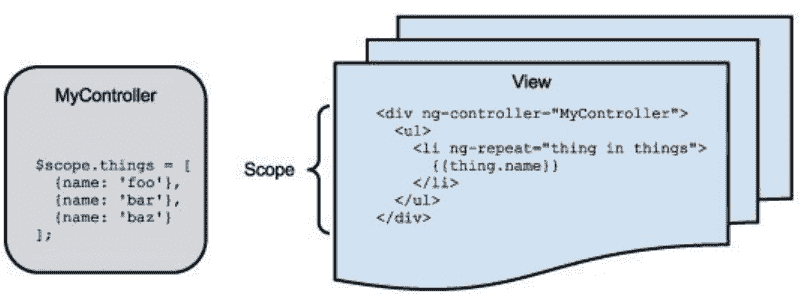

## 什么是 AngularJS 表达式？

它是一段 AngularJS 能理解并处理的类 JavaScript 代码。在你的视图中看起来像 JavaScript 的任何内容都不是 JavaScript，而是 Angular 表达式。因此，并非所有 JavaScript 都是有效的表达式！表达式是针对作用域进行求值的；如果你有一个表达式`foo = 'bar'`，那么当前作用域中的字符串`foo`将被赋值为"bar"。表达式不像 JavaScript 那样处理`undefined`和`null`值；给定类似`ng-show="foo.bar"`的内容，如果`foo`是`undefined`，你不会收到错误。`===`和`!==`运算符是不必要的，无需为此担心。你*不能*在 AngularJS 表达式中使用任何条件语句、循环或异常处理。最后，你可以使用`|`（pipe）运算符来使用过滤器。AngularJS 表达式语言仍在开发中，未来请期待更多功能。

最重要的是要理解，有一个根作用域（root scope），所有作用域都继承自它，并且默认情况下所有作用域都原形继承（prototypically）自其父作用域。如果你在应用程序的根作用域上设置某些内容（你可以通过`$rootScope`服务访问它），那么无论在应用程序的什么位置，所有非隔离作用域（non-isolate scopes）都可以使用它（*隔离作用域*用于某些指令，且为了不污染或逾越其边界，故意*不*继承自其父作用域）。如果你需要一个在视图*任何地方*都能使用的`debug()`函数（或类似功能；调试请考虑使用`$log`服务），请将其放在根作用域上。如果你不需要在所有地方使用，请不要滥用根作用域。

作用域简单来说就是 JavaScript 对象，但它们具有特殊函数。以下是一些较为有用的函数概述：

- `$apply`：从框架外部执行 AngularJS 表达式，通常用于指令中。如果你有一个需要设置模型的第三方库，你*必须*将该赋值操作包裹在`$apply`调用中，否则 AngularJS 将无法识别更改已发生，从而导致什么都不会发生。监听器（watches）不会触发，承诺（promises）不会解析，等等。

- `$watch`：监听/观察一个 AngularJS 表达式；如果该表达式发生变化，你传递给`$watch`的函数将被触发。该函数将接收"new"和"old"两个参数。`$watch`有一个可选的第三个参数；由于默认情况下`$watch`是按引用（by reference）求值的，某些表达式可能不会像你预想的那样触发监听函数。例如，假设你对表达式`foo`进行了监听。如果`foo`被重新赋值为一个新对象，监听将触发。然而，如果`foo`内部有一个成员`bar`发生了变化，监听将不会触发。内部对象确实改变了，但引用没有改变。如果你想*按值（by value）*求值（这是一个开销大得多的操作，请谨慎使用！），请在`$watch`调用中提供`true`作为第三个参数。注意，当你第一次定义`$watch`时，其监听函数将异步调用，因此如果该值是异步设置的，通常需要在监听函数的首行对两个参数进行比较。

- `$eval`：针对作用域对表达式进行求值并返回其值。在指令中，如果你想将标签的属性作为 AngularJS 表达式进行求值，并在之后使用其值，可以使用它。

- `$on/$broadcast/$emit`：你可以使用这些函数在作用域继承链中向上或向下触发和响应事件。用法类似于自定义 jQuery 事件处理程序，例如。

以下是一些 Scope 函数的示例：

```
// 由于 "click" 实际上是 jQuery 在做工作，AngularJS 并不知道它。
// 因此，如果我们希望在更新作用域对象时触发任何监听器，我们必须
// 使用 scope.$apply()。
someModule.directive('someDirective', function() {
  return function(scope, elm) {
    elm.click(function() {
      scope.$apply(function() {
        scope.foo = 'bar';
      });
    });
  }
});
```

```
// 这个 watch 只会在作用域上的对象被重新赋值或失去引用时触发
$scope.$watch('some_object', function(newval, oldval) {
  if (newval !== oldval) {
    $scope.someFunction(newval);
  }
});
```

```
// 这个 watch 会在作用域上的对象被重新赋值或失去引用时触发，
// 或者在对象成员发生变化时触发。开销更大
$scope.$watch('some_object', function(newval, oldval) {
  if (newval !== oldval) {
    $scope.someFunction(newval);
  }
}, true);
```

```
// 用法：<div some-directive="bar"></div>
someModule.directive('someDirective', function() {
  return function(scope, elm, attrs) {
    // some_object 现在是当前作用域中 bar 的值
    var some_object = scope.$eval(attrs.someDirective);
  }
});
```

```
// 假设这是在控制器 Foo 中；当 $broadcast 被调用时，所有子控制器
// 都会监听并执行它们的回调函数。它还会监听来自子控制器 Bar 的
// 所有 "anotherEvent" 事件，以及任何其他子控制器的事件。
$scope.$broadcast('someEvent', obj1);
$scope.$on('anotherEvent', function(evt, data) {
  // 对 obj2 执行某些操作
});
```

```
// 假设这是在子控制器 Bar 中
$scope.$on('someEvent', function(evt, data) {
  // 对事件对象和/或 "obj1" 执行某些操作
});
$scope.$emit('anotherEvent', obj2);
```

```
// 请注意，如果你希望同级控制器响应 $broadcast，
// 你需要在父控制器中执行此操作。如果没有父控制器存在，
// 使用 $rootScope 可能是合理的选择：
$rootScope.$broadcast('globalEvent', super_important_stuff);
```

## Digest already in progress?

如果你看到这个 JavaScript 错误，这意味着 AngularJS 正在尝试求值表达式。最常见的解决方案是移除你对`$apply`的调用，因为它可能不是必需的。有时这并不奏效；然而，因为如果你移除了`$apply`，你的 watch 并不总是会触发。通常我见过这种情况发生在同一个函数从 AngularJS 上下文中同步执行，同时又在 AngularJS 上下文之外异步执行时（比如使用`setTimeout`之类的情况）。在这种情况下，你必须确保函数本身不包含`$apply`，而是在适当时将每个函数调用包装在`$apply`中。

## 关于单元测试的说明

本书接下来的示例将包含使用 Jasmine 编写的单元测试（[http://pivotal.github.com/jasmine/](http://pivotal.github.com/jasmine/)）。Jasmine 是一个 BDD（行为驱动开发）风格的测试框架，用 JavaScript 编写，用于测试 JavaScript。如果你不熟悉 BDD，没关系——你不需要了解任何关于它的知识就可以开始使用 Jasmine。语法看起来会有点奇怪，但很快就会理解。


### BDD？我才刚刚掌握 TDD！

虽然 TDD（测试驱动开发）只是一种实践——简而言之，先写测试——但 BDD 远不止于此。它是一种不同的软件开发方法。两者之间的主要区别在于，BDD 测试本质上可以由测试人员甚至最终用户来编写。当你在规范中确定业务逻辑时，你可以写下"当 y 发生时，x 应该发生"，并直接将其转换为 BDD 风格测试框架中的测试。我没有读过任何关于 BDD 的书籍，因此无法推荐一本，但如果你感兴趣，建议你进一步探索。记住，你不需要"订阅"BDD 就能使用 Jasmine 进行测试；它作为一个通用的单元测试框架同样表现出色。

我们还将假设在进行这些测试时包含了`angular-mocks.js`文件，因为它为 Jasmine 与 AngularJS 协作提供了一些便捷的方法。

AngularJS 在其在线教程中提供了功能测试（或 E2E 测试）。虽然这些测试很有价值，但我们的应用规模较小，可以通过手动测试来完成。一旦你的应用成长起来，自动化功能测试会更合理，但对我们来说没有必要。

## 组件

我们有模型、视图、控制器、服务/工厂/提供者、过滤器和指令。所有这些组件将构成一个模块。模块可以是一个完整的应用、应用的一部分，或者一组可复用的组件。例如，在一个两页的应用中，你可能有一个模块提供两个页面之间的通用功能，以及每个页面本身的模块。在定义每个页面的模块时，你会包含"通用"模块。如果你有其他应用，你可能希望将通用功能拆分到另一个模块中，供所有应用使用。

- **Models**：引用模型最合理的地方通常是在控制器中。如果你有互不相干且不共享共同父作用域的控制器（当然，除了根作用域），你可能希望在服务中引用你的模型，因为服务是一个单例，所有组件都可以注入它。

- **Views**：视图是你的标记。任何使用过 JavaScript 模板语言，甚至是服务器端模板语言的人，都会在视图中感到得心应手。它包含简单的逻辑语句和其他绑定的数据（通常是模型），并使用指令和过滤器。当你在视图中引用模型时，通常是在某个控制器的作用域中。

- **Controllers**：控制器存在于应用作用域的某个位置。它有自己的作用域，任何子控制器都会原型继承该作用域。在父控制器中声明一个两个或更多子控制器都会使用的函数是极为有用的。控制器用于引用模型和业务逻辑。然而，DOM 操作不属于控制器。这一点需要反复强调和明确：在我的书中，"DOM 操作"是指任何修改现有 DOM 结构的代码。如果你让控制器远离 DOM 操作，你将拥有更干净、易于测试的代码。相信这一点。

- **Services**：服务是一个可注入的单例。一组与共同概念相关的函数，或者一个静态的类式对象，作为服务都非常合适。例如，一个服务可以提供调用若干服务器端 API 的函数。你不需要该服务的另一个实例。服务不返回任何东西。

- **Factories**：工厂是可注入的，但可以返回一个函数、对象，甚至是一个原始值（我还没见过这样做的用例，但它确实存在）。如果你有一个希望让控制器使用的 JavaScript"类"，这里是一个很好的放置位置。如果你有一个工具函数但不想污染命名空间，把它放在工厂里。也许你想返回一个充满各种内容的新对象实例——把它放在工厂里。

- **Providers**：提供者就像生成工厂的服务，如果这样说能明白的话。在初始化期间，你可以配置一个提供者，使其在应用加载后以某种方式运行。`$http`服务实际上就是一个提供者，如果你愿意，可以在初始化期间配置其默认值。提供者不返回任何东西，但定义了`this.$get()`；一个返回类似工厂对象的函数。当你定义提供者`Foo`时，你实际上是在定义`FooProvider`；从`this.$get`返回的东西才是真正的`Foo`。

# NP 在指令之外进行 DOM 操作

服务、工厂或提供者可用于 DOM 操作，但如果确实如此，它应该仅承担该功能，以便使单元测试简单明了，并避免代码变得一团糟。创建模态弹出窗口的功能非常适合放在服务中。创建一个新的"视图"甚至可以被视为业务逻辑。事实证明，以这种方式使用服务可能比试图将相同的功能强行塞入指令中更为自然。例如，我有一个场景，通过工厂提供一个`showwarning()`函数来向用户显示警告，警告内容有时通过 HTTP 获取，并在模态窗口中显示（注意，如果不需要在模态窗口中显示，更好的做法是直接在模型中设置警告文本并使用`$show`来显示）。

- **过滤器**：过滤器非常适合在视图中进行字符串或数组操作。在视图之外，你仍然可以使用过滤器，但如果你打算完全在视图之外使用它，最好提供一个工厂函数而非过滤器。

- **指令**：最后，指令用于 DOM 操作或从视图中控制作用域或模型。它永远不会在视图上下文之外使用。当你发现自己试图使用第三方 DOM 操作库时，你就知道需要指令了。不要经不住诱惑在控制器中使用那个复杂的库！编写一个指令来桥接 AngularJS 和 Library X 之间的差距是值得的。自定义验证最好在指令中处理。你也可以覆盖 AngularJS 的默认指令来改变它们的行为。不想让模型在每次`keyDown`事件时更新？覆盖那个输入指令！我们稍后会给出这方面的示例。指令本质上扩展了 HTML，可以用来为你的一个或多个应用程序创建领域特定语言。

# 总结

以上是构成 AngularJS 应用程序的核心组件。将它们视为构建块。根据你的需求，你可能需要或多或少的组件。

在下一章中，我们将深入探讨模型。它就是数据——而你可能在某处已经有一些了。

## 第 3 章. 深入了解模型

什么是模型？有些框架要求你使用 JavaScript 类或扩展其他基类。JavaScript 的部分美感（我犹豫着说出这个词）在于，如果你不需要类，你就不需要类（传统的面向对象风格的类）。对于 JavaScript 而言，你真正拥有的是对象。如果你想编写带有原型方法之类内容的类，尽管去做！但你不必这样做。模型可以是一个简单的 JS 对象：`{}`。事实上，模型可以是任何变量、任何对象、任何数据结构；模型*就是*你的数据。其他框架可能有某种你需要扩展的 Model 类；AngularJS 则不是这样。

# AngularJS 模型

当模型附加到 Scope 对象时就变得有用了。Scope 对象是 AngularJS 创建的一个特殊对象，它（除了其他功能外）为你的视图提供数据。将模型放入 Scope 对象中可确保 AngularJS 正在观察该模型，并在模型发生变化时采取必要的操作。你可以编写一个控制器，在控制器中你可以有`var foo = 'bar';`，但 AngularJS 绝对不会在意你是否将值更改为'baz'。然而，一旦你这样做：`$scope.foo = 'bar';`，你就有了 AngularJS 可以处理的东西。如果你在视图中有`<div>{{foo}}</div>`，当`$scope.foo`的值变为`baz`时，`<div>`将会被更新。这当然就是 Angular 的数据绑定。

```
Scope w/ Models

$scope.foo = {}; // plain object
$scope.bar = new Bar(); // instantiated object
$scope.baz = []; //plain array
$scope.bool = true; // some boolean
$scope.str = 'string'; // some string
$scope.num = 31337; // some number
```

但如果你想在`$scope.foo`每次变化时执行一些自定义代码呢？是的，你可以通过使用`$watch`来实现。在这个`$watch`示例中，观察测试中的观测行为：


```javascript
// note no module here; not necessary for the example
function SomeCtrl($scope, $log) {
    $scope.foo = 'bar';
    $scope.$watch('foo', function(new_val, old_val) {
        if (new_val !== old_val) {
            $log.log("foo used to be '" + old_val + "', but is now '" + new_val + "'");
        }
    });
}

describe('SomeCtrl', function () {
    var scope;
    beforeEach(inject(function ($rootScope) {
        scope = $rootScope.$new(); // make brand new child scope off of root
    }));
    describe('the watch on foo', function () {
        it('should fire when foo changes', function () {
            inject(function ($controller, $log) {
                spyOn($log, 'log');
                scope.$apply(function () {
                    $controller(SomeCtrl, {
                        $scope: scope,
                        $log: $log
                    });
                });
                expect(scope.foo).toBe('bar');
                scope.$apply("foo = 'baz'");
                expect(scope.foo).toBe('baz');
                expect($log.log).toHaveBeenCalled();
            });
        });
    });
});
```

现在，每当`foo`发生变化，JavaScript 控制台都会通知你。注意`new_val`和`old_val`的比较——当`foo`首次被设置时，`$watch`会自动触发，这通常不是期望的行为（但有时可能是）。因此我们使用了条件判断。

`$watch`的第一个参数实际上是一个*AngularJS 表达式*。我们要求`Scope`对象观察某个表达式的值，并在值变化时执行回调函数。当我们将`foo`附加到`$scope`时，我们创造了使用`foo`表达式在该`Scope`上进行求值的机会。由于这可以是任何表达式，我们甚至可以`$watch`某个任意的布尔值：`foo == 'baz'`。当该条件求值且求值后的值发生变化时，我们将执行回调函数。例如，如果你希望某些代码仅在模型达到特定数值时才触发，这很有用。

现在，你可以`$watch`整个对象或数组。看看下面这个不错的模型：

```javascript
$scope.foo = {
  bar: 'baz'
};
```

即使`foo.bar`的值发生变化，`$watch` `foo`本身也**不会触发**我们的回调函数。为什么？因为默认情况下，`$watch`是按*引用*而非按值工作的。如果你正在观察`foo`，而`foo`的引用没有改变——当我们更新`foo.bar`时引用确实没有改变——`$watch`就不会触发。

幸运的是 AngularJS 提供了实现这类任务的功能。它开销较大，但你可以按值来`$watch`。只需向`$watch`调用传递第三个参数：

```javascript
describe('watches', function() {
  var scope;
  beforeEach(inject(function($rootScope) {
    $rootScope = $rootScope.$new();
    scope = $rootScope.$new();
    scope.$apply(foo = {bar: "baz"});
  }));

  it('when watching by reference, should not fire when object member updated',
    inject(function($log) {
      spyOn($log, 'log');
      scope.$apply(function() {
        scope.$watch('foo', function(new_val, old_val) {
          $log.log('foo used to be ' + angular.toJson(old_val) + ' now it is ' + angular.toJson(new_val));
        });
      });

      scope.$apply(function() {
        scope['foo'].bar = 'spam';
      });
      expect($log.log).not.toHaveBeenCalled();
    }));

  it('when watching by value, should fire when object member updated', inject(function($log) {
    spyOn($log, 'log');
    scope.$apply(function() {
      scope.$watch('foo', function(new_val, old_val) {
        if (new_val !== old_val) {
          $log.log('foo used to be ' + angular.toJson(old_val) + ' but is now ' + angular.toJson(new_val));
        }
      }, true);
    });

    scope.$apply(function() {
      scope['foo'].bar = 'spam';
    });
    expect($log.log).toHaveBeenCalled();
  }));
});
```

注意这里对`angular.toJson()`的调用；要正确输出`foo`的内容，我们必须将其转换为字符串，否则会得到那句老话般的`[Object object]`。

由于这是一个开销较大的操作（具体有多大开销取决于你和`http://jsperf.com`），不`$watch`巨大的对象或数组可能是个好主意。AngularJS 并不是为此而优雅设计的。这类事情通常最好交给 MS Excel 来处理。弄清楚你真正需要显示什么、真正需要内联编辑什么，你就能看到性能的提升。

## 不希望模型在更改后立即更新？

这种情况的一个例子是模态对话框，其中显示了某个模型，且你希望用户对该模型进行修改。然而，你只希望在用户点击“保存”时才应用这些更改，如果用户点击“取消”，则希望丢弃这些更改。

解决这个问题有几种方案，其中一种是简单地使用`angular.copy()`复制你的模型，并使用一个临时模型进行操作，然后在保存时将其复制回去。你可以编写一个服务（service）或工厂（factory）来处理这种通用情况。或者，你甚至可以编写一个通用指令，将 UI 的特定部分标记为“事务性的（transactional）”，直到点击“保存”才执行“提交”。

来看看这个带有测试的“transactional”指令：

```javascript
angular.module('app', []).directive('transactional', function($parse) {
  return {
    restrict: 'E',
    scope: true,
    link: function(scope, elm, attrs) {
      // 从 $parse 服务获取一个 "getter" 函数
      var model = $parse(attrs.model);
      // 使用 "setter" 函数将 "model" 属性中指定内容的副本
      // 放入此指令的作用域中，该作用域不继承自父级。
      model.assign(scope, angular.copy(model(scope)));
      // 保存时，将父级模型重新赋值为该指令模型的当前值。
      scope.$save = function() {
        model.assign(scope.$parent, model(scope));
      };
    }
  };
});

// ...以及一些单元测试
beforeEach(module('app'));
describe('transactional directive', function () {
  var scope;
  beforeEach(inject(function ($rootScope) {
    scope = $rootScope.$new(); // 基于 root 创建一个全新的子作用域
  }));
  describe('the model', function () {
    it('should propagate to the parent only when $saved', inject(function ($compile) {
      var template, compiled, isolateScope;
      scope.foo = 'bar';
      template = '<transactional model="foo"></transactional>';
      compiled = $compile(template)(scope);
      isolateScope = compiled.scope();
      isolateScope.$apply('foo = "baz"');
      expect(scope.foo).toBe('bar');
      isolateScope.$apply('$save()');
      expect(scope.foo).toBe('baz');
    }));
  });
});
```

要使用此指令，可以参考以下用法：

```html
<div ng-controller="MyCtrl">
  <p>Value of foo: {{protected.foo}}</p>
  <transactional model="protected">
    <p>Temp value of foo: <input type="text" ng-model="protected.foo"/></p>
    <button ng-click="protected.increment()">increment</button>
    <button ng-click="$save()">save</button>
  </transactional>
</div>
```

对应的控制器如下：

```javascript
myApp.controller('MyCtrl', function($scope) {
  $scope.protected = {
    foo: 1,
    increment: function() {
      this.foo++;
    }
  };
});
```

这个指令做了一件我不太热衷的事情——它在作用域中塞入了一个新东西。然而，鉴于这是一个*隔离（isolate）*作用域，所以没问题，因为它不会用`$save`函数污染任何父级作用域。如果你对此非常在意，可以通过另一个属性来修改此指令以提供`save`函数。

此外，这种策略还有几个限制。你需要一个“顶层”模型才能使其工作；你不能使用`foo.bar`这样的模型。此外，你在对象中使用的任何伪类（pseudoclass）都*不会*被持久化，因为`angular.copy()`不支持这样做。

## 结论

虽然模型本身看起来没什么特别有趣的，但它仍然是 AngularJS 的核心组件。与其他框架不同，你不需要继承任何特殊的类来创建模型。在 AngularJS 中，你会将数据放入一个特殊的`Scope`对象中。

模型和视图都是设计 Web 应用程序的良好起点。然而，如果你的应用程序具有复杂的 UI，你可能希望从视图开始，我们将在下一章中讨论视图。

## 第 4 章：视图详解

什么是视图？就是用户看到的东西。它是呈现层。它是你的模板。它是你的标记；你的 HTML。

视图与控制器紧密协作，但它是解耦的，也就是说控制器对视图一无所知。同样，视图也并不真正了解控制器。你可能会认为它了解，因为它能执行控制器中的函数并触碰其中的数据；但实际上视图拥有的是一个`Scope`对象。视图和控制器都与`Scope`对象对话，而不是彼此对话。

在这里，MVC 模式的核心范式变得清晰：视图与业务逻辑的分离。如果你熟悉 MVVM（Model-View-ViewModel）范式，可以将`scope`视为 ViewModel。AngularJS 的创建者表示 AngularJS 是一个 MVW（Model-View-Whatever，模型-视图-随便什么）框架，这意味着*本文*作者将不再深入探讨那个讨论。

我们将讨论 AngularJS 视图通常是什么样子，包括一些典型的属性和一些坑。这也将作为对*指令（directives）*更好的介绍，指令是由 AngularJS 执行的特殊命令。我们还将看一个过滤器（filter），这可能是你第一次见到。

### 我们的视图

让我们通过改进`index.html`来更详细地查看视图。目前它几乎没起作用。将其改为：


```html
<!DOCTYPE html>
<html ng-app="blog">
<head>
    <meta http-equiv="Content-type" content="text/html; charset=utf-8">
    <title ng-bind-template="{{title}}"></title>
    <script src="https://ajax.googleapis.com/ajax/libs/angularjs/1.0.5/angular.min.js" type="text/javascript"
        charset="utf-8"></script>
    <script src="https://ajax.googleapis.com/ajax/libs/jquery/1.8.3/jquery.min.js" type="text/javascript"
       charset="utf-8"></script>
    <script src="blog.js" type="text/javascript" charset="utf-8"></script>
</head>
<body>
<div ng-controller="HeadCtrl">
    <h1>{{title}}</h1>
    <h3>{{description}}</h3>
</div>
<div ng-controller="ContentCtrl">
      <new-post-area post="new_post" cancel-text="Cancel" save-text="Save" cancel="cancel" save="save">
      </new-post-area>
      <div id="{{post.id}}" ng-repeat="post in posts|orderBy:'-date'">
          <ng-switch on="post.editing">
              <div ng-switch-when="true">
                  <div class="important-background-color" color="#EEE">
                      <input type="text" ng-model="post.temp.title"/><br/>
                      <textarea ng-model="post.temp.body"></textarea><br/>
                      <button ng-click="cancel(post)">Cancel</button>
                      <button ng-click="save(post)">Save Changes</button>
                  </div>
              </div>
              <div ng-switch-default>
                  <h2 ng-click="edit(post)">{{post.title}}</h2>
                  <p ng-click="edit(post)" bold-click ng-bind-html-unsafe="post.body"></p>
                  <p><em>posted on {{post.date|date:'short'}} by {{post.author}}</em></p>
              </div>
          <hr/>
              <button ng-click="newPost()">New Post</button>
          </ng-switch>
      </div>
</div>
<!-- directive: copyright -->
</body>
</html>
```

渲染结果如下：

## My Important Blog

### Scary Post

Aenean nec aliquam libero. Suspendisse lorem magna, lobortis eu tincidunt vel, faucibus quis erat

posted on 11/11/12 8:50 PM by Michael Myers

### First Post!!!!~11

Lorem ipsum dolor sit amet, consectetur adipiscing elit. Duis lacinia cursus arcu a pellentesque. Curabitur convallis massa faucibus tellus tincidunt et tincidunt augue elementum. Curabitur pretium metus gravida augue elementum mollis.

posted on 11/11/12 8:50 PM by Chris Hiller

这仍然不多，但这是一个正确的方向。我们添加了标题、描述、更多内置指令、自定义指令和过滤器。稍后我们将检查处理这个大家伙的控制器。

我们做的一些事情包括：

- 动态生成 `<title>` 标签中的文本
- 引用另一个名为 `HeadCtrl` 的控制器
- 使用自定义指令 `new-post-area`（或者正确写法 `newPostArea`）
- 使用 `ng-repeat`（`ngRepeat`）指令遍历 Post 对象列表
- 使用 `ng-switch`（`ngSwitch`）指令根据条件显示部分标记
- 添加了编辑文章的能力
- 添加了创建新文章的能力
- 引用了另一个名为 `copyright` 的自定义指令

顺便提一下，这是一个仅用三行 JavaScript 代码和一个视图就能实现的功能示例：

```html
<html>
    <script type="text/javascript" src="/path/to/angular.js"></script>
    <script type="text/javascript">
        angular.module('app', []).run(function($rootScope, $window) {
            $rootScope.myAlert = function() {
                $window.alert('Chris!');
            };
        });
    </script>
    <body ng-app="app">
        <button ng-click="myAlert()">Alert My Name</button>
    </body>
</html>
```

视图运行函数所需的唯一条件就是该函数存在于作用域（scope）中。如果我们像这里一样将其放在根作用域中，那可能是一个愚蠢的想法（因为现在基本上你的整个应用程序都可以使用这个 `myAlert()` 函数），但为了演示目的，我们就这么做了。一个视图，一个作用域中的函数，没有模型，没有控制器，没有服务，没有过滤器，也没有自定义指令。

## 大括号与你

到现在你可能会问自己，为什么像 `{{post.title}}` 这样的内容被包裹在大括号中，而 `post.body` 则没有。通用规则是：在视图中，任何对模型或函数的引用，只要它*不是*指令（自定义属性或标签）的一部分，就需要用大括号包裹，*除非另有说明*。例如，`{{post.title}}` 位于 HTML 文本节点中，它不是一个指令。`<div>` 中的 `id` 属性虽然是一个属性，但也不是指令。对 `ngBindHtmlUnsafe` 的调用是一个指令，因此那里不需要大括号。

一个反例是 `ngHref` 指令，它需要大括号。你可以在 API 文档（[http://docs.angularjs.org/api/ng.directive:ngHref](http://docs.angularjs.org/api/ng.directive:ngHref)）中阅读更多关于 `ngHref` 指令的信息以及为什么要使用它，但为了将模型 `bar` 的值插入到我们的 URL 中，该指令如下所示：

```html
<a ng-href="http://www.foo.{{bar}}.baz">
```

## ngBindTemplate

在视图的 `<title>` 标签中，我们使用了 `ngBindTemplate` 指令。我们本可以直接使用 `<title>{{title}}</title>`，对吧？是的，但是，如果你这样做，你会在浏览器的标题栏中（至少暂时地）看到 `{{title}}`。我们想要避免这种情况。通过使用 `ngBindTemplate`，我们可以在属性中指定整个模板。在这种情况下，我们的整个模板就是 `{{title}}`。这样当 AngularJS 完成其工作后，它会编译你的模板并将其填充到 `<title>` 标签中，然后你在标题栏中就拥有了一个正确的标题，而没有临时出现的丑陋代码。

双大括号的临时出现是 AngularJS 全局性的一个问题。有几种方法可以避免它，包括 `ngCloak` 指令，它会隐藏所附加的节点，直到编译完成后才显示。如果你愿意，可以将此指令附加到 `<body>` 标签上，但如果你想看到页面的渐进式渲染，最好将其分配给具体节点。此外，巧妙地使用 `ngShow` 和 `ngHide` 也可以防止这些大括号被短暂看到，这是我更倾向的方法。

那么我们的 `<title>` 标签呢？`ngCloak` 不能应用于 `<head>` 标签；它仅仅是一个 CSS 技巧。所以我们的 `<title>` 标签必须使用 `ngBindTemplate` 才能隐藏其“内衣”。

## ngRepeat

`ngRepeat` 指令允许你循环遍历数组或对象。数组语法与对象语法不同：

```html
Array: <div ng-repeat="number in [1, 2, 3]">{{number}}</div> 
Object: <div ng-repeat="(letter, number) in {a: 1, b: 2, c: 3}">{{letter}}: {{number}}</div>
```

这一切都很好，直到你尝试循环遍历一个数组并在原处编辑它：

```html
<div ng-repeat="number in [1, 2, 3]">
  <input type="text" ng-model="number"/>
</div>
```

你可能会认为这里发生的情况是你能够简单地编辑数组的成员。事实并非如此。`number` 实际上是数组成员的一个副本。因此，如果你更改了 `number`，AngularJS 除了知道一个数组发生了变化之外，并不知道具体发生了什么。而 `ngRepeat` 正在监视该数组，如果数组发生变化，它将更改其内容。结果就是数组变了！`ngRepeat` 现在必须重新渲染模板。后果是，一旦你在任何文本框中输入一个字符，你就会失去焦点，因为 DOM 正在被重新渲染。真糟糕！

对此我们能做什么？不幸的是，能做的很少。就目前而言，如果你想以这种方式循环遍历数组，你可以这样做，但 `ngRepeat` 循环的内容应该是只读的。一个解决方法是使用不同的数据结构。例如，这样运行良好：

```html
<div ng-repeat="number in [{n: 1}, {n: 2}, {n: 3}]">
  <input type="text" ng-model="number.n"/>
</div>
```

此时你不是在修改数组，而是在修改数组中的一个对象。因此数组本身没有改变，`ngRepeat` 不需要重新渲染自身。一个好的建议是在 `ng-model` 中始终寻找一个“点”（`.`）。

如果你的模板语言在决定你的数据结构，这通常是个坏消息，但为了获得卓越的数据绑定功能，这是必须付出的代价。

### ngRepeat 的特殊变量

`ngRepeat` 指令特别有一些好用的特殊变量。在 `ngRepeat` 指令的上下文中，你可以访问以下变量：

- `$index` — `ngRepeat` 循环的当前索引（从 0 开始）。
- `$first` — 布尔值；是否为循环中的第一个项目。
- `$middle` — 布尔值；是否不在循环的第一个或最后一个项目。
- `$last` — 布尔值；是否为循环中的最后一个项目。

### ngBindHtmlUnsafe

这个名字真绕口。它的作用是允许 HTML 在不被转义的情况下通过 AngularJS。默认情况下，AngularJS 在视图中渲染任何 HTML 之前都会对其进行转义。如果你想用一堆实际的 HTML 替换一个节点的内容，请使用此指令。但请记住，除非你信任你的用户或已经对数据进行了清理，否则它是不安全的。对于我们的目的，这是没问题的，因为博文将由*我们*来编写。如果是评论系统？最好不要使用这个指令。

## 这个 bold-click 是什么？

这是一个自定义指令。我们稍后会讨论。

## 其他特殊变量

我们还可以访问视图中的这个特殊对象：

- `$event` — 包含 AngularJS 事件信息的对象。

### 事件冒泡

如果你在一个节点上设置了 `ngClick`，并在父节点上设置了另一个 `ngClick`，那么点击该子节点很有可能会触发这两个事件。

例如：

```html
<div ng-click="foo()">foo
  <div ng-click="bar()">bar</div>
</div>
```

如果你不希望触发 `foo()`，请尝试这样做：

```html
<div ng-click="foo()">foo
  <div ng-click="bar(); $event.stopPropagation()">bar</div>
</div>
```

### `$event` 终究只是一个 jQuery/jqLite 事件对象

你可以将 `$event` 传递给 Scope 上调用的任何函数，该函数可以检查 `$event` 对象以获取更多信息。请抵制使用它来获取目标 DOM 节点并开始对其进行摆弄的诱惑。你应该在指令中，或者极少数情况下在服务/工厂中进行 DOM 操作。控制器是用于业务逻辑的。`$event` 对象的一个合理用途是检查击键（例如），并根据按下的键在控制器中采取不同的操作。

### 为什么我不能在视图中使用 JavaScript 函数 `X()`？

AngularJS 表达式*不是* JavaScript。它们看起来和闻起来像 JavaScript，但它们不是。你不能从 AngularJS 表达式中执行任意的 JavaScript，也不能使用某些运算符，如 `===`。像 `Math.sqrt()` 这样的函数是不可用的。如果你需要这些功能，请将其放入作用域中：`$scope.sqrt = Math.sqrt`；现在你可以通过刚才创建的引用在视图中使用 `sqrt()` 函数。

每个 Scope 都有一个对 `$parent` 作用域（根作用域或 `$rootScope` 除外）和一个 `$root` 作用域的引用。你可以在视图中使用它们。但 Scope 对象从其父级原形继承，因此通常你不需要使用这些，除非你有一个与父级 Scope 同名但指向不同对象的模型：

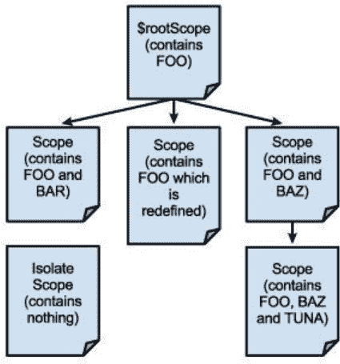

这里我们有包含模型的控制器：

```javascript
some_module.controller('MyCtrl', ['$scope', function ($scope) {
    $scope.foo = 'bar';
}]);
some_module.controller('MyOtherCtrl', ['$scope', function ($scope) {
    $scope.foo = 'baz';
}]);
```

以及相应的视图：

```html
<div ng-controller="MyCtrl">
    <p>{{foo}}（显示 "bar"）</p>
    <div ng-controller="MyOtherCtrl">
        <p>{{foo}}（显示 "baz"）</p>
        <p>{{$parent.foo}}（显示 "bar"）</p>
    </div>
</div>
```

你只需在 Scope 层级结构中不重复使用变量名，就可以避免这样做。一般来说，使用 `$parent` 引用对象是不必要的。如果你使用的是原始类型，可能必须使用 `$parent` 来获取你想要的内容。在我们的示例中，除非你覆盖它，否则放入 `MyCtrl` 的 `$scope` 对象中的任何内容也会出现在 `MyOtherCtrl` 的 `$scope` 对象中。

接下来，我们将讨论表单控件——用户与你的应用程序交互的小部件。

## 控件

让我们来看看控件。

### 让按钮点击执行操作

你可能已经有一些标记，看起来像这样：

```html
<button>Alert My Name</button>
```

为了让点击这个按钮能执行某些操作，你需要使用 `ngClick` 指令。为了执行操作，你必须为 `ngClick` 指令提供一个 AngularJS 表达式。通常这是一个函数，如下所示：

```html
<button ng-click="myAlert()">Alert My Name</button>
```

或者，根据你想实现的功能，你甚至可以直接在标记中进行赋值：

```html
<button ng-click="name = 'Chris'">My Name Is Now Chris</button>
```

当然，这还不是一个完整的 AngularJS 应用程序。但上述内容是完整的，并且实际上可以运行。

### 使用锚点（`<a>`）标签


你可能会在应用程序的某些地方使用 `<a>` 标签，而且它们的功能可能与 `<a>` 标签最初的设计意图不同。相反，它们会执行某些 JavaScript 函数。我的建议是以这种方式编写你的锚点标签：

```html
<a ng-click="doSomethingHeinous()">Click me</a>
```

请注意缺少 `href` 属性。你不需要 `#` 或 `javascript:` 或类似之类的废话。这是故意这样设计的；AngularJS 有自己的指令，如果缺失 `href`，该指令会自动阻止锚点标签应执行的默认操作。

但是，如果你确实想按原意使用 `<a>` 标签，你可能想要实现类似动态生成 URL 的功能。这样做是行不通的：

```html
<a href="http://essentialvinegars.com/?id={{id}}">Buy Smelly Vinegar</a>
```

如果在 AngularJS 完全处理模板之前用户点击了这个链接，他们最终会跳转到你原样编写的那个 URL。你应该使用 `ngHref` 指令：

```html
<a ng-href="http://essentialvinegars.com/?id={{id}}">Buy Smelly Vinegar</a>
```

AngularJS 会拦截 `<a>` 标签，直到 `ngHref` 的内容被解析之前，它不会执行任何操作。

## 复选框

**提示**：如果我有一个表格，每一行都有一个复选框，并且我们想知道哪些行被“勾选”了，该怎么办？

*KnockoutJS 提供了类似的行为，但 AngularJS 不同。如果你想实现这样的功能，你需要一个自定义指令。如果保留所选行的顺序很重要，那么你绝对需要一个自定义指令！*

这个示例指令应该能帮到你：

```javascript
myApp.directive('checkboxArray', function($parse) {
    return {
        require: 'ngModel',
        link: function(scope, elm, attrs, ngModel) {
            var value = scope.$eval(attrs.checkboxArray);
                // the thing we will put in our array specified by ngModel
                array = $parse(attrs.ngModel); // getter/setter for ngModel
                // if we have not defined the ngModel, let's assign an empty array to it
                // otherwise we may run into problems getting the length of an undefined object
            if (angular.isUndefined(array(scope))) {
                array.assign(scope, []);
            }
            // when the checkbox is clicked, execute this
            elm.bind('change', function() {
                var arrayValues = array(scope),
                    // get the actual array out of the scope
                    i = arrayValues.length;
                if (elm.attr('checked')) {
                    // if we wound up checked, push the thing onto the array specified by ngModel
                    arrayValues.push(value);
                    // need to apply since this is a jQuery event
                    scope.$apply(function() {
                        ngModel.$setViewValue(true); // checkbox will want to be true/false
                        array.assign(scope, arrayValues); // update the scope
                    });
                } else {
                    // find the object in our array and remove it
                    while (i--) {
                        if (arrayValues[i] === value) {
                            arrayValues.splice(i, 1);
                            scope.$apply(function() {
                                ngModel.$setViewValue(false);
                                array.assign(scope, arrayValues);
                            });
                            return;
                        }
                    }
                }
            });
            // this little gem will watch the array specified in ngModel *by value*
            // and update when necessary. this way you can add/remove
            // and reorder the array you specified willy-nilly, and the checkboxes will be updated.
            // otherwise, if we specified ngModel.$render, it would only be called when the reference updates-
            // reassigning our array to something else.
            scope.$watch(attrs.ngModel, function(arrayValues, oldArrayValues) {
                var i;
                if (arrayValues !== oldArrayValues) {
                    i = arrayValues.length;
                    while (i--) {
                        if (arrayValues[i] === value) {
                            elm.attr('checked', true); // check the checkbox if we found the obj
                            return;
                        }
                    }
                    elm.attr('checked', false); // otherwise uncheck it
                }
            }, true);
        }
    };
});
```

`checkboxArray` 指令的使用方式如下：

```html
<div ng-controller="MyCtrl">
    <table>
        <tr ng-repeat="value in values">
            <td><input type="checkbox" ng-model="$parent.selectedValues" checkbox-array="value"/></td>
            <td>{{value.name}}</td>
        </tr>
    </table>
</div>
```

重要的一点是，由于 `ngRepeat` 会创建自己的作用域，如果你简单地将 `ngModel` 设置为 `selectedValues`，它将无法更新 `MyCtrl` 控制器中的模型。因此，请使用 `$parent`。如果你已经在父作用域中声明了 `selectedValues`，则无需担心。

如果你想在点击复选框时执行一个函数（即：不一定要更新模型），可以通过两种方式实现。第一种方式是使用 `ngChange` 指令：

```html
<input type="checkbox" ng-model="skub" ng-change="congratulateProSkub()">I am pro-skub</input>
```

在你的控制器中，你会这样写：

```javascript
$scope.congratulateProSkub = function() {
  if ($scope.skub) {
    $window.alert('thanks for being pro-skub');
  }
};
```

这很好，但请注意，当你勾选（或取消勾选）该框时，实际上发生了两件事。你的函数将被执行，而且一个布尔值 `model` (`skub`) 也会被更新。如果这个复选框被勾选，控制器中 `$scope.skub` 的值现在为 true。如果我们希望将这部分逻辑从视图中分离出来，可以这样做：

```html
<input type="checkbox" ng-model="skub">I am pro-skub</input>
```

以及：

```javascript
$scope.$watch('skub', function(new_val, old_val) {
  if (new_val !== old_val) {
    $scope.congratulateProSkub();
  }
});
```

这实现了同样的效果。天哪，你甚至可以将两者结合起来，这样在点击复选框时就会发生 *三* 件事。至于你 *应该* 使用哪一种，这可能取决于个人偏好；我认为两者各有优缺点，且没有哪个优点或缺点具有绝对的决定性。

### 单选按钮

单选按钮的使用方式可能与你通常使用单选按钮的方式略有不同：

```html
<input type="radio" name="foo" value="bar"/> Bar<br/>
<input type="radio" name="foo" value="baz"/> Baz
```

在 AngularJS 中，除非你想进行表单验证（稍后详细讨论），否则你 *不一定* 需要 `name` 属性。相反，你可以这样做：

```html
<input type="radio" ng-model="foo" value="bar"/> Bar<br/>
<input type="radio" ng-model="foo" value="baz"/> Baz
```

它的工作方式与第一个示例完全一样，而且还有一个额外的好处，就是将值分配给作用域中的 `foo`。

## 下拉选择框（Selects）

下拉选择框也可能有点不同。假设你有一个字符串数组（如果确实如此也没关系）：

```html
<select ng-model="foo">
    <option ng-repeat="thing in ['bar', 'baz']">{{thing}}</option>
</select>
```

`foo` 的值将是 “bar” 或 “baz”，这可能正是你想要的。但如果我们迭代的是一个对象数组呢？

```html
<select ng-model="foo">
    <option ng-repeat="thing in [{name: 'bar'}, {name: 'baz'}]">{{thing.name}}</option>
</select>
```

`$scope.foo` 中最终会是什么？嗯，依然是字符串 “bar” 或 “baz”。然而，这可能不是你想要的，因为没有什么能告诉你具体选择了哪个对象！如果你想找出那个对象，你必须创建另一个查找对象，或者遍历整个数组以寻找与 `$scope.foo` 名称相同的对象。不，有更好的方法：

```html
<select ng-model="foo" ng-options="thing.name for thing in [{name: 'bar'}, {name: 'baz'}]"></select>
```

现在 `$scope.foo` 的值实际上就是数组中的那个对象本身。这极其有用。就好像你让整个对象（而不仅仅是一个字符串）成为了 option 标签的值属性。确实非常酷。

基本上，你会迭代两种数据结构之一：数组或对象。如果你使用的是数组，`ngOptions` 的值将是 “*label for value in array*”；其中 “label” 是显示给用户的内容，“value” 是存储在 `ngModel` 中的内容，当然还有数组本身。

如果你使用的是对象，你不需要关心顺序。你的标记可能如下所示：

```html
<select ng-model="foo" ng-options="key + ': ' + value.name for (key, value) in {bar: {name: 'barth'}, baz: {name: 'bazalthar'}}"></select>
```

这会在选择下拉列表中显示 “bar: barth” 和 “baz: bazalthar”；当你选择某个选项时，`$scope.foo` 的值就变成了由键（“bar” 和 “baz”）引用的对象。用通用术语来说，就是 “*label for (key, value) in object*”。

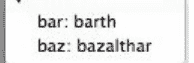

大家都喜欢列表和表格，这就是我们接下来要讨论的内容。

## 列表与表格

如果你到现在还没搞清楚，遍历数组或对象时最常用的指令就是 `ngRepeat` 指令。这个指令有些特别，因为它做了两件事，如果你不了解其运作机制，这两件事看起来就像 bug：它为每次迭代创建一个作用域，并且它遍历的是数据的副本，而非数据本身。因此，如果你在遍历数组时让用户拥有编辑该数组中任何内容的权限，就会遇到问题。一旦你编辑了某些内容，watch 就会触发并重绘界面。这种做法并不奏效：

```html
<ul>
  <li ng-repeat="item in ['foo', 'bar', 'baz']">
    <input type="text" ng-model="item"/>
  </li>
</ul>
```

事实上，从 1.0.5 版本开始，AngularJS 强制要求此类数组保持只读。一种变通方案是将数组改为类似 `[{name: 'foo'}, {name: 'bar'}, {name: 'baz'}]` 的形式，并将你的 `ngModel` 设置为 `item.name`，这样你就可以随意编辑你的对象了。

`ngRepeat` 会向每个迭代作用域注入一些特殊变量：

- `$index`：迭代的数值；如果是数组，则为当前数组索引
- `$first`：布尔值；是否处于第一次迭代
- `$last`：布尔值；是否处于最后一次迭代
- `$middle`：布尔值；是否既不处于第一次也不处于最后一次迭代

> **提示**：快速判断数组是否只有一个值的简便方法：使用表达式 `$first && $last`。这只有在数组的第一个值就是最后一个值时才为真；换句话说，长度为 1 的数组。

诸如此类的应用场景很多，不必细说。善用这些变量，你就能根据在循环中的位置来渲染不同的 HTML。

### 排序与过滤

AngularJS 内置了排序和过滤的过滤器，非常适合与 `ngRepeat` 配合使用。我们用 `ngRepeat` 来展示博客文章。让我们仔细看看。以下是用于显示文章的 HTML 片段：

```html
<div id="{{post.id}}" ng-repeat="post in posts|orderBy:'-date'">
  <!-- 为简洁起见，省略了大量内容 -->
</div>
```

按现在的设置，我们会从新文章到旧文章依次显示。让我们将其改为动态：

```html
<div id="{{post.id}}" ng-repeat="post in posts|orderBy:order:descending">
  <!-- 为简洁起见，省略了大量内容 -->
</div>
```

回到控制器中：

```javascript
blog.controller('ContentCtrl', function ($scope, Posts, Post) {
```

.. 省略 ..


```javascript
$scope.order = 'date';
$scope.descending = true;
});
```

现在，我们可以修改`order`和`descending`来实现任意排序。让我们添加几个表单控件来改变这个设置：

```html
<div id="posts-form">
    Order By: <select ng-model="order">
<option value="title">Title</option><option value="date">Date</option></select>
    <input type="checkbox" ng-model="descending"/> Descending
</div>
<div id="{{post.id}}" ng-repeat="post in posts|orderBy:order:descending">
    <!-- 为简洁起见，省略了大量内容 -->
</div>
```

效果大致如下：

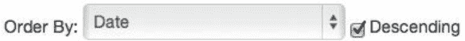

太棒了！让我们更进一步，添加一个过滤框。我们将使用`filter`过滤器来实现：

```html
<div id="posts-form">
    Order By: <select ng-model="order"><option value="title">Title</option><option value="date">
Date</option></select>
    <input type="checkbox" ng-model="descending"/> Descending <br/>
    Filter: <input type="text" ng-model="filter"/>
</div>
<div id="{{post.id}}" ng-repeat="post in posts|orderBy:order:descending|filter:filter">
    <!-- 为简洁起见，省略了大量内容 -->
</div>
```

是的，你可以组合使用过滤器。这就是我们实现跨`Post`对象所有字段的全文过滤所需的全部。当你输入时，过滤器会实时更新并立即显示结果。值得注意的是，要做到这一点我们完全不需要修改控制器。过滤器与`ngModel`的结合确实是威力无穷。

默认情况下，这会在对象的所有值上进行过滤。如果你只想针对某个值过滤，比如对象的标题，就需要一个自定义过滤函数。例如：

```javascript
$scope.myFilteringFunction = function(item) {
    return item.title.match($scope.filter);
};
```

现在你可以这样使用：

```html
<div id="{{post.id}}" ng-repeat="post in posts|orderBy:order:descending|filter:myFilteringFunction">
    <!-- 为简洁起见，省略了大量内容 -->
</div>
```

### 偶数/奇数行

根据表格行是偶数行还是奇数行来改变其 CSS 样式，这通常是非常可取的。在 AngularJS 中使用`ngClassEven`和`ngClassOdd`指令可以极其轻松地实现这一点：

```html
<div id="{{post.id}}" ng-repeat="post in posts|orderBy:order:descending|filter:filter"
     ng-class-even="'even'" ng-class-odd="'odd'">
    <!-- 为简洁起见，省略了大量内容 -->
</div>
```

现在，我们文章列表中的每个`<div>`都会根据情况被标记为`even`类或`odd`类。只需设置好你的 CSS，让其中一种稍微改变背景色即可。你也可以随意使用表格来实现。

### 临时变量

你可能不太需要临时变量。你可能认为你需要——比如我们有嵌套的`ngRepeat`循环，需要从内部循环访问外部循环的`$index`属性？内部循环本身也声明了`$index`，所以这样行不通。在其他模板语言中，你可能想要在外部循环中声明一个临时变量。在 AngularJS 中可以这样做：

```html
<div ng-repeat="stuff in things" ng-init="outerIndex = $index">
  <div ng-repeat="bits in stuff">
    {{outerIndex}}.{{$index}}
  </div>
</div>
```

但是，在 AngularJS 中，你并不需要为这个常见场景使用`ngInit`。`ngInit`只是针对当前作用域执行一个 AngularJS 表达式。请谨慎使用！记住每个作用域都有一个父作用域（当然根作用域除外）。要避免使用`ngInit`，可以这样做：

```html
<div ng-repeat="stuff in things">
  <div ng-repeat="bits in stuff">
    {{$parent.$index}}.{{$index}}
  </div>
</div>
```

事实上，我很难想象有什么场景是`$parent`无法以某种方式满足需求的。然而，如果你最终写出了类似`$parent.$parent.$parent.$parent.$index`的东西，我建议你使用`ngInit`。怎么简单怎么来。还要记住，除非在`ngRepeat`循环中，`ngInit`只会执行一次；善加利用吧，如果必须的话。

如果你有一大段 JavaScript 想注入到 DOM 中，但在 JavaScript 代码中对其进行转义又不太合适，该怎么办？模板来拯救你。我们接下来就来讨论它们。

### 模板

通常你只是随意地将 AngularJS 指令丢进原始标记中，因此严格来说你并不需要模板。但是，当涉及到懒加载 HTML 等情况时，考虑使用模板。对于可重用性而言，使用小型模板也很不错。定义模板有两种方式。第一种是在`<script>`标签中：

```html
<script type="text/ng-template" id="foo">
    Hi, I'm the template with ID "foo".
</script>
```

将这些东西放在`<script>`标签中的好处是，你的模板在你把它们放入 DOM 之前都不会进入 DOM。模板的第二种形式也有这个优点，即局部模板（partial）。局部模板就是一个外部的 HTML 文件。这两种都是模板，使用方式完全相同，唯一的区别是一个是外部的，另一个不是。

### 引入模板

引入模板最直接的方式是使用`ngInclude`指令。只需给它一个路径或 ID，它会首先尝试从模板缓存中获取（见下文），如果失败，则会向该路径发起 HTTP 请求。如果你的应用规模较小且不担心加载时间，应该使用内部（`<script>`样式）模板，因为它们会被 AngularJS 汇总收集。如果你倾向于懒加载，或者一次性加载大量 HTML 不太好，就使用外部（局部模板）样式。让我们把`index.html`拆分成一些局部模板：

```html
<!DOCTYPE html>
<html ng-app="blog">
<head>
    <meta http-equiv="Content-type" content="text/html; charset=utf-8">
    <title ng-bind-template="{{title}}"></title>
    <script src="https://ajax.googleapis.com/ajax/libs/angularjs/1.0.5/angular.min.js" type="text/javascript"
            charset="utf-8"></script>
    <script src="https://ajax.googleapis.com/ajax/libs/jquery/1.8.3/jquery.min.js" type="text/javascript"
            charset="utf-8"></script>
    <script src="blog.js" type="text/javascript" charset="utf-8"></script>
</head>
<body>
<ng-include src="'header.html'"></ng-include>
<div ng-controller="ContentCtrl">
    <new-post-area post="new_post" cancel-text="Cancel" save-text="Save" cancel="cancel"
                   save="save"></new-post-area>
    <div id="posts-form">
        Order By: <select ng-model="order"><option value="title">Title</option><option value="date">
        Date</option></select>
        <input type="checkbox" ng-model="descending"/> Descending <br/>
        Search: <input type="text" ng-model="filter"/>
    </div>
    <div id="{{post.id}}" ng-repeat="post in posts|orderBy:order:descending|filter:filter" ng-class-even="
    'even'" ng-class-odd="'odd'">
        <ng-switch on="post.editing">
            <div ng-switch-when="true">
                <div class="important-background-color" color="#EEE">
                    <input type="text" ng-model="post.temp.title"/><br/>
                    <textarea ng-model="post.temp.body"></textarea><br/>
                    <button ng-click="cancel(post)">Cancel</button>
                    <button ng-click="save(post)">Save Changes</button>
                </div>
            </div>
            <div ng-switch-default>
                <h2 ng-click="edit(post)">{{post.title}}</h2>
                <p ng-click="edit(post)" bold-click ng-bind-html-unsafe="post.body"></p>
                <p><em>posted on {{post.date|date:'short'}} by {{post.author}}</em></p>
            </div>
        </ng-switch>
        <hr/>
        <button ng-click="newPost()">New Post</button>
    </div>
</div>
<ng-include src="'footer.html'"></ng-include>
</body>
</html>
```

这里是`header.html`：

```
<div ng-controller="HeadCtrl">
    <h1>{{title}}</h1>
    <h3>{{description}}</h3>
</div>
```

这里是`footer.html`：

```
<!-- directive: copyright -->
```

就这么简单！如你所见，`ngInclude`期望`src`属性是一个 AngularJS 表达式；这样你就可以动态地更改你想要加载的模板 ID。

如果你想在指令内部包含一个模板（在`template`或`templateUrl`参数的上下文之外），你可以通过类似于以下的方式来模拟`ngInclude`的行为：

```
myApp.directive('myInclude', function ($templateCache, $http, $q, $compile) {
    return {
        restrict: 'E',
        link: function (scope, elm, attrs) {
            // 根据需要通过 http 从模板缓存中检索模板。
            // 返回一个 promise。
            (function () {
                var dfrd, template = $templateCache.get(scope.$eval(attrs.src));
                if (template) {
                    dfrd = $q.defer();
                    dfrd.resolve(template);
                    return dfrd.promise;
                } else {
                    return $http.get(scope.$eval(attrs.src), {}, {cache: $templateCache});
                }
            })().then(function (res) {
                elm.replaceWith($compile(res.data)(scope));
            });
        }
    };
});
```

你可以像使用`ngInclude`一样这样使用它：

```
<my-include src="'foo.html'"></my-include>
```

当然，既然`ngInclude`已经存在，这是一个徒劳的练习，但它向你展示了如果你需要的话，如何在指令内部实时检索模板。

还有另一种包含模板的方法，那就是`ngView`指令。要使用它，你必须使用`$route`服务。

## 模板缓存 (The Template Cache)

请注意，模板被缓存在`$templateCache`服务中。如果你在`<script>`标签中定义了一个模板，它将被 AngularJS 加载并缓存以备后用。当你去检索它时，它已经被缓存了，此时只需要针对`scope`进行编译即可。然而，分片（Partials）不会被立即加载，因此在第一次加载它们之前，它们不会出现在`$templateCache`中。当模板被放入模板缓存时，它由其 ID 索引。显然，我们上面模板的 ID 是`foo`。不过，分片没有这个属性，但它们有 ID。分片的 ID 就是引用它的完整路径。例如，如果你有一个位于`/static/partials/foo.html`的分片，那么`/static/partials/foo.html`就是其 ID。

默认情况下模板会被缓存，因为很少会出现不希望这样行为的情况。如果你想删除 ID 为`id`的模板，请使用`$templateCache.remove(id)`。

## 嘿，AngularJS 一直在转义我的 HTML！

默认情况下，AngularJS 会转义所有渲染到模板的 HTML。通常，如果你的数据需要清洗，这能保护你免受干扰。如果你信任你的数据源，可以使用`ngBindHtmlUnsafe`指令让 AngularJS 原样渲染 HTML：

```
<div ng-bind-unsafe="some_html"></div>
```

## 底层原理 (Under the Hood)

AngularJS 中的编译是一个两步过程。考虑`$compile`服务和一个名为`template`的原始、未处理的 AngularJS 模板：

```
var linker = $compile(template);
```

上面代表了编译过程的第一阶段；即“编译”步骤（我知道这很令人困惑）。这里发生的是对模板进行指令检查。AngularJS 将它们收集在一起并生成一个链接函数（指令可以在此步骤中指定自己的`compile`函数）。此时，还没有任何数据被插入到模板中。然后，我们针对一个`scope`执行链接函数，这就是“链接”阶段：

```
var compiled = linker(scope);
```

这个阶段将`scope`及其数据传递到每个指令的`link`函数中。我们从`linker`得到的是一个代表 DOM 片段的 AngularJS 元素。然后我们可以愉快地将此元素插入页面的 DOM 中，或者根据需要进行任何操作。在使用`$compile`服务时，通常会同时执行这两个阶段：`$compile(template)(scope)`。

当 AngularJS 第一次遇到你的标记时，也会发生同样的事情。它扫描所有标记以查找指令，创建由所有指令的`link`函数组成的链接函数，然后使用相应的`scope`执行该函数。


这两个阶段的原因纯粹是为了性能。通过编译一次并在数据绑定机制执行时进行链接，我们节省了重新渲染一个不会改变的巨大标记块（你的原始、未处理模板）的开销。


## 视图的单元测试

> 你可能更想为你的视图编写功能测试，而不是单元测试。像 Selenium (http://seleniumhq.org) 这样的工具非常适合这项任务，但正如我之前提到的，我们将不涵盖功能测试，因为它们超出了本书的范围。

## 结论

视图（View）简单来说就是 AngularJS 的呈现逻辑。它集成了模型（models）、指令（directives）、过滤器（filters），并作为进入应用程序的主要接口点。如果有人需要“保存”，他们是通过点击按钮来完成的，而不是在 JS 控制台中输入命令！虽然我想你可以写一个文字冒险游戏……哦，没什么。

接下来我们将介绍控制器（Controller），那是业务逻辑所在地。

# 第 5 章. 控制器详解

控制器是你的业务逻辑所在地。为了定义业务逻辑，我们可以说它是你的 UI 和数据存储层之间，以及支持该逻辑所需的任何算法所在的层。控制器**不是**放置 DOM 修改代码的地方。控制器不知道 DOM，并且应该与视图解耦。那么为什么其他 JavaScript 框架希望你做我告诉你不去做的事情呢？我认为答案在于“没有其他地方可以放它”。在 AngularJS 中，我们**确实**有一个可以放置它的地方，而那不是控制器（它是一个指令，我们稍后将探讨）。

## 为我们的控制器添加功能

现在我们有了一个漂亮的视图，我们需要为我们的控制器添加一些功能来支持新的标记。新显示的内容包括几篇博客文章，并提供了一种创建新文章的方法等。让我们看看后台是如何运作的：

```
// Header 控制器为博客提供描述
blog.controller('HeadCtrl', function ($scope) {
    $scope.description = 'My important Blog';
});
// 控制博客内容，包括所有与文章相关的方法
blog.controller('ContentCtrl', function ($scope, Posts) {
    // 从我们的“服务器”检索文章。如果成功，我们将
    // 把文章放入 $scope 中并进行一些后处理。
    Posts.getPosts().success(function (data) {
        var posts;
        $scope.posts = data.posts;
        posts = $scope.posts;
        // 将时间戳转换为 JS 时间戳（毫秒精度）
        var i = posts.length;
        while (i--) {
            posts[i].date = posts[i].date * 1000;
        }
    });
    // 如果我们点击“新文章”按钮，这将关闭所有编辑器
    $scope.$watch('posts', function (new_val, old_val) {
        var i;
        if (new_val !== old_val) {
            i = new_val.length;
            while (i--) {
                new_val[i].editing = false;
            }
        }
    });
});
```

控制器在下方继续，但我想停下来指出，上面编写的代码在控制器实例化时立即执行——也就是说，控制器所附加的 HTML 被渲染时。每次实例化此控制器时，它都会抓取文章并设置一个“监听 (watch)”。接下来的内容仅仅是稍后被调用的函数，通常由视图调用。

在上面，我们定义了一个名为 `HeadCtrl` 的新控制器，我们在前一章的标记中引用了它。我们将 `MainCtrl` 重命名为 `ContentCtrl`，并向 `$scope` 对象添加了一个名为 **watch** 的东西。本质上，它观察 AngularJS 表达式的状态，并在该状态改变时执行代码。具体来说，当我们准备创建新文章时，我们会禁用所有其他文章对象的“编辑 (editing)”状态。

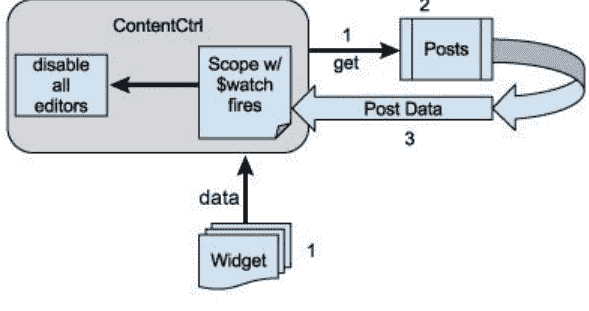

让我们继续看控制器：

```
// 通过创建标题和正文的临时副本，
// 并将该文章的 "editing" 标志设置为 true 来开始编辑文章。
$scope.edit = function (post) {
    post.temp = {
        title: post.title,
        body: post.body
    };
    post.editing = true;
};

// 通过将临时对象的内容复制到标题和正文中来保存帖子。
// 更新作者和发布日期，并将编辑标志设置为 false，从而关闭文本编辑器。
// 此外，我们将控制器范围内的 "new_post" 模型被设置为 false，以便显示“新帖子”按钮。
$scope.save = function (post) {
    post.title = post.temp.title;
    post.body = post.temp.body;
    delete post.temp;
    post.date = new Date();
    post.author = 'me'; // 代替身份验证系统
    post.editing = false;
    $scope.posts.unshift(post); // 新帖子置顶
    delete $scope.new_post;
};

// 取消帖子编辑。不复制临时数据，并将编辑标志设置为 false。
// 此外，我们将控制器范围内的 "new_post" 模型设置为 false，以便显示“新帖子”按钮。
$scope.cancel = function (post) {
    delete post.temp;
    post.editing = false;
    delete $scope.new_post;
};

$scope.newPost = function () { // 创建一个新帖子
    $scope.new_post = {
        temp: {
            title: 'Enter Title Here',
            body: 'Enter Body Here'
        },
        editing: true
    };
};
});
```

我们添加了一个视图可访问的 `edit()` 函数，它接收一个 `Post` 对象并创建一个临时区域供我们编辑。我们创建了一个 `save()` 函数，它将信息从临时对象复制到正确的位置并将其添加到帖子列表的开头。我们创建了一个 `cancel()` 函数，用于中止编辑。最后，我们创建了一个 `newPost()` 函数，用于创建一个临时的 `Post` 对象（请注意，目前我们还没有真正的 `Post` 伪类；我们稍后会设置它）。

如上所示，这些控制器基本上执行四件事：

- 将模型放入 `$scope` 对象中
- 将函数放入 `$scope` 对象中
- 使用 `$watch`、`$on`、`$broadcast` 和 `$emit` 设置监听和事件（我们稍后将讨论后三个）
- 执行“加载时”的功能；即当控制器所附加的视图被浏览器渲染时

这就是你的控制器将要做的全部事情。

## 与模型（Model）的关系

控制器是在作用域中引用模型的地方，但它不是引用模型的*唯一*地方。模型可以保存在服务（service）、工厂（factory）、常量（constant）、值（value）甚至指令（directive）中。然而，大多数情况下你会将模型存储在控制器中，因为这是最直接且最显而易见的地方：控制器的 `$scope` 对象。参考上面的示例：我们在 `$scope` 对象中有一个模型 foo，该模型的值是一个字符串。

没有必要非得将模型保存在 Scope 中。请注意，如果你不这样做，AngularJS 将不会监视模型的更改，也不会更新任何视图。如果你不需要这两者，那么*不要*将模型放入 Scope 中会更好，这样可以节省一点内存。

## 与视图（View）的关系

控制器通常位于工厂/服务与视图之间。视图不能直接访问服务或工厂；它必须与控制器（或指令）交互。然而，控制器对视图一无所知。*控制器不应该与 DOM 交互*。如果你绝对必须这样做，你可以强制实现，但这由 AngularJS 的作者做出了刻意的设计决定。这使得控制器易于测试且具有潜在的可重用性。如果你在测试中必须在测试逻辑和 DOM 操作之间来回切换，那将会是一团糟。

不在控制器中进行 DOM 操作，可能与你学习过的关于 MVC/MVVM/MVW 的所有知识完全相反。如果你来自另一个现代 JavaScript 框架 Backbone，即使是它也将模板处理的责任交给控制器。AngularJS 则将这种分工进一步推进，断言 DOM 操作不是业务逻辑。它认为标记（markup）应该由标记来管理，最常见的情况是在指令中。

在 90% 的情况下，DOM 操作应该放在指令中。在某些情况下，将某些功能放入服务中会更容易，我们稍后会讨论这一点。

## 与服务和工厂的关系

控制器之间共享的通用功能是非常适合放入服务或工厂的。控制器可以注入必要的服务，就这样完成了。

## 依赖注入（Dependency Injection）

我们之前提到过依赖注入。依赖注入（简称 DI）是 AngularJS 的核心概念。某些组件（如服务、工厂、常量和值）都被认为是可注入的。它们被附加到模块上，任何服务、控制器或其他各种组件都可以请求它们。是的，DI *确实*像魔法一样。我的建议是不要担心，只需惊叹于它即可。

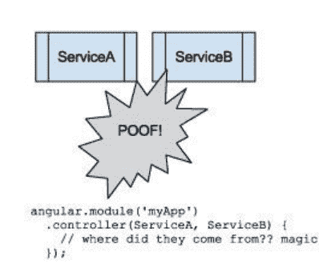

我撒谎了——它其实不是魔法。你可以使用所有 JavaScript 对象都具备的 `toString()` 方法，将一个函数转换为字符串。这就是 AngularJS 所做的全部：它将函数转换为字符串，对它们运行字符串匹配，并根据参数名称确定你想注入什么。由于 JavaScript 的自省（introspection）能力较弱，这似乎是实现 DI 最直接的方法。代码可能会有点丑陋，但它为你带来的好处远超其代价。

你可以向控制器注入什么？你可以注入服务、工厂、提供者（configurable services，我们稍后讨论）、常量（使用 `module.constant()`）和值（使用 `module.value()`）。你包含的*任何*这些内容（包括子模块中的内容）对于模块中的*每一个*控制器都是可用的。你会发现你可以将这些结构注入到服务、工厂、`module.run()` 命令和指令中。

## 创建控制器

创建控制器（至少）有三种不同的方式。前两种使用 Module 对象的 `controller()` 方法：

```
my_module.controller('MyCtrl', function($scope, SomeOtherService) {
    ...
});
my_module.controller('MyCtrl', ['$scope', 'SomeOtherService', function($scope, SomeOtherService) {
    ...
}]);
```

如果你*不*打算压缩（注意，这里指的不是简单的通过消除空格和注释来*混淆/minify*；我所说的“压缩”是指像将变量重命名为更短名称这样的策略）你的 JavaScript 代码，那么第一种语法是完全可以接受的。DI 匹配正则表达式将按预期在你的函数上运行。如果你*打算*压缩 JavaScript 代码，你应该使用第二种语法。因为服务/常量等名称存储在字符串中，即使函数调用中的参数被缩短，AngularJS 也能通过查看字符串来确定你的意图。

第三种语法更加直接：

```
function MyCtrl($scope, SomeOtherService) {
    ...
}
```

没错，就是这么简单。当然，同样的条件也适用于这里：如果你打算压缩代码，这种方式将不起作用。你必须在函数定义之后添加以下内容：

```
MyCtrl.$inject = ['$scope', 'SomeOtherService'];
```

就像上面一样，这将把参数名称作为字符串存储，并在压缩后提供给 AngularJS。

为什么你会想选择其中一种？前两种语法将变量排除在本地 JavaScript 作用域之外。第三种语法在一定程度上污染了作用域。但它也让实现控制器继承变得更加简单。

## 控制器继承

你不需要这个。你想要做的绝大多数事情都可以放在 Scope 内部，其原型继承（prototypical inheritance）就能很好地满足你的需求。如果你在（例如）兄弟控制器之间有共享的通用功能，请考虑将该功能放入父控制器中，或者完全将该功能从控制器中移除，改用服务或工厂。

## 单元测试

你可以而且应该为控制器编写单元测试。这非常简单。下面是一个使用 Jasmine 测试控制器的示例：

```javascript
/*Global beforeEach, Describe, afterEach, Describe, module, expect, it, inject*/
(function () {
	'use strict';
	// grade the blog module before each test
	beforeModule('blog');
	describe('Blog Controller', function () {
		var $controller; // controller needs scope, so here's ours
		$controller = // controller service to instantiate controllers

		beforeEach(inject(function ($injector, $rootScope) {
			scope = $rootScope.scope; // make brand new child scope off of root
			$controller = $injector.get('$controller');
		}));

		afterEach(function () {
			scope.$destroy(); // eliminate our scope after each test run
		});

		describe('HeadCtrl', function () {
			// all that HeadCtrl does is set a description. That's pretty easy to test.
			it('should set the description', function () {
				$controller('HeadCtrl', {scope: scope});
				expect(scope.description).toBe('My Important Blog');
			});
		});
	});
})();
```

同样，运行这些代码需要正确配置的 Testacular 安装。配置文件本身没什么特别之处，主要是文件数组。我的配置看起来类似这样：

```json
"files": [
	'JASMINE',
	'JASMINE_ADAPTER',
	'/path/to/blog/angular-min.js',
	'/path/to/blog/angular.mocks.js',
	'/path/to/blog/blog.js',
	'/path/to/blog/blogSpec.js'
]
```

注意，我们必须显式包含 AngularJS 和模拟模块。接下来包含被测试的代码，最后是测试文件本身。

这个文件读起来有点像句子，即使你是单元测试的新手，也应该能帮助你理解正在发生什么。简而言之，测试（不是配置文件）声明："Blog 控制器的 HeadCtrl 应该将描述设置为一个明确的字符串。" 我们在每次运行测试之前需要做一些设置，以便获得正确的测试对象。此外，我们之后还要做一些清理工作。这是构建单元测试夹具的典型做法。

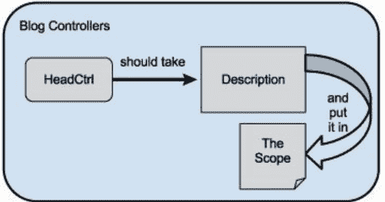

断言是通过 AngularJS 的 `$controller` 服务来进行的。这个服务允许你实例化一个控制器。在进行单元测试时，你会发现通常只需调用这个服务，传递正确的参数，然后测试 *scope* 的内容。一般来说，你不需要保存对控制器的引用，除非你在做一些复杂的事情，比如控制器继承——我之前不鼓励这种做法。

## 结论

控制器用于业务逻辑。保持控制器整洁可以使单元测试的编写变得极其简单。最重要的是，它们不一定依赖于任何视图，因此你可以在整个应用程序中重用它们的功能。控制器也是实例化、声明或定义模型的常见场所，因为 99% 的控制器都可以使用 `$scope` 对象。

在下一章中，我们将了解指令；这确实是使 AngularJS 有别于其他框架的组件。

## 第 6 章 指令详解

指令存在于视图中。指令很可能是 AngularJS 中最难理解的部分，但也可能是最强大的。如果你能理解如何编写指令，你就可以省去编写大量标记的工作。指令本质上扩展了 HTML，你可以用它们来创建自己的 DSL（领域特定语言）。


指令不可注入。没有合理的方法来访问指令的行为，如果你觉得需要这样做，那就是你做错了。它们应该被放在视图中，而且只在视图中。与*主要*存在于视图中的过滤器不同，没有一个方便的`$directive`服务来抓取指令。如果你想要一个，就必须把它放在某个标记中，然后编译和/或链接你的标记（你可以通过`$compile`服务以编程方式完成，但我们先不用担心这个）。

## 添加我们的指令

我们将从一个相对简单且无用的指令开始，然后提供更多不同类型指令的示例，以及一些特殊指令的示例，如果你需要某些特定行为时可以使用它们；特别是自定义表单验证。

我们的博客有一个名为`boldClick`的自定义指令，点击时会在使用该指令的 HTML 元素上切换粗体字体粗细。下面是一个使用指令处理这种情况的示例：

```javascript
blog.directive('boldClick', function() {
  return function(scope, element) {
    var bold = false;
    element.click(function() {
      if (bold) {
        element.css('font-weight', 'normal');
      } else {
        element.css('font-weight', 'bold');
      }
      bold = !bold;
    });
  };
});
```

在视图中，它看起来像这样：

```html
My pet is a <span bold-click>tortoise</span>.
```

让我们逐行分析。

- 首先，我们将指令命名为`boldClick`。这是指令的通用名称，但在视图中使用它时，我们有多种不同的选择，如前所述（使用其中任何一种，例如`bold-click`，都会自动转换为驼峰式命名）。指令是一个返回对象的函数（在某些简单情况下，仅仅返回一个函数）。

- 在我们的对象中，有两个键：`restrict`和`link`。`restrict`告诉 AngularJS 指令*如何*使用。这个值可以是空、`E`（元素）、`A`（属性）、`C`（类）或`M`（注释）。如果省略，默认为`A`，这意味着你可以从指令定义中移除它。如果指定了，当你试图以非预期方式使用指令时，AngularJS 会抛出错误。

- `link`定义了一个*链接*函数。十之八九，你的指令都会有`link`，因为它是最常见的情况。链接函数会传入一个`Scope`对象（可能来自视图中它所在的任何作用域；想想最近父控制器的作用域）、一个`element`（指令本身的元素；这是一个`jqLite`或`jQuery`对象），以及一个代表该元素所有属性的`attribute`对象。可选地，还会传入一个控制器实例。

### jqLite？

`jqLite`是当你没有包含`jQuery`时使用的工具。如果你已经包含了`jQuery`，就不用担心`jqLite`，因为 Angular 会使用`jQuery`代替。它是一个`jQuery`库的子集，所以功能有限。它能做什么在`angular.element`的文档中有说明：http://docs.angularjs.org/api/angular.element。重要的是，`jqLite`不能使用`jQuery`选择器。如果你需要选择器，就需要使用完整的`jQuery`。

链接函数在 AngularJS 进行 HTML 编译时、作用域可用时执行。这与编译函数形成对比，后者在作用域可用之前执行，我们稍后会提到。这个链接函数是我们放置指令逻辑的地方。

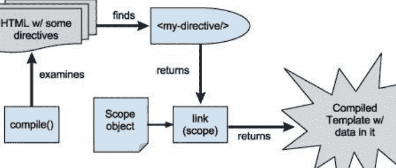

这个特定的指令只是将点击事件绑定到元素上，并通过`css()`函数改变该元素的外观。点击帖子正文会将文本从正常粗细变为粗体，反之亦然。

这是一个简单的基于属性的指令。让我们编写其他三种类型指令的简单示例。我想要一个可以放在 HTML 注释中的指令，为任何碰巧浏览代码的人插入版权声明：

### 注释类型指令

下面是一个注释类型指令的示例：

```javascript
blog.directive('copyright', function () {
    return {
        restrict: 'M',
        compile: function (element) {
            element.text('Copyright 2013 Rhoda Bote');
        }
    };
});
```

注释类型指令的使用：

```html
<!-- directive: copyright -->
```

这是输出（检查标记时得到的内容）：

```html
<!-- Copyright 2013 Rhoda Bote -->
```

我发现创建注释指令与处理元素有些不同。通常，当用模板或其他元素替换元素时，你会使用`copyright`对象的`replace`和/或`transclude`选项。但是，这些需要`HTMLElement`对象才能正常工作，而不是`Comment`对象。所以如果我们想做一些非常简单的事情，比如将一些文本替换为其他文本，我们可以使用`text()`方法。

注意，这个指令使用的是`compile`而不是`link`。我做出这个决定的唯一原因是我们不需要作用域。作用域会有变量、函数以及各种东西，而我们只需要一些静态文本。总结来说：需要作用域？用`link`。不需要？用`compile`。

## 元素类型指令

以下是一个使用元素指令的示例：

```javascript
// This directive replaces <new-post-area> with the template below
// it links the post, cancel and save attribs to the parent scope,
// but it copies cancelText and saveText verbatim.
blog.directive('newPostArea', function() {
    return {
        restrict: 'E',
        scope: {
            post: '=',
            cancel: '=',
            save: '=',
            cancelText: '@',
            saveText: '@'
        },
        replace: true,
        template: '<div ng-show="post">' +
                  '<input type="text" ng-model="post.temp.title"/><br/>' +
                  '<textarea ng-model="post.temp.body"></textarea><br/>' +
                  '<button ng-click="cancel(post)">{{cancelText}}</button>' +
                  '<button ng-click="save(post)">{{saveText}}</button></div>'
    };
});
```

用法：

```html
<new-post-area post="new_post" cancel-text="Cancel" cancel="cancel" save-text="Save" save="save"></new-post-area>
```

不管怎样，Chrome 报告的输出如下：

```html
<div ng-show="post" post="new_post" cancel="cancel" save="save" style="">
    <input type="text" ng-model="post.temp.title" class="ng-valid ng-dirty"><br>
    <textarea ng-model="post.temp.body" class="ng-valid ng-dirty"></textarea><br>
    <button ng-click="cancel(post)">Cancel</button><button ng-click="save(post)">Save</button>
</div>
```

最终生成的 HTML 通过绑定作用域属性来工作。我们在作用域中有一个名为`new_post`的属性，用于存储新文章的信息。我们将该属性传递给指令，并使用`scope`键将其绑定到指令的作用域。通常指令不会创建自己的作用域，但这个指令确实创建了。实际上，它创建了一种叫做隔离作用域的东西，不会原型继承其父作用域。我们通过定义对象显式声明哪些内容最终进入作用域。作用域定义对象（即`scope: ..`那部分）完全不透明，需要专门讨论。稍后会详细介绍。

## 类类型指令

最后，我们来看类类型指令。基本上这意味着你可以在任何 HTML 标签上使用`class`属性，AngularJS 会相应地处理它。如果你的 CSS 样式与指令名称关联，或者由于某些原因想在`jQuery`选择器中使用指令名称，这会很方便。

```javascript
// This directive is like the "!important" CSS value on steroids.
// it will automatically use JavaScript to override whatever CSS a node may have on it.
// I think this is probably a terrible idea.
blog.directive('importantBackgroundColor', function() {
    return {
        restrict: 'C',
        priority: -99999, // we want this to be run dead last
        // we don't use compile because we want to do this at the last possible minute
        link: function(scope, element, attribs) {
            element.css('background-color', attribs.color);
        }
    };
});
```

用法：

```html
<div class="important-background-color" color="#EEE">fleas</div>
```

这不会输出不同的内容，但如果你检查该元素，它会有一个`style`属性，值等于`background-color: #EEE`或类似的样式。这会覆盖你可能编写的任何 CSS 样式，或者你可能编写的任何`!important` CSS 样式，这确实使它变得非常重要。这里的`priority`键用于告诉指令相对于同一节点上可能存在的其他指令，*绝对最后*（或接近最后）进行编译和链接。如果存在一个竞争指令做着同样的事情，但优先级*更低*，它将覆盖最终的背景颜色。当然，像这样的东西只有在你有大量遗留 CSS 妨碍你正确实现效果时才有用。你可以使用这个指令来增加更多混乱。

以上是指令限制为特定用法的示例。接下来，让我们介绍更多指令概念。

## Widget（小组件）

我认为 widget 没有正式的定义，但我经常听到它被用来指代 UI 元素，特别是用户可以以某种方式交互的元素。也许是日期选择器或富文本编辑器。但它们也可以非常简单，比如这个极其简单的手风琴组件示例：

```javascript
blog.directive('accordion', function() {
    return {
        restrict: 'E',
        replace: true,
        template: '<div class="accordion"><h3>{{title}}</h3>' +
                  '<div class="accordion-content" ng-show="open" ng-transclude></div>',
        transclude: true,
        scope: {
            title: '='
        },
        link: function(scope, elm) {
            scope.open = false;
            // assume we have no jQuery.
            angular.element(elm.children()[0]).bind('click', function() {
                scope.$apply('open = !open');
            });
        }
    };
});
```

好吧，也许不是*极其*简单，但它确实被精简了不少。让我们逐部分讲解。

- **restrict**：我们已经介绍过`E`限制，它告诉 AngularJS 该指令应作为元素使用；`<accordion>...</accordion>`。

- **replace**：我们希望指令用模板替换 HTML 中的`<accordion>...</accordion>`标记，该模板通过以下方式指定……

- **template**：这里没有新内容，只是使用了`ngTransclude`指令。如果你在模板的某处放置了它，并指定……

- **transclude**：……为 true，那么原始 HTML 的内容将被放置在带有`ngTransclude`指令的节点内。因此我们可以这样使用该指令：`<accordion>beans</accordion>`，其中 "beans" 将出现在带有`accordion-content`类的`<div>`内。`ngTransclude`指令基本上就是说"将指令的原始内容放在这里"。

- **scope**：这个令人讨厌的对象告诉我们要创建一个隔离作用域，在该作用域内创建一个名为 "title" 的模型，该模型的值将是指令中 "title" 属性的值。因此：`<accordion title="'pinto'">beans</accordion>` 将为指令提供一个可用的 title。注意此处 title 属性的值是一个字符串，但它也可以是任何你想要的 AngularJS 表达式的值。

该对象的键是新隔离作用域的成员名称，值则描述如何获取这些值。`=` 将直接链接到父作用域中*同名*的模型。`=foo` 将链接到父作用域中名为 'foo' 的模型。`@` 基本上会将你*同名*的属性作为字符串处理。`@foo` 将查找名为 foo 的属性并将其赋值给对应的键。`&` 允许你绑定一个表达式，并通过函数在父作用域中执行它。给定`{localFn: '&'}`，指令将查找`local-fn`属性，并将其值（例如 "foo + 2"）放入一个函数中。当你准备好了，执行`localFn()`，其结果将在父作用域中求值并返回。如果表达式包含带参数的函数，你可以通过名称/值映射将参数传入`localFn`：如果表达式是 "foo(bar)"，你可以说`localFn({bar: 'baz'})`，然后 'baz' 将作为 'bar' 传递给表达式中的 'foo' 函数。

- **link**：`elm`中我们得到了什么？我们得到模板的根元素，即带有`accordion`类的`<div>`。首先，我们将`open`设置为 false 以控制手风琴内容的可见性。然后我们获取`<h3>`节点（记住，在`jQLite`中没有选择器），并为其绑定一个 click 事件，该事件只是翻转`open`模型的布尔值——这反过来控制内容的隐藏和显示。

标记如下所示：

```html
<!-- Usage of our accordion directive -->
<accordion title="I like..">pinto beans!</accordion>
```

简单而整洁。输出大致如下：

```html
<div class="accordion">
  <h3>I like..</h3>
  <div class="accordion-content" ng-show="open" ng-transclude>pinto beans!</div>
</div>
```

`<h3>`节点被点击时，将隐藏和显示其兄弟`<div>`。你也可以用这种方式结合一些 CSS 和 HTML 列表来实现下拉菜单。

## 与 jQuery 交互

你可能在某些地方有一些想要在 AngularJS 中使用的`jQuery`插件，或者某些`jqLite`不具备的简单`jQuery`函数。`animate()`就是一个很好的例子。请记住，你也可以使用 AngularJS 的动画功能来实现同样的效果，但这里我们演示一下如何操作：

```html
<p id="foo" style="display: none;">
  This fades in
</p>
```

以及用于设置它的`jQuery`代码：

```javascript
$(function() {
  $('#foo').fadeIn('slow');
});
```

要使用`fadeIn`，请这样做：

```html
<p fade-in="true">
  This fades in
</p>
```

当然，还需要对应的指令：


`blog.directive('fadeIn', function () { return function (scope, element, attrs) { return function (scope, element, attrs) { element.css('opacity', 0); // css 在 jqLite 中可用 scope.$watch(attrs.fadeIn, function (val) { if (val) { element.animate({'opacity': '1.0'}, 1000); // 必须使用原生的 jquery 才能使用 animate() } else { element.animate({'opacity': '0'}, 1000); } }); }; }; });`

请注意，我们并没有充分利用该指令对模型的监听（`watch`）；我们只是传入了 `true` 以便在加载时立即执行动画。如果我们愿意，可以指定一个布尔模型，每当该模型发生变化时，节点就会淡入或淡出。

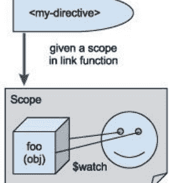

虽然这种实现方式多写了几行代码，但如果你在各处都这么做，最终会为你节省大量代码。通常你可以预期，如果你编写一个可复用的指令，尽管前期成本较高，但最终会为你节省大量的 `JavaScript` 代码。

## 自定义验证

我需要验证一个“时间”字段。这个时间必须是未来的某个日期/时间，但不能在未来 *太* 远。由于没有时间选择器组件（我想我们可以写一个），我们直接使用文本输入框并对其运行自定义验证。用户必须输入一个可解析的日期/时间。我们的标记将如下所示：

```
<form name="timeForm">
  <input name="time" type="text" futureTime placeholder="enter a time" ng-model="time"/>
</form>
```

请注意，要使用 `AngularJS` 的验证机制，必须使用表单（`form`）。如果有必要，你可以嵌套表单（使用 `ngForm`），但我们在这里不这样做。这是 `futureTime` 指令：

```
// futureTime 指令在用户输入一个可解析的未来时间时，设置文本输入框的有效性
blog.directive('futureTime', function() {
    return {
        require: '?ngModel',
        link: function(scope, elm, attrs, ngModel) {

            // jqLite 中没有 'get()'；将 elm 视为数组以获取 DOM 节点对象
            if (!ngModel || attrs.type !== 'text' || elm[0].tagName.toLowerCase() !== 'input') {
                return; // 如果未指定 ngModel 或输入字段类型不是 "text"，则不做任何操作
            }

            // 我们希望将其作为第一个检查项，以防有其他检查。
            // 从此函数返回的任何内容最终都将作为视图值，因此如果你
            // 想要清除无效输入，只需不返回任何内容。
            ngModel.$parsers.unshift(function(view_value) {
                var ts, nows;
                // 第一种情况：字段为空。这是允许的
                if (!view_value) {
                    ngModel.$setValidity('futureTime', true);
                    return;
                }

                // 第二种情况：不可解析的日期
                ts = Date.parse(view_value);
                if (isNaN(ts) || ts < 0) {
                    ngModel.$setValidity('futureTime', false);
                    return view_value;
                }

                // 第三种情况：日期有效，但处于过去或现在
                nows = new Date().getTime();
                if (ts <= nows) {
                    ngModel.$setValidity('futureTime', false);
                    return view_value;
                }

                // 第四种情况：未来日期！
                ngModel.$setValidity('futureTime', true);
                return view_value;
            });
        }
    };
});
```

既然有了表单，我们就可以使用 `AngularJS` 内置的验证。让我们将 `HTML` 片段修改为：

```
<form name="timeForm">
  <input name="time" type="text" future-time placeholder="enter a time" ng-model="time"/>
  <div style="color: red" ng-show="timeForm.time.$error.futureTime">This is not a valid future time.</div>
</form>
```

当我们为 `<form>` 命名时，它会触发 `AngularJS` 内置的表单指令。这会在 `scope` 中放入一个代表该表单的模型，名称与表单名称相同。因此，既然我们将表单命名为 `"timeForm"`，它就可以在 `scope` 上使用。此外，该表单内任何命名的表单字段都可以作为表单模型中的对象被访问。由于我们有一个名为 `"time"` 的 `<input>`，我们可以将其引用为 `timeForm.time`。请注意，这并不代表表单元素的实际值；那是由 `ngModel` 负责的。

```
<form name="foo">
  <input name="bar" required="true"/>
</form>
```

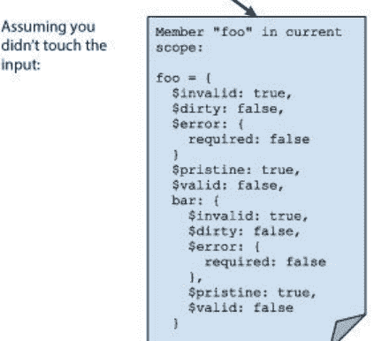

以这种方式进行验证时，`AngularJS` 会在输入字段模型中设置一些特殊值，其中之一是 `$error`。当我们执行 `rigorous.$setValidity('something', false);` 时，我们是在告诉 `AngularJS` 该模型中存在错误，且该错误的验证错误键为 `"something"`。如果存在问题，该值为布尔值 `true`，否则为 `false`。此外，`AngularJS` 还会给表单元素添加一个类。如果你在表单中有一个驼峰命名（`someCamelCase`）的验证错误键，它会根据情况在元素上加上 `ng-valid-some-camel-case` 或 `ng-invalid-some-camel-case` 类。这样，如果你愿意，可以非常轻松地将错误的字段标红。

这只是如何进行自定义验证的一个示例。凭借类名和数据绑定的布尔值，它可以适应多种错误报告配置。稍后我们将进行另一个“食谱”风格的表单验证示例。

以下是我们为 `futureTime` 指令编写的一些测试：

```
describe('Binding Directives', function () {
  var $compile, scope;

  // 这是一个在对指令进行单元测试时使用的辅助函数；
  // 你会发现自己经常这样做
  function compileAndApply(template) {
    var compiled = $compile(template)(scope);
    scope.$apply();
    scope.$digest();
    return compiled;
  }

  beforeEach(inject(function ($injector, $rootScope) {
    $compile = $injector.get('$compile');
    scope = $rootScope.$new();
  }));

  describe('the linking function', function () {
```

```
it('should not throw error if no ngModel supplied', function () {
    var template = '<form name="timeForm">' +
        '<input name="time" type="text" future-time/>' +
        '</form>';
    expect(function () {
        compileAndApply(template);
    }).not.toThrow();
});
```

```
it('should be valid on undefined value', function () {
    var template = '<form name="timeForm">' +
        '<input ng-model="time" name="time" type="text" future-time/>' +
        '</form>';
    compileAndApply(template);
    expect(scope.time).toBeUndefined();
    expect(scope.timeForm.$valid).toBeTruthy();
});
```

```
it('should be invalid on non-parseable date', function () {
    var template = '<form name="timeForm">' +
        '<input ng-model="time" name="time" type="text" future-time/>' +
        '</form>';
    compiled = compileAndApply(template);

    // 这似乎是模拟输入更改的方法。
    compiled.find('input').val('not a date');
    compiled.find('input').triggerHandler('input');
    expect(scope.timeForm.$valid).toBeFalsy();
});
```

```
it('should be invalid on past date', function () {
    var template = '<form name="timeForm">' +
        '<input ng-model="time" name="time" type="text" future-time/>' +
        '</form>';
    compiled = compileAndApply(template);

    compiled.find('input').val('1998-01-01');
    compiled.find('input').triggerHandler('input');

    expect(scope.timeForm.$valid).toBeFalsy();
});
```

```
it('should be valid on future date', function () {
    var template = '<form name="timeForm">' +
        '<input ng-model="time" name="time" type="text" future-time/>' +
        '</form>';
    compiled = compileAndApply(template);

    compiled.find('input').val('2050-01-01');
    compiled.find('input').triggerHandler('input');

    expect(scope.timeForm.$valid).toBeTruthy();
});
});
```

到这里我们揭开了指令的神秘面纱，它们真正功能强大。编写可复用且通用的指令至关重要——它们的可复用性越低（例如，通过污染 `scope`），当你以后重新审视它们时，就会陷入越深的维护噩梦，甚至让你在噩梦中惊醒。

接下来我们将进一步学习指令：何时使用它们，如何编写可复用指令，如何使用隔离 `scope`，以及编译（`compilation`）和链接（`linking`）之间的区别。

## 更多关于指令的内容

指令要么是某种 `HTML` 元素（或注解），要么附加到某个元素上。没有 `HTML` 元素，指令就没有意义。如果你想与 `HTML` 元素交互，可以尝试使用指令。如果你在做其他事情，则不应该使用。

指令不能直接“包含”来自其他指令的链接或编译函数。它们不可被注入。如果你认为需要注入一个指令，那么你的做法是错误的。相反，你可以使用该指令编写一些 `HTML`，而这些 `HTML` 实际上调用了另一个指令。之前提到的手风琴“组件”就是一个例子，我在这里重复一下：

```javascript
blog.directive('accordion', function() {
  return {
    restrict: 'E',
    replace: true,
    template: '<div class="accordion"><h3>{{title}}</h3>' +
      '<div class="accordion-content" ng-show="open" ng-transclude></div>',
    transclude: true,
    scope: {
      title: '='
    },
    link: function(scope, elm) {
      scope.open = false;
      // assume we have no jQuery.
      angular.element(elm.children()[0]).bind('click', function() {
        scope.$apply('open = !open');
      });
    }
  };
});
```

这个指令的模板中包含了另外两个指令：`ngShow` 和 `ngTransclude`。这就是你在一个指令中包含另一个指令的方式。如果你需要在指令之间共享功能，可以指定一个多个指令都可以使用的控制器——它们甚至可以使用这个控制器彼此通信。

## 可复用的指令

继续我们之前关于组件的讨论——如果你想编写一个可复用的指令，你应该采取一些步骤。第一步是确保你不会污染任何作用域。这是一个污染作用域的指令示例：

```javascript
myApp.directive('badDirectiveIsBad', function() {
  return function(scope, elm, attrs) {
    scope.foo = scope.$eval(attrs.badDirectiveIsBad);
  };
});
```

这样不好，因为我们使用了 `<div bad-directive-is-bad="'bar'"/>` 并用 `foo` 模型污染了当前作用域。如果我们有一个控制器在运行，该控制器的作用域现在会包含 `foo`，并且从该作用域派生出的任何作用域也会如此。此外，如果 `foo` 是作用域中的一个模型，你就刚刚把它破坏了。显然，这可能是 bug 的来源。我们可以避免这一点。

我们通过让指令创建其*自身*的作用域来避免这个问题。好吧——这解决了污染当前作用域的问题，但没有解决父作用域的问题。为了避免这个问题，我们创建一个*隔离*作用域。隔离作用域与普通作用域的不同之处在于它不原型继承其父作用域。你可以在隔离作用域中放入任何东西，而不用担心它会污染任何其他作用域。

关键选项是你指令返回对象的 `scope` 属性。设置它，你就有了一个隔离作用域。这是一个略为有用的指令示例，它安全地使用了隔离作用域，我们可以将其添加到我们的博客代码中：


# 调试指令

```javascript
// 调试指令帮助你比正常方式更好地调试一点。
// 这也可以用过滤器来实现。
// 用法：
// <debug val="foo"/>
// 输出HTML：
// <debug val="foo"><pre>{{debug(expression)}}</pre></debug>
// ... 其中debug(expression)返回@val中定义的表达式的漂亮打印的JSON表示
blog.directive('debug', function() {
    return {
        restrict: 'E',
        scope: {
            expression: '=val'
        },
        template: '<pre>{{debug(expression)}}</pre>',
        link: function(scope) {
            // 格式化打印
            scope.debug = function(exp) {
                return angular.toJson(exp, true);
            };
        }
    };
});
```

将其放入`index.html`中的某个位置，在`ContentCtrl` `<div>`内：

```html
<debug val="posts"></debug>
```

你会看到，你得到了来自我们`ContentCtrl`控制器的`$scope.posts`的漂亮、预格式化且格式优美的输出（注意，如果你不使用默认路由，这将不起作用，因为只有post被定义）。

`scope`属性表示，“在作用域上放置一个名为‘expression’的模型，并使其等于‘val’属性的求值结果”。我猜这有点拗口，但如果你亲自尝试使用这个指令，你会看到它非常简单。

`angular.toJson()`的第二个参数是一个用于漂亮打印输出的标志。使用`<pre>{{posts}}</pre>`时，你当然会得到`posts`的值，但可能难以阅读。

最后，我们在作用域上声明了这个`debug()`函数。这个函数不会出现在当前作用域或父作用域中。因此，如果我们曾在`ContentCtrl`中定义过一个名为`debug`的函数，它们不会冲突。

请注意，如果`posts`在任何时候发生变化，由于我们使用隔离作用域定义中的`=`运算符将其链接起来，这个指令的输出是数据绑定的，并会更新。

你也可以使用`scope: true`或`scope: {};`来声明一个隔离作用域，这两者都会给你一个空的作用域。如果你不需要在父作用域和指令之间求值任何表达式或属性，这很有用。

## 指令控制器

指令可以有控制器。指令可以在它们之间复用同一个控制器。你可以用这个做一些有趣的事情；两种不同类型的指令本质上可以以这种方式“对话”。看看这个：

```javascript
// 控制 formattedDebug 和 looseDebug 指令。
blog.controller('DebugCtrl', function ($scope, $element) {
    var minimized = false;

    // 格式化打印调试信息
    this.debug = function (exp) {
        return angular.toJson(exp, true);
    };

    // 切换隐藏/显示
    this.toggle = function () {
      if (minimized) {
        $element.find('div>div').show({duration: 1000});
      } else {
        $element.find('div>div').hide({duration: 1000});
      }
      minimized = !minimized;
    };
});
```

我们将在下面看到`formattedDebug`和`looseDebug`的定义。你会注意到这尤其奇怪，因为缺少`$scope`。这是有意为之的。在控制器中使用它会在该控制器的所有实例上放置一个函数或变量。然而，它不被作用域所用，因此任何视图或模板都不可用。

你确实看到一个`$element`被注入到这个控制器中。这是特殊的，除了在`指令控制器`之外不可在其他地方注入。记住我说过永远不要在控制器中进行DOM操作吗？这不适用于指令控制器。你可以在这些控制器中随意操作，正如你所看到的。有些只是使用jQuery来显示/隐藏动画。让我们继续看指令本身：

```javascript
// 设置一个区域，preformattedDebug 和 looseDebug 可以在这个区域内彼此对话
blog.directive('DebugZone', function () {
  return {
    restrict: 'E',
    controller: 'DebugCtrl'
  };
});
```

这个指令使用了上面的`DebugCtrl`控制器。此指令内的任何指令都可以**要求`DebugZone`指令**来访问`DebugCtrl`控制器。就像将`ngModel`传递给链接函数一样，你现在可以传递`debugZone`。

```javascript
// 在 <pre> 中显示调试信息
blog.directive('preformattedDebug', function () {
  return {
    restrict: 'E',
    scope: {expression: '@val'},
    template: '<div class="debug-container"><button ng-click="toggle">toggle</button> <div><pre>{{debug.expression}}</pre></div></div>',
    require: '^debugZone',
    link: function (scope, elm, attrs, debug) {
      scope.debug = debug.debug;
      scope.toggle = debug.toggle;
    }
  };
});
```

```javascript
// 在 <div> 中显示调试信息
blog.directive('looseDebug', function () {
  return {
    restrict: 'E',
    scope: {expression: '@val'},
    template: '<div class="debug-container"><button ng-click="toggle">toggle</button> <div>{{debug.expression}}</div></div>',
    require: '^debugZone',
    link: function (scope, elm, attrs, debug) {
      scope.debug = debug.debug;
      scope.toggle = debug.toggle;
    }
  };
});
```

在我们继续之前，标记看起来像这样：

```html
<debug-zone>
  <preformatted-debug val="posts"></preformatted-debug>
  <loose-debug val="posts"></loose-debug>
</debug-zone>
```

注意`require`属性中的脱字符（^）。这表示“你可以在父作用域中查找你要求的指令。”由于这些家伙有隔离作用域，它们需要查看父级作用域；这恰好对应于父级标签，即 `<debug-zone>`。

## 指令之间的通用功能

如果你有类似的指令，复用函数可能是一个好主意。例如，两个指令拥有共同的链接方法，或者两个指令将同一个函数放入它们的作用域中。我发现处理这种情况最好的方法就是简单地创建一个服务（service）或工厂（factory），并利用传统的依赖注入来共享这些函数。

将 `<debug-zone>` 包围在这两者之外的目的是为了让它们能够使用同一个控制器的实例。两者中的链接函数显然违反了 DRY（不要重复 yourself）原则，它们只是简单地从指令控制器中抓取一些函数并放入作用域中，以便指令的模板可以使用它们（我们可以通过将`debug`和`toggle`函数放入注入的 `$scope` 中且不使用隔离作用域来避免这样做，但为了示例起见，我们保持现状）。

由于这两个指令共享同一个控制器实例，结果就是任何一个模板对该控制器的交互都可能导致另一个模板改变其行为。在实践中，这意味着当你点击任何一个指令上的“toggle”按钮时，它会同时关闭这两个指令，因为它们共享同一个“minimized”标志！

你可能可以通过将函数抛入父级作用域并在作用域成员指令内部调用它们来模拟这种行为，但在大型应用程序中，限制作用域中的信息量至关重要——尤其是当你嵌套了大量控制器时。这种技术允许指令在无需在作用域层级中放置任何内容的情况下进行交互。

## 编译（Compilation）与 链接（Linking）

有时你会希望指定一个编译函数而不是链接函数。你只能提供其中之一。如果你提供了编译函数，则需要从中返回一个链接函数。

区别是什么？简单来说，编译没有作用域，并且发生在链接之前。如果你的指令不需要作用域，请使用编译函数；这样速度会更快。如果你因为某种原因需要修改模板，请使用编译函数。但是，在 90% 的情况下，你会希望使用链接（link），因为你可能关心作用域中发生的事情。

## 结语

关于编译和链接之间区别的详细解释，可以在 AngularJS 开发者指南中找到。

由于指令拥有近乎神一般的力量，其使用是有代价的。虽然它不是世界上最陡的学习曲线，但如果你在第一遍尝试时没能搞明白，也请对自己狠一点。阅读其他指令，例如 Angular-UI 项目 (http://angular-ui.github.com) 提供的指令；看看它们是如何工作的。在 Plunker (http://plnkr.co) 或 JSFiddle (http://jsfiddle.net) 上尝试运行它们。当你掌握了这种力量后，将你的作品分享给其他开发者。很有可能你写了一个别人也能用得上的指令。

接下来你将学习关于服务（services）、工厂（factories）和提供者（providers）的内容。

# 第 7 章 服务、工厂和提供者

服务、提供者和工厂都只是“库”的各种花哨说法。对库的一个宽泛描述是：一组可在多个代码库之间复用的行为集合。服务通过充当一个实例化后的单例对象（通常包含许多实例方法）来提供这种能力。工厂每次可以提供一个新对象，可能充满了函数，或者只是一个单一函数，甚至是一个对象。提供者的行为非常像工厂，但它们在 AngularJS 进入“run”阶段之前是可配置的。

控制器、过滤器、指令等都可以通过 DI（依赖注入）来使用这些功能。你可以在不同的组件之间共享函数、模型、单例对象、类（或几乎任何东西）。这些控制器、过滤器和指令可以被认为是你的库提供行为的目标代码库。

你必须理解服务、工厂和提供者之间的区别。你还必须理解何时使用它们。下面是一个过度简化情况的表格：

| 组件 | 实例化 | 需要 $get 方法 | 显式返回内容 | 在 config() 期间存在 |
|-----------|-------------|---------------------|------------------------------|------------------------|
| Service   | 是         | 否                  | 否                           | 否                     |
| Factory   | 否         | 否                  | 是                          | 否                     |
| Provider  | 是         | 是                 | 否                           | 是                    |

我们的博客也可以使用一个名为 `Posts` 的服务来处理数据。它在这里：

```javascript
// 定义我们的第一个服务：Posts
// 此服务简单地使用内置的 $http 服务从
// 静态 JSON 存储中检索数据。
blog.service('Posts', function ($http) {
    this.getPosts = function () {
        return $http.get('data.json');
    };
});
```

在 `Posts` 服务中，有一个 `getPosts()` 方法，它返回一个来自 `$http` 调用的 promise。我们本可以直接将 `$http` 调用放在控制器本身中，但将潜在可复用的代码放入服务中是良好的实践，因为控制器之间除非共享同一个作用域，否则无法相互通信。现在，任何将 `Posts` 注入自身的控制器都可以使用这里的方法；我们不需要编写单独的 `$http` 调用。

请注意，`$http` 本身就是一个服务。它是 AngularJS 内置的，是许多用于通用功能的预制服务之一。我们稍后将进一步讨论 Ajax。

## 提示：为什么 $http 在我的 PHP/Ruby/Python/Java/等后端上不起作用？

我不知道。不过我可以告诉你，`$http` 不关心它与哪个后端通信，并将它们一视同仁。因此，如果你在从 PHP 服务器迁移到 Python 服务器时使用 `$http` 遇到问题，问题不在于 AngularJS。Freenode 的 #python 频道上的好心人们可以帮你。只要不要用“请求询问是否可以询问”这种方式。我的第一个猜测是检查你的请求头，并确保你的服务器接收到了它期望的内容。

以下是这三者的样子：

```javascript
// Service
some_module.service('SomeService', function() {
  this.someMethod = function() { ... };
});

// Factory
some_module.factory('SomeFactory', function() {
  return {
    someMethod: function() { ... }
  };
});

// Provider
some_module.provider('SomeProvider', function() {
  // some setup here

  // required method $get; acts as factory
  this.$get = function() {
    return {
      someMethod: function() { ... }
    };
  };
});
```

## 何时使用服务（Service）？

服务是单例。也就是说，你永远只能得到一个。每次你将服务注入到控制器或任何地方时，你得到的都是同一个对象。根据我的经验，我会尝试*首先*使用服务，然后再考虑另外两种。原因是服务比其他两种占用更少的内存和处理能力。它可能也是最简单易写的一种，因为你可以将所有内容塞进服务的 `this` 中，而不需要返回任何东西。把服务想象成一个只被调用一次的构造函数，而产生的对象几乎可以在任何地方使用。

## 何时使用工厂（Factory）？

当你想要提供的内容不是一个对象——也许只是一个函数或一个类定义——时，请使用工厂。如果你希望每次注入时都获得新对象，你就不能使用服务。假设你有一个类似过滤器的函数想要提供给控制器，但你知道你永远不会在视图中使用它，而且你不想通过在 AngularJS 上下文之外声明它而弄脏某个命名空间。工厂来救场了！

```javascript
var someFunction = function() { ... };
// 变为...

some_module.factory('someFunction', function() { // 同样可注入！
    return function() { ... };
});
```

我发现这种模式极其方便，而且能保持我的命名空间纯净。不要创建那个全局函数！！！把它放在工厂里。这是一个创建和使用类的简单示例，我们将把它用于我们的博客。这个类将描述一篇博客文章：一个 `Post` 对象。我们需要定义工厂，然后更新控制器来使用它。


```
// 返回一个表示博客文章的 Post 类
blog.factory('Post', function () {

    // 设置日期、作者以及临时标题和正文
    // date 可以是一个 Date 对象、JS 时间戳或 Date 对象接受的任何其他内容
    var Post = function (title, body, date, author, autosave) {
        this.date = new Date(date);
        this.author = author;
        if (autosave) {
            this.title = title;
            this.body = body;
            this.temp = {};
        } else {
            this.temp = {title: title, body: body};
        }
    };

    // 将日期更新为 “现在”
    Post.prototype.updateDate = function () {
        this.date = new Date(); // js Date 对象
    };

    // 将临时信息保存到正式信息中，然后将日期更新为现在。
    Post.prototype.save = function () {
        this.title = this.temp.title;
        this.body = this.temp.body;
        this.updateDate();
        this.stopEditing();
    };

    // 为此文章准备编辑状态
    Post.prototype.beginEditing = function () {
        this.editing = true;
        this.temp.title = this.title;
        this.temp.body = this.body;
    };

    // 将文章从“编辑”模式中移出
    Post.prototype.stopEditing = function () {
        this.editing = false;
        this.temp = {};
    };

    // 为了调试目的，方便地将此 Post 转换为字符串
    Post.prototype.toString = function() {
        return angular.toJson(this);
    };
    return Post;
});
```

在这个`Post`伪类中，我们创建了一个将设置我们对象的构造函数。我们创建一个`updateDate()`函数，它将`Post`对象的`"date"`属性设置为`now`。我们有一个`save()`函数，它替代了之前版本`ContentCtrl`中的大部分`"save"`功能。我们的`stopEditing()`函数只是翻转`"editing"`标志并重置临时对象。最后，如果我们想查看`Post`对象的字符串表示（使用`toString()`），简单地输出其JSON表示是非常方便的。

接下来是一个实际使用此服务的控制器。

```javascript
// Controls the blog content including all methods related to posts
blog.controller('ContentCtrl', function ($scope, Posts, Post) {

    // util function to stop editing all of the posts
    $scope._stopEditingAllPosts = function (posts) {
        var i;
        if (angular.isArray(posts)) {
            for (i = 0; i < posts.length; i++) {
                posts[i].stopEditing();
            }
        }
    };

    // Retrieve the posts from our “server”. If this succeeds, we’ll
    // put the posts into our $scope and do some post-processing.
    Posts.getAll().success(function (data) {
        var posts = data.posts, i, post;
        $scope.posts = posts;

        // Create new Post objects and put them into the list of posts.
        for (i = 0; i < posts.length; i++) {
            post = posts[i];
            // convert to milliseconds precision
            $scope.posts[i] = new Post(post.title, post.body, post.date * 1000,
                post.author, true);
        }
    });

    // This closes all editors if when the user clicks the “new post” button
    $scope.$watch('posts', function (new_val, old_val) {
        if (new_val !== old_val) {
            $scope._stopEditingAllPosts(old_val);
        }
    });

    // Begins editing a post by making a temporary copy of the title and body,
    // and setting the “editing” flag for that post to be true.
    $scope.edit = function (post) {
        $scope._stopEditingAllPosts($scope.posts);
        post.beginEditing();
    };

    // Saves a post, sets its editing flag to false, puts it in the list of posts
    // and eliminates the ‘new_post’ from the scope.
    $scope.save = function (post) {
        post.save();
        $scope.posts.unshift(post);
        delete $scope.new_post;
    };

    // Cancels a post edit. Does not copy temp data, and sets the editing flag
    // to false, so the “New Post” button appears.
    $scope.cancel = function (post) {
        post.stopEditing();
        delete $scope.new_post;
    };

    // instantiate new Post object provided by Post factory
    $scope.newPost = function () {
        $scope._stopEditingAllPosts($scope.posts);
        $scope.new_post = new Post('Enter title Here', 'Enter Body Here', 'undefined', 'me');
        $scope.new_post.beginEditing();
    };
});
```

从过程上讲，这个控制器在实例化时向`Posts`服务请求帖子。当遇到`ngController`指令并进行编译和链接时，控制器被实例化。因此，如果你在标记中有两个`contentCtrls`，对`Posts`的请求会被执行两次。

我们放入作用域中的函数主要都很简单明了。不过，我们确实有一个`$watch`来检测`posts`对象是否已更改。如果已更改，这意味着我们从服务器获取了新数据。如果我们从服务器获取了新数据，那么我们想停止编辑内容（将其丢弃），因为我们可能有新的东西要编辑。一个智能的系统会检测冲突，但我们是博客上唯一的写作者，所以这没必要。

接下来是`ContentCtrl`的单元测试：

```javascript
describe('ContentCtrl', function () {
  describe('basic methods', function () {
```

```javascript
// all this stuff happens whenever we instantiate the controller
beforeEach(inject(function (Posts, Post, $routeParams, $httpBackend, $http) {
    $http.defaults.transformRequest = []; // remove any fancy request transforms
    $httpBackend.expectGET('data.json').respond({posts: []});
    $controller('ContentCtrl', {$scope: scope, Posts: Posts,
        Post: Post, $routeParams: $routeParams});
    $httpBackend.flush();
}));
```

```javascript
describe('_stopEditingAllPosts', function () {
    it('should call stopEditing() on all members of posts array',
        inject(function (Post) {
            var posts = [
                new Post(),
                new Post(),
                new Post()
            ];
            spyOn(Post.prototype, 'stopEditing');
            scope._stopEditingAllPosts(posts);
            expect(Post.prototype.stopEditing).toHaveBeenCalled();
            expect(Post.prototype.stopEditing.calls.length).toBe(3);
        }));
});
```

```javascript
describe('edit', function () {
    it('should call _stopEditingAllPosts', inject(function (Post) {
        var post = new Post();
        spyOn(scope, '_stopEditingAllPosts');
        scope.edit(post);
        expect(scope._stopEditingAllPosts).toHaveBeenCalled();
    }));
    it('should call Post.prototype.beginEditing', inject(function (Post) {
        var post = new Post();
        spyOn(Post.prototype, 'beginEditing');
        scope.edit(post);
        expect(Post.prototype.beginEditing).toHaveBeenCalled();
    }));
});
```

```javascript
describe('save', function () {
    it('should call save on the post', inject(function (Post) {
        var post = new Post();
        spyOn(Post.prototype, 'save');
        scope.save(post);
        expect(Post.prototype.save).toHaveBeenCalled();
    }));
    it('should prepend to list of posts', inject(function (Post) {
        var post = new Post();
        scope.$apply(function () {
            scope.save(post);
        });
        expect(scope.posts.length).toBe(1);
        expect(scope.posts[0]).toBe(post);
    }));
    it('should delete new_post', inject(function (Post) {
        var post = new Post();
        spyOn(Post.prototype, 'save');
        scope.$apply('new_post = "foo"');
        scope.$apply(function () {
            scope.save(post);
        });
        expect(scope.new_post).toBeUndefined();
    }));
});
```

```javascript
describe('cancel', function () {
    it('should call Post.prototype.stopEditing', inject(function (Post) {
        var post = new Post();
        spyOn(Post.prototype, 'stopEditing');
        scope.$apply(function () {
            scope.cancel(post);
        });
        expect(Post.prototype.stopEditing).toHaveBeenCalled();
    }));
});
```

```javascript
it('should delete new_post', inject(function (Post) {
    var post = new Post();
    spyOn(Post.prototype, 'save');
    scope.$apply('new_post = "foo"');
    scope.$apply(function () {
        scope.cancel(post);
    });
    expect(scope.new_post).toBeUndefined();
}));
```


```javascript
describe('newPost', function() {
    it('should call _stopEditingAllPosts', function() {
        spyOn(scope, '_stopEditingAllPosts');
        scope.newPost();
        expect(scope._stopEditingAllPosts).toHaveBeenCalled();
    });

    it('should create a new post', inject(function(Post) {
        spyOn(Post.prototype, 'beginEditing'); // blasts our data
        scope.$apply(function() {
            scope.newPost();
        });

        expect(scope.new_post.temp.title).toBe('Enter title Here');
        expect(scope.new_post.temp.body).toBe('Enter Body Here');
        expect(scope.new_post.author).toBe('me');
    }));

    it('should call Post.prototype.beginEditing', inject(function(Post) {
        spyOn(Post.prototype, 'beginEditing'); // blasts our data
        scope.$apply(function() {
            scope.newPost();
        });

        expect(Post.prototype.beginEditing).toHaveBeenCalled();
    }));
});
```

十有八九，你会想要使用服务或工厂。但如果你有一个服务，需要在实例化之前进行配置呢？这时就要用到`provider`。

## Provider

如果你需要在服务运行之前对其进行配置，请使用`provider`。这是你使用`provider`的唯一理由，因为它们是三者中最复杂的。例如，通常希望使用`$httpProvider`在`$http`服务实例化之前设置默认请求头。

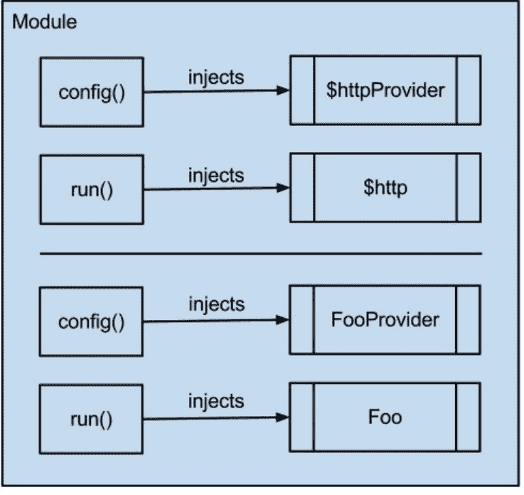

但主要把我们带到这里的，是你不能这样做：

```javascript
some_module.service('SomeService', function() {
    this.someMethod = function() { … };
});
```

```javascript
some_module.config(function(SomeService) {
    // do something with SomeService
});
```

`SomeService`尚未实例化，它根本不存在。但你可以这样做：

```javascript
function SomeProvider() {
    // some setup code goes here
    this.last_name = 'Hiller';

    // required method $get; acts as factory or service
    this.$get = function() {
        var that = this;
        return {
            someMethod: function() { return that.first_name + ' ' + that.last_name }
        };
    };
}
```

```javascript
some_module.provider('SomeProvider', SomeProvider)
```

```javascript
// YES, it tacks "Provider" on to the end of any provider you create.
some_module.config(function(SomeProviderProvider) {
    SomeProviderProvider.first_name = 'Chris';
});
```

## 服务单元测试

对工厂（factories）、服务（services）和提供者（providers）进行单元测试非常简单。让我们为我们的`Posts`服务和`Post`工厂编写测试：

```javascript
describe('Blog Services', function () {
    var Posts, httpBackend;

    // I want to use the variable name Posts for my service, but if I use DI here to inject it
    // the variable name will already be taken! A fun way around this limitation isto inject the $injector service,
    // then simply ask it for what you want.
    beforeEach(inject(function ($injector, $httpBackend) {
        Posts = $injector.get('Posts');
        httpBackend = $httpBackend;
    }));

    describe('Posts', function () {
        it('should initiate the http call', function () {
            var promise;
            // you will need to use expectGET, expectPOST, etc., when unit testing functions
            // that use the $http service. They are assertions about what call you are making and allow
            // you to mock a response easily.
            httpBackend.expectGET('data.json').respond('foo');
            promise = Posts.getPosts();
            // make sure our promise is really a then-able object
            expect(angular.isFunction(promise.then)).toBeTruthy();
            promise.then(function (res) {
                expect(res.data).toBe('foo');
            });
            httpBackend.flush();
        });
    });
});
```

接下来是一段相对较长的测试代码，用于验证`Post`类所有方法的运行是否符合预期：

```javascript
describe('Blog Factories', function () {

    var Post;

    beforeEach(inject(function ($injector) {
        Post = $injector.get('Post');
    }));

    describe('Post', function () {

        // covers all of the constructor's behavior, which is very little.
        describe('the constructor', function () {

            it('should store information temporarily when autosave flag is not truthy', function () {
                var post = new Post('cashews', 'peanuts', new Date(), 'Mr. Almond');
                expect(post.temp.title).toBe('cashews');
                expect(post.temp.body).toBe('peanuts');
                expect(post.title).toBeUndefined();
                expect(post.body).toBeUndefined();
                expect(post.date).not.toBeUndefined();
                expect(post.author).toBe('Mr. Almond');
            });

            it('should not store information temporarily when autosave flag is truthy', function () {
                var post = new Post('cashews', 'peanuts', new Date(), 'Mr. Almond', true);
                expect(post.title).toBe('cashews');
                expect(post.body).toBe('peanuts');
                expect(post.temp.title).toBeUndefined();
                expect(post.temp.body).toBeUndefined();
                expect(post.date).not.toBeUndefined();
                expect(post.author).toBe('Mr. Almond');
            });
        });

        describe('the updateDate method', function () {
            it('should reset the date', function () {
                var old_date, post = new Post();
                old_date = post.toString();
                post.updateDate();
                // it would be kind of weird/difficult to try to assert it updates the date object
                // to NOW; so just assert it changed.
                expect(old_date).not.toBe(post.date.toString());
            });
        });

        describe('the save method', function () {
            it('should copy information from temp object', function () {
                var post = new Post('foo', 'bar');
                post.save();
                expect(post.title).toBe('foo');
                expect(post.body).toBe('bar');
            });

            it('should call updateDate method', function() {
                var post = new Post();
                // we just need to assert that save() happens to call the updateDate() method
                spyOn(post, 'updateDate');
                post.save();
                expect(post.updateDate).toHaveBeenCalled();
            });

            it('should call the stopEditing method', function() {
                var post = new Post();
                spyOn(post, 'stopEditing');
                post.save();
                expect(post.stopEditing).toHaveBeenCalled();
            });
        });

        describe('the beginEditing method', function() {
            it('should rearrange some data in the post', function() {
                var post = new Post('foo', 'bar', new Date(), 'baz', true);
                post.beginEditing();
                // we assert the state changes and the information has been copied out of temp
                expect(post.editing).toBeTruthy();
                expect(post.temp.title).toBe(post.title);
                expect(post.temp.body).toBe(post.body);
            });
        });

        describe('the stopEditing method', function() {
            it('should set editing flag to false and empty temp object', function() {
                var post = new Post('foo', 'bar', new Date(), 'baz', true);
                post.beginEditing();
                post.stopEditing();
                expect(post.editing).toBeFalsy();
                // note that you cannot use "toBe" here, because {} !== {}
                expect(post.temp).toEqual({});
            });
        });

        describe('toString method', function() {
            it('should return a JSON string', function() {
                var post = new Post('foo', 'bar', new Date(), 'baz', true);
                expect(post.toString()).toBe(angular.toJson(post));
            });
        });
    });
});
```

# 总结

这些服务、提供者和工厂构成了 AngularJS 应用的骨架。在这里处理繁重的业务逻辑；使其可重用且可测试。这样你最终处理的代码就不会像乱糟糟的意面一样。不要让你的控制器承担过多的思考任务。如果你的指令中只有一个函数，那么通过向其中注入服务来提高该函数的可读性。

在下一章中，我们将 살펴看一看最不起眼的成员——过滤器（filters）。

# 第 8 章 过滤器

什么是过滤器？从最基本的定义来看，它是一个接收多个输入并给你一个输出的函数。通常情况下，过滤器输出原语（primitives），较少输出数组，极少输出对象。我想它们也可以输出函数（作为读者的练习，请自行验证此用例）。它们是一种针对模型（或多个模型）执行逻辑的方式，且这种逻辑仅由视图关注。例如，你在控制器中可能将一个数字作为整数处理，但当它到达视图时，需要以格式化后的形式显示（例如 9,000）。当然，这不应该是控制器需要关心的事情，为此，你会使用过滤器（确切地说是内置的`number`过滤器）。


## 添加我们的过滤器

让我们为博客应用添加一个过滤器。下面是一个简单的例子，你完全可以用 CSS 实现，但如果出于某种原因你不想这样做，可以使用过滤器：

```javascript
// capitalizes the first letter of a string
blog.filter('capitalize', function () {
  return function (s) {
    if (!s || !angular.isString(s)) {
      return s;
    }
    return s.charAt(0).toUpperCase() + s.substring(1);
  };
});
```

现在，如果视图中有需要首字母大写的内容，只需写 `{{something|capitalize}}`；问题就解决了。你会注意到，我们评估了 `s` 的真值及其字符串类型；如果我们接收到空字符串或非字符串，我们什么也不做，直接返回传入的值。我喜欢这种编写过滤器的模式，但其他人可能不同意。

过滤器非常简单，且最适合在视图中使用。你可以在任何可以注入 `$filter` 服务的地方通过它来获取任何过滤器，但语法可能看起来有点奇怪：

```javascript
// $filter was injected somewhere
var filtered_array = $filter('filter')(unfiltered_array, function some_function() { ... });
```

尽管如此，能够随时随地使用它们，这点小代价是值得的。让我们编写一个简单的过滤器，它接受一个额外的参数并返回一些结果（过滤器的复杂度大概也就这样了）：

```javascript
some_module.filter('myFilter', function() {
  return function(a, b, c) {
    return a + b + c;
  };
});
```

在视图中使用：

```html
<h1>Hi, I Like Dinosaurs. I have {{male_dino_count|myFilter:female_dino_count:dino_egg_count}} of them in this paper bag.</h1>
```

其工作原理是：参数 `a` 是 `|` 左侧的表达式，过滤器名称紧跟在 `|` 之后，参数 `b` 是第一个 `:` 之后的表达式，参数 `c` 是第二个 `:` 之后的表达式：

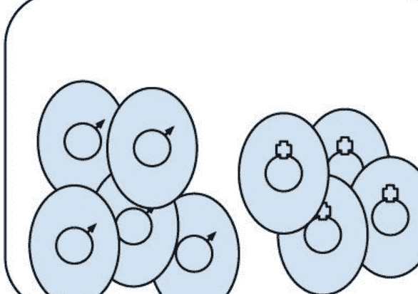

上图显然是一个装满雄性和雌性恐龙蛋的袋子。过滤器可以接受任何类型的参数，但最常用于字符串和数组。上面的例子适用于字符串（甚至数字），但我们也可以同样轻松地用过滤器修改数组：

```javascript
some_module.filter('myArrayTakingFilter', function() {
    return function(a) {
        return a.slice(0, 3) + '...' + a.slice(-3);
    };
});
```

这个过滤器接收一个数组，并返回一个新数组，其中包含原数组的前三项和后三项，中间用省略号连接。如果你需要显示一个数组，而屏幕空间有限，这可能会很方便。

## 单元测试

这是一个使用我们博客应用过滤器进行过滤器单元测试的示例：

```javascript
describe('Blog Filters', function () {
    var $filter;

    beforeEach(inject(function ($$filter) {
        $filter = $$filter;
    }));

    describe('the capitalize filter', function () {
        it('should capitalize a string, naturally', function () {
            var capitalize = $filter('capitalize');
            expect(capitalize('foo')).toBe('Foo');
        });
    });
});
```

## 结论

过滤器是一个（希望是）简单的函数，它接收视图所拥有的模型，并使视图更容易理解模型，或者以其他方式改变模型的外观。过滤器应该是表面的，不应该有副作用。它们可以在视图上下文之外使用，但这不太常见。当你发现自己在控制器中为了视图而处理数据时，你就应该编写过滤器。但请记住，过滤器会频繁执行，出于性能考虑，最好保持它们简单。另外，你的过滤器旨在简单地在视图中处理数据——不要编写有副作用的过滤器！

到目前为止，在本书中我们讨论了 AngularJS 的理论——现在让我们在下一章进入应用科学。

# 第 9 章 实际应用

从这里开始，我们将介绍更多 AngularJS 在现实世界中的示例。我们将找到一些常见问题，并以 AngularJS 的方式提出解决方案。有些会非常基础，有些则会更复杂。

## Ajax

AngularJS 有两个处理 Ajax 请求的服务。第一个是 `$resource`，它是高度抽象的，专为 RESTful 应用量身定制。第二个是 `$http`，它更底层，几乎可以做任何事情。一般建议是，如果你的 REST API 很简单，就使用 `$resource`（别忘了包含 `ngResource` 模块！）。

### `$resource` 服务

假设我们有一个 REST API。对 `/donut/foo` 发起 GET 请求会返回给你 ID 为 `"foo"` 的 Donut 对象。POST 到这个 URL 会“保存” Donut 对象。DELETE 这个 URL 会删除它。GET 请求到 `/donuts/` 会给你所有的 Donut 对象。下面是一个使用 `ngResource` 模块中的 `$resource` 服务对这个返回 JSON 的后端进行一些操作的示例：

```javascript
// $resource 返回一个 Resource 对象。第二个参数描述了资源调用的参数。
// 这里，在 URL 中指定 :id，并告诉 AngularJS 在发出请求时将 'donutId' 字符串的值插入到
// URL 中。这假定服务器将在 "/donut/" URL 返回一个甜甜圈集合，
// 如果指定了一个 ID（"/donut/foo"），则只返回那个特定的甜甜圈。
var Donut = $resource('/donut/:id', {id: '@donutId'});
// 使用这个对象进行查询。注意，执行完这行代码后 powdered_donut 会立即变为 undefined，因为
// 'get' 是一个异步操作。然而，当项目从服务器检索到后，会发生一些魔法，powdered_donut 的值会被填充。
// 名为 Donut.foo() 的函数是“类”函数，这些函数的返回值
// 被视为 Donut 的一个实例。Donut.save() 和 donut.$save() 基本上做同样的事情；前者需要
// 更多的参数。
// 这是一个 HTTP GET。
var powdered_donut = Donut.get({donutId: 'powdered'}, function(donut) {
    // 可选的成功回调函数，接收甜甜圈。当此操作完成时，它将与 powdered_donut 具有相同的值。
    // 这
    powdered_donut.sold_out = donut;
    powdered_donut.$save(); // HTTP POST；注意 AngularJS 使用 "$" 前缀是为了避免与你的命名空间冲突
```

```javascript
    // 或者你可以直接 HTTP DELETE 甜甜圈
    // powdered_donut.$delete();
}, function(error) {
    // 可选的失败回调函数
});
```

```javascript
// 这是一个对 /donut/glazed 的 HTTP DELETE 请求。
// 如果我们之前使用 get() 检索了 glazed 甜甜圈，那么我们可以使用 $delete() 函数删除它。效果一样。
Donut.delete({donutId: 'glazed'}, function(donut) {
    // 如果成功删除，则可选的回调函数
}, function(error) {
    // 可选的失败回调函数
});
// 获取所有甜甜圈。HTTP GET；query 返回一个 promise，它将解析为与 donut 参数相同的值。
var all_donuts = Donut.query(function(donuts) {
    // 可选的成功回调函数
}, function(error) {
    // 可选的失败回调函数
});
// HTTP POST。可以在实际对象上使用 $save
Donut.save({donutId: 'pepto'}, {id: 'pepto', cost: '1.23'}, function(donut) {
    // 保存成功
}, function(error) {
    // 保存失败
});
```

### 但是 `Donut.get()` 只返回 `undefined`，而我想对结果做点什么！我能让 `$resource` 同步吗？

不能。你不能让 `$resource` 同步。使用“成功”回调函数来处理 `Donut.get()` 的结果。如果这真的很困扰你，你不必这样做：

```javascript
$scope.foo = Foo.get({bar: 'baz'});
```

你可以这样做：

```javascript
Foo.get({bar: 'baz'}, function(foo) {
    $scope.foo = foo;
});
```

它们做同样的事情。这对于 AngularJS 的新手来说几乎总是令人困惑的。最终，它只是为你提供了一些语法糖。

### `$http` 服务

如果你没有与 RESTful 服务器通信，那么你将使用 `$http` 服务。可以把它看作类似于 jQuery 的 `$.ajax` 函数。你可以这样发起一个 HTTP GET 请求：

```javascript
$http({
    method: 'GET',
    url: '/pigs/and/chickens/',
    data: {
        cows: 'horses'
    },
    params: {
        sheepdogs: 'mules'
    },
    headers: {
        'X-Farm-Animals': 1.0
    }
}).success(function(data) {
    // 处理响应数据；如果检测到 JSON，AngularJS 会尝试给你一个 JS 对象
}).error(function(data) {
    // 处理非 200 的响应码
});
```

这将向 `/pigs/and/chickens/?sheepdogs=mules` 发起一个 HTTP GET 请求，请求体为 `{"cows": "horses"}`，并带有特殊头部 `X-Farm-Animals`。请求完成后，根据服务器的响应，数据将传递给成功或错误回调函数。

这里有一些语法糖，可以让这些调用看起来稍微不那么笨拙；同样的 GET 请求可以这样完成：

```javascript
$http.get('/pigs/and/chickens', {cows: 'horses'}, {
    params: {
        sheepdogs: 'mules'
    },
    headers: {
        'X-Farm-Animals': 1.0
    }
}).success(function(data) {
    // 处理响应数据；如果检测到 JSON，AngularJS 会尝试给你一个 JS 对象
}).error(function(data) {
    // 处理非 200 的响应码
});
```

你可以在 Posts 服务中看到，我们有一个函数 `getPosts`，它这样调用 `$http`：

```javascript
blog.service('Posts', function ($http) {
    this.getPosts = function () {
        return $http.get('data.json');
    };
});
```

调用 `Posts.getPosts()` 将对 `data.json` URL 的文件进行一个简单的调用。该函数返回 `$http.get()` 的值，这不是它检索到的数据；它返回一个 promise。然后我们可以获取 `$http.get()` 的结果，像使用任何 promise 一样使用它：

```javascript
Posts.getPosts().success(function (data) {
    // do stuff
});
```

请注意，原生 promise 不提供 success 或 error 方法；它们只提供一个 then 方法，其工作方式类似。两者的区别在于 success 和 error 都接收响应数据，而 then 接收的是完整的响应对象（注意 then 接受两个函数作为参数；第一个用于成功/"resolved"，第二个用于失败/"rejected"）。这个对象包含 headers 和其他你可能关心也可能不关心的信息。

## 自定义请求头

如果你需要每个 HTTP 请求都向服务器发送自定义请求头，你不必将 headers 对象传递给每次 `$http` 调用；相反，我们可以在系统初始化阶段配置 `$httpBackend` 来自动完成这件事。

假设我们的博客服务需要在每个请求中发送一个 `X-Blog-Version` 请求头，或者根据请求是 GET 还是 POST 发送不同的内容。以下是设置方法：

```javascript
// configure $http to always pass these headers

blog.config(function($httpProvider) {
    $httpProvider.defaults.headers.common['X-Blog-Version'] = '1.0';
    $httpProvider.defaults.headers.post['X-I-Am-A-POST-Request'] = true;
    $httpProvider.defaults.headers.get['X-I-Am-A-GET-Request'] = true;
});
```

请注意，在 `config` 函数中你需要注入一个 `$httpProvider`。这本质上允许你在使用 `$http` 服务之前对其进行预配置。更多信息请参阅服务章节。

如果你需要动态更改默认请求头，`$http` 模块允许你以相同的方式进行修改：

```javascript
blog.run(function($http) {
    $http.defaults.headers.common['X-Blog-Version'] = '1.0';
    // etc
});
```

如果你确定所有 HTTP 请求都需要某个特定的请求头，请使用第一个示例；只有在绝对必要的情况下才使用第二个示例。

## 单元测试 `$http`

你不希望你的单元测试发出 `$http` 调用，除非你正在编写功能/E2E 测试，而我们并不是。作者提供了一个很好的模块来帮助你解决这个问题，叫做 `ngMock`。在你的测试中引入 `angular-mocks.js` 文件，一切都会自动配置好。

让我们来测试 Posts 服务。我们需要告诉模拟的 `$httpBackend` 服务预期会调用 `$http`，该调用应该返回什么，最后刷新所有请求。看起来像这样：

```javascript
describe('Blog Services', function () {
    var Posts, httpBackend;

    beforeEach(inject(function ($injector, $httpBackend) {
        Posts = $injector.get('Posts');
        httpBackend = $httpBackend;
    }));

    describe('Posts', function () {
        it('should initiate the http call', function () {
            var promise;
            httpBackend.expectGET('data.json').respond('foo');
            promise = Posts.getPosts();
            expect(angular.isFunction(promise.then)).toBeTruthy();
            promise.success(function (data) {
                expect(data).toBe('foo');
            });
            promise.then(function (res) {
                expect(res.data).toBe('foo');
                expect(res.status).toBe(200);
                expect(res.config).toEqual({
                    method: 'GET',
                    url: 'data.json'
                });
                expect(angular.isFunction(res.headers)).toBeTruthy();
            });
            httpBackend.flush();
        });
    });
});
```


为了测试，我们测试了 `$http` 调用返回的 promise 对象的`success`和`then`方法，但我们真正关心的只是请求返回的数据（在两种情况下都是"foo"）。

对于每种 HTTP 请求类型都提供了`expectFOO`方法。请注意，这些函数是预期；如果代码没有发起该调用，预期将会失败，将抛出异常，你的测试将不会通过。如果由于某些原因可能会发起请求，请使用`when`方法：`httpBackend.whenGET('data.json').respond('foo')`。如果发起了请求，这将处理它，但如果没有发起请求，则不会抛出异常。通常在编写单元测试时你会想使用`expect`方法，但如果你正在编写功能/E2E 测试，那么你会想使用`when`方法，因为检查请求是否完成超出了功能测试的范围。

但等等，还有更多。你可能需要对调用了使用`$http`的代码的代码进行单元测试！下面是一个单元测试示例，断言控制器调用了`Posts.getPosts()`：

```javascript
it('should call Posts.getPosts() and execute a function upon resolving', function() {
    inject(function(Posts, Post, $q) {
        var dfrd = $q.defer(),
            success_spy = jasmine.createSpy('success').andReturn([]);
        angular.extend(dfrd.promise, {
            success: success_spy
        });
        spyOn(Posts, 'getPosts').andReturn(dfrd.promise);
        $controller('ContentCtrl', {$scope: scope, Posts: Posts,
            Post: Post, $routeParams: {}});
        expect(Posts.getPosts).toHaveBeenCalled();
        expect(dfrd.promise.success).toHaveBeenCalled();
    });
});
```

我们没有让`Posts.getPosts()`实际尝试访问服务器，而是创建了一个`spy`，并断言该方法被调用了。间谍对于确保你的单元测试更加"单元化"非常有用。现在我们不关心`Posts.getPosts()`实际做了什么，因为我们实际上并没有调用它。但请注意，如果你使用了`success()`，你必须用这个函数扩展任何 promise 固件，因为它默认不存在。

## 不同的数据类型

AngularJS 会尝试为你进行 JSON 的转换。如果发现你给出了一个对象要发送到服务器，它会将其序列化为 JSON 并发送出去。如果它检索到的请求可以解析为 JSON，它会将生成的 JavaScript 对象返回给你。

如果你不使用 JSON，只需传递一个字符串作为数据。也许你使用的是 XML，服务器期望接收并返回 XML。例如：

```javascript
$http.get('/some/xml/service', '<foo><bar>baz</bar></foo>')
.success(function(data) {
    // data is now an XML string.
    // parse your XML here and wonder why you are not working with JSON
});
```

这涵盖了 JSON 和 XML（或任何纯字符串数据）。如果你的服务器需要 x-www-form-urlencoded 数据呢？JSFiddle（[http://jsfiddle.net](http://jsfiddle.net)）/echo 服务就是一个很好的例子。以下是一个可用的示例：

```javascript
$http.post('/echo/json/', 'json=' + encodeURIComponent(angular.toJson({foo: 'bar'})), {
    headers: {
        'Content-Type': 'application/x-www-form-urlencoded; charset=UTF-8'
    }
}).success(function(data) {
    $scope.data = data; // puts {foo: 'bar'} in $scope.data
});
```

这是一个方便的技巧，但还有另一个：你可能想模拟表单提交。我编写了一个方便的小工厂，将（扁平的！）对象转换为 multipart/form-data：

```javascript
myApp.factory('formDataObject', function () {
    return function (data) {
        var fd = new FormData(), key;
        for (key in data) {
            if (data.hasOwnProperty(key)) {
                fd.append(key, data[key]);
            }
        }
        return fd;
    };
});
```

要使用这个工厂，只需将`formDataObject`注入到调用`$http`的地方，然后这样做：

```javascript
// note not using "post" method here; this one seems to be a bit more relaxed on the headers
// but it may work for you
$http({
    method: 'POST',
    url: '/maybe/accepts/a/file',
    data: flat_object,
    // XXX: this seems to be a bug in AngularJS
    headers: {
        'Content-type': '',
        'Content-Type': ''
    },
    transformRequest: formDataObject
}).success(function(data) {
    // process response
});
```

你可以轻松地通过这种方式获取`<input type="file"/>`的信息并通过 XHR 上传，方法是在选择文件或多个文件后访问 HTMLElement 的`files`数组。一旦你从`files`数组中获得了内容，就如上面的示例那样将其作为`data`传递。`formDataObject`工厂会为你完成将其转换为服务器期望的格式的工作。请注意，AngularJS 虽然已经实现了许多输入指令，但尚未实现文件类型输入。因此，无论你认为怎样才算能工作，在其上使用[ngModel](https://angular.io/api/forms/NgModel)都行不通。

## 加载指示器及类似组件

公平警告：应该有更好的方法来实现以下内容。目前 AngularJS 支持响应拦截器（我们稍后会讲到），但不支持请求拦截器，所以虽然拦截器更适合这类解决方案，但我们无法使用它们——因为我们可以用它们来隐藏加载指示器，但无法显示它——这正是请求拦截器能派上用场的地方。

你可能希望在处理 Ajax 请求时显示一个动画加载指示器。通过使用请求转换，这很容易在所有请求中实现。请求转换实际上是用于获取待发送的请求数据，并在发送前将其修改为你想要的形式。然而，我们同样可以轻松地设置在任何请求发出之前执行任何操作。让我们通过修改`config()`调用来在博客中实现这一点。

```javascript
// 配置 $http 始终传递此请求头
// 同时，在任何 Ajax 请求期间显示加载指示器
blog.config(function($httpProvider) {
  $httpProvider.defaults.common['X-Blog-Version'] = '1.0';
  // 这里我们做一些类似启动加载指示器的操作
  $httpProvider.defaults.transformRequest.unshift(function(req) {
    $('body').append(spinner); // spinner 在其他地方定义
    return req; // 返回未处理的请求
  });
  // 接收响应时最后执行的操作（在 success() 等之前）：
  // 隐藏加载指示器
  $httpProvider.defaults.transformResponse.push(function(res) {
    if (spinner) {
      spinner.remove();
    }
    return res; // 返回未处理的响应
  });
});
```

这是非常基础的，你可能会遇到两个加载指示器同时显示的情况，但这种情况可能很少发生。

如果你想为某些请求禁用此行为（例如持续轮询），你可以简单地覆盖它，使其什么都不做：

```javascript
$http.get('/some/url', {transformRequest: angular.noop});
```

请注意这是一种 hack。这不是请求转换和响应转换的原本用途。也许更好的方式是装饰`$httpBackend`服务。该服务位于`$http`和 XHR 之间，处理所有外发的请求。

```javascript
blog.config(function($httpProvider, $routeProvider, $provide) {
  // 省略...
  // 当有 HTTP 请求时弹出加载指示器，响应返回时移除它
  $provide.decorator('$httpBackend', function($delegate) {
    // 如果存在模拟的 $httpBackend，不要覆盖它
    if (typeof angular.mock.angular.mock) {
      return $delegate;
    }
    return function(method, url, reqData, done, reqHeaders, timeout, withCredentials) {
      var spinner = angular.element('<div class="working"></div>');
      $('body').append(spinner);
      $delegate(method, url, reqData, function() {
        spinner.remove();
        done.apply(this, arguments);
      }, reqHeaders, timeout, withCredentials);
    };
  });
});
```

注意：我们注入了`$provide`服务——别忘了这一点。装饰器在每次注入特定服务时都会被调用（在本例中是`$httpBackend`）。这个装饰器只是弹出一个加载指示器，拦截传递给`$httpBackend`的`done`方法，然后移除加载指示器。`$httpBackend`的文档很少/根本不存在；要弄清楚这个，我不得不使用原力并阅读源码。

## 显示 Ajax 错误

如果你的服务器还算正常，它会在你期望 404 时返回 404，在其他地方出错时返回 500。我们假设它会这样做。

我们可以使用响应拦截器，在每次从服务器收到非 OK 响应时显示错误消息。将以下内容追加到我们的`config()`调用中：

```javascript
// 服务器返回非 OK 响应时的错误提示
$httpProvider.responseInterceptors.push(function ($q, $window) {
	return function (promise) {
		return promise.then($angular.identity, function(res){
			$window.alert("哎呀，出错了！");
			return $q.reject(res);
		});
	};
});
```

传入第一个函数的 promise 来自你的`$http`调用。该 promise 会被拒绝，因为`$http`没有成功发出请求，因此执行上面`then()`调用的**第二个**参数（第一个参数`angular.identity`只是一个返回其第一个参数的函数）。接下来，我们将拒绝传递下去（当然带着响应信息），以便由你代码中`$http`调用返回的原始 promise 的`error()`或任何`then()`的第二个参数来处理。要测试这个，只需将 Posts 服务中`getPosts()`函数的 URL 改为某个不存在的地址。

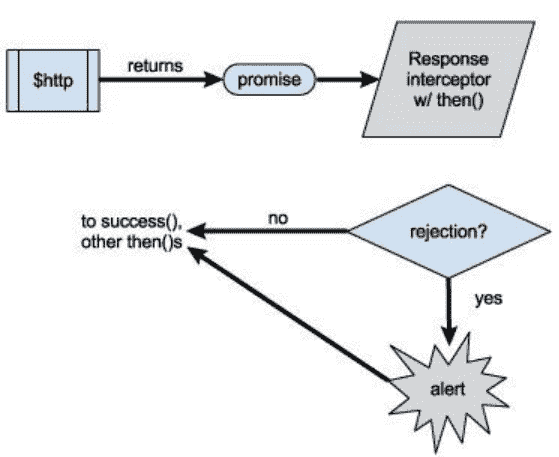

如果你的服务器返回的 JSON 对象中包含错误信息，我们也能处理。即使我们从服务器得到了 200 响应，请求也可能抛出了内部异常，我们可以查找这种情况。例如，响应 JSON 中可能有一个`$error`键。每次看到它，我们就知道服务器端出了什么问题。让我们用以下代码替换上面的代码：

```javascript
// 服务器返回非 OK 响应时的错误提示
// 或特殊的 $error 响应
$httpProvider.responseInterceptors.push(function ($q, $window) {
	return function (promise) {
		return promise.then(function(res) {
			if (res.data.$error) {
				$window.alert("哎呀，服务器出问题了！！");
				return $q.reject(res);
			}
			return res;
		}, function(res) {
            $window.alert('哎呀，出错了！');
            return $q.reject(res);
        });
	};
});
```

现在，任何时候服务器响应的 JSON 中，只要顶层键包含`$error`，就会弹出 alert，并且会执行`failure()`函数，就像任何 500 或 404 错误一样。

## 路由

通常希望 URL 的 hash 部分能引导用户到特定视图。AngularJS 为此提供了一个名为`$route`的服务。在`config()`阶段，你可以配置`$routeProvider`，结合`ngview`指令，在 URL 匹配时指向正确的视图。此外，你可以通过 URL 传递数据，并使用`$routeParams`服务检索它。

使用命名锚点标签和`$route`服务时要小心。它们都使用 URL 的"hash"部分来做不同的事情。`$route`服务会优先于任何指向命名锚点的片段——如果你有一个名为"foo"的路由和一个名为"foo"的锚点，当访问`http://your.com/#foo`时，AngularJS 会尝试执行该路由。

### 可以一次使用多个`ngView`指令吗？

**不可以。**`ngView`在每个 HTML 页面中只能包含一次。如果你在使用`$route`服务时切换视图，提前规划好使用`ngView`的最佳位置，以包含适当的模板。请关注未来的此功能。

### 配置

让我们在我们的博客中设置一些路由。假设我们想根据 ID 加载特定的文章。首先，我们必须设置 HTML 以处理路由。注意这需要一个`ngView`指令。


```html
<!DOCTYPE html>
<html ng-app="blog">
<head>
  <meta http-equiv="Content-type" content="text/html; charset=utf-8">
  <title ng:bind-template="{{title}}"></title>
  <script src="https://ajax.googleapis.com/ajax/libs/angularjs/1.0.4/angular.min.js" type="text/javascript"
  charset="utf-8"></script>
  <script src="https://ajax.googleapis.com/ajax/libs/jquery/1.8.3/jquery.min.js" type="text/javascript"
    charset="utf-8"></script>
  <script src="blog.js" type="text/javascript" charset="utf-8"></script>
</head>
<body>
<div ng-controller="HeadCtrl">
  <h1>{{title}}</h1>
  <h3>{{description}}</h3>
</div>
<div ng-controller="ContentCtrl">
  <new-post-area post="new_post" cancel-text="Cancel" save-text="Save" cancel="cancel" save="save"></new-post-area>
  <div id="posts-form">
    Order By: <select ng-model="order"><option value="title">Title</option><option value="date">Date</option></select>
    <input type="checkbox" ng-model="descending"/> Descending <br/>
    Search: <input type="text" ng-model="filter"/>
  </div>

  <ng-view></ng-view>
</div>
<!-- directive: copyright -->
```

在此之后，我们在 `<script>` 标签中定义了 AngularJS 模板。

```html
<script type="text/ng-template" id="posts">
  <div id="{{post.id}}" ng-repeat="post in posts|orderBy:order:descending|filter:filter" ng-class-even="'even'" ng-class-odd="'odd'">
    <ng-include src="'post'"></ng-include>
  </div>
</script>

<script type="text/ng-template" id="post">
  <ng-switch on="post.editing">
    <div ng-switch-when="true">
      <div class="important-background-color" color="#EEE">
      <input type="text" ng-model="post.temp.title"/><br/>
      <textarea ng-model="post.temp.body"></textarea><br/>
      <button ng-click="cancel(post)">Cancel</button>
      <button ng-click="save(post)">Save Changes</button>
      </div>
    </div>
    <div ng-switch-default>
      <h2 ng-click="edit(post)">{{post.title}}</h2>
      <p ng-click="edit(post)" bold-click ng-bind-html-unsafe="post.body"></p>
      <p><em>posted on {{post.date|date:'short'}} by {{post.author}}</em></p>
    </div>
    <hr/>
    <button ng-click="newPost()">New Post</button>
  </ng-switch>
</script>

</body>
</html>
```

你会看到上面我们添加了两个模板，`posts` 和 `post`，并放置了 `ngView` 指令来代替它们的位置。这是将插入适当模板的位置。接下来，让我们再次处理我们的 `config()` 调用：

```javascript
blog.config(function ($httpProvider, $routeProvider) {
  // .. 一堆 $httpProvider 配置

  // 如果你的 URL 不以 "/" 开头，你会很伤心的；这可能是个 bug
  $routeProvider.when('/post/:id', {templateUrl: 'post'})
    .when('/posts', {templateUrl: 'posts'})
    .otherwise({redirectTo: '/posts'});
});
```

上面表示当 URL 以 `#/posts` 结尾时，加载所有文章。如果 URL 以 `#/post/1` 结尾，加载 ID 为 1 的文章。你还可以指定一个控制器（使用 `controller` 键）。

## 路由的单元测试

这在功能测试中可能更有意义。因此在我们的单元测试中，让我们改为模拟 `$routeParams`：

```javascript
describe('ContentCtrl', function () {
    it('should put a single post in the scope if an ID appears in $routeParams', function () {
        inject(function (Posts, Post, $httpBackend, $http) {
            $http.defaults.transformRequest = []; // remove any fancy request transforms
            // mock $routeParams; assume they got set by $route service
            var $routeParams = {
                id: 1
            };
            posts = [
                {id: 1, title: 'foo'},
                {id: 2, title: 'bar'}
            ];

            $httpBackend.expectGET('data.json').respond({posts: posts});
            $controller('ContentCtrl', {$scope: scope, Posts: Posts,
                Post: Post, $routeParams: $routeParams});
            $httpBackend.flush();
            expect(scope.post).toBe(posts[0]);
            expect(scope.posts).toEqual([]);
        });
    });

    it('should put a list of posts in the scope if no ID appears in $routeParams', function() {
        inject(function(Posts, Post, $httpBackend, $http) {
            $http.defaults.transformRequest = []; // remove any fancy request transforms
            // mock $routeParams; assume they got set by $route service
            var $routeParams = {};
            posts = [
                {id: 1, title: 'foo'},
                {id: 2, title: 'bar'}
            ];
            $httpBackend.expectGET('data.json').respond({posts: posts});
            $controller('ContentCtrl', {$scope: scope, Posts: Posts,
                Post: Post, $routeParams: $routeParams});
            $httpBackend.flush();
            expect(scope.post).not.toBeDefined();
            expect(scope.posts[0].title).toBe('bar');
            expect(scope.posts[1].title).toBe('foo');
        });
    });
});
```

在下一章中，我们将更多地讨论在 AngularJS 中使用 jQuery——何时使用，在哪里使用，以及如何使用。这些答案分别是“永远不要”、“任何地方都不要”和“千万别这么做”。遗憾的是，对于除了最简单的 AngularJS 应用程序之外的所有应用，你可能都会想在某些地方使用它。

AngularJS 提供的另一个极佳的实用功能是 Promise（期约）。我们接下来就讨论这个。

## Promise, Promise

好吧，什么是 Promise？当你拥有一个 Promise 时，你知道会发生两种情况之一：Promise 将被拒绝（rejected）或兑现（resolved）。你可以分别将这两种情况看作“悲剧路径”和“快乐路径”。重要的是要理解，一个 Promise 仅且只能被拒绝或兑现一次。Promise 可以同步地被拒绝或兑现（例如在单元测试中，或者在无需异步操作的情况下），但通常它是异步完成的。

Promise 能为你带来什么？除了它们提供的保证外，它们还能避免像下面这样糟糕的代码：

```javascript
ajaxLib.GET('foo.url', function(response) {
  ajaxLib.GET('bar.url', function(response) {
    ajaxLib.GET('baz.url', function(response) {
      // .. and so on
    })
  })
})
```

当你像这样链式调用回调函数时，这被称为“阶梯式”结构，除非你想疯掉，否则你应该避免这样做。Promise 可以帮你解决这个问题。你可以这样做：

```javascript
ajaxLib.GET('foo.url')
  .success(function(response) { return ajaxLib.GET('bar.url') })
  .success(function(response) { return ajaxLib.GET('baz.url') });
```

> 什么是 Deferred？

它是一个负责向你提供 Promise 并将其拒绝或兑现的对象。

每个响应的返回值将被传递给链中的下一个 `success` 函数。当然，这只是假设性的代码；AngularJS 和 `$q`（Promise/Deferred API）有它们自己的语法，我稍后会介绍。

如果你有异步代码，并且它在完成后执行回调，那么它就是一个适合改为返回 Promise 的候选者。Promise 的实用性和强大之处让许多延续传递风格（CPS）的代码相形见绌。

### AngularJS 中的 Promise

AngularJS 开箱即用地提供了两个使用 Promise 的主要服务：`$http` 和 `$timeout`。两者都返回 Promise。一个 Promise 将有一个 `then` 方法，它接受两个参数：一个在 Promise 兑现时接收数据的函数，以及一个在 Promise 被拒绝时接收数据的函数。在 `$http` 的情况下，除了这些之外，还提供了人们熟悉的 `success` 和 `error` 函数。这些函数不是传递整个响应对象，而是将响应拆分为多个参数。例如：

```javascript
$http.get('foo.url').success(function(data, status, headers, config) { // do stuff })
  .error(function(data, status, headers, config) { // do other stuff });
```

```javascript
$http.get('foo.url').then(function(res) { // data, status, headers, config in res obj},
    function(res) { // data, status, headers, config in res obj });
```

需要注意的是，当将 Promise 绑定到作用域（scope）对象时，有一个快捷方式。作用域会“消化” Promise！以下两个语句是等价的：

```javascript
$scope.foo = $http.get('foo.url');
$http.get('foo.url').success(function(res) {
    $scope.foo = res;
});
```

这可能会为你节省一些时间，但你必须理解，由于 `get()` 是一个异步函数，作用域中“foo”的值会立即变为 `undefined`，然后在调用成功兑现后才被赋值。

然而，对于 `$timeout`，你只能使用 `then()` 函数，这已经足够好了。`$timeout` 允许你异步执行任意代码，非常像原生 JavaScript 中的 `setTimeout` 函数。区别在于它返回的是一个 Promise 而不是一个超时 ID。这里是使用 `setTimeout` 和 `$timeout` 的等效代码：

```javascript
var t = $window.setTimeout(function(successFn, errorFn) {
    if (foo) {
        successFn();
    } else {
        $window.clearTimeout(t);
        errorFn();
    }
}, 1000);

var p = $timeout(function() {
    if (!foo) {
        $timeout.cancel(p);
    }
}, 1000).then(successFn, errorFn);
```

当超时函数在未被取消的情况下成功执行时，Promise 被兑现，且 `successFn` 函数会自动执行。如你所见，这实际上为你节省了一些代码。

默认情况下，`$timeout` 在 digest 循环内部执行。如果你在超时函数中没有修改作用域，可以通过禁用此行为来节省一些 CPU 周期。传递 `false` 作为第三个参数，超时函数将不会在 `$apply` 块内部执行。

### Promise 链

正如第一个示例所示，你可以将 Promise 链式调用。其模式如下：

```javascript
$http.get('foo.url')
    .then(function (res) {
        // do stuff with res
        if (something) {
            return $q.reject(first_sad_obj);
        }
        return first_happy_obj;
    }, function (res) {
        // do other stuff with res
        return first_sad_obj;
    })
    .then(function (first_happy_obj) {
        // do stuff
        if (something_else) {
            return $q.reject(second_sad_obj);
        }
        return second_happy_obj;
    }, function (first_sad_obj) {
        // more stuff to do
        return second_sad_obj;
    })
    .then(function (second_happy_obj) {
        // success
    }, function (second_sad_obj) {
        // failure. etc.
    });
```


如果我们从一个 promise 中返回一个对象，它将被传递给链条中的下一个 promise。如果我们使用`$q.reject`并返回它，那么该 promise 将被拒绝，链条中的下一个 promise 将执行其第二个（失败）函数。以此类推。

我曾使用 promise 来等待模态对话框的模板被获取以及对话框打开后再执行某些代码（如果模板已经获取，promise 将立即同步地 resolved；这是完全可以接受的）。我还使用 promise 来等待控制器 *x* 完成某些数据的异步处理，以便控制器 *y* 可以开始处理这些数据。

你甚至可以组合 promise！

```javascript
var p1 = asyncCode1();
var p2 = asyncCode2();
var p3 = $q.all(p1, p2);
// 然后，asyncCode1 resolved；p1 已 resolved，但 p3 尚未 resolved
// 接着，asyncCode2 resolves；p1 和 p2 都已 resolved，此时 p3 变为 resolved
```

通过使用`all`函数，你可以在另一组 promise 全部 resolved 时 resolve 一个 promise。如果你在等待两件不同的事情异步发生，这将非常有用。

使用 promise 很容易传播错误。这是一个使用传统的、回调链方式处理的示例：

```javascript
ajaxLib.get('url').then(function() {}, {success: function() {
    ajaxLib.get('anotherUrl', {success: function() {
        ajaxLib.get('yetAnotherUrl', {success: function() {
        }, error: function() { // pop error }};
    }, error: function() { // pop error }};
}, error: function() { // pop error }};
```

这种方式非常笨拙。Promise 提供了一个很好的替代方案，因为它们知道自己是否已被 resolved 或 rejected：

```javascript
ajaxLib.get('url').then(function(res) {
}).then(function(res) {
    return ajaxLib.get('anotherUrl');
}).then(function(res) {
    return ajaxLib.get('yetAnotherUrl');
}, function(error) {
    // pop error
});
```

在上面的示例中，沿途遇到的第一个错误将下传到最后的“rejected”函数中。

请注意，有时 promise 可以取代`$watch`，反之亦然。这里有一个示例：

```javascript
// 注意这里没有模块；示例中不需要。
function ParentCtrl($q, $http) {
    $scope.getFoo = function() {
        return $http.get('foo.url').success(function(data) {
            $scope.foo = data;
        });
    };
}
function ChildCtrl() {
    $scope.getFoo().then(function() {
        // 对 $scope.foo 执行某些操作
    });
}
```

现在来看另一种方案：

```javascript
function ParentCtrl($http) {
  $scope.getFoo = function() {
    $http.get('foo.url').success(function(data) {
      $scope.foo = data;
    });
  };
}

function ChildCtrl() {
  var foo_watch = $scope.$watch('foo', function(foo, old_foo) {
    if (foo != old_foo && !!foo) {
      // 对 foo 执行某些操作
      foo_watch(); // 停止监听
    }
  });
  $scope.getFoo();
}
```

哪种更好？我认为 promise 策略更优雅。我会说，只有当你需要对 foo 执行*多次*代码操作时，才使用`$watch`策略。如果不通过调用其返回函数来取消`$watch`，你就成功了。否则，如果你用 promise 来做这件事，你最终还是得设置一个`$watch`！

## 调试 AngularJS 应用

虽然从主观上讲，AngularJS 很容易调试，但有一个问题会让事情变得复杂。如果出于某种原因指令（directive）未被识别，它会静默失败。这意味着你的指令代码可能存在语法错误或其他问题，但它永远不会被运行，因为指令无法注册，而 AngularJS 会直接跳过任何它无法理解的属性。因此，在编写指令时，在其中加入一个简单的`console.log`（或者像下面看到的`$log.log`）来确认它确实被 link/compile 了，通常是非常有帮助的。如果你没有看到日志消息，说明 AngularJS 没有识别你的指令。

### Firebug 与 Chrome 开发者工具

这两个工具是不可或缺的。我不知道在没有它们的情况下如何编写客户端 JavaScript 应用程序。如果你使用 Firefox，可以在 http://getfirebug.com 获取 Firebug。如果你使用 IE，或者至少不得不忍受 IE，你也可以获取 Firebug Lite。Chrome 开发者工具是预装的。两者都能很好地完成工作，但如果你使用 Chrome，你还有一个额外的福利：可以使用 AngularJS Batarang！

### AngularJS Batarang!

如果你使用 Chrome（如果你还没试过，真的应该试一下；它的开发者工具非常出色），你可以安装一个名为 AngularJS Batarang (https://chrome.google.com/webstore/detail/angularjs-batarang) 的 Chrome 扩展。这是由 AngularJS 高手 Brian Ford (http://briantford.com) 开发的一个项目。使用这个神奇的工具，你可以检查页面上的任何元素，并在右侧面板（CSS 样式信息所在位置）中轻松查看其作用域（scope）。这让你不必在到处写`console.log($scope)`来查看其中的内容（请注意，你不能直接使用`{{}}`来 dump 作用域；即使你能访问到 scope 对象，它也只会输出为 “SCOPE”，这毫无帮助）。

除此之外，你还可以在 Batarang 自己的标签页中一目了然地检查整个作用域层级。如果你有大量的作用域，这个显示结果可能会让人感到压力，但它是将应用整体可视化的一种绝佳方式。Batarang 中还有其他工具，但这两个是我发现最实用的。

### $log

AngularJS 提供了`$log`，除非你重新定义它，否则它默认是`window.console`的别名。因此`console.log`变成了`$log.log`。这可能会为你节省一些击键次数，但你仍然需要注入它。`$log`真正的威力在于你可以重新定义它（或者事实上 AngularJS 中的任何其他服务或指令），并让它执行任何你想要的操作。出于某些奇怪的原因想让它弹出 alert 吗？你可以这样做。如果你愿意，你也可以将错误输出到 HTML 中。`$log`是一个 provider，所以如果你打算重新定义它，请务必使用`Module.provider`（下面有一个示例）。

### $exceptionHandler

默认情况下，AngularJS 会捕获从其内部抛出的所有异常。如果你在疑惑为什么`window.onerror`从未被调用，这就是一条重要的信息。当你看到 AngularJS 异常（或你的 AngularJS 代码中的异常）时，看到的其实只是对`$log.error`或类似函数的调用。如果你希望将行为绑定到`window.onerror`，可以重新定义`$exceptionHandler`类以重新抛出错误，或者重新定义它以执行任何你想要的操作。这里有一个我们可以在博客中使用的示例：

```javascript
blog.provider('$exceptionHandler', function () {
    this.$get = function() {
        return function(e) {
            throw e;
        };
    };
});
```

就这么简单！

## I18n 与 L10n

AngularJS 提供了一些用于本地化应用的实用工具。在撰写本文时，它支持日期时间（datetime）、数字（number）和货币（currency）过滤器的本地化。当然，我不确定当你有像 5.00 这样的金额，且可以选择将其显示为 $5.00 或 €5.00 时，货币过滤器在多大程度上是有意义的。如果汇率是 1:1，那就太棒了！

除此之外，其中一个指令`ngPluralize`（它可以帮助你根据特定标准显示 “1 sock” 或 “2 socks” 之类的内容）也是可以本地化的。

`$locale`服务将通过`$locale.id`为你提供浏览器当前的本地化 ID。

## 结论

现在你应该对 AngularJS 的实际应用有一些想法了。在接下来的最后一章中，我们将探讨 Angular 如何与第三方技术协作。

## 第 10 章. AngularJS 与第三方技术

在一个完美的世界里，你永远不需要在 AngularJS 中使用 jQuery，但由于 AngularJS 并没有实现 jQuery 的所有功能，而且最重要的一点是它没有支持 jQuery 插件的插件架构，所以你可能在某些地方想要使用它。

想使用那个图表库？或者那个轮播组件？或者在指令中做一些简单的事情，比如通过类选择一些节点？AngularJS 做不到，但 jQuery 可以来救援。

### jQuery 与 AngularJS

在 AngularJS 中操作元素时，你永远不会得到一个原始的 Element 对象。你总是得到一个被 jqLite（或 jQuery，取决于情况）包装的对象。这非常方便，因为你获得了一些便捷方法，并且无论如何都可以访问底层的 Element 对象：

```javascript
angular.module('myApp').directive('someInputTagRelatedDirective', function() {
    return function(scope, elm, attrs) {
        // elm.get(0) 在 jqLite 中不起作用
        console.log(elm[0].getAttribute('type')); // 这个可以工作
    };
});
```

如前所述，如果你想查看 jqLite 对象能做的所有事情，请参阅这里：[http://docs.angularjs.org/api/angular.element](http://docs.angularjs.org/api/angular.element)。如果这涵盖了你想象中应用可能需要的所有操作，太好了！你不需要 jQuery。你是少数幸运儿之一。

对于我们其他人，请注意，引入 jQuery 实际上会*替换* jqLite。这意味着`angular.element()`变成了 jQuery 或`$`的别名。作为最佳实践，当你想要使用非 jqLite 函数时，无论如何使用`$`或 jQuery 可能是个好主意，因为如果你忘记引入 jQuery，你的代码无法运行以及函数未定义的原因会更加显而易见。

## AngularUI 和 uiJq

AngularUI 项目 ([http://angular-ui.github.com/](http://angular-ui.github.com/)) 提供了许多非常有帮助且便捷的指令，但其中一个格外实用，那就是 uiJq 指令。它允许你通过将 jQuery 函数直接放置在 DOM 节点上，来执行任何原本需要针对 jQuery 对象执行的 jQuery 函数。例如：

```
`<div id="foo" ui-jq="hide">I'm hidden</div>`
```

这将立即隐藏该 div。若要使用动画，可以这样做：

```
`<div id="foo" ui-jq="hide" ui-options="{duration: 500}">I'm hidden</div>`
```

这将使 div 在 500 毫秒内逐渐隐藏。对应的 JS 代码为：

```
`$('#foo').hide({duration: 500});`
```

如前所述，你可以将此指令与 *任何* jQuery 函数（只要是应用于 jQuery 对象的函数；像`$.map`这样的函数则不适用）配合使用。这包括你可能正在使用的任何 jQuery 插件。你可以使用`uiOptions`属性对象向这些函数传递任何选项。

这就把我们引向了目前最受欢迎的 jQuery 插件之一：Twitter Bootstrap ([http://twitter.github.com/bootstrap/](http://twitter.github.com/bootstrap/))。

## AngularJS 和 Twitter Bootstrap

Bootstrap 是 AngularJS 的绝佳伴侣，两者配合得非常好。恰巧的是，你几乎可以将任何 Bootstrap 函数通过 AngularUI 和 AngularJS 无缝使用。AngularUI 有一个名为 Angular Bootstrap ([https://github.com/angular-ui/bootstrap](https://github.com/angular-ui/bootstrap)) 的子项目，它为 Bootstrap 功能提供了许多便捷方法。

除此之外，AngularUI 的架构师之一 Dean Sofer ([http://deansofer.com/](http://deansofer.com/)) 在这里提供了许多无需额外指令即可使用 Bootstrap 的示例：[https://gist.github.com/4464334](https://gist.github.com/4464334)。无论是使用 AngularUI 的 Bootstrap 子项目还是 Dean 的示例，都能很好地满足你的需求；建议两者都看看，然后决定哪种方法适合你。

处理模态框（modals）的另一种选择是编写一个模态框 *工厂（factory）*。这允许你通过编程方式启动模态对话框、返回 Promise 并实现各种有趣的功能。我发现这种方法比使用指令来处理这些情况更加自然且强大。这是一个示例，我们将把它添加到我们的博客模块中：


// Modal factory gives you a Modal dialog. Bootstrap required!
blog.factory('Modal', function ($q, $templateCache, $http, $compile) {

	// sets some properties and initializes a deferred to play with.
	// scope: Scope object to apply to template
	// template_id: ID or path of AngularJS template or partial
	// options: object full of options to give to Bootstrap's modal() upon open
	var Modal = function (scope, template_id, options) {
		options = options || {};
		this.scope = scope;
		this.template_id = template_id;
		this.options = {};
		angular.extend(this.options, {show: false}, options);
		this.dfrd = $q.defer();
	};

	// shows a modal dialog; returns a promise to be resolved
	// when the dialog is opened.
	// does not check if one is already opened.
	Modal.prototype.open = function () {
		var template, that = this;
		if (this.modal) {
			this.dfrd = $q.defer();
			this.modal.modal('show');
			this.dfrd.resolve();
			return this.dfrd.promise;
		}
		template = $templateCache.get(this.template_id);
		// cache miss
		if (angular.isUndefined(template)) {
			$http.get(this.template_id).success(function (data) {
				template = data;
				that.modal = $compile(template)(that.scope).modal(that.options);
				that.modal.modal('show');
				that.dfrd.resolve();
			}).error(function () {
				throw new Error('unable to find template "' + that.template_id + '" anywhere. maybe template gnomes stole it?');
			});
		} else {
			this.modal = $compile(template)(this.scope).modal(this.options);
			this.modal.modal('show');
			this.dfrd.resolve();
		}
		return that.dfrd.promise;
	};

	// closes a modal dialog. If no dialog exists, tosses an exception.
	// does not check to see if the modal is currently open.
	 Modal.prototype.close = function () {
		if (!this.modal) {
			throw new Error('unable to close an unopened modal');
		}
		this.modal.modal('hide');
	};
	return Modal;
});
```

让我们来处理标记语言：

```
.. snip ..
<html>
<meta http-equiv="Content-type" content="text/html; charset=utf-8">
<title ng-bind-template="{{title}}"></title>
<script src="https://ajax.googleapis.com/ajax/libs/jquery/1.8.3/jquery.min.js" type="text/javascript"
charset="utf-8"></script>
<script src="//netdna.bootstrapcdn.com/twitter-bootstrap/2.2.2/js/bootstrap.min.js"></script>
<link href="//netdna.bootstrapcdn.com/twitter-bootstrap/2.2.2/css/bootstrap-combined.min.css" rel="stylesheet">
<script src="https://ajax.googleapis.com/ajax/libs/angularjs/1.0.4/angular.js" type="text/javascript"
charset="utf-8"></script>
<script src="blog.js" type="text/javascript" charset="utf-8"></script>
</head>
.. snip ..
<ng-view></ng-view>
```

```
<hr>
<a ng-click="about()">About</a>
.. snip ..
<script type="text/ng-template" id="about">
<div class="modal fade in">
<div class="modal-header">About</div>
<div class="modal-body">This is the blog of John Jacob Jingleheimer Schmidt.</div>
<div class="modal-footer">
<button data-dismiss="modal">Got it</button>
</div>
</div>
</script>
..
```

好了！你可以看到我们引入了 Bootstrap 及其 CSS，并确保 jQuery 是首先加载的资源。你会立即注意到页面不再看起来那么糟糕了；现在它看起来只是“有点差”。感谢 CSS！

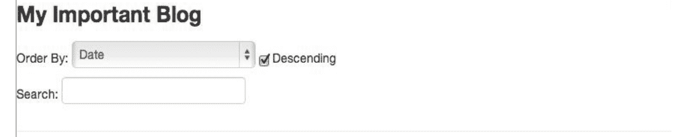

## New Post

### Scary Post

Aenean nec aliquam libero. Suspendisse lorem magna, lobortis eu tincidunt vel, faucibus quis erat

posted on 11/11/12 8:50 PM by Michael Myers

## New Post

### First Post!!!!~11

Lorem ipsum dolor sit amet, consectetur adipiscing elit. Duis lacinia cursus arcu a pellentesque. Curabitur convallis massa faucibus tellus tincidunt et tincidunt augue elementum. Curabitur pretium metus gravida augue elementum mollis.

posted on 11/11/12 8:50 PM by Chris Hiller

我们做的第二件事是在页面底部添加了一个 `<hr>`，以及一个用于调用 `ContentCtrl` 中 `about()` 函数的链接，代码如下：

```
blog.controller('ContentCtrl', function ($scope, Posts, Post, $routeParams, Modal, $log) {
.. snip ..
// opens an "About" modal
$scope.about = function() {
```

```
var modal = new Modal($scope, 'about');
modal.open().then(function() {
    $log.log("modal opened!");
});
```

最后一件事是创建了一个名为 "about" 的模板，并告诉我们的 Modal 对象打开它。

## 对 Modal 类进行单元测试

让我们展示这个类是否按预期工作。

```
describe('The Modal Class', function () {
  var scope, Modal;

  beforeEach(inject(function ($rootScope, $injector) {
    scope = $rootScope.$new();
    // if you want to call something Modal in your local scope,
    // and the service name happens to *be* Modal, you can
    // just ask the injector service for it.
    Modal = $injector.get('Modal');
  }));

  describe('the constructor', function () {
    it('should extend the options', function () {
      var modal = new Modal(scope, 'foo', {foo: 'bar'});
      expect(modal.options).toEqual({show: false, foo: 'bar'});
    });
    it('should create a deferred', function () {
      var modal = new Modal(scope, 'foo', {foo: 'bar'});
      expect(angular.isObject(modal.dfrd.promise)).toBeTruthy();
    });
  });

  describe('the open method', function () {
    it('should throw an error if supplied a bad template id', inject(function ($httpBackend, $http, $window) {
      spyOn($window, 'alert');
      var modal = new Modal(scope, 'foo');
      $httpBackend.expectGET('foo').respond(404);
      expect(modal.open()).toThrow();
      // apparently you don't need to flush if you respond with an error
    }));
    it('should get a cached template', inject(function ($templateCache) {
      $templateCache.put('foo', '<div>foo!</div>');
      var modal = new Modal(scope, 'foo');
      // wasn't sure how to get a spy to return its "this"
      angular.element.prototype.modal = function () {
        this.called = true;
        return this;
      };
      modal.open();
      expect(modal.modal.called).toBeTruthy();
    }));
    it('should resolve its promise', inject(function ($templateCache) {
      var resolved = false, modal;
      $templateCache.put('foo', '<div>foo!</div>');
      modal = new Modal(scope, 'foo');
      angular.element.prototype.modal = function () {
        return this;
      };
      scope.$apply(function() {
        var promise = modal.open();
        promise.then(function() {
          resolved = true;
        });
      });
      expect(resolved).toBeTruthy();
    }));
    it('should open again if modal exists', inject(function ($templateCache) {
      var modal, resolved = false;
      $templateCache.put('foo', '<div>foo!</div>');
      modal = new Modal(scope, 'foo');
      angular.element.prototype.modal = function () {
        return this;
      };
      scope.$apply(function() {
        modal.open();
      });
      scope.$apply(function() {
        modal.open().then(function() {
          resolved = true;
        });
      });
      expect(resolved).toBeTruthy();
    }));
  });

  describe('the close method', function() {
    it('should throw an error if it cannot find a modal', function() {
      var modal = new Modal();
      expect(modal.close).toThrow();
    });
    it('should attempt to close the modal', inject(function($templateCache) {
      var modal, resolved = false, command = '';
      $templateCache.put('foo', '<div>foo!</div>');
      modal = new Modal(scope, 'foo');
      angular.element.prototype.modal = function () {
        command = arguments[0];
        return this;
      };
      scope.$apply(function() {
        modal.open().then(function() {
          modal.close();
          resolved = true;
        });
      });
      expect(command).toBe('hide');
      expect(resolved).toBeTruthy();
    });
  });
});
```


需要注意几点：

我们在此处使用 Promise，唯一的原因是：我们可能需要通过 HTTP 请求来获取模板的部分内容。如果这样做，我们就需要能够以异步的方式执行代码，因为获取请求本身必然是异步的。因此，如果我们愿意，可以将这个模板放在一个名为 `about.html` 的文件中，并将该文件的路径作为 `Modal()` 的第二个参数来指定。当我们想打开模态框时，可以使用 `$http` 服务来获取模板，并在收到后显示它。当 Promise 解析完成时，我们就确切地知道模态框何时被打开。

`Modal()` 的第一个参数是一个 Scope。我们在这里其实没有真正用到它，但本可以使用。假设我们想在 `ContentCtrl` 中的某个地方执行 `$scope.name = 'John Jacob Jingleheimer Schmidt';`。当我们编译模态框的模板时，这个 scope 对我们是可用的，所以我们可以轻松地在模板中放入 `{{name}}`。

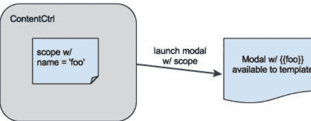

这只是处理“模态框问题”的一种方法，你可能不像单纯使用标记（markup）并在需要打开或关闭模态框时通过程序切换开关那样喜欢这个解决方案。

## AngularJS 与其他第三方应用

几乎任何第三方库都可以与 AngularJS 一起使用——只需付出一点努力。我经常看到有人提到 D3（http://d3js.org）和 Socket.IO（http://socket.io），因此让我们来看看如何将它们与 AngularJS 结合使用。

### D3

D3 是一个流行的数据可视化库。虽然 D3 及其用法的复杂性超出了本书的范围，但我们可以拿一个简单的 D3 示例，并将其“Angular 化”。请注意，我的 D3 功力并不强。

首先，这是我们将要使用的 HTML 和 CSS。

```html
<div ng-controller="MyCtrl">
  <div class="chart" bar-chart="data"></div>
  <button ng-click="randomize()">randomize!</button>
</div>

<script src="http://d3js.org/d3.v2.js"></script>
```

这是 D3 示例的 CSS：

```css
.chart div {
  font: 10px sans-serif;
  background-color: steelblue;
  text-align: right;
  padding: 3px;
  margin: 1px;
  color: white;
}
```

接下来，是涉及的 JavaScript 代码：

```javascript
var myApp = angular.module('myApp', []);

// 提供一些数据和一个随机化函数
myApp.controller('MyCtrl', function($scope) {
  $scope.data = [1, 2, 4, 8, 16, 32];

  // 随机打乱 $scope.data 数组的顺序。
  $scope.randomize = function () {
    var i = $scope.data.length,
        tempi, tempj;

    while (--i) {
      var j = Math.floor(Math.random() * (i + 1));

      tempi = $scope.data[i];
      tempj = $scope.data[j];

      $scope.data[i] = tempj;
      $scope.data[j] = tempi;
    }
  };
});

// 在标签上放置一个基于 D3 div 的条形图，并在模型变化时更新它。
myApp.directive('barChart', function () {
  return function (scope, elm, attrs) {
    var data = scope.$eval(attrs.barChart);

    // 便捷的宽度计算函数
    function width(d) {
      return d * 10 + 'px';
    }

    // 获取我们的元素，并根据数据在其中放置一些不同大小的 div。
    // 是的，可能还有更优雅的方式来实现这个。
    d3.select(elm[0])
      .selectAll('div')
      .data(data)
      .enter()
      .append('div')
      .style('width', width)
      .text(angular.identity);

    // 监视数据变化，并用新的宽度更新元素内的 div。
    scope.$watch(attrs.barChart, function (new_val, old_val) {
      if (new_val !== old_val) {
        d3.select(elm[0])
          .selectAll('div')
          .data(new_val)
          .style('width', width);
      }
    }, true);
  };
});
```

这并不那么糟糕，对吧？添加一些过渡效果和 SVG，你就能很快地用 D3 和 AngularJS 动态更新你的图表了。如果你感兴趣，Brian Ford 提供了一篇出色的博文，其中包含一个更完整的示例：[http://briantford.com/blog/angular-d3.html](http://briantford.com/blog/angular-d3.html)。

### Socket.IO

Socket.IO 允许你轻松地编写针对 Node.JS 服务器的实时 Web 应用程序。虽然配置服务器超出了本文的范围，但我们可以讨论如何在 AngularJS 的上下文中最佳地使用 Socket.IO。

Socket.IO 提供了一个全局变量 `io`。你可以调用 `io.connect('http://your-server.com')` 来获取一个 socket 对象。现在，你就有了一个到你指定的 Node.JS 服务器的持久 socket 连接。让我们提供一个使用 Socket.IO 的工厂（factory）。这将让你远离全局作用域（通过依赖注入），并协助消化循环（digest loop）；请记住，非 AngularJS 代码不知道何时触发监视（watches），所以我们必须告诉它。

让我们构建这个工厂，它与 Brian Ford 在 [http://briantford.com/blog/angular-socket-io.html](http://briantford.com/blog/angular-socket-io.html) 中提出的方法非常相似：

```javascript
angular.module('app').factory('connect', function ($window, $q) {
  return function (scope, url) {
    var socket = $window.io.socket(url);

    return {
      // 对 socket.on() 的包装
      on: function (event) {
        var dfrd = $q.defer();

        socket.on(event, function () {
          var args = arguments;

          scope.$apply(function () {
            dfrd.resolve.apply(dfrd, args);
          });
        });

        return dfrd.promise;
      },

      // 对 socket.emit() 的包装
      emit: function (event, data) {
        var dfrd = $q.defer();

        socket.on(event, data, function () {
          var args = arguments;

          scope.$apply(function () {
            dfrd.resolve.apply(dfrd, args);
          });
        });

        return dfrd.promise;
      }
    };
  };
});
```

以及基本用法：

```javascript
function MyCtrl($scope, connect) {
  // 记住：socket 不是一个真正的 Socket.IO socket 对象；它是我们的包装器
  var socket = connect($scope, 'http://localhost.com');

  socket.on('some_event').then(function() {
    // 做些事情
  });

  socket.emit('some_other_event', {foo: 'bar'}).then(function() {
    // 做其他事情
  });
}
```

所以你会注意到，我们在这里使用的是 Promise 而不是回调函数；Socket.IO 使用回调函数，但我们可以完全避免它们。

接下来，我们将讨论另一个流行的单元测试框架——QUnit。

## 使用 QUnit 测试 AngularJS

你并不一定要使用 Jasmine 来对 AngularJS 代码进行单元测试。只需进行一些简单的设置，你就可以同样轻松地使用 QUnit 或其他库（如 Mocha）。

以下是使用 QUnit 测试每种组件的示例：

```javascript
var myApp = angular.module('myApp', []);

myApp.controller('MyCtrl', function($scope) {
  $scope.addTwo = function(n) {
    return n + 2;
  };
});

myApp.service('MyService', function() {
  this.addThree = function(n) {
    return n + 3;
  };
});

myApp.directive('myDirective', function() {
  return {
    link: function(scope, elm, attrs) {
      scope.$watch(attrs.myDirective, function(value) {
        elm.text(value + 4);
      });
    }
  };
});

myApp.filter('myfilter', function() {
  return function(s) {
    return s + 5;
  };
});
```

以及测试：

```javascript
var injector = angular.injector(['ng', 'myApp']);

var init = {
  setup: function() {
    this.$scope = injector.get('$rootScope').$new();
  }
};

module('tests', init);

test('MyCtrl', function() {
  var $controller = injector.get('$controller');

  $controller('MyCtrl', {
    $scope: this.$scope
  });

  equal(3, this.$scope.addTwo(1));
});

test('MyService', function() {
  var MyService = injector.get('MyService');

  equal(4, MyService.addThree(1));
});

test('MyDirective', function() {
  var $compile = injector.get('$compile');
  var element = $compile('<div my-directive="foo"></div>')(this.$scope);

  this.$scope.foo = 1;
  this.$scope.$apply();

  equal(5, element.text());

  delete this.$scope.foo;
});

test('MyFilter', function() {
  var $filter = injector.get('$filter');

  equal(6, $filter('myfilter')(1));
});
```

## 结论

如你所见，这与设置 Jasmine 来测试 AngularJS 代码一样简单，只是略有不同。`angular-mocks.js` 缺乏支持并不会阻碍我们，我们只需使用 injector 来获取所需的任何内容即可。这应该足以让你开始编写自己的 QUnit 测试。

本书到此结束。我希望你在阅读过程中有所收获。我知道我 certainly 获益匪浅！

## 目录

- [版权](#)
- [前言](#)
- [第 1 章. AngularJS 入门](#)
- [第 2 章. AngularJS 核心概念](#)
- [第 3 章. 模型详解](#)
- [第 4 章. 视图详解](#)
- [第 5 章. 控制器详解](#)
- [第 6 章. 指令详解](#)
- [第 7 章. 服务、工厂与提供者](#)
- [第 8 章. 过滤器](#)
- [第 9 章. 实际应用](#)
- [第 10 章. AngularJS 与第三方技术](#)
