# Web 业务应用程序开发：HTML, CSS, JSP, PHP, ASP.NET 和 JavaScript

# 赞誉

# 《为 Web 开发商业应用》

“作为一名 IT 专业人士，我看到了那些有远见的开发者和业务分析师的价值，他们准备将公司提升到新的水平。劳拉和克里斯蒂安创作了一本独特的书，在当今充满挑战的 Web 环境中，概述了 Web 开发的逻辑流程。学生们会发现，这本书轻松地涵盖了创建有效 Web 界面、访问数据库以及提供有价值的商业应用所需的技能。”

—— 丽莎·博克，宾夕法尼亚理工学院计算机信息技术助理教授

“对商业应用 Web 开发的精彩概述。企业系统上的经验丰富的应用开发者可以利用本书开始接触不同的 Web 技术……这本书将所有内容整合在一起。对于刚刚开始商业应用开发的年轻 IT 专业人士来说，这也是一个极好的资源。经验丰富的 IT 经理也可以使用本书来帮助他们理解为其业务开发 Web 应用的复杂性。”

—— 吉姆·巴克，IBM i 教育工作者，《ILE RPG 编程（第五版）》合著者

“任何认真面向商业的 Web 开发者的明智资源。”

—— 查尔斯·瓜里诺，中央公园数据系统公司总裁

“当今成功的商业开发者必须精通 Web 开发技能，并懂得如何将这些技能与动态的商业环境联系起来。《为 Web 开发商业应用》通过提供大量开发工具的技术覆盖，同时保持对真实世界商业应用的关注，解决了这两个关键组成部分。与《为 Web 开发商业应用》一起‘开始干正事’吧！”

—— 查尔·帕克，马斯基根社区学院计算机信息系统讲师

“商业开发者现在有了一本关于 HTML、CSS、JavaScript 等技术的逐步指南，并可通过提供的练习完成学习。为 Web 开发商业应用的旅程从这本书开始。”

—— 艾伦·塞登，塞登集团

“《为 Web 开发商业应用》通过练习和示例指导你完成整个过程，提供了一个学习如何将业务带到 Web 上的绝佳方式。它不仅教授基本的 Web 开发技能，还教你如何将现有的商业应用带到 Web 上，以覆盖更广泛的受众。这是开发商业 Web 应用的绝佳起点！”

—— 阿曼达·沃尔什，高级程序员/分析师（IBM i 和 Web 开发者），Consultech Services 公司

# 致谢

我要感谢克里斯蒂安·赫尔与我合作这个项目。我们合作愉快，配合默契。克里斯蒂安让这个大型项目变得愉快，我非常感激他付出的知识、见解、经验和努力。还要感谢 MC Press 的图书编辑安妮·格拉布。

我还要感谢我的家人给予的支持。特别感谢保罗的爱与耐心。没有家人的支持，这本书不可能完成。谨以此书献给我深爱的侄子布伦特，以作纪念。我们非常想念他，他将永远活在我们的记忆中。布伦特常说“天空才是极限”。这句话千真万确，绝对是值得遵循的励志之言。不要犹豫，去触碰天空吧。

我希望这本书能激励经验丰富的商业开发者轻松学习 Web 技能，并让那些刚接触开发的人深入其中，学习如何使用 Web 工具开始干正事。我很幸运能拥有一份自己热爱并充满激情的事业。我希望这本书能激励他人获得同样的职业满足感。

—— 劳拉·乌贝尔霍

首先，我要感谢劳拉·乌贝尔霍给我参与这个项目的机会，以及她提供的学习机会。没有她的经验、鼓励和指导，这个项目无法完成。我还要感谢安妮·格拉布的支持和鼓励。真的，我很幸运能与劳拉和安妮一起合作这个项目，我将永远心存感激。

我对吉姆·巴克的鼓励和建议感激不尽。吉姆带我去了我从未想过会去的地方，我衷心感谢他引荐我参与这个项目。我还要感谢盖特威技术学院的所有同事们的支持。特别感谢我在 GTC 的所有学生，他们给了我继续写作和教学的灵感。

我还要感谢我的家人给予的支持和鼓励。最重要的是，我要感谢我的妻子凯莉，她拥有无比善良的心和宝贵的支持。感谢你给了我力量，让我相信自己的激情并追求梦想。

—— 克里斯蒂安·赫尔

# 引言

为 Web 开发商业应用程序是一个备受关注的话题。在我们看来，真正着手进行 Web 应用程序开发则更加有趣，并且与任何商业开发者都高度相关。我们很享受编写本书的过程，并努力为那些希望扩展技能、开发商业 Web 应用程序的开发者提供一份全面的资源。

# 为什么还要写一本关于 Web 应用程序开发的书？

关于 Web 应用程序开发的书已经很多了，为什么还要再写一本？我们觉得，很少有书能真正捕捉到商业应用程序程序员的需求。很多时候，Web 开发书籍只关注单一技术或语言。学习编写 HTML、JavaScript 和层叠样式表（CSS）只是成功的一半。这让我们想起多年前的一则广告：一位年轻的程序员兴奋地向老板展示公司最新的网页，上面带有火焰和旋转的 Logo。老板赞许地点点头，然后说：“很好，现在你能把它和应付账款系统集成起来吗？”

有多少经验丰富的应用程序开发者，多年来一直构建复杂且高效的应用，却在被要求开发 Web 应用程序时突然感到不知所措？有多少试图进入职场的学生，不确定如何培养适合商业 Web 开发者职业的技能？而想要成为商业应用程序开发者的人又该从何开始？

为了回答这些问题，我们编写了本书。它不仅提供了 HTML 的全面指南，还涵盖了基于浏览器的应用程序的许多方面。简而言之，本书由商业应用程序开发者和教育工作者为商业应用程序开发者编写。你将学到的远不止创建带有火焰 Logo 的网页：你将学会如何将实时数据实际部署到基于 Web 的应用程序中，并创建完全交互式的现代应用程序。

# 本书是如何编排的？

本书的前几章介绍了 HTML，这是基于浏览器的应用程序的基础语言。本书涵盖的 HTML 内容广泛但重点突出。我们并没有试图教授 HTML 的所有可能特性，而是专注于对商业程序员最有用的部分。后续章节介绍了将实际应用程序数据集成到 Web 应用程序中的常用方法。

当我们回顾特定的编码技术时，你会看到命令/标签及其相关参数用边框分隔，如下所示：

**标签：**

```
<a
参数 1
参数 2
参数 3
>
</a>
```

以这种方式一致地显示命令，可以让你更轻松地将本书用作参考，从而快速浏览查找所需的命令。

你将查看一个假设企业 Belhur Publishing 的简单 HTML 页面。第一个示例展示了为该企业创建主页，提供 Web 展示和联系信息。后续页面添加了更多内容和更复杂的设计技术。之后，将介绍基于浏览器的应用程序。你将看到展示实际日常业务用途的示例应用程序。利用这些示例来帮助开发你自己的应用程序。在阅读并从示例中学习后，你将对自己开发商业 Web 应用程序的能力充满信心。

下面的截图展示了我们为 Belhur Publishing 网站设定的起点：一个简单的网页。它并不复杂——只是一个简单的静态 HTML 文档。这个网页在图像、格式或样式表方面几乎没有什么内容。这些特性将在本书后续章节中添加，但由于我们是应用程序开发者，而非图形设计师，因此重点在于所涉及的代码，而非设计或创建美观的网页。（话虽如此，熟悉网页设计的基本原理仍是个好主意。快速上网搜索就能找到许多指导你学习这方面的资源。）

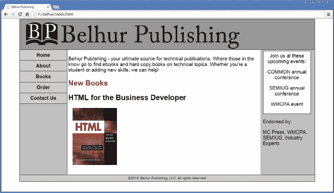

在介绍了 HTML 的基础知识后，我们将讨论与 HTML 交互的其他语言。仅用 HTML 创建商业 Web 应用程序是不可想象的。实际上，每个 Web 应用程序都会整合其他元素（如语言）来生成必要的动态内容。我们选择了开发 Web 应用程序时最常用的几种语言。每种语言在本书中都有独立的章节。

## 目标读者

本书的目标读者是业务开发者，或者正在考虑或有意成为业务开发者的人。许多书籍都教授 Web 开发，每本都专注于特定的语言或技术。但这并非又一本关于 Web 应用程序开发的普通书籍：本书专注于切入业务正题。构建静态网站是一回事，而访问数据库并提供业务应用程序则是另一回事。许多开发者在开发业务应用程序方面拥有丰富的经验。这些开发者可能非常熟悉传统的大型机/中型机编程环境，但对基于 Web 的应用程序知之甚少。世界在不断变化，许多业务程序员发现自己需要学习如何在 Web 上开展业务。也许你是一名刚接触 Web 和/或业务应用程序的学生，正在思考该从何处入手，以及如何培养成为一名成功的业务 Web 开发者所需的技能。

在规模较大的公司中，业务应用程序开发者可能并非负责创建和维护组织网站的人，但仍可能被要求开发新的业务应用程序，以便通过该网站进行部署。这种协作环境并不新鲜。大多数 IT 人员都习惯于基于团队的开发和协作努力。你需要了解网站开发的所有细节才能编写业务应用程序吗？不，可能不需要。我们特意包含了传统网站的许多组成部分，以帮助你了解它们如何协同工作；这种洞察力可以帮助你在整个应用程序开发过程中做出更好的决策。我们涵盖了基础知识，然后深入探讨有趣的内容，始终以业务开发者的视角为出发点。

作为一名业务开发者，或者正在学习成为业务开发者的人，你可能已经熟练掌握并习惯使用一种或多种编程语言。可能是 IBM i 上的 RPG、大型机上的 COBOL，或者 PC 上的 C++。虽然传统开发者通常只在一个平台上工作，但 Web 开发可能需要使用多个平台。跳出固有思维模式——以及你的舒适区——可能会让人不知所措。本书的目的是让你对 Web 应用程序开发感到更自在，同时帮助你学习新技能，以便在你的组织（或未来的组织）中应用，从而提高生产力、灵活性和价值。

## 我需要从头开始吗？

转向 Web 意味着从头开始吗？你需要抛弃现有的业务应用程序并重新开始吗？绝对不需要！这样做既低效又成本高昂。更明智的做法是继续使用现有的东西，同时学习一些新工具来覆盖更广泛的受众，或为你的应用程序提供更广泛的访问途径。这样，你可以保留组织在复杂业务逻辑方面的大部分现有投资。

Web 开发意味着需要新硬件吗？不一定。我们讨论的许多工具都可以在各种平台上使用。Java 技术可以在任何支持 Java 虚拟机（JVM）的平台上使用。通常，会使用单独的服务器来托管网站。这是必要的吗？不，并非总是如此；根据服务器的规模、可用容量、安全问题和应用程序工作负载，你可能可以在现有服务器上托管应用程序。然而，由于将应用程序开放到 Web 上通常会带来新的安全考虑，你可能需要单独的服务器，即使现有服务器有足够的容量。

## 选择开发工具

如何为开发项目选择最佳技术是一个复杂的话题。关于哪些工具是最好的工具，存在很多争论。通常，争论似乎基于提供意见者自身的技术舒适区而带有偏见。这种偏见还体现在认为必须使用单一技术的想法上。业务程序员越深入 Web 应用程序开发，就越清楚可用的工具种类繁多。所有这些工具都有有益的特性和功能，同时也存在局限性。

如果业务开发者正在寻找一种快速生成动态 Web 内容的方法，PHP 可能是一个合适的解决方案，因为它易于学习、成本低廉，并且可在许多平台上使用。另一方面，Microsoft .NET 技术的拥护者对其开发工具和最终解决方案感到满意，尽管它们通常局限于基于 Windows 的环境。Java 相关技术非常强大，可在各种平台和服务器上使用，但开发者往往因其学习曲线而望而却步。许多工具已经存在很长时间，但似乎有一种趋势，即用其他更简单、更成熟、更灵活的技术来取代某些工具。

哪种技术适合你的组织？很可能是这些技术或其他技术的组合。

### 总结

本书介绍 HTML，涵盖基础知识，使你能够开始开发网页。然后，我们在这些基本技能的基础上添加 CSS、JavaScript 和表单处理。在介绍完基础知识后，我们准备深入探讨应用程序开发中真正有趣的领域！我们将首先向你介绍基于浏览器的应用程序，然后介绍包括 JavaScript、PHP、JSP 和 ASP.NET 在内的技术，这些技术将 HTML 转变为一种有用的业务应用程序开发语言。

哪种技术适合你的需求？阅读本书后，你可能会发现，满足开发需求需要多种语言和工具的组合。读完本书后，你将拥有足够的知识，可以自己“切入业务正题”，并开始开发自己的业务 Web 应用程序。

# 第 1 章

# 基于浏览器的应用程序简介

本书由业务程序员和教育工作者为业务程序员编写。由于 HTML 是所有基于浏览器的业务应用程序的基础语言，我们将从 HTML 开始。然而，任何基于浏览器的应用程序几乎肯定都涉及 HTML 之外的语言或工具。在后续章节中，你将看到许多关于这些其他语言和工具如何与 HTML 集成的示例。

究竟什么是基于浏览器的应用程序？21 世纪的应用程序开发可以分为两类：传统和现代。（这些术语通常被业务应用程序开发人员使用，但可能有些误导，因为传统应用程序的设计有时相当现代，而一些所谓的现代应用程序却有着极其古老的设计。）现代应用程序开发进一步分为两个子类别：基于浏览器的和基于客户端的。基于客户端的应用程序通常作为可执行文件部署，加载到需要该应用程序的每台计算机上。这通常涉及一个或多个安装文件，通常从网站下载。而基于浏览器的应用程序，即本书的主题，则完全不同。

Web 浏览器是一种程序，例如 Google Chrome、Microsoft Internet Explorer 或 Edge、Mozilla Firefox。它被设计为通用的网页呈现器，接收来自远程 Web 服务器的复杂命令和数据流，并将其组合成视觉上吸引人的网页。浏览器通常可以处理用多种不同语言编写的指令，但迄今为止最常见的语言是`HTML`，即超文本标记语言。

`HTML`是众多标记语言之一。所有标记语言都依赖于称为标签的小代码片段，这些标签与正在处理的内容混合在一起。对于`HTML`，标签由包围它的尖括号（小于号和大于号）识别。例如，要创建一个大页面标题，你可以编写`<h1>我的页面标题</h1>`。`<h1>`标签向浏览器发出信号，表示后面的文本显示得非常大，如图 1.1 所示。

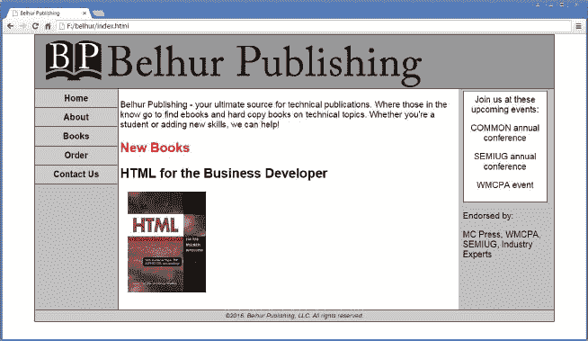

图 1.1：`HTML`页面标题示例

`</h1>`标签称为结束标签。斜杠表示此标签结束前面的标题标签。结束标签之后处理的任何文本将以默认大小和样式显示。大多数（但不是全部）`HTML`标签都有对应的结束标签。

`HTML`是一种相对简单的语言。虽然它有一些古怪之处，但不应让任何人感到畏惧。通常，网页设计最复杂的方面来自于将其他语言集成到`HTML`代码中，例如`JavaScript`和层叠样式表（`CSS`）。

### 其他语言

首先，你将学习如何将`JavaScript`和`CSS`集成到你的网页中。然后，你将看到如何将这些页面与其他语言（如`JSP`、`PHP`和`ASP.NET`）结合，以提供数据库集成。

每种语言都有其优缺点。`JavaScript`是一种基于 Java 的强大语言，以`C++`为模型，但更简单，并进行了关键设计更改，使其更容易部署在各种计算机上。`PHP`是一种流行的脚本语言，专门为数据库集成而设计。这种`HTML`预处理器在 Web 服务器上运行，并创建动态的`HTML`内容，通过浏览器返回给远程用户。`ASP.NET`在概念上与`PHP`类似，但语法类似于`VB.NET`，即 Microsoft 的 Visual Basic（`VB`）在 Microsoft `.NET`框架上实现的版本。`PHP`和`ASP.NET`都依赖于专门的通用网关接口（`CGI`）程序。`CGI`程序可以用多种语言编写，并提供了一种强大而灵活的方法来开发动态网页。

选择哪种语言取决于你，这将是一个考虑多种因素的决策结果，例如你当前的技能、同事的技能、可用资源的技能、管理层的指令、现有应用程序以及个人偏好。我们的目标是提供完整、清晰且功能性的示例，展示使用每种方法编写的基于浏览器的应用程序，使你在阅读完本书后能够立即投入生产。

### 什么是客户端？

客户端是用于访问 Web 应用程序的硬件设备。客户端可能是笔记本电脑或台式电脑，但也可能是手持设备，如 PDA/智能手机、平板电脑、iPad，甚至手机。你的应用程序需要支持哪些设备通常取决于你的应用程序用户是谁以及他们使用什么设备访问互联网。这些设备也可能使用各种操作系统。虽然最常见的操作系统是 Microsoft Windows，但还有许多其他可能性，如 Mac OS 和 Linux。

即使你网站的所有访问者都在 PC 上使用 Windows，他们可能使用不同的屏幕尺寸和分辨率，这会影响网站和应用程序的外观。这些差异可能会或可能不会影响应用程序的编码方式。例如，如果你的访问者使用手持设备，你的应用程序可能需要设计和编码，以便轻松地将显示的数据适配到较小的屏幕上。如果你的应用程序有很多图形，则需要更多地考虑性能和外观。（基于设备类型、操作系统、屏幕尺寸和分辨率的考虑将在第 12 章中更详细地讨论。）

### 什么是浏览器？

浏览器是一种软件，充当用户客户端与 Web 之间的接口。浏览器有时也被称为 Web 客户端。浏览器发送信息请求，接收信息，并在用户客户端上显示。

你可能已经熟悉一些可用的浏览器。它们包括但不限于 Chrome、Edge、Firefox、Internet Explorer、Opera 和 Safari。用于访问应用程序的浏览器可能会影响外观，并对 Web 开发带来其他考虑。浏览器是免费的，并且受欢迎程度会变化。如果你的应用程序提供对普通互联网社区的访问，那么可能会有许多不同的浏览器用于访问你的网站和应用程序。（浏览器将在第 12 章中更详细地讨论。）

### 什么是`HTML`？

如果你正在创建 Web 应用程序，几乎肯定会使用`HTML`。`HTML`已经存在相当长的时间，并且很可能在未来很长一段时间内继续使用。它是 Web 的语言，因此你必须至少对其有基本的了解。`HTML`自最初诞生以来已经发生了变化，包含了使其更灵活、更易于用于 Web 应用程序开发的功能和特性。`HTML5`于 2014 年 10 月发布，包含了重大增强。你将在接下来的章节中了解`HTML`。

纯`HTML`文档是静态的，意味着它处于恒定状态。客户端脚本可以嵌入到`HTML`中，使 Web 应用程序动态化。最常用于客户端脚本的语言是`JavaScript`。你将在第 8 章中了解`JavaScript`和客户端脚本。`HTML`表单通常用作将`CGI`集成到 Web 应用程序中的手段。如前所述，`CGI`是一种用于与 Web 服务器上的应用程序交互的协议。这涉及服务器端脚本。你将在后面的章节中了解`CGI`和服务器端脚本。

### 什么是 Web 服务器？

术语 Web 服务器可以指负责与客户端浏览器通信的程序。Web 服务器接受来自客户端浏览器的`HTTP`请求，并提供`HTTP`响应，包括可选的数据内容，通常以`HTML`文档和链接对象的形式。术语 Web 服务器也可以指运行 Web 服务器程序的系统。Web 服务器实际上有两个组成部分：硬件和软件。


编写 Web 应用程序并不一定意味着你需要购买新硬件。许多平台都可以用来提供网站服务。有些平台比其他平台更兼容、更适合 Web 开发，但大多数平台都能支持 Web 开发。大多数组织可能已经拥有可用于提供网站和 Web 应用程序的系统。

需要决定是否需要额外的硬件来提供网站和 Web 应用程序服务。额外的硬件可能会增加一层安全性。数据和应用程序可以驻留在同一系统上，或者你可能希望将数据分离以增加另一层安全性。另一方面，拥有额外的硬件需要额外的支持和维护。还应考虑使用 Web 托管服务或云解决方案。

## 使用什么数据库？

本书示例中几乎可以使用任何数据库管理系统（简称 DBMS 或数据库）。Web 编程通常非常包容，大多数数据库都得到支持。本书中的示例主要使用 IBM DB2 和 MySQL 数据库，但第 7 章简要讨论了连接不同数据库的方法。后续章节使用连接数据库的示例，并包含多个连接示例，可用于在 Web 应用程序中整合动态数据库内容。

## 在哪里可以找到示例代码？

本书的代码示例和补充材料可在 MC Press 书店的本书网页上下载，网址为[`goo.gl/2uYjHb`](https://www.goo.gl/2uYjHb)。欢迎下载并使用这些示例。我们相信，使用本书及其中包含的示例将帮助你尽可能快速、轻松地开发自己的基于 Web 的应用程序。可下载的材料包括本书中所有代码示例对应的代码文件。

## 开发过程

Web 开发的工具和技术可能与传统的业务编程不同，但过程非常相似。开发应用程序仍然需要信息收集、分析、设计、编码、测试、文档、实施和支持。Web 开发还需要考虑应用程序生命周期，并在设计中构建灵活性，以便适应业务流程的变化。

组织的开发标准应进行更新，为开发人员提供结构化的流程作为标准化指南。与遗留代码开发一样，为 Web 开发制定预定义标准可以使代码保持一致、有组织、易于维护和管理。

所有环境都有其独特的挑战，就像所有程序员都有自己独特的编码方法一样。你可以让多个程序员编写相同的解决方案，但没有任何两个应用程序的编码方式完全相同。拥有明确的开发流程可以最大限度地减少开发差异的影响。这对 Web 应用程序和其他应用程序都适用。组织可能还有内部要求，例如《萨班斯-奥克斯利法案》或 HIPAA 合规性，这些要求不可忽视，需要在开发过程中加以考虑。Web 应用程序可能会增加另一个变数，因为通常会在混合环境中引入额外的硬件。例如，应用程序数据库和部分应用程序代码可能驻留在一个系统上，而基于浏览器的组件和服务器则驻留在另一个系统上。

花时间考虑 Web 开发如何融入流程，并制定一个明确的流程来遵循。这将是非常值得的。在学习新语言时，开发人员会倾向于坚持自己舒适的编码风格。如果没有预定义的流程，开发人员就会定义自己的流程。拥有明确的流程和编码风格将产生更一致的代码和更有组织的应用程序。从长远来看，这种应用程序更容易维护，无论你或其他人是否需要回头修改、维护或调试代码。

一旦决定了用于 Web 开发的工具、技术和硬件基础设施，并在实际开始开发之前，请考虑开发流程。这个流程应定期重新审视。由于业务需求、业务需求变化和技术变化等原因，流程会发生变化。开发流程与其他流程一样，可以定义、重新审视和增强，以适应组织的环境。流程的非正式性和灵活性取决于具体环境。

## IT 人员

与遗留应用程序一样，Web 应用程序的开发任务可能由多个小组或部门负责。这在大型组织中尤其如此。一个小组可能负责应用程序设计和图形，另一个负责数据库支持，另一个负责管理，另一个负责业务应用程序逻辑和开发。职责也可能按平台划分，因为 Web 应用程序通常涉及多个平台。这并不意味着 Web 开发比遗留开发需要更多人员，但确实意味着你必须考虑组件、任务和 IT 人员结构。人员结构将部分基于资源技能集和项目需求。在较小的组织中，开发人员可能还负责配置、Web 设计和编码。然而，你经常会发现，设计或编码方面的专家不一定是配置或硬件基础设施方面的专家。因此，任务通常分散在不同的员工和部门之间。

组织的规模和开发资源的技能集对 IT 人员结构有很大影响。如表 1.1 所示，小型组织需要具备非常多样化技能集并理解完整需求领域的个人。Web 开发的一个有趣挑战是，它使业务开发人员能够尝试设计。通常，具有强大分析能力、能够处理复杂业务需求并将其转化为功能良好的应用程序的开发人员，在设计应用程序外观方面并不那么直观。这可能意味着要走出舒适区，但这并不意味着业务开发人员不能在 IT 人员结构中扮演这一角色。

**表 1.1：组织规模与 IT 人员**

| 组织规模 | IT 人员角色 |
| --- | --- |
| 大型 | 通常按 Web 开发任务所需的各种角色划分为多个部门。部门可能包括但不限于管理层、项目负责人、硬件和运营支持、安全和管理、设计和图形、数据库管理以及开发。Web 项目的规模在范围和时限上往往较大。 |
| 中型 | 通常划分为多个部门，但比大型组织少。通常根据员工技能集进行组合结构划分。 |
| 小型 | 通常很少划分部门（如果有的话）。员工作为“多面手”承担多种角色。 |

虽然本书侧重于商业编程，但也包含其他主题，以便深入介绍 Web 开发的多个领域。无论你是要负责多项 Web 应用任务，还是只负责编程，理解相关任务都有助于你培养扎实的 Web 编程技能，并更好地确定自己的定位。试图成为“万金油”可能会导致“样样稀松”。不要让自己不堪重负。我们特意将重点放在商业开发者和动态商业应用的编码上，以便你了解所需的技术技能。你会发现，在积累一些经验后，Web 开发中使用的语言和工具往往存在相似之处。无论你作为开发者扮演什么角色，学习 HTML 都很有价值。学习创建商业应用的通用语言总是有益的。

那么，这对你作为开发者意味着什么呢？你可以只专注于编码工作，也可以决定拓展 Web 技能，以满足需要多样化技能集的角色需求。你的个人目标、工作状况和技能集将影响你在组织 IT 人员结构中的定位。拥有多样化技能的开发者在适合的角色和组织中会有更大的灵活性。如果你除了商业应用 Web 开发之外还想学习其他技能，那么中小型组织可能更适合你。如果你希望专注于应用编码和开发，而不学习设计、管理或其他相关技能，那么大型组织可能更合适。

### 平台

创建 Web 应用并不一定意味着组织需要更换或添加新平台。通常，如果现有硬件适合 Web 开发，就可以使用。大多数组织已经配备了支持 Web 浏览器的客户端。浏览器支持是必需的。后端硬件很可能与用户用来访问 Web 的客户端设备不同。配置还将包括一个 Web 服务器。Web 服务器最流行的平台之一是 PC。这个 PC 服务器可能用于组织的内部网，或者出于安全目的，它可能是一个专门用于 Web 应用的服务器。

遗留代码可以与 Web 应用一起重用，并且很可能继续驻留在原有平台上。数据库也可能继续驻留在其当前平台上。那么，你需要学习新的硬件操作系统吗？可能不需要，除非当前使用的平台不支持 Web 应用。

如果决定使用基于 Java 的技术，那么任何支持 Java 虚拟机（JVM）的平台都可以使用。如果决定使用 ASP.NET，则可能会使用 Microsoft 服务器。有些语言更适合特定的硬件，但大多数用于 Web 开发的语言都得到多种平台的支持。Web 开发比传统应用开发更加开放。它的灵活性使平台决策更加容易。

成本、资源技能和员工知识也是决定使用哪些平台进行 Web 开发的因素。大多数组织已经具备基于 PC 的客户端硬件（支持 Web 浏览器）以及可用作 Web 服务器的平台知识。

### 设备

Web 应用使得应用能够支持更多设备。任何能够连接互联网并提供基于浏览器的模拟器的设备都可以用于 Web 应用。创建和使用 Web 应用的决定使你能够通过多种设备提供用户访问，包括 PC、平板电脑、iPad、PDA、智能手机和其他移动设备。

使用非传统设备的关键在于应用设计。设计需要适应所用设备的屏幕尺寸、键盘和操作系统。借助 Wi-Fi，现场工作人员或车间工作人员可以轻松访问和使用应用，从而为旧应用注入新的活力。（Wi-Fi 是无线保真度的缩写，是一种常用于互联网连接的无线技术。）组织的销售人员可以使用智能手机或其他移动设备查询库存数量。车间工作人员可以使用手持设备轻松查询制造需求。虽然本书不侧重于使用非常规设备构建应用，但它确实为你实现这些基于 Web 的应用铺平了道路。近年来发生了许多技术变革，今天被认为非常规的技术，明天很可能成为标准。

### Ajax

构建 Web 应用很有趣。然而，有些 Web 应用速度缓慢，有时让用户感到沮丧。由于 Web 应用由多个组件组成，即使是编码良好的网站，有时也需要用户等待数据和页面加载。你可能见过网站上的沙漏或完成百分比显示，这背后是应用在处理步骤：评估输入、响应请求、检索信息，并将其格式化以通过 Web 浏览器显示。

Ajax（异步 JavaScript 和 XML）是一个流行词，而且理由充分。它是一种 Web 编程方式，消除了沙漏和较慢的响应时间。它不是新技术，而是对已经成熟稳定的技术的一种新视角。

Ajax 是一组相互关联的 Web 开发技术，用于创建动态、交互式的 Web 应用。使用 Ajax，数据、内容和设计被融合在一起。使用 Ajax 的主要优势和原因是它能提高 Web 页面的响应性和交互性。这种改进是通过与服务器交换少量数据实现的，这样用户每次执行操作时就不必重新加载整个 Web 页面。由于 Ajax 引擎处理请求，信息可以由 Ajax 引擎保存，并允许应用与用户之间的交互独立于与 Web 服务器的任何交互。当用户在 Ajax 驱动的应用中点击某个内容时，几乎不需要响应时间。页面直接显示用户请求的内容。结果是速度、功能性、可用性以及 Web 页面交互性的提升。

Web 应用通常被编码为使用户与服务器之间的交互是同步的，即一个步骤必须跟随另一个步骤。如果用户点击链接并发起请求，该请求被发送到服务器，服务器处理请求并将结果返回给用户的 Web 浏览器。

Ajax 是异步的，因为它可以从服务器请求额外数据并在后台加载，而不会干扰当前 Web 页面的显示和行为。JavaScript 通常是用于 Ajax 函数调用的脚本语言。JavaScript 在页面加载时加载，并在客户端处理大多数基本任务，包括数据验证、数据处理和数据显示，而无需访问服务器。同时，Ajax 引擎在服务器之间来回发送数据。数据传输不依赖于用户操作，并且是并发进行的。Ajax 网站中的数据使用 `XMLHttpRequest` 对象检索，该对象适用于所有与现代 Web 浏览器兼容的脚本语言。XML 经常与 Ajax 一起使用，但异步内容并不要求必须格式化为 XML。

Ajax 是一种基于跨平台可用性的灵活技术。它可以与多种平台、操作系统和 Web 浏览器配合使用。Ajax 基于 JavaScript 和文档对象模型（DOM）等开放标准。虽然 Ajax 本身超出了本书的讨论范围，但你将在本书中学习更多关于 JavaScript 和 DOM 的知识。免费的开源 Ajax 示例适用于大多数基于 Web 的应用程序项目。

Ajax 网站的一个绝佳示例是 Google 地图（[www.google.com/maps](http://www.google.com/maps)）。访问该网站并查看一下。在网站上导航、放大或移动地图时，几乎无需等待。

## SOA

另一项重要技术是面向服务的架构（SOA）。SOA 定义了两个或多个实体如何交互，从而使一个实体能够代表另一个实体执行工作单元。该工作单元被称为服务。

SOA 实际上是一组相互通信的服务集合。通信可以包括服务之间简单传递数据或协调某些活动。服务交互使用定义良好的描述语言。SOA 是基于请求-响应范式的分布式计算的演进，适用于异步和同步应用程序。

使用 SOA，应用程序的业务逻辑或单独定义的函数被模块化，并作为服务呈现给用户应用程序。关键在于每个交互都是自包含的，并且具有松散耦合的特性。每个交互独立于其他任何交互。服务接口独立于实现。应用程序开发人员可以通过组合一个或多个服务来构建应用程序，而无需了解服务或其底层实现。例如，服务可以在 Windows 服务器上使用 .NET 或 Java 实现，而使用该服务的应用程序可以是在 IBM i 上运行的 RPG。

支持 SOAP 的 Web 服务是 SOA 最常见的实现。SOAP，即简单对象访问协议，是一个定义消息应用层结构的标准。为了实现集成，应用程序必须就所使用的消息结构达成一致。SOAP 提供了适用于多种通信协议的应用层消息结构。支持 SOAP 的应用程序可以轻松地相互交换信息；因此，SOAP 促进了完全不同的系统之间的集成。

SOA 的协议独立性意味着不同的使用者可以通过不同的方式与服务通信来使用该服务。面向服务是一种构建自治服务系统的方法。使用 SOA，服务被构建为功能强大、灵活、可靠且可用。新的服务拓扑可能会随着时间的推移而演变，因此使用 SOA 构建的系统也能够适应变化。

本书不重点介绍 SOA，但会介绍可用于开发 SOA 应用程序的技能和工具。

## Web 服务

许多环境使用多种硬件平台、软件系统和数据库。不同的软件可能使用不同的编程语言，这就需要在多个系统之间建立一种不依赖于特定编程语言的通信方法。使用 Web 服务是一种常用的解决方案，使系统能够通过互联网相互交换数据。Web 服务包括服务请求者和服务提供者。发起交换的系统称为服务请求者，接收并处理请求以提供数据的系统称为服务提供者。Web 服务使用参数在请求者和提供者之间来回传递数据。

大多数系统可以解释和使用 XML 标签。Web 服务可以使用 XML 文件来交换数据。Web 服务是一种集成基于 Web 的应用程序的标准化方式，它利用可扩展标记语言（XML）、SOAP、Web 服务定义语言（WSDL）和通用描述、发现与集成（UDDI）等开放标准，通过互联网协议（IP）骨干网进行通信。在 Web 服务中，XML 用于标记数据，SOAP 用于传输数据，WSDL 用于描述可用的服务，UDDI 列出可用的服务器。Web 服务是通过 Web 在网络地址上提供的软件功能。

在本书中，我们会提到 Web 服务，因为大多数环境都有多个平台，并且可以利用 Web 服务。作为 Web 应用程序开发的初学者，一旦你学习了 Web 开发的基础知识，就可以准备探索使用 Web 服务了。

## 其他语言

本书从 HTML 开始，并继续介绍用于 Web 开发的其他编程语言。这里并未介绍所有可能用于 Web 开发的语言。然而，我们经过深思熟虑，介绍了一些较为常见的语言。你会发现许多可用于创建动态 Web 应用程序的选项和示例。

尽管 Web 开发已经存在了相当多年，但与非基于 Web 的业务应用程序开发相比，它仍处于起步阶段。它的发展如火如荼，但用于业务应用程序的 Web 开发绝不是一个成熟的技术。与任何其他发展中的技术一样，新的 Web 开发语言和工具不断被开发和引入。关于哪些工具最好以及未来哪些会流行，存在很多争论。

许多用于 Web 开发的语言和工具非常相似。通常，创建 Web 应用程序会使用多种语言的组合。在混合使用方面，Web 开发往往比传统开发更加开放。例如，传统上，RPG 用于在 IBM i 上编码，COBOL 用于大型机，Visual Basic 用于 Microsoft 服务器。而 Web 开发通常不会将组织锁定在特定的平台或单一语言上。

那么，有哪些语言可以用于 Web 开发呢？除了本书涵盖的工具（HTML、CSS、JavaScript、PHP、ASP 和 JSP）之外，还有许多其他语言可用于 Web 开发，包括 A、ActionScript、Ada 95、AppleScript、C、C++、CCI、CMM、Dylan、Eiffel、Fantom、GEL、Glyphic Script、Guile、HyperTalk、Icon、Java、jQuery、KQML、Linda、Lingo、Lisp、Logo、ML、Modula-3、NewtonScript、Obliq、Perl、Python、REXX、Ruby、ScriptX、SDI、Self、SiMPLE、SLOTH、Smalltalk、SMSL、Synergy、Tcl、Telescript、Tycoon、UserTalk、Viola、VBScript、WebScript、VRML、XHTML 和 XML。这绝不是一份完整的列表，但它让你了解可用于 Web 开发的工具范围。每种语言都有其独特的特点、优势和劣势。本书重点介绍一些最成熟、经过验证且流行的 Web 开发工具。

## 对 Web 技术的恐惧

许多经验丰富且熟悉所谓传统应用程序的业务应用程序开发人员，对于使用 Web 技术编写应用程序的想法感到有些畏惧。使用非 Web 技术编写的应用程序同样可以轻松地使用 Web 技术编写。对于密集型数据输入任务，有人可能会认为非 Web 应用程序是最好的。然而，这非常值得商榷；一个设计良好且编码优秀的 Web 应用程序可以很好地满足密集型数据输入的需求。这更可能是开发人员基于自身舒适度的说法，而非客观意见。鉴于许多年轻程序员在早期就接触了基于 Web 的应用程序，因此他们对这项技术感到舒适，开发人员的偏好正在转向 Web 应用程序。

这并不一定意味着你应该用 Web 技术重写所有非 Web 应用程序。这样做既不现实也不实际。例如，考虑一个组织，它在非 Web 的 ERP 软件包上投入了大量资金，并拥有内部附加应用程序。仅仅为了拥有一个基于 Web 的应用程序而重写 ERP 软件包及其附加组件是没有意义的。然而，当你已经在大力增强或重写一个应用程序、开发新应用程序或对应用程序进行现代化改造时，不要害怕 Web。（我们在第 7 章中讨论了重用遗留应用程序。）

有许多实际理由考虑和采用 Web 技术用于业务应用程序。业务应用程序开发正在发生变化，有朝一日可能会被 Web 应用程序主导。甚至可以说，Web 应用程序已经在商业环境中确立了主导地位。

虽然刚接触业务应用程序开发的人可能已经在使用 Web 工具，但那些多年担任开发人员的人可能会认为 Web 开发超出了他们的舒适区。如果这个描述符合你的情况，那么是时候跳出框框，扩展你的技能了。学习 Web 开发并不像乍看起来那么可怕。与任何其他技术一样，一旦你学会了 Web 开发，使用了它，理解了它的技术原理，并对其感到得心应手，你就能迅速上手。


多年来，我们遇到过许多以各种方式接触 Web 开发的开发人员。一个典型的*错误*引入 Web 开发的例子是：让一个开发人员负责创建一个 Web 应用程序，然后送他去参加 Java 课程，期望他回来时就能掌握开始大量编写代码所需的工具和知识。这种情况不太可能成功，甚至可能适得其反，给开发人员灌输对 Web 应用程序开发的恐惧。Java 本身并不可怕。它是一种非常健壮、强大且有用的语言。然而，它也是一种复杂的语言，需要时间来学习。

在本书中，我们有意不专注于单一技术；相反，我们的方法是介绍并提供工具组合的示例，以便你在完成本书后能够开发业务应用程序。如果你对 Web 开发有些害怕，我们相信，在读完本书后，你将克服恐惧，并渴望使用你学到的工具。

## 扩展你的技能组合

随着组织变得更加全球化——扩张、合并和变革——每个人都需要不断更新自己的技能。你应该害怕吗？一点也不。对变化持开放态度并扩展技能是生活的常态。

多年来，技术在开发方面发生了巨大变化。所取得的成就令人惊叹。商业依赖于技术而蓬勃发展。技术为保持业务平稳运行提供了框架，并提供了改进业务的机会。这些机会可以表现为资源节约或其他成本节约。它们也可以表现为满足基本业务需求，包括接触组织外部的其他人。

不久前，还有人可能认为 Web 可能是一种短期潮流。时间证明这绝对不是事实。Web 已经存在，比以往任何时候都更庞大，而且还在不断增长。同样，几年前，家里有一台连接互联网的电脑还很不寻常。现在，大多数家庭都有某种形式的互联网连接。事实上，人们在很小的时候就接触到了计算机和 Web，从而对基于 Web 的技术有了更广泛的适应性。技术变化迅速，使得几乎任何人都可以在几乎任何地方访问互联网。作为一名业务应用程序开发人员，这意味着如果你打算在职业生涯中继续前进，你需要将 Web 技术作为你技能组合的一部分。

在哪里可以学习 Web 技能？存在许多学习资源和选择。有些选择比其他选择更便宜、更省时。有许多关于各种 Web 主题的书籍和课程。然而，我们的经验是，大多数教育来源都专注于 Web 开发的特定部分，并不总是基于业务开发人员的视角。在编写本书时，我们特意关注你——业务开发人员。完成本书后，你将拥有开始编写业务 Web 应用程序所需的工具。

## 就业市场

如今的**就业市场**仍然为传统编码人员提供了一席之地，但通常要求求职的开发人员具备 Web 技能。大多数企业已经发生了显著变化。收购、合并和全球业务基础设施如今已司空见惯。商业世界中始终存在的变革氛围对当今的业务应用程序开发人员产生了重大影响。变革是业务基础设施中的常态，但不要被误导，认为它是一个不断变化的目标，以至于你无法安全地确定在技能组合开发上最值得投入时间的地方。

对于拥有正确技术技能组合的 IT 求职者来说，未来前景强劲。婴儿潮一代的退休，加上企业对熟练技术专业人员的持续需求，推动了开发人员就业市场的强劲。IT 从业者老龄化可能会对一些组织的全球竞争力造成麻烦，因为他们会因退休而失去资深程序员。然而，对程序员的需求对于那些希望在 IT 部门内晋升或刚进入就业市场的人来说是个好消息。IT 工人的供应减少，而需求持续增长。根据劳工统计局的数据，2012 年至 2022 年间，该行业的就业人数预计将增长 8.3%，该行业已经拥有超过 30 万专业人员。该职业强劲的预期增长（以及高薪中位数）帮助软件开发和 Web 开发人员在《美国新闻与世界报道》2016 年最佳工作排名中名列前茅（参见*[money.usnews.com/careers/best-jobs/rankings/the-100-best-jobs](http://money.usnews.com/careers/best-jobs/rankings/the-100-best-jobs)*）。

组织仍在投资 IT 项目。IT 职业的前景和对开发人员的需求仍然有利。趋势显示对业务分析师和开发人员的需求强劲。近年来，IT 专业人士的薪资大幅增长。据《福布斯》报道，能够帮助企业跟上技术快速发展的专家的价值和需求将随着技术创新的指数级增长而增长（参见*[www.securityinfowatch.com/article/12050413/rapid-technology-advancements-in-security-may-out-pace-users](http://www.securityinfowatch.com/article/12050413/rapid-technology-advancements-in-security-may-out-pace-users)*）。对技术人才的竞争比以往任何时候都更加激烈。

组织正在继续为其现有应用程序启用 Web 功能，并追求基于 Web 的解决方案，这使得基于 Web 的技能非常热门。具备 Web 技能（包括 Ajax、Java、.NET、JavaScript、HTML 和 PHP）的业务开发人员需求旺盛。据 Business Insider 报道（参见*[www.businessinsider.com/programming-languages-in-highest-demand-2016-1](http://www.businessinsider.com/programming-languages-in-highest-demand-2016-1)*），一些可以帮助你找到工作的流行编程语言包括 Java、PHP、Perl、C、JavaScript、.NET、Ruby、Python、CSS 和 HTML。

业务知识至关重要，因为组织努力使 IT 服务与其所支持的业务保持一致。市场对具备特定业务知识和系统分析能力的应用开发人员的需求依然强劲。组织还希望开发人员熟悉整个软件开发生命周期，并在领导力和沟通技能方面全面发展。组织正在寻找拥有更广泛开发技能的人才。

当今的商业市场是全球化的。网络和技术在全球市场中发挥了重要作用。即使是小型组织也受到业务全球化的影响。网络使大小企业都能将业务范围扩展到非常遥远的客户群。

### 外包

**外包**在当今商业环境中十分常见。引入此主题的目的并非讨论外包的利弊。作为业务开发人员，你只需了解它即可。

组织考虑外包的原因有多种。一个原因可能是预算考虑。另一个原因可能是内部可用资源不具备完成项目所需的技能。当组织决定将应用程序迁移到网络时，如果组织内部缺乏必要的技能，外包很可能会被考虑。无论你是一位经验丰富的业务开发人员、承包商，还是刚刚涉足业务开发的新手，拥有适合业务需求的技能将提升你的职业前景。你正在阅读本书这一事实表明你有提升技能的愿望。

外包这个话题存在争议。反对外包的人声称 IT 工作岗位正大量流向海外，这种说法通常被夸大。对于跟踪此类统计数据的大多数组织而言，结论是大约 5%的 IT 工作岗位被外国工人取代。其中大部分是低级别的编码工作、技术支持职位或呼叫中心工作。需要更高级技能的工作很可能留在组织内部。未来需求将下降的技能包括常规编码和系统测试、应用程序维护、技术支持、数据连续性和数据恢复。这些技能属于越来越多被外包和离岸的工作。与客户服务和帮助业务增长相关的 IT 工作往往留在组织内部。组织逐渐意识到，要使外包有效运作，需要在项目接口和管理方面投入大量工作。

外包并不一定意味着资源在海外。外包也可能包括顾问和独立承包商。Wi-Fi 连接、安全性和远程连接方面的技术进步使得几乎随时随地连接到远程服务器成为可能。这些改进为员工和承包商提供了远程工作的机会。尽管并非所有人都适合远程工作，且可能不适用于所有组织，但远程劳动力是另一种可能的资源。

这对作为业务开发人员的你意味着什么？重要的是你的技能组合要先进且符合行业需求。这当然包括 Web 开发技能。这也意味着作为业务开发人员，你可能还需要考虑成为顾问的职业道路。

### 总结

我们在本章中涵盖了大量信息，希望它能激发你思考一些影响你作为业务开发人员的因素。如果你真的想要，你可以实现你设定的目标。愿望越强烈，你成功的可能性就越大。迈出第一步至关重要。本书将帮助你更轻松地迈出进入 Web 开发的第一步。如果你已经具备一些 Web 开发知识，你也会从本书中受益。我们努力呈现的信息将减少你的学习时间，并尽可能快速高效地为你编写业务 Web 应用程序做好准备。

### 关键术语

`Ajax`  
`应用程序设计与图形`  
`应用程序逻辑`  
`基于浏览器的应用程序`  
`业务编程`  
`C`  
`C++`  
`CGI`  
`客户端`  
`基于客户端`  
`客户端脚本`  
`CSS`  
`数据库`  
`开发过程`  
`开发标准`  
`设备`  
`DOM`  
`动态业务应用程序`  
`结束标签`  
`手持设备`  
`硬件`  
`HTML`  
`iPad`  
`IT 人员`  
`Java`  
`JavaScript`  
`就业市场`  
`遗留系统`  
`非传统设备`  
`操作系统`  
`组织规模`  
`其他语言`  
`外包`  
`PDA`  
`Perl`  
`PHP`  
`平台`  
`Python`  
`RPG`  
`Ruby`  
`服务器端脚本`  
`智能手机`  
`SOA`  
`SOAP`  
`软件`  
`平板电脑`  
`标签`  
`UDDI`  
`VB.NET`  
`Web 应用程序`  
`Web 浏览器`  
`Web 客户端`  
`Web 开发`  
`网页`  
`Web 服务器`  
`Web 服务`  
`Wi-Fi`  
`WSDL`  
`XML`  

### 讨论/复习题

1. 什么是基于浏览器的应用程序？
2. 哪些编程语言常用于基于 Web 的业务应用程序？
3. 什么是开发过程？
4. 哪些数据库用于基于 Web 的业务应用程序？
5. 什么是 HTML？
6. 什么是客户端？
7. 什么是浏览器？
8. 什么是 Web 服务器？
9. 小型、中型和大型组织中的 IT 人员结构有何不同？
10. 研究并提供一些用于基于 Web 的业务应用程序开发的常见平台的示例。
11. 哪些类型的设备用于基于 Web 的业务应用程序？
12. 什么是 Ajax？
13. 什么是 SOA？
14. 什么是 Web 服务？
15. Web 开发中使用的语言有哪些？
16. 遗留应用程序与现代应用程序有何区别？
17. Web 应用程序开发人员的就业市场潜力如何？作为 Web 开发人员的职业有哪些考虑因素？
18. 外包对 Web 应用程序开发市场有影响吗？为什么？
19. 客户端脚本和服务器端脚本有什么区别？它们各自如何使用？

### 练习题

1. 列出用于业务 Web 应用程序开发的常用工具。
2. 提供一个使用客户端和服务器端应用程序的业务 Web 应用程序示例。
3. 调查并提供关于 Web 应用程序开发人员当前就业市场和未来就业市场前景的信息。注明参考信息来源。
4. 研究并创建用于业务 Web 应用程序的数据库列表。按使用频率对数据库进行排序。
5. 创建可用 Web 浏览器的列表，并按使用频率排序。

# 第 2 章

# HTML 入门

作为业务程序员，你为什么要花时间学习 HTML？它到底是怎么回事？在本章中，你将找到这些问题的答案，同时学习构建网页的标准语言的基础知识。

### 为什么学习 HTML？

HTML 是 Web 的*通用语言*。它是 Web 的共同语言，被地球上所有计算机和设备理解。虽然确实有其他工具可用于创建网页，但你今天访问的每个网站都是用 HTML 编写的。几乎无法想象程序员在过程中某个时刻不使用 HTML 就能部署基于浏览器的应用程序。

HTML 是一种相对简单的语言。如今，任何人都可以在网上发布任何内容，甚至无需真正学习 HTML。因此，不持续更新技能的程序员面临职业过时的风险。

通常，计算机语言有不同的维度，例如编译型与解释型、低级与高级、通用与专用。尽管有人可能会说 HTML 并非真正的编程语言，但它是一种解释型、高级且专用的语言。如果你还没注意到，我们的行业正处于巨大的转型之中。过去，许多商业应用程序都是针对特定平台编写和定制的，使用该平台最常用的语言：大型机上的 COBOL、Windows 上的 Visual Basic、UNIX 上的 C++ 以及 IBM 上的 RPG。所有这些语言都针对其运行环境进行了优化。然而，从定义上讲，它们都与该特定环境绑定。将这些应用程序移植到另一个平台或以不同方式部署是一项严峻的挑战。

那么，这回答了问题的一半。学习某种东西是必要的，但为什么是 HTML？如前所述，HTML 是基于浏览器的应用程序开发中最常用的语言。它是平台无关的。这意味着无论网页是在什么类型的平台上创建的，该页面都可以由任何操作系统上运行的任何浏览器渲染。

### HTML 到底是什么？

HTML 是**超文本标记语言**的缩写。超文本指的是创建指向其他网页链接的能力。标记意味着它用于创建包含格式化文本、图像以及嵌入页面中其他资源的页面。HTML 由蒂姆·伯纳斯-李于 1990 年创建。他还发明了“万维网”一词和第一个 Web 浏览器，并随后创立了万维网联盟，也称为 **W3C**。W3C 的职责之一是像牧羊人一样守护 Web 技术的发展。它提供关于 Web 技术多个方面的指南、标准、建议和教育。你可以在 *[www.w3c.org](http://www.w3c.org)* 了解更多关于 W3C 的信息。

也许 W3C 制定的最基本指南是 HTML 规范文档，位于 *[www.w3.org/TR/2014/PR-html5-20140916/](http://www.w3.org/TR/2014/PR-html5-20140916)*。该文档提供了关于 HTML 语言的信息以及正确使用它的建议。虽然这些指南绝不阻止开发者按自己的喜好编码，但了解它们仍是明智之举。随着语言的不断演进，变化可能会使你编写的网页中的代码过时。例如，W3C 指南指出了哪些 HTML 语言元素是*已弃用*的。已弃用的特性仍保留在标准中，但理解它们可能会在未来被移除。至少，不鼓励使用它们。由于许多现有页面包含这些已弃用的元素，我们将在本书中介绍它们。请查阅 W3C 指南以获取关于此问题的清晰文档。

### HTML5

自 W3C 于 20 世纪 90 年代初成立以来，HTML 标准的几个主要修订版已获得认可。在本书撰写时，**HTML5** 是 HTML4 的官方继任者，并取代了 XHTML。HTML5 的一个额外特性是它向后兼容。HTML4 和 XHTML 的特性都被纳入 HTML5，此外还有它自己的一组新元素和特性。简而言之，HTML5 为现代 Web 2.0 应用程序提供了基于标准的开发技术，具有高度视觉效果和用户交互。本章将向你介绍 HTML5 的语法。本书其余部分使用的示例网页和 HTML 代码完全基于 HTML5 标准。

### 一个基本的 HTML 页面

HTML 编码基于一组放置在 HTML 文档或网页中的标记符号。这些标记符号标识**结构元素**或**标签**，它们告诉 Web 浏览器（和其他用户代理）如何渲染和显示网页。网页是一个纯文本文件，仅包含文本和 HTML 元素。

每个标签都有含义并服务于非常特定的目的，`<div>` 标签除外，我们将在本章后面讨论它。因此，HTML 通常被称为*语义*语言，因为标签描述了文档内容。在下一章中，我们将学习层叠样式表（CSS），它是 Web 的*表现*语言。

每个 HTML 标签都括在尖括号中，即小于号 (`<`) 和大于号 (`>`)，正如你刚才在 `<div>` 标签中看到的那样。大多数标签成对出现：一个开始标签和一个结束标签。内容被封装在开始和结束标签之间。成对出现的标签有时被称为*容器标签*。容器标签的语法如下所示：


`tagname` 是元素的名称，`Content` 是元素的内容。考虑以下示例：

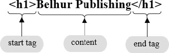

`<h1>` 标签是六个标题标签之一，将在本章后面更详细地解释。`<h1>` 称为开始标签，`</h1>` 称为结束标签。容器标签之间的文本是将在浏览器上显示的内容。`<h1>` 标签向浏览器发出信号，表示后面的文本比默认文本更大、更粗，如下所示：

### Belhur Publishing

结束标签总是以正斜杠开头。`</h1>` 标签中的正斜杠表示此标签结束了前面的 `<h1>` 标签。任何放置在这些容器标签之外的内容都不会受到影响。

开始标签和结束标签之间有一个主要区别。在接下来的几节中，你将了解到每个 HTML **元素**都可以包含属性，这些属性修改并描述元素的功能。例如，`<html lang="en">` 中的**属性** `lang` 表示文档的口语语言。属性只能包含在开始标签中，而不能包含在结束标签中。事实上，结束标签中不允许有空格或其他字符或符号，除了 HTML 标签的名称。

不成对出现的标签通常被称为空标签、自包含标签或单侧标签。在 HTML5 中，它们被称为*空元素*。例如，`<br/>` 是一个空标签，用于在网页上配置换行。空标签可以带或不带正斜杠编码：`<br>` 或 `<br/>`。注意空标签中的正斜杠必须紧跟在闭尖括号之前，而不是在标签名称之前。正斜杠仅用于向后兼容，在 HTML5 中是可选的。在本书中，我们将始终使用正斜杠来终止空标签。

让我们通过查看一个非常基本的网页来开始学习 HTML。考虑 图 2.1 中显示的简单网页。

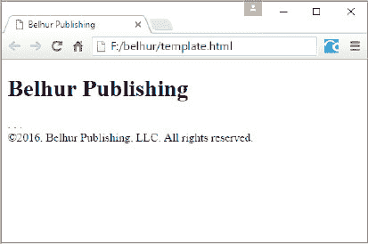

*图 2.1：一个简单的网页*

任何 HTML 新手都可以创建这个简单的网页。其代码如 图 2.2 所示。这是显示基本 HTML5 网页模板的完整源代码（可在本书网页的下载文件中找到，网址为 *[`goo.gl/2uYjHb`](https://www.goo.gl/2uYjHb)*，位于文件夹 `chapter2/template.html` 中）。静态 HTML 文档的名称通常以扩展名 `.html` 或 `.htm` 结尾，例如 `template.html`。*静态*一词与*动态*相对，指的是 HTML 文档是无状态的。当浏览器重新加载静态网页时，它无法保留其值。我们将在后面学习使用服务器端语言（如 PHP、ASP.NET 和 JSP）进行 Web 开发时，重新讨论无状态和动态网页。在本章剩余部分以及后续章节直至第 8 章，我们将只处理静态 HTML 文档。

HTML 是一种非常灵活的语言，并且不区分大小写。这意味着即使你在编写网页时出现错误，浏览器仍然会渲染并向最终用户正确显示页面。尽管如此，我们将遵循惯例，对所有 HTML 标签使用小写字母（`<!DOCTYPE html>` 除外，如图 2.2 所示）。

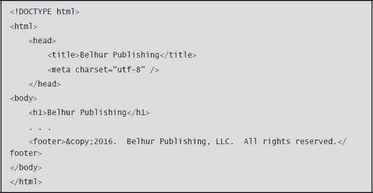


*图 2.2：显示图 2.1 所示页面的 HTML5 代码*

如图 2.2 所示，你创建的每个网页通常都包含以下六个 HTML 元素：`DOCTYPE`、`html`、`head`、`title`、`meta` 和 `body`。前七行和后两行在所有网页中通常是通用的。一个网页分为三个主要部分：`doctype` 声明、`head` 和 `body`。在下一节中，我们将探讨每个部分以及每个标签的含义。

### DOCTYPE 标签：

```
<!DOCTYPE html>
```

图 2.2 中代码的第 1 行包含 `<!DOCTYPE html>` 标签。它被称为文档类型声明，或 DTD 语句。DTD 代表**文档类型定义**，是 W3C 用于标识 Web 文档的标准。它定义了文档类型声明部分，并且是每个网页中的第一条语句。标签名称开头的感叹号（`!`）是必需的。由于 HTML 标签不区分大小写，因此 DTD 语句中 `DOCTYPE` 使用大写字母、`html` 使用小写字母只是一种惯例。因此，`<!DOCTYPE HTML>`、`<!doctype html>` 或 `<!Doctype Html>` 同样有效。此外，这是唯一一个我们不会像之前处理 `<br/>` 标签那样使用正斜杠的自包含标签。

正如我们已经了解到的，HTML 有多个版本，Web 浏览器也有多个版本——并非所有浏览器都支持 HTML5。然而，在本书撰写时，大多数现代 Web 浏览器都能够渲染 HTML5 元素。因此，需要 DTD 语句来标识文档中包含的 HTML 版本，以便浏览器正确渲染网页。`html` 标识了文档中使用的 HTML 版本。HTML5 文档只需要这个简短的 DTD 语句：`<!DOCTYPE html>`。

有一个重要原因说明为什么 `<!DOCTYPE html>` 应该作为现代网页的第一条语句来编写。这与 Web 浏览器的布局引擎如何使用**怪异模式**和**严格模式**（也称为**标准模式**）显示网页有关。早在 20 世纪 90 年代，大多数网站都是为两种主流 Web 浏览器（Netscape 和 Internet Explorer (IE)）编写的。每种 Web 浏览器都有自己的标准，直到 W3C 成立，为所有 Web 浏览器制定了一套更通用的标准。因此，怪异模式指的是 Netscape 和 IE 制定的旧标准。标准模式遵循 W3C 制定的现代 HTML 和 CSS 规范。使用怪异模式开发的网页不会将 `doctype` 声明作为其第一个 HTML 标签。因此，任何放在 `<!DOCTYPE html>` 声明之上的 HTML 代码都会触发怪异模式，这可能导致网页在大多数现代浏览器中显示不正确。

如果你选择使用较早版本的 HTML（如 XHTML 或 HTML4）编写网页，则需要编写正确的 `doctype` 语句。以下是程序员必须用来标识网页中使用的 HTML 版本的 DTD 语句的不完整列表。在查看这些 DTD 语句时，我们希望你能体会到 HTML5 中更简单的 `doctype`。

#### XHTML 1.0 Strict：

```
<!DOCTYPE html PUBLIC "-//W3C//DTD XHTML 1.0 Strict//EN" "http://www.w3.org/TR/xhtml1/DTD/xhtml1-stnct.dtd">
```

#### XHTML 1.0 Transitional：

```
<!DOCTYPE html PUBLIC "-//W3C//DTD XHTML 1.0 Transitional//EN" "http://www.w3.org/TR/xhtml1/DTD/xhtml1-transitional.dtd">
```

#### HTML 4.01 Strict：

```
<!DOCTYPE HTML PUBLIC "-//W3C//DTD HTML 4.01//EN" "http://www.w3.org/TR/html4/strict.dtd">
```

#### HTML 4.01 Transitional：

```
<!DOCTYPE HTML PUBLIC "-//W3C//DTD HTML 4.01 Transitional//EN" "http://www.w3.org/TR/html4/loose.dtd">
```

### HTML 标签：

```
<html lang="en">
</html>
```

图 2.2 中代码的第 2 行包含 `<html>` 标签。这是一个容器标签，告诉浏览器其后的文本是 HTML 代码。由于浏览器必须能够处理用多种不同语言编写的数据，网页通常会在代码开头标识其主要语言。在图 2.2 中，最后一行对应的 `</html>` 结束源代码。如前所述，`lang` 属性的主要目的是表示网页的主要口语语言。`lang` 属性的值可以是两个字母的子代码（ISO 639-1），也可以是两个字母的子代码后跟 ISO 国家代码。例如，`lang="en"`（表示英语）将英语标识为主要语言，`lang="en-US"` 表示美式英语，`lang="fr"` 表示法语，等等。默认情况下，`lang` 属性设置为英语，因此不需要显式定义。使用 `lang` 属性的其他目的包括搜索引擎和屏幕阅读器。`lang` 属性不仅限于 `<html>` 标签，也可以包含在其他标签中。

HTML 元素可以嵌套在其他元素内部。如图 2.2 所示，`<title>` 和 `<meta>` 标签嵌套在 `<head>` 容器标签内，`<h1>` 和 `<footer>` 标签嵌套在 `<body>` 容器标签内，所有这些标签都嵌套在 `<html>` 容器标签内。虽然大多数 HTML 元素可以嵌套在其他元素内部，但有些元素不能嵌套，否则页面会出错。我们将在本章后面探讨这些标签。

### Head 标签：

```
<head>
</head>
```

图 2.2 中代码的第 3 行包含 `<head>` 标签，它开始**头部部分**，并在代码的第 6 行以 `</head>` 标签结束。`<head>` 容器标签必须放在 `<html>` 标签和 `<body>` 标签之后。头部部分包含描述 Web 文档的元素。头部部分中常见的元素包括 `title`、`meta`、`link` 和 `script`。这些元素对用户不可见或无用，但对用户代理（如屏幕阅读器和搜索引擎）至关重要。接下来讨论 `<title>` 和 `<meta>` 标签，而 `<link>` 和 `<script>` 将在本章后面讨论。

### Title 标签：

```
<title>Belhur Publishing</title>
```

图 2.2 中代码的第 4 行包含 `<title>` 容器标签。每个网页都应该有一个页面标题。`<title>` 元素是 HTML5 文档必需的。`<title>` 和 `</title>` 标签之间的文本用作网页的标题。`<title>` 标签配置要在浏览器窗口的标题栏或选项卡中显示的文本，而不是在浏览器窗口（也称为浏览器视口）中显示。例如，让我们看看图 2.2 中网页模板的标题页。

图 2.3 显示了在 Microsoft Edge、Google Chrome 和 Mozilla Firefox 中查看时，包含网页模板的窗口标题栏中的页面标题。

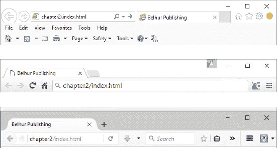

*图 2.3：Microsoft Edge、Google Chrome 和 Mozilla Firefox 中网页标题栏的页面标题示例*

### Meta 标签：

```
<meta charset="utf-8"/>
```

图 2.2 中代码的第 5 行包含 `<meta>` 标签。`<meta>` 标签是一个自闭合标签，用于描述网页的特性。例如，属性 `charset="utf-8"` 描述了使用 8 位 Unicode 转换格式（UTF）的`字符编码`，这是网页和电子邮件首选的编码方式。还有许多其他类型的 meta 标签，例如 `description`、`keywords`、`author`、`robot` 和 `refresh`。

`<meta>` 标签对于搜索引擎优化（SEO）极为重要，因为它向浏览器和网络爬虫提供网页信息。*爬虫*或*电子机器人*是雅虎和谷歌等搜索引擎使用的软件，用于系统地爬取和检查互联网上网页的内容。爬虫会评估这些网页并为其建立索引，以便纳入搜索引擎。

爬虫不断扫描互联网，一页接一页地检查。你网页中的 `<meta>` 标签会影响你在这些搜索引擎中的排名。你将在第 13 章中了解更多关于搜索引擎和 SEO 的内容。随着互联网的持续发展，`<meta>` 标签的实用性可能会发生变化。去年有用的标签今年可能不再有用，而我们今天不使用的标签明年可能会变得有用。这是一个需要定期重新评估的领域。

### Body 标签：

```
<body>

</body>
```

图 2.2 中代码的第 7 行包含 `<body>` 标签。`<body>` 标签标记了网页`主体部分`的开始，并以匹配的结束 `</body>` 标签结尾，该标签出现在第 11 行源代码末尾的 `</html>` 标签之前。`<body>` 容器标签必须放在 `</head>` 标签和 `</html>` 标签之后。主体部分包含可显示的内容，如文本、图像和多媒体。浏览器窗口中可见的所有内容都包含在主体部分中，程序员编写代码的大部分时间也花在主体部分。

### 注释标签：

```
<!-- 这是一条注释… -->
```

注释是任何语言的重要特性，HTML 也不例外。你会发现注释在澄清网页中更复杂、不太直观的部分时特别有用。注释不打算在浏览器窗口中显示。注释标签以 `<!--` 开头，以 `-->` 结尾。注释标签内的任何内容都会被浏览器忽略。虽然注释标签可以插入到文档中的任何位置，但为了阻止某些浏览器进入怪异模式，它们应仅放在 `<html>` 标签内。例如，以下代码片段在网页的三个不同区域插入了三条注释，如图 2.4 所示。

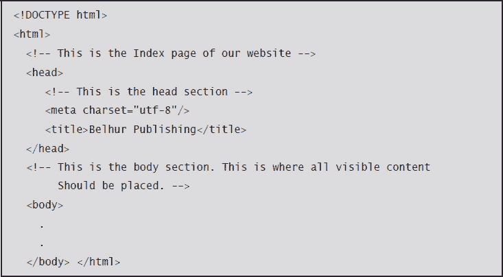

*图 2.4：注释标签的 HTML 代码*

恭喜！你已经学习了网页的基本结构以及创建有效 HTML5 文档的必要条件。接下来，我们将探索一些用于开发更强大、内容更丰富的基于 Web 的应用程序的 HTML 元素。

## 块级元素和文本级元素

W3C 将 HTML 元素分为七大类：元数据、流式、分区、短语、嵌入、交互和标题。还有其他一些用于特定目的的类别。还有一些元素不属于任何特定类别。尽管这些元素被归类到各自的类别中，但你会发现其中许多元素根据它们对网页外观的影响方式也属于同一组。接下来，我们将学习两种主要的元素组分类：块级元素和文本级元素。

### 块级元素

第一组元素称为*分组*或*块级元素*。大多数块级元素成对出现，包含被视为网页中独立块的内容。这组元素将其内容在新的一行开始。表 2.1 列出了网页中常用的一些块级元素。

| **表 2.1：块级元素** | |
| --- | --- |
| **元素** | **描述** |
| `p` | 段落 |
| `hr` | 用于分隔章节内主题的水平线 |
| `pre` | 预格式化文本块（通常以等宽字体显示，并保留所有空白和特殊字符） |
| `blockquote` | 从其他来源引用的内容（左右边距缩进） |
| `h1`、`h2`、`h3`、`h4`、`h5`、`h6` | 具有给定等级编号的标题元素（`h1` 等级最高，`h6` 等级最低） |
| `div` | 用于样式目的或在一个章节内包裹多个段落的划分 |
| `ol` | 有序列表 |
| `ul` | 无序列表 |
| `li` | 有序或无序列表中的列表项 |
| `dl` | 描述列表（原为定义列表） |
| `dt` | 描述列表中的定义术语、名称或术语-描述组的一部分 |
| `dd` | 描述列表中的定义、描述或值 |
| `address` | 作者或所有者的联系信息（文本通常以斜体显示） |

让我们探索一些常见的块级元素，并看看它们在浏览器中是如何呈现的。

#### 标题标签：

```
<h1>内容</h1>
```

标题元素有六个级别，包含网页上主要标题的文本。它们定义了标签内的文本，从最重或最大的标题（`<h1>`）到最小或最轻的标题（`<h6>`）。每个浏览器对实际显示的文本大小有一定的控制权，因此视力有限的用户可以定义他们偏好的文本大小。Web 开发者指的是文本的“逻辑”大小。开发者不指定精确大小（如 12 像素或 12px），而是指示相对大小，例如 `h1`（大）、`h3`（中）或 `h6`（小）。虽然标题标签可用于将文本配置为大号加粗，但不应为此目的使用它们。相反，你应该仅将它们用于标题，以便搜索引擎能够正确索引你的网页。图 2.5 显示了从 `h1` 到 `h6` 的各种标题级别。

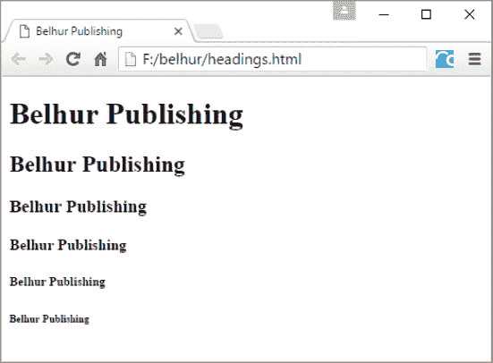

*图 2.5：`<h1>` 到 `<h6>` 标题示例*

#### 段落标签：

```
<p>内容</p>
```

段落标签是块级元素，非常重要。如果浏览器能够识别一段文本为段落，它就能更好地将文本渲染到页面上。包含在 `<p>` 和 `</p>` 标签内的内容会作为一个块显示，上下方有空白区域。例如，如果没有段落标签，你必须在段落之间显式地编写换行符。

默认情况下，所有文本都是左对齐的。要强制文本左对齐、右对齐或居中对齐，可以使用 `align` 属性。例如，要使段落文本居中对齐，可以使用 `align="center"` 属性。请注意，`align` 属性在 HTML5 中已被弃用。在下一章中，你将学习如何使用 CSS 更有效地设置文本对齐方式。

图 2.6 中的代码示例显示了使用段落标签编写的示例网页文本。结果如图 2.7 所示，在浏览器中呈现。

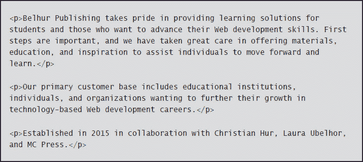

*图 2.6：带有段落标签的示例页面的 HTML 代码*

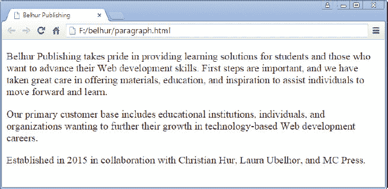

*图 2.7：在浏览器中呈现的带有段落标签的示例页面*

#### 预格式化标签：

```
<pre>内容</pre>
```

预格式化文本位于 `<pre>` 和 `</pre>` 标签之间。此标签会覆盖浏览器按自身意愿压缩空白和空行的能力。在网页显示时，标签之间的所有空白和回车符都会被浏览器保留。对于地址或具有特定格式的数据集等内容，`<pre>` 标签非常有用。图 2.8 中的代码示例展示了一个使用 `<pre>` 标签的示例网页文本。其结果显示在图 2.9 中，并在网页浏览器中呈现。

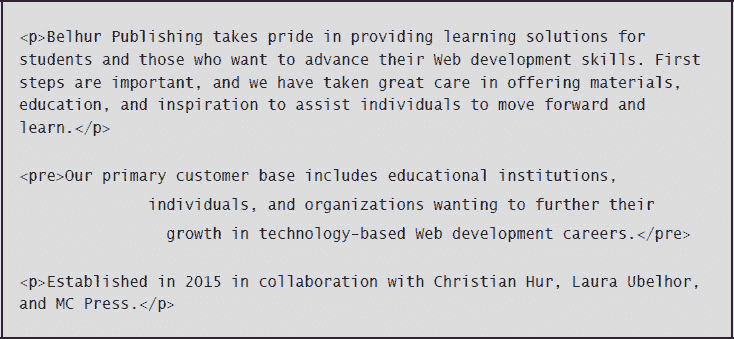

*图 2.8：包含 `<pre>` 标签的示例页面 HTML 代码*

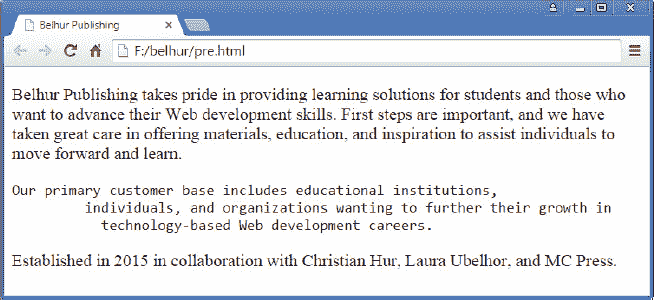

*图 2.9：在网页浏览器中呈现的包含 `<pre>` 标签的示例页面*

#### 水平线标签

`<hr/>`

`<hr>` 标签是一个自包含标签，用于在网页上绘制一条线（即分隔线）。`width` 属性定义线条在页面上的延伸长度。`width` 的值可以用像素表示，也可以用页面宽度的百分比表示。`align` 属性决定线条是居中、左对齐还是右对齐。在 HTML5 中，`align` 属性已被弃用；对齐方式由 CSS 规则控制。`size` 属性以像素为单位定义线条的粗细，且仅支持像素。`noshade` 属性可去除线条的 3D 效果，使其看起来更“扁平”。图 2.10 中的代码片段展示了创建三条水平线所需的 HTML 代码，结果如图 2.11 所示。

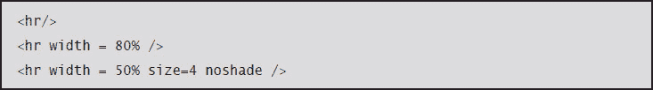

*图 2.10：创建两条水平线的 HTML 代码*

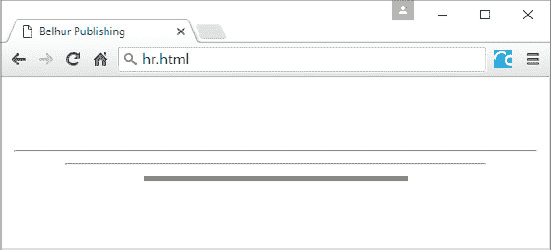

*图 2.11：水平线*

你可以使用 `<hr>` 通过定义不同的部分来为网页增加结构。

#### 块引用标签

`<blockquote>内容</blockquote>`

要将文本的某一部分定义为网页上的引用，请使用 `<blockquote>` 标签。`<blockquote>` 标签用于显示一段引用文本，该文本会从网页的左右边距向内缩进。让我们使用图 2.8 中的相同代码片段，并将第二个 `<p>` 标签替换为 `<blockquote>` 标签。图 2.12 中的代码片段使用这些标签生成了图 2.13 所示的输出。

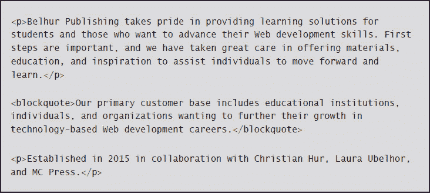

*图 2.12：HTML `<blockquote>` 代码*

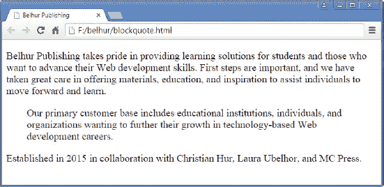

*图 2.13：使用 `<blockquote>` 标签的示例网页*

#### 无序列表和列表项标签

```
<ul>
<li>内容</li>
<li>内容</li>
…
</ul>
```

**无序列表**通常被称为项目符号列表。无序列表标签用于以无特定顺序显示项目列表。无序列表以 `<ul>` 标签开始，以结束标签 `</ul>` 结束。每个项目包含在 `<li>` 和 `</li>` 标签之间。列表可以显示为三种类型之一：`disc`（默认）、`square` 和 `circle`。要将默认类型更改为方形或圆形，请在 `<ul>` 标签中插入 type 属性。图 2.14 中的 HTML 代码生成了图 2.15 所示的目录文本。

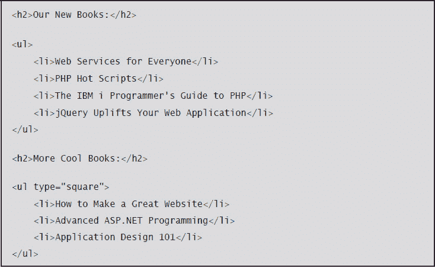

*图 2.14：创建图 2.15 的 HTML 代码*


*图 2.15：无序列表示例*

#### 有序列表和列表项标签

```
<ol>
<li>内容</li>
<li>内容</li>
…
</ol>
```


有时，项目符号并不适合你列出的项目。是的，它们对于图 2.15 中显示的目录来说效果不错，但如果我们有一系列需要按特定顺序执行的指令呢？这种需求正是**有序列表**的用武之地。有序列表用于以有序的方式列出项目。无序列表和有序列表都使用`<li>`标签来列出项目。每个项目包含在`<li>`和`</li>`标签之间。有序列表可以使用数字（默认）、小写字母、大写字母、小写罗马数字或大写罗马数字进行编号。`type`属性的有效值为`1`、`a`、`A`、`i`和`I`。`start`属性设置`type`属性的起始值。`start`属性的有效值始终是数字，即使`type`不是数字也是如此。例如，`start`的值为`2`时，对于`type`为`a`的情况会生成“b”，对于`type`为`i`的情况会生成“ii”，依此类推。

图 2.16 展示了与图 2.14 中相同的项目，但使用了有序列表。生成的列表如图 2.17 所示。

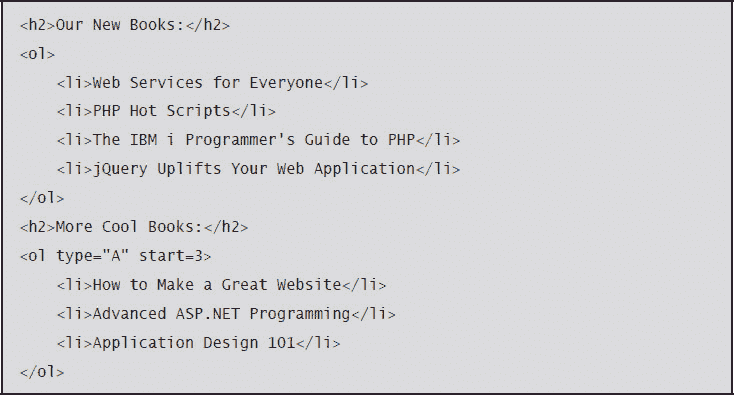

*图 2.16：创建图 2.17 的 HTML 代码*

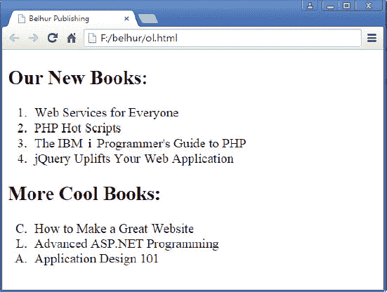

*图 2.17：有序列表示例*

如本例所示，列表自动从 1 开始，每次递增 1。只有少数几个支持的选项。如果你需要其他方式，可以使用`<li>`标签的`value`属性手动创建。例如，要按步进为 2 的方式对项目编号（虽然有点傻，但只是个例子），请参见图 2.18。`value`属性与`start`属性类似，其数字表示列表中某个特定值的序号。在小写字母列表中，2 代表“b”，而不是数字 2。

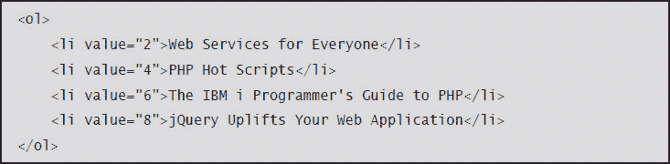

*图 2.18：具有特定数值的有序列表*

#### 描述列表、术语和描述标签

```
<dl>
<dt>术语 1</dt>
<dd>定义 1</dd>
<dt>术语 2</dt>
<dd>定义 2</dd>
…
</dl>
```

第三种列表类型是**描述列表**（以前称为定义列表）。它用于为一组术语分配定义或描述。显然，如果你在发布字典，这会很有用，但它还能用在其他地方吗？在我们的示例网页中，我们可能想添加一些重要术语的描述。实现这一功能的代码如图 2.19 所示，生成的网页如图 2.20 所示。

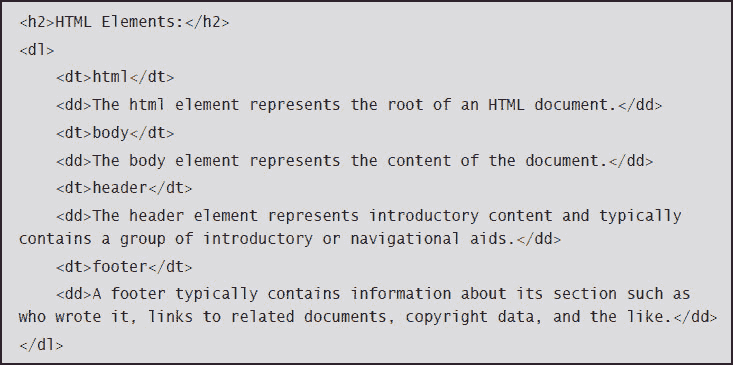

*图 2.19：描述列表的 HTML 代码*

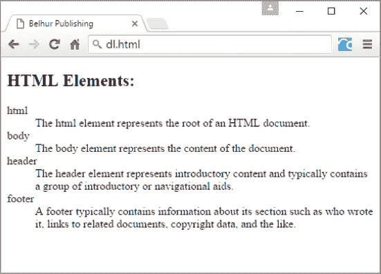

*图 2.20：定义列表示例*

浏览器会根据多种因素（如屏幕分辨率和窗口大小）尽可能地对齐和定位列表中的文本。在大窗口中，图 2.20 中显示的描述会横跨整个屏幕。如果窗口大小缩小，浏览器会缩短页面宽度，并在需要时增加行数。

### 文本级元素

第二组元素称为文本级元素或内联元素。这组元素不会在新行开始，而是与块级元素中的其他字符内联显示。表 2.2 列出了其中一些文本级元素。

**表 2.2：文本级元素**

| **元素** | **描述** |
| --- | --- |
| `abbr` | 缩写或首字母缩略词 |
| `em` | 表示强调的文本（通常以斜体显示） |
| `cite` | 对创意作品的引用（通常以斜体显示） |
| `code` | 计算机代码片段 |
| `mark` | 为参考目的而高亮显示的文本 |
| `span` | 对行内元素或内容进行分组或标记，以便进行样式设置和配置 |
| `sub` | 下标 |
| `sup` | 上标 |
| `strong` | 对其内容表示强烈的重要性或严肃性 |
| `b` | 粗体文本 |
| `i` | 以斜体呈现文本 |

#### 下标和上标标签

```
<sub>
</sub>

<sup>
</sup>
```

下标标签`(<sub>)`和上标标签`(<sup>)`可用于处理指数记法和脚注等内容。图 2.21 中的代码片段展示了如何使用这些标签生成图 2.22 所示的输出。

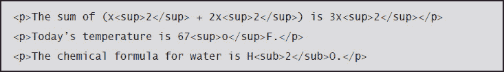

*图 2.21：使用上标和下标标签的 HTML 代码*

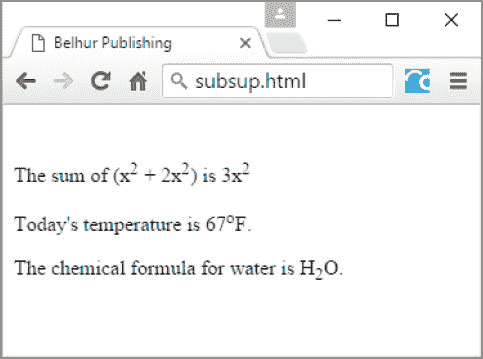

*图 2.22：`<sub>`和`<sup>`标签的效果*

##### 斜体、下划线和粗体标签：

`<i>内容</i>`

`<u>内容</u>`

`<b>内容</b>`

使用`<i>`、`<u>`和`<b>`标签可以创建斜体、下划线或粗体文本。这些是行内级标签，可用于标记一组文本而不会导致文本换行。例如，你可以在图 2.23 所示的简短代码片段中使用它们，生成图 2.24 中的结果。

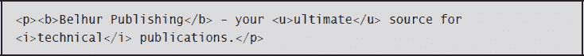

*图 2.23：HTML 的`<b>`、`<u>`和`<i>`标签*

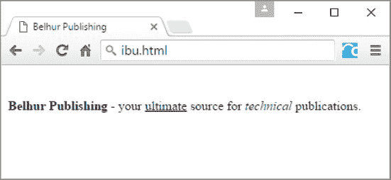

*图 2.24：`<b>`、`<u>`和`<i>`标签的效果*

这些标签在 HTML5 中已被弃用，应仅作为最后手段使用。相反，你应该使用 CSS 规则，这将在下一章中学习。

##### 换行标签：

`<br/>`

换行标签`<br>`没有结束标签。它强制浏览器在该位置插入一个换行符。默认情况下，浏览器会压缩网页中的空白，并按照浏览器认为最佳的方式排列内容。这有时会导致网页显示不一致。图 2.25 展示了如何使用换行标签在段落之间强制插入空行，图 2.26 显示了结果页面。其他更高级的处理方法将在后面讨论。

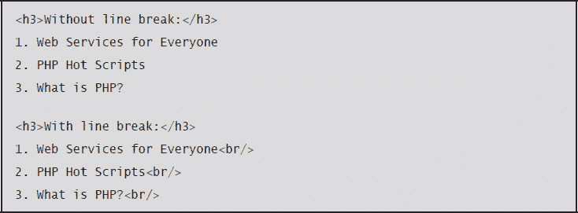

*图 2.25：`<br>`标签的 HTML 代码*

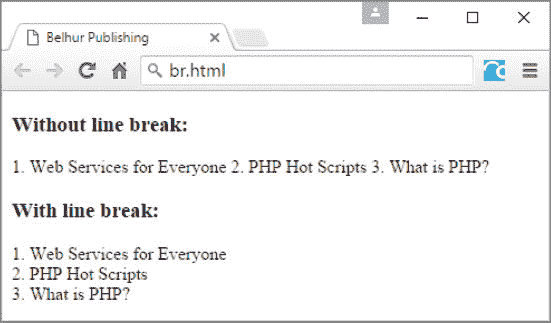

*图 2.26：`<br>`标签的效果*

#### 特殊字符

除了颜色的特殊代码外，还有字符的特殊代码。前面的示例使用了相当简单的文本。如果我们想包含引号（″）、大于号（>）、小于号（<）、版权符号（©）或其他特殊字符呢？许多这些字符可以通过使用*转义码*（有时称为*字符引用*）来获得。表 2.3 列出了这些常见的特殊字符及其对应的描述和代码。有关特殊字符的完整列表，请参见附录 B，该附录包含在可下载的书籍材料中，地址为*[`goo.gl/2uYjHb`](https://www.goo.gl/2uYjHb)*。

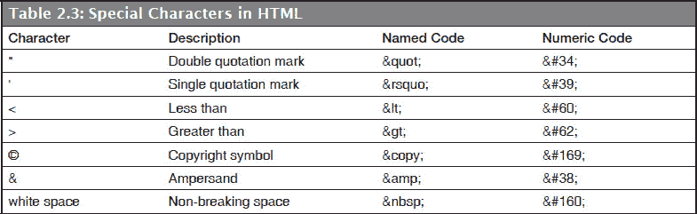

分号（;）是代码的一部分，并且是必需的。例如，如果你想在网页页脚的版权声明中添加版权符号，如下所示：

©2016\. Belhur Publishing, LLC. 保留所有权利。

使用 HTML 命名代码`&copy;`或数字代码`&#169;`来显示版权符号，如下所示：


需要注意的是，虽然这些特殊字符很有用，但其中一些可能会被用户代理误解为计算机代码而不是纯文本。例如，小于号（<）和大于号（>）可能会被 Web 浏览器误解为 HTML 标签的开始和结束。假设你想标记你的网页以显示图 2.27 中的文本。

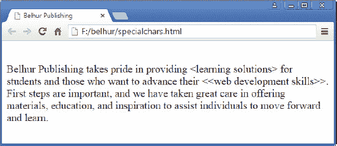

*图 2.27：显示特殊字符的网页*

你按照图 2.28 所示编写网页代码。

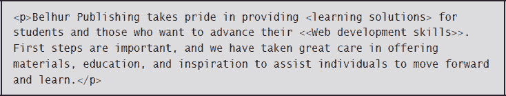

*图 2.28：未使用转义码处理特殊字符 < 和 > 的 HTML 代码*

当你在 Web 浏览器中渲染网页时，你会得到类似图 2.29 的结果。

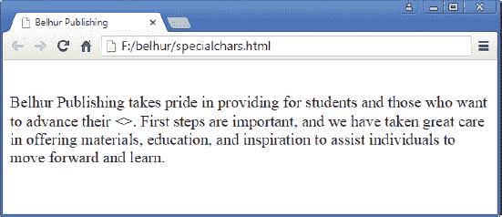

*图 2.29：未对特殊字符 < 和 > 进行编码的网页渲染结果*

发生了什么？小于号和大于号内的文本没有显示，因为这些符号没有被编码。因此，它们被当作特殊的计算机代码，并被 Web 浏览器错误地渲染。为了防止这种情况发生，你应该使用相应的命名代码或数字代码对这些特殊字符进行编码，如图 2.30 所示。

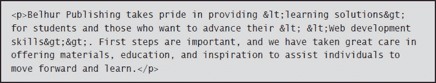

*图 2.30：使用转义码处理特殊字符 < 和 > 的 HTML 代码*

另一个非常重要的特殊字符是不换行空格`&nbsp;`。这个字符在屏幕上显示为空白，但与普通空白不同，空白字符会被保留。不换行空格用于控制页面上的文本缩进。请记住，当浏览器在用户屏幕上显示你的网页时，它只保留一个空白字符。HTML 代码中的任何额外空白都会被忽略，即使你按了空格键、回车键或 Tab 键一百次。图 2.31 中的代码片段展示了如何使用`&nbsp;`将文本缩进特定数量的空格；图 2.32 显示了代码在浏览器中的渲染效果。

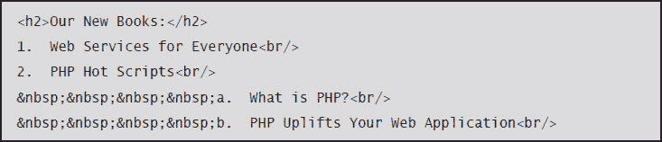

*图 2.31：使用不换行空格作为缩进的 HTML 代码*

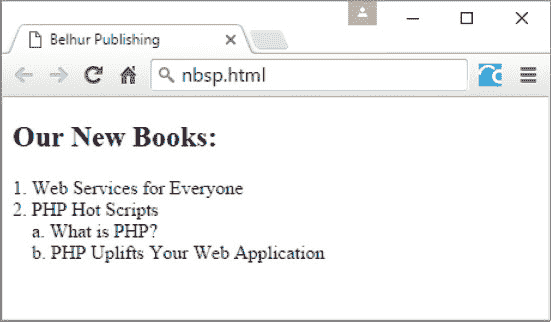

*图 2.32：使用`&nbsp;`控制间距的示例*

#### 结构元素

网页页面主体的结构是通过 HTML 结构元素构建的。在本节中，我们将讨论其中一些重要的元素，它们使你能够以更有意义的方式构建网页。

##### 分区标签：

`<div>内容</div>`

多年来，通用的`<div>`元素一直是构建网页时使用最广泛的标签之一。`<div>`标签是一个块级元素，用于通过为每个分区分配唯一的`id`属性来划分不同的页面区域（例如页眉、导航、主要内容、侧边栏和页脚）。它是少数被广泛使用但并非语义标签的结构元素之一。另一个这样的元素是`<span>`标签，我们接下来将讨论它。图 2.33 展示了一个典型的网页**线框图**，概述了使用`<div>`元素的页面主体结构，图 2.34 展示了该线框图的示例代码片段。线框图是 Web 开发人员用来展示网页布局以及如何使用结构元素配置页面每个部分的图表。

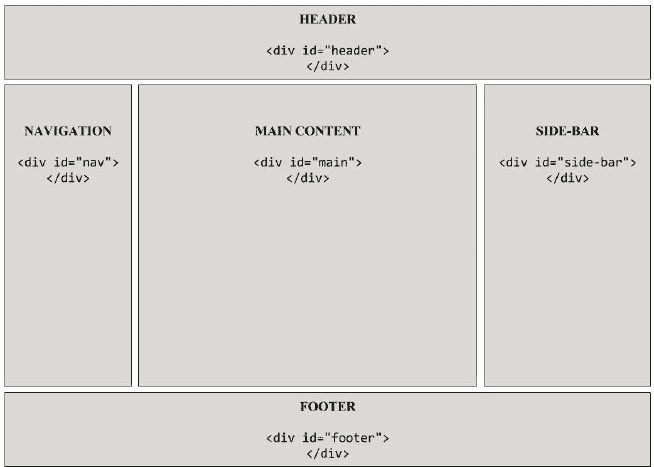

*图 2.33：使用 HTML 4.01 结构元素的网页线框图*

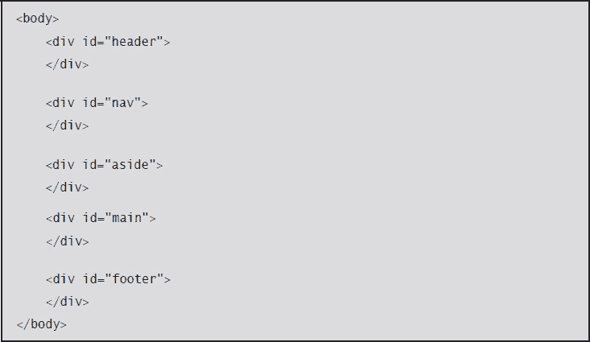

*图 2.34：使用 div 元素的 HTML 代码*

##### 跨度标签：

`<span>内容</span>`

`<span>`标签是一个非语义标签，用于定义和格式化网页上的一个部分或包含在另一个元素内的区域。`<span>`是一个行内元素，它出现在你编写代码的确切位置，并且不会导致换行。除非对其应用属性或 CSS，否则它不会执行任何操作。因此，`<span>`通常用于通过 CSS 规则对内容进行样式化，我们将在下一个示例中看到。

为了演示这一点，我们采用图 2.23 中的相同代码片段，并使用`<span>`标签替换`<b>`、`<u>`和`<i>`标签，以产生相同的结果。修改后的代码片段如图 2.35 所示，生成的网页如图 2.36 所示。

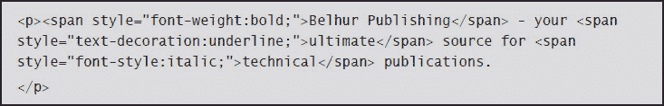

*图 2.35：使用`<span>`标签的 HTML 代码*

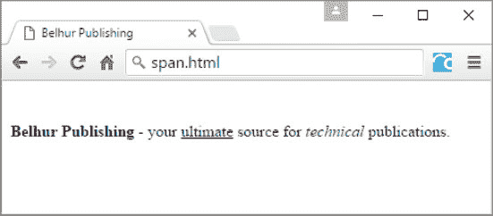

*图 2.36：使用`<div>`和`<span>`标签的网页*

如果将图 2.24 所示的结果与图 2.36 所示的结果进行比较，你可能看不出区别。唯一的区别在于 HTML 代码。注意图 2.35 中每个起始`<span>`标签内的`style`属性。这被称为 CSS*内联样式*，我们将在下一章讨论。

要看到`<div>`和`<span>`按预期工作，你必须将 CSS 整合到你的网页中。通过为`<div>`和`<span>`标签分配`class`名称和`id`名称，你可以为这些标签指定定位、对齐和其他格式化属性。

到目前为止讨论的许多标签直接影响网页内容的显示。这在早期 HTML 编码时代没问题，但正如本章前面提到的，其中许多 HTML 代码已被弃用。不鼓励使用它们，并且它们不被认为是 HTML5 文档可接受的。相反，它们正被 CSS 取代，正如你在`<span>`标签的示例中看到的那样。最终，对这些标签的支持可能会完全取消。然而，许多现有页面仍然使用它们，因此了解一些相关知识是必要的。

### HTML5 结构元素

HTML5 引入了一套全新的结构元素，它们更具功能性和意义。这些元素对搜索引擎更友好，并且易于各种用户代理（如屏幕阅读器）访问。表 2.4 展示了其中一些结构元素及其用途。在本节中，我们将探讨其中一些元素及其用途。

**表 2.4：HTML5 结构元素**

| **元素** | **描述** |
| --- | --- |
| `header` | 介绍性或导航辅助内容 |
| `nav` | 包含导航链接的部分 |
| `main` | 页面的主要内容 |
| `section` | 页面中内容的一个通用部分 |
| `article` | 页面中一个完整、独立的内容块 |
| `aside` | 与页面主要内容无关的附属内容 |
| `footer` | 包含其部分的信息，并放置在页面底部 |

**Header 标签：**

```
<header>content</header>
```

`<header>`标签是一个语义元素，用于包含网页的标题内容，或某个部分或文章的标题区域。`header`元素以`<header>`标签开始，以`</header>`标签结束。该标签通常用于包含网页的报头，通常包括公司或网站徽标以及其他在页面顶部一致显示的小元素。

**Nav 标签：**

```
<nav>content</nav>
```

`<nav>`标签用于包含页面上的导航链接。`<nav>`标签可以在同一页面中多次使用，只要需要导航链接的部分。通常，导航链接使用无序列表元素创建，并通过 CSS 设置样式和配置。图 2.37 展示了一个导航链接部分的示例代码片段。你可以在本章末尾附近的“更新示例页面”部分看到该导航部分经过 CSS 样式化后的效果。

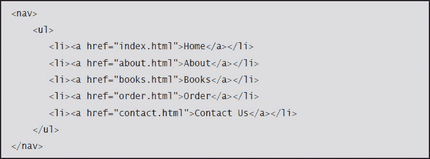

*图 2.37：使用`<nav>`和`<ul>`标签的 HTML 代码*

**Main 标签：**

```
<main>content</main>
```

`<main>`标签用于包含网页的主要内容。有时这个标签也被称为包装标签，因为网页的主要内容被包裹在这些标签内。一个网页只能有一个`<main>`标签。

**Footer 标签：**

```
<footer>content</footer>
```

`<footer>`标签通常用于包含网页的页脚内容。页脚内容通常包括版权信息、联系信息、站点地图、作者信息和相关文档。

现在我们已经了解了其中一些 HTML5 结构元素的重要性，让我们看看它们是如何组合到一个网页中的。图 2.38 展示了示例网页线框的示例代码。

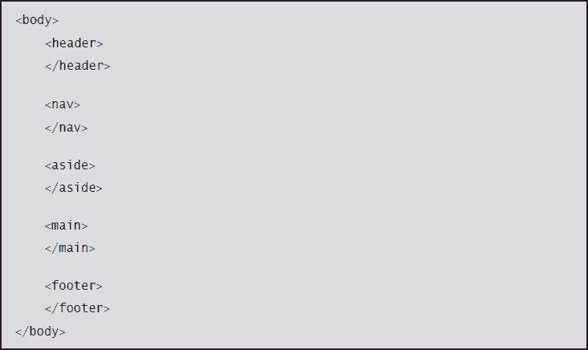

*图 2.38：使用 HTML5 结构元素的 HTML 代码*

下面的图 2.39 展示了来自图 2.33 的示例网页线框，在应用 CSS 规则后，使用 HTML5 语义元素勾勒出页面主体的结构。

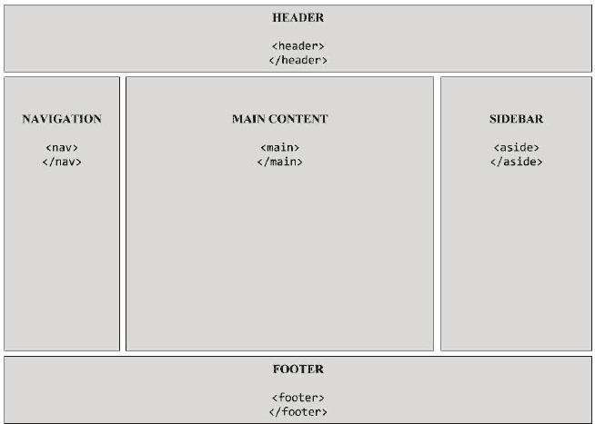

*图 2.39：使用 HTML5 结构元素的网页线框*

尽管 HTML5 引入了一些新的语义结构元素来替代`<div>`标签，但该标签仍然与新的 HTML5 结构元素结合使用来构建网页。在接下来的几章中，我们将学习如何使用 CSS 来样式化和配置结构元素，从而构建出类似图 2.39 的网页。

### 更新示例页面

让我们将本章中看到的 HTML 代码添加到我们的网页中。图 2.40 中修改后的代码创建了图 2.41 中的更新网页。

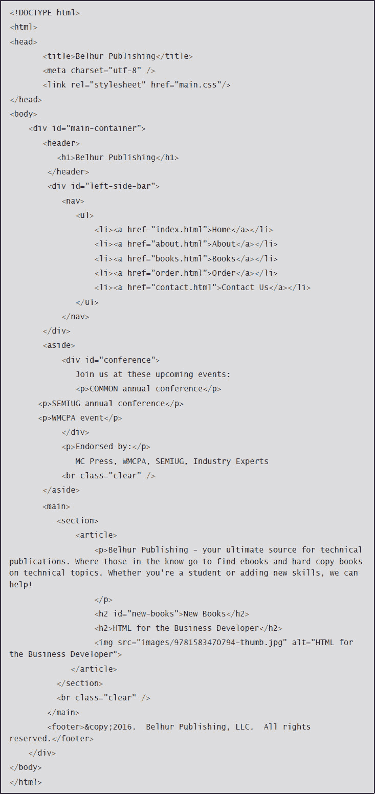

*图 2.40：用于创建图 2.41 中网页的 HTML 代码*

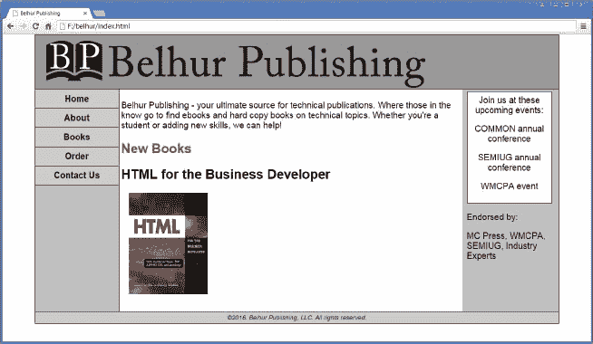

*图 2.41：更新后的网页*

如果没有 CSS 样式表，这个页面不会看起来像这样。如果你仔细查看代码，样式表通过第 6 行链接到页面：`<link rel=“stylesheet” href=“mam.css”/>`。在下一章中，我们将更详细地探讨用于样式化你刚刚看到的示例网页的 CSS。

### 总结

HTML 就这些吗？当然不是！这只是冰山一角。我们已经介绍了 HTML 中的许多基本标签，但还有更多需要讨论。有些相当简单直接，而另一些则复杂得多。你将在本书的其余部分看到所有这些标签。另外，请记住，这里讨论的一些标签已被 W3C 视为弃用，可能会逐渐被淘汰。然而，你仍然会在一些网页上找到它们，因此有必要熟悉它们。在本书后面，你将了解其中一些弃用选项的替代方案。

### 关键术语

`<!DOCTYPE>`

`<article>`

`<aside>`

`<blockquote>`

`<body>`

`<br>`

`<div>`

`<dl>`

`<footer>`

`<head>`

`<header>`

`<hr>`

`<html>`

`<li>`

`<main>`

`<nav>`

`<ol>`

`<p>`

`<pre>`

`<section>`

`<span>`

`<sub>`

`<sup>`

`<title>`

`<ul>`

属性

`body`元素

`body`部分

字符编码

描述列表

`div`元素

文档类型声明

文档类型定义（DTD）

元素

`head`部分

`header`元素

HTML 4.01

HTML5

超文本标记语言（HTML）

有序列表结构元素

标签

无序列表

W3C

线框

XHTML 1.0

### 讨论/复习题

1. 什么是 HTML 文档？

2. 什么是超文本标记语言（HTML）？

3. 谁创建了 HTML，何时创建的？

4. 为什么你应该学习 HTML？

5. 文档类型定义（DTD）或 DOCTYPE 声明的目的是什么？

6. 什么是 HTML 元素？

7. 网页文档是用什么语言编写的？

8. 积极制定与 Web 相关的建议和原型技术的组织名称是什么？

9. `<meta>`标签应放置在网页文档的什么位置？

10. `<title>`标签的目的是什么？

11. HTML 4.01 文档和 HTML5 文档的主要区别是什么？

12. 何时应使用有序列表而不是无序列表？

13. 为什么需要在网页中对特殊字符进行编码？

14. 什么是结构元素？

15. 以下术语的含义是什么：`head`元素、`head`部分、`header`元素和标题元素？

16. 列举五个 HTML5 结构元素。

17. 什么是块级元素和文本级元素？

18. 描述网页的 HTML 元素应放置在 HTML 文档的哪个部分？

19. 可见内容应放置在 HTML 文档的哪个部分？


20. 什么是网页线框图？

### 练习

1. 编写一个基本 HTML5 文档的 HTML 代码。

2. 创建一个无序列表来显示以下内容：最喜欢的书籍
   * HTML5
   * JavaScript
   * PHP
   * ASP.NET
   * JSP

3. 编写 HTML 代码，使用第二大的标题元素显示你最喜欢的电影标题。

4. 编写一个水平线的 HTML 代码，其长度为 90%，厚度为 5 像素。

5. 编写 HTML 代码来渲染以下段落：HTML 可用于格式化和显示特殊字符符号，例如`&`、`©`、`°F`、`H[2]O`和`N²`。

6. 为一个简单的网站创建网页线框图。

7. 为你练习 6 中创建的网页线框图编写基本的 HTML 代码。

8. 编写一个注释的 HTML 代码。

# 第 3 章

# 使用层叠样式表

层叠样式表（CSS）提供了一种灵活的方式来控制网页的外观或呈现。对单个 CSS 样式表进行微小更改即可显著改变许多网页的外观。这种控制页面设计的简便方法使您能够快速实现网站外观和感觉的更改。CSS 元素通常被称为样式规则，可以直接插入到网页中，也可以单独放在外部文件中。

CSS 样式可以通过三种不同的方法插入到网页中：内联样式、嵌入或内部样式以及外部样式。还有第四种方法，使用`@import`指令将外部样式表导入到另一个样式表中，类似于 PHP 中使用`include`语句的方式。虽然我们不会详细讨论这种方法，但本章后面会展示一个使用它的示例。每种方法都有其优缺点。然而，优先级规则是一个重要的概念，CSS 规则必须按逻辑顺序编码，因为 CSS 样式会从一个样式表层叠到另一个样式表。在本章中，我们将讨论并学习一些最常见的 CSS 样式，以及如何使用这三种不同的方法将它们插入到网页中。

### 什么是 CSS？

简而言之，CSS 是一种简单的语言，它定义了用于格式化网页外观的样式结构。样式规则定义了一组格式化指令（一个或多个属性-值对），这些指令影响网页中的 HTML 元素。CSS 是一种*呈现*语言，而 HTML 是一种*语义*语言。CSS 是一种呈现语言，因为它配置、格式化和样式化 HTML 元素，从而赋予网页视觉外观。相比之下，HTML 是一种语义语言，这意味着元素向用户代理（如 Web 浏览器、屏幕阅读器或网络爬虫，详见第 13 章）描述其与内容相关的含义。换句话说，你不会在 CSS 中找到循环语句或函数。它是 HTML 的完美补充语言，并且主要设计用于与 HTML 配合使用。

CSS 样式规则和标准由万维网联盟（W3C）制定和维护，该联盟于 1996 年推出了 CSS 的第一个版本（或级别）CSS1，随后于 1998 年推出了 CSS2，2005 年推出了 CSS3。每个较新的 CSS 级别都建立在上一级别之上。在撰写本文时，CSS Level 3（CSS3）仍然是当今 Web 开发中使用的最新版本。尽管 CSS3 发布已超过十年，但许多新的属性和规则已逐步引入。本章涵盖了众多标准 CSS 属性和规则，以及一些新的 CSS3 属性。

### 层叠样式表的工作原理

CSS 样式规则包含两个部分：**选择器**和**声明**。选择器可以是任何 HTML 标签（例如`p`、`h1`或`div`），也可以是用户定义的选择器，如*类*或*id*。我们将在本章后面讨论`class`和`id`选择器。声明是与选择器关联的属性-值对列表。**属性**是任何结构，例如`font-size`、`color`或`position`，其值分别为`12px`、`red`或`relative`。

图 3.1 展示了定义 CSS 规则的语法。

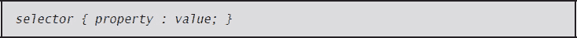

*图 3.1：CSS 样式规则的语法*

一个选择器可以有多个属性-值对。每对必须用分号（`;`）分隔，并且应该在新行开始，如图 3.2 所示。

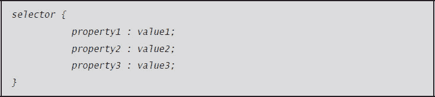

*图 3.2：具有多个属性-值对的 CSS 样式规则语法*

当为元素（例如`<p>`标签）定义样式时，元素的标签不带尖括号（`< >`）列出，后跟大括号（`{}`）。在这些大括号内，可以定义任何可用的属性。每个属性后跟冒号（`:`），然后是其关联的值。每个值后跟分号（`;`）。您可以根据需要列出其他属性。结束大括号在所有列出的属性之后编写。图 3.3 中的示例为段落（`p`）和标题（`h1`）选择器定义了样式规则。

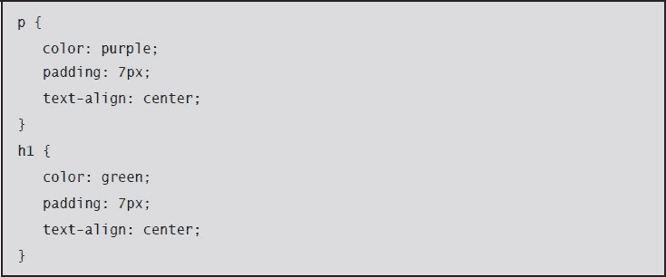

*图 3.3：`p`和`h1`选择器的 CSS 样式规则*

CSS 是一种灵活的语言，遵循与 HTML 类似的规则。正如您在前面的示例中所看到的，样式规则可以写在一行或多行中，因为空格会被忽略。此外，样式规则可以应用于多个元素。要将相同的样式规则应用于多个元素，只需用逗号分隔每个选择器。如果您查看图 3.3 中的示例，您会发现两个选择器具有相同的属性列表。由于它们相同，我们可以将样式规则应用于两个选择器，从而节省几行代码。图 3.4 显示了将两个选择器合并到同一样式规则中的结果。

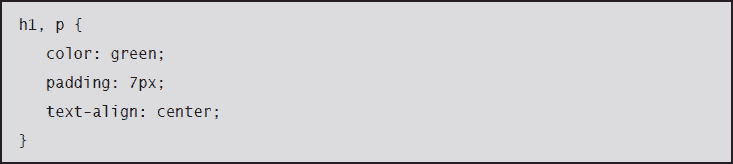

*图 3.4：应用于两个选择器的 CSS 样式规则*

如果您希望前面示例中的`h1`选择器具有不同的`font-style`（例如斜体），但保留相同的规则，那么您可以再次将`h1`定义为单独的选择器，并仅应用`font-style`，如图 3.5 所示。

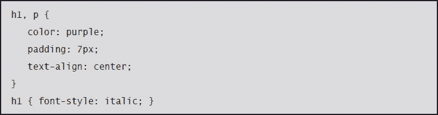

*图 3.5：应用于同一选择器的多个 CSS 样式规则*

您可能会问：“Web 浏览器如何知道使用哪个选择器？”实际上，在幕后，Web 浏览器会收集为每个选择器创建的所有 CSS 样式规则，并为该选择器重新生成一组完整的虚拟规则。生成的样式表是一个*虚拟样式表*，其中包含所有选择器及其关联的声明，如图 3.6 所示。

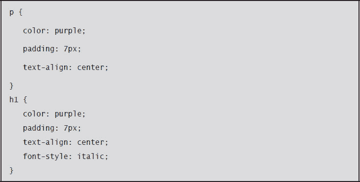

*图 3.6：Web 浏览器根据图 3.5 中的 CSS 渲染的虚拟样式表*

### 将样式表应用于网页

现在您已经了解并理解了层叠样式表的工作原理，让我们学习如何使用前面讨论的方法将它们应用于网页。CSS 样式规则根据样式规则层叠的优先级顺序应用于网页，从优先级最低的规则到优先级最高的规则。因此，层叠的概念类似于一系列瀑布，如图 3.7 所示。


*图 3.7：CSS 样式如何层叠以及优先级顺序*

如图 3.7 所示，Web 浏览器从上到下（即从最低优先级到最高优先级）应用样式规则。通常，所有现代 Web 浏览器都内置了自身的样式规则。这确保了任何没有自定义样式的网页仍能以对最终用户可呈现的方式渲染。因此，嵌入式样式会覆盖在其之前定义的任何样式，但会被内联样式取代。当然，任何规则总有例外，CSS 优先级顺序也是如此。尽管这里应用了优先级，但一个样式表覆盖另一个样式表的方式取决于样式表在网页中的逻辑放置位置。我们将在本章后面更详细地讨论这个主题。接下来，我们将学习如何使用内联样式、嵌入式样式和外部样式来应用样式规则。

注意：由于 Web 浏览器内置了自身的默认样式集，其内置样式会自动应用于网页——程序员无法控制这些样式。因此，我们不会讨论如何将这些样式应用于网页。

### 创建内联样式表

内联样式具有最高优先级，并且是浏览器最后解释的样式。内联样式直接且专门地应用于单个元素，使用`style`属性。例如，图 3.8 展示了如何将样式规则应用于`<p>`标签，以 Georgia 字体显示紫色内容。


*图 3.8：应用于`p`元素的内联样式规则*

内联样式的一个优点在开发阶段尤为明显，此时样式规则可以快速直接地应用于标签。这样做可以节省开发者在 HTML 文档中上下滚动或在外部样式表和 HTML 文档之间切换以编写样式规则的时间。内联样式的另一个优点是，它允许你覆盖无法访问或无法控制的远程样式规则。内联样式的主要缺点是，由于它们只能应用于单个标签，因此对这些样式进行修改对程序员来说可能既繁琐又低效。当需要修改数十个甚至数百个单独的标签时，这绝非易事。因此，内联样式并不是设置网页样式的首选方法。

### 创建嵌入式样式表

`嵌入式样式表`是一系列样式规则的列表，这些规则内嵌在网页内部，且只能应用于单个文档。虽然样式表可以插入到网页的`head`或`body`部分的任何位置，但通常使用`<style>`元素将其插入到`head`部分。不要将`<style>`元素与之前讨论的`style`属性混淆。样式规则封装在`<style>`和`</style>`标签之间。图 3.9 展示了如何将嵌入式样式表整合到网页中，图 3.10 展示了在浏览器中渲染的结果。


*图 3.9：嵌入式样式表*


*图 3.10：图 3.9 中嵌入式样式表的网页结果*

样式规则可以在一个网页中多次嵌入。例如，图 3.9 中的嵌入式样式表可以拆分为两个独立的部分，并插入到同一文档中的两个不同位置，如图 3.11 所示。然而，网页的格式和显示结果将与图 3.10 完全相同。尽管网页在浏览器窗口中显示无误，但在`body`部分包含嵌入式样式表是一种不良实践。在 HTML5 文档中，嵌入式样式表必须仅编码在`head`部分。


*图 3.11：同一网页中两个不同位置嵌入的两个样式规则*

嵌入式样式比内联样式更方便、更高效，因为它可以从一个中心位置应用于多个元素。内联样式更针对特定标签，而嵌入式样式则同时针对多个标签。

### 创建外部样式表

外部 CSS 样式表是一个以`.css`后缀结尾的文本文件。使用外部样式表的主要优点是它可以应用于网站上的任何网页。程序员非常看重这种单一控制点。外部样式表通常命名为`theme.css`或`main.css`。“Theme”是一个很好的文件名选择，因为样式表可以为网站创建视觉主题。你只需让网站中的所有页面引用同一个 CSS 样式表即可。

你可以使用`<link>`标签将外部样式表附加到网页中。图 3.12 中的代码片段展示了这样一个链接的示例。当 HTML 页面打开时，浏览器会搜索`theme.css`样式表，以查找处理页面内容的规则。


*图 3.12：链接到外部样式表*

为了了解其工作原理，让我们创建一个非常简单的名为`theme.css`的外部样式表。与 HTML 一样，外部样式表可以使用任何文本编辑器工具（如 Notepad++）创建，也可以使用 Web 设计产品中的高级工具（如 Adobe Dreamweaver 或 Microsoft Expression）创建。图 3.13 展示了使用 NotePad++创建的基本`theme.css`样式表的代码。


*图 3.13：针对四个 HTML 标签的基本样式表*

图 3.13 中的示例展示了一个包含五行代码的外部样式表。第一行代码说明了如何编写注释。`/*`和`*/`标签之间的任何文本都会被 Web 浏览器忽略。其他四行代码分别是针对 HTML `<body>`元素、`<h1>`和`<h3>`标题元素以及段落`<p>`元素的样式规则。如前所述，HTML 元素通常用作 CSS 选择器，但不需要“`<>`”尖括号。另外请注意，如前所述，这里没有出现`<style>`和`</style>`标签。这是因为不允许使用 HTML 标签。`<style>`标签仅用于在 HTML 页面内嵌入内部样式表。外部样式表只能包含注释、样式规则和特殊指令（例如*媒体查询*和*导入*，这些将在本章后面简要讨论）。当 HTML 文档被渲染时，样式会从样式表中读取并应用。还有其他定义样式的方法，例如使用样式类，我们将在本章后面讨论。

在`theme.css`中，四个元素样式分别设置了该元素的默认字体系列。在`body`样式中，字体系列设置为 Arial。如果用户计算机上没有 Arial，则会使用列出的备用字体之一。只需按优先顺序列出所有字体。用户计算机上第一个可用的字体将被使用。如果列出的字体都不可用，则将使用用户浏览器的默认字体。`h1`和`h3`样式将字体系列定义为 Times New Roman。当字体系列名称包含两个或更多单词（例如“Times New Roman”）时，应使用一对双引号括起来。第四个样式是针对段落标签（`p`）的。此样式将默认字体设置为 Courier New。

可用的字体种类繁多。像 Courier New 这样的等宽字体中，每个字母的宽度完全相同。当你需要让文本按特定方式对齐时，这种特性使其极具吸引力。

图 3.14 展示了一个链接到`theme.css`样式表的示例网页的代码。该网页显示在图 3.15 中。


*图 3.14：使用外部样式表的网页的 HTML 代码*


*图 3.15：使用外部样式表的示例字体族*

请注意，在图 3.14 中，`<body>`元素内包含三个子元素（`h1`、`h3`、`p`）和一个段落。通常，最内层的（即*子*）元素会继承父元素的属性，但子元素也可以选择覆盖这些属性。例如，`<body>`和`<p>`元素样式都试图更改字体族，但`<p>`标签优先级更高，因为它是最内层的标签。因此，`<p>`标签中的文本显示为 Courier New 而非 Arial。

### 导入样式表

简要来说，在网页中引入样式表的第四种方法是通过`@import`指令将外部样式表导入到网页中。被**导入**的外部样式表必须插入到内嵌样式表或另一个外部样式表中。此外，`@import`指令必须放在样式表中所有其他样式规则之前。虽然可以使用`<link>`标签将外部样式表引入网页，但开发者选择导入外部样式表的原因在于可以将多个外部样式表合并为一个样式表。

将多个样式表合并为一个的优势在于可移植性和可维护性。例如，你可能需要开发一个支持多种语言的 Web 应用程序。这个例子涉及样式表依赖关系，即一个样式表依赖于另一个样式表。因此，最合理的方法是创建一个主（或默认）样式表（用于格式化网站的整体布局）和各个语言的样式表（用于格式化不同语言的文本）。然后，开发者无需使用两个单独的`link`标签将主样式表和语言样式表引入 Web 文档，而只需将主样式表导入到语言样式表中，从而只维护一个`link`标签。

使用`@import`的缺点在于它可能对网页性能产生负面影响。通过`<link>`标签引入的样式表会同时（并行）下载和处理，因此页面加载速度更快。相反，通过`@import`指令引入的样式表会按顺序下载和处理，从而阻止其他样式表加载，导致页面加载速度慢得多。图 3.16 展示了如何通过`@import`指令将两个外部样式表引入网页。


*图 3.16：通过`@import`指令导入两个外部样式表*

### 探索 CSS 样式规则和属性

到目前为止，你应该已经熟悉 CSS 的工作原理以及将样式表引入网页的方法。既然我们已经迈出了 CSS 的第一步，下一步就是探索一些主要的 CSS 样式规则及其属性，开发者使用这些规则和属性来配置和格式化基于 Web 的应用程序。

### 如何使用 CSS 设置文本样式？

除了`font-family`**属性**，你还可以设置字体大小、字体样式或字体粗细。或者，你可以设置`font`属性，该属性包含多个值，包括`style`、`variant`、`weight`、`size`和`family`。

```
{font-family: font1,font2,…
font-size:size
font-style:normal
italic
oblique
font-weight:normal
bold
bolder
lighter
number
font:style weight
size family
}
```

大多数属性都有特定的选项可供选择。例如，`font-weight`可以使用相对术语，如`lighter`、`normal`、`bold`或`bolder`。这些选项在此处以**粗体**文本显示。其他属性允许更多样化的值，这些值在此处以*粗斜体*显示。例如，`font-weight`接受一个数值，该数值是 100 的倍数，范围从 100 到 900。值为 100 表示最轻（最细）的字体粗细，而 900 表示最重（最粗）。

`font-size`属性需要一个值，该值后面可以跟一个代码，例如`12px`，表示 12 像素宽。可用的尺寸代码如下：

*   `em`：当前字体中字母 m 的宽度
*   `ex`：当前字体中字母 x 的宽度
*   `cm`：厘米
*   `mm`：毫米
*   `pc`：派卡（1 派卡 = 4.216 毫米）
*   `pt`：磅（1 磅 = 1/12 派卡）
*   `in`：英寸
*   `px`：像素

使用`em`和`ex`尺寸可以定义文本特定部分的大小，而无需知道字体的底层大小。例如，指定值为`.5em`表示希望字体比当前文本中字母 m 的大小小 50%。类似地，要定义比当前文本中字母 x 的大小大 20% 的尺寸，可以使用值`1.2ex`。避免使用硬编码的字体大小可以为已调整自身字体大小的用户提供更好的支持。

使用`font-style`来确定文本应以正常形式、斜体还是倾斜文本打印。（倾斜文本打印出“倾斜”的文本，对于未经训练的眼睛来说，看起来与斜体相同。）

还有许多其他文本属性与字体没有直接关联。这些属性包括`color`、`direction`、`line-height`、`letter-spacing`、`text-align`、`text-decoration`、`text-indent`、`text-shadow`、`text-transform`、`Unicode-bidi`、`white-space`和`word-spacing`。


`{color:*color*`
`rgb(*r*,*g*,*b*)`
`*#rrggbb*`
`direction:ltr`
`rtl`
`line-height:normal`
`*number*`
`*percent*`
`letter-spacing:normal`
`*number*`
`text-align:left`
`right`
`center`
`justify`
`text-decoration:`
`none`
`underline`
`overline`
`line-through`
`blink`
`text-indent: *number*`
`*percent*`
`text-shadow: *color*`
`*horizontal-distance*`
`*vertical-distance*`
`*blur radius*`
`text-transform:none`
`capitalize`
`uppercase`
`lowercase`
`white-space: normal`
`pre`
`nowrap`
`word-spacing:normal`
`number`
`Unicode-bidi:normal`
`embed`
`bidi-override`
`}`

`Color` 可以编码为特定名称（如 `blue` 或 `red`）、RGB 十六进制（hex）值或 RGB 十进制值。颜色名称易于使用，但并非所有浏览器都以完全相同的方式呈现颜色。16 种标准 HTML 颜色及其十六进制值显示在表 3.1 中。你可以在附录 E 中找到更多颜色，该附录包含在可下载的书籍材料中，地址为 *[`goo.gl/2uYjHb`](https://www.goo.gl/2uYjHb)*。

十六进制值的示例包括 `#000000`（黑色）、`#C0C0C0`（银色）和 `#FFFFFF`（白色）。每个十六进制代码由井号（`#`）后跟三个十六进制值 `(00` 到 `FF)` 组成，分别代表颜色的红色、绿色和蓝色值。大多数程序员都知道十六进制是基数为 16 的数字系统，其中 0=0，F=15。因此，十六进制代码 `#3366CC` 的红色值为 33，绿色值为 66，蓝色值为 CC，结果是一种中等的灰蓝色。

**表 3.1：标准颜色名称和十六进制代码**

| 颜色名称 | 十六进制代码 |
|------------|----------|
| 浅绿色 | `#00FFFF` |
| 黑色 | `#000000` |
| 蓝色 | `#0000FF` |
| 紫红色 | `#FF00FF` |
| 灰色 | `#808080` |
| 绿色 | `#008000` |
| 酸橙色 | `#00FF00` |
| 栗色 | `#800000` |
| 海军蓝 | `#000080` |
| 橄榄色 | `#808000` |
| 紫色 | `#800080` |
| 红色 | `#FF0000` |
| 银色 | `#C0C0C0` |
| 青色 | `#008080` |
| 黄色 | `#FFFF00` |
| 白色 | `#FFFFFF` |

`direction` 属性可以设置为从左到右 `(ltr)`（默认值）或从右到左 `(rtl)`。`Line-height` 可以设置为 `normal`、特定数值或百分比。

`Letter-spacing` 控制文本字符之间的间距。此属性可以设置为 `normal` 或特定数值。

`text-align` 属性可以设置为 `left`、`right`、`center` 或 `justify`。

`Text-decoration` 允许你为文本添加下划线或上划线效果。你也可以让文本显示为带删除线的样式，这通常用于表示已删除的文本。此外，还可以添加闪烁效果。

`text-indent` 属性设置段落中第一行文本的缩进量。它可以设置为固定值或百分比。

`Text-shadow` 设置添加到文本上的阴影效果的颜色。水平和垂直距离属性表示阴影效果相对于文本的偏移距离。目前许多浏览器不支持此属性。

使用 `text-transform` 选项可以强制文本显示为大写或小写，或者将每个单词的首字母大写。

`White-space` 控制浏览器处理 HTML 文本中空白字符的方式。将其设置为 `pre` 会使文本像指定了 HTML `<pre>` 标签一样被处理。使用 `nowrap` 值表示文本不应换行到下一行，它会一直延续到文本结束或遇到换行标签 `(<br/>)`。

`word-spacing` 属性设置文本中每个单词之间的距离。将其设置为特定大小。

如果你使用 `rtl` 方向文本，可以将 `Unicode-bidi` 属性设置为 `bidi-override`，这会使文本的第一个字母打印在右边缘，后续每个字符逐渐向左移动。否则，`rtl` 只会使文本在右边缘对齐。例如，考虑图 3.17 中的代码。如果应用图 3.18 中的样式表，句子将从右向左打印，如图 3.19 所示。默认情况下，文本在右边缘对齐。


*图 3.17：打印一行文本的 HTML 代码*


*图 3.18：控制图 3.17 中文本的样式表代码*


*图 3.19：从右到左的文本*

这个例子可能有点傻，因为很少需要从右到左打印文本。然而，大多数其他字体属性（如颜色分配和粗细）在打印材料中并不明显。

### 哪些属性控制元素的排列？

通常，网页上的每个元素都被分配一个矩形区域或“盒子”，称为 **CSS 盒子模型**，如图 3.20 所示。盒子模型由四个同心盒子组成：内容、内边距、边框和外边距。影响页面上内容整体定位和排列的属性会操作这些盒子的格式。通常，这些盒子是不可见的。


*图 3.20：CSS 盒子模型*

`content` 盒子是元素的实际内容，例如 `<p>` 和 `</p>` 标签之间的文本或内容。`padding` 盒子是内容边缘与边框内边缘之间的空间。`border` 盒子从内边距区域的外边缘延伸到外边距的内边缘。最后，`margin` 盒子是边框外边缘与页面上下一个元素之间的空间。以下标签描述了如何操作这四个部分来控制网页上元素的大小和外观。

使用内边距属性来控制元素周围的间距。

```css
{padding-bottom:*size*
auto
padding-left: *size*
auto
padding-right: *size*
auto
padding-top: *size*
auto
padding: *top right*
*bottom left*
}
```

**内边距** 指的是元素内容与元素边框之间的内部空间。你可以分别控制元素四个边的内边距值，或者如果指定了 `padding` 属性，则可以一次性设置所有四个边。

如果内边距只包含一个值，例如 `{padding:3px;}`，则该值适用于元素的四个边。如果给出两个值，例如 `{padding:3px 2px;}`，则第一个值用于顶部和底部，第二个值用于左侧和右侧。当给出三个值时，第一个用于顶部，第二个用于左侧和右侧，第三个用于底部。当给出四个值时，例如 `{padding:3px 2px 4px 5px;}`，这些值按顺时针方向从顶部开始应用于元素的四个边。因此，第一个用于顶部，第二个用于右侧，第三个用于底部，第四个用于左侧。这也称为使用简写表示法。

```css
{height:*size*
auto
width: *size*
auto
max-height: *size*
auto
max-width: *size*
auto
min-height: *size*
auto
min-width: *size*
auto
}
```

`height` 和 `width` 属性指的是元素本身的大小。使用前面讨论过的 `font-weight` 属性格式之一来指定大小。`max-height` 和 `max-width` 属性指的是元素可以扩展到的最大尺寸。这些属性不是指定确切大小，而是设置元素大小的限制。`min-height` 和 `min-width` 属性控制元素可以缩小的最小尺寸。

当浏览器在同一页面上集成各种元素时，有些元素会并排放置。如有必要，你可以强制浏览器在某一侧或两侧不留相邻元素。例如，如果你想保持右侧空白，可以将 `clear` 属性设置为 `right`。

```css
{clear: none
both
left
right
bottom:*number*
auto
float: left
right
none
visibility: visible
hidden
collapse
top: *number*
auto
right: *number*
auto
left: *number*
auto
position: static
relative
fixed
absolute
clip: auto
rect(top,right,
left,bottom)
overflow: visible
hidden
scroll
auto
vertical-align:
number
baseline
sub
super
top
text-top
middle
bottom
text-bottom
z-index: auto
*number*
}
```

`bottom` 属性设置元素在其块区域底部边缘上方的距离。`left`、`right` 和 `top` 属性定义元素内容与该块边缘的距离。

使用 `float` 属性来标识元素应如何与其他元素排列。如果应向右浮动，则设置为 `right`；向左浮动则设置为 `left`；禁止浮动则设置为 `none`。

`Visibility` 控制元素是否可见。对于应可见的元素，设置为 `visible`；对于应保留在背景中的元素，设置为 `hidden`；如果元素需要隐藏但可快速显示，则设置为 `collapse`。

`Overflow` 决定浏览器如何处理不适合对象定义空间的内容。将 `overflow` 设置为 `visible` 可确保内容可见，即使超出元素的最大尺寸。使用 `hidden` 使溢出的内容不可见。使用 `scroll` 表示应为元素添加滚动条以访问其全部内容。`Clip` 设置具有溢出内容的元素的裁剪区域大小。它接受四个值——顶部、右侧、左侧和底部位置，这些值标识对象的右上角以及元素可见部分的左下角。

使用 `position` 属性控制浏览器在页面上放置元素的方式。若该属性设置为 `absolute`，则元素的位置（top、right、left 和 bottom）相对于页面本身，且与页面上的任何父元素无关。若 `position` 属性设置为 `relative`，则元素的位置会从其正常显示的位置进行调整。因此，一个通常显示在页面顶部下方 10 像素、左侧 20 像素的元素，在 `position` 设置为 `relative`，且 top 和 left 属性均为 `5px` 时，将显示在页面顶部下方 15 像素、左侧 25 像素的位置。

使用 `z-index` 定义网页内的图层。默认情况下，所有内容都位于“0”索引层。放置在 `z-index 1` 的内容将覆盖该层，而 `z-index 2` 的内容将覆盖 `z-index 1` 的内容。这提供了一种简单的机制来实现内容叠加。若要避免分层并将所有内容保持在与父元素相同的层，请将 `z-index` 指定为 `auto`。

`vertical-align` 属性控制包含框内元素彼此之间的对齐方式。`Baseline` 是默认值，它使行内所有元素沿包含框的基线对齐。`Sub` 和 `super` 使元素分别像下标和上标一样对齐。`Top`、`bottom` 和 `middle` 使元素沿最高元素的顶部、最低元素的底部或所有元素的中间对齐。使用 `text-bottom` 或 `text-top` 时，元素与父项 `font` 属性的底部或顶部对齐。

### 哪些属性控制元素的显示？

`cursor` 和 `display` 属性提供了自定义光标外观和页面文本的能力。光标可以修改为各种指针、箭头或十字准线。`display` 属性以多种方式影响文本。例如，它可以强制文本与其他文本同行显示，或强制文本以垂直列表形式显示。

```css
{cursor: auto
crosshair
pointer
default
move
e-resize
ne-resize
nw-resize
n-resize
se-resize
sw-resize
s-resize
w-resize
text
wait
help
display: none
inline
block
list-item
run-in
compact
marker
table
inline-table
table-row-group
table-header-group
table-footer- group
table-column-group
table-row
table-column
table-cell
table-caption
}
```

重新格式化鼠标指针可能是与用户沟通的有用工具。例如，您可以使用光标指示某个链接提供帮助信息。`cursor` 属性设置鼠标指针的外观。将其设置为 `crosshair` 可将鼠标指针变为瞄准十字准线。使用 `move` 可创建指示元素可移动的鼠标指针，它看起来类似于十字准线，但每条线的末端带有箭头。

`cursor` 的调整大小值将指针切换为指向给定方向的尺寸调整箭头。因此，`e-resize` 光标是一个指向东西方向的箭头，而 `nw-resize` 光标是一个指向西北-东南方向的箭头。

使用 `cursor` 的 `text` 值可将鼠标指针更改为文本区域中常用的竖线。`Wait` 使光标变为沙漏，`help` 则将其变为问号。

`display` 属性具有广泛的选项，并且主流浏览器对其支持范围更广。我们不会逐一介绍所有选项，而是重点介绍几个更有用的选项。将 `display` 设置为 `none` 可使元素不显示。这与之前讨论的 `hidden` 值不同。隐藏的元素在页面上占据空间，其他元素会像它存在一样移动。而 `{display:none}` 属性会使浏览器忽略该元素，因此页面上的其他元素可能会放置在该不显示元素原本占据的空间中。

`block` 值的行为本质上与段落一直以来的行为相同：换行并避免在其右侧或左侧放置其他元素。`inline` 选项使元素在当前块的当前行上显示。

图 3.21 中的代码示例创建了一系列超文本链接。图 3.22 显示了它们在浏览器中的正常显示方式。链接一个接一个地出现，直到到达右边界，此时文本向下移动到下一行。


*图 3.21：显示三个超文本链接的 HTML 代码*


*图 3.22：彼此内联格式化的链接*

如果您希望每个链接都换行，类似于段落的行为，可以使用 `display:block` 属性。为此，您可以将 图 3.23 中的代码添加到 CSS 样式表中。输出将发生变化，如 图 3.24 所示。


*图 3.23：块格式的样式表*


*图 3.24：以块格式呈现的链接*

**边距** 定义了边框与包含框边缘之间的空间。

```css
{margin-bottom:size
auto
margin-left: size
auto
margin-right: size
auto
margin-top: size
auto
margin: top right
bottom left
}
```

每个边距可以设置为特定大小，如同前面描述的 `font-size` 属性。`margin` 属性允许您一次性设置所有四个边距。如果只给出一个值，则四个边距都使用该值。如果给出两个值，则顶部和底部边距使用第一个值，右侧和左侧边距使用第二个值。如果给出三个值，则第一个值用于顶部边距，第二个值用于左侧和右侧边距，第三个值用于底部边距。

使用 `border` 属性设置边框的宽度、样式和颜色。将宽度设置为特定大小，如同 `font-size` 属性。样式可以设置为 `dashed`、`groove`、`inset` 或 `outset` 等值。默认边框样式为 `none`。颜色可以编码为颜色名称、十六进制值或 RGB 值。

```css
{border: width
style
color
border-color: color
rgb
hex
border-style: none
hidden
dotted
dashed
solid
double
groove
ridge
inset
outset
border-width:size
thin
medium
thick
border-radius: size
border-top-left-radius: size
border-top-right-radius: size
border-bottom-left-radius: size
border-bottom-right-radius: size
border-top-color: as above
border-top-style: as above
border-top-width: as above
border-top: as above
border-bottom-color: as above
border-bottom-style: as above
border-bottom-width: as above
border-bottom: as above
border-left-color: as above
border-left-style: as above
border-left-width: as above
border-left: as above
border-right-color: as above
border-right-style: as above
border-right-width: as above
border-right: as above
}
```


默认情况下，元素不显示边框。使用`border-color`仅设置边框的`color`属性。类似地，`border-width`属性仅定义元素边框的宽度。`border-style`属性可以设置为`none`表示不显示边框，或`hidden`表示在页面上渲染边框但不可见。`dotted`、`dashed`和`solid`值显然描述了边框的外观。

`groove`边框样式看起来像在网页表面切出的凹槽。`Ridge`创建围绕元素的 3D 凸起边框。`Double`创建边框内的边框。`inset`边框看起来像是沉入网页表面，而`outset`值使元素看起来像是凸起的，仿佛位于按钮之上。

使用`border-top`、`border-left`、`border-right`和`border-bottom`来仅设置元素该部分的边框属性。

为了让图 3.24 中的链接在视觉上更突出，我们可以添加边框。在这种情况下，图 3.25 中的代码添加了一个外凸边框，使它们看起来像是从网页表面凸起，如图 3.26 所示。


*图 3.25：带有特殊边框的锚标签样式表代码*


*图 3.26：具有特定宽度外凸边框的居中链接*

图 3.25 中的代码保留了前面示例中的块属性，并添加了外凸边框。它还将宽度设置为`14ex`（十四个 x 字符的宽度），这样外凸边框就不会一直延伸到页面的右边缘。文本也在块内居中，以便在边框内整齐对齐。这使得链接看起来像按钮。

在 CSS3 之前，仅使用 HTML 标签或 CSS 样式规则很难轻松地为元素的边框添加圆角。多年来，这一直是开发人员的噩梦。要添加圆角，开发人员或图形设计师必须在图形程序（如 Adobe Photoshop）中设计圆角，然后将其切片并拼接成单独的图像。挑战在于如何将它们拼接在一起，使圆角在网页上无缝显示。另一种解决方案是干脆放弃圆角，坚持使用矩形框。幸运的是，CSS3 带来了一套全新的边框属性，大大简化了开发人员的工作。

要为元素的盒子创建圆角，请使用`border-radius`属性。它接受使用`px`、`em`或`%`单位的数值。您还可以使用`border-top-left-radius`、`border-top-right-radius`、`bottom-left-radius`或`bottom-right-radius`属性分别设置四个角的样式。尽管这些属性可能无法完全支持所有浏览器，但大多数现代浏览器应该都能正常渲染它们。图 3.27 中的代码片段展示了如何为两个元素的盒子创建圆角，生成的页面如图 3.28 所示。


*图 3.27：用于配置圆角的 CSS border-radius 属性*


*图 3.28：border-radius 属性的示例网页*

### 哪些属性控制元素的背景？

使用`background-image`属性来指定要用作元素背景的图像文件的 URL。指定 URL 时，请确保将其编码在`url('…')`包装器中，如下面的语法所示。

如果您希望背景图像在网页的可视区域内保持完全相同的位置，请将`background-attachment`属性设置为`fixed`。如果此属性设置为`scroll`，则图像将随着用户滚动元素而随内容移动。

如果您不使用背景图像，而是希望将背景设置为纯色，请使用`background-color`属性。将其设置为所需的颜色名称、十六进制代码或 RGB 值。

```
{background-attachment: fixed

scroll

background-color: *color*

rgb(*r*,*g*,*b*)

#(*rr*,*gg*,*bb*)

background-image: url(‘*url*’*)*

background-position:

*x y*

top left

top center

top right

center left

center center

center right

bottom left

bottom center

bottom right

background-repeat: repeat

repeat-x

repeat-y

no-repeat

background: *color*

*image*

*repeat*

*attachment*

*position*

}
```

如果您希望背景图像重复（平铺）以填充元素，请设置`background-repeat`属性。该属性的默认值为`repeat`，这会导致图像根据需要多次平铺以填充可用空间。如果设置为`repeat-x`，则图像在元素上水平重复，但只平铺一行。如果属性设置为`repeat-y`，则图像垂直重复，但只平铺一列。要使图像仅出现一次，请使用`no-repeat`值。

`background-position`属性标识背景图像的起始位置。指定*x*和*y*距离，其中*x*是距左边框的偏移距离，*y*是距上边框的偏移距离。使用本章前面讨论的标准尺寸值。为了避免硬编码特定距离，您可以指定特殊值之一，例如`top left`或`center center`。正如您所期望的，图像会在指定位置锚定到元素上。要一次性设置所有背景图像属性，请使用`background`属性，并按所示顺序提供值。

要更新示例网页的背景，我们可以移除 HTML 代码中`<body>`标签内设置的所有背景属性，并将图 3.29 中的代码添加到样式表中。结果如图 3.30 所示。


*图 3.29：网页正文的样式表代码*


*图 3.30：图 3.28 所示网页正文的结果页面*

此样式将背景定义为单个图像`Belhur-Publishing-Logo.jpg`，位于页面的右上角。这并没有改变页面的外观，但它确实将背景图像的控制权从 HTML 代码移到了样式表中。这样做还有另一个好处，我们将在本章末尾讨论。

### 哪些属性控制元素的外观？

`list-style-type`属性设置用于有序列表和无序列表的特定符号。`disc`、`circle`和`square`值创建了第 2 章中讨论的标准符号。将类型设置为`lower-roman`可在有序列表中使用小写罗马数字，或使用`upper-roman`表示大写罗马数字。`Upper-alpha`创建带有大写字母字符的有序列表，而`lower-alpha`使用小写字母字符。`List-style-position`有两个值：`inside`缩进列表项，而`outside`（默认值）将它们与当前文本对齐打印。

```
{list-style-type:

disc

circle

square

decimal

decimal-leading-zero

lower-roman

upper-roman

lower-alpha

upper-alpha

lower-greek

lower-latin

upper-latin

Hebrew

armenian

georgian

cjk-ideographic

hiragana

katakana

hiragana-iroha

katakana-iroha

list-style: *type position image*

list-style-position: inside

outside

list-style-image: url(*url)*

marker-offset: *length*

auto

}
```

如果标准符号不能满足您的需求，请使用`list-style-image`属性指定包含符号图像文件的 URL。请确保使用`url(…)`包装 URL。许多人报告说，在多个浏览器中让`list-style-image`正确且一致地工作存在困难。如果您遇到此问题，请首先尝试将位置设置为`outside`。如果这不能解决问题，您可能需要考虑将背景图像附加到文本上，而不是使用`<li>`标签。

`marker-offset`属性存在于 W3C 的 CSS 定义中，但目前很少有浏览器支持它。

要同时设置样式、位置和/或图像，请使用`list-style`属性，然后指定类型、位置和 URL。这些项中的任何一项都可以根据需要省略。

页面属性影响 HTML 文档的打印方式。最常见的两个属性是`page-break-before`和`page-break-after`。将这两个属性中的任何一个添加到元素中，以控制它如何处理分页。

```
{marks: crop
cross
orphans: number
page-break-after: auto
always
avoid
left
right
page-break-before: (as above)
page-break-inside: auto
avoid
size: length width
auto
landscape
portrait
widows: number
}
```

要在某个元素打印前强制分页，请将其`page-break-before`属性设置为`always`。这会强制分页，无论该元素在页面上的位置有多靠下。设置`page-break-inside`属性可以防止在某个元素内部出现分页。

使用`orphans`属性设置必须在页面底部打印的最小行数，然后才能进入下一页。类似地，`widows`属性定义了在元素中间发生分页后，可以在新页面上打印的最小行数。

如果你希望图像忽略边距并一直打印到纸张边缘，请将`marks`属性设置为`crop`。如果要在纸张上打印对齐十字线（某些打印机用于确保正确对齐的特殊符号），请将此属性设置为`cross`。

你可以通过将`size`属性设置为`landscape`或`portrait`来定义页面的基本布局。`Auto`使用默认页面大小。如果你想手动设置页面大小，只需提供长度和宽度尺寸即可。

还有一些专门用于处理表格的 CSS 属性。例如，如果行和列的大小一致，可以将`table-layout`设置为`fixed`。表格第一行中单元格的大小为所有后续行提供了模板。这可以在加载大型表格时提高性能，因为浏览器无需在显示时计算每个单元格的大小。

```
{border-collapse: collapse
separate
border-spacing: length
horz vert
caption-side: bottom
left
right
top
empty-cells: show
hide
table-layout: auto
fixed
}
```

使用`empty-cells`属性控制如何处理空表格单元格。如果希望隐藏空单元格，请将其设置为`hide`；或者设置为`show`（默认值）以指示所有单元格都应可见。

`border-collapse`属性将两个相邻的边框压缩为一个边框，从而创建更紧凑的表格。将此值设置为`separate`（默认值）会显示两个相邻的边框，并在它们之间留出一个小间距。使用`border-spacing`属性控制边框分离时它们之间的间距大小。将`border-spacing`设置为单个值，该长度将同时用作垂直和水平边框的大小。或者，分别提供水平和垂直边框的大小。`caption-side`属性仅确定标题出现在表格的哪一侧。可以设置为`top`、`right`、`left`或`bottom`。

### 定义样式类

到目前为止，你已经看到了更改标准 HTML 元素属性的方法。然而，CSS 中还有一个更强大的选项。你可以定义一种称为`class`的东西，它是一组可以被一种或多种元素使用的属性。你可以将类定义为特定元素的子类，如图 3.31 所示。


*图 3.31：子类示例*

然后，你可以编写一些使用样式表的 HTML 代码，如图 3.32 所示。如你所见，样式表定义了两种段落标签：`question`类和`answer`类。问题将以粗体显示，而答案将以普通文本显示。


*图 3.32：由子类控制的 HTML 代码*

这种方法的妙处在于，如果你决定将所有问题显示为蓝色，答案显示为绿色，你只需更新样式表，所有引用该样式表的页面都会随之更新。HTML 代码通过向标签添加`class`属性来引用该类。如果存在一个具有该名称的段落类，其属性将应用于此元素。

你还可以选择定义完全独立于所有元素的类。相关代码如图 3.33 所示。如你所见，类以句点 (.) 作为其第一个字符。


*图 3.33：类的示例*

由于图 3.33 中的`question`类未与特定的 HTML 标签关联，任何标签都可以通过简单地引用它来继承其属性。这允许多个元素（例如段落和标题）获得相同的属性。

### 元素如何从父元素继承属性？

元素会从父元素继承它们所能继承的任何属性。因此，如果`<body>`标签将其`font-family`设置为`Arial`，则 body 内所有打印文本的元素默认都会获得该字体属性。但是，任何定义了自身`font-family`属性的子元素都会覆盖`<body>`标签中的值。

还可以在样式表中使用类来定义子元素的属性。例如，假设你使用`definition-list` HTML 标签创建了一个问题和答案列表。你可以使用图 3.34 中所示的样式类来定义定义术语和定义描述的外观。你还可以为主要问题和次要问题提供不同的外观。


*图 3.34：问答页面的样式*

图 3.34 中的样式将主要主题定义为灰色背景和较大文本，而次要主题为白色背景和较小文本。行内的每个单元格将从其父元素继承这些属性。它们还将定义自己的类，要么是`question`（以蓝色打印），要么是`answer`（以白色打印）。使用这些类的 HTML 表格代码如图 3.35 所示。


*图 3.35：问答页面的 HTML 代码*

`<dl>`标签定义了一个新的定义列表的开始。在本例中，它还选择了类为`major`或`minor`。`<dt>`标签标识一个术语（此处为问题），并将类定义为`question`。`<dd>`（定义描述）标签使用`answer`类。列表中显示的文本同时获得了`<dt>`和`<dd>`标签中设置的类的属性，以及`<dl>`标签中设置的类的属性。这是因为`<dt>`和`<dd>`标签位于`<dl>`内部，使它们成为从父元素继承属性的子元素。

图 3.35 中的代码创建了图 3.36 所示的页面。所有问题都以蓝色显示，而答案以黑色显示。主要问题以较大的文本和灰色背景显示。`major`类中的`width property`将元素的宽度限制为 200 像素。如果没有这个限制，灰色背景将延伸到整个页面。

你可能会觉得图 3.36 中的列表相当难看。虽然确实如此，但它提供了一种相当简单的方式来说明我们正在讨论的继承关系，而这是我们的主要目标。


*图 3.36：一个问答 HTML 页面，展示了带有继承关系的定义*

与其使用继承来提供问答列表所需的灵活性，我们也可以为单个元素分配多个类。样式表的代码与图 3.36 中的相同，但 HTML 更改为图 3.37 中的内容。


*图 3.37：问答页面的替代 HTML 代码*

在这个版本的术语定义列表中，所有关于问题与答案、主要与次要的决策都被移到了特定的`<dt>`和`<dd>`标签中。为了改善列表的外观，我们还为内部（次要）定义列表添加了`minor`类。如这里所示，一个 HTML 标签的 class 属性可以列出多个类。只需列出所有相关的类，每个类之间用空格分隔。修改后的代码结果如图 3.38 所示，与之前的示例有明显不同。


*图 3.38：包含多个类的定义列表*

由于我们将`major`类从`<dl>`标签移到了`<dt>`和`<dd>`标签中，只有那些特定的问答部分才有灰色背景。由于答案缩进在问题下方，且两者都有固定的 200 像素长度，答案框的灰色阴影比问题框更突出。我们可能希望为答案设置更小的宽度，以便所有答案在右侧对齐，但这是一个外观上的改动，我们无需在此担心。如果你愿意，可以自己实现。

还可以为特定元素的子元素定义样式。例如，你可以定义`<li>`标签在有序列表中的外观与在无序列表中的外观不同。CSS 代码可能如图 3.39 所示。


*图 3.39：无序列表和有序列表中列表项的样式*

使用此样式表，图 3.40 中显示的示例 HTML 代码将生成图 3.41 中的输出。


*图 3.40：用于创建图 3.41 中网页的 HTML 代码*


*图 3.41：带有子类样式的嵌套列表*

请记住，在此示例中，所有六行代码都是在`<li>`标签内生成的。不同的行为来自父元素，在本例中是`<ul>`或`<ol>`标签。这种子类称为**子选择器**。

另一种子类是**后代选择器**，它标识从另一个元素派生而来的元素，但不一定是直接后代。例如，如果你在前面的示例中的次要主题中添加了定义列表，那么你将拥有多层元素。你会有一个`<ol>`包含一个`<ul>`，再包含一个`<dl>`。要为有序列表内部的某个定义列表分配样式，你可以使用图 3.42 中所示的代码。


*图 3.42：有序列表内部某个定义列表的样式*


如果你需要定义一个定义列表的样式，该列表是另一个元素的孙级或更远的后代，你可以在 CSS 中使用图 3.41 中的代码。在此示例中，如果定义列表在 HTML 代码中紧跟在有序列表之后，则此样式不会生效。它们之间必须至少有一个其他元素，此样式才会生效。


*图 3.43：至少是有序列表孙级的定义列表的样式*

如果你需要标识兄弟元素，例如紧跟在 `<h3>` 标签之后的段落，你可以定义如图 3.44 所示的样式表。在这种情况下，加号表示 `<p>` 标签必须跟在 `<h3>` 标签之后。需要注意的是，与之前的示例不同，`<p>` 标签不在 `<h3>` 标签内部，而是与其相邻，位于更大的元素（如页面主体）中。


*图 3.44：紧跟在 `<h3>` 标签之后的段落的样式*

一旦你理解了这些基于关系标识各种选择器的基本方法，一种更复杂的标识元素之间关系的方法是将多个依赖选择器串联起来。例如，如果你只想标识那些存在于段落内部且紧跟在无序列表之后的有序列表，你可以编写如图 3.45 所示的 CSS 代码。


*图 3.45：嵌套子类的示例*

乍一看，这似乎是一种奇怪且不太有用的能力。但是，如果你想将一个无序列表嵌套在另一个无序列表内部，如图 3.46 所示呢？


*图 3.46：嵌套列表的 HTML 代码*

通常，对于这样的嵌套列表，浏览器会为每一层的列表项分配不同的符号，例如圆盘、圆圈和方块。但如果你想改变的不只是符号呢？如果你想改变文本颜色和大小呢？你可以使用图 3.47 中的 CSS 代码来定义每一层嵌套无序列表的行为。


*图 3.47：嵌套列表的样式*

第一个样式用于顶层无序列表。如果你没有编写其他代码，它将应用于所有层级。第二个样式应用于第二层嵌套无序列表。第三个样式应用于所有至少嵌套了三层的无序列表。当此 CSS 代码与之前的 HTML 代码结合时，会生成图 3.48 所示的输出。要继续为更深层级（如第四层或第五层）定义不同的外观，只需在开头添加带有四个或五个 `ul` 标识符的额外样式即可。


*图 3.48：三个嵌套的无序列表*

每当多个选择器应用于同一个元素时，最精确的那个选择器具有优先权。有一个公式可以确定这一点，但它比我们想在这里解释的要复杂一些，因此过于简化的规则如下：

引用最多 ID（接下来讨论）的选择器具有优先权。如果选择器引用的 ID 数量相同（或都没有），则引用的类数量决定哪个选择器具有优先权。如果选择器引用的类数量相同（或都没有），则引用的 HTML 标签数量决定哪个选择器具有优先权。如果两个选择器引用的 HTML 标签数量相同，则样式表中最后列出的那个具有优先权。

### 什么是 ID？

到目前为止，我们几乎只讨论了类。但还有另一种实体叫做 *ID*。类用于为一个或多个 HTML 元素定义样式，而 ID 则专门用于唯一标识单个元素。因此，如果一个页面有三个段落，你可以为所有三个段落分配相同的类，但同时为每个段落分配一个唯一的 ID，如图 3.49 所示。


*图 3.49：带有 ID 的段落标签*

所有三个段落共有的任何属性都可以通过类的样式来分配。然而，如果你只想让第二个段落以斜体显示，你可以创建如图 3.50 所示的 CSS 代码。`.notes` 条目定义了 `notes` 类的样式，然后应用于所有三个段落。CSS 中引用的所有 ID 标签都以井号（`#`）开头。因此，以 `#p2` 开头的条目定义了第二个段落的样式。由于 HTML 代码同时具有类和 ID，因此两种样式都会应用。`id` 标签的条目会覆盖 `notes` 类中的任何冲突值。


*图 3.50：`notes` 类和 `p2` ID 的样式*

图 3.49 中的三个段落，配合图 3.50 中的 CSS 代码，生成了图 3.51 中的输出。请记住，当你使用 `id` 标签时，它在 HTML 文档中必须是唯一的。


*图 3.51：带有类和 ID 的三个段落*

### 层叠样式表能做什么

你可以为几乎每个 HTML 元素定义样式规则，即使有些规则毫无意义，比如为嵌入式视频文件指定字体。到目前为止，你看到的所有示例都相当简单。这很合理，因为你才刚刚开始理解样式表的工作原理。

样式表的主要用途之一是控制页面上内容的排列。所谓*排列*，不仅指设置字体大小和颜色等属性，还包括实际移动页面上的元素。一个很酷的功能是，只需更改所使用的样式表，就能让页面彻底改变外观和布局。我们将在第 6 章中进一步讨论这一点。现在，先来看一个包含样式表的网页修订版。我们将修改页面，把谷仓图片作为背景引入。

图 3.52 中显示的 HTML 代码是 Belhur Publishing“关于”页面的代码。我们将沿用第 2 章中的线框设计。示例网页采用三栏结构。页眉下方是导航（左栏）、主要内容（中栏）和侧边栏（右栏）。页面底部的页脚部分与页眉类似，横跨整个页面宽度。该页面使用名为 `main.css` 的外部样式表进行样式设置，我们将其链接到文档的 `head` 部分。


*图 3.52：Belhur Publishing“关于”页面的修改后 HTML 代码*

网页的整个主体被包裹在一个名为 `main-container` 的容器中。第一个容器元素是页眉元素，它们构成了页面的报头。注意，`<header>` 和 `</header>` 元素之间没有内容。目前，它们只是作为我们徽标图片的占位符。我们将使用 CSS 为这些标签设置样式，将徽标图片作为背景。CSS 样式规则还会将背景颜色设置为深灰色，并将高度设置为刚好容纳徽标图片的高度。

左栏是一个 `<div>` 标签，用于存放导航链接。导航链接将使用无序列表创建。`<div>` 容器标签将浮动到页面左侧。中栏使用 `<main>` 标签创建，用于存放页面的主要内容。右栏包裹在 `<aside>` 标签内，将浮动到右侧。最后，页脚放在 `<main>` 标签之外，以便横跨整个页面。

我们“关于”页面的新样式表如图 3.53 所示。该样式表将 Belhur Publishing 徽标的图片定义为页面页眉的背景，将其定位在左上角，并禁止重复，因此只显示一个徽标。


*图 3.53：Belhur Publishing“关于”页面的样式表*

我们为标题 `<h2>` 添加了一系列字体类型，首选 `"Palatino Linotype"`，其次 `Georgia`，再次 `serif`。导航链接仅为占位符，没有创建实际链接。（下一章我们将学习如何创建超链接。）我们通过设置属性 `list-style:none` 来移除无序列表的项目符号。页脚包含版权符号，整个文本为斜体并居中，字体大小为 `.70em`。生成的网页如图 3.54 所示。


*图 3.54：使用层叠样式表更新后的网页*

### 总结

CSS 样式表提供了极大的灵活性，并扩展了设计网页的选项。将 HTML 与样式表结合使用，可以创建出更加复杂的网页。

本章涵盖的主题只是 CSS 领域的冰山一角。要扩展你的 CSS 知识，最好与经验丰富的网页设计师合作，共同创建网页的布局和外观。如果没有经验丰富的设计师可以学习，可以考虑研究一些关于 CSS 的在线教程和书籍。只要稍加研究和努力，你就能在 CSS 入门的基础上继续前进，并踏上成为经验丰富的网页开发者之路！

### 关键术语

`@import`

`<link>`

`<style>`

`background` 属性

`background-image` 属性

`background-position` 属性

`background-repeat` 属性

`border` 属性

`border-color` 属性

`border-style` 属性

`border-width`

层叠样式表 (CSS)

`class` 属性

类选择器

子选择器

`color` 属性

CSS 盒模型

`cursor` 属性

声明

后代选择器

`em` 单位

嵌入式样式表

`ex` 单位

外部样式表

`font-family` 属性

`font-size` 属性

`font-style` 属性

`font-weight` 属性

`id` 属性

id 选择器

导入样式

内联样式

`list-style` 属性

`list-style-position`

`list-style-type` 属性

`margin` 属性

`padding` 属性

`position` 属性

`pt` 单位

`px` 单位

规则

优先级规则

选择器

`style` 属性

`text-align` 属性

`width` 属性

`z-index`

### 讨论/复习题

1. 什么是层叠样式表 (CSS)？
2. 将样式表合并到 Web 文档中的三种常用方法是什么？
3. 什么是样式规则？
4. CSS 样式规则由哪两部分组成？
5. CSS 如何作为一种表示语言？
6. 什么是内联样式，如何在网页上编码？
7. 什么是嵌入式样式表？
8. 什么是外部样式表？
9. 如何将外部样式表合并到网页中？
10. CSS 的优先级顺序是什么？
11. 什么是 CSS 选择器？
12. 可以使用哪个 HTML 标签将外部样式表合并到网页中？
13. 使用外部样式表的主要优点是什么？
14. 样式表的主体中不应包含什么？
15. 为什么不建议使用 `@import` 指令导入外部样式表？
16. 什么是父选择器、子选择器和后代选择器？
17. 为什么类选择器和 id 选择器至关重要？
18. 何时应使用类选择器？
19. 如果你希望段落文本的 `font-size` 相对于其父标签的 `font-size` 自动调整大小，应使用哪个 `font-size` 单位？
20. 什么是 CSS 盒模型？
21. 元素的 `padding` 属性位于哪两个属性之间？

### 练习

1. 编写用于引入名为 `main.css` 的外部样式表的 HTML 代码。
2. 编写一个 `div` 标签的 HTML 代码，该标签使用内联样式将 `font-size` 设置为 `1.2em`，文本颜色设置为蓝色。
3. 编写一个嵌入式样式表的 HTML 和 CSS 代码，该样式表配置一个名为 `detail` 的类，使其文本为绿色、大小为 `12px`，并使用 Arial、Georgia、Verdana 或 sans-serif 字体。
4. 提供一条 CSS 样式规则，按如下方式配置 `div` 标签：
   - 实线红色边框类型，厚度为 `1px`
   - 不重复的背景图片 `bg.png`，位置为顶部居中
5. 描述以下选择器选中的项目：

   

6. 编写 CSS 代码，仅将 `<div>` 元素的 `<p>` 后代元素（如下所示）配置为蓝色文本，大小为 `1.2em`：

   

7. 创建一个外部样式表，按如下方式格式化网页：
   - 将文档背景颜色设置为黄色
   - 将文档默认字体族列表设置为 Arial、Helvetica、Verdana 和 sans-serif
   - 将文档默认字体大小设置为 `12px`
   - `h1` 选择器的大小为 `2em`，文本颜色为蓝色
   - 超链接的背景颜色为黑色，文本颜色为白色，且无文本装饰

# 第 4 章：添加链接和锚点

链接是任何网页的基本要素。它们提供了一种方式，让用户只需点击鼠标就能轻松从一个页面导航到另一个页面。如果每次在网页之间跳转都需要不断输入 URL，那么上网冲浪的人就会少得多。

由于链接使用起来非常简单直观，它们已成为与公众互动的重要工具。对于许多网页来说，链接的要求仅仅是清晰易用。然而，对于企业而言，需求可能要大得多。网页之间的链接会影响在搜索引擎中的排名。（有关搜索引擎的更多信息，请参见第 13 章。）链接到另一个网站深处的某个网页（“深度链接”）可能很有吸引力，但也有其陷阱。明智地使用锚点可以显著改善大型网页的导航。本章将讨论这些及其他重要主题。

## 如何在页面上放置链接

在网页上放置链接的关键是**锚点标签**。该标签在页面上定义了一个可点击的超链接，然后充当锚点或标记点，供用户在查看完链接页面后返回。

锚点标签：

```html
<a
href
hreflang
name
id
target
charset
title
>
</a>
```

锚点标签有许多属性。`href` 属性是最重要的属性，因为它定义了链接的目标。通常，目标是另一个网页，但也可能是当前页面上的另一个位置、另一个**域**，甚至是不同类型的文件，例如 Word 文档、PDF 或电影文件。如果你的浏览器能够渲染该文件类型，你只需点击链接即可通过浏览器处理它。浏览器无法渲染的文件仍然可以右键单击并保存到本地电脑。

`hreflang` 属性设置网页的语言 ID。`hreflang` 属性的目的是向搜索引擎展示不同语言网页之间的关系，以便搜索引擎能够向使用特定语言搜索的用户显示结果。搜索引擎支持 ISO 639-1 格式，该格式使用两个字母的代码。例如，对于美式英语，设置为 `en-US`；对于英式英语，使用 `en`；对于日语，使用 `ja`。大约有 200 多种不同的语言代码，因此无法在此全部列出。你可以在 *[www.loc.gov/standards/iso639-2/php/code_list.php](http://www.loc.gov/standards/iso639-2/php/code_list.php)* 找到完整列表。

`name` 和 `id` 属性都提供了命名锚点的机制。在锚点标签中，`name` 在 HTML5 中已被弃用，取而代之的是更常用的 `id` 属性。其他文档甚至同一文档中的其他位置可以直接导航到命名锚点，本章后面会讨论这一点。`target` 控制链接的行为。以下列表解释了 `target` 属性的选项：

- `_self` 在当前框架中打开链接。
- `_blank` 在新窗口中打开链接。
- `_parent` 在框架集的父框架中打开链接（参见第 7 章）。
- `_top` 在最顶层窗口中打开链接。

`title` 定义链接的弹出工具提示文本，当用户鼠标悬停在其上时会显示。`charset` 指示应使用的字符集。最常见的字符集是 ISO-8859-1，用于英语和许多欧洲语言。完整列表可在 *[www.iana.org/assignments/character-sets](http://www.iana.org/assignments/character-sets)* 找到。

图 4.1 中的代码片段展示了创建指向我们虚构的 Belhur Publishing 网站的 HTML 代码，该网站显示在图 4.2 中。这是可以创建的最简单、最基本的链接之一。


*图 4.1：HTML 锚点标签的基本示例*


*图 4.2：由图 4.1 中的代码创建的链接，显示工具提示文本*

要更改此链接使其在新窗口中打开，请使用 `target` 参数，如图 4.3 所示。


*图 4.3：指向 Belhur Publishing 的超文本链接，在新窗口中打开*

图 4.3 中的代码片段显示 `target` 以小写形式输入。这一点很重要，因为某些浏览器可能不支持大写形式的值。如果你正在设计一个在新窗口中打开链接的应用程序，将窗口大小设置为比原始窗口小可能会很有用，这样它就会清晰地显示为“父”窗口之上的“子”窗口。第 8 章包含一些 JavaScript，可用于以特定大小打开子窗口。

## 链接如何影响搜索引擎

链接的作用不仅仅是提供与其他文档的连接。它们还会影响你的网页在搜索引擎中的排名。一般来说，指向你网站的外部链接对你网站搜索引擎排名的影响远大于你在网页代码中编写的出站链接。因此，提高网页在搜索结果中排名的最佳方法之一就是让其他信誉良好的网站链接到你的网站。专注于让同行业的网站链接到你的网站——也许是商业合作伙伴的网站，或者客户或供应商的网站。这些链接中的锚文本应与你的网站*关键词*相关，这些关键词是描述你网站内容和性质的特殊关键术语。例如，锚文本“使用 HTML、CSS 和 JavaScript 学习 Web 开发”包含了与本书相关的关键词。相比之下，锚文本“我们的新书”包含的关键词与本书完全无关。同样，你的出站链接的锚文本应包含指向信誉良好网站的相关关键词，以略微提升你网页的感知质量。在这两种情况下，搜索引擎会将锚文本与目标页面的实际内容进行比较，然后确定你网页的相关性和质量，这反过来又可以提高页面的搜索引擎排名。我们将在第 13 章中更详细地讨论关键词以及搜索引擎如何对网页进行排名。

同样重要的是要注意，不同的搜索引擎使用不同的规则，并且这些规则在不断演变。因此，今天有效的方法明天可能就不奏效了。因此，Web 开发人员必须及时了解 Google、Bing 和 Yahoo! 等搜索引擎的算法更新。

## 深度链接

`深度链接` 指的是链接到另一个网站中的特定网页或其他文档的做法。该网站可能属于你与之有业务往来的公司，也可能只是一个为公众提供有用信息的网站。图 4.4 中显示了一个深度链接的示例。


*图 4.4：深度链接示例*

此链接仅在 MC Press 重组其网站或删除该文件之前有效。一旦网站重新架构，你指向其页面的链接将不再有效。因此，链接到其他网站最安全的方式是链接到其主页/首页，而不是使用深层链接。虽然完全避免深层链接对你作为开发者来说可能更方便，但这样做的缺点是，你将失去让链接直接指向相关内容的能力。


为了尽量减少深层链接出现失效链接的风险，建议联系你想要链接的网站所有者，询问他们是否能提供一个无论其内部结构如何变化都不太可能改变的 URL。然而，更可能的情况是，他们会允许你链接到他们的网站，但同时警告你无法保证该链接在任何时间段内持续有效。如果你确实使用了深层链接，请定期测试它们以确保它们仍然正常工作。

### 如何使用锚点

到目前为止，在本章中你已经了解了如何将锚点用作链接。现在，我们来讨论如何将它们用作……锚点！锚点是网页正文中可以被链接到的位置。传统上，使锚点标签作为锚点起作用的关键是`name`属性和锚点`<a>`标签，如图 4.5 所示。如前所述，这种方法在 HTML5 中已被弃用，应改用`id`属性。

如你所见，这个锚点标签不包含`href`属性。因为它不是作为链接使用，所以不需要该属性。开始标签和结束标签（`<a>`和`</a>`）之间也没有锚点文本。由于我们只是标记页面的一部分，这样是可以的。另一个网页甚至同一网页的另一部分可能会链接到这个锚点，以便将浏览器定位到网页中的那个特定位置。


*图 4.5：使用传统方法带有`name`属性的锚点标签*

图 4.6 中的代码片段演示了如何链接到页面上的特定锚点。此链接在当前窗口中打开请求的网页，并将其定位到名为`location`的锚点。如你所见，锚点名称位于 HTML 文件名之后，并以井号（`#`）作为前缀。


*图 4.6：指向图 4.5 中锚点的超文本链接*

首选方法是使用附加到另一个元素（如`<div>`或`<span>`，或文档中的任何标签）上的`id`属性。实际上，任何`id`属性都可以用作超链接的锚点。可以将图 4.5 修改为将位置锚定到`<div>`标签，如图 4.7 所示。图 4.6 中的超链接仍然具有相同的效果。


*图 4.7：HTML5 中使用`id`属性的锚点位置*

此类链接在长页面中非常有用，这些页面包含诸如目录或“常见问题解答”（FAQ）部分等功能。在这种情况下，锚点标记页面的特定部分，页面顶部的链接列表指向各个锚点。例如，图 4.8 中的代码是一个 FAQ 页面，回答新 HTML 程序员可能遇到的问题。


*图 4.8：用于创建图 4.9 所示 FAQ 页面的 HTML 代码*

这段 HTML 代码创建了图 4.9 所示的网页。顶部附近的问题显示为锚点。每个问题使用一个`id`名称来创建指向页面下方回答该问题的特定部分的链接。因此，`<a href="#style">`链接连接到`<h3 id="id-name">`锚点。


*图 4.9：使用命名锚点标签的 FAQ 页面*

### 超链接的类型

HTML 支持多种类型的超链接。最流行的两种超链接类型是`绝对`和`相对`。`绝对超链接`（或绝对链接）是指在`href`属性中指定了目标文件或内容的`完整路径`（称为*统一资源标识符*，简称*URI*）。绝对路径包含 URI（也常被称为`URL`），它是一个字符串，表示连接到互联网的设备或服务器的互联网协议（IP）地址。存储在 Web 服务器上的网页的确切位置可以通过 URI 识别并访问。图 4.10 显示了指向网页上锚点位置的绝对路径。


*图 4.10：绝对超链接（完整路径 URL）及其组成部分*

URL 中的“http”部分是*协议*（或*方案*），是一组指示网络设备如何传输数据的规则。网站始终使用`超文本传输协议（HTTP）`。当链接到子文件夹时，最好在 URL 末尾加上斜杠（`/`）——例如，`href="http://www.mycompany.com/download/"`。这简化了服务器对链接的处理，否则服务器将需要额外处理为你添加斜杠。同样，当你链接到同一文件夹中的其他文件时，使用本地引用，例如`href="mywebpage.html"`，而不是`href="http://www.mycompany.com/mywebpage.html"`。本地引用减少了服务器的工作量并提高了响应时间。

默认情况下，浏览器会以下划线和蓝色文本渲染超链接。如果你想创建没有下划线的链接，可以尝试向锚点标签添加`style`属性，如图 4.11 所示。


*图 4.11：没有下划线的超文本链接*

定期测试你的链接以确保它们仍然有效。失效链接会降低网页的质量，无论是在网站访问者眼中还是在搜索引擎排名中。

如果你要链接到网站域名之外的网页或内容，绝对链接是必要的。如果不指定协议和服务器名称，Web 浏览器会将目标页面视为本地服务器上的本地文件。不包含协议方案和服务器名称的链接被视为`相对超链接`。链接到与网页相同域名的文件时，应使用相对链接以加快处理时间。相对路径的一个例子是图 4.10 中 URL 的*路径*部分。相对路径是相对于包含超链接的文件的位置。图 4.12 展示了如何创建三个相对链接。


*图 4.12：创建三个不同的相对超链接*

图 4.12 中的第 1 行链接到与当前页面位于同一目录下的文件。在此示例中，About 页面与当前页面位于同一目录；因此，我们仅将文件名指定为`href`属性的值。第 2 行链接到位于当前页面下一级目录中的图像文件。目录名后的正斜杠（`/`）表示目录层级。第 3 行链接到位于当前页面所在目录上一级目录中的子目录的索引页面。两个点后跟斜杠（`../`）表示当前目录的上一级目录。

### 其他类型的链接

前面的示例都使用了典型的 HTML 文件。这些链接只是让浏览器在网页之间跳转，或者跳转到某个图片文件。还有其他类型的链接。其中一个更常见的例子是`mailto`链接。图 4.13 中的代码展示了`mailto:`的一个使用示例：它提供了一个可点击的链接，用于打开一封新邮件并预先填充部分邮件内容。


*图 4.13：使用`mailto`创建指向默认邮件客户端的链接*

该示例创建了图 4.14 中显示的链接。点击该链接后，打开的邮件中已预先填好了收件人地址和主题。


*图 4.14：网页上的`mailto`链接*

如果你希望`mailto`链接支持多个收件人，你的 HTML 代码需要列出所有电子邮件地址，并用逗号分隔，如图 4.15 所示。


*图 4.15：一个预定义了额外数据的`mailto`链接示例*

一个更复杂的示例会加载邮件中所有可填充的部分。如图 4.16 所示，该链接包含了更多用于抄送（CC）和密送（BCC）部分的电子邮件地址，甚至在邮件正文中添加了一些文本。这段 HTML 代码创建的链接看起来与图 4.13 中的完全相同，但点击后的行为却不同。它只是比第一个示例填充了更多的字段。


*图 4.16：一个包含嵌入空格和换行符的`mailto`链接示例*

请注意`%20`代码。它用于表示空格。实际上，在`HTML`和`Book`之间编码一个空格会导致`mailto`链接出错，因此使用`%20`转义字符来代替。当该代码在邮件主题行中显示时，会被转换为一个空格。类似地，转义字符`%0A`用于换行。当两者一起使用时（`%0A%0A`），这两个转义字符会在其他文本之后创建一个空行。

另外请注意，在第一个电子邮件地址之后，传递了一系列参数。第一个参数前面有一个问号（`?`）。其余参数前面有与号（`&`）。在更复杂的 URL 中，这些代码对于实现更灵活的 Web 内容处理非常重要。图 4.16 中的`mailto`链接会创建一封类似图 4.17 所示的邮件。


*图 4.17：一封`mailto`邮件*

### Mailto 的缺点

虽然`mailto`链接是从网页生成电子邮件的简单方法，但它也有一些缺点。首先，远程用户必须安装有邮件客户端。如果没有，`mailto`链接将不知道执行哪个程序来打开新邮件。作为 Web 开发者，这超出了我们的控制范围。

第二个缺点是，垃圾邮件发送者会扫描互联网，寻找`mailto`链接中的电子邮件地址，并将其添加到他们的目录中。一些开发者建议使用转义序列`&#64;`来代替电子邮件地址中的“@”符号。使用该序列仍然会在邮件中正确显示 @ 符号，但（据称）可以防止地址被搜索新电子邮件地址的垃圾邮件机器人读取。

最后，网站访问者可能会觉得`mailto`链接不如使用表单创建电子邮件那样专业。（我们将在第 10 章（PHP 编程）中进一步讨论。）使用`mailto`可能会给一些用户留下你刚接触 HTML 的印象——也许你确实是新手，但你可能不想让别人知道这一点！

### 使用 FTP 链接

另一种类型的链接是 FTP 链接（`ftp`）。这种链接会自动从指定网站执行指定文件的`文件传输协议（FTP）`传输，并将其下载到你的系统。目标网站不必是托管你网页的那个网站。

图 4.18 中的代码展示了一个简单的`ftp`链接示例。


*图 4.18：一个 FTP 链接示例*

### 使用不可见链接

另一种链接涉及`<link>`标签。请注意，`<link>`没有结束标签。它只是定义相关文档，没有可见的内容需要显示。

**Link 标签：**

```
<link
href
hreflang
rel
rev
target
type
media
charset
lang
>
```

该标签可用于定义与其他文档的各种连接。例如，你可以使用`<link>`标签的`rel`属性来定义文档在一系列文档中的相对位置，如图 4.19 所示。


*图 4.19：指向其他页面的不可见链接示例*

这些链接应编码在文档的头部区域。某些工具（如电子书阅读器）可能会查找此类标签，从而让读者能够轻松浏览构成更大文档（例如一本书）的一系列 HTML 文档。

`<link>`标签的另一个（非常实用的）用途是定义样式表。（样式表将在第 3 章中详细讨论。）现在，图 4.20 展示了一个指向样式表的简单链接。该链接将样式表文件标识为层叠样式表（CSS），该样式表正用于此网页。简而言之，样式表包含一系列格式定义。这些定义可以是默认字体和大小，也可以是页面背景颜色等等。


*图 4.20：指向层叠样式表的链接*

也可以定义一个备用样式表，如图 4.21 所示，这样用户将来或许能够选择他们希望页面以何种格式显示。目前，备用样式表的价值不大，但随着浏览器的不断改进，它可能会变得更有用。


*图 4.21：指向主样式表和备用样式表的链接*

`<link>`标签还允许你定义页面的其他语言版本。为此，只需添加如图 4.22 所示的代码，指向你页面的特定语言版本即可。


*图 4.22：链接到用于以不同语言打印的备用 HTML 和 PDF 文档*

`rev`属性定义了从`href`中的文档到本文档的链接。换句话说，它是`rel`属性的反向。`rev`和`rel`属性标识了所定义的链接类型。许多链接类型的选项在表 4.1 中定义。

| 链接类型 | 描述 |
| --- | --- |
| Alternate | 当前文档的替代文档 |
| Stylesheet | 本文档使用的层叠样式表 |
| Start | 系列中的第一个文档 |
| Copyright | 系列文档的版权声明 |
| Contents | 系列文档的目录 |
| Next | 系列中的下一个文档 |
| Prev | 系列中的上一个文档 |
| Chapter | 系列文档中的一章 |
| Section | 系列文档中的一节 |
| Subsection | 系列文档中的一小节 |
| Glossary | 系列文档的词汇表 |
| Appendix | 系列文档的附录 |
| Index | 系列文档的索引 |
| Help | 本文档的附加信息资源 |
| Bookmark | 指向文档特定部分的书签 |

尽管这些链接类型看起来很酷，但请记住，它们得到的支持还比较有限。因此，请检查你使用的工具和浏览器，看看使用这些选项是否能带来任何优势。

### 我们的示例页面呢？

在第 3 章中，我们创建了示例网页，将我们的徽标照片作为页眉的背景图像。我们还创建了占位导航链接，但这些链接不可点击。如何通过添加链接来改进网站呢？

“关于”页面实际上内容不够长，不值得使用内部链接跳转到各个部分。相反，让我们创建导航部分中列出的所有其他页面：首页、书籍、订单和联系页面。然后我们将修改导航链接，使其链接到这些页面。修改后的“关于”页面代码如图 4.23 所示。


*图 4.23：示例“关于”页面的 HTML 代码，包含链接*

请注意，我们没有使用引用`_blank`来指定链接的目标。由于这些只是内部链接，它们不应导致三个部分各自在新窗口或新标签页中打开。换句话说，我们希望访客尽可能长时间地停留在我们的网站上。我们不希望访客点击离开我们的网站。因此，只有外部链接才应该在新窗口或新标签页中打开，这样我们的网站始终可见，方便用户返回。

首页（`index.html`）的代码如图 4.24 所示。请注意，创建了相同的导航链接，以便链接回任何其他页面。用户可以通过点击链接随时跳转到任何页面。


*图 4.24：首页的 HTML 代码*

书籍页面（`books.html`）的代码列在图 4.25 中。请注意，每个书名都包裹在`<p>`标签内，然后嵌套在`<div>`标签中。我们为书名分配了两个类 ID。`book`类选择器将用于定义每个书名内容的宽度和高度，例如书名、描述或标语以及书籍图片。目前，`book`类选择器只是一个占位符。我们将在第 5 章学习添加图片时再对其进行格式化。`book-title`类选择器仅用于格式化书名。


*图 4.25：书籍页面的 HTML 代码*

订单页面（`order.html`）的代码出现在图 4.26 中。


*图 4.26：订单页面的 HTML 代码*

最后，联系我们页面（`contact.html`）的代码出现在图 4.27 中。在第 6 章中，我们将添加一个供用户填写的表单。


*图 4.27：联系我们页面的 HTML 代码*

我们的外部 CSS 样式表（`main.css`）的代码出现在图 4.28 中。随着我们构建页面，我们将不断向此表单添加更多代码。我们添加了一些新的选择器，特别是`nav`、`a`和`.book-title`选择器。


*图 4.28：我们的主外部样式表*

所有五个页面可以同时查看。图 4.29 到图 4.33 展示了我们的五个页面可能呈现的网站外观。


*图 4.29：关于页面示例*


*图 4.30：首页示例*


*图 4.31：书籍页面示例*


*图 4.32：订单页面示例*


*图 4.33：联系我们页面示例*

### 总结

在创建链接时，请牢记其目的。通常，当信息被分成小块时，人们更容易消化。如果你创建一个包含大量数据的单一巨型页面，可能会让用户不知所措或感到困惑，或者至少会让查找特定内容变得更加困难。更好的做法是创建一个较小的主页面，其中包含指向其他页面的链接，这些页面提供关于特定主题的更多信息。每个页面应仅包含大约一个屏幕的数据量。理想情况下，网页不应过深、内容过多，因为这会极大地影响处理时间。页面应被分解成更小的页面。然后，这些较小的页面仍然可以通过创建超链接来相互链接。可以添加更多页面，以进一步将内容分解成大小合适的页面。数据列表可能是一个例外，因为大量格式相似的数据行并不会造成太大的混乱。

此外，请记住，无论我们或其他任何人给你什么提示和指南，你都有责任管理用户浏览页面时的体验。花点时间思考他们可能如何使用你的网站，他们可能正在寻找什么，以及他们可能试图完成什么。如果你在开发网页时牢记这些想法，你将大大提高网页的有效性。

### 关键术语

- `_blank`
- `_parent`
- `_self`
- `_top`
- `<a>`
- `<link>`
- 绝对超链接
- 锚点标签
- 字符集
- 深度链接
- 域名
- 文件传输协议（FTP）
- 完整路径
- `href`属性
- 超文本传输协议（HTTP）
- `mailto`链接
- 相对超链接
- `target`属性
- `title`属性
- `URL`

### 讨论/复习题

1. 什么是超链接？
2. 绝对超链接和相对超链接有什么区别？
3. 什么是锚点？
4. 什么是统一资源标识符（URI）？
5. URL 的五个部分是什么？
6. 哪个 HTML 标签用于创建超链接？
7. 超链接目标中`href`属性的值`"#location"`表示什么？
8. 绝对超链接包含哪些组成部分？
9. 通过使用哪个属性为 HTML 元素分配唯一名称来创建锚点？
10. 链接到外部站点上的文档时，需要使用哪种类型的超链接？
11. `mailto`链接的作用是什么？
12. 深度链接的目的是什么？
13. 使用深度链接的风险是什么？
14. 使用`mailto`链接的三个缺点是什么？


15. 文件传输协议（FTP）链接有什么作用？

16. `<link>`标签还定义了哪些其他链接类型？

17. 超链接的`target`属性有哪四个选项？

18. 锚点标签的哪个属性包含链接的目标地址？

### 练习题

1. 编写 HTML 代码，将文本“返回顶部”标记为超链接，链接到同一文档中名为`top`的锚点位置。

2. 编写 HTML 代码，将文本“联系我们”标记为超链接，链接到与当前文档位于同一文件夹中的`contact.html`文件。

3. 提供 HTML 代码，将文本“MC Press Online”链接到 URL [`www.mcpressonline.com`](http://www.mcpressonline.com)，并在新的浏览器窗口或标签页中显示目标文档。

4. 编写 HTML 代码，将文本“给我们发邮件”链接到电子邮件地址`contact@belhurpublishing.com`，主题为“请添加我”。

5. 编写 HTML 代码，链接到域名[`www.belhurpublishing.com`](http://www.belhurpublishing.com)上`languages`目录中`programming.html`文件内名为`html`的命名锚点。

# 第 5 章：视觉元素与网络多媒体

图形、音频和视频等视觉元素与多媒体是网页内容的关键形式。一个媒体丰富的网站不仅能美化你的站点，还能提供交互式用户体验，并增强用户粘性。浏览器天生是视觉化的，因此有效且清晰的图形对网页至关重要。商业应用通常在产品目录和其他类型的网页中包含图像。

有哪些类型的图像文件？我们如何将它们整合到网页中？视频和音频呢？有哪些工具可用于处理这些类型的元素？图像处理有哪些注意事项？支持哪些类型的视频文件？我们将在本章中回答这些问题以及更多内容。

## 视频图形概述

几乎从个人电脑诞生之初，人们就开始追求更好的图形。IBM 为其新型 PC 推出的第一款图形卡——彩色/图形监视器适配器（CGA），是一款相当有限的显卡，最多支持 16 种颜色和 640×200 像素的屏幕分辨率。

1984 年，增强型图形适配器（EGA）取代了它。这款显卡支持多达 64 种颜色和最高 640×350 像素（px）的分辨率。尽管一些第三方厂商提供了 EGA 之外的额外选项，但 EGA 一直主导市场，直到 1987 年 IBM 发布了新的视频图形适配器（VGA）显卡。

VGA 是一种至今仍在使用的图形标准。通常，所有类型的图形硬件和软件都支持 VGA 或更高级的图形模式。虽然 VGA 对于大多数现代图形应用来说不够用，但它为制造商和开发者提供了一个安全的“后备”选项。

VGA 支持多达 256 种颜色和最高 640×480 的分辨率。需要注意的是，要达到最高分辨率，必须减少颜色数量；而要显示最多颜色，则必须降低屏幕分辨率。最终，IBM 用 XGA 取代了 VGA，但该标准并未主导市场。

VGA 和 XGA 都在 1989 年被 SVGA（也称为超级 VGA）所取代。其最高分辨率从 800×600 开始，增加到 1024×768 像素（高清）。由于技术的改进，支持的颜色数量几乎变得无限。在 SVGA 之后，显卡的增强和改进仍在继续。

**高清（HD）**于 21 世纪初进入视频图形市场。HD 是一种数字标准，是计算机显示器的顶级分辨率。显示器也从之前的 4:3 宽高比屏幕尺寸重新设计为更宽的 16:9 宽高比屏幕尺寸。

HD 计算机显示器的一些常见分辨率为 1366×768、1600×900 和 1920×1080。随着计算机显示器制造商开始制造更好、更高分辨率的显示器，许多网站被重新设计为针对 HD 优化的布局。如今，16:9 宽高比正成为大多数计算机显示器和笔记本电脑的标准显示比例。

## 图像文件类型

不同的视频标准可能令人困惑，但不同图像格式的数量更是惊人。每种格式都有其优缺点。表 5.1 列出了常见格式及其各自的优缺点。


**压缩**描述了文件相对较小的程度。透明度是一种允许一张图像叠加在另一张图像之上的特性。透明图像的背景色不会显示。可伸缩性反映了图像在尺寸增大时保持清晰度的能力。

对于简单图像，GIF 多年来一直是标准。然而，PNG 提供了更好的功能，你可能会发现 PNG 图像比 GIF 表现更好。虽然过去 GIF 一直是动画最常用的格式，但最近它经常被 Flash 图像文件取代。

对于复杂图像和照片，JPEG 一直是并且仍然是首选的标准格式。TIFF 文件提供比 JPEG 更高质量的图像，特别是在图像放大时，但它们的体积也大得多，因此下载时间更长。这会减慢网页的显示速度，并通常降低用户对网站质量的感知。

此外，某些浏览器可能默认不支持 TIFF 文件。尽管如此，对于某些特定功能，特别是如果图像的主要用途是下载打印，那么 TIFF 的额外下载时间可能值得换取打印图像质量的提升。

某些浏览器，尤其是较旧的浏览器，可能对 PNG 文件支持不佳。如果这成为问题，你可能需要使用 GIF 替代。虽然 PNG 通常被认为是 GIF 的替代品，但它们也可以替代 JPEG 图像。

在某些情况下，PNG 格式的“无损”压缩比 JPEG 的“有损”压缩方法在质量上有显著提升，后者可能会丢失图像数据。

无损图形 SVG 是一种基于 XML 的矢量图像格式。尽管它已经存在了十多年，但 SVG 实际上并未引起开发者的广泛关注。原因之一是 SVG 基于矢量，这意味着它由 XML 格式的坐标组成。像多边形这样的简单对象很容易创建，只需要几组坐标。

事实上，SVG 对象可以直接使用 HTML5 和 JavaScript 在网页上绘制。而且由于它仅由矢量组成，无论你对图像做什么，对象都不会失去质量。SVG 是网页交互和动画的完美选择。

然而，SVG 的缺点是，一个非常复杂的图像，比如一辆汽车或一片森林，可能需要多达数十万个坐标。用矢量绘制如此复杂的东西可能是一场噩梦。

幸运的是，有许多矢量图形编辑器（例如 CorelDRAW、Adobe Illustrator 和 Microsoft Visio）可供使用，它们使开发者和图形设计师能够更轻松地绘制复杂对象并将其导出以在网页上显示。

最新的网页图形类型是谷歌的 WebP（发音为“weppy”），在本书编写时它仍在开发中。该格式源自谷歌自己的 VP8 编解码器，这是一种视频压缩格式。

WebP 无损图像的大小比 PNG 小约 25%，而其有损图像的文件大小比 JPEG 小 25%到 35%。与 PNG 类似，WebP 支持透明度。

在媒体丰富的网络环境中，任何能加快 CPU 处理时间并减少页面加载时间的东西都深受程序员和网络用户的青睐。这是否意味着谷歌的 WebP 最终可能成为 Web 开发的首选格式，并可能使 PNG、JPG 以及大多数旧格式过时？我们只能拭目以待。

## 将图像整合到网页中

图像可以轻松地通过``标签插入到 HTML 代码中。

**图像标签：**

`Align`

`Alt`

`Border`

`Height`

`Width`

`Hspace`

`Vspace`

`Ismap`

`Src`

`Usemap`

图像标签``将图像放置在页面上。它是一个单侧标签。可以使用各种属性根据需要修改图像；然而，其中大多数属性现已弃用，并由层叠样式表（CSS）取代。

例如，`align`、`border`、`height`和`width`属性已被 CSS 属性取代。`hspace`和`vspace`属性也被 CSS 的`padding`和`margin`属性取代。因此，我们将不再进一步讨论它们。

图 5.1 展示了使用``标签在网页上放置图像的语法。


*图 5.1：在网页上放置图像的语法*

在 HTML5 中，创建图像链接所需的唯一属性是`src`和`alt`。其他所有属性都是可选的。图 5.2 所示的示例在网页上显示了 Belhur Publishing 的徽标。


*图 5.2：在网页文档中创建图像标签的 HTML 代码*

`src`是``标签最重要的属性。它定义了图像的位置。这个位置可以是服务器上的物理路径，也可以是互联网上其他位置的统一资源定位符（URL）。

如果在图像名称前没有给出路径（如`C:/`…或`http://`），则默认图像与网页位于同一位置。若要表示图像存储在当前文件夹上一级的文件夹中，请使用语法`../filename`。

`alt`为图像提供替代文本，在 HTML5 中出于可访问性（例如针对视障用户）以及某些搜索引擎评估页面内容时的需要，该属性是必需的。

`alt`属性在网页上的效果是：当鼠标悬停在图像上时，该文本会作为工具提示显示在光标下方。此外，如果图像损坏（未找到），该文本会替代损坏的图像占位符显示，如图 5.3、5.4、5.5 和 5.6 所示（分别对应 Google Chrome、Mozilla Firefox、Microsoft Edge 以及 Internet Explorer）。


*图 5.3：Google Chrome 中带有和不带有 alt 属性的损坏图像*


*图 5.4：Mozilla Firefox 中带有和不带有 alt 属性的损坏图像*


*图 5.5：Microsoft Edge 中带有和不带有 alt 属性的损坏图像*


*图 5.6：Internet Explorer (IE11)中带有和不带有 alt 属性的损坏图像*

`ismap`表示该图像对应一个服务器端图像映射。当图像与`ismap`属性一起使用时，选中的坐标会通过 GET 方法发送到服务器。图 5.7 展示了一个服务器端`image map`的示例。


*图 5.7：使用 ismap 属性创建服务器端图像映射的 HTML 代码*

整个图像是一个活动区域，链接到一个服务器端的 PHP 文件。在图像上任意位置点击都会将坐标发送到 PHP 文件进行处理。

`usemap`表示一个客户端图像映射。通常，图像映射适用于用作链接的图像。与将整个图像分配为同一目标不同，映射允许图像的不同部分（即`hotspots`）链接到不同的位置。我们将在本章下一节更详细地讨论图像映射。

如前所述，图像可以调整其原始尺寸。例如，如果你有一张 300×250 像素的产品图像，比如图 5.8 中显示的 Belhur Publishing 徽标，它可以以不同尺寸放置在网页上。


*图 5.8：分辨率为 300×250 的 Belhur Publishing 徽标图像*

图 5.10 中的示例网页代码将图 5.9 中的图像重新显示为 150×150、50×100 和 100×50 像素。


*图 5.9：不同尺寸的 Belhur Publishing 徽标图像*

图 5.9 所示的示例网页是使用图 5.10 中的代码创建的。


*图 5.10：将图像缩放到不同尺寸的 HTML 代码*

一旦知道了图像的分辨率，在缩小或放大时保持其比例就很容易了。某些应用程序可能需要特定尺寸的图像。请记住，如前所述，某些图像类型的缩放效果优于其他类型。

因此，重要的图像（例如产品图像）通常最好以完全相同的分辨率和文件类型存储。这样可以在网页上呈现干净、一致的外观。当然，如果你专门为某些项目构建页面，图像可以独立管理。

通常，缩小图像比放大图像更能保持其质量。然而，根据图像的文件格式和密度（以每英寸点数 dpi 衡量）等因素，你得到的结果可能会有很大差异。

**图形和图形标题元素：**

```
<figure>
  content
  <figcaption>*caption*</figcaption>
</figure>
```

HTML5 引入了两个新的结构元素，用于以更有意义的方式在网页上显示图形（如图像）。`<figcaption>`元素是可选的，用于表示`<figure>`元素内容的标题或图例。

图 5.11 中的代码创建了一个图形框，其中包含本书前一版本的图像和标题，如图 5.12 所示。


*图 5.11：显示带标题图像的 HTML 代码*


*图 5.12：使用 figure 和 figcaption 标签的示例网页*

## 创建图像超链接

前面的示例展示了如何将图像直接嵌入到网页中。关于处理视频的讨论也展示了如何创建指向视频文件的链接。第 4 章详细介绍了链接，但本节简要概述了如何链接到图像。

图像也可以用作超链接。要创建图像超链接，只需将``标签包裹在`<a>`标签之间，并将锚点标签配置为链接到目标页面，如图 5.13 所示。


*图 5.13：创建图像链接的 HTML 代码*

就是这样！现在该图像是一个超链接，链接到 MC Press 在线书店中该图书的详情页面。一些较旧的 Web 浏览器可能会默认在图像周围显示蓝色边框，这与文本链接通常为蓝色并带有蓝色下划线类似。

你可以通过添加 CSS 样式规则，将`border:none;`值应用到图像的边框属性来移除边框。

图 5.14 中的代码示例展示了我们如何为“图书”目录页面中的产品创建指向完整详情页面的链接，如图 5.15 所示。


*图 5.14：链接到产品详情页面的 HTML 代码*


*图 5.15：以图像作为链接的页面*

## 图像映射

前面的示例展示了如何将图像用作指向另一图像或网页的锚点。如果你有一张包含多个特征的大图像，每个特征都有各自关联的目标，该怎么办？这就是图像映射。

例如，考虑一个关于汽车的网页。它可能有一张汽车图片，然后允许用户点击汽车的不同部分，如车门、车窗、车灯、轮胎和发动机。每次点击都可以作为不同的链接，将用户带到包含该特定汽车部件详细信息的网页。

在我们的示例网页中，目录部分可以以不同方式处理图像：呈现一张桌子图像，上面整齐地摆放着所有商品。然后用户可以点击他或她感兴趣的产品，从而显示更大的图像。

图像映射（或`usemap`）标识图像的哪些部分链接到哪些页面或文件。

**映射和区域标签：**

```
<map name>
  <area shape coords href alt>
</area>
</map>
```

客户端图像映射使用三个元素创建：``、`<map>`和`<area>`。

- ``标签必须包含`usemap`属性，前面加上井号（`#`），用于定义要使用的图像映射。
- `<map>`标签及其属性必须定义图像内的一系列区域，这些区域是可点击的链接，指向其他内容。
- `<area>`元素定义了图像映射上的热点区域。

`<map>`的主要属性是`name`。`name`应与关联图像的`usemap`属性中指定的名称匹配。`<area>`标签从属于`<map>`标签。每个`<area>`标签定义一个可点击区域，该区域具有`shape`属性。

有效的形状包括：`rect`表示矩形，`circle`表示圆形，`poly`表示多边形，如图 5.16 所示。根据使用的形状不同，`coords`属性中的坐标指定方式也有所不同。


*图 5.16：`<area>`元素的形状坐标类型*

对于矩形，`coords`属性需要四个值：矩形左上角的 x 和 y 坐标，以及矩形右下角的 x 和 y 坐标。这两个点足以定义矩形的形状。

对于圆形，只需要三个坐标：圆心的 x 和 y 坐标，以及指定圆半径的第三个值。多边形更为复杂，因为它可以由任意数量的点来定义区域的外边界。坐标应以一系列成对的 x 和 y 坐标形式呈现。

`href`属性标识每个可点击区域的目标，`alt`属性为每个可点击区域提供替代文本。`alt`属性在图像映射中特别有用的一个好处是，当用户将鼠标移到图像上时，它会显示出来。

如果每个可点击区域都有自己的`alt`文本，就更容易看出可点击区域之间的边界以及它们可能指向的位置。

图 5.17 中的示例展示了如何使用矩形区域类型实现图像映射。坐标将书籍封面上 Laura Ubelhor 名字周围的矩形区域标记为热点，以便点击时向其发送电子邮件。


*图 5.17：使用客户端图像映射创建热点的 HTML 代码*

如果我们将坐标映射到书籍封面上，Laura Ubelhor 名字周围的虚拟矩形区域将被精确标记，如图 5.18 所示。图 5.19 显示了网页上的结果。


*图 5.18：矩形热点坐标的示意图*


*图 5.19：来自图 5.17 的包含热点的示例网页*

程序员关于图像映射的首要问题之一是如何确定所需的坐标，例如图 5.16 中的那些坐标。许多网页制作工具（如 Adobe Dreamweaver）提供了图形用户界面（GUI）向导来帮助创建图像映射。

只需在 Dreamweaver 中打开一张图像，如图 5.20 所示，点击图像，从左下角选择所需的形状，然后开始点击鼠标创建坐标。你不需要做到完美；只需足够接近，以便用户能够识别图片中哪个视觉元素将该区域与其他区域区分开来。


*图 5.20：使用 Adobe Dreamweaver 创建图像映射*

## 图像处理工具

市面上或互联网上可以下载到各种各样的图像处理工具。以下是一些比较流行/有用的图像处理工具简介：

- Photoshop CS6——通常被认为是照片编辑软件之王，这款产品价格不菲。但俗话说，一分钱一分货。
- Photoshop Elements——这是流行的 Photoshop 工具的一个价格更适中的版本，适用于一般编辑。


- `Photo Impact`——价格仅为 `Photoshop` 的一小部分，这款功能丰富的工具物超所值，但易用性稍差。
- `Photosuite`——这是市场上价格最低的工具之一，但功能远不如前面提到的工具。
- `Paint Shop Pro Photo`——另一款价格中低档但具备高端能力的工具。
- `Gimp`——最初为 UNIX/Linux 设计，这款用于照片编辑的开源免费软件已移植到 Windows。
- `Paint.net`——另一款开源照片工具，由微软协助开发。
- 网页设计工具——如果你使用网页设计工具，它很可能至少包含一些基本的照片编辑功能。有些还包含 GIF 动画向导和其他此类工具。

对于典型的商业应用，你可能不需要极高端的照片编辑软件。如果你从事图形设计工作或处理特别要求高的图形应用（如计算机辅助设计 CAD），则可能需要。如果不确定需要什么，可以从一些免费/廉价的选择开始，然后在必要时升级到更好的。

### 图像文件处理的注意事项

以下是处理图像文件时需要牢记的一些提示：

- 首先，确保你了解所处理文件的格式以及选择每种格式的原因。不要假设你收到的图像文件总是最适合基于浏览器的应用的格式。
- 考虑图像的大小。较大的图像通常需要更长的加载时间，尽管这可以在很大程度上根据你使用的文件格式来缓解。你需要确定所使用的图像是否应保持大小一致，还是每张图像可以单独调整大小。
- 一般来说，避免在网页上显示位图（BMP）和 TIFF 文件。更好的做法是提供指向这些图像的链接，让用户下载到本地电脑并自行处理。
- 最好始终使用图像的原始尺寸。但请记住，通常将大图像缩小到特定尺寸比从小图像开始放大要好。放大图像通常会降低其质量。
- 避免在一个页面上放置大量图像。减少图像数量可以缩短页面加载时间，并使页面更易于处理。
- 在图像中使用透明效果，使其与网页更好地融合。如果图像的背景与网页颜色不同，通常会导致图像周围出现难看的方形块。这会降低应用的整体质感。
- 对于需要大量缩放的图像，PNG 格式可能比 JPEG 更合适。请记住，JPEG 使用“有损”方案对图像进行编码，这意味着它在反复保存或缩放时会丢失数据。PNG 图像使用“无损”方案对数据进行编码，因此在缩放时是更好的选择。

### 网络多媒体

视频和音频文件通常作为广告或宣传材料包含在网页中。有些网页在加载时会自动播放视频，从而创建页面的“介绍”。音频和视频内容可以通过新的 HTML5 `<video>` 和 `<audio>` 元素动态嵌入到网页中。许多与处理音频和视频文件相关的任务属于网页设计领域，而非编程（至少在我们看来是这样）。因此，我们将讨论范围限定在当今商业中可能遇到的一些基本且实用的视频和音频用途。

#### 在网页中嵌入音频

音频文件可以嵌入到网页中直接播放，也可以通过插件链接到音频文件，在浏览器中播放。插件是一种特殊的辅助程序，用于播放音频和视频文件，并驻留在用户的本地机器上。可用的音频格式有很多种，但并非所有格式都受所有网页浏览器支持。表 5.2 列出了一些常见的音频格式。

| 表 5.2：网页常见音频格式 | | |
| --- | --- | --- |
| **格式** | **名称** | **描述** |
| `.aiff`, `.aif` | 音频交换格式 | Mac 上的音频格式 |
| `.mp3` | MPEG-1 音频层 3 | 用于音乐文件的最流行音频格式。压缩率极佳，几乎获得普遍支持，非常适合网页使用。 |
| `.wav` | 波形格式 | 微软的音频标准格式，也是 PC 的主要格式。文件体积过大，不适合网页使用。 |
| `.ogg` | OGG | 一种为网页设计的开源且免版税的文件压缩格式。大多数浏览器不支持。 |
| `.m4a` | MPEG-4 音频 | 一种仅包含音频的格式，使用 AAC 编解码器。主要由苹果的 QuickTime、iTunes、iPod 和 iPad 支持。 |

你可以像创建普通超链接一样创建音频超链接。图 5.21 中的示例使用 `<a>` 标签创建了一个指向音频文件的超链接。


*图 5.21：创建音频超链接的 HTML 代码*

当点击图 5.21 中创建的超链接时，浏览器会寻找合适的插件，在新窗口或新标签页中播放音频文件，如图 5.22 所示。如果用户的本地系统没有支持该音频格式的插件，浏览器会提示用户从互联网搜索并下载一个。


*图 5.22：包含图 5.20 中音频超链接的示例网页*

**音频标签：**

```html
<audio
controls
src
title
type
autoplay
loop
preload
>
<source src="*source1_url*" />
<source src="*source2_url*" />
…
<a href="*source1_url*"></a>
<a href="*source2_url*"></a>
…
</audio>
```

`<audio>` 标签有一些功能属性，它们都是可选的。唯一一个更像是“锦上添花”而非必需的属性是 `controls`，它用于显示音频播放器及其菜单控制按钮，如播放、暂停和停止。默认情况下，`controls` 属性是关闭的，因此你必须将其打开，才能在支持 `<audio>` 标签的浏览器上看到音频播放器。表 5.3 列出了所有音频属性及其功能。

| 表 5.3：音频元素属性（可选） | | |
| --- | --- | --- |
| **属性** | **值** | **描述** |
| `controls` | `controls` | 显示音频播放器及其控件，默认禁用；建议启用此属性。 |
| `src` | 媒体文件名 | 要播放的音频源（文件名） |
| `title` | 文本 | 浏览器和辅助技术（如屏幕阅读器）显示的音频文件文本描述 |
| `type` | MIME 类型 | 音频 MIME 类型，格式为 `audio/format`，例如 `audio/mp3`、`audio/ogg` 或 `audio/wav` |
| `autoplay` | `autoplay` | 页面加载时自动播放音频文件 |
| `loop` | `loop` | 提供连续循环播放 |
| `preload` | `none`、`auto`、`metadata` | `none`（默认）表示不预加载；`auto` 表示下载媒体文件；`metadata` 表示仅下载媒体文件的元数据内容。 |

图 5.23 中的代码展示了如何使用 `<audio>` 标签嵌入音频；图 5.24 显示了结果。


*图 5.23：在页面中嵌入音频文件的另一种方法*


*图 5.24：包含嵌入式音频播放器的示例网页*

图 5.23 中代码的第 1 行的 `<audio>` 开始标签嵌入了音频播放器。注意，除了 `controls` 和 `src` 之外，其他属性均未使用。`Controls` 指示浏览器显示音频播放器，使其在网页浏览器窗口中可见，如图 5.24 所示。`Src` 指向媒体文件 `congratulations.ogg`，该文件存储在名为 `audio` 的目录中。术语*媒体文件*指电子设备（如计算机或闪存驱动器）上的任何数字图像、音频或视频文件。第 2 行是用于下载媒体文件的直接链接。这用于不支持 `<audio>` 标签的浏览器，例如 IE8 或 IE9。此时不会显示音频播放器，而是显示第 2 行的链接，供用户点击下载，如图 5.25 所示。


*图 5.25：图 5.23 中的代码在 IE8 模拟器上的显示结果*

那么，当用户的网页浏览器不支持 `.ogg` 音频格式时会发生什么？为了应对这种情况，你可能希望提供尽可能多的格式，以确保所有访问者都能播放和收听音频。图 5.26 中的示例代码将解决这个问题。


*图 5.26：在页面中嵌入音频文件的 HTML 代码*

注意，我们从 `<a>` 标签中移除了 `src` 属性，并将其作为 `<source>` 标签之一包含在 `<audio>` 标签的主体中（第 2 行）。`<source>` 元素是一个自包含元素，用于指定媒体格式。它通常与 `<audio>` 和 `<video>` 元素一起使用，我们将在下一节讨论。

第 2、3、4 行使用 `<source>` 标签包含了三种不同的媒体格式。如果 `<audio>` 标签中没有使用 `src` 属性，则必须至少指定一个 `<source>` 来将音频加载到播放器中。如果 `<audio>` 标签中使用了 `src` 属性，则额外的 `<source>` 标签应仅用于不同的媒体格式。你可以根据需要提供任意数量的媒体源。同样，第 5、6、7 行用于显示可点击的链接，以便在用户的网页浏览器不支持 `<audio>` 标签时下载媒体源。

#### 在网页中嵌入视频

视频文件也可以下载到用户本地系统播放，或者通过插件在网页浏览器中播放。图 5.27 中的代码展示了如何创建视频链接；图 5.28 显示了结果。


*图 5.27：创建视频链接*


*图 5.28：包含图 5.27 中视频超链接的示例网页*

##### 使用 `<video>` 元素嵌入视频

相比于提供视频超链接，更推荐将视频直接嵌入到网页中。在网页中嵌入视频与嵌入音频文件一样简单，过程也类似。与音频一样，存在多种视频格式。表 5.4 列出了网页上使用的一部分视频格式。

| 表 5.4：网页常见视频格式 | | |
| --- | --- | --- |
| **格式** | **名称** | **描述** |
| `.avi` | 音频视频交错格式 | 微软的 PC 标准视频格式 |
| `.mp4`, `.m4v` | MPEG-4 H.264 | 苹果的专有视频格式，受 QuickTime、iTunes 和移动设备支持 |
| `.webm` | WebM | 谷歌的开源且免版税的视频格式 |
| `.ogv` | Ogg Theora | 由 Xiph.org 开发的开源且免版税的视频格式 |
| `.flv` | Flash 视频 | Adobe 视频格式，使用 Adobe Flash Player 在网页上传输视频 |
| `.mov` | QuickTime | 苹果在 Mac 上使用的电影格式 |

**视频标签：**

```html
<video
controls
src
title
type
autoplay
loop
preload
height
width
poster
muted
>
<source src="*source1_url*" />

<source src="*source2_url*" />

…

<a href="*source1_url*"></a>

<a href="*source2_url*"></a>

…

</video>
```

`<video>` 标签的工作原理与之前讨论的 `<audio>` 标签类似。所有属性都是可选的。除了三个新属性外，`<audio>` 标签的大部分属性与 `<video>` 标签相同，且用途一致。表 5.5 列出了所有视频属性及其功能。

**表 5.5：视频元素属性（可选）**

| 属性 | 值 | 描述 |
| --- | --- | --- |
| `controls` | `controls` | 显示视频播放器及其控件，默认禁用；建议启用此属性。 |
| `src` | 媒体文件名 | 要播放的视频源（文件名） |
| `title` | 文本 | 浏览器和辅助技术（如屏幕阅读器）显示的视频文件文本描述 |
| `type` | MIME 类型 | 视频 MIME 类型，格式为 `video/format`，例如 `video/mp4`、`video/ogg` 或 `video/webM` |
| `autoplay` | `autoplay` | 页面加载时自动播放视频文件 |
| `loop` | `loop` | 提供连续循环播放 |
| `preload` | `none`、`auto`、`metadata` | `none`（默认）不预加载；`auto` 下载媒体文件；`metadata` 仅下载媒体文件的元数据内容。 |
| `height` | 数值 | 视频高度（像素）；建议提供高度值。 |
| `width` | 数值 | 视频宽度（像素）；建议提供宽度值。 |
| `poster` | 图像文件名 | 在视频播放器上显示的图像，或当浏览器无法播放媒体文件时显示的图像 |
| `muted` | `none`、`muted` | 静音视频的音频输出 |

图 5.29 中的代码展示了如何使用 `<video>` 标签嵌入视频；图 5.30 显示了其结果。


*图 5.29：在页面中嵌入视频的另一种方法*


*图 5.30：带有嵌入式视频播放器的示例网页*

图 5.29 中代码的第 1 行的 `<video>` 开始标签嵌入了视频播放器。并非所有属性都是必需的，但应使用 `controls`、`width` 和 `height` 属性，否则嵌入的视频播放器在页面上不可见。`Src` 指向媒体源文件，该文件存储在 `videos` 目录中。第 2 行是一个直接链接，用于在 Web 浏览器不支持 `<video>` 标签时下载媒体文件。

正如之前讨论音频格式时所示，你也可以嵌入多种视频格式，以确保所有访问者都能播放和观看视频。图 5.31 中的示例代码展示了如何使用之前讨论的 `<source>` 标签提供多种视频格式。


*图 5.31：在页面中嵌入音频的 HTML 代码*

我们提供了三种媒体格式和三个下载链接。`poster` 属性也被添加到 `<video>` 开始标签中，以便在视频开始前在播放器上显示该图像。一旦用户点击并播放视频，海报将被实际视频内容替换。如果你有相同内容的 Flash Shockwave 文件（`.swf`），也可以使用 `<embed>` 或 `<object>` 标签将其嵌入到 `<video>` 容器标签内，如图 5.32 所示。


*图 5.32：在页面中嵌入 Flash 媒体文件的 HTML 代码*

对于不支持 HTML5 `<video>` 元素的浏览器，有两种方法可以在网页上嵌入视频，以便这些浏览器能够显示：`<embed>` 和 `<object>` 标签。

### 使用 `<embed>` 元素嵌入视频

HTML 中的 `<embed>` 标签允许将视频内容和视频播放器“推入”网页表面，使其感觉与页面更加融合。

**Embed 标签：**

```html
<embed
src
width
height
align
autostart
loop
playcount
volume
controller
pluginspage
>
</embed>
```

图 5.33 中的代码展示了如何嵌入图 5.34 中的视频。此代码示例使用了 `<embed>` 标签的几个属性。`Src` 标识正在播放的视频文件的位置。`Height` 和 `width` 的作用与其他 HTML 标签相同，用于设置对象的大小。`Align` 控制视频播放器周围文本的流动。（有关 `align` 属性的更多信息，请参见第 2 章。）


*图 5.33：嵌入视频的 HTML 代码*


*图 5.34：嵌入的视频文件*

`Autostart` 控制嵌入的视频文件在页面显示时是否自动开始播放。此属性默认为 `"true"`，但可以设置为 `"false"`。`Loop` 控制视频播放的次数。可以设置为特定数字、`"true"` 或 `"false"`。`"False"` 是默认值，表示视频播放一次后停止。如果设置为 `"true"`，视频将连续循环播放直到停止。`Playcount` 也控制视频播放的次数，并且优先级高于 `loop` 属性。

`Volume` 设置为 0 到 100 之间的范围，默认值为 50。顾名思义，它控制视频文件音频部分的播放音量。将 `controller` 属性设置为 `"true"` 或 `"false"`，以指示是否应为用户显示视频播放器的控件。`"True"` 是默认值。如果指定为 `"false"`，用户仍然可以右键单击视频播放器并使用弹出菜单中的控制选项。如果用户未安装必要的播放器，`pluginspage` 属性标识可以找到该播放器的网页，为用户提供安装必要播放器的简便机制。

### 使用 `<object>` 元素嵌入视频

另一种嵌入视频的方法，使不支持 HTML5 `<video>` 元素的 Web 浏览器仍能播放视频，是使用 `<object>` 元素。

**Object 标签：**

```html
<object
data
form
height
name
type
usemap
width
>
<parameters>
…
</object>
```

`<object>` 标签的工作方式与之前讨论的 `<embed>` 标签类似。`<object>` 标签的所有属性列在表 5.6 中。

**表 5.6：对象元素属性**

| 属性 | 值 | 描述 |
| --- | --- | --- |
| `data` | 媒体文件名 | 要播放的视频源（文件名） |
| `form` | 文本 | 对象所属表单的名称 |
| `type` | MIME 类型 | 视频 MIME 类型，格式为 `video/format`，例如 `video/mp4`、`video/ogg` 或 `video/webM` |
| `name` | 文本 | 对象的唯一名称 |
| `height` | 数值 | 视频高度（像素）。建议提供高度值。 |
| `width` | 数值 | 视频宽度（像素）。建议提供宽度值。 |
| `usemap` | URL | 客户端图像映射的链接 |


图 5.35 中的代码展示了如何使用`<video>`标签嵌入视频。


*图 5.35：在页面中嵌入视频的另一种方法*

不同的浏览器以不同的方式解析媒体文件。因此，还使用了`<param>`标签来确保所有浏览器都能正确检索媒体文件。此外，`<object>`标签可用于嵌入 Flash 视频。使用`<object>`标签，可以插入 Flash SWF 文件，如图 5.36 所示。


*图 5.36：在`<object>`标签内嵌入 Flash SWF 文件*

虽然某些视频文件、Flash 动画和多媒体演示通常属于网页设计师的职责范围，但与产品、人力资源和内部培训密切相关的部分往往成为程序员的责任。

### 我们的示例页面呢？

尽管我们不是平面设计师，但现在是时候更新我们的图书目录页面外观了。我们如何扩展示例网页上图片的使用？一个明显的改进是在待售商品目录中添加图片。图 5.37 展示了我们图书目录页面的新布局。这也表明我们不是网页设计师！


*图 5.37：来自第 4 章的更新版图书目录网页*

图 5.38 展示了图 5.37 中最终页面的所有 HTML 代码。


*图 5.38：图书目录页面的 HTML 代码*

### 总结

图像处理涉及的内容远不止我们在这里介绍的这些，但那些更复杂的方面通常属于设计师的领域。他们是真正的艺术专业人士，职业生涯涵盖摄影图像和设计工具的使用，以及将图像融入印刷媒体、视频和网站。

大多数程序员，其关注点和经验围绕数据与业务管理，并非天赋异禀的图形艺术家。这并不是说他们不可能成为艺术家，但大多数人会同意，有艺术天赋的计算机程序员是罕见的。因此，本章重点介绍了在 HTML 中管理图像时更实用、更“以数据为中心”的方面。我们更关心的是在线目录这类应用，而不是背景图像、音频和视频元素，以及网页的外观和感觉。

我们希望本章能为您提供有用的见解和工具，以便将各种视觉元素和多媒体融入您的网页。显然，这只是冰山一角，但一旦您掌握了足够的基础知识，自行深入就会相对容易。

### 关键术语

`.avi`

`.flv`

`.m4v`

`.mov`

`.mp3`

`.mp4`

`.ogg`

`.ogv`

`.swf`

`.wav`

`<audio>`

`<embed>`

`<object>`

`<param>`

`<source>`

`<video>`

压缩

GIF

高清（HD）

图像映射`ismap`

JPG/JPEG

媒体文件

插件

PNG

SVG

SVGA

`usemap`

VGA

WebP

### 讨论/复习题

1. `.wav`和`.mp3`文件属于什么类型？
2. 哪个 HTML 标签用于将图像嵌入网页？
3. 三种常见的图像类型是什么？
4. 什么是插件？
5. 如果破损图像未使用`alt`属性，会发生什么？
6. 什么原因会导致网页上显示破损图像图标？
7. 在 HTML5 文档中创建有效图像链接所需的两个属性是什么？
8. 对于复杂图像和照片，应使用哪种图像格式？
9. 哪种图像格式支持透明？
10. 什么是图像热点？
11. 为什么`alt`属性对图像链接很重要？
12. 图像破损意味着什么？
13. 创建图像映射需要使用哪三个 HTML 元素？
14. 可用于创建热点的有效形状有多少种？它们分别是什么？
15. 当 JPEG 文件从其原始尺寸调整大小时会发生什么？
16. 可以使用哪些 HTML5 元素在网页上嵌入视频和音频？
17. 当用户的网页浏览器不支持音频或视频元素时会发生什么？
18. `video`标签中`poster`属性的作用是什么？
19. `<object>`、`<embed>`和`<video>`标签之间有什么区别？
20. 什么是图像映射？何时使用它？

### 练习题

1. 提供 HTML 代码，在网页上显示名为`mcpresslogo.gif`的图像。
2. 提供 HTML 代码，创建指向名为`demo.mp3`的音频文件的超链接。
3. 编写 HTML 代码，将名为`demo.mp3`的音频文件嵌入网页。
4. 编写 HTML 代码，在网页上显示并播放以下视频：
   - 视频文件：`demo.mp4`、`demo.ogg`、`demo.webm`
   - 尺寸：宽 480 像素，高 320 像素
   - 自动播放：开启
   - 控件：开启
   - 海报：`demo.jpg`
5. 提供 HTML 代码，创建图像超链接，当点击名为`home.png`的图像时链接到`about.html`页面。
6. 编写 HTML 代码，将以下音频文件嵌入网页：
   - 音频文件：`learn_html.mp3`
   - 预加载：自动
   - 控件：开启
   - 自动播放：开启
   - 循环：是

# 第 6 章：内容排列

现在你已经掌握了相当程度的 HTML 知识，并学会了融入 CSS，你已准备好应对网页设计的最后一个主要障碍：排列页面内容。这看起来简单直接，但其中涉及许多微妙的问题。你的网页维护起来有多容易？用户在你的网站上导航有多顺畅？所有网页及其链接的整体设计是否清晰直观，以便未经培训的用户能轻松找到所需内容？在本章中，我们将回答这些问题以及关于网页内容排列的其他问题。

## 内容排列方法

控制页面上内容排列的方法有很多。你可以使用表格将文本和图像对齐成整齐的行和列。历史上，表格曾被用来控制整个页面的整体框架，但现在通常不推荐这样做。

框架是专门为控制网页整体框架而设计的。它们有一些非常适合排列内容的优秀特性，但其使用正在减少，转而采用其他方法。我们仍将在本章中讨论框架，因为你需要理解它们才能处理那些仍然使用框架的众多网站。

`<div>`和`<span>`标签是用于控制网页内容排列的最新 HTML 标签。这些标签与 CSS 结合，是目前最被接受的内容排列方式。

## 内容排列的目的

在排列网页内容之前，你必须理解网站的目标是什么。你希望页面实现什么？以下是你的网站页面可能具有的一些目标：

- 向潜在客户介绍你的公司。
- 产生销售线索。
- 销售产品。
- 与商业伙伴沟通。
- 提供资源。

你对页面内容排列的要求将取决于网站的焦点。因此，在担心页面内容排列之前，先考虑你网站的最终目标。在设计网站时牢记这一目标。

### 向潜在客户介绍你的公司

向公众介绍你的公司是一项相对容易的任务。你可以通过一个静态网站来实现，这种网站通常被称为“宣传册软件”。实际上，你可以将公司印刷营销材料中使用的设计元素融入网站外观。这样做的好处是，在所有营销材料中保持一致的视觉风格。基本上，这是将网站视为营销计划的延伸。

### 产生销售线索

产生销售线索需要与网站访问者进行某种形式的双向沟通。它可以简单到提供一个电子邮件链接，让访问者向你的销售部门发送消息以便跟进。也可以是一个输入表单，允许访问者提供他们的兴趣信息，然后将这些信息发送到服务器上的通用网关接口（CGI）程序（稍后讨论），以便直接录入你的数据库。

### 销售产品

销售产品（或多个产品）需要比生成潜在客户与用户进行更多的互动。你不仅需要从访客那里获取信息，还必须提供关于现有产品的相当详细的细节。这些信息可能包括价格、描述，甚至图片。将这种动态信息放入静态网页是不切实际的。你如何保持价格的最新和准确？你如何处理添加新产品或移除过时产品？

由于这类问题，任何需要这种互动级别的网站都必须从数据库中获取数据。你可能已经在数据库中维护了最新的产品信息，因此额外的开销很小。有许多方法可以将数据库中的动态内容传递到网页。例如，CGI 程序、Java Server Page、PHP 或 Active Server Page 都可以执行此任务。这四种常见方法将在本书后面讨论。

当你通过网站销售产品时，你的目标包括让用户访问网站、优化其在搜索引擎中的排名、产生大量点击量，并尽可能长时间地留住访客。

### 与商业伙伴沟通

与商业伙伴沟通所需的技术与销售产品基本相同。不过，重点从展示目录和接收订单转向扩大公司的互联网影响力。通过这类网站，你通常需要展示来自多个数据库的信息。这些信息可能是订单状态、发货计划和库存水平等。

商业伙伴需要访问你的网站来完成他们自己的业务需求。你不需要做广告或吸引他们来网站。事实上，你可能希望阻止公众访问该网站，只允许受信任的商业伙伴进入。

### 提供资源

提供资源几乎和制作宣传册一样简单。资源是相对静态的信息集合，例如常见问题解答（FAQ）、用户手册、技术支持文档、操作视频、软件下载以及指向其他有用网站的链接。资源网站的重点不在于营销，而在于提供大量指向文档和其他网站的链接。

与销售网站一样，搜索引擎优化（SEO）对资源网站非常重要。然而，重点在于向访客提供有用且易于查找的内容，而不必关心他们访问的频率或停留的时间。

## 网页结构

在第 2 章中，你学习了如何使用 HTML 结构元素（如`div`、`section`、`main`、`article`和`nav`）构建网页线框图。尽管本章主要介绍表格和表单元素，但表格元素的使用已不如以前广泛。如今，移动友好的网页应使用结构元素构建，这些元素能更好地适应浏览器和搜索引擎，更易于维护和修改，并且与 CSS 和 JavaScript 的兼容性更强。尽管如此，当严格用于显示表格数据时，表格元素在网页上仍有其用武之地。因此，我们将从学习如何创建表格开始探索网页结构。

## 表格

在商业编程中，我们经常需要列表。我们生成项目列表、订单列表、库存列表等等。表格是排列数据列表的绝佳工具。因此，表格很可能成为你开发网页时的常用工具。

### 表格标签

```html
<table
align
bgcolor
border
cellspacing
cellpadding
frame
rules
summary
width
>
</table>
```

简单来说，表格就是数据的网格。你指定行数和列数，或许定义标题、页脚和其他属性，剩下的由浏览器处理。如果你没有提供具体的指令，浏览器会自动调整行和列的大小以适应其中的内容。因此，你可以让某些列包含相对较大的文本块或图像，而其他列只包含最少的信息，比如是/否标志（Y/N）。

尽管浏览器处理了表格的大部分格式，但程序员仍然有很多定义表格的选项。因此，`<table>`标签有许多属性。例如，你可以将对齐方式定义为左对齐、居中或右对齐。使用`bgcolor`属性设置表格的背景颜色，可以是颜色名称或十六进制代码。表格的总宽度由`width`属性控制，可以设置为以像素为单位的特定大小或页面宽度的百分比。`cellspacing`指的是表格中单元格之间的距离，而`cellpadding`指的是单元格边框与其内容之间的距离。

要显示单元格之间的边框，请将`border`属性设置为一个或多个像素。当设置为 0（默认值）时，不显示边框。`rules`属性定义在表格内显示哪些边框/分隔线。当`rules`设置为`none`时，只显示外部边框。或者，`rules`可以设置为`cols`，表示只显示列之间的垂直分隔线，或设置为`rows`，只显示行之间的水平分隔线。

`frame`属性定义外部边框/框架的行为。将其设置为`void`可防止显示框架。如果此属性设置为`box`或`border`，则显示表格四边的框架。设置为`lhs`或`rhs`分别只显示左侧或右侧的框架。使用`hsides`只显示框架的顶部和底部，或使用`vsides`只显示右侧和左侧。将`frame`属性设置为`above`或`below`分别显示顶部或底部框架。`summary`属性提供表格的文本描述，对视力受损的用户很有用。

即使有所有这些属性，仅靠`<table>`标签本身还不足以创建表格。最简单的表格将包括行和数据的标签。这些标签定义了表格中的行和列。其他标签也会影响行和列的定义。我们将在本章后面讨论这些标签。

### 表格行标签

```html
<tr
align
bgcolor
valign
>
</tr>
```

`<tr>`标签定义表格中的一行。此标签应始终编码在`<table>`和`</table>`标签之间。其`align`和`bgcolor`属性提供与表格本身相同的选项。`valign`属性允许你定义整行的垂直对齐方式。选项有`top`、`middle`和`bottom`。无论选择哪个，该行中每个单元格的内容都将对齐到该位置。

### 表格数据标签

```html
<td
align
bgcolor
valign
width
height
abbr
scope
nowrap
colspan
rowspan
>
</td>
```

`<td>`标签定义行中的每个单独单元格。它具有与`<tr>`标签相同的`align`、`bgcolor`和`valign`属性。使用`height`和`width`属性定义每个单元格的大小。`abbr`属性提供单元格内容的缩写描述。使用`scope`属性为单元格分配标题，供屏幕阅读器使用（本章后面讨论）。`nowrap`属性防止单元格内的文本自动换行到下一行。这可能导致单元格非常宽。`colspan`和`rowspan`属性用于定义单元格跨越多少列宽或多少行高。

使用这三个标签，我们可以创建一个基本表格。图 6.1 中的代码创建了一个包含一行三列的表格。表格总宽度为 200 像素，第二个单元格使用了`nowrap`属性，强制其文本显示在一行内。表格的`border`属性设置为 2，以便在表格周围和单元格之间形成明显的边框。代码示例的输出如图 6.2 所示。


*图 6.1：表格的 HTML 代码*


*图 6.2：一个简单的单行表格*

这清楚地展示了第二个单元格中`nowrap`属性的行为。但请记住，管理此类内容的视觉效果最好使用样式表，而不是 HTML 本身。（样式表将在第 3 章中讨论。）

现在，让我们向表格中添加几行数据，移除`<table>`标签的`width`属性，并移除第二个`<td>`标签的`nowrap`属性。这些更改的代码见图 6.3，输出结果如图 6.4 所示。


*图 6.3：多行表格的 HTML 代码*


*图 6.4：一个三行表格*

这个示例说明了浏览器如何调整每个单元格的大小以容纳其内容，并调整表格的大小以容纳所有单元格。有时这样没问题，但通常我们需要控制表格大小的某些方面，以便更好地管理表格向用户呈现的方式。

图 6.4 中的表格缺少列标题和行标题。有一个专门用于列标题的标签：表格列标题（`<th>`）标签。

### 表格列标题标签

```html
<th
align
bgcolor
valign
width
height
abbr
scope
nowrap
colspan
rowspan
>
</th>
```

`<th>`标签创建一行专门用作表格其他行标题的单元格。带有标题的表格的修改后代码如图 6.5 所示。它创建的表格见图 6.6。


*图 6.5：图 6.6 中表格的 HTML 代码*


*图 6.6：带有列标题的表格*

此表格中的标题在每个单元格内居中显示。浏览器仍在自动调整单元格、行和表格本身的大小。随着我们向表格中添加越来越多的代码，你可以开始看到表格逐渐成形。为了让单元格更大一些，给内容更多空间，我们可以使用`cellpadding`属性。我们还可以添加额外的列标题和行标题。图 6.7 中的代码示例包含了一个增强版的表格，如图 6.8 所示。


*图 6.7：图 6.8 中表格的 HTML 代码*


*图 6.8：带有更复杂标题的表格*

如本例所示，单元格不再那么拥挤，因为内容和单元格边框之间现在有了一些额外空间，并且标题自动以更深的字体突出显示。我们为两行标题行以及每个数据行的第一个单元格添加了灰色背景。顶部单元格使用`colspan`属性将其扩展为四列宽。

现在我们已经从数据单元格中移除了“标题”一词，可以看到左对齐的文本对数字来说效果不佳。如果标题计数右对齐到单元格右侧，看起来会更好。由于我们只想调整数据单元格的对齐方式，而不是整行，我们将把对齐方式添加到单元格本身。我们还可以在右侧添加一列，其中包含表格的一些图例信息。因为我们希望这个单元格向下延伸跨越所有四行，我们将使用`rowspan`属性并将其设置为 5。图 6.9 中的代码包含了这些更改，创建了如图 6.10 所示的表格。


*图 6.9：图 6.10 中表格的 HTML 代码*


*图 6.10：使用 align、rowspan 和 colspan 属性的表格*

注意在图 6.9 中，年份的每个数字之间输入了一个空格。这允许浏览器在每个数字之间插入换行符，而 10 像素的宽度太窄，无法让年份中的多个数字打印在同一行上。为了尽可能方便地管理对齐，我们在每个数据行开头的`<tr>`标签中添加了`align=right`属性。然后，我们为仓库州名单元格添加了`align=left`属性。

表格可以分为三个部分：表头、表体和表尾。

### 表格表头标签

```html
<thead
align
valign
>
</thead>
```

### 表格表体标签

```html
<tbody
align
valign
>
</tbody>
```

现在这个表格需要的是一个合计行。这可以使用表尾部分来创建。与可以使用`<th>`单元格创建的标题不同，表尾单元格必须使用`<tfoot>`标签来定义，该标签定义了表格的表尾部分。

### 表格表尾

```html
<tfoot
align
valign
>
</tfoot>
```

图 6.11 中的代码修改了我们的表格，以利用这些部分。它创建了如图 6.12 所示的图像。


*图 6.11：图 6.12 中表格的 HTML 代码*


*图 6.12：带有表头和表尾的表格*

在第一部分中，`<th>`标签定义了标题内的单元格。在表尾部分，单元格使用标准的`<td>`标签定义。为了让合计行在视觉上更加突出，我们可以选择使用不同颜色的文本或背景颜色来定义表尾行。不过，就我们的目的而言，这已经足够好了。

### 屏幕阅读器

为了提高网页对视力障碍用户的可访问性，HTML 包含通过一种称为*屏幕阅读器*的专用软件定义补充信息的能力。这类软件包读取网页内容，并向用户提供替代呈现方式。例如，它们可以放大或朗读文本。

**标题标签：**

```html
<caption
align
>
</caption>
```

为了提高表格的可访问性，我们可以做一些更改，例如用标题替换顶行，并提供一个缩写来解释表格右侧格式奇特的单元格是年份。我们还将把州名单元格改为表格`标题`，并为所有表格标题单元格添加`scope`属性。图 6.13 中的示例代码显示了经过这些修改后，图 6.14 中表格的 HTML 代码。


*图 6.13：图 6.14 中表格的 HTML 代码*


*图 6.14：带有标题和表格标题的表格*

表格标题中使用的`scope`属性是屏幕阅读器的重要工具。它有助于识别哪些数据属于哪些标题。我们大多数人能够轻松地从视觉上理解这种关系，但当表格被口头描述时，挑战就大得多了。另外请注意，`scope`同时应用于列和行。如果提供了标题（caption），它必须紧跟在`<table>`标签之后。除了标题之外，这些更改对表格的显示方式没有任何影响。不过，希望这些更改能改善视障用户的体验。

可访问性是一个难以界定的问题。不同的浏览器支持不同的标签，不同的阅读器使用不同的标签，不同的用户有着截然不同的需求。在介绍这个主题时，我们尽量聚焦于实际示例，但深入探讨超出了本书的范围。如果你的组织关注可访问性，你需要在这方面进行额外的研究。

### 列与列组

在本书前面，你已经了解了行组（`<thead>`、`<tbody>`和`<tfoot>`）如何更好地定义表格。类似地，列组可以更好地定义表格中的列。有两个标签用于定义列：`<col>`和`<colgroup>`。使用`<col>`定义单列，使用`<colgroup>`定义多列。

列标签：

```html
<col
align
span
width
bgcolor
>
</col>
```

列组标签：

```html
<colgroup
align
span
width
bgcolor
>
</colgroup>
```

这两个标签的主要作用是为其列中的所有单元格提供属性，而不是内容。更新后的表格显示效果与图 6.14 完全相同。然而，如图 6.15 中的代码所示，`<col>`和`<colgroup>`标签现在包含了大部分单元格格式化属性。


*图 6.15：包含列和列组定义的表格的 HTML 代码*

在这个示例中，第一个`<col>`标签定义了第一列的属性，该列存放城市名称。`<colgroup>`标签跨越三列，为表格中的所有数据单元格提供对齐方式。部分标题单元格也受到影响，但这些单元格的对齐方式将在`<tr>`标签内进行修正。

### 嵌套表格

有时一个表格不够用，你可能需要在一个表格内部嵌套一个或多个表格。本章到目前为止的示例列出了各个地点的库存。如果每个地点存放不同类别的书籍呢？当然，我们可以简单地在表格中添加更多列，但那样我们就没理由在一个表格内部嵌套另一个表格了。

查看图 6.16 中的表格。它实际上是两个表格。外部表格为每个地点包含一行，而在每个地点的数据单元格内，另一个表格列出了该地点的库存。请查看图 6.17 中的代码，该代码生成了图 6.16。


*图 6.16：嵌套表格*


*图 6.17：嵌套表格的 HTML 代码*

如你所见，处理表格有很多选项。你可以定义列和行、格式化单元格，甚至在一个表格内部嵌套另一个表格。这里给出的代码应该能为你可能创建的大多数表格提供良好的示例。

在任何需要将内容组织成清晰的行和列的地方，列都可能很有用。不过请记住，避免使用表格来定义整个网页的布局。这更适合用`<div>`和`<span>`标签来处理，本章后面会讨论这些标签。

### 框架

框架与表格有些相似。它们定义内容块，如果需要，这些内容块可以组织成行和列。然而，框架（有时称为*框架集*）是专门为控制网页布局而设计的，而表格则不应被用于此任务。框架集的主要缺点是它们与大多数辅助技术（如屏幕阅读器）不兼容；而且对搜索引擎也不友好。因此，框架集现已弃用，HTML5 不再支持。基于这个原因，本章将仅对框架进行有限讨论。

### 内联框架

一种更灵活的框架类型是*内联框架*。之所以称为内联框架，是因为框架及其内容被放置在网页上，就像它们是内联元素（如图像）一样。这使你能够从其他页面拉取内容，并将其放置在当前页面的框架中。如果你有一个包含要在多个页面上展示的信息的通用文档，你可能会这样做。这些页面中的每一个都可以包含一个显示相同信息的内联框架。这样做的好处是信息存储在一个文档中，因此更容易维护。否则，在多次更改中保持相同信息的一致性既困难又耗时。

内联框架标签：

```html
<iframe-, end tag
name
src
scrolling
width
height
align
frameborder
marginwidth
marginheight
>
</iframe>
```

内联框架的属性与`<frame>`和`<frameset>`标签的属性类似。`src`属性标识在框架内显示的文档，而其他属性控制其显示方式的各个方面。

图 6.18 展示了一个简单内联框架示例的代码。图 6.19 显示了生成的网页。


*图 6.18：内联框架的 HTML 代码*


*图 6.19：包含内联框架的网页*

如你所见，内联框架被放置在第二段中间，宽度为页面的 80%，高度为 350px。由于 HTML 文档太长，无法完全放入内联框架区域，因此添加了滚动条。另外请注意，在图 6.23 中，`<iframe>`和`</iframe>`标签之间的文本。“如果你看到这段文字，说明你的浏览器不支持 iframe。”这句话只应在用户的浏览器不支持内联框架时显示。

### 网页表单

网页表单几乎存在于你访问过的每一个网站：搜索引擎网站、社交媒体网站、电子商务网站、高等院校网站等等。每个大型网站上都有一种特定类型的网页表单，即*搜索表单*或*搜索栏*。虽然有些搜索表单比其他表单更显眼，但它们都服务于一个目的：为网站访问者提供在网站上查找内容的最快方式。图 6.20 展示了一些搜索表单的示例。


*图 6.20：搜索表单示例*

通常，网页表单由一个 HTML 元素创建，该元素包含称为*表单控件*的对象，这些对象可以组织成不同的主题区域。

表单标签：

```html
<form
accept-charset
action
autocomplete
enctype
method
name
novalidate
target
id
class
style
>
</form
```

网页表单使用`<form>`和`</form>`标签创建。表单包含`字段`或`表单控件`，用户可以在其中输入数据、从列表中选择、单击单选按钮或在文本区域框中输入文本。一个网页可以有多个表单，但一个表单不能嵌套在另一个表单中。页面上的每个表单都是独立的实体。虽然表单不需要名称和 ID，但建议分配唯一的名称和 ID，以便 JavaScript 和 CSS 更高效地与之交互。表 6.1 列出了可用于配置表单的属性。

| 表 6.1：表单属性 |
| --- |
| **属性** | **值** | **描述** |
| `accept-charset` | 字符编码名称 | 用于提交时字符编码的字符编码名称列表 |
| `action` | URL | 指定元素的表单提交操作 |
| `autocomplete` | 开、关 | 指定值是否敏感。开表示值不敏感，因此用户可以输入数据。关表示值敏感，因此用户每次必须重新输入值。 |
| `enctype` | `application/x-www-form-urlencoded`、`multipart/form-data`、`text/plain` | 指定与元素关联的 MIME 类型以用于提交 |
| `method` | `Get`、`post` | 指定将表单传输到服务器的 HTTP 方法。GET 将表单键值对附加到 URL 中，这些键值对是可见的。POST 通过消息发送表单键值对，对用户隐藏。 |
| `name` | 文本 | 指定表单的名称。由 JavaScript 用于编辑、访问和验证表单信息等。 |
| `novalidate` | true、false | 指示提交期间不验证表单 |
| `target` | 上下文名称或关键字（例如`_self`、`_blank`、`_parent`、`_top`或`iframename`） | 指定提交表单后表示控件目标的名称或关键字。在 HTML5 中，它是浏览上下文（例如标签页、窗口、内联框架）的名称或关键字。 |
| `id` | 文本 | 唯一的 ID 名称，主要用于 CSS 样式设置 |
| `class` | 文本 | 主要用于 CSS 样式设置的类名 |

图 6.21 展示了如何创建一个简单的 Web 表单；图 6.22 显示了结果。


*图 6.21：一个简单 Web 表单的 HTML 代码*


*图 6.22：一个简单的 Web 表单*

无需太多功夫，我们在图 6.22 中的简单表单看起来与图 6.20 中列出的搜索表单相似。表单设计起来很容易；它可以像我们的示例一样简单，也可以像财务表单一样复杂。困难的部分是处理部分，这由程序员负责。因此，程序员理解 Web 表单的设计方式和工作原理非常重要。

通常，Web 表单不仅用于执行搜索；它们还常用于收集访问者的信息。例如，一家商业咨询公司的所有者可能希望收集潜在客户的信息以推广其公司服务，或者电子商务网站的市场经理希望收集对网站上销售产品感兴趣的人的信息。

一个典型的 Web 表单通常比仅有一个搜索框和一个提交按钮拥有更多字段。表单甚至可能包含多个按主题区域组织的部分，例如注册部分、客户信息部分、调查部分等。这些部分可能有不同类型的控件供用户交互，例如按钮、复选框、输入框、列表或评论框。所有这些控件以及更多控件都可以插入到 Web 表单中。表 6.2 列出了不同类型的表单控件及其创建元素。

| 表 6.2：Web 表单控件类型 |
| --- |
| **类型** | **元素** | **描述** |
| 输入框 | `<input type=“text”/>` | 用于用户输入的框 |
| 密码框 | `<input type=“password”/>` | 输入文本框，输入的文本会被替换为星号或其他符号 |
| 选项 | `<option></option>` | 组合框，用于从项目列表中选择单个或多个项目 |
| 复选框 | `<input type=“checkbox”/>` | 用于选择是/否响应 |
| 单选按钮 | `<input type=“radio”/>` | 用于从选项列表中选择单个选项 |
| 选择列表 | `<select></select>` | 用于选择的下拉项目列表 |
| 文本区域 | `<textarea></textarea>` | 用于扩展文本输入的评论框 |
| 字段集 | `<fieldset></fieldset>` | 一种视觉提示元素，通过用轮廓或边框包围控件来将相似的表单控件分组在一起 |
| 图例 | `<legend></legend>` | 与字段集配合使用，为字段集组提供文本描述 |
| 标签 | `<label></label>` | 表单控件的文本描述 |
| 图像 | `<input type=“image”/>` | 用于用自定义按钮替换标准按钮 |
| 按钮 | `<button></button>` | 具有可点击事件的按钮，尤其用于提交表单 |
| 隐藏输入 | `<input type=“hidden”/>` | 存储对浏览器窗口隐藏的数据 |
| 重置按钮 | `<input type=“reset”/>` | 将表单字段重置为其初始值 |
| 提交按钮 | `<input type=“submit”/>` | 提交表单以进行处理 |

`输入框`或`文本框`是 Web 表单中使用最广泛的控件元素之一。表单中文本框的示例包括用户名、电子邮件、地址、电话号码等。`密码框`是一种特殊的输入框，允许用户输入秘密密码，但将文本替换为星号等符号。`选项`是组合框，其中显示项目列表，可以选择一个或多个项目。通常，可以通过按住 Shift 或 Ctrl 键并单击列表中的项目来选择多个项目。`选择列表`是一个下拉框，只能从列表中选择单个项目。

`复选框`是一种控件元素，用于保存是或否的响应。复选框彼此独立，因此允许用户同时选择一个或多个。与复选框不同，`单选按钮`通常通过唯一的名称分组在一起，因此只允许选择一个选项。

`文本区域`配置了一个扩展输入框，供用户输入文本。它通常用于允许用户输入评论或反馈，或书面请求信息。

`字段集`和`图例`控件是视觉提示元素，用于将具有相似用途的控件元素分组在一起。`标签`用于标记或描述控件元素。其目的是为视觉障碍人士提供帮助，并用于搜索引擎优化（SEO）。

`图像按钮`用于用图像替换标准按钮。例如，您可以使用图像按钮代替标准按钮，使其与其他控件元素匹配。`按钮`元素用于配置一个带有图像以及按钮外部文本块的按钮。当单击按钮或文本块时，按钮被触发。

`隐藏输入`对于存储不打算让用户选择但对整个表单至关重要的数据非常有用。例如，隐藏输入控件可用于存储特定表单或页面的跟踪 ID，以查看数据是从哪里提交的。

重置和提交按钮通常是表单上最后两个可见的控件元素。`重置按钮`只做一件事：它将整个表单控件重置为其初始值。`提交按钮`将 Web 表单提交到服务器进行处理。它使 Web 浏览器通过表单的`method`属性中指定的方法将表单数据传输到 Web 服务器。

# 我们的示例页面呢？

既然我们已经了解了表格和 Web 表单的创建方式，那么让我们更新示例网站，在“联系”页面上添加一个联系表单。图 6.23 显示了来自第 5 章的联系页面的新布局，最终页面如图 6.24 所示。


*图 6.23：图书目录页面的 HTML 代码*


*图 6.24：来自第 5 章的更新后的联系 Web 页面*

# 总结

如今，几乎所有现有网站都在重新设计，以符合新的 HTML5 结构和语义元素以及 CSS3。随着移动设备和平板电脑变得越来越实惠且功能强大，越来越多的人依赖这些小型设备进行购物、协作和开展业务。为了适应日益增长的移动访客，网站所有者正在采用更灵活的网站设计，使其更具响应性和适应性，从而在所有类型的设备上提供最佳用户体验。

即使网站不断发展，表格仍然是呈现数据的有用方式，因为几乎所有商业应用都需要在整齐定义的行和列中显示内容。尽管框架集已经过时，且大多数现代 Web 浏览器不再支持，但内联框架仍然有用，它提供了额外的能力，可以将来自不同文档的内容融合到单个网页中。不过，不鼓励使用框架标签来控制内容的呈现，而应使用`<div>`和`<span>`标签。最后，Web 表单对于任何网站所有者来说都是收集访客信息并允许用户通过网站联系企业的宝贵方式。

最后提醒您：请牢记您网页的最终目的，并以支持该目的的方式安排您的内容。

### 关键术语

`<button>`

`<caption>`

`<fieldset>`

`<form>`

`<iframe>`

`<input>`

`<label>`

`<legend>`

`<option>`

`<select>`

`<table>`

`<tbody>`

`<td>`

`<textarea>`

`<tfoot>`

`<thead>`

`<tr>`

`button`

`cellpadding`属性

`cellspacing`属性

复选框

`colspan`属性

`headers`属性

隐藏输入

`method`属性

密码框

单选按钮

重置按钮

`rowspan`属性

`scope`属性

选择列表

提交按钮

`table`

文本框

### 讨论/复习题

1. 如果在表格中使用`<caption>`标签，应将其放置在何处？
2. HTML 中的表格是什么？
3. 设置哪个属性可以显示表格单元格之间的边框？
4. `cellspacing`和`cellpadding`有什么区别？
5. 哪个标签定义表格行中的每个表格单元格？
6. 表格单元格的内容位于哪对 HTML 标签之间？
7. 如果要对表格页脚中的行进行分组，应使用哪对 HTML 标签？
8. 哪对 HTML 标签用于显示表格标题？
9. 哪对 HTML 标签用于创建表格行？
10. 表格标题应放置在哪对 HTML 标签之间？
11. 什么是嵌套表格？
12. 内联框架在什么情况下有用？
13. 使用内联框架有什么优势？
14. 什么是 Web 表单？
15. 哪对 HTML 标签用于创建 Web 表单？
16. 一个网页可以包含多少个表单？
17. 哪个表单控件提供了一个区域，用户可以在其中输入评论？
18. 哪个表单属性用于指定表单提交操作？
19. 当您希望将表单数据传输到服务器而不向用户显示键值对时，应使用哪种 HTTP 方法？


## 20. Web 表单中最广泛使用的表单控件是什么？

### 练习

1. 编写 HTML 代码，创建一个包含“Books”和“Publishers”两个单词的两列表格。

2. 编写 HTML 代码，创建一个三列三行、无 `cellpadding`、无边框的表格。

3. 编写 HTML 代码，创建一个包含一个输入控件和一个提交按钮的简单 Web 表单。

4. 提供 HTML 代码，创建一个四列表格，如下所示：

   - 标题：标题应显示为“Intro to HTML5”
   - 第 1 行：表头包含单词“Images, Links, Tables, Videos”
   - 第 2 行：包含值 4, 7, 2, 3
   - 第 3 行：包含值 5, 5, 1, 6
   - 第 4 行：表格页脚包含总值 9, 12, 3, 9

5. 创建一个关于您最喜爱书籍的网页，包含以下内容：

   #### a) 一个四列表格

   表头如下：

   - **标题**：在此列放置书名
   - **作者**：列出作者姓名
   - **年份**：列出书籍出版年份
   - **链接**：列出指向书籍相关网站的链接

   #### b) 一个 Web 表单

   - `Action` = `submit.php`
   - `Method` = `Post`
   - 用户名输入框
   - 密码输入框
   - 评论框
   - 提交按钮：提交表单
   - 清除按钮：清除表单

# 第 7 章 Web 应用概述

到目前为止，我们几乎只讨论了 HTML。既然我们已经打下了基础，并了解了如何使用 HTML 开发网页，那么是时候转向在实际商业应用中使用网页了。商业应用的开发引入了新的考虑因素和组件。

## 熟悉商业 Web 应用

传统的商业应用通常使用单一系统和仿真器来访问该系统。Web 应用则向更多用户开放了系统和软件的使用，并且通常涉及多个服务器。这些服务器可能位于附近、全国范围内，甚至其他国家。用户将通过 Web 浏览器连接并访问这些应用。这些应用将使用一种或多种附加工具（如 Active Server Pages (ASP)、PHP 或 JavaServer Pages (JSP)）来提供动态网页。

在深入探讨其中一些工具之前，让我们更仔细地看看 Web 应用的组件。仅供内部员工使用的应用通常比面向普通 Web 社区的应用要简单。无论哪种情况，Web 应用都可能包含许多令人困惑的组件。不过请记住，商业应用开发者可能只负责系统的一部分。尤其是在中型和大型组织中，职责可能会分离：由网站管理员或系统人员负责系统配置、安全和性能，另一个团队负责开发应用，可能还有一个设计团队。

对于有经验的商业开发者来说，这并不新鲜。这与传统应用中的职责分离类似。虽然商业开发者可能不需要成为配置、性能或安全方面的专家，但对这些领域的基本了解是有帮助的。更好地理解系统组件和需求可以改进应用设计，从而产生更好的应用。

## Web 应用系统的组件

商业 Web 应用系统由硬件和软件组件组成，如图 7.1 所示。该图提供了所需组件的基本理解，但根据组织特定环境的复杂性，可能还有额外的组件。您可能已经了解基本组件，但为了填补任何空白，我们将对其进行回顾。


*图 7.1：一个 Web 应用系统*

### 客户端

客户端是用于访问 Web 应用的硬件设备。它可能是笔记本电脑或台式电脑，但也可能是手持设备，如智能手机、平板电脑、iPad，甚至手机。请仔细考虑您的应用应支持哪些类型的设备。这通常取决于您的应用用户是谁以及他们使用什么设备访问互联网。

客户端设备可能使用各种操作系统。当然，最常见的操作系统是 Microsoft Windows。即使您网站的所有访问者都在 PC 上使用 Windows，他们也可能使用不同的屏幕尺寸和分辨率。屏幕尺寸和分辨率设置会影响网站和应用的外观。

所有这些因素都会影响应用程序的编码方式。例如，如果用户通过手持设备访问你的网站，你的应用程序可能需要特殊的设计和编码技术，以便轻松地将数据适配到较小的屏幕上。如果你的应用程序包含大量图形，例如产品图片或徽标，那么考虑性能和外观将变得更加重要。客户端设备类型、操作系统、屏幕尺寸和分辨率将在第 12 章中详细讨论。

### 浏览器

浏览器是充当客户端与 Web 之间接口的软件。浏览器也被称为 **Web 客户端**。浏览器发送信息请求，接收信息，并在客户端上显示。你可能已经熟悉最流行的浏览器：Chrome、Edge、Firefox、Internet Explorer、Safari 和 Opera。浏览器通常可以免费下载。各个浏览器的流行度会随时间变化（还记得 Netscape 吗？）。

浏览器会影响应用程序的外观，也可能给 Web 开发带来其他考虑因素。如果你的应用程序被广大 Web 社区使用，你的网站很可能需要支持多种不同的浏览器。浏览器将在第 12 章中更详细地讨论。

### HTML

正如我们在前几章中提到的，HTML 是 Web 的语言，如果你正在创建 Web 应用程序，那么该应用程序几乎肯定会使用 HTML。HTML 已经存在了相当长的时间，并且很可能在未来很长一段时间内仍会被使用。然而，自最初诞生以来，它已经发生了变化，包含了使其更灵活、更现代、更易于用于开发 Web 应用程序的功能和特性。HTML 长期以来一直由规范定义，这些规范极大地影响了 Web 应用程序的兼容性，并使其成为网站和 Web 应用程序的通用标准。

HTML 文档是*静态*的，这意味着它处于恒定状态。要使 Web 应用程序具有动态性，你可以向 HTML 添加客户端脚本。最常用于客户端脚本的语言是 JavaScript。JavaScript 代码嵌入在 HTML 中。你将在第 8 章中了解 JavaScript 和客户端脚本。另一种为 HTML 添加交互性的方法是使用包含通用网关接口（CGI）的表单。

### Web 服务器

Web 服务器实际上有两个组成部分：硬件和软件。因此，术语 **Web 服务器** 可以指负责与客户端浏览器通信的硬件或程序。Web 服务器接受来自客户端 Web 浏览器的 HTTP 请求，并提供 HTTP 响应，包括数据内容，通常以 HTML 文档和链接对象的形式呈现。

编写 Web 应用程序并不一定意味着你需要购买新的硬件。许多平台都可以用于提供网站服务，尽管有些平台比其他平台更兼容且更适合 Web 开发。你的组织可能已经拥有一个可用于提供网站和 Web 应用程序的系统。然而，额外的硬件可能有助于提供网站和 Web 应用程序，并作为增加另一层安全性的手段。另一方面，拥有额外的硬件需要额外的支持和管理。因此，你可能需要考虑使用 Web 托管服务，这将在本章后面讨论。

在 Web 服务器软件方面，有许多不同的产品可用，但有些产品比其他产品更受欢迎。表 7.1 列出了 Netcraft 在 2016 年 1 月的一项调查中发布的顶级 Web 服务器软件供应商。（Netcraft 是一家总部位于英国的互联网监控公司。）

| 表 7.1：Netcraft 调查，2016 年 1 月——顶级 Web 服务器软件 | | |
| --- | --- | --- |
| 供应商/产品 | 百分比 | 托管的网站数量 |
| Apache/Apache | 33.56% | 304,271,061 |
| Microsoft/IIS | 28.95% | 262,471,886 |
| NGINX, Inc./nginx | 15.60% | 141,443,630 |
| GWS/Google | 2.29% | 20,799,087 |

虽然表 7.1 列出了前四名 Web 服务器应用程序，但某个特定服务器软件产品进入前四名并不意味着该产品最适合你的需求。有数百种 Web 服务器程序可用。许多是为特定目的而创建的。以下是其他可用 Web 服务器软件的部分列表。

- Abyss Web Server
- Apache
- Bad Blue
- Eagle
- Elemenope
- Google Web Server (GWS)
- Httperf
- IBM Lotus Domino
- IBM WebSphere Application Server
- In-kernel Web Server
- Jaminid
- Kerio WebSTAR
- Koala
- LiteSpeed Web Server (Lighttpd)
- MacHTTP
- Macromedia JRun
- Merak Mail Server
- Mod wsgi
- NetDynamics Application Server
- Netscape Enterprise Server
- Oversee
- Oracle Application Server
- Oracle HTTP Server
- Personal Web Server
- PoorMan
- SAP Web Application Server
- Server2Go
- Stronghold
- Sun Java System Web Server
- Sun One Web Server
- TV’s server
- UltiDev Cassini Web Server
- WebLogic
- WebSitePro
- Windows Personal Web Server
- Zeus Web Server

如何选择 Web 服务器软件？考虑你的需求并确定要求。研究是关键。考虑并比较符合你要求和期望的服务器软件。以下是用于评估和比较的一些考虑因素：

- 提供的特性
- 提供的功能
- 操作系统支持
- 成本
- 创建者
- 是否开源
- 软件许可证
- 动态内容支持
- 支持的脚本语言
- 支持的数据库
- 平台兼容性
- 提供的安全性
- 管理和支持要求
- 性能和响应时间
- 可靠性

### 应用服务器

应用服务器与 Web 服务器不同。Web 服务器提供客户端动态内容以及网站静态组件的服务。应用服务器提供服务器端动态内容以及与数据库引擎的集成。通常，应用服务器用于 Web 应用程序的业务逻辑和数据访问。大多数 Web 服务器也可以作为应用服务器。

应用服务器软件通常与中间件捆绑在一起，使应用程序能够与依赖的应用程序（包括 Web 服务器和数据库管理系统）进行通信。一些应用服务器还包括 API，使其独立于操作系统。*门户*是常见的应用服务器机制，通过它可以为多种设备类型提供单一入口点。表 7.2 显示了将应用服务器纳入应用程序设计的一些原因。

| 表 7.2：Web 应用服务器的优势 | |
| --- | --- |
| 优势 | 描述 |
| 数据和代码完整性 | 通过将业务逻辑集中在一个或少数几个服务器机器上，可以保证所有用户对应用程序的更新和升级。不存在旧版本应用程序以不兼容的方式访问或操作数据的风险。 |
| 安全性 | 通过中心点管理对数据和应用程序部分的访问提供了安全优势。使用应用服务器将身份验证的责任从潜在不安全的客户端层转移，同时不暴露数据库层。 |
| 集中配置 | 应用程序配置的更改（例如数据库服务器的迁移或新的系统设置）可以集中进行。 |
| 性能 | 客户端-服务器模型在高使用率环境中提高了大型应用程序的性能。 |
| 总拥有成本 | 在开发业务应用程序时，使用应用服务器可以通过提供的优势为组织节省资金。 |

## 业务 Web 应用软件

为静态网站添加动态功能正是 Web 开发的全部意义所在。用于添加该功能的编程工具非常重要。这不仅仅是学习 HTML 的问题。你将使用多种工具组合来创建 Web 应用程序。某种形式的 HTML 将成为嵌入和执行应用程序逻辑的框架的一部分，而实际的编程代码可能在客户端或服务器端执行。

### 客户端编程与脚本

在客户端，动态内容在客户端系统上生成。Web 服务器检索嵌入了代码的 HTML 页面并将其发送给客户端。然后，客户端上的 Web 浏览器处理页面中嵌入的代码。客户端代码可用于诸如更改内容、输入验证、识别环境条件或触发操作事件等用途。通常，嵌入在 HTML 页面中的脚本语言是 JavaScript。

在客户端-服务器关系的客户端执行的操作需要访问客户端上可用但服务器上不可用的信息或功能。客户端是专用的用户资源，因此如果设计和编码得当，客户端处理可以提供快速的响应时间。在客户端完成处理也可能降低安全风险。

程序员有多种工具可用于客户端编码。JavaScript（在第 8 章中讨论）是最常用的工具。另一种选择是 Ajax，它是 JavaScript 和 XML 的组合。其他选项还包括 Python、VBScript、与 JavaScript 一起使用的 jQuery 库以及 Perl。

Java 不是脚本语言，但也可用于客户端应用程序。Java 是一种面向对象、平台无关的语言，源于 C 和 C++。任何拥有 Java 虚拟机（JVM）的硬件都可以使用 Java。然而，Java 比真正的脚本语言更复杂，学习曲线也更长。Java 是一种编译型语言。源代码被编译成字节码，用于程序执行。Java 也可用于服务器端 Web 应用程序开发。

大多数 Web 服务器软件包也包含用于创建动态内容的脚本网关。脚本网关在 Web 应用程序中用于提供连接客户端和服务器的网关。想象两个字段之间有一道带栅栏的门。字段是客户端和服务器，网关是连接它们的门。CGI 钩子是最常用的网关，允许开发者在程序控制下创建整个页面和图形。CGI 钩子在客户端的 HTML 页面中启动。

用户的浏览器设置决定了如何处理嵌入在 HTML 中的客户端代码。目前大多数（但并非全部）浏览器和设备都支持 JavaScript。然而，用户可以禁用此功能。有人可能会认为，关键任务的编程和脚本应该驻留在服务器端，以实现通用可访问性。

### 服务器端编程与脚本

服务器端编程与脚本提供了另一种为网站添加动态功能的方式。图 7.2 提供了服务器端应用程序执行的高级概述。如你所见，当客户端通过 HTTP 请求调用时，服务器端脚本或程序会被执行。


*图 7.2：服务器端应用程序执行*

HTTP 协议自 1990 年开始使用。大约在 1993 年，CGI 规范被采纳，使得服务器端动态页面创建成为可能。此后不久，服务器端包含（SSI）被引入，提供了一种更直接的方式来包含服务器端脚本。

服务器端编程与脚本的一些用途包括：

- 处理用户查询，检索并返回选定的数据
- 添加、更改或删除 Web 页面内容
- 访问数据或数据库以检索、添加、更改或删除数据
- 创建应用程序以处理信息
- 基于业务逻辑开发应用程序
- 提供安全性和访问控制
- 验证数据或输入
- 针对不同浏览器类型定制输出
- 自定义 Web 页面以使其用户友好
- 提高应用程序性能
- 转换或变换数据格式
- 与其他应用程序或系统交互

基本上，服务器端开发用于传统编程语言所执行的所有相同任务。

与客户端脚本不同，服务器端脚本不允许用户查看源代码。客户端脚本对用户计算机上的信息和功能有更大的访问权限。服务器端脚本需要将语言解释器安装在服务器上，并且无论使用何种客户端浏览器或操作系统，都会产生相同的结果。客户端脚本需要用大多数网站用户使用的浏览器所支持的语言编写。

有许多应用程序开发工具可用于创建服务器端 Web 应用程序。除了 SSI 之外，其他一些工具包括 ASP、ASP.NET、API、CGI、Java、Java Servlet、JSP、Perl、PHP、Python、Ruby、Ruby on Rails 和 Visual Basic。选择合适的工具似乎是一项艰巨的任务，但了解可用的工具及其工作原理是第一步。你可能已经熟悉其中一些工具，或者可能已经决定了哪些工具符合你现有的标准。有些工具相对容易学习，比如 Visual Basic 和 PHP，而其他工具如 Java 则需要更长时间来学习和掌握。一些最常用的工具（ASP.NET、Java、JSP 和 PHP）将在后续章节中讨论。

服务器端 Web 开发的另一个选择是使用*快速应用程序开发*（RAD）工具。RAD 是一种能够更快开发应用程序的方法。RAD 的其他潜在好处包括：它使任何技能水平的开发者都能创建 Web 应用程序，并为开发者提供大量的支持资源。

有许多 RAD 工具可用于 Web 应用程序开发。RAD 工具是购买的软件。它们附带支持资源，开发者可以作为许可协议的一部分访问这些资源。并非所有 RAD 工具都相同。有些是平台特定的，而其他则是可移植的，甚至与平台无关。比较 RAD 工具对于你成功使用并满意某个工具可能很重要。

没有单一的服务器端应用程序开发最佳工具。应考虑许多因素来确定什么最适合你的需求。这些因素包括手头的任务、安全考虑、开发者技能水平、组织政策、程序和标准。要编写 Web 应用程序，开发者应该拥有多种工具。随着经验的积累，开发者将学会如何为手头的任务选择最佳工具。

## 兼容性

检查系统各组件的兼容性。研究和测试系统内所有连接和交互点，以确保组件协同工作良好且兼容。对于需要快速性能的网站和应用程序，或者流量较大的网站，最好检索并记录环境信息，包括所使用的浏览器。这些信息可以帮助你更好地了解用户的配置，以便进行分析和测试。

## 使用成熟、稳定的技术

不要为了追求前沿而冒险使用未经证实的技术。确保所选工具稳定可靠，并且有符合你需求的性能记录。选择那些具备支持体系的技术。这个支持体系可以是一个可拨打的电话号码、一个网络用户社区，或者是一些知识渊博的资源。如果你选择了常见且成熟的技术，并且遇到了与该技术相关的问题，那么很可能其他人也遇到过同样的情况，并且愿意分享解决方案。

通常，错误源于不当的编码技术，或者将技术与非兼容组件结合使用。在生产环境中使用这些工具之前，请务必学习并理解它们的工作原理。与任何技术一样，使用 Web 开发工具开发的应用程序都应经过全面测试。

## 测试设备、浏览器、操作系统和连接

在开发应用程序时，很容易忽略一个事实：最终用户很可能不会拥有与你完全相同的设备、浏览器、操作系统和连接组合。例如，如果你使用的是高速连接，你的响应速度将与连接较慢的最终用户不同。


应用程序应使用不同的浏览器以及不同版本的浏览器进行测试。所使用的浏览器会对性能产生显著影响。通常，开发人员拥有较新的设备，这些设备运行着常见操作系统的较新版本。如果你的最终用户可能使用不同操作系统下的不同设备，那么你的应用程序需要处理这些差异。

一份良好的 Web 应用程序测试计划应包括使用不同的设备、浏览器、操作系统和连接组合进行测试。考虑你的受众是谁，以及你的应用程序的最终目标是什么。这将有助于确定测试时使用的标准。

# 数据库

数据库是一种结构化的信息集合：一个由文件、记录和字段组成的电子归档系统。`数据库管理系统`（`DBMS`）或`关系数据库管理系统`（`RDBMS`）是一种用于管理、查询和更新数据的软件应用程序。你用于传统应用程序的`DBMS`或`RDBMS`通常也可以用于你的 Web 应用程序，尽管某些数据库比其他数据库更适合 Web 应用程序。

在选择编程工具、Web 服务器和 Web 应用程序服务器时，请考虑它们与你现有数据库以及`DBMS`或`RDBMS`的兼容性。或者，出于安全目的，你可以选择将 Web 应用程序数据存放在不同的系统上。如果你的数据已经存放在不同位置，或者使用了多个`DBMS`或`RDBMS`，那么选择正确的工具以确保兼容性和安全性就非常重要。

# 使用 SQL 访问数据

在 20 世纪 60 年代，数据库软件需要使用复杂的大型机，这些大型机难以维护和运行，并且通常需要巨大的资源来支持。每台大型机运行着来自不同制造商的不同软件。结构化查询语言（`SQL`）于 20 世纪 70 年代诞生，成为任何数据库程序的新标准。它迅速获得了国际认可，因为它打破了大型机之间的壁垒，使大型企业能够联网协作。

如今，`SQL`既是 ANSI 标准，也是 ISO 标准。它是一种用于在`RDBMS`中检索和更新数据的交互式编程语言。`SQL`构成了大多数现代数据库系统的支柱。它与大多数数据库和数据库引擎兼容，包括`SQL Server`、`DB2`、`Oracle`、`Sybase`、`MySQL`、`dBase`、`UNIX`、`Linux`和`Access`。许多其他产品也支持`SQL`，并带有对标准语言的专有扩展。

对于从数据库中存储或检索数据而言，`SQL`知识是无价的。如果你还不熟悉`SQL`，那么你应当认真考虑培养`SQL`技能。动态 Web 应用程序很可能会使用某种形式的`SQL`。

# 数据库触发器

数据库触发器是用户编写的程序，当数据库中执行数据更改时，`DBMS`会激活这些程序。更改可能是添加、更改或删除记录。

触发器的主要目的是监控数据库更改，并提供一种启动操作的机制。触发器是与应用程序无关的，这意味着无论数据库更改的来源是什么，触发器都会自动激活。当触发器被激活时，控制权从应用程序转移到数据库系统。然后，触发器程序执行你指定的操作。一旦触发器操作完成，控制权返回到启动触发器的应用程序。执行的操作可能包括运行一个程序。图 7.3 展示了如何在 Web 应用程序中使用数据库触发器来重用遗留代码。（本章后面会更详细地讨论重用遗留代码。）


*图 7.3：利用遗留代码的数据库触发器*

并非所有的`DBMS`或`RDBMS`应用程序都能使用触发器。那些能使用的触发器可能具有略有不同的功能，并且在创建触发器时会有不同的语法和方法。你需要调查你正在使用的`DBMS`或`RDBMS`是否允许数据库触发器功能。大多数以`SQL`为骨干的系统都可以使用触发器。

# 网站设计

本书的重点不在于网站的外观，而在于为满足系统需求而必须创建的业务应用程序。有时程序员会负责图形和外观，但更多时候，设计或营销团队会负责图形和设计。然而，即使你不负责网站设计，在开发 Web 应用程序时，也有一些网站设计方面的考虑因素需要牢记，如表 7.3 所列。

| 表 7.3：设计考虑因素 | |
| --- | --- |
| 设计考虑因素 | 描述 |
| 现有标准合规性 | 设计应与现有标准兼容。 |
| 开发实践 | 应考虑 Web 开发社区当前使用的开发实践以及行业最佳实践。 |
| 设备支持 | 应考虑设备支持和设备无关性。 |
| 易用性 | 设计和编程工具应易于使用，避免不必要的复杂性。应用程序应易于开发人员使用，具备良好的可用性和可访问性，并提供强大的互操作性。最终结果将是最终用户易于使用的应用程序。 |
| 安全性 | 应考虑安全性。设计必须为最终用户和开发人员都提供安全保障。 |
| 国际化与本地化 | 应遵循国际化与本地化指南，并考虑当前实用的国际化解决方案。 |
| 开发空间 | 应考虑客户端和服务器端的 Web 应用程序开发空间。减少碎片化可以为开发者提供一个通用的实现框架，使 Web 应用程序的开发、打包和部署更加容易。 |
| Web 交付 | 设计应侧重于 Web 交付和部署。 |

# 页面内容

在网页上提供过多信息会对用户体验产生负面影响。如果你认为用户会花时间阅读这样一个网页上的每一个字，那你就错了。为了确保用户阅读特定文本，请将其放在页面的第一句或非常靠近顶部的位置。如果你需要与用户分享大量信息，请将内容逻辑地拆分成多个页面。

有时少即是多。不要在页面中堆砌不必要的文字，图片也是如此。有时图片能产生强烈的视觉冲击，为页面增添巨大价值，但过多的图片会分散用户的注意力。此外，使用图形时还要考虑性能问题。加载图片需要消耗资源，因此需要仔细考虑图片的加载方式和时机。简洁且逻辑清晰的页面最为有效。

搜索引擎也可能对 Web 应用页面的内容产生重大影响。本书后续章节将讨论搜索引擎的相关内容。

# 导航

用户在网页上的操作方式至关重要。保持导航简洁且逻辑清晰，尽量为应用的所有页面创建统一的导航结构，这样能让用户的体验更加直观。

将任务和指向其他页面的链接进行逻辑组织。尽量减少文本段落中的超链接数量。文本段落中过多的超链接会破坏导航结构的一致性。规划好指向网站页面的链接和导航，将相似功能分组。当需要添加指向其他页面的超链接时，将其放在段落末尾或页面导航菜单中。

图 7.4 和图 7.5 是简洁、易懂且易用的网站示例。在这些示例中，菜单按钮位于页面顶部，同时通过网页上的菜单列表提供导航功能。使用的文字简洁明了，页面没有因信息过多而显得杂乱。这些网站始终如一地使用相同的视觉风格、菜单和按钮，以提升用户体验。


*图 7.4：一个简洁无杂乱的网页示例（Beatbox Academy）*


*图 7.5：一个具有简单清晰导航工具的网页（Cypress North）*

# 标准

标准是简化 Web 应用开发的有效且实用的机制。标准使不同的开发人员更容易修改和支持 Web 应用。在这方面，Web 应用开发与传统应用开发并无不同。

标准应包括文档、代码位置、所用技术、网站设计、功能、特性以及测试。有些开发人员可能认为标准是一种限制，但他们应该明白，标准能使编码和调试工作变得更加容易。编码错误是应用问题最常见的根源，而使用标准可以最大限度地减少这类错误。Web 标准还有助于确保所有网站用户都能访问相同的信息，并在使用 Web 应用时获得一致的体验。

明智地选择你的标准工具。如前所述，Web 应用编程有多种选择。务必选择稳定、可靠、经过验证且适合网站所用平台的工具。本书将介绍几种此类工具。了解可用的工具及其工作原理，将有助于你决定将哪些工具纳入标准工具集。

# 其他考虑因素

在你的网站设计中加入用户反馈的途径。让反馈机制易于使用，以鼓励用户提供反馈。无论是正面还是负面的反馈，都有助于改进你的应用。

除非网站的性质另有要求，否则请确保提供易于查找的适当联系信息。没有什么比访问一个网站却无法轻松找到该机构的地址、电子邮件、电话号码或其他联系信息更令人沮丧的了。

考虑你的受众是谁，以及应用的最终目标是什么。这将有助于你确定应使用哪些类型的设备、操作系统和浏览器进行测试。

# 性能

性能是开发任何系统或应用时都需要关注的问题，但在 Web 上尤其重要。Web 服务器旨在快速接收并响应用户请求。缓慢的应用会迅速导致最终用户不满。

许多因素都会影响性能。根据网站的目的，某些页面的活动量或流量可能比其他页面更大。在信息查询页面，如果用户需要等待响应或页面加载，很快就会失去兴趣。如果你的网站旨在销售产品或服务，这很可能导致潜在客户转向响应更快的其他网站。在本节中，我们将探讨一些改进和控制网站性能的机会。

# Web 应用设计

我们已经讨论了设计网站和 Web 应用时需要考虑的一些因素。设计会影响性能。页面塞满过多图片（且图片格式导致文件体积庞大）、包含不必要的内容以及设计不佳，都会导致加载缓慢。设计不仅限于静态内容，还包括网站的动态组件。不必要的复杂性或糟糕的编码，例如与数据库进行多次交互而非一次交互，都可能导致性能问题。

# 将任务卸载到客户端

客户端是用户的专用资源，而服务器则是共享资源。应用可以设计为将某些任务（如前端验证或脚本逻辑）卸载到客户端，以减轻服务器负载。客户端脚本并非总是最佳方案，但作为专用用户资源，显然应考虑用它来减少处理用户请求和响应时的性能影响。

# 配置

正确配置的 Web 服务器和系统将带来性能提升。一旦确定服务器规格并选定型号，服务器管理员应彻底了解服务器的工作原理以及如何配置。其他硬件以及所使用的数据库也应如此。

开发基准测试脚本来测试服务器配置。最好使用真实应用进行配置测试，并考虑访问网站所用的硬件设备和操作系统。通常，配置中有许多设置控制着系统的性能表现。务必清楚理解这些设置对配置的影响。

# 响应标准

为你的 Web 服务器和网站的响应能力制定标准。首先，估算可能同时访问你网站和应用的最大用户数量。考虑需要执行的代码，以及应用是否将访问、检索和更新数据。基于这些信息，定义可接受的用户响应时间。你应该将这些标准与应用程序测试以及硬件和软件的选择结合起来使用。

# Web 服务器性能

Web 服务器的关键性能因素包括：

- 每秒请求数
- 每秒吞吐量（字节数）
- 支持的并发级别
- 每个新连接请求的延迟响应时间（毫秒）

Web 服务器具有基于并发客户端连接数和每秒可服务的最大请求数定义的负载限制。负载限制由配置、HTTP 请求类型、页面内容是静态还是动态、服务器内容是否缓存、应用是否支持多线程处理、硬件限制以及所用操作系统的软件限制共同决定。当服务器达到其限制时，就会过载并失去响应。

服务器可能因多种原因而过载，包括：

- 用户流量过大
- 病毒
- 蠕虫
- 分布式拒绝服务（`DDoS`）攻击
- 互联网网络速度变慢
- 服务器停机

# HTTP 流量管理器

HTTP 流量管理器是一种用于监控和分类带宽使用情况的应用程序，能够为系统管理员提供网络设备的实时读数及长期使用趋势。最常见的用途是带宽管理，但也可以监控网络的其他方面，例如内存和 CPU 利用率。

# 流量负载

有多种选项可用于控制流量负载。可以使用防火墙阻止来自特定 IP 源的不需要的流量，或创建特定模式以减少服务器流量。HTTP 流量管理器可以通过识别不良流量模式来丢弃、重定向或重写请求。流量管理器还用于平滑网络使用高峰。Web 缓存技术也可用于减少流量。

另一种可能性是使用不同的域名来提供静态和动态内容，或者将大文件与中小型文件分开。其思路是完全缓存中小型文件，同时通过使用不同的配置高效地提供大文件。也可以使用多台服务器来减少单台服务器的流量并平衡服务器负载。当然，增加 RAM 和处理器容量也是一种选择。如果服务器的大小不符合您的需求，这可能就是必要的。

# 编码技术

应使用编码技术来最小化资源需求和编程错误。如前所述，建立标准将有助于确保应用程序开发良好且易于支持。在设计 Web 应用程序时，与传统应用程序一样，保持简单。使用编码技术避免不必要的代码执行以及不必要的请求和响应交互。学习和理解语言是第一步。使用缓存和编程来防止缓冲区溢出是提高性能的有用方法。

# 性能监控和日志记录工具

Web 服务器软件通常包含或提供可购买的性能监控和日志记录工具。这些工具收集信息用于分析，以确定你的系统是否在最佳性能下运行。它们还会告诉你所使用的组件是否无法满足用户需求。花时间了解可用的工具并加以利用是值得的。

# 重用遗留代码

决定将 Web 应用程序作为业务系统的一部分，并不意味着必须废弃已在使用的应用程序。保留其中一些应用程序不变，仅将选定的应用程序部署在 Web 上可能是合理的。许多组织已经在应用程序中投入了大量资源、时间和资金。其中许多应用程序稳定且仍然适合业务需求。除非业务需求需要更改，否则没有理由重写所有应用程序。

明智的做法是考虑是否可以重用遗留代码。这样做可能会影响 Web 应用程序开发的设计、工具选择和框架。重写遗留代码或维护两个执行相同功能的不同版本的程序并不总是可行的。如果现有应用程序包含详细且复杂的逻辑，则可以在不完全重写的情况下包含这些应用程序。有许多方法可以重用遗留代码。我们在以下页面中讨论了几种选项。

# API

应用程序编程接口（`API`）使一个程序能够与另一个程序通信。例如，可以在`PHP`、`JSP`或`ASP.NET`应用程序中使用`API`来执行并与遗留应用程序共享数据。`API`是为了满足两个或多个不同软件应用程序之间交换信息的需求而开发的。`API`已经存在很长时间，大多数系统都可以使用它们。存储过程和用户定义函数是两种类型的`API`。

## 存储过程

存储过程是可供使用`RDBMS`的应用程序使用的子程序。存储过程通常用于数据验证、访问控制或触发遗留应用程序的执行。存储过程用于整合和集中最初在应用程序中实现的逻辑。存储过程必须使用调用语句来调用（与用户定义函数不同，用户定义函数可以像 SQL 语句中的任何其他表达式一样使用）。以下是调用语句的示例：


存储过程可用于返回数据结果集，或用作启动另一个应用程序执行的方法。存储过程还可以接收和返回变量，从而可以在 Web 应用程序和存储过程之间传递参数。虽然调用存储过程非常简单，但你需要特定于平台和`DBMS`的信息来创建存储过程。

在大多数平台上，存储过程只能用于执行`SQL`语句和指令。存储过程使用`CREATE PROCEDURE`语句在 SQL 系统目录中进行编目。然而，在 IBM i 系统上，存储过程的规则相对宽松；存储过程可以用多种语言编写，包括`RPG`、`COBOL`、`FORTRAN`、`PL/I`、`REXX`、`CL`和`C`。用`SQL`以外的语言编写的存储过程通常称为外部存储过程。外部存储过程不一定必须包含嵌入式`SQL`语句，也不需要编目。其他平台提供类似的功能。你需要验证你使用的平台是否提供此功能。

存储过程如何实现重用遗留代码的一个示例是创建一个执行遗留应用程序的存储过程。你在 Web 应用程序中的存储过程调用内传递所需的参数。这使你能够访问和使用遗留应用程序的复杂代码或广泛的业务逻辑，而无需重写。

图 7.6 提供了一个在 IBM i 上使用`SQL`创建存储过程以启动运行 RPGLE 程序的示例。在此示例中，在库`MYLIB`中创建了一个名为`MYSTRPRC`的存储过程。所创建的过程引用了库`MYLIBRARY`中名为`MYRPGPGM`的 RPG 程序。在此示例中，未传递任何参数。


*图 7.6：使用存储过程调用 IBM i RPGLE 程序*

图 7.7 显示了另一个在 IBM i 上使用`SQL`创建存储过程以运行`CL`程序的示例。此示例与图 7.6 中的示例非常相似，不同之处在于它调用的是`CL`程序而不是 RPGLE 程序。此外，还传递了两个参数：`PARMIN`和`PARMOUT`。调用语句来自 Java 程序。


*图 7.7：使用存储过程调用 IBM i CL 程序*

## 用户定义函数

用户定义函数（`UDF`）是另一种可能的选择，可以在对代码进行最少更改或不更改的情况下重用遗留代码。大多数基于`SQL`的数据库管理应用程序都允许使用`UDF`。调用遗留代码并非`UDF`的唯一目的，但它是可能的用途之一。

与存储过程一样，`UDF`通过调用语句执行。存储过程和`UDF`之间的主要区别在于，存储过程必须使用调用语句来调用，而`UDF`可以像 SQL 语句中的任何其他表达式一样使用。

图 7.8 展示了如何在 IBM i 上创建用于引用 RPGLE 程序的 DB2 UDF 的示例。（其他数据库系统和平台的语法会略有不同。）在该示例中，传入一个整型变量，并返回一个 15,0 的十进制值。创建完成后，该函数可在`PHP`、`JSP`或`ASP.NET`中执行。


*图 7.8：创建 UDF*

存储过程可以有输入和输出参数，而`UDF`只有输入参数。输出参数必须作为返回值返回。不过，`UDF`返回单个值并不意味着它们不能包含具有复杂逻辑的应用程序。

一些源自`SQL`的`DBMS`可能允许使用用户定义表函数（`UDTF`）。`UDTF`是一种返回虚拟表而非单个值的`UDF`。使用`UDTF`，你可以返回一组值。与存储过程类似，`UDTF`允许以最小的改动重用代码，使你能够将遗留应用程序与 Web 应用程序协同使用。

图 7.9 中的`create function`语句标识了该示例中的函数名称`MYFUNCTION`，位于库`MYLIBRARY`中。`external name`关键字指定了该函数调用的集成语言环境（`ILE`）`CL`程序。在本例中，它是位于库`MYLIBRARY`中的`MYUDTFPGM`。该示例使用了两个参数：`PARM1`是字符值，`PARM2`是十进制值。


*图 7.9：创建 UDTF*

如果你想在 Web 应用程序中重用遗留代码，请研究使用`UDF`或`UDTF`的可能性。不同平台之间的语法通常非常相似。“如何实现”这个问题的答案很可能可以在你的`DBMS`文档中找到。具体使用哪一种，最好在仔细阅读特定于你平台的文档后做出决定。Web 也是另一个很好的研究资源。许多组织已经使用`UDF`来重用遗留代码。如果你使用的`DBMS`支持`UDF`或`UDTF`，你将很容易在 Web 上找到相关示例。

# 转换工具


许多平台提供了可用于将遗留程序从一种语言转换为另一种语言的软件应用程序。有时，这些转换工具被称为*迁移工具*。在某些平台上，这些工具可能免费提供，以鼓励使用更新的技术。在其他情况下，这些工具需要购买。如果你希望保留遗留代码但不想重写应用程序，那么研究转换工具是值得的。完成转换所需的工作可以由内部员工或外部服务提供商完成。转换也可用于将软件从一种平台迁移到另一种平台，并以新平台可用的格式呈现。

如果你只需要重用少数几个应用程序，转换可能不值得。然而，如果你需要重用整个大型系统或所有应用程序，那么转换工具可能是一个合适的解决方案。

# 安全性

将应用程序开放到 Web 会引入新的安全考虑。如果你的站点和应用程序仅供少数受控访问的用户使用，安全要求会简单得多。另一方面，如果你的站点和应用程序将被大量用户使用，安全性将更加复杂。用户的粗心大意以及故意破坏或滥用系统的企图都会造成安全风险，必须加以预防或至少最小化。本书不侧重于安全性，我们也意识到开发人员并不承担这一重要功能的所有责任。然而，开发人员确实有影响，并且应该理解安全考虑和预防措施。在本节中，我们将回顾安全性，并考虑提供安全 Web 应用程序的一些机会。

表 7.4 列出了一些你应该考虑的安全风险。这个列表相当令人望而生畏，并且随着不道德的用户发明新的攻击系统的方法而不断增长。但一个深思熟虑的安全策略和预防措施对于保护你的系统免受安全威胁大有裨益。

**表 7.4：潜在安全威胁**

| 安全威胁 | 描述 |
| --- | --- |
| 广告软件 | 广告软件是安装在计算机上用于向你展示广告的软件。它会占用 RAM 和 CPU 周期，从而降低系统速度。它还会使用带宽来获取广告，从而降低你的互联网连接速度。此外，由于许多广告软件应用程序编程不佳，广告软件可能会增加系统的不稳定性。最后，广告软件会在屏幕上弹出不需要的广告，要求你在继续使用电脑前关闭它们，从而打扰你并浪费大量时间。 |
| DDoS | 在分布式拒绝服务（DDoS）互联网攻击中，多个外部来源攻击单个目标系统，目的是拒绝为其用户提供服务。DDoS 攻击以远高于目标系统处理能力的速率向其发送大量传入消息，使系统变慢直至无法使用。 |
| 黑客攻击 | 黑客攻击是指试图未经授权访问网络和系统的行为。 |
| 网络数据拦截 | 消息可以通过网络窃听从浏览器发送到服务器，反之亦然。窃听者可以在浏览器和服务器之间的任何路径点上进行操作。 |
| 键盘记录 | 键盘记录涉及在计算机上安装硬件，以捕获输入的信息。这通常用于捕获个人详细信息，包括密码。 |
| 网络钓鱼 | 网络钓鱼是指通过伪装成授权实体，以犯罪和欺诈方式获取敏感信息的企图。通常通过电子邮件或即时消息进行，并经常引导用户在网站上输入个人详细信息。 |
| Smurf 攻击 | Smurf 攻击是一种向受害站点产生大量计算机网络流量的方式。也就是说，它是一种通过伪造的广播 ping 消息淹没目标系统的 DoS 攻击。 |
| 垃圾邮件 | 垃圾邮件是用大量相同消息淹没互联网，试图将消息强加给原本不会选择接收它的人。大多数垃圾邮件是商业广告，通常针对可疑产品、快速致富计划或准合法服务。 |
| 间谍软件 | 间谍软件是在用户浏览互联网时秘密收集用户信息的软件。这些信息通常用于广告目的。间谍软件还可以收集电子邮件地址，甚至密码和信用卡号等信息。 |
| Trinoo | Trinoo 是一组用于进行 DDoS 攻击的计算机程序。据信，互联网上已有数千个系统被远程缓冲区溢出漏洞利用，并设置了 Trinoo 网络。Trinoo 因允许攻击者在名为“cry baby”的文件夹中留下消息而闻名。只要端口 80 处于活动状态，该文件就会自我复制并定期修改。 |
| 特洛伊木马 | 特洛伊木马是一种伪装成其他程序的程序。与病毒类似，这些程序是隐藏的，并会引起不良影响。它们与病毒的不同之处在于，它们通常不以复制为目的。 |
| 未授权访问 | 未授权访问是指试图窃取机密信息、在系统上执行命令以修改系统、收集系统信息或发起 DoS 攻击以使机器暂时无法使用。 |
| 病毒 | 计算机病毒是设计用于从一台计算机传播到另一台计算机并干扰计算机运行的小型软件程序。病毒可能会损坏或删除计算机上的数据，利用电子邮件程序传播到其他计算机，甚至擦除硬盘上的所有内容。病毒最容易通过电子邮件或即时消息中的附件传播。因此，除非你明确知道发件人并预期收到附件，否则绝对不要打开电子邮件附件。病毒可能伪装成有趣的图片、贺卡或音频视频文件的附件。病毒也会通过互联网下载传播，它们可能隐藏在非法软件或其他文件或程序中。 |
| 蠕虫 | 蠕虫是一种自我复制的病毒，它不修改文件，而是驻留在活动内存中并自我复制。蠕虫利用操作系统中自动运行且通常对用户不可见的部分。通常只有当蠕虫不受控制的复制消耗系统资源、减慢或停止其他任务时，才会被注意到。 |

# 安全实践

以下是一些有助于降低风险的安全实践：

* 限制机器上可用的登录账户数量。删除不活跃的用户。
* 确保拥有登录权限的用户选择强密码。`Crack`程序可以帮助你检测弱密码。
* 关闭未使用的服务。例如，如果不需要在 Web 服务器主机上运行 FTP，就删除该软件。同样适用于`Sendmail`、`Gopher`、网络信息服务（NIS）客户端、网络文件系统（NFS）、`Finger`和`Systat`。停用任何你不使用的服务。
* 移除你绝对不需要的 shell 和解释器。例如，如果不运行任何基于 Perl 的 CGI 脚本，就删除 Perl 解释器。
* 定期检查系统和 Web 日志，查找可疑活动。
* 扫描安全日志以查找可疑活动。
* 使用互联网安全扫描软件，并查看提供的信息。
* 确保系统文件的权限设置正确，以防止篡改。
* 创建并使用防火墙。`防火墙`是一种安全方案，用于防止未经授权的用户访问计算机网络，或监控网络与客户端之间的信息传输。
* 配置路由器以提供额外的安全性。
* 不要打开系统上的所有端口。
* 使用安全套接层（SSL）。SSL 是一种为互联网通信提供高安全级别的协议。
* 使用反间谍软件。反间谍软件保护你的客户端和服务器设备，并帮助确保个人详细信息的安全。
* 使用防病毒软件检测病毒并防止它们感染你的系统。
* 使用编码技术防止注入。如果应用程序不考虑注入，则可能通过 SQL 或其他注入技术出现安全漏洞。

# 安全编码

开发人员对应用程序内置的安全措施有很大的控制权。传统应用程序开发中使用的许多安全概念同样适用于 Web 开发。表 7.5 列出了一些可用于降低安全风险的技术。

**表 7.5：安全编码技术**

| 技术 | 描述 |
| --- | --- |
| 避免硬编码 | 避免硬编码用户 ID 和密码，以及敏感信息。 |
| 谨慎使用 CGI 脚本 | CGI 本身并非不安全。然而，编写 CGI 脚本时必须像对待服务器本身一样谨慎，因为 CGI 提供了客户端与服务器之间的网关和连接。 |
| 谨慎使用 SSI | SSI——嵌入在 HTML 文档中的服务器指令片段——是另一个潜在漏洞。SSI 中可用指令的子集指示服务器执行任意系统命令和 CGI 脚本。除非作者意识到潜在问题，否则很容易引入意外的副作用。不幸的是，包含危险 SSI 指令的 HTML 文件很容易编写。 |
| 测试应用程序 | 在应用程序测试计划中，务必包含安全测试。创建并使用一份有效的安全风险清单进行测试。在测试期间额外花时间识别安全漏洞，能为资源投入带来高回报。安全风险应在测试阶段发现，而不是在应用程序实施并投入生产之后。 |
| 限制更新 | 在应用程序中内置数据更新量的限制，使其符合应用程序的适当逻辑。不要依赖默认值或忽略设置限制。跟踪每个会话收到的更新尝试次数，并在不适当的情况下不允许用户添加、更改或删除大量记录。 |
| 要求登录 | 在适当情况下要求用户登录和输入密码。 |
| 身份验证 | 在适当情况下内置用户身份验证。 |
| 注意客户端信息可见性 | 当信息不应共享时，不要使用客户端脚本工具。嵌入在 HTML 中的传递参数和源代码很容易被查看。 |
| 验证输入 | 对所有不可信数据源的输入进行验证。采用设计良好的输入验证可以消除大多数软件漏洞。验证外部数据源，包括命令行参数、网络接口、环境变量和用户控制的文件。 |
| 保持简单 | 保持设计尽可能简单和小巧。复杂的设计会增加配置、实施和持续使用过程中出现错误的可能性。随着安全设计变得复杂，编码和支持应用程序所需的工作量也会增加。 |
| 定义安全需求 | 在开发生命周期的早期识别并记录安全需求。定期重新审视安全需求，以反映环境和应用程序的变化。如果没有定义安全需求，就很难评估系统的安全性。安全需求需要包含已建立的组织需求，例如 ISO 或萨班斯-奥克斯利法案的要求。 |
| 威胁建模 | 使用威胁建模来预测应用程序可能面临的威胁。威胁建模包括识别关键资产、分解应用程序、识别和分类每个资产或组件的威胁、基于风险等级对威胁进行评级，然后制定威胁缓解策略，并在设计、代码和测试用例中实施。 |
| 默认拒绝 | 基于许可而非排除来做出访问决策。这意味着默认情况下拒绝访问，而设计则明确允许访问的条件。 |
| 为安全策略设计 | 创建符合安全策略的软件架构。设计应用程序以实现并强制执行安全策略。 |
| 使用编译器警告 | 使用编译器可用的最高警告级别编译代码，并通过修改代码消除警告。忽略警告是有风险的。 |
| 采用安全编码标准 | 为将要使用的语言和平台制定并使用安全编码标准。务必了解系统架构的安全能力和限制。 |
| 使用最小权限原则 | 处理过程应以完成工作所需的最低权限级别执行。任何额外的权限应尽可能短时间持有。这种方法减少了攻击者以更高权限执行任意代码并访问系统的机会。 |
| 使用有效的质量保证技术 | 采用定义明确的质量保证（QA）技术可以有效识别并消除安全风险。QA 应包括渗透测试、模糊测试和源代码审计。外部测试人员能带来独立视角，且应能在无偏见或假设的情况下完成质量测试。 |
| 净化发送到其他系统的数据 | 对传递给复杂子系统（如命令外壳、关系数据库和商用现成组件）的数据进行净化。攻击者可能通过 SQL、命令或其他注入攻击来调用这些组件中未使用的功能。 |
| 构建多层防御 | 分层构建安全防御。不要依赖单一防御策略。确保有额外的层次来捕获任何穿透某一层的漏洞。 |

# 安全策略

如果你是网站管理员、系统管理员，或以其他方式参与网络管理，那么提升网站安全性最重要的一步就是制定书面的安全策略。该安全策略应明确界定组织在以下方面的规则：

* 确定谁可以使用系统。
* 确定他们何时可以使用。
* 确定他们可以做什么。（不同群体可能被授予不同级别的访问权限。）
* 定义授予系统访问权限的流程。
* 定义撤销访问权限的流程，例如当员工调岗或离职时。
* 定义什么构成系统的可接受使用。
* 确定远程和本地登录方式。
* 定义系统监控流程。
* 明确应对疑似安全漏洞的协议。
* 确定安全漏洞发生时的应对措施。

该策略需要被清晰定义、传达、实施并遵守。

安全对系统至关重要。制定安全计划，并将其纳入设计、开发和测试标准中。定期重新审视该计划，以纳入应用环境的变化并应对新出现的安全风险。定期评估 Web 应用的各个组件，并测试系统的安全性。有关 Web 应用安全的更多信息，请访问 W3C 安全页面 *[www.w3.org/Security/](http://www.w3.org/Security)*。

# 密码保护

添加用户 ID 和密码提示是一种简单的方法，可以只允许预期用户访问系统、网页或 Web 应用。当然，用户通常不喜欢被要求输入用户 ID 和密码。（你经常听到这样的抱怨：“我已经登录网络了，为什么还要再登录一次？”）然而，用户 ID 和密码在降低安全风险方面是有效的。

密码保护需要仔细考虑。静态内容通常不需要这种安全措施（尽管在某些情况下可能需要）。包含动态内容的网站更可能需要用户 ID 和密码。同样，你的网站上可能有一些面向公众的页面可以不加保护，而其他页面则需要密码保护，因为它们只针对特定用户。

HTML 表单中的密码字段类型会自动使密码对任何可能看到用户屏幕的人不可读。本书后面会提供密码字段使用的示例。

# 数据安全

如果用户将访问你系统上的数据，你需要实施安全措施来保护数据免受未经授权的访问。提示输入用户 ID 和密码是帮助保护数据的一种方法。如果你处理敏感数据，如银行账号、社会安全号码或财务信息，你必须确保这些信息不会与 Web 上的所有人共享。加密有助于保护敏感数据。加密将明文数据进行转换和存储，使其除了拥有加密密钥的人之外，任何人都无法读取。

你在 Web 上发布的应用应具备多层安全保护，以防止未经授权的用户访问，并防止数据可能遭受的破坏。例如，恶意用户可能会用错误数据更新你的数据库，删除数据或添加大量数据以故意填满你的服务器。只读访问应为默认设置。仅向授权用户提供更新数据库的能力。在你的应用设计中，如果提供了数据库更新功能，请务必包含数据验证和限制事务大小的逻辑。所有数据库都提供一定程度的数据安全措施。请确保理解安全措施并在需要时实施。不要让你的数据处于无保护状态。

# 服务器安全

在选择服务器时，要了解其管理软件提供了哪些安全保护。服务器通常附带服务器管理软件，其中包括完整的密码保护、身份验证和用户管理解决方案。以下是服务器管理软件提供的一些安全功能：

* 密码保护
* 身份验证
* 用户管理解决方案
* 基于每个资源授予或拒绝任何用户/组
* 设置用户开始和过期日期的能力
* 用户电子邮件权限控制
* 审计日志
* 网站文件保护，包括图像、数据库、HTML、脚本和程序
* 目录安全
* 并发用户登录保护
* 用户 ID 和密码尝试次数限制
* 防范黑客、蠕虫、钓鱼、垃圾邮件、病毒、特洛伊木马、间谍软件、广告软件、键盘记录、DDoS、Smurf 攻击、Trinoo 及其他安全风险的功能
* Active Directory 身份验证
* 内置防火墙功能
* 内置代理功能
* 内部用户访问方案
* LDAP 身份验证
* 其他系统身份验证
* SSL 硬件
* SSL 软件
* HIPAA 和/或萨班斯-奥克斯利法案合规性

如你所见，服务器管理软件提供了保护系统安全的手段。请务必使用所提供的工具来保护你的服务器。

# Web 托管

你可能会决定不自己托管网站，而是选择订阅 Web 托管或云服务。Web 托管和云服务提供各种解决方案，从免费的、小规模的托管（可通过 FTP 或 Web 界面上传文件）到*主机托管*（主机为其不拥有但位于其数据中心的服务器提供互联网连接）。表 7.6 展示了所提供的多种服务。

**表 7.6：Web 托管服务类型**

| 服务 | 描述 |
| --- | --- |
| 免费网站托管 | 免费提供托管服务，功能和特性有限，通常以允许在你的网站上投放广告为回报。 |
| 共享 Web 托管 | 托管在与多个其他站点共享的服务器上，数量从几个到很多不等。服务器配置为共享服务器资源，包括 RAM 和 CPU。 |
| 转售 Web 托管 | 这种托管允许客户成为 Web 主机。分配的硬盘空间和带宽可用于托管第三方网站以获取利润。 |
| 虚拟专用服务器 | 这种托管允许完全控制服务器，类似于租用服务器。最便宜的专用方案通常是那些自我管理或非托管的方案。在这种情况下，客户拥有对服务器的完全管理访问权限，并负责安全性和维护。 |
| 托管主机或云服务 | 提供专用服务器，允许通过 FTP 或其他远程管理工具管理数据。但不允许完全控制，因为托管服务保证所提供服务的质量，并对修改、配置和支持负责。 |
| 托管式 Web 主机服务 | 使用此服务，您拥有服务器，托管公司负责物理存放和支持。这是最昂贵的选项。通常，此服务需要您有自己的管理员，他会访问托管中心完成硬件升级或更换。 |
| 集群托管 | 使用多台服务器托管相同内容，以实现更好的资源利用。 |
| 网格托管 | 该服务提供一个类似网格的服务器集群，由多个节点组成。网格配置使此选项具有很高的容错性和稳定性。 |
| 文件托管系统 | 此服务为文件提供服务器空间。 |
| 图片托管服务 | 此服务为图片提供服务器空间。 |
| 视频托管服务 | 此服务为视频提供空间。 |
| 博客托管服务 | 此服务为博客提供空间。 |
| 一键托管 | 此服务允许互联网用户轻松地从其硬盘上传一个或多个文件到一键托管服务器，且免费。 |
| 购物车服务 | 此服务提供安全受保护的购物车功能。 |

托管和云服务通常被大型组织用于外包网络基础设施。如何选择托管或云服务？最好的方法是考虑您组织的网站和 Web 应用程序需求。您可以在网上轻松找到许多托管和云服务提供商的信息。做好研究，并牢记您的目标和期望。以下是评估和比较托管和云服务提供商时需要考虑的一些因素：

* 提供的服务
* 提供的电子邮件服务
* 支持的脚本软件
* 操作系统支持
* 兼容性
* 数据库支持
* 应用程序开发选项
* 安全性
* 提供的接口
* 主机商的专长
* 电子商务
* 经营时间
* 定价
* 托管可靠性和正常运行时间
* 服务级别协议（SLA）
* 网络性能和响应时间

# 总结

自诞生以来，Web 发生了巨大变化。直到相对较近的时期，开发商业 Web 应用程序才变得普遍。Web 已经从显示静态内容发展到包含动态内容的网站。组织内部正在发生转变，将新应用程序创建为 Web 应用程序，并将现有应用程序迁移到 Web 上。这样做使应用程序能够被全球访问。可用的浏览器、Web 服务器、Web 应用服务器和编程技术将继续变化。

存在一些标准来指导 Web 应用程序开发者——例如，由万维网联盟（W3C）制定的标准。这些包括 HTML 标准。然而，真正的 Web 应用程序需要的不仅仅是 HTML。虽然 HTML 是 Web 应用程序开发的基础，但一旦掌握了 HTML，您就需要开始获取开发 Web 应用程序所需的其他技能。本章描绘了宏观图景，展示了 HTML 如何融入其中。要向前迈进，您需要了解更多语言，如 PHP、JavaScript 和 ASP.NET。接下来的章节将向您介绍其中一些语言，并展示它们如何与 HTML 集成以产生真正动态的商业 Web 应用程序。


在阅读后续章节时，请牢记宏观图景。记住本章讨论的许多关键领域，如性能、安全性、数据库访问以及与遗留应用程序的集成。我们在本章提供的信息将有助于缩短您的学习曲线，并避免我们在过程中遇到的一些陷阱。

## 关键术语

应用服务器、`API`、浏览器、客户端、客户端侧、客户端脚本、兼容性、编码技术、配置、转换工具、数据库管理系统（`DBMS`）、动态、`HTTP` 请求、`HTTP` 响应、`HTTP` 流量管理器、`JVM`、导航、任务卸载、密码保护、性能、性能监控、快速应用开发（`RAD`）、关系数据库管理系统（`RDBMS`）、响应标准、数据安全、安全性、安全策略、服务器安全、服务器端、脚本、`SQL`、标准、存储过程、服务器端包含（`SSI`）、标准、静态、流量负载、触发器、用户自定义函数（`UDF`）、`Web` 客户端、`Web` 托管、`Web` 服务器、`Web` 服务器软件、网站设计。

# 讨论复习/问题

1. `Web` 应用程序系统的组成部分有哪些？
2. 什么是客户端？
3. `Web` 服务器和应用服务器有什么区别？
4. 什么是客户端编程和脚本？
5. 什么是服务器端编程和脚本？
6. 什么是 `RAD` 工具？
7. 为什么应该考虑兼容性？
8. 是否应该为 `Web` 应用程序使用尖端技术？为什么或为什么不？
9. 一个好的应用程序测试计划应该包含哪些内容？
10. 什么是数据库？
11. 为什么在 `Web` 应用程序中使用 `SQL`？
12. 对于商业 `Web` 应用程序，哪些设计考虑是重要的？
13. 为什么在 `Web` 应用程序设计中应考虑页面内容和导航？
14. 何时应使用编码标准？
15. 性能对 `Web` 应用程序有什么影响？
16. 是否应该考虑重用遗留代码？
17. 什么是存储过程？
18. 哪些安全威胁可能影响应用程序？
19. 可以使用哪些编码技术来保护 `Web` 应用程序？
20. 什么是 `Web` 托管，是否应该用于商业 `Web` 应用程序？

## 练习

1. 列出几个商业 `Web` 应用程序客户端，并举例说明它们可能如何使用。
2. 列出六种 `Web` 服务器产品，说明在哪里可以找到这些产品，以及每种产品的潜在优势。
3. 给出一个客户端和一个服务器端编程或脚本语言的例子，并解释它们如何在 `Web` 商业应用程序中使用。
4. 研究并提供 `RDBMS` 和 `DBMS` 数据库的例子。
5. 列出五个充分利用设计技术的网站示例，并解释为什么它们是良好网站设计的例子。
6. 用一段话描述性能如何影响 `Web` 应用程序。
7. 研究并提供 10 种 `Web` 应用程序安全威胁的列表，并解释如何保护网站免受这些威胁。
8. 列出五个 `Web` 托管提供商，并简要描述每个提供商提供的服务，以及为什么企业可能会考虑使用该提供商托管其网站。

# 第 8 章 融入 JavaScript

前几章讨论了如何使用 `HTML` 创建静态文档。下一步是融入自动化，使网页变得动态。许多工具可用于此目的。本章介绍 `JavaScript`，这是最流行的工具之一。`JavaScript` 是一种相当简单但非常强大的编程语言，通常与其他 `Web` 开发工具一起使用来创建动态 `Web` 应用程序。

在本章中，您将通过示例学习 `JavaScript` 的基础知识，了解 `JavaScript` 如何在 `Web` 应用程序中使用。本章中的示例基于常用浏览器（如 `Chrome`、`Firefox` 和 `Internet Explorer`）中使用的最新版本 `JavaScript`。本章假定您已基本了解 `HTML`。如有必要，请先复习前面关于 `HTML` 的章节。

## JavaScript 简介

`HTML` 和 `JavaScript` 是两种不同的 `Web` 工具。`HTML` 用于创建静态网页内容，而 `JavaScript` 则用于执行动态任务。`Java`、`JavaServer Pages (JSP)` 和 `JavaScript` 并不相同，它们是完全不同的编程语言。

`JavaScript` 程序由可执行的计算机代码行组成，这些代码可以直接嵌入到 `HTML` 页面中。`JavaScript` 是一种*解释型*语言，这意味着脚本无需预先编译即可执行。`JavaScript` 不需要购买或授权，也不需要特殊的编辑器。要编写 `JavaScript` 代码，你可以使用从简单的文本编辑器（如 `Notepad` 或 `Notepad++`）到 `Web` 开发集成开发环境（`IDE`）工具（如 `Eclipse`、`Microsoft Expression`、`Komodo IDE`、`NetBeans IDE`、`WebStorm` 或 `Dreamweaver`）等任何工具。

`JavaScript` 目前是 `Web` 上最流行的脚本语言。它是所有支持客户端脚本的 `Web` 浏览器都支持的唯一语言。（大多数浏览器都支持。）客户端上 `JavaScript` 的替代方案包括 `VBScript` 和 `Perl`。对于某些编程任务，其他替代方案是服务器端语言，如 `PHP`、`JSP`、`ASP.NET` 或 `Java`。你选择使用哪种语言应基于代码何时运行以及需要执行哪些任务。如果你的应用程序需要在网页加载之前运行代码，则应使用服务器端语言。如果代码需要在页面加载后运行，`JavaScript` 是一个不错的选择。由于 `JavaScript` 代码在客户端而非服务器上运行，因此它可以快速响应用户操作，使应用程序对用户响应更灵敏。`JavaScript` 不用于存储数据的检索或更新。

有一些框架可用于简化在网站上使用 `JavaScript`。一些 `JavaScript` 框架包括 `AngularJS`、`Backbone.js` 和 `React`。还有一些工具可与 `JavaScript` 一起使用。其中最流行的是 `jQuery` `JavaScript` 库。`jQuery` 将用于常见任务的多行代码封装成可以用一行代码执行的方法。

尽管 `JavaScript` 可以直接嵌入到 `HTML` 页面中，但如果代码将在多个页面上重复使用，则应将其放入单独的文件中。文件的 `.js` 扩展名标识其为 `JavaScript`。脚本文件通过插入 `<script>` 标签与 `HTML` 页面链接。

要使 `JavaScript` 正常工作，必须在用户的浏览器设置中启用它。在较新的浏览器上，`JavaScript` 脚本在受限的“沙盒”环境中运行，该环境将其与操作系统的其余部分隔离。脚本仅允许访问当前文档或来自同一站点的文档中的数据。不允许访问本地文件系统、其他正在运行的程序的内存空间或操作系统的网络层。这种隔离旨在防止功能异常或恶意的脚本在用户环境中运行。

### JavaScript 与其他工具的比较

既然 `JavaScript` 不是唯一可用于使 `Web` 应用程序更具动态性的语言，那么它与其他工具相比如何呢？

#### JavaScript 与服务器端脚本

与使用服务器端脚本（如通用网关接口 (`CGI`)）收集和验证表单中输入的数据相比，`JavaScript` 更容易学习和编码。你很快就会看到，`JavaScript` 并不是一门难学的语言，并且可以轻松地放置在 `HTML` 页面中。使用 `CGI` 脚本需要在 `HTML` 中放置 `CGI` 的钩子，以及编写 `CGI` 脚本或程序。

`JavaScript` 提供快速的响应时间，因为它的验证是在客户端使用专用资源进行的，而不是在服务器上。使用服务器端脚本，必须从表单输入中收集信息，发送到服务器，处理，然后作为基于 `HTML` 的网页返回给浏览器。每次用户对输入表单进行更改时都必须执行此操作。这会导致用户响应时间变慢。

`JavaScript` 与任何支持客户端脚本的浏览器兼容；它不像某些服务器端脚本语言那样依赖于平台。因此，`JavaScript` 代码可以编写一次，并在任何使用支持脚本的浏览器的系统上运行。另一方面，服务器端脚本可用于更新数据库，而 `JavaScript` 不用于数据更新。

`JavaScript` 是一种轻量级语言，用于表单处理和其他一些使网页更具动态性的任务。服务器端脚本提供了访问脚本和程序的网关，这些脚本和程序可用于整合复杂的逻辑。你可能会在 `Web` 应用程序中发现 `JavaScript` 和服务器端脚本语言都有很好的用途。

#### JavaScript 与 VBScript

与 `JavaScript` 一样，`VBScript` 允许将命令嵌入到 `HTML` 文档中。`VBScript` 也是一种解释型语言，在客户端而非服务器上执行。事实上，`JavaScript` 和 `VBScript` 在功能上非常相似。与 `JavaScript` 一样，`VBScript` 通常用于从表单收集数据，验证其完整性和正确性，并将其发送到服务器端应用程序以更新数据库。

`JavaScript` 和 `VBScript` 之间最显著的区别是语言语法。`VBScript` 是 `Microsoft Visual Basic` 语言的一个快速且灵活的子集。而 `JavaScript` 则源于 `C`、`C++` 和 `Java`。

虽然如果你已经熟悉 `Visual Basic`，`VBScript` 可能是一个很好的选择，但 `JavaScript` 目前使用更广泛。更多的开发人员熟悉 `JavaScript` 而非 `VBScript`，而且这种趋势似乎不会很快改变。那些支持使用 `VBScript` 的人可能会对此提出异议，但很容易通过研究来支持这一结论。

对 `JavaScript` 的偏好可能源于这两种语言的根源。`VBScript` 源于 `Microsoft` 特定的工具和平台，而 `JavaScript` 的根源则与平台无关。这并不是说使用 `VBScript` 不适合某些任务。事实上，你可以在同一个 `HTML` 页面中同时使用 `VBScript` 和 `JavaScript`，尽管这并不常见。选择你最熟悉的工具，并符合你所在组织的标准。

### JavaScript 的优势与劣势

与任何其他工具一样，`JavaScript` 既有优势也有劣势。我们将分别列举一些。

以下是 `JavaScript` 的一些优势：

*   易于学习
*   解释型语言，响应速度快
*   使用客户端资源而非服务器端共享资源
*   可在任何允许客户端脚本的浏览器上运行
*   最流行的脚本语言；资源丰富
*   易于嵌入 `HTML`
*   使用无需额外费用
*   平台无关
*   可轻松集成以与其他语言一起使用

以下是 `JavaScript` 的一些劣势：

*   依赖于浏览器支持
*   依赖于用户的浏览器设置以允许脚本运行
*   源代码对用户可见
*   不允许数据更新

### JavaScript 能做什么？

`JavaScript` 对于 `Web` 业务应用程序开发人员来说是一种轻量级且非常有用的工具。许多开发人员了解 `JavaScript`，并且有一个庞大的 `JavaScript` 开发人员社区。你可以用 `JavaScript` 做很多事情。以下是一些常见用途：

*   *响应事件*——`JavaScript` 可用于使 `HTML` 能够响应事件。单击鼠标、将鼠标光标移动到热点上、加载页面或图像、选择表单上的输入框、提交表单或按下按键都可以触发某些 `JavaScript` 代码被调用。
*   *检测浏览器类型*——`JavaScript` 可用于检测访问网页的客户端所使用的浏览器类型。确定浏览器类型后，可进一步利用 `JavaScript` 决定应执行哪些代码。这使您能够适应浏览器差异，如第 12 章所述。
*   *制作动态网页*——`JavaScript` 可用于使网页动态化。`JavaScript` 可通过特效、页面行为控制、动画以及动态文本增强静态 `HTML` 页面。
*   *验证数据*——`JavaScript` 可用于验证数据。例如，假设用户需要填写在线表单。`JavaScript` 会在表单提交前检查数据的格式和内容。如果输入无效，`JavaScript` 代码会阻止表单提交，并告知用户需要更正的内容。请注意，此验证在数据发送到服务器之前完成。这消除了服务器端验证处理的需要，为应用程序用户提供快速响应，并减少服务器端处理活动。
*   *读写 HTML 元素*——由于 `JavaScript` 用于客户端交互，因此可用于读取和更改 `HTML` 元素的内容。
*   *显示表单和弹出窗口*——`JavaScript` 可用于显示表单和弹出窗口，以便进行数据输入和验证。例如，可用于提示输入用户 `ID` 和密码，然后在用户输入正确的登录信息后显示欢迎窗口。
*   *创建 Cookie*——`JavaScript` 可用于创建 **Cookie**，这些 `Cookie` 用于在网站访问者的计算机上检索和存储信息。

## 语法

`JavaScript` 以 `Java` **语法**为模型。而 `Java` 语法又以 `C` 和 `C++` 语法为模型。创建 `JavaScript` 的目的是让非程序员比使用 `C`、`C++` 或 `Java` 更容易上手。使用过 `C`、`C++` 或 `Java` 的程序员会发现 `JavaScript` 语法非常熟悉。

### 区分大小写

`JavaScript` 是一种区分大小写的语言。所有**关键字**均为小写。所有变量、函数名和其他标识符必须保持大小写一致。

### 注释

`JavaScript` 支持 `C` 和 `C++` **注释**。特殊字符 `/*` 和 `*/` 之间的一行或多行文本是注释，会被 `JavaScript` 忽略。此外，`//` 与当前行末尾之间的任何文本都是单行注释，也会被 `JavaScript` 忽略。

图 8.1 展示了 `JavaScript` 注释的示例。第一个注释是单行 `C++` 风格注释，以 `//` 开头。第二个注释是多行 `C` 风格注释，以 `/*` 开头，以 `*/` 结尾。


*图 8.1：JavaScript 注释样式*

### 标识符

变量、函数和标签名称是 `JavaScript` **标识符**。标识符由任意数量的字母和数字以及下划线（`_`）和美元符号（`$`）组成。标识符的第一个字符不能是数字。避免创建与全局属性和方法同名的变量。图 8.2 提供了合法标识符的示例。


*图 8.2：合法标识符示例*

### 保留字

保留字对 `JavaScript` 解释器具有特殊含义，不能用作标识符、变量、标签或函数名。以下是 `JavaScript` 保留字列表。

```
abstract
arguments
boolean
break
byte
case
catch
char
class
const
continue
debugger
default
delete
do
double
else
enum
eval
export
extends
false
final
finally
float
for
function
goto
if
implements
import in
instanceof
int
interface
let
long
native
new
null
package
private
protected
public
return
short
static
super
switch
synchronized
this
throw
throws
transient
true
try
typeof
var
void
volatile
while
with
yield
```

此外，还有其他应避免使用的单词，包括 `JavaScript` 对象、属性和方法；`Java` 保留字；`Windows` 保留字；以及 `HTML` **事件处理程序**。

### 分号

`JavaScript` 语句以**分号**结束。当语句后跟换行时，结尾的分号可以省略。请注意，这限制了在 `JavaScript` 程序中合法换行的位置。如果第一行本身可以构成一条完整的合法语句，则该语句不能跨两行。虽然可以省略分号，但关于是否始终包含分号的好处一直存在争议。

在 `Java` 和 `C++` 等编程语言中，每条代码语句必须以分号结尾。而在 `JavaScript` 中，分号通常可选。尽管如此，许多程序员仍将分号作为标准，以便轻松识别语句的结束。

### 空白符

`JavaScript` 忽略标记之间的空白符。空白符是没有字符表示的空格。空白符字符包括空格、制表符和换行符。您可以使用空格、制表符和换行来格式化或缩进代码，使其更易读。因此，以下三条 `JavaScript` 语句的解释方式相同：


由于 `JavaScript` 忽略空白符，您可以使代码更具可读性和可理解性。

## 如何将 JavaScript 放入 HTML 页面

要将 `JavaScript` 插入 `HTML` 页面，请使用 `<script>` 标签和 `type` 属性，如图 8.3 所示。


*图 8.3：将 JavaScript 插入 HTML 页面，在浏览器中显示消息“Welcome to Belhur Publishing Product Page”*

`<script type="text/javascript">` 标签指示 `JavaScript` 的开始位置。`</script>` 标签指示 `JavaScript` 的结束位置。`document.write` 命令是一个 `JavaScript` 命令，用于向页面写入输出。由于 `document.write` 位于 `JavaScript` 开始和结束标签之间，浏览器会将该命令识别为 `JavaScript` 并执行该行代码。

### JavaScript 代码放置

由于 `JavaScript` 无需任何预编译即可执行，因此除非专门设计为在事件发生或脚本被调用时执行，否则它将在页面加载到浏览器时执行。要在页面加载时执行的脚本放在 `HTML` 的 `body` 部分。要在显式调用或触发时执行的脚本放在 `HTML` 的 `head` 部分。可以在 `HTML` 中放置多个脚本，并且脚本可以同时放在 `head` 和 `body` 部分。

在前面的示例中，`JavaScript` 位于 `body` 中，因此它在页面加载时执行。图 8.4 展示了 `JavaScript` 同时位于 `HTML` 页面的 `body` 和 `head` 部分。当点击图 8.5 中的按钮时，`head` 中的脚本执行，显示消息“Welcome to Belhur Publishing!”


*图 8.4：HTML 页面 head 和 body 中的 JavaScript*


*图 8.5：图 8.4 的初始结果*

## 使用外部 JavaScript 文件

当脚本将在多个页面或多个网站上使用时，将其存储在外部文件中是实用的。该文件以`*.js`扩展名保存，以指示 JavaScript 文件类型。要使用外部 JavaScript 文件，请在`<script>`标签的`src`属性中引用它。请务必使用有意义的脚本文件名，以便轻松识别脚本文件。（本书提供的示例使用名称，以便您更容易交叉引用代码文件。）

图 8.6 在`js scripts`文件夹中调用了脚本文件`JS0815.js`。该文件的代码如图 8.7 所示。将脚本文件放在单独的文件夹中是一个好习惯，这样更容易找到它们。


*图 8.6：从网页调用外部 JavaScript 文件*


*图 8.7：JS0815.js 文件，将在浏览器中显示“Welcome to Belhur Publishing Product Page!”*

# 拆分文本字符串

代码行中的长文本字符串可以通过使用反斜杠来拆分。但是，不能在文本字符串的引号之外拆分代码行。反斜杠不会影响输出；它只是为了提高代码的可读性。例如，图 8.8 的输出仍会在同一浏览器行中显示“Welcome to Belhur Publishing!”，与之前的示例相同。


*图 8.8：使用反斜杠拆分文本字符串*

# 变量

变量用于存储数据。变量通常使用`var`语句声明并初始化。尽管这是可选的，但建议这样做，以便更容易快速识别变量。

变量必须以字母或下划线字符（`_`）开头。JavaScript 是区分大小写的语言，因此变量`employee`与变量`EMPLOYEE`不同。

变量可以包含任何数据类型的数据。变量的值可以在脚本执行期间更改。通过按名称引用变量，可以显示或更改该变量。

当你在函数内声明变量时，它只能在该函数内访问。离开该函数后，它就不再存在。这种类型的变量称为局部变量。相同的变量名可以在不同的函数中使用，因为它们只在声明它们的函数内被识别。局部变量存在于函数内部，并作为该函数的参数对象的属性实现。对象将在本章后面讨论。

如果在函数外部定义变量，则它是全局变量，可以被页面上的所有函数访问。JavaScript 中的全局变量作为全局对象的属性实现。与 C、C++ 和 Java 不同，JavaScript 没有块级作用域。在复合语句的花括号内声明的变量并不局限于该块，并且在块外部也是可见的。

全局变量的生命周期从打开页面开始，到关闭页面时结束。以下是一些变量的示例：


变量名位于等号左侧，要赋给变量的值位于右侧。可以通过使用逗号分隔变量在同一行定义多个变量，如下所示：


# 数据类型

JavaScript 支持多种值数据类型，包括布尔、数字和字符串，如表 8.1 所示。

**表 8.1：JavaScript 值数据类型**

| 类型 | 描述 | 示例 |
| --- | --- | --- |
| 字符串 | 引号内的一系列字符 | “Welcome to Belhur Product Page” |
| 数字 | 不在引号内的任何数字 | 7.13 |
| 布尔 | 逻辑真或假 | True |
| 空 | 没有任何值 | Null |
| 对象 | 属性和方法的集合 |  |
| 函数 | 函数定义 |  |
| 数组 | 具有相同属性的一组对象 |  |
| 未定义 | 已声明但未赋值的变量 | `var employee;` |

# 布尔

布尔类型有两个可能的值：true 或 false。这些值由 JavaScript 关键字`true`和`false`表示。布尔值包括 true 或 false、yes 或 no、on 或 off，以及任何其他可以用一位信息表示的值。

# 数字

JavaScript 中的数字以 64 位浮点格式表示。JavaScript 不区分整数和浮点数。数字字面量在 JavaScript 程序中使用数字序列的语法出现，可选的小数点和可选的指数。以下所有内容在 JavaScript 中都是有效的数字：


# 字符串

字符串是来自 16 位 Unicode 字符集的字母、数字和其他字符的序列。字符串字面量在 JavaScript 程序中出现在单引号或双引号之间。单引号和双引号可以相互嵌套。以下是一些字符串的示例：


可以在字符串中使用特殊转义字符来插入引号、撇号、回车或其他特殊字符。如表 8.2 所示，反斜杠字符开始特殊的转义序列，并且可以放置在字符串中的任何位置。

**表 8.2：JavaScript 字符串转义字符**

| 字符 | 描述 |
| --- | --- |
| `\\` | 单个反斜杠（`\`） |
| `\"` | 双引号（`"`） |
| `\'` | 单引号（`'`） |
| `\b` | 退格 |
| `\f` | 换页 |
| `\n` | 换行 |
| `\r` | 回车 |
| `\t` | 制表符 |
| `\ddd` | 0 到 377 之间的八进制数，表示对应的 Latin-1 字符。例如，版权符号的八进制代码是`\251`。 |
| `\xXX` | 00 到 FF 之间的十六进制数，表示对应的 Latin-1 字符。例如，版权符号的十六进制代码是`\xA9`。 |
| `\uXXXX` | 00 到 FF 之间的十六进制数，表示对应的 Unicode 字符。例如，Unicode 版权符号的十六进制代码是`\u00A9`。 |

图 8.9 是一个使用单引号转义字符在消息中创建撇号效果的示例，消息为“Welcome to Belhur Publishing What’s New Page!”


*图 8.9：使用字符串转义字符生成单引号*

字符串值在 JavaScript 中是*不可变的*，这意味着它们的值不能被修改。可以使用*方法*对字符串进行操作。方法是与对象（如字符串对象）相关的操作。方法要么对对象执行某些操作，要么使用对象影响脚本或文档的其他部分。方法可以复制字符串的值并返回复制的值，但不能修改字符串的值。字符串类包含许多可用于操作字符串的方法。

# 运算符

表 8.3 到 8.6 列出了 JavaScript 支持的运算符。JavaScript 中使用的算术运算符与其他脚本和编程语言中使用的非常相似。


除了算术运算符，还提供了赋值运算符。赋值运算符根据其右操作数的值将其左操作数赋值。基本的赋值运算符是等号，它将右操作数的值赋给左操作数。也就是说，`x = y`将`y`的值赋给`x`。其他赋值运算符通常是标准操作的简写。


比较运算符用于逻辑语句中，判断变量或值之间的相等或不等关系。比较运算符用于获取布尔值，表示比较的结果。


逻辑运算符通常与布尔值一起使用。当逻辑运算符与布尔值一起使用时，它们返回布尔值。然而，`&&`和`||`运算符实际上返回的是其中一个指定操作数的值。如果逻辑运算符`&&`和`||`与非布尔值一起使用，它们可能返回非布尔值。


# 运算符优先级

运算符优先级决定了在语句中组合运算符时，运算符的求值顺序。优先级高的运算符先被求值。结合性（从左到右或从右到左）决定了相同优先级的运算符的处理顺序。表 8.7 按优先级从高（1）到低（17）排列。


圆括号用于改变优先级。括号内的表达式会在其值用于语句之前被完全求值。优先级高的运算符先于优先级低的运算符被求值。例如，考虑以下情况：


这个表达式中有六个运算符：`=`、`*`、`()`、`+`、`+`和`-`。根据优先级，它们的求值顺序是：`()`、`+`、`+`、`-`、`*`、`=`。括号内的表达式从左到右求值，即`2 + 3 + 4 - 1`，结果为 8。接下来是乘法，所以 9.99 乘以 8，结果为 79.92。最后是赋值运算符。值 79.92 被赋给`OrderTotal$`。

相等运算符`==`可用于比较两个字符串，判断它们是否包含完全相同的字符序列，如图 8.10 所示。


*图 8.10：使用相等运算符的 JavaScript 代码*

不等运算符`!=`可用于比较字符串，判断它们是否不是完全相同的字符序列，如图 8.11 所示。


*图 8.11：不等运算符*

加法运算符`+`可用于拼接字符串和变量，如图 8.12 所示。


*图 8.12：在浏览器中显示“Welcome to Belhur Publishing What’s New Page! Joe Walsh”的代码*

关系运算符（大于、小于、大于等于、小于等于）可用于按字母顺序比较字符串，如图 8.13 所示。


*图 8.13：关系运算符比较字符串，在浏览器中显示“Ubly Comes After Lakeville Alphabetically”*

# 语句

JavaScript 程序由语句组成。JavaScript 中使用的大多数语句与 C、C++ 和 Java 语句具有相同的语法。

## 条件语句

条件语句根据条件为真或假来执行操作。当需要根据不同的决策执行不同的操作时，使用条件语句。条件语句区分大小写，必须小写书写，如表 8.8 所示。

**表 8.8：条件语句**

| 语句 | 描述 |
| --- | --- |
| `if` | 仅当指定条件为真时执行代码。 |
| `if else` | 条件为真时执行一段代码，条件为假时执行另一段代码。 |
| `if else if else` | 当某个代码块中的条件为真时，执行多个代码块中的一个。 |
| `switch` | 当某个代码块中的条件为真时，执行多个代码块中的一个。 |

### If 语句

`if`语句用于当单个条件为真时执行代码。


图 8.14 中的代码显示一条欢迎消息，并提示网站用户输入密码。如果输入的密码是“BelhurEmployee”，条件为真，则显示额外的欢迎问候语，如图 8.15 所示。


*图 8.14：if 语句示例*


*图 8.15：图 8.14 中 if 语句为真时的结果*

`if else`语句用于当单个条件为假时执行代码。


图 8.16 与图 8.14 非常相似，但我们添加了包含`else`语句的代码。通过这一更改，如果输入的值不是有效的用户密码，将显示一条消息，告知网站用户密码无效，如图 8.17 所示。


*图 8.16：if else 语句示例*


*图 8.17：图 8.16 中 if 语句为假时的结果*

`if else if else`语句用于测试多个条件，当条件为真时控制代码块的执行。最后的`else`用于在所有条件为假时执行代码。


图 8.18 中的代码与图 8.16 非常相似，但增加了一个`if else`。


*图 8.18：if else if else 语句示例*

在此示例中，如图 8.19 所示，如果用户输入“BelhurEmployee”作为密码，将显示消息“Welcome to the Employee Schedule Page”。如果用户输入“BelhurManager”，将显示消息“Welcome to the Managers Work Schedule Page”。如果输入其他任何密码，将显示一条消息，说明密码无效。同时注意使用了换行标签`<br>`，确保下一个显示的文本在新的一行。


*图 8.19：图 8.17 中代码的结果*

### Switch 语句

`switch`语句用于执行多个代码块中的一个。


`case`和`default`关键字通常与`switch`语句一起使用。这些关键字不是 JavaScript 语句，而是标签。`break`关键字可用于在条件为真时结束语句的执行。

图 8.20 中的代码使用`switch`来评估用户输入的密码。密码的值与每个 case 的值进行比较。如果输入“BelhurEmployee”，则匹配 case，并显示警告“Welcome Employee!”。如果输入“BelhurManager”作为密码，则匹配 case，并显示警告“Welcome Manager!”。如果匹配到 case，`break`会终止语句中剩余代码的执行。如果没有匹配到 case，则 default 语句执行警告“Password is invalid”，如图 8.21 所示。


*图 8.20：switch 语句示例*


*图 8.21：输入无效密码时的结果*

## 表达式语句

JavaScript 中的每个表达式都可以独立作为一条 JavaScript 语句。值赋值、数学表达式和方法调用都是 JavaScript 语句的示例。以下是一些 JavaScript 表达式的示例：


## 复合语句

当一系列 JavaScript 语句被包含在花括号`{ }`中时，它们被视为一个单独的复合语句。用花括号括起来的多个语句被视为复合语句。例如，`while`循环的主体由单个语句组成。如果希望循环执行多个语句，则需要使用复合语句。复合语句通常与`if`、`if else`、`if else if else`、`for`和`switch`语句一起使用。图 8.22 是一个复合语句的示例。


*图 8.22：复合语句*

# 空语句

`空语句`仅仅是一个分号本身。虽然它不执行任何操作，但可能用于编码空循环体。不过，应谨慎使用空语句。某些编辑器会发出警告来标识空语句。

# 标签语句

`标签语句`提供了一个标识符，可与`break`或`continue`语句一起使用。在标签语句中，`break`或`continue`后面必须跟一个标签。任何类型的语句都可以与标签语句一起使用。标签语句的格式为`label: statement`。

图 8.23 中的示例使用了两个标签：`labelxy`和`labely`。脚本提示输入`x`的值，要求输入一个介于 0 到 10 之间的数字。然后提示输入`y`的值，同样介于 0 到 10 之间。当`x`的值为 10 时，将执行`labely`内的代码。如果`y`的值为 5，代码执行将跳出`labely`内的代码，并继续执行`labely`循环之后的语句。在此示例中，只有当`x = 10`时，才会执行写入一行的代码。图 8.24 显示了不同输入下的输出结果。


*图 8.23：标签语句示例*


*图 8.24：当 x=10 且 y=4 时，以及当 x=10 且 y=5 时的结果*

# Break 语句

`break`语句可用于`while`、`for`或标签语句中。在`while`循环或`for`循环中，`break`将终止当前循环，并将控制权转移到被终止循环之后的语句。在标签语句中，`break`后面会跟一个标识该语句的标签，并将控制权转移到被终止语句之后的语句。图 8.25 是`break`在标签语句中使用的示例。`break`和`continue`语句仅用于 JavaScript 循环内部。


*图 8.25：break 语句示例*

在图 8.25 的示例中，当`x`等于 5 时，`break`将执行。遇到`break`后，控制权被转移，循环结束。循环的结果如图 8.26 所示。


*图 8.26：图 8.25 中代码的结果*

# Continue 语句

`continue`语句可用于`while`、`for`或标签语句中。它将中断当前循环，并继续执行当前循环之外的下一条语句。在`while`或`for`循环中，`continue`将终止当前循环的执行，并进入循环的下一次迭代。与`break`语句不同，`continue`不会终止循环的执行。在`while`循环中，执行将返回到增量表达式。在标签语句中，`continue`后面会跟一个标识该标签语句的标签。`continue`语句将终止标签语句的执行，并继续执行标签语句内的代码。

在图 8.27 的示例中，显示了一个提示输入`y`值的对话框。当`y`的值等于 3 时，将执行循环内的语句，然后执行返回到`labely`循环的下一次迭代。`y=3`和`y=2`的结果如图 8.28 所示。


*图 8.27：`continue` 与标签语句的示例*


*图 8.28：图 8.27 中当 `y` 输入值为 3 时，以及当 `y` 输入值为 2 时的结果*

在图 8.29 中，代码将一直执行直到 `x = 6`。当 `x = 5` 时，`continue` 语句将指示执行跳转到循环开头，跳过 `continue` 之后的语句。结果如图 8.30 所示。


*图 8.29：循环中的 `continue` 语句*


*图 8.30：图 8.29 的结果*

# 循环

JavaScript 有两种循环：`for` 和 `while`。

## `while` 循环

`while` 循环用于在条件为真时重复执行一段代码块。


图 8.31 中的 `while` 循环定义了一个循环，该循环在变量 `x` 小于 5 的条件下执行多个语句，结果如图 8.32 所示。语句 `x=x+1` 每次循环执行时将 `x` 的值增加 1。


*图 8.31：`while` 循环示例*


*图 8.32：执行循环的结果*

`do while` 循环是 `while` 循环的一种变体，其中循环总是先执行一次代码块，然后只要条件为真就重复循环。循环总是至少执行一次，因为循环语句是在条件测试之前执行的。


请记住，花括号用于执行多个语句。如果只执行单个语句，则不需要花括号。

图 8.33 中的 `do while` 循环至少执行一次，并在 `x` 小于 0 时继续执行。变量 `x` 每次循环执行时增加 1。结果将是单行“Belhur Line 0”，因为一旦条件被测试，就会发现它为假。


*图 8.33：`do while` 循环示例*

## `for` 循环

`for` 循环重复指定的条件，直到条件为假。`for` 循环通常以初始化计数器的表达式开始。接着，计算表达式的条件。如果条件为假，循环终止。如果条件为真，则执行循环语句。可以使用花括号和分号包含多个语句。语句执行后，通常有一个递增计数器的表达式，然后控制权返回到表达式的条件。


图 8.34 中的示例从变量 `x` 初始化为 0 开始。只要 `x` 小于或等于 4，循环就会继续运行，产生图 8.35 中的结果。


*图 8.34：`for` 循环示例*


*图 8.35：执行图 8.34 中循环的结果*

`for in` 循环是 `for` 循环的一种变体。它用于遍历数组中的元素。循环对数组中的每个元素执行一次。


图 8.36 中的示例对数组中的每个元素执行 `document.write` 和 `<br>`，结果如图 8.37 所示。


*图 8.36：`for in` 循环示例*


*图 8.37：图 8.36 中循环的结果*

# 函数

JavaScript `function` 用于对代码进行分组和隔离，这些代码将由事件触发或函数调用执行，而不仅仅是在页面加载时执行。函数可以在页面内的任何位置调用。如果函数保存在外部的 `.js` 文件中，它也可以被其他页面使用。

函数可以定义在 HTML 文档的 `<head>` 或 `<body>` 部分。如果你希望函数在被调用之前加载，请将其放在 `<head>` 部分。

## 已定义函数

回到图 8.4，HTML 文档 `<head>` 部分中的 JavaScript 实际上是一个“已定义函数”的示例。这个新函数被命名为 `welcome`。由于它被放置在 `<head>` 部分，因此在单击按钮 `View Welcome Message` 时，它会在被触发之前加载。


在已定义函数中，即使不使用变量，也需要括号，因此你可以使用类似 `functionname()` 的函数。花括号定义了函数的开始和结束。

图 8.4 中的 JavaScript 示例由事件 `onClick` 触发。函数也可以被调用，如图 8.38 所示。在此示例中，定义了一个名为 `BelhurBooks` 的新函数。该函数被调用，并将 `Books` 数组的值作为参数传递。当函数执行时，会显示书籍列表，如图 8.39 所示。


*图 8.38：被调用函数的示例*


*图 8.39：图 8.38 中被调用函数的结果*

## 预定义函数

JavaScript 有许多可用的预定义函数，列于表 8.9 中。此处提供的列表并非全部，但可以让你了解有哪些预定义函数可用。

**表 8.9：JavaScript 预定义函数**

| 函数 | 描述 | 用法 |
| --- | --- | --- |
| `eval(expr)` | 此函数在不引用特定对象的情况下，对 JavaScript 代码字符串进行求值。 | `Expr` 是要求值的字符串。如果该字符串表示一个表达式，则 `eval` 对该表达式求值。如果参数表示一个或多个 JavaScript 语句，则 `eval` 执行这些语句。不要调用此函数来求值算术表达式；JavaScript 会自动求值算术表达式。 |
| `isFinite(number)` | 此函数对参数进行求值，以确定它是否为有限数字。 | `Number` 是要求值的数字。如果参数不是数字，或者是正无穷或负无穷，则此方法返回 false。否则返回 true。例如，以下代码检查客户端输入以确定它是否为有限数字： |
| `isNaN(testValue)` | 此函数对参数进行求值，以确定它是否不是数字（NaN）。 | `TestValue` 是你要求值的值。当 `parseFloat` 和 `parseInt` 函数对非数字的值进行求值时，它们会返回“NaN”。如果传递“NaN”，则 `isNaN` 函数返回 true，否则返回 false。以下代码对 `floatValue` 变量进行求值以确定它是否为数字，然后相应地调用一个过程： |
| `parseInt(str [, radix])` | 这些函数在给定字符串作为参数时返回一个数值。 | `parseInt` 函数解析其第一个参数（字符串 `str`），并尝试返回指定基数（进制）的整数，该基数由第二个可选参数 `radix` 指示。例如，基数为 10 表示转换为十进制数，8 表示八进制，16 表示十六进制，依此类推。对于大于 10 的基数，字母表中的字母表示数字。例如，对于十六进制数（基数为 16），使用 A 到 F。如果 `parseInt` 遇到指定基数中不是数字的字符，它会忽略该字符及其后的所有字符，并返回解析到该点为止的整数值。如果第一个字符无法转换为指定基数的数字，则返回“NaN”。`parseInt` 函数将字符串截断为整数值。 |
| `parseFloat(str)` |  | `parseFloat` 函数解析其参数（字符串 `str`），并尝试返回一个浮点数。如果遇到除符号（+ 或 -）、数字（0-9）、小数点或指数以外的字符，它会返回到该点为止的值，并忽略该字符及其后的所有字符。如果第一个字符无法转换为数字，则返回“NaN”（非数字）。 |
| `Number(objRef)` | 此函数将对象转换为数字。 | `ObjRef` 是一个对象引用。 |
| `String(objRef)` | 此函数将对象转换为字符串。 | `ObjRef` 是一个对象引用。以下示例将 Date 对象转换为可读字符串： |
| `escape(string)` | 此函数返回 ISO Latin 字符集中参数的十六进制编码。 | 这些函数主要用于服务器端 JavaScript，以编码/解码 URL 中的名称/值对。`escape` 和 `unescape` 函数不适用于非 ASCII 字符，并且已被弃用。 |
| `unescape(string)` | 此函数返回指定十六进制编码值的 ASCII 字符串。 |  |

除了表 8.9 中的预定义函数外，还有一些特殊的消息函数，包括 `alert`、`confirm` 和 `prompt`。这些函数提供了在对话框中显示用户消息、警报和确认提示的方法。你在应用程序中多久需要一次这种功能？借助 JavaScript 的预定义函数，只需很少的代码。在你的应用程序中使用消息函数有无限的可能性。

## `alert(message)`

`alert` 对话框函数显示一个警告框，其中包含由字符串 `message` 定义的消息。例如，图 8.40 中的函数显示了图 8.41 中的对话框。


*图 8.40：`alert` 函数的示例*


*图 8.41：图 8.40 中的代码显示的对话框*

## `confirm(message)`

`confirm` 函数显示一条消息和两个按钮：**确定**和**取消**。如果用户单击**确定**按钮，则返回 true 值。如果用户单击**取消**，则返回 false 值。图 8.42 使用 `confirm` 创建了图 8.43 中的对话框。如果用户单击**确定**，则显示消息 *已按确定 - 继续！*。如果用户单击**取消**，则显示消息 *操作已取消！*。


*图 8.42：`confirm` 函数的示例*


*图 8.43：图 8.42 中的代码显示的对话框*

## `prompt(message)`

`prompt` 函数显示一个对话框，其中包含一条消息，提示用户在字段中输入文本并单击**确定**或**取消**。如果用户单击**取消**，则返回 null 值。如果用户单击**确定**，则返回在字段中输入的字符串值。图 8.44 中的 `prompt` 函数创建了图 8.45 中的对话框。它也在本章前面的示例中使用过，其中提示用户输入密码。


*图 8.44：`prompt` 函数的示例*


*图 8.45：根据图 8.44 中的代码显示的对话框*

图 8.46 显示了当用户在对话框中输入“SQL Unleashed”时显示的消息。


*图 8.46：图 8.45 中提示对话框的结果*

## 返回语句

`return` `语句`用于从函数中返回一个值。使用有意义的名称配合 `return`，以便轻松识别该值的用途。例如，图 8.47 中的代码定义了函数 `calculatePrice`。当传入数量和单价时，该函数计算总价并返回值 `extendedCost`。根据示例 HTML 中的数量和单价，函数执行时将显示消息 *Extended Cost = 349.75*。


*图 8.47：返回语句示例*

## 捕获错误

当浏览器在网站上遇到错误时，通常会显示一个警告框，说明错误并询问用户是否要调试。为了防止以这种方式处理错误，可以使用特殊的 JavaScript 语句来捕获并响应它们。错误可以通过 `try catch throw` 语句或 `onerror` 事件来处理。`onerror` 事件将在本章后面介绍。本节将介绍 `try catch throw`。


`try` 和 `catch` 语句可以单独使用（不带 `throw`）来测试代码块中的错误。`try` 用于识别错误，`catch` 包含在发生错误时要执行的代码。`throw` 语句允许创建异常。结合使用这些语句，可以用于数据验证或捕获错误，并在发生错误时控制响应。

图 8.48 是使用 `try` 和 `catch` 而不带 `throw` 的示例。代码中有一个故意的错误 `(document.writ)`，因此单击“显示错误消息”按钮会导致图 8.49 中的对话框。如果将代码中的错误从 `document.writ` 更正为 `document.write`，则更正后的页面将显示 *Welcome to Belhur Publishing!*。


*图 8.48：`try catch` 示例*


*图 8.49：JavaScript 代码发生错误时显示的对话框*

`try catch throw` 语句可以与 `if else` 语句结合使用，以提供多个错误条件检查。这样可以在不同错误条件成立时显示不同的消息。图 8.50 中的代码使用图 8.51 中的对话框提示用户输入项目编号。然后对项目编号进行评估。如果大于 10 或小于 1，则使用 `throw` 语句将错误发送到 `catch` 语句，后者显示相应的消息。


*图 8.50：`try catch throw` 示例*


*图 8.51：根据图 8.50 中的代码创建的对话框*

假设用户输入 0。错误将按图 8.52 所示进行处理。在此示例中，当用户输入小于 1 的数字时，将显示一条消息，说明输入的项目编号小于 1。另一方面，如果用户输入 11，则会显示图 8.53 中的错误消息。


*图 8.52：项目编号小于 1 的错误消息*


*图 8.53：项目编号大于 10 的错误消息*

`try catch throw` 语句在业务应用程序中具有非常实用的用途，可以在遇到错误时显示更有意义的消息。

# 对象

JavaScript 与 Java 和 C++ 一样，是一种*面向对象编程（OOP）*语言。OOP 语言允许您定义自己的**对象**，并创建变量类型。（对象和变量类型的创建是高级功能，本章不涉及。）对象是一种特殊的数据类型。对象具有*属性*和*方法*。属性是与对象关联的值。方法是可以对对象执行的操作。本章将介绍如何使用 JavaScript 中提供的一些内置对象。

在 JavaScript 中，您与之交互的一切都是某种对象：从脚本中使用的字符串、数字和数组，到执行的函数。这不仅仅是模糊的对象概念。在 JavaScript 中，一切都是对象。JavaScript 的 `Object` 类会被每个其他对象自动继承。这意味着 `Object` 类的方法和属性被 JavaScript 中的所有对象支持和实现。

首先要考虑的对象是字符串对象，它用于操作存储的一段文本。它有两个属性：

- `length` 属性返回字符串中的字符数。
- `prototype` 属性允许您向对象添加属性和方法。

例如，在图 8.54 中，字符串对象的 `length` 属性用于确定变量 `welcomeGreeting` 中的字符数。该变量的内容是“Welcome to Belhur Publishing!”，因此代码运行时将显示消息“29”。


*图 8.54：`length` 属性示例*

表 8.10 中列出的预定义字符串对象极大地扩展了 JavaScript 语言。所有预定义对象的格式相同，因此一旦理解了以下页面中的示例，您就可以轻松使用预定义列表中的任何对象。

**表 8.10：字符串对象的预定义方法**

| 方法 | 描述 | 字符串 HTML 包装方法（可能并非在所有浏览器中效果相同） |
| --- | --- | --- |
| `anchor()` | 创建 HTML 锚点 | X |
| `big()` | 以大字体显示字符串 | X |
| `blink()` | 显示闪烁的字符串 | X |
| `bold()` | 以粗体显示字符串 | X |
| `charAt()` | 返回指定位置的字符 |  |
| `charCodeAt()` | 返回指定位置字符的 Unicode 值 |  |
| `concat()` | 连接多个字符串 |  |
| `fixed()` | 以“电传打字”文本显示字符串 | X |
| `fontcolor()` | 以指定字体颜色显示字符串 | X |
| `fontsize()` | 以指定字体大小显示字符串 | X |
| `fromCharCode()` | 将 Unicode 值转换为字符串 |  |
| `indexOf()` | 返回字符串中指定字符串值首次出现的位置 |  |
| `italics()` | 以斜体显示字符串 | X |
| `lastIndexOf()` | 返回指定字符串值最后一次出现的位置，从指定位置从左向右搜索 |  |
| `link()` | 将字符串显示为超链接 | X |
| `match()` | 在字符串中搜索指定值 |  |
| `replace()` | 将字符串中的某些字符替换为其他字符 |  |
| `search()` | 在字符串中搜索指定值 |  |
| `slice()` | 提取字符串的一部分，并将提取的值返回到另一个字符串中 |  |
| `small()` | 以小字体显示字符串 | X |
| `split()` | 将字符串拆分为字符串数组 |  |
| `strike()` | 以“删除线”效果显示字符串 | X |
| `sub()` | 将字符串显示为下标 | X |
| `substr()` | 从起始索引开始提取字符串中指定数量的字符 |  |
| `substring()` | 提取字符串中起始位置和结束位置之间的字符 |  |


| `sup()` | 将字符串显示为上标 | X |

| `toLowerCase()` | 以小写形式显示字符串 |  |

| `toUpperCase()` | 将字符串转换为全大写形式 |  |

| --- | --- | --- |

语句的格式为`stringObject.property()`或`stringObject.method()`。此引用中的`stringObject`部分可以是任何计算结果为字符串的表达式，包括字符串字面量、包含字符串的变量或其他对象属性。括号用于传递参数。参数可以包含引号内的字符，或由逗号分隔的一个或多个整数，具体取决于实际情况。如果未传递参数，则默认转换字符串的第一个字符。该列表还包含字符串的 HTML 包装方法。它们用于返回包裹在 HTML 标签内的字符串，但在不同浏览器中的表现可能不一致。

图 8.55 是`toUpperCase`方法的示例，该方法无需参数。此示例将字符串“welcome to belhur publishing!”转换为“WELCOME TO BELHUR PUBLISHING!”


*图 8.55：字符串对象的 toUpperCase 方法示例*

图 8.56 是另一个字符串方法的示例。在此例中，`concat`方法需要在括号内传递一个参数，以便与字符串的其余部分连接。结果将显示“Laura Ubelhor.”


*图 8.56：concat 方法示例*

# 日期对象

支持脚本的浏览器包含一个始终存在且随时可用的`date object`。`Date`对象的方法（列于表 8.11）可用于检索或设置日期和时间值。还有其他可用的日期对象方法。该列表列出了一些常见的日期对象方法。

**表 8.11：日期对象方法**

| 方法 | 值范围 | 描述 |

| --- | --- | --- |

| `Date()` |  | 当前日期和时间 |

| `getTime()` | 0-….. | 自 1970 年 1 月 1 日 00:00:00 GMT 以来的毫秒数 |

| `getYear()` | 70-… | 指定年份减去 1900；2000 年及以后为四位年份 |

| `getMonth()` | 0 - 11 | 年份中的月份（一月 = 0） |

| `getFullYear()` |  | 四位年份 |

| `getDate()` | 1 - 31 | 月份中的日期 |

| `getDay()` | 0 - 6 | 星期几（星期日 = 0） |

| `getHours()` | 0 - 23 | 一天中的小时，采用 24 小时制 |

| `getMinutes()` | 0 - 59 | 指定小时中的分钟 |

| `getSeconds` | 0 - 59 | 指定分钟中的秒 |

| `setTime()` | 0-….. | 自 1970 年 1 月 1 日 00:00:00 GMT 以来的毫秒数 |

| `setYear()` | 70-… | 设置指定年份减去 1900；2000 年及以后为四位年份 |

| `setFullYear)` |  | 设置四位年份；可选地，可以设置月份和日期 |

| `setMonth()` | 0 - 11 | 设置年份中的月份（一月 = 0） |

| `setDate()` | 1 - 31 | 设置月份中的日期 |

| `setDay()` | 0 - 6 | 设置星期几（星期日 = 0） |

| `setHours()` | 0 - 23 | 设置一天中的小时，采用 24 小时制 |

| `setMinutes()` | 0 - 59 | 设置指定小时中的分钟 |

| `setSeconds` | 0 - 59 | 设置指定分钟中的秒 |

除非使用日期对象的方法指定了参数，否则日期对象始终返回当前日期。图 8.57 中的示例检索当前日期，将其与各种日期对象方法一起使用，并在浏览器中显示结果，如图 8.58 所示。


*图 8.57：日期对象“get”方法示例*


*图 8.58：图 8.57 的结果*

图 8.57 中的代码使用定义为变量`today`的当前日期。使用“get”方法和日期对象返回的值存储在脚本中定义的变量中。图 8.59 显示了类似的示例，使用了“set”方法。结果在图 8.60 中显示。


*图 8.59：日期对象“get”方法示例*


*图 8.60：图 8.59 的结果*

`Date`类在比较日期时非常有用，这在商业应用中经常需要。例如，图 8.61 比较了发货日期与当前日期。如果发货日期小于或等于当前日期，则会提醒用户订单已在途中，如图 8.62 所示。如果发货日期大于当前日期，则会向用户显示该日期。


*图 8.61：在应用程序中比较日期*


*图 8.62：由图 8.61 中的代码生成的对话框*

在图 8.63 的示例中，交货日期计算为发货日期后的四天。发货日期设置为当前日期。显示一条消息，同时提供发货日期和到达日期，如下所示：


*图 8.63：计算交货日期*

# 布尔对象

在需要条件测试结果的应用程序中，`Boolean object`非常有用。它有两个可能的值：true 和 false。这些值可以表示真或假、开或关、是或否，或任何可以存储在一个比特中的内容。布尔对象用于将非布尔值转换为 true 或 false 值。它使用`Boolean()`关键字定义，如下所示：


如果布尔对象没有初始值，或者其值为 0、-0、null、空白、false、undefined 或 NaN（非数字），则将其设置为 false。如果它不是这些值之一，则为 true。布尔对象具有表 8.12 中所示的方法。

**表 8.12：布尔对象方法**

| 方法 | 描述 |

| --- | --- |

| `toString()` | 用于转换布尔测试的结果，并将结果作为字符串返回 |

| `valueOf()` | 用于返回布尔对象的原始值 |

# 数学对象

`Math object`使您能够执行常见的数学任务。当编码解决方案需要比简单算术更复杂的运算时，最有可能使用此对象。Math 对象的属性（列于表 8.13）表示算术中所需的某些常量值。

**表 8.13：Math 对象属性**

| 属性 | 描述 |

| --- | --- |

| `Math.E` | 欧拉常数 |

| `Math.LN2` | 2 的自然对数 |

| `Math.LN10` | 10 的自然对数 |

| `Math.LOG2E` | 以 2 为底的 E 的对数 |

| `Math.LOG10E` | 以 10 为底的 E 的对数 |

| `Math.PI` | 圆周率 |

| `Math.SQRT1_2` | 0.5 的平方根 |

| `Math.SQRT2` | 2 的平方根 |

这些属性可用于常规数学表达式。例如，以下语句获取名为`diameter`的变量的周长：


Math 对象还包括方法，列于表 8.14 中。除`Math.random()`方法外，所有 Math 对象方法都接受一个或多个值作为参数。

**表 8.15：Math 对象方法**

| 方法(参数) | 描述 |

| --- | --- |

| `Math.abs(n)` | `n`的绝对值 |

| `Math.acos(n)` | `n`的反余弦（弧度） |

| `Math.asin(n)` | `n`的反正弦（弧度） |

| `Math.atan(n)` | `n`的反正切（弧度） |

| `Math.atan2(n1,n2)` | 极坐标`n1`和`n2`的角度 |

| `Math.ceil(n)` | 大于或等于`n`的下一个整数 |

| `Math.cos(n)` | `n`的余弦 |

| `Math.exp(n)` | 欧拉常数的`n`次幂 |

| `Math.floor(n)` | 小于或等于`n`的下一个整数 |

| `Math.log(n)` | `n`的自然对数（以 E 为底） |

| `Math.max(n1, n2)` | `n1`和`n2`中的较大值 |

| `Math.min(n1, n2)` | `n1`和`n2`中的较小值 |

| `Math.pow(n1, n2)` | `n1`的`n2`次幂 |

| `Math.random()` | 0 到 1 之间的随机数 |

| `Math.round(n)` | 四舍五入到最接近的整数 |

| `Math.sin(n)` | n 的正弦值（弧度） |

| `Math.sqrt(n)` | n 的平方根 |

| `Math.tan(n)` | n 的正切值（弧度） |

图 8.64 中的代码展示了`Math`对象方法的一些用法。该代码的运行结果如图 8.65 所示。


*图 8.64：使用 Math 对象方法*


*图 8.65：图 8.64 中代码的运行结果*

# JavaScript 数组

数组是一种用于存储和操作有序数据集合的结构。作为业务应用程序程序员，您可能已经熟悉数组，但我们将在此处进行简要回顾。

数组可以可视化为一个表格，类似于电子表格。在 JavaScript 中，数组被限制为单列表格，行数根据需要而定。可以使用对象数组创建多维数组。这超出了本章的范围，但理解这种能力的存在很重要。

本章前面的代码示例已经使用了数组。例如，图 8.66 重复了图 8.36 中的代码，展示了一个`for`循环的示例。该示例使用以下语句定义了一个数组：


*图 8.66：一个简单的数组示例*

该数组被定义为一个名为`Book`的新变量。使用方括号指定数组索引，将值*填充*（加载）到数组中。示例数组按如下方式填充值：


最后，`for`循环遍历数组元素并打印其内容，如图 8.67 所示。


*图 8.67：图 8.66 的运行结果*

# 数组方法

表 8.16 列出了 JavaScript 数组对象的方法。

**表 8.16：JavaScript 数组对象方法**

| **方法** | **描述** |

| --- | --- |

| `array.concat()` | 连接多个数组并返回结果 |

| `array.every()` | 检查所有数组元素是否通过测试 |

| `array.filter()` | 创建一个新数组，包含所有通过测试的元素 |

| `array.indexOf()` | 搜索数组中的元素并返回该元素的位置 |

| `array.join()` | 返回数组条目的字符串，由`separatorString`值分隔。`join`方法用于将数组的所有元素连接成一个字符串，由指定的字符串分隔符分隔。如果未指定分隔符，则默认为逗号。 |

| `array.lastIndexOf()` | 从数组末尾开始搜索元素，并返回该元素的位置 |

| `array.pop()` | 移除并返回数组的最后一个元素 |

| `array.push()` | 向数组末尾添加一个或多个元素，并返回新长度 |

| `array.reverse()` | 返回顺序相反的数组条目 |

| `array.shift([,])` | 移除并返回数组的第一个元素 |

| `array.slice()` | 从现有数组中返回选定的元素 |

| `array.some()` | 检查数组中的任何元素是否通过测试 |

| `array.sort()` | 对数组元素进行排序 |

| `array.splice()` | 移除并向数组添加新元素 |

| `array.toString()` | 将数组转换为字符串并返回结果 |

| `array.unshift()` | 向数组开头添加一个或多个元素，并返回新长度 |

| `array.valueOf()` | 返回数组对象的原始值 |

图 8.68 中的示例使用了数组对象方法`sort`和`reverse`。图 8.68 使用了与前一个示例相同的数组，但数组的填充方式略有不同。数组的所有元素都列在变量定义行中，用逗号分隔。此示例列出数组内容，对数组进行排序，写入内容，反转数组顺序并写入内容。如图 8.69 所示，数组内容首先按原始顺序显示，然后按升序显示，最后按降序显示。


*图 8.68：sort 数组对象方法示例*


*图 8.69：未排序、升序排序和降序排序的数组*

至此，您已经看到了几个可用的 JavaScript 对象。本章并未列出所有可用的对象，但您已经足以了解它们有多么强大，以及使用预定义对象是多么容易。

# 事件

**事件**是可以在 JavaScript 中使用的操作。它们是 JavaScript 的重要组成部分，提供了一种基于用户操作来利用可用对象的方法。事件使您能够创建动态网页。许多网页元素都有关联的事件，这些事件可以触发函数来执行操作。

# 事件处理程序

将客户端 JavaScript 嵌入 HTML 文档的一种方法是使用 HTML 标签的事件处理程序属性。事件处理程序是 HTML 4.0 中新增的功能。当前主流浏览器（包括 Chrome、Edge、Firefox、Internet Explorer、Opera 和 Safari）的版本都支持事件处理程序。表 8.17 列出了一些可以在 HTML 标签中使用的常见事件处理程序。

**表 8.17：一些常见的事件处理程序**

| **处理程序** | **触发事件** |

| --- | --- |

| `onabort` | 图像加载中止 |

| `onblur` | 窗口或元素失去键盘焦点 |

| `onchange` | 显示的值发生变化 |

| `onclick` | 鼠标点击并释放 |

| `ondblclick` | 鼠标双击 |

| `onerror` | 图像或文档加载失败 |

| `onfocus` | 窗口或元素获得键盘焦点 |

| `onkeydown` | 按键按下 |

| `onkeypress` | 按键按下并释放 |

| `onkeyup` | 按键释放 |

| `onload` | 文档、图像或对象加载完成 |

| `onmousedown` | 鼠标按钮按下 |

| `onmousemove` | 鼠标移动 |

| `onmouseout` | 鼠标移出元素 |

| `onmouseover` | 鼠标移入元素 |

| `onmouseup` | 鼠标按钮释放 |

| `onreset` | 请求重置表单 |

| `onresize` | 窗口大小改变 |

| `onselect` | 文本被选中 |

| `onsubmit` | 请求提交表单 |

| `onunload` | 文档卸载 |

事件处理程序使用起来非常简单，它们与 JavaScript 函数结合的可能性是无限的。例如，在业务应用程序中，单击按钮可能会显示订单状态。双击产品图像可能会触发显示产品详情和价格。鼠标悬停在位置名称上可能会触发显示该位置的地址。以下页面展示了一些常见事件处理程序的示例。

# 点击事件

当鼠标按钮按下并释放时，会触发`onclick`事件处理程序。图 8.70 中的示例使用`onclick`在点击图 8.71 中的按钮时显示订单状态。


*图 8.70：onclick 事件处理程序示例*


*图 8.71：点击时将触发 orderStatus 函数的按钮*

事件的结果是以下消息：


# 鼠标按下事件

在图 8.72 的示例中，当鼠标按钮在图 8.73 的图像上按下时，将显示“Belhur Publishing”地址。如果你点击屏幕上的其他任何位置，则不会触发任何操作。`onmousedown`事件并不能保证`onclick`事件会在同一目标上发生。例如，如果你将鼠标悬停在一个链接上，然后按住鼠标按钮不放，接着移出链接再松开按钮，该链接将不会被点击。


*图 8.72：onmousedown 事件处理程序示例*


*图 8.73：当 onmousedown 事件发生时，该图像被替换为一个地址*

# Onerror

在本章前面部分，你已经了解了如何使用`try catch throw`来控制网页遇到错误时的响应。`onerror`事件也可以用来控制错误。当页面遇到错误时，会触发此事件。

要使用`onerror`，必须创建一个函数来处理错误。该函数通过以下参数被调用：

* `msg`——错误消息

* `url`——导致错误的页面的 URL

* `line`——错误发生的行号

`onerror`返回的值决定了错误消息的显示方式。如果返回 false，浏览器会在 JavaScript 控制台中显示标准错误消息。如果返回 true，浏览器则不会显示标准错误消息。


在图 8.74 的示例中，显示了一个按钮（如图 8.75 所示），提示用户显示一条欢迎消息。当按下按钮时，由于代码中将`adalert`错误地拼写成了`aaaaaddddlert`，因此遇到了错误。当错误发生时，`onerror`事件被触发。它调用一个函数来显示包含错误信息、URL 地址和错误行号的消息，如图 8.76 所示。错误消息提示用户点击`确定`继续。


*图 8.74：`onerror`事件处理程序示例*


*图 8.75：图 8.74 中代码的初始结果*


*图 8.76：点击按钮时显示的错误消息*

用于触发操作的事件使你的 Web 应用程序更加动态和用户友好。

# Cookies

Cookie 是一个由网页存储在访问者计算机上的变量。每次同一台计算机通过浏览器请求该页面时，也会发送该 Cookie。使用 JavaScript，你可以创建和检索 Cookie 值。

Cookie 可用于多种用途。例如，Cookie 可以用来控制用户访问网站时显示的消息，保留密码以便回访用户无需再次输入，或者存储日期以便用户查看上次访问网站的时间。

在图 8.77 的 Cookie 示例中，用户第一次访问网站时，会显示一个提示，要求输入用户名。下次用户访问该网站时，将不再提示输入用户名，而是显示一条“欢迎回来”的消息。

为了实现这一点，Cookie 将用户名存储在用户的客户端计算机上。在此示例中，Cookie 设置为 30 天后过期。当 Cookie 过期后，用户下次访问时将再次被提示输入用户名，并且新用户名将存储在 Cookie 中。该 Cookie 需要三个函数：一个用于检查该用户是否存在 Cookie，第二个用于在 Cookie 不存在时存储用户名，第三个用于显示用户名提示或“欢迎回来”消息。


*图 8.77：创建和使用 Cookie 的示例*

用户第一次运行应用程序时，会显示图 8.78 所示的屏幕。同一用户下次访问该应用程序时，会显示图 8.79 所示的屏幕（只要 Cookie 尚未过期）。


*图 8.78：页面首次加载时 Cookie 请求用户姓名*


*图 8.79：后续页面加载时 Cookie 显示欢迎屏幕*

Cookie 可以在业务应用程序中用于显示和使用特定于用户的信息，就像在传统应用程序中使用这些信息一样。

# JavaScript 表单验证

`表单验证`是检查表单是否按预期填写的过程。例如，可以验证电子邮件地址或电话号码的格式是否正确，或者验证必填字段以确保用户没有将其留空。JavaScript 可以在将数据发送到服务器之前，用于验证 HTML 表单中的数据。使用 JavaScript 进行验证是即时发生的，因为它是在客户端而非服务器端进行的。

由于表单验证是 JavaScript 对业务应用程序开发者最有价值的用途之一，本节中的示例比本章中的大多数示例更详细、更复杂。它使用了一个基本的 HTML 表单（如图 8.80 所示），以及多个函数来执行各种表单验证任务。该表单要求输入名字、姓氏、电子邮件地址、电话号码、消息和回复。所有字段都是必填的。电子邮件地址必须采用有效格式，电话号码必须为数字，回复字段必须从下拉列表中选择。在查看代码之前，请先查看表单。


*图 8.80：待验证的客户服务表单*

使用标准 HTML 标签定义表单是一项相当简单的任务。图 8.81 包含了页面的代码，以及对 JavaScript 文件`JS08129.js`的引用，该文件包含用于验证表单数据的函数。（关于在 HTML 中编码表单的更多细节，请参见第 9 章。）


*图 8.81：创建客户服务表单的代码*

验证可以通过多种方式进行。本示例使用一个 JavaScript 类来简化表单验证。图 8.82 是存储在`JS08129.js`文件中的 JavaScript 类代码。已经创建了函数来完成各种验证任务，并且每个表单字段元素都关联了一组验证描述符。验证描述符是指定要执行的验证类型的字符串。表单上的每个字段都有多个验证。


*图 8.82：用于验证表单的 JavaScript 函数*

本示例使用了本章中描述的许多 JavaScript 功能。让我们更仔细地查看这个应用程序。图 8.81 中的代码通过以下标签引用了图 8.82 中的外部 JavaScript 文件：


引用外部文件就像将额外的代码包含在 HTML 页面的`<head>`部分中一样。将代码放在单独的文件中，使其能够被站点内的任何应用程序重用。（在实际场景中，会为文件使用更有意义的名称，例如`formfieldvalidation.js`。）

如果表单中未输入任何信息，用户点击`Submit`按钮，则会显示图 8.83 中的消息。`FirstName`字段在 HTML 页面的表单中通过图 8.84 中的代码片段定义。


*图 8.83：缺少名字时的验证消息*


*图 8.84：`FirstName`表单字段定义*

当用户点击`Submit`按钮时，操作开始，执行图 8.85 中的脚本代码。该代码首先定义一个名为`frmvalidator`的变量，该变量是用于表单字段验证的验证器对象。此变量被传递表单名称`myform`。接下来，添加验证规则，例如图 8.85 中显示的`FirstName`字段的验证。


*图 8.85：用于验证名字的 JavaScript 代码*

第一个参数是字段名称`FirstName`。第二个参数是验证描述符，用于指定要执行的验证类型。第三个参数是当字段值未通过验证时显示的消息。使用此技术需要在 HTML 页面中`</form>`结束标签之后定义验证器。表单验证函数代码被执行。如果验证失败，则会显示该消息。

假设你输入的名字超过了最大允许长度 20 个字符。由于数据验证，将显示图 8.86 中的消息，指示允许的最大长度和输入值的长度。


*图 8.86：当名字超过最大长度时显示的验证消息*

当你继续测试表单页面上的每个字段验证时，请注意`Response`表单字段被定义为一个值列表，如图 8.87 所示。


*图 8.87：创建“Response”表单字段*

当用户点击下拉选项卡时，会显示响应的值列表，如图 8.88 所示。用户将从列表中选择一个响应。


*图 8.88：下拉列表*

还要注意`Message`字段，它被定义为一个包含 20 列和 5 行的文本区域。图 8.89 中的代码验证该字段不能为空且不超过 150 个字符的最大长度。


*图 8.89：`Message`字段的验证器*

本节中的数据验证示例仅使用了可用的验证描述符中的几个。表 8.18 提供了更完整的可用描述符列表。

| 描述符 | 描述 |
| --- | --- |
| `alpha` `alphabetic` | 输入的值必须是字母数据。 |
| `alnum` `alphanumeric` | 输入的值只能包含数字和字符。 |
| `dontselect=99` | 此验证器用于列表框中的输入项，当需要选择时使用。通常，索引值 0 与列表的默认值关联。引用的数字将与默认值对应。在图 8.81 的示例中，默认值`[please choose]`的索引为零。 |
| `Email` | 输入的字段值必须是有效的电子邮件地址。 |
| `gt=999` `greaterthan=999` | 输入的值大于传递的值。此验证器仅用于数字字段。 |
| `lt=999` `lessthan=999` | 输入的值小于传递的值。此验证器仅用于数字字段。 |
| `num` `numeric` | 输入的值必须是数字数据。 |
| `maxlen=999` `maxlength=999` | 输入的值的字符长度不超过传递的最大值。 |
| `min=999` `minlength=999` | 输入的值的字符长度至少等于传递的最小值。 |
| `regexp=` | 使用正则表达式验证值，正则表达式是一系列定义模式的字符。输入的值需要匹配正则表达式的模式。例如，要验证正数或负数，可以使用`regexp=^-{0,1}\d*\.{0,1}\d+$`。要确保密码至少包含六个符号，可以使用`regexp=^.{6,}$`。 |
| `req` `required` | 字段值不能为空。 |

## 总结

本章我们涵盖了很多内容，但即便如此，你也只看到了 JavaScript 所能实现的一小部分。显然，JavaScript 是 Web 应用程序开发的重要工具。它易于学习且对浏览器友好。它可以与其他工具（包括服务器端编程语言）协同使用。

JavaScript 常用于表单验证。你将在第 9 章、第 10 章和第 11 章的 PHP、ASP.NET 和 JSP 示例中了解更多关于表单在 Web 开发中的使用方式。

阅读本章后，你应该理解 JavaScript 的基本语法，了解该语言适合的一些任务，并具备一些通过提供的示例进行实践的经验。完成示例后，你将准备好开始将 JavaScript 集成到你的 Web 业务应用程序中。当你准备进一步学习时，可以探索许多优秀的网站，这些网站为 JavaScript 开发者提供高级代码示例和论坛，供他们分享想法、经验和代码。

## 关键术语

数组

数组方法

布尔值

布尔对象

`break`语句

区分大小写

错误捕获

注释

复合语句

`continue`语句

Cookie

数据类型

日期对象

已定义函数

空语句

表达式语句

事件

事件处理程序

`for`循环

表单验证

函数

标识符

`if`语句

关键字

带标签的语句

循环

数学对象

数字

对象

`onclick`

`onmousedown`

运算符

运算符优先级

预定义函数

`return`语句

分号

字符串

`switch`语句

语法

文本字符串

`try catch throw`

变量

`while`循环

## 讨论/复习题

1. 为什么要在 Web 应用程序中使用 JavaScript？
2. JavaScript 能做什么？
3. 如何在 JavaScript 中添加注释？
4. 在 JavaScript 中如何使用分号？
5. 什么是 JavaScript 变量？
6. 什么是 JavaScript 数据类型？
7. 运算符优先级在 JavaScript 中有什么影响？
8. 什么是`if`语句？
9. 在 JavaScript 中如何使用`switch`语句？
10. 什么是复合语句？
11. 在 JavaScript 中如何使用`break`语句？
12. 什么是`while`循环？
13. 什么是函数？
14. 在 JavaScript 中可以使用哪两种类型的函数？
15. 在 JavaScript 中可以使用什么语句来处理错误？
16. 什么是 JavaScript 对象？
17. 在 JavaScript 中使用数组的目的是什么？
18. 什么是 JavaScript 事件？
19. 什么是 Cookie？

## 练习

1. 提供四个 JavaScript 运算符优先级的示例。
2. 提供可以在 JavaScript 中使用的对象列表，并为每个对象提供一个示例。
3. 选择一个 JavaScript 事件并提供一个代码示例（不要使用本章中提供的示例）。
4. 编写一个使用`if`语句和数组的脚本。
5. 编写一个 JavaScript 函数（不要使用本章中提供的示例）。
6. 编写一个提示输入用户名和密码的脚本。

# 第 9 章 使用 PHP 进行 Web 开发

许多语言可用于服务器端编程，包括 Java、JSP、ASP.NET 和 PHP。本章介绍 PHP，其全称为 PHP：Hypertext Preprocessor（超文本预处理器）。它是一种嵌入在 HTML 中的脚本语言。PHP 的大部分语法源自 C、Java 和 Perl，同时也有一些 PHP 特有的功能。该语言的目标是让 Web 开发人员能够快速编写动态生成的页面。虽然 PHP 主要用于服务器端脚本，但它也可以用于命令行界面或独立的图形用户界面（GUI）应用程序。本章将重点介绍面向业务应用程序开发人员的服务器端脚本。

# PHP 简介

PHP 可以完成任何其他通用网关接口（CGI）程序所能完成的任务，包括检索和使用输入数据、生成动态页面内容以及更新服务器存储的数据。PHP 最显著的特性之一是其对多种数据库的支持。使用 PHP 编写能够检索和存储数据的动态 Web 应用程序非常容易。目前，PHP 支持以下数据库：

- Access
- Adabas D
- Ado
- Ado_Access
- Ado_MSSql
- dBase
- Direct MS-SQL
- DB2
- ODBC_DB2
- Empress
- FBSql
- FilePro（只读）
- Firebird
- FilePro（只读）
- FrontBase
- Hyperwave
- iBase
- Informix
- Informix72
- Ingres
- Interbase
- LDAP
- MSSql
- MSSqlPO
- MySQL
- MySQLi
- MySQLt/MaxSql
- Netzza
- ODBC
- ODBC_MSSql
- ODBC
- Oracle
- ODBTP_Unicode
- Oracle
- OCI8
- OCI805
- OCI8Po
- Ovrimos
- PDO
- Postgres（64 7 8 9）
- PostgreSQL
- SAPDB
- SQLAnywhere
- SQLite
- SQLitePO
- Solid
- Sybase
- Velocis
- UNIX dbm
- Vfp

PHP 对开放数据库连接（ODBC）标准的支持意味着它可以用于连接任何支持 ODBC 的数据库，包括 Microsoft Access 和 SQL Server。此外，除了列出的数据库之外，PHP 还可以使用 PDO 扩展，从而能够使用 PDO 扩展支持的任何数据库。

PHP 可用于解决业务应用程序需求、增强现有应用程序、创建用户界面，或使远程用户无需额外软件或硬件即可轻松访问应用程序。通过本章中的示例，你将学习 PHP 的基础知识，这些示例展示了如何在 Web 业务应用程序中使用 PHP。了解一些 HTML 知识将有助于理解这些示例。如有必要，请先复习前面关于 HTML 的章节。

# PHP 与其他工具的比较

当然，有许多工具可供选择用于 Web 开发。为开发项目选择最佳技术是一个复杂的问题。如何决定是否学习 PHP，以及用它做什么？将 PHP 与其他工具进行比较将有助于你决定是否将其纳入你的工具包。

## PHP 与 JavaScript 的比较

从技术上讲，PHP 和 JavaScript 是截然不同的语言。如第 8 章所述，JavaScript 用于客户端计算；其代码在所使用的设备上的浏览器中本地执行。而 PHP 则可以在服务器上执行。PHP 比 JavaScript 强大得多，适用于 JavaScript 无法完成的任务。例如，PHP 可以轻松地与各种数据库和其他服务器端应用程序交互。而 JavaScript 需要借助其他工具才能与数据库交互。

PHP 和 JavaScript 都源于 C 和 Java，因此它们的语法和语句相似。这两种语言也都嵌入在 HTML 中。使用 PHP 还是 JavaScript 取决于你对客户端功能与服务器端功能的需求。在应用程序中同时使用 PHP 和 JavaScript 可能是合理的。

## PHP 与 ASP.NET 的比较

ASP.NET 实际上并不是一种语言，而是一个 Web 应用程序框架，最初由微软开发，现在已开源。（开源是指程序的源代码可供公众免费使用和/或修改，不受原始设计限制。）ASP 是 Active Server Pages（活动服务器页面）的缩写，.NET 指的是微软的 .NET 框架。ASP.NET 支持多种语言，包括 Visual Basic、C# 和 J#。ASP.NET 最大的缺点是它主要与微软 Internet 信息服务（IIS）一起使用，尽管目前正在努力扩展其可移植性，并且已有工具可用于其他服务器。

与 ASP.NET 一样，PHP 也是开源的，并且具有很强的可移植性。PHP 与许多其他开源程序一样，是通过协作努力创建的，程序员们不断改进代码，并与开源社区分享更改。

PHP 几乎可以在任何平台上运行。一些开发人员认为 PHP 比 ASP.NET 更稳定，资源消耗更少。而一些开发人员则认为 ASP.NET 更慢、更笨重。然而，ASP.NET 比 PHP 更容易学习。虽然 PHP 并不难，但 ASP.NET 非常容易，尤其是如果开发人员具备 Visual Basic 知识的话。一些开发人员还表示，在添加高级功能（如支持 FTP 服务器、数据解析和连接性）方面，PHP 更强大。

## PHP 与 Java 的比较

与 JavaScript 类似，PHP 和 Java 在技术上有很大不同，尽管它们的语法相似。以下是 PHP 和 Java 差异的简要概述：


PHP 支持的数据类型比 Java 少。除了布尔型、整型、浮点型、字符串、数组和对象之外，Java 还支持字符型、字节型、短整型和长整型数据类型。（数据类型将在本章后面讨论。）

PHP 要求变量以美元符号（`$`）开头，而 Java 则不需要。PHP 和 Java 都使用区分大小写的变量。（变量将在本章后面讨论。）在 PHP 中，变量在创建时被声明，其类型由赋给它的值隐含决定。在 PHP 中，可以通过赋予新值来更改变量类型。在 Java 中，变量在使用前必须使用特定的数据类型进行声明。

PHP 包含库，而 Java 导入库。

在 PHP 中，常量通过函数定义（本章后面讨论）。在 Java 中，常量的定义方式与其他变量类似。

PHP 通过值和引用传递方法参数。Java 仅通过值传递。

PHP 和 Java 都支持函数调用，但 PHP 中的函数调用更简单。

Java 将多态性作为内置特性支持。PHP 不支持。

PHP 被认为是一种动态脚本语言，而 Java 被认为是一种强类型语言。强类型语言意味着需要明确声明函数意图，并且编译器会强制执行。

一些开发人员认为 PHP 更适合较小的、基于 Web 的应用程序，因为其特性面向脚本编码，而 Java 更通用，适合大型应用程序。

PHP 比 Java 更容易学习和掌握。新手可以更快地使用 PHP 开始编写 Web 应用程序，并随着时间的推移逐步掌握更多功能。

Java 是编译型语言；PHP 是解释型语言。

PHP 和 Java 都是服务器端语言。服务器端意味着它们通过浏览器在托管服务器上运行和执行。客户端语言通过浏览器在最终用户的计算机上运行和执行。

PHP 代码在服务器上执行；Java 在客户端执行。Java 需要在客户端安装 Java 运行时环境（JRE）。PHP 不需要在客户端加载额外的软件。

PHP 是开源的，而 Java 不是。PHP 和 Java 都是免费的。

PHP 和 Java 都是被广泛接受并用于 Web 开发的语言。Java 以比 PHP 更稳健而著称。PHP 多年来发生了巨大变化，并不断添加新功能。Java 存在时间更长，拥有庞大的用户社区。PHP 虽然问世时间较短，但由于学习曲线短、易于使用而迅速流行，同样拥有庞大的用户和支持社区，以及更丰富的支持资源。

PHP 被用于许多企业的网站。Java 和 JSP 在大型项目中表现出色，在这些项目中，精心开发的对象可以被重用和优化。大型项目意味着企业内部拥有专用服务器来支持网站，而非托管站点。

PHP 和 Java 都得到了良好的支持。PHP 和 Java 技术可以在同一个应用程序中一起使用。

# PHP 的优势与劣势

PHP 易于嵌入 HTML，并具有在服务器端执行的优点。PHP 最大的优势之一是程序员很容易学习，并且它提供了许多高级特性来满足业务应用程序开发人员的需求。表 9.1 回顾了使用 PHP 的其他优点以及缺点。该回顾是相对于其他 Web 开发技术而言的。

**表 9.1：PHP 的优势与劣势**

| 优势 | 说明 |
| --- | --- |
| 易于学习 | PHP 的学习曲线非常短。程序员可以快速学会该语言并高效工作。 |
| 易于使用 | 脚本编写易于使用；许多程序员喜欢 PHP 的易用性。 |
| 成本低廉 | PHP 是开源的，对商业和非商业用途及开发均免费。 |
| 广泛的服务器支持 | PHP 支持所有常见的服务器。 |
| 广泛的浏览器支持 | 所有主流浏览器都支持 PHP。 |
| 广泛的数据库访问能力 | PHP 支持大量数据库。 |
| 广泛使用 | 非常流行，使用广泛，目前“正流行”，拥有庞大的开发者和用户基础。很容易找到精通 PHP 的程序员。 |
| 广泛的用户支持 | 存在大量信息、示例和博客来支持庞大的 PHP 用户和开发者社区。有几个网站专门提供 PHP 的信息和支持，包括 [www.php.net](http://www.php.net) 和 [www.zend.com](http://www.zend.com)。 |
| 众多扩展 | PHP 有许多扩展，具有多种功能，例如 XML 处理和加密。还有大量可用的源代码，可用于快速构建高级应用程序。 |
| 透明编译 | PHP 在执行前会使用一种特殊的字节码格式进行编译。编译对程序员和用户是透明的。对 PHP 页面进行更改后，无需像 JSP 那样进行额外的编译步骤，即可在浏览器中立即看到结果。 |
| 快速性能 | PHP 以其执行速度而闻名。在大量数据库交互的情况下，PHP 与其他编程语言相比表现良好。 |
| 计算相对较慢 | PHP 可能不是需要大量计算或复杂业务逻辑的应用程序的最佳选择。在这些情况下，Java 技术或 .NET 可能更合适。 |
| 开源 | 大多数组织接受开源技术，但也有一些不接受。 |
| 源代码可见 | 与其他脚本语言一样，PHP 源代码经常嵌入在 HTML 中，用户可以轻松查看。对于大多数应用程序来说这不是问题，但对于包含敏感信息的应用程序，需要加以处理。 |
| 错误处理问题 | 目前 PHP 的错误处理不如其他一些 Web 开发语言稳健。PHP 社区已意识到这一点，并正在努力改进错误处理。 |

PHP 适合许多应用程序需求。PHP 可以快速学习，这对于内部 Web 开发技能薄弱或没有的组织来说是一个优势。如果预算有限，PHP 可能是一个很好的选择。如果应用程序需求要求从多种数据库访问数据，PHP 也可能是正确的选择。然而，如果需求包括大量计算和复杂的业务逻辑，那么其他技术可能更合适——或者可以考虑将其他语言与 PHP 结合使用。

# PHP 简介

PHP 是一种服务器端、跨平台的脚本语言。与 JavaScript 一样，PHP 代码可以嵌入到 HTML 中。与 JavaScript 不同的是，PHP 在 Web 服务器上执行，而不是在客户端浏览器中执行。*跨平台*意味着 PHP 脚本可以在许多不同的操作系统和 Web 服务器上运行，并支持最流行的配置。PHP 目前可用于以下操作系统：

* FreeBSD
* IBM i
* Linux
* Mac OS X
* NetBSD
* OpenBSD
* OpenSolaris
* UNIX
* Windows

如前所述，PHP 是免费的。主要实现由 PHP Group 提供，并根据 PHP 许可证发布。PHP 需要下载、安装和配置软件。安装 PHP 会生成一个名为 `php.ini` 的配置文件，其中包含配置值，控制 PHP 的行为，并提供将 PHP 配置为与大多数平台舒适协作的能力。PHP 创建于 1994 年，不久后向公众发布使用。该语言多年来发展迅速，并不断增强以提供更多功能和特性。

对于没有 Web 编程经验的人来说，PHP 很容易学习，同时也为有经验的程序员提供了高级特性。其语法与 Perl 和 C 非常相似。PHP 文件可以包含 HTML 标签、文本和脚本。PHP 文件的扩展名为 `.php` 或 `.phtml`。本章示例使用 `.php`。

# PHP 能做什么？

与大多数服务器端脚本语言一样，PHP 是创建包含数据库内容的动态网站的绝佳工具。PHP 使用外部库和函数，使语言易于使用并提供广泛的功能。函数使语言非常稳健和强大。本章提供了几个示例，说明如何将函数用于在业务应用程序网站中集成 PHP。

以下是 PHP 的一些使用示例：

* 处理需要从数据库检索数据的查询应用程序，例如库存查询、订单查询或员工工作日程查询。
* 读取和处理数据。
* 连接、读取和处理数据库内容，例如在线订购或客户反馈应用程序。
* 根据用户的 ID 和密码，或用户环境的特征（例如浏览器、IP 地址和时间）提供不同的内容。例如，根据用户特征显示经理页面或员工页面。
* 提供客户或员工反馈机制。
* 显示图像或文本文档，例如包含详细产品图片和产品详情的产品目录，或显示员工图片和联系信息的联系人列表。
* 提供特定于业务的编程逻辑。

# 准备 PHP

要完成本章中的示例，您必须安装并配置支持 PHP 的服务器；需要下载、安装和测试 PHP；并且需要提供兼容的数据库。此外，请检查以确保您的浏览器与 PHP 兼容。（大多数主流浏览器的最新版本都兼容。）

你可以从 [www.php.net/downloads.php](http://www.php.net/downloads.php) 下载 PHP。该网站提供了下载说明，并详细列出了 PHP 支持的服务器和数据库。（本章不涉及服务器和数据库的配置。）本章中的示例使用 IBM i 操作系统、DB2 数据库和 Apache Web 服务器。

PHP 代码通常采用缩进以提高可读性。虽然没有官方的缩进标准，但非正式的缩进约定常被使用。不过，本章中的部分示例为了在文本页面中格式化代码，并未包含缩进。请记住，缩进并非必需，但能让代码更易于阅读和操作。

# 基本 PHP 语法

当 PHP 解析文件时，它会查找开始和结束标签，这些标签告诉 PHP 解释两者之间的代码。解析使得 PHP 可以嵌入到各种不同的文档中，因为开始和结束标签之外的所有内容都会被 PHP 解析器忽略。

## 标签

PHP 块通常以 `<?php` 标签开始，以 `?>` 标签结束。两者之间的内容都是 PHP 程序代码，而非 HTML。或者，也可以使用类似于 JavaScript 的 `<script>` 标签。标签 `<script language="php">` 告诉 PHP，其后所有内容都是 PHP 程序代码而非 HTML，直到遇到结束的 `</script>` 标签，如 图 9.1 所示。


*图 9.1：PHP 脚本标签*

图 9.2 是一个简单的脚本，它发送文本“欢迎来到 Belhur Publishing！”进行显示。任何应用程序文本都可以这样显示。例如，文本可以是“XYZ 公司库存查询”、“Mr. Widgets 采购订单查询页面”或任何适用于所编写业务应用程序的文本。


*图 9.2：一个简单的 PHP 脚本*

## 语句终止符

分号用作语句终止符，表示 PHP 命令的结束。分号不是必需的，但始终包含它以表明命令已完成是一种良好的实践。

## 注释

注释可以包含在 PHP 脚本中的任何位置，用于记录代码或使其更具可读性。PHP 中的注释与其他编程语言中的注释同样重要。它们通常使后续支持更容易，因为其他开发人员可以理解你的代码。与业务环境中的任何其他语言一样，应定义 PHP 的文档标准，包括注释标准。

PHP 中可以使用两种类型的注释：

* 两个斜杠（`//`）表示单行注释。当前行末尾的所有内容都被视为注释并被忽略。
* 组合 `/*` 和 `*/` 表示单行或多行注释。`/*` 和 `*/` 之间的所有内容都被视为注释并被忽略。

图 9.3 显示了 PHP 脚本中包含的两种注释行。


*图 9.3：PHP 注释*

## Echo

`echo` 命令用于将文本发送到浏览器进行显示。该命令非常简单，以单词 `echo` 开头，后跟一个变量或你想要显示的文本（用引号括起来），并以分号结束。图 9.3 使用 `echo` 显示 *Welcome to Belhur Publishing!*

## 变量

变量用于存储值，包括文本字符串、数字或数组。（数组将在本章后面讨论。）PHP 中的变量必须以美元符号开头。一旦在 PHP 中设置了变量，就可以在脚本中反复使用。

与其他一些 Web 编程语言不同，PHP 是一种松散类型的语言，这意味着你可以随时为新变量赋值并开始使用该变量。变量在使用前无需声明。PHP 会根据用于设置变量的值自动将变量转换为正确的数据类型。在强类型语言中，你需要在使用变量之前声明或定义变量及其名称和类型。

以下是 PHP 变量命名规则的总结：

* 变量必须以美元符号开头。
* 变量名必须以下划线（`_`）或字母开头。
* 变量名不能包含空格。如果变量名包含多个单词，请用下划线分隔单词或使用大写字母区分，例如 `$variable_name` 或 `$variableName`。
* 变量名区分大小写（`$books` 和 `$BOOKS` 是两个不同的变量）。
* 变量名只能包含字母数字字符和下划线。不能使用特殊字符。

在 PHP 中设置变量的语法如下：


图 9.4 是一个设置变量值的示例，其中一个变量为字符串，另一个为数字。


*图 9.4：设置变量字符串和数字值*

在此示例中，`text1` 字符串被设置为值“Welcome to Belhur Publishing”，`number1` 数字被设置为值 1017，因此 Web 浏览器中将显示消息 *Welcome to Belhur Publishing 1017*。

## 表达式

变量赋值的值不必是固定值。它可以是一个表达式。表达式是使用运算符组合两个或多个值以产生结果，如下所示：


在此示例中，变量 `$sum` 取等号右侧表达式的值。16 与 30 相加，因此使用 `echo` 命令将显示数字 46。

进一步举例，可以对两个变量执行相同的加法运算：


`$qty1` 和 `$qty2` 的值相加，使用 `echo` 将再次显示数字 46。

## 数据类型

每个包含值的变量都有一个数据类型，用于定义它保存的是哪种类型的值。PHP 中的基本数据类型列于 表 9.2 中。

**表 9.2：数据类型**

| 数据类型 | 描述 | 值 |
| --- | --- | --- |
| 布尔型 | 真值 | 真或假 |
| 整型 | 数值 | 正整数或负整数 |
| 双精度或浮点型 | 浮点数值 | 任何十进制数 |
| 字符串 | 字母数字值 | 任意数量的 ASCII 字符 |
| 数组 | 在单个变量中存储多个值 | 任意数量的 ASCII 字符 |
| 对象 | 存储数据以及如何处理该数据的信息 | 声明为对象类。类是一种可以包含属性和方法的结构。 |
| NULL | 特殊数据类型，只能具有值 NULL。NULL 没有分配任何值。 | NULL |
| 资源 | 存储对 PHP 外部函数和资源的引用 | 数据库调用 |

变量的数据类型在赋值时设置。数据类型根据分配的值自动确定。可以使用 `gettype` 函数来确定 PHP 数据类型。图 9.5 是使用 `gettype` 函数的示例。在这种情况下，返回的结果将是“double”。


*图 9.5：gettype 函数*

## 运算符

大多数其他脚本语言使用的标准运算符也用于 PHP。表 9.3 至 9.6 列出了支持的运算符。


基本赋值运算符是等号（`=`）。它并不表示“等于”，而是表示将左操作数设置为右侧表达式的值。除了这个基本赋值运算符外，还有针对所有二元算术和字符串运算符的“组合运算符”，它们允许你在表达式中使用一个值，然后将该值设置为该表达式的结果。


顾名思义，比较运算符允许你比较两个值。


除了比较运算符，PHP 还使用逻辑运算符。逻辑运算符通常在你需要同时测试多个条件时使用。


# 条件语句

条件语句用于根据条件为真或假来执行操作。它们提供了针对不同决策执行不同操作的能力。条件语句区分大小写，必须使用小写字母书写，如表 9.7 所示。

**表 9.7：条件语句**

| 语句 | 描述 |
| --- | --- |
| `if` | 仅当指定条件为真时执行代码。 |
| `if else` | 如果条件为真，则执行一个代码块；如果条件为假，则执行另一个代码块。 |
| `elseif` | 当代码块中使用的条件为真时，执行多个代码块中的一个。 |
| `switch` | 该语句类似于针对同一表达式的一系列 *if* 语句。当你希望将同一个变量或表达式与多个不同的值进行比较，并根据其等于哪个值来执行不同的代码块时，它非常有用。 |

## If 语句


`if` 语句用于在单个条件为真时执行代码。

在图 9.6 的示例中，首先显示一条初始欢迎消息：*Welcome to Belhur Publishing Employee Page*。然后，密码被设置为 `BelhurEmployee`。此时 `if` 条件为真，因此会显示另一条欢迎问候语：*Welcome to the Employee Work Schedule Page*。请注意，`<br>` 标签使得消息显示在不同的行上。


*图 9.6：if 语句示例*

`if else` 语句用于在单个条件为假时执行代码。


图 9.7 中的示例与图 9.6 非常相似，但我们添加了包含 `else` 的代码。


*图 9.7：if else 示例*

进行此更改后，如果密码值不是“BelhurEmployee”，则会显示一条消息，告知网站用户密码无效，如图 9.8 所示。


*图 9.8：图 9.7 中无效密码的结果*

`if elseif else` 语句用于测试多个条件。当 `if` 条件为真时，将执行与该语句关联的代码块。当它为假时，将测试 `elseif` 条件，如果为真，则执行关联的代码块。该语句可能包含多个 `elseif` 语句。最后，当 `if` 和所有 `elseif` 条件都不为真时，使用最后的 `else` 来关联要执行的代码块。


`if elseif else`示例将使用表单和两个文档：`PHP0917.html`和`PHP0917.php`，如图 9.9 所示。HTML 页面中的任何表单元素都会自动提供给 PHP 脚本使用。HTML 页面包含一个表单，用于提示用户输入密码。当用户输入密码并点击**提交**时，表单数据将被发送到`PHP0917.php`文件。然后，该密码将用于条件逻辑。


*图 9.9：if elseif else 语句*

`if elseif else`语句的条件逻辑控制着执行的操作。如图 9.10 所示，如果用户输入密码“BelhurEmployee”，则显示消息 *Welcome to the Employee Work Schedule*。如果用户输入密码“BelhurManager”，则显示 *Welcome to the Manager Work Schedule Page*。否则，显示消息 *The Password Entered is Invalid*。


*图 9.10：图 9.9 中代码的结果*

## Switch 语句

`switch`语句用于执行多个代码块中的一个。它通常用于替代较长的`if elseif else`语句，以执行多个代码块中的一个。`case`、`default`和`break`关键字通常与`switch`一起使用。当`case`条件为真时，`break`关键字将结束`switch`的执行。


图 9.11 中的示例与图 9.9 中的示例非常相似。实际上，提示屏幕完全相同。同样，密码被传递，但这次代码使用了`switch`、`case`、`break`和`default`来处理不同的条件。结果将与图 9.9 相同。


*图 9.11：switch 语句*

请注意图 9.11 中`case`的语法：花括号括起了语句，当找到匹配项时使用`break`，以便不执行剩余的 case 语句。`default`语句提供了当所有条件都不为真时的操作。同样的示例也可用于许多其他应用程序，包括客户和供应商查询。

# 循环

PHP 有两种类型的循环：`while`循环和`for`循环。`for`循环将指定的代码块执行指定的次数。`while`循环在条件为真时执行一个代码块。

## While 循环

`while`循环的语法非常简单：


循环将重复执行，直到条件不再为真。图 9.12 定义了一个循环，当条件变量`$count`小于 5 时显示行数。变量`$count`在循环开始前被初始化为 1，每次执行循环时递增 1，结果如下：


*图 9.12：while 循环*

`do while`循环是`while`循环的一种变体。此循环始终至少执行一次代码块，然后只要条件为真就重复循环。条件在循环语句执行之后进行测试。


图 9.13 定义了一个循环，该循环至少执行一次，并且在条件变量`$count`小于零时继续执行。变量`$count`每次执行循环时递增 1。该语句在`$count`不再小于零之前一直为真。此循环始终至少执行一次，如图 9.14 的结果所示。


*图 9.13：do while 循环*


*图 9.14：执行图 9.13 中代码的结果*

## For 循环

`for`循环会重复执行指定的条件，直到条件为假。`for`循环以初始化计数器的表达式开始。接着，计算表达式的条件，然后执行递增计数器的表达式。如果条件为假，循环终止。如果条件为真，则执行循环内的语句。可以使用花括号和分号包含多条语句。


图 9.15 中的示例从变量`$count`初始化为 1 开始。只要`$count`小于或等于 4，循环就会继续运行，结果如下：


*图 9.15：for 循环*

`foreach`循环用于遍历数组。每次循环中，当前数组元素的值会被赋给一个变量。数组索引递增 1，循环的下一个周期将查看数组中的下一个元素。


图 9.16 中的示例对 Belhur Publishing 图书数组中的每个元素执行`echo`语句，如图 9.17 所示。


*图 9.16：foreach 循环*


*图 9.17：图 9.16 中代码的运行结果*

# 数组

**数组**是一种可以存储并索引一组值的变量类型。数组对于具有共同点或逻辑上分组的数据非常有用，例如图 9.16 中包含 Belhur Publishing 图书的数组。数组可以可视化为一个表格，类似于电子表格。与大多数其他编程语言一样，PHP 也能够使用数组，尽管其语法可能与你习惯的略有不同。

数组使用唯一的键（通常称为*索引*）进行存储。索引为每个数据元素提供一个 ID，以便轻松访问。数组索引通常是数字，但也可以是其他指定的值。如果未指定，数组索引从数字 0 开始。在图 9.18 的示例中，索引是自动分配的。在图 9.19 的示例中，索引是手动分配的。


*图 9.18：自动分配索引的数组*


*图 9.19：手动分配索引的数组*

一旦数组被定义并填充数据，就可以使用了。*关联数组*使用文本键作为索引，使索引更具描述性。图 9.20 和 9.21 中的示例使用关联索引定义数组。两者的语法略有不同。在图 9.20 中，索引用单引号定义，元素用双引号定义。在图 9.21 中，索引用双引号定义，并使用符号`=>`表示索引与元素值之间的关系。注意，数组索引必须是唯一的。


*图 9.20：使用关联索引定义数组的一种方式*


*图 9.21：使用关联索引定义数组的另一种方式*

数组非常有用，在业务应用程序中有无限的可能性。在图 9.22 的示例中，`bookarray`用于按价格排序并显示图书列表，如图 9.23 所示。（此代码还使用了`asort`，这是一个可用于数组的预定义函数。函数将在本章后面解释。）


*图 9.22：使用关联索引的数组，已排序并显示*


*图 9.23：图 9.22 的运行结果*

# 多维数组

PHP 还可以使用多维数组。**多维数组**是包含更多数组的数组。可以将其想象为具有多行和多列的电子表格。多维数组在定义和使用上与普通数组非常相似。图 9.24 中的示例使用了一个多维销售数组。在销售数组中，包含了 Web Services 和 PHP Hot Scripts 两个数组。这些数组中的内容代表每月的销售数量；因此，每个数组中有 12 个条目。


*图 9.24：多维数组*

此代码使用`print_r`语句打印出数组的值，如图 9.25 所示。


*图 9.25：图 9.24 的运行结果*

# 函数

函数使 PHP 脚本语言非常强大。函数用于定义可能包含多行代码的任务。一旦定义，函数可以通过单个指令调用。PHP 有数百个预定义函数，可执行各种任务。有些函数内置于 PHP 语言中，其他函数则仅在 PHP 中安装并激活特定扩展后才可用。

在本章中，我们将介绍一些预定义函数。附录 C（可从 *[`goo.gl/2uYjHb`](https://www.goo.gl/2uYjHb)* 下载）提供了这些函数的更完整参考，但该列表仍不全面。有关完整列表，请访问 PHP 官方网站 *[www.php.net](http://www.php.net)*。该网站提供了关于 PHP 语言的广泛信息，是非常有用的参考。

以下是部分可用的 PHP 内置函数列表。这些函数是 PHP 核心语言的一部分，无需特殊安装，但 Linux 平台需要对`php.ini`文件进行特殊更新以支持日历、FTP 和 MySQL 函数。有关`php.ini`配置和更新的详细信息，请访问 *[www.php.net](http://www.php.net)*。

*   *数组函数*——允许你操作数组。还有专门用于从数据库查询填充数组的函数。
*   *日历函数*——在处理不同日历格式时非常有用。
*   **日期/时间函数**——允许你提取和格式化服务器上的日期和时间。这些函数取决于服务器的本地设置。日期/时间函数需要通过`php.ini`文件中的设置进行运行时配置。
*   *DB2 函数*——允许使用 DB2 调用级接口（DB2 CLI）访问 IBM 的 DB2 通用数据库、IBM Cloudscape 和 Apache Derby 数据库。
*   *dBase 函数*——允许你访问存储在 dBase 格式（.dbf）数据库中的记录。
*   *目录函数*——允许你检索有关目录及其内容的信息。
*   *错误函数*——允许错误处理和日志记录。错误函数让用户定义错误处理规则并修改错误记录方式。日志函数让用户记录应用程序并将日志消息发送到电子邮件、系统日志或其他机器。
*   *文件系统函数*——允许你访问和操作文件系统。
*   *过滤器函数*——验证和过滤来自不安全来源（如用户输入）的数据。
*   `FTP functions`——通过文件传输协议（FTP）为客户端提供对文件服务器的访问。这些 FTP 函数用于打开、登录和关闭连接，以及上传、下载、重命名、删除和获取文件服务器上的文件信息。并非所有 FTP 函数都能在每个服务器上正常工作或返回相同的结果。这些函数旨在实现对 FTP 服务器的详细访问。如果你只想从 FTP 服务器读取或写入文件，可以考虑使用文件系统函数中的`ftp://`包装器。
*   `HTTP functions`——让你在发送任何其他输出之前，操纵 Web 服务器发送到浏览器的信息。
*   `Mail functions`——允许你直接从脚本发送电子邮件。要使用`mail functions`，你必须安装并运行一个可用的电子邮件系统。所使用的程序由`php.ini`文件中的配置设置定义。
*   `Math functions`——可以处理整数和浮点类型范围内的值。
*   `Miscellaneous functions`——不属于其他类别的函数。
*   `MySQL functions`——允许你访问 MySQL 数据库服务器。
*   `SimpleXML functions`——让你将 XML 转换为对象。这个对象可以像任何其他对象一样处理，使用常规的属性选择器和数组迭代器。其中一些函数需要最新的 PHP 版本。
*   `String functions`——允许你操作字符串。
*   `XML parser functions`——让你解析 XML 文档，但不能进行验证。

如前所述，PHP 还提供了更多函数，特定于特定的数据库、操作系统、FTP、Java、.NET 等。在编写业务应用程序时，你会使用函数。这些工具使得只需很少的编码就能在应用程序中轻松集成扩展功能。

函数非常有用，尤其是对于重复使用的代码。通过将任务分组到函数中，采用模块化编码方法，有助于使代码更易于管理。除了预定义的内置函数外，PHP 函数还可以是用户自定义的。每个函数都有一个原型，定义了它需要多少个参数、参数的数据类型以及函数返回的值。可选参数用方括号（`[ ]`）表示。这适用于预定义函数和用户自定义函数。

函数以关键字`function`开头，后跟一个函数名（应能标识其功能）以及包含参数的括号。函数名可以以字母或下划线开头，但不能以数字开头。调用函数时执行的代码包含在花括号内。图 9.26 是一个创建用户自定义函数的示例，该函数将显示欢迎消息 *Welcome to Belhur Publishing!*。


*图 9.26：用户自定义函数`display_welcome()`*

图 9.27 中的示例使用了另一个用户自定义函数来计算销售税。这个示例涉及一个包含在函数括号内的参数，该参数的使用方式与变量相同。


*图 9.27：带参数的用户自定义函数*

当在图 9.27 中调用`salestax()`函数时，函数内定义的代码块将执行，使用存储在变量`$amount`中的参数。在这个示例中，`salestax()`被调用一次来计算变量`$taxamount`的值。然后，通过将`$price`和`$taxamount`相加来计算总价，并从函数中返回该值。接着，示例显示单价、税额和总价，如下所示：


下一个示例使用存储在单独 PHP 文件中的函数，如图 9.28 所示。一个单独的文件可以包含常用的函数，以便在多个站点页面上使用。该文件通过`include`语句包含在当前页面中，如图 9.29 所示。此示例中的函数使用两个参数（数量和价格）来计算扩展价格，这些参数被传递给函数。调用函数后，显示数量、价格和扩展价格。拥有一个公共函数文件使你能够在一个地方进行更改，从而改变函数在多个页面上的工作方式。


*图 9.28：从单独文件包含的函数*


*图 9.29：使用来自单独文件的函数计算扩展价格*

通过这些示例，你可以看到在 PHP 中定义和使用函数是多么容易。预定义函数的工作方式相同。

# 开始用 PHP 处理实际业务

现在有趣的部分开始了。我们将介绍、讨论并通过示例来演示如何在业务 Web 应用程序中提供 PHP 功能。

## Cookies

**cookie** 是一个存储在访问者计算机上的小文件。每次同一台计算机通过浏览器请求页面时，它也会发送该 cookie。PHP 提供了创建和检索 cookie 值的能力。目前大多数主流浏览器版本都支持 cookie。表单也可以用于保留和传递数据。使用 cookie 可以实现类似于其他业务应用程序的功能，这些应用程序会显示应用程序用户的姓名、ID 或其他特定信息。这对业务应用程序至关重要吗？这取决于应用程序的具体情况。通常，提供用户特定信息或使用环境细节来控制应用程序逻辑或用于信息目的。

Cookie 可以用于多种目的。例如，cookie 可用于控制用户访问网站时显示的消息、保留密码以便回访用户无需再次输入，或存储日期以便下次访问者返回网站时显示上次访问的日期。例如，一个采购部门查询应用程序可能会显示用户上次访问页面的日期，以便用户更容易识别新条目。

预定义的`setcookie()`函数用于创建 cookie。该函数必须出现在`<html>`标签之前。创建 cookie 的指令作为 HTTP 标头在网页传输之前发送。cookie 有一个过期日期。有些 cookie 仅在 Web 浏览器打开期间存在，并保存在客户端计算机的内存中。cookie 也可以有固定的过期日期，并保存在客户端的硬盘上。如果在`setcookie()`函数中没有发送`expires`属性，则浏览器关闭时 cookie 将被删除。

在图 9.30 的示例中，访问者的姓名将保留在 cookie `visitor_name`中。该 cookie 设置为在最后一次访问后 60 天过期，使用`time()`函数（60 秒 × 60 小时 × 24 小时 × 60 天 = 5,184,000 秒）。在此示例中，cookie 保留在注销页面上。这样做是为了在用户首次访问页面时不显示“欢迎回来”消息。


*图 9.30：创建 cookie*

在图 9.31 中，检查 cookie 是否存在。如果存在，则使用该名称来格式化“欢迎回来”消息。


*图 9.31：检查 cookie 并检索其值*

此示例将欢迎在 60 天内访问过的网站用户，如图 9.32 所示。


*图 9.32：在图 9.30 和图 9.31 中创建和使用的 cookie 的结果*

要删除一个 cookie，请将过期日期设置为过去的某个日期，如图 9.33 所示。该 cookie 将被移除。


*图 9.33：删除 cookie*

同样的 cookie 示例可用于许多业务应用程序，包括客户、供应商或员工查询页面，或任何其他需要此用户特定信息的地方。

# 日期/时间

日期是业务应用程序的重要组成部分，并且经常用于编程逻辑中。PHP 没有原生的日期数据类型，但它提供了`date()`函数，该函数可以将时间戳格式化为可读的日期和时间。*时间戳* 是指自 1970 年 1 月 1 日午夜以来的秒数。这也被称为 *UNIX 时间戳*。UNIX 时间戳的最大值取决于系统的架构。大多数系统使用 32 位整数来存储时间戳，在这种情况下，可表示的最晚时间是 2038 年 1 月 19 日凌晨 3:14。

要获取当前时间戳，请使用`time()`函数。要以特定格式提供日期，请使用`date()`函数，并将格式代码作为参数包含在内。图 9.34 使用了`time()`，随后是带有各种格式代码的`date()`，用于不同类型的日期格式化。


*图 9.34：time() 和 date() 函数*

图 9.35 显示了在 2016 年 1 月 23 日星期二晚上 11:50 运行图 9.34 中代码的结果。


*图 9.35：time() 和 date() 函数的结果*


可以在`date()`参数中插入诸如破折号、斜杠和句点之类的字符，以提供额外的格式化。例如，图 9.36 中的代码将产生如下结果：


*图 9.36：为`date()`示例添加额外格式化*

`date()`函数实际上允许两个参数：


前面的示例使用了`format`参数。`timestamp`参数是可选的。如果未提供，将使用当前时间。

“生成时间”函数`mktime()`可用于日期计算。其格式如下：


图 9.37 中的示例使用`mktime()`来计算未来一年、一个月和一天的日期，以确定账户过期日期。如果今天的日期是 2016 年 1 月 24 日，此示例将显示以下内容：


*图 9.37：`mktime()`函数*

本节仅触及了日期和时间功能的皮毛，但这些示例展示了在 PHP 中处理日期是多么容易，以及预定义的`date`函数是多么强大。

# 电子邮件

电子邮件是一种常见的通信形式，可以集成到业务应用程序中，用于内部或外部通信。例如，当订单下达时，订单录入应用程序可能会向负责处理订单的部门发送电子邮件，告知应开始处理订单的活动。也可以向客户发送电子邮件，包含订单详情，包括预期的交货时间表。

虽然一些传统的应用程序开发语言不提供轻松发送电子邮件的功能，但通过 PHP 使用`mail()`函数可以轻松发送电子邮件。所需要的只是一个已安装且正常工作的电子邮件系统，并且在`php.ini`文件中指定了邮件服务器。可能需要检查邮件服务器的身份验证和授权以确定设置。在图 9.38 中，使用了默认设置，并更改了`sendmail_from`地址。


*图 9.38：`php.ini`电子邮件设置*

`mail()`函数的格式如下：


发送文本消息是使用 PHP 发送电子邮件的最简单方式。在图 9.39 中，发送了一条简单的电子邮件消息，以感谢客户下单。在此示例中，使用了`ini_set()`函数来设置 SMTP 配置的值。


*图 9.39：一个简单的电子邮件示例*

消息“mail sent”将显示在站点页面上。图 9.40 是发送的结果电子邮件。


*图 9.40：由图 9.39 中的代码发送的电子邮件*

电子邮件函数也可以与表单一起使用。例如，您可以使用反馈表单来触发电子邮件。图 9.41 就是这样一个 HTML 表单，图 9.42 是用于发送电子邮件的 PHP 文件。


*图 9.41：创建客户服务反馈表单的 HTML*


*图 9.42：基于图 9.41 中的表单发送电子邮件的 PHP*

在此示例中，图 9.43 中显示的表单提示输入电子邮件地址和客户服务消息。当单击**提交**时，将访问`PHP0966.php`文件以发送电子邮件。`$to`变量是接收客户服务消息的电子邮件地址。


*图 9.43：由图 9.41 创建的表单*

站点用户填写电子邮件地址，输入消息，然后单击**提交**按钮。`PHP0966.php`被执行并显示消息*Email sent.*。生成的电子邮件如图 9.44 所示。


*图 9.44：客户服务电子邮件*

# 电子邮件注入攻击

前面的电子邮件示例使用了硬编码的电子邮件地址。与任何使用 MIME 和 SMTP 标准发送电子邮件的语言一样，PHP 也存在电子邮件注入的潜在问题。*注入*是插入到电子邮件标头级别的内容。MIME 和 SMTP 允许具有相同名称的多个标头，从而使攻击者能够为消息定义额外的收件人，或添加“bcc:”和“cc:”。此外，消息本身也容易受到攻击。为防止注入，当使用脚本创建电子邮件时，应对输入数据进行验证或过滤。

`preg_match()`函数可用于检查注入。此函数执行正则表达式匹配，查找模式，如图 9.45 所示。或者，您可以使用`strpos()`或`strstr()`函数来检查电子邮件地址中的“@”符号。


*图 9.45：使用`preg_match()`检查多个电子邮件地址*

图 9.46 显示了此函数的使用示例。


*图 9.46：带有电子邮件注入检查的电子邮件表单*

图 9.47 是一个电子邮件表单，可用作发送电子邮件的模板。消息、主题和电子邮件地址需要更改为应用程序的有效值。


*图 9.47：电子邮件表单模板*

# PHP 错误处理

PHP 有一个可配置的错误报告系统，提供多种错误报告级别。可以通过`error_reporting`函数配合错误报告常量来更改级别。附录 C（可从*[`goo.gl/2uYjHb`](https://www.goo.gl/2uYjHb)*下载）列出了错误记录常量。要设置错误报告级别以显示所有警告和通知，请使用`error_reporting(E_ALL);`设置。

默认不显示的通知类型通常不具有威胁性，一般不会影响脚本的执行。你可能会发现，为开发环境设置与生产网站不同的错误级别是很有帮助的。在生产网站的屏幕上显示错误可能会带来安全风险，因为这会暴露不应与网站访客共享的信息，尤其是潜在入侵者或竞争对手。`log_errors`和`display_errors`配置指令允许你选择将警告显示在屏幕上还是写入日志文件。可以在`php.ini`文件中将`display_errors`指令设置为 off，以防止任何错误显示在屏幕上。

图 9.48 是`php.ini`默认设置的片段。分号表示文件中的注释行。默认情况下，`display_errors`是开启的。要关闭它，请取消`php.ini`文件中指定`display_errors = Off`的行的注释，即删除该行开头的分号。


*图 9.48: `php.ini`错误设置*

# 记录错误

`error_log()`函数可用于将错误消息写入 Web 服务器日志文件或其他本地文件，或通过电子邮件发送错误消息。当`php.ini`文件中启用了`log_errors`时，错误将被记录。默认情况下，错误会写入 Web 服务器上的 PHP 日志文件。也可以选择将错误发送给站点管理员，并且可以编码为仅发送选定的错误消息。图 9.49 是一个在特定错误发生时向站点管理员发送电子邮件的示例。


*图 9.49: 通过电子邮件记录错误*

在此示例中，创建了一个自定义错误处理函数，用于向网站管理员发送包含以下错误消息的电子邮件：


这个**错误处理程序**可以添加到一个公共函数文件中，供站点上的所有页面使用。在此示例中，请注意`error_log`传递了参数。消息类型`1`用于指示消息通过电子邮件发送。另请注意，收件人和发件人地址需要更改为有效的站点电子邮件地址。

# 错误处理组件

**错误处理**是创建 PHP 脚本的重要组成部分。不处理错误可能会使站点面临潜在的安全风险，使黑客或竞争对手能够访问站点信息，或者让站点访客觉得站点不友好或不专业。前面的示例涵盖了错误处理的一些功能。现在，让我们更仔细地看看这些组件。

在图 9.50 中，脚本尝试打开一个不存在的文件，因此显示以下警告：


此消息提供了大量不应共享的站点信息。


*图 9.50: 尝试打开文件的脚本，错误处理不当*

为了避免这种情况并处理错误，可以将文件存在性检查与`die()`函数结合使用，如图 9.51 所示。这次，结果友好得多。如果文件不存在，将显示以下消息：


*图 9.51: 使用`die()`进行错误处理*

此示例表明，当错误得到妥善处理时，结果会更加安全和专业。请注意，在这种情况下，结束脚本并显示消息效果很好，但结束脚本可能并不总是符合应用程序的需求。

# 自定义错误处理程序

前面向网站管理员发送电子邮件的示例使用了自定义错误处理程序。现在，让我们更仔细地看看这个组件。创建错误处理程序非常简单。可以定义自定义函数并将其保存在公共函数文件中，供站点页面和 Web 应用程序共享，从而避免在多个页面中重复相同的代码。以下是一个自定义错误函数的示例：


前两个参数`error_level`和`error_message`是必需的；其他参数是可选的。`error_level`参数指的是错误报告级别。例如，值 2 对应`E_WARNING`。（有关错误值常量以及参数的更多信息，请参阅附录 C，可从*[`goo.gl/2uYjHb`](https://www.goo.gl/2uYjHb)*下载。）

图 9.49 中的示例将用于自定义错误函数。图 9.52 是函数定义。此自定义函数使用`error_level`和`error_message`参数。当函数被触发时，它会接收错误级别和错误消息，然后发送一封电子邮件。


*图 9.52: 创建自定义错误函数*

要触发`customError()`函数，我们首先需要将错误处理程序指向该函数：


接下来，我们检查错误并触发错误函数。在图 9.53 中，订单数量大于 25 会触发错误。此示例中订单的实际值为 99，因此将触发错误函数。


*图 9.53: 触发错误函数*

当错误被触发时，会显示警告“订单数量必须小于 25”。然后，自定义错误函数会发送一封电子邮件，并显示消息“错误已发送给网站管理员”。

更高级的错误管理可以通过异常处理来实现，以在遇到错误时改变脚本的正常执行流程。这通过检查或验证，或者在遇到特定条件时进行。`try`、`throw`和`catch`的组合可用于更高级的错误处理。

# 过滤器

**过滤器**用于确保应用程序接收正确的输入。PHP 提供了许多预定义的过滤器函数，用于验证或清理输入。（附录 C，可从*[`goo.gl/2uYjHb`](https://www.goo.gl/2uYjHb)*下载，列出了其中一些。）也可以创建自定义过滤器。

当站点需要外部数据输入时，会使用过滤器。在网站上使用外部输入会带来安全考虑，但也会使站点更加动态。过滤可以最大限度地降低安全风险，同时提高和控制数据完整性。这些对于业务应用程序来说都是重要因素。

图 9.54 使用`filter_var()`过滤器函数来验证整数值是否为有效整数。该过滤器检查订单数量的变量输入，以确定它是否为有效整数。在此示例中，结果将为 true，因此会显示消息*订单数量 = 1*。如果将订单数量的值更改为*x*（不是有效整数），则会显示消息*订单数量无效*。


*图 9.54: 过滤器验证*

类似的验证函数可用于布尔值、浮点数、正则表达式、URL、电子邮件和 IP 地址输入。

清理过滤器函数用于清理数据。将使用相同的订单数量示例来演示清理。在图 9.55 中，订单数量变量的输入是`abcdefg12`。`filter_sanitize_number_int()`函数通过删除无效字符来清理订单数量值。此示例的结果是`12`。


*图 9.55: 过滤器清理*

类似的预构建清理函数可用于字符串、电子邮件、URL 和浮点数输入。

除了预定义的过滤函数外，还可以创建自定义函数。图 9.56 创建了一个自定义函数，用于将电话号码中的所有破折号替换为空格。


*图 9.56：自定义过滤函数*

此示例使用了`filter_callback()`函数和一个包含自定义函数的数组。结果会将电话号码`248-701-9999`返回为`248 701 9999`。

# 表单

表单常用于网站上的用户输入。用户输入应始终进行验证。输入数据可以在客户端使用 JavaScript 进行验证。客户端验证速度更快，并能减少服务器负载。然而，对于活动频繁的网站或使用数据库的网站，需要考虑网站安全性。当表单访问数据库时，可以使用 PHP 进行服务器端验证。

HTML 中的表单简单且适用于提交数据，如本书前面的示例所示。验证表单的一个好方法是将表单和处理脚本放在同一个文件中，而不是分开的文件中，并让表单提交到自身。通过使用这种技术，任何错误都可以显示在表单所在的同一页面上，并且之前输入的数据将作为默认值自动显示在表单中。使用这种方法可以更容易地确定错误以及导致错误的数据输入。

所有表单元素都会自动提供给 PHP 脚本。PHP 中使用`$_GET`、`$_POST`和`$_REQUEST`变量提交方法来检索表单输入。`$_GET`变量收集使用 HTML 表单方法`get`的表单输入值。使用`$_GET`收集的数据对所有人可见，并会显示在浏览器的地址栏中。`$_GET`变量最多只能发送 100 个字符。它不应用于发送信息时不应被看到的数据，例如密码。由于数据可以在 URL 中看到，`$_GET`允许通过保存 URL 信息来进行书签标记。这对于重复性任务（例如查看员工的工作安排）可能很有帮助。

图 9.57 是一个在表单中使用`$_GET`的示例。该示例提示用户输入名字和姓氏，验证数据输入，如果输入了有效的姓名，则显示员工的工作安排。


*图 9.57：使用`$_GET`变量*

图 9.57 中的 HTML 会显示图 9.58 中的页面。在此示例中，名字和姓氏已输入到页面的表单中。


*图 9.58：由图 9.57 中的 HTML 创建的网页*

提交表单后，将启动文件`PHP0992.php`。该文档验证数据，检查是否输入了有效的名字和姓氏。如果名字或姓氏无效，则会显示一条消息，提示输入有效内容。如果数据有效，则显示员工的工作安排。工作安排页面会显示一条欢迎消息，并且浏览器的 URL 行中也会包含表单中输入的名字和姓氏值，如下所示：

[`http://localhost/BelhurPublishing/PHP0992.php?first_name=Brent&last_name=Tinsey`](http://www.localhost/BelhurPublishing/PHP0992.php?first_name=Brent&last_name=Tinsey)

注意，名字和姓氏值以及网站路径都清晰可见。

PHP 的`$_REQUEST`变量包含`$_GET`、`$_POST`和`$_COOKIE`的内容。`$_REQUEST`变量可用于获取通过`get`或`post`方法发送的表单数据的结果。如果应用程序对同一个变量名同时使用了`get`和`post`，则可能会用到`$_REQUEST`变量。有人可能会认为，最好知道数据来自哪里，并避免使用`$_REQUEST`变量。也有人可能会认为，脚本有两个或多个同名输入（例如分别来自`$_GET`、`$_POST`和`$_COOKIE`变量）是一种相当混乱的设计。这也可能引发一些安全问题。无论如何，该变量在 PHP 中是可用的。以下是使用`$_REQUEST`变量的示例：


`$_POST`变量是通过 HTTP`post`方法发送的变量名和值的数组。`$_POST`变量用于收集使用 HTML 方法`post`的表单中的值。使用此方法收集和发送的信息对其他用户不可见，并且发送的信息量没有限制。当在 HTML 表单中使用`post`方法时，可以在 PHP 脚本中使用`$_POST`变量来捕获输入的表单数据。本章前面的示例中已经使用过`$_POST`。例如，请回顾图 9.9。

表单验证的重要性显而易见。PHP 语言为应用程序程序员提供了许多选项和灵活性。应注意使应用程序用户友好且设计良好，就像任何其他编程语言中的应用程序一样。经过深思熟虑的设计将带来更好的应用程序。当通过过滤或验证发现错误时，应明确标识错误并返回信息，以便用户纠正错误。

# 会话

当用户访问动态网站时，会启动一个应用程序，进行一些活动，然后关闭应用程序。这与传统的计算机会话非常相似。计算机知道用户是谁，应用程序何时启动以及何时结束。在互联网上，这些信息不会自动保留在 Web 服务器上。可以使用 PHP 会话将信息存储在服务器上以供以后使用。这些信息仅在会话活动期间保留，并在会话结束时删除。如果需要保留，可以将数据的永久记录存储在数据库中。

会话通过为每个访问者创建一个 UID（唯一标识符）来工作。UID 用于唯一标识和存储变量。PHP 会话将启动，然后存储会话信息。会话信息也可以被删除。

要启动会话，请使用`session_start()`函数。如图 9.59 所示，该函数必须放在`<html>`标签之前。启动后，用户的会话将在服务器上注册，并且可以使用分配给会话的 UID 保存用户信息。


*图 9.59：启动 PHP 会话*

PHP 的`$_SESSION`变量用于存储和检索会话变量。在此示例中，我们存储了上次访问的信息。用户第一次访问网站时，将显示以下消息：


在会话期间每次访问该页面时，这些值都会被保存。如果访问了其他网站页面，然后用户返回此页面，这些值将被记住。如果关闭浏览器，这些值将被重置。每次用户在会话期间返回此页面时，都会显示一条消息，其中包含上次访问的日期和该页面被访问的次数。

如前所述，会话也可以被删除。可以使用`unset()`或`session_destroy()`函数来实现此目的。`unset()`函数用于重置特定的会话变量。


`session_destroy()`函数将用于销毁并重置会话。存储的会话数据将被删除。


# 处理数据

Web 业务应用程序通常需要从数据库表或服务器上的文件中检索数据并存储数据。PHP 可用于这些任务。

DB2 是 IBM i 上使用的数据库，本章剩余示例将使用它。在接下来的示例中，你将学习如何连接到 DB2 数据库以及如何输入和输出数据。了解一些`SQL`知识有助于更好地理解这些示例，但并非必需。只需稍作修改，这些示例便可轻松用于访问其他数据库。你可以在*[www.php.net](http://www.php.net)*网站上找到相关示例。

图 9.60 中的代码连接到一个 DB2 服务器，并从`UBELHOR`数据库的`CUSTOMERS`表中检索数据。检索到的数据显示在网页上。


*图 9.60：从 DB2 数据库中检索数据*

这里的代码不多，但效果显著，如图 9.61 所示。就是这么简单。


*图 9.61：从 DB2 数据库检索到的数据*

在此示例中，我们连接到 DB2 数据库，因此连接类型为`db2_connect:`：


连接有三个参数：连接、用户 ID 和密码。连接是数据所在的 DSN。在此示例中，`*LOCAL`是位置，但它也可以是 DNS 服务器名称或 IP 地址。用户 ID 和密码参数是连接到 DB2 数据库所需的 ID。

此外，还有一个检查以确保连接不会失败：


DB2 数据库名称为`UBELHOR`，表名称为`CUSTOMERS`。


从`CUSTOMERS`表中选择所有客户 ID 大于 1220 的字段和记录。


使用`db2_fetch_array`语句访问数据。数据被放入变量`$row`中。`while`语句持续获取数据，直到没有更多数据为止。最后，打印内容，列出`CUSTOMERS`表中的所有字段。


图 9.62 中的示例添加了更多内容，进一步展示了如何在应用程序中使用数据。部分代码略有不同，以展示检索和显示数据的不同技术。此示例从一个表单开始，提示用户输入州名，如图 9.63 所示。当输入有效的州名并点击**提交**按钮后，将从数据库中检索该州的客户列表并显示。此应用程序使用与前一个示例相同的数据库和表。


*图 9.62：创建应用程序以检索指定州的客户记录*


*图 9.63：由 PHP09107.html 创建的 HTML 表单*

用户在文件`PHP09107.html`的表单中被提示输入州名。当用户点击**提交**时，启动`PHP09107.php`。代码首先验证输入的州名。如果名称有效，则建立连接并使用 SQL 检索数据。为了格式化 SQL 语句，使用用户输入的州名进行选择。该示例首先使用`$_GET`检索字段，然后将名称放在单引号内以遵循 SQL 语句的正确语法：


如果输入州名为`MICHIGAN`，则 SQL 语句如下所示：


该 SQL 语句从`CUSTOMERS`表中选择所有州为`MICHIGAN`的记录。使用`db2_fetch_array`函数返回一个按列位置索引的数组，该数组代表 SQL 结果集的一行。


`$state`变量允许通过`PHP09107.html`中显示的用户表单传递选择信息。该变量还将选择条件格式化为单引号内，以适应正确的语句语法。

图 9.64 显示了`MICHIGAN`的客户列表，包括客户 ID、名字、姓氏、地址、城市、州、邮编和国家。此技术同样适用于许多其他业务查询。


*图 9.64：客户查询结果*

动态应用程序可能需要更新数据库表。我们将使用一个客户服务反馈应用程序来展示如何实现这一点。图 9.65 中的代码提示用户在表单中输入反馈信息，验证数据，并更新客户服务数据库。虽然示例很简单，但它提供了完成更新和存储数据这一非常重要任务的技术。你可以使用相同的方法进行在线订购或更新其他数据。


*图 9.65：更新客户服务数据库*

`PHP09113.html`中的代码显示图 9.66 中的客户服务表单。一旦在表单中输入数据并点击**提交**按钮，就会启动`PHP09113.php`文档。使用`$_POST`检索数据，然后进行验证。如果数据有效，则建立 DB2 连接，并使用`INSERT INTO` DB2 SQL 语法更新数据库表。列出要更新的字段，并使用从表单检索的数据填充值。


*图 9.66：客户服务反馈表单*

注意，在图 9.65 中，状态默认为值`'Open'`，接收日期默认为当前日期。更新完成后，显示图 9.67 中的消息，告知用户数据已发送。


*图 9.67：通知用户数据更新的结果*

PHP 也可用于处理文本文件。首先必须使用`fopen()`函数（文件打开函数）打开文件。该函数使用两个参数：第一个是文件名，第二个是模式。图 9.68 中的示例以只读模式打开文件。表 9.8 列出了可与`fopen()`一起使用的有效模式。


*图 9.68：文件打开函数*

**表 9.8：文件打开函数的有效模式**

| 模式 | 描述 |
|------|------|
| r | 只读；从文件开头开始。 |
| r+ | 读/写；从文件开头开始。 |
| w | 只写；打开并清空文件内容，如果引用的文件不存在则创建新文件。 |
| w+ | 读/写；打开并清空文件内容，如果引用的文件不存在则创建新文件。 |
| a | 追加；打开并写入文件末尾，如果引用的文件不存在则创建新文件。 |
| a+ | 读/追加；保留文件内容并写入文件末尾。 |
| x | 只写；创建新文件，如果文件已存在则返回 false 和错误。 |
| x+ | 读/写；创建新文件，如果文件已存在则返回 false 和错误。 |

图 9.69 中的示例读取文本文件`PHP09119.txt`，以显示 Belhur Publishing 五月份的优惠信息。使用`fopen()`和`fclose()`函数读取并显示文本文件。要访问文件，必须先打开它。关闭文件也很重要。

`while`循环使用文件结束函数`feof()`逐行读取文件，并使用`echo`显示内容。当到达文件末尾时循环结束，文本文件的内容将显示在屏幕上，如图 9.70 所示。


*图 9.69：读取并显示文本文件的代码*

Belhur Publishing 的月度特惠列表就是这类应用的一个好例子。只需替换文本文档的内容，即可轻松更改促销活动，而无需修改网站应用程序。同样的技术也可用于产品特定信息、员工流程或订单备注。


*图 9.70：在网页上显示文本文件*

尽管本章中的示例使用了 DB2，但你也可以使用与其他数据库的连接。图 9.71 至图 9.73 展示了一些其他数据库连接的示例。


*图 9.71：建立 ODBC 连接*


*图 9.72：建立 MySQL 连接*


*图 9.73：使用 DB2 表引用*

### 总结

本章涵盖了大量内容，旨在向你介绍 PHP 编程。我们为你提供了一个起点，你可以在此基础上进一步探索 PHP 的能力和功能。PHP 可用于高级验证、XML 处理、FTP、文件上传等更多方面。

PHP 可以为商业 Web 应用程序带来动态能力。如果你的目标是快速构建 Web 应用，请考虑将 PHP 纳入你的 Web 应用程序开发工作中。得益于 PHP 社区的努力，PHP 的用户群持续增长，该语言也在不断演进。

### 关键术语

算术运算符

数组

赋值运算符

break 关键字

case 关键字

CGI

比较运算符

条件语句

cookie

数据库连接

数据类型

日期函数

default 关键字

`do while` 循环

动态 Web 应用程序

echo

电子邮件函数

电子邮件注入攻击

错误处理器

错误处理

表达式

过滤器

文件打开函数

`for` 循环

表单

函数

`GET` 变量

if else 语句

if elseif else 语句

`if` 语句

记录错误

逻辑运算符

循环

弱类型语言

邮件函数

多维数组

MySQL

ODBC

运算符

`php.ini`

服务器端

SQL

语句终止符

强类型语言

`switch` 语句

时间函数

变量

`while` 循环

### 讨论/复习题

1. 使用 PHP 进行 Web 开发有哪些原因？

2. 在商业应用程序 Web 开发中，PHP 可用于哪些方面？

3. PHP 可以与哪些数据库一起使用？

4. 在编写 PHP 脚本时，语句终止符有什么意义？

5. 如何在 PHP 代码中包含注释？

6. 什么是 PHP 的`echo`命令？

7. 如何在 PHP 中定义变量？

8. 如何在 PHP 中使用表达式？

9. PHP 中的运算符是什么？如何使用它们？

10. 如何在 PHP 中使用条件语句？

11. PHP 中的循环是什么？

12. 什么是 PHP 函数？

13. 如何在 PHP 中使用日期和时间？

14. 如何使用 PHP 发送电子邮件？

15. 什么是注入？

16. 如何使用 PHP 处理错误？

17. 如何在 PHP 中使用表单？

18. 什么是会话？

19. 如何使用 PHP 检索数据？

20. 如何在 PHP 中更新数据库？

### 练习

1. 创建一个使用 HTML、JavaScript 和 PHP 的 PHP 脚本。

2. 编写一个使用算术运算符的 PHP 脚本。

3. 创建一个显示图像并使用`switch`语句和`for`循环的 PHP 脚本。

4. 编写一个使用数组来包含你感兴趣的一些领域的 PHP 脚本。

5. 编写一个使用三个预定义 PHP 函数的 PHP 脚本。

6. 创建一个使用 cookie、发送电子邮件并包含防止电子邮件注入代码的 PHP 脚本。

7. 编写一个包含错误处理的 PHP 脚本。

8. 创建一个使用表单并显示数据库数据的 PHP 脚本。

9. 编写一个使用会话、显示图像并更新数据库的 PHP 脚本。

# 第 10 章

# 使用 ASP.NET 进行 Web 开发

在本章中，你将探索微软的 Active Server Pages，也称为 ASP。最新版本的 ASP 包含在微软的 .NET Framework 中，被称为 ASP.NET。本章将详细介绍 ASP.NET 是什么、你需要哪些工具来使用它、它如何与 HTML 集成，以及它如何与你的数据库集成。

# ASP.NET 与其他工具的比较

正如你从“Active Server Pages”中的“Server”一词可能猜到的那样，ASP.NET 的处理主要发生在服务器本身上。但请注意，ASP.NET 与旧版本的 ASP 之间存在差异。ASP.NET 是编译型的，而它的前身则不是。这使 ASP.NET 具有明显的性能优势。此外，ASP.NET 还提供了大量额外的控件。

由于 ASP.NET 构建在微软的 .NET Framework 之上，它与公共语言运行时（CLR）交互。因此，开发人员可以使用任何 .NET 语言进行编码。最常见的是 VB.NET 或 C#（读作 C sharp）。本书使用 VB.NET，因为它为本书讨论的其他一些语言提供了明显的替代方案。VB.NET 也是一种流行的编程语言，因此其中的示例对许多读者来说将很有价值。

# ASP.NET 现已开源

开源平台的概念并不新鲜。过去 25 年来，全球的公司和个人自由使用的一个开源平台的典型例子是备受赞誉的操作系统内核 Linux。Linux 创建于 1991 年，并当时向规模较小的开源社区开放。Linux 的巨大成功为当今庞大且不断增长的开源社区铺平了道路。

作为自 2000 年代初以来传统 Active Server Pages（ASP）技术的继承者，尽管开源社区快速增长并广受欢迎，ASP.NET 多年来一直是微软的专有技术。令人惊讶的是，2014 年底，微软将 ASP.NET 及其流行的 .NET Core 跨平台框架开源。由于 ASP.NET 已加入开源编程语言（如 PHP、Java 和 Python）的大家庭，开发人员现在可以开始在生产环境中使用 ASP.NET 平台。微软继续支持 ASP.NET，并持续致力于开源。

# ASP.NET 与 PHP 的比较

正如你在上一章中学到的，PHP 是开源且可移植的，因为它几乎可以在任何平台上运行。通常认为 PHP 比 ASP.NET 更稳定，对资源需求更低。然而，对于已经熟悉 Visual Basic 的一些程序员来说，ASP.NET 可能比 PHP 更容易学习。

有些人认为 PHP 因其高级特性（如与 FTP 服务器协作、解析数据和连接性）而更加强大。然而，另一些人则认为 ASP.NET 中可用的控件使许多编程工作变得异常简单。

# ASP.NET 与 Java 的比较

尽管两种语言都是开源的，但 ASP.NET 和 Java 在许多方面有所不同。首先，两种语言的语法不同。其次，ASP.NET 在开源社区中仍然较新，因此其许多组件仍由微软提供和支持。要找到 Java 的类似组件，你可能需要包含来自第三方的额外开源材料，或者自己开发工具。另一个主要区别是 Java 在源代码和二进制级别都是平台无关的，这使得 Java 非常可移植，并且能够与几乎任何设备集成。

# ASP.NET 与 CGI 的比较

通用网关接口（CGI）在你有大量现有的有用代码来执行 Web 应用程序所需的任务时表现最佳。使用 CGI，你可以轻松地与这些现有应用程序交互，而无需学习许多新的编程语言。

当你创建真正复杂的网页，执行诸如验证输入数据等重要任务时，CGI 可能会变得非常繁琐，具体取决于你使用的平台、语言以及可用的工具集。对于正在开发新应用程序且几乎没有遗留代码可重用，或者可以通过存储过程访问遗留代码的企业来说，ASP.NET 可能比 CGI 更合适。虽然 CGI 应用程序服务器端的具体实现因服务器而异，但 ASP.NET 的服务器端编码始终保持一致。

# ASP.NET 的优缺点

与任何其他工具一样，ASP.NET 也有其优缺点。以下是它的一些优点：

* 面向对象
* 所需代码更少
* 拥有强大的预构建控件
* 可与任何 .NET 编程语言一起使用
* 服务器编译页面，后续调用性能更快
* 安全性更高；代码永远不会发送到远程浏览器

以下是 ASP.NET 的主要缺点：

* 微软专属
* 基于 Windows
* 相当复杂
* 难以控制大部分 HTML 代码

# ASP.NET 处理过程

与 PHP 和 JSP 类似，ASP.NET 是一种服务器端语言。虽然可以通过 VBScript 或 JavaScript 等脚本语言结合客户端 ASP.NET 处理，但 ASP.NET 编码的重点仍然在服务器端。ASP.NET 源文件的后缀是`*.aspx`，而不是网页通常使用的`*.htm`或`*.html`。这个后缀向服务器表明，文档中包含 HTML 代码以及特殊的 ASP.NET 代码，这些代码必须在文档内容发送给远程用户之前进行处理。图 10.1 展示了这一过程，并说明了 ASP.NET 服务器端代码如何在运行时被替换为动态 HTML 内容。


*图 10.1：处理 ASP.NET 文档*

图 10.2 展示了嵌入在 HTML 中的 ASP.NET 代码。这段代码创建了 图 10.3 中显示的网页。


*图 10.2：创建三个段落的 ASP.NET 代码*


*图 10.3：包含三个段落的 ASP.NET 页面*

代码中包含非常熟悉的 HTML，但文档中间有三行包含一种新型代码。在 HTML 页面中任何需要执行服务器端逻辑的位置，都可以插入由`<%`和`%>`分隔的 ASP.NET 代码。

此示例使用了`Response.Write`方法，该方法只是将给定的字符串插入到 HTML 页面中。该字符串可以包含 HTML 标签、纯文本或两者的组合，如 图 10.2 所示。


处理 ASP.NET 文档并正确处理其中的代码需要特殊的服务器，例如微软的 Internet 信息服务（IIS）。该服务器是 Windows 的一个可选组件，可以通过 Windows 控制面板中的“添加或删除程序”向导进行安装。你可能需要安装光盘才能完成安装。

## 使用什么工具

要使用 ASP.NET 开发页面，你可能需要安装一个有助于创建网页的工具。微软提供了一个强大的集成开发环境（IDE）工具——Microsoft Visual Studio。Visual Studio 有多个版本和版本类型。不过，在撰写本文时，我们使用的是 2013 版，而不是 2015 年第三季度发布的 2015 版。每个版本都包含多个版本类型，从免费的 Express 和 Community 版到 Enterprise 版。表 10.1 列出了 Visual Studio 的版本及其版本类型。你可以从 Visual Studio 网站 [www.visualstudio.com](http://www.visualstudio.com) 下载这些工具并获取更多信息。


安装后，该工具将帮助你编辑和管理包含 ASP.NET 的页面。首先，打开 Visual Studio，使用 **文件** 下拉菜单中的向导创建一个新网站，如 图 10.4 所示。


*图 10.4：ASP.NET 向导*

该向导会为网站创建一个空间，如 图 10.5 所示。要开始创建新的 ASP 页面，请单击 **文件** > **新建** > **文件...**（或按 Ctrl + N），然后选择 **Web 窗体**。向导会创建一个 ASP 页面的外壳，如 图 10.5 所示。


*图 10.5：Visual Studio 2013 向导生成的默认网站项目*

默认项目带有一个预设的主模板，其中已包含网站的页眉、主体和页脚部分。你可以使用默认设置并进行调整，也可以从头创建一个全新的 ASP 表单页面。让我们创建一个新的 ASP 页面。在菜单栏上，单击 **项目** > **添加新项...** > **Web 窗体**，并将其命名为 `index.aspx`，如 图 10.6 所示。


*图 10.6：创建新的 ASP 文件*

接下来，你应该会看到新创建的 ASP 文件的源代码视图，如 图 10.7 所示。你可以通过单击主窗口底部的 **设计**、**拆分** 或 **源** 按钮在三种不同视图之间切换。该 IDE 的工作方式类似于 Visual Basic。在设计视图（或 GUI 模式）中，你可以简单地将对象从工具箱拖放到 **Web 窗体** 上，开始设计你的网页。在源视图（或代码视图）中，只需根据需要将 HTML 和 ASP 代码插入到该文档中。


*图 10.7：向导生成的默认 HTML/ASP 代码*

在向导生成的代码中，你会看到一些并非绝对必要的行，或者缺少的行（例如 `<meta charset="utf-8"/>`）。本章中的示例可能会省略部分或全部默认代码，以便我们更好地专注于讨论的示例。但是，在确定自己理解更改默认代码的影响之前，最好在自己的开发工作中保持原样。最初，专注于在 `<body>` 和 `</body>` 标签之间（第 9 行到第 15 行）添加新代码。

要查看此页面或任何其他 ASP.NET 页面的渲染输出，只需右键单击该页面并选择 **在浏览器中查看** 选项。或者，你可以单击“播放”图标（绿色箭头）并选择默认浏览器来查看页面，如 图 10.8 所示。如果当前页面有未保存的更改，系统会提示你在页面渲染之前保存它们。但是，如果此页面链接到其他有更改的页面，这些更改将被忽略，并将使用这些页面的最后保存版本。


*图 10.8：在 Web 浏览器中查看 ASP 页面*

以这种方式查看页面时，Visual Web Developer 工具会在特定端口上激活临时服务器进程来处理请求。有关这些服务器进程的信息可以在系统托盘中找到。

## 服务器信息

如果你想使用 IIS 来呈现和测试你的网页，首先请确保已安装 IIS Windows 组件，如本章前面所述。安装完成后，将浏览器指向 URL [`localhost`](http://www.localhost)。这将显示 图 10.9 中所示的默认页面。此默认页面来自 Windows 10 系统。如果你使用的是不同的 Windows 操作系统，默认页面可能会略有不同或完全不同。但是，如果你看到的是默认页面而不是损坏的页面，那么你的本地 **IIS 服务器** 正在正常运行。


*图 10.9：Windows 10 上的 IIS 默认页面*

如本页所述，您尚未为尝试连接到服务器的用户配置默认网站。任何尝试连接的用户都会收到页面正在建设中的通知。要为 IIS 服务器定义默认页面，请将网站文件加载到文件夹 `c:\inetpub\wwwroot\` 中，如图 11.8 所示。将初始页面设置为 `default.aspx` 或 `default.htm`。同时，请确保已安装最新版本的 .NET Framework，您可以通过 Windows 控制面板中的管理工具进行验证。

只需在 Web 浏览器的 URL 输入框中输入 [`http://localhost`](http://www.localhost) 即可访问 `default.aspx` 页面。要访问 `c:\inetpub\wwwroot\` 文件夹中的其他文档，只需在 `localhost` 目录中引用它们，例如 [`http://localhost/default.aspx`](http://www.localhost/default.aspx) 或 [`http://localhost/shop/default.aspx`](http://www.localhost/shop/default.aspx)。

IIS 服务器适合托管单个网站或 FTP 站点。但对于涉及多个站点的更复杂实现，请考虑升级到 Windows Server。

## 在网页中编写 VBScript

`VBScript` 是一种部分基于 Microsoft Visual Basic (VB) 编程语言的脚本语言。它既可用作客户端脚本语言，也可用作服务器端脚本语言。`VBScript` 是 ASP.NET 服务器端的默认脚本语言。由于 `VBScript` 与 ASP.NET 代码非常相似，需要在网页中包含客户端逻辑的 ASP.NET 开发人员通常选择 `VBScript` 而非 JavaScript。

更高级的 ASP.NET 控件提供了许多开发人员过去通常需要通过客户端脚本（如 `VBScript` 或 JavaScript）手动编码的功能。虽然您当然可以继续使用客户端脚本执行此类功能，但您可能会发现使用一些较新的 ASP.NET 控件能够提高您的能力和生产力。与所有事物一样，开始使用这些新控件时可能会有一个学习曲线。但从长远来看，投入时间培养这些技能应该会带来丰厚的回报。

学习使用客户端 `VBScript` 也是开始 ASP.NET 编程的良好准备。您将熟悉 VB 语言语法，并学习手动完成 ASP.NET 后来会自动完成的操作。脚本可以包含过程、函数以及各种逻辑操作，使您能够创建具有动态客户端处理的网页。客户端处理通常比基于服务器的逻辑提供更好的性能和响应速度。缺点是，由于 `VBScript` 是 Microsoft 技术，只有 Internet Explorer (IE) 在用于客户端脚本时才能解释 `VBScript`。此外，在本书编写时，`VBScript` 已被视为弃用，并且在 IE 11 Edge 模式下不再受支持。因此，程序员应停止将 `VBScript` 用作 IE 11 的客户端脚本语言。然而，`VBScript` 是 ASP.NET 服务器端的默认设置。尽管我们认为仍有相当多的用户使用 IE 10 或更早版本浏览网页，但本章主要针对主要在服务器端运行的 `VBScript` 学习。

## VBScript 代码的放置位置

`VBScript` 代码可以直接插入 HTML 文档的正文中。这会导致 `VBScript` 代码在页面内容加载时执行。通常，如果 `VBScript` 代码控制页面中包含的内容，则会采用这种方式。

`VBScript` 代码也可以包含在 HTML 文档的标题部分。此代码在页面显示之前加载；这种用法非常流行，用于编写从页面其他地方调用的函数和过程。图 10.10 中的代码展示了如何在 HTML 文档的正文和标题部分编写 `VBScript` 代码。


*图 10.10：在 HTML 的标题和正文部分放置代码*

## ASP.NET 页面指令

让我们简要回顾一下 ASP.NET 页面中一些非常重要的组件。在每个 ASP.NET 页面上，您都会看到 ASP.NET 指令。表 10.2 列出了一些常见的 ASP.NET **页面指令**。这些是编译器用来控制 ASP.NET 页面行为（例如其设置和属性）的特殊指令。最常用且最频繁使用的指令是 图 10.10 第 1 行所示的 `@Page` 指令。如果您使用向导创建空白 ASP.NET 页面，这些指令会自动生成。否则，您必须手动编写它们，以便 ASP.NET 能够识别并解析页面上的任何 `VBScript` 代码。

**表 10.2：ASP.NET 页面指令**

| 指令 | 描述 |
| --- | --- |
| `@Assembly` | 将程序集链接到当前页面或用户控件 |
| `@Control` | 定义 ASP.NET 页面解析器和编译器使用的控件特定属性 |
| `@Implement` | 以声明方式实现指定的 .NET Framework 接口 |
| `@Import` | 显式将命名空间导入页面或用户控件 |
| `@Master` | 将 ASP.NET 页面标识为母版页，并定义页面解析器和编译器使用的任何属性；只能包含在母版文件中 |
| `@MasterType` | 指定用于键入 ASP.NET 页面 Master 属性的类或虚拟路径 |
| `@OutputCache` | 控制页面或用户控件的缓存策略输出 |
| `@Page` | 定义页面解析器和编译器使用的页面特定属性；只能包含在 `.aspx` 文件中 |
| `@PreviousPageType` | 从另一页面的目标创建对源页面的引用 |
| `@Reference` | 将页面或用户控件链接到当前页面或用户控件 |
| `@Register` | 将别名与命名空间或类关联 |

我们不会涵盖所有指令，因为它们超出了本书的范围。但重要的是，我们要介绍 `@Page` 指令的两个重要属性：`Language` 和 `CodeFile`。`Language` 属性指定 ASP.NET 页面中使用的语言类型。当然，我们关注的是 `VBScript`（或 VB）。但是，如果您想使用 C# 而不是 Visual Basic，只需将 `Language` 属性设置为 `Language="C#"`。

`CodeFile` 属性指定 ASP.NET 页面关联的**代码隐藏文件**。您可以在此处放置所有自定义子过程、函数和类。子过程或函数声明可以通过将它们包含在 `<script runat="server">` 和 `</script>` 标签内来在 ASP.NET 页面中声明。如 图 10.11 第 1 行所示，任何在由 `CodeFile` 属性指定的名为 `Default.aspx.vb` 的代码隐藏文件中声明的用户定义子过程和函数都可以直接从 ASP.NET 页面访问。


ASP.NET 代码封装在 `<%` 和 `%>` 标签内，这些标签充当代码的分隔符。让我们看一个示例。`Response.Write` 方法可能是 ASP.NET 中最重要的命令。它类似于前面章节讨论的 PHP 结构 `echo` 和 `print` 或 JavaScript 方法 `document.write`。它允许您编写文本，然后由 .NET Framework 将其作为纯文本呈现到 HTML 文档中。此文本可以包含 HTML 标签，也可以是纯文本。图 10.11 中的示例代码展示了如何使用 `Response.Write` 方法在网页上打印文本，如图 10.12 所示。


*图 10.11：带有服务器端 VBScript 的 ASP.NET 代码*


*图 10.12：使用 `Response.Write` 创建的标题*

在图 10.11 中，你会看到四个 ASP.NET 语句各自被一对 `<%` 和 `%>` 标签包围。由于它们之间没有其他非 ASP.NET 代码，因此也可以使用一对 ASP.NET 分隔符将它们包围起来，如图 10.13 所示。


*图 10.13：使用单组 `<%` 和 `%>` 分隔符的 ASP.NET 代码*


`VBScript` 中另一个常用的工具是消息框，它向用户显示指定的文本。消息框有许多选项，涉及可用的按钮以及为消息框显示的图标。第三个参数是消息框的标题。除了这里讨论的参数外，还有其他参数；这些参数涉及选项帮助文本文档，超出了本主题的范围。

图 10.14 中的代码创建了图 10.15 中显示的示例消息框。


*图 10.14：使用 `MsgBox` 函数*


*图 10.15：来自 VBScript 的示例消息框*

`MsgBox` 函数返回的值指示用户选择了哪个选项。可能的值如下：

*   1 = 单击了“确定”按钮
*   2 = 单击了“取消”按钮
*   3 = 单击了“中止”按钮
*   4 = 单击了“重试”按钮
*   5 = 单击了“忽略”按钮
*   6 = 单击了“是”按钮
*   7 = 单击了“否”按钮

如图 10.15 所示，并非所有可能的按钮都会在每个消息框中显示。可用的按钮由函数第二个参数中的数值控制。该数字控制四个不同的选项；只需将每组中一个选项的数值相加，即可确定第二个参数中应放置的值。

第一个选项控制显示的按钮：

*   0 = “确定”按钮
*   1 = “确定”和“取消”按钮
*   2 = “中止”、“重试”和“忽略”按钮
*   3 = “是”、“否”和“取消”按钮
*   4 = “是”和“否”按钮
*   5 = “重试”和“取消”按钮

例如，如果要在消息框上显示**重试**和**取消**按钮，则应在第二个参数中使用数值 5。当选择其他选项时，此值可能会改变。

第二个选项控制图标：

*   0 = 无图标
*   16 = 关键图标（X）
*   32 = 查询图标（?）
*   48 = 消息图标（!）
*   64 = 信息图标（i）

要为消息框添加感叹号图标，需要将 48 加到之前的数值 5 上，总计为 53。

第三个选项指示当用户按下 **Enter** 键而不是单击按钮时，哪个按钮是默认按钮：

*   0 = 第一个按钮
*   256 = 第二个按钮
*   512 = 第三个按钮
*   768 = 第四个按钮

要将**取消**按钮定义为默认按钮，需要将 256 加到数值 53 上，总计为 309。

第四个选项指示消息框的模态性质。这控制用户是否可以从消息框切换到另一个应用程序：

*   0 = 应用程序模态
*   4096 = 系统模态

值为 0 使消息框对应用程序模态。这基本上意味着网页被锁定，直到用户单击消息框中的按钮。值为 4096 将消息框定义为对整个系统模态，这意味着在响应消息框之前，用户无法在计算机上执行任何工作。要将消息框定义为仅对应用程序模态，需要将零加到数值上，因此它仍为 309。如果可能，请避免使用系统模态消息框，因为它们可能会让用户感到非常沮丧。

使用 `VBScript` 可以做的事情比我们在这里讨论的要多得多。在本章的剩余部分，我们将继续探索 `VBScript` 的功能，但请理解，在一本书的一个章节中无法完全探索它们。

## 定义变量

变量是临时内存位置，可用于存储信息，主要是数据。在图 10.16 的示例中，你可以看到如何使用 `Dim` 语句定义变量 `message`。在 ASP.NET 中，变量使用关键字 `Dim`（dimension）声明，后跟变量名。然而，`VBScript` 中的变量没有显式的数据类型；它们可以保存文本或数值数据。要在网页中显示变量的内容，请使用前面提到的 `Response.Write` 方法。图 10.17 显示了使用 `Response.Write` 显示变量的示例。


*图 10.16：显示变量*


*图 10.17：显示变量*

在 ASP.NET 页面中创建的变量具有**过程级**（或**局部级**）作用域。它们通常简称为“局部”变量。要声明具有**类级**（或**全局**）作用域的变量，必须在代码隐藏文件的 `Class` 命名空间内声明它。

## 使用数组

**数组**使用 `Dim` 语句定义，只需在变量名后跟包含数值的括号即可。与许多同类语言一样，VB 被称为*基于零的语言*。因此，数组是基于零的，所以数组中的元素数量比括号中的数字（称为数组的*索引*）多一个。例如，在图 10.18 中，`Dim msgArray(4)` 语句定义了一个包含五个元素的数组。第一个元素被加载了字符串 `"Number One"`；图 10.19 显示了结果。


*图 10.18：使用数组*


*图 10.19：显示数组元素*

当你需要处理许多相似的值时，数组非常有用。我们将在本章的剩余部分继续讨论数组。

## 定义子过程


`子过程`是 VBScript 中由名称标识的部分，可以在 HTML 文档中的任何位置根据需要执行。如前所述，子过程可以在由`@Page`指令中的`CodeFile`属性指定的代码隐藏文件中声明，或者通过将它们包含在`<script run="server">`和`</script>`标签内直接放置在 ASP.NET 页面上。


当需要在多个地方重复执行某个任务时，子过程特别有用。在这种情况下，子过程提供了单一控制点，使代码更易于编写和维护。如果需要，可以向子过程传递零个或多个参数。这些参数列在子过程名称后的括号中，用逗号分隔。`访问修饰符`是特殊关键字，用于设置对其他对象或类的访问权限级别。VB 中一些常见的访问修饰符包括`Public`、`Private`、`Protected`、`Partial`和`Friend`。如果未显式指定，子过程和函数默认设置为`Public`。

要运行子过程中的代码，需要调用子过程。通过子过程的名称（包括任何必要的参数）来调用它。也可以使用可选的`Call`关键字来调用子过程——例如，`Call YourSub()`。图 10.20 中的代码显示了一个子过程及其调用方式的示例。图 10.21 显示了生成的网页。


*图 10.20：调用在图 10.18 中声明的子过程*


*图 10.21：使用子过程创建的消息框*

在图 10.20 的代码中，定义了变量`showImg`，然后将其传递给`AskImages`子过程。此时，该变量尚未赋值。我们将其传递给子过程，以便在子过程执行后接收更新后的值。在子过程内部，我们将参数定义为`answer`。`answer`变量是子过程的局部变量，意味着它只能在`AskImages`内部使用，其他地方无法使用。子过程显示一个消息框，然后将返回信息加载到`answer`变量中，该信息指示按下了哪个按钮。当子过程结束时，该值被返回到`showImg`变量中。

显然，这段代码有些过于简单。我们还没有对从用户那里接收到的信息做太多处理。随着本章你对 VBScript 越来越熟悉，我们将使示例代码越来越实用。

## 定义函数

`函数`与子过程类似，但更为专门化。它们是必须返回且仅返回一个值的过程。


函数可以有参数传递给它，也可以没有参数，就像子过程一样。此外，必须将一个值加载到变量中，该变量的数据类型必须与`As 数据类型`子句指定的函数类型相同。这个值就是函数的返回值。

函数的调用方式与子过程不同。函数可以通过两种方式调用：在赋值（`=`）运算符的右侧，或者在表达式中。图 10.22 中的代码展示了如何创建函数以及如何使用这两种方法调用它。图 10.23 显示了结果。


*图 10.22：调用函数的两种方法*


*图 10.23：两次函数调用的结果*

在第一个`函数调用`中，图 10.22 中的`Dim result = GetLarger(num1, num2)`，函数在赋值运算符的右侧被调用。两个`Integer`类型的参数（`num1`和`num2`）被传递给函数`GetLarger`。该函数接受两个整数值，进行比较，并将较大的值返回给调用者。第二个函数调用位于`Response.Write`方法的表达式内部：`Response.Write("<p>" & GetLarger(num1, num2) & " is greater!")`。结果不是返回给`局部变量`，而是作为`Response.Write`方法参数的一部分返回。

## 内置函数

如前面的示例所示，编写自己的函数是扩展所编码语言功能的一种强大方式。大多数语言都包含一些内置函数。这些函数通常执行常见任务，例如日期和时间操作、数据类型转换、字符串操作以及基本算术运算。VBScript 有许多内置函数。我们已经讨论过其中一些函数，例如`MsgBox`。逐一介绍每个函数超出了本书的范围，但为了帮助你入门 VBScript，你可以查看表 10.3 到 10.8 中的内置函数列表。

表 10.3 显示了用于处理日期和时间的 VBScript 函数。使用`Date`函数返回当前系统日期。`Time`函数返回当前系统时间。要同时返回当前日期和时间，请使用`Now`函数。

**表 10.3：日期和时间函数**

| 函数 | 描述 |
| --- | --- |
| `Date` | 返回当前系统日期 |
| `DateAdd` | 在添加指定时间间隔后返回日期 |
| `DateDiff` | 返回两个日期之间的差值 |
| `DatePart` | 返回日期的指定部分 |
| `DateSerial` | 返回指定年、月、日的日期 |
| `DateValue` | 返回一个日期 |
| `Day` | 返回月份中的天数（1 到 31 之间） |
| `FormatDateTime` | 返回格式化后的日期或时间 |
| `Hour` | 返回一天中的小时数（0 到 23 之间） |
| `IsDate` | 返回一个布尔值，指示指定值是否可以转换为日期 |
| `Minute` | 返回一小时中的分钟数（0 到 59 之间） |
| `Month` | 返回一年中的月份（1 到 12 之间） |
| `MonthName` | 返回月份的名称 |
| `Now` | 返回当前系统日期和时间 |
| `Second` | 返回一分钟中的秒数（0 到 59 之间） |
| `Time` | 返回当前系统时间 |
| `Timer` | 返回自午夜 12:00 以来的秒数 |
| `TimeSerial` | 返回指定小时、分钟和秒的时间 |
| `TimeValue` | 返回一个时间 |
| `Weekday` | 返回一周中的天数（1 到 7 之间） |
| `WeekdayName` | 返回指定星期几的名称 |
| `Year` | 返回年份 |

表 10.4 列出了用于转换和格式化的函数。要将值转换为货币金额，请使用`FormatCurrency`函数。使用`FormatPercent`函数将值转换为百分比。

**表 10.4：转换和格式化函数**

| 函数 | 描述 |
| --- | --- |
| `Asc` | 将字符串中的第一个字母转换为 ANSI 代码 |
| `CBool` | 将表达式转换为布尔子类型的变体 |
| `CByte` | 将表达式转换为字节子类型的变体 |
| `CCur` | 将表达式转换为货币子类型的变体 |
| `CDate` | 将有效的日期和时间表达式转换为日期子类型的变体 |
| `CDbl` | 将表达式转换为双精度子类型的变体 |
| `Chr` | 将指定的 ANSI 代码转换为字符 |
| `CInt` | 将表达式转换为整数子类型的变体 |
| `CLng` | 将表达式转换为长整型子类型的变体 |
| `CSng` | 将表达式转换为单精度子类型的变体 |
| `CStr` | 将表达式转换为字符串子类型的变体 |
| `FormatCurrency` | 返回格式化为货币的表达式 |
| `FormatDateTime` | 返回格式化为日期或时间的表达式 |
| `FormatNumber` | 返回格式化为数字的表达式 |
| `FormatPercent` | 返回格式化为百分比的表达式 |
| `Hex` | 返回指定数字的十六进制值 |
| `Oct` | 返回指定数字的八进制值 |

表 10.5 列出了 VBScript 中常见的数学函数。使用`Int`函数返回数字的整数部分。`Fix`函数与`Int`功能相同，但在处理负数时行为不同。对于负值，`Int`返回下一个更小的整数，而`Fix`返回下一个更大的整数。

**表 10.5：数学函数**

| 函数 | 描述 |
| --- | --- |
| `Abs` | 返回指定数字的绝对值 |
| `Atn` | 返回指定数字的反正切值 |
| `Cos` | 返回指定数字（角度）的余弦值 |
| `Exp` | 返回 *e* 的指定次幂 |
| `Hex` | 返回指定数字的十六进制值 |
| `Int` | 返回指定数字的整数部分 |
| `Fix` | 返回指定数字的整数部分 |
| `Log` | 返回指定数字的自然对数 |
| `Oct` | 返回指定数字的八进制值 |
| `Rnd` | 返回一个小于 1 但大于等于 0 的随机数 |
| `Sgn` | 返回一个整数，指示指定数字的符号 |
| `Sin` | 返回指定数字（角度）的正弦值 |
| `Sqr` | 返回指定数字的平方根 |
| `Tan` | 返回指定数字（角度）的正切值 |

表 10.6 包含用于操作数组的函数列表。使用`UBound`函数返回数组的最高可用下标。`LBound`函数返回数组的最低可用下标。

**表 10.6：数组函数**

| 函数 | 描述 |
| --- | --- |
| `Array` | 返回包含数组的变体 |
| `Filter` | 基于筛选条件返回一个从零开始的数组，该数组包含字符串数组的子集 |
| `IsArray` | 返回一个布尔值，指示指定变量是否为数组 |
| `Join` | 返回一个由数组中若干子字符串组成的字符串 |
| `LBound` | 返回数组指定维度的最小下标 |
| `Split` | 返回一个从零开始的一维数组，其中包含指定数量的子字符串 |
| `UBound` | 返回数组指定维度的最大下标 |

表 10.7 列出了 VBScript 的字符串操作函数。`UCase`函数将字符串转换为大写，而`LCase`将其转换为小写。使用`Mid`函数提取字符串的一部分。

**表 10.7：字符串函数**

| 函数 | 描述 |
| --- | --- |
| `InStr` | 从字符串的第一个字符开始，返回一个字符串在另一个字符串中首次出现的位置 |
| `InStrRev` | 从字符串的最后一个字符开始，返回一个字符串在另一个字符串中首次出现的位置 |
| `LCase` | 将指定字符串转换为小写 |
| `Left` | 返回字符串左侧指定数量的字符 |
| `Len` | 返回字符串中的字符数 |
| `LTrim` | 移除字符串左侧的空格 |
| `RTrim` | 移除字符串右侧的空格 |
| `Trim` | 移除字符串左右两侧的空格 |
| `Mid` | 返回字符串中指定数量的字符 |
| `Replace` | 将字符串的指定部分替换为另一个字符串，替换指定次数 |
| `Right` | 返回字符串右侧指定数量的字符 |
| `Space` | 返回由指定数量空格组成的字符串 |
| `StrComp` | 比较两个字符串，并返回表示比较结果的值 |
| `String` | 返回包含指定长度重复字符的字符串 |
| `StrReverse` | 反转字符串 |
| `UCase` | 将指定字符串转换为大写 |

表 10.8 包含了其他杂项 VBScript 函数。使用`MsgBox`函数显示弹出消息框。`InputBox`函数与消息框类似，但还允许输入值。

**表 10.8：杂项函数**

| 函数 | 描述 |
| --- | --- |
| `CreateObject` | 创建指定类型的对象 |
| `Eval` | 计算表达式并返回结果 |
| `GetLocale` | 返回当前区域设置 ID |
| `GetObject` | 从文件返回对自动化对象的引用 |
| `GetRef` | 允许将 VBScript 过程连接到页面上的 DHTML 事件 |
| `InputBox` | 显示一个对话框，用户可以在其中输入内容并/或单击按钮，然后返回内容 |
| `IsEmpty` | 返回一个布尔值，指示指定变量是否已初始化 |
| `IsNull` | 返回一个布尔值，指示指定表达式是否不包含有效数据（空值） |
| `IsNumeric` | 返回一个布尔值，指示指定表达式是否可计算为数字 |
| `IsObject` | 返回一个布尔值，指示指定表达式是否为自动化对象 |
| `LoadPicture` | 返回图片对象；仅适用于 32 位平台 |
| `MsgBox` | 显示一个消息框，等待用户单击按钮，并返回指示用户单击了哪个按钮的值 |
| `RGB` | 返回表示 RGB 颜色值的数字 |
| `Round` | 对数字进行四舍五入 |
| `ScriptEngine` | 返回正在使用的脚本语言 |
| `ScriptEngineBuildVersion` | 返回正在使用的脚本引擎的生成版本号 |
| `ScriptEngineMajorVersion` | 返回正在使用的脚本引擎的主版本号 |
| `ScriptEngineMinorVersion` | 返回正在使用的脚本引擎的次版本号 |
| `SetLocale` | 设置区域设置 ID 并返回之前的区域设置 ID |
| `TypeName` | 返回指定变量的子类型 |
| `VarType` | 返回指示指定变量子类型的值 |

# If 语句

`If`语句是 VBScript 的一个重要特性。该语句允许我们做出决策，并在处理网页时动态控制其行为。`If`语句有几种不同的格式。它可以是一行代码，其中某个条件导致单个语句执行。


它也可以使用`End If`进行编码，该`End If`标记当条件为真时执行的整个代码块的结束。


你可以添加一个`Else`语句来定义当给定条件为假时执行的代码块。


条件是一个逻辑运算，用于比较两个或多个值，例如`showImg = 6`。在本章前面的示例中，`showImg`保存了消息框的返回值。消息框返回的值 6 表示其`是`按钮已被单击。我们可以添加一个`If`语句，当用户单击`是`按钮时，将图像添加到网页中。图 10.24 显示了实现此功能的代码。


*图 10.24：使用 If 语句*

如果`showImg`变量等于 6，则显示 HTML 书籍的图像。然而，这并不是编写这个特定`If`语句最有效的方式。我们可以省略`showImg`变量，直接从`If`中调用`AskImages`函数。但请注意，只有当用户对问题的回答只需要使用一次时，这才更高效。如果代码中多个地方需要该回答，那么定义一个变量来保存该值可能比执行两次代码更好。替代代码如图 10.25 所示。


*图 10.25：在 If 语句中调用函数*

在这两个`If`示例中，你可以看到如何使用`chr(34)`函数在 HTML 标签中插入双引号。``标签的`src`属性通常用双引号括起来。然而，在`Response.Write`方法中编写这些双引号会与用于分隔写入网页文本的双引号冲突。为了避免这种冲突，我们使用`chr(34)`函数，该函数在 HTML 文档中插入双引号，而不会与 VBScript 中使用的双引号冲突。

要创建一组互斥条件，我们可以向`If`语句添加`Elseif`。


例如，要测试一个变量的一系列不同值，我们可以使用`Elseif`，如图 10.26 所示。此示例测试`showImg`变量是否为 6（表示单击了`是`按钮）、7（表示单击了`否`按钮）或其他值（只能是`取消`按钮）。由于同一个值被多次测试，我们使用`showImg`变量来保存`AskImages`函数的返回值。


*图 10.26：使用 Elseif*

# And/Or/Not 逻辑运算符

我们可以使用“与/或/非”逻辑使语句中的条件变得越来越复杂。这允许我们定义多个条件（这些条件必须同时为真才能执行某段代码），以及定义可选条件（这些条件可以导致代码执行）。


`And` 和 `Or` 运算符用于将两个或多个条件组合成复合条件语句。如果使用 `And`，则 `And` 两侧的条件都必须评估为 true，代码才会执行。当使用 `Or` 时，如果其任意一侧的条件评估为 true，代码就会执行。每个 `Or` 代表一个全新的条件。`Or` 一侧列出的 `And` 不会影响另一侧执行的测试。`Not` 运算符对表达式取反。如果表达式评估为 true，则 `Not` 运算符会将结果反转成 false。图 10.27 展示了这些 `逻辑运算符` 的一些示例。


*图 10.27：使用 And、Or 和 Not*

# 短路逻辑运算符

除了逻辑运算符 `And` 和 `Or` 之外，还有两个额外的逻辑运算符：`AndAlso` 和 `OrElse`。由于条件评估的方式，它们有时被称为 `短路逻辑运算符`。


在使用 `And` 或 `Or` 逻辑运算符的复合条件语句中，必须评估运算符的两个条件。相比之下，如果 `AndAlso` 或 `OrElse` 的第一个条件满足，则第二个及后续条件会被完全忽略。图 10.28 所示的代码演示了这些示例。


*图 10.28：使用 AndAlso 和 OrElse*

# Select Case 语句

处理互斥测试集的另一种方法是使用 `Select Case` 语句。


该语句定义一个待测试的单一值（选择器），然后定义测试的内容（case）以及当某个测试为 true 时要运行的代码。选择器的值和每个 `Case` 语句中要评估的值必须具有相同的数据类型。`Case` 语句中的值列表可以包含以下一项或多项：字面量、变量、表达式、等号以及一个范围项。


所有`Case`语句都是互斥的。一旦发现某个为 true 并执行了其关联代码，处理将继续执行`End Select`之后的代码。`Case Else`语句是可选的，仅当所有前面的`Case`语句都为 false 时才执行。如果使用了`Case Else`语句，它必须是`Select Case`块中的最后一个`Case`语句。图 10.29 中的代码展示了如何使用`Select Case`重写前面`If … Elseif`的示例。


*图 10.29：使用 Select Case 语句*

图 10.30 所示的代码展示了如何在每个`Case`语句中使用多个值。


*图 10.30：在 Case 语句中使用多个值*

## For Next/Each 循环

有时，我们需要循环执行某段代码一定次数。在这种情况下，`For Next`循环非常有用。


该循环定义一个索引变量，在执行循环内的 VBScript 代码之前，该变量被加载为起始数值。第一次执行代码后，索引增加 1，然后代码重复执行。这一过程持续到达到限制值为止。要按非 1（默认值）的值递增索引，请使用可选的`Step`参数。要在达到限制值之前退出循环，请使用`Exit For`语句。此循环在处理数组时非常有用。

图 10.31 展示了如何使用`For Next`循环在页面上显示图像。此示例显示了`WriteHeadings`过程中的额外代码，该过程将一系列图像的 URL 加载到`imgArray`数组中。`imgArray`使用全局作用域声明，并使用`Public`访问修饰符而不是`Dim`。页面主体中的脚本使用`For Next`循环遍历数组，在页面上显示每个图像，如图 10.32 所示。


*图 10.31：For Next 循环*


*图 10.32：For Next 循环的结果页面*

`For Next`循环的一个变体是`For Each`循环。


此循环专为处理数组而设计。它遍历数组中的每个元素，每次将索引增加 1。数组每个元素的值存储在变量`element`中。可以使用`Exit For`语句跳出循环。我们可以将图 10.31 中的`For Next`循环重写为`For Each`循环，如图 10.33 所示。


*图 10.33：For Each 循环*

## While/Do While/Until 循环

另外两种循环形式是`While`和`Do While`，它们在给定条件为 true 时持续循环。`While`循环始终在顶部测试条件，并持续执行代码直到条件变为 false。`Do While`有两种不同的编码格式：一种是在执行循环内代码之前测试条件（预测试循环），类似于`While`循环；另一种是在循环至少处理一次之后测试条件（后测试循环）。


要在条件变为 false 之前退出循环，可以使用`While`循环的`Exit While`语句或`Do While`循环的`Exit Do`语句，这与`Exit For`语句非常相似。前面示例中使用`For`编码的相同循环也可以使用`While`和`Do While`循环编码，如图 10.34、10.35 和 10.36 所示。


*图 10.34：While 循环*


*图 10.35：Do While 循环（预测试）*


*图 10.36：另一种 Do While 循环（后测试）*

另一种循环形式是`Do Until`循环。与`Do While`循环相反，`Do Until`循环对条件执行否定测试，直到条件为 true。


该语句与`Do While`非常相似，但在给定条件为 true 时停止循环。它也可以编码为两种形式：一种是在代码执行前测试条件（预测试），另一种是在至少执行一次后测试条件（后测试）。

`Do Until`循环也可以用于前面的示例。图 10.37 和 10.38 展示了每种`Do Until`循环版本的工作方式。


*图 10.37：Do Until 循环（预测试）*


*图 10.38：另一种 Do Until 循环（后测试）*

## 创建简单表格的 ASP.NET 代码

现在你已经学习了 VBScript 的基础知识，是时候更仔细地了解 ASP.NET 的其他一些服务器端代码了。由于本章只是对该主题的简要介绍，我们将避免冗长地讨论所有可以用 ASP.NET 完成的事情——那足以写满多本书。相反，我们将重点介绍几个实际示例，展示 ASP.NET 在业务应用程序中的典型用法。

表 10.9 到 10.13 包含了用于操作网页的常见 ASP.NET 控件列表。表 10.9 重点介绍 HTML 控件，这些是用于复制常见 HTML 标签功能的 ASP.NET 工具。例如，要在网页中创建表格，可以使用`HtmlTable`控件。

**表 10.9：ASP.NET 中的 HTML 控件**

| **HTML 服务器控件** | **描述** |
| --- | --- |
| `HtmlAnchor` | 控制`<a>`标签 |
| `HtmlButton` | 控制`<button>`标签 |
| `HtmlForm` | 控制`<form>`标签 |
| `HtmlGeneric` | 控制通用 HTML 元素，例如`<body>`、`<div>`、`<span>`、`<p>`或`<font>` |
| `HtmlImage` | 控制`<image>`标签 |
| `HtmlInputButton` | 控制`<input type="button">`、`<input type="submit">`或`<input type="reset">`按钮 |
| `HtmlInputCheckBox` | 控制`<input type="checkbox">`标签 |
| `HtmlInputFile` | 控制`<input type="file">`标签 |
| `HtmlInputHidden` | 控制`<input type="hidden">`标签 |
| `HtmlInputlmage` | 控制`<input type="image">`标签 |
| `HtmlInputRadioButton` | 控制`<input type="radio">`按钮 |
| `HtmlInputText` | 控制`<input type="text">`或`<input type="password">`标签 |
| `HtmlSelect` | 控制`<select>`标签 |
| `HtmlTable` | 控制`<table>`标签 |
| `HtmlTableCell` | 控制`<td>`和`<th>`标签 |
| `HtmlTableRow` | 控制`<tr>`标签 |
| `HtmlTextArea` | 控制`<textarea>`标签 |

表 10.10 列出了 ASP.NET 中的标准控件。这些控件提供了创建专用对象（如按钮、数据网格和日历）的能力。这组控件还包括用于连接数据库的工具，例如`AccessDataSource`和`SqlDataSource`。

**表 10.10：ASP.NET 中的标准控件**

| **控件** | **描述** |
| --- | --- |
| `AccessDataSource` | 定义与 Microsoft Access 数据库的连接 |
| `AdRotator` | 显示一系列图像 |
| `Button` | 显示一个按钮 |
| `Calendar` | 显示一个日历 |
| `CalendarDay` | 控制日历控件中的某一天 |
| `CheckBox` | 显示一个复选框 |
| `CheckBoxList` | 创建一个多选复选框组 |
| `DataGrid` | 在网格中显示数据源的字段 |
| `DataList` | 使用模板显示数据源中的项 |
| `DetailsView` | 显示数据源中的单行，并带有导航按钮 |
| `DropDownList` | 创建一个下拉列表 |
| `FormView` | 显示数据源中的单行 |
| `GridView` | 控制增强的数据网格 |
| `HyperLink` | 创建一个超链接 |
| `Image` | 显示一张图像 |
| `ImageButton` | 显示一个可点击的图像 |
| `Label` | 显示可编程的静态内容（可对其内容应用样式） |
| `LinkButton` | 创建一个超链接按钮 |
| `ListBox` | 创建单选或多选下拉列表 |
| `ListItem` | 创建列表中的一项 |
| `Literal` | 显示可编程的静态内容（不能对其内容应用样式） |
| `ObjectDataSource` | 定义数据库连接 |
| `Panel` | 为其他控件提供容器 |
| `PlaceHolder` | 为代码添加的控件预留空间 |
| `RadioButton` | 创建一个单选按钮 |
| `RadioButtonList` | 创建一组单选按钮 |
| `BulletedList` | 创建项目符号格式的列表 |
| `Repeater` | 显示绑定到控件的重复项列表 |
| `SqlDataSource` | 定义 ADO.NET SQL 连接 |
| `Style` | 设置控件的样式 |
| `Table` | 创建一个表格 |
| `TableCell` | 创建一个表格单元格 |
| `TableRow` | 创建一个表格行 |
| `TextBox` | 创建一个文本框 |
| `Xml` | 显示 XML 文件或 XSL 转换的结果 |
| `XmlDataSource` | 定义 XML 数据源 |

表 10.11 列出了 ASP.NET 验证控件。这些独特的控件提供了在网页上对用户输入进行客户端编辑的功能。例如，`RangeValidator`提供了为另一个控件分配特定范围的能力。超出该范围的条目将在页面传输到服务器之前被捕获。

**表 10.11：ASP.NET 中的验证控件**

| **验证服务器控件** | **描述** |
| --- | --- |
| `CompareValidator` | 将一个控件的值与另一个控件或值进行比较 |
| `CustomValidator` | 用于验证输入的自定义方法 |
| `RangeValidator` | 验证值是否在某个范围内 |
| `RegularExpressionValidator` | 验证输入是否与指定模式匹配 |
| `RequiredFieldValidator` | 使输入控件成为必填字段 |
| `ValidationSummary` | 显示网页中所有验证错误的报告 |

表 10.12 列出了用于在页面之间导航的控件。这些专用控件允许用户在网站中的页面之间导航。使用`Menu`控件创建弹出菜单。

**表 10.12：ASP.NET 中的导航控件**

| **控件** | **描述** |
| --- | --- |
| `Menu` | 显示静态和弹出式导航选项 |
| `SiteMapPath Web` | 显示返回主页的层次路径 |
| `TreeView` | 显示静态、动态或数据绑定的树 |

表 10.13 包含用于管理用户登录的 ASP.NET 控件。`Login`控件允许用户登录。`LoginName`控件显示当前登录用户的名称。

**表 10.13：ASP.NET 中的登录控件**

| **控件** | **描述** |
| --- | --- |
| `Login` | 控制用户登录界面 |
| `PasswordRecovery` | 检索或重置密码 |
| `LoginName` | 显示用户名 |
| `ChangePassword` | 控制密码更新 |
| `LoginView` | 根据登录状态显示模板 |
| `LoginStatus` | 检测状态并显示登录选项 |
| `CreateUserWizard` | 创建新用户 |

第一个示例是一个简单的网页，列出了存储在 Microsoft Access 数据库中的书籍表中的所有作者。ASP.NET 代码如图 10.39 所示，生成的示例如图 10.40 所示。


*图 10.39：列出书籍的 ASP.NET 代码*


*图 10.40：由图 10.39 中的 ASP.NET 创建的简单表格*

你可以将此示例作为简单模板，用于显示数据库中任何表的数据。类似的代码可用于你的业务应用程序，以列出诸如当前生产订单、发货计划、联系人列表或每日销售活动日志等内容。虽然还有许多其他列出数据的方法，但这个示例相当简单。

在接下来的页面中，图 10.39 中的代码被分解为较小的部分，并逐段讨论。

### 第 1 部分（共 3 部分）

图 10.41 中的代码段定义了与 Access 数据库的 OLEDB 连接。


*图 10.41：图 10.39 中 ASP.NET 代码的第 1 部分*

此示例使用 Access 而非 SQL Server，因为为了测试目的，重新创建 Access 数据库更容易。脚本通过语句`<script runat="server">`定义为服务器端脚本。`Page_Load`子过程在页面加载时自动执行。`Dim`语句定义了一些松散类型的变量。`dbconn`语句定义了与位于`APP_Data`文件夹中的 Access 数据库`BookData.accdb`的连接。`Server.MapPath`函数返回 Access 数据库的名称和路径。其路径相对于 ASP 文件。在此例中，ASP 文件和数据库位于同一文件夹中。

`sql`变量包含`SELECT`语句，该语句从`Books`表中选择所有列。在示例数据库中，该表包括书籍编号、作者和书名。我们选择了所有数据，并不意味着必须使用它们，但需要时可用。`emps`数据列表包含`SELECT`语句的结果，并通过将数据列表绑定到数据读取器来加载。数据列表加载后，关闭读取器和数据库连接。

### 第 2 部分（共 3 部分）

图 10.41 中显示的 ASP.NET 文件部分开始了 HTML 代码。


*图 10.41：图 10.39 的 ASP.NET 代码第 2 部分*

头部部分包含一个指向层叠样式表的链接，该样式表也存储在 ASP 文件所在的同一文件夹中。主体部分包含一个名为`Form1`的简单表单。（表单在第 9 章中讨论。）它还定义了`books`数据列表。ASP 页面将自动生成一个表格，用于存放来自数据列表的信息。该表格通过三个专用控件设置的属性构建：`HeaderTemplate`、`ItemTemplate`和`FooterTemplate`。在本部分中，`HeaderTemplate`定义了一个表格和一个表头行，其中包含表格每一列的标题单元格。虽然在此设置了这些单元格的宽度和背景颜色，但这种样式设置方法已被弃用，不应再使用。在下一部分中，您将看到单元格属性是通过样式表设置的。

### 第 3 部分（共 3 部分）

`ItemTemplate`控件定义了从数据列表中读取的每条记录的格式，如图 10.42 所示。


*图 10.42：图 10.39 的 ASP.NET 代码第 3 部分*

在这种情况下，每条记录被定义为一个包含一行三列的表格。宽度、颜色和其他属性在头部部分链接的样式表中定义。每个单元格通过`cssclass`属性定义了自己的类名。每个单元格使用`Container.DataItem`函数与数据列表中的数据项关联，该函数从数据列表中标识所需的列。数据项的名称对应于`SELECT`语句中读取的表的列名。`FooterTemplate`定义了表格底部显示的文本，然后数据列表、表单和网页都被关闭。

与此 ASP.NET 示例关联的 CSS 代码如图 10.43 所示。表格和表格行元素的宽度设置为 300 像素。表格的背景颜色设置为灰色。样式表包含表格数据元素的几个子类。每一列都有自己的类，具有特定的宽度和颜色。此处显示的一些类将在后面的示例中使用。


*图 10.43：CSS 样式表的代码*

## 创建更高级的表格

前面的示例展示了如何使用 ASP.NET 创建一个简单的列表。这对于许多业务功能来说已经足够；你可能只需要显示当前订单、库存、排程信息或类似信息的列表。然而，这并不总是足够的。你可能有多层页面，例如，第一页显示一个书籍列表，其标题是超文本链接。点击书籍标题会显示第二页，其中包含该书籍的信息。图 10.44 显示了构建初始书籍列表的代码，该列表如图 10.45 所示。


*图 10.44：创建图 10.45 中页面的 ASP.NET 代码*


*图 10.45：带有链接项的表格*


图 10.44 中创建超文本链接的行在图 10.46 中再次显示。


*图 10.46：创建超文本链接的代码*

在这种情况下，我们使用一个简单的锚标签并组装`href`属性。它以要打开的下一个 ASP 页面的名称开头。然后，向 URL 添加额外信息，将书籍 ID 和标题作为参数传递给下一页。参数列表以问号开头。每个参数以参数名开头，后跟等号，然后是参数值。参数之间用与号分隔。以这种方式传递的数据称为*查询字符串*。例如，表格第二行中“The IBM i Programmer’s Guide to PHP”的查询字符串如下所示：


注意数据项是如何无需任何拼接就渲染到页面中的。字符`%20`表示空格字符编码，如果 URL 中包含空格，Web 浏览器会自动渲染它。

排程数据页面的代码如图 10.47 所示，书籍*The IBMi Programmer’s Guide to PHP*的结果如图 10.48 所示。


*图 10.47：创建图 10.48 中页面的 ASP.NET 代码*


*图 10.48：选定的书籍数据*

这段代码与图 10.44 中显示的代码非常相似，不同之处在于它包含从查询字符串读取的输入参数。书籍 ID 通过以下语句读取：


该语句将`ID`参数的值加载到`bookID`变量中。然后，该变量用于组装`SELECT`语句。为了使此页面正常工作，`SELECT`语句需要将显示的数据限制为仅一本书的条目——本例中为*The IBM i Programmer’s Guide to PHP*。图 10.49 中的代码示例展示了如何组装`SELECT`语句。在该语句的末尾，您可以看到`bookID`变量是如何拼接到`WHERE`子句中的。


*图 10.49：构建精确 SELECT 语句的代码*

`Format`函数修改来自 Access 数据库的日期变量以显示适当的信息。来自查询字符串的书籍标题通过以下简单语句显示在表格标题中：


`Response.Write`方法在本章前面已经讨论过。

# 更新数据库中的数据

假设我们要创建一个页面来更新前面示例中讨论的 Access 数据库中的书籍详细信息数据。有多种方法可以实现这一点。ASP.NET 中包含的标准数据控件之一是`FormView`。该控件旨在管理数据库连接，允许应用程序用户浏览表中的所有行。当用户在数据库中移动时，可以编辑、删除或插入记录。当然，这些是可配置的选项，因此如果您不希望允许这些操作，可以禁用它们。

图 10.50 中的代码创建了图 10.51 中显示的`FormView`控件。


*图 10.50：更新数据库的代码*


*图 10.51：用于更新数据库中数据的表单*

这个简单的表单列出了表中的每一列，并在底部提供了一个导航工具，以便用户可以浏览所有记录。它还提供了编辑或删除当前记录，甚至插入新记录的选项。

如果您使用 Visual Web Developer 中的工具，所有这些操作只需很少的编码。只需在您的网站中打开一个新文件，然后选择**Web Form**选项。当新文件在编辑模式下打开时，选择页面左下角的**Design**选项。这将从代码视图切换到调色板视图。使用通常位于屏幕左侧的工具栏，从数据控件中拖拽一个`FormView`控件到页面上。然后拖拽一个`AccessDataSource`控件到页面上。图 10.52 显示了添加了这两个控件的页面。


*图 10.52：设计模式下的新页面*

将这些控件放置在屏幕上后，你可以右键单击`AccessDataSource`控件，然后选择`Configure Data Source`选项。这将引导你完成一系列提示，询问你要连接的数据库的位置、要连接的数据库中的表以及要使用的表中的列。你还可以选择让此向导为你生成相应的`SELECT`、`INSERT`、`UPDATE`和`DELETE`命令。

右键单击`FormView`控件，选择`AutoFormat`选项；你可以从几个预配置的布局选项中选择一个。在本例中，选择`Black & Blue 2`。然后，选择`FormView`控件的属性，并将数据源更新为你已放置在页面上的`AccessDataSource`控件。它们不会自动关联，因为在更复杂的应用程序中，同一页面上可能使用多个数据源。如果你使用了`Books`表中的数据，你的控件将类似于图 10.53 中的示例。


*图 10.53：配置选项后的新页面*

基本上，这就是创建 Access 数据库可编辑界面所需的全部操作。要查看实际效果，只需右键单击页面并选择`View in Browser`。这将启动页面，并允许你更新数据库。

控件完成后，让我们回顾一下图 10.50 中的一些代码。图 10.54 中显示的代码片段展示了`FormView`控件的定义。在此例中，我们将表的主键定义为员工编号和日程数据。背景颜色、样式和宽度也在此处设置。


*图 10.54：图 10.50 中应用程序的 FormView 定义*

图 10.55 中的代码片段仅显示了`EditTemplate`。它控制着表单在编辑模式下的外观和行为。如你所见，两个关键字段`BookID`和`PubDate`显示在`Label`控件中。这些是只读的，因此不允许更新这些列。其他字段都显示在文本框中，便于更新。此部分由`Update`和`Cancel`按钮完成。


*图 10.55：EditTemplate 代码*

图 10.56 中的代码片段显示了`InsertTemplate`。在这种情况下，所有列都是可编辑的，因为即使关键字段也需要在此处提供。


*图 10.56：InsertTemplate 代码*

图 10.57 中的代码片段显示了`ItemTemplate`，它定义了用户仅浏览数据（而非编辑或插入）时表单的外观和行为。如本例所示，所有列都显示为只读的`Label`控件。用于切换到编辑或删除模式的按钮完成了该模板。


*图 10.57：ItemTemplate 代码*

最后一个代码片段在图 10.58 中，显示了`AccessDataSource`。你会看到我们在`SELECT`语句中添加了与之前示例中相同的`Format()`函数。同样，这会将 Access 数据库中的日期和时间字段格式化为我们需要的正确格式。在`SELECT`语句之后，列出了`DELETE`、`INSERT`和`UPDATE`命令。每当引用`FormView`中的字段时，代码中会使用参数标记（问号）。然后，在下方定义参数。


*图 10.58：AccessDataSource 代码*

# 连接到 SQL Server

本章中的所有示例都涉及 Access 数据库。原因之一是分发 Access 数据库比分发 SQL Server 数据库稍微简单一些，因此我们可以通过本书在 MC Press 书店的页面 *[`goo.gl/2uYjHb`](https://www.goo.gl/2uYjHb)* 向读者提供该数据库。

但是，如果你想改用 SQL Server 数据库，只需进行简单的更改。只需转到工具箱中的`Data Controls`，将`SQLDataSource`拖到页面上，然后以与前面讨论的`AccessDataSource`类似的方式进行配置。配置完成后，只需通过更改其`Datasource`属性将相应的数据控件附加到数据源，即可完成连接。

### 总结

大量专用控件与强大的编程语言相结合，使 ASP.NET 成为一个极其多样化的开发环境。在本章中，我们仅触及了使用它进行编程的基础知识。要真正掌握 ASP.NET 需要付出相当大的努力，但我们希望这里的示例能帮助你认识到，一旦掌握了基础知识，你就可以相当轻松地创建高效且有效的 Web 页面。

### 关键术语

`@Import @Page`

`<FooterTemplate>`

`<HeaderTemplate>`

`<ItemTemplate>`

`<script runat=“server”>`

`AccessDataSource`

Active Server Pages (ASP)

数组

ASP.NET

类级变量

代码隐藏文件

数据库

`Dim`

`Do Until` 循环

`Do While` 循环

`For Each` 循环

`For Next` 循环

`FormView`

函数

函数调用

全局变量

If 语句

IIS 服务器

局部变量

逻辑运算符

`MsgBox`

页面指令

后测试循环

前测试循环

过程级变量

`Response.Write`

`Select Case` 语句

短路逻辑运算符

`SqlDataSource`

子过程

子过程调用

VBScript

Web 窗体

`While` 循环

### 讨论/复习题

1.  ASP.NET 和 Java 之间的三个区别是什么？

2.  开发人员可以使用哪些语言在 ASP.NET 中编写代码？

3.  ASP.NET 源文件的文件扩展名是什么？

4.  哪种集成开发环境（IDE）最适合 ASP.NET 开发？

5.  在 Visual Studio 中，如何在 ASP 文件的三种不同视图之间切换？

6.  什么是 VBScript？

7.  在 ASP 文件中，VBScript 代码应放置在哪里？

8.  什么是 ASP.NET 页面指令？

9.  ASP.NET 页面的代码隐藏文件是在哪个`@Page`属性中指定的？

10. 哪些标签用于封装 ASP.NET 代码？

11. 什么是 .NET Framework？

12. ASP 文件中最常见且最常用的指令是什么？

13. 如果在代码隐藏文件的`Class`命名空间中声明了一个变量，该变量的作用域级别是什么？

14. 子过程和函数之间的两个主要区别是什么？

15. 如何调用子过程和函数？

16. 逻辑运算符`And/Or`与短路逻辑运算符`AndAlso/OrElse`之间有什么区别？

17. 如何在 ASP.NET 中连接到 Microsoft Access 数据库？

18. 什么是查询字符串，如何在 ASP 文件中访问其数据？

19. 用于在 ASP.NET 中设置和构建高级数据表的三种专用表控件是什么？

20. ASP.NET 中允许你快速轻松地修改数据库中数据的标准数据控件是什么？

### 练习题

1.  在 Visual Studio 中创建一个新的网站项目。

2.  在练习 1 中创建的网站项目中，创建一个名为`MyPage.aspx`的新 Web 窗体。在代码视图中打开`MyPage.aspx`，并使用`Response.Write`方法编写 VBScript 代码，以在 Web 页面上显示一张图片和一个段落。

3.  提供 VBScript 代码以生成以下信息消息框：

    

4.  提供 VBScript 代码以声明以下变量并存储其对应的数据：

    | 变量 | 数据类型 | 值 |
    | --- | --- | --- |
    | `Age` | `Integer` | 23 |
    | `City` | `String` | Racine |
    | `Salary` | `Decimal` | $100,000.00 |
    | `Found` | `Boolean` | 真 |
    | `Books` | 包含 3 个元素的字符串数组 | HTML5 |
    | | | PHP |
    | | | ASP.NET |

5.  编写一个 VBScript 函数，用于执行以下任务：

    `函数名称: GetUrl`

    `参数: url` (字符串)

    `返回值:` 字符串

    `任务:` 返回一个指向`url`参数的锚点标签的字符串

6.  编写一个`For Next`循环，将以下数组的内容输出到网页：

    

7.  提供连接位于 ASP.NET 项目`App_Data`文件夹中的 Microsoft Access 文件`BookAuthors.accdb`的代码。

8.  `BookAuthors.accdb`中有一个名为`authors`的表，包含以下字段：`id`、`first_name`、`last_name`、`city`、`state`、`zip`。编写 SQL 语句，选择`id`、`first_name`、`last_name`和`city`字段，并按`last_name`排序结果。

    

9.  假设练习 8 中的查询结果如下：

    

    提供使用`HeaderTemplate`、`ItemTemplate`和`FooterTemplate`控件将这些数据填充到表格中的代码。结果应与上表完全相同。

# 第 11 章：JavaServer Pages

先是 Java，然后是 JavaScript，现在是 JavaServer Pages（JSP）。它们名称相似，但却是不同的编程工具。没错，这确实容易混淆！第 8 章介绍了 JavaScript，这是一种可以嵌入 HTML 中使网页更具动态性的客户端脚本语言。本章介绍 JavaServer Pages（JSP）。与 JavaScript 类似，JSP 也使网页更具动态性。与 PHP 和 ASP.NET 一样，JSP 是一种服务器端编程工具。

在本章中，你将了解 JSP 在 HTML 中的使用，学习 JSP 语法的基础知识，并通过示例学习如何在 Web 应用程序中使用 JSP。学习 JSP 不需要 Java 知识或经验，但如果你已经熟悉 Java，那么 JSP 编程将变得容易。

## JSP 概述

JSP 技术提供了一种简单、快速的方法来创建动态网页内容。JSP 规范是由 Oracle 领导的行业范围内的倡议制定的。这些规范定义了服务器与 JSP 之间的交互，并描述了 JSP 的格式和语法。JSP 可以被视为 Servlet 的高级抽象，并作为**Servlet API**的扩展来实现。

JSP 是一种 Java 技术，允许程序员动态生成 HTML 以响应 Web 客户端的请求。该技术允许将 Java 代码和某些预定义操作嵌入到静态 Web 内容中。

JSP 语法添加了额外的**标签**，称为**JSP 动作**，用于调用内置功能。这些标签允许创建 JSP **标签库**，作为标准 HTML 和**XML 标签**的扩展。标签库提供了一种独立于平台的方式来扩展 Web 服务器的能力。JSP 页面是独立于平台和 Web 服务器的。

JSP 页面使用 XML 标签和用 Java 编程语言编写的**脚本片段**来封装生成网页内容的逻辑。JSP 页面通常具有扩展名`.jsp`，或者对于 XML 部署可能使用扩展名`.jspx`。本章使用`.jsp`扩展名。任何格式化标签（HTML 或 XML）都会直接传递回响应页面。通过这种方式，JSP 将页面逻辑与设计和显示分离开来。

JSP 页面由 JSP 编译器编译成**Java Servlet**。Servlet 是用 Java 编程语言编写的程序，运行在服务器上。JSP 编译器可以生成 Java 代码中的 Servlet，然后由 Java 编译器编译，或者直接生成 Servlet 的字节码。Servlet 可以调用*JavaBeans*在服务器上执行处理。JavaBeans 是用 Java 编写的类。它们用于将许多对象封装到单个**bean**对象中。这个 bean 可以被传递和共享，而不是拥有许多单独的对象。

在现实世界中，你经常会发现许多相同类型的单独对象。同样，有许多相同品牌和型号的汽车。每辆车都是根据同一套蓝图制造的，因此包含相同的组件。在面向对象的术语中，一辆单独的汽车是“汽车”对象类的一个*实例*。*类*是创建单个对象的蓝图。**超类**是被继承的类。**继承**是一个对象获取另一个对象属性的过程。

JSP 技术旨在通过将 Web 呈现与 Web 内容分离来简化页面的创建过程。在动态网站中，通常会包含静态数据和动态生成的数据的组合。这些数据将通过浏览器作为对客户端请求的响应发送出去。JSP 引擎解释标签并生成所需的内容，例如通过调用 bean、使用 JDBC API 访问数据库或包含文件。然后，它以 HTML 或 XML 页面的形式将结果发送回浏览器。生成内容的逻辑被封装在服务器上处理的标签和 bean 中。

使用 JSP 页面比使用 Servlet 做所有事情要容易得多。Servlet 是 PHP、CGI 和 ASP.NET 等非 Java 动态 Web 内容技术的对应物。Servlet 是运行在 Web 服务器上并即时构建网页的程序。JSP 技术是基于 Web 的应用程序的高度可扩展架构中的关键组件。

## JSP 的用途

JSP 可用于许多应用程序。以下仅举几例：

*   使用业务数据库数据的网页——例如，显示库存或当前产品价格以用于在线订单系统的应用程序。

*   基于用户提交的数据的网页——例如，在线客户服务应用程序或在线订购应用程序。其他示例包括员工在线工作日程表或搜索引擎。


数据经常变化的网页——例如，频繁更新的特殊活动页面。活动可能会变化，需要新页面，或者如果信息仍然是最新的，则可能返回之前构建的页面。

为什么使用 JSP 而不是其他工具？以下是一些最常见的原因。

- **JSP Servlet** 高效、易用、可移植、独立于平台且成本低廉。
- JSP 使得向原本静态的 HTML 页面添加动态内容变得简单方便。
- 比较 JSP 和 JavaScript，JavaScript 仅限于客户端环境。它可以在客户端动态生成 HTML，这是一个有用的功能，但除了 cookie 之外，HTTP 和表单提交数据对 JavaScript 不可用。JavaScript 无法访问数据库等服务器端资源。通常，JSP 会与 JavaScript 一起使用。
- 比较 JSP 和纯 Servlet，JSP 更易于编写和修改，并提供相同的功能。JSP 将外观与内容分离。这可能是一个重要的考虑因素，特别是对于拥有部分员工负责页面设计、部分员工负责站点动态内容的大型组织。
- 比较 JSP 和传统 CGI，JSP 的 Servlet 允许你执行一些使用 CGI 难以或无法完成的操作。例如，Servlet 可以直接与 Web 服务器通信，而 CGI 程序则不能。此外，在传统 CGI 中，每个 HTTP 请求都会启动一个新进程。而在 JSP Servlet 中，Java 虚拟机 **(JVM)** 保持运行，每个请求由一个轻量级的 Java 线程处理，而不是一个重量级的操作系统进程。传统 CGI 会为每个 CGI 程序请求将请求加载到内存中。Servlet 有多个线程，但只有 Servlet 类的单个副本。

JSP 是一种与 .NET 类似的技术，在第 10 章中讨论过。不过，JSP 的动态部分是用 Java 编写的，而不是 Visual Basic 或其他微软专用语言，因此 JSP 具有可移植性，可以在非微软操作系统和服务器上使用，这与 .NET 不同。在使用非微软技术或需要多平台的环境中，JSP 很可能是首选。JSP 也可以在微软服务器上使用。超过 30 亿台设备运行着 Java。

PHP 与 JSP 一样具有可移植性，而且可以说更容易学习。然而，PHP 的历史没有 JSP 那么悠久。Java 技术有大量现成的信息可供参考。PHP 已经变得非常流行，也有大量现成的信息。JSP 由 Oracle 赞助，而 PHP 由 Zend 赞助。Oracle 的历史更悠久，规模也大得多。这重要吗？在选择技术时，大品牌有时很重要。例如，公司政策可能会认为，在技术可能获得的支持方面，这一点很重要。此外，PHP 是开源的。有些组织乐于使用开源技术，而另一些则不然。

JSP 已经存在了一段时间，并被广泛应用于各种规模的环境中进行动态 Web 开发。然而，JSP 的所有替代方案都有各自的优势。在做出选择时，请牢记你的开发资源的技术专长以及你所在组织的目标，包括长期目标。当然，也不要忽视你的 Web 应用程序的目的！最终，你可能会决定使用包括 JSP 在内的多种工具组合。

## JSP 的优势与劣势

与所有其他 Web 开发工具一样，JSP 既有优势也有劣势。以下是一些优势：

- 可移植性：JSP 可在任何 JVM 机器上使用。
- Java 是一种非常流行的语言，拥有广泛的支持和资源知识。
- Java 是一种健壮且功能强大的语言。
- 你可以通过 JSP 轻松集成丰富的功能，而无需完全掌握 Java。
- JSP 提供完整的安全功能。
- 性能强劲。
- JSP 将内容与表现分离，从而将设计师角色与开发者角色分开。
- JSP 支持多线程和多任务处理，以合理利用资源。
- JSP 易于与其他语言和工具集成使用。
- 内置强大的错误识别和错误处理功能。

以下是 JSP 被认为的劣势：

- 比其他一些服务器端语言稍微难学一些。
- 它是一种编译型语言。在执行代码之前需要额外的编译步骤。
- 调试可能比较困难。

## 使用 JavaServer Pages 所需的条件

以下是开始使用 JSP 所需的条件：

- 你需要一个开发环境，在其中开发、测试并最终运行你的 JSP 程序。
- JSP 页面通常被编译成 Java Servlet 类。因此，要使用 JSP，你需要一个支持 Java 平台 Servlet 规范的 JVM。大多数平台都支持 JVM。
- 获取、安装并配置 Java 开发工具包（JDK）。你可以从 Oracle 的 Java 网站下载 JDK：Java SE 下载页面，网址为 [www.oracle.com/technetwork/java/javase/downloads/index.html](http://www.oracle.com/technetwork/java/javase/downloads/index.html)。该网站提供了如何下载、安装和配置工具的说明。
- 安装一个支持 JSP 的 Web 服务器。你可以在 Oracle 网站上找到这些服务器的列表。需要下载、安装并配置服务器。最常用的服务器是 Apache Tomcat。本章中的示例均使用 Apache Tomcat。
- 选择一个编辑器。JSP 可以使用简单的文本编辑器（如 Notepad 或 TextPad）编写，也可以使用功能更全面的编辑器（如 UltraEdit、SlickEdit 或 ConTEXT），这些编辑器提供语法检查等功能。另一种选择是使用集成开发环境（IDE），它提供额外的功能——例如，Adobe Dreamweaver、Eclipse、NetBeans、JBuilder 以及 IBM Rational Application Developer for WebSphere Software 都是支持 JSP 的全功能编辑器。

## 一个简单的 JSP 脚本

使用 JSP 技术构建的页面通常通过一次性翻译阶段来实现，该阶段在页面首次被调用时执行。页面被编译成 Java Servlet 类并保留在服务器内存中，从而为后续调用提供快速响应时间。

JSP 简单地将 Java 嵌入到 HTML 页面中。要将任何现有的 HTML 页面转换为 JSP，只需将其扩展名从 `.htm` 或 `.html` 更改为 `.jsp`。例如，考虑图 11.1 中的简单 HTML 页面。


*图 11.1：一个简单的 JSP 脚本*

只需将该文件扩展名改为 `.jsp` 并在浏览器中加载它。浏览器中会显示与 HTML 文件相同的消息：

欢迎来到 Belhur Publishing

页面首次加载时会稍慢一些。JSP 文件将被转换为 Java 文件，形式为编译并加载的 Java Servlet 类。编译只进行一次，下次运行时将快速加载。如果 JSP 文件被更改，则在更改后的文件首次加载时会再次编译。

## JSP 语法总结

JSP 页面是一个文本文档，包含两个基本元素：静态数据（可以用任何基于文本的格式表示，如 HTML）和 JSP 代码（用于构建动态内容）。

JSP 代码中使用标签。所有 JSP 标签都区分大小写。在 JSP 中，一对单引号（`'..'`）等同于一对双引号（`".."`）。可以使用单引号或双引号。此外，等号和属性值之间不允许有空格。基本的 JSP 元素列在表 11.1 中。

**表 11.1：JSP 语法**

| 元素 | 语法 | 描述 |
| --- | --- | --- |
| `jsp:forward` 动作 | `<%jsp:forward page="相对 URL"/>` | 将客户端请求转发到 HTML 文件、JSP 文件或 Servlet 进行处理。 |
| `jsp:getProperty` 动作 | `<%jsp:getProperty name="属性名" value="值"/>` | 获取 bean 属性的值，以便在 JSP 页面中显示。 |
| `jsp:include` 动作 | `<jsp:include page="相对 URL" flush="true"/>` | 向对象发送请求，并将结果包含在动态 JSP 文件中。 |
| `jsp:plugin` 动作 | `<jsp:plugin type="类型" attribute="值"*>.... </jsp:plugin>` 类型值：`bean` `applet` 属性值：`code="类文件名"` `codebase="类文件目录名"` `name="实例名"` `archive="归档 URI,..."` `align="值"`（有效值：`bottom`、`top`、`middle`、`left` 或 `right`） `height="显示像素"` `width="显示像素"` `hspace="左右像素"` `vspace="上下像素"` `jreversion="值"`（有效值：JRE 版本号 或 `1.1`） `nspluginurl="插件 URL"` `iepluginurl="插件 URL"` | 将 Java 插件下载到客户端 Web 浏览器，以执行 Java Applet 或 Bean。 |
| `jsp:setProperty` 动作 | `<jsp:setProperty att=val*/>` | 设置 bean 中的一个或多个属性值。 |
| `jsp.useBean` 动作 | `<jsp:useBean att=val*/>` 或 `<jsp:useBean att=val*>.... </jsp:useBean>` | 查找或构建一个 Java Bean。 |
| 隐藏注释 | `<%-- 注释 --%>` | 用于记录 JSP 文件。隐藏注释不会发送到客户端。 |
| HTML 注释 | `<!-- 注释 -->` | 创建注释。HTML 注释会以可查看的页面源代码形式发送到客户端。 |
| 带表达式的 HTML 注释 | `<!-- 注释 [<%= 表达式 %>] -->` | 带表达式的注释。表达式是动态的，在 Web 浏览器中加载页面时求值。 |
| 声明 | `<%! 声明 %>` | 声明页面脚本语言中有效的变量或方法。该声明可以被页面中的其他声明、脚本片段或表达式引用。 |
| 表达式 | `<%= expression %>` | 定义一个 Java 表达式，在页面请求时求值，转换为字符串，并内联发送到 JSP 响应的输出流。 |
| 包含指令 | `<%@ include file="URL" %>` | 包含一个静态文件，解析该文件中的 JSP 元素。 |
| 页面指令 | `<%@ page attribute="value" %>` 合法属性及其默认值（`bold`中为默认值）：`autoflush="true"|false"` `buffer="sizekb|none"` `contentType="MIME-Type"` `errorPage="url"` `extends="package.class"` `import="package.class"` `info="text"` `isErrorPage="true|false"` `isThreadSafe="true|false"` `language="java"` `session="true|false"` | 向 Servlet 引擎提供关于常规设置的指示。定义适用于整个 JSP 页面的属性。 |
| 标签库指令 | `<%@ taglib uri="URIToTagLibrary" prefix="tagPrefix" %>` | 定义 JSP 页面中使用的自定义标签的标签库和前缀。 |
| 脚本小程序 | `<% code %>` | 包含页面脚本语言中有效的代码片段。此标签将 Java 源代码脚本小程序嵌入到 HTML 页面中。Java 代码被执行，输出按顺序插入到 HTML 页面的其余部分。 |

可以在 Web 页面中嵌入四种主要类型的 JSP 构造。这些构造列于表 11.2 中。

**表 11.2：JSP 构造**

| **构造** | **描述** |
| 模板文本 | 常规 HTML。 |
| 脚本元素、对象和变量 | 用于指定将成为 Servlet 一部分的 Java 代码。有许多可访问和使用的预定义变量。 |
| 指令 | 用于控制 Servlet 的结构。 |
| 动作 | 用于指定要使用的现有组件并控制 JSP 引擎的行为。 |

# 模板文本

JSP 页面的大部分内容通常由静态 HTML 组成，称为*模板文本*。HTML 看起来与普通 HTML 一样。它遵循相同的语法规则，并直接传递给客户端。图 11.1 是一个 JSP 页面全部使用模板文本的示例。

# 脚本元素

JSP 脚本元素用于将 Java 代码插入到将从 JSP 页面生成的 Servlet 中。有三种基本的脚本元素：声明标签、表达式标签和脚本小程序标签。

# 声明标签

声明标签用于声明一个或多个变量或方法。变量或方法被放置在 Java Servlet 类的主体内部，且位于现有方法之外。声明不会产生输出，通常与表达式和脚本小程序一起使用。

变量或方法必须在 JSP 文件中使用之前进行声明。要在声明元素中声明多个变量或方法，请用分号分隔它们。在导入的包中声明的变量和方法也可以使用。*包*是一个命名空间，用于组织一组相关的类和接口。从概念上讲，包类似于计算机上的文件夹。您可能将图像放在一个文件夹中，HTML 放在另一个文件夹中，脚本放在另一个文件夹中。由于用 Java 编程语言编写的软件可能由数百个单独的类组成，因此通过将相关的类和接口放在包中来保持组织性是合理的。图 11.2 给出了一些声明标签语法的示例。


*图 11.2：声明标签语法*

为了简化 JSP 表达式和脚本小程序中的代码，请使用表 11.3 中列出的预定义变量。预定义变量也称为隐式对象。


# 表达式标签

表达式标签用于定义表达式。表达式被求值，转换为字符串，并插入到 JSP 文件中表达式出现的位置。转换为字符串允许在 JSP 文件中的一行文本内使用表达式，无论是否带有 HTML 标签。表达式用于将 Java 值直接插入到页面输出中。与需要分号的脚本小程序不同，表达式不能以分号结尾。表达式可以简单或复杂，并且可以由多个表达式组成。表达式从左到右求值。

任何有效的 Java 表达式都可以在表达式标签中使用。表达式标签中还可以使用预定义变量。这些变量被称为*表达式对象*，可用于请求、响应、会话信息和输出。表达式对象也称为隐式对象。

图 11.3 给出了一些表达式标签语法的示例。在该图中，使用表达式获取远程主机名，并使用导入指令显示当前日期。该示例在本地主机上运行。`getRemoteHost()`的示例返回浏览器主机的 IP 地址（IPv6 格式）。（这与 IPv4 中的 `127.0.0.1` 相同。）代码的结果显示在图 11.4 中。


*图 11.3：表达式标签语法*


*图 11.4：从图 11.3 中的代码显示的页面*

# 脚本小程序标签

脚本小程序标签用于将代码插入到将构建以生成 JSP 页面的 Servlet 方法中。该标签将代码语句放置在 Java Servlet 类的服务方法`JSPService()`内部。脚本小程序通常用于执行比表达式更复杂的任务。脚本小程序与表达式具有相同的预定义变量访问权限。脚本小程序在处理客户端请求时执行。当从脚本小程序生成输出时，它被存储在`out`对象中。文本、HTML 标签和 JSP 元素必须位于脚本小程序之外。

脚本小程序可以包含变量或方法声明、语言语句和/或页面脚本语言中有效的表达式。脚本小程序可用于许多任务，包括编写有效的脚本语言语句、编写表达式、声明变量或方法，以及使用`jsp:useBean`元素声明的对象。脚本小程序的开始标签是`<%`，结束标签是`%>`。脚本小程序语句必须以分号结尾。

在图 11.5 中，使用了两个脚本小程序。注意脚本小程序以`<%`开头，以`%>`结尾。第一个声明并初始化日期值。第二个使用`out`变量生成日期输出。脚本小程序不生成 HTML。HTML 输出是通过使用`out`变量创建的。该变量无需声明，因为它已经预定义供脚本小程序使用。


*图 11.5：脚本小程序语法*

# JSP 指令

JSP 指令列于表 11.4 中，控制 JSP 编译器如何生成 Servlet。指令影响 Servlet 类的整体结构。有三种类型的指令：`include`、`page`和`taglib`。`include`指令在 JSP 编译为 Servlet 时将文件插入到 Servlet 类中。`page`指令提供诸如导入类、允许多个页面同时执行以及允许 JSP 页面参与会话等功能。`taglib`指令用于定义带有前缀的标签库，该前缀可在 JSP 页面中使用。

**表 11.4：JSP 指令**

| **指令** | **描述** |
| `<%@include file="path" %>` | 包含本地系统上的文件路径，该文件将在 JSP 页面编译为 Servlet 时被包含。 |
| `<%@ page autoFlush="true" %>` | 指示 JSP 在页面缓冲区满时是否应自动刷新。默认值为 `true`。当缓冲区设置为 `none` 时，`autoFlush` 指令不能设置为 `false`。当 `autoFlush` 设置为 `false` 时，缓冲区满并溢出时会遇到异常。 |
| `<%@ page buffer=sizkb %>` | 以 KB 为单位指定页面缓冲区的大小，或设置为 `none` 表示无缓冲区。默认值为 8KB。如果指定了大小，则输出将按指定大小进行缓冲。对于输出活动较多的页面，控制缓冲区大小可能是可取的。 |
| `<%@ page contentType="description" %>` | 设置 JSP 文件在向客户端发送响应时使用的页面的 MIME 内容类型和字符编码。可以使用任何对 JSP 容器有效的 MIME 类型或字符集。默认值为 MIME 类型 `text/html`，默认字符集为 `ISO-8859-1`。 |


| `<%@ page errorPage="path" %>` | 定义在运行 JSP 页面时发生未处理错误时要显示的页面。当路径以斜杠（`/`）开头时，该路径将相对于 JSP 文件的根目录。 |
|---|---|
| `<%@ page extends="Java class" %>` | 更改生成的 servlet 的类。应谨慎使用 `extends` 属性，因为它可能影响质量和性能。当服务器已在使用超类时，也会导致错误。 |
| `<%@ page import="package" %>` | 提供一种通过导入 JSP 页面默认导入类列表之外的包或类来扩展页面功能的方法。这些类和包可以包括 `java.lang.*`、`javax.servlet.*`、`javax.servlet.jsp.*` 和 `javax.servlet.http.*`。可以通过逗号分隔列出多个类。此页面指令必须在调用导入类的元素之前指定。它是唯一可以在同一页面上多次出现的属性。 |
| `<%@ page info="description" %>` | 以字符串形式提供 JSP 页面的简要描述，可通过 `Servlet.getServletInfo()` 方法检索。 |
| `<%@ page isErrorPage="true" %>` | 指示是否允许错误页面访问 `exception` 隐式变量。设置为 `true` 时，该页面可用于 JSP 文件中的异常对象。默认值为 `false`。 |
| `<%@ page isThreadSafe="true" %>` | 控制 JSP 页面是否为线程安全，即是否能在多个线程（程序部分）同时执行时正常运行。线程安全还意味着应用程序能够满足多个线程访问同一共享数据的需求，以及同一共享数据在给定时间只能由一个线程访问的需求。默认值为 `true`。当为 `true` 时，JSP 容器可以将多个并发客户端请求发送到 JSP 页面。在这种情况下，应包含代码以同步对实例变量和多个客户端线程的访问。 |
| `<%@ page language="language" %>` | 指定用于编写脚本、声明、表达式以及 JSP 页面中包含的任何文件的语言。目前，`java` 是默认且唯一合法的语言选择。 |
| `<%@ page session="true" %>` | 告知 JSP 页面是否参与会话。默认值为 `true`，使会话数据可用于页面。当值为 `false` 时，无法使用 `session` 对象。 |
| `<%@ taglib prefix="x" uri="libraryname" %>` | 配置前缀为 `x` 的标签以使用标签库。标签库将在本章后面讨论。 |

指令的开始标签为 `<%@`，结束标签为 `%>`。语句由指令、属性和值组成，形式为 `<%@ directive, attribute="value"%>`。单个指令中可以使用多个属性设置，如图 11.6 所示。


*图 11.6：具有多个属性设置的指令语法*

# Include 指令

`include` 指令用于将文件内容引入当前文件。该文件在 JSP 页面编译为 servlet 时被包含。文件内容作为 servlet 对象的一部分被包含。在图 11.7 的示例中，包含获取当前日期代码的 JSP 文件 `JSP1109date.jsp` 将被包含在文件 `JSP1108.jsp` 中。文件 `JSP1109date.jsp` 的代码如图 11.8 所示。


*图 11.7：JSP include 指令示例*


*图 11.8：通过 include 指令包含的 JSP 文件*

运行此文件时显示的消息如下：


这个简单的示例展示了如何轻松地将额外代码合并到 JSP 文件中。如果被包含的 JSP 文件发生更改，则包含该文件的 JSP 文件必须重新编译。

# Page 指令

`page` 指令适用于当前 JSP 文件以及 JSP 页面中包含的任何静态文件。该指令可以在 JSP 页面上多次使用，但除 `import` 属性外，每个属性在页面中只能使用一次。通常，`page` 指令会集中放在 JSP 文件的顶部。将指令一致地分组放在顶部是一种标准做法，便于开发者操作，但它们可以放在任何位置。

图 11.9 使用了 `page` 指令的一些属性。在此示例中，`errorPage` 属性引用了一个名为 `JSP1113errorpage.jsp` 的页面。该页面的代码如图 11.10 所示。


*图 11.9：使用 JSP page 指令*


*图 11.10：一个 errorPage 文件*

此页面仅在页面上遇到未处理错误时才会被调用。在这种情况下，将显示以下消息：


该页面可能包含要显示的文本或其他应用程序代码。

# JSP 动作

JSP 动作在运行时执行，并提供内置的 Web 服务器功能。JSP 动作用于修改、使用或创建由 JavaBeans 表示的对象。动作使用 XML 语法。JSP 提供了几个标准动作，列于表 11.5 中。可以使用 Java 语言开发自定义动作。

| **表 11.5：JSP 动作** |
|---|
| **动作** | **用途** | **描述** |
|---|---|---|
| `jsp:fallback` | 显示内容。 | 当浏览器支持 applet 时显示的内容。 |
| `jsp:forward` | 将请求转发到新页面。 | 用于将请求和响应移交给 JSP 或 servlet。移交后，控制权不会返回当前页面。 |
| `jsp:getProperty` | 将 JavaBean 的属性插入输出。 | 用于从指定的 JavaBean 获取属性。 |
| `jsp:include` | 在请求页面时包含一个文件。 | 类似于子程序。servlet 会临时将请求和响应移交给指定的 JSP。其他 JSP 完成后，控制权将返回当前 JSP。此动作允许代码被多个其他 JSP 共享。 |
| `jsp:param` | 指定一个附加参数。 | 可在 `jsp:forward`、`jsp:include` 或 `jsp:params` 动作内部使用。此动作指定一个要包含在请求当前参数之外的参数。 |
| `jsp:plugin` | 生成浏览器代码，为 Java 插件创建 `<object>` 或 `<embed>` 标签。 | 生成特定于浏览器的标签以包含 applet。 |
| `jsp:setProperty` | 设置 JavaBean 的属性。 | 在指定的 JavaBean 中设置属性。 |
| `jsp:useBean` | 查找或实例化一个 JavaBean。 | 创建或允许重用当前 JSP 页面可用的 JavaBean。 |

# `jsp:fallback`

`<jsp:fallback>` 标签允许你为不支持 `<jsp:plugin>` 操作的浏览器，或在插件加载失败时，提供替代的 HTML 内容。位于 `<fallback>` 和 `</jsp:fallback>` 标签之间的 HTML 内容，将在浏览器不支持小程序时显示。不过，目前大多数浏览器都支持 `<jsp:plugin>` 操作。

例如，如果图 11.11 中的插件加载失败，将显示以下内容：


*图 11.11：使用 `<jsp:fallback>` 操作*

在这个例子中，插件会加载失败，因为它并不存在。

# `jsp:forward`

`<jsp:forward>` 标签用于将请求和响应转发给另一个 JSP 或 Servlet。控制权不会返回到当前 JSP 页面。在图 11.12 的例子中，`JSP1117.jsp` 使用 `<jsp:forward>` 操作标签将页面导向 `JSP1118.jsp`，如图 11.13 所示。控制权保留在 `JSP1118.jsp` 中，不再返回。参数 `forwardedFrom` 在转发前被设置到请求中。结果如下：


*图 11.12：使用 `<jsp:forward>` 进行转发的 JSP 文件*


*图 11.13：被转发到的 JSP 文件*

# `jsp:getProperty`

`<jsp:getProperty>` 标签从指定的 JavaBean 中获取属性。在图 11.14 的例子中，从名为 `"clock"` 的 JavaBean 中获取了月份、日期、年份、小时和分钟。在 `<jsp:getProperty>` 语句中，通过参数名引用该 bean，而 `property` 则标识了正在获取的属性。

在图 11.15 显示的结果中，月份实际上是二月。这是因为 `java.util.Date` 类使用 0 到 11 的数字表示月份：0 代表一月，1 代表二月，11 代表十二月。年份则是当前年份减去 1900。


*图 11.14：使用 `<jsp:getProperty>` 操作*


*图 11.15：图 11.14 的结果*

还有其他显示日期的方式，但就本例而言，这是一种展示 `jsp:getProperty` 工作原理的简单方法。

# `jsp:include`

`<jsp:include>` 操作标签类似于子程序的概念，在许多应用程序开发语言中都有使用，包括 IBM i 上的 RPG。Java Servlet 会临时将请求和响应交给指定的 JSP 处理。一旦其他 JSP 页面处理完毕，控制权将返回到当前 JSP 页面。`<jsp:include>` 标签允许在多个 JSP 之间共享代码，而不是重复编写。

图 11.16 中的例子包含了 `JSP1123.jsp` 页面，如图 11.17 所示。`include` 实现了代码复用。注意其中的 `flush` 参数。通常该参数会被设置为 `true`。但在某些情况下，可能需要将其设置为 `false`，例如当需要保留多个操作、指令或参数值时。


*图 11.16：使用 `<jsp:include>` 操作*


*图 11.17：图 11.16 中包含的 JSP 页面*

在这个例子中，第一个 JSP 显示“Welcome to Belhur Publishing”，第二个 JSP 显示当前日期。这里有两种 include 机制：`include` 指令和 `include` 操作。`include` 指令在翻译阶段包含文件内容，而 `include` 操作则在请求处理阶段的执行过程中包含文件内容。对于 `include` 指令，JSP 引擎在翻译阶段添加被插入页面的内容，因此不会影响性能。对于 `include` 操作，JSP 引擎在运行时添加被插入页面的内容，这会给应用程序带来额外的开销。

当包含大型页面时，需要注意性能可能受到明显影响。不过，通常来说，`include` 操作对性能的负面影响较小，但能极大地提高灵活性。

# `jsp:param`

`<jsp:param>` 标签可以用于 `<jsp:forward>`、`<jsp:include>` 或 `<jsp:plugin>` 块内部。该标签指定一个参数，供 `forward`、`include` 或 `plugin` 代码使用。

图 11.18 中的例子将 `<jsp:param>` 与 `<jsp:forward>` 配合使用。这个例子与图 11.11 和图 11.13 中的 forward 例子非常相似。在这里，参数被传递给转发目标页面 `JSP1126.jsp`，该页面通过 `getParameter` 请求获取参数。然后打印出 `forwardedFrom` 参数。结果将显示以下消息：


*图 11.18：使用 `<jsp:param>` 操作*


*图 11.19：被转发到的 JSP 文件*

应用程序不仅将用户转发到新页面，还传递了一个参数供该页面使用。尽管这个例子很简单，但它应该能让你体会到 `<jsp:param>` 操作的强大和实用之处。

# `jsp:plugin`

`<jsp:plugin>` 操作用于在网页中包含 Java 插件小程序。Java 插件允许你使用 Oracle 提供的 Java 运行时环境（JRE），而不是使用客户端 Web 浏览器实现的 JVM。Java 插件技术是 JRE 标准版的一部分，它在主流浏览器和 Java 平台之间建立连接。这种连接使得网站小程序能够在用户桌面上的浏览器中运行。

使用插件可以避免小程序与特定类型 Web 浏览器之间的问题。例如，Internet Explorer 和 Chrome 使用的语法就不同。使用 `<jsp:plugin>` 时生成的 Servlet 代码会动态检测浏览器类型，并为该浏览器发送 `<object>` 和 `<embed>` 元素。插件充当了浏览器和 JRE 之间的桥梁。

插件是存储在库文件中的可执行代码。开发人员通过在网页上放置特殊的 HTML 标签，“告诉”浏览器使用这个外部 JRE。完成此操作后，浏览器就可以运行能够访问该外部 JRE 特性的 Java 小程序或 JavaBean 组件。

要使用插件，你需要下载并可能还需要进行配置。Oracle 在 [www.oracle.com/technetwork/java/index-jsp-141438.html](http://www.oracle.com/technetwork/java/index-jsp-141438.html) 上提供了关于可下载插件的详细信息，这些插件可用于多种用途。网上有很多下载插件的资源。有些资源提供收费插件，而许多资源则提供免费插件。此外，开发人员也可以创建新的插件。

在图 11.20 的例子中，引用的小程序代码是 `com.example.MyApplet`。这个例子展示了一种在网页中嵌入小程序的统一方式。`<object>` 标签提供了一种常见的嵌入小程序的方法。目前，`<jsp:plugin>` 不允许动态调用小程序。参数可以作为常量传递，但不能作为变量值传递。


*图 11.20：使用 `<jsp:plugin>` 操作*

# `jsp:setProperty`

`<jsp:setProperty>` 操作用于在指定的 JavaBean 中设置属性。`jsp:setProperty` 操作可以使用四个可能的属性，如表 11.6 所示。

| **表 11.6：`<jsp:setProperty>` 的属性** |
|---|
| **属性** | **描述** |
|---|---|
| `Name` | 此属性为必填项，指定要设置属性的 Bean。`<jsp:useBean>` 动作必须出现在 `<jsp:setProperty>` 动作之前。 |
| `property` | 此属性为必填项，指定要设置的属性。当使用 `*` 值时，所有与 Bean 属性名称匹配的请求参数都将传递给 setter 方法。 |
| `value` | 此属性为可选项，指定属性的值。对于单个 `<jsp:setProperty>` 动作，不能同时使用 `value` 和 `param` 属性。可以使用其中一个，但两者都不是必需的。字符串值会通过目标包装类中的标准 `valueOf` 方法自动转换为数字、布尔值、字节和字符。例如，整数属性的值“17”将通过 `Integer.valueOf` 方法进行转换。 |
| `param` | 此属性为可选项，指定用于检索属性的请求参数。如果请求中没有该参数，则不执行任何操作。换句话说，不会将 `null` 值传递给属性的 setter 方法。Bean 可以提供默认值。`param` 属性可用于覆盖属性值。 |
|  | Bean 本身可用于提供默认值，或者可以使用请求参数来提供值。 |
|  | 以下代码用于将 `numberOfFields` 属性设置为 `numFields` 请求参数提供的值： |
|  | `<jsp:setProperty name="promptBean" property="numberOfFields" param="numFields" />` |
|  | 如果 `numFields` 请求参数不存在，则不执行任何操作。 |
|  | 当同时不使用 `value` 和 `param` 属性时，等同于使用与属性名称匹配的 `param` 名称。当同时不使用 `value` 和 `param` 属性时，可以使用 `*` 遍历可用属性并与名称相同的请求参数进行匹配： |
|  | `<jsp:setProperty name="promptBean" property="*" />` |

# `jsp:useBean`

`<jsp:useBean>` 动作用于实例化符合 JavaBean 规范的 Java 对象，并从 JSP 页面引用这些 Bean。换句话说，它创建或重用 JSP 页面可用的 JavaBean。`<jsp:useBean>` 可以使用多个属性，如表 11.7 所示。

**表 11.7：`<jsp:UseBean>` 的属性**

| 属性 | 描述 |
|---|---|
| `BeanName` | 用于实例化 Beans 方法的 Bean 名称。可以提供类型和 `beanName`，并省略 `class` 属性。 |
| `Class` | Bean 的完整包名。 |
| `Id` | 将引用 Bean 的变量名称。如果 `id` 和 `scope` 与之前使用的 Bean 对象相同，则将使用该对象，而不是实例化新的 Bean。 |


| Scope | Bean 在应用程序中可用的上下文。有四个可能的值：`application`、`page`、`request` 和 `session`。只有当没有先前具有相同 `id` 和 `scope` 的对象时，`<jsp:useBean>` 条目才会实例化新对象。 |
|---|---|
| Type | 将引用对象的变量类型。变量名称通过 `id` 属性指定。类型必须与类名匹配，或者是该类实现的超类或接口。 |

图 11.21 中的示例展示了 `<jsp:useBean>` 和 `<jsp:setProperty>` 动作的使用，以及用户自定义 JavaBean 的使用。提示用户输入其姓名。输入并提交姓名后，会显示一条“hello”消息。该示例使用 Bean Manager 实例化 `JavaSource.NameBean` 类的实例，并将该类存储在属性 `promptBean` 中。由于 `scope` 属性值为 `request`，该属性将在请求的整个运行期间可用。该属性可以在所有包含或转发自最初接收请求的主 JSP 的 JSP 中共享。`scope` 属性可以是四个值之一，如表 11.8 所示。


*图 11.21：使用 `<jsp:useBean>` 和 `<jsp:setProperty>` 动作*

**表 11.8：Scope 属性的值**

| 值 | 描述 |
|---|---|
| `Application` | 这与使用全局变量相同。该属性对每个实例都可用，并且永远不会被取消引用。 |
| `Page` | 该属性仅对当前 JSP 页面可用。 |
| `Request` | 该属性在请求的生命周期内可用。一旦请求被所有 JSP 处理完毕，该属性将被取消引用。 |
| `Session` | 该属性在用户当前会话的生命周期内可用。 |

图 11.21 引用了用户自定义的 Bean `NameBean`。虽然本章的重点是 JSP，但该用户自定义 JavaBean 的 Java 源代码在图 11.22 中给出。你经常会看到 JSP 和 Java 在应用程序中一起使用。这个示例有助于你理解如何实现这一点。这并不意味着要使用 JSP，你必须知道如何编写 Java 代码。Web 上有很多现有的 JavaBean，可以轻松地包含在应用程序中。


*图 11.22：用户自定义 Bean 的 Java 代码*

此示例中的组件包括 JSP 文件 `JSP1130.jsp` 和 `NameBean.java` 中的用户自定义 Bean。图 11.23 是运行应用程序时显示的屏幕。


*图 11.23：图 11.21 中的代码显示的屏幕*

在应用程序启动后首次显示页面时，会提示用户输入其姓名。同时，会显示文本“User Unknown”。这是因为以下代码检查了 `promptBean.getNewName` 的值：


用户输入姓名并点击 **Submit** 后，页面将重新显示输入的姓名和新消息，如图 11.24 所示。


*图 11.24：输入姓名后的屏幕*

此示例不是一个完整的应用程序，但它应该能让你了解 `<jsp:useBean>` 和 `<jsp:setProperty>` 在业务应用程序中的可能性。该 Bean 结合使用 HTML 表单来提示输入 `name` 值，在 JSP 代码中使用输入的值，然后显示该值。这些是业务开发人员非常熟悉的活动。

`<jsp:useBean>` 动作允许你将 JavaBean 加载到 JSP 页面。这是一个非常有用的功能，允许重用 Java 类，同时不牺牲 JSP 相对于纯 Servlet 所带来的便利性。Bean 应存储在站点类路径中包含的目录中。

# JSP 隐式对象

JSP 中的隐式对象是 JSP 中自动可用的对象。它们是 JSP 容器提供给开发人员在表达式和脚本片段中访问的 Java 对象。它们被称为“隐式”对象，因为它们是自动实例化的。隐式对象由 JSP 环境创建，因此你无需初始化它。表 11.9 中的 JSP 隐式对象由 JSP 容器公开，应用程序开发人员可以引用它们。隐式对象充当底层 Java 类或接口的包装器，这些类或接口通常使用 Servlet API 定义。

隐式对象为程序员提供了便利，并被开发者广泛使用。本节将介绍这些对象，并在本章的代码示例中加以引用。隐式对象仅在系统生成的 `_jspService()` 方法中可见，在声明中创建的用户自定义方法中不可见。

**表 11.9：JSP 隐式对象**

| 隐式对象 | 描述 |
|---|---|
| Application | 表示从 Servlet 配置对象中获取的 `ServletContext`。用于查找有关 Servlet 引擎和环境的信息。该信息由应用程序中的所有 JSP 和 Servlet 共享。 |
| Config | 表示 JSP 的 `ServletConfig`。提供对 Servlet 实例初始化参数的访问。换句话说，它是 Servlet 配置数据。 |
| Exception | 提供导致错误页面被调用的未捕获的 throwable 对象。用于应用程序代码未捕获的异常。 |
| Out | 此 `JSPWriter` 对象用于将数据写入响应输出流。 |
| Page | 表示从 JSP 页面生成的 Servlet 实例，作为 `HTTPJSPPage`。等同于在脚本代码中使用 Java 关键字 `this`。 |
| PageContext | 表示包含与整个页面相关数据的 `PageContext` 实例。一个 HTML 页面可能被传递给多个 JSP。它是访问作用域命名空间和 Servlet 相关对象的便捷 API。`pageContext` 对象为常见的 Servlet 相关功能提供了包装方法。 |
| Request | 此 `HttpServletRequest` 对象提供 HTTP 请求信息，包括获取 cookie、标头和会话数据的方法。它表示客户端请求。 |
| Response | `HTTPServlet` 响应对象提供 HTTP 响应信息，包括 cookie 和其他标头信息。它表示页面响应。 |
| Session | 此 `HTTPSession` 对象可用于跟踪从一个请求到另一个请求的用户信息。`session` 指令默认设置为 true，因此 `session` 默认有效。 |

一个请求-响应周期包括客户端向服务器请求数据的请求，以及服务器向客户端发送数据的响应。该周期由 `request` 和 `response` 隐式对象表示，如图 11.25 所示。`request` 对象处理从客户端发送的信息，`response` 对象处理发送给客户端的信息。表 11.10 列出了**请求方法**，表 11.11 列出了**响应方法**。


*图 11.25：请求与响应周期*

**表 11.10：请求方法**

| 返回类型 | 方法 | 描述 |
|---|---|---|
| `HttpSession` | `getSession()` | 返回与请求关联的会话 |
| `String` | `getHeader(String headerName)` | 返回与请求的标头名称关联的值 |
| `Enumeration` | `getHeaderNames()` | 返回与请求关联的所有标头名称 |
| `Cookie[]` | `getCookies()` | 返回与请求关联的 cookie |
| `Object` | `getAttribute(String attributeName)` | 返回与属性名称配对的 object |
| `void` | `setAttribute(String nameOfTheAttribute, Object valueOfTheAttribute)` | 将名为 `nameOfTheAttribute` 的属性设置为 `valueOfTheAttribute` 的值 |

**表 11.11：响应方法**

| 返回类型 | 方法 | 描述 |
|---|---|---|
| `Void` | `addCookie(Cookie cookie)` | 将指定的 cookie 添加到响应中 |
| `Void` | `addHeader(String headerName, String value)` | 将标头添加到响应中 |
| `Void` | `sendError(int statusCode) throws IOException` | 向客户端发送预定义的错误消息 |
| `Void` | `sendRedirect(String newURL) throws IOException` | 将客户端浏览器重定向到不同的 URL |

Web 应用程序信息可以存储在 `application`、`session` 和 `page` 作用域中。*页面作用域* 指的是与给定页面的特定实例相关的信息。只要页面存在，服务器就会保留该页面特定的信息。*会话作用域* 包含与会话实例相关的信息。服务器会保留会话特定的信息，直到会话结束。*应用程序作用域* 包含应用程序中所有会话都可用的信息，只要应用程序正在运行。

你可以使用 `application`、`pageContext` 和 `session` 隐式对象访问存储在 `application`、`page` 和 `session` 作用域中的信息。这些对象的方法分别列于表 11.12、表 11.13 和表 11.14。

**表 11.12：Application 方法**

| 返回类型 | 方法 | 描述 |
|---|---|---|
| `Object` | `getAttribute(String attributeName)` | 返回与属性名称配对的 object。 |
| `Void` | `setAttribute(String nameOfTheAttribute, Object valueOfTheAttribute)` | 将名为 `nameOfTheAttribute` 的属性设置为 `valueOfTheAttribute` 的值。 |
| `Enumeration` | `getAttributeNames()` | 返回给定应用程序的属性名称数组。 |

**表 11.13：pageContext 方法**

| 返回类型 | 方法 | 描述 |
|---|---|---|
| `Object` | `findAttribute(String attributeName)` | 在 `page`、`session`、`application` 和 `request` 作用域中搜索名为 `attributeName` 的属性，并返回该属性；如果属性不存在，则返回 null。 |
| `Object` | `getAttribute(String attributeName)` | 返回与属性名称配对的 object。 |
| `Void` | `setAttribute(String nameOfTheAttribute, Object valueOfTheAttribute)` | 将名为 `nameOfTheAttribute` 的属性设置为 `valueOfTheAttribute` 的值。 |
| `HttpServletRequest` | `getRequest()` | 返回与页面关联的 request 对象。 |
| `HttpServletResponse` | `getResponse()` | 返回与页面关联的 response 对象。 |

**表 11.14：Session 方法**

| 返回类型 | 方法 | 描述 |
|---|---|---|
| `Object` | `getAttribute(String attributeName)` | 返回与名为 `attributeName` 的属性配对的 object。 |
| `Void` | `setAttribute(String nameOfTheAttribute, Object valueOfTheAttribute)` | 将名为 `nameOfTheAttribute` 的属性设置为 `valueOfTheAttribute` 的值。 |
| `String` | `getAttributeNames()` | 获取所有属性的名称。 |

# JSP 标准标签库

除了使用预定义的 JSP 动作之外，你还可以使用 JSP 标签扩展 API 创建自定义动作。自定义动作通过编写一个实现某个标签接口的 Java 类，并提供指定标签及其实现类的标签库 XML 描述文件来创建。JSP 标签库定义了声明性的、模块化的功能，可以被任何 JSP 页面重用。标签库通过将标签的功能移至标签实现类，减少了在 JSP 页面中嵌入大量 Java 代码的需求。

JSP 标准标签库（JSTL）将许多 Web 应用程序通用的核心功能封装为简单的标签。JSTL 支持常见的结构化任务，如迭代、条件、控制流和文本包含；用于操作 XML 文档的标签；国际化标签；以及 SQL 标签。例如，使用 JSTL，`<forEach>` 可用于标准化迭代。这种标准化让你只需学习一个标签，即可在多个 JSP 容器中使用它。

JSTL 定义的表达式语言是 JSP 2.0 规范的重要组成部分。您可能还对 JSTL 当前的扩展机制感兴趣。JSTL 提供了一个将自定义标签与 JSTL 标签集成的框架。您可以在 [www.oracle.com/technetwork/java/index-jsp-135995.html](http://www.oracle.com/technetwork/java/index-jsp-135995.html) 和其他网站上找到深入 JSTL 所需的所有信息。Oracle 的 JavaServer Pages 标准标签库页面包含下载、API 规范、文档以及专门针对 JSTL 的论坛。表 11.15 列出了标准的 JSTL 库。

**表 11.15：JSP 标准标签库**

| 库 | 描述 | 前缀 |
|---|---|---|
| JSTL core | 核心标签组是最常用的 JSTL 标签。 | `c` |
| JSTL fmt | JSTL 格式化标签用于格式化并显示国际化网站的文本、日期、时间和数字。 | `fmt` |
| JSTL sql | JSTL SQL 标签库提供了与关系数据库（RDBMS）如 Oracle、mySQL、DB2 或 Microsoft SQL Server 交互的标签。 | `sql` |
| JSTL xml | JSTL XML 标签提供了一种以 JSP 为中心的方式来创建和操作 XML 文档。 | `xml` |
| JSTL functions | JSTL 包含许多标准函数，其中大部分是常见的字符串操作函数。 | `fn` |

标准标签库提供了许多标准标签和函数。表 11.16 列出了许多 JSTL 标准标签，表 11.17 列出了许多 JSTL 标准函数。

**表 11.16：JSTL 标准标签**

| 库 | 标签 | 描述 |
|---|---|---|
| core | `catch` | 捕获其主体中发生的任何可抛出错误，并可选择将其暴露。 |
| core | `choose` | 一个简单的条件标签，为互斥条件操作建立上下文，由 `<when>` 和 `<otherwise>` 标记。 |
| core | `if` | 一个简单的条件标签，如果提供的条件为真，则评估其主体，并可选择暴露一个表示该条件评估结果的布尔型脚本变量。 |
| core | `import` | 检索绝对或相对 URL，并将其内容暴露给页面、`var` 中的字符串或 `varReader` 中的 Reader。 |
| core | `forEach` | 基本迭代标签，接受多种不同的集合类型，并支持子集和其他功能。 |
| core | `forTokens` | 遍历由提供的分隔符分隔的标记。 |
| core | `out` | 类似于 `<%= … >`，但用于表达式。 |
| core | `otherwise` | `<choose>` 的子标签，位于 `<when>` 标签之后，仅当所有先前的条件评估为 false 时执行。 |
| core | `param` | 向包含它的 `<import>` 标签的 URL 添加参数。 |
| core | `redirect` | 重定向到新的 URL。 |
| core | `remove` | 移除作用域变量（如果指定了特定作用域）。 |
| core | `set` | 在作用域中设置表达式评估的结果。 |
| core | `url` | 创建带有可选查询参数的 URL。 |
| core | `when` | `<choose>` 的子标签，如果其条件评估为 true，则包含其主体。 |
| fmt | `requestEncoding` | 设置请求字符编码。 |
| fmt | `setLocale` | 将给定的区域设置存储在区域设置配置变量中。 |
| fmt | `timeZone` | 为其主体中嵌套的任何时间格式化或解析操作指定时区。 |
| fmt | `setTimeZone` | 将给定的时区存储在时区配置变量中。 |
| fmt | `bundle` | 加载资源包以供其标签主体使用。 |
| fmt | `setBundle` | 加载资源包并将其存储在命名的作用域变量或包配置变量中。 |
| fmt | `message` | 将键映射到本地化消息并执行参数替换。 |
| fmt | `param` | 为包含它的 `<message>` 标签提供参数替换的参数。 |
| fmt | `formatNumber` | 将数值格式化为数字、货币或百分比。 |
| fmt | `parseNumber` | 解析数字、货币值或百分比的字符串表示形式。 |


# JSTL 标准函数

| 类型 | 函数标签 | 描述 |
|------|----------|------|
| `fmt` | `formatDate` | 使用提供的样式和模式格式化日期和/或时间。 |
| `fmt` | `parseDate` | 解析日期和/或时间的字符串表示形式。 |
| `sql` | `transaction` | 为嵌套的数据库操作元素提供共享连接，设置将所有语句作为一个事务执行。 |
| `sql` | `query` | 执行在其主体中或通过 `sql` 属性定义的 SQL 查询。 |
| `sql` | `update` | 执行在其主体中或通过 `sql` 属性定义的 SQL 更新。 |
| `sql` | `param` | 将 SQL 语句中的参数设置为指定值。 |
| `sql` | `dateParam` | 将 SQL 语句中的参数设置为指定的 `java.util.Date` 值。 |
| `sql` | `setDataSource` | 创建一个仅适用于原型的简单 `DataSource`。 |
| `xml` | `choose` | 一个简单的条件标签，为互斥条件操作建立上下文，由 `<when>` 和 `<otherwise>` 标记。 |
| `xml` | `out` | 类似于 `<%= … >`，但用于 XPath 表达式。 |
| `xml` | `if` | 一个 XML 条件标签，如果提供的 XPath 表达式评估为 true，则评估其主体。 |
| `xml` | `forEach` | XML 迭代标签。 |
| `xml` | `otherwise` | `<choose>` 的子标签，位于 `<when>` 标签之后，仅当所有先前的条件评估为 false 时执行。 |
| `xml` | `param` | 向包含它的 `<transform>` 标签的 Transformer 添加参数。 |
| `xml` | `parse` | 从 `source` 属性或 `body` 解析 XML 内容。 |
| `xml` | `set` | 将 XPath 表达式评估的结果保存在 `scope` 中。 |
| `xml` | `transform` | 根据源 XML 文档和 XSLT 样式表执行转换。 |
| `xml` | `when` | `<choose>` 的子标签，如果其表达式评估为 true，则包含其主体。 |

**表 11.17：JSTL 标准函数**

| 类型 | 函数标签 | 描述 |
|------|----------|------|
| Boolean | `contains(java.lang.String, java.lang.String)` | 测试输入字符串是否包含指定的子字符串。 |
| Boolean | `containsIgnoreCase(java.lang.String, java.lang.String)` | 测试输入字符串是否以不区分大小写的方式包含指定的子字符串。 |
| Boolean | `endsWith(java.lang.String, java.lang.String)` | 测试输入字符串是否以指定的后缀结尾。 |
| Boolean | `startsWith(java.lang.String, java.lang.String)` | 测试输入字符串是否以指定的前缀开头。 |
| Int | `indexOf(java.lang.String, java.lang.String)` | 返回指定子字符串在字符串中第一次出现的索引。 |
| Int | `length(java.lang.Object)` | 返回集合中的项目数，或字符串中的字符数。 |
| `java.lang.String` | `escapeXml(java.lang.String)` | 转义可能被解释为 XML 标记的字符。 |
| `java.lang.String` | `join(java.lang.String[], java.lang.String)` | 将数组的所有元素连接成一个字符串。 |
| `java.lang.String` | `replace(java.lang.String, java.lang.String, java.lang.String)` | 返回一个字符串，该字符串通过将输入字符串中所有出现的“之前”子字符串替换为“之后”子字符串得到。 |
| `java.lang.String` | `split(java.lang.String, java.lang.String)` | 将字符串拆分为子字符串数组。 |
| `java.lang.String` | `substring(java.lang.String, int, int)` | 返回字符串的子集。 |
| `java.lang.String` | `substringAfter(java.lang.String, java.lang.String)` | 返回特定子字符串之后的字符串子集。 |
| `java.lang.String` | `substringBefore(java.lang.String, java.lang.String)` | 返回特定子字符串之前的字符串子集。 |
| `java.lang.String` | `toLowerCase(java.lang.String)` | 将字符串的所有字符转换为小写。 |
| `java.lang.String` | `toUpperCase(java.lang.String)` | 将字符串的所有字符转换为大写。 |
| `java.lang.String` | `trim(java.lang.String)` | 去除字符串两端的空白字符。 |

# 会话

在典型的网站访问中，用户可能会浏览多个页面。`session` 对象允许应用程序开发者关联特定网站访客的数据。数据可以存储在会话中，也可以从会话中检索。图 11.26、图 11.27 和图 11.28 中的三个 Web 页面展示了一个使用会话存储和检索用户名的应用程序。图 11.26 是一个 HTML 文件，用于提示输入网站用户的姓名。图 11.27 是一个 JSP 页面，用于存储姓名并提供指向另一个网站页面的链接。图 11.28 是所提供链接中引用的页面。


*图 11.26：会话示例的 HTML 页面*


*图 11.27：会话示例的第一个 JSP 页面*


*图 11.28：会话示例的第二个 JSP 页面*

首先显示的是 `JSP1137.html` 页面，如图 11.29 所示。它提示输入用户名并将其保留在会话中。使用 `session.setAttribute` 保留的名称为 `theUserName`。


*图 11.29：从图 11.27 中的 HTML 显示的页面*

用户输入姓名并点击**提交**后，将通过以下消息将用户引导至 `JSP1138.jsp` 页面：


该页面使用请求的 `getParameter` 检索输入的姓名，并使用会话的 `setAttribute` 保留输入的姓名。当网站用户点击提供的链接时，他/她将被路由到 `JSP1139.jsp` 页面，并显示类似以下的消息：


使用会话的 `getAttribute` 检索会话值，并用于显示“欢迎”消息。

此示例展示了会话在 JSP 中的实用性。通过添加另一个属性可以保留更多数据。会话为业务应用程序开发者提供了许多实际用途。

会话默认启用。会话对象存储在服务器端，因此每个会话对象都会占用少量系统资源。使用会话还会增加服务器流量，因为会话 ID 会从服务器发送到客户端。客户端会在每次请求时发送会话 ID。如果网站流量很大且不需要存储的会话数据，可以考虑在 JSP 页面中通过将 `page` 指令设置为 `false` 来禁用会话，如下所示：


# Cookies

**Cookies** 是发送到浏览器并由浏览器保存的小段信息。当访客再次访问网站时，可以检索并重用 Cookies，为访客提供便利，增强用户体验。以下是 Cookie 的一些使用方式：

- 在网站会话期间识别用户，如前面的示例中保留用户名以显示问候语。
- 允许用户在再次访问网站时无需输入用户名和密码。
- 通过将 Cookie 信息整合到网站应用程序逻辑中来定制网站。例如，包含网站使用说明的页面在再次访问时不会显示。

`javax.servlet.http.Cookie` 类用于创建 JSP Cookie。Cookie 中包含的信息可以唯一标识客户端。Cookie 由 Cookie 名称、Cookie 值和可选属性组成。请求方法 `getCookies()` 用于检索 Cookie 信息，并以 Cookie 对象数组的形式返回值。通过使用 `HttpServletResponse` 的 `addCookie` 方法，将 Cookie 添加到 `Set-Cookie` 响应头中。图 11.30 显示了添加 Cookie 的代码。


*图 11.30：添加 Cookie*

Cookie 对象具有表 11.18 中列出的方法。

**表 11.18：获取和设置 Cookie 属性的方法**

| Cookie 对象方法 | 描述 |
|-----------------|------|
| `getComment()` `setComment()` | 获取或设置描述 Cookie 用途的注释，如果未定义注释则返回 null。 |
| `getDomain()` `setDomain()` | 获取或设置 Cookie 适用的域。Cookie 通常只返回到发送它们的精确主机名。此方法可用于指示浏览器将用户返回到同一域内的其他主机。 |
| `getMaxAge()` `setMaxAge()` | 获取或设置 Cookie 的最大允许生存时间。该值以秒为单位存储，表示 Cookie 过期前经过的时间。如果未设置最大生存时间，则 Cookie 仅保留在当前会话中，不会存储在客户端。 |
| `getName()` `setName()` | 获取或设置 Cookie 的名称。 |
| `getPath()` `setPath()` | 获取或设置 Cookie 适用的路径。 |
| `getSecure()` `setSecure()` | 获取或设置布尔值，指示是否仅应通过加密连接（如 SSL）发送 Cookie。 |
| `getValue()` `setValue()` | 获取或返回 Cookie 的值。 |

Cookie 可用于提示输入值，并在指定时间段内存储和保留该值，以便网站访客再次访问时使用。Cookie 依赖于连接的特定客户端。图 11.31 是一个请求 Cookie 的 JSP 示例。


*图 11.31：请求 Cookie*

在此示例中，使用 `request.getCookies()` 判断 `siteusername` Cookie 是否存在。如果不存在，则使用 HTML 表单提示用户“请输入您的姓名”。当用户点击**提交**时，浏览器被引导至 `JSP1146.jsp` 页面，如图 11.32 所示。


*图 11.32：创建 Cookie*

该页面创建 Cookie，保留 `siteusername` 的值，并提供返回欢迎页面的链接。如果 `siteusername` 的 Cookie 值存在，则使用 `getValue()` 检索其值并显示在欢迎页面上。当客户端再次访问网站时，或者在创建 Cookie 后用户点击链接返回欢迎页面时，将显示欢迎页面。在此示例中，请注意 Cookie 在 90 天内不会过期，因为 `cookie.setMaxAge(90 * 24 * 60 * 60)` 将 90 天、24 小时、60 分钟和 60 秒相乘。

未找到 Cookie 时显示的欢迎页面如图 11.33 所示。在输入用户名并将其保留在 `siteusername` 中后，将显示包含返回主页链接的消息，如下所示：


*图 11.33：提示输入用户名的欢迎页面*

输入用户名后，将显示以下文本：


此示例应能启发您思考如何在业务应用程序中使用 Cookie。在需要 ID 和密码的网站上，甚至可以将 Cookie 与数据库值进行比较，以确定用户是否仍然有效。

# 访问数据库

作为业务应用程序开发者，您必须能够访问存储的数据。JSP 可用于连接和检索大多数数据库中的数据，包括 SQL Server、MySQL、DB2 和 Oracle。本章中的示例使用本地系统上的 MySQL。这些示例稍作修改即可用于其他数据库，包括适当的数据库连接类型。

## 显示数据库记录

在第一个示例中，将显示一个员工表，其中包含自动分配的员工 ID、姓氏、名字和职位。为了准备这个示例，你需要在你的 PC 上加载 MySQL 并将其配置为本地数据源。本章并非旨在教授 MySQL，但我们将简要介绍如何创建一个用于示例的 MySQL 数据库。以下是创建 `Belhur` 数据库的 MySQL 语句：


以下是创建员工表的 MySQL 语句：


接下来，你需要向表中添加几条记录，以便从中显示一些内容，如下所示：


`id` 字段被定义为自增字段，因此当添加记录时，其数值将自动分配。在表中再添加几条记录，更改姓氏、名字和职位的值。

本示例使用单个 JSP 文件，如图 11.34 所示，提供一个显示屏幕，按姓氏和名字的顺序列出员工。


*图 11.34：使用 JSP 访问数据*

示例以以下指令开头：


当然，Java 被标识为 JSP 文件的语言。该指令很重要，因为 `java.sql*` 类被导入，并可在整个 JSP 代码中使用。`import` 语句提供了访问数据和运行 MySQL 语句所需的 `java.sql` 类。还可以导入其他类以访问各种数据库。

访问数据库时需要建立连接。如本章前面所述，变量或方法必须先声明才能在 JSP 文件中使用。我们使用图 11.35 中的代码声明变量并建立与数据库的连接。


*图 11.35：声明变量并加载数据库驱动器的代码*

在本示例中，变量 `con` 是连接类型，`rst` 是保存数据库查询结果集的对象，`stmt` 是用于执行查询的对象。

要连接到数据库，我们需要加载数据库驱动器。这里加载了一个 MySQL 驱动器。调用 `Class.forName(driver)` 会导致驱动器类被加载。如前所述，JSP 可以访问许多数据库。以下是一些可以使用的其他驱动器：


加载驱动器后，下一步是建立连接。图 11.36 显示了执行此操作的代码。


*图 11.36：建立连接*

首先定义 URL 路径，以便连接使用。MySQL 的 JDBC URL 由 `jdbc:mysql://` 后跟 MySQL 服务器名称（本例中为 `localhost`）、数据库名称 `Belhur`、用户 ID 和密码组成。ID 和密码必须有效，并具有访问数据库的权限。当 URL 传递给 `DriverManager` 类的 `getConnection()` 方法时，会返回连接对象，从而完成与数据库的连接。

连接的定义方式可以略有不同，将 URL、用户 ID 和密码作为单独的参数传递，如下所示：


出于安全目的，你可能会选择这样做。ID 和密码将通过提示参数提供。

建立连接后，我们就可以使用连接中指定的数据库和指定的表来运行查询。通过调用 `createStatement()` 方法创建语句对象。创建语句对象后，我们就可以执行查询了。语句变量名为 `stmt`，记录集变量为 `rst`。查询在语句对象上执行，如图 11.37 所示。`executeQuery()` 方法运行 SQL 语句，并在 `rst` 中返回单个 `result object`。该方法还根据选择条件返回查询中包含的表中的记录数。


*图 11.37：查询执行*

总之，创建语句，在 `stmt` 对象上调用 `executeQuery()` 方法，并将 SQL 查询字符串作为参数传递给 `executeQuery()` 方法，结果存入 `rst` 结果集。在语句中使用星号表示结果中包含表中的所有字段。表中的所有记录将按姓氏和名字的顺序检索。

该示例还包含处理任何遇到的错误的代码，如图 11.38 所示。在本示例中，使用了 `try` 和 `catch`。它们是一个整体，必须包含在同一个代码块中。如果遇到异常，将显示一条消息。本章后面将更详细地讨论错误。


*图 11.38：捕获错误*

一旦查询执行并返回结果集，结果即可在应用程序中使用。结果集表示一个表，包含查询语句中指定的字段。表游标最初位于所选第一行之前。要访问结果集中的第一行，使用 `next()` 方法，如图 11.39 所示。该方法将游标移动到下一条记录。如果下一行有效，则返回 true；如果结果集中没有更多记录，则返回 false。


*图 11.39：从结果集中读取行*

`getString()` 方法从当前行检索字符串值。在本示例中，检索了 ID、姓氏、名字和职位值。`getInt()` 或 `getDate()` 方法用于检索整数或日期值。（有关其他可能使用的数据类型方法，请参阅附录 D，可从 `https://goo.gl/2uYjHb` 下载，其中列出了 JDBC 类型。）


检索并显示这些值。我们循环遍历记录集，直到到达记录集的末尾。最后，我们关闭表和连接，如图 11.40 所示。


*图 11.40：关闭连接*

图 11.41 显示了将向用户显示的结果。请注意，员工 ID、姓氏、名字和职位按姓氏和名字的顺序显示。


*图 11.41：使用 JSP 访问数据库的结果*

## 向数据库添加数据

在下一个示例中，将向表中添加一条记录，并在添加记录后显示该表。`executeUpdate()`方法用于在表中插入记录。与上一个示例一样，我们将使用员工表。图 11.42 显示了单个 JSP 文件，它提供了一个输入表单，向员工表添加记录，并显示员工表的内容。


*图 11.42：添加和显示数据*

当运行 JSP 文件时，将显示图 11.43 中的输入屏幕。屏幕提示输入员工信息。


*图 11.43：员工输入表单*

代码包含 JavaScript 编辑检查，要求输入姓氏、名字和职位，如图 11.44 所示。JavaScript（在第 8 章中介绍）通常与 JSP 一起用于客户端验证等用途。


*图 11.44：JavaScript 数据验证*

当用户点击`Submit`时，如果姓氏、名字或职位缺失，将显示类似图 11.45 的消息。


*图 11.45：JavaScript 验证消息*

当所有必填数据都已输入且用户点击`Submit`时，我们会再次循环执行代码。这次“action”不为空，因此执行图 11.46 中的代码。该代码构建 MySQL 语句，将新数据插入员工表，并按职位顺序显示表中的所有记录。


*图 11.46：执行 MySQL 插入和选择语句的代码*

在我们的示例中，数据库已包含五名员工。我们添加了员工 8，Jesse Weaver，职位为总监。图 11.47 显示了结果展示。


*图 11.47：添加新员工的结果*

注意`Add Another Employee`链接。当点击该链接时，应用程序会再次运行，并重新显示员工输入表单。

在此示例中，员工 ID 是自动分配的，无需输入，因为该字段在 MySQL 表定义中被定义为自动递增。用于递增记录计数并为条目分配编号的整数`no`与员工 ID 不同。此示例添加了一行代码，使用`no`的累加值来显示员工总数。由于每次循环执行时该整数都会递增，并且循环会一直执行直到结果集返回 false，因此该整数计数比记录数多一。图 11.48 中的代码处理此任务。


*图 11.48：显示员工总数*

## 更新数据库

下一个示例进一步扩展了对数据库的访问，提供了在表中添加、更新和删除行的功能。同样，将使用`Belhur`数据库的员工表。该表包含员工编号、姓氏、名字和职位字段。

此应用程序由四个 JSP 文件组成：

*   员工列表页面（主应用程序页面），`JSP1175EEDisplay.jsp`
*   员工添加页面，`JSP1175Add.jsp`
*   员工更新页面，`JSP1175Update.jsp`
*   员工删除页面，`JSP1175Delete.jsp`

主应用程序页面如图 11.49 所示，显示员工表条目的列表，并提供添加、更新或删除员工的选项。员工表的行按姓氏排序，然后按名字排序。员工列表页面还提供了员工总数。


*图 11.49：用于更新员工数据的主 JSP 页面*

图 11.49 中的文件创建并建立连接，显示员工表中的所有条目，并显示累计计数，如图 11.50 所示。


*图 11.50：用于更新员工数据的应用程序初始屏幕*

注意，还有用于更新和删除记录的额外列。还显示了一个添加员工的链接。当用户点击链接时，应用程序会跳转到添加、更改或删除页面以完成相应操作，如图 11.51 所示。员工编号是访问员工记录的关键。


*图 11.51：用于更新、删除和添加员工记录的链接*

对于更新和删除功能，将使用记录集类型变量检索`Id`值，从而传递参数`Id`。注意使用了`<%= %>`标签，以便使用`getint()`方法。

添加功能与之前向表中添加记录的示例非常相似。但在此示例中，添加页面是通过 HTML 链接访问的。当用户点击主页面上的链接时，将执行图 11.52 中的 JSP 文件，并显示图 11.53 中的屏幕。


*图 11.52：添加员工*

JavaScript 代码用于客户端字段验证。与本章前面的示例一样，验证检查确保输入了姓氏、名字和职位。当用户点击`Add Employee`按钮且没有字段验证错误时，action 参数值被设置为`"Add Employee"`。该值不为空，因此执行 SQL 语句以插入记录。用户还可以选择通过 HTML 链接返回主应用程序页面，而不添加员工。


*图 11.53：添加员工的屏幕*

当 action 参数设置为`"Add Employee"`时，显示以下消息：


用户点击`Return to Employee Display`链接返回主应用程序页面。在此示例中，已添加员工 9，如图 11.54 所示。注意员工计数已增加。新条目显示在页面顶部，因为记录按姓氏和名字排序。


*图 11.54：添加员工 9 后的主应用程序页面*

更新功能通过点击`Update`链接引用启动。它将执行图 11.55 中的 JSP，并传递 id 参数，其值为员工编号。


*图 11.55：更新员工*

当更新页面首次显示时，action 值为空。使用传递的 id 参数，执行查询，如图 11.56 所示，检索匹配的员工记录。


*图 11.56：按 ID 选择员工记录的查询*

在执行查询之前，定义了`selectionId`整数，并使用`getParameter()`方法将其值设置为传递的`id`参数。使用从查询中检索到的匹配选择的表行值来显示更新表单。通过插入 JSP 代码来设置显示字段的值，从而在表单表格中显示行值，如图 11.57 所示。


*图 11.57：设置 HTML 表单字段值*

更新也有验证检查，以确保字段不为空。如果姓氏、名字或职位为空，将显示一条消息，提示用户输入缺失的值。

图 11.57 显示了在主应用程序页面上点击员工 8 的`Update`链接时的更新功能。将职位从总监更正为总裁后，用户点击`Update Employee 8`按钮。或者，用户可以点击`Return to Employee Display Page Without Updating Employee`链接。此 HTML 链接将使用户返回主应用程序页面，而不完成更新。

图 11.58 中显示的`Update Employee 8`按钮使用嵌入在 JSP 标签中的 JSP 代码显示员工编号，如图 11.59 所示。


*图 11.58：员工更新表单*


*图 11.59：在按钮上显示员工编号*

当点击 `Update Employee 8` 按钮时，隐藏字段的值将可在 `post` 动作中使用，如图 Figure 11.60 所示。`id` 字段将用于 MySQL `update` 语句的选择条件。提交时，动作值被设置为 `"Update Employee"`，该值将不再为空，从而触发 `executeUpdate` 的执行。


*图 11.60：隐藏表单值*

姓氏、名字和职位等表单字段值将用于更新员工 ID 与 `id` 字段值匹配的数据表行。更新完成后，将显示包含以下消息的 HTML 页面：


当用户点击 `Return to Employee Display` 链接时，主应用程序页面将再次显示员工列表，如图 Figure 11.61 所示。


*图 11.61：更新后的员工列表*

请注意，员工 8 在列表中的位置已更改，以反映其职位已更新为总裁。

该应用程序的最后一个功能是删除记录。当点击 `Delete` 链接时，将加载 Figure 11.62 中的 JSP 文件。同样，所选行的 `id` 值通过嵌入在 HTML 链接引用中的 JSP 代码和 `getint()` 方法作为参数传递。


*图 11.62：删除员工*

删除 JSP 文件与更新 JSP 文件非常相似。最大的区别在于，该页面检索员工行并将字段显示为 HTML 表单中的显示值，而不是表单输入字段。此外，`executeQuery` 语句使用了 `delete` SQL 语句。由于应用程序不会更改字段的值，因此无需进行字段编辑检查。该应用程序再次提供了通过 HTML 链接返回主员工页面而不删除员工的功能。

用户点击员工 9 旁边的 `Delete` 链接后，将显示 Figure 11.63 中的 HTML 页面。


*图 11.63：员工删除页面*

当用户点击 `Delete Employee 9` 按钮时，动作值将被设置为 `"Delete Employee"`，从而启动 `executeUpdate`，并使用传递的 `id` 值选择要从员工表中删除的行，如图 Figure 11.64 所示。


*图 11.64：启动用于删除的 executeUpdate*

删除完成后，将显示 Figure 11.65 所示的页面。HTML 代码包含嵌入的 JSP 代码，用于使用 `getParameter()` 函数检索要显示的员工 ID。


*图 11.65：删除确认屏幕*

当用户点击 `Return to Employee Display` 链接时，应用程序将再次返回主应用程序页面，如图 Figure 11.66 所示。请注意，员工 9 Patricia Otulakowski 已不在列表中，因此员工总数从 9 人变为 8 人。


*图 11.66：删除后的员工列表*

检索、显示和更新数据的能力对于业务应用程序开发人员至关重要。本节中的示例展示了使用 JSP 编写此功能的一些选项。如您所见，JavaScript 通常嵌入在 HTML 中，并与 JSP 一起使用，以将编辑字段等任务转移到客户端，而不是使用共享的服务器端资源。

尽管这些示例使用了 MySQL，但稍作修改即可访问 IBM i DB2 数据库、SQL Server 数据库、Oracle 数据库或其他数据库源。同样，尽管这些示例使用了员工更新应用程序，但可以轻松修改以更新其他业务数据库，例如库存、订单或总账数据库。

## 异常处理

异常处理是应用程序开发的重要组成部分，如本章前面所述。异常是未被捕获的可抛出对象，会导致错误。异常可能发生在连接数据库时（服务器宕机）、缓冲区已满并溢出时，或请求方法失败时。

可以通过编写代码将异常抛出到 `try` 和 `catch` 块中来捕获异常。在 Figure 11.67 的示例中，如果在建立数据库连接时发生异常，则会被捕获并显示一条消息。


*图 11.67：try catch 异常*

在代码中，`Exception` 是一个隐式对象，充当底层 Java 类或接口的包装器，这些类或接口通常使用 servlet API 定义。它用于处理应用程序代码未捕获的异常。

异常也可以通过页面指令中指定错误页面来捕获。如果抛出异常，控制权将转移到指定的错误页面。使用这种异常形式，您可以为用户提供更有意义的错误消息，并为系统管理员提供有关所遇到异常的详细信息。请仔细考虑是否提供这些系统详细信息。对于对应用程序有严重影响的异常，它们可能更为重要。

以下页面中的示例说明了 JSP 页面的运行时错误处理功能。该示例包含三个页面：

*   产品列表页面（主应用程序页面）`JSP1196.html`
*   表单处理页面 `JSP1197.jsp`
*   异常处理错误页面 `JSP1198.jsp`

Figure 11.68 中的 HTML 页面显示了一个表单，要求用户进行产品选择。该页面可能还包含列出产品的代码，但此示例保持简单以说明异常错误处理。输入字段将用于 Figure 11.69 所示的表单处理页面。


*图 11.68：产品列表 HTML 页面*


*图 11.69：JSP 表单处理页面*

Figure 11.70 中的 JSP 文件是当用户点击表单的 `Submit` 按钮时启动的异常处理页面。


*图 11.70：JSP 异常处理页面*

当应用程序启动时，将显示 Figure 11.71 中的屏幕。


*图 11.71：主屏幕*

该页面提示用户输入产品编号并点击 `Submit`。然后接收来自字段的输入，并在表单处理页面中使用。页面上的第一行代码（如 Figure 11.72 所示）包含一个指定 `errorPage` 的指令。


*图 11.72：指定错误页面*

然后页面将产品声明为整数变量。输入的值使用 `Integer.parseInt()` 方法进行解析，并使用 `request.getParameter()` 方法检索该值，如 Figure 11.73 所示。该方法的参数是表单字段 product 的名称。


*图 11.73：用于获取参数请求的表单处理代码*

假设用户输入 *1* 作为产品编号。这是一个有效的整数，因此不会发生异常。将显示 Figure 11.74 所示的页面。显示输入的产品编号，并为用户提供返回主产品列表的链接。


*图 11.74：未抛出异常时的结果*

然而，假设用户输入了一个无效值。为了创建 JSP 异常处理错误页面，需要指定 `isErrorPage` 属性，如图 11.75 所示。


*图 11.75：isErrorPage 属性*

在声明中，还指定了 `java.io` 类，以便为 `PrintWriter` 和 `StringWriter` 类提供功能。由于已经声明了 `errorPage`，它已成为类型为 `java.lang.Throwable` 的异常对象的名称。

除了异常之外，当遇到异常时，还会为用户提供一条程序员定义的消息。

如果用户输入 `A`，将创建一个异常，并显示以下消息：


用户会被告知发生了错误。此外，堆栈跟踪信息已包含在 HTML 注释标签内，因此用户只会看到消息，而不会看到堆栈跟踪信息。系统管理员或开发人员可以使用这些信息来提供有关所发生异常错误的详细信息。图 11.76 是创建堆栈跟踪信息的代码。


*图 11.76：捕获堆栈跟踪异常详细信息*

为了捕获堆栈跟踪详细信息，使用了 `PrintWriter` 和 `StringWriter` 类。这些类之所以可用，是因为在声明中包含了导入 `java.io*` 包。要查看堆栈跟踪，请显示页面源代码。

异常处理非常重要。正如你所见，你可以使用 JSP 来控制向用户显示的消息，也可以控制应用程序在遇到错误时的反应方式。

### 总结

JSP 是一种广泛使用且经过验证的 Web 开发技术。该语言非常强大，可以在多种平台上使用，并与众多数据库配合使用。JSP 可以单独使用，或者更常见的是与其他工具（包括 JavaScript 和 Java）一起使用。

在本章中，你已经了解了 JSP 的基础知识。你还看到了它如何用于动态任务，包括数据检索和更新。其他代码示例可以很容易地在网上找到，现在你已经对 JSP 有了基本的了解，你将能够理解并使用这些示例。

通过本章对 JSP 的理解，你可以确定如何将 JSP 用于特定的业务应用程序需求。现在你已经准备好迈出下一步：将 JSP 集成到你的 Web 应用程序项目中。

### 关键术语

`.jsp`

动作

应用程序方法

bean

cookie

cookie 对象方法

数据库连接

声明

指令

驱动程序

编辑器

异常处理

表达式

隐式对象

导入

继承

Java 开发工具包

Java servlet

JSP 动作

JSP servlet

JSP 语法

JSP 标签

JSTL

JSTL 标准标签

JSTL 标准函数

JVM

预定义变量

查询

请求方法

响应方法

结果对象

会话方法

脚本片段

脚本元素

servlet API

SQL

提交

超类

标签

taglib

标签库

XML 标签

### 讨论/复习题

1.  JSP 和 Java 是同一回事吗？

2.  什么是 JSP 动作？

3.  JSP 是编译型还是解释型？


4. 什么是 Java servlet？

5. 为什么要使用 JSP 而不是 JavaScript？

6. 开始使用 JSP 需要什么？

7. JSP 页面文本文档的两个基本元素是什么，它们有什么用途？

8. 声明标签如何使用？

9. 表达式标签和脚本片段标签有什么区别？

10. 解释什么是 JSP 指令，以及`include`和`page`指令是什么。

11. 列出 JSP 动作，并举例说明如何在应用程序中使用它们。

12. 什么是隐式对象？提供三个隐式对象的示例。

13. 什么是 JSTL，它在 JSP 中如何使用？

14. 如何在 JSP 中使用 cookie？

15. 描述 JSP 如何用于访问和更新数据库。

16. 什么是连接，什么是驱动程序？

17. 如何在 JSP 中查询数据？

18. 如何在 JSP 应用程序中使用提交按钮？

19. 参数如何在 JSP 页面之间传递？

20. 为什么要在应用程序中同时使用 HTML、JSP 和 JavaScript？

21. 为什么要以及如何使用异常处理？

### 练习

1. 完成开始使用 JSP 编码的所有必要准备工作，包括安装数据库、服务器和编辑器。

2. 创建一个简单的 JSP 脚本。提供脚本代码，并对浏览器中显示的页面进行截图。

3. 创建一个应用程序，提示网站访问者输入姓名，并在用户按下提交按钮后在页面上显示输入的姓名。提供应用程序的代码和截图。

4. 创建一个使用会话的应用程序。提供应用程序的代码和截图。

5. 创建一个使用 cookie 的 JSP 脚本。提供脚本代码和截图。

6. 创建一个数据库、表以及一个用于显示表数据列表的 JSP 脚本。提供脚本代码和截图。

7. 创建一个添加、更改、删除应用程序。提供应用程序的代码以及显示记录被添加、更改和删除的截图。

8. 创建一个包含异常处理的 JSP 脚本。提供脚本代码和截图。

# 第 12 章

# 处理浏览器差异

Web 应用程序项目的一个重要部分是网站最终用户看到的样子。访问你网站的用户不太可能都使用相同的浏览器、相同的浏览器版本、相同的硬件、相同的操作系统以及相同的浏览器配置设置。你可能会在一个浏览器中查看你的网站，显示完美，而在另一个浏览器中查看同一个网站，却发现网站看起来大不相同或无法正常工作。边距、文本和图像的显示方式可能存在差异。互联网上可用的浏览器种类繁多。要让你的网站在所有可能的浏览器组合下都完全一样地工作，几乎是不可能完成的任务。然而，当你意识到浏览器差异的存在时，你可以在设计和开发网站时考虑这些差异，以确保网站外观对最终用户保持一致。设计师和开发人员应努力在时间、金钱和资源的限制下，尽可能多地满足网站用户的需求。

作为应用程序开发人员，你可能会合理地问：“我需要关心浏览器差异吗？”如果你是应用程序开发人员，同时也负责网站设计和外观，那么你当然需要关心。如果你是应用程序开发人员，而另一个人或团队负责网站外观，答案仍然是肯定的。在这里，我们将探讨一些最重要的浏览器差异，以便你更好地理解它们对你为企业 Web 应用程序开发的代码的影响。

在前面的章节中，我们展示了一些供内部员工和外部网站访问者使用的商业网站应用程序示例。考虑用于查看工作排班的员工应用程序示例。当员工因为使用的浏览器版本不受支持或无法使用应用程序的某些功能而无法使用网站时，这意味着该应用程序对某些最终用户来说毫无用处——这当然是不能接受的。

网站反映了贵公司的专业形象。如果您的网站显示不正常或根本无法运行，访问者将对网站和您的企业留下不良印象。在这种情况下，外部访客可能会离开并访问其他类似网站，而不再返回您的网站。如果您的网站存在浏览器显示问题，访客和潜在客户很容易离开您的网站，并且不会回头。无论网站用户是内部员工还是外部访客，您都希望网站和应用程序能为您的受众正常工作。一个外观专业且功能完善的网站会给访客留下良好印象，让他们感到舒适。如果访客感到舒适，他们可能会在您的网站上停留更长时间，浏览更多页面。良好的印象会提升网站的可信度。如果您的网站目的是销售产品或服务，良好的印象和可信度将有助于让网站访客更有可能购买贵公司的产品或服务。

# 什么是网页浏览器？

从技术上讲，什么是网页浏览器？网页浏览器是一种软件应用程序，使用户能够显示和交互通常位于万维网或局域网（LAN）上某个网站网页中的文本、图像和其他信息。网页上的文本和图像可以包含指向同一网站或不同网站其他网页的超链接。网页浏览器允许用户通过这些链接快速轻松地访问许多网站上众多网页提供的信息。网页浏览器格式化 HTML 信息以供显示。由于不同浏览器的工作方式可能不同，同一网页在不同浏览器中的外观也可能不同。

网页浏览器是最常用的超文本传输协议（HTTP）用户代理类型。`HTTP`定义了消息如何格式化和传输，以及 Web 服务器和浏览器应如何响应通过网站发出的命令。浏览器通常用于访问万维网。浏览器也可用于访问私有局域网中 Web 服务器提供的信息，或访问文件系统中的数据。

# 浏览器的背景与历史

第五代之前的图形用户界面（GUI）浏览器已不再受支持。在早期版本的浏览器（大约第 4 版及更早版本）中，为了适应流行浏览器专有的文档对象模型（DOM）差异，开发人员需要编写针对特定浏览器的网站页面。当时，开发人员适应早期版本浏览器的唯一选择是：要么为每个浏览器开发不同版本的网站，要么干脆接受网站在不同浏览器中外观不同的现实。

万维网和 HTML 已经存在很长时间了。编写网页所用的语言由来自全球约 500 个成员组织组成的团体进行标准化。这个团体就是万维网联盟，简称 W3C。

什么是 DOM？它是一个与平台和编程语言无关的接口，允许程序和程序脚本动态访问和更新文档的内容、结构和样式。文档可以进一步处理，处理结果可以重新整合到呈现的页面中。“动态 HTML”是一个术语，用于描述 HTML、样式表和脚本的组合，使文档能够实现动画效果。W3C 已收到多个成员组织关于 HTML 文档对象模型应如何向脚本暴露的提交。这些提交并未提出任何新的 HTML 标签或样式表技术。W3C DOM 活动正在努力确保达成可互操作且与脚本语言无关的解决方案。

W3C 于 1994 年 10 月由万维网创始人蒂姆·伯纳斯-李创建。W3C 是一个国际联盟，其成员组织、工作人员和公众共同制定 Web 标准。W3C 的使命是通过制定协议和指南来确保 Web 的长期发展，从而充分发挥万维网的潜力。

# W3C 标准与指南

W3C 主要通过制定 Web 标准和指南来实现其使命。自 1994 年以来，W3C 已发布了 100 多项标准，称为 W3C 推荐标准。W3C 还从事教育和推广工作，开发软件，并作为关于 Web 的公开讨论论坛。为了充分发挥 Web 的潜力，最基本的 Web 技术必须相互兼容，并允许用于访问 Web 的任何硬件和软件协同工作。W3C 将这一目标称为“Web 互操作性”。通过发布 Web 语言和协议的开放（非专有）标准，W3C 力求避免市场和 Web 的碎片化。W3C 的目的是制定开放标准，使 Web 能够随着互操作性而发展。无论哪个企业或组织构建支持 Web 的工具，W3C 都是 Web 能够正常工作的原因。

存在许多不同且相互竞争的浏览器，它们提供不同的功能。这些浏览器的共同点是它们都能通过 Web 进行通信。W3C 发布 Web 标准和指南，Web 开发人员可以使用这些标准和指南构建符合最新 W3C 标准的应用程序。尽管浏览器创建者和供应商不必遵循 W3C 提供的指南和标准，但大多数当前的浏览器应用程序在不同程度上遵守了 W3C 制定的标准。

大多数浏览器都可以从互联网免费下载。浏览器的选择由个人和组织自行决定。幸运的是，W3C 合规性对所用浏览器的流行程度产生了影响，并对当前浏览器的互操作性产生了重大影响。尽管浏览器之间的共同点多于差异，但这些差异需要 Web 应用程序的设计人员和开发人员加以关注。

高级 Web 开发人员必须考虑常见浏览器之间的差异，并设计 Web 应用程序以尽量减少这些差异的影响。如前所述，一种选择是创建同一网站的多个不同版本，以适应各种浏览器的不同要求。然而，采用这种方法几乎不可能涵盖浏览器、浏览器版本和最终用户系统（操作系统和硬件）的所有组合。此外，走这条路可能会给预算和资源带来巨大压力，并且仍然会面临浏览器差异和内容遗漏的问题。另一种选择是创建网站的纯文本版本；这种解决方案对浏览器差异的影响较小。缺点是纯文本网站在视觉上远不如带有图形的动态网站有趣和吸引人。

# 应对常见浏览器的差异

第一步是在编码、测试和部署网站之前，确定您应该考虑哪些浏览器。确定您的 Web 应用程序项目需要考虑的浏览器。设定一个目标。如果您认为可以投入时间、金钱和资源，请将目标设定得高一些。一个好的设计应该能够兼容大约 90%到 95%的受众所使用的浏览器。使用已确定的浏览器列表测试您的网站。请理解，几乎不可能构建一个在每台计算机上运行的每个浏览器的每个版本上都能完美显示的网站。如果您试图这样做，很可能会遗漏许多您真正想包含在网站中的功能。

一个完全用纯 HTML 编写、没有任何样式表或脚本的页面，在几乎所有浏览器中看起来可能都一样。然而，仔细观察后，在不同浏览器中查看网站页面可能会发现差异。有时差异可能非常微小，以至于你不容易注意到。其他差异则可能很明显。你的网站页面越复杂，Web 应用程序提供的功能越多，出现浏览器差异的可能性就越大。

# 需要考虑的浏览器问题

从哪里开始？在时间、金钱和资源的限制下，通常不可能为所有用户进行设计。因此，要确定受众使用的硬件和软件，并设计以最大化网站的有效性。你还必须考虑网站用户的硬件、软件和互联网连接速度所带来的限制。一旦你创建了 Web 应用程序或网站必须考虑的浏览器列表，你很可能可以将同一列表用于你将创建的所有网站应用程序。你或你的开发团队应定期重新审视该列表，以确保它适应网站的变化、应用程序目的的变化以及常见浏览器的变化。

以下清单包含了一些关于 Web 应用程序的最终用户以及应用程序所支持的浏览器需要考虑的重要元素。在 Web 应用程序开发项目的早期阶段，请将此清单作为指南（并根据需要根据你的目的进行调整）。

# Web 应用程序浏览器支持清单

* 网站受众

* 语言

* 常见浏览器

* 浏览器功能和设置

* 硬件

* 显示器设置

* 操作系统支持

* 互联网连接速度

* 图像格式支持

* 如何最小化常见浏览器差异的影响

* 文本格式支持

* 浏览器测试检查清单

# 网站受众

你的网站受众包括访问和使用你的网站以及使用你的 Web 应用程序的人。始终牢记，你的网站是为人们服务的。人们是你网站成功的关键。当访问者点击链接进入你的网站时，该链接很可能描述了他们感兴趣的内容。如果你的网站面向组织外部的用户，那么你网站上的某个主题会吸引访问者访问你的网站。你的网站目的应该已经明确。网站的目的将决定你的访问者和最终用户是谁。要确定你的网站受众，请考虑并回答以下问题：

* 员工会在工作日访问你的网站吗？在什么时间？

* 访问者会是来购买商品的客户吗？

* 你公司的现有客户会访问你的网站来提交客户服务请求吗？

* 内部客户会使用该网站来订购物资或执行其他与业务相关的活动吗？

让我们以 Belhur Publishing 为例，创建一个网站用户列表。Belhur Publishing 的网站包含提供 Belhur Publishing 信息的页面、一个面向客户的产品订购应用程序、一个客户服务应用程序、一个用于更新员工信息的应用程序，以及一个员工工作日程查询应用程序。Belhur Publishing 的受众将包括以下群体：

* 想要订购产品的客户

* 访问客户服务请求应用程序以提交和查看请求的客户

* 访问在线信息的员工

* 更新员工数据的内部员工

* 更新产品信息的内部员工

接下来，你需要考虑你的网站访问者和最终用户将如何访问互联网，以及他们将使用哪种类型的浏览器。我们将再次以 Belhur Publishing 为例。我们知道大多数网站访问者和用户将从家中访问我们的网站。我们知道我们的客户和员工从不同地区（包括国际地区）访问网站。

现在我们已经知道了受众是谁，我们准备进行一些研究。我们指派我们的开发人员研究大多数网站最终用户将使用哪种浏览器。负责该任务的开发人员进行了研究并报告如下：访问我们网站的用户将使用较新的浏览器，并且很可能使用高速互联网连接。我们的研究还表明，想要购买我们这类产品的客户可能收入较高，并且可能精通技术（因为他们使用新浏览器）。基于这项研究，我们可以确定我们的浏览器列表，以达到覆盖 90%到 95%目标受众的目标。

如果你网站的最终用户是通过局域网访问网站的内部员工，那么你的任务会很容易，因为你很可能知道访问网站会使用哪种浏览器。其他网站会更复杂，你可能无法总是确定所有正在使用的浏览器类型。

如果你已经有一个正在运行的网站，你的日志文件将让你轻松了解你的受众是谁。大多数 Web 服务器将访问你网站的信息保存在日志文件中——通常源自 W3C 草案 ELF（扩展日志文件格式）。该日志文件包含有关你访客的重要信息，包括用于访问你网站的软件的用户代理。这个代理可以帮助你识别传入的爬虫和索引爬虫，但它对于了解用于查看你网站的浏览器类型也很有价值。

如果你的网站受众是外部用户，并且你不容易知道用户拥有哪种浏览器，那么日志文件将非常有用。可以使用任意数量的日志分析工具来分析日志文件，或者你可以使用计数服务来完成分析并提供统计数据。如果外部访问者对你网站的目的至关重要，那么使用日志文件可以帮助你确保不排除很大比例的用户，或者避免在很少访问你网站的浏览器上浪费时间。某些浏览器（如 Opera）可以伪装成其他用户代理，因此你可能无法获得所有浏览器类型的准确表示。然而，使用日志文件将使你能够确定访问你网站的大部分浏览器类型。

你希望将网站定位给谁？这个问题的简单答案是：你的大多数用户。你必须决定你的截止点在哪里。你是否想支持“前沿”用户？你是否愿意冒风险，认为你排除的 5%到 10%的用户不是你受众中的关键部分？你在确定网站将支持和不支持哪些用户上投入多少精力，很可能取决于你的网站对外部用户的依赖程度，而这些用户的浏览器类型你无法轻易确定。

# 语言

大多数浏览器都支持多种国家语言。考虑你的网站是否需要支持多种语言。了解这一点将有助于你在部署网站之前缩小需要考虑和测试的浏览器列表。如果你的网站或 Web 应用程序需要多语言支持，你将需要更改浏览器的设置，以便你能够以正确的语言支持进行开发、测试和部署。你可以通过电脑控制面板中的 Internet 选项设置来完成此操作。

将显示类似于图 12.1 到图 12.5 的屏幕，列出你的浏览器支持的语言，并提供指定语言首选项的选项。显示的示例是 Internet Explorer。请注意，指定语言设置的选项可能因你使用的浏览器而异。


*图 12.1：在浏览器中选择语言设置*


*图 12.2：指定语言首选项*

如果需要其他语言，请点击`Add`选项卡，系统将显示语言列表。


*图 12.3：语言列表*

选择你想要添加的语言。


*图 12.4：添加语言*

双击该语言，然后点击`Add`，该语言将被添加到浏览器支持的语言列表中。


*图 12.5：更新后的浏览器语言偏好设置*

重复此过程，直到你的浏览器包含你希望网站支持的所有语言。请记住，你需要在系统中为列表中的每个浏览器执行此操作，这些浏览器将在你的网站或应用程序中得到支持。

# 常见浏览器

市面上有许多互联网浏览器。表 12.1 列出了本书编写时最流行的几种浏览器。

| **表 12.1：常用浏览器** |
| --- |
|  | Chrome | 由 Google 开发的浏览器 |
|  | Firefox | Firefox（2005 年之前称为 Mozilla） |
|  | Internet Explorer | Internet Explorer（IE），由 Microsoft 创建，随 Windows 操作系统提供 |
|  | Safari | Safari，由 Apple 开发。支持 Mac OS，并于 2007 年 1 月增加了对 Windows 的支持 |
|  | Opera | 由 Opera Software 开发 |

截至 2016 年 5 月，Chrome 是最常用的浏览器。Chrome 多年来一直是浏览器使用率的领导者。在编制常用浏览器列表时，请查阅多个来源的统计数据，并注意浏览器版本。

| **表 12.2：截至 2016 年 5 月的浏览器使用情况** **来源：** *[www.w3schools.com/browsers/browsers_stats.asp](http://www.w3schools.com/browsers/browsers_stats.asp)* |
| --- |
| **浏览器** | **使用率** |
| Chrome | 71.4% |
| Firefox | 16.9% |
| IE | 5.7% |
| Safari | 3.6% |
| Opera | 1.2% |

认为某个特定浏览器支持的功能是所有浏览器都支持的标准功能，这种想法是不正确的。不同的浏览器可能包含其他浏览器不支持的非标准功能。真正的行业标准是由 ECMA、ISO 和 W3C 等标准组织发布的。

你还需要决定你的网站或应用程序是否支持较旧版本的浏览器。如果不支持旧版浏览器，你可能会失去一些关键的市场人群。然而，支持旧版浏览器可能会增加维护成本，因为你需要复制某些功能以适应旧版浏览器的特性。支持旧版浏览器还可能影响用户的网站体验，尤其是使用新版浏览器的访客。

同时，你还需要决定你的网站或应用程序是否支持最新的浏览器。考虑你的网站受众以及他们采用新浏览器的速度非常重要。新浏览器提供了新功能，也可能为你的网站开发带来新的考量。如果你决定不测试新浏览器，你将无法准备好适应未来关键受众可能需要的功能和特性。


浏览器支持许多不同的功能，在将网站部署给受众之前，你需要考虑这些功能。不要假设你的网站用户都拥有相同的浏览器功能并使用相同的浏览器设置。如果你的网站很复杂，并且使用了 Cookie、JavaScript、弹出窗口、PHP、ASP.NET 或 JSP 等高级功能，那么适应浏览器功能和设置可能是一项复杂的任务。保持简单。如果某些高级浏览器功能为你的网站受众增加了重要价值，你可能需要在应用程序中添加额外的代码，以确保网站访客获得愉快的体验。

# 硬件

你的网站是否打算在 PC 以外的设备上运行——例如智能手机或平板电脑？如果是，这肯定会影响到许多与兼容性相关的决策。多年来，运行 Windows 的 PC 是访问互联网的主要设备选择。如今，使用移动操作系统的移动设备比 PC 更常用于访问互联网。如果仅通过运行 Windows 的 PC 测试你的网站就能确保它在 Mac 和其他平台上也能正常工作，那当然很方便，但不幸的是，事实并非如此。如果你需要测试对多个平台的支持，测试工作量将显著增加。你可能需要在多台机器上测试多个浏览器。如果你的应用程序支持移动设备或其他设备，这应该也会影响测试。如果排除非 Windows 操作系统，而你的受众包括使用非 Windows PC 设备的用户，那可能是一个错误。你的工厂车间员工是否使用手持设备？或者你的销售人员在外出时是否使用智能手机或平板电脑通过互联网访问应用程序？要回答这些问题并确定用户将使用哪些设备访问你的网站或应用程序，你需要获取有关受众的数据。一旦你了解了受众可能如何访问你的网站，请列出你的网站将支持的设备。确保将此设备列表包含在你的网站测试计划中。

# 显示器设置

你的受众将使用具有不同屏幕尺寸的设备访问你的网站。如果你将网站设计为在 1920 × 1080 或 1366 × 768 分辨率的显示器上显示，而部分访客使用 1280 × 1024 或 1024 × 768 等较低分辨率，他们可能会在阅读你的网页时遇到问题。图 12.6 至 12.8 显示了同一网站在不同屏幕分辨率下的显示效果。


*图 12.6：在 1366 × 768 分辨率下，浏览器窗口最大化时显示的网站*


*图 12.7：在 1024 × 768 分辨率下，浏览器窗口最大化时显示的网站*


*图 12.8：在 800 × 600 分辨率下，浏览器窗口最大化时显示的网站（注意：在此分辨率下显示的是不同的页面。）*

那些通过智能手机或平板电脑访问你网站的用户将使用更低的分辨率设置，例如 800 × 600，但趋势是向更高分辨率发展。请确保测试你的网站在不同尺寸显示器上以不同分辨率设置显示的效果。使用不同分辨率时，网站页面看起来会大不相同。你无法控制访客使用的分辨率。鉴于这一现实，确保你的页面在最大范围内显示良好的最安全方法是使用每种分辨率测试你的网站。表 12.3 列出了截至 2016 年 1 月访问 *[w3schools.com](http://www.w3schools.com)* 时使用的**屏幕分辨率**尺寸。

| **表 12.3：访问 [w3schools.com](http://www.w3schools.com) 时使用的屏幕分辨率——2016 年 1 月 来源：***[www.w3schools.com/browsers/browsers_display.asp](http://www.w3schools.com/browsers/browsers_display.asp)* |

| **分辨率** | **使用百分比** |

| 1366 × 768 | 35% |

| 1920 × 1080 | 18% |

| 1280 × 1024 | 6% |

| 1280 × 800 | 4% |

| 1024 × 768 | 3% |

| 800 × 600 | 0.3% |

| 更低 | 3% |

| 其他（高） | 30.7% |

超过 50% 的用户将显示器设置为 1280 × 1024 或更高分辨率。常见的**显示器设置**会随着技术的变化而变化。基于这一认识，在测试你的网站或应用程序时，你应该在测试计划中包括使用不同分辨率设置和不同尺寸显示器的测试。你可以通过计算机的控制面板（Windows）或系统偏好设置（Mac）轻松更改显示器设置。计划定期重新审视你的计划，进行更新以适应技术变化。

屏幕分辨率设置会影响 Web 应用程序的设计和编码，例如，一个检索并显示数据的动态应用程序。不要试图在一页上塞入过多数据。此外，你可能需要使用不同的分辨率设置来测试应用程序，以确保应用程序用户看到的内容清晰可读且不会出现意外。例如，如果你的应用程序是一个包含图片和文字描述的产品目录，那么你需要确保测试了不同的分辨率。

# 操作系统支持

你的网站访问者将在他们的计算机或其他设备上使用各种操作系统。你需要了解你的受众最可能使用哪些操作系统，并在网站或应用程序中适配这些系统。多年来，个人电脑一直是访问互联网最常用的设备。如今，移动设备是访问 Web 应用程序最常用的设备。如果你的应用程序仅供内部使用，并且所有人都使用 Windows 10，那么任务就很简单。如果你的受众包括使用非个人电脑设备访问你网站的访问者，请务必将这些设备列入清单。同样，你需要研究你的受众，了解他们正在使用哪些操作系统。你可能需要考虑的操作系统列表包括但不限于以下内容：

* Windows 10

* Windows `8`.x

* Windows 7

* Linux

* Apple OS X

设计你的网站，使其在最流行的操作系统上运行良好。你的目标是在资源和时间的限制下，尽可能接近 100% 地适配你的受众。

要为你的网站和 Web 应用程序编译一份需要测试的操作系统列表，请遵循以下步骤：

1. 找出哪些操作系统是普遍可用的。

2. 收集并审查统计数据。

3. 根据你的受众从统计数据中得出结论。

4. 创建一份你的网站将支持的操作系统列表。

5. 确保有可用的设备进行测试。

6. 将操作系统测试纳入你的测试计划。

# 互联网连接速度

多年来，技术发生了巨大变化，为互联网用户提供了更快的连接选择。许多互联网用户拥有高速连接，如 ADSL、电缆（宽带）、DSL、ISDN、OC3、卫星、SDSL、T1、T3、VDSL 和无线；然而，一些用户仍然使用拨号连接。虽然不常见，但拨号连接仍被一些农村地区或尚未更新连接的用户使用。

如果你的目标受众包括在家访问互联网的用户，并且你有农村或国际用户，你可能需要考虑测试拨号连接。例如，如果你的组织通过 Web 应用程序在线销售家具，那么大多数网站用户可能会从家中访问该网站。即使你的网站在你的桌面上加载很快，你的受众也可能不会得到相同的结果。你应该考虑你将支持的最低速度，并确保将其作为测试过程的一部分。

# 图像格式支持

图像可以以多种格式创建，如第 3 章所述。图像越大，显示图像所需的资源就越多。并非所有浏览器都支持相同的图像格式。GIF 和 JPEG 是最常见的格式。通常，图像质量越好，图像文件越大。矢量文件可以最小化这种影响，但通常不能与所有浏览器兼容。在不同计算机上查看时，图形的大小可能会有很大差异。对于图像至关重要的应用程序和网站，图像格式非常重要。几乎所有网站都有某种类型的图像，无论是公司徽标、产品图片、人物图片还是网站图形。网页上的所有图形都是具有固定像素大小的光栅图像。根据显示器的分辨率，图像的大小在不同计算机上会有所不同。

# 最小化不同浏览器的影响

很容易看出，识别浏览器差异非常重要。浏览器差异对我们的网站显示方式以及给受众留下的印象有着巨大影响。我们的目标是设计我们的网站和应用程序，使其在合理范围内尽可能多的网站访问者面前呈现一致的外观。接下来，我们将考虑一些可以做的事情，以最小化浏览器差异的影响。

# 保持简单

我们的第一条建议是保持简单！如果代码或页面不必要地复杂，浏览器差异就会产生问题。简洁将带来一个吸引人且易于使用的网站。这并不意味着我们的网站必须平淡无奇。如果过于简单，我们可能无法实现为受众设定的目标。一个好的网站会给受众留下积极的印象。

通过明智地使用可用技术可以实现保持简单。通常最好的选择是使用 HTML 或 XHTML 来指定结构，使用 CSS 来指定外观，并为整个网站中重复出现的页面元素精心选择 CSS 类。如果你选择不使用 CSS，结果很可能是网站更大、更难维护，且页面不一致。你必须在网站设计中取得平衡，并确保将设计与内容分离。拥有大型网站和 Web 应用程序的大型组织通常会将员工分组，以便一个小组负责外观和网站支持，另一个独立的开发小组专注于编码应用程序。即使开发人员不负责网站设计，也不完全负责网站外观，他们也应该从概念上理解网站的设计，以便在编码 Web 应用程序时牢记网站设计。

保持简单意味着注重有效性。这将带来一个更好的网站，需要更少的代码，并且更容易测试。在加入某个功能之前，要考虑该功能对网站和最终用户体验的影响。同时还要考虑，为了提供额外的“哇”效果而编写的复杂代码，是否能为网站目标和最终用户体验带来足够的价值。保持简单将为你的网站用户带来更好的体验。你的设计应保持页面外观一致。你不希望网站访问者怀疑他们是否还在同一个网站上，因为他们当前所在的页面看起来与之前的页面大不相同。

你应该重用公共元素。如果你有将在网站其他页面上使用的代码，请务必重用它们，而不是为这些页面编写全新的代码。通过使用公共元素，你将减少在网站其他地方重用时重新编码和重新测试代码的需求。有时，你可以花一点时间制作一个组件并完善一种更通用的技术，但这样做会带来回报，使你能够重用和简化应用程序代码。我们在 JavaScript 和 JSP 章节（第 8 章和第 11 章）中已经提到了这一点。

# 谨慎使用动态组件

业务应用程序将包含 Java、JavaScript、PHP 和 .NET 等编程语言。在网站中使用编程语言时，请使用标准、经过验证的组件和技术。

为你的网站使用动态组件会增加另一层复杂性，并增加因浏览器差异而产生不利影响的风险。创建动态页面会增加开发成本，因为编码、测试和支持你的网站需要更多时间。这与非基于 Web 的应用程序所产生的开发成本并无不同。

# 避免过度控制

你应该避免过于精确地控制网站网页布局。如果采取**过度精确控制**的方法，你可能会创建出脆弱的页面，当浏览器未能按预期渲染页面时，这些页面就会出问题。对页面外观施加过多控制，还会增加解决不同浏览器渲染网页方式之间的冲突，以及用户偏好如何影响网站布局所花费的时间。浏览器只是解释 HTML 代码和页面渲染方式的软件。如果你添加了过多的格式、功能和外观控制，你的网站或应用程序可能在一个浏览器中运行良好——但你会花费大量时间试图让这些控制在其他浏览器中正确渲染。

试图精确控制布局可能会导致问题，例如区块重叠、由于图形和文本无法适应区块而导致行之间出现垂直间隙、如果内容太大无法适应区块则内容被裁剪，或者页面拥挤，网站访问者难以阅读或找到他们想要的内容。过度精确的布局也可能影响应用程序。例如，一个显示数据的应用程序可能适用于只有几列的简单显示，但可能无法容纳应用程序所需的所有信息，因为页面布局不允许灵活地适应所需内容。

# 浏览器检测/能力测试

你的网站很可能会被不同的浏览器访问和查看。为了适应这些差异，你可以使用多种浏览器检测编码技术中的任何一种。这些技术使用用户代理（UA）来确定正在使用的浏览器的信息。编码人员过去和现在都在使用这种技术，因为不同的浏览器处理页面显示和功能使用的方式不同。这种技术有时用于解决浏览器错误、检查某个功能，或为不同的浏览器提供不同的 HTML。UA 可用于确定浏览器名称、浏览器版本、渲染引擎、操作系统或浏览器运行的设备类型。

另一种选择是进行**能力测试**。这意味着在你的应用程序中添加代码，测试浏览器环境，以确定它是否能够在你显示网站页面时执行你希望它在网站或应用程序中执行的操作。然后，根据测试结果，启动相应的代码。例如，如果你的 HTML 中嵌入了视频以及非标准字体或图像格式，该元素可能在一个浏览器中运行良好，但在另一个浏览器中可能无法运行。为了确保你的网站或应用程序中包含某个特定功能，你可以添加代码来检查浏览器渲染或使用该功能的能力。然后，如果浏览器不支持该功能，你可以添加额外的代码来提供与该浏览器兼容的替代方案。例如，你可能有一张大图要显示，在 Chrome 或 IE 中看起来不错，但在移动操作系统上无法渲染。代码可以检查兼容性，并为移动应用程序提供一张较小的图片来渲染。

开发人员对**浏览器检测**的实用性存在分歧。有人认为，与其使用浏览器检测来解决浏览器差异，不如采用自下而上的方法（从较简单的网站开始，逐步增加功能）或自上而下的方法（先构建尽可能好的网站，然后进行修改以使其能在旧版浏览器上运行）。

使用 Web 标准有助于最大限度地减少浏览器差异的影响。编写支持既定标准的代码是一个好策略。Web 旨在让每个人都能访问，无论使用何种浏览器和设备。专注于编码你的网站以使用可用功能，可能比针对特定浏览器更有效。

# 总结

浏览器差异将始终是你在网站开发项目中必须考虑的重要因素。你的网站今天可能运行良好，但在未来的某个时候，你可能会想重新评估其能力，进行增强，并更新网站以适应浏览器的变化。

浏览器将继续发展。谁知道未来几年会支持哪些功能，又会做出哪些增强？即使是设计良好、简单的代码也可能受到浏览器变化的影响。你应该定期审查你支持的常见浏览器列表，并在必要时更新该列表——例如，当你更新或修改并重新发布网站时。确保更新你的测试计划，以包含对支持的浏览器列表的任何更改。

你可能会发现收集网站统计数据也很有用。这些统计数据可以帮助你轻松识别网站访问者使用的浏览器和操作系统类型。

操作系统、屏幕分辨率、最流行的浏览器以及其他影响你网站或应用程序的因素会随着时间的推移而改变，这是必然的。通过制定编程标准并主动考虑不同浏览器进行编码，你将提高网站质量并减少浏览器差异的影响。

# 关键术语

- 浏览器检测

- 能力测试

- 常见浏览器

- DOM

- 动态组件

- GUI

- 硬件

- HTTP

- 图像格式

- 互联网连接速度

- 语言支持

- 显示器设置

- 操作系统支持

- 过度精确控制

- 屏幕分辨率

- 网站受众

- W3C

# 讨论/复习题

1.  W3C 是什么？它做什么？

2.  为什么浏览器差异很重要？

3.  在开发商业网站或 Web 应用程序时，你应该考虑哪些浏览器差异？

4.  目前最常用的浏览器有哪些？

5.  屏幕尺寸和分辨率对网站有什么影响？

6.  在开发商业网站或 Web 应用程序时，为什么需要考虑网站用户的操作系统？

7.  如何最大限度地减少不同浏览器对你网站或 Web 应用程序的影响？

8.  什么是浏览器检测？

9.  什么是 UA？

10. 什么是能力测试？

# 练习题

1.  提供在开发商业网站或 Web 应用程序时需要考虑的浏览器问题示例。

2.  列出浏览器支持的 10 种语言。

3.  提供目前可用的其他浏览器示例（除了表 12.1 中列出的前五个）及其徽标。

4.  列出六种可用于显示和使用网站的不同设备。

5.  提供两个以两种不同屏幕分辨率显示的网站示例。选择能显示明显差异的网站示例和分辨率。

6.  描述浏览器检测和能力测试的区别，以及你对应该使用哪种方法的看法。

# 第 13 章

# 网页的 SEO 和 SMO

到目前为止，你已经熟悉了 Web 开发中使用的一些最新工具。在前几章中，你学习了使用 HTML5 和 CSS3 进行 Web 设计的基础知识。你知道如何创建超链接、向网页添加视觉和多媒体元素，以及格式化 HTML 元素以生成视觉上令人愉悦的网页。你还学习了如何使用前端和后端 Web 编程语言（如 JavaScript、PHP、JSP 和 ASP.NET）创建动态网页。那么，接下来呢？了解访问者如何找到你的网站。

第一个网站于 1991 年上线。你仍然可以在这里访问该网站：[`info.cern.ch/`](http://www.info.cern.ch)。该网站仍然保持其原始代码并处于活跃状态。自第一个网站上线以来，发布在万维网（WWW，或简称 Web）上的网站数量呈指数级增长，已超过十亿个。本章重点介绍访问者如何找到这十亿个网站以及任何新发布的网站。

# 搜索引擎

除非您的业务已经非常成熟且广为人知，否则人们几乎不可能在不严重依赖**搜索引擎**（如 **Google**、Yahoo! 或 Bing）服务的情况下，在互联网上找到您的企业网站。我们将讨论搜索引擎及其在 Web 开发中的作用，并探索一些优化企业网站以适配搜索引擎的技术：**搜索引擎优化（SEO）** 和**社交媒体优化（SMO）**。即使您不是 SEO 专家，也未必负责搜索引擎相关事务，但了解搜索引擎是什么、它们如何工作，以及您可以采取哪些措施来满足搜索引擎的需求，对于确保您构建的网站和 Web 应用程序针对搜索引擎和**社交媒体**进行优化至关重要。这对于将在 Web 上供公众访问的网站和应用程序尤其重要。但即使网站仅供内部使用，理解网页的 SEO 和搜索引擎也将帮助您把握 Web 开发的全局。

# 什么是搜索引擎？

搜索引擎的历史始于 20 世纪 60 年代，当时这一概念首次出现。第一个搜索引擎创建于 1990 年，名为 **Archie**——是“archives”（档案）的缩写。Archie 旨在收集数据并将其归档到数据库中以便快速检索。简而言之，这正是搜索引擎的本质。搜索引擎就是任何设计用于搜索信息的软件系统，尤其是在万维网上。搜索引擎可用于搜索个人电脑或网络上的文档——例如，用于扫描系统目录或文件夹内文档的 Microsoft 搜索工具。用户输入特定信息（通常是一个或多个单词以及搜索条件），搜索引擎就会返回匹配项的列表。结果会根据条件按相关性排序返回。本章将重点讨论网页和搜索引擎，并专门针对 Web 搜索展开。

Web 的出现催生了当今一些最强大的 Web 搜索引擎。其中流行的搜索引擎包括 Google、Yahoo!、Bing 和 Ask。目前排名第一的搜索引擎是 Google，它占据了超过 60% 的在线搜索份额。尽管本章讨论的大多数概念可应用于大多数搜索引擎，但我们将主要聚焦于 Google。


在开发网站和 Web 应用程序时，您必须将搜索引擎纳入设计和构建的考量之中。在考虑搜索引擎对网站的影响之前，您需要回答一些基本问题。首先，网站的目的是什么？其次，网站将如何被使用？以及谁会使用该网站？仅供公司内部员工使用的网站，可以轻松地设置为用户桌面上的默认 URL。在这种情况下，搜索引擎对网站和您的开发项目影响甚微。然而，对于用于在市场中销售产品或服务、并依赖吸引新客户的网站而言，搜索引擎将对网站以及网站和 Web 应用程序的开发产生关键影响。SEO 正是让那些尚不了解您的网站或其 URL 的访问者，能够通过 Google 或其他搜索引擎的关键词搜索轻松找到该网站的关键。

人们通过多种方式在互联网上找到您的网站，通常是通过搜索引擎、口口相传或从其他网站跳转而来。Web 上有许多可用的搜索引擎，它们的排名不断变化。eBusiness MBA Guide *([ebizmba.com](http://www.ebizmba.com))* 是一个很好的统计数据来源，展示了各种搜索引擎的相对受欢迎程度。表 13.1 列出了本书撰写时最受欢迎的 15 个搜索引擎提供商。

**表 13.1：最受欢迎的 15 个搜索引擎提供商**

| **名称** | **搜索量** | **Alexa 排名** |
| --- | --- | --- |
| Google | 1,100,000,000 | 1 |
| Bing | 350,000,000 | 22 |
| Yahoo! | 300,000,000 | 不适用 |
| Ask | 245,000,000 | 31 |
| AOL | 125,000,000 | 不适用 |
| Wow | 100,000,000 | 767 |
| WebCrawler | 65,000,000 | 674 |
| MyWebSearch | 60,000,000 | 405 |
| Infospace | 24,000,000 | 2,110 |
| Info | 13,500,000 | 1,938 |
| DuckDuckGo | 13,000,000 | 629 |
| Contenko | 11,000,000 | 4,505 |
| Dogpile | 10,500,000 | 3,084 |
| Alhea | 7,500,000 | 11,225 |
| ixQuick | 4,000,000 | 9,587 |

尽管有些搜索引擎（如 Google、Yahoo! 和 Bing）提供更通用的搜索，但其他搜索引擎则针对特定细分市场提供非常具体的搜索。图 13.1 展示了其中一些流行的搜索引擎。图 13.2 根据 Internet Live Stats *([www.internetlivestats.com](http://www.internetlivestats.com))* 显示了 Google 在全球搜索中的份额。


*图 13.1：一些流行的搜索引擎*


*图 13.2：根据 Internet Live Stats 显示的 Google 在全球搜索中的份额*

大多数 Web 搜索引擎是依靠广告收入支持的商业企业。一些搜索引擎提供商允许广告商付费获得更高的排名。那些不收取排名优先费用的提供商，通常接受在常规搜索结果旁边投放广告的费用，并且每次广告被点击时都能赚钱。大多数搜索引擎由私营公司运营；因此，解释引擎工作原理的详细信息被视为专有信息，不会向公众披露。然而，也有少数开源搜索引擎会公开其内部运作的详细信息。

# Web 搜索引擎是如何工作的？

互联网上有数十亿个页面，其中大多数页面由页面作者命名，通常使用一个难以反映页面主题和内容的晦涩名称。在许多情况下，如果没有搜索引擎的帮助，几乎不可能在 Web 上找到您想要的内容。您只需在浏览器中输入一个或多个单词，匹配项的列表就会立即显示在**搜索引擎结果页面**（或 **SERP**）上。搜索引擎有时会返回不相关的页面，您可能需要进一步搜索才能找到所需内容。

SERP 上的网站列表取决于搜索引擎使用的方法或**算法**。Google 使用非常复杂的算法来确定哪些网页应出现在结果页面的顶部。这就是 SEO 在现代 Web 开发中发挥关键作用的原因。总体而言，搜索引擎在帮助 Web 用户找到他们所需信息方面做得非常出色，仿佛是通过“魔法”实现的。这种魔法是如何发生的？不同搜索引擎的工作方式存在差异，但它们都执行一些类似的基本任务。所有搜索引擎都会基于关键词搜索互联网或互联网的选定部分，所有引擎都会维护一个它们找到的单词及其所在位置的**索引**，并且所有搜索引擎都允许用户查找索引中的单词或单词组合。当今最流行的搜索引擎每天索引数十亿个页面并响应数十亿次查询。让我们更仔细地看看它们执行这些任务所使用的方法。

# 爬虫与网络爬取、索引和搜索

为了让搜索引擎告诉你文件或文档的位置，搜索引擎必须知道该文件或文档存在于何处。为了在互联网上数十亿网页中找到匹配的信息，搜索引擎会使用一种名为**蜘蛛**（或**网络爬虫**）的特殊软件机器人来构建网站上的词汇列表。当蜘蛛构建列表时，这个过程被称为**网络爬取**。为了构建并维护一个有用的词汇列表，搜索引擎的蜘蛛必须查看大量网页。

蜘蛛通常从访问量大的服务器和热门网页开始其在网络文档中的旅程。蜘蛛会从一个热门网站开始，索引其页面上的词汇，并跟踪网站内的每个链接。通过这种方式，蜘蛛系统迅速开始移动，扩散到互联网上最广泛使用的部分。

蜘蛛获取网页内容并创建关键搜索词，使用户能够通过搜索引擎找到他们在网上寻找的内容。图 13.3 是一个高级示例，展示了蜘蛛如何使用网络爬取。不同的搜索引擎使用不同的标准、技术和专有算法（这些算法用于索引和存储关键值，供网络搜索引擎使用）。从技术上讲，索引过程比概述所描述的复杂得多。（如果你熟悉数据仓库，这类似于构建一个用于快速信息检索和高性能的大型数据仓库。）蜘蛛每秒可以爬取许多页面，并快速生成结果数据。它们可能使用页面上的标题、副标题、元标签、链接和最常用词汇等数据来构建索引并执行搜索。例如，谷歌对每个有意义的词汇进行索引，但忽略“a”、“an”和“the”等词。其他蜘蛛和网络爬虫可能使用不同的标准和方法。这些不同的方法旨在使蜘蛛运行更快，并让用户更高效地搜索。有些引擎采取对找到的每个页面上的每个单词都进行索引的方法。


*图 13.3：蜘蛛与网络爬取*

一旦搜索引擎索引构建完成，它就可以被使用。大多数流行的搜索引擎会持续重建索引，以便向用户提供最新的信息。每个搜索引擎提供商都有自己的重建索引时间表和技术。关于页面的数据存储在索引数据库中，用于搜索查询。有些引擎会存储源页面的全部或部分内容以及关于网页的信息，而其他引擎则会存储它们找到的每个页面的每个单词。

搜索过程始于用户在搜索框中输入一个或多个单词或短语。然后，搜索引擎通过在其数据库中搜索这些搜索词及其位置来匹配选择标准。结果随后根据其可能的相关性自动排序，最相关的结果首先显示。搜索引擎可能使用各种技术来确定相关性。目标始终是首先显示最匹配和最佳的结果。

搜索引擎的内容是最终包含单词和这些单词所在网站的数据库。每个搜索引擎都有自己独特的技术、风格、外观、特性和功能，使其区别于其他搜索引擎。随着互联网使用方式的变化以及新搜索算法和编程技术的发展，搜索引擎使用的搜索方法也可能发生变化。

元标签允许开发者指定页面将被索引的关键词和概念。如果以符合蜘蛛网络爬取技术复杂方案的方式使用，这些标签可能会有所帮助。然而，请注意，如果元标签不能准确反映网站页面内的内容，搜索引擎可能会忽略它们。

随着提供商对变化的反应，搜索引擎将继续发展。提供商将继续争夺顶级排名，有些将专注于满足小众用户的需求。互联网发展非常迅速且持续增长，因此搜索引擎将始终面临跟上新内容和更新页面内容的挑战。

搜索引擎提供商通常不会透露其搜索引擎在搜索结果列表中排名网站所使用的技术，也不会透露某个网站为何排名更高。搜索结果列表中的信息包括指向匹配网站的链接，允许用户点击链接，立即显示链接的网站页面。搜索结果列表通常包括网站内容的逻辑，如词频、位置、关系聚类和网站设计。搜索结果排名还考虑外部因素——例如，链接流行度、点击流行度、行业流行度、服务之间的商业联盟以及付费排名。表 13.2 总结了影响搜索引擎结果排名的因素。

**表 13.2：搜索引擎结果排名因素**

| 因素 | 描述 |
| --- | --- |
| **网站内容** | |
| 词频 | 搜索词在页面上相对于其他文本出现的频率如何？ |
| 位置 | 搜索词是否在标题中、页面顶部附近或元标签中？ |
| 关系聚类 | 该词在网站上的多少个页面中出现？ |
| 网站设计 | 网站是否使用框架？网站加载速度如何？ |
| **外部因素** | |
| 链接流行度 | 拥有更多指向链接的网站优先。 |
| 点击流行度 | 用户访问更频繁的网站优先。 |
| 行业流行度 | 特定人群或社会群体访问的网站可能优先。 |
| 商业联盟 | 来自合作伙伴搜索服务的结果可能排名更高。 |
| 付费排名 | 网站所有者付费以获得更高排名。 |

如表 13.2 所示，搜索词的位置以及这些词在页面顶部附近出现的频率（可能出现在 HTML 标题标签、标题中或反复出现在页面顶部）等因素，在搜索结果列表中的项目排名中可能很重要。词的位置和频率是搜索引擎确定相关性的主要因素。频率较高的词通常被认为比页面上其他词更相关。

# 索引

搜索引擎构建索引的目的是为了尽可能快地找到信息。这个索引非常类似于应用程序中使用的数组索引。构建索引的方法有很多种。构建哈希表或哈希映射是构建索引最有效的方法之一。哈希表和哈希映射之间有一些关键区别，但逻辑是相同的。哈希表或哈希映射是一种将键与值关联起来的数据结构。哈希表非常适合高效查找——例如，给定一个键（如搜索词），并找到对应的值（如 URL 链接和网页头部信息）。图 13.4 展示了一个搜索词及其关联值的示例列表。


*图 13.4：键值对条目示例列表*

哈希表通过使用哈希函数将键转换为哈希值来工作。哈希值是一个数字，用于索引到关联数组中，以找到值应存储的位置。创建哈希值的过程称为*哈希处理*。

在哈希（hashing）中，搜索引擎对条目应用一个公式，该公式为每个单词附加一个数值。该公式旨在将索引条目均匀分布到预定数量的分区中。将此方法与按字母顺序排列进行比较，后者中单词的对应分布可能是随机的。在英语或任何语言中，有些字母开头的单词很多，而有些字母开头的单词很少。使用数字的数值分布与单词在字母表中的分布大不相同。例如，以字母“t”开头的单词很多，而以字母“x”开头的单词则少得多。使用字母分布会导致条目列表不平衡，许多包含最常见字母的单词会聚集在一起。哈希平衡了条目列表，从而减少了查找匹配条目所需的平均时间。哈希还将索引与条目分离。图 13.5 展示了哈希过程的工作原理。


*图 13.5 创建哈希表的过程*

哈希表包含哈希后的数值以及指向实际存储数据（条目）的指针。存储的数据可以按最有效的方式进行排序。高效的索引和有效的存储使得快速检索索引信息成为可能。数值分布是哈希表有效性的关键。

# 垃圾信息（Spamming）

搜索引擎可能会惩罚或排除表现出垃圾信息特征的页面或网站的引用。例如，被搜索引擎识别为垃圾信息的网站可能有多个页面，这些页面故意重复多次某些单词，以试图影响页面在搜索结果中的排名。另一个例子是频繁重写页面以试图获得排名。一些网站管理员甚至试图弄清楚搜索引擎的位置和频率逻辑，然后使用逆向工程来提高其页面排名。由于垃圾信息的存在，搜索引擎提供商在其搜索算法中使用了前面提到的外部因素。网站所有者、网页设计师或为其网站创建网页的人很难轻易影响这些外部因素。

# 搜索查询（Search Queries）

使用索引页面的搜索引擎进行典型的网络搜索，需要用户通过搜索引擎构建并提交一个查询。一个查询可以由一个或多个查询词组成。复杂查询需要使用布尔运算符，允许用户优化和扩展搜索。最常用的布尔运算符是`and`、`or`和`not`，其次是`and near`。使用布尔运算符会得到更精确的搜索，它会精确匹配单词或短语。查看搜索引擎的规范将提供有关如何使用特定搜索引擎的详细信息。信息刷新的频率以及用于索引的技术会影响搜索结果。这可能导致链接失效和内容变更。搜索引擎不一定使用相同的网页集合或相同数量的网页来构建索引。

# 专业搜索引擎（Specialized Search Engines）

除了大多数人熟悉的流行搜索引擎外，还有许多专业搜索方法和引擎。以下是一些专业搜索方法和搜索引擎的概述。

# 基于概念的搜索（Concept-based Searches）

使用布尔运算的搜索对大多数搜索都有效。但是，当你搜索一个具有多种含义的单词时会发生什么？例如，“pen”这个词可以是监狱的别称、书写工具、猪圈，或者是一个动词，意思是给某人写信。如果你搜索“pen”这个词，你可能只想返回其中一种含义的结果。你可以更改查询以排除一些不需要的含义，或者使用基于概念的搜索来排除一些不需要的信息。基于概念的搜索对包含被搜索词的页面进行统计分析，以找到其他可能感兴趣的页面。这意味着需要为每个页面存储更多信息，并且需要更多的处理来返回结果。搜索引擎提供商正在努力使基于概念的搜索运行得更快。主要的通用搜索引擎，如 Google 和 Bing，已经内置了此功能。除了 Google 和 Bing 之外，还有一些专业搜索引擎执行基于概念的搜索，包括 Dogpile、DuckDuckGo 和 ChaCha。

# 自然语言查询（Natural Language Queries）

自然语言查询的操作理念是像向某人提问一样输入问题。例如，在图书馆，当你请图书管理员查找与你正在研究的主题相关的资料时，你不会只用一个或几个词，而是会用完整的自然语言句子来提问。目前最流行的自然语言搜索引擎是*[Ask.com](http://www.Ask.com)*，它会解析每个搜索查询中的关键词，然后将其应用于构建的索引。自然语言搜索引擎仅适用于简单查询。然而，搜索引擎提供商正在投入精力开发可用于复杂查询的自然语言搜索引擎。

# 互联网本地搜索（Internet Local Search）

搜索引擎技术中较新的一个补充是互联网本地搜索。此类搜索的处理被称为*地理编码*和*地理解析*。搜索构建的索引允许在指定的地理区域、地点或地区内进行搜索。其目的是缩小搜索和搜索结果的范围。搜索覆盖的区域范围因搜索引擎而异。这些引擎通常针对产品和服务网站。例如，互联网本地搜索可用于查找某个区域内所有提供烧烤菜单的餐厅或提供害虫清除服务的本地公司。

# 垂直搜索引擎（Vertical Search Engines）

垂直搜索引擎是一种专业搜索，对互联网搜索行业来说相对较新。垂直搜索引擎提供专注于特定业务的搜索。这些引擎专注于特定的内容类别或特定的媒介。垂直搜索引擎使网络用户能够找到特定类型的列表，从而使搜索更符合用户的需求。一些流行的垂直搜索引擎包括 Trulia、Yelp、WebMD 和 Angie's List。

垂直搜索引擎为提供产品和服务的公司提供了被网络用户发现的机会。当潜在客户正在搜索特定产品或服务时，营销人员明白搜索者可能已准备好购买。垂直搜索引擎可以通过为潜在买家提供准确的结果来帮助他们。提供商品和服务的公司乐于成为流量的接收方，无论搜索列表来自免费还是付费广告列表。

垂直搜索提供商未来将在付费搜索市场中发挥重要作用，并将在组织制定网络营销策略时成为考虑因素。网络和垂直搜索引擎代表了消费者和企业买家的很大一部分，并为企业提供了接触数百万潜在客户的机会。

# 类别聚焦的垂直搜索引擎（Category-focused Vertical Search Engines）

一个专注于类别的垂直搜索引擎包括符合特定类别的网站、页面和其他网络内容。例如购物、政府、法律、旅游、金融和商业搜索引擎。*[教育世界网](http://www.Educationworld.com)* 是一个专注于教育类别的垂直搜索引擎，主要为教师、管理人员和学校工作人员提供资源。*[Priceline.com](http://www.Priceline.com)、[Hotels.com](http://www.Hotels.com)* 和 *[TripAdvisor.com](http://www.TripAdvisor.com)* 是提供旅游相关资源的垂直搜索引擎。

# 媒体聚焦型垂直搜索引擎

媒体聚焦型搜索引擎用于在特定的在线媒体中进行搜索。例如论坛或讨论组、新闻组、博客、邮件列表和聊天搜索引擎。这些也属于小众搜索引擎。*[最佳电子杂志网](http://www.BestEzines.com)* 和 *AltPress.org* 是一些流行的媒体聚焦型垂直搜索引擎。

# 社交垂直搜索引擎

**社交垂直搜索引擎** 在检索和排名数据时，会考虑用户通过社交媒体或网络其他互动所产生的交互和贡献。用户输入可以是收藏网站、分享、标记，或与搜索结果互动——例如，提升或降低用户认为与其查询更相关或更不相关的结果，或者网站管理员链接到网络上的其他内容。收集到的结果用于建立算法或基于机器的方法，通过分析每个文档的文本或文档的链接结构来确定相关性。这并不是一项新技术；然而，最近它似乎正在影响搜索引擎的工作方式。

社交搜索可以分析简单的内容标记或书签，也可以基于收集到的信息使用更复杂的方法，将人类智能与计算机算法相结合。许多人认为社交搜索在清理搜索引擎垃圾信息问题中可以发挥重要作用。然而，这种搜索方式存在一些争议，因为该技术也可能受到不准确性的影响，因为它没有考虑提供输入的用户动机或权威性。

# 搜索引擎优化（SEO）

**SEO** 涉及你的网站在搜索引擎结果页面中的可见性，具体来说就是那些能让你的网站更有可能出现在搜索引擎结果页面中的策略和技术。SEO 的基本目标是增加你网站的访问者数量，这反过来会提高你的搜索引擎排名——以及你业务的潜在客户数量。在 SEO 早期，欺骗搜索引擎是相当容易的事情。那时你不需要成为 SEO 专家就能在搜索引擎中获得高排名。你只需添加描述，并在网页中填充成千上万以不同组合排列的关键词，如图 13.6 所示。


*图 13.6：网页的关键词和描述元数据*


搜索引擎帮助网络用户快速找到信息。通过将你的网页添加到各种搜索引擎中，你的页面将更容易被找到。通常搜索工具会返回按相关性排序的前 10 个匹配结果。当然，每个人都希望自己的网站能进入前 10 名。排在第 11 位及以后可能会减少你的网站通过搜索获得的曝光度。

网站或页面的排名取决于许多因素，其中一些是你无法控制的。例如，在一个竞争激烈的市场中销售产品，且有许多类似产品和竞争对手的公司，进入前 10 名的可能性较小；而专注于小众产品或服务的公司则更有可能进入搜索结果的前 10 名。

与搜索引擎早期不同，用不相关的关键词和元数据充斥你的网站不再是提高搜索排名的有效方法，因为搜索引擎已经变得更聪明，能够识别并打击这类行为。网络开发者的职责是确保网站元数据和内容的完整性，使其易于搜索且对 SEO 友好。幸运的是，你的网站或网页排名中的一些因素是可以控制的。让我们看看 Google 如何确定页面排名，然后作为网络开发者你可以做哪些事情来影响你的网站在 Google 搜索结果中的排名。

## PageRank

`PageRank` 是 Google 原始算法的一部分，用于帮助确定网站的相对重要性。`PageRank` 的工作原理是：每个被 Google 爬虫（或抓取工具）收集并归档的网站都会被赋予一个介于 0 到 10 之间的 Google PageRank 分数。因此，`PageRank` 不关注页面的内容或 URL，也忽略超链接是链接到内部页面还是外部链接。在 `PageRank` 中，重要的是页面有多少入站链接。如果其入站链接的排名总和较高，则该页面排名较高。图 13.7 展示了一个示例网页如何获得其 Google PageRank（PR）。


*图 13.7：Google PageRank 的工作原理*

在 图 13.7 中，页面 A 的总 PR 为 100 分，并链接到三个页面：B、C 和 F。由于页面 A 链接到三个页面，总 PR 分数将被除以三；因此每个页面获得 33 分。当页面 B、C 和 F 收到来自页面 A 的链接时，Google 会将其视为页面 A 对它们的认可。最后，Google 在其算法中考虑所有这些链接分数（或投票），并为整个网站赋予一个 PR。当然，Google 核心算法背后的实际计算要复杂得多。还有其他因素需要考虑，例如带有 `"rel=nofollow"` 属性的链接，这会影响链接投票如何传递到接收页面。自 2009 年以来，Google 在其原始算法中引入了几个新公式，这使得网络开发者更难提升 Google 页面排名。即便如此，作为网络开发者，你仍然有一些优化网站以利于搜索引擎的选择。

## 关键词位置

退一步，站在用户的角度思考。假设你是一个正在寻找信息的网络用户。你认为别人会如何搜索你的网站？他或她会在搜索引擎提示框中输入什么词或词组来找到你的网站？搜索时输入的词就是你的目标关键词。

目标关键词需要出现在你网页的特定位置。在页面的 HTML 标题标签中包含目标关键词非常重要，因为搜索引擎在索引和排名网页时会考虑标题标签。不在标题标签中使用关键词可能会导致一个非常相关的页面排名不佳。

`<title>` 标签是一个 HTML 元数据标签。页面标题应包含关键词，并且应由你期望访问者用来查找页面的前两三个搜索短语组成。标题应简洁，但提供足够的页面特定信息，以准确描述页面的内容。正如本书的标题《开发面向 Web 的商业应用程序》代表了本书的内容一样，网页的标题应代表页面的内容，并让浏览者想要更仔细地查看内容。标题通常出现在搜索引擎列表中。这一点很重要，因为快速瞥见标题可能会促使浏览者访问你的网站。

搜索引擎也可能关注页面顶部的内容。靠近页面顶部的关键词更有可能被纳入索引构建。因此，关键词应同时出现在页面标题和网页的前几个段落中。评估有效关键词和`<meta>`标签的一个好方法是使用关键词进行搜索，然后查看搜索结果中排名靠前的网站。利用浏览器的查看源代码功能，查看每个网站的源代码，并观察其元标签和页面内容。

## 元标签

在前面的章节中，你已经了解了`<meta>`标签，这些标签是插入到网页头部区域的文本信息。除非查看页面源代码，否则网站访问者看不到嵌入在`<meta>`标签中的内容。“元”一词来源于元数据，即关于其他数据的数据。

搜索引擎使用`<meta>`标签来确定页面的内容。虽然`<meta>`标签在网页中是可选的，但它会影响你网站的搜索引擎排名——因此你需要确保不要省略为网页创建合适的`<meta>`标签这一步骤。`<meta>`标签的两种主要类型是元描述和元关键词。

### 元关键词

有人可能会说，关键词的影响力已不如从前。但它们仍然是 SEO 的关键要素。许多搜索引擎提供商曾使用关键词，但由于可能存在不可靠或误导性信息以及潜在的垃圾信息问题，它们已经重新考虑。我们不知道有多少搜索引擎使用关键词，但如果标签中的词语在页面其他地方出现，某些搜索引擎可能仍会使用关键词。因此，不使用关键词可能会错失提升网站 SEO 的机会。

`<meta>`关键词标签通常放置在头部区域，位于`<title>`标签之后。当用户在搜索引擎查询窗口中输入词语时，搜索引擎在构建索引时会考虑关键词标签。在关键词标签区域内，应使用通用词和特定词来描述页面。例如，关于本书的网页应包含通用关键词（如 book、coding、programming、Web）和特定词（如 HTML、CSS、JavaScript、Web development）。你可能还想包含常见拼写错误的关键词。（但请注意，某些搜索引擎提供商可能会惩罚在关键词标签中使用页面内容中未出现的词语的网站。）

你应该包含多少个关键词？最好的答案是足够多，以代表可能用于搜索网站的关键词。这可以是几个精选词语，也可以是很多个。专家们对限制数量意见不一，但通常建议每个网站包含 500 到 1000 个关键词。通常，网站不会使用那么多关键词。最有效的网站会使用有意义且经过深思熟虑的关键词选择。一般来说，在`<meta>`标签和网页中堆砌关键词不会提高页面排名。事实上，谷歌可能会将其判定为垃圾信息，从而对你的网站 PR 产生负面影响。

选择关键词时，重要的是不要重复词语。关键词包含在引号内，并用逗号分隔。该值不区分大小写。同时，请记住质量胜过数量。例如，考虑我们示例网站的关键词列表，如图 13.8 所示。


图 13.8：示例网页的弱关键词元数据示例

图 13.8 中的示例包含 24 个搜索词。请注意，它太长且包含太多重复词语，应避免这种情况。将每个页面的关键词数量限制在 12 到 15 个词或更少，并确保使用高质量的关键词，而不是试图填满列表。经验法则是挑选最多 10 个最能描述页面的词语。你选择的关键词应描述你的网站或页面的内容。避免在关键词中列出你的网站名称，因为它并不能真正描述你的页面。此外，不要在关键词或搜索词之间添加空格。带空格的列表可能更易于人类阅读，但网络爬虫更喜欢没有空格。

如果我们重新整理图 13.8 中的列表，并删除任何冗余内容，我们可以使关键词对 SEO 更有效。图 13.9 显示了示例网页的修订版关键词列表。


图 13.9：示例网页的强关键词元数据示例

该列表已缩短至仅 10 个搜索词，且没有重复词语。除了“book publisher”和“Web Design”这两个双词术语外，所有关键词之间的空格都已删除。另请注意，“IBM”已被删除，仅列出“IBMi”。关键词不区分大小写，搜索引擎可以搜索整个单词或单词的一部分。例如，当你搜索“IBM”时，搜索引擎会匹配“IBMi”中的“IBM”部分。同理，我们可以删除“Java”一词，只保留“JavaScript”。但我们会保留它，因为“Java”是一个非常重要的术语。为了帮助你挑选热门关键词，你可以使用 Google AdWords 关键词规划工具（[`adwords.google.com/ko/KeywordPlanner/Home`](https://www.adwords.google.com/ko/KeywordPlanner/Home)），如图 13.10 所示。


图 13.10：Google AdWords 关键词规划工具

### 页面标题

在第 2 章中，我们介绍了`<title>`标签。页面标题是包含在标题标签中的文本，它可能是最清晰地描述网页内容的元数据。标题开始和结束标签（`<title>`和`</title>`）放置在网页的头部区域。头部区域以开始头标签`<head>`和结束头标签`</head>`开始。

大多数搜索引擎都重视网站页面上的标题元素。标题标签应准确代表页面，以便搜索引擎为其分配正确的相关性以进行排名。页面的`<title>`标签通常显示为搜索结果的第一行。它也会显示在浏览器标题栏中，并用于书签和收藏夹，如图 13.11 所示。标题通常是搜索者看到的关于网站的第一条信息，并会用来决定是否访问该网站。


图 13.11：搜索引擎结果页面中的示例页面标题

如你所见，标题是网页的重要组成部分。它应告诉访问者页面内容，并让访问者了解在页面上可以找到什么。页面标题的长度不应超过 65 到 100 个字符。由于大多数搜索引擎可以按任意顺序读取词语，因此技术上标题中词语的顺序并不重要。然而，由于人们不太可能按乱序搜索词语短语，因此最好有一个有意义的页面标题。

### 元描述

元描述用于描述网站。搜索引擎使用此标签与页面标题进行匹配。通常匹配度越高，排名结果越好。如果元描述与标题紧密匹配，那么内容很可能被视为关键词。图 13.12 显示了一个可能用于 Belhur Publishing 的元描述示例。


图 13.12：元描述示例

元标签将放置在头部区域，位于标题标签之后。

### 元机器人标签

关于搜索引擎，有必要提及元机器人标签。当需要将特定网站页面排除在搜索引擎索引之外时，会使用该元标签。这可用于阻止爬虫和网络蜘蛛收录该页面——例如，网站中不面向普通网络公众的页面。比如，员工网页可能有意被排除在索引之外。元机器人标签也位于页面的头部区域，通常紧随标题标签之后。图 13.13 展示了一个示例。


*图 13.13：禁止机器人索引页面的元机器人标签示例*

此外，机器人标签还可用于阻止机器人索引和爬取链接到该特定网页的任何网页。图 13.14 展示了一个示例。


*图 13.14：无链接引用的元机器人标签示例*

`nofollow` 包含在引号内，并在 `noindex` 之后用逗号分隔。`noindex` 指示机器人不要索引该页面，而 `nofollow` 指示机器人不要爬取页面上找到的任何链接。机器人仍会爬取当前页面，但会止步于此。这里需要注意的是，在此上下文中使用的 `nofollow` 值与在超链接上下文中使用时（如第 516 页的“链接交换与横幅交换”部分所述）含义不同。

还有许多其他元标签，其中包括作者和版权标签。这些其他标签对爬虫、网络蜘蛛和搜索引擎的重要性较低。

如果你需要帮助创建元标签，可以使用任何可用的元标签生成器、构建工具和应用程序。有些软件是免费的，而其他产品只需支付少量费用。你可以通过互联网搜索，使用关键词“元标签生成器、构建工具和评估软件”轻松找到此类软件。

在网页中使用元标签并不能自动保证网站排名飙升。元标签确实为网站开发者提供了一定能力来影响排名以及某些搜索引擎对网站的描述方式。然而，元标签只是影响网站搜索排名的众多因素之一。

## 文本链接与图片链接

页面可以通过从主页到网站内其他页面的图片映射链接来设计。使用图片映射和图片映射超链接（如第 5 章所述）是一种有效技术，既能增强网页外观，又能为搜索引擎提供可跟踪的链接。然而，有些搜索引擎无法跟踪这些链接。这可能导致网站内的某些页面被某些搜索引擎完全遗漏。你可以通过添加文本链接来避免此问题，文本链接是网站上的文本超链接，可以链接到其他网页、同一页面上的位置或其他内容（如 PDF 或电影文件）。

图 13.15 在书籍封面上作者姓名周围创建了两个图片超链接（或热点）。将鼠标悬停在他们的名字上并点击，用户将跳转到目标页面。除了图片映射超链接外，还提供了两个文本链接。同时使用两种类型的链接也是一种设计技巧，可帮助访问者在网站中导航。


*图 13.15：带有图片超链接和文本链接的图片*

一个包含指向网站每个页面的文本链接的站点地图也很有效。带有文本链接的页面可以帮助搜索引擎找到并收录网站内的页面。确保做好网站页面的链接工作。也就是说，除了提供主要导航链接外，还要在网页上使用有意义的`关键词`或`关键短语`来链接到网站内的其他页面。图 13.16 展示了这一示例。


*图 13.16：包含有意义关键词和关键短语文本链接的网页*

在网站内页面之间包含有意义链接的设计，使得搜索引擎更有可能找到并使用这些链接来访问网站上的所有页面。

如前所述，链接对 PageRank 最为重要。它们如此重要，以至于链接太少或太多都会对网站的质量和搜索结果页面中的排名产生不利影响。请记住，无论你使用哪种类型的链接，谷歌都会为你的网站计入更多的入站链接而非出站链接。事实上，你的网站从其他网站获得的入站链接越多，你的 PR 就越好。来自高 PR 网站的自然入站链接是最理想的。同样，你的出站链接（或外部链接）也应链接到谷歌信任的网站。

你可能想知道什么是自然链接。自然链接不是付费链接，例如你可能通过链接交换网络购买的链接（我们稍后将讨论）。自然链接的一个例子是发布在受信任网站（如 CNN、今日美国或 ESPN）上并链接到你网站的链接。虽然增加网站自然入站链接的数量可能具有挑战性，但有一些技术可以提供帮助。一种流行的技术是 SMO，我们将在本章后面讨论。

## 链接交换与横幅交换

网站开发者用来提升谷歌排名的常见方法是使用链接交换和横幅交换。链接交换使用文本链接，而横幅交换使用横幅广告形式的图片链接到你的网站。两种方式的工作原理相同。链接交换是你网站与其他网站之间的链接交换。基本上，你只需询问你希望在其上放置链接的网站所有者，是否愿意在他们的网站上添加指向你网站的文本链接或横幅链接。作为回报，你也会做同样的事情，在你的网站上放置指向他们网站的文本或横幅链接。图 13.17 展示了两个示例横幅广告，可用于横幅交换以链接到本书中使用的虚构网站。


*图 13.17：横幅交换广告示例*

这种方法的优点是不需要任何费用。当你进行链接或横幅交换时，务必选择一个与你的网站没有直接竞争关系、而是互补的网站。例如，出版商可能会与销售书籍的网站（如书店）交换链接。你还应谨慎行事，只与你信任的网站交换链接。需要注意的一点是 `“nofollow”` 链接。`“nofollow”` 链接是指设置了 `“rel=nofollow”` 属性的链接，该属性阻止任何 PR 投票传递到接收页面。如果你与其他网站交换链接，务必经常检查，确保他们没有对你的链接使用 `“nofollow”` 链接，否则你的入站链接建设努力将徒劳无功。图 13.18 展示了一个 `“nofollow”` 链接的示例。


*图 13.18：“nofollow”链接示例*

链接交换的缺点在于，大多数搜索引擎能够轻易区分自然链接与交换链接（或协商链接）。*协商链接*是一种付费链接：你向其他网站所有者付费，让他们在自己的网站上列出指向你网站的链接。其核心理念是模仿自然入站链接，以提升 PageRank。图 13.19 展示了一个协商链接可能的样子。人们可以很快注意到，在关于 Belhur Publishing 的页面上放置的“钓鱼竿”横幅链接毫不相关。利用协商链接和垃圾链接来提升页面排名的行为，促使谷歌在 2012 年推出了企鹅算法更新，以打击这些 SEO 不当做法。


*图 13.19：协商链接（或付费链接）示例*

## URL

尽管网站所有者和 Web 开发者对网站 URL 名称的控制往往不如我们讨论过的其他 SEO 元素那么强，但如果可能，请尽量让网站 URL 对 SEO 友好，并能描述网站内容。URL 的名称可以很好地反映页面内容。一种方法是避免在 URL 名称中使用特殊字符。包含问号 (?)、感叹号 (!)、波浪号 (~) 或星号 (*) 等字符的 URL 可能会让搜索引擎感到困惑，甚至更糟的是，因为搜索引擎不确定如何处理它们而被忽略。

## TrustRank

为了打击网络垃圾信息，斯坦福大学和雅虎的研究人员开发了一种名为 TrustRank 的方法。与谷歌的 PageRank 类似，该技术为每个已被编入目录的网站赋予一个 TrustRank 分数。搜索引擎利用这个分数来决定特定网站在搜索结果页面上的相关性和排名位置。影响 TrustRank 的两个常见因素是外部链接和内容。

### 外部链接

在排名算法中，所有主流搜索引擎都使用考虑页面外部（出站）链接的逻辑。搜索引擎查看外部链接的部分原因是为了减少网站垃圾信息的可能性。来自其他网站的链接（通过那些网站的出站链接实现）有助于验证网站在特定关键词和特定主题方面的相关性。在你的网站页面中包含指向合法、相关网站的链接，可以提升你网站的搜索排名。你不需要简单地包含尽可能多的外部链接，而应包含来自内容与特定主题或关键词相关的网站的链接。例如，一个为 IBM i 市场提供产品和服务的 IBM 中型系统合作伙伴组织，如果在 IBM 网站或拥有许多使用中型平台成员的本地用户组网站上有一个链接，那将非常有利。

什么样的网站适合作为链接目标？你链接到的网站的受欢迎程度是影响你网站排名的一个因素。要找到与你的关键词相关的最受欢迎网站，一种方法是在搜索中输入目标关键词，查看哪些网站出现在前 10 名结果中。结果可能包括你的竞争对手；也可能包括你可以联系请求链接交换的其他网站。通过包含指向排名比你高的网站（尤其是关键词搜索结果中排名最高的网站）的出站链接，你可以提升自己网站的排名，并可能增加来自你所链接网站的流量。

受欢迎的相关网站也可能提供付费的外部链接选项。网站可能会提供横幅或广告，在其网站上展示并链接到你的网站。如果能够将潜在买家或访问者引导到你的公司网站，那么在高流量、相关网站上投资一个横幅可能会带来丰厚的回报。


以下是 TrustRank 与链接的配合方式。理想情况下，你的链接应指向权威网站。*权威网站*是指谷歌认为具有权威性和可信度的网站。如前所述，你的网站所链接的网站会影响你网站的搜索引擎排名。你的网站与权威网站之间的链接链距离越远，TrustRank 分数就越低。


*图 13.20：一个权威网站及其链接链中的六个节点*

例如，如图 13.20 所示，网站`F`的 TrustRank 分数会低于网站`D`和`E`，因为它在链接链中距离`IBM 网站`（权威网站）更远。同样，网站`D`和`E`的 TrustRank 分数都会低于网站`A、B 和 C`。即使网站`F`有一个直接指向`IBM 网站`的出站链接，其 TrustRank 分数也不太可能提高，因为它仍然离权威网站最远。因此，在花时间从某个网站获取链接之前，查看该网站的链接概况非常重要。一个拥有良好链接概况的网站，是指没有垃圾链接，并且拥有许多高价值、高权威入站链接（也称为*反向链接*）的网站。由于入站链接来自其他网站，因此很难知道一个网站的入站链接以确定其链接概况。一种方法是访问该网站，查看网站所有者是否发布了指向引用其网站的权威网站的出站链接。另一种方法是使用搜索引擎，检查搜索引擎结果页面上列出的顶部链接，以确定这些入站链接的质量。例如，如图 13.21 所示，在谷歌上搜索“MC Press Online”会得到一篇来自`[www.zdnet.com](http://www.zdnet.com)`（一个权威网站）的文章，其中包含指向 MC Press 的出站链接。这个链接对于 MC Press 来说是一个高质量的入站链接，从而改善其链接概况的质量和健康度。为了提高我们的 TrustRank 分数，你应该尽可能多地拥有自然入站链接。


*图 13.21：来自权威网站的 MC Press 入站链接示例*

## 页面内容很重要

正如我们讨论过的，准确描述页面内容的标题和关键词，以及在页面其他地方（尤其是页面顶部附近）使用的关键词，都会影响页面的搜索引擎排名。还有其他页面内容项也会影响排名。当然，文本是搜索引擎喜欢处理的内容。因此，你必须确保网站页面上的文本有意义，并能反映网站的整体意图和内容。不要仅仅为了在页面上有更多文本而使用文本。

当适合页面和网站内容时，应在适当的地方扩展文本引用。考虑你的受众以及他们将如何搜索你网站提供的内容。

注意避免在网页内容中出现垃圾信息。一些网站管理员曾尝试通过在网页上使用微小字体或与页面背景颜色相同的颜色重复关键词来向搜索引擎发送垃圾信息。其想法是，文本对浏览器不可见，但会出现在搜索引擎索引中。更可能的是，这种技术会导致这些词被排除在索引考虑之外。如果文本在页面上不可见，就不要指望它会被搜索引擎收录。更糟糕的是，你的网站可能被识别为使用了垃圾技术，并完全被排除在排名考虑之外。

## 动态生成的页面

使用`CGIDEV2`工具或利用数据库信息构建页面而动态生成的页面，很可能导致搜索引擎无法索引其内容。静态页面是搜索引擎更容易消化和使用的。当网页排名非常重要时，你可能希望使用数据库和 CGI 技术来更新静态页面上的特定内容，而不是生成页面。

## 网页中的脚本

在网页中嵌入 JavaScript 或 PHP 脚本对页面搜索排名的影响，与表格类似，尤其是当页面包含大段脚本代码且脚本位于页面顶部附近时。当然，这并不意味着你不应该使用脚本代码。不过，你需要仔细考虑脚本在页面中的放置位置。

## 避免垃圾内容

对垃圾内容说不。垃圾内容不仅不道德，而且通常是在浪费时间，还可能对你的网站搜索引擎排名产生负面影响。搜索引擎提供商一直在寻找新方法来避免被垃圾内容污染的结果。垃圾内容并不总是有效，最坏的情况下可能导致网站排名受到惩罚，甚至被搜索引擎禁止收录。

把时间花在改进网站设计、功能、网络建设或寻找其他宣传方式上会更有价值。触达用户是网站的首要目的。使用垃圾内容很可能会损害组织的声誉，并导致你的网站被搜索引擎列入黑名单。

## 顾问与付费排名

当排名至关重要时——例如在竞争激烈的高流量市场中，你可能会发现值得考虑聘请专家来帮助你确保网站得到正确优化，从而获得尽可能好的排名。网上很容易找到许多专门帮助网站开发者提升搜索引擎排名的 SEO 组织。在评估这类顾问时，一定要向他们索要推荐信，或者向同事寻求建议。

大多数 SEO 服务提供商会为特殊排名服务收取费用，通常称为*按排名付费*或*按效果付费*。虽然这类服务与按点击付费（或每次点击成本）的互联网广告类似，但提升网站在搜索引擎结果页面（SERP）中排名的方法可能相当繁琐。一些常见方法包括关键词和元标签优化、相关链接建设、博客文章、社交媒体书签以及相关目录提交。然而，由于许多因素会影响搜索结果，并不能保证你的排名一定会提升。在竞争激烈的市场中，如果许多参与者都在为优先排名付费，那么这样做可能不会带来你期望的结果，也无法提供公平的投资回报。但如果你的网站排名对业务影响很大，也不要忽视付费排名。

## 向搜索引擎提交关键页面

大多数搜索引擎允许你提交页面进行索引。大多数搜索引擎会通过跟踪网站页面上的链接来索引网站的其他页面。花时间提交最能概括网站内容的前两三个页面是值得的。查看顶级搜索引擎列表，并花时间手动将你选定的网站页面提交给每个搜索引擎。手动操作可以让你检查遇到的任何错误或报告的问题。

如果你愿意，可以将网站的所有页面提交给搜索引擎。这可能会影响这些页面是否被索引以及你的网站搜索排名，也可能不会——这取决于搜索引擎用于收集信息和构建索引的技术。网站发布后，可能需要一段时间，主流搜索引擎才会通过网络爬虫抓取到网站，并将网站页面添加到列表中。这个过程花费一个月或更长时间并不罕见。明智的做法是检查以确保你的网站已被收录。定期监控搜索结果，确保你的网站应该在列表中出现时确实出现了。当某个或某些页面发生重大更改时，你应该将这些页面重新提交给主流搜索引擎。

## 社交媒体优化（SMO）

SEO 关注的是你的网站在搜索引擎结果页面（SERP）中的可见性，而 SMO 关注的是提升你的商业网站在网络上的存在感。虽然 SMO 仍处于起步阶段，但其受欢迎程度正在迅速增长。SMO 通过互动社区（如 Facebook、Twitter、博客、论坛以及任何你的业务被提及或社交链接的地方）帮助你的网站建立在线声誉。让我们探讨一些重要且常见的技巧，以帮助优化你网站的 SMO。

为了改善网站的 SMO，你应该专注于与相关的社交受众互动，参与在线对话，并通过社交媒体渠道发布自己的分享，从而为你的网站带来流量。SMO 正成为 SEO 中的一个重要因素，因为搜索引擎越来越多地利用社交网络（如 Facebook、Google+、YouTube、LinkedIn、Twitter 和 Pinterest）用户的推荐来对页面进行排名。图 13.22 展示了一些流行的社交媒体图标。


*图 13.22：社交媒体图标*

对于关心自己在线形象的组织或个人来说，SMO 被认为是搜索引擎声誉管理（SERM）策略中不可或缺的一部分。

SMO 背后的关键原则是病毒式营销。像 Facebook、YouTube 和 Twitter 这样的社交媒体网站拥有数亿的庞大受众。仅 Facebook 就有超过十亿用户。假设你发布了一个链接，链接到你邻居的猫表演惊人杂技的视频。这个视频被你的朋友分享，然后他们又分享给他们的朋友，以此类推，最终达到数十万的分享和观看次数。这种传播可以为你的网站带来高 TrustRank 的链接。

### 总结

现在你已经了解了什么是搜索引擎、它是如何工作的、搜索引擎如何与你已发布的网站协作，以及你的网站需要如何响应和与搜索引擎交互。网站的目的对其搜索引擎策略至关重要。要为你的商业网站制定搜索引擎策略，你必须首先知道你的业务在多大程度上依赖于出现在搜索引擎结果中。一旦你知道了这一点，你就可以决定在搜索引擎排名上投入多少时间、金钱和资源。即使你的网站从未进入前十名，你也可以使用本章描述的 SEO 和 SMO 技术来获得尽可能好的排名。

### 关键术语

`<meta>`

`<title>`

权威网站

横幅交换

分类垂直搜索引擎

基于概念的搜索

Facebook

Google

哈希

入站链接

索引

链接交换

媒体垂直搜索引擎

元描述

元关键词

元机器人

协商链接

nofollow

noindex

出站链接

PageRank（PR）

按排名付费

搜索引擎

搜索引擎优化（SEO）

搜索引擎结果页面（SERP）

社交媒体

社交媒体优化（SMO）

社交垂直搜索引擎

垃圾内容

爬虫

TrustRank

垂直搜索引擎

网络爬虫

网络爬取

### 讨论/复习题

1. 什么是搜索引擎？

2. 网络爬虫如何索引网络？

3. 最佳的索引方法是什么？它是如何工作的？

4. 什么是垂直搜索引擎？

5. 社交垂直搜索引擎与其他垂直搜索引擎有何不同？

6. 什么是搜索引擎优化（SEO）？

7. SEO 背后的基本目标是什么？

8. 列举七种可以用来影响网站在搜索引擎 SERP 中排名的主要 SEO 技术。

9. 搜索引擎用来确定页面内容的两个主要元标签是什么？

10. PageRank 和 TrustRank 之间有哪些相似点和不同点？

11. 像 Google 这样的搜索引擎如何对你的网页进行排名？

12. 入站链接比出站链接更重要吗？为什么或为什么不？

13. 元关键词标签、元描述标签、元机器人标签和标题标签应包含在网页文档的哪个部分？

14. 页面标题对网页重要的三个原因是什么？

15. 每个页面和每个网站推荐的关键词数量是多少？

16. 元机器人标签的主要目的是什么？

17. 如何阻止网络爬虫抓取你的网站？

18. 使用链接交换和横幅交换有哪些潜在陷阱？

19. 什么是社交媒体优化（SMO）？

20. SMO 背后的关键原则是什么？

### 练习题

1. 列出 10 个流行的搜索引擎提供商。

2. 解释网络爬虫的抓取过程。

3. 给定以下键值对和哈希索引值，构建一个哈希表。

   

4. 比较并对比以下垂直搜索引擎之一与通用搜索引擎：Trulia、Yelp、WebMD、CareerBuilder。

5. 访问你选择的两个网站，判断其使用的关键词和描述是否有效。如果无效，如何改进？

6. 为以下情况编写 HTML 代码：

   * 允许机器人索引并抓取整个网站。

   * 允许机器人索引但不允许抓取网站。

   * 不允许机器人索引但允许抓取网站。

   * 不允许机器人索引或抓取网站。

7. 创建一个关于本书的网页，包含合适的页面标题、至少五个关键词的元关键词标签、元描述标签，以及允许索引但不允许抓取网站的元机器人标签。同时提供一到两段内容，并包含三个相关的文本链接。

# 第 14 章

## 最佳实践

为了让你的网站更高效、更有成效，有许多事项需要牢记。其中一些最佳实践包括：始终牢记网站的整体目标、使用清晰且易于维护的文件夹结构、避免使用前沿技术。本章将讨论这些及其他重要建议。

### 聚焦网站目标

在设计网站和 Web 应用程序时，始终将业务和技术目标作为焦点。不要添加不必要的组件和内容。一个高质量的网站应满足以下标准：

* 提供访问者所需的内容

* 保持更新

* 加载和运行速度快

* 易于使用

* 简洁

如果你的网站内容过多、页面加载缓慢、难以使用、未提供最新信息或无法满足访问者的需求，那么访问者不仅会获得不佳的体验，而且由于浏览器差异，你还可能面临更多不利结果的风险。

### 结构化你的网站

保持网站文件结构简单。不要随意组织网站文件，或者完全不使用任何结构。这一点对于大型网站尤为关键，但对小型网站也同样重要。Web 应用程序的结构很容易失控并变得混乱。创建一个简单的`site structure`，以便轻松组织网站的各个组件。使用简单且有意义的文件名。例如，如果你有一个 Logo 图片，可以将文件命名为`Logo.jpg`。同样，“关于我们”的网页可以命名为`AboutUs.html`。假设一个网站包含以下组件：HTML、CSS、JavaScript、图片和文档文件。

图 14.1 和 14.2 中的示例虽然简单，但传达的信息很明确：将文件组织成简单的结构有助于更容易地找到它们。如果你将所有图片文件放在“images”文件夹中，那么任何引用图片文件的代码都会使用格式`images/imagefilename.xxx`。


*图 14.1：非结构化的网站文件*


*图 14.2：结构化的网站文件*

在定义路径命名和文件命名规范时，请记住 Windows 不区分大小写，但其他操作系统区分。例如，Windows 会将`\Images`和`\images`视为同一个文件夹，但某些其他操作系统则不会。

网站和应用程序的设计至关重要。你的网站和应用程序越复杂，拥有优秀设计就越重要。前期在设计上投入的时间和精力将带来良好的最终产品，并且从长远来看还能节省你的支持时间。将文件结构定义和文件命名规范纳入你的开发标准中。

### 避免使用前沿技术

使用`cutting-edge coding techniques`可能非常诱人。然而，“前沿”也可能意味着“尖端风险”；这些技术可能会引发不可预见的问题，或者难以维护和支持。请谨慎选择你的编码技术和工具。选择经过验证且符合业务需求的工具。

在选择 Web 开发工具时，不要重复造轮子。在确定使用某个或某组工具之前，先研究可用的工具。同时，要考虑到你将为其开发网站或 Web 应用程序的浏览器，并确保你的工具能在所有这些浏览器上良好运行。选择那些在 Web 开发中具有良好记录和经过验证能力的工具和技术——例如 JavaScript、PHP、JSP、.NET、HTML 和 CSS。你很可能会组合使用这些工具。

不要忘记你的目标。编写代码以满足应用程序需求，而不是为了尝试新事物而使用技术。如果你的公司目标只是使用前沿技术，那么请准备好投入更多的时间、金钱和其他资源到 Web 应用程序开发中。

### 使用 CSS

仅使用 CSS 来实现布局一致性，并将 CSS 放在所有页面共享的文件中。浏览器有许多属性，其默认值未在规范中定义，这些属性可能因浏览器而异。因此，你应该完整指定 CSS 属性，以防止浏览器默认值的差异。例如，默认的外边距和内边距未在规范中定义，不同浏览器可能有所不同；为了确保一致的结果，你的 CSS 应同时设置这两者。确保设计师和应用程序开发人员共同协作开发 CSS，并在创建样式表时考虑业务应用程序需求。

你可能需要为不同的浏览器，甚至不同版本的浏览器使用不同的 CSS 代码。你可以通过检测浏览器版本来实现这一点，如第 12 章所述，并编写代码指向为该浏览器设计的 CSS 文件。

### 处理编码问题

编码错误是导致浏览器显示问题的主要原因之一。确保代码无错误是防止因浏览器差异而产生问题的最有效方法。糟糕的代码会影响页面的外观、性能以及遇到的错误。编码不良的网站会导致浏览器问题。

使用格式良好的 HTML。标签应正确嵌套。不能省略任何结束标签。如果 HTML 格式不良，某些浏览器可能无法按预期显示你的网站。脚本和程序代码也是如此。你可能需要使用代码检查器来识别并修正错误。`Code checkers`会警告不规范的或有问题的代码。

不要认为看起来正确的页面就没有编码错误。有些错误在测试时可能并不明显。不符合标准的浏览器可能会产生错误的结果。某些浏览器（尤其是 IE）会尽力通过猜测设计者的意图来优雅地恢复错误，从而掩盖了错误。通常，代码出现问题的第一个迹象是，当你在不同的浏览器或更新版本的浏览器中查看页面时，页面显示不正确。这也适用于 Web 应用程序编程。集成开发环境（`IDEs`）和其他开发工具（如 Dreamweaver、Eclipse、Komodo IDE、Microsoft Expression、Notepad++、Zend Studio 等）可以标记或帮助你避免 PHP、HTML、JSP、JavaScript 和 .NET 编码中的错误。

## 按照规范与标准编码

如前所述，W3C 发布了 HTML 规范。你可以在`[www.w3.org](http://www.w3.org)`找到这些规范。按照标准进行设计。在你的 HTML 和 XHTML 中使用`DOCTYPE`声明（DTD）。该声明使现代浏览器更严格地遵循标准，从而使不同浏览器的行为更加一致。图 14.3 展示了严格 HTML 4.01 代码的`DOCTYPE`参考。

`DOCTYPE`声明应出现在 HTML 或 XHTML 文件的开头，以指定适用于该文件的标准。该声明在拼写和大小写上都必须精确才能生效。你可以在 W3C 网站上找到有效的`DOCTYPE`列表。


*图 14.3：一个 DOCTYPE 示例*

密切关注细节，确保你的网站和应用程序设计高效且有效。很容易草率地拼凑页面元素而忽略细节。作为 Web 应用程序开发者，专注于细节是一项你必须不断练习的技能。从错误中学习。当你发现错误时，试着找出哪里出错了。每一次失败都是学习的机会。

有些人即使有更好的版本可用，仍继续使用较旧、功能较弱的浏览器。因此，在几年内避免使用支持不佳的标准元素，直到使用旧浏览器的人少到你可以合理地不考虑它们。如果你必须使用可能不被支持的东西，请包含一个经过验证的、适用于所有浏览器的变通方案。

## 代码检查器与验证器

不同的浏览器处理错误的方式不同。你可以在手动**测试**网站或应用程序时发现语法错误，或者你可能决定使用代码验证器或代码检查器来帮助你在测试前发现错误。*验证器*检查你的文件，以确定 CSS、HTML、XHTML、JavaScript、PHP、JSP 和 ASP.NET 语法是否正确，并且是否按照**编码规范**编写。使用验证器是一种快速简单的方法来识别最明显的错误。在手动测试之前，修复验证器发现的所有语法错误和关键警告。查看验证器的错误信息也会帮助你更多地了解 HTML、CSS、PHP、JavaScript、JSP 和 .NET，这将有助于提高你的工作质量。


代码检查器有时也被称为`语法检查器`或`lint 检查器`。它们检查 HTML 或 CSS 中的问题。有些检查与验证器所做的类似。其他检查则超出了验证器的范围，检查浏览器不兼容、断链、缺失文件、缺失标签等问题。例如，如果一个``标签的`src`属性指向一个不存在的图像文件，验证器不会报告错误，因为引用一个缺失的图像文件并不违反 HTML 语法。然而，代码检查器应该报告一个错误，或至少一个警告，因为代码很可能指定了错误的文件或尚未创建的文件。

在网上很容易找到**代码验证器**和检查器。验证器通常是免费的。代码检查器有时是免费的，但通常需要付费。W3C 网站为 CSS 和 HTML 提供了免费的代码验证器和免费的代码检查器。代码检查器和验证器依赖于`DOCTYPE`行来确定所使用的指定标准。

# 使用公认的编码标准和技术

每个程序员都有自己喜欢的编码技术。无论你偏好哪种编码方法，确保在创建代码时考虑到其他人可能需要维护该应用程序。遵循公认的**编码标准**将最大限度地减少不同程序员编写的代码中的不一致性，并使将来维护和支持应用程序变得更加容易。无论你的组织是 Web 开发新手还是经验丰富，这条建议都适用。前期花在标准上的时间将最大限度地减少后续的开发和支持需求。

在创建新页面或修改现有页面时，一步一步地进行，每次更改后，验证代码是否按预期工作。这种方法使开发和测试工作更容易。如果出现新问题，你知道它是由你刚才所做的更改引起的。因此，你只需要回顾自上一步以来所做的少量工作。这个过程称为`增量开发`。在测试任何更改之前进行大规模修改，会使测试和调试变得耗时且令人沮丧。

# 文档

**文档**是开发和更新应用程序的重要组成部分。一个文档完善的程序比文档糟糕的程序更容易支持和维护。文档不应是事后才考虑的事情。相反，你应该精心创建文档，使其他开发者能够轻松理解代码。在整合新代码或调试、纠正编程错误时，良好的文档至关重要。软件设计是一门艺术，注重细节至关重要。文档糟糕的软件意味着一些细节将不清晰，很可能被误解，并经常导致错误。

嵌入在应用程序中的文档应明智地使用，因为它会增加 HTML、CSS 和 JavaScript 文件的页面加载时间。你可能决定将文档存储在单独的文件中。

你必须保持文档的更新。不正确或过时的文档可能比没有文档更糟糕，会引导开发者走上错误的方向，浪费时间和精力。

# JavaScript 支持编码

JavaScript 很可能是你用于 Web 开发的工具之一。大多数现代浏览器支持使用 JavaScript。然而，较旧的浏览器可能不支持 JavaScript，或者用户可能禁用了它。你可以使用编码技术来适应不支持 JavaScript 的浏览器。

一种可能的方法是将`<script>`标签嵌入到 HTML 注释块中。不支持 JavaScript 的浏览器会将代码视为注释并忽略它，而支持 JavaScript 的浏览器则会执行代码。

在图 14.4 中，当使用的浏览器支持 JavaScript 时，会显示一个类似图 14.5 中的警告框。当浏览器不支持 JavaScript 时，代码将被视为 HTML 注释并被忽略。


*图 14.4：HTML 注释中的 JavaScript 支持*


*图 14.5：支持 JavaScript 的浏览器显示的警告*

你可能希望设计一个应用程序，当用户的浏览器支持 JavaScript 时以一种方式响应，当不支持时以另一种方式响应。这可以通过在 HTML 中嵌入`<noscript>`标签来实现。支持 JavaScript 的浏览器会识别`<noscript>`并忽略从开始`<noscript>`标签到结束`</noscript>`标签之间的所有内容。当浏览器不支持 JavaScript 时，浏览器会忽略`<noscript>`标签（因为它不识别它们），但不会忽略`<noscript>`和`</noscript>`标签之间的内容。

图 14.6 是另一种在支持 JavaScript 时显示图 14.5 中警告框的方式。当不支持 JavaScript 时，将显示以下消息：

正在使用的浏览器不支持 JavaScript！


*图 14.6：`<noscript>`示例*

这些技术可以轻松地用于整合特定于你的应用程序的代码。如果你使用的浏览器支持 JavaScript，请暂时关闭 JavaScript 支持，然后运行这些示例。

如果页面中包含了支持 JavaScript 的浏览器代码以及不支持 JavaScript 的浏览器代码，页面可能会变得相当复杂和庞大。另一种方案是为支持 JavaScript 的浏览器和不支持 JavaScript 的浏览器分别创建单独的页面。例如，在图 14.7 中，当启用 JavaScript 时，将加载图 14.8 中显示的页面`CS1326.html`。


*图 14.7：为支持 JavaScript 的浏览器加载单独页面*


*图 14.8：CS1326.html 文件*

此示例适用于大多数应用。请注意，代码已嵌入到 HTML 中的`<head>`和`<body>`标签组合中。

# 字体

通过使用任何浏览器安全**字体**，可以最大程度地减少常见浏览器之间的差异。通常，使用操作系统标配的原生字体是可靠的选择。基本的 PC 字体包括以下内容：

- `Arial`
- `Arial Black`
- `Comic Sans`
- `Courier New`
- `Georgia`
- `Impact`
- `Lucida Console`
- `LucidaSans Unicode`
- `Palatino`
- `Tahoma`
- `Times New Roman`
- `Verdana`

这些字体在网页上很常见。字体外观也会受到大小和颜色的影响。黑色是确保显示一致性的安全选择，但通常需要其他颜色来强调文本。使用浏览器安全字体将更有可能使文本在不同浏览器中显示一致。请使用已选定的字体类型、大小和颜色在不同浏览器中进行测试。

# 文本

你可以将页面的**文本**放入表格中，大多数浏览器都能识别表格。这样，你就可以控制页面上文本的宽度。无论访问者的浏览器设置如何，文本看起来都会一致。

# 测试网站和代码

测试是 Web 项目中的关键环节，就像在任何其他应用程序开发项目中一样。不要在这一步偷工减料。测试的目标是发现设计中的任何根本性缺陷，识别编码错误，并确保你的网站按预期向受众显示。**测试计划**应包括对网站所有页面的测试。如果你的网站规模较大且复杂，我们建议在仅编写了几个页面后就完成第一轮测试。早期测试可以尽早发现设计缺陷，并最大限度地减少解决这些问题所需的时间。

测试需要全面，测试人员应尽力使设计失败。一个设计良好的测试计划会在受众查看你的网站和 Web 应用程序之前就发现缺陷。首先使用受众最常用的浏览器进行测试。当对测试结果满意后，再继续测试网站将支持的其他浏览器。你可能希望使用自动化工具来验证和测试你的网站。如前所述，有多种自动化工具可用，包括代码验证器和检查器。这些工具的成本可能通过减少编码错误和节省测试大型复杂网站的时间而得到充分证明。在发现的问题得到纠正并重新测试之前，测试不应被视为完成。

考虑你对缺陷的容忍度。很容易说你对错误零容忍，但考虑到浏览器差异，这并不实际。如果你的网站面向的是小型或非正式受众，那么你对错误的容忍度会比代表公司面向公众的网站高得多。网站的目的和受众很可能成为确定你对错误和缺陷容忍度的关键。你需要考虑你将支持多大的受众群体，以及你愿意为此花费多少成本。

制定正式的测试计划。使用你的浏览器、设置、硬件和操作系统列表作为测试清单，如表 14.1 所示。将测试计划作为标准开发流程的一部分。测试计划应设计为可用于新开发和网站变更。测试计划应包括对所遇到问题的详细标识，以及计划采取的纠正错误的措施。


图 14.9 是一个包含英语支持的示例测试计划。该计划展示了如何组织不同标准的组合。适合你组织需求的计划可能更复杂，并包含更多信息。你的测试计划应基于应用程序的受众。完成这一级别的测试将消除用户体验问题。应进行前期调查以确定适当的测试标准。定期审查和更新测试计划标准，以保持信息的最新性和相关性。


*图 14.9：测试计划示例*

# 总结

Web 设计项目与传统应用程序设计项目有一些相似之处。良好的规划、设计、文档和测试是不可替代的。制定并遵循编码标准可以提高你创建功能完善且易于维护的网站的能力。请务必使用最常见的浏览器测试你的网页。同时也要使用最常见的屏幕分辨率进行测试。我们强烈建议同时使用 CSS 和 JavaScript 来扩展网站的功能并使其易于维护。

Web 开发是一项充实、必要且受重视的技能。最佳实践是享受你所做的事情。保持开放的心态，因为技术不断变化。不要害怕变化，而是拥抱它。你在本书中学到的技能将为你迈出下一步、开发面向 Web 的商业应用程序做好准备。

# 关键术语

- `<noscript>`
- `<script>`
- 代码检查器
- 代码验证器
- 编码规范
- 编码标准
- 编码技术
- 前沿编码技术
- `DOCTYPE`
- 文档
- 字体
- `IDE`
- 站点结构
- 测试计划
- 测试
- 文本

# 讨论/复习题

1. 高质量的网站应满足哪些标准？
2. 为什么需要牢记网站的目标？
3. 网站应包含多个文件还是少量文件？网站结构如何影响 Web 应用程序？
4. 你对一种新的前沿 Web 编码技术感兴趣。在商业 Web 应用程序中使用该技术是否合理？
5. 是否应该使用 CSS？选择使用或不使用 CSS 有什么好处？
6. 如何解决编码问题？
7. 在哪里可以找到关于网站编码规范和标准的信息？
8. 是否应该使用编码标准？为什么？
9. 文档在 Web 应用程序开发中起什么作用？
10. 可以使用哪些编码技术来适应不支持 JavaScript 的浏览器？
11. 网站上有许多字体可供使用。如何确定使用哪种字体？
12. 为什么测试网站很重要？
13. 测试计划中应包含哪些标准？

# 练习

1. 使用高质量网站的标准列表，解释每个要点对用户网站体验的重要性。
2. 描述一个示例商业应用程序网站，并提供结构化网站文件的示例。
3. 研究并提供代码检查器和验证器的列表。每种至少列出三个，包括每个工具的 URL 链接及其费用（如有）。
4. 创建一个`.html`文件，显示一个警告框 *This is a test to show that JavaScript is supported by the browser being used.* 提供该`.html`文件以及显示该警告框的屏幕截图。
5. 创建一个简单的`.html`文档，列出常见浏览器可用的浏览器安全字体。提供 HTML 代码和显示网页的截图。页面应包含每种字体的名称，并以该字体显示——例如：
   - `Arial`
   - `Arial Black`
   - `Comic Sans`
6. 创建一个使用至少两种不常见字体的 HTML 文件，并使用至少三组不同的参数创建测试计划。然后测试 HTML 页面并提供填写好的测试计划。
